# Informe general acumulativo — tesis ENASEM

Organización vigente: 13 de octubre de 2026. Consolidación de evidencia ya calculada; no nuevos análisis. Los estados provisionales e históricos se conservan. La aceptación metodológica continúa abierta.

La lectura se organiza por pregunta y alcance: CP1 describe todas las edades y modalidades; B01 y K2021 conservan las poblaciones originales de sus archivos; J02 y la exploración pensionaria utilizan 60+ por visita. Sus cifras no son alternativas intercambiables ni deben sumarse. Las tablas extensas son evidencia consultable, con metadatos completos en diccionarios y agregados en data/interim. Las observaciones operativas de informes previos son históricas: las reglas vigentes están en AGENTS.md.

## Índice navegable

- [1. Descripción de ENASEM y fuentes](#seccion-fuentes)
- [2. Procedimiento de integración e identificadores](#seccion-integracion)
- [3. Validaciones de las bases y titularidad](#seccion-validacion)
- [4. Descripción de la población: universo completo CP1](#seccion-poblacion)
- [5. Pensiones, titularidad y apoyos: definiciones y versiones](#seccion-pensiones)
- [6. Resultados univariados: fuentes independientes y muestra 60+](#seccion-univariado)
- [7. Resultados bivariados centrados en pensiones](#seccion-bivariado)
- [8. Resultados trivariados y complementarios](#seccion-trivariado)
- [9. Trayectorias longitudinales y estados de observación](#seccion-longitudinal)
- [10. Hallazgos principales y relaciones complementarias](#seccion-hallazgos)
- [11. Limitaciones metodológicas y comparabilidad](#seccion-limites)
- [12. Posibles preguntas de investigación: ninguna adoptada](#seccion-preguntas)
- [13. Pendientes, avances y evidencia de migración](#seccion-pendientes)

<a id="seccion-fuentes"></a>

## 1. Descripción de ENASEM y fuentes

<a id="origen-83e998c241ff"></a>

### Fuentes y criterios de trazabilidad

*Evidencia previa conservada: revisar población, versión y denominador de cada cuadro; no sumar etapas.*

**Fuente primaria de datos**: Estudio Nacional de Salud y Envejecimiento en México (ENASEM): https://enasem.org/

**Diccionario de referencia**: ENASEMsimple/simpleMHAS, Documento del Proyecto y Libro de Códigos, versión 2, enero de 2025 (PDF oficial aportado al proyecto, no versionado).

**Rondas nominales**: 2001, 2003, 2012, 2015, 2018 y 2021. `ronda` es la ola; `a_o_ent` es el año real de entrevista (algunas entrevistas son en 2013, 2019 o 2022). Nunca confundir ambos.

**`imp_neto`** es patrimonio neto de persona y cónyuge, si lo hay; no es ingreso anual ni mide por sí solo pobreza monetaria. Para comparaciones intertemporales comprobar deflactación antes de establecer un umbral absoluto.

**Ponderaciones**: `factori_01`, `factori_03`, ... `factori_21` son factores individuales por ola; los pesos de hogar son `factorh_XX`. La ponderación de una muestra longitudinal y el ajuste por attrición no equivalen a aplicar factores transversales sin más.

**Variables sin cobertura homogénea**: `orientacion` no está en la ronda 1 (2001); `serial7` solo en rondas 4 a 6 (2015+); gran parte de las actividades `asiste_cursos`, `cruci_rompe`, etc. tienen datos desde ronda 3 (2012+). Asegurarse de no confundir *no formulado* (`.w`) con *no* (=0).

**Entrevistas**: `tipent` 1/2 son directas (seguimiento/nueva); 3/4 sustituto; 5 sobre fallecido. Excluir 3/4/5 de la muestra de predictores directos puede sesgar selección. Conservar un panel amplio para atrición.

**Faltantes especiales**: `.p` sustituto, `.f` fallecimiento, `.w` no preguntado en esa ronda, además de `.d`, `.r`, `.s`, `.i`, `.m`, etc. Conviene cargar con `convert_missing=True` para auditar códigos; convertir luego a NaN para funciones numéricas.

**Prioridad**: contrastar todo cambio de definición con el libro de códigos; no inventar cobertura ni supuestos.

#### Trazabilidad de integración provisional autorizada — 2026-10-12

Las 20 huellas del inventario fueron verificadas; se integran 17 fuentes económicas distintas con ENASEMsimple v3 como maestro, preservando 4,736 columnas fuente. F05 es alias binario de F04; F06/2024 permanece separado. Diccionario completo con formatos Stata, etiquetas, códigos, producto, tags y unidad en docs/integracion. No se modifica la documentación/EDA anterior ni se equipara libro v2 con archivo v3.

La interpretación personal inicial 2021 emplea el cuestionario básico (PDF pp.63–68: pensiones, titulares y transferencias) y orientación key_21 del producto individual/documento de imputación ya verificados abajo. El cotejo de punteros hogar-individual identifica discrepancias; no se impone una fuente como correcta. IMSS/ISSSTE y programa de vejez explícito tienen evidencia; otras instituciones/programas ambiguos se conservan desconocidos. Montos observados mensuales parciales no son ingreso total y no se suman versiones imputadas/construidas.

La base física no significa homologación semántica completa. Los instrumentos/códigos/unidades tempranos y otras rondas, faltantes de productos, deflactor, pesos y temporalidad de imputación quedan documentados en docs/integracion/HOMOLOGACION_PENDIENTE.md.

#### Bibliografía del primer borrador LaTeX — verificada el 2026-10-11

Las entradas se conservan en `manuscrito/referencias.bib`; su selección inicial no equivale a una revisión exhaustiva. Las referencias motivacionales no prueban las hipótesis de la tesis ni sustituyen los resultados de CP1.

- **Contexto demográfico:** INEGI (2024), *Encuesta Nacional de la Dinámica Demográfica (ENADID) 2023*, comunicado 305/24, 22 de mayo, p. 2. La proporción de personas de 60+ es 12.3% en 2018 y 14.7% en 2023; es un dato histórico, no una proyección a 2026. [PDF oficial](https://www.inegi.org.mx/contenidos/saladeprensa/boletines/2024/ENADID/ENADID2023.pdf).
- **Salud y recursos económicos:** Smith, J. P. (1999), *Healthy Bodies and Thick Wallets: The Dual Relation between Health and Economic Status*, Journal of Economic Perspectives, 13(2), 145–166. DOI [10.1257/jep.13.2.145](https://doi.org/10.1257/jep.13.2.145). Metadatos y motivación contrastados con la [editorial AEA](https://www.aeaweb.org/articles?id=10.1257/jep.13.2.145); no se trasladan estimaciones o efectos causales al proyecto.
- **Concepto de vulnerabilidad:** Ligon, E. y Schechter, L. (2003), *Measuring Vulnerability*, The Economic Journal, 113(486), C95–C102. DOI [10.1111/1468-0297.00117](https://doi.org/10.1111/1468-0297.00117). Metadatos contrastados con [Oxford](https://academic.oup.com/ej/issue/113/486) y la [bibliografía del autor](https://are.berkeley.edu/~ligon/papers.html). No se implementa su medida ni se equipara con Q1 patrimonial.
- **Perfil de ENASEM:** Wong, R., Michaels-Obregon, A. y Palloni, A. (2017), *Cohort Profile: The Mexican Health and Aging Study (MHAS)*, International Journal of Epidemiology, 46(2), e2. DOI [10.1093/ije/dyu263](https://doi.org/10.1093/ije/dyu263); [registro del artículo](https://pubmed.ncbi.nlm.nih.gov/25626437/). Crossref confirma publicación electrónica el 27 de enero de 2015 y volumen definitivo del 1 de abril de 2017. El artículo no documenta retrospectivamente las rondas de 2018/2021.
- **Archivo utilizado:** [ENASEMsimple v2, enero 2025, documento y apéndice 1](https://enasem.org/Resources/DATA/Constructed_Imputed/simpleMHAS/ENASEMsimple_Documento_Descriptivo_y_Libro_de_Codigos.pdf). Confirma cobertura 2001–2021 y notas de codificación; los conteos del manuscrito proceden de los agregados locales verificados, no de transcripción masiva del PDF.
- **Formato institucional pendiente:** [guía pública UDLAP](https://catarina.udlap.mx/u_dl_a/tales/guias/estudiante/index.html), actualizada el 29 de noviembre de 2024. Acepta LaTeX como fuente de entrega; no confirma por sí sola las normas vigentes específicas de formato/programa. No se adoptan sus fechas de entrega de 2025 para esta tesis. Confirmar con departamento y dirección antes de fijar plantilla.

Los metadatos de los tres artículos con DOI también se cotejaron con el registro Crossref. Los tres artículos se usan para fundamentar el problema y describir el diseño, sin citar resultados numéricos externos no verificados.

#### Fuentes económicas y catálogo histórico verificados — 2026-10-12

La inspección local cubre las 20 fuentes Stata y todas las seis hojas del Excel, con sus hashes, etiquetas, claves y faltantes en [INVENTARIO_CONSOLIDADO](#origen-f4ce40c867ed) y el diccionario completo. Las copias locales/externas cotejadas conservan sus contenidos. El nombre disponible del Excel no lleva `(1)`; no se inventó un archivo distinto. El encabezado de simpleMHAS declara versión 3, enero de 2025, mientras el PDF de códigos es versión 2: diferencia documental pendiente, sin cambios al archivo CP1.

El catálogo selecciona programas principales y antecedentes locales pertinentes, no un censo de todos los programas estatales y municipales. Cada versión conserva el documento histórico; los años no cotejados, montos y recepción individual permanecen desconocidos. No se aplican requisitos vigentes en 2026 retrospectivamente.

| Clave BibTeX | Documento oficial histórico / localizador | Fuente |
| --- | --- | --- |
| `evalua2015` | Apoyo Alimentario, Atención Médica y Medicamentos Gratuitos para Adultos Mayores de 70 Años Residentes en el Distrito Federal; Ejemplo de antecedentes de pensión alimentaria | [Documento](https://evalua.cdmx.gob.mx/storage/app/media/Archivos/GMLROPS2015.pdf) |
| `cdmx2017` | Pensión Alimentaria para Personas Adultas Mayores de 68 años, residentes en la Ciudad de México; Gaceta 31/01/2017, pp.154–157; monto p.155 | [Documento](https://www.sedema.cdmx.gob.mx/storage/app/uploads/public/594/d40/2e4/594d402e4887a259522925.pdf) |
| `rural2003` | Programa de Atención a los Adultos Mayores; DOF 25/09/2003, §§5.2,5.3,7.2 | [Documento](https://sidof.segob.gob.mx/notas/docFuente/727068) |
| `setentamas2007` | Programa de Atención a los Adultos Mayores de 70 años y más en zonas rurales; DOF 28/02/2007, §§4.3,4.4,5.1 | [Documento](https://dof.gob.mx/nota_detalle_popup.php?codigo=4964186) |
| `setentamas2009` | Programa 70 y más; DOF 29/12/2008, reglas 2009; CONEVAL 3838.pdf para 2008 | [Documento](https://dof.gob.mx/nota_detalle_popup.php?codigo=5076295) |
| `setentamas2012` | Programa 70 y Más; DOF 30/12/2011, §§3.2–3.5 | [Documento](https://dof.gob.mx/nota_detalle_popup.php?codigo=5228700) |
| `pam2013` | Programa Pensión para Adultos Mayores; DOF 26/02/2013, §§3.2–3.5; transitorio cuarto | [Documento](https://dof.gob.mx/nota_detalle_popup.php?codigo=5288941) |
| `pam2014` | Programa Pensión para Adultos Mayores; DOF 29/12/2013, §§3.3,3.5 | [Documento](https://dof.gob.mx/reglas_2014/SEDESOL_291213_11.pdf) |
| `pam2018` | Programa Pensión para Adultos Mayores; DOF 28/12/2017, §§3.3,3.5,4.2.3 | [Documento](https://dof.gob.mx/nota_detalle_popup.php?codigo=5509626) |
| `bienestar2019` | Pensión para el Bienestar de las Personas Adultas Mayores; DOF 28/02/2019, §§3.2,3.3,3.5 y transitorio noveno | [Documento](https://dof.gob.mx/nota_detalle_popup.php?codigo=5551445) |
| `bienestar2021a` | Programa Pensión para el Bienestar de las Personas Adultas Mayores; DOF 22/12/2020, §§3.2–3.5 | [Documento](https://dof.gob.mx/nota_detalle_popup.php?codigo=5608440) |
| `bienestar2021b` | Programa Pensión para el Bienestar de las Personas Adultas Mayores; DOF 07/07/2021, pp.6–14, §§3.2,3.5 y transitorio | [Documento](https://dof.gob.mx/abrirPDF.php?anio=2021&archivo=07072021-MAT.pdf&repo=repositorio%2F) |
| `oportunidades2006` | Programa de Desarrollo Humano Oportunidades: componente para adultos mayores; Reglas 2006 §4.2.5; monto corroborado reglas 2007 codigo=4964256 | [Documento](https://dof.gob.mx/nota_detalle_popup.php?codigo=4923004) |
| `prospera2015` | PROSPERA Programa de Inclusión Social; DOF 30/12/2014, reglas 2015 y referencia al decreto 05/09/2014 | [Documento](https://dof.gob.mx/nota_detalle_popup.php?codigo=5377725) |
| `procampo1994` | Programa de Apoyos Directos al Campo (PROCAMPO); DOF 25/07/1994, decreto; DOF codigo=687247 reafirma referencia | [Documento](https://sidof.segob.gob.mx/notas/getNewsletter/25-07-1994/Matutina/203425) |
| `proagro2014` | PROAGRO Productivo, componente del Programa de Fomento a la Agricultura; DOF 18/12/2013, reglas 2014, componente PROAGRO | [Documento](https://dof.gob.mx/nota_detalle_popup.php?codigo=5327085) |
| `produccion2019` | Programa Producción para el Bienestar; DOF 23/01/2019, padrón y lineamientos | [Documento](https://sidof.segob.gob.mx/notas/docFuente/5548620) |
| `becas2019` | Becas para el Bienestar Benito Juárez (coordinación y programas específicos); DOF 31/05/2019, transitorios segundo–cuarto | [Documento](https://sidof.segob.gob.mx/notas/docFuente/5561693) |
| `jalisco2014` | Atención a los Adultos Mayores; Periódico Oficial 15/03/2014, §§2,7,8 | [Documento](https://www.ordenjuridico.gob.mx/Documentos/Estatal/Jalisco/wo92849.pdf) |
| `jalisco2018` | Atención a los adultos mayores; Ficha histórica 2018, requisitos y convocatoria | [Documento](https://misprogramas.jalisco.gob.mx/programas/apoyo/Atencion-a-los-adultos-mayores/94/2018) |
| `merida2009` | Llego a Ti; entrega domiciliaria de despensas para adultos mayores; Segundo informe, apartado Adultos mayores | [Documento](https://www.merida.gob.mx/municipio/portal/gobierno/informes/2007-2010/2doInforme/2doInforme.pdf) |
| `lss1995` | Pensiones del Instituto Mexicano del Seguro Social; DOF 21/12/1995, seguros y transitorios; cotejar reformas vigentes por fecha | [Documento](https://sidof.segob.gob.mx/notas/docFuente/4886585) |
| `issste2007` | Pensiones del Instituto de Seguridad y Servicios Sociales de los Trabajadores del Estado; DOF 31/03/2007, artículo décimo transitorio y seguros | [Documento](https://dof.gob.mx/nota_detalle_popup.php?codigo=4967057) |

Fuentes primarias adicionales:

- [CONEVAL, evaluación 70 y Más 2008](https://www.coneval.org.mx/rw/resource/coneval/eval_mon/3838.pdf): contraste de cobertura territorial histórica.
- [Oportunidades, reglas 2007](https://dof.gob.mx/nota_detalle_popup.php?codigo=4964256): corroboración del monto inicial del componente de mayores durante 2006.
- [Cuestionario ENASEM 2018](https://www.inegi.org.mx/contenidos/programas/enasem/2018/doc/enasem_2018_cuestionario_basico.pdf) y [2021](https://www.inegi.org.mx/contenidos/programas/enasem/2021/doc/enasem_2021_cuestionario_basico.pdf): cotejo de pensión actual versus futura, fuentes K79/K82 y periodos. El cotejo completo por pregunta de instrumentos tempranos, 2012 y 2015 sigue pendiente; sus etiquetas se inspeccionaron íntegramente, pero eso no sustituye el cuestionario.
- [Imputación económica ENASEM 2021](https://www.mhasweb.org/Resources/DOCUMENTS/2021/Imputation_of_Non_Reponse_on_Economic_Variables_in_the_MHAS_ENASEM_2021.pdf): cita sugerida MHAS (2021), ingresos individuales/riqueza de hogar, orientación de titular y pasos que usan información de 2018. No se transcriben casos o identificadores del documento. Las referencias a flujos anuales y resúmenes mensuales exigen cotejar fórmulas antes de fijar unidades.
- [Productos construidos del proveedor](https://www.mhasweb.org/DataProducts/ConstructedData_Esp.aspx), [imputados](https://www.mhasweb.org/DataProducts/ImputedData_Esp.aspx) y [originales](https://www.mhasweb.org/DataProducts/CoreSurveyData_Esp.aspx): distinguen productos y unidad, no sustituyen archivos ausentes. El individual 2018 contiene componentes imputados, pero no es el archivo de hogar imputado ausente.
- [IMSS, valuación actuarial 2006](https://www.imss.gob.mx/sites/all/statics/pdf/estadisticas/valuaciones/srt/va-srt-2006.pdf): antecedente histórico de regímenes coexistentes; no se usa como regla individual contemporánea.

Esta verificación sustenta un catálogo y protocolo. No prueba que todos los programas se observen individualmente en ENASEM ni aprueba clasificación de casos con institución desconocida.

#### Cotejos documentales adicionales — revisión B01/K 2021, 2026-10-12

Se consultaron los libros oficiales actuales [español](https://www.mhasweb.org/Resources/DATA/Constructed_Imputed/simpleMHAS/ENASEMsimple_Documento_Descriptivo_y_Libro_de_Codigos.pdf) e [inglés](https://mhasweb.org/Resources/DATA/Constructed_Imputed/simpleMHAS/simpleMHAS_Descriptive_Document_%26_Codebook.pdf). Los cuadros de n_res (pp.19/17) son idénticos; p.4 español documenta procedencia armonizada 2001–2018 y simple2021. Las huellas/paginación/cotejos están en `docs/eda/n_res_investigacion.json`. No se obtuvo base/código v2 ni nota de cambios que permita identificar la causa.

La reconstrucción de universos de indicadores emplea definición de especiales del libro p.8 y cuadros individuales; n_abvd_wh p.43 distingue sustituto 2001–2018/2021; hermanos pp.21–22 excluye parcialmente sustitutos 2012, que queda ND. Autoempleo/horas pp.58–59 conservan filtros pendientes. Reglas auditables en `docs/eda/universos_simple.json`. No se deduce elegibilidad de respuestas observadas.

Para B02a se cotejaron tablas 4.1–4.3/4.6 (PDF pp.13–14) del documento de imputación 2021, sus cuadros descriptivos y asignaciones del apéndice, con el cuestionario básico 2021 PDF pp.56–75. Se documentan montos mensuales, totales y stocks; salarios mes/año permanecen pendientes de conversión. La introducción sobre flujos anuales no acredita la unidad de cada componente almacenado. Las referencias heredadas a 2015 en el código se documentan y no se ejecutan ni se atribuyen automáticamente a 2021. No se transcriben casos ni identificadores del PDF. Fuentes, contratos específicos y huellas en `docs/eda/contratos_k2021.json`.

#### Titularidad por ronda · documentos primarios cotejados, 2026-10-12

Se descargaron y leyeron cuestionarios básicos, libros de códigos K e informes económicos de todas las rondas. Localizadores y huellas en [fuentes_documentales.json](../diccionarios/integracion__titularidad__fuentes_documentales.json); las copias de PDF permanecen temporales y no se publican. El índice público de cuestionarios del proveedor resuelve las rutas tempranas; las URLs INEGI inicialmente ensayadas para 2012/2015 devolvían HTML y no se consideraron documentos válidos.

Orientación: imputación 2001 PDF pp.12–13 (J1, controles, PS3); 2003 pp.8–9 (K96a y ENT_2); 2012 pp.12–13 y 2015 pp.13–14 (NP/K96a y orden de entrevistas para informante externo); 2018 p.7 y 2021 p.6 (k45d/k52a_1). Se verificaron los códigos relativos key01/key03/key12 contra sus cuatro componentes de pensiones, sin equipararlos a CLAVE3 absoluto. El control J1 original y órdenes necesarios no están suministrados: desconocidos o evidencia del proveedor explícita, no reconstrucción inventada.

Montos pensionarios originales: libro K2001 PDF p.38 y K2003 p.43 confirma RF=888888 / NS=999999 y periodicidad mensual; desde 2012 los campos analizados tienen 8888888/9999999. No extrapolar siete dígitos a las rondas tempranas ni 8/9 como códigos globales de montos. Originales e imputados permanecen separados. La versión 4/mayo 2026 del documento de variables creadas se inspeccionó, pero no se usó como prueba de reglas económicas que no documenta.

Se añadieron referencias BibTeX de informes 2001 (borrador junio 2004), 2003 (julio 2004), 2012 (junio 2016), 2015 (diciembre 2017), 2018 (cita sugerida 2021) y libros K2001/2003 sin año de publicación comprobado. Año de ronda no se presentó como fecha bibliográfica. URLs verificadas en la matriz documental; citas en metodología de titularidad.

#### J02 · Pensiones/apoyos y controles (2026-10-12)

Se reutilizan cuestionarios, libros K y documentos de imputación ya verificados en el dossier de titularidad, sin nuevas descargas de microdatos ni repetición de uniones. Localizadores por preguntas públicas: libro K2001 PDFpp.51–52 (K76/K79); cuestionario2003 p.82,2012 p.101,2015 p.102 (K79/K82);2018 pp.79/83;2021 pp.66/70. K79/K82 excluye ingreso ya mencionado y permite dinero/especie. El listado2021 identifica vejez opción5; las etiquetas heredadas del libro no reemplazan el cuestionario.

Fuente de controles: ENASEMsimple v2 pp.15/17/18, sexo1/2, urbano0/1=<100mil/≥100mil y educación en primera entrevista. No identificar ruralidad estricta ni títulos desde esos controles. La [matriz contractual J02](../diccionarios/armonizacion_pensiones.json) especifica recepción, titularidad, montos originales, programas y comparabilidad; [versiones](../diccionarios/eda__proteccion_economica__versiones_fuente.json) conserva cobertura/metadatos de1,411campos revisados. Una cifra almacenada no sustituye al universo de pregunta.

K80/K83 2015 imprime RF/NS de6dígitos en cuestionario frente a7en libro/etiquetas. En la base suministrada ambos campos tienen cero valores888888/999999 y sí códigos de7dígitos; conservar la discrepancia sin corregir registros. La institución múltiple de2012/2015 identifica contingencia, no correspondencia institución-slot. IMSS/ISSSTE identifica familia de seguridad social (LSS/ISSSTE históricos ya citados), no régimen individual ni ausencia de toda contributiva en otros códigos.

Se abrió nuevamente el cuestionario oficial2021 y el documento histórico LSS1995 en fuentes primarias; no se deducen requisitos actuales ni efectos de políticas. Los programas históricos conservan su catálogo independiente.

#### Recuperación documental y catálogo nacional · 2026-10-12

El PDF original local (65 páginas) se revisó completo; cuadros 3.1–3.5 verificados visualmente. No se publica texto íntegro, matrícula ni resumen ajeno. Páginas/acciones en docs/recuperacion/matriz_conciliacion.json; SHA y verificación de ambas copias en validacion_tecnica.json.

| Fuente nueva revisada | Localizador y alcance | Referencia |
|---|---|---|
| Inventarios estatales históricos CONEVAL | Ocho libros 2010/11/12/13/14/16/18/21, solo agregado nacional | [Portal histórico](https://www.coneval.org.mx/Evaluacion/IPE/Paginas/historico.aspx), `conevalhistoricoestatal` |
| Histórico federal CONEVAL | Hoja 3.IF Histórico del libro 2004–2023; solo 2004–2021 | [Archivo oficial](https://www.coneval.org.mx/Evaluacion/IPFE/Documents/Inventarios_Anteriores/IF_HISTORICO.zip), `conevalhistoricofederal` |
| Inventarios municipales CONEVAL |160 libros,32 entidades×5 periodos; hojaINTERVENCIONES, sin duplicar COVID | [Portal histórico](https://www.coneval.org.mx/Evaluacion/IPM/Paginas/historico.aspx), `conevalhistoricmunicipal` |
| Informe municipal 2020 | Publicado 2022, metodología pp.9–22 y ejemplos pp.70–75 | [Informe oficial](https://www.coneval.org.mx/Evaluacion/IPM/Documents/Presentacion_Analisis/Presentacion_Analisis_Inventario_2020.pdf), `conevalmunicipal2020` |
| Discapacidad permanente 2021, reglas iniciales | DOF 22/12/2020, §§3.2–3.5; vigencia 01/01/2021 | [Texto oficial](https://sidof.segob.gob.mx/notas/docFuente/5608441), `discapacidad2021a` |
| Discapacidad 2021, modificación | Firma 05/07, publicación 21/07, vigencia 22/07; edades/monto propios del programa | [Texto oficial](https://sidof.segob.gob.mx/notas/docFuente/5624455), `discapacidad2021b` |
| IMSS, acuerdo 2015 e informe 2014 | ApartadoIV.1 distingue cotización previa/posterior a julio 1997; no atribuir RJP a toda persona asegurada | [Texto oficial](https://sidof.segob.gob.mx/notas/docFuente/5398474), `imss2015regimenes` |

Consultas 12/10/2026; enlaces, copias originales locales, SHA, hojas y filas en docs/pensiones/nacional/fuentes_descargadas.json e indice_catalogo.json. Inventario no sustituye reglas verificadas por programa. La presentación estatal 2021 se cotejó para metodología/total 1038; no se usan conteos actuales de otro año como históricos.

La descarga de un documentoIMSS 2010 devolvió una página de bloqueoIncapsula. Se registra como fallida, no revisada ni citada como prueba. PáginasCONSAR/IMSScon 403 tampoco se consideran leídas. Las cinco rutasCDMXmunicipales se resolvieron con nombres históricos distintos; los fallos iniciales permanecen en el manifiesto. No se inventan equivalencias ni continuidad.


<a id="origen-f4ce40c867ed"></a>

### Inventario consolidado de todas las fuentes

*Evidencia previa conservada: revisar población, versión y denominador de cada cuadro; no sumar etapas.*

Inspección del 2026-10-12, sin selección de variables ni descartes por nombre. **20 archivos .dta**, 19 contenidos binarios distintos y **5,368 columnas fuente-variable** (incluye las 125 columnas del duplicado de 2018). 2024 se mantiene separado. No sumar filas de fuentes solapadas para contar personas.

| Fuente | Archivo | Ronda nominal | Filas | Columnas | Clave única comprobada | Unidad de fila |
| --- | --- | --- | --- | --- | --- | --- |
| F01 | Sect_K_imputed_2012.dta | 2012 | 10,427 | 164 | cunicah+subhog_12 | Hogar/subhogar |
| F02 | Sect_K_imputed_2015.dta | 2015 | 9,921 | 212 | cunicah+subhog_15 | Hogar/subhogar |
| F03 | Sect_K_imputed_2021.dta | 2021 | 10,716 | 180 | cunicah+subhog_21 | Hogar/subhogar |
| F04 | Sect_K_ind_2018 (1).dta | 2018 | 17,094 | 125 | cunicah+np | Individual |
| F05 | Sect_K_ind_2018.dta | 2018 | 17,094 | 125 | cunicah+np | Individual |
| F06 | sect_g_j_k_2024.dta | 2024 | 14,076 | 507 | cunicah+subhog_24 | Hogar/subhogar |
| F07 | sect_g_j_k_sa_2012.dta | 2012 | 10,427 | 648 | cunicah+subhog_12 | Hogar/subhogar |
| F08 | sect_g_j_k_sa_2015.dta | 2015 | 9,953 | 756 | cunicah+subhog_15 | Hogar/subhogar |
| F09 | sect_g_j_k_sa_2018.dta | 2018 | 11,401 | 543 | cunicah+subhog_18 | Hogar/subhogar |
| F10 | sect_g_j_k_sa_2021.dta | 2021 | 10,716 | 524 | cunicah+subhog_21 | Hogar/subhogar |
| F11 | sect_k (1).dta | 2003 | 8,895 | 348 | cunicah+acthog | Hogar/subhogar |
| F12 | sect_k.dta | 2001 | 9,811 | 328 | unhhid | Hogar/subhogar |
| F13 | sect_k_ind_2001.dta | 2001 | 15,186 | 62 | cunicah+codent01 | Individual |
| F14 | sect_k_ind_2003.dta | 2003 | 13,704 | 65 | cunicah+codent03 | Individual |
| F15 | sect_k_ind_2012.dta | 2012 | 15,723 | 66 | cunicah+np | Individual |
| F16 | sect_k_ind_2015.dta | 2015 | 14,779 | 156 | cunicah+np | Individual |
| F17 | sect_k_ind_2021.dta | 2021 | 15,739 | 129 | cunicah+np | Individual |
| F18 | sect_kimp.dta | 2003 | 8,895 | 165 | cunicah+acthog | Hogar/subhogar |
| F19 | sect_kimp_2.dta | 2001 | 9,811 | 146 | unhhid | Hogar/subhogar |
| F20 | simpleMHAS.dta | 2001–2021 | 99,676 | 119 | cunicah+np+ronda | Individual |

#### Método y límites de fecha

Cada .dta se abrió completo con pandas, sin conversión de categorías y conservando StataMissingValue. Se extrajeron etiquetas, conjuntos de códigos, tipo de columna y todos los faltantes Stata/cadenas vacías. Se auditaron claves candidatas completas y duplicadas. Los años se contrastaron con sufijos, etiquetas, esquemas de preguntas y el inventario. Para los archivos sin año, K55/K56/K58 corresponde al esquema 2001 y K58/K59/K61 al 2003. **La ronda nominal no determina la fecha efectiva de cada entrevista**: esa cronología permanece en CP1 y requiere el vínculo individual. Una fecha de versión/publicación tampoco es una ronda.

Los códigos numéricos NR/NS (8/9, 88/99, 8888888/9999999 y otros según pregunta) permanecen como números. Los conteos de no perdidos no prueban respuestas sustantivas válidas. Para todas las variables, la matriz incluye presencia física; validar aplicabilidad, saltos, titular, moneda y periodicidad antes del EDA.

#### Duplicados y versiones

- SHA-256 idéntico: Sect_K_ind_2018 (1).dta, Sect_K_ind_2018.dta. Ambas copias se inspeccionaron; ninguna se eliminó.

Se verificaron 20 copias en Descargas contra data/raw: todas idénticas; no se tomaron como fuentes independientes adicionales. La copia externa simpleMHAS en Documents/tesis también se verifica en la bitácora.

El encabezado del .dta simpleMHAS declara `Version 3, Jan 2025`, mientras el documento proporcionado se denomina versión 2. Se conserva esa diferencia de metadatos: no se declara igualdad de versiones ni se alteran los conteos CP1. `sect_g_j_k_2024.dta` declara versión 1 de marzo de 2026; sus sufijos/etiquetas corresponden a 2024, no a una ronda de 2026.

#### F01 — Sect_K_imputed_2012.dta

10,427 filas; 164 variables. Unidad: Entrevista económica de hogar/subhogar; contiene montos propios, de cónyuge y compartidos. Año nominal: 2012. Evidencia: Sufijos modales, etiquetas del año y esquema del proveedor. Fecha efectiva: No inferido: requiere calendario/archivo individual de entrevistas. Etiqueta de archivo: no declarada.

SHA-256: `62ad5f7549deb7aefec354c0e57a0cd9dab699d6b8914ebdedb8c1bf66dd52ca`.

| Clave candidata | Completas | Incompletas | Claves distintas | Filas en grupos duplicados | Exceso |
| --- | --- | --- | --- | --- | --- |
| cunicah | 10427 | 0 | 10315 | 223 | 112 |
| cunicah+subhog_12 | 10427 | 0 | 10427 | 0 | 0 |

Las variables y sus etiquetas originales están íntegramente en DICCIONARIO_FUENTES.md; no se seleccionó únicamente el bloque de pensiones.

#### F02 — Sect_K_imputed_2015.dta

9,921 filas; 212 variables. Unidad: Entrevista económica de hogar/subhogar; contiene montos propios, de cónyuge y compartidos. Año nominal: 2015. Evidencia: Sufijos modales, etiquetas del año y esquema del proveedor. Fecha efectiva: No inferido: requiere calendario/archivo individual de entrevistas. Etiqueta de archivo: no declarada.

SHA-256: `728d86f47882163860114ebde39f03ddf9b8f64caad7bf26e147c9e5a1532d40`.

| Clave candidata | Completas | Incompletas | Claves distintas | Filas en grupos duplicados | Exceso |
| --- | --- | --- | --- | --- | --- |
| cunicah | 9921 | 0 | 9742 | 355 | 179 |
| cunicah+subhog_15 | 9921 | 0 | 9921 | 0 | 0 |

#### F03 — Sect_K_imputed_2021.dta

10,716 filas; 180 variables. Unidad: Entrevista económica de hogar/subhogar; contiene montos propios, de cónyuge y compartidos. Año nominal: 2021. Evidencia: Sufijos modales, etiquetas del año y esquema del proveedor. Fecha efectiva: No inferido: requiere calendario/archivo individual de entrevistas. Etiqueta de archivo: Version 1. September 2023.

SHA-256: `0c9b3f980315e053197bad47271e13a9d0ef9d99ddd1eb67b198b860b6501151`.

| Clave candidata | Completas | Incompletas | Claves distintas | Filas en grupos duplicados | Exceso |
| --- | --- | --- | --- | --- | --- |
| cunicah | 10716 | 0 | 10482 | 458 | 234 |
| cunicah+subhog_21 | 10716 | 0 | 10716 | 0 | 0 |

#### F04 — Sect_K_ind_2018 (1).dta

17,094 filas; 125 variables. Unidad: Persona-ronda. Año nominal: 2018. Evidencia: Sufijos modales, etiquetas del año y esquema del proveedor. Fecha efectiva: No inferido: requiere calendario/archivo individual de entrevistas. Etiqueta de archivo: Version 1. November 2021.

SHA-256: `2d36bb4e0fa959fba44b4106f1632333795cc3bcd10b6907f9d840519ac47cdc`.

| Clave candidata | Completas | Incompletas | Claves distintas | Filas en grupos duplicados | Exceso |
| --- | --- | --- | --- | --- | --- |
| cunicah+np | 17094 | 0 | 17094 | 0 | 0 |
| cunicah | 17094 | 0 | 11280 | 11593 | 5814 |
| cunicah+subhog_18 | 17094 | 0 | 11401 | 11386 | 5693 |

#### F05 — Sect_K_ind_2018.dta

| Clave candidata | Completas | Incompletas | Claves distintas | Filas en grupos duplicados | Exceso |
| --- | --- | --- | --- | --- | --- |
| cunicah+np | 17094 | 0 | 17094 | 0 | 0 |
| cunicah | 17094 | 0 | 11280 | 11593 | 5814 |
| cunicah+subhog_18 | 17094 | 0 | 11401 | 11386 | 5693 |

#### F06 — sect_g_j_k_2024.dta

14,076 filas; 507 variables. Unidad: Entrevista económica de hogar/subhogar; contiene montos propios, de cónyuge y compartidos. Año nominal: 2024. Evidencia: Sufijos modales, etiquetas del año y esquema del proveedor. Fecha efectiva: No inferido: requiere calendario/archivo individual de entrevistas. Etiqueta de archivo: Version 1, March 2026.

SHA-256: `4f9e7b6a760dc7f0e25522539efb534a98544e7b2750872f69305ba63bc34381`.

| Clave candidata | Completas | Incompletas | Claves distintas | Filas en grupos duplicados | Exceso |
| --- | --- | --- | --- | --- | --- |
| cunicah | 14076 | 0 | 13905 | 337 | 171 |
| cunicah+subhog_24 | 14076 | 0 | 14076 | 0 | 0 |

#### F07 — sect_g_j_k_sa_2012.dta

10,427 filas; 648 variables. Unidad: Entrevista económica de hogar/subhogar; contiene montos propios, de cónyuge y compartidos. Año nominal: 2012. Evidencia: Sufijos modales, etiquetas del año y esquema del proveedor. Fecha efectiva: No inferido: requiere calendario/archivo individual de entrevistas. Etiqueta de archivo: no declarada.

SHA-256: `9542c2dbb9e230df9e036a88520aa39b4c18560e4e005a4f31d56d70dad511e2`.

| Clave candidata | Completas | Incompletas | Claves distintas | Filas en grupos duplicados | Exceso |
| --- | --- | --- | --- | --- | --- |
| cunicah+acthog | 6740 | 3687 | 6663 | 154 | 77 |
| cunicah | 10427 | 0 | 10315 | 223 | 112 |
| cunicah+subhog_01 | 6740 | 3687 | 6664 | 152 | 76 |
| cunicah+subhog_03 | 10427 | 0 | 10329 | 196 | 98 |
| cunicah+subhog_12 | 10427 | 0 | 10427 | 0 | 0 |

#### F08 — sect_g_j_k_sa_2015.dta

9,953 filas; 756 variables. Unidad: Entrevista económica de hogar/subhogar; contiene montos propios, de cónyuge y compartidos. Año nominal: 2015. Evidencia: Sufijos modales, etiquetas del año y esquema del proveedor. Fecha efectiva: No inferido: requiere calendario/archivo individual de entrevistas. Etiqueta de archivo: no declarada.

SHA-256: `54efe309585ff4e55a5df3c56a7818d0ffcd197e0ffae3cc5d72ea1a9551f5b7`.

| Clave candidata | Completas | Incompletas | Claves distintas | Filas en grupos duplicados | Exceso |
| --- | --- | --- | --- | --- | --- |
| cunicah+acthog | 6428 | 3525 | 6322 | 212 | 106 |
| cunicah | 9953 | 0 | 9773 | 357 | 180 |
| cunicah+subhog_01 | 9953 | 0 | 9800 | 306 | 153 |
| cunicah+subhog_03 | 9953 | 0 | 9798 | 310 | 155 |
| cunicah+subhog_12 | 9953 | 0 | 9864 | 178 | 89 |
| cunicah+subhog_15 | 9953 | 0 | 9953 | 0 | 0 |

#### F09 — sect_g_j_k_sa_2018.dta

11,401 filas; 543 variables. Unidad: Entrevista económica de hogar/subhogar; contiene montos propios, de cónyuge y compartidos. Año nominal: 2018. Evidencia: Sufijos modales, etiquetas del año y esquema del proveedor. Fecha efectiva: No inferido: requiere calendario/archivo individual de entrevistas. Etiqueta de archivo: Version 2. May 2020 (includes weights).

SHA-256: `e84dd4bdc9d96e9449acf646418e0daa1bf82e7a9b281cae26cc4a1b74200267`.

| Clave candidata | Completas | Incompletas | Claves distintas | Filas en grupos duplicados | Exceso |
| --- | --- | --- | --- | --- | --- |
| cunicah | 11401 | 0 | 11280 | 240 | 121 |
| cunicah+subhog_18 | 11401 | 0 | 11401 | 0 | 0 |

#### F10 — sect_g_j_k_sa_2021.dta

10,716 filas; 524 variables. Unidad: Entrevista económica de hogar/subhogar; contiene montos propios, de cónyuge y compartidos. Año nominal: 2021. Evidencia: Sufijos modales, etiquetas del año y esquema del proveedor. Fecha efectiva: No inferido: requiere calendario/archivo individual de entrevistas. Etiqueta de archivo: Version 1, April 25 2023.

SHA-256: `df635713ef68a1589d8ac6e8975efe2175c03944c7ff361154acc352bb37d3de`.

| Clave candidata | Completas | Incompletas | Claves distintas | Filas en grupos duplicados | Exceso |
| --- | --- | --- | --- | --- | --- |
| cunicah | 10716 | 0 | 10482 | 458 | 234 |
| cunicah+subhog_21 | 10716 | 0 | 10716 | 0 | 0 |

#### F11 — sect_k (1).dta

8,895 filas; 348 variables. Unidad: Entrevista económica de hogar/subhogar; contiene montos propios, de cónyuge y compartidos. Año nominal: 2003. Evidencia: Esquema K55/56/58 de 2001 o K58/59/61 de 2003; inventario de referencia. Fecha efectiva: No inferido: requiere calendario/archivo individual de entrevistas. Etiqueta de archivo: no declarada.

SHA-256: `e9212d35196fdcbf643ef74a51d677bffbcfaf2efae25d7c8cf474a8648ffcd4`.

| Clave candidata | Completas | Incompletas | Claves distintas | Filas en grupos duplicados | Exceso |
| --- | --- | --- | --- | --- | --- |
| cunicah+acthog | 8895 | 0 | 8895 | 0 | 0 |
| cunicah | 8895 | 0 | 8868 | 54 | 27 |

#### F12 — sect_k.dta

9,811 filas; 328 variables. Unidad: Entrevista económica de hogar/subhogar; contiene montos propios, de cónyuge y compartidos. Año nominal: 2001. Evidencia: Esquema K55/56/58 de 2001 o K58/59/61 de 2003; inventario de referencia. Fecha efectiva: No inferido: requiere calendario/archivo individual de entrevistas. Etiqueta de archivo: no declarada.

SHA-256: `e8e99b0485ede2691c5c9a0ad72542a8f85f9dddfe8cda36e8cbfe8f62eb9c31`.

| Clave candidata | Completas | Incompletas | Claves distintas | Filas en grupos duplicados | Exceso |
| --- | --- | --- | --- | --- | --- |
| unhhid | 9811 | 0 | 9811 | 0 | 0 |

#### F13 — sect_k_ind_2001.dta

15,186 filas; 62 variables. Unidad: Persona-ronda. Año nominal: 2001. Evidencia: Sufijos modales, etiquetas del año y esquema del proveedor. Fecha efectiva: No inferido: requiere calendario/archivo individual de entrevistas. Etiqueta de archivo: no declarada.

SHA-256: `d24788d1040b9deb9a9fcf61cce04fbc54816e61267f99b9f6537221afe4f812`.

| Clave candidata | Completas | Incompletas | Claves distintas | Filas en grupos duplicados | Exceso |
| --- | --- | --- | --- | --- | --- |
| unhhid | 15186 | 0 | 9862 | 10648 | 5324 |
| cunicah+codent01 | 15186 | 0 | 15186 | 0 | 0 |
| cunicah+ps3 | 15186 | 0 | 15186 | 0 | 0 |
| cunicah | 15186 | 0 | 9862 | 10648 | 5324 |

| Campos internos | Filas evaluadas | Discrepantes (igualdad numérica) |
| --- | --- | --- |
| codent01+ps3 | 15186 | 0 |

Coincidencia interna comprobada, sin reemplazar la definición documental de cada clave.

#### F14 — sect_k_ind_2003.dta

13,704 filas; 65 variables. Unidad: Persona-ronda. Año nominal: 2003. Evidencia: Sufijos modales, etiquetas del año y esquema del proveedor. Fecha efectiva: No inferido: requiere calendario/archivo individual de entrevistas. Etiqueta de archivo: no declarada.

SHA-256: `6a1429cce50b10097c8cda7c69c99f2a97fb4dcfb171519df7d30d9a795814e4`.

| Clave candidata | Completas | Incompletas | Claves distintas | Filas en grupos duplicados | Exceso |
| --- | --- | --- | --- | --- | --- |
| unhhid | 13704 | 0 | 8895 | 9609 | 4809 |
| cunicah+acthog | 13704 | 0 | 8922 | 9564 | 4782 |
| cunicah+codent03 | 13704 | 0 | 13704 | 0 | 0 |
| cunicah+ent2 | 13704 | 0 | 13704 | 0 | 0 |
| cunicah | 13704 | 0 | 8895 | 9609 | 4809 |
| cunicah+subhog_03 | 13704 | 0 | 8923 | 9562 | 4781 |

| Campos internos | Filas evaluadas | Discrepantes (igualdad numérica) |
| --- | --- | --- |
| codent03+ent2 | 13704 | 0 |

#### F15 — sect_k_ind_2012.dta

15,723 filas; 66 variables. Unidad: Persona-ronda. Año nominal: 2012. Evidencia: Sufijos modales, etiquetas del año y esquema del proveedor. Fecha efectiva: No inferido: requiere calendario/archivo individual de entrevistas. Etiqueta de archivo: no declarada.

SHA-256: `f651402583974824adce505f6c0c357ac035d0cc9daeb122fd03a1536d9c024b`.

| Clave candidata | Completas | Incompletas | Claves distintas | Filas en grupos duplicados | Exceso |
| --- | --- | --- | --- | --- | --- |
| cunicah+np | 15723 | 0 | 15723 | 0 | 0 |
| cunicah | 15723 | 0 | 10315 | 10788 | 5408 |
| cunicah+subhog_12 | 15723 | 0 | 10427 | 10592 | 5296 |

#### F16 — sect_k_ind_2015.dta

14,779 filas; 156 variables. Unidad: Persona-ronda. Año nominal: 2015. Evidencia: Sufijos modales, etiquetas del año y esquema del proveedor. Fecha efectiva: No inferido: requiere calendario/archivo individual de entrevistas. Etiqueta de archivo: no declarada.

SHA-256: `f7ed0aa53e8e98e7b549afaba23ac7caac01c3e6571200ff5dd8a3bd122935be`.

| Clave candidata | Completas | Incompletas | Claves distintas | Filas en grupos duplicados | Exceso |
| --- | --- | --- | --- | --- | --- |
| cunicah+np | 14779 | 0 | 14779 | 0 | 0 |
| cunicah | 14779 | 0 | 9773 | 9963 | 5006 |
| cunicah+subhog_15 | 14779 | 0 | 9953 | 9652 | 4826 |

#### F17 — sect_k_ind_2021.dta

15,739 filas; 129 variables. Unidad: Persona-ronda. Año nominal: 2021. Evidencia: Sufijos modales, etiquetas del año y esquema del proveedor. Fecha efectiva: No inferido: requiere calendario/archivo individual de entrevistas. Etiqueta de archivo: Version 1. September 2023.

SHA-256: `42156935f57a59fc8a3df6cd448b9d9da82b4f3f954ecaa3634603190f183f5f`.

| Clave candidata | Completas | Incompletas | Claves distintas | Filas en grupos duplicados | Exceso |
| --- | --- | --- | --- | --- | --- |
| cunicah+np | 15739 | 0 | 15739 | 0 | 0 |
| cunicah | 15739 | 0 | 10494 | 10434 | 5245 |
| cunicah+subhog_21 | 15739 | 0 | 10739 | 10000 | 5000 |

#### F18 — sect_kimp.dta

8,895 filas; 165 variables. Unidad: Entrevista económica de hogar/subhogar; contiene montos propios, de cónyuge y compartidos. Año nominal: 2003. Evidencia: Esquema K55/56/58 de 2001 o K58/59/61 de 2003; inventario de referencia. Fecha efectiva: No inferido: requiere calendario/archivo individual de entrevistas. Etiqueta de archivo: Version 2. November 2021.

SHA-256: `7b54a5414d508900b2a8dca4b80531984fecf15702e5498109766fd63e26c8e2`.

| Clave candidata | Completas | Incompletas | Claves distintas | Filas en grupos duplicados | Exceso |
| --- | --- | --- | --- | --- | --- |
| cunicah+acthog | 8895 | 0 | 8895 | 0 | 0 |
| cunicah | 8895 | 0 | 8868 | 54 | 27 |

#### F19 — sect_kimp_2.dta

9,811 filas; 146 variables. Unidad: Entrevista económica de hogar/subhogar; contiene montos propios, de cónyuge y compartidos. Año nominal: 2001. Evidencia: Esquema K55/56/58 de 2001 o K58/59/61 de 2003; inventario de referencia. Fecha efectiva: No inferido: requiere calendario/archivo individual de entrevistas. Etiqueta de archivo: no declarada.

SHA-256: `f51d5afadf9cc045523350b087c72712688ec5f848d80306d3e6505ec7236c89`.

| Clave candidata | Completas | Incompletas | Claves distintas | Filas en grupos duplicados | Exceso |
| --- | --- | --- | --- | --- | --- |
| unhhid | 9811 | 0 | 9811 | 0 | 0 |

#### F20 — simpleMHAS.dta

99,676 filas; 119 variables. Unidad: Persona-ronda longitudinal. Año nominal: seis rondas 2001–2021. Evidencia: ronda=1..6, a_o_ent separado. Fecha efectiva: a_o_ent por ronda en CP1. Etiqueta de archivo: Version 3, Jan 2025.

SHA-256: `2f7b1718c2c60af4ce8998a7852babbaf6cf6aa887b41e174ed61e86035f5683`.

| Clave candidata | Completas | Incompletas | Claves distintas | Filas en grupos duplicados | Exceso |
| --- | --- | --- | --- | --- | --- |
| cunicah+np+ronda | 99676 | 0 | 99676 | 0 | 0 |
| cunicah+np | 99676 | 0 | 27171 | 97651 | 72505 |
| cunicah+acthog | 67650 | 32026 | 9776 | 67437 | 57874 |
| cunicah+codent01 | 67489 | 32187 | 15370 | 66649 | 52119 |
| cunicah+codent03 | 67646 | 32030 | 15237 | 67035 | 52409 |
| cunicah | 99676 | 0 | 16603 | 99165 | 83073 |
| cunicah+subhog_01 | 99671 | 5 | 16990 | 99082 | 82681 |
| cunicah+subhog_03 | 99671 | 5 | 17447 | 99022 | 82224 |
| cunicah+subhog_12 | 99671 | 5 | 19086 | 98950 | 80585 |
| cunicah+subhog_15 | 99671 | 5 | 18981 | 99003 | 80690 |
| cunicah+subhog_18 | 99515 | 161 | 19279 | 98909 | 80236 |
| cunicah+subhog_21 | 99676 | 0 | 20020 | 99019 | 79656 |

#### Correspondencias con ENASEMsimple, sin unión definitiva

Denominador: filas de simpleMHAS de la ronda y modalidad declaradas. Una coincidencia de clave no significa que haya respuesta sustantiva ni que el monto sea propio.

| Fuente | Universo | Clave | N referencia | Emparejadas | Origen único |
| --- | --- | --- | --- | --- | --- |
| Sect_K_imputed_2012.dta | Todas las modalidades | cunicah+subhog_12 | 18465 | 15723 | True |
| Sect_K_imputed_2012.dta | Directas 1/2 | cunicah+subhog_12 | 14448 | 14448 | True |
| Sect_K_imputed_2015.dta | Todas las modalidades | cunicah+subhog_15 | 15988 | 14745 | True |
| Sect_K_imputed_2015.dta | Directas 1/2 | cunicah+subhog_15 | 13850 | 13816 | True |
| Sect_K_imputed_2021.dta | Todas las modalidades | cunicah+subhog_21 | 17538 | 15716 | True |
| Sect_K_imputed_2021.dta | Directas 1/2 | cunicah+subhog_21 | 14484 | 14466 | True |
| Sect_K_ind_2018 (1).dta | Todas las modalidades | cunicah+np | 18249 | 17094 | True |
| Sect_K_ind_2018 (1).dta | Directas 1/2 | cunicah+np | 15786 | 15766 | True |
| Sect_K_ind_2018.dta | Todas las modalidades | cunicah+np | 18249 | 17094 | True |
| Sect_K_ind_2018.dta | Directas 1/2 | cunicah+np | 15786 | 15766 | True |
| sect_g_j_k_sa_2012.dta | Todas las modalidades | cunicah+subhog_12 | 18465 | 15723 | True |
| sect_g_j_k_sa_2012.dta | Directas 1/2 | cunicah+subhog_12 | 14448 | 14448 | True |
| sect_g_j_k_sa_2015.dta | Todas las modalidades | cunicah+subhog_15 | 15988 | 14779 | True |
| sect_g_j_k_sa_2015.dta | Directas 1/2 | cunicah+subhog_15 | 13850 | 13850 | True |
| sect_g_j_k_sa_2018.dta | Todas las modalidades | cunicah+subhog_18 | 18249 | 17094 | True |
| sect_g_j_k_sa_2018.dta | Directas 1/2 | cunicah+subhog_18 | 15786 | 15766 | True |
| sect_g_j_k_sa_2021.dta | Todas las modalidades | cunicah+subhog_21 | 17538 | 15716 | True |
| sect_g_j_k_sa_2021.dta | Directas 1/2 | cunicah+subhog_21 | 14484 | 14466 | True |
| sect_k (1).dta | Todas las modalidades | cunicah+acthog | 14250 | 0 | True |
| sect_k (1).dta | Directas 1/2 | cunicah+acthog | 12526 | 0 | True |
| sect_k.dta | Todas |  | ND | ND | ND |
| sect_k_ind_2001.dta | Todas las modalidades | cunicah+codent01 | 15186 | 15186 | True |
| sect_k_ind_2001.dta | Directas 1/2 | cunicah+codent01 | 14154 | 14154 | True |
| sect_k_ind_2003.dta | Todas las modalidades | cunicah+codent03 | 14250 | 13704 | True |
| sect_k_ind_2003.dta | Directas 1/2 | cunicah+codent03 | 12526 | 12526 | True |
| sect_k_ind_2012.dta | Todas las modalidades | cunicah+np | 18465 | 15723 | True |
| sect_k_ind_2012.dta | Directas 1/2 | cunicah+np | 14448 | 14448 | True |
| sect_k_ind_2015.dta | Todas las modalidades | cunicah+np | 15988 | 14779 | True |
| sect_k_ind_2015.dta | Directas 1/2 | cunicah+np | 13850 | 13850 | True |
| sect_k_ind_2021.dta | Todas las modalidades | cunicah+np | 17538 | 15739 | True |
| sect_k_ind_2021.dta | Directas 1/2 | cunicah+np | 14484 | 14484 | True |
| sect_kimp.dta | Todas las modalidades | cunicah+acthog | 14250 | 0 | True |
| sect_kimp.dta | Directas 1/2 | cunicah+acthog | 12526 | 0 | True |
| sect_kimp_2.dta | Todas |  | ND | ND | ND |

Las correspondencias directas sobre acthog en 2003 son **cero**: el campo no conserva la misma codificación entre productos. La clave distinta es una evidencia real, no ausencia de ingreso. Se verificó un puente persona→individual construido→hogar únicamente sobre claves, con cardinalidad explícita; no se fusionaron variables económicas.

| Original/imputado | Puente | Universo | N referencia | Emparejadas |
| --- | --- | --- | --- | --- |
| sect_k.dta | sect_k_ind_2001.dta | Todas las modalidades | 15186 | 15127 |
| sect_k.dta | sect_k_ind_2001.dta | Directas 1/2 | 14154 | 14099 |
| sect_kimp_2.dta | sect_k_ind_2001.dta | Todas las modalidades | 15186 | 15127 |
| sect_kimp_2.dta | sect_k_ind_2001.dta | Directas 1/2 | 14154 | 14099 |
| sect_k (1).dta | sect_k_ind_2003.dta | Todas las modalidades | 14250 | 13673 |
| sect_k (1).dta | sect_k_ind_2003.dta | Directas 1/2 | 12526 | 12499 |
| sect_kimp.dta | sect_k_ind_2003.dta | Todas las modalidades | 14250 | 13673 |
| sect_kimp.dta | sect_k_ind_2003.dta | Directas 1/2 | 12526 | 12499 |

El puente recupera 14,099/14,154 directas en 2001 y 12,499/12,526 en 2003; la fuente individual coincide con todas las directas, pero la entrevista original de hogar no. En 2015 el original tiene 9,953 filas y el imputado 9,921: **32 entrevistas económicas menos**, no equivalencia de universos. En 2018 quedan 20 directas sin clave económica de origen; en 2021 hay 18 directas sin coincidencia en original/imputado de hogar aunque todas enlazan al individual construido. Investigar versiones y atribuciones sin rellenar estos casos con cero.

#### Comparación de todas las parejas de fuentes de la misma ronda

Se verificaron 18 parejas, incluyendo el duplicado. La comparación por valores solo se ejecuta si la clave común es única en ambos archivos. Para relaciones persona↔hogar se reporta cardinalidad, sin comparar copias de montos como si fueran independientes. Los nombres iguales no prueban equivalencia y am/imam no son dos ingresos distintos.

| A | B | Año | Columnas comunes | Filas comparadas 1:1 | Columnas con discrepancia |
| --- | --- | --- | --- | --- | --- |
| Sect_K_imputed_2012.dta | sect_g_j_k_sa_2012.dta | 2012 | 2 | 10427 | 0 |
| Sect_K_imputed_2012.dta | sect_k_ind_2012.dta | 2012 | 46 | No 1:1 | No 1:1 |
| Sect_K_imputed_2015.dta | sect_g_j_k_sa_2015.dta | 2015 | 2 | 9921 | 0 |
| Sect_K_imputed_2015.dta | sect_k_ind_2015.dta | 2015 | 142 | No 1:1 | No 1:1 |
| Sect_K_imputed_2021.dta | sect_g_j_k_sa_2021.dta | 2021 | 3 | 10716 | 0 |
| Sect_K_imputed_2021.dta | sect_k_ind_2021.dta | 2021 | 121 | No 1:1 | No 1:1 |
| Sect_K_ind_2018 (1).dta | Sect_K_ind_2018.dta | 2018 | 125 | 17094 | 0 |
| Sect_K_ind_2018 (1).dta | sect_g_j_k_sa_2018.dta | 2018 | 6 | No 1:1 | No 1:1 |
| Sect_K_ind_2018.dta | sect_g_j_k_sa_2018.dta | 2018 | 6 | No 1:1 | No 1:1 |
| sect_g_j_k_sa_2012.dta | sect_k_ind_2012.dta | 2012 | 2 | No 1:1 | No 1:1 |
| sect_g_j_k_sa_2015.dta | sect_k_ind_2015.dta | 2015 | 2 | No 1:1 | No 1:1 |
| sect_g_j_k_sa_2021.dta | sect_k_ind_2021.dta | 2021 | 6 | No 1:1 | No 1:1 |
| sect_k (1).dta | sect_k_ind_2003.dta | 2003 | 2 | No 1:1 | No 1:1 |
| sect_k (1).dta | sect_kimp.dta | 2003 | 2 | 8895 | 0 |
| sect_k.dta | sect_k_ind_2001.dta | 2001 | 5 | No 1:1 | No 1:1 |
| sect_k.dta | sect_kimp_2.dta | 2001 | 1 | 9811 | 0 |
| sect_k_ind_2001.dta | sect_kimp_2.dta | 2001 | 1 | No 1:1 | No 1:1 |
| sect_k_ind_2003.dta | sect_kimp.dta | 2003 | 2 | No 1:1 | No 1:1 |

#### Excel de referencia completo

Se inspeccionaron las seis hojas y sus fórmulas/valores; el archivo no se modificó. El nombre disponible no tiene `(1)`.

| Hoja | Filas con encabezado | Fórmulas |
| --- | --- | --- |
| Archivos | 19 | 0 |
| Mapa longitudinal | 22 | 0 |
| Catalogo pensiones | 1231 | 0 |
| Complementarias | 56 | 0 |
| Verificacion merge | 7 | 0 |
| Notas y fuentes | 16 | 0 |

Las cifras de archivos y matching individual del Excel se reprodujeron. Se actualiza su pendiente 2003: pandas lee el formato antiguo, 8,895×348. Se incorpora 2024 (14,076×507) en un inventario separado. Se conserva como faltante la versión **imputada a nivel hogar 2018**, que no está suministrada; el individual contiene imputaciones y no sustituye documentalmente ese archivo. Los productos separados de ingreso total/patrimonio 2018 y 2021 tampoco se identificaron entre los proporcionados: la documentación los describe, pero ello no los vuelve disponibles localmente. El Excel era una selección pensionaria; la auditoría nueva incluye todas las columnas.

#### Archivo 2024 y posible ampliación

Se inspeccionaron sus 507 variables y su clave única cunicah+subhog_24. No hay ronda 7 en simpleMHAS suministrado. Requiere archivo individual/seguimiento 2024, puente persona-subhogar, cuestionarios y productos imputados correspondientes, revisión de nuevas categorías (incluye apoyo por discapacidad y ONG en las opciones de K79), cronología y aceptación de cambio de periodo. No combinar su código 2 (pensión Bienestar) con el código 2 de 2021 (becas) ni 2018 (PROSPERA). No se incorpora ahora al periodo principal.


<a id="origen-7273b5a2c065"></a>

### Catálogo nacional documental de protección económica y otras intervenciones públicas

*Evidencia previa conservada: revisar población, versión y denominador de cada cuadro; no sumar etapas.*

#### Alcance y unidad

Una fila representa una intervención en un ejercicio estatal/federal o en un periodo y municipio del inventario. No representa un programa histórico único, una pensión ni una persona receptora. Se preservan todos los registros de las hojas principales y se excluyen solamente títulos, blancos, notas y años fuera de 2001–2021. Las otras hojas de estado y los subconjuntos COVID no se suman otra vez. Las hojas de fuentes municipales se conservan localmente y no se cuentan como programas.

Se extrajeron **46,495 registros documentales**: 3,391 federales, 17,511 estatales y 25,593 municipales; 169 libros/hojas principales, cero problemas de parseo al cierre. Los nombres originales y alias territoriales se preservan; Veracruz Ignacio de la Llave y Distrito Federal se normalizan explícitamente, sin excluirlos.

#### Campos, verificación y límites

Los archivos `registros/*.json` contienen nombre oficial, institución, territorio original/normalizado, periodo, población categórica, beneficios reportados, enlaces normativos, hoja/fila, fuente y estado de verificación. Se conservan ND y no aplica como texto; los vacíos no se completan con cero. Las fechas de inicio reportadas por el inventario federal se distinguen de las validadas contra reglas. Edad exacta, terminación, monto individual y periodicidad quedan null cuando no hay cotejo normativo. El ejercicio inventariado demuestra presencia documental, sin probar operación completa, ejecución efectiva o continuidad entre cortes.

`versiones_normativas_preexistentes.json` conserva las versiones selectivas ya verificadas sin sobrescribirlas. `versiones_normativas_nuevas.json` añade dos reglas de discapacidad 2021: publicación inicial 22/12/2020, vigencia 01/01/2021; modificación firmada 05/07 pero publicada 21/07, vigencia 22/07. Ambas documentan 1350 pesos mensuales con entrega bimestral; no trasladar el aumento de 1550 de vejez a discapacidad. La elegibilidad territorial y edades cambian; ninguna limitación funcional observada asigna automáticamente el programa.

Se registran marcadores reproducibles de vejez, discapacidad, alimentación y asistencia para organizar la revisión. Son cribado léxico de nombre/población/apoyo, no prueba de elegibilidad, población efectivamente atendida ni validación de tipo contributivo. Se conserva también la oferta sin marcadores para impedir omisiones por criterio pensionario. Los montos del presupuesto institucional no son prestaciones individuales.

#### Cobertura nacional y vacíos

Abrir `COBERTURA_DOCUMENTAL.md`: contiene 32 entidades × 8 cortes estatales y 32 × 5 cortes municipales, además de vacíos históricos. Los cortes estatales son 2010, 2011, 2012, 2013, 2014, 2016, 2018 y 2021. En 2010 la hoja nacional tiene 30 entidades con registros; Aguascalientes y Tlaxcala no tienen filas de programas en esa hoja; no se completan sus vacíos. Los inventarios municipales cubren 2012–2013, 2014–2015, 2015–2016, 2017 y 2020. Los rótulos multianuales no acreditan operación en ambos años. La oferta federal proviene del histórico 2004–2023, restringido a 2004–2021.

No se dispone de catálogo anual homogéneo 2001–2021 de todos los municipios/estados. Para 2001/2003 se preservan reglas seleccionadas; la falta del inventario no demuestra inexistencia. No se reemplaza 2015 por 2014/2016 ni 2021 por 2020. No se comparan conteos como una serie de expansión: cambian metodología, fuentes y disponibilidad. El catálogo no afirma exhaustividad total ni proporciones de cobertura poblacional.

#### Programas estatales relacionados con vejez en 2021: índice de revisión

Los siguientes nombres provienen del campo oficial o categorías de población. Se muestran todos los marcados en 2021, sin convertir atención, asistencia o servicios en pensión monetaria. Los demás programas y cortes permanecen en el catálogo completo.

##### Aguascalientes

- **Programa Contigo Podemos**. Institución: Secretaría de Desarrollo Social; No Aplica; No Aplica; No Disponible. Tipo/entrega reportados: Capacitación, asesoría, talleres u orientación en temas relacionados con los derechos sociales y/o actividades productivas; Complementos alimenticios; No Aplica; No Monetario. Localizador: `estatal_2021`, hoja `IE_2021`, fila 15. Reglas, edad/monto exactos y continuidad: pendientes salvo versión normativa específica.
- **Programa de Apoyo Económico Temporal y Apropiación Ciudadana de los Espacios Urbanos de Aguascalientes**. Institución: Secretaría de Desarrollo Social; No Aplica; No Aplica; No Disponible. Tipo/entrega reportados: Estímulo económico; No Aplica; No Aplica; Monetario. Localizador: `estatal_2021`, hoja `IE_2021`, fila 17. Reglas, edad/monto exactos y continuidad: pendientes salvo versión normativa específica.
- **Apoyo Económico Temporal para la Mejora de Espacios Comunitarios**. Institución: Secretaría de Desarrollo Social; No Aplica; No Aplica; No Disponible. Tipo/entrega reportados: Estímulo económico; No Aplica; No Aplica; Monetario. Localizador: `estatal_2021`, hoja `IE_2021`, fila 18. Reglas, edad/monto exactos y continuidad: pendientes salvo versión normativa específica.
- **Programa Proyectos Productivos MIPyMES y Emprendedores**. Institución: Secretaría de Desarrollo Económico; No Aplica; No Aplica; No Disponible. Tipo/entrega reportados: Transferencias monetarias; Capacitación, asesoría, talleres u orientación en temas relacionados con los derechos sociales y/o actividades productivas; No Aplica; Ambos. Localizador: `estatal_2021`, hoja `IE_2021`, fila 22. Reglas, edad/monto exactos y continuidad: pendientes salvo versión normativa específica.
- **Equipamiento a Agroindustrias**. Institución: Secretaría de Desarrollo Rural y Agroempresarial; No Aplica; No Aplica; No Disponible. Tipo/entrega reportados: Apoyo para la producción agrícola, agropecuaria, pesquera, silvícola, acuícola, piscícola, forestal, apícola, avícola, florícola, hortofrutícola o minera; No Aplica; No Aplica; No Monetario. Localizador: `estatal_2021`, hoja `IE_2021`, fila 23. Reglas, edad/monto exactos y continuidad: pendientes salvo versión normativa específica.
- **Intercambio de Experiencias**. Institución: Secretaría de Desarrollo Rural y Agroempresarial; No Aplica; No Aplica; No Disponible. Tipo/entrega reportados: Capacitación, asesoría, talleres u orientación en temas relacionados con los derechos sociales y/o actividades productivas; Becas; No Aplica; Ambos. Localizador: `estatal_2021`, hoja `IE_2021`, fila 24. Reglas, edad/monto exactos y continuidad: pendientes salvo versión normativa específica.
- **Promoción e Impulso a la Comercialización**. Institución: Secretaría de Desarrollo Rural y Agroempresarial; No Aplica; No Aplica; No Disponible. Tipo/entrega reportados: Capacitación, asesoría, talleres u orientación en temas relacionados con los derechos sociales y/o actividades productivas; Otro; No Aplica; No Monetario. Localizador: `estatal_2021`, hoja `IE_2021`, fila 25. Reglas, edad/monto exactos y continuidad: pendientes salvo versión normativa específica.
- **Equipamiento Rural Agrícola**. Institución: Secretaría de Desarrollo Rural y Agroempresarial; No Aplica; No Aplica; No Disponible. Tipo/entrega reportados: Insumos o equipo para la producción; No Aplica; No Aplica; No Monetario. Localizador: `estatal_2021`, hoja `IE_2021`, fila 26. Reglas, edad/monto exactos y continuidad: pendientes salvo versión normativa específica.
- **Fomento a la Producción y Reconversión en Áreas de Riego**. Institución: Secretaría de Desarrollo Rural y Agroempresarial; No Aplica; No Aplica; No Disponible. Tipo/entrega reportados: Insumos o equipo para la producción; No Aplica; No Aplica; No Monetario. Localizador: `estatal_2021`, hoja `IE_2021`, fila 27. Reglas, edad/monto exactos y continuidad: pendientes salvo versión normativa específica.
- **Fomento a la Producción y Reconversión en Áreas de Temporal y Combate a la Sequía**. Institución: Secretaría de Desarrollo Rural y Agroempresarial; No Aplica; No Aplica; No Disponible. Tipo/entrega reportados: Apoyo y/o financiamiento para el desarrollo, mejora o consolidación de actividades o proyectos productivos; Insumos o equipo para la producción; No Aplica; No Monetario. Localizador: `estatal_2021`, hoja `IE_2021`, fila 28. Reglas, edad/monto exactos y continuidad: pendientes salvo versión normativa específica.
- **Desarrollo de Áreas de Riego**. Institución: Secretaría de Desarrollo Rural y Agroempresarial; No Aplica; No Aplica; No Disponible. Tipo/entrega reportados: Apoyo y/o financiamiento para el desarrollo, mejora o consolidación de actividades o proyectos productivos; Estímulo económico; Financiamiento para proyectos de innovación tecnológica para emprendedores; Ambos. Localizador: `estatal_2021`, hoja `IE_2021`, fila 29. Reglas, edad/monto exactos y continuidad: pendientes salvo versión normativa específica.
- **Seguro Agrícola Catastrófico**. Institución: Secretaría de Desarrollo Rural y Agroempresarial; No Aplica; No Aplica; No Disponible. Tipo/entrega reportados: Apoyo para la producción agrícola, agropecuaria, pesquera, silvícola, acuícola, piscícola, forestal, apícola, avícola, florícola, hortofrutícola o minera; Seguro de cobertura de patrimonio, bienes y servicios; No Aplica; No Monetario. Localizador: `estatal_2021`, hoja `IE_2021`, fila 30. Reglas, edad/monto exactos y continuidad: pendientes salvo versión normativa específica.
- **Apoyos Diversos para el Sector Agropecuario**. Institución: Secretaría de Desarrollo Rural y Agroempresarial; No Aplica; No Aplica; No Disponible. Tipo/entrega reportados: Insumos o equipo para la producción; Construcción, mantenimiento, rehabilitación y/o financiamiento de infraestructura relacionada con algún derecho social; Capacitación, asesoría, talleres u orientación en temas relacionados con los derechos sociales y/o actividades productivas; Ambos. Localizador: `estatal_2021`, hoja `IE_2021`, fila 32. Reglas, edad/monto exactos y continuidad: pendientes salvo versión normativa específica.

##### Baja California

- **BC por la Inclusión e Igualdad**. Institución: Secretaría de Integración y Bienestar Social; No Aplica; No Aplica; No Disponible. Tipo/entrega reportados: Capacitación, asesoría, talleres u orientación en temas relacionados con los derechos sociales y/o actividades productivas; Asesoría jurídica para niñas, niños y adolescentes, jóvenes, mujeres, personas adultas mayores, personas con discapacidad o población indígena; No Aplica; No Monetario. Localizador: `estatal_2021`, hoja `IE_2021`, fila 47. Reglas, edad/monto exactos y continuidad: pendientes salvo versión normativa específica.
- **Impulso a la Economía Social**. Institución: Secretaría de Integración y Bienestar Social; No Aplica; No Aplica; No Disponible. Tipo/entrega reportados: Transferencias monetarias; No Aplica; No Aplica; Monetario. Localizador: `estatal_2021`, hoja `IE_2021`, fila 50. Reglas, edad/monto exactos y continuidad: pendientes salvo versión normativa específica.
- **Atención y Trato Digno al Migrante**. Institución: Secretaría General de Gobierno; No Aplica; No Aplica; No Disponible. Tipo/entrega reportados: Capacitación, asesoría, talleres u orientación en temas relacionados con los derechos sociales y/o actividades productivas; No Aplica; No Aplica; No Monetario. Localizador: `estatal_2021`, hoja `IE_2021`, fila 58. Reglas, edad/monto exactos y continuidad: pendientes salvo versión normativa específica.

##### Baja California Sur

- **Programa Estatal de Fortalecimiento al Desarrollo de las Actividades Productivas del Sector Primario**. Institución: Secretaría de Pesca, Acuacultura y Desarrollo Agropecuario; No Aplica; No Aplica; No Disponible. Tipo/entrega reportados: Estímulo económico; Subsidios; Insumos o equipo para la producción; Monetario. Localizador: `estatal_2021`, hoja `IE_2021`, fila 62. Reglas, edad/monto exactos y continuidad: pendientes salvo versión normativa específica.
- **Programa de Apoyo al Impulso de las Organizaciones de la Sociedad Civil**. Institución: Secretaría del Trabajo y Desarrollo Social; No Aplica; No Aplica; No Disponible. Tipo/entrega reportados: Apoyo para actividades o proyectos sociales; No Aplica; No Aplica; Monetario. Localizador: `estatal_2021`, hoja `IE_2021`, fila 63. Reglas, edad/monto exactos y continuidad: pendientes salvo versión normativa específica.
- **Programas de Asistencia Social Alimentaria, a Personas de Atención Prioritaria**. Institución: No Disponible; No Aplica; No Aplica; Sistema para el Desarrollo Integral de la Familia del Estado de Baja California Sur. Tipo/entrega reportados: Servicio de abasto de alimentos; Complementos alimenticios; Dotación de despensas; No Monetario. Localizador: `estatal_2021`, hoja `IE_2021`, fila 71. Reglas, edad/monto exactos y continuidad: pendientes salvo versión normativa específica.
- **Programa de Apoyo a la Capacitación y al Emprendimiento**. Institución: Secretaría del Trabajo y Desarrollo Social; No Aplica; No Aplica; No Disponible. Tipo/entrega reportados: Estímulo económico; Servicios de bolsa de trabajo, prácticas laborales, talleres ocupacionales, ferias de empleo; No Aplica; Ambos. Localizador: `estatal_2021`, hoja `IE_2021`, fila 73. Reglas, edad/monto exactos y continuidad: pendientes salvo versión normativa específica.
- **Programa de Seguro de Vida para Pescadores**. Institución: Secretaría de Pesca, Acuacultura y Desarrollo Agropecuario; No Aplica; No Aplica; Instituto Sudcaliforniano de las Mujeres. Tipo/entrega reportados: Estímulo económico; No Aplica; No Aplica; Monetario. Localizador: `estatal_2021`, hoja `IE_2021`, fila 75. Reglas, edad/monto exactos y continuidad: pendientes salvo versión normativa específica.
- **Programa de Pensiones Humanitarias**. Institución: No Disponible; No Aplica; No Aplica; Sistema para el Desarrollo Integral de la Familia del Estado de Baja California Sur. Tipo/entrega reportados: Estímulo económico; No Aplica; No Aplica; Monetario. Localizador: `estatal_2021`, hoja `IE_2021`, fila 77. Reglas, edad/monto exactos y continuidad: pendientes salvo versión normativa específica.
- **Programa Estatal de Financiamiento a Mujeres Emprendedoras Sudcalifornianas**. Institución: No Disponible; No Aplica; No Aplica; Instituto Sudcaliforniano de las Mujeres. Tipo/entrega reportados: Apoyo para acceso a financiamiento y/o servicios financieros; No Aplica; No Aplica; Monetario. Localizador: `estatal_2021`, hoja `IE_2021`, fila 78. Reglas, edad/monto exactos y continuidad: pendientes salvo versión normativa específica.

##### Campeche

- **Programa de Asistencia Social Alimentaria a Personas de Atención Prioritaria**. Institución: No Disponible; No Aplica; No Aplica; Sistema para el Desarrollo Integral de la Familia del Estado de Campeche. Tipo/entrega reportados: Servicio de abasto de alimentos; Complementos alimenticios; Dotación de despensas; No Monetario. Localizador: `estatal_2021`, hoja `IE_2021`, fila 88. Reglas, edad/monto exactos y continuidad: pendientes salvo versión normativa específica.
- **Programa de Aprovechamiento Sustentable de la Pesca**. Institución: Secretaría de Pesca y Acuacultura; No Aplica; No Aplica; No Disponible. Tipo/entrega reportados: Apoyo para la producción agrícola, agropecuaria, pesquera, silvícola, acuícola, piscícola, forestal, apícola, avícola, florícola, hortofrutícola o minera; Equipo deportivo; Apoyo y/o financiamiento para el desarrollo, mejora o consolidación de actividades o proyectos productivos; Ambos. Localizador: `estatal_2021`, hoja `IE_2021`, fila 92. Reglas, edad/monto exactos y continuidad: pendientes salvo versión normativa específica.

##### Coahuila

- **Unidades Productivas de Desarrollo (UNIPRODES)**. Institución: No Disponible; No Aplica; No Aplica; Sistema para el Desarrollo Integral de la Familia y Protección de Derechos del Estado de Coahuila de Zaragoza. Tipo/entrega reportados: Apoyo para actividades o proyectos sociales; No Aplica; No Aplica; No Monetario. Localizador: `estatal_2021`, hoja `IE_2021`, fila 240. Reglas, edad/monto exactos y continuidad: pendientes salvo versión normativa específica.
- **Programa Asistencia Social Alimentaria a Personas de Atención Prioritaria**. Institución: No Disponible; No Aplica; No Aplica; Sistema para el Desarrollo Integral de la Familia y Protección de Derechos del Estado de Coahuila de Zaragoza. Tipo/entrega reportados: Servicio de abasto de alimentos; Complementos alimenticios; Dotación de despensas; No Monetario. Localizador: `estatal_2021`, hoja `IE_2021`, fila 244. Reglas, edad/monto exactos y continuidad: pendientes salvo versión normativa específica.
- **Adultos Mayores en Abandono, AMA**. Institución: No Disponible; No Aplica; No Aplica; Sistema para el Desarrollo Integral de la Familia y Protección de Derechos del Estado de Coahuila de Zaragoza. Tipo/entrega reportados: Complementos alimenticios; Servicios de salud; No Aplica; No Monetario. Localizador: `estatal_2021`, hoja `IE_2021`, fila 246. Reglas, edad/monto exactos y continuidad: pendientes salvo versión normativa específica.
- **Bienestar Integral del Adulto Mayor, BIDA**. Institución: No Disponible; No Aplica; No Aplica; Sistema para el Desarrollo Integral de la Familia y Protección de Derechos del Estado de Coahuila de Zaragoza. Tipo/entrega reportados: Estímulo económico; No Aplica; No Aplica; Monetario. Localizador: `estatal_2021`, hoja `IE_2021`, fila 250. Reglas, edad/monto exactos y continuidad: pendientes salvo versión normativa específica.
- **Contigo, en la Atención del Cáncer**. Institución: No Disponible; No Aplica; No Aplica; Sistema para el Desarrollo Integral de la Familia y Protección de Derechos del Estado de Coahuila de Zaragoza. Tipo/entrega reportados: Atención médica especializada; Servicios de salud; Estímulo económico; Ambos. Localizador: `estatal_2021`, hoja `IE_2021`, fila 255. Reglas, edad/monto exactos y continuidad: pendientes salvo versión normativa específica.
- **ÚNETE, Vamos a Checarte**. Institución: No Disponible; No Aplica; No Aplica; Sistema para el Desarrollo Integral de la Familia y Protección de Derechos del Estado de Coahuila de Zaragoza. Tipo/entrega reportados: Estudios de laboratorio y/o gabinete de salud; Servicios de salud; Capacitación, asesoría, talleres u orientación en temas relacionados con los derechos sociales y/o actividades productivas; No Monetario. Localizador: `estatal_2021`, hoja `IE_2021`, fila 257. Reglas, edad/monto exactos y continuidad: pendientes salvo versión normativa específica.
- **Centros Comunitarios y Comedores del Adulto Mayor**. Institución: No Disponible; No Aplica; No Aplica; Sistema para el Desarrollo Integral de la Familia y Protección de Derechos del Estado de Coahuila de Zaragoza. Tipo/entrega reportados: Servicio de abasto de alimentos; No Aplica; No Aplica; No Monetario. Localizador: `estatal_2021`, hoja `IE_2021`, fila 258. Reglas, edad/monto exactos y continuidad: pendientes salvo versión normativa específica.
- **Centro Integral y de Inclusión Social del Adulto Mayor**. Institución: No Disponible; No Aplica; No Aplica; Sistema para el Desarrollo Integral de la Familia y Protección de Derechos del Estado de Coahuila de Zaragoza. Tipo/entrega reportados: Servicios de salud; Servicio de abasto de alimentos; No Aplica; No Monetario. Localizador: `estatal_2021`, hoja `IE_2021`, fila 261. Reglas, edad/monto exactos y continuidad: pendientes salvo versión normativa específica.
- **Centro Integral y de Inclusión Social para las Personas con Discapacidad**. Institución: No Disponible; No Aplica; No Aplica; Sistema para el Desarrollo Integral de la Familia y Protección de Derechos del Estado de Coahuila de Zaragoza. Tipo/entrega reportados: Servicio de abasto de alimentos; Asesoría jurídica para niñas, niños y Adolescentes, jóvenes, mujeres, personas adultas mayores, personas con discapacidad o población indígena; Capacitación, asesoría, talleres u orientación en temas relacionados con los derechos sociales y/o actividades productivas; No Monetario. Localizador: `estatal_2021`, hoja `IE_2021`, fila 262. Reglas, edad/monto exactos y continuidad: pendientes salvo versión normativa específica.
- **Financiera Mujeres Fuertes**. Institución: No Disponible; No Aplica; No Aplica; Instituto Coahuilense de las Mujeres. Tipo/entrega reportados: Apoyo para acceso a financiamiento y/o servicios financieros; No Aplica; No Aplica; Monetario. Localizador: `estatal_2021`, hoja `IE_2021`, fila 263. Reglas, edad/monto exactos y continuidad: pendientes salvo versión normativa específica.
- **Programa Estatal de Subsidio para la Adquisición de Semilla**. Institución: Secretaría de Desarrollo Rural; No Aplica; No Aplica; No Disponible. Tipo/entrega reportados: Apoyo para la producción agrícola, agropecuaria, pesquera, silvícola, acuícola, piscícola, forestal, apícola, avícola, florícola, hortofrutícola o minera; No Aplica; No Aplica; No Monetario. Localizador: `estatal_2021`, hoja `IE_2021`, fila 265. Reglas, edad/monto exactos y continuidad: pendientes salvo versión normativa específica.
- **Programa Impulso Económico Empresarial Coahuila (PIEEC)**. Institución: Secretaría de Economía; No Aplica; No Aplica; No Disponible. Tipo/entrega reportados: Apoyo para acceso a financiamiento y/o servicios financieros; No Aplica; No Aplica; Monetario. Localizador: `estatal_2021`, hoja `IE_2021`, fila 266. Reglas, edad/monto exactos y continuidad: pendientes salvo versión normativa específica.
- **Fuerza Rosa**. Institución: Secretaría de Inclusión y Desarrollo Social; No Aplica; No Aplica; No Disponible. Tipo/entrega reportados: Otro; Estímulo económico; No Aplica; Ambos. Localizador: `estatal_2021`, hoja `IE_2021`, fila 271. Reglas, edad/monto exactos y continuidad: pendientes salvo versión normativa específica.
- **Banco de Materiales**. Institución: Secretaría de Inclusión y Desarrollo Social; No Aplica; No Aplica; No Disponible. Tipo/entrega reportados: Apoyo para adquirir, construir, edificar, terminar, ampliar o mejorar la vivienda; No Aplica; No Aplica; No Monetario. Localizador: `estatal_2021`, hoja `IE_2021`, fila 272. Reglas, edad/monto exactos y continuidad: pendientes salvo versión normativa específica.
- **Programa Estatal de Apoyo al Empleo**. Institución: Secretaría del Trabajo; No Aplica; No Aplica; No Disponible. Tipo/entrega reportados: Estímulo económico; Capacitación, asesoría, talleres u orientación en temas relacionados con los derechos sociales y/o actividades productivas; No Aplica; Ambos. Localizador: `estatal_2021`, hoja `IE_2021`, fila 275. Reglas, edad/monto exactos y continuidad: pendientes salvo versión normativa específica.
- **Entrega de Apoyos de Despensas y Paquetes de Artículos de Limpieza**. Institución: Secretaría del Trabajo; No Aplica; No Aplica; No Disponible. Tipo/entrega reportados: Dotación de despensas; Material para el cuidado de la salud; No Aplica; No Monetario. Localizador: `estatal_2021`, hoja `IE_2021`, fila 276. Reglas, edad/monto exactos y continuidad: pendientes salvo versión normativa específica.

##### Colima

- **Consolidación de la Familia, Apoyo a la Niñez y Grupos Vulnerables**. Institución: No Disponible; No Aplica; No Aplica; Sistema para el Desarrollo Integral de la Familia del Estado de Colima. Tipo/entrega reportados: Dotación de despensas; Complementos alimenticios; Servicios de salud; No Monetario. Localizador: `estatal_2021`, hoja `IE_2021`, fila 277. Reglas, edad/monto exactos y continuidad: pendientes salvo versión normativa específica.
- **Adaptación y Revisión de Lentes**. Institución: No Disponible; No Aplica; No Aplica; Sistema para el Desarrollo Integral de la Familia del Estado de Colima. Tipo/entrega reportados: Material para el cuidado de la salud; No Aplica; No Aplica; No Monetario. Localizador: `estatal_2021`, hoja `IE_2021`, fila 278. Reglas, edad/monto exactos y continuidad: pendientes salvo versión normativa específica.
- **Programa de Becas para Estudiantes de Zonas Rurales**. Institución: Secretaría de Desarrollo Social; No Aplica; No Aplica; No Disponible. Tipo/entrega reportados: Becas; No Aplica; No Aplica; Monetario. Localizador: `estatal_2021`, hoja `IE_2021`, fila 286. Reglas, edad/monto exactos y continuidad: pendientes salvo versión normativa específica.
- **Programa para el Fortalecimiento de Estancias Infantiles**. Institución: Secretaría de Desarrollo Social; No Aplica; No Aplica; No Disponible. Tipo/entrega reportados: Estímulo económico; No Aplica; No Aplica; Monetario. Localizador: `estatal_2021`, hoja `IE_2021`, fila 288. Reglas, edad/monto exactos y continuidad: pendientes salvo versión normativa específica.
- **Programa Mujeres Salgamos Adelante**. Institución: Secretaría de Desarrollo Social; No Aplica; No Aplica; No Disponible. Tipo/entrega reportados: Apoyo y/o financiamiento para el desarrollo, mejora o consolidación de actividades o proyectos productivos; No Aplica; No Aplica; Monetario. Localizador: `estatal_2021`, hoja `IE_2021`, fila 289. Reglas, edad/monto exactos y continuidad: pendientes salvo versión normativa específica.
- **Programa Tu Pensión, Nuestro Compromiso**. Institución: Secretaría de Bienestar, Inclusión Social y Mujeres; No Aplica; No Aplica; Instituto para la Atención de los Adultos Mayores de Colima. Tipo/entrega reportados: Pensión; No Aplica; No Aplica; Monetario. Localizador: `estatal_2021`, hoja `IE_2021`, fila 291. Reglas, edad/monto exactos y continuidad: pendientes salvo versión normativa específica.
- **Programa Apoyo Extraordinario**. Institución: Secretaría de Bienestar, Inclusión Social y Mujeres; No Aplica; No Aplica; Instituto para la Atención de los Adultos Mayores de Colima. Tipo/entrega reportados: Estímulo económico; No Aplica; No Aplica; Monetario. Localizador: `estatal_2021`, hoja `IE_2021`, fila 292. Reglas, edad/monto exactos y continuidad: pendientes salvo versión normativa específica.
- **Programa Estatal “Cuida Tu Salud Mental”**. Institución: Secretaría de Salud; No Aplica; No Aplica; Comisión Estatal de Salud Mental y Adicciones. Tipo/entrega reportados: Capacitación, asesoría, talleres u orientación en temas relacionados con los derechos sociales y/o actividades productivas; No Aplica; No Aplica; No Monetario. Localizador: `estatal_2021`, hoja `IE_2021`, fila 293. Reglas, edad/monto exactos y continuidad: pendientes salvo versión normativa específica.

##### Chiapas

Sin coincidencias del cribado explícito de vejez en este corte; no demuestra ausencia de oferta pertinente, receptores ni protección.

##### Chihuahua

- **Programa de Fortalecimiento Familiar**. Institución: No Disponible; No Aplica; No Aplica; Desarrollo Integral de la Familia del Estado de Chihuahua. Tipo/entrega reportados: Asesoría jurídica para niñas, niños y adolescentes, jóvenes, mujeres, personas adultas mayores, personas con discapacidad o población indígena; Servicio de asistencia social para la familia; Otro; No Monetario. Localizador: `estatal_2021`, hoja `IE_2021`, fila 128. Reglas, edad/monto exactos y continuidad: pendientes salvo versión normativa específica.
- **Programa Fomento al Respeto de los Derechos de las y los Indígenas**. Institución: No Disponible; No Aplica; No Aplica; Comisión Estatal para los Pueblos Indígenas. Tipo/entrega reportados: Capacitación, asesoría, talleres u orientación en temas relacionados con los derechos sociales y/o actividades productivas; Asesoría jurídica para niñas, niños y adolescentes, jóvenes, mujeres, personas adultas mayores, personas con discapacidad o población indígena; No Aplica; No Monetario. Localizador: `estatal_2021`, hoja `IE_2021`, fila 133. Reglas, edad/monto exactos y continuidad: pendientes salvo versión normativa específica.
- **Programa de Asistencia Social Alimentaria a Personas de Atención Prioritaria**. Institución: No Disponible; No Aplica; No Aplica; Desarrollo Integral de la Familia del Estado de Chihuahua. Tipo/entrega reportados: Servicio de abasto de alimentos; Complementos alimenticios; Dotación de despensas; No Monetario. Localizador: `estatal_2021`, hoja `IE_2021`, fila 143. Reglas, edad/monto exactos y continuidad: pendientes salvo versión normativa específica.
- **Programa Atención a Sujetos Prioritarios por Situación de Vulnerabilidad: Personas Mayores**. Institución: Secretaría de Desarrollo Social; No Aplica; No Aplica; No Disponible. Tipo/entrega reportados: Pensión; Otro; No Aplica; Ambos. Localizador: `estatal_2021`, hoja `IE_2021`, fila 152. Reglas, edad/monto exactos y continuidad: pendientes salvo versión normativa específica.
- **Programa Unidos con Valor por Juárez**. Institución: Secretaría de Desarrollo Social; No Aplica; No Aplica; No Disponible. Tipo/entrega reportados: Subsidios; Capacitación, asesoría, talleres u orientación en temas relacionados con los derechos sociales y/o actividades productivas; Otro; Ambos. Localizador: `estatal_2021`, hoja `IE_2021`, fila 153. Reglas, edad/monto exactos y continuidad: pendientes salvo versión normativa específica.
- **Programa Atención a la Población Indígena del Estado de Chihuahua**. Institución: No Disponible; No Aplica; No Aplica; Comisión Estatal para los Pueblos Indígenas. Tipo/entrega reportados: Albergue o alojamiento; Asesoría jurídica para niñas, niños y adolescentes, jóvenes, mujeres, personas adultas mayores, personas con discapacidad o población indígena; Otro; Ambos. Localizador: `estatal_2021`, hoja `IE_2021`, fila 154. Reglas, edad/monto exactos y continuidad: pendientes salvo versión normativa específica.

##### Ciudad de México

- **Comedores Sociales de la Ciudad de México**. Institución: Secretaría de Inclusión y Bienestar Social; No Aplica; No Aplica; No Disponible. Tipo/entrega reportados: Complementos alimenticios; No Aplica; No Aplica; No Monetario. Localizador: `estatal_2021`, hoja `IE_2021`, fila 156. Reglas, edad/monto exactos y continuidad: pendientes salvo versión normativa específica.
- **Apoyo a Mujeres en Situación de Violencia de Género**. Institución: Secretaría de las Mujeres; No Aplica; No Aplica; No Disponible. Tipo/entrega reportados: Asesoría jurídica para niñas, niños y adolescentes, jóvenes, mujeres, personas adultas mayores, personas con discapacidad o población indígena; Estímulo económico; Servicios de salud mental; Ambos. Localizador: `estatal_2021`, hoja `IE_2021`, fila 160. Reglas, edad/monto exactos y continuidad: pendientes salvo versión normativa específica.
- **Atención Prioritaria a Personas Egresadas del Sistema de Justicia Penal**. Institución: Secretaría de Gobierno; No Aplica; No Aplica; No Disponible. Tipo/entrega reportados: Capacitación, asesoría, talleres u orientación en temas relacionados con los derechos sociales y/o actividades productivas; Apoyo para transporte; No Aplica; Ambos. Localizador: `estatal_2021`, hoja `IE_2021`, fila 167. Reglas, edad/monto exactos y continuidad: pendientes salvo versión normativa específica.
- **Apoyo para el Impulso Laboral de Personas Egresadas del Sistema de Justicia Penal de la Ciudad de México**. Institución: Secretaría de Gobierno; No Aplica; No Aplica; No Disponible. Tipo/entrega reportados: Transferencias monetarias; Servicios de bolsa de trabajo, prácticas laborales, talleres ocupacionales, ferias de empleo; No Aplica; Monetario. Localizador: `estatal_2021`, hoja `IE_2021`, fila 168. Reglas, edad/monto exactos y continuidad: pendientes salvo versión normativa específica.
- **Salud en tu Casa**. Institución: Secretaría de Salud; No Aplica; No Aplica; No Disponible. Tipo/entrega reportados: Servicios de salud; Estudios de laboratorio y/o gabinete de salud; No Aplica; No Monetario. Localizador: `estatal_2021`, hoja `IE_2021`, fila 179. Reglas, edad/monto exactos y continuidad: pendientes salvo versión normativa específica.
- **Procedimiento de Atención Social para Personas Adultas Mayores en Soledad o Impedimento de Salud**. Institución: Secretaría de Inclusión y Bienestar Social; No Aplica; No Aplica; No Disponible. Tipo/entrega reportados: Estudios de laboratorio y/o gabinete de salud; Material para el cuidado de la salud; Complementos alimenticios; No Monetario. Localizador: `estatal_2021`, hoja `IE_2021`, fila 180. Reglas, edad/monto exactos y continuidad: pendientes salvo versión normativa específica.
- **Apoyo Emergente de Alimentos Escolares 2021**. Institución: No Disponible; No Aplica; No Aplica; Sistema para el Desarrollo Integral de la Familia de la Ciudad de México. Tipo/entrega reportados: Dotación de despensas; Complementos alimenticios; No Aplica; No Monetario. Localizador: `estatal_2021`, hoja `IE_2021`, fila 184. Reglas, edad/monto exactos y continuidad: pendientes salvo versión normativa específica.
- **Lunas, Unidades de Atención y Prevención de la Violencia de Género**. Institución: Secretaría de las Mujeres; No Aplica; No Aplica; No Disponible. Tipo/entrega reportados: Asesoría jurídica para niñas, niños y adolescentes, jóvenes, mujeres, personas adultas mayores, personas con discapacidad o población indígena; Capacitación, asesoría, talleres u orientación en temas relacionados con los derechos sociales y/o actividades productivas; Servicios de salud mental; No Monetario. Localizador: `estatal_2021`, hoja `IE_2021`, fila 200. Reglas, edad/monto exactos y continuidad: pendientes salvo versión normativa específica.
- **Línea Mujeres**. Institución: Secretaría de las Mujeres; No Aplica; No Aplica; No Disponible. Tipo/entrega reportados: Asesoría jurídica para niñas, niños y adolescentes, jóvenes, mujeres, personas adultas mayores, personas con discapacidad o población indígena; Capacitación, asesoría, talleres u orientación en temas relacionados con los derechos sociales y/o actividades productivas; Servicios de salud mental; No Monetario. Localizador: `estatal_2021`, hoja `IE_2021`, fila 201. Reglas, edad/monto exactos y continuidad: pendientes salvo versión normativa específica.
- **Otorgamiento de Ayudas de Beneficio Social para Pago de Renta**. Institución: No Disponible; No Aplica; No Aplica; Instituto de Vivienda de la Ciudad de México. Tipo/entrega reportados: Transferencias monetarias; No Aplica; No Aplica; Monetario. Localizador: `estatal_2021`, hoja `IE_2021`, fila 210. Reglas, edad/monto exactos y continuidad: pendientes salvo versión normativa específica.
- **Atención a Personas Privadas de su Libertad en Programas de Capacitación y Actividades Productivas**. Institución: Secretaría de Gobierno; No Aplica; No Aplica; No Disponible. Tipo/entrega reportados: Capacitación, asesoría, talleres u orientación en temas relacionados con los derechos sociales y/o actividades productivas; No Aplica; No Aplica; Monetario. Localizador: `estatal_2021`, hoja `IE_2021`, fila 224. Reglas, edad/monto exactos y continuidad: pendientes salvo versión normativa específica.
- **Programa Apoyo Económico a Policías y Bomberos Pensionados de la CAPREPOL con Discapacidad Permanente**. Institución: No Disponible; No Aplica; No Aplica; Sistema para el Desarrollo Integral de la Familia de la Ciudad de México. Tipo/entrega reportados: Apoyos por incapacidad laboral; Transferencias monetarias; No Aplica; Ambos. Localizador: `estatal_2021`, hoja `IE_2021`, fila 227. Reglas, edad/monto exactos y continuidad: pendientes salvo versión normativa específica.
- **Fomento a la Transición y la Sustentabilidad Energética en MIPYMES**. Institución: Secretaría de Desarrollo Económico; No Aplica; No Aplica; No Disponible. Tipo/entrega reportados: Acciones para ahorro y eficiencia energética; Apoyo y/o financiamiento para el desarrollo, mejora o consolidación de actividades o proyectos productivos; No Aplica; Monetario. Localizador: `estatal_2021`, hoja `IE_2021`, fila 231. Reglas, edad/monto exactos y continuidad: pendientes salvo versión normativa específica.
- **Apoyo Emergente para Población Trabajadora en Servicios de Preparación de Alimentos y Bebidas, Personas Trabajadoras que Elaboran y Venden Artesanías, así como Personas Adultas Mayores Empacadoras en Supermercados**. Institución: Secretaría del Trabajo y Fomento al Empleo; Secretaría de Desarrollo Económico; No Aplica; Agencia Digital de Innovación Pública. Tipo/entrega reportados: Transferencias monetarias; No Aplica; No Aplica; Monetario. Localizador: `estatal_2021`, hoja `IE_2021`, fila 237. Reglas, edad/monto exactos y continuidad: pendientes salvo versión normativa específica.
- **Red de Mujeres en Alerta por Ti**. Institución: Secretaría de las Mujeres; No Aplica; No Aplica; No Disponible. Tipo/entrega reportados: Asesoría jurídica para niñas, niños y adolescentes, jóvenes, mujeres, personas adultas mayores, personas con discapacidad o población indígena; No Aplica; No Aplica; No Monetario. Localizador: `estatal_2021`, hoja `IE_2021`, fila 239. Reglas, edad/monto exactos y continuidad: pendientes salvo versión normativa específica.

##### Durango

- **Programa de Asistencia Social Alimentaria a Personas de Atención Prioritaria**. Institución: No Disponible; No Aplica; No Aplica; Sistema para el Desarrollo Integral de la Familia del Estado de Durango. Tipo/entrega reportados: Servicio de abasto de alimentos; Complementos alimenticios; Dotación de despensas; No Monetario. Localizador: `estatal_2021`, hoja `IE_2021`, fila 307. Reglas, edad/monto exactos y continuidad: pendientes salvo versión normativa específica.
- **Entrega de Paquetes de Pañales a Personas Adultas en Situación de Vulnerabilidad**. Institución: No Disponible; No Aplica; No Aplica; Sistema para el Desarrollo Integral de la Familia del Estado de Durango. Tipo/entrega reportados: Servicios de salud; No Aplica; No Aplica; No Monetario. Localizador: `estatal_2021`, hoja `IE_2021`, fila 309. Reglas, edad/monto exactos y continuidad: pendientes salvo versión normativa específica.
- **Programa Apoyo al Empleo**. Institución: Secretaría del Trabajo y Previsión Social; No Aplica; No Aplica; No Disponible. Tipo/entrega reportados: Acompañamiento para creación y/o consolidación de micro, pequeñas o medianas empresas; Capacitación, asesoría, talleres u orientación en temas relacionados con los derechos sociales y/o actividades productivas; Servicios de bolsa de trabajo, prácticas laborales, talleres ocupacionales, ferias de empleo; Ambos. Localizador: `estatal_2021`, hoja `IE_2021`, fila 311. Reglas, edad/monto exactos y continuidad: pendientes salvo versión normativa específica.
- **Programa Ruta Azul**. Institución: No Disponible; No Aplica; No Aplica; Sistema para el Desarrollo Integral de la Familia del Estado de Durango. Tipo/entrega reportados: Apoyo para transporte; No Aplica; No Aplica; No Monetario. Localizador: `estatal_2021`, hoja `IE_2021`, fila 312. Reglas, edad/monto exactos y continuidad: pendientes salvo versión normativa específica.

##### Guanajuato

- **Apoyos Mayores GTO**. Institución: No Disponible; No Aplica; No Aplica; Sistema para el Desarrollo Integral de la Familia del Estado de Guanajuato. Tipo/entrega reportados: Servicio de abasto de alimentos; Complementos alimenticios; Transferencias monetarias; Ambos. Localizador: `estatal_2021`, hoja `IE_2021`, fila 316. Reglas, edad/monto exactos y continuidad: pendientes salvo versión normativa específica.
- **Espacios de Desarrollo para Personas Adultas Mayores**. Institución: No Disponible; No Aplica; No Aplica; Sistema para el Desarrollo Integral de la Familia del Estado de Guanajuato. Tipo/entrega reportados: Transferencias monetarias; Apoyo para actividades o proyectos sociales; Capacitación, asesoría, talleres u orientación en temas relacionados con los derechos sociales y/o actividades productivas; Ambos. Localizador: `estatal_2021`, hoja `IE_2021`, fila 320. Reglas, edad/monto exactos y continuidad: pendientes salvo versión normativa específica.
- **Grandes Sonrisas**. Institución: No Disponible; No Aplica; No Aplica; Sistema para el Desarrollo Integral de la Familia del Estado de Guanajuato. Tipo/entrega reportados: Servicios de salud; Material para el cuidado de la salud; No Aplica; No Monetario. Localizador: `estatal_2021`, hoja `IE_2021`, fila 321. Reglas, edad/monto exactos y continuidad: pendientes salvo versión normativa específica.
- **Aprendiendo a Envejecer**. Institución: No Disponible; No Aplica; No Aplica; Sistema para el Desarrollo Integral de la Familia del Estado de Guanajuato. Tipo/entrega reportados: Servicios de salud; Capacitación, asesoría, talleres u orientación en temas relacionados con los derechos sociales y/o actividades productivas; No Aplica; No Monetario. Localizador: `estatal_2021`, hoja `IE_2021`, fila 322. Reglas, edad/monto exactos y continuidad: pendientes salvo versión normativa específica.
- **Trabajemos Juntos**. Institución: Secretaría de Desarrollo Social y Humano; No Aplica; No Aplica; No Disponible. Tipo/entrega reportados: Servicios de bolsa de trabajo, prácticas laborales, talleres ocupacionales, ferias de empleo; Estímulo económico; No Aplica; Ambos. Localizador: `estatal_2021`, hoja `IE_2021`, fila 328. Reglas, edad/monto exactos y continuidad: pendientes salvo versión normativa específica.
- **Programa Vale Grandeza - Compra Local**. Institución: Secretaría de Desarrollo Social y Humano; No Aplica; No Aplica; No Disponible. Tipo/entrega reportados: Servicio de abasto de alimentos; No Aplica; No Aplica; No Monetario. Localizador: `estatal_2021`, hoja `IE_2021`, fila 330. Reglas, edad/monto exactos y continuidad: pendientes salvo versión normativa específica.
- **Calidad de Vida para Nuestras Heroínas**. Institución: No Disponible; No Aplica; No Aplica; Instituto de Salud Pública del Estado de Guanajuato. Tipo/entrega reportados: Servicios de salud; No Aplica; No Aplica; No Monetario. Localizador: `estatal_2021`, hoja `IE_2021`, fila 332. Reglas, edad/monto exactos y continuidad: pendientes salvo versión normativa específica.
- **Acciones para Reducir las Manifestaciones de Violencia en Contra de Niñas, Adolescentes y Mujeres**. Institución: No Disponible; No Aplica; No Aplica; Instituto para las Mujeres Guanajuatenses. Tipo/entrega reportados: Asesoría jurídica para niñas, niños y adolescentes, jóvenes, mujeres, personas adultas mayores, personas con discapacidad o población indígena; No Aplica; No Aplica; No Monetario. Localizador: `estatal_2021`, hoja `IE_2021`, fila 337. Reglas, edad/monto exactos y continuidad: pendientes salvo versión normativa específica.
- **Programa Confío en Ti**. Institución: Secretaría de Desarrollo Económico Sustentable; No Aplica; No Aplica; No Disponible. Tipo/entrega reportados: Apoyo y/o financiamiento para el desarrollo, mejora o consolidación de actividades o proyectos productivos; No Aplica; No Aplica; No Monetario. Localizador: `estatal_2021`, hoja `IE_2021`, fila 339. Reglas, edad/monto exactos y continuidad: pendientes salvo versión normativa específica.
- **Impulso al Abatimiento del Rezago Educativo**. Institución: Secretaría de Educación; No Aplica; No Aplica; Instituto de Alfabetización y Educación Básica para Adultos. Tipo/entrega reportados: Becas; No Aplica; No Aplica; Monetario. Localizador: `estatal_2021`, hoja `IE_2021`, fila 348. Reglas, edad/monto exactos y continuidad: pendientes salvo versión normativa específica.
- **Atención Integral a Niñas, Niños y Adolescentes**. Institución: No Disponible; No Aplica; No Aplica; Sistema para el Desarrollo Integral de la Familia del Estado de Guanajuato. Tipo/entrega reportados: Asesoría jurídica para niñas, niños y adolescentes, jóvenes, mujeres, personas adultas mayores, personas con discapacidad o población indígena; Servicios de salud; No Aplica; No Monetario. Localizador: `estatal_2021`, hoja `IE_2021`, fila 349. Reglas, edad/monto exactos y continuidad: pendientes salvo versión normativa específica.
- **Alianza a Favor de la Educación para Adultos**. Institución: Secretaría de Educación; No Aplica; No Aplica; Instituto de Alfabetización y Educación Básica para Adultos. Tipo/entrega reportados: Servicios educativos; No Aplica; No Aplica; No Monetario. Localizador: `estatal_2021`, hoja `IE_2021`, fila 351. Reglas, edad/monto exactos y continuidad: pendientes salvo versión normativa específica.

##### Guerrero

- **Programa de Asistencia Social Alimentaria a Personas de Atención Prioritaria**. Institución: No Disponible; No Aplica; No Aplica; Sistema para el Desarrollo Integral de la Familia del Estado de Guerrero. Tipo/entrega reportados: Servicio de abasto de alimentos; Complementos alimenticios; Dotación de despensas; No Monetario. Localizador: `estatal_2021`, hoja `IE_2021`, fila 387. Reglas, edad/monto exactos y continuidad: pendientes salvo versión normativa específica.
- **Programa Pensión Guerrero**. Institución: Secretaría de Desarrollo Social; No Aplica; No Aplica; No Disponible. Tipo/entrega reportados: Material para el cuidado de la salud; Actividades culturales; Transferencias monetarias; Ambos. Localizador: `estatal_2021`, hoja `IE_2021`, fila 397. Reglas, edad/monto exactos y continuidad: pendientes salvo versión normativa específica.

##### Hidalgo

- **Hidalgo Te Nutre**. Institución: Secretaría de Desarrollo Social del Estado de Hidalgo; No Aplica; No Aplica; No Disponible. Tipo/entrega reportados: Complementos alimenticios; No Aplica; No Aplica; No Monetario. Localizador: `estatal_2021`, hoja `IE_2021`, fila 405. Reglas, edad/monto exactos y continuidad: pendientes salvo versión normativa específica.
- **Programa de Atención al Migrante**. Institución: Secretaría de Desarrollo Social del Estado de Hidalgo; No Aplica; No Aplica; No Disponible. Tipo/entrega reportados: Asesoría jurídica para niñas, niños y adolescentes, jóvenes, mujeres, personas adultas mayores, personas con discapacidad o población indígena; No Aplica; No Aplica; No Monetario. Localizador: `estatal_2021`, hoja `IE_2021`, fila 414. Reglas, edad/monto exactos y continuidad: pendientes salvo versión normativa específica.
- **Programa para la Atención de las Personas Adultas Mayores**. Institución: Secretaría de Desarrollo Social del Estado de Hidalgo; No Aplica; No Aplica; Instituto para la Atención de las y los Adultos Mayores del Estado de Hidalgo. Tipo/entrega reportados: Servicios de salud; Subsidios; No Aplica; Ambos. Localizador: `estatal_2021`, hoja `IE_2021`, fila 429. Reglas, edad/monto exactos y continuidad: pendientes salvo versión normativa específica.
- **Programa Kilo por Kilo**. Institución: Secretaría de Desarrollo Agropecuario del Estado de Hidalgo; No Aplica; No Aplica; No Disponible. Tipo/entrega reportados: Insumos o equipo para la producción; Apoyo para la producción agrícola, agropecuaria, pesquera, silvícola, acuícola, piscícola, forestal, apícola, avícola, florícola, hortofrutícola o minera; No Aplica; No Monetario. Localizador: `estatal_2021`, hoja `IE_2021`, fila 431. Reglas, edad/monto exactos y continuidad: pendientes salvo versión normativa específica.
- **Programa Rollo por Rollo**. Institución: Secretaría de Desarrollo Agropecuario del Estado de Hidalgo; No Aplica; No Aplica; No Disponible. Tipo/entrega reportados: Insumos o equipo para la producción; Apoyo para la producción agrícola, agropecuaria, pesquera, silvícola, acuícola, piscícola, forestal, apícola, avícola, florícola, hortofrutícola o minera; No Aplica; No Monetario. Localizador: `estatal_2021`, hoja `IE_2021`, fila 432. Reglas, edad/monto exactos y continuidad: pendientes salvo versión normativa específica.
- **Programa Entrega de Fertilizante**. Institución: Secretaría de Desarrollo Agropecuario del Estado de Hidalgo; No Aplica; No Aplica; No Disponible. Tipo/entrega reportados: Insumos o equipo para la producción; Apoyo para la producción agrícola, agropecuaria, pesquera, silvícola, acuícola, piscícola, forestal, apícola, avícola, florícola, hortofrutícola o minera; No Aplica; No Monetario. Localizador: `estatal_2021`, hoja `IE_2021`, fila 433. Reglas, edad/monto exactos y continuidad: pendientes salvo versión normativa específica.
- **Repoblamiento de Ganado Lechero con Semen Sexado**. Institución: Secretaría de Desarrollo Agropecuario del Estado de Hidalgo; No Aplica; No Aplica; No Disponible. Tipo/entrega reportados: Insumos o equipo para la producción; Apoyo para la producción agrícola, agropecuaria, pesquera, silvícola, acuícola, piscícola, forestal, apícola, avícola, florícola, hortofrutícola o minera; No Aplica; No Monetario. Localizador: `estatal_2021`, hoja `IE_2021`, fila 434. Reglas, edad/monto exactos y continuidad: pendientes salvo versión normativa específica.
- **Entrega de Vientres Ovinos**. Institución: Secretaría de Desarrollo Agropecuario del Estado de Hidalgo; No Aplica; No Aplica; No Disponible. Tipo/entrega reportados: Insumos o equipo para la producción; Apoyo para la producción agrícola, agropecuaria, pesquera, silvícola, acuícola, piscícola, forestal, apícola, avícola, florícola, hortofrutícola o minera; No Aplica; No Monetario. Localizador: `estatal_2021`, hoja `IE_2021`, fila 435. Reglas, edad/monto exactos y continuidad: pendientes salvo versión normativa específica.
- **Entrega de Aves de Postura**. Institución: Secretaría de Desarrollo Agropecuario del Estado de Hidalgo; No Aplica; No Aplica; No Disponible. Tipo/entrega reportados: Insumos o equipo para la producción; Apoyo para la producción agrícola, agropecuaria, pesquera, silvícola, acuícola, piscícola, forestal, apícola, avícola, florícola, hortofrutícola o minera; No Aplica; No Monetario. Localizador: `estatal_2021`, hoja `IE_2021`, fila 436. Reglas, edad/monto exactos y continuidad: pendientes salvo versión normativa específica.
- **Asistencia Alimentaria a Sujetos Vulnerables Adultos Mayores**. Institución: No Disponible; No Aplica; No Aplica; Sistema de Desarrollo Integral de la Familia del Estado de Hidalgo. Tipo/entrega reportados: Complementos alimenticios; Dotación de despensas; No Aplica; No Monetario. Localizador: `estatal_2021`, hoja `IE_2021`, fila 438. Reglas, edad/monto exactos y continuidad: pendientes salvo versión normativa específica.

##### Jalisco

- **Te Respaldamos**. Institución: No Disponible; No Aplica; No Aplica; Procuraduría Social del Estado de Jalisco. Tipo/entrega reportados: Asesoría jurídica para niñas, niños y adolescentes, jóvenes, mujeres, personas adultas mayores, personas con discapacidad o población indígena; No Aplica; No Aplica; No Monetario. Localizador: `estatal_2021`, hoja `IE_2021`, fila 444. Reglas, edad/monto exactos y continuidad: pendientes salvo versión normativa específica.
- **Jalisco te Reconoce, Apoyo a Personas Mayores**. Institución: Secretaría del Sistema de Asistencia Social; No Aplica; No Aplica; No Disponible. Tipo/entrega reportados: Servicios de salud; Transferencias monetarias; No Aplica; Ambos. Localizador: `estatal_2021`, hoja `IE_2021`, fila 505. Reglas, edad/monto exactos y continuidad: pendientes salvo versión normativa específica.
- **Mi Pasaje para Personas Adultas Mayores**. Institución: Secretaría del Sistema de Asistencia Social; No Aplica; No Aplica; No Disponible. Tipo/entrega reportados: Apoyo para transporte; No Aplica; No Aplica; No Monetario. Localizador: `estatal_2021`, hoja `IE_2021`, fila 508. Reglas, edad/monto exactos y continuidad: pendientes salvo versión normativa específica.
- **Mi Pasaje para Personas con Discapacidad**. Institución: Secretaría del Sistema de Asistencia Social; No Aplica; No Aplica; No Disponible. Tipo/entrega reportados: Apoyo para transporte; No Aplica; No Aplica; No Monetario. Localizador: `estatal_2021`, hoja `IE_2021`, fila 509. Reglas, edad/monto exactos y continuidad: pendientes salvo versión normativa específica.

##### Estado de México

- **Programa Salario Rosa Beca Educativa**. Institución: Secretaría de Educación; No Aplica; No Aplica; No Disponible. Tipo/entrega reportados: Becas; Asesoría jurídica para niñas, niños y adolescentes, jóvenes, mujeres, personas adultas mayores, personas con discapacidad o población indígena; Servicios de salud; Ambos. Localizador: `estatal_2021`, hoja `IE_2021`, fila 533. Reglas, edad/monto exactos y continuidad: pendientes salvo versión normativa específica.
- **Programa Familias Fuertes Mejoramiento de Vivienda**. Institución: Secretaría de Desarrollo Urbano y Obra; No Aplica; No Aplica; Instituto Mexiquense de la Vivienda Social. Tipo/entrega reportados: Apoyo para adquirir, construir, edificar, terminar, ampliar o mejorar la vivienda; No Aplica; No Aplica; No Monetario. Localizador: `estatal_2021`, hoja `IE_2021`, fila 537. Reglas, edad/monto exactos y continuidad: pendientes salvo versión normativa específica.
- **Programa Familias Fuertes Vivienda Indígena Digna**. Institución: Secretaría de Desarrollo Urbano y Obra; No Aplica; No Aplica; Instituto Mexiquense de la Vivienda Social. Tipo/entrega reportados: Apoyo para adquirir, construir, edificar, terminar, ampliar o mejorar la vivienda; No Aplica; No Aplica; No Monetario. Localizador: `estatal_2021`, hoja `IE_2021`, fila 538. Reglas, edad/monto exactos y continuidad: pendientes salvo versión normativa específica.
- **Programa Familias Fuertes con Fomento Acuícola**. Institución: Secretaría del Campo; No Aplica; No Aplica; No Disponible. Tipo/entrega reportados: Apoyo para la producción agrícola, agropecuaria, pesquera, silvícola, acuícola, piscícola, forestal, apícola, avícola, florícola, hortofrutícola o minera; No Aplica; No Aplica; No Monetario. Localizador: `estatal_2021`, hoja `IE_2021`, fila 539. Reglas, edad/monto exactos y continuidad: pendientes salvo versión normativa específica.
- **Programa EDOMÉX más Productivo**. Institución: Secretaría del Campo; No Aplica; No Aplica; No Disponible. Tipo/entrega reportados: Apoyo para la producción agrícola, agropecuaria, pesquera, silvícola, acuícola, piscícola, forestal, apícola, avícola, florícola, hortofrutícola o minera; No Aplica; No Aplica; No Monetario. Localizador: `estatal_2021`, hoja `IE_2021`, fila 540. Reglas, edad/monto exactos y continuidad: pendientes salvo versión normativa específica.
- **Programa Familias Fuertes con Apoyos Agrícolas**. Institución: Secretaría del Campo; No Aplica; No Aplica; No Disponible. Tipo/entrega reportados: Apoyo para la producción agrícola, agropecuaria, pesquera, silvícola, acuícola, piscícola, forestal, apícola, avícola, florícola, hortofrutícola o minera; Transferencias monetarias; Capacitación, asesoría, talleres u orientación en temas relacionados con los derechos sociales y/o actividades productivas; Ambos. Localizador: `estatal_2021`, hoja `IE_2021`, fila 541. Reglas, edad/monto exactos y continuidad: pendientes salvo versión normativa específica.
- **Programa Salario Rosa para el Campo**. Institución: Secretaría del Campo; No Aplica; No Aplica; No Disponible. Tipo/entrega reportados: Transferencias monetarias; Servicios de salud mental; No Aplica; Ambos. Localizador: `estatal_2021`, hoja `IE_2021`, fila 543. Reglas, edad/monto exactos y continuidad: pendientes salvo versión normativa específica.
- **Programa Microcréditos EDOMÉX**. Institución: Secretaría de Desarrollo Económico; No Aplica; No Aplica; Instituto Mexiquense del Emprendedor. Tipo/entrega reportados: Microcréditos; No Aplica; No Aplica; Monetario. Localizador: `estatal_2021`, hoja `IE_2021`, fila 553. Reglas, edad/monto exactos y continuidad: pendientes salvo versión normativa específica.
- **Programa Salario Rosa por la Cultura Comunitaria**. Institución: Secretaría de Cultura y Turismo; No Aplica; No Aplica; No Disponible. Tipo/entrega reportados: Transferencias monetarias; Servicios de salud mental; No Aplica; Ambos. Localizador: `estatal_2021`, hoja `IE_2021`, fila 555. Reglas, edad/monto exactos y continuidad: pendientes salvo versión normativa específica.
- **Programa Hecho en EDOMÉX**. Institución: Secretaría de Cultura y Turismo; No Aplica; No Aplica; Instituto de Investigación y Fomento de las Artesanías. Tipo/entrega reportados: Transferencias monetarias; No Aplica; No Aplica; Monetario. Localizador: `estatal_2021`, hoja `IE_2021`, fila 556. Reglas, edad/monto exactos y continuidad: pendientes salvo versión normativa específica.
- **Programa Salario Rosa por la Vulnerabilidad**. Institución: No Disponible; No Aplica; No Aplica; Sistema para el Desarrollo Integral de la Familia del Estado de México. Tipo/entrega reportados: Transferencias monetarias; Servicios de salud mental; No Aplica; Ambos. Localizador: `estatal_2021`, hoja `IE_2021`, fila 558. Reglas, edad/monto exactos y continuidad: pendientes salvo versión normativa específica.
- **Programa Salario Rosa por el Desarrollo Integral de la Familia**. Institución: No Disponible; No Aplica; No Aplica; Sistema para el Desarrollo Integral de la Familia del Estado de México. Tipo/entrega reportados: Transferencias monetarias; Servicios de salud mental; No Aplica; Ambos. Localizador: `estatal_2021`, hoja `IE_2021`, fila 560. Reglas, edad/monto exactos y continuidad: pendientes salvo versión normativa específica.
- **Programa Familias Fuertes Desarrollo Integral Indígena**. Institución: Secretaría de Desarrollo Social; No Aplica; No Aplica; Consejo Estatal para el Desarrollo Integral de los Pueblos Indígenas. Tipo/entrega reportados: Apoyo y/o financiamiento para el desarrollo, mejora o consolidación de actividades o proyectos productivos; No Aplica; No Aplica; No Monetario. Localizador: `estatal_2021`, hoja `IE_2021`, fila 564. Reglas, edad/monto exactos y continuidad: pendientes salvo versión normativa específica.
- **Familias Fuertes Canasta EDOMÉX**. Institución: Secretaría de Desarrollo Social; No Aplica; No Aplica; No Disponible. Tipo/entrega reportados: Dotación de despensas; Servicio de abasto de alimentos; No Aplica; No Monetario. Localizador: `estatal_2021`, hoja `IE_2021`, fila 567. Reglas, edad/monto exactos y continuidad: pendientes salvo versión normativa específica.
- **Familias Fuertes Apoyo a Personas Adultas Mayores**. Institución: Secretaría de Desarrollo Social; No Aplica; No Aplica; No Disponible. Tipo/entrega reportados: Dotación de despensas; Servicios de salud; Asesoría jurídica para niñas, niños y adolescentes, jóvenes, mujeres, personas adultas mayores, personas con discapacidad o población indígena; No Monetario. Localizador: `estatal_2021`, hoja `IE_2021`, fila 568. Reglas, edad/monto exactos y continuidad: pendientes salvo versión normativa específica.
- **Familias Fuertes Salario Rosa**. Institución: Secretaría de Desarrollo Social; No Aplica; No Aplica; No Disponible. Tipo/entrega reportados: Transferencias monetarias; Capacitación, asesoría, talleres u orientación en temas relacionados con los derechos sociales y/o actividades productivas; Asesoría jurídica para niñas, niños y adolescentes, jóvenes, mujeres, personas adultas mayores, personas con discapacidad o población indígena; Ambos. Localizador: `estatal_2021`, hoja `IE_2021`, fila 569. Reglas, edad/monto exactos y continuidad: pendientes salvo versión normativa específica.

##### Michoacán

- **Premio Estatal de las Artes Eréndira**. Institución: Secretaría de Cultura; No Aplica; No Aplica; No Disponible. Tipo/entrega reportados: Estímulo económico; No Aplica; No Aplica; Monetario. Localizador: `estatal_2021`, hoja `IE_2021`, fila 571. Reglas, edad/monto exactos y continuidad: pendientes salvo versión normativa específica.
- **Programa de Asistencia Social Alimentaria a Personas de Atención Prioritaria**. Institución: No Disponible; No Aplica; No Aplica; Sistema para el Desarrollo Integral de la Familia, Michoacán. Tipo/entrega reportados: Servicio de abasto de alimentos; Complementos alimenticios; Dotación de despensas; No Monetario. Localizador: `estatal_2021`, hoja `IE_2021`, fila 575. Reglas, edad/monto exactos y continuidad: pendientes salvo versión normativa específica.

##### Morelos

- **Programa Estatal Sonrisas de Bondad**. Institución: Secretaría de Desarrollo Social; No Aplica; No Aplica; No Disponible. Tipo/entrega reportados: Atención médica especializada; Servicios de salud; Seguro de vida y/o gastos médicos; No Monetario. Localizador: `estatal_2021`, hoja `IE_2021`, fila 587. Reglas, edad/monto exactos y continuidad: pendientes salvo versión normativa específica.
- **Programa de Apoyo Alimentario Básico Emergente**. Institución: Secretaría de Desarrollo Social; No Aplica; No Aplica; No Disponible. Tipo/entrega reportados: Complementos alimenticios; Dotación de despensas; No Aplica; No Monetario. Localizador: `estatal_2021`, hoja `IE_2021`, fila 588. Reglas, edad/monto exactos y continuidad: pendientes salvo versión normativa específica.
- **Programa Crece Morelos**. Institución: Secretaría de Desarrollo Social; No Aplica; No Aplica; No Disponible. Tipo/entrega reportados: Capacitación, asesoría, talleres u orientación en temas relacionados con los derechos sociales y/o actividades productivas; Apoyo para actividades o proyectos sociales; Estímulo económico; Ambos. Localizador: `estatal_2021`, hoja `IE_2021`, fila 589. Reglas, edad/monto exactos y continuidad: pendientes salvo versión normativa específica.
- **Programa Proyectos de Desarrollo Social para la Competitividad en el Estado**. Institución: Secretaría de Desarrollo Social; No Aplica; No Aplica; Fideicomiso Ejecutivo del Fondo de Competitividad y Promoción del Empleo. Tipo/entrega reportados: Apoyo y/o financiamiento para el desarrollo, mejora o consolidación de actividades o proyectos productivos; No Aplica; No Aplica; Monetario. Localizador: `estatal_2021`, hoja `IE_2021`, fila 590. Reglas, edad/monto exactos y continuidad: pendientes salvo versión normativa específica.
- **Programa de Reactivación Económica**. Institución: Secretaría de Desarrollo Económico y del Trabajo; No Aplica; No Aplica; No Disponible. Tipo/entrega reportados: Apoyo y/o financiamiento para el desarrollo, mejora o consolidación de actividades o proyectos productivos; Estímulo económico; Acompañamiento para creación y/o consolidación de micro, pequeñas o medianas empresas; Monetario. Localizador: `estatal_2021`, hoja `IE_2021`, fila 592. Reglas, edad/monto exactos y continuidad: pendientes salvo versión normativa específica.
- **Programa de Financiamiento para el Sector Turístico (PROFISTUR)**. Institución: Secretaría de Desarrollo Económico y del Trabajo; No Aplica; No Aplica; Instituto Morelense para el Financiamiento del Sector Productivo. Tipo/entrega reportados: Apoyo y/o financiamiento para el desarrollo, mejora o consolidación de actividades o proyectos productivos; Estímulo económico; No Aplica; Monetario. Localizador: `estatal_2021`, hoja `IE_2021`, fila 593. Reglas, edad/monto exactos y continuidad: pendientes salvo versión normativa específica.
- **Programa de Financiamiento para la Pequeña y Mediana Empresa (PROPYME Premium)**. Institución: Secretaría de Desarrollo Económico y del Trabajo; No Aplica; No Aplica; Instituto Morelense para el Financiamiento del Sector Productivo. Tipo/entrega reportados: Apoyo y/o financiamiento para el desarrollo, mejora o consolidación de actividades o proyectos productivos; Estímulo económico; No Aplica; Monetario. Localizador: `estatal_2021`, hoja `IE_2021`, fila 594. Reglas, edad/monto exactos y continuidad: pendientes salvo versión normativa específica.
- **Programa Pequeñas y Medianas Empresas Tecnológicas (PROPYME Tech 2.0)**. Institución: Secretaría de Desarrollo Económico y del Trabajo; No Aplica; No Aplica; Instituto Morelense para el Financiamiento del Sector Productivo. Tipo/entrega reportados: Apoyo y/o financiamiento para el desarrollo, mejora o consolidación de actividades o proyectos productivos; Estímulo económico; No Aplica; Monetario. Localizador: `estatal_2021`, hoja `IE_2021`, fila 595. Reglas, edad/monto exactos y continuidad: pendientes salvo versión normativa específica.

##### Nayarit

- **El Médico en Tu Casa**. Institución: Secretaría de Bienestar e Igualdad Sustantiva; No Aplica; No Aplica; No Disponible. Tipo/entrega reportados: Servicios de salud; No Aplica; No Aplica; No Monetario. Localizador: `estatal_2021`, hoja `IE_2021`, fila 604. Reglas, edad/monto exactos y continuidad: pendientes salvo versión normativa específica.
- **Programa de Pesca y Acuacultura**. Institución: Secretaría de Desarrollo Rural; No Aplica; No Aplica; No Disponible. Tipo/entrega reportados: Estímulo económico; Capacitación, asesoría, talleres u orientación en temas relacionados con los derechos sociales y/o actividades productivas; Insumos o equipo para la producción; Ambos. Localizador: `estatal_2021`, hoja `IE_2021`, fila 608. Reglas, edad/monto exactos y continuidad: pendientes salvo versión normativa específica.
- **Programa de Apoyo al Empleo**. Institución: Secretaría de Economía; No Aplica; No Aplica; Servicio Estatal del Empleo. Tipo/entrega reportados: Servicios de bolsa de trabajo, prácticas laborales, talleres ocupacionales, ferias de empleo; No Aplica; No Aplica; No Monetario. Localizador: `estatal_2021`, hoja `IE_2021`, fila 609. Reglas, edad/monto exactos y continuidad: pendientes salvo versión normativa específica.

##### Nuevo León

- **Inclusión para Mujeres Jefas de Familia**. Institución: Secretaría de Desarrollo Social; No Aplica; No Aplica; No Disponible. Tipo/entrega reportados: Estímulo económico; Capacitación, asesoría, talleres u orientación en temas relacionados con los derechos sociales y/o actividades productivas; No Aplica; Ambos. Localizador: `estatal_2021`, hoja `IE_2021`, fila 610. Reglas, edad/monto exactos y continuidad: pendientes salvo versión normativa específica.
- **Protección al Infante y Desarrollo Integral de la Familia**. Institución: No Disponible; No Aplica; No Aplica; Sistema para el Desarrollo Integral de la Familia del Estado de Nuevo León. Tipo/entrega reportados: Asesoría jurídica para niñas, niños y adolescentes, jóvenes, mujeres, personas adultas mayores, personas con discapacidad o población indígena; Albergue o alojamiento; Servicios de salud; No Monetario. Localizador: `estatal_2021`, hoja `IE_2021`, fila 613. Reglas, edad/monto exactos y continuidad: pendientes salvo versión normativa específica.
- **Impulso Nuevo León**. Institución: No Disponible; No Aplica; No Aplica; Fondo de Apoyo para la Creación y Consolidación del Empleo Productivo (FOCRECE). Tipo/entrega reportados: Apoyo para acceso a financiamiento y/o servicios financieros; No Aplica; No Aplica; Monetario. Localizador: `estatal_2021`, hoja `IE_2021`, fila 617. Reglas, edad/monto exactos y continuidad: pendientes salvo versión normativa específica.
- **Servicios Educativos para Adultos**. Institución: Secretaría de Educación; No Aplica; No Aplica; No Disponible. Tipo/entrega reportados: Servicios educativos; No Aplica; No Aplica; No Monetario. Localizador: `estatal_2021`, hoja `IE_2021`, fila 618. Reglas, edad/monto exactos y continuidad: pendientes salvo versión normativa específica.
- **Telebachillerato Comunitario**. Institución: Secretaría de Educación; No Aplica; No Aplica; No Disponible. Tipo/entrega reportados: Servicios educativos; No Aplica; No Aplica; No Monetario. Localizador: `estatal_2021`, hoja `IE_2021`, fila 622. Reglas, edad/monto exactos y continuidad: pendientes salvo versión normativa específica.
- **Apoyo a Micros, Pequeñas y Medianas Empresas**. Institución: Secretaría de Economía y Trabajo; No Aplica; No Aplica; No Disponible. Tipo/entrega reportados: Capacitación, asesoría, talleres u orientación en temas relacionados con los derechos sociales y/o actividades productivas; No Aplica; No Aplica; Ambos. Localizador: `estatal_2021`, hoja `IE_2021`, fila 623. Reglas, edad/monto exactos y continuidad: pendientes salvo versión normativa específica.
- **Programa Huertos**. Institución: No Disponible; No Aplica; No Aplica; Sistema para el Desarrollo Integral de la Familia del Estado de Nuevo León. Tipo/entrega reportados: Apoyo para la producción agrícola, agropecuaria, pesquera, silvícola, acuícola, piscícola, forestal, apícola, avícola, florícola, hortofrutícola o minera; Capacitación, asesoría, talleres u orientación en temas relacionados con los derechos sociales y/o actividades productivas; No Aplica; No Monetario. Localizador: `estatal_2021`, hoja `IE_2021`, fila 630. Reglas, edad/monto exactos y continuidad: pendientes salvo versión normativa específica.

##### Oaxaca

- **Programa de Financiamiento a Negocios por Contingencia Sanitaria del COVID-19**. Institución: No Disponible; No Aplica; No Aplica; Fideicomiso de Fomento para el Estado de Oaxaca. Tipo/entrega reportados: Microcréditos; No Aplica; No Aplica; Monetario. Localizador: `estatal_2021`, hoja `IE_2021`, fila 638. Reglas, edad/monto exactos y continuidad: pendientes salvo versión normativa específica.
- **Programa Mi Mercado Diferente**. Institución: No Disponible; No Aplica; No Aplica; Sistema para el Desarrollo Integral de la Familia del Estado de Oaxaca. Tipo/entrega reportados: Estímulo económico; Material para el cuidado de la salud; No Aplica; Ambos. Localizador: `estatal_2021`, hoja `IE_2021`, fila 644. Reglas, edad/monto exactos y continuidad: pendientes salvo versión normativa específica.
- **Mi Capacitación Ahora**. Institución: No Disponible; No Aplica; No Aplica; Instituto de Capacitación y Productividad para el Trabajo. Tipo/entrega reportados: Servicios educativos; Capacitación, asesoría, talleres u orientación en temas relacionados con los derechos sociales y/o actividades productivas; No Aplica; No Monetario. Localizador: `estatal_2021`, hoja `IE_2021`, fila 650. Reglas, edad/monto exactos y continuidad: pendientes salvo versión normativa específica.
- **Programa de Crédito a la Palabra "Mujeres que Inspiran"**. Institución: Secretaría de las Mujeres; Secretaría de Bienestar del Estado de Oaxaca; No Aplica; Fideicomiso de Fomento para el Estado de Oaxaca. Tipo/entrega reportados: Microcréditos; Financiamiento para proyectos de innovación tecnológica para emprendedores; Financiamiento de servicios; Monetario. Localizador: `estatal_2021`, hoja `IE_2021`, fila 667. Reglas, edad/monto exactos y continuidad: pendientes salvo versión normativa específica.
- **Programa de Impuso al Desarrollo Económico de la Mujer Indígena y Afromexicana "Mujeres de Maíz"**. Institución: Secretaría de Pueblos Indígenas y Afromexicanos; No Aplica; No Aplica; No Disponible. Tipo/entrega reportados: Insumos o equipo para la producción; Apoyo y/o financiamiento para el desarrollo, mejora o consolidación de actividades o proyectos productivos; No Aplica; No Monetario. Localizador: `estatal_2021`, hoja `IE_2021`, fila 669. Reglas, edad/monto exactos y continuidad: pendientes salvo versión normativa específica.

##### Puebla

- **Programa Atención al Adulto Mayor**. Institución: No Disponible; No Aplica; No Aplica; Sistema para el Desarrollo Integral de la Familia del Estado de Puebla. Tipo/entrega reportados: Actividades culturales; Apoyo para actividades o proyectos sociales; Otro; No Monetario. Localizador: `estatal_2021`, hoja `IE_2021`, fila 693. Reglas, edad/monto exactos y continuidad: pendientes salvo versión normativa específica.

##### Querétaro

- **Por tu Economía Familiar**. Institución: Secretaría de Desarrollo Social; No Aplica; No Aplica; No Disponible. Tipo/entrega reportados: Apoyo para transporte; No Aplica; No Aplica; Monetario. Localizador: `estatal_2021`, hoja `IE_2021`, fila 707. Reglas, edad/monto exactos y continuidad: pendientes salvo versión normativa específica.

##### Quintana Roo

##### San Luis Potosí

- **Programa de Asistencia Social Alimentaria a Personas de Atención Prioritaria**. Institución: No Disponible; No Aplica; No Aplica; Sistema para el Desarrollo Integral de la Familia del Estado de San Luis Potosí. Tipo/entrega reportados: Servicio de abasto de alimentos; Complementos alimenticios; Dotación de despensas; No Monetario. Localizador: `estatal_2021`, hoja `IE_2021`, fila 745. Reglas, edad/monto exactos y continuidad: pendientes salvo versión normativa específica.
- **Alimentación Segura para Todos**. Institución: No Disponible; No Aplica; No Aplica; Sistema para el Desarrollo Integral de la Familia del Estado de San Luis Potosí. Tipo/entrega reportados: Servicio de abasto de alimentos; No Aplica; No Aplica; No Monetario. Localizador: `estatal_2021`, hoja `IE_2021`, fila 748. Reglas, edad/monto exactos y continuidad: pendientes salvo versión normativa específica.
- **Programa Emergente de Alfabetización**. Institución: Secretaría de Educación del Gobierno del Estado; No Aplica; No Aplica; No Disponible. Tipo/entrega reportados: Servicios educativos; No Aplica; No Aplica; No Monetario. Localizador: `estatal_2021`, hoja `IE_2021`, fila 750. Reglas, edad/monto exactos y continuidad: pendientes salvo versión normativa específica.
- **Programa RETO San Luis Emprende**. Institución: Secretaría de Desarrollo Económico; No Aplica; No Aplica; No Disponible. Tipo/entrega reportados: Capacitación, asesoría, talleres u orientación en temas relacionados con los derechos sociales y/o actividades productivas; Estímulo económico; Financiamiento para proyectos de innovación tecnológica para emprendedores; Ambos. Localizador: `estatal_2021`, hoja `IE_2021`, fila 756. Reglas, edad/monto exactos y continuidad: pendientes salvo versión normativa específica.

##### Sinaloa

##### Sonora

- **Programa Soy Pilar**. Institución: Secretaría de Desarrollo Social; No Aplica; No Aplica; No Disponible. Tipo/entrega reportados: Insumos o equipo para la producción; Tecnología, equipos de cómputo, electrónicos; Capacitación, asesoría, talleres u orientación en temas relacionados con los derechos sociales y/o actividades productivas; No Monetario. Localizador: `estatal_2021`, hoja `IE_2021`, fila 784. Reglas, edad/monto exactos y continuidad: pendientes salvo versión normativa específica.
- **Las Jefas Autogestoras de la Transformación Social**. Institución: Secretaría de Desarrollo Social; No Aplica; No Aplica; No Disponible. Tipo/entrega reportados: Capacitación, asesoría, talleres u orientación en temas relacionados con los derechos sociales y/o actividades productivas; Insumos o equipo para la producción; No Aplica; No Monetario. Localizador: `estatal_2021`, hoja `IE_2021`, fila 787. Reglas, edad/monto exactos y continuidad: pendientes salvo versión normativa específica.
- **Programa Tiempo al Tiempo**. Institución: Secretaría de Desarrollo Social; No Aplica; No Aplica; No Disponible. Tipo/entrega reportados: Actividades culturales; Transferencias monetarias; No Aplica; No Monetario. Localizador: `estatal_2021`, hoja `IE_2021`, fila 789. Reglas, edad/monto exactos y continuidad: pendientes salvo versión normativa específica.
- **Cuidar a Quienes Cuidan**. Institución: Secretaría de Desarrollo Social; No Aplica; No Aplica; No Disponible. Tipo/entrega reportados: Transferencias monetarias; No Aplica; No Aplica; Monetario. Localizador: `estatal_2021`, hoja `IE_2021`, fila 812. Reglas, edad/monto exactos y continuidad: pendientes salvo versión normativa específica.

##### Tabasco

- **Programa de Asistencia Social Alimentaria a Personas de Atención Prioritaria**. Institución: No Disponible; No Aplica; No Aplica; Sistema para el Desarrollo Integral de la Familia del Estado de Tabasco. Tipo/entrega reportados: Servicio de abasto de alimentos; Complementos alimenticios; Dotación de despensas; No Monetario. Localizador: `estatal_2021`, hoja `IE_2021`, fila 817. Reglas, edad/monto exactos y continuidad: pendientes salvo versión normativa específica.
- **Programa de Apoyo al Transporte de Estudiantes, Adultos Mayores y Personas con Discapacidad**. Institución: Secretaría de Movilidad; No Aplica; No Aplica; No Disponible. Tipo/entrega reportados: Transferencias monetarias; No Aplica; No Aplica; Monetario. Localizador: `estatal_2021`, hoja `IE_2021`, fila 823. Reglas, edad/monto exactos y continuidad: pendientes salvo versión normativa específica.
- **Combate al Rezago Educativo**. Institución: No Disponible; No Aplica; No Aplica; Instituto de Educación para Adultos de Tabasco. Tipo/entrega reportados: Servicios Educativos; Apoyo para Actividades Educativas; No Aplica; No Monetario. Localizador: `estatal_2021`, hoja `IE_2021`, fila 827. Reglas, edad/monto exactos y continuidad: pendientes salvo versión normativa específica.

##### Tamaulipas

- **Comedores de Bienestar Comunitario**. Institución: Secretaría de Bienestar Social; No Aplica; No Aplica; No Disponible. Tipo/entrega reportados: Servicio de abasto de alimentos; No Aplica; No Aplica; No Monetario. Localizador: `estatal_2021`, hoja `IE_2021`, fila 833. Reglas, edad/monto exactos y continuidad: pendientes salvo versión normativa específica.
- **Desayunos Escolares y Espacios de Alimentación**. Institución: No Disponible; No Aplica; No Aplica; Sistema para el Desarrollo Integral de la Familia de Tamaulipas. Tipo/entrega reportados: Desayunos escolares; Servicio de abasto de alimentos; No Aplica; No Monetario. Localizador: `estatal_2021`, hoja `IE_2021`, fila 834. Reglas, edad/monto exactos y continuidad: pendientes salvo versión normativa específica.
- **Protección y Atención a Víctimas de Violencia**. Institución: No Disponible; No Aplica; No Aplica; Sistema para el Desarrollo Integral de la Familia de Tamaulipas. Tipo/entrega reportados: Albergue o alojamiento; Servicio de asistencia social para la familia; No Aplica; No Monetario. Localizador: `estatal_2021`, hoja `IE_2021`, fila 853. Reglas, edad/monto exactos y continuidad: pendientes salvo versión normativa específica.
- **Igualdad de Género**. Institución: Secretaría de Bienestar Social; No Aplica; No Aplica; Instituto de las Mujeres en Tamaulipas. Tipo/entrega reportados: Capacitación, asesoría, talleres u orientación en temas relacionados con los derechos sociales y/o actividades productivas; No Aplica; No Aplica; No Monetario. Localizador: `estatal_2021`, hoja `IE_2021`, fila 869. Reglas, edad/monto exactos y continuidad: pendientes salvo versión normativa específica.

##### Tlaxcala

- **Proyecto de Fortalecimiento a la Lechería Familiar**. Institución: Secretaría de Fomento Agropecuario; No Aplica; No Aplica; No Disponible. Tipo/entrega reportados: Insumos o equipo para la producción; Apoyo para la producción agrícola, agropecuaria, pesquera, silvícola, acuícola, piscícola, forestal, apícola, avícola, florícola, hortofrutícola o minera; Capacitación, asesoría, talleres u orientación en temas relacionados con los derechos sociales y/o actividades productivas; Ambos. Localizador: `estatal_2021`, hoja `IE_2021`, fila 875. Reglas, edad/monto exactos y continuidad: pendientes salvo versión normativa específica.
- **Proyecto Genético Estatal**. Institución: Secretaría de Fomento Agropecuario; No Aplica; No Aplica; No Disponible. Tipo/entrega reportados: Insumos o equipo para la producción; Apoyo para la producción agrícola, agropecuaria, pesquera, silvícola, acuícola, piscícola, forestal, apícola, avícola, florícola, hortofrutícola o minera; Capacitación, asesoría, talleres u orientación en temas relacionados con los derechos sociales y/o actividades productivas; Ambos. Localizador: `estatal_2021`, hoja `IE_2021`, fila 876. Reglas, edad/monto exactos y continuidad: pendientes salvo versión normativa específica.
- **Proyecto de Acciones de Mitigación del Cambio Climático para el Sector Acuícola y Pecuario**. Institución: Secretaría de Fomento Agropecuario; No Aplica; No Aplica; No Disponible. Tipo/entrega reportados: Acciones de mitigación de gases de efecto invernadero y/o de adaptación al cambio climático; Insumos o equipo para la producción; Apoyo para la producción agrícola, agropecuaria, pesquera, silvícola, acuícola, piscícola, forestal, apícola, avícola, florícola, hortofrutícola o minera; Ambos. Localizador: `estatal_2021`, hoja `IE_2021`, fila 877. Reglas, edad/monto exactos y continuidad: pendientes salvo versión normativa específica.
- **Proyecto Estatal de Sanidad Fitozoosanitaria**. Institución: Secretaría de Fomento Agropecuario; No Aplica; No Aplica; No Disponible. Tipo/entrega reportados: Insumos o equipo para la producción; Apoyo para la producción agrícola, agropecuaria, pesquera, silvícola, acuícola, piscícola, forestal, apícola, avícola, florícola, hortofrutícola o minera; Capacitación, asesoría, talleres u orientación en temas relacionados con los derechos sociales y/o actividades productivas; Ambos. Localizador: `estatal_2021`, hoja `IE_2021`, fila 878. Reglas, edad/monto exactos y continuidad: pendientes salvo versión normativa específica.
- **Proyecto Renovación y Mantenimiento a Maquinaria para Uso Agrícola (PRYMMA)**. Institución: Secretaría de Fomento Agropecuario; No Aplica; No Aplica; No Disponible. Tipo/entrega reportados: Insumos o equipo para la producción; No Aplica; No Aplica; Ambos. Localizador: `estatal_2021`, hoja `IE_2021`, fila 880. Reglas, edad/monto exactos y continuidad: pendientes salvo versión normativa específica.
- **Proyecto de Repoblación y Aprovechamiento Sustentable de Maguey en el Estado de Tlaxcala**. Institución: Secretaría de Fomento Agropecuario; No Aplica; No Aplica; No Disponible. Tipo/entrega reportados: Insumos o equipo para la producción; Acciones para el monitoreo, protección, conservación del medio ambiente y recursos naturales (aire, agua, bosques, desiertos, selvas y vida silvestre); No Aplica; Ambos. Localizador: `estatal_2021`, hoja `IE_2021`, fila 882. Reglas, edad/monto exactos y continuidad: pendientes salvo versión normativa específica.
- **Proyecto Integral de Desarrollo Rural**. Institución: Secretaría de Fomento Agropecuario; No Aplica; No Aplica; No Disponible. Tipo/entrega reportados: Insumos o equipo para la producción; Acciones para el monitoreo, protección, conservación del medio ambiente y recursos naturales (aire, agua, bosques, desiertos, selvas y vida silvestre); No Aplica; Ambos. Localizador: `estatal_2021`, hoja `IE_2021`, fila 883. Reglas, edad/monto exactos y continuidad: pendientes salvo versión normativa específica.
- **Proyecto de Financiamiento a Microempresas para las Mujeres y Jóvenes Rurales**. Institución: Secretaría de Fomento Agropecuario; No Aplica; No Aplica; No Disponible. Tipo/entrega reportados: Insumos o equipo para la producción; Acompañamiento para creación y/o consolidación de micro, pequeñas o medianas empresas; Apoyo y/o financiamiento para el desarrollo, mejora o consolidación de actividades o proyectos productivos; Ambos. Localizador: `estatal_2021`, hoja `IE_2021`, fila 884. Reglas, edad/monto exactos y continuidad: pendientes salvo versión normativa específica.
- **Programa de Agricultura Urbana**. Institución: Secretaría de Fomento Agropecuario; No Aplica; No Aplica; No Disponible. Tipo/entrega reportados: Insumos o equipo para la producción; Apoyo para actividades o proyectos sociales; Apoyo y/o financiamiento para el desarrollo, mejora o consolidación de actividades o proyectos productivos; No Monetario. Localizador: `estatal_2021`, hoja `IE_2021`, fila 885. Reglas, edad/monto exactos y continuidad: pendientes salvo versión normativa específica.
- **Programa de Apoyo a la Competitividad Ovinos (PACO)**. Institución: Secretaría de Fomento Agropecuario; No Aplica; No Aplica; No Disponible. Tipo/entrega reportados: Insumos o equipo para la producción; Subsidios; No Aplica; Ambos. Localizador: `estatal_2021`, hoja `IE_2021`, fila 887. Reglas, edad/monto exactos y continuidad: pendientes salvo versión normativa específica.
- **Programa para la Adquisición de Semovientes (Capitalízate)**. Institución: Secretaría de Fomento Agropecuario; No Aplica; No Aplica; No Disponible. Tipo/entrega reportados: Subsidios; No Aplica; No Aplica; Ambos. Localizador: `estatal_2021`, hoja `IE_2021`, fila 888. Reglas, edad/monto exactos y continuidad: pendientes salvo versión normativa específica.
- **Fomento a la Actividad Acuícola y Pesquera (FAAP)**. Institución: Secretaría de Fomento Agropecuario; No Aplica; No Aplica; No Disponible. Tipo/entrega reportados: Subsidios; Capacitación, asesoría, talleres u orientación en temas relacionados con los derechos sociales y/o actividades productivas; No Aplica; Ambos. Localizador: `estatal_2021`, hoja `IE_2021`, fila 889. Reglas, edad/monto exactos y continuidad: pendientes salvo versión normativa específica.
- **Supérate Mujeres**. Institución: Secretaría de Planeación y Finanzas; No Aplica; No Aplica; No Disponible. Tipo/entrega reportados: Subsidios; No Aplica; No Aplica; Monetario. Localizador: `estatal_2021`, hoja `IE_2021`, fila 891. Reglas, edad/monto exactos y continuidad: pendientes salvo versión normativa específica.
- **Programa Asistencia Social Alimentaria a Personas de Atención Prioritaria**. Institución: No Disponible; No Aplica; No Aplica; Sistema para el Desarrollo Integral de la Familia del Estado de Tlaxcala. Tipo/entrega reportados: Servicio de abasto de alimentos; Complementos alimenticios; Dotación de despensas; No Monetario. Localizador: `estatal_2021`, hoja `IE_2021`, fila 895. Reglas, edad/monto exactos y continuidad: pendientes salvo versión normativa específica.
- **Capacitación a la Empleabilidad**. Institución: No Disponible; No Aplica; No Aplica; Sistema Estatal de Promoción del Empleo y Desarrollo Comunitario. Tipo/entrega reportados: Capacitación, asesoría, talleres u orientación en temas relacionados con los derechos sociales y/o actividades productivas; No Aplica; No Aplica; Ambos. Localizador: `estatal_2021`, hoja `IE_2021`, fila 898. Reglas, edad/monto exactos y continuidad: pendientes salvo versión normativa específica.
- **Apoyos Económicos a las Personas Prestadoras de Servicios Turísticos**. Institución: Secretaría de Turismo; No Aplica; No Aplica; No Disponible. Tipo/entrega reportados: Transferencias monetarias; Subsidios; No Aplica; Monetario. Localizador: `estatal_2021`, hoja `IE_2021`, fila 899. Reglas, edad/monto exactos y continuidad: pendientes salvo versión normativa específica.
- **Apoyo al Ingreso de los Tlaxcaltecas**. Institución: Secretaría de Planeación y Finanzas; No Aplica; No Aplica; No Disponible. Tipo/entrega reportados: Transferencias monetarias; No Aplica; No Aplica; Monetario. Localizador: `estatal_2021`, hoja `IE_2021`, fila 902. Reglas, edad/monto exactos y continuidad: pendientes salvo versión normativa específica.
- **Fomento e Innovación Agropecuaria**. Institución: Secretaría de Fomento Agropecuario; No Aplica; No Aplica; No Disponible. Tipo/entrega reportados: Subsidios; No Aplica; No Aplica; Monetario. Localizador: `estatal_2021`, hoja `IE_2021`, fila 904. Reglas, edad/monto exactos y continuidad: pendientes salvo versión normativa específica.

##### Veracruz

- **Programa Mujeres Emprendedoras**. Institución: Secretaría de Desarrollo Social; No Aplica; No Aplica; No Disponible. Tipo/entrega reportados: Estímulo económico; No Aplica; No Aplica; Monetario. Localizador: `estatal_2021`, hoja `IE_2021`, fila 905. Reglas, edad/monto exactos y continuidad: pendientes salvo versión normativa específica.
- **Atención Integral a Nuestros Adultos Mayores**. Institución: No Disponible; No Aplica; No Aplica; Sistema para el Desarrollo Integral de la Familia de Veracruz. Tipo/entrega reportados: Servicios de salud; Material para el cuidado de la salud; No Aplica; No Monetario. Localizador: `estatal_2021`, hoja `IE_2021`, fila 912. Reglas, edad/monto exactos y continuidad: pendientes salvo versión normativa específica.
- **Capacitación para la Empleabilidad**. Institución: No Disponible; No Aplica; No Aplica; Instituto de Capacitación para el Trabajo. Tipo/entrega reportados: Capacitación, asesoría, talleres u orientación en temas relacionados con los derechos sociales y/o actividades productivas; Becas; No Aplica; No Monetario. Localizador: `estatal_2021`, hoja `IE_2021`, fila 915. Reglas, edad/monto exactos y continuidad: pendientes salvo versión normativa específica.
- **Programa Módulos Hacia la Autosuficiencia Alimentaria**. Institución: Secretaría de Desarrollo Social; No Aplica; No Aplica; No Disponible. Tipo/entrega reportados: Estímulo económico; Capacitación, asesoría, talleres u orientación en temas relacionados con los derechos sociales y/o actividades productivas; No Aplica; Ambos. Localizador: `estatal_2021`, hoja `IE_2021`, fila 918. Reglas, edad/monto exactos y continuidad: pendientes salvo versión normativa específica.
- **Programa Proyectos Productivos**. Institución: No Disponible; No Aplica; No Aplica; Sistema para el Desarrollo Integral de la Familia de Veracruz. Tipo/entrega reportados: Insumos o equipo para la producción; Capacitación, asesoría, talleres u orientación en temas relacionados con los derechos sociales y/o actividades productivas; No Aplica; No Monetario. Localizador: `estatal_2021`, hoja `IE_2021`, fila 920. Reglas, edad/monto exactos y continuidad: pendientes salvo versión normativa específica.
- **Fomento a la Producción Agrícola para la Suficiencia Agroalimentaria**. Institución: Secretaría de Desarrollo Agropecuario, Rural y Pesca; No Aplica; No Aplica; No Disponible. Tipo/entrega reportados: Insumos o equipo para la producción; No Aplica; No Aplica; No Monetario. Localizador: `estatal_2021`, hoja `IE_2021`, fila 926. Reglas, edad/monto exactos y continuidad: pendientes salvo versión normativa específica.
- **Rehabilitación e Inclusión Laboral para Personas con Discapacidad**. Institución: No Disponible; No Aplica; No Aplica; Sistema para el Desarrollo Integral de la Familia de Veracruz. Tipo/entrega reportados: Capacitación, asesoría, talleres u orientación en temas relacionados con los derechos sociales y/o actividades productivas; No Aplica; No Aplica; No Monetario. Localizador: `estatal_2021`, hoja `IE_2021`, fila 932. Reglas, edad/monto exactos y continuidad: pendientes salvo versión normativa específica.

##### Yucatán

- **Ampliación de la Cobertura para Acceso a los Servicios Básicos de la Vivienda**. Institución: Secretaría de Desarrollo Social; No Aplica; No Aplica; Instituto de Vivienda del Estado de Yucatán. Tipo/entrega reportados: Apoyo para adquirir, construir, edificar, terminar, ampliar o mejorar la vivienda; No Aplica; No Aplica; Ambos. Localizador: `estatal_2021`, hoja `IE_2021`, fila 936. Reglas, edad/monto exactos y continuidad: pendientes salvo versión normativa específica.
- **Empleo de Calidad, Incluyente y Formal**. Institución: Secretaría de Fomento Económico y Trabajo; No Aplica; No Aplica; Instituto de Capacitación para el Trabajo del Estado de Yucatán. Tipo/entrega reportados: Servicios de bolsa de trabajo, prácticas laborales, talleres ocupacionales, ferias de empleo; Capacitación, asesoría, talleres u orientación en temas relacionados con los derechos sociales y/o actividades productivas; Transferencias monetarias; Ambos. Localizador: `estatal_2021`, hoja `IE_2021`, fila 939. Reglas, edad/monto exactos y continuidad: pendientes salvo versión normativa específica.
- **Fortalecimiento de las Instituciones de Educación Superior**. Institución: Secretaría de Investigación, Innovación y Educación Superior; No Aplica; No Aplica; No Disponible. Tipo/entrega reportados: Servicios educativos; Construcción, mantenimiento, rehabilitación y/o financiamiento de infraestructura relacionada con algún derecho social; No Aplica; No Monetario. Localizador: `estatal_2021`, hoja `IE_2021`, fila 940. Reglas, edad/monto exactos y continuidad: pendientes salvo versión normativa específica.
- **Impulso a la Población Emprendedora y Empresarial con Enfoque de Inclusión**. Institución: Secretaría de Desarrollo Social; Secretaría de la Cultura y las Artes; No Aplica; Instituto Yucateco de Emprendedores. Tipo/entrega reportados: Capacitación, asesoría, talleres u orientación en temas relacionados con los derechos sociales y/o actividades productivas; Apoyo y/o financiamiento para el desarrollo, mejora o consolidación de actividades o proyectos productivos; No Aplica; Ambos. Localizador: `estatal_2021`, hoja `IE_2021`, fila 941. Reglas, edad/monto exactos y continuidad: pendientes salvo versión normativa específica.
- **Reducción de las Brechas Sociales de los Pueblos Indígenas**. Institución: No Disponible; No Aplica; No Aplica; Instituto para el Desarrollo de la Cultura Maya del Estado de Yucatán. Tipo/entrega reportados: Asesoría jurídica para niñas, niños y adolescentes, jóvenes, mujeres, personas adultas mayores, personas con discapacidad o población indígena; No Aplica; No Aplica; No Monetario. Localizador: `estatal_2021`, hoja `IE_2021`, fila 943. Reglas, edad/monto exactos y continuidad: pendientes salvo versión normativa específica.
- **Atención del Rezago Educativo y Analfabetismo**. Institución: Secretaría de Educación Pública; Secretaría de Desarrollo Social; No Aplica; Instituto de Educación para Adultos del Estado de Yucatán. Tipo/entrega reportados: Servicios educativos; No Aplica; No Aplica; No Monetario. Localizador: `estatal_2021`, hoja `IE_2021`, fila 945. Reglas, edad/monto exactos y continuidad: pendientes salvo versión normativa específica.
- **Promoción y Restitución de Derechos de Niñas, Niños y Adolescentes del Estado del Yucatán**. Institución: No Disponible; No Aplica; No Aplica; Sistema para el Desarrollo Integral de la Familia del Estado de Yucatán. Tipo/entrega reportados: Asesoría jurídica para niñas, niños y adolescentes, jóvenes, mujeres, personas adultas mayores, personas con discapacidad o población indígena; Servicio de abasto de alimentos; Albergue o alojamiento; No Monetario. Localizador: `estatal_2021`, hoja `IE_2021`, fila 950. Reglas, edad/monto exactos y continuidad: pendientes salvo versión normativa específica.
- **Prevención y Atención a las Violencias contra las Mujeres**. Institución: Secretaría de las Mujeres; No Aplica; No Aplica; No Disponible. Tipo/entrega reportados: Asesoría jurídica para niñas, niños y adolescentes, jóvenes, mujeres, personas adultas mayores, personas con discapacidad o población indígena; Albergue o alojamiento; No Aplica; No Monetario. Localizador: `estatal_2021`, hoja `IE_2021`, fila 953. Reglas, edad/monto exactos y continuidad: pendientes salvo versión normativa específica.
- **Autonomía y Empoderamiento de las Mujeres**. Institución: Secretaría de las Mujeres; Secretaría de Fomento Económico y Trabajo; No Aplica; Instituto de Vivienda del Estado de Yucatán. Tipo/entrega reportados: Asesoría jurídica para niñas, niños y adolescentes, jóvenes, mujeres, personas adultas mayores, personas con discapacidad o población indígena; Servicios de bolsa de trabajo, prácticas laborales, talleres ocupacionales, ferias de empleo; Apoyo y/o financiamiento para el desarrollo, mejora o consolidación de actividades o proyectos productivos; Ambos. Localizador: `estatal_2021`, hoja `IE_2021`, fila 957. Reglas, edad/monto exactos y continuidad: pendientes salvo versión normativa específica.
- **Prevención y Atención Integral del Cáncer en la Mujer**. Institución: Secretaría de Salud; No Aplica; No Aplica; No Disponible. Tipo/entrega reportados: Servicios de salud; Atención médica especializada; Prevención de enfermedades; No Monetario. Localizador: `estatal_2021`, hoja `IE_2021`, fila 962. Reglas, edad/monto exactos y continuidad: pendientes salvo versión normativa específica.
- **Fomento al Autoempleo para la Población en Situación de Vulnerabilidad**. Institución: Secretaría de Educación Pública; No Aplica; No Aplica; Sistema para el Desarrollo Integral de la Familia del Estado de Yucatán. Tipo/entrega reportados: Apoyo y/o financiamiento para el desarrollo, mejora o consolidación de actividades o proyectos productivos; Capacitación, asesoría, talleres u orientación en temas relacionados con los derechos sociales y/o actividades productivas; No Aplica; No Monetario. Localizador: `estatal_2021`, hoja `IE_2021`, fila 963. Reglas, edad/monto exactos y continuidad: pendientes salvo versión normativa específica.
- **Prevención y Eliminación de la Discriminación**. Institución: Secretaría General de Gobierno; No Aplica; No Aplica; No Disponible. Tipo/entrega reportados: Asesoría jurídica para niñas, niños y adolescentes, jóvenes, mujeres, personas adultas mayores, personas con discapacidad o población indígena; No Aplica; No Aplica; No Monetario. Localizador: `estatal_2021`, hoja `IE_2021`, fila 964. Reglas, edad/monto exactos y continuidad: pendientes salvo versión normativa específica.
- **Atención a Migrantes**. Institución: No Disponible; No Aplica; No Aplica; Instituto para el Desarrollo de la Cultura Maya del Estado de Yucatán. Tipo/entrega reportados: Asesoría jurídica para niñas, niños y adolescentes, jóvenes, mujeres, personas adultas mayores, personas con discapacidad o población indígena; No Aplica; No Aplica; No Monetario. Localizador: `estatal_2021`, hoja `IE_2021`, fila 965. Reglas, edad/monto exactos y continuidad: pendientes salvo versión normativa específica.
- **Fomento a la Cultura Emprendedora**. Institución: Secretaría de Fomento Económico y Trabajo; No Aplica; No Aplica; No Disponible. Tipo/entrega reportados: Apoyo y/o financiamiento para el desarrollo, mejora o consolidación de actividades o proyectos productivos; Capacitación, asesoría, talleres u orientación en temas relacionados con los derechos sociales y/o actividades productivas; No Aplica; No Monetario. Localizador: `estatal_2021`, hoja `IE_2021`, fila 969. Reglas, edad/monto exactos y continuidad: pendientes salvo versión normativa específica.
- **Fortalecimiento y Enriquecimiento de los Derechos
Humanos, Políticos y Culturales de la Población Maya**. Institución: No Disponible; No Aplica; No Aplica; Instituto para el Desarrollo de la Cultura Maya del Estado de Yucatán. Tipo/entrega reportados: Asesoría jurídica para niñas, niños y adolescentes, jóvenes, mujeres, personas adultas mayores, personas con discapacidad o población indígena; No Aplica; No Aplica; No Monetario. Localizador: `estatal_2021`, hoja `IE_2021`, fila 982. Reglas, edad/monto exactos y continuidad: pendientes salvo versión normativa específica.
- **Asistencia Alimentaria a Sujetos Vulnerables**. Institución: No Disponible; No Aplica; No Aplica; Sistema para el Desarrollo Integral de la Familia del Estado de Yucatán. Tipo/entrega reportados: Servicio de abasto de alimentos; No Aplica; No Aplica; No Monetario. Localizador: `estatal_2021`, hoja `IE_2021`, fila 983. Reglas, edad/monto exactos y continuidad: pendientes salvo versión normativa específica.
- **Primera Infancia en el Estado de Yucatán**. Institución: No Disponible; No Aplica; No Aplica; Sistema para el Desarrollo Integral de la Familia del Estado de Yucatán. Tipo/entrega reportados: Servicio de abasto de alimentos; Servicios de salud; Asesoría jurídica para niñas, niños y adolescentes, jóvenes, mujeres, personas adultas mayores, personas con discapacidad o población indígena; No Monetario. Localizador: `estatal_2021`, hoja `IE_2021`, fila 984. Reglas, edad/monto exactos y continuidad: pendientes salvo versión normativa específica.
- **Programa Vivienda Social**. Institución: No Disponible; No Aplica; No Aplica; Instituto de Vivienda del Estado de Yucatán. Tipo/entrega reportados: Apoyo para adquirir, construir, edificar, terminar, ampliar o mejorar la vivienda; No Aplica; No Aplica; No Monetario. Localizador: `estatal_2021`, hoja `IE_2021`, fila 985. Reglas, edad/monto exactos y continuidad: pendientes salvo versión normativa específica.

##### Zacatecas

- **Vidas Diferentes**. Institución: No Disponible; No Aplica; No Aplica; Sistema para el Desarrollo Integral de la Familia del Estado de Zacatecas. Tipo/entrega reportados: Transferencias monetarias; No Aplica; No Aplica; Monetario. Localizador: `estatal_2021`, hoja `IE_2021`, fila 998. Reglas, edad/monto exactos y continuidad: pendientes salvo versión normativa específica.
- **Escrituras y Títulos de Propiedad**. Institución: Secretaría de Desarrollo Urbano, Vivienda y Ordenamiento Territorial; No Aplica; No Aplica; No Disponible. Tipo/entrega reportados: Regularización de la tenencia de la tierra o de inmuebles; No Aplica; No Aplica; No Monetario. Localizador: `estatal_2021`, hoja `IE_2021`, fila 1004. Reglas, edad/monto exactos y continuidad: pendientes salvo versión normativa específica.
- **Adjudicación de Lotes Urbanos con o sin Servicios Básicos**. Institución: Secretaría de Desarrollo Urbano, Vivienda y Ordenamiento Territorial; No Aplica; No Aplica; No Disponible. Tipo/entrega reportados: Otro; No Aplica; No Aplica; No Monetario. Localizador: `estatal_2021`, hoja `IE_2021`, fila 1005. Reglas, edad/monto exactos y continuidad: pendientes salvo versión normativa específica.
- **Programa Emergente de Apoyo para la Adquisición de Maquinaria, Equipo, Herramientas e Insumos Agrícolas para Productores Zacatecanos**. Institución: Secretaría del Campo; No Aplica; No Aplica; No Disponible. Tipo/entrega reportados: Transferencias monetarias; Estímulo económico; No Aplica; Monetario. Localizador: `estatal_2021`, hoja `IE_2021`, fila 1007. Reglas, edad/monto exactos y continuidad: pendientes salvo versión normativa específica.
- **Apoyo Emergente para la Adquisición de Sementales, Infraestructura e Insumos Ganaderos a Productores Zacatecanos**. Institución: Secretaría del Campo; No Aplica; No Aplica; No Disponible. Tipo/entrega reportados: Transferencias monetarias; No Aplica; No Aplica; Monetario. Localizador: `estatal_2021`, hoja `IE_2021`, fila 1008. Reglas, edad/monto exactos y continuidad: pendientes salvo versión normativa específica.
- **Apoyo a Unidades de Economía Social**. Institución: Secretaría de Desarrollo Social; No Aplica; No Aplica; No Disponible. Tipo/entrega reportados: Apoyo y/o financiamiento para el desarrollo, mejora o consolidación de actividades o proyectos productivos; Insumos o equipo para la producción; Transferencias monetarias; Ambos. Localizador: `estatal_2021`, hoja `IE_2021`, fila 1010. Reglas, edad/monto exactos y continuidad: pendientes salvo versión normativa específica.
- **Apoyo para el Fomento Económico
“FACTORÍA 2021”**. Institución: Secretaría de Economía; No Aplica; No Aplica; No Disponible. Tipo/entrega reportados: Transferencias monetarias; Becas; Capacitación, asesoría, talleres u orientación en temas relacionados con los derechos sociales y/o actividades productivas; Ambos. Localizador: `estatal_2021`, hoja `IE_2021`, fila 1012. Reglas, edad/monto exactos y continuidad: pendientes salvo versión normativa específica.
- **Subsidios para Proyectos Productivos para Emprendedores y Empresas**. Institución: Secretaría de Economía; No Aplica; No Aplica; No Disponible. Tipo/entrega reportados: Transferencias monetarias; Apoyo y/o financiamiento para el desarrollo, mejora o consolidación de actividades o proyectos productivos; No Aplica; Monetario. Localizador: `estatal_2021`, hoja `IE_2021`, fila 1013. Reglas, edad/monto exactos y continuidad: pendientes salvo versión normativa específica.
- **Tecnologías de Información en Empresas Desarrolladas “PROSOFTZAC 2021”**. Institución: Secretaría de Economía; No Aplica; No Aplica; No Disponible. Tipo/entrega reportados: Transferencias monetarias; Apoyo y/o financiamiento para el desarrollo, mejora o consolidación de actividades o proyectos productivos; No Aplica; Monetario. Localizador: `estatal_2021`, hoja `IE_2021`, fila 1014. Reglas, edad/monto exactos y continuidad: pendientes salvo versión normativa específica.
- **Incentivos para Fomento, Vinculación y Encadenamiento de las Actividades Industriales**. Institución: Secretaría de Economía; No Aplica; No Aplica; No Disponible. Tipo/entrega reportados: Apoyo y/o financiamiento para el desarrollo, mejora o consolidación de actividades o proyectos productivos; Acompañamiento para creación y/o consolidación de micro, pequeñas o medianas empresas; Transferencias monetarias; Monetario. Localizador: `estatal_2021`, hoja `IE_2021`, fila 1015. Reglas, edad/monto exactos y continuidad: pendientes salvo versión normativa específica.
- **Programa para el Desarrollo Artesanal**. Institución: Secretaría de Economía; No Aplica; No Aplica; No Disponible. Tipo/entrega reportados: Transferencias monetarias; No Aplica; No Aplica; Monetario. Localizador: `estatal_2021`, hoja `IE_2021`, fila 1016. Reglas, edad/monto exactos y continuidad: pendientes salvo versión normativa específica.
- **Comercialización, Normalización y Certificación de Productos Derivados de la Agroindustria, Apoyados**. Institución: Secretaría de Economía; No Aplica; No Aplica; No Disponible. Tipo/entrega reportados: Transferencias monetarias; Subsidios; No Aplica; Monetario. Localizador: `estatal_2021`, hoja `IE_2021`, fila 1017. Reglas, edad/monto exactos y continuidad: pendientes salvo versión normativa específica.
- **Apoyo al Empleo “Empléate”**. Institución: Secretaría de Economía; No Aplica; No Aplica; No Disponible. Tipo/entrega reportados: Capacitación, asesoría, talleres u orientación en temas relacionados con los derechos sociales y/o actividades productivas; Servicios de bolsa de trabajo, prácticas laborales, talleres ocupacionales, ferias de empleo; Transferencias monetarias; Ambos. Localizador: `estatal_2021`, hoja `IE_2021`, fila 1018. Reglas, edad/monto exactos y continuidad: pendientes salvo versión normativa específica.
- **Incentivos a Población que Participan en la Mejora de su Entorno (Emergente al Ingreso Familiar)**. Institución: Secretaría de Desarrollo Social; No Aplica; No Aplica; No Disponible. Tipo/entrega reportados: Transferencias monetarias; No Aplica; No Aplica; Monetario. Localizador: `estatal_2021`, hoja `IE_2021`, fila 1022. Reglas, edad/monto exactos y continuidad: pendientes salvo versión normativa específica.
- **Corazón de Plata**. Institución: Secretaría del Zacatecano Migrante; No Aplica; No Aplica; No Disponible. Tipo/entrega reportados: Asesoría jurídica para niñas, niños y adolescentes, jóvenes, mujeres, personas adultas mayores, personas con discapacidad o población indígena; Apoyo para transporte; No Aplica; No Monetario. Localizador: `estatal_2021`, hoja `IE_2021`, fila 1033. Reglas, edad/monto exactos y continuidad: pendientes salvo versión normativa específica.
- **Ferias Binacionales de Servicios**. Institución: Secretaría del Zacatecano Migrante; No Aplica; No Aplica; No Disponible. Tipo/entrega reportados: Asesoría jurídica para niñas, niños y adolescentes, jóvenes, mujeres, personas adultas mayores, personas con discapacidad o población indígena; No Aplica; No Aplica; No Monetario. Localizador: `estatal_2021`, hoja `IE_2021`, fila 1034. Reglas, edad/monto exactos y continuidad: pendientes salvo versión normativa específica.

#### Consulta reproducible

`python scripts/build_national_catalog.py` verifica las huellas y reconstruye las extracciones; `--download` recupera archivos faltantes según manifiesto y rechaza cambios de SHA. Dependencias: `pip install -e ".[documentacion,manuscrito,notebooks,dev]"`; RAR 2016 requiere `tar` compatible con RAR o extracción verificada. `python scripts/export_national_context.py` genera correspondencias y síntesis desde agregados sin abrir ENASEM. Notebook 05e conserva cobertura, búsqueda completa y explicación; no vuelve a integrar ni auditar titularidad. Todos los originales se guardan localmente en `data/raw/documentacion_catalogo/`, ignorado.


<a id="origen-b5a605ae0ca2"></a>

### Programas documentados y límites de identificación individual en ENASEM

*Evidencia previa conservada: revisar población, versión y denominador de cada cuadro; no sumar etapas.*

#### Método y correspondencias

La matriz `matriz_variables_rondas.json` conserva las puertas de recepción K propia/cónyuge, A propia/cónyuge, campos de programa y códigos por ronda, recuperados de los contratos ya auditados. `matriz_programas_enasem.json` registra cada intervención documental y la pregunta potencial; no cruza estados ni datos individuales y no construye nuevas clasificaciones de recepción. Programa documentado, persona potencialmente elegible y recepción observada son tres unidades distintas.

| Especificidad | Identificable | Restricción |
|---|---|---|
| Programa o familia explícitamente nombrado | PROAGRO/PROSPERA 2018; Producción/Becas/vejez 2021 | Validar periodo, código y titular. Nombre de familia no identifica componente, estudiante ni expediente administrativo. |
| Fuente institucional | IMSS/ISSSTE y otras categorías K | No identifica régimen 1973/1997, cotizaciones ni carácter de una prestación pública ambigua. |
| Categoría agregada | Donativo público 2001–2015, otras instituciones 2018/2021 | No adjudicar programa federal, estatal o municipal particular. |
| Información insuficiente | Programa no nombrado, códigos desconocidos, orientación no validada | Mantener ND; no inferir por edad, residencia, monto o calendario. |

#### Programas sin identificación suficiente

Los programas estatales y municipales catalogados no cuentan con código nominativo general en las fuentes analizadas. Las categorías de otra institución y el donativo público agregado pueden contener algunas transferencias, pero no prueban cuál ni si abarcan servicios en especie, subsidios de precios, infraestructura o derechos de hogar. La oferta social inventariada es más amplia que un donativo declarado. Por tanto, correspondencia potencial no equivale a captación efectiva de todos los programas.

La Pensión por Discapacidad no se atribuye desde K-invalidez ni limitaciones ADL/IADL. Las instituciones públicas agrupadas no validan contributividad. INAPAM es una institución y no acredita automáticamente transferencia monetaria. PROSPERA no es IMSS-PROSPERA; la familia de becas Benito Juárez no identifica un nivel educativo. Vejez 2021 no se extiende retrospectivamente a cualquier apoyo 2001–2018. Los programas locales no se deducen de residencia: no se estiman coberturas estatales individuales con esta base.

La matriz conserva el año documental de cada intervención y las rondas potenciales de pregunta separadas. Una coincidencia de nombre en 2014 con opción de 2018 NO valida operación en 2018 de esa versión. Las series previas de programas se conservan sin convertir cambios de nombre en equivalencia de beneficios.

#### Titularidad, solapamiento y doble conteo

Se aplican los auxiliares existentes de recepción propia y del cónyuge. Una persona puede ser beneficiaria de la rama cónyuge; el informante no determina la titularidad. Desconocidos y discrepancias permanecen ND. Para agregados de hogar se emplean eventos únicos por fuente-hogar-ronda-rama-tipo-slot; dos entrevistas de la pareja no crean dos pagos. Original, imputado y construido son versiones y no ingresos adicionales. Coincidencia de importe es una señal de revisión, no prueba de duplicación ni autorización de borrado. La coexistencia K+A no se suma como dinero distinto sin identificar prestaciones y periodos.

#### Contexto compatible con el EDA, sin causalidad

Las reglas federales seleccionadas muestran cambios de edad, restricciones de pensión contributiva y alcance territorial; el instrumento 2021 también introduce una opción explícita de vejez. Estos hechos documentados ofrecen mecanismos plausibles para investigar la mayor recepción A y su coexistencia con K. No descomponen cuánto corresponde a política, cambio de medición, incorporación de participantes o composición del seguimiento. En 2021 hay 2019 receptores K+A entre 10482 observaciones 60+; eso no equivale a 2019 beneficiarios de dos programas federales identificados. El contraste institucional más específico identifica 1805 casos con evidencia IMSS/ISSSTE y programa de vejez, con los límites ya publicados.

Los contrastes por sexo, escolaridad, edad y corte de 100 mil describen la muestra sin ponderar. La diferencia de localidad no es estimación rural/urbana estricta. No se producen resultados estatales ni se comparan importes nominales como poder adquisitivo constante. Ponderación/diseño, fechas efectivas, precios, J1 de 2001, punteros discordantes, las 33 firmas de 2015y homologaciones siguen abiertos. Este catálogo contextualiza los resultados existentes y no los recalcula ni modifica sus etiquetas.


<a id="origen-a9bf179f4e79"></a>

### Cobertura documental nacional por entidad y periodo

*Evidencia previa conservada: revisar población, versión y denominador de cada cuadro; no sumar etapas.*

Todos los conteos corresponden a registros documentales, no personas ni prestaciones únicas. Las entidades sin registro no se interpretan como ausencia de programas. El catálogo incluye otras intervenciones sociales; el cribado de vejez/discapacidad/alimentación/asistencia es una ayuda de revisión, no prueba de elegibilidad.

#### Inventarios estatales

| entidad             |   2010 |   2011 |   2012 |   2013 |   2014 |   2016 |   2018 |   2021 |
|:--------------------|-------:|-------:|-------:|-------:|-------:|-------:|-------:|-------:|
| Aguascalientes      |      0 |     66 |     55 |     55 |     64 |     40 |     33 |     27 |
| Baja California     |     75 |     72 |     90 |     44 |     97 |     23 |     79 |     29 |
| Baja California Sur |     52 |     77 |     67 |     53 |     71 |     21 |     24 |     23 |
| Campeche            |     91 |     81 |    118 |     75 |    103 |     33 |     39 |     23 |
| Coahuila            |     38 |     55 |    123 |     67 |     85 |     51 |     39 |     37 |
| Colima              |     50 |    100 |    130 |     65 |     57 |     16 |     40 |     17 |
| Chiapas             |    240 |    244 |    253 |     45 |     58 |     10 |     19 |     17 |
| Chihuahua           |     52 |     91 |     74 |     92 |     54 |     23 |     19 |     31 |
| Ciudad de México    |    190 |    211 |    236 |     95 |    104 |     68 |     67 |     84 |
| Durango             |     84 |     64 |    111 |     76 |     89 |     31 |     29 |     22 |
| Guanajuato          |     97 |    123 |     99 |     59 |     78 |     66 |     93 |     57 |
| Guerrero            |     46 |     74 |    138 |     77 |     84 |     50 |     46 |     31 |
| Hidalgo             |      6 |     52 |    165 |     74 |     68 |     16 |     22 |     40 |
| Jalisco             |     58 |     58 |     61 |     58 |     69 |     67 |     46 |     84 |
| Estado de México    |    282 |    189 |    232 |     90 |    107 |     74 |     61 |     43 |
| Michoacán           |     70 |     53 |     76 |     62 |     45 |     29 |     45 |     16 |
| Morelos             |     70 |     87 |     80 |     81 |     57 |     25 |     51 |     14 |
| Nayarit             |     64 |     84 |    210 |     86 |    103 |     23 |     24 |      9 |
| Nuevo León          |     34 |    129 |     89 |     69 |     60 |     19 |     21 |     27 |
| Oaxaca              |     52 |     49 |     91 |     91 |     72 |     34 |     85 |     40 |
| Puebla              |     66 |    115 |    125 |     77 |    103 |     27 |     36 |     22 |
| Querétaro           |     15 |     18 |     27 |     42 |     58 |     29 |     38 |     18 |
| Quintana Roo        |     54 |     72 |     93 |     54 |     58 |     49 |     43 |     28 |
| San Luis Potosí     |     74 |     46 |     57 |     29 |     60 |     29 |     42 |     14 |
| Sinaloa             |     44 |     89 |    141 |    102 |     92 |     64 |     74 |     25 |
| Sonora              |     60 |     86 |    193 |     86 |     97 |     49 |     58 |     29 |
| Tabasco             |     28 |     40 |     57 |     45 |     25 |     18 |     24 |     15 |
| Tamaulipas          |     52 |     50 |    114 |     89 |    118 |     48 |     32 |     43 |
| Tlaxcala            |      0 |      0 |     40 |     69 |     65 |     30 |     32 |     34 |
| Veracruz            |    189 |    183 |    241 |     90 |    106 |     35 |     23 |     28 |
| Yucatán             |     78 |     98 |     99 |    101 |    121 |     68 |    118 |     53 |
| Zacatecas           |     80 |     93 |    103 |     62 |    100 |     48 |     42 |     58 |

#### Inventarios municipales

| entidad             |   2012-2013 |   2014-2015 |   2015-2016 |   2017 |   2020 |
|:--------------------|------------:|------------:|------------:|-------:|-------:|
| Aguascalientes      |          40 |          51 |          65 |    101 |    114 |
| Baja California     |          47 |          38 |          91 |     76 |     89 |
| Baja California Sur |          25 |          27 |          30 |     45 |     88 |
| Campeche            |          33 |          18 |          73 |     37 |    146 |
| Coahuila            |         122 |          33 |         146 |    111 |    308 |
| Colima              |          57 |          19 |          29 |     55 |     81 |
| Chiapas             |          77 |          58 |          82 |    247 |    221 |
| Chihuahua           |         127 |         150 |         404 |    225 |    921 |
| Ciudad de México    |         116 |          94 |         178 |    156 |    191 |
| Durango             |          10 |         116 |         126 |    216 |     70 |
| Guanajuato          |          40 |         184 |         332 |    337 |    670 |
| Guerrero            |          23 |          85 |          60 |    158 |    216 |
| Hidalgo             |          15 |         145 |         184 |    198 |    465 |
| Jalisco             |         124 |         340 |         469 |    242 |    356 |
| Estado de México    |          51 |         447 |         179 |    469 |    656 |
| Michoacán           |          41 |         104 |         117 |    114 |   1286 |
| Morelos             |          24 |          67 |          79 |    350 |     43 |
| Nayarit             |          35 |          28 |          30 |    188 |    198 |
| Nuevo León          |         113 |          60 |          72 |    211 |    362 |
| Oaxaca              |          17 |           9 |           6 |    407 |    591 |
| Puebla              |          26 |          14 |         128 |    334 |   1141 |
| Querétaro           |         115 |         106 |         113 |    227 |    109 |
| Quintana Roo        |          26 |          16 |           9 |    109 |     19 |
| San Luis Potosí     |          32 |          43 |          42 |    321 |     58 |
| Sinaloa             |         163 |          79 |         102 |    305 |     46 |
| Sonora              |          12 |          40 |          49 |    108 |    344 |
| Tabasco             |          28 |          17 |         107 |    189 |    131 |
| Tamaulipas          |          24 |         129 |          94 |    592 |     42 |
| Tlaxcala            |          61 |          16 |          23 |    231 |    172 |
| Veracruz            |         193 |          46 |         234 |    222 |    834 |
| Yucatán             |           6 |          62 |          59 |    188 |    336 |
| Zacatecas           |          67 |          91 |          99 |     42 |     45 |

El periodo publicado puede combinar documentos de distintos años y planes de desarrollo. No se traslada como operación continua a cada ronda ENASEM. No se suman las hojas COVID al listado principal ni las hojas estatales al agregado nacional.

#### Vacíos históricos

2001–2003: reglas seleccionadas, sin inventario nacional equivalente descargado. Estatal 2015: no hay corte listado por CONEVAL; los cortes 2014/2016 no lo reemplazan. Municipal 2018/2021: no hay corte exacto aquí; 2017/2020 no prueban continuidad. Federal: se retiene 2004–2021 del libro 2004–2023; 2022/2023 se excluyen. 2024 no se incorpora a ENASEM.

Las hojas contienen intervenciones cuya relevancia directa o de hogar para adultos mayores debe revisarse. El número de intervenciones varía con la metodología y disponibilidad documental; no mide expansión, gasto individual, eficacia ni cobertura de beneficiarios.

Los requisitos, beneficios monetarios/en especie y fecha efectiva se cotejan por programa antes de asignar tipos. Los campos nulos son pendientes; presupuesto de programa/hogar nunca es monto individual.


<a id="origen-4d568c1de1f9"></a>

### Matriz de programas, variables y rondas

*Evidencia previa conservada: revisar población, versión y denominador de cada cuadro; no sumar etapas.*

Matriz completa por intervención en `matriz_programas_enasem.json`; contratos exactos de las seis rondas en `matriz_variables_rondas.json`. No asigna beneficiarios.

| Año | K propia | K cónyuge | A propia / cónyuge | Variables nominativas | Opciones documentadas |
|---|---|---|---|---|---|
| 2001 | k55a, k55b, k55c, k55d | k61a, k61b, k61c, k61d | k76a / k79a | No disponibles | Agregado sin nombre |
| 2003 | k58a, k58b, k58c, k58d | k64c, k64d, k64e, k64f | k79a / k82c | No disponibles | Agregado sin nombre |
| 2012 | k58a_12, k58b_12, k58c_12, k58d_12 | k64c_12, k64d_12, k64e_12, k64f_12 | k79a_12 / k82c_12 | No disponibles | Agregado sin nombre |
| 2015 | k58a_15, k58b_15, k58c_15, k58d_15 | k64c_15, k64d_15, k64e_15, k64f_15 | k79a_15 / k82c_15 | No disponibles | Agregado sin nombre |
| 2018 | k58a_18, k58b_18, k58c_18, k58d_18 | k64c_18, k64d_18, k64e_18, k64f_18 | k79a_18 / k82c_18 | k79a_1_1_18, k79a_1_2_18, k82c_1_1_18, k82c_1_2_18 | 1: PROAGRO Productivo; 2: PROSPERA; 3: INAPAM; 4: Otra institución: tipo no resuelto |
| 2021 | k58a_21, k58b_21, k58c_21, k58d_21 | k64c_21, k64d_21, k64e_21, k64f_21 | k79a_21 / k82c_21 | k79a_1_1_21, k79a_1_2_21, k82c_1_1_21, k82c_1_2_21 | 1: Producción para el Bienestar; 2: Becas para el Bienestar Benito Juárez; 3: INAPAM; 4: Otra institución: tipo no resuelto; 5: Programa para el Bienestar de las Personas Adultas Mayores |


<a id="origen-d94b156198db"></a>

### Catálogo nacional documental

*Evidencia previa conservada: revisar población, versión y denominador de cada cuadro; no sumar etapas.*

Ampliación nacional del catálogo selectivo anterior, que permanece intacto. Incluye toda la oferta de las hojas principales revisadas; las intervenciones pertinentes para adultos mayores se identifican para revisión, sin omitir las restantes ni clasificarlas como pensiones automáticamente.

- [Catálogo y alcance](#origen-7273b5a2c065), con índice estatal 2021 de revisión.
- [Cobertura completa por entidad/periodo](#origen-a9bf179f4e79):32×8 cortes estatales y 32×5 municipales; vacíos históricos explícitos.
- [Variables y rondas](#origen-4d568c1de1f9) y [matriz exacta](../diccionarios/programas_variables_rondas.json).
- [Programas no identificables y límites](#origen-b5a605ae0ca2).
- `registros/`:169 JSON públicos con 46,495 ocurrencias documentales, nombres/instituciones/territorios, campos reportados, nulos normativos y localizadores oficiales. No contiene beneficiarios.
- `matriz_programas_enasem.json`: una correspondencia documental por registro; nunca asigna recepción individual.
- `versiones_normativas_preexistentes.json`:23 versiones anteriores conservadas; `versiones_normativas_nuevas.json`:dos reglas de discapacidad 2021 revisadas.
- `fuentes_descargadas.json` e `indice_catalogo.json`: enlaces, huellas, hojas, extracción y fallos conservados.

Abrir en VS Code `reports/notebooks/05e_contexto_documental_ejecutado.ipynb` para tablas completas, búsqueda del catálogo y gráfica BrBG; el archivo fuente es `notebooks/05e_contexto_documental.ipynb`. Su reproducción predeterminada reutiliza el catálogo y J02, sin leer microdatos ni repetir integración/titularidad. La búsqueda devuelve identificadores de documentos y filas Excel, no personas.

```bash
/opt/miniconda3/envs/myenv/bin/python scripts/build_national_catalog.py
/opt/miniconda3/envs/myenv/bin/python scripts/export_national_context.py
/opt/miniconda3/envs/myenv/bin/python scripts/build_documentary_notebook.py --execute
/opt/miniconda3/envs/myenv/bin/python scripts/reconcile_manuscript.py
/opt/miniconda3/envs/myenv/bin/python scripts/validate_manuscript.py
```

`--download` repone las fuentes faltantes y exige la mismaSHA256. El cache de documentación oficial se guarda en `data/raw/documentacion_catalogo/`, ignorado. Instalar dependencias declaradas con `pip install -e ".[documentacion,manuscrito,notebooks,dev]"`; el archivoRAR 2016 se extrae con `tar` compatible. El catálogo se reconstruye desde documentos públicos; el EDA ENASEM se conserva desde agregados existentes. Para recompilar y visualizar el PDF, seguir [manuscrito/README](../manuscrito/README.md).

Antes de aceptar interpretaciones, leer la [revisión académica](#origen-459ef58882c6) y el [diagnóstico del original](#origen-eece14d800ac). Cobertura documental nacional mediante cortes no significa censo normativo exhaustivo, operación anual continua ni recepción nacional estimada. Los requisitos/importes pendientes no se inventan.


<a id="origen-eece14d800ac"></a>

### Diagnóstico y conciliación del documento original

*Evidencia previa conservada: revisar población, versión y denominador de cada cuadro; no sumar etapas.*

Revisión de las 65 páginas del PDF local, extracción completa y comprobación visual de los cuadros. Los localizadores indican **página física del PDF**, no foliación impresa. SHA-256: `f8d02542886fa039bd3b86cf6a7ac9915c4fcf2460fc90a6959fb884f1c5aea8`; ambas copias se cotejan en validación. El original se conserva localmente y no se publica. Este informe no contiene matrícula ni identificadores ENASEM.

#### Resultado del diagnóstico

El documento aporta una explicación actuarial desarrollada del ciclo de vida, protección pensionaria, patrimonio y antecedencia temporal. Es un borrador con secciones sustantivas recuperables y una agenda predictiva aún incompleta. La recuperación mantiene la pregunta prospectiva vigente y no convierte decisiones anteriores en aprobaciones actuales.

El resumen de página 9 sobre CVA pertenece a otro tema y se excluye íntegramente. Las hipótesis de página 16 son marcadores vacíos. Los objetivos y ecuaciones alternan cuartil, quintil y percentiles 25/20; no hay una definición única defendible para trasladar automáticamente. La elección de seis entrevistas directas como población principal contradice el universo de CP1 y la conservación del panel abierto actualmente acordados. El puntaje `cog3` y las cuatro olas de página 53 requieren especificación y no están validados por su sola mención. Los umbrales de acumulación de deterioro tampoco se aprueban.

La integración económica cambia una limitación importante: la ausencia de pensiones/ingreso sigue describiendo ENASEMsimple aislado, pero ya no la base provisional ampliada. Los campos económicos enlazados conservan procedencia, desconocidos y titularidad pendiente; su existencia no demuestra cobertura completa ni autoriza efectos causales. La declaración de aproximadamente 65 variables se actualiza con los conteos auditados, sin reinterpretar todas las columnas técnicas como sustantivas.

#### Matriz de correspondencia completa

| ID | Páginas PDF | Contenido | Destino modular | Estado | Acción y fundamento |
|---|---|---|---|---|---|
| D01 | 1–3 | Portada, jurado y agradecimientos | main.tex | pendiente | Recuperar nombre de autora; título, jurado y programa deben confirmarse. No trasladar matrícula ni puntos suspensivos. |
| D02 | 4–8,16 | Estructura | main.tex | pendiente | El texto anuncia seis capítulos, el índice enumera siete más agradecimientos. Mantener módulos actuales; propuesta de estructura final requiere revisión. |
| D03 | 9 | Resumen CVA/NVIDIA/Tesla | ninguno | excluido | No corresponde a esta investigación. No se incorpora como resumen ni abstract. |
| D04 | 10–13 | Protección económica, trayectoria laboral y riesgo actuarial | 01_introduccion.tex | recuperado | Reincorporar explicación desarrollada y complementar con literatura/contexto documentado; mecanismos posibles, no efectos demostrados. |
| D05 | 13–14 | Pregunta principal y secundarias | 01_introduccion.tex | conservado | La pregunta larga coincide sustantivamente con la vigente. Mantenerla literalmente; ordenar preguntas auxiliares sin sustituirla. |
| D06 | 15 | Objetivos cuartil/quintil | 01_introduccion.tex | pendiente | Objetivo general dice cuartil; específicos segundo y cuarto dicen quintil. Proponer umbral genérico α hasta aprobación, sin entrenar. |
| D07 | 16 | H1/H2/H3 | 01_introduccion.tex | pendiente | Son marcadores vacíos, no hipótesis originales sustantivas. Las hipótesis actuales se mantienen como propuestas, no aprobadas por recuperar el PDF. |
| D08 | 17 | CONAPO 8%/22% | 01_introduccion.tex | corregido | Son cifras pendientes en el PDF y no se trasladan. Se conserva la cifra ENADID con fuente del manuscrito actual; proyecciones CONAPO pendientes. |
| D09 | 18,23–24 | Definición relativa de vulnerabilidad | 02_recuperacion_conceptual.tex | recuperado_con_reserva | Recuperar distinción estado/transición. No aprobar percentil ni equiparar patrimonio bajo y pobreza. |
| D10 | 19 | Historia global y creación instituciones | 02_pensiones_contexto.tex | pendiente | Bismarck/Beveridge/gremios e hitos institucionales no tienen referencias en el original. No añadirlos como hechos verificados; priorizar historia mexicana documentada. |
| D11 | 20 | LSS1973/LSS1997 y AFORE | 02_recuperacion_conceptual.tex | corregido | Ley publicada en 1995 y vigencia 1997; no confundir publicación y régimen. Fuente IMSS histórica y legislación; institución en K no identifica régimen individual. |
| D12 | 21 | Pensiones no contributivas | 02_catalogo_nacional.tex | recuperado_y_ampliado | Sustituir marcador por versiones oficiales del catálogo; incluir discapacidad, alimentación y otras ayudas, no solo vejez/CDMX. |
| D13 | 22,62,65 | No hay ingresos ni pensiones | 01_introduccion.tex;02_recuperacion_conceptual.tex | corregido | Es válido para archivo reducido, ya no para base integrada. Hay 17 fuentes enlazadas y titularidad provisional; no implica identificación completa ni efecto causal. |
| D14 | 25–26 | Fuente, rondas y 99676 | 03_datos_metodologia.tex | conservado_y_corregido | Total coincide con CP1. Libro v2/base v3 sigue explícito. 119 variables maestras y clasificación91 sustantivas/banderas, no aproximadamente65. |
| D15 | 27–28 | Identificación cunicah+np | 03_datos_metodologia.tex | conservado | Mantener concatenación con separador y formatos; persona-ronda única. ron_pat es patrón suministrado, no prueba sustitutiva de auditoría. |
| D16 | 28–29 | Solo directas | 03_recuperacion_metodologica.tex | pendiente_conciliacion | Conservar modalidades en CP1/base. Elegibilidad de pruebas cognitivas se decide por variable/pregunta; directas puede ser sensibilidad, no filtro universal. |
| D17 | 30–34,47–49 | Seis entrevistas directas principales | 03_recuperacion_metodologica.tex | pendiente_conciliacion | Reconocer profundidad de historia; referencia vigente es panel abierto. Mantener seis directas como alternativa de sensibilidad, sin cerrar muestra predictiva. |
| D18 | 34–35 | Factores expansión/peso | 03_recuperacion_metodologica.tex | corregido | Disponibilidad no valida diseño ni representatividad del panel seleccionado. No homologar pesos transversales como longitudinales; EDA actual sin ponderar. |
| D19 | 35–37 | Faltantes especiales | 03_datos_metodologia.tex | conservado | Recuperar razón original antes de NaN; tags preservados. .k depende de variable y las ocho/nueves económicas dependen de campo; no códigos globales. |
| D20 | 38–43,52–53 | Dimensiones y controles | 03_recuperacion_metodologica.tex | recuperado_y_corregido | Conservar dimensiones; urbano corte100mil, no ruralidad. cog3/filtro cuatro olas no validado, no trasladar. Educación primera entrevista. |
| D21 | 23–24,43–44,51 | q25/q20/cuartil/quintil | 03_recuperacion_metodologica.tex | pendiente_conciliacion | Inconsistencia matemática. Cuartil α=.25 o quintil α=.20; se muestran alternativas sin construir etiqueta. |
| D22 | 44–46,54 | Transiciones, cambios previos e intervalos | 03_recuperacion_metodologica.tex | recuperado | Precedencia temporal y horizonte efectivo. ΔX solo hasta t; ausencia y muerte no negativa; no repetir matrices ya calculadas. |
| D23 | 50–51 | Patrimonio, cuantiles y precios | 02_recuperacion_conceptual.tex | recuperado_con_reserva | Stock de entrevistado/pareja, no ingreso individual. Corte por onda no asegura igual poder adquisitivo ni evita fuga del test. |
| D24 | 54–56 | Acum_deterioro, modelos y métricas | b_pendientes.tex | pendiente | Umbrales2puntos/2síntomas y cinco señales no aprobados. El original supone modelos previos, pero repo no registra entrenamiento; no inventar resultados. |
| D25 | 57–65 | Resultados, discusión y conclusiones futuras | 05_discusion_conclusiones.tex | conservado_como_agenda | Marcadores no equivalen a resultados. Aprovechar limitaciones y prudencia sobre retiro/supervivencia; usar solo cifras de CP1/J02. |
| D26 | 26,28,34,36,45 | Cuadros3.1–3.5 | configuracion.tex;estilo_cuadros.tex;exportador | recuperado | Verificados visualmente: título encima, centrado, negritas, reglas horizontales sin verticales, numeración por capítulo; añadir fuentes/notas y millares consistentes. |

#### Propuesta de conciliación, sin cambio de decisiones

1. **Pregunta:** conservar literalmente la pregunta longitudinal del repositorio, también presente en página14. Las preguntas auxiliares sobre empleo, síntomas y heterogeneidad se recuperan como agenda, no hallazgos.
2. **Resultado económico:** redactar provisionalmente un umbral relativo α. Presentar para discusión cuartil (.25) y quintil (.20), población de referencia, tratamiento de empates, precios, unidad patrimonial de pareja y cálculo de cortes sin fuga. No elegir ahora ni generar etiquetas.
3. **Población:** CP1 conserva99676 registros. EDA de protección usa60+ por visita. Panel completo y entrevistas directas son alternativas justificables para mediciones específicas/sensibilidad; muestra predictiva aún pendiente.
4. **Hipótesis:** conservar las actuales como hipótesis de trabajo propuestas; el PDF no contiene H1–H3 terminadas. Falta aprobación sustantiva, no relleno automático.
5. **Estructura:** mantener los módulos actuales para no perder trabajo. Proponer posteriormente si se separan resultados/discusión/conclusiones en los siete capítulos del índice original; normas UDLAP pendientes.

#### Estilo y reproducibilidad

`manuscrito/estilo_cuadros.tex` fija Cuadro y Lista de cuadros, captions superiores y notas/fuentes. El exportador agregado aplica encabezados en negritas y booktabs sin modificar cifras. `scripts/reconcile_manuscript.py` adapta idempotentemente los encabezados existentes, compara celdas y registra huellas; las bases/CP1 no se recalculan. La precisión y separador de millares siguen el exportador vigente. Figuras conservan BrBG y sus notas de universo/denominador.

La recuperación es editorial y conceptual. No hay etiquetas nuevas ni modelos entrenados; las limitaciones documentales/predictivas se mantienen visibles en el manuscrito y el informe de revisión académica.


<a id="origen-459ef58882c6"></a>

### Revisión académica: recuperación del original y contexto nacional

*Evidencia previa conservada: revisar población, versión y denominador de cada cuadro; no sumar etapas.*

#### Alcance de la revisión

Esta entrega concilia el borrador de 65 páginas de la autora con el manuscrito vigente y amplía la documentación de protección económica. La revisión abarca el contenido original completo, los apartados nuevos, las cifras agregadas reutilizadas, las referencias cruzadas y la presentación del PDF. No constituye aprobación del protocolo predictivo ni certificación de que toda la tesis esté científicamente cerrada. La bibliografía anterior conserva su verificación registrada; en esta sesión se cotejaron específicamente las fuentes nuevas y sus afirmaciones, no se atribuye una nueva lectura completa a las referencias heredadas.

El original permanece íntegro. La matriz de 26 correspondencias utiliza páginas físicas del PDF y permite localizar contenido recuperado, conservado, corregido y pendiente. El nombre de la autora se recupera para la portada; matrícula y datos individuales de ENASEM no aparecen en la entrega pública. El resumen ajeno sobre CVA, NVIDIA y Tesla no se incorpora. Las hipótesis originales son marcadores vacíos, por lo que no pueden presentarse como hipótesis acabadas o aprobadas por la autora.

#### Hechos, resultados e interpretación

| Afirmación | Naturaleza y verificación | Estado y límite |
|---|---|---|
| El original alterna cuartil, quintil y percentiles 25/20 | Lectura de objetivos, definición y ecuaciones, PDF pp.15,23–24,43–44,51 | Verificado como inconsistencia; no se elige un corte |
| El original propone seis entrevistas directas para el análisis principal | PDF pp.30–34,47–49 | Se reconoce su justificación de profundidad; no sustituye el universo vigente ni aprueba muestra predictiva |
| ENASEMsimple conserva 99,676 registros y 27,171 personas | Agregados CP1 y manifiesto de integración anteriores; exportaciones reconciliadas | Resultado comprobado anterior, no recalculado; universo de toda edad/modalidad |
| El EDA de protección usa 56,004 personas-ronda de 18,754 personas con 60+ en alguna visita | Agregados J02, seis rondas, edad actual | Sin ponderar; no es prevalencia nacional ni panel balanceado |
| En 2021 coexisten K propia y apoyo A en 2,019 de 10,482 registros 60+ | Tabla J02 de categorías; no implica dos programas específicos | Resultado anterior conservado; no sumar pagos ni atribuir dos prestaciones federales |
| En 2021 hay 1,805 casos con evidencia IMSS/ISSSTE y programa de vejez | Cruce institucional J02 existente | Más específico que K+A, pero no identifica régimen individual ni valida todas las instituciones restantes |
| Se extrajeron 46,495 registros de inventarios | 169 libros/hojas principales: 3,391 federales, 17,511 estatales y 25,593 municipales | Ocurrencias documentales; no programas históricos únicos ni beneficiarios |
| El corte estatal 2021 contiene 1,038 intervenciones y las 32 entidades | Libro oficial, reconciliación por entidad y presentación CONEVAL | No mide recepción efectiva, calidad ni gasto por persona |
| Aguascalientes y Tlaxcala carecen de filas en el agregado estatal 2010 | Revisión de la hoja nacional; 30 entidades con registros | Ausencia documental, no ausencia de programas |
| Discapacidad permanente 2021 documenta 1,350 pesos mensuales con entrega bimestral | DOF 22/12/2020 y modificación publicada 21/07/2021, §§3.2–3.5 | Importe nominal de estas versiones; no trasladar el aumento de vejez ni asignar desde invalidez K |
| Mayor recepción de A puede ser compatible con cambios de reglas y preguntas | Interpretación de versiones normativas y cuestionarios | Hipótesis de mecanismos; no descomposición causal ni efecto de política |

La distinción entre stock y flujo se desarrolla expresamente. El patrimonio neto de ENASEMsimple puede corresponder al entrevistado y su pareja e incorpora imputación del proveedor. La integración económica amplía la observación de pensiones y donativos, pero no convierte aquel stock en ingreso personal ni acredita suficiencia de recursos. Los derechos de supervivencia se atribuyen al beneficiario efectivo cuando se valida su titularidad, sin trasladar al cónyuge una prestación por parentesco.

#### Cifras y cuadros principales: cómo deben leerse

**Inventarios históricos seleccionados (Cuadro 2.1).** Se conservan 23 versiones normativas del catálogo anterior, con nombre, ámbito, requisitos, cambios y fuente. Son antecedentes seleccionados y no un inventario de todas las prestaciones mexicanas. La ley publicada en 1995 se distingue del régimen IMSS vigente desde julio de 1997. Declarar IMSS no permite elegir entre regímenes 1973/1997. Las fechas de creación, reglas anuales y continuidad se interpretan con el alcance de cada documento.

**Cobertura territorial (Cuadro 2.2).** Las filas son las 32 entidades; las columnas estatales corresponden a 2012,2018,2021 y la municipal al corte 2020. Cada celda es un número de intervenciones documentadas, sin ponderador ni denominador de personas. Ciudad de México y Jalisco tienen 84 registros estatales en 2021 y Nayarit 9; no se deduce que la protección individual sea nueve veces menor en Nayarit. La oferta incluye servicios, alimentación y otras intervenciones además de transferencias monetarias. El respaldo contiene todas las 256 celdas estatales y 160 municipales, no solo los cortes seleccionados para el manuscrito.

**Especificidad del instrumento (Cuadro 2.3).** Se muestran las seis rondas, puerta de recepción propia A y opciones de programa. La matriz completa conserva también cónyuge, K, slots y titularidad. Antes de 2018, el bloque A no nombra programas; en 2018 y 2021 cambian las opciones. Esta comparación es documental, no una distribución de receptores. Un nombre compartido con un inventario anterior no demuestra continuidad de esa versión hasta la entrevista.

**Población y seguimiento de CP1 (Cuadros 3.1–3.10 y Apéndice A).** Se conserva toda edad y modalidad. Las frecuencias de categorías incluyen faltantes y utilizan N de la ronda; las personas únicas del periodo no se obtienen sumando las rondas. Las dos descomposiciones de ausencias no se suman entre sí. Retención con cualquier modalidad incluye entrevistas sobre fallecidos; no es supervivencia ni tasa anual. Las alternativas de muestra se contrastan independientemente, no como exclusiones secuenciales. Las alertas 226 pares de edad, un sexo discordante y tres registros posteriores al reporte de fallecimiento permanecen sin corrección automática.

**Recepción y validez de protección (Cuadros 4.14–4.15).** N60+ corresponde a edad en cada visita. K agrupa contingencias pensionarias; A es donativo público adicional en dinero o especie. Una negativa K no excluye toda pensión no contributiva. Los porcentajes se calculan entre respuestas conocidas de cada indicador, con denominadores distintos; los pares conocidos exigen ambas respuestas. En 2021 se conservan 3,599 afirmativas K,5,583 A y desconocidos 73/78 respectivamente. Estos estados no se reemplazan con cero. Todos los resultados describen la muestra sin ponderar.

**Perfiles y asociaciones (Cuadro 4.16 y figuras 4.8–4.9).** Las tasas están calculadas dentro de grupos, no como composición del total de receptores. Los tamaños de localidad se separan en menos de 100 mil y 100 mil o más; no equivalen a rural/urbano estricto. La escolaridad es la primera declarada y la edad la de cada visita. La asociación global K–A en 2021 es pequeña (V=0.038, 10,396 pares válidos), lo que puede coexistir con 2,019 receptores de ambos bloques. No se interpreta como significancia poblacional, ajuste causal o prueba de ausencia de solapamiento contable. Cada figura mantiene fuente, unidad, denominador y límites del resultado original.

**Transiciones de protección (Cuadro 4.17).** Se reutilizan pares considerados conceptualmente comparables, con validación definitiva pendiente. N de origen comprende desconocidos y otras salidas; solo cuatro estados seleccionados aparecen en el manuscrito. Muerte, ausencia, reaparición y desconocidos permanecen en las matrices completas. Las fechas nominales no identifican altas o suspensiones administrativas y la ruptura de instrumentos impide una serie homogénea de programas.

Los demás cuadros y figuras conservan sus interpretaciones en los capítulos respectivos y los informes CP1/B01/B02a/J01/titularidad/J02. El cambio editorial no genera resultados nuevos ni otorga aprobación retroactiva a una definición provisional.

#### Correspondencias documentales y alcance nacional

Se revisaron ocho cortes estatales, 18 ejercicios federales 2004–2021 y cinco periodos municipales por cada entidad. No se dispone aquí de un censo anual comparable de todos los ámbitos entre 2001 y 2021. Las reglas seleccionadas tempranas se conservan, pero no llenan automáticamente vacíos territoriales. Los cortes 2014/2016 no sustituyen 2015;2017/2020 no acreditan programas locales en 2018/2021. Los nombres originales se mantienen y los alias territoriales están normalizados explícitamente.

La extracción preserva toda la oferta de las hojas principales. El cribado de vejez, discapacidad, alimentación y asistencia organiza su revisión, sin determinar elegibilidad ni tipo pensionario. Hay 219 registros estatales marcados por vejez en 2021; la marca puede reflejar atención general a adultos mayores y no certifica una pensión monetaria ni un listado exhaustivo de elegibilidad. Hojas territoriales duplicadas, fuentes informativas y subconjuntos COVID no se suman a las hojas principales.

La matriz por programa mantiene documento/periodo separados de pregunta potencial. Las identificaciones nominativas 2018/2021 son condicionales a respuesta, código y beneficiario; no se enlazan programas desde residencia, edad o importe. Los programas estatales y municipales carecen de una identificación nominativa general en los campos revisados. Una categoría pública agregada puede contener apoyos locales sin permitir nombrarlos. El catálogo acredita documentación de oferta, no captación completa por la encuesta.

#### Correcciones editoriales y conceptuales

Se recuperó una exposición desarrollada del ciclo de vida, riesgo actuarial, trayectoria laboral, protección y posición patrimonial. Se corrigió la afirmación global de que no existen ingresos ni pensiones: describe el archivo reducido aislado, pero no las 17 fuentes ya integradas. Se añadió una aclaración cronológica al protocolo previo para que la integración futura no contradiga su ejecución provisional posterior. El objetivo y la pregunta principal no se sustituyen por el EDA descriptivo.

Los cuadros adoptan numeración por capítulo, título superior centrado, negritas, reglas horizontales discretas y ausencia de cuadrícula vertical. Se conservaron las celdas numéricas; los encabezados extensos se dividieron para evitar desbordamientos. Las fuentes/notas y formatos numéricos existentes se mantienen. La lista de cuadros y sus referencias se verifican en el PDF. Las reglas de tesis UDLAP y la estructura definitiva siguen pendientes.

#### Fuentes cotejadas y evidencia técnica

Siete referencias nuevas respaldan inventarios históricos, metodología municipal, dos versiones de discapacidad 2021y la distinción institucional de cohortes IMSS. Las copias oficiales permanecen localmente con SHA256 y enlace en el manifiesto. Una descarga IMSS 2010 devuelta como página de bloqueo no fue leída como documento actuarial y no se utiliza como evidencia. Los intentos fallidos y sus correcciones se conservan; no se presenta una respuesta 403 como fuente revisada.

La evidencia ejecutable está en `validacion_tecnica.json`, el notebook 05e y la bitácora. Se reconciliaron los conteos por nivel,169 libros,32 entidades, matrices completas y cifras de los cuadros seleccionados con sus JSON. El exportador CP1 comprueba 16 artefactos. Las 15 huellas anteriores incluyen base integrada, sidecars, B01 y documentos CP1; se mantienen sin cambios. Las pruebas sintéticas evalúan alias, exclusión de años posteriores, desconocidos y límites de presupuestos frente a beneficios individuales.

El PDF compilado se revisó visualmente mediante montajes de todas sus páginas y ampliaciones de cuadros, capítulos nuevos y bibliografía. La revisión confirma presentación y referencias resueltas, pero no resuelve las decisiones académicas siguientes. Las figuras mantienen su carácter de borrador.

#### Pendientes que requieren revisión académica

1. **Resultado y estimando:** cuartil o quintil, población que define el corte, empates, precios, unidad patrimonial y horizonte; no se construyeron etiquetas nuevas.
2. **Diseño predictivo:** muestra abierta, elegibilidad por medición y sensibilidad de seis directas; hipótesis, señales acumuladas y controles aún requieren especificación.
3. **Catálogo:** cotejo individual de reglas, fechas, beneficios y montos de la amplia oferta estatal/municipal; periodos sin inventario y cobertura de fuentes aún incompletos.
4. **Recepción:** J1 de 2001, orden/punteros discordantes,33 firmas 2015, otros programas/instituciones y posible solapamiento; clasificación definitiva no aprobada.
5. **Inferencia:** diseño muestral/ponderadores, ruralidad estricta, precios, periodicidades y fechas efectivas; no se publican estimaciones estatales ni efectos causales.
6. **Manuscrito:** título, programa, portada, estructura final, normas UDLAP y revisión editorial de figuras/tablas; literatura internacional adicional documentada antes de añadir hitos.

La siguiente acción reproducible es revisar conjuntamente la matriz de conciliación, cobertura y correspondencias, decidir los pendientes metodológicos y continuar la verificación normativa por bloques. No hace falta reconstruir integración ni EDA para revisar estos productos.


<details><summary>Catálogo nacional documental · evidencia documental completa</summary>

Antecedente conservado con su fecha, universo y estado originales. Las propuestas previas no son decisiones metodológicas vigentes.

`--download` repone las fuentes faltantes y exige la mismaSHA256. El cache de documentación oficial se guarda en `data/raw/documentacion_catalogo/`, ignorado. Instalar dependencias declaradas con `pip install -e ".[documentacion,manuscrito,notebooks,dev]"`; el archivoRAR 2016 se extrae con `tar` compatible. El catálogo se reconstruye desde documentos públicos; el EDA ENASEM se conserva desde agregados existentes. Para recompilar y visualizar el PDF, seguir [manuscrito/README](../manuscrito/README.md).

</details>


<details><summary>Catálogo nacional documental · evidencia documental completa</summary>

Antecedente conservado con su fecha, universo y estado originales. Las propuestas previas no son decisiones metodológicas vigentes.

`--download` repone las fuentes faltantes y exige la mismaSHA256. El cache de documentación oficial se guarda en `data/raw/documentacion_catalogo/`, ignorado. Instalar dependencias declaradas con `pip install -e ".[documentacion,manuscrito,notebooks,dev]"`; el archivoRAR 2016 se extrae con `tar` compatible. El catálogo se reconstruye desde documentos públicos; el EDA ENASEM se conserva desde agregados existentes. Para recompilar y visualizar el PDF, seguir [manuscrito/README](../manuscrito/README.md).

</details>

<a id="seccion-integracion"></a>

## 2. Procedimiento de integración e identificadores

### Puentes personales efectivamente utilizados

En 2001 se enlaza el maestro con `sect_k_ind_2001.dta` por `cunicah` y `codent01`, y de allí con el hogar mediante `unhhid`. En 2003 el puente `sect_k_ind_2003.dta` usa `cunicah` y `codent03`; aporta `cunicah` y `acthog` económico. No se usa `acthog` del maestro como unión directa. `economic_link` y `left_indexer` validan unicidad y rechazan muchos-a-muchos. En 2012–2021 se usan las claves específicas auditadas de subhogar. Identidad final `cunicah:np` y `id+ronda`, sin publicar valores individuales.

<a id="origen-d3afd5678770"></a>

### Cobertura económica por fuente y modalidad

*Evidencia previa conservada: revisar población, versión y denominador de cada cuadro; no sumar etapas.*

Sin filtros: personas-ronda, N de ENASEMsimple por ronda y modalidad; porcentaje = enlazadas / N maestro. El enlace no valida elegibilidad ni titularidad de cada pregunta.

| fuente | ano | N_maestro_ronda_modalidad | N_enlazadas | N_sin_enlace | pct_enlace |
| --- | --- | --- | --- | --- | --- |
| F01 | 2012 | 18465 | 15723 | 2742 | 85.15 |
| F02 | 2015 | 15988 | 14745 | 1243 | 92.23 |
| F03 | 2021 | 17538 | 15716 | 1822 | 89.61 |
| F04 | 2018 | 18249 | 17094 | 1155 | 93.67 |
| F07 | 2012 | 18465 | 15723 | 2742 | 85.15 |
| F08 | 2015 | 15988 | 14779 | 1209 | 92.44 |
| F09 | 2018 | 18249 | 17094 | 1155 | 93.67 |
| F10 | 2021 | 17538 | 15716 | 1822 | 89.61 |
| F11 | 2003 | 14250 | 13673 | 577 | 95.95 |
| F12 | 2001 | 15186 | 15127 | 59 | 99.61 |
| F13 | 2001 | 15186 | 15186 | 0 | 100.00 |
| F14 | 2003 | 14250 | 13704 | 546 | 96.17 |
| F15 | 2012 | 18465 | 15723 | 2742 | 85.15 |
| F16 | 2015 | 15988 | 14779 | 1209 | 92.44 |
| F17 | 2021 | 17538 | 15739 | 1799 | 89.74 |
| F18 | 2003 | 14250 | 13673 | 577 | 95.95 |
| F19 | 2001 | 15186 | 15127 | 59 | 99.61 |

#### Desglose completo por modalidad

| fuente | ano | modalidad | N_maestro_ronda_modalidad | N_enlazadas | N_sin_enlace | pct_enlace |
| --- | --- | --- | --- | --- | --- | --- |
| F01 | 2012 | Todas | 18465 | 15723 | 2742 | 85.15 |
| F01 | 2012 | Directas 1/2 | 14448 | 14448 | 0 | 100.00 |
| F01 | 2012 | Directa seguimiento | 8868 | 8868 | 0 | 100.00 |
| F01 | 2012 | Directa incorporación | 5580 | 5580 | 0 | 100.00 |
| F01 | 2012 | Sustituto seguimiento | 959 | 959 | 0 | 100.00 |
| F01 | 2012 | Sustituto incorporación | 316 | 316 | 0 | 100.00 |
| F01 | 2012 | Sobre fallecido | 2742 | 0 | 2742 | 0.00 |
| F02 | 2015 | Todas | 15988 | 14745 | 1243 | 92.23 |
| F02 | 2015 | Directas 1/2 | 13850 | 13816 | 34 | 99.75 |
| F02 | 2015 | Directa seguimiento | 13254 | 13226 | 28 | 99.79 |
| F02 | 2015 | Directa incorporación | 596 | 590 | 6 | 98.99 |
| F02 | 2015 | Sustituto seguimiento | 884 | 884 | 0 | 100.00 |
| F02 | 2015 | Sustituto incorporación | 45 | 45 | 0 | 100.00 |
| F02 | 2015 | Sobre fallecido | 1209 | 0 | 1209 | 0.00 |
| F03 | 2021 | Todas | 17538 | 15716 | 1822 | 89.61 |
| F03 | 2021 | Directas 1/2 | 14484 | 14466 | 18 | 99.88 |
| F03 | 2021 | Directa seguimiento | 14336 | 14319 | 17 | 99.88 |
| F03 | 2021 | Directa incorporación | 148 | 147 | 1 | 99.32 |
| F03 | 2021 | Sustituto seguimiento | 1247 | 1242 | 5 | 99.60 |
| F03 | 2021 | Sustituto incorporación | 8 | 8 | 0 | 100.00 |
| F03 | 2021 | Sobre fallecido | 1799 | 0 | 1799 | 0.00 |
| F04 | 2018 | Todas | 18249 | 17094 | 1155 | 93.67 |
| F04 | 2018 | Directas 1/2 | 15786 | 15766 | 20 | 99.87 |
| F04 | 2018 | Directa seguimiento | 11183 | 11165 | 18 | 99.84 |
| F04 | 2018 | Directa incorporación | 4603 | 4601 | 2 | 99.96 |
| F04 | 2018 | Sustituto seguimiento | 1122 | 1122 | 0 | 100.00 |
| F04 | 2018 | Sustituto incorporación | 206 | 206 | 0 | 100.00 |
| F04 | 2018 | Sobre fallecido | 1135 | 0 | 1135 | 0.00 |
| F07 | 2012 | Todas | 18465 | 15723 | 2742 | 85.15 |
| F07 | 2012 | Directas 1/2 | 14448 | 14448 | 0 | 100.00 |
| F07 | 2012 | Directa seguimiento | 8868 | 8868 | 0 | 100.00 |
| F07 | 2012 | Directa incorporación | 5580 | 5580 | 0 | 100.00 |
| F07 | 2012 | Sustituto seguimiento | 959 | 959 | 0 | 100.00 |
| F07 | 2012 | Sustituto incorporación | 316 | 316 | 0 | 100.00 |
| F07 | 2012 | Sobre fallecido | 2742 | 0 | 2742 | 0.00 |
| F08 | 2015 | Todas | 15988 | 14779 | 1209 | 92.44 |
| F08 | 2015 | Directas 1/2 | 13850 | 13850 | 0 | 100.00 |
| F08 | 2015 | Directa seguimiento | 13254 | 13254 | 0 | 100.00 |
| F08 | 2015 | Directa incorporación | 596 | 596 | 0 | 100.00 |
| F08 | 2015 | Sustituto seguimiento | 884 | 884 | 0 | 100.00 |
| F08 | 2015 | Sustituto incorporación | 45 | 45 | 0 | 100.00 |
| F08 | 2015 | Sobre fallecido | 1209 | 0 | 1209 | 0.00 |
| F09 | 2018 | Todas | 18249 | 17094 | 1155 | 93.67 |
| F09 | 2018 | Directas 1/2 | 15786 | 15766 | 20 | 99.87 |
| F09 | 2018 | Directa seguimiento | 11183 | 11165 | 18 | 99.84 |
| F09 | 2018 | Directa incorporación | 4603 | 4601 | 2 | 99.96 |
| F09 | 2018 | Sustituto seguimiento | 1122 | 1122 | 0 | 100.00 |
| F09 | 2018 | Sustituto incorporación | 206 | 206 | 0 | 100.00 |
| F09 | 2018 | Sobre fallecido | 1135 | 0 | 1135 | 0.00 |
| F10 | 2021 | Todas | 17538 | 15716 | 1822 | 89.61 |
| F10 | 2021 | Directas 1/2 | 14484 | 14466 | 18 | 99.88 |
| F10 | 2021 | Directa seguimiento | 14336 | 14319 | 17 | 99.88 |
| F10 | 2021 | Directa incorporación | 148 | 147 | 1 | 99.32 |
| F10 | 2021 | Sustituto seguimiento | 1247 | 1242 | 5 | 99.60 |
| F10 | 2021 | Sustituto incorporación | 8 | 8 | 0 | 100.00 |
| F10 | 2021 | Sobre fallecido | 1799 | 0 | 1799 | 0.00 |
| F11 | 2003 | Todas | 14250 | 13673 | 577 | 95.95 |
| F11 | 2003 | Directas 1/2 | 12526 | 12499 | 27 | 99.78 |
| F11 | 2003 | Directa seguimiento | 12363 | 12339 | 24 | 99.81 |
| F11 | 2003 | Directa incorporación | 163 | 160 | 3 | 98.16 |
| F11 | 2003 | Sustituto seguimiento | 1134 | 1130 | 4 | 99.65 |
| F11 | 2003 | Sustituto incorporación | 44 | 44 | 0 | 100.00 |
| F11 | 2003 | Sobre fallecido | 546 | 0 | 546 | 0.00 |
| F12 | 2001 | Todas | 15186 | 15127 | 59 | 99.61 |
| F12 | 2001 | Directas 1/2 | 14154 | 14099 | 55 | 99.61 |
| F12 | 2001 | Directa seguimiento | 0 | 0 | 0 | ND |
| F12 | 2001 | Directa incorporación | 14154 | 14099 | 55 | 99.61 |
| F12 | 2001 | Sustituto seguimiento | 0 | 0 | 0 | ND |
| F12 | 2001 | Sustituto incorporación | 1032 | 1028 | 4 | 99.61 |
| F12 | 2001 | Sobre fallecido | 0 | 0 | 0 | ND |
| F13 | 2001 | Todas | 15186 | 15186 | 0 | 100.00 |
| F13 | 2001 | Directas 1/2 | 14154 | 14154 | 0 | 100.00 |
| F13 | 2001 | Directa seguimiento | 0 | 0 | 0 | ND |
| F13 | 2001 | Directa incorporación | 14154 | 14154 | 0 | 100.00 |
| F13 | 2001 | Sustituto seguimiento | 0 | 0 | 0 | ND |
| F13 | 2001 | Sustituto incorporación | 1032 | 1032 | 0 | 100.00 |
| F13 | 2001 | Sobre fallecido | 0 | 0 | 0 | ND |
| F14 | 2003 | Todas | 14250 | 13704 | 546 | 96.17 |
| F14 | 2003 | Directas 1/2 | 12526 | 12526 | 0 | 100.00 |
| F14 | 2003 | Directa seguimiento | 12363 | 12363 | 0 | 100.00 |
| F14 | 2003 | Directa incorporación | 163 | 163 | 0 | 100.00 |
| F14 | 2003 | Sustituto seguimiento | 1134 | 1134 | 0 | 100.00 |
| F14 | 2003 | Sustituto incorporación | 44 | 44 | 0 | 100.00 |
| F14 | 2003 | Sobre fallecido | 546 | 0 | 546 | 0.00 |
| F15 | 2012 | Todas | 18465 | 15723 | 2742 | 85.15 |
| F15 | 2012 | Directas 1/2 | 14448 | 14448 | 0 | 100.00 |
| F15 | 2012 | Directa seguimiento | 8868 | 8868 | 0 | 100.00 |
| F15 | 2012 | Directa incorporación | 5580 | 5580 | 0 | 100.00 |
| F15 | 2012 | Sustituto seguimiento | 959 | 959 | 0 | 100.00 |
| F15 | 2012 | Sustituto incorporación | 316 | 316 | 0 | 100.00 |
| F15 | 2012 | Sobre fallecido | 2742 | 0 | 2742 | 0.00 |
| F16 | 2015 | Todas | 15988 | 14779 | 1209 | 92.44 |
| F16 | 2015 | Directas 1/2 | 13850 | 13850 | 0 | 100.00 |
| F16 | 2015 | Directa seguimiento | 13254 | 13254 | 0 | 100.00 |
| F16 | 2015 | Directa incorporación | 596 | 596 | 0 | 100.00 |
| F16 | 2015 | Sustituto seguimiento | 884 | 884 | 0 | 100.00 |
| F16 | 2015 | Sustituto incorporación | 45 | 45 | 0 | 100.00 |
| F16 | 2015 | Sobre fallecido | 1209 | 0 | 1209 | 0.00 |
| F17 | 2021 | Todas | 17538 | 15739 | 1799 | 89.74 |
| F17 | 2021 | Directas 1/2 | 14484 | 14484 | 0 | 100.00 |
| F17 | 2021 | Directa seguimiento | 14336 | 14336 | 0 | 100.00 |
| F17 | 2021 | Directa incorporación | 148 | 148 | 0 | 100.00 |
| F17 | 2021 | Sustituto seguimiento | 1247 | 1247 | 0 | 100.00 |
| F17 | 2021 | Sustituto incorporación | 8 | 8 | 0 | 100.00 |
| F17 | 2021 | Sobre fallecido | 1799 | 0 | 1799 | 0.00 |
| F18 | 2003 | Todas | 14250 | 13673 | 577 | 95.95 |
| F18 | 2003 | Directas 1/2 | 12526 | 12499 | 27 | 99.78 |
| F18 | 2003 | Directa seguimiento | 12363 | 12339 | 24 | 99.81 |
| F18 | 2003 | Directa incorporación | 163 | 160 | 3 | 98.16 |
| F18 | 2003 | Sustituto seguimiento | 1134 | 1130 | 4 | 99.65 |
| F18 | 2003 | Sustituto incorporación | 44 | 44 | 0 | 100.00 |
| F18 | 2003 | Sobre fallecido | 546 | 0 | 546 | 0.00 |
| F19 | 2001 | Todas | 15186 | 15127 | 59 | 99.61 |
| F19 | 2001 | Directas 1/2 | 14154 | 14099 | 55 | 99.61 |
| F19 | 2001 | Directa seguimiento | 0 | 0 | 0 | ND |
| F19 | 2001 | Directa incorporación | 14154 | 14099 | 55 | 99.61 |
| F19 | 2001 | Sustituto seguimiento | 0 | 0 | 0 | ND |
| F19 | 2001 | Sustituto incorporación | 1032 | 1028 | 4 | 99.61 |
| F19 | 2001 | Sobre fallecido | 0 | 0 | 0 | ND |

Los motivos de no enlace y filas fuente no utilizadas se consultan en validacion.json. No enlazado nunca equivale a ingreso cero.


<a id="origen-091447c51e83"></a>

### Diseño auditado de enlaces: antecedente previo a ejecución

*Evidencia previa conservada: revisar población, versión y denominador de cada cuadro; no sumar etapas.*

Fecha: 2026-10-12. **Auditoría previa ejecutada; unión definitiva y EDA conjunto pendientes.** La referencia principal mantiene todas las filas de ENASEMsimple 2001–2021 y los resultados CP1. No modificar outcome ni aprobar muestra predictiva por esta integración.

**Actualización posterior:** la autora autorizó integrar ahora sin esperar a terminar el EDA independiente. La base provisional y el primer EDA conjunto están ejecutados en [docs/integracion](#seccion-integracion). Este documento conserva la propuesta histórica; sus requisitos de revisión no revocan la autorización nueva. La homologación definitiva sigue pendiente.

#### Vinculación por nivel de observación

ENASEMsimple es persona-ronda. Los individuales construidos económicos también son persona-ronda; originales/imputados K suelen ser entrevista de hogar/subhogar. El dato «propio» pertenece al informante económico que identifica la pregunta, no necesariamente a toda persona enlazada al hogar. El diagnóstico actual permite enlazar claves, pero todavía no acredita la atribución de montos.

| Ronda | Vínculo individual validado en claves | Vínculo de fuente hogar/subhogar propuesto | Comprobación pendiente |
| --- | --- | --- | --- |
| 2001 | cunicah+codent01, ps3 coincide numéricamente en las 15,186 filas; cotejar definición documental; puente conserva np de simpleMHAS | Individual construido aporta unhhid; originales/imputados únicos por unhhid | Orientación key01, campos propios/cónyuge; 55 directas sin entrevista económica original |
| 2003 | cunicah+codent03, ent2 coincide numéricamente en las 13,704 filas; cotejar definición documental; np de simpleMHAS | Puente individual aporta acthog histórico; original e imputado únicos por cunicah+acthog | acthog de simpleMHAS NO enlaza directamente: cero coincidencias. El puente deja 27 directas sin original |
| 2012 | cunicah+np | cunicah+subhog_12, many-to-one desde personas | key12; montos con múltiples instituciones; original/imputado 10,427 filas |
| 2015 | cunicah+np | cunicah+subhog_15 | key15; hasta tres pensiones; original 9,953 versus imputado 9,921; 34 directas sin imputado de hogar |
| 2018 | cunicah+np; ambas copias idénticas revisadas | cunicah+subhog_18, original disponible | k45d/k52a/k52a_1; 20 directas sin match; no archivo imputado de hogar proporcionado |
| 2021 | cunicah+np | cunicah+subhog_21 | key_21 y k45d/k52a/k52a_1; 18 directas sin match de hogar aunque enlazan al individual; ingresos totales separados ausentes |
| 2024 separado | No hay personas-ronda 2024 en simpleMHAS suministrado | Original único cunicah+subhog_24 | Conseguir panel/individual 2024 y documentos; revisión y aprobación explícita de ampliación temporal |

Todos los números proceden de pruebas sobre claves completas, sin EDA económico ni IDs exportados; detalles de denominadores y cobertura para todas las modalidades en INVENTARIO_CONSOLIDADO.md. `cunicah` solo NO es clave única. Conservar `cunicah`, `np`, `ronda` y el ID derivado interno de CP1. En archivos sin np, no inventarlo: trasladarlo exclusivamente desde un puente validado uno-a-uno por persona. No concatenar hogares como personas ni deduplicar quedándose con la primera fila.

Antes de unión definitiva: registrar SHA-256, versión, clave completa, duplicados, cardinalidad y tasas de coincidencia; exigir `validate='one_to_one'` en individuales y `many_to_one` en hogar. Usar izquierda desde simpleMHAS para conservar sus 99,676 filas y 27,171 personas, con indicadores de disponibilidad por fuente. Probar que el número de filas/IDs persona-ronda no crece y que edad/sexo/modalidad/cronología CP1 no se sobrescriben. Las fuentes 2001/2003 requieren los puentes ya diagnosticados. Si falta fuente o hay clave ambigua, conservar motivo específico. El ensayo actual une únicamente claves de forma efímera; no hay archivo integrado persistido.

#### Exhaustividad del EDA posterior

Usar la matriz completa de 5,368 columnas fuente-variable como lista de control. Clasificar cada columna como identificador, diseño/modalidad/calendario, pregunta sustantiva, monto/rango, componente derivado, monto imputado, bandera o agregado. Registrar la razón de exclusión de identificadores del análisis sustantivo; **ninguna variable sustantiva se descarta por no pertenecer a las ocho armonizadas**. Las variables de G/J/SA de los combinados también requieren su ficha y fuente. 2024 tiene ficha independiente y no se apila con seis rondas.

Orden: cada archivo individualmente → comparación original/derivado/imputado/construido de la misma ronda y mismo universo → equivalencias semánticas aprobadas entre rondas → integración descriptiva. Original e imputado no se apilan como entrevistas nuevas. Revisar las 18 parejas de la misma ronda, las columnas compartidas y los componentes con nombres diferentes. Coincidencia léxica solo sirve para búsqueda; no es homologación.

Para cada variable sustantiva y ronda disponible: enunciado/filtro, titular/unidad, N de archivo, N elegible, N válido, códigos de faltantes con denominador, frecuencias de todas las categorías y porcentajes; montos con ceros, negativos, distribución, cuantiles y extremos agregados. Para imputaciones: N de receptores, proporción reportada, acotada por brackets e imputada; diferencias de distribución **en las mismas claves y periodo**. No interpretar la diferencia entre poblaciones fuente como efecto de imputación. No transformar NR/NS a cero. No calcular promedios incluyendo códigos numéricos especiales.

Comparar pensión, donativos, trabajo, negocios, renta/capital, transferencias familiares, patrimonio/deudas, gasto, inseguridad alimentaria, expectativas de retiro y banderas, según las preguntas reales. Desagregar por sexo, bandas de edad completas CP1, educación, localidad, estado laboral, patrimonio y salud, con N y faltantes de cada estrato. La salud/funcionalidad queda en las fuentes CP1; no está observada por el simple hecho de enlazar K. Para patrimonios similares, definir estratos dentro de ronda con unidad y población declaradas, después comparar perfiles de ingreso; no atribuir causalidad ni equiparar patrimonio de pareja con ingreso individual. Spearman/Cramér V dentro de ronda y pares válidos, sin apilar personas-ronda como independientes.

Conservar criterios de población configurables y la referencia completa; 60+, directas y balance solo comparadores secundarios. Separar ponderadores de persona y hogar y no aplicar pesos longitudinales automáticamente. Precios constantes requieren deflactor, fecha y periodo monetario aprobados; montos normativos son contexto, no sustitutos de valores ENASEM. Las reglas institucionales de 2021 cambian dentro del año, mientras parte de K refiere al año pasado.

#### Requisitos para proceder

Revisar el catálogo y los ocho conceptos, confirmar titularidad y referencias temporales con cuestionarios/libros originales por ola, resolver correspondencias parciales y reunir productos económicos ausentes (hogar imputado 2018 e ingreso total/patrimonio separado donde proceda). Completar cotejo semántico de todas las familias de preguntas. A continuación autorizar el EDA por fuentes y conjunto; no confundir entrega documental con CP2 aprobado. Las decisiones predictivas anteriores siguen pendientes. No hay entrenamiento, publicación, merge ni correcciones de microdatos.


<a id="origen-6cd27b952403"></a>

### Diccionario completo de columnas integradas

*Evidencia previa conservada: revisar población, versión y denominador de cada cuadro; no sumar etapas.*

Metadatos íntegros (etiquetas/códigos/formatos/fuente/unidad/titularidad/tags) en diccionario_columnas.json. Fxx__ identifica producto y procedencia; nombres originales de ENASEMsimple se conservan. Los valores de códigos se describen, pero no se publican claves individuales ni filas.

| columna | fuente | original | producto | tag |
| --- | --- | --- | --- | --- |
| cunicah | F20 | cunicah | maestra_ENASEMsimple | — |
| np | F20 | np | maestra_ENASEMsimple | — |
| codent01 | F20 | codent01 | maestra_ENASEMsimple | codent01__stata_tag |
| codent01__stata_tag | F20 | codent01 | auxiliar_faltante | — |
| codent03 | F20 | codent03 | maestra_ENASEMsimple | codent03__stata_tag |
| codent03__stata_tag | F20 | codent03 | auxiliar_faltante | — |
| acthog | F20 | acthog | maestra_ENASEMsimple | acthog__stata_tag |
| acthog__stata_tag | F20 | acthog | auxiliar_faltante | — |
| subhog_01 | F20 | subhog_01 | maestra_ENASEMsimple | subhog_01__stata_tag |
| subhog_01__stata_tag | F20 | subhog_01 | auxiliar_faltante | — |
| subhog_03 | F20 | subhog_03 | maestra_ENASEMsimple | subhog_03__stata_tag |
| subhog_03__stata_tag | F20 | subhog_03 | auxiliar_faltante | — |
| subhog_12 | F20 | subhog_12 | maestra_ENASEMsimple | subhog_12__stata_tag |
| subhog_12__stata_tag | F20 | subhog_12 | auxiliar_faltante | — |
| subhog_15 | F20 | subhog_15 | maestra_ENASEMsimple | subhog_15__stata_tag |
| subhog_15__stata_tag | F20 | subhog_15 | auxiliar_faltante | — |
| subhog_18 | F20 | subhog_18 | maestra_ENASEMsimple | subhog_18__stata_tag |
| subhog_18__stata_tag | F20 | subhog_18 | auxiliar_faltante | — |
| subhog_21 | F20 | subhog_21 | maestra_ENASEMsimple | — |
| ronda | F20 | ronda | maestra_ENASEMsimple | — |
| tipent | F20 | tipent | maestra_ENASEMsimple | — |
| factorh_01 | F20 | factorh_01 | maestra_ENASEMsimple | factorh_01__stata_tag |
| factorh_01__stata_tag | F20 | factorh_01 | auxiliar_faltante | — |
| factori_01 | F20 | factori_01 | maestra_ENASEMsimple | factori_01__stata_tag |
| factori_01__stata_tag | F20 | factori_01 | auxiliar_faltante | — |
| factori_03 | F20 | factori_03 | maestra_ENASEMsimple | factori_03__stata_tag |
| factori_03__stata_tag | F20 | factori_03 | auxiliar_faltante | — |
| factorh_03 | F20 | factorh_03 | maestra_ENASEMsimple | factorh_03__stata_tag |
| factorh_03__stata_tag | F20 | factorh_03 | auxiliar_faltante | — |
| factorh_12 | F20 | factorh_12 | maestra_ENASEMsimple | factorh_12__stata_tag |
| factorh_12__stata_tag | F20 | factorh_12 | auxiliar_faltante | — |
| factori_12 | F20 | factori_12 | maestra_ENASEMsimple | factori_12__stata_tag |
| factori_12__stata_tag | F20 | factori_12 | auxiliar_faltante | — |
| factorh_15 | F20 | factorh_15 | maestra_ENASEMsimple | factorh_15__stata_tag |
| factorh_15__stata_tag | F20 | factorh_15 | auxiliar_faltante | — |
| factori_15 | F20 | factori_15 | maestra_ENASEMsimple | factori_15__stata_tag |
| factori_15__stata_tag | F20 | factori_15 | auxiliar_faltante | — |
| factori_18 | F20 | factori_18 | maestra_ENASEMsimple | factori_18__stata_tag |
| factori_18__stata_tag | F20 | factori_18 | auxiliar_faltante | — |
| factorh_18 | F20 | factorh_18 | maestra_ENASEMsimple | factorh_18__stata_tag |
| factorh_18__stata_tag | F20 | factorh_18 | auxiliar_faltante | — |
| factori_21 | F20 | factori_21 | maestra_ENASEMsimple | factori_21__stata_tag |
| factori_21__stata_tag | F20 | factori_21 | auxiliar_faltante | — |
| factorh_21 | F20 | factorh_21 | maestra_ENASEMsimple | factorh_21__stata_tag |
| factorh_21__stata_tag | F20 | factorh_21 | auxiliar_faltante | — |
| ron_pat | F20 | ron_pat | maestra_ENASEMsimple | — |
| mes_ent | F20 | mes_ent | maestra_ENASEMsimple | mes_ent__stata_tag |
| mes_ent__stata_tag | F20 | mes_ent | auxiliar_faltante | — |
| a_o_ent | F20 | a_o_ent | maestra_ENASEMsimple | a_o_ent__stata_tag |
| a_o_ent__stata_tag | F20 | a_o_ent | auxiliar_faltante | — |
| fallecido | F20 | fallecido | maestra_ENASEMsimple | — |
| sexo | F20 | sexo | maestra_ENASEMsimple | — |
| mes_nac | F20 | mes_nac | maestra_ENASEMsimple | mes_nac__stata_tag |
| mes_nac__stata_tag | F20 | mes_nac | auxiliar_faltante | — |
| a_o_nac | F20 | a_o_nac | maestra_ENASEMsimple | a_o_nac__stata_tag |
| a_o_nac__stata_tag | F20 | a_o_nac | auxiliar_faltante | — |
| edad | F20 | edad | maestra_ENASEMsimple | edad__stata_tag |
| edad__stata_tag | F20 | edad | auxiliar_faltante | — |
| edad_gru | F20 | edad_gru | maestra_ENASEMsimple | edad_gru__stata_tag |
| edad_gru__stata_tag | F20 | edad_gru | auxiliar_faltante | — |
| urbano | F20 | urbano | maestra_ENASEMsimple | urbano__stata_tag |
| urbano__stata_tag | F20 | urbano | auxiliar_faltante | — |
| educacion | F20 | educacion | maestra_ENASEMsimple | educacion__stata_tag |
| educacion__stata_tag | F20 | educacion | auxiliar_faltante | — |
| edu_gru | F20 | edu_gru | maestra_ENASEMsimple | edu_gru__stata_tag |
| edu_gru__stata_tag | F20 | edu_gru | auxiliar_faltante | — |
| est_conyugal | F20 | est_conyugal | maestra_ENASEMsimple | est_conyugal__stata_tag |
| est_conyugal__stata_tag | F20 | est_conyugal | auxiliar_faltante | — |
| n_res | F20 | n_res | maestra_ENASEMsimple | n_res__stata_tag |
| n_res__stata_tag | F20 | n_res | auxiliar_faltante | — |
| n_suj_hog | F20 | n_suj_hog | maestra_ENASEMsimple | n_suj_hog__stata_tag |
| n_suj_hog__stata_tag | F20 | n_suj_hog | auxiliar_faltante | — |
| par_ent | F20 | par_ent | maestra_ENASEMsimple | par_ent__stata_tag |
| par_ent__stata_tag | F20 | par_ent | auxiliar_faltante | — |
| madre_viva | F20 | madre_viva | maestra_ENASEMsimple | madre_viva__stata_tag |
| madre_viva__stata_tag | F20 | madre_viva | auxiliar_faltante | — |
| padre_vivo | F20 | padre_vivo | maestra_ENASEMsimple | padre_vivo__stata_tag |
| padre_vivo__stata_tag | F20 | padre_vivo | auxiliar_faltante | — |
| hermanos_vivos | F20 | hermanos_vivos | maestra_ENASEMsimple | hermanos_vivos__stata_tag |
| hermanos_vivos__stata_tag | F20 | hermanos_vivos | auxiliar_faltante | — |
| n_hijos_vivos | F20 | n_hijos_vivos | maestra_ENASEMsimple | n_hijos_vivos__stata_tag |
| n_hijos_vivos__stata_tag | F20 | n_hijos_vivos | auxiliar_faltante | — |
| hijos_vivos_gru | F20 | hijos_vivos_gru | maestra_ENASEMsimple | hijos_vivos_gru__stata_tag |
| hijos_vivos_gru__stata_tag | F20 | hijos_vivos_gru | auxiliar_faltante | — |
| nietos | F20 | nietos | maestra_ENASEMsimple | nietos__stata_tag |
| nietos__stata_tag | F20 | nietos | auxiliar_faltante | — |
| hijo_en_hog | F20 | hijo_en_hog | maestra_ENASEMsimple | hijo_en_hog__stata_tag |
| hijo_en_hog__stata_tag | F20 | hijo_en_hog | auxiliar_faltante | — |
| cuida_adulto | F20 | cuida_adulto | maestra_ENASEMsimple | cuida_adulto__stata_tag |
| cuida_adulto__stata_tag | F20 | cuida_adulto | auxiliar_faltante | — |
| cuida_menor | F20 | cuida_menor | maestra_ENASEMsimple | cuida_menor__stata_tag |
| cuida_menor__stata_tag | F20 | cuida_menor | auxiliar_faltante | — |
| voluntario | F20 | voluntario | maestra_ENASEMsimple | voluntario__stata_tag |
| voluntario__stata_tag | F20 | voluntario | auxiliar_faltante | — |
| asiste_cursos | F20 | asiste_cursos | maestra_ENASEMsimple | asiste_cursos__stata_tag |
| asiste_cursos__stata_tag | F20 | asiste_cursos | auxiliar_faltante | — |
| asiste_club | F20 | asiste_club | maestra_ENASEMsimple | asiste_club__stata_tag |
| asiste_club__stata_tag | F20 | asiste_club | auxiliar_faltante | — |
| lee | F20 | lee | maestra_ENASEMsimple | lee__stata_tag |
| lee__stata_tag | F20 | lee | auxiliar_faltante | — |
| cruci_rompe | F20 | cruci_rompe | maestra_ENASEMsimple | cruci_rompe__stata_tag |
| cruci_rompe__stata_tag | F20 | cruci_rompe | auxiliar_faltante | — |
| juegos_mesa | F20 | juegos_mesa | maestra_ENASEMsimple | juegos_mesa__stata_tag |
| juegos_mesa__stata_tag | F20 | juegos_mesa | auxiliar_faltante | — |
| comu_telef_comp | F20 | comu_telef_comp | maestra_ENASEMsimple | comu_telef_comp__stata_tag |
| comu_telef_comp__stata_tag | F20 | comu_telef_comp | auxiliar_faltante | — |
| act_mant | F20 | act_mant | maestra_ENASEMsimple | act_mant__stata_tag |
| act_mant__stata_tag | F20 | act_mant | auxiliar_faltante | — |
| ve_tv | F20 | ve_tv | maestra_ENASEMsimple | ve_tv__stata_tag |
| ve_tv__stata_tag | F20 | ve_tv | auxiliar_faltante | — |
| cose | F20 | cose | maestra_ENASEMsimple | cose__stata_tag |
| cose__stata_tag | F20 | cose | auxiliar_faltante | — |
| compras | F20 | compras | maestra_ENASEMsimple | compras__stata_tag |
| compras__stata_tag | F20 | compras | auxiliar_faltante | — |
| med_farm | F20 | med_farm | maestra_ENASEMsimple | med_farm__stata_tag |
| med_farm__stata_tag | F20 | med_farm | auxiliar_faltante | — |
| salud_glob | F20 | salud_glob | maestra_ENASEMsimple | salud_glob__stata_tag |
| salud_glob__stata_tag | F20 | salud_glob | auxiliar_faltante | — |
| hipertension | F20 | hipertension | maestra_ENASEMsimple | hipertension__stata_tag |
| hipertension__stata_tag | F20 | hipertension | auxiliar_faltante | — |
| diabetes | F20 | diabetes | maestra_ENASEMsimple | diabetes__stata_tag |
| diabetes__stata_tag | F20 | diabetes | auxiliar_faltante | — |
| enf_pulm | F20 | enf_pulm | maestra_ENASEMsimple | enf_pulm__stata_tag |
| enf_pulm__stata_tag | F20 | enf_pulm | auxiliar_faltante | — |
| artritis | F20 | artritis | maestra_ENASEMsimple | artritis__stata_tag |
| artritis__stata_tag | F20 | artritis | auxiliar_faltante | — |
| infarto | F20 | infarto | maestra_ENASEMsimple | infarto__stata_tag |
| infarto__stata_tag | F20 | infarto | auxiliar_faltante | — |
| embolia | F20 | embolia | maestra_ENASEMsimple | embolia__stata_tag |
| embolia__stata_tag | F20 | embolia | auxiliar_faltante | — |
| cancer | F20 | cancer | maestra_ENASEMsimple | cancer__stata_tag |
| cancer__stata_tag | F20 | cancer | auxiliar_faltante | — |
| n_enf | F20 | n_enf | maestra_ENASEMsimple | n_enf__stata_tag |
| n_enf__stata_tag | F20 | n_enf | auxiliar_faltante | — |
| enf_cat | F20 | enf_cat | maestra_ENASEMsimple | enf_cat__stata_tag |
| enf_cat__stata_tag | F20 | enf_cat | auxiliar_faltante | — |
| deprimido | F20 | deprimido | maestra_ENASEMsimple | deprimido__stata_tag |
| deprimido__stata_tag | F20 | deprimido | auxiliar_faltante | — |
| esfuerzo | F20 | esfuerzo | maestra_ENASEMsimple | esfuerzo__stata_tag |
| esfuerzo__stata_tag | F20 | esfuerzo | auxiliar_faltante | — |
| intranquilo | F20 | intranquilo | maestra_ENASEMsimple | intranquilo__stata_tag |
| intranquilo__stata_tag | F20 | intranquilo | auxiliar_faltante | — |
| feliz | F20 | feliz | maestra_ENASEMsimple | feliz__stata_tag |
| feliz__stata_tag | F20 | feliz | auxiliar_faltante | — |
| solo | F20 | solo | maestra_ENASEMsimple | solo__stata_tag |
| solo__stata_tag | F20 | solo | auxiliar_faltante | — |
| disf_vida | F20 | disf_vida | maestra_ENASEMsimple | disf_vida__stata_tag |
| disf_vida__stata_tag | F20 | disf_vida | auxiliar_faltante | — |
| triste | F20 | triste | maestra_ENASEMsimple | triste__stata_tag |
| triste__stata_tag | F20 | triste | auxiliar_faltante | — |
| cansado | F20 | cansado | maestra_ENASEMsimple | cansado__stata_tag |
| cansado__stata_tag | F20 | cansado | auxiliar_faltante | — |
| energia | F20 | energia | maestra_ENASEMsimple | energia__stata_tag |
| energia__stata_tag | F20 | energia | auxiliar_faltante | — |
| n_sint_depr | F20 | n_sint_depr | maestra_ENASEMsimple | n_sint_depr__stata_tag |
| n_sint_depr__stata_tag | F20 | n_sint_depr | auxiliar_faltante | — |
| cesd_deprimido | F20 | cesd_deprimido | maestra_ENASEMsimple | cesd_deprimido__stata_tag |
| cesd_deprimido__stata_tag | F20 | cesd_deprimido | auxiliar_faltante | — |
| visita_medica | F20 | visita_medica | maestra_ENASEMsimple | visita_medica__stata_tag |
| visita_medica__stata_tag | F20 | visita_medica | auxiliar_faltante | — |
| hospitalizacion | F20 | hospitalizacion | maestra_ENASEMsimple | hospitalizacion__stata_tag |
| hospitalizacion__stata_tag | F20 | hospitalizacion | auxiliar_faltante | — |
| n_abvd_wh | F20 | n_abvd_wh | maestra_ENASEMsimple | n_abvd_wh__stata_tag |
| n_abvd_wh__stata_tag | F20 | n_abvd_wh | auxiliar_faltante | — |
| n_abvd | F20 | n_abvd | maestra_ENASEMsimple | n_abvd__stata_tag |
| n_abvd__stata_tag | F20 | n_abvd | auxiliar_faltante | — |
| abvd_gru | F20 | abvd_gru | maestra_ENASEMsimple | abvd_gru__stata_tag |
| abvd_gru__stata_tag | F20 | abvd_gru | auxiliar_faltante | — |
| n_aivd | F20 | n_aivd | maestra_ENASEMsimple | n_aivd__stata_tag |
| n_aivd__stata_tag | F20 | n_aivd | auxiliar_faltante | — |
| aivd_gru | F20 | aivd_gru | maestra_ENASEMsimple | aivd_gru__stata_tag |
| aivd_gru__stata_tag | F20 | aivd_gru | auxiliar_faltante | — |
| n_mov | F20 | n_mov | maestra_ENASEMsimple | n_mov__stata_tag |
| n_mov__stata_tag | F20 | n_mov | auxiliar_faltante | — |
| n_img | F20 | n_img | maestra_ENASEMsimple | n_img__stata_tag |
| n_img__stata_tag | F20 | n_img | auxiliar_faltante | — |
| motoras_gruesas | F20 | motoras_gruesas | maestra_ENASEMsimple | motoras_gruesas__stata_tag |
| motoras_gruesas__stata_tag | F20 | motoras_gruesas | auxiliar_faltante | — |
| motoras_finas | F20 | motoras_finas | maestra_ENASEMsimple | motoras_finas__stata_tag |
| motoras_finas__stata_tag | F20 | motoras_finas | auxiliar_faltante | — |
| recuerdo1 | F20 | recuerdo1 | maestra_ENASEMsimple | recuerdo1__stata_tag |
| recuerdo1__stata_tag | F20 | recuerdo1 | auxiliar_faltante | — |
| recuerdo1_flag | F20 | recuerdo1_flag | maestra_ENASEMsimple | recuerdo1_flag__stata_tag |
| recuerdo1_flag__stata_tag | F20 | recuerdo1_flag | auxiliar_faltante | — |
| recuerdo2 | F20 | recuerdo2 | maestra_ENASEMsimple | recuerdo2__stata_tag |
| recuerdo2__stata_tag | F20 | recuerdo2 | auxiliar_faltante | — |
| recuerdo2_flag | F20 | recuerdo2_flag | maestra_ENASEMsimple | recuerdo2_flag__stata_tag |
| recuerdo2_flag__stata_tag | F20 | recuerdo2_flag | auxiliar_faltante | — |
| copiafiguras1 | F20 | copiafiguras1 | maestra_ENASEMsimple | copiafiguras1__stata_tag |
| copiafiguras1__stata_tag | F20 | copiafiguras1 | auxiliar_faltante | — |
| copiafiguras1_flag | F20 | copiafiguras1_flag | maestra_ENASEMsimple | copiafiguras1_flag__stata_tag |
| copiafiguras1_flag__stata_tag | F20 | copiafiguras1_flag | auxiliar_faltante | — |
| copiafiguras2 | F20 | copiafiguras2 | maestra_ENASEMsimple | copiafiguras2__stata_tag |
| copiafiguras2__stata_tag | F20 | copiafiguras2 | auxiliar_faltante | — |
| copiafiguras2_flag | F20 | copiafiguras2_flag | maestra_ENASEMsimple | copiafiguras2_flag__stata_tag |
| copiafiguras2_flag__stata_tag | F20 | copiafiguras2_flag | auxiliar_faltante | — |
| visualscan | F20 | visualscan | maestra_ENASEMsimple | visualscan__stata_tag |
| visualscan__stata_tag | F20 | visualscan | auxiliar_faltante | — |
| visualscan_flag | F20 | visualscan_flag | maestra_ENASEMsimple | visualscan_flag__stata_tag |
| visualscan_flag__stata_tag | F20 | visualscan_flag | auxiliar_faltante | — |
| orientacion | F20 | orientacion | maestra_ENASEMsimple | orientacion__stata_tag |
| orientacion__stata_tag | F20 | orientacion | auxiliar_faltante | — |
| orientacion_flag | F20 | orientacion_flag | maestra_ENASEMsimple | orientacion_flag__stata_tag |
| orientacion_flag__stata_tag | F20 | orientacion_flag | auxiliar_faltante | — |
| serial7 | F20 | serial7 | maestra_ENASEMsimple | serial7__stata_tag |
| serial7__stata_tag | F20 | serial7 | auxiliar_faltante | — |
| memoria | F20 | memoria | maestra_ENASEMsimple | memoria__stata_tag |
| memoria__stata_tag | F20 | memoria | auxiliar_faltante | — |
| bmi_imp | F20 | bmi_imp | maestra_ENASEMsimple | bmi_imp__stata_tag |
| bmi_imp__stata_tag | F20 | bmi_imp | auxiliar_faltante | — |
| imc_imp_cat | F20 | imc_imp_cat | maestra_ENASEMsimple | imc_imp_cat__stata_tag |
| imc_imp_cat__stata_tag | F20 | imc_imp_cat | auxiliar_faltante | — |
| bmi_flag | F20 | bmi_flag | maestra_ENASEMsimple | bmi_flag__stata_tag |
| bmi_flag__stata_tag | F20 | bmi_flag | auxiliar_faltante | — |
| tabaco | F20 | tabaco | maestra_ENASEMsimple | tabaco__stata_tag |
| tabaco__stata_tag | F20 | tabaco | auxiliar_faltante | — |
| fumado | F20 | fumado | maestra_ENASEMsimple | fumado__stata_tag |
| fumado__stata_tag | F20 | fumado | auxiliar_faltante | — |
| alcohol | F20 | alcohol | maestra_ENASEMsimple | alcohol__stata_tag |
| alcohol__stata_tag | F20 | alcohol | auxiliar_faltante | — |
| ejer_3_por_sem | F20 | ejer_3_por_sem | maestra_ENASEMsimple | ejer_3_por_sem__stata_tag |
| ejer_3_por_sem__stata_tag | F20 | ejer_3_por_sem | auxiliar_faltante | — |
| ocupacion | F20 | ocupacion | maestra_ENASEMsimple | ocupacion__stata_tag |
| ocupacion__stata_tag | F20 | ocupacion | auxiliar_faltante | — |
| autoem | F20 | autoem | maestra_ENASEMsimple | autoem__stata_tag |
| autoem__stata_tag | F20 | autoem | auxiliar_faltante | — |
| horas_trabajadas | F20 | horas_trabajadas | maestra_ENASEMsimple | horas_trabajadas__stata_tag |
| horas_trabajadas__stata_tag | F20 | horas_trabajadas | auxiliar_faltante | — |
| imp_neto | F20 | imp_neto | maestra_ENASEMsimple | imp_neto__stata_tag |
| imp_neto__stata_tag | F20 | imp_neto | auxiliar_faltante | — |
| id | derivada | — | clave_derivada | — |
| ano | derivada | — | calendario_nominal | — |
| F01__cunicah | F01 | cunicah | imputada_hogar | — |
| F01__subhog_12 | F01 | subhog_12 | imputada_hogar | — |
| F01__amk11_1_12 | F01 | amk11_1_12 | imputada_hogar | F01__amk11_1_12__stata_tag |
| F01__amk11_1_12__stata_tag | F01 | amk11_1_12 | auxiliar_faltante | — |
| F01__amk11_2_12 | F01 | amk11_2_12 | imputada_hogar | F01__amk11_2_12__stata_tag |
| F01__amk11_2_12__stata_tag | F01 | amk11_2_12 | auxiliar_faltante | — |
| F01__amk13_1_12 | F01 | amk13_1_12 | imputada_hogar | F01__amk13_1_12__stata_tag |
| F01__amk13_1_12__stata_tag | F01 | amk13_1_12 | auxiliar_faltante | — |
| F01__amk13_2_12 | F01 | amk13_2_12 | imputada_hogar | F01__amk13_2_12__stata_tag |
| F01__amk13_2_12__stata_tag | F01 | amk13_2_12 | auxiliar_faltante | — |
| F01__amk15_1_12 | F01 | amk15_1_12 | imputada_hogar | F01__amk15_1_12__stata_tag |
| F01__amk15_1_12__stata_tag | F01 | amk15_1_12 | auxiliar_faltante | — |
| F01__amk15_2_12 | F01 | amk15_2_12 | imputada_hogar | F01__amk15_2_12__stata_tag |
| F01__amk15_2_12__stata_tag | F01 | amk15_2_12 | auxiliar_faltante | — |
| F01__amk27_1_12 | F01 | amk27_1_12 | imputada_hogar | F01__amk27_1_12__stata_tag |
| F01__amk27_1_12__stata_tag | F01 | amk27_1_12 | auxiliar_faltante | — |
| F01__amk27_2_12 | F01 | amk27_2_12 | imputada_hogar | F01__amk27_2_12__stata_tag |
| F01__amk27_2_12__stata_tag | F01 | amk27_2_12 | auxiliar_faltante | — |
| F01__amk29_1_12 | F01 | amk29_1_12 | imputada_hogar | F01__amk29_1_12__stata_tag |
| F01__amk29_1_12__stata_tag | F01 | amk29_1_12 | auxiliar_faltante | — |
| F01__amk29_2_12 | F01 | amk29_2_12 | imputada_hogar | F01__amk29_2_12__stata_tag |
| F01__amk29_2_12__stata_tag | F01 | amk29_2_12 | auxiliar_faltante | — |
| F01__amk36_1_12 | F01 | amk36_1_12 | imputada_hogar | F01__amk36_1_12__stata_tag |
| F01__amk36_1_12__stata_tag | F01 | amk36_1_12 | auxiliar_faltante | — |
| F01__amk36_2_12 | F01 | amk36_2_12 | imputada_hogar | F01__amk36_2_12__stata_tag |
| F01__amk36_2_12__stata_tag | F01 | amk36_2_12 | auxiliar_faltante | — |
| F01__amk36_3_12 | F01 | amk36_3_12 | imputada_hogar | F01__amk36_3_12__stata_tag |
| F01__amk36_3_12__stata_tag | F01 | amk36_3_12 | auxiliar_faltante | — |
| F01__amk47a_12 | F01 | amk47a_12 | imputada_hogar | F01__amk47a_12__stata_tag |
| F01__amk47a_12__stata_tag | F01 | amk47a_12 | auxiliar_faltante | — |
| F01__amk48a_12 | F01 | amk48a_12 | imputada_hogar | F01__amk48a_12__stata_tag |
| F01__amk48a_12__stata_tag | F01 | amk48a_12 | auxiliar_faltante | — |
| F01__amk50a_12 | F01 | amk50a_12 | imputada_hogar | F01__amk50a_12__stata_tag |
| F01__amk50a_12__stata_tag | F01 | amk50a_12 | auxiliar_faltante | — |
| F01__amk51a_12 | F01 | amk51a_12 | imputada_hogar | F01__amk51a_12__stata_tag |
| F01__amk51a_12__stata_tag | F01 | amk51a_12 | auxiliar_faltante | — |
| F01__amk53a_12 | F01 | amk53a_12 | imputada_hogar | F01__amk53a_12__stata_tag |
| F01__amk53a_12__stata_tag | F01 | amk53a_12 | auxiliar_faltante | — |
| F01__amk54a_12 | F01 | amk54a_12 | imputada_hogar | F01__amk54a_12__stata_tag |
| F01__amk54a_12__stata_tag | F01 | amk54a_12 | auxiliar_faltante | — |
| F01__amk56a_12 | F01 | amk56a_12 | imputada_hogar | F01__amk56a_12__stata_tag |
| F01__amk56a_12__stata_tag | F01 | amk56a_12 | auxiliar_faltante | — |
| F01__amk57a_12 | F01 | amk57a_12 | imputada_hogar | F01__amk57a_12__stata_tag |
| F01__amk57a_12__stata_tag | F01 | amk57a_12 | auxiliar_faltante | — |
| F01__amk61_1_12 | F01 | amk61_1_12 | imputada_hogar | F01__amk61_1_12__stata_tag |
| F01__amk61_1_12__stata_tag | F01 | amk61_1_12 | auxiliar_faltante | — |
| F01__amk61_2_12 | F01 | amk61_2_12 | imputada_hogar | F01__amk61_2_12__stata_tag |
| F01__amk61_2_12__stata_tag | F01 | amk61_2_12 | auxiliar_faltante | — |
| F01__amk61_3_12 | F01 | amk61_3_12 | imputada_hogar | F01__amk61_3_12__stata_tag |
| F01__amk61_3_12__stata_tag | F01 | amk61_3_12 | auxiliar_faltante | — |
| F01__amk61_4_12 | F01 | amk61_4_12 | imputada_hogar | F01__amk61_4_12__stata_tag |
| F01__amk61_4_12__stata_tag | F01 | amk61_4_12 | auxiliar_faltante | — |
| F01__amk67_1_12 | F01 | amk67_1_12 | imputada_hogar | F01__amk67_1_12__stata_tag |
| F01__amk67_1_12__stata_tag | F01 | amk67_1_12 | auxiliar_faltante | — |
| F01__amk67_2_12 | F01 | amk67_2_12 | imputada_hogar | F01__amk67_2_12__stata_tag |
| F01__amk67_2_12__stata_tag | F01 | amk67_2_12 | auxiliar_faltante | — |
| F01__amk67_3_12 | F01 | amk67_3_12 | imputada_hogar | F01__amk67_3_12__stata_tag |
| F01__amk67_3_12__stata_tag | F01 | amk67_3_12 | auxiliar_faltante | — |
| F01__amk67_4_12 | F01 | amk67_4_12 | imputada_hogar | F01__amk67_4_12__stata_tag |
| F01__amk67_4_12__stata_tag | F01 | amk67_4_12 | auxiliar_faltante | — |
| F01__amk80_1_12 | F01 | amk80_1_12 | imputada_hogar | F01__amk80_1_12__stata_tag |
| F01__amk80_1_12__stata_tag | F01 | amk80_1_12 | auxiliar_faltante | — |
| F01__amk80_2_12 | F01 | amk80_2_12 | imputada_hogar | F01__amk80_2_12__stata_tag |
| F01__amk80_2_12__stata_tag | F01 | amk80_2_12 | auxiliar_faltante | — |
| F01__amk80_3_12 | F01 | amk80_3_12 | imputada_hogar | F01__amk80_3_12__stata_tag |
| F01__amk80_3_12__stata_tag | F01 | amk80_3_12 | auxiliar_faltante | — |
| F01__amk83_1_12 | F01 | amk83_1_12 | imputada_hogar | F01__amk83_1_12__stata_tag |
| F01__amk83_1_12__stata_tag | F01 | amk83_1_12 | auxiliar_faltante | — |
| F01__amk83_2_12 | F01 | amk83_2_12 | imputada_hogar | F01__amk83_2_12__stata_tag |
| F01__amk83_2_12__stata_tag | F01 | amk83_2_12 | auxiliar_faltante | — |
| F01__amk83_3_12 | F01 | amk83_3_12 | imputada_hogar | F01__amk83_3_12__stata_tag |
| F01__amk83_3_12__stata_tag | F01 | amk83_3_12 | auxiliar_faltante | — |
| F01__amk86_12 | F01 | amk86_12 | imputada_hogar | F01__amk86_12__stata_tag |
| F01__amk86_12__stata_tag | F01 | amk86_12 | auxiliar_faltante | — |
| F01__amk88_12 | F01 | amk88_12 | imputada_hogar | F01__amk88_12__stata_tag |
| F01__amk88_12__stata_tag | F01 | amk88_12 | auxiliar_faltante | — |
| F01__amk4_1_12 | F01 | amk4_1_12 | imputada_hogar | F01__amk4_1_12__stata_tag |
| F01__amk4_1_12__stata_tag | F01 | amk4_1_12 | auxiliar_faltante | — |
| F01__amk4_2_12 | F01 | amk4_2_12 | imputada_hogar | F01__amk4_2_12__stata_tag |
| F01__amk4_2_12__stata_tag | F01 | amk4_2_12 | auxiliar_faltante | — |
| F01__amk8_1_12 | F01 | amk8_1_12 | imputada_hogar | F01__amk8_1_12__stata_tag |
| F01__amk8_1_12__stata_tag | F01 | amk8_1_12 | auxiliar_faltante | — |
| F01__amk8_2_12 | F01 | amk8_2_12 | imputada_hogar | F01__amk8_2_12__stata_tag |
| F01__amk8_2_12__stata_tag | F01 | amk8_2_12 | auxiliar_faltante | — |
| F01__amk20_1_12 | F01 | amk20_1_12 | imputada_hogar | F01__amk20_1_12__stata_tag |
| F01__amk20_1_12__stata_tag | F01 | amk20_1_12 | auxiliar_faltante | — |
| F01__amk20_2_12 | F01 | amk20_2_12 | imputada_hogar | F01__amk20_2_12__stata_tag |
| F01__amk20_2_12__stata_tag | F01 | amk20_2_12 | auxiliar_faltante | — |
| F01__amk24_1_12 | F01 | amk24_1_12 | imputada_hogar | F01__amk24_1_12__stata_tag |
| F01__amk24_1_12__stata_tag | F01 | amk24_1_12 | auxiliar_faltante | — |
| F01__amk24_2_12 | F01 | amk24_2_12 | imputada_hogar | F01__amk24_2_12__stata_tag |
| F01__amk24_2_12__stata_tag | F01 | amk24_2_12 | auxiliar_faltante | — |
| F01__amk33_1_12 | F01 | amk33_1_12 | imputada_hogar | F01__amk33_1_12__stata_tag |
| F01__amk33_1_12__stata_tag | F01 | amk33_1_12 | auxiliar_faltante | — |
| F01__amk33_2_12 | F01 | amk33_2_12 | imputada_hogar | F01__amk33_2_12__stata_tag |
| F01__amk33_2_12__stata_tag | F01 | amk33_2_12 | auxiliar_faltante | — |
| F01__amk33_3_12 | F01 | amk33_3_12 | imputada_hogar | F01__amk33_3_12__stata_tag |
| F01__amk33_3_12__stata_tag | F01 | amk33_3_12 | auxiliar_faltante | — |
| F01__amk40_12 | F01 | amk40_12 | imputada_hogar | F01__amk40_12__stata_tag |
| F01__amk40_12__stata_tag | F01 | amk40_12 | auxiliar_faltante | — |
| F01__amk42_12 | F01 | amk42_12 | imputada_hogar | F01__amk42_12__stata_tag |
| F01__amk42_12__stata_tag | F01 | amk42_12 | auxiliar_faltante | — |
| F01__amk44_12 | F01 | amk44_12 | imputada_hogar | F01__amk44_12__stata_tag |
| F01__amk44_12__stata_tag | F01 | amk44_12 | auxiliar_faltante | — |
| F01__amk101_12 | F01 | amk101_12 | imputada_hogar | F01__amk101_12__stata_tag |
| F01__amk101_12__stata_tag | F01 | amk101_12 | auxiliar_faltante | — |
| F01__amk103_12 | F01 | amk103_12 | imputada_hogar | F01__amk103_12__stata_tag |
| F01__amk103_12__stata_tag | F01 | amk103_12 | auxiliar_faltante | — |
| F01__amk111_12 | F01 | amk111_12 | imputada_hogar | F01__amk111_12__stata_tag |
| F01__amk111_12__stata_tag | F01 | amk111_12 | auxiliar_faltante | — |
| F01__imamk11_1_12 | F01 | imamk11_1_12 | imputada_hogar | — |
| F01__imamk11_2_12 | F01 | imamk11_2_12 | imputada_hogar | — |
| F01__imamk13_1_12 | F01 | imamk13_1_12 | imputada_hogar | — |
| F01__imamk13_2_12 | F01 | imamk13_2_12 | imputada_hogar | — |
| F01__imamk15_1_12 | F01 | imamk15_1_12 | imputada_hogar | — |
| F01__imamk15_2_12 | F01 | imamk15_2_12 | imputada_hogar | — |
| F01__imamk27_1_12 | F01 | imamk27_1_12 | imputada_hogar | — |
| F01__imamk27_2_12 | F01 | imamk27_2_12 | imputada_hogar | — |
| F01__imamk29_1_12 | F01 | imamk29_1_12 | imputada_hogar | — |
| F01__imamk29_2_12 | F01 | imamk29_2_12 | imputada_hogar | — |
| F01__imamk36_1_12 | F01 | imamk36_1_12 | imputada_hogar | — |
| F01__imamk36_2_12 | F01 | imamk36_2_12 | imputada_hogar | — |
| F01__imamk36_3_12 | F01 | imamk36_3_12 | imputada_hogar | — |
| F01__imamk47a_12 | F01 | imamk47a_12 | imputada_hogar | — |
| F01__imamk48a_12 | F01 | imamk48a_12 | imputada_hogar | — |
| F01__imamk50a_12 | F01 | imamk50a_12 | imputada_hogar | — |
| F01__imamk51a_12 | F01 | imamk51a_12 | imputada_hogar | — |
| F01__imamk53a_12 | F01 | imamk53a_12 | imputada_hogar | F01__imamk53a_12__stata_tag |
| F01__imamk53a_12__stata_tag | F01 | imamk53a_12 | auxiliar_faltante | — |
| F01__imamk54a_12 | F01 | imamk54a_12 | imputada_hogar | F01__imamk54a_12__stata_tag |
| F01__imamk54a_12__stata_tag | F01 | imamk54a_12 | auxiliar_faltante | — |
| F01__imamk56a_12 | F01 | imamk56a_12 | imputada_hogar | F01__imamk56a_12__stata_tag |
| F01__imamk56a_12__stata_tag | F01 | imamk56a_12 | auxiliar_faltante | — |
| F01__imamk57a_12 | F01 | imamk57a_12 | imputada_hogar | F01__imamk57a_12__stata_tag |
| F01__imamk57a_12__stata_tag | F01 | imamk57a_12 | auxiliar_faltante | — |
| F01__imamk61_1_12 | F01 | imamk61_1_12 | imputada_hogar | — |
| F01__imamk61_2_12 | F01 | imamk61_2_12 | imputada_hogar | — |
| F01__imamk61_3_12 | F01 | imamk61_3_12 | imputada_hogar | — |
| F01__imamk61_4_12 | F01 | imamk61_4_12 | imputada_hogar | — |
| F01__imamk67_1_12 | F01 | imamk67_1_12 | imputada_hogar | F01__imamk67_1_12__stata_tag |
| F01__imamk67_1_12__stata_tag | F01 | imamk67_1_12 | auxiliar_faltante | — |
| F01__imamk67_3_12 | F01 | imamk67_3_12 | imputada_hogar | F01__imamk67_3_12__stata_tag |
| F01__imamk67_3_12__stata_tag | F01 | imamk67_3_12 | auxiliar_faltante | — |
| F01__imamk67_2_12 | F01 | imamk67_2_12 | imputada_hogar | F01__imamk67_2_12__stata_tag |
| F01__imamk67_2_12__stata_tag | F01 | imamk67_2_12 | auxiliar_faltante | — |
| F01__imamk67_4_12 | F01 | imamk67_4_12 | imputada_hogar | F01__imamk67_4_12__stata_tag |
| F01__imamk67_4_12__stata_tag | F01 | imamk67_4_12 | auxiliar_faltante | — |
| F01__imamk80_1_12 | F01 | imamk80_1_12 | imputada_hogar | — |
| F01__imamk80_2_12 | F01 | imamk80_2_12 | imputada_hogar | — |
| F01__imamk80_3_12 | F01 | imamk80_3_12 | imputada_hogar | — |
| F01__imamk83_1_12 | F01 | imamk83_1_12 | imputada_hogar | F01__imamk83_1_12__stata_tag |
| F01__imamk83_1_12__stata_tag | F01 | imamk83_1_12 | auxiliar_faltante | — |
| F01__imamk83_2_12 | F01 | imamk83_2_12 | imputada_hogar | F01__imamk83_2_12__stata_tag |
| F01__imamk83_2_12__stata_tag | F01 | imamk83_2_12 | auxiliar_faltante | — |
| F01__imamk83_3_12 | F01 | imamk83_3_12 | imputada_hogar | F01__imamk83_3_12__stata_tag |
| F01__imamk83_3_12__stata_tag | F01 | imamk83_3_12 | auxiliar_faltante | — |
| F01__imamk86_12 | F01 | imamk86_12 | imputada_hogar | — |
| F01__imamk88_12 | F01 | imamk88_12 | imputada_hogar | — |
| F01__imamk4_1_12 | F01 | imamk4_1_12 | imputada_hogar | — |
| F01__imamk4_2_12 | F01 | imamk4_2_12 | imputada_hogar | — |
| F01__imamk8_1_12 | F01 | imamk8_1_12 | imputada_hogar | — |
| F01__imamk8_2_12 | F01 | imamk8_2_12 | imputada_hogar | — |
| F01__imamk20_1_12 | F01 | imamk20_1_12 | imputada_hogar | — |
| F01__imamk20_2_12 | F01 | imamk20_2_12 | imputada_hogar | — |
| F01__imamk24_1_12 | F01 | imamk24_1_12 | imputada_hogar | — |
| F01__imamk24_2_12 | F01 | imamk24_2_12 | imputada_hogar | — |
| F01__imamk33_1_12 | F01 | imamk33_1_12 | imputada_hogar | — |
| F01__imamk33_2_12 | F01 | imamk33_2_12 | imputada_hogar | — |
| F01__imamk33_3_12 | F01 | imamk33_3_12 | imputada_hogar | — |
| F01__imamk40_12 | F01 | imamk40_12 | imputada_hogar | — |
| F01__imamk42_12 | F01 | imamk42_12 | imputada_hogar | — |
| F01__imamk44_12 | F01 | imamk44_12 | imputada_hogar | — |
| F01__imamk101_12 | F01 | imamk101_12 | imputada_hogar | F01__imamk101_12__stata_tag |
| F01__imamk101_12__stata_tag | F01 | imamk101_12 | auxiliar_faltante | — |
| F01__imamk103_12 | F01 | imamk103_12 | imputada_hogar | F01__imamk103_12__stata_tag |
| F01__imamk103_12__stata_tag | F01 | imamk103_12 | auxiliar_faltante | — |
| F01__imamk111_12 | F01 | imamk111_12 | imputada_hogar | F01__imamk111_12__stata_tag |
| F01__imamk111_12__stata_tag | F01 | imamk111_12 | auxiliar_faltante | — |
| F01__k11_1_imp_12 | F01 | k11_1_imp_12 | imputada_hogar | — |
| F01__k11_2_imp_12 | F01 | k11_2_imp_12 | imputada_hogar | — |
| F01__k13_1_imp_12 | F01 | k13_1_imp_12 | imputada_hogar | — |
| F01__k13_2_imp_12 | F01 | k13_2_imp_12 | imputada_hogar | — |
| F01__k15_1_imp_12 | F01 | k15_1_imp_12 | imputada_hogar | — |
| F01__k15_2_imp_12 | F01 | k15_2_imp_12 | imputada_hogar | — |
| F01__k27_1_imp_12 | F01 | k27_1_imp_12 | imputada_hogar | — |
| F01__k27_2_imp_12 | F01 | k27_2_imp_12 | imputada_hogar | — |
| F01__k29_1_imp_12 | F01 | k29_1_imp_12 | imputada_hogar | — |
| F01__k29_2_imp_12 | F01 | k29_2_imp_12 | imputada_hogar | — |
| F01__k36_1_imp_12 | F01 | k36_1_imp_12 | imputada_hogar | — |
| F01__k36_2_imp_12 | F01 | k36_2_imp_12 | imputada_hogar | — |
| F01__k36_3_imp_12 | F01 | k36_3_imp_12 | imputada_hogar | — |
| F01__k47a_imp_12 | F01 | k47a_imp_12 | imputada_hogar | — |
| F01__k48a_imp_12 | F01 | k48a_imp_12 | imputada_hogar | — |
| F01__k50a_imp_12 | F01 | k50a_imp_12 | imputada_hogar | — |
| F01__k51a_imp_12 | F01 | k51a_imp_12 | imputada_hogar | — |
| F01__k53a_imp_12 | F01 | k53a_imp_12 | imputada_hogar | F01__k53a_imp_12__stata_tag |
| F01__k53a_imp_12__stata_tag | F01 | k53a_imp_12 | auxiliar_faltante | — |
| F01__k54a_imp_12 | F01 | k54a_imp_12 | imputada_hogar | F01__k54a_imp_12__stata_tag |
| F01__k54a_imp_12__stata_tag | F01 | k54a_imp_12 | auxiliar_faltante | — |
| F01__k56a_imp_12 | F01 | k56a_imp_12 | imputada_hogar | F01__k56a_imp_12__stata_tag |
| F01__k56a_imp_12__stata_tag | F01 | k56a_imp_12 | auxiliar_faltante | — |
| F01__k57a_imp_12 | F01 | k57a_imp_12 | imputada_hogar | F01__k57a_imp_12__stata_tag |
| F01__k57a_imp_12__stata_tag | F01 | k57a_imp_12 | auxiliar_faltante | — |
| F01__k61_1_imp_12 | F01 | k61_1_imp_12 | imputada_hogar | — |
| F01__k61_2_imp_12 | F01 | k61_2_imp_12 | imputada_hogar | — |
| F01__k61_3_imp_12 | F01 | k61_3_imp_12 | imputada_hogar | — |
| F01__k61_4_imp_12 | F01 | k61_4_imp_12 | imputada_hogar | — |
| F01__k67_1_imp_12 | F01 | k67_1_imp_12 | imputada_hogar | F01__k67_1_imp_12__stata_tag |
| F01__k67_1_imp_12__stata_tag | F01 | k67_1_imp_12 | auxiliar_faltante | — |
| F01__k67_2_imp_12 | F01 | k67_2_imp_12 | imputada_hogar | F01__k67_2_imp_12__stata_tag |
| F01__k67_2_imp_12__stata_tag | F01 | k67_2_imp_12 | auxiliar_faltante | — |
| F01__k67_3_imp_12 | F01 | k67_3_imp_12 | imputada_hogar | F01__k67_3_imp_12__stata_tag |
| F01__k67_3_imp_12__stata_tag | F01 | k67_3_imp_12 | auxiliar_faltante | — |
| F01__k67_4_imp_12 | F01 | k67_4_imp_12 | imputada_hogar | F01__k67_4_imp_12__stata_tag |
| F01__k67_4_imp_12__stata_tag | F01 | k67_4_imp_12 | auxiliar_faltante | — |
| F01__k80_1_imp_12 | F01 | k80_1_imp_12 | imputada_hogar | — |
| F01__k80_2_imp_12 | F01 | k80_2_imp_12 | imputada_hogar | — |
| F01__k80_3_imp_12 | F01 | k80_3_imp_12 | imputada_hogar | — |
| F01__k83_1_imp_12 | F01 | k83_1_imp_12 | imputada_hogar | F01__k83_1_imp_12__stata_tag |
| F01__k83_1_imp_12__stata_tag | F01 | k83_1_imp_12 | auxiliar_faltante | — |
| F01__k83_2_imp_12 | F01 | k83_2_imp_12 | imputada_hogar | F01__k83_2_imp_12__stata_tag |
| F01__k83_2_imp_12__stata_tag | F01 | k83_2_imp_12 | auxiliar_faltante | — |
| F01__k83_3_imp_12 | F01 | k83_3_imp_12 | imputada_hogar | F01__k83_3_imp_12__stata_tag |
| F01__k83_3_imp_12__stata_tag | F01 | k83_3_imp_12 | auxiliar_faltante | — |
| F01__k86_imp_12 | F01 | k86_imp_12 | imputada_hogar | — |
| F01__k88_imp_12 | F01 | k88_imp_12 | imputada_hogar | — |
| F01__k4_1_imp_12 | F01 | k4_1_imp_12 | imputada_hogar | — |
| F01__k4_2_imp_12 | F01 | k4_2_imp_12 | imputada_hogar | — |
| F01__k8_1_imp_12 | F01 | k8_1_imp_12 | imputada_hogar | — |
| F01__k8_2_imp_12 | F01 | k8_2_imp_12 | imputada_hogar | — |
| F01__k20_1_imp_12 | F01 | k20_1_imp_12 | imputada_hogar | — |
| F01__k20_2_imp_12 | F01 | k20_2_imp_12 | imputada_hogar | — |
| F01__k24_1_imp_12 | F01 | k24_1_imp_12 | imputada_hogar | — |
| F01__k24_2_imp_12 | F01 | k24_2_imp_12 | imputada_hogar | — |
| F01__k33_1_imp_12 | F01 | k33_1_imp_12 | imputada_hogar | — |
| F01__k33_2_imp_12 | F01 | k33_2_imp_12 | imputada_hogar | — |
| F01__k33_3_imp_12 | F01 | k33_3_imp_12 | imputada_hogar | — |
| F01__k40_imp_12 | F01 | k40_imp_12 | imputada_hogar | — |
| F01__k42_imp_12 | F01 | k42_imp_12 | imputada_hogar | — |
| F01__k44_imp_12 | F01 | k44_imp_12 | imputada_hogar | — |
| F01__k101_imp_12 | F01 | k101_imp_12 | imputada_hogar | F01__k101_imp_12__stata_tag |
| F01__k101_imp_12__stata_tag | F01 | k101_imp_12 | auxiliar_faltante | — |
| F01__k103_imp_12 | F01 | k103_imp_12 | imputada_hogar | F01__k103_imp_12__stata_tag |
| F01__k103_imp_12__stata_tag | F01 | k103_imp_12 | auxiliar_faltante | — |
| F01__k111_imp_12 | F01 | k111_imp_12 | imputada_hogar | F01__k111_imp_12__stata_tag |
| F01__k111_imp_12__stata_tag | F01 | k111_imp_12 | auxiliar_faltante | — |
| F01__enlace | F01 | — | control_enlace | — |
| F01__disponible_en_ronda | F01 | — | control_enlace | — |
| F02__cunicah | F02 | cunicah | imputada_hogar | — |
| F02__subhog_15 | F02 | subhog_15 | imputada_hogar | — |
| F02__amk11_1_15 | F02 | amk11_1_15 | imputada_hogar | F02__amk11_1_15__stata_tag |
| F02__amk11_1_15__stata_tag | F02 | amk11_1_15 | auxiliar_faltante | — |
| F02__amk11_2_15 | F02 | amk11_2_15 | imputada_hogar | F02__amk11_2_15__stata_tag |
| F02__amk11_2_15__stata_tag | F02 | amk11_2_15 | auxiliar_faltante | — |
| F02__amk13_1_15 | F02 | amk13_1_15 | imputada_hogar | F02__amk13_1_15__stata_tag |
| F02__amk13_1_15__stata_tag | F02 | amk13_1_15 | auxiliar_faltante | — |
| F02__amk13_2_15 | F02 | amk13_2_15 | imputada_hogar | F02__amk13_2_15__stata_tag |
| F02__amk13_2_15__stata_tag | F02 | amk13_2_15 | auxiliar_faltante | — |
| F02__amk15_1_15 | F02 | amk15_1_15 | imputada_hogar | F02__amk15_1_15__stata_tag |
| F02__amk15_1_15__stata_tag | F02 | amk15_1_15 | auxiliar_faltante | — |
| F02__amk15_2_15 | F02 | amk15_2_15 | imputada_hogar | F02__amk15_2_15__stata_tag |
| F02__amk15_2_15__stata_tag | F02 | amk15_2_15 | auxiliar_faltante | — |
| F02__amk27_1_15 | F02 | amk27_1_15 | imputada_hogar | F02__amk27_1_15__stata_tag |
| F02__amk27_1_15__stata_tag | F02 | amk27_1_15 | auxiliar_faltante | — |
| F02__amk27_2_15 | F02 | amk27_2_15 | imputada_hogar | F02__amk27_2_15__stata_tag |
| F02__amk27_2_15__stata_tag | F02 | amk27_2_15 | auxiliar_faltante | — |
| F02__amk29_1_15 | F02 | amk29_1_15 | imputada_hogar | F02__amk29_1_15__stata_tag |
| F02__amk29_1_15__stata_tag | F02 | amk29_1_15 | auxiliar_faltante | — |
| F02__amk29_2_15 | F02 | amk29_2_15 | imputada_hogar | F02__amk29_2_15__stata_tag |
| F02__amk29_2_15__stata_tag | F02 | amk29_2_15 | auxiliar_faltante | — |
| F02__amk36_1_15 | F02 | amk36_1_15 | imputada_hogar | F02__amk36_1_15__stata_tag |
| F02__amk36_1_15__stata_tag | F02 | amk36_1_15 | auxiliar_faltante | — |
| F02__amk36_2_15 | F02 | amk36_2_15 | imputada_hogar | F02__amk36_2_15__stata_tag |
| F02__amk36_2_15__stata_tag | F02 | amk36_2_15 | auxiliar_faltante | — |
| F02__amk36_3_15 | F02 | amk36_3_15 | imputada_hogar | F02__amk36_3_15__stata_tag |
| F02__amk36_3_15__stata_tag | F02 | amk36_3_15 | auxiliar_faltante | — |
| F02__amk47a_15 | F02 | amk47a_15 | imputada_hogar | F02__amk47a_15__stata_tag |
| F02__amk47a_15__stata_tag | F02 | amk47a_15 | auxiliar_faltante | — |
| F02__amk48a_15 | F02 | amk48a_15 | imputada_hogar | F02__amk48a_15__stata_tag |
| F02__amk48a_15__stata_tag | F02 | amk48a_15 | auxiliar_faltante | — |
| F02__amk50a_15 | F02 | amk50a_15 | imputada_hogar | F02__amk50a_15__stata_tag |
| F02__amk50a_15__stata_tag | F02 | amk50a_15 | auxiliar_faltante | — |
| F02__amk51a_15 | F02 | amk51a_15 | imputada_hogar | F02__amk51a_15__stata_tag |
| F02__amk51a_15__stata_tag | F02 | amk51a_15 | auxiliar_faltante | — |
| F02__amk53a_15 | F02 | amk53a_15 | imputada_hogar | F02__amk53a_15__stata_tag |
| F02__amk53a_15__stata_tag | F02 | amk53a_15 | auxiliar_faltante | — |
| F02__amk54a_15 | F02 | amk54a_15 | imputada_hogar | F02__amk54a_15__stata_tag |
| F02__amk54a_15__stata_tag | F02 | amk54a_15 | auxiliar_faltante | — |
| F02__amk56a_15 | F02 | amk56a_15 | imputada_hogar | F02__amk56a_15__stata_tag |
| F02__amk56a_15__stata_tag | F02 | amk56a_15 | auxiliar_faltante | — |
| F02__amk57a_15 | F02 | amk57a_15 | imputada_hogar | F02__amk57a_15__stata_tag |
| F02__amk57a_15__stata_tag | F02 | amk57a_15 | auxiliar_faltante | — |
| F02__amk61_1_1_15 | F02 | amk61_1_1_15 | imputada_hogar | F02__amk61_1_1_15__stata_tag |
| F02__amk61_1_1_15__stata_tag | F02 | amk61_1_1_15 | auxiliar_faltante | — |
| F02__amk61_1_2_15 | F02 | amk61_1_2_15 | imputada_hogar | F02__amk61_1_2_15__stata_tag |
| F02__amk61_1_2_15__stata_tag | F02 | amk61_1_2_15 | auxiliar_faltante | — |
| F02__amk61_1_3_15 | F02 | amk61_1_3_15 | imputada_hogar | F02__amk61_1_3_15__stata_tag |
| F02__amk61_1_3_15__stata_tag | F02 | amk61_1_3_15 | auxiliar_faltante | — |
| F02__amk61_2_1_15 | F02 | amk61_2_1_15 | imputada_hogar | F02__amk61_2_1_15__stata_tag |
| F02__amk61_2_1_15__stata_tag | F02 | amk61_2_1_15 | auxiliar_faltante | — |
| F02__amk61_2_2_15 | F02 | amk61_2_2_15 | imputada_hogar | F02__amk61_2_2_15__stata_tag |
| F02__amk61_2_2_15__stata_tag | F02 | amk61_2_2_15 | auxiliar_faltante | — |
| F02__amk61_2_3_15 | F02 | amk61_2_3_15 | imputada_hogar | — |
| F02__amk61_3_1_15 | F02 | amk61_3_1_15 | imputada_hogar | F02__amk61_3_1_15__stata_tag |
| F02__amk61_3_1_15__stata_tag | F02 | amk61_3_1_15 | auxiliar_faltante | — |
| F02__amk61_3_2_15 | F02 | amk61_3_2_15 | imputada_hogar | — |
| F02__amk61_3_3_15 | F02 | amk61_3_3_15 | imputada_hogar | — |
| F02__amk61_4_1_15 | F02 | amk61_4_1_15 | imputada_hogar | F02__amk61_4_1_15__stata_tag |
| F02__amk61_4_1_15__stata_tag | F02 | amk61_4_1_15 | auxiliar_faltante | — |
| F02__amk61_4_2_15 | F02 | amk61_4_2_15 | imputada_hogar | — |
| F02__amk61_4_3_15 | F02 | amk61_4_3_15 | imputada_hogar | — |
| F02__amk67_1_1_15 | F02 | amk67_1_1_15 | imputada_hogar | F02__amk67_1_1_15__stata_tag |
| F02__amk67_1_1_15__stata_tag | F02 | amk67_1_1_15 | auxiliar_faltante | — |
| F02__amk67_1_2_15 | F02 | amk67_1_2_15 | imputada_hogar | F02__amk67_1_2_15__stata_tag |
| F02__amk67_1_2_15__stata_tag | F02 | amk67_1_2_15 | auxiliar_faltante | — |
| F02__amk67_1_3_15 | F02 | amk67_1_3_15 | imputada_hogar | F02__amk67_1_3_15__stata_tag |
| F02__amk67_1_3_15__stata_tag | F02 | amk67_1_3_15 | auxiliar_faltante | — |
| F02__amk67_2_1_15 | F02 | amk67_2_1_15 | imputada_hogar | F02__amk67_2_1_15__stata_tag |
| F02__amk67_2_1_15__stata_tag | F02 | amk67_2_1_15 | auxiliar_faltante | — |
| F02__amk67_2_2_15 | F02 | amk67_2_2_15 | imputada_hogar | F02__amk67_2_2_15__stata_tag |
| F02__amk67_2_2_15__stata_tag | F02 | amk67_2_2_15 | auxiliar_faltante | — |
| F02__amk67_2_3_15 | F02 | amk67_2_3_15 | imputada_hogar | F02__amk67_2_3_15__stata_tag |
| F02__amk67_2_3_15__stata_tag | F02 | amk67_2_3_15 | auxiliar_faltante | — |
| F02__amk67_3_1_15 | F02 | amk67_3_1_15 | imputada_hogar | F02__amk67_3_1_15__stata_tag |
| F02__amk67_3_1_15__stata_tag | F02 | amk67_3_1_15 | auxiliar_faltante | — |
| F02__amk67_3_2_15 | F02 | amk67_3_2_15 | imputada_hogar | F02__amk67_3_2_15__stata_tag |
| F02__amk67_3_2_15__stata_tag | F02 | amk67_3_2_15 | auxiliar_faltante | — |
| F02__amk67_3_3_15 | F02 | amk67_3_3_15 | imputada_hogar | F02__amk67_3_3_15__stata_tag |
| F02__amk67_3_3_15__stata_tag | F02 | amk67_3_3_15 | auxiliar_faltante | — |
| F02__amk67_4_1_15 | F02 | amk67_4_1_15 | imputada_hogar | F02__amk67_4_1_15__stata_tag |
| F02__amk67_4_1_15__stata_tag | F02 | amk67_4_1_15 | auxiliar_faltante | — |
| F02__amk67_4_2_15 | F02 | amk67_4_2_15 | imputada_hogar | F02__amk67_4_2_15__stata_tag |
| F02__amk67_4_2_15__stata_tag | F02 | amk67_4_2_15 | auxiliar_faltante | — |
| F02__amk67_4_3_15 | F02 | amk67_4_3_15 | imputada_hogar | F02__amk67_4_3_15__stata_tag |
| F02__amk67_4_3_15__stata_tag | F02 | amk67_4_3_15 | auxiliar_faltante | — |
| F02__amk80_1_15 | F02 | amk80_1_15 | imputada_hogar | F02__amk80_1_15__stata_tag |
| F02__amk80_1_15__stata_tag | F02 | amk80_1_15 | auxiliar_faltante | — |
| F02__amk80_2_15 | F02 | amk80_2_15 | imputada_hogar | F02__amk80_2_15__stata_tag |
| F02__amk80_2_15__stata_tag | F02 | amk80_2_15 | auxiliar_faltante | — |
| F02__amk80_3_15 | F02 | amk80_3_15 | imputada_hogar | F02__amk80_3_15__stata_tag |
| F02__amk80_3_15__stata_tag | F02 | amk80_3_15 | auxiliar_faltante | — |
| F02__amk83_1_15 | F02 | amk83_1_15 | imputada_hogar | F02__amk83_1_15__stata_tag |
| F02__amk83_1_15__stata_tag | F02 | amk83_1_15 | auxiliar_faltante | — |
| F02__amk83_2_15 | F02 | amk83_2_15 | imputada_hogar | F02__amk83_2_15__stata_tag |
| F02__amk83_2_15__stata_tag | F02 | amk83_2_15 | auxiliar_faltante | — |
| F02__amk83_3_15 | F02 | amk83_3_15 | imputada_hogar | F02__amk83_3_15__stata_tag |
| F02__amk83_3_15__stata_tag | F02 | amk83_3_15 | auxiliar_faltante | — |
| F02__amk86_15 | F02 | amk86_15 | imputada_hogar | F02__amk86_15__stata_tag |
| F02__amk86_15__stata_tag | F02 | amk86_15 | auxiliar_faltante | — |
| F02__amk88_15 | F02 | amk88_15 | imputada_hogar | F02__amk88_15__stata_tag |
| F02__amk88_15__stata_tag | F02 | amk88_15 | auxiliar_faltante | — |
| F02__amk4_1_15 | F02 | amk4_1_15 | imputada_hogar | F02__amk4_1_15__stata_tag |
| F02__amk4_1_15__stata_tag | F02 | amk4_1_15 | auxiliar_faltante | — |
| F02__amk4_2_15 | F02 | amk4_2_15 | imputada_hogar | — |
| F02__amk8_1_15 | F02 | amk8_1_15 | imputada_hogar | F02__amk8_1_15__stata_tag |
| F02__amk8_1_15__stata_tag | F02 | amk8_1_15 | auxiliar_faltante | — |
| F02__amk8_2_15 | F02 | amk8_2_15 | imputada_hogar | F02__amk8_2_15__stata_tag |
| F02__amk8_2_15__stata_tag | F02 | amk8_2_15 | auxiliar_faltante | — |
| F02__amk20_1_15 | F02 | amk20_1_15 | imputada_hogar | F02__amk20_1_15__stata_tag |
| F02__amk20_1_15__stata_tag | F02 | amk20_1_15 | auxiliar_faltante | — |
| F02__amk20_2_15 | F02 | amk20_2_15 | imputada_hogar | — |
| F02__amk24_1_15 | F02 | amk24_1_15 | imputada_hogar | F02__amk24_1_15__stata_tag |
| F02__amk24_1_15__stata_tag | F02 | amk24_1_15 | auxiliar_faltante | — |
| F02__amk24_2_15 | F02 | amk24_2_15 | imputada_hogar | F02__amk24_2_15__stata_tag |
| F02__amk24_2_15__stata_tag | F02 | amk24_2_15 | auxiliar_faltante | — |
| F02__amk33_1_15 | F02 | amk33_1_15 | imputada_hogar | F02__amk33_1_15__stata_tag |
| F02__amk33_1_15__stata_tag | F02 | amk33_1_15 | auxiliar_faltante | — |
| F02__amk33_2_15 | F02 | amk33_2_15 | imputada_hogar | F02__amk33_2_15__stata_tag |
| F02__amk33_2_15__stata_tag | F02 | amk33_2_15 | auxiliar_faltante | — |
| F02__amk33_3_15 | F02 | amk33_3_15 | imputada_hogar | F02__amk33_3_15__stata_tag |
| F02__amk33_3_15__stata_tag | F02 | amk33_3_15 | auxiliar_faltante | — |
| F02__amk40_15 | F02 | amk40_15 | imputada_hogar | F02__amk40_15__stata_tag |
| F02__amk40_15__stata_tag | F02 | amk40_15 | auxiliar_faltante | — |
| F02__amk42_15 | F02 | amk42_15 | imputada_hogar | F02__amk42_15__stata_tag |
| F02__amk42_15__stata_tag | F02 | amk42_15 | auxiliar_faltante | — |
| F02__amk44_15 | F02 | amk44_15 | imputada_hogar | F02__amk44_15__stata_tag |
| F02__amk44_15__stata_tag | F02 | amk44_15 | auxiliar_faltante | — |
| F02__amk101_15 | F02 | amk101_15 | imputada_hogar | F02__amk101_15__stata_tag |
| F02__amk101_15__stata_tag | F02 | amk101_15 | auxiliar_faltante | — |
| F02__amk103_15 | F02 | amk103_15 | imputada_hogar | F02__amk103_15__stata_tag |
| F02__amk103_15__stata_tag | F02 | amk103_15 | auxiliar_faltante | — |
| F02__amk111_15 | F02 | amk111_15 | imputada_hogar | F02__amk111_15__stata_tag |
| F02__amk111_15__stata_tag | F02 | amk111_15 | auxiliar_faltante | — |
| F02__imamk11_1_15 | F02 | imamk11_1_15 | imputada_hogar | — |
| F02__imamk11_2_15 | F02 | imamk11_2_15 | imputada_hogar | — |
| F02__imamk13_1_15 | F02 | imamk13_1_15 | imputada_hogar | — |
| F02__imamk13_2_15 | F02 | imamk13_2_15 | imputada_hogar | — |
| F02__imamk15_1_15 | F02 | imamk15_1_15 | imputada_hogar | — |
| F02__imamk15_2_15 | F02 | imamk15_2_15 | imputada_hogar | — |
| F02__imamk27_1_15 | F02 | imamk27_1_15 | imputada_hogar | — |
| F02__imamk27_2_15 | F02 | imamk27_2_15 | imputada_hogar | — |
| F02__imamk29_1_15 | F02 | imamk29_1_15 | imputada_hogar | — |
| F02__imamk29_2_15 | F02 | imamk29_2_15 | imputada_hogar | — |
| F02__imamk36_1_15 | F02 | imamk36_1_15 | imputada_hogar | — |
| F02__imamk36_2_15 | F02 | imamk36_2_15 | imputada_hogar | — |
| F02__imamk36_3_15 | F02 | imamk36_3_15 | imputada_hogar | — |
| F02__imamk47a_15 | F02 | imamk47a_15 | imputada_hogar | — |
| F02__imamk48a_15 | F02 | imamk48a_15 | imputada_hogar | — |
| F02__imamk50a_15 | F02 | imamk50a_15 | imputada_hogar | — |
| F02__imamk51a_15 | F02 | imamk51a_15 | imputada_hogar | — |
| F02__imamk61_1_1_15 | F02 | imamk61_1_1_15 | imputada_hogar | — |
| F02__imamk61_1_2_15 | F02 | imamk61_1_2_15 | imputada_hogar | — |
| F02__imamk61_1_3_15 | F02 | imamk61_1_3_15 | imputada_hogar | — |
| F02__imamk61_2_1_15 | F02 | imamk61_2_1_15 | imputada_hogar | — |
| F02__imamk61_2_2_15 | F02 | imamk61_2_2_15 | imputada_hogar | — |
| F02__imamk61_2_3_15 | F02 | imamk61_2_3_15 | imputada_hogar | — |
| F02__imamk61_3_1_15 | F02 | imamk61_3_1_15 | imputada_hogar | — |
| F02__imamk61_3_2_15 | F02 | imamk61_3_2_15 | imputada_hogar | — |
| F02__imamk61_3_3_15 | F02 | imamk61_3_3_15 | imputada_hogar | — |
| F02__imamk61_4_1_15 | F02 | imamk61_4_1_15 | imputada_hogar | — |
| F02__imamk61_4_2_15 | F02 | imamk61_4_2_15 | imputada_hogar | — |
| F02__imamk61_4_3_15 | F02 | imamk61_4_3_15 | imputada_hogar | — |
| F02__imamk80_1_15 | F02 | imamk80_1_15 | imputada_hogar | — |
| F02__imamk80_2_15 | F02 | imamk80_2_15 | imputada_hogar | — |
| F02__imamk80_3_15 | F02 | imamk80_3_15 | imputada_hogar | — |
| F02__imamk20_1_15 | F02 | imamk20_1_15 | imputada_hogar | — |
| F02__imamk20_2_15 | F02 | imamk20_2_15 | imputada_hogar | — |
| F02__imamk24_1_15 | F02 | imamk24_1_15 | imputada_hogar | — |
| F02__imamk24_2_15 | F02 | imamk24_2_15 | imputada_hogar | — |
| F02__imamk33_1_15 | F02 | imamk33_1_15 | imputada_hogar | — |
| F02__imamk33_2_15 | F02 | imamk33_2_15 | imputada_hogar | — |
| F02__imamk33_3_15 | F02 | imamk33_3_15 | imputada_hogar | — |
| F02__imamk40_15 | F02 | imamk40_15 | imputada_hogar | — |
| F02__imamk42_15 | F02 | imamk42_15 | imputada_hogar | — |
| F02__imamk44_15 | F02 | imamk44_15 | imputada_hogar | — |
| F02__imamk86_15 | F02 | imamk86_15 | imputada_hogar | — |
| F02__imamk88_15 | F02 | imamk88_15 | imputada_hogar | — |
| F02__imamk4_1_15 | F02 | imamk4_1_15 | imputada_hogar | — |
| F02__imamk4_2_15 | F02 | imamk4_2_15 | imputada_hogar | — |
| F02__imamk8_1_15 | F02 | imamk8_1_15 | imputada_hogar | — |
| F02__imamk8_2_15 | F02 | imamk8_2_15 | imputada_hogar | — |
| F02__imamk53a_15 | F02 | imamk53a_15 | imputada_hogar | F02__imamk53a_15__stata_tag |
| F02__imamk53a_15__stata_tag | F02 | imamk53a_15 | auxiliar_faltante | — |
| F02__imamk54a_15 | F02 | imamk54a_15 | imputada_hogar | F02__imamk54a_15__stata_tag |
| F02__imamk54a_15__stata_tag | F02 | imamk54a_15 | auxiliar_faltante | — |
| F02__imamk56a_15 | F02 | imamk56a_15 | imputada_hogar | F02__imamk56a_15__stata_tag |
| F02__imamk56a_15__stata_tag | F02 | imamk56a_15 | auxiliar_faltante | — |
| F02__imamk57a_15 | F02 | imamk57a_15 | imputada_hogar | F02__imamk57a_15__stata_tag |
| F02__imamk57a_15__stata_tag | F02 | imamk57a_15 | auxiliar_faltante | — |
| F02__imamk67_1_1_15 | F02 | imamk67_1_1_15 | imputada_hogar | F02__imamk67_1_1_15__stata_tag |
| F02__imamk67_1_1_15__stata_tag | F02 | imamk67_1_1_15 | auxiliar_faltante | — |
| F02__imamk67_1_2_15 | F02 | imamk67_1_2_15 | imputada_hogar | F02__imamk67_1_2_15__stata_tag |
| F02__imamk67_1_2_15__stata_tag | F02 | imamk67_1_2_15 | auxiliar_faltante | — |
| F02__imamk67_1_3_15 | F02 | imamk67_1_3_15 | imputada_hogar | F02__imamk67_1_3_15__stata_tag |
| F02__imamk67_1_3_15__stata_tag | F02 | imamk67_1_3_15 | auxiliar_faltante | — |
| F02__imamk67_2_1_15 | F02 | imamk67_2_1_15 | imputada_hogar | F02__imamk67_2_1_15__stata_tag |
| F02__imamk67_2_1_15__stata_tag | F02 | imamk67_2_1_15 | auxiliar_faltante | — |
| F02__imamk67_2_2_15 | F02 | imamk67_2_2_15 | imputada_hogar | F02__imamk67_2_2_15__stata_tag |
| F02__imamk67_2_2_15__stata_tag | F02 | imamk67_2_2_15 | auxiliar_faltante | — |
| F02__imamk67_2_3_15 | F02 | imamk67_2_3_15 | imputada_hogar | F02__imamk67_2_3_15__stata_tag |
| F02__imamk67_2_3_15__stata_tag | F02 | imamk67_2_3_15 | auxiliar_faltante | — |
| F02__imamk67_3_1_15 | F02 | imamk67_3_1_15 | imputada_hogar | F02__imamk67_3_1_15__stata_tag |
| F02__imamk67_3_1_15__stata_tag | F02 | imamk67_3_1_15 | auxiliar_faltante | — |
| F02__imamk67_3_2_15 | F02 | imamk67_3_2_15 | imputada_hogar | F02__imamk67_3_2_15__stata_tag |
| F02__imamk67_3_2_15__stata_tag | F02 | imamk67_3_2_15 | auxiliar_faltante | — |
| F02__imamk67_3_3_15 | F02 | imamk67_3_3_15 | imputada_hogar | F02__imamk67_3_3_15__stata_tag |
| F02__imamk67_3_3_15__stata_tag | F02 | imamk67_3_3_15 | auxiliar_faltante | — |
| F02__imamk67_4_1_15 | F02 | imamk67_4_1_15 | imputada_hogar | F02__imamk67_4_1_15__stata_tag |
| F02__imamk67_4_1_15__stata_tag | F02 | imamk67_4_1_15 | auxiliar_faltante | — |
| F02__imamk67_4_2_15 | F02 | imamk67_4_2_15 | imputada_hogar | F02__imamk67_4_2_15__stata_tag |
| F02__imamk67_4_2_15__stata_tag | F02 | imamk67_4_2_15 | auxiliar_faltante | — |
| F02__imamk67_4_3_15 | F02 | imamk67_4_3_15 | imputada_hogar | F02__imamk67_4_3_15__stata_tag |
| F02__imamk67_4_3_15__stata_tag | F02 | imamk67_4_3_15 | auxiliar_faltante | — |
| F02__imamk83_1_15 | F02 | imamk83_1_15 | imputada_hogar | F02__imamk83_1_15__stata_tag |
| F02__imamk83_1_15__stata_tag | F02 | imamk83_1_15 | auxiliar_faltante | — |
| F02__imamk83_2_15 | F02 | imamk83_2_15 | imputada_hogar | F02__imamk83_2_15__stata_tag |
| F02__imamk83_2_15__stata_tag | F02 | imamk83_2_15 | auxiliar_faltante | — |
| F02__imamk83_3_15 | F02 | imamk83_3_15 | imputada_hogar | F02__imamk83_3_15__stata_tag |
| F02__imamk83_3_15__stata_tag | F02 | imamk83_3_15 | auxiliar_faltante | — |
| F02__imamk101_15 | F02 | imamk101_15 | imputada_hogar | F02__imamk101_15__stata_tag |
| F02__imamk101_15__stata_tag | F02 | imamk101_15 | auxiliar_faltante | — |
| F02__imamk103_15 | F02 | imamk103_15 | imputada_hogar | F02__imamk103_15__stata_tag |
| F02__imamk103_15__stata_tag | F02 | imamk103_15 | auxiliar_faltante | — |
| F02__imamk111_15 | F02 | imamk111_15 | imputada_hogar | F02__imamk111_15__stata_tag |
| F02__imamk111_15__stata_tag | F02 | imamk111_15 | auxiliar_faltante | — |
| F02__k11_1_imp_15 | F02 | k11_1_imp_15 | imputada_hogar | — |
| F02__k11_2_imp_15 | F02 | k11_2_imp_15 | imputada_hogar | — |
| F02__k13_1_imp_15 | F02 | k13_1_imp_15 | imputada_hogar | — |
| F02__k13_2_imp_15 | F02 | k13_2_imp_15 | imputada_hogar | — |
| F02__k15_1_imp_15 | F02 | k15_1_imp_15 | imputada_hogar | — |
| F02__k15_2_imp_15 | F02 | k15_2_imp_15 | imputada_hogar | — |
| F02__k27_1_imp_15 | F02 | k27_1_imp_15 | imputada_hogar | — |
| F02__k27_2_imp_15 | F02 | k27_2_imp_15 | imputada_hogar | — |
| F02__k29_1_imp_15 | F02 | k29_1_imp_15 | imputada_hogar | — |
| F02__k29_2_imp_15 | F02 | k29_2_imp_15 | imputada_hogar | — |
| F02__k36_1_imp_15 | F02 | k36_1_imp_15 | imputada_hogar | — |
| F02__k36_2_imp_15 | F02 | k36_2_imp_15 | imputada_hogar | — |
| F02__k36_3_imp_15 | F02 | k36_3_imp_15 | imputada_hogar | — |
| F02__k47a_imp_15 | F02 | k47a_imp_15 | imputada_hogar | — |
| F02__k48a_imp_15 | F02 | k48a_imp_15 | imputada_hogar | — |
| F02__k50a_imp_15 | F02 | k50a_imp_15 | imputada_hogar | — |
| F02__k51a_imp_15 | F02 | k51a_imp_15 | imputada_hogar | — |
| F02__k53a_imp_15 | F02 | k53a_imp_15 | imputada_hogar | F02__k53a_imp_15__stata_tag |
| F02__k53a_imp_15__stata_tag | F02 | k53a_imp_15 | auxiliar_faltante | — |
| F02__k54a_imp_15 | F02 | k54a_imp_15 | imputada_hogar | F02__k54a_imp_15__stata_tag |
| F02__k54a_imp_15__stata_tag | F02 | k54a_imp_15 | auxiliar_faltante | — |
| F02__k56a_imp_15 | F02 | k56a_imp_15 | imputada_hogar | F02__k56a_imp_15__stata_tag |
| F02__k56a_imp_15__stata_tag | F02 | k56a_imp_15 | auxiliar_faltante | — |
| F02__k57a_imp_15 | F02 | k57a_imp_15 | imputada_hogar | F02__k57a_imp_15__stata_tag |
| F02__k57a_imp_15__stata_tag | F02 | k57a_imp_15 | auxiliar_faltante | — |
| F02__k61_1_1_imp_15 | F02 | k61_1_1_imp_15 | imputada_hogar | — |
| F02__k61_1_2_imp_15 | F02 | k61_1_2_imp_15 | imputada_hogar | — |
| F02__k61_1_3_imp_15 | F02 | k61_1_3_imp_15 | imputada_hogar | — |
| F02__k61_2_1_imp_15 | F02 | k61_2_1_imp_15 | imputada_hogar | — |
| F02__k61_2_2_imp_15 | F02 | k61_2_2_imp_15 | imputada_hogar | — |
| F02__k61_2_3_imp_15 | F02 | k61_2_3_imp_15 | imputada_hogar | — |
| F02__k61_3_1_imp_15 | F02 | k61_3_1_imp_15 | imputada_hogar | — |
| F02__k61_3_2_imp_15 | F02 | k61_3_2_imp_15 | imputada_hogar | — |
| F02__k61_3_3_imp_15 | F02 | k61_3_3_imp_15 | imputada_hogar | — |
| F02__k61_4_1_imp_15 | F02 | k61_4_1_imp_15 | imputada_hogar | — |
| F02__k61_4_2_imp_15 | F02 | k61_4_2_imp_15 | imputada_hogar | — |
| F02__k61_4_3_imp_15 | F02 | k61_4_3_imp_15 | imputada_hogar | — |
| F02__k67_1_1_imp_15 | F02 | k67_1_1_imp_15 | imputada_hogar | F02__k67_1_1_imp_15__stata_tag |
| F02__k67_1_1_imp_15__stata_tag | F02 | k67_1_1_imp_15 | auxiliar_faltante | — |
| F02__k67_1_2_imp_15 | F02 | k67_1_2_imp_15 | imputada_hogar | F02__k67_1_2_imp_15__stata_tag |
| F02__k67_1_2_imp_15__stata_tag | F02 | k67_1_2_imp_15 | auxiliar_faltante | — |
| F02__k67_1_3_imp_15 | F02 | k67_1_3_imp_15 | imputada_hogar | F02__k67_1_3_imp_15__stata_tag |
| F02__k67_1_3_imp_15__stata_tag | F02 | k67_1_3_imp_15 | auxiliar_faltante | — |
| F02__k67_2_1_imp_15 | F02 | k67_2_1_imp_15 | imputada_hogar | F02__k67_2_1_imp_15__stata_tag |
| F02__k67_2_1_imp_15__stata_tag | F02 | k67_2_1_imp_15 | auxiliar_faltante | — |
| F02__k67_2_2_imp_15 | F02 | k67_2_2_imp_15 | imputada_hogar | F02__k67_2_2_imp_15__stata_tag |
| F02__k67_2_2_imp_15__stata_tag | F02 | k67_2_2_imp_15 | auxiliar_faltante | — |
| F02__k67_2_3_imp_15 | F02 | k67_2_3_imp_15 | imputada_hogar | F02__k67_2_3_imp_15__stata_tag |
| F02__k67_2_3_imp_15__stata_tag | F02 | k67_2_3_imp_15 | auxiliar_faltante | — |
| F02__k67_3_1_imp_15 | F02 | k67_3_1_imp_15 | imputada_hogar | F02__k67_3_1_imp_15__stata_tag |
| F02__k67_3_1_imp_15__stata_tag | F02 | k67_3_1_imp_15 | auxiliar_faltante | — |
| F02__k67_3_2_imp_15 | F02 | k67_3_2_imp_15 | imputada_hogar | F02__k67_3_2_imp_15__stata_tag |
| F02__k67_3_2_imp_15__stata_tag | F02 | k67_3_2_imp_15 | auxiliar_faltante | — |
| F02__k67_3_3_imp_15 | F02 | k67_3_3_imp_15 | imputada_hogar | F02__k67_3_3_imp_15__stata_tag |
| F02__k67_3_3_imp_15__stata_tag | F02 | k67_3_3_imp_15 | auxiliar_faltante | — |
| F02__k67_4_1_imp_15 | F02 | k67_4_1_imp_15 | imputada_hogar | F02__k67_4_1_imp_15__stata_tag |
| F02__k67_4_1_imp_15__stata_tag | F02 | k67_4_1_imp_15 | auxiliar_faltante | — |
| F02__k67_4_2_imp_15 | F02 | k67_4_2_imp_15 | imputada_hogar | F02__k67_4_2_imp_15__stata_tag |
| F02__k67_4_2_imp_15__stata_tag | F02 | k67_4_2_imp_15 | auxiliar_faltante | — |
| F02__k67_4_3_imp_15 | F02 | k67_4_3_imp_15 | imputada_hogar | F02__k67_4_3_imp_15__stata_tag |
| F02__k67_4_3_imp_15__stata_tag | F02 | k67_4_3_imp_15 | auxiliar_faltante | — |
| F02__k80_1_imp_15 | F02 | k80_1_imp_15 | imputada_hogar | — |
| F02__k80_2_imp_15 | F02 | k80_2_imp_15 | imputada_hogar | — |
| F02__k80_3_imp_15 | F02 | k80_3_imp_15 | imputada_hogar | — |
| F02__k83_1_imp_15 | F02 | k83_1_imp_15 | imputada_hogar | F02__k83_1_imp_15__stata_tag |
| F02__k83_1_imp_15__stata_tag | F02 | k83_1_imp_15 | auxiliar_faltante | — |
| F02__k83_2_imp_15 | F02 | k83_2_imp_15 | imputada_hogar | F02__k83_2_imp_15__stata_tag |
| F02__k83_2_imp_15__stata_tag | F02 | k83_2_imp_15 | auxiliar_faltante | — |
| F02__k83_3_imp_15 | F02 | k83_3_imp_15 | imputada_hogar | F02__k83_3_imp_15__stata_tag |
| F02__k83_3_imp_15__stata_tag | F02 | k83_3_imp_15 | auxiliar_faltante | — |
| F02__k86_imp_15 | F02 | k86_imp_15 | imputada_hogar | — |
| F02__k88_imp_15 | F02 | k88_imp_15 | imputada_hogar | — |
| F02__k4_1_imp_15 | F02 | k4_1_imp_15 | imputada_hogar | — |
| F02__k4_2_imp_15 | F02 | k4_2_imp_15 | imputada_hogar | — |
| F02__k8_1_imp_15 | F02 | k8_1_imp_15 | imputada_hogar | — |
| F02__k8_2_imp_15 | F02 | k8_2_imp_15 | imputada_hogar | — |
| F02__k20_1_imp_15 | F02 | k20_1_imp_15 | imputada_hogar | — |
| F02__k20_2_imp_15 | F02 | k20_2_imp_15 | imputada_hogar | — |
| F02__k24_1_imp_15 | F02 | k24_1_imp_15 | imputada_hogar | — |
| F02__k24_2_imp_15 | F02 | k24_2_imp_15 | imputada_hogar | — |
| F02__k33_1_imp_15 | F02 | k33_1_imp_15 | imputada_hogar | — |
| F02__k33_2_imp_15 | F02 | k33_2_imp_15 | imputada_hogar | — |
| F02__k33_3_imp_15 | F02 | k33_3_imp_15 | imputada_hogar | — |
| F02__k40_imp_15 | F02 | k40_imp_15 | imputada_hogar | — |
| F02__k42_imp_15 | F02 | k42_imp_15 | imputada_hogar | — |
| F02__k44_imp_15 | F02 | k44_imp_15 | imputada_hogar | — |
| F02__k101_imp_15 | F02 | k101_imp_15 | imputada_hogar | F02__k101_imp_15__stata_tag |
| F02__k101_imp_15__stata_tag | F02 | k101_imp_15 | auxiliar_faltante | — |
| F02__k103_imp_15 | F02 | k103_imp_15 | imputada_hogar | F02__k103_imp_15__stata_tag |
| F02__k103_imp_15__stata_tag | F02 | k103_imp_15 | auxiliar_faltante | — |
| F02__k111_imp_15 | F02 | k111_imp_15 | imputada_hogar | F02__k111_imp_15__stata_tag |
| F02__k111_imp_15__stata_tag | F02 | k111_imp_15 | auxiliar_faltante | — |
| F02__enlace | F02 | — | control_enlace | — |
| F02__disponible_en_ronda | F02 | — | control_enlace | — |
| F03__cunicah | F03 | cunicah | imputada_hogar | — |
| F03__subhog_21 | F03 | subhog_21 | imputada_hogar | — |
| F03__amk11_1_21 | F03 | amk11_1_21 | imputada_hogar | F03__amk11_1_21__stata_tag |
| F03__amk11_1_21__stata_tag | F03 | amk11_1_21 | auxiliar_faltante | — |
| F03__amk11_2_21 | F03 | amk11_2_21 | imputada_hogar | — |
| F03__amk13_1_21 | F03 | amk13_1_21 | imputada_hogar | F03__amk13_1_21__stata_tag |
| F03__amk13_1_21__stata_tag | F03 | amk13_1_21 | auxiliar_faltante | — |
| F03__amk13_2_21 | F03 | amk13_2_21 | imputada_hogar | — |
| F03__amk15_1_21 | F03 | amk15_1_21 | imputada_hogar | F03__amk15_1_21__stata_tag |
| F03__amk15_1_21__stata_tag | F03 | amk15_1_21 | auxiliar_faltante | — |
| F03__amk15_2_21 | F03 | amk15_2_21 | imputada_hogar | — |
| F03__amk27_1_21 | F03 | amk27_1_21 | imputada_hogar | F03__amk27_1_21__stata_tag |
| F03__amk27_1_21__stata_tag | F03 | amk27_1_21 | auxiliar_faltante | — |
| F03__amk29_1_21 | F03 | amk29_1_21 | imputada_hogar | F03__amk29_1_21__stata_tag |
| F03__amk29_1_21__stata_tag | F03 | amk29_1_21 | auxiliar_faltante | — |
| F03__amk36_1_21 | F03 | amk36_1_21 | imputada_hogar | F03__amk36_1_21__stata_tag |
| F03__amk36_1_21__stata_tag | F03 | amk36_1_21 | auxiliar_faltante | — |
| F03__amk36_2_21 | F03 | amk36_2_21 | imputada_hogar | F03__amk36_2_21__stata_tag |
| F03__amk36_2_21__stata_tag | F03 | amk36_2_21 | auxiliar_faltante | — |
| F03__amk36_3_21 | F03 | amk36_3_21 | imputada_hogar | F03__amk36_3_21__stata_tag |
| F03__amk36_3_21__stata_tag | F03 | amk36_3_21 | auxiliar_faltante | — |
| F03__amk47a_21 | F03 | amk47a_21 | imputada_hogar | F03__amk47a_21__stata_tag |
| F03__amk47a_21__stata_tag | F03 | amk47a_21 | auxiliar_faltante | — |
| F03__amk48a_21 | F03 | amk48a_21 | imputada_hogar | F03__amk48a_21__stata_tag |
| F03__amk48a_21__stata_tag | F03 | amk48a_21 | auxiliar_faltante | — |
| F03__amk50a_21 | F03 | amk50a_21 | imputada_hogar | F03__amk50a_21__stata_tag |
| F03__amk50a_21__stata_tag | F03 | amk50a_21 | auxiliar_faltante | — |
| F03__amk51a_21 | F03 | amk51a_21 | imputada_hogar | — |
| F03__amk53a_21 | F03 | amk53a_21 | imputada_hogar | F03__amk53a_21__stata_tag |
| F03__amk53a_21__stata_tag | F03 | amk53a_21 | auxiliar_faltante | — |
| F03__amk54a_21 | F03 | amk54a_21 | imputada_hogar | F03__amk54a_21__stata_tag |
| F03__amk54a_21__stata_tag | F03 | amk54a_21 | auxiliar_faltante | — |
| F03__amk56a_21 | F03 | amk56a_21 | imputada_hogar | F03__amk56a_21__stata_tag |
| F03__amk56a_21__stata_tag | F03 | amk56a_21 | auxiliar_faltante | — |
| F03__amk57a_21 | F03 | amk57a_21 | imputada_hogar | F03__amk57a_21__stata_tag |
| F03__amk57a_21__stata_tag | F03 | amk57a_21 | auxiliar_faltante | — |
| F03__amk61_1_1_21 | F03 | amk61_1_1_21 | imputada_hogar | F03__amk61_1_1_21__stata_tag |
| F03__amk61_1_1_21__stata_tag | F03 | amk61_1_1_21 | auxiliar_faltante | — |
| F03__amk61_1_2_21 | F03 | amk61_1_2_21 | imputada_hogar | F03__amk61_1_2_21__stata_tag |
| F03__amk61_1_2_21__stata_tag | F03 | amk61_1_2_21 | auxiliar_faltante | — |
| F03__amk61_2_1_21 | F03 | amk61_2_1_21 | imputada_hogar | F03__amk61_2_1_21__stata_tag |
| F03__amk61_2_1_21__stata_tag | F03 | amk61_2_1_21 | auxiliar_faltante | — |
| F03__amk61_2_2_21 | F03 | amk61_2_2_21 | imputada_hogar | F03__amk61_2_2_21__stata_tag |
| F03__amk61_2_2_21__stata_tag | F03 | amk61_2_2_21 | auxiliar_faltante | — |
| F03__amk61_3_1_21 | F03 | amk61_3_1_21 | imputada_hogar | F03__amk61_3_1_21__stata_tag |
| F03__amk61_3_1_21__stata_tag | F03 | amk61_3_1_21 | auxiliar_faltante | — |
| F03__amk61_3_2_21 | F03 | amk61_3_2_21 | imputada_hogar | — |
| F03__amk61_4_1_21 | F03 | amk61_4_1_21 | imputada_hogar | F03__amk61_4_1_21__stata_tag |
| F03__amk61_4_1_21__stata_tag | F03 | amk61_4_1_21 | auxiliar_faltante | — |
| F03__amk61_4_2_21 | F03 | amk61_4_2_21 | imputada_hogar | — |
| F03__amk67_1_1_21 | F03 | amk67_1_1_21 | imputada_hogar | F03__amk67_1_1_21__stata_tag |
| F03__amk67_1_1_21__stata_tag | F03 | amk67_1_1_21 | auxiliar_faltante | — |
| F03__amk67_1_2_21 | F03 | amk67_1_2_21 | imputada_hogar | F03__amk67_1_2_21__stata_tag |
| F03__amk67_1_2_21__stata_tag | F03 | amk67_1_2_21 | auxiliar_faltante | — |
| F03__amk67_2_1_21 | F03 | amk67_2_1_21 | imputada_hogar | F03__amk67_2_1_21__stata_tag |
| F03__amk67_2_1_21__stata_tag | F03 | amk67_2_1_21 | auxiliar_faltante | — |
| F03__amk67_2_2_21 | F03 | amk67_2_2_21 | imputada_hogar | F03__amk67_2_2_21__stata_tag |
| F03__amk67_2_2_21__stata_tag | F03 | amk67_2_2_21 | auxiliar_faltante | — |
| F03__amk67_3_1_21 | F03 | amk67_3_1_21 | imputada_hogar | F03__amk67_3_1_21__stata_tag |
| F03__amk67_3_1_21__stata_tag | F03 | amk67_3_1_21 | auxiliar_faltante | — |
| F03__amk67_3_2_21 | F03 | amk67_3_2_21 | imputada_hogar | F03__amk67_3_2_21__stata_tag |
| F03__amk67_3_2_21__stata_tag | F03 | amk67_3_2_21 | auxiliar_faltante | — |
| F03__amk67_4_1_21 | F03 | amk67_4_1_21 | imputada_hogar | F03__amk67_4_1_21__stata_tag |
| F03__amk67_4_1_21__stata_tag | F03 | amk67_4_1_21 | auxiliar_faltante | — |
| F03__amk67_4_2_21 | F03 | amk67_4_2_21 | imputada_hogar | F03__amk67_4_2_21__stata_tag |
| F03__amk67_4_2_21__stata_tag | F03 | amk67_4_2_21 | auxiliar_faltante | — |
| F03__amk77_21 | F03 | amk77_21 | imputada_hogar | F03__amk77_21__stata_tag |
| F03__amk77_21__stata_tag | F03 | amk77_21 | auxiliar_faltante | — |
| F03__amk80_1_1_21 | F03 | amk80_1_1_21 | imputada_hogar | F03__amk80_1_1_21__stata_tag |
| F03__amk80_1_1_21__stata_tag | F03 | amk80_1_1_21 | auxiliar_faltante | — |
| F03__amk80_1_2_21 | F03 | amk80_1_2_21 | imputada_hogar | F03__amk80_1_2_21__stata_tag |
| F03__amk80_1_2_21__stata_tag | F03 | amk80_1_2_21 | auxiliar_faltante | — |
| F03__amk80_3_21 | F03 | amk80_3_21 | imputada_hogar | F03__amk80_3_21__stata_tag |
| F03__amk80_3_21__stata_tag | F03 | amk80_3_21 | auxiliar_faltante | — |
| F03__amk83_1_1_21 | F03 | amk83_1_1_21 | imputada_hogar | F03__amk83_1_1_21__stata_tag |
| F03__amk83_1_1_21__stata_tag | F03 | amk83_1_1_21 | auxiliar_faltante | — |
| F03__amk83_1_2_21 | F03 | amk83_1_2_21 | imputada_hogar | F03__amk83_1_2_21__stata_tag |
| F03__amk83_1_2_21__stata_tag | F03 | amk83_1_2_21 | auxiliar_faltante | — |
| F03__amk83_2_21 | F03 | amk83_2_21 | imputada_hogar | F03__amk83_2_21__stata_tag |
| F03__amk83_2_21__stata_tag | F03 | amk83_2_21 | auxiliar_faltante | — |
| F03__amk86_21 | F03 | amk86_21 | imputada_hogar | F03__amk86_21__stata_tag |
| F03__amk86_21__stata_tag | F03 | amk86_21 | auxiliar_faltante | — |
| F03__amk88_21 | F03 | amk88_21 | imputada_hogar | F03__amk88_21__stata_tag |
| F03__amk88_21__stata_tag | F03 | amk88_21 | auxiliar_faltante | — |
| F03__amk4_1_21 | F03 | amk4_1_21 | imputada_hogar | F03__amk4_1_21__stata_tag |
| F03__amk4_1_21__stata_tag | F03 | amk4_1_21 | auxiliar_faltante | — |
| F03__amk4_2_21 | F03 | amk4_2_21 | imputada_hogar | — |
| F03__amk8_1_21 | F03 | amk8_1_21 | imputada_hogar | F03__amk8_1_21__stata_tag |
| F03__amk8_1_21__stata_tag | F03 | amk8_1_21 | auxiliar_faltante | — |
| F03__amk8_2_21 | F03 | amk8_2_21 | imputada_hogar | — |
| F03__amk20_1_21 | F03 | amk20_1_21 | imputada_hogar | F03__amk20_1_21__stata_tag |
| F03__amk20_1_21__stata_tag | F03 | amk20_1_21 | auxiliar_faltante | — |
| F03__amk24_1_21 | F03 | amk24_1_21 | imputada_hogar | F03__amk24_1_21__stata_tag |
| F03__amk24_1_21__stata_tag | F03 | amk24_1_21 | auxiliar_faltante | — |
| F03__amk33_1_21 | F03 | amk33_1_21 | imputada_hogar | F03__amk33_1_21__stata_tag |
| F03__amk33_1_21__stata_tag | F03 | amk33_1_21 | auxiliar_faltante | — |
| F03__amk33_2_21 | F03 | amk33_2_21 | imputada_hogar | F03__amk33_2_21__stata_tag |
| F03__amk33_2_21__stata_tag | F03 | amk33_2_21 | auxiliar_faltante | — |
| F03__amk33_3_21 | F03 | amk33_3_21 | imputada_hogar | F03__amk33_3_21__stata_tag |
| F03__amk33_3_21__stata_tag | F03 | amk33_3_21 | auxiliar_faltante | — |
| F03__amk40_21 | F03 | amk40_21 | imputada_hogar | F03__amk40_21__stata_tag |
| F03__amk40_21__stata_tag | F03 | amk40_21 | auxiliar_faltante | — |
| F03__amk42_21 | F03 | amk42_21 | imputada_hogar | F03__amk42_21__stata_tag |
| F03__amk42_21__stata_tag | F03 | amk42_21 | auxiliar_faltante | — |
| F03__amk44_21 | F03 | amk44_21 | imputada_hogar | F03__amk44_21__stata_tag |
| F03__amk44_21__stata_tag | F03 | amk44_21 | auxiliar_faltante | — |
| F03__amk101_21 | F03 | amk101_21 | imputada_hogar | F03__amk101_21__stata_tag |
| F03__amk101_21__stata_tag | F03 | amk101_21 | auxiliar_faltante | — |
| F03__amk103_21 | F03 | amk103_21 | imputada_hogar | F03__amk103_21__stata_tag |
| F03__amk103_21__stata_tag | F03 | amk103_21 | auxiliar_faltante | — |
| F03__amk111_21 | F03 | amk111_21 | imputada_hogar | F03__amk111_21__stata_tag |
| F03__amk111_21__stata_tag | F03 | amk111_21 | auxiliar_faltante | — |
| F03__imamk11_1_21 | F03 | imamk11_1_21 | imputada_hogar | — |
| F03__imamk11_2_21 | F03 | imamk11_2_21 | imputada_hogar | — |
| F03__imamk13_1_21 | F03 | imamk13_1_21 | imputada_hogar | — |
| F03__imamk13_2_21 | F03 | imamk13_2_21 | imputada_hogar | — |
| F03__imamk15_1_21 | F03 | imamk15_1_21 | imputada_hogar | — |
| F03__imamk15_2_21 | F03 | imamk15_2_21 | imputada_hogar | — |
| F03__imamk27_1_21 | F03 | imamk27_1_21 | imputada_hogar | — |
| F03__imamk29_1_21 | F03 | imamk29_1_21 | imputada_hogar | — |
| F03__imamk36_1_21 | F03 | imamk36_1_21 | imputada_hogar | — |
| F03__imamk36_2_21 | F03 | imamk36_2_21 | imputada_hogar | — |
| F03__imamk36_3_21 | F03 | imamk36_3_21 | imputada_hogar | — |
| F03__imamk47a_21 | F03 | imamk47a_21 | imputada_hogar | — |
| F03__imamk48a_21 | F03 | imamk48a_21 | imputada_hogar | — |
| F03__imamk50a_21 | F03 | imamk50a_21 | imputada_hogar | — |
| F03__imamk51a_21 | F03 | imamk51a_21 | imputada_hogar | — |
| F03__imamk53a_21 | F03 | imamk53a_21 | imputada_hogar | F03__imamk53a_21__stata_tag |
| F03__imamk53a_21__stata_tag | F03 | imamk53a_21 | auxiliar_faltante | — |
| F03__imamk54a_21 | F03 | imamk54a_21 | imputada_hogar | F03__imamk54a_21__stata_tag |
| F03__imamk54a_21__stata_tag | F03 | imamk54a_21 | auxiliar_faltante | — |
| F03__imamk56a_21 | F03 | imamk56a_21 | imputada_hogar | F03__imamk56a_21__stata_tag |
| F03__imamk56a_21__stata_tag | F03 | imamk56a_21 | auxiliar_faltante | — |
| F03__imamk57a_21 | F03 | imamk57a_21 | imputada_hogar | F03__imamk57a_21__stata_tag |
| F03__imamk57a_21__stata_tag | F03 | imamk57a_21 | auxiliar_faltante | — |
| F03__imamk61_1_1_21 | F03 | imamk61_1_1_21 | imputada_hogar | — |
| F03__imamk61_1_2_21 | F03 | imamk61_1_2_21 | imputada_hogar | — |
| F03__imamk61_2_1_21 | F03 | imamk61_2_1_21 | imputada_hogar | — |
| F03__imamk61_2_2_21 | F03 | imamk61_2_2_21 | imputada_hogar | — |
| F03__imamk61_3_1_21 | F03 | imamk61_3_1_21 | imputada_hogar | — |
| F03__imamk61_3_2_21 | F03 | imamk61_3_2_21 | imputada_hogar | — |
| F03__imamk61_4_1_21 | F03 | imamk61_4_1_21 | imputada_hogar | — |
| F03__imamk61_4_2_21 | F03 | imamk61_4_2_21 | imputada_hogar | — |
| F03__imamk67_1_1_21 | F03 | imamk67_1_1_21 | imputada_hogar | F03__imamk67_1_1_21__stata_tag |
| F03__imamk67_1_1_21__stata_tag | F03 | imamk67_1_1_21 | auxiliar_faltante | — |
| F03__imamk67_1_2_21 | F03 | imamk67_1_2_21 | imputada_hogar | F03__imamk67_1_2_21__stata_tag |
| F03__imamk67_1_2_21__stata_tag | F03 | imamk67_1_2_21 | auxiliar_faltante | — |
| F03__imamk67_2_1_21 | F03 | imamk67_2_1_21 | imputada_hogar | F03__imamk67_2_1_21__stata_tag |
| F03__imamk67_2_1_21__stata_tag | F03 | imamk67_2_1_21 | auxiliar_faltante | — |
| F03__imamk67_2_2_21 | F03 | imamk67_2_2_21 | imputada_hogar | F03__imamk67_2_2_21__stata_tag |
| F03__imamk67_2_2_21__stata_tag | F03 | imamk67_2_2_21 | auxiliar_faltante | — |
| F03__imamk67_3_1_21 | F03 | imamk67_3_1_21 | imputada_hogar | F03__imamk67_3_1_21__stata_tag |
| F03__imamk67_3_1_21__stata_tag | F03 | imamk67_3_1_21 | auxiliar_faltante | — |
| F03__imamk67_3_2_21 | F03 | imamk67_3_2_21 | imputada_hogar | F03__imamk67_3_2_21__stata_tag |
| F03__imamk67_3_2_21__stata_tag | F03 | imamk67_3_2_21 | auxiliar_faltante | — |
| F03__imamk67_4_1_21 | F03 | imamk67_4_1_21 | imputada_hogar | F03__imamk67_4_1_21__stata_tag |
| F03__imamk67_4_1_21__stata_tag | F03 | imamk67_4_1_21 | auxiliar_faltante | — |
| F03__imamk67_4_2_21 | F03 | imamk67_4_2_21 | imputada_hogar | F03__imamk67_4_2_21__stata_tag |
| F03__imamk67_4_2_21__stata_tag | F03 | imamk67_4_2_21 | auxiliar_faltante | — |
| F03__imamk77_21 | F03 | imamk77_21 | imputada_hogar | — |
| F03__imamk80_1_1_21 | F03 | imamk80_1_1_21 | imputada_hogar | — |
| F03__imamk80_1_2_21 | F03 | imamk80_1_2_21 | imputada_hogar | — |
| F03__imamk80_3_21 | F03 | imamk80_3_21 | imputada_hogar | — |
| F03__imamk83_1_1_21 | F03 | imamk83_1_1_21 | imputada_hogar | F03__imamk83_1_1_21__stata_tag |
| F03__imamk83_1_1_21__stata_tag | F03 | imamk83_1_1_21 | auxiliar_faltante | — |
| F03__imamk83_1_2_21 | F03 | imamk83_1_2_21 | imputada_hogar | F03__imamk83_1_2_21__stata_tag |
| F03__imamk83_1_2_21__stata_tag | F03 | imamk83_1_2_21 | auxiliar_faltante | — |
| F03__imamk83_2_21 | F03 | imamk83_2_21 | imputada_hogar | F03__imamk83_2_21__stata_tag |
| F03__imamk83_2_21__stata_tag | F03 | imamk83_2_21 | auxiliar_faltante | — |
| F03__imamk86_21 | F03 | imamk86_21 | imputada_hogar | — |
| F03__imamk88_21 | F03 | imamk88_21 | imputada_hogar | — |
| F03__imamk4_1_21 | F03 | imamk4_1_21 | imputada_hogar | — |
| F03__imamk4_2_21 | F03 | imamk4_2_21 | imputada_hogar | — |
| F03__imamk8_1_21 | F03 | imamk8_1_21 | imputada_hogar | — |
| F03__imamk8_2_21 | F03 | imamk8_2_21 | imputada_hogar | — |
| F03__imamk20_1_21 | F03 | imamk20_1_21 | imputada_hogar | — |
| F03__imamk24_1_21 | F03 | imamk24_1_21 | imputada_hogar | — |
| F03__imamk33_1_21 | F03 | imamk33_1_21 | imputada_hogar | — |
| F03__imamk33_2_21 | F03 | imamk33_2_21 | imputada_hogar | — |
| F03__imamk33_3_21 | F03 | imamk33_3_21 | imputada_hogar | — |
| F03__imamk40_21 | F03 | imamk40_21 | imputada_hogar | — |
| F03__imamk42_21 | F03 | imamk42_21 | imputada_hogar | — |
| F03__imamk44_21 | F03 | imamk44_21 | imputada_hogar | — |
| F03__imamk101_21 | F03 | imamk101_21 | imputada_hogar | F03__imamk101_21__stata_tag |
| F03__imamk101_21__stata_tag | F03 | imamk101_21 | auxiliar_faltante | — |
| F03__imamk103_21 | F03 | imamk103_21 | imputada_hogar | F03__imamk103_21__stata_tag |
| F03__imamk103_21__stata_tag | F03 | imamk103_21 | auxiliar_faltante | — |
| F03__imamk111_21 | F03 | imamk111_21 | imputada_hogar | F03__imamk111_21__stata_tag |
| F03__imamk111_21__stata_tag | F03 | imamk111_21 | auxiliar_faltante | — |
| F03__dumk11_1_21 | F03 | dumk11_1_21 | imputada_hogar | — |
| F03__dumk11_2_21 | F03 | dumk11_2_21 | imputada_hogar | — |
| F03__dumk13_1_21 | F03 | dumk13_1_21 | imputada_hogar | — |
| F03__dumk13_2_21 | F03 | dumk13_2_21 | imputada_hogar | — |
| F03__dumk15_1_21 | F03 | dumk15_1_21 | imputada_hogar | — |
| F03__dumk15_2_21 | F03 | dumk15_2_21 | imputada_hogar | — |
| F03__dumk27_1_21 | F03 | dumk27_1_21 | imputada_hogar | — |
| F03__dumk29_1_21 | F03 | dumk29_1_21 | imputada_hogar | — |
| F03__dumk36_1_21 | F03 | dumk36_1_21 | imputada_hogar | — |
| F03__dumk36_2_21 | F03 | dumk36_2_21 | imputada_hogar | — |
| F03__dumk36_3_21 | F03 | dumk36_3_21 | imputada_hogar | — |
| F03__dumk47a_21 | F03 | dumk47a_21 | imputada_hogar | — |
| F03__dumk48a_21 | F03 | dumk48a_21 | imputada_hogar | — |
| F03__dumk50a_21 | F03 | dumk50a_21 | imputada_hogar | — |
| F03__dumk51a_21 | F03 | dumk51a_21 | imputada_hogar | — |
| F03__dumk53a_21 | F03 | dumk53a_21 | imputada_hogar | F03__dumk53a_21__stata_tag |
| F03__dumk53a_21__stata_tag | F03 | dumk53a_21 | auxiliar_faltante | — |
| F03__dumk54a_21 | F03 | dumk54a_21 | imputada_hogar | F03__dumk54a_21__stata_tag |
| F03__dumk54a_21__stata_tag | F03 | dumk54a_21 | auxiliar_faltante | — |
| F03__dumk56a_21 | F03 | dumk56a_21 | imputada_hogar | F03__dumk56a_21__stata_tag |
| F03__dumk56a_21__stata_tag | F03 | dumk56a_21 | auxiliar_faltante | — |
| F03__dumk57a_21 | F03 | dumk57a_21 | imputada_hogar | F03__dumk57a_21__stata_tag |
| F03__dumk57a_21__stata_tag | F03 | dumk57a_21 | auxiliar_faltante | — |
| F03__dumk61_1_1_21 | F03 | dumk61_1_1_21 | imputada_hogar | — |
| F03__dumk61_1_2_21 | F03 | dumk61_1_2_21 | imputada_hogar | — |
| F03__dumk61_2_1_21 | F03 | dumk61_2_1_21 | imputada_hogar | — |
| F03__dumk61_2_2_21 | F03 | dumk61_2_2_21 | imputada_hogar | — |
| F03__dumk61_3_1_21 | F03 | dumk61_3_1_21 | imputada_hogar | — |
| F03__dumk61_3_2_21 | F03 | dumk61_3_2_21 | imputada_hogar | — |
| F03__dumk61_4_1_21 | F03 | dumk61_4_1_21 | imputada_hogar | — |
| F03__dumk61_4_2_21 | F03 | dumk61_4_2_21 | imputada_hogar | — |
| F03__dumk67_1_1_21 | F03 | dumk67_1_1_21 | imputada_hogar | F03__dumk67_1_1_21__stata_tag |
| F03__dumk67_1_1_21__stata_tag | F03 | dumk67_1_1_21 | auxiliar_faltante | — |
| F03__dumk67_1_2_21 | F03 | dumk67_1_2_21 | imputada_hogar | F03__dumk67_1_2_21__stata_tag |
| F03__dumk67_1_2_21__stata_tag | F03 | dumk67_1_2_21 | auxiliar_faltante | — |
| F03__dumk67_2_1_21 | F03 | dumk67_2_1_21 | imputada_hogar | F03__dumk67_2_1_21__stata_tag |
| F03__dumk67_2_1_21__stata_tag | F03 | dumk67_2_1_21 | auxiliar_faltante | — |
| F03__dumk67_2_2_21 | F03 | dumk67_2_2_21 | imputada_hogar | F03__dumk67_2_2_21__stata_tag |
| F03__dumk67_2_2_21__stata_tag | F03 | dumk67_2_2_21 | auxiliar_faltante | — |
| F03__dumk67_3_1_21 | F03 | dumk67_3_1_21 | imputada_hogar | F03__dumk67_3_1_21__stata_tag |
| F03__dumk67_3_1_21__stata_tag | F03 | dumk67_3_1_21 | auxiliar_faltante | — |
| F03__dumk67_3_2_21 | F03 | dumk67_3_2_21 | imputada_hogar | F03__dumk67_3_2_21__stata_tag |
| F03__dumk67_3_2_21__stata_tag | F03 | dumk67_3_2_21 | auxiliar_faltante | — |
| F03__dumk67_4_1_21 | F03 | dumk67_4_1_21 | imputada_hogar | F03__dumk67_4_1_21__stata_tag |
| F03__dumk67_4_1_21__stata_tag | F03 | dumk67_4_1_21 | auxiliar_faltante | — |
| F03__dumk67_4_2_21 | F03 | dumk67_4_2_21 | imputada_hogar | F03__dumk67_4_2_21__stata_tag |
| F03__dumk67_4_2_21__stata_tag | F03 | dumk67_4_2_21 | auxiliar_faltante | — |
| F03__dumk77_21 | F03 | dumk77_21 | imputada_hogar | — |
| F03__dumk80_1_1_21 | F03 | dumk80_1_1_21 | imputada_hogar | — |
| F03__dumk80_1_2_21 | F03 | dumk80_1_2_21 | imputada_hogar | — |
| F03__dumk80_3_21 | F03 | dumk80_3_21 | imputada_hogar | — |
| F03__dumk83_1_1_21 | F03 | dumk83_1_1_21 | imputada_hogar | F03__dumk83_1_1_21__stata_tag |
| F03__dumk83_1_1_21__stata_tag | F03 | dumk83_1_1_21 | auxiliar_faltante | — |
| F03__dumk83_1_2_21 | F03 | dumk83_1_2_21 | imputada_hogar | F03__dumk83_1_2_21__stata_tag |
| F03__dumk83_1_2_21__stata_tag | F03 | dumk83_1_2_21 | auxiliar_faltante | — |
| F03__dumk83_2_21 | F03 | dumk83_2_21 | imputada_hogar | F03__dumk83_2_21__stata_tag |
| F03__dumk83_2_21__stata_tag | F03 | dumk83_2_21 | auxiliar_faltante | — |
| F03__dumk86_21 | F03 | dumk86_21 | imputada_hogar | — |
| F03__dumk88_21 | F03 | dumk88_21 | imputada_hogar | — |
| F03__dumk4_1_21 | F03 | dumk4_1_21 | imputada_hogar | — |
| F03__dumk4_2_21 | F03 | dumk4_2_21 | imputada_hogar | — |
| F03__dumk8_1_21 | F03 | dumk8_1_21 | imputada_hogar | — |
| F03__dumk8_2_21 | F03 | dumk8_2_21 | imputada_hogar | — |
| F03__dumk20_1_21 | F03 | dumk20_1_21 | imputada_hogar | — |
| F03__dumk24_1_21 | F03 | dumk24_1_21 | imputada_hogar | — |
| F03__dumk33_1_21 | F03 | dumk33_1_21 | imputada_hogar | — |
| F03__dumk33_2_21 | F03 | dumk33_2_21 | imputada_hogar | — |
| F03__dumk33_3_21 | F03 | dumk33_3_21 | imputada_hogar | — |
| F03__dumk40_21 | F03 | dumk40_21 | imputada_hogar | — |
| F03__dumk42_21 | F03 | dumk42_21 | imputada_hogar | — |
| F03__dumk44_21 | F03 | dumk44_21 | imputada_hogar | — |
| F03__dumk101_21 | F03 | dumk101_21 | imputada_hogar | F03__dumk101_21__stata_tag |
| F03__dumk101_21__stata_tag | F03 | dumk101_21 | auxiliar_faltante | — |
| F03__dumk103_21 | F03 | dumk103_21 | imputada_hogar | F03__dumk103_21__stata_tag |
| F03__dumk103_21__stata_tag | F03 | dumk103_21 | auxiliar_faltante | — |
| F03__dumk111_21 | F03 | dumk111_21 | imputada_hogar | F03__dumk111_21__stata_tag |
| F03__dumk111_21__stata_tag | F03 | dumk111_21 | auxiliar_faltante | — |
| F03__k1_21 | F03 | k1_21 | imputada_hogar | — |
| F03__enlace | F03 | — | control_enlace | — |
| F03__disponible_en_ronda | F03 | — | control_enlace | — |
| F04__cunicah | F04 | cunicah | construida_individual | — |
| F04__subhog_18 | F04 | subhog_18 | construida_individual | — |
| F04__np | F04 | np | construida_individual | — |
| F04__age_18 | F04 | age_18 | construida_individual | F04__age_18__stata_tag |
| F04__age_18__stata_tag | F04 | age_18 | auxiliar_faltante | — |
| F04__sex_18 | F04 | sex_18 | construida_individual | — |
| F04__tipent_hh_18 | F04 | tipent_hh_18 | construida_individual | — |
| F04__k45d_18 | F04 | k45d_18 | construida_individual | — |
| F04__k52a_18 | F04 | k52a_18 | construida_individual | — |
| F04__k52a_1_18 | F04 | k52a_1_18 | construida_individual | F04__k52a_1_18__stata_tag |
| F04__k52a_1_18__stata_tag | F04 | k52a_1_18 | auxiliar_faltante | — |
| F04__imamk11_1_18 | F04 | imamk11_1_18 | construida_individual | — |
| F04__imamk11_2_18 | F04 | imamk11_2_18 | construida_individual | — |
| F04__imamk13_1_18 | F04 | imamk13_1_18 | construida_individual | — |
| F04__imamk13_2_18 | F04 | imamk13_2_18 | construida_individual | — |
| F04__imamk15_1_18 | F04 | imamk15_1_18 | construida_individual | — |
| F04__imamk15_2_18 | F04 | imamk15_2_18 | construida_individual | — |
| F04__imamk27_1_18 | F04 | imamk27_1_18 | construida_individual | — |
| F04__imamk29_1_18 | F04 | imamk29_1_18 | construida_individual | — |
| F04__imamk36_1_18 | F04 | imamk36_1_18 | construida_individual | — |
| F04__imamk36_2_18 | F04 | imamk36_2_18 | construida_individual | — |
| F04__imamk36_3_18 | F04 | imamk36_3_18 | construida_individual | — |
| F04__imamk47a_18 | F04 | imamk47a_18 | construida_individual | — |
| F04__imamk48a_18 | F04 | imamk48a_18 | construida_individual | — |
| F04__imamk50a_18 | F04 | imamk50a_18 | construida_individual | — |
| F04__imamk51a_18 | F04 | imamk51a_18 | construida_individual | — |
| F04__imamk53a_18 | F04 | imamk53a_18 | construida_individual | F04__imamk53a_18__stata_tag |
| F04__imamk53a_18__stata_tag | F04 | imamk53a_18 | auxiliar_faltante | — |
| F04__imamk54a_18 | F04 | imamk54a_18 | construida_individual | F04__imamk54a_18__stata_tag |
| F04__imamk54a_18__stata_tag | F04 | imamk54a_18 | auxiliar_faltante | — |
| F04__imamk56a_18 | F04 | imamk56a_18 | construida_individual | F04__imamk56a_18__stata_tag |
| F04__imamk56a_18__stata_tag | F04 | imamk56a_18 | auxiliar_faltante | — |
| F04__imamk57a_18 | F04 | imamk57a_18 | construida_individual | F04__imamk57a_18__stata_tag |
| F04__imamk57a_18__stata_tag | F04 | imamk57a_18 | auxiliar_faltante | — |
| F04__imamk61_1_1_18 | F04 | imamk61_1_1_18 | construida_individual | — |
| F04__imamk61_1_2_18 | F04 | imamk61_1_2_18 | construida_individual | — |
| F04__imamk61_2_1_18 | F04 | imamk61_2_1_18 | construida_individual | — |
| F04__imamk61_2_2_18 | F04 | imamk61_2_2_18 | construida_individual | — |
| F04__imamk61_3_1_18 | F04 | imamk61_3_1_18 | construida_individual | — |
| F04__imamk61_3_2_18 | F04 | imamk61_3_2_18 | construida_individual | — |
| F04__imamk61_4_1_18 | F04 | imamk61_4_1_18 | construida_individual | — |
| F04__imamk61_4_2_18 | F04 | imamk61_4_2_18 | construida_individual | — |
| F04__imamk67_1_1_18 | F04 | imamk67_1_1_18 | construida_individual | F04__imamk67_1_1_18__stata_tag |
| F04__imamk67_1_1_18__stata_tag | F04 | imamk67_1_1_18 | auxiliar_faltante | — |
| F04__imamk67_1_2_18 | F04 | imamk67_1_2_18 | construida_individual | F04__imamk67_1_2_18__stata_tag |
| F04__imamk67_1_2_18__stata_tag | F04 | imamk67_1_2_18 | auxiliar_faltante | — |
| F04__imamk67_2_1_18 | F04 | imamk67_2_1_18 | construida_individual | F04__imamk67_2_1_18__stata_tag |
| F04__imamk67_2_1_18__stata_tag | F04 | imamk67_2_1_18 | auxiliar_faltante | — |
| F04__imamk67_2_2_18 | F04 | imamk67_2_2_18 | construida_individual | F04__imamk67_2_2_18__stata_tag |
| F04__imamk67_2_2_18__stata_tag | F04 | imamk67_2_2_18 | auxiliar_faltante | — |
| F04__imamk67_3_1_18 | F04 | imamk67_3_1_18 | construida_individual | F04__imamk67_3_1_18__stata_tag |
| F04__imamk67_3_1_18__stata_tag | F04 | imamk67_3_1_18 | auxiliar_faltante | — |
| F04__imamk67_3_2_18 | F04 | imamk67_3_2_18 | construida_individual | F04__imamk67_3_2_18__stata_tag |
| F04__imamk67_3_2_18__stata_tag | F04 | imamk67_3_2_18 | auxiliar_faltante | — |
| F04__imamk67_4_1_18 | F04 | imamk67_4_1_18 | construida_individual | F04__imamk67_4_1_18__stata_tag |
| F04__imamk67_4_1_18__stata_tag | F04 | imamk67_4_1_18 | auxiliar_faltante | — |
| F04__imamk67_4_2_18 | F04 | imamk67_4_2_18 | construida_individual | F04__imamk67_4_2_18__stata_tag |
| F04__imamk67_4_2_18__stata_tag | F04 | imamk67_4_2_18 | auxiliar_faltante | — |
| F04__imamk80_1_1_18 | F04 | imamk80_1_1_18 | construida_individual | — |
| F04__imamk80_1_2_18 | F04 | imamk80_1_2_18 | construida_individual | — |
| F04__imamk80_3_18 | F04 | imamk80_3_18 | construida_individual | — |
| F04__imamk83_1_1_18 | F04 | imamk83_1_1_18 | construida_individual | F04__imamk83_1_1_18__stata_tag |
| F04__imamk83_1_1_18__stata_tag | F04 | imamk83_1_1_18 | auxiliar_faltante | — |
| F04__imamk83_1_2_18 | F04 | imamk83_1_2_18 | construida_individual | F04__imamk83_1_2_18__stata_tag |
| F04__imamk83_1_2_18__stata_tag | F04 | imamk83_1_2_18 | auxiliar_faltante | — |
| F04__imamk83_2_18 | F04 | imamk83_2_18 | construida_individual | F04__imamk83_2_18__stata_tag |
| F04__imamk83_2_18__stata_tag | F04 | imamk83_2_18 | auxiliar_faltante | — |
| F04__imamk86_18 | F04 | imamk86_18 | construida_individual | — |
| F04__imamk88_18 | F04 | imamk88_18 | construida_individual | — |
| F04__imamk4_1_18 | F04 | imamk4_1_18 | construida_individual | — |
| F04__imamk4_2_18 | F04 | imamk4_2_18 | construida_individual | — |
| F04__imamk8_1_18 | F04 | imamk8_1_18 | construida_individual | — |
| F04__imamk8_2_18 | F04 | imamk8_2_18 | construida_individual | — |
| F04__imamk20_1_18 | F04 | imamk20_1_18 | construida_individual | — |
| F04__imamk24_1_18 | F04 | imamk24_1_18 | construida_individual | — |
| F04__imamk33_1_18 | F04 | imamk33_1_18 | construida_individual | — |
| F04__imamk33_2_18 | F04 | imamk33_2_18 | construida_individual | — |
| F04__imamk33_3_18 | F04 | imamk33_3_18 | construida_individual | — |
| F04__imamk40_18 | F04 | imamk40_18 | construida_individual | — |
| F04__imamk42_18 | F04 | imamk42_18 | construida_individual | — |
| F04__imamk44_18 | F04 | imamk44_18 | construida_individual | — |
| F04__imamk101_18 | F04 | imamk101_18 | construida_individual | F04__imamk101_18__stata_tag |
| F04__imamk101_18__stata_tag | F04 | imamk101_18 | auxiliar_faltante | — |
| F04__imamk103_18 | F04 | imamk103_18 | construida_individual | F04__imamk103_18__stata_tag |
| F04__imamk103_18__stata_tag | F04 | imamk103_18 | auxiliar_faltante | — |
| F04__imamk111_18 | F04 | imamk111_18 | construida_individual | F04__imamk111_18__stata_tag |
| F04__imamk111_18__stata_tag | F04 | imamk111_18 | auxiliar_faltante | — |
| F04__k11_1_imp_18 | F04 | k11_1_imp_18 | construida_individual | — |
| F04__k11_2_imp_18 | F04 | k11_2_imp_18 | construida_individual | — |
| F04__k13_1_imp_18 | F04 | k13_1_imp_18 | construida_individual | — |
| F04__k13_2_imp_18 | F04 | k13_2_imp_18 | construida_individual | — |
| F04__k15_1_imp_18 | F04 | k15_1_imp_18 | construida_individual | — |
| F04__k15_2_imp_18 | F04 | k15_2_imp_18 | construida_individual | — |
| F04__k27_1_imp_18 | F04 | k27_1_imp_18 | construida_individual | — |
| F04__k29_1_imp_18 | F04 | k29_1_imp_18 | construida_individual | — |
| F04__k36_1_imp_18 | F04 | k36_1_imp_18 | construida_individual | — |
| F04__k36_2_imp_18 | F04 | k36_2_imp_18 | construida_individual | — |
| F04__k36_3_imp_18 | F04 | k36_3_imp_18 | construida_individual | — |
| F04__k47a_imp_18 | F04 | k47a_imp_18 | construida_individual | — |
| F04__k48a_imp_18 | F04 | k48a_imp_18 | construida_individual | — |
| F04__k50a_imp_18 | F04 | k50a_imp_18 | construida_individual | — |
| F04__k51a_imp_18 | F04 | k51a_imp_18 | construida_individual | — |
| F04__k53a_imp_18 | F04 | k53a_imp_18 | construida_individual | F04__k53a_imp_18__stata_tag |
| F04__k53a_imp_18__stata_tag | F04 | k53a_imp_18 | auxiliar_faltante | — |
| F04__k54a_imp_18 | F04 | k54a_imp_18 | construida_individual | F04__k54a_imp_18__stata_tag |
| F04__k54a_imp_18__stata_tag | F04 | k54a_imp_18 | auxiliar_faltante | — |
| F04__k56a_imp_18 | F04 | k56a_imp_18 | construida_individual | F04__k56a_imp_18__stata_tag |
| F04__k56a_imp_18__stata_tag | F04 | k56a_imp_18 | auxiliar_faltante | — |
| F04__k57a_imp_18 | F04 | k57a_imp_18 | construida_individual | F04__k57a_imp_18__stata_tag |
| F04__k57a_imp_18__stata_tag | F04 | k57a_imp_18 | auxiliar_faltante | — |
| F04__k61_1_1_imp_18 | F04 | k61_1_1_imp_18 | construida_individual | — |
| F04__k61_1_2_imp_18 | F04 | k61_1_2_imp_18 | construida_individual | — |
| F04__k61_2_1_imp_18 | F04 | k61_2_1_imp_18 | construida_individual | — |
| F04__k61_2_2_imp_18 | F04 | k61_2_2_imp_18 | construida_individual | — |
| F04__k61_3_1_imp_18 | F04 | k61_3_1_imp_18 | construida_individual | — |
| F04__k61_3_2_imp_18 | F04 | k61_3_2_imp_18 | construida_individual | — |
| F04__k61_4_1_imp_18 | F04 | k61_4_1_imp_18 | construida_individual | — |
| F04__k61_4_2_imp_18 | F04 | k61_4_2_imp_18 | construida_individual | — |
| F04__k67_1_1_imp_18 | F04 | k67_1_1_imp_18 | construida_individual | F04__k67_1_1_imp_18__stata_tag |
| F04__k67_1_1_imp_18__stata_tag | F04 | k67_1_1_imp_18 | auxiliar_faltante | — |
| F04__k67_1_2_imp_18 | F04 | k67_1_2_imp_18 | construida_individual | F04__k67_1_2_imp_18__stata_tag |
| F04__k67_1_2_imp_18__stata_tag | F04 | k67_1_2_imp_18 | auxiliar_faltante | — |
| F04__k67_2_1_imp_18 | F04 | k67_2_1_imp_18 | construida_individual | F04__k67_2_1_imp_18__stata_tag |
| F04__k67_2_1_imp_18__stata_tag | F04 | k67_2_1_imp_18 | auxiliar_faltante | — |
| F04__k67_2_2_imp_18 | F04 | k67_2_2_imp_18 | construida_individual | F04__k67_2_2_imp_18__stata_tag |
| F04__k67_2_2_imp_18__stata_tag | F04 | k67_2_2_imp_18 | auxiliar_faltante | — |
| F04__k67_3_1_imp_18 | F04 | k67_3_1_imp_18 | construida_individual | F04__k67_3_1_imp_18__stata_tag |
| F04__k67_3_1_imp_18__stata_tag | F04 | k67_3_1_imp_18 | auxiliar_faltante | — |
| F04__k67_3_2_imp_18 | F04 | k67_3_2_imp_18 | construida_individual | F04__k67_3_2_imp_18__stata_tag |
| F04__k67_3_2_imp_18__stata_tag | F04 | k67_3_2_imp_18 | auxiliar_faltante | — |
| F04__k67_4_1_imp_18 | F04 | k67_4_1_imp_18 | construida_individual | F04__k67_4_1_imp_18__stata_tag |
| F04__k67_4_1_imp_18__stata_tag | F04 | k67_4_1_imp_18 | auxiliar_faltante | — |
| F04__k67_4_2_imp_18 | F04 | k67_4_2_imp_18 | construida_individual | F04__k67_4_2_imp_18__stata_tag |
| F04__k67_4_2_imp_18__stata_tag | F04 | k67_4_2_imp_18 | auxiliar_faltante | — |
| F04__k80_1_1_imp_18 | F04 | k80_1_1_imp_18 | construida_individual | — |
| F04__k80_1_2_imp_18 | F04 | k80_1_2_imp_18 | construida_individual | — |
| F04__k80_3_imp_18 | F04 | k80_3_imp_18 | construida_individual | — |
| F04__k83_1_1_imp_18 | F04 | k83_1_1_imp_18 | construida_individual | F04__k83_1_1_imp_18__stata_tag |
| F04__k83_1_1_imp_18__stata_tag | F04 | k83_1_1_imp_18 | auxiliar_faltante | — |
| F04__k83_1_2_imp_18 | F04 | k83_1_2_imp_18 | construida_individual | F04__k83_1_2_imp_18__stata_tag |
| F04__k83_1_2_imp_18__stata_tag | F04 | k83_1_2_imp_18 | auxiliar_faltante | — |
| F04__k83_2_imp_18 | F04 | k83_2_imp_18 | construida_individual | F04__k83_2_imp_18__stata_tag |
| F04__k83_2_imp_18__stata_tag | F04 | k83_2_imp_18 | auxiliar_faltante | — |
| F04__k86_imp_18 | F04 | k86_imp_18 | construida_individual | — |
| F04__k88_imp_18 | F04 | k88_imp_18 | construida_individual | — |
| F04__k4_1_imp_18 | F04 | k4_1_imp_18 | construida_individual | — |
| F04__k4_2_imp_18 | F04 | k4_2_imp_18 | construida_individual | — |
| F04__k8_1_imp_18 | F04 | k8_1_imp_18 | construida_individual | — |
| F04__k8_2_imp_18 | F04 | k8_2_imp_18 | construida_individual | — |
| F04__k20_1_imp_18 | F04 | k20_1_imp_18 | construida_individual | — |
| F04__k24_1_imp_18 | F04 | k24_1_imp_18 | construida_individual | — |
| F04__k33_1_imp_18 | F04 | k33_1_imp_18 | construida_individual | — |
| F04__k33_2_imp_18 | F04 | k33_2_imp_18 | construida_individual | — |
| F04__k33_3_imp_18 | F04 | k33_3_imp_18 | construida_individual | — |
| F04__k40_imp_18 | F04 | k40_imp_18 | construida_individual | — |
| F04__k42_imp_18 | F04 | k42_imp_18 | construida_individual | — |
| F04__k44_imp_18 | F04 | k44_imp_18 | construida_individual | — |
| F04__k101_imp_18 | F04 | k101_imp_18 | construida_individual | F04__k101_imp_18__stata_tag |
| F04__k101_imp_18__stata_tag | F04 | k101_imp_18 | auxiliar_faltante | — |
| F04__k103_imp_18 | F04 | k103_imp_18 | construida_individual | F04__k103_imp_18__stata_tag |
| F04__k103_imp_18__stata_tag | F04 | k103_imp_18 | auxiliar_faltante | — |
| F04__k111_imp_18 | F04 | k111_imp_18 | construida_individual | F04__k111_imp_18__stata_tag |
| F04__k111_imp_18__stata_tag | F04 | k111_imp_18 | auxiliar_faltante | — |
| F04__enlace | F04 | — | control_enlace | — |
| F04__disponible_en_ronda | F04 | — | control_enlace | — |
| F07__cunicah | F07 | cunicah | original_hogar | — |
| F07__subhog_01 | F07 | subhog_01 | original_hogar | F07__subhog_01__stata_tag |
| F07__subhog_01__stata_tag | F07 | subhog_01 | auxiliar_faltante | — |
| F07__acthog | F07 | acthog | original_hogar | F07__acthog__stata_tag |
| F07__acthog__stata_tag | F07 | acthog | auxiliar_faltante | — |
| F07__subhog_03 | F07 | subhog_03 | original_hogar | — |
| F07__subhog_12 | F07 | subhog_12 | original_hogar | — |
| F07__factorh_12 | F07 | factorh_12 | original_hogar | — |
| F07__tipentg_12 | F07 | tipentg_12 | original_hogar | — |
| F07__tipentj_12 | F07 | tipentj_12 | original_hogar | — |
| F07__tipentk_12 | F07 | tipentk_12 | original_hogar | — |
| F07__tip_hh_12 | F07 | tip_hh_12 | original_hogar | — |
| F07__tam_loc_12 | F07 | tam_loc_12 | original_hogar | — |
| F07__eam_12 | F07 | eam_12 | original_hogar | F07__eam_12__stata_tag |
| F07__eam_12__stata_tag | F07 | eam_12 | auxiliar_faltante | — |
| F07__trh1a_12 | F07 | trh1a_12 | original_hogar | F07__trh1a_12__stata_tag |
| F07__trh1a_12__stata_tag | F07 | trh1a_12 | auxiliar_faltante | — |
| F07__trh1b_12 | F07 | trh1b_12 | original_hogar | F07__trh1b_12__stata_tag |
| F07__trh1b_12__stata_tag | F07 | trh1b_12 | auxiliar_faltante | — |
| F07__trh2a_12 | F07 | trh2a_12 | original_hogar | F07__trh2a_12__stata_tag |
| F07__trh2a_12__stata_tag | F07 | trh2a_12 | auxiliar_faltante | — |
| F07__trh2b_12 | F07 | trh2b_12 | original_hogar | F07__trh2b_12__stata_tag |
| F07__trh2b_12__stata_tag | F07 | trh2b_12 | auxiliar_faltante | — |
| F07__trh4b_12 | F07 | trh4b_12 | original_hogar | F07__trh4b_12__stata_tag |
| F07__trh4b_12__stata_tag | F07 | trh4b_12 | auxiliar_faltante | — |
| F07__ntrh1_12 | F07 | ntrh1_12 | original_hogar | F07__ntrh1_12__stata_tag |
| F07__ntrh1_12__stata_tag | F07 | ntrh1_12 | auxiliar_faltante | — |
| F07__ntrh2a_12 | F07 | ntrh2a_12 | original_hogar | F07__ntrh2a_12__stata_tag |
| F07__ntrh2a_12__stata_tag | F07 | ntrh2a_12 | auxiliar_faltante | — |
| F07__ntrh2b_12 | F07 | ntrh2b_12 | original_hogar | F07__ntrh2b_12__stata_tag |
| F07__ntrh2b_12__stata_tag | F07 | ntrh2b_12 | auxiliar_faltante | — |
| F07__b1a_12 | F07 | b1a_12 | original_hogar | F07__b1a_12__stata_tag |
| F07__b1a_12__stata_tag | F07 | b1a_12 | auxiliar_faltante | — |
| F07__b1b_12 | F07 | b1b_12 | original_hogar | F07__b1b_12__stata_tag |
| F07__b1b_12__stata_tag | F07 | b1b_12 | auxiliar_faltante | — |
| F07__b2a_12 | F07 | b2a_12 | original_hogar | F07__b2a_12__stata_tag |
| F07__b2a_12__stata_tag | F07 | b2a_12 | auxiliar_faltante | — |
| F07__b2b_12 | F07 | b2b_12 | original_hogar | F07__b2b_12__stata_tag |
| F07__b2b_12__stata_tag | F07 | b2b_12 | auxiliar_faltante | — |
| F07__b4b_12 | F07 | b4b_12 | original_hogar | F07__b4b_12__stata_tag |
| F07__b4b_12__stata_tag | F07 | b4b_12 | auxiliar_faltante | — |
| F07__b21a_12 | F07 | b21a_12 | original_hogar | F07__b21a_12__stata_tag |
| F07__b21a_12__stata_tag | F07 | b21a_12 | auxiliar_faltante | — |
| F07__b32_12 | F07 | b32_12 | original_hogar | F07__b32_12__stata_tag |
| F07__b32_12__stata_tag | F07 | b32_12 | auxiliar_faltante | — |
| F07__nb1_12 | F07 | nb1_12 | original_hogar | F07__nb1_12__stata_tag |
| F07__nb1_12__stata_tag | F07 | nb1_12 | auxiliar_faltante | — |
| F07__nb2_12 | F07 | nb2_12 | original_hogar | F07__nb2_12__stata_tag |
| F07__nb2_12__stata_tag | F07 | nb2_12 | auxiliar_faltante | — |
| F07__nb2a_12 | F07 | nb2a_12 | original_hogar | F07__nb2a_12__stata_tag |
| F07__nb2a_12__stata_tag | F07 | nb2a_12 | auxiliar_faltante | — |
| F07__nb24_12 | F07 | nb24_12 | original_hogar | F07__nb24_12__stata_tag |
| F07__nb24_12__stata_tag | F07 | nb24_12 | auxiliar_faltante | — |
| F07__nb36_12 | F07 | nb36_12 | original_hogar | F07__nb36_12__stata_tag |
| F07__nb36_12__stata_tag | F07 | nb36_12 | auxiliar_faltante | — |
| F07__g2_12 | F07 | g2_12 | original_hogar | — |
| F07__g3_12 | F07 | g3_12 | original_hogar | F07__g3_12__stata_tag |
| F07__g3_12__stata_tag | F07 | g3_12 | auxiliar_faltante | — |
| F07__g4a1_12 | F07 | g4a1_12 | original_hogar | F07__g4a1_12__stata_tag |
| F07__g4a1_12__stata_tag | F07 | g4a1_12 | auxiliar_faltante | — |
| F07__g4a2_12 | F07 | g4a2_12 | original_hogar | F07__g4a2_12__stata_tag |
| F07__g4a2_12__stata_tag | F07 | g4a2_12 | auxiliar_faltante | — |
| F07__g4a3_12 | F07 | g4a3_12 | original_hogar | F07__g4a3_12__stata_tag |
| F07__g4a3_12__stata_tag | F07 | g4a3_12 | auxiliar_faltante | — |
| F07__g4b_12 | F07 | g4b_12 | original_hogar | F07__g4b_12__stata_tag |
| F07__g4b_12__stata_tag | F07 | g4b_12 | auxiliar_faltante | — |
| F07__g7_12 | F07 | g7_12 | original_hogar | F07__g7_12__stata_tag |
| F07__g7_12__stata_tag | F07 | g7_12 | auxiliar_faltante | — |
| F07__g8a1_12 | F07 | g8a1_12 | original_hogar | F07__g8a1_12__stata_tag |
| F07__g8a1_12__stata_tag | F07 | g8a1_12 | auxiliar_faltante | — |
| F07__g8b1_1_12 | F07 | g8b1_1_12 | original_hogar | F07__g8b1_1_12__stata_tag |
| F07__g8b1_1_12__stata_tag | F07 | g8b1_1_12 | auxiliar_faltante | — |
| F07__g8b1_2_12 | F07 | g8b1_2_12 | original_hogar | F07__g8b1_2_12__stata_tag |
| F07__g8b1_2_12__stata_tag | F07 | g8b1_2_12 | auxiliar_faltante | — |
| F07__g9a1_12 | F07 | g9a1_12 | original_hogar | F07__g9a1_12__stata_tag |
| F07__g9a1_12__stata_tag | F07 | g9a1_12 | auxiliar_faltante | — |
| F07__g9b1_12 | F07 | g9b1_12 | original_hogar | F07__g9b1_12__stata_tag |
| F07__g9b1_12__stata_tag | F07 | g9b1_12 | auxiliar_faltante | — |
| F07__g8a2_12 | F07 | g8a2_12 | original_hogar | F07__g8a2_12__stata_tag |
| F07__g8a2_12__stata_tag | F07 | g8a2_12 | auxiliar_faltante | — |
| F07__g8b2_1_12 | F07 | g8b2_1_12 | original_hogar | F07__g8b2_1_12__stata_tag |
| F07__g8b2_1_12__stata_tag | F07 | g8b2_1_12 | auxiliar_faltante | — |
| F07__g8b2_2_12 | F07 | g8b2_2_12 | original_hogar | F07__g8b2_2_12__stata_tag |
| F07__g8b2_2_12__stata_tag | F07 | g8b2_2_12 | auxiliar_faltante | — |
| F07__g9a2_12 | F07 | g9a2_12 | original_hogar | F07__g9a2_12__stata_tag |
| F07__g9a2_12__stata_tag | F07 | g9a2_12 | auxiliar_faltante | — |
| F07__g9b2_12 | F07 | g9b2_12 | original_hogar | F07__g9b2_12__stata_tag |
| F07__g9b2_12__stata_tag | F07 | g9b2_12 | auxiliar_faltante | — |
| F07__g8a3_12 | F07 | g8a3_12 | original_hogar | F07__g8a3_12__stata_tag |
| F07__g8a3_12__stata_tag | F07 | g8a3_12 | auxiliar_faltante | — |
| F07__g8b3_1_12 | F07 | g8b3_1_12 | original_hogar | F07__g8b3_1_12__stata_tag |
| F07__g8b3_1_12__stata_tag | F07 | g8b3_1_12 | auxiliar_faltante | — |
| F07__g8b3_2_12 | F07 | g8b3_2_12 | original_hogar | F07__g8b3_2_12__stata_tag |
| F07__g8b3_2_12__stata_tag | F07 | g8b3_2_12 | auxiliar_faltante | — |
| F07__g9a3_12 | F07 | g9a3_12 | original_hogar | F07__g9a3_12__stata_tag |
| F07__g9a3_12__stata_tag | F07 | g9a3_12 | auxiliar_faltante | — |
| F07__g9b3_12 | F07 | g9b3_12 | original_hogar | F07__g9b3_12__stata_tag |
| F07__g9b3_12__stata_tag | F07 | g9b3_12 | auxiliar_faltante | — |
| F07__g8a4_12 | F07 | g8a4_12 | original_hogar | F07__g8a4_12__stata_tag |
| F07__g8a4_12__stata_tag | F07 | g8a4_12 | auxiliar_faltante | — |
| F07__g8b4_1_12 | F07 | g8b4_1_12 | original_hogar | F07__g8b4_1_12__stata_tag |
| F07__g8b4_1_12__stata_tag | F07 | g8b4_1_12 | auxiliar_faltante | — |
| F07__g8b4_2_12 | F07 | g8b4_2_12 | original_hogar | F07__g8b4_2_12__stata_tag |
| F07__g8b4_2_12__stata_tag | F07 | g8b4_2_12 | auxiliar_faltante | — |
| F07__g9a4_12 | F07 | g9a4_12 | original_hogar | F07__g9a4_12__stata_tag |
| F07__g9a4_12__stata_tag | F07 | g9a4_12 | auxiliar_faltante | — |
| F07__g9b4_12 | F07 | g9b4_12 | original_hogar | F07__g9b4_12__stata_tag |
| F07__g9b4_12__stata_tag | F07 | g9b4_12 | auxiliar_faltante | — |
| F07__g8a5_12 | F07 | g8a5_12 | original_hogar | F07__g8a5_12__stata_tag |
| F07__g8a5_12__stata_tag | F07 | g8a5_12 | auxiliar_faltante | — |
| F07__g8b5_1_12 | F07 | g8b5_1_12 | original_hogar | F07__g8b5_1_12__stata_tag |
| F07__g8b5_1_12__stata_tag | F07 | g8b5_1_12 | auxiliar_faltante | — |
| F07__g8b5_2_12 | F07 | g8b5_2_12 | original_hogar | F07__g8b5_2_12__stata_tag |
| F07__g8b5_2_12__stata_tag | F07 | g8b5_2_12 | auxiliar_faltante | — |
| F07__g9a5_12 | F07 | g9a5_12 | original_hogar | F07__g9a5_12__stata_tag |
| F07__g9a5_12__stata_tag | F07 | g9a5_12 | auxiliar_faltante | — |
| F07__g9b5_12 | F07 | g9b5_12 | original_hogar | F07__g9b5_12__stata_tag |
| F07__g9b5_12__stata_tag | F07 | g9b5_12 | auxiliar_faltante | — |
| F07__g8a6_12 | F07 | g8a6_12 | original_hogar | F07__g8a6_12__stata_tag |
| F07__g8a6_12__stata_tag | F07 | g8a6_12 | auxiliar_faltante | — |
| F07__g8b6_1_12 | F07 | g8b6_1_12 | original_hogar | F07__g8b6_1_12__stata_tag |
| F07__g8b6_1_12__stata_tag | F07 | g8b6_1_12 | auxiliar_faltante | — |
| F07__g8b6_2_12 | F07 | g8b6_2_12 | original_hogar | F07__g8b6_2_12__stata_tag |
| F07__g8b6_2_12__stata_tag | F07 | g8b6_2_12 | auxiliar_faltante | — |
| F07__g9a6_12 | F07 | g9a6_12 | original_hogar | F07__g9a6_12__stata_tag |
| F07__g9a6_12__stata_tag | F07 | g9a6_12 | auxiliar_faltante | — |
| F07__g9b6_12 | F07 | g9b6_12 | original_hogar | F07__g9b6_12__stata_tag |
| F07__g9b6_12__stata_tag | F07 | g9b6_12 | auxiliar_faltante | — |
| F07__g8a7_12 | F07 | g8a7_12 | original_hogar | F07__g8a7_12__stata_tag |
| F07__g8a7_12__stata_tag | F07 | g8a7_12 | auxiliar_faltante | — |
| F07__g8b7_1_12 | F07 | g8b7_1_12 | original_hogar | F07__g8b7_1_12__stata_tag |
| F07__g8b7_1_12__stata_tag | F07 | g8b7_1_12 | auxiliar_faltante | — |
| F07__g8b7_2_12 | F07 | g8b7_2_12 | original_hogar | F07__g8b7_2_12__stata_tag |
| F07__g8b7_2_12__stata_tag | F07 | g8b7_2_12 | auxiliar_faltante | — |
| F07__g9a7_12 | F07 | g9a7_12 | original_hogar | F07__g9a7_12__stata_tag |
| F07__g9a7_12__stata_tag | F07 | g9a7_12 | auxiliar_faltante | — |
| F07__g9b7_12 | F07 | g9b7_12 | original_hogar | F07__g9b7_12__stata_tag |
| F07__g9b7_12__stata_tag | F07 | g9b7_12 | auxiliar_faltante | — |
| F07__g10_12 | F07 | g10_12 | original_hogar | F07__g10_12__stata_tag |
| F07__g10_12__stata_tag | F07 | g10_12 | auxiliar_faltante | — |
| F07__g11_1_12 | F07 | g11_1_12 | original_hogar | F07__g11_1_12__stata_tag |
| F07__g11_1_12__stata_tag | F07 | g11_1_12 | auxiliar_faltante | — |
| F07__g11_2_12 | F07 | g11_2_12 | original_hogar | F07__g11_2_12__stata_tag |
| F07__g11_2_12__stata_tag | F07 | g11_2_12 | auxiliar_faltante | — |
| F07__g11_3_12 | F07 | g11_3_12 | original_hogar | F07__g11_3_12__stata_tag |
| F07__g11_3_12__stata_tag | F07 | g11_3_12 | auxiliar_faltante | — |
| F07__g12_1_12 | F07 | g12_1_12 | original_hogar | F07__g12_1_12__stata_tag |
| F07__g12_1_12__stata_tag | F07 | g12_1_12 | auxiliar_faltante | — |
| F07__g12_2_12 | F07 | g12_2_12 | original_hogar | F07__g12_2_12__stata_tag |
| F07__g12_2_12__stata_tag | F07 | g12_2_12 | auxiliar_faltante | — |
| F07__g13_12 | F07 | g13_12 | original_hogar | F07__g13_12__stata_tag |
| F07__g13_12__stata_tag | F07 | g13_12 | auxiliar_faltante | — |
| F07__g14_12 | F07 | g14_12 | original_hogar | F07__g14_12__stata_tag |
| F07__g14_12__stata_tag | F07 | g14_12 | auxiliar_faltante | — |
| F07__g15_1_12 | F07 | g15_1_12 | original_hogar | F07__g15_1_12__stata_tag |
| F07__g15_1_12__stata_tag | F07 | g15_1_12 | auxiliar_faltante | — |
| F07__g15_2_12 | F07 | g15_2_12 | original_hogar | F07__g15_2_12__stata_tag |
| F07__g15_2_12__stata_tag | F07 | g15_2_12 | auxiliar_faltante | — |
| F07__g15_3_12 | F07 | g15_3_12 | original_hogar | F07__g15_3_12__stata_tag |
| F07__g15_3_12__stata_tag | F07 | g15_3_12 | auxiliar_faltante | — |
| F07__g16a_12 | F07 | g16a_12 | original_hogar | F07__g16a_12__stata_tag |
| F07__g16a_12__stata_tag | F07 | g16a_12 | auxiliar_faltante | — |
| F07__g16b_12 | F07 | g16b_12 | original_hogar | F07__g16b_12__stata_tag |
| F07__g16b_12__stata_tag | F07 | g16b_12 | auxiliar_faltante | — |
| F07__g17_12 | F07 | g17_12 | original_hogar | F07__g17_12__stata_tag |
| F07__g17_12__stata_tag | F07 | g17_12 | auxiliar_faltante | — |
| F07__g18_1_12 | F07 | g18_1_12 | original_hogar | F07__g18_1_12__stata_tag |
| F07__g18_1_12__stata_tag | F07 | g18_1_12 | auxiliar_faltante | — |
| F07__g19_1_1_12 | F07 | g19_1_1_12 | original_hogar | F07__g19_1_1_12__stata_tag |
| F07__g19_1_1_12__stata_tag | F07 | g19_1_1_12 | auxiliar_faltante | — |
| F07__g19_1_2_12 | F07 | g19_1_2_12 | original_hogar | F07__g19_1_2_12__stata_tag |
| F07__g19_1_2_12__stata_tag | F07 | g19_1_2_12 | auxiliar_faltante | — |
| F07__g20_1_12 | F07 | g20_1_12 | original_hogar | F07__g20_1_12__stata_tag |
| F07__g20_1_12__stata_tag | F07 | g20_1_12 | auxiliar_faltante | — |
| F07__g21_1_12 | F07 | g21_1_12 | original_hogar | F07__g21_1_12__stata_tag |
| F07__g21_1_12__stata_tag | F07 | g21_1_12 | auxiliar_faltante | — |
| F07__g22_1_12 | F07 | g22_1_12 | original_hogar | F07__g22_1_12__stata_tag |
| F07__g22_1_12__stata_tag | F07 | g22_1_12 | auxiliar_faltante | — |
| F07__g23_1_12 | F07 | g23_1_12 | original_hogar | F07__g23_1_12__stata_tag |
| F07__g23_1_12__stata_tag | F07 | g23_1_12 | auxiliar_faltante | — |
| F07__g18_2_12 | F07 | g18_2_12 | original_hogar | F07__g18_2_12__stata_tag |
| F07__g18_2_12__stata_tag | F07 | g18_2_12 | auxiliar_faltante | — |
| F07__g19_2_1_12 | F07 | g19_2_1_12 | original_hogar | F07__g19_2_1_12__stata_tag |
| F07__g19_2_1_12__stata_tag | F07 | g19_2_1_12 | auxiliar_faltante | — |
| F07__g19_2_2_12 | F07 | g19_2_2_12 | original_hogar | F07__g19_2_2_12__stata_tag |
| F07__g19_2_2_12__stata_tag | F07 | g19_2_2_12 | auxiliar_faltante | — |
| F07__g20_2_12 | F07 | g20_2_12 | original_hogar | F07__g20_2_12__stata_tag |
| F07__g20_2_12__stata_tag | F07 | g20_2_12 | auxiliar_faltante | — |
| F07__g21_2_12 | F07 | g21_2_12 | original_hogar | F07__g21_2_12__stata_tag |
| F07__g21_2_12__stata_tag | F07 | g21_2_12 | auxiliar_faltante | — |
| F07__g22_2_12 | F07 | g22_2_12 | original_hogar | F07__g22_2_12__stata_tag |
| F07__g22_2_12__stata_tag | F07 | g22_2_12 | auxiliar_faltante | — |
| F07__g23_2_12 | F07 | g23_2_12 | original_hogar | F07__g23_2_12__stata_tag |
| F07__g23_2_12__stata_tag | F07 | g23_2_12 | auxiliar_faltante | — |
| F07__g18_3_12 | F07 | g18_3_12 | original_hogar | F07__g18_3_12__stata_tag |
| F07__g18_3_12__stata_tag | F07 | g18_3_12 | auxiliar_faltante | — |
| F07__g19_3_1_12 | F07 | g19_3_1_12 | original_hogar | F07__g19_3_1_12__stata_tag |
| F07__g19_3_1_12__stata_tag | F07 | g19_3_1_12 | auxiliar_faltante | — |
| F07__g19_3_2_12 | F07 | g19_3_2_12 | original_hogar | F07__g19_3_2_12__stata_tag |
| F07__g19_3_2_12__stata_tag | F07 | g19_3_2_12 | auxiliar_faltante | — |
| F07__g20_3_12 | F07 | g20_3_12 | original_hogar | F07__g20_3_12__stata_tag |
| F07__g20_3_12__stata_tag | F07 | g20_3_12 | auxiliar_faltante | — |
| F07__g21_3_12 | F07 | g21_3_12 | original_hogar | F07__g21_3_12__stata_tag |
| F07__g21_3_12__stata_tag | F07 | g21_3_12 | auxiliar_faltante | — |
| F07__g22_3_12 | F07 | g22_3_12 | original_hogar | F07__g22_3_12__stata_tag |
| F07__g22_3_12__stata_tag | F07 | g22_3_12 | auxiliar_faltante | — |
| F07__g23_3_12 | F07 | g23_3_12 | original_hogar | F07__g23_3_12__stata_tag |
| F07__g23_3_12__stata_tag | F07 | g23_3_12 | auxiliar_faltante | — |
| F07__g18_4_12 | F07 | g18_4_12 | original_hogar | F07__g18_4_12__stata_tag |
| F07__g18_4_12__stata_tag | F07 | g18_4_12 | auxiliar_faltante | — |
| F07__g19_4_1_12 | F07 | g19_4_1_12 | original_hogar | F07__g19_4_1_12__stata_tag |
| F07__g19_4_1_12__stata_tag | F07 | g19_4_1_12 | auxiliar_faltante | — |
| F07__g19_4_2_12 | F07 | g19_4_2_12 | original_hogar | F07__g19_4_2_12__stata_tag |
| F07__g19_4_2_12__stata_tag | F07 | g19_4_2_12 | auxiliar_faltante | — |
| F07__g20_4_12 | F07 | g20_4_12 | original_hogar | F07__g20_4_12__stata_tag |
| F07__g20_4_12__stata_tag | F07 | g20_4_12 | auxiliar_faltante | — |
| F07__g21_4_12 | F07 | g21_4_12 | original_hogar | F07__g21_4_12__stata_tag |
| F07__g21_4_12__stata_tag | F07 | g21_4_12 | auxiliar_faltante | — |
| F07__g22_4_12 | F07 | g22_4_12 | original_hogar | F07__g22_4_12__stata_tag |
| F07__g22_4_12__stata_tag | F07 | g22_4_12 | auxiliar_faltante | — |
| F07__g23_4_12 | F07 | g23_4_12 | original_hogar | F07__g23_4_12__stata_tag |
| F07__g23_4_12__stata_tag | F07 | g23_4_12 | auxiliar_faltante | — |
| F07__g18_5_12 | F07 | g18_5_12 | original_hogar | F07__g18_5_12__stata_tag |
| F07__g18_5_12__stata_tag | F07 | g18_5_12 | auxiliar_faltante | — |
| F07__g19_5_1_12 | F07 | g19_5_1_12 | original_hogar | F07__g19_5_1_12__stata_tag |
| F07__g19_5_1_12__stata_tag | F07 | g19_5_1_12 | auxiliar_faltante | — |
| F07__g19_5_2_12 | F07 | g19_5_2_12 | original_hogar | F07__g19_5_2_12__stata_tag |
| F07__g19_5_2_12__stata_tag | F07 | g19_5_2_12 | auxiliar_faltante | — |
| F07__g20_5_12 | F07 | g20_5_12 | original_hogar | F07__g20_5_12__stata_tag |
| F07__g20_5_12__stata_tag | F07 | g20_5_12 | auxiliar_faltante | — |
| F07__g21_5_12 | F07 | g21_5_12 | original_hogar | F07__g21_5_12__stata_tag |
| F07__g21_5_12__stata_tag | F07 | g21_5_12 | auxiliar_faltante | — |
| F07__g22_5_12 | F07 | g22_5_12 | original_hogar | F07__g22_5_12__stata_tag |
| F07__g22_5_12__stata_tag | F07 | g22_5_12 | auxiliar_faltante | — |
| F07__g23_5_12 | F07 | g23_5_12 | original_hogar | F07__g23_5_12__stata_tag |
| F07__g23_5_12__stata_tag | F07 | g23_5_12 | auxiliar_faltante | — |
| F07__g18_6_12 | F07 | g18_6_12 | original_hogar | F07__g18_6_12__stata_tag |
| F07__g18_6_12__stata_tag | F07 | g18_6_12 | auxiliar_faltante | — |
| F07__g19_6_1_12 | F07 | g19_6_1_12 | original_hogar | F07__g19_6_1_12__stata_tag |
| F07__g19_6_1_12__stata_tag | F07 | g19_6_1_12 | auxiliar_faltante | — |
| F07__g19_6_2_12 | F07 | g19_6_2_12 | original_hogar | F07__g19_6_2_12__stata_tag |
| F07__g19_6_2_12__stata_tag | F07 | g19_6_2_12 | auxiliar_faltante | — |
| F07__g20_6_12 | F07 | g20_6_12 | original_hogar | F07__g20_6_12__stata_tag |
| F07__g20_6_12__stata_tag | F07 | g20_6_12 | auxiliar_faltante | — |
| F07__g21_6_12 | F07 | g21_6_12 | original_hogar | F07__g21_6_12__stata_tag |
| F07__g21_6_12__stata_tag | F07 | g21_6_12 | auxiliar_faltante | — |
| F07__g22_6_12 | F07 | g22_6_12 | original_hogar | F07__g22_6_12__stata_tag |
| F07__g22_6_12__stata_tag | F07 | g22_6_12 | auxiliar_faltante | — |
| F07__g23_6_12 | F07 | g23_6_12 | original_hogar | F07__g23_6_12__stata_tag |
| F07__g23_6_12__stata_tag | F07 | g23_6_12 | auxiliar_faltante | — |
| F07__g18_7_12 | F07 | g18_7_12 | original_hogar | F07__g18_7_12__stata_tag |
| F07__g18_7_12__stata_tag | F07 | g18_7_12 | auxiliar_faltante | — |
| F07__g19_7_1_12 | F07 | g19_7_1_12 | original_hogar | F07__g19_7_1_12__stata_tag |
| F07__g19_7_1_12__stata_tag | F07 | g19_7_1_12 | auxiliar_faltante | — |
| F07__g19_7_2_12 | F07 | g19_7_2_12 | original_hogar | F07__g19_7_2_12__stata_tag |
| F07__g19_7_2_12__stata_tag | F07 | g19_7_2_12 | auxiliar_faltante | — |
| F07__g20_7_12 | F07 | g20_7_12 | original_hogar | F07__g20_7_12__stata_tag |
| F07__g20_7_12__stata_tag | F07 | g20_7_12 | auxiliar_faltante | — |
| F07__g21_7_12 | F07 | g21_7_12 | original_hogar | F07__g21_7_12__stata_tag |
| F07__g21_7_12__stata_tag | F07 | g21_7_12 | auxiliar_faltante | — |
| F07__g22_7_12 | F07 | g22_7_12 | original_hogar | F07__g22_7_12__stata_tag |
| F07__g22_7_12__stata_tag | F07 | g22_7_12 | auxiliar_faltante | — |
| F07__g23_7_12 | F07 | g23_7_12 | original_hogar | F07__g23_7_12__stata_tag |
| F07__g23_7_12__stata_tag | F07 | g23_7_12 | auxiliar_faltante | — |
| F07__g24_12 | F07 | g24_12 | original_hogar | F07__g24_12__stata_tag |
| F07__g24_12__stata_tag | F07 | g24_12 | auxiliar_faltante | — |
| F07__g25a1_12 | F07 | g25a1_12 | original_hogar | F07__g25a1_12__stata_tag |
| F07__g25a1_12__stata_tag | F07 | g25a1_12 | auxiliar_faltante | — |
| F07__g25a2_12 | F07 | g25a2_12 | original_hogar | F07__g25a2_12__stata_tag |
| F07__g25a2_12__stata_tag | F07 | g25a2_12 | auxiliar_faltante | — |
| F07__g25a3_12 | F07 | g25a3_12 | original_hogar | F07__g25a3_12__stata_tag |
| F07__g25a3_12__stata_tag | F07 | g25a3_12 | auxiliar_faltante | — |
| F07__g25b1_12 | F07 | g25b1_12 | original_hogar | F07__g25b1_12__stata_tag |
| F07__g25b1_12__stata_tag | F07 | g25b1_12 | auxiliar_faltante | — |
| F07__g25b2_12 | F07 | g25b2_12 | original_hogar | F07__g25b2_12__stata_tag |
| F07__g25b2_12__stata_tag | F07 | g25b2_12 | auxiliar_faltante | — |
| F07__g25c_12 | F07 | g25c_12 | original_hogar | F07__g25c_12__stata_tag |
| F07__g25c_12__stata_tag | F07 | g25c_12 | auxiliar_faltante | — |
| F07__g26_12 | F07 | g26_12 | original_hogar | F07__g26_12__stata_tag |
| F07__g26_12__stata_tag | F07 | g26_12 | auxiliar_faltante | — |
| F07__g27_12 | F07 | g27_12 | original_hogar | F07__g27_12__stata_tag |
| F07__g27_12__stata_tag | F07 | g27_12 | auxiliar_faltante | — |
| F07__g28_12 | F07 | g28_12 | original_hogar | — |
| F07__g29_12 | F07 | g29_12 | original_hogar | F07__g29_12__stata_tag |
| F07__g29_12__stata_tag | F07 | g29_12 | auxiliar_faltante | — |
| F07__g30_12 | F07 | g30_12 | original_hogar | F07__g30_12__stata_tag |
| F07__g30_12__stata_tag | F07 | g30_12 | auxiliar_faltante | — |
| F07__g31_12 | F07 | g31_12 | original_hogar | F07__g31_12__stata_tag |
| F07__g31_12__stata_tag | F07 | g31_12 | auxiliar_faltante | — |
| F07__g32_12 | F07 | g32_12 | original_hogar | F07__g32_12__stata_tag |
| F07__g32_12__stata_tag | F07 | g32_12 | auxiliar_faltante | — |
| F07__g33_12 | F07 | g33_12 | original_hogar | F07__g33_12__stata_tag |
| F07__g33_12__stata_tag | F07 | g33_12 | auxiliar_faltante | — |
| F07__g34_12 | F07 | g34_12 | original_hogar | F07__g34_12__stata_tag |
| F07__g34_12__stata_tag | F07 | g34_12 | auxiliar_faltante | — |
| F07__g35_12 | F07 | g35_12 | original_hogar | — |
| F07__j4_12 | F07 | j4_12 | original_hogar | — |
| F07__j5_12 | F07 | j5_12 | original_hogar | F07__j5_12__stata_tag |
| F07__j5_12__stata_tag | F07 | j5_12 | auxiliar_faltante | — |
| F07__j7_12 | F07 | j7_12 | original_hogar | — |
| F07__j8_12 | F07 | j8_12 | original_hogar | — |
| F07__j9_12 | F07 | j9_12 | original_hogar | — |
| F07__j10_12 | F07 | j10_12 | original_hogar | — |
| F07__j11_12 | F07 | j11_12 | original_hogar | — |
| F07__j12_12 | F07 | j12_12 | original_hogar | — |
| F07__j13_12 | F07 | j13_12 | original_hogar | — |
| F07__j14_12 | F07 | j14_12 | original_hogar | — |
| F07__j15_12 | F07 | j15_12 | original_hogar | F07__j15_12__stata_tag |
| F07__j15_12__stata_tag | F07 | j15_12 | auxiliar_faltante | — |
| F07__j16_12 | F07 | j16_12 | original_hogar | — |
| F07__j17_12 | F07 | j17_12 | original_hogar | — |
| F07__j18_1_12 | F07 | j18_1_12 | original_hogar | — |
| F07__j18_2_12 | F07 | j18_2_12 | original_hogar | — |
| F07__j18_3_12 | F07 | j18_3_12 | original_hogar | — |
| F07__j18_4_12 | F07 | j18_4_12 | original_hogar | — |
| F07__j18_5_12 | F07 | j18_5_12 | original_hogar | — |
| F07__j18_6_12 | F07 | j18_6_12 | original_hogar | — |
| F07__j18_7_12 | F07 | j18_7_12 | original_hogar | — |
| F07__j18_8_12 | F07 | j18_8_12 | original_hogar | — |
| F07__j19_12 | F07 | j19_12 | original_hogar | — |
| F07__j20_12 | F07 | j20_12 | original_hogar | F07__j20_12__stata_tag |
| F07__j20_12__stata_tag | F07 | j20_12 | auxiliar_faltante | — |
| F07__j21a_12 | F07 | j21a_12 | original_hogar | F07__j21a_12__stata_tag |
| F07__j21a_12__stata_tag | F07 | j21a_12 | auxiliar_faltante | — |
| F07__j21b_12 | F07 | j21b_12 | original_hogar | F07__j21b_12__stata_tag |
| F07__j21b_12__stata_tag | F07 | j21b_12 | auxiliar_faltante | — |
| F07__j21c_12 | F07 | j21c_12 | original_hogar | F07__j21c_12__stata_tag |
| F07__j21c_12__stata_tag | F07 | j21c_12 | auxiliar_faltante | — |
| F07__j22_12 | F07 | j22_12 | original_hogar | F07__j22_12__stata_tag |
| F07__j22_12__stata_tag | F07 | j22_12 | auxiliar_faltante | — |
| F07__j23_1_12 | F07 | j23_1_12 | original_hogar | F07__j23_1_12__stata_tag |
| F07__j23_1_12__stata_tag | F07 | j23_1_12 | auxiliar_faltante | — |
| F07__j24_1_12 | F07 | j24_1_12 | original_hogar | F07__j24_1_12__stata_tag |
| F07__j24_1_12__stata_tag | F07 | j24_1_12 | auxiliar_faltante | — |
| F07__j23_2_12 | F07 | j23_2_12 | original_hogar | F07__j23_2_12__stata_tag |
| F07__j23_2_12__stata_tag | F07 | j23_2_12 | auxiliar_faltante | — |
| F07__j24_2_12 | F07 | j24_2_12 | original_hogar | F07__j24_2_12__stata_tag |
| F07__j24_2_12__stata_tag | F07 | j24_2_12 | auxiliar_faltante | — |
| F07__j23_3_12 | F07 | j23_3_12 | original_hogar | F07__j23_3_12__stata_tag |
| F07__j23_3_12__stata_tag | F07 | j23_3_12 | auxiliar_faltante | — |
| F07__j24_3_12 | F07 | j24_3_12 | original_hogar | F07__j24_3_12__stata_tag |
| F07__j24_3_12__stata_tag | F07 | j24_3_12 | auxiliar_faltante | — |
| F07__j25_12 | F07 | j25_12 | original_hogar | F07__j25_12__stata_tag |
| F07__j25_12__stata_tag | F07 | j25_12 | auxiliar_faltante | — |
| F07__j26_12 | F07 | j26_12 | original_hogar | F07__j26_12__stata_tag |
| F07__j26_12__stata_tag | F07 | j26_12 | auxiliar_faltante | — |
| F07__j27a_12 | F07 | j27a_12 | original_hogar | F07__j27a_12__stata_tag |
| F07__j27a_12__stata_tag | F07 | j27a_12 | auxiliar_faltante | — |
| F07__j27b_12 | F07 | j27b_12 | original_hogar | F07__j27b_12__stata_tag |
| F07__j27b_12__stata_tag | F07 | j27b_12 | auxiliar_faltante | — |
| F07__j27c_12 | F07 | j27c_12 | original_hogar | F07__j27c_12__stata_tag |
| F07__j27c_12__stata_tag | F07 | j27c_12 | auxiliar_faltante | — |
| F07__j28_12 | F07 | j28_12 | original_hogar | F07__j28_12__stata_tag |
| F07__j28_12__stata_tag | F07 | j28_12 | auxiliar_faltante | — |
| F07__j29a_12 | F07 | j29a_12 | original_hogar | F07__j29a_12__stata_tag |
| F07__j29a_12__stata_tag | F07 | j29a_12 | auxiliar_faltante | — |
| F07__j29b_12 | F07 | j29b_12 | original_hogar | F07__j29b_12__stata_tag |
| F07__j29b_12__stata_tag | F07 | j29b_12 | auxiliar_faltante | — |
| F07__j29c_12 | F07 | j29c_12 | original_hogar | F07__j29c_12__stata_tag |
| F07__j29c_12__stata_tag | F07 | j29c_12 | auxiliar_faltante | — |
| F07__j30_12 | F07 | j30_12 | original_hogar | F07__j30_12__stata_tag |
| F07__j30_12__stata_tag | F07 | j30_12 | auxiliar_faltante | — |
| F07__j31_12 | F07 | j31_12 | original_hogar | F07__j31_12__stata_tag |
| F07__j31_12__stata_tag | F07 | j31_12 | auxiliar_faltante | — |
| F07__j32a_12 | F07 | j32a_12 | original_hogar | F07__j32a_12__stata_tag |
| F07__j32a_12__stata_tag | F07 | j32a_12 | auxiliar_faltante | — |
| F07__j32b_12 | F07 | j32b_12 | original_hogar | F07__j32b_12__stata_tag |
| F07__j32b_12__stata_tag | F07 | j32b_12 | auxiliar_faltante | — |
| F07__j32c_12 | F07 | j32c_12 | original_hogar | F07__j32c_12__stata_tag |
| F07__j32c_12__stata_tag | F07 | j32c_12 | auxiliar_faltante | — |
| F07__j33_12 | F07 | j33_12 | original_hogar | — |
| F07__j34_12 | F07 | j34_12 | original_hogar | F07__j34_12__stata_tag |
| F07__j34_12__stata_tag | F07 | j34_12 | auxiliar_faltante | — |
| F07__j35a_12 | F07 | j35a_12 | original_hogar | F07__j35a_12__stata_tag |
| F07__j35a_12__stata_tag | F07 | j35a_12 | auxiliar_faltante | — |
| F07__j35b_12 | F07 | j35b_12 | original_hogar | F07__j35b_12__stata_tag |
| F07__j35b_12__stata_tag | F07 | j35b_12 | auxiliar_faltante | — |
| F07__j35c_12 | F07 | j35c_12 | original_hogar | F07__j35c_12__stata_tag |
| F07__j35c_12__stata_tag | F07 | j35c_12 | auxiliar_faltante | — |
| F07__j36a_12 | F07 | j36a_12 | original_hogar | F07__j36a_12__stata_tag |
| F07__j36a_12__stata_tag | F07 | j36a_12 | auxiliar_faltante | — |
| F07__j37_12 | F07 | j37_12 | original_hogar | — |
| F07__k1_12 | F07 | k1_12 | original_hogar | — |
| F07__k2_1_12 | F07 | k2_1_12 | original_hogar | F07__k2_1_12__stata_tag |
| F07__k2_1_12__stata_tag | F07 | k2_1_12 | auxiliar_faltante | — |
| F07__k3_1_12 | F07 | k3_1_12 | original_hogar | F07__k3_1_12__stata_tag |
| F07__k3_1_12__stata_tag | F07 | k3_1_12 | auxiliar_faltante | — |
| F07__k4_1_12 | F07 | k4_1_12 | original_hogar | F07__k4_1_12__stata_tag |
| F07__k4_1_12__stata_tag | F07 | k4_1_12 | auxiliar_faltante | — |
| F07__k5a1_12 | F07 | k5a1_12 | original_hogar | F07__k5a1_12__stata_tag |
| F07__k5a1_12__stata_tag | F07 | k5a1_12 | auxiliar_faltante | — |
| F07__k5b1_12 | F07 | k5b1_12 | original_hogar | F07__k5b1_12__stata_tag |
| F07__k5b1_12__stata_tag | F07 | k5b1_12 | auxiliar_faltante | — |
| F07__k5c1_12 | F07 | k5c1_12 | original_hogar | F07__k5c1_12__stata_tag |
| F07__k5c1_12__stata_tag | F07 | k5c1_12 | auxiliar_faltante | — |
| F07__k6_1_12 | F07 | k6_1_12 | original_hogar | F07__k6_1_12__stata_tag |
| F07__k6_1_12__stata_tag | F07 | k6_1_12 | auxiliar_faltante | — |
| F07__k7_1_12 | F07 | k7_1_12 | original_hogar | F07__k7_1_12__stata_tag |
| F07__k7_1_12__stata_tag | F07 | k7_1_12 | auxiliar_faltante | — |
| F07__k8_1_12 | F07 | k8_1_12 | original_hogar | F07__k8_1_12__stata_tag |
| F07__k8_1_12__stata_tag | F07 | k8_1_12 | auxiliar_faltante | — |
| F07__k9a1_12 | F07 | k9a1_12 | original_hogar | F07__k9a1_12__stata_tag |
| F07__k9a1_12__stata_tag | F07 | k9a1_12 | auxiliar_faltante | — |
| F07__k9b1_12 | F07 | k9b1_12 | original_hogar | F07__k9b1_12__stata_tag |
| F07__k9b1_12__stata_tag | F07 | k9b1_12 | auxiliar_faltante | — |
| F07__k9c1_12 | F07 | k9c1_12 | original_hogar | F07__k9c1_12__stata_tag |
| F07__k9c1_12__stata_tag | F07 | k9c1_12 | auxiliar_faltante | — |
| F07__k10_1_12 | F07 | k10_1_12 | original_hogar | F07__k10_1_12__stata_tag |
| F07__k10_1_12__stata_tag | F07 | k10_1_12 | auxiliar_faltante | — |
| F07__k11_1_12 | F07 | k11_1_12 | original_hogar | F07__k11_1_12__stata_tag |
| F07__k11_1_12__stata_tag | F07 | k11_1_12 | auxiliar_faltante | — |
| F07__k12a1_12 | F07 | k12a1_12 | original_hogar | F07__k12a1_12__stata_tag |
| F07__k12a1_12__stata_tag | F07 | k12a1_12 | auxiliar_faltante | — |
| F07__k12b1_12 | F07 | k12b1_12 | original_hogar | F07__k12b1_12__stata_tag |
| F07__k12b1_12__stata_tag | F07 | k12b1_12 | auxiliar_faltante | — |
| F07__k12c1_12 | F07 | k12c1_12 | original_hogar | F07__k12c1_12__stata_tag |
| F07__k12c1_12__stata_tag | F07 | k12c1_12 | auxiliar_faltante | — |
| F07__k13_1_12 | F07 | k13_1_12 | original_hogar | F07__k13_1_12__stata_tag |
| F07__k13_1_12__stata_tag | F07 | k13_1_12 | auxiliar_faltante | — |
| F07__k14a1_12 | F07 | k14a1_12 | original_hogar | F07__k14a1_12__stata_tag |
| F07__k14a1_12__stata_tag | F07 | k14a1_12 | auxiliar_faltante | — |
| F07__k14b1_12 | F07 | k14b1_12 | original_hogar | F07__k14b1_12__stata_tag |
| F07__k14b1_12__stata_tag | F07 | k14b1_12 | auxiliar_faltante | — |
| F07__k14c1_12 | F07 | k14c1_12 | original_hogar | F07__k14c1_12__stata_tag |
| F07__k14c1_12__stata_tag | F07 | k14c1_12 | auxiliar_faltante | — |
| F07__k15_1_12 | F07 | k15_1_12 | original_hogar | F07__k15_1_12__stata_tag |
| F07__k15_1_12__stata_tag | F07 | k15_1_12 | auxiliar_faltante | — |
| F07__k16a1_12 | F07 | k16a1_12 | original_hogar | F07__k16a1_12__stata_tag |
| F07__k16a1_12__stata_tag | F07 | k16a1_12 | auxiliar_faltante | — |
| F07__k16b1_12 | F07 | k16b1_12 | original_hogar | F07__k16b1_12__stata_tag |
| F07__k16b1_12__stata_tag | F07 | k16b1_12 | auxiliar_faltante | — |
| F07__k16c1_12 | F07 | k16c1_12 | original_hogar | F07__k16c1_12__stata_tag |
| F07__k16c1_12__stata_tag | F07 | k16c1_12 | auxiliar_faltante | — |
| F07__k1a_12 | F07 | k1a_12 | original_hogar | F07__k1a_12__stata_tag |
| F07__k1a_12__stata_tag | F07 | k1a_12 | auxiliar_faltante | — |
| F07__k2_2_12 | F07 | k2_2_12 | original_hogar | F07__k2_2_12__stata_tag |
| F07__k2_2_12__stata_tag | F07 | k2_2_12 | auxiliar_faltante | — |
| F07__k3_2_12 | F07 | k3_2_12 | original_hogar | F07__k3_2_12__stata_tag |
| F07__k3_2_12__stata_tag | F07 | k3_2_12 | auxiliar_faltante | — |
| F07__k4_2_12 | F07 | k4_2_12 | original_hogar | F07__k4_2_12__stata_tag |
| F07__k4_2_12__stata_tag | F07 | k4_2_12 | auxiliar_faltante | — |
| F07__k5a2_12 | F07 | k5a2_12 | original_hogar | F07__k5a2_12__stata_tag |
| F07__k5a2_12__stata_tag | F07 | k5a2_12 | auxiliar_faltante | — |
| F07__k5b2_12 | F07 | k5b2_12 | original_hogar | F07__k5b2_12__stata_tag |
| F07__k5b2_12__stata_tag | F07 | k5b2_12 | auxiliar_faltante | — |
| F07__k5c2_12 | F07 | k5c2_12 | original_hogar | F07__k5c2_12__stata_tag |
| F07__k5c2_12__stata_tag | F07 | k5c2_12 | auxiliar_faltante | — |
| F07__k6_2_12 | F07 | k6_2_12 | original_hogar | F07__k6_2_12__stata_tag |
| F07__k6_2_12__stata_tag | F07 | k6_2_12 | auxiliar_faltante | — |
| F07__k7_2_12 | F07 | k7_2_12 | original_hogar | F07__k7_2_12__stata_tag |
| F07__k7_2_12__stata_tag | F07 | k7_2_12 | auxiliar_faltante | — |
| F07__k8_2_12 | F07 | k8_2_12 | original_hogar | F07__k8_2_12__stata_tag |
| F07__k8_2_12__stata_tag | F07 | k8_2_12 | auxiliar_faltante | — |
| F07__k9a2_12 | F07 | k9a2_12 | original_hogar | F07__k9a2_12__stata_tag |
| F07__k9a2_12__stata_tag | F07 | k9a2_12 | auxiliar_faltante | — |
| F07__k9b2_12 | F07 | k9b2_12 | original_hogar | F07__k9b2_12__stata_tag |
| F07__k9b2_12__stata_tag | F07 | k9b2_12 | auxiliar_faltante | — |
| F07__k9c2_12 | F07 | k9c2_12 | original_hogar | F07__k9c2_12__stata_tag |
| F07__k9c2_12__stata_tag | F07 | k9c2_12 | auxiliar_faltante | — |
| F07__k10_2_12 | F07 | k10_2_12 | original_hogar | F07__k10_2_12__stata_tag |
| F07__k10_2_12__stata_tag | F07 | k10_2_12 | auxiliar_faltante | — |
| F07__k11_2_12 | F07 | k11_2_12 | original_hogar | F07__k11_2_12__stata_tag |
| F07__k11_2_12__stata_tag | F07 | k11_2_12 | auxiliar_faltante | — |
| F07__k12a2_12 | F07 | k12a2_12 | original_hogar | F07__k12a2_12__stata_tag |
| F07__k12a2_12__stata_tag | F07 | k12a2_12 | auxiliar_faltante | — |
| F07__k12b2_12 | F07 | k12b2_12 | original_hogar | F07__k12b2_12__stata_tag |
| F07__k12b2_12__stata_tag | F07 | k12b2_12 | auxiliar_faltante | — |
| F07__k12c2_12 | F07 | k12c2_12 | original_hogar | F07__k12c2_12__stata_tag |
| F07__k12c2_12__stata_tag | F07 | k12c2_12 | auxiliar_faltante | — |
| F07__k13_2_12 | F07 | k13_2_12 | original_hogar | F07__k13_2_12__stata_tag |
| F07__k13_2_12__stata_tag | F07 | k13_2_12 | auxiliar_faltante | — |
| F07__k14a2_12 | F07 | k14a2_12 | original_hogar | F07__k14a2_12__stata_tag |
| F07__k14a2_12__stata_tag | F07 | k14a2_12 | auxiliar_faltante | — |
| F07__k14b2_12 | F07 | k14b2_12 | original_hogar | F07__k14b2_12__stata_tag |
| F07__k14b2_12__stata_tag | F07 | k14b2_12 | auxiliar_faltante | — |
| F07__k14c2_12 | F07 | k14c2_12 | original_hogar | F07__k14c2_12__stata_tag |
| F07__k14c2_12__stata_tag | F07 | k14c2_12 | auxiliar_faltante | — |
| F07__k15_2_12 | F07 | k15_2_12 | original_hogar | F07__k15_2_12__stata_tag |
| F07__k15_2_12__stata_tag | F07 | k15_2_12 | auxiliar_faltante | — |
| F07__k16a2_12 | F07 | k16a2_12 | original_hogar | F07__k16a2_12__stata_tag |
| F07__k16a2_12__stata_tag | F07 | k16a2_12 | auxiliar_faltante | — |
| F07__k16b2_12 | F07 | k16b2_12 | original_hogar | F07__k16b2_12__stata_tag |
| F07__k16b2_12__stata_tag | F07 | k16b2_12 | auxiliar_faltante | — |
| F07__k16c2_12 | F07 | k16c2_12 | original_hogar | F07__k16c2_12__stata_tag |
| F07__k16c2_12__stata_tag | F07 | k16c2_12 | auxiliar_faltante | — |
| F07__k17_12 | F07 | k17_12 | original_hogar | — |
| F07__k18_1_12 | F07 | k18_1_12 | original_hogar | F07__k18_1_12__stata_tag |
| F07__k18_1_12__stata_tag | F07 | k18_1_12 | auxiliar_faltante | — |
| F07__k19_1_12 | F07 | k19_1_12 | original_hogar | F07__k19_1_12__stata_tag |
| F07__k19_1_12__stata_tag | F07 | k19_1_12 | auxiliar_faltante | — |
| F07__k20_1_12 | F07 | k20_1_12 | original_hogar | F07__k20_1_12__stata_tag |
| F07__k20_1_12__stata_tag | F07 | k20_1_12 | auxiliar_faltante | — |
| F07__k21a1_12 | F07 | k21a1_12 | original_hogar | F07__k21a1_12__stata_tag |
| F07__k21a1_12__stata_tag | F07 | k21a1_12 | auxiliar_faltante | — |
| F07__k21b1_12 | F07 | k21b1_12 | original_hogar | F07__k21b1_12__stata_tag |
| F07__k21b1_12__stata_tag | F07 | k21b1_12 | auxiliar_faltante | — |
| F07__k21c1_12 | F07 | k21c1_12 | original_hogar | F07__k21c1_12__stata_tag |
| F07__k21c1_12__stata_tag | F07 | k21c1_12 | auxiliar_faltante | — |
| F07__k22_1_12 | F07 | k22_1_12 | original_hogar | F07__k22_1_12__stata_tag |
| F07__k22_1_12__stata_tag | F07 | k22_1_12 | auxiliar_faltante | — |
| F07__k23_1_12 | F07 | k23_1_12 | original_hogar | F07__k23_1_12__stata_tag |
| F07__k23_1_12__stata_tag | F07 | k23_1_12 | auxiliar_faltante | — |
| F07__k24_1_12 | F07 | k24_1_12 | original_hogar | F07__k24_1_12__stata_tag |
| F07__k24_1_12__stata_tag | F07 | k24_1_12 | auxiliar_faltante | — |
| F07__k25a1_12 | F07 | k25a1_12 | original_hogar | F07__k25a1_12__stata_tag |
| F07__k25a1_12__stata_tag | F07 | k25a1_12 | auxiliar_faltante | — |
| F07__k25b1_12 | F07 | k25b1_12 | original_hogar | F07__k25b1_12__stata_tag |
| F07__k25b1_12__stata_tag | F07 | k25b1_12 | auxiliar_faltante | — |
| F07__k25c1_12 | F07 | k25c1_12 | original_hogar | F07__k25c1_12__stata_tag |
| F07__k25c1_12__stata_tag | F07 | k25c1_12 | auxiliar_faltante | — |
| F07__k26_1_12 | F07 | k26_1_12 | original_hogar | F07__k26_1_12__stata_tag |
| F07__k26_1_12__stata_tag | F07 | k26_1_12 | auxiliar_faltante | — |
| F07__k27_1_12 | F07 | k27_1_12 | original_hogar | F07__k27_1_12__stata_tag |
| F07__k27_1_12__stata_tag | F07 | k27_1_12 | auxiliar_faltante | — |
| F07__k28a1_12 | F07 | k28a1_12 | original_hogar | F07__k28a1_12__stata_tag |
| F07__k28a1_12__stata_tag | F07 | k28a1_12 | auxiliar_faltante | — |
| F07__k28b1_12 | F07 | k28b1_12 | original_hogar | F07__k28b1_12__stata_tag |
| F07__k28b1_12__stata_tag | F07 | k28b1_12 | auxiliar_faltante | — |
| F07__k28c1_12 | F07 | k28c1_12 | original_hogar | F07__k28c1_12__stata_tag |
| F07__k28c1_12__stata_tag | F07 | k28c1_12 | auxiliar_faltante | — |
| F07__k29_1_12 | F07 | k29_1_12 | original_hogar | F07__k29_1_12__stata_tag |
| F07__k29_1_12__stata_tag | F07 | k29_1_12 | auxiliar_faltante | — |
| F07__k30a1_12 | F07 | k30a1_12 | original_hogar | F07__k30a1_12__stata_tag |
| F07__k30a1_12__stata_tag | F07 | k30a1_12 | auxiliar_faltante | — |
| F07__k30b1_12 | F07 | k30b1_12 | original_hogar | F07__k30b1_12__stata_tag |
| F07__k30b1_12__stata_tag | F07 | k30b1_12 | auxiliar_faltante | — |
| F07__k30c1_12 | F07 | k30c1_12 | original_hogar | F07__k30c1_12__stata_tag |
| F07__k30c1_12__stata_tag | F07 | k30c1_12 | auxiliar_faltante | — |
| F07__k17a_12 | F07 | k17a_12 | original_hogar | F07__k17a_12__stata_tag |
| F07__k17a_12__stata_tag | F07 | k17a_12 | auxiliar_faltante | — |
| F07__k18_2_12 | F07 | k18_2_12 | original_hogar | F07__k18_2_12__stata_tag |
| F07__k18_2_12__stata_tag | F07 | k18_2_12 | auxiliar_faltante | — |
| F07__k19_2_12 | F07 | k19_2_12 | original_hogar | F07__k19_2_12__stata_tag |
| F07__k19_2_12__stata_tag | F07 | k19_2_12 | auxiliar_faltante | — |
| F07__k20_2_12 | F07 | k20_2_12 | original_hogar | F07__k20_2_12__stata_tag |
| F07__k20_2_12__stata_tag | F07 | k20_2_12 | auxiliar_faltante | — |
| F07__k21a2_12 | F07 | k21a2_12 | original_hogar | F07__k21a2_12__stata_tag |
| F07__k21a2_12__stata_tag | F07 | k21a2_12 | auxiliar_faltante | — |
| F07__k21b2_12 | F07 | k21b2_12 | original_hogar | F07__k21b2_12__stata_tag |
| F07__k21b2_12__stata_tag | F07 | k21b2_12 | auxiliar_faltante | — |
| F07__k21c2_12 | F07 | k21c2_12 | original_hogar | F07__k21c2_12__stata_tag |
| F07__k21c2_12__stata_tag | F07 | k21c2_12 | auxiliar_faltante | — |
| F07__k22_2_12 | F07 | k22_2_12 | original_hogar | F07__k22_2_12__stata_tag |
| F07__k22_2_12__stata_tag | F07 | k22_2_12 | auxiliar_faltante | — |
| F07__k23_2_12 | F07 | k23_2_12 | original_hogar | F07__k23_2_12__stata_tag |
| F07__k23_2_12__stata_tag | F07 | k23_2_12 | auxiliar_faltante | — |
| F07__k24_2_12 | F07 | k24_2_12 | original_hogar | F07__k24_2_12__stata_tag |
| F07__k24_2_12__stata_tag | F07 | k24_2_12 | auxiliar_faltante | — |
| F07__k25a2_12 | F07 | k25a2_12 | original_hogar | F07__k25a2_12__stata_tag |
| F07__k25a2_12__stata_tag | F07 | k25a2_12 | auxiliar_faltante | — |
| F07__k25b2_12 | F07 | k25b2_12 | original_hogar | F07__k25b2_12__stata_tag |
| F07__k25b2_12__stata_tag | F07 | k25b2_12 | auxiliar_faltante | — |
| F07__k25c2_12 | F07 | k25c2_12 | original_hogar | F07__k25c2_12__stata_tag |
| F07__k25c2_12__stata_tag | F07 | k25c2_12 | auxiliar_faltante | — |
| F07__k26_2_12 | F07 | k26_2_12 | original_hogar | F07__k26_2_12__stata_tag |
| F07__k26_2_12__stata_tag | F07 | k26_2_12 | auxiliar_faltante | — |
| F07__k27_2_12 | F07 | k27_2_12 | original_hogar | F07__k27_2_12__stata_tag |
| F07__k27_2_12__stata_tag | F07 | k27_2_12 | auxiliar_faltante | — |
| F07__k28a2_12 | F07 | k28a2_12 | original_hogar | F07__k28a2_12__stata_tag |
| F07__k28a2_12__stata_tag | F07 | k28a2_12 | auxiliar_faltante | — |
| F07__k28b2_12 | F07 | k28b2_12 | original_hogar | F07__k28b2_12__stata_tag |
| F07__k28b2_12__stata_tag | F07 | k28b2_12 | auxiliar_faltante | — |
| F07__k28c2_12 | F07 | k28c2_12 | original_hogar | F07__k28c2_12__stata_tag |
| F07__k28c2_12__stata_tag | F07 | k28c2_12 | auxiliar_faltante | — |
| F07__k29_2_12 | F07 | k29_2_12 | original_hogar | F07__k29_2_12__stata_tag |
| F07__k29_2_12__stata_tag | F07 | k29_2_12 | auxiliar_faltante | — |
| F07__k30a2_12 | F07 | k30a2_12 | original_hogar | F07__k30a2_12__stata_tag |
| F07__k30a2_12__stata_tag | F07 | k30a2_12 | auxiliar_faltante | — |
| F07__k30b2_12 | F07 | k30b2_12 | original_hogar | F07__k30b2_12__stata_tag |
| F07__k30b2_12__stata_tag | F07 | k30b2_12 | auxiliar_faltante | — |
| F07__k30c2_12 | F07 | k30c2_12 | original_hogar | F07__k30c2_12__stata_tag |
| F07__k30c2_12__stata_tag | F07 | k30c2_12 | auxiliar_faltante | — |
| F07__k31a_12 | F07 | k31a_12 | original_hogar | — |
| F07__k32_1_12 | F07 | k32_1_12 | original_hogar | F07__k32_1_12__stata_tag |
| F07__k32_1_12__stata_tag | F07 | k32_1_12 | auxiliar_faltante | — |
| F07__k33_1_12 | F07 | k33_1_12 | original_hogar | F07__k33_1_12__stata_tag |
| F07__k33_1_12__stata_tag | F07 | k33_1_12 | auxiliar_faltante | — |
| F07__k34a1_12 | F07 | k34a1_12 | original_hogar | F07__k34a1_12__stata_tag |
| F07__k34a1_12__stata_tag | F07 | k34a1_12 | auxiliar_faltante | — |
| F07__k34b1_12 | F07 | k34b1_12 | original_hogar | F07__k34b1_12__stata_tag |
| F07__k34b1_12__stata_tag | F07 | k34b1_12 | auxiliar_faltante | — |
| F07__k34c1_12 | F07 | k34c1_12 | original_hogar | F07__k34c1_12__stata_tag |
| F07__k34c1_12__stata_tag | F07 | k34c1_12 | auxiliar_faltante | — |
| F07__k35_1_12 | F07 | k35_1_12 | original_hogar | F07__k35_1_12__stata_tag |
| F07__k35_1_12__stata_tag | F07 | k35_1_12 | auxiliar_faltante | — |
| F07__k36_1_12 | F07 | k36_1_12 | original_hogar | F07__k36_1_12__stata_tag |
| F07__k36_1_12__stata_tag | F07 | k36_1_12 | auxiliar_faltante | — |
| F07__k37a1_12 | F07 | k37a1_12 | original_hogar | F07__k37a1_12__stata_tag |
| F07__k37a1_12__stata_tag | F07 | k37a1_12 | auxiliar_faltante | — |
| F07__k37b1_12 | F07 | k37b1_12 | original_hogar | F07__k37b1_12__stata_tag |
| F07__k37b1_12__stata_tag | F07 | k37b1_12 | auxiliar_faltante | — |
| F07__k37c1_12 | F07 | k37c1_12 | original_hogar | F07__k37c1_12__stata_tag |
| F07__k37c1_12__stata_tag | F07 | k37c1_12 | auxiliar_faltante | — |
| F07__k31b_12 | F07 | k31b_12 | original_hogar | — |
| F07__k32_2_12 | F07 | k32_2_12 | original_hogar | F07__k32_2_12__stata_tag |
| F07__k32_2_12__stata_tag | F07 | k32_2_12 | auxiliar_faltante | — |
| F07__k33_2_12 | F07 | k33_2_12 | original_hogar | F07__k33_2_12__stata_tag |
| F07__k33_2_12__stata_tag | F07 | k33_2_12 | auxiliar_faltante | — |
| F07__k34a2_12 | F07 | k34a2_12 | original_hogar | F07__k34a2_12__stata_tag |
| F07__k34a2_12__stata_tag | F07 | k34a2_12 | auxiliar_faltante | — |
| F07__k34b2_12 | F07 | k34b2_12 | original_hogar | F07__k34b2_12__stata_tag |
| F07__k34b2_12__stata_tag | F07 | k34b2_12 | auxiliar_faltante | — |
| F07__k34c2_12 | F07 | k34c2_12 | original_hogar | F07__k34c2_12__stata_tag |
| F07__k34c2_12__stata_tag | F07 | k34c2_12 | auxiliar_faltante | — |
| F07__k35_2_12 | F07 | k35_2_12 | original_hogar | F07__k35_2_12__stata_tag |
| F07__k35_2_12__stata_tag | F07 | k35_2_12 | auxiliar_faltante | — |
| F07__k36_2_12 | F07 | k36_2_12 | original_hogar | F07__k36_2_12__stata_tag |
| F07__k36_2_12__stata_tag | F07 | k36_2_12 | auxiliar_faltante | — |
| F07__k37a2_12 | F07 | k37a2_12 | original_hogar | F07__k37a2_12__stata_tag |
| F07__k37a2_12__stata_tag | F07 | k37a2_12 | auxiliar_faltante | — |
| F07__k37b2_12 | F07 | k37b2_12 | original_hogar | F07__k37b2_12__stata_tag |
| F07__k37b2_12__stata_tag | F07 | k37b2_12 | auxiliar_faltante | — |
| F07__k37c2_12 | F07 | k37c2_12 | original_hogar | F07__k37c2_12__stata_tag |
| F07__k37c2_12__stata_tag | F07 | k37c2_12 | auxiliar_faltante | — |
| F07__k31c_12 | F07 | k31c_12 | original_hogar | — |
| F07__k32_3_12 | F07 | k32_3_12 | original_hogar | F07__k32_3_12__stata_tag |
| F07__k32_3_12__stata_tag | F07 | k32_3_12 | auxiliar_faltante | — |
| F07__k33_3_12 | F07 | k33_3_12 | original_hogar | F07__k33_3_12__stata_tag |
| F07__k33_3_12__stata_tag | F07 | k33_3_12 | auxiliar_faltante | — |
| F07__k34a3_12 | F07 | k34a3_12 | original_hogar | F07__k34a3_12__stata_tag |
| F07__k34a3_12__stata_tag | F07 | k34a3_12 | auxiliar_faltante | — |
| F07__k34b3_12 | F07 | k34b3_12 | original_hogar | F07__k34b3_12__stata_tag |
| F07__k34b3_12__stata_tag | F07 | k34b3_12 | auxiliar_faltante | — |
| F07__k34c3_12 | F07 | k34c3_12 | original_hogar | F07__k34c3_12__stata_tag |
| F07__k34c3_12__stata_tag | F07 | k34c3_12 | auxiliar_faltante | — |
| F07__k35_3_12 | F07 | k35_3_12 | original_hogar | F07__k35_3_12__stata_tag |
| F07__k35_3_12__stata_tag | F07 | k35_3_12 | auxiliar_faltante | — |
| F07__k36_3_12 | F07 | k36_3_12 | original_hogar | F07__k36_3_12__stata_tag |
| F07__k36_3_12__stata_tag | F07 | k36_3_12 | auxiliar_faltante | — |
| F07__k37a3_12 | F07 | k37a3_12 | original_hogar | F07__k37a3_12__stata_tag |
| F07__k37a3_12__stata_tag | F07 | k37a3_12 | auxiliar_faltante | — |
| F07__k37b3_12 | F07 | k37b3_12 | original_hogar | F07__k37b3_12__stata_tag |
| F07__k37b3_12__stata_tag | F07 | k37b3_12 | auxiliar_faltante | — |
| F07__k37c3_12 | F07 | k37c3_12 | original_hogar | F07__k37c3_12__stata_tag |
| F07__k37c3_12__stata_tag | F07 | k37c3_12 | auxiliar_faltante | — |
| F07__k38_12 | F07 | k38_12 | original_hogar | — |
| F07__k39_12 | F07 | k39_12 | original_hogar | F07__k39_12__stata_tag |
| F07__k39_12__stata_tag | F07 | k39_12 | auxiliar_faltante | — |
| F07__k40_12 | F07 | k40_12 | original_hogar | F07__k40_12__stata_tag |
| F07__k40_12__stata_tag | F07 | k40_12 | auxiliar_faltante | — |
| F07__k41a_12 | F07 | k41a_12 | original_hogar | F07__k41a_12__stata_tag |
| F07__k41a_12__stata_tag | F07 | k41a_12 | auxiliar_faltante | — |
| F07__k41b_12 | F07 | k41b_12 | original_hogar | F07__k41b_12__stata_tag |
| F07__k41b_12__stata_tag | F07 | k41b_12 | auxiliar_faltante | — |
| F07__k41c_12 | F07 | k41c_12 | original_hogar | F07__k41c_12__stata_tag |
| F07__k41c_12__stata_tag | F07 | k41c_12 | auxiliar_faltante | — |
| F07__k42_12 | F07 | k42_12 | original_hogar | F07__k42_12__stata_tag |
| F07__k42_12__stata_tag | F07 | k42_12 | auxiliar_faltante | — |
| F07__k43a_12 | F07 | k43a_12 | original_hogar | F07__k43a_12__stata_tag |
| F07__k43a_12__stata_tag | F07 | k43a_12 | auxiliar_faltante | — |
| F07__k43b_12 | F07 | k43b_12 | original_hogar | F07__k43b_12__stata_tag |
| F07__k43b_12__stata_tag | F07 | k43b_12 | auxiliar_faltante | — |
| F07__k43c_12 | F07 | k43c_12 | original_hogar | F07__k43c_12__stata_tag |
| F07__k43c_12__stata_tag | F07 | k43c_12 | auxiliar_faltante | — |
| F07__k44_12 | F07 | k44_12 | original_hogar | — |
| F07__k45a_12 | F07 | k45a_12 | original_hogar | F07__k45a_12__stata_tag |
| F07__k45a_12__stata_tag | F07 | k45a_12 | auxiliar_faltante | — |
| F07__k45b_12 | F07 | k45b_12 | original_hogar | F07__k45b_12__stata_tag |
| F07__k45b_12__stata_tag | F07 | k45b_12 | auxiliar_faltante | — |
| F07__k45c_12 | F07 | k45c_12 | original_hogar | F07__k45c_12__stata_tag |
| F07__k45c_12__stata_tag | F07 | k45c_12 | auxiliar_faltante | — |
| F07__k46_12 | F07 | k46_12 | original_hogar | — |
| F07__k47_12 | F07 | k47_12 | original_hogar | F07__k47_12__stata_tag |
| F07__k47_12__stata_tag | F07 | k47_12 | auxiliar_faltante | — |
| F07__k47a_12 | F07 | k47a_12 | original_hogar | F07__k47a_12__stata_tag |
| F07__k47a_12__stata_tag | F07 | k47a_12 | auxiliar_faltante | — |
| F07__k47b1_12 | F07 | k47b1_12 | original_hogar | F07__k47b1_12__stata_tag |
| F07__k47b1_12__stata_tag | F07 | k47b1_12 | auxiliar_faltante | — |
| F07__k47b2_12 | F07 | k47b2_12 | original_hogar | F07__k47b2_12__stata_tag |
| F07__k47b2_12__stata_tag | F07 | k47b2_12 | auxiliar_faltante | — |
| F07__k47b3_12 | F07 | k47b3_12 | original_hogar | F07__k47b3_12__stata_tag |
| F07__k47b3_12__stata_tag | F07 | k47b3_12 | auxiliar_faltante | — |
| F07__k48_12 | F07 | k48_12 | original_hogar | F07__k48_12__stata_tag |
| F07__k48_12__stata_tag | F07 | k48_12 | auxiliar_faltante | — |
| F07__k48a_12 | F07 | k48a_12 | original_hogar | F07__k48a_12__stata_tag |
| F07__k48a_12__stata_tag | F07 | k48a_12 | auxiliar_faltante | — |
| F07__k48b1_12 | F07 | k48b1_12 | original_hogar | F07__k48b1_12__stata_tag |
| F07__k48b1_12__stata_tag | F07 | k48b1_12 | auxiliar_faltante | — |
| F07__k48b2_12 | F07 | k48b2_12 | original_hogar | F07__k48b2_12__stata_tag |
| F07__k48b2_12__stata_tag | F07 | k48b2_12 | auxiliar_faltante | — |
| F07__k48b3_12 | F07 | k48b3_12 | original_hogar | F07__k48b3_12__stata_tag |
| F07__k48b3_12__stata_tag | F07 | k48b3_12 | auxiliar_faltante | — |
| F07__k49_12 | F07 | k49_12 | original_hogar | F07__k49_12__stata_tag |
| F07__k49_12__stata_tag | F07 | k49_12 | auxiliar_faltante | — |
| F07__k50_12 | F07 | k50_12 | original_hogar | F07__k50_12__stata_tag |
| F07__k50_12__stata_tag | F07 | k50_12 | auxiliar_faltante | — |
| F07__k50a_12 | F07 | k50a_12 | original_hogar | F07__k50a_12__stata_tag |
| F07__k50a_12__stata_tag | F07 | k50a_12 | auxiliar_faltante | — |
| F07__k50b1_12 | F07 | k50b1_12 | original_hogar | F07__k50b1_12__stata_tag |
| F07__k50b1_12__stata_tag | F07 | k50b1_12 | auxiliar_faltante | — |
| F07__k50b2_12 | F07 | k50b2_12 | original_hogar | F07__k50b2_12__stata_tag |
| F07__k50b2_12__stata_tag | F07 | k50b2_12 | auxiliar_faltante | — |
| F07__k50b3_12 | F07 | k50b3_12 | original_hogar | F07__k50b3_12__stata_tag |
| F07__k50b3_12__stata_tag | F07 | k50b3_12 | auxiliar_faltante | — |
| F07__k51_12 | F07 | k51_12 | original_hogar | F07__k51_12__stata_tag |
| F07__k51_12__stata_tag | F07 | k51_12 | auxiliar_faltante | — |
| F07__k51a_12 | F07 | k51a_12 | original_hogar | F07__k51a_12__stata_tag |
| F07__k51a_12__stata_tag | F07 | k51a_12 | auxiliar_faltante | — |
| F07__k51b1_12 | F07 | k51b1_12 | original_hogar | F07__k51b1_12__stata_tag |
| F07__k51b1_12__stata_tag | F07 | k51b1_12 | auxiliar_faltante | — |
| F07__k51b2_12 | F07 | k51b2_12 | original_hogar | F07__k51b2_12__stata_tag |
| F07__k51b2_12__stata_tag | F07 | k51b2_12 | auxiliar_faltante | — |
| F07__k51b3_12 | F07 | k51b3_12 | original_hogar | F07__k51b3_12__stata_tag |
| F07__k51b3_12__stata_tag | F07 | k51b3_12 | auxiliar_faltante | — |
| F07__k52b_12 | F07 | k52b_12 | original_hogar | F07__k52b_12__stata_tag |
| F07__k52b_12__stata_tag | F07 | k52b_12 | auxiliar_faltante | — |
| F07__k53_12 | F07 | k53_12 | original_hogar | F07__k53_12__stata_tag |
| F07__k53_12__stata_tag | F07 | k53_12 | auxiliar_faltante | — |
| F07__k53a_12 | F07 | k53a_12 | original_hogar | F07__k53a_12__stata_tag |
| F07__k53a_12__stata_tag | F07 | k53a_12 | auxiliar_faltante | — |
| F07__k53b1_12 | F07 | k53b1_12 | original_hogar | F07__k53b1_12__stata_tag |
| F07__k53b1_12__stata_tag | F07 | k53b1_12 | auxiliar_faltante | — |
| F07__k53b2_12 | F07 | k53b2_12 | original_hogar | F07__k53b2_12__stata_tag |
| F07__k53b2_12__stata_tag | F07 | k53b2_12 | auxiliar_faltante | — |
| F07__k53b3_12 | F07 | k53b3_12 | original_hogar | F07__k53b3_12__stata_tag |
| F07__k53b3_12__stata_tag | F07 | k53b3_12 | auxiliar_faltante | — |
| F07__k54_12 | F07 | k54_12 | original_hogar | F07__k54_12__stata_tag |
| F07__k54_12__stata_tag | F07 | k54_12 | auxiliar_faltante | — |
| F07__k54a_12 | F07 | k54a_12 | original_hogar | F07__k54a_12__stata_tag |
| F07__k54a_12__stata_tag | F07 | k54a_12 | auxiliar_faltante | — |
| F07__k54b1_12 | F07 | k54b1_12 | original_hogar | F07__k54b1_12__stata_tag |
| F07__k54b1_12__stata_tag | F07 | k54b1_12 | auxiliar_faltante | — |
| F07__k54b2_12 | F07 | k54b2_12 | original_hogar | F07__k54b2_12__stata_tag |
| F07__k54b2_12__stata_tag | F07 | k54b2_12 | auxiliar_faltante | — |
| F07__k54b3_12 | F07 | k54b3_12 | original_hogar | F07__k54b3_12__stata_tag |
| F07__k54b3_12__stata_tag | F07 | k54b3_12 | auxiliar_faltante | — |
| F07__k55_12 | F07 | k55_12 | original_hogar | F07__k55_12__stata_tag |
| F07__k55_12__stata_tag | F07 | k55_12 | auxiliar_faltante | — |
| F07__k56_12 | F07 | k56_12 | original_hogar | F07__k56_12__stata_tag |
| F07__k56_12__stata_tag | F07 | k56_12 | auxiliar_faltante | — |
| F07__k56a_12 | F07 | k56a_12 | original_hogar | F07__k56a_12__stata_tag |
| F07__k56a_12__stata_tag | F07 | k56a_12 | auxiliar_faltante | — |
| F07__k56b1_12 | F07 | k56b1_12 | original_hogar | F07__k56b1_12__stata_tag |
| F07__k56b1_12__stata_tag | F07 | k56b1_12 | auxiliar_faltante | — |
| F07__k56b2_12 | F07 | k56b2_12 | original_hogar | F07__k56b2_12__stata_tag |
| F07__k56b2_12__stata_tag | F07 | k56b2_12 | auxiliar_faltante | — |
| F07__k56b3_12 | F07 | k56b3_12 | original_hogar | F07__k56b3_12__stata_tag |
| F07__k56b3_12__stata_tag | F07 | k56b3_12 | auxiliar_faltante | — |
| F07__k57_12 | F07 | k57_12 | original_hogar | F07__k57_12__stata_tag |
| F07__k57_12__stata_tag | F07 | k57_12 | auxiliar_faltante | — |
| F07__k57a_12 | F07 | k57a_12 | original_hogar | F07__k57a_12__stata_tag |
| F07__k57a_12__stata_tag | F07 | k57a_12 | auxiliar_faltante | — |
| F07__k57b1_12 | F07 | k57b1_12 | original_hogar | F07__k57b1_12__stata_tag |
| F07__k57b1_12__stata_tag | F07 | k57b1_12 | auxiliar_faltante | — |
| F07__k57b2_12 | F07 | k57b2_12 | original_hogar | F07__k57b2_12__stata_tag |
| F07__k57b2_12__stata_tag | F07 | k57b2_12 | auxiliar_faltante | — |
| F07__k57b3_12 | F07 | k57b3_12 | original_hogar | F07__k57b3_12__stata_tag |
| F07__k57b3_12__stata_tag | F07 | k57b3_12 | auxiliar_faltante | — |
| F07__k58a_12 | F07 | k58a_12 | original_hogar | — |
| F07__k59_1_01_12 | F07 | k59_1_01_12 | original_hogar | F07__k59_1_01_12__stata_tag |
| F07__k59_1_01_12__stata_tag | F07 | k59_1_01_12 | auxiliar_faltante | — |
| F07__k59_1_02_12 | F07 | k59_1_02_12 | original_hogar | F07__k59_1_02_12__stata_tag |
| F07__k59_1_02_12__stata_tag | F07 | k59_1_02_12 | auxiliar_faltante | — |
| F07__k59_1_03_12 | F07 | k59_1_03_12 | original_hogar | F07__k59_1_03_12__stata_tag |
| F07__k59_1_03_12__stata_tag | F07 | k59_1_03_12 | auxiliar_faltante | — |
| F07__k59_1_04_12 | F07 | k59_1_04_12 | original_hogar | F07__k59_1_04_12__stata_tag |
| F07__k59_1_04_12__stata_tag | F07 | k59_1_04_12 | auxiliar_faltante | — |
| F07__k59_1_05_12 | F07 | k59_1_05_12 | original_hogar | F07__k59_1_05_12__stata_tag |
| F07__k59_1_05_12__stata_tag | F07 | k59_1_05_12 | auxiliar_faltante | — |
| F07__k59_1_06_12 | F07 | k59_1_06_12 | original_hogar | F07__k59_1_06_12__stata_tag |
| F07__k59_1_06_12__stata_tag | F07 | k59_1_06_12 | auxiliar_faltante | — |
| F07__k59_1_07_12 | F07 | k59_1_07_12 | original_hogar | F07__k59_1_07_12__stata_tag |
| F07__k59_1_07_12__stata_tag | F07 | k59_1_07_12 | auxiliar_faltante | — |
| F07__k59_1_08_12 | F07 | k59_1_08_12 | original_hogar | F07__k59_1_08_12__stata_tag |
| F07__k59_1_08_12__stata_tag | F07 | k59_1_08_12 | auxiliar_faltante | — |
| F07__k59_1_88_12 | F07 | k59_1_88_12 | original_hogar | F07__k59_1_88_12__stata_tag |
| F07__k59_1_88_12__stata_tag | F07 | k59_1_88_12 | auxiliar_faltante | — |
| F07__k59_1_99_12 | F07 | k59_1_99_12 | original_hogar | F07__k59_1_99_12__stata_tag |
| F07__k59_1_99_12__stata_tag | F07 | k59_1_99_12 | auxiliar_faltante | — |
| F07__k60_1_12 | F07 | k60_1_12 | original_hogar | F07__k60_1_12__stata_tag |
| F07__k60_1_12__stata_tag | F07 | k60_1_12 | auxiliar_faltante | — |
| F07__k61_1_12 | F07 | k61_1_12 | original_hogar | F07__k61_1_12__stata_tag |
| F07__k61_1_12__stata_tag | F07 | k61_1_12 | auxiliar_faltante | — |
| F07__k62a1_12 | F07 | k62a1_12 | original_hogar | F07__k62a1_12__stata_tag |
| F07__k62a1_12__stata_tag | F07 | k62a1_12 | auxiliar_faltante | — |
| F07__k62b1_12 | F07 | k62b1_12 | original_hogar | F07__k62b1_12__stata_tag |
| F07__k62b1_12__stata_tag | F07 | k62b1_12 | auxiliar_faltante | — |
| F07__k62c1_12 | F07 | k62c1_12 | original_hogar | F07__k62c1_12__stata_tag |
| F07__k62c1_12__stata_tag | F07 | k62c1_12 | auxiliar_faltante | — |
| F07__k63_1_12 | F07 | k63_1_12 | original_hogar | F07__k63_1_12__stata_tag |
| F07__k63_1_12__stata_tag | F07 | k63_1_12 | auxiliar_faltante | — |
| F07__k58b_12 | F07 | k58b_12 | original_hogar | — |
| F07__k59_2_01_12 | F07 | k59_2_01_12 | original_hogar | F07__k59_2_01_12__stata_tag |
| F07__k59_2_01_12__stata_tag | F07 | k59_2_01_12 | auxiliar_faltante | — |
| F07__k59_2_02_12 | F07 | k59_2_02_12 | original_hogar | F07__k59_2_02_12__stata_tag |
| F07__k59_2_02_12__stata_tag | F07 | k59_2_02_12 | auxiliar_faltante | — |
| F07__k59_2_03_12 | F07 | k59_2_03_12 | original_hogar | F07__k59_2_03_12__stata_tag |
| F07__k59_2_03_12__stata_tag | F07 | k59_2_03_12 | auxiliar_faltante | — |
| F07__k59_2_04_12 | F07 | k59_2_04_12 | original_hogar | F07__k59_2_04_12__stata_tag |
| F07__k59_2_04_12__stata_tag | F07 | k59_2_04_12 | auxiliar_faltante | — |
| F07__k59_2_05_12 | F07 | k59_2_05_12 | original_hogar | F07__k59_2_05_12__stata_tag |
| F07__k59_2_05_12__stata_tag | F07 | k59_2_05_12 | auxiliar_faltante | — |
| F07__k59_2_06_12 | F07 | k59_2_06_12 | original_hogar | F07__k59_2_06_12__stata_tag |
| F07__k59_2_06_12__stata_tag | F07 | k59_2_06_12 | auxiliar_faltante | — |
| F07__k59_2_07_12 | F07 | k59_2_07_12 | original_hogar | F07__k59_2_07_12__stata_tag |
| F07__k59_2_07_12__stata_tag | F07 | k59_2_07_12 | auxiliar_faltante | — |
| F07__k59_2_08_12 | F07 | k59_2_08_12 | original_hogar | F07__k59_2_08_12__stata_tag |
| F07__k59_2_08_12__stata_tag | F07 | k59_2_08_12 | auxiliar_faltante | — |
| F07__k59_2_88_12 | F07 | k59_2_88_12 | original_hogar | F07__k59_2_88_12__stata_tag |
| F07__k59_2_88_12__stata_tag | F07 | k59_2_88_12 | auxiliar_faltante | — |
| F07__k59_2_99_12 | F07 | k59_2_99_12 | original_hogar | F07__k59_2_99_12__stata_tag |
| F07__k59_2_99_12__stata_tag | F07 | k59_2_99_12 | auxiliar_faltante | — |
| F07__k60_2_12 | F07 | k60_2_12 | original_hogar | F07__k60_2_12__stata_tag |
| F07__k60_2_12__stata_tag | F07 | k60_2_12 | auxiliar_faltante | — |
| F07__k61_2_12 | F07 | k61_2_12 | original_hogar | F07__k61_2_12__stata_tag |
| F07__k61_2_12__stata_tag | F07 | k61_2_12 | auxiliar_faltante | — |
| F07__k62a2_12 | F07 | k62a2_12 | original_hogar | F07__k62a2_12__stata_tag |
| F07__k62a2_12__stata_tag | F07 | k62a2_12 | auxiliar_faltante | — |
| F07__k62b2_12 | F07 | k62b2_12 | original_hogar | F07__k62b2_12__stata_tag |
| F07__k62b2_12__stata_tag | F07 | k62b2_12 | auxiliar_faltante | — |
| F07__k62c2_12 | F07 | k62c2_12 | original_hogar | F07__k62c2_12__stata_tag |
| F07__k62c2_12__stata_tag | F07 | k62c2_12 | auxiliar_faltante | — |
| F07__k63_2_12 | F07 | k63_2_12 | original_hogar | F07__k63_2_12__stata_tag |
| F07__k63_2_12__stata_tag | F07 | k63_2_12 | auxiliar_faltante | — |
| F07__k58c_12 | F07 | k58c_12 | original_hogar | — |
| F07__k59_3_01_12 | F07 | k59_3_01_12 | original_hogar | F07__k59_3_01_12__stata_tag |
| F07__k59_3_01_12__stata_tag | F07 | k59_3_01_12 | auxiliar_faltante | — |
| F07__k59_3_02_12 | F07 | k59_3_02_12 | original_hogar | F07__k59_3_02_12__stata_tag |
| F07__k59_3_02_12__stata_tag | F07 | k59_3_02_12 | auxiliar_faltante | — |
| F07__k59_3_03_12 | F07 | k59_3_03_12 | original_hogar | F07__k59_3_03_12__stata_tag |
| F07__k59_3_03_12__stata_tag | F07 | k59_3_03_12 | auxiliar_faltante | — |
| F07__k59_3_04_12 | F07 | k59_3_04_12 | original_hogar | F07__k59_3_04_12__stata_tag |
| F07__k59_3_04_12__stata_tag | F07 | k59_3_04_12 | auxiliar_faltante | — |
| F07__k59_3_05_12 | F07 | k59_3_05_12 | original_hogar | F07__k59_3_05_12__stata_tag |
| F07__k59_3_05_12__stata_tag | F07 | k59_3_05_12 | auxiliar_faltante | — |
| F07__k59_3_06_12 | F07 | k59_3_06_12 | original_hogar | F07__k59_3_06_12__stata_tag |
| F07__k59_3_06_12__stata_tag | F07 | k59_3_06_12 | auxiliar_faltante | — |
| F07__k59_3_07_12 | F07 | k59_3_07_12 | original_hogar | F07__k59_3_07_12__stata_tag |
| F07__k59_3_07_12__stata_tag | F07 | k59_3_07_12 | auxiliar_faltante | — |
| F07__k59_3_08_12 | F07 | k59_3_08_12 | original_hogar | F07__k59_3_08_12__stata_tag |
| F07__k59_3_08_12__stata_tag | F07 | k59_3_08_12 | auxiliar_faltante | — |
| F07__k59_3_88_12 | F07 | k59_3_88_12 | original_hogar | F07__k59_3_88_12__stata_tag |
| F07__k59_3_88_12__stata_tag | F07 | k59_3_88_12 | auxiliar_faltante | — |
| F07__k59_3_99_12 | F07 | k59_3_99_12 | original_hogar | F07__k59_3_99_12__stata_tag |
| F07__k59_3_99_12__stata_tag | F07 | k59_3_99_12 | auxiliar_faltante | — |
| F07__k60_3_12 | F07 | k60_3_12 | original_hogar | F07__k60_3_12__stata_tag |
| F07__k60_3_12__stata_tag | F07 | k60_3_12 | auxiliar_faltante | — |
| F07__k61_3_12 | F07 | k61_3_12 | original_hogar | F07__k61_3_12__stata_tag |
| F07__k61_3_12__stata_tag | F07 | k61_3_12 | auxiliar_faltante | — |
| F07__k62a3_12 | F07 | k62a3_12 | original_hogar | F07__k62a3_12__stata_tag |
| F07__k62a3_12__stata_tag | F07 | k62a3_12 | auxiliar_faltante | — |
| F07__k62b3_12 | F07 | k62b3_12 | original_hogar | F07__k62b3_12__stata_tag |
| F07__k62b3_12__stata_tag | F07 | k62b3_12 | auxiliar_faltante | — |
| F07__k62c3_12 | F07 | k62c3_12 | original_hogar | F07__k62c3_12__stata_tag |
| F07__k62c3_12__stata_tag | F07 | k62c3_12 | auxiliar_faltante | — |
| F07__k63_3_12 | F07 | k63_3_12 | original_hogar | F07__k63_3_12__stata_tag |
| F07__k63_3_12__stata_tag | F07 | k63_3_12 | auxiliar_faltante | — |
| F07__k58d_12 | F07 | k58d_12 | original_hogar | — |
| F07__k59_4_01_12 | F07 | k59_4_01_12 | original_hogar | F07__k59_4_01_12__stata_tag |
| F07__k59_4_01_12__stata_tag | F07 | k59_4_01_12 | auxiliar_faltante | — |
| F07__k59_4_02_12 | F07 | k59_4_02_12 | original_hogar | F07__k59_4_02_12__stata_tag |
| F07__k59_4_02_12__stata_tag | F07 | k59_4_02_12 | auxiliar_faltante | — |
| F07__k59_4_03_12 | F07 | k59_4_03_12 | original_hogar | F07__k59_4_03_12__stata_tag |
| F07__k59_4_03_12__stata_tag | F07 | k59_4_03_12 | auxiliar_faltante | — |
| F07__k59_4_04_12 | F07 | k59_4_04_12 | original_hogar | F07__k59_4_04_12__stata_tag |
| F07__k59_4_04_12__stata_tag | F07 | k59_4_04_12 | auxiliar_faltante | — |
| F07__k59_4_05_12 | F07 | k59_4_05_12 | original_hogar | F07__k59_4_05_12__stata_tag |
| F07__k59_4_05_12__stata_tag | F07 | k59_4_05_12 | auxiliar_faltante | — |
| F07__k59_4_06_12 | F07 | k59_4_06_12 | original_hogar | F07__k59_4_06_12__stata_tag |
| F07__k59_4_06_12__stata_tag | F07 | k59_4_06_12 | auxiliar_faltante | — |
| F07__k59_4_07_12 | F07 | k59_4_07_12 | original_hogar | F07__k59_4_07_12__stata_tag |
| F07__k59_4_07_12__stata_tag | F07 | k59_4_07_12 | auxiliar_faltante | — |
| F07__k59_4_08_12 | F07 | k59_4_08_12 | original_hogar | F07__k59_4_08_12__stata_tag |
| F07__k59_4_08_12__stata_tag | F07 | k59_4_08_12 | auxiliar_faltante | — |
| F07__k59_4_88_12 | F07 | k59_4_88_12 | original_hogar | F07__k59_4_88_12__stata_tag |
| F07__k59_4_88_12__stata_tag | F07 | k59_4_88_12 | auxiliar_faltante | — |
| F07__k59_4_99_12 | F07 | k59_4_99_12 | original_hogar | F07__k59_4_99_12__stata_tag |
| F07__k59_4_99_12__stata_tag | F07 | k59_4_99_12 | auxiliar_faltante | — |
| F07__k60_4_12 | F07 | k60_4_12 | original_hogar | F07__k60_4_12__stata_tag |
| F07__k60_4_12__stata_tag | F07 | k60_4_12 | auxiliar_faltante | — |
| F07__k61_4_12 | F07 | k61_4_12 | original_hogar | F07__k61_4_12__stata_tag |
| F07__k61_4_12__stata_tag | F07 | k61_4_12 | auxiliar_faltante | — |
| F07__k62a4_12 | F07 | k62a4_12 | original_hogar | F07__k62a4_12__stata_tag |
| F07__k62a4_12__stata_tag | F07 | k62a4_12 | auxiliar_faltante | — |
| F07__k62b4_12 | F07 | k62b4_12 | original_hogar | F07__k62b4_12__stata_tag |
| F07__k62b4_12__stata_tag | F07 | k62b4_12 | auxiliar_faltante | — |
| F07__k62c4_12 | F07 | k62c4_12 | original_hogar | F07__k62c4_12__stata_tag |
| F07__k62c4_12__stata_tag | F07 | k62c4_12 | auxiliar_faltante | — |
| F07__k63_4_12 | F07 | k63_4_12 | original_hogar | F07__k63_4_12__stata_tag |
| F07__k63_4_12__stata_tag | F07 | k63_4_12 | auxiliar_faltante | — |
| F07__k64c_12 | F07 | k64c_12 | original_hogar | F07__k64c_12__stata_tag |
| F07__k64c_12__stata_tag | F07 | k64c_12 | auxiliar_faltante | — |
| F07__k65_1_01_12 | F07 | k65_1_01_12 | original_hogar | F07__k65_1_01_12__stata_tag |
| F07__k65_1_01_12__stata_tag | F07 | k65_1_01_12 | auxiliar_faltante | — |
| F07__k65_1_02_12 | F07 | k65_1_02_12 | original_hogar | F07__k65_1_02_12__stata_tag |
| F07__k65_1_02_12__stata_tag | F07 | k65_1_02_12 | auxiliar_faltante | — |
| F07__k65_1_03_12 | F07 | k65_1_03_12 | original_hogar | F07__k65_1_03_12__stata_tag |
| F07__k65_1_03_12__stata_tag | F07 | k65_1_03_12 | auxiliar_faltante | — |
| F07__k65_1_04_12 | F07 | k65_1_04_12 | original_hogar | F07__k65_1_04_12__stata_tag |
| F07__k65_1_04_12__stata_tag | F07 | k65_1_04_12 | auxiliar_faltante | — |
| F07__k65_1_05_12 | F07 | k65_1_05_12 | original_hogar | F07__k65_1_05_12__stata_tag |
| F07__k65_1_05_12__stata_tag | F07 | k65_1_05_12 | auxiliar_faltante | — |
| F07__k65_1_06_12 | F07 | k65_1_06_12 | original_hogar | F07__k65_1_06_12__stata_tag |
| F07__k65_1_06_12__stata_tag | F07 | k65_1_06_12 | auxiliar_faltante | — |
| F07__k65_1_07_12 | F07 | k65_1_07_12 | original_hogar | F07__k65_1_07_12__stata_tag |
| F07__k65_1_07_12__stata_tag | F07 | k65_1_07_12 | auxiliar_faltante | — |
| F07__k65_1_08_12 | F07 | k65_1_08_12 | original_hogar | F07__k65_1_08_12__stata_tag |
| F07__k65_1_08_12__stata_tag | F07 | k65_1_08_12 | auxiliar_faltante | — |
| F07__k65_1_88_12 | F07 | k65_1_88_12 | original_hogar | F07__k65_1_88_12__stata_tag |
| F07__k65_1_88_12__stata_tag | F07 | k65_1_88_12 | auxiliar_faltante | — |
| F07__k65_1_99_12 | F07 | k65_1_99_12 | original_hogar | F07__k65_1_99_12__stata_tag |
| F07__k65_1_99_12__stata_tag | F07 | k65_1_99_12 | auxiliar_faltante | — |
| F07__k66_1_12 | F07 | k66_1_12 | original_hogar | F07__k66_1_12__stata_tag |
| F07__k66_1_12__stata_tag | F07 | k66_1_12 | auxiliar_faltante | — |
| F07__k67_1_12 | F07 | k67_1_12 | original_hogar | F07__k67_1_12__stata_tag |
| F07__k67_1_12__stata_tag | F07 | k67_1_12 | auxiliar_faltante | — |
| F07__k68a1_12 | F07 | k68a1_12 | original_hogar | F07__k68a1_12__stata_tag |
| F07__k68a1_12__stata_tag | F07 | k68a1_12 | auxiliar_faltante | — |
| F07__k68b1_12 | F07 | k68b1_12 | original_hogar | F07__k68b1_12__stata_tag |
| F07__k68b1_12__stata_tag | F07 | k68b1_12 | auxiliar_faltante | — |
| F07__k68c1_12 | F07 | k68c1_12 | original_hogar | F07__k68c1_12__stata_tag |
| F07__k68c1_12__stata_tag | F07 | k68c1_12 | auxiliar_faltante | — |
| F07__k69_1_12 | F07 | k69_1_12 | original_hogar | F07__k69_1_12__stata_tag |
| F07__k69_1_12__stata_tag | F07 | k69_1_12 | auxiliar_faltante | — |
| F07__k64d_12 | F07 | k64d_12 | original_hogar | F07__k64d_12__stata_tag |
| F07__k64d_12__stata_tag | F07 | k64d_12 | auxiliar_faltante | — |
| F07__k65_2_01_12 | F07 | k65_2_01_12 | original_hogar | F07__k65_2_01_12__stata_tag |
| F07__k65_2_01_12__stata_tag | F07 | k65_2_01_12 | auxiliar_faltante | — |
| F07__k65_2_02_12 | F07 | k65_2_02_12 | original_hogar | F07__k65_2_02_12__stata_tag |
| F07__k65_2_02_12__stata_tag | F07 | k65_2_02_12 | auxiliar_faltante | — |
| F07__k65_2_03_12 | F07 | k65_2_03_12 | original_hogar | F07__k65_2_03_12__stata_tag |
| F07__k65_2_03_12__stata_tag | F07 | k65_2_03_12 | auxiliar_faltante | — |
| F07__k65_2_04_12 | F07 | k65_2_04_12 | original_hogar | F07__k65_2_04_12__stata_tag |
| F07__k65_2_04_12__stata_tag | F07 | k65_2_04_12 | auxiliar_faltante | — |
| F07__k65_2_05_12 | F07 | k65_2_05_12 | original_hogar | F07__k65_2_05_12__stata_tag |
| F07__k65_2_05_12__stata_tag | F07 | k65_2_05_12 | auxiliar_faltante | — |
| F07__k65_2_06_12 | F07 | k65_2_06_12 | original_hogar | F07__k65_2_06_12__stata_tag |
| F07__k65_2_06_12__stata_tag | F07 | k65_2_06_12 | auxiliar_faltante | — |
| F07__k65_2_07_12 | F07 | k65_2_07_12 | original_hogar | F07__k65_2_07_12__stata_tag |
| F07__k65_2_07_12__stata_tag | F07 | k65_2_07_12 | auxiliar_faltante | — |
| F07__k65_2_08_12 | F07 | k65_2_08_12 | original_hogar | F07__k65_2_08_12__stata_tag |
| F07__k65_2_08_12__stata_tag | F07 | k65_2_08_12 | auxiliar_faltante | — |
| F07__k65_2_88_12 | F07 | k65_2_88_12 | original_hogar | F07__k65_2_88_12__stata_tag |
| F07__k65_2_88_12__stata_tag | F07 | k65_2_88_12 | auxiliar_faltante | — |
| F07__k65_2_99_12 | F07 | k65_2_99_12 | original_hogar | F07__k65_2_99_12__stata_tag |
| F07__k65_2_99_12__stata_tag | F07 | k65_2_99_12 | auxiliar_faltante | — |
| F07__k66_2_12 | F07 | k66_2_12 | original_hogar | F07__k66_2_12__stata_tag |
| F07__k66_2_12__stata_tag | F07 | k66_2_12 | auxiliar_faltante | — |
| F07__k67_2_12 | F07 | k67_2_12 | original_hogar | F07__k67_2_12__stata_tag |
| F07__k67_2_12__stata_tag | F07 | k67_2_12 | auxiliar_faltante | — |
| F07__k68a2_12 | F07 | k68a2_12 | original_hogar | F07__k68a2_12__stata_tag |
| F07__k68a2_12__stata_tag | F07 | k68a2_12 | auxiliar_faltante | — |
| F07__k68b2_12 | F07 | k68b2_12 | original_hogar | F07__k68b2_12__stata_tag |
| F07__k68b2_12__stata_tag | F07 | k68b2_12 | auxiliar_faltante | — |
| F07__k68c2_12 | F07 | k68c2_12 | original_hogar | F07__k68c2_12__stata_tag |
| F07__k68c2_12__stata_tag | F07 | k68c2_12 | auxiliar_faltante | — |
| F07__k69_2_12 | F07 | k69_2_12 | original_hogar | F07__k69_2_12__stata_tag |
| F07__k69_2_12__stata_tag | F07 | k69_2_12 | auxiliar_faltante | — |
| F07__k64e_12 | F07 | k64e_12 | original_hogar | F07__k64e_12__stata_tag |
| F07__k64e_12__stata_tag | F07 | k64e_12 | auxiliar_faltante | — |
| F07__k65_3_01_12 | F07 | k65_3_01_12 | original_hogar | F07__k65_3_01_12__stata_tag |
| F07__k65_3_01_12__stata_tag | F07 | k65_3_01_12 | auxiliar_faltante | — |
| F07__k65_3_02_12 | F07 | k65_3_02_12 | original_hogar | F07__k65_3_02_12__stata_tag |
| F07__k65_3_02_12__stata_tag | F07 | k65_3_02_12 | auxiliar_faltante | — |
| F07__k65_3_03_12 | F07 | k65_3_03_12 | original_hogar | F07__k65_3_03_12__stata_tag |
| F07__k65_3_03_12__stata_tag | F07 | k65_3_03_12 | auxiliar_faltante | — |
| F07__k65_3_04_12 | F07 | k65_3_04_12 | original_hogar | F07__k65_3_04_12__stata_tag |
| F07__k65_3_04_12__stata_tag | F07 | k65_3_04_12 | auxiliar_faltante | — |
| F07__k65_3_05_12 | F07 | k65_3_05_12 | original_hogar | F07__k65_3_05_12__stata_tag |
| F07__k65_3_05_12__stata_tag | F07 | k65_3_05_12 | auxiliar_faltante | — |
| F07__k65_3_06_12 | F07 | k65_3_06_12 | original_hogar | F07__k65_3_06_12__stata_tag |
| F07__k65_3_06_12__stata_tag | F07 | k65_3_06_12 | auxiliar_faltante | — |
| F07__k65_3_07_12 | F07 | k65_3_07_12 | original_hogar | F07__k65_3_07_12__stata_tag |
| F07__k65_3_07_12__stata_tag | F07 | k65_3_07_12 | auxiliar_faltante | — |
| F07__k65_3_08_12 | F07 | k65_3_08_12 | original_hogar | F07__k65_3_08_12__stata_tag |
| F07__k65_3_08_12__stata_tag | F07 | k65_3_08_12 | auxiliar_faltante | — |
| F07__k65_3_88_12 | F07 | k65_3_88_12 | original_hogar | F07__k65_3_88_12__stata_tag |
| F07__k65_3_88_12__stata_tag | F07 | k65_3_88_12 | auxiliar_faltante | — |
| F07__k65_3_99_12 | F07 | k65_3_99_12 | original_hogar | F07__k65_3_99_12__stata_tag |
| F07__k65_3_99_12__stata_tag | F07 | k65_3_99_12 | auxiliar_faltante | — |
| F07__k66_3_12 | F07 | k66_3_12 | original_hogar | F07__k66_3_12__stata_tag |
| F07__k66_3_12__stata_tag | F07 | k66_3_12 | auxiliar_faltante | — |
| F07__k67_3_12 | F07 | k67_3_12 | original_hogar | F07__k67_3_12__stata_tag |
| F07__k67_3_12__stata_tag | F07 | k67_3_12 | auxiliar_faltante | — |
| F07__k68a3_12 | F07 | k68a3_12 | original_hogar | F07__k68a3_12__stata_tag |
| F07__k68a3_12__stata_tag | F07 | k68a3_12 | auxiliar_faltante | — |
| F07__k68b3_12 | F07 | k68b3_12 | original_hogar | F07__k68b3_12__stata_tag |
| F07__k68b3_12__stata_tag | F07 | k68b3_12 | auxiliar_faltante | — |
| F07__k68c3_12 | F07 | k68c3_12 | original_hogar | F07__k68c3_12__stata_tag |
| F07__k68c3_12__stata_tag | F07 | k68c3_12 | auxiliar_faltante | — |
| F07__k69_3_12 | F07 | k69_3_12 | original_hogar | F07__k69_3_12__stata_tag |
| F07__k69_3_12__stata_tag | F07 | k69_3_12 | auxiliar_faltante | — |
| F07__k64f_12 | F07 | k64f_12 | original_hogar | F07__k64f_12__stata_tag |
| F07__k64f_12__stata_tag | F07 | k64f_12 | auxiliar_faltante | — |
| F07__k65_4_01_12 | F07 | k65_4_01_12 | original_hogar | F07__k65_4_01_12__stata_tag |
| F07__k65_4_01_12__stata_tag | F07 | k65_4_01_12 | auxiliar_faltante | — |
| F07__k65_4_02_12 | F07 | k65_4_02_12 | original_hogar | F07__k65_4_02_12__stata_tag |
| F07__k65_4_02_12__stata_tag | F07 | k65_4_02_12 | auxiliar_faltante | — |
| F07__k65_4_03_12 | F07 | k65_4_03_12 | original_hogar | F07__k65_4_03_12__stata_tag |
| F07__k65_4_03_12__stata_tag | F07 | k65_4_03_12 | auxiliar_faltante | — |
| F07__k65_4_04_12 | F07 | k65_4_04_12 | original_hogar | F07__k65_4_04_12__stata_tag |
| F07__k65_4_04_12__stata_tag | F07 | k65_4_04_12 | auxiliar_faltante | — |
| F07__k65_4_05_12 | F07 | k65_4_05_12 | original_hogar | F07__k65_4_05_12__stata_tag |
| F07__k65_4_05_12__stata_tag | F07 | k65_4_05_12 | auxiliar_faltante | — |
| F07__k65_4_06_12 | F07 | k65_4_06_12 | original_hogar | F07__k65_4_06_12__stata_tag |
| F07__k65_4_06_12__stata_tag | F07 | k65_4_06_12 | auxiliar_faltante | — |
| F07__k65_4_07_12 | F07 | k65_4_07_12 | original_hogar | F07__k65_4_07_12__stata_tag |
| F07__k65_4_07_12__stata_tag | F07 | k65_4_07_12 | auxiliar_faltante | — |
| F07__k65_4_08_12 | F07 | k65_4_08_12 | original_hogar | F07__k65_4_08_12__stata_tag |
| F07__k65_4_08_12__stata_tag | F07 | k65_4_08_12 | auxiliar_faltante | — |
| F07__k65_4_88_12 | F07 | k65_4_88_12 | original_hogar | F07__k65_4_88_12__stata_tag |
| F07__k65_4_88_12__stata_tag | F07 | k65_4_88_12 | auxiliar_faltante | — |
| F07__k65_4_99_12 | F07 | k65_4_99_12 | original_hogar | F07__k65_4_99_12__stata_tag |
| F07__k65_4_99_12__stata_tag | F07 | k65_4_99_12 | auxiliar_faltante | — |
| F07__k66_4_12 | F07 | k66_4_12 | original_hogar | F07__k66_4_12__stata_tag |
| F07__k66_4_12__stata_tag | F07 | k66_4_12 | auxiliar_faltante | — |
| F07__k67_4_12 | F07 | k67_4_12 | original_hogar | F07__k67_4_12__stata_tag |
| F07__k67_4_12__stata_tag | F07 | k67_4_12 | auxiliar_faltante | — |
| F07__k68a4_12 | F07 | k68a4_12 | original_hogar | F07__k68a4_12__stata_tag |
| F07__k68a4_12__stata_tag | F07 | k68a4_12 | auxiliar_faltante | — |
| F07__k68b4_12 | F07 | k68b4_12 | original_hogar | F07__k68b4_12__stata_tag |
| F07__k68b4_12__stata_tag | F07 | k68b4_12 | auxiliar_faltante | — |
| F07__k68c4_12 | F07 | k68c4_12 | original_hogar | F07__k68c4_12__stata_tag |
| F07__k68c4_12__stata_tag | F07 | k68c4_12 | auxiliar_faltante | — |
| F07__k69_4_12 | F07 | k69_4_12 | original_hogar | F07__k69_4_12__stata_tag |
| F07__k69_4_12__stata_tag | F07 | k69_4_12 | auxiliar_faltante | — |
| F07__k70_12 | F07 | k70_12 | original_hogar | — |
| F07__k71_1_12 | F07 | k71_1_12 | original_hogar | F07__k71_1_12__stata_tag |
| F07__k71_1_12__stata_tag | F07 | k71_1_12 | auxiliar_faltante | — |
| F07__k71_2_12 | F07 | k71_2_12 | original_hogar | F07__k71_2_12__stata_tag |
| F07__k71_2_12__stata_tag | F07 | k71_2_12 | auxiliar_faltante | — |
| F07__k71_3_12 | F07 | k71_3_12 | original_hogar | F07__k71_3_12__stata_tag |
| F07__k71_3_12__stata_tag | F07 | k71_3_12 | auxiliar_faltante | — |
| F07__k71_4_12 | F07 | k71_4_12 | original_hogar | F07__k71_4_12__stata_tag |
| F07__k71_4_12__stata_tag | F07 | k71_4_12 | auxiliar_faltante | — |
| F07__k71_5_12 | F07 | k71_5_12 | original_hogar | F07__k71_5_12__stata_tag |
| F07__k71_5_12__stata_tag | F07 | k71_5_12 | auxiliar_faltante | — |
| F07__k71_7_12 | F07 | k71_7_12 | original_hogar | F07__k71_7_12__stata_tag |
| F07__k71_7_12__stata_tag | F07 | k71_7_12 | auxiliar_faltante | — |
| F07__k71_8_12 | F07 | k71_8_12 | original_hogar | F07__k71_8_12__stata_tag |
| F07__k71_8_12__stata_tag | F07 | k71_8_12 | auxiliar_faltante | — |
| F07__k71_9_12 | F07 | k71_9_12 | original_hogar | F07__k71_9_12__stata_tag |
| F07__k71_9_12__stata_tag | F07 | k71_9_12 | auxiliar_faltante | — |
| F07__k72_12 | F07 | k72_12 | original_hogar | F07__k72_12__stata_tag |
| F07__k72_12__stata_tag | F07 | k72_12 | auxiliar_faltante | — |
| F07__k73b_12 | F07 | k73b_12 | original_hogar | F07__k73b_12__stata_tag |
| F07__k73b_12__stata_tag | F07 | k73b_12 | auxiliar_faltante | — |
| F07__k74_12 | F07 | k74_12 | original_hogar | F07__k74_12__stata_tag |
| F07__k74_12__stata_tag | F07 | k74_12 | auxiliar_faltante | — |
| F07__k75_1_12 | F07 | k75_1_12 | original_hogar | F07__k75_1_12__stata_tag |
| F07__k75_1_12__stata_tag | F07 | k75_1_12 | auxiliar_faltante | — |
| F07__k75_2_12 | F07 | k75_2_12 | original_hogar | F07__k75_2_12__stata_tag |
| F07__k75_2_12__stata_tag | F07 | k75_2_12 | auxiliar_faltante | — |
| F07__k75_3_12 | F07 | k75_3_12 | original_hogar | F07__k75_3_12__stata_tag |
| F07__k75_3_12__stata_tag | F07 | k75_3_12 | auxiliar_faltante | — |
| F07__k75_4_12 | F07 | k75_4_12 | original_hogar | F07__k75_4_12__stata_tag |
| F07__k75_4_12__stata_tag | F07 | k75_4_12 | auxiliar_faltante | — |
| F07__k75_5_12 | F07 | k75_5_12 | original_hogar | F07__k75_5_12__stata_tag |
| F07__k75_5_12__stata_tag | F07 | k75_5_12 | auxiliar_faltante | — |
| F07__k75_7_12 | F07 | k75_7_12 | original_hogar | F07__k75_7_12__stata_tag |
| F07__k75_7_12__stata_tag | F07 | k75_7_12 | auxiliar_faltante | — |
| F07__k75_8_12 | F07 | k75_8_12 | original_hogar | F07__k75_8_12__stata_tag |
| F07__k75_8_12__stata_tag | F07 | k75_8_12 | auxiliar_faltante | — |
| F07__k75_9_12 | F07 | k75_9_12 | original_hogar | F07__k75_9_12__stata_tag |
| F07__k75_9_12__stata_tag | F07 | k75_9_12 | auxiliar_faltante | — |
| F07__k76_12 | F07 | k76_12 | original_hogar | F07__k76_12__stata_tag |
| F07__k76_12__stata_tag | F07 | k76_12 | auxiliar_faltante | — |
| F07__k77_12 | F07 | k77_12 | original_hogar | F07__k77_12__stata_tag |
| F07__k77_12__stata_tag | F07 | k77_12 | auxiliar_faltante | — |
| F07__k78_12 | F07 | k78_12 | original_hogar | — |
| F07__k79a_12 | F07 | k79a_12 | original_hogar | — |
| F07__k80_1_12 | F07 | k80_1_12 | original_hogar | F07__k80_1_12__stata_tag |
| F07__k80_1_12__stata_tag | F07 | k80_1_12 | auxiliar_faltante | — |
| F07__k81_1_12 | F07 | k81_1_12 | original_hogar | F07__k81_1_12__stata_tag |
| F07__k81_1_12__stata_tag | F07 | k81_1_12 | auxiliar_faltante | — |
| F07__k79b_12 | F07 | k79b_12 | original_hogar | — |
| F07__k80_2_12 | F07 | k80_2_12 | original_hogar | F07__k80_2_12__stata_tag |
| F07__k80_2_12__stata_tag | F07 | k80_2_12 | auxiliar_faltante | — |
| F07__k81_2_12 | F07 | k81_2_12 | original_hogar | F07__k81_2_12__stata_tag |
| F07__k81_2_12__stata_tag | F07 | k81_2_12 | auxiliar_faltante | — |
| F07__k79c_12 | F07 | k79c_12 | original_hogar | — |
| F07__k80_3_12 | F07 | k80_3_12 | original_hogar | F07__k80_3_12__stata_tag |
| F07__k80_3_12__stata_tag | F07 | k80_3_12 | auxiliar_faltante | — |
| F07__k81_3_12 | F07 | k81_3_12 | original_hogar | F07__k81_3_12__stata_tag |
| F07__k81_3_12__stata_tag | F07 | k81_3_12 | auxiliar_faltante | — |
| F07__k82c_12 | F07 | k82c_12 | original_hogar | F07__k82c_12__stata_tag |
| F07__k82c_12__stata_tag | F07 | k82c_12 | auxiliar_faltante | — |
| F07__k83_1_12 | F07 | k83_1_12 | original_hogar | F07__k83_1_12__stata_tag |
| F07__k83_1_12__stata_tag | F07 | k83_1_12 | auxiliar_faltante | — |
| F07__k84_1_12 | F07 | k84_1_12 | original_hogar | F07__k84_1_12__stata_tag |
| F07__k84_1_12__stata_tag | F07 | k84_1_12 | auxiliar_faltante | — |
| F07__k82d_12 | F07 | k82d_12 | original_hogar | F07__k82d_12__stata_tag |
| F07__k82d_12__stata_tag | F07 | k82d_12 | auxiliar_faltante | — |
| F07__k83_2_12 | F07 | k83_2_12 | original_hogar | F07__k83_2_12__stata_tag |
| F07__k83_2_12__stata_tag | F07 | k83_2_12 | auxiliar_faltante | — |
| F07__k84_2_12 | F07 | k84_2_12 | original_hogar | F07__k84_2_12__stata_tag |
| F07__k84_2_12__stata_tag | F07 | k84_2_12 | auxiliar_faltante | — |
| F07__k82e_12 | F07 | k82e_12 | original_hogar | F07__k82e_12__stata_tag |
| F07__k82e_12__stata_tag | F07 | k82e_12 | auxiliar_faltante | — |
| F07__k83_3_12 | F07 | k83_3_12 | original_hogar | F07__k83_3_12__stata_tag |
| F07__k83_3_12__stata_tag | F07 | k83_3_12 | auxiliar_faltante | — |
| F07__k84_3_12 | F07 | k84_3_12 | original_hogar | F07__k84_3_12__stata_tag |
| F07__k84_3_12__stata_tag | F07 | k84_3_12 | auxiliar_faltante | — |
| F07__k85_12 | F07 | k85_12 | original_hogar | — |
| F07__k86_12 | F07 | k86_12 | original_hogar | F07__k86_12__stata_tag |
| F07__k86_12__stata_tag | F07 | k86_12 | auxiliar_faltante | — |
| F07__k87a_12 | F07 | k87a_12 | original_hogar | F07__k87a_12__stata_tag |
| F07__k87a_12__stata_tag | F07 | k87a_12 | auxiliar_faltante | — |
| F07__k87b_12 | F07 | k87b_12 | original_hogar | F07__k87b_12__stata_tag |
| F07__k87b_12__stata_tag | F07 | k87b_12 | auxiliar_faltante | — |
| F07__k87c_12 | F07 | k87c_12 | original_hogar | F07__k87c_12__stata_tag |
| F07__k87c_12__stata_tag | F07 | k87c_12 | auxiliar_faltante | — |
| F07__k88_12 | F07 | k88_12 | original_hogar | — |
| F07__k89a_12 | F07 | k89a_12 | original_hogar | F07__k89a_12__stata_tag |
| F07__k89a_12__stata_tag | F07 | k89a_12 | auxiliar_faltante | — |
| F07__k89b_12 | F07 | k89b_12 | original_hogar | F07__k89b_12__stata_tag |
| F07__k89b_12__stata_tag | F07 | k89b_12 | auxiliar_faltante | — |
| F07__k89c_12 | F07 | k89c_12 | original_hogar | F07__k89c_12__stata_tag |
| F07__k89c_12__stata_tag | F07 | k89c_12 | auxiliar_faltante | — |
| F07__k90_12 | F07 | k90_12 | original_hogar | — |
| F07__k91_12 | F07 | k91_12 | original_hogar | F07__k91_12__stata_tag |
| F07__k91_12__stata_tag | F07 | k91_12 | auxiliar_faltante | — |
| F07__k92_12 | F07 | k92_12 | original_hogar | F07__k92_12__stata_tag |
| F07__k92_12__stata_tag | F07 | k92_12 | auxiliar_faltante | — |
| F07__k93a_12 | F07 | k93a_12 | original_hogar | F07__k93a_12__stata_tag |
| F07__k93a_12__stata_tag | F07 | k93a_12 | auxiliar_faltante | — |
| F07__k93b_12 | F07 | k93b_12 | original_hogar | F07__k93b_12__stata_tag |
| F07__k93b_12__stata_tag | F07 | k93b_12 | auxiliar_faltante | — |
| F07__k94_12 | F07 | k94_12 | original_hogar | F07__k94_12__stata_tag |
| F07__k94_12__stata_tag | F07 | k94_12 | auxiliar_faltante | — |
| F07__k95_1_12 | F07 | k95_1_12 | original_hogar | F07__k95_1_12__stata_tag |
| F07__k95_1_12__stata_tag | F07 | k95_1_12 | auxiliar_faltante | — |
| F07__k95_2_12 | F07 | k95_2_12 | original_hogar | F07__k95_2_12__stata_tag |
| F07__k95_2_12__stata_tag | F07 | k95_2_12 | auxiliar_faltante | — |
| F07__k95_3_12 | F07 | k95_3_12 | original_hogar | F07__k95_3_12__stata_tag |
| F07__k95_3_12__stata_tag | F07 | k95_3_12 | auxiliar_faltante | — |
| F07__k96a_12 | F07 | k96a_12 | original_hogar | F07__k96a_12__stata_tag |
| F07__k96a_12__stata_tag | F07 | k96a_12 | auxiliar_faltante | — |
| F07__k98_12 | F07 | k98_12 | original_hogar | F07__k98_12__stata_tag |
| F07__k98_12__stata_tag | F07 | k98_12 | auxiliar_faltante | — |
| F07__k99_12 | F07 | k99_12 | original_hogar | F07__k99_12__stata_tag |
| F07__k99_12__stata_tag | F07 | k99_12 | auxiliar_faltante | — |
| F07__k100_12 | F07 | k100_12 | original_hogar | F07__k100_12__stata_tag |
| F07__k100_12__stata_tag | F07 | k100_12 | auxiliar_faltante | — |
| F07__k101_12 | F07 | k101_12 | original_hogar | F07__k101_12__stata_tag |
| F07__k101_12__stata_tag | F07 | k101_12 | auxiliar_faltante | — |
| F07__k102a_12 | F07 | k102a_12 | original_hogar | F07__k102a_12__stata_tag |
| F07__k102a_12__stata_tag | F07 | k102a_12 | auxiliar_faltante | — |
| F07__k102b_12 | F07 | k102b_12 | original_hogar | F07__k102b_12__stata_tag |
| F07__k102b_12__stata_tag | F07 | k102b_12 | auxiliar_faltante | — |
| F07__k102c_12 | F07 | k102c_12 | original_hogar | F07__k102c_12__stata_tag |
| F07__k102c_12__stata_tag | F07 | k102c_12 | auxiliar_faltante | — |
| F07__k103_12 | F07 | k103_12 | original_hogar | F07__k103_12__stata_tag |
| F07__k103_12__stata_tag | F07 | k103_12 | auxiliar_faltante | — |
| F07__k104a_12 | F07 | k104a_12 | original_hogar | F07__k104a_12__stata_tag |
| F07__k104a_12__stata_tag | F07 | k104a_12 | auxiliar_faltante | — |
| F07__k104b_12 | F07 | k104b_12 | original_hogar | F07__k104b_12__stata_tag |
| F07__k104b_12__stata_tag | F07 | k104b_12 | auxiliar_faltante | — |
| F07__k104c_12 | F07 | k104c_12 | original_hogar | F07__k104c_12__stata_tag |
| F07__k104c_12__stata_tag | F07 | k104c_12 | auxiliar_faltante | — |
| F07__k105_12 | F07 | k105_12 | original_hogar | F07__k105_12__stata_tag |
| F07__k105_12__stata_tag | F07 | k105_12 | auxiliar_faltante | — |
| F07__k106_12 | F07 | k106_12 | original_hogar | F07__k106_12__stata_tag |
| F07__k106_12__stata_tag | F07 | k106_12 | auxiliar_faltante | — |
| F07__k107_12 | F07 | k107_12 | original_hogar | F07__k107_12__stata_tag |
| F07__k107_12__stata_tag | F07 | k107_12 | auxiliar_faltante | — |
| F07__k108_12 | F07 | k108_12 | original_hogar | F07__k108_12__stata_tag |
| F07__k108_12__stata_tag | F07 | k108_12 | auxiliar_faltante | — |
| F07__k109_1_12 | F07 | k109_1_12 | original_hogar | F07__k109_1_12__stata_tag |
| F07__k109_1_12__stata_tag | F07 | k109_1_12 | auxiliar_faltante | — |
| F07__k109_2_12 | F07 | k109_2_12 | original_hogar | F07__k109_2_12__stata_tag |
| F07__k109_2_12__stata_tag | F07 | k109_2_12 | auxiliar_faltante | — |
| F07__k109_3_12 | F07 | k109_3_12 | original_hogar | F07__k109_3_12__stata_tag |
| F07__k109_3_12__stata_tag | F07 | k109_3_12 | auxiliar_faltante | — |
| F07__k109_4_12 | F07 | k109_4_12 | original_hogar | F07__k109_4_12__stata_tag |
| F07__k109_4_12__stata_tag | F07 | k109_4_12 | auxiliar_faltante | — |
| F07__k109_5_12 | F07 | k109_5_12 | original_hogar | F07__k109_5_12__stata_tag |
| F07__k109_5_12__stata_tag | F07 | k109_5_12 | auxiliar_faltante | — |
| F07__k109_6_12 | F07 | k109_6_12 | original_hogar | F07__k109_6_12__stata_tag |
| F07__k109_6_12__stata_tag | F07 | k109_6_12 | auxiliar_faltante | — |
| F07__k109_7_12 | F07 | k109_7_12 | original_hogar | F07__k109_7_12__stata_tag |
| F07__k109_7_12__stata_tag | F07 | k109_7_12 | auxiliar_faltante | — |
| F07__k109_8_12 | F07 | k109_8_12 | original_hogar | F07__k109_8_12__stata_tag |
| F07__k109_8_12__stata_tag | F07 | k109_8_12 | auxiliar_faltante | — |
| F07__k109_9_12 | F07 | k109_9_12 | original_hogar | F07__k109_9_12__stata_tag |
| F07__k109_9_12__stata_tag | F07 | k109_9_12 | auxiliar_faltante | — |
| F07__k110_12 | F07 | k110_12 | original_hogar | F07__k110_12__stata_tag |
| F07__k110_12__stata_tag | F07 | k110_12 | auxiliar_faltante | — |
| F07__k111_12 | F07 | k111_12 | original_hogar | F07__k111_12__stata_tag |
| F07__k111_12__stata_tag | F07 | k111_12 | auxiliar_faltante | — |
| F07__k112a_12 | F07 | k112a_12 | original_hogar | F07__k112a_12__stata_tag |
| F07__k112a_12__stata_tag | F07 | k112a_12 | auxiliar_faltante | — |
| F07__k112b_12 | F07 | k112b_12 | original_hogar | F07__k112b_12__stata_tag |
| F07__k112b_12__stata_tag | F07 | k112b_12 | auxiliar_faltante | — |
| F07__k112c_12 | F07 | k112c_12 | original_hogar | F07__k112c_12__stata_tag |
| F07__k112c_12__stata_tag | F07 | k112c_12 | auxiliar_faltante | — |
| F07__k113_12 | F07 | k113_12 | original_hogar | F07__k113_12__stata_tag |
| F07__k113_12__stata_tag | F07 | k113_12 | auxiliar_faltante | — |
| F07__k114_1_12 | F07 | k114_1_12 | original_hogar | F07__k114_1_12__stata_tag |
| F07__k114_1_12__stata_tag | F07 | k114_1_12 | auxiliar_faltante | — |
| F07__k114_2_12 | F07 | k114_2_12 | original_hogar | F07__k114_2_12__stata_tag |
| F07__k114_2_12__stata_tag | F07 | k114_2_12 | auxiliar_faltante | — |
| F07__k114_3_12 | F07 | k114_3_12 | original_hogar | F07__k114_3_12__stata_tag |
| F07__k114_3_12__stata_tag | F07 | k114_3_12 | auxiliar_faltante | — |
| F07__k114_4_12 | F07 | k114_4_12 | original_hogar | F07__k114_4_12__stata_tag |
| F07__k114_4_12__stata_tag | F07 | k114_4_12 | auxiliar_faltante | — |
| F07__k114_5_12 | F07 | k114_5_12 | original_hogar | F07__k114_5_12__stata_tag |
| F07__k114_5_12__stata_tag | F07 | k114_5_12 | auxiliar_faltante | — |
| F07__k114_8_12 | F07 | k114_8_12 | original_hogar | F07__k114_8_12__stata_tag |
| F07__k114_8_12__stata_tag | F07 | k114_8_12 | auxiliar_faltante | — |
| F07__k114_9_12 | F07 | k114_9_12 | original_hogar | F07__k114_9_12__stata_tag |
| F07__k114_9_12__stata_tag | F07 | k114_9_12 | auxiliar_faltante | — |
| F07__k116_1_12 | F07 | k116_1_12 | original_hogar | F07__k116_1_12__stata_tag |
| F07__k116_1_12__stata_tag | F07 | k116_1_12 | auxiliar_faltante | — |
| F07__k116_2_12 | F07 | k116_2_12 | original_hogar | F07__k116_2_12__stata_tag |
| F07__k116_2_12__stata_tag | F07 | k116_2_12 | auxiliar_faltante | — |
| F07__k116_3_12 | F07 | k116_3_12 | original_hogar | F07__k116_3_12__stata_tag |
| F07__k116_3_12__stata_tag | F07 | k116_3_12 | auxiliar_faltante | — |
| F07__k116_4_12 | F07 | k116_4_12 | original_hogar | F07__k116_4_12__stata_tag |
| F07__k116_4_12__stata_tag | F07 | k116_4_12 | auxiliar_faltante | — |
| F07__k116_8_12 | F07 | k116_8_12 | original_hogar | F07__k116_8_12__stata_tag |
| F07__k116_8_12__stata_tag | F07 | k116_8_12 | auxiliar_faltante | — |
| F07__k116_9_12 | F07 | k116_9_12 | original_hogar | F07__k116_9_12__stata_tag |
| F07__k116_9_12__stata_tag | F07 | k116_9_12 | auxiliar_faltante | — |
| F07__k118_1_12 | F07 | k118_1_12 | original_hogar | F07__k118_1_12__stata_tag |
| F07__k118_1_12__stata_tag | F07 | k118_1_12 | auxiliar_faltante | — |
| F07__k118_2_12 | F07 | k118_2_12 | original_hogar | F07__k118_2_12__stata_tag |
| F07__k118_2_12__stata_tag | F07 | k118_2_12 | auxiliar_faltante | — |
| F07__k118_3_12 | F07 | k118_3_12 | original_hogar | F07__k118_3_12__stata_tag |
| F07__k118_3_12__stata_tag | F07 | k118_3_12 | auxiliar_faltante | — |
| F07__sa2_12 | F07 | sa2_12 | original_hogar | F07__sa2_12__stata_tag |
| F07__sa2_12__stata_tag | F07 | sa2_12 | auxiliar_faltante | — |
| F07__sa4_12 | F07 | sa4_12 | original_hogar | F07__sa4_12__stata_tag |
| F07__sa4_12__stata_tag | F07 | sa4_12 | auxiliar_faltante | — |
| F07__sa5_12 | F07 | sa5_12 | original_hogar | F07__sa5_12__stata_tag |
| F07__sa5_12__stata_tag | F07 | sa5_12 | auxiliar_faltante | — |
| F07__sa6_12 | F07 | sa6_12 | original_hogar | F07__sa6_12__stata_tag |
| F07__sa6_12__stata_tag | F07 | sa6_12 | auxiliar_faltante | — |
| F07__sa7_12 | F07 | sa7_12 | original_hogar | F07__sa7_12__stata_tag |
| F07__sa7_12__stata_tag | F07 | sa7_12 | auxiliar_faltante | — |
| F07__sa8a1_12 | F07 | sa8a1_12 | original_hogar | F07__sa8a1_12__stata_tag |
| F07__sa8a1_12__stata_tag | F07 | sa8a1_12 | auxiliar_faltante | — |
| F07__sa8a2_12 | F07 | sa8a2_12 | original_hogar | F07__sa8a2_12__stata_tag |
| F07__sa8a2_12__stata_tag | F07 | sa8a2_12 | auxiliar_faltante | — |
| F07__sa8b_12 | F07 | sa8b_12 | original_hogar | F07__sa8b_12__stata_tag |
| F07__sa8b_12__stata_tag | F07 | sa8b_12 | auxiliar_faltante | — |
| F07__sa8c_12 | F07 | sa8c_12 | original_hogar | F07__sa8c_12__stata_tag |
| F07__sa8c_12__stata_tag | F07 | sa8c_12 | auxiliar_faltante | — |
| F07__sa8d_12 | F07 | sa8d_12 | original_hogar | F07__sa8d_12__stata_tag |
| F07__sa8d_12__stata_tag | F07 | sa8d_12 | auxiliar_faltante | — |
| F07__sa8e_12 | F07 | sa8e_12 | original_hogar | F07__sa8e_12__stata_tag |
| F07__sa8e_12__stata_tag | F07 | sa8e_12 | auxiliar_faltante | — |
| F07__enlace | F07 | — | control_enlace | — |
| F07__disponible_en_ronda | F07 | — | control_enlace | — |
| F08__cunicah | F08 | cunicah | original_hogar | — |
| F08__subhog_01 | F08 | subhog_01 | original_hogar | — |
| F08__acthog | F08 | acthog | original_hogar | F08__acthog__stata_tag |
| F08__acthog__stata_tag | F08 | acthog | auxiliar_faltante | — |
| F08__subhog_03 | F08 | subhog_03 | original_hogar | — |
| F08__subhog_12 | F08 | subhog_12 | original_hogar | — |
| F08__subhog_15 | F08 | subhog_15 | original_hogar | — |
| F08__factorh_15 | F08 | factorh_15 | original_hogar | — |
| F08__c_pap_15 | F08 | c_pap_15 | original_hogar | — |
| F08__tip_hh_15 | F08 | tip_hh_15 | original_hogar | — |
| F08__tam_loc_15 | F08 | tam_loc_15 | original_hogar | — |
| F08__eam_15 | F08 | eam_15 | original_hogar | — |
| F08__trh1a_15 | F08 | trh1a_15 | original_hogar | F08__trh1a_15__stata_tag |
| F08__trh1a_15__stata_tag | F08 | trh1a_15 | auxiliar_faltante | — |
| F08__trh1b_15 | F08 | trh1b_15 | original_hogar | F08__trh1b_15__stata_tag |
| F08__trh1b_15__stata_tag | F08 | trh1b_15 | auxiliar_faltante | — |
| F08__trh2a_15 | F08 | trh2a_15 | original_hogar | F08__trh2a_15__stata_tag |
| F08__trh2a_15__stata_tag | F08 | trh2a_15 | auxiliar_faltante | — |
| F08__trh2b_15 | F08 | trh2b_15 | original_hogar | F08__trh2b_15__stata_tag |
| F08__trh2b_15__stata_tag | F08 | trh2b_15 | auxiliar_faltante | — |
| F08__trh4b_15 | F08 | trh4b_15 | original_hogar | F08__trh4b_15__stata_tag |
| F08__trh4b_15__stata_tag | F08 | trh4b_15 | auxiliar_faltante | — |
| F08__ntrh1_15 | F08 | ntrh1_15 | original_hogar | F08__ntrh1_15__stata_tag |
| F08__ntrh1_15__stata_tag | F08 | ntrh1_15 | auxiliar_faltante | — |
| F08__ntrh2a_15 | F08 | ntrh2a_15 | original_hogar | F08__ntrh2a_15__stata_tag |
| F08__ntrh2a_15__stata_tag | F08 | ntrh2a_15 | auxiliar_faltante | — |
| F08__ntrh2b_15 | F08 | ntrh2b_15 | original_hogar | F08__ntrh2b_15__stata_tag |
| F08__ntrh2b_15__stata_tag | F08 | ntrh2b_15 | auxiliar_faltante | — |
| F08__b1a_15 | F08 | b1a_15 | original_hogar | F08__b1a_15__stata_tag |
| F08__b1a_15__stata_tag | F08 | b1a_15 | auxiliar_faltante | — |
| F08__b1b_15 | F08 | b1b_15 | original_hogar | F08__b1b_15__stata_tag |
| F08__b1b_15__stata_tag | F08 | b1b_15 | auxiliar_faltante | — |
| F08__b2a_15 | F08 | b2a_15 | original_hogar | F08__b2a_15__stata_tag |
| F08__b2a_15__stata_tag | F08 | b2a_15 | auxiliar_faltante | — |
| F08__b2b_15 | F08 | b2b_15 | original_hogar | F08__b2b_15__stata_tag |
| F08__b2b_15__stata_tag | F08 | b2b_15 | auxiliar_faltante | — |
| F08__b4b_15 | F08 | b4b_15 | original_hogar | F08__b4b_15__stata_tag |
| F08__b4b_15__stata_tag | F08 | b4b_15 | auxiliar_faltante | — |
| F08__b21a_15 | F08 | b21a_15 | original_hogar | F08__b21a_15__stata_tag |
| F08__b21a_15__stata_tag | F08 | b21a_15 | auxiliar_faltante | — |
| F08__b32_15 | F08 | b32_15 | original_hogar | F08__b32_15__stata_tag |
| F08__b32_15__stata_tag | F08 | b32_15 | auxiliar_faltante | — |
| F08__nb1_15 | F08 | nb1_15 | original_hogar | F08__nb1_15__stata_tag |
| F08__nb1_15__stata_tag | F08 | nb1_15 | auxiliar_faltante | — |
| F08__nb2_15 | F08 | nb2_15 | original_hogar | F08__nb2_15__stata_tag |
| F08__nb2_15__stata_tag | F08 | nb2_15 | auxiliar_faltante | — |
| F08__nb2a_15 | F08 | nb2a_15 | original_hogar | F08__nb2a_15__stata_tag |
| F08__nb2a_15__stata_tag | F08 | nb2a_15 | auxiliar_faltante | — |
| F08__nb24_15 | F08 | nb24_15 | original_hogar | F08__nb24_15__stata_tag |
| F08__nb24_15__stata_tag | F08 | nb24_15 | auxiliar_faltante | — |
| F08__nb36_15 | F08 | nb36_15 | original_hogar | F08__nb36_15__stata_tag |
| F08__nb36_15__stata_tag | F08 | nb36_15 | auxiliar_faltante | — |
| F08__tipentg_15 | F08 | tipentg_15 | original_hogar | — |
| F08__inf_g_15 | F08 | inf_g_15 | original_hogar | F08__inf_g_15__stata_tag |
| F08__inf_g_15__stata_tag | F08 | inf_g_15 | auxiliar_faltante | — |
| F08__g2_15 | F08 | g2_15 | original_hogar | F08__g2_15__stata_tag |
| F08__g2_15__stata_tag | F08 | g2_15 | auxiliar_faltante | — |
| F08__g3_15 | F08 | g3_15 | original_hogar | F08__g3_15__stata_tag |
| F08__g3_15__stata_tag | F08 | g3_15 | auxiliar_faltante | — |
| F08__g4a1_15 | F08 | g4a1_15 | original_hogar | F08__g4a1_15__stata_tag |
| F08__g4a1_15__stata_tag | F08 | g4a1_15 | auxiliar_faltante | — |
| F08__g4a2_15 | F08 | g4a2_15 | original_hogar | F08__g4a2_15__stata_tag |
| F08__g4a2_15__stata_tag | F08 | g4a2_15 | auxiliar_faltante | — |
| F08__g4a3_15 | F08 | g4a3_15 | original_hogar | F08__g4a3_15__stata_tag |
| F08__g4a3_15__stata_tag | F08 | g4a3_15 | auxiliar_faltante | — |
| F08__g4b_15 | F08 | g4b_15 | original_hogar | F08__g4b_15__stata_tag |
| F08__g4b_15__stata_tag | F08 | g4b_15 | auxiliar_faltante | — |
| F08__g7_15 | F08 | g7_15 | original_hogar | F08__g7_15__stata_tag |
| F08__g7_15__stata_tag | F08 | g7_15 | auxiliar_faltante | — |
| F08__g8a1_15 | F08 | g8a1_15 | original_hogar | F08__g8a1_15__stata_tag |
| F08__g8a1_15__stata_tag | F08 | g8a1_15 | auxiliar_faltante | — |
| F08__g8b1_1_15 | F08 | g8b1_1_15 | original_hogar | F08__g8b1_1_15__stata_tag |
| F08__g8b1_1_15__stata_tag | F08 | g8b1_1_15 | auxiliar_faltante | — |
| F08__g8b1_2_15 | F08 | g8b1_2_15 | original_hogar | F08__g8b1_2_15__stata_tag |
| F08__g8b1_2_15__stata_tag | F08 | g8b1_2_15 | auxiliar_faltante | — |
| F08__g9a1_15 | F08 | g9a1_15 | original_hogar | F08__g9a1_15__stata_tag |
| F08__g9a1_15__stata_tag | F08 | g9a1_15 | auxiliar_faltante | — |
| F08__g9b1_15 | F08 | g9b1_15 | original_hogar | F08__g9b1_15__stata_tag |
| F08__g9b1_15__stata_tag | F08 | g9b1_15 | auxiliar_faltante | — |
| F08__g8a2_15 | F08 | g8a2_15 | original_hogar | F08__g8a2_15__stata_tag |
| F08__g8a2_15__stata_tag | F08 | g8a2_15 | auxiliar_faltante | — |
| F08__g8b2_1_15 | F08 | g8b2_1_15 | original_hogar | F08__g8b2_1_15__stata_tag |
| F08__g8b2_1_15__stata_tag | F08 | g8b2_1_15 | auxiliar_faltante | — |
| F08__g8b2_2_15 | F08 | g8b2_2_15 | original_hogar | F08__g8b2_2_15__stata_tag |
| F08__g8b2_2_15__stata_tag | F08 | g8b2_2_15 | auxiliar_faltante | — |
| F08__g9a2_15 | F08 | g9a2_15 | original_hogar | F08__g9a2_15__stata_tag |
| F08__g9a2_15__stata_tag | F08 | g9a2_15 | auxiliar_faltante | — |
| F08__g9b2_15 | F08 | g9b2_15 | original_hogar | F08__g9b2_15__stata_tag |
| F08__g9b2_15__stata_tag | F08 | g9b2_15 | auxiliar_faltante | — |
| F08__g8a3_15 | F08 | g8a3_15 | original_hogar | F08__g8a3_15__stata_tag |
| F08__g8a3_15__stata_tag | F08 | g8a3_15 | auxiliar_faltante | — |
| F08__g8b3_1_15 | F08 | g8b3_1_15 | original_hogar | F08__g8b3_1_15__stata_tag |
| F08__g8b3_1_15__stata_tag | F08 | g8b3_1_15 | auxiliar_faltante | — |
| F08__g8b3_2_15 | F08 | g8b3_2_15 | original_hogar | F08__g8b3_2_15__stata_tag |
| F08__g8b3_2_15__stata_tag | F08 | g8b3_2_15 | auxiliar_faltante | — |
| F08__g9a3_15 | F08 | g9a3_15 | original_hogar | F08__g9a3_15__stata_tag |
| F08__g9a3_15__stata_tag | F08 | g9a3_15 | auxiliar_faltante | — |
| F08__g9b3_15 | F08 | g9b3_15 | original_hogar | F08__g9b3_15__stata_tag |
| F08__g9b3_15__stata_tag | F08 | g9b3_15 | auxiliar_faltante | — |
| F08__g8a4_15 | F08 | g8a4_15 | original_hogar | F08__g8a4_15__stata_tag |
| F08__g8a4_15__stata_tag | F08 | g8a4_15 | auxiliar_faltante | — |
| F08__g8b4_1_15 | F08 | g8b4_1_15 | original_hogar | F08__g8b4_1_15__stata_tag |
| F08__g8b4_1_15__stata_tag | F08 | g8b4_1_15 | auxiliar_faltante | — |
| F08__g8b4_2_15 | F08 | g8b4_2_15 | original_hogar | F08__g8b4_2_15__stata_tag |
| F08__g8b4_2_15__stata_tag | F08 | g8b4_2_15 | auxiliar_faltante | — |
| F08__g9a4_15 | F08 | g9a4_15 | original_hogar | F08__g9a4_15__stata_tag |
| F08__g9a4_15__stata_tag | F08 | g9a4_15 | auxiliar_faltante | — |
| F08__g9b4_15 | F08 | g9b4_15 | original_hogar | F08__g9b4_15__stata_tag |
| F08__g9b4_15__stata_tag | F08 | g9b4_15 | auxiliar_faltante | — |
| F08__g8a5_15 | F08 | g8a5_15 | original_hogar | F08__g8a5_15__stata_tag |
| F08__g8a5_15__stata_tag | F08 | g8a5_15 | auxiliar_faltante | — |
| F08__g8b5_1_15 | F08 | g8b5_1_15 | original_hogar | F08__g8b5_1_15__stata_tag |
| F08__g8b5_1_15__stata_tag | F08 | g8b5_1_15 | auxiliar_faltante | — |
| F08__g8b5_2_15 | F08 | g8b5_2_15 | original_hogar | F08__g8b5_2_15__stata_tag |
| F08__g8b5_2_15__stata_tag | F08 | g8b5_2_15 | auxiliar_faltante | — |
| F08__g9a5_15 | F08 | g9a5_15 | original_hogar | F08__g9a5_15__stata_tag |
| F08__g9a5_15__stata_tag | F08 | g9a5_15 | auxiliar_faltante | — |
| F08__g9b5_15 | F08 | g9b5_15 | original_hogar | F08__g9b5_15__stata_tag |
| F08__g9b5_15__stata_tag | F08 | g9b5_15 | auxiliar_faltante | — |
| F08__g8a6_15 | F08 | g8a6_15 | original_hogar | F08__g8a6_15__stata_tag |
| F08__g8a6_15__stata_tag | F08 | g8a6_15 | auxiliar_faltante | — |
| F08__g8b6_1_15 | F08 | g8b6_1_15 | original_hogar | F08__g8b6_1_15__stata_tag |
| F08__g8b6_1_15__stata_tag | F08 | g8b6_1_15 | auxiliar_faltante | — |
| F08__g8b6_2_15 | F08 | g8b6_2_15 | original_hogar | F08__g8b6_2_15__stata_tag |
| F08__g8b6_2_15__stata_tag | F08 | g8b6_2_15 | auxiliar_faltante | — |
| F08__g9a6_15 | F08 | g9a6_15 | original_hogar | F08__g9a6_15__stata_tag |
| F08__g9a6_15__stata_tag | F08 | g9a6_15 | auxiliar_faltante | — |
| F08__g9b6_15 | F08 | g9b6_15 | original_hogar | F08__g9b6_15__stata_tag |
| F08__g9b6_15__stata_tag | F08 | g9b6_15 | auxiliar_faltante | — |
| F08__g8a7_15 | F08 | g8a7_15 | original_hogar | F08__g8a7_15__stata_tag |
| F08__g8a7_15__stata_tag | F08 | g8a7_15 | auxiliar_faltante | — |
| F08__g8b7_1_15 | F08 | g8b7_1_15 | original_hogar | F08__g8b7_1_15__stata_tag |
| F08__g8b7_1_15__stata_tag | F08 | g8b7_1_15 | auxiliar_faltante | — |
| F08__g8b7_2_15 | F08 | g8b7_2_15 | original_hogar | F08__g8b7_2_15__stata_tag |
| F08__g8b7_2_15__stata_tag | F08 | g8b7_2_15 | auxiliar_faltante | — |
| F08__g9a7_15 | F08 | g9a7_15 | original_hogar | F08__g9a7_15__stata_tag |
| F08__g9a7_15__stata_tag | F08 | g9a7_15 | auxiliar_faltante | — |
| F08__g9b7_15 | F08 | g9b7_15 | original_hogar | F08__g9b7_15__stata_tag |
| F08__g9b7_15__stata_tag | F08 | g9b7_15 | auxiliar_faltante | — |
| F08__g10_15 | F08 | g10_15 | original_hogar | F08__g10_15__stata_tag |
| F08__g10_15__stata_tag | F08 | g10_15 | auxiliar_faltante | — |
| F08__g11_1_15 | F08 | g11_1_15 | original_hogar | F08__g11_1_15__stata_tag |
| F08__g11_1_15__stata_tag | F08 | g11_1_15 | auxiliar_faltante | — |
| F08__g11_2_15 | F08 | g11_2_15 | original_hogar | F08__g11_2_15__stata_tag |
| F08__g11_2_15__stata_tag | F08 | g11_2_15 | auxiliar_faltante | — |
| F08__g11_3_15 | F08 | g11_3_15 | original_hogar | F08__g11_3_15__stata_tag |
| F08__g11_3_15__stata_tag | F08 | g11_3_15 | auxiliar_faltante | — |
| F08__g12_1_15 | F08 | g12_1_15 | original_hogar | F08__g12_1_15__stata_tag |
| F08__g12_1_15__stata_tag | F08 | g12_1_15 | auxiliar_faltante | — |
| F08__g12_2_15 | F08 | g12_2_15 | original_hogar | F08__g12_2_15__stata_tag |
| F08__g12_2_15__stata_tag | F08 | g12_2_15 | auxiliar_faltante | — |
| F08__g13_15 | F08 | g13_15 | original_hogar | F08__g13_15__stata_tag |
| F08__g13_15__stata_tag | F08 | g13_15 | auxiliar_faltante | — |
| F08__g14_15 | F08 | g14_15 | original_hogar | F08__g14_15__stata_tag |
| F08__g14_15__stata_tag | F08 | g14_15 | auxiliar_faltante | — |
| F08__g15_1_15 | F08 | g15_1_15 | original_hogar | F08__g15_1_15__stata_tag |
| F08__g15_1_15__stata_tag | F08 | g15_1_15 | auxiliar_faltante | — |
| F08__g15_2_15 | F08 | g15_2_15 | original_hogar | F08__g15_2_15__stata_tag |
| F08__g15_2_15__stata_tag | F08 | g15_2_15 | auxiliar_faltante | — |
| F08__g15_3_15 | F08 | g15_3_15 | original_hogar | F08__g15_3_15__stata_tag |
| F08__g15_3_15__stata_tag | F08 | g15_3_15 | auxiliar_faltante | — |
| F08__g16a_15 | F08 | g16a_15 | original_hogar | F08__g16a_15__stata_tag |
| F08__g16a_15__stata_tag | F08 | g16a_15 | auxiliar_faltante | — |
| F08__g16b_15 | F08 | g16b_15 | original_hogar | F08__g16b_15__stata_tag |
| F08__g16b_15__stata_tag | F08 | g16b_15 | auxiliar_faltante | — |
| F08__g17_15 | F08 | g17_15 | original_hogar | F08__g17_15__stata_tag |
| F08__g17_15__stata_tag | F08 | g17_15 | auxiliar_faltante | — |
| F08__g18_1_15 | F08 | g18_1_15 | original_hogar | F08__g18_1_15__stata_tag |
| F08__g18_1_15__stata_tag | F08 | g18_1_15 | auxiliar_faltante | — |
| F08__g19_1_1_15 | F08 | g19_1_1_15 | original_hogar | F08__g19_1_1_15__stata_tag |
| F08__g19_1_1_15__stata_tag | F08 | g19_1_1_15 | auxiliar_faltante | — |
| F08__g19_1_2_15 | F08 | g19_1_2_15 | original_hogar | F08__g19_1_2_15__stata_tag |
| F08__g19_1_2_15__stata_tag | F08 | g19_1_2_15 | auxiliar_faltante | — |
| F08__g20_1_15 | F08 | g20_1_15 | original_hogar | F08__g20_1_15__stata_tag |
| F08__g20_1_15__stata_tag | F08 | g20_1_15 | auxiliar_faltante | — |
| F08__g21_1_15 | F08 | g21_1_15 | original_hogar | F08__g21_1_15__stata_tag |
| F08__g21_1_15__stata_tag | F08 | g21_1_15 | auxiliar_faltante | — |
| F08__g22_1_15 | F08 | g22_1_15 | original_hogar | F08__g22_1_15__stata_tag |
| F08__g22_1_15__stata_tag | F08 | g22_1_15 | auxiliar_faltante | — |
| F08__g23_1_15 | F08 | g23_1_15 | original_hogar | F08__g23_1_15__stata_tag |
| F08__g23_1_15__stata_tag | F08 | g23_1_15 | auxiliar_faltante | — |
| F08__g18_2_15 | F08 | g18_2_15 | original_hogar | F08__g18_2_15__stata_tag |
| F08__g18_2_15__stata_tag | F08 | g18_2_15 | auxiliar_faltante | — |
| F08__g19_2_1_15 | F08 | g19_2_1_15 | original_hogar | F08__g19_2_1_15__stata_tag |
| F08__g19_2_1_15__stata_tag | F08 | g19_2_1_15 | auxiliar_faltante | — |
| F08__g19_2_2_15 | F08 | g19_2_2_15 | original_hogar | F08__g19_2_2_15__stata_tag |
| F08__g19_2_2_15__stata_tag | F08 | g19_2_2_15 | auxiliar_faltante | — |
| F08__g20_2_15 | F08 | g20_2_15 | original_hogar | F08__g20_2_15__stata_tag |
| F08__g20_2_15__stata_tag | F08 | g20_2_15 | auxiliar_faltante | — |
| F08__g21_2_15 | F08 | g21_2_15 | original_hogar | F08__g21_2_15__stata_tag |
| F08__g21_2_15__stata_tag | F08 | g21_2_15 | auxiliar_faltante | — |
| F08__g22_2_15 | F08 | g22_2_15 | original_hogar | F08__g22_2_15__stata_tag |
| F08__g22_2_15__stata_tag | F08 | g22_2_15 | auxiliar_faltante | — |
| F08__g23_2_15 | F08 | g23_2_15 | original_hogar | F08__g23_2_15__stata_tag |
| F08__g23_2_15__stata_tag | F08 | g23_2_15 | auxiliar_faltante | — |
| F08__g18_3_15 | F08 | g18_3_15 | original_hogar | F08__g18_3_15__stata_tag |
| F08__g18_3_15__stata_tag | F08 | g18_3_15 | auxiliar_faltante | — |
| F08__g19_3_1_15 | F08 | g19_3_1_15 | original_hogar | F08__g19_3_1_15__stata_tag |
| F08__g19_3_1_15__stata_tag | F08 | g19_3_1_15 | auxiliar_faltante | — |
| F08__g19_3_2_15 | F08 | g19_3_2_15 | original_hogar | F08__g19_3_2_15__stata_tag |
| F08__g19_3_2_15__stata_tag | F08 | g19_3_2_15 | auxiliar_faltante | — |
| F08__g20_3_15 | F08 | g20_3_15 | original_hogar | F08__g20_3_15__stata_tag |
| F08__g20_3_15__stata_tag | F08 | g20_3_15 | auxiliar_faltante | — |
| F08__g21_3_15 | F08 | g21_3_15 | original_hogar | F08__g21_3_15__stata_tag |
| F08__g21_3_15__stata_tag | F08 | g21_3_15 | auxiliar_faltante | — |
| F08__g22_3_15 | F08 | g22_3_15 | original_hogar | F08__g22_3_15__stata_tag |
| F08__g22_3_15__stata_tag | F08 | g22_3_15 | auxiliar_faltante | — |
| F08__g23_3_15 | F08 | g23_3_15 | original_hogar | F08__g23_3_15__stata_tag |
| F08__g23_3_15__stata_tag | F08 | g23_3_15 | auxiliar_faltante | — |
| F08__g18_4_15 | F08 | g18_4_15 | original_hogar | F08__g18_4_15__stata_tag |
| F08__g18_4_15__stata_tag | F08 | g18_4_15 | auxiliar_faltante | — |
| F08__g19_4_1_15 | F08 | g19_4_1_15 | original_hogar | F08__g19_4_1_15__stata_tag |
| F08__g19_4_1_15__stata_tag | F08 | g19_4_1_15 | auxiliar_faltante | — |
| F08__g19_4_2_15 | F08 | g19_4_2_15 | original_hogar | F08__g19_4_2_15__stata_tag |
| F08__g19_4_2_15__stata_tag | F08 | g19_4_2_15 | auxiliar_faltante | — |
| F08__g20_4_15 | F08 | g20_4_15 | original_hogar | F08__g20_4_15__stata_tag |
| F08__g20_4_15__stata_tag | F08 | g20_4_15 | auxiliar_faltante | — |
| F08__g21_4_15 | F08 | g21_4_15 | original_hogar | F08__g21_4_15__stata_tag |
| F08__g21_4_15__stata_tag | F08 | g21_4_15 | auxiliar_faltante | — |
| F08__g22_4_15 | F08 | g22_4_15 | original_hogar | F08__g22_4_15__stata_tag |
| F08__g22_4_15__stata_tag | F08 | g22_4_15 | auxiliar_faltante | — |
| F08__g23_4_15 | F08 | g23_4_15 | original_hogar | F08__g23_4_15__stata_tag |
| F08__g23_4_15__stata_tag | F08 | g23_4_15 | auxiliar_faltante | — |
| F08__g18_5_15 | F08 | g18_5_15 | original_hogar | F08__g18_5_15__stata_tag |
| F08__g18_5_15__stata_tag | F08 | g18_5_15 | auxiliar_faltante | — |
| F08__g19_5_1_15 | F08 | g19_5_1_15 | original_hogar | F08__g19_5_1_15__stata_tag |
| F08__g19_5_1_15__stata_tag | F08 | g19_5_1_15 | auxiliar_faltante | — |
| F08__g19_5_2_15 | F08 | g19_5_2_15 | original_hogar | F08__g19_5_2_15__stata_tag |
| F08__g19_5_2_15__stata_tag | F08 | g19_5_2_15 | auxiliar_faltante | — |
| F08__g20_5_15 | F08 | g20_5_15 | original_hogar | F08__g20_5_15__stata_tag |
| F08__g20_5_15__stata_tag | F08 | g20_5_15 | auxiliar_faltante | — |
| F08__g21_5_15 | F08 | g21_5_15 | original_hogar | F08__g21_5_15__stata_tag |
| F08__g21_5_15__stata_tag | F08 | g21_5_15 | auxiliar_faltante | — |
| F08__g22_5_15 | F08 | g22_5_15 | original_hogar | F08__g22_5_15__stata_tag |
| F08__g22_5_15__stata_tag | F08 | g22_5_15 | auxiliar_faltante | — |
| F08__g23_5_15 | F08 | g23_5_15 | original_hogar | F08__g23_5_15__stata_tag |
| F08__g23_5_15__stata_tag | F08 | g23_5_15 | auxiliar_faltante | — |
| F08__g18_6_15 | F08 | g18_6_15 | original_hogar | F08__g18_6_15__stata_tag |
| F08__g18_6_15__stata_tag | F08 | g18_6_15 | auxiliar_faltante | — |
| F08__g19_6_1_15 | F08 | g19_6_1_15 | original_hogar | F08__g19_6_1_15__stata_tag |
| F08__g19_6_1_15__stata_tag | F08 | g19_6_1_15 | auxiliar_faltante | — |
| F08__g19_6_2_15 | F08 | g19_6_2_15 | original_hogar | F08__g19_6_2_15__stata_tag |
| F08__g19_6_2_15__stata_tag | F08 | g19_6_2_15 | auxiliar_faltante | — |
| F08__g20_6_15 | F08 | g20_6_15 | original_hogar | F08__g20_6_15__stata_tag |
| F08__g20_6_15__stata_tag | F08 | g20_6_15 | auxiliar_faltante | — |
| F08__g21_6_15 | F08 | g21_6_15 | original_hogar | F08__g21_6_15__stata_tag |
| F08__g21_6_15__stata_tag | F08 | g21_6_15 | auxiliar_faltante | — |
| F08__g22_6_15 | F08 | g22_6_15 | original_hogar | F08__g22_6_15__stata_tag |
| F08__g22_6_15__stata_tag | F08 | g22_6_15 | auxiliar_faltante | — |
| F08__g23_6_15 | F08 | g23_6_15 | original_hogar | F08__g23_6_15__stata_tag |
| F08__g23_6_15__stata_tag | F08 | g23_6_15 | auxiliar_faltante | — |
| F08__g18_7_15 | F08 | g18_7_15 | original_hogar | F08__g18_7_15__stata_tag |
| F08__g18_7_15__stata_tag | F08 | g18_7_15 | auxiliar_faltante | — |
| F08__g19_7_1_15 | F08 | g19_7_1_15 | original_hogar | F08__g19_7_1_15__stata_tag |
| F08__g19_7_1_15__stata_tag | F08 | g19_7_1_15 | auxiliar_faltante | — |
| F08__g19_7_2_15 | F08 | g19_7_2_15 | original_hogar | F08__g19_7_2_15__stata_tag |
| F08__g19_7_2_15__stata_tag | F08 | g19_7_2_15 | auxiliar_faltante | — |
| F08__g20_7_15 | F08 | g20_7_15 | original_hogar | F08__g20_7_15__stata_tag |
| F08__g20_7_15__stata_tag | F08 | g20_7_15 | auxiliar_faltante | — |
| F08__g21_7_15 | F08 | g21_7_15 | original_hogar | F08__g21_7_15__stata_tag |
| F08__g21_7_15__stata_tag | F08 | g21_7_15 | auxiliar_faltante | — |
| F08__g22_7_15 | F08 | g22_7_15 | original_hogar | F08__g22_7_15__stata_tag |
| F08__g22_7_15__stata_tag | F08 | g22_7_15 | auxiliar_faltante | — |
| F08__g23_7_15 | F08 | g23_7_15 | original_hogar | F08__g23_7_15__stata_tag |
| F08__g23_7_15__stata_tag | F08 | g23_7_15 | auxiliar_faltante | — |
| F08__g24_15 | F08 | g24_15 | original_hogar | F08__g24_15__stata_tag |
| F08__g24_15__stata_tag | F08 | g24_15 | auxiliar_faltante | — |
| F08__g25a1_15 | F08 | g25a1_15 | original_hogar | F08__g25a1_15__stata_tag |
| F08__g25a1_15__stata_tag | F08 | g25a1_15 | auxiliar_faltante | — |
| F08__g25a2_15 | F08 | g25a2_15 | original_hogar | F08__g25a2_15__stata_tag |
| F08__g25a2_15__stata_tag | F08 | g25a2_15 | auxiliar_faltante | — |
| F08__g25a3_15 | F08 | g25a3_15 | original_hogar | F08__g25a3_15__stata_tag |
| F08__g25a3_15__stata_tag | F08 | g25a3_15 | auxiliar_faltante | — |
| F08__g25b1_15 | F08 | g25b1_15 | original_hogar | F08__g25b1_15__stata_tag |
| F08__g25b1_15__stata_tag | F08 | g25b1_15 | auxiliar_faltante | — |
| F08__g25b2_15 | F08 | g25b2_15 | original_hogar | F08__g25b2_15__stata_tag |
| F08__g25b2_15__stata_tag | F08 | g25b2_15 | auxiliar_faltante | — |
| F08__g25c_15 | F08 | g25c_15 | original_hogar | F08__g25c_15__stata_tag |
| F08__g25c_15__stata_tag | F08 | g25c_15 | auxiliar_faltante | — |
| F08__g26_15 | F08 | g26_15 | original_hogar | F08__g26_15__stata_tag |
| F08__g26_15__stata_tag | F08 | g26_15 | auxiliar_faltante | — |
| F08__g27_15 | F08 | g27_15 | original_hogar | F08__g27_15__stata_tag |
| F08__g27_15__stata_tag | F08 | g27_15 | auxiliar_faltante | — |
| F08__g28_15 | F08 | g28_15 | original_hogar | F08__g28_15__stata_tag |
| F08__g28_15__stata_tag | F08 | g28_15 | auxiliar_faltante | — |
| F08__g29_15 | F08 | g29_15 | original_hogar | F08__g29_15__stata_tag |
| F08__g29_15__stata_tag | F08 | g29_15 | auxiliar_faltante | — |
| F08__g30_15 | F08 | g30_15 | original_hogar | F08__g30_15__stata_tag |
| F08__g30_15__stata_tag | F08 | g30_15 | auxiliar_faltante | — |
| F08__g31_15 | F08 | g31_15 | original_hogar | F08__g31_15__stata_tag |
| F08__g31_15__stata_tag | F08 | g31_15 | auxiliar_faltante | — |
| F08__g32_15 | F08 | g32_15 | original_hogar | F08__g32_15__stata_tag |
| F08__g32_15__stata_tag | F08 | g32_15 | auxiliar_faltante | — |
| F08__g33_15 | F08 | g33_15 | original_hogar | F08__g33_15__stata_tag |
| F08__g33_15__stata_tag | F08 | g33_15 | auxiliar_faltante | — |
| F08__g34_15 | F08 | g34_15 | original_hogar | F08__g34_15__stata_tag |
| F08__g34_15__stata_tag | F08 | g34_15 | auxiliar_faltante | — |
| F08__g35_15 | F08 | g35_15 | original_hogar | F08__g35_15__stata_tag |
| F08__g35_15__stata_tag | F08 | g35_15 | auxiliar_faltante | — |
| F08__tipentj_15 | F08 | tipentj_15 | original_hogar | — |
| F08__inf_j_15 | F08 | inf_j_15 | original_hogar | F08__inf_j_15__stata_tag |
| F08__inf_j_15__stata_tag | F08 | inf_j_15 | auxiliar_faltante | — |
| F08__j4_15 | F08 | j4_15 | original_hogar | F08__j4_15__stata_tag |
| F08__j4_15__stata_tag | F08 | j4_15 | auxiliar_faltante | — |
| F08__j5_15 | F08 | j5_15 | original_hogar | F08__j5_15__stata_tag |
| F08__j5_15__stata_tag | F08 | j5_15 | auxiliar_faltante | — |
| F08__j7_15 | F08 | j7_15 | original_hogar | F08__j7_15__stata_tag |
| F08__j7_15__stata_tag | F08 | j7_15 | auxiliar_faltante | — |
| F08__j8_15 | F08 | j8_15 | original_hogar | F08__j8_15__stata_tag |
| F08__j8_15__stata_tag | F08 | j8_15 | auxiliar_faltante | — |
| F08__j9_15 | F08 | j9_15 | original_hogar | F08__j9_15__stata_tag |
| F08__j9_15__stata_tag | F08 | j9_15 | auxiliar_faltante | — |
| F08__j10_15 | F08 | j10_15 | original_hogar | F08__j10_15__stata_tag |
| F08__j10_15__stata_tag | F08 | j10_15 | auxiliar_faltante | — |
| F08__j11_15 | F08 | j11_15 | original_hogar | F08__j11_15__stata_tag |
| F08__j11_15__stata_tag | F08 | j11_15 | auxiliar_faltante | — |
| F08__j12_15 | F08 | j12_15 | original_hogar | F08__j12_15__stata_tag |
| F08__j12_15__stata_tag | F08 | j12_15 | auxiliar_faltante | — |
| F08__j13_15 | F08 | j13_15 | original_hogar | F08__j13_15__stata_tag |
| F08__j13_15__stata_tag | F08 | j13_15 | auxiliar_faltante | — |
| F08__j14_15 | F08 | j14_15 | original_hogar | F08__j14_15__stata_tag |
| F08__j14_15__stata_tag | F08 | j14_15 | auxiliar_faltante | — |
| F08__j15_15 | F08 | j15_15 | original_hogar | F08__j15_15__stata_tag |
| F08__j15_15__stata_tag | F08 | j15_15 | auxiliar_faltante | — |
| F08__j16_15 | F08 | j16_15 | original_hogar | F08__j16_15__stata_tag |
| F08__j16_15__stata_tag | F08 | j16_15 | auxiliar_faltante | — |
| F08__j17_15 | F08 | j17_15 | original_hogar | F08__j17_15__stata_tag |
| F08__j17_15__stata_tag | F08 | j17_15 | auxiliar_faltante | — |
| F08__j18_1_15 | F08 | j18_1_15 | original_hogar | F08__j18_1_15__stata_tag |
| F08__j18_1_15__stata_tag | F08 | j18_1_15 | auxiliar_faltante | — |
| F08__j18_2_15 | F08 | j18_2_15 | original_hogar | F08__j18_2_15__stata_tag |
| F08__j18_2_15__stata_tag | F08 | j18_2_15 | auxiliar_faltante | — |
| F08__j18_3_15 | F08 | j18_3_15 | original_hogar | F08__j18_3_15__stata_tag |
| F08__j18_3_15__stata_tag | F08 | j18_3_15 | auxiliar_faltante | — |
| F08__j18_4_15 | F08 | j18_4_15 | original_hogar | F08__j18_4_15__stata_tag |
| F08__j18_4_15__stata_tag | F08 | j18_4_15 | auxiliar_faltante | — |
| F08__j18_5_15 | F08 | j18_5_15 | original_hogar | F08__j18_5_15__stata_tag |
| F08__j18_5_15__stata_tag | F08 | j18_5_15 | auxiliar_faltante | — |
| F08__j18_6_15 | F08 | j18_6_15 | original_hogar | F08__j18_6_15__stata_tag |
| F08__j18_6_15__stata_tag | F08 | j18_6_15 | auxiliar_faltante | — |
| F08__j18_7_15 | F08 | j18_7_15 | original_hogar | F08__j18_7_15__stata_tag |
| F08__j18_7_15__stata_tag | F08 | j18_7_15 | auxiliar_faltante | — |
| F08__j18_8_15 | F08 | j18_8_15 | original_hogar | F08__j18_8_15__stata_tag |
| F08__j18_8_15__stata_tag | F08 | j18_8_15 | auxiliar_faltante | — |
| F08__j19_15 | F08 | j19_15 | original_hogar | F08__j19_15__stata_tag |
| F08__j19_15__stata_tag | F08 | j19_15 | auxiliar_faltante | — |
| F08__j20_15 | F08 | j20_15 | original_hogar | F08__j20_15__stata_tag |
| F08__j20_15__stata_tag | F08 | j20_15 | auxiliar_faltante | — |
| F08__j21a_15 | F08 | j21a_15 | original_hogar | F08__j21a_15__stata_tag |
| F08__j21a_15__stata_tag | F08 | j21a_15 | auxiliar_faltante | — |
| F08__j21b_15 | F08 | j21b_15 | original_hogar | F08__j21b_15__stata_tag |
| F08__j21b_15__stata_tag | F08 | j21b_15 | auxiliar_faltante | — |
| F08__j21c_15 | F08 | j21c_15 | original_hogar | F08__j21c_15__stata_tag |
| F08__j21c_15__stata_tag | F08 | j21c_15 | auxiliar_faltante | — |
| F08__j22_15 | F08 | j22_15 | original_hogar | F08__j22_15__stata_tag |
| F08__j22_15__stata_tag | F08 | j22_15 | auxiliar_faltante | — |
| F08__j23_1_15 | F08 | j23_1_15 | original_hogar | F08__j23_1_15__stata_tag |
| F08__j23_1_15__stata_tag | F08 | j23_1_15 | auxiliar_faltante | — |
| F08__j24_1_15 | F08 | j24_1_15 | original_hogar | F08__j24_1_15__stata_tag |
| F08__j24_1_15__stata_tag | F08 | j24_1_15 | auxiliar_faltante | — |
| F08__j23_2_15 | F08 | j23_2_15 | original_hogar | F08__j23_2_15__stata_tag |
| F08__j23_2_15__stata_tag | F08 | j23_2_15 | auxiliar_faltante | — |
| F08__j24_2_15 | F08 | j24_2_15 | original_hogar | F08__j24_2_15__stata_tag |
| F08__j24_2_15__stata_tag | F08 | j24_2_15 | auxiliar_faltante | — |
| F08__j23_3_15 | F08 | j23_3_15 | original_hogar | F08__j23_3_15__stata_tag |
| F08__j23_3_15__stata_tag | F08 | j23_3_15 | auxiliar_faltante | — |
| F08__j24_3_15 | F08 | j24_3_15 | original_hogar | F08__j24_3_15__stata_tag |
| F08__j24_3_15__stata_tag | F08 | j24_3_15 | auxiliar_faltante | — |
| F08__j25_15 | F08 | j25_15 | original_hogar | F08__j25_15__stata_tag |
| F08__j25_15__stata_tag | F08 | j25_15 | auxiliar_faltante | — |
| F08__j26_15 | F08 | j26_15 | original_hogar | F08__j26_15__stata_tag |
| F08__j26_15__stata_tag | F08 | j26_15 | auxiliar_faltante | — |
| F08__j27a_15 | F08 | j27a_15 | original_hogar | F08__j27a_15__stata_tag |
| F08__j27a_15__stata_tag | F08 | j27a_15 | auxiliar_faltante | — |
| F08__j27b_15 | F08 | j27b_15 | original_hogar | F08__j27b_15__stata_tag |
| F08__j27b_15__stata_tag | F08 | j27b_15 | auxiliar_faltante | — |
| F08__j27c_15 | F08 | j27c_15 | original_hogar | F08__j27c_15__stata_tag |
| F08__j27c_15__stata_tag | F08 | j27c_15 | auxiliar_faltante | — |
| F08__j28_15 | F08 | j28_15 | original_hogar | F08__j28_15__stata_tag |
| F08__j28_15__stata_tag | F08 | j28_15 | auxiliar_faltante | — |
| F08__j29a_15 | F08 | j29a_15 | original_hogar | F08__j29a_15__stata_tag |
| F08__j29a_15__stata_tag | F08 | j29a_15 | auxiliar_faltante | — |
| F08__j29b_15 | F08 | j29b_15 | original_hogar | F08__j29b_15__stata_tag |
| F08__j29b_15__stata_tag | F08 | j29b_15 | auxiliar_faltante | — |
| F08__j29c_15 | F08 | j29c_15 | original_hogar | F08__j29c_15__stata_tag |
| F08__j29c_15__stata_tag | F08 | j29c_15 | auxiliar_faltante | — |
| F08__j30_15 | F08 | j30_15 | original_hogar | F08__j30_15__stata_tag |
| F08__j30_15__stata_tag | F08 | j30_15 | auxiliar_faltante | — |
| F08__j31_15 | F08 | j31_15 | original_hogar | F08__j31_15__stata_tag |
| F08__j31_15__stata_tag | F08 | j31_15 | auxiliar_faltante | — |
| F08__j32a_15 | F08 | j32a_15 | original_hogar | F08__j32a_15__stata_tag |
| F08__j32a_15__stata_tag | F08 | j32a_15 | auxiliar_faltante | — |
| F08__j32b_15 | F08 | j32b_15 | original_hogar | F08__j32b_15__stata_tag |
| F08__j32b_15__stata_tag | F08 | j32b_15 | auxiliar_faltante | — |
| F08__j32c_15 | F08 | j32c_15 | original_hogar | F08__j32c_15__stata_tag |
| F08__j32c_15__stata_tag | F08 | j32c_15 | auxiliar_faltante | — |
| F08__j33_15 | F08 | j33_15 | original_hogar | F08__j33_15__stata_tag |
| F08__j33_15__stata_tag | F08 | j33_15 | auxiliar_faltante | — |
| F08__j34_15 | F08 | j34_15 | original_hogar | F08__j34_15__stata_tag |
| F08__j34_15__stata_tag | F08 | j34_15 | auxiliar_faltante | — |
| F08__j35a_15 | F08 | j35a_15 | original_hogar | F08__j35a_15__stata_tag |
| F08__j35a_15__stata_tag | F08 | j35a_15 | auxiliar_faltante | — |
| F08__j35b_15 | F08 | j35b_15 | original_hogar | F08__j35b_15__stata_tag |
| F08__j35b_15__stata_tag | F08 | j35b_15 | auxiliar_faltante | — |
| F08__j35c_15 | F08 | j35c_15 | original_hogar | F08__j35c_15__stata_tag |
| F08__j35c_15__stata_tag | F08 | j35c_15 | auxiliar_faltante | — |
| F08__j36a_15 | F08 | j36a_15 | original_hogar | F08__j36a_15__stata_tag |
| F08__j36a_15__stata_tag | F08 | j36a_15 | auxiliar_faltante | — |
| F08__j36b_15 | F08 | j36b_15 | original_hogar | F08__j36b_15__stata_tag |
| F08__j36b_15__stata_tag | F08 | j36b_15 | auxiliar_faltante | — |
| F08__j37a_15 | F08 | j37a_15 | original_hogar | F08__j37a_15__stata_tag |
| F08__j37a_15__stata_tag | F08 | j37a_15 | auxiliar_faltante | — |
| F08__j37b_15 | F08 | j37b_15 | original_hogar | F08__j37b_15__stata_tag |
| F08__j37b_15__stata_tag | F08 | j37b_15 | auxiliar_faltante | — |
| F08__j37c_15 | F08 | j37c_15 | original_hogar | F08__j37c_15__stata_tag |
| F08__j37c_15__stata_tag | F08 | j37c_15 | auxiliar_faltante | — |
| F08__j38a_15 | F08 | j38a_15 | original_hogar | F08__j38a_15__stata_tag |
| F08__j38a_15__stata_tag | F08 | j38a_15 | auxiliar_faltante | — |
| F08__j39_15 | F08 | j39_15 | original_hogar | F08__j39_15__stata_tag |
| F08__j39_15__stata_tag | F08 | j39_15 | auxiliar_faltante | — |
| F08__tipentk_15 | F08 | tipentk_15 | original_hogar | — |
| F08__inf_k_15 | F08 | inf_k_15 | original_hogar | F08__inf_k_15__stata_tag |
| F08__inf_k_15__stata_tag | F08 | inf_k_15 | auxiliar_faltante | — |
| F08__k1_15 | F08 | k1_15 | original_hogar | F08__k1_15__stata_tag |
| F08__k1_15__stata_tag | F08 | k1_15 | auxiliar_faltante | — |
| F08__k2_1_15 | F08 | k2_1_15 | original_hogar | F08__k2_1_15__stata_tag |
| F08__k2_1_15__stata_tag | F08 | k2_1_15 | auxiliar_faltante | — |
| F08__k3_1_15 | F08 | k3_1_15 | original_hogar | F08__k3_1_15__stata_tag |
| F08__k3_1_15__stata_tag | F08 | k3_1_15 | auxiliar_faltante | — |
| F08__k4_1_15 | F08 | k4_1_15 | original_hogar | F08__k4_1_15__stata_tag |
| F08__k4_1_15__stata_tag | F08 | k4_1_15 | auxiliar_faltante | — |
| F08__k5a1_15 | F08 | k5a1_15 | original_hogar | F08__k5a1_15__stata_tag |
| F08__k5a1_15__stata_tag | F08 | k5a1_15 | auxiliar_faltante | — |
| F08__k5b1_15 | F08 | k5b1_15 | original_hogar | F08__k5b1_15__stata_tag |
| F08__k5b1_15__stata_tag | F08 | k5b1_15 | auxiliar_faltante | — |
| F08__k5c1_15 | F08 | k5c1_15 | original_hogar | F08__k5c1_15__stata_tag |
| F08__k5c1_15__stata_tag | F08 | k5c1_15 | auxiliar_faltante | — |
| F08__k6_1_15 | F08 | k6_1_15 | original_hogar | F08__k6_1_15__stata_tag |
| F08__k6_1_15__stata_tag | F08 | k6_1_15 | auxiliar_faltante | — |
| F08__k7_1_15 | F08 | k7_1_15 | original_hogar | F08__k7_1_15__stata_tag |
| F08__k7_1_15__stata_tag | F08 | k7_1_15 | auxiliar_faltante | — |
| F08__k8_1_15 | F08 | k8_1_15 | original_hogar | F08__k8_1_15__stata_tag |
| F08__k8_1_15__stata_tag | F08 | k8_1_15 | auxiliar_faltante | — |
| F08__k9a1_15 | F08 | k9a1_15 | original_hogar | F08__k9a1_15__stata_tag |
| F08__k9a1_15__stata_tag | F08 | k9a1_15 | auxiliar_faltante | — |
| F08__k9b1_15 | F08 | k9b1_15 | original_hogar | F08__k9b1_15__stata_tag |
| F08__k9b1_15__stata_tag | F08 | k9b1_15 | auxiliar_faltante | — |
| F08__k9c1_15 | F08 | k9c1_15 | original_hogar | F08__k9c1_15__stata_tag |
| F08__k9c1_15__stata_tag | F08 | k9c1_15 | auxiliar_faltante | — |
| F08__k10_1_15 | F08 | k10_1_15 | original_hogar | F08__k10_1_15__stata_tag |
| F08__k10_1_15__stata_tag | F08 | k10_1_15 | auxiliar_faltante | — |
| F08__k11_1_15 | F08 | k11_1_15 | original_hogar | F08__k11_1_15__stata_tag |
| F08__k11_1_15__stata_tag | F08 | k11_1_15 | auxiliar_faltante | — |
| F08__k12a1_15 | F08 | k12a1_15 | original_hogar | F08__k12a1_15__stata_tag |
| F08__k12a1_15__stata_tag | F08 | k12a1_15 | auxiliar_faltante | — |
| F08__k12b1_15 | F08 | k12b1_15 | original_hogar | F08__k12b1_15__stata_tag |
| F08__k12b1_15__stata_tag | F08 | k12b1_15 | auxiliar_faltante | — |
| F08__k12c1_15 | F08 | k12c1_15 | original_hogar | F08__k12c1_15__stata_tag |
| F08__k12c1_15__stata_tag | F08 | k12c1_15 | auxiliar_faltante | — |
| F08__k13_1_15 | F08 | k13_1_15 | original_hogar | F08__k13_1_15__stata_tag |
| F08__k13_1_15__stata_tag | F08 | k13_1_15 | auxiliar_faltante | — |
| F08__k14a1_15 | F08 | k14a1_15 | original_hogar | F08__k14a1_15__stata_tag |
| F08__k14a1_15__stata_tag | F08 | k14a1_15 | auxiliar_faltante | — |
| F08__k14b1_15 | F08 | k14b1_15 | original_hogar | F08__k14b1_15__stata_tag |
| F08__k14b1_15__stata_tag | F08 | k14b1_15 | auxiliar_faltante | — |
| F08__k14c1_15 | F08 | k14c1_15 | original_hogar | F08__k14c1_15__stata_tag |
| F08__k14c1_15__stata_tag | F08 | k14c1_15 | auxiliar_faltante | — |
| F08__k15_1_15 | F08 | k15_1_15 | original_hogar | F08__k15_1_15__stata_tag |
| F08__k15_1_15__stata_tag | F08 | k15_1_15 | auxiliar_faltante | — |
| F08__k16a1_15 | F08 | k16a1_15 | original_hogar | F08__k16a1_15__stata_tag |
| F08__k16a1_15__stata_tag | F08 | k16a1_15 | auxiliar_faltante | — |
| F08__k16b1_15 | F08 | k16b1_15 | original_hogar | F08__k16b1_15__stata_tag |
| F08__k16b1_15__stata_tag | F08 | k16b1_15 | auxiliar_faltante | — |
| F08__k16c1_15 | F08 | k16c1_15 | original_hogar | F08__k16c1_15__stata_tag |
| F08__k16c1_15__stata_tag | F08 | k16c1_15 | auxiliar_faltante | — |
| F08__k1a_15 | F08 | k1a_15 | original_hogar | F08__k1a_15__stata_tag |
| F08__k1a_15__stata_tag | F08 | k1a_15 | auxiliar_faltante | — |
| F08__k2_2_15 | F08 | k2_2_15 | original_hogar | F08__k2_2_15__stata_tag |
| F08__k2_2_15__stata_tag | F08 | k2_2_15 | auxiliar_faltante | — |
| F08__k3_2_15 | F08 | k3_2_15 | original_hogar | F08__k3_2_15__stata_tag |
| F08__k3_2_15__stata_tag | F08 | k3_2_15 | auxiliar_faltante | — |
| F08__k4_2_15 | F08 | k4_2_15 | original_hogar | F08__k4_2_15__stata_tag |
| F08__k4_2_15__stata_tag | F08 | k4_2_15 | auxiliar_faltante | — |
| F08__k5a2_15 | F08 | k5a2_15 | original_hogar | F08__k5a2_15__stata_tag |
| F08__k5a2_15__stata_tag | F08 | k5a2_15 | auxiliar_faltante | — |
| F08__k5b2_15 | F08 | k5b2_15 | original_hogar | F08__k5b2_15__stata_tag |
| F08__k5b2_15__stata_tag | F08 | k5b2_15 | auxiliar_faltante | — |
| F08__k5c2_15 | F08 | k5c2_15 | original_hogar | F08__k5c2_15__stata_tag |
| F08__k5c2_15__stata_tag | F08 | k5c2_15 | auxiliar_faltante | — |
| F08__k6_2_15 | F08 | k6_2_15 | original_hogar | F08__k6_2_15__stata_tag |
| F08__k6_2_15__stata_tag | F08 | k6_2_15 | auxiliar_faltante | — |
| F08__k7_2_15 | F08 | k7_2_15 | original_hogar | F08__k7_2_15__stata_tag |
| F08__k7_2_15__stata_tag | F08 | k7_2_15 | auxiliar_faltante | — |
| F08__k8_2_15 | F08 | k8_2_15 | original_hogar | F08__k8_2_15__stata_tag |
| F08__k8_2_15__stata_tag | F08 | k8_2_15 | auxiliar_faltante | — |
| F08__k9a2_15 | F08 | k9a2_15 | original_hogar | F08__k9a2_15__stata_tag |
| F08__k9a2_15__stata_tag | F08 | k9a2_15 | auxiliar_faltante | — |
| F08__k9b2_15 | F08 | k9b2_15 | original_hogar | F08__k9b2_15__stata_tag |
| F08__k9b2_15__stata_tag | F08 | k9b2_15 | auxiliar_faltante | — |
| F08__k9c2_15 | F08 | k9c2_15 | original_hogar | F08__k9c2_15__stata_tag |
| F08__k9c2_15__stata_tag | F08 | k9c2_15 | auxiliar_faltante | — |
| F08__k10_2_15 | F08 | k10_2_15 | original_hogar | F08__k10_2_15__stata_tag |
| F08__k10_2_15__stata_tag | F08 | k10_2_15 | auxiliar_faltante | — |
| F08__k11_2_15 | F08 | k11_2_15 | original_hogar | F08__k11_2_15__stata_tag |
| F08__k11_2_15__stata_tag | F08 | k11_2_15 | auxiliar_faltante | — |
| F08__k12a2_15 | F08 | k12a2_15 | original_hogar | F08__k12a2_15__stata_tag |
| F08__k12a2_15__stata_tag | F08 | k12a2_15 | auxiliar_faltante | — |
| F08__k12b2_15 | F08 | k12b2_15 | original_hogar | F08__k12b2_15__stata_tag |
| F08__k12b2_15__stata_tag | F08 | k12b2_15 | auxiliar_faltante | — |
| F08__k12c2_15 | F08 | k12c2_15 | original_hogar | F08__k12c2_15__stata_tag |
| F08__k12c2_15__stata_tag | F08 | k12c2_15 | auxiliar_faltante | — |
| F08__k13_2_15 | F08 | k13_2_15 | original_hogar | F08__k13_2_15__stata_tag |
| F08__k13_2_15__stata_tag | F08 | k13_2_15 | auxiliar_faltante | — |
| F08__k14a2_15 | F08 | k14a2_15 | original_hogar | F08__k14a2_15__stata_tag |
| F08__k14a2_15__stata_tag | F08 | k14a2_15 | auxiliar_faltante | — |
| F08__k14b2_15 | F08 | k14b2_15 | original_hogar | F08__k14b2_15__stata_tag |
| F08__k14b2_15__stata_tag | F08 | k14b2_15 | auxiliar_faltante | — |
| F08__k14c2_15 | F08 | k14c2_15 | original_hogar | F08__k14c2_15__stata_tag |
| F08__k14c2_15__stata_tag | F08 | k14c2_15 | auxiliar_faltante | — |
| F08__k15_2_15 | F08 | k15_2_15 | original_hogar | F08__k15_2_15__stata_tag |
| F08__k15_2_15__stata_tag | F08 | k15_2_15 | auxiliar_faltante | — |
| F08__k16a2_15 | F08 | k16a2_15 | original_hogar | F08__k16a2_15__stata_tag |
| F08__k16a2_15__stata_tag | F08 | k16a2_15 | auxiliar_faltante | — |
| F08__k16b2_15 | F08 | k16b2_15 | original_hogar | F08__k16b2_15__stata_tag |
| F08__k16b2_15__stata_tag | F08 | k16b2_15 | auxiliar_faltante | — |
| F08__k16c2_15 | F08 | k16c2_15 | original_hogar | F08__k16c2_15__stata_tag |
| F08__k16c2_15__stata_tag | F08 | k16c2_15 | auxiliar_faltante | — |
| F08__k17_15 | F08 | k17_15 | original_hogar | F08__k17_15__stata_tag |
| F08__k17_15__stata_tag | F08 | k17_15 | auxiliar_faltante | — |
| F08__k18_1_15 | F08 | k18_1_15 | original_hogar | F08__k18_1_15__stata_tag |
| F08__k18_1_15__stata_tag | F08 | k18_1_15 | auxiliar_faltante | — |
| F08__k19_1_15 | F08 | k19_1_15 | original_hogar | F08__k19_1_15__stata_tag |
| F08__k19_1_15__stata_tag | F08 | k19_1_15 | auxiliar_faltante | — |
| F08__k20_1_15 | F08 | k20_1_15 | original_hogar | F08__k20_1_15__stata_tag |
| F08__k20_1_15__stata_tag | F08 | k20_1_15 | auxiliar_faltante | — |
| F08__k21a1_15 | F08 | k21a1_15 | original_hogar | F08__k21a1_15__stata_tag |
| F08__k21a1_15__stata_tag | F08 | k21a1_15 | auxiliar_faltante | — |
| F08__k21b1_15 | F08 | k21b1_15 | original_hogar | F08__k21b1_15__stata_tag |
| F08__k21b1_15__stata_tag | F08 | k21b1_15 | auxiliar_faltante | — |
| F08__k21c1_15 | F08 | k21c1_15 | original_hogar | F08__k21c1_15__stata_tag |
| F08__k21c1_15__stata_tag | F08 | k21c1_15 | auxiliar_faltante | — |
| F08__k22_1_15 | F08 | k22_1_15 | original_hogar | F08__k22_1_15__stata_tag |
| F08__k22_1_15__stata_tag | F08 | k22_1_15 | auxiliar_faltante | — |
| F08__k23_1_15 | F08 | k23_1_15 | original_hogar | F08__k23_1_15__stata_tag |
| F08__k23_1_15__stata_tag | F08 | k23_1_15 | auxiliar_faltante | — |
| F08__k24_1_15 | F08 | k24_1_15 | original_hogar | F08__k24_1_15__stata_tag |
| F08__k24_1_15__stata_tag | F08 | k24_1_15 | auxiliar_faltante | — |
| F08__k25a1_15 | F08 | k25a1_15 | original_hogar | F08__k25a1_15__stata_tag |
| F08__k25a1_15__stata_tag | F08 | k25a1_15 | auxiliar_faltante | — |
| F08__k25b1_15 | F08 | k25b1_15 | original_hogar | F08__k25b1_15__stata_tag |
| F08__k25b1_15__stata_tag | F08 | k25b1_15 | auxiliar_faltante | — |
| F08__k25c1_15 | F08 | k25c1_15 | original_hogar | F08__k25c1_15__stata_tag |
| F08__k25c1_15__stata_tag | F08 | k25c1_15 | auxiliar_faltante | — |
| F08__k26_1_15 | F08 | k26_1_15 | original_hogar | F08__k26_1_15__stata_tag |
| F08__k26_1_15__stata_tag | F08 | k26_1_15 | auxiliar_faltante | — |
| F08__k27_1_15 | F08 | k27_1_15 | original_hogar | F08__k27_1_15__stata_tag |
| F08__k27_1_15__stata_tag | F08 | k27_1_15 | auxiliar_faltante | — |
| F08__k28a1_15 | F08 | k28a1_15 | original_hogar | F08__k28a1_15__stata_tag |
| F08__k28a1_15__stata_tag | F08 | k28a1_15 | auxiliar_faltante | — |
| F08__k28b1_15 | F08 | k28b1_15 | original_hogar | F08__k28b1_15__stata_tag |
| F08__k28b1_15__stata_tag | F08 | k28b1_15 | auxiliar_faltante | — |
| F08__k28c1_15 | F08 | k28c1_15 | original_hogar | F08__k28c1_15__stata_tag |
| F08__k28c1_15__stata_tag | F08 | k28c1_15 | auxiliar_faltante | — |
| F08__k29_1_15 | F08 | k29_1_15 | original_hogar | F08__k29_1_15__stata_tag |
| F08__k29_1_15__stata_tag | F08 | k29_1_15 | auxiliar_faltante | — |
| F08__k30a1_15 | F08 | k30a1_15 | original_hogar | F08__k30a1_15__stata_tag |
| F08__k30a1_15__stata_tag | F08 | k30a1_15 | auxiliar_faltante | — |
| F08__k30b1_15 | F08 | k30b1_15 | original_hogar | F08__k30b1_15__stata_tag |
| F08__k30b1_15__stata_tag | F08 | k30b1_15 | auxiliar_faltante | — |
| F08__k30c1_15 | F08 | k30c1_15 | original_hogar | F08__k30c1_15__stata_tag |
| F08__k30c1_15__stata_tag | F08 | k30c1_15 | auxiliar_faltante | — |
| F08__k17a_15 | F08 | k17a_15 | original_hogar | F08__k17a_15__stata_tag |
| F08__k17a_15__stata_tag | F08 | k17a_15 | auxiliar_faltante | — |
| F08__k18_2_15 | F08 | k18_2_15 | original_hogar | F08__k18_2_15__stata_tag |
| F08__k18_2_15__stata_tag | F08 | k18_2_15 | auxiliar_faltante | — |
| F08__k19_2_15 | F08 | k19_2_15 | original_hogar | F08__k19_2_15__stata_tag |
| F08__k19_2_15__stata_tag | F08 | k19_2_15 | auxiliar_faltante | — |
| F08__k20_2_15 | F08 | k20_2_15 | original_hogar | F08__k20_2_15__stata_tag |
| F08__k20_2_15__stata_tag | F08 | k20_2_15 | auxiliar_faltante | — |
| F08__k21a2_15 | F08 | k21a2_15 | original_hogar | F08__k21a2_15__stata_tag |
| F08__k21a2_15__stata_tag | F08 | k21a2_15 | auxiliar_faltante | — |
| F08__k21b2_15 | F08 | k21b2_15 | original_hogar | F08__k21b2_15__stata_tag |
| F08__k21b2_15__stata_tag | F08 | k21b2_15 | auxiliar_faltante | — |
| F08__k21c2_15 | F08 | k21c2_15 | original_hogar | F08__k21c2_15__stata_tag |
| F08__k21c2_15__stata_tag | F08 | k21c2_15 | auxiliar_faltante | — |
| F08__k22_2_15 | F08 | k22_2_15 | original_hogar | F08__k22_2_15__stata_tag |
| F08__k22_2_15__stata_tag | F08 | k22_2_15 | auxiliar_faltante | — |
| F08__k23_2_15 | F08 | k23_2_15 | original_hogar | F08__k23_2_15__stata_tag |
| F08__k23_2_15__stata_tag | F08 | k23_2_15 | auxiliar_faltante | — |
| F08__k24_2_15 | F08 | k24_2_15 | original_hogar | F08__k24_2_15__stata_tag |
| F08__k24_2_15__stata_tag | F08 | k24_2_15 | auxiliar_faltante | — |
| F08__k25a2_15 | F08 | k25a2_15 | original_hogar | F08__k25a2_15__stata_tag |
| F08__k25a2_15__stata_tag | F08 | k25a2_15 | auxiliar_faltante | — |
| F08__k25b2_15 | F08 | k25b2_15 | original_hogar | F08__k25b2_15__stata_tag |
| F08__k25b2_15__stata_tag | F08 | k25b2_15 | auxiliar_faltante | — |
| F08__k25c2_15 | F08 | k25c2_15 | original_hogar | F08__k25c2_15__stata_tag |
| F08__k25c2_15__stata_tag | F08 | k25c2_15 | auxiliar_faltante | — |
| F08__k26_2_15 | F08 | k26_2_15 | original_hogar | F08__k26_2_15__stata_tag |
| F08__k26_2_15__stata_tag | F08 | k26_2_15 | auxiliar_faltante | — |
| F08__k27_2_15 | F08 | k27_2_15 | original_hogar | F08__k27_2_15__stata_tag |
| F08__k27_2_15__stata_tag | F08 | k27_2_15 | auxiliar_faltante | — |
| F08__k28a2_15 | F08 | k28a2_15 | original_hogar | F08__k28a2_15__stata_tag |
| F08__k28a2_15__stata_tag | F08 | k28a2_15 | auxiliar_faltante | — |
| F08__k28b2_15 | F08 | k28b2_15 | original_hogar | F08__k28b2_15__stata_tag |
| F08__k28b2_15__stata_tag | F08 | k28b2_15 | auxiliar_faltante | — |
| F08__k28c2_15 | F08 | k28c2_15 | original_hogar | F08__k28c2_15__stata_tag |
| F08__k28c2_15__stata_tag | F08 | k28c2_15 | auxiliar_faltante | — |
| F08__k29_2_15 | F08 | k29_2_15 | original_hogar | F08__k29_2_15__stata_tag |
| F08__k29_2_15__stata_tag | F08 | k29_2_15 | auxiliar_faltante | — |
| F08__k30a2_15 | F08 | k30a2_15 | original_hogar | F08__k30a2_15__stata_tag |
| F08__k30a2_15__stata_tag | F08 | k30a2_15 | auxiliar_faltante | — |
| F08__k30b2_15 | F08 | k30b2_15 | original_hogar | F08__k30b2_15__stata_tag |
| F08__k30b2_15__stata_tag | F08 | k30b2_15 | auxiliar_faltante | — |
| F08__k30c2_15 | F08 | k30c2_15 | original_hogar | F08__k30c2_15__stata_tag |
| F08__k30c2_15__stata_tag | F08 | k30c2_15 | auxiliar_faltante | — |
| F08__k31a_15 | F08 | k31a_15 | original_hogar | F08__k31a_15__stata_tag |
| F08__k31a_15__stata_tag | F08 | k31a_15 | auxiliar_faltante | — |
| F08__k32_1_15 | F08 | k32_1_15 | original_hogar | F08__k32_1_15__stata_tag |
| F08__k32_1_15__stata_tag | F08 | k32_1_15 | auxiliar_faltante | — |
| F08__k33_1_15 | F08 | k33_1_15 | original_hogar | F08__k33_1_15__stata_tag |
| F08__k33_1_15__stata_tag | F08 | k33_1_15 | auxiliar_faltante | — |
| F08__k34a1_15 | F08 | k34a1_15 | original_hogar | F08__k34a1_15__stata_tag |
| F08__k34a1_15__stata_tag | F08 | k34a1_15 | auxiliar_faltante | — |
| F08__k34b1_15 | F08 | k34b1_15 | original_hogar | F08__k34b1_15__stata_tag |
| F08__k34b1_15__stata_tag | F08 | k34b1_15 | auxiliar_faltante | — |
| F08__k34c1_15 | F08 | k34c1_15 | original_hogar | F08__k34c1_15__stata_tag |
| F08__k34c1_15__stata_tag | F08 | k34c1_15 | auxiliar_faltante | — |
| F08__k35_1_15 | F08 | k35_1_15 | original_hogar | F08__k35_1_15__stata_tag |
| F08__k35_1_15__stata_tag | F08 | k35_1_15 | auxiliar_faltante | — |
| F08__k36_1_15 | F08 | k36_1_15 | original_hogar | F08__k36_1_15__stata_tag |
| F08__k36_1_15__stata_tag | F08 | k36_1_15 | auxiliar_faltante | — |
| F08__k37a1_15 | F08 | k37a1_15 | original_hogar | F08__k37a1_15__stata_tag |
| F08__k37a1_15__stata_tag | F08 | k37a1_15 | auxiliar_faltante | — |
| F08__k37b1_15 | F08 | k37b1_15 | original_hogar | F08__k37b1_15__stata_tag |
| F08__k37b1_15__stata_tag | F08 | k37b1_15 | auxiliar_faltante | — |
| F08__k37c1_15 | F08 | k37c1_15 | original_hogar | F08__k37c1_15__stata_tag |
| F08__k37c1_15__stata_tag | F08 | k37c1_15 | auxiliar_faltante | — |
| F08__k31b_15 | F08 | k31b_15 | original_hogar | F08__k31b_15__stata_tag |
| F08__k31b_15__stata_tag | F08 | k31b_15 | auxiliar_faltante | — |
| F08__k32_2_15 | F08 | k32_2_15 | original_hogar | F08__k32_2_15__stata_tag |
| F08__k32_2_15__stata_tag | F08 | k32_2_15 | auxiliar_faltante | — |
| F08__k33_2_15 | F08 | k33_2_15 | original_hogar | F08__k33_2_15__stata_tag |
| F08__k33_2_15__stata_tag | F08 | k33_2_15 | auxiliar_faltante | — |
| F08__k34a2_15 | F08 | k34a2_15 | original_hogar | F08__k34a2_15__stata_tag |
| F08__k34a2_15__stata_tag | F08 | k34a2_15 | auxiliar_faltante | — |
| F08__k34b2_15 | F08 | k34b2_15 | original_hogar | F08__k34b2_15__stata_tag |
| F08__k34b2_15__stata_tag | F08 | k34b2_15 | auxiliar_faltante | — |
| F08__k34c2_15 | F08 | k34c2_15 | original_hogar | F08__k34c2_15__stata_tag |
| F08__k34c2_15__stata_tag | F08 | k34c2_15 | auxiliar_faltante | — |
| F08__k35_2_15 | F08 | k35_2_15 | original_hogar | F08__k35_2_15__stata_tag |
| F08__k35_2_15__stata_tag | F08 | k35_2_15 | auxiliar_faltante | — |
| F08__k36_2_15 | F08 | k36_2_15 | original_hogar | F08__k36_2_15__stata_tag |
| F08__k36_2_15__stata_tag | F08 | k36_2_15 | auxiliar_faltante | — |
| F08__k37a2_15 | F08 | k37a2_15 | original_hogar | F08__k37a2_15__stata_tag |
| F08__k37a2_15__stata_tag | F08 | k37a2_15 | auxiliar_faltante | — |
| F08__k37b2_15 | F08 | k37b2_15 | original_hogar | F08__k37b2_15__stata_tag |
| F08__k37b2_15__stata_tag | F08 | k37b2_15 | auxiliar_faltante | — |
| F08__k37c2_15 | F08 | k37c2_15 | original_hogar | F08__k37c2_15__stata_tag |
| F08__k37c2_15__stata_tag | F08 | k37c2_15 | auxiliar_faltante | — |
| F08__k31c_15 | F08 | k31c_15 | original_hogar | F08__k31c_15__stata_tag |
| F08__k31c_15__stata_tag | F08 | k31c_15 | auxiliar_faltante | — |
| F08__k32_3_15 | F08 | k32_3_15 | original_hogar | F08__k32_3_15__stata_tag |
| F08__k32_3_15__stata_tag | F08 | k32_3_15 | auxiliar_faltante | — |
| F08__k33_3_15 | F08 | k33_3_15 | original_hogar | F08__k33_3_15__stata_tag |
| F08__k33_3_15__stata_tag | F08 | k33_3_15 | auxiliar_faltante | — |
| F08__k34a3_15 | F08 | k34a3_15 | original_hogar | F08__k34a3_15__stata_tag |
| F08__k34a3_15__stata_tag | F08 | k34a3_15 | auxiliar_faltante | — |
| F08__k34b3_15 | F08 | k34b3_15 | original_hogar | F08__k34b3_15__stata_tag |
| F08__k34b3_15__stata_tag | F08 | k34b3_15 | auxiliar_faltante | — |
| F08__k34c3_15 | F08 | k34c3_15 | original_hogar | F08__k34c3_15__stata_tag |
| F08__k34c3_15__stata_tag | F08 | k34c3_15 | auxiliar_faltante | — |
| F08__k35_3_15 | F08 | k35_3_15 | original_hogar | F08__k35_3_15__stata_tag |
| F08__k35_3_15__stata_tag | F08 | k35_3_15 | auxiliar_faltante | — |
| F08__k36_3_15 | F08 | k36_3_15 | original_hogar | F08__k36_3_15__stata_tag |
| F08__k36_3_15__stata_tag | F08 | k36_3_15 | auxiliar_faltante | — |
| F08__k37a3_15 | F08 | k37a3_15 | original_hogar | F08__k37a3_15__stata_tag |
| F08__k37a3_15__stata_tag | F08 | k37a3_15 | auxiliar_faltante | — |
| F08__k37b3_15 | F08 | k37b3_15 | original_hogar | F08__k37b3_15__stata_tag |
| F08__k37b3_15__stata_tag | F08 | k37b3_15 | auxiliar_faltante | — |
| F08__k37c3_15 | F08 | k37c3_15 | original_hogar | F08__k37c3_15__stata_tag |
| F08__k37c3_15__stata_tag | F08 | k37c3_15 | auxiliar_faltante | — |
| F08__k38_15 | F08 | k38_15 | original_hogar | F08__k38_15__stata_tag |
| F08__k38_15__stata_tag | F08 | k38_15 | auxiliar_faltante | — |
| F08__k39_15 | F08 | k39_15 | original_hogar | F08__k39_15__stata_tag |
| F08__k39_15__stata_tag | F08 | k39_15 | auxiliar_faltante | — |
| F08__k40_15 | F08 | k40_15 | original_hogar | F08__k40_15__stata_tag |
| F08__k40_15__stata_tag | F08 | k40_15 | auxiliar_faltante | — |
| F08__k41a_15 | F08 | k41a_15 | original_hogar | F08__k41a_15__stata_tag |
| F08__k41a_15__stata_tag | F08 | k41a_15 | auxiliar_faltante | — |
| F08__k41b_15 | F08 | k41b_15 | original_hogar | F08__k41b_15__stata_tag |
| F08__k41b_15__stata_tag | F08 | k41b_15 | auxiliar_faltante | — |
| F08__k41c_15 | F08 | k41c_15 | original_hogar | F08__k41c_15__stata_tag |
| F08__k41c_15__stata_tag | F08 | k41c_15 | auxiliar_faltante | — |
| F08__k42_15 | F08 | k42_15 | original_hogar | F08__k42_15__stata_tag |
| F08__k42_15__stata_tag | F08 | k42_15 | auxiliar_faltante | — |
| F08__k43a_15 | F08 | k43a_15 | original_hogar | F08__k43a_15__stata_tag |
| F08__k43a_15__stata_tag | F08 | k43a_15 | auxiliar_faltante | — |
| F08__k43b_15 | F08 | k43b_15 | original_hogar | F08__k43b_15__stata_tag |
| F08__k43b_15__stata_tag | F08 | k43b_15 | auxiliar_faltante | — |
| F08__k43c_15 | F08 | k43c_15 | original_hogar | F08__k43c_15__stata_tag |
| F08__k43c_15__stata_tag | F08 | k43c_15 | auxiliar_faltante | — |
| F08__k44_15 | F08 | k44_15 | original_hogar | F08__k44_15__stata_tag |
| F08__k44_15__stata_tag | F08 | k44_15 | auxiliar_faltante | — |
| F08__k45a_15 | F08 | k45a_15 | original_hogar | F08__k45a_15__stata_tag |
| F08__k45a_15__stata_tag | F08 | k45a_15 | auxiliar_faltante | — |
| F08__k45b_15 | F08 | k45b_15 | original_hogar | F08__k45b_15__stata_tag |
| F08__k45b_15__stata_tag | F08 | k45b_15 | auxiliar_faltante | — |
| F08__k45c_15 | F08 | k45c_15 | original_hogar | F08__k45c_15__stata_tag |
| F08__k45c_15__stata_tag | F08 | k45c_15 | auxiliar_faltante | — |
| F08__k46_15 | F08 | k46_15 | original_hogar | F08__k46_15__stata_tag |
| F08__k46_15__stata_tag | F08 | k46_15 | auxiliar_faltante | — |
| F08__k47_15 | F08 | k47_15 | original_hogar | F08__k47_15__stata_tag |
| F08__k47_15__stata_tag | F08 | k47_15 | auxiliar_faltante | — |
| F08__k47a_15 | F08 | k47a_15 | original_hogar | F08__k47a_15__stata_tag |
| F08__k47a_15__stata_tag | F08 | k47a_15 | auxiliar_faltante | — |
| F08__k47b1_15 | F08 | k47b1_15 | original_hogar | F08__k47b1_15__stata_tag |
| F08__k47b1_15__stata_tag | F08 | k47b1_15 | auxiliar_faltante | — |
| F08__k47b2_15 | F08 | k47b2_15 | original_hogar | F08__k47b2_15__stata_tag |
| F08__k47b2_15__stata_tag | F08 | k47b2_15 | auxiliar_faltante | — |
| F08__k47b3_15 | F08 | k47b3_15 | original_hogar | F08__k47b3_15__stata_tag |
| F08__k47b3_15__stata_tag | F08 | k47b3_15 | auxiliar_faltante | — |
| F08__k48_15 | F08 | k48_15 | original_hogar | F08__k48_15__stata_tag |
| F08__k48_15__stata_tag | F08 | k48_15 | auxiliar_faltante | — |
| F08__k48a_15 | F08 | k48a_15 | original_hogar | F08__k48a_15__stata_tag |
| F08__k48a_15__stata_tag | F08 | k48a_15 | auxiliar_faltante | — |
| F08__k48b1_15 | F08 | k48b1_15 | original_hogar | F08__k48b1_15__stata_tag |
| F08__k48b1_15__stata_tag | F08 | k48b1_15 | auxiliar_faltante | — |
| F08__k48b2_15 | F08 | k48b2_15 | original_hogar | F08__k48b2_15__stata_tag |
| F08__k48b2_15__stata_tag | F08 | k48b2_15 | auxiliar_faltante | — |
| F08__k48b3_15 | F08 | k48b3_15 | original_hogar | F08__k48b3_15__stata_tag |
| F08__k48b3_15__stata_tag | F08 | k48b3_15 | auxiliar_faltante | — |
| F08__k49_15 | F08 | k49_15 | original_hogar | F08__k49_15__stata_tag |
| F08__k49_15__stata_tag | F08 | k49_15 | auxiliar_faltante | — |
| F08__k50_15 | F08 | k50_15 | original_hogar | F08__k50_15__stata_tag |
| F08__k50_15__stata_tag | F08 | k50_15 | auxiliar_faltante | — |
| F08__k50a_15 | F08 | k50a_15 | original_hogar | F08__k50a_15__stata_tag |
| F08__k50a_15__stata_tag | F08 | k50a_15 | auxiliar_faltante | — |
| F08__k50b1_15 | F08 | k50b1_15 | original_hogar | F08__k50b1_15__stata_tag |
| F08__k50b1_15__stata_tag | F08 | k50b1_15 | auxiliar_faltante | — |
| F08__k50b2_15 | F08 | k50b2_15 | original_hogar | F08__k50b2_15__stata_tag |
| F08__k50b2_15__stata_tag | F08 | k50b2_15 | auxiliar_faltante | — |
| F08__k50b3_15 | F08 | k50b3_15 | original_hogar | F08__k50b3_15__stata_tag |
| F08__k50b3_15__stata_tag | F08 | k50b3_15 | auxiliar_faltante | — |
| F08__k51_15 | F08 | k51_15 | original_hogar | F08__k51_15__stata_tag |
| F08__k51_15__stata_tag | F08 | k51_15 | auxiliar_faltante | — |
| F08__k51a_15 | F08 | k51a_15 | original_hogar | F08__k51a_15__stata_tag |
| F08__k51a_15__stata_tag | F08 | k51a_15 | auxiliar_faltante | — |
| F08__k51b1_15 | F08 | k51b1_15 | original_hogar | F08__k51b1_15__stata_tag |
| F08__k51b1_15__stata_tag | F08 | k51b1_15 | auxiliar_faltante | — |
| F08__k51b2_15 | F08 | k51b2_15 | original_hogar | F08__k51b2_15__stata_tag |
| F08__k51b2_15__stata_tag | F08 | k51b2_15 | auxiliar_faltante | — |
| F08__k51b3_15 | F08 | k51b3_15 | original_hogar | F08__k51b3_15__stata_tag |
| F08__k51b3_15__stata_tag | F08 | k51b3_15 | auxiliar_faltante | — |
| F08__k52b_15 | F08 | k52b_15 | original_hogar | F08__k52b_15__stata_tag |
| F08__k52b_15__stata_tag | F08 | k52b_15 | auxiliar_faltante | — |
| F08__k53_15 | F08 | k53_15 | original_hogar | F08__k53_15__stata_tag |
| F08__k53_15__stata_tag | F08 | k53_15 | auxiliar_faltante | — |
| F08__k53a_15 | F08 | k53a_15 | original_hogar | F08__k53a_15__stata_tag |
| F08__k53a_15__stata_tag | F08 | k53a_15 | auxiliar_faltante | — |
| F08__k53b1_15 | F08 | k53b1_15 | original_hogar | F08__k53b1_15__stata_tag |
| F08__k53b1_15__stata_tag | F08 | k53b1_15 | auxiliar_faltante | — |
| F08__k53b2_15 | F08 | k53b2_15 | original_hogar | F08__k53b2_15__stata_tag |
| F08__k53b2_15__stata_tag | F08 | k53b2_15 | auxiliar_faltante | — |
| F08__k53b3_15 | F08 | k53b3_15 | original_hogar | F08__k53b3_15__stata_tag |
| F08__k53b3_15__stata_tag | F08 | k53b3_15 | auxiliar_faltante | — |
| F08__k54_15 | F08 | k54_15 | original_hogar | F08__k54_15__stata_tag |
| F08__k54_15__stata_tag | F08 | k54_15 | auxiliar_faltante | — |
| F08__k54a_15 | F08 | k54a_15 | original_hogar | F08__k54a_15__stata_tag |
| F08__k54a_15__stata_tag | F08 | k54a_15 | auxiliar_faltante | — |
| F08__k54b1_15 | F08 | k54b1_15 | original_hogar | F08__k54b1_15__stata_tag |
| F08__k54b1_15__stata_tag | F08 | k54b1_15 | auxiliar_faltante | — |
| F08__k54b2_15 | F08 | k54b2_15 | original_hogar | F08__k54b2_15__stata_tag |
| F08__k54b2_15__stata_tag | F08 | k54b2_15 | auxiliar_faltante | — |
| F08__k54b3_15 | F08 | k54b3_15 | original_hogar | F08__k54b3_15__stata_tag |
| F08__k54b3_15__stata_tag | F08 | k54b3_15 | auxiliar_faltante | — |
| F08__k55_15 | F08 | k55_15 | original_hogar | F08__k55_15__stata_tag |
| F08__k55_15__stata_tag | F08 | k55_15 | auxiliar_faltante | — |
| F08__k56_15 | F08 | k56_15 | original_hogar | F08__k56_15__stata_tag |
| F08__k56_15__stata_tag | F08 | k56_15 | auxiliar_faltante | — |
| F08__k56a_15 | F08 | k56a_15 | original_hogar | F08__k56a_15__stata_tag |
| F08__k56a_15__stata_tag | F08 | k56a_15 | auxiliar_faltante | — |
| F08__k56b1_15 | F08 | k56b1_15 | original_hogar | F08__k56b1_15__stata_tag |
| F08__k56b1_15__stata_tag | F08 | k56b1_15 | auxiliar_faltante | — |
| F08__k56b2_15 | F08 | k56b2_15 | original_hogar | F08__k56b2_15__stata_tag |
| F08__k56b2_15__stata_tag | F08 | k56b2_15 | auxiliar_faltante | — |
| F08__k56b3_15 | F08 | k56b3_15 | original_hogar | F08__k56b3_15__stata_tag |
| F08__k56b3_15__stata_tag | F08 | k56b3_15 | auxiliar_faltante | — |
| F08__k57_15 | F08 | k57_15 | original_hogar | F08__k57_15__stata_tag |
| F08__k57_15__stata_tag | F08 | k57_15 | auxiliar_faltante | — |
| F08__k57a_15 | F08 | k57a_15 | original_hogar | F08__k57a_15__stata_tag |
| F08__k57a_15__stata_tag | F08 | k57a_15 | auxiliar_faltante | — |
| F08__k57b1_15 | F08 | k57b1_15 | original_hogar | F08__k57b1_15__stata_tag |
| F08__k57b1_15__stata_tag | F08 | k57b1_15 | auxiliar_faltante | — |
| F08__k57b2_15 | F08 | k57b2_15 | original_hogar | F08__k57b2_15__stata_tag |
| F08__k57b2_15__stata_tag | F08 | k57b2_15 | auxiliar_faltante | — |
| F08__k57b3_15 | F08 | k57b3_15 | original_hogar | F08__k57b3_15__stata_tag |
| F08__k57b3_15__stata_tag | F08 | k57b3_15 | auxiliar_faltante | — |
| F08__k58a_15 | F08 | k58a_15 | original_hogar | F08__k58a_15__stata_tag |
| F08__k58a_15__stata_tag | F08 | k58a_15 | auxiliar_faltante | — |
| F08__k59_1_01_15 | F08 | k59_1_01_15 | original_hogar | F08__k59_1_01_15__stata_tag |
| F08__k59_1_01_15__stata_tag | F08 | k59_1_01_15 | auxiliar_faltante | — |
| F08__k59_1_02_15 | F08 | k59_1_02_15 | original_hogar | F08__k59_1_02_15__stata_tag |
| F08__k59_1_02_15__stata_tag | F08 | k59_1_02_15 | auxiliar_faltante | — |
| F08__k59_1_03_15 | F08 | k59_1_03_15 | original_hogar | F08__k59_1_03_15__stata_tag |
| F08__k59_1_03_15__stata_tag | F08 | k59_1_03_15 | auxiliar_faltante | — |
| F08__k59_1_04_15 | F08 | k59_1_04_15 | original_hogar | F08__k59_1_04_15__stata_tag |
| F08__k59_1_04_15__stata_tag | F08 | k59_1_04_15 | auxiliar_faltante | — |
| F08__k59_1_05_15 | F08 | k59_1_05_15 | original_hogar | F08__k59_1_05_15__stata_tag |
| F08__k59_1_05_15__stata_tag | F08 | k59_1_05_15 | auxiliar_faltante | — |
| F08__k59_1_06_15 | F08 | k59_1_06_15 | original_hogar | F08__k59_1_06_15__stata_tag |
| F08__k59_1_06_15__stata_tag | F08 | k59_1_06_15 | auxiliar_faltante | — |
| F08__k59_1_07_15 | F08 | k59_1_07_15 | original_hogar | F08__k59_1_07_15__stata_tag |
| F08__k59_1_07_15__stata_tag | F08 | k59_1_07_15 | auxiliar_faltante | — |
| F08__k59_1_08_15 | F08 | k59_1_08_15 | original_hogar | F08__k59_1_08_15__stata_tag |
| F08__k59_1_08_15__stata_tag | F08 | k59_1_08_15 | auxiliar_faltante | — |
| F08__k59_1_88_15 | F08 | k59_1_88_15 | original_hogar | F08__k59_1_88_15__stata_tag |
| F08__k59_1_88_15__stata_tag | F08 | k59_1_88_15 | auxiliar_faltante | — |
| F08__k59_1_99_15 | F08 | k59_1_99_15 | original_hogar | F08__k59_1_99_15__stata_tag |
| F08__k59_1_99_15__stata_tag | F08 | k59_1_99_15 | auxiliar_faltante | — |
| F08__k60_1_1_15 | F08 | k60_1_1_15 | original_hogar | F08__k60_1_1_15__stata_tag |
| F08__k60_1_1_15__stata_tag | F08 | k60_1_1_15 | auxiliar_faltante | — |
| F08__k61_1_1_15 | F08 | k61_1_1_15 | original_hogar | F08__k61_1_1_15__stata_tag |
| F08__k61_1_1_15__stata_tag | F08 | k61_1_1_15 | auxiliar_faltante | — |
| F08__k62a1_1_15 | F08 | k62a1_1_15 | original_hogar | F08__k62a1_1_15__stata_tag |
| F08__k62a1_1_15__stata_tag | F08 | k62a1_1_15 | auxiliar_faltante | — |
| F08__k62b1_1_15 | F08 | k62b1_1_15 | original_hogar | F08__k62b1_1_15__stata_tag |
| F08__k62b1_1_15__stata_tag | F08 | k62b1_1_15 | auxiliar_faltante | — |
| F08__k62c1_1_15 | F08 | k62c1_1_15 | original_hogar | F08__k62c1_1_15__stata_tag |
| F08__k62c1_1_15__stata_tag | F08 | k62c1_1_15 | auxiliar_faltante | — |
| F08__k63_1_1_15 | F08 | k63_1_1_15 | original_hogar | F08__k63_1_1_15__stata_tag |
| F08__k63_1_1_15__stata_tag | F08 | k63_1_1_15 | auxiliar_faltante | — |
| F08__k60_1_2_15 | F08 | k60_1_2_15 | original_hogar | F08__k60_1_2_15__stata_tag |
| F08__k60_1_2_15__stata_tag | F08 | k60_1_2_15 | auxiliar_faltante | — |
| F08__k61_1_2_15 | F08 | k61_1_2_15 | original_hogar | F08__k61_1_2_15__stata_tag |
| F08__k61_1_2_15__stata_tag | F08 | k61_1_2_15 | auxiliar_faltante | — |
| F08__k62a1_2_15 | F08 | k62a1_2_15 | original_hogar | F08__k62a1_2_15__stata_tag |
| F08__k62a1_2_15__stata_tag | F08 | k62a1_2_15 | auxiliar_faltante | — |
| F08__k62b1_2_15 | F08 | k62b1_2_15 | original_hogar | F08__k62b1_2_15__stata_tag |
| F08__k62b1_2_15__stata_tag | F08 | k62b1_2_15 | auxiliar_faltante | — |
| F08__k62c1_2_15 | F08 | k62c1_2_15 | original_hogar | F08__k62c1_2_15__stata_tag |
| F08__k62c1_2_15__stata_tag | F08 | k62c1_2_15 | auxiliar_faltante | — |
| F08__k63_1_2_15 | F08 | k63_1_2_15 | original_hogar | F08__k63_1_2_15__stata_tag |
| F08__k63_1_2_15__stata_tag | F08 | k63_1_2_15 | auxiliar_faltante | — |
| F08__k60_1_3_15 | F08 | k60_1_3_15 | original_hogar | F08__k60_1_3_15__stata_tag |
| F08__k60_1_3_15__stata_tag | F08 | k60_1_3_15 | auxiliar_faltante | — |
| F08__k61_1_3_15 | F08 | k61_1_3_15 | original_hogar | F08__k61_1_3_15__stata_tag |
| F08__k61_1_3_15__stata_tag | F08 | k61_1_3_15 | auxiliar_faltante | — |
| F08__k62a1_3_15 | F08 | k62a1_3_15 | original_hogar | F08__k62a1_3_15__stata_tag |
| F08__k62a1_3_15__stata_tag | F08 | k62a1_3_15 | auxiliar_faltante | — |
| F08__k62b1_3_15 | F08 | k62b1_3_15 | original_hogar | F08__k62b1_3_15__stata_tag |
| F08__k62b1_3_15__stata_tag | F08 | k62b1_3_15 | auxiliar_faltante | — |
| F08__k62c1_3_15 | F08 | k62c1_3_15 | original_hogar | F08__k62c1_3_15__stata_tag |
| F08__k62c1_3_15__stata_tag | F08 | k62c1_3_15 | auxiliar_faltante | — |
| F08__k63_1_3_15 | F08 | k63_1_3_15 | original_hogar | F08__k63_1_3_15__stata_tag |
| F08__k63_1_3_15__stata_tag | F08 | k63_1_3_15 | auxiliar_faltante | — |
| F08__k58b_15 | F08 | k58b_15 | original_hogar | F08__k58b_15__stata_tag |
| F08__k58b_15__stata_tag | F08 | k58b_15 | auxiliar_faltante | — |
| F08__k59_2_01_15 | F08 | k59_2_01_15 | original_hogar | F08__k59_2_01_15__stata_tag |
| F08__k59_2_01_15__stata_tag | F08 | k59_2_01_15 | auxiliar_faltante | — |
| F08__k59_2_02_15 | F08 | k59_2_02_15 | original_hogar | F08__k59_2_02_15__stata_tag |
| F08__k59_2_02_15__stata_tag | F08 | k59_2_02_15 | auxiliar_faltante | — |
| F08__k59_2_03_15 | F08 | k59_2_03_15 | original_hogar | F08__k59_2_03_15__stata_tag |
| F08__k59_2_03_15__stata_tag | F08 | k59_2_03_15 | auxiliar_faltante | — |
| F08__k59_2_04_15 | F08 | k59_2_04_15 | original_hogar | F08__k59_2_04_15__stata_tag |
| F08__k59_2_04_15__stata_tag | F08 | k59_2_04_15 | auxiliar_faltante | — |
| F08__k59_2_05_15 | F08 | k59_2_05_15 | original_hogar | F08__k59_2_05_15__stata_tag |
| F08__k59_2_05_15__stata_tag | F08 | k59_2_05_15 | auxiliar_faltante | — |
| F08__k59_2_06_15 | F08 | k59_2_06_15 | original_hogar | F08__k59_2_06_15__stata_tag |
| F08__k59_2_06_15__stata_tag | F08 | k59_2_06_15 | auxiliar_faltante | — |
| F08__k59_2_07_15 | F08 | k59_2_07_15 | original_hogar | F08__k59_2_07_15__stata_tag |
| F08__k59_2_07_15__stata_tag | F08 | k59_2_07_15 | auxiliar_faltante | — |
| F08__k59_2_08_15 | F08 | k59_2_08_15 | original_hogar | F08__k59_2_08_15__stata_tag |
| F08__k59_2_08_15__stata_tag | F08 | k59_2_08_15 | auxiliar_faltante | — |
| F08__k59_2_88_15 | F08 | k59_2_88_15 | original_hogar | F08__k59_2_88_15__stata_tag |
| F08__k59_2_88_15__stata_tag | F08 | k59_2_88_15 | auxiliar_faltante | — |
| F08__k59_2_99_15 | F08 | k59_2_99_15 | original_hogar | F08__k59_2_99_15__stata_tag |
| F08__k59_2_99_15__stata_tag | F08 | k59_2_99_15 | auxiliar_faltante | — |
| F08__k60_2_1_15 | F08 | k60_2_1_15 | original_hogar | F08__k60_2_1_15__stata_tag |
| F08__k60_2_1_15__stata_tag | F08 | k60_2_1_15 | auxiliar_faltante | — |
| F08__k61_2_1_15 | F08 | k61_2_1_15 | original_hogar | F08__k61_2_1_15__stata_tag |
| F08__k61_2_1_15__stata_tag | F08 | k61_2_1_15 | auxiliar_faltante | — |
| F08__k62a2_1_15 | F08 | k62a2_1_15 | original_hogar | F08__k62a2_1_15__stata_tag |
| F08__k62a2_1_15__stata_tag | F08 | k62a2_1_15 | auxiliar_faltante | — |
| F08__k62b2_1_15 | F08 | k62b2_1_15 | original_hogar | F08__k62b2_1_15__stata_tag |
| F08__k62b2_1_15__stata_tag | F08 | k62b2_1_15 | auxiliar_faltante | — |
| F08__k62c2_1_15 | F08 | k62c2_1_15 | original_hogar | F08__k62c2_1_15__stata_tag |
| F08__k62c2_1_15__stata_tag | F08 | k62c2_1_15 | auxiliar_faltante | — |
| F08__k63_2_1_15 | F08 | k63_2_1_15 | original_hogar | F08__k63_2_1_15__stata_tag |
| F08__k63_2_1_15__stata_tag | F08 | k63_2_1_15 | auxiliar_faltante | — |
| F08__k60_2_2_15 | F08 | k60_2_2_15 | original_hogar | F08__k60_2_2_15__stata_tag |
| F08__k60_2_2_15__stata_tag | F08 | k60_2_2_15 | auxiliar_faltante | — |
| F08__k61_2_2_15 | F08 | k61_2_2_15 | original_hogar | F08__k61_2_2_15__stata_tag |
| F08__k61_2_2_15__stata_tag | F08 | k61_2_2_15 | auxiliar_faltante | — |
| F08__k62a2_2_15 | F08 | k62a2_2_15 | original_hogar | F08__k62a2_2_15__stata_tag |
| F08__k62a2_2_15__stata_tag | F08 | k62a2_2_15 | auxiliar_faltante | — |
| F08__k62b2_2_15 | F08 | k62b2_2_15 | original_hogar | F08__k62b2_2_15__stata_tag |
| F08__k62b2_2_15__stata_tag | F08 | k62b2_2_15 | auxiliar_faltante | — |
| F08__k62c2_2_15 | F08 | k62c2_2_15 | original_hogar | F08__k62c2_2_15__stata_tag |
| F08__k62c2_2_15__stata_tag | F08 | k62c2_2_15 | auxiliar_faltante | — |
| F08__k63_2_2_15 | F08 | k63_2_2_15 | original_hogar | F08__k63_2_2_15__stata_tag |
| F08__k63_2_2_15__stata_tag | F08 | k63_2_2_15 | auxiliar_faltante | — |
| F08__k60_2_3_15 | F08 | k60_2_3_15 | original_hogar | F08__k60_2_3_15__stata_tag |
| F08__k60_2_3_15__stata_tag | F08 | k60_2_3_15 | auxiliar_faltante | — |
| F08__k61_2_3_15 | F08 | k61_2_3_15 | original_hogar | F08__k61_2_3_15__stata_tag |
| F08__k61_2_3_15__stata_tag | F08 | k61_2_3_15 | auxiliar_faltante | — |
| F08__k62a2_3_15 | F08 | k62a2_3_15 | original_hogar | F08__k62a2_3_15__stata_tag |
| F08__k62a2_3_15__stata_tag | F08 | k62a2_3_15 | auxiliar_faltante | — |
| F08__k62b2_3_15 | F08 | k62b2_3_15 | original_hogar | F08__k62b2_3_15__stata_tag |
| F08__k62b2_3_15__stata_tag | F08 | k62b2_3_15 | auxiliar_faltante | — |
| F08__k62c2_3_15 | F08 | k62c2_3_15 | original_hogar | F08__k62c2_3_15__stata_tag |
| F08__k62c2_3_15__stata_tag | F08 | k62c2_3_15 | auxiliar_faltante | — |
| F08__k63_2_3_15 | F08 | k63_2_3_15 | original_hogar | F08__k63_2_3_15__stata_tag |
| F08__k63_2_3_15__stata_tag | F08 | k63_2_3_15 | auxiliar_faltante | — |
| F08__k58c_15 | F08 | k58c_15 | original_hogar | F08__k58c_15__stata_tag |
| F08__k58c_15__stata_tag | F08 | k58c_15 | auxiliar_faltante | — |
| F08__k59_3_01_15 | F08 | k59_3_01_15 | original_hogar | F08__k59_3_01_15__stata_tag |
| F08__k59_3_01_15__stata_tag | F08 | k59_3_01_15 | auxiliar_faltante | — |
| F08__k59_3_02_15 | F08 | k59_3_02_15 | original_hogar | F08__k59_3_02_15__stata_tag |
| F08__k59_3_02_15__stata_tag | F08 | k59_3_02_15 | auxiliar_faltante | — |
| F08__k59_3_03_15 | F08 | k59_3_03_15 | original_hogar | F08__k59_3_03_15__stata_tag |
| F08__k59_3_03_15__stata_tag | F08 | k59_3_03_15 | auxiliar_faltante | — |
| F08__k59_3_04_15 | F08 | k59_3_04_15 | original_hogar | F08__k59_3_04_15__stata_tag |
| F08__k59_3_04_15__stata_tag | F08 | k59_3_04_15 | auxiliar_faltante | — |
| F08__k59_3_05_15 | F08 | k59_3_05_15 | original_hogar | F08__k59_3_05_15__stata_tag |
| F08__k59_3_05_15__stata_tag | F08 | k59_3_05_15 | auxiliar_faltante | — |
| F08__k59_3_06_15 | F08 | k59_3_06_15 | original_hogar | F08__k59_3_06_15__stata_tag |
| F08__k59_3_06_15__stata_tag | F08 | k59_3_06_15 | auxiliar_faltante | — |
| F08__k59_3_07_15 | F08 | k59_3_07_15 | original_hogar | F08__k59_3_07_15__stata_tag |
| F08__k59_3_07_15__stata_tag | F08 | k59_3_07_15 | auxiliar_faltante | — |
| F08__k59_3_08_15 | F08 | k59_3_08_15 | original_hogar | F08__k59_3_08_15__stata_tag |
| F08__k59_3_08_15__stata_tag | F08 | k59_3_08_15 | auxiliar_faltante | — |
| F08__k59_3_88_15 | F08 | k59_3_88_15 | original_hogar | F08__k59_3_88_15__stata_tag |
| F08__k59_3_88_15__stata_tag | F08 | k59_3_88_15 | auxiliar_faltante | — |
| F08__k59_3_99_15 | F08 | k59_3_99_15 | original_hogar | F08__k59_3_99_15__stata_tag |
| F08__k59_3_99_15__stata_tag | F08 | k59_3_99_15 | auxiliar_faltante | — |
| F08__k60_3_1_15 | F08 | k60_3_1_15 | original_hogar | F08__k60_3_1_15__stata_tag |
| F08__k60_3_1_15__stata_tag | F08 | k60_3_1_15 | auxiliar_faltante | — |
| F08__k61_3_1_15 | F08 | k61_3_1_15 | original_hogar | F08__k61_3_1_15__stata_tag |
| F08__k61_3_1_15__stata_tag | F08 | k61_3_1_15 | auxiliar_faltante | — |
| F08__k62a3_1_15 | F08 | k62a3_1_15 | original_hogar | F08__k62a3_1_15__stata_tag |
| F08__k62a3_1_15__stata_tag | F08 | k62a3_1_15 | auxiliar_faltante | — |
| F08__k62b3_1_15 | F08 | k62b3_1_15 | original_hogar | F08__k62b3_1_15__stata_tag |
| F08__k62b3_1_15__stata_tag | F08 | k62b3_1_15 | auxiliar_faltante | — |
| F08__k62c3_1_15 | F08 | k62c3_1_15 | original_hogar | F08__k62c3_1_15__stata_tag |
| F08__k62c3_1_15__stata_tag | F08 | k62c3_1_15 | auxiliar_faltante | — |
| F08__k63_3_1_15 | F08 | k63_3_1_15 | original_hogar | F08__k63_3_1_15__stata_tag |
| F08__k63_3_1_15__stata_tag | F08 | k63_3_1_15 | auxiliar_faltante | — |
| F08__k60_3_2_15 | F08 | k60_3_2_15 | original_hogar | F08__k60_3_2_15__stata_tag |
| F08__k60_3_2_15__stata_tag | F08 | k60_3_2_15 | auxiliar_faltante | — |
| F08__k61_3_2_15 | F08 | k61_3_2_15 | original_hogar | F08__k61_3_2_15__stata_tag |
| F08__k61_3_2_15__stata_tag | F08 | k61_3_2_15 | auxiliar_faltante | — |
| F08__k62a3_2_15 | F08 | k62a3_2_15 | original_hogar | F08__k62a3_2_15__stata_tag |
| F08__k62a3_2_15__stata_tag | F08 | k62a3_2_15 | auxiliar_faltante | — |
| F08__k62b3_2_15 | F08 | k62b3_2_15 | original_hogar | F08__k62b3_2_15__stata_tag |
| F08__k62b3_2_15__stata_tag | F08 | k62b3_2_15 | auxiliar_faltante | — |
| F08__k62c3_2_15 | F08 | k62c3_2_15 | original_hogar | F08__k62c3_2_15__stata_tag |
| F08__k62c3_2_15__stata_tag | F08 | k62c3_2_15 | auxiliar_faltante | — |
| F08__k63_3_2_15 | F08 | k63_3_2_15 | original_hogar | F08__k63_3_2_15__stata_tag |
| F08__k63_3_2_15__stata_tag | F08 | k63_3_2_15 | auxiliar_faltante | — |
| F08__k60_3_3_15 | F08 | k60_3_3_15 | original_hogar | F08__k60_3_3_15__stata_tag |
| F08__k60_3_3_15__stata_tag | F08 | k60_3_3_15 | auxiliar_faltante | — |
| F08__k61_3_3_15 | F08 | k61_3_3_15 | original_hogar | F08__k61_3_3_15__stata_tag |
| F08__k61_3_3_15__stata_tag | F08 | k61_3_3_15 | auxiliar_faltante | — |
| F08__k62a3_3_15 | F08 | k62a3_3_15 | original_hogar | F08__k62a3_3_15__stata_tag |
| F08__k62a3_3_15__stata_tag | F08 | k62a3_3_15 | auxiliar_faltante | — |
| F08__k62b3_3_15 | F08 | k62b3_3_15 | original_hogar | F08__k62b3_3_15__stata_tag |
| F08__k62b3_3_15__stata_tag | F08 | k62b3_3_15 | auxiliar_faltante | — |
| F08__k62c3_3_15 | F08 | k62c3_3_15 | original_hogar | F08__k62c3_3_15__stata_tag |
| F08__k62c3_3_15__stata_tag | F08 | k62c3_3_15 | auxiliar_faltante | — |
| F08__k63_3_3_15 | F08 | k63_3_3_15 | original_hogar | F08__k63_3_3_15__stata_tag |
| F08__k63_3_3_15__stata_tag | F08 | k63_3_3_15 | auxiliar_faltante | — |
| F08__k58d_15 | F08 | k58d_15 | original_hogar | F08__k58d_15__stata_tag |
| F08__k58d_15__stata_tag | F08 | k58d_15 | auxiliar_faltante | — |
| F08__k59_4_01_15 | F08 | k59_4_01_15 | original_hogar | F08__k59_4_01_15__stata_tag |
| F08__k59_4_01_15__stata_tag | F08 | k59_4_01_15 | auxiliar_faltante | — |
| F08__k59_4_02_15 | F08 | k59_4_02_15 | original_hogar | F08__k59_4_02_15__stata_tag |
| F08__k59_4_02_15__stata_tag | F08 | k59_4_02_15 | auxiliar_faltante | — |
| F08__k59_4_03_15 | F08 | k59_4_03_15 | original_hogar | F08__k59_4_03_15__stata_tag |
| F08__k59_4_03_15__stata_tag | F08 | k59_4_03_15 | auxiliar_faltante | — |
| F08__k59_4_04_15 | F08 | k59_4_04_15 | original_hogar | F08__k59_4_04_15__stata_tag |
| F08__k59_4_04_15__stata_tag | F08 | k59_4_04_15 | auxiliar_faltante | — |
| F08__k59_4_05_15 | F08 | k59_4_05_15 | original_hogar | F08__k59_4_05_15__stata_tag |
| F08__k59_4_05_15__stata_tag | F08 | k59_4_05_15 | auxiliar_faltante | — |
| F08__k59_4_06_15 | F08 | k59_4_06_15 | original_hogar | F08__k59_4_06_15__stata_tag |
| F08__k59_4_06_15__stata_tag | F08 | k59_4_06_15 | auxiliar_faltante | — |
| F08__k59_4_07_15 | F08 | k59_4_07_15 | original_hogar | F08__k59_4_07_15__stata_tag |
| F08__k59_4_07_15__stata_tag | F08 | k59_4_07_15 | auxiliar_faltante | — |
| F08__k59_4_08_15 | F08 | k59_4_08_15 | original_hogar | F08__k59_4_08_15__stata_tag |
| F08__k59_4_08_15__stata_tag | F08 | k59_4_08_15 | auxiliar_faltante | — |
| F08__k59_4_88_15 | F08 | k59_4_88_15 | original_hogar | F08__k59_4_88_15__stata_tag |
| F08__k59_4_88_15__stata_tag | F08 | k59_4_88_15 | auxiliar_faltante | — |
| F08__k59_4_99_15 | F08 | k59_4_99_15 | original_hogar | F08__k59_4_99_15__stata_tag |
| F08__k59_4_99_15__stata_tag | F08 | k59_4_99_15 | auxiliar_faltante | — |
| F08__k60_4_1_15 | F08 | k60_4_1_15 | original_hogar | F08__k60_4_1_15__stata_tag |
| F08__k60_4_1_15__stata_tag | F08 | k60_4_1_15 | auxiliar_faltante | — |
| F08__k61_4_1_15 | F08 | k61_4_1_15 | original_hogar | F08__k61_4_1_15__stata_tag |
| F08__k61_4_1_15__stata_tag | F08 | k61_4_1_15 | auxiliar_faltante | — |
| F08__k62a4_1_15 | F08 | k62a4_1_15 | original_hogar | F08__k62a4_1_15__stata_tag |
| F08__k62a4_1_15__stata_tag | F08 | k62a4_1_15 | auxiliar_faltante | — |
| F08__k62b4_1_15 | F08 | k62b4_1_15 | original_hogar | F08__k62b4_1_15__stata_tag |
| F08__k62b4_1_15__stata_tag | F08 | k62b4_1_15 | auxiliar_faltante | — |
| F08__k62c4_1_15 | F08 | k62c4_1_15 | original_hogar | F08__k62c4_1_15__stata_tag |
| F08__k62c4_1_15__stata_tag | F08 | k62c4_1_15 | auxiliar_faltante | — |
| F08__k63_4_1_15 | F08 | k63_4_1_15 | original_hogar | F08__k63_4_1_15__stata_tag |
| F08__k63_4_1_15__stata_tag | F08 | k63_4_1_15 | auxiliar_faltante | — |
| F08__k60_4_2_15 | F08 | k60_4_2_15 | original_hogar | F08__k60_4_2_15__stata_tag |
| F08__k60_4_2_15__stata_tag | F08 | k60_4_2_15 | auxiliar_faltante | — |
| F08__k61_4_2_15 | F08 | k61_4_2_15 | original_hogar | F08__k61_4_2_15__stata_tag |
| F08__k61_4_2_15__stata_tag | F08 | k61_4_2_15 | auxiliar_faltante | — |
| F08__k62a4_2_15 | F08 | k62a4_2_15 | original_hogar | F08__k62a4_2_15__stata_tag |
| F08__k62a4_2_15__stata_tag | F08 | k62a4_2_15 | auxiliar_faltante | — |
| F08__k62b4_2_15 | F08 | k62b4_2_15 | original_hogar | F08__k62b4_2_15__stata_tag |
| F08__k62b4_2_15__stata_tag | F08 | k62b4_2_15 | auxiliar_faltante | — |
| F08__k62c4_2_15 | F08 | k62c4_2_15 | original_hogar | F08__k62c4_2_15__stata_tag |
| F08__k62c4_2_15__stata_tag | F08 | k62c4_2_15 | auxiliar_faltante | — |
| F08__k63_4_2_15 | F08 | k63_4_2_15 | original_hogar | F08__k63_4_2_15__stata_tag |
| F08__k63_4_2_15__stata_tag | F08 | k63_4_2_15 | auxiliar_faltante | — |
| F08__k60_4_3_15 | F08 | k60_4_3_15 | original_hogar | F08__k60_4_3_15__stata_tag |
| F08__k60_4_3_15__stata_tag | F08 | k60_4_3_15 | auxiliar_faltante | — |
| F08__k61_4_3_15 | F08 | k61_4_3_15 | original_hogar | F08__k61_4_3_15__stata_tag |
| F08__k61_4_3_15__stata_tag | F08 | k61_4_3_15 | auxiliar_faltante | — |
| F08__k62a4_3_15 | F08 | k62a4_3_15 | original_hogar | F08__k62a4_3_15__stata_tag |
| F08__k62a4_3_15__stata_tag | F08 | k62a4_3_15 | auxiliar_faltante | — |
| F08__k62b4_3_15 | F08 | k62b4_3_15 | original_hogar | F08__k62b4_3_15__stata_tag |
| F08__k62b4_3_15__stata_tag | F08 | k62b4_3_15 | auxiliar_faltante | — |
| F08__k62c4_3_15 | F08 | k62c4_3_15 | original_hogar | F08__k62c4_3_15__stata_tag |
| F08__k62c4_3_15__stata_tag | F08 | k62c4_3_15 | auxiliar_faltante | — |
| F08__k63_4_3_15 | F08 | k63_4_3_15 | original_hogar | F08__k63_4_3_15__stata_tag |
| F08__k63_4_3_15__stata_tag | F08 | k63_4_3_15 | auxiliar_faltante | — |
| F08__k64c_15 | F08 | k64c_15 | original_hogar | F08__k64c_15__stata_tag |
| F08__k64c_15__stata_tag | F08 | k64c_15 | auxiliar_faltante | — |
| F08__k65_1_01_15 | F08 | k65_1_01_15 | original_hogar | F08__k65_1_01_15__stata_tag |
| F08__k65_1_01_15__stata_tag | F08 | k65_1_01_15 | auxiliar_faltante | — |
| F08__k65_1_02_15 | F08 | k65_1_02_15 | original_hogar | F08__k65_1_02_15__stata_tag |
| F08__k65_1_02_15__stata_tag | F08 | k65_1_02_15 | auxiliar_faltante | — |
| F08__k65_1_03_15 | F08 | k65_1_03_15 | original_hogar | F08__k65_1_03_15__stata_tag |
| F08__k65_1_03_15__stata_tag | F08 | k65_1_03_15 | auxiliar_faltante | — |
| F08__k65_1_04_15 | F08 | k65_1_04_15 | original_hogar | F08__k65_1_04_15__stata_tag |
| F08__k65_1_04_15__stata_tag | F08 | k65_1_04_15 | auxiliar_faltante | — |
| F08__k65_1_05_15 | F08 | k65_1_05_15 | original_hogar | F08__k65_1_05_15__stata_tag |
| F08__k65_1_05_15__stata_tag | F08 | k65_1_05_15 | auxiliar_faltante | — |
| F08__k65_1_06_15 | F08 | k65_1_06_15 | original_hogar | F08__k65_1_06_15__stata_tag |
| F08__k65_1_06_15__stata_tag | F08 | k65_1_06_15 | auxiliar_faltante | — |
| F08__k65_1_07_15 | F08 | k65_1_07_15 | original_hogar | F08__k65_1_07_15__stata_tag |
| F08__k65_1_07_15__stata_tag | F08 | k65_1_07_15 | auxiliar_faltante | — |
| F08__k65_1_08_15 | F08 | k65_1_08_15 | original_hogar | F08__k65_1_08_15__stata_tag |
| F08__k65_1_08_15__stata_tag | F08 | k65_1_08_15 | auxiliar_faltante | — |
| F08__k65_1_88_15 | F08 | k65_1_88_15 | original_hogar | F08__k65_1_88_15__stata_tag |
| F08__k65_1_88_15__stata_tag | F08 | k65_1_88_15 | auxiliar_faltante | — |
| F08__k65_1_99_15 | F08 | k65_1_99_15 | original_hogar | F08__k65_1_99_15__stata_tag |
| F08__k65_1_99_15__stata_tag | F08 | k65_1_99_15 | auxiliar_faltante | — |
| F08__k66_1_1_15 | F08 | k66_1_1_15 | original_hogar | F08__k66_1_1_15__stata_tag |
| F08__k66_1_1_15__stata_tag | F08 | k66_1_1_15 | auxiliar_faltante | — |
| F08__k67_1_1_15 | F08 | k67_1_1_15 | original_hogar | F08__k67_1_1_15__stata_tag |
| F08__k67_1_1_15__stata_tag | F08 | k67_1_1_15 | auxiliar_faltante | — |
| F08__k68a1_1_15 | F08 | k68a1_1_15 | original_hogar | F08__k68a1_1_15__stata_tag |
| F08__k68a1_1_15__stata_tag | F08 | k68a1_1_15 | auxiliar_faltante | — |
| F08__k68b1_1_15 | F08 | k68b1_1_15 | original_hogar | F08__k68b1_1_15__stata_tag |
| F08__k68b1_1_15__stata_tag | F08 | k68b1_1_15 | auxiliar_faltante | — |
| F08__k68c1_1_15 | F08 | k68c1_1_15 | original_hogar | F08__k68c1_1_15__stata_tag |
| F08__k68c1_1_15__stata_tag | F08 | k68c1_1_15 | auxiliar_faltante | — |
| F08__k69_1_1_15 | F08 | k69_1_1_15 | original_hogar | F08__k69_1_1_15__stata_tag |
| F08__k69_1_1_15__stata_tag | F08 | k69_1_1_15 | auxiliar_faltante | — |
| F08__k66_1_2_15 | F08 | k66_1_2_15 | original_hogar | F08__k66_1_2_15__stata_tag |
| F08__k66_1_2_15__stata_tag | F08 | k66_1_2_15 | auxiliar_faltante | — |
| F08__k67_1_2_15 | F08 | k67_1_2_15 | original_hogar | F08__k67_1_2_15__stata_tag |
| F08__k67_1_2_15__stata_tag | F08 | k67_1_2_15 | auxiliar_faltante | — |
| F08__k68a1_2_15 | F08 | k68a1_2_15 | original_hogar | F08__k68a1_2_15__stata_tag |
| F08__k68a1_2_15__stata_tag | F08 | k68a1_2_15 | auxiliar_faltante | — |
| F08__k68b1_2_15 | F08 | k68b1_2_15 | original_hogar | F08__k68b1_2_15__stata_tag |
| F08__k68b1_2_15__stata_tag | F08 | k68b1_2_15 | auxiliar_faltante | — |
| F08__k68c1_2_15 | F08 | k68c1_2_15 | original_hogar | F08__k68c1_2_15__stata_tag |
| F08__k68c1_2_15__stata_tag | F08 | k68c1_2_15 | auxiliar_faltante | — |
| F08__k69_1_2_15 | F08 | k69_1_2_15 | original_hogar | F08__k69_1_2_15__stata_tag |
| F08__k69_1_2_15__stata_tag | F08 | k69_1_2_15 | auxiliar_faltante | — |
| F08__k66_1_3_15 | F08 | k66_1_3_15 | original_hogar | F08__k66_1_3_15__stata_tag |
| F08__k66_1_3_15__stata_tag | F08 | k66_1_3_15 | auxiliar_faltante | — |
| F08__k67_1_3_15 | F08 | k67_1_3_15 | original_hogar | F08__k67_1_3_15__stata_tag |
| F08__k67_1_3_15__stata_tag | F08 | k67_1_3_15 | auxiliar_faltante | — |
| F08__k68a1_3_15 | F08 | k68a1_3_15 | original_hogar | F08__k68a1_3_15__stata_tag |
| F08__k68a1_3_15__stata_tag | F08 | k68a1_3_15 | auxiliar_faltante | — |
| F08__k68b1_3_15 | F08 | k68b1_3_15 | original_hogar | F08__k68b1_3_15__stata_tag |
| F08__k68b1_3_15__stata_tag | F08 | k68b1_3_15 | auxiliar_faltante | — |
| F08__k68c1_3_15 | F08 | k68c1_3_15 | original_hogar | F08__k68c1_3_15__stata_tag |
| F08__k68c1_3_15__stata_tag | F08 | k68c1_3_15 | auxiliar_faltante | — |
| F08__k69_1_3_15 | F08 | k69_1_3_15 | original_hogar | F08__k69_1_3_15__stata_tag |
| F08__k69_1_3_15__stata_tag | F08 | k69_1_3_15 | auxiliar_faltante | — |
| F08__k64d_15 | F08 | k64d_15 | original_hogar | F08__k64d_15__stata_tag |
| F08__k64d_15__stata_tag | F08 | k64d_15 | auxiliar_faltante | — |
| F08__k65_2_01_15 | F08 | k65_2_01_15 | original_hogar | F08__k65_2_01_15__stata_tag |
| F08__k65_2_01_15__stata_tag | F08 | k65_2_01_15 | auxiliar_faltante | — |
| F08__k65_2_02_15 | F08 | k65_2_02_15 | original_hogar | F08__k65_2_02_15__stata_tag |
| F08__k65_2_02_15__stata_tag | F08 | k65_2_02_15 | auxiliar_faltante | — |
| F08__k65_2_03_15 | F08 | k65_2_03_15 | original_hogar | F08__k65_2_03_15__stata_tag |
| F08__k65_2_03_15__stata_tag | F08 | k65_2_03_15 | auxiliar_faltante | — |
| F08__k65_2_04_15 | F08 | k65_2_04_15 | original_hogar | F08__k65_2_04_15__stata_tag |
| F08__k65_2_04_15__stata_tag | F08 | k65_2_04_15 | auxiliar_faltante | — |
| F08__k65_2_05_15 | F08 | k65_2_05_15 | original_hogar | F08__k65_2_05_15__stata_tag |
| F08__k65_2_05_15__stata_tag | F08 | k65_2_05_15 | auxiliar_faltante | — |
| F08__k65_2_06_15 | F08 | k65_2_06_15 | original_hogar | F08__k65_2_06_15__stata_tag |
| F08__k65_2_06_15__stata_tag | F08 | k65_2_06_15 | auxiliar_faltante | — |
| F08__k65_2_07_15 | F08 | k65_2_07_15 | original_hogar | F08__k65_2_07_15__stata_tag |
| F08__k65_2_07_15__stata_tag | F08 | k65_2_07_15 | auxiliar_faltante | — |
| F08__k65_2_08_15 | F08 | k65_2_08_15 | original_hogar | F08__k65_2_08_15__stata_tag |
| F08__k65_2_08_15__stata_tag | F08 | k65_2_08_15 | auxiliar_faltante | — |
| F08__k65_2_88_15 | F08 | k65_2_88_15 | original_hogar | F08__k65_2_88_15__stata_tag |
| F08__k65_2_88_15__stata_tag | F08 | k65_2_88_15 | auxiliar_faltante | — |
| F08__k65_2_99_15 | F08 | k65_2_99_15 | original_hogar | F08__k65_2_99_15__stata_tag |
| F08__k65_2_99_15__stata_tag | F08 | k65_2_99_15 | auxiliar_faltante | — |
| F08__k66_2_1_15 | F08 | k66_2_1_15 | original_hogar | F08__k66_2_1_15__stata_tag |
| F08__k66_2_1_15__stata_tag | F08 | k66_2_1_15 | auxiliar_faltante | — |
| F08__k67_2_1_15 | F08 | k67_2_1_15 | original_hogar | F08__k67_2_1_15__stata_tag |
| F08__k67_2_1_15__stata_tag | F08 | k67_2_1_15 | auxiliar_faltante | — |
| F08__k68a2_1_15 | F08 | k68a2_1_15 | original_hogar | F08__k68a2_1_15__stata_tag |
| F08__k68a2_1_15__stata_tag | F08 | k68a2_1_15 | auxiliar_faltante | — |
| F08__k68b2_1_15 | F08 | k68b2_1_15 | original_hogar | F08__k68b2_1_15__stata_tag |
| F08__k68b2_1_15__stata_tag | F08 | k68b2_1_15 | auxiliar_faltante | — |
| F08__k68c2_1_15 | F08 | k68c2_1_15 | original_hogar | F08__k68c2_1_15__stata_tag |
| F08__k68c2_1_15__stata_tag | F08 | k68c2_1_15 | auxiliar_faltante | — |
| F08__k69_2_1_15 | F08 | k69_2_1_15 | original_hogar | F08__k69_2_1_15__stata_tag |
| F08__k69_2_1_15__stata_tag | F08 | k69_2_1_15 | auxiliar_faltante | — |
| F08__k66_2_2_15 | F08 | k66_2_2_15 | original_hogar | F08__k66_2_2_15__stata_tag |
| F08__k66_2_2_15__stata_tag | F08 | k66_2_2_15 | auxiliar_faltante | — |
| F08__k67_2_2_15 | F08 | k67_2_2_15 | original_hogar | F08__k67_2_2_15__stata_tag |
| F08__k67_2_2_15__stata_tag | F08 | k67_2_2_15 | auxiliar_faltante | — |
| F08__k68a2_2_15 | F08 | k68a2_2_15 | original_hogar | F08__k68a2_2_15__stata_tag |
| F08__k68a2_2_15__stata_tag | F08 | k68a2_2_15 | auxiliar_faltante | — |
| F08__k68b2_2_15 | F08 | k68b2_2_15 | original_hogar | F08__k68b2_2_15__stata_tag |
| F08__k68b2_2_15__stata_tag | F08 | k68b2_2_15 | auxiliar_faltante | — |
| F08__k68c2_2_15 | F08 | k68c2_2_15 | original_hogar | F08__k68c2_2_15__stata_tag |
| F08__k68c2_2_15__stata_tag | F08 | k68c2_2_15 | auxiliar_faltante | — |
| F08__k69_2_2_15 | F08 | k69_2_2_15 | original_hogar | F08__k69_2_2_15__stata_tag |
| F08__k69_2_2_15__stata_tag | F08 | k69_2_2_15 | auxiliar_faltante | — |
| F08__k66_2_3_15 | F08 | k66_2_3_15 | original_hogar | F08__k66_2_3_15__stata_tag |
| F08__k66_2_3_15__stata_tag | F08 | k66_2_3_15 | auxiliar_faltante | — |
| F08__k67_2_3_15 | F08 | k67_2_3_15 | original_hogar | F08__k67_2_3_15__stata_tag |
| F08__k67_2_3_15__stata_tag | F08 | k67_2_3_15 | auxiliar_faltante | — |
| F08__k68a2_3_15 | F08 | k68a2_3_15 | original_hogar | F08__k68a2_3_15__stata_tag |
| F08__k68a2_3_15__stata_tag | F08 | k68a2_3_15 | auxiliar_faltante | — |
| F08__k68b2_3_15 | F08 | k68b2_3_15 | original_hogar | F08__k68b2_3_15__stata_tag |
| F08__k68b2_3_15__stata_tag | F08 | k68b2_3_15 | auxiliar_faltante | — |
| F08__k68c2_3_15 | F08 | k68c2_3_15 | original_hogar | F08__k68c2_3_15__stata_tag |
| F08__k68c2_3_15__stata_tag | F08 | k68c2_3_15 | auxiliar_faltante | — |
| F08__k69_2_3_15 | F08 | k69_2_3_15 | original_hogar | F08__k69_2_3_15__stata_tag |
| F08__k69_2_3_15__stata_tag | F08 | k69_2_3_15 | auxiliar_faltante | — |
| F08__k64e_15 | F08 | k64e_15 | original_hogar | F08__k64e_15__stata_tag |
| F08__k64e_15__stata_tag | F08 | k64e_15 | auxiliar_faltante | — |
| F08__k65_3_01_15 | F08 | k65_3_01_15 | original_hogar | F08__k65_3_01_15__stata_tag |
| F08__k65_3_01_15__stata_tag | F08 | k65_3_01_15 | auxiliar_faltante | — |
| F08__k65_3_02_15 | F08 | k65_3_02_15 | original_hogar | F08__k65_3_02_15__stata_tag |
| F08__k65_3_02_15__stata_tag | F08 | k65_3_02_15 | auxiliar_faltante | — |
| F08__k65_3_03_15 | F08 | k65_3_03_15 | original_hogar | F08__k65_3_03_15__stata_tag |
| F08__k65_3_03_15__stata_tag | F08 | k65_3_03_15 | auxiliar_faltante | — |
| F08__k65_3_04_15 | F08 | k65_3_04_15 | original_hogar | F08__k65_3_04_15__stata_tag |
| F08__k65_3_04_15__stata_tag | F08 | k65_3_04_15 | auxiliar_faltante | — |
| F08__k65_3_05_15 | F08 | k65_3_05_15 | original_hogar | F08__k65_3_05_15__stata_tag |
| F08__k65_3_05_15__stata_tag | F08 | k65_3_05_15 | auxiliar_faltante | — |
| F08__k65_3_06_15 | F08 | k65_3_06_15 | original_hogar | F08__k65_3_06_15__stata_tag |
| F08__k65_3_06_15__stata_tag | F08 | k65_3_06_15 | auxiliar_faltante | — |
| F08__k65_3_07_15 | F08 | k65_3_07_15 | original_hogar | F08__k65_3_07_15__stata_tag |
| F08__k65_3_07_15__stata_tag | F08 | k65_3_07_15 | auxiliar_faltante | — |
| F08__k65_3_08_15 | F08 | k65_3_08_15 | original_hogar | F08__k65_3_08_15__stata_tag |
| F08__k65_3_08_15__stata_tag | F08 | k65_3_08_15 | auxiliar_faltante | — |
| F08__k65_3_88_15 | F08 | k65_3_88_15 | original_hogar | F08__k65_3_88_15__stata_tag |
| F08__k65_3_88_15__stata_tag | F08 | k65_3_88_15 | auxiliar_faltante | — |
| F08__k65_3_99_15 | F08 | k65_3_99_15 | original_hogar | F08__k65_3_99_15__stata_tag |
| F08__k65_3_99_15__stata_tag | F08 | k65_3_99_15 | auxiliar_faltante | — |
| F08__k66_3_1_15 | F08 | k66_3_1_15 | original_hogar | F08__k66_3_1_15__stata_tag |
| F08__k66_3_1_15__stata_tag | F08 | k66_3_1_15 | auxiliar_faltante | — |
| F08__k67_3_1_15 | F08 | k67_3_1_15 | original_hogar | F08__k67_3_1_15__stata_tag |
| F08__k67_3_1_15__stata_tag | F08 | k67_3_1_15 | auxiliar_faltante | — |
| F08__k68a3_1_15 | F08 | k68a3_1_15 | original_hogar | F08__k68a3_1_15__stata_tag |
| F08__k68a3_1_15__stata_tag | F08 | k68a3_1_15 | auxiliar_faltante | — |
| F08__k68b3_1_15 | F08 | k68b3_1_15 | original_hogar | F08__k68b3_1_15__stata_tag |
| F08__k68b3_1_15__stata_tag | F08 | k68b3_1_15 | auxiliar_faltante | — |
| F08__k68c3_1_15 | F08 | k68c3_1_15 | original_hogar | F08__k68c3_1_15__stata_tag |
| F08__k68c3_1_15__stata_tag | F08 | k68c3_1_15 | auxiliar_faltante | — |
| F08__k69_3_1_15 | F08 | k69_3_1_15 | original_hogar | F08__k69_3_1_15__stata_tag |
| F08__k69_3_1_15__stata_tag | F08 | k69_3_1_15 | auxiliar_faltante | — |
| F08__k66_3_2_15 | F08 | k66_3_2_15 | original_hogar | F08__k66_3_2_15__stata_tag |
| F08__k66_3_2_15__stata_tag | F08 | k66_3_2_15 | auxiliar_faltante | — |
| F08__k67_3_2_15 | F08 | k67_3_2_15 | original_hogar | F08__k67_3_2_15__stata_tag |
| F08__k67_3_2_15__stata_tag | F08 | k67_3_2_15 | auxiliar_faltante | — |
| F08__k68a3_2_15 | F08 | k68a3_2_15 | original_hogar | F08__k68a3_2_15__stata_tag |
| F08__k68a3_2_15__stata_tag | F08 | k68a3_2_15 | auxiliar_faltante | — |
| F08__k68b3_2_15 | F08 | k68b3_2_15 | original_hogar | F08__k68b3_2_15__stata_tag |
| F08__k68b3_2_15__stata_tag | F08 | k68b3_2_15 | auxiliar_faltante | — |
| F08__k68c3_2_15 | F08 | k68c3_2_15 | original_hogar | F08__k68c3_2_15__stata_tag |
| F08__k68c3_2_15__stata_tag | F08 | k68c3_2_15 | auxiliar_faltante | — |
| F08__k69_3_2_15 | F08 | k69_3_2_15 | original_hogar | F08__k69_3_2_15__stata_tag |
| F08__k69_3_2_15__stata_tag | F08 | k69_3_2_15 | auxiliar_faltante | — |
| F08__k66_3_3_15 | F08 | k66_3_3_15 | original_hogar | F08__k66_3_3_15__stata_tag |
| F08__k66_3_3_15__stata_tag | F08 | k66_3_3_15 | auxiliar_faltante | — |
| F08__k67_3_3_15 | F08 | k67_3_3_15 | original_hogar | F08__k67_3_3_15__stata_tag |
| F08__k67_3_3_15__stata_tag | F08 | k67_3_3_15 | auxiliar_faltante | — |
| F08__k68a3_3_15 | F08 | k68a3_3_15 | original_hogar | F08__k68a3_3_15__stata_tag |
| F08__k68a3_3_15__stata_tag | F08 | k68a3_3_15 | auxiliar_faltante | — |
| F08__k68b3_3_15 | F08 | k68b3_3_15 | original_hogar | F08__k68b3_3_15__stata_tag |
| F08__k68b3_3_15__stata_tag | F08 | k68b3_3_15 | auxiliar_faltante | — |
| F08__k68c3_3_15 | F08 | k68c3_3_15 | original_hogar | F08__k68c3_3_15__stata_tag |
| F08__k68c3_3_15__stata_tag | F08 | k68c3_3_15 | auxiliar_faltante | — |
| F08__k69_3_3_15 | F08 | k69_3_3_15 | original_hogar | F08__k69_3_3_15__stata_tag |
| F08__k69_3_3_15__stata_tag | F08 | k69_3_3_15 | auxiliar_faltante | — |
| F08__k64f_15 | F08 | k64f_15 | original_hogar | F08__k64f_15__stata_tag |
| F08__k64f_15__stata_tag | F08 | k64f_15 | auxiliar_faltante | — |
| F08__k65_4_01_15 | F08 | k65_4_01_15 | original_hogar | F08__k65_4_01_15__stata_tag |
| F08__k65_4_01_15__stata_tag | F08 | k65_4_01_15 | auxiliar_faltante | — |
| F08__k65_4_02_15 | F08 | k65_4_02_15 | original_hogar | F08__k65_4_02_15__stata_tag |
| F08__k65_4_02_15__stata_tag | F08 | k65_4_02_15 | auxiliar_faltante | — |
| F08__k65_4_03_15 | F08 | k65_4_03_15 | original_hogar | F08__k65_4_03_15__stata_tag |
| F08__k65_4_03_15__stata_tag | F08 | k65_4_03_15 | auxiliar_faltante | — |
| F08__k65_4_04_15 | F08 | k65_4_04_15 | original_hogar | F08__k65_4_04_15__stata_tag |
| F08__k65_4_04_15__stata_tag | F08 | k65_4_04_15 | auxiliar_faltante | — |
| F08__k65_4_05_15 | F08 | k65_4_05_15 | original_hogar | F08__k65_4_05_15__stata_tag |
| F08__k65_4_05_15__stata_tag | F08 | k65_4_05_15 | auxiliar_faltante | — |
| F08__k65_4_06_15 | F08 | k65_4_06_15 | original_hogar | F08__k65_4_06_15__stata_tag |
| F08__k65_4_06_15__stata_tag | F08 | k65_4_06_15 | auxiliar_faltante | — |
| F08__k65_4_07_15 | F08 | k65_4_07_15 | original_hogar | F08__k65_4_07_15__stata_tag |
| F08__k65_4_07_15__stata_tag | F08 | k65_4_07_15 | auxiliar_faltante | — |
| F08__k65_4_08_15 | F08 | k65_4_08_15 | original_hogar | F08__k65_4_08_15__stata_tag |
| F08__k65_4_08_15__stata_tag | F08 | k65_4_08_15 | auxiliar_faltante | — |
| F08__k65_4_88_15 | F08 | k65_4_88_15 | original_hogar | F08__k65_4_88_15__stata_tag |
| F08__k65_4_88_15__stata_tag | F08 | k65_4_88_15 | auxiliar_faltante | — |
| F08__k65_4_99_15 | F08 | k65_4_99_15 | original_hogar | F08__k65_4_99_15__stata_tag |
| F08__k65_4_99_15__stata_tag | F08 | k65_4_99_15 | auxiliar_faltante | — |
| F08__k66_4_1_15 | F08 | k66_4_1_15 | original_hogar | F08__k66_4_1_15__stata_tag |
| F08__k66_4_1_15__stata_tag | F08 | k66_4_1_15 | auxiliar_faltante | — |
| F08__k67_4_1_15 | F08 | k67_4_1_15 | original_hogar | F08__k67_4_1_15__stata_tag |
| F08__k67_4_1_15__stata_tag | F08 | k67_4_1_15 | auxiliar_faltante | — |
| F08__k68a4_1_15 | F08 | k68a4_1_15 | original_hogar | F08__k68a4_1_15__stata_tag |
| F08__k68a4_1_15__stata_tag | F08 | k68a4_1_15 | auxiliar_faltante | — |
| F08__k68b4_1_15 | F08 | k68b4_1_15 | original_hogar | F08__k68b4_1_15__stata_tag |
| F08__k68b4_1_15__stata_tag | F08 | k68b4_1_15 | auxiliar_faltante | — |
| F08__k68c4_1_15 | F08 | k68c4_1_15 | original_hogar | F08__k68c4_1_15__stata_tag |
| F08__k68c4_1_15__stata_tag | F08 | k68c4_1_15 | auxiliar_faltante | — |
| F08__k69_4_1_15 | F08 | k69_4_1_15 | original_hogar | F08__k69_4_1_15__stata_tag |
| F08__k69_4_1_15__stata_tag | F08 | k69_4_1_15 | auxiliar_faltante | — |
| F08__k66_4_2_15 | F08 | k66_4_2_15 | original_hogar | F08__k66_4_2_15__stata_tag |
| F08__k66_4_2_15__stata_tag | F08 | k66_4_2_15 | auxiliar_faltante | — |
| F08__k67_4_2_15 | F08 | k67_4_2_15 | original_hogar | F08__k67_4_2_15__stata_tag |
| F08__k67_4_2_15__stata_tag | F08 | k67_4_2_15 | auxiliar_faltante | — |
| F08__k68a4_2_15 | F08 | k68a4_2_15 | original_hogar | F08__k68a4_2_15__stata_tag |
| F08__k68a4_2_15__stata_tag | F08 | k68a4_2_15 | auxiliar_faltante | — |
| F08__k68b4_2_15 | F08 | k68b4_2_15 | original_hogar | F08__k68b4_2_15__stata_tag |
| F08__k68b4_2_15__stata_tag | F08 | k68b4_2_15 | auxiliar_faltante | — |
| F08__k68c4_2_15 | F08 | k68c4_2_15 | original_hogar | F08__k68c4_2_15__stata_tag |
| F08__k68c4_2_15__stata_tag | F08 | k68c4_2_15 | auxiliar_faltante | — |
| F08__k69_4_2_15 | F08 | k69_4_2_15 | original_hogar | F08__k69_4_2_15__stata_tag |
| F08__k69_4_2_15__stata_tag | F08 | k69_4_2_15 | auxiliar_faltante | — |
| F08__k66_4_3_15 | F08 | k66_4_3_15 | original_hogar | F08__k66_4_3_15__stata_tag |
| F08__k66_4_3_15__stata_tag | F08 | k66_4_3_15 | auxiliar_faltante | — |
| F08__k67_4_3_15 | F08 | k67_4_3_15 | original_hogar | F08__k67_4_3_15__stata_tag |
| F08__k67_4_3_15__stata_tag | F08 | k67_4_3_15 | auxiliar_faltante | — |
| F08__k68a4_3_15 | F08 | k68a4_3_15 | original_hogar | F08__k68a4_3_15__stata_tag |
| F08__k68a4_3_15__stata_tag | F08 | k68a4_3_15 | auxiliar_faltante | — |
| F08__k68b4_3_15 | F08 | k68b4_3_15 | original_hogar | F08__k68b4_3_15__stata_tag |
| F08__k68b4_3_15__stata_tag | F08 | k68b4_3_15 | auxiliar_faltante | — |
| F08__k68c4_3_15 | F08 | k68c4_3_15 | original_hogar | F08__k68c4_3_15__stata_tag |
| F08__k68c4_3_15__stata_tag | F08 | k68c4_3_15 | auxiliar_faltante | — |
| F08__k69_4_3_15 | F08 | k69_4_3_15 | original_hogar | F08__k69_4_3_15__stata_tag |
| F08__k69_4_3_15__stata_tag | F08 | k69_4_3_15 | auxiliar_faltante | — |
| F08__k70_15 | F08 | k70_15 | original_hogar | F08__k70_15__stata_tag |
| F08__k70_15__stata_tag | F08 | k70_15 | auxiliar_faltante | — |
| F08__k71_1_15 | F08 | k71_1_15 | original_hogar | F08__k71_1_15__stata_tag |
| F08__k71_1_15__stata_tag | F08 | k71_1_15 | auxiliar_faltante | — |
| F08__k71_2_15 | F08 | k71_2_15 | original_hogar | F08__k71_2_15__stata_tag |
| F08__k71_2_15__stata_tag | F08 | k71_2_15 | auxiliar_faltante | — |
| F08__k71_3_15 | F08 | k71_3_15 | original_hogar | F08__k71_3_15__stata_tag |
| F08__k71_3_15__stata_tag | F08 | k71_3_15 | auxiliar_faltante | — |
| F08__k71_4_15 | F08 | k71_4_15 | original_hogar | F08__k71_4_15__stata_tag |
| F08__k71_4_15__stata_tag | F08 | k71_4_15 | auxiliar_faltante | — |
| F08__k71_5_15 | F08 | k71_5_15 | original_hogar | F08__k71_5_15__stata_tag |
| F08__k71_5_15__stata_tag | F08 | k71_5_15 | auxiliar_faltante | — |
| F08__k71_7_15 | F08 | k71_7_15 | original_hogar | F08__k71_7_15__stata_tag |
| F08__k71_7_15__stata_tag | F08 | k71_7_15 | auxiliar_faltante | — |
| F08__k71_8_15 | F08 | k71_8_15 | original_hogar | F08__k71_8_15__stata_tag |
| F08__k71_8_15__stata_tag | F08 | k71_8_15 | auxiliar_faltante | — |
| F08__k71_9_15 | F08 | k71_9_15 | original_hogar | F08__k71_9_15__stata_tag |
| F08__k71_9_15__stata_tag | F08 | k71_9_15 | auxiliar_faltante | — |
| F08__k72_15 | F08 | k72_15 | original_hogar | F08__k72_15__stata_tag |
| F08__k72_15__stata_tag | F08 | k72_15 | auxiliar_faltante | — |
| F08__k73b_15 | F08 | k73b_15 | original_hogar | F08__k73b_15__stata_tag |
| F08__k73b_15__stata_tag | F08 | k73b_15 | auxiliar_faltante | — |
| F08__k74_15 | F08 | k74_15 | original_hogar | F08__k74_15__stata_tag |
| F08__k74_15__stata_tag | F08 | k74_15 | auxiliar_faltante | — |
| F08__k75_1_15 | F08 | k75_1_15 | original_hogar | F08__k75_1_15__stata_tag |
| F08__k75_1_15__stata_tag | F08 | k75_1_15 | auxiliar_faltante | — |
| F08__k75_2_15 | F08 | k75_2_15 | original_hogar | F08__k75_2_15__stata_tag |
| F08__k75_2_15__stata_tag | F08 | k75_2_15 | auxiliar_faltante | — |
| F08__k75_3_15 | F08 | k75_3_15 | original_hogar | F08__k75_3_15__stata_tag |
| F08__k75_3_15__stata_tag | F08 | k75_3_15 | auxiliar_faltante | — |
| F08__k75_4_15 | F08 | k75_4_15 | original_hogar | F08__k75_4_15__stata_tag |
| F08__k75_4_15__stata_tag | F08 | k75_4_15 | auxiliar_faltante | — |
| F08__k75_5_15 | F08 | k75_5_15 | original_hogar | F08__k75_5_15__stata_tag |
| F08__k75_5_15__stata_tag | F08 | k75_5_15 | auxiliar_faltante | — |
| F08__k75_7_15 | F08 | k75_7_15 | original_hogar | F08__k75_7_15__stata_tag |
| F08__k75_7_15__stata_tag | F08 | k75_7_15 | auxiliar_faltante | — |
| F08__k75_8_15 | F08 | k75_8_15 | original_hogar | F08__k75_8_15__stata_tag |
| F08__k75_8_15__stata_tag | F08 | k75_8_15 | auxiliar_faltante | — |
| F08__k75_9_15 | F08 | k75_9_15 | original_hogar | F08__k75_9_15__stata_tag |
| F08__k75_9_15__stata_tag | F08 | k75_9_15 | auxiliar_faltante | — |
| F08__k76_15 | F08 | k76_15 | original_hogar | F08__k76_15__stata_tag |
| F08__k76_15__stata_tag | F08 | k76_15 | auxiliar_faltante | — |
| F08__k77_15 | F08 | k77_15 | original_hogar | F08__k77_15__stata_tag |
| F08__k77_15__stata_tag | F08 | k77_15 | auxiliar_faltante | — |
| F08__k78_15 | F08 | k78_15 | original_hogar | F08__k78_15__stata_tag |
| F08__k78_15__stata_tag | F08 | k78_15 | auxiliar_faltante | — |
| F08__k79a_15 | F08 | k79a_15 | original_hogar | F08__k79a_15__stata_tag |
| F08__k79a_15__stata_tag | F08 | k79a_15 | auxiliar_faltante | — |
| F08__k80_1_15 | F08 | k80_1_15 | original_hogar | F08__k80_1_15__stata_tag |
| F08__k80_1_15__stata_tag | F08 | k80_1_15 | auxiliar_faltante | — |
| F08__k81_1_15 | F08 | k81_1_15 | original_hogar | F08__k81_1_15__stata_tag |
| F08__k81_1_15__stata_tag | F08 | k81_1_15 | auxiliar_faltante | — |
| F08__k79b_15 | F08 | k79b_15 | original_hogar | F08__k79b_15__stata_tag |
| F08__k79b_15__stata_tag | F08 | k79b_15 | auxiliar_faltante | — |
| F08__k80_2_15 | F08 | k80_2_15 | original_hogar | F08__k80_2_15__stata_tag |
| F08__k80_2_15__stata_tag | F08 | k80_2_15 | auxiliar_faltante | — |
| F08__k81_2_15 | F08 | k81_2_15 | original_hogar | F08__k81_2_15__stata_tag |
| F08__k81_2_15__stata_tag | F08 | k81_2_15 | auxiliar_faltante | — |
| F08__k79c_15 | F08 | k79c_15 | original_hogar | F08__k79c_15__stata_tag |
| F08__k79c_15__stata_tag | F08 | k79c_15 | auxiliar_faltante | — |
| F08__k80_3_15 | F08 | k80_3_15 | original_hogar | F08__k80_3_15__stata_tag |
| F08__k80_3_15__stata_tag | F08 | k80_3_15 | auxiliar_faltante | — |
| F08__k81_3_15 | F08 | k81_3_15 | original_hogar | F08__k81_3_15__stata_tag |
| F08__k81_3_15__stata_tag | F08 | k81_3_15 | auxiliar_faltante | — |
| F08__k82c_15 | F08 | k82c_15 | original_hogar | F08__k82c_15__stata_tag |
| F08__k82c_15__stata_tag | F08 | k82c_15 | auxiliar_faltante | — |
| F08__k83_1_15 | F08 | k83_1_15 | original_hogar | F08__k83_1_15__stata_tag |
| F08__k83_1_15__stata_tag | F08 | k83_1_15 | auxiliar_faltante | — |
| F08__k84_1_15 | F08 | k84_1_15 | original_hogar | F08__k84_1_15__stata_tag |
| F08__k84_1_15__stata_tag | F08 | k84_1_15 | auxiliar_faltante | — |
| F08__k82d_15 | F08 | k82d_15 | original_hogar | F08__k82d_15__stata_tag |
| F08__k82d_15__stata_tag | F08 | k82d_15 | auxiliar_faltante | — |
| F08__k83_2_15 | F08 | k83_2_15 | original_hogar | F08__k83_2_15__stata_tag |
| F08__k83_2_15__stata_tag | F08 | k83_2_15 | auxiliar_faltante | — |
| F08__k84_2_15 | F08 | k84_2_15 | original_hogar | F08__k84_2_15__stata_tag |
| F08__k84_2_15__stata_tag | F08 | k84_2_15 | auxiliar_faltante | — |
| F08__k82e_15 | F08 | k82e_15 | original_hogar | F08__k82e_15__stata_tag |
| F08__k82e_15__stata_tag | F08 | k82e_15 | auxiliar_faltante | — |
| F08__k83_3_15 | F08 | k83_3_15 | original_hogar | F08__k83_3_15__stata_tag |
| F08__k83_3_15__stata_tag | F08 | k83_3_15 | auxiliar_faltante | — |
| F08__k84_3_15 | F08 | k84_3_15 | original_hogar | F08__k84_3_15__stata_tag |
| F08__k84_3_15__stata_tag | F08 | k84_3_15 | auxiliar_faltante | — |
| F08__k85_15 | F08 | k85_15 | original_hogar | F08__k85_15__stata_tag |
| F08__k85_15__stata_tag | F08 | k85_15 | auxiliar_faltante | — |
| F08__k86_15 | F08 | k86_15 | original_hogar | F08__k86_15__stata_tag |
| F08__k86_15__stata_tag | F08 | k86_15 | auxiliar_faltante | — |
| F08__k87a_15 | F08 | k87a_15 | original_hogar | F08__k87a_15__stata_tag |
| F08__k87a_15__stata_tag | F08 | k87a_15 | auxiliar_faltante | — |
| F08__k87b_15 | F08 | k87b_15 | original_hogar | F08__k87b_15__stata_tag |
| F08__k87b_15__stata_tag | F08 | k87b_15 | auxiliar_faltante | — |
| F08__k87c_15 | F08 | k87c_15 | original_hogar | F08__k87c_15__stata_tag |
| F08__k87c_15__stata_tag | F08 | k87c_15 | auxiliar_faltante | — |
| F08__k88_15 | F08 | k88_15 | original_hogar | F08__k88_15__stata_tag |
| F08__k88_15__stata_tag | F08 | k88_15 | auxiliar_faltante | — |
| F08__k89a_15 | F08 | k89a_15 | original_hogar | F08__k89a_15__stata_tag |
| F08__k89a_15__stata_tag | F08 | k89a_15 | auxiliar_faltante | — |
| F08__k89b_15 | F08 | k89b_15 | original_hogar | F08__k89b_15__stata_tag |
| F08__k89b_15__stata_tag | F08 | k89b_15 | auxiliar_faltante | — |
| F08__k89c_15 | F08 | k89c_15 | original_hogar | F08__k89c_15__stata_tag |
| F08__k89c_15__stata_tag | F08 | k89c_15 | auxiliar_faltante | — |
| F08__k90_15 | F08 | k90_15 | original_hogar | F08__k90_15__stata_tag |
| F08__k90_15__stata_tag | F08 | k90_15 | auxiliar_faltante | — |
| F08__k91_15 | F08 | k91_15 | original_hogar | F08__k91_15__stata_tag |
| F08__k91_15__stata_tag | F08 | k91_15 | auxiliar_faltante | — |
| F08__k92_15 | F08 | k92_15 | original_hogar | F08__k92_15__stata_tag |
| F08__k92_15__stata_tag | F08 | k92_15 | auxiliar_faltante | — |
| F08__k93a_15 | F08 | k93a_15 | original_hogar | F08__k93a_15__stata_tag |
| F08__k93a_15__stata_tag | F08 | k93a_15 | auxiliar_faltante | — |
| F08__k93b_15 | F08 | k93b_15 | original_hogar | F08__k93b_15__stata_tag |
| F08__k93b_15__stata_tag | F08 | k93b_15 | auxiliar_faltante | — |
| F08__k94_15 | F08 | k94_15 | original_hogar | F08__k94_15__stata_tag |
| F08__k94_15__stata_tag | F08 | k94_15 | auxiliar_faltante | — |
| F08__k95_1_15 | F08 | k95_1_15 | original_hogar | F08__k95_1_15__stata_tag |
| F08__k95_1_15__stata_tag | F08 | k95_1_15 | auxiliar_faltante | — |
| F08__k95_2_15 | F08 | k95_2_15 | original_hogar | F08__k95_2_15__stata_tag |
| F08__k95_2_15__stata_tag | F08 | k95_2_15 | auxiliar_faltante | — |
| F08__k95_3_15 | F08 | k95_3_15 | original_hogar | F08__k95_3_15__stata_tag |
| F08__k95_3_15__stata_tag | F08 | k95_3_15 | auxiliar_faltante | — |
| F08__k96a_15 | F08 | k96a_15 | original_hogar | F08__k96a_15__stata_tag |
| F08__k96a_15__stata_tag | F08 | k96a_15 | auxiliar_faltante | — |
| F08__k97_15 | F08 | k97_15 | original_hogar | F08__k97_15__stata_tag |
| F08__k97_15__stata_tag | F08 | k97_15 | auxiliar_faltante | — |
| F08__k98_15 | F08 | k98_15 | original_hogar | F08__k98_15__stata_tag |
| F08__k98_15__stata_tag | F08 | k98_15 | auxiliar_faltante | — |
| F08__k99_15 | F08 | k99_15 | original_hogar | F08__k99_15__stata_tag |
| F08__k99_15__stata_tag | F08 | k99_15 | auxiliar_faltante | — |
| F08__k100_15 | F08 | k100_15 | original_hogar | F08__k100_15__stata_tag |
| F08__k100_15__stata_tag | F08 | k100_15 | auxiliar_faltante | — |
| F08__k101_15 | F08 | k101_15 | original_hogar | F08__k101_15__stata_tag |
| F08__k101_15__stata_tag | F08 | k101_15 | auxiliar_faltante | — |
| F08__k102a_15 | F08 | k102a_15 | original_hogar | F08__k102a_15__stata_tag |
| F08__k102a_15__stata_tag | F08 | k102a_15 | auxiliar_faltante | — |
| F08__k102b_15 | F08 | k102b_15 | original_hogar | F08__k102b_15__stata_tag |
| F08__k102b_15__stata_tag | F08 | k102b_15 | auxiliar_faltante | — |
| F08__k102c_15 | F08 | k102c_15 | original_hogar | F08__k102c_15__stata_tag |
| F08__k102c_15__stata_tag | F08 | k102c_15 | auxiliar_faltante | — |
| F08__k103_15 | F08 | k103_15 | original_hogar | F08__k103_15__stata_tag |
| F08__k103_15__stata_tag | F08 | k103_15 | auxiliar_faltante | — |
| F08__k104a_15 | F08 | k104a_15 | original_hogar | F08__k104a_15__stata_tag |
| F08__k104a_15__stata_tag | F08 | k104a_15 | auxiliar_faltante | — |
| F08__k104b_15 | F08 | k104b_15 | original_hogar | F08__k104b_15__stata_tag |
| F08__k104b_15__stata_tag | F08 | k104b_15 | auxiliar_faltante | — |
| F08__k104c_15 | F08 | k104c_15 | original_hogar | F08__k104c_15__stata_tag |
| F08__k104c_15__stata_tag | F08 | k104c_15 | auxiliar_faltante | — |
| F08__k105_15 | F08 | k105_15 | original_hogar | F08__k105_15__stata_tag |
| F08__k105_15__stata_tag | F08 | k105_15 | auxiliar_faltante | — |
| F08__k106_15 | F08 | k106_15 | original_hogar | F08__k106_15__stata_tag |
| F08__k106_15__stata_tag | F08 | k106_15 | auxiliar_faltante | — |
| F08__k107_15 | F08 | k107_15 | original_hogar | F08__k107_15__stata_tag |
| F08__k107_15__stata_tag | F08 | k107_15 | auxiliar_faltante | — |
| F08__k108_15 | F08 | k108_15 | original_hogar | F08__k108_15__stata_tag |
| F08__k108_15__stata_tag | F08 | k108_15 | auxiliar_faltante | — |
| F08__k109_1_15 | F08 | k109_1_15 | original_hogar | F08__k109_1_15__stata_tag |
| F08__k109_1_15__stata_tag | F08 | k109_1_15 | auxiliar_faltante | — |
| F08__k109_2_15 | F08 | k109_2_15 | original_hogar | F08__k109_2_15__stata_tag |
| F08__k109_2_15__stata_tag | F08 | k109_2_15 | auxiliar_faltante | — |
| F08__k109_3_15 | F08 | k109_3_15 | original_hogar | F08__k109_3_15__stata_tag |
| F08__k109_3_15__stata_tag | F08 | k109_3_15 | auxiliar_faltante | — |
| F08__k109_4_15 | F08 | k109_4_15 | original_hogar | F08__k109_4_15__stata_tag |
| F08__k109_4_15__stata_tag | F08 | k109_4_15 | auxiliar_faltante | — |
| F08__k109_5_15 | F08 | k109_5_15 | original_hogar | F08__k109_5_15__stata_tag |
| F08__k109_5_15__stata_tag | F08 | k109_5_15 | auxiliar_faltante | — |
| F08__k109_6_15 | F08 | k109_6_15 | original_hogar | F08__k109_6_15__stata_tag |
| F08__k109_6_15__stata_tag | F08 | k109_6_15 | auxiliar_faltante | — |
| F08__k109_7_15 | F08 | k109_7_15 | original_hogar | F08__k109_7_15__stata_tag |
| F08__k109_7_15__stata_tag | F08 | k109_7_15 | auxiliar_faltante | — |
| F08__k109_8_15 | F08 | k109_8_15 | original_hogar | F08__k109_8_15__stata_tag |
| F08__k109_8_15__stata_tag | F08 | k109_8_15 | auxiliar_faltante | — |
| F08__k109_9_15 | F08 | k109_9_15 | original_hogar | F08__k109_9_15__stata_tag |
| F08__k109_9_15__stata_tag | F08 | k109_9_15 | auxiliar_faltante | — |
| F08__k110_15 | F08 | k110_15 | original_hogar | F08__k110_15__stata_tag |
| F08__k110_15__stata_tag | F08 | k110_15 | auxiliar_faltante | — |
| F08__k111_15 | F08 | k111_15 | original_hogar | F08__k111_15__stata_tag |
| F08__k111_15__stata_tag | F08 | k111_15 | auxiliar_faltante | — |
| F08__k112a_15 | F08 | k112a_15 | original_hogar | F08__k112a_15__stata_tag |
| F08__k112a_15__stata_tag | F08 | k112a_15 | auxiliar_faltante | — |
| F08__k112b_15 | F08 | k112b_15 | original_hogar | F08__k112b_15__stata_tag |
| F08__k112b_15__stata_tag | F08 | k112b_15 | auxiliar_faltante | — |
| F08__k112c_15 | F08 | k112c_15 | original_hogar | F08__k112c_15__stata_tag |
| F08__k112c_15__stata_tag | F08 | k112c_15 | auxiliar_faltante | — |
| F08__k113_15 | F08 | k113_15 | original_hogar | F08__k113_15__stata_tag |
| F08__k113_15__stata_tag | F08 | k113_15 | auxiliar_faltante | — |
| F08__k114_1_15 | F08 | k114_1_15 | original_hogar | F08__k114_1_15__stata_tag |
| F08__k114_1_15__stata_tag | F08 | k114_1_15 | auxiliar_faltante | — |
| F08__k114_2_15 | F08 | k114_2_15 | original_hogar | F08__k114_2_15__stata_tag |
| F08__k114_2_15__stata_tag | F08 | k114_2_15 | auxiliar_faltante | — |
| F08__k114_3_15 | F08 | k114_3_15 | original_hogar | F08__k114_3_15__stata_tag |
| F08__k114_3_15__stata_tag | F08 | k114_3_15 | auxiliar_faltante | — |
| F08__k114_4_15 | F08 | k114_4_15 | original_hogar | F08__k114_4_15__stata_tag |
| F08__k114_4_15__stata_tag | F08 | k114_4_15 | auxiliar_faltante | — |
| F08__k114_5_15 | F08 | k114_5_15 | original_hogar | F08__k114_5_15__stata_tag |
| F08__k114_5_15__stata_tag | F08 | k114_5_15 | auxiliar_faltante | — |
| F08__k114_8_15 | F08 | k114_8_15 | original_hogar | F08__k114_8_15__stata_tag |
| F08__k114_8_15__stata_tag | F08 | k114_8_15 | auxiliar_faltante | — |
| F08__k114_9_15 | F08 | k114_9_15 | original_hogar | F08__k114_9_15__stata_tag |
| F08__k114_9_15__stata_tag | F08 | k114_9_15 | auxiliar_faltante | — |
| F08__k116_1_15 | F08 | k116_1_15 | original_hogar | F08__k116_1_15__stata_tag |
| F08__k116_1_15__stata_tag | F08 | k116_1_15 | auxiliar_faltante | — |
| F08__k116_2_15 | F08 | k116_2_15 | original_hogar | F08__k116_2_15__stata_tag |
| F08__k116_2_15__stata_tag | F08 | k116_2_15 | auxiliar_faltante | — |
| F08__k116_3_15 | F08 | k116_3_15 | original_hogar | F08__k116_3_15__stata_tag |
| F08__k116_3_15__stata_tag | F08 | k116_3_15 | auxiliar_faltante | — |
| F08__k116_4_15 | F08 | k116_4_15 | original_hogar | F08__k116_4_15__stata_tag |
| F08__k116_4_15__stata_tag | F08 | k116_4_15 | auxiliar_faltante | — |
| F08__k116_8_15 | F08 | k116_8_15 | original_hogar | F08__k116_8_15__stata_tag |
| F08__k116_8_15__stata_tag | F08 | k116_8_15 | auxiliar_faltante | — |
| F08__k116_9_15 | F08 | k116_9_15 | original_hogar | F08__k116_9_15__stata_tag |
| F08__k116_9_15__stata_tag | F08 | k116_9_15 | auxiliar_faltante | — |
| F08__k118_1_15 | F08 | k118_1_15 | original_hogar | F08__k118_1_15__stata_tag |
| F08__k118_1_15__stata_tag | F08 | k118_1_15 | auxiliar_faltante | — |
| F08__k118_2_15 | F08 | k118_2_15 | original_hogar | F08__k118_2_15__stata_tag |
| F08__k118_2_15__stata_tag | F08 | k118_2_15 | auxiliar_faltante | — |
| F08__k118_3_15 | F08 | k118_3_15 | original_hogar | F08__k118_3_15__stata_tag |
| F08__k118_3_15__stata_tag | F08 | k118_3_15 | auxiliar_faltante | — |
| F08__sa2_15 | F08 | sa2_15 | original_hogar | F08__sa2_15__stata_tag |
| F08__sa2_15__stata_tag | F08 | sa2_15 | auxiliar_faltante | — |
| F08__sa4_15 | F08 | sa4_15 | original_hogar | F08__sa4_15__stata_tag |
| F08__sa4_15__stata_tag | F08 | sa4_15 | auxiliar_faltante | — |
| F08__sa5_15 | F08 | sa5_15 | original_hogar | F08__sa5_15__stata_tag |
| F08__sa5_15__stata_tag | F08 | sa5_15 | auxiliar_faltante | — |
| F08__sa6_15 | F08 | sa6_15 | original_hogar | F08__sa6_15__stata_tag |
| F08__sa6_15__stata_tag | F08 | sa6_15 | auxiliar_faltante | — |
| F08__sa7_15 | F08 | sa7_15 | original_hogar | F08__sa7_15__stata_tag |
| F08__sa7_15__stata_tag | F08 | sa7_15 | auxiliar_faltante | — |
| F08__sa8a1_15 | F08 | sa8a1_15 | original_hogar | F08__sa8a1_15__stata_tag |
| F08__sa8a1_15__stata_tag | F08 | sa8a1_15 | auxiliar_faltante | — |
| F08__sa8a2_15 | F08 | sa8a2_15 | original_hogar | F08__sa8a2_15__stata_tag |
| F08__sa8a2_15__stata_tag | F08 | sa8a2_15 | auxiliar_faltante | — |
| F08__sa8b_15 | F08 | sa8b_15 | original_hogar | F08__sa8b_15__stata_tag |
| F08__sa8b_15__stata_tag | F08 | sa8b_15 | auxiliar_faltante | — |
| F08__sa8c_15 | F08 | sa8c_15 | original_hogar | F08__sa8c_15__stata_tag |
| F08__sa8c_15__stata_tag | F08 | sa8c_15 | auxiliar_faltante | — |
| F08__sa8d_15 | F08 | sa8d_15 | original_hogar | F08__sa8d_15__stata_tag |
| F08__sa8d_15__stata_tag | F08 | sa8d_15 | auxiliar_faltante | — |
| F08__sa8e_15 | F08 | sa8e_15 | original_hogar | F08__sa8e_15__stata_tag |
| F08__sa8e_15__stata_tag | F08 | sa8e_15 | auxiliar_faltante | — |
| F08__hog_sc | F08 | hog_sc | original_hogar | — |
| F08__enlace | F08 | — | control_enlace | — |
| F08__disponible_en_ronda | F08 | — | control_enlace | — |
| F09__cunicah | F09 | cunicah | original_hogar | — |
| F09__subhog_18 | F09 | subhog_18 | original_hogar | — |
| F09__factorh_18 | F09 | factorh_18 | original_hogar | — |
| F09__tipent_hh_18 | F09 | tipent_hh_18 | original_hogar | — |
| F09__tip_hh_18 | F09 | tip_hh_18 | original_hogar | — |
| F09__resul_hh_18 | F09 | resul_hh_18 | original_hogar | — |
| F09__c_pap_18 | F09 | c_pap_18 | original_hogar | — |
| F09__tam_loc_18 | F09 | tam_loc_18 | original_hogar | — |
| F09__eam_18 | F09 | eam_18 | original_hogar | — |
| F09__trh1a_18 | F09 | trh1a_18 | original_hogar | F09__trh1a_18__stata_tag |
| F09__trh1a_18__stata_tag | F09 | trh1a_18 | auxiliar_faltante | — |
| F09__trh1b_18 | F09 | trh1b_18 | original_hogar | F09__trh1b_18__stata_tag |
| F09__trh1b_18__stata_tag | F09 | trh1b_18 | auxiliar_faltante | — |
| F09__trh2a_18 | F09 | trh2a_18 | original_hogar | F09__trh2a_18__stata_tag |
| F09__trh2a_18__stata_tag | F09 | trh2a_18 | auxiliar_faltante | — |
| F09__trh2b_18 | F09 | trh2b_18 | original_hogar | F09__trh2b_18__stata_tag |
| F09__trh2b_18__stata_tag | F09 | trh2b_18 | auxiliar_faltante | — |
| F09__trh4b_18 | F09 | trh4b_18 | original_hogar | F09__trh4b_18__stata_tag |
| F09__trh4b_18__stata_tag | F09 | trh4b_18 | auxiliar_faltante | — |
| F09__b1a_18 | F09 | b1a_18 | original_hogar | F09__b1a_18__stata_tag |
| F09__b1a_18__stata_tag | F09 | b1a_18 | auxiliar_faltante | — |
| F09__b1b_18 | F09 | b1b_18 | original_hogar | F09__b1b_18__stata_tag |
| F09__b1b_18__stata_tag | F09 | b1b_18 | auxiliar_faltante | — |
| F09__b2a_18 | F09 | b2a_18 | original_hogar | F09__b2a_18__stata_tag |
| F09__b2a_18__stata_tag | F09 | b2a_18 | auxiliar_faltante | — |
| F09__b2b_18 | F09 | b2b_18 | original_hogar | F09__b2b_18__stata_tag |
| F09__b2b_18__stata_tag | F09 | b2b_18 | auxiliar_faltante | — |
| F09__b4b_18 | F09 | b4b_18 | original_hogar | F09__b4b_18__stata_tag |
| F09__b4b_18__stata_tag | F09 | b4b_18 | auxiliar_faltante | — |
| F09__ntrh1_18 | F09 | ntrh1_18 | original_hogar | F09__ntrh1_18__stata_tag |
| F09__ntrh1_18__stata_tag | F09 | ntrh1_18 | auxiliar_faltante | — |
| F09__ntrh2a_18 | F09 | ntrh2a_18 | original_hogar | F09__ntrh2a_18__stata_tag |
| F09__ntrh2a_18__stata_tag | F09 | ntrh2a_18 | auxiliar_faltante | — |
| F09__ntrh2b_18 | F09 | ntrh2b_18 | original_hogar | F09__ntrh2b_18__stata_tag |
| F09__ntrh2b_18__stata_tag | F09 | ntrh2b_18 | auxiliar_faltante | — |
| F09__nb1_18 | F09 | nb1_18 | original_hogar | F09__nb1_18__stata_tag |
| F09__nb1_18__stata_tag | F09 | nb1_18 | auxiliar_faltante | — |
| F09__nb2_18 | F09 | nb2_18 | original_hogar | F09__nb2_18__stata_tag |
| F09__nb2_18__stata_tag | F09 | nb2_18 | auxiliar_faltante | — |
| F09__nb2a_18 | F09 | nb2a_18 | original_hogar | F09__nb2a_18__stata_tag |
| F09__nb2a_18__stata_tag | F09 | nb2a_18 | auxiliar_faltante | — |
| F09__nb24_18 | F09 | nb24_18 | original_hogar | F09__nb24_18__stata_tag |
| F09__nb24_18__stata_tag | F09 | nb24_18 | auxiliar_faltante | — |
| F09__g2_18 | F09 | g2_18 | original_hogar | — |
| F09__g3a_18 | F09 | g3a_18 | original_hogar | F09__g3a_18__stata_tag |
| F09__g3a_18__stata_tag | F09 | g3a_18 | auxiliar_faltante | — |
| F09__g3b_18 | F09 | g3b_18 | original_hogar | F09__g3b_18__stata_tag |
| F09__g3b_18__stata_tag | F09 | g3b_18 | auxiliar_faltante | — |
| F09__g3c_18 | F09 | g3c_18 | original_hogar | F09__g3c_18__stata_tag |
| F09__g3c_18__stata_tag | F09 | g3c_18 | auxiliar_faltante | — |
| F09__g7_18 | F09 | g7_18 | original_hogar | F09__g7_18__stata_tag |
| F09__g7_18__stata_tag | F09 | g7_18 | auxiliar_faltante | — |
| F09__g8c1_18 | F09 | g8c1_18 | original_hogar | F09__g8c1_18__stata_tag |
| F09__g8c1_18__stata_tag | F09 | g8c1_18 | auxiliar_faltante | — |
| F09__g8c2_18 | F09 | g8c2_18 | original_hogar | F09__g8c2_18__stata_tag |
| F09__g8c2_18__stata_tag | F09 | g8c2_18 | auxiliar_faltante | — |
| F09__g8d1_18 | F09 | g8d1_18 | original_hogar | F09__g8d1_18__stata_tag |
| F09__g8d1_18__stata_tag | F09 | g8d1_18 | auxiliar_faltante | — |
| F09__g8d2_18 | F09 | g8d2_18 | original_hogar | F09__g8d2_18__stata_tag |
| F09__g8d2_18__stata_tag | F09 | g8d2_18 | auxiliar_faltante | — |
| F09__g10_18 | F09 | g10_18 | original_hogar | F09__g10_18__stata_tag |
| F09__g10_18__stata_tag | F09 | g10_18 | auxiliar_faltante | — |
| F09__g12_1_18 | F09 | g12_1_18 | original_hogar | F09__g12_1_18__stata_tag |
| F09__g12_1_18__stata_tag | F09 | g12_1_18 | auxiliar_faltante | — |
| F09__g12_2_18 | F09 | g12_2_18 | original_hogar | F09__g12_2_18__stata_tag |
| F09__g12_2_18__stata_tag | F09 | g12_2_18 | auxiliar_faltante | — |
| F09__g13_18 | F09 | g13_18 | original_hogar | F09__g13_18__stata_tag |
| F09__g13_18__stata_tag | F09 | g13_18 | auxiliar_faltante | — |
| F09__g14_18 | F09 | g14_18 | original_hogar | F09__g14_18__stata_tag |
| F09__g14_18__stata_tag | F09 | g14_18 | auxiliar_faltante | — |
| F09__g16a_18 | F09 | g16a_18 | original_hogar | F09__g16a_18__stata_tag |
| F09__g16a_18__stata_tag | F09 | g16a_18 | auxiliar_faltante | — |
| F09__g16b_18 | F09 | g16b_18 | original_hogar | F09__g16b_18__stata_tag |
| F09__g16b_18__stata_tag | F09 | g16b_18 | auxiliar_faltante | — |
| F09__g16c_18 | F09 | g16c_18 | original_hogar | F09__g16c_18__stata_tag |
| F09__g16c_18__stata_tag | F09 | g16c_18 | auxiliar_faltante | — |
| F09__g17_18 | F09 | g17_18 | original_hogar | F09__g17_18__stata_tag |
| F09__g17_18__stata_tag | F09 | g17_18 | auxiliar_faltante | — |
| F09__g18_1_18 | F09 | g18_1_18 | original_hogar | F09__g18_1_18__stata_tag |
| F09__g18_1_18__stata_tag | F09 | g18_1_18 | auxiliar_faltante | — |
| F09__g18_2_18 | F09 | g18_2_18 | original_hogar | F09__g18_2_18__stata_tag |
| F09__g18_2_18__stata_tag | F09 | g18_2_18 | auxiliar_faltante | — |
| F09__g18_3_18 | F09 | g18_3_18 | original_hogar | F09__g18_3_18__stata_tag |
| F09__g18_3_18__stata_tag | F09 | g18_3_18 | auxiliar_faltante | — |
| F09__g18a_1_18 | F09 | g18a_1_18 | original_hogar | F09__g18a_1_18__stata_tag |
| F09__g18a_1_18__stata_tag | F09 | g18a_1_18 | auxiliar_faltante | — |
| F09__g18a_2_18 | F09 | g18a_2_18 | original_hogar | F09__g18a_2_18__stata_tag |
| F09__g18a_2_18__stata_tag | F09 | g18a_2_18 | auxiliar_faltante | — |
| F09__g18b1_18 | F09 | g18b1_18 | original_hogar | F09__g18b1_18__stata_tag |
| F09__g18b1_18__stata_tag | F09 | g18b1_18 | auxiliar_faltante | — |
| F09__g18b2_18 | F09 | g18b2_18 | original_hogar | F09__g18b2_18__stata_tag |
| F09__g18b2_18__stata_tag | F09 | g18b2_18 | auxiliar_faltante | — |
| F09__g22a_18 | F09 | g22a_18 | original_hogar | F09__g22a_18__stata_tag |
| F09__g22a_18__stata_tag | F09 | g22a_18 | auxiliar_faltante | — |
| F09__g23a_18 | F09 | g23a_18 | original_hogar | F09__g23a_18__stata_tag |
| F09__g23a_18__stata_tag | F09 | g23a_18 | auxiliar_faltante | — |
| F09__g24_18 | F09 | g24_18 | original_hogar | F09__g24_18__stata_tag |
| F09__g24_18__stata_tag | F09 | g24_18 | auxiliar_faltante | — |
| F09__g25a1_18 | F09 | g25a1_18 | original_hogar | F09__g25a1_18__stata_tag |
| F09__g25a1_18__stata_tag | F09 | g25a1_18 | auxiliar_faltante | — |
| F09__g25a2_18 | F09 | g25a2_18 | original_hogar | F09__g25a2_18__stata_tag |
| F09__g25a2_18__stata_tag | F09 | g25a2_18 | auxiliar_faltante | — |
| F09__g25a3_18 | F09 | g25a3_18 | original_hogar | F09__g25a3_18__stata_tag |
| F09__g25a3_18__stata_tag | F09 | g25a3_18 | auxiliar_faltante | — |
| F09__g25b1_18 | F09 | g25b1_18 | original_hogar | F09__g25b1_18__stata_tag |
| F09__g25b1_18__stata_tag | F09 | g25b1_18 | auxiliar_faltante | — |
| F09__g25b2_18 | F09 | g25b2_18 | original_hogar | F09__g25b2_18__stata_tag |
| F09__g25b2_18__stata_tag | F09 | g25b2_18 | auxiliar_faltante | — |
| F09__g25c_18 | F09 | g25c_18 | original_hogar | F09__g25c_18__stata_tag |
| F09__g25c_18__stata_tag | F09 | g25c_18 | auxiliar_faltante | — |
| F09__g26_18 | F09 | g26_18 | original_hogar | F09__g26_18__stata_tag |
| F09__g26_18__stata_tag | F09 | g26_18 | auxiliar_faltante | — |
| F09__g27_18 | F09 | g27_18 | original_hogar | F09__g27_18__stata_tag |
| F09__g27_18__stata_tag | F09 | g27_18 | auxiliar_faltante | — |
| F09__g28_18 | F09 | g28_18 | original_hogar | — |
| F09__g29_18 | F09 | g29_18 | original_hogar | F09__g29_18__stata_tag |
| F09__g29_18__stata_tag | F09 | g29_18 | auxiliar_faltante | — |
| F09__g30_18 | F09 | g30_18 | original_hogar | F09__g30_18__stata_tag |
| F09__g30_18__stata_tag | F09 | g30_18 | auxiliar_faltante | — |
| F09__g31_18 | F09 | g31_18 | original_hogar | F09__g31_18__stata_tag |
| F09__g31_18__stata_tag | F09 | g31_18 | auxiliar_faltante | — |
| F09__g32_18 | F09 | g32_18 | original_hogar | F09__g32_18__stata_tag |
| F09__g32_18__stata_tag | F09 | g32_18 | auxiliar_faltante | — |
| F09__g33_18 | F09 | g33_18 | original_hogar | F09__g33_18__stata_tag |
| F09__g33_18__stata_tag | F09 | g33_18 | auxiliar_faltante | — |
| F09__g34_18 | F09 | g34_18 | original_hogar | F09__g34_18__stata_tag |
| F09__g34_18__stata_tag | F09 | g34_18 | auxiliar_faltante | — |
| F09__j4_18 | F09 | j4_18 | original_hogar | — |
| F09__j4a_1_18 | F09 | j4a_1_18 | original_hogar | — |
| F09__j4a_2_18 | F09 | j4a_2_18 | original_hogar | — |
| F09__j4a_3_18 | F09 | j4a_3_18 | original_hogar | — |
| F09__j4a_4_18 | F09 | j4a_4_18 | original_hogar | — |
| F09__j4a_5_18 | F09 | j4a_5_18 | original_hogar | — |
| F09__j4a_6_18 | F09 | j4a_6_18 | original_hogar | — |
| F09__j8_18 | F09 | j8_18 | original_hogar | — |
| F09__j9_18 | F09 | j9_18 | original_hogar | — |
| F09__j10_18 | F09 | j10_18 | original_hogar | — |
| F09__j11_18 | F09 | j11_18 | original_hogar | — |
| F09__j12_18 | F09 | j12_18 | original_hogar | — |
| F09__j13_18 | F09 | j13_18 | original_hogar | — |
| F09__j14_18 | F09 | j14_18 | original_hogar | — |
| F09__j15_18 | F09 | j15_18 | original_hogar | F09__j15_18__stata_tag |
| F09__j15_18__stata_tag | F09 | j15_18 | auxiliar_faltante | — |
| F09__j16_18 | F09 | j16_18 | original_hogar | — |
| F09__j16a_18 | F09 | j16a_18 | original_hogar | — |
| F09__j16b_18 | F09 | j16b_18 | original_hogar | — |
| F09__j17_18 | F09 | j17_18 | original_hogar | — |
| F09__j18_1_18 | F09 | j18_1_18 | original_hogar | — |
| F09__j18_2_18 | F09 | j18_2_18 | original_hogar | — |
| F09__j18_3_18 | F09 | j18_3_18 | original_hogar | — |
| F09__j18_4_18 | F09 | j18_4_18 | original_hogar | — |
| F09__j18_5_18 | F09 | j18_5_18 | original_hogar | — |
| F09__j18_6_18 | F09 | j18_6_18 | original_hogar | — |
| F09__j18_7_18 | F09 | j18_7_18 | original_hogar | — |
| F09__j18_8_18 | F09 | j18_8_18 | original_hogar | — |
| F09__j19_18 | F09 | j19_18 | original_hogar | — |
| F09__j20_18 | F09 | j20_18 | original_hogar | F09__j20_18__stata_tag |
| F09__j20_18__stata_tag | F09 | j20_18 | auxiliar_faltante | — |
| F09__j21a_18 | F09 | j21a_18 | original_hogar | F09__j21a_18__stata_tag |
| F09__j21a_18__stata_tag | F09 | j21a_18 | auxiliar_faltante | — |
| F09__j21b_18 | F09 | j21b_18 | original_hogar | F09__j21b_18__stata_tag |
| F09__j21b_18__stata_tag | F09 | j21b_18 | auxiliar_faltante | — |
| F09__j21c_18 | F09 | j21c_18 | original_hogar | F09__j21c_18__stata_tag |
| F09__j21c_18__stata_tag | F09 | j21c_18 | auxiliar_faltante | — |
| F09__j22_18 | F09 | j22_18 | original_hogar | F09__j22_18__stata_tag |
| F09__j22_18__stata_tag | F09 | j22_18 | auxiliar_faltante | — |
| F09__j25_18 | F09 | j25_18 | original_hogar | F09__j25_18__stata_tag |
| F09__j25_18__stata_tag | F09 | j25_18 | auxiliar_faltante | — |
| F09__j26_18 | F09 | j26_18 | original_hogar | F09__j26_18__stata_tag |
| F09__j26_18__stata_tag | F09 | j26_18 | auxiliar_faltante | — |
| F09__j27a_18 | F09 | j27a_18 | original_hogar | F09__j27a_18__stata_tag |
| F09__j27a_18__stata_tag | F09 | j27a_18 | auxiliar_faltante | — |
| F09__j27b_18 | F09 | j27b_18 | original_hogar | F09__j27b_18__stata_tag |
| F09__j27b_18__stata_tag | F09 | j27b_18 | auxiliar_faltante | — |
| F09__j27c_18 | F09 | j27c_18 | original_hogar | F09__j27c_18__stata_tag |
| F09__j27c_18__stata_tag | F09 | j27c_18 | auxiliar_faltante | — |
| F09__j28_18 | F09 | j28_18 | original_hogar | F09__j28_18__stata_tag |
| F09__j28_18__stata_tag | F09 | j28_18 | auxiliar_faltante | — |
| F09__j29a_18 | F09 | j29a_18 | original_hogar | F09__j29a_18__stata_tag |
| F09__j29a_18__stata_tag | F09 | j29a_18 | auxiliar_faltante | — |
| F09__j29b_18 | F09 | j29b_18 | original_hogar | F09__j29b_18__stata_tag |
| F09__j29b_18__stata_tag | F09 | j29b_18 | auxiliar_faltante | — |
| F09__j29c_18 | F09 | j29c_18 | original_hogar | F09__j29c_18__stata_tag |
| F09__j29c_18__stata_tag | F09 | j29c_18 | auxiliar_faltante | — |
| F09__j30_18 | F09 | j30_18 | original_hogar | F09__j30_18__stata_tag |
| F09__j30_18__stata_tag | F09 | j30_18 | auxiliar_faltante | — |
| F09__j31_18 | F09 | j31_18 | original_hogar | F09__j31_18__stata_tag |
| F09__j31_18__stata_tag | F09 | j31_18 | auxiliar_faltante | — |
| F09__j32a_18 | F09 | j32a_18 | original_hogar | F09__j32a_18__stata_tag |
| F09__j32a_18__stata_tag | F09 | j32a_18 | auxiliar_faltante | — |
| F09__j32b_18 | F09 | j32b_18 | original_hogar | F09__j32b_18__stata_tag |
| F09__j32b_18__stata_tag | F09 | j32b_18 | auxiliar_faltante | — |
| F09__j32c_18 | F09 | j32c_18 | original_hogar | F09__j32c_18__stata_tag |
| F09__j32c_18__stata_tag | F09 | j32c_18 | auxiliar_faltante | — |
| F09__j33_18 | F09 | j33_18 | original_hogar | — |
| F09__j34_18 | F09 | j34_18 | original_hogar | F09__j34_18__stata_tag |
| F09__j34_18__stata_tag | F09 | j34_18 | auxiliar_faltante | — |
| F09__j35a_18 | F09 | j35a_18 | original_hogar | F09__j35a_18__stata_tag |
| F09__j35a_18__stata_tag | F09 | j35a_18 | auxiliar_faltante | — |
| F09__j35b_18 | F09 | j35b_18 | original_hogar | F09__j35b_18__stata_tag |
| F09__j35b_18__stata_tag | F09 | j35b_18 | auxiliar_faltante | — |
| F09__j35c_18 | F09 | j35c_18 | original_hogar | F09__j35c_18__stata_tag |
| F09__j35c_18__stata_tag | F09 | j35c_18 | auxiliar_faltante | — |
| F09__j36a_18 | F09 | j36a_18 | original_hogar | — |
| F09__j36b_18 | F09 | j36b_18 | original_hogar | F09__j36b_18__stata_tag |
| F09__j36b_18__stata_tag | F09 | j36b_18 | auxiliar_faltante | — |
| F09__j37a_18 | F09 | j37a_18 | original_hogar | F09__j37a_18__stata_tag |
| F09__j37a_18__stata_tag | F09 | j37a_18 | auxiliar_faltante | — |
| F09__j37b_18 | F09 | j37b_18 | original_hogar | F09__j37b_18__stata_tag |
| F09__j37b_18__stata_tag | F09 | j37b_18 | auxiliar_faltante | — |
| F09__j37c_18 | F09 | j37c_18 | original_hogar | F09__j37c_18__stata_tag |
| F09__j37c_18__stata_tag | F09 | j37c_18 | auxiliar_faltante | — |
| F09__j38a_18 | F09 | j38a_18 | original_hogar | F09__j38a_18__stata_tag |
| F09__j38a_18__stata_tag | F09 | j38a_18 | auxiliar_faltante | — |
| F09__j38c_18 | F09 | j38c_18 | original_hogar | F09__j38c_18__stata_tag |
| F09__j38c_18__stata_tag | F09 | j38c_18 | auxiliar_faltante | — |
| F09__j40_1_18 | F09 | j40_1_18 | original_hogar | — |
| F09__j40_2_18 | F09 | j40_2_18 | original_hogar | — |
| F09__j40_3_18 | F09 | j40_3_18 | original_hogar | — |
| F09__j40_4_18 | F09 | j40_4_18 | original_hogar | — |
| F09__j40_5_18 | F09 | j40_5_18 | original_hogar | — |
| F09__j40_6_18 | F09 | j40_6_18 | original_hogar | — |
| F09__j40_7_18 | F09 | j40_7_18 | original_hogar | — |
| F09__j40_8_18 | F09 | j40_8_18 | original_hogar | — |
| F09__j40_9_18 | F09 | j40_9_18 | original_hogar | — |
| F09__j40_10_18 | F09 | j40_10_18 | original_hogar | — |
| F09__j40_11_18 | F09 | j40_11_18 | original_hogar | — |
| F09__j40_12_18 | F09 | j40_12_18 | original_hogar | — |
| F09__k1_18 | F09 | k1_18 | original_hogar | — |
| F09__k2_1_18 | F09 | k2_1_18 | original_hogar | F09__k2_1_18__stata_tag |
| F09__k2_1_18__stata_tag | F09 | k2_1_18 | auxiliar_faltante | — |
| F09__k3_1_18 | F09 | k3_1_18 | original_hogar | F09__k3_1_18__stata_tag |
| F09__k3_1_18__stata_tag | F09 | k3_1_18 | auxiliar_faltante | — |
| F09__k4_1_18 | F09 | k4_1_18 | original_hogar | F09__k4_1_18__stata_tag |
| F09__k4_1_18__stata_tag | F09 | k4_1_18 | auxiliar_faltante | — |
| F09__k5a1_18 | F09 | k5a1_18 | original_hogar | F09__k5a1_18__stata_tag |
| F09__k5a1_18__stata_tag | F09 | k5a1_18 | auxiliar_faltante | — |
| F09__k5b1_18 | F09 | k5b1_18 | original_hogar | F09__k5b1_18__stata_tag |
| F09__k5b1_18__stata_tag | F09 | k5b1_18 | auxiliar_faltante | — |
| F09__k5c1_18 | F09 | k5c1_18 | original_hogar | F09__k5c1_18__stata_tag |
| F09__k5c1_18__stata_tag | F09 | k5c1_18 | auxiliar_faltante | — |
| F09__k8_1_18 | F09 | k8_1_18 | original_hogar | F09__k8_1_18__stata_tag |
| F09__k8_1_18__stata_tag | F09 | k8_1_18 | auxiliar_faltante | — |
| F09__k9a1_18 | F09 | k9a1_18 | original_hogar | F09__k9a1_18__stata_tag |
| F09__k9a1_18__stata_tag | F09 | k9a1_18 | auxiliar_faltante | — |
| F09__k9b1_18 | F09 | k9b1_18 | original_hogar | F09__k9b1_18__stata_tag |
| F09__k9b1_18__stata_tag | F09 | k9b1_18 | auxiliar_faltante | — |
| F09__k9c1_18 | F09 | k9c1_18 | original_hogar | F09__k9c1_18__stata_tag |
| F09__k9c1_18__stata_tag | F09 | k9c1_18 | auxiliar_faltante | — |
| F09__k10_1_18 | F09 | k10_1_18 | original_hogar | F09__k10_1_18__stata_tag |
| F09__k10_1_18__stata_tag | F09 | k10_1_18 | auxiliar_faltante | — |
| F09__k11_1_18 | F09 | k11_1_18 | original_hogar | F09__k11_1_18__stata_tag |
| F09__k11_1_18__stata_tag | F09 | k11_1_18 | auxiliar_faltante | — |
| F09__k12a1_18 | F09 | k12a1_18 | original_hogar | F09__k12a1_18__stata_tag |
| F09__k12a1_18__stata_tag | F09 | k12a1_18 | auxiliar_faltante | — |
| F09__k12b1_18 | F09 | k12b1_18 | original_hogar | F09__k12b1_18__stata_tag |
| F09__k12b1_18__stata_tag | F09 | k12b1_18 | auxiliar_faltante | — |
| F09__k12c1_18 | F09 | k12c1_18 | original_hogar | F09__k12c1_18__stata_tag |
| F09__k12c1_18__stata_tag | F09 | k12c1_18 | auxiliar_faltante | — |
| F09__k13_1_18 | F09 | k13_1_18 | original_hogar | F09__k13_1_18__stata_tag |
| F09__k13_1_18__stata_tag | F09 | k13_1_18 | auxiliar_faltante | — |
| F09__k14a1_18 | F09 | k14a1_18 | original_hogar | F09__k14a1_18__stata_tag |
| F09__k14a1_18__stata_tag | F09 | k14a1_18 | auxiliar_faltante | — |
| F09__k14b1_18 | F09 | k14b1_18 | original_hogar | F09__k14b1_18__stata_tag |
| F09__k14b1_18__stata_tag | F09 | k14b1_18 | auxiliar_faltante | — |
| F09__k14c1_18 | F09 | k14c1_18 | original_hogar | F09__k14c1_18__stata_tag |
| F09__k14c1_18__stata_tag | F09 | k14c1_18 | auxiliar_faltante | — |
| F09__k15_1_18 | F09 | k15_1_18 | original_hogar | F09__k15_1_18__stata_tag |
| F09__k15_1_18__stata_tag | F09 | k15_1_18 | auxiliar_faltante | — |
| F09__k16a1_18 | F09 | k16a1_18 | original_hogar | F09__k16a1_18__stata_tag |
| F09__k16a1_18__stata_tag | F09 | k16a1_18 | auxiliar_faltante | — |
| F09__k16b1_18 | F09 | k16b1_18 | original_hogar | F09__k16b1_18__stata_tag |
| F09__k16b1_18__stata_tag | F09 | k16b1_18 | auxiliar_faltante | — |
| F09__k16c1_18 | F09 | k16c1_18 | original_hogar | F09__k16c1_18__stata_tag |
| F09__k16c1_18__stata_tag | F09 | k16c1_18 | auxiliar_faltante | — |
| F09__k2_2_18 | F09 | k2_2_18 | original_hogar | F09__k2_2_18__stata_tag |
| F09__k2_2_18__stata_tag | F09 | k2_2_18 | auxiliar_faltante | — |
| F09__k3_2_18 | F09 | k3_2_18 | original_hogar | F09__k3_2_18__stata_tag |
| F09__k3_2_18__stata_tag | F09 | k3_2_18 | auxiliar_faltante | — |
| F09__k4_2_18 | F09 | k4_2_18 | original_hogar | F09__k4_2_18__stata_tag |
| F09__k4_2_18__stata_tag | F09 | k4_2_18 | auxiliar_faltante | — |
| F09__k5a2_18 | F09 | k5a2_18 | original_hogar | F09__k5a2_18__stata_tag |
| F09__k5a2_18__stata_tag | F09 | k5a2_18 | auxiliar_faltante | — |
| F09__k5b2_18 | F09 | k5b2_18 | original_hogar | F09__k5b2_18__stata_tag |
| F09__k5b2_18__stata_tag | F09 | k5b2_18 | auxiliar_faltante | — |
| F09__k5c2_18 | F09 | k5c2_18 | original_hogar | F09__k5c2_18__stata_tag |
| F09__k5c2_18__stata_tag | F09 | k5c2_18 | auxiliar_faltante | — |
| F09__k8_2_18 | F09 | k8_2_18 | original_hogar | F09__k8_2_18__stata_tag |
| F09__k8_2_18__stata_tag | F09 | k8_2_18 | auxiliar_faltante | — |
| F09__k9a2_18 | F09 | k9a2_18 | original_hogar | F09__k9a2_18__stata_tag |
| F09__k9a2_18__stata_tag | F09 | k9a2_18 | auxiliar_faltante | — |
| F09__k9b2_18 | F09 | k9b2_18 | original_hogar | F09__k9b2_18__stata_tag |
| F09__k9b2_18__stata_tag | F09 | k9b2_18 | auxiliar_faltante | — |
| F09__k9c2_18 | F09 | k9c2_18 | original_hogar | F09__k9c2_18__stata_tag |
| F09__k9c2_18__stata_tag | F09 | k9c2_18 | auxiliar_faltante | — |
| F09__k10_2_18 | F09 | k10_2_18 | original_hogar | F09__k10_2_18__stata_tag |
| F09__k10_2_18__stata_tag | F09 | k10_2_18 | auxiliar_faltante | — |
| F09__k11_2_18 | F09 | k11_2_18 | original_hogar | F09__k11_2_18__stata_tag |
| F09__k11_2_18__stata_tag | F09 | k11_2_18 | auxiliar_faltante | — |
| F09__k12a2_18 | F09 | k12a2_18 | original_hogar | F09__k12a2_18__stata_tag |
| F09__k12a2_18__stata_tag | F09 | k12a2_18 | auxiliar_faltante | — |
| F09__k12b2_18 | F09 | k12b2_18 | original_hogar | F09__k12b2_18__stata_tag |
| F09__k12b2_18__stata_tag | F09 | k12b2_18 | auxiliar_faltante | — |
| F09__k12c2_18 | F09 | k12c2_18 | original_hogar | F09__k12c2_18__stata_tag |
| F09__k12c2_18__stata_tag | F09 | k12c2_18 | auxiliar_faltante | — |
| F09__k13_2_18 | F09 | k13_2_18 | original_hogar | F09__k13_2_18__stata_tag |
| F09__k13_2_18__stata_tag | F09 | k13_2_18 | auxiliar_faltante | — |
| F09__k14a2_18 | F09 | k14a2_18 | original_hogar | F09__k14a2_18__stata_tag |
| F09__k14a2_18__stata_tag | F09 | k14a2_18 | auxiliar_faltante | — |
| F09__k14b2_18 | F09 | k14b2_18 | original_hogar | F09__k14b2_18__stata_tag |
| F09__k14b2_18__stata_tag | F09 | k14b2_18 | auxiliar_faltante | — |
| F09__k14c2_18 | F09 | k14c2_18 | original_hogar | F09__k14c2_18__stata_tag |
| F09__k14c2_18__stata_tag | F09 | k14c2_18 | auxiliar_faltante | — |
| F09__k15_2_18 | F09 | k15_2_18 | original_hogar | F09__k15_2_18__stata_tag |
| F09__k15_2_18__stata_tag | F09 | k15_2_18 | auxiliar_faltante | — |
| F09__k16a2_18 | F09 | k16a2_18 | original_hogar | F09__k16a2_18__stata_tag |
| F09__k16a2_18__stata_tag | F09 | k16a2_18 | auxiliar_faltante | — |
| F09__k16b2_18 | F09 | k16b2_18 | original_hogar | F09__k16b2_18__stata_tag |
| F09__k16b2_18__stata_tag | F09 | k16b2_18 | auxiliar_faltante | — |
| F09__k16c2_18 | F09 | k16c2_18 | original_hogar | F09__k16c2_18__stata_tag |
| F09__k16c2_18__stata_tag | F09 | k16c2_18 | auxiliar_faltante | — |
| F09__k17_18 | F09 | k17_18 | original_hogar | — |
| F09__k18_1_18 | F09 | k18_1_18 | original_hogar | F09__k18_1_18__stata_tag |
| F09__k18_1_18__stata_tag | F09 | k18_1_18 | auxiliar_faltante | — |
| F09__k19_1_18 | F09 | k19_1_18 | original_hogar | F09__k19_1_18__stata_tag |
| F09__k19_1_18__stata_tag | F09 | k19_1_18 | auxiliar_faltante | — |
| F09__k20_1_18 | F09 | k20_1_18 | original_hogar | F09__k20_1_18__stata_tag |
| F09__k20_1_18__stata_tag | F09 | k20_1_18 | auxiliar_faltante | — |
| F09__k21a1_18 | F09 | k21a1_18 | original_hogar | F09__k21a1_18__stata_tag |
| F09__k21a1_18__stata_tag | F09 | k21a1_18 | auxiliar_faltante | — |
| F09__k21b1_18 | F09 | k21b1_18 | original_hogar | F09__k21b1_18__stata_tag |
| F09__k21b1_18__stata_tag | F09 | k21b1_18 | auxiliar_faltante | — |
| F09__k21c1_18 | F09 | k21c1_18 | original_hogar | F09__k21c1_18__stata_tag |
| F09__k21c1_18__stata_tag | F09 | k21c1_18 | auxiliar_faltante | — |
| F09__k24_1_18 | F09 | k24_1_18 | original_hogar | F09__k24_1_18__stata_tag |
| F09__k24_1_18__stata_tag | F09 | k24_1_18 | auxiliar_faltante | — |
| F09__k25a1_18 | F09 | k25a1_18 | original_hogar | F09__k25a1_18__stata_tag |
| F09__k25a1_18__stata_tag | F09 | k25a1_18 | auxiliar_faltante | — |
| F09__k25b1_18 | F09 | k25b1_18 | original_hogar | F09__k25b1_18__stata_tag |
| F09__k25b1_18__stata_tag | F09 | k25b1_18 | auxiliar_faltante | — |
| F09__k25c1_18 | F09 | k25c1_18 | original_hogar | F09__k25c1_18__stata_tag |
| F09__k25c1_18__stata_tag | F09 | k25c1_18 | auxiliar_faltante | — |
| F09__k26_1_18 | F09 | k26_1_18 | original_hogar | F09__k26_1_18__stata_tag |
| F09__k26_1_18__stata_tag | F09 | k26_1_18 | auxiliar_faltante | — |
| F09__k27_1_18 | F09 | k27_1_18 | original_hogar | F09__k27_1_18__stata_tag |
| F09__k27_1_18__stata_tag | F09 | k27_1_18 | auxiliar_faltante | — |
| F09__k28a1_18 | F09 | k28a1_18 | original_hogar | F09__k28a1_18__stata_tag |
| F09__k28a1_18__stata_tag | F09 | k28a1_18 | auxiliar_faltante | — |
| F09__k28b1_18 | F09 | k28b1_18 | original_hogar | F09__k28b1_18__stata_tag |
| F09__k28b1_18__stata_tag | F09 | k28b1_18 | auxiliar_faltante | — |
| F09__k28c1_18 | F09 | k28c1_18 | original_hogar | F09__k28c1_18__stata_tag |
| F09__k28c1_18__stata_tag | F09 | k28c1_18 | auxiliar_faltante | — |
| F09__k29_1_18 | F09 | k29_1_18 | original_hogar | F09__k29_1_18__stata_tag |
| F09__k29_1_18__stata_tag | F09 | k29_1_18 | auxiliar_faltante | — |
| F09__k30a1_18 | F09 | k30a1_18 | original_hogar | F09__k30a1_18__stata_tag |
| F09__k30a1_18__stata_tag | F09 | k30a1_18 | auxiliar_faltante | — |
| F09__k30b1_18 | F09 | k30b1_18 | original_hogar | F09__k30b1_18__stata_tag |
| F09__k30b1_18__stata_tag | F09 | k30b1_18 | auxiliar_faltante | — |
| F09__k30c1_18 | F09 | k30c1_18 | original_hogar | F09__k30c1_18__stata_tag |
| F09__k30c1_18__stata_tag | F09 | k30c1_18 | auxiliar_faltante | — |
| F09__k31a_18 | F09 | k31a_18 | original_hogar | — |
| F09__k32_1_18 | F09 | k32_1_18 | original_hogar | F09__k32_1_18__stata_tag |
| F09__k32_1_18__stata_tag | F09 | k32_1_18 | auxiliar_faltante | — |
| F09__k33_1_18 | F09 | k33_1_18 | original_hogar | F09__k33_1_18__stata_tag |
| F09__k33_1_18__stata_tag | F09 | k33_1_18 | auxiliar_faltante | — |
| F09__k34a1_18 | F09 | k34a1_18 | original_hogar | F09__k34a1_18__stata_tag |
| F09__k34a1_18__stata_tag | F09 | k34a1_18 | auxiliar_faltante | — |
| F09__k34b1_18 | F09 | k34b1_18 | original_hogar | F09__k34b1_18__stata_tag |
| F09__k34b1_18__stata_tag | F09 | k34b1_18 | auxiliar_faltante | — |
| F09__k34c1_18 | F09 | k34c1_18 | original_hogar | F09__k34c1_18__stata_tag |
| F09__k34c1_18__stata_tag | F09 | k34c1_18 | auxiliar_faltante | — |
| F09__k35_1_18 | F09 | k35_1_18 | original_hogar | F09__k35_1_18__stata_tag |
| F09__k35_1_18__stata_tag | F09 | k35_1_18 | auxiliar_faltante | — |
| F09__k36_1_18 | F09 | k36_1_18 | original_hogar | F09__k36_1_18__stata_tag |
| F09__k36_1_18__stata_tag | F09 | k36_1_18 | auxiliar_faltante | — |
| F09__k37a1_18 | F09 | k37a1_18 | original_hogar | F09__k37a1_18__stata_tag |
| F09__k37a1_18__stata_tag | F09 | k37a1_18 | auxiliar_faltante | — |
| F09__k37b1_18 | F09 | k37b1_18 | original_hogar | F09__k37b1_18__stata_tag |
| F09__k37b1_18__stata_tag | F09 | k37b1_18 | auxiliar_faltante | — |
| F09__k37c1_18 | F09 | k37c1_18 | original_hogar | F09__k37c1_18__stata_tag |
| F09__k37c1_18__stata_tag | F09 | k37c1_18 | auxiliar_faltante | — |
| F09__k31b_18 | F09 | k31b_18 | original_hogar | — |
| F09__k32_2_18 | F09 | k32_2_18 | original_hogar | F09__k32_2_18__stata_tag |
| F09__k32_2_18__stata_tag | F09 | k32_2_18 | auxiliar_faltante | — |
| F09__k33_2_18 | F09 | k33_2_18 | original_hogar | F09__k33_2_18__stata_tag |
| F09__k33_2_18__stata_tag | F09 | k33_2_18 | auxiliar_faltante | — |
| F09__k34a2_18 | F09 | k34a2_18 | original_hogar | F09__k34a2_18__stata_tag |
| F09__k34a2_18__stata_tag | F09 | k34a2_18 | auxiliar_faltante | — |
| F09__k34b2_18 | F09 | k34b2_18 | original_hogar | F09__k34b2_18__stata_tag |
| F09__k34b2_18__stata_tag | F09 | k34b2_18 | auxiliar_faltante | — |
| F09__k34c2_18 | F09 | k34c2_18 | original_hogar | F09__k34c2_18__stata_tag |
| F09__k34c2_18__stata_tag | F09 | k34c2_18 | auxiliar_faltante | — |
| F09__k35_2_18 | F09 | k35_2_18 | original_hogar | F09__k35_2_18__stata_tag |
| F09__k35_2_18__stata_tag | F09 | k35_2_18 | auxiliar_faltante | — |
| F09__k36_2_18 | F09 | k36_2_18 | original_hogar | F09__k36_2_18__stata_tag |
| F09__k36_2_18__stata_tag | F09 | k36_2_18 | auxiliar_faltante | — |
| F09__k37a2_18 | F09 | k37a2_18 | original_hogar | F09__k37a2_18__stata_tag |
| F09__k37a2_18__stata_tag | F09 | k37a2_18 | auxiliar_faltante | — |
| F09__k37b2_18 | F09 | k37b2_18 | original_hogar | F09__k37b2_18__stata_tag |
| F09__k37b2_18__stata_tag | F09 | k37b2_18 | auxiliar_faltante | — |
| F09__k37c2_18 | F09 | k37c2_18 | original_hogar | F09__k37c2_18__stata_tag |
| F09__k37c2_18__stata_tag | F09 | k37c2_18 | auxiliar_faltante | — |
| F09__k31c_18 | F09 | k31c_18 | original_hogar | — |
| F09__k32_3_18 | F09 | k32_3_18 | original_hogar | F09__k32_3_18__stata_tag |
| F09__k32_3_18__stata_tag | F09 | k32_3_18 | auxiliar_faltante | — |
| F09__k33_3_18 | F09 | k33_3_18 | original_hogar | F09__k33_3_18__stata_tag |
| F09__k33_3_18__stata_tag | F09 | k33_3_18 | auxiliar_faltante | — |
| F09__k34a3_18 | F09 | k34a3_18 | original_hogar | F09__k34a3_18__stata_tag |
| F09__k34a3_18__stata_tag | F09 | k34a3_18 | auxiliar_faltante | — |
| F09__k34b3_18 | F09 | k34b3_18 | original_hogar | F09__k34b3_18__stata_tag |
| F09__k34b3_18__stata_tag | F09 | k34b3_18 | auxiliar_faltante | — |
| F09__k34c3_18 | F09 | k34c3_18 | original_hogar | F09__k34c3_18__stata_tag |
| F09__k34c3_18__stata_tag | F09 | k34c3_18 | auxiliar_faltante | — |
| F09__k35_3_18 | F09 | k35_3_18 | original_hogar | F09__k35_3_18__stata_tag |
| F09__k35_3_18__stata_tag | F09 | k35_3_18 | auxiliar_faltante | — |
| F09__k36_3_18 | F09 | k36_3_18 | original_hogar | F09__k36_3_18__stata_tag |
| F09__k36_3_18__stata_tag | F09 | k36_3_18 | auxiliar_faltante | — |
| F09__k37a3_18 | F09 | k37a3_18 | original_hogar | F09__k37a3_18__stata_tag |
| F09__k37a3_18__stata_tag | F09 | k37a3_18 | auxiliar_faltante | — |
| F09__k37b3_18 | F09 | k37b3_18 | original_hogar | F09__k37b3_18__stata_tag |
| F09__k37b3_18__stata_tag | F09 | k37b3_18 | auxiliar_faltante | — |
| F09__k37c3_18 | F09 | k37c3_18 | original_hogar | F09__k37c3_18__stata_tag |
| F09__k37c3_18__stata_tag | F09 | k37c3_18 | auxiliar_faltante | — |
| F09__k38_18 | F09 | k38_18 | original_hogar | — |
| F09__k39_18 | F09 | k39_18 | original_hogar | F09__k39_18__stata_tag |
| F09__k39_18__stata_tag | F09 | k39_18 | auxiliar_faltante | — |
| F09__k40_18 | F09 | k40_18 | original_hogar | F09__k40_18__stata_tag |
| F09__k40_18__stata_tag | F09 | k40_18 | auxiliar_faltante | — |
| F09__k41a_18 | F09 | k41a_18 | original_hogar | F09__k41a_18__stata_tag |
| F09__k41a_18__stata_tag | F09 | k41a_18 | auxiliar_faltante | — |
| F09__k41b_18 | F09 | k41b_18 | original_hogar | F09__k41b_18__stata_tag |
| F09__k41b_18__stata_tag | F09 | k41b_18 | auxiliar_faltante | — |
| F09__k41c_18 | F09 | k41c_18 | original_hogar | F09__k41c_18__stata_tag |
| F09__k41c_18__stata_tag | F09 | k41c_18 | auxiliar_faltante | — |
| F09__k42_18 | F09 | k42_18 | original_hogar | F09__k42_18__stata_tag |
| F09__k42_18__stata_tag | F09 | k42_18 | auxiliar_faltante | — |
| F09__k43a_18 | F09 | k43a_18 | original_hogar | F09__k43a_18__stata_tag |
| F09__k43a_18__stata_tag | F09 | k43a_18 | auxiliar_faltante | — |
| F09__k43b_18 | F09 | k43b_18 | original_hogar | F09__k43b_18__stata_tag |
| F09__k43b_18__stata_tag | F09 | k43b_18 | auxiliar_faltante | — |
| F09__k43c_18 | F09 | k43c_18 | original_hogar | F09__k43c_18__stata_tag |
| F09__k43c_18__stata_tag | F09 | k43c_18 | auxiliar_faltante | — |
| F09__k44_18 | F09 | k44_18 | original_hogar | — |
| F09__k45a_18 | F09 | k45a_18 | original_hogar | F09__k45a_18__stata_tag |
| F09__k45a_18__stata_tag | F09 | k45a_18 | auxiliar_faltante | — |
| F09__k45b_18 | F09 | k45b_18 | original_hogar | F09__k45b_18__stata_tag |
| F09__k45b_18__stata_tag | F09 | k45b_18 | auxiliar_faltante | — |
| F09__k45c_18 | F09 | k45c_18 | original_hogar | F09__k45c_18__stata_tag |
| F09__k45c_18__stata_tag | F09 | k45c_18 | auxiliar_faltante | — |
| F09__k45d_18 | F09 | k45d_18 | original_hogar | — |
| F09__k46_18 | F09 | k46_18 | original_hogar | — |
| F09__k47_18 | F09 | k47_18 | original_hogar | F09__k47_18__stata_tag |
| F09__k47_18__stata_tag | F09 | k47_18 | auxiliar_faltante | — |
| F09__k47a1_18 | F09 | k47a1_18 | original_hogar | F09__k47a1_18__stata_tag |
| F09__k47a1_18__stata_tag | F09 | k47a1_18 | auxiliar_faltante | — |
| F09__k47b1_18 | F09 | k47b1_18 | original_hogar | F09__k47b1_18__stata_tag |
| F09__k47b1_18__stata_tag | F09 | k47b1_18 | auxiliar_faltante | — |
| F09__k47b2_18 | F09 | k47b2_18 | original_hogar | F09__k47b2_18__stata_tag |
| F09__k47b2_18__stata_tag | F09 | k47b2_18 | auxiliar_faltante | — |
| F09__k47b3_18 | F09 | k47b3_18 | original_hogar | F09__k47b3_18__stata_tag |
| F09__k47b3_18__stata_tag | F09 | k47b3_18 | auxiliar_faltante | — |
| F09__k48_18 | F09 | k48_18 | original_hogar | F09__k48_18__stata_tag |
| F09__k48_18__stata_tag | F09 | k48_18 | auxiliar_faltante | — |
| F09__k48a1_18 | F09 | k48a1_18 | original_hogar | F09__k48a1_18__stata_tag |
| F09__k48a1_18__stata_tag | F09 | k48a1_18 | auxiliar_faltante | — |
| F09__k48b1_18 | F09 | k48b1_18 | original_hogar | F09__k48b1_18__stata_tag |
| F09__k48b1_18__stata_tag | F09 | k48b1_18 | auxiliar_faltante | — |
| F09__k48b2_18 | F09 | k48b2_18 | original_hogar | F09__k48b2_18__stata_tag |
| F09__k48b2_18__stata_tag | F09 | k48b2_18 | auxiliar_faltante | — |
| F09__k48b3_18 | F09 | k48b3_18 | original_hogar | F09__k48b3_18__stata_tag |
| F09__k48b3_18__stata_tag | F09 | k48b3_18 | auxiliar_faltante | — |
| F09__k49_18 | F09 | k49_18 | original_hogar | F09__k49_18__stata_tag |
| F09__k49_18__stata_tag | F09 | k49_18 | auxiliar_faltante | — |
| F09__k50_18 | F09 | k50_18 | original_hogar | F09__k50_18__stata_tag |
| F09__k50_18__stata_tag | F09 | k50_18 | auxiliar_faltante | — |
| F09__k50a1_18 | F09 | k50a1_18 | original_hogar | F09__k50a1_18__stata_tag |
| F09__k50a1_18__stata_tag | F09 | k50a1_18 | auxiliar_faltante | — |
| F09__k50b1_18 | F09 | k50b1_18 | original_hogar | F09__k50b1_18__stata_tag |
| F09__k50b1_18__stata_tag | F09 | k50b1_18 | auxiliar_faltante | — |
| F09__k50b2_18 | F09 | k50b2_18 | original_hogar | F09__k50b2_18__stata_tag |
| F09__k50b2_18__stata_tag | F09 | k50b2_18 | auxiliar_faltante | — |
| F09__k50b3_18 | F09 | k50b3_18 | original_hogar | F09__k50b3_18__stata_tag |
| F09__k50b3_18__stata_tag | F09 | k50b3_18 | auxiliar_faltante | — |
| F09__k51_18 | F09 | k51_18 | original_hogar | F09__k51_18__stata_tag |
| F09__k51_18__stata_tag | F09 | k51_18 | auxiliar_faltante | — |
| F09__k51a1_18 | F09 | k51a1_18 | original_hogar | F09__k51a1_18__stata_tag |
| F09__k51a1_18__stata_tag | F09 | k51a1_18 | auxiliar_faltante | — |
| F09__k51b1_18 | F09 | k51b1_18 | original_hogar | F09__k51b1_18__stata_tag |
| F09__k51b1_18__stata_tag | F09 | k51b1_18 | auxiliar_faltante | — |
| F09__k51b2_18 | F09 | k51b2_18 | original_hogar | F09__k51b2_18__stata_tag |
| F09__k51b2_18__stata_tag | F09 | k51b2_18 | auxiliar_faltante | — |
| F09__k51b3_18 | F09 | k51b3_18 | original_hogar | F09__k51b3_18__stata_tag |
| F09__k51b3_18__stata_tag | F09 | k51b3_18 | auxiliar_faltante | — |
| F09__k58a_18 | F09 | k58a_18 | original_hogar | — |
| F09__k59_1_1_18 | F09 | k59_1_1_18 | original_hogar | F09__k59_1_1_18__stata_tag |
| F09__k59_1_1_18__stata_tag | F09 | k59_1_1_18 | auxiliar_faltante | — |
| F09__k60_1_1_18 | F09 | k60_1_1_18 | original_hogar | F09__k60_1_1_18__stata_tag |
| F09__k60_1_1_18__stata_tag | F09 | k60_1_1_18 | auxiliar_faltante | — |
| F09__k61_1_1_18 | F09 | k61_1_1_18 | original_hogar | F09__k61_1_1_18__stata_tag |
| F09__k61_1_1_18__stata_tag | F09 | k61_1_1_18 | auxiliar_faltante | — |
| F09__k62a1_1_18 | F09 | k62a1_1_18 | original_hogar | F09__k62a1_1_18__stata_tag |
| F09__k62a1_1_18__stata_tag | F09 | k62a1_1_18 | auxiliar_faltante | — |
| F09__k62b1_1_18 | F09 | k62b1_1_18 | original_hogar | F09__k62b1_1_18__stata_tag |
| F09__k62b1_1_18__stata_tag | F09 | k62b1_1_18 | auxiliar_faltante | — |
| F09__k62c1_1_18 | F09 | k62c1_1_18 | original_hogar | F09__k62c1_1_18__stata_tag |
| F09__k62c1_1_18__stata_tag | F09 | k62c1_1_18 | auxiliar_faltante | — |
| F09__k63_1_1_18 | F09 | k63_1_1_18 | original_hogar | F09__k63_1_1_18__stata_tag |
| F09__k63_1_1_18__stata_tag | F09 | k63_1_1_18 | auxiliar_faltante | — |
| F09__k59_1_2_18 | F09 | k59_1_2_18 | original_hogar | F09__k59_1_2_18__stata_tag |
| F09__k59_1_2_18__stata_tag | F09 | k59_1_2_18 | auxiliar_faltante | — |
| F09__k60_1_2_18 | F09 | k60_1_2_18 | original_hogar | F09__k60_1_2_18__stata_tag |
| F09__k60_1_2_18__stata_tag | F09 | k60_1_2_18 | auxiliar_faltante | — |
| F09__k61_1_2_18 | F09 | k61_1_2_18 | original_hogar | F09__k61_1_2_18__stata_tag |
| F09__k61_1_2_18__stata_tag | F09 | k61_1_2_18 | auxiliar_faltante | — |
| F09__k62a1_2_18 | F09 | k62a1_2_18 | original_hogar | F09__k62a1_2_18__stata_tag |
| F09__k62a1_2_18__stata_tag | F09 | k62a1_2_18 | auxiliar_faltante | — |
| F09__k62b1_2_18 | F09 | k62b1_2_18 | original_hogar | F09__k62b1_2_18__stata_tag |
| F09__k62b1_2_18__stata_tag | F09 | k62b1_2_18 | auxiliar_faltante | — |
| F09__k62c1_2_18 | F09 | k62c1_2_18 | original_hogar | F09__k62c1_2_18__stata_tag |
| F09__k62c1_2_18__stata_tag | F09 | k62c1_2_18 | auxiliar_faltante | — |
| F09__k63_1_2_18 | F09 | k63_1_2_18 | original_hogar | F09__k63_1_2_18__stata_tag |
| F09__k63_1_2_18__stata_tag | F09 | k63_1_2_18 | auxiliar_faltante | — |
| F09__k58b_18 | F09 | k58b_18 | original_hogar | — |
| F09__k59_2_1_18 | F09 | k59_2_1_18 | original_hogar | F09__k59_2_1_18__stata_tag |
| F09__k59_2_1_18__stata_tag | F09 | k59_2_1_18 | auxiliar_faltante | — |
| F09__k60_2_1_18 | F09 | k60_2_1_18 | original_hogar | F09__k60_2_1_18__stata_tag |
| F09__k60_2_1_18__stata_tag | F09 | k60_2_1_18 | auxiliar_faltante | — |
| F09__k61_2_1_18 | F09 | k61_2_1_18 | original_hogar | F09__k61_2_1_18__stata_tag |
| F09__k61_2_1_18__stata_tag | F09 | k61_2_1_18 | auxiliar_faltante | — |
| F09__k62a2_1_18 | F09 | k62a2_1_18 | original_hogar | F09__k62a2_1_18__stata_tag |
| F09__k62a2_1_18__stata_tag | F09 | k62a2_1_18 | auxiliar_faltante | — |
| F09__k62b2_1_18 | F09 | k62b2_1_18 | original_hogar | F09__k62b2_1_18__stata_tag |
| F09__k62b2_1_18__stata_tag | F09 | k62b2_1_18 | auxiliar_faltante | — |
| F09__k62c2_1_18 | F09 | k62c2_1_18 | original_hogar | F09__k62c2_1_18__stata_tag |
| F09__k62c2_1_18__stata_tag | F09 | k62c2_1_18 | auxiliar_faltante | — |
| F09__k63_2_1_18 | F09 | k63_2_1_18 | original_hogar | F09__k63_2_1_18__stata_tag |
| F09__k63_2_1_18__stata_tag | F09 | k63_2_1_18 | auxiliar_faltante | — |
| F09__k59_2_2_18 | F09 | k59_2_2_18 | original_hogar | F09__k59_2_2_18__stata_tag |
| F09__k59_2_2_18__stata_tag | F09 | k59_2_2_18 | auxiliar_faltante | — |
| F09__k60_2_2_18 | F09 | k60_2_2_18 | original_hogar | F09__k60_2_2_18__stata_tag |
| F09__k60_2_2_18__stata_tag | F09 | k60_2_2_18 | auxiliar_faltante | — |
| F09__k61_2_2_18 | F09 | k61_2_2_18 | original_hogar | F09__k61_2_2_18__stata_tag |
| F09__k61_2_2_18__stata_tag | F09 | k61_2_2_18 | auxiliar_faltante | — |
| F09__k62a2_2_18 | F09 | k62a2_2_18 | original_hogar | F09__k62a2_2_18__stata_tag |
| F09__k62a2_2_18__stata_tag | F09 | k62a2_2_18 | auxiliar_faltante | — |
| F09__k62b2_2_18 | F09 | k62b2_2_18 | original_hogar | F09__k62b2_2_18__stata_tag |
| F09__k62b2_2_18__stata_tag | F09 | k62b2_2_18 | auxiliar_faltante | — |
| F09__k62c2_2_18 | F09 | k62c2_2_18 | original_hogar | F09__k62c2_2_18__stata_tag |
| F09__k62c2_2_18__stata_tag | F09 | k62c2_2_18 | auxiliar_faltante | — |
| F09__k63_2_2_18 | F09 | k63_2_2_18 | original_hogar | F09__k63_2_2_18__stata_tag |
| F09__k63_2_2_18__stata_tag | F09 | k63_2_2_18 | auxiliar_faltante | — |
| F09__k58c_18 | F09 | k58c_18 | original_hogar | — |
| F09__k59_3_1_18 | F09 | k59_3_1_18 | original_hogar | F09__k59_3_1_18__stata_tag |
| F09__k59_3_1_18__stata_tag | F09 | k59_3_1_18 | auxiliar_faltante | — |
| F09__k60_3_1_18 | F09 | k60_3_1_18 | original_hogar | F09__k60_3_1_18__stata_tag |
| F09__k60_3_1_18__stata_tag | F09 | k60_3_1_18 | auxiliar_faltante | — |
| F09__k61_3_1_18 | F09 | k61_3_1_18 | original_hogar | F09__k61_3_1_18__stata_tag |
| F09__k61_3_1_18__stata_tag | F09 | k61_3_1_18 | auxiliar_faltante | — |
| F09__k62a3_1_18 | F09 | k62a3_1_18 | original_hogar | F09__k62a3_1_18__stata_tag |
| F09__k62a3_1_18__stata_tag | F09 | k62a3_1_18 | auxiliar_faltante | — |
| F09__k62b3_1_18 | F09 | k62b3_1_18 | original_hogar | F09__k62b3_1_18__stata_tag |
| F09__k62b3_1_18__stata_tag | F09 | k62b3_1_18 | auxiliar_faltante | — |
| F09__k62c3_1_18 | F09 | k62c3_1_18 | original_hogar | F09__k62c3_1_18__stata_tag |
| F09__k62c3_1_18__stata_tag | F09 | k62c3_1_18 | auxiliar_faltante | — |
| F09__k63_3_1_18 | F09 | k63_3_1_18 | original_hogar | F09__k63_3_1_18__stata_tag |
| F09__k63_3_1_18__stata_tag | F09 | k63_3_1_18 | auxiliar_faltante | — |
| F09__k59_3_2_18 | F09 | k59_3_2_18 | original_hogar | F09__k59_3_2_18__stata_tag |
| F09__k59_3_2_18__stata_tag | F09 | k59_3_2_18 | auxiliar_faltante | — |
| F09__k60_3_2_18 | F09 | k60_3_2_18 | original_hogar | F09__k60_3_2_18__stata_tag |
| F09__k60_3_2_18__stata_tag | F09 | k60_3_2_18 | auxiliar_faltante | — |
| F09__k61_3_2_18 | F09 | k61_3_2_18 | original_hogar | F09__k61_3_2_18__stata_tag |
| F09__k61_3_2_18__stata_tag | F09 | k61_3_2_18 | auxiliar_faltante | — |
| F09__k62a3_2_18 | F09 | k62a3_2_18 | original_hogar | F09__k62a3_2_18__stata_tag |
| F09__k62a3_2_18__stata_tag | F09 | k62a3_2_18 | auxiliar_faltante | — |
| F09__k62b3_2_18 | F09 | k62b3_2_18 | original_hogar | F09__k62b3_2_18__stata_tag |
| F09__k62b3_2_18__stata_tag | F09 | k62b3_2_18 | auxiliar_faltante | — |
| F09__k62c3_2_18 | F09 | k62c3_2_18 | original_hogar | F09__k62c3_2_18__stata_tag |
| F09__k62c3_2_18__stata_tag | F09 | k62c3_2_18 | auxiliar_faltante | — |
| F09__k63_3_2_18 | F09 | k63_3_2_18 | original_hogar | F09__k63_3_2_18__stata_tag |
| F09__k63_3_2_18__stata_tag | F09 | k63_3_2_18 | auxiliar_faltante | — |
| F09__k58d_18 | F09 | k58d_18 | original_hogar | — |
| F09__k59_4_1_18 | F09 | k59_4_1_18 | original_hogar | F09__k59_4_1_18__stata_tag |
| F09__k59_4_1_18__stata_tag | F09 | k59_4_1_18 | auxiliar_faltante | — |
| F09__k60_4_1_18 | F09 | k60_4_1_18 | original_hogar | F09__k60_4_1_18__stata_tag |
| F09__k60_4_1_18__stata_tag | F09 | k60_4_1_18 | auxiliar_faltante | — |
| F09__k61_4_1_18 | F09 | k61_4_1_18 | original_hogar | F09__k61_4_1_18__stata_tag |
| F09__k61_4_1_18__stata_tag | F09 | k61_4_1_18 | auxiliar_faltante | — |
| F09__k62a4_1_18 | F09 | k62a4_1_18 | original_hogar | F09__k62a4_1_18__stata_tag |
| F09__k62a4_1_18__stata_tag | F09 | k62a4_1_18 | auxiliar_faltante | — |
| F09__k62b4_1_18 | F09 | k62b4_1_18 | original_hogar | F09__k62b4_1_18__stata_tag |
| F09__k62b4_1_18__stata_tag | F09 | k62b4_1_18 | auxiliar_faltante | — |
| F09__k62c4_1_18 | F09 | k62c4_1_18 | original_hogar | F09__k62c4_1_18__stata_tag |
| F09__k62c4_1_18__stata_tag | F09 | k62c4_1_18 | auxiliar_faltante | — |
| F09__k63_4_1_18 | F09 | k63_4_1_18 | original_hogar | F09__k63_4_1_18__stata_tag |
| F09__k63_4_1_18__stata_tag | F09 | k63_4_1_18 | auxiliar_faltante | — |
| F09__k59_4_2_18 | F09 | k59_4_2_18 | original_hogar | F09__k59_4_2_18__stata_tag |
| F09__k59_4_2_18__stata_tag | F09 | k59_4_2_18 | auxiliar_faltante | — |
| F09__k60_4_2_18 | F09 | k60_4_2_18 | original_hogar | F09__k60_4_2_18__stata_tag |
| F09__k60_4_2_18__stata_tag | F09 | k60_4_2_18 | auxiliar_faltante | — |
| F09__k61_4_2_18 | F09 | k61_4_2_18 | original_hogar | F09__k61_4_2_18__stata_tag |
| F09__k61_4_2_18__stata_tag | F09 | k61_4_2_18 | auxiliar_faltante | — |
| F09__k62a4_2_18 | F09 | k62a4_2_18 | original_hogar | F09__k62a4_2_18__stata_tag |
| F09__k62a4_2_18__stata_tag | F09 | k62a4_2_18 | auxiliar_faltante | — |
| F09__k62b4_2_18 | F09 | k62b4_2_18 | original_hogar | F09__k62b4_2_18__stata_tag |
| F09__k62b4_2_18__stata_tag | F09 | k62b4_2_18 | auxiliar_faltante | — |
| F09__k62c4_2_18 | F09 | k62c4_2_18 | original_hogar | F09__k62c4_2_18__stata_tag |
| F09__k62c4_2_18__stata_tag | F09 | k62c4_2_18 | auxiliar_faltante | — |
| F09__k63_4_2_18 | F09 | k63_4_2_18 | original_hogar | F09__k63_4_2_18__stata_tag |
| F09__k63_4_2_18__stata_tag | F09 | k63_4_2_18 | auxiliar_faltante | — |
| F09__k70_18 | F09 | k70_18 | original_hogar | — |
| F09__k71_01_18 | F09 | k71_01_18 | original_hogar | F09__k71_01_18__stata_tag |
| F09__k71_01_18__stata_tag | F09 | k71_01_18 | auxiliar_faltante | — |
| F09__k71_02_18 | F09 | k71_02_18 | original_hogar | F09__k71_02_18__stata_tag |
| F09__k71_02_18__stata_tag | F09 | k71_02_18 | auxiliar_faltante | — |
| F09__k71_03_18 | F09 | k71_03_18 | original_hogar | F09__k71_03_18__stata_tag |
| F09__k71_03_18__stata_tag | F09 | k71_03_18 | auxiliar_faltante | — |
| F09__k71_04_18 | F09 | k71_04_18 | original_hogar | F09__k71_04_18__stata_tag |
| F09__k71_04_18__stata_tag | F09 | k71_04_18 | auxiliar_faltante | — |
| F09__k71_05_18 | F09 | k71_05_18 | original_hogar | F09__k71_05_18__stata_tag |
| F09__k71_05_18__stata_tag | F09 | k71_05_18 | auxiliar_faltante | — |
| F09__k71_06_18 | F09 | k71_06_18 | original_hogar | F09__k71_06_18__stata_tag |
| F09__k71_06_18__stata_tag | F09 | k71_06_18 | auxiliar_faltante | — |
| F09__k71_07_18 | F09 | k71_07_18 | original_hogar | F09__k71_07_18__stata_tag |
| F09__k71_07_18__stata_tag | F09 | k71_07_18 | auxiliar_faltante | — |
| F09__k71_08_18 | F09 | k71_08_18 | original_hogar | F09__k71_08_18__stata_tag |
| F09__k71_08_18__stata_tag | F09 | k71_08_18 | auxiliar_faltante | — |
| F09__k71_88_18 | F09 | k71_88_18 | original_hogar | F09__k71_88_18__stata_tag |
| F09__k71_88_18__stata_tag | F09 | k71_88_18 | auxiliar_faltante | — |
| F09__k71_99_18 | F09 | k71_99_18 | original_hogar | F09__k71_99_18__stata_tag |
| F09__k71_99_18__stata_tag | F09 | k71_99_18 | auxiliar_faltante | — |
| F09__k72_18 | F09 | k72_18 | original_hogar | F09__k72_18__stata_tag |
| F09__k72_18__stata_tag | F09 | k72_18 | auxiliar_faltante | — |
| F09__k73a_18 | F09 | k73a_18 | original_hogar | — |
| F09__k73b_18 | F09 | k73b_18 | original_hogar | F09__k73b_18__stata_tag |
| F09__k73b_18__stata_tag | F09 | k73b_18 | auxiliar_faltante | — |
| F09__k79a_18 | F09 | k79a_18 | original_hogar | — |
| F09__k79a_1_1_18 | F09 | k79a_1_1_18 | original_hogar | F09__k79a_1_1_18__stata_tag |
| F09__k79a_1_1_18__stata_tag | F09 | k79a_1_1_18 | auxiliar_faltante | — |
| F09__k80_1_1_18 | F09 | k80_1_1_18 | original_hogar | F09__k80_1_1_18__stata_tag |
| F09__k80_1_1_18__stata_tag | F09 | k80_1_1_18 | auxiliar_faltante | — |
| F09__k81_1_1_18 | F09 | k81_1_1_18 | original_hogar | F09__k81_1_1_18__stata_tag |
| F09__k81_1_1_18__stata_tag | F09 | k81_1_1_18 | auxiliar_faltante | — |
| F09__k79a_1_2_18 | F09 | k79a_1_2_18 | original_hogar | F09__k79a_1_2_18__stata_tag |
| F09__k79a_1_2_18__stata_tag | F09 | k79a_1_2_18 | auxiliar_faltante | — |
| F09__k80_1_2_18 | F09 | k80_1_2_18 | original_hogar | F09__k80_1_2_18__stata_tag |
| F09__k80_1_2_18__stata_tag | F09 | k80_1_2_18 | auxiliar_faltante | — |
| F09__k81_1_2_18 | F09 | k81_1_2_18 | original_hogar | F09__k81_1_2_18__stata_tag |
| F09__k81_1_2_18__stata_tag | F09 | k81_1_2_18 | auxiliar_faltante | — |
| F09__k79c_18 | F09 | k79c_18 | original_hogar | — |
| F09__k80_3_18 | F09 | k80_3_18 | original_hogar | F09__k80_3_18__stata_tag |
| F09__k80_3_18__stata_tag | F09 | k80_3_18 | auxiliar_faltante | — |
| F09__k81_3_18 | F09 | k81_3_18 | original_hogar | F09__k81_3_18__stata_tag |
| F09__k81_3_18__stata_tag | F09 | k81_3_18 | auxiliar_faltante | — |
| F09__k52a_18 | F09 | k52a_18 | original_hogar | — |
| F09__k52a_1_18 | F09 | k52a_1_18 | original_hogar | F09__k52a_1_18__stata_tag |
| F09__k52a_1_18__stata_tag | F09 | k52a_1_18 | auxiliar_faltante | — |
| F09__k52b_18 | F09 | k52b_18 | original_hogar | F09__k52b_18__stata_tag |
| F09__k52b_18__stata_tag | F09 | k52b_18 | auxiliar_faltante | — |
| F09__k53_18 | F09 | k53_18 | original_hogar | F09__k53_18__stata_tag |
| F09__k53_18__stata_tag | F09 | k53_18 | auxiliar_faltante | — |
| F09__k53a_18 | F09 | k53a_18 | original_hogar | F09__k53a_18__stata_tag |
| F09__k53a_18__stata_tag | F09 | k53a_18 | auxiliar_faltante | — |
| F09__k53b1_18 | F09 | k53b1_18 | original_hogar | F09__k53b1_18__stata_tag |
| F09__k53b1_18__stata_tag | F09 | k53b1_18 | auxiliar_faltante | — |
| F09__k53b2_18 | F09 | k53b2_18 | original_hogar | F09__k53b2_18__stata_tag |
| F09__k53b2_18__stata_tag | F09 | k53b2_18 | auxiliar_faltante | — |
| F09__k53b3_18 | F09 | k53b3_18 | original_hogar | F09__k53b3_18__stata_tag |
| F09__k53b3_18__stata_tag | F09 | k53b3_18 | auxiliar_faltante | — |
| F09__k54_18 | F09 | k54_18 | original_hogar | F09__k54_18__stata_tag |
| F09__k54_18__stata_tag | F09 | k54_18 | auxiliar_faltante | — |
| F09__k54a_18 | F09 | k54a_18 | original_hogar | F09__k54a_18__stata_tag |
| F09__k54a_18__stata_tag | F09 | k54a_18 | auxiliar_faltante | — |
| F09__k54b1_18 | F09 | k54b1_18 | original_hogar | F09__k54b1_18__stata_tag |
| F09__k54b1_18__stata_tag | F09 | k54b1_18 | auxiliar_faltante | — |
| F09__k54b2_18 | F09 | k54b2_18 | original_hogar | F09__k54b2_18__stata_tag |
| F09__k54b2_18__stata_tag | F09 | k54b2_18 | auxiliar_faltante | — |
| F09__k54b3_18 | F09 | k54b3_18 | original_hogar | F09__k54b3_18__stata_tag |
| F09__k54b3_18__stata_tag | F09 | k54b3_18 | auxiliar_faltante | — |
| F09__k55_18 | F09 | k55_18 | original_hogar | F09__k55_18__stata_tag |
| F09__k55_18__stata_tag | F09 | k55_18 | auxiliar_faltante | — |
| F09__k56_18 | F09 | k56_18 | original_hogar | F09__k56_18__stata_tag |
| F09__k56_18__stata_tag | F09 | k56_18 | auxiliar_faltante | — |
| F09__k56a_18 | F09 | k56a_18 | original_hogar | F09__k56a_18__stata_tag |
| F09__k56a_18__stata_tag | F09 | k56a_18 | auxiliar_faltante | — |
| F09__k56b1_18 | F09 | k56b1_18 | original_hogar | F09__k56b1_18__stata_tag |
| F09__k56b1_18__stata_tag | F09 | k56b1_18 | auxiliar_faltante | — |
| F09__k56b2_18 | F09 | k56b2_18 | original_hogar | F09__k56b2_18__stata_tag |
| F09__k56b2_18__stata_tag | F09 | k56b2_18 | auxiliar_faltante | — |
| F09__k56b3_18 | F09 | k56b3_18 | original_hogar | F09__k56b3_18__stata_tag |
| F09__k56b3_18__stata_tag | F09 | k56b3_18 | auxiliar_faltante | — |
| F09__k57_18 | F09 | k57_18 | original_hogar | F09__k57_18__stata_tag |
| F09__k57_18__stata_tag | F09 | k57_18 | auxiliar_faltante | — |
| F09__k57a_18 | F09 | k57a_18 | original_hogar | F09__k57a_18__stata_tag |
| F09__k57a_18__stata_tag | F09 | k57a_18 | auxiliar_faltante | — |
| F09__k57b1_18 | F09 | k57b1_18 | original_hogar | F09__k57b1_18__stata_tag |
| F09__k57b1_18__stata_tag | F09 | k57b1_18 | auxiliar_faltante | — |
| F09__k57b2_18 | F09 | k57b2_18 | original_hogar | F09__k57b2_18__stata_tag |
| F09__k57b2_18__stata_tag | F09 | k57b2_18 | auxiliar_faltante | — |
| F09__k57b3_18 | F09 | k57b3_18 | original_hogar | F09__k57b3_18__stata_tag |
| F09__k57b3_18__stata_tag | F09 | k57b3_18 | auxiliar_faltante | — |
| F09__k64c_18 | F09 | k64c_18 | original_hogar | F09__k64c_18__stata_tag |
| F09__k64c_18__stata_tag | F09 | k64c_18 | auxiliar_faltante | — |
| F09__k65_1_1_18 | F09 | k65_1_1_18 | original_hogar | F09__k65_1_1_18__stata_tag |
| F09__k65_1_1_18__stata_tag | F09 | k65_1_1_18 | auxiliar_faltante | — |
| F09__k66_1_1_18 | F09 | k66_1_1_18 | original_hogar | F09__k66_1_1_18__stata_tag |
| F09__k66_1_1_18__stata_tag | F09 | k66_1_1_18 | auxiliar_faltante | — |
| F09__k67_1_1_18 | F09 | k67_1_1_18 | original_hogar | F09__k67_1_1_18__stata_tag |
| F09__k67_1_1_18__stata_tag | F09 | k67_1_1_18 | auxiliar_faltante | — |
| F09__k68a1_1_18 | F09 | k68a1_1_18 | original_hogar | F09__k68a1_1_18__stata_tag |
| F09__k68a1_1_18__stata_tag | F09 | k68a1_1_18 | auxiliar_faltante | — |
| F09__k68b1_1_18 | F09 | k68b1_1_18 | original_hogar | F09__k68b1_1_18__stata_tag |
| F09__k68b1_1_18__stata_tag | F09 | k68b1_1_18 | auxiliar_faltante | — |
| F09__k68c1_1_18 | F09 | k68c1_1_18 | original_hogar | F09__k68c1_1_18__stata_tag |
| F09__k68c1_1_18__stata_tag | F09 | k68c1_1_18 | auxiliar_faltante | — |
| F09__k69_1_1_18 | F09 | k69_1_1_18 | original_hogar | F09__k69_1_1_18__stata_tag |
| F09__k69_1_1_18__stata_tag | F09 | k69_1_1_18 | auxiliar_faltante | — |
| F09__k65_1_2_18 | F09 | k65_1_2_18 | original_hogar | F09__k65_1_2_18__stata_tag |
| F09__k65_1_2_18__stata_tag | F09 | k65_1_2_18 | auxiliar_faltante | — |
| F09__k66_1_2_18 | F09 | k66_1_2_18 | original_hogar | F09__k66_1_2_18__stata_tag |
| F09__k66_1_2_18__stata_tag | F09 | k66_1_2_18 | auxiliar_faltante | — |
| F09__k67_1_2_18 | F09 | k67_1_2_18 | original_hogar | F09__k67_1_2_18__stata_tag |
| F09__k67_1_2_18__stata_tag | F09 | k67_1_2_18 | auxiliar_faltante | — |
| F09__k68a1_2_18 | F09 | k68a1_2_18 | original_hogar | F09__k68a1_2_18__stata_tag |
| F09__k68a1_2_18__stata_tag | F09 | k68a1_2_18 | auxiliar_faltante | — |
| F09__k68b1_2_18 | F09 | k68b1_2_18 | original_hogar | F09__k68b1_2_18__stata_tag |
| F09__k68b1_2_18__stata_tag | F09 | k68b1_2_18 | auxiliar_faltante | — |
| F09__k68c1_2_18 | F09 | k68c1_2_18 | original_hogar | F09__k68c1_2_18__stata_tag |
| F09__k68c1_2_18__stata_tag | F09 | k68c1_2_18 | auxiliar_faltante | — |
| F09__k69_1_2_18 | F09 | k69_1_2_18 | original_hogar | F09__k69_1_2_18__stata_tag |
| F09__k69_1_2_18__stata_tag | F09 | k69_1_2_18 | auxiliar_faltante | — |
| F09__k64d_18 | F09 | k64d_18 | original_hogar | F09__k64d_18__stata_tag |
| F09__k64d_18__stata_tag | F09 | k64d_18 | auxiliar_faltante | — |
| F09__k65_2_1_18 | F09 | k65_2_1_18 | original_hogar | F09__k65_2_1_18__stata_tag |
| F09__k65_2_1_18__stata_tag | F09 | k65_2_1_18 | auxiliar_faltante | — |
| F09__k66_2_1_18 | F09 | k66_2_1_18 | original_hogar | F09__k66_2_1_18__stata_tag |
| F09__k66_2_1_18__stata_tag | F09 | k66_2_1_18 | auxiliar_faltante | — |
| F09__k67_2_1_18 | F09 | k67_2_1_18 | original_hogar | F09__k67_2_1_18__stata_tag |
| F09__k67_2_1_18__stata_tag | F09 | k67_2_1_18 | auxiliar_faltante | — |
| F09__k68a2_1_18 | F09 | k68a2_1_18 | original_hogar | F09__k68a2_1_18__stata_tag |
| F09__k68a2_1_18__stata_tag | F09 | k68a2_1_18 | auxiliar_faltante | — |
| F09__k68b2_1_18 | F09 | k68b2_1_18 | original_hogar | F09__k68b2_1_18__stata_tag |
| F09__k68b2_1_18__stata_tag | F09 | k68b2_1_18 | auxiliar_faltante | — |
| F09__k68c2_1_18 | F09 | k68c2_1_18 | original_hogar | F09__k68c2_1_18__stata_tag |
| F09__k68c2_1_18__stata_tag | F09 | k68c2_1_18 | auxiliar_faltante | — |
| F09__k69_2_1_18 | F09 | k69_2_1_18 | original_hogar | F09__k69_2_1_18__stata_tag |
| F09__k69_2_1_18__stata_tag | F09 | k69_2_1_18 | auxiliar_faltante | — |
| F09__k65_2_2_18 | F09 | k65_2_2_18 | original_hogar | F09__k65_2_2_18__stata_tag |
| F09__k65_2_2_18__stata_tag | F09 | k65_2_2_18 | auxiliar_faltante | — |
| F09__k66_2_2_18 | F09 | k66_2_2_18 | original_hogar | F09__k66_2_2_18__stata_tag |
| F09__k66_2_2_18__stata_tag | F09 | k66_2_2_18 | auxiliar_faltante | — |
| F09__k67_2_2_18 | F09 | k67_2_2_18 | original_hogar | F09__k67_2_2_18__stata_tag |
| F09__k67_2_2_18__stata_tag | F09 | k67_2_2_18 | auxiliar_faltante | — |
| F09__k68a2_2_18 | F09 | k68a2_2_18 | original_hogar | F09__k68a2_2_18__stata_tag |
| F09__k68a2_2_18__stata_tag | F09 | k68a2_2_18 | auxiliar_faltante | — |
| F09__k68b2_2_18 | F09 | k68b2_2_18 | original_hogar | F09__k68b2_2_18__stata_tag |
| F09__k68b2_2_18__stata_tag | F09 | k68b2_2_18 | auxiliar_faltante | — |
| F09__k68c2_2_18 | F09 | k68c2_2_18 | original_hogar | F09__k68c2_2_18__stata_tag |
| F09__k68c2_2_18__stata_tag | F09 | k68c2_2_18 | auxiliar_faltante | — |
| F09__k69_2_2_18 | F09 | k69_2_2_18 | original_hogar | F09__k69_2_2_18__stata_tag |
| F09__k69_2_2_18__stata_tag | F09 | k69_2_2_18 | auxiliar_faltante | — |
| F09__k64e_18 | F09 | k64e_18 | original_hogar | F09__k64e_18__stata_tag |
| F09__k64e_18__stata_tag | F09 | k64e_18 | auxiliar_faltante | — |
| F09__k65_3_1_18 | F09 | k65_3_1_18 | original_hogar | F09__k65_3_1_18__stata_tag |
| F09__k65_3_1_18__stata_tag | F09 | k65_3_1_18 | auxiliar_faltante | — |
| F09__k66_3_1_18 | F09 | k66_3_1_18 | original_hogar | F09__k66_3_1_18__stata_tag |
| F09__k66_3_1_18__stata_tag | F09 | k66_3_1_18 | auxiliar_faltante | — |
| F09__k67_3_1_18 | F09 | k67_3_1_18 | original_hogar | F09__k67_3_1_18__stata_tag |
| F09__k67_3_1_18__stata_tag | F09 | k67_3_1_18 | auxiliar_faltante | — |
| F09__k68a3_1_18 | F09 | k68a3_1_18 | original_hogar | F09__k68a3_1_18__stata_tag |
| F09__k68a3_1_18__stata_tag | F09 | k68a3_1_18 | auxiliar_faltante | — |
| F09__k68b3_1_18 | F09 | k68b3_1_18 | original_hogar | F09__k68b3_1_18__stata_tag |
| F09__k68b3_1_18__stata_tag | F09 | k68b3_1_18 | auxiliar_faltante | — |
| F09__k68c3_1_18 | F09 | k68c3_1_18 | original_hogar | F09__k68c3_1_18__stata_tag |
| F09__k68c3_1_18__stata_tag | F09 | k68c3_1_18 | auxiliar_faltante | — |
| F09__k69_3_1_18 | F09 | k69_3_1_18 | original_hogar | F09__k69_3_1_18__stata_tag |
| F09__k69_3_1_18__stata_tag | F09 | k69_3_1_18 | auxiliar_faltante | — |
| F09__k65_3_2_18 | F09 | k65_3_2_18 | original_hogar | F09__k65_3_2_18__stata_tag |
| F09__k65_3_2_18__stata_tag | F09 | k65_3_2_18 | auxiliar_faltante | — |
| F09__k66_3_2_18 | F09 | k66_3_2_18 | original_hogar | F09__k66_3_2_18__stata_tag |
| F09__k66_3_2_18__stata_tag | F09 | k66_3_2_18 | auxiliar_faltante | — |
| F09__k67_3_2_18 | F09 | k67_3_2_18 | original_hogar | F09__k67_3_2_18__stata_tag |
| F09__k67_3_2_18__stata_tag | F09 | k67_3_2_18 | auxiliar_faltante | — |
| F09__k68a3_2_18 | F09 | k68a3_2_18 | original_hogar | F09__k68a3_2_18__stata_tag |
| F09__k68a3_2_18__stata_tag | F09 | k68a3_2_18 | auxiliar_faltante | — |
| F09__k68b3_2_18 | F09 | k68b3_2_18 | original_hogar | F09__k68b3_2_18__stata_tag |
| F09__k68b3_2_18__stata_tag | F09 | k68b3_2_18 | auxiliar_faltante | — |
| F09__k68c3_2_18 | F09 | k68c3_2_18 | original_hogar | F09__k68c3_2_18__stata_tag |
| F09__k68c3_2_18__stata_tag | F09 | k68c3_2_18 | auxiliar_faltante | — |
| F09__k69_3_2_18 | F09 | k69_3_2_18 | original_hogar | F09__k69_3_2_18__stata_tag |
| F09__k69_3_2_18__stata_tag | F09 | k69_3_2_18 | auxiliar_faltante | — |
| F09__k64f_18 | F09 | k64f_18 | original_hogar | F09__k64f_18__stata_tag |
| F09__k64f_18__stata_tag | F09 | k64f_18 | auxiliar_faltante | — |
| F09__k65_4_1_18 | F09 | k65_4_1_18 | original_hogar | F09__k65_4_1_18__stata_tag |
| F09__k65_4_1_18__stata_tag | F09 | k65_4_1_18 | auxiliar_faltante | — |
| F09__k66_4_1_18 | F09 | k66_4_1_18 | original_hogar | F09__k66_4_1_18__stata_tag |
| F09__k66_4_1_18__stata_tag | F09 | k66_4_1_18 | auxiliar_faltante | — |
| F09__k67_4_1_18 | F09 | k67_4_1_18 | original_hogar | F09__k67_4_1_18__stata_tag |
| F09__k67_4_1_18__stata_tag | F09 | k67_4_1_18 | auxiliar_faltante | — |
| F09__k68a4_1_18 | F09 | k68a4_1_18 | original_hogar | F09__k68a4_1_18__stata_tag |
| F09__k68a4_1_18__stata_tag | F09 | k68a4_1_18 | auxiliar_faltante | — |
| F09__k68b4_1_18 | F09 | k68b4_1_18 | original_hogar | F09__k68b4_1_18__stata_tag |
| F09__k68b4_1_18__stata_tag | F09 | k68b4_1_18 | auxiliar_faltante | — |
| F09__k68c4_1_18 | F09 | k68c4_1_18 | original_hogar | F09__k68c4_1_18__stata_tag |
| F09__k68c4_1_18__stata_tag | F09 | k68c4_1_18 | auxiliar_faltante | — |
| F09__k69_4_1_18 | F09 | k69_4_1_18 | original_hogar | F09__k69_4_1_18__stata_tag |
| F09__k69_4_1_18__stata_tag | F09 | k69_4_1_18 | auxiliar_faltante | — |
| F09__k65_4_2_18 | F09 | k65_4_2_18 | original_hogar | F09__k65_4_2_18__stata_tag |
| F09__k65_4_2_18__stata_tag | F09 | k65_4_2_18 | auxiliar_faltante | — |
| F09__k66_4_2_18 | F09 | k66_4_2_18 | original_hogar | F09__k66_4_2_18__stata_tag |
| F09__k66_4_2_18__stata_tag | F09 | k66_4_2_18 | auxiliar_faltante | — |
| F09__k67_4_2_18 | F09 | k67_4_2_18 | original_hogar | F09__k67_4_2_18__stata_tag |
| F09__k67_4_2_18__stata_tag | F09 | k67_4_2_18 | auxiliar_faltante | — |
| F09__k68a4_2_18 | F09 | k68a4_2_18 | original_hogar | F09__k68a4_2_18__stata_tag |
| F09__k68a4_2_18__stata_tag | F09 | k68a4_2_18 | auxiliar_faltante | — |
| F09__k68b4_2_18 | F09 | k68b4_2_18 | original_hogar | F09__k68b4_2_18__stata_tag |
| F09__k68b4_2_18__stata_tag | F09 | k68b4_2_18 | auxiliar_faltante | — |
| F09__k68c4_2_18 | F09 | k68c4_2_18 | original_hogar | F09__k68c4_2_18__stata_tag |
| F09__k68c4_2_18__stata_tag | F09 | k68c4_2_18 | auxiliar_faltante | — |
| F09__k69_4_2_18 | F09 | k69_4_2_18 | original_hogar | F09__k69_4_2_18__stata_tag |
| F09__k69_4_2_18__stata_tag | F09 | k69_4_2_18 | auxiliar_faltante | — |
| F09__k74_18 | F09 | k74_18 | original_hogar | F09__k74_18__stata_tag |
| F09__k74_18__stata_tag | F09 | k74_18 | auxiliar_faltante | — |
| F09__k75_01_18 | F09 | k75_01_18 | original_hogar | F09__k75_01_18__stata_tag |
| F09__k75_01_18__stata_tag | F09 | k75_01_18 | auxiliar_faltante | — |
| F09__k75_02_18 | F09 | k75_02_18 | original_hogar | F09__k75_02_18__stata_tag |
| F09__k75_02_18__stata_tag | F09 | k75_02_18 | auxiliar_faltante | — |
| F09__k75_03_18 | F09 | k75_03_18 | original_hogar | F09__k75_03_18__stata_tag |
| F09__k75_03_18__stata_tag | F09 | k75_03_18 | auxiliar_faltante | — |
| F09__k75_04_18 | F09 | k75_04_18 | original_hogar | F09__k75_04_18__stata_tag |
| F09__k75_04_18__stata_tag | F09 | k75_04_18 | auxiliar_faltante | — |
| F09__k75_05_18 | F09 | k75_05_18 | original_hogar | F09__k75_05_18__stata_tag |
| F09__k75_05_18__stata_tag | F09 | k75_05_18 | auxiliar_faltante | — |
| F09__k75_06_18 | F09 | k75_06_18 | original_hogar | F09__k75_06_18__stata_tag |
| F09__k75_06_18__stata_tag | F09 | k75_06_18 | auxiliar_faltante | — |
| F09__k75_07_18 | F09 | k75_07_18 | original_hogar | F09__k75_07_18__stata_tag |
| F09__k75_07_18__stata_tag | F09 | k75_07_18 | auxiliar_faltante | — |
| F09__k75_08_18 | F09 | k75_08_18 | original_hogar | F09__k75_08_18__stata_tag |
| F09__k75_08_18__stata_tag | F09 | k75_08_18 | auxiliar_faltante | — |
| F09__k75_88_18 | F09 | k75_88_18 | original_hogar | F09__k75_88_18__stata_tag |
| F09__k75_88_18__stata_tag | F09 | k75_88_18 | auxiliar_faltante | — |
| F09__k75_99_18 | F09 | k75_99_18 | original_hogar | F09__k75_99_18__stata_tag |
| F09__k75_99_18__stata_tag | F09 | k75_99_18 | auxiliar_faltante | — |
| F09__k76_18 | F09 | k76_18 | original_hogar | F09__k76_18__stata_tag |
| F09__k76_18__stata_tag | F09 | k76_18 | auxiliar_faltante | — |
| F09__k77_18 | F09 | k77_18 | original_hogar | F09__k77_18__stata_tag |
| F09__k77_18__stata_tag | F09 | k77_18 | auxiliar_faltante | — |
| F09__k82c_18 | F09 | k82c_18 | original_hogar | F09__k82c_18__stata_tag |
| F09__k82c_18__stata_tag | F09 | k82c_18 | auxiliar_faltante | — |
| F09__k82c_1_1_18 | F09 | k82c_1_1_18 | original_hogar | F09__k82c_1_1_18__stata_tag |
| F09__k82c_1_1_18__stata_tag | F09 | k82c_1_1_18 | auxiliar_faltante | — |
| F09__k83_1_1_18 | F09 | k83_1_1_18 | original_hogar | F09__k83_1_1_18__stata_tag |
| F09__k83_1_1_18__stata_tag | F09 | k83_1_1_18 | auxiliar_faltante | — |
| F09__k84_1_1_18 | F09 | k84_1_1_18 | original_hogar | F09__k84_1_1_18__stata_tag |
| F09__k84_1_1_18__stata_tag | F09 | k84_1_1_18 | auxiliar_faltante | — |
| F09__k82c_1_2_18 | F09 | k82c_1_2_18 | original_hogar | F09__k82c_1_2_18__stata_tag |
| F09__k82c_1_2_18__stata_tag | F09 | k82c_1_2_18 | auxiliar_faltante | — |
| F09__k83_1_2_18 | F09 | k83_1_2_18 | original_hogar | F09__k83_1_2_18__stata_tag |
| F09__k83_1_2_18__stata_tag | F09 | k83_1_2_18 | auxiliar_faltante | — |
| F09__k84_1_2_18 | F09 | k84_1_2_18 | original_hogar | F09__k84_1_2_18__stata_tag |
| F09__k84_1_2_18__stata_tag | F09 | k84_1_2_18 | auxiliar_faltante | — |
| F09__k82e_18 | F09 | k82e_18 | original_hogar | F09__k82e_18__stata_tag |
| F09__k82e_18__stata_tag | F09 | k82e_18 | auxiliar_faltante | — |
| F09__k83_2_18 | F09 | k83_2_18 | original_hogar | F09__k83_2_18__stata_tag |
| F09__k83_2_18__stata_tag | F09 | k83_2_18 | auxiliar_faltante | — |
| F09__k84_2_18 | F09 | k84_2_18 | original_hogar | F09__k84_2_18__stata_tag |
| F09__k84_2_18__stata_tag | F09 | k84_2_18 | auxiliar_faltante | — |
| F09__k78_18 | F09 | k78_18 | original_hogar | — |
| F09__k78a_18 | F09 | k78a_18 | original_hogar | — |
| F09__k85_18 | F09 | k85_18 | original_hogar | — |
| F09__k86_18 | F09 | k86_18 | original_hogar | F09__k86_18__stata_tag |
| F09__k86_18__stata_tag | F09 | k86_18 | auxiliar_faltante | — |
| F09__k87a_18 | F09 | k87a_18 | original_hogar | F09__k87a_18__stata_tag |
| F09__k87a_18__stata_tag | F09 | k87a_18 | auxiliar_faltante | — |
| F09__k87b_18 | F09 | k87b_18 | original_hogar | F09__k87b_18__stata_tag |
| F09__k87b_18__stata_tag | F09 | k87b_18 | auxiliar_faltante | — |
| F09__k87c_18 | F09 | k87c_18 | original_hogar | F09__k87c_18__stata_tag |
| F09__k87c_18__stata_tag | F09 | k87c_18 | auxiliar_faltante | — |
| F09__k88_18 | F09 | k88_18 | original_hogar | — |
| F09__k89a_18 | F09 | k89a_18 | original_hogar | F09__k89a_18__stata_tag |
| F09__k89a_18__stata_tag | F09 | k89a_18 | auxiliar_faltante | — |
| F09__k89b_18 | F09 | k89b_18 | original_hogar | F09__k89b_18__stata_tag |
| F09__k89b_18__stata_tag | F09 | k89b_18 | auxiliar_faltante | — |
| F09__k89c_18 | F09 | k89c_18 | original_hogar | F09__k89c_18__stata_tag |
| F09__k89c_18__stata_tag | F09 | k89c_18 | auxiliar_faltante | — |
| F09__k90_18 | F09 | k90_18 | original_hogar | — |
| F09__k91_18 | F09 | k91_18 | original_hogar | F09__k91_18__stata_tag |
| F09__k91_18__stata_tag | F09 | k91_18 | auxiliar_faltante | — |
| F09__k92_18 | F09 | k92_18 | original_hogar | F09__k92_18__stata_tag |
| F09__k92_18__stata_tag | F09 | k92_18 | auxiliar_faltante | — |
| F09__k93a_18 | F09 | k93a_18 | original_hogar | F09__k93a_18__stata_tag |
| F09__k93a_18__stata_tag | F09 | k93a_18 | auxiliar_faltante | — |
| F09__k93b_18 | F09 | k93b_18 | original_hogar | F09__k93b_18__stata_tag |
| F09__k93b_18__stata_tag | F09 | k93b_18 | auxiliar_faltante | — |
| F09__k94_18 | F09 | k94_18 | original_hogar | F09__k94_18__stata_tag |
| F09__k94_18__stata_tag | F09 | k94_18 | auxiliar_faltante | — |
| F09__k96a_18 | F09 | k96a_18 | original_hogar | F09__k96a_18__stata_tag |
| F09__k96a_18__stata_tag | F09 | k96a_18 | auxiliar_faltante | — |
| F09__k96c_18 | F09 | k96c_18 | original_hogar | F09__k96c_18__stata_tag |
| F09__k96c_18__stata_tag | F09 | k96c_18 | auxiliar_faltante | — |
| F09__k97_18 | F09 | k97_18 | original_hogar | — |
| F09__k98_18 | F09 | k98_18 | original_hogar | F09__k98_18__stata_tag |
| F09__k98_18__stata_tag | F09 | k98_18 | auxiliar_faltante | — |
| F09__k99_18 | F09 | k99_18 | original_hogar | F09__k99_18__stata_tag |
| F09__k99_18__stata_tag | F09 | k99_18 | auxiliar_faltante | — |
| F09__k100_18 | F09 | k100_18 | original_hogar | F09__k100_18__stata_tag |
| F09__k100_18__stata_tag | F09 | k100_18 | auxiliar_faltante | — |
| F09__k101_18 | F09 | k101_18 | original_hogar | F09__k101_18__stata_tag |
| F09__k101_18__stata_tag | F09 | k101_18 | auxiliar_faltante | — |
| F09__k102a_18 | F09 | k102a_18 | original_hogar | F09__k102a_18__stata_tag |
| F09__k102a_18__stata_tag | F09 | k102a_18 | auxiliar_faltante | — |
| F09__k102b_18 | F09 | k102b_18 | original_hogar | F09__k102b_18__stata_tag |
| F09__k102b_18__stata_tag | F09 | k102b_18 | auxiliar_faltante | — |
| F09__k102c_18 | F09 | k102c_18 | original_hogar | F09__k102c_18__stata_tag |
| F09__k102c_18__stata_tag | F09 | k102c_18 | auxiliar_faltante | — |
| F09__k103_18 | F09 | k103_18 | original_hogar | F09__k103_18__stata_tag |
| F09__k103_18__stata_tag | F09 | k103_18 | auxiliar_faltante | — |
| F09__k104a_18 | F09 | k104a_18 | original_hogar | F09__k104a_18__stata_tag |
| F09__k104a_18__stata_tag | F09 | k104a_18 | auxiliar_faltante | — |
| F09__k104b_18 | F09 | k104b_18 | original_hogar | F09__k104b_18__stata_tag |
| F09__k104b_18__stata_tag | F09 | k104b_18 | auxiliar_faltante | — |
| F09__k104c_18 | F09 | k104c_18 | original_hogar | F09__k104c_18__stata_tag |
| F09__k104c_18__stata_tag | F09 | k104c_18 | auxiliar_faltante | — |
| F09__k105_18 | F09 | k105_18 | original_hogar | F09__k105_18__stata_tag |
| F09__k105_18__stata_tag | F09 | k105_18 | auxiliar_faltante | — |
| F09__k106_18 | F09 | k106_18 | original_hogar | F09__k106_18__stata_tag |
| F09__k106_18__stata_tag | F09 | k106_18 | auxiliar_faltante | — |
| F09__k107_18 | F09 | k107_18 | original_hogar | F09__k107_18__stata_tag |
| F09__k107_18__stata_tag | F09 | k107_18 | auxiliar_faltante | — |
| F09__k108_18 | F09 | k108_18 | original_hogar | F09__k108_18__stata_tag |
| F09__k108_18__stata_tag | F09 | k108_18 | auxiliar_faltante | — |
| F09__k109_1_18 | F09 | k109_1_18 | original_hogar | F09__k109_1_18__stata_tag |
| F09__k109_1_18__stata_tag | F09 | k109_1_18 | auxiliar_faltante | — |
| F09__k109_2_18 | F09 | k109_2_18 | original_hogar | F09__k109_2_18__stata_tag |
| F09__k109_2_18__stata_tag | F09 | k109_2_18 | auxiliar_faltante | — |
| F09__k109_3_18 | F09 | k109_3_18 | original_hogar | F09__k109_3_18__stata_tag |
| F09__k109_3_18__stata_tag | F09 | k109_3_18 | auxiliar_faltante | — |
| F09__k109_4_18 | F09 | k109_4_18 | original_hogar | F09__k109_4_18__stata_tag |
| F09__k109_4_18__stata_tag | F09 | k109_4_18 | auxiliar_faltante | — |
| F09__k109_5_18 | F09 | k109_5_18 | original_hogar | F09__k109_5_18__stata_tag |
| F09__k109_5_18__stata_tag | F09 | k109_5_18 | auxiliar_faltante | — |
| F09__k109_6_18 | F09 | k109_6_18 | original_hogar | F09__k109_6_18__stata_tag |
| F09__k109_6_18__stata_tag | F09 | k109_6_18 | auxiliar_faltante | — |
| F09__k109_7_18 | F09 | k109_7_18 | original_hogar | F09__k109_7_18__stata_tag |
| F09__k109_7_18__stata_tag | F09 | k109_7_18 | auxiliar_faltante | — |
| F09__k109_8_18 | F09 | k109_8_18 | original_hogar | F09__k109_8_18__stata_tag |
| F09__k109_8_18__stata_tag | F09 | k109_8_18 | auxiliar_faltante | — |
| F09__k109_9_18 | F09 | k109_9_18 | original_hogar | F09__k109_9_18__stata_tag |
| F09__k109_9_18__stata_tag | F09 | k109_9_18 | auxiliar_faltante | — |
| F09__k110_18 | F09 | k110_18 | original_hogar | F09__k110_18__stata_tag |
| F09__k110_18__stata_tag | F09 | k110_18 | auxiliar_faltante | — |
| F09__k111_18 | F09 | k111_18 | original_hogar | F09__k111_18__stata_tag |
| F09__k111_18__stata_tag | F09 | k111_18 | auxiliar_faltante | — |
| F09__k112a_18 | F09 | k112a_18 | original_hogar | F09__k112a_18__stata_tag |
| F09__k112a_18__stata_tag | F09 | k112a_18 | auxiliar_faltante | — |
| F09__k112b_18 | F09 | k112b_18 | original_hogar | F09__k112b_18__stata_tag |
| F09__k112b_18__stata_tag | F09 | k112b_18 | auxiliar_faltante | — |
| F09__k112c_18 | F09 | k112c_18 | original_hogar | F09__k112c_18__stata_tag |
| F09__k112c_18__stata_tag | F09 | k112c_18 | auxiliar_faltante | — |
| F09__k113_18 | F09 | k113_18 | original_hogar | F09__k113_18__stata_tag |
| F09__k113_18__stata_tag | F09 | k113_18 | auxiliar_faltante | — |
| F09__k114_1_18 | F09 | k114_1_18 | original_hogar | F09__k114_1_18__stata_tag |
| F09__k114_1_18__stata_tag | F09 | k114_1_18 | auxiliar_faltante | — |
| F09__k114_2_18 | F09 | k114_2_18 | original_hogar | F09__k114_2_18__stata_tag |
| F09__k114_2_18__stata_tag | F09 | k114_2_18 | auxiliar_faltante | — |
| F09__k114_3_18 | F09 | k114_3_18 | original_hogar | F09__k114_3_18__stata_tag |
| F09__k114_3_18__stata_tag | F09 | k114_3_18 | auxiliar_faltante | — |
| F09__k114_4_18 | F09 | k114_4_18 | original_hogar | F09__k114_4_18__stata_tag |
| F09__k114_4_18__stata_tag | F09 | k114_4_18 | auxiliar_faltante | — |
| F09__k114_5_18 | F09 | k114_5_18 | original_hogar | F09__k114_5_18__stata_tag |
| F09__k114_5_18__stata_tag | F09 | k114_5_18 | auxiliar_faltante | — |
| F09__k114_8_18 | F09 | k114_8_18 | original_hogar | F09__k114_8_18__stata_tag |
| F09__k114_8_18__stata_tag | F09 | k114_8_18 | auxiliar_faltante | — |
| F09__k114_9_18 | F09 | k114_9_18 | original_hogar | F09__k114_9_18__stata_tag |
| F09__k114_9_18__stata_tag | F09 | k114_9_18 | auxiliar_faltante | — |
| F09__k116_1_18 | F09 | k116_1_18 | original_hogar | F09__k116_1_18__stata_tag |
| F09__k116_1_18__stata_tag | F09 | k116_1_18 | auxiliar_faltante | — |
| F09__k116_2_18 | F09 | k116_2_18 | original_hogar | F09__k116_2_18__stata_tag |
| F09__k116_2_18__stata_tag | F09 | k116_2_18 | auxiliar_faltante | — |
| F09__k116_3_18 | F09 | k116_3_18 | original_hogar | F09__k116_3_18__stata_tag |
| F09__k116_3_18__stata_tag | F09 | k116_3_18 | auxiliar_faltante | — |
| F09__k116_4_18 | F09 | k116_4_18 | original_hogar | F09__k116_4_18__stata_tag |
| F09__k116_4_18__stata_tag | F09 | k116_4_18 | auxiliar_faltante | — |
| F09__k116_8_18 | F09 | k116_8_18 | original_hogar | F09__k116_8_18__stata_tag |
| F09__k116_8_18__stata_tag | F09 | k116_8_18 | auxiliar_faltante | — |
| F09__k116_9_18 | F09 | k116_9_18 | original_hogar | F09__k116_9_18__stata_tag |
| F09__k116_9_18__stata_tag | F09 | k116_9_18 | auxiliar_faltante | — |
| F09__sa2_18 | F09 | sa2_18 | original_hogar | F09__sa2_18__stata_tag |
| F09__sa2_18__stata_tag | F09 | sa2_18 | auxiliar_faltante | — |
| F09__sa3_18 | F09 | sa3_18 | original_hogar | F09__sa3_18__stata_tag |
| F09__sa3_18__stata_tag | F09 | sa3_18 | auxiliar_faltante | — |
| F09__sa4_18 | F09 | sa4_18 | original_hogar | F09__sa4_18__stata_tag |
| F09__sa4_18__stata_tag | F09 | sa4_18 | auxiliar_faltante | — |
| F09__sa5_18 | F09 | sa5_18 | original_hogar | F09__sa5_18__stata_tag |
| F09__sa5_18__stata_tag | F09 | sa5_18 | auxiliar_faltante | — |
| F09__sa6_18 | F09 | sa6_18 | original_hogar | F09__sa6_18__stata_tag |
| F09__sa6_18__stata_tag | F09 | sa6_18 | auxiliar_faltante | — |
| F09__sa7_18 | F09 | sa7_18 | original_hogar | F09__sa7_18__stata_tag |
| F09__sa7_18__stata_tag | F09 | sa7_18 | auxiliar_faltante | — |
| F09__sa8a1_18 | F09 | sa8a1_18 | original_hogar | F09__sa8a1_18__stata_tag |
| F09__sa8a1_18__stata_tag | F09 | sa8a1_18 | auxiliar_faltante | — |
| F09__sa8a2_18 | F09 | sa8a2_18 | original_hogar | F09__sa8a2_18__stata_tag |
| F09__sa8a2_18__stata_tag | F09 | sa8a2_18 | auxiliar_faltante | — |
| F09__sa8b_18 | F09 | sa8b_18 | original_hogar | F09__sa8b_18__stata_tag |
| F09__sa8b_18__stata_tag | F09 | sa8b_18 | auxiliar_faltante | — |
| F09__sa8c_18 | F09 | sa8c_18 | original_hogar | F09__sa8c_18__stata_tag |
| F09__sa8c_18__stata_tag | F09 | sa8c_18 | auxiliar_faltante | — |
| F09__sa8d_18 | F09 | sa8d_18 | original_hogar | F09__sa8d_18__stata_tag |
| F09__sa8d_18__stata_tag | F09 | sa8d_18 | auxiliar_faltante | — |
| F09__sa8e_18 | F09 | sa8e_18 | original_hogar | F09__sa8e_18__stata_tag |
| F09__sa8e_18__stata_tag | F09 | sa8e_18 | auxiliar_faltante | — |
| F09__enlace | F09 | — | control_enlace | — |
| F09__disponible_en_ronda | F09 | — | control_enlace | — |
| F10__cunicah | F10 | cunicah | original_hogar | — |
| F10__subhog_21 | F10 | subhog_21 | original_hogar | — |
| F10__factorh_21 | F10 | factorh_21 | original_hogar | — |
| F10__tipent_hh_21 | F10 | tipent_hh_21 | original_hogar | — |
| F10__tip_hh_21 | F10 | tip_hh_21 | original_hogar | — |
| F10__resul_hh_21 | F10 | resul_hh_21 | original_hogar | — |
| F10__c_pap_21 | F10 | c_pap_21 | original_hogar | — |
| F10__tam_loc_21 | F10 | tam_loc_21 | original_hogar | — |
| F10__eam_21 | F10 | eam_21 | original_hogar | — |
| F10__g2_21 | F10 | g2_21 | original_hogar | — |
| F10__g3c_21 | F10 | g3c_21 | original_hogar | F10__g3c_21__stata_tag |
| F10__g3c_21__stata_tag | F10 | g3c_21 | auxiliar_faltante | — |
| F10__g7_21 | F10 | g7_21 | original_hogar | F10__g7_21__stata_tag |
| F10__g7_21__stata_tag | F10 | g7_21 | auxiliar_faltante | — |
| F10__g8c1_21 | F10 | g8c1_21 | original_hogar | F10__g8c1_21__stata_tag |
| F10__g8c1_21__stata_tag | F10 | g8c1_21 | auxiliar_faltante | — |
| F10__g8c2_21 | F10 | g8c2_21 | original_hogar | F10__g8c2_21__stata_tag |
| F10__g8c2_21__stata_tag | F10 | g8c2_21 | auxiliar_faltante | — |
| F10__g8d1_21 | F10 | g8d1_21 | original_hogar | F10__g8d1_21__stata_tag |
| F10__g8d1_21__stata_tag | F10 | g8d1_21 | auxiliar_faltante | — |
| F10__g8d2_21 | F10 | g8d2_21 | original_hogar | F10__g8d2_21__stata_tag |
| F10__g8d2_21__stata_tag | F10 | g8d2_21 | auxiliar_faltante | — |
| F10__g10_21 | F10 | g10_21 | original_hogar | F10__g10_21__stata_tag |
| F10__g10_21__stata_tag | F10 | g10_21 | auxiliar_faltante | — |
| F10__g12_1_21 | F10 | g12_1_21 | original_hogar | F10__g12_1_21__stata_tag |
| F10__g12_1_21__stata_tag | F10 | g12_1_21 | auxiliar_faltante | — |
| F10__g12_2_21 | F10 | g12_2_21 | original_hogar | F10__g12_2_21__stata_tag |
| F10__g12_2_21__stata_tag | F10 | g12_2_21 | auxiliar_faltante | — |
| F10__g13_21 | F10 | g13_21 | original_hogar | F10__g13_21__stata_tag |
| F10__g13_21__stata_tag | F10 | g13_21 | auxiliar_faltante | — |
| F10__g14_21 | F10 | g14_21 | original_hogar | F10__g14_21__stata_tag |
| F10__g14_21__stata_tag | F10 | g14_21 | auxiliar_faltante | — |
| F10__g16c_21 | F10 | g16c_21 | original_hogar | F10__g16c_21__stata_tag |
| F10__g16c_21__stata_tag | F10 | g16c_21 | auxiliar_faltante | — |
| F10__g17_21 | F10 | g17_21 | original_hogar | F10__g17_21__stata_tag |
| F10__g17_21__stata_tag | F10 | g17_21 | auxiliar_faltante | — |
| F10__g18_1_21 | F10 | g18_1_21 | original_hogar | F10__g18_1_21__stata_tag |
| F10__g18_1_21__stata_tag | F10 | g18_1_21 | auxiliar_faltante | — |
| F10__g18_2_21 | F10 | g18_2_21 | original_hogar | F10__g18_2_21__stata_tag |
| F10__g18_2_21__stata_tag | F10 | g18_2_21 | auxiliar_faltante | — |
| F10__g18_3_21 | F10 | g18_3_21 | original_hogar | F10__g18_3_21__stata_tag |
| F10__g18_3_21__stata_tag | F10 | g18_3_21 | auxiliar_faltante | — |
| F10__g18a_1_21 | F10 | g18a_1_21 | original_hogar | F10__g18a_1_21__stata_tag |
| F10__g18a_1_21__stata_tag | F10 | g18a_1_21 | auxiliar_faltante | — |
| F10__g18a_2_21 | F10 | g18a_2_21 | original_hogar | F10__g18a_2_21__stata_tag |
| F10__g18a_2_21__stata_tag | F10 | g18a_2_21 | auxiliar_faltante | — |
| F10__g18b1_21 | F10 | g18b1_21 | original_hogar | F10__g18b1_21__stata_tag |
| F10__g18b1_21__stata_tag | F10 | g18b1_21 | auxiliar_faltante | — |
| F10__g18b2_21 | F10 | g18b2_21 | original_hogar | F10__g18b2_21__stata_tag |
| F10__g18b2_21__stata_tag | F10 | g18b2_21 | auxiliar_faltante | — |
| F10__g22a_21 | F10 | g22a_21 | original_hogar | F10__g22a_21__stata_tag |
| F10__g22a_21__stata_tag | F10 | g22a_21 | auxiliar_faltante | — |
| F10__g23a_21 | F10 | g23a_21 | original_hogar | F10__g23a_21__stata_tag |
| F10__g23a_21__stata_tag | F10 | g23a_21 | auxiliar_faltante | — |
| F10__g24_21 | F10 | g24_21 | original_hogar | F10__g24_21__stata_tag |
| F10__g24_21__stata_tag | F10 | g24_21 | auxiliar_faltante | — |
| F10__g25a1_21 | F10 | g25a1_21 | original_hogar | F10__g25a1_21__stata_tag |
| F10__g25a1_21__stata_tag | F10 | g25a1_21 | auxiliar_faltante | — |
| F10__g25a2_21 | F10 | g25a2_21 | original_hogar | F10__g25a2_21__stata_tag |
| F10__g25a2_21__stata_tag | F10 | g25a2_21 | auxiliar_faltante | — |
| F10__g25a3_21 | F10 | g25a3_21 | original_hogar | F10__g25a3_21__stata_tag |
| F10__g25a3_21__stata_tag | F10 | g25a3_21 | auxiliar_faltante | — |
| F10__g25b1_21 | F10 | g25b1_21 | original_hogar | F10__g25b1_21__stata_tag |
| F10__g25b1_21__stata_tag | F10 | g25b1_21 | auxiliar_faltante | — |
| F10__g25b2_21 | F10 | g25b2_21 | original_hogar | F10__g25b2_21__stata_tag |
| F10__g25b2_21__stata_tag | F10 | g25b2_21 | auxiliar_faltante | — |
| F10__g25c_21 | F10 | g25c_21 | original_hogar | F10__g25c_21__stata_tag |
| F10__g25c_21__stata_tag | F10 | g25c_21 | auxiliar_faltante | — |
| F10__g26_21 | F10 | g26_21 | original_hogar | F10__g26_21__stata_tag |
| F10__g26_21__stata_tag | F10 | g26_21 | auxiliar_faltante | — |
| F10__g27_21 | F10 | g27_21 | original_hogar | F10__g27_21__stata_tag |
| F10__g27_21__stata_tag | F10 | g27_21 | auxiliar_faltante | — |
| F10__g28_21 | F10 | g28_21 | original_hogar | — |
| F10__g29_21 | F10 | g29_21 | original_hogar | F10__g29_21__stata_tag |
| F10__g29_21__stata_tag | F10 | g29_21 | auxiliar_faltante | — |
| F10__g30_21 | F10 | g30_21 | original_hogar | F10__g30_21__stata_tag |
| F10__g30_21__stata_tag | F10 | g30_21 | auxiliar_faltante | — |
| F10__g31_21 | F10 | g31_21 | original_hogar | F10__g31_21__stata_tag |
| F10__g31_21__stata_tag | F10 | g31_21 | auxiliar_faltante | — |
| F10__g32_21 | F10 | g32_21 | original_hogar | F10__g32_21__stata_tag |
| F10__g32_21__stata_tag | F10 | g32_21 | auxiliar_faltante | — |
| F10__g33_21 | F10 | g33_21 | original_hogar | F10__g33_21__stata_tag |
| F10__g33_21__stata_tag | F10 | g33_21 | auxiliar_faltante | — |
| F10__g34_21 | F10 | g34_21 | original_hogar | F10__g34_21__stata_tag |
| F10__g34_21__stata_tag | F10 | g34_21 | auxiliar_faltante | — |
| F10__j4_21 | F10 | j4_21 | original_hogar | — |
| F10__j4a_1_21 | F10 | j4a_1_21 | original_hogar | — |
| F10__j4a_2_21 | F10 | j4a_2_21 | original_hogar | — |
| F10__j4a_3_21 | F10 | j4a_3_21 | original_hogar | — |
| F10__j4a_4_21 | F10 | j4a_4_21 | original_hogar | — |
| F10__j4a_5_21 | F10 | j4a_5_21 | original_hogar | — |
| F10__j4a_6_21 | F10 | j4a_6_21 | original_hogar | — |
| F10__j8_21 | F10 | j8_21 | original_hogar | — |
| F10__j9_21 | F10 | j9_21 | original_hogar | — |
| F10__j10_21 | F10 | j10_21 | original_hogar | — |
| F10__j11_21 | F10 | j11_21 | original_hogar | — |
| F10__j12_21 | F10 | j12_21 | original_hogar | — |
| F10__j13_21 | F10 | j13_21 | original_hogar | — |
| F10__j14_21 | F10 | j14_21 | original_hogar | — |
| F10__j15_21 | F10 | j15_21 | original_hogar | F10__j15_21__stata_tag |
| F10__j15_21__stata_tag | F10 | j15_21 | auxiliar_faltante | — |
| F10__j16_21 | F10 | j16_21 | original_hogar | — |
| F10__j16a_21 | F10 | j16a_21 | original_hogar | — |
| F10__j16b_21 | F10 | j16b_21 | original_hogar | — |
| F10__j17_21 | F10 | j17_21 | original_hogar | — |
| F10__j18_1_21 | F10 | j18_1_21 | original_hogar | — |
| F10__j18_2_21 | F10 | j18_2_21 | original_hogar | — |
| F10__j18_3_21 | F10 | j18_3_21 | original_hogar | — |
| F10__j18_4_21 | F10 | j18_4_21 | original_hogar | — |
| F10__j18_5_21 | F10 | j18_5_21 | original_hogar | — |
| F10__j18_6_21 | F10 | j18_6_21 | original_hogar | — |
| F10__j18_7_21 | F10 | j18_7_21 | original_hogar | — |
| F10__j18_8_21 | F10 | j18_8_21 | original_hogar | — |
| F10__j19_21 | F10 | j19_21 | original_hogar | — |
| F10__j20_21 | F10 | j20_21 | original_hogar | F10__j20_21__stata_tag |
| F10__j20_21__stata_tag | F10 | j20_21 | auxiliar_faltante | — |
| F10__j21a_21 | F10 | j21a_21 | original_hogar | F10__j21a_21__stata_tag |
| F10__j21a_21__stata_tag | F10 | j21a_21 | auxiliar_faltante | — |
| F10__j21b_21 | F10 | j21b_21 | original_hogar | F10__j21b_21__stata_tag |
| F10__j21b_21__stata_tag | F10 | j21b_21 | auxiliar_faltante | — |
| F10__j21c_21 | F10 | j21c_21 | original_hogar | F10__j21c_21__stata_tag |
| F10__j21c_21__stata_tag | F10 | j21c_21 | auxiliar_faltante | — |
| F10__j22_21 | F10 | j22_21 | original_hogar | F10__j22_21__stata_tag |
| F10__j22_21__stata_tag | F10 | j22_21 | auxiliar_faltante | — |
| F10__j25_21 | F10 | j25_21 | original_hogar | F10__j25_21__stata_tag |
| F10__j25_21__stata_tag | F10 | j25_21 | auxiliar_faltante | — |
| F10__j26_21 | F10 | j26_21 | original_hogar | F10__j26_21__stata_tag |
| F10__j26_21__stata_tag | F10 | j26_21 | auxiliar_faltante | — |
| F10__j27a_21 | F10 | j27a_21 | original_hogar | F10__j27a_21__stata_tag |
| F10__j27a_21__stata_tag | F10 | j27a_21 | auxiliar_faltante | — |
| F10__j27b_21 | F10 | j27b_21 | original_hogar | F10__j27b_21__stata_tag |
| F10__j27b_21__stata_tag | F10 | j27b_21 | auxiliar_faltante | — |
| F10__j27c_21 | F10 | j27c_21 | original_hogar | F10__j27c_21__stata_tag |
| F10__j27c_21__stata_tag | F10 | j27c_21 | auxiliar_faltante | — |
| F10__j28_21 | F10 | j28_21 | original_hogar | F10__j28_21__stata_tag |
| F10__j28_21__stata_tag | F10 | j28_21 | auxiliar_faltante | — |
| F10__j29a_21 | F10 | j29a_21 | original_hogar | F10__j29a_21__stata_tag |
| F10__j29a_21__stata_tag | F10 | j29a_21 | auxiliar_faltante | — |
| F10__j29b_21 | F10 | j29b_21 | original_hogar | F10__j29b_21__stata_tag |
| F10__j29b_21__stata_tag | F10 | j29b_21 | auxiliar_faltante | — |
| F10__j29c_21 | F10 | j29c_21 | original_hogar | F10__j29c_21__stata_tag |
| F10__j29c_21__stata_tag | F10 | j29c_21 | auxiliar_faltante | — |
| F10__j30_21 | F10 | j30_21 | original_hogar | F10__j30_21__stata_tag |
| F10__j30_21__stata_tag | F10 | j30_21 | auxiliar_faltante | — |
| F10__j31_21 | F10 | j31_21 | original_hogar | F10__j31_21__stata_tag |
| F10__j31_21__stata_tag | F10 | j31_21 | auxiliar_faltante | — |
| F10__j32a_21 | F10 | j32a_21 | original_hogar | F10__j32a_21__stata_tag |
| F10__j32a_21__stata_tag | F10 | j32a_21 | auxiliar_faltante | — |
| F10__j32b_21 | F10 | j32b_21 | original_hogar | F10__j32b_21__stata_tag |
| F10__j32b_21__stata_tag | F10 | j32b_21 | auxiliar_faltante | — |
| F10__j32c_21 | F10 | j32c_21 | original_hogar | F10__j32c_21__stata_tag |
| F10__j32c_21__stata_tag | F10 | j32c_21 | auxiliar_faltante | — |
| F10__j33_21 | F10 | j33_21 | original_hogar | — |
| F10__j34_21 | F10 | j34_21 | original_hogar | F10__j34_21__stata_tag |
| F10__j34_21__stata_tag | F10 | j34_21 | auxiliar_faltante | — |
| F10__j35a_21 | F10 | j35a_21 | original_hogar | F10__j35a_21__stata_tag |
| F10__j35a_21__stata_tag | F10 | j35a_21 | auxiliar_faltante | — |
| F10__j35b_21 | F10 | j35b_21 | original_hogar | F10__j35b_21__stata_tag |
| F10__j35b_21__stata_tag | F10 | j35b_21 | auxiliar_faltante | — |
| F10__j35c_21 | F10 | j35c_21 | original_hogar | F10__j35c_21__stata_tag |
| F10__j35c_21__stata_tag | F10 | j35c_21 | auxiliar_faltante | — |
| F10__j36a_21 | F10 | j36a_21 | original_hogar | — |
| F10__j36b_21 | F10 | j36b_21 | original_hogar | F10__j36b_21__stata_tag |
| F10__j36b_21__stata_tag | F10 | j36b_21 | auxiliar_faltante | — |
| F10__j37a_21 | F10 | j37a_21 | original_hogar | F10__j37a_21__stata_tag |
| F10__j37a_21__stata_tag | F10 | j37a_21 | auxiliar_faltante | — |
| F10__j37b_21 | F10 | j37b_21 | original_hogar | F10__j37b_21__stata_tag |
| F10__j37b_21__stata_tag | F10 | j37b_21 | auxiliar_faltante | — |
| F10__j37c_21 | F10 | j37c_21 | original_hogar | F10__j37c_21__stata_tag |
| F10__j37c_21__stata_tag | F10 | j37c_21 | auxiliar_faltante | — |
| F10__j38a_21 | F10 | j38a_21 | original_hogar | F10__j38a_21__stata_tag |
| F10__j38a_21__stata_tag | F10 | j38a_21 | auxiliar_faltante | — |
| F10__j38c_21 | F10 | j38c_21 | original_hogar | F10__j38c_21__stata_tag |
| F10__j38c_21__stata_tag | F10 | j38c_21 | auxiliar_faltante | — |
| F10__j40_1_21 | F10 | j40_1_21 | original_hogar | — |
| F10__j40_2_21 | F10 | j40_2_21 | original_hogar | — |
| F10__j40_3_21 | F10 | j40_3_21 | original_hogar | — |
| F10__j40_4_21 | F10 | j40_4_21 | original_hogar | — |
| F10__j40_5_21 | F10 | j40_5_21 | original_hogar | — |
| F10__j40_6_21 | F10 | j40_6_21 | original_hogar | — |
| F10__j40_7_21 | F10 | j40_7_21 | original_hogar | — |
| F10__j40_8_21 | F10 | j40_8_21 | original_hogar | — |
| F10__j40_9_21 | F10 | j40_9_21 | original_hogar | — |
| F10__j40_10_21 | F10 | j40_10_21 | original_hogar | — |
| F10__j40_11_21 | F10 | j40_11_21 | original_hogar | — |
| F10__j40_12_21 | F10 | j40_12_21 | original_hogar | — |
| F10__k1_21 | F10 | k1_21 | original_hogar | — |
| F10__k2_1_21 | F10 | k2_1_21 | original_hogar | F10__k2_1_21__stata_tag |
| F10__k2_1_21__stata_tag | F10 | k2_1_21 | auxiliar_faltante | — |
| F10__k3_1_21 | F10 | k3_1_21 | original_hogar | F10__k3_1_21__stata_tag |
| F10__k3_1_21__stata_tag | F10 | k3_1_21 | auxiliar_faltante | — |
| F10__k4_1_21 | F10 | k4_1_21 | original_hogar | F10__k4_1_21__stata_tag |
| F10__k4_1_21__stata_tag | F10 | k4_1_21 | auxiliar_faltante | — |
| F10__k5a1_21 | F10 | k5a1_21 | original_hogar | F10__k5a1_21__stata_tag |
| F10__k5a1_21__stata_tag | F10 | k5a1_21 | auxiliar_faltante | — |
| F10__k5b1_21 | F10 | k5b1_21 | original_hogar | F10__k5b1_21__stata_tag |
| F10__k5b1_21__stata_tag | F10 | k5b1_21 | auxiliar_faltante | — |
| F10__k5c1_21 | F10 | k5c1_21 | original_hogar | F10__k5c1_21__stata_tag |
| F10__k5c1_21__stata_tag | F10 | k5c1_21 | auxiliar_faltante | — |
| F10__k8_1_21 | F10 | k8_1_21 | original_hogar | F10__k8_1_21__stata_tag |
| F10__k8_1_21__stata_tag | F10 | k8_1_21 | auxiliar_faltante | — |
| F10__k9a1_21 | F10 | k9a1_21 | original_hogar | F10__k9a1_21__stata_tag |
| F10__k9a1_21__stata_tag | F10 | k9a1_21 | auxiliar_faltante | — |
| F10__k9b1_21 | F10 | k9b1_21 | original_hogar | F10__k9b1_21__stata_tag |
| F10__k9b1_21__stata_tag | F10 | k9b1_21 | auxiliar_faltante | — |
| F10__k9c1_21 | F10 | k9c1_21 | original_hogar | F10__k9c1_21__stata_tag |
| F10__k9c1_21__stata_tag | F10 | k9c1_21 | auxiliar_faltante | — |
| F10__k10_1_21 | F10 | k10_1_21 | original_hogar | F10__k10_1_21__stata_tag |
| F10__k10_1_21__stata_tag | F10 | k10_1_21 | auxiliar_faltante | — |
| F10__k11_1_21 | F10 | k11_1_21 | original_hogar | F10__k11_1_21__stata_tag |
| F10__k11_1_21__stata_tag | F10 | k11_1_21 | auxiliar_faltante | — |
| F10__k12a1_21 | F10 | k12a1_21 | original_hogar | F10__k12a1_21__stata_tag |
| F10__k12a1_21__stata_tag | F10 | k12a1_21 | auxiliar_faltante | — |
| F10__k12b1_21 | F10 | k12b1_21 | original_hogar | F10__k12b1_21__stata_tag |
| F10__k12b1_21__stata_tag | F10 | k12b1_21 | auxiliar_faltante | — |
| F10__k12c1_21 | F10 | k12c1_21 | original_hogar | F10__k12c1_21__stata_tag |
| F10__k12c1_21__stata_tag | F10 | k12c1_21 | auxiliar_faltante | — |
| F10__k13_1_21 | F10 | k13_1_21 | original_hogar | F10__k13_1_21__stata_tag |
| F10__k13_1_21__stata_tag | F10 | k13_1_21 | auxiliar_faltante | — |
| F10__k14a1_21 | F10 | k14a1_21 | original_hogar | F10__k14a1_21__stata_tag |
| F10__k14a1_21__stata_tag | F10 | k14a1_21 | auxiliar_faltante | — |
| F10__k14b1_21 | F10 | k14b1_21 | original_hogar | F10__k14b1_21__stata_tag |
| F10__k14b1_21__stata_tag | F10 | k14b1_21 | auxiliar_faltante | — |
| F10__k14c1_21 | F10 | k14c1_21 | original_hogar | F10__k14c1_21__stata_tag |
| F10__k14c1_21__stata_tag | F10 | k14c1_21 | auxiliar_faltante | — |
| F10__k15_1_21 | F10 | k15_1_21 | original_hogar | F10__k15_1_21__stata_tag |
| F10__k15_1_21__stata_tag | F10 | k15_1_21 | auxiliar_faltante | — |
| F10__k16a1_21 | F10 | k16a1_21 | original_hogar | F10__k16a1_21__stata_tag |
| F10__k16a1_21__stata_tag | F10 | k16a1_21 | auxiliar_faltante | — |
| F10__k16b1_21 | F10 | k16b1_21 | original_hogar | F10__k16b1_21__stata_tag |
| F10__k16b1_21__stata_tag | F10 | k16b1_21 | auxiliar_faltante | — |
| F10__k16c1_21 | F10 | k16c1_21 | original_hogar | F10__k16c1_21__stata_tag |
| F10__k16c1_21__stata_tag | F10 | k16c1_21 | auxiliar_faltante | — |
| F10__k2_2_21 | F10 | k2_2_21 | original_hogar | F10__k2_2_21__stata_tag |
| F10__k2_2_21__stata_tag | F10 | k2_2_21 | auxiliar_faltante | — |
| F10__k3_2_21 | F10 | k3_2_21 | original_hogar | F10__k3_2_21__stata_tag |
| F10__k3_2_21__stata_tag | F10 | k3_2_21 | auxiliar_faltante | — |
| F10__k4_2_21 | F10 | k4_2_21 | original_hogar | F10__k4_2_21__stata_tag |
| F10__k4_2_21__stata_tag | F10 | k4_2_21 | auxiliar_faltante | — |
| F10__k5a2_21 | F10 | k5a2_21 | original_hogar | F10__k5a2_21__stata_tag |
| F10__k5a2_21__stata_tag | F10 | k5a2_21 | auxiliar_faltante | — |
| F10__k5b2_21 | F10 | k5b2_21 | original_hogar | F10__k5b2_21__stata_tag |
| F10__k5b2_21__stata_tag | F10 | k5b2_21 | auxiliar_faltante | — |
| F10__k5c2_21 | F10 | k5c2_21 | original_hogar | F10__k5c2_21__stata_tag |
| F10__k5c2_21__stata_tag | F10 | k5c2_21 | auxiliar_faltante | — |
| F10__k8_2_21 | F10 | k8_2_21 | original_hogar | F10__k8_2_21__stata_tag |
| F10__k8_2_21__stata_tag | F10 | k8_2_21 | auxiliar_faltante | — |
| F10__k9a2_21 | F10 | k9a2_21 | original_hogar | F10__k9a2_21__stata_tag |
| F10__k9a2_21__stata_tag | F10 | k9a2_21 | auxiliar_faltante | — |
| F10__k9b2_21 | F10 | k9b2_21 | original_hogar | F10__k9b2_21__stata_tag |
| F10__k9b2_21__stata_tag | F10 | k9b2_21 | auxiliar_faltante | — |
| F10__k9c2_21 | F10 | k9c2_21 | original_hogar | F10__k9c2_21__stata_tag |
| F10__k9c2_21__stata_tag | F10 | k9c2_21 | auxiliar_faltante | — |
| F10__k10_2_21 | F10 | k10_2_21 | original_hogar | F10__k10_2_21__stata_tag |
| F10__k10_2_21__stata_tag | F10 | k10_2_21 | auxiliar_faltante | — |
| F10__k11_2_21 | F10 | k11_2_21 | original_hogar | F10__k11_2_21__stata_tag |
| F10__k11_2_21__stata_tag | F10 | k11_2_21 | auxiliar_faltante | — |
| F10__k12a2_21 | F10 | k12a2_21 | original_hogar | F10__k12a2_21__stata_tag |
| F10__k12a2_21__stata_tag | F10 | k12a2_21 | auxiliar_faltante | — |
| F10__k12b2_21 | F10 | k12b2_21 | original_hogar | F10__k12b2_21__stata_tag |
| F10__k12b2_21__stata_tag | F10 | k12b2_21 | auxiliar_faltante | — |
| F10__k12c2_21 | F10 | k12c2_21 | original_hogar | F10__k12c2_21__stata_tag |
| F10__k12c2_21__stata_tag | F10 | k12c2_21 | auxiliar_faltante | — |
| F10__k13_2_21 | F10 | k13_2_21 | original_hogar | F10__k13_2_21__stata_tag |
| F10__k13_2_21__stata_tag | F10 | k13_2_21 | auxiliar_faltante | — |
| F10__k14a2_21 | F10 | k14a2_21 | original_hogar | F10__k14a2_21__stata_tag |
| F10__k14a2_21__stata_tag | F10 | k14a2_21 | auxiliar_faltante | — |
| F10__k14b2_21 | F10 | k14b2_21 | original_hogar | F10__k14b2_21__stata_tag |
| F10__k14b2_21__stata_tag | F10 | k14b2_21 | auxiliar_faltante | — |
| F10__k14c2_21 | F10 | k14c2_21 | original_hogar | F10__k14c2_21__stata_tag |
| F10__k14c2_21__stata_tag | F10 | k14c2_21 | auxiliar_faltante | — |
| F10__k15_2_21 | F10 | k15_2_21 | original_hogar | F10__k15_2_21__stata_tag |
| F10__k15_2_21__stata_tag | F10 | k15_2_21 | auxiliar_faltante | — |
| F10__k16a2_21 | F10 | k16a2_21 | original_hogar | F10__k16a2_21__stata_tag |
| F10__k16a2_21__stata_tag | F10 | k16a2_21 | auxiliar_faltante | — |
| F10__k16b2_21 | F10 | k16b2_21 | original_hogar | F10__k16b2_21__stata_tag |
| F10__k16b2_21__stata_tag | F10 | k16b2_21 | auxiliar_faltante | — |
| F10__k16c2_21 | F10 | k16c2_21 | original_hogar | F10__k16c2_21__stata_tag |
| F10__k16c2_21__stata_tag | F10 | k16c2_21 | auxiliar_faltante | — |
| F10__k17_21 | F10 | k17_21 | original_hogar | — |
| F10__k18_1_21 | F10 | k18_1_21 | original_hogar | F10__k18_1_21__stata_tag |
| F10__k18_1_21__stata_tag | F10 | k18_1_21 | auxiliar_faltante | — |
| F10__k19_1_21 | F10 | k19_1_21 | original_hogar | F10__k19_1_21__stata_tag |
| F10__k19_1_21__stata_tag | F10 | k19_1_21 | auxiliar_faltante | — |
| F10__k20_1_21 | F10 | k20_1_21 | original_hogar | F10__k20_1_21__stata_tag |
| F10__k20_1_21__stata_tag | F10 | k20_1_21 | auxiliar_faltante | — |
| F10__k21a1_21 | F10 | k21a1_21 | original_hogar | F10__k21a1_21__stata_tag |
| F10__k21a1_21__stata_tag | F10 | k21a1_21 | auxiliar_faltante | — |
| F10__k21b1_21 | F10 | k21b1_21 | original_hogar | F10__k21b1_21__stata_tag |
| F10__k21b1_21__stata_tag | F10 | k21b1_21 | auxiliar_faltante | — |
| F10__k21c1_21 | F10 | k21c1_21 | original_hogar | F10__k21c1_21__stata_tag |
| F10__k21c1_21__stata_tag | F10 | k21c1_21 | auxiliar_faltante | — |
| F10__k24_1_21 | F10 | k24_1_21 | original_hogar | F10__k24_1_21__stata_tag |
| F10__k24_1_21__stata_tag | F10 | k24_1_21 | auxiliar_faltante | — |
| F10__k25a1_21 | F10 | k25a1_21 | original_hogar | F10__k25a1_21__stata_tag |
| F10__k25a1_21__stata_tag | F10 | k25a1_21 | auxiliar_faltante | — |
| F10__k25b1_21 | F10 | k25b1_21 | original_hogar | F10__k25b1_21__stata_tag |
| F10__k25b1_21__stata_tag | F10 | k25b1_21 | auxiliar_faltante | — |
| F10__k25c1_21 | F10 | k25c1_21 | original_hogar | F10__k25c1_21__stata_tag |
| F10__k25c1_21__stata_tag | F10 | k25c1_21 | auxiliar_faltante | — |
| F10__k26_1_21 | F10 | k26_1_21 | original_hogar | F10__k26_1_21__stata_tag |
| F10__k26_1_21__stata_tag | F10 | k26_1_21 | auxiliar_faltante | — |
| F10__k27_1_21 | F10 | k27_1_21 | original_hogar | F10__k27_1_21__stata_tag |
| F10__k27_1_21__stata_tag | F10 | k27_1_21 | auxiliar_faltante | — |
| F10__k28a1_21 | F10 | k28a1_21 | original_hogar | F10__k28a1_21__stata_tag |
| F10__k28a1_21__stata_tag | F10 | k28a1_21 | auxiliar_faltante | — |
| F10__k28b1_21 | F10 | k28b1_21 | original_hogar | F10__k28b1_21__stata_tag |
| F10__k28b1_21__stata_tag | F10 | k28b1_21 | auxiliar_faltante | — |
| F10__k28c1_21 | F10 | k28c1_21 | original_hogar | F10__k28c1_21__stata_tag |
| F10__k28c1_21__stata_tag | F10 | k28c1_21 | auxiliar_faltante | — |
| F10__k29_1_21 | F10 | k29_1_21 | original_hogar | F10__k29_1_21__stata_tag |
| F10__k29_1_21__stata_tag | F10 | k29_1_21 | auxiliar_faltante | — |
| F10__k30a1_21 | F10 | k30a1_21 | original_hogar | F10__k30a1_21__stata_tag |
| F10__k30a1_21__stata_tag | F10 | k30a1_21 | auxiliar_faltante | — |
| F10__k30b1_21 | F10 | k30b1_21 | original_hogar | F10__k30b1_21__stata_tag |
| F10__k30b1_21__stata_tag | F10 | k30b1_21 | auxiliar_faltante | — |
| F10__k30c1_21 | F10 | k30c1_21 | original_hogar | F10__k30c1_21__stata_tag |
| F10__k30c1_21__stata_tag | F10 | k30c1_21 | auxiliar_faltante | — |
| F10__k31a_21 | F10 | k31a_21 | original_hogar | — |
| F10__k32_1_21 | F10 | k32_1_21 | original_hogar | F10__k32_1_21__stata_tag |
| F10__k32_1_21__stata_tag | F10 | k32_1_21 | auxiliar_faltante | — |
| F10__k33_1_21 | F10 | k33_1_21 | original_hogar | F10__k33_1_21__stata_tag |
| F10__k33_1_21__stata_tag | F10 | k33_1_21 | auxiliar_faltante | — |
| F10__k34a1_21 | F10 | k34a1_21 | original_hogar | F10__k34a1_21__stata_tag |
| F10__k34a1_21__stata_tag | F10 | k34a1_21 | auxiliar_faltante | — |
| F10__k34b1_21 | F10 | k34b1_21 | original_hogar | F10__k34b1_21__stata_tag |
| F10__k34b1_21__stata_tag | F10 | k34b1_21 | auxiliar_faltante | — |
| F10__k34c1_21 | F10 | k34c1_21 | original_hogar | F10__k34c1_21__stata_tag |
| F10__k34c1_21__stata_tag | F10 | k34c1_21 | auxiliar_faltante | — |
| F10__k35_1_21 | F10 | k35_1_21 | original_hogar | F10__k35_1_21__stata_tag |
| F10__k35_1_21__stata_tag | F10 | k35_1_21 | auxiliar_faltante | — |
| F10__k36_1_21 | F10 | k36_1_21 | original_hogar | F10__k36_1_21__stata_tag |
| F10__k36_1_21__stata_tag | F10 | k36_1_21 | auxiliar_faltante | — |
| F10__k37a1_21 | F10 | k37a1_21 | original_hogar | F10__k37a1_21__stata_tag |
| F10__k37a1_21__stata_tag | F10 | k37a1_21 | auxiliar_faltante | — |
| F10__k37b1_21 | F10 | k37b1_21 | original_hogar | F10__k37b1_21__stata_tag |
| F10__k37b1_21__stata_tag | F10 | k37b1_21 | auxiliar_faltante | — |
| F10__k37c1_21 | F10 | k37c1_21 | original_hogar | F10__k37c1_21__stata_tag |
| F10__k37c1_21__stata_tag | F10 | k37c1_21 | auxiliar_faltante | — |
| F10__k31b_21 | F10 | k31b_21 | original_hogar | — |
| F10__k32_2_21 | F10 | k32_2_21 | original_hogar | F10__k32_2_21__stata_tag |
| F10__k32_2_21__stata_tag | F10 | k32_2_21 | auxiliar_faltante | — |
| F10__k33_2_21 | F10 | k33_2_21 | original_hogar | F10__k33_2_21__stata_tag |
| F10__k33_2_21__stata_tag | F10 | k33_2_21 | auxiliar_faltante | — |
| F10__k34a2_21 | F10 | k34a2_21 | original_hogar | F10__k34a2_21__stata_tag |
| F10__k34a2_21__stata_tag | F10 | k34a2_21 | auxiliar_faltante | — |
| F10__k34b2_21 | F10 | k34b2_21 | original_hogar | F10__k34b2_21__stata_tag |
| F10__k34b2_21__stata_tag | F10 | k34b2_21 | auxiliar_faltante | — |
| F10__k34c2_21 | F10 | k34c2_21 | original_hogar | F10__k34c2_21__stata_tag |
| F10__k34c2_21__stata_tag | F10 | k34c2_21 | auxiliar_faltante | — |
| F10__k35_2_21 | F10 | k35_2_21 | original_hogar | F10__k35_2_21__stata_tag |
| F10__k35_2_21__stata_tag | F10 | k35_2_21 | auxiliar_faltante | — |
| F10__k36_2_21 | F10 | k36_2_21 | original_hogar | F10__k36_2_21__stata_tag |
| F10__k36_2_21__stata_tag | F10 | k36_2_21 | auxiliar_faltante | — |
| F10__k37a2_21 | F10 | k37a2_21 | original_hogar | F10__k37a2_21__stata_tag |
| F10__k37a2_21__stata_tag | F10 | k37a2_21 | auxiliar_faltante | — |
| F10__k37b2_21 | F10 | k37b2_21 | original_hogar | F10__k37b2_21__stata_tag |
| F10__k37b2_21__stata_tag | F10 | k37b2_21 | auxiliar_faltante | — |
| F10__k37c2_21 | F10 | k37c2_21 | original_hogar | F10__k37c2_21__stata_tag |
| F10__k37c2_21__stata_tag | F10 | k37c2_21 | auxiliar_faltante | — |
| F10__k31c_21 | F10 | k31c_21 | original_hogar | — |
| F10__k32_3_21 | F10 | k32_3_21 | original_hogar | F10__k32_3_21__stata_tag |
| F10__k32_3_21__stata_tag | F10 | k32_3_21 | auxiliar_faltante | — |
| F10__k33_3_21 | F10 | k33_3_21 | original_hogar | F10__k33_3_21__stata_tag |
| F10__k33_3_21__stata_tag | F10 | k33_3_21 | auxiliar_faltante | — |
| F10__k34a3_21 | F10 | k34a3_21 | original_hogar | F10__k34a3_21__stata_tag |
| F10__k34a3_21__stata_tag | F10 | k34a3_21 | auxiliar_faltante | — |
| F10__k34b3_21 | F10 | k34b3_21 | original_hogar | F10__k34b3_21__stata_tag |
| F10__k34b3_21__stata_tag | F10 | k34b3_21 | auxiliar_faltante | — |
| F10__k34c3_21 | F10 | k34c3_21 | original_hogar | F10__k34c3_21__stata_tag |
| F10__k34c3_21__stata_tag | F10 | k34c3_21 | auxiliar_faltante | — |
| F10__k35_3_21 | F10 | k35_3_21 | original_hogar | F10__k35_3_21__stata_tag |
| F10__k35_3_21__stata_tag | F10 | k35_3_21 | auxiliar_faltante | — |
| F10__k36_3_21 | F10 | k36_3_21 | original_hogar | F10__k36_3_21__stata_tag |
| F10__k36_3_21__stata_tag | F10 | k36_3_21 | auxiliar_faltante | — |
| F10__k37a3_21 | F10 | k37a3_21 | original_hogar | F10__k37a3_21__stata_tag |
| F10__k37a3_21__stata_tag | F10 | k37a3_21 | auxiliar_faltante | — |
| F10__k37b3_21 | F10 | k37b3_21 | original_hogar | F10__k37b3_21__stata_tag |
| F10__k37b3_21__stata_tag | F10 | k37b3_21 | auxiliar_faltante | — |
| F10__k37c3_21 | F10 | k37c3_21 | original_hogar | F10__k37c3_21__stata_tag |
| F10__k37c3_21__stata_tag | F10 | k37c3_21 | auxiliar_faltante | — |
| F10__k38_21 | F10 | k38_21 | original_hogar | — |
| F10__k39_21 | F10 | k39_21 | original_hogar | F10__k39_21__stata_tag |
| F10__k39_21__stata_tag | F10 | k39_21 | auxiliar_faltante | — |
| F10__k40_21 | F10 | k40_21 | original_hogar | F10__k40_21__stata_tag |
| F10__k40_21__stata_tag | F10 | k40_21 | auxiliar_faltante | — |
| F10__k41a_21 | F10 | k41a_21 | original_hogar | F10__k41a_21__stata_tag |
| F10__k41a_21__stata_tag | F10 | k41a_21 | auxiliar_faltante | — |
| F10__k41b_21 | F10 | k41b_21 | original_hogar | F10__k41b_21__stata_tag |
| F10__k41b_21__stata_tag | F10 | k41b_21 | auxiliar_faltante | — |
| F10__k41c_21 | F10 | k41c_21 | original_hogar | F10__k41c_21__stata_tag |
| F10__k41c_21__stata_tag | F10 | k41c_21 | auxiliar_faltante | — |
| F10__k42_21 | F10 | k42_21 | original_hogar | F10__k42_21__stata_tag |
| F10__k42_21__stata_tag | F10 | k42_21 | auxiliar_faltante | — |
| F10__k43a_21 | F10 | k43a_21 | original_hogar | F10__k43a_21__stata_tag |
| F10__k43a_21__stata_tag | F10 | k43a_21 | auxiliar_faltante | — |
| F10__k43b_21 | F10 | k43b_21 | original_hogar | F10__k43b_21__stata_tag |
| F10__k43b_21__stata_tag | F10 | k43b_21 | auxiliar_faltante | — |
| F10__k43c_21 | F10 | k43c_21 | original_hogar | F10__k43c_21__stata_tag |
| F10__k43c_21__stata_tag | F10 | k43c_21 | auxiliar_faltante | — |
| F10__k44_21 | F10 | k44_21 | original_hogar | — |
| F10__k45a_21 | F10 | k45a_21 | original_hogar | F10__k45a_21__stata_tag |
| F10__k45a_21__stata_tag | F10 | k45a_21 | auxiliar_faltante | — |
| F10__k45b_21 | F10 | k45b_21 | original_hogar | F10__k45b_21__stata_tag |
| F10__k45b_21__stata_tag | F10 | k45b_21 | auxiliar_faltante | — |
| F10__k45c_21 | F10 | k45c_21 | original_hogar | F10__k45c_21__stata_tag |
| F10__k45c_21__stata_tag | F10 | k45c_21 | auxiliar_faltante | — |
| F10__k45d_21 | F10 | k45d_21 | original_hogar | — |
| F10__k46_21 | F10 | k46_21 | original_hogar | — |
| F10__k47_21 | F10 | k47_21 | original_hogar | F10__k47_21__stata_tag |
| F10__k47_21__stata_tag | F10 | k47_21 | auxiliar_faltante | — |
| F10__k47a1_21 | F10 | k47a1_21 | original_hogar | F10__k47a1_21__stata_tag |
| F10__k47a1_21__stata_tag | F10 | k47a1_21 | auxiliar_faltante | — |
| F10__k47b1_21 | F10 | k47b1_21 | original_hogar | F10__k47b1_21__stata_tag |
| F10__k47b1_21__stata_tag | F10 | k47b1_21 | auxiliar_faltante | — |
| F10__k47b2_21 | F10 | k47b2_21 | original_hogar | F10__k47b2_21__stata_tag |
| F10__k47b2_21__stata_tag | F10 | k47b2_21 | auxiliar_faltante | — |
| F10__k47b3_21 | F10 | k47b3_21 | original_hogar | F10__k47b3_21__stata_tag |
| F10__k47b3_21__stata_tag | F10 | k47b3_21 | auxiliar_faltante | — |
| F10__k48_21 | F10 | k48_21 | original_hogar | F10__k48_21__stata_tag |
| F10__k48_21__stata_tag | F10 | k48_21 | auxiliar_faltante | — |
| F10__k48a1_21 | F10 | k48a1_21 | original_hogar | F10__k48a1_21__stata_tag |
| F10__k48a1_21__stata_tag | F10 | k48a1_21 | auxiliar_faltante | — |
| F10__k48b1_21 | F10 | k48b1_21 | original_hogar | F10__k48b1_21__stata_tag |
| F10__k48b1_21__stata_tag | F10 | k48b1_21 | auxiliar_faltante | — |
| F10__k48b2_21 | F10 | k48b2_21 | original_hogar | F10__k48b2_21__stata_tag |
| F10__k48b2_21__stata_tag | F10 | k48b2_21 | auxiliar_faltante | — |
| F10__k48b3_21 | F10 | k48b3_21 | original_hogar | F10__k48b3_21__stata_tag |
| F10__k48b3_21__stata_tag | F10 | k48b3_21 | auxiliar_faltante | — |
| F10__k49_21 | F10 | k49_21 | original_hogar | F10__k49_21__stata_tag |
| F10__k49_21__stata_tag | F10 | k49_21 | auxiliar_faltante | — |
| F10__k50_21 | F10 | k50_21 | original_hogar | F10__k50_21__stata_tag |
| F10__k50_21__stata_tag | F10 | k50_21 | auxiliar_faltante | — |
| F10__k50a1_21 | F10 | k50a1_21 | original_hogar | F10__k50a1_21__stata_tag |
| F10__k50a1_21__stata_tag | F10 | k50a1_21 | auxiliar_faltante | — |
| F10__k50b1_21 | F10 | k50b1_21 | original_hogar | F10__k50b1_21__stata_tag |
| F10__k50b1_21__stata_tag | F10 | k50b1_21 | auxiliar_faltante | — |
| F10__k50b2_21 | F10 | k50b2_21 | original_hogar | F10__k50b2_21__stata_tag |
| F10__k50b2_21__stata_tag | F10 | k50b2_21 | auxiliar_faltante | — |
| F10__k50b3_21 | F10 | k50b3_21 | original_hogar | F10__k50b3_21__stata_tag |
| F10__k50b3_21__stata_tag | F10 | k50b3_21 | auxiliar_faltante | — |
| F10__k51_21 | F10 | k51_21 | original_hogar | F10__k51_21__stata_tag |
| F10__k51_21__stata_tag | F10 | k51_21 | auxiliar_faltante | — |
| F10__k51a1_21 | F10 | k51a1_21 | original_hogar | F10__k51a1_21__stata_tag |
| F10__k51a1_21__stata_tag | F10 | k51a1_21 | auxiliar_faltante | — |
| F10__k51b1_21 | F10 | k51b1_21 | original_hogar | F10__k51b1_21__stata_tag |
| F10__k51b1_21__stata_tag | F10 | k51b1_21 | auxiliar_faltante | — |
| F10__k51b2_21 | F10 | k51b2_21 | original_hogar | F10__k51b2_21__stata_tag |
| F10__k51b2_21__stata_tag | F10 | k51b2_21 | auxiliar_faltante | — |
| F10__k51b3_21 | F10 | k51b3_21 | original_hogar | F10__k51b3_21__stata_tag |
| F10__k51b3_21__stata_tag | F10 | k51b3_21 | auxiliar_faltante | — |
| F10__k58a_21 | F10 | k58a_21 | original_hogar | — |
| F10__k59_1_1_21 | F10 | k59_1_1_21 | original_hogar | F10__k59_1_1_21__stata_tag |
| F10__k59_1_1_21__stata_tag | F10 | k59_1_1_21 | auxiliar_faltante | — |
| F10__k60_1_1_21 | F10 | k60_1_1_21 | original_hogar | F10__k60_1_1_21__stata_tag |
| F10__k60_1_1_21__stata_tag | F10 | k60_1_1_21 | auxiliar_faltante | — |
| F10__k61_1_1_21 | F10 | k61_1_1_21 | original_hogar | F10__k61_1_1_21__stata_tag |
| F10__k61_1_1_21__stata_tag | F10 | k61_1_1_21 | auxiliar_faltante | — |
| F10__k62a1_1_21 | F10 | k62a1_1_21 | original_hogar | F10__k62a1_1_21__stata_tag |
| F10__k62a1_1_21__stata_tag | F10 | k62a1_1_21 | auxiliar_faltante | — |
| F10__k62b1_1_21 | F10 | k62b1_1_21 | original_hogar | F10__k62b1_1_21__stata_tag |
| F10__k62b1_1_21__stata_tag | F10 | k62b1_1_21 | auxiliar_faltante | — |
| F10__k62c1_1_21 | F10 | k62c1_1_21 | original_hogar | F10__k62c1_1_21__stata_tag |
| F10__k62c1_1_21__stata_tag | F10 | k62c1_1_21 | auxiliar_faltante | — |
| F10__k63_1_1_21 | F10 | k63_1_1_21 | original_hogar | F10__k63_1_1_21__stata_tag |
| F10__k63_1_1_21__stata_tag | F10 | k63_1_1_21 | auxiliar_faltante | — |
| F10__k59_1_2_21 | F10 | k59_1_2_21 | original_hogar | F10__k59_1_2_21__stata_tag |
| F10__k59_1_2_21__stata_tag | F10 | k59_1_2_21 | auxiliar_faltante | — |
| F10__k60_1_2_21 | F10 | k60_1_2_21 | original_hogar | F10__k60_1_2_21__stata_tag |
| F10__k60_1_2_21__stata_tag | F10 | k60_1_2_21 | auxiliar_faltante | — |
| F10__k61_1_2_21 | F10 | k61_1_2_21 | original_hogar | F10__k61_1_2_21__stata_tag |
| F10__k61_1_2_21__stata_tag | F10 | k61_1_2_21 | auxiliar_faltante | — |
| F10__k62a1_2_21 | F10 | k62a1_2_21 | original_hogar | F10__k62a1_2_21__stata_tag |
| F10__k62a1_2_21__stata_tag | F10 | k62a1_2_21 | auxiliar_faltante | — |
| F10__k62b1_2_21 | F10 | k62b1_2_21 | original_hogar | F10__k62b1_2_21__stata_tag |
| F10__k62b1_2_21__stata_tag | F10 | k62b1_2_21 | auxiliar_faltante | — |
| F10__k62c1_2_21 | F10 | k62c1_2_21 | original_hogar | F10__k62c1_2_21__stata_tag |
| F10__k62c1_2_21__stata_tag | F10 | k62c1_2_21 | auxiliar_faltante | — |
| F10__k63_1_2_21 | F10 | k63_1_2_21 | original_hogar | F10__k63_1_2_21__stata_tag |
| F10__k63_1_2_21__stata_tag | F10 | k63_1_2_21 | auxiliar_faltante | — |
| F10__k58b_21 | F10 | k58b_21 | original_hogar | — |
| F10__k59_2_1_21 | F10 | k59_2_1_21 | original_hogar | F10__k59_2_1_21__stata_tag |
| F10__k59_2_1_21__stata_tag | F10 | k59_2_1_21 | auxiliar_faltante | — |
| F10__k60_2_1_21 | F10 | k60_2_1_21 | original_hogar | F10__k60_2_1_21__stata_tag |
| F10__k60_2_1_21__stata_tag | F10 | k60_2_1_21 | auxiliar_faltante | — |
| F10__k61_2_1_21 | F10 | k61_2_1_21 | original_hogar | F10__k61_2_1_21__stata_tag |
| F10__k61_2_1_21__stata_tag | F10 | k61_2_1_21 | auxiliar_faltante | — |
| F10__k62a2_1_21 | F10 | k62a2_1_21 | original_hogar | F10__k62a2_1_21__stata_tag |
| F10__k62a2_1_21__stata_tag | F10 | k62a2_1_21 | auxiliar_faltante | — |
| F10__k62b2_1_21 | F10 | k62b2_1_21 | original_hogar | F10__k62b2_1_21__stata_tag |
| F10__k62b2_1_21__stata_tag | F10 | k62b2_1_21 | auxiliar_faltante | — |
| F10__k62c2_1_21 | F10 | k62c2_1_21 | original_hogar | F10__k62c2_1_21__stata_tag |
| F10__k62c2_1_21__stata_tag | F10 | k62c2_1_21 | auxiliar_faltante | — |
| F10__k63_2_1_21 | F10 | k63_2_1_21 | original_hogar | F10__k63_2_1_21__stata_tag |
| F10__k63_2_1_21__stata_tag | F10 | k63_2_1_21 | auxiliar_faltante | — |
| F10__k59_2_2_21 | F10 | k59_2_2_21 | original_hogar | F10__k59_2_2_21__stata_tag |
| F10__k59_2_2_21__stata_tag | F10 | k59_2_2_21 | auxiliar_faltante | — |
| F10__k60_2_2_21 | F10 | k60_2_2_21 | original_hogar | F10__k60_2_2_21__stata_tag |
| F10__k60_2_2_21__stata_tag | F10 | k60_2_2_21 | auxiliar_faltante | — |
| F10__k61_2_2_21 | F10 | k61_2_2_21 | original_hogar | F10__k61_2_2_21__stata_tag |
| F10__k61_2_2_21__stata_tag | F10 | k61_2_2_21 | auxiliar_faltante | — |
| F10__k62a2_2_21 | F10 | k62a2_2_21 | original_hogar | F10__k62a2_2_21__stata_tag |
| F10__k62a2_2_21__stata_tag | F10 | k62a2_2_21 | auxiliar_faltante | — |
| F10__k62b2_2_21 | F10 | k62b2_2_21 | original_hogar | F10__k62b2_2_21__stata_tag |
| F10__k62b2_2_21__stata_tag | F10 | k62b2_2_21 | auxiliar_faltante | — |
| F10__k62c2_2_21 | F10 | k62c2_2_21 | original_hogar | F10__k62c2_2_21__stata_tag |
| F10__k62c2_2_21__stata_tag | F10 | k62c2_2_21 | auxiliar_faltante | — |
| F10__k63_2_2_21 | F10 | k63_2_2_21 | original_hogar | F10__k63_2_2_21__stata_tag |
| F10__k63_2_2_21__stata_tag | F10 | k63_2_2_21 | auxiliar_faltante | — |
| F10__k58c_21 | F10 | k58c_21 | original_hogar | — |
| F10__k59_3_1_21 | F10 | k59_3_1_21 | original_hogar | F10__k59_3_1_21__stata_tag |
| F10__k59_3_1_21__stata_tag | F10 | k59_3_1_21 | auxiliar_faltante | — |
| F10__k60_3_1_21 | F10 | k60_3_1_21 | original_hogar | F10__k60_3_1_21__stata_tag |
| F10__k60_3_1_21__stata_tag | F10 | k60_3_1_21 | auxiliar_faltante | — |
| F10__k61_3_1_21 | F10 | k61_3_1_21 | original_hogar | F10__k61_3_1_21__stata_tag |
| F10__k61_3_1_21__stata_tag | F10 | k61_3_1_21 | auxiliar_faltante | — |
| F10__k62a3_1_21 | F10 | k62a3_1_21 | original_hogar | F10__k62a3_1_21__stata_tag |
| F10__k62a3_1_21__stata_tag | F10 | k62a3_1_21 | auxiliar_faltante | — |
| F10__k62b3_1_21 | F10 | k62b3_1_21 | original_hogar | F10__k62b3_1_21__stata_tag |
| F10__k62b3_1_21__stata_tag | F10 | k62b3_1_21 | auxiliar_faltante | — |
| F10__k62c3_1_21 | F10 | k62c3_1_21 | original_hogar | F10__k62c3_1_21__stata_tag |
| F10__k62c3_1_21__stata_tag | F10 | k62c3_1_21 | auxiliar_faltante | — |
| F10__k63_3_1_21 | F10 | k63_3_1_21 | original_hogar | F10__k63_3_1_21__stata_tag |
| F10__k63_3_1_21__stata_tag | F10 | k63_3_1_21 | auxiliar_faltante | — |
| F10__k59_3_2_21 | F10 | k59_3_2_21 | original_hogar | F10__k59_3_2_21__stata_tag |
| F10__k59_3_2_21__stata_tag | F10 | k59_3_2_21 | auxiliar_faltante | — |
| F10__k60_3_2_21 | F10 | k60_3_2_21 | original_hogar | F10__k60_3_2_21__stata_tag |
| F10__k60_3_2_21__stata_tag | F10 | k60_3_2_21 | auxiliar_faltante | — |
| F10__k61_3_2_21 | F10 | k61_3_2_21 | original_hogar | F10__k61_3_2_21__stata_tag |
| F10__k61_3_2_21__stata_tag | F10 | k61_3_2_21 | auxiliar_faltante | — |
| F10__k62a3_2_21 | F10 | k62a3_2_21 | original_hogar | F10__k62a3_2_21__stata_tag |
| F10__k62a3_2_21__stata_tag | F10 | k62a3_2_21 | auxiliar_faltante | — |
| F10__k62b3_2_21 | F10 | k62b3_2_21 | original_hogar | F10__k62b3_2_21__stata_tag |
| F10__k62b3_2_21__stata_tag | F10 | k62b3_2_21 | auxiliar_faltante | — |
| F10__k62c3_2_21 | F10 | k62c3_2_21 | original_hogar | F10__k62c3_2_21__stata_tag |
| F10__k62c3_2_21__stata_tag | F10 | k62c3_2_21 | auxiliar_faltante | — |
| F10__k63_3_2_21 | F10 | k63_3_2_21 | original_hogar | F10__k63_3_2_21__stata_tag |
| F10__k63_3_2_21__stata_tag | F10 | k63_3_2_21 | auxiliar_faltante | — |
| F10__k58d_21 | F10 | k58d_21 | original_hogar | — |
| F10__k59_4_1_21 | F10 | k59_4_1_21 | original_hogar | F10__k59_4_1_21__stata_tag |
| F10__k59_4_1_21__stata_tag | F10 | k59_4_1_21 | auxiliar_faltante | — |
| F10__k60_4_1_21 | F10 | k60_4_1_21 | original_hogar | F10__k60_4_1_21__stata_tag |
| F10__k60_4_1_21__stata_tag | F10 | k60_4_1_21 | auxiliar_faltante | — |
| F10__k61_4_1_21 | F10 | k61_4_1_21 | original_hogar | F10__k61_4_1_21__stata_tag |
| F10__k61_4_1_21__stata_tag | F10 | k61_4_1_21 | auxiliar_faltante | — |
| F10__k62a4_1_21 | F10 | k62a4_1_21 | original_hogar | F10__k62a4_1_21__stata_tag |
| F10__k62a4_1_21__stata_tag | F10 | k62a4_1_21 | auxiliar_faltante | — |
| F10__k62b4_1_21 | F10 | k62b4_1_21 | original_hogar | F10__k62b4_1_21__stata_tag |
| F10__k62b4_1_21__stata_tag | F10 | k62b4_1_21 | auxiliar_faltante | — |
| F10__k62c4_1_21 | F10 | k62c4_1_21 | original_hogar | F10__k62c4_1_21__stata_tag |
| F10__k62c4_1_21__stata_tag | F10 | k62c4_1_21 | auxiliar_faltante | — |
| F10__k63_4_1_21 | F10 | k63_4_1_21 | original_hogar | F10__k63_4_1_21__stata_tag |
| F10__k63_4_1_21__stata_tag | F10 | k63_4_1_21 | auxiliar_faltante | — |
| F10__k59_4_2_21 | F10 | k59_4_2_21 | original_hogar | F10__k59_4_2_21__stata_tag |
| F10__k59_4_2_21__stata_tag | F10 | k59_4_2_21 | auxiliar_faltante | — |
| F10__k60_4_2_21 | F10 | k60_4_2_21 | original_hogar | F10__k60_4_2_21__stata_tag |
| F10__k60_4_2_21__stata_tag | F10 | k60_4_2_21 | auxiliar_faltante | — |
| F10__k61_4_2_21 | F10 | k61_4_2_21 | original_hogar | F10__k61_4_2_21__stata_tag |
| F10__k61_4_2_21__stata_tag | F10 | k61_4_2_21 | auxiliar_faltante | — |
| F10__k62a4_2_21 | F10 | k62a4_2_21 | original_hogar | F10__k62a4_2_21__stata_tag |
| F10__k62a4_2_21__stata_tag | F10 | k62a4_2_21 | auxiliar_faltante | — |
| F10__k62b4_2_21 | F10 | k62b4_2_21 | original_hogar | F10__k62b4_2_21__stata_tag |
| F10__k62b4_2_21__stata_tag | F10 | k62b4_2_21 | auxiliar_faltante | — |
| F10__k62c4_2_21 | F10 | k62c4_2_21 | original_hogar | F10__k62c4_2_21__stata_tag |
| F10__k62c4_2_21__stata_tag | F10 | k62c4_2_21 | auxiliar_faltante | — |
| F10__k63_4_2_21 | F10 | k63_4_2_21 | original_hogar | F10__k63_4_2_21__stata_tag |
| F10__k63_4_2_21__stata_tag | F10 | k63_4_2_21 | auxiliar_faltante | — |
| F10__k70_21 | F10 | k70_21 | original_hogar | — |
| F10__k71_01_21 | F10 | k71_01_21 | original_hogar | F10__k71_01_21__stata_tag |
| F10__k71_01_21__stata_tag | F10 | k71_01_21 | auxiliar_faltante | — |
| F10__k71_02_21 | F10 | k71_02_21 | original_hogar | F10__k71_02_21__stata_tag |
| F10__k71_02_21__stata_tag | F10 | k71_02_21 | auxiliar_faltante | — |
| F10__k71_03_21 | F10 | k71_03_21 | original_hogar | F10__k71_03_21__stata_tag |
| F10__k71_03_21__stata_tag | F10 | k71_03_21 | auxiliar_faltante | — |
| F10__k71_04_21 | F10 | k71_04_21 | original_hogar | F10__k71_04_21__stata_tag |
| F10__k71_04_21__stata_tag | F10 | k71_04_21 | auxiliar_faltante | — |
| F10__k71_05_21 | F10 | k71_05_21 | original_hogar | F10__k71_05_21__stata_tag |
| F10__k71_05_21__stata_tag | F10 | k71_05_21 | auxiliar_faltante | — |
| F10__k71_06_21 | F10 | k71_06_21 | original_hogar | F10__k71_06_21__stata_tag |
| F10__k71_06_21__stata_tag | F10 | k71_06_21 | auxiliar_faltante | — |
| F10__k71_07_21 | F10 | k71_07_21 | original_hogar | F10__k71_07_21__stata_tag |
| F10__k71_07_21__stata_tag | F10 | k71_07_21 | auxiliar_faltante | — |
| F10__k71_08_21 | F10 | k71_08_21 | original_hogar | F10__k71_08_21__stata_tag |
| F10__k71_08_21__stata_tag | F10 | k71_08_21 | auxiliar_faltante | — |
| F10__k71_88_21 | F10 | k71_88_21 | original_hogar | F10__k71_88_21__stata_tag |
| F10__k71_88_21__stata_tag | F10 | k71_88_21 | auxiliar_faltante | — |
| F10__k71_99_21 | F10 | k71_99_21 | original_hogar | F10__k71_99_21__stata_tag |
| F10__k71_99_21__stata_tag | F10 | k71_99_21 | auxiliar_faltante | — |
| F10__k72_21 | F10 | k72_21 | original_hogar | F10__k72_21__stata_tag |
| F10__k72_21__stata_tag | F10 | k72_21 | auxiliar_faltante | — |
| F10__k73a_21 | F10 | k73a_21 | original_hogar | — |
| F10__k73b_21 | F10 | k73b_21 | original_hogar | F10__k73b_21__stata_tag |
| F10__k73b_21__stata_tag | F10 | k73b_21 | auxiliar_faltante | — |
| F10__k79a_21 | F10 | k79a_21 | original_hogar | — |
| F10__k79a_1_1_21 | F10 | k79a_1_1_21 | original_hogar | F10__k79a_1_1_21__stata_tag |
| F10__k79a_1_1_21__stata_tag | F10 | k79a_1_1_21 | auxiliar_faltante | — |
| F10__k80_1_1_21 | F10 | k80_1_1_21 | original_hogar | F10__k80_1_1_21__stata_tag |
| F10__k80_1_1_21__stata_tag | F10 | k80_1_1_21 | auxiliar_faltante | — |
| F10__k81_1_1_21 | F10 | k81_1_1_21 | original_hogar | F10__k81_1_1_21__stata_tag |
| F10__k81_1_1_21__stata_tag | F10 | k81_1_1_21 | auxiliar_faltante | — |
| F10__k79a_1_2_21 | F10 | k79a_1_2_21 | original_hogar | F10__k79a_1_2_21__stata_tag |
| F10__k79a_1_2_21__stata_tag | F10 | k79a_1_2_21 | auxiliar_faltante | — |
| F10__k80_1_2_21 | F10 | k80_1_2_21 | original_hogar | F10__k80_1_2_21__stata_tag |
| F10__k80_1_2_21__stata_tag | F10 | k80_1_2_21 | auxiliar_faltante | — |
| F10__k81_1_2_21 | F10 | k81_1_2_21 | original_hogar | F10__k81_1_2_21__stata_tag |
| F10__k81_1_2_21__stata_tag | F10 | k81_1_2_21 | auxiliar_faltante | — |
| F10__k79c_21 | F10 | k79c_21 | original_hogar | — |
| F10__k80_3_21 | F10 | k80_3_21 | original_hogar | F10__k80_3_21__stata_tag |
| F10__k80_3_21__stata_tag | F10 | k80_3_21 | auxiliar_faltante | — |
| F10__k81_3_21 | F10 | k81_3_21 | original_hogar | F10__k81_3_21__stata_tag |
| F10__k81_3_21__stata_tag | F10 | k81_3_21 | auxiliar_faltante | — |
| F10__k52a_21 | F10 | k52a_21 | original_hogar | — |
| F10__k52a_1_21 | F10 | k52a_1_21 | original_hogar | F10__k52a_1_21__stata_tag |
| F10__k52a_1_21__stata_tag | F10 | k52a_1_21 | auxiliar_faltante | — |
| F10__k52b_21 | F10 | k52b_21 | original_hogar | F10__k52b_21__stata_tag |
| F10__k52b_21__stata_tag | F10 | k52b_21 | auxiliar_faltante | — |
| F10__k53_21 | F10 | k53_21 | original_hogar | F10__k53_21__stata_tag |
| F10__k53_21__stata_tag | F10 | k53_21 | auxiliar_faltante | — |
| F10__k53a_21 | F10 | k53a_21 | original_hogar | F10__k53a_21__stata_tag |
| F10__k53a_21__stata_tag | F10 | k53a_21 | auxiliar_faltante | — |
| F10__k53b1_21 | F10 | k53b1_21 | original_hogar | F10__k53b1_21__stata_tag |
| F10__k53b1_21__stata_tag | F10 | k53b1_21 | auxiliar_faltante | — |
| F10__k53b2_21 | F10 | k53b2_21 | original_hogar | F10__k53b2_21__stata_tag |
| F10__k53b2_21__stata_tag | F10 | k53b2_21 | auxiliar_faltante | — |
| F10__k53b3_21 | F10 | k53b3_21 | original_hogar | F10__k53b3_21__stata_tag |
| F10__k53b3_21__stata_tag | F10 | k53b3_21 | auxiliar_faltante | — |
| F10__k54_21 | F10 | k54_21 | original_hogar | F10__k54_21__stata_tag |
| F10__k54_21__stata_tag | F10 | k54_21 | auxiliar_faltante | — |
| F10__k54a_21 | F10 | k54a_21 | original_hogar | F10__k54a_21__stata_tag |
| F10__k54a_21__stata_tag | F10 | k54a_21 | auxiliar_faltante | — |
| F10__k54b1_21 | F10 | k54b1_21 | original_hogar | F10__k54b1_21__stata_tag |
| F10__k54b1_21__stata_tag | F10 | k54b1_21 | auxiliar_faltante | — |
| F10__k54b2_21 | F10 | k54b2_21 | original_hogar | F10__k54b2_21__stata_tag |
| F10__k54b2_21__stata_tag | F10 | k54b2_21 | auxiliar_faltante | — |
| F10__k54b3_21 | F10 | k54b3_21 | original_hogar | F10__k54b3_21__stata_tag |
| F10__k54b3_21__stata_tag | F10 | k54b3_21 | auxiliar_faltante | — |
| F10__k55_21 | F10 | k55_21 | original_hogar | F10__k55_21__stata_tag |
| F10__k55_21__stata_tag | F10 | k55_21 | auxiliar_faltante | — |
| F10__k56_21 | F10 | k56_21 | original_hogar | F10__k56_21__stata_tag |
| F10__k56_21__stata_tag | F10 | k56_21 | auxiliar_faltante | — |
| F10__k56a_21 | F10 | k56a_21 | original_hogar | F10__k56a_21__stata_tag |
| F10__k56a_21__stata_tag | F10 | k56a_21 | auxiliar_faltante | — |
| F10__k56b1_21 | F10 | k56b1_21 | original_hogar | F10__k56b1_21__stata_tag |
| F10__k56b1_21__stata_tag | F10 | k56b1_21 | auxiliar_faltante | — |
| F10__k56b2_21 | F10 | k56b2_21 | original_hogar | F10__k56b2_21__stata_tag |
| F10__k56b2_21__stata_tag | F10 | k56b2_21 | auxiliar_faltante | — |
| F10__k56b3_21 | F10 | k56b3_21 | original_hogar | F10__k56b3_21__stata_tag |
| F10__k56b3_21__stata_tag | F10 | k56b3_21 | auxiliar_faltante | — |
| F10__k57_21 | F10 | k57_21 | original_hogar | F10__k57_21__stata_tag |
| F10__k57_21__stata_tag | F10 | k57_21 | auxiliar_faltante | — |
| F10__k57a_21 | F10 | k57a_21 | original_hogar | F10__k57a_21__stata_tag |
| F10__k57a_21__stata_tag | F10 | k57a_21 | auxiliar_faltante | — |
| F10__k57b1_21 | F10 | k57b1_21 | original_hogar | F10__k57b1_21__stata_tag |
| F10__k57b1_21__stata_tag | F10 | k57b1_21 | auxiliar_faltante | — |
| F10__k57b2_21 | F10 | k57b2_21 | original_hogar | F10__k57b2_21__stata_tag |
| F10__k57b2_21__stata_tag | F10 | k57b2_21 | auxiliar_faltante | — |
| F10__k57b3_21 | F10 | k57b3_21 | original_hogar | F10__k57b3_21__stata_tag |
| F10__k57b3_21__stata_tag | F10 | k57b3_21 | auxiliar_faltante | — |
| F10__k64c_21 | F10 | k64c_21 | original_hogar | F10__k64c_21__stata_tag |
| F10__k64c_21__stata_tag | F10 | k64c_21 | auxiliar_faltante | — |
| F10__k65_1_1_21 | F10 | k65_1_1_21 | original_hogar | F10__k65_1_1_21__stata_tag |
| F10__k65_1_1_21__stata_tag | F10 | k65_1_1_21 | auxiliar_faltante | — |
| F10__k66_1_1_21 | F10 | k66_1_1_21 | original_hogar | F10__k66_1_1_21__stata_tag |
| F10__k66_1_1_21__stata_tag | F10 | k66_1_1_21 | auxiliar_faltante | — |
| F10__k67_1_1_21 | F10 | k67_1_1_21 | original_hogar | F10__k67_1_1_21__stata_tag |
| F10__k67_1_1_21__stata_tag | F10 | k67_1_1_21 | auxiliar_faltante | — |
| F10__k68a1_1_21 | F10 | k68a1_1_21 | original_hogar | F10__k68a1_1_21__stata_tag |
| F10__k68a1_1_21__stata_tag | F10 | k68a1_1_21 | auxiliar_faltante | — |
| F10__k68b1_1_21 | F10 | k68b1_1_21 | original_hogar | F10__k68b1_1_21__stata_tag |
| F10__k68b1_1_21__stata_tag | F10 | k68b1_1_21 | auxiliar_faltante | — |
| F10__k68c1_1_21 | F10 | k68c1_1_21 | original_hogar | F10__k68c1_1_21__stata_tag |
| F10__k68c1_1_21__stata_tag | F10 | k68c1_1_21 | auxiliar_faltante | — |
| F10__k69_1_1_21 | F10 | k69_1_1_21 | original_hogar | F10__k69_1_1_21__stata_tag |
| F10__k69_1_1_21__stata_tag | F10 | k69_1_1_21 | auxiliar_faltante | — |
| F10__k65_1_2_21 | F10 | k65_1_2_21 | original_hogar | F10__k65_1_2_21__stata_tag |
| F10__k65_1_2_21__stata_tag | F10 | k65_1_2_21 | auxiliar_faltante | — |
| F10__k66_1_2_21 | F10 | k66_1_2_21 | original_hogar | F10__k66_1_2_21__stata_tag |
| F10__k66_1_2_21__stata_tag | F10 | k66_1_2_21 | auxiliar_faltante | — |
| F10__k67_1_2_21 | F10 | k67_1_2_21 | original_hogar | F10__k67_1_2_21__stata_tag |
| F10__k67_1_2_21__stata_tag | F10 | k67_1_2_21 | auxiliar_faltante | — |
| F10__k68a1_2_21 | F10 | k68a1_2_21 | original_hogar | F10__k68a1_2_21__stata_tag |
| F10__k68a1_2_21__stata_tag | F10 | k68a1_2_21 | auxiliar_faltante | — |
| F10__k68b1_2_21 | F10 | k68b1_2_21 | original_hogar | F10__k68b1_2_21__stata_tag |
| F10__k68b1_2_21__stata_tag | F10 | k68b1_2_21 | auxiliar_faltante | — |
| F10__k68c1_2_21 | F10 | k68c1_2_21 | original_hogar | F10__k68c1_2_21__stata_tag |
| F10__k68c1_2_21__stata_tag | F10 | k68c1_2_21 | auxiliar_faltante | — |
| F10__k69_1_2_21 | F10 | k69_1_2_21 | original_hogar | F10__k69_1_2_21__stata_tag |
| F10__k69_1_2_21__stata_tag | F10 | k69_1_2_21 | auxiliar_faltante | — |
| F10__k64d_21 | F10 | k64d_21 | original_hogar | F10__k64d_21__stata_tag |
| F10__k64d_21__stata_tag | F10 | k64d_21 | auxiliar_faltante | — |
| F10__k65_2_1_21 | F10 | k65_2_1_21 | original_hogar | F10__k65_2_1_21__stata_tag |
| F10__k65_2_1_21__stata_tag | F10 | k65_2_1_21 | auxiliar_faltante | — |
| F10__k66_2_1_21 | F10 | k66_2_1_21 | original_hogar | F10__k66_2_1_21__stata_tag |
| F10__k66_2_1_21__stata_tag | F10 | k66_2_1_21 | auxiliar_faltante | — |
| F10__k67_2_1_21 | F10 | k67_2_1_21 | original_hogar | F10__k67_2_1_21__stata_tag |
| F10__k67_2_1_21__stata_tag | F10 | k67_2_1_21 | auxiliar_faltante | — |
| F10__k68a2_1_21 | F10 | k68a2_1_21 | original_hogar | F10__k68a2_1_21__stata_tag |
| F10__k68a2_1_21__stata_tag | F10 | k68a2_1_21 | auxiliar_faltante | — |
| F10__k68b2_1_21 | F10 | k68b2_1_21 | original_hogar | F10__k68b2_1_21__stata_tag |
| F10__k68b2_1_21__stata_tag | F10 | k68b2_1_21 | auxiliar_faltante | — |
| F10__k68c2_1_21 | F10 | k68c2_1_21 | original_hogar | F10__k68c2_1_21__stata_tag |
| F10__k68c2_1_21__stata_tag | F10 | k68c2_1_21 | auxiliar_faltante | — |
| F10__k69_2_1_21 | F10 | k69_2_1_21 | original_hogar | F10__k69_2_1_21__stata_tag |
| F10__k69_2_1_21__stata_tag | F10 | k69_2_1_21 | auxiliar_faltante | — |
| F10__k65_2_2_21 | F10 | k65_2_2_21 | original_hogar | F10__k65_2_2_21__stata_tag |
| F10__k65_2_2_21__stata_tag | F10 | k65_2_2_21 | auxiliar_faltante | — |
| F10__k66_2_2_21 | F10 | k66_2_2_21 | original_hogar | F10__k66_2_2_21__stata_tag |
| F10__k66_2_2_21__stata_tag | F10 | k66_2_2_21 | auxiliar_faltante | — |
| F10__k67_2_2_21 | F10 | k67_2_2_21 | original_hogar | F10__k67_2_2_21__stata_tag |
| F10__k67_2_2_21__stata_tag | F10 | k67_2_2_21 | auxiliar_faltante | — |
| F10__k68a2_2_21 | F10 | k68a2_2_21 | original_hogar | F10__k68a2_2_21__stata_tag |
| F10__k68a2_2_21__stata_tag | F10 | k68a2_2_21 | auxiliar_faltante | — |
| F10__k68b2_2_21 | F10 | k68b2_2_21 | original_hogar | F10__k68b2_2_21__stata_tag |
| F10__k68b2_2_21__stata_tag | F10 | k68b2_2_21 | auxiliar_faltante | — |
| F10__k68c2_2_21 | F10 | k68c2_2_21 | original_hogar | F10__k68c2_2_21__stata_tag |
| F10__k68c2_2_21__stata_tag | F10 | k68c2_2_21 | auxiliar_faltante | — |
| F10__k69_2_2_21 | F10 | k69_2_2_21 | original_hogar | F10__k69_2_2_21__stata_tag |
| F10__k69_2_2_21__stata_tag | F10 | k69_2_2_21 | auxiliar_faltante | — |
| F10__k64e_21 | F10 | k64e_21 | original_hogar | F10__k64e_21__stata_tag |
| F10__k64e_21__stata_tag | F10 | k64e_21 | auxiliar_faltante | — |
| F10__k65_3_1_21 | F10 | k65_3_1_21 | original_hogar | F10__k65_3_1_21__stata_tag |
| F10__k65_3_1_21__stata_tag | F10 | k65_3_1_21 | auxiliar_faltante | — |
| F10__k66_3_1_21 | F10 | k66_3_1_21 | original_hogar | F10__k66_3_1_21__stata_tag |
| F10__k66_3_1_21__stata_tag | F10 | k66_3_1_21 | auxiliar_faltante | — |
| F10__k67_3_1_21 | F10 | k67_3_1_21 | original_hogar | F10__k67_3_1_21__stata_tag |
| F10__k67_3_1_21__stata_tag | F10 | k67_3_1_21 | auxiliar_faltante | — |
| F10__k68a3_1_21 | F10 | k68a3_1_21 | original_hogar | F10__k68a3_1_21__stata_tag |
| F10__k68a3_1_21__stata_tag | F10 | k68a3_1_21 | auxiliar_faltante | — |
| F10__k68b3_1_21 | F10 | k68b3_1_21 | original_hogar | F10__k68b3_1_21__stata_tag |
| F10__k68b3_1_21__stata_tag | F10 | k68b3_1_21 | auxiliar_faltante | — |
| F10__k68c3_1_21 | F10 | k68c3_1_21 | original_hogar | F10__k68c3_1_21__stata_tag |
| F10__k68c3_1_21__stata_tag | F10 | k68c3_1_21 | auxiliar_faltante | — |
| F10__k69_3_1_21 | F10 | k69_3_1_21 | original_hogar | F10__k69_3_1_21__stata_tag |
| F10__k69_3_1_21__stata_tag | F10 | k69_3_1_21 | auxiliar_faltante | — |
| F10__k65_3_2_21 | F10 | k65_3_2_21 | original_hogar | F10__k65_3_2_21__stata_tag |
| F10__k65_3_2_21__stata_tag | F10 | k65_3_2_21 | auxiliar_faltante | — |
| F10__k66_3_2_21 | F10 | k66_3_2_21 | original_hogar | F10__k66_3_2_21__stata_tag |
| F10__k66_3_2_21__stata_tag | F10 | k66_3_2_21 | auxiliar_faltante | — |
| F10__k67_3_2_21 | F10 | k67_3_2_21 | original_hogar | F10__k67_3_2_21__stata_tag |
| F10__k67_3_2_21__stata_tag | F10 | k67_3_2_21 | auxiliar_faltante | — |
| F10__k68a3_2_21 | F10 | k68a3_2_21 | original_hogar | F10__k68a3_2_21__stata_tag |
| F10__k68a3_2_21__stata_tag | F10 | k68a3_2_21 | auxiliar_faltante | — |
| F10__k68b3_2_21 | F10 | k68b3_2_21 | original_hogar | F10__k68b3_2_21__stata_tag |
| F10__k68b3_2_21__stata_tag | F10 | k68b3_2_21 | auxiliar_faltante | — |
| F10__k68c3_2_21 | F10 | k68c3_2_21 | original_hogar | F10__k68c3_2_21__stata_tag |
| F10__k68c3_2_21__stata_tag | F10 | k68c3_2_21 | auxiliar_faltante | — |
| F10__k69_3_2_21 | F10 | k69_3_2_21 | original_hogar | F10__k69_3_2_21__stata_tag |
| F10__k69_3_2_21__stata_tag | F10 | k69_3_2_21 | auxiliar_faltante | — |
| F10__k64f_21 | F10 | k64f_21 | original_hogar | F10__k64f_21__stata_tag |
| F10__k64f_21__stata_tag | F10 | k64f_21 | auxiliar_faltante | — |
| F10__k65_4_1_21 | F10 | k65_4_1_21 | original_hogar | F10__k65_4_1_21__stata_tag |
| F10__k65_4_1_21__stata_tag | F10 | k65_4_1_21 | auxiliar_faltante | — |
| F10__k66_4_1_21 | F10 | k66_4_1_21 | original_hogar | F10__k66_4_1_21__stata_tag |
| F10__k66_4_1_21__stata_tag | F10 | k66_4_1_21 | auxiliar_faltante | — |
| F10__k67_4_1_21 | F10 | k67_4_1_21 | original_hogar | F10__k67_4_1_21__stata_tag |
| F10__k67_4_1_21__stata_tag | F10 | k67_4_1_21 | auxiliar_faltante | — |
| F10__k68a4_1_21 | F10 | k68a4_1_21 | original_hogar | F10__k68a4_1_21__stata_tag |
| F10__k68a4_1_21__stata_tag | F10 | k68a4_1_21 | auxiliar_faltante | — |
| F10__k68b4_1_21 | F10 | k68b4_1_21 | original_hogar | F10__k68b4_1_21__stata_tag |
| F10__k68b4_1_21__stata_tag | F10 | k68b4_1_21 | auxiliar_faltante | — |
| F10__k68c4_1_21 | F10 | k68c4_1_21 | original_hogar | F10__k68c4_1_21__stata_tag |
| F10__k68c4_1_21__stata_tag | F10 | k68c4_1_21 | auxiliar_faltante | — |
| F10__k69_4_1_21 | F10 | k69_4_1_21 | original_hogar | F10__k69_4_1_21__stata_tag |
| F10__k69_4_1_21__stata_tag | F10 | k69_4_1_21 | auxiliar_faltante | — |
| F10__k65_4_2_21 | F10 | k65_4_2_21 | original_hogar | F10__k65_4_2_21__stata_tag |
| F10__k65_4_2_21__stata_tag | F10 | k65_4_2_21 | auxiliar_faltante | — |
| F10__k66_4_2_21 | F10 | k66_4_2_21 | original_hogar | F10__k66_4_2_21__stata_tag |
| F10__k66_4_2_21__stata_tag | F10 | k66_4_2_21 | auxiliar_faltante | — |
| F10__k67_4_2_21 | F10 | k67_4_2_21 | original_hogar | F10__k67_4_2_21__stata_tag |
| F10__k67_4_2_21__stata_tag | F10 | k67_4_2_21 | auxiliar_faltante | — |
| F10__k68a4_2_21 | F10 | k68a4_2_21 | original_hogar | F10__k68a4_2_21__stata_tag |
| F10__k68a4_2_21__stata_tag | F10 | k68a4_2_21 | auxiliar_faltante | — |
| F10__k68b4_2_21 | F10 | k68b4_2_21 | original_hogar | F10__k68b4_2_21__stata_tag |
| F10__k68b4_2_21__stata_tag | F10 | k68b4_2_21 | auxiliar_faltante | — |
| F10__k68c4_2_21 | F10 | k68c4_2_21 | original_hogar | F10__k68c4_2_21__stata_tag |
| F10__k68c4_2_21__stata_tag | F10 | k68c4_2_21 | auxiliar_faltante | — |
| F10__k69_4_2_21 | F10 | k69_4_2_21 | original_hogar | F10__k69_4_2_21__stata_tag |
| F10__k69_4_2_21__stata_tag | F10 | k69_4_2_21 | auxiliar_faltante | — |
| F10__k74_21 | F10 | k74_21 | original_hogar | F10__k74_21__stata_tag |
| F10__k74_21__stata_tag | F10 | k74_21 | auxiliar_faltante | — |
| F10__k75_01_21 | F10 | k75_01_21 | original_hogar | F10__k75_01_21__stata_tag |
| F10__k75_01_21__stata_tag | F10 | k75_01_21 | auxiliar_faltante | — |
| F10__k75_02_21 | F10 | k75_02_21 | original_hogar | F10__k75_02_21__stata_tag |
| F10__k75_02_21__stata_tag | F10 | k75_02_21 | auxiliar_faltante | — |
| F10__k75_03_21 | F10 | k75_03_21 | original_hogar | F10__k75_03_21__stata_tag |
| F10__k75_03_21__stata_tag | F10 | k75_03_21 | auxiliar_faltante | — |
| F10__k75_04_21 | F10 | k75_04_21 | original_hogar | F10__k75_04_21__stata_tag |
| F10__k75_04_21__stata_tag | F10 | k75_04_21 | auxiliar_faltante | — |
| F10__k75_05_21 | F10 | k75_05_21 | original_hogar | F10__k75_05_21__stata_tag |
| F10__k75_05_21__stata_tag | F10 | k75_05_21 | auxiliar_faltante | — |
| F10__k75_06_21 | F10 | k75_06_21 | original_hogar | F10__k75_06_21__stata_tag |
| F10__k75_06_21__stata_tag | F10 | k75_06_21 | auxiliar_faltante | — |
| F10__k75_07_21 | F10 | k75_07_21 | original_hogar | F10__k75_07_21__stata_tag |
| F10__k75_07_21__stata_tag | F10 | k75_07_21 | auxiliar_faltante | — |
| F10__k75_08_21 | F10 | k75_08_21 | original_hogar | F10__k75_08_21__stata_tag |
| F10__k75_08_21__stata_tag | F10 | k75_08_21 | auxiliar_faltante | — |
| F10__k75_88_21 | F10 | k75_88_21 | original_hogar | F10__k75_88_21__stata_tag |
| F10__k75_88_21__stata_tag | F10 | k75_88_21 | auxiliar_faltante | — |
| F10__k75_99_21 | F10 | k75_99_21 | original_hogar | F10__k75_99_21__stata_tag |
| F10__k75_99_21__stata_tag | F10 | k75_99_21 | auxiliar_faltante | — |
| F10__k76_21 | F10 | k76_21 | original_hogar | F10__k76_21__stata_tag |
| F10__k76_21__stata_tag | F10 | k76_21 | auxiliar_faltante | — |
| F10__k77_21 | F10 | k77_21 | original_hogar | F10__k77_21__stata_tag |
| F10__k77_21__stata_tag | F10 | k77_21 | auxiliar_faltante | — |
| F10__k77a_21 | F10 | k77a_21 | original_hogar | F10__k77a_21__stata_tag |
| F10__k77a_21__stata_tag | F10 | k77a_21 | auxiliar_faltante | — |
| F10__k77b_21 | F10 | k77b_21 | original_hogar | F10__k77b_21__stata_tag |
| F10__k77b_21__stata_tag | F10 | k77b_21 | auxiliar_faltante | — |
| F10__k82c_21 | F10 | k82c_21 | original_hogar | F10__k82c_21__stata_tag |
| F10__k82c_21__stata_tag | F10 | k82c_21 | auxiliar_faltante | — |
| F10__k82c_1_1_21 | F10 | k82c_1_1_21 | original_hogar | F10__k82c_1_1_21__stata_tag |
| F10__k82c_1_1_21__stata_tag | F10 | k82c_1_1_21 | auxiliar_faltante | — |
| F10__k83_1_1_21 | F10 | k83_1_1_21 | original_hogar | F10__k83_1_1_21__stata_tag |
| F10__k83_1_1_21__stata_tag | F10 | k83_1_1_21 | auxiliar_faltante | — |
| F10__k84_1_1_21 | F10 | k84_1_1_21 | original_hogar | F10__k84_1_1_21__stata_tag |
| F10__k84_1_1_21__stata_tag | F10 | k84_1_1_21 | auxiliar_faltante | — |
| F10__k82c_1_2_21 | F10 | k82c_1_2_21 | original_hogar | F10__k82c_1_2_21__stata_tag |
| F10__k82c_1_2_21__stata_tag | F10 | k82c_1_2_21 | auxiliar_faltante | — |
| F10__k83_1_2_21 | F10 | k83_1_2_21 | original_hogar | F10__k83_1_2_21__stata_tag |
| F10__k83_1_2_21__stata_tag | F10 | k83_1_2_21 | auxiliar_faltante | — |
| F10__k84_1_2_21 | F10 | k84_1_2_21 | original_hogar | F10__k84_1_2_21__stata_tag |
| F10__k84_1_2_21__stata_tag | F10 | k84_1_2_21 | auxiliar_faltante | — |
| F10__k82e_21 | F10 | k82e_21 | original_hogar | F10__k82e_21__stata_tag |
| F10__k82e_21__stata_tag | F10 | k82e_21 | auxiliar_faltante | — |
| F10__k83_2_21 | F10 | k83_2_21 | original_hogar | F10__k83_2_21__stata_tag |
| F10__k83_2_21__stata_tag | F10 | k83_2_21 | auxiliar_faltante | — |
| F10__k84_2_21 | F10 | k84_2_21 | original_hogar | F10__k84_2_21__stata_tag |
| F10__k84_2_21__stata_tag | F10 | k84_2_21 | auxiliar_faltante | — |
| F10__k78_21 | F10 | k78_21 | original_hogar | — |
| F10__k78a_21 | F10 | k78a_21 | original_hogar | — |
| F10__k85_21 | F10 | k85_21 | original_hogar | — |
| F10__k86_21 | F10 | k86_21 | original_hogar | F10__k86_21__stata_tag |
| F10__k86_21__stata_tag | F10 | k86_21 | auxiliar_faltante | — |
| F10__k87a_21 | F10 | k87a_21 | original_hogar | F10__k87a_21__stata_tag |
| F10__k87a_21__stata_tag | F10 | k87a_21 | auxiliar_faltante | — |
| F10__k87b_21 | F10 | k87b_21 | original_hogar | F10__k87b_21__stata_tag |
| F10__k87b_21__stata_tag | F10 | k87b_21 | auxiliar_faltante | — |
| F10__k87c_21 | F10 | k87c_21 | original_hogar | F10__k87c_21__stata_tag |
| F10__k87c_21__stata_tag | F10 | k87c_21 | auxiliar_faltante | — |
| F10__k88_21 | F10 | k88_21 | original_hogar | — |
| F10__k89a_21 | F10 | k89a_21 | original_hogar | F10__k89a_21__stata_tag |
| F10__k89a_21__stata_tag | F10 | k89a_21 | auxiliar_faltante | — |
| F10__k89b_21 | F10 | k89b_21 | original_hogar | F10__k89b_21__stata_tag |
| F10__k89b_21__stata_tag | F10 | k89b_21 | auxiliar_faltante | — |
| F10__k89c_21 | F10 | k89c_21 | original_hogar | F10__k89c_21__stata_tag |
| F10__k89c_21__stata_tag | F10 | k89c_21 | auxiliar_faltante | — |
| F10__k90_21 | F10 | k90_21 | original_hogar | — |
| F10__k91_21 | F10 | k91_21 | original_hogar | F10__k91_21__stata_tag |
| F10__k91_21__stata_tag | F10 | k91_21 | auxiliar_faltante | — |
| F10__k92_21 | F10 | k92_21 | original_hogar | F10__k92_21__stata_tag |
| F10__k92_21__stata_tag | F10 | k92_21 | auxiliar_faltante | — |
| F10__k93a_21 | F10 | k93a_21 | original_hogar | F10__k93a_21__stata_tag |
| F10__k93a_21__stata_tag | F10 | k93a_21 | auxiliar_faltante | — |
| F10__k93b_21 | F10 | k93b_21 | original_hogar | F10__k93b_21__stata_tag |
| F10__k93b_21__stata_tag | F10 | k93b_21 | auxiliar_faltante | — |
| F10__k94_21 | F10 | k94_21 | original_hogar | F10__k94_21__stata_tag |
| F10__k94_21__stata_tag | F10 | k94_21 | auxiliar_faltante | — |
| F10__k96a_21 | F10 | k96a_21 | original_hogar | F10__k96a_21__stata_tag |
| F10__k96a_21__stata_tag | F10 | k96a_21 | auxiliar_faltante | — |
| F10__k96c_21 | F10 | k96c_21 | original_hogar | F10__k96c_21__stata_tag |
| F10__k96c_21__stata_tag | F10 | k96c_21 | auxiliar_faltante | — |
| F10__k97_21 | F10 | k97_21 | original_hogar | — |
| F10__k98_21 | F10 | k98_21 | original_hogar | F10__k98_21__stata_tag |
| F10__k98_21__stata_tag | F10 | k98_21 | auxiliar_faltante | — |
| F10__k99_21 | F10 | k99_21 | original_hogar | F10__k99_21__stata_tag |
| F10__k99_21__stata_tag | F10 | k99_21 | auxiliar_faltante | — |
| F10__k100_21 | F10 | k100_21 | original_hogar | F10__k100_21__stata_tag |
| F10__k100_21__stata_tag | F10 | k100_21 | auxiliar_faltante | — |
| F10__k101_21 | F10 | k101_21 | original_hogar | F10__k101_21__stata_tag |
| F10__k101_21__stata_tag | F10 | k101_21 | auxiliar_faltante | — |
| F10__k102a_21 | F10 | k102a_21 | original_hogar | F10__k102a_21__stata_tag |
| F10__k102a_21__stata_tag | F10 | k102a_21 | auxiliar_faltante | — |
| F10__k102b_21 | F10 | k102b_21 | original_hogar | F10__k102b_21__stata_tag |
| F10__k102b_21__stata_tag | F10 | k102b_21 | auxiliar_faltante | — |
| F10__k102c_21 | F10 | k102c_21 | original_hogar | F10__k102c_21__stata_tag |
| F10__k102c_21__stata_tag | F10 | k102c_21 | auxiliar_faltante | — |
| F10__k103_21 | F10 | k103_21 | original_hogar | F10__k103_21__stata_tag |
| F10__k103_21__stata_tag | F10 | k103_21 | auxiliar_faltante | — |
| F10__k104a_21 | F10 | k104a_21 | original_hogar | F10__k104a_21__stata_tag |
| F10__k104a_21__stata_tag | F10 | k104a_21 | auxiliar_faltante | — |
| F10__k104b_21 | F10 | k104b_21 | original_hogar | F10__k104b_21__stata_tag |
| F10__k104b_21__stata_tag | F10 | k104b_21 | auxiliar_faltante | — |
| F10__k104c_21 | F10 | k104c_21 | original_hogar | F10__k104c_21__stata_tag |
| F10__k104c_21__stata_tag | F10 | k104c_21 | auxiliar_faltante | — |
| F10__k105_21 | F10 | k105_21 | original_hogar | F10__k105_21__stata_tag |
| F10__k105_21__stata_tag | F10 | k105_21 | auxiliar_faltante | — |
| F10__k106_21 | F10 | k106_21 | original_hogar | F10__k106_21__stata_tag |
| F10__k106_21__stata_tag | F10 | k106_21 | auxiliar_faltante | — |
| F10__k107_21 | F10 | k107_21 | original_hogar | F10__k107_21__stata_tag |
| F10__k107_21__stata_tag | F10 | k107_21 | auxiliar_faltante | — |
| F10__k108_21 | F10 | k108_21 | original_hogar | F10__k108_21__stata_tag |
| F10__k108_21__stata_tag | F10 | k108_21 | auxiliar_faltante | — |
| F10__k109_1_21 | F10 | k109_1_21 | original_hogar | F10__k109_1_21__stata_tag |
| F10__k109_1_21__stata_tag | F10 | k109_1_21 | auxiliar_faltante | — |
| F10__k109_2_21 | F10 | k109_2_21 | original_hogar | F10__k109_2_21__stata_tag |
| F10__k109_2_21__stata_tag | F10 | k109_2_21 | auxiliar_faltante | — |
| F10__k109_3_21 | F10 | k109_3_21 | original_hogar | F10__k109_3_21__stata_tag |
| F10__k109_3_21__stata_tag | F10 | k109_3_21 | auxiliar_faltante | — |
| F10__k109_4_21 | F10 | k109_4_21 | original_hogar | F10__k109_4_21__stata_tag |
| F10__k109_4_21__stata_tag | F10 | k109_4_21 | auxiliar_faltante | — |
| F10__k109_5_21 | F10 | k109_5_21 | original_hogar | F10__k109_5_21__stata_tag |
| F10__k109_5_21__stata_tag | F10 | k109_5_21 | auxiliar_faltante | — |
| F10__k109_6_21 | F10 | k109_6_21 | original_hogar | F10__k109_6_21__stata_tag |
| F10__k109_6_21__stata_tag | F10 | k109_6_21 | auxiliar_faltante | — |
| F10__k109_7_21 | F10 | k109_7_21 | original_hogar | F10__k109_7_21__stata_tag |
| F10__k109_7_21__stata_tag | F10 | k109_7_21 | auxiliar_faltante | — |
| F10__k109_8_21 | F10 | k109_8_21 | original_hogar | F10__k109_8_21__stata_tag |
| F10__k109_8_21__stata_tag | F10 | k109_8_21 | auxiliar_faltante | — |
| F10__k109_9_21 | F10 | k109_9_21 | original_hogar | F10__k109_9_21__stata_tag |
| F10__k109_9_21__stata_tag | F10 | k109_9_21 | auxiliar_faltante | — |
| F10__k110_21 | F10 | k110_21 | original_hogar | F10__k110_21__stata_tag |
| F10__k110_21__stata_tag | F10 | k110_21 | auxiliar_faltante | — |
| F10__k111_21 | F10 | k111_21 | original_hogar | F10__k111_21__stata_tag |
| F10__k111_21__stata_tag | F10 | k111_21 | auxiliar_faltante | — |
| F10__k112a_21 | F10 | k112a_21 | original_hogar | F10__k112a_21__stata_tag |
| F10__k112a_21__stata_tag | F10 | k112a_21 | auxiliar_faltante | — |
| F10__k112b_21 | F10 | k112b_21 | original_hogar | F10__k112b_21__stata_tag |
| F10__k112b_21__stata_tag | F10 | k112b_21 | auxiliar_faltante | — |
| F10__k112c_21 | F10 | k112c_21 | original_hogar | F10__k112c_21__stata_tag |
| F10__k112c_21__stata_tag | F10 | k112c_21 | auxiliar_faltante | — |
| F10__k113_21 | F10 | k113_21 | original_hogar | F10__k113_21__stata_tag |
| F10__k113_21__stata_tag | F10 | k113_21 | auxiliar_faltante | — |
| F10__k114_1_21 | F10 | k114_1_21 | original_hogar | F10__k114_1_21__stata_tag |
| F10__k114_1_21__stata_tag | F10 | k114_1_21 | auxiliar_faltante | — |
| F10__k114_2_21 | F10 | k114_2_21 | original_hogar | F10__k114_2_21__stata_tag |
| F10__k114_2_21__stata_tag | F10 | k114_2_21 | auxiliar_faltante | — |
| F10__k114_3_21 | F10 | k114_3_21 | original_hogar | F10__k114_3_21__stata_tag |
| F10__k114_3_21__stata_tag | F10 | k114_3_21 | auxiliar_faltante | — |
| F10__k114_4_21 | F10 | k114_4_21 | original_hogar | F10__k114_4_21__stata_tag |
| F10__k114_4_21__stata_tag | F10 | k114_4_21 | auxiliar_faltante | — |
| F10__k114_5_21 | F10 | k114_5_21 | original_hogar | F10__k114_5_21__stata_tag |
| F10__k114_5_21__stata_tag | F10 | k114_5_21 | auxiliar_faltante | — |
| F10__k114_8_21 | F10 | k114_8_21 | original_hogar | F10__k114_8_21__stata_tag |
| F10__k114_8_21__stata_tag | F10 | k114_8_21 | auxiliar_faltante | — |
| F10__k114_9_21 | F10 | k114_9_21 | original_hogar | F10__k114_9_21__stata_tag |
| F10__k114_9_21__stata_tag | F10 | k114_9_21 | auxiliar_faltante | — |
| F10__k116_1_21 | F10 | k116_1_21 | original_hogar | F10__k116_1_21__stata_tag |
| F10__k116_1_21__stata_tag | F10 | k116_1_21 | auxiliar_faltante | — |
| F10__k116_2_21 | F10 | k116_2_21 | original_hogar | F10__k116_2_21__stata_tag |
| F10__k116_2_21__stata_tag | F10 | k116_2_21 | auxiliar_faltante | — |
| F10__k116_3_21 | F10 | k116_3_21 | original_hogar | F10__k116_3_21__stata_tag |
| F10__k116_3_21__stata_tag | F10 | k116_3_21 | auxiliar_faltante | — |
| F10__k116_4_21 | F10 | k116_4_21 | original_hogar | F10__k116_4_21__stata_tag |
| F10__k116_4_21__stata_tag | F10 | k116_4_21 | auxiliar_faltante | — |
| F10__k116_8_21 | F10 | k116_8_21 | original_hogar | F10__k116_8_21__stata_tag |
| F10__k116_8_21__stata_tag | F10 | k116_8_21 | auxiliar_faltante | — |
| F10__k116_9_21 | F10 | k116_9_21 | original_hogar | F10__k116_9_21__stata_tag |
| F10__k116_9_21__stata_tag | F10 | k116_9_21 | auxiliar_faltante | — |
| F10__sa2_21 | F10 | sa2_21 | original_hogar | F10__sa2_21__stata_tag |
| F10__sa2_21__stata_tag | F10 | sa2_21 | auxiliar_faltante | — |
| F10__sa3_21 | F10 | sa3_21 | original_hogar | F10__sa3_21__stata_tag |
| F10__sa3_21__stata_tag | F10 | sa3_21 | auxiliar_faltante | — |
| F10__sa4_21 | F10 | sa4_21 | original_hogar | F10__sa4_21__stata_tag |
| F10__sa4_21__stata_tag | F10 | sa4_21 | auxiliar_faltante | — |
| F10__sa5_21 | F10 | sa5_21 | original_hogar | F10__sa5_21__stata_tag |
| F10__sa5_21__stata_tag | F10 | sa5_21 | auxiliar_faltante | — |
| F10__sa6_21 | F10 | sa6_21 | original_hogar | F10__sa6_21__stata_tag |
| F10__sa6_21__stata_tag | F10 | sa6_21 | auxiliar_faltante | — |
| F10__sa7_21 | F10 | sa7_21 | original_hogar | F10__sa7_21__stata_tag |
| F10__sa7_21__stata_tag | F10 | sa7_21 | auxiliar_faltante | — |
| F10__sa8a1_21 | F10 | sa8a1_21 | original_hogar | F10__sa8a1_21__stata_tag |
| F10__sa8a1_21__stata_tag | F10 | sa8a1_21 | auxiliar_faltante | — |
| F10__sa8a2_21 | F10 | sa8a2_21 | original_hogar | F10__sa8a2_21__stata_tag |
| F10__sa8a2_21__stata_tag | F10 | sa8a2_21 | auxiliar_faltante | — |
| F10__sa8b_21 | F10 | sa8b_21 | original_hogar | F10__sa8b_21__stata_tag |
| F10__sa8b_21__stata_tag | F10 | sa8b_21 | auxiliar_faltante | — |
| F10__sa8c_21 | F10 | sa8c_21 | original_hogar | F10__sa8c_21__stata_tag |
| F10__sa8c_21__stata_tag | F10 | sa8c_21 | auxiliar_faltante | — |
| F10__sa8d_21 | F10 | sa8d_21 | original_hogar | F10__sa8d_21__stata_tag |
| F10__sa8d_21__stata_tag | F10 | sa8d_21 | auxiliar_faltante | — |
| F10__sa8e_21 | F10 | sa8e_21 | original_hogar | F10__sa8e_21__stata_tag |
| F10__sa8e_21__stata_tag | F10 | sa8e_21 | auxiliar_faltante | — |
| F10__enlace | F10 | — | control_enlace | — |
| F10__disponible_en_ronda | F10 | — | control_enlace | — |
| F11__acthog | F11 | acthog | original_hogar | — |
| F11__tipent | F11 | tipent | original_hogar | — |
| F11__cunicah | F11 | cunicah | original_hogar | — |
| F11__k1 | F11 | k1 | original_hogar | — |
| F11__k17 | F11 | k17 | original_hogar | — |
| F11__k38 | F11 | k38 | original_hogar | — |
| F11__k39 | F11 | k39 | original_hogar | F11__k39__stata_tag |
| F11__k39__stata_tag | F11 | k39 | auxiliar_faltante | — |
| F11__k40 | F11 | k40 | original_hogar | F11__k40__stata_tag |
| F11__k40__stata_tag | F11 | k40 | auxiliar_faltante | — |
| F11__k42 | F11 | k42 | original_hogar | F11__k42__stata_tag |
| F11__k42__stata_tag | F11 | k42 | auxiliar_faltante | — |
| F11__k44 | F11 | k44 | original_hogar | — |
| F11__k46 | F11 | k46 | original_hogar | — |
| F11__k47 | F11 | k47 | original_hogar | F11__k47__stata_tag |
| F11__k47__stata_tag | F11 | k47 | auxiliar_faltante | — |
| F11__k48 | F11 | k48 | original_hogar | F11__k48__stata_tag |
| F11__k48__stata_tag | F11 | k48 | auxiliar_faltante | — |
| F11__k49 | F11 | k49 | original_hogar | F11__k49__stata_tag |
| F11__k49__stata_tag | F11 | k49 | auxiliar_faltante | — |
| F11__k50 | F11 | k50 | original_hogar | F11__k50__stata_tag |
| F11__k50__stata_tag | F11 | k50 | auxiliar_faltante | — |
| F11__k51 | F11 | k51 | original_hogar | F11__k51__stata_tag |
| F11__k51__stata_tag | F11 | k51 | auxiliar_faltante | — |
| F11__k53 | F11 | k53 | original_hogar | F11__k53__stata_tag |
| F11__k53__stata_tag | F11 | k53 | auxiliar_faltante | — |
| F11__k54 | F11 | k54 | original_hogar | F11__k54__stata_tag |
| F11__k54__stata_tag | F11 | k54 | auxiliar_faltante | — |
| F11__k55 | F11 | k55 | original_hogar | F11__k55__stata_tag |
| F11__k55__stata_tag | F11 | k55 | auxiliar_faltante | — |
| F11__k56 | F11 | k56 | original_hogar | F11__k56__stata_tag |
| F11__k56__stata_tag | F11 | k56 | auxiliar_faltante | — |
| F11__k57 | F11 | k57 | original_hogar | F11__k57__stata_tag |
| F11__k57__stata_tag | F11 | k57 | auxiliar_faltante | — |
| F11__k10_1 | F11 | k10_1 | original_hogar | F11__k10_1__stata_tag |
| F11__k10_1__stata_tag | F11 | k10_1 | auxiliar_faltante | — |
| F11__k10_2 | F11 | k10_2 | original_hogar | F11__k10_2__stata_tag |
| F11__k10_2__stata_tag | F11 | k10_2 | auxiliar_faltante | — |
| F11__k11_1 | F11 | k11_1 | original_hogar | F11__k11_1__stata_tag |
| F11__k11_1__stata_tag | F11 | k11_1 | auxiliar_faltante | — |
| F11__k11_2 | F11 | k11_2 | original_hogar | F11__k11_2__stata_tag |
| F11__k11_2__stata_tag | F11 | k11_2 | auxiliar_faltante | — |
| F11__k12a_1 | F11 | k12a_1 | original_hogar | F11__k12a_1__stata_tag |
| F11__k12a_1__stata_tag | F11 | k12a_1 | auxiliar_faltante | — |
| F11__k12a_2 | F11 | k12a_2 | original_hogar | F11__k12a_2__stata_tag |
| F11__k12a_2__stata_tag | F11 | k12a_2 | auxiliar_faltante | — |
| F11__k12b_1 | F11 | k12b_1 | original_hogar | F11__k12b_1__stata_tag |
| F11__k12b_1__stata_tag | F11 | k12b_1 | auxiliar_faltante | — |
| F11__k12b_2 | F11 | k12b_2 | original_hogar | F11__k12b_2__stata_tag |
| F11__k12b_2__stata_tag | F11 | k12b_2 | auxiliar_faltante | — |
| F11__k12c_1 | F11 | k12c_1 | original_hogar | F11__k12c_1__stata_tag |
| F11__k12c_1__stata_tag | F11 | k12c_1 | auxiliar_faltante | — |
| F11__k12c_2 | F11 | k12c_2 | original_hogar | F11__k12c_2__stata_tag |
| F11__k12c_2__stata_tag | F11 | k12c_2 | auxiliar_faltante | — |
| F11__k13_1 | F11 | k13_1 | original_hogar | F11__k13_1__stata_tag |
| F11__k13_1__stata_tag | F11 | k13_1 | auxiliar_faltante | — |
| F11__k13_2 | F11 | k13_2 | original_hogar | F11__k13_2__stata_tag |
| F11__k13_2__stata_tag | F11 | k13_2 | auxiliar_faltante | — |
| F11__k14a_1 | F11 | k14a_1 | original_hogar | F11__k14a_1__stata_tag |
| F11__k14a_1__stata_tag | F11 | k14a_1 | auxiliar_faltante | — |
| F11__k14a_2 | F11 | k14a_2 | original_hogar | F11__k14a_2__stata_tag |
| F11__k14a_2__stata_tag | F11 | k14a_2 | auxiliar_faltante | — |
| F11__k14b_1 | F11 | k14b_1 | original_hogar | F11__k14b_1__stata_tag |
| F11__k14b_1__stata_tag | F11 | k14b_1 | auxiliar_faltante | — |
| F11__k14b_2 | F11 | k14b_2 | original_hogar | F11__k14b_2__stata_tag |
| F11__k14b_2__stata_tag | F11 | k14b_2 | auxiliar_faltante | — |
| F11__k14c_1 | F11 | k14c_1 | original_hogar | F11__k14c_1__stata_tag |
| F11__k14c_1__stata_tag | F11 | k14c_1 | auxiliar_faltante | — |
| F11__k14c_2 | F11 | k14c_2 | original_hogar | F11__k14c_2__stata_tag |
| F11__k14c_2__stata_tag | F11 | k14c_2 | auxiliar_faltante | — |
| F11__k15_1 | F11 | k15_1 | original_hogar | F11__k15_1__stata_tag |
| F11__k15_1__stata_tag | F11 | k15_1 | auxiliar_faltante | — |
| F11__k15_2 | F11 | k15_2 | original_hogar | F11__k15_2__stata_tag |
| F11__k15_2__stata_tag | F11 | k15_2 | auxiliar_faltante | — |
| F11__k16a_1 | F11 | k16a_1 | original_hogar | F11__k16a_1__stata_tag |
| F11__k16a_1__stata_tag | F11 | k16a_1 | auxiliar_faltante | — |
| F11__k16a_2 | F11 | k16a_2 | original_hogar | F11__k16a_2__stata_tag |
| F11__k16a_2__stata_tag | F11 | k16a_2 | auxiliar_faltante | — |
| F11__k16b_1 | F11 | k16b_1 | original_hogar | F11__k16b_1__stata_tag |
| F11__k16b_1__stata_tag | F11 | k16b_1 | auxiliar_faltante | — |
| F11__k16b_2 | F11 | k16b_2 | original_hogar | F11__k16b_2__stata_tag |
| F11__k16b_2__stata_tag | F11 | k16b_2 | auxiliar_faltante | — |
| F11__k16c_1 | F11 | k16c_1 | original_hogar | F11__k16c_1__stata_tag |
| F11__k16c_1__stata_tag | F11 | k16c_1 | auxiliar_faltante | — |
| F11__k16c_2 | F11 | k16c_2 | original_hogar | F11__k16c_2__stata_tag |
| F11__k16c_2__stata_tag | F11 | k16c_2 | auxiliar_faltante | — |
| F11__k18_1 | F11 | k18_1 | original_hogar | F11__k18_1__stata_tag |
| F11__k18_1__stata_tag | F11 | k18_1 | auxiliar_faltante | — |
| F11__k18_2 | F11 | k18_2 | original_hogar | F11__k18_2__stata_tag |
| F11__k18_2__stata_tag | F11 | k18_2 | auxiliar_faltante | — |
| F11__k19_1 | F11 | k19_1 | original_hogar | F11__k19_1__stata_tag |
| F11__k19_1__stata_tag | F11 | k19_1 | auxiliar_faltante | — |
| F11__k19_2 | F11 | k19_2 | original_hogar | F11__k19_2__stata_tag |
| F11__k19_2__stata_tag | F11 | k19_2 | auxiliar_faltante | — |
| F11__k20_1 | F11 | k20_1 | original_hogar | F11__k20_1__stata_tag |
| F11__k20_1__stata_tag | F11 | k20_1 | auxiliar_faltante | — |
| F11__k20_2 | F11 | k20_2 | original_hogar | F11__k20_2__stata_tag |
| F11__k20_2__stata_tag | F11 | k20_2 | auxiliar_faltante | — |
| F11__k21a_1 | F11 | k21a_1 | original_hogar | F11__k21a_1__stata_tag |
| F11__k21a_1__stata_tag | F11 | k21a_1 | auxiliar_faltante | — |
| F11__k21a_2 | F11 | k21a_2 | original_hogar | F11__k21a_2__stata_tag |
| F11__k21a_2__stata_tag | F11 | k21a_2 | auxiliar_faltante | — |
| F11__k21b_1 | F11 | k21b_1 | original_hogar | F11__k21b_1__stata_tag |
| F11__k21b_1__stata_tag | F11 | k21b_1 | auxiliar_faltante | — |
| F11__k21b_2 | F11 | k21b_2 | original_hogar | F11__k21b_2__stata_tag |
| F11__k21b_2__stata_tag | F11 | k21b_2 | auxiliar_faltante | — |
| F11__k21c_1 | F11 | k21c_1 | original_hogar | F11__k21c_1__stata_tag |
| F11__k21c_1__stata_tag | F11 | k21c_1 | auxiliar_faltante | — |
| F11__k21c_2 | F11 | k21c_2 | original_hogar | F11__k21c_2__stata_tag |
| F11__k21c_2__stata_tag | F11 | k21c_2 | auxiliar_faltante | — |
| F11__k22_1 | F11 | k22_1 | original_hogar | F11__k22_1__stata_tag |
| F11__k22_1__stata_tag | F11 | k22_1 | auxiliar_faltante | — |
| F11__k22_2 | F11 | k22_2 | original_hogar | F11__k22_2__stata_tag |
| F11__k22_2__stata_tag | F11 | k22_2 | auxiliar_faltante | — |
| F11__k23_1 | F11 | k23_1 | original_hogar | F11__k23_1__stata_tag |
| F11__k23_1__stata_tag | F11 | k23_1 | auxiliar_faltante | — |
| F11__k23_2 | F11 | k23_2 | original_hogar | F11__k23_2__stata_tag |
| F11__k23_2__stata_tag | F11 | k23_2 | auxiliar_faltante | — |
| F11__k24_1 | F11 | k24_1 | original_hogar | F11__k24_1__stata_tag |
| F11__k24_1__stata_tag | F11 | k24_1 | auxiliar_faltante | — |
| F11__k24_2 | F11 | k24_2 | original_hogar | F11__k24_2__stata_tag |
| F11__k24_2__stata_tag | F11 | k24_2 | auxiliar_faltante | — |
| F11__k25a_1 | F11 | k25a_1 | original_hogar | F11__k25a_1__stata_tag |
| F11__k25a_1__stata_tag | F11 | k25a_1 | auxiliar_faltante | — |
| F11__k25a_2 | F11 | k25a_2 | original_hogar | F11__k25a_2__stata_tag |
| F11__k25a_2__stata_tag | F11 | k25a_2 | auxiliar_faltante | — |
| F11__k25b_1 | F11 | k25b_1 | original_hogar | F11__k25b_1__stata_tag |
| F11__k25b_1__stata_tag | F11 | k25b_1 | auxiliar_faltante | — |
| F11__k25b_2 | F11 | k25b_2 | original_hogar | F11__k25b_2__stata_tag |
| F11__k25b_2__stata_tag | F11 | k25b_2 | auxiliar_faltante | — |
| F11__k25c_1 | F11 | k25c_1 | original_hogar | F11__k25c_1__stata_tag |
| F11__k25c_1__stata_tag | F11 | k25c_1 | auxiliar_faltante | — |
| F11__k25c_2 | F11 | k25c_2 | original_hogar | F11__k25c_2__stata_tag |
| F11__k25c_2__stata_tag | F11 | k25c_2 | auxiliar_faltante | — |
| F11__k26_1 | F11 | k26_1 | original_hogar | F11__k26_1__stata_tag |
| F11__k26_1__stata_tag | F11 | k26_1 | auxiliar_faltante | — |
| F11__k26_2 | F11 | k26_2 | original_hogar | F11__k26_2__stata_tag |
| F11__k26_2__stata_tag | F11 | k26_2 | auxiliar_faltante | — |
| F11__k27_1 | F11 | k27_1 | original_hogar | F11__k27_1__stata_tag |
| F11__k27_1__stata_tag | F11 | k27_1 | auxiliar_faltante | — |
| F11__k27_2 | F11 | k27_2 | original_hogar | F11__k27_2__stata_tag |
| F11__k27_2__stata_tag | F11 | k27_2 | auxiliar_faltante | — |
| F11__k28a_1 | F11 | k28a_1 | original_hogar | F11__k28a_1__stata_tag |
| F11__k28a_1__stata_tag | F11 | k28a_1 | auxiliar_faltante | — |
| F11__k28a_2 | F11 | k28a_2 | original_hogar | F11__k28a_2__stata_tag |
| F11__k28a_2__stata_tag | F11 | k28a_2 | auxiliar_faltante | — |
| F11__k28b_1 | F11 | k28b_1 | original_hogar | F11__k28b_1__stata_tag |
| F11__k28b_1__stata_tag | F11 | k28b_1 | auxiliar_faltante | — |
| F11__k28b_2 | F11 | k28b_2 | original_hogar | F11__k28b_2__stata_tag |
| F11__k28b_2__stata_tag | F11 | k28b_2 | auxiliar_faltante | — |
| F11__k28c_1 | F11 | k28c_1 | original_hogar | F11__k28c_1__stata_tag |
| F11__k28c_1__stata_tag | F11 | k28c_1 | auxiliar_faltante | — |
| F11__k28c_2 | F11 | k28c_2 | original_hogar | F11__k28c_2__stata_tag |
| F11__k28c_2__stata_tag | F11 | k28c_2 | auxiliar_faltante | — |
| F11__k29_1 | F11 | k29_1 | original_hogar | F11__k29_1__stata_tag |
| F11__k29_1__stata_tag | F11 | k29_1 | auxiliar_faltante | — |
| F11__k29_2 | F11 | k29_2 | original_hogar | F11__k29_2__stata_tag |
| F11__k29_2__stata_tag | F11 | k29_2 | auxiliar_faltante | — |
| F11__k2_1 | F11 | k2_1 | original_hogar | F11__k2_1__stata_tag |
| F11__k2_1__stata_tag | F11 | k2_1 | auxiliar_faltante | — |
| F11__k2_2 | F11 | k2_2 | original_hogar | F11__k2_2__stata_tag |
| F11__k2_2__stata_tag | F11 | k2_2 | auxiliar_faltante | — |
| F11__k30a_1 | F11 | k30a_1 | original_hogar | F11__k30a_1__stata_tag |
| F11__k30a_1__stata_tag | F11 | k30a_1 | auxiliar_faltante | — |
| F11__k30a_2 | F11 | k30a_2 | original_hogar | F11__k30a_2__stata_tag |
| F11__k30a_2__stata_tag | F11 | k30a_2 | auxiliar_faltante | — |
| F11__k30b_1 | F11 | k30b_1 | original_hogar | F11__k30b_1__stata_tag |
| F11__k30b_1__stata_tag | F11 | k30b_1 | auxiliar_faltante | — |
| F11__k30b_2 | F11 | k30b_2 | original_hogar | F11__k30b_2__stata_tag |
| F11__k30b_2__stata_tag | F11 | k30b_2 | auxiliar_faltante | — |
| F11__k30c_1 | F11 | k30c_1 | original_hogar | F11__k30c_1__stata_tag |
| F11__k30c_1__stata_tag | F11 | k30c_1 | auxiliar_faltante | — |
| F11__k30c_2 | F11 | k30c_2 | original_hogar | F11__k30c_2__stata_tag |
| F11__k30c_2__stata_tag | F11 | k30c_2 | auxiliar_faltante | — |
| F11__k31_1 | F11 | k31_1 | original_hogar | — |
| F11__k31_2 | F11 | k31_2 | original_hogar | — |
| F11__k31_3 | F11 | k31_3 | original_hogar | — |
| F11__k32_1 | F11 | k32_1 | original_hogar | F11__k32_1__stata_tag |
| F11__k32_1__stata_tag | F11 | k32_1 | auxiliar_faltante | — |
| F11__k32_2 | F11 | k32_2 | original_hogar | F11__k32_2__stata_tag |
| F11__k32_2__stata_tag | F11 | k32_2 | auxiliar_faltante | — |
| F11__k32_3 | F11 | k32_3 | original_hogar | F11__k32_3__stata_tag |
| F11__k32_3__stata_tag | F11 | k32_3 | auxiliar_faltante | — |
| F11__k33_1 | F11 | k33_1 | original_hogar | F11__k33_1__stata_tag |
| F11__k33_1__stata_tag | F11 | k33_1 | auxiliar_faltante | — |
| F11__k33_2 | F11 | k33_2 | original_hogar | F11__k33_2__stata_tag |
| F11__k33_2__stata_tag | F11 | k33_2 | auxiliar_faltante | — |
| F11__k33_3 | F11 | k33_3 | original_hogar | F11__k33_3__stata_tag |
| F11__k33_3__stata_tag | F11 | k33_3 | auxiliar_faltante | — |
| F11__k34a_1 | F11 | k34a_1 | original_hogar | F11__k34a_1__stata_tag |
| F11__k34a_1__stata_tag | F11 | k34a_1 | auxiliar_faltante | — |
| F11__k34a_2 | F11 | k34a_2 | original_hogar | F11__k34a_2__stata_tag |
| F11__k34a_2__stata_tag | F11 | k34a_2 | auxiliar_faltante | — |
| F11__k34a_3 | F11 | k34a_3 | original_hogar | F11__k34a_3__stata_tag |
| F11__k34a_3__stata_tag | F11 | k34a_3 | auxiliar_faltante | — |
| F11__k34b_1 | F11 | k34b_1 | original_hogar | F11__k34b_1__stata_tag |
| F11__k34b_1__stata_tag | F11 | k34b_1 | auxiliar_faltante | — |
| F11__k34b_2 | F11 | k34b_2 | original_hogar | F11__k34b_2__stata_tag |
| F11__k34b_2__stata_tag | F11 | k34b_2 | auxiliar_faltante | — |
| F11__k34b_3 | F11 | k34b_3 | original_hogar | F11__k34b_3__stata_tag |
| F11__k34b_3__stata_tag | F11 | k34b_3 | auxiliar_faltante | — |
| F11__k34c_1 | F11 | k34c_1 | original_hogar | F11__k34c_1__stata_tag |
| F11__k34c_1__stata_tag | F11 | k34c_1 | auxiliar_faltante | — |
| F11__k34c_2 | F11 | k34c_2 | original_hogar | F11__k34c_2__stata_tag |
| F11__k34c_2__stata_tag | F11 | k34c_2 | auxiliar_faltante | — |
| F11__k34c_3 | F11 | k34c_3 | original_hogar | F11__k34c_3__stata_tag |
| F11__k34c_3__stata_tag | F11 | k34c_3 | auxiliar_faltante | — |
| F11__k35_1 | F11 | k35_1 | original_hogar | F11__k35_1__stata_tag |
| F11__k35_1__stata_tag | F11 | k35_1 | auxiliar_faltante | — |
| F11__k35_2 | F11 | k35_2 | original_hogar | F11__k35_2__stata_tag |
| F11__k35_2__stata_tag | F11 | k35_2 | auxiliar_faltante | — |
| F11__k35_3 | F11 | k35_3 | original_hogar | F11__k35_3__stata_tag |
| F11__k35_3__stata_tag | F11 | k35_3 | auxiliar_faltante | — |
| F11__k36_1 | F11 | k36_1 | original_hogar | F11__k36_1__stata_tag |
| F11__k36_1__stata_tag | F11 | k36_1 | auxiliar_faltante | — |
| F11__k36_2 | F11 | k36_2 | original_hogar | F11__k36_2__stata_tag |
| F11__k36_2__stata_tag | F11 | k36_2 | auxiliar_faltante | — |
| F11__k36_3 | F11 | k36_3 | original_hogar | F11__k36_3__stata_tag |
| F11__k36_3__stata_tag | F11 | k36_3 | auxiliar_faltante | — |
| F11__k37a_1 | F11 | k37a_1 | original_hogar | F11__k37a_1__stata_tag |
| F11__k37a_1__stata_tag | F11 | k37a_1 | auxiliar_faltante | — |
| F11__k37a_2 | F11 | k37a_2 | original_hogar | F11__k37a_2__stata_tag |
| F11__k37a_2__stata_tag | F11 | k37a_2 | auxiliar_faltante | — |
| F11__k37a_3 | F11 | k37a_3 | original_hogar | F11__k37a_3__stata_tag |
| F11__k37a_3__stata_tag | F11 | k37a_3 | auxiliar_faltante | — |
| F11__k37b_1 | F11 | k37b_1 | original_hogar | F11__k37b_1__stata_tag |
| F11__k37b_1__stata_tag | F11 | k37b_1 | auxiliar_faltante | — |
| F11__k37b_2 | F11 | k37b_2 | original_hogar | F11__k37b_2__stata_tag |
| F11__k37b_2__stata_tag | F11 | k37b_2 | auxiliar_faltante | — |
| F11__k37b_3 | F11 | k37b_3 | original_hogar | F11__k37b_3__stata_tag |
| F11__k37b_3__stata_tag | F11 | k37b_3 | auxiliar_faltante | — |
| F11__k37c_1 | F11 | k37c_1 | original_hogar | F11__k37c_1__stata_tag |
| F11__k37c_1__stata_tag | F11 | k37c_1 | auxiliar_faltante | — |
| F11__k37c_2 | F11 | k37c_2 | original_hogar | F11__k37c_2__stata_tag |
| F11__k37c_2__stata_tag | F11 | k37c_2 | auxiliar_faltante | — |
| F11__k37c_3 | F11 | k37c_3 | original_hogar | F11__k37c_3__stata_tag |
| F11__k37c_3__stata_tag | F11 | k37c_3 | auxiliar_faltante | — |
| F11__k3_1 | F11 | k3_1 | original_hogar | F11__k3_1__stata_tag |
| F11__k3_1__stata_tag | F11 | k3_1 | auxiliar_faltante | — |
| F11__k3_2 | F11 | k3_2 | original_hogar | F11__k3_2__stata_tag |
| F11__k3_2__stata_tag | F11 | k3_2 | auxiliar_faltante | — |
| F11__k41a_3 | F11 | k41a_3 | original_hogar | F11__k41a_3__stata_tag |
| F11__k41a_3__stata_tag | F11 | k41a_3 | auxiliar_faltante | — |
| F11__k41b_3 | F11 | k41b_3 | original_hogar | F11__k41b_3__stata_tag |
| F11__k41b_3__stata_tag | F11 | k41b_3 | auxiliar_faltante | — |
| F11__k41c_3 | F11 | k41c_3 | original_hogar | F11__k41c_3__stata_tag |
| F11__k41c_3__stata_tag | F11 | k41c_3 | auxiliar_faltante | — |
| F11__k43a_3 | F11 | k43a_3 | original_hogar | F11__k43a_3__stata_tag |
| F11__k43a_3__stata_tag | F11 | k43a_3 | auxiliar_faltante | — |
| F11__k43b_3 | F11 | k43b_3 | original_hogar | F11__k43b_3__stata_tag |
| F11__k43b_3__stata_tag | F11 | k43b_3 | auxiliar_faltante | — |
| F11__k43c_3 | F11 | k43c_3 | original_hogar | F11__k43c_3__stata_tag |
| F11__k43c_3__stata_tag | F11 | k43c_3 | auxiliar_faltante | — |
| F11__k45a_3 | F11 | k45a_3 | original_hogar | F11__k45a_3__stata_tag |
| F11__k45a_3__stata_tag | F11 | k45a_3 | auxiliar_faltante | — |
| F11__k45b_3 | F11 | k45b_3 | original_hogar | F11__k45b_3__stata_tag |
| F11__k45b_3__stata_tag | F11 | k45b_3 | auxiliar_faltante | — |
| F11__k45c_3 | F11 | k45c_3 | original_hogar | F11__k45c_3__stata_tag |
| F11__k45c_3__stata_tag | F11 | k45c_3 | auxiliar_faltante | — |
| F11__k47a | F11 | k47a | original_hogar | F11__k47a__stata_tag |
| F11__k47a__stata_tag | F11 | k47a | auxiliar_faltante | — |
| F11__k47b1 | F11 | k47b1 | original_hogar | F11__k47b1__stata_tag |
| F11__k47b1__stata_tag | F11 | k47b1 | auxiliar_faltante | — |
| F11__k47b2 | F11 | k47b2 | original_hogar | F11__k47b2__stata_tag |
| F11__k47b2__stata_tag | F11 | k47b2 | auxiliar_faltante | — |
| F11__k47b3 | F11 | k47b3 | original_hogar | F11__k47b3__stata_tag |
| F11__k47b3__stata_tag | F11 | k47b3 | auxiliar_faltante | — |
| F11__k48a | F11 | k48a | original_hogar | F11__k48a__stata_tag |
| F11__k48a__stata_tag | F11 | k48a | auxiliar_faltante | — |
| F11__k48b1 | F11 | k48b1 | original_hogar | F11__k48b1__stata_tag |
| F11__k48b1__stata_tag | F11 | k48b1 | auxiliar_faltante | — |
| F11__k48b2 | F11 | k48b2 | original_hogar | F11__k48b2__stata_tag |
| F11__k48b2__stata_tag | F11 | k48b2 | auxiliar_faltante | — |
| F11__k48b3 | F11 | k48b3 | original_hogar | F11__k48b3__stata_tag |
| F11__k48b3__stata_tag | F11 | k48b3 | auxiliar_faltante | — |
| F11__k4_1 | F11 | k4_1 | original_hogar | F11__k4_1__stata_tag |
| F11__k4_1__stata_tag | F11 | k4_1 | auxiliar_faltante | — |
| F11__k4_2 | F11 | k4_2 | original_hogar | F11__k4_2__stata_tag |
| F11__k4_2__stata_tag | F11 | k4_2 | auxiliar_faltante | — |
| F11__k50a | F11 | k50a | original_hogar | F11__k50a__stata_tag |
| F11__k50a__stata_tag | F11 | k50a | auxiliar_faltante | — |
| F11__k50b1 | F11 | k50b1 | original_hogar | F11__k50b1__stata_tag |
| F11__k50b1__stata_tag | F11 | k50b1 | auxiliar_faltante | — |
| F11__k50b2 | F11 | k50b2 | original_hogar | F11__k50b2__stata_tag |
| F11__k50b2__stata_tag | F11 | k50b2 | auxiliar_faltante | — |
| F11__k50b3 | F11 | k50b3 | original_hogar | F11__k50b3__stata_tag |
| F11__k50b3__stata_tag | F11 | k50b3 | auxiliar_faltante | — |
| F11__k51a | F11 | k51a | original_hogar | F11__k51a__stata_tag |
| F11__k51a__stata_tag | F11 | k51a | auxiliar_faltante | — |
| F11__k51b1 | F11 | k51b1 | original_hogar | F11__k51b1__stata_tag |
| F11__k51b1__stata_tag | F11 | k51b1 | auxiliar_faltante | — |
| F11__k51b2 | F11 | k51b2 | original_hogar | F11__k51b2__stata_tag |
| F11__k51b2__stata_tag | F11 | k51b2 | auxiliar_faltante | — |
| F11__k51b3 | F11 | k51b3 | original_hogar | F11__k51b3__stata_tag |
| F11__k51b3__stata_tag | F11 | k51b3 | auxiliar_faltante | — |
| F11__k52a | F11 | k52a | original_hogar | — |
| F11__k52b | F11 | k52b | original_hogar | F11__k52b__stata_tag |
| F11__k52b__stata_tag | F11 | k52b | auxiliar_faltante | — |
| F11__k53a | F11 | k53a | original_hogar | F11__k53a__stata_tag |
| F11__k53a__stata_tag | F11 | k53a | auxiliar_faltante | — |
| F11__k53b1 | F11 | k53b1 | original_hogar | F11__k53b1__stata_tag |
| F11__k53b1__stata_tag | F11 | k53b1 | auxiliar_faltante | — |
| F11__k53b2 | F11 | k53b2 | original_hogar | F11__k53b2__stata_tag |
| F11__k53b2__stata_tag | F11 | k53b2 | auxiliar_faltante | — |
| F11__k53b3 | F11 | k53b3 | original_hogar | F11__k53b3__stata_tag |
| F11__k53b3__stata_tag | F11 | k53b3 | auxiliar_faltante | — |
| F11__k54a | F11 | k54a | original_hogar | F11__k54a__stata_tag |
| F11__k54a__stata_tag | F11 | k54a | auxiliar_faltante | — |
| F11__k54b1 | F11 | k54b1 | original_hogar | F11__k54b1__stata_tag |
| F11__k54b1__stata_tag | F11 | k54b1 | auxiliar_faltante | — |
| F11__k54b2 | F11 | k54b2 | original_hogar | F11__k54b2__stata_tag |
| F11__k54b2__stata_tag | F11 | k54b2 | auxiliar_faltante | — |
| F11__k54b3 | F11 | k54b3 | original_hogar | F11__k54b3__stata_tag |
| F11__k54b3__stata_tag | F11 | k54b3 | auxiliar_faltante | — |
| F11__k56a | F11 | k56a | original_hogar | F11__k56a__stata_tag |
| F11__k56a__stata_tag | F11 | k56a | auxiliar_faltante | — |
| F11__k56b1 | F11 | k56b1 | original_hogar | F11__k56b1__stata_tag |
| F11__k56b1__stata_tag | F11 | k56b1 | auxiliar_faltante | — |
| F11__k56b2 | F11 | k56b2 | original_hogar | F11__k56b2__stata_tag |
| F11__k56b2__stata_tag | F11 | k56b2 | auxiliar_faltante | — |
| F11__k56b3 | F11 | k56b3 | original_hogar | F11__k56b3__stata_tag |
| F11__k56b3__stata_tag | F11 | k56b3 | auxiliar_faltante | — |
| F11__k57a | F11 | k57a | original_hogar | F11__k57a__stata_tag |
| F11__k57a__stata_tag | F11 | k57a | auxiliar_faltante | — |
| F11__k57b1 | F11 | k57b1 | original_hogar | F11__k57b1__stata_tag |
| F11__k57b1__stata_tag | F11 | k57b1 | auxiliar_faltante | — |
| F11__k57b2 | F11 | k57b2 | original_hogar | F11__k57b2__stata_tag |
| F11__k57b2__stata_tag | F11 | k57b2 | auxiliar_faltante | — |
| F11__k57b3 | F11 | k57b3 | original_hogar | F11__k57b3__stata_tag |
| F11__k57b3__stata_tag | F11 | k57b3 | auxiliar_faltante | — |
| F11__k58a | F11 | k58a | original_hogar | — |
| F11__k58b | F11 | k58b | original_hogar | — |
| F11__k58c | F11 | k58c | original_hogar | — |
| F11__k58d | F11 | k58d | original_hogar | — |
| F11__k59a | F11 | k59a | original_hogar | F11__k59a__stata_tag |
| F11__k59a__stata_tag | F11 | k59a | auxiliar_faltante | — |
| F11__k59b | F11 | k59b | original_hogar | F11__k59b__stata_tag |
| F11__k59b__stata_tag | F11 | k59b | auxiliar_faltante | — |
| F11__k59c | F11 | k59c | original_hogar | F11__k59c__stata_tag |
| F11__k59c__stata_tag | F11 | k59c | auxiliar_faltante | — |
| F11__k59d | F11 | k59d | original_hogar | F11__k59d__stata_tag |
| F11__k59d__stata_tag | F11 | k59d | auxiliar_faltante | — |
| F11__k5a_1 | F11 | k5a_1 | original_hogar | F11__k5a_1__stata_tag |
| F11__k5a_1__stata_tag | F11 | k5a_1 | auxiliar_faltante | — |
| F11__k5a_2 | F11 | k5a_2 | original_hogar | F11__k5a_2__stata_tag |
| F11__k5a_2__stata_tag | F11 | k5a_2 | auxiliar_faltante | — |
| F11__k5b_1 | F11 | k5b_1 | original_hogar | F11__k5b_1__stata_tag |
| F11__k5b_1__stata_tag | F11 | k5b_1 | auxiliar_faltante | — |
| F11__k5b_2 | F11 | k5b_2 | original_hogar | F11__k5b_2__stata_tag |
| F11__k5b_2__stata_tag | F11 | k5b_2 | auxiliar_faltante | — |
| F11__k5c_1 | F11 | k5c_1 | original_hogar | F11__k5c_1__stata_tag |
| F11__k5c_1__stata_tag | F11 | k5c_1 | auxiliar_faltante | — |
| F11__k5c_2 | F11 | k5c_2 | original_hogar | F11__k5c_2__stata_tag |
| F11__k5c_2__stata_tag | F11 | k5c_2 | auxiliar_faltante | — |
| F11__k60a | F11 | k60a | original_hogar | F11__k60a__stata_tag |
| F11__k60a__stata_tag | F11 | k60a | auxiliar_faltante | — |
| F11__k60b | F11 | k60b | original_hogar | F11__k60b__stata_tag |
| F11__k60b__stata_tag | F11 | k60b | auxiliar_faltante | — |
| F11__k60c | F11 | k60c | original_hogar | F11__k60c__stata_tag |
| F11__k60c__stata_tag | F11 | k60c | auxiliar_faltante | — |
| F11__k60d | F11 | k60d | original_hogar | F11__k60d__stata_tag |
| F11__k60d__stata_tag | F11 | k60d | auxiliar_faltante | — |
| F11__k61a | F11 | k61a | original_hogar | F11__k61a__stata_tag |
| F11__k61a__stata_tag | F11 | k61a | auxiliar_faltante | — |
| F11__k61b | F11 | k61b | original_hogar | F11__k61b__stata_tag |
| F11__k61b__stata_tag | F11 | k61b | auxiliar_faltante | — |
| F11__k61c | F11 | k61c | original_hogar | F11__k61c__stata_tag |
| F11__k61c__stata_tag | F11 | k61c | auxiliar_faltante | — |
| F11__k61d | F11 | k61d | original_hogar | F11__k61d__stata_tag |
| F11__k61d__stata_tag | F11 | k61d | auxiliar_faltante | — |
| F11__k62a_a | F11 | k62a_a | original_hogar | F11__k62a_a__stata_tag |
| F11__k62a_a__stata_tag | F11 | k62a_a | auxiliar_faltante | — |
| F11__k62a_b | F11 | k62a_b | original_hogar | F11__k62a_b__stata_tag |
| F11__k62a_b__stata_tag | F11 | k62a_b | auxiliar_faltante | — |
| F11__k62a_c | F11 | k62a_c | original_hogar | F11__k62a_c__stata_tag |
| F11__k62a_c__stata_tag | F11 | k62a_c | auxiliar_faltante | — |
| F11__k62a_d | F11 | k62a_d | original_hogar | F11__k62a_d__stata_tag |
| F11__k62a_d__stata_tag | F11 | k62a_d | auxiliar_faltante | — |
| F11__k62b_a | F11 | k62b_a | original_hogar | F11__k62b_a__stata_tag |
| F11__k62b_a__stata_tag | F11 | k62b_a | auxiliar_faltante | — |
| F11__k62b_b | F11 | k62b_b | original_hogar | F11__k62b_b__stata_tag |
| F11__k62b_b__stata_tag | F11 | k62b_b | auxiliar_faltante | — |
| F11__k62b_c | F11 | k62b_c | original_hogar | F11__k62b_c__stata_tag |
| F11__k62b_c__stata_tag | F11 | k62b_c | auxiliar_faltante | — |
| F11__k62b_d | F11 | k62b_d | original_hogar | F11__k62b_d__stata_tag |
| F11__k62b_d__stata_tag | F11 | k62b_d | auxiliar_faltante | — |
| F11__k62c_a | F11 | k62c_a | original_hogar | F11__k62c_a__stata_tag |
| F11__k62c_a__stata_tag | F11 | k62c_a | auxiliar_faltante | — |
| F11__k62c_b | F11 | k62c_b | original_hogar | F11__k62c_b__stata_tag |
| F11__k62c_b__stata_tag | F11 | k62c_b | auxiliar_faltante | — |
| F11__k62c_c | F11 | k62c_c | original_hogar | F11__k62c_c__stata_tag |
| F11__k62c_c__stata_tag | F11 | k62c_c | auxiliar_faltante | — |
| F11__k62c_d | F11 | k62c_d | original_hogar | F11__k62c_d__stata_tag |
| F11__k62c_d__stata_tag | F11 | k62c_d | auxiliar_faltante | — |
| F11__k63a | F11 | k63a | original_hogar | F11__k63a__stata_tag |
| F11__k63a__stata_tag | F11 | k63a | auxiliar_faltante | — |
| F11__k63b | F11 | k63b | original_hogar | F11__k63b__stata_tag |
| F11__k63b__stata_tag | F11 | k63b | auxiliar_faltante | — |
| F11__k63c | F11 | k63c | original_hogar | F11__k63c__stata_tag |
| F11__k63c__stata_tag | F11 | k63c | auxiliar_faltante | — |
| F11__k63d | F11 | k63d | original_hogar | F11__k63d__stata_tag |
| F11__k63d__stata_tag | F11 | k63d | auxiliar_faltante | — |
| F11__k64a | F11 | k64a | original_hogar | — |
| F11__k64c | F11 | k64c | original_hogar | F11__k64c__stata_tag |
| F11__k64c__stata_tag | F11 | k64c | auxiliar_faltante | — |
| F11__k64d | F11 | k64d | original_hogar | F11__k64d__stata_tag |
| F11__k64d__stata_tag | F11 | k64d | auxiliar_faltante | — |
| F11__k64e | F11 | k64e | original_hogar | F11__k64e__stata_tag |
| F11__k64e__stata_tag | F11 | k64e | auxiliar_faltante | — |
| F11__k64f | F11 | k64f | original_hogar | F11__k64f__stata_tag |
| F11__k64f__stata_tag | F11 | k64f | auxiliar_faltante | — |
| F11__k65c | F11 | k65c | original_hogar | F11__k65c__stata_tag |
| F11__k65c__stata_tag | F11 | k65c | auxiliar_faltante | — |
| F11__k65d | F11 | k65d | original_hogar | F11__k65d__stata_tag |
| F11__k65d__stata_tag | F11 | k65d | auxiliar_faltante | — |
| F11__k65e | F11 | k65e | original_hogar | F11__k65e__stata_tag |
| F11__k65e__stata_tag | F11 | k65e | auxiliar_faltante | — |
| F11__k65f | F11 | k65f | original_hogar | F11__k65f__stata_tag |
| F11__k65f__stata_tag | F11 | k65f | auxiliar_faltante | — |
| F11__k66c | F11 | k66c | original_hogar | F11__k66c__stata_tag |
| F11__k66c__stata_tag | F11 | k66c | auxiliar_faltante | — |
| F11__k66d | F11 | k66d | original_hogar | F11__k66d__stata_tag |
| F11__k66d__stata_tag | F11 | k66d | auxiliar_faltante | — |
| F11__k66e | F11 | k66e | original_hogar | F11__k66e__stata_tag |
| F11__k66e__stata_tag | F11 | k66e | auxiliar_faltante | — |
| F11__k66f | F11 | k66f | original_hogar | F11__k66f__stata_tag |
| F11__k66f__stata_tag | F11 | k66f | auxiliar_faltante | — |
| F11__k67c | F11 | k67c | original_hogar | F11__k67c__stata_tag |
| F11__k67c__stata_tag | F11 | k67c | auxiliar_faltante | — |
| F11__k67d | F11 | k67d | original_hogar | F11__k67d__stata_tag |
| F11__k67d__stata_tag | F11 | k67d | auxiliar_faltante | — |
| F11__k67e | F11 | k67e | original_hogar | F11__k67e__stata_tag |
| F11__k67e__stata_tag | F11 | k67e | auxiliar_faltante | — |
| F11__k67f | F11 | k67f | original_hogar | F11__k67f__stata_tag |
| F11__k67f__stata_tag | F11 | k67f | auxiliar_faltante | — |
| F11__k68a_c | F11 | k68a_c | original_hogar | F11__k68a_c__stata_tag |
| F11__k68a_c__stata_tag | F11 | k68a_c | auxiliar_faltante | — |
| F11__k68a_d | F11 | k68a_d | original_hogar | F11__k68a_d__stata_tag |
| F11__k68a_d__stata_tag | F11 | k68a_d | auxiliar_faltante | — |
| F11__k68a_e | F11 | k68a_e | original_hogar | F11__k68a_e__stata_tag |
| F11__k68a_e__stata_tag | F11 | k68a_e | auxiliar_faltante | — |
| F11__k68a_f | F11 | k68a_f | original_hogar | F11__k68a_f__stata_tag |
| F11__k68a_f__stata_tag | F11 | k68a_f | auxiliar_faltante | — |
| F11__k68b_c | F11 | k68b_c | original_hogar | F11__k68b_c__stata_tag |
| F11__k68b_c__stata_tag | F11 | k68b_c | auxiliar_faltante | — |
| F11__k68b_d | F11 | k68b_d | original_hogar | F11__k68b_d__stata_tag |
| F11__k68b_d__stata_tag | F11 | k68b_d | auxiliar_faltante | — |
| F11__k68b_e | F11 | k68b_e | original_hogar | F11__k68b_e__stata_tag |
| F11__k68b_e__stata_tag | F11 | k68b_e | auxiliar_faltante | — |
| F11__k68b_f | F11 | k68b_f | original_hogar | F11__k68b_f__stata_tag |
| F11__k68b_f__stata_tag | F11 | k68b_f | auxiliar_faltante | — |
| F11__k68c_c | F11 | k68c_c | original_hogar | F11__k68c_c__stata_tag |
| F11__k68c_c__stata_tag | F11 | k68c_c | auxiliar_faltante | — |
| F11__k68c_d | F11 | k68c_d | original_hogar | F11__k68c_d__stata_tag |
| F11__k68c_d__stata_tag | F11 | k68c_d | auxiliar_faltante | — |
| F11__k68c_e | F11 | k68c_e | original_hogar | F11__k68c_e__stata_tag |
| F11__k68c_e__stata_tag | F11 | k68c_e | auxiliar_faltante | — |
| F11__k68c_f | F11 | k68c_f | original_hogar | F11__k68c_f__stata_tag |
| F11__k68c_f__stata_tag | F11 | k68c_f | auxiliar_faltante | — |
| F11__k6_1 | F11 | k6_1 | original_hogar | F11__k6_1__stata_tag |
| F11__k6_1__stata_tag | F11 | k6_1 | auxiliar_faltante | — |
| F11__k6_2 | F11 | k6_2 | original_hogar | F11__k6_2__stata_tag |
| F11__k6_2__stata_tag | F11 | k6_2 | auxiliar_faltante | — |
| F11__k7_1 | F11 | k7_1 | original_hogar | F11__k7_1__stata_tag |
| F11__k7_1__stata_tag | F11 | k7_1 | auxiliar_faltante | — |
| F11__k7_2 | F11 | k7_2 | original_hogar | F11__k7_2__stata_tag |
| F11__k7_2__stata_tag | F11 | k7_2 | auxiliar_faltante | — |
| F11__k8_1 | F11 | k8_1 | original_hogar | F11__k8_1__stata_tag |
| F11__k8_1__stata_tag | F11 | k8_1 | auxiliar_faltante | — |
| F11__k8_2 | F11 | k8_2 | original_hogar | F11__k8_2__stata_tag |
| F11__k8_2__stata_tag | F11 | k8_2 | auxiliar_faltante | — |
| F11__k9a_1 | F11 | k9a_1 | original_hogar | F11__k9a_1__stata_tag |
| F11__k9a_1__stata_tag | F11 | k9a_1 | auxiliar_faltante | — |
| F11__k9a_2 | F11 | k9a_2 | original_hogar | F11__k9a_2__stata_tag |
| F11__k9a_2__stata_tag | F11 | k9a_2 | auxiliar_faltante | — |
| F11__k9b_1 | F11 | k9b_1 | original_hogar | F11__k9b_1__stata_tag |
| F11__k9b_1__stata_tag | F11 | k9b_1 | auxiliar_faltante | — |
| F11__k9b_2 | F11 | k9b_2 | original_hogar | F11__k9b_2__stata_tag |
| F11__k9b_2__stata_tag | F11 | k9b_2 | auxiliar_faltante | — |
| F11__k9c_1 | F11 | k9c_1 | original_hogar | F11__k9c_1__stata_tag |
| F11__k9c_1__stata_tag | F11 | k9c_1 | auxiliar_faltante | — |
| F11__k9c_2 | F11 | k9c_2 | original_hogar | F11__k9c_2__stata_tag |
| F11__k9c_2__stata_tag | F11 | k9c_2 | auxiliar_faltante | — |
| F11__k91 | F11 | k91 | original_hogar | F11__k91__stata_tag |
| F11__k91__stata_tag | F11 | k91 | auxiliar_faltante | — |
| F11__k96c | F11 | k96c | original_hogar | F11__k96c__stata_tag |
| F11__k96c__stata_tag | F11 | k96c | auxiliar_faltante | — |
| F11__k70 | F11 | k70 | original_hogar | — |
| F11__k72 | F11 | k72 | original_hogar | F11__k72__stata_tag |
| F11__k72__stata_tag | F11 | k72 | auxiliar_faltante | — |
| F11__k74 | F11 | k74 | original_hogar | F11__k74__stata_tag |
| F11__k74__stata_tag | F11 | k74 | auxiliar_faltante | — |
| F11__k76 | F11 | k76 | original_hogar | F11__k76__stata_tag |
| F11__k76__stata_tag | F11 | k76 | auxiliar_faltante | — |
| F11__k77 | F11 | k77 | original_hogar | F11__k77__stata_tag |
| F11__k77__stata_tag | F11 | k77 | auxiliar_faltante | — |
| F11__k78 | F11 | k78 | original_hogar | — |
| F11__k85 | F11 | k85 | original_hogar | — |
| F11__k86 | F11 | k86 | original_hogar | F11__k86__stata_tag |
| F11__k86__stata_tag | F11 | k86 | auxiliar_faltante | — |
| F11__k88 | F11 | k88 | original_hogar | — |
| F11__k90 | F11 | k90 | original_hogar | — |
| F11__k92 | F11 | k92 | original_hogar | F11__k92__stata_tag |
| F11__k92__stata_tag | F11 | k92 | auxiliar_faltante | — |
| F11__k93 | F11 | k93 | original_hogar | F11__k93__stata_tag |
| F11__k93__stata_tag | F11 | k93 | auxiliar_faltante | — |
| F11__k94 | F11 | k94 | original_hogar | F11__k94__stata_tag |
| F11__k94__stata_tag | F11 | k94 | auxiliar_faltante | — |
| F11__k97 | F11 | k97 | original_hogar | — |
| F11__k98 | F11 | k98 | original_hogar | F11__k98__stata_tag |
| F11__k98__stata_tag | F11 | k98 | auxiliar_faltante | — |
| F11__k99 | F11 | k99 | original_hogar | F11__k99__stata_tag |
| F11__k99__stata_tag | F11 | k99 | auxiliar_faltante | — |
| F11__k100 | F11 | k100 | original_hogar | F11__k100__stata_tag |
| F11__k100__stata_tag | F11 | k100 | auxiliar_faltante | — |
| F11__k101 | F11 | k101 | original_hogar | F11__k101__stata_tag |
| F11__k101__stata_tag | F11 | k101 | auxiliar_faltante | — |
| F11__k103 | F11 | k103 | original_hogar | F11__k103__stata_tag |
| F11__k103__stata_tag | F11 | k103 | auxiliar_faltante | — |
| F11__k105 | F11 | k105 | original_hogar | F11__k105__stata_tag |
| F11__k105__stata_tag | F11 | k105 | auxiliar_faltante | — |
| F11__k106 | F11 | k106 | original_hogar | F11__k106__stata_tag |
| F11__k106__stata_tag | F11 | k106 | auxiliar_faltante | — |
| F11__k107 | F11 | k107 | original_hogar | F11__k107__stata_tag |
| F11__k107__stata_tag | F11 | k107 | auxiliar_faltante | — |
| F11__k108 | F11 | k108 | original_hogar | F11__k108__stata_tag |
| F11__k108__stata_tag | F11 | k108 | auxiliar_faltante | — |
| F11__k110 | F11 | k110 | original_hogar | F11__k110__stata_tag |
| F11__k110__stata_tag | F11 | k110 | auxiliar_faltante | — |
| F11__k111 | F11 | k111 | original_hogar | F11__k111__stata_tag |
| F11__k111__stata_tag | F11 | k111 | auxiliar_faltante | — |
| F11__k113 | F11 | k113 | original_hogar | F11__k113__stata_tag |
| F11__k113__stata_tag | F11 | k113 | auxiliar_faltante | — |
| F11__k115 | F11 | k115 | original_hogar | F11__k115__stata_tag |
| F11__k115__stata_tag | F11 | k115 | auxiliar_faltante | — |
| F11__k117 | F11 | k117 | original_hogar | F11__k117__stata_tag |
| F11__k117__stata_tag | F11 | k117 | auxiliar_faltante | — |
| F11__k102a | F11 | k102a | original_hogar | F11__k102a__stata_tag |
| F11__k102a__stata_tag | F11 | k102a | auxiliar_faltante | — |
| F11__k102b | F11 | k102b | original_hogar | F11__k102b__stata_tag |
| F11__k102b__stata_tag | F11 | k102b | auxiliar_faltante | — |
| F11__k102c | F11 | k102c | original_hogar | F11__k102c__stata_tag |
| F11__k102c__stata_tag | F11 | k102c | auxiliar_faltante | — |
| F11__k104a | F11 | k104a | original_hogar | F11__k104a__stata_tag |
| F11__k104a__stata_tag | F11 | k104a | auxiliar_faltante | — |
| F11__k104b | F11 | k104b | original_hogar | F11__k104b__stata_tag |
| F11__k104b__stata_tag | F11 | k104b | auxiliar_faltante | — |
| F11__k104c | F11 | k104c | original_hogar | F11__k104c__stata_tag |
| F11__k104c__stata_tag | F11 | k104c | auxiliar_faltante | — |
| F11__k109_1 | F11 | k109_1 | original_hogar | F11__k109_1__stata_tag |
| F11__k109_1__stata_tag | F11 | k109_1 | auxiliar_faltante | — |
| F11__k109_2 | F11 | k109_2 | original_hogar | F11__k109_2__stata_tag |
| F11__k109_2__stata_tag | F11 | k109_2 | auxiliar_faltante | — |
| F11__k109_3 | F11 | k109_3 | original_hogar | F11__k109_3__stata_tag |
| F11__k109_3__stata_tag | F11 | k109_3 | auxiliar_faltante | — |
| F11__k109_4 | F11 | k109_4 | original_hogar | F11__k109_4__stata_tag |
| F11__k109_4__stata_tag | F11 | k109_4 | auxiliar_faltante | — |
| F11__k109_5 | F11 | k109_5 | original_hogar | F11__k109_5__stata_tag |
| F11__k109_5__stata_tag | F11 | k109_5 | auxiliar_faltante | — |
| F11__k109_6 | F11 | k109_6 | original_hogar | F11__k109_6__stata_tag |
| F11__k109_6__stata_tag | F11 | k109_6 | auxiliar_faltante | — |
| F11__k109_7 | F11 | k109_7 | original_hogar | F11__k109_7__stata_tag |
| F11__k109_7__stata_tag | F11 | k109_7 | auxiliar_faltante | — |
| F11__k112a | F11 | k112a | original_hogar | F11__k112a__stata_tag |
| F11__k112a__stata_tag | F11 | k112a | auxiliar_faltante | — |
| F11__k112b | F11 | k112b | original_hogar | F11__k112b__stata_tag |
| F11__k112b__stata_tag | F11 | k112b | auxiliar_faltante | — |
| F11__k112c | F11 | k112c | original_hogar | F11__k112c__stata_tag |
| F11__k112c__stata_tag | F11 | k112c | auxiliar_faltante | — |
| F11__k114_1 | F11 | k114_1 | original_hogar | F11__k114_1__stata_tag |
| F11__k114_1__stata_tag | F11 | k114_1 | auxiliar_faltante | — |
| F11__k114_2 | F11 | k114_2 | original_hogar | F11__k114_2__stata_tag |
| F11__k114_2__stata_tag | F11 | k114_2 | auxiliar_faltante | — |
| F11__k114_3 | F11 | k114_3 | original_hogar | F11__k114_3__stata_tag |
| F11__k114_3__stata_tag | F11 | k114_3 | auxiliar_faltante | — |
| F11__k114_4 | F11 | k114_4 | original_hogar | F11__k114_4__stata_tag |
| F11__k114_4__stata_tag | F11 | k114_4 | auxiliar_faltante | — |
| F11__k114_5 | F11 | k114_5 | original_hogar | F11__k114_5__stata_tag |
| F11__k114_5__stata_tag | F11 | k114_5 | auxiliar_faltante | — |
| F11__k116_1 | F11 | k116_1 | original_hogar | F11__k116_1__stata_tag |
| F11__k116_1__stata_tag | F11 | k116_1 | auxiliar_faltante | — |
| F11__k116_2 | F11 | k116_2 | original_hogar | F11__k116_2__stata_tag |
| F11__k116_2__stata_tag | F11 | k116_2 | auxiliar_faltante | — |
| F11__k116_3 | F11 | k116_3 | original_hogar | F11__k116_3__stata_tag |
| F11__k116_3__stata_tag | F11 | k116_3 | auxiliar_faltante | — |
| F11__k116_4 | F11 | k116_4 | original_hogar | F11__k116_4__stata_tag |
| F11__k116_4__stata_tag | F11 | k116_4 | auxiliar_faltante | — |
| F11__k118_1 | F11 | k118_1 | original_hogar | F11__k118_1__stata_tag |
| F11__k118_1__stata_tag | F11 | k118_1 | auxiliar_faltante | — |
| F11__k118_2 | F11 | k118_2 | original_hogar | F11__k118_2__stata_tag |
| F11__k118_2__stata_tag | F11 | k118_2 | auxiliar_faltante | — |
| F11__k118_3 | F11 | k118_3 | original_hogar | F11__k118_3__stata_tag |
| F11__k118_3__stata_tag | F11 | k118_3 | auxiliar_faltante | — |
| F11__k69c | F11 | k69c | original_hogar | F11__k69c__stata_tag |
| F11__k69c__stata_tag | F11 | k69c | auxiliar_faltante | — |
| F11__k69d | F11 | k69d | original_hogar | F11__k69d__stata_tag |
| F11__k69d__stata_tag | F11 | k69d | auxiliar_faltante | — |
| F11__k69e | F11 | k69e | original_hogar | F11__k69e__stata_tag |
| F11__k69e__stata_tag | F11 | k69e | auxiliar_faltante | — |
| F11__k69f | F11 | k69f | original_hogar | F11__k69f__stata_tag |
| F11__k69f__stata_tag | F11 | k69f | auxiliar_faltante | — |
| F11__k71_1 | F11 | k71_1 | original_hogar | F11__k71_1__stata_tag |
| F11__k71_1__stata_tag | F11 | k71_1 | auxiliar_faltante | — |
| F11__k71_2 | F11 | k71_2 | original_hogar | F11__k71_2__stata_tag |
| F11__k71_2__stata_tag | F11 | k71_2 | auxiliar_faltante | — |
| F11__k73a | F11 | k73a | original_hogar | — |
| F11__k73b | F11 | k73b | original_hogar | F11__k73b__stata_tag |
| F11__k73b__stata_tag | F11 | k73b | auxiliar_faltante | — |
| F11__k75_1 | F11 | k75_1 | original_hogar | F11__k75_1__stata_tag |
| F11__k75_1__stata_tag | F11 | k75_1 | auxiliar_faltante | — |
| F11__k75_2 | F11 | k75_2 | original_hogar | F11__k75_2__stata_tag |
| F11__k75_2__stata_tag | F11 | k75_2 | auxiliar_faltante | — |
| F11__k79a | F11 | k79a | original_hogar | — |
| F11__k79b | F11 | k79b | original_hogar | — |
| F11__k79c | F11 | k79c | original_hogar | — |
| F11__k80a | F11 | k80a | original_hogar | F11__k80a__stata_tag |
| F11__k80a__stata_tag | F11 | k80a | auxiliar_faltante | — |
| F11__k80b | F11 | k80b | original_hogar | F11__k80b__stata_tag |
| F11__k80b__stata_tag | F11 | k80b | auxiliar_faltante | — |
| F11__k80c | F11 | k80c | original_hogar | F11__k80c__stata_tag |
| F11__k80c__stata_tag | F11 | k80c | auxiliar_faltante | — |
| F11__k81a | F11 | k81a | original_hogar | F11__k81a__stata_tag |
| F11__k81a__stata_tag | F11 | k81a | auxiliar_faltante | — |
| F11__k81b | F11 | k81b | original_hogar | F11__k81b__stata_tag |
| F11__k81b__stata_tag | F11 | k81b | auxiliar_faltante | — |
| F11__k81c | F11 | k81c | original_hogar | F11__k81c__stata_tag |
| F11__k81c__stata_tag | F11 | k81c | auxiliar_faltante | — |
| F11__k82a | F11 | k82a | original_hogar | — |
| F11__k82c | F11 | k82c | original_hogar | F11__k82c__stata_tag |
| F11__k82c__stata_tag | F11 | k82c | auxiliar_faltante | — |
| F11__k82d | F11 | k82d | original_hogar | F11__k82d__stata_tag |
| F11__k82d__stata_tag | F11 | k82d | auxiliar_faltante | — |
| F11__k82e | F11 | k82e | original_hogar | F11__k82e__stata_tag |
| F11__k82e__stata_tag | F11 | k82e | auxiliar_faltante | — |
| F11__k83c | F11 | k83c | original_hogar | F11__k83c__stata_tag |
| F11__k83c__stata_tag | F11 | k83c | auxiliar_faltante | — |
| F11__k83d | F11 | k83d | original_hogar | F11__k83d__stata_tag |
| F11__k83d__stata_tag | F11 | k83d | auxiliar_faltante | — |
| F11__k83e | F11 | k83e | original_hogar | F11__k83e__stata_tag |
| F11__k83e__stata_tag | F11 | k83e | auxiliar_faltante | — |
| F11__k84c | F11 | k84c | original_hogar | F11__k84c__stata_tag |
| F11__k84c__stata_tag | F11 | k84c | auxiliar_faltante | — |
| F11__k84d | F11 | k84d | original_hogar | F11__k84d__stata_tag |
| F11__k84d__stata_tag | F11 | k84d | auxiliar_faltante | — |
| F11__k84e | F11 | k84e | original_hogar | F11__k84e__stata_tag |
| F11__k84e__stata_tag | F11 | k84e | auxiliar_faltante | — |
| F11__k87a | F11 | k87a | original_hogar | F11__k87a__stata_tag |
| F11__k87a__stata_tag | F11 | k87a | auxiliar_faltante | — |
| F11__k87b | F11 | k87b | original_hogar | F11__k87b__stata_tag |
| F11__k87b__stata_tag | F11 | k87b | auxiliar_faltante | — |
| F11__k87c | F11 | k87c | original_hogar | F11__k87c__stata_tag |
| F11__k87c__stata_tag | F11 | k87c | auxiliar_faltante | — |
| F11__k89a | F11 | k89a | original_hogar | F11__k89a__stata_tag |
| F11__k89a__stata_tag | F11 | k89a | auxiliar_faltante | — |
| F11__k89b | F11 | k89b | original_hogar | F11__k89b__stata_tag |
| F11__k89b__stata_tag | F11 | k89b | auxiliar_faltante | — |
| F11__k89c | F11 | k89c | original_hogar | F11__k89c__stata_tag |
| F11__k89c__stata_tag | F11 | k89c | auxiliar_faltante | — |
| F11__k95_1 | F11 | k95_1 | original_hogar | F11__k95_1__stata_tag |
| F11__k95_1__stata_tag | F11 | k95_1 | auxiliar_faltante | — |
| F11__k95_2 | F11 | k95_2 | original_hogar | F11__k95_2__stata_tag |
| F11__k95_2__stata_tag | F11 | k95_2 | auxiliar_faltante | — |
| F11__k95_3 | F11 | k95_3 | original_hogar | F11__k95_3__stata_tag |
| F11__k95_3__stata_tag | F11 | k95_3 | auxiliar_faltante | — |
| F11__k96a | F11 | k96a | original_hogar | F11__k96a__stata_tag |
| F11__k96a__stata_tag | F11 | k96a | auxiliar_faltante | — |
| F11__k96d | F11 | k96d | original_hogar | F11__k96d__stata_tag |
| F11__k96d__stata_tag | F11 | k96d | auxiliar_faltante | — |
| F11__enlace | F11 | — | control_enlace | — |
| F11__disponible_en_ronda | F11 | — | control_enlace | — |
| F12__unhhid | F12 | unhhid | original_hogar | — |
| F12__sexo | F12 | sexo | original_hogar | — |
| F12__edad | F12 | edad | original_hogar | — |
| F12__escola | F12 | escola | original_hogar | — |
| F12__ent_tip | F12 | ent_tip | original_hogar | — |
| F12__fac_per | F12 | fac_per | original_hogar | — |
| F12__fac_viv | F12 | fac_viv | original_hogar | — |
| F12__k1 | F12 | k1 | original_hogar | — |
| F12__k2_1 | F12 | k2_1 | original_hogar | F12__k2_1__stata_tag |
| F12__k2_1__stata_tag | F12 | k2_1 | auxiliar_faltante | — |
| F12__k3_1 | F12 | k3_1 | original_hogar | F12__k3_1__stata_tag |
| F12__k3_1__stata_tag | F12 | k3_1 | auxiliar_faltante | — |
| F12__k4_1 | F12 | k4_1 | original_hogar | F12__k4_1__stata_tag |
| F12__k4_1__stata_tag | F12 | k4_1 | auxiliar_faltante | — |
| F12__k5_1 | F12 | k5_1 | original_hogar | F12__k5_1__stata_tag |
| F12__k5_1__stata_tag | F12 | k5_1 | auxiliar_faltante | — |
| F12__k5a1 | F12 | k5a1 | original_hogar | F12__k5a1__stata_tag |
| F12__k5a1__stata_tag | F12 | k5a1 | auxiliar_faltante | — |
| F12__k5b1 | F12 | k5b1 | original_hogar | F12__k5b1__stata_tag |
| F12__k5b1__stata_tag | F12 | k5b1 | auxiliar_faltante | — |
| F12__k5c1 | F12 | k5c1 | original_hogar | F12__k5c1__stata_tag |
| F12__k5c1__stata_tag | F12 | k5c1 | auxiliar_faltante | — |
| F12__k6_1 | F12 | k6_1 | original_hogar | F12__k6_1__stata_tag |
| F12__k6_1__stata_tag | F12 | k6_1 | auxiliar_faltante | — |
| F12__k7_1 | F12 | k7_1 | original_hogar | F12__k7_1__stata_tag |
| F12__k7_1__stata_tag | F12 | k7_1 | auxiliar_faltante | — |
| F12__k8_1 | F12 | k8_1 | original_hogar | F12__k8_1__stata_tag |
| F12__k8_1__stata_tag | F12 | k8_1 | auxiliar_faltante | — |
| F12__k9_1 | F12 | k9_1 | original_hogar | F12__k9_1__stata_tag |
| F12__k9_1__stata_tag | F12 | k9_1 | auxiliar_faltante | — |
| F12__k9a1 | F12 | k9a1 | original_hogar | F12__k9a1__stata_tag |
| F12__k9a1__stata_tag | F12 | k9a1 | auxiliar_faltante | — |
| F12__k9b1 | F12 | k9b1 | original_hogar | F12__k9b1__stata_tag |
| F12__k9b1__stata_tag | F12 | k9b1 | auxiliar_faltante | — |
| F12__k9c1 | F12 | k9c1 | original_hogar | F12__k9c1__stata_tag |
| F12__k9c1__stata_tag | F12 | k9c1 | auxiliar_faltante | — |
| F12__k10_1 | F12 | k10_1 | original_hogar | F12__k10_1__stata_tag |
| F12__k10_1__stata_tag | F12 | k10_1 | auxiliar_faltante | — |
| F12__k11_1 | F12 | k11_1 | original_hogar | F12__k11_1__stata_tag |
| F12__k11_1__stata_tag | F12 | k11_1 | auxiliar_faltante | — |
| F12__k12_1 | F12 | k12_1 | original_hogar | F12__k12_1__stata_tag |
| F12__k12_1__stata_tag | F12 | k12_1 | auxiliar_faltante | — |
| F12__k12a1 | F12 | k12a1 | original_hogar | F12__k12a1__stata_tag |
| F12__k12a1__stata_tag | F12 | k12a1 | auxiliar_faltante | — |
| F12__k12b1 | F12 | k12b1 | original_hogar | F12__k12b1__stata_tag |
| F12__k12b1__stata_tag | F12 | k12b1 | auxiliar_faltante | — |
| F12__k12c1 | F12 | k12c1 | original_hogar | F12__k12c1__stata_tag |
| F12__k12c1__stata_tag | F12 | k12c1 | auxiliar_faltante | — |
| F12__k13_1 | F12 | k13_1 | original_hogar | F12__k13_1__stata_tag |
| F12__k13_1__stata_tag | F12 | k13_1 | auxiliar_faltante | — |
| F12__k14_1 | F12 | k14_1 | original_hogar | F12__k14_1__stata_tag |
| F12__k14_1__stata_tag | F12 | k14_1 | auxiliar_faltante | — |
| F12__k14a1 | F12 | k14a1 | original_hogar | F12__k14a1__stata_tag |
| F12__k14a1__stata_tag | F12 | k14a1 | auxiliar_faltante | — |
| F12__k14b1 | F12 | k14b1 | original_hogar | F12__k14b1__stata_tag |
| F12__k14b1__stata_tag | F12 | k14b1 | auxiliar_faltante | — |
| F12__k14c1 | F12 | k14c1 | original_hogar | F12__k14c1__stata_tag |
| F12__k14c1__stata_tag | F12 | k14c1 | auxiliar_faltante | — |
| F12__k2_2 | F12 | k2_2 | original_hogar | F12__k2_2__stata_tag |
| F12__k2_2__stata_tag | F12 | k2_2 | auxiliar_faltante | — |
| F12__k3_2 | F12 | k3_2 | original_hogar | F12__k3_2__stata_tag |
| F12__k3_2__stata_tag | F12 | k3_2 | auxiliar_faltante | — |
| F12__k4_2 | F12 | k4_2 | original_hogar | F12__k4_2__stata_tag |
| F12__k4_2__stata_tag | F12 | k4_2 | auxiliar_faltante | — |
| F12__k5_2 | F12 | k5_2 | original_hogar | F12__k5_2__stata_tag |
| F12__k5_2__stata_tag | F12 | k5_2 | auxiliar_faltante | — |
| F12__k5a2 | F12 | k5a2 | original_hogar | F12__k5a2__stata_tag |
| F12__k5a2__stata_tag | F12 | k5a2 | auxiliar_faltante | — |
| F12__k5b2 | F12 | k5b2 | original_hogar | F12__k5b2__stata_tag |
| F12__k5b2__stata_tag | F12 | k5b2 | auxiliar_faltante | — |
| F12__k5c2 | F12 | k5c2 | original_hogar | F12__k5c2__stata_tag |
| F12__k5c2__stata_tag | F12 | k5c2 | auxiliar_faltante | — |
| F12__k6_2 | F12 | k6_2 | original_hogar | F12__k6_2__stata_tag |
| F12__k6_2__stata_tag | F12 | k6_2 | auxiliar_faltante | — |
| F12__k7_2 | F12 | k7_2 | original_hogar | F12__k7_2__stata_tag |
| F12__k7_2__stata_tag | F12 | k7_2 | auxiliar_faltante | — |
| F12__k8_2 | F12 | k8_2 | original_hogar | F12__k8_2__stata_tag |
| F12__k8_2__stata_tag | F12 | k8_2 | auxiliar_faltante | — |
| F12__k9_2 | F12 | k9_2 | original_hogar | F12__k9_2__stata_tag |
| F12__k9_2__stata_tag | F12 | k9_2 | auxiliar_faltante | — |
| F12__k9a2 | F12 | k9a2 | original_hogar | F12__k9a2__stata_tag |
| F12__k9a2__stata_tag | F12 | k9a2 | auxiliar_faltante | — |
| F12__k9b2 | F12 | k9b2 | original_hogar | F12__k9b2__stata_tag |
| F12__k9b2__stata_tag | F12 | k9b2 | auxiliar_faltante | — |
| F12__k9c2 | F12 | k9c2 | original_hogar | F12__k9c2__stata_tag |
| F12__k9c2__stata_tag | F12 | k9c2 | auxiliar_faltante | — |
| F12__k10_2 | F12 | k10_2 | original_hogar | F12__k10_2__stata_tag |
| F12__k10_2__stata_tag | F12 | k10_2 | auxiliar_faltante | — |
| F12__k11_2 | F12 | k11_2 | original_hogar | F12__k11_2__stata_tag |
| F12__k11_2__stata_tag | F12 | k11_2 | auxiliar_faltante | — |
| F12__k12_2 | F12 | k12_2 | original_hogar | F12__k12_2__stata_tag |
| F12__k12_2__stata_tag | F12 | k12_2 | auxiliar_faltante | — |
| F12__k12a2 | F12 | k12a2 | original_hogar | F12__k12a2__stata_tag |
| F12__k12a2__stata_tag | F12 | k12a2 | auxiliar_faltante | — |
| F12__k12b2 | F12 | k12b2 | original_hogar | F12__k12b2__stata_tag |
| F12__k12b2__stata_tag | F12 | k12b2 | auxiliar_faltante | — |
| F12__k12c2 | F12 | k12c2 | original_hogar | F12__k12c2__stata_tag |
| F12__k12c2__stata_tag | F12 | k12c2 | auxiliar_faltante | — |
| F12__k13_2 | F12 | k13_2 | original_hogar | F12__k13_2__stata_tag |
| F12__k13_2__stata_tag | F12 | k13_2 | auxiliar_faltante | — |
| F12__k14_2 | F12 | k14_2 | original_hogar | F12__k14_2__stata_tag |
| F12__k14_2__stata_tag | F12 | k14_2 | auxiliar_faltante | — |
| F12__k14a2 | F12 | k14a2 | original_hogar | F12__k14a2__stata_tag |
| F12__k14a2__stata_tag | F12 | k14a2 | auxiliar_faltante | — |
| F12__k14b2 | F12 | k14b2 | original_hogar | F12__k14b2__stata_tag |
| F12__k14b2__stata_tag | F12 | k14b2 | auxiliar_faltante | — |
| F12__k14c2 | F12 | k14c2 | original_hogar | F12__k14c2__stata_tag |
| F12__k14c2__stata_tag | F12 | k14c2 | auxiliar_faltante | — |
| F12__k15 | F12 | k15 | original_hogar | — |
| F12__k16_1 | F12 | k16_1 | original_hogar | F12__k16_1__stata_tag |
| F12__k16_1__stata_tag | F12 | k16_1 | auxiliar_faltante | — |
| F12__k17_1 | F12 | k17_1 | original_hogar | F12__k17_1__stata_tag |
| F12__k17_1__stata_tag | F12 | k17_1 | auxiliar_faltante | — |
| F12__k18_1 | F12 | k18_1 | original_hogar | F12__k18_1__stata_tag |
| F12__k18_1__stata_tag | F12 | k18_1 | auxiliar_faltante | — |
| F12__k19_1 | F12 | k19_1 | original_hogar | F12__k19_1__stata_tag |
| F12__k19_1__stata_tag | F12 | k19_1 | auxiliar_faltante | — |
| F12__k19a1 | F12 | k19a1 | original_hogar | F12__k19a1__stata_tag |
| F12__k19a1__stata_tag | F12 | k19a1 | auxiliar_faltante | — |
| F12__k19b1 | F12 | k19b1 | original_hogar | F12__k19b1__stata_tag |
| F12__k19b1__stata_tag | F12 | k19b1 | auxiliar_faltante | — |
| F12__k19c1 | F12 | k19c1 | original_hogar | F12__k19c1__stata_tag |
| F12__k19c1__stata_tag | F12 | k19c1 | auxiliar_faltante | — |
| F12__k20_1 | F12 | k20_1 | original_hogar | F12__k20_1__stata_tag |
| F12__k20_1__stata_tag | F12 | k20_1 | auxiliar_faltante | — |
| F12__k21_1 | F12 | k21_1 | original_hogar | F12__k21_1__stata_tag |
| F12__k21_1__stata_tag | F12 | k21_1 | auxiliar_faltante | — |
| F12__k22_1 | F12 | k22_1 | original_hogar | F12__k22_1__stata_tag |
| F12__k22_1__stata_tag | F12 | k22_1 | auxiliar_faltante | — |
| F12__k23_1 | F12 | k23_1 | original_hogar | F12__k23_1__stata_tag |
| F12__k23_1__stata_tag | F12 | k23_1 | auxiliar_faltante | — |
| F12__k23a1 | F12 | k23a1 | original_hogar | F12__k23a1__stata_tag |
| F12__k23a1__stata_tag | F12 | k23a1 | auxiliar_faltante | — |
| F12__k23b1 | F12 | k23b1 | original_hogar | F12__k23b1__stata_tag |
| F12__k23b1__stata_tag | F12 | k23b1 | auxiliar_faltante | — |
| F12__k23c1 | F12 | k23c1 | original_hogar | F12__k23c1__stata_tag |
| F12__k23c1__stata_tag | F12 | k23c1 | auxiliar_faltante | — |
| F12__k24_1 | F12 | k24_1 | original_hogar | F12__k24_1__stata_tag |
| F12__k24_1__stata_tag | F12 | k24_1 | auxiliar_faltante | — |
| F12__k25_1 | F12 | k25_1 | original_hogar | F12__k25_1__stata_tag |
| F12__k25_1__stata_tag | F12 | k25_1 | auxiliar_faltante | — |
| F12__k26_1 | F12 | k26_1 | original_hogar | F12__k26_1__stata_tag |
| F12__k26_1__stata_tag | F12 | k26_1 | auxiliar_faltante | — |
| F12__k26a1 | F12 | k26a1 | original_hogar | F12__k26a1__stata_tag |
| F12__k26a1__stata_tag | F12 | k26a1 | auxiliar_faltante | — |
| F12__k26b1 | F12 | k26b1 | original_hogar | F12__k26b1__stata_tag |
| F12__k26b1__stata_tag | F12 | k26b1 | auxiliar_faltante | — |
| F12__k26c1 | F12 | k26c1 | original_hogar | F12__k26c1__stata_tag |
| F12__k26c1__stata_tag | F12 | k26c1 | auxiliar_faltante | — |
| F12__k27_1 | F12 | k27_1 | original_hogar | F12__k27_1__stata_tag |
| F12__k27_1__stata_tag | F12 | k27_1 | auxiliar_faltante | — |
| F12__k28_1 | F12 | k28_1 | original_hogar | F12__k28_1__stata_tag |
| F12__k28_1__stata_tag | F12 | k28_1 | auxiliar_faltante | — |
| F12__k28a1 | F12 | k28a1 | original_hogar | F12__k28a1__stata_tag |
| F12__k28a1__stata_tag | F12 | k28a1 | auxiliar_faltante | — |
| F12__k28b1 | F12 | k28b1 | original_hogar | F12__k28b1__stata_tag |
| F12__k28b1__stata_tag | F12 | k28b1 | auxiliar_faltante | — |
| F12__k28c1 | F12 | k28c1 | original_hogar | F12__k28c1__stata_tag |
| F12__k28c1__stata_tag | F12 | k28c1 | auxiliar_faltante | — |
| F12__k16_2 | F12 | k16_2 | original_hogar | F12__k16_2__stata_tag |
| F12__k16_2__stata_tag | F12 | k16_2 | auxiliar_faltante | — |
| F12__k17_2 | F12 | k17_2 | original_hogar | F12__k17_2__stata_tag |
| F12__k17_2__stata_tag | F12 | k17_2 | auxiliar_faltante | — |
| F12__k18_2 | F12 | k18_2 | original_hogar | F12__k18_2__stata_tag |
| F12__k18_2__stata_tag | F12 | k18_2 | auxiliar_faltante | — |
| F12__k19_2 | F12 | k19_2 | original_hogar | F12__k19_2__stata_tag |
| F12__k19_2__stata_tag | F12 | k19_2 | auxiliar_faltante | — |
| F12__k19a2 | F12 | k19a2 | original_hogar | F12__k19a2__stata_tag |
| F12__k19a2__stata_tag | F12 | k19a2 | auxiliar_faltante | — |
| F12__k19b2 | F12 | k19b2 | original_hogar | F12__k19b2__stata_tag |
| F12__k19b2__stata_tag | F12 | k19b2 | auxiliar_faltante | — |
| F12__k19c2 | F12 | k19c2 | original_hogar | F12__k19c2__stata_tag |
| F12__k19c2__stata_tag | F12 | k19c2 | auxiliar_faltante | — |
| F12__k20_2 | F12 | k20_2 | original_hogar | F12__k20_2__stata_tag |
| F12__k20_2__stata_tag | F12 | k20_2 | auxiliar_faltante | — |
| F12__k21_2 | F12 | k21_2 | original_hogar | F12__k21_2__stata_tag |
| F12__k21_2__stata_tag | F12 | k21_2 | auxiliar_faltante | — |
| F12__k22_2 | F12 | k22_2 | original_hogar | F12__k22_2__stata_tag |
| F12__k22_2__stata_tag | F12 | k22_2 | auxiliar_faltante | — |
| F12__k23_2 | F12 | k23_2 | original_hogar | F12__k23_2__stata_tag |
| F12__k23_2__stata_tag | F12 | k23_2 | auxiliar_faltante | — |
| F12__k23a2 | F12 | k23a2 | original_hogar | F12__k23a2__stata_tag |
| F12__k23a2__stata_tag | F12 | k23a2 | auxiliar_faltante | — |
| F12__k23b2 | F12 | k23b2 | original_hogar | F12__k23b2__stata_tag |
| F12__k23b2__stata_tag | F12 | k23b2 | auxiliar_faltante | — |
| F12__k23c2 | F12 | k23c2 | original_hogar | F12__k23c2__stata_tag |
| F12__k23c2__stata_tag | F12 | k23c2 | auxiliar_faltante | — |
| F12__k24_2 | F12 | k24_2 | original_hogar | F12__k24_2__stata_tag |
| F12__k24_2__stata_tag | F12 | k24_2 | auxiliar_faltante | — |
| F12__k25_2 | F12 | k25_2 | original_hogar | F12__k25_2__stata_tag |
| F12__k25_2__stata_tag | F12 | k25_2 | auxiliar_faltante | — |
| F12__k26_2 | F12 | k26_2 | original_hogar | F12__k26_2__stata_tag |
| F12__k26_2__stata_tag | F12 | k26_2 | auxiliar_faltante | — |
| F12__k26a2 | F12 | k26a2 | original_hogar | F12__k26a2__stata_tag |
| F12__k26a2__stata_tag | F12 | k26a2 | auxiliar_faltante | — |
| F12__k26b2 | F12 | k26b2 | original_hogar | F12__k26b2__stata_tag |
| F12__k26b2__stata_tag | F12 | k26b2 | auxiliar_faltante | — |
| F12__k26c2 | F12 | k26c2 | original_hogar | F12__k26c2__stata_tag |
| F12__k26c2__stata_tag | F12 | k26c2 | auxiliar_faltante | — |
| F12__k27_2 | F12 | k27_2 | original_hogar | F12__k27_2__stata_tag |
| F12__k27_2__stata_tag | F12 | k27_2 | auxiliar_faltante | — |
| F12__k28_2 | F12 | k28_2 | original_hogar | F12__k28_2__stata_tag |
| F12__k28_2__stata_tag | F12 | k28_2 | auxiliar_faltante | — |
| F12__k28a2 | F12 | k28a2 | original_hogar | F12__k28a2__stata_tag |
| F12__k28a2__stata_tag | F12 | k28a2 | auxiliar_faltante | — |
| F12__k28b2 | F12 | k28b2 | original_hogar | F12__k28b2__stata_tag |
| F12__k28b2__stata_tag | F12 | k28b2 | auxiliar_faltante | — |
| F12__k28c2 | F12 | k28c2 | original_hogar | F12__k28c2__stata_tag |
| F12__k28c2__stata_tag | F12 | k28c2 | auxiliar_faltante | — |
| F12__k29a | F12 | k29a | original_hogar | — |
| F12__k30_1 | F12 | k30_1 | original_hogar | F12__k30_1__stata_tag |
| F12__k30_1__stata_tag | F12 | k30_1 | auxiliar_faltante | — |
| F12__k31_1 | F12 | k31_1 | original_hogar | F12__k31_1__stata_tag |
| F12__k31_1__stata_tag | F12 | k31_1 | auxiliar_faltante | — |
| F12__k32_1 | F12 | k32_1 | original_hogar | F12__k32_1__stata_tag |
| F12__k32_1__stata_tag | F12 | k32_1 | auxiliar_faltante | — |
| F12__k32a1 | F12 | k32a1 | original_hogar | F12__k32a1__stata_tag |
| F12__k32a1__stata_tag | F12 | k32a1 | auxiliar_faltante | — |
| F12__k32b1 | F12 | k32b1 | original_hogar | F12__k32b1__stata_tag |
| F12__k32b1__stata_tag | F12 | k32b1 | auxiliar_faltante | — |
| F12__k32c1 | F12 | k32c1 | original_hogar | F12__k32c1__stata_tag |
| F12__k32c1__stata_tag | F12 | k32c1 | auxiliar_faltante | — |
| F12__k33_1 | F12 | k33_1 | original_hogar | F12__k33_1__stata_tag |
| F12__k33_1__stata_tag | F12 | k33_1 | auxiliar_faltante | — |
| F12__k34_1 | F12 | k34_1 | original_hogar | F12__k34_1__stata_tag |
| F12__k34_1__stata_tag | F12 | k34_1 | auxiliar_faltante | — |
| F12__k35_1 | F12 | k35_1 | original_hogar | F12__k35_1__stata_tag |
| F12__k35_1__stata_tag | F12 | k35_1 | auxiliar_faltante | — |
| F12__k35a1 | F12 | k35a1 | original_hogar | F12__k35a1__stata_tag |
| F12__k35a1__stata_tag | F12 | k35a1 | auxiliar_faltante | — |
| F12__k35b1 | F12 | k35b1 | original_hogar | F12__k35b1__stata_tag |
| F12__k35b1__stata_tag | F12 | k35b1 | auxiliar_faltante | — |
| F12__k35c1 | F12 | k35c1 | original_hogar | F12__k35c1__stata_tag |
| F12__k35c1__stata_tag | F12 | k35c1 | auxiliar_faltante | — |
| F12__k29b | F12 | k29b | original_hogar | — |
| F12__k30_2 | F12 | k30_2 | original_hogar | F12__k30_2__stata_tag |
| F12__k30_2__stata_tag | F12 | k30_2 | auxiliar_faltante | — |
| F12__k31_2 | F12 | k31_2 | original_hogar | F12__k31_2__stata_tag |
| F12__k31_2__stata_tag | F12 | k31_2 | auxiliar_faltante | — |
| F12__k32_2 | F12 | k32_2 | original_hogar | F12__k32_2__stata_tag |
| F12__k32_2__stata_tag | F12 | k32_2 | auxiliar_faltante | — |
| F12__k32a2 | F12 | k32a2 | original_hogar | F12__k32a2__stata_tag |
| F12__k32a2__stata_tag | F12 | k32a2 | auxiliar_faltante | — |
| F12__k32b2 | F12 | k32b2 | original_hogar | F12__k32b2__stata_tag |
| F12__k32b2__stata_tag | F12 | k32b2 | auxiliar_faltante | — |
| F12__k32c2 | F12 | k32c2 | original_hogar | F12__k32c2__stata_tag |
| F12__k32c2__stata_tag | F12 | k32c2 | auxiliar_faltante | — |
| F12__k33_2 | F12 | k33_2 | original_hogar | F12__k33_2__stata_tag |
| F12__k33_2__stata_tag | F12 | k33_2 | auxiliar_faltante | — |
| F12__k34_2 | F12 | k34_2 | original_hogar | F12__k34_2__stata_tag |
| F12__k34_2__stata_tag | F12 | k34_2 | auxiliar_faltante | — |
| F12__k35_2 | F12 | k35_2 | original_hogar | F12__k35_2__stata_tag |
| F12__k35_2__stata_tag | F12 | k35_2 | auxiliar_faltante | — |
| F12__k35a2 | F12 | k35a2 | original_hogar | F12__k35a2__stata_tag |
| F12__k35a2__stata_tag | F12 | k35a2 | auxiliar_faltante | — |
| F12__k35b2 | F12 | k35b2 | original_hogar | F12__k35b2__stata_tag |
| F12__k35b2__stata_tag | F12 | k35b2 | auxiliar_faltante | — |
| F12__k35c2 | F12 | k35c2 | original_hogar | F12__k35c2__stata_tag |
| F12__k35c2__stata_tag | F12 | k35c2 | auxiliar_faltante | — |
| F12__k29c | F12 | k29c | original_hogar | — |
| F12__k30_3 | F12 | k30_3 | original_hogar | F12__k30_3__stata_tag |
| F12__k30_3__stata_tag | F12 | k30_3 | auxiliar_faltante | — |
| F12__k31_3 | F12 | k31_3 | original_hogar | F12__k31_3__stata_tag |
| F12__k31_3__stata_tag | F12 | k31_3 | auxiliar_faltante | — |
| F12__k32_3 | F12 | k32_3 | original_hogar | F12__k32_3__stata_tag |
| F12__k32_3__stata_tag | F12 | k32_3 | auxiliar_faltante | — |
| F12__k32a3 | F12 | k32a3 | original_hogar | F12__k32a3__stata_tag |
| F12__k32a3__stata_tag | F12 | k32a3 | auxiliar_faltante | — |
| F12__k32b3 | F12 | k32b3 | original_hogar | F12__k32b3__stata_tag |
| F12__k32b3__stata_tag | F12 | k32b3 | auxiliar_faltante | — |
| F12__k32c3 | F12 | k32c3 | original_hogar | F12__k32c3__stata_tag |
| F12__k32c3__stata_tag | F12 | k32c3 | auxiliar_faltante | — |
| F12__k33_3 | F12 | k33_3 | original_hogar | F12__k33_3__stata_tag |
| F12__k33_3__stata_tag | F12 | k33_3 | auxiliar_faltante | — |
| F12__k34_3 | F12 | k34_3 | original_hogar | F12__k34_3__stata_tag |
| F12__k34_3__stata_tag | F12 | k34_3 | auxiliar_faltante | — |
| F12__k35_3 | F12 | k35_3 | original_hogar | F12__k35_3__stata_tag |
| F12__k35_3__stata_tag | F12 | k35_3 | auxiliar_faltante | — |
| F12__k35a3 | F12 | k35a3 | original_hogar | F12__k35a3__stata_tag |
| F12__k35a3__stata_tag | F12 | k35a3 | auxiliar_faltante | — |
| F12__k35b3 | F12 | k35b3 | original_hogar | F12__k35b3__stata_tag |
| F12__k35b3__stata_tag | F12 | k35b3 | auxiliar_faltante | — |
| F12__k35c3 | F12 | k35c3 | original_hogar | F12__k35c3__stata_tag |
| F12__k35c3__stata_tag | F12 | k35c3 | auxiliar_faltante | — |
| F12__k36 | F12 | k36 | original_hogar | — |
| F12__k37 | F12 | k37 | original_hogar | F12__k37__stata_tag |
| F12__k37__stata_tag | F12 | k37 | auxiliar_faltante | — |
| F12__k38 | F12 | k38 | original_hogar | F12__k38__stata_tag |
| F12__k38__stata_tag | F12 | k38 | auxiliar_faltante | — |
| F12__k39 | F12 | k39 | original_hogar | F12__k39__stata_tag |
| F12__k39__stata_tag | F12 | k39 | auxiliar_faltante | — |
| F12__k39a | F12 | k39a | original_hogar | F12__k39a__stata_tag |
| F12__k39a__stata_tag | F12 | k39a | auxiliar_faltante | — |
| F12__k39b | F12 | k39b | original_hogar | F12__k39b__stata_tag |
| F12__k39b__stata_tag | F12 | k39b | auxiliar_faltante | — |
| F12__k39c | F12 | k39c | original_hogar | F12__k39c__stata_tag |
| F12__k39c__stata_tag | F12 | k39c | auxiliar_faltante | — |
| F12__k40 | F12 | k40 | original_hogar | F12__k40__stata_tag |
| F12__k40__stata_tag | F12 | k40 | auxiliar_faltante | — |
| F12__k41 | F12 | k41 | original_hogar | F12__k41__stata_tag |
| F12__k41__stata_tag | F12 | k41 | auxiliar_faltante | — |
| F12__k41a | F12 | k41a | original_hogar | F12__k41a__stata_tag |
| F12__k41a__stata_tag | F12 | k41a | auxiliar_faltante | — |
| F12__k41b | F12 | k41b | original_hogar | F12__k41b__stata_tag |
| F12__k41b__stata_tag | F12 | k41b | auxiliar_faltante | — |
| F12__k41c | F12 | k41c | original_hogar | F12__k41c__stata_tag |
| F12__k41c__stata_tag | F12 | k41c | auxiliar_faltante | — |
| F12__k42 | F12 | k42 | original_hogar | — |
| F12__k43 | F12 | k43 | original_hogar | — |
| F12__k44 | F12 | k44 | original_hogar | F12__k44__stata_tag |
| F12__k44__stata_tag | F12 | k44 | auxiliar_faltante | — |
| F12__k44a_1 | F12 | k44a_1 | original_hogar | F12__k44a_1__stata_tag |
| F12__k44a_1__stata_tag | F12 | k44a_1 | auxiliar_faltante | — |
| F12__k44b | F12 | k44b | original_hogar | F12__k44b__stata_tag |
| F12__k44b__stata_tag | F12 | k44b | auxiliar_faltante | — |
| F12__k44b1 | F12 | k44b1 | original_hogar | F12__k44b1__stata_tag |
| F12__k44b1__stata_tag | F12 | k44b1 | auxiliar_faltante | — |
| F12__k44b2 | F12 | k44b2 | original_hogar | F12__k44b2__stata_tag |
| F12__k44b2__stata_tag | F12 | k44b2 | auxiliar_faltante | — |
| F12__k44b3 | F12 | k44b3 | original_hogar | F12__k44b3__stata_tag |
| F12__k44b3__stata_tag | F12 | k44b3 | auxiliar_faltante | — |
| F12__k45 | F12 | k45 | original_hogar | F12__k45__stata_tag |
| F12__k45__stata_tag | F12 | k45 | auxiliar_faltante | — |
| F12__k45a_1 | F12 | k45a_1 | original_hogar | F12__k45a_1__stata_tag |
| F12__k45a_1__stata_tag | F12 | k45a_1 | auxiliar_faltante | — |
| F12__k45b | F12 | k45b | original_hogar | F12__k45b__stata_tag |
| F12__k45b__stata_tag | F12 | k45b | auxiliar_faltante | — |
| F12__k45b1 | F12 | k45b1 | original_hogar | F12__k45b1__stata_tag |
| F12__k45b1__stata_tag | F12 | k45b1 | auxiliar_faltante | — |
| F12__k45b2 | F12 | k45b2 | original_hogar | F12__k45b2__stata_tag |
| F12__k45b2__stata_tag | F12 | k45b2 | auxiliar_faltante | — |
| F12__k45b3 | F12 | k45b3 | original_hogar | F12__k45b3__stata_tag |
| F12__k45b3__stata_tag | F12 | k45b3 | auxiliar_faltante | — |
| F12__k46 | F12 | k46 | original_hogar | F12__k46__stata_tag |
| F12__k46__stata_tag | F12 | k46 | auxiliar_faltante | — |
| F12__k47 | F12 | k47 | original_hogar | F12__k47__stata_tag |
| F12__k47__stata_tag | F12 | k47 | auxiliar_faltante | — |
| F12__k47a_1 | F12 | k47a_1 | original_hogar | F12__k47a_1__stata_tag |
| F12__k47a_1__stata_tag | F12 | k47a_1 | auxiliar_faltante | — |
| F12__k47b | F12 | k47b | original_hogar | F12__k47b__stata_tag |
| F12__k47b__stata_tag | F12 | k47b | auxiliar_faltante | — |
| F12__k47b1 | F12 | k47b1 | original_hogar | F12__k47b1__stata_tag |
| F12__k47b1__stata_tag | F12 | k47b1 | auxiliar_faltante | — |
| F12__k47b2 | F12 | k47b2 | original_hogar | F12__k47b2__stata_tag |
| F12__k47b2__stata_tag | F12 | k47b2 | auxiliar_faltante | — |
| F12__k47b3 | F12 | k47b3 | original_hogar | F12__k47b3__stata_tag |
| F12__k47b3__stata_tag | F12 | k47b3 | auxiliar_faltante | — |
| F12__k48 | F12 | k48 | original_hogar | F12__k48__stata_tag |
| F12__k48__stata_tag | F12 | k48 | auxiliar_faltante | — |
| F12__k48a_1 | F12 | k48a_1 | original_hogar | F12__k48a_1__stata_tag |
| F12__k48a_1__stata_tag | F12 | k48a_1 | auxiliar_faltante | — |
| F12__k48b | F12 | k48b | original_hogar | F12__k48b__stata_tag |
| F12__k48b__stata_tag | F12 | k48b | auxiliar_faltante | — |
| F12__k48b1 | F12 | k48b1 | original_hogar | F12__k48b1__stata_tag |
| F12__k48b1__stata_tag | F12 | k48b1 | auxiliar_faltante | — |
| F12__k48b2 | F12 | k48b2 | original_hogar | F12__k48b2__stata_tag |
| F12__k48b2__stata_tag | F12 | k48b2 | auxiliar_faltante | — |
| F12__k48b3 | F12 | k48b3 | original_hogar | F12__k48b3__stata_tag |
| F12__k48b3__stata_tag | F12 | k48b3 | auxiliar_faltante | — |
| F12__k49 | F12 | k49 | original_hogar | F12__k49__stata_tag |
| F12__k49__stata_tag | F12 | k49 | auxiliar_faltante | — |
| F12__k50 | F12 | k50 | original_hogar | F12__k50__stata_tag |
| F12__k50__stata_tag | F12 | k50 | auxiliar_faltante | — |
| F12__k50a_1 | F12 | k50a_1 | original_hogar | F12__k50a_1__stata_tag |
| F12__k50a_1__stata_tag | F12 | k50a_1 | auxiliar_faltante | — |
| F12__k50b | F12 | k50b | original_hogar | F12__k50b__stata_tag |
| F12__k50b__stata_tag | F12 | k50b | auxiliar_faltante | — |
| F12__k50b1 | F12 | k50b1 | original_hogar | F12__k50b1__stata_tag |
| F12__k50b1__stata_tag | F12 | k50b1 | auxiliar_faltante | — |
| F12__k50b2 | F12 | k50b2 | original_hogar | F12__k50b2__stata_tag |
| F12__k50b2__stata_tag | F12 | k50b2 | auxiliar_faltante | — |
| F12__k50b3 | F12 | k50b3 | original_hogar | F12__k50b3__stata_tag |
| F12__k50b3__stata_tag | F12 | k50b3 | auxiliar_faltante | — |
| F12__k51 | F12 | k51 | original_hogar | F12__k51__stata_tag |
| F12__k51__stata_tag | F12 | k51 | auxiliar_faltante | — |
| F12__k51a_1 | F12 | k51a_1 | original_hogar | F12__k51a_1__stata_tag |
| F12__k51a_1__stata_tag | F12 | k51a_1 | auxiliar_faltante | — |
| F12__k51b | F12 | k51b | original_hogar | F12__k51b__stata_tag |
| F12__k51b__stata_tag | F12 | k51b | auxiliar_faltante | — |
| F12__k51b1 | F12 | k51b1 | original_hogar | F12__k51b1__stata_tag |
| F12__k51b1__stata_tag | F12 | k51b1 | auxiliar_faltante | — |
| F12__k51b2 | F12 | k51b2 | original_hogar | F12__k51b2__stata_tag |
| F12__k51b2__stata_tag | F12 | k51b2 | auxiliar_faltante | — |
| F12__k51b3 | F12 | k51b3 | original_hogar | F12__k51b3__stata_tag |
| F12__k51b3__stata_tag | F12 | k51b3 | auxiliar_faltante | — |
| F12__k52 | F12 | k52 | original_hogar | F12__k52__stata_tag |
| F12__k52__stata_tag | F12 | k52 | auxiliar_faltante | — |
| F12__k53 | F12 | k53 | original_hogar | F12__k53__stata_tag |
| F12__k53__stata_tag | F12 | k53 | auxiliar_faltante | — |
| F12__k53a_1 | F12 | k53a_1 | original_hogar | F12__k53a_1__stata_tag |
| F12__k53a_1__stata_tag | F12 | k53a_1 | auxiliar_faltante | — |
| F12__k53b | F12 | k53b | original_hogar | F12__k53b__stata_tag |
| F12__k53b__stata_tag | F12 | k53b | auxiliar_faltante | — |
| F12__k53b1 | F12 | k53b1 | original_hogar | F12__k53b1__stata_tag |
| F12__k53b1__stata_tag | F12 | k53b1 | auxiliar_faltante | — |
| F12__k53b2 | F12 | k53b2 | original_hogar | F12__k53b2__stata_tag |
| F12__k53b2__stata_tag | F12 | k53b2 | auxiliar_faltante | — |
| F12__k53b3 | F12 | k53b3 | original_hogar | F12__k53b3__stata_tag |
| F12__k53b3__stata_tag | F12 | k53b3 | auxiliar_faltante | — |
| F12__k54 | F12 | k54 | original_hogar | F12__k54__stata_tag |
| F12__k54__stata_tag | F12 | k54 | auxiliar_faltante | — |
| F12__k54a_1 | F12 | k54a_1 | original_hogar | F12__k54a_1__stata_tag |
| F12__k54a_1__stata_tag | F12 | k54a_1 | auxiliar_faltante | — |
| F12__k54b | F12 | k54b | original_hogar | F12__k54b__stata_tag |
| F12__k54b__stata_tag | F12 | k54b | auxiliar_faltante | — |
| F12__k54b1 | F12 | k54b1 | original_hogar | F12__k54b1__stata_tag |
| F12__k54b1__stata_tag | F12 | k54b1 | auxiliar_faltante | — |
| F12__k54b2 | F12 | k54b2 | original_hogar | F12__k54b2__stata_tag |
| F12__k54b2__stata_tag | F12 | k54b2 | auxiliar_faltante | — |
| F12__k54b3 | F12 | k54b3 | original_hogar | F12__k54b3__stata_tag |
| F12__k54b3__stata_tag | F12 | k54b3 | auxiliar_faltante | — |
| F12__k55a | F12 | k55a | original_hogar | — |
| F12__k56_1 | F12 | k56_1 | original_hogar | F12__k56_1__stata_tag |
| F12__k56_1__stata_tag | F12 | k56_1 | auxiliar_faltante | — |
| F12__k57_1 | F12 | k57_1 | original_hogar | F12__k57_1__stata_tag |
| F12__k57_1__stata_tag | F12 | k57_1 | auxiliar_faltante | — |
| F12__k58_1 | F12 | k58_1 | original_hogar | F12__k58_1__stata_tag |
| F12__k58_1__stata_tag | F12 | k58_1 | auxiliar_faltante | — |
| F12__k59_1 | F12 | k59_1 | original_hogar | F12__k59_1__stata_tag |
| F12__k59_1__stata_tag | F12 | k59_1 | auxiliar_faltante | — |
| F12__k59a1 | F12 | k59a1 | original_hogar | F12__k59a1__stata_tag |
| F12__k59a1__stata_tag | F12 | k59a1 | auxiliar_faltante | — |
| F12__k59b1 | F12 | k59b1 | original_hogar | F12__k59b1__stata_tag |
| F12__k59b1__stata_tag | F12 | k59b1 | auxiliar_faltante | — |
| F12__k59c1 | F12 | k59c1 | original_hogar | F12__k59c1__stata_tag |
| F12__k59c1__stata_tag | F12 | k59c1 | auxiliar_faltante | — |
| F12__k60_1 | F12 | k60_1 | original_hogar | F12__k60_1__stata_tag |
| F12__k60_1__stata_tag | F12 | k60_1 | auxiliar_faltante | — |
| F12__k55b | F12 | k55b | original_hogar | — |
| F12__k56_2 | F12 | k56_2 | original_hogar | F12__k56_2__stata_tag |
| F12__k56_2__stata_tag | F12 | k56_2 | auxiliar_faltante | — |
| F12__k57_2 | F12 | k57_2 | original_hogar | F12__k57_2__stata_tag |
| F12__k57_2__stata_tag | F12 | k57_2 | auxiliar_faltante | — |
| F12__k58_2 | F12 | k58_2 | original_hogar | F12__k58_2__stata_tag |
| F12__k58_2__stata_tag | F12 | k58_2 | auxiliar_faltante | — |
| F12__k59_2 | F12 | k59_2 | original_hogar | F12__k59_2__stata_tag |
| F12__k59_2__stata_tag | F12 | k59_2 | auxiliar_faltante | — |
| F12__k59a2 | F12 | k59a2 | original_hogar | F12__k59a2__stata_tag |
| F12__k59a2__stata_tag | F12 | k59a2 | auxiliar_faltante | — |
| F12__k59b2 | F12 | k59b2 | original_hogar | F12__k59b2__stata_tag |
| F12__k59b2__stata_tag | F12 | k59b2 | auxiliar_faltante | — |
| F12__k59c2 | F12 | k59c2 | original_hogar | F12__k59c2__stata_tag |
| F12__k59c2__stata_tag | F12 | k59c2 | auxiliar_faltante | — |
| F12__k60_2 | F12 | k60_2 | original_hogar | F12__k60_2__stata_tag |
| F12__k60_2__stata_tag | F12 | k60_2 | auxiliar_faltante | — |
| F12__k55c | F12 | k55c | original_hogar | — |
| F12__k56_3 | F12 | k56_3 | original_hogar | F12__k56_3__stata_tag |
| F12__k56_3__stata_tag | F12 | k56_3 | auxiliar_faltante | — |
| F12__k57_3 | F12 | k57_3 | original_hogar | F12__k57_3__stata_tag |
| F12__k57_3__stata_tag | F12 | k57_3 | auxiliar_faltante | — |
| F12__k58_3 | F12 | k58_3 | original_hogar | F12__k58_3__stata_tag |
| F12__k58_3__stata_tag | F12 | k58_3 | auxiliar_faltante | — |
| F12__k59_3 | F12 | k59_3 | original_hogar | F12__k59_3__stata_tag |
| F12__k59_3__stata_tag | F12 | k59_3 | auxiliar_faltante | — |
| F12__k59a3 | F12 | k59a3 | original_hogar | F12__k59a3__stata_tag |
| F12__k59a3__stata_tag | F12 | k59a3 | auxiliar_faltante | — |
| F12__k59b3 | F12 | k59b3 | original_hogar | F12__k59b3__stata_tag |
| F12__k59b3__stata_tag | F12 | k59b3 | auxiliar_faltante | — |
| F12__k59c3 | F12 | k59c3 | original_hogar | F12__k59c3__stata_tag |
| F12__k59c3__stata_tag | F12 | k59c3 | auxiliar_faltante | — |
| F12__k60_3 | F12 | k60_3 | original_hogar | F12__k60_3__stata_tag |
| F12__k60_3__stata_tag | F12 | k60_3 | auxiliar_faltante | — |
| F12__k55d | F12 | k55d | original_hogar | — |
| F12__k56_4 | F12 | k56_4 | original_hogar | F12__k56_4__stata_tag |
| F12__k56_4__stata_tag | F12 | k56_4 | auxiliar_faltante | — |
| F12__k57_4 | F12 | k57_4 | original_hogar | F12__k57_4__stata_tag |
| F12__k57_4__stata_tag | F12 | k57_4 | auxiliar_faltante | — |
| F12__k58_4 | F12 | k58_4 | original_hogar | F12__k58_4__stata_tag |
| F12__k58_4__stata_tag | F12 | k58_4 | auxiliar_faltante | — |
| F12__k59_4 | F12 | k59_4 | original_hogar | F12__k59_4__stata_tag |
| F12__k59_4__stata_tag | F12 | k59_4 | auxiliar_faltante | — |
| F12__k59a4 | F12 | k59a4 | original_hogar | F12__k59a4__stata_tag |
| F12__k59a4__stata_tag | F12 | k59a4 | auxiliar_faltante | — |
| F12__k59b4 | F12 | k59b4 | original_hogar | F12__k59b4__stata_tag |
| F12__k59b4__stata_tag | F12 | k59b4 | auxiliar_faltante | — |
| F12__k59c4 | F12 | k59c4 | original_hogar | F12__k59c4__stata_tag |
| F12__k59c4__stata_tag | F12 | k59c4 | auxiliar_faltante | — |
| F12__k60_4 | F12 | k60_4 | original_hogar | F12__k60_4__stata_tag |
| F12__k60_4__stata_tag | F12 | k60_4 | auxiliar_faltante | — |
| F12__k61a | F12 | k61a | original_hogar | F12__k61a__stata_tag |
| F12__k61a__stata_tag | F12 | k61a | auxiliar_faltante | — |
| F12__k62_1 | F12 | k62_1 | original_hogar | F12__k62_1__stata_tag |
| F12__k62_1__stata_tag | F12 | k62_1 | auxiliar_faltante | — |
| F12__k63_1 | F12 | k63_1 | original_hogar | F12__k63_1__stata_tag |
| F12__k63_1__stata_tag | F12 | k63_1 | auxiliar_faltante | — |
| F12__k64_1 | F12 | k64_1 | original_hogar | F12__k64_1__stata_tag |
| F12__k64_1__stata_tag | F12 | k64_1 | auxiliar_faltante | — |
| F12__k65_1 | F12 | k65_1 | original_hogar | F12__k65_1__stata_tag |
| F12__k65_1__stata_tag | F12 | k65_1 | auxiliar_faltante | — |
| F12__k65a1 | F12 | k65a1 | original_hogar | F12__k65a1__stata_tag |
| F12__k65a1__stata_tag | F12 | k65a1 | auxiliar_faltante | — |
| F12__k65b1 | F12 | k65b1 | original_hogar | F12__k65b1__stata_tag |
| F12__k65b1__stata_tag | F12 | k65b1 | auxiliar_faltante | — |
| F12__k65c1 | F12 | k65c1 | original_hogar | F12__k65c1__stata_tag |
| F12__k65c1__stata_tag | F12 | k65c1 | auxiliar_faltante | — |
| F12__k66_1 | F12 | k66_1 | original_hogar | F12__k66_1__stata_tag |
| F12__k66_1__stata_tag | F12 | k66_1 | auxiliar_faltante | — |
| F12__k61b | F12 | k61b | original_hogar | F12__k61b__stata_tag |
| F12__k61b__stata_tag | F12 | k61b | auxiliar_faltante | — |
| F12__k62_2 | F12 | k62_2 | original_hogar | F12__k62_2__stata_tag |
| F12__k62_2__stata_tag | F12 | k62_2 | auxiliar_faltante | — |
| F12__k63_2 | F12 | k63_2 | original_hogar | F12__k63_2__stata_tag |
| F12__k63_2__stata_tag | F12 | k63_2 | auxiliar_faltante | — |
| F12__k64_2 | F12 | k64_2 | original_hogar | F12__k64_2__stata_tag |
| F12__k64_2__stata_tag | F12 | k64_2 | auxiliar_faltante | — |
| F12__k65_2 | F12 | k65_2 | original_hogar | F12__k65_2__stata_tag |
| F12__k65_2__stata_tag | F12 | k65_2 | auxiliar_faltante | — |
| F12__k65a2 | F12 | k65a2 | original_hogar | F12__k65a2__stata_tag |
| F12__k65a2__stata_tag | F12 | k65a2 | auxiliar_faltante | — |
| F12__k65b2 | F12 | k65b2 | original_hogar | F12__k65b2__stata_tag |
| F12__k65b2__stata_tag | F12 | k65b2 | auxiliar_faltante | — |
| F12__k65c2 | F12 | k65c2 | original_hogar | F12__k65c2__stata_tag |
| F12__k65c2__stata_tag | F12 | k65c2 | auxiliar_faltante | — |
| F12__k66_2 | F12 | k66_2 | original_hogar | F12__k66_2__stata_tag |
| F12__k66_2__stata_tag | F12 | k66_2 | auxiliar_faltante | — |
| F12__k61c | F12 | k61c | original_hogar | F12__k61c__stata_tag |
| F12__k61c__stata_tag | F12 | k61c | auxiliar_faltante | — |
| F12__k62_3 | F12 | k62_3 | original_hogar | F12__k62_3__stata_tag |
| F12__k62_3__stata_tag | F12 | k62_3 | auxiliar_faltante | — |
| F12__k63_3 | F12 | k63_3 | original_hogar | F12__k63_3__stata_tag |
| F12__k63_3__stata_tag | F12 | k63_3 | auxiliar_faltante | — |
| F12__k64_3 | F12 | k64_3 | original_hogar | F12__k64_3__stata_tag |
| F12__k64_3__stata_tag | F12 | k64_3 | auxiliar_faltante | — |
| F12__k65_3 | F12 | k65_3 | original_hogar | F12__k65_3__stata_tag |
| F12__k65_3__stata_tag | F12 | k65_3 | auxiliar_faltante | — |
| F12__k65a3 | F12 | k65a3 | original_hogar | F12__k65a3__stata_tag |
| F12__k65a3__stata_tag | F12 | k65a3 | auxiliar_faltante | — |
| F12__k65b3 | F12 | k65b3 | original_hogar | F12__k65b3__stata_tag |
| F12__k65b3__stata_tag | F12 | k65b3 | auxiliar_faltante | — |
| F12__k65c3 | F12 | k65c3 | original_hogar | F12__k65c3__stata_tag |
| F12__k65c3__stata_tag | F12 | k65c3 | auxiliar_faltante | — |
| F12__k66_3 | F12 | k66_3 | original_hogar | F12__k66_3__stata_tag |
| F12__k66_3__stata_tag | F12 | k66_3 | auxiliar_faltante | — |
| F12__k61d | F12 | k61d | original_hogar | F12__k61d__stata_tag |
| F12__k61d__stata_tag | F12 | k61d | auxiliar_faltante | — |
| F12__k62_4 | F12 | k62_4 | original_hogar | F12__k62_4__stata_tag |
| F12__k62_4__stata_tag | F12 | k62_4 | auxiliar_faltante | — |
| F12__k63_4 | F12 | k63_4 | original_hogar | F12__k63_4__stata_tag |
| F12__k63_4__stata_tag | F12 | k63_4 | auxiliar_faltante | — |
| F12__k64_4 | F12 | k64_4 | original_hogar | F12__k64_4__stata_tag |
| F12__k64_4__stata_tag | F12 | k64_4 | auxiliar_faltante | — |
| F12__k65_4 | F12 | k65_4 | original_hogar | F12__k65_4__stata_tag |
| F12__k65_4__stata_tag | F12 | k65_4 | auxiliar_faltante | — |
| F12__k65a4 | F12 | k65a4 | original_hogar | F12__k65a4__stata_tag |
| F12__k65a4__stata_tag | F12 | k65a4 | auxiliar_faltante | — |
| F12__k65b4 | F12 | k65b4 | original_hogar | F12__k65b4__stata_tag |
| F12__k65b4__stata_tag | F12 | k65b4 | auxiliar_faltante | — |
| F12__k65c4 | F12 | k65c4 | original_hogar | F12__k65c4__stata_tag |
| F12__k65c4__stata_tag | F12 | k65c4 | auxiliar_faltante | — |
| F12__k66_4 | F12 | k66_4 | original_hogar | F12__k66_4__stata_tag |
| F12__k66_4__stata_tag | F12 | k66_4 | auxiliar_faltante | — |
| F12__k67 | F12 | k67 | original_hogar | — |
| F12__k68_1 | F12 | k68_1 | original_hogar | F12__k68_1__stata_tag |
| F12__k68_1__stata_tag | F12 | k68_1 | auxiliar_faltante | — |
| F12__k68_2 | F12 | k68_2 | original_hogar | F12__k68_2__stata_tag |
| F12__k68_2__stata_tag | F12 | k68_2 | auxiliar_faltante | — |
| F12__k69 | F12 | k69 | original_hogar | F12__k69__stata_tag |
| F12__k69__stata_tag | F12 | k69 | auxiliar_faltante | — |
| F12__k70 | F12 | k70 | original_hogar | F12__k70__stata_tag |
| F12__k70__stata_tag | F12 | k70 | auxiliar_faltante | — |
| F12__k71 | F12 | k71 | original_hogar | F12__k71__stata_tag |
| F12__k71__stata_tag | F12 | k71 | auxiliar_faltante | — |
| F12__k72_1 | F12 | k72_1 | original_hogar | F12__k72_1__stata_tag |
| F12__k72_1__stata_tag | F12 | k72_1 | auxiliar_faltante | — |
| F12__k72_2 | F12 | k72_2 | original_hogar | F12__k72_2__stata_tag |
| F12__k72_2__stata_tag | F12 | k72_2 | auxiliar_faltante | — |
| F12__k73 | F12 | k73 | original_hogar | F12__k73__stata_tag |
| F12__k73__stata_tag | F12 | k73 | auxiliar_faltante | — |
| F12__k74 | F12 | k74 | original_hogar | F12__k74__stata_tag |
| F12__k74__stata_tag | F12 | k74 | auxiliar_faltante | — |
| F12__k75 | F12 | k75 | original_hogar | F12__k75__stata_tag |
| F12__k75__stata_tag | F12 | k75 | auxiliar_faltante | — |
| F12__k76a | F12 | k76a | original_hogar | — |
| F12__k77_1 | F12 | k77_1 | original_hogar | F12__k77_1__stata_tag |
| F12__k77_1__stata_tag | F12 | k77_1 | auxiliar_faltante | — |
| F12__k78_1 | F12 | k78_1 | original_hogar | F12__k78_1__stata_tag |
| F12__k78_1__stata_tag | F12 | k78_1 | auxiliar_faltante | — |
| F12__k76b | F12 | k76b | original_hogar | — |
| F12__k77_2 | F12 | k77_2 | original_hogar | F12__k77_2__stata_tag |
| F12__k77_2__stata_tag | F12 | k77_2 | auxiliar_faltante | — |
| F12__k78_2 | F12 | k78_2 | original_hogar | F12__k78_2__stata_tag |
| F12__k78_2__stata_tag | F12 | k78_2 | auxiliar_faltante | — |
| F12__k79a | F12 | k79a | original_hogar | F12__k79a__stata_tag |
| F12__k79a__stata_tag | F12 | k79a | auxiliar_faltante | — |
| F12__k80_1 | F12 | k80_1 | original_hogar | F12__k80_1__stata_tag |
| F12__k80_1__stata_tag | F12 | k80_1 | auxiliar_faltante | — |
| F12__k81_1 | F12 | k81_1 | original_hogar | F12__k81_1__stata_tag |
| F12__k81_1__stata_tag | F12 | k81_1 | auxiliar_faltante | — |
| F12__k79b | F12 | k79b | original_hogar | F12__k79b__stata_tag |
| F12__k79b__stata_tag | F12 | k79b | auxiliar_faltante | — |
| F12__k80_2 | F12 | k80_2 | original_hogar | F12__k80_2__stata_tag |
| F12__k80_2__stata_tag | F12 | k80_2 | auxiliar_faltante | — |
| F12__k81_2 | F12 | k81_2 | original_hogar | F12__k81_2__stata_tag |
| F12__k81_2__stata_tag | F12 | k81_2 | auxiliar_faltante | — |
| F12__k82 | F12 | k82 | original_hogar | — |
| F12__k83 | F12 | k83 | original_hogar | F12__k83__stata_tag |
| F12__k83__stata_tag | F12 | k83 | auxiliar_faltante | — |
| F12__k84 | F12 | k84 | original_hogar | F12__k84__stata_tag |
| F12__k84__stata_tag | F12 | k84 | auxiliar_faltante | — |
| F12__k84a | F12 | k84a | original_hogar | F12__k84a__stata_tag |
| F12__k84a__stata_tag | F12 | k84a | auxiliar_faltante | — |
| F12__k84b | F12 | k84b | original_hogar | F12__k84b__stata_tag |
| F12__k84b__stata_tag | F12 | k84b | auxiliar_faltante | — |
| F12__k84c | F12 | k84c | original_hogar | F12__k84c__stata_tag |
| F12__k84c__stata_tag | F12 | k84c | auxiliar_faltante | — |
| F12__k85 | F12 | k85 | original_hogar | — |
| F12__k86 | F12 | k86 | original_hogar | F12__k86__stata_tag |
| F12__k86__stata_tag | F12 | k86 | auxiliar_faltante | — |
| F12__k86a | F12 | k86a | original_hogar | F12__k86a__stata_tag |
| F12__k86a__stata_tag | F12 | k86a | auxiliar_faltante | — |
| F12__k86b | F12 | k86b | original_hogar | F12__k86b__stata_tag |
| F12__k86b__stata_tag | F12 | k86b | auxiliar_faltante | — |
| F12__k86c | F12 | k86c | original_hogar | F12__k86c__stata_tag |
| F12__k86c__stata_tag | F12 | k86c | auxiliar_faltante | — |
| F12__k87 | F12 | k87 | original_hogar | — |
| F12__k88 | F12 | k88 | original_hogar | F12__k88__stata_tag |
| F12__k88__stata_tag | F12 | k88 | auxiliar_faltante | — |
| F12__k89 | F12 | k89 | original_hogar | F12__k89__stata_tag |
| F12__k89__stata_tag | F12 | k89 | auxiliar_faltante | — |
| F12__k90_1 | F12 | k90_1 | original_hogar | F12__k90_1__stata_tag |
| F12__k90_1__stata_tag | F12 | k90_1 | auxiliar_faltante | — |
| F12__k90_2 | F12 | k90_2 | original_hogar | F12__k90_2__stata_tag |
| F12__k90_2__stata_tag | F12 | k90_2 | auxiliar_faltante | — |
| F12__k90_3 | F12 | k90_3 | original_hogar | F12__k90_3__stata_tag |
| F12__k90_3__stata_tag | F12 | k90_3 | auxiliar_faltante | — |
| F12__k91 | F12 | k91 | original_hogar | — |
| F12__num_k | F12 | num_k | original_hogar | — |
| F12__murb | F12 | murb | original_hogar | — |
| F12__enlace | F12 | — | control_enlace | — |
| F12__disponible_en_ronda | F12 | — | control_enlace | — |
| F13__unhhid | F13 | unhhid | construida_individual | — |
| F13__cunicah | F13 | cunicah | construida_individual | — |
| F13__ps3 | F13 | ps3 | construida_individual | — |
| F13__codent01 | F13 | codent01 | construida_individual | — |
| F13__sexo | F13 | sexo | construida_individual | — |
| F13__edad | F13 | edad | construida_individual | — |
| F13__ent_tip | F13 | ent_tip | construida_individual | — |
| F13__fac_per | F13 | fac_per | construida_individual | — |
| F13__key01 | F13 | key01 | construida_individual | F13__key01__stata_tag |
| F13__key01__stata_tag | F13 | key01 | auxiliar_faltante | — |
| F13__imam44_01 | F13 | imam44_01 | construida_individual | F13__imam44_01__stata_tag |
| F13__imam44_01__stata_tag | F13 | imam44_01 | auxiliar_faltante | — |
| F13__imam45_01 | F13 | imam45_01 | construida_individual | F13__imam45_01__stata_tag |
| F13__imam45_01__stata_tag | F13 | imam45_01 | auxiliar_faltante | — |
| F13__imam47_01 | F13 | imam47_01 | construida_individual | F13__imam47_01__stata_tag |
| F13__imam47_01__stata_tag | F13 | imam47_01 | auxiliar_faltante | — |
| F13__imam48_01 | F13 | imam48_01 | construida_individual | F13__imam48_01__stata_tag |
| F13__imam48_01__stata_tag | F13 | imam48_01 | auxiliar_faltante | — |
| F13__imam55a_01 | F13 | imam55a_01 | construida_individual | F13__imam55a_01__stata_tag |
| F13__imam55a_01__stata_tag | F13 | imam55a_01 | auxiliar_faltante | — |
| F13__imam55b_01 | F13 | imam55b_01 | construida_individual | F13__imam55b_01__stata_tag |
| F13__imam55b_01__stata_tag | F13 | imam55b_01 | auxiliar_faltante | — |
| F13__imam55c_01 | F13 | imam55c_01 | construida_individual | F13__imam55c_01__stata_tag |
| F13__imam55c_01__stata_tag | F13 | imam55c_01 | auxiliar_faltante | — |
| F13__imam55d_01 | F13 | imam55d_01 | construida_individual | F13__imam55d_01__stata_tag |
| F13__imam55d_01__stata_tag | F13 | imam55d_01 | auxiliar_faltante | — |
| F13__imam76a_01 | F13 | imam76a_01 | construida_individual | F13__imam76a_01__stata_tag |
| F13__imam76a_01__stata_tag | F13 | imam76a_01 | auxiliar_faltante | — |
| F13__imam76b_01 | F13 | imam76b_01 | construida_individual | F13__imam76b_01__stata_tag |
| F13__imam76b_01__stata_tag | F13 | imam76b_01 | auxiliar_faltante | — |
| F13__imam50_01 | F13 | imam50_01 | construida_individual | F13__imam50_01__stata_tag |
| F13__imam50_01__stata_tag | F13 | imam50_01 | auxiliar_faltante | — |
| F13__imam51_01 | F13 | imam51_01 | construida_individual | F13__imam51_01__stata_tag |
| F13__imam51_01__stata_tag | F13 | imam51_01 | auxiliar_faltante | — |
| F13__imam53_01 | F13 | imam53_01 | construida_individual | F13__imam53_01__stata_tag |
| F13__imam53_01__stata_tag | F13 | imam53_01 | auxiliar_faltante | — |
| F13__imam54_01 | F13 | imam54_01 | construida_individual | F13__imam54_01__stata_tag |
| F13__imam54_01__stata_tag | F13 | imam54_01 | auxiliar_faltante | — |
| F13__imam61a_01 | F13 | imam61a_01 | construida_individual | F13__imam61a_01__stata_tag |
| F13__imam61a_01__stata_tag | F13 | imam61a_01 | auxiliar_faltante | — |
| F13__imam61b_01 | F13 | imam61b_01 | construida_individual | F13__imam61b_01__stata_tag |
| F13__imam61b_01__stata_tag | F13 | imam61b_01 | auxiliar_faltante | — |
| F13__imam61c_01 | F13 | imam61c_01 | construida_individual | F13__imam61c_01__stata_tag |
| F13__imam61c_01__stata_tag | F13 | imam61c_01 | auxiliar_faltante | — |
| F13__imam61d_01 | F13 | imam61d_01 | construida_individual | F13__imam61d_01__stata_tag |
| F13__imam61d_01__stata_tag | F13 | imam61d_01 | auxiliar_faltante | — |
| F13__imam79a_01 | F13 | imam79a_01 | construida_individual | F13__imam79a_01__stata_tag |
| F13__imam79a_01__stata_tag | F13 | imam79a_01 | auxiliar_faltante | — |
| F13__imam79b_01 | F13 | imam79b_01 | construida_individual | F13__imam79b_01__stata_tag |
| F13__imam79b_01__stata_tag | F13 | imam79b_01 | auxiliar_faltante | — |
| F13__earn_1_01 | F13 | earn_1_01 | construida_individual | F13__earn_1_01__stata_tag |
| F13__earn_1_01__stata_tag | F13 | earn_1_01 | auxiliar_faltante | — |
| F13__earn_2_01 | F13 | earn_2_01 | construida_individual | F13__earn_2_01__stata_tag |
| F13__earn_2_01__stata_tag | F13 | earn_2_01 | auxiliar_faltante | — |
| F13__earn_3_01 | F13 | earn_3_01 | construida_individual | F13__earn_3_01__stata_tag |
| F13__earn_3_01__stata_tag | F13 | earn_3_01 | auxiliar_faltante | — |
| F13__earn_4_01 | F13 | earn_4_01 | construida_individual | F13__earn_4_01__stata_tag |
| F13__earn_4_01__stata_tag | F13 | earn_4_01 | auxiliar_faltante | — |
| F13__earn_t_01 | F13 | earn_t_01 | construida_individual | F13__earn_t_01__stata_tag |
| F13__earn_t_01__stata_tag | F13 | earn_t_01 | auxiliar_faltante | — |
| F13__pens_1_01 | F13 | pens_1_01 | construida_individual | F13__pens_1_01__stata_tag |
| F13__pens_1_01__stata_tag | F13 | pens_1_01 | auxiliar_faltante | — |
| F13__pens_2_01 | F13 | pens_2_01 | construida_individual | F13__pens_2_01__stata_tag |
| F13__pens_2_01__stata_tag | F13 | pens_2_01 | auxiliar_faltante | — |
| F13__pens_3_01 | F13 | pens_3_01 | construida_individual | F13__pens_3_01__stata_tag |
| F13__pens_3_01__stata_tag | F13 | pens_3_01 | auxiliar_faltante | — |
| F13__pens_4_01 | F13 | pens_4_01 | construida_individual | F13__pens_4_01__stata_tag |
| F13__pens_4_01__stata_tag | F13 | pens_4_01 | auxiliar_faltante | — |
| F13__pens_t_01 | F13 | pens_t_01 | construida_individual | F13__pens_t_01__stata_tag |
| F13__pens_t_01__stata_tag | F13 | pens_t_01 | auxiliar_faltante | — |
| F13__tran_1_01 | F13 | tran_1_01 | construida_individual | F13__tran_1_01__stata_tag |
| F13__tran_1_01__stata_tag | F13 | tran_1_01 | auxiliar_faltante | — |
| F13__tran_2_01 | F13 | tran_2_01 | construida_individual | F13__tran_2_01__stata_tag |
| F13__tran_2_01__stata_tag | F13 | tran_2_01 | auxiliar_faltante | — |
| F13__tran_t_01 | F13 | tran_t_01 | construida_individual | F13__tran_t_01__stata_tag |
| F13__tran_t_01__stata_tag | F13 | tran_t_01 | auxiliar_faltante | — |
| F13__k44imp_01 | F13 | k44imp_01 | construida_individual | F13__k44imp_01__stata_tag |
| F13__k44imp_01__stata_tag | F13 | k44imp_01 | auxiliar_faltante | — |
| F13__k45imp_01 | F13 | k45imp_01 | construida_individual | F13__k45imp_01__stata_tag |
| F13__k45imp_01__stata_tag | F13 | k45imp_01 | auxiliar_faltante | — |
| F13__k47imp_01 | F13 | k47imp_01 | construida_individual | F13__k47imp_01__stata_tag |
| F13__k47imp_01__stata_tag | F13 | k47imp_01 | auxiliar_faltante | — |
| F13__k48imp_01 | F13 | k48imp_01 | construida_individual | F13__k48imp_01__stata_tag |
| F13__k48imp_01__stata_tag | F13 | k48imp_01 | auxiliar_faltante | — |
| F13__k55aimp_01 | F13 | k55aimp_01 | construida_individual | F13__k55aimp_01__stata_tag |
| F13__k55aimp_01__stata_tag | F13 | k55aimp_01 | auxiliar_faltante | — |
| F13__k55bimp_01 | F13 | k55bimp_01 | construida_individual | F13__k55bimp_01__stata_tag |
| F13__k55bimp_01__stata_tag | F13 | k55bimp_01 | auxiliar_faltante | — |
| F13__k55cimp_01 | F13 | k55cimp_01 | construida_individual | F13__k55cimp_01__stata_tag |
| F13__k55cimp_01__stata_tag | F13 | k55cimp_01 | auxiliar_faltante | — |
| F13__k55dimp_01 | F13 | k55dimp_01 | construida_individual | F13__k55dimp_01__stata_tag |
| F13__k55dimp_01__stata_tag | F13 | k55dimp_01 | auxiliar_faltante | — |
| F13__k76aimp_01 | F13 | k76aimp_01 | construida_individual | F13__k76aimp_01__stata_tag |
| F13__k76aimp_01__stata_tag | F13 | k76aimp_01 | auxiliar_faltante | — |
| F13__k76bimp_01 | F13 | k76bimp_01 | construida_individual | F13__k76bimp_01__stata_tag |
| F13__k76bimp_01__stata_tag | F13 | k76bimp_01 | auxiliar_faltante | — |
| F13__k50imp_01 | F13 | k50imp_01 | construida_individual | F13__k50imp_01__stata_tag |
| F13__k50imp_01__stata_tag | F13 | k50imp_01 | auxiliar_faltante | — |
| F13__k51imp_01 | F13 | k51imp_01 | construida_individual | F13__k51imp_01__stata_tag |
| F13__k51imp_01__stata_tag | F13 | k51imp_01 | auxiliar_faltante | — |
| F13__k53imp_01 | F13 | k53imp_01 | construida_individual | F13__k53imp_01__stata_tag |
| F13__k53imp_01__stata_tag | F13 | k53imp_01 | auxiliar_faltante | — |
| F13__k54imp_01 | F13 | k54imp_01 | construida_individual | F13__k54imp_01__stata_tag |
| F13__k54imp_01__stata_tag | F13 | k54imp_01 | auxiliar_faltante | — |
| F13__k61aimp_01 | F13 | k61aimp_01 | construida_individual | F13__k61aimp_01__stata_tag |
| F13__k61aimp_01__stata_tag | F13 | k61aimp_01 | auxiliar_faltante | — |
| F13__k61bimp_01 | F13 | k61bimp_01 | construida_individual | F13__k61bimp_01__stata_tag |
| F13__k61bimp_01__stata_tag | F13 | k61bimp_01 | auxiliar_faltante | — |
| F13__k61cimp_01 | F13 | k61cimp_01 | construida_individual | F13__k61cimp_01__stata_tag |
| F13__k61cimp_01__stata_tag | F13 | k61cimp_01 | auxiliar_faltante | — |
| F13__k61dimp_01 | F13 | k61dimp_01 | construida_individual | F13__k61dimp_01__stata_tag |
| F13__k61dimp_01__stata_tag | F13 | k61dimp_01 | auxiliar_faltante | — |
| F13__k79aimp_01 | F13 | k79aimp_01 | construida_individual | F13__k79aimp_01__stata_tag |
| F13__k79aimp_01__stata_tag | F13 | k79aimp_01 | auxiliar_faltante | — |
| F13__k79bimp_01 | F13 | k79bimp_01 | construida_individual | F13__k79bimp_01__stata_tag |
| F13__k79bimp_01__stata_tag | F13 | k79bimp_01 | auxiliar_faltante | — |
| F13__enlace | F13 | — | control_enlace | — |
| F13__disponible_en_ronda | F13 | — | control_enlace | — |
| F14__acthog | F14 | acthog | construida_individual | — |
| F14__cunicah | F14 | cunicah | construida_individual | — |
| F14__ent2 | F14 | ent2 | construida_individual | — |
| F14__key03 | F14 | key03 | construida_individual | F14__key03__stata_tag |
| F14__key03__stata_tag | F14 | key03 | auxiliar_faltante | — |
| F14__codent03 | F14 | codent03 | construida_individual | — |
| F14__unhhid | F14 | unhhid | construida_individual | — |
| F14__subhog_03 | F14 | subhog_03 | construida_individual | — |
| F14__imam47_03 | F14 | imam47_03 | construida_individual | F14__imam47_03__stata_tag |
| F14__imam47_03__stata_tag | F14 | imam47_03 | auxiliar_faltante | — |
| F14__imam48_03 | F14 | imam48_03 | construida_individual | F14__imam48_03__stata_tag |
| F14__imam48_03__stata_tag | F14 | imam48_03 | auxiliar_faltante | — |
| F14__imam50_03 | F14 | imam50_03 | construida_individual | F14__imam50_03__stata_tag |
| F14__imam50_03__stata_tag | F14 | imam50_03 | auxiliar_faltante | — |
| F14__imam51_03 | F14 | imam51_03 | construida_individual | F14__imam51_03__stata_tag |
| F14__imam51_03__stata_tag | F14 | imam51_03 | auxiliar_faltante | — |
| F14__imam58a_03 | F14 | imam58a_03 | construida_individual | F14__imam58a_03__stata_tag |
| F14__imam58a_03__stata_tag | F14 | imam58a_03 | auxiliar_faltante | — |
| F14__imam58b_03 | F14 | imam58b_03 | construida_individual | F14__imam58b_03__stata_tag |
| F14__imam58b_03__stata_tag | F14 | imam58b_03 | auxiliar_faltante | — |
| F14__imam58c_03 | F14 | imam58c_03 | construida_individual | F14__imam58c_03__stata_tag |
| F14__imam58c_03__stata_tag | F14 | imam58c_03 | auxiliar_faltante | — |
| F14__imam58d_03 | F14 | imam58d_03 | construida_individual | F14__imam58d_03__stata_tag |
| F14__imam58d_03__stata_tag | F14 | imam58d_03 | auxiliar_faltante | — |
| F14__imam79a_03 | F14 | imam79a_03 | construida_individual | F14__imam79a_03__stata_tag |
| F14__imam79a_03__stata_tag | F14 | imam79a_03 | auxiliar_faltante | — |
| F14__imam79b_03 | F14 | imam79b_03 | construida_individual | F14__imam79b_03__stata_tag |
| F14__imam79b_03__stata_tag | F14 | imam79b_03 | auxiliar_faltante | — |
| F14__imam79c_03 | F14 | imam79c_03 | construida_individual | F14__imam79c_03__stata_tag |
| F14__imam79c_03__stata_tag | F14 | imam79c_03 | auxiliar_faltante | — |
| F14__imam53_03 | F14 | imam53_03 | construida_individual | F14__imam53_03__stata_tag |
| F14__imam53_03__stata_tag | F14 | imam53_03 | auxiliar_faltante | — |
| F14__imam54_03 | F14 | imam54_03 | construida_individual | F14__imam54_03__stata_tag |
| F14__imam54_03__stata_tag | F14 | imam54_03 | auxiliar_faltante | — |
| F14__imam56_03 | F14 | imam56_03 | construida_individual | F14__imam56_03__stata_tag |
| F14__imam56_03__stata_tag | F14 | imam56_03 | auxiliar_faltante | — |
| F14__imam57_03 | F14 | imam57_03 | construida_individual | F14__imam57_03__stata_tag |
| F14__imam57_03__stata_tag | F14 | imam57_03 | auxiliar_faltante | — |
| F14__imam64c_03 | F14 | imam64c_03 | construida_individual | F14__imam64c_03__stata_tag |
| F14__imam64c_03__stata_tag | F14 | imam64c_03 | auxiliar_faltante | — |
| F14__imam64d_03 | F14 | imam64d_03 | construida_individual | F14__imam64d_03__stata_tag |
| F14__imam64d_03__stata_tag | F14 | imam64d_03 | auxiliar_faltante | — |
| F14__imam64e_03 | F14 | imam64e_03 | construida_individual | F14__imam64e_03__stata_tag |
| F14__imam64e_03__stata_tag | F14 | imam64e_03 | auxiliar_faltante | — |
| F14__imam64f_03 | F14 | imam64f_03 | construida_individual | F14__imam64f_03__stata_tag |
| F14__imam64f_03__stata_tag | F14 | imam64f_03 | auxiliar_faltante | — |
| F14__imam82c_03 | F14 | imam82c_03 | construida_individual | F14__imam82c_03__stata_tag |
| F14__imam82c_03__stata_tag | F14 | imam82c_03 | auxiliar_faltante | — |
| F14__imam82d_03 | F14 | imam82d_03 | construida_individual | F14__imam82d_03__stata_tag |
| F14__imam82d_03__stata_tag | F14 | imam82d_03 | auxiliar_faltante | — |
| F14__imam82e_03 | F14 | imam82e_03 | construida_individual | F14__imam82e_03__stata_tag |
| F14__imam82e_03__stata_tag | F14 | imam82e_03 | auxiliar_faltante | — |
| F14__earn_1_03 | F14 | earn_1_03 | construida_individual | F14__earn_1_03__stata_tag |
| F14__earn_1_03__stata_tag | F14 | earn_1_03 | auxiliar_faltante | — |
| F14__earn_2_03 | F14 | earn_2_03 | construida_individual | F14__earn_2_03__stata_tag |
| F14__earn_2_03__stata_tag | F14 | earn_2_03 | auxiliar_faltante | — |
| F14__earn_3_03 | F14 | earn_3_03 | construida_individual | F14__earn_3_03__stata_tag |
| F14__earn_3_03__stata_tag | F14 | earn_3_03 | auxiliar_faltante | — |
| F14__earn_4_03 | F14 | earn_4_03 | construida_individual | F14__earn_4_03__stata_tag |
| F14__earn_4_03__stata_tag | F14 | earn_4_03 | auxiliar_faltante | — |
| F14__earn_t_03 | F14 | earn_t_03 | construida_individual | F14__earn_t_03__stata_tag |
| F14__earn_t_03__stata_tag | F14 | earn_t_03 | auxiliar_faltante | — |
| F14__pens_1_03 | F14 | pens_1_03 | construida_individual | F14__pens_1_03__stata_tag |
| F14__pens_1_03__stata_tag | F14 | pens_1_03 | auxiliar_faltante | — |
| F14__pens_2_03 | F14 | pens_2_03 | construida_individual | F14__pens_2_03__stata_tag |
| F14__pens_2_03__stata_tag | F14 | pens_2_03 | auxiliar_faltante | — |
| F14__pens_3_03 | F14 | pens_3_03 | construida_individual | F14__pens_3_03__stata_tag |
| F14__pens_3_03__stata_tag | F14 | pens_3_03 | auxiliar_faltante | — |
| F14__pens_4_03 | F14 | pens_4_03 | construida_individual | F14__pens_4_03__stata_tag |
| F14__pens_4_03__stata_tag | F14 | pens_4_03 | auxiliar_faltante | — |
| F14__pens_t_03 | F14 | pens_t_03 | construida_individual | F14__pens_t_03__stata_tag |
| F14__pens_t_03__stata_tag | F14 | pens_t_03 | auxiliar_faltante | — |
| F14__tran_1_03 | F14 | tran_1_03 | construida_individual | F14__tran_1_03__stata_tag |
| F14__tran_1_03__stata_tag | F14 | tran_1_03 | auxiliar_faltante | — |
| F14__tran_2_03 | F14 | tran_2_03 | construida_individual | F14__tran_2_03__stata_tag |
| F14__tran_2_03__stata_tag | F14 | tran_2_03 | auxiliar_faltante | — |
| F14__tran_3_03 | F14 | tran_3_03 | construida_individual | F14__tran_3_03__stata_tag |
| F14__tran_3_03__stata_tag | F14 | tran_3_03 | auxiliar_faltante | — |
| F14__tran_t_03 | F14 | tran_t_03 | construida_individual | F14__tran_t_03__stata_tag |
| F14__tran_t_03__stata_tag | F14 | tran_t_03 | auxiliar_faltante | — |
| F14__k47imp_03 | F14 | k47imp_03 | construida_individual | F14__k47imp_03__stata_tag |
| F14__k47imp_03__stata_tag | F14 | k47imp_03 | auxiliar_faltante | — |
| F14__k48imp_03 | F14 | k48imp_03 | construida_individual | F14__k48imp_03__stata_tag |
| F14__k48imp_03__stata_tag | F14 | k48imp_03 | auxiliar_faltante | — |
| F14__k50imp_03 | F14 | k50imp_03 | construida_individual | F14__k50imp_03__stata_tag |
| F14__k50imp_03__stata_tag | F14 | k50imp_03 | auxiliar_faltante | — |
| F14__k51imp_03 | F14 | k51imp_03 | construida_individual | F14__k51imp_03__stata_tag |
| F14__k51imp_03__stata_tag | F14 | k51imp_03 | auxiliar_faltante | — |
| F14__k58aimp_03 | F14 | k58aimp_03 | construida_individual | F14__k58aimp_03__stata_tag |
| F14__k58aimp_03__stata_tag | F14 | k58aimp_03 | auxiliar_faltante | — |
| F14__k58bimp_03 | F14 | k58bimp_03 | construida_individual | F14__k58bimp_03__stata_tag |
| F14__k58bimp_03__stata_tag | F14 | k58bimp_03 | auxiliar_faltante | — |
| F14__k58cimp_03 | F14 | k58cimp_03 | construida_individual | F14__k58cimp_03__stata_tag |
| F14__k58cimp_03__stata_tag | F14 | k58cimp_03 | auxiliar_faltante | — |
| F14__k58dimp_03 | F14 | k58dimp_03 | construida_individual | F14__k58dimp_03__stata_tag |
| F14__k58dimp_03__stata_tag | F14 | k58dimp_03 | auxiliar_faltante | — |
| F14__k79aimp_03 | F14 | k79aimp_03 | construida_individual | F14__k79aimp_03__stata_tag |
| F14__k79aimp_03__stata_tag | F14 | k79aimp_03 | auxiliar_faltante | — |
| F14__k79bimp_03 | F14 | k79bimp_03 | construida_individual | F14__k79bimp_03__stata_tag |
| F14__k79bimp_03__stata_tag | F14 | k79bimp_03 | auxiliar_faltante | — |
| F14__k79cimp_03 | F14 | k79cimp_03 | construida_individual | F14__k79cimp_03__stata_tag |
| F14__k79cimp_03__stata_tag | F14 | k79cimp_03 | auxiliar_faltante | — |
| F14__k53imp_03 | F14 | k53imp_03 | construida_individual | F14__k53imp_03__stata_tag |
| F14__k53imp_03__stata_tag | F14 | k53imp_03 | auxiliar_faltante | — |
| F14__k54imp_03 | F14 | k54imp_03 | construida_individual | F14__k54imp_03__stata_tag |
| F14__k54imp_03__stata_tag | F14 | k54imp_03 | auxiliar_faltante | — |
| F14__k56imp_03 | F14 | k56imp_03 | construida_individual | F14__k56imp_03__stata_tag |
| F14__k56imp_03__stata_tag | F14 | k56imp_03 | auxiliar_faltante | — |
| F14__k57imp_03 | F14 | k57imp_03 | construida_individual | F14__k57imp_03__stata_tag |
| F14__k57imp_03__stata_tag | F14 | k57imp_03 | auxiliar_faltante | — |
| F14__k64cimp_03 | F14 | k64cimp_03 | construida_individual | F14__k64cimp_03__stata_tag |
| F14__k64cimp_03__stata_tag | F14 | k64cimp_03 | auxiliar_faltante | — |
| F14__k64dimp_03 | F14 | k64dimp_03 | construida_individual | F14__k64dimp_03__stata_tag |
| F14__k64dimp_03__stata_tag | F14 | k64dimp_03 | auxiliar_faltante | — |
| F14__k64eimp_03 | F14 | k64eimp_03 | construida_individual | F14__k64eimp_03__stata_tag |
| F14__k64eimp_03__stata_tag | F14 | k64eimp_03 | auxiliar_faltante | — |
| F14__k64fimp_03 | F14 | k64fimp_03 | construida_individual | F14__k64fimp_03__stata_tag |
| F14__k64fimp_03__stata_tag | F14 | k64fimp_03 | auxiliar_faltante | — |
| F14__k82cimp_03 | F14 | k82cimp_03 | construida_individual | F14__k82cimp_03__stata_tag |
| F14__k82cimp_03__stata_tag | F14 | k82cimp_03 | auxiliar_faltante | — |
| F14__k82dimp_03 | F14 | k82dimp_03 | construida_individual | F14__k82dimp_03__stata_tag |
| F14__k82dimp_03__stata_tag | F14 | k82dimp_03 | auxiliar_faltante | — |
| F14__k82eimp_03 | F14 | k82eimp_03 | construida_individual | F14__k82eimp_03__stata_tag |
| F14__k82eimp_03__stata_tag | F14 | k82eimp_03 | auxiliar_faltante | — |
| F14__enlace | F14 | — | control_enlace | — |
| F14__disponible_en_ronda | F14 | — | control_enlace | — |
| F15__cunicah | F15 | cunicah | construida_individual | — |
| F15__np | F15 | np | construida_individual | — |
| F15__subhog_12 | F15 | subhog_12 | construida_individual | — |
| F15__factori_12 | F15 | factori_12 | construida_individual | — |
| F15__tipent_12 | F15 | tipent_12 | construida_individual | — |
| F15__age_12 | F15 | age_12 | construida_individual | — |
| F15__sex_12 | F15 | sex_12 | construida_individual | — |
| F15__key12 | F15 | key12 | construida_individual | — |
| F15__imamk47a_12 | F15 | imamk47a_12 | construida_individual | F15__imamk47a_12__stata_tag |
| F15__imamk47a_12__stata_tag | F15 | imamk47a_12 | auxiliar_faltante | — |
| F15__imamk48a_12 | F15 | imamk48a_12 | construida_individual | F15__imamk48a_12__stata_tag |
| F15__imamk48a_12__stata_tag | F15 | imamk48a_12 | auxiliar_faltante | — |
| F15__imamk50a_12 | F15 | imamk50a_12 | construida_individual | F15__imamk50a_12__stata_tag |
| F15__imamk50a_12__stata_tag | F15 | imamk50a_12 | auxiliar_faltante | — |
| F15__imamk51a_12 | F15 | imamk51a_12 | construida_individual | F15__imamk51a_12__stata_tag |
| F15__imamk51a_12__stata_tag | F15 | imamk51a_12 | auxiliar_faltante | — |
| F15__imamk61_1_12 | F15 | imamk61_1_12 | construida_individual | F15__imamk61_1_12__stata_tag |
| F15__imamk61_1_12__stata_tag | F15 | imamk61_1_12 | auxiliar_faltante | — |
| F15__imamk61_2_12 | F15 | imamk61_2_12 | construida_individual | F15__imamk61_2_12__stata_tag |
| F15__imamk61_2_12__stata_tag | F15 | imamk61_2_12 | auxiliar_faltante | — |
| F15__imamk61_3_12 | F15 | imamk61_3_12 | construida_individual | F15__imamk61_3_12__stata_tag |
| F15__imamk61_3_12__stata_tag | F15 | imamk61_3_12 | auxiliar_faltante | — |
| F15__imamk61_4_12 | F15 | imamk61_4_12 | construida_individual | F15__imamk61_4_12__stata_tag |
| F15__imamk61_4_12__stata_tag | F15 | imamk61_4_12 | auxiliar_faltante | — |
| F15__imamk80_1_12 | F15 | imamk80_1_12 | construida_individual | F15__imamk80_1_12__stata_tag |
| F15__imamk80_1_12__stata_tag | F15 | imamk80_1_12 | auxiliar_faltante | — |
| F15__imamk80_2_12 | F15 | imamk80_2_12 | construida_individual | F15__imamk80_2_12__stata_tag |
| F15__imamk80_2_12__stata_tag | F15 | imamk80_2_12 | auxiliar_faltante | — |
| F15__imamk80_3_12 | F15 | imamk80_3_12 | construida_individual | F15__imamk80_3_12__stata_tag |
| F15__imamk80_3_12__stata_tag | F15 | imamk80_3_12 | auxiliar_faltante | — |
| F15__imamk53a_12 | F15 | imamk53a_12 | construida_individual | F15__imamk53a_12__stata_tag |
| F15__imamk53a_12__stata_tag | F15 | imamk53a_12 | auxiliar_faltante | — |
| F15__imamk54a_12 | F15 | imamk54a_12 | construida_individual | F15__imamk54a_12__stata_tag |
| F15__imamk54a_12__stata_tag | F15 | imamk54a_12 | auxiliar_faltante | — |
| F15__imamk56a_12 | F15 | imamk56a_12 | construida_individual | F15__imamk56a_12__stata_tag |
| F15__imamk56a_12__stata_tag | F15 | imamk56a_12 | auxiliar_faltante | — |
| F15__imamk57a_12 | F15 | imamk57a_12 | construida_individual | F15__imamk57a_12__stata_tag |
| F15__imamk57a_12__stata_tag | F15 | imamk57a_12 | auxiliar_faltante | — |
| F15__imamk67_1_12 | F15 | imamk67_1_12 | construida_individual | F15__imamk67_1_12__stata_tag |
| F15__imamk67_1_12__stata_tag | F15 | imamk67_1_12 | auxiliar_faltante | — |
| F15__imamk67_2_12 | F15 | imamk67_2_12 | construida_individual | F15__imamk67_2_12__stata_tag |
| F15__imamk67_2_12__stata_tag | F15 | imamk67_2_12 | auxiliar_faltante | — |
| F15__imamk67_3_12 | F15 | imamk67_3_12 | construida_individual | F15__imamk67_3_12__stata_tag |
| F15__imamk67_3_12__stata_tag | F15 | imamk67_3_12 | auxiliar_faltante | — |
| F15__imamk67_4_12 | F15 | imamk67_4_12 | construida_individual | F15__imamk67_4_12__stata_tag |
| F15__imamk67_4_12__stata_tag | F15 | imamk67_4_12 | auxiliar_faltante | — |
| F15__imamk83_1_12 | F15 | imamk83_1_12 | construida_individual | F15__imamk83_1_12__stata_tag |
| F15__imamk83_1_12__stata_tag | F15 | imamk83_1_12 | auxiliar_faltante | — |
| F15__imamk83_2_12 | F15 | imamk83_2_12 | construida_individual | F15__imamk83_2_12__stata_tag |
| F15__imamk83_2_12__stata_tag | F15 | imamk83_2_12 | auxiliar_faltante | — |
| F15__imamk83_3_12 | F15 | imamk83_3_12 | construida_individual | F15__imamk83_3_12__stata_tag |
| F15__imamk83_3_12__stata_tag | F15 | imamk83_3_12 | auxiliar_faltante | — |
| F15__earn_1_12 | F15 | earn_1_12 | construida_individual | F15__earn_1_12__stata_tag |
| F15__earn_1_12__stata_tag | F15 | earn_1_12 | auxiliar_faltante | — |
| F15__earn_2_12 | F15 | earn_2_12 | construida_individual | F15__earn_2_12__stata_tag |
| F15__earn_2_12__stata_tag | F15 | earn_2_12 | auxiliar_faltante | — |
| F15__earn_3_12 | F15 | earn_3_12 | construida_individual | F15__earn_3_12__stata_tag |
| F15__earn_3_12__stata_tag | F15 | earn_3_12 | auxiliar_faltante | — |
| F15__earn_4_12 | F15 | earn_4_12 | construida_individual | F15__earn_4_12__stata_tag |
| F15__earn_4_12__stata_tag | F15 | earn_4_12 | auxiliar_faltante | — |
| F15__earn_t_12 | F15 | earn_t_12 | construida_individual | F15__earn_t_12__stata_tag |
| F15__earn_t_12__stata_tag | F15 | earn_t_12 | auxiliar_faltante | — |
| F15__pens_1_12 | F15 | pens_1_12 | construida_individual | F15__pens_1_12__stata_tag |
| F15__pens_1_12__stata_tag | F15 | pens_1_12 | auxiliar_faltante | — |
| F15__pens_2_12 | F15 | pens_2_12 | construida_individual | F15__pens_2_12__stata_tag |
| F15__pens_2_12__stata_tag | F15 | pens_2_12 | auxiliar_faltante | — |
| F15__pens_3_12 | F15 | pens_3_12 | construida_individual | F15__pens_3_12__stata_tag |
| F15__pens_3_12__stata_tag | F15 | pens_3_12 | auxiliar_faltante | — |
| F15__pens_4_12 | F15 | pens_4_12 | construida_individual | F15__pens_4_12__stata_tag |
| F15__pens_4_12__stata_tag | F15 | pens_4_12 | auxiliar_faltante | — |
| F15__pens_t_12 | F15 | pens_t_12 | construida_individual | F15__pens_t_12__stata_tag |
| F15__pens_t_12__stata_tag | F15 | pens_t_12 | auxiliar_faltante | — |
| F15__tran_1_12 | F15 | tran_1_12 | construida_individual | F15__tran_1_12__stata_tag |
| F15__tran_1_12__stata_tag | F15 | tran_1_12 | auxiliar_faltante | — |
| F15__tran_2_12 | F15 | tran_2_12 | construida_individual | F15__tran_2_12__stata_tag |
| F15__tran_2_12__stata_tag | F15 | tran_2_12 | auxiliar_faltante | — |
| F15__tran_3_12 | F15 | tran_3_12 | construida_individual | F15__tran_3_12__stata_tag |
| F15__tran_3_12__stata_tag | F15 | tran_3_12 | auxiliar_faltante | — |
| F15__tran_t_12 | F15 | tran_t_12 | construida_individual | F15__tran_t_12__stata_tag |
| F15__tran_t_12__stata_tag | F15 | tran_t_12 | auxiliar_faltante | — |
| F15__k47a_imp_12 | F15 | k47a_imp_12 | construida_individual | F15__k47a_imp_12__stata_tag |
| F15__k47a_imp_12__stata_tag | F15 | k47a_imp_12 | auxiliar_faltante | — |
| F15__k48a_imp_12 | F15 | k48a_imp_12 | construida_individual | F15__k48a_imp_12__stata_tag |
| F15__k48a_imp_12__stata_tag | F15 | k48a_imp_12 | auxiliar_faltante | — |
| F15__k50a_imp_12 | F15 | k50a_imp_12 | construida_individual | F15__k50a_imp_12__stata_tag |
| F15__k50a_imp_12__stata_tag | F15 | k50a_imp_12 | auxiliar_faltante | — |
| F15__k51a_imp_12 | F15 | k51a_imp_12 | construida_individual | F15__k51a_imp_12__stata_tag |
| F15__k51a_imp_12__stata_tag | F15 | k51a_imp_12 | auxiliar_faltante | — |
| F15__k61_1_imp_12 | F15 | k61_1_imp_12 | construida_individual | F15__k61_1_imp_12__stata_tag |
| F15__k61_1_imp_12__stata_tag | F15 | k61_1_imp_12 | auxiliar_faltante | — |
| F15__k61_2_imp_12 | F15 | k61_2_imp_12 | construida_individual | F15__k61_2_imp_12__stata_tag |
| F15__k61_2_imp_12__stata_tag | F15 | k61_2_imp_12 | auxiliar_faltante | — |
| F15__k61_3_imp_12 | F15 | k61_3_imp_12 | construida_individual | F15__k61_3_imp_12__stata_tag |
| F15__k61_3_imp_12__stata_tag | F15 | k61_3_imp_12 | auxiliar_faltante | — |
| F15__k61_4_imp_12 | F15 | k61_4_imp_12 | construida_individual | F15__k61_4_imp_12__stata_tag |
| F15__k61_4_imp_12__stata_tag | F15 | k61_4_imp_12 | auxiliar_faltante | — |
| F15__k80_1_imp_12 | F15 | k80_1_imp_12 | construida_individual | F15__k80_1_imp_12__stata_tag |
| F15__k80_1_imp_12__stata_tag | F15 | k80_1_imp_12 | auxiliar_faltante | — |
| F15__k80_2_imp_12 | F15 | k80_2_imp_12 | construida_individual | F15__k80_2_imp_12__stata_tag |
| F15__k80_2_imp_12__stata_tag | F15 | k80_2_imp_12 | auxiliar_faltante | — |
| F15__k80_3_imp_12 | F15 | k80_3_imp_12 | construida_individual | F15__k80_3_imp_12__stata_tag |
| F15__k80_3_imp_12__stata_tag | F15 | k80_3_imp_12 | auxiliar_faltante | — |
| F15__k53a_imp_12 | F15 | k53a_imp_12 | construida_individual | F15__k53a_imp_12__stata_tag |
| F15__k53a_imp_12__stata_tag | F15 | k53a_imp_12 | auxiliar_faltante | — |
| F15__k54a_imp_12 | F15 | k54a_imp_12 | construida_individual | F15__k54a_imp_12__stata_tag |
| F15__k54a_imp_12__stata_tag | F15 | k54a_imp_12 | auxiliar_faltante | — |
| F15__k56a_imp_12 | F15 | k56a_imp_12 | construida_individual | F15__k56a_imp_12__stata_tag |
| F15__k56a_imp_12__stata_tag | F15 | k56a_imp_12 | auxiliar_faltante | — |
| F15__k57a_imp_12 | F15 | k57a_imp_12 | construida_individual | F15__k57a_imp_12__stata_tag |
| F15__k57a_imp_12__stata_tag | F15 | k57a_imp_12 | auxiliar_faltante | — |
| F15__k67_1_imp_12 | F15 | k67_1_imp_12 | construida_individual | F15__k67_1_imp_12__stata_tag |
| F15__k67_1_imp_12__stata_tag | F15 | k67_1_imp_12 | auxiliar_faltante | — |
| F15__k67_2_imp_12 | F15 | k67_2_imp_12 | construida_individual | F15__k67_2_imp_12__stata_tag |
| F15__k67_2_imp_12__stata_tag | F15 | k67_2_imp_12 | auxiliar_faltante | — |
| F15__k67_3_imp_12 | F15 | k67_3_imp_12 | construida_individual | F15__k67_3_imp_12__stata_tag |
| F15__k67_3_imp_12__stata_tag | F15 | k67_3_imp_12 | auxiliar_faltante | — |
| F15__k67_4_imp_12 | F15 | k67_4_imp_12 | construida_individual | F15__k67_4_imp_12__stata_tag |
| F15__k67_4_imp_12__stata_tag | F15 | k67_4_imp_12 | auxiliar_faltante | — |
| F15__k83_1_imp_12 | F15 | k83_1_imp_12 | construida_individual | F15__k83_1_imp_12__stata_tag |
| F15__k83_1_imp_12__stata_tag | F15 | k83_1_imp_12 | auxiliar_faltante | — |
| F15__k83_2_imp_12 | F15 | k83_2_imp_12 | construida_individual | F15__k83_2_imp_12__stata_tag |
| F15__k83_2_imp_12__stata_tag | F15 | k83_2_imp_12 | auxiliar_faltante | — |
| F15__k83_3_imp_12 | F15 | k83_3_imp_12 | construida_individual | F15__k83_3_imp_12__stata_tag |
| F15__k83_3_imp_12__stata_tag | F15 | k83_3_imp_12 | auxiliar_faltante | — |
| F15__enlace | F15 | — | control_enlace | — |
| F15__disponible_en_ronda | F15 | — | control_enlace | — |
| F16__cunicah | F16 | cunicah | construida_individual | — |
| F16__np | F16 | np | construida_individual | — |
| F16__subhog_15 | F16 | subhog_15 | construida_individual | — |
| F16__factori_15 | F16 | factori_15 | construida_individual | — |
| F16__tipent_15 | F16 | tipent_15 | construida_individual | — |
| F16__age_15 | F16 | age_15 | construida_individual | — |
| F16__sex_15 | F16 | sex_15 | construida_individual | — |
| F16__key15 | F16 | key15 | construida_individual | F16__key15__stata_tag |
| F16__key15__stata_tag | F16 | key15 | auxiliar_faltante | — |
| F16__imamk11_1_15 | F16 | imamk11_1_15 | construida_individual | F16__imamk11_1_15__stata_tag |
| F16__imamk11_1_15__stata_tag | F16 | imamk11_1_15 | auxiliar_faltante | — |
| F16__imamk11_2_15 | F16 | imamk11_2_15 | construida_individual | F16__imamk11_2_15__stata_tag |
| F16__imamk11_2_15__stata_tag | F16 | imamk11_2_15 | auxiliar_faltante | — |
| F16__imamk13_1_15 | F16 | imamk13_1_15 | construida_individual | F16__imamk13_1_15__stata_tag |
| F16__imamk13_1_15__stata_tag | F16 | imamk13_1_15 | auxiliar_faltante | — |
| F16__imamk13_2_15 | F16 | imamk13_2_15 | construida_individual | F16__imamk13_2_15__stata_tag |
| F16__imamk13_2_15__stata_tag | F16 | imamk13_2_15 | auxiliar_faltante | — |
| F16__imamk15_1_15 | F16 | imamk15_1_15 | construida_individual | F16__imamk15_1_15__stata_tag |
| F16__imamk15_1_15__stata_tag | F16 | imamk15_1_15 | auxiliar_faltante | — |
| F16__imamk15_2_15 | F16 | imamk15_2_15 | construida_individual | F16__imamk15_2_15__stata_tag |
| F16__imamk15_2_15__stata_tag | F16 | imamk15_2_15 | auxiliar_faltante | — |
| F16__imamk27_1_15 | F16 | imamk27_1_15 | construida_individual | F16__imamk27_1_15__stata_tag |
| F16__imamk27_1_15__stata_tag | F16 | imamk27_1_15 | auxiliar_faltante | — |
| F16__imamk27_2_15 | F16 | imamk27_2_15 | construida_individual | F16__imamk27_2_15__stata_tag |
| F16__imamk27_2_15__stata_tag | F16 | imamk27_2_15 | auxiliar_faltante | — |
| F16__imamk29_1_15 | F16 | imamk29_1_15 | construida_individual | F16__imamk29_1_15__stata_tag |
| F16__imamk29_1_15__stata_tag | F16 | imamk29_1_15 | auxiliar_faltante | — |
| F16__imamk29_2_15 | F16 | imamk29_2_15 | construida_individual | F16__imamk29_2_15__stata_tag |
| F16__imamk29_2_15__stata_tag | F16 | imamk29_2_15 | auxiliar_faltante | — |
| F16__imamk36_1_15 | F16 | imamk36_1_15 | construida_individual | F16__imamk36_1_15__stata_tag |
| F16__imamk36_1_15__stata_tag | F16 | imamk36_1_15 | auxiliar_faltante | — |
| F16__imamk36_2_15 | F16 | imamk36_2_15 | construida_individual | F16__imamk36_2_15__stata_tag |
| F16__imamk36_2_15__stata_tag | F16 | imamk36_2_15 | auxiliar_faltante | — |
| F16__imamk36_3_15 | F16 | imamk36_3_15 | construida_individual | F16__imamk36_3_15__stata_tag |
| F16__imamk36_3_15__stata_tag | F16 | imamk36_3_15 | auxiliar_faltante | — |
| F16__imamk47a_15 | F16 | imamk47a_15 | construida_individual | F16__imamk47a_15__stata_tag |
| F16__imamk47a_15__stata_tag | F16 | imamk47a_15 | auxiliar_faltante | — |
| F16__imamk48a_15 | F16 | imamk48a_15 | construida_individual | F16__imamk48a_15__stata_tag |
| F16__imamk48a_15__stata_tag | F16 | imamk48a_15 | auxiliar_faltante | — |
| F16__imamk50a_15 | F16 | imamk50a_15 | construida_individual | F16__imamk50a_15__stata_tag |
| F16__imamk50a_15__stata_tag | F16 | imamk50a_15 | auxiliar_faltante | — |
| F16__imamk51a_15 | F16 | imamk51a_15 | construida_individual | F16__imamk51a_15__stata_tag |
| F16__imamk51a_15__stata_tag | F16 | imamk51a_15 | auxiliar_faltante | — |
| F16__imamk61_1_1_15 | F16 | imamk61_1_1_15 | construida_individual | F16__imamk61_1_1_15__stata_tag |
| F16__imamk61_1_1_15__stata_tag | F16 | imamk61_1_1_15 | auxiliar_faltante | — |
| F16__imamk61_1_2_15 | F16 | imamk61_1_2_15 | construida_individual | F16__imamk61_1_2_15__stata_tag |
| F16__imamk61_1_2_15__stata_tag | F16 | imamk61_1_2_15 | auxiliar_faltante | — |
| F16__imamk61_1_3_15 | F16 | imamk61_1_3_15 | construida_individual | F16__imamk61_1_3_15__stata_tag |
| F16__imamk61_1_3_15__stata_tag | F16 | imamk61_1_3_15 | auxiliar_faltante | — |
| F16__imamk61_2_1_15 | F16 | imamk61_2_1_15 | construida_individual | F16__imamk61_2_1_15__stata_tag |
| F16__imamk61_2_1_15__stata_tag | F16 | imamk61_2_1_15 | auxiliar_faltante | — |
| F16__imamk61_2_2_15 | F16 | imamk61_2_2_15 | construida_individual | F16__imamk61_2_2_15__stata_tag |
| F16__imamk61_2_2_15__stata_tag | F16 | imamk61_2_2_15 | auxiliar_faltante | — |
| F16__imamk61_2_3_15 | F16 | imamk61_2_3_15 | construida_individual | F16__imamk61_2_3_15__stata_tag |
| F16__imamk61_2_3_15__stata_tag | F16 | imamk61_2_3_15 | auxiliar_faltante | — |
| F16__imamk61_3_1_15 | F16 | imamk61_3_1_15 | construida_individual | F16__imamk61_3_1_15__stata_tag |
| F16__imamk61_3_1_15__stata_tag | F16 | imamk61_3_1_15 | auxiliar_faltante | — |
| F16__imamk61_3_2_15 | F16 | imamk61_3_2_15 | construida_individual | F16__imamk61_3_2_15__stata_tag |
| F16__imamk61_3_2_15__stata_tag | F16 | imamk61_3_2_15 | auxiliar_faltante | — |
| F16__imamk61_3_3_15 | F16 | imamk61_3_3_15 | construida_individual | F16__imamk61_3_3_15__stata_tag |
| F16__imamk61_3_3_15__stata_tag | F16 | imamk61_3_3_15 | auxiliar_faltante | — |
| F16__imamk61_4_1_15 | F16 | imamk61_4_1_15 | construida_individual | F16__imamk61_4_1_15__stata_tag |
| F16__imamk61_4_1_15__stata_tag | F16 | imamk61_4_1_15 | auxiliar_faltante | — |
| F16__imamk61_4_2_15 | F16 | imamk61_4_2_15 | construida_individual | F16__imamk61_4_2_15__stata_tag |
| F16__imamk61_4_2_15__stata_tag | F16 | imamk61_4_2_15 | auxiliar_faltante | — |
| F16__imamk61_4_3_15 | F16 | imamk61_4_3_15 | construida_individual | F16__imamk61_4_3_15__stata_tag |
| F16__imamk61_4_3_15__stata_tag | F16 | imamk61_4_3_15 | auxiliar_faltante | — |
| F16__imamk80_1_15 | F16 | imamk80_1_15 | construida_individual | F16__imamk80_1_15__stata_tag |
| F16__imamk80_1_15__stata_tag | F16 | imamk80_1_15 | auxiliar_faltante | — |
| F16__imamk80_2_15 | F16 | imamk80_2_15 | construida_individual | F16__imamk80_2_15__stata_tag |
| F16__imamk80_2_15__stata_tag | F16 | imamk80_2_15 | auxiliar_faltante | — |
| F16__imamk80_3_15 | F16 | imamk80_3_15 | construida_individual | F16__imamk80_3_15__stata_tag |
| F16__imamk80_3_15__stata_tag | F16 | imamk80_3_15 | auxiliar_faltante | — |
| F16__imamk20_1_15 | F16 | imamk20_1_15 | construida_individual | F16__imamk20_1_15__stata_tag |
| F16__imamk20_1_15__stata_tag | F16 | imamk20_1_15 | auxiliar_faltante | — |
| F16__imamk20_2_15 | F16 | imamk20_2_15 | construida_individual | F16__imamk20_2_15__stata_tag |
| F16__imamk20_2_15__stata_tag | F16 | imamk20_2_15 | auxiliar_faltante | — |
| F16__imamk24_1_15 | F16 | imamk24_1_15 | construida_individual | F16__imamk24_1_15__stata_tag |
| F16__imamk24_1_15__stata_tag | F16 | imamk24_1_15 | auxiliar_faltante | — |
| F16__imamk24_2_15 | F16 | imamk24_2_15 | construida_individual | F16__imamk24_2_15__stata_tag |
| F16__imamk24_2_15__stata_tag | F16 | imamk24_2_15 | auxiliar_faltante | — |
| F16__imamk33_1_15 | F16 | imamk33_1_15 | construida_individual | F16__imamk33_1_15__stata_tag |
| F16__imamk33_1_15__stata_tag | F16 | imamk33_1_15 | auxiliar_faltante | — |
| F16__imamk33_2_15 | F16 | imamk33_2_15 | construida_individual | F16__imamk33_2_15__stata_tag |
| F16__imamk33_2_15__stata_tag | F16 | imamk33_2_15 | auxiliar_faltante | — |
| F16__imamk33_3_15 | F16 | imamk33_3_15 | construida_individual | F16__imamk33_3_15__stata_tag |
| F16__imamk33_3_15__stata_tag | F16 | imamk33_3_15 | auxiliar_faltante | — |
| F16__imamk40_15 | F16 | imamk40_15 | construida_individual | F16__imamk40_15__stata_tag |
| F16__imamk40_15__stata_tag | F16 | imamk40_15 | auxiliar_faltante | — |
| F16__imamk42_15 | F16 | imamk42_15 | construida_individual | F16__imamk42_15__stata_tag |
| F16__imamk42_15__stata_tag | F16 | imamk42_15 | auxiliar_faltante | — |
| F16__imamk44_15 | F16 | imamk44_15 | construida_individual | F16__imamk44_15__stata_tag |
| F16__imamk44_15__stata_tag | F16 | imamk44_15 | auxiliar_faltante | — |
| F16__imamk86_15 | F16 | imamk86_15 | construida_individual | F16__imamk86_15__stata_tag |
| F16__imamk86_15__stata_tag | F16 | imamk86_15 | auxiliar_faltante | — |
| F16__imamk88_15 | F16 | imamk88_15 | construida_individual | F16__imamk88_15__stata_tag |
| F16__imamk88_15__stata_tag | F16 | imamk88_15 | auxiliar_faltante | — |
| F16__imamk4_1_15 | F16 | imamk4_1_15 | construida_individual | F16__imamk4_1_15__stata_tag |
| F16__imamk4_1_15__stata_tag | F16 | imamk4_1_15 | auxiliar_faltante | — |
| F16__imamk4_2_15 | F16 | imamk4_2_15 | construida_individual | F16__imamk4_2_15__stata_tag |
| F16__imamk4_2_15__stata_tag | F16 | imamk4_2_15 | auxiliar_faltante | — |
| F16__imamk8_1_15 | F16 | imamk8_1_15 | construida_individual | F16__imamk8_1_15__stata_tag |
| F16__imamk8_1_15__stata_tag | F16 | imamk8_1_15 | auxiliar_faltante | — |
| F16__imamk8_2_15 | F16 | imamk8_2_15 | construida_individual | F16__imamk8_2_15__stata_tag |
| F16__imamk8_2_15__stata_tag | F16 | imamk8_2_15 | auxiliar_faltante | — |
| F16__imamk53a_15 | F16 | imamk53a_15 | construida_individual | F16__imamk53a_15__stata_tag |
| F16__imamk53a_15__stata_tag | F16 | imamk53a_15 | auxiliar_faltante | — |
| F16__imamk54a_15 | F16 | imamk54a_15 | construida_individual | F16__imamk54a_15__stata_tag |
| F16__imamk54a_15__stata_tag | F16 | imamk54a_15 | auxiliar_faltante | — |
| F16__imamk56a_15 | F16 | imamk56a_15 | construida_individual | F16__imamk56a_15__stata_tag |
| F16__imamk56a_15__stata_tag | F16 | imamk56a_15 | auxiliar_faltante | — |
| F16__imamk57a_15 | F16 | imamk57a_15 | construida_individual | F16__imamk57a_15__stata_tag |
| F16__imamk57a_15__stata_tag | F16 | imamk57a_15 | auxiliar_faltante | — |
| F16__imamk67_1_1_15 | F16 | imamk67_1_1_15 | construida_individual | F16__imamk67_1_1_15__stata_tag |
| F16__imamk67_1_1_15__stata_tag | F16 | imamk67_1_1_15 | auxiliar_faltante | — |
| F16__imamk67_1_2_15 | F16 | imamk67_1_2_15 | construida_individual | F16__imamk67_1_2_15__stata_tag |
| F16__imamk67_1_2_15__stata_tag | F16 | imamk67_1_2_15 | auxiliar_faltante | — |
| F16__imamk67_1_3_15 | F16 | imamk67_1_3_15 | construida_individual | F16__imamk67_1_3_15__stata_tag |
| F16__imamk67_1_3_15__stata_tag | F16 | imamk67_1_3_15 | auxiliar_faltante | — |
| F16__imamk67_2_1_15 | F16 | imamk67_2_1_15 | construida_individual | F16__imamk67_2_1_15__stata_tag |
| F16__imamk67_2_1_15__stata_tag | F16 | imamk67_2_1_15 | auxiliar_faltante | — |
| F16__imamk67_2_2_15 | F16 | imamk67_2_2_15 | construida_individual | F16__imamk67_2_2_15__stata_tag |
| F16__imamk67_2_2_15__stata_tag | F16 | imamk67_2_2_15 | auxiliar_faltante | — |
| F16__imamk67_2_3_15 | F16 | imamk67_2_3_15 | construida_individual | F16__imamk67_2_3_15__stata_tag |
| F16__imamk67_2_3_15__stata_tag | F16 | imamk67_2_3_15 | auxiliar_faltante | — |
| F16__imamk67_3_1_15 | F16 | imamk67_3_1_15 | construida_individual | F16__imamk67_3_1_15__stata_tag |
| F16__imamk67_3_1_15__stata_tag | F16 | imamk67_3_1_15 | auxiliar_faltante | — |
| F16__imamk67_3_2_15 | F16 | imamk67_3_2_15 | construida_individual | F16__imamk67_3_2_15__stata_tag |
| F16__imamk67_3_2_15__stata_tag | F16 | imamk67_3_2_15 | auxiliar_faltante | — |
| F16__imamk67_3_3_15 | F16 | imamk67_3_3_15 | construida_individual | F16__imamk67_3_3_15__stata_tag |
| F16__imamk67_3_3_15__stata_tag | F16 | imamk67_3_3_15 | auxiliar_faltante | — |
| F16__imamk67_4_1_15 | F16 | imamk67_4_1_15 | construida_individual | F16__imamk67_4_1_15__stata_tag |
| F16__imamk67_4_1_15__stata_tag | F16 | imamk67_4_1_15 | auxiliar_faltante | — |
| F16__imamk67_4_2_15 | F16 | imamk67_4_2_15 | construida_individual | F16__imamk67_4_2_15__stata_tag |
| F16__imamk67_4_2_15__stata_tag | F16 | imamk67_4_2_15 | auxiliar_faltante | — |
| F16__imamk67_4_3_15 | F16 | imamk67_4_3_15 | construida_individual | F16__imamk67_4_3_15__stata_tag |
| F16__imamk67_4_3_15__stata_tag | F16 | imamk67_4_3_15 | auxiliar_faltante | — |
| F16__imamk83_1_15 | F16 | imamk83_1_15 | construida_individual | F16__imamk83_1_15__stata_tag |
| F16__imamk83_1_15__stata_tag | F16 | imamk83_1_15 | auxiliar_faltante | — |
| F16__imamk83_2_15 | F16 | imamk83_2_15 | construida_individual | F16__imamk83_2_15__stata_tag |
| F16__imamk83_2_15__stata_tag | F16 | imamk83_2_15 | auxiliar_faltante | — |
| F16__imamk83_3_15 | F16 | imamk83_3_15 | construida_individual | F16__imamk83_3_15__stata_tag |
| F16__imamk83_3_15__stata_tag | F16 | imamk83_3_15 | auxiliar_faltante | — |
| F16__imamk101_15 | F16 | imamk101_15 | construida_individual | F16__imamk101_15__stata_tag |
| F16__imamk101_15__stata_tag | F16 | imamk101_15 | auxiliar_faltante | — |
| F16__imamk103_15 | F16 | imamk103_15 | construida_individual | F16__imamk103_15__stata_tag |
| F16__imamk103_15__stata_tag | F16 | imamk103_15 | auxiliar_faltante | — |
| F16__imamk111_15 | F16 | imamk111_15 | construida_individual | F16__imamk111_15__stata_tag |
| F16__imamk111_15__stata_tag | F16 | imamk111_15 | auxiliar_faltante | — |
| F16__income_15 | F16 | income_15 | construida_individual | F16__income_15__stata_tag |
| F16__income_15__stata_tag | F16 | income_15 | auxiliar_faltante | — |
| F16__inc_earned_15 | F16 | inc_earned_15 | construida_individual | F16__inc_earned_15__stata_tag |
| F16__inc_earned_15__stata_tag | F16 | inc_earned_15 | auxiliar_faltante | — |
| F16__inc_pension_15 | F16 | inc_pension_15 | construida_individual | F16__inc_pension_15__stata_tag |
| F16__inc_pension_15__stata_tag | F16 | inc_pension_15 | auxiliar_faltante | — |
| F16__inc_trans_15 | F16 | inc_trans_15 | construida_individual | F16__inc_trans_15__stata_tag |
| F16__inc_trans_15__stata_tag | F16 | inc_trans_15 | auxiliar_faltante | — |
| F16__inc_business_15 | F16 | inc_business_15 | construida_individual | F16__inc_business_15__stata_tag |
| F16__inc_business_15__stata_tag | F16 | inc_business_15 | auxiliar_faltante | — |
| F16__inc_property_15 | F16 | inc_property_15 | construida_individual | F16__inc_property_15__stata_tag |
| F16__inc_property_15__stata_tag | F16 | inc_property_15 | auxiliar_faltante | — |
| F16__inc_capital_15 | F16 | inc_capital_15 | construida_individual | F16__inc_capital_15__stata_tag |
| F16__inc_capital_15__stata_tag | F16 | inc_capital_15 | auxiliar_faltante | — |
| F16__inc_family_15 | F16 | inc_family_15 | construida_individual | F16__inc_family_15__stata_tag |
| F16__inc_family_15__stata_tag | F16 | inc_family_15 | auxiliar_faltante | — |
| F16__k11_1_imp_15 | F16 | k11_1_imp_15 | construida_individual | F16__k11_1_imp_15__stata_tag |
| F16__k11_1_imp_15__stata_tag | F16 | k11_1_imp_15 | auxiliar_faltante | — |
| F16__k11_2_imp_15 | F16 | k11_2_imp_15 | construida_individual | F16__k11_2_imp_15__stata_tag |
| F16__k11_2_imp_15__stata_tag | F16 | k11_2_imp_15 | auxiliar_faltante | — |
| F16__k13_1_imp_15 | F16 | k13_1_imp_15 | construida_individual | F16__k13_1_imp_15__stata_tag |
| F16__k13_1_imp_15__stata_tag | F16 | k13_1_imp_15 | auxiliar_faltante | — |
| F16__k13_2_imp_15 | F16 | k13_2_imp_15 | construida_individual | F16__k13_2_imp_15__stata_tag |
| F16__k13_2_imp_15__stata_tag | F16 | k13_2_imp_15 | auxiliar_faltante | — |
| F16__k15_1_imp_15 | F16 | k15_1_imp_15 | construida_individual | F16__k15_1_imp_15__stata_tag |
| F16__k15_1_imp_15__stata_tag | F16 | k15_1_imp_15 | auxiliar_faltante | — |
| F16__k15_2_imp_15 | F16 | k15_2_imp_15 | construida_individual | F16__k15_2_imp_15__stata_tag |
| F16__k15_2_imp_15__stata_tag | F16 | k15_2_imp_15 | auxiliar_faltante | — |
| F16__k27_1_imp_15 | F16 | k27_1_imp_15 | construida_individual | F16__k27_1_imp_15__stata_tag |
| F16__k27_1_imp_15__stata_tag | F16 | k27_1_imp_15 | auxiliar_faltante | — |
| F16__k27_2_imp_15 | F16 | k27_2_imp_15 | construida_individual | F16__k27_2_imp_15__stata_tag |
| F16__k27_2_imp_15__stata_tag | F16 | k27_2_imp_15 | auxiliar_faltante | — |
| F16__k29_1_imp_15 | F16 | k29_1_imp_15 | construida_individual | F16__k29_1_imp_15__stata_tag |
| F16__k29_1_imp_15__stata_tag | F16 | k29_1_imp_15 | auxiliar_faltante | — |
| F16__k29_2_imp_15 | F16 | k29_2_imp_15 | construida_individual | F16__k29_2_imp_15__stata_tag |
| F16__k29_2_imp_15__stata_tag | F16 | k29_2_imp_15 | auxiliar_faltante | — |
| F16__k36_1_imp_15 | F16 | k36_1_imp_15 | construida_individual | F16__k36_1_imp_15__stata_tag |
| F16__k36_1_imp_15__stata_tag | F16 | k36_1_imp_15 | auxiliar_faltante | — |
| F16__k36_2_imp_15 | F16 | k36_2_imp_15 | construida_individual | F16__k36_2_imp_15__stata_tag |
| F16__k36_2_imp_15__stata_tag | F16 | k36_2_imp_15 | auxiliar_faltante | — |
| F16__k36_3_imp_15 | F16 | k36_3_imp_15 | construida_individual | F16__k36_3_imp_15__stata_tag |
| F16__k36_3_imp_15__stata_tag | F16 | k36_3_imp_15 | auxiliar_faltante | — |
| F16__k47a_imp_15 | F16 | k47a_imp_15 | construida_individual | F16__k47a_imp_15__stata_tag |
| F16__k47a_imp_15__stata_tag | F16 | k47a_imp_15 | auxiliar_faltante | — |
| F16__k48a_imp_15 | F16 | k48a_imp_15 | construida_individual | F16__k48a_imp_15__stata_tag |
| F16__k48a_imp_15__stata_tag | F16 | k48a_imp_15 | auxiliar_faltante | — |
| F16__k50a_imp_15 | F16 | k50a_imp_15 | construida_individual | F16__k50a_imp_15__stata_tag |
| F16__k50a_imp_15__stata_tag | F16 | k50a_imp_15 | auxiliar_faltante | — |
| F16__k51a_imp_15 | F16 | k51a_imp_15 | construida_individual | F16__k51a_imp_15__stata_tag |
| F16__k51a_imp_15__stata_tag | F16 | k51a_imp_15 | auxiliar_faltante | — |
| F16__k53a_imp_15 | F16 | k53a_imp_15 | construida_individual | F16__k53a_imp_15__stata_tag |
| F16__k53a_imp_15__stata_tag | F16 | k53a_imp_15 | auxiliar_faltante | — |
| F16__k54a_imp_15 | F16 | k54a_imp_15 | construida_individual | F16__k54a_imp_15__stata_tag |
| F16__k54a_imp_15__stata_tag | F16 | k54a_imp_15 | auxiliar_faltante | — |
| F16__k56a_imp_15 | F16 | k56a_imp_15 | construida_individual | F16__k56a_imp_15__stata_tag |
| F16__k56a_imp_15__stata_tag | F16 | k56a_imp_15 | auxiliar_faltante | — |
| F16__k57a_imp_15 | F16 | k57a_imp_15 | construida_individual | F16__k57a_imp_15__stata_tag |
| F16__k57a_imp_15__stata_tag | F16 | k57a_imp_15 | auxiliar_faltante | — |
| F16__k61_1_1_imp_15 | F16 | k61_1_1_imp_15 | construida_individual | F16__k61_1_1_imp_15__stata_tag |
| F16__k61_1_1_imp_15__stata_tag | F16 | k61_1_1_imp_15 | auxiliar_faltante | — |
| F16__k61_1_2_imp_15 | F16 | k61_1_2_imp_15 | construida_individual | F16__k61_1_2_imp_15__stata_tag |
| F16__k61_1_2_imp_15__stata_tag | F16 | k61_1_2_imp_15 | auxiliar_faltante | — |
| F16__k61_1_3_imp_15 | F16 | k61_1_3_imp_15 | construida_individual | F16__k61_1_3_imp_15__stata_tag |
| F16__k61_1_3_imp_15__stata_tag | F16 | k61_1_3_imp_15 | auxiliar_faltante | — |
| F16__k61_2_1_imp_15 | F16 | k61_2_1_imp_15 | construida_individual | F16__k61_2_1_imp_15__stata_tag |
| F16__k61_2_1_imp_15__stata_tag | F16 | k61_2_1_imp_15 | auxiliar_faltante | — |
| F16__k61_2_2_imp_15 | F16 | k61_2_2_imp_15 | construida_individual | F16__k61_2_2_imp_15__stata_tag |
| F16__k61_2_2_imp_15__stata_tag | F16 | k61_2_2_imp_15 | auxiliar_faltante | — |
| F16__k61_2_3_imp_15 | F16 | k61_2_3_imp_15 | construida_individual | F16__k61_2_3_imp_15__stata_tag |
| F16__k61_2_3_imp_15__stata_tag | F16 | k61_2_3_imp_15 | auxiliar_faltante | — |
| F16__k61_3_1_imp_15 | F16 | k61_3_1_imp_15 | construida_individual | F16__k61_3_1_imp_15__stata_tag |
| F16__k61_3_1_imp_15__stata_tag | F16 | k61_3_1_imp_15 | auxiliar_faltante | — |
| F16__k61_3_2_imp_15 | F16 | k61_3_2_imp_15 | construida_individual | F16__k61_3_2_imp_15__stata_tag |
| F16__k61_3_2_imp_15__stata_tag | F16 | k61_3_2_imp_15 | auxiliar_faltante | — |
| F16__k61_3_3_imp_15 | F16 | k61_3_3_imp_15 | construida_individual | F16__k61_3_3_imp_15__stata_tag |
| F16__k61_3_3_imp_15__stata_tag | F16 | k61_3_3_imp_15 | auxiliar_faltante | — |
| F16__k61_4_1_imp_15 | F16 | k61_4_1_imp_15 | construida_individual | F16__k61_4_1_imp_15__stata_tag |
| F16__k61_4_1_imp_15__stata_tag | F16 | k61_4_1_imp_15 | auxiliar_faltante | — |
| F16__k61_4_2_imp_15 | F16 | k61_4_2_imp_15 | construida_individual | F16__k61_4_2_imp_15__stata_tag |
| F16__k61_4_2_imp_15__stata_tag | F16 | k61_4_2_imp_15 | auxiliar_faltante | — |
| F16__k61_4_3_imp_15 | F16 | k61_4_3_imp_15 | construida_individual | F16__k61_4_3_imp_15__stata_tag |
| F16__k61_4_3_imp_15__stata_tag | F16 | k61_4_3_imp_15 | auxiliar_faltante | — |
| F16__k67_1_1_imp_15 | F16 | k67_1_1_imp_15 | construida_individual | F16__k67_1_1_imp_15__stata_tag |
| F16__k67_1_1_imp_15__stata_tag | F16 | k67_1_1_imp_15 | auxiliar_faltante | — |
| F16__k67_1_2_imp_15 | F16 | k67_1_2_imp_15 | construida_individual | F16__k67_1_2_imp_15__stata_tag |
| F16__k67_1_2_imp_15__stata_tag | F16 | k67_1_2_imp_15 | auxiliar_faltante | — |
| F16__k67_1_3_imp_15 | F16 | k67_1_3_imp_15 | construida_individual | F16__k67_1_3_imp_15__stata_tag |
| F16__k67_1_3_imp_15__stata_tag | F16 | k67_1_3_imp_15 | auxiliar_faltante | — |
| F16__k67_2_1_imp_15 | F16 | k67_2_1_imp_15 | construida_individual | F16__k67_2_1_imp_15__stata_tag |
| F16__k67_2_1_imp_15__stata_tag | F16 | k67_2_1_imp_15 | auxiliar_faltante | — |
| F16__k67_2_2_imp_15 | F16 | k67_2_2_imp_15 | construida_individual | F16__k67_2_2_imp_15__stata_tag |
| F16__k67_2_2_imp_15__stata_tag | F16 | k67_2_2_imp_15 | auxiliar_faltante | — |
| F16__k67_2_3_imp_15 | F16 | k67_2_3_imp_15 | construida_individual | F16__k67_2_3_imp_15__stata_tag |
| F16__k67_2_3_imp_15__stata_tag | F16 | k67_2_3_imp_15 | auxiliar_faltante | — |
| F16__k67_3_1_imp_15 | F16 | k67_3_1_imp_15 | construida_individual | F16__k67_3_1_imp_15__stata_tag |
| F16__k67_3_1_imp_15__stata_tag | F16 | k67_3_1_imp_15 | auxiliar_faltante | — |
| F16__k67_3_2_imp_15 | F16 | k67_3_2_imp_15 | construida_individual | F16__k67_3_2_imp_15__stata_tag |
| F16__k67_3_2_imp_15__stata_tag | F16 | k67_3_2_imp_15 | auxiliar_faltante | — |
| F16__k67_3_3_imp_15 | F16 | k67_3_3_imp_15 | construida_individual | F16__k67_3_3_imp_15__stata_tag |
| F16__k67_3_3_imp_15__stata_tag | F16 | k67_3_3_imp_15 | auxiliar_faltante | — |
| F16__k67_4_1_imp_15 | F16 | k67_4_1_imp_15 | construida_individual | F16__k67_4_1_imp_15__stata_tag |
| F16__k67_4_1_imp_15__stata_tag | F16 | k67_4_1_imp_15 | auxiliar_faltante | — |
| F16__k67_4_2_imp_15 | F16 | k67_4_2_imp_15 | construida_individual | F16__k67_4_2_imp_15__stata_tag |
| F16__k67_4_2_imp_15__stata_tag | F16 | k67_4_2_imp_15 | auxiliar_faltante | — |
| F16__k67_4_3_imp_15 | F16 | k67_4_3_imp_15 | construida_individual | F16__k67_4_3_imp_15__stata_tag |
| F16__k67_4_3_imp_15__stata_tag | F16 | k67_4_3_imp_15 | auxiliar_faltante | — |
| F16__k80_1_imp_15 | F16 | k80_1_imp_15 | construida_individual | F16__k80_1_imp_15__stata_tag |
| F16__k80_1_imp_15__stata_tag | F16 | k80_1_imp_15 | auxiliar_faltante | — |
| F16__k80_2_imp_15 | F16 | k80_2_imp_15 | construida_individual | F16__k80_2_imp_15__stata_tag |
| F16__k80_2_imp_15__stata_tag | F16 | k80_2_imp_15 | auxiliar_faltante | — |
| F16__k80_3_imp_15 | F16 | k80_3_imp_15 | construida_individual | F16__k80_3_imp_15__stata_tag |
| F16__k80_3_imp_15__stata_tag | F16 | k80_3_imp_15 | auxiliar_faltante | — |
| F16__k83_1_imp_15 | F16 | k83_1_imp_15 | construida_individual | F16__k83_1_imp_15__stata_tag |
| F16__k83_1_imp_15__stata_tag | F16 | k83_1_imp_15 | auxiliar_faltante | — |
| F16__k83_2_imp_15 | F16 | k83_2_imp_15 | construida_individual | F16__k83_2_imp_15__stata_tag |
| F16__k83_2_imp_15__stata_tag | F16 | k83_2_imp_15 | auxiliar_faltante | — |
| F16__k83_3_imp_15 | F16 | k83_3_imp_15 | construida_individual | F16__k83_3_imp_15__stata_tag |
| F16__k83_3_imp_15__stata_tag | F16 | k83_3_imp_15 | auxiliar_faltante | — |
| F16__k86_imp_15 | F16 | k86_imp_15 | construida_individual | F16__k86_imp_15__stata_tag |
| F16__k86_imp_15__stata_tag | F16 | k86_imp_15 | auxiliar_faltante | — |
| F16__k88_imp_15 | F16 | k88_imp_15 | construida_individual | F16__k88_imp_15__stata_tag |
| F16__k88_imp_15__stata_tag | F16 | k88_imp_15 | auxiliar_faltante | — |
| F16__k4_1_imp_15 | F16 | k4_1_imp_15 | construida_individual | F16__k4_1_imp_15__stata_tag |
| F16__k4_1_imp_15__stata_tag | F16 | k4_1_imp_15 | auxiliar_faltante | — |
| F16__k4_2_imp_15 | F16 | k4_2_imp_15 | construida_individual | F16__k4_2_imp_15__stata_tag |
| F16__k4_2_imp_15__stata_tag | F16 | k4_2_imp_15 | auxiliar_faltante | — |
| F16__k8_1_imp_15 | F16 | k8_1_imp_15 | construida_individual | F16__k8_1_imp_15__stata_tag |
| F16__k8_1_imp_15__stata_tag | F16 | k8_1_imp_15 | auxiliar_faltante | — |
| F16__k8_2_imp_15 | F16 | k8_2_imp_15 | construida_individual | F16__k8_2_imp_15__stata_tag |
| F16__k8_2_imp_15__stata_tag | F16 | k8_2_imp_15 | auxiliar_faltante | — |
| F16__k20_1_imp_15 | F16 | k20_1_imp_15 | construida_individual | F16__k20_1_imp_15__stata_tag |
| F16__k20_1_imp_15__stata_tag | F16 | k20_1_imp_15 | auxiliar_faltante | — |
| F16__k20_2_imp_15 | F16 | k20_2_imp_15 | construida_individual | F16__k20_2_imp_15__stata_tag |
| F16__k20_2_imp_15__stata_tag | F16 | k20_2_imp_15 | auxiliar_faltante | — |
| F16__k24_1_imp_15 | F16 | k24_1_imp_15 | construida_individual | F16__k24_1_imp_15__stata_tag |
| F16__k24_1_imp_15__stata_tag | F16 | k24_1_imp_15 | auxiliar_faltante | — |
| F16__k24_2_imp_15 | F16 | k24_2_imp_15 | construida_individual | F16__k24_2_imp_15__stata_tag |
| F16__k24_2_imp_15__stata_tag | F16 | k24_2_imp_15 | auxiliar_faltante | — |
| F16__k33_1_imp_15 | F16 | k33_1_imp_15 | construida_individual | F16__k33_1_imp_15__stata_tag |
| F16__k33_1_imp_15__stata_tag | F16 | k33_1_imp_15 | auxiliar_faltante | — |
| F16__k33_2_imp_15 | F16 | k33_2_imp_15 | construida_individual | F16__k33_2_imp_15__stata_tag |
| F16__k33_2_imp_15__stata_tag | F16 | k33_2_imp_15 | auxiliar_faltante | — |
| F16__k33_3_imp_15 | F16 | k33_3_imp_15 | construida_individual | F16__k33_3_imp_15__stata_tag |
| F16__k33_3_imp_15__stata_tag | F16 | k33_3_imp_15 | auxiliar_faltante | — |
| F16__k40_imp_15 | F16 | k40_imp_15 | construida_individual | F16__k40_imp_15__stata_tag |
| F16__k40_imp_15__stata_tag | F16 | k40_imp_15 | auxiliar_faltante | — |
| F16__k42_imp_15 | F16 | k42_imp_15 | construida_individual | F16__k42_imp_15__stata_tag |
| F16__k42_imp_15__stata_tag | F16 | k42_imp_15 | auxiliar_faltante | — |
| F16__k44_imp_15 | F16 | k44_imp_15 | construida_individual | F16__k44_imp_15__stata_tag |
| F16__k44_imp_15__stata_tag | F16 | k44_imp_15 | auxiliar_faltante | — |
| F16__k101_imp_15 | F16 | k101_imp_15 | construida_individual | F16__k101_imp_15__stata_tag |
| F16__k101_imp_15__stata_tag | F16 | k101_imp_15 | auxiliar_faltante | — |
| F16__k103_imp_15 | F16 | k103_imp_15 | construida_individual | F16__k103_imp_15__stata_tag |
| F16__k103_imp_15__stata_tag | F16 | k103_imp_15 | auxiliar_faltante | — |
| F16__k111_imp_15 | F16 | k111_imp_15 | construida_individual | F16__k111_imp_15__stata_tag |
| F16__k111_imp_15__stata_tag | F16 | k111_imp_15 | auxiliar_faltante | — |
| F16__enlace | F16 | — | control_enlace | — |
| F16__disponible_en_ronda | F16 | — | control_enlace | — |
| F17__cunicah | F17 | cunicah | construida_individual | — |
| F17__subhog_21 | F17 | subhog_21 | construida_individual | — |
| F17__np | F17 | np | construida_individual | — |
| F17__age_21 | F17 | age_21 | construida_individual | — |
| F17__sex_21 | F17 | sex_21 | construida_individual | — |
| F17__tipent_hh_21 | F17 | tipent_hh_21 | construida_individual | F17__tipent_hh_21__stata_tag |
| F17__tipent_hh_21__stata_tag | F17 | tipent_hh_21 | auxiliar_faltante | — |
| F17__key_21 | F17 | key_21 | construida_individual | F17__key_21__stata_tag |
| F17__key_21__stata_tag | F17 | key_21 | auxiliar_faltante | — |
| F17__k45d_21 | F17 | k45d_21 | construida_individual | F17__k45d_21__stata_tag |
| F17__k45d_21__stata_tag | F17 | k45d_21 | auxiliar_faltante | — |
| F17__k52a_21 | F17 | k52a_21 | construida_individual | F17__k52a_21__stata_tag |
| F17__k52a_21__stata_tag | F17 | k52a_21 | auxiliar_faltante | — |
| F17__k52a_1_21 | F17 | k52a_1_21 | construida_individual | F17__k52a_1_21__stata_tag |
| F17__k52a_1_21__stata_tag | F17 | k52a_1_21 | auxiliar_faltante | — |
| F17__amk77_21 | F17 | amk77_21 | construida_individual | F17__amk77_21__stata_tag |
| F17__amk77_21__stata_tag | F17 | amk77_21 | auxiliar_faltante | — |
| F17__imamk11_1_21 | F17 | imamk11_1_21 | construida_individual | F17__imamk11_1_21__stata_tag |
| F17__imamk11_1_21__stata_tag | F17 | imamk11_1_21 | auxiliar_faltante | — |
| F17__imamk11_2_21 | F17 | imamk11_2_21 | construida_individual | F17__imamk11_2_21__stata_tag |
| F17__imamk11_2_21__stata_tag | F17 | imamk11_2_21 | auxiliar_faltante | — |
| F17__imamk13_1_21 | F17 | imamk13_1_21 | construida_individual | F17__imamk13_1_21__stata_tag |
| F17__imamk13_1_21__stata_tag | F17 | imamk13_1_21 | auxiliar_faltante | — |
| F17__imamk13_2_21 | F17 | imamk13_2_21 | construida_individual | F17__imamk13_2_21__stata_tag |
| F17__imamk13_2_21__stata_tag | F17 | imamk13_2_21 | auxiliar_faltante | — |
| F17__imamk15_1_21 | F17 | imamk15_1_21 | construida_individual | F17__imamk15_1_21__stata_tag |
| F17__imamk15_1_21__stata_tag | F17 | imamk15_1_21 | auxiliar_faltante | — |
| F17__imamk15_2_21 | F17 | imamk15_2_21 | construida_individual | F17__imamk15_2_21__stata_tag |
| F17__imamk15_2_21__stata_tag | F17 | imamk15_2_21 | auxiliar_faltante | — |
| F17__imamk27_1_21 | F17 | imamk27_1_21 | construida_individual | F17__imamk27_1_21__stata_tag |
| F17__imamk27_1_21__stata_tag | F17 | imamk27_1_21 | auxiliar_faltante | — |
| F17__imamk29_1_21 | F17 | imamk29_1_21 | construida_individual | F17__imamk29_1_21__stata_tag |
| F17__imamk29_1_21__stata_tag | F17 | imamk29_1_21 | auxiliar_faltante | — |
| F17__imamk36_1_21 | F17 | imamk36_1_21 | construida_individual | F17__imamk36_1_21__stata_tag |
| F17__imamk36_1_21__stata_tag | F17 | imamk36_1_21 | auxiliar_faltante | — |
| F17__imamk36_2_21 | F17 | imamk36_2_21 | construida_individual | F17__imamk36_2_21__stata_tag |
| F17__imamk36_2_21__stata_tag | F17 | imamk36_2_21 | auxiliar_faltante | — |
| F17__imamk36_3_21 | F17 | imamk36_3_21 | construida_individual | F17__imamk36_3_21__stata_tag |
| F17__imamk36_3_21__stata_tag | F17 | imamk36_3_21 | auxiliar_faltante | — |
| F17__imamk47a_21 | F17 | imamk47a_21 | construida_individual | F17__imamk47a_21__stata_tag |
| F17__imamk47a_21__stata_tag | F17 | imamk47a_21 | auxiliar_faltante | — |
| F17__imamk48a_21 | F17 | imamk48a_21 | construida_individual | F17__imamk48a_21__stata_tag |
| F17__imamk48a_21__stata_tag | F17 | imamk48a_21 | auxiliar_faltante | — |
| F17__imamk50a_21 | F17 | imamk50a_21 | construida_individual | F17__imamk50a_21__stata_tag |
| F17__imamk50a_21__stata_tag | F17 | imamk50a_21 | auxiliar_faltante | — |
| F17__imamk51a_21 | F17 | imamk51a_21 | construida_individual | F17__imamk51a_21__stata_tag |
| F17__imamk51a_21__stata_tag | F17 | imamk51a_21 | auxiliar_faltante | — |
| F17__imamk53a_21 | F17 | imamk53a_21 | construida_individual | F17__imamk53a_21__stata_tag |
| F17__imamk53a_21__stata_tag | F17 | imamk53a_21 | auxiliar_faltante | — |
| F17__imamk54a_21 | F17 | imamk54a_21 | construida_individual | F17__imamk54a_21__stata_tag |
| F17__imamk54a_21__stata_tag | F17 | imamk54a_21 | auxiliar_faltante | — |
| F17__imamk56a_21 | F17 | imamk56a_21 | construida_individual | F17__imamk56a_21__stata_tag |
| F17__imamk56a_21__stata_tag | F17 | imamk56a_21 | auxiliar_faltante | — |
| F17__imamk57a_21 | F17 | imamk57a_21 | construida_individual | F17__imamk57a_21__stata_tag |
| F17__imamk57a_21__stata_tag | F17 | imamk57a_21 | auxiliar_faltante | — |
| F17__imamk61_1_1_21 | F17 | imamk61_1_1_21 | construida_individual | F17__imamk61_1_1_21__stata_tag |
| F17__imamk61_1_1_21__stata_tag | F17 | imamk61_1_1_21 | auxiliar_faltante | — |
| F17__imamk61_1_2_21 | F17 | imamk61_1_2_21 | construida_individual | F17__imamk61_1_2_21__stata_tag |
| F17__imamk61_1_2_21__stata_tag | F17 | imamk61_1_2_21 | auxiliar_faltante | — |
| F17__imamk61_2_1_21 | F17 | imamk61_2_1_21 | construida_individual | F17__imamk61_2_1_21__stata_tag |
| F17__imamk61_2_1_21__stata_tag | F17 | imamk61_2_1_21 | auxiliar_faltante | — |
| F17__imamk61_2_2_21 | F17 | imamk61_2_2_21 | construida_individual | F17__imamk61_2_2_21__stata_tag |
| F17__imamk61_2_2_21__stata_tag | F17 | imamk61_2_2_21 | auxiliar_faltante | — |
| F17__imamk61_3_1_21 | F17 | imamk61_3_1_21 | construida_individual | F17__imamk61_3_1_21__stata_tag |
| F17__imamk61_3_1_21__stata_tag | F17 | imamk61_3_1_21 | auxiliar_faltante | — |
| F17__imamk61_3_2_21 | F17 | imamk61_3_2_21 | construida_individual | F17__imamk61_3_2_21__stata_tag |
| F17__imamk61_3_2_21__stata_tag | F17 | imamk61_3_2_21 | auxiliar_faltante | — |
| F17__imamk61_4_1_21 | F17 | imamk61_4_1_21 | construida_individual | F17__imamk61_4_1_21__stata_tag |
| F17__imamk61_4_1_21__stata_tag | F17 | imamk61_4_1_21 | auxiliar_faltante | — |
| F17__imamk61_4_2_21 | F17 | imamk61_4_2_21 | construida_individual | F17__imamk61_4_2_21__stata_tag |
| F17__imamk61_4_2_21__stata_tag | F17 | imamk61_4_2_21 | auxiliar_faltante | — |
| F17__imamk67_1_1_21 | F17 | imamk67_1_1_21 | construida_individual | F17__imamk67_1_1_21__stata_tag |
| F17__imamk67_1_1_21__stata_tag | F17 | imamk67_1_1_21 | auxiliar_faltante | — |
| F17__imamk67_1_2_21 | F17 | imamk67_1_2_21 | construida_individual | F17__imamk67_1_2_21__stata_tag |
| F17__imamk67_1_2_21__stata_tag | F17 | imamk67_1_2_21 | auxiliar_faltante | — |
| F17__imamk67_2_1_21 | F17 | imamk67_2_1_21 | construida_individual | F17__imamk67_2_1_21__stata_tag |
| F17__imamk67_2_1_21__stata_tag | F17 | imamk67_2_1_21 | auxiliar_faltante | — |
| F17__imamk67_2_2_21 | F17 | imamk67_2_2_21 | construida_individual | F17__imamk67_2_2_21__stata_tag |
| F17__imamk67_2_2_21__stata_tag | F17 | imamk67_2_2_21 | auxiliar_faltante | — |
| F17__imamk67_3_1_21 | F17 | imamk67_3_1_21 | construida_individual | F17__imamk67_3_1_21__stata_tag |
| F17__imamk67_3_1_21__stata_tag | F17 | imamk67_3_1_21 | auxiliar_faltante | — |
| F17__imamk67_3_2_21 | F17 | imamk67_3_2_21 | construida_individual | F17__imamk67_3_2_21__stata_tag |
| F17__imamk67_3_2_21__stata_tag | F17 | imamk67_3_2_21 | auxiliar_faltante | — |
| F17__imamk67_4_1_21 | F17 | imamk67_4_1_21 | construida_individual | F17__imamk67_4_1_21__stata_tag |
| F17__imamk67_4_1_21__stata_tag | F17 | imamk67_4_1_21 | auxiliar_faltante | — |
| F17__imamk67_4_2_21 | F17 | imamk67_4_2_21 | construida_individual | F17__imamk67_4_2_21__stata_tag |
| F17__imamk67_4_2_21__stata_tag | F17 | imamk67_4_2_21 | auxiliar_faltante | — |
| F17__imamk77_21 | F17 | imamk77_21 | construida_individual | F17__imamk77_21__stata_tag |
| F17__imamk77_21__stata_tag | F17 | imamk77_21 | auxiliar_faltante | — |
| F17__imamk80_1_1_21 | F17 | imamk80_1_1_21 | construida_individual | F17__imamk80_1_1_21__stata_tag |
| F17__imamk80_1_1_21__stata_tag | F17 | imamk80_1_1_21 | auxiliar_faltante | — |
| F17__imamk80_1_2_21 | F17 | imamk80_1_2_21 | construida_individual | F17__imamk80_1_2_21__stata_tag |
| F17__imamk80_1_2_21__stata_tag | F17 | imamk80_1_2_21 | auxiliar_faltante | — |
| F17__imamk80_3_21 | F17 | imamk80_3_21 | construida_individual | F17__imamk80_3_21__stata_tag |
| F17__imamk80_3_21__stata_tag | F17 | imamk80_3_21 | auxiliar_faltante | — |
| F17__imamk83_1_1_21 | F17 | imamk83_1_1_21 | construida_individual | F17__imamk83_1_1_21__stata_tag |
| F17__imamk83_1_1_21__stata_tag | F17 | imamk83_1_1_21 | auxiliar_faltante | — |
| F17__imamk83_1_2_21 | F17 | imamk83_1_2_21 | construida_individual | F17__imamk83_1_2_21__stata_tag |
| F17__imamk83_1_2_21__stata_tag | F17 | imamk83_1_2_21 | auxiliar_faltante | — |
| F17__imamk83_2_21 | F17 | imamk83_2_21 | construida_individual | F17__imamk83_2_21__stata_tag |
| F17__imamk83_2_21__stata_tag | F17 | imamk83_2_21 | auxiliar_faltante | — |
| F17__imamk86_21 | F17 | imamk86_21 | construida_individual | F17__imamk86_21__stata_tag |
| F17__imamk86_21__stata_tag | F17 | imamk86_21 | auxiliar_faltante | — |
| F17__imamk88_21 | F17 | imamk88_21 | construida_individual | F17__imamk88_21__stata_tag |
| F17__imamk88_21__stata_tag | F17 | imamk88_21 | auxiliar_faltante | — |
| F17__imamk4_1_21 | F17 | imamk4_1_21 | construida_individual | F17__imamk4_1_21__stata_tag |
| F17__imamk4_1_21__stata_tag | F17 | imamk4_1_21 | auxiliar_faltante | — |
| F17__imamk4_2_21 | F17 | imamk4_2_21 | construida_individual | F17__imamk4_2_21__stata_tag |
| F17__imamk4_2_21__stata_tag | F17 | imamk4_2_21 | auxiliar_faltante | — |
| F17__imamk8_1_21 | F17 | imamk8_1_21 | construida_individual | F17__imamk8_1_21__stata_tag |
| F17__imamk8_1_21__stata_tag | F17 | imamk8_1_21 | auxiliar_faltante | — |
| F17__imamk8_2_21 | F17 | imamk8_2_21 | construida_individual | F17__imamk8_2_21__stata_tag |
| F17__imamk8_2_21__stata_tag | F17 | imamk8_2_21 | auxiliar_faltante | — |
| F17__imamk20_1_21 | F17 | imamk20_1_21 | construida_individual | F17__imamk20_1_21__stata_tag |
| F17__imamk20_1_21__stata_tag | F17 | imamk20_1_21 | auxiliar_faltante | — |
| F17__imamk24_1_21 | F17 | imamk24_1_21 | construida_individual | F17__imamk24_1_21__stata_tag |
| F17__imamk24_1_21__stata_tag | F17 | imamk24_1_21 | auxiliar_faltante | — |
| F17__imamk33_1_21 | F17 | imamk33_1_21 | construida_individual | F17__imamk33_1_21__stata_tag |
| F17__imamk33_1_21__stata_tag | F17 | imamk33_1_21 | auxiliar_faltante | — |
| F17__imamk33_2_21 | F17 | imamk33_2_21 | construida_individual | F17__imamk33_2_21__stata_tag |
| F17__imamk33_2_21__stata_tag | F17 | imamk33_2_21 | auxiliar_faltante | — |
| F17__imamk33_3_21 | F17 | imamk33_3_21 | construida_individual | F17__imamk33_3_21__stata_tag |
| F17__imamk33_3_21__stata_tag | F17 | imamk33_3_21 | auxiliar_faltante | — |
| F17__imamk40_21 | F17 | imamk40_21 | construida_individual | F17__imamk40_21__stata_tag |
| F17__imamk40_21__stata_tag | F17 | imamk40_21 | auxiliar_faltante | — |
| F17__imamk42_21 | F17 | imamk42_21 | construida_individual | F17__imamk42_21__stata_tag |
| F17__imamk42_21__stata_tag | F17 | imamk42_21 | auxiliar_faltante | — |
| F17__imamk44_21 | F17 | imamk44_21 | construida_individual | F17__imamk44_21__stata_tag |
| F17__imamk44_21__stata_tag | F17 | imamk44_21 | auxiliar_faltante | — |
| F17__imamk101_21 | F17 | imamk101_21 | construida_individual | F17__imamk101_21__stata_tag |
| F17__imamk101_21__stata_tag | F17 | imamk101_21 | auxiliar_faltante | — |
| F17__imamk103_21 | F17 | imamk103_21 | construida_individual | F17__imamk103_21__stata_tag |
| F17__imamk103_21__stata_tag | F17 | imamk103_21 | auxiliar_faltante | — |
| F17__imamk111_21 | F17 | imamk111_21 | construida_individual | F17__imamk111_21__stata_tag |
| F17__imamk111_21__stata_tag | F17 | imamk111_21 | auxiliar_faltante | — |
| F17__dumk11_1_21 | F17 | dumk11_1_21 | construida_individual | F17__dumk11_1_21__stata_tag |
| F17__dumk11_1_21__stata_tag | F17 | dumk11_1_21 | auxiliar_faltante | — |
| F17__dumk11_2_21 | F17 | dumk11_2_21 | construida_individual | F17__dumk11_2_21__stata_tag |
| F17__dumk11_2_21__stata_tag | F17 | dumk11_2_21 | auxiliar_faltante | — |
| F17__dumk13_1_21 | F17 | dumk13_1_21 | construida_individual | F17__dumk13_1_21__stata_tag |
| F17__dumk13_1_21__stata_tag | F17 | dumk13_1_21 | auxiliar_faltante | — |
| F17__dumk13_2_21 | F17 | dumk13_2_21 | construida_individual | F17__dumk13_2_21__stata_tag |
| F17__dumk13_2_21__stata_tag | F17 | dumk13_2_21 | auxiliar_faltante | — |
| F17__dumk15_1_21 | F17 | dumk15_1_21 | construida_individual | F17__dumk15_1_21__stata_tag |
| F17__dumk15_1_21__stata_tag | F17 | dumk15_1_21 | auxiliar_faltante | — |
| F17__dumk15_2_21 | F17 | dumk15_2_21 | construida_individual | F17__dumk15_2_21__stata_tag |
| F17__dumk15_2_21__stata_tag | F17 | dumk15_2_21 | auxiliar_faltante | — |
| F17__dumk27_1_21 | F17 | dumk27_1_21 | construida_individual | F17__dumk27_1_21__stata_tag |
| F17__dumk27_1_21__stata_tag | F17 | dumk27_1_21 | auxiliar_faltante | — |
| F17__dumk29_1_21 | F17 | dumk29_1_21 | construida_individual | F17__dumk29_1_21__stata_tag |
| F17__dumk29_1_21__stata_tag | F17 | dumk29_1_21 | auxiliar_faltante | — |
| F17__dumk36_1_21 | F17 | dumk36_1_21 | construida_individual | F17__dumk36_1_21__stata_tag |
| F17__dumk36_1_21__stata_tag | F17 | dumk36_1_21 | auxiliar_faltante | — |
| F17__dumk36_2_21 | F17 | dumk36_2_21 | construida_individual | F17__dumk36_2_21__stata_tag |
| F17__dumk36_2_21__stata_tag | F17 | dumk36_2_21 | auxiliar_faltante | — |
| F17__dumk36_3_21 | F17 | dumk36_3_21 | construida_individual | F17__dumk36_3_21__stata_tag |
| F17__dumk36_3_21__stata_tag | F17 | dumk36_3_21 | auxiliar_faltante | — |
| F17__dumk47a_21 | F17 | dumk47a_21 | construida_individual | F17__dumk47a_21__stata_tag |
| F17__dumk47a_21__stata_tag | F17 | dumk47a_21 | auxiliar_faltante | — |
| F17__dumk48a_21 | F17 | dumk48a_21 | construida_individual | F17__dumk48a_21__stata_tag |
| F17__dumk48a_21__stata_tag | F17 | dumk48a_21 | auxiliar_faltante | — |
| F17__dumk50a_21 | F17 | dumk50a_21 | construida_individual | F17__dumk50a_21__stata_tag |
| F17__dumk50a_21__stata_tag | F17 | dumk50a_21 | auxiliar_faltante | — |
| F17__dumk51a_21 | F17 | dumk51a_21 | construida_individual | F17__dumk51a_21__stata_tag |
| F17__dumk51a_21__stata_tag | F17 | dumk51a_21 | auxiliar_faltante | — |
| F17__dumk53a_21 | F17 | dumk53a_21 | construida_individual | F17__dumk53a_21__stata_tag |
| F17__dumk53a_21__stata_tag | F17 | dumk53a_21 | auxiliar_faltante | — |
| F17__dumk54a_21 | F17 | dumk54a_21 | construida_individual | F17__dumk54a_21__stata_tag |
| F17__dumk54a_21__stata_tag | F17 | dumk54a_21 | auxiliar_faltante | — |
| F17__dumk56a_21 | F17 | dumk56a_21 | construida_individual | F17__dumk56a_21__stata_tag |
| F17__dumk56a_21__stata_tag | F17 | dumk56a_21 | auxiliar_faltante | — |
| F17__dumk57a_21 | F17 | dumk57a_21 | construida_individual | F17__dumk57a_21__stata_tag |
| F17__dumk57a_21__stata_tag | F17 | dumk57a_21 | auxiliar_faltante | — |
| F17__dumk61_1_1_21 | F17 | dumk61_1_1_21 | construida_individual | F17__dumk61_1_1_21__stata_tag |
| F17__dumk61_1_1_21__stata_tag | F17 | dumk61_1_1_21 | auxiliar_faltante | — |
| F17__dumk61_1_2_21 | F17 | dumk61_1_2_21 | construida_individual | F17__dumk61_1_2_21__stata_tag |
| F17__dumk61_1_2_21__stata_tag | F17 | dumk61_1_2_21 | auxiliar_faltante | — |
| F17__dumk61_2_1_21 | F17 | dumk61_2_1_21 | construida_individual | F17__dumk61_2_1_21__stata_tag |
| F17__dumk61_2_1_21__stata_tag | F17 | dumk61_2_1_21 | auxiliar_faltante | — |
| F17__dumk61_2_2_21 | F17 | dumk61_2_2_21 | construida_individual | F17__dumk61_2_2_21__stata_tag |
| F17__dumk61_2_2_21__stata_tag | F17 | dumk61_2_2_21 | auxiliar_faltante | — |
| F17__dumk61_3_1_21 | F17 | dumk61_3_1_21 | construida_individual | F17__dumk61_3_1_21__stata_tag |
| F17__dumk61_3_1_21__stata_tag | F17 | dumk61_3_1_21 | auxiliar_faltante | — |
| F17__dumk61_3_2_21 | F17 | dumk61_3_2_21 | construida_individual | F17__dumk61_3_2_21__stata_tag |
| F17__dumk61_3_2_21__stata_tag | F17 | dumk61_3_2_21 | auxiliar_faltante | — |
| F17__dumk61_4_1_21 | F17 | dumk61_4_1_21 | construida_individual | F17__dumk61_4_1_21__stata_tag |
| F17__dumk61_4_1_21__stata_tag | F17 | dumk61_4_1_21 | auxiliar_faltante | — |
| F17__dumk61_4_2_21 | F17 | dumk61_4_2_21 | construida_individual | F17__dumk61_4_2_21__stata_tag |
| F17__dumk61_4_2_21__stata_tag | F17 | dumk61_4_2_21 | auxiliar_faltante | — |
| F17__dumk67_1_1_21 | F17 | dumk67_1_1_21 | construida_individual | F17__dumk67_1_1_21__stata_tag |
| F17__dumk67_1_1_21__stata_tag | F17 | dumk67_1_1_21 | auxiliar_faltante | — |
| F17__dumk67_1_2_21 | F17 | dumk67_1_2_21 | construida_individual | F17__dumk67_1_2_21__stata_tag |
| F17__dumk67_1_2_21__stata_tag | F17 | dumk67_1_2_21 | auxiliar_faltante | — |
| F17__dumk67_2_1_21 | F17 | dumk67_2_1_21 | construida_individual | F17__dumk67_2_1_21__stata_tag |
| F17__dumk67_2_1_21__stata_tag | F17 | dumk67_2_1_21 | auxiliar_faltante | — |
| F17__dumk67_2_2_21 | F17 | dumk67_2_2_21 | construida_individual | F17__dumk67_2_2_21__stata_tag |
| F17__dumk67_2_2_21__stata_tag | F17 | dumk67_2_2_21 | auxiliar_faltante | — |
| F17__dumk67_3_1_21 | F17 | dumk67_3_1_21 | construida_individual | F17__dumk67_3_1_21__stata_tag |
| F17__dumk67_3_1_21__stata_tag | F17 | dumk67_3_1_21 | auxiliar_faltante | — |
| F17__dumk67_3_2_21 | F17 | dumk67_3_2_21 | construida_individual | F17__dumk67_3_2_21__stata_tag |
| F17__dumk67_3_2_21__stata_tag | F17 | dumk67_3_2_21 | auxiliar_faltante | — |
| F17__dumk67_4_1_21 | F17 | dumk67_4_1_21 | construida_individual | F17__dumk67_4_1_21__stata_tag |
| F17__dumk67_4_1_21__stata_tag | F17 | dumk67_4_1_21 | auxiliar_faltante | — |
| F17__dumk67_4_2_21 | F17 | dumk67_4_2_21 | construida_individual | F17__dumk67_4_2_21__stata_tag |
| F17__dumk67_4_2_21__stata_tag | F17 | dumk67_4_2_21 | auxiliar_faltante | — |
| F17__dumk77_21 | F17 | dumk77_21 | construida_individual | F17__dumk77_21__stata_tag |
| F17__dumk77_21__stata_tag | F17 | dumk77_21 | auxiliar_faltante | — |
| F17__dumk80_1_1_21 | F17 | dumk80_1_1_21 | construida_individual | F17__dumk80_1_1_21__stata_tag |
| F17__dumk80_1_1_21__stata_tag | F17 | dumk80_1_1_21 | auxiliar_faltante | — |
| F17__dumk80_1_2_21 | F17 | dumk80_1_2_21 | construida_individual | F17__dumk80_1_2_21__stata_tag |
| F17__dumk80_1_2_21__stata_tag | F17 | dumk80_1_2_21 | auxiliar_faltante | — |
| F17__dumk80_3_21 | F17 | dumk80_3_21 | construida_individual | F17__dumk80_3_21__stata_tag |
| F17__dumk80_3_21__stata_tag | F17 | dumk80_3_21 | auxiliar_faltante | — |
| F17__dumk83_1_1_21 | F17 | dumk83_1_1_21 | construida_individual | F17__dumk83_1_1_21__stata_tag |
| F17__dumk83_1_1_21__stata_tag | F17 | dumk83_1_1_21 | auxiliar_faltante | — |
| F17__dumk83_1_2_21 | F17 | dumk83_1_2_21 | construida_individual | F17__dumk83_1_2_21__stata_tag |
| F17__dumk83_1_2_21__stata_tag | F17 | dumk83_1_2_21 | auxiliar_faltante | — |
| F17__dumk83_2_21 | F17 | dumk83_2_21 | construida_individual | F17__dumk83_2_21__stata_tag |
| F17__dumk83_2_21__stata_tag | F17 | dumk83_2_21 | auxiliar_faltante | — |
| F17__dumk86_21 | F17 | dumk86_21 | construida_individual | F17__dumk86_21__stata_tag |
| F17__dumk86_21__stata_tag | F17 | dumk86_21 | auxiliar_faltante | — |
| F17__dumk88_21 | F17 | dumk88_21 | construida_individual | F17__dumk88_21__stata_tag |
| F17__dumk88_21__stata_tag | F17 | dumk88_21 | auxiliar_faltante | — |
| F17__dumk4_1_21 | F17 | dumk4_1_21 | construida_individual | F17__dumk4_1_21__stata_tag |
| F17__dumk4_1_21__stata_tag | F17 | dumk4_1_21 | auxiliar_faltante | — |
| F17__dumk4_2_21 | F17 | dumk4_2_21 | construida_individual | F17__dumk4_2_21__stata_tag |
| F17__dumk4_2_21__stata_tag | F17 | dumk4_2_21 | auxiliar_faltante | — |
| F17__dumk8_1_21 | F17 | dumk8_1_21 | construida_individual | F17__dumk8_1_21__stata_tag |
| F17__dumk8_1_21__stata_tag | F17 | dumk8_1_21 | auxiliar_faltante | — |
| F17__dumk8_2_21 | F17 | dumk8_2_21 | construida_individual | F17__dumk8_2_21__stata_tag |
| F17__dumk8_2_21__stata_tag | F17 | dumk8_2_21 | auxiliar_faltante | — |
| F17__dumk20_1_21 | F17 | dumk20_1_21 | construida_individual | F17__dumk20_1_21__stata_tag |
| F17__dumk20_1_21__stata_tag | F17 | dumk20_1_21 | auxiliar_faltante | — |
| F17__dumk24_1_21 | F17 | dumk24_1_21 | construida_individual | F17__dumk24_1_21__stata_tag |
| F17__dumk24_1_21__stata_tag | F17 | dumk24_1_21 | auxiliar_faltante | — |
| F17__dumk33_1_21 | F17 | dumk33_1_21 | construida_individual | F17__dumk33_1_21__stata_tag |
| F17__dumk33_1_21__stata_tag | F17 | dumk33_1_21 | auxiliar_faltante | — |
| F17__dumk33_2_21 | F17 | dumk33_2_21 | construida_individual | F17__dumk33_2_21__stata_tag |
| F17__dumk33_2_21__stata_tag | F17 | dumk33_2_21 | auxiliar_faltante | — |
| F17__dumk33_3_21 | F17 | dumk33_3_21 | construida_individual | F17__dumk33_3_21__stata_tag |
| F17__dumk33_3_21__stata_tag | F17 | dumk33_3_21 | auxiliar_faltante | — |
| F17__dumk40_21 | F17 | dumk40_21 | construida_individual | F17__dumk40_21__stata_tag |
| F17__dumk40_21__stata_tag | F17 | dumk40_21 | auxiliar_faltante | — |
| F17__dumk42_21 | F17 | dumk42_21 | construida_individual | F17__dumk42_21__stata_tag |
| F17__dumk42_21__stata_tag | F17 | dumk42_21 | auxiliar_faltante | — |
| F17__dumk44_21 | F17 | dumk44_21 | construida_individual | F17__dumk44_21__stata_tag |
| F17__dumk44_21__stata_tag | F17 | dumk44_21 | auxiliar_faltante | — |
| F17__dumk101_21 | F17 | dumk101_21 | construida_individual | F17__dumk101_21__stata_tag |
| F17__dumk101_21__stata_tag | F17 | dumk101_21 | auxiliar_faltante | — |
| F17__dumk103_21 | F17 | dumk103_21 | construida_individual | F17__dumk103_21__stata_tag |
| F17__dumk103_21__stata_tag | F17 | dumk103_21 | auxiliar_faltante | — |
| F17__dumk111_21 | F17 | dumk111_21 | construida_individual | F17__dumk111_21__stata_tag |
| F17__dumk111_21__stata_tag | F17 | dumk111_21 | auxiliar_faltante | — |
| F17__enlace | F17 | — | control_enlace | — |
| F17__disponible_en_ronda | F17 | — | control_enlace | — |
| F18__acthog | F18 | acthog | imputada_hogar | — |
| F18__cunicah | F18 | cunicah | imputada_hogar | — |
| F18__clave3 | F18 | clave3 | imputada_hogar | — |
| F18__am47 | F18 | am47 | imputada_hogar | F18__am47__stata_tag |
| F18__am47__stata_tag | F18 | am47 | auxiliar_faltante | — |
| F18__am48 | F18 | am48 | imputada_hogar | F18__am48__stata_tag |
| F18__am48__stata_tag | F18 | am48 | auxiliar_faltante | — |
| F18__am50 | F18 | am50 | imputada_hogar | F18__am50__stata_tag |
| F18__am50__stata_tag | F18 | am50 | auxiliar_faltante | — |
| F18__am51 | F18 | am51 | imputada_hogar | — |
| F18__am10_1 | F18 | am10_1 | imputada_hogar | F18__am10_1__stata_tag |
| F18__am10_1__stata_tag | F18 | am10_1 | auxiliar_faltante | — |
| F18__am10_2 | F18 | am10_2 | imputada_hogar | F18__am10_2__stata_tag |
| F18__am10_2__stata_tag | F18 | am10_2 | auxiliar_faltante | — |
| F18__am13_1 | F18 | am13_1 | imputada_hogar | F18__am13_1__stata_tag |
| F18__am13_1__stata_tag | F18 | am13_1 | auxiliar_faltante | — |
| F18__am13_2 | F18 | am13_2 | imputada_hogar | F18__am13_2__stata_tag |
| F18__am13_2__stata_tag | F18 | am13_2 | auxiliar_faltante | — |
| F18__am15_1 | F18 | am15_1 | imputada_hogar | F18__am15_1__stata_tag |
| F18__am15_1__stata_tag | F18 | am15_1 | auxiliar_faltante | — |
| F18__am15_2 | F18 | am15_2 | imputada_hogar | F18__am15_2__stata_tag |
| F18__am15_2__stata_tag | F18 | am15_2 | auxiliar_faltante | — |
| F18__am29_1 | F18 | am29_1 | imputada_hogar | F18__am29_1__stata_tag |
| F18__am29_1__stata_tag | F18 | am29_1 | auxiliar_faltante | — |
| F18__am29_2 | F18 | am29_2 | imputada_hogar | F18__am29_2__stata_tag |
| F18__am29_2__stata_tag | F18 | am29_2 | auxiliar_faltante | — |
| F18__am26_1 | F18 | am26_1 | imputada_hogar | F18__am26_1__stata_tag |
| F18__am26_1__stata_tag | F18 | am26_1 | auxiliar_faltante | — |
| F18__am26_2 | F18 | am26_2 | imputada_hogar | F18__am26_2__stata_tag |
| F18__am26_2__stata_tag | F18 | am26_2 | auxiliar_faltante | — |
| F18__am35_1 | F18 | am35_1 | imputada_hogar | F18__am35_1__stata_tag |
| F18__am35_1__stata_tag | F18 | am35_1 | auxiliar_faltante | — |
| F18__am35_2 | F18 | am35_2 | imputada_hogar | F18__am35_2__stata_tag |
| F18__am35_2__stata_tag | F18 | am35_2 | auxiliar_faltante | — |
| F18__am35_3 | F18 | am35_3 | imputada_hogar | F18__am35_3__stata_tag |
| F18__am35_3__stata_tag | F18 | am35_3 | auxiliar_faltante | — |
| F18__am58a | F18 | am58a | imputada_hogar | F18__am58a__stata_tag |
| F18__am58a__stata_tag | F18 | am58a | auxiliar_faltante | — |
| F18__am58b | F18 | am58b | imputada_hogar | F18__am58b__stata_tag |
| F18__am58b__stata_tag | F18 | am58b | auxiliar_faltante | — |
| F18__am58c | F18 | am58c | imputada_hogar | F18__am58c__stata_tag |
| F18__am58c__stata_tag | F18 | am58c | auxiliar_faltante | — |
| F18__am58d | F18 | am58d | imputada_hogar | — |
| F18__am79a | F18 | am79a | imputada_hogar | F18__am79a__stata_tag |
| F18__am79a__stata_tag | F18 | am79a | auxiliar_faltante | — |
| F18__am79b | F18 | am79b | imputada_hogar | — |
| F18__am79c | F18 | am79c | imputada_hogar | F18__am79c__stata_tag |
| F18__am79c__stata_tag | F18 | am79c | auxiliar_faltante | — |
| F18__imam47 | F18 | imam47 | imputada_hogar | — |
| F18__imam48 | F18 | imam48 | imputada_hogar | — |
| F18__imam50 | F18 | imam50 | imputada_hogar | — |
| F18__imam51 | F18 | imam51 | imputada_hogar | — |
| F18__imam10_1 | F18 | imam10_1 | imputada_hogar | — |
| F18__imam10_2 | F18 | imam10_2 | imputada_hogar | — |
| F18__imam13_1 | F18 | imam13_1 | imputada_hogar | — |
| F18__imam13_2 | F18 | imam13_2 | imputada_hogar | — |
| F18__imam15_1 | F18 | imam15_1 | imputada_hogar | — |
| F18__imam15_2 | F18 | imam15_2 | imputada_hogar | — |
| F18__imam29_1 | F18 | imam29_1 | imputada_hogar | — |
| F18__imam29_2 | F18 | imam29_2 | imputada_hogar | — |
| F18__imam26_1 | F18 | imam26_1 | imputada_hogar | — |
| F18__imam26_2 | F18 | imam26_2 | imputada_hogar | — |
| F18__imam35_1 | F18 | imam35_1 | imputada_hogar | — |
| F18__imam35_2 | F18 | imam35_2 | imputada_hogar | — |
| F18__imam35_3 | F18 | imam35_3 | imputada_hogar | — |
| F18__imam58a | F18 | imam58a | imputada_hogar | — |
| F18__imam58b | F18 | imam58b | imputada_hogar | — |
| F18__imam58c | F18 | imam58c | imputada_hogar | — |
| F18__imam58d | F18 | imam58d | imputada_hogar | — |
| F18__imam79a | F18 | imam79a | imputada_hogar | — |
| F18__imam79b | F18 | imam79b | imputada_hogar | — |
| F18__imam79c | F18 | imam79c | imputada_hogar | — |
| F18__k47imp | F18 | k47imp | imputada_hogar | — |
| F18__k48imp | F18 | k48imp | imputada_hogar | — |
| F18__k50imp | F18 | k50imp | imputada_hogar | — |
| F18__k51imp | F18 | k51imp | imputada_hogar | — |
| F18__k10_1imp | F18 | k10_1imp | imputada_hogar | — |
| F18__k10_2imp | F18 | k10_2imp | imputada_hogar | — |
| F18__k13_1imp | F18 | k13_1imp | imputada_hogar | — |
| F18__k13_2imp | F18 | k13_2imp | imputada_hogar | — |
| F18__k15_1imp | F18 | k15_1imp | imputada_hogar | — |
| F18__k15_2imp | F18 | k15_2imp | imputada_hogar | — |
| F18__k29_1imp | F18 | k29_1imp | imputada_hogar | — |
| F18__k29_2imp | F18 | k29_2imp | imputada_hogar | — |
| F18__k26_1imp | F18 | k26_1imp | imputada_hogar | — |
| F18__k26_2imp | F18 | k26_2imp | imputada_hogar | — |
| F18__k35_1imp | F18 | k35_1imp | imputada_hogar | — |
| F18__k35_2imp | F18 | k35_2imp | imputada_hogar | — |
| F18__k35_3imp | F18 | k35_3imp | imputada_hogar | — |
| F18__k58aimp | F18 | k58aimp | imputada_hogar | — |
| F18__k58bimp | F18 | k58bimp | imputada_hogar | — |
| F18__k58cimp | F18 | k58cimp | imputada_hogar | F18__k58cimp__stata_tag |
| F18__k58cimp__stata_tag | F18 | k58cimp | auxiliar_faltante | — |
| F18__k58dimp | F18 | k58dimp | imputada_hogar | — |
| F18__k79aimp | F18 | k79aimp | imputada_hogar | — |
| F18__k79bimp | F18 | k79bimp | imputada_hogar | — |
| F18__k79cimp | F18 | k79cimp | imputada_hogar | — |
| F18__am53 | F18 | am53 | imputada_hogar | F18__am53__stata_tag |
| F18__am53__stata_tag | F18 | am53 | auxiliar_faltante | — |
| F18__am54 | F18 | am54 | imputada_hogar | F18__am54__stata_tag |
| F18__am54__stata_tag | F18 | am54 | auxiliar_faltante | — |
| F18__am56 | F18 | am56 | imputada_hogar | F18__am56__stata_tag |
| F18__am56__stata_tag | F18 | am56 | auxiliar_faltante | — |
| F18__am57 | F18 | am57 | imputada_hogar | F18__am57__stata_tag |
| F18__am57__stata_tag | F18 | am57 | auxiliar_faltante | — |
| F18__am64c | F18 | am64c | imputada_hogar | F18__am64c__stata_tag |
| F18__am64c__stata_tag | F18 | am64c | auxiliar_faltante | — |
| F18__am64d | F18 | am64d | imputada_hogar | F18__am64d__stata_tag |
| F18__am64d__stata_tag | F18 | am64d | auxiliar_faltante | — |
| F18__am64e | F18 | am64e | imputada_hogar | F18__am64e__stata_tag |
| F18__am64e__stata_tag | F18 | am64e | auxiliar_faltante | — |
| F18__am64f | F18 | am64f | imputada_hogar | F18__am64f__stata_tag |
| F18__am64f__stata_tag | F18 | am64f | auxiliar_faltante | — |
| F18__am82c | F18 | am82c | imputada_hogar | F18__am82c__stata_tag |
| F18__am82c__stata_tag | F18 | am82c | auxiliar_faltante | — |
| F18__am82d | F18 | am82d | imputada_hogar | F18__am82d__stata_tag |
| F18__am82d__stata_tag | F18 | am82d | auxiliar_faltante | — |
| F18__am82e | F18 | am82e | imputada_hogar | F18__am82e__stata_tag |
| F18__am82e__stata_tag | F18 | am82e | auxiliar_faltante | — |
| F18__imam53 | F18 | imam53 | imputada_hogar | F18__imam53__stata_tag |
| F18__imam53__stata_tag | F18 | imam53 | auxiliar_faltante | — |
| F18__imam54 | F18 | imam54 | imputada_hogar | F18__imam54__stata_tag |
| F18__imam54__stata_tag | F18 | imam54 | auxiliar_faltante | — |
| F18__imam56 | F18 | imam56 | imputada_hogar | F18__imam56__stata_tag |
| F18__imam56__stata_tag | F18 | imam56 | auxiliar_faltante | — |
| F18__imam57 | F18 | imam57 | imputada_hogar | F18__imam57__stata_tag |
| F18__imam57__stata_tag | F18 | imam57 | auxiliar_faltante | — |
| F18__imam64c | F18 | imam64c | imputada_hogar | F18__imam64c__stata_tag |
| F18__imam64c__stata_tag | F18 | imam64c | auxiliar_faltante | — |
| F18__imam64d | F18 | imam64d | imputada_hogar | F18__imam64d__stata_tag |
| F18__imam64d__stata_tag | F18 | imam64d | auxiliar_faltante | — |
| F18__imam64e | F18 | imam64e | imputada_hogar | F18__imam64e__stata_tag |
| F18__imam64e__stata_tag | F18 | imam64e | auxiliar_faltante | — |
| F18__imam64f | F18 | imam64f | imputada_hogar | F18__imam64f__stata_tag |
| F18__imam64f__stata_tag | F18 | imam64f | auxiliar_faltante | — |
| F18__imam82c | F18 | imam82c | imputada_hogar | F18__imam82c__stata_tag |
| F18__imam82c__stata_tag | F18 | imam82c | auxiliar_faltante | — |
| F18__imam82d | F18 | imam82d | imputada_hogar | F18__imam82d__stata_tag |
| F18__imam82d__stata_tag | F18 | imam82d | auxiliar_faltante | — |
| F18__imam82e | F18 | imam82e | imputada_hogar | F18__imam82e__stata_tag |
| F18__imam82e__stata_tag | F18 | imam82e | auxiliar_faltante | — |
| F18__k53imp | F18 | k53imp | imputada_hogar | F18__k53imp__stata_tag |
| F18__k53imp__stata_tag | F18 | k53imp | auxiliar_faltante | — |
| F18__k54imp | F18 | k54imp | imputada_hogar | F18__k54imp__stata_tag |
| F18__k54imp__stata_tag | F18 | k54imp | auxiliar_faltante | — |
| F18__k56imp | F18 | k56imp | imputada_hogar | F18__k56imp__stata_tag |
| F18__k56imp__stata_tag | F18 | k56imp | auxiliar_faltante | — |
| F18__k57imp | F18 | k57imp | imputada_hogar | F18__k57imp__stata_tag |
| F18__k57imp__stata_tag | F18 | k57imp | auxiliar_faltante | — |
| F18__k64cimp | F18 | k64cimp | imputada_hogar | F18__k64cimp__stata_tag |
| F18__k64cimp__stata_tag | F18 | k64cimp | auxiliar_faltante | — |
| F18__k64dimp | F18 | k64dimp | imputada_hogar | F18__k64dimp__stata_tag |
| F18__k64dimp__stata_tag | F18 | k64dimp | auxiliar_faltante | — |
| F18__k64eimp | F18 | k64eimp | imputada_hogar | F18__k64eimp__stata_tag |
| F18__k64eimp__stata_tag | F18 | k64eimp | auxiliar_faltante | — |
| F18__k64fimp | F18 | k64fimp | imputada_hogar | F18__k64fimp__stata_tag |
| F18__k64fimp__stata_tag | F18 | k64fimp | auxiliar_faltante | — |
| F18__k82cimp | F18 | k82cimp | imputada_hogar | F18__k82cimp__stata_tag |
| F18__k82cimp__stata_tag | F18 | k82cimp | auxiliar_faltante | — |
| F18__k82dimp | F18 | k82dimp | imputada_hogar | F18__k82dimp__stata_tag |
| F18__k82dimp__stata_tag | F18 | k82dimp | auxiliar_faltante | — |
| F18__k82eimp | F18 | k82eimp | imputada_hogar | F18__k82eimp__stata_tag |
| F18__k82eimp__stata_tag | F18 | k82eimp | auxiliar_faltante | — |
| F18__amk8_1 | F18 | amk8_1 | imputada_hogar | F18__amk8_1__stata_tag |
| F18__amk8_1__stata_tag | F18 | amk8_1 | auxiliar_faltante | — |
| F18__amk8_2 | F18 | amk8_2 | imputada_hogar | F18__amk8_2__stata_tag |
| F18__amk8_2__stata_tag | F18 | amk8_2 | auxiliar_faltante | — |
| F18__amk3_1 | F18 | amk3_1 | imputada_hogar | F18__amk3_1__stata_tag |
| F18__amk3_1__stata_tag | F18 | amk3_1 | auxiliar_faltante | — |
| F18__amk3_2 | F18 | amk3_2 | imputada_hogar | F18__amk3_2__stata_tag |
| F18__amk3_2__stata_tag | F18 | amk3_2 | auxiliar_faltante | — |
| F18__amk24_1 | F18 | amk24_1 | imputada_hogar | F18__amk24_1__stata_tag |
| F18__amk24_1__stata_tag | F18 | amk24_1 | auxiliar_faltante | — |
| F18__amk24_2 | F18 | amk24_2 | imputada_hogar | F18__amk24_2__stata_tag |
| F18__amk24_2__stata_tag | F18 | amk24_2 | auxiliar_faltante | — |
| F18__amk19_1 | F18 | amk19_1 | imputada_hogar | F18__amk19_1__stata_tag |
| F18__amk19_1__stata_tag | F18 | amk19_1 | auxiliar_faltante | — |
| F18__amk19_2 | F18 | amk19_2 | imputada_hogar | F18__amk19_2__stata_tag |
| F18__amk19_2__stata_tag | F18 | amk19_2 | auxiliar_faltante | — |
| F18__amk31_1 | F18 | amk31_1 | imputada_hogar | F18__amk31_1__stata_tag |
| F18__amk31_1__stata_tag | F18 | amk31_1 | auxiliar_faltante | — |
| F18__amk31_2 | F18 | amk31_2 | imputada_hogar | F18__amk31_2__stata_tag |
| F18__amk31_2__stata_tag | F18 | amk31_2 | auxiliar_faltante | — |
| F18__amk31_3 | F18 | amk31_3 | imputada_hogar | F18__amk31_3__stata_tag |
| F18__amk31_3__stata_tag | F18 | amk31_3 | auxiliar_faltante | — |
| F18__amk38 | F18 | amk38 | imputada_hogar | F18__amk38__stata_tag |
| F18__amk38__stata_tag | F18 | amk38 | auxiliar_faltante | — |
| F18__amk39 | F18 | amk39 | imputada_hogar | F18__amk39__stata_tag |
| F18__amk39__stata_tag | F18 | amk39 | auxiliar_faltante | — |
| F18__amk44 | F18 | amk44 | imputada_hogar | F18__amk44__stata_tag |
| F18__amk44__stata_tag | F18 | amk44 | auxiliar_faltante | — |
| F18__amk85 | F18 | amk85 | imputada_hogar | F18__amk85__stata_tag |
| F18__amk85__stata_tag | F18 | amk85 | auxiliar_faltante | — |
| F18__amk88 | F18 | amk88 | imputada_hogar | F18__amk88__stata_tag |
| F18__amk88__stata_tag | F18 | amk88 | auxiliar_faltante | — |
| F18__imamk8_1 | F18 | imamk8_1 | imputada_hogar | — |
| F18__imamk8_2 | F18 | imamk8_2 | imputada_hogar | — |
| F18__imamk3_1 | F18 | imamk3_1 | imputada_hogar | — |
| F18__imamk3_2 | F18 | imamk3_2 | imputada_hogar | — |
| F18__imamk24_1 | F18 | imamk24_1 | imputada_hogar | — |
| F18__imamk24_2 | F18 | imamk24_2 | imputada_hogar | — |
| F18__imamk19_1 | F18 | imamk19_1 | imputada_hogar | — |
| F18__imamk19_2 | F18 | imamk19_2 | imputada_hogar | — |
| F18__imamk31_1 | F18 | imamk31_1 | imputada_hogar | — |
| F18__imamk31_2 | F18 | imamk31_2 | imputada_hogar | — |
| F18__imamk31_3 | F18 | imamk31_3 | imputada_hogar | — |
| F18__imamk38 | F18 | imamk38 | imputada_hogar | — |
| F18__imamk39 | F18 | imamk39 | imputada_hogar | — |
| F18__imamk44 | F18 | imamk44 | imputada_hogar | — |
| F18__imamk85 | F18 | imamk85 | imputada_hogar | — |
| F18__imamk88 | F18 | imamk88 | imputada_hogar | — |
| F18__k8_1imp | F18 | k8_1imp | imputada_hogar | — |
| F18__k8_2imp | F18 | k8_2imp | imputada_hogar | — |
| F18__k3_1imp | F18 | k3_1imp | imputada_hogar | — |
| F18__k3_2imp | F18 | k3_2imp | imputada_hogar | — |
| F18__k24_1imp | F18 | k24_1imp | imputada_hogar | — |
| F18__k24_2imp | F18 | k24_2imp | imputada_hogar | — |
| F18__k19_1imp | F18 | k19_1imp | imputada_hogar | — |
| F18__k19_2imp | F18 | k19_2imp | imputada_hogar | — |
| F18__k31_1imp | F18 | k31_1imp | imputada_hogar | — |
| F18__k31_2imp | F18 | k31_2imp | imputada_hogar | — |
| F18__k31_3imp | F18 | k31_3imp | imputada_hogar | — |
| F18__k38imp | F18 | k38imp | imputada_hogar | — |
| F18__k39imp | F18 | k39imp | imputada_hogar | — |
| F18__k44imp | F18 | k44imp | imputada_hogar | — |
| F18__k85imp | F18 | k85imp | imputada_hogar | — |
| F18__k88imp | F18 | k88imp | imputada_hogar | — |
| F18__amk101 | F18 | amk101 | imputada_hogar | F18__amk101__stata_tag |
| F18__amk101__stata_tag | F18 | amk101 | auxiliar_faltante | — |
| F18__amk103 | F18 | amk103 | imputada_hogar | F18__amk103__stata_tag |
| F18__amk103__stata_tag | F18 | amk103 | auxiliar_faltante | — |
| F18__amk111 | F18 | amk111 | imputada_hogar | F18__amk111__stata_tag |
| F18__amk111__stata_tag | F18 | amk111 | auxiliar_faltante | — |
| F18__imamk101 | F18 | imamk101 | imputada_hogar | F18__imamk101__stata_tag |
| F18__imamk101__stata_tag | F18 | imamk101 | auxiliar_faltante | — |
| F18__imamk103 | F18 | imamk103 | imputada_hogar | F18__imamk103__stata_tag |
| F18__imamk103__stata_tag | F18 | imamk103 | auxiliar_faltante | — |
| F18__imamk111 | F18 | imamk111 | imputada_hogar | F18__imamk111__stata_tag |
| F18__imamk111__stata_tag | F18 | imamk111 | auxiliar_faltante | — |
| F18__k101imp | F18 | k101imp | imputada_hogar | F18__k101imp__stata_tag |
| F18__k101imp__stata_tag | F18 | k101imp | auxiliar_faltante | — |
| F18__k103imp | F18 | k103imp | imputada_hogar | F18__k103imp__stata_tag |
| F18__k103imp__stata_tag | F18 | k103imp | auxiliar_faltante | — |
| F18__k111imp | F18 | k111imp | imputada_hogar | F18__k111imp__stata_tag |
| F18__k111imp__stata_tag | F18 | k111imp | auxiliar_faltante | — |
| F18__enlace | F18 | — | control_enlace | — |
| F18__disponible_en_ronda | F18 | — | control_enlace | — |
| F19__unhhid | F19 | unhhid | imputada_hogar | — |
| F19__inter | F19 | inter | imputada_hogar | — |
| F19__clave1 | F19 | clave1 | imputada_hogar | — |
| F19__clave2 | F19 | clave2 | imputada_hogar | — |
| F19__clave3 | F19 | clave3 | imputada_hogar | — |
| F19__am44 | F19 | am44 | imputada_hogar | F19__am44__stata_tag |
| F19__am44__stata_tag | F19 | am44 | auxiliar_faltante | — |
| F19__am45 | F19 | am45 | imputada_hogar | F19__am45__stata_tag |
| F19__am45__stata_tag | F19 | am45 | auxiliar_faltante | — |
| F19__am47 | F19 | am47 | imputada_hogar | F19__am47__stata_tag |
| F19__am47__stata_tag | F19 | am47 | auxiliar_faltante | — |
| F19__am48 | F19 | am48 | imputada_hogar | F19__am48__stata_tag |
| F19__am48__stata_tag | F19 | am48 | auxiliar_faltante | — |
| F19__am10_1 | F19 | am10_1 | imputada_hogar | F19__am10_1__stata_tag |
| F19__am10_1__stata_tag | F19 | am10_1 | auxiliar_faltante | — |
| F19__am10_2 | F19 | am10_2 | imputada_hogar | F19__am10_2__stata_tag |
| F19__am10_2__stata_tag | F19 | am10_2 | auxiliar_faltante | — |
| F19__am13_1 | F19 | am13_1 | imputada_hogar | F19__am13_1__stata_tag |
| F19__am13_1__stata_tag | F19 | am13_1 | auxiliar_faltante | — |
| F19__am13_2 | F19 | am13_2 | imputada_hogar | F19__am13_2__stata_tag |
| F19__am13_2__stata_tag | F19 | am13_2 | auxiliar_faltante | — |
| F19__am27_1 | F19 | am27_1 | imputada_hogar | F19__am27_1__stata_tag |
| F19__am27_1__stata_tag | F19 | am27_1 | auxiliar_faltante | — |
| F19__am27_2 | F19 | am27_2 | imputada_hogar | F19__am27_2__stata_tag |
| F19__am27_2__stata_tag | F19 | am27_2 | auxiliar_faltante | — |
| F19__am24_1 | F19 | am24_1 | imputada_hogar | F19__am24_1__stata_tag |
| F19__am24_1__stata_tag | F19 | am24_1 | auxiliar_faltante | — |
| F19__am24_2 | F19 | am24_2 | imputada_hogar | F19__am24_2__stata_tag |
| F19__am24_2__stata_tag | F19 | am24_2 | auxiliar_faltante | — |
| F19__am33_1 | F19 | am33_1 | imputada_hogar | F19__am33_1__stata_tag |
| F19__am33_1__stata_tag | F19 | am33_1 | auxiliar_faltante | — |
| F19__am33_2 | F19 | am33_2 | imputada_hogar | F19__am33_2__stata_tag |
| F19__am33_2__stata_tag | F19 | am33_2 | auxiliar_faltante | — |
| F19__am33_3 | F19 | am33_3 | imputada_hogar | F19__am33_3__stata_tag |
| F19__am33_3__stata_tag | F19 | am33_3 | auxiliar_faltante | — |
| F19__am55a | F19 | am55a | imputada_hogar | F19__am55a__stata_tag |
| F19__am55a__stata_tag | F19 | am55a | auxiliar_faltante | — |
| F19__am55b | F19 | am55b | imputada_hogar | F19__am55b__stata_tag |
| F19__am55b__stata_tag | F19 | am55b | auxiliar_faltante | — |
| F19__am55c | F19 | am55c | imputada_hogar | F19__am55c__stata_tag |
| F19__am55c__stata_tag | F19 | am55c | auxiliar_faltante | — |
| F19__am55d | F19 | am55d | imputada_hogar | F19__am55d__stata_tag |
| F19__am55d__stata_tag | F19 | am55d | auxiliar_faltante | — |
| F19__am76a | F19 | am76a | imputada_hogar | F19__am76a__stata_tag |
| F19__am76a__stata_tag | F19 | am76a | auxiliar_faltante | — |
| F19__am76b | F19 | am76b | imputada_hogar | F19__am76b__stata_tag |
| F19__am76b__stata_tag | F19 | am76b | auxiliar_faltante | — |
| F19__imam44 | F19 | imam44 | imputada_hogar | — |
| F19__imam45 | F19 | imam45 | imputada_hogar | — |
| F19__imam47 | F19 | imam47 | imputada_hogar | — |
| F19__imam48 | F19 | imam48 | imputada_hogar | — |
| F19__imam10_1 | F19 | imam10_1 | imputada_hogar | — |
| F19__imam10_2 | F19 | imam10_2 | imputada_hogar | — |
| F19__imam13_1 | F19 | imam13_1 | imputada_hogar | — |
| F19__imam13_2 | F19 | imam13_2 | imputada_hogar | — |
| F19__imam27_1 | F19 | imam27_1 | imputada_hogar | — |
| F19__imam27_2 | F19 | imam27_2 | imputada_hogar | — |
| F19__imam24_1 | F19 | imam24_1 | imputada_hogar | — |
| F19__imam24_2 | F19 | imam24_2 | imputada_hogar | — |
| F19__imam33_1 | F19 | imam33_1 | imputada_hogar | — |
| F19__imam33_2 | F19 | imam33_2 | imputada_hogar | — |
| F19__imam33_3 | F19 | imam33_3 | imputada_hogar | — |
| F19__imam55a | F19 | imam55a | imputada_hogar | — |
| F19__imam55b | F19 | imam55b | imputada_hogar | — |
| F19__imam55c | F19 | imam55c | imputada_hogar | — |
| F19__imam55d | F19 | imam55d | imputada_hogar | — |
| F19__imam76a | F19 | imam76a | imputada_hogar | — |
| F19__imam76b | F19 | imam76b | imputada_hogar | — |
| F19__k44imp | F19 | k44imp | imputada_hogar | — |
| F19__k45imp | F19 | k45imp | imputada_hogar | — |
| F19__k47imp | F19 | k47imp | imputada_hogar | — |
| F19__k48imp | F19 | k48imp | imputada_hogar | — |
| F19__k10_1imp | F19 | k10_1imp | imputada_hogar | — |
| F19__k10_2imp | F19 | k10_2imp | imputada_hogar | — |
| F19__k13_1imp | F19 | k13_1imp | imputada_hogar | — |
| F19__k13_2imp | F19 | k13_2imp | imputada_hogar | — |
| F19__k27_1imp | F19 | k27_1imp | imputada_hogar | — |
| F19__k27_2imp | F19 | k27_2imp | imputada_hogar | — |
| F19__k24_1imp | F19 | k24_1imp | imputada_hogar | — |
| F19__k24_2imp | F19 | k24_2imp | imputada_hogar | — |
| F19__k33_1imp | F19 | k33_1imp | imputada_hogar | — |
| F19__k33_2imp | F19 | k33_2imp | imputada_hogar | — |
| F19__k33_3imp | F19 | k33_3imp | imputada_hogar | — |
| F19__k55aimp | F19 | k55aimp | imputada_hogar | — |
| F19__k55bimp | F19 | k55bimp | imputada_hogar | — |
| F19__k55cimp | F19 | k55cimp | imputada_hogar | — |
| F19__k55dimp | F19 | k55dimp | imputada_hogar | — |
| F19__k76aimp | F19 | k76aimp | imputada_hogar | — |
| F19__k76bimp | F19 | k76bimp | imputada_hogar | — |
| F19__am50 | F19 | am50 | imputada_hogar | F19__am50__stata_tag |
| F19__am50__stata_tag | F19 | am50 | auxiliar_faltante | — |
| F19__am51 | F19 | am51 | imputada_hogar | F19__am51__stata_tag |
| F19__am51__stata_tag | F19 | am51 | auxiliar_faltante | — |
| F19__am53 | F19 | am53 | imputada_hogar | F19__am53__stata_tag |
| F19__am53__stata_tag | F19 | am53 | auxiliar_faltante | — |
| F19__am54 | F19 | am54 | imputada_hogar | F19__am54__stata_tag |
| F19__am54__stata_tag | F19 | am54 | auxiliar_faltante | — |
| F19__am61a | F19 | am61a | imputada_hogar | F19__am61a__stata_tag |
| F19__am61a__stata_tag | F19 | am61a | auxiliar_faltante | — |
| F19__am61b | F19 | am61b | imputada_hogar | F19__am61b__stata_tag |
| F19__am61b__stata_tag | F19 | am61b | auxiliar_faltante | — |
| F19__am61c | F19 | am61c | imputada_hogar | F19__am61c__stata_tag |
| F19__am61c__stata_tag | F19 | am61c | auxiliar_faltante | — |
| F19__am61d | F19 | am61d | imputada_hogar | F19__am61d__stata_tag |
| F19__am61d__stata_tag | F19 | am61d | auxiliar_faltante | — |
| F19__am79a | F19 | am79a | imputada_hogar | F19__am79a__stata_tag |
| F19__am79a__stata_tag | F19 | am79a | auxiliar_faltante | — |
| F19__am79b | F19 | am79b | imputada_hogar | F19__am79b__stata_tag |
| F19__am79b__stata_tag | F19 | am79b | auxiliar_faltante | — |
| F19__imam50 | F19 | imam50 | imputada_hogar | F19__imam50__stata_tag |
| F19__imam50__stata_tag | F19 | imam50 | auxiliar_faltante | — |
| F19__imam51 | F19 | imam51 | imputada_hogar | F19__imam51__stata_tag |
| F19__imam51__stata_tag | F19 | imam51 | auxiliar_faltante | — |
| F19__imam53 | F19 | imam53 | imputada_hogar | F19__imam53__stata_tag |
| F19__imam53__stata_tag | F19 | imam53 | auxiliar_faltante | — |
| F19__imam54 | F19 | imam54 | imputada_hogar | F19__imam54__stata_tag |
| F19__imam54__stata_tag | F19 | imam54 | auxiliar_faltante | — |
| F19__imam61a | F19 | imam61a | imputada_hogar | F19__imam61a__stata_tag |
| F19__imam61a__stata_tag | F19 | imam61a | auxiliar_faltante | — |
| F19__imam61b | F19 | imam61b | imputada_hogar | F19__imam61b__stata_tag |
| F19__imam61b__stata_tag | F19 | imam61b | auxiliar_faltante | — |
| F19__imam61c | F19 | imam61c | imputada_hogar | F19__imam61c__stata_tag |
| F19__imam61c__stata_tag | F19 | imam61c | auxiliar_faltante | — |
| F19__imam61d | F19 | imam61d | imputada_hogar | F19__imam61d__stata_tag |
| F19__imam61d__stata_tag | F19 | imam61d | auxiliar_faltante | — |
| F19__imam79a | F19 | imam79a | imputada_hogar | F19__imam79a__stata_tag |
| F19__imam79a__stata_tag | F19 | imam79a | auxiliar_faltante | — |
| F19__imam79b | F19 | imam79b | imputada_hogar | F19__imam79b__stata_tag |
| F19__imam79b__stata_tag | F19 | imam79b | auxiliar_faltante | — |
| F19__k50imp | F19 | k50imp | imputada_hogar | F19__k50imp__stata_tag |
| F19__k50imp__stata_tag | F19 | k50imp | auxiliar_faltante | — |
| F19__k51imp | F19 | k51imp | imputada_hogar | F19__k51imp__stata_tag |
| F19__k51imp__stata_tag | F19 | k51imp | auxiliar_faltante | — |
| F19__k53imp | F19 | k53imp | imputada_hogar | F19__k53imp__stata_tag |
| F19__k53imp__stata_tag | F19 | k53imp | auxiliar_faltante | — |
| F19__k54imp | F19 | k54imp | imputada_hogar | F19__k54imp__stata_tag |
| F19__k54imp__stata_tag | F19 | k54imp | auxiliar_faltante | — |
| F19__k61aimp | F19 | k61aimp | imputada_hogar | F19__k61aimp__stata_tag |
| F19__k61aimp__stata_tag | F19 | k61aimp | auxiliar_faltante | — |
| F19__k61bimp | F19 | k61bimp | imputada_hogar | F19__k61bimp__stata_tag |
| F19__k61bimp__stata_tag | F19 | k61bimp | auxiliar_faltante | — |
| F19__k61cimp | F19 | k61cimp | imputada_hogar | F19__k61cimp__stata_tag |
| F19__k61cimp__stata_tag | F19 | k61cimp | auxiliar_faltante | — |
| F19__k79aimp | F19 | k79aimp | imputada_hogar | F19__k79aimp__stata_tag |
| F19__k79aimp__stata_tag | F19 | k79aimp | auxiliar_faltante | — |
| F19__k79bimp | F19 | k79bimp | imputada_hogar | F19__k79bimp__stata_tag |
| F19__k79bimp__stata_tag | F19 | k79bimp | auxiliar_faltante | — |
| F19__k61dimp | F19 | k61dimp | imputada_hogar | F19__k61dimp__stata_tag |
| F19__k61dimp__stata_tag | F19 | k61dimp | auxiliar_faltante | — |
| F19__amk8_1 | F19 | amk8_1 | imputada_hogar | F19__amk8_1__stata_tag |
| F19__amk8_1__stata_tag | F19 | amk8_1 | auxiliar_faltante | — |
| F19__amk8_2 | F19 | amk8_2 | imputada_hogar | F19__amk8_2__stata_tag |
| F19__amk8_2__stata_tag | F19 | amk8_2 | auxiliar_faltante | — |
| F19__amk3_1 | F19 | amk3_1 | imputada_hogar | F19__amk3_1__stata_tag |
| F19__amk3_1__stata_tag | F19 | amk3_1 | auxiliar_faltante | — |
| F19__amk3_2 | F19 | amk3_2 | imputada_hogar | F19__amk3_2__stata_tag |
| F19__amk3_2__stata_tag | F19 | amk3_2 | auxiliar_faltante | — |
| F19__amk22_1 | F19 | amk22_1 | imputada_hogar | F19__amk22_1__stata_tag |
| F19__amk22_1__stata_tag | F19 | amk22_1 | auxiliar_faltante | — |
| F19__amk22_2 | F19 | amk22_2 | imputada_hogar | F19__amk22_2__stata_tag |
| F19__amk22_2__stata_tag | F19 | amk22_2 | auxiliar_faltante | — |
| F19__amk17_1 | F19 | amk17_1 | imputada_hogar | F19__amk17_1__stata_tag |
| F19__amk17_1__stata_tag | F19 | amk17_1 | auxiliar_faltante | — |
| F19__amk17_2 | F19 | amk17_2 | imputada_hogar | F19__amk17_2__stata_tag |
| F19__amk17_2__stata_tag | F19 | amk17_2 | auxiliar_faltante | — |
| F19__amk29a | F19 | amk29a | imputada_hogar | F19__amk29a__stata_tag |
| F19__amk29a__stata_tag | F19 | amk29a | auxiliar_faltante | — |
| F19__amk29b | F19 | amk29b | imputada_hogar | F19__amk29b__stata_tag |
| F19__amk29b__stata_tag | F19 | amk29b | auxiliar_faltante | — |
| F19__amk29c | F19 | amk29c | imputada_hogar | F19__amk29c__stata_tag |
| F19__amk29c__stata_tag | F19 | amk29c | auxiliar_faltante | — |
| F19__amk36 | F19 | amk36 | imputada_hogar | F19__amk36__stata_tag |
| F19__amk36__stata_tag | F19 | amk36 | auxiliar_faltante | — |
| F19__amk37 | F19 | amk37 | imputada_hogar | F19__amk37__stata_tag |
| F19__amk37__stata_tag | F19 | amk37 | auxiliar_faltante | — |
| F19__amk42 | F19 | amk42 | imputada_hogar | F19__amk42__stata_tag |
| F19__amk42__stata_tag | F19 | amk42 | auxiliar_faltante | — |
| F19__am82 | F19 | am82 | imputada_hogar | F19__am82__stata_tag |
| F19__am82__stata_tag | F19 | am82 | auxiliar_faltante | — |
| F19__am85 | F19 | am85 | imputada_hogar | F19__am85__stata_tag |
| F19__am85__stata_tag | F19 | am85 | auxiliar_faltante | — |
| F19__imamk8_1 | F19 | imamk8_1 | imputada_hogar | — |
| F19__imamk8_2 | F19 | imamk8_2 | imputada_hogar | — |
| F19__imamk3_1 | F19 | imamk3_1 | imputada_hogar | — |
| F19__imamk3_2 | F19 | imamk3_2 | imputada_hogar | — |
| F19__imamk22_1 | F19 | imamk22_1 | imputada_hogar | — |
| F19__imamk22_2 | F19 | imamk22_2 | imputada_hogar | — |
| F19__imamk17_1 | F19 | imamk17_1 | imputada_hogar | — |
| F19__imamk17_2 | F19 | imamk17_2 | imputada_hogar | — |
| F19__imamk29a | F19 | imamk29a | imputada_hogar | — |
| F19__imamk29b | F19 | imamk29b | imputada_hogar | — |
| F19__imamk29c | F19 | imamk29c | imputada_hogar | — |
| F19__imamk36 | F19 | imamk36 | imputada_hogar | — |
| F19__imamk37 | F19 | imamk37 | imputada_hogar | — |
| F19__imamk42 | F19 | imamk42 | imputada_hogar | — |
| F19__imam82 | F19 | imam82 | imputada_hogar | — |
| F19__imam85 | F19 | imam85 | imputada_hogar | — |
| F19__k8_1imp | F19 | k8_1imp | imputada_hogar | — |
| F19__k8_2imp | F19 | k8_2imp | imputada_hogar | — |
| F19__k3_1imp | F19 | k3_1imp | imputada_hogar | — |
| F19__k3_2imp | F19 | k3_2imp | imputada_hogar | — |
| F19__k22_1imp | F19 | k22_1imp | imputada_hogar | — |
| F19__k22_2imp | F19 | k22_2imp | imputada_hogar | — |
| F19__k17_1imp | F19 | k17_1imp | imputada_hogar | — |
| F19__k17_2imp | F19 | k17_2imp | imputada_hogar | — |
| F19__k29aimp | F19 | k29aimp | imputada_hogar | — |
| F19__k29bimp | F19 | k29bimp | imputada_hogar | — |
| F19__k29cimp | F19 | k29cimp | imputada_hogar | — |
| F19__k36imp | F19 | k36imp | imputada_hogar | — |
| F19__k37imp | F19 | k37imp | imputada_hogar | — |
| F19__k42imp | F19 | k42imp | imputada_hogar | — |
| F19__k82imp | F19 | k82imp | imputada_hogar | — |
| F19__k85imp | F19 | k85imp | imputada_hogar | — |
| F19__enlace | F19 | — | control_enlace | — |
| F19__disponible_en_ronda | F19 | — | control_enlace | — |
| econ_titular_estado | derivada | — | derivada_provisional_2021 | — |
| pension_recibe_k_2021 | derivada | — | derivada_provisional_2021 | — |
| pension_fuentes_2021 | derivada | — | derivada_provisional_2021 | — |
| pension_num_declaradas_min_2021 | derivada | — | derivada_provisional_2021 | — |
| pension_monto_mensual_observado_parcial_2021 | derivada | — | derivada_provisional_2021 | — |
| pension_contributiva_evidencia_2021 | derivada | — | derivada_provisional_2021 | — |
| apoyo_vejez_evidencia_2021 | derivada | — | derivada_provisional_2021 | — |
| apoyo_publico_recibe_2021 | derivada | — | derivada_provisional_2021 | — |
| apoyo_publico_fuentes_2021 | derivada | — | derivada_provisional_2021 | — |


<a id="origen-fd6705a5ec5b"></a>

### Integración longitudinal provisional · revisión local

*Evidencia previa conservada: revisar población, versión y denominador de cada cuadro; no sumar etapas.*

La autora autorizó comenzar la integración el 12 de octubre de 2026, sin esperar a cerrar todos los bloques del EDA independiente. Esta autorización reemplaza la espera operativa anterior; la muestra, el outcome, la ponderación y las ocho homologaciones finales siguen pendientes.

La base privada está en `data/processed/enasem_integrada_provisional.parquet`. Mantiene **99,676 filas, 27,171 personas y seis rondas**, sin restricciones iniciales. La clave personal es `id = cunicah:np`, y `id+ronda` es única. `ano` es nominal, mientras `a_o_ent` conserva su significado de entrevista efectiva.

- [Validación y titularidad](#origen-344bf643b3ae): unicidad, cardinalidad, preservación, cotejo con inventario y punteros 2021.
- [Cobertura completa](#origen-d3afd5678770): cada archivo/ronda/modalidad, N y porcentaje sobre ENASEMsimple.
- [Diccionario completo](#origen-6cd27b952403), [metadatos JSON](../diccionarios/diccionario_integrado.json): cada columna, fuente, versión, códigos, etiquetas, formatos y tags.
- [Homologación pendiente](#origen-70fc924044a4): límites sustantivos y problemas que no se resuelven por enlazar.
- [Primer EDA conjunto](#origen-78dd498edeaa): tablas de 42 asociaciones, perfiles de dos y tres variables y límites.

En VS Code abrir `reports/notebooks/05b_integracion_longitudinal_ejecutado.ipynb` para todas las tablas y las dos figuras BrBG. El fuente reproducible es `notebooks/05b_integracion_longitudinal.ipynb`; demuestra las 17 uniones paso a paso, con los mismos enlaces del constructor. No muestra filas ni identificadores.

#### Reproducir

Desde la raíz, con el entorno de la tesis y los datos locales:

```bash
python scripts/run_longitudinal_integration.py
python scripts/run_joint_eda_initial.py
python scripts/export_integration_manuscript.py
python scripts/build_integration_notebook.py --execute
python -m pytest -q
python scripts/validate_notebooks.py
python scripts/validate_manuscript.py
python scripts/export_cp1_manuscript.py --check
python scripts/compile_manuscript.py
```

Se requiere `pyarrow`, disponible mediante `pip install -e '.[notebooks]'`. En esta sesión se usa `/opt/miniconda3/envs/myenv/bin/python`. La reconstrucción escribe primero un temporal y comprueba todas sus columnas por grupos antes de reemplazar el Parquet válido. Verificaciones de claves y hashes fallan ante cambios o duplicados; no se deduplica tomando la primera fila.

#### Uso desde Python

```python
from tesis_enasem.integration import load_integrated, restore_stata

base = load_integrated(
    'data/processed/enasem_integrada_provisional.parquet',
    columns=['id', 'ronda', 'ano', 'imp_neto', 'imp_neto__stata_tag',
             'F10__enlace', 'pension_recibe_k_2021'],
)
patrimonio_con_tags = restore_stata(base.imp_neto, base.imp_neto__stata_tag)
### No imprimir, exportar ni versionar filas de base ni valores de id.
```

Cargar selectivamente evita materializar miles de columnas. `Fxx__enlace` distingue enlazado, fuera de ronda, clave incompleta, sin puente y clave sin correspondencia. `Fxx__disponible_en_ronda` indica presencia física de una fuente en ese año, no recepción ni respuesta válida. Un null de enlace no es `.f`, `.p`, `.w` ni cero. Los tags se codifican en `__stata_tag`; el diccionario contiene su mapa y los códigos RF/DK numéricos siguen en las columnas originales. Las cadenas vacías también se conservan.

Las fuentes económicas se distinguen mediante Fxx__ y metadatos. F04 conserva una sola vez las dos copias idénticas individuales 2018; F05 queda como alias en la validación. F06/2024 sigue inventariado aparte. No existe imputado de hogar 2018 entre los archivos proporcionados.

Los campos de hogar son referencias económicas de hogar/informante/pareja; pueden repetirse en distintas personas del mismo hogar. Esa repetición contextual no autoriza sumarlos por persona. Las versiones reportada, derivada, imputada y construida no son ingresos independientes. No se construyó ingreso_total ni se sumaron los ocho conceptos pendientes.

#### Escritura y revisión

Los capítulos 3 y 4 incorporan método, cobertura y resultados iniciales. Las tablas/cifras y figuras seleccionadas se exportan desde JSON agregados; el PDF compila sin datos privados. Abrir `manuscrito/build/main.pdf`; instrucciones generales en `manuscrito/README.md`. Las figuras siguen en borradores y las normas UDLAP pendientes.

La base y su manifiesto están ignorados por Git. Documentación pública solo agregada; no se hizo commit, push, merge ni entrenamiento. CP1 y las decisiones predictivas se conservan.
#### Auditoría adicional de titularidad · versión 1

La base provisional anterior permanece intacta. [Informe completo por ronda](#origen-d0f3c2eda959), [agregados y transiciones](../data/interim/titularidad/resultados.json), [diccionario de auxiliares](../diccionarios/integracion__titularidad__diccionario_auxiliares.json) y [referencias verificadas](../diccionarios/integracion__titularidad__fuentes_documentales.json). Abrir `reports/notebooks/05c_titularidad_pensiones_ejecutado.ipynb` para tablas, controles y figura BrBG; fuente en notebooks/05c.

Reproducir con `python scripts/run_pension_ownership_audit.py`; regenerar solo texto con `--reports-only`, sin repetir cálculos. Después `python scripts/export_ownership_manuscript.py` y `python scripts/build_ownership_notebook.py --execute`. Sidecars privados en `data/processed/auditoria_titularidad_v1/`, sin publicar IDs ni microdatos. En 2001 la orientación del proveedor sigue sin cotejo J1 independiente; controles históricos y discrepancias modernas pendientes. No es clasificación definitiva.

<a id="seccion-validacion"></a>

## 3. Validaciones de las bases y titularidad

<a id="origen-344bf643b3ae"></a>

### Cardinalidad, correspondencias y preservación

*Evidencia previa conservada: revisar población, versión y denominador de cada cuadro; no sumar etapas.*

**99,676 registros, 27,171 personas, 8,668 columnas.** Cero exclusiones, cero duplicados id+ronda y cero multiplicación de filas. Todas las 119 columnas del maestro se conservan, con tags Stata separados cuando corresponde. Se integraron 17 fuentes económicas distintas y se conservaron 4,736 columnas fuente, incluyendo la maestra.

| ronda | ano | N_registros | N_personas |
| --- | --- | --- | --- |
| 1 | 2001 | 15186 | 15186 |
| 2 | 2003 | 14250 | 14250 |
| 3 | 2012 | 18465 | 18465 |
| 4 | 2015 | 15988 | 15988 |
| 5 | 2018 | 18249 | 18249 |
| 6 | 2021 | 17538 | 17538 |

#### Cardinalidad y reconciliación

Las fuentes personales son one-to-one dentro de ronda; las de hogar many-to-one. Se rechazan claves derechas duplicadas; faltantes no se emparejan. 2001 usa F13→unhhid; 2003 F14→cunicah+acthog económico. No se usa acthog del maestro en 2003. 2012/2015/2018/2021 usan cunicah+subhog específico. Las 34 pruebas de cobertura coinciden exactamente con el inventario, incluyendo pérdidas documentadas.

| fuente | universo | anterior | actual | coincide |
| --- | --- | --- | --- | --- |
| F01 | Todas | 15723 | 15723 | True |
| F01 | Directas 1/2 | 14448 | 14448 | True |
| F02 | Todas | 14745 | 14745 | True |
| F02 | Directas 1/2 | 13816 | 13816 | True |
| F03 | Todas | 15716 | 15716 | True |
| F03 | Directas 1/2 | 14466 | 14466 | True |
| F04 | Todas | 17094 | 17094 | True |
| F04 | Directas 1/2 | 15766 | 15766 | True |
| F07 | Todas | 15723 | 15723 | True |
| F07 | Directas 1/2 | 14448 | 14448 | True |
| F08 | Todas | 14779 | 14779 | True |
| F08 | Directas 1/2 | 13850 | 13850 | True |
| F09 | Todas | 17094 | 17094 | True |
| F09 | Directas 1/2 | 15766 | 15766 | True |
| F10 | Todas | 15716 | 15716 | True |
| F10 | Directas 1/2 | 14466 | 14466 | True |
| F11 | Todas | 13673 | 13673 | True |
| F11 | Directas 1/2 | 12499 | 12499 | True |
| F12 | Todas | 15127 | 15127 | True |
| F12 | Directas 1/2 | 14099 | 14099 | True |
| F13 | Todas | 15186 | 15186 | True |
| F13 | Directas 1/2 | 14154 | 14154 | True |
| F14 | Todas | 13704 | 13704 | True |
| F14 | Directas 1/2 | 12526 | 12526 | True |
| F15 | Todas | 15723 | 15723 | True |
| F15 | Directas 1/2 | 14448 | 14448 | True |
| F16 | Todas | 14779 | 14779 | True |
| F16 | Directas 1/2 | 13850 | 13850 | True |
| F17 | Todas | 15739 | 15739 | True |
| F17 | Directas 1/2 | 14484 | 14484 | True |
| F18 | Todas | 13673 | 13673 | True |
| F18 | Directas 1/2 | 12499 | 12499 | True |
| F19 | Todas | 15127 | 15127 | True |
| F19 | Directas 1/2 | 14099 | 14099 | True |

#### Conservación y privacidad

Cada archivo coincide por SHA-256, filas y columnas con el inventario. Todas las columnas, incluidas banderas y códigos numéricos desconocidos/no aplicables, se codifican sin recodificación semántica. Se comprobó igualdad de **todas las columnas y filas**, incluidos tags, al releer los cinco grupos Parquet. Los tags originales se conservan; null por no enlace se interpreta con Fxx__enlace. Cadenas vacías se conservan y se marcan. No se suman columnas originales/imputadas/construidas. No se deriva ingreso_total ni se corrigen anomalías CP1. F05 equivale byte a byte a F04; su información se conserva una vez. F06/2024 permanece inventariado separado.

El Parquet y su manifiesto están ignorados en data/processed. Ningún reporte contiene identificadores individuales.

#### Titularidad 2021

La derivación exige coincidencia del NP en el individual y el hogar, orientación key_21 y rama de pareja válida. La derivación de pensiones se apoya también en orientación del proveedor; el puntero K45d por sí solo no enumera el bloque K58. Los casos discrepantes quedan desconocidos; los registros sobre fallecido se conservan pero no acreditan recepción actual. Los montos de hogar siguen siendo contexto del informante/pareja, sin dividirse ni adjudicarse por mero enlace.

| estado | N_registros |
| --- | --- |
| propio_validado | 10698 |
| conyuge_es_esta_persona_validado | 4941 |
| sin_fuentes_2021 | 1822 |
| puntero_hogar_individual_discrepante | 65 |
| orientacion_individual_no_confirmada | 12 |

Cotejo adicional de las 15,716 filas individuales con hogar disponible (no 15,716 hogares independientes):

| campo | N_personas_enlazadas_ambas_fuentes | N_pares_valores_disponibles | N_discrepantes |
| --- | --- | --- | --- |
| k45d_21 | 15716 | 15716 | 32 |
| k52a_1_21 | 15716 | 10189 | 97 |
| k52a_21 | 15716 | 15716 | 0 |

El criterio conservador no garantiza validación sustantiva de todas las columnas: la integración estructural y la homologación tienen estados separados.


<a id="seccion-poblacion"></a>

## 4. Descripción de la población: universo completo CP1

<a id="origen-cce6a8a82b27"></a>

### Universo, rondas, seguimiento y consistencia: población completa

*Universo CP1 completo, sin filtro inicial de edad/modalidad.*

**Estado:** evidencia descriptiva para revisión humana; sin aprobación de una muestra predictiva ni avance a CP2. Fecha: 2026-10-11. Rama local: `feat/cp1-auditoria`.

#### 1. Descripción general y alcance

**Introducción.** CP1 examina la integridad y la población longitudinal disponible antes de definir etiquetas, horizontes o modelos de vulnerabilidad económica. La referencia descriptiva es toda la población registrada en `simpleMHAS.dta`: no se filtra por edad, entrevista o número de rondas. Esta referencia responde a la instrucción de la autora y no equivale a seleccionar una muestra principal para predicción.

**Fuente y método.** Se reutilizan las tablas agregadas de la auditoría ya ejecutada, cuya huella SHA-256 se coteja con el archivo local antes de construir este informe. La única ampliación analítica corresponde al diagnóstico solicitado de anomalías. El libro ENASEMsimple v2 (enero de 2025), cuadro 1 y apéndice 1, respalda nombres, codificaciones y totales por ronda; sus notas de las páginas 6–8 documentan la revisión de sexo y los faltantes especiales. Véase [inventario de fuentes](#origen-83e998c241ff). Ningún registro original se modifica o elimina.

**Denominadores.** Un registro es una persona-ronda. Una persona única se identifica mediante `cunicah` + `np`; la clave compuesta con `ronda` es única en este archivo. Los porcentajes demográficos incluyen todos los registros de su ronda, también los faltantes. Los estadísticos continuos usan únicamente valores numéricos válidos y declaran su N. En las transiciones, el denominador es la ronda de origen o su modalidad, según indique la tabla. Los porcentajes se redondean a dos decimales y pueden sumar 99.99 o 100.01.

**Alcance inferencial.** Se presentan frecuencias observadas sin ponderación, no estimaciones representativas de la población mexicana. El universo registrado no contiene necesariamente todos los intentos de contacto ni toda la población objetivo. Una entrevista sobre fallecido es información sobre una persona fallecida aportada por un informante, y se conserva como registro; no se denomina entrevista directa. La ausencia de un registro no prueba fallecimiento ni pérdida definitiva.

##### Estructura verificada

| poblacion | registros_originales | personas_originales | registros_excluidos_por_seleccion | personas_excluidas_por_seleccion | registros | personas | variables_originales | claves_faltantes | duplicados |
| --- | --- | --- | --- | --- | --- | --- | --- | --- | --- |
| Toda la población registrada | 99676 | 27171 | 0 | 0 | 99676 | 27171 | 119 | 0 | 0 |

Se conservan 99,676 registros de 27,171 personas y 119 columnas originales. No hay claves faltantes ni duplicados persona-ronda. Esta verificación no garantiza que todos los valores de una historia individual sean correctos.

##### Identificadores y tiempo

| Variable | Función | Interpretación |
| --- | --- | --- |
| cunicah + np | Clave de persona | Enlace longitudinal interno; nunca se publica su contenido |
| ronda | Onda nominal 1–6 | Calendario nominal: 2001, 2003, 2012, 2015, 2018 y 2021 |
| a_o_ent | Año efectivo de entrevista | Puede diferir del nominal y tener faltantes especiales |
| tipent / fallecido | Modalidad / indicador | Coinciden en la clasificación contemporánea de fallecimiento |
| ron_pat | Patrón del proveedor | Complemento de la matriz de presencia calculada; no es identificador |

La organización es longitudinal en formato largo, con 1–6 registros por persona. Los intervalos nominales son 2, 9, 3, 3 y 3 años; no deben confundirse con duración efectiva ni con tasas anuales de retención.

##### Conteos generales por ronda

| ronda | ano_nominal | registros | personas | menores_60 | edad_60_mas | edad_faltante | duplicados | discrepancias_fallecido_tipent |
| --- | --- | --- | --- | --- | --- | --- | --- | --- |
| 1 | 2001 | 15186 | 15186 | 7770 | 7416 | 0 | 0 | 0 |
| 2 | 2003 | 14250 | 14250 | 6002 | 7691 | 557 | 0 | 0 |
| 3 | 2012 | 18465 | 18465 | 5815 | 9886 | 2764 | 0 | 0 |
| 4 | 2015 | 15988 | 15988 | 4359 | 10416 | 1213 | 0 | 0 |
| 5 | 2018 | 18249 | 18249 | 6981 | 10113 | 1155 | 0 | 0 |
| 6 | 2021 | 17538 | 17538 | 5247 | 10482 | 1809 | 0 | 0 |

**Variables disponibles y cobertura.** Las 119 columnas incluyen identificadores y seguimiento, demografía, educación, localidad, factores individuales/de hogar, salud física y mental, cognición, funcionalidad, participación, empleo y patrimonio (`imp_neto`). El inventario exhaustivo por nombre y causa de faltante está en las tablas `faltantes` del notebook y en [CP1_RESULTADOS.md](#origen-63fe2d5a6f22). Tener una columna no implica que se haya preguntado en todas las rondas o modalidades; no se anticipa aquí la integración futura de pensiones.

**Tratamiento de faltantes.** Se carga Stata conservando códigos especiales: `.f` (reportado fallecido), `.p` (información no incluida en entrevista por sustituto), `.w` (pregunta no incluida en esa ronda), además de `.d`, `.r`, `.s`, `.i`, `.m`, `.e`, `.x` y otros códigos presentes. Se conservan como categorías en las tablas. Solo para resúmenes numéricos se genera una vista con faltantes, sin sustituir el original. Un número de celdas `.f` no es un número de personas fallecidas.

**Conclusión parcial.** La base permite describir la totalidad registrada y contrastar subpoblaciones posteriormente. La unicidad de claves facilita el seguimiento, pero las alertas de consistencia exigen verificación antes de convertir las trayectorias en ejemplos predictivos.

#### 2. Análisis exhaustivo por ronda

#### 2.1. Ronda 1: 2001

**Introducción y metodología.** Esta sección describe los 15,186 registros y 15,186 personas de 2001, sin restricciones de edad o modalidad. Cada distribución categórica conserva su denominador completo N=15,186; las categorías especiales señalan causas de ausencia de información. Las tablas son agregados reales reutilizados de CP1. Los resultados se interpretan como composición de la población registrada y no como cambios causales o exclusivamente dentro de las mismas personas.

##### Registros y personas

| ronda | ano_nominal | registros | personas | menores_60 | edad_60_mas | edad_faltante | duplicados | discrepancias_fallecido_tipent |
| --- | --- | --- | --- | --- | --- | --- | --- | --- |
| 1 | 2001 | 15186 | 15186 | 7770 | 7416 | 0 | 0 | 0 |

##### Tipos de entrevista

| categoria | n | denominador | porcentaje |
| --- | --- | --- | --- |
| Directa de seguimiento | 0 | 15186 | 0.00 |
| Directa de nueva persona | 14154 | 15186 | 93.20 |
| Sustituto de seguimiento | 0 | 15186 | 0.00 |
| Sustituto de nueva persona | 1032 | 15186 | 6.80 |
| Sobre fallecido | 0 | 15186 | 0.00 |

##### Sexo

| categoria | n | denominador | porcentaje |
| --- | --- | --- | --- |
| Hombre | 6503 | 15186 | 42.82 |
| Mujer | 8683 | 15186 | 57.18 |

##### Estado conyugal

| categoria | n | denominador | porcentaje |
| --- | --- | --- | --- |
| Casado o en unión | 10512 | 15186 | 69.22 |
| Separado o divorciado | 1144 | 15186 | 7.53 |
| Viudo | 2535 | 15186 | 16.69 |
| Soltero | 539 | 15186 | 3.55 |
| .m | 456 | 15186 | 3.00 |

##### Educación: categorías del proveedor

| categoria | n | denominador | porcentaje |
| --- | --- | --- | --- |
| Sin escolaridad | 3652 | 15186 | 24.05 |
| 1–5 años | 5239 | 15186 | 34.50 |
| 6 años | 2788 | 15186 | 18.36 |
| 7–9 años | 1988 | 15186 | 13.09 |
| 10 años o más | 1500 | 15186 | 9.88 |
| .d | 18 | 15186 | 0.12 |
| .r | 1 | 15186 | 0.01 |

##### Educación: años exactos y faltantes

| categoria | n | denominador | porcentaje |
| --- | --- | --- | --- |
| 0 | 3652 | 15186 | 24.05 |
| 6 | 2788 | 15186 | 18.36 |
| 3 | 1925 | 15186 | 12.68 |
| 9 | 1365 | 15186 | 8.99 |
| 2 | 1253 | 15186 | 8.25 |
| 4 | 833 | 15186 | 5.49 |
| 1 | 794 | 15186 | 5.23 |
| 17 | 466 | 15186 | 3.07 |
| 5 | 434 | 15186 | 2.86 |
| 8 | 402 | 15186 | 2.65 |
| 12 | 304 | 15186 | 2.00 |
| 7 | 221 | 15186 | 1.46 |
| 16 | 146 | 15186 | 0.96 |
| 13 | 130 | 15186 | 0.86 |
| 11 | 123 | 15186 | 0.81 |
| 18 | 105 | 15186 | 0.69 |
| 14 | 74 | 15186 | 0.49 |
| 10 | 60 | 15186 | 0.40 |
| 15 | 59 | 15186 | 0.39 |
| 19 | 33 | 15186 | 0.22 |
| .d | 18 | 15186 | 0.12 |
| .r | 1 | 15186 | 0.01 |

##### Localidad

| categoria | n | denominador | porcentaje |
| --- | --- | --- | --- |
| Menos de 100 mil residentes | 6229 | 15186 | 41.02 |
| 100 mil residentes o más | 8957 | 15186 | 58.98 |

##### Edad: grupos ampliados

| ronda | categoria | n | denominador | porcentaje |
| --- | --- | --- | --- | --- |
| 1 | Menores de 50 | 1553 | 15186 | 10.23 |
| 1 | 50–59 | 6217 | 15186 | 40.94 |
| 1 | 60–69 | 4207 | 15186 | 27.70 |
| 1 | 70–79 | 2307 | 15186 | 15.19 |
| 1 | 80–89 | 771 | 15186 | 5.08 |
| 1 | 90 o más | 131 | 15186 | 0.86 |
| 1 | Edad faltante | 0 | 15186 | 0.00 |

##### Edad: estadísticos de valores válidos

| ronda | denominador | n_validos | media | de | min | q25 | mediana | q75 | max |
| --- | --- | --- | --- | --- | --- | --- | --- | --- | --- |
| 1 | 15186 | 15186 | 60.79 | 10.85 | 18.00 | 53.00 | 59.00 | 68.00 | 106.00 |

##### Escolaridad: estadísticos de valores válidos

| ronda | denominador | n_validos | n_faltantes | media | de | min | q25 | mediana | q75 | max |
| --- | --- | --- | --- | --- | --- | --- | --- | --- | --- | --- |
| 1 | 15186 | 15167 | 19 | 4.64 | 4.45 | 0.00 | 1.00 | 3.00 | 6.00 | 19.00 |

##### Primera aparición, seguimiento y reaparición

| ronda | primera_aparicion | ya_observadas | reaparecen_tras_ausencia | total | primera_aparicion_porcentaje | ya_observadas_porcentaje | reaparecen_tras_ausencia_porcentaje |
| --- | --- | --- | --- | --- | --- | --- | --- |
| 1 | 15186 | 0 | 0 | 15186 | 100.00 | 0.00 | 0.00 |

Primera aparición + ya observadas = total. Las reapariciones pertenecen a ya observadas y no deben sumarse otra vez. La primera aparición en este archivo no es necesariamente un nuevo ingreso al estudio ni coincide siempre con tipent de nueva persona.

##### Participación total de los presentes: 1–6 rondas

| ronda | rondas_observadas_2001_2021 | personas | denominador_personas_ronda | porcentaje |
| --- | --- | --- | --- | --- |
| 1 | 1 | 811 | 15186 | 5.34 |
| 1 | 2 | 1505 | 15186 | 9.91 |
| 1 | 3 | 3092 | 15186 | 20.36 |
| 1 | 4 | 1416 | 15186 | 9.32 |
| 1 | 5 | 2057 | 15186 | 13.55 |
| 1 | 6 | 6305 | 15186 | 41.52 |

Es una descripción retrospectiva de presencia en 2001–2021, incluidas modalidades sobre fallecidos. No se usa como variable predictora en una fecha anterior.

##### Año efectivo de entrevista por modalidad

| ronda | tipo_entrevista | categoria | n | denominador | porcentaje |
| --- | --- | --- | --- | --- | --- |
| 1 | Directa de nueva persona | 2001 | 14154 | 14154 | 100.00 |
| 1 | Sustituto de nueva persona | 2001 | 1032 | 1032 | 100.00 |

Los porcentajes de esta tabla usan como denominador cada modalidad, no el total de la ronda. Un código .f en el año no proporciona la fecha de muerte.

##### Cobertura de variables demográficas, tiempo y patrimonio

| ronda | variable | tipo | n | denominador | porcentaje |
| --- | --- | --- | --- | --- | --- |
| 1 | a_o_ent | válido | 15186 | 15186 | 100.00 |
| 1 | sexo | válido | 15186 | 15186 | 100.00 |
| 1 | a_o_nac | válido | 15186 | 15186 | 100.00 |
| 1 | edad | válido | 15186 | 15186 | 100.00 |
| 1 | urbano | válido | 15186 | 15186 | 100.00 |
| 1 | educacion | válido | 15167 | 15186 | 99.87 |
| 1 | educacion | .d | 18 | 15186 | 0.12 |
| 1 | educacion | .r | 1 | 15186 | 0.01 |
| 1 | edu_gru | válido | 15167 | 15186 | 99.87 |
| 1 | edu_gru | .d | 18 | 15186 | 0.12 |
| 1 | edu_gru | .r | 1 | 15186 | 0.01 |
| 1 | est_conyugal | válido | 14730 | 15186 | 97.00 |
| 1 | est_conyugal | .m | 456 | 15186 | 3.00 |
| 1 | imp_neto | válido | 15127 | 15186 | 99.61 |
| 1 | imp_neto | .i | 59 | 15186 | 0.39 |

Cada variable reconcilia válido + causas de faltante = N de la ronda. La auditoría completa de las 119 variables permanece visible en la celda de esta ronda del notebook ejecutado y en CP1_RESULTADOS.md.

##### Disponibilidad de ponderadores por modalidad

| ronda | variable | tipo_entrevista | denominador | validos | positivos | ceros | negativos | faltantes | porcentaje_validos | porcentaje_positivos | porcentaje_ceros | porcentaje_faltantes |
| --- | --- | --- | --- | --- | --- | --- | --- | --- | --- | --- | --- | --- |
| 1 | factori_01 | Directa de nueva persona | 14154 | 14154 | 12485 | 1669 | 0 | 0 | 100.00 | 88.21 | 11.79 | 0.00 |
| 1 | factori_01 | Sustituto de nueva persona | 1032 | 1032 | 978 | 54 | 0 | 0 | 100.00 | 94.77 | 5.23 | 0.00 |
| 1 | factorh_01 | Directa de nueva persona | 14154 | 14154 | 14154 | 0 | 0 | 0 | 100.00 | 100.00 | 0.00 | 0.00 |
| 1 | factorh_01 | Sustituto de nueva persona | 1032 | 1032 | 1032 | 0 | 0 | 0 | 100.00 | 100.00 | 0.00 | 0.00 |

Un factor numérico, incluso positivo, no prueba aplicabilidad a todas las modalidades. Los ceros se conservan y ninguna tabla demográfica de este informe se pondera automáticamente. No se tratan factores transversales como pesos longitudinales.

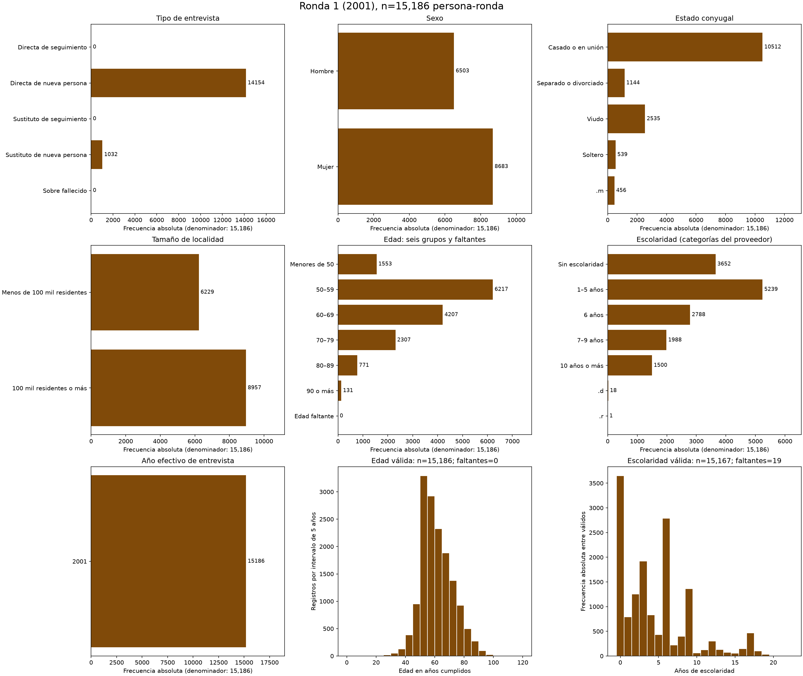

##### Interpretación académica: resultados y modalidades

La ronda 1 (2001) contiene 15,186 registros de 15,186 personas, sin exclusión por edad, entrevista ni continuidad. Las directas suman 14,154 (93.20%), las de sustituto 1,032 (6.80%) y las sobre fallecidos 0 (0.00%). El denominador de estos porcentajes es la totalidad de la ronda. Una entrevista sobre fallecido registra información aportada por un informante; no representa entrevista directa ni observación contemporánea de edad.

##### Edad y estructura demográfica

Hay 7,770 registros con edad menor de 60 (51.17% de todos los registros). Los menores de 50 son 1,553, mientras 902 tienen 80 o más, incluidos 131 con 90 o más (0.86% del total). La edad falta en 0/15,186 registros; el resumen continuo utiliza 15,186 valores válidos, con mediana 59.0 y cuartiles 53.0–68.0 años. Las siete categorías suman el total original; los códigos de edad ausente se conservan por separado en la tabla de cobertura.

Las mujeres representan 8,683/15,186 (57.18%). Los registros de personas casadas o en unión son 10,512 (69.22%) y los de viudez 2,535 (16.69%). Las localidades de 100 mil habitantes o más reúnen 8,957 (58.98%). Estas proporciones incluyen los faltantes en el denominador y no describen exclusivamente participantes vivos o directos. El complemento de cada categoría comprende otras categorías y, cuando existen, valores ausentes. El corte de localidad no permite identificar todos los asentamientos rurales.

##### Educación

La escolaridad es válida en 15,167/15,186 registros, con media 4.64 y mediana 3.0 años. La ausencia de escolaridad se registra para 3,652 (24.05%) y 10 años o más para 1,500 (9.88%). La distribución completa muestra años exactos, categorías del proveedor y causas de faltantes. Según el diccionario, educacion refleja escolaridad a partir de la primera entrevista; una diferencia entre rondas no demuestra adquisición individual de educación.

##### Incorporación y seguimiento

La primera aparición corresponde a 15,186 personas (100.00% de la ronda), frente a 0 ya registradas (0.00%). Las reapariciones tras ausencia inmediata son 0 (0.00%); son un subconjunto de quienes ya participaron. Primera aparición se deriva de la historia de presencia y no debe equipararse automáticamente a tipent de nueva persona.

Entre los presentes en esta ronda, 811 solo tienen un registro en 2001–2021 y 6,305 aparecen en las seis rondas. Esta clasificación describe la trayectoria retrospectiva observada e incluye todos los modos de entrevista; no es un predictor prospectivo.

Esta es la primera ronda disponible: no se calculan entradas ni ausencias respecto a años anteriores no incluidos en el archivo. La distribución por número de rondas usa seguimiento posterior únicamente con fines descriptivos.

##### Ponderadores y cobertura

El factor individual de la ronda tiene 15,186/15,186 valores válidos; 13,463 positivos, 1,723 ceros y 0 faltantes. La tabla separa modalidades de entrevista. Disponibilidad numérica no equivale a aplicabilidad a toda la población registrada.

El factor de hogar de la ronda tiene 15,186/15,186 valores válidos; 15,186 positivos, 0 ceros y 0 faltantes. La tabla separa modalidades de entrevista. Disponibilidad numérica no equivale a aplicabilidad a toda la población registrada.

La auditoría de cobertura incluye 119 variables originales; 19 no tienen valores válidos en esta ronda. Cada código especial se cuenta por variable sobre todos los registros, distinguiendo no formulado, sustituto, fallecimiento y otras causas. Las tablas agregadas de celdas no son conteos de personas fallecidas ni ausentes.

##### Conclusión parcial y límites

La población registrada conserva heterogeneidad de edades y modos de entrevista. Las comparaciones por edad, educación y localidad deben considerar sus faltantes y cambios de composición. Todos los resultados son descriptivos sin ponderación; el archivo de entrevistas completadas no contiene necesariamente toda la población objetivo ni todos los intentos de contacto. Las subpoblaciones se comparan después, sin reemplazar esta referencia ni excluir datos originales.

#### 2.2. Ronda 2: 2003

**Introducción y metodología.** Esta sección describe los 14,250 registros y 14,250 personas de 2003, sin restricciones de edad o modalidad. Cada distribución categórica conserva su denominador completo N=14,250; las categorías especiales señalan causas de ausencia de información. Las tablas son agregados reales reutilizados de CP1. Los resultados se interpretan como composición de la población registrada y no como cambios causales o exclusivamente dentro de las mismas personas.

##### Registros y personas

| ronda | ano_nominal | registros | personas | menores_60 | edad_60_mas | edad_faltante | duplicados | discrepancias_fallecido_tipent |
| --- | --- | --- | --- | --- | --- | --- | --- | --- |
| 2 | 2003 | 14250 | 14250 | 6002 | 7691 | 557 | 0 | 0 |

##### Tipos de entrevista

| categoria | n | denominador | porcentaje |
| --- | --- | --- | --- |
| Directa de seguimiento | 12363 | 14250 | 86.76 |
| Directa de nueva persona | 163 | 14250 | 1.14 |
| Sustituto de seguimiento | 1134 | 14250 | 7.96 |
| Sustituto de nueva persona | 44 | 14250 | 0.31 |
| Sobre fallecido | 546 | 14250 | 3.83 |

##### Sexo

| categoria | n | denominador | porcentaje |
| --- | --- | --- | --- |
| Hombre | 6108 | 14250 | 42.86 |
| Mujer | 8142 | 14250 | 57.14 |

##### Estado conyugal

| categoria | n | denominador | porcentaje |
| --- | --- | --- | --- |
| Casado o en unión | 9689 | 14250 | 67.99 |
| Separado o divorciado | 947 | 14250 | 6.65 |
| Viudo | 2545 | 14250 | 17.86 |
| Soltero | 522 | 14250 | 3.66 |
| .f | 546 | 14250 | 3.83 |
| .d | 1 | 14250 | 0.01 |

##### Educación: categorías del proveedor

| categoria | n | denominador | porcentaje |
| --- | --- | --- | --- |
| Sin escolaridad | 3517 | 14250 | 24.68 |
| 1–5 años | 4945 | 14250 | 34.70 |
| 6 años | 2611 | 14250 | 18.32 |
| 7–9 años | 1774 | 14250 | 12.45 |
| 10 años o más | 1304 | 14250 | 9.15 |
| .m | 67 | 14250 | 0.47 |
| .d | 22 | 14250 | 0.15 |
| .f | 9 | 14250 | 0.06 |
| .r | 1 | 14250 | 0.01 |

##### Educación: años exactos y faltantes

| categoria | n | denominador | porcentaje |
| --- | --- | --- | --- |
| 0 | 3517 | 14250 | 24.68 |
| 6 | 2611 | 14250 | 18.32 |
| 3 | 1826 | 14250 | 12.81 |
| 9 | 1209 | 14250 | 8.48 |
| 2 | 1174 | 14250 | 8.24 |
| 4 | 778 | 14250 | 5.46 |
| 1 | 763 | 14250 | 5.35 |
| 5 | 404 | 14250 | 2.84 |
| 17 | 404 | 14250 | 2.84 |
| 8 | 370 | 14250 | 2.60 |
| 12 | 263 | 14250 | 1.85 |
| 7 | 195 | 14250 | 1.37 |
| 13 | 121 | 14250 | 0.85 |
| 16 | 120 | 14250 | 0.84 |
| 11 | 109 | 14250 | 0.76 |
| 18 | 88 | 14250 | 0.62 |
| 14 | 68 | 14250 | 0.48 |
| .m | 67 | 14250 | 0.47 |
| 15 | 54 | 14250 | 0.38 |
| 10 | 52 | 14250 | 0.36 |
| 19 | 25 | 14250 | 0.18 |
| .d | 22 | 14250 | 0.15 |
| .f | 9 | 14250 | 0.06 |
| .r | 1 | 14250 | 0.01 |

##### Localidad

| categoria | n | denominador | porcentaje |
| --- | --- | --- | --- |
| Menos de 100 mil residentes | 5777 | 14250 | 40.54 |
| 100 mil residentes o más | 7927 | 14250 | 55.63 |
| .f | 546 | 14250 | 3.83 |

##### Edad: grupos ampliados

| ronda | categoria | n | denominador | porcentaje |
| --- | --- | --- | --- | --- |
| 2 | Menores de 50 | 882 | 14250 | 6.19 |
| 2 | 50–59 | 5120 | 14250 | 35.93 |
| 2 | 60–69 | 4304 | 14250 | 30.20 |
| 2 | 70–79 | 2415 | 14250 | 16.95 |
| 2 | 80–89 | 825 | 14250 | 5.79 |
| 2 | 90 o más | 147 | 14250 | 1.03 |
| 2 | Edad faltante | 557 | 14250 | 3.91 |

##### Edad: estadísticos de valores válidos

| ronda | denominador | n_validos | media | de | min | q25 | mediana | q75 | max |
| --- | --- | --- | --- | --- | --- | --- | --- | --- | --- |
| 2 | 14250 | 13693 | 62.68 | 10.52 | 21.00 | 55.00 | 61.00 | 69.00 | 108.00 |

##### Escolaridad: estadísticos de valores válidos

| ronda | denominador | n_validos | n_faltantes | media | de | min | q25 | mediana | q75 | max |
| --- | --- | --- | --- | --- | --- | --- | --- | --- | --- | --- |
| 2 | 14250 | 14151 | 99 | 4.50 | 4.37 | 0.00 | 1.00 | 3.00 | 6.00 | 19.00 |

##### Primera aparición, seguimiento y reaparición

| ronda | primera_aparicion | ya_observadas | reaparecen_tras_ausencia | total | primera_aparicion_porcentaje | ya_observadas_porcentaje | reaparecen_tras_ausencia_porcentaje |
| --- | --- | --- | --- | --- | --- | --- | --- |
| 2 | 277 | 13973 | 0 | 14250 | 1.94 | 98.06 | 0.00 |

##### Ausencias respecto a la ronda anterior

| ronda | ronda_origen | denominador_anterior | continuan_desde_anterior | no_observadas_desde_anterior | ausentes_con_fallecimiento_previo | ausentes_sin_fallecimiento_previo | porcentaje_no_observadas |
| --- | --- | --- | --- | --- | --- | --- | --- |
| 2 | 1 | 15186 | 13973 | 1213 | 0 | 1213 | 7.99 |

El denominador es el total de la ronda anterior: continuadas + ausentes = origen. Ausencia con fallecimiento previo se identifica aquí por la entrevista sobre fallecido en la ronda inmediatamente anterior; no expresa todos los antecedentes históricos posibles.

##### Participación total de los presentes: 1–6 rondas

| ronda | rondas_observadas_2001_2021 | personas | denominador_personas_ronda | porcentaje |
| --- | --- | --- | --- | --- |
| 2 | 1 | 43 | 14250 | 0.30 |
| 2 | 2 | 1462 | 14250 | 10.26 |
| 2 | 3 | 3058 | 14250 | 21.46 |
| 2 | 4 | 1369 | 14250 | 9.61 |
| 2 | 5 | 2013 | 14250 | 14.13 |
| 2 | 6 | 6305 | 14250 | 44.25 |

##### Año efectivo de entrevista por modalidad

| ronda | tipo_entrevista | categoria | n | denominador | porcentaje |
| --- | --- | --- | --- | --- | --- |
| 2 | Directa de seguimiento | 2003 | 12363 | 12363 | 100.00 |
| 2 | Directa de nueva persona | 2003 | 163 | 163 | 100.00 |
| 2 | Sustituto de seguimiento | 2003 | 1134 | 1134 | 100.00 |
| 2 | Sustituto de nueva persona | 2003 | 44 | 44 | 100.00 |
| 2 | Sobre fallecido | 2003 | 546 | 546 | 100.00 |

##### Cobertura de variables demográficas, tiempo y patrimonio

| ronda | variable | tipo | n | denominador | porcentaje |
| --- | --- | --- | --- | --- | --- |
| 2 | a_o_ent | válido | 14250 | 14250 | 100.00 |
| 2 | sexo | válido | 14250 | 14250 | 100.00 |
| 2 | a_o_nac | válido | 14215 | 14250 | 99.75 |
| 2 | a_o_nac | .i | 29 | 14250 | 0.20 |
| 2 | a_o_nac | .d | 3 | 14250 | 0.02 |
| 2 | a_o_nac | .m | 2 | 14250 | 0.01 |
| 2 | a_o_nac | .f | 1 | 14250 | 0.01 |
| 2 | edad | válido | 13693 | 14250 | 96.09 |
| 2 | edad | .f | 546 | 14250 | 3.83 |
| 2 | edad | .d | 10 | 14250 | 0.07 |
| 2 | edad | .e | 1 | 14250 | 0.01 |
| 2 | urbano | válido | 13704 | 14250 | 96.17 |
| 2 | urbano | .f | 546 | 14250 | 3.83 |
| 2 | educacion | válido | 14151 | 14250 | 99.31 |
| 2 | educacion | .m | 67 | 14250 | 0.47 |
| 2 | educacion | .d | 22 | 14250 | 0.15 |
| 2 | educacion | .f | 9 | 14250 | 0.06 |
| 2 | educacion | .r | 1 | 14250 | 0.01 |
| 2 | edu_gru | válido | 14151 | 14250 | 99.31 |
| 2 | edu_gru | .m | 67 | 14250 | 0.47 |
| 2 | edu_gru | .d | 22 | 14250 | 0.15 |
| 2 | edu_gru | .f | 9 | 14250 | 0.06 |
| 2 | edu_gru | .r | 1 | 14250 | 0.01 |
| 2 | est_conyugal | válido | 13703 | 14250 | 96.16 |
| 2 | est_conyugal | .f | 546 | 14250 | 3.83 |
| 2 | est_conyugal | .d | 1 | 14250 | 0.01 |
| 2 | imp_neto | válido | 13671 | 14250 | 95.94 |
| 2 | imp_neto | .f | 546 | 14250 | 3.83 |
| 2 | imp_neto | .i | 31 | 14250 | 0.22 |
| 2 | imp_neto | .m | 2 | 14250 | 0.01 |

##### Disponibilidad de ponderadores por modalidad

| ronda | variable | tipo_entrevista | denominador | validos | positivos | ceros | negativos | faltantes | porcentaje_validos | porcentaje_positivos | porcentaje_ceros | porcentaje_faltantes |
| --- | --- | --- | --- | --- | --- | --- | --- | --- | --- | --- | --- | --- |
| 2 | factori_03 | Directa de seguimiento | 12363 | 12363 | 11004 | 1359 | 0 | 0 | 100.00 | 89.01 | 10.99 | 0.00 |
| 2 | factori_03 | Directa de nueva persona | 163 | 163 | 84 | 79 | 0 | 0 | 100.00 | 51.53 | 48.47 | 0.00 |
| 2 | factori_03 | Sustituto de seguimiento | 1134 | 1134 | 1059 | 75 | 0 | 0 | 100.00 | 93.39 | 6.61 | 0.00 |
| 2 | factori_03 | Sustituto de nueva persona | 44 | 44 | 17 | 27 | 0 | 0 | 100.00 | 38.64 | 61.36 | 0.00 |
| 2 | factori_03 | Sobre fallecido | 546 | 546 | 0 | 546 | 0 | 0 | 100.00 | 0.00 | 100.00 | 0.00 |
| 2 | factorh_03 | Directa de seguimiento | 12363 | 12363 | 11004 | 1359 | 0 | 0 | 100.00 | 89.01 | 10.99 | 0.00 |
| 2 | factorh_03 | Directa de nueva persona | 163 | 163 | 0 | 163 | 0 | 0 | 100.00 | 0.00 | 100.00 | 0.00 |
| 2 | factorh_03 | Sustituto de seguimiento | 1134 | 1134 | 1059 | 75 | 0 | 0 | 100.00 | 93.39 | 6.61 | 0.00 |
| 2 | factorh_03 | Sustituto de nueva persona | 44 | 44 | 1 | 43 | 0 | 0 | 100.00 | 2.27 | 97.73 | 0.00 |
| 2 | factorh_03 | Sobre fallecido | 546 | 546 | 0 | 546 | 0 | 0 | 100.00 | 0.00 | 100.00 | 0.00 |

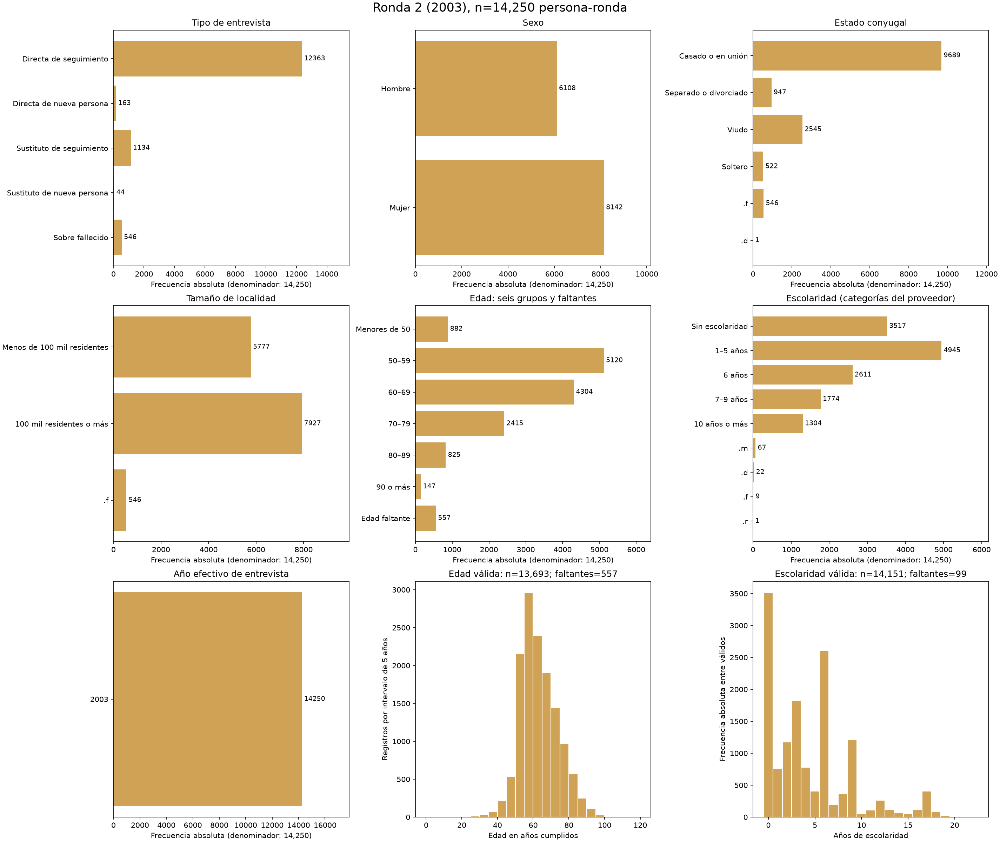

##### Interpretación académica: resultados y modalidades

La ronda 2 (2003) contiene 14,250 registros de 14,250 personas, sin exclusión por edad, entrevista ni continuidad. Las directas suman 12,526 (87.90%), las de sustituto 1,178 (8.27%) y las sobre fallecidos 546 (3.83%). El denominador de estos porcentajes es la totalidad de la ronda. Una entrevista sobre fallecido registra información aportada por un informante; no representa entrevista directa ni observación contemporánea de edad.

##### Edad y estructura demográfica

Hay 6,002 registros con edad menor de 60 (42.12% de todos los registros). Los menores de 50 son 882, mientras 972 tienen 80 o más, incluidos 147 con 90 o más (1.03% del total). La edad falta en 557/14,250 registros; el resumen continuo utiliza 13,693 valores válidos, con mediana 61.0 y cuartiles 55.0–69.0 años. Las siete categorías suman el total original; los códigos de edad ausente se conservan por separado en la tabla de cobertura.

Las mujeres representan 8,142/14,250 (57.14%). Los registros de personas casadas o en unión son 9,689 (67.99%) y los de viudez 2,545 (17.86%). Las localidades de 100 mil habitantes o más reúnen 7,927 (55.63%). Estas proporciones incluyen los faltantes en el denominador y no describen exclusivamente participantes vivos o directos. El complemento de cada categoría comprende otras categorías y, cuando existen, valores ausentes. El corte de localidad no permite identificar todos los asentamientos rurales.

##### Educación

La escolaridad es válida en 14,151/14,250 registros, con media 4.50 y mediana 3.0 años. La ausencia de escolaridad se registra para 3,517 (24.68%) y 10 años o más para 1,304 (9.15%). La distribución completa muestra años exactos, categorías del proveedor y causas de faltantes. Según el diccionario, educacion refleja escolaridad a partir de la primera entrevista; una diferencia entre rondas no demuestra adquisición individual de educación.

##### Incorporación y seguimiento

La primera aparición corresponde a 277 personas (1.94% de la ronda), frente a 13,973 ya registradas (98.06%). Las reapariciones tras ausencia inmediata son 0 (0.00%); son un subconjunto de quienes ya participaron. Primera aparición se deriva de la historia de presencia y no debe equipararse automáticamente a tipent de nueva persona.

Entre los presentes en esta ronda, 43 solo tienen un registro en 2001–2021 y 6,305 aparecen en las seis rondas. Esta clasificación describe la trayectoria retrospectiva observada e incluye todos los modos de entrevista; no es un predictor prospectivo.

De 15,186 personas en la ronda anterior, 1,213 no se registran ahora (7.99% sobre el origen): 0 ya tenían entrevista sobre fallecido y 1,213 no tenían ese antecedente en la ronda anterior. El último grupo no tiene causa de ausencia identificada por esta comparación; una parte puede reaparecer después. La primera ronda no tiene referencia anterior dentro del archivo.

##### Comparación con la ronda anterior

La mediana de edad cambia +2.0 años y la proporción sin escolaridad cambia +0.63 puntos porcentuales. Son cambios de composición entre muestras registradas, que combinan incorporaciones, envejecimiento y observación selectiva. No se atribuyen a cambios dentro de persona.

La proporción de mujeres cambia -0.04 puntos porcentuales; la de viudez +1.17 y la de localidades de 100 mil o más -3.35. Los tres contrastes usan el total de cada ronda. Las diferencias de viudez y localidad incluyen cambios en los faltantes por fallecimiento; no se interpretan automáticamente como cambios de estado conyugal o residencia entre las mismas personas.

##### Ponderadores y cobertura

El factor individual de la ronda tiene 14,250/14,250 valores válidos; 12,164 positivos, 2,086 ceros y 0 faltantes. La tabla separa modalidades de entrevista. Disponibilidad numérica no equivale a aplicabilidad a toda la población registrada.

El factor de hogar de la ronda tiene 14,250/14,250 valores válidos; 12,064 positivos, 2,186 ceros y 0 faltantes. La tabla separa modalidades de entrevista. Disponibilidad numérica no equivale a aplicabilidad a toda la población registrada.

La auditoría de cobertura incluye 119 variables originales; 16 no tienen valores válidos en esta ronda. Cada código especial se cuenta por variable sobre todos los registros, distinguiendo no formulado, sustituto, fallecimiento y otras causas. Las tablas agregadas de celdas no son conteos de personas fallecidas ni ausentes.

##### Conclusión parcial y límites

#### 2.3. Ronda 3: 2012

**Introducción y metodología.** Esta sección describe los 18,465 registros y 18,465 personas de 2012, sin restricciones de edad o modalidad. Cada distribución categórica conserva su denominador completo N=18,465; las categorías especiales señalan causas de ausencia de información. Las tablas son agregados reales reutilizados de CP1. Los resultados se interpretan como composición de la población registrada y no como cambios causales o exclusivamente dentro de las mismas personas.

##### Registros y personas

| ronda | ano_nominal | registros | personas | menores_60 | edad_60_mas | edad_faltante | duplicados | discrepancias_fallecido_tipent |
| --- | --- | --- | --- | --- | --- | --- | --- | --- |
| 3 | 2012 | 18465 | 18465 | 5815 | 9886 | 2764 | 0 | 0 |

##### Tipos de entrevista

| categoria | n | denominador | porcentaje |
| --- | --- | --- | --- |
| Directa de seguimiento | 8868 | 18465 | 48.03 |
| Directa de nueva persona | 5580 | 18465 | 30.22 |
| Sustituto de seguimiento | 959 | 18465 | 5.19 |
| Sustituto de nueva persona | 316 | 18465 | 1.71 |
| Sobre fallecido | 2742 | 18465 | 14.85 |

##### Sexo

| categoria | n | denominador | porcentaje |
| --- | --- | --- | --- |
| Hombre | 8000 | 18465 | 43.33 |
| Mujer | 10465 | 18465 | 56.67 |

##### Estado conyugal

| categoria | n | denominador | porcentaje |
| --- | --- | --- | --- |
| Casado o en unión | 10910 | 18465 | 59.08 |
| Separado o divorciado | 1231 | 18465 | 6.67 |
| Viudo | 2860 | 18465 | 15.49 |
| Soltero | 722 | 18465 | 3.91 |
| .f | 2742 | 18465 | 14.85 |

##### Educación: categorías del proveedor

| categoria | n | denominador | porcentaje |
| --- | --- | --- | --- |
| Sin escolaridad | 3699 | 18465 | 20.03 |
| 1–5 años | 5728 | 18465 | 31.02 |
| 6 años | 3694 | 18465 | 20.01 |
| 7–9 años | 2938 | 18465 | 15.91 |
| 10 años o más | 2312 | 18465 | 12.52 |
| .m | 50 | 18465 | 0.27 |
| .f | 30 | 18465 | 0.16 |
| .d | 14 | 18465 | 0.08 |

##### Educación: años exactos y faltantes

| categoria | n | denominador | porcentaje |
| --- | --- | --- | --- |
| 0 | 3699 | 18465 | 20.03 |
| 6 | 3694 | 18465 | 20.01 |
| 9 | 2176 | 18465 | 11.78 |
| 3 | 2091 | 18465 | 11.32 |
| 2 | 1347 | 18465 | 7.29 |
| 4 | 920 | 18465 | 4.98 |
| 1 | 846 | 18465 | 4.58 |
| 17 | 635 | 18465 | 3.44 |
| 5 | 524 | 18465 | 2.84 |
| 12 | 518 | 18465 | 2.81 |
| 8 | 502 | 18465 | 2.72 |
| 16 | 325 | 18465 | 1.76 |
| 7 | 260 | 18465 | 1.41 |
| 18 | 185 | 18465 | 1.00 |
| 13 | 184 | 18465 | 1.00 |
| 11 | 136 | 18465 | 0.74 |
| 14 | 97 | 18465 | 0.53 |
| 15 | 82 | 18465 | 0.44 |
| 10 | 78 | 18465 | 0.42 |
| .m | 50 | 18465 | 0.27 |
| 19 | 49 | 18465 | 0.27 |
| .f | 30 | 18465 | 0.16 |
| .d | 14 | 18465 | 0.08 |
| 20 | 10 | 18465 | 0.05 |
| 21 | 8 | 18465 | 0.04 |
| 22 | 5 | 18465 | 0.03 |

##### Localidad

| categoria | n | denominador | porcentaje |
| --- | --- | --- | --- |
| Menos de 100 mil residentes | 6600 | 18465 | 35.74 |
| 100 mil residentes o más | 9123 | 18465 | 49.41 |
| .f | 2742 | 18465 | 14.85 |

##### Edad: grupos ampliados

| ronda | categoria | n | denominador | porcentaje |
| --- | --- | --- | --- | --- |
| 3 | Menores de 50 | 1037 | 18465 | 5.62 |
| 3 | 50–59 | 4778 | 18465 | 25.88 |
| 3 | 60–69 | 5229 | 18465 | 28.32 |
| 3 | 70–79 | 3178 | 18465 | 17.21 |
| 3 | 80–89 | 1266 | 18465 | 6.86 |
| 3 | 90 o más | 213 | 18465 | 1.15 |
| 3 | Edad faltante | 2764 | 18465 | 14.97 |

##### Edad: estadísticos de valores válidos

| ronda | denominador | n_validos | media | de | min | q25 | mediana | q75 | max |
| --- | --- | --- | --- | --- | --- | --- | --- | --- | --- |
| 3 | 18465 | 15701 | 63.97 | 11.08 | 20.00 | 56.00 | 63.00 | 71.00 | 115.00 |

##### Escolaridad: estadísticos de valores válidos

| ronda | denominador | n_validos | n_faltantes | media | de | min | q25 | mediana | q75 | max |
| --- | --- | --- | --- | --- | --- | --- | --- | --- | --- | --- |
| 3 | 18465 | 18371 | 94 | 5.33 | 4.71 | 0.00 | 2.00 | 5.00 | 8.00 | 22.00 |

##### Primera aparición, seguimiento y reaparición

| ronda | primera_aparicion | ya_observadas | reaparecen_tras_ausencia | total | primera_aparicion_porcentaje | ya_observadas_porcentaje | reaparecen_tras_ausencia_porcentaje |
| --- | --- | --- | --- | --- | --- | --- | --- |
| 3 | 5912 | 12553 | 357 | 18465 | 32.02 | 67.98 | 1.93 |

##### Ausencias respecto a la ronda anterior

| ronda | ronda_origen | denominador_anterior | continuan_desde_anterior | no_observadas_desde_anterior | ausentes_con_fallecimiento_previo | ausentes_sin_fallecimiento_previo | porcentaje_no_observadas |
| --- | --- | --- | --- | --- | --- | --- | --- |
| 3 | 2 | 14250 | 12196 | 2054 | 546 | 1508 | 14.41 |

##### Participación total de los presentes: 1–6 rondas

| ronda | rondas_observadas_2001_2021 | personas | denominador_personas_ronda | porcentaje |
| --- | --- | --- | --- | --- |
| 3 | 1 | 376 | 18465 | 2.04 |
| 3 | 2 | 601 | 18465 | 3.25 |
| 3 | 3 | 3850 | 18465 | 20.85 |
| 3 | 4 | 5431 | 18465 | 29.41 |
| 3 | 5 | 1902 | 18465 | 10.30 |
| 3 | 6 | 6305 | 18465 | 34.15 |

##### Año efectivo de entrevista por modalidad

| ronda | tipo_entrevista | categoria | n | denominador | porcentaje |
| --- | --- | --- | --- | --- | --- |
| 3 | Directa de seguimiento | 2012 | 8854 | 8868 | 99.84 |
| 3 | Directa de seguimiento | 2013 | 13 | 8868 | 0.15 |
| 3 | Directa de seguimiento | .e | 1 | 8868 | 0.01 |
| 3 | Directa de nueva persona | 2012 | 5579 | 5580 | 99.98 |
| 3 | Directa de nueva persona | .i | 1 | 5580 | 0.02 |
| 3 | Sustituto de seguimiento | 2012 | 958 | 959 | 99.90 |
| 3 | Sustituto de seguimiento | 2013 | 1 | 959 | 0.10 |
| 3 | Sustituto de nueva persona | 2012 | 316 | 316 | 100.00 |
| 3 | Sobre fallecido | .f | 2742 | 2742 | 100.00 |

##### Cobertura de variables demográficas, tiempo y patrimonio

| ronda | variable | tipo | n | denominador | porcentaje |
| --- | --- | --- | --- | --- | --- |
| 3 | a_o_ent | válido | 15721 | 18465 | 85.14 |
| 3 | a_o_ent | .f | 2742 | 18465 | 14.85 |
| 3 | a_o_ent | .e | 1 | 18465 | 0.01 |
| 3 | a_o_ent | .i | 1 | 18465 | 0.01 |
| 3 | sexo | válido | 18465 | 18465 | 100.00 |
| 3 | a_o_nac | válido | 18438 | 18465 | 99.85 |
| 3 | a_o_nac | .i | 18 | 18465 | 0.10 |
| 3 | a_o_nac | .d | 9 | 18465 | 0.05 |
| 3 | edad | válido | 15701 | 18465 | 85.03 |
| 3 | edad | .f | 2742 | 18465 | 14.85 |
| 3 | edad | .d | 22 | 18465 | 0.12 |
| 3 | urbano | válido | 15723 | 18465 | 85.15 |
| 3 | urbano | .f | 2742 | 18465 | 14.85 |
| 3 | educacion | válido | 18371 | 18465 | 99.49 |
| 3 | educacion | .m | 50 | 18465 | 0.27 |
| 3 | educacion | .f | 30 | 18465 | 0.16 |
| 3 | educacion | .d | 14 | 18465 | 0.08 |
| 3 | edu_gru | válido | 18371 | 18465 | 99.49 |
| 3 | edu_gru | .m | 50 | 18465 | 0.27 |
| 3 | edu_gru | .f | 30 | 18465 | 0.16 |
| 3 | edu_gru | .d | 14 | 18465 | 0.08 |
| 3 | est_conyugal | válido | 15723 | 18465 | 85.15 |
| 3 | est_conyugal | .f | 2742 | 18465 | 14.85 |
| 3 | imp_neto | válido | 15723 | 18465 | 85.15 |
| 3 | imp_neto | .f | 2742 | 18465 | 14.85 |

##### Disponibilidad de ponderadores por modalidad

| ronda | variable | tipo_entrevista | denominador | validos | positivos | ceros | negativos | faltantes | porcentaje_validos | porcentaje_positivos | porcentaje_ceros | porcentaje_faltantes |
| --- | --- | --- | --- | --- | --- | --- | --- | --- | --- | --- | --- | --- |
| 3 | factori_12 | Directa de seguimiento | 8868 | 8868 | 7509 | 1359 | 0 | 0 | 100.00 | 84.68 | 15.32 | 0.00 |
| 3 | factori_12 | Directa de nueva persona | 5580 | 5580 | 5549 | 31 | 0 | 0 | 100.00 | 99.44 | 0.56 | 0.00 |
| 3 | factori_12 | Sustituto de seguimiento | 959 | 959 | 892 | 67 | 0 | 0 | 100.00 | 93.01 | 6.99 | 0.00 |
| 3 | factori_12 | Sustituto de nueva persona | 316 | 316 | 313 | 3 | 0 | 0 | 100.00 | 99.05 | 0.95 | 0.00 |
| 3 | factori_12 | Sobre fallecido | 2742 | 2742 | 2624 | 118 | 0 | 0 | 100.00 | 95.70 | 4.30 | 0.00 |
| 3 | factorh_12 | Directa de seguimiento | 8868 | 8868 | 8338 | 530 | 0 | 0 | 100.00 | 94.02 | 5.98 | 0.00 |
| 3 | factorh_12 | Directa de nueva persona | 5580 | 5580 | 5563 | 17 | 0 | 0 | 100.00 | 99.70 | 0.30 | 0.00 |
| 3 | factorh_12 | Sustituto de seguimiento | 959 | 959 | 916 | 43 | 0 | 0 | 100.00 | 95.52 | 4.48 | 0.00 |
| 3 | factorh_12 | Sustituto de nueva persona | 316 | 316 | 313 | 3 | 0 | 0 | 100.00 | 99.05 | 0.95 | 0.00 |
| 3 | factorh_12 | Sobre fallecido | 2742 | 2742 | 2613 | 129 | 0 | 0 | 100.00 | 95.30 | 4.70 | 0.00 |

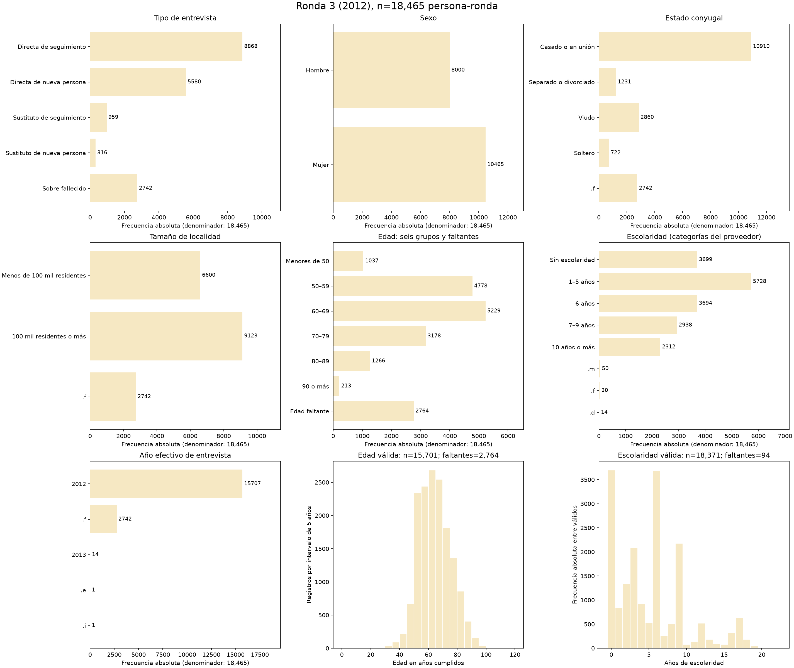

##### Interpretación académica: resultados y modalidades

La ronda 3 (2012) contiene 18,465 registros de 18,465 personas, sin exclusión por edad, entrevista ni continuidad. Las directas suman 14,448 (78.25%), las de sustituto 1,275 (6.90%) y las sobre fallecidos 2,742 (14.85%). El denominador de estos porcentajes es la totalidad de la ronda. Una entrevista sobre fallecido registra información aportada por un informante; no representa entrevista directa ni observación contemporánea de edad.

##### Edad y estructura demográfica

Hay 5,815 registros con edad menor de 60 (31.49% de todos los registros). Los menores de 50 son 1,037, mientras 1,479 tienen 80 o más, incluidos 213 con 90 o más (1.15% del total). La edad falta en 2,764/18,465 registros; el resumen continuo utiliza 15,701 valores válidos, con mediana 63.0 y cuartiles 56.0–71.0 años. Las siete categorías suman el total original; los códigos de edad ausente se conservan por separado en la tabla de cobertura.

Las mujeres representan 10,465/18,465 (56.67%). Los registros de personas casadas o en unión son 10,910 (59.08%) y los de viudez 2,860 (15.49%). Las localidades de 100 mil habitantes o más reúnen 9,123 (49.41%). Estas proporciones incluyen los faltantes en el denominador y no describen exclusivamente participantes vivos o directos. El complemento de cada categoría comprende otras categorías y, cuando existen, valores ausentes. El corte de localidad no permite identificar todos los asentamientos rurales.

##### Educación

La escolaridad es válida en 18,371/18,465 registros, con media 5.33 y mediana 5.0 años. La ausencia de escolaridad se registra para 3,699 (20.03%) y 10 años o más para 2,312 (12.52%). La distribución completa muestra años exactos, categorías del proveedor y causas de faltantes. Según el diccionario, educacion refleja escolaridad a partir de la primera entrevista; una diferencia entre rondas no demuestra adquisición individual de educación.

##### Incorporación y seguimiento

La primera aparición corresponde a 5,912 personas (32.02% de la ronda), frente a 12,553 ya registradas (67.98%). Las reapariciones tras ausencia inmediata son 357 (1.93%); son un subconjunto de quienes ya participaron. Primera aparición se deriva de la historia de presencia y no debe equipararse automáticamente a tipent de nueva persona.

Entre los presentes en esta ronda, 376 solo tienen un registro en 2001–2021 y 6,305 aparecen en las seis rondas. Esta clasificación describe la trayectoria retrospectiva observada e incluye todos los modos de entrevista; no es un predictor prospectivo.

De 14,250 personas en la ronda anterior, 2,054 no se registran ahora (14.41% sobre el origen): 546 ya tenían entrevista sobre fallecido y 1,508 no tenían ese antecedente en la ronda anterior. El último grupo no tiene causa de ausencia identificada por esta comparación; una parte puede reaparecer después. La primera ronda no tiene referencia anterior dentro del archivo.

##### Comparación con la ronda anterior

La mediana de edad cambia +2.0 años y la proporción sin escolaridad cambia -4.65 puntos porcentuales. Son cambios de composición entre muestras registradas, que combinan incorporaciones, envejecimiento y observación selectiva. No se atribuyen a cambios dentro de persona.

La proporción de mujeres cambia -0.46 puntos porcentuales; la de viudez -2.37 y la de localidades de 100 mil o más -6.22. Los tres contrastes usan el total de cada ronda. Las diferencias de viudez y localidad incluyen cambios en los faltantes por fallecimiento; no se interpretan automáticamente como cambios de estado conyugal o residencia entre las mismas personas.

##### Ponderadores y cobertura

El factor individual de la ronda tiene 18,465/18,465 valores válidos; 16,887 positivos, 1,578 ceros y 0 faltantes. La tabla separa modalidades de entrevista. Disponibilidad numérica no equivale a aplicabilidad a toda la población registrada.

El factor de hogar de la ronda tiene 18,465/18,465 valores válidos; 17,743 positivos, 722 ceros y 0 faltantes. La tabla separa modalidades de entrevista. Disponibilidad numérica no equivale a aplicabilidad a toda la población registrada.

La auditoría de cobertura incluye 119 variables originales; 3 no tienen valores válidos en esta ronda. Cada código especial se cuenta por variable sobre todos los registros, distinguiendo no formulado, sustituto, fallecimiento y otras causas. Las tablas agregadas de celdas no son conteos de personas fallecidas ni ausentes.

##### Conclusión parcial y límites

#### 2.4. Ronda 4: 2015

**Introducción y metodología.** Esta sección describe los 15,988 registros y 15,988 personas de 2015, sin restricciones de edad o modalidad. Cada distribución categórica conserva su denominador completo N=15,988; las categorías especiales señalan causas de ausencia de información. Las tablas son agregados reales reutilizados de CP1. Los resultados se interpretan como composición de la población registrada y no como cambios causales o exclusivamente dentro de las mismas personas.

##### Registros y personas

| ronda | ano_nominal | registros | personas | menores_60 | edad_60_mas | edad_faltante | duplicados | discrepancias_fallecido_tipent |
| --- | --- | --- | --- | --- | --- | --- | --- | --- |
| 4 | 2015 | 15988 | 15988 | 4359 | 10416 | 1213 | 0 | 0 |

##### Tipos de entrevista

| categoria | n | denominador | porcentaje |
| --- | --- | --- | --- |
| Directa de seguimiento | 13254 | 15988 | 82.90 |
| Directa de nueva persona | 596 | 15988 | 3.73 |
| Sustituto de seguimiento | 884 | 15988 | 5.53 |
| Sustituto de nueva persona | 45 | 15988 | 0.28 |
| Sobre fallecido | 1209 | 15988 | 7.56 |

##### Sexo

| categoria | n | denominador | porcentaje |
| --- | --- | --- | --- |
| Hombre | 6739 | 15988 | 42.15 |
| Mujer | 9249 | 15988 | 57.85 |

##### Estado conyugal

| categoria | n | denominador | porcentaje |
| --- | --- | --- | --- |
| Casado o en unión | 9862 | 15988 | 61.68 |
| Separado o divorciado | 1473 | 15988 | 9.21 |
| Viudo | 2829 | 15988 | 17.69 |
| Soltero | 615 | 15988 | 3.85 |
| .f | 1209 | 15988 | 7.56 |

##### Educación: categorías del proveedor

| categoria | n | denominador | porcentaje |
| --- | --- | --- | --- |
| Sin escolaridad | 2847 | 15988 | 17.81 |
| 1–5 años | 4757 | 15988 | 29.75 |
| 6 años | 3310 | 15988 | 20.70 |
| 7–9 años | 2732 | 15988 | 17.09 |
| 10 años o más | 2162 | 15988 | 13.52 |
| .d | 122 | 15988 | 0.76 |
| .m | 51 | 15988 | 0.32 |
| .f | 7 | 15988 | 0.04 |

##### Educación: años exactos y faltantes

| categoria | n | denominador | porcentaje |
| --- | --- | --- | --- |
| 6 | 3310 | 15988 | 20.70 |
| 0 | 2847 | 15988 | 17.81 |
| 9 | 2053 | 15988 | 12.84 |
| 3 | 1742 | 15988 | 10.90 |
| 2 | 1096 | 15988 | 6.86 |
| 4 | 777 | 15988 | 4.86 |
| 1 | 671 | 15988 | 4.20 |
| 17 | 594 | 15988 | 3.72 |
| 12 | 496 | 15988 | 3.10 |
| 5 | 471 | 15988 | 2.95 |
| 8 | 453 | 15988 | 2.83 |
| 16 | 315 | 15988 | 1.97 |
| 7 | 226 | 15988 | 1.41 |
| 18 | 163 | 15988 | 1.02 |
| 13 | 159 | 15988 | 0.99 |
| 11 | 132 | 15988 | 0.83 |
| .d | 122 | 15988 | 0.76 |
| 14 | 89 | 15988 | 0.56 |
| 15 | 79 | 15988 | 0.49 |
| 10 | 76 | 15988 | 0.48 |
| .m | 51 | 15988 | 0.32 |
| 19 | 43 | 15988 | 0.27 |
| 21 | 8 | 15988 | 0.05 |
| .f | 7 | 15988 | 0.04 |
| 20 | 6 | 15988 | 0.04 |
| 22 | 2 | 15988 | 0.01 |

##### Localidad

| categoria | n | denominador | porcentaje |
| --- | --- | --- | --- |
| Menos de 100 mil residentes | 6329 | 15988 | 39.59 |
| 100 mil residentes o más | 8450 | 15988 | 52.85 |
| .f | 1209 | 15988 | 7.56 |

##### Edad: grupos ampliados

| ronda | categoria | n | denominador | porcentaje |
| --- | --- | --- | --- | --- |
| 4 | Menores de 50 | 560 | 15988 | 3.50 |
| 4 | 50–59 | 3799 | 15988 | 23.76 |
| 4 | 60–69 | 5092 | 15988 | 31.85 |
| 4 | 70–79 | 3619 | 15988 | 22.64 |
| 4 | 80–89 | 1424 | 15988 | 8.91 |
| 4 | 90 o más | 281 | 15988 | 1.76 |
| 4 | Edad faltante | 1213 | 15988 | 7.59 |

##### Edad: estadísticos de valores válidos

| ronda | denominador | n_validos | media | de | min | q25 | mediana | q75 | max |
| --- | --- | --- | --- | --- | --- | --- | --- | --- | --- |
| 4 | 15988 | 14775 | 66.13 | 10.62 | 23.00 | 58.00 | 66.00 | 73.00 | 113.00 |

##### Escolaridad: estadísticos de valores válidos

| ronda | denominador | n_validos | n_faltantes | media | de | min | q25 | mediana | q75 | max |
| --- | --- | --- | --- | --- | --- | --- | --- | --- | --- | --- |
| 4 | 15988 | 15808 | 180 | 5.63 | 4.73 | 0.00 | 2.00 | 6.00 | 9.00 | 22.00 |

##### Primera aparición, seguimiento y reaparición

| ronda | primera_aparicion | ya_observadas | reaparecen_tras_ausencia | total | primera_aparicion_porcentaje | ya_observadas_porcentaje | reaparecen_tras_ausencia_porcentaje |
| --- | --- | --- | --- | --- | --- | --- | --- |
| 4 | 650 | 15338 | 624 | 15988 | 4.07 | 95.93 | 3.90 |

##### Ausencias respecto a la ronda anterior

| ronda | ronda_origen | denominador_anterior | continuan_desde_anterior | no_observadas_desde_anterior | ausentes_con_fallecimiento_previo | ausentes_sin_fallecimiento_previo | porcentaje_no_observadas |
| --- | --- | --- | --- | --- | --- | --- | --- |
| 4 | 3 | 18465 | 14714 | 3751 | 2741 | 1010 | 20.31 |

##### Participación total de los presentes: 1–6 rondas

| ronda | rondas_observadas_2001_2021 | personas | denominador_personas_ronda | porcentaje |
| --- | --- | --- | --- | --- |
| 4 | 1 | 89 | 15988 | 0.56 |
| 4 | 2 | 587 | 15988 | 3.67 |
| 4 | 3 | 1442 | 15988 | 9.02 |
| 4 | 4 | 5510 | 15988 | 34.46 |
| 4 | 5 | 2055 | 15988 | 12.85 |
| 4 | 6 | 6305 | 15988 | 39.44 |

##### Año efectivo de entrevista por modalidad

| ronda | tipo_entrevista | categoria | n | denominador | porcentaje |
| --- | --- | --- | --- | --- | --- |
| 4 | Directa de seguimiento | 2015 | 13254 | 13254 | 100.00 |
| 4 | Directa de nueva persona | 2015 | 596 | 596 | 100.00 |
| 4 | Sustituto de seguimiento | 2015 | 884 | 884 | 100.00 |
| 4 | Sustituto de nueva persona | 2015 | 45 | 45 | 100.00 |
| 4 | Sobre fallecido | .f | 1209 | 1209 | 100.00 |

##### Cobertura de variables demográficas, tiempo y patrimonio

| ronda | variable | tipo | n | denominador | porcentaje |
| --- | --- | --- | --- | --- | --- |
| 4 | a_o_ent | válido | 14779 | 15988 | 92.44 |
| 4 | a_o_ent | .f | 1209 | 15988 | 7.56 |
| 4 | sexo | válido | 15988 | 15988 | 100.00 |
| 4 | a_o_nac | válido | 15980 | 15988 | 99.95 |
| 4 | a_o_nac | .f | 4 | 15988 | 0.03 |
| 4 | a_o_nac | .d | 4 | 15988 | 0.03 |
| 4 | edad | válido | 14775 | 15988 | 92.41 |
| 4 | edad | .f | 1209 | 15988 | 7.56 |
| 4 | edad | .d | 4 | 15988 | 0.03 |
| 4 | urbano | válido | 14779 | 15988 | 92.44 |
| 4 | urbano | .f | 1209 | 15988 | 7.56 |
| 4 | educacion | válido | 15808 | 15988 | 98.87 |
| 4 | educacion | .d | 122 | 15988 | 0.76 |
| 4 | educacion | .m | 51 | 15988 | 0.32 |
| 4 | educacion | .f | 7 | 15988 | 0.04 |
| 4 | edu_gru | válido | 15808 | 15988 | 98.87 |
| 4 | edu_gru | .d | 122 | 15988 | 0.76 |
| 4 | edu_gru | .m | 51 | 15988 | 0.32 |
| 4 | edu_gru | .f | 7 | 15988 | 0.04 |
| 4 | est_conyugal | válido | 14779 | 15988 | 92.44 |
| 4 | est_conyugal | .f | 1209 | 15988 | 7.56 |
| 4 | imp_neto | válido | 14745 | 15988 | 92.23 |
| 4 | imp_neto | .f | 1209 | 15988 | 7.56 |
| 4 | imp_neto | .i | 34 | 15988 | 0.21 |

##### Disponibilidad de ponderadores por modalidad

| ronda | variable | tipo_entrevista | denominador | validos | positivos | ceros | negativos | faltantes | porcentaje_validos | porcentaje_positivos | porcentaje_ceros | porcentaje_faltantes |
| --- | --- | --- | --- | --- | --- | --- | --- | --- | --- | --- | --- | --- |
| 4 | factori_15 | Directa de seguimiento | 13254 | 13254 | 12858 | 396 | 0 | 0 | 100.00 | 97.01 | 2.99 | 0.00 |
| 4 | factori_15 | Directa de nueva persona | 596 | 596 | 517 | 79 | 0 | 0 | 100.00 | 86.74 | 13.26 | 0.00 |
| 4 | factori_15 | Sustituto de seguimiento | 884 | 884 | 867 | 17 | 0 | 0 | 100.00 | 98.08 | 1.92 | 0.00 |
| 4 | factori_15 | Sustituto de nueva persona | 45 | 45 | 40 | 5 | 0 | 0 | 100.00 | 88.89 | 11.11 | 0.00 |
| 4 | factori_15 | Sobre fallecido | 1209 | 1209 | 1185 | 24 | 0 | 0 | 100.00 | 98.01 | 1.99 | 0.00 |
| 4 | factorh_15 | Directa de seguimiento | 13254 | 13254 | 12943 | 311 | 0 | 0 | 100.00 | 97.65 | 2.35 | 0.00 |
| 4 | factorh_15 | Directa de nueva persona | 596 | 596 | 582 | 14 | 0 | 0 | 100.00 | 97.65 | 2.35 | 0.00 |
| 4 | factorh_15 | Sustituto de seguimiento | 884 | 884 | 857 | 27 | 0 | 0 | 100.00 | 96.95 | 3.05 | 0.00 |
| 4 | factorh_15 | Sustituto de nueva persona | 45 | 45 | 44 | 1 | 0 | 0 | 100.00 | 97.78 | 2.22 | 0.00 |
| 4 | factorh_15 | Sobre fallecido | 1209 | 1209 | 1187 | 22 | 0 | 0 | 100.00 | 98.18 | 1.82 | 0.00 |

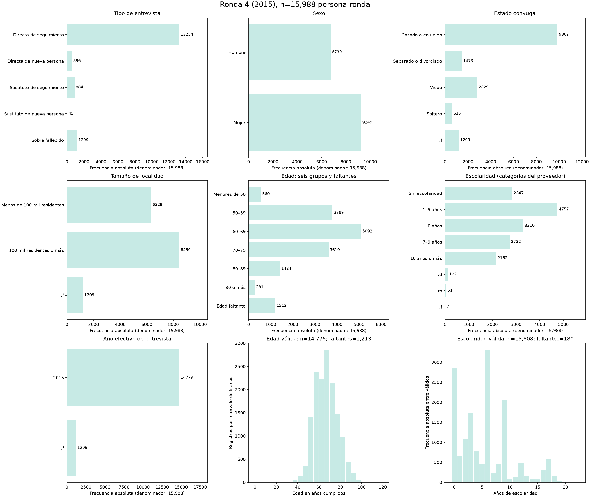

##### Interpretación académica: resultados y modalidades

La ronda 4 (2015) contiene 15,988 registros de 15,988 personas, sin exclusión por edad, entrevista ni continuidad. Las directas suman 13,850 (86.63%), las de sustituto 929 (5.81%) y las sobre fallecidos 1,209 (7.56%). El denominador de estos porcentajes es la totalidad de la ronda. Una entrevista sobre fallecido registra información aportada por un informante; no representa entrevista directa ni observación contemporánea de edad.

##### Edad y estructura demográfica

Hay 4,359 registros con edad menor de 60 (27.26% de todos los registros). Los menores de 50 son 560, mientras 1,705 tienen 80 o más, incluidos 281 con 90 o más (1.76% del total). La edad falta en 1,213/15,988 registros; el resumen continuo utiliza 14,775 valores válidos, con mediana 66.0 y cuartiles 58.0–73.0 años. Las siete categorías suman el total original; los códigos de edad ausente se conservan por separado en la tabla de cobertura.

Las mujeres representan 9,249/15,988 (57.85%). Los registros de personas casadas o en unión son 9,862 (61.68%) y los de viudez 2,829 (17.69%). Las localidades de 100 mil habitantes o más reúnen 8,450 (52.85%). Estas proporciones incluyen los faltantes en el denominador y no describen exclusivamente participantes vivos o directos. El complemento de cada categoría comprende otras categorías y, cuando existen, valores ausentes. El corte de localidad no permite identificar todos los asentamientos rurales.

##### Educación

La escolaridad es válida en 15,808/15,988 registros, con media 5.63 y mediana 6.0 años. La ausencia de escolaridad se registra para 2,847 (17.81%) y 10 años o más para 2,162 (13.52%). La distribución completa muestra años exactos, categorías del proveedor y causas de faltantes. Según el diccionario, educacion refleja escolaridad a partir de la primera entrevista; una diferencia entre rondas no demuestra adquisición individual de educación.

##### Incorporación y seguimiento

La primera aparición corresponde a 650 personas (4.07% de la ronda), frente a 15,338 ya registradas (95.93%). Las reapariciones tras ausencia inmediata son 624 (3.90%); son un subconjunto de quienes ya participaron. Primera aparición se deriva de la historia de presencia y no debe equipararse automáticamente a tipent de nueva persona.

Entre los presentes en esta ronda, 89 solo tienen un registro en 2001–2021 y 6,305 aparecen en las seis rondas. Esta clasificación describe la trayectoria retrospectiva observada e incluye todos los modos de entrevista; no es un predictor prospectivo.

De 18,465 personas en la ronda anterior, 3,751 no se registran ahora (20.31% sobre el origen): 2,741 ya tenían entrevista sobre fallecido y 1,010 no tenían ese antecedente en la ronda anterior. El último grupo no tiene causa de ausencia identificada por esta comparación; una parte puede reaparecer después. La primera ronda no tiene referencia anterior dentro del archivo.

##### Comparación con la ronda anterior

La mediana de edad cambia +3.0 años y la proporción sin escolaridad cambia -2.23 puntos porcentuales. Son cambios de composición entre muestras registradas, que combinan incorporaciones, envejecimiento y observación selectiva. No se atribuyen a cambios dentro de persona.

La proporción de mujeres cambia +1.17 puntos porcentuales; la de viudez +2.21 y la de localidades de 100 mil o más +3.45. Los tres contrastes usan el total de cada ronda. Las diferencias de viudez y localidad incluyen cambios en los faltantes por fallecimiento; no se interpretan automáticamente como cambios de estado conyugal o residencia entre las mismas personas.

##### Ponderadores y cobertura

El factor individual de la ronda tiene 15,988/15,988 valores válidos; 15,467 positivos, 521 ceros y 0 faltantes. La tabla separa modalidades de entrevista. Disponibilidad numérica no equivale a aplicabilidad a toda la población registrada.

El factor de hogar de la ronda tiene 15,988/15,988 valores válidos; 15,613 positivos, 375 ceros y 0 faltantes. La tabla separa modalidades de entrevista. Disponibilidad numérica no equivale a aplicabilidad a toda la población registrada.

La auditoría de cobertura incluye 119 variables originales; 2 no tienen valores válidos en esta ronda. Cada código especial se cuenta por variable sobre todos los registros, distinguiendo no formulado, sustituto, fallecimiento y otras causas. Las tablas agregadas de celdas no son conteos de personas fallecidas ni ausentes.

##### Conclusión parcial y límites

#### 2.5. Ronda 5: 2018

**Introducción y metodología.** Esta sección describe los 18,249 registros y 18,249 personas de 2018, sin restricciones de edad o modalidad. Cada distribución categórica conserva su denominador completo N=18,249; las categorías especiales señalan causas de ausencia de información. Las tablas son agregados reales reutilizados de CP1. Los resultados se interpretan como composición de la población registrada y no como cambios causales o exclusivamente dentro de las mismas personas.

##### Registros y personas

| ronda | ano_nominal | registros | personas | menores_60 | edad_60_mas | edad_faltante | duplicados | discrepancias_fallecido_tipent |
| --- | --- | --- | --- | --- | --- | --- | --- | --- |
| 5 | 2018 | 18249 | 18249 | 6981 | 10113 | 1155 | 0 | 0 |

##### Tipos de entrevista

| categoria | n | denominador | porcentaje |
| --- | --- | --- | --- |
| Directa de seguimiento | 11183 | 18249 | 61.28 |
| Directa de nueva persona | 4603 | 18249 | 25.22 |
| Sustituto de seguimiento | 1122 | 18249 | 6.15 |
| Sustituto de nueva persona | 206 | 18249 | 1.13 |
| Sobre fallecido | 1135 | 18249 | 6.22 |

##### Sexo

| categoria | n | denominador | porcentaje |
| --- | --- | --- | --- |
| Hombre | 7761 | 18249 | 42.53 |
| Mujer | 10488 | 18249 | 57.47 |

##### Estado conyugal

| categoria | n | denominador | porcentaje |
| --- | --- | --- | --- |
| Casado o en unión | 11838 | 18249 | 64.87 |
| Separado o divorciado | 1325 | 18249 | 7.26 |
| Viudo | 3047 | 18249 | 16.70 |
| Soltero | 904 | 18249 | 4.95 |
| .f | 1135 | 18249 | 6.22 |

##### Educación: categorías del proveedor

| categoria | n | denominador | porcentaje |
| --- | --- | --- | --- |
| Sin escolaridad | 2657 | 18249 | 14.56 |
| 1–5 años | 4620 | 18249 | 25.32 |
| 6 años | 3801 | 18249 | 20.83 |
| 7–9 años | 3676 | 18249 | 20.14 |
| 10 años o más | 3335 | 18249 | 18.27 |
| .d | 96 | 18249 | 0.53 |
| .m | 51 | 18249 | 0.28 |
| .r | 7 | 18249 | 0.04 |
| .f | 6 | 18249 | 0.03 |

##### Educación: años exactos y faltantes

| categoria | n | denominador | porcentaje |
| --- | --- | --- | --- |
| 6 | 3801 | 18249 | 20.83 |
| 9 | 2916 | 18249 | 15.98 |
| 0 | 2657 | 18249 | 14.56 |
| 3 | 1698 | 18249 | 9.30 |
| 2 | 1031 | 18249 | 5.65 |
| 12 | 985 | 18249 | 5.40 |
| 17 | 763 | 18249 | 4.18 |
| 4 | 744 | 18249 | 4.08 |
| 1 | 643 | 18249 | 3.52 |
| 8 | 513 | 18249 | 2.81 |
| 5 | 504 | 18249 | 2.76 |
| 16 | 440 | 18249 | 2.41 |
| 15 | 261 | 18249 | 1.43 |
| 7 | 247 | 18249 | 1.35 |
| 18 | 209 | 18249 | 1.15 |
| 11 | 202 | 18249 | 1.11 |
| 13 | 174 | 18249 | 0.95 |
| 10 | 121 | 18249 | 0.66 |
| 14 | 112 | 18249 | 0.61 |
| .d | 96 | 18249 | 0.53 |
| .m | 51 | 18249 | 0.28 |
| 19 | 48 | 18249 | 0.26 |
| 20 | 11 | 18249 | 0.06 |
| 21 | 8 | 18249 | 0.04 |
| .r | 7 | 18249 | 0.04 |
| .f | 6 | 18249 | 0.03 |
| 22 | 1 | 18249 | 0.01 |

##### Localidad

| categoria | n | denominador | porcentaje |
| --- | --- | --- | --- |
| Menos de 100 mil residentes | 7590 | 18249 | 41.59 |
| 100 mil residentes o más | 9524 | 18249 | 52.19 |
| .f | 1135 | 18249 | 6.22 |

##### Edad: grupos ampliados

| ronda | categoria | n | denominador | porcentaje |
| --- | --- | --- | --- | --- |
| 5 | Menores de 50 | 895 | 18249 | 4.90 |
| 5 | 50–59 | 6086 | 18249 | 33.35 |
| 5 | 60–69 | 4430 | 18249 | 24.28 |
| 5 | 70–79 | 3839 | 18249 | 21.04 |
| 5 | 80–89 | 1579 | 18249 | 8.65 |
| 5 | 90 o más | 265 | 18249 | 1.45 |
| 5 | Edad faltante | 1155 | 18249 | 6.33 |

##### Edad: estadísticos de valores válidos

| ronda | denominador | n_validos | media | de | min | q25 | mediana | q75 | max |
| --- | --- | --- | --- | --- | --- | --- | --- | --- | --- |
| 5 | 18249 | 17094 | 64.16 | 11.51 | 17.00 | 55.00 | 63.00 | 72.00 | 107.00 |

##### Escolaridad: estadísticos de valores válidos

| ronda | denominador | n_validos | n_faltantes | media | de | min | q25 | mediana | q75 | max |
| --- | --- | --- | --- | --- | --- | --- | --- | --- | --- | --- |
| 5 | 18249 | 18089 | 160 | 6.43 | 4.88 | 0.00 | 3.00 | 6.00 | 9.00 | 22.00 |

##### Primera aparición, seguimiento y reaparición

| ronda | primera_aparicion | ya_observadas | reaparecen_tras_ausencia | total | primera_aparicion_porcentaje | ya_observadas_porcentaje | reaparecen_tras_ausencia_porcentaje |
| --- | --- | --- | --- | --- | --- | --- | --- |
| 5 | 4823 | 13426 | 383 | 18249 | 26.43 | 73.57 | 2.10 |

##### Ausencias respecto a la ronda anterior

| ronda | ronda_origen | denominador_anterior | continuan_desde_anterior | no_observadas_desde_anterior | ausentes_con_fallecimiento_previo | ausentes_sin_fallecimiento_previo | porcentaje_no_observadas |
| --- | --- | --- | --- | --- | --- | --- | --- |
| 5 | 4 | 15988 | 13043 | 2945 | 1209 | 1736 | 18.42 |

##### Participación total de los presentes: 1–6 rondas

| ronda | rondas_observadas_2001_2021 | personas | denominador_personas_ronda | porcentaje |
| --- | --- | --- | --- | --- |
| 5 | 1 | 383 | 18249 | 2.10 |
| 5 | 2 | 4558 | 18249 | 24.98 |
| 5 | 3 | 921 | 18249 | 5.05 |
| 5 | 4 | 4343 | 18249 | 23.80 |
| 5 | 5 | 1739 | 18249 | 9.53 |
| 5 | 6 | 6305 | 18249 | 34.55 |

##### Año efectivo de entrevista por modalidad

| ronda | tipo_entrevista | categoria | n | denominador | porcentaje |
| --- | --- | --- | --- | --- | --- |
| 5 | Directa de seguimiento | 2018 | 10941 | 11183 | 97.84 |
| 5 | Directa de seguimiento | 2019 | 242 | 11183 | 2.16 |
| 5 | Directa de nueva persona | 2018 | 4488 | 4603 | 97.50 |
| 5 | Directa de nueva persona | 2019 | 115 | 4603 | 2.50 |
| 5 | Sustituto de seguimiento | 2018 | 1079 | 1122 | 96.17 |
| 5 | Sustituto de seguimiento | 2019 | 43 | 1122 | 3.83 |
| 5 | Sustituto de nueva persona | 2018 | 197 | 206 | 95.63 |
| 5 | Sustituto de nueva persona | 2019 | 9 | 206 | 4.37 |
| 5 | Sobre fallecido | .f | 1135 | 1135 | 100.00 |

##### Cobertura de variables demográficas, tiempo y patrimonio

| ronda | variable | tipo | n | denominador | porcentaje |
| --- | --- | --- | --- | --- | --- |
| 5 | a_o_ent | válido | 17114 | 18249 | 93.78 |
| 5 | a_o_ent | .f | 1135 | 18249 | 6.22 |
| 5 | sexo | válido | 18249 | 18249 | 100.00 |
| 5 | a_o_nac | válido | 18242 | 18249 | 99.96 |
| 5 | a_o_nac | .d | 7 | 18249 | 0.04 |
| 5 | edad | válido | 17094 | 18249 | 93.67 |
| 5 | edad | .f | 1135 | 18249 | 6.22 |
| 5 | edad | .d | 15 | 18249 | 0.08 |
| 5 | edad | .r | 5 | 18249 | 0.03 |
| 5 | urbano | válido | 17114 | 18249 | 93.78 |
| 5 | urbano | .f | 1135 | 18249 | 6.22 |
| 5 | educacion | válido | 18089 | 18249 | 99.12 |
| 5 | educacion | .d | 96 | 18249 | 0.53 |
| 5 | educacion | .m | 51 | 18249 | 0.28 |
| 5 | educacion | .r | 7 | 18249 | 0.04 |
| 5 | educacion | .f | 6 | 18249 | 0.03 |
| 5 | edu_gru | válido | 18089 | 18249 | 99.12 |
| 5 | edu_gru | .d | 96 | 18249 | 0.53 |
| 5 | edu_gru | .m | 51 | 18249 | 0.28 |
| 5 | edu_gru | .r | 7 | 18249 | 0.04 |
| 5 | edu_gru | .f | 6 | 18249 | 0.03 |
| 5 | est_conyugal | válido | 17114 | 18249 | 93.78 |
| 5 | est_conyugal | .f | 1135 | 18249 | 6.22 |
| 5 | imp_neto | válido | 17094 | 18249 | 93.67 |
| 5 | imp_neto | .f | 1135 | 18249 | 6.22 |
| 5 | imp_neto | .i | 20 | 18249 | 0.11 |

##### Disponibilidad de ponderadores por modalidad

| ronda | variable | tipo_entrevista | denominador | validos | positivos | ceros | negativos | faltantes | porcentaje_validos | porcentaje_positivos | porcentaje_ceros | porcentaje_faltantes |
| --- | --- | --- | --- | --- | --- | --- | --- | --- | --- | --- | --- | --- |
| 5 | factori_18 | Directa de seguimiento | 11183 | 11183 | 11173 | 10 | 0 | 0 | 100.00 | 99.91 | 0.09 | 0.00 |
| 5 | factori_18 | Directa de nueva persona | 4603 | 4603 | 4584 | 19 | 0 | 0 | 100.00 | 99.59 | 0.41 | 0.00 |
| 5 | factori_18 | Sustituto de seguimiento | 1122 | 1122 | 1122 | 0 | 0 | 0 | 100.00 | 100.00 | 0.00 | 0.00 |
| 5 | factori_18 | Sustituto de nueva persona | 206 | 206 | 205 | 1 | 0 | 0 | 100.00 | 99.51 | 0.49 | 0.00 |
| 5 | factori_18 | Sobre fallecido | 1135 | 1135 | 1135 | 0 | 0 | 0 | 100.00 | 100.00 | 0.00 | 0.00 |
| 5 | factorh_18 | Directa de seguimiento | 11183 | 11183 | 11174 | 9 | 0 | 0 | 100.00 | 99.92 | 0.08 | 0.00 |
| 5 | factorh_18 | Directa de nueva persona | 4603 | 4603 | 4601 | 2 | 0 | 0 | 100.00 | 99.96 | 0.04 | 0.00 |
| 5 | factorh_18 | Sustituto de seguimiento | 1122 | 1122 | 1122 | 0 | 0 | 0 | 100.00 | 100.00 | 0.00 | 0.00 |
| 5 | factorh_18 | Sustituto de nueva persona | 206 | 206 | 206 | 0 | 0 | 0 | 100.00 | 100.00 | 0.00 | 0.00 |
| 5 | factorh_18 | Sobre fallecido | 1135 | 1135 | 1135 | 0 | 0 | 0 | 100.00 | 100.00 | 0.00 | 0.00 |

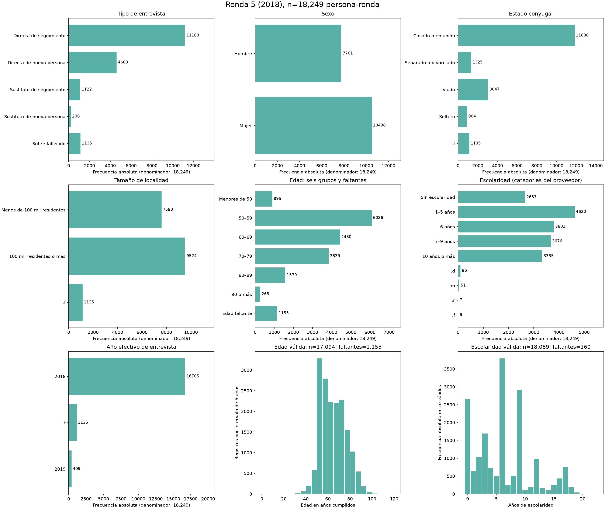

##### Interpretación académica: resultados y modalidades

La ronda 5 (2018) contiene 18,249 registros de 18,249 personas, sin exclusión por edad, entrevista ni continuidad. Las directas suman 15,786 (86.50%), las de sustituto 1,328 (7.28%) y las sobre fallecidos 1,135 (6.22%). El denominador de estos porcentajes es la totalidad de la ronda. Una entrevista sobre fallecido registra información aportada por un informante; no representa entrevista directa ni observación contemporánea de edad.

##### Edad y estructura demográfica

Hay 6,981 registros con edad menor de 60 (38.25% de todos los registros). Los menores de 50 son 895, mientras 1,844 tienen 80 o más, incluidos 265 con 90 o más (1.45% del total). La edad falta en 1,155/18,249 registros; el resumen continuo utiliza 17,094 valores válidos, con mediana 63.0 y cuartiles 55.0–72.0 años. Las siete categorías suman el total original; los códigos de edad ausente se conservan por separado en la tabla de cobertura.

Las mujeres representan 10,488/18,249 (57.47%). Los registros de personas casadas o en unión son 11,838 (64.87%) y los de viudez 3,047 (16.70%). Las localidades de 100 mil habitantes o más reúnen 9,524 (52.19%). Estas proporciones incluyen los faltantes en el denominador y no describen exclusivamente participantes vivos o directos. El complemento de cada categoría comprende otras categorías y, cuando existen, valores ausentes. El corte de localidad no permite identificar todos los asentamientos rurales.

##### Educación

La escolaridad es válida en 18,089/18,249 registros, con media 6.43 y mediana 6.0 años. La ausencia de escolaridad se registra para 2,657 (14.56%) y 10 años o más para 3,335 (18.27%). La distribución completa muestra años exactos, categorías del proveedor y causas de faltantes. Según el diccionario, educacion refleja escolaridad a partir de la primera entrevista; una diferencia entre rondas no demuestra adquisición individual de educación.

##### Incorporación y seguimiento

La primera aparición corresponde a 4,823 personas (26.43% de la ronda), frente a 13,426 ya registradas (73.57%). Las reapariciones tras ausencia inmediata son 383 (2.10%); son un subconjunto de quienes ya participaron. Primera aparición se deriva de la historia de presencia y no debe equipararse automáticamente a tipent de nueva persona.

Entre los presentes en esta ronda, 383 solo tienen un registro en 2001–2021 y 6,305 aparecen en las seis rondas. Esta clasificación describe la trayectoria retrospectiva observada e incluye todos los modos de entrevista; no es un predictor prospectivo.

De 15,988 personas en la ronda anterior, 2,945 no se registran ahora (18.42% sobre el origen): 1,209 ya tenían entrevista sobre fallecido y 1,736 no tenían ese antecedente en la ronda anterior. El último grupo no tiene causa de ausencia identificada por esta comparación; una parte puede reaparecer después. La primera ronda no tiene referencia anterior dentro del archivo.

##### Comparación con la ronda anterior

La mediana de edad cambia -3.0 años y la proporción sin escolaridad cambia -3.25 puntos porcentuales. Son cambios de composición entre muestras registradas, que combinan incorporaciones, envejecimiento y observación selectiva. No se atribuyen a cambios dentro de persona.

La proporción de mujeres cambia -0.38 puntos porcentuales; la de viudez -1.00 y la de localidades de 100 mil o más -0.66. Los tres contrastes usan el total de cada ronda. Las diferencias de viudez y localidad incluyen cambios en los faltantes por fallecimiento; no se interpretan automáticamente como cambios de estado conyugal o residencia entre las mismas personas.

##### Ponderadores y cobertura

El factor individual de la ronda tiene 18,249/18,249 valores válidos; 18,219 positivos, 30 ceros y 0 faltantes. La tabla separa modalidades de entrevista. Disponibilidad numérica no equivale a aplicabilidad a toda la población registrada.

El factor de hogar de la ronda tiene 18,249/18,249 valores válidos; 18,238 positivos, 11 ceros y 0 faltantes. La tabla separa modalidades de entrevista. Disponibilidad numérica no equivale a aplicabilidad a toda la población registrada.

La auditoría de cobertura incluye 119 variables originales; 0 no tienen valores válidos en esta ronda. Cada código especial se cuenta por variable sobre todos los registros, distinguiendo no formulado, sustituto, fallecimiento y otras causas. Las tablas agregadas de celdas no son conteos de personas fallecidas ni ausentes.

##### Conclusión parcial y límites

#### 2.6. Ronda 6: 2021

**Introducción y metodología.** Esta sección describe los 17,538 registros y 17,538 personas de 2021, sin restricciones de edad o modalidad. Cada distribución categórica conserva su denominador completo N=17,538; las categorías especiales señalan causas de ausencia de información. Las tablas son agregados reales reutilizados de CP1. Los resultados se interpretan como composición de la población registrada y no como cambios causales o exclusivamente dentro de las mismas personas.

##### Registros y personas

| ronda | ano_nominal | registros | personas | menores_60 | edad_60_mas | edad_faltante | duplicados | discrepancias_fallecido_tipent |
| --- | --- | --- | --- | --- | --- | --- | --- | --- |
| 6 | 2021 | 17538 | 17538 | 5247 | 10482 | 1809 | 0 | 0 |

##### Tipos de entrevista

| categoria | n | denominador | porcentaje |
| --- | --- | --- | --- |
| Directa de seguimiento | 14336 | 17538 | 81.74 |
| Directa de nueva persona | 148 | 17538 | 0.84 |
| Sustituto de seguimiento | 1247 | 17538 | 7.11 |
| Sustituto de nueva persona | 8 | 17538 | 0.05 |
| Sobre fallecido | 1799 | 17538 | 10.26 |

##### Sexo

| categoria | n | denominador | porcentaje |
| --- | --- | --- | --- |
| Hombre | 7446 | 17538 | 42.46 |
| Mujer | 10092 | 17538 | 57.54 |

##### Estado conyugal

| categoria | n | denominador | porcentaje |
| --- | --- | --- | --- |
| Casado o en unión | 10295 | 17538 | 58.70 |
| Separado o divorciado | 1278 | 17538 | 7.29 |
| Viudo | 3448 | 17538 | 19.66 |
| Soltero | 718 | 17538 | 4.09 |
| .f | 1799 | 17538 | 10.26 |

##### Educación: categorías del proveedor

| categoria | n | denominador | porcentaje |
| --- | --- | --- | --- |
| Sin escolaridad | 2418 | 17538 | 13.79 |
| 1–5 años | 4321 | 17538 | 24.64 |
| 6 años | 3645 | 17538 | 20.78 |
| 7–9 años | 3583 | 17538 | 20.43 |
| 10 años o más | 3247 | 17538 | 18.51 |
| .m | 205 | 17538 | 1.17 |
| .d | 97 | 17538 | 0.55 |
| .f | 16 | 17538 | 0.09 |
| .r | 6 | 17538 | 0.03 |

##### Educación: años exactos y faltantes

| categoria | n | denominador | porcentaje |
| --- | --- | --- | --- |
| 6 | 3645 | 17538 | 20.78 |
| 9 | 2864 | 17538 | 16.33 |
| 0 | 2418 | 17538 | 13.79 |
| 3 | 1590 | 17538 | 9.07 |
| 2 | 962 | 17538 | 5.49 |
| 12 | 958 | 17538 | 5.46 |
| 17 | 733 | 17538 | 4.18 |
| 4 | 689 | 17538 | 3.93 |
| 1 | 607 | 17538 | 3.46 |
| 8 | 486 | 17538 | 2.77 |
| 5 | 473 | 17538 | 2.70 |
| 16 | 429 | 17538 | 2.45 |
| 15 | 235 | 17538 | 1.34 |
| 7 | 233 | 17538 | 1.33 |
| .m | 205 | 17538 | 1.17 |
| 11 | 203 | 17538 | 1.16 |
| 18 | 201 | 17538 | 1.15 |
| 13 | 181 | 17538 | 1.03 |
| 10 | 120 | 17538 | 0.68 |
| 14 | 111 | 17538 | 0.63 |
| .d | 97 | 17538 | 0.55 |
| 19 | 51 | 17538 | 0.29 |
| .f | 16 | 17538 | 0.09 |
| 20 | 12 | 17538 | 0.07 |
| 21 | 11 | 17538 | 0.06 |
| .r | 6 | 17538 | 0.03 |
| 22 | 2 | 17538 | 0.01 |

##### Localidad

| categoria | n | denominador | porcentaje |
| --- | --- | --- | --- |
| Menos de 100 mil residentes | 6936 | 17538 | 39.55 |
| 100 mil residentes o más | 8803 | 17538 | 50.19 |
| .f | 1799 | 17538 | 10.26 |

##### Edad: grupos ampliados

| ronda | categoria | n | denominador | porcentaje |
| --- | --- | --- | --- | --- |
| 6 | Menores de 50 | 472 | 17538 | 2.69 |
| 6 | 50–59 | 4775 | 17538 | 27.23 |
| 6 | 60–69 | 4548 | 17538 | 25.93 |
| 6 | 70–79 | 3974 | 17538 | 22.66 |
| 6 | 80–89 | 1648 | 17538 | 9.40 |
| 6 | 90 o más | 312 | 17538 | 1.78 |
| 6 | Edad faltante | 1809 | 17538 | 10.31 |

##### Edad: estadísticos de valores válidos

| ronda | denominador | n_validos | media | de | min | q25 | mediana | q75 | max |
| --- | --- | --- | --- | --- | --- | --- | --- | --- | --- |
| 6 | 17538 | 15729 | 66.20 | 10.89 | 23.00 | 57.00 | 65.00 | 74.00 | 106.00 |

##### Escolaridad: estadísticos de valores válidos

| ronda | denominador | n_validos | n_faltantes | media | de | min | q25 | mediana | q75 | max |
| --- | --- | --- | --- | --- | --- | --- | --- | --- | --- | --- |
| 6 | 17538 | 17214 | 324 | 6.53 | 4.88 | 0.00 | 3.00 | 6.00 | 9.00 | 22.00 |

##### Primera aparición, seguimiento y reaparición

| ronda | primera_aparicion | ya_observadas | reaparecen_tras_ausencia | total | primera_aparicion_porcentaje | ya_observadas_porcentaje | reaparecen_tras_ausencia_porcentaje |
| --- | --- | --- | --- | --- | --- | --- | --- |
| 6 | 323 | 17215 | 1100 | 17538 | 1.84 | 98.16 | 6.27 |

##### Ausencias respecto a la ronda anterior

| ronda | ronda_origen | denominador_anterior | continuan_desde_anterior | no_observadas_desde_anterior | ausentes_con_fallecimiento_previo | ausentes_sin_fallecimiento_previo | porcentaje_no_observadas |
| --- | --- | --- | --- | --- | --- | --- | --- |
| 6 | 5 | 18249 | 16115 | 2134 | 1135 | 999 | 11.69 |

##### Participación total de los presentes: 1–6 rondas

| ronda | rondas_observadas_2001_2021 | personas | denominador_personas_ronda | porcentaje |
| --- | --- | --- | --- | --- |
| 6 | 1 | 323 | 17538 | 1.84 |
| 6 | 2 | 4557 | 17538 | 25.98 |
| 6 | 3 | 972 | 17538 | 5.54 |
| 6 | 4 | 4287 | 17538 | 24.44 |
| 6 | 5 | 1094 | 17538 | 6.24 |
| 6 | 6 | 6305 | 17538 | 35.95 |

##### Año efectivo de entrevista por modalidad

| ronda | tipo_entrevista | categoria | n | denominador | porcentaje |
| --- | --- | --- | --- | --- | --- |
| 6 | Directa de seguimiento | 2021 | 10144 | 14336 | 70.76 |
| 6 | Directa de seguimiento | 2022 | 4192 | 14336 | 29.24 |
| 6 | Directa de nueva persona | 2021 | 87 | 148 | 58.78 |
| 6 | Directa de nueva persona | 2022 | 61 | 148 | 41.22 |
| 6 | Sustituto de seguimiento | 2021 | 683 | 1247 | 54.77 |
| 6 | Sustituto de seguimiento | 2022 | 564 | 1247 | 45.23 |
| 6 | Sustituto de nueva persona | 2021 | 4 | 8 | 50.00 |
| 6 | Sustituto de nueva persona | 2022 | 4 | 8 | 50.00 |
| 6 | Sobre fallecido | .f | 1799 | 1799 | 100.00 |

##### Cobertura de variables demográficas, tiempo y patrimonio

| ronda | variable | tipo | n | denominador | porcentaje |
| --- | --- | --- | --- | --- | --- |
| 6 | a_o_ent | válido | 15739 | 17538 | 89.74 |
| 6 | a_o_ent | .f | 1799 | 17538 | 10.26 |
| 6 | sexo | válido | 17538 | 17538 | 100.00 |
| 6 | a_o_nac | válido | 17529 | 17538 | 99.95 |
| 6 | a_o_nac | .d | 6 | 17538 | 0.03 |
| 6 | a_o_nac | .f | 3 | 17538 | 0.02 |
| 6 | edad | válido | 15729 | 17538 | 89.69 |
| 6 | edad | .f | 1799 | 17538 | 10.26 |
| 6 | edad | .d | 10 | 17538 | 0.06 |
| 6 | urbano | válido | 15739 | 17538 | 89.74 |
| 6 | urbano | .f | 1799 | 17538 | 10.26 |
| 6 | educacion | válido | 17214 | 17538 | 98.15 |
| 6 | educacion | .m | 205 | 17538 | 1.17 |
| 6 | educacion | .d | 97 | 17538 | 0.55 |
| 6 | educacion | .f | 16 | 17538 | 0.09 |
| 6 | educacion | .r | 6 | 17538 | 0.03 |
| 6 | edu_gru | válido | 17214 | 17538 | 98.15 |
| 6 | edu_gru | .m | 205 | 17538 | 1.17 |
| 6 | edu_gru | .d | 97 | 17538 | 0.55 |
| 6 | edu_gru | .f | 16 | 17538 | 0.09 |
| 6 | edu_gru | .r | 6 | 17538 | 0.03 |
| 6 | est_conyugal | válido | 15739 | 17538 | 89.74 |
| 6 | est_conyugal | .f | 1799 | 17538 | 10.26 |
| 6 | imp_neto | válido | 15716 | 17538 | 89.61 |
| 6 | imp_neto | .f | 1799 | 17538 | 10.26 |
| 6 | imp_neto | .i | 23 | 17538 | 0.13 |

##### Disponibilidad de ponderadores por modalidad

| ronda | variable | tipo_entrevista | denominador | validos | positivos | ceros | negativos | faltantes | porcentaje_validos | porcentaje_positivos | porcentaje_ceros | porcentaje_faltantes |
| --- | --- | --- | --- | --- | --- | --- | --- | --- | --- | --- | --- | --- |
| 6 | factori_21 | Directa de seguimiento | 14336 | 14336 | 14336 | 0 | 0 | 0 | 100.00 | 100.00 | 0.00 | 0.00 |
| 6 | factori_21 | Directa de nueva persona | 148 | 148 | 148 | 0 | 0 | 0 | 100.00 | 100.00 | 0.00 | 0.00 |
| 6 | factori_21 | Sustituto de seguimiento | 1247 | 1247 | 1247 | 0 | 0 | 0 | 100.00 | 100.00 | 0.00 | 0.00 |
| 6 | factori_21 | Sustituto de nueva persona | 8 | 8 | 8 | 0 | 0 | 0 | 100.00 | 100.00 | 0.00 | 0.00 |
| 6 | factori_21 | Sobre fallecido | 1799 | 1799 | 1799 | 0 | 0 | 0 | 100.00 | 100.00 | 0.00 | 0.00 |
| 6 | factorh_21 | Directa de seguimiento | 14336 | 14336 | 14336 | 0 | 0 | 0 | 100.00 | 100.00 | 0.00 | 0.00 |
| 6 | factorh_21 | Directa de nueva persona | 148 | 148 | 148 | 0 | 0 | 0 | 100.00 | 100.00 | 0.00 | 0.00 |
| 6 | factorh_21 | Sustituto de seguimiento | 1247 | 1247 | 1247 | 0 | 0 | 0 | 100.00 | 100.00 | 0.00 | 0.00 |
| 6 | factorh_21 | Sustituto de nueva persona | 8 | 8 | 8 | 0 | 0 | 0 | 100.00 | 100.00 | 0.00 | 0.00 |
| 6 | factorh_21 | Sobre fallecido | 1799 | 1799 | 1797 | 2 | 0 | 0 | 100.00 | 99.89 | 0.11 | 0.00 |

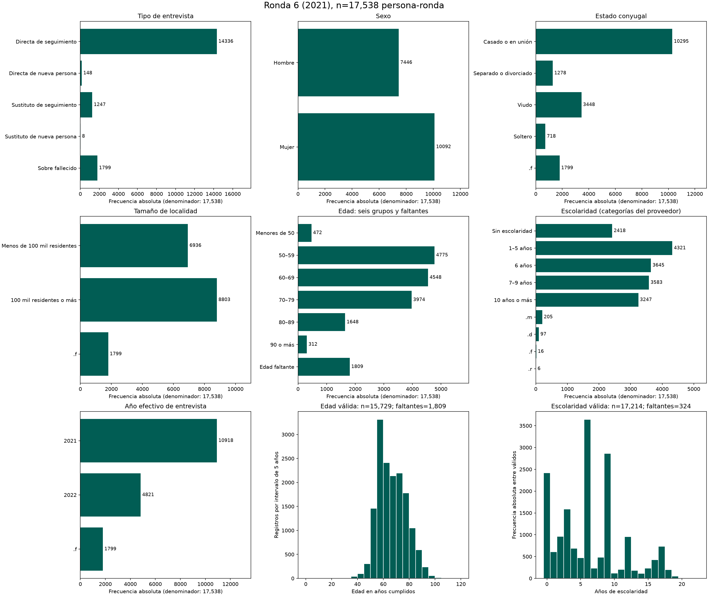

##### Interpretación académica: resultados y modalidades

La ronda 6 (2021) contiene 17,538 registros de 17,538 personas, sin exclusión por edad, entrevista ni continuidad. Las directas suman 14,484 (82.59%), las de sustituto 1,255 (7.16%) y las sobre fallecidos 1,799 (10.26%). El denominador de estos porcentajes es la totalidad de la ronda. Una entrevista sobre fallecido registra información aportada por un informante; no representa entrevista directa ni observación contemporánea de edad.

##### Edad y estructura demográfica

Hay 5,247 registros con edad menor de 60 (29.92% de todos los registros). Los menores de 50 son 472, mientras 1,960 tienen 80 o más, incluidos 312 con 90 o más (1.78% del total). La edad falta en 1,809/17,538 registros; el resumen continuo utiliza 15,729 valores válidos, con mediana 65.0 y cuartiles 57.0–74.0 años. Las siete categorías suman el total original; los códigos de edad ausente se conservan por separado en la tabla de cobertura.

Las mujeres representan 10,092/17,538 (57.54%). Los registros de personas casadas o en unión son 10,295 (58.70%) y los de viudez 3,448 (19.66%). Las localidades de 100 mil habitantes o más reúnen 8,803 (50.19%). Estas proporciones incluyen los faltantes en el denominador y no describen exclusivamente participantes vivos o directos. El complemento de cada categoría comprende otras categorías y, cuando existen, valores ausentes. El corte de localidad no permite identificar todos los asentamientos rurales.

##### Educación

La escolaridad es válida en 17,214/17,538 registros, con media 6.53 y mediana 6.0 años. La ausencia de escolaridad se registra para 2,418 (13.79%) y 10 años o más para 3,247 (18.51%). La distribución completa muestra años exactos, categorías del proveedor y causas de faltantes. Según el diccionario, educacion refleja escolaridad a partir de la primera entrevista; una diferencia entre rondas no demuestra adquisición individual de educación.

##### Incorporación y seguimiento

La primera aparición corresponde a 323 personas (1.84% de la ronda), frente a 17,215 ya registradas (98.16%). Las reapariciones tras ausencia inmediata son 1,100 (6.27%); son un subconjunto de quienes ya participaron. Primera aparición se deriva de la historia de presencia y no debe equipararse automáticamente a tipent de nueva persona.

Entre los presentes en esta ronda, 323 solo tienen un registro en 2001–2021 y 6,305 aparecen en las seis rondas. Esta clasificación describe la trayectoria retrospectiva observada e incluye todos los modos de entrevista; no es un predictor prospectivo.

De 18,249 personas en la ronda anterior, 2,134 no se registran ahora (11.69% sobre el origen): 1,135 ya tenían entrevista sobre fallecido y 999 no tenían ese antecedente en la ronda anterior. El último grupo no tiene causa de ausencia identificada por esta comparación; una parte puede reaparecer después. La primera ronda no tiene referencia anterior dentro del archivo.

##### Comparación con la ronda anterior

La mediana de edad cambia +2.0 años y la proporción sin escolaridad cambia -0.77 puntos porcentuales. Son cambios de composición entre muestras registradas, que combinan incorporaciones, envejecimiento y observación selectiva. No se atribuyen a cambios dentro de persona.

La proporción de mujeres cambia +0.07 puntos porcentuales; la de viudez +2.96 y la de localidades de 100 mil o más -2.00. Los tres contrastes usan el total de cada ronda. Las diferencias de viudez y localidad incluyen cambios en los faltantes por fallecimiento; no se interpretan automáticamente como cambios de estado conyugal o residencia entre las mismas personas.

##### Ponderadores y cobertura

El factor individual de la ronda tiene 17,538/17,538 valores válidos; 17,538 positivos, 0 ceros y 0 faltantes. La tabla separa modalidades de entrevista. Disponibilidad numérica no equivale a aplicabilidad a toda la población registrada.

El factor de hogar de la ronda tiene 17,538/17,538 valores válidos; 17,536 positivos, 2 ceros y 0 faltantes. La tabla separa modalidades de entrevista. Disponibilidad numérica no equivale a aplicabilidad a toda la población registrada.

##### Conclusión parcial y límites

#### 3. Comparación longitudinal de toda la población

**Introducción y metodología.** Se sigue a todas las claves únicas, cualquiera que sea edad o modalidad. Una presencia es cualquier registro persona-ronda. Las intersecciones muestran claves compartidas sin publicarlas. Las transiciones consecutivas parten de todo el origen; la información sobre fallecidos permanece visible. Las incorporaciones se identifican por primera presencia y las reapariciones por presencia previa, ausencia inmediata anterior y nuevo registro. No se infiere causa de ausencia a partir de ese patrón.

##### Cantidad de rondas por persona

| rondas_observadas | personas | denominador_personas | porcentaje |
| --- | --- | --- | --- |
| 1 | 2025 | 27171 | 7.45 |
| 2 | 6635 | 27171 | 24.42 |
| 3 | 4445 | 27171 | 16.36 |
| 4 | 5589 | 27171 | 20.57 |
| 5 | 2172 | 27171 | 7.99 |
| 6 | 6305 | 27171 | 23.20 |

Las seis categorías suman 27,171 personas y, al multiplicar cada frecuencia por su número de rondas, se recuperan 99,676 registros. Las 6,305 personas con seis rondas son 23.20% del universo, no necesariamente seis entrevistas directas. Tener pocas rondas puede reflejar entrada tardía, fallecimiento, ausencia o cierre de observación, no únicamente abandono.

##### Entradas y reapariciones por ronda

| ronda | primera_aparicion | ya_observadas | reaparecen_tras_ausencia | total | primera_aparicion_porcentaje | ya_observadas_porcentaje | reaparecen_tras_ausencia_porcentaje |
| --- | --- | --- | --- | --- | --- | --- | --- |
| 1 | 15186 | 0 | 0 | 15186 | 100.00 | 0.00 | 0.00 |
| 2 | 277 | 13973 | 0 | 14250 | 1.94 | 98.06 | 0.00 |
| 3 | 5912 | 12553 | 357 | 18465 | 32.02 | 67.98 | 1.93 |
| 4 | 650 | 15338 | 624 | 15988 | 4.07 | 95.93 | 3.90 |
| 5 | 4823 | 13426 | 383 | 18249 | 26.43 | 73.57 | 2.10 |
| 6 | 323 | 17215 | 1100 | 17538 | 1.84 | 98.16 | 6.27 |

Después de 2001 se observan 11,985 primeras apariciones. Las incorporaciones de 2012 y 2018 contribuyen a cambios de composición. Las 357, 624, 383 y 1,100 reapariciones de 2012, 2015, 2018 y 2021 prueban que al menos algunas ausencias son temporales en términos de registro; no establecen la razón del intervalo ausente.

##### Retención, ausencias y retornos posteriores

| ano_origen | ano_destino | intervalo_nominal_anos | denominador_origen | continuan | retencion_porcentaje | no_observadas | no_observadas_porcentaje | ausentes_con_fallecimiento_previo | ausentes_sin_fallecimiento_previo | ausentes_con_reaparicion_posterior | ausentes_con_reaparicion_posterior_porcentaje | ausentes_sin_reaparicion_observada_hasta_2021 |
| --- | --- | --- | --- | --- | --- | --- | --- | --- | --- | --- | --- | --- |
| 2001 | 2003 | 2 | 15186 | 13973 | 92.01 | 1213 | 7.99 | 0 | 1213 | 402 | 2.65 | 811 |
| 2003 | 2012 | 9 | 14250 | 12196 | 85.59 | 2054 | 14.41 | 546 | 1508 | 603 | 4.23 | 1451 |
| 2012 | 2015 | 3 | 18465 | 14714 | 79.69 | 3751 | 20.31 | 2741 | 1010 | 393 | 2.13 | 3358 |
| 2015 | 2018 | 3 | 15988 | 13043 | 81.58 | 2945 | 18.42 | 1209 | 1736 | 1066 | 6.67 | 1879 |
| 2018 | 2021 | 3 | 18249 | 16115 | 88.31 | 2134 | 11.69 | 1135 | 999 | 0 | 0.00 | 2134 |

Las tasas 92.01%, 85.59%, 79.69%, 81.58% y 88.31% describen intervalos de distinta longitud, por lo que no se comparan como tasas anuales. Los retornos posteriores son un subconjunto de las ausencias, calculado con los patrones agregados; contar cero después de 2021 refleja el límite de observación, no ausencia definitiva. Los ausentes sin fallecimiento previo no tienen causa identificada: no se renombran como abandonos comprobados.

##### Fallecimiento documentado en destino entre quienes no tenían entrevista sobre fallecido en origen

| ano_origen | ano_destino | denominador_origen_vivas | fallecimiento_documentado_destino |
| --- | --- | --- | --- |
| 2001 | 2003 | 15186 | 542 |
| 2003 | 2012 | 13704 | 2685 |
| 2012 | 2015 | 15723 | 1085 |
| 2015 | 2018 | 14779 | 1091 |
| 2018 | 2021 | 17114 | 1616 |

El denominador identifica registros no clasificados sobre fallecidos en el origen, no una certificación externa de supervivencia. Los 542, 2,685, 1,085, 1,091 y 1,616 registros documentados en destino no son el total de entrevistas sobre fallecidos de cada ronda, pues ese total puede incluir entradas o reapariciones. No se estima una tasa de mortalidad.

##### Matriz agregada de participación: personas compartidas

| ronda | R1 | R2 | R3 | R4 | R5 | R6 |
| --- | --- | --- | --- | --- | --- | --- |
| 1 | 15186 | 13973 | 12336 | 9825 | 8127 | 7429 |
| 2 | 13973 | 14250 | 12196 | 9697 | 8044 | 7352 |
| 3 | 12336 | 12196 | 18465 | 14714 | 12581 | 11900 |
| 4 | 9825 | 9697 | 14714 | 15988 | 13043 | 12467 |
| 5 | 8127 | 8044 | 12581 | 13043 | 18249 | 16115 |
| 6 | 7429 | 7352 | 11900 | 12467 | 16115 | 17538 |

La diagonal es el total de cada ronda; cada celda externa cuenta personas con registros en ambas rondas, cualquiera que sea modalidad. Por ejemplo, 7,429 personas aparecen en 2001 y 2021, pero solo 6,305 aparecen en todas las rondas. No se publica la matriz individual.

##### Todos los patrones de presencia, 2001 → 2021

| patron_2001_a_2021 | personas | denominador_personas | porcentaje |
| --- | --- | --- | --- |
| 111111 | 6305 | 27171 | 23.20 |
| 000011 | 4440 | 27171 | 16.34 |
| 001111 | 4134 | 27171 | 15.21 |
| 111000 | 2852 | 27171 | 10.50 |
| 110000 | 1408 | 27171 | 5.18 |
| 111100 | 1136 | 27171 | 4.18 |
| 111110 | 1078 | 27171 | 3.97 |
| 100000 | 811 | 27171 | 2.98 |
| 111101 | 433 | 27171 | 1.59 |
| 001101 | 426 | 27171 | 1.57 |
| 001100 | 404 | 27171 | 1.49 |
| 000111 | 396 | 27171 | 1.46 |
| 000010 | 383 | 27171 | 1.41 |
| 001000 | 376 | 27171 | 1.38 |
| 001110 | 370 | 27171 | 1.36 |
| 000001 | 323 | 27171 | 1.19 |
| 110111 | 270 | 27171 | 0.99 |
| 110100 | 172 | 27171 | 0.63 |
| 101111 | 159 | 27171 | 0.59 |
| 001011 | 135 | 27171 | 0.50 |
| 111011 | 117 | 27171 | 0.43 |
| 011111 | 115 | 27171 | 0.42 |
| 000101 | 95 | 27171 | 0.35 |
| 000100 | 89 | 27171 | 0.33 |
| 101000 | 81 | 27171 | 0.30 |
| 000110 | 70 | 27171 | 0.26 |
| 110101 | 63 | 27171 | 0.23 |
| 110110 | 61 | 27171 | 0.22 |
| 111010 | 52 | 27171 | 0.19 |
| 011000 | 49 | 27171 | 0.18 |
| 001010 | 48 | 27171 | 0.18 |
| 010000 | 43 | 27171 | 0.16 |
| 101100 | 41 | 27171 | 0.15 |
| 101110 | 36 | 27171 | 0.13 |
| 101101 | 29 | 27171 | 0.11 |
| 001001 | 19 | 27171 | 0.07 |
| 011100 | 19 | 27171 | 0.07 |
| 011110 | 17 | 27171 | 0.06 |
| 100100 | 14 | 27171 | 0.05 |
| 100111 | 14 | 27171 | 0.05 |
| 011101 | 12 | 27171 | 0.04 |
| 110011 | 12 | 27171 | 0.04 |
| 100110 | 9 | 27171 | 0.03 |
| 010111 | 8 | 27171 | 0.03 |
| 101011 | 7 | 27171 | 0.03 |
| 111001 | 6 | 27171 | 0.02 |
| 100101 | 5 | 27171 | 0.02 |
| 110001 | 5 | 27171 | 0.02 |
| 010100 | 4 | 27171 | 0.01 |
| 110010 | 3 | 27171 | 0.01 |
| 101010 | 3 | 27171 | 0.01 |
| 010101 | 3 | 27171 | 0.01 |
| 011010 | 3 | 27171 | 0.01 |
| 011011 | 2 | 27171 | 0.01 |
| 100001 | 2 | 27171 | 0.01 |
| 010110 | 1 | 27171 | 0.00 |
| 101001 | 1 | 27171 | 0.00 |
| 100011 | 1 | 27171 | 0.00 |
| 010001 | 1 | 27171 | 0.00 |

Cada posición corresponde a una de las seis rondas; 1 indica presencia y 0 ausencia. Son patrones agregados de participación, no identificadores. Un patrón con huecos distingue ausencia temporal de presencia continua. No informa por sí mismo modalidad o causa de ausencia.

##### Transición de modalidades: 2001 → 2003

| tipo_origen | estado_destino | n | denominador | porcentaje |
| --- | --- | --- | --- | --- |
| Directa de nueva persona | Directa de seguimiento | 11728 | 14154 | 82.86 |
| Directa de nueva persona | No observada | 1102 | 14154 | 7.79 |
| Directa de nueva persona | Sustituto de seguimiento | 888 | 14154 | 6.27 |
| Directa de nueva persona | Sobre fallecido | 435 | 14154 | 3.07 |
| Directa de nueva persona | Sustituto de nueva persona | 1 | 14154 | 0.01 |
| Sustituto de nueva persona | Directa de seguimiento | 580 | 1032 | 56.20 |
| Sustituto de nueva persona | Sustituto de seguimiento | 234 | 1032 | 22.67 |
| Sustituto de nueva persona | No observada | 111 | 1032 | 10.76 |
| Sustituto de nueva persona | Sobre fallecido | 107 | 1032 | 10.37 |

Cada porcentaje se calcula entre personas de la modalidad de origen indicada. No observada incluye ausencias; sobre fallecido es una presencia de tipo distinto a directa o sustituto. Las entradas sin registro en origen están en la tabla de primeras apariciones y no se mezclan en este denominador.

##### Transición de modalidades: 2003 → 2012

| tipo_origen | estado_destino | n | denominador | porcentaje |
| --- | --- | --- | --- | --- |
| Directa de seguimiento | Directa de seguimiento | 7983 | 12363 | 64.57 |
| Directa de seguimiento | Sobre fallecido | 2339 | 12363 | 18.92 |
| Directa de seguimiento | No observada | 1272 | 12363 | 10.29 |
| Directa de seguimiento | Sustituto de seguimiento | 769 | 12363 | 6.22 |
| Directa de nueva persona | Directa de seguimiento | 103 | 163 | 63.19 |
| Directa de nueva persona | No observada | 30 | 163 | 18.40 |
| Directa de nueva persona | Sobre fallecido | 18 | 163 | 11.04 |
| Directa de nueva persona | Sustituto de seguimiento | 12 | 163 | 7.36 |
| Sustituto de seguimiento | Directa de seguimiento | 481 | 1134 | 42.42 |
| Sustituto de seguimiento | Sobre fallecido | 322 | 1134 | 28.40 |
| Sustituto de seguimiento | No observada | 194 | 1134 | 17.11 |
| Sustituto de seguimiento | Sustituto de seguimiento | 137 | 1134 | 12.08 |
| Sustituto de nueva persona | Directa de seguimiento | 21 | 44 | 47.73 |
| Sustituto de nueva persona | No observada | 12 | 44 | 27.27 |
| Sustituto de nueva persona | Sobre fallecido | 6 | 44 | 13.64 |
| Sustituto de nueva persona | Sustituto de seguimiento | 5 | 44 | 11.36 |
| Sobre fallecido | No observada | 546 | 546 | 100.00 |

##### Transición de modalidades: 2012 → 2015

| tipo_origen | estado_destino | n | denominador | porcentaje |
| --- | --- | --- | --- | --- |
| Directa de seguimiento | Directa de seguimiento | 7417 | 8868 | 83.64 |
| Directa de seguimiento | Sobre fallecido | 714 | 8868 | 8.05 |
| Directa de seguimiento | Sustituto de seguimiento | 370 | 8868 | 4.17 |
| Directa de seguimiento | No observada | 367 | 8868 | 4.14 |
| Directa de nueva persona | Directa de seguimiento | 4833 | 5580 | 86.61 |
| Directa de nueva persona | No observada | 525 | 5580 | 9.41 |
| Directa de nueva persona | Sustituto de seguimiento | 126 | 5580 | 2.26 |
| Directa de nueva persona | Sobre fallecido | 96 | 5580 | 1.72 |
| Sustituto de seguimiento | Directa de seguimiento | 370 | 959 | 38.58 |
| Sustituto de seguimiento | Sustituto de seguimiento | 264 | 959 | 27.53 |
| Sustituto de seguimiento | Sobre fallecido | 255 | 959 | 26.59 |
| Sustituto de seguimiento | No observada | 70 | 959 | 7.30 |
| Sustituto de nueva persona | Directa de seguimiento | 183 | 316 | 57.91 |
| Sustituto de nueva persona | Sustituto de seguimiento | 65 | 316 | 20.57 |
| Sustituto de nueva persona | No observada | 48 | 316 | 15.19 |
| Sustituto de nueva persona | Sobre fallecido | 20 | 316 | 6.33 |
| Sobre fallecido | No observada | 2741 | 2742 | 99.96 |
| Sobre fallecido | Directa de seguimiento | 1 | 2742 | 0.04 |

##### Transición de modalidades: 2015 → 2018

| tipo_origen | estado_destino | n | denominador | porcentaje |
| --- | --- | --- | --- | --- |
| Directa de seguimiento | Directa de seguimiento | 10241 | 13254 | 77.27 |
| Directa de seguimiento | No observada | 1444 | 13254 | 10.89 |
| Directa de seguimiento | Sobre fallecido | 825 | 13254 | 6.22 |
| Directa de seguimiento | Sustituto de seguimiento | 744 | 13254 | 5.61 |
| Directa de nueva persona | Directa de seguimiento | 395 | 596 | 66.28 |
| Directa de nueva persona | No observada | 165 | 596 | 27.68 |
| Directa de nueva persona | Sustituto de seguimiento | 24 | 596 | 4.03 |
| Directa de nueva persona | Sobre fallecido | 12 | 596 | 2.01 |
| Sustituto de seguimiento | Sustituto de seguimiento | 285 | 884 | 32.24 |
| Sustituto de seguimiento | Sobre fallecido | 252 | 884 | 28.51 |
| Sustituto de seguimiento | Directa de seguimiento | 233 | 884 | 26.36 |
| Sustituto de seguimiento | No observada | 114 | 884 | 12.90 |
| Sustituto de nueva persona | Directa de seguimiento | 21 | 45 | 46.67 |
| Sustituto de nueva persona | No observada | 13 | 45 | 28.89 |
| Sustituto de nueva persona | Sustituto de seguimiento | 9 | 45 | 20.00 |
| Sustituto de nueva persona | Sobre fallecido | 2 | 45 | 4.44 |
| Sobre fallecido | No observada | 1209 | 1209 | 100.00 |

##### Transición de modalidades: 2018 → 2021

| tipo_origen | estado_destino | n | denominador | porcentaje |
| --- | --- | --- | --- | --- |
| Directa de seguimiento | Directa de seguimiento | 8873 | 11183 | 79.34 |
| Directa de seguimiento | Sobre fallecido | 1122 | 11183 | 10.03 |
| Directa de seguimiento | Sustituto de seguimiento | 649 | 11183 | 5.80 |
| Directa de seguimiento | No observada | 539 | 11183 | 4.82 |
| Directa de nueva persona | Directa de seguimiento | 4012 | 4603 | 87.16 |
| Directa de nueva persona | No observada | 355 | 4603 | 7.71 |
| Directa de nueva persona | Sobre fallecido | 128 | 4603 | 2.78 |
| Directa de nueva persona | Sustituto de seguimiento | 108 | 4603 | 2.35 |
| Sustituto de seguimiento | Directa de seguimiento | 364 | 1122 | 32.44 |
| Sustituto de seguimiento | Sobre fallecido | 352 | 1122 | 31.37 |
| Sustituto de seguimiento | Sustituto de seguimiento | 322 | 1122 | 28.70 |
| Sustituto de seguimiento | No observada | 84 | 1122 | 7.49 |
| Sustituto de nueva persona | Directa de seguimiento | 125 | 206 | 60.68 |
| Sustituto de nueva persona | Sustituto de seguimiento | 46 | 206 | 22.33 |
| Sustituto de nueva persona | No observada | 21 | 206 | 10.19 |
| Sustituto de nueva persona | Sobre fallecido | 14 | 206 | 6.80 |
| Sobre fallecido | No observada | 1135 | 1135 | 100.00 |

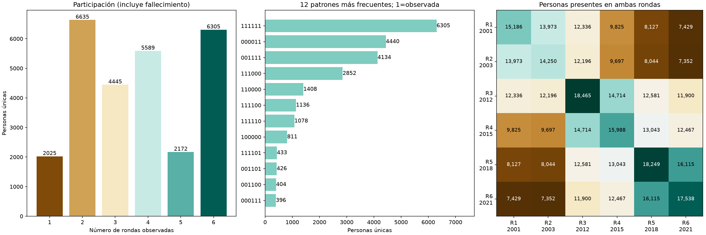

En R1 (2001), en toda la población de origen, la edad media es 61.19 años entre quienes se observan en la ronda siguiente (N válido=13,973/13,973) y 56.22 entre quienes no se observan (N válido=1,213/1,213). La diferencia observada es 4.97 años.

En R2 (2003), en toda la población de origen, la edad media es 62.79 años entre quienes se observan en la ronda siguiente (N válido=12,189/12,196) y 61.83 entre quienes no se observan (N válido=1,504/2,054). La diferencia observada es 0.96 años.

En R3 (2012), en toda la población de origen, la edad media es 64.23 años entre quienes se observan en la ronda siguiente (N válido=14,696/14,714) y 60.22 entre quienes no se observan (N válido=1,005/3,751). La diferencia observada es 4.01 años.

En R4 (2015), en toda la población de origen, la edad media es 66.50 años entre quienes se observan en la ronda siguiente (N válido=13,041/13,043) y 63.35 entre quienes no se observan (N válido=1,734/2,945). La diferencia observada es 3.14 años.

En R5 (2018), en toda la población de origen, la edad media es 64.37 años entre quienes se observan en la ronda siguiente (N válido=16,098/16,115) y 60.77 entre quienes no se observan (N válido=996/2,134). La diferencia observada es 3.60 años.

La comparación usa toda la población en origen y resume edad solo entre valores válidos. Los fallecidos en origen permanecen en el denominador y su edad puede faltar. Una restricción de continuidad puede modificar el perfil analítico. La observación posterior incluye entrevistas sobre fallecidos; la ausencia posterior también incluye a quienes ya tenían ese registro. Los intervalos difieren: estos contrastes no estiman supervivencia ni efectos de edad sobre abandono. La selección final exige revisión de perfiles por sexo, educación, localidad y entrevista en las tablas.

**Conclusión parcial.** La composición entre rondas combina envejecimiento, entradas y observación selectiva. La diferencia entre presentes y ausentes exige sensibilidad a atrición y supervivencia; el panel completo condiciona a información futura. Estos resultados sustentan la auditoría del universo antes de elegir una población predictiva, y no aprueban todavía esa elección.

#### 4. Investigación de anomalías

**Introducción y metodología.** Las alertas originales se reproducen en memoria con el archivo local intacto, se examinan indicadores complementarios y se publican solo agregados. No se muestran claves, fechas de nacimiento ni historias individuales de los casos raros. La detección indica contradicción observable, no adjudica automáticamente error a una fila ni demuestra su causa.

##### Reconciliación y denominadores del diagnóstico

| control | n |
| --- | --- |
| registros_originales | 99676 |
| personas_originales | 27171 |
| pares_observados | 72505 |
| pares_edad_evaluables | 65031 |
| pares_edad_no_evaluables | 7474 |
| pares_edad_decreciente | 226 |
| personas_edad_decreciente | 225 |
| pares_descenso_rondas_consecutivas | 212 |
| pares_descenso_cruzan_60 | 48 |
| registros_posteriores_fallecimiento | 3 |
| personas_posteriores_fallecimiento | 1 |
| personas_fallecimiento_repetido | 1 |
| discrepancias_tipent_fallecido | 0 |
| personas_sexo_inconsistente | 1 |
| registros_personas_sexo_inconsistente | 2 |
| pares_descenso_entrevista_anos_validos | 226 |
| pares_descenso_entrevista_ano_creciente | 226 |
| pares_descenso_nacimiento_anos_validos | 226 |
| pares_descenso_nacimiento_ano_igual | 226 |
| pares_descenso_nacimiento_meses_validos | 225 |
| pares_descenso_nacimiento_mes_igual | 225 |

##### 4.1. Tres registros posteriores a un fallecimiento registrado

**Detección exacta.** Por persona se obtiene la primera ronda con `tipent = 5`; se marcan los registros de rondas estrictamente posteriores a esa primera ronda. Se detectan **3 registros de una sola persona**. Esa misma persona aporta la alerta de fallecimiento repetido. No se trata de tres personas ni de duplicados persona-ronda.

**Resultado comprobado e interpretación.** Dos registros posteriores son directos y uno es nuevamente sobre fallecido. En el archivo completo hay cero discrepancias contemporáneas entre `tipent = 5` y `fallecido = 1`: la contradicción reside en la secuencia temporal, aunque ambas variables concuerden en cada ronda. El año efectivo ausente de una entrevista sobre fallecido no permite reconstruir una fecha exacta de muerte.

##### Modalidad de los registros posteriores; sin trayectoria individual

| modalidad | n | denominador | porcentaje |
| --- | --- | --- | --- |
| Directa | 2 | 3 | 66.67 |
| Sobre fallecido | 1 | 3 | 33.33 |

**Hipótesis, no causas comprobadas.** Podría existir una clasificación incorrecta en el maestro de seguimiento, un problema de enlace de identidad o una revisión de estatus no reflejada uniformemente. También debe verificarse el significado de la repetición de entrevista sobre fallecido. **Verificaciones pendientes:** contrastar las claves internamente con el maestro, modalidades originales, versiones/fe de erratas y documentación de fecha/estatus de muerte. Esta tarea no integra archivos completos ni corrige o elimina los registros.

##### 4.2. Una persona con sexo inconsistente

**Detección exacta.** Se cuentan códigos numéricos válidos distintos de `sexo` dentro de cada persona, ignorando faltantes. Una persona tiene más de uno: su historia contiene dos registros directos, con códigos 1 y 2. No hay mayoría que permita elegir un valor mediante moda.

**Interpretación y fuente.** La nota de ENASEMsimple v2, páginas 6–7, explica que el proveedor revisó sexo mediante validación de discrepancias de las variables originales `sex_xx` del maestro de seguimiento. El caso residual medido justifica revisar la versión y trazabilidad de esa validación; no prueba cuál registro es incorrecto ni permite inferir una causa individual. **Verificaciones pendientes:** comparar `sexo` construido con las variables originales de ambas entrevistas y su validación, revisar versiones y enlace de claves. No se sustituye un código por el otro ni se publica la secuencia individual.

##### 4.3. Doscientos veintiséis pares con edad decreciente

**Detección exacta.** Se ordena cada persona por ronda y se resta la edad del registro observado inmediatamente anterior. Se evalúa el par solo si ambas edades son numéricas válidas. Una ronda sin registro puede saltarse; una edad faltante en un registro presente interrumpe la comparación y no se reemplaza por una edad válida más antigua. Entre 72,505 pares observados, 65,031 son evaluables y 7,474 no. Hay **226 pares decrecientes (0.35% de los evaluables), correspondientes a 225 personas (0.83% de las 27,171)**: 224 personas aportan un par y una aporta dos.

**Resultados comprobados.** Los 212 pares entre rondas nominales consecutivas y 14 separados por una ronda ausente muestran que la alerta no se limita al seguimiento continuo. Todos los 226 pares tienen año efectivo creciente y año de nacimiento válido sin cambios. El código de nacimiento puede variar entre rondas según el diccionario; su igualdad en estos pares es un resultado empírico, no una validación independiente de su veracidad.

##### Descensos por año nominal de destino

| ano_destino | n | denominador | porcentaje |
| --- | --- | --- | --- |
| 2012 | 41 | 226 | 18.14 |
| 2015 | 102 | 226 | 45.13 |
| 2018 | 56 | 226 | 24.78 |
| 2021 | 27 | 226 | 11.95 |

##### Separación en rondas observadas

| salto_rondas | n | denominador | porcentaje |
| --- | --- | --- | --- |
| 1 | 212 | 226 | 93.81 |
| 2 | 14 | 226 | 6.19 |

##### Magnitud del descenso

| descenso | n | denominador | porcentaje |
| --- | --- | --- | --- |
| 1 año | 58 | 226 | 25.66 |
| 2–4 años | 78 | 226 | 34.51 |
| 5–9 años | 63 | 226 | 27.88 |
| 10 años o más | 27 | 226 | 11.95 |

##### Estadísticos de la magnitud, en años

| estadistico | valor |
| --- | --- |
| count | 226.00 |
| mean | 5.80 |
| std | 8.56 |
| min | 1.00 |
| 25% | 1.00 |
| 50% | 3.00 |
| 75% | 7.00 |
| max | 66.00 |

##### Número de pares decrecientes por persona afectada

| pares_decrecientes_por_persona | n | denominador | porcentaje |
| --- | --- | --- | --- |
| 1 | 224 | 225 | 99.56 |
| 2 | 1 | 225 | 0.44 |

##### Modalidades de los pares decrecientes

| modalidades_par | n | denominador | porcentaje |
| --- | --- | --- | --- |
| Directa → Directa | 178 | 226 | 78.76 |
| Directa → Sustituto | 16 | 226 | 7.08 |
| Sustituto → Directa | 26 | 226 | 11.50 |
| Sustituto → Sustituto | 6 | 226 | 2.65 |

##### Compatibilidad aproximada con nacimiento y año efectivo

| compatibilidad_aproximada | n | denominador | porcentaje |
| --- | --- | --- | --- |
| Anterior compatible; actual incompatible | 48 | 226 | 21.24 |
| Anterior incompatible; actual compatible | 169 | 226 | 74.78 |
| Anterior incompatible; actual incompatible | 9 | 226 | 3.98 |

**Interpretación estadística.** El descenso mediano es 3 años y el máximo 66. De los pares, 178 son directa → directa, 16 directa → sustituto, 26 sustituto → directa y 6 sustituto → sustituto; por ello no puede atribuirse toda la anomalía al informante sustituto. En 48 pares se pasa de edad registrada ≥60 a <60, lo que puede modificar la elegibilidad por visita si no se valida antes.

Para explorar la coherencia se contrasta cada edad con el intervalo aproximado `[a_o_ent − a_o_nac − 1, a_o_ent − a_o_nac]`, sin imputar ni usarlo como corrección. En 169 pares la edad anterior es incompatible y la actual compatible; en 48 sucede lo contrario, y en 9 ambas son incompatibles. Ningún par tiene ambas compatibles. Este contraste depende de la exactitud de los años declarados y no certifica una fecha de nacimiento. Con años efectivos crecientes y nacimiento estable, un cumpleaños por sí solo no explica una disminución de edad.

**Hipótesis y verificaciones pendientes.** Son posibles errores de respuesta, captura, derivación de `edad`, revisiones históricas o enlace. Deben cotejarse edad creada, año/mes efectivos y nacimiento con las variables y reglas originales; no se identifica aquí cuál valor debe prevalecer. No se impone monotonicidad, ni se reemplaza edad por una reconstrucción de nacimiento, ni se excluyen casos. La prueba de descenso tampoco valida todos los incrementos no negativos: no descarta aumentos implausibles o errores de edad que mantengan el orden.

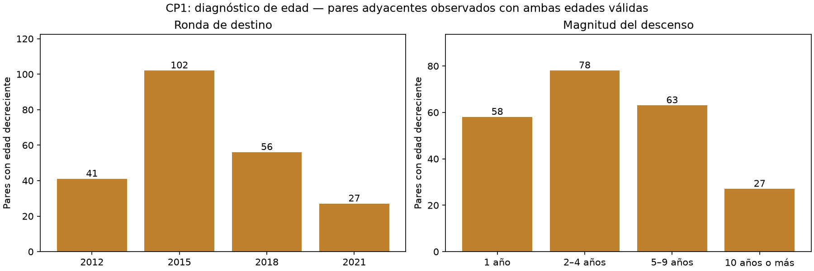

**Conclusión parcial.** Las alertas son reproducibles y sus denominadores están precisados. Sus causas y reglas de tratamiento siguen pendientes de validación documental y aprobación de la autora. Las cifras descriptivas conservan los registros originales.

#### 5. Comparación de muestras sin selección principal

**Introducción y metodología.** Cada alternativa se aplica independientemente al universo completo, después de describirlo. Edad ≥60 por visita no equivale a entrada a 60+. Directa corresponde solo a códigos 1–2. El panel no balanceado permite 1–6 rondas y coincide aquí con todo el universo; el panel completo exige seis presencias de cualquier edad/modalidad, salvo que se explicite una restricción adicional. Esta comparación no aprueba una muestra principal.

En el periodo, las personas conservadas son la unión de las claves que mantienen al menos un registro: no se suman personas por ronda. En una ronda, por la unicidad verificada, registros y personas coinciden también en cada alternativa; ambas columnas se conservan para que el denominador sea explícito. Los filtros por visita pueden conservar una persona en una ronda y excluirla en otra.

##### Alternativas: registros y personas únicos de todo el periodo

| muestra | registros | personas | denominador_registros | denominador_personas | registros_excluidos | personas_excluidas | porcentaje_registros_conservados | porcentaje_personas_conservadas |
| --- | --- | --- | --- | --- | --- | --- | --- | --- |
| Universo amplio | 99676 | 27171 | 99676 | 27171 | 0 | 0 | 100.00 | 100.00 |
| Panel no balanceado, todas las edades/entrevistas | 99676 | 27171 | 99676 | 27171 | 0 | 0 | 100.00 | 100.00 |
| 60+ por visita, cualquier entrevista | 56004 | 18754 | 99676 | 27171 | 43672 | 8417 | 56.19 | 69.02 |
| Directas, cualquier edad | 85248 | 26572 | 99676 | 27171 | 14428 | 599 | 85.53 | 97.80 |
| Directas 60+ por visita | 50841 | 18158 | 99676 | 27171 | 48835 | 9013 | 51.01 | 66.83 |
| 60+ en primera observación, seguimiento amplio | 35048 | 9079 | 99676 | 27171 | 64628 | 18092 | 35.16 | 33.41 |
| 60+ en primera observación, directas | 26450 | 8751 | 99676 | 27171 | 73226 | 18420 | 26.54 | 32.21 |
| Desde primera observación 60+, seguimiento amplio | 62522 | 18754 | 99676 | 27171 | 37154 | 8417 | 62.73 | 69.02 |
| Desde primera observación 60+, directas | 50904 | 18158 | 99676 | 27171 | 48772 | 9013 | 51.07 | 66.83 |
| Seis rondas, cualquier entrevista/edad | 37830 | 6305 | 99676 | 27171 | 61846 | 20866 | 37.95 | 23.20 |
| Seis directas, cualquier edad | 23358 | 3893 | 99676 | 27171 | 76318 | 23278 | 23.43 | 14.33 |
| Seis directas 60+ por visita | 5784 | 964 | 99676 | 27171 | 93892 | 26207 | 5.80 | 3.55 |

Los denominadores globales son 99,676 registros y 27,171 personas. Directas 60+ conserva 50,841 registros/18,158 personas; seis presencias conserva 37,830/6,305, mientras seis directas conserva 23,358/3,893 y seis directas 60+ conserva 5,784/964. No son alternativas metodológicamente equivalentes.

##### Conservados y excluidos en 2001: todas las alternativas

| muestra | registros | personas | denominador_registros | denominador_personas | registros_excluidos | personas_excluidas | porcentaje_registros_conservados | porcentaje_personas_conservadas |
| --- | --- | --- | --- | --- | --- | --- | --- | --- |
| Universo amplio | 15186 | 15186 | 15186 | 15186 | 0 | 0 | 100.00 | 100.00 |
| Panel no balanceado, todas las edades/entrevistas | 15186 | 15186 | 15186 | 15186 | 0 | 0 | 100.00 | 100.00 |
| 60+ por visita, cualquier entrevista | 7416 | 7416 | 15186 | 15186 | 7770 | 7770 | 48.83 | 48.83 |
| Directas, cualquier edad | 14154 | 14154 | 15186 | 15186 | 1032 | 1032 | 93.20 | 93.20 |
| Directas 60+ por visita | 6812 | 6812 | 15186 | 15186 | 8374 | 8374 | 44.86 | 44.86 |
| 60+ en primera observación, seguimiento amplio | 7416 | 7416 | 15186 | 15186 | 7770 | 7770 | 48.83 | 48.83 |
| 60+ en primera observación, directas | 6812 | 6812 | 15186 | 15186 | 8374 | 8374 | 44.86 | 44.86 |
| Desde primera observación 60+, seguimiento amplio | 7416 | 7416 | 15186 | 15186 | 7770 | 7770 | 48.83 | 48.83 |
| Desde primera observación 60+, directas | 6812 | 6812 | 15186 | 15186 | 8374 | 8374 | 44.86 | 44.86 |
| Seis rondas, cualquier entrevista/edad | 6305 | 6305 | 15186 | 15186 | 8881 | 8881 | 41.52 | 41.52 |
| Seis directas, cualquier edad | 3893 | 3893 | 15186 | 15186 | 11293 | 11293 | 25.64 | 25.64 |
| Seis directas 60+ por visita | 964 | 964 | 15186 | 15186 | 14222 | 14222 | 6.35 | 6.35 |

En cada fila: conservados + excluidos = denominador original, tanto para registros como para personas. Los porcentajes corresponden a ese denominador original de la ronda.

##### Conservados y excluidos en 2003: todas las alternativas

| muestra | registros | personas | denominador_registros | denominador_personas | registros_excluidos | personas_excluidas | porcentaje_registros_conservados | porcentaje_personas_conservadas |
| --- | --- | --- | --- | --- | --- | --- | --- | --- |
| Universo amplio | 14250 | 14250 | 14250 | 14250 | 0 | 0 | 100.00 | 100.00 |
| Panel no balanceado, todas las edades/entrevistas | 14250 | 14250 | 14250 | 14250 | 0 | 0 | 100.00 | 100.00 |
| 60+ por visita, cualquier entrevista | 7691 | 7691 | 14250 | 14250 | 6559 | 6559 | 53.97 | 53.97 |
| Directas, cualquier edad | 12526 | 12526 | 14250 | 14250 | 1724 | 1724 | 87.90 | 87.90 |
| Directas 60+ por visita | 6970 | 6970 | 14250 | 14250 | 7280 | 7280 | 48.91 | 48.91 |
| 60+ en primera observación, seguimiento amplio | 7140 | 7140 | 14250 | 14250 | 7110 | 7110 | 50.11 | 50.11 |
| 60+ en primera observación, directas | 6043 | 6043 | 14250 | 14250 | 8207 | 8207 | 42.41 | 42.41 |
| Desde primera observación 60+, seguimiento amplio | 8147 | 8147 | 14250 | 14250 | 6103 | 6103 | 57.17 | 57.17 |
| Desde primera observación 60+, directas | 6970 | 6970 | 14250 | 14250 | 7280 | 7280 | 48.91 | 48.91 |
| Seis rondas, cualquier entrevista/edad | 6305 | 6305 | 14250 | 14250 | 7945 | 7945 | 44.25 | 44.25 |
| Seis directas, cualquier edad | 3893 | 3893 | 14250 | 14250 | 10357 | 10357 | 27.32 | 27.32 |
| Seis directas 60+ por visita | 964 | 964 | 14250 | 14250 | 13286 | 13286 | 6.76 | 6.76 |

##### Conservados y excluidos en 2012: todas las alternativas

| muestra | registros | personas | denominador_registros | denominador_personas | registros_excluidos | personas_excluidas | porcentaje_registros_conservados | porcentaje_personas_conservadas |
| --- | --- | --- | --- | --- | --- | --- | --- | --- |
| Universo amplio | 18465 | 18465 | 18465 | 18465 | 0 | 0 | 100.00 | 100.00 |
| Panel no balanceado, todas las edades/entrevistas | 18465 | 18465 | 18465 | 18465 | 0 | 0 | 100.00 | 100.00 |
| 60+ por visita, cualquier entrevista | 9886 | 9886 | 18465 | 18465 | 8579 | 8579 | 53.54 | 53.54 |
| Directas, cualquier edad | 14448 | 14448 | 18465 | 18465 | 4017 | 4017 | 78.25 | 78.25 |
| Directas 60+ por visita | 8888 | 8888 | 18465 | 18465 | 9577 | 9577 | 48.13 | 48.13 |
| 60+ en primera observación, seguimiento amplio | 7123 | 7123 | 18465 | 18465 | 11342 | 11342 | 38.58 | 38.58 |
| 60+ en primera observación, directas | 4281 | 4281 | 18465 | 18465 | 14184 | 14184 | 23.18 | 23.18 |
| Desde primera observación 60+, seguimiento amplio | 12171 | 12171 | 18465 | 18465 | 6294 | 6294 | 65.91 | 65.91 |
| Desde primera observación 60+, directas | 8893 | 8893 | 18465 | 18465 | 9572 | 9572 | 48.16 | 48.16 |
| Seis rondas, cualquier entrevista/edad | 6305 | 6305 | 18465 | 18465 | 12160 | 12160 | 34.15 | 34.15 |
| Seis directas, cualquier edad | 3893 | 3893 | 18465 | 18465 | 14572 | 14572 | 21.08 | 21.08 |
| Seis directas 60+ por visita | 964 | 964 | 18465 | 18465 | 17501 | 17501 | 5.22 | 5.22 |

##### Conservados y excluidos en 2015: todas las alternativas

| muestra | registros | personas | denominador_registros | denominador_personas | registros_excluidos | personas_excluidas | porcentaje_registros_conservados | porcentaje_personas_conservadas |
| --- | --- | --- | --- | --- | --- | --- | --- | --- |
| Universo amplio | 15988 | 15988 | 15988 | 15988 | 0 | 0 | 100.00 | 100.00 |
| Panel no balanceado, todas las edades/entrevistas | 15988 | 15988 | 15988 | 15988 | 0 | 0 | 100.00 | 100.00 |
| 60+ por visita, cualquier entrevista | 10416 | 10416 | 15988 | 15988 | 5572 | 5572 | 65.15 | 65.15 |
| Directas, cualquier edad | 13850 | 13850 | 15988 | 15988 | 2138 | 2138 | 86.63 | 86.63 |
| Directas 60+ por visita | 9640 | 9640 | 15988 | 15988 | 6348 | 6348 | 60.30 | 60.30 |
| 60+ en primera observación, seguimiento amplio | 5189 | 5189 | 15988 | 15988 | 10799 | 10799 | 32.46 | 32.46 |
| 60+ en primera observación, directas | 3857 | 3857 | 15988 | 15988 | 12131 | 12131 | 24.12 | 24.12 |
| Desde primera observación 60+, seguimiento amplio | 11539 | 11539 | 15988 | 15988 | 4449 | 4449 | 72.17 | 72.17 |
| Desde primera observación 60+, directas | 9668 | 9668 | 15988 | 15988 | 6320 | 6320 | 60.47 | 60.47 |
| Seis rondas, cualquier entrevista/edad | 6305 | 6305 | 15988 | 15988 | 9683 | 9683 | 39.44 | 39.44 |
| Seis directas, cualquier edad | 3893 | 3893 | 15988 | 15988 | 12095 | 12095 | 24.35 | 24.35 |
| Seis directas 60+ por visita | 964 | 964 | 15988 | 15988 | 15024 | 15024 | 6.03 | 6.03 |

##### Conservados y excluidos en 2018: todas las alternativas

| muestra | registros | personas | denominador_registros | denominador_personas | registros_excluidos | personas_excluidas | porcentaje_registros_conservados | porcentaje_personas_conservadas |
| --- | --- | --- | --- | --- | --- | --- | --- | --- |
| Universo amplio | 18249 | 18249 | 18249 | 18249 | 0 | 0 | 100.00 | 100.00 |
| Panel no balanceado, todas las edades/entrevistas | 18249 | 18249 | 18249 | 18249 | 0 | 0 | 100.00 | 100.00 |
| 60+ por visita, cualquier entrevista | 10113 | 10113 | 18249 | 18249 | 8136 | 8136 | 55.42 | 55.42 |
| Directas, cualquier edad | 15786 | 15786 | 18249 | 18249 | 2463 | 2463 | 86.50 | 86.50 |
| Directas 60+ por visita | 9107 | 9107 | 18249 | 18249 | 9142 | 9142 | 49.90 | 49.90 |
| 60+ en primera observación, seguimiento amplio | 4341 | 4341 | 18249 | 18249 | 13908 | 13908 | 23.79 | 23.79 |
| 60+ en primera observación, directas | 3063 | 3063 | 18249 | 18249 | 15186 | 15186 | 16.78 | 16.78 |
| Desde primera observación 60+, seguimiento amplio | 11186 | 11186 | 18249 | 18249 | 7063 | 7063 | 61.30 | 61.30 |
| Desde primera observación 60+, directas | 9130 | 9130 | 18249 | 18249 | 9119 | 9119 | 50.03 | 50.03 |
| Seis rondas, cualquier entrevista/edad | 6305 | 6305 | 18249 | 18249 | 11944 | 11944 | 34.55 | 34.55 |
| Seis directas, cualquier edad | 3893 | 3893 | 18249 | 18249 | 14356 | 14356 | 21.33 | 21.33 |
| Seis directas 60+ por visita | 964 | 964 | 18249 | 18249 | 17285 | 17285 | 5.28 | 5.28 |

##### Conservados y excluidos en 2021: todas las alternativas

| muestra | registros | personas | denominador_registros | denominador_personas | registros_excluidos | personas_excluidas | porcentaje_registros_conservados | porcentaje_personas_conservadas |
| --- | --- | --- | --- | --- | --- | --- | --- | --- |
| Universo amplio | 17538 | 17538 | 17538 | 17538 | 0 | 0 | 100.00 | 100.00 |
| Panel no balanceado, todas las edades/entrevistas | 17538 | 17538 | 17538 | 17538 | 0 | 0 | 100.00 | 100.00 |
| 60+ por visita, cualquier entrevista | 10482 | 10482 | 17538 | 17538 | 7056 | 7056 | 59.77 | 59.77 |
| Directas, cualquier edad | 14484 | 14484 | 17538 | 17538 | 3054 | 3054 | 82.59 | 82.59 |
| Directas 60+ por visita | 9424 | 9424 | 17538 | 17538 | 8114 | 8114 | 53.73 | 53.73 |
| 60+ en primera observación, seguimiento amplio | 3839 | 3839 | 17538 | 17538 | 13699 | 13699 | 21.89 | 21.89 |
| 60+ en primera observación, directas | 2394 | 2394 | 17538 | 17538 | 15144 | 15144 | 13.65 | 13.65 |
| Desde primera observación 60+, seguimiento amplio | 12063 | 12063 | 17538 | 17538 | 5475 | 5475 | 68.78 | 68.78 |
| Desde primera observación 60+, directas | 9431 | 9431 | 17538 | 17538 | 8107 | 8107 | 53.77 | 53.77 |
| Seis rondas, cualquier entrevista/edad | 6305 | 6305 | 17538 | 17538 | 11233 | 11233 | 35.95 | 35.95 |
| Seis directas, cualquier edad | 3893 | 3893 | 17538 | 17538 | 13645 | 13645 | 22.20 | 22.20 |
| Seis directas 60+ por visita | 964 | 964 | 17538 | 17538 | 16574 | 16574 | 5.50 | 5.50 |

**Interpretación estadística y conclusión parcial.** La alternativa de 60+ por visita conserva 56,004 registros y 18,754 personas; el filtro de directas conserva 85,248 registros y 26,572 personas. Exigir seis presencias reduce a 23.20% las personas del periodo y excluye tanto entradas tardías como historias incompletas. Exigir seis directas 60+ reduce aún más el universo y condiciona a continuidad futura, supervivencia y modalidad. La selección puede alterar edad, escolaridad, viudez y localidad; las tablas completas de composición por alternativa están en `composicion_muestras` del notebook y en CP1_RESULTADOS.md. Ninguna alternativa se interpreta como representativa por defecto. Para una tesis prospectiva, pertenecer al panel balanceado futuro no puede usarse sin reconocer esa selección.

#### 6. Conclusiones para revisión y puntos pendientes

**Conclusiones comprobadas.** CP1 preserva todo el universo local y reconcilia claves, rondas y modalidades. La magnitud de los menores de 60, las entradas tardías, las ausencias temporales y las entrevistas sobre fallecidos descarta interpretar todas las filas como entrevistas directas de adultos de 60+. La variación entre rondas refleja composición y seguimiento además de envejecimiento. Los faltantes estructurales y la cobertura desigual deben distinguirse de falta de respuesta antes de imputar. Se han precisado las alertas; sus causas no se han probado.

**Revisión humana pendiente, sin modificar decisiones vigentes:**

1. Validar las conclusiones descriptivas y considerar suficiente la evidencia para cerrar CP1.
2. Definir estimando, criterio de entrada/edad y modalidad admisible para la muestra predictiva; 60+ permanece una candidata posterior.
3. Aprobar un protocolo de verificación y tratamiento de anomalías después de contrastarlas con fuentes originales; no aprobar correcciones por intuición.
4. Definir cómo se tratarán sustitutos, fallecimiento, ausencia temporal y atrición en etiquetas/horizontes y análisis de sensibilidad.
5. Resolver el alcance de ponderación y representatividad, distinguiendo factores transversales de seguimiento longitudinal.

La eventual autorización de CP2 es una decisión posterior. Este informe no crea etiquetas, integra pensiones, entrena modelos, publica cambios ni realiza merge.

#### 7. Consulta en VS Code y reproducción

Abrir `docs/CP1_INFORME_REVISION.md` y usar **Markdown: Open Preview to the Side** para leer este informe y sus figuras locales. Abrir `reports/notebooks/02_construccion_muestra_ejecutado.ipynb` con el visor de Jupyter: contiene todas las tablas de cada ronda, cobertura de las 119 variables, transiciones, muestras/composición, ocho figuras y el diagnóstico agregado de anomalías. La configuración permite mostrar todas las filas; si VS Code contrae una salida grande, expandirla o abrir su visor de datos. No mostrar el objeto `raw` ni matrices individuales.

El fuente reproducible es `notebooks/02_construccion_muestra.ipynb`, con salidas vacías según CI; usar kernel **myenv** y **Run All**. El generador de este informe es `scripts/build_cp1_review.py`: reutiliza JSON agregados existentes y verifica la huella del original antes de ampliar las anomalías. No reconstruye la auditoría general. Los reportes y figuras bajo `reports/` son artefactos locales ignorados por Git; los enlaces de figuras requieren esos artefactos. También puede consultarse [CP1_TABLAS_RONDAS.md](#origen-c36b448bc641) para comparación compacta, y [CP1_RESULTADOS.md](#origen-63fe2d5a6f22) para todas las tablas agregadas originales.

Comando del informe: `/opt/miniconda3/envs/myenv/bin/python scripts/build_cp1_review.py`. Comprobaciones: `python -m pytest -q` y `python scripts/validate_notebooks.py`. La bitácora de ejecución y resultados de validación está en [HANDOFF.md](../investigacion/notas/historial_metodologico.json). No se publican identificadores o microdatos.

**Trazabilidad:** SHA-256 local verificado: `2f7b1718c2c60af4ce8998a7852babbaf6cf6aa887b41e174ed61e86035f5683`. Tablas originales de la ejecución de 2026-10-11.


<a id="origen-c36b448bc641"></a>

### Composición detallada de las seis rondas

*Universo CP1 completo, sin filtro inicial de edad/modalidad.*

#### Introducción y objetivo
La referencia descriptiva de CP1 es **toda la población registrada en simpleMHAS.dta**:
todas las edades, entrevistas y trayectorias. No se exige edad mínima, entrevista directa
ni número de rondas. Se caracteriza la integridad y composición del archivo completo antes
de estudiar subpoblaciones para modelos futuros. La población registrada no equivale a toda
la población mexicana ni a todos los casos contactados o elegibles de la encuesta.

Cada celda expresa n (porcentaje sobre todos los registros de la ronda). Los códigos especiales permanecen separados. Las tablas completas por ronda, ponderadores, cobertura de 119 variables y todas las alternativas están en CP1_RESULTADOS.md.

#### Totales por ronda

| ronda | ano_nominal | registros | personas | menores_60 | edad_60_mas | edad_faltante | duplicados | discrepancias_fallecido_tipent |
| --- | --- | --- | --- | --- | --- | --- | --- | --- |
| 1 | 2001 | 15186 | 15186 | 7770 | 7416 | 0 | 0 | 0 |
| 2 | 2003 | 14250 | 14250 | 6002 | 7691 | 557 | 0 | 0 |
| 3 | 2012 | 18465 | 18465 | 5815 | 9886 | 2764 | 0 | 0 |
| 4 | 2015 | 15988 | 15988 | 4359 | 10416 | 1213 | 0 | 0 |
| 5 | 2018 | 18249 | 18249 | 6981 | 10113 | 1155 | 0 | 0 |
| 6 | 2021 | 17538 | 17538 | 5247 | 10482 | 1809 | 0 | 0 |

#### Grupos de edad

| categoria | 2001 | 2003 | 2012 | 2015 | 2018 | 2021 |
| --- | --- | --- | --- | --- | --- | --- |
| Menores de 50 | 1,553 (10.23%) | 882 (6.19%) | 1,037 (5.62%) | 560 (3.50%) | 895 (4.90%) | 472 (2.69%) |
| 50–59 | 6,217 (40.94%) | 5,120 (35.93%) | 4,778 (25.88%) | 3,799 (23.76%) | 6,086 (33.35%) | 4,775 (27.23%) |
| 60–69 | 4,207 (27.70%) | 4,304 (30.20%) | 5,229 (28.32%) | 5,092 (31.85%) | 4,430 (24.28%) | 4,548 (25.93%) |
| 70–79 | 2,307 (15.19%) | 2,415 (16.95%) | 3,178 (17.21%) | 3,619 (22.64%) | 3,839 (21.04%) | 3,974 (22.66%) |
| 80–89 | 771 (5.08%) | 825 (5.79%) | 1,266 (6.86%) | 1,424 (8.91%) | 1,579 (8.65%) | 1,648 (9.40%) |
| 90 o más | 131 (0.86%) | 147 (1.03%) | 213 (1.15%) | 281 (1.76%) | 265 (1.45%) | 312 (1.78%) |
| Edad faltante | 0 (0.00%) | 557 (3.91%) | 2,764 (14.97%) | 1,213 (7.59%) | 1,155 (6.33%) | 1,809 (10.31%) |

#### Sexo

| categoria | 2001 | 2003 | 2012 | 2015 | 2018 | 2021 |
| --- | --- | --- | --- | --- | --- | --- |
| Hombre | 6,503 (42.82%) | 6,108 (42.86%) | 8,000 (43.33%) | 6,739 (42.15%) | 7,761 (42.53%) | 7,446 (42.46%) |
| Mujer | 8,683 (57.18%) | 8,142 (57.14%) | 10,465 (56.67%) | 9,249 (57.85%) | 10,488 (57.47%) | 10,092 (57.54%) |

#### Estado conyugal

| categoria | 2001 | 2003 | 2012 | 2015 | 2018 | 2021 |
| --- | --- | --- | --- | --- | --- | --- |
| Casado o en unión | 10,512 (69.22%) | 9,689 (67.99%) | 10,910 (59.08%) | 9,862 (61.68%) | 11,838 (64.87%) | 10,295 (58.70%) |
| Separado o divorciado | 1,144 (7.53%) | 947 (6.65%) | 1,231 (6.67%) | 1,473 (9.21%) | 1,325 (7.26%) | 1,278 (7.29%) |
| Viudo | 2,535 (16.69%) | 2,545 (17.86%) | 2,860 (15.49%) | 2,829 (17.69%) | 3,047 (16.70%) | 3,448 (19.66%) |
| Soltero | 539 (3.55%) | 522 (3.66%) | 722 (3.91%) | 615 (3.85%) | 904 (4.95%) | 718 (4.09%) |
| .d | 0 (0.00%) | 1 (0.01%) | 0 (0.00%) | 0 (0.00%) | 0 (0.00%) | 0 (0.00%) |
| .f | 0 (0.00%) | 546 (3.83%) | 2,742 (14.85%) | 1,209 (7.56%) | 1,135 (6.22%) | 1,799 (10.26%) |
| .m | 456 (3.00%) | 0 (0.00%) | 0 (0.00%) | 0 (0.00%) | 0 (0.00%) | 0 (0.00%) |

#### Educación agrupada

| categoria | 2001 | 2003 | 2012 | 2015 | 2018 | 2021 |
| --- | --- | --- | --- | --- | --- | --- |
| Sin escolaridad | 3,652 (24.05%) | 3,517 (24.68%) | 3,699 (20.03%) | 2,847 (17.81%) | 2,657 (14.56%) | 2,418 (13.79%) |
| 1–5 años | 5,239 (34.50%) | 4,945 (34.70%) | 5,728 (31.02%) | 4,757 (29.75%) | 4,620 (25.32%) | 4,321 (24.64%) |
| 6 años | 2,788 (18.36%) | 2,611 (18.32%) | 3,694 (20.01%) | 3,310 (20.70%) | 3,801 (20.83%) | 3,645 (20.78%) |
| 7–9 años | 1,988 (13.09%) | 1,774 (12.45%) | 2,938 (15.91%) | 2,732 (17.09%) | 3,676 (20.14%) | 3,583 (20.43%) |
| 10 años o más | 1,500 (9.88%) | 1,304 (9.15%) | 2,312 (12.52%) | 2,162 (13.52%) | 3,335 (18.27%) | 3,247 (18.51%) |
| .d | 18 (0.12%) | 22 (0.15%) | 14 (0.08%) | 122 (0.76%) | 96 (0.53%) | 97 (0.55%) |
| .f | 0 (0.00%) | 9 (0.06%) | 30 (0.16%) | 7 (0.04%) | 6 (0.03%) | 16 (0.09%) |
| .m | 0 (0.00%) | 67 (0.47%) | 50 (0.27%) | 51 (0.32%) | 51 (0.28%) | 205 (1.17%) |
| .r | 1 (0.01%) | 1 (0.01%) | 0 (0.00%) | 0 (0.00%) | 7 (0.04%) | 6 (0.03%) |

#### Educación: años exactos

| categoria | 2001 | 2003 | 2012 | 2015 | 2018 | 2021 |
| --- | --- | --- | --- | --- | --- | --- |
| 0 | 3,652 (24.05%) | 3,517 (24.68%) | 3,699 (20.03%) | 2,847 (17.81%) | 2,657 (14.56%) | 2,418 (13.79%) |
| 1 | 794 (5.23%) | 763 (5.35%) | 846 (4.58%) | 671 (4.20%) | 643 (3.52%) | 607 (3.46%) |
| 2 | 1,253 (8.25%) | 1,174 (8.24%) | 1,347 (7.29%) | 1,096 (6.86%) | 1,031 (5.65%) | 962 (5.49%) |
| 3 | 1,925 (12.68%) | 1,826 (12.81%) | 2,091 (11.32%) | 1,742 (10.90%) | 1,698 (9.30%) | 1,590 (9.07%) |
| 4 | 833 (5.49%) | 778 (5.46%) | 920 (4.98%) | 777 (4.86%) | 744 (4.08%) | 689 (3.93%) |
| 5 | 434 (2.86%) | 404 (2.84%) | 524 (2.84%) | 471 (2.95%) | 504 (2.76%) | 473 (2.70%) |
| 6 | 2,788 (18.36%) | 2,611 (18.32%) | 3,694 (20.01%) | 3,310 (20.70%) | 3,801 (20.83%) | 3,645 (20.78%) |
| 7 | 221 (1.46%) | 195 (1.37%) | 260 (1.41%) | 226 (1.41%) | 247 (1.35%) | 233 (1.33%) |
| 8 | 402 (2.65%) | 370 (2.60%) | 502 (2.72%) | 453 (2.83%) | 513 (2.81%) | 486 (2.77%) |
| 9 | 1,365 (8.99%) | 1,209 (8.48%) | 2,176 (11.78%) | 2,053 (12.84%) | 2,916 (15.98%) | 2,864 (16.33%) |
| 10 | 60 (0.40%) | 52 (0.36%) | 78 (0.42%) | 76 (0.48%) | 121 (0.66%) | 120 (0.68%) |
| 11 | 123 (0.81%) | 109 (0.76%) | 136 (0.74%) | 132 (0.83%) | 202 (1.11%) | 203 (1.16%) |
| 12 | 304 (2.00%) | 263 (1.85%) | 518 (2.81%) | 496 (3.10%) | 985 (5.40%) | 958 (5.46%) |
| 13 | 130 (0.86%) | 121 (0.85%) | 184 (1.00%) | 159 (0.99%) | 174 (0.95%) | 181 (1.03%) |
| 14 | 74 (0.49%) | 68 (0.48%) | 97 (0.53%) | 89 (0.56%) | 112 (0.61%) | 111 (0.63%) |
| 15 | 59 (0.39%) | 54 (0.38%) | 82 (0.44%) | 79 (0.49%) | 261 (1.43%) | 235 (1.34%) |
| 16 | 146 (0.96%) | 120 (0.84%) | 325 (1.76%) | 315 (1.97%) | 440 (2.41%) | 429 (2.45%) |
| 17 | 466 (3.07%) | 404 (2.84%) | 635 (3.44%) | 594 (3.72%) | 763 (4.18%) | 733 (4.18%) |
| 18 | 105 (0.69%) | 88 (0.62%) | 185 (1.00%) | 163 (1.02%) | 209 (1.15%) | 201 (1.15%) |
| 19 | 33 (0.22%) | 25 (0.18%) | 49 (0.27%) | 43 (0.27%) | 48 (0.26%) | 51 (0.29%) |
| 20 | 0 (0.00%) | 0 (0.00%) | 10 (0.05%) | 6 (0.04%) | 11 (0.06%) | 12 (0.07%) |
| 21 | 0 (0.00%) | 0 (0.00%) | 8 (0.04%) | 8 (0.05%) | 8 (0.04%) | 11 (0.06%) |
| 22 | 0 (0.00%) | 0 (0.00%) | 5 (0.03%) | 2 (0.01%) | 1 (0.01%) | 2 (0.01%) |
| .d | 18 (0.12%) | 22 (0.15%) | 14 (0.08%) | 122 (0.76%) | 96 (0.53%) | 97 (0.55%) |
| .f | 0 (0.00%) | 9 (0.06%) | 30 (0.16%) | 7 (0.04%) | 6 (0.03%) | 16 (0.09%) |
| .m | 0 (0.00%) | 67 (0.47%) | 50 (0.27%) | 51 (0.32%) | 51 (0.28%) | 205 (1.17%) |
| .r | 1 (0.01%) | 1 (0.01%) | 0 (0.00%) | 0 (0.00%) | 7 (0.04%) | 6 (0.03%) |

#### Localidad

| categoria | 2001 | 2003 | 2012 | 2015 | 2018 | 2021 |
| --- | --- | --- | --- | --- | --- | --- |
| Menos de 100 mil residentes | 6,229 (41.02%) | 5,777 (40.54%) | 6,600 (35.74%) | 6,329 (39.59%) | 7,590 (41.59%) | 6,936 (39.55%) |
| 100 mil residentes o más | 8,957 (58.98%) | 7,927 (55.63%) | 9,123 (49.41%) | 8,450 (52.85%) | 9,524 (52.19%) | 8,803 (50.19%) |
| .f | 0 (0.00%) | 546 (3.83%) | 2,742 (14.85%) | 1,209 (7.56%) | 1,135 (6.22%) | 1,799 (10.26%) |

#### Cinco modalidades de entrevista

| categoria | 2001 | 2003 | 2012 | 2015 | 2018 | 2021 |
| --- | --- | --- | --- | --- | --- | --- |
| Directa de seguimiento | 0 (0.00%) | 12,363 (86.76%) | 8,868 (48.03%) | 13,254 (82.90%) | 11,183 (61.28%) | 14,336 (81.74%) |
| Directa de nueva persona | 14,154 (93.20%) | 163 (1.14%) | 5,580 (30.22%) | 596 (3.73%) | 4,603 (25.22%) | 148 (0.84%) |
| Sustituto de seguimiento | 0 (0.00%) | 1,134 (7.96%) | 959 (5.19%) | 884 (5.53%) | 1,122 (6.15%) | 1,247 (7.11%) |
| Sustituto de nueva persona | 1,032 (6.80%) | 44 (0.31%) | 316 (1.71%) | 45 (0.28%) | 206 (1.13%) | 8 (0.05%) |
| Sobre fallecido | 0 (0.00%) | 546 (3.83%) | 2,742 (14.85%) | 1,209 (7.56%) | 1,135 (6.22%) | 1,799 (10.26%) |

#### Año efectivo

| categoria | 2001 | 2003 | 2012 | 2015 | 2018 | 2021 |
| --- | --- | --- | --- | --- | --- | --- |
| 2001 | 15,186 (100.00%) | 0 (0.00%) | 0 (0.00%) | 0 (0.00%) | 0 (0.00%) | 0 (0.00%) |
| 2003 | 0 (0.00%) | 14,250 (100.00%) | 0 (0.00%) | 0 (0.00%) | 0 (0.00%) | 0 (0.00%) |
| 2012 | 0 (0.00%) | 0 (0.00%) | 15,707 (85.06%) | 0 (0.00%) | 0 (0.00%) | 0 (0.00%) |
| 2013 | 0 (0.00%) | 0 (0.00%) | 14 (0.08%) | 0 (0.00%) | 0 (0.00%) | 0 (0.00%) |
| 2015 | 0 (0.00%) | 0 (0.00%) | 0 (0.00%) | 14,779 (92.44%) | 0 (0.00%) | 0 (0.00%) |
| 2018 | 0 (0.00%) | 0 (0.00%) | 0 (0.00%) | 0 (0.00%) | 16,705 (91.54%) | 0 (0.00%) |
| 2019 | 0 (0.00%) | 0 (0.00%) | 0 (0.00%) | 0 (0.00%) | 409 (2.24%) | 0 (0.00%) |
| 2021 | 0 (0.00%) | 0 (0.00%) | 0 (0.00%) | 0 (0.00%) | 0 (0.00%) | 10,918 (62.25%) |
| 2022 | 0 (0.00%) | 0 (0.00%) | 0 (0.00%) | 0 (0.00%) | 0 (0.00%) | 4,821 (27.49%) |
| .e | 0 (0.00%) | 0 (0.00%) | 1 (0.01%) | 0 (0.00%) | 0 (0.00%) | 0 (0.00%) |
| .f | 0 (0.00%) | 0 (0.00%) | 2,742 (14.85%) | 1,209 (7.56%) | 1,135 (6.22%) | 1,799 (10.26%) |
| .i | 0 (0.00%) | 0 (0.00%) | 1 (0.01%) | 0 (0.00%) | 0 (0.00%) | 0 (0.00%) |

#### Fallecimiento registrado

| categoria | 2001 | 2003 | 2012 | 2015 | 2018 | 2021 |
| --- | --- | --- | --- | --- | --- | --- |
| No | 15,186 (100.00%) | 13,704 (96.17%) | 15,723 (85.15%) | 14,779 (92.44%) | 17,114 (93.78%) | 15,739 (89.74%) |
| Sí | 0 (0.00%) | 546 (3.83%) | 2,742 (14.85%) | 1,209 (7.56%) | 1,135 (6.22%) | 1,799 (10.26%) |

#### Incorporación y seguimiento

| ronda | primera_aparicion | ya_observadas | reaparecen_tras_ausencia | total | primera_aparicion_porcentaje | ya_observadas_porcentaje | reaparecen_tras_ausencia_porcentaje |
| --- | --- | --- | --- | --- | --- | --- | --- |
| 1 | 15186 | 0 | 0 | 15186 | 100.00 | 0.00 | 0.00 |
| 2 | 277 | 13973 | 0 | 14250 | 1.94 | 98.06 | 0.00 |
| 3 | 5912 | 12553 | 357 | 18465 | 32.02 | 67.98 | 1.93 |
| 4 | 650 | 15338 | 624 | 15988 | 4.07 | 95.93 | 3.90 |
| 5 | 4823 | 13426 | 383 | 18249 | 26.43 | 73.57 | 2.10 |
| 6 | 323 | 17215 | 1100 | 17538 | 1.84 | 98.16 | 6.27 |

| ronda | ronda_origen | denominador_anterior | continuan_desde_anterior | no_observadas_desde_anterior | ausentes_con_fallecimiento_previo | ausentes_sin_fallecimiento_previo | porcentaje_no_observadas |
| --- | --- | --- | --- | --- | --- | --- | --- |
| 2 | 1 | 15186 | 13973 | 1213 | 0 | 1213 | 7.99 |
| 3 | 2 | 14250 | 12196 | 2054 | 546 | 1508 | 14.41 |
| 4 | 3 | 18465 | 14714 | 3751 | 2741 | 1010 | 20.31 |
| 5 | 4 | 15988 | 13043 | 2945 | 1209 | 1736 | 18.42 |
| 6 | 5 | 18249 | 16115 | 2134 | 1135 | 999 | 11.69 |

#### Distribución del número de rondas

| rondas_observadas | personas | denominador_personas | porcentaje |
| --- | --- | --- | --- |
| 1 | 2025 | 27171 | 7.45 |
| 2 | 6635 | 27171 | 24.42 |
| 3 | 4445 | 27171 | 16.36 |
| 4 | 5589 | 27171 | 20.57 |
| 5 | 2172 | 27171 | 7.99 |
| 6 | 6305 | 27171 | 23.20 |

#### Conservados y excluidos por subpoblación y ronda

| ronda | muestra | registros | personas | denominador_registros | denominador_personas | registros_excluidos | personas_excluidas | porcentaje_registros_conservados | porcentaje_personas_conservadas |
| --- | --- | --- | --- | --- | --- | --- | --- | --- | --- |
| 1 | Universo amplio | 15186 | 15186 | 15186 | 15186 | 0 | 0 | 100.00 | 100.00 |
| 1 | Panel no balanceado, todas las edades/entrevistas | 15186 | 15186 | 15186 | 15186 | 0 | 0 | 100.00 | 100.00 |
| 1 | 60+ por visita, cualquier entrevista | 7416 | 7416 | 15186 | 15186 | 7770 | 7770 | 48.83 | 48.83 |
| 1 | Directas, cualquier edad | 14154 | 14154 | 15186 | 15186 | 1032 | 1032 | 93.20 | 93.20 |
| 1 | Directas 60+ por visita | 6812 | 6812 | 15186 | 15186 | 8374 | 8374 | 44.86 | 44.86 |
| 1 | 60+ en primera observación, seguimiento amplio | 7416 | 7416 | 15186 | 15186 | 7770 | 7770 | 48.83 | 48.83 |
| 1 | 60+ en primera observación, directas | 6812 | 6812 | 15186 | 15186 | 8374 | 8374 | 44.86 | 44.86 |
| 1 | Desde primera observación 60+, seguimiento amplio | 7416 | 7416 | 15186 | 15186 | 7770 | 7770 | 48.83 | 48.83 |
| 1 | Desde primera observación 60+, directas | 6812 | 6812 | 15186 | 15186 | 8374 | 8374 | 44.86 | 44.86 |
| 1 | Seis rondas, cualquier entrevista/edad | 6305 | 6305 | 15186 | 15186 | 8881 | 8881 | 41.52 | 41.52 |
| 1 | Seis directas, cualquier edad | 3893 | 3893 | 15186 | 15186 | 11293 | 11293 | 25.64 | 25.64 |
| 1 | Seis directas 60+ por visita | 964 | 964 | 15186 | 15186 | 14222 | 14222 | 6.35 | 6.35 |
| 2 | Universo amplio | 14250 | 14250 | 14250 | 14250 | 0 | 0 | 100.00 | 100.00 |
| 2 | Panel no balanceado, todas las edades/entrevistas | 14250 | 14250 | 14250 | 14250 | 0 | 0 | 100.00 | 100.00 |
| 2 | 60+ por visita, cualquier entrevista | 7691 | 7691 | 14250 | 14250 | 6559 | 6559 | 53.97 | 53.97 |
| 2 | Directas, cualquier edad | 12526 | 12526 | 14250 | 14250 | 1724 | 1724 | 87.90 | 87.90 |
| 2 | Directas 60+ por visita | 6970 | 6970 | 14250 | 14250 | 7280 | 7280 | 48.91 | 48.91 |
| 2 | 60+ en primera observación, seguimiento amplio | 7140 | 7140 | 14250 | 14250 | 7110 | 7110 | 50.11 | 50.11 |
| 2 | 60+ en primera observación, directas | 6043 | 6043 | 14250 | 14250 | 8207 | 8207 | 42.41 | 42.41 |
| 2 | Desde primera observación 60+, seguimiento amplio | 8147 | 8147 | 14250 | 14250 | 6103 | 6103 | 57.17 | 57.17 |
| 2 | Desde primera observación 60+, directas | 6970 | 6970 | 14250 | 14250 | 7280 | 7280 | 48.91 | 48.91 |
| 2 | Seis rondas, cualquier entrevista/edad | 6305 | 6305 | 14250 | 14250 | 7945 | 7945 | 44.25 | 44.25 |
| 2 | Seis directas, cualquier edad | 3893 | 3893 | 14250 | 14250 | 10357 | 10357 | 27.32 | 27.32 |
| 2 | Seis directas 60+ por visita | 964 | 964 | 14250 | 14250 | 13286 | 13286 | 6.76 | 6.76 |
| 3 | Universo amplio | 18465 | 18465 | 18465 | 18465 | 0 | 0 | 100.00 | 100.00 |
| 3 | Panel no balanceado, todas las edades/entrevistas | 18465 | 18465 | 18465 | 18465 | 0 | 0 | 100.00 | 100.00 |
| 3 | 60+ por visita, cualquier entrevista | 9886 | 9886 | 18465 | 18465 | 8579 | 8579 | 53.54 | 53.54 |
| 3 | Directas, cualquier edad | 14448 | 14448 | 18465 | 18465 | 4017 | 4017 | 78.25 | 78.25 |
| 3 | Directas 60+ por visita | 8888 | 8888 | 18465 | 18465 | 9577 | 9577 | 48.13 | 48.13 |
| 3 | 60+ en primera observación, seguimiento amplio | 7123 | 7123 | 18465 | 18465 | 11342 | 11342 | 38.58 | 38.58 |
| 3 | 60+ en primera observación, directas | 4281 | 4281 | 18465 | 18465 | 14184 | 14184 | 23.18 | 23.18 |
| 3 | Desde primera observación 60+, seguimiento amplio | 12171 | 12171 | 18465 | 18465 | 6294 | 6294 | 65.91 | 65.91 |
| 3 | Desde primera observación 60+, directas | 8893 | 8893 | 18465 | 18465 | 9572 | 9572 | 48.16 | 48.16 |
| 3 | Seis rondas, cualquier entrevista/edad | 6305 | 6305 | 18465 | 18465 | 12160 | 12160 | 34.15 | 34.15 |
| 3 | Seis directas, cualquier edad | 3893 | 3893 | 18465 | 18465 | 14572 | 14572 | 21.08 | 21.08 |
| 3 | Seis directas 60+ por visita | 964 | 964 | 18465 | 18465 | 17501 | 17501 | 5.22 | 5.22 |
| 4 | Universo amplio | 15988 | 15988 | 15988 | 15988 | 0 | 0 | 100.00 | 100.00 |
| 4 | Panel no balanceado, todas las edades/entrevistas | 15988 | 15988 | 15988 | 15988 | 0 | 0 | 100.00 | 100.00 |
| 4 | 60+ por visita, cualquier entrevista | 10416 | 10416 | 15988 | 15988 | 5572 | 5572 | 65.15 | 65.15 |
| 4 | Directas, cualquier edad | 13850 | 13850 | 15988 | 15988 | 2138 | 2138 | 86.63 | 86.63 |
| 4 | Directas 60+ por visita | 9640 | 9640 | 15988 | 15988 | 6348 | 6348 | 60.30 | 60.30 |
| 4 | 60+ en primera observación, seguimiento amplio | 5189 | 5189 | 15988 | 15988 | 10799 | 10799 | 32.46 | 32.46 |
| 4 | 60+ en primera observación, directas | 3857 | 3857 | 15988 | 15988 | 12131 | 12131 | 24.12 | 24.12 |
| 4 | Desde primera observación 60+, seguimiento amplio | 11539 | 11539 | 15988 | 15988 | 4449 | 4449 | 72.17 | 72.17 |
| 4 | Desde primera observación 60+, directas | 9668 | 9668 | 15988 | 15988 | 6320 | 6320 | 60.47 | 60.47 |
| 4 | Seis rondas, cualquier entrevista/edad | 6305 | 6305 | 15988 | 15988 | 9683 | 9683 | 39.44 | 39.44 |
| 4 | Seis directas, cualquier edad | 3893 | 3893 | 15988 | 15988 | 12095 | 12095 | 24.35 | 24.35 |
| 4 | Seis directas 60+ por visita | 964 | 964 | 15988 | 15988 | 15024 | 15024 | 6.03 | 6.03 |
| 5 | Universo amplio | 18249 | 18249 | 18249 | 18249 | 0 | 0 | 100.00 | 100.00 |
| 5 | Panel no balanceado, todas las edades/entrevistas | 18249 | 18249 | 18249 | 18249 | 0 | 0 | 100.00 | 100.00 |
| 5 | 60+ por visita, cualquier entrevista | 10113 | 10113 | 18249 | 18249 | 8136 | 8136 | 55.42 | 55.42 |
| 5 | Directas, cualquier edad | 15786 | 15786 | 18249 | 18249 | 2463 | 2463 | 86.50 | 86.50 |
| 5 | Directas 60+ por visita | 9107 | 9107 | 18249 | 18249 | 9142 | 9142 | 49.90 | 49.90 |
| 5 | 60+ en primera observación, seguimiento amplio | 4341 | 4341 | 18249 | 18249 | 13908 | 13908 | 23.79 | 23.79 |
| 5 | 60+ en primera observación, directas | 3063 | 3063 | 18249 | 18249 | 15186 | 15186 | 16.78 | 16.78 |
| 5 | Desde primera observación 60+, seguimiento amplio | 11186 | 11186 | 18249 | 18249 | 7063 | 7063 | 61.30 | 61.30 |
| 5 | Desde primera observación 60+, directas | 9130 | 9130 | 18249 | 18249 | 9119 | 9119 | 50.03 | 50.03 |
| 5 | Seis rondas, cualquier entrevista/edad | 6305 | 6305 | 18249 | 18249 | 11944 | 11944 | 34.55 | 34.55 |
| 5 | Seis directas, cualquier edad | 3893 | 3893 | 18249 | 18249 | 14356 | 14356 | 21.33 | 21.33 |
| 5 | Seis directas 60+ por visita | 964 | 964 | 18249 | 18249 | 17285 | 17285 | 5.28 | 5.28 |
| 6 | Universo amplio | 17538 | 17538 | 17538 | 17538 | 0 | 0 | 100.00 | 100.00 |
| 6 | Panel no balanceado, todas las edades/entrevistas | 17538 | 17538 | 17538 | 17538 | 0 | 0 | 100.00 | 100.00 |
| 6 | 60+ por visita, cualquier entrevista | 10482 | 10482 | 17538 | 17538 | 7056 | 7056 | 59.77 | 59.77 |
| 6 | Directas, cualquier edad | 14484 | 14484 | 17538 | 17538 | 3054 | 3054 | 82.59 | 82.59 |
| 6 | Directas 60+ por visita | 9424 | 9424 | 17538 | 17538 | 8114 | 8114 | 53.73 | 53.73 |
| 6 | 60+ en primera observación, seguimiento amplio | 3839 | 3839 | 17538 | 17538 | 13699 | 13699 | 21.89 | 21.89 |
| 6 | 60+ en primera observación, directas | 2394 | 2394 | 17538 | 17538 | 15144 | 15144 | 13.65 | 13.65 |
| 6 | Desde primera observación 60+, seguimiento amplio | 12063 | 12063 | 17538 | 17538 | 5475 | 5475 | 68.78 | 68.78 |
| 6 | Desde primera observación 60+, directas | 9431 | 9431 | 17538 | 17538 | 8107 | 8107 | 53.77 | 53.77 |
| 6 | Seis rondas, cualquier entrevista/edad | 6305 | 6305 | 17538 | 17538 | 11233 | 11233 | 35.95 | 35.95 |
| 6 | Seis directas, cualquier edad | 3893 | 3893 | 17538 | 17538 | 13645 | 13645 | 22.20 | 22.20 |
| 6 | Seis directas 60+ por visita | 964 | 964 | 17538 | 17538 | 16574 | 16574 | 5.50 | 5.50 |

##### Interpretación de la comparación secundaria

60+ por visita, cualquier entrevista: conserva 56,004/99,676 registros (56.19%) y 18,754/27,171 personas (69.02%). Excluye 43,672 registros y 8,417 personas del periodo.

Directas, cualquier edad: conserva 85,248/99,676 registros (85.53%) y 26,572/27,171 personas (97.80%). Excluye 14,428 registros y 599 personas del periodo.

Directas 60+ por visita: conserva 50,841/99,676 registros (51.01%) y 18,158/27,171 personas (66.83%). Excluye 48,835 registros y 9,013 personas del periodo.

Seis rondas, cualquier entrevista/edad: conserva 37,830/99,676 registros (37.95%) y 6,305/27,171 personas (23.20%). Excluye 61,846 registros y 20,866 personas del periodo.

Las personas excluidas del periodo no se obtienen sumando exclusiones por ronda: una persona puede perder algunas visitas y conservar otras. Cada filtro de la tabla muestras_ronda se compara de manera independiente con la ronda completa; el flujo directas → edad conocida → 60+ es una alternativa secuencial adicional. El panel no balanceado conserva todo el universo y no significa excluir a quienes tienen seis rondas.

#### Conclusiones y decisiones pendientes

La población completa permanece como **referencia descriptiva de CP1**. Todas sus edades,
modalidades y patrones de seguimiento contribuyen a las fichas por ronda, cobertura,
matrices y transiciones. Ninguna subpoblación reemplaza esa referencia. Las distribuciones
de edad y educación no pueden resumirse solo con mayores de 60 ni con entrevistas directas.

La participación combina incorporación de personas, cambios en el modo de entrevista,
fallecimiento registrado y no observación de causa desconocida. Las reapariciones prueban
que no toda ausencia inmediata es salida definitiva. La falta de registro tras una
entrevista sobre fallecido se distingue de la ausencia sin ese antecedente. Los intervalos
nominales 2, 9, 3, 3 y 3 años no permiten interpretar retención bruta como tasa anual.

La submuestra 60+ y, eventualmente, directa 60+ es únicamente una **candidata para modelos
predictivos posteriores**, pendiente de estimando y aprobación. Exigir seis rondas selecciona
continuidad futura y modifica la composición; no se adopta por defecto. La edad ausente,
incluida .f, no se imputa para forzar elegibilidad. Las alternativas de edad de entrada se
mantienen separadas del criterio por visita; no son intercambiables ante inconsistencias.

Se conservan las anomalías de edad, sexo y fallecimiento registradas en la tabla de
consistencia. Su revisión debe preceder a la construcción de etiquetas. La escolaridad
registrada a partir de primera entrevista y los cambios muestrales limitan una interpretación
de sus diferencias como aprendizaje dentro de persona. No se afirman representatividad,
causalidad ni capacidad de alerta temprana a partir de esta auditoría.

**Estado:** análisis descriptivo ampliado ejecutado; aprobación de resultados, reglas de
anomalías y estimando predictivo pendiente. Antes de CP2 se requiere revisión humana.
Los cambios permanecen locales en feat/cp1-auditoria, sin publicación ni merge a main.

<a id="origen-2e41a58fa943"></a>

### Diagnóstico inicial y contraste de subpoblaciones: evidencia histórica

*Universo CP1 completo, sin filtro inicial de edad/modalidad.*

**Decisión descriptiva aprobada por instrucción de la autora:** auditar toda la población registrada, sin filtros iniciales de edad, modalidad o número de rondas. Los 99,676 registros de 27,171 personas se conservan; 119 variables; cero exclusiones del análisis principal y cero duplicados persona-ronda. La muestra 60+ es secundaria y candidata a análisis predictivos posteriores; su estimando sigue pendiente.

Las seis fichas incluyen <50, 50–59, 60–69, 70–79, 80–89, ≥90 y edad faltante, educación (años exactos y categorías del diccionario), sexo, estado conyugal, localidad, modalidades, cronología, primera aparición, participación previa, reaparición, ausencia, número de rondas, ponderadores y cobertura de todas las variables. Se muestran n y porcentajes con denominadores explícitos.

El panel no balanceado contiene el universo completo: 99,676 registros/27,171 personas. El balanceado sin restricciones de edad o entrevista contiene 37,830 registros/6,305 personas; conserva 23.20% de las personas únicas y excluye 20,866. La alternativa 60+ por visita conserva 56,004 registros/18,754 personas, y la de directas 85,248/26,572. Las exclusiones de personas del periodo son uniones de claves; no se suman exclusiones de personas por ronda.

La edad <60 aparece en 7,770/15,186 registros (51.17%) en 2001 y 5,247/17,538 (29.92%) en 2021. El grupo 90+ suma 131 y 312 registros, respectivamente. La escolaridad media válida cambia de 4.64 años (N=15,167) a 6.53 (N=17,214): es una diferencia de composición, no evidencia de aprendizaje individual, pues el diccionario registra escolaridad a partir de la primera entrevista. Las reapariciones son 357 en 2012, 624 en 2015, 383 en 2018 y 1,100 en 2021; no se clasifican como nuevas incorporaciones ni como evidencia de causa de ausencia.

**Artefactos:** [CP1_TABLAS_RONDAS.md](#origen-c36b448bc641) reúne tablas comparativas completas; [CP1_RESULTADOS.md](#origen-63fe2d5a6f22) contiene seis secciones académicas y todos los agregados de cobertura, seguimiento y subpoblaciones. Notebook ejecutado local: reports/notebooks/02_construccion_muestra_ejecutado.ipynb. El análisis anterior de perfiles solo entre vivos fue sustituido por perfiles con todos los registros en origen, incluidos sobre fallecidos; los valores válidos y denominadores se distinguen.

**Verificación:** `python scripts/run_cp1.py --write-report`, notebook 02 ejecutado con kernel myenv, `python -m pytest -q` (22 tests aprobados) y `python scripts/validate_notebooks.py` (13 notebooks fuente válidos). Totales y cinco modalidades por ronda reconciliados con el diccionario; siete categorías de edad exhaustivas; conservados + excluidos reconciliados en registros/personas. Las anomalías de fallecimiento (3 registros posteriores), sexo (1 persona) y edad decreciente (226 pares) permanecen sin corregir. No se aplican ponderadores automáticamente.

**Estado:** auditoría ampliada ejecutada; revisión humana de conclusiones y decisiones predictivas pendiente. Cambios solo locales en feat/cp1-auditoria, sin publicación, push ni merge. CP2 y pensiones sin iniciar.

---

#### Evidencia de la primera ejecución CP1 (antes de la ampliación)

#### CP1 ejecutado localmente — 2026-10-11

**Estado: implementación y auditoría ejecutadas; aceptación metodológica pendiente.**
Archivo original local, seis rondas nominales 2001–2021, todas las entrevistas: 99,676 registros persona-ronda, 27,171 personas y 119 variables. Cero claves faltantes y duplicados persona-ronda. Los totales y cinco categorías de entrevista de cada ronda coinciden con el cuadro 1/apéndice del libro ENASEMsimple v2 (enero 2025).

La población directa con edad ≥60 por visita contiene 50,841 registros de 18,158 personas. Hay 6,305 personas presentes en seis rondas (cualquier entrevista/edad), 3,893 con seis directas y 964 con seis directas y 60+ en cada visita. No son estimaciones ponderadas ni una población representativa por defecto.

Se calcularon cobertura y códigos especiales de las 119 variables por ronda, demografía, edad, años efectivos, factores individuales/de hogar, exclusiones, once alternativas de muestra, composición por alternativa-ronda, patrones, intersecciones, transiciones, reapariciones y perfiles en t según observación en t+1. Se generaron siete figuras BrBG. No se construyeron etiquetas ni modelos.

**Hallazgos que requieren revisión:** 3 registros posteriores a un fallecimiento registrado (2 directos y 1 sobre fallecido), 1 persona con fallecimiento repetido, 1 con sexo válido inconsistente y 226 pares con edad decreciente. Se conservan los originales. Los pesos presentan ceros y valores positivos en entrevistas sobre fallecidos; no se aplicó ponderación automática.

La cohorte de seis directas 60+ tiene 581 mujeres/964 (60.27%) en cada ronda; la muestra directa 60+ abierta registra 3,667/6,812 mujeres (53.83%) en 2001 y 5,252/9,424 (55.73%) en 2021. La restricción de continuidad cambia la composición observada; no demuestra por sí sola la magnitud del sesgo poblacional.

Evidencia académica, seis fichas y denominadores: [CP1_RESULTADOS.md](#origen-63fe2d5a6f22). Reproducción: `/opt/miniconda3/envs/myenv/bin/python scripts/run_cp1.py`; notebook fuente 02 y ejecutado local `reports/notebooks/02_construccion_muestra_ejecutado.ipynb`. Los agregados JSON y figuras están en reports/ ignorado. El diagnóstico patrimonial preliminar de 31,133 pares no fue reproducido ni validado en CP1 y no se usa para aceptar una muestra.

#### Registro histórico de auditoría preliminar (2026-10-09)

Los conteos patrimoniales de esta sección son históricos y no constituyen aceptación de CP3. Para reproducir CP1 utilizar únicamente el script y notebook 02 indicados arriba; no ejecutar notebook 05 en esta fase.

### Auditoría preliminar — base ENASEMsimple suministrada

**Fecha de comprobación:** 2026-10-09  
**Fuente:** archivo `simpleMHAS.dta` aportado por la autora, analizado localmente sin subir microdatos.  
**Estado:** resultados de auditoría estructural, **no** resultados de un modelo predictivo ni estimaciones representativas.

#### Conteos comprobados

| Criterio | Resultado |
|---|---:|
| Registros persona-ronda originales, todas las entrevistas | 99,676 |
| Identificadores únicos `cunicah` + `np` | 27,171 |
| Duplicados por par `id`, `ronda` en la base original | 0 |
| Registros directos (tipent 1/2) con edad ≥60 en **cada ronda observada** | 50,841 |
| Personas distintas en el filtro anterior | 18,158 |
| Personas que tienen las seis rondas directas con edad ≥60 en **cada** ronda | 964 |
| Pares con un estado Q1 futuro no nulo en ronda siguiente observada (diagnóstico provisional) | 31,133 |

##### Conteos persona-ronda del filtro directo edad ≥60

| Ola nominal | Registros |
|---:|---:|
| 2001 | 6,812 |
| 2003 | 6,970 |
| 2012 | 8,888 |
| 2015 | 9,640 |
| 2018 | 9,107 |
| 2021 | 9,424 |

#### Interpretación y cautelas

- Que solo **964** personas cumplan el panel completo bajo estos filtros *no* demuestra attrición total de la encuesta. Se trata de una definición estricta que exige edad ≥60 en TODAS las olas observadas, entrevistas directas en las seis y presencia en todas las olas; excluye a quienes cumplen 60 más tarde y quienes pasan a entrevista por sustituto/fallecen.
- Un análisis longitudinal abierto debe definir la **edad de elegibilidad** y el **estimando** antes de imponer panel balanceado.
- `31,133` es un conteo exploratorio de pares con estado patrimonial futuro calculado usando el Q1 de cada submuestra, todavía no una cohorte de eventos incidentes ni estimación libre de leakage.
- Los factores muestrales y cortes monetarios deben validarse metodológicamente, no asumir que estas cifras son representativas de México.

#### Reproducción
Reproducción vigente de CP1: ejecutar `scripts/run_cp1.py` y `notebooks/02_construccion_muestra.ipynb` con el archivo original en `data/raw/simpleMHAS.dta`. El diagnóstico histórico de Q1 no se reproduce en esta fase. El archivo `.dta` **no** está versionado ni incluido en el archivo .zip del repositorio.


<a id="origen-63fe2d5a6f22"></a>

### Reconciliaciones y verificaciones complementarias de CP1

*Universo CP1 completo, sin filtro inicial de edad/modalidad.*

#### Introducción y objetivo
La referencia descriptiva de CP1 es **toda la población registrada en simpleMHAS.dta**:
todas las edades, entrevistas y trayectorias. No se exige edad mínima, entrevista directa
ni número de rondas. Se caracteriza la integridad y composición del archivo completo antes
de estudiar subpoblaciones para modelos futuros. La población registrada no equivale a toda
la población mexicana ni a todos los casos contactados o elegibles de la encuesta.

#### Metodología y fuentes
El original se lee sin modificar con convert_missing=True. Las claves cunicah + np
se validan en memoria; no se exportan. Las seis rondas nominales son 2001, 2003, 2012,
2015, 2018 y 2021; a_o_ent se informa por separado. Se detiene el enlace ante claves
faltantes, duplicados persona-ronda o codificaciones desconocidas, sin deduplicación ni
exclusión silenciosa. La auditoría conserva todas las modalidades de entrevista.

La fuente de codificaciones es ENASEMsimple v2, enero de 2025: cuadro 1 y apéndice 1;
educacion/edu_gru (p. 18) describen escolaridad a partir de la primera entrevista. La
clasificación edad_cp1 se deriva de edad: <50, 50–59, 60–69, 70–79, 80–89 y ≥90, más
edad faltante. No reemplaza edad_gru del proveedor, cuyo último grupo es 80+.
El tamaño de localidad distingue <100 mil de ≥100 mil habitantes; no se reinterpretan
estos códigos como una clasificación exhaustiva de ruralidad.

Cada frecuencia presenta n y porcentaje sobre **todos los registros de la ronda**, incluidos
faltantes. Los estadísticos continuos usan valores válidos y explicitan su N. Los conteos
por ronda son personas y registros equivalentes solo después de verificar unicidad; las
personas únicas del periodo son la unión de claves y no la suma de conteos por ronda.
Los códigos .f, .p, .w y otros se conservan separados en las columnas originales antes
de convertirlas a numérico. Un valor no formulado no se convierte en cero.

Las matrices de presencia y las transiciones usan todo el panel, incluidos sustitutos y
entrevistas sobre fallecidos. Se separan incorporación, continuidad, ausencia y reaparición;
la ausencia no identifica causa. El número de rondas usa la historia completa 2001–2021
solo para descripción, sin incorporarlo a predictores prospectivos. El panel no balanceado
es el universo de referencia y permite 1–6 rondas; el balanceado exige las seis rondas,
independientemente de edad o modalidad, y se analiza únicamente en la sección secundaria.

Todos los conteos son observados sin ponderación. Se auditan factores individuales y de
hogar por ronda y entrevista, incluyendo positivos, ceros y faltantes. Su disponibilidad
no autoriza su uso poblacional ni longitudinal. No se estima vulnerabilidad, no se ejecuta
CP2/CP3 y no se fusionan pensiones.

#### Resultados de integridad general

| poblacion | registros_originales | personas_originales | registros_excluidos_por_seleccion | personas_excluidas_por_seleccion | registros | personas | variables_originales | claves_faltantes | duplicados |
| --- | --- | --- | --- | --- | --- | --- | --- | --- | --- |
| Toda la población registrada | 99676 | 27171 | 0 | 0 | 99676 | 27171 | 119 | 0 | 0 |

| control | n |
| --- | --- |
| registros_despues_de_fallecimiento | 3 |
| personas_con_fallecimiento_repetido | 1 |
| personas_con_sexo_valido_inconsistente | 1 |
| pares_con_edad_decreciente | 226 |
| personas_con_ron_pat_inconsistente_entre_registros | 0 |

Los totales y categorías de entrevista se contrastan con el diccionario mediante run_cp1.py. Las anomalías permanecen en el universo; no se aplica una depuración automática.

#### Comparación inicial entre rondas (población completa)

| ronda | ano_nominal | registros | personas | menores_60 | edad_60_mas | edad_faltante | duplicados | discrepancias_fallecido_tipent |
| --- | --- | --- | --- | --- | --- | --- | --- | --- |
| 1 | 2001 | 15186 | 15186 | 7770 | 7416 | 0 | 0 | 0 |
| 2 | 2003 | 14250 | 14250 | 6002 | 7691 | 557 | 0 | 0 |
| 3 | 2012 | 18465 | 18465 | 5815 | 9886 | 2764 | 0 | 0 |
| 4 | 2015 | 15988 | 15988 | 4359 | 10416 | 1213 | 0 | 0 |
| 5 | 2018 | 18249 | 18249 | 6981 | 10113 | 1155 | 0 | 0 |
| 6 | 2021 | 17538 | 17538 | 5247 | 10482 | 1809 | 0 | 0 |

| ronda | denominador | n_validos | media | de | min | q25 | mediana | q75 | max |
| --- | --- | --- | --- | --- | --- | --- | --- | --- | --- |
| 1 | 15186 | 15186 | 60.79 | 10.85 | 18.00 | 53.00 | 59.00 | 68.00 | 106.00 |
| 2 | 14250 | 13693 | 62.68 | 10.52 | 21.00 | 55.00 | 61.00 | 69.00 | 108.00 |
| 3 | 18465 | 15701 | 63.97 | 11.08 | 20.00 | 56.00 | 63.00 | 71.00 | 115.00 |
| 4 | 15988 | 14775 | 66.13 | 10.62 | 23.00 | 58.00 | 66.00 | 73.00 | 113.00 |
| 5 | 18249 | 17094 | 64.16 | 11.51 | 17.00 | 55.00 | 63.00 | 72.00 | 107.00 |
| 6 | 17538 | 15729 | 66.20 | 10.89 | 23.00 | 57.00 | 65.00 | 74.00 | 106.00 |

| ronda | denominador | n_validos | n_faltantes | media | de | min | q25 | mediana | q75 | max |
| --- | --- | --- | --- | --- | --- | --- | --- | --- | --- | --- |
| 1 | 15186 | 15167 | 19 | 4.64 | 4.45 | 0.00 | 1.00 | 3.00 | 6.00 | 19.00 |
| 2 | 14250 | 14151 | 99 | 4.50 | 4.37 | 0.00 | 1.00 | 3.00 | 6.00 | 19.00 |
| 3 | 18465 | 18371 | 94 | 5.33 | 4.71 | 0.00 | 2.00 | 5.00 | 8.00 | 22.00 |
| 4 | 15988 | 15808 | 180 | 5.63 | 4.73 | 0.00 | 2.00 | 6.00 | 9.00 | 22.00 |
| 5 | 18249 | 18089 | 160 | 6.43 | 4.88 | 0.00 | 3.00 | 6.00 | 9.00 | 22.00 |
| 6 | 17538 | 17214 | 324 | 6.53 | 4.88 | 0.00 | 3.00 | 6.00 | 9.00 | 22.00 |

#### Ronda 1 — 2001: toda la población registrada

**Introducción y método.** Se describe esta ronda con todas sus edades y modalidades. La frecuencia absoluta y su porcentaje incluyen faltantes en el denominador de la ronda. La historia de presencia se calcula a partir del panel completo. No se aplican filtros de subpoblación en esta ficha. La cobertura muestra todas las columnas originales.

##### Resultados y modalidades de registro

##### Edad y estructura demográfica

##### Educación

##### Incorporación y seguimiento

##### Ponderadores y cobertura

##### Conclusión parcial y límites

##### Registros y personas

| ronda | ano_nominal | registros | personas | menores_60 | edad_60_mas | edad_faltante | duplicados | discrepancias_fallecido_tipent |
| --- | --- | --- | --- | --- | --- | --- | --- | --- |
| 1 | 2001 | 15186 | 15186 | 7770 | 7416 | 0 | 0 | 0 |

##### Grupos de edad solicitados

| ronda | categoria | n | denominador | porcentaje |
| --- | --- | --- | --- | --- |
| 1 | Menores de 50 | 1553 | 15186 | 10.23 |
| 1 | 50–59 | 6217 | 15186 | 40.94 |
| 1 | 60–69 | 4207 | 15186 | 27.70 |
| 1 | 70–79 | 2307 | 15186 | 15.19 |
| 1 | 80–89 | 771 | 15186 | 5.08 |
| 1 | 90 o más | 131 | 15186 | 0.86 |
| 1 | Edad faltante | 0 | 15186 | 0.00 |

##### Edad continua entre valores válidos

| ronda | denominador | n_validos | media | de | min | q25 | mediana | q75 | max |
| --- | --- | --- | --- | --- | --- | --- | --- | --- | --- |
| 1 | 15186 | 15186 | 60.79 | 10.85 | 18.00 | 53.00 | 59.00 | 68.00 | 106.00 |

##### Frecuencias demográficas y entrevista

| ronda | variable | categoria | n | denominador | porcentaje |
| --- | --- | --- | --- | --- | --- |
| 1 | tipent | Directa de seguimiento | 0 | 15186 | 0.00 |
| 1 | tipent | Directa de nueva persona | 14154 | 15186 | 93.20 |
| 1 | tipent | Sustituto de seguimiento | 0 | 15186 | 0.00 |
| 1 | tipent | Sustituto de nueva persona | 1032 | 15186 | 6.80 |
| 1 | tipent | Sobre fallecido | 0 | 15186 | 0.00 |
| 1 | sexo | Hombre | 6503 | 15186 | 42.82 |
| 1 | sexo | Mujer | 8683 | 15186 | 57.18 |
| 1 | est_conyugal | Casado o en unión | 10512 | 15186 | 69.22 |
| 1 | est_conyugal | Separado o divorciado | 1144 | 15186 | 7.53 |
| 1 | est_conyugal | Viudo | 2535 | 15186 | 16.69 |
| 1 | est_conyugal | Soltero | 539 | 15186 | 3.55 |
| 1 | est_conyugal | .m | 456 | 15186 | 3.00 |
| 1 | urbano | Menos de 100 mil residentes | 6229 | 15186 | 41.02 |
| 1 | urbano | 100 mil residentes o más | 8957 | 15186 | 58.98 |
| 1 | edad_gru | 49 o menos | 1553 | 15186 | 10.23 |
| 1 | edad_gru | 50–59 | 6217 | 15186 | 40.94 |
| 1 | edad_gru | 60–69 | 4207 | 15186 | 27.70 |
| 1 | edad_gru | 70–79 | 2307 | 15186 | 15.19 |
| 1 | edad_gru | 80 o más | 902 | 15186 | 5.94 |
| 1 | a_o_ent | 2001 | 15186 | 15186 | 100.00 |
| 1 | fallecido | No | 15186 | 15186 | 100.00 |
| 1 | fallecido | Sí | 0 | 15186 | 0.00 |
| 1 | educacion | 0 | 3652 | 15186 | 24.05 |
| 1 | educacion | 6 | 2788 | 15186 | 18.36 |
| 1 | educacion | 3 | 1925 | 15186 | 12.68 |
| 1 | educacion | 9 | 1365 | 15186 | 8.99 |
| 1 | educacion | 2 | 1253 | 15186 | 8.25 |
| 1 | educacion | 4 | 833 | 15186 | 5.49 |
| 1 | educacion | 1 | 794 | 15186 | 5.23 |
| 1 | educacion | 17 | 466 | 15186 | 3.07 |
| 1 | educacion | 5 | 434 | 15186 | 2.86 |
| 1 | educacion | 8 | 402 | 15186 | 2.65 |
| 1 | educacion | 12 | 304 | 15186 | 2.00 |
| 1 | educacion | 7 | 221 | 15186 | 1.46 |
| 1 | educacion | 16 | 146 | 15186 | 0.96 |
| 1 | educacion | 13 | 130 | 15186 | 0.86 |
| 1 | educacion | 11 | 123 | 15186 | 0.81 |
| 1 | educacion | 18 | 105 | 15186 | 0.69 |
| 1 | educacion | 14 | 74 | 15186 | 0.49 |
| 1 | educacion | 10 | 60 | 15186 | 0.40 |
| 1 | educacion | 15 | 59 | 15186 | 0.39 |
| 1 | educacion | 19 | 33 | 15186 | 0.22 |
| 1 | educacion | .d | 18 | 15186 | 0.12 |
| 1 | educacion | .r | 1 | 15186 | 0.01 |
| 1 | edu_gru | Sin escolaridad | 3652 | 15186 | 24.05 |
| 1 | edu_gru | 1–5 años | 5239 | 15186 | 34.50 |
| 1 | edu_gru | 6 años | 2788 | 15186 | 18.36 |
| 1 | edu_gru | 7–9 años | 1988 | 15186 | 13.09 |
| 1 | edu_gru | 10 años o más | 1500 | 15186 | 9.88 |
| 1 | edu_gru | .d | 18 | 15186 | 0.12 |
| 1 | edu_gru | .r | 1 | 15186 | 0.01 |

##### Estadísticos de escolaridad

| ronda | denominador | n_validos | n_faltantes | media | de | min | q25 | mediana | q75 | max |
| --- | --- | --- | --- | --- | --- | --- | --- | --- | --- | --- |
| 1 | 15186 | 15167 | 19 | 4.64 | 4.45 | 0.00 | 1.00 | 3.00 | 6.00 | 19.00 |

##### Primera aparición, participación previa y reaparición

| ronda | primera_aparicion | ya_observadas | reaparecen_tras_ausencia | total | primera_aparicion_porcentaje | ya_observadas_porcentaje | reaparecen_tras_ausencia_porcentaje |
| --- | --- | --- | --- | --- | --- | --- | --- |
| 1 | 15186 | 0 | 0 | 15186 | 100.00 | 0.00 | 0.00 |

##### Ausencias respecto a la ronda anterior

No aplica: no existe una ronda anterior dentro del archivo.

##### Número de rondas de quienes están presentes

| ronda | rondas_observadas_2001_2021 | personas | denominador_personas_ronda | porcentaje |
| --- | --- | --- | --- | --- |
| 1 | 1 | 811 | 15186 | 5.34 |
| 1 | 2 | 1505 | 15186 | 9.91 |
| 1 | 3 | 3092 | 15186 | 20.36 |
| 1 | 4 | 1416 | 15186 | 9.32 |
| 1 | 5 | 2057 | 15186 | 13.55 |
| 1 | 6 | 6305 | 15186 | 41.52 |

##### Año efectivo según modalidad

| ronda | tipo_entrevista | categoria | n | denominador | porcentaje |
| --- | --- | --- | --- | --- | --- |
| 1 | Directa de nueva persona | 2001 | 14154 | 14154 | 100.00 |
| 1 | Sustituto de nueva persona | 2001 | 1032 | 1032 | 100.00 |

##### Disponibilidad de ponderadores

| ronda | variable | tipo_entrevista | denominador | validos | positivos | ceros | negativos | faltantes | porcentaje_validos | porcentaje_positivos | porcentaje_ceros | porcentaje_faltantes | min | mediana | max |
| --- | --- | --- | --- | --- | --- | --- | --- | --- | --- | --- | --- | --- | --- | --- | --- |
| 1 | factori_01 | Directa de nueva persona | 14154 | 14154 | 12485 | 1669 | 0 | 0 | 100.00 | 88.21 | 11.79 | 0.00 | 0 | 408.00 | 44177 |
| 1 | factori_01 | Sustituto de nueva persona | 1032 | 1032 | 978 | 54 | 0 | 0 | 100.00 | 94.77 | 5.23 | 0.00 | 0 | 519.00 | 25518 |
| 1 | factorh_01 | Directa de nueva persona | 14154 | 14154 | 14154 | 0 | 0 | 0 | 100.00 | 100.00 | 0.00 | 0.00 | 16 | 469.00 | 35360 |
| 1 | factorh_01 | Sustituto de nueva persona | 1032 | 1032 | 1032 | 0 | 0 | 0 | 100.00 | 100.00 | 0.00 | 0.00 | 26 | 526.00 | 22519 |

##### Cobertura y códigos de todas las variables

| ronda | variable | tipo | n | denominador | porcentaje |
| --- | --- | --- | --- | --- | --- |
| 1 | cunicah | válido | 15186 | 15186 | 100.00 |
| 1 | np | válido | 15186 | 15186 | 100.00 |
| 1 | codent01 | válido | 15186 | 15186 | 100.00 |
| 1 | codent03 | válido | 14937 | 15186 | 98.36 |
| 1 | codent03 | . | 249 | 15186 | 1.64 |
| 1 | acthog | válido | 14937 | 15186 | 98.36 |
| 1 | acthog | . | 249 | 15186 | 1.64 |
| 1 | subhog_01 | válido | 15186 | 15186 | 100.00 |
| 1 | subhog_03 | válido | 15186 | 15186 | 100.00 |
| 1 | subhog_12 | válido | 15186 | 15186 | 100.00 |
| 1 | subhog_15 | válido | 15186 | 15186 | 100.00 |
| 1 | subhog_18 | válido | 15186 | 15186 | 100.00 |
| 1 | subhog_21 | válido | 15186 | 15186 | 100.00 |
| 1 | ronda | válido | 15186 | 15186 | 100.00 |
| 1 | tipent | válido | 15186 | 15186 | 100.00 |
| 1 | factorh_01 | válido | 15186 | 15186 | 100.00 |
| 1 | factori_01 | válido | 15186 | 15186 | 100.00 |
| 1 | factori_03 | válido | 15186 | 15186 | 100.00 |
| 1 | factorh_03 | válido | 15186 | 15186 | 100.00 |
| 1 | factorh_12 | válido | 13980 | 15186 | 92.06 |
| 1 | factorh_12 | . | 1206 | 15186 | 7.94 |
| 1 | factori_12 | válido | 13980 | 15186 | 92.06 |
| 1 | factori_12 | . | 1206 | 15186 | 7.94 |
| 1 | factorh_15 | válido | 10837 | 15186 | 71.36 |
| 1 | factorh_15 | . | 4349 | 15186 | 28.64 |
| 1 | factori_15 | válido | 10837 | 15186 | 71.36 |
| 1 | factori_15 | . | 4349 | 15186 | 28.64 |
| 1 | factori_18 | válido | 9133 | 15186 | 60.14 |
| 1 | factori_18 | . | 6053 | 15186 | 39.86 |
| 1 | factorh_18 | válido | 9133 | 15186 | 60.14 |
| 1 | factorh_18 | . | 6053 | 15186 | 39.86 |
| 1 | factori_21 | válido | 7901 | 15186 | 52.03 |
| 1 | factori_21 | . | 7285 | 15186 | 47.97 |
| 1 | factorh_21 | válido | 7901 | 15186 | 52.03 |
| 1 | factorh_21 | . | 7285 | 15186 | 47.97 |
| 1 | ron_pat | válido | 15186 | 15186 | 100.00 |
| 1 | mes_ent | válido | 15186 | 15186 | 100.00 |
| 1 | a_o_ent | válido | 15186 | 15186 | 100.00 |
| 1 | fallecido | válido | 15186 | 15186 | 100.00 |
| 1 | sexo | válido | 15186 | 15186 | 100.00 |
| 1 | mes_nac | válido | 15131 | 15186 | 99.64 |
| 1 | mes_nac | .d | 55 | 15186 | 0.36 |
| 1 | a_o_nac | válido | 15186 | 15186 | 100.00 |
| 1 | edad | válido | 15186 | 15186 | 100.00 |
| 1 | edad_gru | válido | 15186 | 15186 | 100.00 |
| 1 | urbano | válido | 15186 | 15186 | 100.00 |
| 1 | educacion | válido | 15167 | 15186 | 99.87 |
| 1 | educacion | .d | 18 | 15186 | 0.12 |
| 1 | educacion | .r | 1 | 15186 | 0.01 |
| 1 | edu_gru | válido | 15167 | 15186 | 99.87 |
| 1 | edu_gru | .d | 18 | 15186 | 0.12 |
| 1 | edu_gru | .r | 1 | 15186 | 0.01 |
| 1 | est_conyugal | válido | 14730 | 15186 | 97.00 |
| 1 | est_conyugal | .m | 456 | 15186 | 3.00 |
| 1 | n_res | válido | 15186 | 15186 | 100.00 |
| 1 | n_suj_hog | válido | 15186 | 15186 | 100.00 |
| 1 | par_ent | válido | 15186 | 15186 | 100.00 |
| 1 | madre_viva | válido | 15045 | 15186 | 99.07 |
| 1 | madre_viva | .d | 103 | 15186 | 0.68 |
| 1 | madre_viva | .i | 34 | 15186 | 0.22 |
| 1 | madre_viva | .r | 4 | 15186 | 0.03 |
| 1 | padre_vivo | válido | 14852 | 15186 | 97.80 |
| 1 | padre_vivo | .d | 296 | 15186 | 1.95 |
| 1 | padre_vivo | .i | 34 | 15186 | 0.22 |
| 1 | padre_vivo | .r | 4 | 15186 | 0.03 |
| 1 | hermanos_vivos | válido | 14826 | 15186 | 97.63 |
| 1 | hermanos_vivos | .d | 290 | 15186 | 1.91 |
| 1 | hermanos_vivos | .r | 36 | 15186 | 0.24 |
| 1 | hermanos_vivos | .i | 34 | 15186 | 0.22 |
| 1 | n_hijos_vivos | válido | 15150 | 15186 | 99.76 |
| 1 | n_hijos_vivos | .d | 29 | 15186 | 0.19 |
| 1 | n_hijos_vivos | .r | 7 | 15186 | 0.05 |
| 1 | hijos_vivos_gru | válido | 15150 | 15186 | 99.76 |
| 1 | hijos_vivos_gru | .d | 29 | 15186 | 0.19 |
| 1 | hijos_vivos_gru | .r | 7 | 15186 | 0.05 |
| 1 | nietos | válido | 15186 | 15186 | 100.00 |
| 1 | hijo_en_hog | válido | 14446 | 15186 | 95.13 |
| 1 | hijo_en_hog | .k | 740 | 15186 | 4.87 |
| 1 | cuida_adulto | .w | 15186 | 15186 | 100.00 |
| 1 | cuida_adulto | válido | 0 | 15186 | 0.00 |
| 1 | cuida_menor | .w | 15186 | 15186 | 100.00 |
| 1 | cuida_menor | válido | 0 | 15186 | 0.00 |
| 1 | voluntario | .w | 15186 | 15186 | 100.00 |
| 1 | voluntario | válido | 0 | 15186 | 0.00 |
| 1 | asiste_cursos | .w | 15186 | 15186 | 100.00 |
| 1 | asiste_cursos | válido | 0 | 15186 | 0.00 |
| 1 | asiste_club | .w | 15186 | 15186 | 100.00 |
| 1 | asiste_club | válido | 0 | 15186 | 0.00 |
| 1 | lee | .w | 15186 | 15186 | 100.00 |
| 1 | lee | válido | 0 | 15186 | 0.00 |
| 1 | cruci_rompe | .w | 15186 | 15186 | 100.00 |
| 1 | cruci_rompe | válido | 0 | 15186 | 0.00 |
| 1 | juegos_mesa | .w | 15186 | 15186 | 100.00 |
| 1 | juegos_mesa | válido | 0 | 15186 | 0.00 |
| 1 | comu_telef_comp | .w | 15186 | 15186 | 100.00 |
| 1 | comu_telef_comp | válido | 0 | 15186 | 0.00 |
| 1 | act_mant | .w | 15186 | 15186 | 100.00 |
| 1 | act_mant | válido | 0 | 15186 | 0.00 |
| 1 | ve_tv | .w | 15186 | 15186 | 100.00 |
| 1 | ve_tv | válido | 0 | 15186 | 0.00 |
| 1 | cose | .w | 15186 | 15186 | 100.00 |
| 1 | cose | válido | 0 | 15186 | 0.00 |
| 1 | compras | .w | 15186 | 15186 | 100.00 |
| 1 | compras | válido | 0 | 15186 | 0.00 |
| 1 | med_farm | .w | 15186 | 15186 | 100.00 |
| 1 | med_farm | válido | 0 | 15186 | 0.00 |
| 1 | salud_glob | válido | 14147 | 15186 | 93.16 |
| 1 | salud_glob | .p | 1032 | 15186 | 6.80 |
| 1 | salud_glob | .i | 4 | 15186 | 0.03 |
| 1 | salud_glob | .r | 2 | 15186 | 0.01 |
| 1 | salud_glob | .d | 1 | 15186 | 0.01 |
| 1 | hipertension | válido | 14704 | 15186 | 96.83 |
| 1 | hipertension | .s | 395 | 15186 | 2.60 |
| 1 | hipertension | .d | 45 | 15186 | 0.30 |
| 1 | hipertension | .r | 38 | 15186 | 0.25 |
| 1 | hipertension | .i | 4 | 15186 | 0.03 |
| 1 | diabetes | válido | 14721 | 15186 | 96.94 |
| 1 | diabetes | .s | 395 | 15186 | 2.60 |
| 1 | diabetes | .d | 33 | 15186 | 0.22 |
| 1 | diabetes | .r | 33 | 15186 | 0.22 |
| 1 | diabetes | .i | 4 | 15186 | 0.03 |
| 1 | enf_pulm | válido | 14742 | 15186 | 97.08 |
| 1 | enf_pulm | .s | 395 | 15186 | 2.60 |
| 1 | enf_pulm | .r | 31 | 15186 | 0.20 |
| 1 | enf_pulm | .d | 14 | 15186 | 0.09 |
| 1 | enf_pulm | .i | 4 | 15186 | 0.03 |
| 1 | artritis | válido | 14727 | 15186 | 96.98 |
| 1 | artritis | .s | 395 | 15186 | 2.60 |
| 1 | artritis | .r | 33 | 15186 | 0.22 |
| 1 | artritis | .d | 27 | 15186 | 0.18 |
| 1 | artritis | .i | 4 | 15186 | 0.03 |
| 1 | infarto | válido | 14727 | 15186 | 96.98 |
| 1 | infarto | .s | 395 | 15186 | 2.60 |
| 1 | infarto | .r | 36 | 15186 | 0.24 |
| 1 | infarto | .d | 24 | 15186 | 0.16 |
| 1 | infarto | .i | 4 | 15186 | 0.03 |
| 1 | embolia | válido | 14730 | 15186 | 97.00 |
| 1 | embolia | .s | 395 | 15186 | 2.60 |
| 1 | embolia | .r | 39 | 15186 | 0.26 |
| 1 | embolia | .d | 18 | 15186 | 0.12 |
| 1 | embolia | .i | 4 | 15186 | 0.03 |
| 1 | cancer | válido | 14733 | 15186 | 97.02 |
| 1 | cancer | .s | 395 | 15186 | 2.60 |
| 1 | cancer | .r | 32 | 15186 | 0.21 |
| 1 | cancer | .d | 22 | 15186 | 0.14 |
| 1 | cancer | .i | 4 | 15186 | 0.03 |
| 1 | n_enf | válido | 14600 | 15186 | 96.14 |
| 1 | n_enf | .s | 395 | 15186 | 2.60 |
| 1 | n_enf | .d | 116 | 15186 | 0.76 |
| 1 | n_enf | .r | 71 | 15186 | 0.47 |
| 1 | n_enf | .i | 4 | 15186 | 0.03 |
| 1 | enf_cat | válido | 14600 | 15186 | 96.14 |
| 1 | enf_cat | .s | 395 | 15186 | 2.60 |
| 1 | enf_cat | .d | 116 | 15186 | 0.76 |
| 1 | enf_cat | .r | 71 | 15186 | 0.47 |
| 1 | enf_cat | .i | 4 | 15186 | 0.03 |
| 1 | deprimido | válido | 14007 | 15186 | 92.24 |
| 1 | deprimido | .p | 1032 | 15186 | 6.80 |
| 1 | deprimido | .d | 87 | 15186 | 0.57 |
| 1 | deprimido | .r | 56 | 15186 | 0.37 |
| 1 | deprimido | .i | 4 | 15186 | 0.03 |
| 1 | esfuerzo | válido | 13984 | 15186 | 92.08 |
| 1 | esfuerzo | .p | 1032 | 15186 | 6.80 |
| 1 | esfuerzo | .d | 85 | 15186 | 0.56 |
| 1 | esfuerzo | .r | 81 | 15186 | 0.53 |
| 1 | esfuerzo | .i | 4 | 15186 | 0.03 |
| 1 | intranquilo | válido | 14034 | 15186 | 92.41 |
| 1 | intranquilo | .p | 1032 | 15186 | 6.80 |
| 1 | intranquilo | .d | 60 | 15186 | 0.40 |
| 1 | intranquilo | .r | 56 | 15186 | 0.37 |
| 1 | intranquilo | .i | 4 | 15186 | 0.03 |
| 1 | feliz | válido | 13996 | 15186 | 92.16 |
| 1 | feliz | .p | 1032 | 15186 | 6.80 |
| 1 | feliz | .d | 80 | 15186 | 0.53 |
| 1 | feliz | .r | 74 | 15186 | 0.49 |
| 1 | feliz | .i | 4 | 15186 | 0.03 |
| 1 | solo | válido | 14012 | 15186 | 92.27 |
| 1 | solo | .p | 1032 | 15186 | 6.80 |
| 1 | solo | .r | 70 | 15186 | 0.46 |
| 1 | solo | .d | 68 | 15186 | 0.45 |
| 1 | solo | .i | 4 | 15186 | 0.03 |
| 1 | disf_vida | válido | 13918 | 15186 | 91.65 |
| 1 | disf_vida | .p | 1032 | 15186 | 6.80 |
| 1 | disf_vida | .d | 128 | 15186 | 0.84 |
| 1 | disf_vida | .r | 104 | 15186 | 0.68 |
| 1 | disf_vida | .i | 4 | 15186 | 0.03 |
| 1 | triste | válido | 14006 | 15186 | 92.23 |
| 1 | triste | .p | 1032 | 15186 | 6.80 |
| 1 | triste | .d | 75 | 15186 | 0.49 |
| 1 | triste | .r | 69 | 15186 | 0.45 |
| 1 | triste | .i | 4 | 15186 | 0.03 |
| 1 | cansado | válido | 14012 | 15186 | 92.27 |
| 1 | cansado | .p | 1032 | 15186 | 6.80 |
| 1 | cansado | .d | 72 | 15186 | 0.47 |
| 1 | cansado | .r | 66 | 15186 | 0.43 |
| 1 | cansado | .i | 4 | 15186 | 0.03 |
| 1 | energia | válido | 13938 | 15186 | 91.78 |
| 1 | energia | .p | 1032 | 15186 | 6.80 |
| 1 | energia | .d | 122 | 15186 | 0.80 |
| 1 | energia | .r | 90 | 15186 | 0.59 |
| 1 | energia | .i | 4 | 15186 | 0.03 |
| 1 | n_sint_depr | válido | 13911 | 15186 | 91.60 |
| 1 | n_sint_depr | .p | 1032 | 15186 | 6.80 |
| 1 | n_sint_depr | .r | 186 | 15186 | 1.22 |
| 1 | n_sint_depr | .d | 53 | 15186 | 0.35 |
| 1 | n_sint_depr | .i | 4 | 15186 | 0.03 |
| 1 | cesd_deprimido | válido | 13911 | 15186 | 91.60 |
| 1 | cesd_deprimido | .p | 1032 | 15186 | 6.80 |
| 1 | cesd_deprimido | .r | 186 | 15186 | 1.22 |
| 1 | cesd_deprimido | .d | 53 | 15186 | 0.35 |
| 1 | cesd_deprimido | .i | 4 | 15186 | 0.03 |
| 1 | visita_medica | válido | 15119 | 15186 | 99.56 |
| 1 | visita_medica | .d | 46 | 15186 | 0.30 |
| 1 | visita_medica | .r | 11 | 15186 | 0.07 |
| 1 | visita_medica | .i | 10 | 15186 | 0.07 |
| 1 | hospitalizacion | válido | 15150 | 15186 | 99.76 |
| 1 | hospitalizacion | .d | 14 | 15186 | 0.09 |
| 1 | hospitalizacion | .r | 12 | 15186 | 0.08 |
| 1 | hospitalizacion | .i | 10 | 15186 | 0.07 |
| 1 | n_abvd_wh | válido | 14113 | 15186 | 92.93 |
| 1 | n_abvd_wh | .p | 1032 | 15186 | 6.80 |
| 1 | n_abvd_wh | .m | 38 | 15186 | 0.25 |
| 1 | n_abvd_wh | .r | 2 | 15186 | 0.01 |
| 1 | n_abvd_wh | .d | 1 | 15186 | 0.01 |
| 1 | n_abvd | válido | 14942 | 15186 | 98.39 |
| 1 | n_abvd | .r | 149 | 15186 | 0.98 |
| 1 | n_abvd | .d | 45 | 15186 | 0.30 |
| 1 | n_abvd | .i | 40 | 15186 | 0.26 |
| 1 | n_abvd | .x | 10 | 15186 | 0.07 |
| 1 | abvd_gru | válido | 14942 | 15186 | 98.39 |
| 1 | abvd_gru | .r | 149 | 15186 | 0.98 |
| 1 | abvd_gru | .d | 45 | 15186 | 0.30 |
| 1 | abvd_gru | .i | 40 | 15186 | 0.26 |
| 1 | abvd_gru | .x | 10 | 15186 | 0.07 |
| 1 | n_aivd | válido | 13952 | 15186 | 91.87 |
| 1 | n_aivd | .p | 1032 | 15186 | 6.80 |
| 1 | n_aivd | .x | 105 | 15186 | 0.69 |
| 1 | n_aivd | .r | 44 | 15186 | 0.29 |
| 1 | n_aivd | .i | 38 | 15186 | 0.25 |
| 1 | n_aivd | .d | 15 | 15186 | 0.10 |
| 1 | aivd_gru | válido | 13952 | 15186 | 91.87 |
| 1 | aivd_gru | .p | 1032 | 15186 | 6.80 |
| 1 | aivd_gru | .x | 105 | 15186 | 0.69 |
| 1 | aivd_gru | .r | 44 | 15186 | 0.29 |
| 1 | aivd_gru | .i | 38 | 15186 | 0.25 |
| 1 | aivd_gru | .d | 15 | 15186 | 0.10 |
| 1 | n_mov | válido | 14113 | 15186 | 92.93 |
| 1 | n_mov | .p | 1032 | 15186 | 6.80 |
| 1 | n_mov | .m | 38 | 15186 | 0.25 |
| 1 | n_mov | .r | 1 | 15186 | 0.01 |
| 1 | n_mov | .d | 1 | 15186 | 0.01 |
| 1 | n_mov | .x | 1 | 15186 | 0.01 |
| 1 | n_img | válido | 14109 | 15186 | 92.91 |
| 1 | n_img | .p | 1032 | 15186 | 6.80 |
| 1 | n_img | .m | 38 | 15186 | 0.25 |
| 1 | n_img | .r | 4 | 15186 | 0.03 |
| 1 | n_img | .d | 3 | 15186 | 0.02 |
| 1 | motoras_gruesas | válido | 14113 | 15186 | 92.93 |
| 1 | motoras_gruesas | .p | 1032 | 15186 | 6.80 |
| 1 | motoras_gruesas | .m | 38 | 15186 | 0.25 |
| 1 | motoras_gruesas | .r | 1 | 15186 | 0.01 |
| 1 | motoras_gruesas | .d | 1 | 15186 | 0.01 |
| 1 | motoras_gruesas | .x | 1 | 15186 | 0.01 |
| 1 | motoras_finas | válido | 14113 | 15186 | 92.93 |
| 1 | motoras_finas | .p | 1032 | 15186 | 6.80 |
| 1 | motoras_finas | .m | 38 | 15186 | 0.25 |
| 1 | motoras_finas | .r | 2 | 15186 | 0.01 |
| 1 | motoras_finas | .d | 1 | 15186 | 0.01 |
| 1 | recuerdo1 | válido | 13962 | 15186 | 91.94 |
| 1 | recuerdo1 | .p | 1032 | 15186 | 6.80 |
| 1 | recuerdo1 | .s | 167 | 15186 | 1.10 |
| 1 | recuerdo1 | .i | 25 | 15186 | 0.16 |
| 1 | recuerdo1_flag | válido | 13962 | 15186 | 91.94 |
| 1 | recuerdo1_flag | .p | 1032 | 15186 | 6.80 |
| 1 | recuerdo1_flag | .s | 167 | 15186 | 1.10 |
| 1 | recuerdo1_flag | .i | 25 | 15186 | 0.16 |
| 1 | recuerdo2 | válido | 13987 | 15186 | 92.10 |
| 1 | recuerdo2 | .p | 1032 | 15186 | 6.80 |
| 1 | recuerdo2 | .s | 167 | 15186 | 1.10 |
| 1 | recuerdo2_flag | válido | 13962 | 15186 | 91.94 |
| 1 | recuerdo2_flag | .p | 1032 | 15186 | 6.80 |
| 1 | recuerdo2_flag | .s | 167 | 15186 | 1.10 |
| 1 | recuerdo2_flag | .i | 25 | 15186 | 0.16 |
| 1 | copiafiguras1 | válido | 13962 | 15186 | 91.94 |
| 1 | copiafiguras1 | .p | 1032 | 15186 | 6.80 |
| 1 | copiafiguras1 | .s | 167 | 15186 | 1.10 |
| 1 | copiafiguras1 | .i | 25 | 15186 | 0.16 |
| 1 | copiafiguras1_flag | válido | 13962 | 15186 | 91.94 |
| 1 | copiafiguras1_flag | .p | 1032 | 15186 | 6.80 |
| 1 | copiafiguras1_flag | .s | 167 | 15186 | 1.10 |
| 1 | copiafiguras1_flag | .i | 25 | 15186 | 0.16 |
| 1 | copiafiguras2 | válido | 13962 | 15186 | 91.94 |
| 1 | copiafiguras2 | .p | 1032 | 15186 | 6.80 |
| 1 | copiafiguras2 | .s | 167 | 15186 | 1.10 |
| 1 | copiafiguras2 | .i | 25 | 15186 | 0.16 |
| 1 | copiafiguras2_flag | válido | 13962 | 15186 | 91.94 |
| 1 | copiafiguras2_flag | .p | 1032 | 15186 | 6.80 |
| 1 | copiafiguras2_flag | .s | 167 | 15186 | 1.10 |
| 1 | copiafiguras2_flag | .i | 25 | 15186 | 0.16 |
| 1 | visualscan | válido | 13962 | 15186 | 91.94 |
| 1 | visualscan | .p | 1032 | 15186 | 6.80 |
| 1 | visualscan | .s | 167 | 15186 | 1.10 |
| 1 | visualscan | .i | 25 | 15186 | 0.16 |
| 1 | visualscan_flag | válido | 13962 | 15186 | 91.94 |
| 1 | visualscan_flag | .p | 1032 | 15186 | 6.80 |
| 1 | visualscan_flag | .s | 167 | 15186 | 1.10 |
| 1 | visualscan_flag | .i | 25 | 15186 | 0.16 |
| 1 | orientacion | .w | 15186 | 15186 | 100.00 |
| 1 | orientacion | válido | 0 | 15186 | 0.00 |
| 1 | orientacion_flag | .w | 15186 | 15186 | 100.00 |
| 1 | orientacion_flag | válido | 0 | 15186 | 0.00 |
| 1 | serial7 | .w | 15186 | 15186 | 100.00 |
| 1 | serial7 | válido | 0 | 15186 | 0.00 |
| 1 | memoria | .w | 15186 | 15186 | 100.00 |
| 1 | memoria | válido | 0 | 15186 | 0.00 |
| 1 | bmi_imp | válido | 15186 | 15186 | 100.00 |
| 1 | imc_imp_cat | válido | 15186 | 15186 | 100.00 |
| 1 | bmi_flag | válido | 15186 | 15186 | 100.00 |
| 1 | tabaco | válido | 15169 | 15186 | 99.89 |
| 1 | tabaco | .d | 11 | 15186 | 0.07 |
| 1 | tabaco | .i | 4 | 15186 | 0.03 |
| 1 | tabaco | .r | 2 | 15186 | 0.01 |
| 1 | fumado | válido | 15173 | 15186 | 99.91 |
| 1 | fumado | .d | 8 | 15186 | 0.05 |
| 1 | fumado | .m | 4 | 15186 | 0.03 |
| 1 | fumado | .r | 1 | 15186 | 0.01 |
| 1 | alcohol | válido | 15175 | 15186 | 99.93 |
| 1 | alcohol | .r | 4 | 15186 | 0.03 |
| 1 | alcohol | .i | 4 | 15186 | 0.03 |
| 1 | alcohol | .d | 3 | 15186 | 0.02 |
| 1 | ejer_3_por_sem | válido | 14036 | 15186 | 92.43 |
| 1 | ejer_3_por_sem | .p | 1032 | 15186 | 6.80 |
| 1 | ejer_3_por_sem | .r | 72 | 15186 | 0.47 |
| 1 | ejer_3_por_sem | .d | 42 | 15186 | 0.28 |
| 1 | ejer_3_por_sem | .i | 4 | 15186 | 0.03 |
| 1 | ocupacion | válido | 15094 | 15186 | 99.39 |
| 1 | ocupacion | .i | 42 | 15186 | 0.28 |
| 1 | ocupacion | .r | 29 | 15186 | 0.19 |
| 1 | ocupacion | .d | 21 | 15186 | 0.14 |
| 1 | autoem | .s | 10870 | 15186 | 71.58 |
| 1 | autoem | válido | 4031 | 15186 | 26.54 |
| 1 | autoem | .r | 154 | 15186 | 1.01 |
| 1 | autoem | .d | 89 | 15186 | 0.59 |
| 1 | autoem | .i | 42 | 15186 | 0.28 |
| 1 | horas_trabajadas | .w | 15186 | 15186 | 100.00 |
| 1 | horas_trabajadas | válido | 0 | 15186 | 0.00 |
| 1 | imp_neto | válido | 15127 | 15186 | 99.61 |
| 1 | imp_neto | .i | 59 | 15186 | 0.39 |

Figura reproducible: `reports/figures/cp1_ronda_1.png`. Incluye edad ampliada, educación y todas las modalidades de entrevista.

#### Ronda 2 — 2003: toda la población registrada

##### Resultados y modalidades de registro

##### Edad y estructura demográfica

##### Educación

##### Incorporación y seguimiento

##### Comparación con la ronda anterior

##### Ponderadores y cobertura

##### Conclusión parcial y límites

##### Registros y personas

| ronda | ano_nominal | registros | personas | menores_60 | edad_60_mas | edad_faltante | duplicados | discrepancias_fallecido_tipent |
| --- | --- | --- | --- | --- | --- | --- | --- | --- |
| 2 | 2003 | 14250 | 14250 | 6002 | 7691 | 557 | 0 | 0 |

##### Grupos de edad solicitados

| ronda | categoria | n | denominador | porcentaje |
| --- | --- | --- | --- | --- |
| 2 | Menores de 50 | 882 | 14250 | 6.19 |
| 2 | 50–59 | 5120 | 14250 | 35.93 |
| 2 | 60–69 | 4304 | 14250 | 30.20 |
| 2 | 70–79 | 2415 | 14250 | 16.95 |
| 2 | 80–89 | 825 | 14250 | 5.79 |
| 2 | 90 o más | 147 | 14250 | 1.03 |
| 2 | Edad faltante | 557 | 14250 | 3.91 |

##### Edad continua entre valores válidos

| ronda | denominador | n_validos | media | de | min | q25 | mediana | q75 | max |
| --- | --- | --- | --- | --- | --- | --- | --- | --- | --- |
| 2 | 14250 | 13693 | 62.68 | 10.52 | 21.00 | 55.00 | 61.00 | 69.00 | 108.00 |

##### Frecuencias demográficas y entrevista

| ronda | variable | categoria | n | denominador | porcentaje |
| --- | --- | --- | --- | --- | --- |
| 2 | tipent | Directa de seguimiento | 12363 | 14250 | 86.76 |
| 2 | tipent | Directa de nueva persona | 163 | 14250 | 1.14 |
| 2 | tipent | Sustituto de seguimiento | 1134 | 14250 | 7.96 |
| 2 | tipent | Sustituto de nueva persona | 44 | 14250 | 0.31 |
| 2 | tipent | Sobre fallecido | 546 | 14250 | 3.83 |
| 2 | sexo | Hombre | 6108 | 14250 | 42.86 |
| 2 | sexo | Mujer | 8142 | 14250 | 57.14 |
| 2 | est_conyugal | Casado o en unión | 9689 | 14250 | 67.99 |
| 2 | est_conyugal | Separado o divorciado | 947 | 14250 | 6.65 |
| 2 | est_conyugal | Viudo | 2545 | 14250 | 17.86 |
| 2 | est_conyugal | Soltero | 522 | 14250 | 3.66 |
| 2 | est_conyugal | .f | 546 | 14250 | 3.83 |
| 2 | est_conyugal | .d | 1 | 14250 | 0.01 |
| 2 | urbano | Menos de 100 mil residentes | 5777 | 14250 | 40.54 |
| 2 | urbano | 100 mil residentes o más | 7927 | 14250 | 55.63 |
| 2 | urbano | .f | 546 | 14250 | 3.83 |
| 2 | edad_gru | 49 o menos | 882 | 14250 | 6.19 |
| 2 | edad_gru | 50–59 | 5120 | 14250 | 35.93 |
| 2 | edad_gru | 60–69 | 4304 | 14250 | 30.20 |
| 2 | edad_gru | 70–79 | 2415 | 14250 | 16.95 |
| 2 | edad_gru | 80 o más | 972 | 14250 | 6.82 |
| 2 | edad_gru | .f | 546 | 14250 | 3.83 |
| 2 | edad_gru | .d | 10 | 14250 | 0.07 |
| 2 | edad_gru | .e | 1 | 14250 | 0.01 |
| 2 | a_o_ent | 2003 | 14250 | 14250 | 100.00 |
| 2 | fallecido | No | 13704 | 14250 | 96.17 |
| 2 | fallecido | Sí | 546 | 14250 | 3.83 |
| 2 | educacion | 0 | 3517 | 14250 | 24.68 |
| 2 | educacion | 6 | 2611 | 14250 | 18.32 |
| 2 | educacion | 3 | 1826 | 14250 | 12.81 |
| 2 | educacion | 9 | 1209 | 14250 | 8.48 |
| 2 | educacion | 2 | 1174 | 14250 | 8.24 |
| 2 | educacion | 4 | 778 | 14250 | 5.46 |
| 2 | educacion | 1 | 763 | 14250 | 5.35 |
| 2 | educacion | 5 | 404 | 14250 | 2.84 |
| 2 | educacion | 17 | 404 | 14250 | 2.84 |
| 2 | educacion | 8 | 370 | 14250 | 2.60 |
| 2 | educacion | 12 | 263 | 14250 | 1.85 |
| 2 | educacion | 7 | 195 | 14250 | 1.37 |
| 2 | educacion | 13 | 121 | 14250 | 0.85 |
| 2 | educacion | 16 | 120 | 14250 | 0.84 |
| 2 | educacion | 11 | 109 | 14250 | 0.76 |
| 2 | educacion | 18 | 88 | 14250 | 0.62 |
| 2 | educacion | 14 | 68 | 14250 | 0.48 |
| 2 | educacion | .m | 67 | 14250 | 0.47 |
| 2 | educacion | 15 | 54 | 14250 | 0.38 |
| 2 | educacion | 10 | 52 | 14250 | 0.36 |
| 2 | educacion | 19 | 25 | 14250 | 0.18 |
| 2 | educacion | .d | 22 | 14250 | 0.15 |
| 2 | educacion | .f | 9 | 14250 | 0.06 |
| 2 | educacion | .r | 1 | 14250 | 0.01 |
| 2 | edu_gru | Sin escolaridad | 3517 | 14250 | 24.68 |
| 2 | edu_gru | 1–5 años | 4945 | 14250 | 34.70 |
| 2 | edu_gru | 6 años | 2611 | 14250 | 18.32 |
| 2 | edu_gru | 7–9 años | 1774 | 14250 | 12.45 |
| 2 | edu_gru | 10 años o más | 1304 | 14250 | 9.15 |
| 2 | edu_gru | .m | 67 | 14250 | 0.47 |
| 2 | edu_gru | .d | 22 | 14250 | 0.15 |
| 2 | edu_gru | .f | 9 | 14250 | 0.06 |
| 2 | edu_gru | .r | 1 | 14250 | 0.01 |

##### Estadísticos de escolaridad

| ronda | denominador | n_validos | n_faltantes | media | de | min | q25 | mediana | q75 | max |
| --- | --- | --- | --- | --- | --- | --- | --- | --- | --- | --- |
| 2 | 14250 | 14151 | 99 | 4.50 | 4.37 | 0.00 | 1.00 | 3.00 | 6.00 | 19.00 |

##### Primera aparición, participación previa y reaparición

| ronda | primera_aparicion | ya_observadas | reaparecen_tras_ausencia | total | primera_aparicion_porcentaje | ya_observadas_porcentaje | reaparecen_tras_ausencia_porcentaje |
| --- | --- | --- | --- | --- | --- | --- | --- |
| 2 | 277 | 13973 | 0 | 14250 | 1.94 | 98.06 | 0.00 |

##### Ausencias respecto a la ronda anterior

| ronda | ronda_origen | denominador_anterior | continuan_desde_anterior | no_observadas_desde_anterior | ausentes_con_fallecimiento_previo | ausentes_sin_fallecimiento_previo | porcentaje_no_observadas |
| --- | --- | --- | --- | --- | --- | --- | --- |
| 2 | 1 | 15186 | 13973 | 1213 | 0 | 1213 | 7.99 |

##### Número de rondas de quienes están presentes

| ronda | rondas_observadas_2001_2021 | personas | denominador_personas_ronda | porcentaje |
| --- | --- | --- | --- | --- |
| 2 | 1 | 43 | 14250 | 0.30 |
| 2 | 2 | 1462 | 14250 | 10.26 |
| 2 | 3 | 3058 | 14250 | 21.46 |
| 2 | 4 | 1369 | 14250 | 9.61 |
| 2 | 5 | 2013 | 14250 | 14.13 |
| 2 | 6 | 6305 | 14250 | 44.25 |

##### Año efectivo según modalidad

| ronda | tipo_entrevista | categoria | n | denominador | porcentaje |
| --- | --- | --- | --- | --- | --- |
| 2 | Directa de seguimiento | 2003 | 12363 | 12363 | 100.00 |
| 2 | Directa de nueva persona | 2003 | 163 | 163 | 100.00 |
| 2 | Sustituto de seguimiento | 2003 | 1134 | 1134 | 100.00 |
| 2 | Sustituto de nueva persona | 2003 | 44 | 44 | 100.00 |
| 2 | Sobre fallecido | 2003 | 546 | 546 | 100.00 |

##### Disponibilidad de ponderadores

| ronda | variable | tipo_entrevista | denominador | validos | positivos | ceros | negativos | faltantes | porcentaje_validos | porcentaje_positivos | porcentaje_ceros | porcentaje_faltantes | min | mediana | max |
| --- | --- | --- | --- | --- | --- | --- | --- | --- | --- | --- | --- | --- | --- | --- | --- |
| 2 | factori_03 | Directa de seguimiento | 12363 | 12363 | 11004 | 1359 | 0 | 0 | 100.00 | 89.01 | 10.99 | 0.00 | 0 | 433.00 | 46315 |
| 2 | factori_03 | Directa de nueva persona | 163 | 163 | 84 | 79 | 0 | 0 | 100.00 | 51.53 | 48.47 | 0.00 | 0 | 43.00 | 8794 |
| 2 | factori_03 | Sustituto de seguimiento | 1134 | 1134 | 1059 | 75 | 0 | 0 | 100.00 | 93.39 | 6.61 | 0.00 | 0 | 537.00 | 39865 |
| 2 | factori_03 | Sustituto de nueva persona | 44 | 44 | 17 | 27 | 0 | 0 | 100.00 | 38.64 | 61.36 | 0.00 | 0 | 0.00 | 5489 |
| 2 | factori_03 | Sobre fallecido | 546 | 546 | 0 | 546 | 0 | 0 | 100.00 | 0.00 | 100.00 | 0.00 | 0 | 0.00 | 0 |
| 2 | factorh_03 | Directa de seguimiento | 12363 | 12363 | 11004 | 1359 | 0 | 0 | 100.00 | 89.01 | 10.99 | 0.00 | 0 | 433.00 | 46315 |
| 2 | factorh_03 | Directa de nueva persona | 163 | 163 | 0 | 163 | 0 | 0 | 100.00 | 0.00 | 100.00 | 0.00 | 0 | 0.00 | 0 |
| 2 | factorh_03 | Sustituto de seguimiento | 1134 | 1134 | 1059 | 75 | 0 | 0 | 100.00 | 93.39 | 6.61 | 0.00 | 0 | 537.00 | 39865 |
| 2 | factorh_03 | Sustituto de nueva persona | 44 | 44 | 1 | 43 | 0 | 0 | 100.00 | 2.27 | 97.73 | 0.00 | 0 | 0.00 | 676 |
| 2 | factorh_03 | Sobre fallecido | 546 | 546 | 0 | 546 | 0 | 0 | 100.00 | 0.00 | 100.00 | 0.00 | 0 | 0.00 | 0 |

##### Cobertura y códigos de todas las variables

| ronda | variable | tipo | n | denominador | porcentaje |
| --- | --- | --- | --- | --- | --- |
| 2 | cunicah | válido | 14250 | 14250 | 100.00 |
| 2 | np | válido | 14250 | 14250 | 100.00 |
| 2 | codent01 | válido | 14134 | 14250 | 99.19 |
| 2 | codent01 | . | 116 | 14250 | 0.81 |
| 2 | codent03 | válido | 14250 | 14250 | 100.00 |
| 2 | acthog | válido | 14250 | 14250 | 100.00 |
| 2 | subhog_01 | válido | 14250 | 14250 | 100.00 |
| 2 | subhog_03 | válido | 14250 | 14250 | 100.00 |
| 2 | subhog_12 | válido | 14250 | 14250 | 100.00 |
| 2 | subhog_15 | válido | 14250 | 14250 | 100.00 |
| 2 | subhog_18 | válido | 14250 | 14250 | 100.00 |
| 2 | subhog_21 | válido | 14250 | 14250 | 100.00 |
| 2 | ronda | válido | 14250 | 14250 | 100.00 |
| 2 | tipent | válido | 14250 | 14250 | 100.00 |
| 2 | factorh_01 | válido | 14134 | 14250 | 99.19 |
| 2 | factorh_01 | . | 116 | 14250 | 0.81 |
| 2 | factori_01 | válido | 14134 | 14250 | 99.19 |
| 2 | factori_01 | . | 116 | 14250 | 0.81 |
| 2 | factori_03 | válido | 14250 | 14250 | 100.00 |
| 2 | factorh_03 | válido | 14250 | 14250 | 100.00 |
| 2 | factorh_12 | válido | 13704 | 14250 | 96.17 |
| 2 | factorh_12 | . | 546 | 14250 | 3.83 |
| 2 | factori_12 | válido | 13704 | 14250 | 96.17 |
| 2 | factori_12 | . | 546 | 14250 | 3.83 |
| 2 | factorh_15 | válido | 10679 | 14250 | 74.94 |
| 2 | factorh_15 | . | 3571 | 14250 | 25.06 |
| 2 | factori_15 | válido | 10679 | 14250 | 74.94 |
| 2 | factori_15 | . | 3571 | 14250 | 25.06 |
| 2 | factori_18 | válido | 8996 | 14250 | 63.13 |
| 2 | factori_18 | . | 5254 | 14250 | 36.87 |
| 2 | factorh_18 | válido | 8996 | 14250 | 63.13 |
| 2 | factorh_18 | . | 5254 | 14250 | 36.87 |
| 2 | factori_21 | válido | 7792 | 14250 | 54.68 |
| 2 | factori_21 | . | 6458 | 14250 | 45.32 |
| 2 | factorh_21 | válido | 7792 | 14250 | 54.68 |
| 2 | factorh_21 | . | 6458 | 14250 | 45.32 |
| 2 | ron_pat | válido | 14250 | 14250 | 100.00 |
| 2 | mes_ent | válido | 14250 | 14250 | 100.00 |
| 2 | a_o_ent | válido | 14250 | 14250 | 100.00 |
| 2 | fallecido | válido | 14250 | 14250 | 100.00 |
| 2 | sexo | válido | 14250 | 14250 | 100.00 |
| 2 | mes_nac | válido | 14162 | 14250 | 99.38 |
| 2 | mes_nac | .d | 56 | 14250 | 0.39 |
| 2 | mes_nac | .f | 21 | 14250 | 0.15 |
| 2 | mes_nac | .i | 11 | 14250 | 0.08 |
| 2 | a_o_nac | válido | 14215 | 14250 | 99.75 |
| 2 | a_o_nac | .i | 29 | 14250 | 0.20 |
| 2 | a_o_nac | .d | 3 | 14250 | 0.02 |
| 2 | a_o_nac | .m | 2 | 14250 | 0.01 |
| 2 | a_o_nac | .f | 1 | 14250 | 0.01 |
| 2 | edad | válido | 13693 | 14250 | 96.09 |
| 2 | edad | .f | 546 | 14250 | 3.83 |
| 2 | edad | .d | 10 | 14250 | 0.07 |
| 2 | edad | .e | 1 | 14250 | 0.01 |
| 2 | edad_gru | válido | 13693 | 14250 | 96.09 |
| 2 | edad_gru | .f | 546 | 14250 | 3.83 |
| 2 | edad_gru | .d | 10 | 14250 | 0.07 |
| 2 | edad_gru | .e | 1 | 14250 | 0.01 |
| 2 | urbano | válido | 13704 | 14250 | 96.17 |
| 2 | urbano | .f | 546 | 14250 | 3.83 |
| 2 | educacion | válido | 14151 | 14250 | 99.31 |
| 2 | educacion | .m | 67 | 14250 | 0.47 |
| 2 | educacion | .d | 22 | 14250 | 0.15 |
| 2 | educacion | .f | 9 | 14250 | 0.06 |
| 2 | educacion | .r | 1 | 14250 | 0.01 |
| 2 | edu_gru | válido | 14151 | 14250 | 99.31 |
| 2 | edu_gru | .m | 67 | 14250 | 0.47 |
| 2 | edu_gru | .d | 22 | 14250 | 0.15 |
| 2 | edu_gru | .f | 9 | 14250 | 0.06 |
| 2 | edu_gru | .r | 1 | 14250 | 0.01 |
| 2 | est_conyugal | válido | 13703 | 14250 | 96.16 |
| 2 | est_conyugal | .f | 546 | 14250 | 3.83 |
| 2 | est_conyugal | .d | 1 | 14250 | 0.01 |
| 2 | n_res | válido | 13704 | 14250 | 96.17 |
| 2 | n_res | .f | 546 | 14250 | 3.83 |
| 2 | n_suj_hog | válido | 13704 | 14250 | 96.17 |
| 2 | n_suj_hog | .f | 546 | 14250 | 3.83 |
| 2 | par_ent | válido | 13704 | 14250 | 96.17 |
| 2 | par_ent | .f | 546 | 14250 | 3.83 |
| 2 | madre_viva | válido | 13660 | 14250 | 95.86 |
| 2 | madre_viva | .f | 546 | 14250 | 3.83 |
| 2 | madre_viva | .d | 32 | 14250 | 0.22 |
| 2 | madre_viva | .m | 11 | 14250 | 0.08 |
| 2 | madre_viva | .r | 1 | 14250 | 0.01 |
| 2 | padre_vivo | válido | 13578 | 14250 | 95.28 |
| 2 | padre_vivo | .f | 546 | 14250 | 3.83 |
| 2 | padre_vivo | .d | 113 | 14250 | 0.79 |
| 2 | padre_vivo | .m | 9 | 14250 | 0.06 |
| 2 | padre_vivo | .r | 4 | 14250 | 0.03 |
| 2 | hermanos_vivos | válido | 13413 | 14250 | 94.13 |
| 2 | hermanos_vivos | .f | 546 | 14250 | 3.83 |
| 2 | hermanos_vivos | .d | 234 | 14250 | 1.64 |
| 2 | hermanos_vivos | .r | 34 | 14250 | 0.24 |
| 2 | hermanos_vivos | .i | 23 | 14250 | 0.16 |
| 2 | n_hijos_vivos | válido | 13595 | 14250 | 95.40 |
| 2 | n_hijos_vivos | .f | 546 | 14250 | 3.83 |
| 2 | n_hijos_vivos | .i | 67 | 14250 | 0.47 |
| 2 | n_hijos_vivos | .d | 35 | 14250 | 0.25 |
| 2 | n_hijos_vivos | .r | 7 | 14250 | 0.05 |
| 2 | hijos_vivos_gru | válido | 13595 | 14250 | 95.40 |
| 2 | hijos_vivos_gru | .f | 546 | 14250 | 3.83 |
| 2 | hijos_vivos_gru | .i | 67 | 14250 | 0.47 |
| 2 | hijos_vivos_gru | .d | 35 | 14250 | 0.25 |
| 2 | hijos_vivos_gru | .r | 7 | 14250 | 0.05 |
| 2 | nietos | válido | 13704 | 14250 | 96.17 |
| 2 | nietos | .f | 546 | 14250 | 3.83 |
| 2 | hijo_en_hog | válido | 13131 | 14250 | 92.15 |
| 2 | hijo_en_hog | .k | 573 | 14250 | 4.02 |
| 2 | hijo_en_hog | .f | 546 | 14250 | 3.83 |
| 2 | cuida_adulto | .w | 13704 | 14250 | 96.17 |
| 2 | cuida_adulto | .f | 546 | 14250 | 3.83 |
| 2 | cuida_adulto | válido | 0 | 14250 | 0.00 |
| 2 | cuida_menor | .w | 13704 | 14250 | 96.17 |
| 2 | cuida_menor | .f | 546 | 14250 | 3.83 |
| 2 | cuida_menor | válido | 0 | 14250 | 0.00 |
| 2 | voluntario | .w | 13704 | 14250 | 96.17 |
| 2 | voluntario | .f | 546 | 14250 | 3.83 |
| 2 | voluntario | válido | 0 | 14250 | 0.00 |
| 2 | asiste_cursos | .w | 13704 | 14250 | 96.17 |
| 2 | asiste_cursos | .f | 546 | 14250 | 3.83 |
| 2 | asiste_cursos | válido | 0 | 14250 | 0.00 |
| 2 | asiste_club | .w | 13704 | 14250 | 96.17 |
| 2 | asiste_club | .f | 546 | 14250 | 3.83 |
| 2 | asiste_club | válido | 0 | 14250 | 0.00 |
| 2 | lee | .w | 13704 | 14250 | 96.17 |
| 2 | lee | .f | 546 | 14250 | 3.83 |
| 2 | lee | válido | 0 | 14250 | 0.00 |
| 2 | cruci_rompe | .w | 13704 | 14250 | 96.17 |
| 2 | cruci_rompe | .f | 546 | 14250 | 3.83 |
| 2 | cruci_rompe | válido | 0 | 14250 | 0.00 |
| 2 | juegos_mesa | .w | 13704 | 14250 | 96.17 |
| 2 | juegos_mesa | .f | 546 | 14250 | 3.83 |
| 2 | juegos_mesa | válido | 0 | 14250 | 0.00 |
| 2 | comu_telef_comp | .w | 13704 | 14250 | 96.17 |
| 2 | comu_telef_comp | .f | 546 | 14250 | 3.83 |
| 2 | comu_telef_comp | válido | 0 | 14250 | 0.00 |
| 2 | act_mant | .w | 13704 | 14250 | 96.17 |
| 2 | act_mant | .f | 546 | 14250 | 3.83 |
| 2 | act_mant | válido | 0 | 14250 | 0.00 |
| 2 | ve_tv | .w | 13704 | 14250 | 96.17 |
| 2 | ve_tv | .f | 546 | 14250 | 3.83 |
| 2 | ve_tv | válido | 0 | 14250 | 0.00 |
| 2 | cose | .w | 13704 | 14250 | 96.17 |
| 2 | cose | .f | 546 | 14250 | 3.83 |
| 2 | cose | válido | 0 | 14250 | 0.00 |
| 2 | compras | .w | 13704 | 14250 | 96.17 |
| 2 | compras | .f | 546 | 14250 | 3.83 |
| 2 | compras | válido | 0 | 14250 | 0.00 |
| 2 | med_farm | .w | 13704 | 14250 | 96.17 |
| 2 | med_farm | .f | 546 | 14250 | 3.83 |
| 2 | med_farm | válido | 0 | 14250 | 0.00 |
| 2 | salud_glob | válido | 12521 | 14250 | 87.87 |
| 2 | salud_glob | .p | 1178 | 14250 | 8.27 |
| 2 | salud_glob | .f | 546 | 14250 | 3.83 |
| 2 | salud_glob | .d | 4 | 14250 | 0.03 |
| 2 | salud_glob | .r | 1 | 14250 | 0.01 |
| 2 | hipertension | válido | 13698 | 14250 | 96.13 |
| 2 | hipertension | .f | 546 | 14250 | 3.83 |
| 2 | hipertension | .d | 6 | 14250 | 0.04 |
| 2 | diabetes | válido | 13690 | 14250 | 96.07 |
| 2 | diabetes | .f | 546 | 14250 | 3.83 |
| 2 | diabetes | .d | 14 | 14250 | 0.10 |
| 2 | enf_pulm | válido | 13698 | 14250 | 96.13 |
| 2 | enf_pulm | .f | 546 | 14250 | 3.83 |
| 2 | enf_pulm | .d | 6 | 14250 | 0.04 |
| 2 | artritis | válido | 13700 | 14250 | 96.14 |
| 2 | artritis | .f | 546 | 14250 | 3.83 |
| 2 | artritis | .d | 4 | 14250 | 0.03 |
| 2 | infarto | válido | 13698 | 14250 | 96.13 |
| 2 | infarto | .f | 546 | 14250 | 3.83 |
| 2 | infarto | .d | 5 | 14250 | 0.04 |
| 2 | infarto | .r | 1 | 14250 | 0.01 |
| 2 | embolia | válido | 13702 | 14250 | 96.15 |
| 2 | embolia | .f | 546 | 14250 | 3.83 |
| 2 | embolia | .d | 2 | 14250 | 0.01 |
| 2 | cancer | válido | 13695 | 14250 | 96.11 |
| 2 | cancer | .f | 546 | 14250 | 3.83 |
| 2 | cancer | .d | 9 | 14250 | 0.06 |
| 2 | n_enf | válido | 13703 | 14250 | 96.16 |
| 2 | n_enf | .f | 546 | 14250 | 3.83 |
| 2 | n_enf | .r | 1 | 14250 | 0.01 |
| 2 | enf_cat | válido | 13703 | 14250 | 96.16 |
| 2 | enf_cat | .f | 546 | 14250 | 3.83 |
| 2 | enf_cat | .r | 1 | 14250 | 0.01 |
| 2 | deprimido | válido | 12503 | 14250 | 87.74 |
| 2 | deprimido | .p | 1178 | 14250 | 8.27 |
| 2 | deprimido | .f | 546 | 14250 | 3.83 |
| 2 | deprimido | .d | 17 | 14250 | 0.12 |
| 2 | deprimido | .r | 6 | 14250 | 0.04 |
| 2 | esfuerzo | válido | 12510 | 14250 | 87.79 |
| 2 | esfuerzo | .p | 1178 | 14250 | 8.27 |
| 2 | esfuerzo | .f | 546 | 14250 | 3.83 |
| 2 | esfuerzo | .d | 11 | 14250 | 0.08 |
| 2 | esfuerzo | .r | 5 | 14250 | 0.04 |
| 2 | intranquilo | válido | 12513 | 14250 | 87.81 |
| 2 | intranquilo | .p | 1178 | 14250 | 8.27 |
| 2 | intranquilo | .f | 546 | 14250 | 3.83 |
| 2 | intranquilo | .d | 7 | 14250 | 0.05 |
| 2 | intranquilo | .r | 6 | 14250 | 0.04 |
| 2 | feliz | válido | 12477 | 14250 | 87.56 |
| 2 | feliz | .p | 1178 | 14250 | 8.27 |
| 2 | feliz | .f | 546 | 14250 | 3.83 |
| 2 | feliz | .d | 35 | 14250 | 0.25 |
| 2 | feliz | .r | 14 | 14250 | 0.10 |
| 2 | solo | válido | 12505 | 14250 | 87.75 |
| 2 | solo | .p | 1178 | 14250 | 8.27 |
| 2 | solo | .f | 546 | 14250 | 3.83 |
| 2 | solo | .d | 15 | 14250 | 0.11 |
| 2 | solo | .r | 6 | 14250 | 0.04 |
| 2 | disf_vida | válido | 12464 | 14250 | 87.47 |
| 2 | disf_vida | .p | 1178 | 14250 | 8.27 |
| 2 | disf_vida | .f | 546 | 14250 | 3.83 |
| 2 | disf_vida | .d | 44 | 14250 | 0.31 |
| 2 | disf_vida | .r | 18 | 14250 | 0.13 |
| 2 | triste | válido | 12514 | 14250 | 87.82 |
| 2 | triste | .p | 1178 | 14250 | 8.27 |
| 2 | triste | .f | 546 | 14250 | 3.83 |
| 2 | triste | .d | 7 | 14250 | 0.05 |
| 2 | triste | .r | 5 | 14250 | 0.04 |
| 2 | cansado | válido | 12515 | 14250 | 87.82 |
| 2 | cansado | .p | 1178 | 14250 | 8.27 |
| 2 | cansado | .f | 546 | 14250 | 3.83 |
| 2 | cansado | .d | 7 | 14250 | 0.05 |
| 2 | cansado | .r | 4 | 14250 | 0.03 |
| 2 | energia | válido | 12470 | 14250 | 87.51 |
| 2 | energia | .p | 1178 | 14250 | 8.27 |
| 2 | energia | .f | 546 | 14250 | 3.83 |
| 2 | energia | .d | 42 | 14250 | 0.29 |
| 2 | energia | .r | 14 | 14250 | 0.10 |
| 2 | n_sint_depr | válido | 12475 | 14250 | 87.54 |
| 2 | n_sint_depr | .p | 1178 | 14250 | 8.27 |
| 2 | n_sint_depr | .f | 546 | 14250 | 3.83 |
| 2 | n_sint_depr | .r | 48 | 14250 | 0.34 |
| 2 | n_sint_depr | .d | 3 | 14250 | 0.02 |
| 2 | cesd_deprimido | válido | 12475 | 14250 | 87.54 |
| 2 | cesd_deprimido | .p | 1178 | 14250 | 8.27 |
| 2 | cesd_deprimido | .f | 546 | 14250 | 3.83 |
| 2 | cesd_deprimido | .r | 48 | 14250 | 0.34 |
| 2 | cesd_deprimido | .d | 3 | 14250 | 0.02 |
| 2 | visita_medica | válido | 13655 | 14250 | 95.82 |
| 2 | visita_medica | .f | 546 | 14250 | 3.83 |
| 2 | visita_medica | .d | 46 | 14250 | 0.32 |
| 2 | visita_medica | .i | 3 | 14250 | 0.02 |
| 2 | hospitalizacion | válido | 13695 | 14250 | 96.11 |
| 2 | hospitalizacion | .f | 546 | 14250 | 3.83 |
| 2 | hospitalizacion | .d | 6 | 14250 | 0.04 |
| 2 | hospitalizacion | .i | 3 | 14250 | 0.02 |
| 2 | n_abvd_wh | válido | 12501 | 14250 | 87.73 |
| 2 | n_abvd_wh | .p | 1178 | 14250 | 8.27 |
| 2 | n_abvd_wh | .f | 546 | 14250 | 3.83 |
| 2 | n_abvd_wh | .m | 25 | 14250 | 0.18 |
| 2 | n_abvd | válido | 13641 | 14250 | 95.73 |
| 2 | n_abvd | .f | 546 | 14250 | 3.83 |
| 2 | n_abvd | .i | 28 | 14250 | 0.20 |
| 2 | n_abvd | .m | 19 | 14250 | 0.13 |
| 2 | n_abvd | .x | 11 | 14250 | 0.08 |
| 2 | n_abvd | .r | 5 | 14250 | 0.04 |
| 2 | abvd_gru | válido | 13641 | 14250 | 95.73 |
| 2 | abvd_gru | .f | 546 | 14250 | 3.83 |
| 2 | abvd_gru | .i | 28 | 14250 | 0.20 |
| 2 | abvd_gru | .m | 19 | 14250 | 0.13 |
| 2 | abvd_gru | .x | 11 | 14250 | 0.08 |
| 2 | abvd_gru | .r | 5 | 14250 | 0.04 |
| 2 | n_aivd | válido | 12498 | 14250 | 87.71 |
| 2 | n_aivd | .p | 1178 | 14250 | 8.27 |
| 2 | n_aivd | .f | 546 | 14250 | 3.83 |
| 2 | n_aivd | .i | 25 | 14250 | 0.18 |
| 2 | n_aivd | .r | 2 | 14250 | 0.01 |
| 2 | n_aivd | .x | 1 | 14250 | 0.01 |
| 2 | aivd_gru | válido | 12498 | 14250 | 87.71 |
| 2 | aivd_gru | .p | 1178 | 14250 | 8.27 |
| 2 | aivd_gru | .f | 546 | 14250 | 3.83 |
| 2 | aivd_gru | .i | 25 | 14250 | 0.18 |
| 2 | aivd_gru | .r | 2 | 14250 | 0.01 |
| 2 | aivd_gru | .x | 1 | 14250 | 0.01 |
| 2 | n_mov | válido | 12500 | 14250 | 87.72 |
| 2 | n_mov | .p | 1178 | 14250 | 8.27 |
| 2 | n_mov | .f | 546 | 14250 | 3.83 |
| 2 | n_mov | .m | 25 | 14250 | 0.18 |
| 2 | n_mov | .x | 1 | 14250 | 0.01 |
| 2 | n_img | válido | 12501 | 14250 | 87.73 |
| 2 | n_img | .p | 1178 | 14250 | 8.27 |
| 2 | n_img | .f | 546 | 14250 | 3.83 |
| 2 | n_img | .m | 25 | 14250 | 0.18 |
| 2 | motoras_gruesas | válido | 12501 | 14250 | 87.73 |
| 2 | motoras_gruesas | .p | 1178 | 14250 | 8.27 |
| 2 | motoras_gruesas | .f | 546 | 14250 | 3.83 |
| 2 | motoras_gruesas | .m | 25 | 14250 | 0.18 |
| 2 | motoras_finas | válido | 12501 | 14250 | 87.73 |
| 2 | motoras_finas | .p | 1178 | 14250 | 8.27 |
| 2 | motoras_finas | .f | 546 | 14250 | 3.83 |
| 2 | motoras_finas | .m | 25 | 14250 | 0.18 |
| 2 | recuerdo1 | válido | 12495 | 14250 | 87.68 |
| 2 | recuerdo1 | .p | 1178 | 14250 | 8.27 |
| 2 | recuerdo1 | .f | 546 | 14250 | 3.83 |
| 2 | recuerdo1 | .i | 20 | 14250 | 0.14 |
| 2 | recuerdo1 | .s | 11 | 14250 | 0.08 |
| 2 | recuerdo1_flag | válido | 12495 | 14250 | 87.68 |
| 2 | recuerdo1_flag | .p | 1178 | 14250 | 8.27 |
| 2 | recuerdo1_flag | .f | 546 | 14250 | 3.83 |
| 2 | recuerdo1_flag | .i | 20 | 14250 | 0.14 |
| 2 | recuerdo1_flag | .s | 11 | 14250 | 0.08 |
| 2 | recuerdo2 | válido | 12515 | 14250 | 87.82 |
| 2 | recuerdo2 | .p | 1178 | 14250 | 8.27 |
| 2 | recuerdo2 | .f | 546 | 14250 | 3.83 |
| 2 | recuerdo2 | .s | 11 | 14250 | 0.08 |
| 2 | recuerdo2_flag | válido | 12495 | 14250 | 87.68 |
| 2 | recuerdo2_flag | .p | 1178 | 14250 | 8.27 |
| 2 | recuerdo2_flag | .f | 546 | 14250 | 3.83 |
| 2 | recuerdo2_flag | .i | 20 | 14250 | 0.14 |
| 2 | recuerdo2_flag | .s | 11 | 14250 | 0.08 |
| 2 | copiafiguras1 | válido | 12495 | 14250 | 87.68 |
| 2 | copiafiguras1 | .p | 1178 | 14250 | 8.27 |
| 2 | copiafiguras1 | .f | 546 | 14250 | 3.83 |
| 2 | copiafiguras1 | .i | 20 | 14250 | 0.14 |
| 2 | copiafiguras1 | .s | 11 | 14250 | 0.08 |
| 2 | copiafiguras1_flag | válido | 12495 | 14250 | 87.68 |
| 2 | copiafiguras1_flag | .p | 1178 | 14250 | 8.27 |
| 2 | copiafiguras1_flag | .f | 546 | 14250 | 3.83 |
| 2 | copiafiguras1_flag | .i | 20 | 14250 | 0.14 |
| 2 | copiafiguras1_flag | .s | 11 | 14250 | 0.08 |
| 2 | copiafiguras2 | válido | 12495 | 14250 | 87.68 |
| 2 | copiafiguras2 | .p | 1178 | 14250 | 8.27 |
| 2 | copiafiguras2 | .f | 546 | 14250 | 3.83 |
| 2 | copiafiguras2 | .i | 20 | 14250 | 0.14 |
| 2 | copiafiguras2 | .s | 11 | 14250 | 0.08 |
| 2 | copiafiguras2_flag | válido | 12495 | 14250 | 87.68 |
| 2 | copiafiguras2_flag | .p | 1178 | 14250 | 8.27 |
| 2 | copiafiguras2_flag | .f | 546 | 14250 | 3.83 |
| 2 | copiafiguras2_flag | .i | 20 | 14250 | 0.14 |
| 2 | copiafiguras2_flag | .s | 11 | 14250 | 0.08 |
| 2 | visualscan | válido | 12495 | 14250 | 87.68 |
| 2 | visualscan | .p | 1178 | 14250 | 8.27 |
| 2 | visualscan | .f | 546 | 14250 | 3.83 |
| 2 | visualscan | .i | 20 | 14250 | 0.14 |
| 2 | visualscan | .s | 11 | 14250 | 0.08 |
| 2 | visualscan_flag | válido | 12495 | 14250 | 87.68 |
| 2 | visualscan_flag | .p | 1178 | 14250 | 8.27 |
| 2 | visualscan_flag | .f | 546 | 14250 | 3.83 |
| 2 | visualscan_flag | .i | 20 | 14250 | 0.14 |
| 2 | visualscan_flag | .s | 11 | 14250 | 0.08 |
| 2 | orientacion | válido | 12495 | 14250 | 87.68 |
| 2 | orientacion | .p | 1178 | 14250 | 8.27 |
| 2 | orientacion | .f | 546 | 14250 | 3.83 |
| 2 | orientacion | .i | 20 | 14250 | 0.14 |
| 2 | orientacion | .s | 11 | 14250 | 0.08 |
| 2 | orientacion_flag | válido | 12495 | 14250 | 87.68 |
| 2 | orientacion_flag | .p | 1178 | 14250 | 8.27 |
| 2 | orientacion_flag | .f | 546 | 14250 | 3.83 |
| 2 | orientacion_flag | .i | 20 | 14250 | 0.14 |
| 2 | orientacion_flag | .s | 11 | 14250 | 0.08 |
| 2 | serial7 | .w | 13704 | 14250 | 96.17 |
| 2 | serial7 | .f | 546 | 14250 | 3.83 |
| 2 | serial7 | válido | 0 | 14250 | 0.00 |
| 2 | memoria | .w | 13704 | 14250 | 96.17 |
| 2 | memoria | .f | 546 | 14250 | 3.83 |
| 2 | memoria | válido | 0 | 14250 | 0.00 |
| 2 | bmi_imp | válido | 13704 | 14250 | 96.17 |
| 2 | bmi_imp | .f | 546 | 14250 | 3.83 |
| 2 | imc_imp_cat | válido | 13704 | 14250 | 96.17 |
| 2 | imc_imp_cat | .f | 546 | 14250 | 3.83 |
| 2 | bmi_flag | válido | 13704 | 14250 | 96.17 |
| 2 | bmi_flag | .f | 546 | 14250 | 3.83 |
| 2 | tabaco | válido | 13693 | 14250 | 96.09 |
| 2 | tabaco | .f | 546 | 14250 | 3.83 |
| 2 | tabaco | .d | 9 | 14250 | 0.06 |
| 2 | tabaco | .r | 2 | 14250 | 0.01 |
| 2 | fumado | válido | 13695 | 14250 | 96.11 |
| 2 | fumado | .f | 546 | 14250 | 3.83 |
| 2 | fumado | .d | 7 | 14250 | 0.05 |
| 2 | fumado | .r | 2 | 14250 | 0.01 |
| 2 | alcohol | válido | 13700 | 14250 | 96.14 |
| 2 | alcohol | .f | 546 | 14250 | 3.83 |
| 2 | alcohol | .d | 3 | 14250 | 0.02 |
| 2 | alcohol | .r | 1 | 14250 | 0.01 |
| 2 | ejer_3_por_sem | válido | 12520 | 14250 | 87.86 |
| 2 | ejer_3_por_sem | .p | 1178 | 14250 | 8.27 |
| 2 | ejer_3_por_sem | .f | 546 | 14250 | 3.83 |
| 2 | ejer_3_por_sem | .d | 4 | 14250 | 0.03 |
| 2 | ejer_3_por_sem | .r | 2 | 14250 | 0.01 |
| 2 | ocupacion | válido | 13672 | 14250 | 95.94 |
| 2 | ocupacion | .f | 546 | 14250 | 3.83 |
| 2 | ocupacion | .i | 28 | 14250 | 0.20 |
| 2 | ocupacion | .d | 3 | 14250 | 0.02 |
| 2 | ocupacion | .s | 1 | 14250 | 0.01 |
| 2 | autoem | .s | 9595 | 14250 | 67.33 |
| 2 | autoem | válido | 3950 | 14250 | 27.72 |
| 2 | autoem | .f | 546 | 14250 | 3.83 |
| 2 | autoem | .i | 67 | 14250 | 0.47 |
| 2 | autoem | .r | 58 | 14250 | 0.41 |
| 2 | autoem | .d | 33 | 14250 | 0.23 |
| 2 | autoem | .m | 1 | 14250 | 0.01 |
| 2 | horas_trabajadas | .s | 7893 | 14250 | 55.39 |
| 2 | horas_trabajadas | válido | 5717 | 14250 | 40.12 |
| 2 | horas_trabajadas | .f | 546 | 14250 | 3.83 |
| 2 | horas_trabajadas | .d | 58 | 14250 | 0.41 |
| 2 | horas_trabajadas | .i | 28 | 14250 | 0.20 |
| 2 | horas_trabajadas | .r | 7 | 14250 | 0.05 |
| 2 | horas_trabajadas | .m | 1 | 14250 | 0.01 |
| 2 | imp_neto | válido | 13671 | 14250 | 95.94 |
| 2 | imp_neto | .f | 546 | 14250 | 3.83 |
| 2 | imp_neto | .i | 31 | 14250 | 0.22 |
| 2 | imp_neto | .m | 2 | 14250 | 0.01 |

Figura reproducible: `reports/figures/cp1_ronda_2.png`. Incluye edad ampliada, educación y todas las modalidades de entrevista.

#### Ronda 3 — 2012: toda la población registrada

##### Resultados y modalidades de registro

##### Edad y estructura demográfica

##### Educación

##### Incorporación y seguimiento

##### Comparación con la ronda anterior

##### Ponderadores y cobertura

##### Conclusión parcial y límites

##### Registros y personas

| ronda | ano_nominal | registros | personas | menores_60 | edad_60_mas | edad_faltante | duplicados | discrepancias_fallecido_tipent |
| --- | --- | --- | --- | --- | --- | --- | --- | --- |
| 3 | 2012 | 18465 | 18465 | 5815 | 9886 | 2764 | 0 | 0 |

##### Grupos de edad solicitados

| ronda | categoria | n | denominador | porcentaje |
| --- | --- | --- | --- | --- |
| 3 | Menores de 50 | 1037 | 18465 | 5.62 |
| 3 | 50–59 | 4778 | 18465 | 25.88 |
| 3 | 60–69 | 5229 | 18465 | 28.32 |
| 3 | 70–79 | 3178 | 18465 | 17.21 |
| 3 | 80–89 | 1266 | 18465 | 6.86 |
| 3 | 90 o más | 213 | 18465 | 1.15 |
| 3 | Edad faltante | 2764 | 18465 | 14.97 |

##### Edad continua entre valores válidos

| ronda | denominador | n_validos | media | de | min | q25 | mediana | q75 | max |
| --- | --- | --- | --- | --- | --- | --- | --- | --- | --- |
| 3 | 18465 | 15701 | 63.97 | 11.08 | 20.00 | 56.00 | 63.00 | 71.00 | 115.00 |

##### Frecuencias demográficas y entrevista

| ronda | variable | categoria | n | denominador | porcentaje |
| --- | --- | --- | --- | --- | --- |
| 3 | tipent | Directa de seguimiento | 8868 | 18465 | 48.03 |
| 3 | tipent | Directa de nueva persona | 5580 | 18465 | 30.22 |
| 3 | tipent | Sustituto de seguimiento | 959 | 18465 | 5.19 |
| 3 | tipent | Sustituto de nueva persona | 316 | 18465 | 1.71 |
| 3 | tipent | Sobre fallecido | 2742 | 18465 | 14.85 |
| 3 | sexo | Hombre | 8000 | 18465 | 43.33 |
| 3 | sexo | Mujer | 10465 | 18465 | 56.67 |
| 3 | est_conyugal | Casado o en unión | 10910 | 18465 | 59.08 |
| 3 | est_conyugal | Separado o divorciado | 1231 | 18465 | 6.67 |
| 3 | est_conyugal | Viudo | 2860 | 18465 | 15.49 |
| 3 | est_conyugal | Soltero | 722 | 18465 | 3.91 |
| 3 | est_conyugal | .f | 2742 | 18465 | 14.85 |
| 3 | urbano | Menos de 100 mil residentes | 6600 | 18465 | 35.74 |
| 3 | urbano | 100 mil residentes o más | 9123 | 18465 | 49.41 |
| 3 | urbano | .f | 2742 | 18465 | 14.85 |
| 3 | edad_gru | 49 o menos | 1037 | 18465 | 5.62 |
| 3 | edad_gru | 50–59 | 4778 | 18465 | 25.88 |
| 3 | edad_gru | 60–69 | 5229 | 18465 | 28.32 |
| 3 | edad_gru | 70–79 | 3178 | 18465 | 17.21 |
| 3 | edad_gru | 80 o más | 1479 | 18465 | 8.01 |
| 3 | edad_gru | .f | 2742 | 18465 | 14.85 |
| 3 | edad_gru | .d | 22 | 18465 | 0.12 |
| 3 | a_o_ent | 2012 | 15707 | 18465 | 85.06 |
| 3 | a_o_ent | .f | 2742 | 18465 | 14.85 |
| 3 | a_o_ent | 2013 | 14 | 18465 | 0.08 |
| 3 | a_o_ent | .e | 1 | 18465 | 0.01 |
| 3 | a_o_ent | .i | 1 | 18465 | 0.01 |
| 3 | fallecido | No | 15723 | 18465 | 85.15 |
| 3 | fallecido | Sí | 2742 | 18465 | 14.85 |
| 3 | educacion | 0 | 3699 | 18465 | 20.03 |
| 3 | educacion | 6 | 3694 | 18465 | 20.01 |
| 3 | educacion | 9 | 2176 | 18465 | 11.78 |
| 3 | educacion | 3 | 2091 | 18465 | 11.32 |
| 3 | educacion | 2 | 1347 | 18465 | 7.29 |
| 3 | educacion | 4 | 920 | 18465 | 4.98 |
| 3 | educacion | 1 | 846 | 18465 | 4.58 |
| 3 | educacion | 17 | 635 | 18465 | 3.44 |
| 3 | educacion | 5 | 524 | 18465 | 2.84 |
| 3 | educacion | 12 | 518 | 18465 | 2.81 |
| 3 | educacion | 8 | 502 | 18465 | 2.72 |
| 3 | educacion | 16 | 325 | 18465 | 1.76 |
| 3 | educacion | 7 | 260 | 18465 | 1.41 |
| 3 | educacion | 18 | 185 | 18465 | 1.00 |
| 3 | educacion | 13 | 184 | 18465 | 1.00 |
| 3 | educacion | 11 | 136 | 18465 | 0.74 |
| 3 | educacion | 14 | 97 | 18465 | 0.53 |
| 3 | educacion | 15 | 82 | 18465 | 0.44 |
| 3 | educacion | 10 | 78 | 18465 | 0.42 |
| 3 | educacion | .m | 50 | 18465 | 0.27 |
| 3 | educacion | 19 | 49 | 18465 | 0.27 |
| 3 | educacion | .f | 30 | 18465 | 0.16 |
| 3 | educacion | .d | 14 | 18465 | 0.08 |
| 3 | educacion | 20 | 10 | 18465 | 0.05 |
| 3 | educacion | 21 | 8 | 18465 | 0.04 |
| 3 | educacion | 22 | 5 | 18465 | 0.03 |
| 3 | edu_gru | Sin escolaridad | 3699 | 18465 | 20.03 |
| 3 | edu_gru | 1–5 años | 5728 | 18465 | 31.02 |
| 3 | edu_gru | 6 años | 3694 | 18465 | 20.01 |
| 3 | edu_gru | 7–9 años | 2938 | 18465 | 15.91 |
| 3 | edu_gru | 10 años o más | 2312 | 18465 | 12.52 |
| 3 | edu_gru | .m | 50 | 18465 | 0.27 |
| 3 | edu_gru | .f | 30 | 18465 | 0.16 |
| 3 | edu_gru | .d | 14 | 18465 | 0.08 |

##### Estadísticos de escolaridad

| ronda | denominador | n_validos | n_faltantes | media | de | min | q25 | mediana | q75 | max |
| --- | --- | --- | --- | --- | --- | --- | --- | --- | --- | --- |
| 3 | 18465 | 18371 | 94 | 5.33 | 4.71 | 0.00 | 2.00 | 5.00 | 8.00 | 22.00 |

##### Primera aparición, participación previa y reaparición

| ronda | primera_aparicion | ya_observadas | reaparecen_tras_ausencia | total | primera_aparicion_porcentaje | ya_observadas_porcentaje | reaparecen_tras_ausencia_porcentaje |
| --- | --- | --- | --- | --- | --- | --- | --- |
| 3 | 5912 | 12553 | 357 | 18465 | 32.02 | 67.98 | 1.93 |

##### Ausencias respecto a la ronda anterior

| ronda | ronda_origen | denominador_anterior | continuan_desde_anterior | no_observadas_desde_anterior | ausentes_con_fallecimiento_previo | ausentes_sin_fallecimiento_previo | porcentaje_no_observadas |
| --- | --- | --- | --- | --- | --- | --- | --- |
| 3 | 2 | 14250 | 12196 | 2054 | 546 | 1508 | 14.41 |

##### Número de rondas de quienes están presentes

| ronda | rondas_observadas_2001_2021 | personas | denominador_personas_ronda | porcentaje |
| --- | --- | --- | --- | --- |
| 3 | 1 | 376 | 18465 | 2.04 |
| 3 | 2 | 601 | 18465 | 3.25 |
| 3 | 3 | 3850 | 18465 | 20.85 |
| 3 | 4 | 5431 | 18465 | 29.41 |
| 3 | 5 | 1902 | 18465 | 10.30 |
| 3 | 6 | 6305 | 18465 | 34.15 |

##### Año efectivo según modalidad

| ronda | tipo_entrevista | categoria | n | denominador | porcentaje |
| --- | --- | --- | --- | --- | --- |
| 3 | Directa de seguimiento | 2012 | 8854 | 8868 | 99.84 |
| 3 | Directa de seguimiento | 2013 | 13 | 8868 | 0.15 |
| 3 | Directa de seguimiento | .e | 1 | 8868 | 0.01 |
| 3 | Directa de nueva persona | 2012 | 5579 | 5580 | 99.98 |
| 3 | Directa de nueva persona | .i | 1 | 5580 | 0.02 |
| 3 | Sustituto de seguimiento | 2012 | 958 | 959 | 99.90 |
| 3 | Sustituto de seguimiento | 2013 | 1 | 959 | 0.10 |
| 3 | Sustituto de nueva persona | 2012 | 316 | 316 | 100.00 |
| 3 | Sobre fallecido | .f | 2742 | 2742 | 100.00 |

##### Disponibilidad de ponderadores

| ronda | variable | tipo_entrevista | denominador | validos | positivos | ceros | negativos | faltantes | porcentaje_validos | porcentaje_positivos | porcentaje_ceros | porcentaje_faltantes | min | mediana | max |
| --- | --- | --- | --- | --- | --- | --- | --- | --- | --- | --- | --- | --- | --- | --- | --- |
| 3 | factori_12 | Directa de seguimiento | 8868 | 8868 | 7509 | 1359 | 0 | 0 | 100.00 | 84.68 | 15.32 | 0.00 | 0 | 412.50 | 50368 |
| 3 | factori_12 | Directa de nueva persona | 5580 | 5580 | 5549 | 31 | 0 | 0 | 100.00 | 99.44 | 0.56 | 0.00 | 0 | 1343.00 | 97546 |
| 3 | factori_12 | Sustituto de seguimiento | 959 | 959 | 892 | 67 | 0 | 0 | 100.00 | 93.01 | 6.99 | 0.00 | 0 | 539.00 | 14822 |
| 3 | factori_12 | Sustituto de nueva persona | 316 | 316 | 313 | 3 | 0 | 0 | 100.00 | 99.05 | 0.95 | 0.00 | 0 | 1621.00 | 35146 |
| 3 | factori_12 | Sobre fallecido | 2742 | 2742 | 2624 | 118 | 0 | 0 | 100.00 | 95.70 | 4.30 | 0.00 | 0 | 529.50 | 42751 |
| 3 | factorh_12 | Directa de seguimiento | 8868 | 8868 | 8338 | 530 | 0 | 0 | 100.00 | 94.02 | 5.98 | 0.00 | 0 | 457.00 | 45701 |
| 3 | factorh_12 | Directa de nueva persona | 5580 | 5580 | 5563 | 17 | 0 | 0 | 100.00 | 99.70 | 0.30 | 0.00 | 0 | 1290.00 | 72628 |
| 3 | factorh_12 | Sustituto de seguimiento | 959 | 959 | 916 | 43 | 0 | 0 | 100.00 | 95.52 | 4.48 | 0.00 | 0 | 521.00 | 13877 |
| 3 | factorh_12 | Sustituto de nueva persona | 316 | 316 | 313 | 3 | 0 | 0 | 100.00 | 99.05 | 0.95 | 0.00 | 0 | 1570.50 | 35146 |
| 3 | factorh_12 | Sobre fallecido | 2742 | 2742 | 2613 | 129 | 0 | 0 | 100.00 | 95.30 | 4.70 | 0.00 | 0 | 494.00 | 39882 |

##### Cobertura y códigos de todas las variables

| ronda | variable | tipo | n | denominador | porcentaje |
| --- | --- | --- | --- | --- | --- |
| 3 | cunicah | válido | 18465 | 18465 | 100.00 |
| 3 | np | válido | 18465 | 18465 | 100.00 |
| 3 | codent01 | válido | 12481 | 18465 | 67.59 |
| 3 | codent01 | . | 5984 | 18465 | 32.41 |
| 3 | codent03 | válido | 12569 | 18465 | 68.07 |
| 3 | codent03 | . | 5896 | 18465 | 31.93 |
| 3 | acthog | válido | 12570 | 18465 | 68.07 |
| 3 | acthog | . | 5895 | 18465 | 31.93 |
| 3 | subhog_01 | válido | 18465 | 18465 | 100.00 |
| 3 | subhog_03 | válido | 18465 | 18465 | 100.00 |
| 3 | subhog_12 | válido | 18465 | 18465 | 100.00 |
| 3 | subhog_15 | válido | 18465 | 18465 | 100.00 |
| 3 | subhog_18 | válido | 18465 | 18465 | 100.00 |
| 3 | subhog_21 | válido | 18465 | 18465 | 100.00 |
| 3 | ronda | válido | 18465 | 18465 | 100.00 |
| 3 | tipent | válido | 18465 | 18465 | 100.00 |
| 3 | factorh_01 | válido | 12481 | 18465 | 67.59 |
| 3 | factorh_01 | . | 5984 | 18465 | 32.41 |
| 3 | factori_01 | válido | 12481 | 18465 | 67.59 |
| 3 | factori_01 | . | 5984 | 18465 | 32.41 |
| 3 | factori_03 | válido | 12569 | 18465 | 68.07 |
| 3 | factori_03 | . | 5896 | 18465 | 31.93 |
| 3 | factorh_03 | válido | 12569 | 18465 | 68.07 |
| 3 | factorh_03 | . | 5896 | 18465 | 31.93 |
| 3 | factorh_12 | válido | 18465 | 18465 | 100.00 |
| 3 | factori_12 | válido | 18465 | 18465 | 100.00 |
| 3 | factorh_15 | válido | 15724 | 18465 | 85.16 |
| 3 | factorh_15 | . | 2741 | 18465 | 14.84 |
| 3 | factori_15 | válido | 15724 | 18465 | 85.16 |
| 3 | factori_15 | . | 2741 | 18465 | 14.84 |
| 3 | factori_18 | válido | 14503 | 18465 | 78.54 |
| 3 | factori_18 | . | 3962 | 18465 | 21.46 |
| 3 | factorh_18 | válido | 14503 | 18465 | 78.54 |
| 3 | factorh_18 | . | 3962 | 18465 | 21.46 |
| 3 | factori_21 | válido | 12774 | 18465 | 69.18 |
| 3 | factori_21 | . | 5691 | 18465 | 30.82 |
| 3 | factorh_21 | válido | 12774 | 18465 | 69.18 |
| 3 | factorh_21 | . | 5691 | 18465 | 30.82 |
| 3 | ron_pat | válido | 18465 | 18465 | 100.00 |
| 3 | mes_ent | válido | 15721 | 18465 | 85.14 |
| 3 | mes_ent | .f | 2742 | 18465 | 14.85 |
| 3 | mes_ent | .e | 1 | 18465 | 0.01 |
| 3 | mes_ent | .i | 1 | 18465 | 0.01 |
| 3 | a_o_ent | válido | 15721 | 18465 | 85.14 |
| 3 | a_o_ent | .f | 2742 | 18465 | 14.85 |
| 3 | a_o_ent | .e | 1 | 18465 | 0.01 |
| 3 | a_o_ent | .i | 1 | 18465 | 0.01 |
| 3 | fallecido | válido | 18465 | 18465 | 100.00 |
| 3 | sexo | válido | 18465 | 18465 | 100.00 |
| 3 | mes_nac | válido | 18395 | 18465 | 99.62 |
| 3 | mes_nac | .d | 51 | 18465 | 0.28 |
| 3 | mes_nac | .f | 18 | 18465 | 0.10 |
| 3 | mes_nac | .r | 1 | 18465 | 0.01 |
| 3 | a_o_nac | válido | 18438 | 18465 | 99.85 |
| 3 | a_o_nac | .i | 18 | 18465 | 0.10 |
| 3 | a_o_nac | .d | 9 | 18465 | 0.05 |
| 3 | edad | válido | 15701 | 18465 | 85.03 |
| 3 | edad | .f | 2742 | 18465 | 14.85 |
| 3 | edad | .d | 22 | 18465 | 0.12 |
| 3 | edad_gru | válido | 15701 | 18465 | 85.03 |
| 3 | edad_gru | .f | 2742 | 18465 | 14.85 |
| 3 | edad_gru | .d | 22 | 18465 | 0.12 |
| 3 | urbano | válido | 15723 | 18465 | 85.15 |
| 3 | urbano | .f | 2742 | 18465 | 14.85 |
| 3 | educacion | válido | 18371 | 18465 | 99.49 |
| 3 | educacion | .m | 50 | 18465 | 0.27 |
| 3 | educacion | .f | 30 | 18465 | 0.16 |
| 3 | educacion | .d | 14 | 18465 | 0.08 |
| 3 | edu_gru | válido | 18371 | 18465 | 99.49 |
| 3 | edu_gru | .m | 50 | 18465 | 0.27 |
| 3 | edu_gru | .f | 30 | 18465 | 0.16 |
| 3 | edu_gru | .d | 14 | 18465 | 0.08 |
| 3 | est_conyugal | válido | 15723 | 18465 | 85.15 |
| 3 | est_conyugal | .f | 2742 | 18465 | 14.85 |
| 3 | n_res | válido | 15723 | 18465 | 85.15 |
| 3 | n_res | .f | 2742 | 18465 | 14.85 |
| 3 | n_suj_hog | válido | 15723 | 18465 | 85.15 |
| 3 | n_suj_hog | .f | 2742 | 18465 | 14.85 |
| 3 | par_ent | válido | 15723 | 18465 | 85.15 |
| 3 | par_ent | .f | 2742 | 18465 | 14.85 |
| 3 | madre_viva | válido | 15645 | 18465 | 84.73 |
| 3 | madre_viva | .f | 2742 | 18465 | 14.85 |
| 3 | madre_viva | .d | 68 | 18465 | 0.37 |
| 3 | madre_viva | .r | 10 | 18465 | 0.05 |
| 3 | padre_vivo | válido | 15443 | 18465 | 83.63 |
| 3 | padre_vivo | .f | 2742 | 18465 | 14.85 |
| 3 | padre_vivo | .d | 169 | 18465 | 0.92 |
| 3 | padre_vivo | .r | 111 | 18465 | 0.60 |
| 3 | hermanos_vivos | válido | 14383 | 18465 | 77.89 |
| 3 | hermanos_vivos | .f | 2742 | 18465 | 14.85 |
| 3 | hermanos_vivos | .p | 1172 | 18465 | 6.35 |
| 3 | hermanos_vivos | .d | 135 | 18465 | 0.73 |
| 3 | hermanos_vivos | .r | 31 | 18465 | 0.17 |
| 3 | hermanos_vivos | .m | 2 | 18465 | 0.01 |
| 3 | n_hijos_vivos | válido | 15577 | 18465 | 84.36 |
| 3 | n_hijos_vivos | .f | 2742 | 18465 | 14.85 |
| 3 | n_hijos_vivos | .d | 135 | 18465 | 0.73 |
| 3 | n_hijos_vivos | .r | 11 | 18465 | 0.06 |
| 3 | hijos_vivos_gru | válido | 15577 | 18465 | 84.36 |
| 3 | hijos_vivos_gru | .f | 2742 | 18465 | 14.85 |
| 3 | hijos_vivos_gru | .d | 135 | 18465 | 0.73 |
| 3 | hijos_vivos_gru | .r | 11 | 18465 | 0.06 |
| 3 | nietos | válido | 15723 | 18465 | 85.15 |
| 3 | nietos | .f | 2742 | 18465 | 14.85 |
| 3 | hijo_en_hog | válido | 15073 | 18465 | 81.63 |
| 3 | hijo_en_hog | .f | 2742 | 18465 | 14.85 |
| 3 | hijo_en_hog | .k | 650 | 18465 | 3.52 |
| 3 | cuida_adulto | válido | 14439 | 18465 | 78.20 |
| 3 | cuida_adulto | .f | 2742 | 18465 | 14.85 |
| 3 | cuida_adulto | .p | 1275 | 18465 | 6.90 |
| 3 | cuida_adulto | .r | 7 | 18465 | 0.04 |
| 3 | cuida_adulto | .d | 2 | 18465 | 0.01 |
| 3 | cuida_menor | válido | 14443 | 18465 | 78.22 |
| 3 | cuida_menor | .f | 2742 | 18465 | 14.85 |
| 3 | cuida_menor | .p | 1275 | 18465 | 6.90 |
| 3 | cuida_menor | .r | 3 | 18465 | 0.02 |
| 3 | cuida_menor | .d | 2 | 18465 | 0.01 |
| 3 | voluntario | válido | 14434 | 18465 | 78.17 |
| 3 | voluntario | .f | 2742 | 18465 | 14.85 |
| 3 | voluntario | .p | 1275 | 18465 | 6.90 |
| 3 | voluntario | .r | 12 | 18465 | 0.06 |
| 3 | voluntario | .d | 2 | 18465 | 0.01 |
| 3 | asiste_cursos | válido | 14437 | 18465 | 78.19 |
| 3 | asiste_cursos | .f | 2742 | 18465 | 14.85 |
| 3 | asiste_cursos | .p | 1275 | 18465 | 6.90 |
| 3 | asiste_cursos | .r | 9 | 18465 | 0.05 |
| 3 | asiste_cursos | .d | 2 | 18465 | 0.01 |
| 3 | asiste_club | válido | 14441 | 18465 | 78.21 |
| 3 | asiste_club | .f | 2742 | 18465 | 14.85 |
| 3 | asiste_club | .p | 1275 | 18465 | 6.90 |
| 3 | asiste_club | .r | 5 | 18465 | 0.03 |
| 3 | asiste_club | .d | 2 | 18465 | 0.01 |
| 3 | lee | válido | 14410 | 18465 | 78.04 |
| 3 | lee | .f | 2742 | 18465 | 14.85 |
| 3 | lee | .p | 1275 | 18465 | 6.90 |
| 3 | lee | .d | 37 | 18465 | 0.20 |
| 3 | lee | .r | 1 | 18465 | 0.01 |
| 3 | cruci_rompe | válido | 14426 | 18465 | 78.13 |
| 3 | cruci_rompe | .f | 2742 | 18465 | 14.85 |
| 3 | cruci_rompe | .p | 1275 | 18465 | 6.90 |
| 3 | cruci_rompe | .d | 15 | 18465 | 0.08 |
| 3 | cruci_rompe | .r | 7 | 18465 | 0.04 |
| 3 | juegos_mesa | válido | 14425 | 18465 | 78.12 |
| 3 | juegos_mesa | .f | 2742 | 18465 | 14.85 |
| 3 | juegos_mesa | .p | 1275 | 18465 | 6.90 |
| 3 | juegos_mesa | .r | 14 | 18465 | 0.08 |
| 3 | juegos_mesa | .d | 9 | 18465 | 0.05 |
| 3 | comu_telef_comp | válido | 14440 | 18465 | 78.20 |
| 3 | comu_telef_comp | .f | 2742 | 18465 | 14.85 |
| 3 | comu_telef_comp | .p | 1275 | 18465 | 6.90 |
| 3 | comu_telef_comp | .r | 5 | 18465 | 0.03 |
| 3 | comu_telef_comp | .d | 3 | 18465 | 0.02 |
| 3 | act_mant | válido | 14439 | 18465 | 78.20 |
| 3 | act_mant | .f | 2742 | 18465 | 14.85 |
| 3 | act_mant | .p | 1275 | 18465 | 6.90 |
| 3 | act_mant | .r | 7 | 18465 | 0.04 |
| 3 | act_mant | .d | 2 | 18465 | 0.01 |
| 3 | ve_tv | válido | 14443 | 18465 | 78.22 |
| 3 | ve_tv | .f | 2742 | 18465 | 14.85 |
| 3 | ve_tv | .p | 1275 | 18465 | 6.90 |
| 3 | ve_tv | .r | 3 | 18465 | 0.02 |
| 3 | ve_tv | .d | 2 | 18465 | 0.01 |
| 3 | cose | válido | 14442 | 18465 | 78.21 |
| 3 | cose | .f | 2742 | 18465 | 14.85 |
| 3 | cose | .p | 1275 | 18465 | 6.90 |
| 3 | cose | .r | 3 | 18465 | 0.02 |
| 3 | cose | .d | 3 | 18465 | 0.02 |
| 3 | compras | .w | 15723 | 18465 | 85.15 |
| 3 | compras | .f | 2742 | 18465 | 14.85 |
| 3 | compras | válido | 0 | 18465 | 0.00 |
| 3 | med_farm | .w | 15723 | 18465 | 85.15 |
| 3 | med_farm | .f | 2742 | 18465 | 14.85 |
| 3 | med_farm | válido | 0 | 18465 | 0.00 |
| 3 | salud_glob | válido | 14445 | 18465 | 78.23 |
| 3 | salud_glob | .f | 2742 | 18465 | 14.85 |
| 3 | salud_glob | .p | 1275 | 18465 | 6.90 |
| 3 | salud_glob | .r | 2 | 18465 | 0.01 |
| 3 | salud_glob | .d | 1 | 18465 | 0.01 |
| 3 | hipertension | válido | 15683 | 18465 | 84.93 |
| 3 | hipertension | .f | 2742 | 18465 | 14.85 |
| 3 | hipertension | .d | 37 | 18465 | 0.20 |
| 3 | hipertension | .r | 3 | 18465 | 0.02 |
| 3 | diabetes | válido | 15689 | 18465 | 84.97 |
| 3 | diabetes | .f | 2742 | 18465 | 14.85 |
| 3 | diabetes | .d | 29 | 18465 | 0.16 |
| 3 | diabetes | .r | 5 | 18465 | 0.03 |
| 3 | enf_pulm | válido | 15695 | 18465 | 85.00 |
| 3 | enf_pulm | .f | 2742 | 18465 | 14.85 |
| 3 | enf_pulm | .d | 25 | 18465 | 0.14 |
| 3 | enf_pulm | .r | 3 | 18465 | 0.02 |
| 3 | artritis | válido | 15691 | 18465 | 84.98 |
| 3 | artritis | .f | 2742 | 18465 | 14.85 |
| 3 | artritis | .d | 27 | 18465 | 0.15 |
| 3 | artritis | .r | 5 | 18465 | 0.03 |
| 3 | infarto | válido | 15700 | 18465 | 85.03 |
| 3 | infarto | .f | 2742 | 18465 | 14.85 |
| 3 | infarto | .d | 16 | 18465 | 0.09 |
| 3 | infarto | .r | 7 | 18465 | 0.04 |
| 3 | embolia | válido | 15706 | 18465 | 85.06 |
| 3 | embolia | .f | 2742 | 18465 | 14.85 |
| 3 | embolia | .d | 13 | 18465 | 0.07 |
| 3 | embolia | .r | 4 | 18465 | 0.02 |
| 3 | cancer | válido | 15696 | 18465 | 85.00 |
| 3 | cancer | .f | 2742 | 18465 | 14.85 |
| 3 | cancer | .d | 22 | 18465 | 0.12 |
| 3 | cancer | .r | 5 | 18465 | 0.03 |
| 3 | n_enf | válido | 15599 | 18465 | 84.48 |
| 3 | n_enf | .f | 2742 | 18465 | 14.85 |
| 3 | n_enf | .d | 92 | 18465 | 0.50 |
| 3 | n_enf | .r | 32 | 18465 | 0.17 |
| 3 | enf_cat | válido | 15599 | 18465 | 84.48 |
| 3 | enf_cat | .f | 2742 | 18465 | 14.85 |
| 3 | enf_cat | .d | 92 | 18465 | 0.50 |
| 3 | enf_cat | .r | 32 | 18465 | 0.17 |
| 3 | deprimido | válido | 14427 | 18465 | 78.13 |
| 3 | deprimido | .f | 2742 | 18465 | 14.85 |
| 3 | deprimido | .p | 1275 | 18465 | 6.90 |
| 3 | deprimido | .d | 13 | 18465 | 0.07 |
| 3 | deprimido | .r | 8 | 18465 | 0.04 |
| 3 | esfuerzo | válido | 14426 | 18465 | 78.13 |
| 3 | esfuerzo | .f | 2742 | 18465 | 14.85 |
| 3 | esfuerzo | .p | 1275 | 18465 | 6.90 |
| 3 | esfuerzo | .d | 15 | 18465 | 0.08 |
| 3 | esfuerzo | .r | 7 | 18465 | 0.04 |
| 3 | intranquilo | válido | 14433 | 18465 | 78.16 |
| 3 | intranquilo | .f | 2742 | 18465 | 14.85 |
| 3 | intranquilo | .p | 1275 | 18465 | 6.90 |
| 3 | intranquilo | .r | 8 | 18465 | 0.04 |
| 3 | intranquilo | .d | 7 | 18465 | 0.04 |
| 3 | feliz | válido | 14415 | 18465 | 78.07 |
| 3 | feliz | .f | 2742 | 18465 | 14.85 |
| 3 | feliz | .p | 1275 | 18465 | 6.90 |
| 3 | feliz | .d | 19 | 18465 | 0.10 |
| 3 | feliz | .r | 14 | 18465 | 0.08 |
| 3 | solo | válido | 14437 | 18465 | 78.19 |
| 3 | solo | .f | 2742 | 18465 | 14.85 |
| 3 | solo | .p | 1275 | 18465 | 6.90 |
| 3 | solo | .r | 8 | 18465 | 0.04 |
| 3 | solo | .d | 3 | 18465 | 0.02 |
| 3 | disf_vida | válido | 14413 | 18465 | 78.06 |
| 3 | disf_vida | .f | 2742 | 18465 | 14.85 |
| 3 | disf_vida | .p | 1275 | 18465 | 6.90 |
| 3 | disf_vida | .r | 20 | 18465 | 0.11 |
| 3 | disf_vida | .d | 15 | 18465 | 0.08 |
| 3 | triste | válido | 14433 | 18465 | 78.16 |
| 3 | triste | .f | 2742 | 18465 | 14.85 |
| 3 | triste | .p | 1275 | 18465 | 6.90 |
| 3 | triste | .r | 11 | 18465 | 0.06 |
| 3 | triste | .d | 4 | 18465 | 0.02 |
| 3 | cansado | válido | 14440 | 18465 | 78.20 |
| 3 | cansado | .f | 2742 | 18465 | 14.85 |
| 3 | cansado | .p | 1275 | 18465 | 6.90 |
| 3 | cansado | .d | 5 | 18465 | 0.03 |
| 3 | cansado | .r | 3 | 18465 | 0.02 |
| 3 | energia | válido | 14419 | 18465 | 78.09 |
| 3 | energia | .f | 2742 | 18465 | 14.85 |
| 3 | energia | .p | 1275 | 18465 | 6.90 |
| 3 | energia | .r | 18 | 18465 | 0.10 |
| 3 | energia | .d | 11 | 18465 | 0.06 |
| 3 | n_sint_depr | válido | 14327 | 18465 | 77.59 |
| 3 | n_sint_depr | .f | 2742 | 18465 | 14.85 |
| 3 | n_sint_depr | .p | 1275 | 18465 | 6.90 |
| 3 | n_sint_depr | .r | 61 | 18465 | 0.33 |
| 3 | n_sint_depr | .d | 60 | 18465 | 0.32 |
| 3 | cesd_deprimido | válido | 14327 | 18465 | 77.59 |
| 3 | cesd_deprimido | .f | 2742 | 18465 | 14.85 |
| 3 | cesd_deprimido | .p | 1275 | 18465 | 6.90 |
| 3 | cesd_deprimido | .r | 61 | 18465 | 0.33 |
| 3 | cesd_deprimido | .d | 60 | 18465 | 0.32 |
| 3 | visita_medica | válido | 15693 | 18465 | 84.99 |
| 3 | visita_medica | .f | 2742 | 18465 | 14.85 |
| 3 | visita_medica | .d | 29 | 18465 | 0.16 |
| 3 | visita_medica | .r | 1 | 18465 | 0.01 |
| 3 | hospitalizacion | válido | 15709 | 18465 | 85.07 |
| 3 | hospitalizacion | .f | 2742 | 18465 | 14.85 |
| 3 | hospitalizacion | .d | 13 | 18465 | 0.07 |
| 3 | hospitalizacion | .r | 1 | 18465 | 0.01 |
| 3 | n_abvd_wh | válido | 14446 | 18465 | 78.23 |
| 3 | n_abvd_wh | .f | 2742 | 18465 | 14.85 |
| 3 | n_abvd_wh | .p | 1275 | 18465 | 6.90 |
| 3 | n_abvd_wh | .d | 1 | 18465 | 0.01 |
| 3 | n_abvd_wh | .r | 1 | 18465 | 0.01 |
| 3 | n_abvd | válido | 15628 | 18465 | 84.64 |
| 3 | n_abvd | .f | 2742 | 18465 | 14.85 |
| 3 | n_abvd | .x | 58 | 18465 | 0.31 |
| 3 | n_abvd | .d | 33 | 18465 | 0.18 |
| 3 | n_abvd | .r | 4 | 18465 | 0.02 |
| 3 | abvd_gru | válido | 15628 | 18465 | 84.64 |
| 3 | abvd_gru | .f | 2742 | 18465 | 14.85 |
| 3 | abvd_gru | .x | 58 | 18465 | 0.31 |
| 3 | abvd_gru | .d | 33 | 18465 | 0.18 |
| 3 | abvd_gru | .r | 4 | 18465 | 0.02 |
| 3 | n_aivd | válido | 14434 | 18465 | 78.17 |
| 3 | n_aivd | .f | 2742 | 18465 | 14.85 |
| 3 | n_aivd | .p | 1275 | 18465 | 6.90 |
| 3 | n_aivd | .x | 10 | 18465 | 0.05 |
| 3 | n_aivd | .r | 3 | 18465 | 0.02 |
| 3 | n_aivd | .d | 1 | 18465 | 0.01 |
| 3 | aivd_gru | válido | 14434 | 18465 | 78.17 |
| 3 | aivd_gru | .f | 2742 | 18465 | 14.85 |
| 3 | aivd_gru | .p | 1275 | 18465 | 6.90 |
| 3 | aivd_gru | .x | 10 | 18465 | 0.05 |
| 3 | aivd_gru | .r | 3 | 18465 | 0.02 |
| 3 | aivd_gru | .d | 1 | 18465 | 0.01 |
| 3 | n_mov | válido | 14446 | 18465 | 78.23 |
| 3 | n_mov | .f | 2742 | 18465 | 14.85 |
| 3 | n_mov | .p | 1275 | 18465 | 6.90 |
| 3 | n_mov | .d | 1 | 18465 | 0.01 |
| 3 | n_mov | .r | 1 | 18465 | 0.01 |
| 3 | n_img | válido | 14446 | 18465 | 78.23 |
| 3 | n_img | .f | 2742 | 18465 | 14.85 |
| 3 | n_img | .p | 1275 | 18465 | 6.90 |
| 3 | n_img | .d | 1 | 18465 | 0.01 |
| 3 | n_img | .r | 1 | 18465 | 0.01 |
| 3 | motoras_gruesas | válido | 14446 | 18465 | 78.23 |
| 3 | motoras_gruesas | .f | 2742 | 18465 | 14.85 |
| 3 | motoras_gruesas | .p | 1275 | 18465 | 6.90 |
| 3 | motoras_gruesas | .d | 1 | 18465 | 0.01 |
| 3 | motoras_gruesas | .r | 1 | 18465 | 0.01 |
| 3 | motoras_finas | válido | 14446 | 18465 | 78.23 |
| 3 | motoras_finas | .f | 2742 | 18465 | 14.85 |
| 3 | motoras_finas | .p | 1275 | 18465 | 6.90 |
| 3 | motoras_finas | .d | 1 | 18465 | 0.01 |
| 3 | motoras_finas | .r | 1 | 18465 | 0.01 |
| 3 | recuerdo1 | válido | 14448 | 18465 | 78.25 |
| 3 | recuerdo1 | .f | 2742 | 18465 | 14.85 |
| 3 | recuerdo1 | .p | 1275 | 18465 | 6.90 |
| 3 | recuerdo1_flag | válido | 14448 | 18465 | 78.25 |
| 3 | recuerdo1_flag | .f | 2742 | 18465 | 14.85 |
| 3 | recuerdo1_flag | .p | 1275 | 18465 | 6.90 |
| 3 | recuerdo2 | válido | 14448 | 18465 | 78.25 |
| 3 | recuerdo2 | .f | 2742 | 18465 | 14.85 |
| 3 | recuerdo2 | .p | 1275 | 18465 | 6.90 |
| 3 | recuerdo2_flag | válido | 14448 | 18465 | 78.25 |
| 3 | recuerdo2_flag | .f | 2742 | 18465 | 14.85 |
| 3 | recuerdo2_flag | .p | 1275 | 18465 | 6.90 |
| 3 | copiafiguras1 | válido | 14448 | 18465 | 78.25 |
| 3 | copiafiguras1 | .f | 2742 | 18465 | 14.85 |
| 3 | copiafiguras1 | .p | 1275 | 18465 | 6.90 |
| 3 | copiafiguras1_flag | válido | 14448 | 18465 | 78.25 |
| 3 | copiafiguras1_flag | .f | 2742 | 18465 | 14.85 |
| 3 | copiafiguras1_flag | .p | 1275 | 18465 | 6.90 |
| 3 | copiafiguras2 | válido | 14448 | 18465 | 78.25 |
| 3 | copiafiguras2 | .f | 2742 | 18465 | 14.85 |
| 3 | copiafiguras2 | .p | 1275 | 18465 | 6.90 |
| 3 | copiafiguras2_flag | válido | 14448 | 18465 | 78.25 |
| 3 | copiafiguras2_flag | .f | 2742 | 18465 | 14.85 |
| 3 | copiafiguras2_flag | .p | 1275 | 18465 | 6.90 |
| 3 | visualscan | válido | 14448 | 18465 | 78.25 |
| 3 | visualscan | .f | 2742 | 18465 | 14.85 |
| 3 | visualscan | .p | 1275 | 18465 | 6.90 |
| 3 | visualscan_flag | válido | 14448 | 18465 | 78.25 |
| 3 | visualscan_flag | .f | 2742 | 18465 | 14.85 |
| 3 | visualscan_flag | .p | 1275 | 18465 | 6.90 |
| 3 | orientacion | válido | 14448 | 18465 | 78.25 |
| 3 | orientacion | .f | 2742 | 18465 | 14.85 |
| 3 | orientacion | .p | 1275 | 18465 | 6.90 |
| 3 | orientacion_flag | válido | 14448 | 18465 | 78.25 |
| 3 | orientacion_flag | .f | 2742 | 18465 | 14.85 |
| 3 | orientacion_flag | .p | 1275 | 18465 | 6.90 |
| 3 | serial7 | .w | 15723 | 18465 | 85.15 |
| 3 | serial7 | .f | 2742 | 18465 | 14.85 |
| 3 | serial7 | válido | 0 | 18465 | 0.00 |
| 3 | memoria | válido | 14154 | 18465 | 76.65 |
| 3 | memoria | .f | 2742 | 18465 | 14.85 |
| 3 | memoria | .p | 1275 | 18465 | 6.90 |
| 3 | memoria | .r | 165 | 18465 | 0.89 |
| 3 | memoria | .i | 118 | 18465 | 0.64 |
| 3 | memoria | .d | 11 | 18465 | 0.06 |
| 3 | bmi_imp | válido | 15723 | 18465 | 85.15 |
| 3 | bmi_imp | .f | 2742 | 18465 | 14.85 |
| 3 | imc_imp_cat | válido | 15723 | 18465 | 85.15 |
| 3 | imc_imp_cat | .f | 2742 | 18465 | 14.85 |
| 3 | bmi_flag | válido | 15723 | 18465 | 85.15 |
| 3 | bmi_flag | .f | 2742 | 18465 | 14.85 |
| 3 | tabaco | válido | 15717 | 18465 | 85.12 |
| 3 | tabaco | .f | 2742 | 18465 | 14.85 |
| 3 | tabaco | .d | 4 | 18465 | 0.02 |
| 3 | tabaco | .r | 2 | 18465 | 0.01 |
| 3 | fumado | válido | 15718 | 18465 | 85.12 |
| 3 | fumado | .f | 2742 | 18465 | 14.85 |
| 3 | fumado | .d | 4 | 18465 | 0.02 |
| 3 | fumado | .r | 1 | 18465 | 0.01 |
| 3 | alcohol | válido | 15719 | 18465 | 85.13 |
| 3 | alcohol | .f | 2742 | 18465 | 14.85 |
| 3 | alcohol | .d | 2 | 18465 | 0.01 |
| 3 | alcohol | .r | 2 | 18465 | 0.01 |
| 3 | ejer_3_por_sem | válido | 14442 | 18465 | 78.21 |
| 3 | ejer_3_por_sem | .f | 2742 | 18465 | 14.85 |
| 3 | ejer_3_por_sem | .p | 1275 | 18465 | 6.90 |
| 3 | ejer_3_por_sem | .r | 3 | 18465 | 0.02 |
| 3 | ejer_3_por_sem | .d | 3 | 18465 | 0.02 |
| 3 | ocupacion | válido | 15721 | 18465 | 85.14 |
| 3 | ocupacion | .f | 2742 | 18465 | 14.85 |
| 3 | ocupacion | .d | 1 | 18465 | 0.01 |
| 3 | ocupacion | .r | 1 | 18465 | 0.01 |
| 3 | autoem | .s | 10038 | 18465 | 54.36 |
| 3 | autoem | válido | 5682 | 18465 | 30.77 |
| 3 | autoem | .f | 2742 | 18465 | 14.85 |
| 3 | autoem | .r | 2 | 18465 | 0.01 |
| 3 | autoem | .d | 1 | 18465 | 0.01 |
| 3 | horas_trabajadas | .s | 10038 | 18465 | 54.36 |
| 3 | horas_trabajadas | válido | 5655 | 18465 | 30.63 |
| 3 | horas_trabajadas | .f | 2742 | 18465 | 14.85 |
| 3 | horas_trabajadas | .d | 26 | 18465 | 0.14 |
| 3 | horas_trabajadas | .r | 4 | 18465 | 0.02 |
| 3 | imp_neto | válido | 15723 | 18465 | 85.15 |
| 3 | imp_neto | .f | 2742 | 18465 | 14.85 |

Figura reproducible: `reports/figures/cp1_ronda_3.png`. Incluye edad ampliada, educación y todas las modalidades de entrevista.

#### Ronda 4 — 2015: toda la población registrada

##### Resultados y modalidades de registro

##### Edad y estructura demográfica

##### Educación

##### Incorporación y seguimiento

##### Comparación con la ronda anterior

##### Ponderadores y cobertura

##### Conclusión parcial y límites

##### Registros y personas

| ronda | ano_nominal | registros | personas | menores_60 | edad_60_mas | edad_faltante | duplicados | discrepancias_fallecido_tipent |
| --- | --- | --- | --- | --- | --- | --- | --- | --- |
| 4 | 2015 | 15988 | 15988 | 4359 | 10416 | 1213 | 0 | 0 |

##### Grupos de edad solicitados

| ronda | categoria | n | denominador | porcentaje |
| --- | --- | --- | --- | --- |
| 4 | Menores de 50 | 560 | 15988 | 3.50 |
| 4 | 50–59 | 3799 | 15988 | 23.76 |
| 4 | 60–69 | 5092 | 15988 | 31.85 |
| 4 | 70–79 | 3619 | 15988 | 22.64 |
| 4 | 80–89 | 1424 | 15988 | 8.91 |
| 4 | 90 o más | 281 | 15988 | 1.76 |
| 4 | Edad faltante | 1213 | 15988 | 7.59 |

##### Edad continua entre valores válidos

| ronda | denominador | n_validos | media | de | min | q25 | mediana | q75 | max |
| --- | --- | --- | --- | --- | --- | --- | --- | --- | --- |
| 4 | 15988 | 14775 | 66.13 | 10.62 | 23.00 | 58.00 | 66.00 | 73.00 | 113.00 |

##### Frecuencias demográficas y entrevista

| ronda | variable | categoria | n | denominador | porcentaje |
| --- | --- | --- | --- | --- | --- |
| 4 | tipent | Directa de seguimiento | 13254 | 15988 | 82.90 |
| 4 | tipent | Directa de nueva persona | 596 | 15988 | 3.73 |
| 4 | tipent | Sustituto de seguimiento | 884 | 15988 | 5.53 |
| 4 | tipent | Sustituto de nueva persona | 45 | 15988 | 0.28 |
| 4 | tipent | Sobre fallecido | 1209 | 15988 | 7.56 |
| 4 | sexo | Hombre | 6739 | 15988 | 42.15 |
| 4 | sexo | Mujer | 9249 | 15988 | 57.85 |
| 4 | est_conyugal | Casado o en unión | 9862 | 15988 | 61.68 |
| 4 | est_conyugal | Separado o divorciado | 1473 | 15988 | 9.21 |
| 4 | est_conyugal | Viudo | 2829 | 15988 | 17.69 |
| 4 | est_conyugal | Soltero | 615 | 15988 | 3.85 |
| 4 | est_conyugal | .f | 1209 | 15988 | 7.56 |
| 4 | urbano | Menos de 100 mil residentes | 6329 | 15988 | 39.59 |
| 4 | urbano | 100 mil residentes o más | 8450 | 15988 | 52.85 |
| 4 | urbano | .f | 1209 | 15988 | 7.56 |
| 4 | edad_gru | 49 o menos | 560 | 15988 | 3.50 |
| 4 | edad_gru | 50–59 | 3799 | 15988 | 23.76 |
| 4 | edad_gru | 60–69 | 5092 | 15988 | 31.85 |
| 4 | edad_gru | 70–79 | 3619 | 15988 | 22.64 |
| 4 | edad_gru | 80 o más | 1705 | 15988 | 10.66 |
| 4 | edad_gru | .f | 1209 | 15988 | 7.56 |
| 4 | edad_gru | .d | 4 | 15988 | 0.03 |
| 4 | a_o_ent | 2015 | 14779 | 15988 | 92.44 |
| 4 | a_o_ent | .f | 1209 | 15988 | 7.56 |
| 4 | fallecido | No | 14779 | 15988 | 92.44 |
| 4 | fallecido | Sí | 1209 | 15988 | 7.56 |
| 4 | educacion | 6 | 3310 | 15988 | 20.70 |
| 4 | educacion | 0 | 2847 | 15988 | 17.81 |
| 4 | educacion | 9 | 2053 | 15988 | 12.84 |
| 4 | educacion | 3 | 1742 | 15988 | 10.90 |
| 4 | educacion | 2 | 1096 | 15988 | 6.86 |
| 4 | educacion | 4 | 777 | 15988 | 4.86 |
| 4 | educacion | 1 | 671 | 15988 | 4.20 |
| 4 | educacion | 17 | 594 | 15988 | 3.72 |
| 4 | educacion | 12 | 496 | 15988 | 3.10 |
| 4 | educacion | 5 | 471 | 15988 | 2.95 |
| 4 | educacion | 8 | 453 | 15988 | 2.83 |
| 4 | educacion | 16 | 315 | 15988 | 1.97 |
| 4 | educacion | 7 | 226 | 15988 | 1.41 |
| 4 | educacion | 18 | 163 | 15988 | 1.02 |
| 4 | educacion | 13 | 159 | 15988 | 0.99 |
| 4 | educacion | 11 | 132 | 15988 | 0.83 |
| 4 | educacion | .d | 122 | 15988 | 0.76 |
| 4 | educacion | 14 | 89 | 15988 | 0.56 |
| 4 | educacion | 15 | 79 | 15988 | 0.49 |
| 4 | educacion | 10 | 76 | 15988 | 0.48 |
| 4 | educacion | .m | 51 | 15988 | 0.32 |
| 4 | educacion | 19 | 43 | 15988 | 0.27 |
| 4 | educacion | 21 | 8 | 15988 | 0.05 |
| 4 | educacion | .f | 7 | 15988 | 0.04 |
| 4 | educacion | 20 | 6 | 15988 | 0.04 |
| 4 | educacion | 22 | 2 | 15988 | 0.01 |
| 4 | edu_gru | Sin escolaridad | 2847 | 15988 | 17.81 |
| 4 | edu_gru | 1–5 años | 4757 | 15988 | 29.75 |
| 4 | edu_gru | 6 años | 3310 | 15988 | 20.70 |
| 4 | edu_gru | 7–9 años | 2732 | 15988 | 17.09 |
| 4 | edu_gru | 10 años o más | 2162 | 15988 | 13.52 |
| 4 | edu_gru | .d | 122 | 15988 | 0.76 |
| 4 | edu_gru | .m | 51 | 15988 | 0.32 |
| 4 | edu_gru | .f | 7 | 15988 | 0.04 |

##### Estadísticos de escolaridad

| ronda | denominador | n_validos | n_faltantes | media | de | min | q25 | mediana | q75 | max |
| --- | --- | --- | --- | --- | --- | --- | --- | --- | --- | --- |
| 4 | 15988 | 15808 | 180 | 5.63 | 4.73 | 0.00 | 2.00 | 6.00 | 9.00 | 22.00 |

##### Primera aparición, participación previa y reaparición

| ronda | primera_aparicion | ya_observadas | reaparecen_tras_ausencia | total | primera_aparicion_porcentaje | ya_observadas_porcentaje | reaparecen_tras_ausencia_porcentaje |
| --- | --- | --- | --- | --- | --- | --- | --- |
| 4 | 650 | 15338 | 624 | 15988 | 4.07 | 95.93 | 3.90 |

##### Ausencias respecto a la ronda anterior

| ronda | ronda_origen | denominador_anterior | continuan_desde_anterior | no_observadas_desde_anterior | ausentes_con_fallecimiento_previo | ausentes_sin_fallecimiento_previo | porcentaje_no_observadas |
| --- | --- | --- | --- | --- | --- | --- | --- |
| 4 | 3 | 18465 | 14714 | 3751 | 2741 | 1010 | 20.31 |

##### Número de rondas de quienes están presentes

| ronda | rondas_observadas_2001_2021 | personas | denominador_personas_ronda | porcentaje |
| --- | --- | --- | --- | --- |
| 4 | 1 | 89 | 15988 | 0.56 |
| 4 | 2 | 587 | 15988 | 3.67 |
| 4 | 3 | 1442 | 15988 | 9.02 |
| 4 | 4 | 5510 | 15988 | 34.46 |
| 4 | 5 | 2055 | 15988 | 12.85 |
| 4 | 6 | 6305 | 15988 | 39.44 |

##### Año efectivo según modalidad

| ronda | tipo_entrevista | categoria | n | denominador | porcentaje |
| --- | --- | --- | --- | --- | --- |
| 4 | Directa de seguimiento | 2015 | 13254 | 13254 | 100.00 |
| 4 | Directa de nueva persona | 2015 | 596 | 596 | 100.00 |
| 4 | Sustituto de seguimiento | 2015 | 884 | 884 | 100.00 |
| 4 | Sustituto de nueva persona | 2015 | 45 | 45 | 100.00 |
| 4 | Sobre fallecido | .f | 1209 | 1209 | 100.00 |

##### Disponibilidad de ponderadores

| ronda | variable | tipo_entrevista | denominador | validos | positivos | ceros | negativos | faltantes | porcentaje_validos | porcentaje_positivos | porcentaje_ceros | porcentaje_faltantes | min | mediana | max |
| --- | --- | --- | --- | --- | --- | --- | --- | --- | --- | --- | --- | --- | --- | --- | --- |
| 4 | factori_15 | Directa de seguimiento | 13254 | 13254 | 12858 | 396 | 0 | 0 | 100.00 | 97.01 | 2.99 | 0.00 | 0 | 587.00 | 90984 |
| 4 | factori_15 | Directa de nueva persona | 596 | 596 | 517 | 79 | 0 | 0 | 100.00 | 86.74 | 13.26 | 0.00 | 0 | 775.00 | 33725 |
| 4 | factori_15 | Sustituto de seguimiento | 884 | 884 | 867 | 17 | 0 | 0 | 100.00 | 98.08 | 1.92 | 0.00 | 0 | 601.50 | 27354 |
| 4 | factori_15 | Sustituto de nueva persona | 45 | 45 | 40 | 5 | 0 | 0 | 100.00 | 88.89 | 11.11 | 0.00 | 0 | 709.00 | 3879 |
| 4 | factori_15 | Sobre fallecido | 1209 | 1209 | 1185 | 24 | 0 | 0 | 100.00 | 98.01 | 1.99 | 0.00 | 0 | 471.00 | 27925 |
| 4 | factorh_15 | Directa de seguimiento | 13254 | 13254 | 12943 | 311 | 0 | 0 | 100.00 | 97.65 | 2.35 | 0.00 | 0 | 682.00 | 51137 |
| 4 | factorh_15 | Directa de nueva persona | 596 | 596 | 582 | 14 | 0 | 0 | 100.00 | 97.65 | 2.35 | 0.00 | 0 | 615.00 | 22358 |
| 4 | factorh_15 | Sustituto de seguimiento | 884 | 884 | 857 | 27 | 0 | 0 | 100.00 | 96.95 | 3.05 | 0.00 | 0 | 768.50 | 20520 |
| 4 | factorh_15 | Sustituto de nueva persona | 45 | 45 | 44 | 1 | 0 | 0 | 100.00 | 97.78 | 2.22 | 0.00 | 0 | 610.00 | 2774 |
| 4 | factorh_15 | Sobre fallecido | 1209 | 1209 | 1187 | 22 | 0 | 0 | 100.00 | 98.18 | 1.82 | 0.00 | 0 | 654.00 | 38728 |

##### Cobertura y códigos de todas las variables

| ronda | variable | tipo | n | denominador | porcentaje |
| --- | --- | --- | --- | --- | --- |
| 4 | cunicah | válido | 15988 | 15988 | 100.00 |
| 4 | np | válido | 15988 | 15988 | 100.00 |
| 4 | codent01 | válido | 9945 | 15988 | 62.20 |
| 4 | codent01 | . | 6043 | 15988 | 37.80 |
| 4 | codent03 | válido | 10022 | 15988 | 62.68 |
| 4 | codent03 | . | 5966 | 15988 | 37.32 |
| 4 | acthog | válido | 10023 | 15988 | 62.69 |
| 4 | acthog | . | 5965 | 15988 | 37.31 |
| 4 | subhog_01 | válido | 15988 | 15988 | 100.00 |
| 4 | subhog_03 | válido | 15988 | 15988 | 100.00 |
| 4 | subhog_12 | válido | 15988 | 15988 | 100.00 |
| 4 | subhog_15 | válido | 15988 | 15988 | 100.00 |
| 4 | subhog_18 | válido | 15988 | 15988 | 100.00 |
| 4 | subhog_21 | válido | 15988 | 15988 | 100.00 |
| 4 | ronda | válido | 15988 | 15988 | 100.00 |
| 4 | tipent | válido | 15988 | 15988 | 100.00 |
| 4 | factorh_01 | válido | 9945 | 15988 | 62.20 |
| 4 | factorh_01 | . | 6043 | 15988 | 37.80 |
| 4 | factori_01 | válido | 9945 | 15988 | 62.20 |
| 4 | factori_01 | . | 6043 | 15988 | 37.80 |
| 4 | factori_03 | válido | 10022 | 15988 | 62.68 |
| 4 | factori_03 | . | 5966 | 15988 | 37.32 |
| 4 | factorh_03 | válido | 10022 | 15988 | 62.68 |
| 4 | factorh_03 | . | 5966 | 15988 | 37.32 |
| 4 | factorh_12 | válido | 15739 | 15988 | 98.44 |
| 4 | factorh_12 | . | 249 | 15988 | 1.56 |
| 4 | factori_12 | válido | 15739 | 15988 | 98.44 |
| 4 | factori_12 | . | 249 | 15988 | 1.56 |
| 4 | factorh_15 | válido | 15988 | 15988 | 100.00 |
| 4 | factori_15 | válido | 15988 | 15988 | 100.00 |
| 4 | factori_18 | válido | 14779 | 15988 | 92.44 |
| 4 | factori_18 | . | 1209 | 15988 | 7.56 |
| 4 | factorh_18 | válido | 14779 | 15988 | 92.44 |
| 4 | factorh_18 | . | 1209 | 15988 | 7.56 |
| 4 | factori_21 | válido | 13457 | 15988 | 84.17 |
| 4 | factori_21 | . | 2531 | 15988 | 15.83 |
| 4 | factorh_21 | válido | 13457 | 15988 | 84.17 |
| 4 | factorh_21 | . | 2531 | 15988 | 15.83 |
| 4 | ron_pat | válido | 15988 | 15988 | 100.00 |
| 4 | mes_ent | válido | 14779 | 15988 | 92.44 |
| 4 | mes_ent | .f | 1209 | 15988 | 7.56 |
| 4 | a_o_ent | válido | 14779 | 15988 | 92.44 |
| 4 | a_o_ent | .f | 1209 | 15988 | 7.56 |
| 4 | fallecido | válido | 15988 | 15988 | 100.00 |
| 4 | sexo | válido | 15988 | 15988 | 100.00 |
| 4 | mes_nac | válido | 15947 | 15988 | 99.74 |
| 4 | mes_nac | .d | 36 | 15988 | 0.23 |
| 4 | mes_nac | .f | 4 | 15988 | 0.03 |
| 4 | mes_nac | .r | 1 | 15988 | 0.01 |
| 4 | a_o_nac | válido | 15980 | 15988 | 99.95 |
| 4 | a_o_nac | .f | 4 | 15988 | 0.03 |
| 4 | a_o_nac | .d | 4 | 15988 | 0.03 |
| 4 | edad | válido | 14775 | 15988 | 92.41 |
| 4 | edad | .f | 1209 | 15988 | 7.56 |
| 4 | edad | .d | 4 | 15988 | 0.03 |
| 4 | edad_gru | válido | 14775 | 15988 | 92.41 |
| 4 | edad_gru | .f | 1209 | 15988 | 7.56 |
| 4 | edad_gru | .d | 4 | 15988 | 0.03 |
| 4 | urbano | válido | 14779 | 15988 | 92.44 |
| 4 | urbano | .f | 1209 | 15988 | 7.56 |
| 4 | educacion | válido | 15808 | 15988 | 98.87 |
| 4 | educacion | .d | 122 | 15988 | 0.76 |
| 4 | educacion | .m | 51 | 15988 | 0.32 |
| 4 | educacion | .f | 7 | 15988 | 0.04 |
| 4 | edu_gru | válido | 15808 | 15988 | 98.87 |
| 4 | edu_gru | .d | 122 | 15988 | 0.76 |
| 4 | edu_gru | .m | 51 | 15988 | 0.32 |
| 4 | edu_gru | .f | 7 | 15988 | 0.04 |
| 4 | est_conyugal | válido | 14779 | 15988 | 92.44 |
| 4 | est_conyugal | .f | 1209 | 15988 | 7.56 |
| 4 | n_res | válido | 14779 | 15988 | 92.44 |
| 4 | n_res | .f | 1209 | 15988 | 7.56 |
| 4 | n_suj_hog | válido | 14779 | 15988 | 92.44 |
| 4 | n_suj_hog | .f | 1209 | 15988 | 7.56 |
| 4 | par_ent | válido | 14779 | 15988 | 92.44 |
| 4 | par_ent | .f | 1209 | 15988 | 7.56 |
| 4 | madre_viva | válido | 14749 | 15988 | 92.25 |
| 4 | madre_viva | .f | 1209 | 15988 | 7.56 |
| 4 | madre_viva | .d | 15 | 15988 | 0.09 |
| 4 | madre_viva | .i | 15 | 15988 | 0.09 |
| 4 | padre_vivo | válido | 14679 | 15988 | 91.81 |
| 4 | padre_vivo | .f | 1209 | 15988 | 7.56 |
| 4 | padre_vivo | .d | 89 | 15988 | 0.56 |
| 4 | padre_vivo | .i | 10 | 15988 | 0.06 |
| 4 | padre_vivo | .r | 1 | 15988 | 0.01 |
| 4 | hermanos_vivos | válido | 13474 | 15988 | 84.28 |
| 4 | hermanos_vivos | .f | 1209 | 15988 | 7.56 |
| 4 | hermanos_vivos | .p | 929 | 15988 | 5.81 |
| 4 | hermanos_vivos | .d | 193 | 15988 | 1.21 |
| 4 | hermanos_vivos | .r | 144 | 15988 | 0.90 |
| 4 | hermanos_vivos | .i | 39 | 15988 | 0.24 |
| 4 | n_hijos_vivos | válido | 14130 | 15988 | 88.38 |
| 4 | n_hijos_vivos | .f | 1209 | 15988 | 7.56 |
| 4 | n_hijos_vivos | .s | 641 | 15988 | 4.01 |
| 4 | n_hijos_vivos | .d | 7 | 15988 | 0.04 |
| 4 | n_hijos_vivos | .r | 1 | 15988 | 0.01 |
| 4 | hijos_vivos_gru | válido | 14130 | 15988 | 88.38 |
| 4 | hijos_vivos_gru | .f | 1209 | 15988 | 7.56 |
| 4 | hijos_vivos_gru | .s | 641 | 15988 | 4.01 |
| 4 | hijos_vivos_gru | .d | 7 | 15988 | 0.04 |
| 4 | hijos_vivos_gru | .r | 1 | 15988 | 0.01 |
| 4 | nietos | válido | 14779 | 15988 | 92.44 |
| 4 | nietos | .f | 1209 | 15988 | 7.56 |
| 4 | hijo_en_hog | válido | 14229 | 15988 | 89.00 |
| 4 | hijo_en_hog | .f | 1209 | 15988 | 7.56 |
| 4 | hijo_en_hog | .k | 550 | 15988 | 3.44 |
| 4 | cuida_adulto | válido | 13825 | 15988 | 86.47 |
| 4 | cuida_adulto | .f | 1209 | 15988 | 7.56 |
| 4 | cuida_adulto | .p | 929 | 15988 | 5.81 |
| 4 | cuida_adulto | .i | 23 | 15988 | 0.14 |
| 4 | cuida_adulto | .r | 1 | 15988 | 0.01 |
| 4 | cuida_adulto | .d | 1 | 15988 | 0.01 |
| 4 | cuida_menor | válido | 13822 | 15988 | 86.45 |
| 4 | cuida_menor | .f | 1209 | 15988 | 7.56 |
| 4 | cuida_menor | .p | 929 | 15988 | 5.81 |
| 4 | cuida_menor | .i | 23 | 15988 | 0.14 |
| 4 | cuida_menor | .r | 4 | 15988 | 0.03 |
| 4 | cuida_menor | .d | 1 | 15988 | 0.01 |
| 4 | voluntario | válido | 13821 | 15988 | 86.45 |
| 4 | voluntario | .f | 1209 | 15988 | 7.56 |
| 4 | voluntario | .p | 929 | 15988 | 5.81 |
| 4 | voluntario | .i | 23 | 15988 | 0.14 |
| 4 | voluntario | .r | 4 | 15988 | 0.03 |
| 4 | voluntario | .d | 2 | 15988 | 0.01 |
| 4 | asiste_cursos | válido | 13815 | 15988 | 86.41 |
| 4 | asiste_cursos | .f | 1209 | 15988 | 7.56 |
| 4 | asiste_cursos | .p | 929 | 15988 | 5.81 |
| 4 | asiste_cursos | .i | 23 | 15988 | 0.14 |
| 4 | asiste_cursos | .r | 11 | 15988 | 0.07 |
| 4 | asiste_cursos | .d | 1 | 15988 | 0.01 |
| 4 | asiste_club | válido | 13824 | 15988 | 86.46 |
| 4 | asiste_club | .f | 1209 | 15988 | 7.56 |
| 4 | asiste_club | .p | 929 | 15988 | 5.81 |
| 4 | asiste_club | .i | 23 | 15988 | 0.14 |
| 4 | asiste_club | .r | 2 | 15988 | 0.01 |
| 4 | asiste_club | .d | 1 | 15988 | 0.01 |
| 4 | lee | válido | 13779 | 15988 | 86.18 |
| 4 | lee | .f | 1209 | 15988 | 7.56 |
| 4 | lee | .p | 929 | 15988 | 5.81 |
| 4 | lee | .d | 47 | 15988 | 0.29 |
| 4 | lee | .i | 23 | 15988 | 0.14 |
| 4 | lee | .r | 1 | 15988 | 0.01 |
| 4 | cruci_rompe | válido | 13806 | 15988 | 86.35 |
| 4 | cruci_rompe | .f | 1209 | 15988 | 7.56 |
| 4 | cruci_rompe | .p | 929 | 15988 | 5.81 |
| 4 | cruci_rompe | .i | 23 | 15988 | 0.14 |
| 4 | cruci_rompe | .d | 14 | 15988 | 0.09 |
| 4 | cruci_rompe | .r | 7 | 15988 | 0.04 |
| 4 | juegos_mesa | válido | 13815 | 15988 | 86.41 |
| 4 | juegos_mesa | .f | 1209 | 15988 | 7.56 |
| 4 | juegos_mesa | .p | 929 | 15988 | 5.81 |
| 4 | juegos_mesa | .i | 23 | 15988 | 0.14 |
| 4 | juegos_mesa | .d | 8 | 15988 | 0.05 |
| 4 | juegos_mesa | .r | 4 | 15988 | 0.03 |
| 4 | comu_telef_comp | válido | 13816 | 15988 | 86.41 |
| 4 | comu_telef_comp | .f | 1209 | 15988 | 7.56 |
| 4 | comu_telef_comp | .p | 929 | 15988 | 5.81 |
| 4 | comu_telef_comp | .i | 23 | 15988 | 0.14 |
| 4 | comu_telef_comp | .d | 9 | 15988 | 0.06 |
| 4 | comu_telef_comp | .r | 2 | 15988 | 0.01 |
| 4 | act_mant | válido | 13821 | 15988 | 86.45 |
| 4 | act_mant | .f | 1209 | 15988 | 7.56 |
| 4 | act_mant | .p | 929 | 15988 | 5.81 |
| 4 | act_mant | .i | 23 | 15988 | 0.14 |
| 4 | act_mant | .r | 4 | 15988 | 0.03 |
| 4 | act_mant | .d | 2 | 15988 | 0.01 |
| 4 | ve_tv | válido | 13823 | 15988 | 86.46 |
| 4 | ve_tv | .f | 1209 | 15988 | 7.56 |
| 4 | ve_tv | .p | 929 | 15988 | 5.81 |
| 4 | ve_tv | .i | 23 | 15988 | 0.14 |
| 4 | ve_tv | .r | 2 | 15988 | 0.01 |
| 4 | ve_tv | .d | 2 | 15988 | 0.01 |
| 4 | cose | válido | 13825 | 15988 | 86.47 |
| 4 | cose | .f | 1209 | 15988 | 7.56 |
| 4 | cose | .p | 929 | 15988 | 5.81 |
| 4 | cose | .i | 23 | 15988 | 0.14 |
| 4 | cose | .r | 1 | 15988 | 0.01 |
| 4 | cose | .d | 1 | 15988 | 0.01 |
| 4 | compras | .w | 14779 | 15988 | 92.44 |
| 4 | compras | .f | 1209 | 15988 | 7.56 |
| 4 | compras | válido | 0 | 15988 | 0.00 |
| 4 | med_farm | .w | 14779 | 15988 | 92.44 |
| 4 | med_farm | .f | 1209 | 15988 | 7.56 |
| 4 | med_farm | válido | 0 | 15988 | 0.00 |
| 4 | salud_glob | válido | 13847 | 15988 | 86.61 |
| 4 | salud_glob | .f | 1209 | 15988 | 7.56 |
| 4 | salud_glob | .p | 929 | 15988 | 5.81 |
| 4 | salud_glob | .d | 3 | 15988 | 0.02 |
| 4 | hipertension | válido | 14756 | 15988 | 92.29 |
| 4 | hipertension | .f | 1209 | 15988 | 7.56 |
| 4 | hipertension | .d | 20 | 15988 | 0.13 |
| 4 | hipertension | .r | 3 | 15988 | 0.02 |
| 4 | diabetes | válido | 14759 | 15988 | 92.31 |
| 4 | diabetes | .f | 1209 | 15988 | 7.56 |
| 4 | diabetes | .d | 16 | 15988 | 0.10 |
| 4 | diabetes | .r | 4 | 15988 | 0.03 |
| 4 | enf_pulm | válido | 14769 | 15988 | 92.38 |
| 4 | enf_pulm | .f | 1209 | 15988 | 7.56 |
| 4 | enf_pulm | .d | 6 | 15988 | 0.04 |
| 4 | enf_pulm | .r | 4 | 15988 | 0.03 |
| 4 | artritis | válido | 14756 | 15988 | 92.29 |
| 4 | artritis | .f | 1209 | 15988 | 7.56 |
| 4 | artritis | .d | 16 | 15988 | 0.10 |
| 4 | artritis | .r | 6 | 15988 | 0.04 |
| 4 | artritis | .i | 1 | 15988 | 0.01 |
| 4 | infarto | válido | 14767 | 15988 | 92.36 |
| 4 | infarto | .f | 1209 | 15988 | 7.56 |
| 4 | infarto | .d | 9 | 15988 | 0.06 |
| 4 | infarto | .r | 2 | 15988 | 0.01 |
| 4 | infarto | .i | 1 | 15988 | 0.01 |
| 4 | embolia | válido | 14764 | 15988 | 92.34 |
| 4 | embolia | .f | 1209 | 15988 | 7.56 |
| 4 | embolia | .d | 10 | 15988 | 0.06 |
| 4 | embolia | .r | 4 | 15988 | 0.03 |
| 4 | embolia | .i | 1 | 15988 | 0.01 |
| 4 | cancer | válido | 14763 | 15988 | 92.34 |
| 4 | cancer | .f | 1209 | 15988 | 7.56 |
| 4 | cancer | .d | 14 | 15988 | 0.09 |
| 4 | cancer | .r | 2 | 15988 | 0.01 |
| 4 | n_enf | válido | 14644 | 15988 | 91.59 |
| 4 | n_enf | .f | 1209 | 15988 | 7.56 |
| 4 | n_enf | .d | 101 | 15988 | 0.63 |
| 4 | n_enf | .r | 33 | 15988 | 0.21 |
| 4 | n_enf | .i | 1 | 15988 | 0.01 |
| 4 | enf_cat | válido | 14644 | 15988 | 91.59 |
| 4 | enf_cat | .f | 1209 | 15988 | 7.56 |
| 4 | enf_cat | .d | 101 | 15988 | 0.63 |
| 4 | enf_cat | .r | 33 | 15988 | 0.21 |
| 4 | enf_cat | .i | 1 | 15988 | 0.01 |
| 4 | deprimido | válido | 13830 | 15988 | 86.50 |
| 4 | deprimido | .f | 1209 | 15988 | 7.56 |
| 4 | deprimido | .p | 929 | 15988 | 5.81 |
| 4 | deprimido | .d | 10 | 15988 | 0.06 |
| 4 | deprimido | .r | 7 | 15988 | 0.04 |
| 4 | deprimido | .i | 3 | 15988 | 0.02 |
| 4 | esfuerzo | válido | 13833 | 15988 | 86.52 |
| 4 | esfuerzo | .f | 1209 | 15988 | 7.56 |
| 4 | esfuerzo | .p | 929 | 15988 | 5.81 |
| 4 | esfuerzo | .d | 7 | 15988 | 0.04 |
| 4 | esfuerzo | .r | 7 | 15988 | 0.04 |
| 4 | esfuerzo | .i | 3 | 15988 | 0.02 |
| 4 | intranquilo | válido | 13843 | 15988 | 86.58 |
| 4 | intranquilo | .f | 1209 | 15988 | 7.56 |
| 4 | intranquilo | .p | 929 | 15988 | 5.81 |
| 4 | intranquilo | .i | 3 | 15988 | 0.02 |
| 4 | intranquilo | .d | 3 | 15988 | 0.02 |
| 4 | intranquilo | .r | 1 | 15988 | 0.01 |
| 4 | feliz | válido | 13814 | 15988 | 86.40 |
| 4 | feliz | .f | 1209 | 15988 | 7.56 |
| 4 | feliz | .p | 929 | 15988 | 5.81 |
| 4 | feliz | .d | 18 | 15988 | 0.11 |
| 4 | feliz | .r | 15 | 15988 | 0.09 |
| 4 | feliz | .i | 3 | 15988 | 0.02 |
| 4 | solo | válido | 13839 | 15988 | 86.56 |
| 4 | solo | .f | 1209 | 15988 | 7.56 |
| 4 | solo | .p | 929 | 15988 | 5.81 |
| 4 | solo | .d | 4 | 15988 | 0.03 |
| 4 | solo | .r | 4 | 15988 | 0.03 |
| 4 | solo | .i | 3 | 15988 | 0.02 |
| 4 | disf_vida | válido | 13801 | 15988 | 86.32 |
| 4 | disf_vida | .f | 1209 | 15988 | 7.56 |
| 4 | disf_vida | .p | 929 | 15988 | 5.81 |
| 4 | disf_vida | .d | 31 | 15988 | 0.19 |
| 4 | disf_vida | .r | 15 | 15988 | 0.09 |
| 4 | disf_vida | .i | 3 | 15988 | 0.02 |
| 4 | triste | válido | 13835 | 15988 | 86.53 |
| 4 | triste | .f | 1209 | 15988 | 7.56 |
| 4 | triste | .p | 929 | 15988 | 5.81 |
| 4 | triste | .d | 9 | 15988 | 0.06 |
| 4 | triste | .i | 4 | 15988 | 0.03 |
| 4 | triste | .r | 2 | 15988 | 0.01 |
| 4 | cansado | válido | 13844 | 15988 | 86.59 |
| 4 | cansado | .f | 1209 | 15988 | 7.56 |
| 4 | cansado | .p | 929 | 15988 | 5.81 |
| 4 | cansado | .i | 4 | 15988 | 0.03 |
| 4 | cansado | .d | 1 | 15988 | 0.01 |
| 4 | cansado | .r | 1 | 15988 | 0.01 |
| 4 | energia | válido | 13829 | 15988 | 86.50 |
| 4 | energia | .f | 1209 | 15988 | 7.56 |
| 4 | energia | .p | 929 | 15988 | 5.81 |
| 4 | energia | .d | 9 | 15988 | 0.06 |
| 4 | energia | .r | 8 | 15988 | 0.05 |
| 4 | energia | .i | 4 | 15988 | 0.03 |
| 4 | n_sint_depr | válido | 13792 | 15988 | 86.26 |
| 4 | n_sint_depr | .f | 1209 | 15988 | 7.56 |
| 4 | n_sint_depr | .p | 929 | 15988 | 5.81 |
| 4 | n_sint_depr | .r | 53 | 15988 | 0.33 |
| 4 | n_sint_depr | .i | 4 | 15988 | 0.03 |
| 4 | n_sint_depr | .d | 1 | 15988 | 0.01 |
| 4 | cesd_deprimido | válido | 13792 | 15988 | 86.26 |
| 4 | cesd_deprimido | .f | 1209 | 15988 | 7.56 |
| 4 | cesd_deprimido | .p | 929 | 15988 | 5.81 |
| 4 | cesd_deprimido | .r | 53 | 15988 | 0.33 |
| 4 | cesd_deprimido | .i | 4 | 15988 | 0.03 |
| 4 | cesd_deprimido | .d | 1 | 15988 | 0.01 |
| 4 | visita_medica | válido | 14750 | 15988 | 92.26 |
| 4 | visita_medica | .f | 1209 | 15988 | 7.56 |
| 4 | visita_medica | .i | 16 | 15988 | 0.10 |
| 4 | visita_medica | .d | 13 | 15988 | 0.08 |
| 4 | hospitalizacion | válido | 14753 | 15988 | 92.28 |
| 4 | hospitalizacion | .f | 1209 | 15988 | 7.56 |
| 4 | hospitalizacion | .i | 16 | 15988 | 0.10 |
| 4 | hospitalizacion | .d | 10 | 15988 | 0.06 |
| 4 | n_abvd_wh | válido | 13804 | 15988 | 86.34 |
| 4 | n_abvd_wh | .f | 1209 | 15988 | 7.56 |
| 4 | n_abvd_wh | .p | 929 | 15988 | 5.81 |
| 4 | n_abvd_wh | .m | 40 | 15988 | 0.25 |
| 4 | n_abvd_wh | .d | 5 | 15988 | 0.03 |
| 4 | n_abvd_wh | .r | 1 | 15988 | 0.01 |
| 4 | n_abvd | válido | 14680 | 15988 | 91.82 |
| 4 | n_abvd | .f | 1209 | 15988 | 7.56 |
| 4 | n_abvd | .x | 52 | 15988 | 0.33 |
| 4 | n_abvd | .i | 40 | 15988 | 0.25 |
| 4 | n_abvd | .d | 6 | 15988 | 0.04 |
| 4 | n_abvd | .r | 1 | 15988 | 0.01 |
| 4 | abvd_gru | válido | 14680 | 15988 | 91.82 |
| 4 | abvd_gru | .f | 1209 | 15988 | 7.56 |
| 4 | abvd_gru | .x | 52 | 15988 | 0.33 |
| 4 | abvd_gru | .i | 40 | 15988 | 0.25 |
| 4 | abvd_gru | .d | 6 | 15988 | 0.04 |
| 4 | abvd_gru | .r | 1 | 15988 | 0.01 |
| 4 | n_aivd | válido | 13796 | 15988 | 86.29 |
| 4 | n_aivd | .f | 1209 | 15988 | 7.56 |
| 4 | n_aivd | .p | 929 | 15988 | 5.81 |
| 4 | n_aivd | .i | 40 | 15988 | 0.25 |
| 4 | n_aivd | .d | 9 | 15988 | 0.06 |
| 4 | n_aivd | .x | 4 | 15988 | 0.03 |
| 4 | n_aivd | .r | 1 | 15988 | 0.01 |
| 4 | aivd_gru | válido | 13796 | 15988 | 86.29 |
| 4 | aivd_gru | .f | 1209 | 15988 | 7.56 |
| 4 | aivd_gru | .p | 929 | 15988 | 5.81 |
| 4 | aivd_gru | .i | 40 | 15988 | 0.25 |
| 4 | aivd_gru | .d | 9 | 15988 | 0.06 |
| 4 | aivd_gru | .x | 4 | 15988 | 0.03 |
| 4 | aivd_gru | .r | 1 | 15988 | 0.01 |
| 4 | n_mov | válido | 13801 | 15988 | 86.32 |
| 4 | n_mov | .f | 1209 | 15988 | 7.56 |
| 4 | n_mov | .p | 929 | 15988 | 5.81 |
| 4 | n_mov | .m | 40 | 15988 | 0.25 |
| 4 | n_mov | .d | 5 | 15988 | 0.03 |
| 4 | n_mov | .x | 3 | 15988 | 0.02 |
| 4 | n_mov | .r | 1 | 15988 | 0.01 |
| 4 | n_img | válido | 13804 | 15988 | 86.34 |
| 4 | n_img | .f | 1209 | 15988 | 7.56 |
| 4 | n_img | .p | 929 | 15988 | 5.81 |
| 4 | n_img | .m | 40 | 15988 | 0.25 |
| 4 | n_img | .d | 5 | 15988 | 0.03 |
| 4 | n_img | .r | 1 | 15988 | 0.01 |
| 4 | motoras_gruesas | válido | 13804 | 15988 | 86.34 |
| 4 | motoras_gruesas | .f | 1209 | 15988 | 7.56 |
| 4 | motoras_gruesas | .p | 929 | 15988 | 5.81 |
| 4 | motoras_gruesas | .m | 40 | 15988 | 0.25 |
| 4 | motoras_gruesas | .d | 5 | 15988 | 0.03 |
| 4 | motoras_gruesas | .r | 1 | 15988 | 0.01 |
| 4 | motoras_finas | válido | 13804 | 15988 | 86.34 |
| 4 | motoras_finas | .f | 1209 | 15988 | 7.56 |
| 4 | motoras_finas | .p | 929 | 15988 | 5.81 |
| 4 | motoras_finas | .m | 40 | 15988 | 0.25 |
| 4 | motoras_finas | .d | 5 | 15988 | 0.03 |
| 4 | motoras_finas | .r | 1 | 15988 | 0.01 |
| 4 | recuerdo1 | válido | 13850 | 15988 | 86.63 |
| 4 | recuerdo1 | .f | 1209 | 15988 | 7.56 |
| 4 | recuerdo1 | .p | 929 | 15988 | 5.81 |
| 4 | recuerdo1_flag | válido | 13850 | 15988 | 86.63 |
| 4 | recuerdo1_flag | .f | 1209 | 15988 | 7.56 |
| 4 | recuerdo1_flag | .p | 929 | 15988 | 5.81 |
| 4 | recuerdo2 | válido | 13850 | 15988 | 86.63 |
| 4 | recuerdo2 | .f | 1209 | 15988 | 7.56 |
| 4 | recuerdo2 | .p | 929 | 15988 | 5.81 |
| 4 | recuerdo2_flag | válido | 13850 | 15988 | 86.63 |
| 4 | recuerdo2_flag | .f | 1209 | 15988 | 7.56 |
| 4 | recuerdo2_flag | .p | 929 | 15988 | 5.81 |
| 4 | copiafiguras1 | válido | 13850 | 15988 | 86.63 |
| 4 | copiafiguras1 | .f | 1209 | 15988 | 7.56 |
| 4 | copiafiguras1 | .p | 929 | 15988 | 5.81 |
| 4 | copiafiguras1_flag | válido | 13850 | 15988 | 86.63 |
| 4 | copiafiguras1_flag | .f | 1209 | 15988 | 7.56 |
| 4 | copiafiguras1_flag | .p | 929 | 15988 | 5.81 |
| 4 | copiafiguras2 | válido | 13850 | 15988 | 86.63 |
| 4 | copiafiguras2 | .f | 1209 | 15988 | 7.56 |
| 4 | copiafiguras2 | .p | 929 | 15988 | 5.81 |
| 4 | copiafiguras2_flag | válido | 13850 | 15988 | 86.63 |
| 4 | copiafiguras2_flag | .f | 1209 | 15988 | 7.56 |
| 4 | copiafiguras2_flag | .p | 929 | 15988 | 5.81 |
| 4 | visualscan | válido | 13850 | 15988 | 86.63 |
| 4 | visualscan | .f | 1209 | 15988 | 7.56 |
| 4 | visualscan | .p | 929 | 15988 | 5.81 |
| 4 | visualscan_flag | válido | 13850 | 15988 | 86.63 |
| 4 | visualscan_flag | .f | 1209 | 15988 | 7.56 |
| 4 | visualscan_flag | .p | 929 | 15988 | 5.81 |
| 4 | orientacion | válido | 13850 | 15988 | 86.63 |
| 4 | orientacion | .f | 1209 | 15988 | 7.56 |
| 4 | orientacion | .p | 929 | 15988 | 5.81 |
| 4 | orientacion_flag | válido | 13850 | 15988 | 86.63 |
| 4 | orientacion_flag | .f | 1209 | 15988 | 7.56 |
| 4 | orientacion_flag | .p | 929 | 15988 | 5.81 |
| 4 | serial7 | válido | 13850 | 15988 | 86.63 |
| 4 | serial7 | .f | 1209 | 15988 | 7.56 |
| 4 | serial7 | .p | 929 | 15988 | 5.81 |
| 4 | memoria | válido | 13739 | 15988 | 85.93 |
| 4 | memoria | .f | 1209 | 15988 | 7.56 |
| 4 | memoria | .p | 929 | 15988 | 5.81 |
| 4 | memoria | .r | 103 | 15988 | 0.64 |
| 4 | memoria | .d | 8 | 15988 | 0.05 |
| 4 | bmi_imp | válido | 14779 | 15988 | 92.44 |
| 4 | bmi_imp | .f | 1209 | 15988 | 7.56 |
| 4 | imc_imp_cat | válido | 14779 | 15988 | 92.44 |
| 4 | imc_imp_cat | .f | 1209 | 15988 | 7.56 |
| 4 | bmi_flag | válido | 14779 | 15988 | 92.44 |
| 4 | bmi_flag | .f | 1209 | 15988 | 7.56 |
| 4 | tabaco | válido | 14759 | 15988 | 92.31 |
| 4 | tabaco | .f | 1209 | 15988 | 7.56 |
| 4 | tabaco | .d | 9 | 15988 | 0.06 |
| 4 | tabaco | .i | 6 | 15988 | 0.04 |
| 4 | tabaco | .r | 5 | 15988 | 0.03 |
| 4 | fumado | válido | 14759 | 15988 | 92.31 |
| 4 | fumado | .f | 1209 | 15988 | 7.56 |
| 4 | fumado | .d | 9 | 15988 | 0.06 |
| 4 | fumado | .m | 6 | 15988 | 0.04 |
| 4 | fumado | .r | 5 | 15988 | 0.03 |
| 4 | alcohol | válido | 14770 | 15988 | 92.38 |
| 4 | alcohol | .f | 1209 | 15988 | 7.56 |
| 4 | alcohol | .i | 6 | 15988 | 0.04 |
| 4 | alcohol | .d | 2 | 15988 | 0.01 |
| 4 | alcohol | .r | 1 | 15988 | 0.01 |
| 4 | ejer_3_por_sem | válido | 13842 | 15988 | 86.58 |
| 4 | ejer_3_por_sem | .f | 1209 | 15988 | 7.56 |
| 4 | ejer_3_por_sem | .p | 929 | 15988 | 5.81 |
| 4 | ejer_3_por_sem | .i | 6 | 15988 | 0.04 |
| 4 | ejer_3_por_sem | .d | 1 | 15988 | 0.01 |
| 4 | ejer_3_por_sem | .r | 1 | 15988 | 0.01 |
| 4 | ocupacion | válido | 14728 | 15988 | 92.12 |
| 4 | ocupacion | .f | 1209 | 15988 | 7.56 |
| 4 | ocupacion | .i | 40 | 15988 | 0.25 |
| 4 | ocupacion | .d | 6 | 15988 | 0.04 |
| 4 | ocupacion | .r | 5 | 15988 | 0.03 |
| 4 | autoem | .s | 9168 | 15988 | 57.34 |
| 4 | autoem | válido | 5519 | 15988 | 34.52 |
| 4 | autoem | .f | 1209 | 15988 | 7.56 |
| 4 | autoem | .d | 50 | 15988 | 0.31 |
| 4 | autoem | .i | 40 | 15988 | 0.25 |
| 4 | autoem | .r | 2 | 15988 | 0.01 |
| 4 | horas_trabajadas | .s | 9168 | 15988 | 57.34 |
| 4 | horas_trabajadas | válido | 5553 | 15988 | 34.73 |
| 4 | horas_trabajadas | .f | 1209 | 15988 | 7.56 |
| 4 | horas_trabajadas | .i | 40 | 15988 | 0.25 |
| 4 | horas_trabajadas | .d | 12 | 15988 | 0.08 |
| 4 | horas_trabajadas | .r | 6 | 15988 | 0.04 |
| 4 | imp_neto | válido | 14745 | 15988 | 92.23 |
| 4 | imp_neto | .f | 1209 | 15988 | 7.56 |
| 4 | imp_neto | .i | 34 | 15988 | 0.21 |

Figura reproducible: `reports/figures/cp1_ronda_4.png`. Incluye edad ampliada, educación y todas las modalidades de entrevista.

#### Ronda 5 — 2018: toda la población registrada

##### Resultados y modalidades de registro

##### Edad y estructura demográfica

##### Educación

##### Incorporación y seguimiento

##### Comparación con la ronda anterior

##### Ponderadores y cobertura

##### Conclusión parcial y límites

##### Registros y personas

| ronda | ano_nominal | registros | personas | menores_60 | edad_60_mas | edad_faltante | duplicados | discrepancias_fallecido_tipent |
| --- | --- | --- | --- | --- | --- | --- | --- | --- |
| 5 | 2018 | 18249 | 18249 | 6981 | 10113 | 1155 | 0 | 0 |

##### Grupos de edad solicitados

| ronda | categoria | n | denominador | porcentaje |
| --- | --- | --- | --- | --- |
| 5 | Menores de 50 | 895 | 18249 | 4.90 |
| 5 | 50–59 | 6086 | 18249 | 33.35 |
| 5 | 60–69 | 4430 | 18249 | 24.28 |
| 5 | 70–79 | 3839 | 18249 | 21.04 |
| 5 | 80–89 | 1579 | 18249 | 8.65 |
| 5 | 90 o más | 265 | 18249 | 1.45 |
| 5 | Edad faltante | 1155 | 18249 | 6.33 |

##### Edad continua entre valores válidos

| ronda | denominador | n_validos | media | de | min | q25 | mediana | q75 | max |
| --- | --- | --- | --- | --- | --- | --- | --- | --- | --- |
| 5 | 18249 | 17094 | 64.16 | 11.51 | 17.00 | 55.00 | 63.00 | 72.00 | 107.00 |

##### Frecuencias demográficas y entrevista

| ronda | variable | categoria | n | denominador | porcentaje |
| --- | --- | --- | --- | --- | --- |
| 5 | tipent | Directa de seguimiento | 11183 | 18249 | 61.28 |
| 5 | tipent | Directa de nueva persona | 4603 | 18249 | 25.22 |
| 5 | tipent | Sustituto de seguimiento | 1122 | 18249 | 6.15 |
| 5 | tipent | Sustituto de nueva persona | 206 | 18249 | 1.13 |
| 5 | tipent | Sobre fallecido | 1135 | 18249 | 6.22 |
| 5 | sexo | Hombre | 7761 | 18249 | 42.53 |
| 5 | sexo | Mujer | 10488 | 18249 | 57.47 |
| 5 | est_conyugal | Casado o en unión | 11838 | 18249 | 64.87 |
| 5 | est_conyugal | Separado o divorciado | 1325 | 18249 | 7.26 |
| 5 | est_conyugal | Viudo | 3047 | 18249 | 16.70 |
| 5 | est_conyugal | Soltero | 904 | 18249 | 4.95 |
| 5 | est_conyugal | .f | 1135 | 18249 | 6.22 |
| 5 | urbano | Menos de 100 mil residentes | 7590 | 18249 | 41.59 |
| 5 | urbano | 100 mil residentes o más | 9524 | 18249 | 52.19 |
| 5 | urbano | .f | 1135 | 18249 | 6.22 |
| 5 | edad_gru | 49 o menos | 895 | 18249 | 4.90 |
| 5 | edad_gru | 50–59 | 6086 | 18249 | 33.35 |
| 5 | edad_gru | 60–69 | 4430 | 18249 | 24.28 |
| 5 | edad_gru | 70–79 | 3839 | 18249 | 21.04 |
| 5 | edad_gru | 80 o más | 1844 | 18249 | 10.10 |
| 5 | edad_gru | .f | 1135 | 18249 | 6.22 |
| 5 | edad_gru | .d | 15 | 18249 | 0.08 |
| 5 | edad_gru | .r | 5 | 18249 | 0.03 |
| 5 | a_o_ent | 2018 | 16705 | 18249 | 91.54 |
| 5 | a_o_ent | .f | 1135 | 18249 | 6.22 |
| 5 | a_o_ent | 2019 | 409 | 18249 | 2.24 |
| 5 | fallecido | No | 17114 | 18249 | 93.78 |
| 5 | fallecido | Sí | 1135 | 18249 | 6.22 |
| 5 | educacion | 6 | 3801 | 18249 | 20.83 |
| 5 | educacion | 9 | 2916 | 18249 | 15.98 |
| 5 | educacion | 0 | 2657 | 18249 | 14.56 |
| 5 | educacion | 3 | 1698 | 18249 | 9.30 |
| 5 | educacion | 2 | 1031 | 18249 | 5.65 |
| 5 | educacion | 12 | 985 | 18249 | 5.40 |
| 5 | educacion | 17 | 763 | 18249 | 4.18 |
| 5 | educacion | 4 | 744 | 18249 | 4.08 |
| 5 | educacion | 1 | 643 | 18249 | 3.52 |
| 5 | educacion | 8 | 513 | 18249 | 2.81 |
| 5 | educacion | 5 | 504 | 18249 | 2.76 |
| 5 | educacion | 16 | 440 | 18249 | 2.41 |
| 5 | educacion | 15 | 261 | 18249 | 1.43 |
| 5 | educacion | 7 | 247 | 18249 | 1.35 |
| 5 | educacion | 18 | 209 | 18249 | 1.15 |
| 5 | educacion | 11 | 202 | 18249 | 1.11 |
| 5 | educacion | 13 | 174 | 18249 | 0.95 |
| 5 | educacion | 10 | 121 | 18249 | 0.66 |
| 5 | educacion | 14 | 112 | 18249 | 0.61 |
| 5 | educacion | .d | 96 | 18249 | 0.53 |
| 5 | educacion | .m | 51 | 18249 | 0.28 |
| 5 | educacion | 19 | 48 | 18249 | 0.26 |
| 5 | educacion | 20 | 11 | 18249 | 0.06 |
| 5 | educacion | 21 | 8 | 18249 | 0.04 |
| 5 | educacion | .r | 7 | 18249 | 0.04 |
| 5 | educacion | .f | 6 | 18249 | 0.03 |
| 5 | educacion | 22 | 1 | 18249 | 0.01 |
| 5 | edu_gru | Sin escolaridad | 2657 | 18249 | 14.56 |
| 5 | edu_gru | 1–5 años | 4620 | 18249 | 25.32 |
| 5 | edu_gru | 6 años | 3801 | 18249 | 20.83 |
| 5 | edu_gru | 7–9 años | 3676 | 18249 | 20.14 |
| 5 | edu_gru | 10 años o más | 3335 | 18249 | 18.27 |
| 5 | edu_gru | .d | 96 | 18249 | 0.53 |
| 5 | edu_gru | .m | 51 | 18249 | 0.28 |
| 5 | edu_gru | .r | 7 | 18249 | 0.04 |
| 5 | edu_gru | .f | 6 | 18249 | 0.03 |

##### Estadísticos de escolaridad

| ronda | denominador | n_validos | n_faltantes | media | de | min | q25 | mediana | q75 | max |
| --- | --- | --- | --- | --- | --- | --- | --- | --- | --- | --- |
| 5 | 18249 | 18089 | 160 | 6.43 | 4.88 | 0.00 | 3.00 | 6.00 | 9.00 | 22.00 |

##### Primera aparición, participación previa y reaparición

| ronda | primera_aparicion | ya_observadas | reaparecen_tras_ausencia | total | primera_aparicion_porcentaje | ya_observadas_porcentaje | reaparecen_tras_ausencia_porcentaje |
| --- | --- | --- | --- | --- | --- | --- | --- |
| 5 | 4823 | 13426 | 383 | 18249 | 26.43 | 73.57 | 2.10 |

##### Ausencias respecto a la ronda anterior

| ronda | ronda_origen | denominador_anterior | continuan_desde_anterior | no_observadas_desde_anterior | ausentes_con_fallecimiento_previo | ausentes_sin_fallecimiento_previo | porcentaje_no_observadas |
| --- | --- | --- | --- | --- | --- | --- | --- |
| 5 | 4 | 15988 | 13043 | 2945 | 1209 | 1736 | 18.42 |

##### Número de rondas de quienes están presentes

| ronda | rondas_observadas_2001_2021 | personas | denominador_personas_ronda | porcentaje |
| --- | --- | --- | --- | --- |
| 5 | 1 | 383 | 18249 | 2.10 |
| 5 | 2 | 4558 | 18249 | 24.98 |
| 5 | 3 | 921 | 18249 | 5.05 |
| 5 | 4 | 4343 | 18249 | 23.80 |
| 5 | 5 | 1739 | 18249 | 9.53 |
| 5 | 6 | 6305 | 18249 | 34.55 |

##### Año efectivo según modalidad

| ronda | tipo_entrevista | categoria | n | denominador | porcentaje |
| --- | --- | --- | --- | --- | --- |
| 5 | Directa de seguimiento | 2018 | 10941 | 11183 | 97.84 |
| 5 | Directa de seguimiento | 2019 | 242 | 11183 | 2.16 |
| 5 | Directa de nueva persona | 2018 | 4488 | 4603 | 97.50 |
| 5 | Directa de nueva persona | 2019 | 115 | 4603 | 2.50 |
| 5 | Sustituto de seguimiento | 2018 | 1079 | 1122 | 96.17 |
| 5 | Sustituto de seguimiento | 2019 | 43 | 1122 | 3.83 |
| 5 | Sustituto de nueva persona | 2018 | 197 | 206 | 95.63 |
| 5 | Sustituto de nueva persona | 2019 | 9 | 206 | 4.37 |
| 5 | Sobre fallecido | .f | 1135 | 1135 | 100.00 |

##### Disponibilidad de ponderadores

| ronda | variable | tipo_entrevista | denominador | validos | positivos | ceros | negativos | faltantes | porcentaje_validos | porcentaje_positivos | porcentaje_ceros | porcentaje_faltantes | min | mediana | max |
| --- | --- | --- | --- | --- | --- | --- | --- | --- | --- | --- | --- | --- | --- | --- | --- |
| 5 | factori_18 | Directa de seguimiento | 11183 | 11183 | 11173 | 10 | 0 | 0 | 100.00 | 99.91 | 0.09 | 0.00 | 0 | 779.00 | 98699 |
| 5 | factori_18 | Directa de nueva persona | 4603 | 4603 | 4584 | 19 | 0 | 0 | 100.00 | 99.59 | 0.41 | 0.00 | 0 | 963.00 | 32372 |
| 5 | factori_18 | Sustituto de seguimiento | 1122 | 1122 | 1122 | 0 | 0 | 0 | 100.00 | 100.00 | 0.00 | 0.00 | 14 | 810.00 | 21919 |
| 5 | factori_18 | Sustituto de nueva persona | 206 | 206 | 205 | 1 | 0 | 0 | 100.00 | 99.51 | 0.49 | 0.00 | 0 | 905.00 | 9821 |
| 5 | factori_18 | Sobre fallecido | 1135 | 1135 | 1135 | 0 | 0 | 0 | 100.00 | 100.00 | 0.00 | 0.00 | 26 | 574.00 | 26017 |
| 5 | factorh_18 | Directa de seguimiento | 11183 | 11183 | 11174 | 9 | 0 | 0 | 100.00 | 99.92 | 0.08 | 0.00 | 0 | 741.00 | 90984 |
| 5 | factorh_18 | Directa de nueva persona | 4603 | 4603 | 4601 | 2 | 0 | 0 | 100.00 | 99.96 | 0.04 | 0.00 | 0 | 668.00 | 18435 |
| 5 | factorh_18 | Sustituto de seguimiento | 1122 | 1122 | 1122 | 0 | 0 | 0 | 100.00 | 100.00 | 0.00 | 0.00 | 19 | 765.00 | 16823 |
| 5 | factorh_18 | Sustituto de nueva persona | 206 | 206 | 206 | 0 | 0 | 0 | 100.00 | 100.00 | 0.00 | 0.00 | 55 | 590.00 | 6430 |
| 5 | factorh_18 | Sobre fallecido | 1135 | 1135 | 1135 | 0 | 0 | 0 | 100.00 | 100.00 | 0.00 | 0.00 | 26 | 568.00 | 26017 |

##### Cobertura y códigos de todas las variables

| ronda | variable | tipo | n | denominador | porcentaje |
| --- | --- | --- | --- | --- | --- |
| 5 | cunicah | válido | 18249 | 18249 | 100.00 |
| 5 | np | válido | 18249 | 18249 | 100.00 |
| 5 | codent01 | . | 10026 | 18249 | 54.94 |
| 5 | codent01 | válido | 8223 | 18249 | 45.06 |
| 5 | codent03 | . | 9963 | 18249 | 54.59 |
| 5 | codent03 | válido | 8286 | 18249 | 45.41 |
| 5 | acthog | . | 9962 | 18249 | 54.59 |
| 5 | acthog | válido | 8287 | 18249 | 45.41 |
| 5 | subhog_01 | válido | 18249 | 18249 | 100.00 |
| 5 | subhog_03 | válido | 18249 | 18249 | 100.00 |
| 5 | subhog_12 | válido | 18249 | 18249 | 100.00 |
| 5 | subhog_15 | válido | 18249 | 18249 | 100.00 |
| 5 | subhog_18 | válido | 18249 | 18249 | 100.00 |
| 5 | subhog_21 | válido | 18249 | 18249 | 100.00 |
| 5 | ronda | válido | 18249 | 18249 | 100.00 |
| 5 | tipent | válido | 18249 | 18249 | 100.00 |
| 5 | factorh_01 | . | 10026 | 18249 | 54.94 |
| 5 | factorh_01 | válido | 8223 | 18249 | 45.06 |
| 5 | factori_01 | . | 10026 | 18249 | 54.94 |
| 5 | factori_01 | válido | 8223 | 18249 | 45.06 |
| 5 | factori_03 | . | 9963 | 18249 | 54.59 |
| 5 | factori_03 | válido | 8286 | 18249 | 45.41 |
| 5 | factorh_03 | . | 9963 | 18249 | 54.59 |
| 5 | factorh_03 | válido | 8286 | 18249 | 45.41 |
| 5 | factorh_12 | válido | 13259 | 18249 | 72.66 |
| 5 | factorh_12 | . | 4990 | 18249 | 27.34 |
| 5 | factori_12 | válido | 13259 | 18249 | 72.66 |
| 5 | factori_12 | . | 4990 | 18249 | 27.34 |
| 5 | factorh_15 | válido | 13449 | 18249 | 73.70 |
| 5 | factorh_15 | . | 4800 | 18249 | 26.30 |
| 5 | factori_15 | válido | 13449 | 18249 | 73.70 |
| 5 | factori_15 | . | 4800 | 18249 | 26.30 |
| 5 | factori_18 | válido | 18249 | 18249 | 100.00 |
| 5 | factorh_18 | válido | 18249 | 18249 | 100.00 |
| 5 | factori_21 | válido | 17114 | 18249 | 93.78 |
| 5 | factori_21 | . | 1135 | 18249 | 6.22 |
| 5 | factorh_21 | válido | 17114 | 18249 | 93.78 |
| 5 | factorh_21 | . | 1135 | 18249 | 6.22 |
| 5 | ron_pat | válido | 18249 | 18249 | 100.00 |
| 5 | mes_ent | válido | 17114 | 18249 | 93.78 |
| 5 | mes_ent | .f | 1135 | 18249 | 6.22 |
| 5 | a_o_ent | válido | 17114 | 18249 | 93.78 |
| 5 | a_o_ent | .f | 1135 | 18249 | 6.22 |
| 5 | fallecido | válido | 18249 | 18249 | 100.00 |
| 5 | sexo | válido | 18249 | 18249 | 100.00 |
| 5 | mes_nac | válido | 18223 | 18249 | 99.86 |
| 5 | mes_nac | .d | 25 | 18249 | 0.14 |
| 5 | mes_nac | .r | 1 | 18249 | 0.01 |
| 5 | a_o_nac | válido | 18242 | 18249 | 99.96 |
| 5 | a_o_nac | .d | 7 | 18249 | 0.04 |
| 5 | edad | válido | 17094 | 18249 | 93.67 |
| 5 | edad | .f | 1135 | 18249 | 6.22 |
| 5 | edad | .d | 15 | 18249 | 0.08 |
| 5 | edad | .r | 5 | 18249 | 0.03 |
| 5 | edad_gru | válido | 17094 | 18249 | 93.67 |
| 5 | edad_gru | .f | 1135 | 18249 | 6.22 |
| 5 | edad_gru | .d | 15 | 18249 | 0.08 |
| 5 | edad_gru | .r | 5 | 18249 | 0.03 |
| 5 | urbano | válido | 17114 | 18249 | 93.78 |
| 5 | urbano | .f | 1135 | 18249 | 6.22 |
| 5 | educacion | válido | 18089 | 18249 | 99.12 |
| 5 | educacion | .d | 96 | 18249 | 0.53 |
| 5 | educacion | .m | 51 | 18249 | 0.28 |
| 5 | educacion | .r | 7 | 18249 | 0.04 |
| 5 | educacion | .f | 6 | 18249 | 0.03 |
| 5 | edu_gru | válido | 18089 | 18249 | 99.12 |
| 5 | edu_gru | .d | 96 | 18249 | 0.53 |
| 5 | edu_gru | .m | 51 | 18249 | 0.28 |
| 5 | edu_gru | .r | 7 | 18249 | 0.04 |
| 5 | edu_gru | .f | 6 | 18249 | 0.03 |
| 5 | est_conyugal | válido | 17114 | 18249 | 93.78 |
| 5 | est_conyugal | .f | 1135 | 18249 | 6.22 |
| 5 | n_res | válido | 17114 | 18249 | 93.78 |
| 5 | n_res | .f | 1135 | 18249 | 6.22 |
| 5 | n_suj_hog | válido | 17114 | 18249 | 93.78 |
| 5 | n_suj_hog | .f | 1135 | 18249 | 6.22 |
| 5 | par_ent | válido | 17114 | 18249 | 93.78 |
| 5 | par_ent | .f | 1135 | 18249 | 6.22 |
| 5 | madre_viva | válido | 17086 | 18249 | 93.63 |
| 5 | madre_viva | .f | 1135 | 18249 | 6.22 |
| 5 | madre_viva | .d | 16 | 18249 | 0.09 |
| 5 | madre_viva | .i | 9 | 18249 | 0.05 |
| 5 | madre_viva | .r | 3 | 18249 | 0.02 |
| 5 | padre_vivo | válido | 16950 | 18249 | 92.88 |
| 5 | padre_vivo | .f | 1135 | 18249 | 6.22 |
| 5 | padre_vivo | .d | 152 | 18249 | 0.83 |
| 5 | padre_vivo | .i | 8 | 18249 | 0.04 |
| 5 | padre_vivo | .r | 4 | 18249 | 0.02 |
| 5 | hermanos_vivos | válido | 15568 | 18249 | 85.31 |
| 5 | hermanos_vivos | .p | 1328 | 18249 | 7.28 |
| 5 | hermanos_vivos | .f | 1135 | 18249 | 6.22 |
| 5 | hermanos_vivos | .d | 143 | 18249 | 0.78 |
| 5 | hermanos_vivos | .r | 59 | 18249 | 0.32 |
| 5 | hermanos_vivos | .i | 16 | 18249 | 0.09 |
| 5 | n_hijos_vivos | válido | 17080 | 18249 | 93.59 |
| 5 | n_hijos_vivos | .f | 1135 | 18249 | 6.22 |
| 5 | n_hijos_vivos | .d | 23 | 18249 | 0.13 |
| 5 | n_hijos_vivos | .r | 11 | 18249 | 0.06 |
| 5 | hijos_vivos_gru | válido | 17080 | 18249 | 93.59 |
| 5 | hijos_vivos_gru | .f | 1135 | 18249 | 6.22 |
| 5 | hijos_vivos_gru | .d | 23 | 18249 | 0.13 |
| 5 | hijos_vivos_gru | .r | 11 | 18249 | 0.06 |
| 5 | nietos | válido | 17114 | 18249 | 93.78 |
| 5 | nietos | .f | 1135 | 18249 | 6.22 |
| 5 | hijo_en_hog | válido | 16306 | 18249 | 89.35 |
| 5 | hijo_en_hog | .f | 1135 | 18249 | 6.22 |
| 5 | hijo_en_hog | .k | 808 | 18249 | 4.43 |
| 5 | cuida_adulto | válido | 15777 | 18249 | 86.45 |
| 5 | cuida_adulto | .p | 1328 | 18249 | 7.28 |
| 5 | cuida_adulto | .f | 1135 | 18249 | 6.22 |
| 5 | cuida_adulto | .r | 7 | 18249 | 0.04 |
| 5 | cuida_adulto | .d | 2 | 18249 | 0.01 |
| 5 | cuida_menor | válido | 15777 | 18249 | 86.45 |
| 5 | cuida_menor | .p | 1328 | 18249 | 7.28 |
| 5 | cuida_menor | .f | 1135 | 18249 | 6.22 |
| 5 | cuida_menor | .r | 7 | 18249 | 0.04 |
| 5 | cuida_menor | .d | 2 | 18249 | 0.01 |
| 5 | voluntario | válido | 15774 | 18249 | 86.44 |
| 5 | voluntario | .p | 1328 | 18249 | 7.28 |
| 5 | voluntario | .f | 1135 | 18249 | 6.22 |
| 5 | voluntario | .r | 10 | 18249 | 0.05 |
| 5 | voluntario | .d | 2 | 18249 | 0.01 |
| 5 | asiste_cursos | válido | 15774 | 18249 | 86.44 |
| 5 | asiste_cursos | .p | 1328 | 18249 | 7.28 |
| 5 | asiste_cursos | .f | 1135 | 18249 | 6.22 |
| 5 | asiste_cursos | .r | 11 | 18249 | 0.06 |
| 5 | asiste_cursos | .d | 1 | 18249 | 0.01 |
| 5 | asiste_club | válido | 15773 | 18249 | 86.43 |
| 5 | asiste_club | .p | 1328 | 18249 | 7.28 |
| 5 | asiste_club | .f | 1135 | 18249 | 6.22 |
| 5 | asiste_club | .r | 12 | 18249 | 0.07 |
| 5 | asiste_club | .d | 1 | 18249 | 0.01 |
| 5 | lee | válido | 15750 | 18249 | 86.31 |
| 5 | lee | .p | 1328 | 18249 | 7.28 |
| 5 | lee | .f | 1135 | 18249 | 6.22 |
| 5 | lee | .d | 23 | 18249 | 0.13 |
| 5 | lee | .r | 13 | 18249 | 0.07 |
| 5 | cruci_rompe | válido | 15770 | 18249 | 86.42 |
| 5 | cruci_rompe | .p | 1328 | 18249 | 7.28 |
| 5 | cruci_rompe | .f | 1135 | 18249 | 6.22 |
| 5 | cruci_rompe | .d | 8 | 18249 | 0.04 |
| 5 | cruci_rompe | .r | 8 | 18249 | 0.04 |
| 5 | juegos_mesa | válido | 15765 | 18249 | 86.39 |
| 5 | juegos_mesa | .p | 1328 | 18249 | 7.28 |
| 5 | juegos_mesa | .f | 1135 | 18249 | 6.22 |
| 5 | juegos_mesa | .r | 14 | 18249 | 0.08 |
| 5 | juegos_mesa | .d | 7 | 18249 | 0.04 |
| 5 | comu_telef_comp | válido | 15777 | 18249 | 86.45 |
| 5 | comu_telef_comp | .p | 1328 | 18249 | 7.28 |
| 5 | comu_telef_comp | .f | 1135 | 18249 | 6.22 |
| 5 | comu_telef_comp | .r | 6 | 18249 | 0.03 |
| 5 | comu_telef_comp | .d | 3 | 18249 | 0.02 |
| 5 | act_mant | válido | 15772 | 18249 | 86.43 |
| 5 | act_mant | .p | 1328 | 18249 | 7.28 |
| 5 | act_mant | .f | 1135 | 18249 | 6.22 |
| 5 | act_mant | .r | 12 | 18249 | 0.07 |
| 5 | act_mant | .d | 2 | 18249 | 0.01 |
| 5 | ve_tv | válido | 15777 | 18249 | 86.45 |
| 5 | ve_tv | .p | 1328 | 18249 | 7.28 |
| 5 | ve_tv | .f | 1135 | 18249 | 6.22 |
| 5 | ve_tv | .r | 8 | 18249 | 0.04 |
| 5 | ve_tv | .d | 1 | 18249 | 0.01 |
| 5 | cose | válido | 15770 | 18249 | 86.42 |
| 5 | cose | .p | 1328 | 18249 | 7.28 |
| 5 | cose | .f | 1135 | 18249 | 6.22 |
| 5 | cose | .r | 14 | 18249 | 0.08 |
| 5 | cose | .d | 2 | 18249 | 0.01 |
| 5 | compras | válido | 15777 | 18249 | 86.45 |
| 5 | compras | .p | 1328 | 18249 | 7.28 |
| 5 | compras | .f | 1135 | 18249 | 6.22 |
| 5 | compras | .r | 8 | 18249 | 0.04 |
| 5 | compras | .d | 1 | 18249 | 0.01 |
| 5 | med_farm | válido | 15764 | 18249 | 86.38 |
| 5 | med_farm | .p | 1328 | 18249 | 7.28 |
| 5 | med_farm | .f | 1135 | 18249 | 6.22 |
| 5 | med_farm | .r | 17 | 18249 | 0.09 |
| 5 | med_farm | .d | 5 | 18249 | 0.03 |
| 5 | salud_glob | válido | 15783 | 18249 | 86.49 |
| 5 | salud_glob | .p | 1328 | 18249 | 7.28 |
| 5 | salud_glob | .f | 1135 | 18249 | 6.22 |
| 5 | salud_glob | .r | 2 | 18249 | 0.01 |
| 5 | salud_glob | .d | 1 | 18249 | 0.01 |
| 5 | hipertension | válido | 17093 | 18249 | 93.67 |
| 5 | hipertension | .f | 1135 | 18249 | 6.22 |
| 5 | hipertension | .d | 17 | 18249 | 0.09 |
| 5 | hipertension | .r | 4 | 18249 | 0.02 |
| 5 | diabetes | válido | 17084 | 18249 | 93.62 |
| 5 | diabetes | .f | 1135 | 18249 | 6.22 |
| 5 | diabetes | .d | 26 | 18249 | 0.14 |
| 5 | diabetes | .r | 4 | 18249 | 0.02 |
| 5 | enf_pulm | válido | 17101 | 18249 | 93.71 |
| 5 | enf_pulm | .f | 1135 | 18249 | 6.22 |
| 5 | enf_pulm | .d | 7 | 18249 | 0.04 |
| 5 | enf_pulm | .r | 6 | 18249 | 0.03 |
| 5 | artritis | válido | 17092 | 18249 | 93.66 |
| 5 | artritis | .f | 1135 | 18249 | 6.22 |
| 5 | artritis | .d | 17 | 18249 | 0.09 |
| 5 | artritis | .r | 5 | 18249 | 0.03 |
| 5 | infarto | válido | 17102 | 18249 | 93.71 |
| 5 | infarto | .f | 1135 | 18249 | 6.22 |
| 5 | infarto | .d | 7 | 18249 | 0.04 |
| 5 | infarto | .r | 5 | 18249 | 0.03 |
| 5 | embolia | válido | 17105 | 18249 | 93.73 |
| 5 | embolia | .f | 1135 | 18249 | 6.22 |
| 5 | embolia | .d | 5 | 18249 | 0.03 |
| 5 | embolia | .r | 4 | 18249 | 0.02 |
| 5 | cancer | válido | 17098 | 18249 | 93.69 |
| 5 | cancer | .f | 1135 | 18249 | 6.22 |
| 5 | cancer | .d | 12 | 18249 | 0.07 |
| 5 | cancer | .r | 4 | 18249 | 0.02 |
| 5 | n_enf | válido | 17036 | 18249 | 93.35 |
| 5 | n_enf | .f | 1135 | 18249 | 6.22 |
| 5 | n_enf | .d | 63 | 18249 | 0.35 |
| 5 | n_enf | .r | 15 | 18249 | 0.08 |
| 5 | enf_cat | válido | 17036 | 18249 | 93.35 |
| 5 | enf_cat | .f | 1135 | 18249 | 6.22 |
| 5 | enf_cat | .d | 63 | 18249 | 0.35 |
| 5 | enf_cat | .r | 15 | 18249 | 0.08 |
| 5 | deprimido | válido | 15770 | 18249 | 86.42 |
| 5 | deprimido | .p | 1328 | 18249 | 7.28 |
| 5 | deprimido | .f | 1135 | 18249 | 6.22 |
| 5 | deprimido | .d | 8 | 18249 | 0.04 |
| 5 | deprimido | .r | 8 | 18249 | 0.04 |
| 5 | esfuerzo | válido | 15761 | 18249 | 86.37 |
| 5 | esfuerzo | .p | 1328 | 18249 | 7.28 |
| 5 | esfuerzo | .f | 1135 | 18249 | 6.22 |
| 5 | esfuerzo | .d | 13 | 18249 | 0.07 |
| 5 | esfuerzo | .r | 12 | 18249 | 0.07 |
| 5 | intranquilo | válido | 15769 | 18249 | 86.41 |
| 5 | intranquilo | .p | 1328 | 18249 | 7.28 |
| 5 | intranquilo | .f | 1135 | 18249 | 6.22 |
| 5 | intranquilo | .r | 12 | 18249 | 0.07 |
| 5 | intranquilo | .d | 5 | 18249 | 0.03 |
| 5 | feliz | válido | 15742 | 18249 | 86.26 |
| 5 | feliz | .p | 1328 | 18249 | 7.28 |
| 5 | feliz | .f | 1135 | 18249 | 6.22 |
| 5 | feliz | .r | 26 | 18249 | 0.14 |
| 5 | feliz | .d | 18 | 18249 | 0.10 |
| 5 | solo | válido | 15759 | 18249 | 86.36 |
| 5 | solo | .p | 1328 | 18249 | 7.28 |
| 5 | solo | .f | 1135 | 18249 | 6.22 |
| 5 | solo | .r | 15 | 18249 | 0.08 |
| 5 | solo | .d | 12 | 18249 | 0.07 |
| 5 | disf_vida | válido | 15735 | 18249 | 86.22 |
| 5 | disf_vida | .p | 1328 | 18249 | 7.28 |
| 5 | disf_vida | .f | 1135 | 18249 | 6.22 |
| 5 | disf_vida | .d | 31 | 18249 | 0.17 |
| 5 | disf_vida | .r | 20 | 18249 | 0.11 |
| 5 | triste | válido | 15760 | 18249 | 86.36 |
| 5 | triste | .p | 1328 | 18249 | 7.28 |
| 5 | triste | .f | 1135 | 18249 | 6.22 |
| 5 | triste | .r | 18 | 18249 | 0.10 |
| 5 | triste | .d | 8 | 18249 | 0.04 |
| 5 | cansado | válido | 15767 | 18249 | 86.40 |
| 5 | cansado | .p | 1328 | 18249 | 7.28 |
| 5 | cansado | .f | 1135 | 18249 | 6.22 |
| 5 | cansado | .r | 12 | 18249 | 0.07 |
| 5 | cansado | .d | 7 | 18249 | 0.04 |
| 5 | energia | válido | 15738 | 18249 | 86.24 |
| 5 | energia | .p | 1328 | 18249 | 7.28 |
| 5 | energia | .f | 1135 | 18249 | 6.22 |
| 5 | energia | .d | 27 | 18249 | 0.15 |
| 5 | energia | .r | 21 | 18249 | 0.12 |
| 5 | n_sint_depr | válido | 15716 | 18249 | 86.12 |
| 5 | n_sint_depr | .p | 1328 | 18249 | 7.28 |
| 5 | n_sint_depr | .f | 1135 | 18249 | 6.22 |
| 5 | n_sint_depr | .r | 66 | 18249 | 0.36 |
| 5 | n_sint_depr | .d | 4 | 18249 | 0.02 |
| 5 | cesd_deprimido | válido | 15716 | 18249 | 86.12 |
| 5 | cesd_deprimido | .p | 1328 | 18249 | 7.28 |
| 5 | cesd_deprimido | .f | 1135 | 18249 | 6.22 |
| 5 | cesd_deprimido | .r | 66 | 18249 | 0.36 |
| 5 | cesd_deprimido | .d | 4 | 18249 | 0.02 |
| 5 | visita_medica | válido | 17031 | 18249 | 93.33 |
| 5 | visita_medica | .f | 1135 | 18249 | 6.22 |
| 5 | visita_medica | .r | 57 | 18249 | 0.31 |
| 5 | visita_medica | .d | 26 | 18249 | 0.14 |
| 5 | hospitalizacion | válido | 17046 | 18249 | 93.41 |
| 5 | hospitalizacion | .f | 1135 | 18249 | 6.22 |
| 5 | hospitalizacion | .r | 50 | 18249 | 0.27 |
| 5 | hospitalizacion | .d | 18 | 18249 | 0.10 |
| 5 | n_abvd_wh | válido | 15762 | 18249 | 86.37 |
| 5 | n_abvd_wh | .p | 1328 | 18249 | 7.28 |
| 5 | n_abvd_wh | .f | 1135 | 18249 | 6.22 |
| 5 | n_abvd_wh | .m | 17 | 18249 | 0.09 |
| 5 | n_abvd_wh | .r | 7 | 18249 | 0.04 |
| 5 | n_abvd | válido | 16972 | 18249 | 93.00 |
| 5 | n_abvd | .f | 1135 | 18249 | 6.22 |
| 5 | n_abvd | .r | 89 | 18249 | 0.49 |
| 5 | n_abvd | .x | 29 | 18249 | 0.16 |
| 5 | n_abvd | .i | 18 | 18249 | 0.10 |
| 5 | n_abvd | .d | 6 | 18249 | 0.03 |
| 5 | abvd_gru | válido | 16972 | 18249 | 93.00 |
| 5 | abvd_gru | .f | 1135 | 18249 | 6.22 |
| 5 | abvd_gru | .r | 89 | 18249 | 0.49 |
| 5 | abvd_gru | .x | 29 | 18249 | 0.16 |
| 5 | abvd_gru | .i | 18 | 18249 | 0.10 |
| 5 | abvd_gru | .d | 6 | 18249 | 0.03 |
| 5 | n_aivd | válido | 15452 | 18249 | 84.67 |
| 5 | n_aivd | .p | 1328 | 18249 | 7.28 |
| 5 | n_aivd | .f | 1135 | 18249 | 6.22 |
| 5 | n_aivd | .x | 299 | 18249 | 1.64 |
| 5 | n_aivd | .i | 17 | 18249 | 0.09 |
| 5 | n_aivd | .r | 14 | 18249 | 0.08 |
| 5 | n_aivd | .d | 4 | 18249 | 0.02 |
| 5 | aivd_gru | válido | 15452 | 18249 | 84.67 |
| 5 | aivd_gru | .p | 1328 | 18249 | 7.28 |
| 5 | aivd_gru | .f | 1135 | 18249 | 6.22 |
| 5 | aivd_gru | .x | 299 | 18249 | 1.64 |
| 5 | aivd_gru | .i | 17 | 18249 | 0.09 |
| 5 | aivd_gru | .r | 14 | 18249 | 0.08 |
| 5 | aivd_gru | .d | 4 | 18249 | 0.02 |
| 5 | n_mov | válido | 15766 | 18249 | 86.39 |
| 5 | n_mov | .p | 1328 | 18249 | 7.28 |
| 5 | n_mov | .f | 1135 | 18249 | 6.22 |
| 5 | n_mov | .m | 17 | 18249 | 0.09 |
| 5 | n_mov | .r | 3 | 18249 | 0.02 |
| 5 | n_img | válido | 15764 | 18249 | 86.38 |
| 5 | n_img | .p | 1328 | 18249 | 7.28 |
| 5 | n_img | .f | 1135 | 18249 | 6.22 |
| 5 | n_img | .m | 17 | 18249 | 0.09 |
| 5 | n_img | .r | 4 | 18249 | 0.02 |
| 5 | n_img | .x | 1 | 18249 | 0.01 |
| 5 | motoras_gruesas | válido | 15766 | 18249 | 86.39 |
| 5 | motoras_gruesas | .p | 1328 | 18249 | 7.28 |
| 5 | motoras_gruesas | .f | 1135 | 18249 | 6.22 |
| 5 | motoras_gruesas | .m | 17 | 18249 | 0.09 |
| 5 | motoras_gruesas | .r | 3 | 18249 | 0.02 |
| 5 | motoras_finas | válido | 15762 | 18249 | 86.37 |
| 5 | motoras_finas | .p | 1328 | 18249 | 7.28 |
| 5 | motoras_finas | .f | 1135 | 18249 | 6.22 |
| 5 | motoras_finas | .m | 17 | 18249 | 0.09 |
| 5 | motoras_finas | .r | 7 | 18249 | 0.04 |
| 5 | recuerdo1 | válido | 15786 | 18249 | 86.50 |
| 5 | recuerdo1 | .p | 1328 | 18249 | 7.28 |
| 5 | recuerdo1 | .f | 1135 | 18249 | 6.22 |
| 5 | recuerdo1_flag | válido | 15786 | 18249 | 86.50 |
| 5 | recuerdo1_flag | .p | 1328 | 18249 | 7.28 |
| 5 | recuerdo1_flag | .f | 1135 | 18249 | 6.22 |
| 5 | recuerdo2 | válido | 15786 | 18249 | 86.50 |
| 5 | recuerdo2 | .p | 1328 | 18249 | 7.28 |
| 5 | recuerdo2 | .f | 1135 | 18249 | 6.22 |
| 5 | recuerdo2_flag | válido | 15786 | 18249 | 86.50 |
| 5 | recuerdo2_flag | .p | 1328 | 18249 | 7.28 |
| 5 | recuerdo2_flag | .f | 1135 | 18249 | 6.22 |
| 5 | copiafiguras1 | válido | 15786 | 18249 | 86.50 |
| 5 | copiafiguras1 | .p | 1328 | 18249 | 7.28 |
| 5 | copiafiguras1 | .f | 1135 | 18249 | 6.22 |
| 5 | copiafiguras1_flag | válido | 15786 | 18249 | 86.50 |
| 5 | copiafiguras1_flag | .p | 1328 | 18249 | 7.28 |
| 5 | copiafiguras1_flag | .f | 1135 | 18249 | 6.22 |
| 5 | copiafiguras2 | válido | 15786 | 18249 | 86.50 |
| 5 | copiafiguras2 | .p | 1328 | 18249 | 7.28 |
| 5 | copiafiguras2 | .f | 1135 | 18249 | 6.22 |
| 5 | copiafiguras2_flag | válido | 15786 | 18249 | 86.50 |
| 5 | copiafiguras2_flag | .p | 1328 | 18249 | 7.28 |
| 5 | copiafiguras2_flag | .f | 1135 | 18249 | 6.22 |
| 5 | visualscan | válido | 15786 | 18249 | 86.50 |
| 5 | visualscan | .p | 1328 | 18249 | 7.28 |
| 5 | visualscan | .f | 1135 | 18249 | 6.22 |
| 5 | visualscan_flag | válido | 15786 | 18249 | 86.50 |
| 5 | visualscan_flag | .p | 1328 | 18249 | 7.28 |
| 5 | visualscan_flag | .f | 1135 | 18249 | 6.22 |
| 5 | orientacion | válido | 15786 | 18249 | 86.50 |
| 5 | orientacion | .p | 1328 | 18249 | 7.28 |
| 5 | orientacion | .f | 1135 | 18249 | 6.22 |
| 5 | orientacion_flag | válido | 15786 | 18249 | 86.50 |
| 5 | orientacion_flag | .p | 1328 | 18249 | 7.28 |
| 5 | orientacion_flag | .f | 1135 | 18249 | 6.22 |
| 5 | serial7 | válido | 15786 | 18249 | 86.50 |
| 5 | serial7 | .p | 1328 | 18249 | 7.28 |
| 5 | serial7 | .f | 1135 | 18249 | 6.22 |
| 5 | memoria | válido | 15690 | 18249 | 85.98 |
| 5 | memoria | .p | 1328 | 18249 | 7.28 |
| 5 | memoria | .f | 1135 | 18249 | 6.22 |
| 5 | memoria | .r | 87 | 18249 | 0.48 |
| 5 | memoria | .d | 9 | 18249 | 0.05 |
| 5 | bmi_imp | válido | 17114 | 18249 | 93.78 |
| 5 | bmi_imp | .f | 1135 | 18249 | 6.22 |
| 5 | imc_imp_cat | válido | 17114 | 18249 | 93.78 |
| 5 | imc_imp_cat | .f | 1135 | 18249 | 6.22 |
| 5 | bmi_flag | válido | 17114 | 18249 | 93.78 |
| 5 | bmi_flag | .f | 1135 | 18249 | 6.22 |
| 5 | tabaco | válido | 17096 | 18249 | 93.68 |
| 5 | tabaco | .f | 1135 | 18249 | 6.22 |
| 5 | tabaco | .d | 11 | 18249 | 0.06 |
| 5 | tabaco | .r | 7 | 18249 | 0.04 |
| 5 | fumado | válido | 17100 | 18249 | 93.70 |
| 5 | fumado | .f | 1135 | 18249 | 6.22 |
| 5 | fumado | .d | 9 | 18249 | 0.05 |
| 5 | fumado | .r | 5 | 18249 | 0.03 |
| 5 | alcohol | válido | 17105 | 18249 | 93.73 |
| 5 | alcohol | .f | 1135 | 18249 | 6.22 |
| 5 | alcohol | .r | 6 | 18249 | 0.03 |
| 5 | alcohol | .d | 3 | 18249 | 0.02 |
| 5 | ejer_3_por_sem | válido | 15772 | 18249 | 86.43 |
| 5 | ejer_3_por_sem | .p | 1328 | 18249 | 7.28 |
| 5 | ejer_3_por_sem | .f | 1135 | 18249 | 6.22 |
| 5 | ejer_3_por_sem | .r | 8 | 18249 | 0.04 |
| 5 | ejer_3_por_sem | .d | 6 | 18249 | 0.03 |
| 5 | ocupacion | válido | 17082 | 18249 | 93.61 |
| 5 | ocupacion | .f | 1135 | 18249 | 6.22 |
| 5 | ocupacion | .i | 18 | 18249 | 0.10 |
| 5 | ocupacion | .r | 11 | 18249 | 0.06 |
| 5 | ocupacion | .d | 3 | 18249 | 0.02 |
| 5 | autoem | .s | 10045 | 18249 | 55.04 |
| 5 | autoem | válido | 7016 | 18249 | 38.45 |
| 5 | autoem | .f | 1135 | 18249 | 6.22 |
| 5 | autoem | .r | 33 | 18249 | 0.18 |
| 5 | autoem | .i | 18 | 18249 | 0.10 |
| 5 | autoem | .d | 2 | 18249 | 0.01 |
| 5 | horas_trabajadas | .s | 10045 | 18249 | 55.04 |
| 5 | horas_trabajadas | válido | 6993 | 18249 | 38.32 |
| 5 | horas_trabajadas | .f | 1135 | 18249 | 6.22 |
| 5 | horas_trabajadas | .r | 33 | 18249 | 0.18 |
| 5 | horas_trabajadas | .d | 25 | 18249 | 0.14 |
| 5 | horas_trabajadas | .i | 18 | 18249 | 0.10 |
| 5 | imp_neto | válido | 17094 | 18249 | 93.67 |
| 5 | imp_neto | .f | 1135 | 18249 | 6.22 |
| 5 | imp_neto | .i | 20 | 18249 | 0.11 |

Figura reproducible: `reports/figures/cp1_ronda_5.png`. Incluye edad ampliada, educación y todas las modalidades de entrevista.

#### Ronda 6 — 2021: toda la población registrada

##### Resultados y modalidades de registro

##### Edad y estructura demográfica

##### Educación

##### Incorporación y seguimiento

##### Comparación con la ronda anterior

##### Ponderadores y cobertura

##### Conclusión parcial y límites

##### Registros y personas

| ronda | ano_nominal | registros | personas | menores_60 | edad_60_mas | edad_faltante | duplicados | discrepancias_fallecido_tipent |
| --- | --- | --- | --- | --- | --- | --- | --- | --- |
| 6 | 2021 | 17538 | 17538 | 5247 | 10482 | 1809 | 0 | 0 |

##### Grupos de edad solicitados

| ronda | categoria | n | denominador | porcentaje |
| --- | --- | --- | --- | --- |
| 6 | Menores de 50 | 472 | 17538 | 2.69 |
| 6 | 50–59 | 4775 | 17538 | 27.23 |
| 6 | 60–69 | 4548 | 17538 | 25.93 |
| 6 | 70–79 | 3974 | 17538 | 22.66 |
| 6 | 80–89 | 1648 | 17538 | 9.40 |
| 6 | 90 o más | 312 | 17538 | 1.78 |
| 6 | Edad faltante | 1809 | 17538 | 10.31 |

##### Edad continua entre valores válidos

| ronda | denominador | n_validos | media | de | min | q25 | mediana | q75 | max |
| --- | --- | --- | --- | --- | --- | --- | --- | --- | --- |
| 6 | 17538 | 15729 | 66.20 | 10.89 | 23.00 | 57.00 | 65.00 | 74.00 | 106.00 |

##### Frecuencias demográficas y entrevista

| ronda | variable | categoria | n | denominador | porcentaje |
| --- | --- | --- | --- | --- | --- |
| 6 | tipent | Directa de seguimiento | 14336 | 17538 | 81.74 |
| 6 | tipent | Directa de nueva persona | 148 | 17538 | 0.84 |
| 6 | tipent | Sustituto de seguimiento | 1247 | 17538 | 7.11 |
| 6 | tipent | Sustituto de nueva persona | 8 | 17538 | 0.05 |
| 6 | tipent | Sobre fallecido | 1799 | 17538 | 10.26 |
| 6 | sexo | Hombre | 7446 | 17538 | 42.46 |
| 6 | sexo | Mujer | 10092 | 17538 | 57.54 |
| 6 | est_conyugal | Casado o en unión | 10295 | 17538 | 58.70 |
| 6 | est_conyugal | Separado o divorciado | 1278 | 17538 | 7.29 |
| 6 | est_conyugal | Viudo | 3448 | 17538 | 19.66 |
| 6 | est_conyugal | Soltero | 718 | 17538 | 4.09 |
| 6 | est_conyugal | .f | 1799 | 17538 | 10.26 |
| 6 | urbano | Menos de 100 mil residentes | 6936 | 17538 | 39.55 |
| 6 | urbano | 100 mil residentes o más | 8803 | 17538 | 50.19 |
| 6 | urbano | .f | 1799 | 17538 | 10.26 |
| 6 | edad_gru | 49 o menos | 472 | 17538 | 2.69 |
| 6 | edad_gru | 50–59 | 4775 | 17538 | 27.23 |
| 6 | edad_gru | 60–69 | 4548 | 17538 | 25.93 |
| 6 | edad_gru | 70–79 | 3974 | 17538 | 22.66 |
| 6 | edad_gru | 80 o más | 1960 | 17538 | 11.18 |
| 6 | edad_gru | .f | 1799 | 17538 | 10.26 |
| 6 | edad_gru | .d | 10 | 17538 | 0.06 |
| 6 | a_o_ent | 2021 | 10918 | 17538 | 62.25 |
| 6 | a_o_ent | 2022 | 4821 | 17538 | 27.49 |
| 6 | a_o_ent | .f | 1799 | 17538 | 10.26 |
| 6 | fallecido | No | 15739 | 17538 | 89.74 |
| 6 | fallecido | Sí | 1799 | 17538 | 10.26 |
| 6 | educacion | 6 | 3645 | 17538 | 20.78 |
| 6 | educacion | 9 | 2864 | 17538 | 16.33 |
| 6 | educacion | 0 | 2418 | 17538 | 13.79 |
| 6 | educacion | 3 | 1590 | 17538 | 9.07 |
| 6 | educacion | 2 | 962 | 17538 | 5.49 |
| 6 | educacion | 12 | 958 | 17538 | 5.46 |
| 6 | educacion | 17 | 733 | 17538 | 4.18 |
| 6 | educacion | 4 | 689 | 17538 | 3.93 |
| 6 | educacion | 1 | 607 | 17538 | 3.46 |
| 6 | educacion | 8 | 486 | 17538 | 2.77 |
| 6 | educacion | 5 | 473 | 17538 | 2.70 |
| 6 | educacion | 16 | 429 | 17538 | 2.45 |
| 6 | educacion | 15 | 235 | 17538 | 1.34 |
| 6 | educacion | 7 | 233 | 17538 | 1.33 |
| 6 | educacion | .m | 205 | 17538 | 1.17 |
| 6 | educacion | 11 | 203 | 17538 | 1.16 |
| 6 | educacion | 18 | 201 | 17538 | 1.15 |
| 6 | educacion | 13 | 181 | 17538 | 1.03 |
| 6 | educacion | 10 | 120 | 17538 | 0.68 |
| 6 | educacion | 14 | 111 | 17538 | 0.63 |
| 6 | educacion | .d | 97 | 17538 | 0.55 |
| 6 | educacion | 19 | 51 | 17538 | 0.29 |
| 6 | educacion | .f | 16 | 17538 | 0.09 |
| 6 | educacion | 20 | 12 | 17538 | 0.07 |
| 6 | educacion | 21 | 11 | 17538 | 0.06 |
| 6 | educacion | .r | 6 | 17538 | 0.03 |
| 6 | educacion | 22 | 2 | 17538 | 0.01 |
| 6 | edu_gru | Sin escolaridad | 2418 | 17538 | 13.79 |
| 6 | edu_gru | 1–5 años | 4321 | 17538 | 24.64 |
| 6 | edu_gru | 6 años | 3645 | 17538 | 20.78 |
| 6 | edu_gru | 7–9 años | 3583 | 17538 | 20.43 |
| 6 | edu_gru | 10 años o más | 3247 | 17538 | 18.51 |
| 6 | edu_gru | .m | 205 | 17538 | 1.17 |
| 6 | edu_gru | .d | 97 | 17538 | 0.55 |
| 6 | edu_gru | .f | 16 | 17538 | 0.09 |
| 6 | edu_gru | .r | 6 | 17538 | 0.03 |

##### Estadísticos de escolaridad

| ronda | denominador | n_validos | n_faltantes | media | de | min | q25 | mediana | q75 | max |
| --- | --- | --- | --- | --- | --- | --- | --- | --- | --- | --- |
| 6 | 17538 | 17214 | 324 | 6.53 | 4.88 | 0.00 | 3.00 | 6.00 | 9.00 | 22.00 |

##### Primera aparición, participación previa y reaparición

| ronda | primera_aparicion | ya_observadas | reaparecen_tras_ausencia | total | primera_aparicion_porcentaje | ya_observadas_porcentaje | reaparecen_tras_ausencia_porcentaje |
| --- | --- | --- | --- | --- | --- | --- | --- |
| 6 | 323 | 17215 | 1100 | 17538 | 1.84 | 98.16 | 6.27 |

##### Ausencias respecto a la ronda anterior

| ronda | ronda_origen | denominador_anterior | continuan_desde_anterior | no_observadas_desde_anterior | ausentes_con_fallecimiento_previo | ausentes_sin_fallecimiento_previo | porcentaje_no_observadas |
| --- | --- | --- | --- | --- | --- | --- | --- |
| 6 | 5 | 18249 | 16115 | 2134 | 1135 | 999 | 11.69 |

##### Número de rondas de quienes están presentes

| ronda | rondas_observadas_2001_2021 | personas | denominador_personas_ronda | porcentaje |
| --- | --- | --- | --- | --- |
| 6 | 1 | 323 | 17538 | 1.84 |
| 6 | 2 | 4557 | 17538 | 25.98 |
| 6 | 3 | 972 | 17538 | 5.54 |
| 6 | 4 | 4287 | 17538 | 24.44 |
| 6 | 5 | 1094 | 17538 | 6.24 |
| 6 | 6 | 6305 | 17538 | 35.95 |

##### Año efectivo según modalidad

| ronda | tipo_entrevista | categoria | n | denominador | porcentaje |
| --- | --- | --- | --- | --- | --- |
| 6 | Directa de seguimiento | 2021 | 10144 | 14336 | 70.76 |
| 6 | Directa de seguimiento | 2022 | 4192 | 14336 | 29.24 |
| 6 | Directa de nueva persona | 2021 | 87 | 148 | 58.78 |
| 6 | Directa de nueva persona | 2022 | 61 | 148 | 41.22 |
| 6 | Sustituto de seguimiento | 2021 | 683 | 1247 | 54.77 |
| 6 | Sustituto de seguimiento | 2022 | 564 | 1247 | 45.23 |
| 6 | Sustituto de nueva persona | 2021 | 4 | 8 | 50.00 |
| 6 | Sustituto de nueva persona | 2022 | 4 | 8 | 50.00 |
| 6 | Sobre fallecido | .f | 1799 | 1799 | 100.00 |

##### Disponibilidad de ponderadores

| ronda | variable | tipo_entrevista | denominador | validos | positivos | ceros | negativos | faltantes | porcentaje_validos | porcentaje_positivos | porcentaje_ceros | porcentaje_faltantes | min | mediana | max |
| --- | --- | --- | --- | --- | --- | --- | --- | --- | --- | --- | --- | --- | --- | --- | --- |
| 6 | factori_21 | Directa de seguimiento | 14336 | 14336 | 14336 | 0 | 0 | 0 | 100.00 | 100.00 | 0.00 | 0.00 | 13 | 817.00 | 116633 |
| 6 | factori_21 | Directa de nueva persona | 148 | 148 | 148 | 0 | 0 | 0 | 100.00 | 100.00 | 0.00 | 0.00 | 16 | 396.50 | 21517 |
| 6 | factori_21 | Sustituto de seguimiento | 1247 | 1247 | 1247 | 0 | 0 | 0 | 100.00 | 100.00 | 0.00 | 0.00 | 14 | 753.00 | 33452 |
| 6 | factori_21 | Sustituto de nueva persona | 8 | 8 | 8 | 0 | 0 | 0 | 100.00 | 100.00 | 0.00 | 0.00 | 55 | 261.50 | 2483 |
| 6 | factori_21 | Sobre fallecido | 1799 | 1799 | 1799 | 0 | 0 | 0 | 100.00 | 100.00 | 0.00 | 0.00 | 14 | 649.00 | 32900 |
| 6 | factorh_21 | Directa de seguimiento | 14336 | 14336 | 14336 | 0 | 0 | 0 | 100.00 | 100.00 | 0.00 | 0.00 | 26 | 761.50 | 98872 |
| 6 | factorh_21 | Directa de nueva persona | 148 | 148 | 148 | 0 | 0 | 0 | 100.00 | 100.00 | 0.00 | 0.00 | 34 | 751.00 | 28864 |
| 6 | factorh_21 | Sustituto de seguimiento | 1247 | 1247 | 1247 | 0 | 0 | 0 | 100.00 | 100.00 | 0.00 | 0.00 | 36 | 808.00 | 29714 |
| 6 | factorh_21 | Sustituto de nueva persona | 8 | 8 | 8 | 0 | 0 | 0 | 100.00 | 100.00 | 0.00 | 0.00 | 117 | 574.00 | 6482 |
| 6 | factorh_21 | Sobre fallecido | 1799 | 1799 | 1797 | 2 | 0 | 0 | 100.00 | 99.89 | 0.11 | 0.00 | 0 | 656.00 | 36911 |

##### Cobertura y códigos de todas las variables

| ronda | variable | tipo | n | denominador | porcentaje |
| --- | --- | --- | --- | --- | --- |
| 6 | cunicah | válido | 17538 | 17538 | 100.00 |
| 6 | np | válido | 17538 | 17538 | 100.00 |
| 6 | codent01 | . | 10018 | 17538 | 57.12 |
| 6 | codent01 | válido | 7520 | 17538 | 42.88 |
| 6 | codent03 | . | 9956 | 17538 | 56.77 |
| 6 | codent03 | válido | 7582 | 17538 | 43.23 |
| 6 | acthog | . | 9955 | 17538 | 56.76 |
| 6 | acthog | válido | 7583 | 17538 | 43.24 |
| 6 | subhog_01 | válido | 17533 | 17538 | 99.97 |
| 6 | subhog_01 | . | 5 | 17538 | 0.03 |
| 6 | subhog_03 | válido | 17533 | 17538 | 99.97 |
| 6 | subhog_03 | . | 5 | 17538 | 0.03 |
| 6 | subhog_12 | válido | 17533 | 17538 | 99.97 |
| 6 | subhog_12 | . | 5 | 17538 | 0.03 |
| 6 | subhog_15 | válido | 17533 | 17538 | 99.97 |
| 6 | subhog_15 | . | 5 | 17538 | 0.03 |
| 6 | subhog_18 | válido | 17377 | 17538 | 99.08 |
| 6 | subhog_18 | . | 161 | 17538 | 0.92 |
| 6 | subhog_21 | válido | 17538 | 17538 | 100.00 |
| 6 | ronda | válido | 17538 | 17538 | 100.00 |
| 6 | tipent | válido | 17538 | 17538 | 100.00 |
| 6 | factorh_01 | . | 10018 | 17538 | 57.12 |
| 6 | factorh_01 | válido | 7520 | 17538 | 42.88 |
| 6 | factori_01 | . | 10018 | 17538 | 57.12 |
| 6 | factori_01 | válido | 7520 | 17538 | 42.88 |
| 6 | factori_03 | . | 9956 | 17538 | 56.77 |
| 6 | factori_03 | válido | 7582 | 17538 | 43.23 |
| 6 | factorh_03 | . | 9956 | 17538 | 56.77 |
| 6 | factorh_03 | válido | 7582 | 17538 | 43.23 |
| 6 | factorh_12 | válido | 12601 | 17538 | 71.85 |
| 6 | factorh_12 | . | 4937 | 17538 | 28.15 |
| 6 | factori_12 | válido | 12601 | 17538 | 71.85 |
| 6 | factori_12 | . | 4937 | 17538 | 28.15 |
| 6 | factorh_15 | válido | 12792 | 17538 | 72.94 |
| 6 | factorh_15 | . | 4746 | 17538 | 27.06 |
| 6 | factori_15 | válido | 12792 | 17538 | 72.94 |
| 6 | factori_15 | . | 4746 | 17538 | 27.06 |
| 6 | factori_18 | válido | 17375 | 17538 | 99.07 |
| 6 | factori_18 | . | 163 | 17538 | 0.93 |
| 6 | factorh_18 | válido | 17375 | 17538 | 99.07 |
| 6 | factorh_18 | . | 163 | 17538 | 0.93 |
| 6 | factori_21 | válido | 17538 | 17538 | 100.00 |
| 6 | factorh_21 | válido | 17538 | 17538 | 100.00 |
| 6 | ron_pat | válido | 17538 | 17538 | 100.00 |
| 6 | mes_ent | válido | 15739 | 17538 | 89.74 |
| 6 | mes_ent | .f | 1799 | 17538 | 10.26 |
| 6 | a_o_ent | válido | 15739 | 17538 | 89.74 |
| 6 | a_o_ent | .f | 1799 | 17538 | 10.26 |
| 6 | fallecido | válido | 17538 | 17538 | 100.00 |
| 6 | sexo | válido | 17538 | 17538 | 100.00 |
| 6 | mes_nac | válido | 17526 | 17538 | 99.93 |
| 6 | mes_nac | .d | 9 | 17538 | 0.05 |
| 6 | mes_nac | .f | 3 | 17538 | 0.02 |
| 6 | a_o_nac | válido | 17529 | 17538 | 99.95 |
| 6 | a_o_nac | .d | 6 | 17538 | 0.03 |
| 6 | a_o_nac | .f | 3 | 17538 | 0.02 |
| 6 | edad | válido | 15729 | 17538 | 89.69 |
| 6 | edad | .f | 1799 | 17538 | 10.26 |
| 6 | edad | .d | 10 | 17538 | 0.06 |
| 6 | edad_gru | válido | 15729 | 17538 | 89.69 |
| 6 | edad_gru | .f | 1799 | 17538 | 10.26 |
| 6 | edad_gru | .d | 10 | 17538 | 0.06 |
| 6 | urbano | válido | 15739 | 17538 | 89.74 |
| 6 | urbano | .f | 1799 | 17538 | 10.26 |
| 6 | educacion | válido | 17214 | 17538 | 98.15 |
| 6 | educacion | .m | 205 | 17538 | 1.17 |
| 6 | educacion | .d | 97 | 17538 | 0.55 |
| 6 | educacion | .f | 16 | 17538 | 0.09 |
| 6 | educacion | .r | 6 | 17538 | 0.03 |
| 6 | edu_gru | válido | 17214 | 17538 | 98.15 |
| 6 | edu_gru | .m | 205 | 17538 | 1.17 |
| 6 | edu_gru | .d | 97 | 17538 | 0.55 |
| 6 | edu_gru | .f | 16 | 17538 | 0.09 |
| 6 | edu_gru | .r | 6 | 17538 | 0.03 |
| 6 | est_conyugal | válido | 15739 | 17538 | 89.74 |
| 6 | est_conyugal | .f | 1799 | 17538 | 10.26 |
| 6 | n_res | válido | 15739 | 17538 | 89.74 |
| 6 | n_res | .f | 1799 | 17538 | 10.26 |
| 6 | n_suj_hog | válido | 15739 | 17538 | 89.74 |
| 6 | n_suj_hog | .f | 1799 | 17538 | 10.26 |
| 6 | par_ent | válido | 15739 | 17538 | 89.74 |
| 6 | par_ent | .f | 1799 | 17538 | 10.26 |
| 6 | madre_viva | válido | 15730 | 17538 | 89.69 |
| 6 | madre_viva | .f | 1799 | 17538 | 10.26 |
| 6 | madre_viva | .d | 8 | 17538 | 0.05 |
| 6 | madre_viva | .r | 1 | 17538 | 0.01 |
| 6 | padre_vivo | válido | 15678 | 17538 | 89.39 |
| 6 | padre_vivo | .f | 1799 | 17538 | 10.26 |
| 6 | padre_vivo | .d | 60 | 17538 | 0.34 |
| 6 | padre_vivo | .r | 1 | 17538 | 0.01 |
| 6 | hermanos_vivos | válido | 14348 | 17538 | 81.81 |
| 6 | hermanos_vivos | .f | 1799 | 17538 | 10.26 |
| 6 | hermanos_vivos | .p | 1255 | 17538 | 7.16 |
| 6 | hermanos_vivos | .d | 99 | 17538 | 0.56 |
| 6 | hermanos_vivos | .r | 37 | 17538 | 0.21 |
| 6 | n_hijos_vivos | válido | 15711 | 17538 | 89.58 |
| 6 | n_hijos_vivos | .f | 1799 | 17538 | 10.26 |
| 6 | n_hijos_vivos | .d | 17 | 17538 | 0.10 |
| 6 | n_hijos_vivos | .r | 11 | 17538 | 0.06 |
| 6 | hijos_vivos_gru | válido | 15711 | 17538 | 89.58 |
| 6 | hijos_vivos_gru | .f | 1799 | 17538 | 10.26 |
| 6 | hijos_vivos_gru | .d | 17 | 17538 | 0.10 |
| 6 | hijos_vivos_gru | .r | 11 | 17538 | 0.06 |
| 6 | nietos | válido | 15739 | 17538 | 89.74 |
| 6 | nietos | .f | 1799 | 17538 | 10.26 |
| 6 | hijo_en_hog | válido | 14834 | 17538 | 84.58 |
| 6 | hijo_en_hog | .f | 1799 | 17538 | 10.26 |
| 6 | hijo_en_hog | .k | 905 | 17538 | 5.16 |
| 6 | cuida_adulto | válido | 14483 | 17538 | 82.58 |
| 6 | cuida_adulto | .f | 1799 | 17538 | 10.26 |
| 6 | cuida_adulto | .p | 1255 | 17538 | 7.16 |
| 6 | cuida_adulto | .r | 1 | 17538 | 0.01 |
| 6 | cuida_menor | válido | 14483 | 17538 | 82.58 |
| 6 | cuida_menor | .f | 1799 | 17538 | 10.26 |
| 6 | cuida_menor | .p | 1255 | 17538 | 7.16 |
| 6 | cuida_menor | .d | 1 | 17538 | 0.01 |
| 6 | voluntario | válido | 14483 | 17538 | 82.58 |
| 6 | voluntario | .f | 1799 | 17538 | 10.26 |
| 6 | voluntario | .p | 1255 | 17538 | 7.16 |
| 6 | voluntario | .d | 1 | 17538 | 0.01 |
| 6 | asiste_cursos | válido | 14483 | 17538 | 82.58 |
| 6 | asiste_cursos | .f | 1799 | 17538 | 10.26 |
| 6 | asiste_cursos | .p | 1255 | 17538 | 7.16 |
| 6 | asiste_cursos | .r | 1 | 17538 | 0.01 |
| 6 | asiste_club | válido | 14484 | 17538 | 82.59 |
| 6 | asiste_club | .f | 1799 | 17538 | 10.26 |
| 6 | asiste_club | .p | 1255 | 17538 | 7.16 |
| 6 | lee | válido | 14469 | 17538 | 82.50 |
| 6 | lee | .f | 1799 | 17538 | 10.26 |
| 6 | lee | .p | 1255 | 17538 | 7.16 |
| 6 | lee | .d | 14 | 17538 | 0.08 |
| 6 | lee | .r | 1 | 17538 | 0.01 |
| 6 | cruci_rompe | válido | 14482 | 17538 | 82.57 |
| 6 | cruci_rompe | .f | 1799 | 17538 | 10.26 |
| 6 | cruci_rompe | .p | 1255 | 17538 | 7.16 |
| 6 | cruci_rompe | .d | 2 | 17538 | 0.01 |
| 6 | juegos_mesa | válido | 14480 | 17538 | 82.56 |
| 6 | juegos_mesa | .f | 1799 | 17538 | 10.26 |
| 6 | juegos_mesa | .p | 1255 | 17538 | 7.16 |
| 6 | juegos_mesa | .d | 4 | 17538 | 0.02 |
| 6 | comu_telef_comp | válido | 14479 | 17538 | 82.56 |
| 6 | comu_telef_comp | .f | 1799 | 17538 | 10.26 |
| 6 | comu_telef_comp | .p | 1255 | 17538 | 7.16 |
| 6 | comu_telef_comp | .d | 3 | 17538 | 0.02 |
| 6 | comu_telef_comp | .r | 2 | 17538 | 0.01 |
| 6 | act_mant | válido | 14482 | 17538 | 82.57 |
| 6 | act_mant | .f | 1799 | 17538 | 10.26 |
| 6 | act_mant | .p | 1255 | 17538 | 7.16 |
| 6 | act_mant | .d | 1 | 17538 | 0.01 |
| 6 | act_mant | .r | 1 | 17538 | 0.01 |
| 6 | ve_tv | válido | 14484 | 17538 | 82.59 |
| 6 | ve_tv | .f | 1799 | 17538 | 10.26 |
| 6 | ve_tv | .p | 1255 | 17538 | 7.16 |
| 6 | cose | válido | 14482 | 17538 | 82.57 |
| 6 | cose | .f | 1799 | 17538 | 10.26 |
| 6 | cose | .p | 1255 | 17538 | 7.16 |
| 6 | cose | .r | 1 | 17538 | 0.01 |
| 6 | cose | .d | 1 | 17538 | 0.01 |
| 6 | compras | .w | 15739 | 17538 | 89.74 |
| 6 | compras | .f | 1799 | 17538 | 10.26 |
| 6 | compras | válido | 0 | 17538 | 0.00 |
| 6 | med_farm | .w | 15739 | 17538 | 89.74 |
| 6 | med_farm | .f | 1799 | 17538 | 10.26 |
| 6 | med_farm | válido | 0 | 17538 | 0.00 |
| 6 | salud_glob | válido | 14483 | 17538 | 82.58 |
| 6 | salud_glob | .f | 1799 | 17538 | 10.26 |
| 6 | salud_glob | .p | 1255 | 17538 | 7.16 |
| 6 | salud_glob | .r | 1 | 17538 | 0.01 |
| 6 | hipertension | válido | 15734 | 17538 | 89.71 |
| 6 | hipertension | .f | 1799 | 17538 | 10.26 |
| 6 | hipertension | .d | 4 | 17538 | 0.02 |
| 6 | hipertension | .r | 1 | 17538 | 0.01 |
| 6 | diabetes | válido | 15724 | 17538 | 89.66 |
| 6 | diabetes | .f | 1799 | 17538 | 10.26 |
| 6 | diabetes | .d | 13 | 17538 | 0.07 |
| 6 | diabetes | .r | 2 | 17538 | 0.01 |
| 6 | enf_pulm | válido | 15735 | 17538 | 89.72 |
| 6 | enf_pulm | .f | 1799 | 17538 | 10.26 |
| 6 | enf_pulm | .d | 4 | 17538 | 0.02 |
| 6 | artritis | válido | 15733 | 17538 | 89.71 |
| 6 | artritis | .f | 1799 | 17538 | 10.26 |
| 6 | artritis | .d | 6 | 17538 | 0.03 |
| 6 | infarto | válido | 15730 | 17538 | 89.69 |
| 6 | infarto | .f | 1799 | 17538 | 10.26 |
| 6 | infarto | .d | 7 | 17538 | 0.04 |
| 6 | infarto | .r | 2 | 17538 | 0.01 |
| 6 | embolia | válido | 15734 | 17538 | 89.71 |
| 6 | embolia | .f | 1799 | 17538 | 10.26 |
| 6 | embolia | .d | 5 | 17538 | 0.03 |
| 6 | cancer | válido | 15734 | 17538 | 89.71 |
| 6 | cancer | .f | 1799 | 17538 | 10.26 |
| 6 | cancer | .d | 5 | 17538 | 0.03 |
| 6 | n_enf | válido | 15701 | 17538 | 89.53 |
| 6 | n_enf | .f | 1799 | 17538 | 10.26 |
| 6 | n_enf | .d | 33 | 17538 | 0.19 |
| 6 | n_enf | .r | 5 | 17538 | 0.03 |
| 6 | enf_cat | válido | 15701 | 17538 | 89.53 |
| 6 | enf_cat | .f | 1799 | 17538 | 10.26 |
| 6 | enf_cat | .d | 33 | 17538 | 0.19 |
| 6 | enf_cat | .r | 5 | 17538 | 0.03 |
| 6 | deprimido | válido | 14478 | 17538 | 82.55 |
| 6 | deprimido | .f | 1799 | 17538 | 10.26 |
| 6 | deprimido | .p | 1255 | 17538 | 7.16 |
| 6 | deprimido | .r | 4 | 17538 | 0.02 |
| 6 | deprimido | .d | 2 | 17538 | 0.01 |
| 6 | esfuerzo | válido | 14471 | 17538 | 82.51 |
| 6 | esfuerzo | .f | 1799 | 17538 | 10.26 |
| 6 | esfuerzo | .p | 1255 | 17538 | 7.16 |
| 6 | esfuerzo | .r | 8 | 17538 | 0.05 |
| 6 | esfuerzo | .d | 5 | 17538 | 0.03 |
| 6 | intranquilo | válido | 14478 | 17538 | 82.55 |
| 6 | intranquilo | .f | 1799 | 17538 | 10.26 |
| 6 | intranquilo | .p | 1255 | 17538 | 7.16 |
| 6 | intranquilo | .d | 3 | 17538 | 0.02 |
| 6 | intranquilo | .r | 3 | 17538 | 0.02 |
| 6 | feliz | válido | 14455 | 17538 | 82.42 |
| 6 | feliz | .f | 1799 | 17538 | 10.26 |
| 6 | feliz | .p | 1255 | 17538 | 7.16 |
| 6 | feliz | .d | 19 | 17538 | 0.11 |
| 6 | feliz | .r | 10 | 17538 | 0.06 |
| 6 | solo | válido | 14477 | 17538 | 82.55 |
| 6 | solo | .f | 1799 | 17538 | 10.26 |
| 6 | solo | .p | 1255 | 17538 | 7.16 |
| 6 | solo | .r | 4 | 17538 | 0.02 |
| 6 | solo | .d | 3 | 17538 | 0.02 |
| 6 | disf_vida | válido | 14456 | 17538 | 82.43 |
| 6 | disf_vida | .f | 1799 | 17538 | 10.26 |
| 6 | disf_vida | .p | 1255 | 17538 | 7.16 |
| 6 | disf_vida | .d | 18 | 17538 | 0.10 |
| 6 | disf_vida | .r | 10 | 17538 | 0.06 |
| 6 | triste | válido | 14477 | 17538 | 82.55 |
| 6 | triste | .f | 1799 | 17538 | 10.26 |
| 6 | triste | .p | 1255 | 17538 | 7.16 |
| 6 | triste | .d | 4 | 17538 | 0.02 |
| 6 | triste | .r | 3 | 17538 | 0.02 |
| 6 | cansado | válido | 14476 | 17538 | 82.54 |
| 6 | cansado | .f | 1799 | 17538 | 10.26 |
| 6 | cansado | .p | 1255 | 17538 | 7.16 |
| 6 | cansado | .d | 4 | 17538 | 0.02 |
| 6 | cansado | .r | 4 | 17538 | 0.02 |
| 6 | energia | válido | 14468 | 17538 | 82.50 |
| 6 | energia | .f | 1799 | 17538 | 10.26 |
| 6 | energia | .p | 1255 | 17538 | 7.16 |
| 6 | energia | .d | 9 | 17538 | 0.05 |
| 6 | energia | .r | 7 | 17538 | 0.04 |
| 6 | n_sint_depr | válido | 14459 | 17538 | 82.44 |
| 6 | n_sint_depr | .f | 1799 | 17538 | 10.26 |
| 6 | n_sint_depr | .p | 1255 | 17538 | 7.16 |
| 6 | n_sint_depr | .r | 24 | 17538 | 0.14 |
| 6 | n_sint_depr | .d | 1 | 17538 | 0.01 |
| 6 | cesd_deprimido | válido | 14459 | 17538 | 82.44 |
| 6 | cesd_deprimido | .f | 1799 | 17538 | 10.26 |
| 6 | cesd_deprimido | .p | 1255 | 17538 | 7.16 |
| 6 | cesd_deprimido | .r | 24 | 17538 | 0.14 |
| 6 | cesd_deprimido | .d | 1 | 17538 | 0.01 |
| 6 | visita_medica | válido | 15718 | 17538 | 89.62 |
| 6 | visita_medica | .f | 1799 | 17538 | 10.26 |
| 6 | visita_medica | .d | 18 | 17538 | 0.10 |
| 6 | visita_medica | .r | 3 | 17538 | 0.02 |
| 6 | hospitalizacion | válido | 15732 | 17538 | 89.70 |
| 6 | hospitalizacion | .f | 1799 | 17538 | 10.26 |
| 6 | hospitalizacion | .d | 7 | 17538 | 0.04 |
| 6 | n_abvd_wh | válido | 15730 | 17538 | 89.69 |
| 6 | n_abvd_wh | .f | 1799 | 17538 | 10.26 |
| 6 | n_abvd_wh | .r | 9 | 17538 | 0.05 |
| 6 | n_abvd | válido | 15674 | 17538 | 89.37 |
| 6 | n_abvd | .f | 1799 | 17538 | 10.26 |
| 6 | n_abvd | .x | 54 | 17538 | 0.31 |
| 6 | n_abvd | .r | 11 | 17538 | 0.06 |
| 6 | abvd_gru | válido | 15674 | 17538 | 89.37 |
| 6 | abvd_gru | .f | 1799 | 17538 | 10.26 |
| 6 | abvd_gru | .x | 54 | 17538 | 0.31 |
| 6 | abvd_gru | .r | 11 | 17538 | 0.06 |
| 6 | n_aivd | válido | 14469 | 17538 | 82.50 |
| 6 | n_aivd | .f | 1799 | 17538 | 10.26 |
| 6 | n_aivd | .p | 1255 | 17538 | 7.16 |
| 6 | n_aivd | .r | 10 | 17538 | 0.06 |
| 6 | n_aivd | .x | 4 | 17538 | 0.02 |
| 6 | n_aivd | .d | 1 | 17538 | 0.01 |
| 6 | aivd_gru | válido | 14469 | 17538 | 82.50 |
| 6 | aivd_gru | .f | 1799 | 17538 | 10.26 |
| 6 | aivd_gru | .p | 1255 | 17538 | 7.16 |
| 6 | aivd_gru | .r | 10 | 17538 | 0.06 |
| 6 | aivd_gru | .x | 4 | 17538 | 0.02 |
| 6 | aivd_gru | .d | 1 | 17538 | 0.01 |
| 6 | n_mov | válido | 14482 | 17538 | 82.57 |
| 6 | n_mov | .f | 1799 | 17538 | 10.26 |
| 6 | n_mov | .p | 1255 | 17538 | 7.16 |
| 6 | n_mov | .x | 2 | 17538 | 0.01 |
| 6 | n_img | válido | 14482 | 17538 | 82.57 |
| 6 | n_img | .f | 1799 | 17538 | 10.26 |
| 6 | n_img | .p | 1255 | 17538 | 7.16 |
| 6 | n_img | .r | 2 | 17538 | 0.01 |
| 6 | motoras_gruesas | válido | 14484 | 17538 | 82.59 |
| 6 | motoras_gruesas | .f | 1799 | 17538 | 10.26 |
| 6 | motoras_gruesas | .p | 1255 | 17538 | 7.16 |
| 6 | motoras_finas | válido | 14477 | 17538 | 82.55 |
| 6 | motoras_finas | .f | 1799 | 17538 | 10.26 |
| 6 | motoras_finas | .p | 1255 | 17538 | 7.16 |
| 6 | motoras_finas | .r | 7 | 17538 | 0.04 |
| 6 | recuerdo1 | válido | 14484 | 17538 | 82.59 |
| 6 | recuerdo1 | .f | 1799 | 17538 | 10.26 |
| 6 | recuerdo1 | .p | 1255 | 17538 | 7.16 |
| 6 | recuerdo1_flag | válido | 14484 | 17538 | 82.59 |
| 6 | recuerdo1_flag | .f | 1799 | 17538 | 10.26 |
| 6 | recuerdo1_flag | .p | 1255 | 17538 | 7.16 |
| 6 | recuerdo2 | válido | 14484 | 17538 | 82.59 |
| 6 | recuerdo2 | .f | 1799 | 17538 | 10.26 |
| 6 | recuerdo2 | .p | 1255 | 17538 | 7.16 |
| 6 | recuerdo2_flag | válido | 14484 | 17538 | 82.59 |
| 6 | recuerdo2_flag | .f | 1799 | 17538 | 10.26 |
| 6 | recuerdo2_flag | .p | 1255 | 17538 | 7.16 |
| 6 | copiafiguras1 | válido | 14484 | 17538 | 82.59 |
| 6 | copiafiguras1 | .f | 1799 | 17538 | 10.26 |
| 6 | copiafiguras1 | .p | 1255 | 17538 | 7.16 |
| 6 | copiafiguras1_flag | válido | 14484 | 17538 | 82.59 |
| 6 | copiafiguras1_flag | .f | 1799 | 17538 | 10.26 |
| 6 | copiafiguras1_flag | .p | 1255 | 17538 | 7.16 |
| 6 | copiafiguras2 | válido | 14484 | 17538 | 82.59 |
| 6 | copiafiguras2 | .f | 1799 | 17538 | 10.26 |
| 6 | copiafiguras2 | .p | 1255 | 17538 | 7.16 |
| 6 | copiafiguras2_flag | válido | 14484 | 17538 | 82.59 |
| 6 | copiafiguras2_flag | .f | 1799 | 17538 | 10.26 |
| 6 | copiafiguras2_flag | .p | 1255 | 17538 | 7.16 |
| 6 | visualscan | válido | 14484 | 17538 | 82.59 |
| 6 | visualscan | .f | 1799 | 17538 | 10.26 |
| 6 | visualscan | .p | 1255 | 17538 | 7.16 |
| 6 | visualscan_flag | válido | 14484 | 17538 | 82.59 |
| 6 | visualscan_flag | .f | 1799 | 17538 | 10.26 |
| 6 | visualscan_flag | .p | 1255 | 17538 | 7.16 |
| 6 | orientacion | válido | 14484 | 17538 | 82.59 |
| 6 | orientacion | .f | 1799 | 17538 | 10.26 |
| 6 | orientacion | .p | 1255 | 17538 | 7.16 |
| 6 | orientacion_flag | válido | 14484 | 17538 | 82.59 |
| 6 | orientacion_flag | .f | 1799 | 17538 | 10.26 |
| 6 | orientacion_flag | .p | 1255 | 17538 | 7.16 |
| 6 | serial7 | válido | 14484 | 17538 | 82.59 |
| 6 | serial7 | .f | 1799 | 17538 | 10.26 |
| 6 | serial7 | .p | 1255 | 17538 | 7.16 |
| 6 | memoria | válido | 14469 | 17538 | 82.50 |
| 6 | memoria | .f | 1799 | 17538 | 10.26 |
| 6 | memoria | .p | 1255 | 17538 | 7.16 |
| 6 | memoria | .r | 9 | 17538 | 0.05 |
| 6 | memoria | .d | 6 | 17538 | 0.03 |
| 6 | bmi_imp | válido | 15739 | 17538 | 89.74 |
| 6 | bmi_imp | .f | 1799 | 17538 | 10.26 |
| 6 | imc_imp_cat | válido | 15739 | 17538 | 89.74 |
| 6 | imc_imp_cat | .f | 1799 | 17538 | 10.26 |
| 6 | bmi_flag | válido | 15739 | 17538 | 89.74 |
| 6 | bmi_flag | .f | 1799 | 17538 | 10.26 |
| 6 | tabaco | válido | 15725 | 17538 | 89.66 |
| 6 | tabaco | .f | 1799 | 17538 | 10.26 |
| 6 | tabaco | .d | 10 | 17538 | 0.06 |
| 6 | tabaco | .r | 4 | 17538 | 0.02 |
| 6 | fumado | válido | 15725 | 17538 | 89.66 |
| 6 | fumado | .f | 1799 | 17538 | 10.26 |
| 6 | fumado | .d | 10 | 17538 | 0.06 |
| 6 | fumado | .r | 4 | 17538 | 0.02 |
| 6 | alcohol | válido | 15736 | 17538 | 89.73 |
| 6 | alcohol | .f | 1799 | 17538 | 10.26 |
| 6 | alcohol | .r | 2 | 17538 | 0.01 |
| 6 | alcohol | .d | 1 | 17538 | 0.01 |
| 6 | ejer_3_por_sem | válido | 14480 | 17538 | 82.56 |
| 6 | ejer_3_por_sem | .f | 1799 | 17538 | 10.26 |
| 6 | ejer_3_por_sem | .p | 1255 | 17538 | 7.16 |
| 6 | ejer_3_por_sem | .d | 2 | 17538 | 0.01 |
| 6 | ejer_3_por_sem | .r | 2 | 17538 | 0.01 |
| 6 | ocupacion | válido | 15737 | 17538 | 89.73 |
| 6 | ocupacion | .f | 1799 | 17538 | 10.26 |
| 6 | ocupacion | .r | 2 | 17538 | 0.01 |
| 6 | autoem | .s | 9876 | 17538 | 56.31 |
| 6 | autoem | válido | 5813 | 17538 | 33.15 |
| 6 | autoem | .f | 1799 | 17538 | 10.26 |
| 6 | autoem | .r | 50 | 17538 | 0.29 |
| 6 | horas_trabajadas | .s | 9876 | 17538 | 56.31 |
| 6 | horas_trabajadas | válido | 5767 | 17538 | 32.88 |
| 6 | horas_trabajadas | .f | 1799 | 17538 | 10.26 |
| 6 | horas_trabajadas | .r | 79 | 17538 | 0.45 |
| 6 | horas_trabajadas | .d | 17 | 17538 | 0.10 |
| 6 | imp_neto | válido | 15716 | 17538 | 89.61 |
| 6 | imp_neto | .f | 1799 | 17538 | 10.26 |
| 6 | imp_neto | .i | 23 | 17538 | 0.13 |

Figura reproducible: `reports/figures/cp1_ronda_6.png`. Incluye edad ampliada, educación y todas las modalidades de entrevista.

#### Seguimiento longitudinal de toda la población

**Objetivo y metodología.** Describir presencia y cambios de composición sin restricciones de edad, modalidad o continuidad. Los estados incluyen entrevistas sobre fallecidos. Los perfiles en origen incluyen todos los registros; las medias usan solo valores válidos, con N y denominador original explícitos. El grupo observado después puede incluir entrevista de fallecimiento.

##### Personas según número de rondas

| rondas_observadas | personas | denominador_personas | porcentaje |
| --- | --- | --- | --- |
| 1 | 2025 | 27171 | 7.45 |
| 2 | 6635 | 27171 | 24.42 |
| 3 | 4445 | 27171 | 16.36 |
| 4 | 5589 | 27171 | 20.57 |
| 5 | 2172 | 27171 | 7.99 |
| 6 | 6305 | 27171 | 23.20 |

##### Entradas y reapariciones

| ronda | primera_aparicion | ya_observadas | reaparecen_tras_ausencia | total | primera_aparicion_porcentaje | ya_observadas_porcentaje | reaparecen_tras_ausencia_porcentaje |
| --- | --- | --- | --- | --- | --- | --- | --- |
| 1 | 15186 | 0 | 0 | 15186 | 100.00 | 0.00 | 0.00 |
| 2 | 277 | 13973 | 0 | 14250 | 1.94 | 98.06 | 0.00 |
| 3 | 5912 | 12553 | 357 | 18465 | 32.02 | 67.98 | 1.93 |
| 4 | 650 | 15338 | 624 | 15988 | 4.07 | 95.93 | 3.90 |
| 5 | 4823 | 13426 | 383 | 18249 | 26.43 | 73.57 | 2.10 |
| 6 | 323 | 17215 | 1100 | 17538 | 1.84 | 98.16 | 6.27 |

##### Matriz de personas compartidas

| ronda | R1 | R2 | R3 | R4 | R5 | R6 |
| --- | --- | --- | --- | --- | --- | --- |
| 1 | 15186 | 13973 | 12336 | 9825 | 8127 | 7429 |
| 2 | 13973 | 14250 | 12196 | 9697 | 8044 | 7352 |
| 3 | 12336 | 12196 | 18465 | 14714 | 12581 | 11900 |
| 4 | 9825 | 9697 | 14714 | 15988 | 13043 | 12467 |
| 5 | 8127 | 8044 | 12581 | 13043 | 18249 | 16115 |
| 6 | 7429 | 7352 | 11900 | 12467 | 16115 | 17538 |

##### Patrones de participación

| patron_2001_a_2021 | personas | denominador_personas | porcentaje |
| --- | --- | --- | --- |
| 111111 | 6305 | 27171 | 23.20 |
| 000011 | 4440 | 27171 | 16.34 |
| 001111 | 4134 | 27171 | 15.21 |
| 111000 | 2852 | 27171 | 10.50 |
| 110000 | 1408 | 27171 | 5.18 |
| 111100 | 1136 | 27171 | 4.18 |
| 111110 | 1078 | 27171 | 3.97 |
| 100000 | 811 | 27171 | 2.98 |
| 111101 | 433 | 27171 | 1.59 |
| 001101 | 426 | 27171 | 1.57 |
| 001100 | 404 | 27171 | 1.49 |
| 000111 | 396 | 27171 | 1.46 |
| 000010 | 383 | 27171 | 1.41 |
| 001000 | 376 | 27171 | 1.38 |
| 001110 | 370 | 27171 | 1.36 |
| 000001 | 323 | 27171 | 1.19 |
| 110111 | 270 | 27171 | 0.99 |
| 110100 | 172 | 27171 | 0.63 |
| 101111 | 159 | 27171 | 0.59 |
| 001011 | 135 | 27171 | 0.50 |
| 111011 | 117 | 27171 | 0.43 |
| 011111 | 115 | 27171 | 0.42 |
| 000101 | 95 | 27171 | 0.35 |
| 000100 | 89 | 27171 | 0.33 |
| 101000 | 81 | 27171 | 0.30 |
| 000110 | 70 | 27171 | 0.26 |
| 110101 | 63 | 27171 | 0.23 |
| 110110 | 61 | 27171 | 0.22 |
| 111010 | 52 | 27171 | 0.19 |
| 011000 | 49 | 27171 | 0.18 |
| 001010 | 48 | 27171 | 0.18 |
| 010000 | 43 | 27171 | 0.16 |
| 101100 | 41 | 27171 | 0.15 |
| 101110 | 36 | 27171 | 0.13 |
| 101101 | 29 | 27171 | 0.11 |
| 001001 | 19 | 27171 | 0.07 |
| 011100 | 19 | 27171 | 0.07 |
| 011110 | 17 | 27171 | 0.06 |
| 100100 | 14 | 27171 | 0.05 |
| 100111 | 14 | 27171 | 0.05 |
| 011101 | 12 | 27171 | 0.04 |
| 110011 | 12 | 27171 | 0.04 |
| 100110 | 9 | 27171 | 0.03 |
| 010111 | 8 | 27171 | 0.03 |
| 101011 | 7 | 27171 | 0.03 |
| 111001 | 6 | 27171 | 0.02 |
| 100101 | 5 | 27171 | 0.02 |
| 110001 | 5 | 27171 | 0.02 |
| 010100 | 4 | 27171 | 0.01 |
| 110010 | 3 | 27171 | 0.01 |
| 101010 | 3 | 27171 | 0.01 |
| 010101 | 3 | 27171 | 0.01 |
| 011010 | 3 | 27171 | 0.01 |
| 011011 | 2 | 27171 | 0.01 |
| 100001 | 2 | 27171 | 0.01 |
| 010110 | 1 | 27171 | 0.00 |
| 101001 | 1 | 27171 | 0.00 |
| 100011 | 1 | 27171 | 0.00 |
| 010001 | 1 | 27171 | 0.00 |

##### Transiciones entre rondas consecutivas

| origen | destino | intervalo_nominal_anos | denominador_origen | continuan | no_observadas | ausentes_con_fallecimiento_previo | ausentes_sin_fallecimiento_previo | denominador_origen_vivas | fallecimiento_documentado_destino | no_observadas_porcentaje | ausentes_con_fallecimiento_previo_porcentaje | ausentes_sin_fallecimiento_previo_porcentaje | retencion_porcentaje |
| --- | --- | --- | --- | --- | --- | --- | --- | --- | --- | --- | --- | --- | --- |
| 1 | 2 | 2 | 15186 | 13973 | 1213 | 0 | 1213 | 15186 | 542 | 7.99 | 0.00 | 7.99 | 92.01 |
| 2 | 3 | 9 | 14250 | 12196 | 2054 | 546 | 1508 | 13704 | 2685 | 14.41 | 3.83 | 10.58 | 85.59 |
| 3 | 4 | 3 | 18465 | 14714 | 3751 | 2741 | 1010 | 15723 | 1085 | 20.31 | 14.84 | 5.47 | 79.69 |
| 4 | 5 | 3 | 15988 | 13043 | 2945 | 1209 | 1736 | 14779 | 1091 | 18.42 | 7.56 | 10.86 | 81.58 |
| 5 | 6 | 3 | 18249 | 16115 | 2134 | 1135 | 999 | 17114 | 1616 | 11.69 | 6.22 | 5.47 | 88.31 |

##### Cambios de modalidad y ausencia

| origen | destino | tipo_origen | estado_destino | n | denominador | porcentaje |
| --- | --- | --- | --- | --- | --- | --- |
| 1 | 2 | Directa de nueva persona | Directa de seguimiento | 11728 | 14154 | 82.86 |
| 1 | 2 | Directa de nueva persona | No observada | 1102 | 14154 | 7.79 |
| 1 | 2 | Directa de nueva persona | Sustituto de seguimiento | 888 | 14154 | 6.27 |
| 1 | 2 | Directa de nueva persona | Sobre fallecido | 435 | 14154 | 3.07 |
| 1 | 2 | Directa de nueva persona | Sustituto de nueva persona | 1 | 14154 | 0.01 |
| 1 | 2 | Sustituto de nueva persona | Directa de seguimiento | 580 | 1032 | 56.20 |
| 1 | 2 | Sustituto de nueva persona | Sustituto de seguimiento | 234 | 1032 | 22.67 |
| 1 | 2 | Sustituto de nueva persona | No observada | 111 | 1032 | 10.76 |
| 1 | 2 | Sustituto de nueva persona | Sobre fallecido | 107 | 1032 | 10.37 |
| 2 | 3 | Directa de seguimiento | Directa de seguimiento | 7983 | 12363 | 64.57 |
| 2 | 3 | Directa de seguimiento | Sobre fallecido | 2339 | 12363 | 18.92 |
| 2 | 3 | Directa de seguimiento | No observada | 1272 | 12363 | 10.29 |
| 2 | 3 | Directa de seguimiento | Sustituto de seguimiento | 769 | 12363 | 6.22 |
| 2 | 3 | Directa de nueva persona | Directa de seguimiento | 103 | 163 | 63.19 |
| 2 | 3 | Directa de nueva persona | No observada | 30 | 163 | 18.40 |
| 2 | 3 | Directa de nueva persona | Sobre fallecido | 18 | 163 | 11.04 |
| 2 | 3 | Directa de nueva persona | Sustituto de seguimiento | 12 | 163 | 7.36 |
| 2 | 3 | Sustituto de seguimiento | Directa de seguimiento | 481 | 1134 | 42.42 |
| 2 | 3 | Sustituto de seguimiento | Sobre fallecido | 322 | 1134 | 28.40 |
| 2 | 3 | Sustituto de seguimiento | No observada | 194 | 1134 | 17.11 |
| 2 | 3 | Sustituto de seguimiento | Sustituto de seguimiento | 137 | 1134 | 12.08 |
| 2 | 3 | Sustituto de nueva persona | Directa de seguimiento | 21 | 44 | 47.73 |
| 2 | 3 | Sustituto de nueva persona | No observada | 12 | 44 | 27.27 |
| 2 | 3 | Sustituto de nueva persona | Sobre fallecido | 6 | 44 | 13.64 |
| 2 | 3 | Sustituto de nueva persona | Sustituto de seguimiento | 5 | 44 | 11.36 |
| 2 | 3 | Sobre fallecido | No observada | 546 | 546 | 100.00 |
| 3 | 4 | Directa de seguimiento | Directa de seguimiento | 7417 | 8868 | 83.64 |
| 3 | 4 | Directa de seguimiento | Sobre fallecido | 714 | 8868 | 8.05 |
| 3 | 4 | Directa de seguimiento | Sustituto de seguimiento | 370 | 8868 | 4.17 |
| 3 | 4 | Directa de seguimiento | No observada | 367 | 8868 | 4.14 |
| 3 | 4 | Directa de nueva persona | Directa de seguimiento | 4833 | 5580 | 86.61 |
| 3 | 4 | Directa de nueva persona | No observada | 525 | 5580 | 9.41 |
| 3 | 4 | Directa de nueva persona | Sustituto de seguimiento | 126 | 5580 | 2.26 |
| 3 | 4 | Directa de nueva persona | Sobre fallecido | 96 | 5580 | 1.72 |
| 3 | 4 | Sustituto de seguimiento | Directa de seguimiento | 370 | 959 | 38.58 |
| 3 | 4 | Sustituto de seguimiento | Sustituto de seguimiento | 264 | 959 | 27.53 |
| 3 | 4 | Sustituto de seguimiento | Sobre fallecido | 255 | 959 | 26.59 |
| 3 | 4 | Sustituto de seguimiento | No observada | 70 | 959 | 7.30 |
| 3 | 4 | Sustituto de nueva persona | Directa de seguimiento | 183 | 316 | 57.91 |
| 3 | 4 | Sustituto de nueva persona | Sustituto de seguimiento | 65 | 316 | 20.57 |
| 3 | 4 | Sustituto de nueva persona | No observada | 48 | 316 | 15.19 |
| 3 | 4 | Sustituto de nueva persona | Sobre fallecido | 20 | 316 | 6.33 |
| 3 | 4 | Sobre fallecido | No observada | 2741 | 2742 | 99.96 |
| 3 | 4 | Sobre fallecido | Directa de seguimiento | 1 | 2742 | 0.04 |
| 4 | 5 | Directa de seguimiento | Directa de seguimiento | 10241 | 13254 | 77.27 |
| 4 | 5 | Directa de seguimiento | No observada | 1444 | 13254 | 10.89 |
| 4 | 5 | Directa de seguimiento | Sobre fallecido | 825 | 13254 | 6.22 |
| 4 | 5 | Directa de seguimiento | Sustituto de seguimiento | 744 | 13254 | 5.61 |
| 4 | 5 | Directa de nueva persona | Directa de seguimiento | 395 | 596 | 66.28 |
| 4 | 5 | Directa de nueva persona | No observada | 165 | 596 | 27.68 |
| 4 | 5 | Directa de nueva persona | Sustituto de seguimiento | 24 | 596 | 4.03 |
| 4 | 5 | Directa de nueva persona | Sobre fallecido | 12 | 596 | 2.01 |
| 4 | 5 | Sustituto de seguimiento | Sustituto de seguimiento | 285 | 884 | 32.24 |
| 4 | 5 | Sustituto de seguimiento | Sobre fallecido | 252 | 884 | 28.51 |
| 4 | 5 | Sustituto de seguimiento | Directa de seguimiento | 233 | 884 | 26.36 |
| 4 | 5 | Sustituto de seguimiento | No observada | 114 | 884 | 12.90 |
| 4 | 5 | Sustituto de nueva persona | Directa de seguimiento | 21 | 45 | 46.67 |
| 4 | 5 | Sustituto de nueva persona | No observada | 13 | 45 | 28.89 |
| 4 | 5 | Sustituto de nueva persona | Sustituto de seguimiento | 9 | 45 | 20.00 |
| 4 | 5 | Sustituto de nueva persona | Sobre fallecido | 2 | 45 | 4.44 |
| 4 | 5 | Sobre fallecido | No observada | 1209 | 1209 | 100.00 |
| 5 | 6 | Directa de seguimiento | Directa de seguimiento | 8873 | 11183 | 79.34 |
| 5 | 6 | Directa de seguimiento | Sobre fallecido | 1122 | 11183 | 10.03 |
| 5 | 6 | Directa de seguimiento | Sustituto de seguimiento | 649 | 11183 | 5.80 |
| 5 | 6 | Directa de seguimiento | No observada | 539 | 11183 | 4.82 |
| 5 | 6 | Directa de nueva persona | Directa de seguimiento | 4012 | 4603 | 87.16 |
| 5 | 6 | Directa de nueva persona | No observada | 355 | 4603 | 7.71 |
| 5 | 6 | Directa de nueva persona | Sobre fallecido | 128 | 4603 | 2.78 |
| 5 | 6 | Directa de nueva persona | Sustituto de seguimiento | 108 | 4603 | 2.35 |
| 5 | 6 | Sustituto de seguimiento | Directa de seguimiento | 364 | 1122 | 32.44 |
| 5 | 6 | Sustituto de seguimiento | Sobre fallecido | 352 | 1122 | 31.37 |
| 5 | 6 | Sustituto de seguimiento | Sustituto de seguimiento | 322 | 1122 | 28.70 |
| 5 | 6 | Sustituto de seguimiento | No observada | 84 | 1122 | 7.49 |
| 5 | 6 | Sustituto de nueva persona | Directa de seguimiento | 125 | 206 | 60.68 |
| 5 | 6 | Sustituto de nueva persona | Sustituto de seguimiento | 46 | 206 | 22.33 |
| 5 | 6 | Sustituto de nueva persona | No observada | 21 | 206 | 10.19 |
| 5 | 6 | Sustituto de nueva persona | Sobre fallecido | 14 | 206 | 6.80 |
| 5 | 6 | Sobre fallecido | No observada | 1135 | 1135 | 100.00 |

##### Intervalos de entrevista efectiva

| ronda | pares_observados | pares_con_anos_validos | min | mediana | max |
| --- | --- | --- | --- | --- | --- |
| 1 | 13973 | 13973 | 2.00 | 2.00 | 2.00 |
| 2 | 12196 | 9510 | 9.00 | 9.00 | 10.00 |
| 3 | 14714 | 13626 | 2.00 | 3.00 | 3.00 |
| 4 | 13043 | 11952 | 3.00 | 3.00 | 4.00 |
| 5 | 16115 | 14499 | 2.00 | 3.00 | 4.00 |

##### Composición en origen según presencia posterior

| ronda | grupo | variable | categoria | n | denominador | porcentaje | media | mediana |
| --- | --- | --- | --- | --- | --- | --- | --- | --- |
| 1 | Observada siguiente | edad | continua | 13973 | 13973 | 100.00 | 61.19 | 60.00 |
| 1 | Observada siguiente | educacion | continua | 13954 | 13973 | 99.86 | 4.49 | 3.00 |
| 1 | Observada siguiente | sexo | Hombre | 5952 | 13973 | 42.60 | — | — |
| 1 | Observada siguiente | sexo | Mujer | 8021 | 13973 | 57.40 | — | — |
| 1 | Observada siguiente | urbano | Menos de 100 mil residentes | 5865 | 13973 | 41.97 | — | — |
| 1 | Observada siguiente | urbano | 100 mil residentes o más | 8108 | 13973 | 58.03 | — | — |
| 1 | Observada siguiente | est_conyugal | Casado o en unión | 9623 | 13973 | 68.87 | — | — |
| 1 | Observada siguiente | est_conyugal | Separado o divorciado | 1044 | 13973 | 7.47 | — | — |
| 1 | Observada siguiente | est_conyugal | Viudo | 2419 | 13973 | 17.31 | — | — |
| 1 | Observada siguiente | est_conyugal | Soltero | 484 | 13973 | 3.46 | — | — |
| 1 | Observada siguiente | est_conyugal | .m | 403 | 13973 | 2.88 | — | — |
| 1 | Observada siguiente | tipent | Directa de seguimiento | 0 | 13973 | 0.00 | — | — |
| 1 | Observada siguiente | tipent | Directa de nueva persona | 13052 | 13973 | 93.41 | — | — |
| 1 | Observada siguiente | tipent | Sustituto de seguimiento | 0 | 13973 | 0.00 | — | — |
| 1 | Observada siguiente | tipent | Sustituto de nueva persona | 921 | 13973 | 6.59 | — | — |
| 1 | Observada siguiente | tipent | Sobre fallecido | 0 | 13973 | 0.00 | — | — |
| 1 | Observada siguiente | edu_gru | Sin escolaridad | 3469 | 13973 | 24.83 | — | — |
| 1 | Observada siguiente | edu_gru | 1–5 años | 4896 | 13973 | 35.04 | — | — |
| 1 | Observada siguiente | edu_gru | 6 años | 2563 | 13973 | 18.34 | — | — |
| 1 | Observada siguiente | edu_gru | 7–9 años | 1744 | 13973 | 12.48 | — | — |
| 1 | Observada siguiente | edu_gru | 10 años o más | 1282 | 13973 | 9.17 | — | — |
| 1 | Observada siguiente | edu_gru | .d | 18 | 13973 | 0.13 | — | — |
| 1 | Observada siguiente | edu_gru | .r | 1 | 13973 | 0.01 | — | — |
| 1 | No observada siguiente | edad | continua | 1213 | 1213 | 100.00 | 56.22 | 55.00 |
| 1 | No observada siguiente | educacion | continua | 1213 | 1213 | 100.00 | 6.35 | 6.00 |
| 1 | No observada siguiente | sexo | Hombre | 551 | 1213 | 45.42 | — | — |
| 1 | No observada siguiente | sexo | Mujer | 662 | 1213 | 54.58 | — | — |
| 1 | No observada siguiente | urbano | Menos de 100 mil residentes | 364 | 1213 | 30.01 | — | — |
| 1 | No observada siguiente | urbano | 100 mil residentes o más | 849 | 1213 | 69.99 | — | — |
| 1 | No observada siguiente | est_conyugal | Casado o en unión | 889 | 1213 | 73.29 | — | — |
| 1 | No observada siguiente | est_conyugal | Separado o divorciado | 100 | 1213 | 8.24 | — | — |
| 1 | No observada siguiente | est_conyugal | Viudo | 116 | 1213 | 9.56 | — | — |
| 1 | No observada siguiente | est_conyugal | Soltero | 55 | 1213 | 4.53 | — | — |
| 1 | No observada siguiente | est_conyugal | .m | 53 | 1213 | 4.37 | — | — |
| 1 | No observada siguiente | tipent | Directa de seguimiento | 0 | 1213 | 0.00 | — | — |
| 1 | No observada siguiente | tipent | Directa de nueva persona | 1102 | 1213 | 90.85 | — | — |
| 1 | No observada siguiente | tipent | Sustituto de seguimiento | 0 | 1213 | 0.00 | — | — |
| 1 | No observada siguiente | tipent | Sustituto de nueva persona | 111 | 1213 | 9.15 | — | — |
| 1 | No observada siguiente | tipent | Sobre fallecido | 0 | 1213 | 0.00 | — | — |
| 1 | No observada siguiente | edu_gru | Sin escolaridad | 183 | 1213 | 15.09 | — | — |
| 1 | No observada siguiente | edu_gru | 1–5 años | 343 | 1213 | 28.28 | — | — |
| 1 | No observada siguiente | edu_gru | 6 años | 225 | 1213 | 18.55 | — | — |
| 1 | No observada siguiente | edu_gru | 7–9 años | 244 | 1213 | 20.12 | — | — |
| 1 | No observada siguiente | edu_gru | 10 años o más | 218 | 1213 | 17.97 | — | — |
| 2 | Observada siguiente | edad | continua | 12189 | 12196 | 99.94 | 62.79 | 61.00 |
| 2 | Observada siguiente | educacion | continua | 12122 | 12196 | 99.39 | 4.32 | 3.00 |
| 2 | Observada siguiente | sexo | Hombre | 5186 | 12196 | 42.52 | — | — |
| 2 | Observada siguiente | sexo | Mujer | 7010 | 12196 | 57.48 | — | — |
| 2 | Observada siguiente | urbano | Menos de 100 mil residentes | 5394 | 12196 | 44.23 | — | — |
| 2 | Observada siguiente | urbano | 100 mil residentes o más | 6802 | 12196 | 55.77 | — | — |
| 2 | Observada siguiente | est_conyugal | Casado o en unión | 8680 | 12196 | 71.17 | — | — |
| 2 | Observada siguiente | est_conyugal | Separado o divorciado | 820 | 12196 | 6.72 | — | — |
| 2 | Observada siguiente | est_conyugal | Viudo | 2251 | 12196 | 18.46 | — | — |
| 2 | Observada siguiente | est_conyugal | Soltero | 444 | 12196 | 3.64 | — | — |
| 2 | Observada siguiente | est_conyugal | .d | 1 | 12196 | 0.01 | — | — |
| 2 | Observada siguiente | tipent | Directa de seguimiento | 11091 | 12196 | 90.94 | — | — |
| 2 | Observada siguiente | tipent | Directa de nueva persona | 133 | 12196 | 1.09 | — | — |
| 2 | Observada siguiente | tipent | Sustituto de seguimiento | 940 | 12196 | 7.71 | — | — |
| 2 | Observada siguiente | tipent | Sustituto de nueva persona | 32 | 12196 | 0.26 | — | — |
| 2 | Observada siguiente | tipent | Sobre fallecido | 0 | 12196 | 0.00 | — | — |
| 2 | Observada siguiente | edu_gru | Sin escolaridad | 3073 | 12196 | 25.20 | — | — |
| 2 | Observada siguiente | edu_gru | 1–5 años | 4371 | 12196 | 35.84 | — | — |
| 2 | Observada siguiente | edu_gru | 6 años | 2257 | 12196 | 18.51 | — | — |
| 2 | Observada siguiente | edu_gru | 7–9 años | 1429 | 12196 | 11.72 | — | — |
| 2 | Observada siguiente | edu_gru | 10 años o más | 992 | 12196 | 8.13 | — | — |
| 2 | Observada siguiente | edu_gru | .m | 52 | 12196 | 0.43 | — | — |
| 2 | Observada siguiente | edu_gru | .d | 21 | 12196 | 0.17 | — | — |
| 2 | Observada siguiente | edu_gru | .r | 1 | 12196 | 0.01 | — | — |
| 2 | No observada siguiente | edad | continua | 1504 | 2054 | 73.22 | 61.83 | 59.50 |
| 2 | No observada siguiente | educacion | continua | 2029 | 2054 | 98.78 | 5.58 | 5.00 |
| 2 | No observada siguiente | sexo | Hombre | 922 | 2054 | 44.89 | — | — |
| 2 | No observada siguiente | sexo | Mujer | 1132 | 2054 | 55.11 | — | — |
| 2 | No observada siguiente | urbano | Menos de 100 mil residentes | 383 | 2054 | 18.65 | — | — |
| 2 | No observada siguiente | urbano | 100 mil residentes o más | 1125 | 2054 | 54.77 | — | — |
| 2 | No observada siguiente | urbano | .f | 546 | 2054 | 26.58 | — | — |
| 2 | No observada siguiente | est_conyugal | Casado o en unión | 1009 | 2054 | 49.12 | — | — |
| 2 | No observada siguiente | est_conyugal | Separado o divorciado | 127 | 2054 | 6.18 | — | — |
| 2 | No observada siguiente | est_conyugal | Viudo | 294 | 2054 | 14.31 | — | — |
| 2 | No observada siguiente | est_conyugal | Soltero | 78 | 2054 | 3.80 | — | — |
| 2 | No observada siguiente | est_conyugal | .f | 546 | 2054 | 26.58 | — | — |
| 2 | No observada siguiente | tipent | Directa de seguimiento | 1272 | 2054 | 61.93 | — | — |
| 2 | No observada siguiente | tipent | Directa de nueva persona | 30 | 2054 | 1.46 | — | — |
| 2 | No observada siguiente | tipent | Sustituto de seguimiento | 194 | 2054 | 9.44 | — | — |
| 2 | No observada siguiente | tipent | Sustituto de nueva persona | 12 | 2054 | 0.58 | — | — |
| 2 | No observada siguiente | tipent | Sobre fallecido | 546 | 2054 | 26.58 | — | — |
| 2 | No observada siguiente | edu_gru | Sin escolaridad | 444 | 2054 | 21.62 | — | — |
| 2 | No observada siguiente | edu_gru | 1–5 años | 574 | 2054 | 27.95 | — | — |
| 2 | No observada siguiente | edu_gru | 6 años | 354 | 2054 | 17.23 | — | — |
| 2 | No observada siguiente | edu_gru | 7–9 años | 345 | 2054 | 16.80 | — | — |
| 2 | No observada siguiente | edu_gru | 10 años o más | 312 | 2054 | 15.19 | — | — |
| 2 | No observada siguiente | edu_gru | .m | 15 | 2054 | 0.73 | — | — |
| 2 | No observada siguiente | edu_gru | .f | 9 | 2054 | 0.44 | — | — |
| 2 | No observada siguiente | edu_gru | .d | 1 | 2054 | 0.05 | — | — |
| 3 | Observada siguiente | edad | continua | 14696 | 14714 | 99.88 | 64.23 | 64.00 |
| 3 | Observada siguiente | educacion | continua | 14658 | 14714 | 99.62 | 5.47 | 6.00 |
| 3 | Observada siguiente | sexo | Hombre | 6149 | 14714 | 41.79 | — | — |
| 3 | Observada siguiente | sexo | Mujer | 8565 | 14714 | 58.21 | — | — |
| 3 | Observada siguiente | urbano | Menos de 100 mil residentes | 6351 | 14714 | 43.16 | — | — |
| 3 | Observada siguiente | urbano | 100 mil residentes o más | 8362 | 14714 | 56.83 | — | — |
| 3 | Observada siguiente | urbano | .f | 1 | 14714 | 0.01 | — | — |
| 3 | Observada siguiente | est_conyugal | Casado o en unión | 10209 | 14714 | 69.38 | — | — |
| 3 | Observada siguiente | est_conyugal | Separado o divorciado | 1111 | 14714 | 7.55 | — | — |
| 3 | Observada siguiente | est_conyugal | Viudo | 2717 | 14714 | 18.47 | — | — |
| 3 | Observada siguiente | est_conyugal | Soltero | 676 | 14714 | 4.59 | — | — |
| 3 | Observada siguiente | est_conyugal | .f | 1 | 14714 | 0.01 | — | — |
| 3 | Observada siguiente | tipent | Directa de seguimiento | 8501 | 14714 | 57.77 | — | — |
| 3 | Observada siguiente | tipent | Directa de nueva persona | 5055 | 14714 | 34.36 | — | — |
| 3 | Observada siguiente | tipent | Sustituto de seguimiento | 889 | 14714 | 6.04 | — | — |
| 3 | Observada siguiente | tipent | Sustituto de nueva persona | 268 | 14714 | 1.82 | — | — |
| 3 | Observada siguiente | tipent | Sobre fallecido | 1 | 14714 | 0.01 | — | — |
| 3 | Observada siguiente | edu_gru | Sin escolaridad | 2715 | 14714 | 18.45 | — | — |
| 3 | Observada siguiente | edu_gru | 1–5 años | 4520 | 14714 | 30.72 | — | — |
| 3 | Observada siguiente | edu_gru | 6 años | 3091 | 14714 | 21.01 | — | — |
| 3 | Observada siguiente | edu_gru | 7–9 años | 2479 | 14714 | 16.85 | — | — |
| 3 | Observada siguiente | edu_gru | 10 años o más | 1853 | 14714 | 12.59 | — | — |
| 3 | Observada siguiente | edu_gru | .m | 44 | 14714 | 0.30 | — | — |
| 3 | Observada siguiente | edu_gru | .d | 12 | 14714 | 0.08 | — | — |
| 3 | No observada siguiente | edad | continua | 1005 | 3751 | 26.79 | 60.22 | 58.00 |
| 3 | No observada siguiente | educacion | continua | 3713 | 3751 | 98.99 | 4.79 | 3.00 |
| 3 | No observada siguiente | sexo | Hombre | 1851 | 3751 | 49.35 | — | — |
| 3 | No observada siguiente | sexo | Mujer | 1900 | 3751 | 50.65 | — | — |
| 3 | No observada siguiente | urbano | Menos de 100 mil residentes | 249 | 3751 | 6.64 | — | — |
| 3 | No observada siguiente | urbano | 100 mil residentes o más | 761 | 3751 | 20.29 | — | — |
| 3 | No observada siguiente | urbano | .f | 2741 | 3751 | 73.07 | — | — |
| 3 | No observada siguiente | est_conyugal | Casado o en unión | 701 | 3751 | 18.69 | — | — |
| 3 | No observada siguiente | est_conyugal | Separado o divorciado | 120 | 3751 | 3.20 | — | — |
| 3 | No observada siguiente | est_conyugal | Viudo | 143 | 3751 | 3.81 | — | — |
| 3 | No observada siguiente | est_conyugal | Soltero | 46 | 3751 | 1.23 | — | — |
| 3 | No observada siguiente | est_conyugal | .f | 2741 | 3751 | 73.07 | — | — |
| 3 | No observada siguiente | tipent | Directa de seguimiento | 367 | 3751 | 9.78 | — | — |
| 3 | No observada siguiente | tipent | Directa de nueva persona | 525 | 3751 | 14.00 | — | — |
| 3 | No observada siguiente | tipent | Sustituto de seguimiento | 70 | 3751 | 1.87 | — | — |
| 3 | No observada siguiente | tipent | Sustituto de nueva persona | 48 | 3751 | 1.28 | — | — |
| 3 | No observada siguiente | tipent | Sobre fallecido | 2741 | 3751 | 73.07 | — | — |
| 3 | No observada siguiente | edu_gru | Sin escolaridad | 984 | 3751 | 26.23 | — | — |
| 3 | No observada siguiente | edu_gru | 1–5 años | 1208 | 3751 | 32.20 | — | — |
| 3 | No observada siguiente | edu_gru | 6 años | 603 | 3751 | 16.08 | — | — |
| 3 | No observada siguiente | edu_gru | 7–9 años | 459 | 3751 | 12.24 | — | — |
| 3 | No observada siguiente | edu_gru | 10 años o más | 459 | 3751 | 12.24 | — | — |
| 3 | No observada siguiente | edu_gru | .f | 30 | 3751 | 0.80 | — | — |
| 3 | No observada siguiente | edu_gru | .m | 6 | 3751 | 0.16 | — | — |
| 3 | No observada siguiente | edu_gru | .d | 2 | 3751 | 0.05 | — | — |
| 4 | Observada siguiente | edad | continua | 13041 | 13043 | 99.98 | 66.50 | 66.00 |
| 4 | Observada siguiente | educacion | continua | 12915 | 13043 | 99.02 | 5.50 | 6.00 |
| 4 | Observada siguiente | sexo | Hombre | 5411 | 13043 | 41.49 | — | — |
| 4 | Observada siguiente | sexo | Mujer | 7632 | 13043 | 58.51 | — | — |
| 4 | Observada siguiente | urbano | Menos de 100 mil residentes | 5862 | 13043 | 44.94 | — | — |
| 4 | Observada siguiente | urbano | 100 mil residentes o más | 7181 | 13043 | 55.06 | — | — |
| 4 | Observada siguiente | est_conyugal | Casado o en unión | 8705 | 13043 | 66.74 | — | — |
| 4 | Observada siguiente | est_conyugal | Separado o divorciado | 1250 | 13043 | 9.58 | — | — |
| 4 | Observada siguiente | est_conyugal | Viudo | 2558 | 13043 | 19.61 | — | — |
| 4 | Observada siguiente | est_conyugal | Soltero | 530 | 13043 | 4.06 | — | — |
| 4 | Observada siguiente | tipent | Directa de seguimiento | 11810 | 13043 | 90.55 | — | — |
| 4 | Observada siguiente | tipent | Directa de nueva persona | 431 | 13043 | 3.30 | — | — |
| 4 | Observada siguiente | tipent | Sustituto de seguimiento | 770 | 13043 | 5.90 | — | — |
| 4 | Observada siguiente | tipent | Sustituto de nueva persona | 32 | 13043 | 0.25 | — | — |
| 4 | Observada siguiente | tipent | Sobre fallecido | 0 | 13043 | 0.00 | — | — |
| 4 | Observada siguiente | edu_gru | Sin escolaridad | 2338 | 13043 | 17.93 | — | — |
| 4 | Observada siguiente | edu_gru | 1–5 años | 3962 | 13043 | 30.38 | — | — |
| 4 | Observada siguiente | edu_gru | 6 años | 2792 | 13043 | 21.41 | — | — |
| 4 | Observada siguiente | edu_gru | 7–9 años | 2191 | 13043 | 16.80 | — | — |
| 4 | Observada siguiente | edu_gru | 10 años o más | 1632 | 13043 | 12.51 | — | — |
| 4 | Observada siguiente | edu_gru | .d | 91 | 13043 | 0.70 | — | — |
| 4 | Observada siguiente | edu_gru | .m | 37 | 13043 | 0.28 | — | — |
| 4 | No observada siguiente | edad | continua | 1734 | 2945 | 58.88 | 63.35 | 62.00 |
| 4 | No observada siguiente | educacion | continua | 2893 | 2945 | 98.23 | 6.21 | 6.00 |
| 4 | No observada siguiente | sexo | Hombre | 1328 | 2945 | 45.09 | — | — |
| 4 | No observada siguiente | sexo | Mujer | 1617 | 2945 | 54.91 | — | — |
| 4 | No observada siguiente | urbano | Menos de 100 mil residentes | 467 | 2945 | 15.86 | — | — |
| 4 | No observada siguiente | urbano | 100 mil residentes o más | 1269 | 2945 | 43.09 | — | — |
| 4 | No observada siguiente | urbano | .f | 1209 | 2945 | 41.05 | — | — |
| 4 | No observada siguiente | est_conyugal | Casado o en unión | 1157 | 2945 | 39.29 | — | — |
| 4 | No observada siguiente | est_conyugal | Separado o divorciado | 223 | 2945 | 7.57 | — | — |
| 4 | No observada siguiente | est_conyugal | Viudo | 271 | 2945 | 9.20 | — | — |
| 4 | No observada siguiente | est_conyugal | Soltero | 85 | 2945 | 2.89 | — | — |
| 4 | No observada siguiente | est_conyugal | .f | 1209 | 2945 | 41.05 | — | — |
| 4 | No observada siguiente | tipent | Directa de seguimiento | 1444 | 2945 | 49.03 | — | — |
| 4 | No observada siguiente | tipent | Directa de nueva persona | 165 | 2945 | 5.60 | — | — |
| 4 | No observada siguiente | tipent | Sustituto de seguimiento | 114 | 2945 | 3.87 | — | — |
| 4 | No observada siguiente | tipent | Sustituto de nueva persona | 13 | 2945 | 0.44 | — | — |
| 4 | No observada siguiente | tipent | Sobre fallecido | 1209 | 2945 | 41.05 | — | — |
| 4 | No observada siguiente | edu_gru | Sin escolaridad | 509 | 2945 | 17.28 | — | — |
| 4 | No observada siguiente | edu_gru | 1–5 años | 795 | 2945 | 26.99 | — | — |
| 4 | No observada siguiente | edu_gru | 6 años | 518 | 2945 | 17.59 | — | — |
| 4 | No observada siguiente | edu_gru | 7–9 años | 541 | 2945 | 18.37 | — | — |
| 4 | No observada siguiente | edu_gru | 10 años o más | 530 | 2945 | 18.00 | — | — |
| 4 | No observada siguiente | edu_gru | .d | 31 | 2945 | 1.05 | — | — |
| 4 | No observada siguiente | edu_gru | .m | 14 | 2945 | 0.48 | — | — |
| 4 | No observada siguiente | edu_gru | .f | 7 | 2945 | 0.24 | — | — |
| 5 | Observada siguiente | edad | continua | 16098 | 16115 | 99.89 | 64.37 | 63.00 |
| 5 | Observada siguiente | educacion | continua | 15980 | 16115 | 99.16 | 6.44 | 6.00 |
| 5 | Observada siguiente | sexo | Hombre | 6774 | 16115 | 42.04 | — | — |
| 5 | Observada siguiente | sexo | Mujer | 9341 | 16115 | 57.96 | — | — |
| 5 | Observada siguiente | urbano | Menos de 100 mil residentes | 7306 | 16115 | 45.34 | — | — |
| 5 | Observada siguiente | urbano | 100 mil residentes o más | 8809 | 16115 | 54.66 | — | — |
| 5 | Observada siguiente | est_conyugal | Casado o en unión | 11147 | 16115 | 69.17 | — | — |
| 5 | Observada siguiente | est_conyugal | Separado o divorciado | 1224 | 16115 | 7.60 | — | — |
| 5 | Observada siguiente | est_conyugal | Viudo | 2919 | 16115 | 18.11 | — | — |
| 5 | Observada siguiente | est_conyugal | Soltero | 825 | 16115 | 5.12 | — | — |
| 5 | Observada siguiente | tipent | Directa de seguimiento | 10644 | 16115 | 66.05 | — | — |
| 5 | Observada siguiente | tipent | Directa de nueva persona | 4248 | 16115 | 26.36 | — | — |
| 5 | Observada siguiente | tipent | Sustituto de seguimiento | 1038 | 16115 | 6.44 | — | — |
| 5 | Observada siguiente | tipent | Sustituto de nueva persona | 185 | 16115 | 1.15 | — | — |
| 5 | Observada siguiente | tipent | Sobre fallecido | 0 | 16115 | 0.00 | — | — |
| 5 | Observada siguiente | edu_gru | Sin escolaridad | 2280 | 16115 | 14.15 | — | — |
| 5 | Observada siguiente | edu_gru | 1–5 años | 4064 | 16115 | 25.22 | — | — |
| 5 | Observada siguiente | edu_gru | 6 años | 3423 | 16115 | 21.24 | — | — |
| 5 | Observada siguiente | edu_gru | 7–9 años | 3293 | 16115 | 20.43 | — | — |
| 5 | Observada siguiente | edu_gru | 10 años o más | 2920 | 16115 | 18.12 | — | — |
| 5 | Observada siguiente | edu_gru | .d | 89 | 16115 | 0.55 | — | — |
| 5 | Observada siguiente | edu_gru | .m | 40 | 16115 | 0.25 | — | — |
| 5 | Observada siguiente | edu_gru | .r | 6 | 16115 | 0.04 | — | — |
| 5 | No observada siguiente | edad | continua | 996 | 2134 | 46.67 | 60.77 | 58.00 |
| 5 | No observada siguiente | educacion | continua | 2109 | 2134 | 98.83 | 6.34 | 6.00 |
| 5 | No observada siguiente | sexo | Hombre | 987 | 2134 | 46.25 | — | — |
| 5 | No observada siguiente | sexo | Mujer | 1147 | 2134 | 53.75 | — | — |
| 5 | No observada siguiente | urbano | Menos de 100 mil residentes | 284 | 2134 | 13.31 | — | — |
| 5 | No observada siguiente | urbano | 100 mil residentes o más | 715 | 2134 | 33.51 | — | — |
| 5 | No observada siguiente | urbano | .f | 1135 | 2134 | 53.19 | — | — |
| 5 | No observada siguiente | est_conyugal | Casado o en unión | 691 | 2134 | 32.38 | — | — |
| 5 | No observada siguiente | est_conyugal | Separado o divorciado | 101 | 2134 | 4.73 | — | — |
| 5 | No observada siguiente | est_conyugal | Viudo | 128 | 2134 | 6.00 | — | — |
| 5 | No observada siguiente | est_conyugal | Soltero | 79 | 2134 | 3.70 | — | — |
| 5 | No observada siguiente | est_conyugal | .f | 1135 | 2134 | 53.19 | — | — |
| 5 | No observada siguiente | tipent | Directa de seguimiento | 539 | 2134 | 25.26 | — | — |
| 5 | No observada siguiente | tipent | Directa de nueva persona | 355 | 2134 | 16.64 | — | — |
| 5 | No observada siguiente | tipent | Sustituto de seguimiento | 84 | 2134 | 3.94 | — | — |
| 5 | No observada siguiente | tipent | Sustituto de nueva persona | 21 | 2134 | 0.98 | — | — |
| 5 | No observada siguiente | tipent | Sobre fallecido | 1135 | 2134 | 53.19 | — | — |
| 5 | No observada siguiente | edu_gru | Sin escolaridad | 377 | 2134 | 17.67 | — | — |
| 5 | No observada siguiente | edu_gru | 1–5 años | 556 | 2134 | 26.05 | — | — |
| 5 | No observada siguiente | edu_gru | 6 años | 378 | 2134 | 17.71 | — | — |
| 5 | No observada siguiente | edu_gru | 7–9 años | 383 | 2134 | 17.95 | — | — |
| 5 | No observada siguiente | edu_gru | 10 años o más | 415 | 2134 | 19.45 | — | — |
| 5 | No observada siguiente | edu_gru | .m | 11 | 2134 | 0.52 | — | — |
| 5 | No observada siguiente | edu_gru | .d | 7 | 2134 | 0.33 | — | — |
| 5 | No observada siguiente | edu_gru | .f | 6 | 2134 | 0.28 | — | — |
| 5 | No observada siguiente | edu_gru | .r | 1 | 2134 | 0.05 | — | — |

#### Sección secundaria: comparación de subpoblaciones

**Introducción y método.** Solo tras auditar el universo se comparan edad, modalidad y balance. El panel no balanceado es la población completa y admite cualquier número de rondas; el balanceado exige las seis, sin filtros de edad ni de entrevista. Las versiones directas o 60+ son criterios adicionales explícitos, no condiciones del análisis general. Conservados + excluidos = original, por registros y personas, en cada ronda y en el periodo.

##### Comparación global

| muestra | registros | personas | denominador_registros | denominador_personas | registros_excluidos | personas_excluidas | porcentaje_registros_conservados | porcentaje_personas_conservadas |
| --- | --- | --- | --- | --- | --- | --- | --- | --- |
| Universo amplio | 99676 | 27171 | 99676 | 27171 | 0 | 0 | 100.00 | 100.00 |
| Panel no balanceado, todas las edades/entrevistas | 99676 | 27171 | 99676 | 27171 | 0 | 0 | 100.00 | 100.00 |
| 60+ por visita, cualquier entrevista | 56004 | 18754 | 99676 | 27171 | 43672 | 8417 | 56.19 | 69.02 |
| Directas, cualquier edad | 85248 | 26572 | 99676 | 27171 | 14428 | 599 | 85.53 | 97.80 |
| Directas 60+ por visita | 50841 | 18158 | 99676 | 27171 | 48835 | 9013 | 51.01 | 66.83 |
| 60+ en primera observación, seguimiento amplio | 35048 | 9079 | 99676 | 27171 | 64628 | 18092 | 35.16 | 33.41 |
| 60+ en primera observación, directas | 26450 | 8751 | 99676 | 27171 | 73226 | 18420 | 26.54 | 32.21 |
| Desde primera observación 60+, seguimiento amplio | 62522 | 18754 | 99676 | 27171 | 37154 | 8417 | 62.73 | 69.02 |
| Desde primera observación 60+, directas | 50904 | 18158 | 99676 | 27171 | 48772 | 9013 | 51.07 | 66.83 |
| Seis rondas, cualquier entrevista/edad | 37830 | 6305 | 99676 | 27171 | 61846 | 20866 | 37.95 | 23.20 |
| Seis directas, cualquier edad | 23358 | 3893 | 99676 | 27171 | 76318 | 23278 | 23.43 | 14.33 |
| Seis directas 60+ por visita | 5784 | 964 | 99676 | 27171 | 93892 | 26207 | 5.80 | 3.55 |

##### Conservados y excluidos en cada ronda

| ronda | muestra | registros | personas | denominador_registros | denominador_personas | registros_excluidos | personas_excluidas | porcentaje_registros_conservados | porcentaje_personas_conservadas |
| --- | --- | --- | --- | --- | --- | --- | --- | --- | --- |
| 1 | Universo amplio | 15186 | 15186 | 15186 | 15186 | 0 | 0 | 100.00 | 100.00 |
| 1 | Panel no balanceado, todas las edades/entrevistas | 15186 | 15186 | 15186 | 15186 | 0 | 0 | 100.00 | 100.00 |
| 1 | 60+ por visita, cualquier entrevista | 7416 | 7416 | 15186 | 15186 | 7770 | 7770 | 48.83 | 48.83 |
| 1 | Directas, cualquier edad | 14154 | 14154 | 15186 | 15186 | 1032 | 1032 | 93.20 | 93.20 |
| 1 | Directas 60+ por visita | 6812 | 6812 | 15186 | 15186 | 8374 | 8374 | 44.86 | 44.86 |
| 1 | 60+ en primera observación, seguimiento amplio | 7416 | 7416 | 15186 | 15186 | 7770 | 7770 | 48.83 | 48.83 |
| 1 | 60+ en primera observación, directas | 6812 | 6812 | 15186 | 15186 | 8374 | 8374 | 44.86 | 44.86 |
| 1 | Desde primera observación 60+, seguimiento amplio | 7416 | 7416 | 15186 | 15186 | 7770 | 7770 | 48.83 | 48.83 |
| 1 | Desde primera observación 60+, directas | 6812 | 6812 | 15186 | 15186 | 8374 | 8374 | 44.86 | 44.86 |
| 1 | Seis rondas, cualquier entrevista/edad | 6305 | 6305 | 15186 | 15186 | 8881 | 8881 | 41.52 | 41.52 |
| 1 | Seis directas, cualquier edad | 3893 | 3893 | 15186 | 15186 | 11293 | 11293 | 25.64 | 25.64 |
| 1 | Seis directas 60+ por visita | 964 | 964 | 15186 | 15186 | 14222 | 14222 | 6.35 | 6.35 |
| 2 | Universo amplio | 14250 | 14250 | 14250 | 14250 | 0 | 0 | 100.00 | 100.00 |
| 2 | Panel no balanceado, todas las edades/entrevistas | 14250 | 14250 | 14250 | 14250 | 0 | 0 | 100.00 | 100.00 |
| 2 | 60+ por visita, cualquier entrevista | 7691 | 7691 | 14250 | 14250 | 6559 | 6559 | 53.97 | 53.97 |
| 2 | Directas, cualquier edad | 12526 | 12526 | 14250 | 14250 | 1724 | 1724 | 87.90 | 87.90 |
| 2 | Directas 60+ por visita | 6970 | 6970 | 14250 | 14250 | 7280 | 7280 | 48.91 | 48.91 |
| 2 | 60+ en primera observación, seguimiento amplio | 7140 | 7140 | 14250 | 14250 | 7110 | 7110 | 50.11 | 50.11 |
| 2 | 60+ en primera observación, directas | 6043 | 6043 | 14250 | 14250 | 8207 | 8207 | 42.41 | 42.41 |
| 2 | Desde primera observación 60+, seguimiento amplio | 8147 | 8147 | 14250 | 14250 | 6103 | 6103 | 57.17 | 57.17 |
| 2 | Desde primera observación 60+, directas | 6970 | 6970 | 14250 | 14250 | 7280 | 7280 | 48.91 | 48.91 |
| 2 | Seis rondas, cualquier entrevista/edad | 6305 | 6305 | 14250 | 14250 | 7945 | 7945 | 44.25 | 44.25 |
| 2 | Seis directas, cualquier edad | 3893 | 3893 | 14250 | 14250 | 10357 | 10357 | 27.32 | 27.32 |
| 2 | Seis directas 60+ por visita | 964 | 964 | 14250 | 14250 | 13286 | 13286 | 6.76 | 6.76 |
| 3 | Universo amplio | 18465 | 18465 | 18465 | 18465 | 0 | 0 | 100.00 | 100.00 |
| 3 | Panel no balanceado, todas las edades/entrevistas | 18465 | 18465 | 18465 | 18465 | 0 | 0 | 100.00 | 100.00 |
| 3 | 60+ por visita, cualquier entrevista | 9886 | 9886 | 18465 | 18465 | 8579 | 8579 | 53.54 | 53.54 |
| 3 | Directas, cualquier edad | 14448 | 14448 | 18465 | 18465 | 4017 | 4017 | 78.25 | 78.25 |
| 3 | Directas 60+ por visita | 8888 | 8888 | 18465 | 18465 | 9577 | 9577 | 48.13 | 48.13 |
| 3 | 60+ en primera observación, seguimiento amplio | 7123 | 7123 | 18465 | 18465 | 11342 | 11342 | 38.58 | 38.58 |
| 3 | 60+ en primera observación, directas | 4281 | 4281 | 18465 | 18465 | 14184 | 14184 | 23.18 | 23.18 |
| 3 | Desde primera observación 60+, seguimiento amplio | 12171 | 12171 | 18465 | 18465 | 6294 | 6294 | 65.91 | 65.91 |
| 3 | Desde primera observación 60+, directas | 8893 | 8893 | 18465 | 18465 | 9572 | 9572 | 48.16 | 48.16 |
| 3 | Seis rondas, cualquier entrevista/edad | 6305 | 6305 | 18465 | 18465 | 12160 | 12160 | 34.15 | 34.15 |
| 3 | Seis directas, cualquier edad | 3893 | 3893 | 18465 | 18465 | 14572 | 14572 | 21.08 | 21.08 |
| 3 | Seis directas 60+ por visita | 964 | 964 | 18465 | 18465 | 17501 | 17501 | 5.22 | 5.22 |
| 4 | Universo amplio | 15988 | 15988 | 15988 | 15988 | 0 | 0 | 100.00 | 100.00 |
| 4 | Panel no balanceado, todas las edades/entrevistas | 15988 | 15988 | 15988 | 15988 | 0 | 0 | 100.00 | 100.00 |
| 4 | 60+ por visita, cualquier entrevista | 10416 | 10416 | 15988 | 15988 | 5572 | 5572 | 65.15 | 65.15 |
| 4 | Directas, cualquier edad | 13850 | 13850 | 15988 | 15988 | 2138 | 2138 | 86.63 | 86.63 |
| 4 | Directas 60+ por visita | 9640 | 9640 | 15988 | 15988 | 6348 | 6348 | 60.30 | 60.30 |
| 4 | 60+ en primera observación, seguimiento amplio | 5189 | 5189 | 15988 | 15988 | 10799 | 10799 | 32.46 | 32.46 |
| 4 | 60+ en primera observación, directas | 3857 | 3857 | 15988 | 15988 | 12131 | 12131 | 24.12 | 24.12 |
| 4 | Desde primera observación 60+, seguimiento amplio | 11539 | 11539 | 15988 | 15988 | 4449 | 4449 | 72.17 | 72.17 |
| 4 | Desde primera observación 60+, directas | 9668 | 9668 | 15988 | 15988 | 6320 | 6320 | 60.47 | 60.47 |
| 4 | Seis rondas, cualquier entrevista/edad | 6305 | 6305 | 15988 | 15988 | 9683 | 9683 | 39.44 | 39.44 |
| 4 | Seis directas, cualquier edad | 3893 | 3893 | 15988 | 15988 | 12095 | 12095 | 24.35 | 24.35 |
| 4 | Seis directas 60+ por visita | 964 | 964 | 15988 | 15988 | 15024 | 15024 | 6.03 | 6.03 |
| 5 | Universo amplio | 18249 | 18249 | 18249 | 18249 | 0 | 0 | 100.00 | 100.00 |
| 5 | Panel no balanceado, todas las edades/entrevistas | 18249 | 18249 | 18249 | 18249 | 0 | 0 | 100.00 | 100.00 |
| 5 | 60+ por visita, cualquier entrevista | 10113 | 10113 | 18249 | 18249 | 8136 | 8136 | 55.42 | 55.42 |
| 5 | Directas, cualquier edad | 15786 | 15786 | 18249 | 18249 | 2463 | 2463 | 86.50 | 86.50 |
| 5 | Directas 60+ por visita | 9107 | 9107 | 18249 | 18249 | 9142 | 9142 | 49.90 | 49.90 |
| 5 | 60+ en primera observación, seguimiento amplio | 4341 | 4341 | 18249 | 18249 | 13908 | 13908 | 23.79 | 23.79 |
| 5 | 60+ en primera observación, directas | 3063 | 3063 | 18249 | 18249 | 15186 | 15186 | 16.78 | 16.78 |
| 5 | Desde primera observación 60+, seguimiento amplio | 11186 | 11186 | 18249 | 18249 | 7063 | 7063 | 61.30 | 61.30 |
| 5 | Desde primera observación 60+, directas | 9130 | 9130 | 18249 | 18249 | 9119 | 9119 | 50.03 | 50.03 |
| 5 | Seis rondas, cualquier entrevista/edad | 6305 | 6305 | 18249 | 18249 | 11944 | 11944 | 34.55 | 34.55 |
| 5 | Seis directas, cualquier edad | 3893 | 3893 | 18249 | 18249 | 14356 | 14356 | 21.33 | 21.33 |
| 5 | Seis directas 60+ por visita | 964 | 964 | 18249 | 18249 | 17285 | 17285 | 5.28 | 5.28 |
| 6 | Universo amplio | 17538 | 17538 | 17538 | 17538 | 0 | 0 | 100.00 | 100.00 |
| 6 | Panel no balanceado, todas las edades/entrevistas | 17538 | 17538 | 17538 | 17538 | 0 | 0 | 100.00 | 100.00 |
| 6 | 60+ por visita, cualquier entrevista | 10482 | 10482 | 17538 | 17538 | 7056 | 7056 | 59.77 | 59.77 |
| 6 | Directas, cualquier edad | 14484 | 14484 | 17538 | 17538 | 3054 | 3054 | 82.59 | 82.59 |
| 6 | Directas 60+ por visita | 9424 | 9424 | 17538 | 17538 | 8114 | 8114 | 53.73 | 53.73 |
| 6 | 60+ en primera observación, seguimiento amplio | 3839 | 3839 | 17538 | 17538 | 13699 | 13699 | 21.89 | 21.89 |
| 6 | 60+ en primera observación, directas | 2394 | 2394 | 17538 | 17538 | 15144 | 15144 | 13.65 | 13.65 |
| 6 | Desde primera observación 60+, seguimiento amplio | 12063 | 12063 | 17538 | 17538 | 5475 | 5475 | 68.78 | 68.78 |
| 6 | Desde primera observación 60+, directas | 9431 | 9431 | 17538 | 17538 | 8107 | 8107 | 53.77 | 53.77 |
| 6 | Seis rondas, cualquier entrevista/edad | 6305 | 6305 | 17538 | 17538 | 11233 | 11233 | 35.95 | 35.95 |
| 6 | Seis directas, cualquier edad | 3893 | 3893 | 17538 | 17538 | 13645 | 13645 | 22.20 | 22.20 |
| 6 | Seis directas 60+ por visita | 964 | 964 | 17538 | 17538 | 16574 | 16574 | 5.50 | 5.50 |

##### Ejemplo de exclusiones secuenciales de una candidata 60+ directa

| ronda | filtro | antes | excluidos | despues | personas | denominador | porcentaje_conservado |
| --- | --- | --- | --- | --- | --- | --- | --- |
| 1 | Claves válidas y únicas | 15186 | 0 | 15186 | 15186 | 15186 | 100.00 |
| 1 | Entrevista directa | 15186 | 1032 | 14154 | 14154 | 15186 | 93.20 |
| 1 | Edad conocida | 14154 | 0 | 14154 | 14154 | 15186 | 93.20 |
| 1 | Edad 60+ | 14154 | 7342 | 6812 | 6812 | 15186 | 44.86 |
| 2 | Claves válidas y únicas | 14250 | 0 | 14250 | 14250 | 14250 | 100.00 |
| 2 | Entrevista directa | 14250 | 1724 | 12526 | 12526 | 14250 | 87.90 |
| 2 | Edad conocida | 12526 | 2 | 12524 | 12524 | 14250 | 87.89 |
| 2 | Edad 60+ | 12524 | 5554 | 6970 | 6970 | 14250 | 48.91 |
| 3 | Claves válidas y únicas | 18465 | 0 | 18465 | 18465 | 18465 | 100.00 |
| 3 | Entrevista directa | 18465 | 4017 | 14448 | 14448 | 18465 | 78.25 |
| 3 | Edad conocida | 14448 | 14 | 14434 | 14434 | 18465 | 78.17 |
| 3 | Edad 60+ | 14434 | 5546 | 8888 | 8888 | 18465 | 48.13 |
| 4 | Claves válidas y únicas | 15988 | 0 | 15988 | 15988 | 15988 | 100.00 |
| 4 | Entrevista directa | 15988 | 2138 | 13850 | 13850 | 15988 | 86.63 |
| 4 | Edad conocida | 13850 | 4 | 13846 | 13846 | 15988 | 86.60 |
| 4 | Edad 60+ | 13846 | 4206 | 9640 | 9640 | 15988 | 60.30 |
| 5 | Claves válidas y únicas | 18249 | 0 | 18249 | 18249 | 18249 | 100.00 |
| 5 | Entrevista directa | 18249 | 2463 | 15786 | 15786 | 18249 | 86.50 |
| 5 | Edad conocida | 15786 | 19 | 15767 | 15767 | 18249 | 86.40 |
| 5 | Edad 60+ | 15767 | 6660 | 9107 | 9107 | 18249 | 49.90 |
| 6 | Claves válidas y únicas | 17538 | 0 | 17538 | 17538 | 17538 | 100.00 |
| 6 | Entrevista directa | 17538 | 3054 | 14484 | 14484 | 17538 | 82.59 |
| 6 | Edad conocida | 14484 | 0 | 14484 | 14484 | 17538 | 82.59 |
| 6 | Edad 60+ | 14484 | 5060 | 9424 | 9424 | 17538 | 53.73 |

##### Composición completa de cada alternativa por ronda

| ronda | muestra | variable | categoria | n | denominador | porcentaje |
| --- | --- | --- | --- | --- | --- | --- |
| 1 | Universo amplio | sexo | Hombre | 6503 | 15186 | 42.82 |
| 1 | Universo amplio | sexo | Mujer | 8683 | 15186 | 57.18 |
| 1 | Universo amplio | edad_cp1 | 50–59 | 6217 | 15186 | 40.94 |
| 1 | Universo amplio | edad_cp1 | 60–69 | 4207 | 15186 | 27.70 |
| 1 | Universo amplio | edad_cp1 | 70–79 | 2307 | 15186 | 15.19 |
| 1 | Universo amplio | edad_cp1 | Menores de 50 | 1553 | 15186 | 10.23 |
| 1 | Universo amplio | edad_cp1 | 80–89 | 771 | 15186 | 5.08 |
| 1 | Universo amplio | edad_cp1 | 90 o más | 131 | 15186 | 0.86 |
| 1 | Universo amplio | urbano | Menos de 100 mil residentes | 6229 | 15186 | 41.02 |
| 1 | Universo amplio | urbano | 100 mil residentes o más | 8957 | 15186 | 58.98 |
| 1 | Universo amplio | est_conyugal | Casado o en unión | 10512 | 15186 | 69.22 |
| 1 | Universo amplio | est_conyugal | Separado o divorciado | 1144 | 15186 | 7.53 |
| 1 | Universo amplio | est_conyugal | Viudo | 2535 | 15186 | 16.69 |
| 1 | Universo amplio | est_conyugal | Soltero | 539 | 15186 | 3.55 |
| 1 | Universo amplio | est_conyugal | .m | 456 | 15186 | 3.00 |
| 1 | Universo amplio | tipent | Directa de seguimiento | 0 | 15186 | 0.00 |
| 1 | Universo amplio | tipent | Directa de nueva persona | 14154 | 15186 | 93.20 |
| 1 | Universo amplio | tipent | Sustituto de seguimiento | 0 | 15186 | 0.00 |
| 1 | Universo amplio | tipent | Sustituto de nueva persona | 1032 | 15186 | 6.80 |
| 1 | Universo amplio | tipent | Sobre fallecido | 0 | 15186 | 0.00 |
| 1 | Universo amplio | edu_gru | Sin escolaridad | 3652 | 15186 | 24.05 |
| 1 | Universo amplio | edu_gru | 1–5 años | 5239 | 15186 | 34.50 |
| 1 | Universo amplio | edu_gru | 6 años | 2788 | 15186 | 18.36 |
| 1 | Universo amplio | edu_gru | 7–9 años | 1988 | 15186 | 13.09 |
| 1 | Universo amplio | edu_gru | 10 años o más | 1500 | 15186 | 9.88 |
| 1 | Universo amplio | edu_gru | .d | 18 | 15186 | 0.12 |
| 1 | Universo amplio | edu_gru | .r | 1 | 15186 | 0.01 |
| 1 | Panel no balanceado, todas las edades/entrevistas | sexo | Hombre | 6503 | 15186 | 42.82 |
| 1 | Panel no balanceado, todas las edades/entrevistas | sexo | Mujer | 8683 | 15186 | 57.18 |
| 1 | Panel no balanceado, todas las edades/entrevistas | edad_cp1 | 50–59 | 6217 | 15186 | 40.94 |
| 1 | Panel no balanceado, todas las edades/entrevistas | edad_cp1 | 60–69 | 4207 | 15186 | 27.70 |
| 1 | Panel no balanceado, todas las edades/entrevistas | edad_cp1 | 70–79 | 2307 | 15186 | 15.19 |
| 1 | Panel no balanceado, todas las edades/entrevistas | edad_cp1 | Menores de 50 | 1553 | 15186 | 10.23 |
| 1 | Panel no balanceado, todas las edades/entrevistas | edad_cp1 | 80–89 | 771 | 15186 | 5.08 |
| 1 | Panel no balanceado, todas las edades/entrevistas | edad_cp1 | 90 o más | 131 | 15186 | 0.86 |
| 1 | Panel no balanceado, todas las edades/entrevistas | urbano | Menos de 100 mil residentes | 6229 | 15186 | 41.02 |
| 1 | Panel no balanceado, todas las edades/entrevistas | urbano | 100 mil residentes o más | 8957 | 15186 | 58.98 |
| 1 | Panel no balanceado, todas las edades/entrevistas | est_conyugal | Casado o en unión | 10512 | 15186 | 69.22 |
| 1 | Panel no balanceado, todas las edades/entrevistas | est_conyugal | Separado o divorciado | 1144 | 15186 | 7.53 |
| 1 | Panel no balanceado, todas las edades/entrevistas | est_conyugal | Viudo | 2535 | 15186 | 16.69 |
| 1 | Panel no balanceado, todas las edades/entrevistas | est_conyugal | Soltero | 539 | 15186 | 3.55 |
| 1 | Panel no balanceado, todas las edades/entrevistas | est_conyugal | .m | 456 | 15186 | 3.00 |
| 1 | Panel no balanceado, todas las edades/entrevistas | tipent | Directa de seguimiento | 0 | 15186 | 0.00 |
| 1 | Panel no balanceado, todas las edades/entrevistas | tipent | Directa de nueva persona | 14154 | 15186 | 93.20 |
| 1 | Panel no balanceado, todas las edades/entrevistas | tipent | Sustituto de seguimiento | 0 | 15186 | 0.00 |
| 1 | Panel no balanceado, todas las edades/entrevistas | tipent | Sustituto de nueva persona | 1032 | 15186 | 6.80 |
| 1 | Panel no balanceado, todas las edades/entrevistas | tipent | Sobre fallecido | 0 | 15186 | 0.00 |
| 1 | Panel no balanceado, todas las edades/entrevistas | edu_gru | Sin escolaridad | 3652 | 15186 | 24.05 |
| 1 | Panel no balanceado, todas las edades/entrevistas | edu_gru | 1–5 años | 5239 | 15186 | 34.50 |
| 1 | Panel no balanceado, todas las edades/entrevistas | edu_gru | 6 años | 2788 | 15186 | 18.36 |
| 1 | Panel no balanceado, todas las edades/entrevistas | edu_gru | 7–9 años | 1988 | 15186 | 13.09 |
| 1 | Panel no balanceado, todas las edades/entrevistas | edu_gru | 10 años o más | 1500 | 15186 | 9.88 |
| 1 | Panel no balanceado, todas las edades/entrevistas | edu_gru | .d | 18 | 15186 | 0.12 |
| 1 | Panel no balanceado, todas las edades/entrevistas | edu_gru | .r | 1 | 15186 | 0.01 |
| 1 | 60+ por visita, cualquier entrevista | sexo | Hombre | 3451 | 7416 | 46.53 |
| 1 | 60+ por visita, cualquier entrevista | sexo | Mujer | 3965 | 7416 | 53.47 |
| 1 | 60+ por visita, cualquier entrevista | edad_cp1 | 60–69 | 4207 | 7416 | 56.73 |
| 1 | 60+ por visita, cualquier entrevista | edad_cp1 | 70–79 | 2307 | 7416 | 31.11 |
| 1 | 60+ por visita, cualquier entrevista | edad_cp1 | 80–89 | 771 | 7416 | 10.40 |
| 1 | 60+ por visita, cualquier entrevista | edad_cp1 | 90 o más | 131 | 7416 | 1.77 |
| 1 | 60+ por visita, cualquier entrevista | urbano | Menos de 100 mil residentes | 3217 | 7416 | 43.38 |
| 1 | 60+ por visita, cualquier entrevista | urbano | 100 mil residentes o más | 4199 | 7416 | 56.62 |
| 1 | 60+ por visita, cualquier entrevista | est_conyugal | Casado o en unión | 4336 | 7416 | 58.47 |
| 1 | 60+ por visita, cualquier entrevista | est_conyugal | Separado o divorciado | 543 | 7416 | 7.32 |
| 1 | 60+ por visita, cualquier entrevista | est_conyugal | Viudo | 2047 | 7416 | 27.60 |
| 1 | 60+ por visita, cualquier entrevista | est_conyugal | Soltero | 291 | 7416 | 3.92 |
| 1 | 60+ por visita, cualquier entrevista | est_conyugal | .m | 199 | 7416 | 2.68 |
| 1 | 60+ por visita, cualquier entrevista | tipent | Directa de seguimiento | 0 | 7416 | 0.00 |
| 1 | 60+ por visita, cualquier entrevista | tipent | Directa de nueva persona | 6812 | 7416 | 91.86 |
| 1 | 60+ por visita, cualquier entrevista | tipent | Sustituto de seguimiento | 0 | 7416 | 0.00 |
| 1 | 60+ por visita, cualquier entrevista | tipent | Sustituto de nueva persona | 604 | 7416 | 8.14 |
| 1 | 60+ por visita, cualquier entrevista | tipent | Sobre fallecido | 0 | 7416 | 0.00 |
| 1 | 60+ por visita, cualquier entrevista | edu_gru | Sin escolaridad | 2411 | 7416 | 32.51 |
| 1 | 60+ por visita, cualquier entrevista | edu_gru | 1–5 años | 2774 | 7416 | 37.41 |
| 1 | 60+ por visita, cualquier entrevista | edu_gru | 6 años | 1108 | 7416 | 14.94 |
| 1 | 60+ por visita, cualquier entrevista | edu_gru | 7–9 años | 659 | 7416 | 8.89 |
| 1 | 60+ por visita, cualquier entrevista | edu_gru | 10 años o más | 451 | 7416 | 6.08 |
| 1 | 60+ por visita, cualquier entrevista | edu_gru | .d | 12 | 7416 | 0.16 |
| 1 | 60+ por visita, cualquier entrevista | edu_gru | .r | 1 | 7416 | 0.01 |
| 1 | Directas, cualquier edad | sexo | Hombre | 5935 | 14154 | 41.93 |
| 1 | Directas, cualquier edad | sexo | Mujer | 8219 | 14154 | 58.07 |
| 1 | Directas, cualquier edad | edad_cp1 | 50–59 | 5839 | 14154 | 41.25 |
| 1 | Directas, cualquier edad | edad_cp1 | 60–69 | 3924 | 14154 | 27.72 |
| 1 | Directas, cualquier edad | edad_cp1 | 70–79 | 2132 | 14154 | 15.06 |
| 1 | Directas, cualquier edad | edad_cp1 | Menores de 50 | 1503 | 14154 | 10.62 |
| 1 | Directas, cualquier edad | edad_cp1 | 80–89 | 669 | 14154 | 4.73 |
| 1 | Directas, cualquier edad | edad_cp1 | 90 o más | 87 | 14154 | 0.61 |
| 1 | Directas, cualquier edad | urbano | Menos de 100 mil residentes | 5732 | 14154 | 40.50 |
| 1 | Directas, cualquier edad | urbano | 100 mil residentes o más | 8422 | 14154 | 59.50 |
| 1 | Directas, cualquier edad | est_conyugal | Casado o en unión | 10294 | 14154 | 72.73 |
| 1 | Directas, cualquier edad | est_conyugal | Separado o divorciado | 1073 | 14154 | 7.58 |
| 1 | Directas, cualquier edad | est_conyugal | Viudo | 2288 | 14154 | 16.17 |
| 1 | Directas, cualquier edad | est_conyugal | Soltero | 499 | 14154 | 3.53 |
| 1 | Directas, cualquier edad | tipent | Directa de seguimiento | 0 | 14154 | 0.00 |
| 1 | Directas, cualquier edad | tipent | Directa de nueva persona | 14154 | 14154 | 100.00 |
| 1 | Directas, cualquier edad | tipent | Sustituto de seguimiento | 0 | 14154 | 0.00 |
| 1 | Directas, cualquier edad | tipent | Sustituto de nueva persona | 0 | 14154 | 0.00 |
| 1 | Directas, cualquier edad | tipent | Sobre fallecido | 0 | 14154 | 0.00 |
| 1 | Directas, cualquier edad | edu_gru | Sin escolaridad | 3330 | 14154 | 23.53 |
| 1 | Directas, cualquier edad | edu_gru | 1–5 años | 4897 | 14154 | 34.60 |
| 1 | Directas, cualquier edad | edu_gru | 6 años | 2633 | 14154 | 18.60 |
| 1 | Directas, cualquier edad | edu_gru | 7–9 años | 1884 | 14154 | 13.31 |
| 1 | Directas, cualquier edad | edu_gru | 10 años o más | 1401 | 14154 | 9.90 |
| 1 | Directas, cualquier edad | edu_gru | .d | 8 | 14154 | 0.06 |
| 1 | Directas, cualquier edad | edu_gru | .r | 1 | 14154 | 0.01 |
| 1 | Directas 60+ por visita | sexo | Hombre | 3145 | 6812 | 46.17 |
| 1 | Directas 60+ por visita | sexo | Mujer | 3667 | 6812 | 53.83 |
| 1 | Directas 60+ por visita | edad_cp1 | 60–69 | 3924 | 6812 | 57.60 |
| 1 | Directas 60+ por visita | edad_cp1 | 70–79 | 2132 | 6812 | 31.30 |
| 1 | Directas 60+ por visita | edad_cp1 | 80–89 | 669 | 6812 | 9.82 |
| 1 | Directas 60+ por visita | edad_cp1 | 90 o más | 87 | 6812 | 1.28 |
| 1 | Directas 60+ por visita | urbano | Menos de 100 mil residentes | 2927 | 6812 | 42.97 |
| 1 | Directas 60+ por visita | urbano | 100 mil residentes o más | 3885 | 6812 | 57.03 |
| 1 | Directas 60+ por visita | est_conyugal | Casado o en unión | 4213 | 6812 | 61.85 |
| 1 | Directas 60+ por visita | est_conyugal | Separado o divorciado | 506 | 6812 | 7.43 |
| 1 | Directas 60+ por visita | est_conyugal | Viudo | 1820 | 6812 | 26.72 |
| 1 | Directas 60+ por visita | est_conyugal | Soltero | 273 | 6812 | 4.01 |
| 1 | Directas 60+ por visita | tipent | Directa de seguimiento | 0 | 6812 | 0.00 |
| 1 | Directas 60+ por visita | tipent | Directa de nueva persona | 6812 | 6812 | 100.00 |
| 1 | Directas 60+ por visita | tipent | Sustituto de seguimiento | 0 | 6812 | 0.00 |
| 1 | Directas 60+ por visita | tipent | Sustituto de nueva persona | 0 | 6812 | 0.00 |
| 1 | Directas 60+ por visita | tipent | Sobre fallecido | 0 | 6812 | 0.00 |
| 1 | Directas 60+ por visita | edu_gru | Sin escolaridad | 2177 | 6812 | 31.96 |
| 1 | Directas 60+ por visita | edu_gru | 1–5 años | 2563 | 6812 | 37.62 |
| 1 | Directas 60+ por visita | edu_gru | 6 años | 1027 | 6812 | 15.08 |
| 1 | Directas 60+ por visita | edu_gru | 7–9 años | 618 | 6812 | 9.07 |
| 1 | Directas 60+ por visita | edu_gru | 10 años o más | 422 | 6812 | 6.19 |
| 1 | Directas 60+ por visita | edu_gru | .d | 4 | 6812 | 0.06 |
| 1 | Directas 60+ por visita | edu_gru | .r | 1 | 6812 | 0.01 |
| 1 | 60+ en primera observación, seguimiento amplio | sexo | Hombre | 3451 | 7416 | 46.53 |
| 1 | 60+ en primera observación, seguimiento amplio | sexo | Mujer | 3965 | 7416 | 53.47 |
| 1 | 60+ en primera observación, seguimiento amplio | edad_cp1 | 60–69 | 4207 | 7416 | 56.73 |
| 1 | 60+ en primera observación, seguimiento amplio | edad_cp1 | 70–79 | 2307 | 7416 | 31.11 |
| 1 | 60+ en primera observación, seguimiento amplio | edad_cp1 | 80–89 | 771 | 7416 | 10.40 |
| 1 | 60+ en primera observación, seguimiento amplio | edad_cp1 | 90 o más | 131 | 7416 | 1.77 |
| 1 | 60+ en primera observación, seguimiento amplio | urbano | Menos de 100 mil residentes | 3217 | 7416 | 43.38 |
| 1 | 60+ en primera observación, seguimiento amplio | urbano | 100 mil residentes o más | 4199 | 7416 | 56.62 |
| 1 | 60+ en primera observación, seguimiento amplio | est_conyugal | Casado o en unión | 4336 | 7416 | 58.47 |
| 1 | 60+ en primera observación, seguimiento amplio | est_conyugal | Separado o divorciado | 543 | 7416 | 7.32 |
| 1 | 60+ en primera observación, seguimiento amplio | est_conyugal | Viudo | 2047 | 7416 | 27.60 |
| 1 | 60+ en primera observación, seguimiento amplio | est_conyugal | Soltero | 291 | 7416 | 3.92 |
| 1 | 60+ en primera observación, seguimiento amplio | est_conyugal | .m | 199 | 7416 | 2.68 |
| 1 | 60+ en primera observación, seguimiento amplio | tipent | Directa de seguimiento | 0 | 7416 | 0.00 |
| 1 | 60+ en primera observación, seguimiento amplio | tipent | Directa de nueva persona | 6812 | 7416 | 91.86 |
| 1 | 60+ en primera observación, seguimiento amplio | tipent | Sustituto de seguimiento | 0 | 7416 | 0.00 |
| 1 | 60+ en primera observación, seguimiento amplio | tipent | Sustituto de nueva persona | 604 | 7416 | 8.14 |
| 1 | 60+ en primera observación, seguimiento amplio | tipent | Sobre fallecido | 0 | 7416 | 0.00 |
| 1 | 60+ en primera observación, seguimiento amplio | edu_gru | Sin escolaridad | 2411 | 7416 | 32.51 |
| 1 | 60+ en primera observación, seguimiento amplio | edu_gru | 1–5 años | 2774 | 7416 | 37.41 |
| 1 | 60+ en primera observación, seguimiento amplio | edu_gru | 6 años | 1108 | 7416 | 14.94 |
| 1 | 60+ en primera observación, seguimiento amplio | edu_gru | 7–9 años | 659 | 7416 | 8.89 |
| 1 | 60+ en primera observación, seguimiento amplio | edu_gru | 10 años o más | 451 | 7416 | 6.08 |
| 1 | 60+ en primera observación, seguimiento amplio | edu_gru | .d | 12 | 7416 | 0.16 |
| 1 | 60+ en primera observación, seguimiento amplio | edu_gru | .r | 1 | 7416 | 0.01 |
| 1 | 60+ en primera observación, directas | sexo | Hombre | 3145 | 6812 | 46.17 |
| 1 | 60+ en primera observación, directas | sexo | Mujer | 3667 | 6812 | 53.83 |
| 1 | 60+ en primera observación, directas | edad_cp1 | 60–69 | 3924 | 6812 | 57.60 |
| 1 | 60+ en primera observación, directas | edad_cp1 | 70–79 | 2132 | 6812 | 31.30 |
| 1 | 60+ en primera observación, directas | edad_cp1 | 80–89 | 669 | 6812 | 9.82 |
| 1 | 60+ en primera observación, directas | edad_cp1 | 90 o más | 87 | 6812 | 1.28 |
| 1 | 60+ en primera observación, directas | urbano | Menos de 100 mil residentes | 2927 | 6812 | 42.97 |
| 1 | 60+ en primera observación, directas | urbano | 100 mil residentes o más | 3885 | 6812 | 57.03 |
| 1 | 60+ en primera observación, directas | est_conyugal | Casado o en unión | 4213 | 6812 | 61.85 |
| 1 | 60+ en primera observación, directas | est_conyugal | Separado o divorciado | 506 | 6812 | 7.43 |
| 1 | 60+ en primera observación, directas | est_conyugal | Viudo | 1820 | 6812 | 26.72 |
| 1 | 60+ en primera observación, directas | est_conyugal | Soltero | 273 | 6812 | 4.01 |
| 1 | 60+ en primera observación, directas | tipent | Directa de seguimiento | 0 | 6812 | 0.00 |
| 1 | 60+ en primera observación, directas | tipent | Directa de nueva persona | 6812 | 6812 | 100.00 |
| 1 | 60+ en primera observación, directas | tipent | Sustituto de seguimiento | 0 | 6812 | 0.00 |
| 1 | 60+ en primera observación, directas | tipent | Sustituto de nueva persona | 0 | 6812 | 0.00 |
| 1 | 60+ en primera observación, directas | tipent | Sobre fallecido | 0 | 6812 | 0.00 |
| 1 | 60+ en primera observación, directas | edu_gru | Sin escolaridad | 2177 | 6812 | 31.96 |
| 1 | 60+ en primera observación, directas | edu_gru | 1–5 años | 2563 | 6812 | 37.62 |
| 1 | 60+ en primera observación, directas | edu_gru | 6 años | 1027 | 6812 | 15.08 |
| 1 | 60+ en primera observación, directas | edu_gru | 7–9 años | 618 | 6812 | 9.07 |
| 1 | 60+ en primera observación, directas | edu_gru | 10 años o más | 422 | 6812 | 6.19 |
| 1 | 60+ en primera observación, directas | edu_gru | .d | 4 | 6812 | 0.06 |
| 1 | 60+ en primera observación, directas | edu_gru | .r | 1 | 6812 | 0.01 |
| 1 | Desde primera observación 60+, seguimiento amplio | sexo | Hombre | 3451 | 7416 | 46.53 |
| 1 | Desde primera observación 60+, seguimiento amplio | sexo | Mujer | 3965 | 7416 | 53.47 |
| 1 | Desde primera observación 60+, seguimiento amplio | edad_cp1 | 60–69 | 4207 | 7416 | 56.73 |
| 1 | Desde primera observación 60+, seguimiento amplio | edad_cp1 | 70–79 | 2307 | 7416 | 31.11 |
| 1 | Desde primera observación 60+, seguimiento amplio | edad_cp1 | 80–89 | 771 | 7416 | 10.40 |
| 1 | Desde primera observación 60+, seguimiento amplio | edad_cp1 | 90 o más | 131 | 7416 | 1.77 |
| 1 | Desde primera observación 60+, seguimiento amplio | urbano | Menos de 100 mil residentes | 3217 | 7416 | 43.38 |
| 1 | Desde primera observación 60+, seguimiento amplio | urbano | 100 mil residentes o más | 4199 | 7416 | 56.62 |
| 1 | Desde primera observación 60+, seguimiento amplio | est_conyugal | Casado o en unión | 4336 | 7416 | 58.47 |
| 1 | Desde primera observación 60+, seguimiento amplio | est_conyugal | Separado o divorciado | 543 | 7416 | 7.32 |
| 1 | Desde primera observación 60+, seguimiento amplio | est_conyugal | Viudo | 2047 | 7416 | 27.60 |
| 1 | Desde primera observación 60+, seguimiento amplio | est_conyugal | Soltero | 291 | 7416 | 3.92 |
| 1 | Desde primera observación 60+, seguimiento amplio | est_conyugal | .m | 199 | 7416 | 2.68 |
| 1 | Desde primera observación 60+, seguimiento amplio | tipent | Directa de seguimiento | 0 | 7416 | 0.00 |
| 1 | Desde primera observación 60+, seguimiento amplio | tipent | Directa de nueva persona | 6812 | 7416 | 91.86 |
| 1 | Desde primera observación 60+, seguimiento amplio | tipent | Sustituto de seguimiento | 0 | 7416 | 0.00 |
| 1 | Desde primera observación 60+, seguimiento amplio | tipent | Sustituto de nueva persona | 604 | 7416 | 8.14 |
| 1 | Desde primera observación 60+, seguimiento amplio | tipent | Sobre fallecido | 0 | 7416 | 0.00 |
| 1 | Desde primera observación 60+, seguimiento amplio | edu_gru | Sin escolaridad | 2411 | 7416 | 32.51 |
| 1 | Desde primera observación 60+, seguimiento amplio | edu_gru | 1–5 años | 2774 | 7416 | 37.41 |
| 1 | Desde primera observación 60+, seguimiento amplio | edu_gru | 6 años | 1108 | 7416 | 14.94 |
| 1 | Desde primera observación 60+, seguimiento amplio | edu_gru | 7–9 años | 659 | 7416 | 8.89 |
| 1 | Desde primera observación 60+, seguimiento amplio | edu_gru | 10 años o más | 451 | 7416 | 6.08 |
| 1 | Desde primera observación 60+, seguimiento amplio | edu_gru | .d | 12 | 7416 | 0.16 |
| 1 | Desde primera observación 60+, seguimiento amplio | edu_gru | .r | 1 | 7416 | 0.01 |
| 1 | Desde primera observación 60+, directas | sexo | Hombre | 3145 | 6812 | 46.17 |
| 1 | Desde primera observación 60+, directas | sexo | Mujer | 3667 | 6812 | 53.83 |
| 1 | Desde primera observación 60+, directas | edad_cp1 | 60–69 | 3924 | 6812 | 57.60 |
| 1 | Desde primera observación 60+, directas | edad_cp1 | 70–79 | 2132 | 6812 | 31.30 |
| 1 | Desde primera observación 60+, directas | edad_cp1 | 80–89 | 669 | 6812 | 9.82 |
| 1 | Desde primera observación 60+, directas | edad_cp1 | 90 o más | 87 | 6812 | 1.28 |
| 1 | Desde primera observación 60+, directas | urbano | Menos de 100 mil residentes | 2927 | 6812 | 42.97 |
| 1 | Desde primera observación 60+, directas | urbano | 100 mil residentes o más | 3885 | 6812 | 57.03 |
| 1 | Desde primera observación 60+, directas | est_conyugal | Casado o en unión | 4213 | 6812 | 61.85 |
| 1 | Desde primera observación 60+, directas | est_conyugal | Separado o divorciado | 506 | 6812 | 7.43 |
| 1 | Desde primera observación 60+, directas | est_conyugal | Viudo | 1820 | 6812 | 26.72 |
| 1 | Desde primera observación 60+, directas | est_conyugal | Soltero | 273 | 6812 | 4.01 |
| 1 | Desde primera observación 60+, directas | tipent | Directa de seguimiento | 0 | 6812 | 0.00 |
| 1 | Desde primera observación 60+, directas | tipent | Directa de nueva persona | 6812 | 6812 | 100.00 |
| 1 | Desde primera observación 60+, directas | tipent | Sustituto de seguimiento | 0 | 6812 | 0.00 |
| 1 | Desde primera observación 60+, directas | tipent | Sustituto de nueva persona | 0 | 6812 | 0.00 |
| 1 | Desde primera observación 60+, directas | tipent | Sobre fallecido | 0 | 6812 | 0.00 |
| 1 | Desde primera observación 60+, directas | edu_gru | Sin escolaridad | 2177 | 6812 | 31.96 |
| 1 | Desde primera observación 60+, directas | edu_gru | 1–5 años | 2563 | 6812 | 37.62 |
| 1 | Desde primera observación 60+, directas | edu_gru | 6 años | 1027 | 6812 | 15.08 |
| 1 | Desde primera observación 60+, directas | edu_gru | 7–9 años | 618 | 6812 | 9.07 |
| 1 | Desde primera observación 60+, directas | edu_gru | 10 años o más | 422 | 6812 | 6.19 |
| 1 | Desde primera observación 60+, directas | edu_gru | .d | 4 | 6812 | 0.06 |
| 1 | Desde primera observación 60+, directas | edu_gru | .r | 1 | 6812 | 0.01 |
| 1 | Seis rondas, cualquier entrevista/edad | sexo | Hombre | 2410 | 6305 | 38.22 |
| 1 | Seis rondas, cualquier entrevista/edad | sexo | Mujer | 3895 | 6305 | 61.78 |
| 1 | Seis rondas, cualquier entrevista/edad | edad_cp1 | 50–59 | 3313 | 6305 | 52.55 |
| 1 | Seis rondas, cualquier entrevista/edad | edad_cp1 | 60–69 | 1730 | 6305 | 27.44 |
| 1 | Seis rondas, cualquier entrevista/edad | edad_cp1 | Menores de 50 | 825 | 6305 | 13.08 |
| 1 | Seis rondas, cualquier entrevista/edad | edad_cp1 | 70–79 | 400 | 6305 | 6.34 |
| 1 | Seis rondas, cualquier entrevista/edad | edad_cp1 | 80–89 | 36 | 6305 | 0.57 |
| 1 | Seis rondas, cualquier entrevista/edad | edad_cp1 | 90 o más | 1 | 6305 | 0.02 |
| 1 | Seis rondas, cualquier entrevista/edad | urbano | Menos de 100 mil residentes | 2922 | 6305 | 46.34 |
| 1 | Seis rondas, cualquier entrevista/edad | urbano | 100 mil residentes o más | 3383 | 6305 | 53.66 |
| 1 | Seis rondas, cualquier entrevista/edad | est_conyugal | Casado o en unión | 4830 | 6305 | 76.61 |
| 1 | Seis rondas, cualquier entrevista/edad | est_conyugal | Separado o divorciado | 424 | 6305 | 6.72 |
| 1 | Seis rondas, cualquier entrevista/edad | est_conyugal | Viudo | 734 | 6305 | 11.64 |
| 1 | Seis rondas, cualquier entrevista/edad | est_conyugal | Soltero | 179 | 6305 | 2.84 |
| 1 | Seis rondas, cualquier entrevista/edad | est_conyugal | .m | 138 | 6305 | 2.19 |
| 1 | Seis rondas, cualquier entrevista/edad | tipent | Directa de seguimiento | 0 | 6305 | 0.00 |
| 1 | Seis rondas, cualquier entrevista/edad | tipent | Directa de nueva persona | 6016 | 6305 | 95.42 |
| 1 | Seis rondas, cualquier entrevista/edad | tipent | Sustituto de seguimiento | 0 | 6305 | 0.00 |
| 1 | Seis rondas, cualquier entrevista/edad | tipent | Sustituto de nueva persona | 289 | 6305 | 4.58 |
| 1 | Seis rondas, cualquier entrevista/edad | tipent | Sobre fallecido | 0 | 6305 | 0.00 |
| 1 | Seis rondas, cualquier entrevista/edad | edu_gru | Sin escolaridad | 1429 | 6305 | 22.66 |
| 1 | Seis rondas, cualquier entrevista/edad | edu_gru | 1–5 años | 2269 | 6305 | 35.99 |
| 1 | Seis rondas, cualquier entrevista/edad | edu_gru | 6 años | 1279 | 6305 | 20.29 |
| 1 | Seis rondas, cualquier entrevista/edad | edu_gru | 7–9 años | 790 | 6305 | 12.53 |
| 1 | Seis rondas, cualquier entrevista/edad | edu_gru | 10 años o más | 533 | 6305 | 8.45 |
| 1 | Seis rondas, cualquier entrevista/edad | edu_gru | .d | 5 | 6305 | 0.08 |
| 1 | Seis directas, cualquier edad | sexo | Hombre | 1316 | 3893 | 33.80 |
| 1 | Seis directas, cualquier edad | sexo | Mujer | 2577 | 3893 | 66.20 |
| 1 | Seis directas, cualquier edad | edad_cp1 | 50–59 | 2252 | 3893 | 57.85 |
| 1 | Seis directas, cualquier edad | edad_cp1 | 60–69 | 862 | 3893 | 22.14 |
| 1 | Seis directas, cualquier edad | edad_cp1 | Menores de 50 | 677 | 3893 | 17.39 |
| 1 | Seis directas, cualquier edad | edad_cp1 | 70–79 | 98 | 3893 | 2.52 |
| 1 | Seis directas, cualquier edad | edad_cp1 | 80–89 | 3 | 3893 | 0.08 |
| 1 | Seis directas, cualquier edad | edad_cp1 | 90 o más | 1 | 3893 | 0.03 |
| 1 | Seis directas, cualquier edad | urbano | Menos de 100 mil residentes | 1682 | 3893 | 43.21 |
| 1 | Seis directas, cualquier edad | urbano | 100 mil residentes o más | 2211 | 3893 | 56.79 |
| 1 | Seis directas, cualquier edad | est_conyugal | Casado o en unión | 3173 | 3893 | 81.51 |
| 1 | Seis directas, cualquier edad | est_conyugal | Separado o divorciado | 261 | 3893 | 6.70 |
| 1 | Seis directas, cualquier edad | est_conyugal | Viudo | 350 | 3893 | 8.99 |
| 1 | Seis directas, cualquier edad | est_conyugal | Soltero | 109 | 3893 | 2.80 |
| 1 | Seis directas, cualquier edad | tipent | Directa de seguimiento | 0 | 3893 | 0.00 |
| 1 | Seis directas, cualquier edad | tipent | Directa de nueva persona | 3893 | 3893 | 100.00 |
| 1 | Seis directas, cualquier edad | tipent | Sustituto de seguimiento | 0 | 3893 | 0.00 |
| 1 | Seis directas, cualquier edad | tipent | Sustituto de nueva persona | 0 | 3893 | 0.00 |
| 1 | Seis directas, cualquier edad | tipent | Sobre fallecido | 0 | 3893 | 0.00 |
| 1 | Seis directas, cualquier edad | edu_gru | Sin escolaridad | 748 | 3893 | 19.21 |
| 1 | Seis directas, cualquier edad | edu_gru | 1–5 años | 1352 | 3893 | 34.73 |
| 1 | Seis directas, cualquier edad | edu_gru | 6 años | 848 | 3893 | 21.78 |
| 1 | Seis directas, cualquier edad | edu_gru | 7–9 años | 561 | 3893 | 14.41 |
| 1 | Seis directas, cualquier edad | edu_gru | 10 años o más | 382 | 3893 | 9.81 |
| 1 | Seis directas, cualquier edad | edu_gru | .d | 2 | 3893 | 0.05 |
| 1 | Seis directas 60+ por visita | sexo | Hombre | 383 | 964 | 39.73 |
| 1 | Seis directas 60+ por visita | sexo | Mujer | 581 | 964 | 60.27 |
| 1 | Seis directas 60+ por visita | edad_cp1 | 60–69 | 862 | 964 | 89.42 |
| 1 | Seis directas 60+ por visita | edad_cp1 | 70–79 | 98 | 964 | 10.17 |
| 1 | Seis directas 60+ por visita | edad_cp1 | 80–89 | 3 | 964 | 0.31 |
| 1 | Seis directas 60+ por visita | edad_cp1 | 90 o más | 1 | 964 | 0.10 |
| 1 | Seis directas 60+ por visita | urbano | Menos de 100 mil residentes | 440 | 964 | 45.64 |
| 1 | Seis directas 60+ por visita | urbano | 100 mil residentes o más | 524 | 964 | 54.36 |
| 1 | Seis directas 60+ por visita | est_conyugal | Casado o en unión | 675 | 964 | 70.02 |
| 1 | Seis directas 60+ por visita | est_conyugal | Separado o divorciado | 77 | 964 | 7.99 |
| 1 | Seis directas 60+ por visita | est_conyugal | Viudo | 179 | 964 | 18.57 |
| 1 | Seis directas 60+ por visita | est_conyugal | Soltero | 33 | 964 | 3.42 |
| 1 | Seis directas 60+ por visita | tipent | Directa de seguimiento | 0 | 964 | 0.00 |
| 1 | Seis directas 60+ por visita | tipent | Directa de nueva persona | 964 | 964 | 100.00 |
| 1 | Seis directas 60+ por visita | tipent | Sustituto de seguimiento | 0 | 964 | 0.00 |
| 1 | Seis directas 60+ por visita | tipent | Sustituto de nueva persona | 0 | 964 | 0.00 |
| 1 | Seis directas 60+ por visita | tipent | Sobre fallecido | 0 | 964 | 0.00 |
| 1 | Seis directas 60+ por visita | edu_gru | Sin escolaridad | 275 | 964 | 28.53 |
| 1 | Seis directas 60+ por visita | edu_gru | 1–5 años | 368 | 964 | 38.17 |
| 1 | Seis directas 60+ por visita | edu_gru | 6 años | 166 | 964 | 17.22 |
| 1 | Seis directas 60+ por visita | edu_gru | 7–9 años | 95 | 964 | 9.85 |
| 1 | Seis directas 60+ por visita | edu_gru | 10 años o más | 59 | 964 | 6.12 |
| 1 | Seis directas 60+ por visita | edu_gru | .d | 1 | 964 | 0.10 |
| 2 | Universo amplio | sexo | Hombre | 6108 | 14250 | 42.86 |
| 2 | Universo amplio | sexo | Mujer | 8142 | 14250 | 57.14 |
| 2 | Universo amplio | edad_cp1 | 50–59 | 5120 | 14250 | 35.93 |
| 2 | Universo amplio | edad_cp1 | 60–69 | 4304 | 14250 | 30.20 |
| 2 | Universo amplio | edad_cp1 | 70–79 | 2415 | 14250 | 16.95 |
| 2 | Universo amplio | edad_cp1 | Menores de 50 | 882 | 14250 | 6.19 |
| 2 | Universo amplio | edad_cp1 | 80–89 | 825 | 14250 | 5.79 |
| 2 | Universo amplio | edad_cp1 | Edad faltante | 557 | 14250 | 3.91 |
| 2 | Universo amplio | edad_cp1 | 90 o más | 147 | 14250 | 1.03 |
| 2 | Universo amplio | urbano | Menos de 100 mil residentes | 5777 | 14250 | 40.54 |
| 2 | Universo amplio | urbano | 100 mil residentes o más | 7927 | 14250 | 55.63 |
| 2 | Universo amplio | urbano | .f | 546 | 14250 | 3.83 |
| 2 | Universo amplio | est_conyugal | Casado o en unión | 9689 | 14250 | 67.99 |
| 2 | Universo amplio | est_conyugal | Separado o divorciado | 947 | 14250 | 6.65 |
| 2 | Universo amplio | est_conyugal | Viudo | 2545 | 14250 | 17.86 |
| 2 | Universo amplio | est_conyugal | Soltero | 522 | 14250 | 3.66 |
| 2 | Universo amplio | est_conyugal | .f | 546 | 14250 | 3.83 |
| 2 | Universo amplio | est_conyugal | .d | 1 | 14250 | 0.01 |
| 2 | Universo amplio | tipent | Directa de seguimiento | 12363 | 14250 | 86.76 |
| 2 | Universo amplio | tipent | Directa de nueva persona | 163 | 14250 | 1.14 |
| 2 | Universo amplio | tipent | Sustituto de seguimiento | 1134 | 14250 | 7.96 |
| 2 | Universo amplio | tipent | Sustituto de nueva persona | 44 | 14250 | 0.31 |
| 2 | Universo amplio | tipent | Sobre fallecido | 546 | 14250 | 3.83 |
| 2 | Universo amplio | edu_gru | Sin escolaridad | 3517 | 14250 | 24.68 |
| 2 | Universo amplio | edu_gru | 1–5 años | 4945 | 14250 | 34.70 |
| 2 | Universo amplio | edu_gru | 6 años | 2611 | 14250 | 18.32 |
| 2 | Universo amplio | edu_gru | 7–9 años | 1774 | 14250 | 12.45 |
| 2 | Universo amplio | edu_gru | 10 años o más | 1304 | 14250 | 9.15 |
| 2 | Universo amplio | edu_gru | .m | 67 | 14250 | 0.47 |
| 2 | Universo amplio | edu_gru | .d | 22 | 14250 | 0.15 |
| 2 | Universo amplio | edu_gru | .f | 9 | 14250 | 0.06 |
| 2 | Universo amplio | edu_gru | .r | 1 | 14250 | 0.01 |
| 2 | Panel no balanceado, todas las edades/entrevistas | sexo | Hombre | 6108 | 14250 | 42.86 |
| 2 | Panel no balanceado, todas las edades/entrevistas | sexo | Mujer | 8142 | 14250 | 57.14 |
| 2 | Panel no balanceado, todas las edades/entrevistas | edad_cp1 | 50–59 | 5120 | 14250 | 35.93 |
| 2 | Panel no balanceado, todas las edades/entrevistas | edad_cp1 | 60–69 | 4304 | 14250 | 30.20 |
| 2 | Panel no balanceado, todas las edades/entrevistas | edad_cp1 | 70–79 | 2415 | 14250 | 16.95 |
| 2 | Panel no balanceado, todas las edades/entrevistas | edad_cp1 | Menores de 50 | 882 | 14250 | 6.19 |
| 2 | Panel no balanceado, todas las edades/entrevistas | edad_cp1 | 80–89 | 825 | 14250 | 5.79 |
| 2 | Panel no balanceado, todas las edades/entrevistas | edad_cp1 | Edad faltante | 557 | 14250 | 3.91 |
| 2 | Panel no balanceado, todas las edades/entrevistas | edad_cp1 | 90 o más | 147 | 14250 | 1.03 |
| 2 | Panel no balanceado, todas las edades/entrevistas | urbano | Menos de 100 mil residentes | 5777 | 14250 | 40.54 |
| 2 | Panel no balanceado, todas las edades/entrevistas | urbano | 100 mil residentes o más | 7927 | 14250 | 55.63 |
| 2 | Panel no balanceado, todas las edades/entrevistas | urbano | .f | 546 | 14250 | 3.83 |
| 2 | Panel no balanceado, todas las edades/entrevistas | est_conyugal | Casado o en unión | 9689 | 14250 | 67.99 |
| 2 | Panel no balanceado, todas las edades/entrevistas | est_conyugal | Separado o divorciado | 947 | 14250 | 6.65 |
| 2 | Panel no balanceado, todas las edades/entrevistas | est_conyugal | Viudo | 2545 | 14250 | 17.86 |
| 2 | Panel no balanceado, todas las edades/entrevistas | est_conyugal | Soltero | 522 | 14250 | 3.66 |
| 2 | Panel no balanceado, todas las edades/entrevistas | est_conyugal | .f | 546 | 14250 | 3.83 |
| 2 | Panel no balanceado, todas las edades/entrevistas | est_conyugal | .d | 1 | 14250 | 0.01 |
| 2 | Panel no balanceado, todas las edades/entrevistas | tipent | Directa de seguimiento | 12363 | 14250 | 86.76 |
| 2 | Panel no balanceado, todas las edades/entrevistas | tipent | Directa de nueva persona | 163 | 14250 | 1.14 |
| 2 | Panel no balanceado, todas las edades/entrevistas | tipent | Sustituto de seguimiento | 1134 | 14250 | 7.96 |
| 2 | Panel no balanceado, todas las edades/entrevistas | tipent | Sustituto de nueva persona | 44 | 14250 | 0.31 |
| 2 | Panel no balanceado, todas las edades/entrevistas | tipent | Sobre fallecido | 546 | 14250 | 3.83 |
| 2 | Panel no balanceado, todas las edades/entrevistas | edu_gru | Sin escolaridad | 3517 | 14250 | 24.68 |
| 2 | Panel no balanceado, todas las edades/entrevistas | edu_gru | 1–5 años | 4945 | 14250 | 34.70 |
| 2 | Panel no balanceado, todas las edades/entrevistas | edu_gru | 6 años | 2611 | 14250 | 18.32 |
| 2 | Panel no balanceado, todas las edades/entrevistas | edu_gru | 7–9 años | 1774 | 14250 | 12.45 |
| 2 | Panel no balanceado, todas las edades/entrevistas | edu_gru | 10 años o más | 1304 | 14250 | 9.15 |
| 2 | Panel no balanceado, todas las edades/entrevistas | edu_gru | .m | 67 | 14250 | 0.47 |
| 2 | Panel no balanceado, todas las edades/entrevistas | edu_gru | .d | 22 | 14250 | 0.15 |
| 2 | Panel no balanceado, todas las edades/entrevistas | edu_gru | .f | 9 | 14250 | 0.06 |
| 2 | Panel no balanceado, todas las edades/entrevistas | edu_gru | .r | 1 | 14250 | 0.01 |
| 2 | 60+ por visita, cualquier entrevista | sexo | Hombre | 3587 | 7691 | 46.64 |
| 2 | 60+ por visita, cualquier entrevista | sexo | Mujer | 4104 | 7691 | 53.36 |
| 2 | 60+ por visita, cualquier entrevista | edad_cp1 | 60–69 | 4304 | 7691 | 55.96 |
| 2 | 60+ por visita, cualquier entrevista | edad_cp1 | 70–79 | 2415 | 7691 | 31.40 |
| 2 | 60+ por visita, cualquier entrevista | edad_cp1 | 80–89 | 825 | 7691 | 10.73 |
| 2 | 60+ por visita, cualquier entrevista | edad_cp1 | 90 o más | 147 | 7691 | 1.91 |
| 2 | 60+ por visita, cualquier entrevista | urbano | Menos de 100 mil residentes | 3369 | 7691 | 43.80 |
| 2 | 60+ por visita, cualquier entrevista | urbano | 100 mil residentes o más | 4322 | 7691 | 56.20 |
| 2 | 60+ por visita, cualquier entrevista | est_conyugal | Casado o en unión | 4754 | 7691 | 61.81 |
| 2 | 60+ por visita, cualquier entrevista | est_conyugal | Separado o divorciado | 519 | 7691 | 6.75 |
| 2 | 60+ por visita, cualquier entrevista | est_conyugal | Viudo | 2097 | 7691 | 27.27 |
| 2 | 60+ por visita, cualquier entrevista | est_conyugal | Soltero | 321 | 7691 | 4.17 |
| 2 | 60+ por visita, cualquier entrevista | tipent | Directa de seguimiento | 6908 | 7691 | 89.82 |
| 2 | 60+ por visita, cualquier entrevista | tipent | Directa de nueva persona | 62 | 7691 | 0.81 |
| 2 | 60+ por visita, cualquier entrevista | tipent | Sustituto de seguimiento | 701 | 7691 | 9.11 |
| 2 | 60+ por visita, cualquier entrevista | tipent | Sustituto de nueva persona | 20 | 7691 | 0.26 |
| 2 | 60+ por visita, cualquier entrevista | tipent | Sobre fallecido | 0 | 7691 | 0.00 |
| 2 | 60+ por visita, cualquier entrevista | edu_gru | Sin escolaridad | 2379 | 7691 | 30.93 |
| 2 | 60+ por visita, cualquier entrevista | edu_gru | 1–5 años | 2878 | 7691 | 37.42 |
| 2 | 60+ por visita, cualquier entrevista | edu_gru | 6 años | 1205 | 7691 | 15.67 |
| 2 | 60+ por visita, cualquier entrevista | edu_gru | 7–9 años | 697 | 7691 | 9.06 |
| 2 | 60+ por visita, cualquier entrevista | edu_gru | 10 años o más | 482 | 7691 | 6.27 |
| 2 | 60+ por visita, cualquier entrevista | edu_gru | .m | 37 | 7691 | 0.48 |
| 2 | 60+ por visita, cualquier entrevista | edu_gru | .d | 12 | 7691 | 0.16 |
| 2 | 60+ por visita, cualquier entrevista | edu_gru | .r | 1 | 7691 | 0.01 |
| 2 | Directas, cualquier edad | sexo | Hombre | 5174 | 12526 | 41.31 |
| 2 | Directas, cualquier edad | sexo | Mujer | 7352 | 12526 | 58.69 |
| 2 | Directas, cualquier edad | edad_cp1 | 50–59 | 4714 | 12526 | 37.63 |
| 2 | Directas, cualquier edad | edad_cp1 | 60–69 | 3961 | 12526 | 31.62 |
| 2 | Directas, cualquier edad | edad_cp1 | 70–79 | 2207 | 12526 | 17.62 |
| 2 | Directas, cualquier edad | edad_cp1 | Menores de 50 | 840 | 12526 | 6.71 |
| 2 | Directas, cualquier edad | edad_cp1 | 80–89 | 703 | 12526 | 5.61 |
| 2 | Directas, cualquier edad | edad_cp1 | 90 o más | 99 | 12526 | 0.79 |
| 2 | Directas, cualquier edad | edad_cp1 | Edad faltante | 2 | 12526 | 0.02 |
| 2 | Directas, cualquier edad | urbano | Menos de 100 mil residentes | 5259 | 12526 | 41.98 |
| 2 | Directas, cualquier edad | urbano | 100 mil residentes o más | 7267 | 12526 | 58.02 |
| 2 | Directas, cualquier edad | est_conyugal | Casado o en unión | 8868 | 12526 | 70.80 |
| 2 | Directas, cualquier edad | est_conyugal | Separado o divorciado | 882 | 12526 | 7.04 |
| 2 | Directas, cualquier edad | est_conyugal | Viudo | 2289 | 12526 | 18.27 |
| 2 | Directas, cualquier edad | est_conyugal | Soltero | 486 | 12526 | 3.88 |
| 2 | Directas, cualquier edad | est_conyugal | .d | 1 | 12526 | 0.01 |
| 2 | Directas, cualquier edad | tipent | Directa de seguimiento | 12363 | 12526 | 98.70 |
| 2 | Directas, cualquier edad | tipent | Directa de nueva persona | 163 | 12526 | 1.30 |
| 2 | Directas, cualquier edad | tipent | Sustituto de seguimiento | 0 | 12526 | 0.00 |
| 2 | Directas, cualquier edad | tipent | Sustituto de nueva persona | 0 | 12526 | 0.00 |
| 2 | Directas, cualquier edad | tipent | Sobre fallecido | 0 | 12526 | 0.00 |
| 2 | Directas, cualquier edad | edu_gru | Sin escolaridad | 2971 | 12526 | 23.72 |
| 2 | Directas, cualquier edad | edu_gru | 1–5 años | 4349 | 12526 | 34.72 |
| 2 | Directas, cualquier edad | edu_gru | 6 años | 2377 | 12526 | 18.98 |
| 2 | Directas, cualquier edad | edu_gru | 7–9 años | 1608 | 12526 | 12.84 |
| 2 | Directas, cualquier edad | edu_gru | 10 años o más | 1148 | 12526 | 9.16 |
| 2 | Directas, cualquier edad | edu_gru | .m | 55 | 12526 | 0.44 |
| 2 | Directas, cualquier edad | edu_gru | .d | 17 | 12526 | 0.14 |
| 2 | Directas, cualquier edad | edu_gru | .r | 1 | 12526 | 0.01 |
| 2 | Directas 60+ por visita | sexo | Hombre | 3223 | 6970 | 46.24 |
| 2 | Directas 60+ por visita | sexo | Mujer | 3747 | 6970 | 53.76 |
| 2 | Directas 60+ por visita | edad_cp1 | 60–69 | 3961 | 6970 | 56.83 |
| 2 | Directas 60+ por visita | edad_cp1 | 70–79 | 2207 | 6970 | 31.66 |
| 2 | Directas 60+ por visita | edad_cp1 | 80–89 | 703 | 6970 | 10.09 |
| 2 | Directas 60+ por visita | edad_cp1 | 90 o más | 99 | 6970 | 1.42 |
| 2 | Directas 60+ por visita | urbano | Menos de 100 mil residentes | 3043 | 6970 | 43.66 |
| 2 | Directas 60+ por visita | urbano | 100 mil residentes o más | 3927 | 6970 | 56.34 |
| 2 | Directas 60+ por visita | est_conyugal | Casado o en unión | 4318 | 6970 | 61.95 |
| 2 | Directas 60+ por visita | est_conyugal | Separado o divorciado | 479 | 6970 | 6.87 |
| 2 | Directas 60+ por visita | est_conyugal | Viudo | 1868 | 6970 | 26.80 |
| 2 | Directas 60+ por visita | est_conyugal | Soltero | 305 | 6970 | 4.38 |
| 2 | Directas 60+ por visita | tipent | Directa de seguimiento | 6908 | 6970 | 99.11 |
| 2 | Directas 60+ por visita | tipent | Directa de nueva persona | 62 | 6970 | 0.89 |
| 2 | Directas 60+ por visita | tipent | Sustituto de seguimiento | 0 | 6970 | 0.00 |
| 2 | Directas 60+ por visita | tipent | Sustituto de nueva persona | 0 | 6970 | 0.00 |
| 2 | Directas 60+ por visita | tipent | Sobre fallecido | 0 | 6970 | 0.00 |
| 2 | Directas 60+ por visita | edu_gru | Sin escolaridad | 2127 | 6970 | 30.52 |
| 2 | Directas 60+ por visita | edu_gru | 1–5 años | 2600 | 6970 | 37.30 |
| 2 | Directas 60+ por visita | edu_gru | 6 años | 1120 | 6970 | 16.07 |
| 2 | Directas 60+ por visita | edu_gru | 7–9 años | 646 | 6970 | 9.27 |
| 2 | Directas 60+ por visita | edu_gru | 10 años o más | 435 | 6970 | 6.24 |
| 2 | Directas 60+ por visita | edu_gru | .m | 33 | 6970 | 0.47 |
| 2 | Directas 60+ por visita | edu_gru | .d | 8 | 6970 | 0.11 |
| 2 | Directas 60+ por visita | edu_gru | .r | 1 | 6970 | 0.01 |
| 2 | 60+ en primera observación, seguimiento amplio | sexo | Hombre | 3346 | 7140 | 46.86 |
| 2 | 60+ en primera observación, seguimiento amplio | sexo | Mujer | 3794 | 7140 | 53.14 |
| 2 | 60+ en primera observación, seguimiento amplio | edad_cp1 | 60–69 | 3297 | 7140 | 46.18 |
| 2 | 60+ en primera observación, seguimiento amplio | edad_cp1 | 70–79 | 2415 | 7140 | 33.82 |
| 2 | 60+ en primera observación, seguimiento amplio | edad_cp1 | 80–89 | 825 | 7140 | 11.55 |
| 2 | 60+ en primera observación, seguimiento amplio | edad_cp1 | Edad faltante | 456 | 7140 | 6.39 |
| 2 | 60+ en primera observación, seguimiento amplio | edad_cp1 | 90 o más | 147 | 7140 | 2.06 |
| 2 | 60+ en primera observación, seguimiento amplio | urbano | Menos de 100 mil residentes | 2947 | 7140 | 41.27 |
| 2 | 60+ en primera observación, seguimiento amplio | urbano | 100 mil residentes o más | 3737 | 7140 | 52.34 |
| 2 | 60+ en primera observación, seguimiento amplio | urbano | .f | 456 | 7140 | 6.39 |
| 2 | 60+ en primera observación, seguimiento amplio | est_conyugal | Casado o en unión | 4000 | 7140 | 56.02 |
| 2 | 60+ en primera observación, seguimiento amplio | est_conyugal | Separado o divorciado | 444 | 7140 | 6.22 |
| 2 | 60+ en primera observación, seguimiento amplio | est_conyugal | Viudo | 1965 | 7140 | 27.52 |
| 2 | 60+ en primera observación, seguimiento amplio | est_conyugal | Soltero | 275 | 7140 | 3.85 |
| 2 | 60+ en primera observación, seguimiento amplio | est_conyugal | .f | 456 | 7140 | 6.39 |
| 2 | 60+ en primera observación, seguimiento amplio | tipent | Directa de seguimiento | 5981 | 7140 | 83.77 |
| 2 | 60+ en primera observación, seguimiento amplio | tipent | Directa de nueva persona | 62 | 7140 | 0.87 |
| 2 | 60+ en primera observación, seguimiento amplio | tipent | Sustituto de seguimiento | 621 | 7140 | 8.70 |
| 2 | 60+ en primera observación, seguimiento amplio | tipent | Sustituto de nueva persona | 20 | 7140 | 0.28 |
| 2 | 60+ en primera observación, seguimiento amplio | tipent | Sobre fallecido | 456 | 7140 | 6.39 |
| 2 | 60+ en primera observación, seguimiento amplio | edu_gru | Sin escolaridad | 2351 | 7140 | 32.93 |
| 2 | 60+ en primera observación, seguimiento amplio | edu_gru | 1–5 años | 2671 | 7140 | 37.41 |
| 2 | 60+ en primera observación, seguimiento amplio | edu_gru | 6 años | 1051 | 7140 | 14.72 |
| 2 | 60+ en primera observación, seguimiento amplio | edu_gru | 7–9 años | 600 | 7140 | 8.40 |
| 2 | 60+ en primera observación, seguimiento amplio | edu_gru | 10 años o más | 412 | 7140 | 5.77 |
| 2 | 60+ en primera observación, seguimiento amplio | edu_gru | .m | 37 | 7140 | 0.52 |
| 2 | 60+ en primera observación, seguimiento amplio | edu_gru | .d | 12 | 7140 | 0.17 |
| 2 | 60+ en primera observación, seguimiento amplio | edu_gru | .f | 5 | 7140 | 0.07 |
| 2 | 60+ en primera observación, seguimiento amplio | edu_gru | .r | 1 | 7140 | 0.01 |
| 2 | 60+ en primera observación, directas | sexo | Hombre | 2793 | 6043 | 46.22 |
| 2 | 60+ en primera observación, directas | sexo | Mujer | 3250 | 6043 | 53.78 |
| 2 | 60+ en primera observación, directas | edad_cp1 | 60–69 | 3034 | 6043 | 50.21 |
| 2 | 60+ en primera observación, directas | edad_cp1 | 70–79 | 2207 | 6043 | 36.52 |
| 2 | 60+ en primera observación, directas | edad_cp1 | 80–89 | 703 | 6043 | 11.63 |
| 2 | 60+ en primera observación, directas | edad_cp1 | 90 o más | 99 | 6043 | 1.64 |
| 2 | 60+ en primera observación, directas | urbano | Menos de 100 mil residentes | 2655 | 6043 | 43.94 |
| 2 | 60+ en primera observación, directas | urbano | 100 mil residentes o más | 3388 | 6043 | 56.06 |
| 2 | 60+ en primera observación, directas | est_conyugal | Casado o en unión | 3631 | 6043 | 60.09 |
| 2 | 60+ en primera observación, directas | est_conyugal | Separado o divorciado | 410 | 6043 | 6.78 |
| 2 | 60+ en primera observación, directas | est_conyugal | Viudo | 1742 | 6043 | 28.83 |
| 2 | 60+ en primera observación, directas | est_conyugal | Soltero | 260 | 6043 | 4.30 |
| 2 | 60+ en primera observación, directas | tipent | Directa de seguimiento | 5981 | 6043 | 98.97 |
| 2 | 60+ en primera observación, directas | tipent | Directa de nueva persona | 62 | 6043 | 1.03 |
| 2 | 60+ en primera observación, directas | tipent | Sustituto de seguimiento | 0 | 6043 | 0.00 |
| 2 | 60+ en primera observación, directas | tipent | Sustituto de nueva persona | 0 | 6043 | 0.00 |
| 2 | 60+ en primera observación, directas | tipent | Sobre fallecido | 0 | 6043 | 0.00 |
| 2 | 60+ en primera observación, directas | edu_gru | Sin escolaridad | 1930 | 6043 | 31.94 |
| 2 | 60+ en primera observación, directas | edu_gru | 1–5 años | 2270 | 6043 | 37.56 |
| 2 | 60+ en primera observación, directas | edu_gru | 6 años | 925 | 6043 | 15.31 |
| 2 | 60+ en primera observación, directas | edu_gru | 7–9 años | 527 | 6043 | 8.72 |
| 2 | 60+ en primera observación, directas | edu_gru | 10 años o más | 349 | 6043 | 5.78 |
| 2 | 60+ en primera observación, directas | edu_gru | .m | 33 | 6043 | 0.55 |
| 2 | 60+ en primera observación, directas | edu_gru | .d | 8 | 6043 | 0.13 |
| 2 | 60+ en primera observación, directas | edu_gru | .r | 1 | 6043 | 0.02 |
| 2 | Desde primera observación 60+, seguimiento amplio | sexo | Hombre | 3820 | 8147 | 46.89 |
| 2 | Desde primera observación 60+, seguimiento amplio | sexo | Mujer | 4327 | 8147 | 53.11 |
| 2 | Desde primera observación 60+, seguimiento amplio | edad_cp1 | 60–69 | 4304 | 8147 | 52.83 |
| 2 | Desde primera observación 60+, seguimiento amplio | edad_cp1 | 70–79 | 2415 | 8147 | 29.64 |
| 2 | Desde primera observación 60+, seguimiento amplio | edad_cp1 | 80–89 | 825 | 8147 | 10.13 |
| 2 | Desde primera observación 60+, seguimiento amplio | edad_cp1 | Edad faltante | 456 | 8147 | 5.60 |
| 2 | Desde primera observación 60+, seguimiento amplio | edad_cp1 | 90 o más | 147 | 8147 | 1.80 |
| 2 | Desde primera observación 60+, seguimiento amplio | urbano | Menos de 100 mil residentes | 3369 | 8147 | 41.35 |
| 2 | Desde primera observación 60+, seguimiento amplio | urbano | 100 mil residentes o más | 4322 | 8147 | 53.05 |
| 2 | Desde primera observación 60+, seguimiento amplio | urbano | .f | 456 | 8147 | 5.60 |
| 2 | Desde primera observación 60+, seguimiento amplio | est_conyugal | Casado o en unión | 4754 | 8147 | 58.35 |
| 2 | Desde primera observación 60+, seguimiento amplio | est_conyugal | Separado o divorciado | 519 | 8147 | 6.37 |
| 2 | Desde primera observación 60+, seguimiento amplio | est_conyugal | Viudo | 2097 | 8147 | 25.74 |
| 2 | Desde primera observación 60+, seguimiento amplio | est_conyugal | Soltero | 321 | 8147 | 3.94 |
| 2 | Desde primera observación 60+, seguimiento amplio | est_conyugal | .f | 456 | 8147 | 5.60 |
| 2 | Desde primera observación 60+, seguimiento amplio | tipent | Directa de seguimiento | 6908 | 8147 | 84.79 |
| 2 | Desde primera observación 60+, seguimiento amplio | tipent | Directa de nueva persona | 62 | 8147 | 0.76 |
| 2 | Desde primera observación 60+, seguimiento amplio | tipent | Sustituto de seguimiento | 701 | 8147 | 8.60 |
| 2 | Desde primera observación 60+, seguimiento amplio | tipent | Sustituto de nueva persona | 20 | 8147 | 0.25 |
| 2 | Desde primera observación 60+, seguimiento amplio | tipent | Sobre fallecido | 456 | 8147 | 5.60 |
| 2 | Desde primera observación 60+, seguimiento amplio | edu_gru | Sin escolaridad | 2569 | 8147 | 31.53 |
| 2 | Desde primera observación 60+, seguimiento amplio | edu_gru | 1–5 años | 3031 | 8147 | 37.20 |
| 2 | Desde primera observación 60+, seguimiento amplio | edu_gru | 6 años | 1257 | 8147 | 15.43 |
| 2 | Desde primera observación 60+, seguimiento amplio | edu_gru | 7–9 años | 729 | 8147 | 8.95 |
| 2 | Desde primera observación 60+, seguimiento amplio | edu_gru | 10 años o más | 506 | 8147 | 6.21 |
| 2 | Desde primera observación 60+, seguimiento amplio | edu_gru | .m | 37 | 8147 | 0.45 |
| 2 | Desde primera observación 60+, seguimiento amplio | edu_gru | .d | 12 | 8147 | 0.15 |
| 2 | Desde primera observación 60+, seguimiento amplio | edu_gru | .f | 5 | 8147 | 0.06 |
| 2 | Desde primera observación 60+, seguimiento amplio | edu_gru | .r | 1 | 8147 | 0.01 |
| 2 | Desde primera observación 60+, directas | sexo | Hombre | 3223 | 6970 | 46.24 |
| 2 | Desde primera observación 60+, directas | sexo | Mujer | 3747 | 6970 | 53.76 |
| 2 | Desde primera observación 60+, directas | edad_cp1 | 60–69 | 3961 | 6970 | 56.83 |
| 2 | Desde primera observación 60+, directas | edad_cp1 | 70–79 | 2207 | 6970 | 31.66 |
| 2 | Desde primera observación 60+, directas | edad_cp1 | 80–89 | 703 | 6970 | 10.09 |
| 2 | Desde primera observación 60+, directas | edad_cp1 | 90 o más | 99 | 6970 | 1.42 |
| 2 | Desde primera observación 60+, directas | urbano | Menos de 100 mil residentes | 3043 | 6970 | 43.66 |
| 2 | Desde primera observación 60+, directas | urbano | 100 mil residentes o más | 3927 | 6970 | 56.34 |
| 2 | Desde primera observación 60+, directas | est_conyugal | Casado o en unión | 4318 | 6970 | 61.95 |
| 2 | Desde primera observación 60+, directas | est_conyugal | Separado o divorciado | 479 | 6970 | 6.87 |
| 2 | Desde primera observación 60+, directas | est_conyugal | Viudo | 1868 | 6970 | 26.80 |
| 2 | Desde primera observación 60+, directas | est_conyugal | Soltero | 305 | 6970 | 4.38 |
| 2 | Desde primera observación 60+, directas | tipent | Directa de seguimiento | 6908 | 6970 | 99.11 |
| 2 | Desde primera observación 60+, directas | tipent | Directa de nueva persona | 62 | 6970 | 0.89 |
| 2 | Desde primera observación 60+, directas | tipent | Sustituto de seguimiento | 0 | 6970 | 0.00 |
| 2 | Desde primera observación 60+, directas | tipent | Sustituto de nueva persona | 0 | 6970 | 0.00 |
| 2 | Desde primera observación 60+, directas | tipent | Sobre fallecido | 0 | 6970 | 0.00 |
| 2 | Desde primera observación 60+, directas | edu_gru | Sin escolaridad | 2127 | 6970 | 30.52 |
| 2 | Desde primera observación 60+, directas | edu_gru | 1–5 años | 2600 | 6970 | 37.30 |
| 2 | Desde primera observación 60+, directas | edu_gru | 6 años | 1120 | 6970 | 16.07 |
| 2 | Desde primera observación 60+, directas | edu_gru | 7–9 años | 646 | 6970 | 9.27 |
| 2 | Desde primera observación 60+, directas | edu_gru | 10 años o más | 435 | 6970 | 6.24 |
| 2 | Desde primera observación 60+, directas | edu_gru | .m | 33 | 6970 | 0.47 |
| 2 | Desde primera observación 60+, directas | edu_gru | .d | 8 | 6970 | 0.11 |
| 2 | Desde primera observación 60+, directas | edu_gru | .r | 1 | 6970 | 0.01 |
| 2 | Seis rondas, cualquier entrevista/edad | sexo | Hombre | 2410 | 6305 | 38.22 |
| 2 | Seis rondas, cualquier entrevista/edad | sexo | Mujer | 3895 | 6305 | 61.78 |
| 2 | Seis rondas, cualquier entrevista/edad | edad_cp1 | 50–59 | 3001 | 6305 | 47.60 |
| 2 | Seis rondas, cualquier entrevista/edad | edad_cp1 | 60–69 | 2100 | 6305 | 33.31 |
| 2 | Seis rondas, cualquier entrevista/edad | edad_cp1 | 70–79 | 590 | 6305 | 9.36 |
| 2 | Seis rondas, cualquier entrevista/edad | edad_cp1 | Menores de 50 | 554 | 6305 | 8.79 |
| 2 | Seis rondas, cualquier entrevista/edad | edad_cp1 | 80–89 | 58 | 6305 | 0.92 |
| 2 | Seis rondas, cualquier entrevista/edad | edad_cp1 | 90 o más | 2 | 6305 | 0.03 |
| 2 | Seis rondas, cualquier entrevista/edad | urbano | Menos de 100 mil residentes | 2922 | 6305 | 46.34 |
| 2 | Seis rondas, cualquier entrevista/edad | urbano | 100 mil residentes o más | 3383 | 6305 | 53.66 |
| 2 | Seis rondas, cualquier entrevista/edad | est_conyugal | Casado o en unión | 4853 | 6305 | 76.97 |
| 2 | Seis rondas, cualquier entrevista/edad | est_conyugal | Separado o divorciado | 382 | 6305 | 6.06 |
| 2 | Seis rondas, cualquier entrevista/edad | est_conyugal | Viudo | 848 | 6305 | 13.45 |
| 2 | Seis rondas, cualquier entrevista/edad | est_conyugal | Soltero | 222 | 6305 | 3.52 |
| 2 | Seis rondas, cualquier entrevista/edad | tipent | Directa de seguimiento | 5924 | 6305 | 93.96 |
| 2 | Seis rondas, cualquier entrevista/edad | tipent | Directa de nueva persona | 0 | 6305 | 0.00 |
| 2 | Seis rondas, cualquier entrevista/edad | tipent | Sustituto de seguimiento | 381 | 6305 | 6.04 |
| 2 | Seis rondas, cualquier entrevista/edad | tipent | Sustituto de nueva persona | 0 | 6305 | 0.00 |
| 2 | Seis rondas, cualquier entrevista/edad | tipent | Sobre fallecido | 0 | 6305 | 0.00 |
| 2 | Seis rondas, cualquier entrevista/edad | edu_gru | Sin escolaridad | 1429 | 6305 | 22.66 |
| 2 | Seis rondas, cualquier entrevista/edad | edu_gru | 1–5 años | 2269 | 6305 | 35.99 |
| 2 | Seis rondas, cualquier entrevista/edad | edu_gru | 6 años | 1279 | 6305 | 20.29 |
| 2 | Seis rondas, cualquier entrevista/edad | edu_gru | 7–9 años | 790 | 6305 | 12.53 |
| 2 | Seis rondas, cualquier entrevista/edad | edu_gru | 10 años o más | 533 | 6305 | 8.45 |
| 2 | Seis rondas, cualquier entrevista/edad | edu_gru | .d | 5 | 6305 | 0.08 |
| 2 | Seis directas, cualquier edad | sexo | Hombre | 1316 | 3893 | 33.80 |
| 2 | Seis directas, cualquier edad | sexo | Mujer | 2577 | 3893 | 66.20 |
| 2 | Seis directas, cualquier edad | edad_cp1 | 50–59 | 2104 | 3893 | 54.05 |
| 2 | Seis directas, cualquier edad | edad_cp1 | 60–69 | 1156 | 3893 | 29.69 |
| 2 | Seis directas, cualquier edad | edad_cp1 | Menores de 50 | 458 | 3893 | 11.76 |
| 2 | Seis directas, cualquier edad | edad_cp1 | 70–79 | 166 | 3893 | 4.26 |
| 2 | Seis directas, cualquier edad | edad_cp1 | 80–89 | 8 | 3893 | 0.21 |
| 2 | Seis directas, cualquier edad | edad_cp1 | 90 o más | 1 | 3893 | 0.03 |
| 2 | Seis directas, cualquier edad | urbano | Menos de 100 mil residentes | 1682 | 3893 | 43.21 |
| 2 | Seis directas, cualquier edad | urbano | 100 mil residentes o más | 2211 | 3893 | 56.79 |
| 2 | Seis directas, cualquier edad | est_conyugal | Casado o en unión | 3102 | 3893 | 79.68 |
| 2 | Seis directas, cualquier edad | est_conyugal | Separado o divorciado | 245 | 3893 | 6.29 |
| 2 | Seis directas, cualquier edad | est_conyugal | Viudo | 413 | 3893 | 10.61 |
| 2 | Seis directas, cualquier edad | est_conyugal | Soltero | 133 | 3893 | 3.42 |
| 2 | Seis directas, cualquier edad | tipent | Directa de seguimiento | 3893 | 3893 | 100.00 |
| 2 | Seis directas, cualquier edad | tipent | Directa de nueva persona | 0 | 3893 | 0.00 |
| 2 | Seis directas, cualquier edad | tipent | Sustituto de seguimiento | 0 | 3893 | 0.00 |
| 2 | Seis directas, cualquier edad | tipent | Sustituto de nueva persona | 0 | 3893 | 0.00 |
| 2 | Seis directas, cualquier edad | tipent | Sobre fallecido | 0 | 3893 | 0.00 |
| 2 | Seis directas, cualquier edad | edu_gru | Sin escolaridad | 748 | 3893 | 19.21 |
| 2 | Seis directas, cualquier edad | edu_gru | 1–5 años | 1352 | 3893 | 34.73 |
| 2 | Seis directas, cualquier edad | edu_gru | 6 años | 848 | 3893 | 21.78 |
| 2 | Seis directas, cualquier edad | edu_gru | 7–9 años | 561 | 3893 | 14.41 |
| 2 | Seis directas, cualquier edad | edu_gru | 10 años o más | 382 | 3893 | 9.81 |
| 2 | Seis directas, cualquier edad | edu_gru | .d | 2 | 3893 | 0.05 |
| 2 | Seis directas 60+ por visita | sexo | Hombre | 383 | 964 | 39.73 |
| 2 | Seis directas 60+ por visita | sexo | Mujer | 581 | 964 | 60.27 |
| 2 | Seis directas 60+ por visita | edad_cp1 | 60–69 | 789 | 964 | 81.85 |
| 2 | Seis directas 60+ por visita | edad_cp1 | 70–79 | 166 | 964 | 17.22 |
| 2 | Seis directas 60+ por visita | edad_cp1 | 80–89 | 8 | 964 | 0.83 |
| 2 | Seis directas 60+ por visita | edad_cp1 | 90 o más | 1 | 964 | 0.10 |
| 2 | Seis directas 60+ por visita | urbano | Menos de 100 mil residentes | 440 | 964 | 45.64 |
| 2 | Seis directas 60+ por visita | urbano | 100 mil residentes o más | 524 | 964 | 54.36 |
| 2 | Seis directas 60+ por visita | est_conyugal | Casado o en unión | 655 | 964 | 67.95 |
| 2 | Seis directas 60+ por visita | est_conyugal | Separado o divorciado | 69 | 964 | 7.16 |
| 2 | Seis directas 60+ por visita | est_conyugal | Viudo | 202 | 964 | 20.95 |
| 2 | Seis directas 60+ por visita | est_conyugal | Soltero | 38 | 964 | 3.94 |
| 2 | Seis directas 60+ por visita | tipent | Directa de seguimiento | 964 | 964 | 100.00 |
| 2 | Seis directas 60+ por visita | tipent | Directa de nueva persona | 0 | 964 | 0.00 |
| 2 | Seis directas 60+ por visita | tipent | Sustituto de seguimiento | 0 | 964 | 0.00 |
| 2 | Seis directas 60+ por visita | tipent | Sustituto de nueva persona | 0 | 964 | 0.00 |
| 2 | Seis directas 60+ por visita | tipent | Sobre fallecido | 0 | 964 | 0.00 |
| 2 | Seis directas 60+ por visita | edu_gru | Sin escolaridad | 275 | 964 | 28.53 |
| 2 | Seis directas 60+ por visita | edu_gru | 1–5 años | 368 | 964 | 38.17 |
| 2 | Seis directas 60+ por visita | edu_gru | 6 años | 166 | 964 | 17.22 |
| 2 | Seis directas 60+ por visita | edu_gru | 7–9 años | 95 | 964 | 9.85 |
| 2 | Seis directas 60+ por visita | edu_gru | 10 años o más | 59 | 964 | 6.12 |
| 2 | Seis directas 60+ por visita | edu_gru | .d | 1 | 964 | 0.10 |
| 3 | Universo amplio | sexo | Hombre | 8000 | 18465 | 43.33 |
| 3 | Universo amplio | sexo | Mujer | 10465 | 18465 | 56.67 |
| 3 | Universo amplio | edad_cp1 | 60–69 | 5229 | 18465 | 28.32 |
| 3 | Universo amplio | edad_cp1 | 50–59 | 4778 | 18465 | 25.88 |
| 3 | Universo amplio | edad_cp1 | 70–79 | 3178 | 18465 | 17.21 |
| 3 | Universo amplio | edad_cp1 | Edad faltante | 2764 | 18465 | 14.97 |
| 3 | Universo amplio | edad_cp1 | 80–89 | 1266 | 18465 | 6.86 |
| 3 | Universo amplio | edad_cp1 | Menores de 50 | 1037 | 18465 | 5.62 |
| 3 | Universo amplio | edad_cp1 | 90 o más | 213 | 18465 | 1.15 |
| 3 | Universo amplio | urbano | Menos de 100 mil residentes | 6600 | 18465 | 35.74 |
| 3 | Universo amplio | urbano | 100 mil residentes o más | 9123 | 18465 | 49.41 |
| 3 | Universo amplio | urbano | .f | 2742 | 18465 | 14.85 |
| 3 | Universo amplio | est_conyugal | Casado o en unión | 10910 | 18465 | 59.08 |
| 3 | Universo amplio | est_conyugal | Separado o divorciado | 1231 | 18465 | 6.67 |
| 3 | Universo amplio | est_conyugal | Viudo | 2860 | 18465 | 15.49 |
| 3 | Universo amplio | est_conyugal | Soltero | 722 | 18465 | 3.91 |
| 3 | Universo amplio | est_conyugal | .f | 2742 | 18465 | 14.85 |
| 3 | Universo amplio | tipent | Directa de seguimiento | 8868 | 18465 | 48.03 |
| 3 | Universo amplio | tipent | Directa de nueva persona | 5580 | 18465 | 30.22 |
| 3 | Universo amplio | tipent | Sustituto de seguimiento | 959 | 18465 | 5.19 |
| 3 | Universo amplio | tipent | Sustituto de nueva persona | 316 | 18465 | 1.71 |
| 3 | Universo amplio | tipent | Sobre fallecido | 2742 | 18465 | 14.85 |
| 3 | Universo amplio | edu_gru | Sin escolaridad | 3699 | 18465 | 20.03 |
| 3 | Universo amplio | edu_gru | 1–5 años | 5728 | 18465 | 31.02 |
| 3 | Universo amplio | edu_gru | 6 años | 3694 | 18465 | 20.01 |
| 3 | Universo amplio | edu_gru | 7–9 años | 2938 | 18465 | 15.91 |
| 3 | Universo amplio | edu_gru | 10 años o más | 2312 | 18465 | 12.52 |
| 3 | Universo amplio | edu_gru | .m | 50 | 18465 | 0.27 |
| 3 | Universo amplio | edu_gru | .f | 30 | 18465 | 0.16 |
| 3 | Universo amplio | edu_gru | .d | 14 | 18465 | 0.08 |
| 3 | Panel no balanceado, todas las edades/entrevistas | sexo | Hombre | 8000 | 18465 | 43.33 |
| 3 | Panel no balanceado, todas las edades/entrevistas | sexo | Mujer | 10465 | 18465 | 56.67 |
| 3 | Panel no balanceado, todas las edades/entrevistas | edad_cp1 | 60–69 | 5229 | 18465 | 28.32 |
| 3 | Panel no balanceado, todas las edades/entrevistas | edad_cp1 | 50–59 | 4778 | 18465 | 25.88 |
| 3 | Panel no balanceado, todas las edades/entrevistas | edad_cp1 | 70–79 | 3178 | 18465 | 17.21 |
| 3 | Panel no balanceado, todas las edades/entrevistas | edad_cp1 | Edad faltante | 2764 | 18465 | 14.97 |
| 3 | Panel no balanceado, todas las edades/entrevistas | edad_cp1 | 80–89 | 1266 | 18465 | 6.86 |
| 3 | Panel no balanceado, todas las edades/entrevistas | edad_cp1 | Menores de 50 | 1037 | 18465 | 5.62 |
| 3 | Panel no balanceado, todas las edades/entrevistas | edad_cp1 | 90 o más | 213 | 18465 | 1.15 |
| 3 | Panel no balanceado, todas las edades/entrevistas | urbano | Menos de 100 mil residentes | 6600 | 18465 | 35.74 |
| 3 | Panel no balanceado, todas las edades/entrevistas | urbano | 100 mil residentes o más | 9123 | 18465 | 49.41 |
| 3 | Panel no balanceado, todas las edades/entrevistas | urbano | .f | 2742 | 18465 | 14.85 |
| 3 | Panel no balanceado, todas las edades/entrevistas | est_conyugal | Casado o en unión | 10910 | 18465 | 59.08 |
| 3 | Panel no balanceado, todas las edades/entrevistas | est_conyugal | Separado o divorciado | 1231 | 18465 | 6.67 |
| 3 | Panel no balanceado, todas las edades/entrevistas | est_conyugal | Viudo | 2860 | 18465 | 15.49 |
| 3 | Panel no balanceado, todas las edades/entrevistas | est_conyugal | Soltero | 722 | 18465 | 3.91 |
| 3 | Panel no balanceado, todas las edades/entrevistas | est_conyugal | .f | 2742 | 18465 | 14.85 |
| 3 | Panel no balanceado, todas las edades/entrevistas | tipent | Directa de seguimiento | 8868 | 18465 | 48.03 |
| 3 | Panel no balanceado, todas las edades/entrevistas | tipent | Directa de nueva persona | 5580 | 18465 | 30.22 |
| 3 | Panel no balanceado, todas las edades/entrevistas | tipent | Sustituto de seguimiento | 959 | 18465 | 5.19 |
| 3 | Panel no balanceado, todas las edades/entrevistas | tipent | Sustituto de nueva persona | 316 | 18465 | 1.71 |
| 3 | Panel no balanceado, todas las edades/entrevistas | tipent | Sobre fallecido | 2742 | 18465 | 14.85 |
| 3 | Panel no balanceado, todas las edades/entrevistas | edu_gru | Sin escolaridad | 3699 | 18465 | 20.03 |
| 3 | Panel no balanceado, todas las edades/entrevistas | edu_gru | 1–5 años | 5728 | 18465 | 31.02 |
| 3 | Panel no balanceado, todas las edades/entrevistas | edu_gru | 6 años | 3694 | 18465 | 20.01 |
| 3 | Panel no balanceado, todas las edades/entrevistas | edu_gru | 7–9 años | 2938 | 18465 | 15.91 |
| 3 | Panel no balanceado, todas las edades/entrevistas | edu_gru | 10 años o más | 2312 | 18465 | 12.52 |
| 3 | Panel no balanceado, todas las edades/entrevistas | edu_gru | .m | 50 | 18465 | 0.27 |
| 3 | Panel no balanceado, todas las edades/entrevistas | edu_gru | .f | 30 | 18465 | 0.16 |
| 3 | Panel no balanceado, todas las edades/entrevistas | edu_gru | .d | 14 | 18465 | 0.08 |
| 3 | 60+ por visita, cualquier entrevista | sexo | Hombre | 4538 | 9886 | 45.90 |
| 3 | 60+ por visita, cualquier entrevista | sexo | Mujer | 5348 | 9886 | 54.10 |
| 3 | 60+ por visita, cualquier entrevista | edad_cp1 | 60–69 | 5229 | 9886 | 52.89 |
| 3 | 60+ por visita, cualquier entrevista | edad_cp1 | 70–79 | 3178 | 9886 | 32.15 |
| 3 | 60+ por visita, cualquier entrevista | edad_cp1 | 80–89 | 1266 | 9886 | 12.81 |
| 3 | 60+ por visita, cualquier entrevista | edad_cp1 | 90 o más | 213 | 9886 | 2.15 |
| 3 | 60+ por visita, cualquier entrevista | urbano | Menos de 100 mil residentes | 4204 | 9886 | 42.52 |
| 3 | 60+ por visita, cualquier entrevista | urbano | 100 mil residentes o más | 5682 | 9886 | 57.48 |
| 3 | 60+ por visita, cualquier entrevista | est_conyugal | Casado o en unión | 6248 | 9886 | 63.20 |
| 3 | 60+ por visita, cualquier entrevista | est_conyugal | Separado o divorciado | 699 | 9886 | 7.07 |
| 3 | 60+ por visita, cualquier entrevista | est_conyugal | Viudo | 2528 | 9886 | 25.57 |
| 3 | 60+ por visita, cualquier entrevista | est_conyugal | Soltero | 411 | 9886 | 4.16 |
| 3 | 60+ por visita, cualquier entrevista | tipent | Directa de seguimiento | 8028 | 9886 | 81.21 |
| 3 | 60+ por visita, cualquier entrevista | tipent | Directa de nueva persona | 860 | 9886 | 8.70 |
| 3 | 60+ por visita, cualquier entrevista | tipent | Sustituto de seguimiento | 919 | 9886 | 9.30 |
| 3 | 60+ por visita, cualquier entrevista | tipent | Sustituto de nueva persona | 79 | 9886 | 0.80 |
| 3 | 60+ por visita, cualquier entrevista | tipent | Sobre fallecido | 0 | 9886 | 0.00 |
| 3 | 60+ por visita, cualquier entrevista | edu_gru | Sin escolaridad | 2270 | 9886 | 22.96 |
| 3 | 60+ por visita, cualquier entrevista | edu_gru | 1–5 años | 3455 | 9886 | 34.95 |
| 3 | 60+ por visita, cualquier entrevista | edu_gru | 6 años | 1915 | 9886 | 19.37 |
| 3 | 60+ por visita, cualquier entrevista | edu_gru | 7–9 años | 1234 | 9886 | 12.48 |
| 3 | 60+ por visita, cualquier entrevista | edu_gru | 10 años o más | 959 | 9886 | 9.70 |
| 3 | 60+ por visita, cualquier entrevista | edu_gru | .m | 42 | 9886 | 0.42 |
| 3 | 60+ por visita, cualquier entrevista | edu_gru | .d | 11 | 9886 | 0.11 |
| 3 | Directas, cualquier edad | sexo | Hombre | 5964 | 14448 | 41.28 |
| 3 | Directas, cualquier edad | sexo | Mujer | 8484 | 14448 | 58.72 |
| 3 | Directas, cualquier edad | edad_cp1 | 60–69 | 4891 | 14448 | 33.85 |
| 3 | Directas, cualquier edad | edad_cp1 | 50–59 | 4545 | 14448 | 31.46 |
| 3 | Directas, cualquier edad | edad_cp1 | 70–79 | 2876 | 14448 | 19.91 |
| 3 | Directas, cualquier edad | edad_cp1 | Menores de 50 | 1001 | 14448 | 6.93 |
| 3 | Directas, cualquier edad | edad_cp1 | 80–89 | 995 | 14448 | 6.89 |
| 3 | Directas, cualquier edad | edad_cp1 | 90 o más | 126 | 14448 | 0.87 |
| 3 | Directas, cualquier edad | edad_cp1 | Edad faltante | 14 | 14448 | 0.10 |
| 3 | Directas, cualquier edad | urbano | Menos de 100 mil residentes | 5940 | 14448 | 41.11 |
| 3 | Directas, cualquier edad | urbano | 100 mil residentes o más | 8508 | 14448 | 58.89 |
| 3 | Directas, cualquier edad | est_conyugal | Casado o en unión | 10183 | 14448 | 70.48 |
| 3 | Directas, cualquier edad | est_conyugal | Separado o divorciado | 1110 | 14448 | 7.68 |
| 3 | Directas, cualquier edad | est_conyugal | Viudo | 2507 | 14448 | 17.35 |
| 3 | Directas, cualquier edad | est_conyugal | Soltero | 648 | 14448 | 4.49 |
| 3 | Directas, cualquier edad | tipent | Directa de seguimiento | 8868 | 14448 | 61.38 |
| 3 | Directas, cualquier edad | tipent | Directa de nueva persona | 5580 | 14448 | 38.62 |
| 3 | Directas, cualquier edad | tipent | Sustituto de seguimiento | 0 | 14448 | 0.00 |
| 3 | Directas, cualquier edad | tipent | Sustituto de nueva persona | 0 | 14448 | 0.00 |
| 3 | Directas, cualquier edad | tipent | Sobre fallecido | 0 | 14448 | 0.00 |
| 3 | Directas, cualquier edad | edu_gru | Sin escolaridad | 2410 | 14448 | 16.68 |
| 3 | Directas, cualquier edad | edu_gru | 1–5 años | 4308 | 14448 | 29.82 |
| 3 | Directas, cualquier edad | edu_gru | 6 años | 3053 | 14448 | 21.13 |
| 3 | Directas, cualquier edad | edu_gru | 7–9 años | 2573 | 14448 | 17.81 |
| 3 | Directas, cualquier edad | edu_gru | 10 años o más | 2045 | 14448 | 14.15 |
| 3 | Directas, cualquier edad | edu_gru | .m | 46 | 14448 | 0.32 |
| 3 | Directas, cualquier edad | edu_gru | .d | 13 | 14448 | 0.09 |
| 3 | Directas 60+ por visita | sexo | Hombre | 4058 | 8888 | 45.66 |
| 3 | Directas 60+ por visita | sexo | Mujer | 4830 | 8888 | 54.34 |
| 3 | Directas 60+ por visita | edad_cp1 | 60–69 | 4891 | 8888 | 55.03 |
| 3 | Directas 60+ por visita | edad_cp1 | 70–79 | 2876 | 8888 | 32.36 |
| 3 | Directas 60+ por visita | edad_cp1 | 80–89 | 995 | 8888 | 11.19 |
| 3 | Directas 60+ por visita | edad_cp1 | 90 o más | 126 | 8888 | 1.42 |
| 3 | Directas 60+ por visita | urbano | Menos de 100 mil residentes | 3700 | 8888 | 41.63 |
| 3 | Directas 60+ por visita | urbano | 100 mil residentes o más | 5188 | 8888 | 58.37 |
| 3 | Directas 60+ por visita | est_conyugal | Casado o en unión | 5743 | 8888 | 64.62 |
| 3 | Directas 60+ por visita | est_conyugal | Separado o divorciado | 601 | 8888 | 6.76 |
| 3 | Directas 60+ por visita | est_conyugal | Viudo | 2183 | 8888 | 24.56 |
| 3 | Directas 60+ por visita | est_conyugal | Soltero | 361 | 8888 | 4.06 |
| 3 | Directas 60+ por visita | tipent | Directa de seguimiento | 8028 | 8888 | 90.32 |
| 3 | Directas 60+ por visita | tipent | Directa de nueva persona | 860 | 8888 | 9.68 |
| 3 | Directas 60+ por visita | tipent | Sustituto de seguimiento | 0 | 8888 | 0.00 |
| 3 | Directas 60+ por visita | tipent | Sustituto de nueva persona | 0 | 8888 | 0.00 |
| 3 | Directas 60+ por visita | tipent | Sobre fallecido | 0 | 8888 | 0.00 |
| 3 | Directas 60+ por visita | edu_gru | Sin escolaridad | 1931 | 8888 | 21.73 |
| 3 | Directas 60+ por visita | edu_gru | 1–5 años | 3122 | 8888 | 35.13 |
| 3 | Directas 60+ por visita | edu_gru | 6 años | 1745 | 8888 | 19.63 |
| 3 | Directas 60+ por visita | edu_gru | 7–9 años | 1140 | 8888 | 12.83 |
| 3 | Directas 60+ por visita | edu_gru | 10 años o más | 901 | 8888 | 10.14 |
| 3 | Directas 60+ por visita | edu_gru | .m | 38 | 8888 | 0.43 |
| 3 | Directas 60+ por visita | edu_gru | .d | 11 | 8888 | 0.12 |
| 3 | 60+ en primera observación, seguimiento amplio | sexo | Hombre | 3544 | 7123 | 49.75 |
| 3 | 60+ en primera observación, seguimiento amplio | sexo | Mujer | 3579 | 7123 | 50.25 |
| 3 | 60+ en primera observación, seguimiento amplio | edad_cp1 | 70–79 | 2615 | 7123 | 36.71 |
| 3 | 60+ en primera observación, seguimiento amplio | edad_cp1 | Edad faltante | 2153 | 7123 | 30.23 |
| 3 | 60+ en primera observación, seguimiento amplio | edad_cp1 | 80–89 | 1256 | 7123 | 17.63 |
| 3 | 60+ en primera observación, seguimiento amplio | edad_cp1 | 60–69 | 882 | 7123 | 12.38 |
| 3 | 60+ en primera observación, seguimiento amplio | edad_cp1 | 90 o más | 213 | 7123 | 2.99 |
| 3 | 60+ en primera observación, seguimiento amplio | edad_cp1 | 50–59 | 3 | 7123 | 0.04 |
| 3 | 60+ en primera observación, seguimiento amplio | edad_cp1 | Menores de 50 | 1 | 7123 | 0.01 |
| 3 | 60+ en primera observación, seguimiento amplio | urbano | Menos de 100 mil residentes | 2219 | 7123 | 31.15 |
| 3 | 60+ en primera observación, seguimiento amplio | urbano | 100 mil residentes o más | 2753 | 7123 | 38.65 |
| 3 | 60+ en primera observación, seguimiento amplio | urbano | .f | 2151 | 7123 | 30.20 |
| 3 | 60+ en primera observación, seguimiento amplio | est_conyugal | Casado o en unión | 2745 | 7123 | 38.54 |
| 3 | 60+ en primera observación, seguimiento amplio | est_conyugal | Separado o divorciado | 299 | 7123 | 4.20 |
| 3 | 60+ en primera observación, seguimiento amplio | est_conyugal | Viudo | 1716 | 7123 | 24.09 |
| 3 | 60+ en primera observación, seguimiento amplio | est_conyugal | Soltero | 212 | 7123 | 2.98 |
| 3 | 60+ en primera observación, seguimiento amplio | est_conyugal | .f | 2151 | 7123 | 30.20 |
| 3 | 60+ en primera observación, seguimiento amplio | tipent | Directa de seguimiento | 3421 | 7123 | 48.03 |
| 3 | 60+ en primera observación, seguimiento amplio | tipent | Directa de nueva persona | 860 | 7123 | 12.07 |
| 3 | 60+ en primera observación, seguimiento amplio | tipent | Sustituto de seguimiento | 612 | 7123 | 8.59 |
| 3 | 60+ en primera observación, seguimiento amplio | tipent | Sustituto de nueva persona | 79 | 7123 | 1.11 |
| 3 | 60+ en primera observación, seguimiento amplio | tipent | Sobre fallecido | 2151 | 7123 | 30.20 |
| 3 | 60+ en primera observación, seguimiento amplio | edu_gru | Sin escolaridad | 2183 | 7123 | 30.65 |
| 3 | 60+ en primera observación, seguimiento amplio | edu_gru | 1–5 años | 2643 | 7123 | 37.11 |
| 3 | 60+ en primera observación, seguimiento amplio | edu_gru | 6 años | 1128 | 7123 | 15.84 |
| 3 | 60+ en primera observación, seguimiento amplio | edu_gru | 7–9 años | 638 | 7123 | 8.96 |
| 3 | 60+ en primera observación, seguimiento amplio | edu_gru | 10 años o más | 476 | 7123 | 6.68 |
| 3 | 60+ en primera observación, seguimiento amplio | edu_gru | .m | 27 | 7123 | 0.38 |
| 3 | 60+ en primera observación, seguimiento amplio | edu_gru | .f | 23 | 7123 | 0.32 |
| 3 | 60+ en primera observación, seguimiento amplio | edu_gru | .d | 5 | 7123 | 0.07 |
| 3 | 60+ en primera observación, directas | sexo | Hombre | 2100 | 4281 | 49.05 |
| 3 | 60+ en primera observación, directas | sexo | Mujer | 2181 | 4281 | 50.95 |
| 3 | 60+ en primera observación, directas | edad_cp1 | 70–79 | 2352 | 4281 | 54.94 |
| 3 | 60+ en primera observación, directas | edad_cp1 | 80–89 | 986 | 4281 | 23.03 |
| 3 | 60+ en primera observación, directas | edad_cp1 | 60–69 | 814 | 4281 | 19.01 |
| 3 | 60+ en primera observación, directas | edad_cp1 | 90 o más | 126 | 4281 | 2.94 |
| 3 | 60+ en primera observación, directas | edad_cp1 | Edad faltante | 1 | 4281 | 0.02 |
| 3 | 60+ en primera observación, directas | edad_cp1 | 50–59 | 1 | 4281 | 0.02 |
| 3 | 60+ en primera observación, directas | edad_cp1 | Menores de 50 | 1 | 4281 | 0.02 |
| 3 | 60+ en primera observación, directas | urbano | Menos de 100 mil residentes | 1875 | 4281 | 43.80 |
| 3 | 60+ en primera observación, directas | urbano | 100 mil residentes o más | 2406 | 4281 | 56.20 |
| 3 | 60+ en primera observación, directas | est_conyugal | Casado o en unión | 2457 | 4281 | 57.39 |
| 3 | 60+ en primera observación, directas | est_conyugal | Separado o divorciado | 223 | 4281 | 5.21 |
| 3 | 60+ en primera observación, directas | est_conyugal | Viudo | 1424 | 4281 | 33.26 |
| 3 | 60+ en primera observación, directas | est_conyugal | Soltero | 177 | 4281 | 4.13 |
| 3 | 60+ en primera observación, directas | tipent | Directa de seguimiento | 3421 | 4281 | 79.91 |
| 3 | 60+ en primera observación, directas | tipent | Directa de nueva persona | 860 | 4281 | 20.09 |
| 3 | 60+ en primera observación, directas | tipent | Sustituto de seguimiento | 0 | 4281 | 0.00 |
| 3 | 60+ en primera observación, directas | tipent | Sustituto de nueva persona | 0 | 4281 | 0.00 |
| 3 | 60+ en primera observación, directas | tipent | Sobre fallecido | 0 | 4281 | 0.00 |
| 3 | 60+ en primera observación, directas | edu_gru | Sin escolaridad | 1138 | 4281 | 26.58 |
| 3 | 60+ en primera observación, directas | edu_gru | 1–5 años | 1589 | 4281 | 37.12 |
| 3 | 60+ en primera observación, directas | edu_gru | 6 años | 745 | 4281 | 17.40 |
| 3 | 60+ en primera observación, directas | edu_gru | 7–9 años | 439 | 4281 | 10.25 |
| 3 | 60+ en primera observación, directas | edu_gru | 10 años o más | 341 | 4281 | 7.97 |
| 3 | 60+ en primera observación, directas | edu_gru | .m | 24 | 4281 | 0.56 |
| 3 | 60+ en primera observación, directas | edu_gru | .d | 5 | 4281 | 0.12 |
| 3 | Desde primera observación 60+, seguimiento amplio | sexo | Hombre | 5724 | 12171 | 47.03 |
| 3 | Desde primera observación 60+, seguimiento amplio | sexo | Mujer | 6447 | 12171 | 52.97 |
| 3 | Desde primera observación 60+, seguimiento amplio | edad_cp1 | 60–69 | 5229 | 12171 | 42.96 |
| 3 | Desde primera observación 60+, seguimiento amplio | edad_cp1 | 70–79 | 3178 | 12171 | 26.11 |
| 3 | Desde primera observación 60+, seguimiento amplio | edad_cp1 | Edad faltante | 2278 | 12171 | 18.72 |
| 3 | Desde primera observación 60+, seguimiento amplio | edad_cp1 | 80–89 | 1266 | 12171 | 10.40 |
| 3 | Desde primera observación 60+, seguimiento amplio | edad_cp1 | 90 o más | 213 | 12171 | 1.75 |
| 3 | Desde primera observación 60+, seguimiento amplio | edad_cp1 | 50–59 | 6 | 12171 | 0.05 |
| 3 | Desde primera observación 60+, seguimiento amplio | edad_cp1 | Menores de 50 | 1 | 12171 | 0.01 |
| 3 | Desde primera observación 60+, seguimiento amplio | urbano | Menos de 100 mil residentes | 4208 | 12171 | 34.57 |
| 3 | Desde primera observación 60+, seguimiento amplio | urbano | 100 mil residentes o más | 5687 | 12171 | 46.73 |
| 3 | Desde primera observación 60+, seguimiento amplio | urbano | .f | 2276 | 12171 | 18.70 |
| 3 | Desde primera observación 60+, seguimiento amplio | est_conyugal | Casado o en unión | 6254 | 12171 | 51.38 |
| 3 | Desde primera observación 60+, seguimiento amplio | est_conyugal | Separado o divorciado | 699 | 12171 | 5.74 |
| 3 | Desde primera observación 60+, seguimiento amplio | est_conyugal | Viudo | 2530 | 12171 | 20.79 |
| 3 | Desde primera observación 60+, seguimiento amplio | est_conyugal | Soltero | 412 | 12171 | 3.39 |
| 3 | Desde primera observación 60+, seguimiento amplio | est_conyugal | .f | 2276 | 12171 | 18.70 |
| 3 | Desde primera observación 60+, seguimiento amplio | tipent | Directa de seguimiento | 8033 | 12171 | 66.00 |
| 3 | Desde primera observación 60+, seguimiento amplio | tipent | Directa de nueva persona | 860 | 12171 | 7.07 |
| 3 | Desde primera observación 60+, seguimiento amplio | tipent | Sustituto de seguimiento | 923 | 12171 | 7.58 |
| 3 | Desde primera observación 60+, seguimiento amplio | tipent | Sustituto de nueva persona | 79 | 12171 | 0.65 |
| 3 | Desde primera observación 60+, seguimiento amplio | tipent | Sobre fallecido | 2276 | 12171 | 18.70 |
| 3 | Desde primera observación 60+, seguimiento amplio | edu_gru | Sin escolaridad | 3082 | 12171 | 25.32 |
| 3 | Desde primera observación 60+, seguimiento amplio | edu_gru | 1–5 años | 4319 | 12171 | 35.49 |
| 3 | Desde primera observación 60+, seguimiento amplio | edu_gru | 6 años | 2232 | 12171 | 18.34 |
| 3 | Desde primera observación 60+, seguimiento amplio | edu_gru | 7–9 años | 1388 | 12171 | 11.40 |
| 3 | Desde primera observación 60+, seguimiento amplio | edu_gru | 10 años o más | 1074 | 12171 | 8.82 |
| 3 | Desde primera observación 60+, seguimiento amplio | edu_gru | .m | 42 | 12171 | 0.35 |
| 3 | Desde primera observación 60+, seguimiento amplio | edu_gru | .f | 23 | 12171 | 0.19 |
| 3 | Desde primera observación 60+, seguimiento amplio | edu_gru | .d | 11 | 12171 | 0.09 |
| 3 | Desde primera observación 60+, directas | sexo | Hombre | 4059 | 8893 | 45.64 |
| 3 | Desde primera observación 60+, directas | sexo | Mujer | 4834 | 8893 | 54.36 |
| 3 | Desde primera observación 60+, directas | edad_cp1 | 60–69 | 4891 | 8893 | 55.00 |
| 3 | Desde primera observación 60+, directas | edad_cp1 | 70–79 | 2876 | 8893 | 32.34 |
| 3 | Desde primera observación 60+, directas | edad_cp1 | 80–89 | 995 | 8893 | 11.19 |
| 3 | Desde primera observación 60+, directas | edad_cp1 | 90 o más | 126 | 8893 | 1.42 |
| 3 | Desde primera observación 60+, directas | edad_cp1 | 50–59 | 3 | 8893 | 0.03 |
| 3 | Desde primera observación 60+, directas | edad_cp1 | Edad faltante | 1 | 8893 | 0.01 |
| 3 | Desde primera observación 60+, directas | edad_cp1 | Menores de 50 | 1 | 8893 | 0.01 |
| 3 | Desde primera observación 60+, directas | urbano | Menos de 100 mil residentes | 3702 | 8893 | 41.63 |
| 3 | Desde primera observación 60+, directas | urbano | 100 mil residentes o más | 5191 | 8893 | 58.37 |
| 3 | Desde primera observación 60+, directas | est_conyugal | Casado o en unión | 5746 | 8893 | 64.61 |
| 3 | Desde primera observación 60+, directas | est_conyugal | Separado o divorciado | 601 | 8893 | 6.76 |
| 3 | Desde primera observación 60+, directas | est_conyugal | Viudo | 2185 | 8893 | 24.57 |
| 3 | Desde primera observación 60+, directas | est_conyugal | Soltero | 361 | 8893 | 4.06 |
| 3 | Desde primera observación 60+, directas | tipent | Directa de seguimiento | 8033 | 8893 | 90.33 |
| 3 | Desde primera observación 60+, directas | tipent | Directa de nueva persona | 860 | 8893 | 9.67 |
| 3 | Desde primera observación 60+, directas | tipent | Sustituto de seguimiento | 0 | 8893 | 0.00 |
| 3 | Desde primera observación 60+, directas | tipent | Sustituto de nueva persona | 0 | 8893 | 0.00 |
| 3 | Desde primera observación 60+, directas | tipent | Sobre fallecido | 0 | 8893 | 0.00 |
| 3 | Desde primera observación 60+, directas | edu_gru | Sin escolaridad | 1932 | 8893 | 21.72 |
| 3 | Desde primera observación 60+, directas | edu_gru | 1–5 años | 3124 | 8893 | 35.13 |
| 3 | Desde primera observación 60+, directas | edu_gru | 6 años | 1745 | 8893 | 19.62 |
| 3 | Desde primera observación 60+, directas | edu_gru | 7–9 años | 1141 | 8893 | 12.83 |
| 3 | Desde primera observación 60+, directas | edu_gru | 10 años o más | 902 | 8893 | 10.14 |
| 3 | Desde primera observación 60+, directas | edu_gru | .m | 38 | 8893 | 0.43 |
| 3 | Desde primera observación 60+, directas | edu_gru | .d | 11 | 8893 | 0.12 |
| 3 | Seis rondas, cualquier entrevista/edad | sexo | Hombre | 2410 | 6305 | 38.22 |
| 3 | Seis rondas, cualquier entrevista/edad | sexo | Mujer | 3895 | 6305 | 61.78 |
| 3 | Seis rondas, cualquier entrevista/edad | edad_cp1 | 60–69 | 3121 | 6305 | 49.50 |
| 3 | Seis rondas, cualquier entrevista/edad | edad_cp1 | 70–79 | 1965 | 6305 | 31.17 |
| 3 | Seis rondas, cualquier entrevista/edad | edad_cp1 | 50–59 | 562 | 6305 | 8.91 |
| 3 | Seis rondas, cualquier entrevista/edad | edad_cp1 | 80–89 | 529 | 6305 | 8.39 |
| 3 | Seis rondas, cualquier entrevista/edad | edad_cp1 | Menores de 50 | 78 | 6305 | 1.24 |
| 3 | Seis rondas, cualquier entrevista/edad | edad_cp1 | 90 o más | 48 | 6305 | 0.76 |
| 3 | Seis rondas, cualquier entrevista/edad | edad_cp1 | Edad faltante | 2 | 6305 | 0.03 |
| 3 | Seis rondas, cualquier entrevista/edad | urbano | Menos de 100 mil residentes | 2836 | 6305 | 44.98 |
| 3 | Seis rondas, cualquier entrevista/edad | urbano | 100 mil residentes o más | 3468 | 6305 | 55.00 |
| 3 | Seis rondas, cualquier entrevista/edad | urbano | .f | 1 | 6305 | 0.02 |
| 3 | Seis rondas, cualquier entrevista/edad | est_conyugal | Casado o en unión | 4124 | 6305 | 65.41 |
| 3 | Seis rondas, cualquier entrevista/edad | est_conyugal | Separado o divorciado | 434 | 6305 | 6.88 |
| 3 | Seis rondas, cualquier entrevista/edad | est_conyugal | Viudo | 1511 | 6305 | 23.97 |
| 3 | Seis rondas, cualquier entrevista/edad | est_conyugal | Soltero | 235 | 6305 | 3.73 |
| 3 | Seis rondas, cualquier entrevista/edad | est_conyugal | .f | 1 | 6305 | 0.02 |
| 3 | Seis rondas, cualquier entrevista/edad | tipent | Directa de seguimiento | 5921 | 6305 | 93.91 |
| 3 | Seis rondas, cualquier entrevista/edad | tipent | Directa de nueva persona | 0 | 6305 | 0.00 |
| 3 | Seis rondas, cualquier entrevista/edad | tipent | Sustituto de seguimiento | 383 | 6305 | 6.07 |
| 3 | Seis rondas, cualquier entrevista/edad | tipent | Sustituto de nueva persona | 0 | 6305 | 0.00 |
| 3 | Seis rondas, cualquier entrevista/edad | tipent | Sobre fallecido | 1 | 6305 | 0.02 |
| 3 | Seis rondas, cualquier entrevista/edad | edu_gru | Sin escolaridad | 1429 | 6305 | 22.66 |
| 3 | Seis rondas, cualquier entrevista/edad | edu_gru | 1–5 años | 2269 | 6305 | 35.99 |
| 3 | Seis rondas, cualquier entrevista/edad | edu_gru | 6 años | 1279 | 6305 | 20.29 |
| 3 | Seis rondas, cualquier entrevista/edad | edu_gru | 7–9 años | 790 | 6305 | 12.53 |
| 3 | Seis rondas, cualquier entrevista/edad | edu_gru | 10 años o más | 533 | 6305 | 8.45 |
| 3 | Seis rondas, cualquier entrevista/edad | edu_gru | .d | 5 | 6305 | 0.08 |
| 3 | Seis directas, cualquier edad | sexo | Hombre | 1316 | 3893 | 33.80 |
| 3 | Seis directas, cualquier edad | sexo | Mujer | 2577 | 3893 | 66.20 |
| 3 | Seis directas, cualquier edad | edad_cp1 | 60–69 | 2169 | 3893 | 55.72 |
| 3 | Seis directas, cualquier edad | edad_cp1 | 70–79 | 1049 | 3893 | 26.95 |
| 3 | Seis directas, cualquier edad | edad_cp1 | 50–59 | 470 | 3893 | 12.07 |
| 3 | Seis directas, cualquier edad | edad_cp1 | 80–89 | 133 | 3893 | 3.42 |
| 3 | Seis directas, cualquier edad | edad_cp1 | Menores de 50 | 66 | 3893 | 1.70 |
| 3 | Seis directas, cualquier edad | edad_cp1 | 90 o más | 6 | 3893 | 0.15 |
| 3 | Seis directas, cualquier edad | urbano | Menos de 100 mil residentes | 1635 | 3893 | 42.00 |
| 3 | Seis directas, cualquier edad | urbano | 100 mil residentes o más | 2258 | 3893 | 58.00 |
| 3 | Seis directas, cualquier edad | est_conyugal | Casado o en unión | 2680 | 3893 | 68.84 |
| 3 | Seis directas, cualquier edad | est_conyugal | Separado o divorciado | 267 | 3893 | 6.86 |
| 3 | Seis directas, cualquier edad | est_conyugal | Viudo | 802 | 3893 | 20.60 |
| 3 | Seis directas, cualquier edad | est_conyugal | Soltero | 144 | 3893 | 3.70 |
| 3 | Seis directas, cualquier edad | tipent | Directa de seguimiento | 3893 | 3893 | 100.00 |
| 3 | Seis directas, cualquier edad | tipent | Directa de nueva persona | 0 | 3893 | 0.00 |
| 3 | Seis directas, cualquier edad | tipent | Sustituto de seguimiento | 0 | 3893 | 0.00 |
| 3 | Seis directas, cualquier edad | tipent | Sustituto de nueva persona | 0 | 3893 | 0.00 |
| 3 | Seis directas, cualquier edad | tipent | Sobre fallecido | 0 | 3893 | 0.00 |
| 3 | Seis directas, cualquier edad | edu_gru | Sin escolaridad | 748 | 3893 | 19.21 |
| 3 | Seis directas, cualquier edad | edu_gru | 1–5 años | 1352 | 3893 | 34.73 |
| 3 | Seis directas, cualquier edad | edu_gru | 6 años | 848 | 3893 | 21.78 |
| 3 | Seis directas, cualquier edad | edu_gru | 7–9 años | 561 | 3893 | 14.41 |
| 3 | Seis directas, cualquier edad | edu_gru | 10 años o más | 382 | 3893 | 9.81 |
| 3 | Seis directas, cualquier edad | edu_gru | .d | 2 | 3893 | 0.05 |
| 3 | Seis directas 60+ por visita | sexo | Hombre | 383 | 964 | 39.73 |
| 3 | Seis directas 60+ por visita | sexo | Mujer | 581 | 964 | 60.27 |
| 3 | Seis directas 60+ por visita | edad_cp1 | 70–79 | 807 | 964 | 83.71 |
| 3 | Seis directas 60+ por visita | edad_cp1 | 80–89 | 132 | 964 | 13.69 |
| 3 | Seis directas 60+ por visita | edad_cp1 | 60–69 | 19 | 964 | 1.97 |
| 3 | Seis directas 60+ por visita | edad_cp1 | 90 o más | 6 | 964 | 0.62 |
| 3 | Seis directas 60+ por visita | urbano | Menos de 100 mil residentes | 432 | 964 | 44.81 |
| 3 | Seis directas 60+ por visita | urbano | 100 mil residentes o más | 532 | 964 | 55.19 |
| 3 | Seis directas 60+ por visita | est_conyugal | Casado o en unión | 518 | 964 | 53.73 |
| 3 | Seis directas 60+ por visita | est_conyugal | Separado o divorciado | 58 | 964 | 6.02 |
| 3 | Seis directas 60+ por visita | est_conyugal | Viudo | 349 | 964 | 36.20 |
| 3 | Seis directas 60+ por visita | est_conyugal | Soltero | 39 | 964 | 4.05 |
| 3 | Seis directas 60+ por visita | tipent | Directa de seguimiento | 964 | 964 | 100.00 |
| 3 | Seis directas 60+ por visita | tipent | Directa de nueva persona | 0 | 964 | 0.00 |
| 3 | Seis directas 60+ por visita | tipent | Sustituto de seguimiento | 0 | 964 | 0.00 |
| 3 | Seis directas 60+ por visita | tipent | Sustituto de nueva persona | 0 | 964 | 0.00 |
| 3 | Seis directas 60+ por visita | tipent | Sobre fallecido | 0 | 964 | 0.00 |
| 3 | Seis directas 60+ por visita | edu_gru | Sin escolaridad | 275 | 964 | 28.53 |
| 3 | Seis directas 60+ por visita | edu_gru | 1–5 años | 368 | 964 | 38.17 |
| 3 | Seis directas 60+ por visita | edu_gru | 6 años | 166 | 964 | 17.22 |
| 3 | Seis directas 60+ por visita | edu_gru | 7–9 años | 95 | 964 | 9.85 |
| 3 | Seis directas 60+ por visita | edu_gru | 10 años o más | 59 | 964 | 6.12 |
| 3 | Seis directas 60+ por visita | edu_gru | .d | 1 | 964 | 0.10 |
| 4 | Universo amplio | sexo | Hombre | 6739 | 15988 | 42.15 |
| 4 | Universo amplio | sexo | Mujer | 9249 | 15988 | 57.85 |
| 4 | Universo amplio | edad_cp1 | 60–69 | 5092 | 15988 | 31.85 |
| 4 | Universo amplio | edad_cp1 | 50–59 | 3799 | 15988 | 23.76 |
| 4 | Universo amplio | edad_cp1 | 70–79 | 3619 | 15988 | 22.64 |
| 4 | Universo amplio | edad_cp1 | 80–89 | 1424 | 15988 | 8.91 |
| 4 | Universo amplio | edad_cp1 | Edad faltante | 1213 | 15988 | 7.59 |
| 4 | Universo amplio | edad_cp1 | Menores de 50 | 560 | 15988 | 3.50 |
| 4 | Universo amplio | edad_cp1 | 90 o más | 281 | 15988 | 1.76 |
| 4 | Universo amplio | urbano | Menos de 100 mil residentes | 6329 | 15988 | 39.59 |
| 4 | Universo amplio | urbano | 100 mil residentes o más | 8450 | 15988 | 52.85 |
| 4 | Universo amplio | urbano | .f | 1209 | 15988 | 7.56 |
| 4 | Universo amplio | est_conyugal | Casado o en unión | 9862 | 15988 | 61.68 |
| 4 | Universo amplio | est_conyugal | Separado o divorciado | 1473 | 15988 | 9.21 |
| 4 | Universo amplio | est_conyugal | Viudo | 2829 | 15988 | 17.69 |
| 4 | Universo amplio | est_conyugal | Soltero | 615 | 15988 | 3.85 |
| 4 | Universo amplio | est_conyugal | .f | 1209 | 15988 | 7.56 |
| 4 | Universo amplio | tipent | Directa de seguimiento | 13254 | 15988 | 82.90 |
| 4 | Universo amplio | tipent | Directa de nueva persona | 596 | 15988 | 3.73 |
| 4 | Universo amplio | tipent | Sustituto de seguimiento | 884 | 15988 | 5.53 |
| 4 | Universo amplio | tipent | Sustituto de nueva persona | 45 | 15988 | 0.28 |
| 4 | Universo amplio | tipent | Sobre fallecido | 1209 | 15988 | 7.56 |
| 4 | Universo amplio | edu_gru | Sin escolaridad | 2847 | 15988 | 17.81 |
| 4 | Universo amplio | edu_gru | 1–5 años | 4757 | 15988 | 29.75 |
| 4 | Universo amplio | edu_gru | 6 años | 3310 | 15988 | 20.70 |
| 4 | Universo amplio | edu_gru | 7–9 años | 2732 | 15988 | 17.09 |
| 4 | Universo amplio | edu_gru | 10 años o más | 2162 | 15988 | 13.52 |
| 4 | Universo amplio | edu_gru | .d | 122 | 15988 | 0.76 |
| 4 | Universo amplio | edu_gru | .m | 51 | 15988 | 0.32 |
| 4 | Universo amplio | edu_gru | .f | 7 | 15988 | 0.04 |
| 4 | Panel no balanceado, todas las edades/entrevistas | sexo | Hombre | 6739 | 15988 | 42.15 |
| 4 | Panel no balanceado, todas las edades/entrevistas | sexo | Mujer | 9249 | 15988 | 57.85 |
| 4 | Panel no balanceado, todas las edades/entrevistas | edad_cp1 | 60–69 | 5092 | 15988 | 31.85 |
| 4 | Panel no balanceado, todas las edades/entrevistas | edad_cp1 | 50–59 | 3799 | 15988 | 23.76 |
| 4 | Panel no balanceado, todas las edades/entrevistas | edad_cp1 | 70–79 | 3619 | 15988 | 22.64 |
| 4 | Panel no balanceado, todas las edades/entrevistas | edad_cp1 | 80–89 | 1424 | 15988 | 8.91 |
| 4 | Panel no balanceado, todas las edades/entrevistas | edad_cp1 | Edad faltante | 1213 | 15988 | 7.59 |
| 4 | Panel no balanceado, todas las edades/entrevistas | edad_cp1 | Menores de 50 | 560 | 15988 | 3.50 |
| 4 | Panel no balanceado, todas las edades/entrevistas | edad_cp1 | 90 o más | 281 | 15988 | 1.76 |
| 4 | Panel no balanceado, todas las edades/entrevistas | urbano | Menos de 100 mil residentes | 6329 | 15988 | 39.59 |
| 4 | Panel no balanceado, todas las edades/entrevistas | urbano | 100 mil residentes o más | 8450 | 15988 | 52.85 |
| 4 | Panel no balanceado, todas las edades/entrevistas | urbano | .f | 1209 | 15988 | 7.56 |
| 4 | Panel no balanceado, todas las edades/entrevistas | est_conyugal | Casado o en unión | 9862 | 15988 | 61.68 |
| 4 | Panel no balanceado, todas las edades/entrevistas | est_conyugal | Separado o divorciado | 1473 | 15988 | 9.21 |
| 4 | Panel no balanceado, todas las edades/entrevistas | est_conyugal | Viudo | 2829 | 15988 | 17.69 |
| 4 | Panel no balanceado, todas las edades/entrevistas | est_conyugal | Soltero | 615 | 15988 | 3.85 |
| 4 | Panel no balanceado, todas las edades/entrevistas | est_conyugal | .f | 1209 | 15988 | 7.56 |
| 4 | Panel no balanceado, todas las edades/entrevistas | tipent | Directa de seguimiento | 13254 | 15988 | 82.90 |
| 4 | Panel no balanceado, todas las edades/entrevistas | tipent | Directa de nueva persona | 596 | 15988 | 3.73 |
| 4 | Panel no balanceado, todas las edades/entrevistas | tipent | Sustituto de seguimiento | 884 | 15988 | 5.53 |
| 4 | Panel no balanceado, todas las edades/entrevistas | tipent | Sustituto de nueva persona | 45 | 15988 | 0.28 |
| 4 | Panel no balanceado, todas las edades/entrevistas | tipent | Sobre fallecido | 1209 | 15988 | 7.56 |
| 4 | Panel no balanceado, todas las edades/entrevistas | edu_gru | Sin escolaridad | 2847 | 15988 | 17.81 |
| 4 | Panel no balanceado, todas las edades/entrevistas | edu_gru | 1–5 años | 4757 | 15988 | 29.75 |
| 4 | Panel no balanceado, todas las edades/entrevistas | edu_gru | 6 años | 3310 | 15988 | 20.70 |
| 4 | Panel no balanceado, todas las edades/entrevistas | edu_gru | 7–9 años | 2732 | 15988 | 17.09 |
| 4 | Panel no balanceado, todas las edades/entrevistas | edu_gru | 10 años o más | 2162 | 15988 | 13.52 |
| 4 | Panel no balanceado, todas las edades/entrevistas | edu_gru | .d | 122 | 15988 | 0.76 |
| 4 | Panel no balanceado, todas las edades/entrevistas | edu_gru | .m | 51 | 15988 | 0.32 |
| 4 | Panel no balanceado, todas las edades/entrevistas | edu_gru | .f | 7 | 15988 | 0.04 |
| 4 | 60+ por visita, cualquier entrevista | sexo | Hombre | 4611 | 10416 | 44.27 |
| 4 | 60+ por visita, cualquier entrevista | sexo | Mujer | 5805 | 10416 | 55.73 |
| 4 | 60+ por visita, cualquier entrevista | edad_cp1 | 60–69 | 5092 | 10416 | 48.89 |
| 4 | 60+ por visita, cualquier entrevista | edad_cp1 | 70–79 | 3619 | 10416 | 34.74 |
| 4 | 60+ por visita, cualquier entrevista | edad_cp1 | 80–89 | 1424 | 10416 | 13.67 |
| 4 | 60+ por visita, cualquier entrevista | edad_cp1 | 90 o más | 281 | 10416 | 2.70 |
| 4 | 60+ por visita, cualquier entrevista | urbano | Menos de 100 mil residentes | 4479 | 10416 | 43.00 |
| 4 | 60+ por visita, cualquier entrevista | urbano | 100 mil residentes o más | 5937 | 10416 | 57.00 |
| 4 | 60+ por visita, cualquier entrevista | est_conyugal | Casado o en unión | 6423 | 10416 | 61.66 |
| 4 | 60+ por visita, cualquier entrevista | est_conyugal | Separado o divorciado | 1001 | 10416 | 9.61 |
| 4 | 60+ por visita, cualquier entrevista | est_conyugal | Viudo | 2595 | 10416 | 24.91 |
| 4 | 60+ por visita, cualquier entrevista | est_conyugal | Soltero | 397 | 10416 | 3.81 |
| 4 | 60+ por visita, cualquier entrevista | tipent | Directa de seguimiento | 9446 | 10416 | 90.69 |
| 4 | 60+ por visita, cualquier entrevista | tipent | Directa de nueva persona | 194 | 10416 | 1.86 |
| 4 | 60+ por visita, cualquier entrevista | tipent | Sustituto de seguimiento | 755 | 10416 | 7.25 |
| 4 | 60+ por visita, cualquier entrevista | tipent | Sustituto de nueva persona | 21 | 10416 | 0.20 |
| 4 | 60+ por visita, cualquier entrevista | tipent | Sobre fallecido | 0 | 10416 | 0.00 |
| 4 | 60+ por visita, cualquier entrevista | edu_gru | Sin escolaridad | 2161 | 10416 | 20.75 |
| 4 | 60+ por visita, cualquier entrevista | edu_gru | 1–5 años | 3450 | 10416 | 33.12 |
| 4 | 60+ por visita, cualquier entrevista | edu_gru | 6 años | 2119 | 10416 | 20.34 |
| 4 | 60+ por visita, cualquier entrevista | edu_gru | 7–9 años | 1453 | 10416 | 13.95 |
| 4 | 60+ por visita, cualquier entrevista | edu_gru | 10 años o más | 1122 | 10416 | 10.77 |
| 4 | 60+ por visita, cualquier entrevista | edu_gru | .d | 64 | 10416 | 0.61 |
| 4 | 60+ por visita, cualquier entrevista | edu_gru | .m | 47 | 10416 | 0.45 |
| 4 | Directas, cualquier edad | sexo | Hombre | 5728 | 13850 | 41.36 |
| 4 | Directas, cualquier edad | sexo | Mujer | 8122 | 13850 | 58.64 |
| 4 | Directas, cualquier edad | edad_cp1 | 60–69 | 4875 | 13850 | 35.20 |
| 4 | Directas, cualquier edad | edad_cp1 | 50–59 | 3658 | 13850 | 26.41 |
| 4 | Directas, cualquier edad | edad_cp1 | 70–79 | 3412 | 13850 | 24.64 |
| 4 | Directas, cualquier edad | edad_cp1 | 80–89 | 1181 | 13850 | 8.53 |
| 4 | Directas, cualquier edad | edad_cp1 | Menores de 50 | 548 | 13850 | 3.96 |
| 4 | Directas, cualquier edad | edad_cp1 | 90 o más | 172 | 13850 | 1.24 |
| 4 | Directas, cualquier edad | edad_cp1 | Edad faltante | 4 | 13850 | 0.03 |
| 4 | Directas, cualquier edad | urbano | Menos de 100 mil residentes | 5870 | 13850 | 42.38 |
| 4 | Directas, cualquier edad | urbano | 100 mil residentes o más | 7980 | 13850 | 57.62 |
| 4 | Directas, cualquier edad | est_conyugal | Casado o en unión | 9386 | 13850 | 67.77 |
| 4 | Directas, cualquier edad | est_conyugal | Separado o divorciado | 1402 | 13850 | 10.12 |
| 4 | Directas, cualquier edad | est_conyugal | Viudo | 2508 | 13850 | 18.11 |
| 4 | Directas, cualquier edad | est_conyugal | Soltero | 554 | 13850 | 4.00 |
| 4 | Directas, cualquier edad | tipent | Directa de seguimiento | 13254 | 13850 | 95.70 |
| 4 | Directas, cualquier edad | tipent | Directa de nueva persona | 596 | 13850 | 4.30 |
| 4 | Directas, cualquier edad | tipent | Sustituto de seguimiento | 0 | 13850 | 0.00 |
| 4 | Directas, cualquier edad | tipent | Sustituto de nueva persona | 0 | 13850 | 0.00 |
| 4 | Directas, cualquier edad | tipent | Sobre fallecido | 0 | 13850 | 0.00 |
| 4 | Directas, cualquier edad | edu_gru | Sin escolaridad | 2215 | 13850 | 15.99 |
| 4 | Directas, cualquier edad | edu_gru | 1–5 años | 4024 | 13850 | 29.05 |
| 4 | Directas, cualquier edad | edu_gru | 6 años | 2968 | 13850 | 21.43 |
| 4 | Directas, cualquier edad | edu_gru | 7–9 años | 2502 | 13850 | 18.06 |
| 4 | Directas, cualquier edad | edu_gru | 10 años o más | 1984 | 13850 | 14.32 |
| 4 | Directas, cualquier edad | edu_gru | .d | 110 | 13850 | 0.79 |
| 4 | Directas, cualquier edad | edu_gru | .m | 47 | 13850 | 0.34 |
| 4 | Directas 60+ por visita | sexo | Hombre | 4286 | 9640 | 44.46 |
| 4 | Directas 60+ por visita | sexo | Mujer | 5354 | 9640 | 55.54 |
| 4 | Directas 60+ por visita | edad_cp1 | 60–69 | 4875 | 9640 | 50.57 |
| 4 | Directas 60+ por visita | edad_cp1 | 70–79 | 3412 | 9640 | 35.39 |
| 4 | Directas 60+ por visita | edad_cp1 | 80–89 | 1181 | 9640 | 12.25 |
| 4 | Directas 60+ por visita | edad_cp1 | 90 o más | 172 | 9640 | 1.78 |
| 4 | Directas 60+ por visita | urbano | Menos de 100 mil residentes | 4093 | 9640 | 42.46 |
| 4 | Directas 60+ por visita | urbano | 100 mil residentes o más | 5547 | 9640 | 57.54 |
| 4 | Directas 60+ por visita | est_conyugal | Casado o en unión | 6064 | 9640 | 62.90 |
| 4 | Directas 60+ por visita | est_conyugal | Separado o divorciado | 943 | 9640 | 9.78 |
| 4 | Directas 60+ por visita | est_conyugal | Viudo | 2280 | 9640 | 23.65 |
| 4 | Directas 60+ por visita | est_conyugal | Soltero | 353 | 9640 | 3.66 |
| 4 | Directas 60+ por visita | tipent | Directa de seguimiento | 9446 | 9640 | 97.99 |
| 4 | Directas 60+ por visita | tipent | Directa de nueva persona | 194 | 9640 | 2.01 |
| 4 | Directas 60+ por visita | tipent | Sustituto de seguimiento | 0 | 9640 | 0.00 |
| 4 | Directas 60+ por visita | tipent | Sustituto de nueva persona | 0 | 9640 | 0.00 |
| 4 | Directas 60+ por visita | tipent | Sobre fallecido | 0 | 9640 | 0.00 |
| 4 | Directas 60+ por visita | edu_gru | Sin escolaridad | 1891 | 9640 | 19.62 |
| 4 | Directas 60+ por visita | edu_gru | 1–5 años | 3202 | 9640 | 33.22 |
| 4 | Directas 60+ por visita | edu_gru | 6 años | 2008 | 9640 | 20.83 |
| 4 | Directas 60+ por visita | edu_gru | 7–9 años | 1371 | 9640 | 14.22 |
| 4 | Directas 60+ por visita | edu_gru | 10 años o más | 1066 | 9640 | 11.06 |
| 4 | Directas 60+ por visita | edu_gru | .d | 58 | 9640 | 0.60 |
| 4 | Directas 60+ por visita | edu_gru | .m | 44 | 9640 | 0.46 |
| 4 | 60+ en primera observación, seguimiento amplio | sexo | Hombre | 2543 | 5189 | 49.01 |
| 4 | 60+ en primera observación, seguimiento amplio | sexo | Mujer | 2646 | 5189 | 50.99 |
| 4 | 60+ en primera observación, seguimiento amplio | edad_cp1 | 70–79 | 1804 | 5189 | 34.77 |
| 4 | 60+ en primera observación, seguimiento amplio | edad_cp1 | 80–89 | 1411 | 5189 | 27.19 |
| 4 | 60+ en primera observación, seguimiento amplio | edad_cp1 | 60–69 | 852 | 5189 | 16.42 |
| 4 | 60+ en primera observación, seguimiento amplio | edad_cp1 | Edad faltante | 818 | 5189 | 15.76 |
| 4 | 60+ en primera observación, seguimiento amplio | edad_cp1 | 90 o más | 281 | 5189 | 5.42 |
| 4 | 60+ en primera observación, seguimiento amplio | edad_cp1 | 50–59 | 21 | 5189 | 0.40 |
| 4 | 60+ en primera observación, seguimiento amplio | edad_cp1 | Menores de 50 | 2 | 5189 | 0.04 |
| 4 | 60+ en primera observación, seguimiento amplio | urbano | Menos de 100 mil residentes | 1967 | 5189 | 37.91 |
| 4 | 60+ en primera observación, seguimiento amplio | urbano | 100 mil residentes o más | 2404 | 5189 | 46.33 |
| 4 | 60+ en primera observación, seguimiento amplio | urbano | .f | 818 | 5189 | 15.76 |
| 4 | 60+ en primera observación, seguimiento amplio | est_conyugal | Casado o en unión | 2308 | 5189 | 44.48 |
| 4 | 60+ en primera observación, seguimiento amplio | est_conyugal | Separado o divorciado | 374 | 5189 | 7.21 |
| 4 | 60+ en primera observación, seguimiento amplio | est_conyugal | Viudo | 1527 | 5189 | 29.43 |
| 4 | 60+ en primera observación, seguimiento amplio | est_conyugal | Soltero | 162 | 5189 | 3.12 |
| 4 | 60+ en primera observación, seguimiento amplio | est_conyugal | .f | 818 | 5189 | 15.76 |
| 4 | 60+ en primera observación, seguimiento amplio | tipent | Directa de seguimiento | 3663 | 5189 | 70.59 |
| 4 | 60+ en primera observación, seguimiento amplio | tipent | Directa de nueva persona | 194 | 5189 | 3.74 |
| 4 | 60+ en primera observación, seguimiento amplio | tipent | Sustituto de seguimiento | 493 | 5189 | 9.50 |
| 4 | 60+ en primera observación, seguimiento amplio | tipent | Sustituto de nueva persona | 21 | 5189 | 0.40 |
| 4 | 60+ en primera observación, seguimiento amplio | tipent | Sobre fallecido | 818 | 5189 | 15.76 |
| 4 | 60+ en primera observación, seguimiento amplio | edu_gru | Sin escolaridad | 1431 | 5189 | 27.58 |
| 4 | 60+ en primera observación, seguimiento amplio | edu_gru | 1–5 años | 1865 | 5189 | 35.94 |
| 4 | 60+ en primera observación, seguimiento amplio | edu_gru | 6 años | 878 | 5189 | 16.92 |
| 4 | 60+ en primera observación, seguimiento amplio | edu_gru | 7–9 años | 527 | 5189 | 10.16 |
| 4 | 60+ en primera observación, seguimiento amplio | edu_gru | 10 años o más | 398 | 5189 | 7.67 |
| 4 | 60+ en primera observación, seguimiento amplio | edu_gru | .d | 57 | 5189 | 1.10 |
| 4 | 60+ en primera observación, seguimiento amplio | edu_gru | .m | 30 | 5189 | 0.58 |
| 4 | 60+ en primera observación, seguimiento amplio | edu_gru | .f | 3 | 5189 | 0.06 |
| 4 | 60+ en primera observación, directas | sexo | Hombre | 1921 | 3857 | 49.81 |
| 4 | 60+ en primera observación, directas | sexo | Mujer | 1936 | 3857 | 50.19 |
| 4 | 60+ en primera observación, directas | edad_cp1 | 70–79 | 1690 | 3857 | 43.82 |
| 4 | 60+ en primera observación, directas | edad_cp1 | 80–89 | 1170 | 3857 | 30.33 |
| 4 | 60+ en primera observación, directas | edad_cp1 | 60–69 | 803 | 3857 | 20.82 |
| 4 | 60+ en primera observación, directas | edad_cp1 | 90 o más | 172 | 3857 | 4.46 |
| 4 | 60+ en primera observación, directas | edad_cp1 | 50–59 | 20 | 3857 | 0.52 |
| 4 | 60+ en primera observación, directas | edad_cp1 | Menores de 50 | 2 | 3857 | 0.05 |
| 4 | 60+ en primera observación, directas | urbano | Menos de 100 mil residentes | 1710 | 3857 | 44.33 |
| 4 | 60+ en primera observación, directas | urbano | 100 mil residentes o más | 2147 | 3857 | 55.67 |
| 4 | 60+ en primera observación, directas | est_conyugal | Casado o en unión | 2113 | 3857 | 54.78 |
| 4 | 60+ en primera observación, directas | est_conyugal | Separado o divorciado | 336 | 3857 | 8.71 |
| 4 | 60+ en primera observación, directas | est_conyugal | Viudo | 1268 | 3857 | 32.88 |
| 4 | 60+ en primera observación, directas | est_conyugal | Soltero | 140 | 3857 | 3.63 |
| 4 | 60+ en primera observación, directas | tipent | Directa de seguimiento | 3663 | 3857 | 94.97 |
| 4 | 60+ en primera observación, directas | tipent | Directa de nueva persona | 194 | 3857 | 5.03 |
| 4 | 60+ en primera observación, directas | tipent | Sustituto de seguimiento | 0 | 3857 | 0.00 |
| 4 | 60+ en primera observación, directas | tipent | Sustituto de nueva persona | 0 | 3857 | 0.00 |
| 4 | 60+ en primera observación, directas | tipent | Sobre fallecido | 0 | 3857 | 0.00 |
| 4 | 60+ en primera observación, directas | edu_gru | Sin escolaridad | 969 | 3857 | 25.12 |
| 4 | 60+ en primera observación, directas | edu_gru | 1–5 años | 1369 | 3857 | 35.49 |
| 4 | 60+ en primera observación, directas | edu_gru | 6 años | 695 | 3857 | 18.02 |
| 4 | 60+ en primera observación, directas | edu_gru | 7–9 años | 425 | 3857 | 11.02 |
| 4 | 60+ en primera observación, directas | edu_gru | 10 años o más | 321 | 3857 | 8.32 |
| 4 | 60+ en primera observación, directas | edu_gru | .d | 51 | 3857 | 1.32 |
| 4 | 60+ en primera observación, directas | edu_gru | .m | 27 | 3857 | 0.70 |
| 4 | Desde primera observación 60+, seguimiento amplio | sexo | Hombre | 5171 | 11539 | 44.81 |
| 4 | Desde primera observación 60+, seguimiento amplio | sexo | Mujer | 6368 | 11539 | 55.19 |
| 4 | Desde primera observación 60+, seguimiento amplio | edad_cp1 | 60–69 | 5092 | 11539 | 44.13 |
| 4 | Desde primera observación 60+, seguimiento amplio | edad_cp1 | 70–79 | 3619 | 11539 | 31.36 |
| 4 | Desde primera observación 60+, seguimiento amplio | edad_cp1 | 80–89 | 1424 | 11539 | 12.34 |
| 4 | Desde primera observación 60+, seguimiento amplio | edad_cp1 | Edad faltante | 1094 | 11539 | 9.48 |
| 4 | Desde primera observación 60+, seguimiento amplio | edad_cp1 | 90 o más | 281 | 11539 | 2.44 |
| 4 | Desde primera observación 60+, seguimiento amplio | edad_cp1 | 50–59 | 27 | 11539 | 0.23 |
| 4 | Desde primera observación 60+, seguimiento amplio | edad_cp1 | Menores de 50 | 2 | 11539 | 0.02 |
| 4 | Desde primera observación 60+, seguimiento amplio | urbano | Menos de 100 mil residentes | 4497 | 11539 | 38.97 |
| 4 | Desde primera observación 60+, seguimiento amplio | urbano | 100 mil residentes o más | 5948 | 11539 | 51.55 |
| 4 | Desde primera observación 60+, seguimiento amplio | urbano | .f | 1094 | 11539 | 9.48 |
| 4 | Desde primera observación 60+, seguimiento amplio | est_conyugal | Casado o en unión | 6445 | 11539 | 55.85 |
| 4 | Desde primera observación 60+, seguimiento amplio | est_conyugal | Separado o divorciado | 1002 | 11539 | 8.68 |
| 4 | Desde primera observación 60+, seguimiento amplio | est_conyugal | Viudo | 2599 | 11539 | 22.52 |
| 4 | Desde primera observación 60+, seguimiento amplio | est_conyugal | Soltero | 399 | 11539 | 3.46 |
| 4 | Desde primera observación 60+, seguimiento amplio | est_conyugal | .f | 1094 | 11539 | 9.48 |
| 4 | Desde primera observación 60+, seguimiento amplio | tipent | Directa de seguimiento | 9474 | 11539 | 82.10 |
| 4 | Desde primera observación 60+, seguimiento amplio | tipent | Directa de nueva persona | 194 | 11539 | 1.68 |
| 4 | Desde primera observación 60+, seguimiento amplio | tipent | Sustituto de seguimiento | 756 | 11539 | 6.55 |
| 4 | Desde primera observación 60+, seguimiento amplio | tipent | Sustituto de nueva persona | 21 | 11539 | 0.18 |
| 4 | Desde primera observación 60+, seguimiento amplio | tipent | Sobre fallecido | 1094 | 11539 | 9.48 |
| 4 | Desde primera observación 60+, seguimiento amplio | edu_gru | Sin escolaridad | 2485 | 11539 | 21.54 |
| 4 | Desde primera observación 60+, seguimiento amplio | edu_gru | 1–5 años | 3885 | 11539 | 33.67 |
| 4 | Desde primera observación 60+, seguimiento amplio | edu_gru | 6 años | 2305 | 11539 | 19.98 |
| 4 | Desde primera observación 60+, seguimiento amplio | edu_gru | 7–9 años | 1549 | 11539 | 13.42 |
| 4 | Desde primera observación 60+, seguimiento amplio | edu_gru | 10 años o más | 1200 | 11539 | 10.40 |
| 4 | Desde primera observación 60+, seguimiento amplio | edu_gru | .d | 64 | 11539 | 0.55 |
| 4 | Desde primera observación 60+, seguimiento amplio | edu_gru | .m | 47 | 11539 | 0.41 |
| 4 | Desde primera observación 60+, seguimiento amplio | edu_gru | .f | 4 | 11539 | 0.03 |
| 4 | Desde primera observación 60+, directas | sexo | Hombre | 4298 | 9668 | 44.46 |
| 4 | Desde primera observación 60+, directas | sexo | Mujer | 5370 | 9668 | 55.54 |
| 4 | Desde primera observación 60+, directas | edad_cp1 | 60–69 | 4875 | 9668 | 50.42 |
| 4 | Desde primera observación 60+, directas | edad_cp1 | 70–79 | 3412 | 9668 | 35.29 |
| 4 | Desde primera observación 60+, directas | edad_cp1 | 80–89 | 1181 | 9668 | 12.22 |
| 4 | Desde primera observación 60+, directas | edad_cp1 | 90 o más | 172 | 9668 | 1.78 |
| 4 | Desde primera observación 60+, directas | edad_cp1 | 50–59 | 26 | 9668 | 0.27 |
| 4 | Desde primera observación 60+, directas | edad_cp1 | Menores de 50 | 2 | 9668 | 0.02 |
| 4 | Desde primera observación 60+, directas | urbano | Menos de 100 mil residentes | 4110 | 9668 | 42.51 |
| 4 | Desde primera observación 60+, directas | urbano | 100 mil residentes o más | 5558 | 9668 | 57.49 |
| 4 | Desde primera observación 60+, directas | est_conyugal | Casado o en unión | 6085 | 9668 | 62.94 |
| 4 | Desde primera observación 60+, directas | est_conyugal | Separado o divorciado | 944 | 9668 | 9.76 |
| 4 | Desde primera observación 60+, directas | est_conyugal | Viudo | 2284 | 9668 | 23.62 |
| 4 | Desde primera observación 60+, directas | est_conyugal | Soltero | 355 | 9668 | 3.67 |
| 4 | Desde primera observación 60+, directas | tipent | Directa de seguimiento | 9474 | 9668 | 97.99 |
| 4 | Desde primera observación 60+, directas | tipent | Directa de nueva persona | 194 | 9668 | 2.01 |
| 4 | Desde primera observación 60+, directas | tipent | Sustituto de seguimiento | 0 | 9668 | 0.00 |
| 4 | Desde primera observación 60+, directas | tipent | Sustituto de nueva persona | 0 | 9668 | 0.00 |
| 4 | Desde primera observación 60+, directas | tipent | Sobre fallecido | 0 | 9668 | 0.00 |
| 4 | Desde primera observación 60+, directas | edu_gru | Sin escolaridad | 1895 | 9668 | 19.60 |
| 4 | Desde primera observación 60+, directas | edu_gru | 1–5 años | 3212 | 9668 | 33.22 |
| 4 | Desde primera observación 60+, directas | edu_gru | 6 años | 2012 | 9668 | 20.81 |
| 4 | Desde primera observación 60+, directas | edu_gru | 7–9 años | 1377 | 9668 | 14.24 |
| 4 | Desde primera observación 60+, directas | edu_gru | 10 años o más | 1070 | 9668 | 11.07 |
| 4 | Desde primera observación 60+, directas | edu_gru | .d | 58 | 9668 | 0.60 |
| 4 | Desde primera observación 60+, directas | edu_gru | .m | 44 | 9668 | 0.46 |
| 4 | Seis rondas, cualquier entrevista/edad | sexo | Hombre | 2410 | 6305 | 38.22 |
| 4 | Seis rondas, cualquier entrevista/edad | sexo | Mujer | 3895 | 6305 | 61.78 |
| 4 | Seis rondas, cualquier entrevista/edad | edad_cp1 | 70–79 | 2506 | 6305 | 39.75 |
| 4 | Seis rondas, cualquier entrevista/edad | edad_cp1 | 60–69 | 2440 | 6305 | 38.70 |
| 4 | Seis rondas, cualquier entrevista/edad | edad_cp1 | 80–89 | 884 | 6305 | 14.02 |
| 4 | Seis rondas, cualquier entrevista/edad | edad_cp1 | 50–59 | 308 | 6305 | 4.89 |
| 4 | Seis rondas, cualquier entrevista/edad | edad_cp1 | 90 o más | 123 | 6305 | 1.95 |
| 4 | Seis rondas, cualquier entrevista/edad | edad_cp1 | Menores de 50 | 44 | 6305 | 0.70 |
| 4 | Seis rondas, cualquier entrevista/edad | urbano | Menos de 100 mil residentes | 2922 | 6305 | 46.34 |
| 4 | Seis rondas, cualquier entrevista/edad | urbano | 100 mil residentes o más | 3383 | 6305 | 53.66 |
| 4 | Seis rondas, cualquier entrevista/edad | est_conyugal | Casado o en unión | 3801 | 6305 | 60.29 |
| 4 | Seis rondas, cualquier entrevista/edad | est_conyugal | Separado o divorciado | 617 | 6305 | 9.79 |
| 4 | Seis rondas, cualquier entrevista/edad | est_conyugal | Viudo | 1688 | 6305 | 26.77 |
| 4 | Seis rondas, cualquier entrevista/edad | est_conyugal | Soltero | 199 | 6305 | 3.16 |
| 4 | Seis rondas, cualquier entrevista/edad | tipent | Directa de seguimiento | 5992 | 6305 | 95.04 |
| 4 | Seis rondas, cualquier entrevista/edad | tipent | Directa de nueva persona | 0 | 6305 | 0.00 |
| 4 | Seis rondas, cualquier entrevista/edad | tipent | Sustituto de seguimiento | 313 | 6305 | 4.96 |
| 4 | Seis rondas, cualquier entrevista/edad | tipent | Sustituto de nueva persona | 0 | 6305 | 0.00 |
| 4 | Seis rondas, cualquier entrevista/edad | tipent | Sobre fallecido | 0 | 6305 | 0.00 |
| 4 | Seis rondas, cualquier entrevista/edad | edu_gru | Sin escolaridad | 1429 | 6305 | 22.66 |
| 4 | Seis rondas, cualquier entrevista/edad | edu_gru | 1–5 años | 2269 | 6305 | 35.99 |
| 4 | Seis rondas, cualquier entrevista/edad | edu_gru | 6 años | 1279 | 6305 | 20.29 |
| 4 | Seis rondas, cualquier entrevista/edad | edu_gru | 7–9 años | 790 | 6305 | 12.53 |
| 4 | Seis rondas, cualquier entrevista/edad | edu_gru | 10 años o más | 533 | 6305 | 8.45 |
| 4 | Seis rondas, cualquier entrevista/edad | edu_gru | .d | 5 | 6305 | 0.08 |
| 4 | Seis directas, cualquier edad | sexo | Hombre | 1316 | 3893 | 33.80 |
| 4 | Seis directas, cualquier edad | sexo | Mujer | 2577 | 3893 | 66.20 |
| 4 | Seis directas, cualquier edad | edad_cp1 | 60–69 | 1768 | 3893 | 45.41 |
| 4 | Seis directas, cualquier edad | edad_cp1 | 70–79 | 1525 | 3893 | 39.17 |
| 4 | Seis directas, cualquier edad | edad_cp1 | 80–89 | 279 | 3893 | 7.17 |
| 4 | Seis directas, cualquier edad | edad_cp1 | 50–59 | 261 | 3893 | 6.70 |
| 4 | Seis directas, cualquier edad | edad_cp1 | Menores de 50 | 38 | 3893 | 0.98 |
| 4 | Seis directas, cualquier edad | edad_cp1 | 90 o más | 22 | 3893 | 0.57 |
| 4 | Seis directas, cualquier edad | urbano | Menos de 100 mil residentes | 1682 | 3893 | 43.21 |
| 4 | Seis directas, cualquier edad | urbano | 100 mil residentes o más | 2211 | 3893 | 56.79 |
| 4 | Seis directas, cualquier edad | est_conyugal | Casado o en unión | 2471 | 3893 | 63.47 |
| 4 | Seis directas, cualquier edad | est_conyugal | Separado o divorciado | 411 | 3893 | 10.56 |
| 4 | Seis directas, cualquier edad | est_conyugal | Viudo | 891 | 3893 | 22.89 |
| 4 | Seis directas, cualquier edad | est_conyugal | Soltero | 120 | 3893 | 3.08 |
| 4 | Seis directas, cualquier edad | tipent | Directa de seguimiento | 3893 | 3893 | 100.00 |
| 4 | Seis directas, cualquier edad | tipent | Directa de nueva persona | 0 | 3893 | 0.00 |
| 4 | Seis directas, cualquier edad | tipent | Sustituto de seguimiento | 0 | 3893 | 0.00 |
| 4 | Seis directas, cualquier edad | tipent | Sustituto de nueva persona | 0 | 3893 | 0.00 |
| 4 | Seis directas, cualquier edad | tipent | Sobre fallecido | 0 | 3893 | 0.00 |
| 4 | Seis directas, cualquier edad | edu_gru | Sin escolaridad | 748 | 3893 | 19.21 |
| 4 | Seis directas, cualquier edad | edu_gru | 1–5 años | 1352 | 3893 | 34.73 |
| 4 | Seis directas, cualquier edad | edu_gru | 6 años | 848 | 3893 | 21.78 |
| 4 | Seis directas, cualquier edad | edu_gru | 7–9 años | 561 | 3893 | 14.41 |
| 4 | Seis directas, cualquier edad | edu_gru | 10 años o más | 382 | 3893 | 9.81 |
| 4 | Seis directas, cualquier edad | edu_gru | .d | 2 | 3893 | 0.05 |
| 4 | Seis directas 60+ por visita | sexo | Hombre | 383 | 964 | 39.73 |
| 4 | Seis directas 60+ por visita | sexo | Mujer | 581 | 964 | 60.27 |
| 4 | Seis directas 60+ por visita | edad_cp1 | 70–79 | 655 | 964 | 67.95 |
| 4 | Seis directas 60+ por visita | edad_cp1 | 80–89 | 278 | 964 | 28.84 |
| 4 | Seis directas 60+ por visita | edad_cp1 | 90 o más | 22 | 964 | 2.28 |
| 4 | Seis directas 60+ por visita | edad_cp1 | 60–69 | 9 | 964 | 0.93 |
| 4 | Seis directas 60+ por visita | urbano | Menos de 100 mil residentes | 440 | 964 | 45.64 |
| 4 | Seis directas 60+ por visita | urbano | 100 mil residentes o más | 524 | 964 | 54.36 |
| 4 | Seis directas 60+ por visita | est_conyugal | Casado o en unión | 469 | 964 | 48.65 |
| 4 | Seis directas 60+ por visita | est_conyugal | Separado o divorciado | 96 | 964 | 9.96 |
| 4 | Seis directas 60+ por visita | est_conyugal | Viudo | 366 | 964 | 37.97 |
| 4 | Seis directas 60+ por visita | est_conyugal | Soltero | 33 | 964 | 3.42 |
| 4 | Seis directas 60+ por visita | tipent | Directa de seguimiento | 964 | 964 | 100.00 |
| 4 | Seis directas 60+ por visita | tipent | Directa de nueva persona | 0 | 964 | 0.00 |
| 4 | Seis directas 60+ por visita | tipent | Sustituto de seguimiento | 0 | 964 | 0.00 |
| 4 | Seis directas 60+ por visita | tipent | Sustituto de nueva persona | 0 | 964 | 0.00 |
| 4 | Seis directas 60+ por visita | tipent | Sobre fallecido | 0 | 964 | 0.00 |
| 4 | Seis directas 60+ por visita | edu_gru | Sin escolaridad | 275 | 964 | 28.53 |
| 4 | Seis directas 60+ por visita | edu_gru | 1–5 años | 368 | 964 | 38.17 |
| 4 | Seis directas 60+ por visita | edu_gru | 6 años | 166 | 964 | 17.22 |
| 4 | Seis directas 60+ por visita | edu_gru | 7–9 años | 95 | 964 | 9.85 |
| 4 | Seis directas 60+ por visita | edu_gru | 10 años o más | 59 | 964 | 6.12 |
| 4 | Seis directas 60+ por visita | edu_gru | .d | 1 | 964 | 0.10 |
| 5 | Universo amplio | sexo | Hombre | 7761 | 18249 | 42.53 |
| 5 | Universo amplio | sexo | Mujer | 10488 | 18249 | 57.47 |
| 5 | Universo amplio | edad_cp1 | 50–59 | 6086 | 18249 | 33.35 |
| 5 | Universo amplio | edad_cp1 | 60–69 | 4430 | 18249 | 24.28 |
| 5 | Universo amplio | edad_cp1 | 70–79 | 3839 | 18249 | 21.04 |
| 5 | Universo amplio | edad_cp1 | 80–89 | 1579 | 18249 | 8.65 |
| 5 | Universo amplio | edad_cp1 | Edad faltante | 1155 | 18249 | 6.33 |
| 5 | Universo amplio | edad_cp1 | Menores de 50 | 895 | 18249 | 4.90 |
| 5 | Universo amplio | edad_cp1 | 90 o más | 265 | 18249 | 1.45 |
| 5 | Universo amplio | urbano | Menos de 100 mil residentes | 7590 | 18249 | 41.59 |
| 5 | Universo amplio | urbano | 100 mil residentes o más | 9524 | 18249 | 52.19 |
| 5 | Universo amplio | urbano | .f | 1135 | 18249 | 6.22 |
| 5 | Universo amplio | est_conyugal | Casado o en unión | 11838 | 18249 | 64.87 |
| 5 | Universo amplio | est_conyugal | Separado o divorciado | 1325 | 18249 | 7.26 |
| 5 | Universo amplio | est_conyugal | Viudo | 3047 | 18249 | 16.70 |
| 5 | Universo amplio | est_conyugal | Soltero | 904 | 18249 | 4.95 |
| 5 | Universo amplio | est_conyugal | .f | 1135 | 18249 | 6.22 |
| 5 | Universo amplio | tipent | Directa de seguimiento | 11183 | 18249 | 61.28 |
| 5 | Universo amplio | tipent | Directa de nueva persona | 4603 | 18249 | 25.22 |
| 5 | Universo amplio | tipent | Sustituto de seguimiento | 1122 | 18249 | 6.15 |
| 5 | Universo amplio | tipent | Sustituto de nueva persona | 206 | 18249 | 1.13 |
| 5 | Universo amplio | tipent | Sobre fallecido | 1135 | 18249 | 6.22 |
| 5 | Universo amplio | edu_gru | Sin escolaridad | 2657 | 18249 | 14.56 |
| 5 | Universo amplio | edu_gru | 1–5 años | 4620 | 18249 | 25.32 |
| 5 | Universo amplio | edu_gru | 6 años | 3801 | 18249 | 20.83 |
| 5 | Universo amplio | edu_gru | 7–9 años | 3676 | 18249 | 20.14 |
| 5 | Universo amplio | edu_gru | 10 años o más | 3335 | 18249 | 18.27 |
| 5 | Universo amplio | edu_gru | .d | 96 | 18249 | 0.53 |
| 5 | Universo amplio | edu_gru | .m | 51 | 18249 | 0.28 |
| 5 | Universo amplio | edu_gru | .r | 7 | 18249 | 0.04 |
| 5 | Universo amplio | edu_gru | .f | 6 | 18249 | 0.03 |
| 5 | Panel no balanceado, todas las edades/entrevistas | sexo | Hombre | 7761 | 18249 | 42.53 |
| 5 | Panel no balanceado, todas las edades/entrevistas | sexo | Mujer | 10488 | 18249 | 57.47 |
| 5 | Panel no balanceado, todas las edades/entrevistas | edad_cp1 | 50–59 | 6086 | 18249 | 33.35 |
| 5 | Panel no balanceado, todas las edades/entrevistas | edad_cp1 | 60–69 | 4430 | 18249 | 24.28 |
| 5 | Panel no balanceado, todas las edades/entrevistas | edad_cp1 | 70–79 | 3839 | 18249 | 21.04 |
| 5 | Panel no balanceado, todas las edades/entrevistas | edad_cp1 | 80–89 | 1579 | 18249 | 8.65 |
| 5 | Panel no balanceado, todas las edades/entrevistas | edad_cp1 | Edad faltante | 1155 | 18249 | 6.33 |
| 5 | Panel no balanceado, todas las edades/entrevistas | edad_cp1 | Menores de 50 | 895 | 18249 | 4.90 |
| 5 | Panel no balanceado, todas las edades/entrevistas | edad_cp1 | 90 o más | 265 | 18249 | 1.45 |
| 5 | Panel no balanceado, todas las edades/entrevistas | urbano | Menos de 100 mil residentes | 7590 | 18249 | 41.59 |
| 5 | Panel no balanceado, todas las edades/entrevistas | urbano | 100 mil residentes o más | 9524 | 18249 | 52.19 |
| 5 | Panel no balanceado, todas las edades/entrevistas | urbano | .f | 1135 | 18249 | 6.22 |
| 5 | Panel no balanceado, todas las edades/entrevistas | est_conyugal | Casado o en unión | 11838 | 18249 | 64.87 |
| 5 | Panel no balanceado, todas las edades/entrevistas | est_conyugal | Separado o divorciado | 1325 | 18249 | 7.26 |
| 5 | Panel no balanceado, todas las edades/entrevistas | est_conyugal | Viudo | 3047 | 18249 | 16.70 |
| 5 | Panel no balanceado, todas las edades/entrevistas | est_conyugal | Soltero | 904 | 18249 | 4.95 |
| 5 | Panel no balanceado, todas las edades/entrevistas | est_conyugal | .f | 1135 | 18249 | 6.22 |
| 5 | Panel no balanceado, todas las edades/entrevistas | tipent | Directa de seguimiento | 11183 | 18249 | 61.28 |
| 5 | Panel no balanceado, todas las edades/entrevistas | tipent | Directa de nueva persona | 4603 | 18249 | 25.22 |
| 5 | Panel no balanceado, todas las edades/entrevistas | tipent | Sustituto de seguimiento | 1122 | 18249 | 6.15 |
| 5 | Panel no balanceado, todas las edades/entrevistas | tipent | Sustituto de nueva persona | 206 | 18249 | 1.13 |
| 5 | Panel no balanceado, todas las edades/entrevistas | tipent | Sobre fallecido | 1135 | 18249 | 6.22 |
| 5 | Panel no balanceado, todas las edades/entrevistas | edu_gru | Sin escolaridad | 2657 | 18249 | 14.56 |
| 5 | Panel no balanceado, todas las edades/entrevistas | edu_gru | 1–5 años | 4620 | 18249 | 25.32 |
| 5 | Panel no balanceado, todas las edades/entrevistas | edu_gru | 6 años | 3801 | 18249 | 20.83 |
| 5 | Panel no balanceado, todas las edades/entrevistas | edu_gru | 7–9 años | 3676 | 18249 | 20.14 |
| 5 | Panel no balanceado, todas las edades/entrevistas | edu_gru | 10 años o más | 3335 | 18249 | 18.27 |
| 5 | Panel no balanceado, todas las edades/entrevistas | edu_gru | .d | 96 | 18249 | 0.53 |
| 5 | Panel no balanceado, todas las edades/entrevistas | edu_gru | .m | 51 | 18249 | 0.28 |
| 5 | Panel no balanceado, todas las edades/entrevistas | edu_gru | .r | 7 | 18249 | 0.04 |
| 5 | Panel no balanceado, todas las edades/entrevistas | edu_gru | .f | 6 | 18249 | 0.03 |
| 5 | 60+ por visita, cualquier entrevista | sexo | Hombre | 4464 | 10113 | 44.14 |
| 5 | 60+ por visita, cualquier entrevista | sexo | Mujer | 5649 | 10113 | 55.86 |
| 5 | 60+ por visita, cualquier entrevista | edad_cp1 | 60–69 | 4430 | 10113 | 43.81 |
| 5 | 60+ por visita, cualquier entrevista | edad_cp1 | 70–79 | 3839 | 10113 | 37.96 |
| 5 | 60+ por visita, cualquier entrevista | edad_cp1 | 80–89 | 1579 | 10113 | 15.61 |
| 5 | 60+ por visita, cualquier entrevista | edad_cp1 | 90 o más | 265 | 10113 | 2.62 |
| 5 | 60+ por visita, cualquier entrevista | urbano | Menos de 100 mil residentes | 4471 | 10113 | 44.21 |
| 5 | 60+ por visita, cualquier entrevista | urbano | 100 mil residentes o más | 5642 | 10113 | 55.79 |
| 5 | 60+ por visita, cualquier entrevista | est_conyugal | Casado o en unión | 6217 | 10113 | 61.48 |
| 5 | 60+ por visita, cualquier entrevista | est_conyugal | Separado o divorciado | 698 | 10113 | 6.90 |
| 5 | 60+ por visita, cualquier entrevista | est_conyugal | Viudo | 2730 | 10113 | 26.99 |
| 5 | 60+ por visita, cualquier entrevista | est_conyugal | Soltero | 468 | 10113 | 4.63 |
| 5 | 60+ por visita, cualquier entrevista | tipent | Directa de seguimiento | 8853 | 10113 | 87.54 |
| 5 | 60+ por visita, cualquier entrevista | tipent | Directa de nueva persona | 254 | 10113 | 2.51 |
| 5 | 60+ por visita, cualquier entrevista | tipent | Sustituto de seguimiento | 986 | 10113 | 9.75 |
| 5 | 60+ por visita, cualquier entrevista | tipent | Sustituto de nueva persona | 20 | 10113 | 0.20 |
| 5 | 60+ por visita, cualquier entrevista | tipent | Sobre fallecido | 0 | 10113 | 0.00 |
| 5 | 60+ por visita, cualquier entrevista | edu_gru | Sin escolaridad | 1914 | 10113 | 18.93 |
| 5 | 60+ por visita, cualquier entrevista | edu_gru | 1–5 años | 3220 | 10113 | 31.84 |
| 5 | 60+ por visita, cualquier entrevista | edu_gru | 6 años | 2155 | 10113 | 21.31 |
| 5 | 60+ por visita, cualquier entrevista | edu_gru | 7–9 años | 1513 | 10113 | 14.96 |
| 5 | 60+ por visita, cualquier entrevista | edu_gru | 10 años o más | 1212 | 10113 | 11.98 |
| 5 | 60+ por visita, cualquier entrevista | edu_gru | .d | 55 | 10113 | 0.54 |
| 5 | 60+ por visita, cualquier entrevista | edu_gru | .m | 44 | 10113 | 0.44 |
| 5 | Directas, cualquier edad | sexo | Hombre | 6556 | 15786 | 41.53 |
| 5 | Directas, cualquier edad | sexo | Mujer | 9230 | 15786 | 58.47 |
| 5 | Directas, cualquier edad | edad_cp1 | 50–59 | 5793 | 15786 | 36.70 |
| 5 | Directas, cualquier edad | edad_cp1 | 60–69 | 4153 | 15786 | 26.31 |
| 5 | Directas, cualquier edad | edad_cp1 | 70–79 | 3540 | 15786 | 22.42 |
| 5 | Directas, cualquier edad | edad_cp1 | 80–89 | 1270 | 15786 | 8.05 |
| 5 | Directas, cualquier edad | edad_cp1 | Menores de 50 | 867 | 15786 | 5.49 |
| 5 | Directas, cualquier edad | edad_cp1 | 90 o más | 144 | 15786 | 0.91 |
| 5 | Directas, cualquier edad | edad_cp1 | Edad faltante | 19 | 15786 | 0.12 |
| 5 | Directas, cualquier edad | urbano | Menos de 100 mil residentes | 6868 | 15786 | 43.51 |
| 5 | Directas, cualquier edad | urbano | 100 mil residentes o más | 8918 | 15786 | 56.49 |
| 5 | Directas, cualquier edad | est_conyugal | Casado o en unión | 11068 | 15786 | 70.11 |
| 5 | Directas, cualquier edad | est_conyugal | Separado o divorciado | 1260 | 15786 | 7.98 |
| 5 | Directas, cualquier edad | est_conyugal | Viudo | 2633 | 15786 | 16.68 |
| 5 | Directas, cualquier edad | est_conyugal | Soltero | 825 | 15786 | 5.23 |
| 5 | Directas, cualquier edad | tipent | Directa de seguimiento | 11183 | 15786 | 70.84 |
| 5 | Directas, cualquier edad | tipent | Directa de nueva persona | 4603 | 15786 | 29.16 |
| 5 | Directas, cualquier edad | tipent | Sustituto de seguimiento | 0 | 15786 | 0.00 |
| 5 | Directas, cualquier edad | tipent | Sustituto de nueva persona | 0 | 15786 | 0.00 |
| 5 | Directas, cualquier edad | tipent | Sobre fallecido | 0 | 15786 | 0.00 |
| 5 | Directas, cualquier edad | edu_gru | Sin escolaridad | 2005 | 15786 | 12.70 |
| 5 | Directas, cualquier edad | edu_gru | 1–5 años | 3791 | 15786 | 24.01 |
| 5 | Directas, cualquier edad | edu_gru | 6 años | 3373 | 15786 | 21.37 |
| 5 | Directas, cualquier edad | edu_gru | 7–9 años | 3363 | 15786 | 21.30 |
| 5 | Directas, cualquier edad | edu_gru | 10 años o más | 3115 | 15786 | 19.73 |
| 5 | Directas, cualquier edad | edu_gru | .d | 88 | 15786 | 0.56 |
| 5 | Directas, cualquier edad | edu_gru | .m | 46 | 15786 | 0.29 |
| 5 | Directas, cualquier edad | edu_gru | .r | 5 | 15786 | 0.03 |
| 5 | Directas 60+ por visita | sexo | Hombre | 4012 | 9107 | 44.05 |
| 5 | Directas 60+ por visita | sexo | Mujer | 5095 | 9107 | 55.95 |
| 5 | Directas 60+ por visita | edad_cp1 | 60–69 | 4153 | 9107 | 45.60 |
| 5 | Directas 60+ por visita | edad_cp1 | 70–79 | 3540 | 9107 | 38.87 |
| 5 | Directas 60+ por visita | edad_cp1 | 80–89 | 1270 | 9107 | 13.95 |
| 5 | Directas 60+ por visita | edad_cp1 | 90 o más | 144 | 9107 | 1.58 |
| 5 | Directas 60+ por visita | urbano | Menos de 100 mil residentes | 3932 | 9107 | 43.18 |
| 5 | Directas 60+ por visita | urbano | 100 mil residentes o más | 5175 | 9107 | 56.82 |
| 5 | Directas 60+ por visita | est_conyugal | Casado o en unión | 5717 | 9107 | 62.78 |
| 5 | Directas 60+ por visita | est_conyugal | Separado o divorciado | 646 | 9107 | 7.09 |
| 5 | Directas 60+ por visita | est_conyugal | Viudo | 2327 | 9107 | 25.55 |
| 5 | Directas 60+ por visita | est_conyugal | Soltero | 417 | 9107 | 4.58 |
| 5 | Directas 60+ por visita | tipent | Directa de seguimiento | 8853 | 9107 | 97.21 |
| 5 | Directas 60+ por visita | tipent | Directa de nueva persona | 254 | 9107 | 2.79 |
| 5 | Directas 60+ por visita | tipent | Sustituto de seguimiento | 0 | 9107 | 0.00 |
| 5 | Directas 60+ por visita | tipent | Sustituto de nueva persona | 0 | 9107 | 0.00 |
| 5 | Directas 60+ por visita | tipent | Sobre fallecido | 0 | 9107 | 0.00 |
| 5 | Directas 60+ por visita | edu_gru | Sin escolaridad | 1615 | 9107 | 17.73 |
| 5 | Directas 60+ por visita | edu_gru | 1–5 años | 2872 | 9107 | 31.54 |
| 5 | Directas 60+ por visita | edu_gru | 6 años | 1983 | 9107 | 21.77 |
| 5 | Directas 60+ por visita | edu_gru | 7–9 años | 1411 | 9107 | 15.49 |
| 5 | Directas 60+ por visita | edu_gru | 10 años o más | 1136 | 9107 | 12.47 |
| 5 | Directas 60+ por visita | edu_gru | .d | 51 | 9107 | 0.56 |
| 5 | Directas 60+ por visita | edu_gru | .m | 39 | 9107 | 0.43 |
| 5 | 60+ en primera observación, seguimiento amplio | sexo | Hombre | 2230 | 4341 | 51.37 |
| 5 | 60+ en primera observación, seguimiento amplio | sexo | Mujer | 2111 | 4341 | 48.63 |
| 5 | 60+ en primera observación, seguimiento amplio | edad_cp1 | 80–89 | 1550 | 4341 | 35.71 |
| 5 | 60+ en primera observación, seguimiento amplio | edad_cp1 | 70–79 | 973 | 4341 | 22.41 |
| 5 | 60+ en primera observación, seguimiento amplio | edad_cp1 | 60–69 | 849 | 4341 | 19.56 |
| 5 | 60+ en primera observación, seguimiento amplio | edad_cp1 | Edad faltante | 690 | 4341 | 15.89 |
| 5 | 60+ en primera observación, seguimiento amplio | edad_cp1 | 90 o más | 265 | 4341 | 6.10 |
| 5 | 60+ en primera observación, seguimiento amplio | edad_cp1 | 50–59 | 13 | 4341 | 0.30 |
| 5 | 60+ en primera observación, seguimiento amplio | edad_cp1 | Menores de 50 | 1 | 4341 | 0.02 |
| 5 | 60+ en primera observación, seguimiento amplio | urbano | Menos de 100 mil residentes | 1676 | 4341 | 38.61 |
| 5 | 60+ en primera observación, seguimiento amplio | urbano | 100 mil residentes o más | 1976 | 4341 | 45.52 |
| 5 | 60+ en primera observación, seguimiento amplio | urbano | .f | 689 | 4341 | 15.87 |
| 5 | 60+ en primera observación, seguimiento amplio | est_conyugal | Casado o en unión | 1967 | 4341 | 45.31 |
| 5 | 60+ en primera observación, seguimiento amplio | est_conyugal | Separado o divorciado | 174 | 4341 | 4.01 |
| 5 | 60+ en primera observación, seguimiento amplio | est_conyugal | Viudo | 1377 | 4341 | 31.72 |
| 5 | 60+ en primera observación, seguimiento amplio | est_conyugal | Soltero | 134 | 4341 | 3.09 |
| 5 | 60+ en primera observación, seguimiento amplio | est_conyugal | .f | 689 | 4341 | 15.87 |
| 5 | 60+ en primera observación, seguimiento amplio | tipent | Directa de seguimiento | 2809 | 4341 | 64.71 |
| 5 | 60+ en primera observación, seguimiento amplio | tipent | Directa de nueva persona | 254 | 4341 | 5.85 |
| 5 | 60+ en primera observación, seguimiento amplio | tipent | Sustituto de seguimiento | 569 | 4341 | 13.11 |
| 5 | 60+ en primera observación, seguimiento amplio | tipent | Sustituto de nueva persona | 20 | 4341 | 0.46 |
| 5 | 60+ en primera observación, seguimiento amplio | tipent | Sobre fallecido | 689 | 4341 | 15.87 |
| 5 | 60+ en primera observación, seguimiento amplio | edu_gru | Sin escolaridad | 1164 | 4341 | 26.81 |
| 5 | 60+ en primera observación, seguimiento amplio | edu_gru | 1–5 años | 1518 | 4341 | 34.97 |
| 5 | 60+ en primera observación, seguimiento amplio | edu_gru | 6 años | 767 | 4341 | 17.67 |
| 5 | 60+ en primera observación, seguimiento amplio | edu_gru | 7–9 años | 448 | 4341 | 10.32 |
| 5 | 60+ en primera observación, seguimiento amplio | edu_gru | 10 años o más | 365 | 4341 | 8.41 |
| 5 | 60+ en primera observación, seguimiento amplio | edu_gru | .d | 43 | 4341 | 0.99 |
| 5 | 60+ en primera observación, seguimiento amplio | edu_gru | .m | 32 | 4341 | 0.74 |
| 5 | 60+ en primera observación, seguimiento amplio | edu_gru | .f | 4 | 4341 | 0.09 |
| 5 | 60+ en primera observación, directas | sexo | Hombre | 1622 | 3063 | 52.95 |
| 5 | 60+ en primera observación, directas | sexo | Mujer | 1441 | 3063 | 47.05 |
| 5 | 60+ en primera observación, directas | edad_cp1 | 80–89 | 1247 | 3063 | 40.71 |
| 5 | 60+ en primera observación, directas | edad_cp1 | 70–79 | 875 | 3063 | 28.57 |
| 5 | 60+ en primera observación, directas | edad_cp1 | 60–69 | 783 | 3063 | 25.56 |
| 5 | 60+ en primera observación, directas | edad_cp1 | 90 o más | 144 | 3063 | 4.70 |
| 5 | 60+ en primera observación, directas | edad_cp1 | 50–59 | 12 | 3063 | 0.39 |
| 5 | 60+ en primera observación, directas | edad_cp1 | Edad faltante | 1 | 3063 | 0.03 |
| 5 | 60+ en primera observación, directas | edad_cp1 | Menores de 50 | 1 | 3063 | 0.03 |
| 5 | 60+ en primera observación, directas | urbano | Menos de 100 mil residentes | 1365 | 3063 | 44.56 |
| 5 | 60+ en primera observación, directas | urbano | 100 mil residentes o más | 1698 | 3063 | 55.44 |
| 5 | 60+ en primera observación, directas | est_conyugal | Casado o en unión | 1733 | 3063 | 56.58 |
| 5 | 60+ en primera observación, directas | est_conyugal | Separado o divorciado | 148 | 3063 | 4.83 |
| 5 | 60+ en primera observación, directas | est_conyugal | Viudo | 1076 | 3063 | 35.13 |
| 5 | 60+ en primera observación, directas | est_conyugal | Soltero | 106 | 3063 | 3.46 |
| 5 | 60+ en primera observación, directas | tipent | Directa de seguimiento | 2809 | 3063 | 91.71 |
| 5 | 60+ en primera observación, directas | tipent | Directa de nueva persona | 254 | 3063 | 8.29 |
| 5 | 60+ en primera observación, directas | tipent | Sustituto de seguimiento | 0 | 3063 | 0.00 |
| 5 | 60+ en primera observación, directas | tipent | Sustituto de nueva persona | 0 | 3063 | 0.00 |
| 5 | 60+ en primera observación, directas | tipent | Sobre fallecido | 0 | 3063 | 0.00 |
| 5 | 60+ en primera observación, directas | edu_gru | Sin escolaridad | 725 | 3063 | 23.67 |
| 5 | 60+ en primera observación, directas | edu_gru | 1–5 años | 1029 | 3063 | 33.59 |
| 5 | 60+ en primera observación, directas | edu_gru | 6 años | 586 | 3063 | 19.13 |
| 5 | 60+ en primera observación, directas | edu_gru | 7–9 años | 350 | 3063 | 11.43 |
| 5 | 60+ en primera observación, directas | edu_gru | 10 años o más | 306 | 3063 | 9.99 |
| 5 | 60+ en primera observación, directas | edu_gru | .d | 40 | 3063 | 1.31 |
| 5 | 60+ en primera observación, directas | edu_gru | .m | 27 | 3063 | 0.88 |
| 5 | Desde primera observación 60+, seguimiento amplio | sexo | Hombre | 4996 | 11186 | 44.66 |
| 5 | Desde primera observación 60+, seguimiento amplio | sexo | Mujer | 6190 | 11186 | 55.34 |
| 5 | Desde primera observación 60+, seguimiento amplio | edad_cp1 | 60–69 | 4430 | 11186 | 39.60 |
| 5 | Desde primera observación 60+, seguimiento amplio | edad_cp1 | 70–79 | 3839 | 11186 | 34.32 |
| 5 | Desde primera observación 60+, seguimiento amplio | edad_cp1 | 80–89 | 1579 | 11186 | 14.12 |
| 5 | Desde primera observación 60+, seguimiento amplio | edad_cp1 | Edad faltante | 1050 | 11186 | 9.39 |
| 5 | Desde primera observación 60+, seguimiento amplio | edad_cp1 | 90 o más | 265 | 11186 | 2.37 |
| 5 | Desde primera observación 60+, seguimiento amplio | edad_cp1 | 50–59 | 22 | 11186 | 0.20 |
| 5 | Desde primera observación 60+, seguimiento amplio | edad_cp1 | Menores de 50 | 1 | 11186 | 0.01 |
| 5 | Desde primera observación 60+, seguimiento amplio | urbano | Menos de 100 mil residentes | 4488 | 11186 | 40.12 |
| 5 | Desde primera observación 60+, seguimiento amplio | urbano | 100 mil residentes o más | 5649 | 11186 | 50.50 |
| 5 | Desde primera observación 60+, seguimiento amplio | urbano | .f | 1049 | 11186 | 9.38 |
| 5 | Desde primera observación 60+, seguimiento amplio | est_conyugal | Casado o en unión | 6235 | 11186 | 55.74 |
| 5 | Desde primera observación 60+, seguimiento amplio | est_conyugal | Separado o divorciado | 699 | 11186 | 6.25 |
| 5 | Desde primera observación 60+, seguimiento amplio | est_conyugal | Viudo | 2735 | 11186 | 24.45 |
| 5 | Desde primera observación 60+, seguimiento amplio | est_conyugal | Soltero | 468 | 11186 | 4.18 |
| 5 | Desde primera observación 60+, seguimiento amplio | est_conyugal | .f | 1049 | 11186 | 9.38 |
| 5 | Desde primera observación 60+, seguimiento amplio | tipent | Directa de seguimiento | 8876 | 11186 | 79.35 |
| 5 | Desde primera observación 60+, seguimiento amplio | tipent | Directa de nueva persona | 254 | 11186 | 2.27 |
| 5 | Desde primera observación 60+, seguimiento amplio | tipent | Sustituto de seguimiento | 987 | 11186 | 8.82 |
| 5 | Desde primera observación 60+, seguimiento amplio | tipent | Sustituto de nueva persona | 20 | 11186 | 0.18 |
| 5 | Desde primera observación 60+, seguimiento amplio | tipent | Sobre fallecido | 1049 | 11186 | 9.38 |
| 5 | Desde primera observación 60+, seguimiento amplio | edu_gru | Sin escolaridad | 2228 | 11186 | 19.92 |
| 5 | Desde primera observación 60+, seguimiento amplio | edu_gru | 1–5 años | 3629 | 11186 | 32.44 |
| 5 | Desde primera observación 60+, seguimiento amplio | edu_gru | 6 años | 2343 | 11186 | 20.95 |
| 5 | Desde primera observación 60+, seguimiento amplio | edu_gru | 7–9 años | 1614 | 11186 | 14.43 |
| 5 | Desde primera observación 60+, seguimiento amplio | edu_gru | 10 años o más | 1267 | 11186 | 11.33 |
| 5 | Desde primera observación 60+, seguimiento amplio | edu_gru | .d | 56 | 11186 | 0.50 |
| 5 | Desde primera observación 60+, seguimiento amplio | edu_gru | .m | 44 | 11186 | 0.39 |
| 5 | Desde primera observación 60+, seguimiento amplio | edu_gru | .f | 5 | 11186 | 0.04 |
| 5 | Desde primera observación 60+, directas | sexo | Hombre | 4020 | 9130 | 44.03 |
| 5 | Desde primera observación 60+, directas | sexo | Mujer | 5110 | 9130 | 55.97 |
| 5 | Desde primera observación 60+, directas | edad_cp1 | 60–69 | 4153 | 9130 | 45.49 |
| 5 | Desde primera observación 60+, directas | edad_cp1 | 70–79 | 3540 | 9130 | 38.77 |
| 5 | Desde primera observación 60+, directas | edad_cp1 | 80–89 | 1270 | 9130 | 13.91 |
| 5 | Desde primera observación 60+, directas | edad_cp1 | 90 o más | 144 | 9130 | 1.58 |
| 5 | Desde primera observación 60+, directas | edad_cp1 | 50–59 | 21 | 9130 | 0.23 |
| 5 | Desde primera observación 60+, directas | edad_cp1 | Edad faltante | 1 | 9130 | 0.01 |
| 5 | Desde primera observación 60+, directas | edad_cp1 | Menores de 50 | 1 | 9130 | 0.01 |
| 5 | Desde primera observación 60+, directas | urbano | Menos de 100 mil residentes | 3949 | 9130 | 43.25 |
| 5 | Desde primera observación 60+, directas | urbano | 100 mil residentes o más | 5181 | 9130 | 56.75 |
| 5 | Desde primera observación 60+, directas | est_conyugal | Casado o en unión | 5734 | 9130 | 62.80 |
| 5 | Desde primera observación 60+, directas | est_conyugal | Separado o divorciado | 647 | 9130 | 7.09 |
| 5 | Desde primera observación 60+, directas | est_conyugal | Viudo | 2332 | 9130 | 25.54 |
| 5 | Desde primera observación 60+, directas | est_conyugal | Soltero | 417 | 9130 | 4.57 |
| 5 | Desde primera observación 60+, directas | tipent | Directa de seguimiento | 8876 | 9130 | 97.22 |
| 5 | Desde primera observación 60+, directas | tipent | Directa de nueva persona | 254 | 9130 | 2.78 |
| 5 | Desde primera observación 60+, directas | tipent | Sustituto de seguimiento | 0 | 9130 | 0.00 |
| 5 | Desde primera observación 60+, directas | tipent | Sustituto de nueva persona | 0 | 9130 | 0.00 |
| 5 | Desde primera observación 60+, directas | tipent | Sobre fallecido | 0 | 9130 | 0.00 |
| 5 | Desde primera observación 60+, directas | edu_gru | Sin escolaridad | 1619 | 9130 | 17.73 |
| 5 | Desde primera observación 60+, directas | edu_gru | 1–5 años | 2878 | 9130 | 31.52 |
| 5 | Desde primera observación 60+, directas | edu_gru | 6 años | 1991 | 9130 | 21.81 |
| 5 | Desde primera observación 60+, directas | edu_gru | 7–9 años | 1412 | 9130 | 15.47 |
| 5 | Desde primera observación 60+, directas | edu_gru | 10 años o más | 1139 | 9130 | 12.48 |
| 5 | Desde primera observación 60+, directas | edu_gru | .d | 52 | 9130 | 0.57 |
| 5 | Desde primera observación 60+, directas | edu_gru | .m | 39 | 9130 | 0.43 |
| 5 | Seis rondas, cualquier entrevista/edad | sexo | Hombre | 2410 | 6305 | 38.22 |
| 5 | Seis rondas, cualquier entrevista/edad | sexo | Mujer | 3895 | 6305 | 61.78 |
| 5 | Seis rondas, cualquier entrevista/edad | edad_cp1 | 70–79 | 3096 | 6305 | 49.10 |
| 5 | Seis rondas, cualquier entrevista/edad | edad_cp1 | 60–69 | 1452 | 6305 | 23.03 |
| 5 | Seis rondas, cualquier entrevista/edad | edad_cp1 | 80–89 | 1340 | 6305 | 21.25 |
| 5 | Seis rondas, cualquier entrevista/edad | edad_cp1 | 90 o más | 237 | 6305 | 3.76 |
| 5 | Seis rondas, cualquier entrevista/edad | edad_cp1 | 50–59 | 156 | 6305 | 2.47 |
| 5 | Seis rondas, cualquier entrevista/edad | edad_cp1 | Menores de 50 | 24 | 6305 | 0.38 |
| 5 | Seis rondas, cualquier entrevista/edad | urbano | Menos de 100 mil residentes | 2922 | 6305 | 46.34 |
| 5 | Seis rondas, cualquier entrevista/edad | urbano | 100 mil residentes o más | 3383 | 6305 | 53.66 |
| 5 | Seis rondas, cualquier entrevista/edad | est_conyugal | Casado o en unión | 3523 | 6305 | 55.88 |
| 5 | Seis rondas, cualquier entrevista/edad | est_conyugal | Separado o divorciado | 389 | 6305 | 6.17 |
| 5 | Seis rondas, cualquier entrevista/edad | est_conyugal | Viudo | 2146 | 6305 | 34.04 |
| 5 | Seis rondas, cualquier entrevista/edad | est_conyugal | Soltero | 247 | 6305 | 3.92 |
| 5 | Seis rondas, cualquier entrevista/edad | tipent | Directa de seguimiento | 5669 | 6305 | 89.91 |
| 5 | Seis rondas, cualquier entrevista/edad | tipent | Directa de nueva persona | 0 | 6305 | 0.00 |
| 5 | Seis rondas, cualquier entrevista/edad | tipent | Sustituto de seguimiento | 636 | 6305 | 10.09 |
| 5 | Seis rondas, cualquier entrevista/edad | tipent | Sustituto de nueva persona | 0 | 6305 | 0.00 |
| 5 | Seis rondas, cualquier entrevista/edad | tipent | Sobre fallecido | 0 | 6305 | 0.00 |
| 5 | Seis rondas, cualquier entrevista/edad | edu_gru | Sin escolaridad | 1429 | 6305 | 22.66 |
| 5 | Seis rondas, cualquier entrevista/edad | edu_gru | 1–5 años | 2269 | 6305 | 35.99 |
| 5 | Seis rondas, cualquier entrevista/edad | edu_gru | 6 años | 1279 | 6305 | 20.29 |
| 5 | Seis rondas, cualquier entrevista/edad | edu_gru | 7–9 años | 790 | 6305 | 12.53 |
| 5 | Seis rondas, cualquier entrevista/edad | edu_gru | 10 años o más | 533 | 6305 | 8.45 |
| 5 | Seis rondas, cualquier entrevista/edad | edu_gru | .d | 5 | 6305 | 0.08 |
| 5 | Seis directas, cualquier edad | sexo | Hombre | 1316 | 3893 | 33.80 |
| 5 | Seis directas, cualquier edad | sexo | Mujer | 2577 | 3893 | 66.20 |
| 5 | Seis directas, cualquier edad | edad_cp1 | 70–79 | 2035 | 3893 | 52.27 |
| 5 | Seis directas, cualquier edad | edad_cp1 | 60–69 | 1108 | 3893 | 28.46 |
| 5 | Seis directas, cualquier edad | edad_cp1 | 80–89 | 545 | 3893 | 14.00 |
| 5 | Seis directas, cualquier edad | edad_cp1 | 50–59 | 136 | 3893 | 3.49 |
| 5 | Seis directas, cualquier edad | edad_cp1 | 90 o más | 47 | 3893 | 1.21 |
| 5 | Seis directas, cualquier edad | edad_cp1 | Menores de 50 | 22 | 3893 | 0.57 |
| 5 | Seis directas, cualquier edad | urbano | Menos de 100 mil residentes | 1682 | 3893 | 43.21 |
| 5 | Seis directas, cualquier edad | urbano | 100 mil residentes o más | 2211 | 3893 | 56.79 |
| 5 | Seis directas, cualquier edad | est_conyugal | Casado o en unión | 2307 | 3893 | 59.26 |
| 5 | Seis directas, cualquier edad | est_conyugal | Separado o divorciado | 254 | 3893 | 6.52 |
| 5 | Seis directas, cualquier edad | est_conyugal | Viudo | 1175 | 3893 | 30.18 |
| 5 | Seis directas, cualquier edad | est_conyugal | Soltero | 157 | 3893 | 4.03 |
| 5 | Seis directas, cualquier edad | tipent | Directa de seguimiento | 3893 | 3893 | 100.00 |
| 5 | Seis directas, cualquier edad | tipent | Directa de nueva persona | 0 | 3893 | 0.00 |
| 5 | Seis directas, cualquier edad | tipent | Sustituto de seguimiento | 0 | 3893 | 0.00 |
| 5 | Seis directas, cualquier edad | tipent | Sustituto de nueva persona | 0 | 3893 | 0.00 |
| 5 | Seis directas, cualquier edad | tipent | Sobre fallecido | 0 | 3893 | 0.00 |
| 5 | Seis directas, cualquier edad | edu_gru | Sin escolaridad | 748 | 3893 | 19.21 |
| 5 | Seis directas, cualquier edad | edu_gru | 1–5 años | 1352 | 3893 | 34.73 |
| 5 | Seis directas, cualquier edad | edu_gru | 6 años | 848 | 3893 | 21.78 |
| 5 | Seis directas, cualquier edad | edu_gru | 7–9 años | 561 | 3893 | 14.41 |
| 5 | Seis directas, cualquier edad | edu_gru | 10 años o más | 382 | 3893 | 9.81 |
| 5 | Seis directas, cualquier edad | edu_gru | .d | 2 | 3893 | 0.05 |
| 5 | Seis directas 60+ por visita | sexo | Hombre | 383 | 964 | 39.73 |
| 5 | Seis directas 60+ por visita | sexo | Mujer | 581 | 964 | 60.27 |
| 5 | Seis directas 60+ por visita | edad_cp1 | 80–89 | 537 | 964 | 55.71 |
| 5 | Seis directas 60+ por visita | edad_cp1 | 70–79 | 378 | 964 | 39.21 |
| 5 | Seis directas 60+ por visita | edad_cp1 | 90 o más | 47 | 964 | 4.88 |
| 5 | Seis directas 60+ por visita | edad_cp1 | 60–69 | 2 | 964 | 0.21 |
| 5 | Seis directas 60+ por visita | urbano | Menos de 100 mil residentes | 440 | 964 | 45.64 |
| 5 | Seis directas 60+ por visita | urbano | 100 mil residentes o más | 524 | 964 | 54.36 |
| 5 | Seis directas 60+ por visita | est_conyugal | Casado o en unión | 414 | 964 | 42.95 |
| 5 | Seis directas 60+ por visita | est_conyugal | Separado o divorciado | 45 | 964 | 4.67 |
| 5 | Seis directas 60+ por visita | est_conyugal | Viudo | 462 | 964 | 47.93 |
| 5 | Seis directas 60+ por visita | est_conyugal | Soltero | 43 | 964 | 4.46 |
| 5 | Seis directas 60+ por visita | tipent | Directa de seguimiento | 964 | 964 | 100.00 |
| 5 | Seis directas 60+ por visita | tipent | Directa de nueva persona | 0 | 964 | 0.00 |
| 5 | Seis directas 60+ por visita | tipent | Sustituto de seguimiento | 0 | 964 | 0.00 |
| 5 | Seis directas 60+ por visita | tipent | Sustituto de nueva persona | 0 | 964 | 0.00 |
| 5 | Seis directas 60+ por visita | tipent | Sobre fallecido | 0 | 964 | 0.00 |
| 5 | Seis directas 60+ por visita | edu_gru | Sin escolaridad | 275 | 964 | 28.53 |
| 5 | Seis directas 60+ por visita | edu_gru | 1–5 años | 368 | 964 | 38.17 |
| 5 | Seis directas 60+ por visita | edu_gru | 6 años | 166 | 964 | 17.22 |
| 5 | Seis directas 60+ por visita | edu_gru | 7–9 años | 95 | 964 | 9.85 |
| 5 | Seis directas 60+ por visita | edu_gru | 10 años o más | 59 | 964 | 6.12 |
| 5 | Seis directas 60+ por visita | edu_gru | .d | 1 | 964 | 0.10 |
| 6 | Universo amplio | sexo | Hombre | 7446 | 17538 | 42.46 |
| 6 | Universo amplio | sexo | Mujer | 10092 | 17538 | 57.54 |
| 6 | Universo amplio | edad_cp1 | 50–59 | 4775 | 17538 | 27.23 |
| 6 | Universo amplio | edad_cp1 | 60–69 | 4548 | 17538 | 25.93 |
| 6 | Universo amplio | edad_cp1 | 70–79 | 3974 | 17538 | 22.66 |
| 6 | Universo amplio | edad_cp1 | Edad faltante | 1809 | 17538 | 10.31 |
| 6 | Universo amplio | edad_cp1 | 80–89 | 1648 | 17538 | 9.40 |
| 6 | Universo amplio | edad_cp1 | Menores de 50 | 472 | 17538 | 2.69 |
| 6 | Universo amplio | edad_cp1 | 90 o más | 312 | 17538 | 1.78 |
| 6 | Universo amplio | urbano | Menos de 100 mil residentes | 6936 | 17538 | 39.55 |
| 6 | Universo amplio | urbano | 100 mil residentes o más | 8803 | 17538 | 50.19 |
| 6 | Universo amplio | urbano | .f | 1799 | 17538 | 10.26 |
| 6 | Universo amplio | est_conyugal | Casado o en unión | 10295 | 17538 | 58.70 |
| 6 | Universo amplio | est_conyugal | Separado o divorciado | 1278 | 17538 | 7.29 |
| 6 | Universo amplio | est_conyugal | Viudo | 3448 | 17538 | 19.66 |
| 6 | Universo amplio | est_conyugal | Soltero | 718 | 17538 | 4.09 |
| 6 | Universo amplio | est_conyugal | .f | 1799 | 17538 | 10.26 |
| 6 | Universo amplio | tipent | Directa de seguimiento | 14336 | 17538 | 81.74 |
| 6 | Universo amplio | tipent | Directa de nueva persona | 148 | 17538 | 0.84 |
| 6 | Universo amplio | tipent | Sustituto de seguimiento | 1247 | 17538 | 7.11 |
| 6 | Universo amplio | tipent | Sustituto de nueva persona | 8 | 17538 | 0.05 |
| 6 | Universo amplio | tipent | Sobre fallecido | 1799 | 17538 | 10.26 |
| 6 | Universo amplio | edu_gru | Sin escolaridad | 2418 | 17538 | 13.79 |
| 6 | Universo amplio | edu_gru | 1–5 años | 4321 | 17538 | 24.64 |
| 6 | Universo amplio | edu_gru | 6 años | 3645 | 17538 | 20.78 |
| 6 | Universo amplio | edu_gru | 7–9 años | 3583 | 17538 | 20.43 |
| 6 | Universo amplio | edu_gru | 10 años o más | 3247 | 17538 | 18.51 |
| 6 | Universo amplio | edu_gru | .m | 205 | 17538 | 1.17 |
| 6 | Universo amplio | edu_gru | .d | 97 | 17538 | 0.55 |
| 6 | Universo amplio | edu_gru | .f | 16 | 17538 | 0.09 |
| 6 | Universo amplio | edu_gru | .r | 6 | 17538 | 0.03 |
| 6 | Panel no balanceado, todas las edades/entrevistas | sexo | Hombre | 7446 | 17538 | 42.46 |
| 6 | Panel no balanceado, todas las edades/entrevistas | sexo | Mujer | 10092 | 17538 | 57.54 |
| 6 | Panel no balanceado, todas las edades/entrevistas | edad_cp1 | 50–59 | 4775 | 17538 | 27.23 |
| 6 | Panel no balanceado, todas las edades/entrevistas | edad_cp1 | 60–69 | 4548 | 17538 | 25.93 |
| 6 | Panel no balanceado, todas las edades/entrevistas | edad_cp1 | 70–79 | 3974 | 17538 | 22.66 |
| 6 | Panel no balanceado, todas las edades/entrevistas | edad_cp1 | Edad faltante | 1809 | 17538 | 10.31 |
| 6 | Panel no balanceado, todas las edades/entrevistas | edad_cp1 | 80–89 | 1648 | 17538 | 9.40 |
| 6 | Panel no balanceado, todas las edades/entrevistas | edad_cp1 | Menores de 50 | 472 | 17538 | 2.69 |
| 6 | Panel no balanceado, todas las edades/entrevistas | edad_cp1 | 90 o más | 312 | 17538 | 1.78 |
| 6 | Panel no balanceado, todas las edades/entrevistas | urbano | Menos de 100 mil residentes | 6936 | 17538 | 39.55 |
| 6 | Panel no balanceado, todas las edades/entrevistas | urbano | 100 mil residentes o más | 8803 | 17538 | 50.19 |
| 6 | Panel no balanceado, todas las edades/entrevistas | urbano | .f | 1799 | 17538 | 10.26 |
| 6 | Panel no balanceado, todas las edades/entrevistas | est_conyugal | Casado o en unión | 10295 | 17538 | 58.70 |
| 6 | Panel no balanceado, todas las edades/entrevistas | est_conyugal | Separado o divorciado | 1278 | 17538 | 7.29 |
| 6 | Panel no balanceado, todas las edades/entrevistas | est_conyugal | Viudo | 3448 | 17538 | 19.66 |
| 6 | Panel no balanceado, todas las edades/entrevistas | est_conyugal | Soltero | 718 | 17538 | 4.09 |
| 6 | Panel no balanceado, todas las edades/entrevistas | est_conyugal | .f | 1799 | 17538 | 10.26 |
| 6 | Panel no balanceado, todas las edades/entrevistas | tipent | Directa de seguimiento | 14336 | 17538 | 81.74 |
| 6 | Panel no balanceado, todas las edades/entrevistas | tipent | Directa de nueva persona | 148 | 17538 | 0.84 |
| 6 | Panel no balanceado, todas las edades/entrevistas | tipent | Sustituto de seguimiento | 1247 | 17538 | 7.11 |
| 6 | Panel no balanceado, todas las edades/entrevistas | tipent | Sustituto de nueva persona | 8 | 17538 | 0.05 |
| 6 | Panel no balanceado, todas las edades/entrevistas | tipent | Sobre fallecido | 1799 | 17538 | 10.26 |
| 6 | Panel no balanceado, todas las edades/entrevistas | edu_gru | Sin escolaridad | 2418 | 17538 | 13.79 |
| 6 | Panel no balanceado, todas las edades/entrevistas | edu_gru | 1–5 años | 4321 | 17538 | 24.64 |
| 6 | Panel no balanceado, todas las edades/entrevistas | edu_gru | 6 años | 3645 | 17538 | 20.78 |
| 6 | Panel no balanceado, todas las edades/entrevistas | edu_gru | 7–9 años | 3583 | 17538 | 20.43 |
| 6 | Panel no balanceado, todas las edades/entrevistas | edu_gru | 10 años o más | 3247 | 17538 | 18.51 |
| 6 | Panel no balanceado, todas las edades/entrevistas | edu_gru | .m | 205 | 17538 | 1.17 |
| 6 | Panel no balanceado, todas las edades/entrevistas | edu_gru | .d | 97 | 17538 | 0.55 |
| 6 | Panel no balanceado, todas las edades/entrevistas | edu_gru | .f | 16 | 17538 | 0.09 |
| 6 | Panel no balanceado, todas las edades/entrevistas | edu_gru | .r | 6 | 17538 | 0.03 |
| 6 | 60+ por visita, cualquier entrevista | sexo | Hombre | 4627 | 10482 | 44.14 |
| 6 | 60+ por visita, cualquier entrevista | sexo | Mujer | 5855 | 10482 | 55.86 |
| 6 | 60+ por visita, cualquier entrevista | edad_cp1 | 60–69 | 4548 | 10482 | 43.39 |
| 6 | 60+ por visita, cualquier entrevista | edad_cp1 | 70–79 | 3974 | 10482 | 37.91 |
| 6 | 60+ por visita, cualquier entrevista | edad_cp1 | 80–89 | 1648 | 10482 | 15.72 |
| 6 | 60+ por visita, cualquier entrevista | edad_cp1 | 90 o más | 312 | 10482 | 2.98 |
| 6 | 60+ por visita, cualquier entrevista | urbano | Menos de 100 mil residentes | 4557 | 10482 | 43.47 |
| 6 | 60+ por visita, cualquier entrevista | urbano | 100 mil residentes o más | 5925 | 10482 | 56.53 |
| 6 | 60+ por visita, cualquier entrevista | est_conyugal | Casado o en unión | 6224 | 10482 | 59.38 |
| 6 | 60+ por visita, cualquier entrevista | est_conyugal | Separado o divorciado | 758 | 10482 | 7.23 |
| 6 | 60+ por visita, cualquier entrevista | est_conyugal | Viudo | 3068 | 10482 | 29.27 |
| 6 | 60+ por visita, cualquier entrevista | est_conyugal | Soltero | 432 | 10482 | 4.12 |
| 6 | 60+ por visita, cualquier entrevista | tipent | Directa de seguimiento | 9376 | 10482 | 89.45 |
| 6 | 60+ por visita, cualquier entrevista | tipent | Directa de nueva persona | 48 | 10482 | 0.46 |
| 6 | 60+ por visita, cualquier entrevista | tipent | Sustituto de seguimiento | 1053 | 10482 | 10.05 |
| 6 | 60+ por visita, cualquier entrevista | tipent | Sustituto de nueva persona | 5 | 10482 | 0.05 |
| 6 | 60+ por visita, cualquier entrevista | tipent | Sobre fallecido | 0 | 10482 | 0.00 |
| 6 | 60+ por visita, cualquier entrevista | edu_gru | Sin escolaridad | 1693 | 10482 | 16.15 |
| 6 | 60+ por visita, cualquier entrevista | edu_gru | 1–5 años | 3054 | 10482 | 29.14 |
| 6 | 60+ por visita, cualquier entrevista | edu_gru | 6 años | 2261 | 10482 | 21.57 |
| 6 | 60+ por visita, cualquier entrevista | edu_gru | 7–9 años | 1779 | 10482 | 16.97 |
| 6 | 60+ por visita, cualquier entrevista | edu_gru | 10 años o más | 1540 | 10482 | 14.69 |
| 6 | 60+ por visita, cualquier entrevista | edu_gru | .m | 79 | 10482 | 0.75 |
| 6 | 60+ por visita, cualquier entrevista | edu_gru | .d | 74 | 10482 | 0.71 |
| 6 | 60+ por visita, cualquier entrevista | edu_gru | .r | 2 | 10482 | 0.02 |
| 6 | Directas, cualquier edad | sexo | Hombre | 5982 | 14484 | 41.30 |
| 6 | Directas, cualquier edad | sexo | Mujer | 8502 | 14484 | 58.70 |
| 6 | Directas, cualquier edad | edad_cp1 | 50–59 | 4598 | 14484 | 31.75 |
| 6 | Directas, cualquier edad | edad_cp1 | 60–69 | 4299 | 14484 | 29.68 |
| 6 | Directas, cualquier edad | edad_cp1 | 70–79 | 3633 | 14484 | 25.08 |
| 6 | Directas, cualquier edad | edad_cp1 | 80–89 | 1319 | 14484 | 9.11 |
| 6 | Directas, cualquier edad | edad_cp1 | Menores de 50 | 462 | 14484 | 3.19 |
| 6 | Directas, cualquier edad | edad_cp1 | 90 o más | 173 | 14484 | 1.19 |
| 6 | Directas, cualquier edad | urbano | Menos de 100 mil residentes | 6303 | 14484 | 43.52 |
| 6 | Directas, cualquier edad | urbano | 100 mil residentes o más | 8181 | 14484 | 56.48 |
| 6 | Directas, cualquier edad | est_conyugal | Casado o en unión | 9645 | 14484 | 66.59 |
| 6 | Directas, cualquier edad | est_conyugal | Separado o divorciado | 1222 | 14484 | 8.44 |
| 6 | Directas, cualquier edad | est_conyugal | Viudo | 2971 | 14484 | 20.51 |
| 6 | Directas, cualquier edad | est_conyugal | Soltero | 646 | 14484 | 4.46 |
| 6 | Directas, cualquier edad | tipent | Directa de seguimiento | 14336 | 14484 | 98.98 |
| 6 | Directas, cualquier edad | tipent | Directa de nueva persona | 148 | 14484 | 1.02 |
| 6 | Directas, cualquier edad | tipent | Sustituto de seguimiento | 0 | 14484 | 0.00 |
| 6 | Directas, cualquier edad | tipent | Sustituto de nueva persona | 0 | 14484 | 0.00 |
| 6 | Directas, cualquier edad | tipent | Sobre fallecido | 0 | 14484 | 0.00 |
| 6 | Directas, cualquier edad | edu_gru | Sin escolaridad | 1654 | 14484 | 11.42 |
| 6 | Directas, cualquier edad | edu_gru | 1–5 años | 3364 | 14484 | 23.23 |
| 6 | Directas, cualquier edad | edu_gru | 6 años | 3080 | 14484 | 21.26 |
| 6 | Directas, cualquier edad | edu_gru | 7–9 años | 3187 | 14484 | 22.00 |
| 6 | Directas, cualquier edad | edu_gru | 10 años o más | 2921 | 14484 | 20.17 |
| 6 | Directas, cualquier edad | edu_gru | .m | 187 | 14484 | 1.29 |
| 6 | Directas, cualquier edad | edu_gru | .d | 85 | 14484 | 0.59 |
| 6 | Directas, cualquier edad | edu_gru | .r | 6 | 14484 | 0.04 |
| 6 | Directas 60+ por visita | sexo | Hombre | 4172 | 9424 | 44.27 |
| 6 | Directas 60+ por visita | sexo | Mujer | 5252 | 9424 | 55.73 |
| 6 | Directas 60+ por visita | edad_cp1 | 60–69 | 4299 | 9424 | 45.62 |
| 6 | Directas 60+ por visita | edad_cp1 | 70–79 | 3633 | 9424 | 38.55 |
| 6 | Directas 60+ por visita | edad_cp1 | 80–89 | 1319 | 9424 | 14.00 |
| 6 | Directas 60+ por visita | edad_cp1 | 90 o más | 173 | 9424 | 1.84 |
| 6 | Directas 60+ por visita | urbano | Menos de 100 mil residentes | 4016 | 9424 | 42.61 |
| 6 | Directas 60+ por visita | urbano | 100 mil residentes o más | 5408 | 9424 | 57.39 |
| 6 | Directas 60+ por visita | est_conyugal | Casado o en unión | 5721 | 9424 | 60.71 |
| 6 | Directas 60+ por visita | est_conyugal | Separado o divorciado | 716 | 9424 | 7.60 |
| 6 | Directas 60+ por visita | est_conyugal | Viudo | 2607 | 9424 | 27.66 |
| 6 | Directas 60+ por visita | est_conyugal | Soltero | 380 | 9424 | 4.03 |
| 6 | Directas 60+ por visita | tipent | Directa de seguimiento | 9376 | 9424 | 99.49 |
| 6 | Directas 60+ por visita | tipent | Directa de nueva persona | 48 | 9424 | 0.51 |
| 6 | Directas 60+ por visita | tipent | Sustituto de seguimiento | 0 | 9424 | 0.00 |
| 6 | Directas 60+ por visita | tipent | Sustituto de nueva persona | 0 | 9424 | 0.00 |
| 6 | Directas 60+ por visita | tipent | Sobre fallecido | 0 | 9424 | 0.00 |
| 6 | Directas 60+ por visita | edu_gru | Sin escolaridad | 1386 | 9424 | 14.71 |
| 6 | Directas 60+ por visita | edu_gru | 1–5 años | 2729 | 9424 | 28.96 |
| 6 | Directas 60+ por visita | edu_gru | 6 años | 2076 | 9424 | 22.03 |
| 6 | Directas 60+ por visita | edu_gru | 7–9 años | 1663 | 9424 | 17.65 |
| 6 | Directas 60+ por visita | edu_gru | 10 años o más | 1433 | 9424 | 15.21 |
| 6 | Directas 60+ por visita | edu_gru | .m | 71 | 9424 | 0.75 |
| 6 | Directas 60+ por visita | edu_gru | .d | 64 | 9424 | 0.68 |
| 6 | Directas 60+ por visita | edu_gru | .r | 2 | 9424 | 0.02 |
| 6 | 60+ en primera observación, seguimiento amplio | sexo | Hombre | 2011 | 3839 | 52.38 |
| 6 | 60+ en primera observación, seguimiento amplio | sexo | Mujer | 1828 | 3839 | 47.62 |
| 6 | 60+ en primera observación, seguimiento amplio | edad_cp1 | 80–89 | 1484 | 3839 | 38.66 |
| 6 | 60+ en primera observación, seguimiento amplio | edad_cp1 | Edad faltante | 906 | 3839 | 23.60 |
| 6 | 60+ en primera observación, seguimiento amplio | edad_cp1 | 70–79 | 577 | 3839 | 15.03 |
| 6 | 60+ en primera observación, seguimiento amplio | edad_cp1 | 60–69 | 558 | 3839 | 14.54 |
| 6 | 60+ en primera observación, seguimiento amplio | edad_cp1 | 90 o más | 308 | 3839 | 8.02 |
| 6 | 60+ en primera observación, seguimiento amplio | edad_cp1 | 50–59 | 6 | 3839 | 0.16 |
| 6 | 60+ en primera observación, seguimiento amplio | urbano | Menos de 100 mil residentes | 1331 | 3839 | 34.67 |
| 6 | 60+ en primera observación, seguimiento amplio | urbano | 100 mil residentes o más | 1606 | 3839 | 41.83 |
| 6 | 60+ en primera observación, seguimiento amplio | urbano | .f | 902 | 3839 | 23.50 |
| 6 | 60+ en primera observación, seguimiento amplio | est_conyugal | Casado o en unión | 1492 | 3839 | 38.86 |
| 6 | 60+ en primera observación, seguimiento amplio | est_conyugal | Separado o divorciado | 132 | 3839 | 3.44 |
| 6 | 60+ en primera observación, seguimiento amplio | est_conyugal | Viudo | 1230 | 3839 | 32.04 |
| 6 | 60+ en primera observación, seguimiento amplio | est_conyugal | Soltero | 83 | 3839 | 2.16 |
| 6 | 60+ en primera observación, seguimiento amplio | est_conyugal | .f | 902 | 3839 | 23.50 |
| 6 | 60+ en primera observación, seguimiento amplio | tipent | Directa de seguimiento | 2346 | 3839 | 61.11 |
| 6 | 60+ en primera observación, seguimiento amplio | tipent | Directa de nueva persona | 48 | 3839 | 1.25 |
| 6 | 60+ en primera observación, seguimiento amplio | tipent | Sustituto de seguimiento | 538 | 3839 | 14.01 |
| 6 | 60+ en primera observación, seguimiento amplio | tipent | Sustituto de nueva persona | 5 | 3839 | 0.13 |
| 6 | 60+ en primera observación, seguimiento amplio | tipent | Sobre fallecido | 902 | 3839 | 23.50 |
| 6 | 60+ en primera observación, seguimiento amplio | edu_gru | Sin escolaridad | 970 | 3839 | 25.27 |
| 6 | 60+ en primera observación, seguimiento amplio | edu_gru | 1–5 años | 1291 | 3839 | 33.63 |
| 6 | 60+ en primera observación, seguimiento amplio | edu_gru | 6 años | 684 | 3839 | 17.82 |
| 6 | 60+ en primera observación, seguimiento amplio | edu_gru | 7–9 años | 416 | 3839 | 10.84 |
| 6 | 60+ en primera observación, seguimiento amplio | edu_gru | 10 años o más | 367 | 3839 | 9.56 |
| 6 | 60+ en primera observación, seguimiento amplio | edu_gru | .m | 61 | 3839 | 1.59 |
| 6 | 60+ en primera observación, seguimiento amplio | edu_gru | .d | 41 | 3839 | 1.07 |
| 6 | 60+ en primera observación, seguimiento amplio | edu_gru | .f | 9 | 3839 | 0.23 |
| 6 | 60+ en primera observación, directas | sexo | Hombre | 1300 | 2394 | 54.30 |
| 6 | 60+ en primera observación, directas | sexo | Mujer | 1094 | 2394 | 45.70 |
| 6 | 60+ en primera observación, directas | edad_cp1 | 80–89 | 1176 | 2394 | 49.12 |
| 6 | 60+ en primera observación, directas | edad_cp1 | 60–69 | 526 | 2394 | 21.97 |
| 6 | 60+ en primera observación, directas | edad_cp1 | 70–79 | 519 | 2394 | 21.68 |
| 6 | 60+ en primera observación, directas | edad_cp1 | 90 o más | 170 | 2394 | 7.10 |
| 6 | 60+ en primera observación, directas | edad_cp1 | 50–59 | 3 | 2394 | 0.13 |
| 6 | 60+ en primera observación, directas | urbano | Menos de 100 mil residentes | 1061 | 2394 | 44.32 |
| 6 | 60+ en primera observación, directas | urbano | 100 mil residentes o más | 1333 | 2394 | 55.68 |
| 6 | 60+ en primera observación, directas | est_conyugal | Casado o en unión | 1292 | 2394 | 53.97 |
| 6 | 60+ en primera observación, directas | est_conyugal | Separado o divorciado | 116 | 2394 | 4.85 |
| 6 | 60+ en primera observación, directas | est_conyugal | Viudo | 922 | 2394 | 38.51 |
| 6 | 60+ en primera observación, directas | est_conyugal | Soltero | 64 | 2394 | 2.67 |
| 6 | 60+ en primera observación, directas | tipent | Directa de seguimiento | 2346 | 2394 | 97.99 |
| 6 | 60+ en primera observación, directas | tipent | Directa de nueva persona | 48 | 2394 | 2.01 |
| 6 | 60+ en primera observación, directas | tipent | Sustituto de seguimiento | 0 | 2394 | 0.00 |
| 6 | 60+ en primera observación, directas | tipent | Sustituto de nueva persona | 0 | 2394 | 0.00 |
| 6 | 60+ en primera observación, directas | tipent | Sobre fallecido | 0 | 2394 | 0.00 |
| 6 | 60+ en primera observación, directas | edu_gru | Sin escolaridad | 497 | 2394 | 20.76 |
| 6 | 60+ en primera observación, directas | edu_gru | 1–5 años | 777 | 2394 | 32.46 |
| 6 | 60+ en primera observación, directas | edu_gru | 6 años | 458 | 2394 | 19.13 |
| 6 | 60+ en primera observación, directas | edu_gru | 7–9 años | 299 | 2394 | 12.49 |
| 6 | 60+ en primera observación, directas | edu_gru | 10 años o más | 274 | 2394 | 11.45 |
| 6 | 60+ en primera observación, directas | edu_gru | .m | 54 | 2394 | 2.26 |
| 6 | 60+ en primera observación, directas | edu_gru | .d | 35 | 2394 | 1.46 |
| 6 | Desde primera observación 60+, seguimiento amplio | sexo | Hombre | 5426 | 12063 | 44.98 |
| 6 | Desde primera observación 60+, seguimiento amplio | sexo | Mujer | 6637 | 12063 | 55.02 |
| 6 | Desde primera observación 60+, seguimiento amplio | edad_cp1 | 60–69 | 4548 | 12063 | 37.70 |
| 6 | Desde primera observación 60+, seguimiento amplio | edad_cp1 | 70–79 | 3974 | 12063 | 32.94 |
| 6 | Desde primera observación 60+, seguimiento amplio | edad_cp1 | 80–89 | 1648 | 12063 | 13.66 |
| 6 | Desde primera observación 60+, seguimiento amplio | edad_cp1 | Edad faltante | 1571 | 12063 | 13.02 |
| 6 | Desde primera observación 60+, seguimiento amplio | edad_cp1 | 90 o más | 312 | 12063 | 2.59 |
| 6 | Desde primera observación 60+, seguimiento amplio | edad_cp1 | 50–59 | 10 | 12063 | 0.08 |
| 6 | Desde primera observación 60+, seguimiento amplio | urbano | Menos de 100 mil residentes | 4563 | 12063 | 37.83 |
| 6 | Desde primera observación 60+, seguimiento amplio | urbano | 100 mil residentes o más | 5936 | 12063 | 49.21 |
| 6 | Desde primera observación 60+, seguimiento amplio | urbano | .f | 1564 | 12063 | 12.97 |
| 6 | Desde primera observación 60+, seguimiento amplio | est_conyugal | Casado o en unión | 6234 | 12063 | 51.68 |
| 6 | Desde primera observación 60+, seguimiento amplio | est_conyugal | Separado o divorciado | 758 | 12063 | 6.28 |
| 6 | Desde primera observación 60+, seguimiento amplio | est_conyugal | Viudo | 3074 | 12063 | 25.48 |
| 6 | Desde primera observación 60+, seguimiento amplio | est_conyugal | Soltero | 433 | 12063 | 3.59 |
| 6 | Desde primera observación 60+, seguimiento amplio | est_conyugal | .f | 1564 | 12063 | 12.97 |
| 6 | Desde primera observación 60+, seguimiento amplio | tipent | Directa de seguimiento | 9383 | 12063 | 77.78 |
| 6 | Desde primera observación 60+, seguimiento amplio | tipent | Directa de nueva persona | 48 | 12063 | 0.40 |
| 6 | Desde primera observación 60+, seguimiento amplio | tipent | Sustituto de seguimiento | 1063 | 12063 | 8.81 |
| 6 | Desde primera observación 60+, seguimiento amplio | tipent | Sustituto de nueva persona | 5 | 12063 | 0.04 |
| 6 | Desde primera observación 60+, seguimiento amplio | tipent | Sobre fallecido | 1564 | 12063 | 12.97 |
| 6 | Desde primera observación 60+, seguimiento amplio | edu_gru | Sin escolaridad | 2108 | 12063 | 17.47 |
| 6 | Desde primera observación 60+, seguimiento amplio | edu_gru | 1–5 años | 3615 | 12063 | 29.97 |
| 6 | Desde primera observación 60+, seguimiento amplio | edu_gru | 6 años | 2562 | 12063 | 21.24 |
| 6 | Desde primera observación 60+, seguimiento amplio | edu_gru | 7–9 años | 1949 | 12063 | 16.16 |
| 6 | Desde primera observación 60+, seguimiento amplio | edu_gru | 10 años o más | 1662 | 12063 | 13.78 |
| 6 | Desde primera observación 60+, seguimiento amplio | edu_gru | .m | 79 | 12063 | 0.65 |
| 6 | Desde primera observación 60+, seguimiento amplio | edu_gru | .d | 75 | 12063 | 0.62 |
| 6 | Desde primera observación 60+, seguimiento amplio | edu_gru | .f | 11 | 12063 | 0.09 |
| 6 | Desde primera observación 60+, seguimiento amplio | edu_gru | .r | 2 | 12063 | 0.02 |
| 6 | Desde primera observación 60+, directas | sexo | Hombre | 4173 | 9431 | 44.25 |
| 6 | Desde primera observación 60+, directas | sexo | Mujer | 5258 | 9431 | 55.75 |
| 6 | Desde primera observación 60+, directas | edad_cp1 | 60–69 | 4299 | 9431 | 45.58 |
| 6 | Desde primera observación 60+, directas | edad_cp1 | 70–79 | 3633 | 9431 | 38.52 |
| 6 | Desde primera observación 60+, directas | edad_cp1 | 80–89 | 1319 | 9431 | 13.99 |
| 6 | Desde primera observación 60+, directas | edad_cp1 | 90 o más | 173 | 9431 | 1.83 |
| 6 | Desde primera observación 60+, directas | edad_cp1 | 50–59 | 7 | 9431 | 0.07 |
| 6 | Desde primera observación 60+, directas | urbano | Menos de 100 mil residentes | 4019 | 9431 | 42.61 |
| 6 | Desde primera observación 60+, directas | urbano | 100 mil residentes o más | 5412 | 9431 | 57.39 |
| 6 | Desde primera observación 60+, directas | est_conyugal | Casado o en unión | 5726 | 9431 | 60.71 |
| 6 | Desde primera observación 60+, directas | est_conyugal | Separado o divorciado | 716 | 9431 | 7.59 |
| 6 | Desde primera observación 60+, directas | est_conyugal | Viudo | 2609 | 9431 | 27.66 |
| 6 | Desde primera observación 60+, directas | est_conyugal | Soltero | 380 | 9431 | 4.03 |
| 6 | Desde primera observación 60+, directas | tipent | Directa de seguimiento | 9383 | 9431 | 99.49 |
| 6 | Desde primera observación 60+, directas | tipent | Directa de nueva persona | 48 | 9431 | 0.51 |
| 6 | Desde primera observación 60+, directas | tipent | Sustituto de seguimiento | 0 | 9431 | 0.00 |
| 6 | Desde primera observación 60+, directas | tipent | Sustituto de nueva persona | 0 | 9431 | 0.00 |
| 6 | Desde primera observación 60+, directas | tipent | Sobre fallecido | 0 | 9431 | 0.00 |
| 6 | Desde primera observación 60+, directas | edu_gru | Sin escolaridad | 1389 | 9431 | 14.73 |
| 6 | Desde primera observación 60+, directas | edu_gru | 1–5 años | 2730 | 9431 | 28.95 |
| 6 | Desde primera observación 60+, directas | edu_gru | 6 años | 2077 | 9431 | 22.02 |
| 6 | Desde primera observación 60+, directas | edu_gru | 7–9 años | 1665 | 9431 | 17.65 |
| 6 | Desde primera observación 60+, directas | edu_gru | 10 años o más | 1433 | 9431 | 15.19 |
| 6 | Desde primera observación 60+, directas | edu_gru | .m | 71 | 9431 | 0.75 |
| 6 | Desde primera observación 60+, directas | edu_gru | .d | 64 | 9431 | 0.68 |
| 6 | Desde primera observación 60+, directas | edu_gru | .r | 2 | 9431 | 0.02 |
| 6 | Seis rondas, cualquier entrevista/edad | sexo | Hombre | 2410 | 6305 | 38.22 |
| 6 | Seis rondas, cualquier entrevista/edad | sexo | Mujer | 3895 | 6305 | 61.78 |
| 6 | Seis rondas, cualquier entrevista/edad | edad_cp1 | 70–79 | 2875 | 6305 | 45.60 |
| 6 | Seis rondas, cualquier entrevista/edad | edad_cp1 | 80–89 | 1351 | 6305 | 21.43 |
| 6 | Seis rondas, cualquier entrevista/edad | edad_cp1 | Edad faltante | 1093 | 6305 | 17.34 |
| 6 | Seis rondas, cualquier entrevista/edad | edad_cp1 | 60–69 | 634 | 6305 | 10.06 |
| 6 | Seis rondas, cualquier entrevista/edad | edad_cp1 | 90 o más | 265 | 6305 | 4.20 |
| 6 | Seis rondas, cualquier entrevista/edad | edad_cp1 | 50–59 | 73 | 6305 | 1.16 |
| 6 | Seis rondas, cualquier entrevista/edad | edad_cp1 | Menores de 50 | 14 | 6305 | 0.22 |
| 6 | Seis rondas, cualquier entrevista/edad | urbano | Menos de 100 mil residentes | 2383 | 6305 | 37.80 |
| 6 | Seis rondas, cualquier entrevista/edad | urbano | 100 mil residentes o más | 2832 | 6305 | 44.92 |
| 6 | Seis rondas, cualquier entrevista/edad | urbano | .f | 1090 | 6305 | 17.29 |
| 6 | Seis rondas, cualquier entrevista/edad | est_conyugal | Casado o en unión | 2618 | 6305 | 41.52 |
| 6 | Seis rondas, cualquier entrevista/edad | est_conyugal | Separado o divorciado | 269 | 6305 | 4.27 |
| 6 | Seis rondas, cualquier entrevista/edad | est_conyugal | Viudo | 2164 | 6305 | 34.32 |
| 6 | Seis rondas, cualquier entrevista/edad | est_conyugal | Soltero | 164 | 6305 | 2.60 |
| 6 | Seis rondas, cualquier entrevista/edad | est_conyugal | .f | 1090 | 6305 | 17.29 |
| 6 | Seis rondas, cualquier entrevista/edad | tipent | Directa de seguimiento | 4577 | 6305 | 72.59 |
| 6 | Seis rondas, cualquier entrevista/edad | tipent | Directa de nueva persona | 0 | 6305 | 0.00 |
| 6 | Seis rondas, cualquier entrevista/edad | tipent | Sustituto de seguimiento | 638 | 6305 | 10.12 |
| 6 | Seis rondas, cualquier entrevista/edad | tipent | Sustituto de nueva persona | 0 | 6305 | 0.00 |
| 6 | Seis rondas, cualquier entrevista/edad | tipent | Sobre fallecido | 1090 | 6305 | 17.29 |
| 6 | Seis rondas, cualquier entrevista/edad | edu_gru | Sin escolaridad | 1429 | 6305 | 22.66 |
| 6 | Seis rondas, cualquier entrevista/edad | edu_gru | 1–5 años | 2269 | 6305 | 35.99 |
| 6 | Seis rondas, cualquier entrevista/edad | edu_gru | 6 años | 1279 | 6305 | 20.29 |
| 6 | Seis rondas, cualquier entrevista/edad | edu_gru | 7–9 años | 790 | 6305 | 12.53 |
| 6 | Seis rondas, cualquier entrevista/edad | edu_gru | 10 años o más | 533 | 6305 | 8.45 |
| 6 | Seis rondas, cualquier entrevista/edad | edu_gru | .d | 3 | 6305 | 0.05 |
| 6 | Seis rondas, cualquier entrevista/edad | edu_gru | .f | 2 | 6305 | 0.03 |
| 6 | Seis directas, cualquier edad | sexo | Hombre | 1316 | 3893 | 33.80 |
| 6 | Seis directas, cualquier edad | sexo | Mujer | 2577 | 3893 | 66.20 |
| 6 | Seis directas, cualquier edad | edad_cp1 | 70–79 | 2238 | 3893 | 57.49 |
| 6 | Seis directas, cualquier edad | edad_cp1 | 80–89 | 911 | 3893 | 23.40 |
| 6 | Seis directas, cualquier edad | edad_cp1 | 60–69 | 551 | 3893 | 14.15 |
| 6 | Seis directas, cualquier edad | edad_cp1 | 90 o más | 114 | 3893 | 2.93 |
| 6 | Seis directas, cualquier edad | edad_cp1 | 50–59 | 65 | 3893 | 1.67 |
| 6 | Seis directas, cualquier edad | edad_cp1 | Menores de 50 | 14 | 3893 | 0.36 |
| 6 | Seis directas, cualquier edad | urbano | Menos de 100 mil residentes | 1676 | 3893 | 43.05 |
| 6 | Seis directas, cualquier edad | urbano | 100 mil residentes o más | 2217 | 3893 | 56.95 |
| 6 | Seis directas, cualquier edad | est_conyugal | Casado o en unión | 2000 | 3893 | 51.37 |
| 6 | Seis directas, cualquier edad | est_conyugal | Separado o divorciado | 219 | 3893 | 5.63 |
| 6 | Seis directas, cualquier edad | est_conyugal | Viudo | 1554 | 3893 | 39.92 |
| 6 | Seis directas, cualquier edad | est_conyugal | Soltero | 120 | 3893 | 3.08 |
| 6 | Seis directas, cualquier edad | tipent | Directa de seguimiento | 3893 | 3893 | 100.00 |
| 6 | Seis directas, cualquier edad | tipent | Directa de nueva persona | 0 | 3893 | 0.00 |
| 6 | Seis directas, cualquier edad | tipent | Sustituto de seguimiento | 0 | 3893 | 0.00 |
| 6 | Seis directas, cualquier edad | tipent | Sustituto de nueva persona | 0 | 3893 | 0.00 |
| 6 | Seis directas, cualquier edad | tipent | Sobre fallecido | 0 | 3893 | 0.00 |
| 6 | Seis directas, cualquier edad | edu_gru | Sin escolaridad | 748 | 3893 | 19.21 |
| 6 | Seis directas, cualquier edad | edu_gru | 1–5 años | 1352 | 3893 | 34.73 |
| 6 | Seis directas, cualquier edad | edu_gru | 6 años | 848 | 3893 | 21.78 |
| 6 | Seis directas, cualquier edad | edu_gru | 7–9 años | 561 | 3893 | 14.41 |
| 6 | Seis directas, cualquier edad | edu_gru | 10 años o más | 382 | 3893 | 9.81 |
| 6 | Seis directas, cualquier edad | edu_gru | .d | 2 | 3893 | 0.05 |
| 6 | Seis directas 60+ por visita | sexo | Hombre | 383 | 964 | 39.73 |
| 6 | Seis directas 60+ por visita | sexo | Mujer | 581 | 964 | 60.27 |
| 6 | Seis directas 60+ por visita | edad_cp1 | 80–89 | 815 | 964 | 84.54 |
| 6 | Seis directas 60+ por visita | edad_cp1 | 90 o más | 114 | 964 | 11.83 |
| 6 | Seis directas 60+ por visita | edad_cp1 | 70–79 | 35 | 964 | 3.63 |
| 6 | Seis directas 60+ por visita | urbano | Menos de 100 mil residentes | 441 | 964 | 45.75 |
| 6 | Seis directas 60+ por visita | urbano | 100 mil residentes o más | 523 | 964 | 54.25 |
| 6 | Seis directas 60+ por visita | est_conyugal | Casado o en unión | 332 | 964 | 34.44 |
| 6 | Seis directas 60+ por visita | est_conyugal | Separado o divorciado | 37 | 964 | 3.84 |
| 6 | Seis directas 60+ por visita | est_conyugal | Viudo | 566 | 964 | 58.71 |
| 6 | Seis directas 60+ por visita | est_conyugal | Soltero | 29 | 964 | 3.01 |
| 6 | Seis directas 60+ por visita | tipent | Directa de seguimiento | 964 | 964 | 100.00 |
| 6 | Seis directas 60+ por visita | tipent | Directa de nueva persona | 0 | 964 | 0.00 |
| 6 | Seis directas 60+ por visita | tipent | Sustituto de seguimiento | 0 | 964 | 0.00 |
| 6 | Seis directas 60+ por visita | tipent | Sustituto de nueva persona | 0 | 964 | 0.00 |
| 6 | Seis directas 60+ por visita | tipent | Sobre fallecido | 0 | 964 | 0.00 |
| 6 | Seis directas 60+ por visita | edu_gru | Sin escolaridad | 275 | 964 | 28.53 |
| 6 | Seis directas 60+ por visita | edu_gru | 1–5 años | 368 | 964 | 38.17 |
| 6 | Seis directas 60+ por visita | edu_gru | 6 años | 166 | 964 | 17.22 |
| 6 | Seis directas 60+ por visita | edu_gru | 7–9 años | 95 | 964 | 9.85 |
| 6 | Seis directas 60+ por visita | edu_gru | 10 años o más | 59 | 964 | 6.12 |
| 6 | Seis directas 60+ por visita | edu_gru | .d | 1 | 964 | 0.10 |

##### Interpretación de la comparación secundaria

#### Conclusiones y decisiones pendientes

#### Reproducción y evidencia

`/opt/miniconda3/envs/myenv/bin/python scripts/run_cp1.py --write-report` reconstruye las tablas JSON y siete figuras agregadas locales y este informe. `scripts/build_cp1_notebook.py` actualiza el notebook fuente conservando la arquitectura. La ejecución con kernel myenv genera `reports/notebooks/02_construccion_muestra_ejecutado.ipynb`; el fuente versionado tiene outputs vacíos según CI. No se publican claves ni microdatos.


### Muestra exploratoria 60+ por visita: flujo separado de CP1

No equivale al universo completo ni a una cohorte balanceada. Primera aparición en ENASEM no es primera visita elegible de 60+. Se conservan nuevas incorporaciones, seguimientos y reapariciones como conceptos distintos.

| ano | N_maestro | N_60 | N_personas_60 | N_menores60 | N_edad_ND | N_fallecidos_maestro | N_fallecidos_60 | N_primera_aparicion_maestro_60 | N_previamente_registradas_60 | N_primera_visita_60_con_antecedente | N_reaparecen_60 |
| --- | --- | --- | --- | --- | --- | --- | --- | --- | --- | --- | --- |
| 2001 | 15186 | 7416 | 7416 | 7770 | 0 | 0 | 0 | 7416 | 0 | 0 | 0 |
| 2003 | 14250 | 7691 | 7691 | 6002 | 557 | 546 | 0 | 118 | 7573 | 1007 | 0 |
| 2012 | 18465 | 9886 | 9886 | 5815 | 2764 | 2742 | 0 | 949 | 8937 | 4137 | 273 |
| 2015 | 15988 | 10416 | 10416 | 4359 | 1213 | 1209 | 0 | 221 | 10195 | 1599 | 474 |
| 2018 | 18249 | 10113 | 10113 | 6981 | 1155 | 1135 | 0 | 283 | 9830 | 1286 | 247 |
| 2021 | 17538 | 10482 | 10482 | 5247 | 1809 | 1799 | 0 | 92 | 10390 | 1646 | 743 |

| ano | modalidad | N | N_total_60 | pct_60 |
| --- | --- | --- | --- | --- |
| 2001 | Directa seguimiento | 0 | 7416 | 0.0000 |
| 2001 | Directa incorporación | 6812 | 7416 | 91.8554 |
| 2001 | Sustituto seguimiento | 0 | 7416 | 0.0000 |
| 2001 | Sustituto incorporación | 604 | 7416 | 8.1446 |
| 2001 | Sobre fallecido | 0 | 7416 | 0.0000 |
| 2003 | Directa seguimiento | 6908 | 7691 | 89.8193 |
| 2003 | Directa incorporación | 62 | 7691 | 0.8061 |
| 2003 | Sustituto seguimiento | 701 | 7691 | 9.1145 |
| 2003 | Sustituto incorporación | 20 | 7691 | 0.2600 |
| 2003 | Sobre fallecido | 0 | 7691 | 0.0000 |
| 2012 | Directa seguimiento | 8028 | 9886 | 81.2057 |
| 2012 | Directa incorporación | 860 | 9886 | 8.6992 |
| 2012 | Sustituto seguimiento | 919 | 9886 | 9.2960 |
| 2012 | Sustituto incorporación | 79 | 9886 | 0.7991 |
| 2012 | Sobre fallecido | 0 | 9886 | 0.0000 |
| 2015 | Directa seguimiento | 9446 | 10416 | 90.6874 |
| 2015 | Directa incorporación | 194 | 10416 | 1.8625 |
| 2015 | Sustituto seguimiento | 755 | 10416 | 7.2485 |
| 2015 | Sustituto incorporación | 21 | 10416 | 0.2016 |
| 2015 | Sobre fallecido | 0 | 10416 | 0.0000 |
| 2018 | Directa seguimiento | 8853 | 10113 | 87.5408 |
| 2018 | Directa incorporación | 254 | 10113 | 2.5116 |
| 2018 | Sustituto seguimiento | 986 | 10113 | 9.7498 |
| 2018 | Sustituto incorporación | 20 | 10113 | 0.1978 |
| 2018 | Sobre fallecido | 0 | 10113 | 0.0000 |
| 2021 | Directa seguimiento | 9376 | 10482 | 89.4486 |
| 2021 | Directa incorporación | 48 | 10482 | 0.4579 |
| 2021 | Sustituto seguimiento | 1053 | 10482 | 10.0458 |
| 2021 | Sustituto incorporación | 5 | 10482 | 0.0477 |
| 2021 | Sobre fallecido | 0 | 10482 | 0.0000 |

| rondas_60_observadas | N_personas | N_total_personas_60 |
| --- | --- | --- |
| 1 | 3520 | 18754 |
| 2 | 4909 | 18754 |
| 3 | 3118 | 18754 |
| 4 | 4251 | 18754 |
| 5 | 1428 | 18754 |
| 6 | 1528 | 18754 |

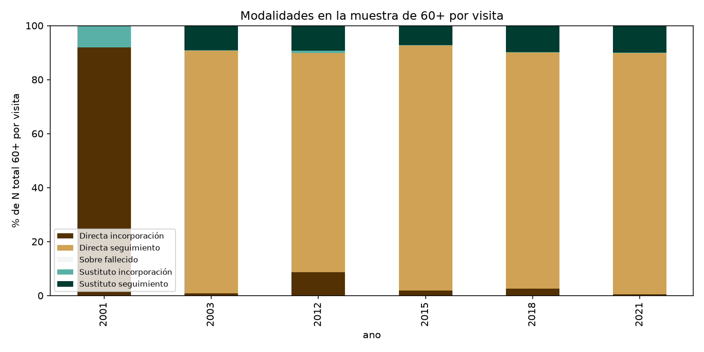

<a id="seccion-pensiones"></a>

## 5. Pensiones, titularidad y apoyos: definiciones y versiones

<a id="origen-d0f3c2eda959"></a>

### Beneficiarios, orientación, duplicación y desconocidos

*Evidencia previa conservada: revisar población, versión y denominador de cada cuadro; no sumar etapas.*

#### Objetivo, alcance y preservación

Se evalúa a quién corresponde la recepción del bloque K, conservando todas las 99,676 personas-ronda de ENASEMsimple (27,171 personas del periodo). La base integrada anterior permanece intacta, con SHA-256 `8c2ec866de93f76abbd7b917de7790fc82a7a7bfa1f67a0f62e11276d542116d`. Los auxiliares se guardan por separado en data/processed/auditoria_titularidad_v1. Ningún identificador se publica. CP1 y los datos fuente no se modificaron.

La pensión propia corresponde al beneficiario, aunque su pareja haya respondido la sección económica. Pensión del cónyuge significa contexto de la pareja residente, no ingreso adjudicado al sujeto. Ambas categorías pueden coexistir. Hogar significa entrevista económica de persona/pareja y subhogar específico: no constituye un censo de prestaciones de todos los miembros de la vivienda.

#### Método y límites documentales

Se reutilizan las uniones auditadas: puentes F13/F14 en 2001/2003 y subhogares por año en 2012–2021. La clave personal sigue siendo cunicah:np, y cada observación id+ronda es única. La respuesta 1 confirma recepción; cuatro negativas 2 confirman ausencia en este bloque. NR=8, NS=9 y especiales Stata mantienen desconocidos. Una cantidad positiva, imputada o construida, no reemplaza la respuesta de recepción.

2001 utiliza key01 del producto individual: orientación del proveedor, con validación independiente limitada porque J1/controles de entrevista no están suministrados. 2003 coteja key03 con K96a y codent03 (3 puede referirse a códigos 3/4, condicionado a unicidad). 2012/2015 cotejan key12/key15 con K96a y NP. Los informantes externos, ausentes o discordantes permanecen indeterminados; no se reconstruye el orden de entrevistas. 2018/2021 requieren concordancia del NP seleccionado en los punteros del individual y hogar; 2021 exige además key_21. Una misma rama no puede identificar dos personas. Todos estos son auxiliares provisionales, no una homologación final de ocho conceptos.

La ausencia explícita de pareja residente permite cerrar su rama como no aplicable a pareja residente; no se deriva de columnas faltantes. En los hogares con rama de pareja desconocida se mantiene desconocida la ausencia total de pensiones. En las personas sobre fallecidos no se acredita recepción actual.

#### Resultados por ronda

##### 2001

| Resultado | N | % de N ronda |
| --- | --- | --- |
| Personas totales | 15186 | 100.00 |
| Titular orientado provisionalmente | 15126 | 99.60 |
| Titularidad indeterminada | 60 | 0.40 |
| Pensión propia K: sí | 2325 | 15.31 |
| Pensión propia K: no explícito | 12801 | 84.29 |
| Pensión propia K: desconocida | 60 | 0.40 |
| Personas con pensión del cónyuge K | 1307 | 8.61 |
| Ambas personas reciben K | 142 | 0.94 |
| Recepción de pareja K desconocida | 61 | 0.40 |

| Resultado | N | % hogares enlazados |
| --- | --- | --- |
| Hogares enlazados únicos | 9811 | 100.00 |
| Hogares con pensión K | 2269 | 23.13 |
| Hogares sin pensión K explícita | 7541 | 76.86 |
| Hogares de recepción K desconocida | 1 | 0.01 |

En 2001, 2,325 de 15,186 personas de la ronda tienen evidencia de recepción propia K bajo estas reglas (15.31%). La orientación se confirma o conserva documentalmente para 15,126, mientras 60 requieren verificación. Hay 1,307 personas cuya pareja recibe, incluidas 142 que también reciben personalmente: estos conteos se solapan y no se suman como personas diferentes. 2,269 de 9,811 entrevistas económicas enlazadas contienen recepción K; el denominador de hogar difiere del individual. No es una estimación nacional ponderada.

| ano | estado | N | pct_N_ronda |
| --- | --- | --- | --- |
| 2001 | orientacion_proveedor_sin_J1_original | 15126 | 99.60 |
| 2001 | sin_fuentes | 59 | 0.39 |
| 2001 | orientacion_proveedor_ausente | 1 | 0.01 |
| 2001 | pareja_contexto_pareja_pregunta_historica | 15126 | 99.60 |
| 2001 | pareja_titular_propio_no_validado | 60 | 0.40 |

Los titulares orientados se basan en key01 publicado; no se declara comprobación independiente del control J1. Su clasificación permanece candidata hasta recuperar ese control. No se confunde codent01 con NP moderno.

##### 2003

| Resultado | N | % de N ronda |
| --- | --- | --- |
| Personas totales | 14250 | 100.00 |
| Titular orientado provisionalmente | 13025 | 91.40 |
| Titularidad indeterminada | 1225 | 8.60 |
| Pensión propia K: sí | 2277 | 15.98 |
| Pensión propia K: no explícito | 10748 | 75.42 |
| Pensión propia K: desconocida | 1225 | 8.60 |
| Personas con pensión del cónyuge K | 1359 | 9.54 |
| Ambas personas reciben K | 180 | 1.26 |
| Recepción de pareja K desconocida | 1225 | 8.60 |

| Resultado | N | % hogares enlazados |
| --- | --- | --- |
| Hogares enlazados únicos | 8895 | 100.00 |
| Hogares con pensión K | 2337 | 26.27 |
| Hogares sin pensión K explícita | 6558 | 73.73 |
| Hogares de recepción K desconocida | 0 | 0.00 |

En 2003, 2,277 de 14,250 personas de la ronda tienen evidencia de recepción propia K bajo estas reglas (15.98%). La orientación se confirma o conserva documentalmente para 13,025, mientras 1,225 requieren verificación. Hay 1,359 personas cuya pareja recibe, incluidas 180 que también reciben personalmente: estos conteos se solapan y no se suman como personas diferentes. 2,337 de 8,895 entrevistas económicas enlazadas contienen recepción K; el denominador de hogar difiere del individual. No es una estimación nacional ponderada.

| ano | estado | N | pct_N_ronda |
| --- | --- | --- | --- |
| 2003 | key_informante_concordante | 13014 | 91.33 |
| 2003 | informante_externo_o_ausente_orden_no_verificado | 579 | 4.06 |
| 2003 | sin_fuentes | 577 | 4.05 |
| 2003 | key_informante_discrepante | 55 | 0.39 |
| 2003 | mas_de_una_persona_en_misma_rama | 14 | 0.10 |
| 2003 | informante_codigo_3_condicionado_unicidad | 11 | 0.08 |
| 2003 | pareja_contexto_pareja_pregunta_historica | 13025 | 91.40 |
| 2003 | pareja_titular_propio_no_validado | 1225 | 8.60 |

Los casos de informante externo o control discordante quedan desconocidos incluso si el proveedor publicó montos. El salto documental basado en orden de entrevista no se reproduce sin sus controles. Las diferencias entre rondas pueden reflejar disponibilidad de ese control y composición, además de cambios en recepción.

##### 2012

| Resultado | N | % de N ronda |
| --- | --- | --- |
| Personas totales | 18465 | 100.00 |
| Titular orientado provisionalmente | 14710 | 79.66 |
| Titularidad indeterminada | 3755 | 20.34 |
| Pensión propia K: sí | 3338 | 18.08 |
| Pensión propia K: no explícito | 11317 | 61.29 |
| Pensión propia K: desconocida | 3810 | 20.63 |
| Personas con pensión del cónyuge K | 1952 | 10.57 |
| Ambas personas reciben K | 459 | 2.49 |
| Recepción de pareja K desconocida | 7974 | 43.18 |

| Resultado | N | % hogares enlazados |
| --- | --- | --- |
| Hogares enlazados únicos | 10427 | 100.00 |
| Hogares con pensión K | 3391 | 32.52 |
| Hogares sin pensión K explícita | 3757 | 36.03 |
| Hogares de recepción K desconocida | 3279 | 31.45 |

En 2012, 3,338 de 18,465 personas de la ronda tienen evidencia de recepción propia K bajo estas reglas (18.08%). La orientación se confirma o conserva documentalmente para 14,710, mientras 3,755 requieren verificación. Hay 1,952 personas cuya pareja recibe, incluidas 459 que también reciben personalmente: estos conteos se solapan y no se suman como personas diferentes. 3,391 de 10,427 entrevistas económicas enlazadas contienen recepción K; el denominador de hogar difiere del individual. No es una estimación nacional ponderada.

| ano | estado | N | pct_N_ronda |
| --- | --- | --- | --- |
| 2012 | key_informante_concordante | 14710 | 79.66 |
| 2012 | sin_fuentes | 2742 | 14.85 |
| 2012 | informante_externo_o_ausente_orden_no_verificado | 1000 | 5.42 |
| 2012 | key_informante_discrepante | 11 | 0.06 |
| 2012 | mas_de_una_persona_en_misma_rama | 2 | 0.01 |
| 2012 | pareja_contexto_pareja_pregunta_historica | 14710 | 79.66 |
| 2012 | pareja_titular_propio_no_validado | 3755 | 20.34 |

##### 2015

| Resultado | N | % de N ronda |
| --- | --- | --- |
| Personas totales | 15988 | 100.00 |
| Titular orientado provisionalmente | 14032 | 87.77 |
| Titularidad indeterminada | 1956 | 12.23 |
| Pensión propia K: sí | 4602 | 28.78 |
| Pensión propia K: no explícito | 9400 | 58.79 |
| Pensión propia K: desconocida | 1986 | 12.42 |
| Personas con pensión del cónyuge K | 2736 | 17.11 |
| Ambas personas reciben K | 1066 | 6.67 |
| Recepción de pareja K desconocida | 1993 | 12.47 |

| Resultado | N | % hogares enlazados |
| --- | --- | --- |
| Hogares enlazados únicos | 9953 | 100.00 |
| Hogares con pensión K | 4384 | 44.05 |
| Hogares sin pensión K explícita | 5492 | 55.18 |
| Hogares de recepción K desconocida | 77 | 0.77 |

En 2015, 4,602 de 15,988 personas de la ronda tienen evidencia de recepción propia K bajo estas reglas (28.78%). La orientación se confirma o conserva documentalmente para 14,032, mientras 1,956 requieren verificación. Hay 2,736 personas cuya pareja recibe, incluidas 1,066 que también reciben personalmente: estos conteos se solapan y no se suman como personas diferentes. 4,384 de 9,953 entrevistas económicas enlazadas contienen recepción K; el denominador de hogar difiere del individual. No es una estimación nacional ponderada.

| ano | estado | N | pct_N_ronda |
| --- | --- | --- | --- |
| 2015 | key_informante_concordante | 14032 | 87.77 |
| 2015 | sin_fuentes | 1209 | 7.56 |
| 2015 | informante_externo_o_ausente_orden_no_verificado | 713 | 4.46 |
| 2015 | orientacion_proveedor_ausente | 34 | 0.21 |
| 2015 | pareja_contexto_pareja_pregunta_historica | 14032 | 87.77 |
| 2015 | pareja_titular_propio_no_validado | 1956 | 12.23 |

##### 2018

| Resultado | N | % de N ronda |
| --- | --- | --- |
| Personas totales | 18249 | 100.00 |
| Titular orientado provisionalmente | 17086 | 93.63 |
| Titularidad indeterminada | 1163 | 6.37 |
| Pensión propia K: sí | 4012 | 21.98 |
| Pensión propia K: no explícito | 12788 | 70.08 |
| Pensión propia K: desconocida | 1449 | 7.94 |
| Personas con pensión del cónyuge K | 2225 | 12.19 |
| Ambas personas reciben K | 660 | 3.62 |
| Recepción de pareja K desconocida | 1480 | 8.11 |

| Resultado | N | % hogares enlazados |
| --- | --- | --- |
| Hogares enlazados únicos | 11401 | 100.00 |
| Hogares con pensión K | 3744 | 32.84 |
| Hogares sin pensión K explícita | 7361 | 64.56 |
| Hogares de recepción K desconocida | 296 | 2.60 |

En 2018, 4,012 de 18,249 personas de la ronda tienen evidencia de recepción propia K bajo estas reglas (21.98%). La orientación se confirma o conserva documentalmente para 17,086, mientras 1,163 requieren verificación. Hay 2,225 personas cuya pareja recibe, incluidas 660 que también reciben personalmente: estos conteos se solapan y no se suman como personas diferentes. 3,744 de 11,401 entrevistas económicas enlazadas contienen recepción K; el denominador de hogar difiere del individual. No es una estimación nacional ponderada.

| ano | estado | N | pct_N_ronda | N_pares_disponibles |
| --- | --- | --- | --- | --- |
| 2018 | puntero_personal_concordante | 17086 | 93.63 | ND |
| 2018 | sin_fuentes | 1155 | 6.33 | ND |
| 2018 | puntero_hogar_individual_discrepante | 5 | 0.03 | ND |
| 2018 | ambos_punteros_mismo_titular | 3 | 0.02 | ND |
| 2018 | pareja_puntero_pareja_concordante | 11781 | 64.56 | ND |
| 2018 | pareja_sin_pareja_residente_explicita | 5302 | 29.05 | ND |
| 2018 | pareja_titular_propio_no_validado | 1163 | 6.37 | ND |
| 2018 | pareja_puntero_pareja_ausente_o_discrepante | 3 | 0.02 | ND |
| 2018 | cotejo_k45d_18 | 4 | ND | 17094 |
| 2018 | cotejo_k52a_1_18 | 6 | ND | 11792 |
| 2018 | cotejo_k52a_18 | 0 | ND | 17094 |

##### 2021

| Resultado | N | % de N ronda |
| --- | --- | --- |
| Personas totales | 17538 | 100.00 |
| Titular orientado provisionalmente | 15639 | 89.17 |
| Titularidad indeterminada | 1899 | 10.83 |
| Pensión propia K: sí | 3993 | 22.77 |
| Pensión propia K: no explícito | 11635 | 66.34 |
| Pensión propia K: desconocida | 1910 | 10.89 |
| Personas con pensión del cónyuge K | 2027 | 11.56 |
| Ambas personas reciben K | 529 | 3.02 |
| Recepción de pareja K desconocida | 1977 | 11.27 |

| Resultado | N | % hogares enlazados |
| --- | --- | --- |
| Hogares enlazados únicos | 10716 | 100.00 |
| Hogares con pensión K | 3776 | 35.24 |
| Hogares sin pensión K explícita | 6931 | 64.68 |
| Hogares de recepción K desconocida | 9 | 0.08 |

En 2021, 3,993 de 17,538 personas de la ronda tienen evidencia de recepción propia K bajo estas reglas (22.77%). La orientación se confirma o conserva documentalmente para 15,639, mientras 1,899 requieren verificación. Hay 2,027 personas cuya pareja recibe, incluidas 529 que también reciben personalmente: estos conteos se solapan y no se suman como personas diferentes. 3,776 de 10,716 entrevistas económicas enlazadas contienen recepción K; el denominador de hogar difiere del individual. No es una estimación nacional ponderada.

| ano | estado | N | pct_N_ronda | N_pares_disponibles |
| --- | --- | --- | --- | --- |
| 2021 | puntero_personal_concordante | 15639 | 89.17 | ND |
| 2021 | sin_fuentes | 1822 | 10.39 | ND |
| 2021 | puntero_hogar_individual_discrepante | 65 | 0.37 | ND |
| 2021 | orientacion_individual_no_confirmada | 12 | 0.07 | ND |
| 2021 | pareja_puntero_pareja_concordante | 10059 | 57.36 | ND |
| 2021 | pareja_sin_pareja_residente_explicita | 5516 | 31.45 | ND |
| 2021 | pareja_titular_propio_no_validado | 1899 | 10.83 | ND |
| 2021 | pareja_puntero_pareja_ausente_o_discrepante | 64 | 0.36 | ND |
| 2021 | cotejo_k45d_21 | 32 | ND | 15716 |
| 2021 | cotejo_k52a_1_21 | 97 | ND | 10189 |
| 2021 | cotejo_k52a_21 | 0 | ND | 15716 |

El programa de vejez explícito se identifica adicionalmente para 5,460 personas y para 2,830 parejas. K79/K82 permite dinero o especie; esta evidencia se mantiene separada de recepción K y no acredita por sí sola un monto monetario. Una negativa en K58/K64 no significa ausencia de todo apoyo pensionario.

#### Cotejos de la orientación construida histórica

| ano | fuente | tipo | N_pares_validos | N_discordantes | verificacion | N_discordantes_disponibilidad |
| --- | --- | --- | --- | --- | --- | --- |
| 2001 | F12 | filtro_pareja | 4298 | 0 | afirmativa_conyuge_en_rama_sin_pareja | ND |
| 2001 | F13 | 1 | 15126 | 0 | pens_tipo_vs_imam_rama_key | ND |
| 2001 | F13 | 2 | 15126 | 0 | pens_tipo_vs_imam_rama_key | ND |
| 2001 | F13 | 3 | 15126 | 0 | pens_tipo_vs_imam_rama_key | ND |
| 2001 | F13 | 4 | 15126 | 0 | pens_tipo_vs_imam_rama_key | ND |
| 2003 | F11 | filtro_pareja | 4003 | 0 | afirmativa_conyuge_en_rama_sin_pareja | ND |
| 2003 | F14 | 1 | 13667 | 0 | pens_tipo_vs_imam_rama_key | ND |
| 2003 | F14 | 2 | 13667 | 0 | pens_tipo_vs_imam_rama_key | ND |
| 2003 | F14 | 3 | 13667 | 0 | pens_tipo_vs_imam_rama_key | ND |
| 2003 | F14 | 4 | 13667 | 0 | pens_tipo_vs_imam_rama_key | ND |
| 2012 | F15 | 1 | 15721 | 0 | pens_tipo_vs_imam_rama_key | ND |
| 2012 | F15 | 2 | 15721 | 0 | pens_tipo_vs_imam_rama_key | ND |
| 2012 | F15 | 3 | 15721 | 0 | pens_tipo_vs_imam_rama_key | ND |
| 2012 | F15 | 4 | 15721 | 0 | pens_tipo_vs_imam_rama_key | ND |
| 2015 | F08 | filtro_pareja | 4414 | 0 | afirmativa_conyuge_en_rama_sin_pareja | ND |
| 2018 | F09 | filtro_pareja | 5302 | 0 | afirmativa_conyuge_en_rama_sin_pareja | ND |
| 2018 | F09 | punteros_hogar | 6099 | 3 | ambas_ramas_apuntan_a_misma_persona | ND |
| 2021 | F10 | filtro_pareja | 5517 | 0 | afirmativa_conyuge_en_rama_sin_pareja | ND |
| 2021 | F17/F10 | todas | 3718 | 0 | monto_personal_almacenado_vs_eventos_originales_unicos | 0 |
| 2021 | F10 | punteros_hogar | 5199 | 1 | ambas_ramas_apuntan_a_misma_persona | ND |

Se coteja cada pens_tipo publicado contra el componente imam de la rama seleccionada por key (1 propia del informante económico, 2 pareja del informante). La concordancia valida el significado operativo del key en estos archivos; no reemplaza el control original de titularidad ni convierte el monto imputado en evidencia de recepción. CLAVE3 histórico identifica a una persona absoluta; key es una orientación relativa de la fila. No se intercambian.

#### Discrepancias y cambios de clasificación en 2021

La comparación con la clasificación efectivamente almacenada en la base anterior arroja **0 cambios de estado de recepción propia K**. Se presenta la matriz completa, incluidos desconocidos. La comparación de pareja es interna a la auditoría: rama orientada antes/después de cotejar el OTRO puntero, no un indicador guardado anteriormente. El escenario de cualquier pensión del hogar atribuida al sujeto es contrafactual y no fue la regla aplicada en la base anterior.

El cotejo adicional de pareja cambia **64 estados a desconocidos**, incluidos **16 inicialmente afirmativos**. La recepción comprobable de pareja queda en 2,027, y ambos reciben en 529. No se alteran los punteros ni se adjudica al sujeto un pago de titularidad dudosa.

| comparacion | antes | despues | N |
| --- | --- | --- | --- |
| clasificacion_almacenada_vs_auditada | desconocido | desconocido | 1910 |
| clasificacion_almacenada_vs_auditada | desconocido | no | 0 |
| clasificacion_almacenada_vs_auditada | desconocido | si | 0 |
| clasificacion_almacenada_vs_auditada | no | desconocido | 0 |
| clasificacion_almacenada_vs_auditada | no | no | 11635 |
| clasificacion_almacenada_vs_auditada | no | si | 0 |
| clasificacion_almacenada_vs_auditada | si | desconocido | 0 |
| clasificacion_almacenada_vs_auditada | si | no | 0 |
| clasificacion_almacenada_vs_auditada | si | si | 3993 |
| pareja_sin_cotejo_del_otro_puntero_vs_cotejada | desconocido | desconocido | 1913 |
| pareja_sin_cotejo_del_otro_puntero_vs_cotejada | desconocido | no | 0 |
| pareja_sin_cotejo_del_otro_puntero_vs_cotejada | desconocido | si | 0 |
| pareja_sin_cotejo_del_otro_puntero_vs_cotejada | no | desconocido | 48 |
| pareja_sin_cotejo_del_otro_puntero_vs_cotejada | no | no | 13534 |
| pareja_sin_cotejo_del_otro_puntero_vs_cotejada | no | si | 0 |
| pareja_sin_cotejo_del_otro_puntero_vs_cotejada | si | desconocido | 16 |
| pareja_sin_cotejo_del_otro_puntero_vs_cotejada | si | no | 0 |
| pareja_sin_cotejo_del_otro_puntero_vs_cotejada | si | si | 2027 |
| contrafactual_cualquier_pension_hogar_atribuida_a_persona | desconocido | desconocido | 1837 |
| contrafactual_cualquier_pension_hogar_atribuida_a_persona | desconocido | no | 3587 |
| contrafactual_cualquier_pension_hogar_atribuida_a_persona | desconocido | si | 0 |
| contrafactual_cualquier_pension_hogar_atribuida_a_persona | no | desconocido | 37 |
| contrafactual_cualquier_pension_hogar_atribuida_a_persona | no | no | 6543 |
| contrafactual_cualquier_pension_hogar_atribuida_a_persona | no | si | 0 |
| contrafactual_cualquier_pension_hogar_atribuida_a_persona | si | desconocido | 36 |
| contrafactual_cualquier_pension_hogar_atribuida_a_persona | si | no | 1505 |
| contrafactual_cualquier_pension_hogar_atribuida_a_persona | si | si | 3993 |

Las diferencias de punteros se cuentan entre pares disponibles por campo; los 32 casos de puntero propio y 97 del cónyuge documentados previamente no se suman como errores independientes. La concordancia del puntero seleccionado puede confirmar un titular mientras el otro campo queda pendiente. No se corrigen NP ni se impone automáticamente una fuente sobre otra.

#### Auditoría de duplicación de montos

| ano | N_hogares_enlazados | N_hogares_ambas_personas_orientadas | N_slots_declarados_enlazados | N_slots_monto_observado | N_slots_sin_monto_observado | N_replicas_evitable_persona | suma_mensual_parcial_hogares | suma_ingenua_filas_persona | exceso_por_replicacion | N_firmas_coincidentes_a_revisar | N_firmas_coincidentes_entre_beneficiarios | N_hogares_ambas_ramas_reciben | N_slots_viudez | N_slots_viudez_beneficiario_identificado |
| --- | --- | --- | --- | --- | --- | --- | --- | --- | --- | --- | --- | --- | --- | --- |
| 2001 | 9811 | 5316 | 2408 | 2287 | 121 | 1313 | 5,672,183.00 | 9,050,805.00 | 3,378,622.00 | 0 | 0 | 73 | 497 | 497 |
| 2003 | 8895 | 4664 | 2492 | 2396 | 96 | 1411 | 6,876,943.00 | 11,357,489.00 | 4,480,546.00 | 0 | 0 | 93 | 451 | 410 |
| 2012 | 10427 | 5105 | 3829 | 3521 | 308 | 2031 | 28,406,928.00 | 45,898,774.00 | 17,491,846.00 | 0 | 0 | 243 | 656 | 585 |
| 2015 | 9953 | 4728 | 5283 | 4989 | 294 | 2833 | 37,801,368.00 | 58,220,851.00 | 20,419,483.00 | 33 | 0 | 565 | 791 | 720 |
| 2018 | 11401 | 5688 | 4362 | 3950 | 412 | 2262 | 24,319,880.00 | 37,626,745.00 | 13,306,865.00 | 0 | 0 | 340 | 851 | 850 |
| 2021 | 10716 | 4926 | 4367 | 4051 | 316 | 2139 | 41,155,639.00 | 63,048,322.00 | 21,892,683.00 | 0 | 0 | 274 | 974 | 972 |

Cada evento original se identifica por año, hogar económico, fuente, versión, rama beneficiaria, contingencia y slot. Se agrega una sola vez en hogares, aunque el LEFT JOIN lo replique en dos filas individuales. La suma ingenua sirve exclusivamente para cuantificar esa replicación; no es una estimación de ingresos. Las sumas son montos mensuales observados parciales en pesos nominales de cada ronda: incluyen ceros válidos, excluyen NR/NS y cantidades faltantes, y no se comparan como poder adquisitivo real.

Dos beneficios con monto e institución iguales, pertenecientes a beneficiarios o slots distintos, no se eliminan automáticamente. Las firmas coincidentes son candidatos a revisión de origen, no duplicados comprobados. Si ambos cónyuges reciben, se conservan ambas ramas y sus instituciones/montos. En 2012/2015 las instituciones son una selección múltiple por contingencia: no se multiplica el monto por institución ni se inventa una correspondencia institución-slot.

Los montos originales, derivados, imputados y construidos ya están conservados en la base anterior. El registro de eventos usa solo originales: ningún valor imam/am, bandera ni pens_t/inc_pension se suma como ingreso adicional. Elegir una versión imputada para análisis futuros requerirá un registro separado con la misma clave lógica y su bandera. No se duplica la copia individual 2018 ni se incorpora 2024.

Los libros K2001 PDF p.38 y K2003 p.43 documentan RF=888888 y NS=999999 para los montos pensionarios originales; en 2012–2021 son 8888888/9999999. Estos códigos se excluyen únicamente en las preguntas correspondientes y se conservan en monto_codigo_original. La revisión del primer cálculo de montos detectó que la regla de siete dígitos no era válida en las dos rondas tempranas; se corrigió el contrato y se recalculó únicamente esta auditoría, sin modificar la base ni el EDA anterior.

#### Viudez y supervivencia

La contingencia de viudez (tipo 2) se atribuye a la persona que cobra según la orientación económica validada; quien generó originalmente el derecho no se transforma en receptor actual. Las expectativas de heredar una pensión K60/K63/K66/K69 o K70–77 no son pagos recibidos. Los montos antes/después de la muerte K101/K103 pueden referirse a prestaciones ya registradas en K58/K64 y no se añaden a sus slots. Los bloques de divorcio/separación/supervivencia K79b/K82d permanecen como fuentes separadas de composición ambigua; no se tipifican automáticamente como pensión previsional ni se suman sin reconciliar.

#### Modalidades y limitaciones

| ano | tipent | N | N_titular_orientado | N_propia_si | N_propia_desconocida |
| --- | --- | --- | --- | --- | --- |
| 2001 | 2 | 14154 | 14098 | 2204 | 56 |
| 2001 | 4 | 1032 | 1028 | 121 | 4 |
| 2003 | 1 | 12363 | 12258 | 2165 | 105 |
| 2003 | 2 | 163 | 153 | 26 | 10 |
| 2003 | 3 | 1134 | 579 | 79 | 555 |
| 2003 | 4 | 44 | 35 | 7 | 9 |
| 2003 | 5 | 546 | 0 | 0 | 546 |
| 2012 | 1 | 8868 | 8738 | 2721 | 159 |
| 2012 | 2 | 5580 | 5526 | 523 | 79 |
| 2012 | 3 | 959 | 272 | 78 | 687 |
| 2012 | 4 | 316 | 174 | 16 | 143 |
| 2012 | 5 | 2742 | 0 | 0 | 2742 |
| 2015 | 1 | 13254 | 13120 | 4410 | 162 |
| 2015 | 2 | 596 | 562 | 96 | 36 |
| 2015 | 3 | 884 | 321 | 89 | 563 |
| 2015 | 4 | 45 | 29 | 7 | 16 |
| 2015 | 5 | 1209 | 0 | 0 | 1209 |
| 2018 | 1 | 11183 | 11159 | 3390 | 45 |
| 2018 | 2 | 4603 | 4599 | 301 | 242 |
| 2018 | 3 | 1122 | 1122 | 311 | 7 |
| 2018 | 4 | 206 | 206 | 10 | 20 |
| 2018 | 5 | 1135 | 0 | 0 | 1135 |
| 2021 | 1 | 14336 | 14269 | 3621 | 73 |
| 2021 | 2 | 148 | 129 | 15 | 21 |
| 2021 | 3 | 1247 | 1233 | 355 | 17 |
| 2021 | 4 | 8 | 8 | 2 | 0 |
| 2021 | 5 | 1799 | 0 | 0 | 1799 |

Los conteos conservan directas, sustitutos y sobre fallecidos con sus códigos individuales de CP1. El informante económico no es necesariamente el beneficiario ni el entrevistado directo. No hay pesos longitudinales aprobados, deflactor, clasificación definitiva contributiva/no contributiva ni corrección automática de punteros. También sigue pendiente recuperar J1/control 2001, validar órdenes históricos, resolver discrepancias 2021 y cotejar la titularidad contra fuentes adicionales. La recepción declarada se refiere al periodo retrospectivo de cada cuestionario, no acredita cobro al día de entrevista.

El descenso del conteo K entre 2015 y 2018 no demuestra pérdida de cobertura pensionaria: las categorías institucionales cambian. K59/K65 en 2012/2015 permite programas federales/estatales, mientras 2018/2021 pregunta los apoyos públicos en otro bloque. En 2012, 3,279 hogares mantienen desconocida la ausencia total por falta de un filtro de pareja utilizable en el archivo suministrado; la falta de afirmativas no se transformó en ausencia. Completar este denominador exige controles originales adicionales. La comparación temporal es de composición y cobertura documental, no de efectos causales ni trayectoria individual de cobro.

#### Documentos primarios cotejados

Cuestionarios básicos y libros K de cada ronda, concordancia de preguntas y documentos de imputación del proveedor. Los localizadores/huellas están en fuentes_documentales.json; el documento de variables creadas v4/mayo 2026 no describe por sí solo las reglas económicas y no se utiliza para fijar titularidad.

- [concordancia](https://www.mhasweb.org/resources/DOCUMENTS/Question_Comparison/ENGLISH/Question_Comparison_Core_Questionnaire_MHAS_2001-2021.pdf), 42 páginas; SHA-256 registrado.
- [construidos](https://www.mhasweb.org/Resources/DATA/Constructed_Imputed/Created_Variables/MHAS_Created_Variables_Descriptive_Document.pdf), 276 páginas; SHA-256 registrado.
- [im2001](https://www.mhasweb.org/Resources/DOCUMENTS/2001/Imputation_of_Non-Reponse_on_Economic_Variables_in_the_MHAS-ENASEM_2001.pdf), 84 páginas; SHA-256 registrado.
- [im2003](https://www.mhasweb.org/Resources/DOCUMENTS/2003/Imputation_of_Non-Reponse_on_Economic_Variables_in_the_MHAS-ENASEM_2003.pdf), 55 páginas; SHA-256 registrado.
- [im2012](https://www.mhasweb.org/Resources/DOCUMENTS/2012/Imputations/Imputation_of_Non_Reponse_on_Economic_Variables_in_the_MHAS_ENASEM_2012.pdf), 46 páginas; SHA-256 registrado.
- [im2015](https://www.mhasweb.org/Resources/DOCUMENTS/2015/Imputations/Imputation_of_Non_Reponse_on_Economic_Variables_in_the_MHAS_ENASEM_2015.pdf), 49 páginas; SHA-256 registrado.
- [q2015](https://www.mhasweb.org/resources/DOCUMENTS/2015/Cuestionario_Basico_2015.pdf), 156 páginas; SHA-256 registrado.
- [q2012](https://www.mhasweb.org/resources/DOCUMENTS/2012/Cuestionario_Basico_2012.pdf), 117 páginas; SHA-256 registrado.
- [q2003](https://www.mhasweb.org/resources/DOCUMENTS/2003/Cuestionario_Basico_2003.pdf), 145 páginas; SHA-256 registrado.
- [q2001](https://www.mhasweb.org/resources/DOCUMENTS/2001/Cuestionario_Basico_2001.pdf), 126 páginas; SHA-256 registrado.
- [im2018](https://www.mhasweb.org/Resources/DOCUMENTS/2018/Imputation_of_Non_Reponse_on_Economic_Variables_in_the_MHAS_ENASEM_2018.pdf), 219 páginas; SHA-256 registrado.
- [cbK2021](https://www.mhasweb.org/resources/DOCUMENTS/2021/Codebook/Section_K_21.pdf), 123 páginas; SHA-256 registrado.
- [cbK2018](https://www.mhasweb.org/resources/DOCUMENTS/2018/Codebook/Section_K_Pension_Income_and_Assets_2018.pdf), 123 páginas; SHA-256 registrado.
- [cbK2015](https://www.mhasweb.org/resources/DOCUMENTS/2015/Codebook/Section_K_Pension_Income_and_Assets_2015.pdf), 166 páginas; SHA-256 registrado.
- [cbK2012](https://www.mhasweb.org/resources/DOCUMENTS/2012/Codebook/Section_K_Pensions_Income_and_Assets_2012.pdf), 147 páginas; SHA-256 registrado.
- [cbK2003](https://www.mhasweb.org/resources/DOCUMENTS/2003/Codebook/Section_K_Pension_Income_and_Assets_2003.pdf), 73 páginas; SHA-256 registrado.
- [cbK2001](https://www.mhasweb.org/resources/DOCUMENTS/2001/Codebook/Section_K_Pension_Income_and_Assets_2001.pdf), 56 páginas; SHA-256 registrado.
- [q2018](https://www.inegi.org.mx/contenidos/programas/enasem/2018/doc/enasem_2018_cuestionario_basico.pdf), 134 páginas; SHA-256 registrado.
- [q2021](https://www.inegi.org.mx/contenidos/programas/enasem/2021/doc/enasem_2021_cuestionario_basico.pdf), 120 páginas; SHA-256 registrado.
- [im2021](https://www.mhasweb.org/Resources/DOCUMENTS/2021/Imputation_of_Non_Reponse_on_Economic_Variables_in_the_MHAS_ENASEM_2021.pdf), 236 páginas; SHA-256 registrado.

#### Reproducción y consulta en VS Code

Ejecutar `python scripts/run_pension_ownership_audit.py` y `python scripts/build_ownership_notebook.py --execute`. Abrir el informe, `resultados.json` y `reports/notebooks/05c_titularidad_pensiones_ejecutado.ipynb`. Los Parquet del sidecar contienen microdatos privados: no deben publicarse. El notebook fuente no contiene outputs y la copia ejecutada muestra exclusivamente agregados. La redacción y tabla de síntesis se incluyen en capítulos 3–4 del manuscrito.


<a id="origen-29857ad7487b"></a>

### Armonización J02: recepción propia, pareja y coexistencia

*Evidencia previa conservada: revisar población, versión y denominador de cada cuadro; no sumar etapas.*

#### Objetivo, población y método

Se estudia la recepción observada y su distribución entre perfiles de personas de 60 años o más en cada visita, sin filtrar permanentemente la base. Se reutilizan los roles y claves de la auditoría v1; no se repiten las 17 uniones ni se reclasifican sus titulares. La base anterior conserva 99,676 filas y 27,171 personas. K agrupa jubilación, viudez, incapacidad y otra pensión; A pregunta donativos públicos adicionales en dinero o especie durante el año previo. K no significa exclusivamente contributiva y A no significa exclusivamente pensión no contributiva.

N total es la submuestra 60+ de la ronda. N elegible vivo excluye únicamente los registros sobre fallecidos para recepción contemporánea; estos se conservan y muestran desconocidos en N total. N orientado es cobertura de titularidad, no elegibilidad. N conocido exige respuesta sí/no admisible, nunca un monto positivo. La pareja requiere validación separada del puntero; ausencia de pareja residente se documenta aparte. Educación mide años en la primera entrevista; urbano es localidad <100 mil frente a ≥100 mil, no ruralidad estricta. Edad es la reportada en esa visita: no se corrigen las anomalías de CP1.

Los factores transversales están disponibles, pero su calibración, dominio analítico y el diseño conjunto no están validados para esta selección y seguimiento. Todas las tablas describen la muestra, no estiman cobertura nacional. Se reportan V de Cramér y Spearman como tamaños de asociación contemporánea, sin pruebas de significación poblacional; los estratos desconocidos se muestran en tablas y se excluyen de esas medidas. Las celdas pequeñas se señalan. No hay modelos, causalidad, suficiencia de ingreso ni cambios de política identificados.

#### Armonización documental y contable

2001: K76a/K79a; 2003: K79a/K82c; desde 2012: K79a/K82c con sufijo. Hasta 2015 el donativo es agregado sin nombre observado; los ejemplos del cuestionario no prueban el programa individual. En 2018 se permiten hasta dos instituciones (PROAGRO, PROSPERA, INAPAM, otra); en 2021 se modifican nombres y se añade explícitamente opción 5 de vejez. Las listas de instituciones K incluyen categorías públicas agrupadas en rondas posteriores. Solo IMSS/ISSSTE acreditan aquí seguridad social identificada; otros organismos/regímenes quedan sin tipificación automática. La categoría pública agrupada no identifica ámbito ni programa exacto. Los derechos de viudez corresponden a quien recibe, no a quien originó el derecho.

El texto de K79/K82 excluye ingreso ya mencionado. Esta instrucción reduce solapamiento esperado, pero no demuestra que cada respuesta la respetó. Se conservan todas las mediciones y no se suman K+A ni las versiones original/imputada/construida. Los eventos propios se seleccionan por beneficiario auditado; montos del cónyuge quedan en sus eventos. Un mismo evento de hogar se cuenta una vez aunque aparezca en dos personas. Una segunda institución no multiplica un monto por contingencia. INAPAM no prueba una pensión monetaria y dinero/especie no puede separarse. El monto de mes normal no informa la periodicidad normativa de pago. La comparación entre años es nominal; no mide poder adquisitivo.

La matriz contractual completa está en contratos_armonizacion.json, las versiones en versiones_fuente.json y las [fuentes primarias/hashes](../diccionarios/integracion__titularidad__fuentes_documentales.json) en el dossier de titularidad. K2001 p.51 y p.52 documenta K76/K79; K2003 p.82 del cuestionario; K2012 p.101; K2015 p.102; K2018 pp.79/83; K2021 pp.66/70 (páginas PDF, cotejar foliación impresa). K80/K83 2015 tiene discrepancia documental de seis dígitos en cuestionario frente a siete en libro/etiquetas; los originales suministrados tienen 0 valores de los códigos de seis dígitos en ambos campos, por lo que la alerta no cambió montos ni recepción. Se conserva la discrepancia. Las etiquetas heredadas de programas en el libro 2021 no sustituyen la lista vigente del cuestionario.

#### Flujo y cobertura de fuentes

| ano | N_ronda_completa | N_60 | N_elegible_vivo_60 | N_sobre_fallecido_60 | N_edad_desconocida_ronda | N_fuente_original_enlazada_60 | N_titular_orientado_60 | N_titular_indeterminado_60 | ponderado | N_edad_desconocida_vivos | N_edad_desconocida_sobre_fallecido |
| --- | --- | --- | --- | --- | --- | --- | --- | --- | --- | --- | --- |
| 2,001 | 15,186 | 7,416 | 7,416 | 0 | 0 | 7,394 | 7,393 | 23 | False | 0 | 0 |
| 2,003 | 14,250 | 7,691 | 7,691 | 0 | 557 | 7,676 | 7,211 | 480 | False | 11 | 546 |
| 2,012 | 18,465 | 9,886 | 9,886 | 0 | 2,764 | 9,886 | 9,066 | 820 | False | 22 | 2,742 |
| 2,015 | 15,988 | 10,416 | 10,416 | 0 | 1,213 | 10,416 | 9,774 | 642 | False | 4 | 1,209 |
| 2,018 | 18,249 | 10,113 | 10,113 | 0 | 1,155 | 10,101 | 10,099 | 14 | False | 20 | 1,135 |
| 2,021 | 17,538 | 10,482 | 10,482 | 0 | 1,809 | 10,464 | 10,417 | 65 | False | 10 | 1,799 |

| ano | variable | N_60 | N_ponderador_positivo | aplicado | razon |
| --- | --- | --- | --- | --- | --- |
| 2,001 | factori_01 | 7,416 | 7,416 | False | Factor transversal disponible; diseño, dominio 60+, calibración y atrición no validados |
| 2,003 | factori_03 | 7,691 | 7,609 | False | Factor transversal disponible; diseño, dominio 60+, calibración y atrición no validados |
| 2,012 | factori_12 | 9,886 | 9,253 | False | Factor transversal disponible; diseño, dominio 60+, calibración y atrición no validados |
| 2,015 | factori_15 | 10,416 | 10,186 | False | Factor transversal disponible; diseño, dominio 60+, calibración y atrición no validados |
| 2,018 | factori_18 | 10,113 | 10,110 | False | Factor transversal disponible; diseño, dominio 60+, calibración y atrición no validados |
| 2,021 | factori_21 | 10,482 | 10,482 | False | Factor transversal disponible; diseño, dominio 60+, calibración y atrición no validados |

#### Resultados independientes por ronda

##### 2001

| ano | variable | N_total | N_elegible_vivo | N_si | N_no | N_desconocido | N_conocido | pct_si_total | pct_si_elegible | pct_si_conocido | pct_cobertura_elegible |
| --- | --- | --- | --- | --- | --- | --- | --- | --- | --- | --- | --- |
| 2,001 | pension_propia_k | 7,416 | 7,416 | 1,788 | 5,605 | 23 | 7,393 | 24.11 | 24.11 | 24.19 | 99.69 |
| 2,001 | pension_conyuge_k | 7,416 | 7,416 | 747 | 6,645 | 24 | 7,392 | 10.07 | 10.07 | 10.11 | 99.68 |
| 2,001 | apoyo_propio | 7,416 | 7,416 | 726 | 6,666 | 24 | 7,392 | 9.79 | 9.79 | 9.82 | 99.68 |
| 2,001 | apoyo_conyuge | 7,416 | 7,416 | 411 | 6,981 | 24 | 7,392 | 5.54 | 5.54 | 5.56 | 99.68 |

| ano | categoria | N | N_60 | pct_60 |
| --- | --- | --- | --- | --- |
| 2,001 | Apoyo y negativa propia K | 630 | 7,416 | 8.50 |
| 2,001 | Negativas explícitas K y A | 4,974 | 7,416 | 67.07 |
| 2,001 | Otra situación desconocida | 24 | 7,416 | 0.32 |
| 2,001 | Pensión K y apoyo | 96 | 7,416 | 1.29 |
| 2,001 | Solo pensión K observada | 1,692 | 7,416 | 22.82 |

De 7,416 registros de 60+, 7,416 corresponden a personas vivas y 7,393 tienen orientación propia utilizable. Se identifica pensión propia K en 1,788 y apoyo propio A en 726; quedan respectivamente 23 y 24 estados desconocidos. Entre respuestas conocidas, las proporciones son 24.19% y 9.82%. Estos porcentajes no deben confundirse con tasas sobre todos los elegibles ni con cobertura nacional.

| pension | N_pension_estado | N_apoyo_conocido | N_apoyo_si | pct_apoyo_conocido |
| --- | --- | --- | --- | --- |
| No | 5,605 | 5,604 | 630 | 11.24 |
| Sí | 1,788 | 1,788 | 96 | 5.37 |

El apoyo entre quienes tienen negativa propia K supera al apoyo entre receptoras K en 5.87 puntos porcentuales (diferencia con signo). Se observan tanto cobertura adicional respecto de una negativa K como coexistencia. No se conoce el contrafactual sin programa, ni una negativa K descarta todas las pensiones no contributivas; por tanto, no se afirma una ampliación causal ni cobertura de personas sin ninguna pensión.

| ano | cruce | estrato | N_validos | N_excluidos | V_cramer | N_celdas_esperadas_menor5 |
| --- | --- | --- | --- | --- | --- | --- |
| 2,001 | Pensión K × Apoyo | Toda submuestra 60+ | 7,392 | 24 | 0.08 | 0 |
| 2,001 | P × Localidad a 100 mil (no ruralidad estricta) | Toda submuestra 60+ | 7,393 | 23 | 0.18 | 0 |
| 2,001 | A × Localidad a 100 mil (no ruralidad estricta) | Toda submuestra 60+ | 7,392 | 24 | 0.28 | 0 |
| 2,001 | P × Sexo | Toda submuestra 60+ | 7,393 | 23 | 0.17 | 0 |
| 2,001 | A × Sexo | Toda submuestra 60+ | 7,392 | 24 | 0.07 | 0 |
| 2,001 | P × Escolaridad en primera entrevista | Toda submuestra 60+ | 7,380 | 36 | 0.26 | 0 |
| 2,001 | A × Escolaridad en primera entrevista | Toda submuestra 60+ | 7,379 | 37 | 0.14 | 0 |
| 2,001 | P × Edad en la visita | Toda submuestra 60+ | 7,393 | 23 | 0.06 | 0 |
| 2,001 | A × Edad en la visita | Toda submuestra 60+ | 7,392 | 24 | 0.03 | 0 |
| 2,001 | Pensión K × Apoyo / Localidad a 100 mil (no ruralidad estricta) | <100 mil habitantes | 3,210 | 7 | 0.08 | 0 |
| 2,001 | Pensión K × Apoyo / Localidad a 100 mil (no ruralidad estricta) | ≥100 mil habitantes | 4,182 | 17 | 0.01 | 0 |
| 2,001 | Pensión K × Apoyo / Sexo | Hombre | 3,441 | 10 | 0.14 | 0 |
| 2,001 | Pensión K × Apoyo / Sexo | Mujer | 3,951 | 14 | 0.04 | 0 |
| 2,001 | Pensión K × Escolaridad en primera entrevista / Sexo | Hombre | 3,435 | 16 | 0.27 | 0 |
| 2,001 | Pensión K × Escolaridad en primera entrevista / Sexo | Mujer | 3,945 | 20 | 0.25 | 0 |
| 2,001 | Pensión K × Edad en la visita / Localidad a 100 mil (no ruralidad estricta) | <100 mil habitantes | 3,210 | 7 | 0.04 | 0 |
| 2,001 | Pensión K × Edad en la visita / Localidad a 100 mil (no ruralidad estricta) | ≥100 mil habitantes | 4,183 | 16 | 0.08 | 0 |

| ano | control | recepcion | N_validos | N_excluidos | rho_spearman |
| --- | --- | --- | --- | --- | --- |
| 2,001 | edad | pension_propia_k | 7,393 | 23 | 0.07 |
| 2,001 | edad | apoyo_propio | 7,392 | 24 | 0.01 |
| 2,001 | educacion | pension_propia_k | 7,380 | 36 | 0.24 |
| 2,001 | educacion | apoyo_propio | 7,379 | 37 | -0.13 |

###### Recepción por Localidad a 100 mil (no ruralidad estricta)

| ano | localidad_grupo | variable | N_total | N_elegible_vivo | N_si | N_no | N_desconocido | N_conocido | pct_si_total | pct_si_elegible | pct_si_conocido | pct_cobertura_elegible |
| --- | --- | --- | --- | --- | --- | --- | --- | --- | --- | --- | --- | --- |
| 2,001 | <100 mil habitantes | pension_propia_k | 3,217 | 3,217 | 488 | 2,722 | 7 | 3,210 | 15.17 | 15.17 | 15.20 | 99.78 |
| 2,001 | <100 mil habitantes | pension_conyuge_k | 3,217 | 3,217 | 198 | 3,012 | 7 | 3,210 | 6.15 | 6.15 | 6.17 | 99.78 |
| 2,001 | <100 mil habitantes | apoyo_propio | 3,217 | 3,217 | 622 | 2,588 | 7 | 3,210 | 19.33 | 19.33 | 19.38 | 99.78 |
| 2,001 | <100 mil habitantes | apoyo_conyuge | 3,217 | 3,217 | 360 | 2,850 | 7 | 3,210 | 11.19 | 11.19 | 11.21 | 99.78 |
| 2,001 | ≥100 mil habitantes | pension_propia_k | 4,199 | 4,199 | 1,300 | 2,883 | 16 | 4,183 | 30.96 | 30.96 | 31.08 | 99.62 |
| 2,001 | ≥100 mil habitantes | pension_conyuge_k | 4,199 | 4,199 | 549 | 3,633 | 17 | 4,182 | 13.07 | 13.07 | 13.13 | 99.60 |
| 2,001 | ≥100 mil habitantes | apoyo_propio | 4,199 | 4,199 | 104 | 4,078 | 17 | 4,182 | 2.48 | 2.48 | 2.49 | 99.60 |
| 2,001 | ≥100 mil habitantes | apoyo_conyuge | 4,199 | 4,199 | 51 | 4,131 | 17 | 4,182 | 1.21 | 1.21 | 1.22 | 99.60 |

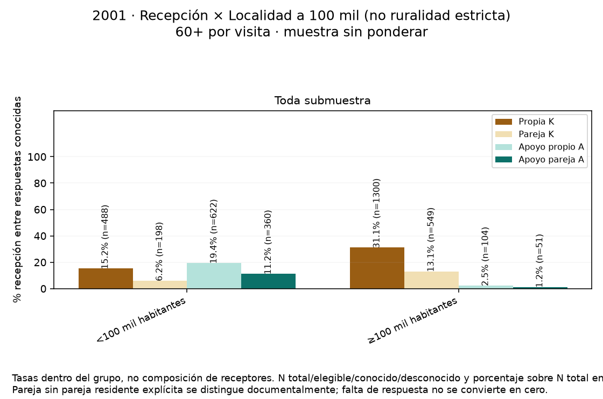

Para pension_propia_k, la tasa entre respuestas conocidas va de 15.20% en «<100 mil habitantes» (488/3,210) a 31.08% en «≥100 mil habitantes» (1,300/4,183). Es una diferencia dentro de grupos, no la composición del conjunto receptor. Los desconocidos y tamaños de grupo se muestran arriba; la comparación puede reflejar selección documental y composición socioeconómica.

Para apoyo_propio, la tasa entre respuestas conocidas va de 2.49% en «≥100 mil habitantes» (104/4,182) a 19.38% en «<100 mil habitantes» (622/3,210). Es una diferencia dentro de grupos, no la composición del conjunto receptor. Los desconocidos y tamaños de grupo se muestran arriba; la comparación puede reflejar selección documental y composición socioeconómica.

###### Recepción por Sexo

| ano | sexo_grupo | variable | N_total | N_elegible_vivo | N_si | N_no | N_desconocido | N_conocido | pct_si_total | pct_si_elegible | pct_si_conocido | pct_cobertura_elegible |
| --- | --- | --- | --- | --- | --- | --- | --- | --- | --- | --- | --- | --- |
| 2,001 | Hombre | pension_propia_k | 3,451 | 3,451 | 1,105 | 2,337 | 9 | 3,442 | 32.02 | 32.02 | 32.10 | 99.74 |
| 2,001 | Hombre | pension_conyuge_k | 3,451 | 3,451 | 132 | 3,310 | 9 | 3,442 | 3.82 | 3.82 | 3.83 | 99.74 |
| 2,001 | Hombre | apoyo_propio | 3,451 | 3,451 | 413 | 3,028 | 10 | 3,441 | 11.97 | 11.97 | 12.00 | 99.71 |
| 2,001 | Hombre | apoyo_conyuge | 3,451 | 3,451 | 194 | 3,248 | 9 | 3,442 | 5.62 | 5.62 | 5.64 | 99.74 |
| 2,001 | Mujer | pension_propia_k | 3,965 | 3,965 | 683 | 3,268 | 14 | 3,951 | 17.23 | 17.23 | 17.29 | 99.65 |
| 2,001 | Mujer | pension_conyuge_k | 3,965 | 3,965 | 615 | 3,335 | 15 | 3,950 | 15.51 | 15.51 | 15.57 | 99.62 |
| 2,001 | Mujer | apoyo_propio | 3,965 | 3,965 | 313 | 3,638 | 14 | 3,951 | 7.89 | 7.89 | 7.92 | 99.65 |
| 2,001 | Mujer | apoyo_conyuge | 3,965 | 3,965 | 217 | 3,733 | 15 | 3,950 | 5.47 | 5.47 | 5.49 | 99.62 |

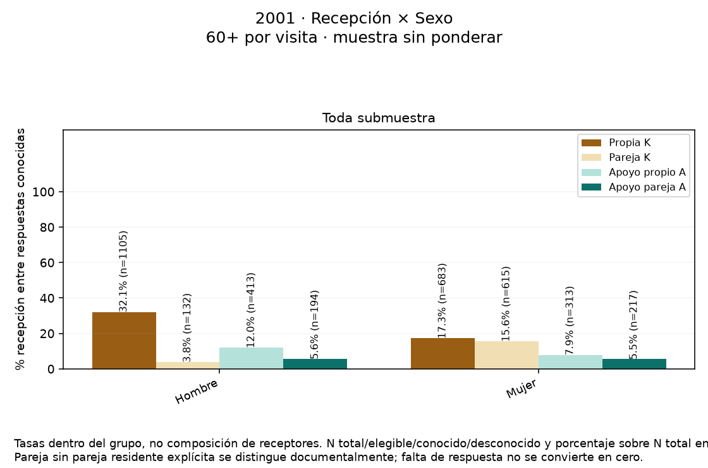

Para pension_propia_k, la tasa entre respuestas conocidas va de 17.29% en «Mujer» (683/3,951) a 32.10% en «Hombre» (1,105/3,442). Es una diferencia dentro de grupos, no la composición del conjunto receptor. Los desconocidos y tamaños de grupo se muestran arriba; la comparación puede reflejar selección documental y composición socioeconómica.

Para apoyo_propio, la tasa entre respuestas conocidas va de 7.92% en «Mujer» (313/3,951) a 12.00% en «Hombre» (413/3,441). Es una diferencia dentro de grupos, no la composición del conjunto receptor. Los desconocidos y tamaños de grupo se muestran arriba; la comparación puede reflejar selección documental y composición socioeconómica.

###### Recepción por Escolaridad en primera entrevista

| ano | educacion_grupo | variable | N_total | N_elegible_vivo | N_si | N_no | N_desconocido | N_conocido | pct_si_total | pct_si_elegible | pct_si_conocido | pct_cobertura_elegible |
| --- | --- | --- | --- | --- | --- | --- | --- | --- | --- | --- | --- | --- |
| 2,001 | 0 años | pension_propia_k | 2,411 | 2,411 | 339 | 2,065 | 7 | 2,404 | 14.06 | 14.06 | 14.10 | 99.71 |
| 2,001 | 0 años | pension_conyuge_k | 2,411 | 2,411 | 151 | 2,252 | 8 | 2,403 | 6.26 | 6.26 | 6.28 | 99.67 |
| 2,001 | 0 años | apoyo_propio | 2,411 | 2,411 | 316 | 2,088 | 7 | 2,404 | 13.11 | 13.11 | 13.14 | 99.71 |
| 2,001 | 0 años | apoyo_conyuge | 2,411 | 2,411 | 182 | 2,221 | 8 | 2,403 | 7.55 | 7.55 | 7.57 | 99.67 |
| 2,001 | 1–5 años | pension_propia_k | 2,774 | 2,774 | 566 | 2,203 | 5 | 2,769 | 20.40 | 20.40 | 20.44 | 99.82 |
| 2,001 | 1–5 años | pension_conyuge_k | 2,774 | 2,774 | 272 | 2,497 | 5 | 2,769 | 9.81 | 9.81 | 9.82 | 99.82 |
| 2,001 | 1–5 años | apoyo_propio | 2,774 | 2,774 | 333 | 2,435 | 6 | 2,768 | 12.00 | 12.00 | 12.03 | 99.78 |
| 2,001 | 1–5 años | apoyo_conyuge | 2,774 | 2,774 | 183 | 2,586 | 5 | 2,769 | 6.60 | 6.60 | 6.61 | 99.82 |
| 2,001 | 6 años | pension_propia_k | 1,108 | 1,108 | 372 | 732 | 4 | 1,104 | 33.57 | 33.57 | 33.70 | 99.64 |
| 2,001 | 6 años | pension_conyuge_k | 1,108 | 1,108 | 142 | 962 | 4 | 1,104 | 12.82 | 12.82 | 12.86 | 99.64 |
| 2,001 | 6 años | apoyo_propio | 1,108 | 1,108 | 48 | 1,056 | 4 | 1,104 | 4.33 | 4.33 | 4.35 | 99.64 |
| 2,001 | 6 años | apoyo_conyuge | 1,108 | 1,108 | 30 | 1,074 | 4 | 1,104 | 2.71 | 2.71 | 2.72 | 99.64 |
| 2,001 | 7–9 años | pension_propia_k | 659 | 659 | 277 | 378 | 4 | 655 | 42.03 | 42.03 | 42.29 | 99.39 |
| 2,001 | 7–9 años | pension_conyuge_k | 659 | 659 | 116 | 539 | 4 | 655 | 17.60 | 17.60 | 17.71 | 99.39 |
| 2,001 | 7–9 años | apoyo_propio | 659 | 659 | 19 | 636 | 4 | 655 | 2.88 | 2.88 | 2.90 | 99.39 |
| 2,001 | 7–9 años | apoyo_conyuge | 659 | 659 | 10 | 645 | 4 | 655 | 1.52 | 1.52 | 1.53 | 99.39 |
| 2,001 | Desconocido | pension_propia_k | 13 | 13 | 3 | 10 | 0 | 13 | 23.08 | 23.08 | 23.08 | 100.00 |
| 2,001 | Desconocido | pension_conyuge_k | 13 | 13 | 0 | 13 | 0 | 13 | 0.00 | 0.00 | 0.00 | 100.00 |
| 2,001 | Desconocido | apoyo_propio | 13 | 13 | 1 | 12 | 0 | 13 | 7.69 | 7.69 | 7.69 | 100.00 |
| 2,001 | Desconocido | apoyo_conyuge | 13 | 13 | 2 | 11 | 0 | 13 | 15.38 | 15.38 | 15.38 | 100.00 |
| 2,001 | ≥10 años | pension_propia_k | 451 | 451 | 231 | 217 | 3 | 448 | 51.22 | 51.22 | 51.56 | 99.33 |
| 2,001 | ≥10 años | pension_conyuge_k | 451 | 451 | 66 | 382 | 3 | 448 | 14.63 | 14.63 | 14.73 | 99.33 |
| 2,001 | ≥10 años | apoyo_propio | 451 | 451 | 9 | 439 | 3 | 448 | 2.00 | 2.00 | 2.01 | 99.33 |
| 2,001 | ≥10 años | apoyo_conyuge | 451 | 451 | 4 | 444 | 3 | 448 | 0.89 | 0.89 | 0.89 | 99.33 |

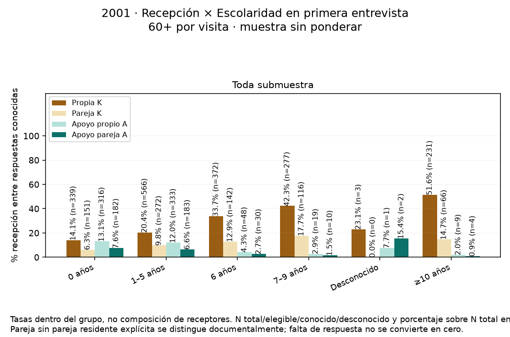

Para pension_propia_k, la tasa entre respuestas conocidas va de 14.10% en «0 años» (339/2,404) a 51.56% en «≥10 años» (231/448). Es una diferencia dentro de grupos, no la composición del conjunto receptor. Los desconocidos y tamaños de grupo se muestran arriba; la comparación puede reflejar selección documental y composición socioeconómica.

Para apoyo_propio, la tasa entre respuestas conocidas va de 2.01% en «≥10 años» (9/448) a 13.14% en «0 años» (316/2,404). Es una diferencia dentro de grupos, no la composición del conjunto receptor. Los desconocidos y tamaños de grupo se muestran arriba; la comparación puede reflejar selección documental y composición socioeconómica.

###### Recepción por Edad en la visita

| ano | edad_grupo | variable | N_total | N_elegible_vivo | N_si | N_no | N_desconocido | N_conocido | pct_si_total | pct_si_elegible | pct_si_conocido | pct_cobertura_elegible |
| --- | --- | --- | --- | --- | --- | --- | --- | --- | --- | --- | --- | --- |
| 2,001 | 60–69 | pension_propia_k | 4,207 | 4,207 | 932 | 3,257 | 18 | 4,189 | 22.15 | 22.15 | 22.25 | 99.57 |
| 2,001 | 60–69 | pension_conyuge_k | 4,207 | 4,207 | 492 | 3,696 | 19 | 4,188 | 11.69 | 11.69 | 11.75 | 99.55 |
| 2,001 | 60–69 | apoyo_propio | 4,207 | 4,207 | 399 | 3,789 | 19 | 4,188 | 9.48 | 9.48 | 9.53 | 99.55 |
| 2,001 | 60–69 | apoyo_conyuge | 4,207 | 4,207 | 261 | 3,927 | 19 | 4,188 | 6.20 | 6.20 | 6.23 | 99.55 |
| 2,001 | 70–79 | pension_propia_k | 2,307 | 2,307 | 622 | 1,681 | 4 | 2,303 | 26.96 | 26.96 | 27.01 | 99.83 |
| 2,001 | 70–79 | pension_conyuge_k | 2,307 | 2,307 | 213 | 2,090 | 4 | 2,303 | 9.23 | 9.23 | 9.25 | 99.83 |
| 2,001 | 70–79 | apoyo_propio | 2,307 | 2,307 | 242 | 2,061 | 4 | 2,303 | 10.49 | 10.49 | 10.51 | 99.83 |
| 2,001 | 70–79 | apoyo_conyuge | 2,307 | 2,307 | 121 | 2,182 | 4 | 2,303 | 5.24 | 5.24 | 5.25 | 99.83 |
| 2,001 | 80–89 | pension_propia_k | 771 | 771 | 210 | 560 | 1 | 770 | 27.24 | 27.24 | 27.27 | 99.87 |
| 2,001 | 80–89 | pension_conyuge_k | 771 | 771 | 41 | 729 | 1 | 770 | 5.32 | 5.32 | 5.32 | 99.87 |
| 2,001 | 80–89 | apoyo_propio | 771 | 771 | 78 | 692 | 1 | 770 | 10.12 | 10.12 | 10.13 | 99.87 |
| 2,001 | 80–89 | apoyo_conyuge | 771 | 771 | 28 | 742 | 1 | 770 | 3.63 | 3.63 | 3.64 | 99.87 |
| 2,001 | ≥90 | pension_propia_k | 131 | 131 | 24 | 107 | 0 | 131 | 18.32 | 18.32 | 18.32 | 100.00 |
| 2,001 | ≥90 | pension_conyuge_k | 131 | 131 | 1 | 130 | 0 | 131 | 0.76 | 0.76 | 0.76 | 100.00 |
| 2,001 | ≥90 | apoyo_propio | 131 | 131 | 7 | 124 | 0 | 131 | 5.34 | 5.34 | 5.34 | 100.00 |
| 2,001 | ≥90 | apoyo_conyuge | 131 | 131 | 1 | 130 | 0 | 131 | 0.76 | 0.76 | 0.76 | 100.00 |

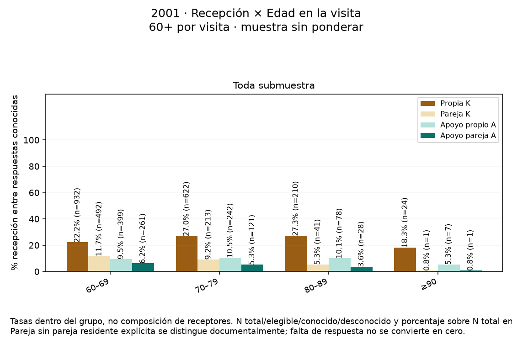

Para pension_propia_k, la tasa entre respuestas conocidas va de 18.32% en «≥90» (24/131) a 27.27% en «80–89» (210/770). Es una diferencia dentro de grupos, no la composición del conjunto receptor. Los desconocidos y tamaños de grupo se muestran arriba; la comparación puede reflejar selección documental y composición socioeconómica.

Para apoyo_propio, la tasa entre respuestas conocidas va de 5.34% en «≥90» (7/131) a 10.51% en «70–79» (242/2,303). Es una diferencia dentro de grupos, no la composición del conjunto receptor. Los desconocidos y tamaños de grupo se muestran arriba; la comparación puede reflejar selección documental y composición socioeconómica.

###### Cruce pension_apoyo

| pension | apoyo | N | N_estrato | N_elegible_vivo | N_par_conocido | N_par_desconocido | pct_estrato | pct_par_conocido | pct_composicion_apoyados |
| --- | --- | --- | --- | --- | --- | --- | --- | --- | --- |
| Sí | Sí | 96 | 7,416 | 7,416 | 7,392 | 24 | 1.29 | 1.30 | 13.22 |
| Sí | No | 1,692 | 7,416 | 7,416 | 7,392 | 24 | 22.82 | 22.89 | ND |
| Sí | Desconocido | 0 | 7,416 | 7,416 | 7,392 | 24 | 0.00 | ND | ND |
| No | Sí | 630 | 7,416 | 7,416 | 7,392 | 24 | 8.50 | 8.52 | 86.78 |
| No | No | 4,974 | 7,416 | 7,416 | 7,392 | 24 | 67.07 | 67.29 | ND |
| No | Desconocido | 1 | 7,416 | 7,416 | 7,392 | 24 | 0.01 | ND | ND |
| Desconocido | Sí | 0 | 7,416 | 7,416 | 7,392 | 24 | 0.00 | ND | 0.00 |
| Desconocido | No | 0 | 7,416 | 7,416 | 7,392 | 24 | 0.00 | ND | ND |
| Desconocido | Desconocido | 23 | 7,416 | 7,416 | 7,392 | 24 | 0.31 | ND | ND |

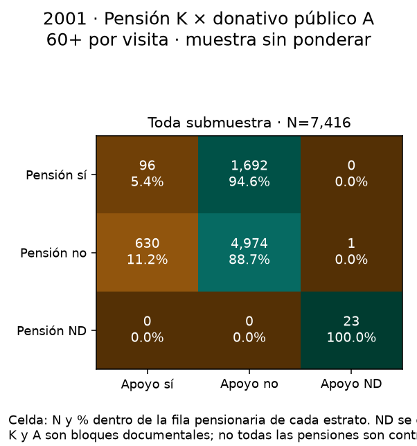

Las celdas muestran N y su denominador propio. Las medidas estratificadas arriba permiten evaluar la heterogeneidad contemporánea; no se apilan rondas como observaciones independientes. Una celda ND permanece distinta de las negativas y los porcentajes entre pares conocidos no describen a quienes faltan.

En «Toda submuestra», recibe apoyo 630/5,604 (11.24%) entre negativas K y 96/1,788 (5.37%) entre receptoras K. La diferencia es 5.87 puntos porcentuales. Esta comparación distingue cobertura adicional observada y coexistencia dentro del mismo perfil; no prueba un cambio de elegibilidad ni impacto redistributivo.

###### Cruce pension_apoyo_localidad_grupo

| localidad_grupo | pension | apoyo | N | N_estrato | N_elegible_vivo | N_par_conocido | N_par_desconocido | pct_estrato | pct_par_conocido | pct_composicion_apoyados |
| --- | --- | --- | --- | --- | --- | --- | --- | --- | --- | --- |
| <100 mil habitantes | Sí | Sí | 60 | 3,217 | 3,217 | 3,210 | 7 | 1.87 | 1.87 | 8.26 |
| <100 mil habitantes | Sí | No | 428 | 3,217 | 3,217 | 3,210 | 7 | 13.30 | 13.33 | ND |
| <100 mil habitantes | Sí | Desconocido | 0 | 3,217 | 3,217 | 3,210 | 7 | 0.00 | ND | ND |
| <100 mil habitantes | No | Sí | 562 | 3,217 | 3,217 | 3,210 | 7 | 17.47 | 17.51 | 77.41 |
| <100 mil habitantes | No | No | 2,160 | 3,217 | 3,217 | 3,210 | 7 | 67.14 | 67.29 | ND |
| <100 mil habitantes | No | Desconocido | 0 | 3,217 | 3,217 | 3,210 | 7 | 0.00 | ND | ND |
| <100 mil habitantes | Desconocido | Sí | 0 | 3,217 | 3,217 | 3,210 | 7 | 0.00 | ND | 0.00 |
| <100 mil habitantes | Desconocido | No | 0 | 3,217 | 3,217 | 3,210 | 7 | 0.00 | ND | ND |
| <100 mil habitantes | Desconocido | Desconocido | 7 | 3,217 | 3,217 | 3,210 | 7 | 0.22 | ND | ND |
| ≥100 mil habitantes | Sí | Sí | 36 | 4,199 | 4,199 | 4,182 | 17 | 0.86 | 0.86 | 4.96 |
| ≥100 mil habitantes | Sí | No | 1,264 | 4,199 | 4,199 | 4,182 | 17 | 30.10 | 30.22 | ND |
| ≥100 mil habitantes | Sí | Desconocido | 0 | 4,199 | 4,199 | 4,182 | 17 | 0.00 | ND | ND |
| ≥100 mil habitantes | No | Sí | 68 | 4,199 | 4,199 | 4,182 | 17 | 1.62 | 1.63 | 9.37 |
| ≥100 mil habitantes | No | No | 2,814 | 4,199 | 4,199 | 4,182 | 17 | 67.02 | 67.29 | ND |
| ≥100 mil habitantes | No | Desconocido | 1 | 4,199 | 4,199 | 4,182 | 17 | 0.02 | ND | ND |
| ≥100 mil habitantes | Desconocido | Sí | 0 | 4,199 | 4,199 | 4,182 | 17 | 0.00 | ND | 0.00 |
| ≥100 mil habitantes | Desconocido | No | 0 | 4,199 | 4,199 | 4,182 | 17 | 0.00 | ND | ND |
| ≥100 mil habitantes | Desconocido | Desconocido | 16 | 4,199 | 4,199 | 4,182 | 17 | 0.38 | ND | ND |

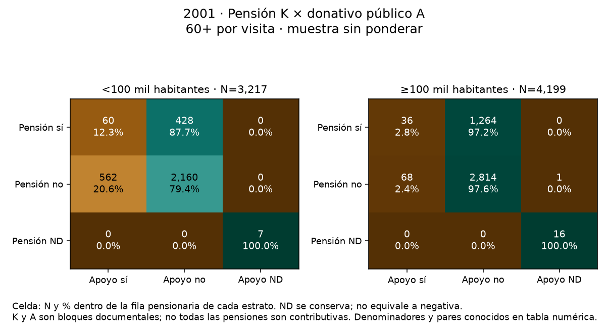

En «<100 mil habitantes», recibe apoyo 562/2,722 (20.65%) entre negativas K y 60/488 (12.30%) entre receptoras K. La diferencia es 8.35 puntos porcentuales. Esta comparación distingue cobertura adicional observada y coexistencia dentro del mismo perfil; no prueba un cambio de elegibilidad ni impacto redistributivo.

En «≥100 mil habitantes», recibe apoyo 68/2,882 (2.36%) entre negativas K y 36/1,300 (2.77%) entre receptoras K. La diferencia es -0.41 puntos porcentuales. Esta comparación distingue cobertura adicional observada y coexistencia dentro del mismo perfil; no prueba un cambio de elegibilidad ni impacto redistributivo.

###### Cruce pension_apoyo_sexo_grupo

| sexo_grupo | pension | apoyo | N | N_estrato | N_elegible_vivo | N_par_conocido | N_par_desconocido | pct_estrato | pct_par_conocido | pct_composicion_apoyados |
| --- | --- | --- | --- | --- | --- | --- | --- | --- | --- | --- |
| Hombre | Sí | Sí | 60 | 3,451 | 3,451 | 3,441 | 10 | 1.74 | 1.74 | 8.26 |
| Hombre | Sí | No | 1,045 | 3,451 | 3,451 | 3,441 | 10 | 30.28 | 30.37 | ND |
| Hombre | Sí | Desconocido | 0 | 3,451 | 3,451 | 3,441 | 10 | 0.00 | ND | ND |
| Hombre | No | Sí | 353 | 3,451 | 3,451 | 3,441 | 10 | 10.23 | 10.26 | 48.62 |
| Hombre | No | No | 1,983 | 3,451 | 3,451 | 3,441 | 10 | 57.46 | 57.63 | ND |
| Hombre | No | Desconocido | 1 | 3,451 | 3,451 | 3,441 | 10 | 0.03 | ND | ND |
| Hombre | Desconocido | Sí | 0 | 3,451 | 3,451 | 3,441 | 10 | 0.00 | ND | 0.00 |
| Hombre | Desconocido | No | 0 | 3,451 | 3,451 | 3,441 | 10 | 0.00 | ND | ND |
| Hombre | Desconocido | Desconocido | 9 | 3,451 | 3,451 | 3,441 | 10 | 0.26 | ND | ND |
| Mujer | Sí | Sí | 36 | 3,965 | 3,965 | 3,951 | 14 | 0.91 | 0.91 | 4.96 |
| Mujer | Sí | No | 647 | 3,965 | 3,965 | 3,951 | 14 | 16.32 | 16.38 | ND |
| Mujer | Sí | Desconocido | 0 | 3,965 | 3,965 | 3,951 | 14 | 0.00 | ND | ND |
| Mujer | No | Sí | 277 | 3,965 | 3,965 | 3,951 | 14 | 6.99 | 7.01 | 38.15 |
| Mujer | No | No | 2,991 | 3,965 | 3,965 | 3,951 | 14 | 75.44 | 75.70 | ND |
| Mujer | No | Desconocido | 0 | 3,965 | 3,965 | 3,951 | 14 | 0.00 | ND | ND |
| Mujer | Desconocido | Sí | 0 | 3,965 | 3,965 | 3,951 | 14 | 0.00 | ND | 0.00 |
| Mujer | Desconocido | No | 0 | 3,965 | 3,965 | 3,951 | 14 | 0.00 | ND | ND |
| Mujer | Desconocido | Desconocido | 14 | 3,965 | 3,965 | 3,951 | 14 | 0.35 | ND | ND |

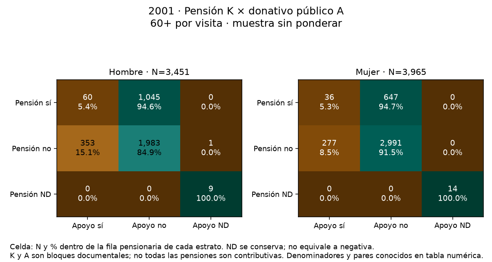

En «Hombre», recibe apoyo 353/2,336 (15.11%) entre negativas K y 60/1,105 (5.43%) entre receptoras K. La diferencia es 9.68 puntos porcentuales. Esta comparación distingue cobertura adicional observada y coexistencia dentro del mismo perfil; no prueba un cambio de elegibilidad ni impacto redistributivo.

En «Mujer», recibe apoyo 277/3,268 (8.48%) entre negativas K y 36/683 (5.27%) entre receptoras K. La diferencia es 3.21 puntos porcentuales. Esta comparación distingue cobertura adicional observada y coexistencia dentro del mismo perfil; no prueba un cambio de elegibilidad ni impacto redistributivo.

###### Cruce pension_educacion_grupo_sexo_grupo

| ano | sexo_grupo | educacion_grupo | variable | N_total | N_elegible_vivo | N_si | N_no | N_desconocido | N_conocido | pct_si_total | pct_si_elegible | pct_si_conocido | pct_cobertura_elegible |
| --- | --- | --- | --- | --- | --- | --- | --- | --- | --- | --- | --- | --- | --- |
| 2,001 | Hombre | 0 años | pension_propia_k | 1,022 | 1,022 | 199 | 821 | 2 | 1,020 | 19.47 | 19.47 | 19.51 | 99.80 |
| 2,001 | Hombre | 1–5 años | pension_propia_k | 1,332 | 1,332 | 359 | 971 | 2 | 1,330 | 26.95 | 26.95 | 26.99 | 99.85 |
| 2,001 | Hombre | 6 años | pension_propia_k | 532 | 532 | 249 | 282 | 1 | 531 | 46.80 | 46.80 | 46.89 | 99.81 |
| 2,001 | Hombre | 7–9 años | pension_propia_k | 268 | 268 | 143 | 123 | 2 | 266 | 53.36 | 53.36 | 53.76 | 99.25 |
| 2,001 | Hombre | Desconocido | pension_propia_k | 7 | 7 | 2 | 5 | 0 | 7 | 28.57 | 28.57 | 28.57 | 100.00 |
| 2,001 | Hombre | ≥10 años | pension_propia_k | 290 | 290 | 153 | 135 | 2 | 288 | 52.76 | 52.76 | 53.12 | 99.31 |
| 2,001 | Mujer | 0 años | pension_propia_k | 1,389 | 1,389 | 140 | 1,244 | 5 | 1,384 | 10.08 | 10.08 | 10.12 | 99.64 |
| 2,001 | Mujer | 1–5 años | pension_propia_k | 1,442 | 1,442 | 207 | 1,232 | 3 | 1,439 | 14.36 | 14.36 | 14.38 | 99.79 |
| 2,001 | Mujer | 6 años | pension_propia_k | 576 | 576 | 123 | 450 | 3 | 573 | 21.35 | 21.35 | 21.47 | 99.48 |
| 2,001 | Mujer | 7–9 años | pension_propia_k | 391 | 391 | 134 | 255 | 2 | 389 | 34.27 | 34.27 | 34.45 | 99.49 |
| 2,001 | Mujer | Desconocido | pension_propia_k | 6 | 6 | 1 | 5 | 0 | 6 | 16.67 | 16.67 | 16.67 | 100.00 |
| 2,001 | Mujer | ≥10 años | pension_propia_k | 161 | 161 | 78 | 82 | 1 | 160 | 48.45 | 48.45 | 48.75 | 99.38 |

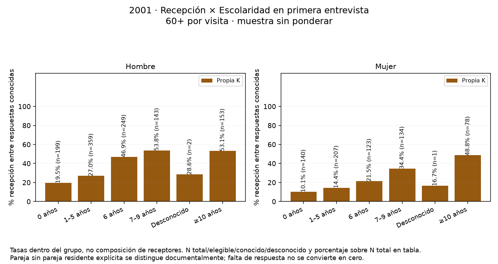

Dentro de «Hombre», la recepción K entre respuestas conocidas es menor en «0 años»: 199/1,020 (19.51%), y mayor en «7–9 años»: 143/266 (53.76%). Las diferencias no separan mecanismos de trayectoria laboral, cohortes o selección por supervivencia; las celdas pequeñas y faltantes limitan la precisión.

Dentro de «Mujer», la recepción K entre respuestas conocidas es menor en «0 años»: 140/1,384 (10.12%), y mayor en «≥10 años»: 78/160 (48.75%). Las diferencias no separan mecanismos de trayectoria laboral, cohortes o selección por supervivencia; las celdas pequeñas y faltantes limitan la precisión.

###### Cruce pension_edad_grupo_localidad_grupo

| ano | localidad_grupo | edad_grupo | variable | N_total | N_elegible_vivo | N_si | N_no | N_desconocido | N_conocido | pct_si_total | pct_si_elegible | pct_si_conocido | pct_cobertura_elegible |
| --- | --- | --- | --- | --- | --- | --- | --- | --- | --- | --- | --- | --- | --- |
| 2,001 | <100 mil habitantes | 60–69 | pension_propia_k | 1,776 | 1,776 | 251 | 1,520 | 5 | 1,771 | 14.13 | 14.13 | 14.17 | 99.72 |
| 2,001 | <100 mil habitantes | 70–79 | pension_propia_k | 1,013 | 1,013 | 168 | 843 | 2 | 1,011 | 16.58 | 16.58 | 16.62 | 99.80 |
| 2,001 | <100 mil habitantes | 80–89 | pension_propia_k | 371 | 371 | 63 | 308 | 0 | 371 | 16.98 | 16.98 | 16.98 | 100.00 |
| 2,001 | <100 mil habitantes | ≥90 | pension_propia_k | 57 | 57 | 6 | 51 | 0 | 57 | 10.53 | 10.53 | 10.53 | 100.00 |
| 2,001 | ≥100 mil habitantes | 60–69 | pension_propia_k | 2,431 | 2,431 | 681 | 1,737 | 13 | 2,418 | 28.01 | 28.01 | 28.16 | 99.47 |
| 2,001 | ≥100 mil habitantes | 70–79 | pension_propia_k | 1,294 | 1,294 | 454 | 838 | 2 | 1,292 | 35.09 | 35.09 | 35.14 | 99.85 |
| 2,001 | ≥100 mil habitantes | 80–89 | pension_propia_k | 400 | 400 | 147 | 252 | 1 | 399 | 36.75 | 36.75 | 36.84 | 99.75 |
| 2,001 | ≥100 mil habitantes | ≥90 | pension_propia_k | 74 | 74 | 18 | 56 | 0 | 74 | 24.32 | 24.32 | 24.32 | 100.00 |

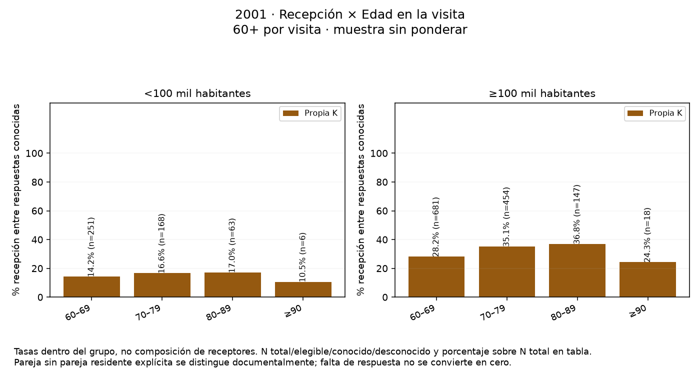

Dentro de «<100 mil habitantes», la recepción K entre respuestas conocidas es menor en «≥90»: 6/57 (10.53%), y mayor en «80–89»: 63/371 (16.98%). Las diferencias no separan mecanismos de trayectoria laboral, cohortes o selección por supervivencia; las celdas pequeñas y faltantes limitan la precisión.

Dentro de «≥100 mil habitantes», la recepción K entre respuestas conocidas es menor en «≥90»: 18/74 (24.32%), y mayor en «80–89»: 147/399 (36.84%). Las diferencias no separan mecanismos de trayectoria laboral, cohortes o selección por supervivencia; las celdas pequeñas y faltantes limitan la precisión.

###### Instituciones, programas y montos

| ano | tipo_contingencia | N_eventos | N_beneficiarios | N_slots_en_tipo_con_IMSS_ISSSTE | N_slots_en_tipo_con_programa_publico_agrupado | N_slots_en_tipo_con_institucion_sin_tipo_comprobado | alcance |
| --- | --- | --- | --- | --- | --- | --- | --- |
| 2,001 | 1 | 1,312 | 1,312 | 1,128 | 0 | 184 | En 2012/2015 institución identifica contingencia, no cada slot ni reparto del monto |
| 2,001 | 2 | 386 | 386 | 349 | 0 | 37 | En 2012/2015 institución identifica contingencia, no cada slot ni reparto del monto |
| 2,001 | 3 | 84 | 84 | 73 | 0 | 11 | En 2012/2015 institución identifica contingencia, no cada slot ni reparto del monto |
| 2,001 | 4 | 64 | 64 | 31 | 0 | 33 | En 2012/2015 institución identifica contingencia, no cada slot ni reparto del monto |

| ano | programa | tipo_documental | N_eventos | N_beneficiarios | N_monto_observado |
| --- | --- | --- | --- | --- | --- |
| 2,001 | Programa no identificado | Apoyo público sin tipo comprobado | 726 | 726 | 676 |

| ano | bloque | unidad | N_eventos | N_beneficiarios | N_monto_observado | N_monto_desconocido | mediana_nominal_mensual | p25 | p75 | suma_parcial_por_bloque | sumable_entre_bloques |
| --- | --- | --- | --- | --- | --- | --- | --- | --- | --- | --- | --- |
| 2,001 | K | Evento de beneficiario 60+ identificado | 1,846 | 1,788 | 1,758 | 88 | 1,227.00 | 1,150.00 | 2,000.00 | 3,848,632.00 | False |
| 2,001 | A | Evento de beneficiario 60+ identificado | 726 | 726 | 676 | 50 | 207.00 | 125.00 | 500.00 | 510,166.00 | False |

Los eventos y beneficiarios tienen denominadores distintos. Tipos 1/2/3/4 son jubilación/viudez/incapacidad/otra. Una persona puede recibir varios beneficios, por lo que los conteos institucionales no se suman como personas diferentes. Las medianas describen montos originales observados de eventos, con faltantes; no son ingreso total ni valor real comparable entre rondas.

##### 2003

| ano | variable | N_total | N_elegible_vivo | N_si | N_no | N_desconocido | N_conocido | pct_si_total | pct_si_elegible | pct_si_conocido | pct_cobertura_elegible |
| --- | --- | --- | --- | --- | --- | --- | --- | --- | --- | --- | --- |
| 2,003 | pension_propia_k | 7,691 | 7,691 | 1,837 | 5,374 | 480 | 7,211 | 23.89 | 23.89 | 25.47 | 93.76 |
| 2,003 | pension_conyuge_k | 7,691 | 7,691 | 841 | 6,370 | 480 | 7,211 | 10.93 | 10.93 | 11.66 | 93.76 |
| 2,003 | apoyo_propio | 7,691 | 7,691 | 933 | 6,278 | 480 | 7,211 | 12.13 | 12.13 | 12.94 | 93.76 |
| 2,003 | apoyo_conyuge | 7,691 | 7,691 | 576 | 6,635 | 480 | 7,211 | 7.49 | 7.49 | 7.99 | 93.76 |

| ano | categoria | N | N_60 | pct_60 |
| --- | --- | --- | --- | --- |
| 2,003 | Apoyo y negativa propia K | 801 | 7,691 | 10.41 |
| 2,003 | Negativas explícitas K y A | 4,573 | 7,691 | 59.46 |
| 2,003 | Otra situación desconocida | 480 | 7,691 | 6.24 |
| 2,003 | Pensión K y apoyo | 132 | 7,691 | 1.72 |
| 2,003 | Solo pensión K observada | 1,705 | 7,691 | 22.17 |

De 7,691 registros de 60+, 7,691 corresponden a personas vivas y 7,211 tienen orientación propia utilizable. Se identifica pensión propia K en 1,837 y apoyo propio A en 933; quedan respectivamente 480 y 480 estados desconocidos. Entre respuestas conocidas, las proporciones son 25.47% y 12.94%. Estos porcentajes no deben confundirse con tasas sobre todos los elegibles ni con cobertura nacional.

| pension | N_pension_estado | N_apoyo_conocido | N_apoyo_si | pct_apoyo_conocido |
| --- | --- | --- | --- | --- |
| No | 5,374 | 5,374 | 801 | 14.91 |
| Sí | 1,837 | 1,837 | 132 | 7.19 |

El apoyo entre quienes tienen negativa propia K supera al apoyo entre receptoras K en 7.72 puntos porcentuales (diferencia con signo). Se observan tanto cobertura adicional respecto de una negativa K como coexistencia. No se conoce el contrafactual sin programa, ni una negativa K descarta todas las pensiones no contributivas; por tanto, no se afirma una ampliación causal ni cobertura de personas sin ninguna pensión.

| ano | cruce | estrato | N_validos | N_excluidos | V_cramer | N_celdas_esperadas_menor5 |
| --- | --- | --- | --- | --- | --- | --- |
| 2,003 | Pensión K × Apoyo | Toda submuestra 60+ | 7,211 | 480 | 0.10 | 0 |
| 2,003 | P × Localidad a 100 mil (no ruralidad estricta) | Toda submuestra 60+ | 7,211 | 480 | 0.20 | 0 |
| 2,003 | A × Localidad a 100 mil (no ruralidad estricta) | Toda submuestra 60+ | 7,211 | 480 | 0.28 | 0 |
| 2,003 | P × Sexo | Toda submuestra 60+ | 7,211 | 480 | 0.18 | 0 |
| 2,003 | A × Sexo | Toda submuestra 60+ | 7,211 | 480 | 0.02 | 0 |
| 2,003 | P × Escolaridad en primera entrevista | Toda submuestra 60+ | 7,164 | 527 | 0.28 | 0 |
| 2,003 | A × Escolaridad en primera entrevista | Toda submuestra 60+ | 7,164 | 527 | 0.17 | 0 |
| 2,003 | P × Edad en la visita | Toda submuestra 60+ | 7,211 | 480 | 0.06 | 0 |
| 2,003 | A × Edad en la visita | Toda submuestra 60+ | 7,211 | 480 | 0.05 | 0 |
| 2,003 | Pensión K × Apoyo / Localidad a 100 mil (no ruralidad estricta) | <100 mil habitantes | 3,140 | 229 | 0.09 | 0 |
| 2,003 | Pensión K × Apoyo / Localidad a 100 mil (no ruralidad estricta) | ≥100 mil habitantes | 4,071 | 251 | 0.01 | 0 |
| 2,003 | Pensión K × Apoyo / Sexo | Hombre | 3,406 | 181 | 0.13 | 0 |
| 2,003 | Pensión K × Apoyo / Sexo | Mujer | 3,805 | 299 | 0.08 | 0 |
| 2,003 | Pensión K × Escolaridad en primera entrevista / Sexo | Hombre | 3,371 | 216 | 0.28 | 0 |
| 2,003 | Pensión K × Escolaridad en primera entrevista / Sexo | Mujer | 3,793 | 311 | 0.30 | 0 |
| 2,003 | Pensión K × Edad en la visita / Localidad a 100 mil (no ruralidad estricta) | <100 mil habitantes | 3,140 | 229 | 0.02 | 0 |
| 2,003 | Pensión K × Edad en la visita / Localidad a 100 mil (no ruralidad estricta) | ≥100 mil habitantes | 4,071 | 251 | 0.08 | 0 |

| ano | control | recepcion | N_validos | N_excluidos | rho_spearman |
| --- | --- | --- | --- | --- | --- |
| 2,003 | edad | pension_propia_k | 7,211 | 480 | 0.07 |
| 2,003 | edad | apoyo_propio | 7,211 | 480 | 0.06 |
| 2,003 | educacion | pension_propia_k | 7,164 | 527 | 0.26 |
| 2,003 | educacion | apoyo_propio | 7,164 | 527 | -0.17 |

###### Recepción por Localidad a 100 mil (no ruralidad estricta)

| ano | localidad_grupo | variable | N_total | N_elegible_vivo | N_si | N_no | N_desconocido | N_conocido | pct_si_total | pct_si_elegible | pct_si_conocido | pct_cobertura_elegible |
| --- | --- | --- | --- | --- | --- | --- | --- | --- | --- | --- | --- | --- |
| 2,003 | <100 mil habitantes | pension_propia_k | 3,369 | 3,369 | 489 | 2,651 | 229 | 3,140 | 14.51 | 14.51 | 15.57 | 93.20 |
| 2,003 | <100 mil habitantes | pension_conyuge_k | 3,369 | 3,369 | 225 | 2,915 | 229 | 3,140 | 6.68 | 6.68 | 7.17 | 93.20 |
| 2,003 | <100 mil habitantes | apoyo_propio | 3,369 | 3,369 | 740 | 2,400 | 229 | 3,140 | 21.96 | 21.96 | 23.57 | 93.20 |
| 2,003 | <100 mil habitantes | apoyo_conyuge | 3,369 | 3,369 | 481 | 2,659 | 229 | 3,140 | 14.28 | 14.28 | 15.32 | 93.20 |
| 2,003 | ≥100 mil habitantes | pension_propia_k | 4,322 | 4,322 | 1,348 | 2,723 | 251 | 4,071 | 31.19 | 31.19 | 33.11 | 94.19 |
| 2,003 | ≥100 mil habitantes | pension_conyuge_k | 4,322 | 4,322 | 616 | 3,455 | 251 | 4,071 | 14.25 | 14.25 | 15.13 | 94.19 |
| 2,003 | ≥100 mil habitantes | apoyo_propio | 4,322 | 4,322 | 193 | 3,878 | 251 | 4,071 | 4.47 | 4.47 | 4.74 | 94.19 |
| 2,003 | ≥100 mil habitantes | apoyo_conyuge | 4,322 | 4,322 | 95 | 3,976 | 251 | 4,071 | 2.20 | 2.20 | 2.33 | 94.19 |

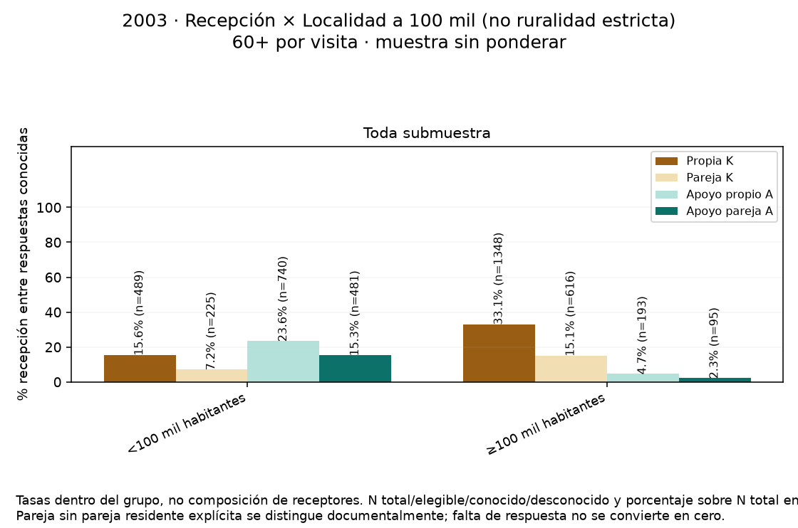

Para pension_propia_k, la tasa entre respuestas conocidas va de 15.57% en «<100 mil habitantes» (489/3,140) a 33.11% en «≥100 mil habitantes» (1,348/4,071). Es una diferencia dentro de grupos, no la composición del conjunto receptor. Los desconocidos y tamaños de grupo se muestran arriba; la comparación puede reflejar selección documental y composición socioeconómica.

Para apoyo_propio, la tasa entre respuestas conocidas va de 4.74% en «≥100 mil habitantes» (193/4,071) a 23.57% en «<100 mil habitantes» (740/3,140). Es una diferencia dentro de grupos, no la composición del conjunto receptor. Los desconocidos y tamaños de grupo se muestran arriba; la comparación puede reflejar selección documental y composición socioeconómica.

###### Recepción por Sexo

| ano | sexo_grupo | variable | N_total | N_elegible_vivo | N_si | N_no | N_desconocido | N_conocido | pct_si_total | pct_si_elegible | pct_si_conocido | pct_cobertura_elegible |
| --- | --- | --- | --- | --- | --- | --- | --- | --- | --- | --- | --- | --- |
| 2,003 | Hombre | pension_propia_k | 3,587 | 3,587 | 1,157 | 2,249 | 181 | 3,406 | 32.26 | 32.26 | 33.97 | 94.95 |
| 2,003 | Hombre | pension_conyuge_k | 3,587 | 3,587 | 164 | 3,242 | 181 | 3,406 | 4.57 | 4.57 | 4.82 | 94.95 |
| 2,003 | Hombre | apoyo_propio | 3,587 | 3,587 | 461 | 2,945 | 181 | 3,406 | 12.85 | 12.85 | 13.53 | 94.95 |
| 2,003 | Hombre | apoyo_conyuge | 3,587 | 3,587 | 325 | 3,081 | 181 | 3,406 | 9.06 | 9.06 | 9.54 | 94.95 |
| 2,003 | Mujer | pension_propia_k | 4,104 | 4,104 | 680 | 3,125 | 299 | 3,805 | 16.57 | 16.57 | 17.87 | 92.71 |
| 2,003 | Mujer | pension_conyuge_k | 4,104 | 4,104 | 677 | 3,128 | 299 | 3,805 | 16.50 | 16.50 | 17.79 | 92.71 |
| 2,003 | Mujer | apoyo_propio | 4,104 | 4,104 | 472 | 3,333 | 299 | 3,805 | 11.50 | 11.50 | 12.40 | 92.71 |
| 2,003 | Mujer | apoyo_conyuge | 4,104 | 4,104 | 251 | 3,554 | 299 | 3,805 | 6.12 | 6.12 | 6.60 | 92.71 |

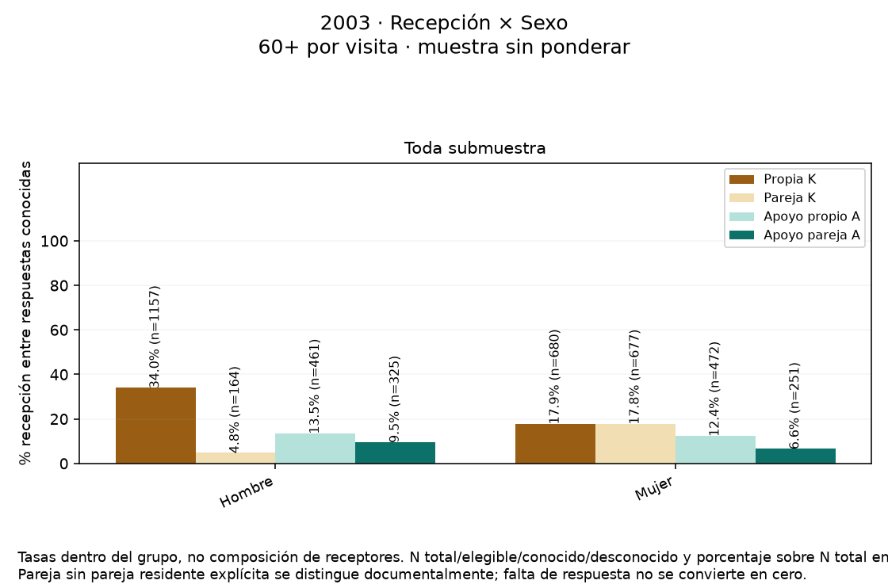

Para pension_propia_k, la tasa entre respuestas conocidas va de 17.87% en «Mujer» (680/3,805) a 33.97% en «Hombre» (1,157/3,406). Es una diferencia dentro de grupos, no la composición del conjunto receptor. Los desconocidos y tamaños de grupo se muestran arriba; la comparación puede reflejar selección documental y composición socioeconómica.

Para apoyo_propio, la tasa entre respuestas conocidas va de 12.40% en «Mujer» (472/3,805) a 13.53% en «Hombre» (461/3,406). Es una diferencia dentro de grupos, no la composición del conjunto receptor. Los desconocidos y tamaños de grupo se muestran arriba; la comparación puede reflejar selección documental y composición socioeconómica.

###### Recepción por Escolaridad en primera entrevista

| ano | educacion_grupo | variable | N_total | N_elegible_vivo | N_si | N_no | N_desconocido | N_conocido | pct_si_total | pct_si_elegible | pct_si_conocido | pct_cobertura_elegible |
| --- | --- | --- | --- | --- | --- | --- | --- | --- | --- | --- | --- | --- |
| 2,003 | 0 años | pension_propia_k | 2,379 | 2,379 | 304 | 1,892 | 183 | 2,196 | 12.78 | 12.78 | 13.84 | 92.31 |
| 2,003 | 0 años | pension_conyuge_k | 2,379 | 2,379 | 156 | 2,040 | 183 | 2,196 | 6.56 | 6.56 | 7.10 | 92.31 |
| 2,003 | 0 años | apoyo_propio | 2,379 | 2,379 | 440 | 1,756 | 183 | 2,196 | 18.50 | 18.50 | 20.04 | 92.31 |
| 2,003 | 0 años | apoyo_conyuge | 2,379 | 2,379 | 225 | 1,971 | 183 | 2,196 | 9.46 | 9.46 | 10.25 | 92.31 |
| 2,003 | 1–5 años | pension_propia_k | 2,878 | 2,878 | 582 | 2,097 | 199 | 2,679 | 20.22 | 20.22 | 21.72 | 93.09 |
| 2,003 | 1–5 años | pension_conyuge_k | 2,878 | 2,878 | 278 | 2,401 | 199 | 2,679 | 9.66 | 9.66 | 10.38 | 93.09 |
| 2,003 | 1–5 años | apoyo_propio | 2,878 | 2,878 | 369 | 2,310 | 199 | 2,679 | 12.82 | 12.82 | 13.77 | 93.09 |
| 2,003 | 1–5 años | apoyo_conyuge | 2,878 | 2,878 | 272 | 2,407 | 199 | 2,679 | 9.45 | 9.45 | 10.15 | 93.09 |
| 2,003 | 6 años | pension_propia_k | 1,205 | 1,205 | 392 | 762 | 51 | 1,154 | 32.53 | 32.53 | 33.97 | 95.77 |
| 2,003 | 6 años | pension_conyuge_k | 1,205 | 1,205 | 177 | 977 | 51 | 1,154 | 14.69 | 14.69 | 15.34 | 95.77 |
| 2,003 | 6 años | apoyo_propio | 1,205 | 1,205 | 72 | 1,082 | 51 | 1,154 | 5.98 | 5.98 | 6.24 | 95.77 |
| 2,003 | 6 años | apoyo_conyuge | 1,205 | 1,205 | 53 | 1,101 | 51 | 1,154 | 4.40 | 4.40 | 4.59 | 95.77 |
| 2,003 | 7–9 años | pension_propia_k | 697 | 697 | 291 | 381 | 25 | 672 | 41.75 | 41.75 | 43.30 | 96.41 |
| 2,003 | 7–9 años | pension_conyuge_k | 697 | 697 | 144 | 528 | 25 | 672 | 20.66 | 20.66 | 21.43 | 96.41 |
| 2,003 | 7–9 años | apoyo_propio | 697 | 697 | 33 | 639 | 25 | 672 | 4.73 | 4.73 | 4.91 | 96.41 |
| 2,003 | 7–9 años | apoyo_conyuge | 697 | 697 | 12 | 660 | 25 | 672 | 1.72 | 1.72 | 1.79 | 96.41 |
| 2,003 | Desconocido | pension_propia_k | 50 | 50 | 11 | 36 | 3 | 47 | 22.00 | 22.00 | 23.40 | 94.00 |
| 2,003 | Desconocido | pension_conyuge_k | 50 | 50 | 6 | 41 | 3 | 47 | 12.00 | 12.00 | 12.77 | 94.00 |
| 2,003 | Desconocido | apoyo_propio | 50 | 50 | 1 | 46 | 3 | 47 | 2.00 | 2.00 | 2.13 | 94.00 |
| 2,003 | Desconocido | apoyo_conyuge | 50 | 50 | 4 | 43 | 3 | 47 | 8.00 | 8.00 | 8.51 | 94.00 |
| 2,003 | ≥10 años | pension_propia_k | 482 | 482 | 257 | 206 | 19 | 463 | 53.32 | 53.32 | 55.51 | 96.06 |
| 2,003 | ≥10 años | pension_conyuge_k | 482 | 482 | 80 | 383 | 19 | 463 | 16.60 | 16.60 | 17.28 | 96.06 |
| 2,003 | ≥10 años | apoyo_propio | 482 | 482 | 18 | 445 | 19 | 463 | 3.73 | 3.73 | 3.89 | 96.06 |
| 2,003 | ≥10 años | apoyo_conyuge | 482 | 482 | 10 | 453 | 19 | 463 | 2.07 | 2.07 | 2.16 | 96.06 |

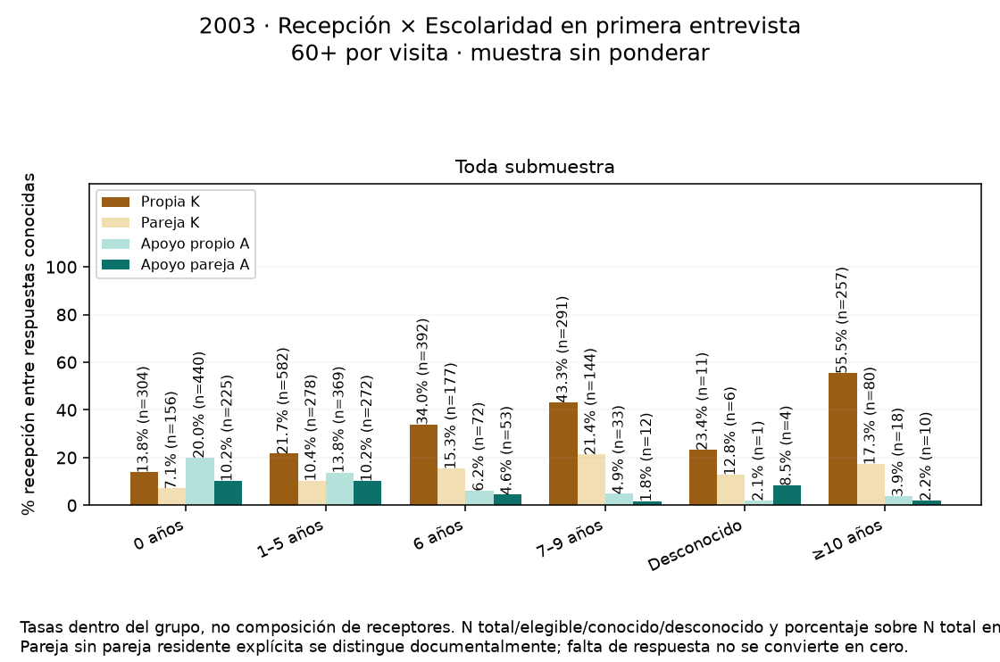

Para pension_propia_k, la tasa entre respuestas conocidas va de 13.84% en «0 años» (304/2,196) a 55.51% en «≥10 años» (257/463). Es una diferencia dentro de grupos, no la composición del conjunto receptor. Los desconocidos y tamaños de grupo se muestran arriba; la comparación puede reflejar selección documental y composición socioeconómica.

Para apoyo_propio, la tasa entre respuestas conocidas va de 3.89% en «≥10 años» (18/463) a 20.04% en «0 años» (440/2,196). Es una diferencia dentro de grupos, no la composición del conjunto receptor. Los desconocidos y tamaños de grupo se muestran arriba; la comparación puede reflejar selección documental y composición socioeconómica.

###### Recepción por Edad en la visita

| ano | edad_grupo | variable | N_total | N_elegible_vivo | N_si | N_no | N_desconocido | N_conocido | pct_si_total | pct_si_elegible | pct_si_conocido | pct_cobertura_elegible |
| --- | --- | --- | --- | --- | --- | --- | --- | --- | --- | --- | --- | --- |
| 2,003 | 60–69 | pension_propia_k | 4,304 | 4,304 | 977 | 3,145 | 182 | 4,122 | 22.70 | 22.70 | 23.70 | 95.77 |
| 2,003 | 60–69 | pension_conyuge_k | 4,304 | 4,304 | 556 | 3,566 | 182 | 4,122 | 12.92 | 12.92 | 13.49 | 95.77 |
| 2,003 | 60–69 | apoyo_propio | 4,304 | 4,304 | 468 | 3,654 | 182 | 4,122 | 10.87 | 10.87 | 11.35 | 95.77 |
| 2,003 | 60–69 | apoyo_conyuge | 4,304 | 4,304 | 341 | 3,781 | 182 | 4,122 | 7.92 | 7.92 | 8.27 | 95.77 |
| 2,003 | 70–79 | pension_propia_k | 2,415 | 2,415 | 650 | 1,608 | 157 | 2,258 | 26.92 | 26.92 | 28.79 | 93.50 |
| 2,003 | 70–79 | pension_conyuge_k | 2,415 | 2,415 | 229 | 2,029 | 157 | 2,258 | 9.48 | 9.48 | 10.14 | 93.50 |
| 2,003 | 70–79 | apoyo_propio | 2,415 | 2,415 | 338 | 1,920 | 157 | 2,258 | 14.00 | 14.00 | 14.97 | 93.50 |
| 2,003 | 70–79 | apoyo_conyuge | 2,415 | 2,415 | 188 | 2,070 | 157 | 2,258 | 7.78 | 7.78 | 8.33 | 93.50 |
| 2,003 | 80–89 | pension_propia_k | 825 | 825 | 191 | 538 | 96 | 729 | 23.15 | 23.15 | 26.20 | 88.36 |
| 2,003 | 80–89 | pension_conyuge_k | 825 | 825 | 50 | 679 | 96 | 729 | 6.06 | 6.06 | 6.86 | 88.36 |
| 2,003 | 80–89 | apoyo_propio | 825 | 825 | 112 | 617 | 96 | 729 | 13.58 | 13.58 | 15.36 | 88.36 |
| 2,003 | 80–89 | apoyo_conyuge | 825 | 825 | 45 | 684 | 96 | 729 | 5.45 | 5.45 | 6.17 | 88.36 |
| 2,003 | ≥90 | pension_propia_k | 147 | 147 | 19 | 83 | 45 | 102 | 12.93 | 12.93 | 18.63 | 69.39 |
| 2,003 | ≥90 | pension_conyuge_k | 147 | 147 | 6 | 96 | 45 | 102 | 4.08 | 4.08 | 5.88 | 69.39 |
| 2,003 | ≥90 | apoyo_propio | 147 | 147 | 15 | 87 | 45 | 102 | 10.20 | 10.20 | 14.71 | 69.39 |
| 2,003 | ≥90 | apoyo_conyuge | 147 | 147 | 2 | 100 | 45 | 102 | 1.36 | 1.36 | 1.96 | 69.39 |

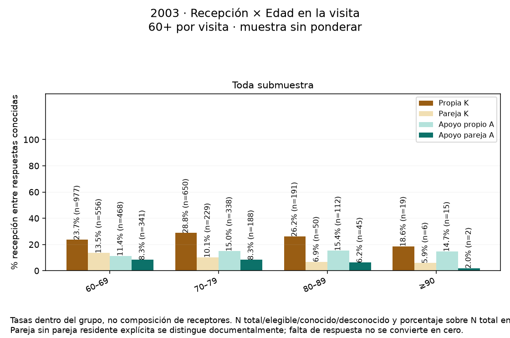

Para pension_propia_k, la tasa entre respuestas conocidas va de 18.63% en «≥90» (19/102) a 28.79% en «70–79» (650/2,258). Es una diferencia dentro de grupos, no la composición del conjunto receptor. Los desconocidos y tamaños de grupo se muestran arriba; la comparación puede reflejar selección documental y composición socioeconómica.

Para apoyo_propio, la tasa entre respuestas conocidas va de 11.35% en «60–69» (468/4,122) a 15.36% en «80–89» (112/729). Es una diferencia dentro de grupos, no la composición del conjunto receptor. Los desconocidos y tamaños de grupo se muestran arriba; la comparación puede reflejar selección documental y composición socioeconómica.

###### Cruce pension_apoyo

| pension | apoyo | N | N_estrato | N_elegible_vivo | N_par_conocido | N_par_desconocido | pct_estrato | pct_par_conocido | pct_composicion_apoyados |
| --- | --- | --- | --- | --- | --- | --- | --- | --- | --- |
| Sí | Sí | 132 | 7,691 | 7,691 | 7,211 | 480 | 1.72 | 1.83 | 14.15 |
| Sí | No | 1,705 | 7,691 | 7,691 | 7,211 | 480 | 22.17 | 23.64 | ND |
| Sí | Desconocido | 0 | 7,691 | 7,691 | 7,211 | 480 | 0.00 | ND | ND |
| No | Sí | 801 | 7,691 | 7,691 | 7,211 | 480 | 10.41 | 11.11 | 85.85 |
| No | No | 4,573 | 7,691 | 7,691 | 7,211 | 480 | 59.46 | 63.42 | ND |
| No | Desconocido | 0 | 7,691 | 7,691 | 7,211 | 480 | 0.00 | ND | ND |
| Desconocido | Sí | 0 | 7,691 | 7,691 | 7,211 | 480 | 0.00 | ND | 0.00 |
| Desconocido | No | 0 | 7,691 | 7,691 | 7,211 | 480 | 0.00 | ND | ND |
| Desconocido | Desconocido | 480 | 7,691 | 7,691 | 7,211 | 480 | 6.24 | ND | ND |

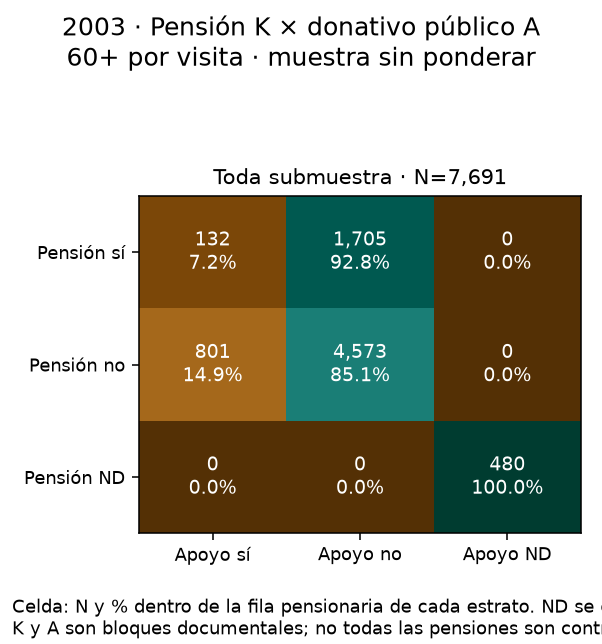

En «Toda submuestra», recibe apoyo 801/5,374 (14.91%) entre negativas K y 132/1,837 (7.19%) entre receptoras K. La diferencia es 7.72 puntos porcentuales. Esta comparación distingue cobertura adicional observada y coexistencia dentro del mismo perfil; no prueba un cambio de elegibilidad ni impacto redistributivo.

###### Cruce pension_apoyo_localidad_grupo

| localidad_grupo | pension | apoyo | N | N_estrato | N_elegible_vivo | N_par_conocido | N_par_desconocido | pct_estrato | pct_par_conocido | pct_composicion_apoyados |
| --- | --- | --- | --- | --- | --- | --- | --- | --- | --- | --- |
| <100 mil habitantes | Sí | Sí | 71 | 3,369 | 3,369 | 3,140 | 229 | 2.11 | 2.26 | 7.61 |
| <100 mil habitantes | Sí | No | 418 | 3,369 | 3,369 | 3,140 | 229 | 12.41 | 13.31 | ND |
| <100 mil habitantes | Sí | Desconocido | 0 | 3,369 | 3,369 | 3,140 | 229 | 0.00 | ND | ND |
| <100 mil habitantes | No | Sí | 669 | 3,369 | 3,369 | 3,140 | 229 | 19.86 | 21.31 | 71.70 |
| <100 mil habitantes | No | No | 1,982 | 3,369 | 3,369 | 3,140 | 229 | 58.83 | 63.12 | ND |
| <100 mil habitantes | No | Desconocido | 0 | 3,369 | 3,369 | 3,140 | 229 | 0.00 | ND | ND |
| <100 mil habitantes | Desconocido | Sí | 0 | 3,369 | 3,369 | 3,140 | 229 | 0.00 | ND | 0.00 |
| <100 mil habitantes | Desconocido | No | 0 | 3,369 | 3,369 | 3,140 | 229 | 0.00 | ND | ND |
| <100 mil habitantes | Desconocido | Desconocido | 229 | 3,369 | 3,369 | 3,140 | 229 | 6.80 | ND | ND |
| ≥100 mil habitantes | Sí | Sí | 61 | 4,322 | 4,322 | 4,071 | 251 | 1.41 | 1.50 | 6.54 |
| ≥100 mil habitantes | Sí | No | 1,287 | 4,322 | 4,322 | 4,071 | 251 | 29.78 | 31.61 | ND |
| ≥100 mil habitantes | Sí | Desconocido | 0 | 4,322 | 4,322 | 4,071 | 251 | 0.00 | ND | ND |
| ≥100 mil habitantes | No | Sí | 132 | 4,322 | 4,322 | 4,071 | 251 | 3.05 | 3.24 | 14.15 |
| ≥100 mil habitantes | No | No | 2,591 | 4,322 | 4,322 | 4,071 | 251 | 59.95 | 63.65 | ND |
| ≥100 mil habitantes | No | Desconocido | 0 | 4,322 | 4,322 | 4,071 | 251 | 0.00 | ND | ND |
| ≥100 mil habitantes | Desconocido | Sí | 0 | 4,322 | 4,322 | 4,071 | 251 | 0.00 | ND | 0.00 |
| ≥100 mil habitantes | Desconocido | No | 0 | 4,322 | 4,322 | 4,071 | 251 | 0.00 | ND | ND |
| ≥100 mil habitantes | Desconocido | Desconocido | 251 | 4,322 | 4,322 | 4,071 | 251 | 5.81 | ND | ND |


En «<100 mil habitantes», recibe apoyo 669/2,651 (25.24%) entre negativas K y 71/489 (14.52%) entre receptoras K. La diferencia es 10.72 puntos porcentuales. Esta comparación distingue cobertura adicional observada y coexistencia dentro del mismo perfil; no prueba un cambio de elegibilidad ni impacto redistributivo.

En «≥100 mil habitantes», recibe apoyo 132/2,723 (4.85%) entre negativas K y 61/1,348 (4.53%) entre receptoras K. La diferencia es 0.32 puntos porcentuales. Esta comparación distingue cobertura adicional observada y coexistencia dentro del mismo perfil; no prueba un cambio de elegibilidad ni impacto redistributivo.

###### Cruce pension_apoyo_sexo_grupo

| sexo_grupo | pension | apoyo | N | N_estrato | N_elegible_vivo | N_par_conocido | N_par_desconocido | pct_estrato | pct_par_conocido | pct_composicion_apoyados |
| --- | --- | --- | --- | --- | --- | --- | --- | --- | --- | --- |
| Hombre | Sí | Sí | 86 | 3,587 | 3,587 | 3,406 | 181 | 2.40 | 2.52 | 9.22 |
| Hombre | Sí | No | 1,071 | 3,587 | 3,587 | 3,406 | 181 | 29.86 | 31.44 | ND |
| Hombre | Sí | Desconocido | 0 | 3,587 | 3,587 | 3,406 | 181 | 0.00 | ND | ND |
| Hombre | No | Sí | 375 | 3,587 | 3,587 | 3,406 | 181 | 10.45 | 11.01 | 40.19 |
| Hombre | No | No | 1,874 | 3,587 | 3,587 | 3,406 | 181 | 52.24 | 55.02 | ND |
| Hombre | No | Desconocido | 0 | 3,587 | 3,587 | 3,406 | 181 | 0.00 | ND | ND |
| Hombre | Desconocido | Sí | 0 | 3,587 | 3,587 | 3,406 | 181 | 0.00 | ND | 0.00 |
| Hombre | Desconocido | No | 0 | 3,587 | 3,587 | 3,406 | 181 | 0.00 | ND | ND |
| Hombre | Desconocido | Desconocido | 181 | 3,587 | 3,587 | 3,406 | 181 | 5.05 | ND | ND |
| Mujer | Sí | Sí | 46 | 4,104 | 4,104 | 3,805 | 299 | 1.12 | 1.21 | 4.93 |
| Mujer | Sí | No | 634 | 4,104 | 4,104 | 3,805 | 299 | 15.45 | 16.66 | ND |
| Mujer | Sí | Desconocido | 0 | 4,104 | 4,104 | 3,805 | 299 | 0.00 | ND | ND |
| Mujer | No | Sí | 426 | 4,104 | 4,104 | 3,805 | 299 | 10.38 | 11.20 | 45.66 |
| Mujer | No | No | 2,699 | 4,104 | 4,104 | 3,805 | 299 | 65.77 | 70.93 | ND |
| Mujer | No | Desconocido | 0 | 4,104 | 4,104 | 3,805 | 299 | 0.00 | ND | ND |
| Mujer | Desconocido | Sí | 0 | 4,104 | 4,104 | 3,805 | 299 | 0.00 | ND | 0.00 |
| Mujer | Desconocido | No | 0 | 4,104 | 4,104 | 3,805 | 299 | 0.00 | ND | ND |
| Mujer | Desconocido | Desconocido | 299 | 4,104 | 4,104 | 3,805 | 299 | 7.29 | ND | ND |

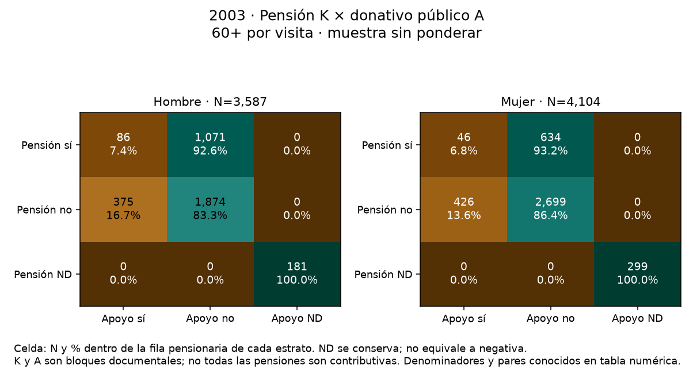

En «Hombre», recibe apoyo 375/2,249 (16.67%) entre negativas K y 86/1,157 (7.43%) entre receptoras K. La diferencia es 9.24 puntos porcentuales. Esta comparación distingue cobertura adicional observada y coexistencia dentro del mismo perfil; no prueba un cambio de elegibilidad ni impacto redistributivo.

En «Mujer», recibe apoyo 426/3,125 (13.63%) entre negativas K y 46/680 (6.76%) entre receptoras K. La diferencia es 6.87 puntos porcentuales. Esta comparación distingue cobertura adicional observada y coexistencia dentro del mismo perfil; no prueba un cambio de elegibilidad ni impacto redistributivo.

###### Cruce pension_educacion_grupo_sexo_grupo

| ano | sexo_grupo | educacion_grupo | variable | N_total | N_elegible_vivo | N_si | N_no | N_desconocido | N_conocido | pct_si_total | pct_si_elegible | pct_si_conocido | pct_cobertura_elegible |
| --- | --- | --- | --- | --- | --- | --- | --- | --- | --- | --- | --- | --- | --- |
| 2,003 | Hombre | 0 años | pension_propia_k | 1,013 | 1,013 | 177 | 762 | 74 | 939 | 17.47 | 17.47 | 18.85 | 92.69 |
| 2,003 | Hombre | 1–5 años | pension_propia_k | 1,368 | 1,368 | 388 | 911 | 69 | 1,299 | 28.36 | 28.36 | 29.87 | 94.96 |
| 2,003 | Hombre | 6 años | pension_propia_k | 588 | 588 | 276 | 290 | 22 | 566 | 46.94 | 46.94 | 48.76 | 96.26 |
| 2,003 | Hombre | 7–9 años | pension_propia_k | 283 | 283 | 151 | 124 | 8 | 275 | 53.36 | 53.36 | 54.91 | 97.17 |
| 2,003 | Hombre | Desconocido | pension_propia_k | 35 | 35 | 9 | 26 | 0 | 35 | 25.71 | 25.71 | 25.71 | 100.00 |
| 2,003 | Hombre | ≥10 años | pension_propia_k | 300 | 300 | 156 | 136 | 8 | 292 | 52.00 | 52.00 | 53.42 | 97.33 |
| 2,003 | Mujer | 0 años | pension_propia_k | 1,366 | 1,366 | 127 | 1,130 | 109 | 1,257 | 9.30 | 9.30 | 10.10 | 92.02 |
| 2,003 | Mujer | 1–5 años | pension_propia_k | 1,510 | 1,510 | 194 | 1,186 | 130 | 1,380 | 12.85 | 12.85 | 14.06 | 91.39 |
| 2,003 | Mujer | 6 años | pension_propia_k | 617 | 617 | 116 | 472 | 29 | 588 | 18.80 | 18.80 | 19.73 | 95.30 |
| 2,003 | Mujer | 7–9 años | pension_propia_k | 414 | 414 | 140 | 257 | 17 | 397 | 33.82 | 33.82 | 35.26 | 95.89 |
| 2,003 | Mujer | Desconocido | pension_propia_k | 15 | 15 | 2 | 10 | 3 | 12 | 13.33 | 13.33 | 16.67 | 80.00 |
| 2,003 | Mujer | ≥10 años | pension_propia_k | 182 | 182 | 101 | 70 | 11 | 171 | 55.49 | 55.49 | 59.06 | 93.96 |

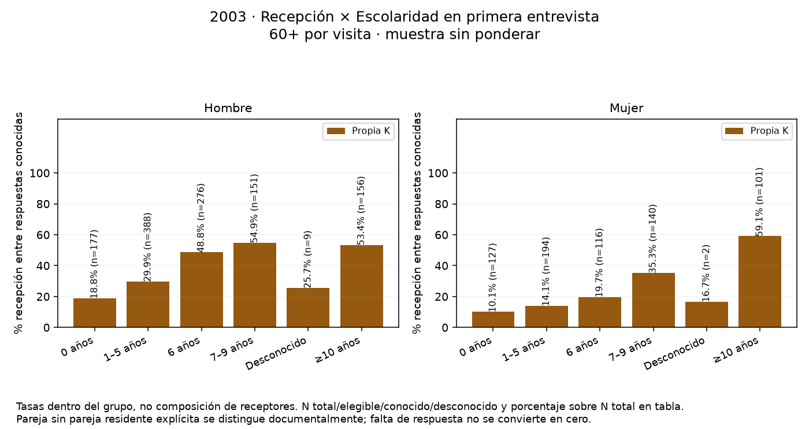

Dentro de «Hombre», la recepción K entre respuestas conocidas es menor en «0 años»: 177/939 (18.85%), y mayor en «7–9 años»: 151/275 (54.91%). Las diferencias no separan mecanismos de trayectoria laboral, cohortes o selección por supervivencia; las celdas pequeñas y faltantes limitan la precisión.

Dentro de «Mujer», la recepción K entre respuestas conocidas es menor en «0 años»: 127/1,257 (10.10%), y mayor en «≥10 años»: 101/171 (59.06%). Las diferencias no separan mecanismos de trayectoria laboral, cohortes o selección por supervivencia; las celdas pequeñas y faltantes limitan la precisión.

###### Cruce pension_edad_grupo_localidad_grupo

| ano | localidad_grupo | edad_grupo | variable | N_total | N_elegible_vivo | N_si | N_no | N_desconocido | N_conocido | pct_si_total | pct_si_elegible | pct_si_conocido | pct_cobertura_elegible |
| --- | --- | --- | --- | --- | --- | --- | --- | --- | --- | --- | --- | --- | --- |
| 2,003 | <100 mil habitantes | 60–69 | pension_propia_k | 1,829 | 1,829 | 262 | 1,484 | 83 | 1,746 | 14.32 | 14.32 | 15.01 | 95.46 |
| 2,003 | <100 mil habitantes | 70–79 | pension_propia_k | 1,064 | 1,064 | 162 | 823 | 79 | 985 | 15.23 | 15.23 | 16.45 | 92.58 |
| 2,003 | <100 mil habitantes | 80–89 | pension_propia_k | 407 | 407 | 59 | 301 | 47 | 360 | 14.50 | 14.50 | 16.39 | 88.45 |
| 2,003 | <100 mil habitantes | ≥90 | pension_propia_k | 69 | 69 | 6 | 43 | 20 | 49 | 8.70 | 8.70 | 12.24 | 71.01 |
| 2,003 | ≥100 mil habitantes | 60–69 | pension_propia_k | 2,475 | 2,475 | 715 | 1,661 | 99 | 2,376 | 28.89 | 28.89 | 30.09 | 96.00 |
| 2,003 | ≥100 mil habitantes | 70–79 | pension_propia_k | 1,351 | 1,351 | 488 | 785 | 78 | 1,273 | 36.12 | 36.12 | 38.33 | 94.23 |
| 2,003 | ≥100 mil habitantes | 80–89 | pension_propia_k | 418 | 418 | 132 | 237 | 49 | 369 | 31.58 | 31.58 | 35.77 | 88.28 |
| 2,003 | ≥100 mil habitantes | ≥90 | pension_propia_k | 78 | 78 | 13 | 40 | 25 | 53 | 16.67 | 16.67 | 24.53 | 67.95 |

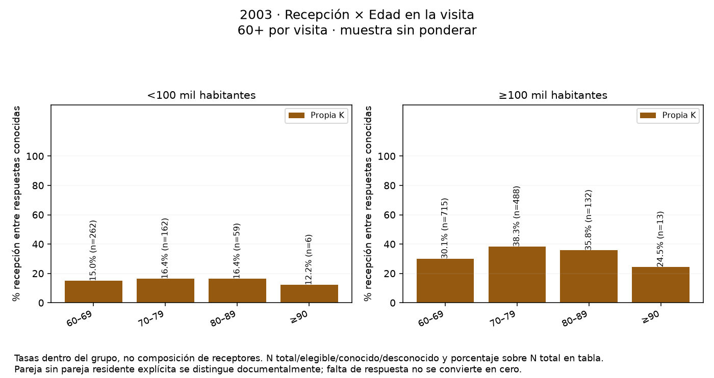

Dentro de «<100 mil habitantes», la recepción K entre respuestas conocidas es menor en «≥90»: 6/49 (12.24%), y mayor en «70–79»: 162/985 (16.45%). Las diferencias no separan mecanismos de trayectoria laboral, cohortes o selección por supervivencia; las celdas pequeñas y faltantes limitan la precisión.

Dentro de «≥100 mil habitantes», la recepción K entre respuestas conocidas es menor en «≥90»: 13/53 (24.53%), y mayor en «70–79»: 488/1,273 (38.33%). Las diferencias no separan mecanismos de trayectoria laboral, cohortes o selección por supervivencia; las celdas pequeñas y faltantes limitan la precisión.

###### Instituciones, programas y montos

| ano | tipo_contingencia | N_eventos | N_beneficiarios | N_slots_en_tipo_con_IMSS_ISSSTE | N_slots_en_tipo_con_programa_publico_agrupado | N_slots_en_tipo_con_institucion_sin_tipo_comprobado | alcance |
| --- | --- | --- | --- | --- | --- | --- | --- |
| 2,003 | 1 | 1,453 | 1,453 | 1,275 | 0 | 178 | En 2012/2015 institución identifica contingencia, no cada slot ni reparto del monto |
| 2,003 | 2 | 327 | 327 | 299 | 0 | 28 | En 2012/2015 institución identifica contingencia, no cada slot ni reparto del monto |
| 2,003 | 3 | 61 | 61 | 57 | 0 | 4 | En 2012/2015 institución identifica contingencia, no cada slot ni reparto del monto |
| 2,003 | 4 | 47 | 47 | 23 | 0 | 24 | En 2012/2015 institución identifica contingencia, no cada slot ni reparto del monto |

| ano | programa | tipo_documental | N_eventos | N_beneficiarios | N_monto_observado |
| --- | --- | --- | --- | --- | --- |
| 2,003 | Programa no identificado | Apoyo público sin tipo comprobado | 933 | 933 | 854 |

| ano | bloque | unidad | N_eventos | N_beneficiarios | N_monto_observado | N_monto_desconocido | mediana_nominal_mensual | p25 | p75 | suma_parcial_por_bloque | sumable_entre_bloques |
| --- | --- | --- | --- | --- | --- | --- | --- | --- | --- | --- | --- |
| 2,003 | K | Evento de beneficiario 60+ identificado | 1,888 | 1,837 | 1,833 | 55 | 1,480.00 | 1,300.00 | 2,365.00 | 4,569,312.00 | False |
| 2,003 | A | Evento de beneficiario 60+ identificado | 933 | 933 | 854 | 79 | 250.00 | 150.00 | 600.00 | 1,784,226.00 | False |

##### 2012

| ano | variable | N_total | N_elegible_vivo | N_si | N_no | N_desconocido | N_conocido | pct_si_total | pct_si_elegible | pct_si_conocido | pct_cobertura_elegible |
| --- | --- | --- | --- | --- | --- | --- | --- | --- | --- | --- | --- |
| 2,012 | pension_propia_k | 9,886 | 9,886 | 2,907 | 6,127 | 852 | 9,034 | 29.41 | 29.41 | 32.18 | 91.38 |
| 2,012 | pension_conyuge_k | 9,886 | 9,886 | 1,398 | 4,606 | 3,882 | 6,004 | 14.14 | 14.14 | 23.28 | 60.73 |
| 2,012 | apoyo_propio | 9,886 | 9,886 | 1,613 | 7,432 | 841 | 9,045 | 16.32 | 16.32 | 17.83 | 91.49 |
| 2,012 | apoyo_conyuge | 9,886 | 9,886 | 978 | 5,032 | 3,876 | 6,010 | 9.89 | 9.89 | 16.27 | 60.79 |

| ano | categoria | N | N_60 | pct_60 |
| --- | --- | --- | --- | --- |
| 2,012 | Apoyo y negativa propia K | 1,355 | 9,886 | 13.71 |
| 2,012 | Negativas explícitas K y A | 4,767 | 9,886 | 48.22 |
| 2,012 | Otra situación desconocida | 863 | 9,886 | 8.73 |
| 2,012 | Pensión K y apoyo | 258 | 9,886 | 2.61 |
| 2,012 | Solo pensión K observada | 2,643 | 9,886 | 26.73 |

De 9,886 registros de 60+, 9,886 corresponden a personas vivas y 9,066 tienen orientación propia utilizable. Se identifica pensión propia K en 2,907 y apoyo propio A en 1,613; quedan respectivamente 852 y 841 estados desconocidos. Entre respuestas conocidas, las proporciones son 32.18% y 17.83%. Estos porcentajes no deben confundirse con tasas sobre todos los elegibles ni con cobertura nacional.

| pension | N_pension_estado | N_apoyo_conocido | N_apoyo_si | pct_apoyo_conocido |
| --- | --- | --- | --- | --- |
| No | 6,127 | 6,122 | 1,355 | 22.13 |
| Sí | 2,907 | 2,901 | 258 | 8.89 |

El apoyo entre quienes tienen negativa propia K supera al apoyo entre receptoras K en 13.24 puntos porcentuales (diferencia con signo). Se observan tanto cobertura adicional respecto de una negativa K como coexistencia. No se conoce el contrafactual sin programa, ni una negativa K descarta todas las pensiones no contributivas; por tanto, no se afirma una ampliación causal ni cobertura de personas sin ninguna pensión.

| ano | cruce | estrato | N_validos | N_excluidos | V_cramer | N_celdas_esperadas_menor5 |
| --- | --- | --- | --- | --- | --- | --- |
| 2,012 | Pensión K × Apoyo | Toda submuestra 60+ | 9,023 | 863 | 0.16 | 0 |
| 2,012 | P × Localidad a 100 mil (no ruralidad estricta) | Toda submuestra 60+ | 9,034 | 852 | 0.18 | 0 |
| 2,012 | A × Localidad a 100 mil (no ruralidad estricta) | Toda submuestra 60+ | 9,045 | 841 | 0.28 | 0 |
| 2,012 | P × Sexo | Toda submuestra 60+ | 9,034 | 852 | 0.16 | 0 |
| 2,012 | A × Sexo | Toda submuestra 60+ | 9,045 | 841 | 0.01 | 0 |
| 2,012 | P × Escolaridad en primera entrevista | Toda submuestra 60+ | 8,981 | 905 | 0.22 | 0 |
| 2,012 | A × Escolaridad en primera entrevista | Toda submuestra 60+ | 8,992 | 894 | 0.25 | 0 |
| 2,012 | P × Edad en la visita | Toda submuestra 60+ | 9,034 | 852 | 0.12 | 0 |
| 2,012 | A × Edad en la visita | Toda submuestra 60+ | 9,045 | 841 | 0.28 | 0 |
| 2,012 | Pensión K × Apoyo / Localidad a 100 mil (no ruralidad estricta) | <100 mil habitantes | 3,753 | 451 | 0.13 | 0 |
| 2,012 | Pensión K × Apoyo / Localidad a 100 mil (no ruralidad estricta) | ≥100 mil habitantes | 5,270 | 412 | 0.12 | 0 |
| 2,012 | Pensión K × Apoyo / Sexo | Hombre | 4,209 | 329 | 0.18 | 0 |
| 2,012 | Pensión K × Apoyo / Sexo | Mujer | 4,814 | 534 | 0.15 | 0 |
| 2,012 | Pensión K × Escolaridad en primera entrevista / Sexo | Hombre | 4,179 | 359 | 0.20 | 0 |
| 2,012 | Pensión K × Escolaridad en primera entrevista / Sexo | Mujer | 4,802 | 546 | 0.24 | 0 |
| 2,012 | Pensión K × Edad en la visita / Localidad a 100 mil (no ruralidad estricta) | <100 mil habitantes | 3,757 | 447 | 0.14 | 0 |
| 2,012 | Pensión K × Edad en la visita / Localidad a 100 mil (no ruralidad estricta) | ≥100 mil habitantes | 5,277 | 405 | 0.12 | 0 |

| ano | control | recepcion | N_validos | N_excluidos | rho_spearman |
| --- | --- | --- | --- | --- | --- |
| 2,012 | edad | pension_propia_k | 9,034 | 852 | 0.13 |
| 2,012 | edad | apoyo_propio | 9,045 | 841 | 0.27 |
| 2,012 | educacion | pension_propia_k | 8,981 | 905 | 0.20 |
| 2,012 | educacion | apoyo_propio | 8,992 | 894 | -0.25 |

###### Recepción por Localidad a 100 mil (no ruralidad estricta)

| ano | localidad_grupo | variable | N_total | N_elegible_vivo | N_si | N_no | N_desconocido | N_conocido | pct_si_total | pct_si_elegible | pct_si_conocido | pct_cobertura_elegible |
| --- | --- | --- | --- | --- | --- | --- | --- | --- | --- | --- | --- | --- |
| 2,012 | <100 mil habitantes | pension_propia_k | 4,204 | 4,204 | 833 | 2,924 | 447 | 3,757 | 19.81 | 19.81 | 22.17 | 89.37 |
| 2,012 | <100 mil habitantes | pension_conyuge_k | 4,204 | 4,204 | 426 | 2,190 | 1,588 | 2,616 | 10.13 | 10.13 | 16.28 | 62.23 |
| 2,012 | <100 mil habitantes | apoyo_propio | 4,204 | 4,204 | 1,140 | 2,619 | 445 | 3,759 | 27.12 | 27.12 | 30.33 | 89.41 |
| 2,012 | <100 mil habitantes | apoyo_conyuge | 4,204 | 4,204 | 741 | 1,876 | 1,587 | 2,617 | 17.63 | 17.63 | 28.31 | 62.25 |
| 2,012 | ≥100 mil habitantes | pension_propia_k | 5,682 | 5,682 | 2,074 | 3,203 | 405 | 5,277 | 36.50 | 36.50 | 39.30 | 92.87 |
| 2,012 | ≥100 mil habitantes | pension_conyuge_k | 5,682 | 5,682 | 972 | 2,416 | 2,294 | 3,388 | 17.11 | 17.11 | 28.69 | 59.63 |
| 2,012 | ≥100 mil habitantes | apoyo_propio | 5,682 | 5,682 | 473 | 4,813 | 396 | 5,286 | 8.32 | 8.32 | 8.95 | 93.03 |
| 2,012 | ≥100 mil habitantes | apoyo_conyuge | 5,682 | 5,682 | 237 | 3,156 | 2,289 | 3,393 | 4.17 | 4.17 | 6.98 | 59.71 |

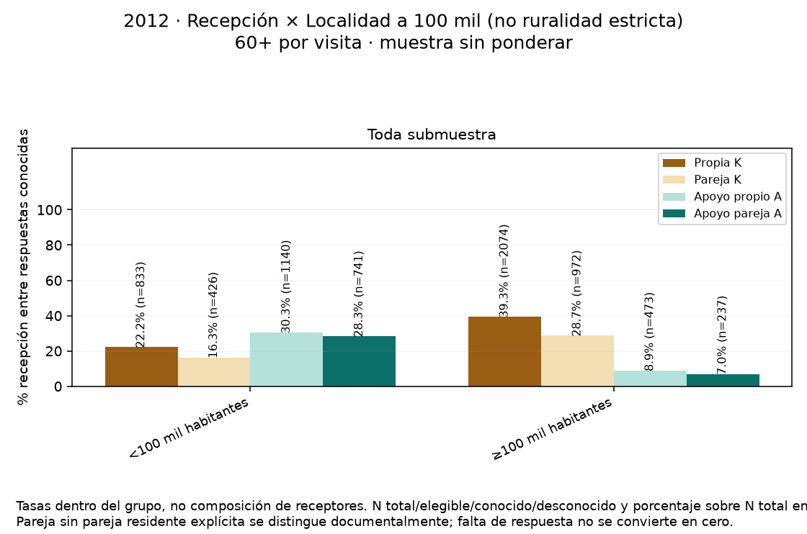

Para pension_propia_k, la tasa entre respuestas conocidas va de 22.17% en «<100 mil habitantes» (833/3,757) a 39.30% en «≥100 mil habitantes» (2,074/5,277). Es una diferencia dentro de grupos, no la composición del conjunto receptor. Los desconocidos y tamaños de grupo se muestran arriba; la comparación puede reflejar selección documental y composición socioeconómica.

Para apoyo_propio, la tasa entre respuestas conocidas va de 8.95% en «≥100 mil habitantes» (473/5,286) a 30.33% en «<100 mil habitantes» (1,140/3,759). Es una diferencia dentro de grupos, no la composición del conjunto receptor. Los desconocidos y tamaños de grupo se muestran arriba; la comparación puede reflejar selección documental y composición socioeconómica.

###### Recepción por Sexo

| ano | sexo_grupo | variable | N_total | N_elegible_vivo | N_si | N_no | N_desconocido | N_conocido | pct_si_total | pct_si_elegible | pct_si_conocido | pct_cobertura_elegible |
| --- | --- | --- | --- | --- | --- | --- | --- | --- | --- | --- | --- | --- |
| 2,012 | Hombre | pension_propia_k | 4,538 | 4,538 | 1,692 | 2,522 | 324 | 4,214 | 37.29 | 37.29 | 40.15 | 92.86 |
| 2,012 | Hombre | pension_conyuge_k | 4,538 | 4,538 | 379 | 3,099 | 1,060 | 3,478 | 8.35 | 8.35 | 10.90 | 76.64 |
| 2,012 | Hombre | apoyo_propio | 4,538 | 4,538 | 731 | 3,488 | 319 | 4,219 | 16.11 | 16.11 | 17.33 | 92.97 |
| 2,012 | Hombre | apoyo_conyuge | 4,538 | 4,538 | 521 | 2,961 | 1,056 | 3,482 | 11.48 | 11.48 | 14.96 | 76.73 |
| 2,012 | Mujer | pension_propia_k | 5,348 | 5,348 | 1,215 | 3,605 | 528 | 4,820 | 22.72 | 22.72 | 25.21 | 90.13 |
| 2,012 | Mujer | pension_conyuge_k | 5,348 | 5,348 | 1,019 | 1,507 | 2,822 | 2,526 | 19.05 | 19.05 | 40.34 | 47.23 |
| 2,012 | Mujer | apoyo_propio | 5,348 | 5,348 | 882 | 3,944 | 522 | 4,826 | 16.49 | 16.49 | 18.28 | 90.24 |
| 2,012 | Mujer | apoyo_conyuge | 5,348 | 5,348 | 457 | 2,071 | 2,820 | 2,528 | 8.55 | 8.55 | 18.08 | 47.27 |

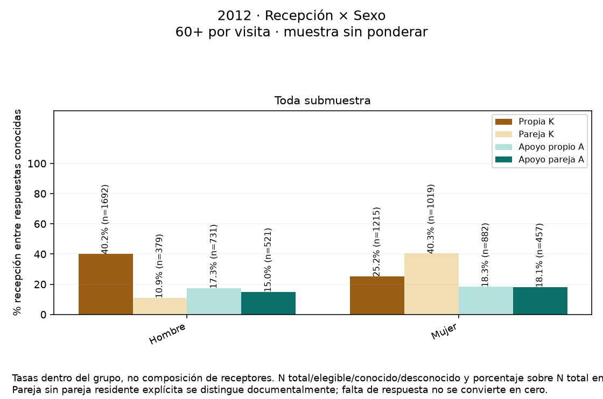

Para pension_propia_k, la tasa entre respuestas conocidas va de 25.21% en «Mujer» (1,215/4,820) a 40.15% en «Hombre» (1,692/4,214). Es una diferencia dentro de grupos, no la composición del conjunto receptor. Los desconocidos y tamaños de grupo se muestran arriba; la comparación puede reflejar selección documental y composición socioeconómica.

Para apoyo_propio, la tasa entre respuestas conocidas va de 17.33% en «Hombre» (731/4,219) a 18.28% en «Mujer» (882/4,826). Es una diferencia dentro de grupos, no la composición del conjunto receptor. Los desconocidos y tamaños de grupo se muestran arriba; la comparación puede reflejar selección documental y composición socioeconómica.

###### Recepción por Escolaridad en primera entrevista

| ano | educacion_grupo | variable | N_total | N_elegible_vivo | N_si | N_no | N_desconocido | N_conocido | pct_si_total | pct_si_elegible | pct_si_conocido | pct_cobertura_elegible |
| --- | --- | --- | --- | --- | --- | --- | --- | --- | --- | --- | --- | --- |
| 2,012 | 0 años | pension_propia_k | 2,270 | 2,270 | 415 | 1,526 | 329 | 1,941 | 18.28 | 18.28 | 21.38 | 85.51 |
| 2,012 | 0 años | pension_conyuge_k | 2,270 | 2,270 | 200 | 995 | 1,075 | 1,195 | 8.81 | 8.81 | 16.74 | 52.64 |
| 2,012 | 0 años | apoyo_propio | 2,270 | 2,270 | 605 | 1,342 | 323 | 1,947 | 26.65 | 26.65 | 31.07 | 85.77 |
| 2,012 | 0 años | apoyo_conyuge | 2,270 | 2,270 | 350 | 846 | 1,074 | 1,196 | 15.42 | 15.42 | 29.26 | 52.69 |
| 2,012 | 1–5 años | pension_propia_k | 3,455 | 3,455 | 860 | 2,286 | 309 | 3,146 | 24.89 | 24.89 | 27.34 | 91.06 |
| 2,012 | 1–5 años | pension_conyuge_k | 3,455 | 3,455 | 432 | 1,598 | 1,425 | 2,030 | 12.50 | 12.50 | 21.28 | 58.76 |
| 2,012 | 1–5 años | apoyo_propio | 3,455 | 3,455 | 699 | 2,452 | 304 | 3,151 | 20.23 | 20.23 | 22.18 | 91.20 |
| 2,012 | 1–5 años | apoyo_conyuge | 3,455 | 3,455 | 427 | 1,606 | 1,422 | 2,033 | 12.36 | 12.36 | 21.00 | 58.84 |
| 2,012 | 6 años | pension_propia_k | 1,915 | 1,915 | 591 | 1,211 | 113 | 1,802 | 30.86 | 30.86 | 32.80 | 94.10 |
| 2,012 | 6 años | pension_conyuge_k | 1,915 | 1,915 | 302 | 973 | 640 | 1,275 | 15.77 | 15.77 | 23.69 | 66.58 |
| 2,012 | 6 años | apoyo_propio | 1,915 | 1,915 | 203 | 1,599 | 113 | 1,802 | 10.60 | 10.60 | 11.27 | 94.10 |
| 2,012 | 6 años | apoyo_conyuge | 1,915 | 1,915 | 143 | 1,133 | 639 | 1,276 | 7.47 | 7.47 | 11.21 | 66.63 |
| 2,012 | 7–9 años | pension_propia_k | 1,234 | 1,234 | 530 | 636 | 68 | 1,166 | 42.95 | 42.95 | 45.45 | 94.49 |
| 2,012 | 7–9 años | pension_conyuge_k | 1,234 | 1,234 | 249 | 504 | 481 | 753 | 20.18 | 20.18 | 33.07 | 61.02 |
| 2,012 | 7–9 años | apoyo_propio | 1,234 | 1,234 | 73 | 1,094 | 67 | 1,167 | 5.92 | 5.92 | 6.26 | 94.57 |
| 2,012 | 7–9 años | apoyo_conyuge | 1,234 | 1,234 | 36 | 715 | 483 | 751 | 2.92 | 2.92 | 4.79 | 60.86 |
| 2,012 | Desconocido | pension_propia_k | 53 | 53 | 17 | 36 | 0 | 53 | 32.08 | 32.08 | 32.08 | 100.00 |
| 2,012 | Desconocido | pension_conyuge_k | 53 | 53 | 6 | 38 | 9 | 44 | 11.32 | 11.32 | 13.64 | 83.02 |
| 2,012 | Desconocido | apoyo_propio | 53 | 53 | 5 | 48 | 0 | 53 | 9.43 | 9.43 | 9.43 | 100.00 |
| 2,012 | Desconocido | apoyo_conyuge | 53 | 53 | 4 | 41 | 8 | 45 | 7.55 | 7.55 | 8.89 | 84.91 |
| 2,012 | ≥10 años | pension_propia_k | 959 | 959 | 494 | 432 | 33 | 926 | 51.51 | 51.51 | 53.35 | 96.56 |
| 2,012 | ≥10 años | pension_conyuge_k | 959 | 959 | 209 | 498 | 252 | 707 | 21.79 | 21.79 | 29.56 | 73.72 |
| 2,012 | ≥10 años | apoyo_propio | 959 | 959 | 28 | 897 | 34 | 925 | 2.92 | 2.92 | 3.03 | 96.45 |
| 2,012 | ≥10 años | apoyo_conyuge | 959 | 959 | 18 | 691 | 250 | 709 | 1.88 | 1.88 | 2.54 | 73.93 |

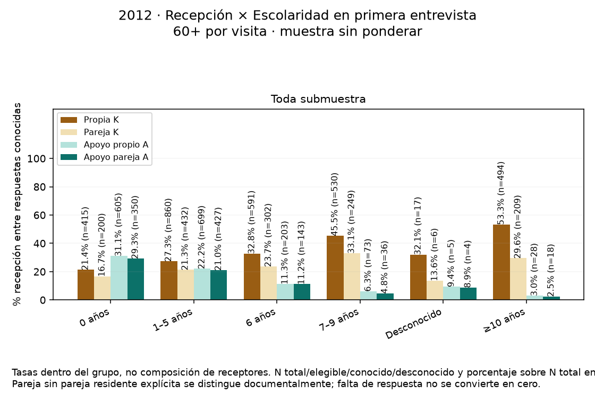

Para pension_propia_k, la tasa entre respuestas conocidas va de 21.38% en «0 años» (415/1,941) a 53.35% en «≥10 años» (494/926). Es una diferencia dentro de grupos, no la composición del conjunto receptor. Los desconocidos y tamaños de grupo se muestran arriba; la comparación puede reflejar selección documental y composición socioeconómica.

Para apoyo_propio, la tasa entre respuestas conocidas va de 3.03% en «≥10 años» (28/925) a 31.07% en «0 años» (605/1,947). Es una diferencia dentro de grupos, no la composición del conjunto receptor. Los desconocidos y tamaños de grupo se muestran arriba; la comparación puede reflejar selección documental y composición socioeconómica.

###### Recepción por Edad en la visita

| ano | edad_grupo | variable | N_total | N_elegible_vivo | N_si | N_no | N_desconocido | N_conocido | pct_si_total | pct_si_elegible | pct_si_conocido | pct_cobertura_elegible |
| --- | --- | --- | --- | --- | --- | --- | --- | --- | --- | --- | --- | --- |
| 2,012 | 60–69 | pension_propia_k | 5,229 | 5,229 | 1,364 | 3,633 | 232 | 4,997 | 26.09 | 26.09 | 27.30 | 95.56 |
| 2,012 | 60–69 | pension_conyuge_k | 5,229 | 5,229 | 864 | 2,907 | 1,458 | 3,771 | 16.52 | 16.52 | 22.91 | 72.12 |
| 2,012 | 60–69 | apoyo_propio | 5,229 | 5,229 | 430 | 4,573 | 226 | 5,003 | 8.22 | 8.22 | 8.59 | 95.68 |
| 2,012 | 60–69 | apoyo_conyuge | 5,229 | 5,229 | 434 | 3,338 | 1,457 | 3,772 | 8.30 | 8.30 | 11.51 | 72.14 |
| 2,012 | 70–79 | pension_propia_k | 3,178 | 3,178 | 1,125 | 1,798 | 255 | 2,923 | 35.40 | 35.40 | 38.49 | 91.98 |
| 2,012 | 70–79 | pension_conyuge_k | 3,178 | 3,178 | 443 | 1,312 | 1,423 | 1,755 | 13.94 | 13.94 | 25.24 | 55.22 |
| 2,012 | 70–79 | apoyo_propio | 3,178 | 3,178 | 794 | 2,134 | 250 | 2,928 | 24.98 | 24.98 | 27.12 | 92.13 |
| 2,012 | 70–79 | apoyo_conyuge | 3,178 | 3,178 | 388 | 1,373 | 1,417 | 1,761 | 12.21 | 12.21 | 22.03 | 55.41 |
| 2,012 | 80–89 | pension_propia_k | 1,266 | 1,266 | 380 | 610 | 276 | 990 | 30.02 | 30.02 | 38.38 | 78.20 |
| 2,012 | 80–89 | pension_conyuge_k | 1,266 | 1,266 | 86 | 354 | 826 | 440 | 6.79 | 6.79 | 19.55 | 34.76 |
| 2,012 | 80–89 | apoyo_propio | 1,266 | 1,266 | 343 | 647 | 276 | 990 | 27.09 | 27.09 | 34.65 | 78.20 |
| 2,012 | 80–89 | apoyo_conyuge | 1,266 | 1,266 | 140 | 299 | 827 | 439 | 11.06 | 11.06 | 31.89 | 34.68 |
| 2,012 | ≥90 | pension_propia_k | 213 | 213 | 38 | 86 | 89 | 124 | 17.84 | 17.84 | 30.65 | 58.22 |
| 2,012 | ≥90 | pension_conyuge_k | 213 | 213 | 5 | 33 | 175 | 38 | 2.35 | 2.35 | 13.16 | 17.84 |
| 2,012 | ≥90 | apoyo_propio | 213 | 213 | 46 | 78 | 89 | 124 | 21.60 | 21.60 | 37.10 | 58.22 |
| 2,012 | ≥90 | apoyo_conyuge | 213 | 213 | 16 | 22 | 175 | 38 | 7.51 | 7.51 | 42.11 | 17.84 |

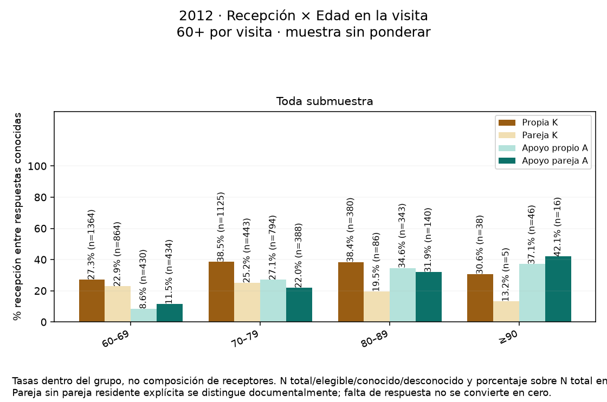

Para pension_propia_k, la tasa entre respuestas conocidas va de 27.30% en «60–69» (1,364/4,997) a 38.49% en «70–79» (1,125/2,923). Es una diferencia dentro de grupos, no la composición del conjunto receptor. Los desconocidos y tamaños de grupo se muestran arriba; la comparación puede reflejar selección documental y composición socioeconómica.

Para apoyo_propio, la tasa entre respuestas conocidas va de 8.59% en «60–69» (430/5,003) a 37.10% en «≥90» (46/124). Es una diferencia dentro de grupos, no la composición del conjunto receptor. Los desconocidos y tamaños de grupo se muestran arriba; la comparación puede reflejar selección documental y composición socioeconómica.

###### Cruce pension_apoyo

| pension | apoyo | N | N_estrato | N_elegible_vivo | N_par_conocido | N_par_desconocido | pct_estrato | pct_par_conocido | pct_composicion_apoyados |
| --- | --- | --- | --- | --- | --- | --- | --- | --- | --- |
| Sí | Sí | 258 | 9,886 | 9,886 | 9,023 | 863 | 2.61 | 2.86 | 16.00 |
| Sí | No | 2,643 | 9,886 | 9,886 | 9,023 | 863 | 26.73 | 29.29 | ND |
| Sí | Desconocido | 6 | 9,886 | 9,886 | 9,023 | 863 | 0.06 | ND | ND |
| No | Sí | 1,355 | 9,886 | 9,886 | 9,023 | 863 | 13.71 | 15.02 | 84.00 |
| No | No | 4,767 | 9,886 | 9,886 | 9,023 | 863 | 48.22 | 52.83 | ND |
| No | Desconocido | 5 | 9,886 | 9,886 | 9,023 | 863 | 0.05 | ND | ND |
| Desconocido | Sí | 0 | 9,886 | 9,886 | 9,023 | 863 | 0.00 | ND | 0.00 |
| Desconocido | No | 22 | 9,886 | 9,886 | 9,023 | 863 | 0.22 | ND | ND |
| Desconocido | Desconocido | 830 | 9,886 | 9,886 | 9,023 | 863 | 8.40 | ND | ND |

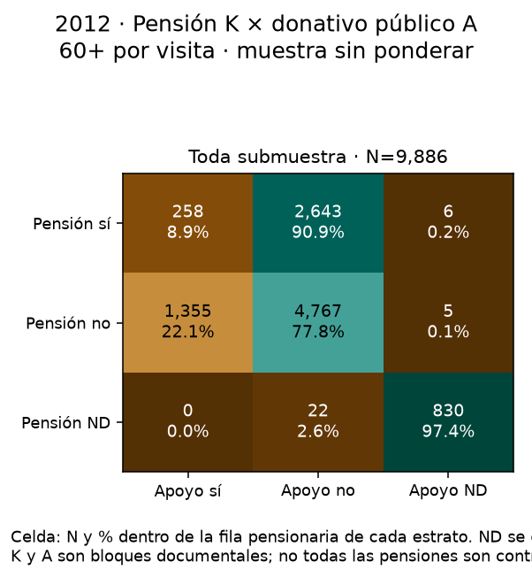

En «Toda submuestra», recibe apoyo 1,355/6,122 (22.13%) entre negativas K y 258/2,901 (8.89%) entre receptoras K. La diferencia es 13.24 puntos porcentuales. Esta comparación distingue cobertura adicional observada y coexistencia dentro del mismo perfil; no prueba un cambio de elegibilidad ni impacto redistributivo.

###### Cruce pension_apoyo_localidad_grupo

| localidad_grupo | pension | apoyo | N | N_estrato | N_elegible_vivo | N_par_conocido | N_par_desconocido | pct_estrato | pct_par_conocido | pct_composicion_apoyados |
| --- | --- | --- | --- | --- | --- | --- | --- | --- | --- | --- |
| <100 mil habitantes | Sí | Sí | 157 | 4,204 | 4,204 | 3,753 | 451 | 3.73 | 4.18 | 9.73 |
| <100 mil habitantes | Sí | No | 675 | 4,204 | 4,204 | 3,753 | 451 | 16.06 | 17.99 | ND |
| <100 mil habitantes | Sí | Desconocido | 1 | 4,204 | 4,204 | 3,753 | 451 | 0.02 | ND | ND |
| <100 mil habitantes | No | Sí | 983 | 4,204 | 4,204 | 3,753 | 451 | 23.38 | 26.19 | 60.94 |
| <100 mil habitantes | No | No | 1,938 | 4,204 | 4,204 | 3,753 | 451 | 46.10 | 51.64 | ND |
| <100 mil habitantes | No | Desconocido | 3 | 4,204 | 4,204 | 3,753 | 451 | 0.07 | ND | ND |
| <100 mil habitantes | Desconocido | Sí | 0 | 4,204 | 4,204 | 3,753 | 451 | 0.00 | ND | 0.00 |
| <100 mil habitantes | Desconocido | No | 6 | 4,204 | 4,204 | 3,753 | 451 | 0.14 | ND | ND |
| <100 mil habitantes | Desconocido | Desconocido | 441 | 4,204 | 4,204 | 3,753 | 451 | 10.49 | ND | ND |
| ≥100 mil habitantes | Sí | Sí | 101 | 5,682 | 5,682 | 5,270 | 412 | 1.78 | 1.92 | 6.26 |
| ≥100 mil habitantes | Sí | No | 1,968 | 5,682 | 5,682 | 5,270 | 412 | 34.64 | 37.34 | ND |
| ≥100 mil habitantes | Sí | Desconocido | 5 | 5,682 | 5,682 | 5,270 | 412 | 0.09 | ND | ND |
| ≥100 mil habitantes | No | Sí | 372 | 5,682 | 5,682 | 5,270 | 412 | 6.55 | 7.06 | 23.06 |
| ≥100 mil habitantes | No | No | 2,829 | 5,682 | 5,682 | 5,270 | 412 | 49.79 | 53.68 | ND |
| ≥100 mil habitantes | No | Desconocido | 2 | 5,682 | 5,682 | 5,270 | 412 | 0.04 | ND | ND |
| ≥100 mil habitantes | Desconocido | Sí | 0 | 5,682 | 5,682 | 5,270 | 412 | 0.00 | ND | 0.00 |
| ≥100 mil habitantes | Desconocido | No | 16 | 5,682 | 5,682 | 5,270 | 412 | 0.28 | ND | ND |
| ≥100 mil habitantes | Desconocido | Desconocido | 389 | 5,682 | 5,682 | 5,270 | 412 | 6.85 | ND | ND |

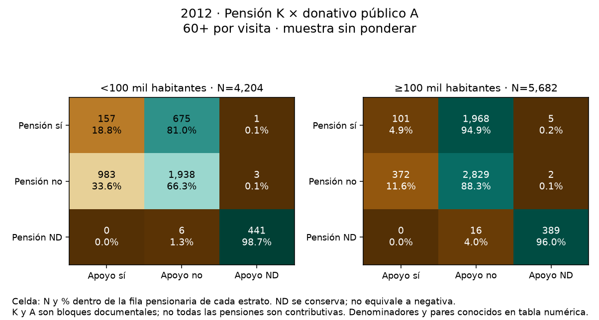

En «<100 mil habitantes», recibe apoyo 983/2,921 (33.65%) entre negativas K y 157/832 (18.87%) entre receptoras K. La diferencia es 14.78 puntos porcentuales. Esta comparación distingue cobertura adicional observada y coexistencia dentro del mismo perfil; no prueba un cambio de elegibilidad ni impacto redistributivo.

En «≥100 mil habitantes», recibe apoyo 372/3,201 (11.62%) entre negativas K y 101/2,069 (4.88%) entre receptoras K. La diferencia es 6.74 puntos porcentuales. Esta comparación distingue cobertura adicional observada y coexistencia dentro del mismo perfil; no prueba un cambio de elegibilidad ni impacto redistributivo.

###### Cruce pension_apoyo_sexo_grupo

| sexo_grupo | pension | apoyo | N | N_estrato | N_elegible_vivo | N_par_conocido | N_par_desconocido | pct_estrato | pct_par_conocido | pct_composicion_apoyados |
| --- | --- | --- | --- | --- | --- | --- | --- | --- | --- | --- |
| Hombre | Sí | Sí | 156 | 4,538 | 4,538 | 4,209 | 329 | 3.44 | 3.71 | 9.67 |
| Hombre | Sí | No | 1,533 | 4,538 | 4,538 | 4,209 | 329 | 33.78 | 36.42 | ND |
| Hombre | Sí | Desconocido | 3 | 4,538 | 4,538 | 4,209 | 329 | 0.07 | ND | ND |
| Hombre | No | Sí | 575 | 4,538 | 4,538 | 4,209 | 329 | 12.67 | 13.66 | 35.65 |
| Hombre | No | No | 1,945 | 4,538 | 4,538 | 4,209 | 329 | 42.86 | 46.21 | ND |
| Hombre | No | Desconocido | 2 | 4,538 | 4,538 | 4,209 | 329 | 0.04 | ND | ND |
| Hombre | Desconocido | Sí | 0 | 4,538 | 4,538 | 4,209 | 329 | 0.00 | ND | 0.00 |
| Hombre | Desconocido | No | 10 | 4,538 | 4,538 | 4,209 | 329 | 0.22 | ND | ND |
| Hombre | Desconocido | Desconocido | 314 | 4,538 | 4,538 | 4,209 | 329 | 6.92 | ND | ND |
| Mujer | Sí | Sí | 102 | 5,348 | 5,348 | 4,814 | 534 | 1.91 | 2.12 | 6.32 |
| Mujer | Sí | No | 1,110 | 5,348 | 5,348 | 4,814 | 534 | 20.76 | 23.06 | ND |
| Mujer | Sí | Desconocido | 3 | 5,348 | 5,348 | 4,814 | 534 | 0.06 | ND | ND |
| Mujer | No | Sí | 780 | 5,348 | 5,348 | 4,814 | 534 | 14.58 | 16.20 | 48.36 |
| Mujer | No | No | 2,822 | 5,348 | 5,348 | 4,814 | 534 | 52.77 | 58.62 | ND |
| Mujer | No | Desconocido | 3 | 5,348 | 5,348 | 4,814 | 534 | 0.06 | ND | ND |
| Mujer | Desconocido | Sí | 0 | 5,348 | 5,348 | 4,814 | 534 | 0.00 | ND | 0.00 |
| Mujer | Desconocido | No | 12 | 5,348 | 5,348 | 4,814 | 534 | 0.22 | ND | ND |
| Mujer | Desconocido | Desconocido | 516 | 5,348 | 5,348 | 4,814 | 534 | 9.65 | ND | ND |

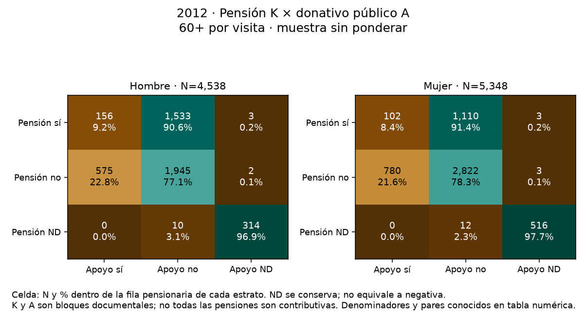

En «Hombre», recibe apoyo 575/2,520 (22.82%) entre negativas K y 156/1,689 (9.24%) entre receptoras K. La diferencia es 13.58 puntos porcentuales. Esta comparación distingue cobertura adicional observada y coexistencia dentro del mismo perfil; no prueba un cambio de elegibilidad ni impacto redistributivo.

En «Mujer», recibe apoyo 780/3,602 (21.65%) entre negativas K y 102/1,212 (8.42%) entre receptoras K. La diferencia es 13.24 puntos porcentuales. Esta comparación distingue cobertura adicional observada y coexistencia dentro del mismo perfil; no prueba un cambio de elegibilidad ni impacto redistributivo.

###### Cruce pension_educacion_grupo_sexo_grupo

| ano | sexo_grupo | educacion_grupo | variable | N_total | N_elegible_vivo | N_si | N_no | N_desconocido | N_conocido | pct_si_total | pct_si_elegible | pct_si_conocido | pct_cobertura_elegible |
| --- | --- | --- | --- | --- | --- | --- | --- | --- | --- | --- | --- | --- | --- |
| 2,012 | Hombre | 0 años | pension_propia_k | 909 | 909 | 218 | 581 | 110 | 799 | 23.98 | 23.98 | 27.28 | 87.90 |
| 2,012 | Hombre | 1–5 años | pension_propia_k | 1,529 | 1,529 | 481 | 922 | 126 | 1,403 | 31.46 | 31.46 | 34.28 | 91.76 |
| 2,012 | Hombre | 6 años | pension_propia_k | 934 | 934 | 396 | 490 | 48 | 886 | 42.40 | 42.40 | 44.70 | 94.86 |
| 2,012 | Hombre | 7–9 años | pension_propia_k | 503 | 503 | 265 | 219 | 19 | 484 | 52.68 | 52.68 | 54.75 | 96.22 |
| 2,012 | Hombre | Desconocido | pension_propia_k | 35 | 35 | 14 | 21 | 0 | 35 | 40.00 | 40.00 | 40.00 | 100.00 |
| 2,012 | Hombre | ≥10 años | pension_propia_k | 628 | 628 | 318 | 289 | 21 | 607 | 50.64 | 50.64 | 52.39 | 96.66 |
| 2,012 | Mujer | 0 años | pension_propia_k | 1,361 | 1,361 | 197 | 945 | 219 | 1,142 | 14.47 | 14.47 | 17.25 | 83.91 |
| 2,012 | Mujer | 1–5 años | pension_propia_k | 1,926 | 1,926 | 379 | 1,364 | 183 | 1,743 | 19.68 | 19.68 | 21.74 | 90.50 |
| 2,012 | Mujer | 6 años | pension_propia_k | 981 | 981 | 195 | 721 | 65 | 916 | 19.88 | 19.88 | 21.29 | 93.37 |
| 2,012 | Mujer | 7–9 años | pension_propia_k | 731 | 731 | 265 | 417 | 49 | 682 | 36.25 | 36.25 | 38.86 | 93.30 |
| 2,012 | Mujer | Desconocido | pension_propia_k | 18 | 18 | 3 | 15 | 0 | 18 | 16.67 | 16.67 | 16.67 | 100.00 |
| 2,012 | Mujer | ≥10 años | pension_propia_k | 331 | 331 | 176 | 143 | 12 | 319 | 53.17 | 53.17 | 55.17 | 96.37 |

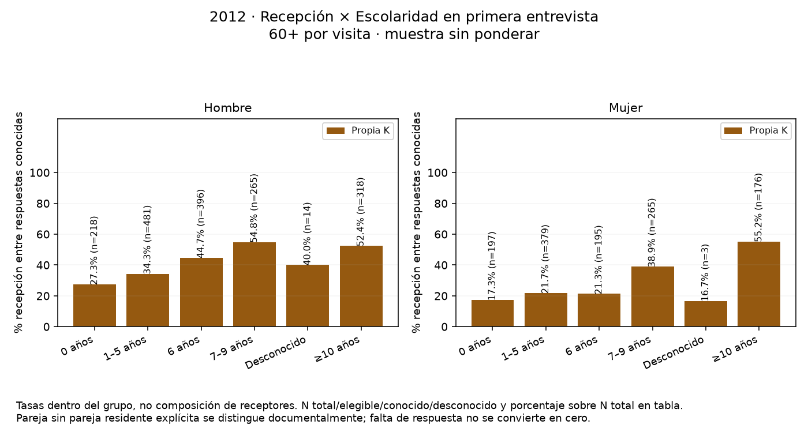

Dentro de «Hombre», la recepción K entre respuestas conocidas es menor en «0 años»: 218/799 (27.28%), y mayor en «7–9 años»: 265/484 (54.75%). Las diferencias no separan mecanismos de trayectoria laboral, cohortes o selección por supervivencia; las celdas pequeñas y faltantes limitan la precisión.

Dentro de «Mujer», la recepción K entre respuestas conocidas es menor en «0 años»: 197/1,142 (17.25%), y mayor en «≥10 años»: 176/319 (55.17%). Las diferencias no separan mecanismos de trayectoria laboral, cohortes o selección por supervivencia; las celdas pequeñas y faltantes limitan la precisión.

###### Cruce pension_edad_grupo_localidad_grupo

| ano | localidad_grupo | edad_grupo | variable | N_total | N_elegible_vivo | N_si | N_no | N_desconocido | N_conocido | pct_si_total | pct_si_elegible | pct_si_conocido | pct_cobertura_elegible |
| --- | --- | --- | --- | --- | --- | --- | --- | --- | --- | --- | --- | --- | --- |
| 2,012 | <100 mil habitantes | 60–69 | pension_propia_k | 2,143 | 2,143 | 339 | 1,674 | 130 | 2,013 | 15.82 | 15.82 | 16.84 | 93.93 |
| 2,012 | <100 mil habitantes | 70–79 | pension_propia_k | 1,369 | 1,369 | 350 | 878 | 141 | 1,228 | 25.57 | 25.57 | 28.50 | 89.70 |
| 2,012 | <100 mil habitantes | 80–89 | pension_propia_k | 582 | 582 | 130 | 320 | 132 | 450 | 22.34 | 22.34 | 28.89 | 77.32 |
| 2,012 | <100 mil habitantes | ≥90 | pension_propia_k | 110 | 110 | 14 | 52 | 44 | 66 | 12.73 | 12.73 | 21.21 | 60.00 |
| 2,012 | ≥100 mil habitantes | 60–69 | pension_propia_k | 3,086 | 3,086 | 1,025 | 1,959 | 102 | 2,984 | 33.21 | 33.21 | 34.35 | 96.69 |
| 2,012 | ≥100 mil habitantes | 70–79 | pension_propia_k | 1,809 | 1,809 | 775 | 920 | 114 | 1,695 | 42.84 | 42.84 | 45.72 | 93.70 |
| 2,012 | ≥100 mil habitantes | 80–89 | pension_propia_k | 684 | 684 | 250 | 290 | 144 | 540 | 36.55 | 36.55 | 46.30 | 78.95 |
| 2,012 | ≥100 mil habitantes | ≥90 | pension_propia_k | 103 | 103 | 24 | 34 | 45 | 58 | 23.30 | 23.30 | 41.38 | 56.31 |

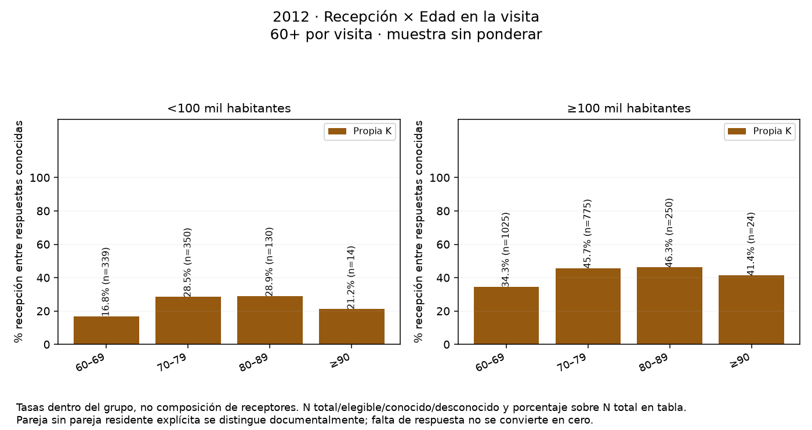

Dentro de «<100 mil habitantes», la recepción K entre respuestas conocidas es menor en «60–69»: 339/2,013 (16.84%), y mayor en «80–89»: 130/450 (28.89%). Las diferencias no separan mecanismos de trayectoria laboral, cohortes o selección por supervivencia; las celdas pequeñas y faltantes limitan la precisión.

Dentro de «≥100 mil habitantes», la recepción K entre respuestas conocidas es menor en «60–69»: 1,025/2,984 (34.35%), y mayor en «80–89»: 250/540 (46.30%). Las diferencias no separan mecanismos de trayectoria laboral, cohortes o selección por supervivencia; las celdas pequeñas y faltantes limitan la precisión.

###### Instituciones, programas y montos

| ano | tipo_contingencia | N_eventos | N_beneficiarios | N_slots_en_tipo_con_IMSS_ISSSTE | N_slots_en_tipo_con_programa_publico_agrupado | N_slots_en_tipo_con_institucion_sin_tipo_comprobado | alcance |
| --- | --- | --- | --- | --- | --- | --- | --- |
| 2,012 | 1 | 2,153 | 2,153 | 1,909 | 55 | 216 | En 2012/2015 institución identifica contingencia, no cada slot ni reparto del monto |
| 2,012 | 2 | 491 | 491 | 448 | 2 | 44 | En 2012/2015 institución identifica contingencia, no cada slot ni reparto del monto |
| 2,012 | 3 | 73 | 73 | 63 | 0 | 13 | En 2012/2015 institución identifica contingencia, no cada slot ni reparto del monto |
| 2,012 | 4 | 349 | 349 | 60 | 259 | 38 | En 2012/2015 institución identifica contingencia, no cada slot ni reparto del monto |

| ano | programa | tipo_documental | N_eventos | N_beneficiarios | N_monto_observado |
| --- | --- | --- | --- | --- | --- |
| 2,012 | Programa no identificado | Apoyo público sin tipo comprobado | 1,613 | 1,613 | 1,573 |

| ano | bloque | unidad | N_eventos | N_beneficiarios | N_monto_observado | N_monto_desconocido | mediana_nominal_mensual | p25 | p75 | suma_parcial_por_bloque | sumable_entre_bloques |
| --- | --- | --- | --- | --- | --- | --- | --- | --- | --- | --- | --- |
| 2,012 | K | Evento de beneficiario 60+ identificado | 3,066 | 2,907 | 2,855 | 211 | 2,100.00 | 1,800.00 | 4,550.00 | 23,017,531.00 | False |
| 2,012 | A | Evento de beneficiario 60+ identificado | 1,613 | 1,613 | 1,573 | 40 | 500.00 | 500.00 | 800.00 | 3,234,974.00 | False |

##### 2015

| ano | variable | N_total | N_elegible_vivo | N_si | N_no | N_desconocido | N_conocido | pct_si_total | pct_si_elegible | pct_si_conocido | pct_cobertura_elegible |
| --- | --- | --- | --- | --- | --- | --- | --- | --- | --- | --- | --- |
| 2,015 | pension_propia_k | 10,416 | 10,416 | 4,253 | 5,503 | 660 | 9,756 | 40.83 | 40.83 | 43.59 | 93.66 |
| 2,015 | pension_conyuge_k | 10,416 | 10,416 | 2,200 | 7,547 | 669 | 9,747 | 21.12 | 21.12 | 22.57 | 93.58 |
| 2,015 | apoyo_propio | 10,416 | 10,416 | 2,693 | 7,070 | 653 | 9,763 | 25.85 | 25.85 | 27.58 | 93.73 |
| 2,015 | apoyo_conyuge | 10,416 | 10,416 | 1,583 | 8,176 | 657 | 9,759 | 15.20 | 15.20 | 16.22 | 93.69 |

| ano | categoria | N | N_60 | pct_60 |
| --- | --- | --- | --- | --- |
| 2,015 | Apoyo con pensión desconocida | 6 | 10,416 | 0.06 |
| 2,015 | Apoyo y negativa propia K | 2,143 | 10,416 | 20.57 |
| 2,015 | Negativas explícitas K y A | 3,356 | 10,416 | 32.22 |
| 2,015 | Otra situación desconocida | 661 | 10,416 | 6.35 |
| 2,015 | Pensión K y apoyo | 544 | 10,416 | 5.22 |
| 2,015 | Solo pensión K observada | 3,706 | 10,416 | 35.58 |

De 10,416 registros de 60+, 10,416 corresponden a personas vivas y 9,774 tienen orientación propia utilizable. Se identifica pensión propia K en 4,253 y apoyo propio A en 2,693; quedan respectivamente 660 y 653 estados desconocidos. Entre respuestas conocidas, las proporciones son 43.59% y 27.58%. Estos porcentajes no deben confundirse con tasas sobre todos los elegibles ni con cobertura nacional.

| pension | N_pension_estado | N_apoyo_conocido | N_apoyo_si | pct_apoyo_conocido |
| --- | --- | --- | --- | --- |
| No | 5,503 | 5,499 | 2,143 | 38.97 |
| Sí | 4,253 | 4,250 | 544 | 12.80 |

El apoyo entre quienes tienen negativa propia K supera al apoyo entre receptoras K en 26.17 puntos porcentuales (diferencia con signo). Se observan tanto cobertura adicional respecto de una negativa K como coexistencia. No se conoce el contrafactual sin programa, ni una negativa K descarta todas las pensiones no contributivas; por tanto, no se afirma una ampliación causal ni cobertura de personas sin ninguna pensión.

| ano | cruce | estrato | N_validos | N_excluidos | V_cramer | N_celdas_esperadas_menor5 |
| --- | --- | --- | --- | --- | --- | --- |
| 2,015 | Pensión K × Apoyo | Toda submuestra 60+ | 9,749 | 667 | 0.29 | 0 |
| 2,015 | P × Localidad a 100 mil (no ruralidad estricta) | Toda submuestra 60+ | 9,756 | 660 | 0.06 | 0 |
| 2,015 | A × Localidad a 100 mil (no ruralidad estricta) | Toda submuestra 60+ | 9,763 | 653 | 0.22 | 0 |
| 2,015 | P × Sexo | Toda submuestra 60+ | 9,756 | 660 | 0.15 | 0 |
| 2,015 | A × Sexo | Toda submuestra 60+ | 9,763 | 653 | 0.05 | 0 |
| 2,015 | P × Escolaridad en primera entrevista | Toda submuestra 60+ | 9,652 | 764 | 0.12 | 0 |
| 2,015 | A × Escolaridad en primera entrevista | Toda submuestra 60+ | 9,659 | 757 | 0.25 | 0 |
| 2,015 | P × Edad en la visita | Toda submuestra 60+ | 9,756 | 660 | 0.17 | 0 |
| 2,015 | A × Edad en la visita | Toda submuestra 60+ | 9,763 | 653 | 0.21 | 0 |
| 2,015 | Pensión K × Apoyo / Localidad a 100 mil (no ruralidad estricta) | <100 mil habitantes | 4,147 | 332 | 0.28 | 0 |
| 2,015 | Pensión K × Apoyo / Localidad a 100 mil (no ruralidad estricta) | ≥100 mil habitantes | 5,602 | 335 | 0.30 | 0 |
| 2,015 | Pensión K × Apoyo / Sexo | Hombre | 4,381 | 230 | 0.30 | 0 |
| 2,015 | Pensión K × Apoyo / Sexo | Mujer | 5,368 | 437 | 0.27 | 0 |
| 2,015 | Pensión K × Escolaridad en primera entrevista / Sexo | Hombre | 4,314 | 297 | 0.12 | 0 |
| 2,015 | Pensión K × Escolaridad en primera entrevista / Sexo | Mujer | 5,338 | 467 | 0.14 | 0 |
| 2,015 | Pensión K × Edad en la visita / Localidad a 100 mil (no ruralidad estricta) | <100 mil habitantes | 4,153 | 326 | 0.22 | 0 |
| 2,015 | Pensión K × Edad en la visita / Localidad a 100 mil (no ruralidad estricta) | ≥100 mil habitantes | 5,603 | 334 | 0.15 | 0 |

| ano | control | recepcion | N_validos | N_excluidos | rho_spearman |
| --- | --- | --- | --- | --- | --- |
| 2,015 | edad | pension_propia_k | 9,756 | 660 | 0.22 |
| 2,015 | edad | apoyo_propio | 9,763 | 653 | 0.24 |
| 2,015 | educacion | pension_propia_k | 9,652 | 764 | 0.11 |
| 2,015 | educacion | apoyo_propio | 9,659 | 757 | -0.25 |

###### Recepción por Localidad a 100 mil (no ruralidad estricta)

| ano | localidad_grupo | variable | N_total | N_elegible_vivo | N_si | N_no | N_desconocido | N_conocido | pct_si_total | pct_si_elegible | pct_si_conocido | pct_cobertura_elegible |
| --- | --- | --- | --- | --- | --- | --- | --- | --- | --- | --- | --- | --- |
| 2,015 | <100 mil habitantes | pension_propia_k | 4,479 | 4,479 | 1,664 | 2,489 | 326 | 4,153 | 37.15 | 37.15 | 40.07 | 92.72 |
| 2,015 | <100 mil habitantes | pension_conyuge_k | 4,479 | 4,479 | 927 | 3,219 | 333 | 4,146 | 20.70 | 20.70 | 22.36 | 92.57 |
| 2,015 | <100 mil habitantes | apoyo_propio | 4,479 | 4,479 | 1,611 | 2,540 | 328 | 4,151 | 35.97 | 35.97 | 38.81 | 92.68 |
| 2,015 | <100 mil habitantes | apoyo_conyuge | 4,479 | 4,479 | 1,013 | 3,138 | 328 | 4,151 | 22.62 | 22.62 | 24.40 | 92.68 |
| 2,015 | ≥100 mil habitantes | pension_propia_k | 5,937 | 5,937 | 2,589 | 3,014 | 334 | 5,603 | 43.61 | 43.61 | 46.21 | 94.37 |
| 2,015 | ≥100 mil habitantes | pension_conyuge_k | 5,937 | 5,937 | 1,273 | 4,328 | 336 | 5,601 | 21.44 | 21.44 | 22.73 | 94.34 |
| 2,015 | ≥100 mil habitantes | apoyo_propio | 5,937 | 5,937 | 1,082 | 4,530 | 325 | 5,612 | 18.22 | 18.22 | 19.28 | 94.53 |
| 2,015 | ≥100 mil habitantes | apoyo_conyuge | 5,937 | 5,937 | 570 | 5,038 | 329 | 5,608 | 9.60 | 9.60 | 10.16 | 94.46 |

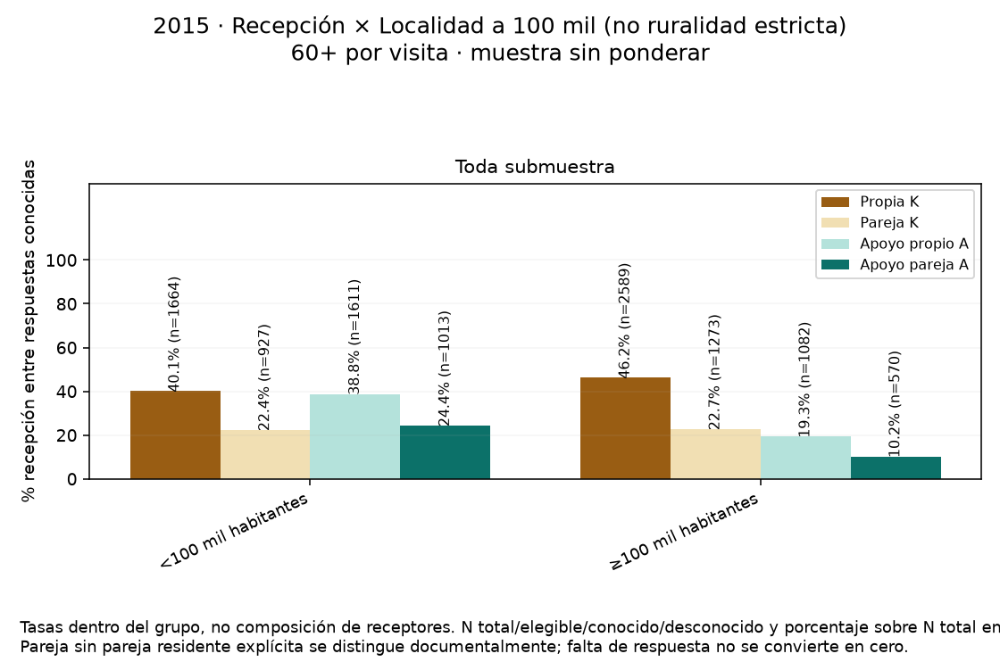

Para pension_propia_k, la tasa entre respuestas conocidas va de 40.07% en «<100 mil habitantes» (1,664/4,153) a 46.21% en «≥100 mil habitantes» (2,589/5,603). Es una diferencia dentro de grupos, no la composición del conjunto receptor. Los desconocidos y tamaños de grupo se muestran arriba; la comparación puede reflejar selección documental y composición socioeconómica.

Para apoyo_propio, la tasa entre respuestas conocidas va de 19.28% en «≥100 mil habitantes» (1,082/5,612) a 38.81% en «<100 mil habitantes» (1,611/4,151). Es una diferencia dentro de grupos, no la composición del conjunto receptor. Los desconocidos y tamaños de grupo se muestran arriba; la comparación puede reflejar selección documental y composición socioeconómica.

###### Recepción por Sexo

| ano | sexo_grupo | variable | N_total | N_elegible_vivo | N_si | N_no | N_desconocido | N_conocido | pct_si_total | pct_si_elegible | pct_si_conocido | pct_cobertura_elegible |
| --- | --- | --- | --- | --- | --- | --- | --- | --- | --- | --- | --- | --- |
| 2,015 | Hombre | pension_propia_k | 4,611 | 4,611 | 2,279 | 2,107 | 225 | 4,386 | 49.43 | 49.43 | 51.96 | 95.12 |
| 2,015 | Hombre | pension_conyuge_k | 4,611 | 4,611 | 697 | 3,676 | 238 | 4,373 | 15.12 | 15.12 | 15.94 | 94.84 |
| 2,015 | Hombre | apoyo_propio | 4,611 | 4,611 | 1,111 | 3,272 | 228 | 4,383 | 24.09 | 24.09 | 25.35 | 95.06 |
| 2,015 | Hombre | apoyo_conyuge | 4,611 | 4,611 | 867 | 3,515 | 229 | 4,382 | 18.80 | 18.80 | 19.79 | 95.03 |
| 2,015 | Mujer | pension_propia_k | 5,805 | 5,805 | 1,974 | 3,396 | 435 | 5,370 | 34.01 | 34.01 | 36.76 | 92.51 |
| 2,015 | Mujer | pension_conyuge_k | 5,805 | 5,805 | 1,503 | 3,871 | 431 | 5,374 | 25.89 | 25.89 | 27.97 | 92.58 |
| 2,015 | Mujer | apoyo_propio | 5,805 | 5,805 | 1,582 | 3,798 | 425 | 5,380 | 27.25 | 27.25 | 29.41 | 92.68 |
| 2,015 | Mujer | apoyo_conyuge | 5,805 | 5,805 | 716 | 4,661 | 428 | 5,377 | 12.33 | 12.33 | 13.32 | 92.63 |

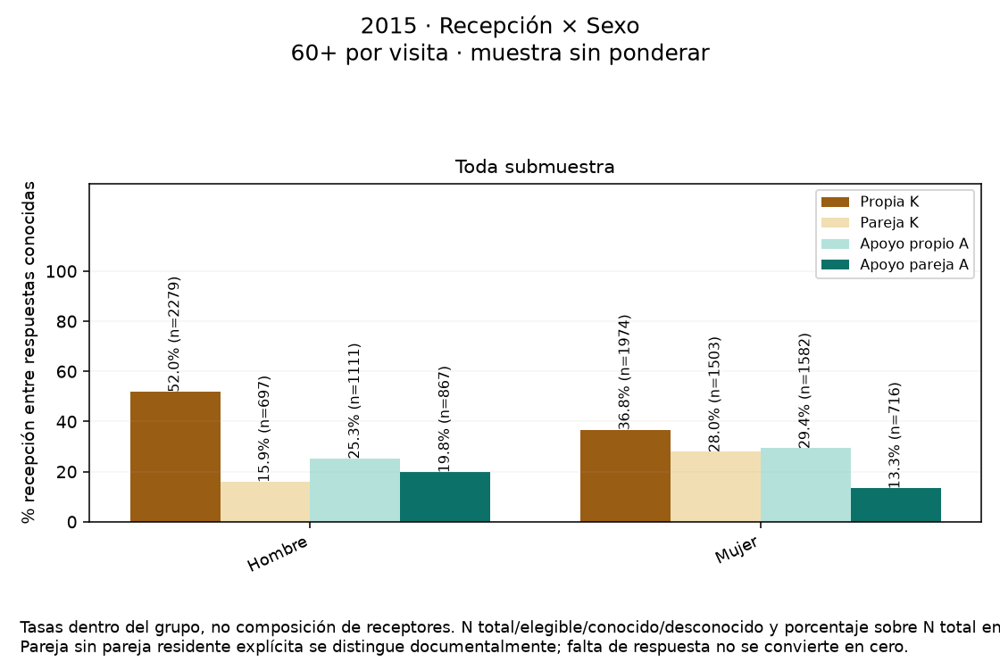

Para pension_propia_k, la tasa entre respuestas conocidas va de 36.76% en «Mujer» (1,974/5,370) a 51.96% en «Hombre» (2,279/4,386). Es una diferencia dentro de grupos, no la composición del conjunto receptor. Los desconocidos y tamaños de grupo se muestran arriba; la comparación puede reflejar selección documental y composición socioeconómica.

Para apoyo_propio, la tasa entre respuestas conocidas va de 25.35% en «Hombre» (1,111/4,383) a 29.41% en «Mujer» (1,582/5,380). Es una diferencia dentro de grupos, no la composición del conjunto receptor. Los desconocidos y tamaños de grupo se muestran arriba; la comparación puede reflejar selección documental y composición socioeconómica.

###### Recepción por Escolaridad en primera entrevista

| ano | educacion_grupo | variable | N_total | N_elegible_vivo | N_si | N_no | N_desconocido | N_conocido | pct_si_total | pct_si_elegible | pct_si_conocido | pct_cobertura_elegible |
| --- | --- | --- | --- | --- | --- | --- | --- | --- | --- | --- | --- | --- |
| 2,015 | 0 años | pension_propia_k | 2,161 | 2,161 | 726 | 1,191 | 244 | 1,917 | 33.60 | 33.60 | 37.87 | 88.71 |
| 2,015 | 0 años | pension_conyuge_k | 2,161 | 2,161 | 365 | 1,550 | 246 | 1,915 | 16.89 | 16.89 | 19.06 | 88.62 |
| 2,015 | 0 años | apoyo_propio | 2,161 | 2,161 | 793 | 1,126 | 242 | 1,919 | 36.70 | 36.70 | 41.32 | 88.80 |
| 2,015 | 0 años | apoyo_conyuge | 2,161 | 2,161 | 441 | 1,475 | 245 | 1,916 | 20.41 | 20.41 | 23.02 | 88.66 |
| 2,015 | 1–5 años | pension_propia_k | 3,450 | 3,450 | 1,289 | 1,944 | 217 | 3,233 | 37.36 | 37.36 | 39.87 | 93.71 |
| 2,015 | 1–5 años | pension_conyuge_k | 3,450 | 3,450 | 694 | 2,535 | 221 | 3,229 | 20.12 | 20.12 | 21.49 | 93.59 |
| 2,015 | 1–5 años | apoyo_propio | 3,450 | 3,450 | 1,131 | 2,104 | 215 | 3,235 | 32.78 | 32.78 | 34.96 | 93.77 |
| 2,015 | 1–5 años | apoyo_conyuge | 3,450 | 3,450 | 677 | 2,554 | 219 | 3,231 | 19.62 | 19.62 | 20.95 | 93.65 |
| 2,015 | 6 años | pension_propia_k | 2,119 | 2,119 | 876 | 1,147 | 96 | 2,023 | 41.34 | 41.34 | 43.30 | 95.47 |
| 2,015 | 6 años | pension_conyuge_k | 2,119 | 2,119 | 483 | 1,538 | 98 | 2,021 | 22.79 | 22.79 | 23.90 | 95.38 |
| 2,015 | 6 años | apoyo_propio | 2,119 | 2,119 | 461 | 1,561 | 97 | 2,022 | 21.76 | 21.76 | 22.80 | 95.42 |
| 2,015 | 6 años | apoyo_conyuge | 2,119 | 2,119 | 285 | 1,738 | 96 | 2,023 | 13.45 | 13.45 | 14.09 | 95.47 |
| 2,015 | 7–9 años | pension_propia_k | 1,453 | 1,453 | 698 | 690 | 65 | 1,388 | 48.04 | 48.04 | 50.29 | 95.53 |
| 2,015 | 7–9 años | pension_conyuge_k | 1,453 | 1,453 | 369 | 1,023 | 61 | 1,392 | 25.40 | 25.40 | 26.51 | 95.80 |
| 2,015 | 7–9 años | apoyo_propio | 1,453 | 1,453 | 198 | 1,194 | 61 | 1,392 | 13.63 | 13.63 | 14.22 | 95.80 |
| 2,015 | 7–9 años | apoyo_conyuge | 1,453 | 1,453 | 104 | 1,289 | 60 | 1,393 | 7.16 | 7.16 | 7.47 | 95.87 |
| 2,015 | Desconocido | pension_propia_k | 111 | 111 | 46 | 58 | 7 | 104 | 41.44 | 41.44 | 44.23 | 93.69 |
| 2,015 | Desconocido | pension_conyuge_k | 111 | 111 | 21 | 82 | 8 | 103 | 18.92 | 18.92 | 20.39 | 92.79 |
| 2,015 | Desconocido | apoyo_propio | 111 | 111 | 20 | 84 | 7 | 104 | 18.02 | 18.02 | 19.23 | 93.69 |
| 2,015 | Desconocido | apoyo_conyuge | 111 | 111 | 17 | 87 | 7 | 104 | 15.32 | 15.32 | 16.35 | 93.69 |
| 2,015 | ≥10 años | pension_propia_k | 1,122 | 1,122 | 618 | 473 | 31 | 1,091 | 55.08 | 55.08 | 56.65 | 97.24 |
| 2,015 | ≥10 años | pension_conyuge_k | 1,122 | 1,122 | 268 | 819 | 35 | 1,087 | 23.89 | 23.89 | 24.66 | 96.88 |
| 2,015 | ≥10 años | apoyo_propio | 1,122 | 1,122 | 90 | 1,001 | 31 | 1,091 | 8.02 | 8.02 | 8.25 | 97.24 |
| 2,015 | ≥10 años | apoyo_conyuge | 1,122 | 1,122 | 59 | 1,033 | 30 | 1,092 | 5.26 | 5.26 | 5.40 | 97.33 |

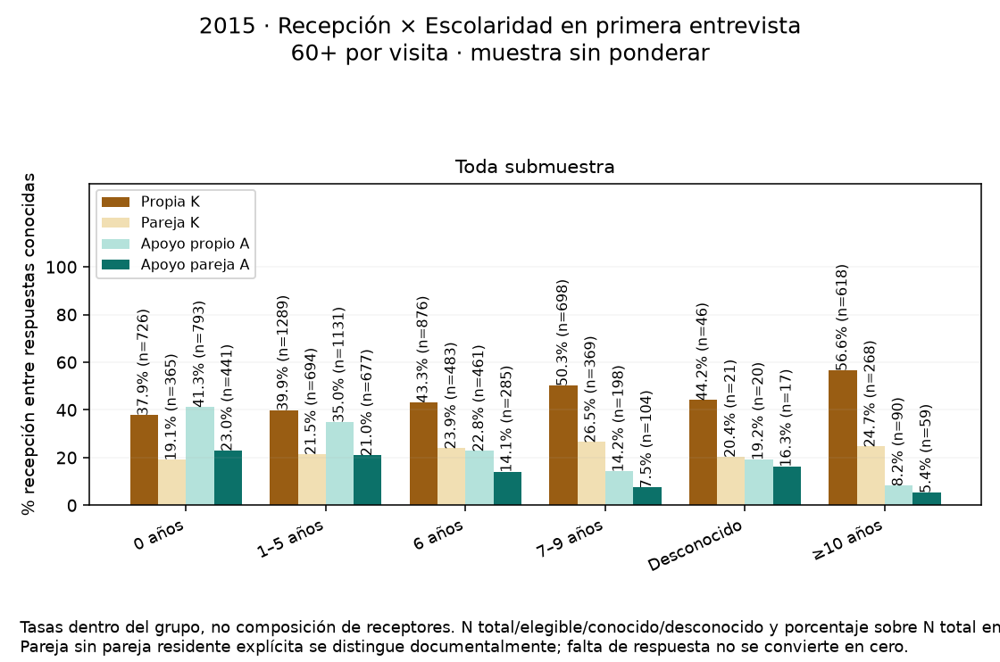

Para pension_propia_k, la tasa entre respuestas conocidas va de 37.87% en «0 años» (726/1,917) a 56.65% en «≥10 años» (618/1,091). Es una diferencia dentro de grupos, no la composición del conjunto receptor. Los desconocidos y tamaños de grupo se muestran arriba; la comparación puede reflejar selección documental y composición socioeconómica.

Para apoyo_propio, la tasa entre respuestas conocidas va de 8.25% en «≥10 años» (90/1,091) a 41.32% en «0 años» (793/1,919). Es una diferencia dentro de grupos, no la composición del conjunto receptor. Los desconocidos y tamaños de grupo se muestran arriba; la comparación puede reflejar selección documental y composición socioeconómica.

###### Recepción por Edad en la visita

| ano | edad_grupo | variable | N_total | N_elegible_vivo | N_si | N_no | N_desconocido | N_conocido | pct_si_total | pct_si_elegible | pct_si_conocido | pct_cobertura_elegible |
| --- | --- | --- | --- | --- | --- | --- | --- | --- | --- | --- | --- | --- |
| 2,015 | 60–69 | pension_propia_k | 5,092 | 5,092 | 1,737 | 3,211 | 144 | 4,948 | 34.11 | 34.11 | 35.11 | 97.17 |
| 2,015 | 60–69 | pension_conyuge_k | 5,092 | 5,092 | 1,180 | 3,761 | 151 | 4,941 | 23.17 | 23.17 | 23.88 | 97.03 |
| 2,015 | 60–69 | apoyo_propio | 5,092 | 5,092 | 914 | 4,035 | 143 | 4,949 | 17.95 | 17.95 | 18.47 | 97.19 |
| 2,015 | 60–69 | apoyo_conyuge | 5,092 | 5,092 | 668 | 4,280 | 144 | 4,948 | 13.12 | 13.12 | 13.50 | 97.17 |
| 2,015 | 70–79 | pension_propia_k | 3,619 | 3,619 | 1,805 | 1,647 | 167 | 3,452 | 49.88 | 49.88 | 52.29 | 95.39 |
| 2,015 | 70–79 | pension_conyuge_k | 3,619 | 3,619 | 816 | 2,636 | 167 | 3,452 | 22.55 | 22.55 | 23.64 | 95.39 |
| 2,015 | 70–79 | apoyo_propio | 3,619 | 3,619 | 1,227 | 2,232 | 160 | 3,459 | 33.90 | 33.90 | 35.47 | 95.58 |
| 2,015 | 70–79 | apoyo_conyuge | 3,619 | 3,619 | 679 | 2,776 | 164 | 3,455 | 18.76 | 18.76 | 19.65 | 95.47 |
| 2,015 | 80–89 | pension_propia_k | 1,424 | 1,424 | 628 | 557 | 239 | 1,185 | 44.10 | 44.10 | 53.00 | 83.22 |
| 2,015 | 80–89 | pension_conyuge_k | 1,424 | 1,424 | 190 | 993 | 241 | 1,183 | 13.34 | 13.34 | 16.06 | 83.08 |
| 2,015 | 80–89 | apoyo_propio | 1,424 | 1,424 | 486 | 699 | 239 | 1,185 | 34.13 | 34.13 | 41.01 | 83.22 |
| 2,015 | 80–89 | apoyo_conyuge | 1,424 | 1,424 | 215 | 971 | 238 | 1,186 | 15.10 | 15.10 | 18.13 | 83.29 |
| 2,015 | ≥90 | pension_propia_k | 281 | 281 | 83 | 88 | 110 | 171 | 29.54 | 29.54 | 48.54 | 60.85 |
| 2,015 | ≥90 | pension_conyuge_k | 281 | 281 | 14 | 157 | 110 | 171 | 4.98 | 4.98 | 8.19 | 60.85 |
| 2,015 | ≥90 | apoyo_propio | 281 | 281 | 66 | 104 | 111 | 170 | 23.49 | 23.49 | 38.82 | 60.50 |
| 2,015 | ≥90 | apoyo_conyuge | 281 | 281 | 21 | 149 | 111 | 170 | 7.47 | 7.47 | 12.35 | 60.50 |

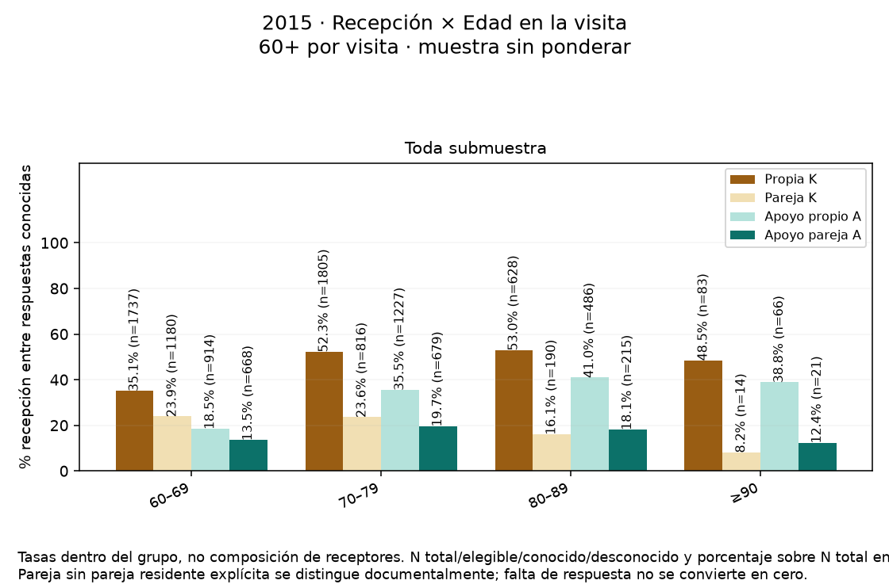

Para pension_propia_k, la tasa entre respuestas conocidas va de 35.11% en «60–69» (1,737/4,948) a 53.00% en «80–89» (628/1,185). Es una diferencia dentro de grupos, no la composición del conjunto receptor. Los desconocidos y tamaños de grupo se muestran arriba; la comparación puede reflejar selección documental y composición socioeconómica.

Para apoyo_propio, la tasa entre respuestas conocidas va de 18.47% en «60–69» (914/4,949) a 41.01% en «80–89» (486/1,185). Es una diferencia dentro de grupos, no la composición del conjunto receptor. Los desconocidos y tamaños de grupo se muestran arriba; la comparación puede reflejar selección documental y composición socioeconómica.

###### Cruce pension_apoyo

| pension | apoyo | N | N_estrato | N_elegible_vivo | N_par_conocido | N_par_desconocido | pct_estrato | pct_par_conocido | pct_composicion_apoyados |
| --- | --- | --- | --- | --- | --- | --- | --- | --- | --- |
| Sí | Sí | 544 | 10,416 | 10,416 | 9,749 | 667 | 5.22 | 5.58 | 20.20 |
| Sí | No | 3,706 | 10,416 | 10,416 | 9,749 | 667 | 35.58 | 38.01 | ND |
| Sí | Desconocido | 3 | 10,416 | 10,416 | 9,749 | 667 | 0.03 | ND | ND |
| No | Sí | 2,143 | 10,416 | 10,416 | 9,749 | 667 | 20.57 | 21.98 | 79.58 |
| No | No | 3,356 | 10,416 | 10,416 | 9,749 | 667 | 32.22 | 34.42 | ND |
| No | Desconocido | 4 | 10,416 | 10,416 | 9,749 | 667 | 0.04 | ND | ND |
| Desconocido | Sí | 6 | 10,416 | 10,416 | 9,749 | 667 | 0.06 | ND | 0.22 |
| Desconocido | No | 8 | 10,416 | 10,416 | 9,749 | 667 | 0.08 | ND | ND |
| Desconocido | Desconocido | 646 | 10,416 | 10,416 | 9,749 | 667 | 6.20 | ND | ND |

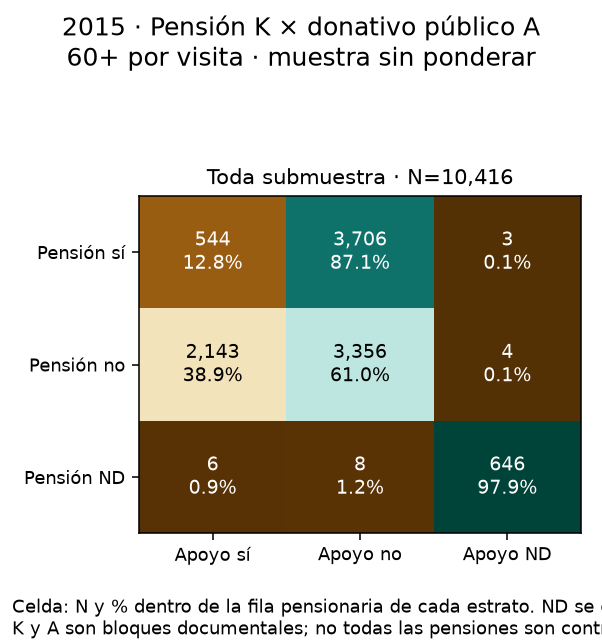

En «Toda submuestra», recibe apoyo 2,143/5,499 (38.97%) entre negativas K y 544/4,250 (12.80%) entre receptoras K. La diferencia es 26.17 puntos porcentuales. Esta comparación distingue cobertura adicional observada y coexistencia dentro del mismo perfil; no prueba un cambio de elegibilidad ni impacto redistributivo.

###### Cruce pension_apoyo_localidad_grupo

| localidad_grupo | pension | apoyo | N | N_estrato | N_elegible_vivo | N_par_conocido | N_par_desconocido | pct_estrato | pct_par_conocido | pct_composicion_apoyados |
| --- | --- | --- | --- | --- | --- | --- | --- | --- | --- | --- |
| <100 mil habitantes | Sí | Sí | 371 | 4,479 | 4,479 | 4,147 | 332 | 8.28 | 8.95 | 13.78 |
| <100 mil habitantes | Sí | No | 1,290 | 4,479 | 4,479 | 4,147 | 332 | 28.80 | 31.11 | ND |
| <100 mil habitantes | Sí | Desconocido | 3 | 4,479 | 4,479 | 4,147 | 332 | 0.07 | ND | ND |
| <100 mil habitantes | No | Sí | 1,237 | 4,479 | 4,479 | 4,147 | 332 | 27.62 | 29.83 | 45.93 |
| <100 mil habitantes | No | No | 1,249 | 4,479 | 4,479 | 4,147 | 332 | 27.89 | 30.12 | ND |
| <100 mil habitantes | No | Desconocido | 3 | 4,479 | 4,479 | 4,147 | 332 | 0.07 | ND | ND |
| <100 mil habitantes | Desconocido | Sí | 3 | 4,479 | 4,479 | 4,147 | 332 | 0.07 | ND | 0.11 |
| <100 mil habitantes | Desconocido | No | 1 | 4,479 | 4,479 | 4,147 | 332 | 0.02 | ND | ND |
| <100 mil habitantes | Desconocido | Desconocido | 322 | 4,479 | 4,479 | 4,147 | 332 | 7.19 | ND | ND |
| ≥100 mil habitantes | Sí | Sí | 173 | 5,937 | 5,937 | 5,602 | 335 | 2.91 | 3.09 | 6.42 |
| ≥100 mil habitantes | Sí | No | 2,416 | 5,937 | 5,937 | 5,602 | 335 | 40.69 | 43.13 | ND |
| ≥100 mil habitantes | Sí | Desconocido | 0 | 5,937 | 5,937 | 5,602 | 335 | 0.00 | ND | ND |
| ≥100 mil habitantes | No | Sí | 906 | 5,937 | 5,937 | 5,602 | 335 | 15.26 | 16.17 | 33.64 |
| ≥100 mil habitantes | No | No | 2,107 | 5,937 | 5,937 | 5,602 | 335 | 35.49 | 37.61 | ND |
| ≥100 mil habitantes | No | Desconocido | 1 | 5,937 | 5,937 | 5,602 | 335 | 0.02 | ND | ND |
| ≥100 mil habitantes | Desconocido | Sí | 3 | 5,937 | 5,937 | 5,602 | 335 | 0.05 | ND | 0.11 |
| ≥100 mil habitantes | Desconocido | No | 7 | 5,937 | 5,937 | 5,602 | 335 | 0.12 | ND | ND |
| ≥100 mil habitantes | Desconocido | Desconocido | 324 | 5,937 | 5,937 | 5,602 | 335 | 5.46 | ND | ND |

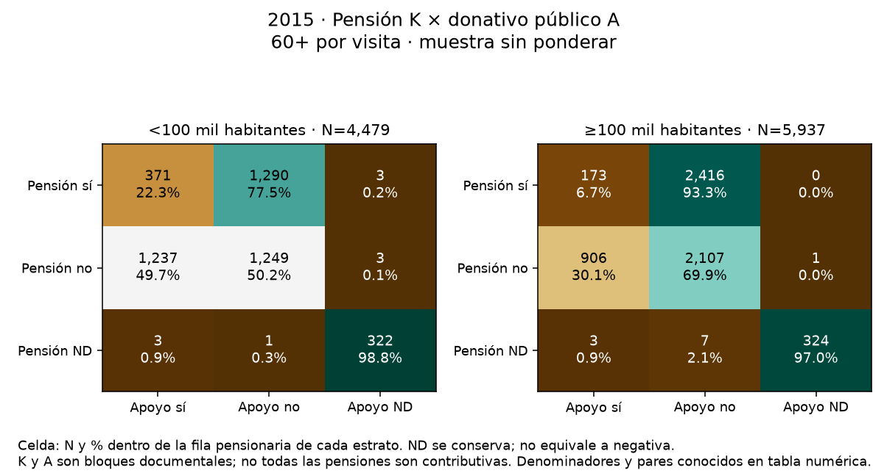

En «<100 mil habitantes», recibe apoyo 1,237/2,486 (49.76%) entre negativas K y 371/1,661 (22.34%) entre receptoras K. La diferencia es 27.42 puntos porcentuales. Esta comparación distingue cobertura adicional observada y coexistencia dentro del mismo perfil; no prueba un cambio de elegibilidad ni impacto redistributivo.

En «≥100 mil habitantes», recibe apoyo 906/3,013 (30.07%) entre negativas K y 173/2,589 (6.68%) entre receptoras K. La diferencia es 23.39 puntos porcentuales. Esta comparación distingue cobertura adicional observada y coexistencia dentro del mismo perfil; no prueba un cambio de elegibilidad ni impacto redistributivo.

###### Cruce pension_apoyo_sexo_grupo

| sexo_grupo | pension | apoyo | N | N_estrato | N_elegible_vivo | N_par_conocido | N_par_desconocido | pct_estrato | pct_par_conocido | pct_composicion_apoyados |
| --- | --- | --- | --- | --- | --- | --- | --- | --- | --- | --- |
| Hombre | Sí | Sí | 287 | 4,611 | 4,611 | 4,381 | 230 | 6.22 | 6.55 | 10.66 |
| Hombre | Sí | No | 1,990 | 4,611 | 4,611 | 4,381 | 230 | 43.16 | 45.42 | ND |
| Hombre | Sí | Desconocido | 2 | 4,611 | 4,611 | 4,381 | 230 | 0.04 | ND | ND |
| Hombre | No | Sí | 823 | 4,611 | 4,611 | 4,381 | 230 | 17.85 | 18.79 | 30.56 |
| Hombre | No | No | 1,281 | 4,611 | 4,611 | 4,381 | 230 | 27.78 | 29.24 | ND |
| Hombre | No | Desconocido | 3 | 4,611 | 4,611 | 4,381 | 230 | 0.07 | ND | ND |
| Hombre | Desconocido | Sí | 1 | 4,611 | 4,611 | 4,381 | 230 | 0.02 | ND | 0.04 |
| Hombre | Desconocido | No | 1 | 4,611 | 4,611 | 4,381 | 230 | 0.02 | ND | ND |
| Hombre | Desconocido | Desconocido | 223 | 4,611 | 4,611 | 4,381 | 230 | 4.84 | ND | ND |
| Mujer | Sí | Sí | 257 | 5,805 | 5,805 | 5,368 | 437 | 4.43 | 4.79 | 9.54 |
| Mujer | Sí | No | 1,716 | 5,805 | 5,805 | 5,368 | 437 | 29.56 | 31.97 | ND |
| Mujer | Sí | Desconocido | 1 | 5,805 | 5,805 | 5,368 | 437 | 0.02 | ND | ND |
| Mujer | No | Sí | 1,320 | 5,805 | 5,805 | 5,368 | 437 | 22.74 | 24.59 | 49.02 |
| Mujer | No | No | 2,075 | 5,805 | 5,805 | 5,368 | 437 | 35.75 | 38.65 | ND |
| Mujer | No | Desconocido | 1 | 5,805 | 5,805 | 5,368 | 437 | 0.02 | ND | ND |
| Mujer | Desconocido | Sí | 5 | 5,805 | 5,805 | 5,368 | 437 | 0.09 | ND | 0.19 |
| Mujer | Desconocido | No | 7 | 5,805 | 5,805 | 5,368 | 437 | 0.12 | ND | ND |
| Mujer | Desconocido | Desconocido | 423 | 5,805 | 5,805 | 5,368 | 437 | 7.29 | ND | ND |

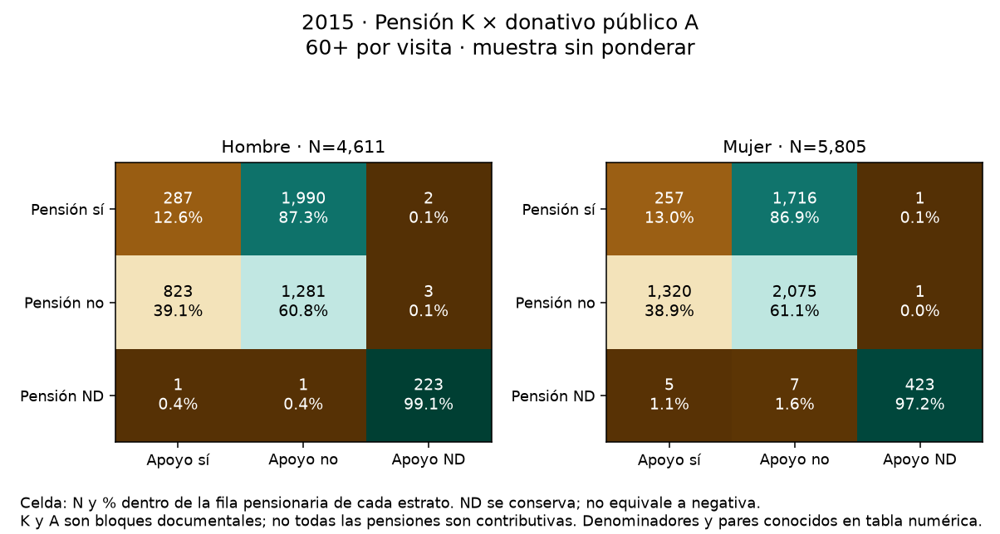

En «Hombre», recibe apoyo 823/2,104 (39.12%) entre negativas K y 287/2,277 (12.60%) entre receptoras K. La diferencia es 26.51 puntos porcentuales. Esta comparación distingue cobertura adicional observada y coexistencia dentro del mismo perfil; no prueba un cambio de elegibilidad ni impacto redistributivo.

En «Mujer», recibe apoyo 1,320/3,395 (38.88%) entre negativas K y 257/1,973 (13.03%) entre receptoras K. La diferencia es 25.85 puntos porcentuales. Esta comparación distingue cobertura adicional observada y coexistencia dentro del mismo perfil; no prueba un cambio de elegibilidad ni impacto redistributivo.

###### Cruce pension_educacion_grupo_sexo_grupo

| ano | sexo_grupo | educacion_grupo | variable | N_total | N_elegible_vivo | N_si | N_no | N_desconocido | N_conocido | pct_si_total | pct_si_elegible | pct_si_conocido | pct_cobertura_elegible |
| --- | --- | --- | --- | --- | --- | --- | --- | --- | --- | --- | --- | --- | --- |
| 2,015 | Hombre | 0 años | pension_propia_k | 843 | 843 | 348 | 415 | 80 | 763 | 41.28 | 41.28 | 45.61 | 90.51 |
| 2,015 | Hombre | 1–5 años | pension_propia_k | 1,471 | 1,471 | 647 | 741 | 83 | 1,388 | 43.98 | 43.98 | 46.61 | 94.36 |
| 2,015 | Hombre | 6 años | pension_propia_k | 980 | 980 | 529 | 416 | 35 | 945 | 53.98 | 53.98 | 55.98 | 96.43 |
| 2,015 | Hombre | 7–9 años | pension_propia_k | 555 | 555 | 339 | 204 | 12 | 543 | 61.08 | 61.08 | 62.43 | 97.84 |
| 2,015 | Hombre | Desconocido | pension_propia_k | 75 | 75 | 35 | 37 | 3 | 72 | 46.67 | 46.67 | 48.61 | 96.00 |
| 2,015 | Hombre | ≥10 años | pension_propia_k | 687 | 687 | 381 | 294 | 12 | 675 | 55.46 | 55.46 | 56.44 | 98.25 |
| 2,015 | Mujer | 0 años | pension_propia_k | 1,318 | 1,318 | 378 | 776 | 164 | 1,154 | 28.68 | 28.68 | 32.76 | 87.56 |
| 2,015 | Mujer | 1–5 años | pension_propia_k | 1,979 | 1,979 | 642 | 1,203 | 134 | 1,845 | 32.44 | 32.44 | 34.80 | 93.23 |
| 2,015 | Mujer | 6 años | pension_propia_k | 1,139 | 1,139 | 347 | 731 | 61 | 1,078 | 30.47 | 30.47 | 32.19 | 94.64 |
| 2,015 | Mujer | 7–9 años | pension_propia_k | 898 | 898 | 359 | 486 | 53 | 845 | 39.98 | 39.98 | 42.49 | 94.10 |
| 2,015 | Mujer | Desconocido | pension_propia_k | 36 | 36 | 11 | 21 | 4 | 32 | 30.56 | 30.56 | 34.38 | 88.89 |
| 2,015 | Mujer | ≥10 años | pension_propia_k | 435 | 435 | 237 | 179 | 19 | 416 | 54.48 | 54.48 | 56.97 | 95.63 |

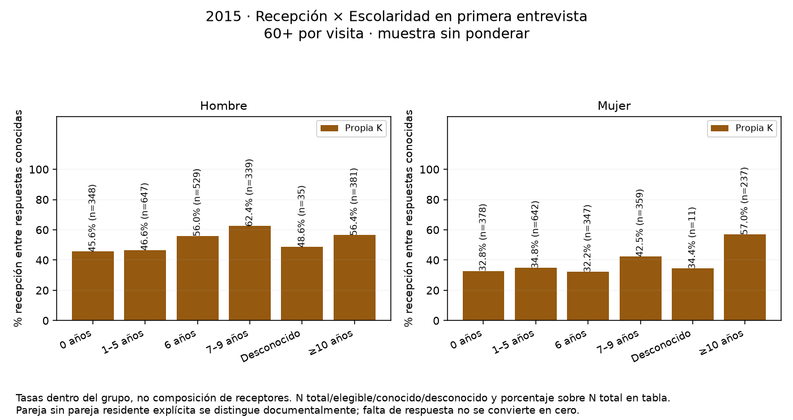

Dentro de «Hombre», la recepción K entre respuestas conocidas es menor en «0 años»: 348/763 (45.61%), y mayor en «7–9 años»: 339/543 (62.43%). Las diferencias no separan mecanismos de trayectoria laboral, cohortes o selección por supervivencia; las celdas pequeñas y faltantes limitan la precisión.

Dentro de «Mujer», la recepción K entre respuestas conocidas es menor en «6 años»: 347/1,078 (32.19%), y mayor en «≥10 años»: 237/416 (56.97%). Las diferencias no separan mecanismos de trayectoria laboral, cohortes o selección por supervivencia; las celdas pequeñas y faltantes limitan la precisión.

###### Cruce pension_edad_grupo_localidad_grupo

| ano | localidad_grupo | edad_grupo | variable | N_total | N_elegible_vivo | N_si | N_no | N_desconocido | N_conocido | pct_si_total | pct_si_elegible | pct_si_conocido | pct_cobertura_elegible |
| --- | --- | --- | --- | --- | --- | --- | --- | --- | --- | --- | --- | --- | --- |
| 2,015 | <100 mil habitantes | 60–69 | pension_propia_k | 2,084 | 2,084 | 589 | 1,425 | 70 | 2,014 | 28.26 | 28.26 | 29.25 | 96.64 |
| 2,015 | <100 mil habitantes | 70–79 | pension_propia_k | 1,587 | 1,587 | 755 | 745 | 87 | 1,500 | 47.57 | 47.57 | 50.33 | 94.52 |
| 2,015 | <100 mil habitantes | 80–89 | pension_propia_k | 663 | 663 | 284 | 268 | 111 | 552 | 42.84 | 42.84 | 51.45 | 83.26 |
| 2,015 | <100 mil habitantes | ≥90 | pension_propia_k | 145 | 145 | 36 | 51 | 58 | 87 | 24.83 | 24.83 | 41.38 | 60.00 |
| 2,015 | ≥100 mil habitantes | 60–69 | pension_propia_k | 3,008 | 3,008 | 1,148 | 1,786 | 74 | 2,934 | 38.16 | 38.16 | 39.13 | 97.54 |
| 2,015 | ≥100 mil habitantes | 70–79 | pension_propia_k | 2,032 | 2,032 | 1,050 | 902 | 80 | 1,952 | 51.67 | 51.67 | 53.79 | 96.06 |
| 2,015 | ≥100 mil habitantes | 80–89 | pension_propia_k | 761 | 761 | 344 | 289 | 128 | 633 | 45.20 | 45.20 | 54.34 | 83.18 |
| 2,015 | ≥100 mil habitantes | ≥90 | pension_propia_k | 136 | 136 | 47 | 37 | 52 | 84 | 34.56 | 34.56 | 55.95 | 61.76 |

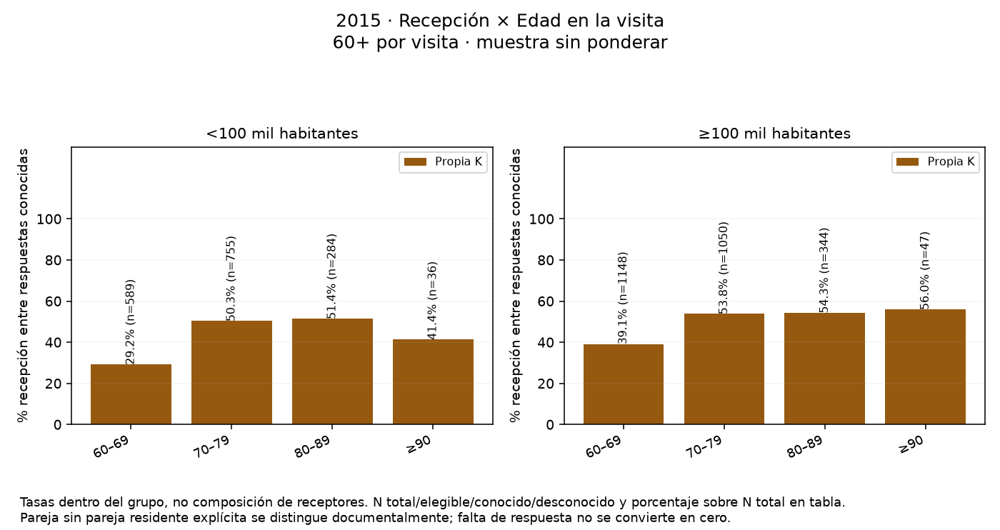

Dentro de «<100 mil habitantes», la recepción K entre respuestas conocidas es menor en «60–69»: 589/2,014 (29.25%), y mayor en «80–89»: 284/552 (51.45%). Las diferencias no separan mecanismos de trayectoria laboral, cohortes o selección por supervivencia; las celdas pequeñas y faltantes limitan la precisión.

Dentro de «≥100 mil habitantes», la recepción K entre respuestas conocidas es menor en «60–69»: 1,148/2,934 (39.13%), y mayor en «≥90»: 47/84 (55.95%). Las diferencias no separan mecanismos de trayectoria laboral, cohortes o selección por supervivencia; las celdas pequeñas y faltantes limitan la precisión.

###### Instituciones, programas y montos

| ano | tipo_contingencia | N_eventos | N_beneficiarios | N_slots_en_tipo_con_IMSS_ISSSTE | N_slots_en_tipo_con_programa_publico_agrupado | N_slots_en_tipo_con_institucion_sin_tipo_comprobado | alcance |
| --- | --- | --- | --- | --- | --- | --- | --- |
| 2,015 | 1 | 2,779 | 2,703 | 2,312 | 292 | 256 | En 2012/2015 institución identifica contingencia, no cada slot ni reparto del monto |
| 2,015 | 2 | 644 | 634 | 601 | 6 | 47 | En 2012/2015 institución identifica contingencia, no cada slot ni reparto del monto |
| 2,015 | 3 | 69 | 69 | 56 | 2 | 11 | En 2012/2015 institución identifica contingencia, no cada slot ni reparto del monto |
| 2,015 | 4 | 1,059 | 1,051 | 44 | 932 | 99 | En 2012/2015 institución identifica contingencia, no cada slot ni reparto del monto |

| ano | programa | tipo_documental | N_eventos | N_beneficiarios | N_monto_observado |
| --- | --- | --- | --- | --- | --- |
| 2,015 | Programa no identificado | Apoyo público sin tipo comprobado | 2,693 | 2,693 | 2,643 |

| ano | bloque | unidad | N_eventos | N_beneficiarios | N_monto_observado | N_monto_desconocido | mediana_nominal_mensual | p25 | p75 | suma_parcial_por_bloque | sumable_entre_bloques |
| --- | --- | --- | --- | --- | --- | --- | --- | --- | --- | --- | --- |
| 2,015 | K | Evento de beneficiario 60+ identificado | 4,551 | 4,253 | 4,331 | 220 | 2,100.00 | 585.00 | 4,000.00 | 34,072,384.00 | False |
| 2,015 | A | Evento de beneficiario 60+ identificado | 2,693 | 2,693 | 2,643 | 50 | 550.00 | 500.00 | 600.00 | 2,078,172.00 | False |

##### 2018

| ano | variable | N_total | N_elegible_vivo | N_si | N_no | N_desconocido | N_conocido | pct_si_total | pct_si_elegible | pct_si_conocido | pct_cobertura_elegible |
| --- | --- | --- | --- | --- | --- | --- | --- | --- | --- | --- | --- |
| 2,018 | pension_propia_k | 10,113 | 10,113 | 3,559 | 6,488 | 66 | 10,047 | 35.19 | 35.19 | 35.42 | 99.35 |
| 2,018 | pension_conyuge_k | 10,113 | 10,113 | 1,694 | 8,377 | 42 | 10,071 | 16.75 | 16.75 | 16.82 | 99.58 |
| 2,018 | apoyo_propio | 10,113 | 10,113 | 3,107 | 6,934 | 72 | 10,041 | 30.72 | 30.72 | 30.94 | 99.29 |
| 2,018 | apoyo_conyuge | 10,113 | 10,113 | 1,749 | 8,317 | 47 | 10,066 | 17.29 | 17.29 | 17.38 | 99.54 |

| ano | categoria | N | N_60 | pct_60 |
| --- | --- | --- | --- | --- |
| 2,018 | Apoyo con pensión desconocida | 2 | 10,113 | 0.02 |
| 2,018 | Apoyo y negativa propia K | 2,725 | 10,113 | 26.95 |
| 2,018 | Negativas explícitas K y A | 3,749 | 10,113 | 37.07 |
| 2,018 | Otra situación desconocida | 81 | 10,113 | 0.80 |
| 2,018 | Pensión K y apoyo | 380 | 10,113 | 3.76 |
| 2,018 | Solo pensión K observada | 3,176 | 10,113 | 31.41 |

De 10,113 registros de 60+, 10,113 corresponden a personas vivas y 10,099 tienen orientación propia utilizable. Se identifica pensión propia K en 3,559 y apoyo propio A en 3,107; quedan respectivamente 66 y 72 estados desconocidos. Entre respuestas conocidas, las proporciones son 35.42% y 30.94%. Estos porcentajes no deben confundirse con tasas sobre todos los elegibles ni con cobertura nacional.

| pension | N_pension_estado | N_apoyo_conocido | N_apoyo_si | pct_apoyo_conocido |
| --- | --- | --- | --- | --- |
| No | 6,488 | 6,474 | 2,725 | 42.09 |
| Sí | 3,559 | 3,556 | 380 | 10.69 |

El apoyo entre quienes tienen negativa propia K supera al apoyo entre receptoras K en 31.41 puntos porcentuales (diferencia con signo). Se observan tanto cobertura adicional respecto de una negativa K como coexistencia. No se conoce el contrafactual sin programa, ni una negativa K descarta todas las pensiones no contributivas; por tanto, no se afirma una ampliación causal ni cobertura de personas sin ninguna pensión.

| ano | cruce | estrato | N_validos | N_excluidos | V_cramer | N_celdas_esperadas_menor5 |
| --- | --- | --- | --- | --- | --- | --- |
| 2,018 | Pensión K × Apoyo | Toda submuestra 60+ | 10,030 | 83 | 0.32 | 0 |
| 2,018 | P × Localidad a 100 mil (no ruralidad estricta) | Toda submuestra 60+ | 10,047 | 66 | 0.19 | 0 |
| 2,018 | A × Localidad a 100 mil (no ruralidad estricta) | Toda submuestra 60+ | 10,041 | 72 | 0.25 | 0 |
| 2,018 | P × Sexo | Toda submuestra 60+ | 10,047 | 66 | 0.16 | 0 |
| 2,018 | A × Sexo | Toda submuestra 60+ | 10,041 | 72 | 0.08 | 0 |
| 2,018 | P × Escolaridad en primera entrevista | Toda submuestra 60+ | 9,949 | 164 | 0.26 | 0 |
| 2,018 | A × Escolaridad en primera entrevista | Toda submuestra 60+ | 9,943 | 170 | 0.30 | 0 |
| 2,018 | P × Edad en la visita | Toda submuestra 60+ | 10,047 | 66 | 0.13 | 0 |
| 2,018 | A × Edad en la visita | Toda submuestra 60+ | 10,041 | 72 | 0.26 | 0 |
| 2,018 | Pensión K × Apoyo / Localidad a 100 mil (no ruralidad estricta) | <100 mil habitantes | 4,439 | 32 | 0.30 | 0 |
| 2,018 | Pensión K × Apoyo / Localidad a 100 mil (no ruralidad estricta) | ≥100 mil habitantes | 5,591 | 51 | 0.29 | 0 |
| 2,018 | Pensión K × Apoyo / Sexo | Hombre | 4,412 | 52 | 0.37 | 0 |
| 2,018 | Pensión K × Apoyo / Sexo | Mujer | 5,618 | 31 | 0.28 | 0 |
| 2,018 | Pensión K × Escolaridad en primera entrevista / Sexo | Hombre | 4,348 | 116 | 0.24 | 0 |
| 2,018 | Pensión K × Escolaridad en primera entrevista / Sexo | Mujer | 5,601 | 48 | 0.26 | 0 |
| 2,018 | Pensión K × Edad en la visita / Localidad a 100 mil (no ruralidad estricta) | <100 mil habitantes | 4,445 | 26 | 0.13 | 0 |
| 2,018 | Pensión K × Edad en la visita / Localidad a 100 mil (no ruralidad estricta) | ≥100 mil habitantes | 5,602 | 40 | 0.14 | 0 |

| ano | control | recepcion | N_validos | N_excluidos | rho_spearman |
| --- | --- | --- | --- | --- | --- |
| 2,018 | edad | pension_propia_k | 10,047 | 66 | 0.13 |
| 2,018 | edad | apoyo_propio | 10,041 | 72 | 0.28 |
| 2,018 | educacion | pension_propia_k | 9,949 | 164 | 0.24 |
| 2,018 | educacion | apoyo_propio | 9,943 | 170 | -0.30 |

###### Recepción por Localidad a 100 mil (no ruralidad estricta)

| ano | localidad_grupo | variable | N_total | N_elegible_vivo | N_si | N_no | N_desconocido | N_conocido | pct_si_total | pct_si_elegible | pct_si_conocido | pct_cobertura_elegible |
| --- | --- | --- | --- | --- | --- | --- | --- | --- | --- | --- | --- | --- |
| 2,018 | <100 mil habitantes | pension_propia_k | 4,471 | 4,471 | 1,119 | 3,326 | 26 | 4,445 | 25.03 | 25.03 | 25.17 | 99.42 |
| 2,018 | <100 mil habitantes | pension_conyuge_k | 4,471 | 4,471 | 562 | 3,894 | 15 | 4,456 | 12.57 | 12.57 | 12.61 | 99.66 |
| 2,018 | <100 mil habitantes | apoyo_propio | 4,471 | 4,471 | 1,946 | 2,494 | 31 | 4,440 | 43.52 | 43.52 | 43.83 | 99.31 |
| 2,018 | <100 mil habitantes | apoyo_conyuge | 4,471 | 4,471 | 1,154 | 3,300 | 17 | 4,454 | 25.81 | 25.81 | 25.91 | 99.62 |
| 2,018 | ≥100 mil habitantes | pension_propia_k | 5,642 | 5,642 | 2,440 | 3,162 | 40 | 5,602 | 43.25 | 43.25 | 43.56 | 99.29 |
| 2,018 | ≥100 mil habitantes | pension_conyuge_k | 5,642 | 5,642 | 1,132 | 4,483 | 27 | 5,615 | 20.06 | 20.06 | 20.16 | 99.52 |
| 2,018 | ≥100 mil habitantes | apoyo_propio | 5,642 | 5,642 | 1,161 | 4,440 | 41 | 5,601 | 20.58 | 20.58 | 20.73 | 99.27 |
| 2,018 | ≥100 mil habitantes | apoyo_conyuge | 5,642 | 5,642 | 595 | 5,017 | 30 | 5,612 | 10.55 | 10.55 | 10.60 | 99.47 |

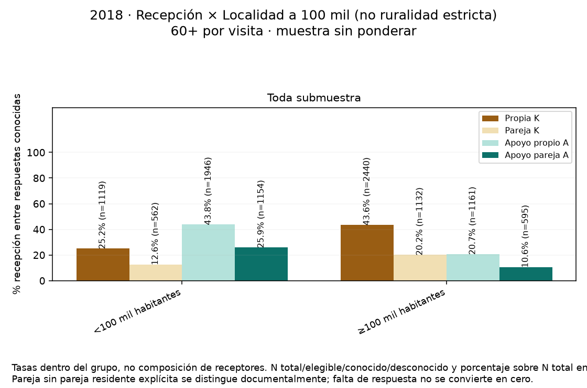

Para pension_propia_k, la tasa entre respuestas conocidas va de 25.17% en «<100 mil habitantes» (1,119/4,445) a 43.56% en «≥100 mil habitantes» (2,440/5,602). Es una diferencia dentro de grupos, no la composición del conjunto receptor. Los desconocidos y tamaños de grupo se muestran arriba; la comparación puede reflejar selección documental y composición socioeconómica.

Para apoyo_propio, la tasa entre respuestas conocidas va de 20.73% en «≥100 mil habitantes» (1,161/5,601) a 43.83% en «<100 mil habitantes» (1,946/4,440). Es una diferencia dentro de grupos, no la composición del conjunto receptor. Los desconocidos y tamaños de grupo se muestran arriba; la comparación puede reflejar selección documental y composición socioeconómica.

###### Recepción por Sexo

| ano | sexo_grupo | variable | N_total | N_elegible_vivo | N_si | N_no | N_desconocido | N_conocido | pct_si_total | pct_si_elegible | pct_si_conocido | pct_cobertura_elegible |
| --- | --- | --- | --- | --- | --- | --- | --- | --- | --- | --- | --- | --- |
| 2,018 | Hombre | pension_propia_k | 4,464 | 4,464 | 1,953 | 2,465 | 46 | 4,418 | 43.75 | 43.75 | 44.21 | 98.97 |
| 2,018 | Hombre | pension_conyuge_k | 4,464 | 4,464 | 446 | 3,995 | 23 | 4,441 | 9.99 | 9.99 | 10.04 | 99.48 |
| 2,018 | Hombre | apoyo_propio | 4,464 | 4,464 | 1,171 | 3,246 | 47 | 4,417 | 26.23 | 26.23 | 26.51 | 98.95 |
| 2,018 | Hombre | apoyo_conyuge | 4,464 | 4,464 | 1,006 | 3,430 | 28 | 4,436 | 22.54 | 22.54 | 22.68 | 99.37 |
| 2,018 | Mujer | pension_propia_k | 5,649 | 5,649 | 1,606 | 4,023 | 20 | 5,629 | 28.43 | 28.43 | 28.53 | 99.65 |
| 2,018 | Mujer | pension_conyuge_k | 5,649 | 5,649 | 1,248 | 4,382 | 19 | 5,630 | 22.09 | 22.09 | 22.17 | 99.66 |
| 2,018 | Mujer | apoyo_propio | 5,649 | 5,649 | 1,936 | 3,688 | 25 | 5,624 | 34.27 | 34.27 | 34.42 | 99.56 |
| 2,018 | Mujer | apoyo_conyuge | 5,649 | 5,649 | 743 | 4,887 | 19 | 5,630 | 13.15 | 13.15 | 13.20 | 99.66 |

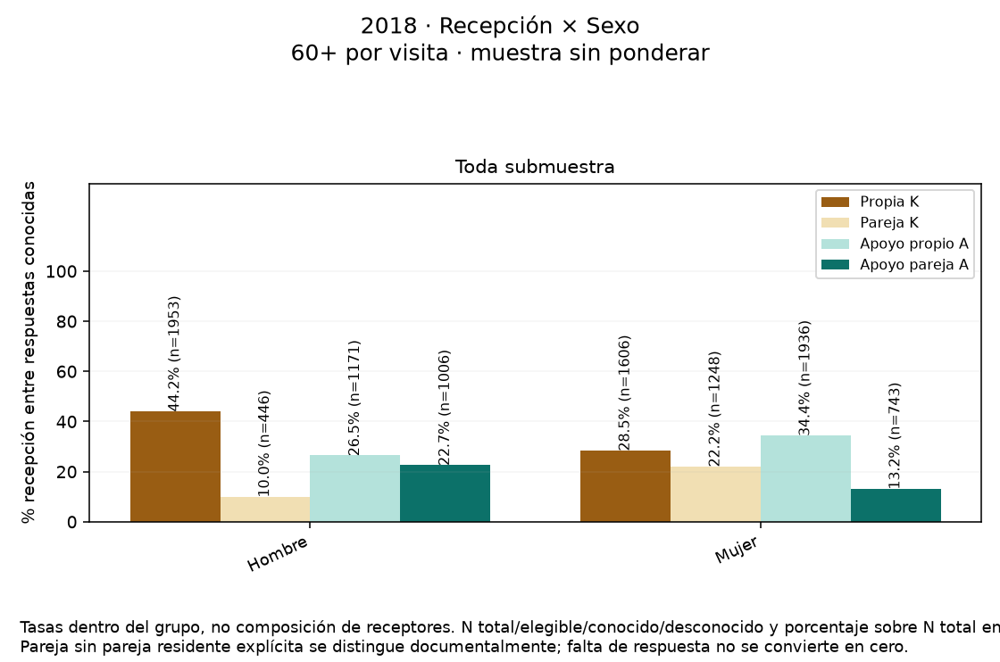

Para pension_propia_k, la tasa entre respuestas conocidas va de 28.53% en «Mujer» (1,606/5,629) a 44.21% en «Hombre» (1,953/4,418). Es una diferencia dentro de grupos, no la composición del conjunto receptor. Los desconocidos y tamaños de grupo se muestran arriba; la comparación puede reflejar selección documental y composición socioeconómica.

Para apoyo_propio, la tasa entre respuestas conocidas va de 26.51% en «Hombre» (1,171/4,417) a 34.42% en «Mujer» (1,936/5,624). Es una diferencia dentro de grupos, no la composición del conjunto receptor. Los desconocidos y tamaños de grupo se muestran arriba; la comparación puede reflejar selección documental y composición socioeconómica.

###### Recepción por Escolaridad en primera entrevista

| ano | educacion_grupo | variable | N_total | N_elegible_vivo | N_si | N_no | N_desconocido | N_conocido | pct_si_total | pct_si_elegible | pct_si_conocido | pct_cobertura_elegible |
| --- | --- | --- | --- | --- | --- | --- | --- | --- | --- | --- | --- | --- |
| 2,018 | 0 años | pension_propia_k | 1,914 | 1,914 | 413 | 1,493 | 8 | 1,906 | 21.58 | 21.58 | 21.67 | 99.58 |
| 2,018 | 0 años | pension_conyuge_k | 1,914 | 1,914 | 162 | 1,749 | 3 | 1,911 | 8.46 | 8.46 | 8.48 | 99.84 |
| 2,018 | 0 años | apoyo_propio | 1,914 | 1,914 | 936 | 966 | 12 | 1,902 | 48.90 | 48.90 | 49.21 | 99.37 |
| 2,018 | 0 años | apoyo_conyuge | 1,914 | 1,914 | 474 | 1,437 | 3 | 1,911 | 24.76 | 24.76 | 24.80 | 99.84 |
| 2,018 | 1–5 años | pension_propia_k | 3,220 | 3,220 | 911 | 2,299 | 10 | 3,210 | 28.29 | 28.29 | 28.38 | 99.69 |
| 2,018 | 1–5 años | pension_conyuge_k | 3,220 | 3,220 | 456 | 2,755 | 9 | 3,211 | 14.16 | 14.16 | 14.20 | 99.72 |
| 2,018 | 1–5 años | apoyo_propio | 3,220 | 3,220 | 1,255 | 1,952 | 13 | 3,207 | 38.98 | 38.98 | 39.13 | 99.60 |
| 2,018 | 1–5 años | apoyo_conyuge | 3,220 | 3,220 | 686 | 2,524 | 10 | 3,210 | 21.30 | 21.30 | 21.37 | 99.69 |
| 2,018 | 6 años | pension_propia_k | 2,155 | 2,155 | 752 | 1,387 | 16 | 2,139 | 34.90 | 34.90 | 35.16 | 99.26 |
| 2,018 | 6 años | pension_conyuge_k | 2,155 | 2,155 | 407 | 1,738 | 10 | 2,145 | 18.89 | 18.89 | 18.97 | 99.54 |
| 2,018 | 6 años | apoyo_propio | 2,155 | 2,155 | 582 | 1,560 | 13 | 2,142 | 27.01 | 27.01 | 27.17 | 99.40 |
| 2,018 | 6 años | apoyo_conyuge | 2,155 | 2,155 | 351 | 1,792 | 12 | 2,143 | 16.29 | 16.29 | 16.38 | 99.44 |
| 2,018 | 7–9 años | pension_propia_k | 1,513 | 1,513 | 725 | 772 | 16 | 1,497 | 47.92 | 47.92 | 48.43 | 98.94 |
| 2,018 | 7–9 años | pension_conyuge_k | 1,513 | 1,513 | 349 | 1,153 | 11 | 1,502 | 23.07 | 23.07 | 23.24 | 99.27 |
| 2,018 | 7–9 años | apoyo_propio | 1,513 | 1,513 | 221 | 1,273 | 19 | 1,494 | 14.61 | 14.61 | 14.79 | 98.74 |
| 2,018 | 7–9 años | apoyo_conyuge | 1,513 | 1,513 | 147 | 1,352 | 14 | 1,499 | 9.72 | 9.72 | 9.81 | 99.07 |
| 2,018 | Desconocido | pension_propia_k | 99 | 99 | 42 | 56 | 1 | 98 | 42.42 | 42.42 | 42.86 | 98.99 |
| 2,018 | Desconocido | pension_conyuge_k | 99 | 99 | 18 | 80 | 1 | 98 | 18.18 | 18.18 | 18.37 | 98.99 |
| 2,018 | Desconocido | apoyo_propio | 99 | 99 | 15 | 83 | 1 | 98 | 15.15 | 15.15 | 15.31 | 98.99 |
| 2,018 | Desconocido | apoyo_conyuge | 99 | 99 | 20 | 79 | 0 | 99 | 20.20 | 20.20 | 20.20 | 100.00 |
| 2,018 | ≥10 años | pension_propia_k | 1,212 | 1,212 | 716 | 481 | 15 | 1,197 | 59.08 | 59.08 | 59.82 | 98.76 |
| 2,018 | ≥10 años | pension_conyuge_k | 1,212 | 1,212 | 302 | 902 | 8 | 1,204 | 24.92 | 24.92 | 25.08 | 99.34 |
| 2,018 | ≥10 años | apoyo_propio | 1,212 | 1,212 | 98 | 1,100 | 14 | 1,198 | 8.09 | 8.09 | 8.18 | 98.84 |
| 2,018 | ≥10 años | apoyo_conyuge | 1,212 | 1,212 | 71 | 1,133 | 8 | 1,204 | 5.86 | 5.86 | 5.90 | 99.34 |

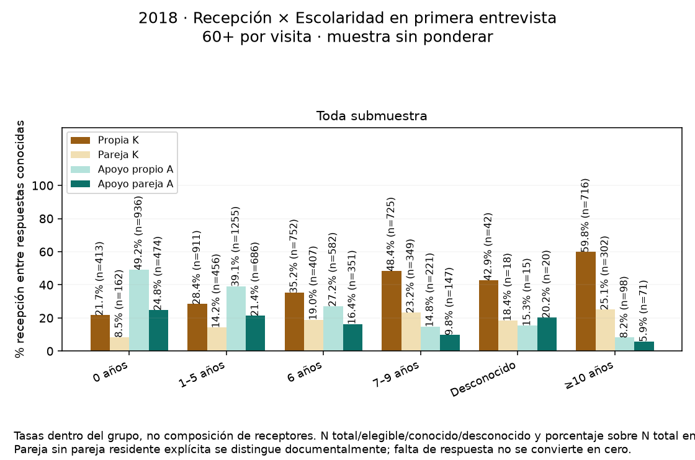

Para pension_propia_k, la tasa entre respuestas conocidas va de 21.67% en «0 años» (413/1,906) a 59.82% en «≥10 años» (716/1,197). Es una diferencia dentro de grupos, no la composición del conjunto receptor. Los desconocidos y tamaños de grupo se muestran arriba; la comparación puede reflejar selección documental y composición socioeconómica.

Para apoyo_propio, la tasa entre respuestas conocidas va de 8.18% en «≥10 años» (98/1,198) a 49.21% en «0 años» (936/1,902). Es una diferencia dentro de grupos, no la composición del conjunto receptor. Los desconocidos y tamaños de grupo se muestran arriba; la comparación puede reflejar selección documental y composición socioeconómica.

###### Recepción por Edad en la visita

| ano | edad_grupo | variable | N_total | N_elegible_vivo | N_si | N_no | N_desconocido | N_conocido | pct_si_total | pct_si_elegible | pct_si_conocido | pct_cobertura_elegible |
| --- | --- | --- | --- | --- | --- | --- | --- | --- | --- | --- | --- | --- |
| 2,018 | 60–69 | pension_propia_k | 4,430 | 4,430 | 1,252 | 3,132 | 46 | 4,384 | 28.26 | 28.26 | 28.56 | 98.96 |
| 2,018 | 60–69 | pension_conyuge_k | 4,430 | 4,430 | 857 | 3,546 | 27 | 4,403 | 19.35 | 19.35 | 19.46 | 99.39 |
| 2,018 | 60–69 | apoyo_propio | 4,430 | 4,430 | 766 | 3,612 | 52 | 4,378 | 17.29 | 17.29 | 17.50 | 98.83 |
| 2,018 | 60–69 | apoyo_conyuge | 4,430 | 4,430 | 639 | 3,761 | 30 | 4,400 | 14.42 | 14.42 | 14.52 | 99.32 |
| 2,018 | 70–79 | pension_propia_k | 3,839 | 3,839 | 1,584 | 2,242 | 13 | 3,826 | 41.26 | 41.26 | 41.40 | 99.66 |
| 2,018 | 70–79 | pension_conyuge_k | 3,839 | 3,839 | 667 | 3,160 | 12 | 3,827 | 17.37 | 17.37 | 17.43 | 99.69 |
| 2,018 | 70–79 | apoyo_propio | 3,839 | 3,839 | 1,499 | 2,327 | 13 | 3,826 | 39.05 | 39.05 | 39.18 | 99.66 |
| 2,018 | 70–79 | apoyo_conyuge | 3,839 | 3,839 | 813 | 3,013 | 13 | 3,826 | 21.18 | 21.18 | 21.25 | 99.66 |
| 2,018 | 80–89 | pension_propia_k | 1,579 | 1,579 | 628 | 944 | 7 | 1,572 | 39.77 | 39.77 | 39.95 | 99.56 |
| 2,018 | 80–89 | pension_conyuge_k | 1,579 | 1,579 | 159 | 1,417 | 3 | 1,576 | 10.07 | 10.07 | 10.09 | 99.81 |
| 2,018 | 80–89 | apoyo_propio | 1,579 | 1,579 | 723 | 850 | 6 | 1,573 | 45.79 | 45.79 | 45.96 | 99.62 |
| 2,018 | 80–89 | apoyo_conyuge | 1,579 | 1,579 | 278 | 1,297 | 4 | 1,575 | 17.61 | 17.61 | 17.65 | 99.75 |
| 2,018 | ≥90 | pension_propia_k | 265 | 265 | 95 | 170 | 0 | 265 | 35.85 | 35.85 | 35.85 | 100.00 |
| 2,018 | ≥90 | pension_conyuge_k | 265 | 265 | 11 | 254 | 0 | 265 | 4.15 | 4.15 | 4.15 | 100.00 |
| 2,018 | ≥90 | apoyo_propio | 265 | 265 | 119 | 145 | 1 | 264 | 44.91 | 44.91 | 45.08 | 99.62 |
| 2,018 | ≥90 | apoyo_conyuge | 265 | 265 | 19 | 246 | 0 | 265 | 7.17 | 7.17 | 7.17 | 100.00 |

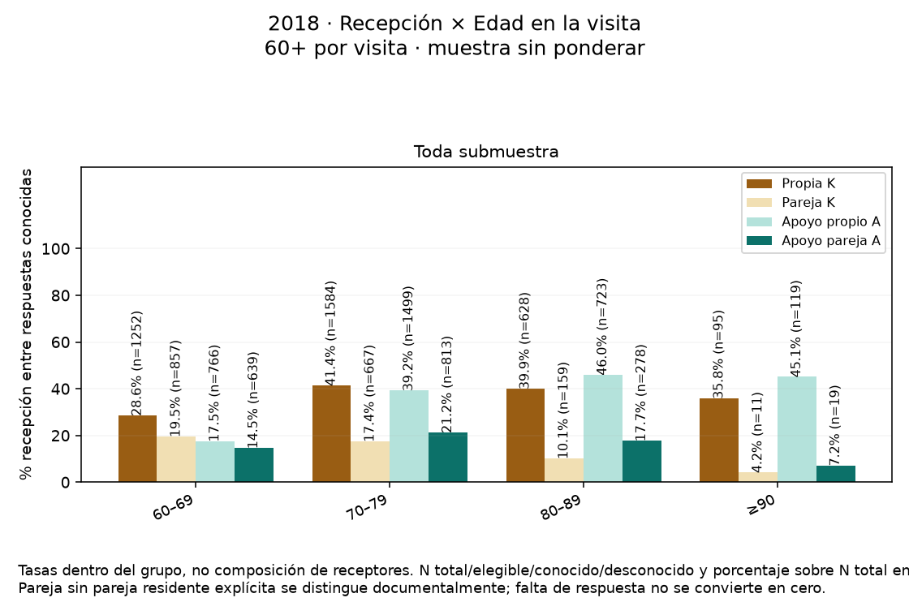

Para pension_propia_k, la tasa entre respuestas conocidas va de 28.56% en «60–69» (1,252/4,384) a 41.40% en «70–79» (1,584/3,826). Es una diferencia dentro de grupos, no la composición del conjunto receptor. Los desconocidos y tamaños de grupo se muestran arriba; la comparación puede reflejar selección documental y composición socioeconómica.

Para apoyo_propio, la tasa entre respuestas conocidas va de 17.50% en «60–69» (766/4,378) a 45.96% en «80–89» (723/1,573). Es una diferencia dentro de grupos, no la composición del conjunto receptor. Los desconocidos y tamaños de grupo se muestran arriba; la comparación puede reflejar selección documental y composición socioeconómica.

###### Cruce pension_apoyo

| pension | apoyo | N | N_estrato | N_elegible_vivo | N_par_conocido | N_par_desconocido | pct_estrato | pct_par_conocido | pct_composicion_apoyados |
| --- | --- | --- | --- | --- | --- | --- | --- | --- | --- |
| Sí | Sí | 380 | 10,113 | 10,113 | 10,030 | 83 | 3.76 | 3.79 | 12.23 |
| Sí | No | 3,176 | 10,113 | 10,113 | 10,030 | 83 | 31.41 | 31.67 | ND |
| Sí | Desconocido | 3 | 10,113 | 10,113 | 10,030 | 83 | 0.03 | ND | ND |
| No | Sí | 2,725 | 10,113 | 10,113 | 10,030 | 83 | 26.95 | 27.17 | 87.71 |
| No | No | 3,749 | 10,113 | 10,113 | 10,030 | 83 | 37.07 | 37.38 | ND |
| No | Desconocido | 14 | 10,113 | 10,113 | 10,030 | 83 | 0.14 | ND | ND |
| Desconocido | Sí | 2 | 10,113 | 10,113 | 10,030 | 83 | 0.02 | ND | 0.06 |
| Desconocido | No | 9 | 10,113 | 10,113 | 10,030 | 83 | 0.09 | ND | ND |
| Desconocido | Desconocido | 55 | 10,113 | 10,113 | 10,030 | 83 | 0.54 | ND | ND |

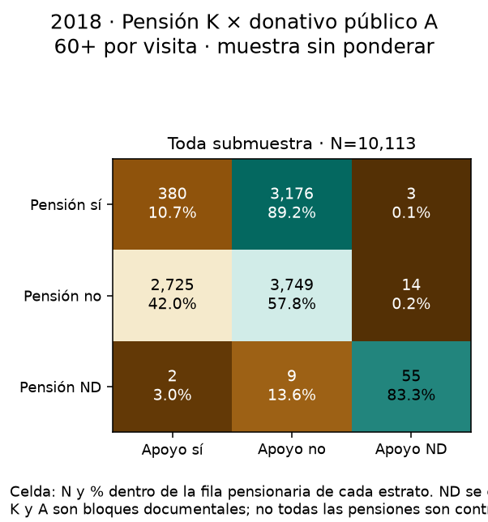

En «Toda submuestra», recibe apoyo 2,725/6,474 (42.09%) entre negativas K y 380/3,556 (10.69%) entre receptoras K. La diferencia es 31.41 puntos porcentuales. Esta comparación distingue cobertura adicional observada y coexistencia dentro del mismo perfil; no prueba un cambio de elegibilidad ni impacto redistributivo.

###### Cruce pension_apoyo_localidad_grupo

| localidad_grupo | pension | apoyo | N | N_estrato | N_elegible_vivo | N_par_conocido | N_par_desconocido | pct_estrato | pct_par_conocido | pct_composicion_apoyados |
| --- | --- | --- | --- | --- | --- | --- | --- | --- | --- | --- |
| <100 mil habitantes | Sí | Sí | 203 | 4,471 | 4,471 | 4,439 | 32 | 4.54 | 4.57 | 6.53 |
| <100 mil habitantes | Sí | No | 915 | 4,471 | 4,471 | 4,439 | 32 | 20.47 | 20.61 | ND |
| <100 mil habitantes | Sí | Desconocido | 1 | 4,471 | 4,471 | 4,439 | 32 | 0.02 | ND | ND |
| <100 mil habitantes | No | Sí | 1,743 | 4,471 | 4,471 | 4,439 | 32 | 38.98 | 39.27 | 56.10 |
| <100 mil habitantes | No | No | 1,578 | 4,471 | 4,471 | 4,439 | 32 | 35.29 | 35.55 | ND |
| <100 mil habitantes | No | Desconocido | 5 | 4,471 | 4,471 | 4,439 | 32 | 0.11 | ND | ND |
| <100 mil habitantes | Desconocido | Sí | 0 | 4,471 | 4,471 | 4,439 | 32 | 0.00 | ND | 0.00 |
| <100 mil habitantes | Desconocido | No | 1 | 4,471 | 4,471 | 4,439 | 32 | 0.02 | ND | ND |
| <100 mil habitantes | Desconocido | Desconocido | 25 | 4,471 | 4,471 | 4,439 | 32 | 0.56 | ND | ND |
| ≥100 mil habitantes | Sí | Sí | 177 | 5,642 | 5,642 | 5,591 | 51 | 3.14 | 3.17 | 5.70 |
| ≥100 mil habitantes | Sí | No | 2,261 | 5,642 | 5,642 | 5,591 | 51 | 40.07 | 40.44 | ND |
| ≥100 mil habitantes | Sí | Desconocido | 2 | 5,642 | 5,642 | 5,591 | 51 | 0.04 | ND | ND |
| ≥100 mil habitantes | No | Sí | 982 | 5,642 | 5,642 | 5,591 | 51 | 17.41 | 17.56 | 31.61 |
| ≥100 mil habitantes | No | No | 2,171 | 5,642 | 5,642 | 5,591 | 51 | 38.48 | 38.83 | ND |
| ≥100 mil habitantes | No | Desconocido | 9 | 5,642 | 5,642 | 5,591 | 51 | 0.16 | ND | ND |
| ≥100 mil habitantes | Desconocido | Sí | 2 | 5,642 | 5,642 | 5,591 | 51 | 0.04 | ND | 0.06 |
| ≥100 mil habitantes | Desconocido | No | 8 | 5,642 | 5,642 | 5,591 | 51 | 0.14 | ND | ND |
| ≥100 mil habitantes | Desconocido | Desconocido | 30 | 5,642 | 5,642 | 5,591 | 51 | 0.53 | ND | ND |

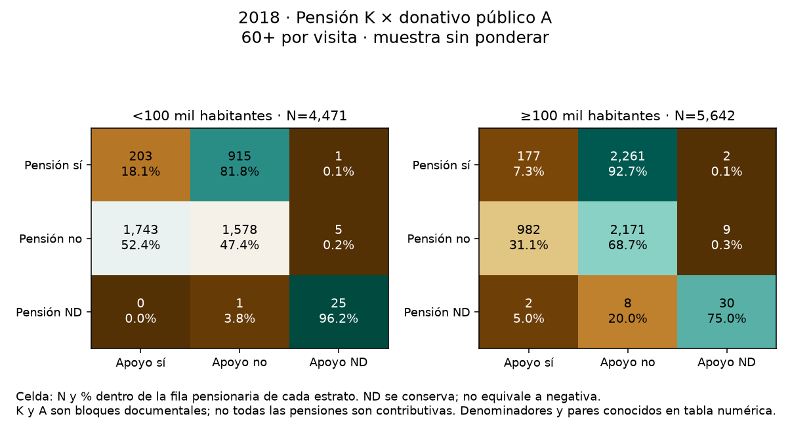

En «<100 mil habitantes», recibe apoyo 1,743/3,321 (52.48%) entre negativas K y 203/1,118 (18.16%) entre receptoras K. La diferencia es 34.33 puntos porcentuales. Esta comparación distingue cobertura adicional observada y coexistencia dentro del mismo perfil; no prueba un cambio de elegibilidad ni impacto redistributivo.

En «≥100 mil habitantes», recibe apoyo 982/3,153 (31.14%) entre negativas K y 177/2,438 (7.26%) entre receptoras K. La diferencia es 23.88 puntos porcentuales. Esta comparación distingue cobertura adicional observada y coexistencia dentro del mismo perfil; no prueba un cambio de elegibilidad ni impacto redistributivo.

###### Cruce pension_apoyo_sexo_grupo

| sexo_grupo | pension | apoyo | N | N_estrato | N_elegible_vivo | N_par_conocido | N_par_desconocido | pct_estrato | pct_par_conocido | pct_composicion_apoyados |
| --- | --- | --- | --- | --- | --- | --- | --- | --- | --- | --- |
| Hombre | Sí | Sí | 163 | 4,464 | 4,464 | 4,412 | 52 | 3.65 | 3.69 | 5.25 |
| Hombre | Sí | No | 1,789 | 4,464 | 4,464 | 4,412 | 52 | 40.08 | 40.55 | ND |
| Hombre | Sí | Desconocido | 1 | 4,464 | 4,464 | 4,412 | 52 | 0.02 | ND | ND |
| Hombre | No | Sí | 1,008 | 4,464 | 4,464 | 4,412 | 52 | 22.58 | 22.85 | 32.44 |
| Hombre | No | No | 1,452 | 4,464 | 4,464 | 4,412 | 52 | 32.53 | 32.91 | ND |
| Hombre | No | Desconocido | 5 | 4,464 | 4,464 | 4,412 | 52 | 0.11 | ND | ND |
| Hombre | Desconocido | Sí | 0 | 4,464 | 4,464 | 4,412 | 52 | 0.00 | ND | 0.00 |
| Hombre | Desconocido | No | 5 | 4,464 | 4,464 | 4,412 | 52 | 0.11 | ND | ND |
| Hombre | Desconocido | Desconocido | 41 | 4,464 | 4,464 | 4,412 | 52 | 0.92 | ND | ND |
| Mujer | Sí | Sí | 217 | 5,649 | 5,649 | 5,618 | 31 | 3.84 | 3.86 | 6.98 |
| Mujer | Sí | No | 1,387 | 5,649 | 5,649 | 5,618 | 31 | 24.55 | 24.69 | ND |
| Mujer | Sí | Desconocido | 2 | 5,649 | 5,649 | 5,618 | 31 | 0.04 | ND | ND |
| Mujer | No | Sí | 1,717 | 5,649 | 5,649 | 5,618 | 31 | 30.39 | 30.56 | 55.26 |
| Mujer | No | No | 2,297 | 5,649 | 5,649 | 5,618 | 31 | 40.66 | 40.89 | ND |
| Mujer | No | Desconocido | 9 | 5,649 | 5,649 | 5,618 | 31 | 0.16 | ND | ND |
| Mujer | Desconocido | Sí | 2 | 5,649 | 5,649 | 5,618 | 31 | 0.04 | ND | 0.06 |
| Mujer | Desconocido | No | 4 | 5,649 | 5,649 | 5,618 | 31 | 0.07 | ND | ND |
| Mujer | Desconocido | Desconocido | 14 | 5,649 | 5,649 | 5,618 | 31 | 0.25 | ND | ND |


En «Hombre», recibe apoyo 1,008/2,460 (40.98%) entre negativas K y 163/1,952 (8.35%) entre receptoras K. La diferencia es 32.63 puntos porcentuales. Esta comparación distingue cobertura adicional observada y coexistencia dentro del mismo perfil; no prueba un cambio de elegibilidad ni impacto redistributivo.

En «Mujer», recibe apoyo 1,717/4,014 (42.78%) entre negativas K y 217/1,604 (13.53%) entre receptoras K. La diferencia es 29.25 puntos porcentuales. Esta comparación distingue cobertura adicional observada y coexistencia dentro del mismo perfil; no prueba un cambio de elegibilidad ni impacto redistributivo.

###### Cruce pension_educacion_grupo_sexo_grupo

| ano | sexo_grupo | educacion_grupo | variable | N_total | N_elegible_vivo | N_si | N_no | N_desconocido | N_conocido | pct_si_total | pct_si_elegible | pct_si_conocido | pct_cobertura_elegible |
| --- | --- | --- | --- | --- | --- | --- | --- | --- | --- | --- | --- | --- | --- |
| 2,018 | Hombre | 0 años | pension_propia_k | 739 | 739 | 208 | 524 | 7 | 732 | 28.15 | 28.15 | 28.42 | 99.05 |
| 2,018 | Hombre | 1–5 años | pension_propia_k | 1,342 | 1,342 | 472 | 863 | 7 | 1,335 | 35.17 | 35.17 | 35.36 | 99.48 |
| 2,018 | Hombre | 6 años | pension_propia_k | 995 | 995 | 457 | 528 | 10 | 985 | 45.93 | 45.93 | 46.40 | 98.99 |
| 2,018 | Hombre | 7–9 años | pension_propia_k | 584 | 584 | 337 | 236 | 11 | 573 | 57.71 | 57.71 | 58.81 | 98.12 |
| 2,018 | Hombre | Desconocido | pension_propia_k | 70 | 70 | 35 | 35 | 0 | 70 | 50.00 | 50.00 | 50.00 | 100.00 |
| 2,018 | Hombre | ≥10 años | pension_propia_k | 734 | 734 | 444 | 279 | 11 | 723 | 60.49 | 60.49 | 61.41 | 98.50 |
| 2,018 | Mujer | 0 años | pension_propia_k | 1,175 | 1,175 | 205 | 969 | 1 | 1,174 | 17.45 | 17.45 | 17.46 | 99.91 |
| 2,018 | Mujer | 1–5 años | pension_propia_k | 1,878 | 1,878 | 439 | 1,436 | 3 | 1,875 | 23.38 | 23.38 | 23.41 | 99.84 |
| 2,018 | Mujer | 6 años | pension_propia_k | 1,160 | 1,160 | 295 | 859 | 6 | 1,154 | 25.43 | 25.43 | 25.56 | 99.48 |
| 2,018 | Mujer | 7–9 años | pension_propia_k | 929 | 929 | 388 | 536 | 5 | 924 | 41.77 | 41.77 | 41.99 | 99.46 |
| 2,018 | Mujer | Desconocido | pension_propia_k | 29 | 29 | 7 | 21 | 1 | 28 | 24.14 | 24.14 | 25.00 | 96.55 |
| 2,018 | Mujer | ≥10 años | pension_propia_k | 478 | 478 | 272 | 202 | 4 | 474 | 56.90 | 56.90 | 57.38 | 99.16 |


Dentro de «Hombre», la recepción K entre respuestas conocidas es menor en «0 años»: 208/732 (28.42%), y mayor en «≥10 años»: 444/723 (61.41%). Las diferencias no separan mecanismos de trayectoria laboral, cohortes o selección por supervivencia; las celdas pequeñas y faltantes limitan la precisión.

Dentro de «Mujer», la recepción K entre respuestas conocidas es menor en «0 años»: 205/1,174 (17.46%), y mayor en «≥10 años»: 272/474 (57.38%). Las diferencias no separan mecanismos de trayectoria laboral, cohortes o selección por supervivencia; las celdas pequeñas y faltantes limitan la precisión.

###### Cruce pension_edad_grupo_localidad_grupo

| ano | localidad_grupo | edad_grupo | variable | N_total | N_elegible_vivo | N_si | N_no | N_desconocido | N_conocido | pct_si_total | pct_si_elegible | pct_si_conocido | pct_cobertura_elegible |
| --- | --- | --- | --- | --- | --- | --- | --- | --- | --- | --- | --- | --- | --- |
| 2,018 | <100 mil habitantes | 60–69 | pension_propia_k | 1,908 | 1,908 | 352 | 1,537 | 19 | 1,889 | 18.45 | 18.45 | 18.63 | 99.00 |
| 2,018 | <100 mil habitantes | 70–79 | pension_propia_k | 1,692 | 1,692 | 509 | 1,178 | 5 | 1,687 | 30.08 | 30.08 | 30.17 | 99.70 |
| 2,018 | <100 mil habitantes | 80–89 | pension_propia_k | 742 | 742 | 227 | 513 | 2 | 740 | 30.59 | 30.59 | 30.68 | 99.73 |
| 2,018 | <100 mil habitantes | ≥90 | pension_propia_k | 129 | 129 | 31 | 98 | 0 | 129 | 24.03 | 24.03 | 24.03 | 100.00 |
| 2,018 | ≥100 mil habitantes | 60–69 | pension_propia_k | 2,522 | 2,522 | 900 | 1,595 | 27 | 2,495 | 35.69 | 35.69 | 36.07 | 98.93 |
| 2,018 | ≥100 mil habitantes | 70–79 | pension_propia_k | 2,147 | 2,147 | 1,075 | 1,064 | 8 | 2,139 | 50.07 | 50.07 | 50.26 | 99.63 |
| 2,018 | ≥100 mil habitantes | 80–89 | pension_propia_k | 837 | 837 | 401 | 431 | 5 | 832 | 47.91 | 47.91 | 48.20 | 99.40 |
| 2,018 | ≥100 mil habitantes | ≥90 | pension_propia_k | 136 | 136 | 64 | 72 | 0 | 136 | 47.06 | 47.06 | 47.06 | 100.00 |


Dentro de «<100 mil habitantes», la recepción K entre respuestas conocidas es menor en «60–69»: 352/1,889 (18.63%), y mayor en «80–89»: 227/740 (30.68%). Las diferencias no separan mecanismos de trayectoria laboral, cohortes o selección por supervivencia; las celdas pequeñas y faltantes limitan la precisión.

Dentro de «≥100 mil habitantes», la recepción K entre respuestas conocidas es menor en «60–69»: 900/2,495 (36.07%), y mayor en «70–79»: 1,075/2,139 (50.26%). Las diferencias no separan mecanismos de trayectoria laboral, cohortes o selección por supervivencia; las celdas pequeñas y faltantes limitan la precisión.

###### Instituciones, programas y montos

| ano | tipo_contingencia | N_eventos | N_beneficiarios | N_slots_en_tipo_con_IMSS_ISSSTE | N_slots_en_tipo_con_programa_publico_agrupado | N_slots_en_tipo_con_institucion_sin_tipo_comprobado | alcance |
| --- | --- | --- | --- | --- | --- | --- | --- |
| 2,018 | 1 | 2,609 | 2,507 | 2,290 | 0 | 319 | En 2012/2015 institución identifica contingencia, no cada slot ni reparto del monto |
| 2,018 | 2 | 752 | 730 | 680 | 0 | 72 | En 2012/2015 institución identifica contingencia, no cada slot ni reparto del monto |
| 2,018 | 3 | 95 | 95 | 84 | 0 | 11 | En 2012/2015 institución identifica contingencia, no cada slot ni reparto del monto |
| 2,018 | 4 | 360 | 357 | 44 | 0 | 316 | En 2012/2015 institución identifica contingencia, no cada slot ni reparto del monto |

| ano | programa | tipo_documental | N_eventos | N_beneficiarios | N_monto_observado |
| --- | --- | --- | --- | --- | --- |
| 2,018 | INAPAM | Institución de servicios: beneficio no tipificado | 1,081 | 1,018 | 1,025 |
| 2,018 | Otra institución: tipo no resuelto | Apoyo público sin tipo comprobado | 1,217 | 1,176 | 1,195 |
| 2,018 | PROAGRO Productivo | Otro apoyo público identificado | 238 | 234 | 220 |
| 2,018 | PROSPERA | Otro apoyo público identificado | 853 | 815 | 837 |
| 2,018 | Programa no identificado | Apoyo público sin tipo comprobado | 18 | 16 | 15 |

| ano | bloque | unidad | N_eventos | N_beneficiarios | N_monto_observado | N_monto_desconocido | mediana_nominal_mensual | p25 | p75 | suma_parcial_por_bloque | sumable_entre_bloques |
| --- | --- | --- | --- | --- | --- | --- | --- | --- | --- | --- | --- |
| 2,018 | K | Evento de beneficiario 60+ identificado | 3,816 | 3,559 | 3,482 | 334 | 2,700.00 | 2,011.25 | 6,000.00 | 20,340,274.00 | False |
| 2,018 | A | Evento de beneficiario 60+ identificado | 3,407 | 3,107 | 3,292 | 115 | 580.00 | 550.00 | 750.00 | 2,614,675.00 | False |

##### 2021

| ano | variable | N_total | N_elegible_vivo | N_si | N_no | N_desconocido | N_conocido | pct_si_total | pct_si_elegible | pct_si_conocido | pct_cobertura_elegible |
| --- | --- | --- | --- | --- | --- | --- | --- | --- | --- | --- | --- |
| 2,021 | pension_propia_k | 10,482 | 10,482 | 3,599 | 6,810 | 73 | 10,409 | 34.34 | 34.34 | 34.58 | 99.30 |
| 2,021 | pension_conyuge_k | 10,482 | 10,482 | 1,547 | 8,826 | 109 | 10,373 | 14.76 | 14.76 | 14.91 | 98.96 |
| 2,021 | apoyo_propio | 10,482 | 10,482 | 5,583 | 4,821 | 78 | 10,404 | 53.26 | 53.26 | 53.66 | 99.26 |
| 2,021 | apoyo_conyuge | 10,482 | 10,482 | 2,765 | 7,611 | 106 | 10,376 | 26.38 | 26.38 | 26.65 | 98.99 |

| ano | categoria | N | N_60 | pct_60 |
| --- | --- | --- | --- | --- |
| 2,021 | Apoyo con pensión desconocida | 6 | 10,482 | 0.06 |
| 2,021 | Apoyo y negativa propia K | 3,558 | 10,482 | 33.94 |
| 2,021 | Negativas explícitas K y A | 3,247 | 10,482 | 30.98 |
| 2,021 | Otra situación desconocida | 80 | 10,482 | 0.76 |
| 2,021 | Pensión K y apoyo | 2,019 | 10,482 | 19.26 |
| 2,021 | Solo pensión K observada | 1,572 | 10,482 | 15.00 |

De 10,482 registros de 60+, 10,482 corresponden a personas vivas y 10,417 tienen orientación propia utilizable. Se identifica pensión propia K en 3,599 y apoyo propio A en 5,583; quedan respectivamente 73 y 78 estados desconocidos. Entre respuestas conocidas, las proporciones son 34.58% y 53.66%. Estos porcentajes no deben confundirse con tasas sobre todos los elegibles ni con cobertura nacional.

| pension | N_pension_estado | N_apoyo_conocido | N_apoyo_si | pct_apoyo_conocido |
| --- | --- | --- | --- | --- |
| No | 6,810 | 6,805 | 3,558 | 52.29 |
| Sí | 3,599 | 3,591 | 2,019 | 56.22 |

El apoyo entre quienes tienen negativa propia K supera al apoyo entre receptoras K en -3.94 puntos porcentuales (diferencia con signo). Se observan tanto cobertura adicional respecto de una negativa K como coexistencia. No se conoce el contrafactual sin programa, ni una negativa K descarta todas las pensiones no contributivas; por tanto, no se afirma una ampliación causal ni cobertura de personas sin ninguna pensión.

| ano | cruce | estrato | N_validos | N_excluidos | V_cramer | N_celdas_esperadas_menor5 |
| --- | --- | --- | --- | --- | --- | --- |
| 2,021 | Pensión K × Apoyo | Toda submuestra 60+ | 10,396 | 86 | 0.04 | 0 |
| 2,021 | P × Localidad a 100 mil (no ruralidad estricta) | Toda submuestra 60+ | 10,409 | 73 | 0.21 | 0 |
| 2,021 | A × Localidad a 100 mil (no ruralidad estricta) | Toda submuestra 60+ | 10,404 | 78 | 0.08 | 0 |
| 2,021 | P × Sexo | Toda submuestra 60+ | 10,409 | 73 | 0.14 | 0 |
| 2,021 | A × Sexo | Toda submuestra 60+ | 10,404 | 78 | 0.01 | 0 |
| 2,021 | P × Escolaridad en primera entrevista | Toda submuestra 60+ | 10,262 | 220 | 0.27 | 0 |
| 2,021 | A × Escolaridad en primera entrevista | Toda submuestra 60+ | 10,257 | 225 | 0.24 | 0 |
| 2,021 | P × Edad en la visita | Toda submuestra 60+ | 10,409 | 73 | 0.13 | 0 |
| 2,021 | A × Edad en la visita | Toda submuestra 60+ | 10,404 | 78 | 0.68 | 0 |
| 2,021 | Pensión K × Apoyo / Localidad a 100 mil (no ruralidad estricta) | <100 mil habitantes | 4,531 | 26 | 0.00 | 0 |
| 2,021 | Pensión K × Apoyo / Localidad a 100 mil (no ruralidad estricta) | ≥100 mil habitantes | 5,865 | 60 | 0.09 | 0 |
| 2,021 | Pensión K × Apoyo / Sexo | Hombre | 4,570 | 57 | 0.07 | 0 |
| 2,021 | Pensión K × Apoyo / Sexo | Mujer | 5,826 | 29 | 0.01 | 0 |
| 2,021 | Pensión K × Escolaridad en primera entrevista / Sexo | Hombre | 4,468 | 159 | 0.26 | 0 |
| 2,021 | Pensión K × Escolaridad en primera entrevista / Sexo | Mujer | 5,794 | 61 | 0.28 | 0 |
| 2,021 | Pensión K × Edad en la visita / Localidad a 100 mil (no ruralidad estricta) | <100 mil habitantes | 4,535 | 22 | 0.10 | 0 |
| 2,021 | Pensión K × Edad en la visita / Localidad a 100 mil (no ruralidad estricta) | ≥100 mil habitantes | 5,874 | 51 | 0.16 | 0 |
| 2,021 | Seguridad social identificada × vejez explícita | SS sí versus negativa K; vejez sí versus negativa A; excluye otros no tipificados | 9,879 | 603 | 0.05 | 0 |

| ano | control | recepcion | N_validos | N_excluidos | rho_spearman |
| --- | --- | --- | --- | --- | --- |
| 2,021 | edad | pension_propia_k | 10,409 | 73 | 0.13 |
| 2,021 | edad | apoyo_propio | 10,404 | 78 | 0.65 |
| 2,021 | educacion | pension_propia_k | 10,262 | 220 | 0.27 |
| 2,021 | educacion | apoyo_propio | 10,257 | 225 | -0.24 |

###### Recepción por Localidad a 100 mil (no ruralidad estricta)

| ano | localidad_grupo | variable | N_total | N_elegible_vivo | N_si | N_no | N_desconocido | N_conocido | pct_si_total | pct_si_elegible | pct_si_conocido | pct_cobertura_elegible |
| --- | --- | --- | --- | --- | --- | --- | --- | --- | --- | --- | --- | --- |
| 2,021 | <100 mil habitantes | pension_propia_k | 4,557 | 4,557 | 1,046 | 3,489 | 22 | 4,535 | 22.95 | 22.95 | 23.07 | 99.52 |
| 2,021 | <100 mil habitantes | pension_conyuge_k | 4,557 | 4,557 | 460 | 4,066 | 31 | 4,526 | 10.09 | 10.09 | 10.16 | 99.32 |
| 2,021 | <100 mil habitantes | apoyo_propio | 4,557 | 4,557 | 2,629 | 1,903 | 25 | 4,532 | 57.69 | 57.69 | 58.01 | 99.45 |
| 2,021 | <100 mil habitantes | apoyo_conyuge | 4,557 | 4,557 | 1,367 | 3,159 | 31 | 4,526 | 30.00 | 30.00 | 30.20 | 99.32 |
| 2,021 | ≥100 mil habitantes | pension_propia_k | 5,925 | 5,925 | 2,553 | 3,321 | 51 | 5,874 | 43.09 | 43.09 | 43.46 | 99.14 |
| 2,021 | ≥100 mil habitantes | pension_conyuge_k | 5,925 | 5,925 | 1,087 | 4,760 | 78 | 5,847 | 18.35 | 18.35 | 18.59 | 98.68 |
| 2,021 | ≥100 mil habitantes | apoyo_propio | 5,925 | 5,925 | 2,954 | 2,918 | 53 | 5,872 | 49.86 | 49.86 | 50.31 | 99.11 |
| 2,021 | ≥100 mil habitantes | apoyo_conyuge | 5,925 | 5,925 | 1,398 | 4,452 | 75 | 5,850 | 23.59 | 23.59 | 23.90 | 98.73 |


Para pension_propia_k, la tasa entre respuestas conocidas va de 23.07% en «<100 mil habitantes» (1,046/4,535) a 43.46% en «≥100 mil habitantes» (2,553/5,874). Es una diferencia dentro de grupos, no la composición del conjunto receptor. Los desconocidos y tamaños de grupo se muestran arriba; la comparación puede reflejar selección documental y composición socioeconómica.

Para apoyo_propio, la tasa entre respuestas conocidas va de 50.31% en «≥100 mil habitantes» (2,954/5,872) a 58.01% en «<100 mil habitantes» (2,629/4,532). Es una diferencia dentro de grupos, no la composición del conjunto receptor. Los desconocidos y tamaños de grupo se muestran arriba; la comparación puede reflejar selección documental y composición socioeconómica.

###### Recepción por Sexo

| ano | sexo_grupo | variable | N_total | N_elegible_vivo | N_si | N_no | N_desconocido | N_conocido | pct_si_total | pct_si_elegible | pct_si_conocido | pct_cobertura_elegible |
| --- | --- | --- | --- | --- | --- | --- | --- | --- | --- | --- | --- | --- |
| 2,021 | Hombre | pension_propia_k | 4,627 | 4,627 | 1,920 | 2,658 | 49 | 4,578 | 41.50 | 41.50 | 41.94 | 98.94 |
| 2,021 | Hombre | pension_conyuge_k | 4,627 | 4,627 | 387 | 4,179 | 61 | 4,566 | 8.36 | 8.36 | 8.48 | 98.68 |
| 2,021 | Hombre | apoyo_propio | 4,627 | 4,627 | 2,438 | 2,137 | 52 | 4,575 | 52.69 | 52.69 | 53.29 | 98.88 |
| 2,021 | Hombre | apoyo_conyuge | 4,627 | 4,627 | 1,216 | 3,352 | 59 | 4,568 | 26.28 | 26.28 | 26.62 | 98.72 |
| 2,021 | Mujer | pension_propia_k | 5,855 | 5,855 | 1,679 | 4,152 | 24 | 5,831 | 28.68 | 28.68 | 28.79 | 99.59 |
| 2,021 | Mujer | pension_conyuge_k | 5,855 | 5,855 | 1,160 | 4,647 | 48 | 5,807 | 19.81 | 19.81 | 19.98 | 99.18 |
| 2,021 | Mujer | apoyo_propio | 5,855 | 5,855 | 3,145 | 2,684 | 26 | 5,829 | 53.71 | 53.71 | 53.95 | 99.56 |
| 2,021 | Mujer | apoyo_conyuge | 5,855 | 5,855 | 1,549 | 4,259 | 47 | 5,808 | 26.46 | 26.46 | 26.67 | 99.20 |


Para pension_propia_k, la tasa entre respuestas conocidas va de 28.79% en «Mujer» (1,679/5,831) a 41.94% en «Hombre» (1,920/4,578). Es una diferencia dentro de grupos, no la composición del conjunto receptor. Los desconocidos y tamaños de grupo se muestran arriba; la comparación puede reflejar selección documental y composición socioeconómica.

Para apoyo_propio, la tasa entre respuestas conocidas va de 53.29% en «Hombre» (2,438/4,575) a 53.95% en «Mujer» (3,145/5,829). Es una diferencia dentro de grupos, no la composición del conjunto receptor. Los desconocidos y tamaños de grupo se muestran arriba; la comparación puede reflejar selección documental y composición socioeconómica.

###### Recepción por Escolaridad en primera entrevista

| ano | educacion_grupo | variable | N_total | N_elegible_vivo | N_si | N_no | N_desconocido | N_conocido | pct_si_total | pct_si_elegible | pct_si_conocido | pct_cobertura_elegible |
| --- | --- | --- | --- | --- | --- | --- | --- | --- | --- | --- | --- | --- |
| 2,021 | 0 años | pension_propia_k | 1,693 | 1,693 | 305 | 1,380 | 8 | 1,685 | 18.02 | 18.02 | 18.10 | 99.53 |
| 2,021 | 0 años | pension_conyuge_k | 1,693 | 1,693 | 113 | 1,573 | 7 | 1,686 | 6.67 | 6.67 | 6.70 | 99.59 |
| 2,021 | 0 años | apoyo_propio | 1,693 | 1,693 | 1,153 | 533 | 7 | 1,686 | 68.10 | 68.10 | 68.39 | 99.59 |
| 2,021 | 0 años | apoyo_conyuge | 1,693 | 1,693 | 505 | 1,181 | 7 | 1,686 | 29.83 | 29.83 | 29.95 | 99.59 |
| 2,021 | 1–5 años | pension_propia_k | 3,054 | 3,054 | 777 | 2,266 | 11 | 3,043 | 25.44 | 25.44 | 25.53 | 99.64 |
| 2,021 | 1–5 años | pension_conyuge_k | 3,054 | 3,054 | 357 | 2,675 | 22 | 3,032 | 11.69 | 11.69 | 11.77 | 99.28 |
| 2,021 | 1–5 años | apoyo_propio | 3,054 | 3,054 | 1,943 | 1,099 | 12 | 3,042 | 63.62 | 63.62 | 63.87 | 99.61 |
| 2,021 | 1–5 años | apoyo_conyuge | 3,054 | 3,054 | 928 | 2,108 | 18 | 3,036 | 30.39 | 30.39 | 30.57 | 99.41 |
| 2,021 | 6 años | pension_propia_k | 2,261 | 2,261 | 784 | 1,459 | 18 | 2,243 | 34.67 | 34.67 | 34.95 | 99.20 |
| 2,021 | 6 años | pension_conyuge_k | 2,261 | 2,261 | 361 | 1,872 | 28 | 2,233 | 15.97 | 15.97 | 16.17 | 98.76 |
| 2,021 | 6 años | apoyo_propio | 2,261 | 2,261 | 1,158 | 1,082 | 21 | 2,240 | 51.22 | 51.22 | 51.70 | 99.07 |
| 2,021 | 6 años | apoyo_conyuge | 2,261 | 2,261 | 616 | 1,616 | 29 | 2,232 | 27.24 | 27.24 | 27.60 | 98.72 |
| 2,021 | 7–9 años | pension_propia_k | 1,779 | 1,779 | 805 | 960 | 14 | 1,765 | 45.25 | 45.25 | 45.61 | 99.21 |
| 2,021 | 7–9 años | pension_conyuge_k | 1,779 | 1,779 | 351 | 1,410 | 18 | 1,761 | 19.73 | 19.73 | 19.93 | 98.99 |
| 2,021 | 7–9 años | apoyo_propio | 1,779 | 1,779 | 746 | 1,021 | 12 | 1,767 | 41.93 | 41.93 | 42.22 | 99.33 |
| 2,021 | 7–9 años | apoyo_conyuge | 1,779 | 1,779 | 393 | 1,370 | 16 | 1,763 | 22.09 | 22.09 | 22.29 | 99.10 |
| 2,021 | Desconocido | pension_propia_k | 155 | 155 | 52 | 95 | 8 | 147 | 33.55 | 33.55 | 35.37 | 94.84 |
| 2,021 | Desconocido | pension_conyuge_k | 155 | 155 | 15 | 131 | 9 | 146 | 9.68 | 9.68 | 10.27 | 94.19 |
| 2,021 | Desconocido | apoyo_propio | 155 | 155 | 58 | 89 | 8 | 147 | 37.42 | 37.42 | 39.46 | 94.84 |
| 2,021 | Desconocido | apoyo_conyuge | 155 | 155 | 32 | 113 | 10 | 145 | 20.65 | 20.65 | 22.07 | 93.55 |
| 2,021 | ≥10 años | pension_propia_k | 1,540 | 1,540 | 876 | 650 | 14 | 1,526 | 56.88 | 56.88 | 57.40 | 99.09 |
| 2,021 | ≥10 años | pension_conyuge_k | 1,540 | 1,540 | 350 | 1,165 | 25 | 1,515 | 22.73 | 22.73 | 23.10 | 98.38 |
| 2,021 | ≥10 años | apoyo_propio | 1,540 | 1,540 | 525 | 997 | 18 | 1,522 | 34.09 | 34.09 | 34.49 | 98.83 |
| 2,021 | ≥10 años | apoyo_conyuge | 1,540 | 1,540 | 291 | 1,223 | 26 | 1,514 | 18.90 | 18.90 | 19.22 | 98.31 |


Para pension_propia_k, la tasa entre respuestas conocidas va de 18.10% en «0 años» (305/1,685) a 57.40% en «≥10 años» (876/1,526). Es una diferencia dentro de grupos, no la composición del conjunto receptor. Los desconocidos y tamaños de grupo se muestran arriba; la comparación puede reflejar selección documental y composición socioeconómica.

Para apoyo_propio, la tasa entre respuestas conocidas va de 34.49% en «≥10 años» (525/1,522) a 68.39% en «0 años» (1,153/1,686). Es una diferencia dentro de grupos, no la composición del conjunto receptor. Los desconocidos y tamaños de grupo se muestran arriba; la comparación puede reflejar selección documental y composición socioeconómica.

###### Recepción por Edad en la visita

| ano | edad_grupo | variable | N_total | N_elegible_vivo | N_si | N_no | N_desconocido | N_conocido | pct_si_total | pct_si_elegible | pct_si_conocido | pct_cobertura_elegible |
| --- | --- | --- | --- | --- | --- | --- | --- | --- | --- | --- | --- | --- |
| 2,021 | 60–69 | pension_propia_k | 4,548 | 4,548 | 1,251 | 3,262 | 35 | 4,513 | 27.51 | 27.51 | 27.72 | 99.23 |
| 2,021 | 60–69 | pension_conyuge_k | 4,548 | 4,548 | 775 | 3,721 | 52 | 4,496 | 17.04 | 17.04 | 17.24 | 98.86 |
| 2,021 | 60–69 | apoyo_propio | 4,548 | 4,548 | 674 | 3,838 | 36 | 4,512 | 14.82 | 14.82 | 14.94 | 99.21 |
| 2,021 | 60–69 | apoyo_conyuge | 4,548 | 4,548 | 800 | 3,698 | 50 | 4,498 | 17.59 | 17.59 | 17.79 | 98.90 |
| 2,021 | 70–79 | pension_propia_k | 3,974 | 3,974 | 1,595 | 2,350 | 29 | 3,945 | 40.14 | 40.14 | 40.43 | 99.27 |
| 2,021 | 70–79 | pension_conyuge_k | 3,974 | 3,974 | 634 | 3,299 | 41 | 3,933 | 15.95 | 15.95 | 16.12 | 98.97 |
| 2,021 | 70–79 | apoyo_propio | 3,974 | 3,974 | 3,279 | 663 | 32 | 3,942 | 82.51 | 82.51 | 83.18 | 99.19 |
| 2,021 | 70–79 | apoyo_conyuge | 3,974 | 3,974 | 1,419 | 2,514 | 41 | 3,933 | 35.71 | 35.71 | 36.08 | 98.97 |
| 2,021 | 80–89 | pension_propia_k | 1,648 | 1,648 | 645 | 995 | 8 | 1,640 | 39.14 | 39.14 | 39.33 | 99.51 |
| 2,021 | 80–89 | pension_conyuge_k | 1,648 | 1,648 | 126 | 1,508 | 14 | 1,634 | 7.65 | 7.65 | 7.71 | 99.15 |
| 2,021 | 80–89 | apoyo_propio | 1,648 | 1,648 | 1,366 | 273 | 9 | 1,639 | 82.89 | 82.89 | 83.34 | 99.45 |
| 2,021 | 80–89 | apoyo_conyuge | 1,648 | 1,648 | 483 | 1,152 | 13 | 1,635 | 29.31 | 29.31 | 29.54 | 99.21 |
| 2,021 | ≥90 | pension_propia_k | 312 | 312 | 108 | 203 | 1 | 311 | 34.62 | 34.62 | 34.73 | 99.68 |
| 2,021 | ≥90 | pension_conyuge_k | 312 | 312 | 12 | 298 | 2 | 310 | 3.85 | 3.85 | 3.87 | 99.36 |
| 2,021 | ≥90 | apoyo_propio | 312 | 312 | 264 | 47 | 1 | 311 | 84.62 | 84.62 | 84.89 | 99.68 |
| 2,021 | ≥90 | apoyo_conyuge | 312 | 312 | 63 | 247 | 2 | 310 | 20.19 | 20.19 | 20.32 | 99.36 |


Para pension_propia_k, la tasa entre respuestas conocidas va de 27.72% en «60–69» (1,251/4,513) a 40.43% en «70–79» (1,595/3,945). Es una diferencia dentro de grupos, no la composición del conjunto receptor. Los desconocidos y tamaños de grupo se muestran arriba; la comparación puede reflejar selección documental y composición socioeconómica.

Para apoyo_propio, la tasa entre respuestas conocidas va de 14.94% en «60–69» (674/4,512) a 84.89% en «≥90» (264/311). Es una diferencia dentro de grupos, no la composición del conjunto receptor. Los desconocidos y tamaños de grupo se muestran arriba; la comparación puede reflejar selección documental y composición socioeconómica.

###### Cruce pension_apoyo

| pension | apoyo | N | N_estrato | N_elegible_vivo | N_par_conocido | N_par_desconocido | pct_estrato | pct_par_conocido | pct_composicion_apoyados |
| --- | --- | --- | --- | --- | --- | --- | --- | --- | --- |
| Sí | Sí | 2,019 | 10,482 | 10,482 | 10,396 | 86 | 19.26 | 19.42 | 36.16 |
| Sí | No | 1,572 | 10,482 | 10,482 | 10,396 | 86 | 15.00 | 15.12 | ND |
| Sí | Desconocido | 8 | 10,482 | 10,482 | 10,396 | 86 | 0.08 | ND | ND |
| No | Sí | 3,558 | 10,482 | 10,482 | 10,396 | 86 | 33.94 | 34.22 | 63.73 |
| No | No | 3,247 | 10,482 | 10,482 | 10,396 | 86 | 30.98 | 31.23 | ND |
| No | Desconocido | 5 | 10,482 | 10,482 | 10,396 | 86 | 0.05 | ND | ND |
| Desconocido | Sí | 6 | 10,482 | 10,482 | 10,396 | 86 | 0.06 | ND | 0.11 |
| Desconocido | No | 2 | 10,482 | 10,482 | 10,396 | 86 | 0.02 | ND | ND |
| Desconocido | Desconocido | 65 | 10,482 | 10,482 | 10,396 | 86 | 0.62 | ND | ND |


En «Toda submuestra», recibe apoyo 3,558/6,805 (52.29%) entre negativas K y 2,019/3,591 (56.22%) entre receptoras K. La diferencia es -3.94 puntos porcentuales. Esta comparación distingue cobertura adicional observada y coexistencia dentro del mismo perfil; no prueba un cambio de elegibilidad ni impacto redistributivo.

###### Cruce pension_apoyo_localidad_grupo

| localidad_grupo | pension | apoyo | N | N_estrato | N_elegible_vivo | N_par_conocido | N_par_desconocido | pct_estrato | pct_par_conocido | pct_composicion_apoyados |
| --- | --- | --- | --- | --- | --- | --- | --- | --- | --- | --- |
| <100 mil habitantes | Sí | Sí | 603 | 4,557 | 4,557 | 4,531 | 26 | 13.23 | 13.31 | 10.80 |
| <100 mil habitantes | Sí | No | 442 | 4,557 | 4,557 | 4,531 | 26 | 9.70 | 9.76 | ND |
| <100 mil habitantes | Sí | Desconocido | 1 | 4,557 | 4,557 | 4,531 | 26 | 0.02 | ND | ND |
| <100 mil habitantes | No | Sí | 2,026 | 4,557 | 4,557 | 4,531 | 26 | 44.46 | 44.71 | 36.29 |
| <100 mil habitantes | No | No | 1,460 | 4,557 | 4,557 | 4,531 | 26 | 32.04 | 32.22 | ND |
| <100 mil habitantes | No | Desconocido | 3 | 4,557 | 4,557 | 4,531 | 26 | 0.07 | ND | ND |
| <100 mil habitantes | Desconocido | Sí | 0 | 4,557 | 4,557 | 4,531 | 26 | 0.00 | ND | 0.00 |
| <100 mil habitantes | Desconocido | No | 1 | 4,557 | 4,557 | 4,531 | 26 | 0.02 | ND | ND |
| <100 mil habitantes | Desconocido | Desconocido | 21 | 4,557 | 4,557 | 4,531 | 26 | 0.46 | ND | ND |
| ≥100 mil habitantes | Sí | Sí | 1,416 | 5,925 | 5,925 | 5,865 | 60 | 23.90 | 24.14 | 25.36 |
| ≥100 mil habitantes | Sí | No | 1,130 | 5,925 | 5,925 | 5,865 | 60 | 19.07 | 19.27 | ND |
| ≥100 mil habitantes | Sí | Desconocido | 7 | 5,925 | 5,925 | 5,865 | 60 | 0.12 | ND | ND |
| ≥100 mil habitantes | No | Sí | 1,532 | 5,925 | 5,925 | 5,865 | 60 | 25.86 | 26.12 | 27.44 |
| ≥100 mil habitantes | No | No | 1,787 | 5,925 | 5,925 | 5,865 | 60 | 30.16 | 30.47 | ND |
| ≥100 mil habitantes | No | Desconocido | 2 | 5,925 | 5,925 | 5,865 | 60 | 0.03 | ND | ND |
| ≥100 mil habitantes | Desconocido | Sí | 6 | 5,925 | 5,925 | 5,865 | 60 | 0.10 | ND | 0.11 |
| ≥100 mil habitantes | Desconocido | No | 1 | 5,925 | 5,925 | 5,865 | 60 | 0.02 | ND | ND |
| ≥100 mil habitantes | Desconocido | Desconocido | 44 | 5,925 | 5,925 | 5,865 | 60 | 0.74 | ND | ND |


En «<100 mil habitantes», recibe apoyo 2,026/3,486 (58.12%) entre negativas K y 603/1,045 (57.70%) entre receptoras K. La diferencia es 0.41 puntos porcentuales. Esta comparación distingue cobertura adicional observada y coexistencia dentro del mismo perfil; no prueba un cambio de elegibilidad ni impacto redistributivo.

En «≥100 mil habitantes», recibe apoyo 1,532/3,319 (46.16%) entre negativas K y 1,416/2,546 (55.62%) entre receptoras K. La diferencia es -9.46 puntos porcentuales. Esta comparación distingue cobertura adicional observada y coexistencia dentro del mismo perfil; no prueba un cambio de elegibilidad ni impacto redistributivo.

###### Cruce pension_apoyo_sexo_grupo

| sexo_grupo | pension | apoyo | N | N_estrato | N_elegible_vivo | N_par_conocido | N_par_desconocido | pct_estrato | pct_par_conocido | pct_composicion_apoyados |
| --- | --- | --- | --- | --- | --- | --- | --- | --- | --- | --- |
| Hombre | Sí | Sí | 1,095 | 4,627 | 4,627 | 4,570 | 57 | 23.67 | 23.96 | 19.61 |
| Hombre | Sí | No | 819 | 4,627 | 4,627 | 4,570 | 57 | 17.70 | 17.92 | ND |
| Hombre | Sí | Desconocido | 6 | 4,627 | 4,627 | 4,570 | 57 | 0.13 | ND | ND |
| Hombre | No | Sí | 1,339 | 4,627 | 4,627 | 4,570 | 57 | 28.94 | 29.30 | 23.98 |
| Hombre | No | No | 1,317 | 4,627 | 4,627 | 4,570 | 57 | 28.46 | 28.82 | ND |
| Hombre | No | Desconocido | 2 | 4,627 | 4,627 | 4,570 | 57 | 0.04 | ND | ND |
| Hombre | Desconocido | Sí | 4 | 4,627 | 4,627 | 4,570 | 57 | 0.09 | ND | 0.07 |
| Hombre | Desconocido | No | 1 | 4,627 | 4,627 | 4,570 | 57 | 0.02 | ND | ND |
| Hombre | Desconocido | Desconocido | 44 | 4,627 | 4,627 | 4,570 | 57 | 0.95 | ND | ND |
| Mujer | Sí | Sí | 924 | 5,855 | 5,855 | 5,826 | 29 | 15.78 | 15.86 | 16.55 |
| Mujer | Sí | No | 753 | 5,855 | 5,855 | 5,826 | 29 | 12.86 | 12.92 | ND |
| Mujer | Sí | Desconocido | 2 | 5,855 | 5,855 | 5,826 | 29 | 0.03 | ND | ND |
| Mujer | No | Sí | 2,219 | 5,855 | 5,855 | 5,826 | 29 | 37.90 | 38.09 | 39.75 |
| Mujer | No | No | 1,930 | 5,855 | 5,855 | 5,826 | 29 | 32.96 | 33.13 | ND |
| Mujer | No | Desconocido | 3 | 5,855 | 5,855 | 5,826 | 29 | 0.05 | ND | ND |
| Mujer | Desconocido | Sí | 2 | 5,855 | 5,855 | 5,826 | 29 | 0.03 | ND | 0.04 |
| Mujer | Desconocido | No | 1 | 5,855 | 5,855 | 5,826 | 29 | 0.02 | ND | ND |
| Mujer | Desconocido | Desconocido | 21 | 5,855 | 5,855 | 5,826 | 29 | 0.36 | ND | ND |


En «Hombre», recibe apoyo 1,339/2,656 (50.41%) entre negativas K y 1,095/1,914 (57.21%) entre receptoras K. La diferencia es -6.80 puntos porcentuales. Esta comparación distingue cobertura adicional observada y coexistencia dentro del mismo perfil; no prueba un cambio de elegibilidad ni impacto redistributivo.

En «Mujer», recibe apoyo 2,219/4,149 (53.48%) entre negativas K y 924/1,677 (55.10%) entre receptoras K. La diferencia es -1.62 puntos porcentuales. Esta comparación distingue cobertura adicional observada y coexistencia dentro del mismo perfil; no prueba un cambio de elegibilidad ni impacto redistributivo.

###### Cruce pension_educacion_grupo_sexo_grupo

| ano | sexo_grupo | educacion_grupo | variable | N_total | N_elegible_vivo | N_si | N_no | N_desconocido | N_conocido | pct_si_total | pct_si_elegible | pct_si_conocido | pct_cobertura_elegible |
| --- | --- | --- | --- | --- | --- | --- | --- | --- | --- | --- | --- | --- | --- |
| 2,021 | Hombre | 0 años | pension_propia_k | 640 | 640 | 143 | 490 | 7 | 633 | 22.34 | 22.34 | 22.59 | 98.91 |
| 2,021 | Hombre | 1–5 años | pension_propia_k | 1,246 | 1,246 | 385 | 855 | 6 | 1,240 | 30.90 | 30.90 | 31.05 | 99.52 |
| 2,021 | Hombre | 6 años | pension_propia_k | 983 | 983 | 441 | 528 | 14 | 969 | 44.86 | 44.86 | 45.51 | 98.58 |
| 2,021 | Hombre | 7–9 años | pension_propia_k | 708 | 708 | 374 | 327 | 7 | 701 | 52.82 | 52.82 | 53.35 | 99.01 |
| 2,021 | Hombre | Desconocido | pension_propia_k | 115 | 115 | 44 | 66 | 5 | 110 | 38.26 | 38.26 | 40.00 | 95.65 |
| 2,021 | Hombre | ≥10 años | pension_propia_k | 935 | 935 | 533 | 392 | 10 | 925 | 57.01 | 57.01 | 57.62 | 98.93 |
| 2,021 | Mujer | 0 años | pension_propia_k | 1,053 | 1,053 | 162 | 890 | 1 | 1,052 | 15.38 | 15.38 | 15.40 | 99.91 |
| 2,021 | Mujer | 1–5 años | pension_propia_k | 1,808 | 1,808 | 392 | 1,411 | 5 | 1,803 | 21.68 | 21.68 | 21.74 | 99.72 |
| 2,021 | Mujer | 6 años | pension_propia_k | 1,278 | 1,278 | 343 | 931 | 4 | 1,274 | 26.84 | 26.84 | 26.92 | 99.69 |
| 2,021 | Mujer | 7–9 años | pension_propia_k | 1,071 | 1,071 | 431 | 633 | 7 | 1,064 | 40.24 | 40.24 | 40.51 | 99.35 |
| 2,021 | Mujer | Desconocido | pension_propia_k | 40 | 40 | 8 | 29 | 3 | 37 | 20.00 | 20.00 | 21.62 | 92.50 |
| 2,021 | Mujer | ≥10 años | pension_propia_k | 605 | 605 | 343 | 258 | 4 | 601 | 56.69 | 56.69 | 57.07 | 99.34 |


Dentro de «Hombre», la recepción K entre respuestas conocidas es menor en «0 años»: 143/633 (22.59%), y mayor en «≥10 años»: 533/925 (57.62%). Las diferencias no separan mecanismos de trayectoria laboral, cohortes o selección por supervivencia; las celdas pequeñas y faltantes limitan la precisión.

Dentro de «Mujer», la recepción K entre respuestas conocidas es menor en «0 años»: 162/1,052 (15.40%), y mayor en «≥10 años»: 343/601 (57.07%). Las diferencias no separan mecanismos de trayectoria laboral, cohortes o selección por supervivencia; las celdas pequeñas y faltantes limitan la precisión.

###### Cruce pension_edad_grupo_localidad_grupo

| ano | localidad_grupo | edad_grupo | variable | N_total | N_elegible_vivo | N_si | N_no | N_desconocido | N_conocido | pct_si_total | pct_si_elegible | pct_si_conocido | pct_cobertura_elegible |
| --- | --- | --- | --- | --- | --- | --- | --- | --- | --- | --- | --- | --- | --- |
| 2,021 | <100 mil habitantes | 60–69 | pension_propia_k | 1,946 | 1,946 | 361 | 1,573 | 12 | 1,934 | 18.55 | 18.55 | 18.67 | 99.38 |
| 2,021 | <100 mil habitantes | 70–79 | pension_propia_k | 1,706 | 1,706 | 462 | 1,239 | 5 | 1,701 | 27.08 | 27.08 | 27.16 | 99.71 |
| 2,021 | <100 mil habitantes | 80–89 | pension_propia_k | 746 | 746 | 192 | 549 | 5 | 741 | 25.74 | 25.74 | 25.91 | 99.33 |
| 2,021 | <100 mil habitantes | ≥90 | pension_propia_k | 159 | 159 | 31 | 128 | 0 | 159 | 19.50 | 19.50 | 19.50 | 100.00 |
| 2,021 | ≥100 mil habitantes | 60–69 | pension_propia_k | 2,602 | 2,602 | 890 | 1,689 | 23 | 2,579 | 34.20 | 34.20 | 34.51 | 99.12 |
| 2,021 | ≥100 mil habitantes | 70–79 | pension_propia_k | 2,268 | 2,268 | 1,133 | 1,111 | 24 | 2,244 | 49.96 | 49.96 | 50.49 | 98.94 |
| 2,021 | ≥100 mil habitantes | 80–89 | pension_propia_k | 902 | 902 | 453 | 446 | 3 | 899 | 50.22 | 50.22 | 50.39 | 99.67 |
| 2,021 | ≥100 mil habitantes | ≥90 | pension_propia_k | 153 | 153 | 77 | 75 | 1 | 152 | 50.33 | 50.33 | 50.66 | 99.35 |


Dentro de «<100 mil habitantes», la recepción K entre respuestas conocidas es menor en «60–69»: 361/1,934 (18.67%), y mayor en «70–79»: 462/1,701 (27.16%). Las diferencias no separan mecanismos de trayectoria laboral, cohortes o selección por supervivencia; las celdas pequeñas y faltantes limitan la precisión.

Dentro de «≥100 mil habitantes», la recepción K entre respuestas conocidas es menor en «60–69»: 890/2,579 (34.51%), y mayor en «≥90»: 77/152 (50.66%). Las diferencias no separan mecanismos de trayectoria laboral, cohortes o selección por supervivencia; las celdas pequeñas y faltantes limitan la precisión.

###### Instituciones, programas y montos

| ano | tipo_contingencia | N_eventos | N_beneficiarios | N_slots_en_tipo_con_IMSS_ISSSTE | N_slots_en_tipo_con_programa_publico_agrupado | N_slots_en_tipo_con_institucion_sin_tipo_comprobado | alcance |
| --- | --- | --- | --- | --- | --- | --- | --- |
| 2,021 | 1 | 2,746 | 2,656 | 2,473 | 0 | 273 | En 2012/2015 institución identifica contingencia, no cada slot ni reparto del monto |
| 2,021 | 2 | 875 | 864 | 818 | 0 | 57 | En 2012/2015 institución identifica contingencia, no cada slot ni reparto del monto |
| 2,021 | 3 | 74 | 72 | 69 | 0 | 5 | En 2012/2015 institución identifica contingencia, no cada slot ni reparto del monto |
| 2,021 | 4 | 204 | 200 | 45 | 0 | 159 | En 2012/2015 institución identifica contingencia, no cada slot ni reparto del monto |

| ano | programa | tipo_documental | N_eventos | N_beneficiarios | N_monto_observado |
| --- | --- | --- | --- | --- | --- |
| 2,021 | Becas para el Bienestar Benito Juárez | Otro apoyo público identificado | 36 | 36 | 35 |
| 2,021 | INAPAM | Institución de servicios: beneficio no tipificado | 95 | 95 | 59 |
| 2,021 | Otra institución: tipo no resuelto | Apoyo público sin tipo comprobado | 35 | 35 | 33 |
| 2,021 | Producción para el Bienestar | Otro apoyo público identificado | 85 | 85 | 85 |
| 2,021 | Programa no identificado | Apoyo público sin tipo comprobado | 4 | 4 | 3 |
| 2,021 | Programa para el Bienestar de las Personas Adultas Mayores | Vejez no contributiva identificada | 5,438 | 5,438 | 5,400 |

| ano | bloque | unidad | N_eventos | N_beneficiarios | N_monto_observado | N_monto_desconocido | mediana_nominal_mensual | p25 | p75 | suma_parcial_por_bloque | sumable_entre_bloques |
| --- | --- | --- | --- | --- | --- | --- | --- | --- | --- | --- | --- |
| 2,021 | K | Evento de beneficiario 60+ identificado | 3,899 | 3,599 | 3,626 | 273 | 4,000.00 | 2,800.00 | 8,200.00 | 34,808,107.00 | False |
| 2,021 | A | Evento de beneficiario 60+ identificado | 5,693 | 5,583 | 5,615 | 78 | 1,550.00 | 1,550.00 | 1,550.00 | 11,755,212.00 | False |

#### Seguridad social identificada y vejez explícita

| ano | N_60 | N_IMSS_ISSSTE_identificado | N_programa_publico_agrupado_K | N_K_afirmativa_sin_IMSS_ISSSTE_comprobado | nota |
| --- | --- | --- | --- | --- | --- |
| 2,001 | 7,416 | 1,550 | 0 | 238 | No IMSS/ISSSTE comprobado no significa ausencia de toda pensión contributiva; grupos pueden solaparse |
| 2,003 | 7,691 | 1,629 | 0 | 208 | No IMSS/ISSSTE comprobado no significa ausencia de toda pensión contributiva; grupos pueden solaparse |
| 2,012 | 9,886 | 2,390 | 315 | 517 | No IMSS/ISSSTE comprobado no significa ausencia de toda pensión contributiva; grupos pueden solaparse |
| 2,015 | 10,416 | 2,837 | 1,210 | 1,416 | No IMSS/ISSSTE comprobado no significa ausencia de toda pensión contributiva; grupos pueden solaparse |
| 2,018 | 10,113 | 2,931 | 0 | 628 | No IMSS/ISSSTE comprobado no significa ausencia de toda pensión contributiva; grupos pueden solaparse |
| 2,021 | 10,482 | 3,221 | 0 | 378 | No IMSS/ISSSTE comprobado no significa ausencia de toda pensión contributiva; grupos pueden solaparse |

| ano | seguridad_social_evidencia | vejez_identificada | N | N_60 | pct_60 | nota |
| --- | --- | --- | --- | --- | --- | --- |
| 2,021 | Sí | Sí | 1,805 | 10,482 | 17.22 | No seguridad social = negativa K; ND incluye otras instituciones sin clasificación exhaustiva. No vejez = negativa A. |
| 2,021 | Sí | No | 1,372 | 10,482 | 13.09 | No seguridad social = negativa K; ND incluye otras instituciones sin clasificación exhaustiva. No vejez = negativa A. |
| 2,021 | Sí | Desconocido | 44 | 10,482 | 0.42 | No seguridad social = negativa K; ND incluye otras instituciones sin clasificación exhaustiva. No vejez = negativa A. |
| 2,021 | No | Sí | 3,455 | 10,482 | 32.96 | No seguridad social = negativa K; ND incluye otras instituciones sin clasificación exhaustiva. No vejez = negativa A. |
| 2,021 | No | No | 3,247 | 10,482 | 30.98 | No seguridad social = negativa K; ND incluye otras instituciones sin clasificación exhaustiva. No vejez = negativa A. |
| 2,021 | No | Desconocido | 108 | 10,482 | 1.03 | No seguridad social = negativa K; ND incluye otras instituciones sin clasificación exhaustiva. No vejez = negativa A. |
| 2,021 | Desconocido | Sí | 178 | 10,482 | 1.70 | No seguridad social = negativa K; ND incluye otras instituciones sin clasificación exhaustiva. No vejez = negativa A. |
| 2,021 | Desconocido | No | 202 | 10,482 | 1.93 | No seguridad social = negativa K; ND incluye otras instituciones sin clasificación exhaustiva. No vejez = negativa A. |
| 2,021 | Desconocido | Desconocido | 71 | 10,482 | 0.68 | No seguridad social = negativa K; ND incluye otras instituciones sin clasificación exhaustiva. No vejez = negativa A. |

IMSS/ISSSTE es evidencia positiva de familia contributiva, incluidas prestaciones derivadas; no determina régimen ni acredita cotización personal. No se recodifican las demás instituciones como no contributivas. La opción 5 de vejez 2021 acredita programa en el bloque de donativos; las negativas de vejez se limitan a negativas A, y los otros apoyos no se vuelven ausencia de vejez sin cobertura exhaustiva. Estos auxiliares no reemplazan las ocho especificaciones ni aprueban una clasificación final.

#### Transiciones entre rondas consecutivas

| variable | ano_origen | ano_destino | comparable_condicionada | motivo |
| --- | --- | --- | --- | --- |
| pension_propia_k | 2,001 | 2,003 | True | Mismas cuatro contingencias; orientación 2001 solo del proveedor. Condicionada, no definitiva. |
| pension_propia_k | 2,003 | 2,012 | False | En 2012 aparece categoría federal/estatal agrupada; no transición homogénea de cobertura K. |
| pension_propia_k | 2,012 | 2,015 | True | Mismas contingencias y selección institucional múltiple; aumenta captura de slots. Recepción binaria condicionada. |
| pension_propia_k | 2,015 | 2,018 | False | Cambio de lista/estructura institucional y de donativos; no declarar pérdida homogénea de pensión. |
| pension_propia_k | 2,018 | 2,021 | True | Cuatro contingencias y slots similares; se mantiene control doble. Comparación condicionada de K, no de toda pensión. |
| apoyo_propio | 2,001 | 2,003 | False | Ejemplos y alcance incorporan Seguro Popular en 2003; negativos históricos no equivalentes sin sensibilidad. |
| apoyo_propio | 2,003 | 2,012 | True | Donativo público dinero/especie adicional en año previo; categoría amplia, programa no identificable. Condicionada. |
| apoyo_propio | 2,012 | 2,015 | True | Mismo concepto agregado; nombres de ejemplos cambian. Condicionada al agregado, no continuidad de programas. |
| apoyo_propio | 2,015 | 2,018 | True | Mismo donativo adicional, dinero/especie; 2018 desglosa hasta dos instituciones. Solo recepción agregada condicionada. |
| apoyo_propio | 2,018 | 2,021 | False | 2021 incorpora explícitamente vejez en opción 5 y cambia programas; no interpretar un inicio como expansión causal. |

La cohorte de cada par contiene personas de 60+ vivas en origen. Se conserva todo el seguimiento del maestro para distinguir muerte registrada, ausencia con posterior reaparición, ausencia sin retorno observado, edad final no elegible y recepción desconocida. Los intervalos son nominales, no duraciones exactas hasta iniciar una prestación. Solo pares señalados como comparables condicionados admiten inicio, continuidad y pérdida de recepción observada. En los demás pares se presenta la matriz de observación sin atribuir una trayectoria homogénea de recepción. No se identifica pérdida definitiva ni fecha de alta/baja.

| ano_origen | ano_destino | intervalo_nominal_anos | variable | comparabilidad_condicionada | origen | destino | interpretacion | N | N_cohorte_origen | pct_cohorte |
| --- | --- | --- | --- | --- | --- | --- | --- | --- | --- | --- |
| 2,001 | 2,003 | 2 | pension_propia_k | True | No | No | Negativas continuas | 4,312 | 7,416 | 58.14 |
| 2,001 | 2,003 | 2 | pension_propia_k | True | Sí | Desconocido | No interpretable como transición comparable | 100 | 7,416 | 1.35 |
| 2,001 | 2,003 | 2 | pension_propia_k | True | No | Sí | Inicio observado | 327 | 7,416 | 4.41 |
| 2,001 | 2,003 | 2 | pension_propia_k | True | No | Desconocido | No interpretable como transición comparable | 334 | 7,416 | 4.50 |
| 2,001 | 2,003 | 2 | pension_propia_k | True | Sí | Sí | Continuidad observada | 1,299 | 7,416 | 17.52 |
| 2,001 | 2,003 | 2 | pension_propia_k | True | Sí | Sobre fallecido | No interpretable como transición comparable | 116 | 7,416 | 1.56 |
| 2,001 | 2,003 | 2 | pension_propia_k | True | No | Ausente con reaparición posterior | No interpretable como transición comparable | 123 | 7,416 | 1.66 |
| 2,001 | 2,003 | 2 | pension_propia_k | True | Sí | No | Pérdida de recepción observada | 177 | 7,416 | 2.39 |
| 2,001 | 2,003 | 2 | pension_propia_k | True | No | Ausente sin reaparición observada | No interpretable como transición comparable | 169 | 7,416 | 2.28 |
| 2,001 | 2,003 | 2 | pension_propia_k | True | No | Sobre fallecido | No interpretable como transición comparable | 340 | 7,416 | 4.58 |
| 2,001 | 2,003 | 2 | pension_propia_k | True | Sí | Ausente con reaparición posterior | No interpretable como transición comparable | 40 | 7,416 | 0.54 |
| 2,001 | 2,003 | 2 | pension_propia_k | True | Sí | Ausente sin reaparición observada | No interpretable como transición comparable | 56 | 7,416 | 0.76 |
| 2,001 | 2,003 | 2 | pension_propia_k | True | Desconocido | Ausente con reaparición posterior | No interpretable como transición comparable | 3 | 7,416 | 0.04 |
| 2,001 | 2,003 | 2 | pension_propia_k | True | Desconocido | Sí | No interpretable como transición comparable | 4 | 7,416 | 0.05 |
| 2,001 | 2,003 | 2 | pension_propia_k | True | Desconocido | No | No interpretable como transición comparable | 9 | 7,416 | 0.12 |
| 2,001 | 2,003 | 2 | pension_propia_k | True | Desconocido | Ausente sin reaparición observada | No interpretable como transición comparable | 3 | 7,416 | 0.04 |
| 2,001 | 2,003 | 2 | pension_propia_k | True | Desconocido | Desconocido | No interpretable como transición comparable | 4 | 7,416 | 0.05 |
| 2,001 | 2,003 | 2 | apoyo_propio | False | Sí | Sí | No interpretable como transición comparable | 375 | 7,416 | 5.06 |
| 2,001 | 2,003 | 2 | apoyo_propio | False | No | No | No interpretable como transición comparable | 5,057 | 7,416 | 68.19 |
| 2,001 | 2,003 | 2 | apoyo_propio | False | No | Desconocido | No interpretable como transición comparable | 373 | 7,416 | 5.03 |
| 2,001 | 2,003 | 2 | apoyo_propio | False | No | Sí | No interpretable como transición comparable | 451 | 7,416 | 6.08 |
| 2,001 | 2,003 | 2 | apoyo_propio | False | No | Sobre fallecido | No interpretable como transición comparable | 428 | 7,416 | 5.77 |
| 2,001 | 2,003 | 2 | apoyo_propio | False | No | Ausente con reaparición posterior | No interpretable como transición comparable | 153 | 7,416 | 2.06 |
| 2,001 | 2,003 | 2 | apoyo_propio | False | No | Ausente sin reaparición observada | No interpretable como transición comparable | 204 | 7,416 | 2.75 |
| 2,001 | 2,003 | 2 | apoyo_propio | False | Sí | Sobre fallecido | No interpretable como transición comparable | 28 | 7,416 | 0.38 |
| 2,001 | 2,003 | 2 | apoyo_propio | False | Sí | Ausente sin reaparición observada | No interpretable como transición comparable | 21 | 7,416 | 0.28 |
| 2,001 | 2,003 | 2 | apoyo_propio | False | Sí | No | No interpretable como transición comparable | 231 | 7,416 | 3.11 |
| 2,001 | 2,003 | 2 | apoyo_propio | False | Sí | Desconocido | No interpretable como transición comparable | 61 | 7,416 | 0.82 |
| 2,001 | 2,003 | 2 | apoyo_propio | False | Sí | Ausente con reaparición posterior | No interpretable como transición comparable | 10 | 7,416 | 0.13 |
| 2,001 | 2,003 | 2 | apoyo_propio | False | Desconocido | Ausente con reaparición posterior | No interpretable como transición comparable | 3 | 7,416 | 0.04 |
| 2,001 | 2,003 | 2 | apoyo_propio | False | Desconocido | No | No interpretable como transición comparable | 13 | 7,416 | 0.18 |
| 2,001 | 2,003 | 2 | apoyo_propio | False | Desconocido | Ausente sin reaparición observada | No interpretable como transición comparable | 3 | 7,416 | 0.04 |
| 2,001 | 2,003 | 2 | apoyo_propio | False | Desconocido | Desconocido | No interpretable como transición comparable | 4 | 7,416 | 0.05 |
| 2,001 | 2,003 | 2 | apoyo_propio | False | Desconocido | Sí | No interpretable como transición comparable | 1 | 7,416 | 0.01 |
| 2,003 | 2,012 | 9 | pension_propia_k | False | No | Sí | No interpretable como transición comparable | 704 | 7,691 | 9.15 |
| 2,003 | 2,012 | 9 | pension_propia_k | False | No | Desconocido | No interpretable como transición comparable | 436 | 7,691 | 5.67 |
| 2,003 | 2,012 | 9 | pension_propia_k | False | No | Sobre fallecido | No interpretable como transición comparable | 1,449 | 7,691 | 18.84 |
| 2,003 | 2,012 | 9 | pension_propia_k | False | Desconocido | Sobre fallecido | No interpretable como transición comparable | 205 | 7,691 | 2.67 |
| 2,003 | 2,012 | 9 | pension_propia_k | False | No | Ausente sin reaparición observada | No interpretable como transición comparable | 287 | 7,691 | 3.73 |
| 2,003 | 2,012 | 9 | pension_propia_k | False | Sí | Desconocido | No interpretable como transición comparable | 103 | 7,691 | 1.34 |
| 2,003 | 2,012 | 9 | pension_propia_k | False | Desconocido | Desconocido | No interpretable como transición comparable | 68 | 7,691 | 0.88 |
| 2,003 | 2,012 | 9 | pension_propia_k | False | No | No | No interpretable como transición comparable | 2,325 | 7,691 | 30.23 |
| 2,003 | 2,012 | 9 | pension_propia_k | False | Sí | Sobre fallecido | No interpretable como transición comparable | 581 | 7,691 | 7.55 |
| 2,003 | 2,012 | 9 | pension_propia_k | False | Sí | Sí | No interpretable como transición comparable | 818 | 7,691 | 10.64 |
| 2,003 | 2,012 | 9 | pension_propia_k | False | Sí | Ausente sin reaparición observada | No interpretable como transición comparable | 132 | 7,691 | 1.72 |
| 2,003 | 2,012 | 9 | pension_propia_k | False | Sí | No | No interpretable como transición comparable | 108 | 7,691 | 1.40 |
| 2,003 | 2,012 | 9 | pension_propia_k | False | Desconocido | Ausente sin reaparición observada | No interpretable como transición comparable | 52 | 7,691 | 0.68 |
| 2,003 | 2,012 | 9 | pension_propia_k | False | No | Ausente con reaparición posterior | No interpretable como transición comparable | 167 | 7,691 | 2.17 |
| 2,003 | 2,012 | 9 | pension_propia_k | False | Desconocido | No | No interpretable como transición comparable | 87 | 7,691 | 1.13 |
| 2,003 | 2,012 | 9 | pension_propia_k | False | Desconocido | Sí | No interpretable como transición comparable | 47 | 7,691 | 0.61 |
| 2,003 | 2,012 | 9 | pension_propia_k | False | Sí | Ausente con reaparición posterior | No interpretable como transición comparable | 93 | 7,691 | 1.21 |
| 2,003 | 2,012 | 9 | pension_propia_k | False | Desconocido | Ausente con reaparición posterior | No interpretable como transición comparable | 21 | 7,691 | 0.27 |
| 2,003 | 2,012 | 9 | pension_propia_k | False | No | Edad final no elegible o desconocida | No interpretable como transición comparable | 6 | 7,691 | 0.08 |
| 2,003 | 2,012 | 9 | pension_propia_k | False | Sí | Edad final no elegible o desconocida | No interpretable como transición comparable | 2 | 7,691 | 0.03 |
| 2,003 | 2,012 | 9 | apoyo_propio | True | No | No | Negativas continuas | 2,597 | 7,691 | 33.77 |
| 2,003 | 2,012 | 9 | apoyo_propio | True | Sí | Desconocido | No interpretable como transición comparable | 91 | 7,691 | 1.18 |
| 2,003 | 2,012 | 9 | apoyo_propio | True | No | Sobre fallecido | No interpretable como transición comparable | 1,765 | 7,691 | 22.95 |
| 2,003 | 2,012 | 9 | apoyo_propio | True | Desconocido | Sobre fallecido | No interpretable como transición comparable | 205 | 7,691 | 2.67 |
| 2,003 | 2,012 | 9 | apoyo_propio | True | No | Ausente sin reaparición observada | No interpretable como transición comparable | 399 | 7,691 | 5.19 |
| 2,003 | 2,012 | 9 | apoyo_propio | True | Sí | Sobre fallecido | No interpretable como transición comparable | 265 | 7,691 | 3.45 |
| 2,003 | 2,012 | 9 | apoyo_propio | True | Sí | No | Pérdida de recepción observada | 245 | 7,691 | 3.19 |
| 2,003 | 2,012 | 9 | apoyo_propio | True | No | Desconocido | No interpretable como transición comparable | 443 | 7,691 | 5.76 |
| 2,003 | 2,012 | 9 | apoyo_propio | True | Desconocido | Desconocido | No interpretable como transición comparable | 69 | 7,691 | 0.90 |
| 2,003 | 2,012 | 9 | apoyo_propio | True | Sí | Sí | Continuidad observada | 297 | 7,691 | 3.86 |
| 2,003 | 2,012 | 9 | apoyo_propio | True | Sí | Ausente sin reaparición observada | No interpretable como transición comparable | 20 | 7,691 | 0.26 |
| 2,003 | 2,012 | 9 | apoyo_propio | True | No | Sí | Inicio observado | 821 | 7,691 | 10.67 |
| 2,003 | 2,012 | 9 | apoyo_propio | True | Desconocido | Ausente sin reaparición observada | No interpretable como transición comparable | 52 | 7,691 | 0.68 |
| 2,003 | 2,012 | 9 | apoyo_propio | True | No | Ausente con reaparición posterior | No interpretable como transición comparable | 245 | 7,691 | 3.19 |
| 2,003 | 2,012 | 9 | apoyo_propio | True | Desconocido | Sí | No interpretable como transición comparable | 49 | 7,691 | 0.64 |
| 2,003 | 2,012 | 9 | apoyo_propio | True | Desconocido | No | No interpretable como transición comparable | 84 | 7,691 | 1.09 |
| 2,003 | 2,012 | 9 | apoyo_propio | True | Sí | Ausente con reaparición posterior | No interpretable como transición comparable | 15 | 7,691 | 0.20 |
| 2,003 | 2,012 | 9 | apoyo_propio | True | Desconocido | Ausente con reaparición posterior | No interpretable como transición comparable | 21 | 7,691 | 0.27 |
| 2,003 | 2,012 | 9 | apoyo_propio | True | No | Edad final no elegible o desconocida | No interpretable como transición comparable | 8 | 7,691 | 0.10 |
| 2,012 | 2,015 | 3 | pension_propia_k | True | Sí | Sobre fallecido | No interpretable como transición comparable | 272 | 9,886 | 2.75 |
| 2,012 | 2,015 | 3 | pension_propia_k | True | Sí | No | Pérdida de recepción observada | 328 | 9,886 | 3.32 |
| 2,012 | 2,015 | 3 | pension_propia_k | True | Desconocido | No | No interpretable como transición comparable | 208 | 9,886 | 2.10 |
| 2,012 | 2,015 | 3 | pension_propia_k | True | Sí | Sí | Continuidad observada | 2,040 | 9,886 | 20.64 |
| 2,012 | 2,015 | 3 | pension_propia_k | True | No | No | Negativas continuas | 3,595 | 9,886 | 36.36 |
| 2,012 | 2,015 | 3 | pension_propia_k | True | No | Desconocido | No interpretable como transición comparable | 241 | 9,886 | 2.44 |
| 2,012 | 2,015 | 3 | pension_propia_k | True | No | Ausente sin reaparición observada | No interpretable como transición comparable | 132 | 9,886 | 1.34 |
| 2,012 | 2,015 | 3 | pension_propia_k | True | Desconocido | Desconocido | No interpretable como transición comparable | 218 | 9,886 | 2.21 |
| 2,012 | 2,015 | 3 | pension_propia_k | True | No | Sobre fallecido | No interpretable como transición comparable | 499 | 9,886 | 5.05 |
| 2,012 | 2,015 | 3 | pension_propia_k | True | Desconocido | Sobre fallecido | No interpretable como transición comparable | 229 | 9,886 | 2.32 |
| 2,012 | 2,015 | 3 | pension_propia_k | True | Desconocido | Sí | No interpretable como transición comparable | 144 | 9,886 | 1.46 |
| 2,012 | 2,015 | 3 | pension_propia_k | True | Sí | Ausente sin reaparición observada | No interpretable como transición comparable | 100 | 9,886 | 1.01 |
| 2,012 | 2,015 | 3 | pension_propia_k | True | No | Sí | Inicio observado | 1,526 | 9,886 | 15.44 |
| 2,012 | 2,015 | 3 | pension_propia_k | True | Desconocido | Ausente sin reaparición observada | No interpretable como transición comparable | 32 | 9,886 | 0.32 |
| 2,012 | 2,015 | 3 | pension_propia_k | True | No | Ausente con reaparición posterior | No interpretable como transición comparable | 113 | 9,886 | 1.14 |
| 2,012 | 2,015 | 3 | pension_propia_k | True | Sí | Desconocido | No interpretable como transición comparable | 98 | 9,886 | 0.99 |
| 2,012 | 2,015 | 3 | pension_propia_k | True | Desconocido | Ausente con reaparición posterior | No interpretable como transición comparable | 19 | 9,886 | 0.19 |
| 2,012 | 2,015 | 3 | pension_propia_k | True | Sí | Ausente con reaparición posterior | No interpretable como transición comparable | 67 | 9,886 | 0.68 |
| 2,012 | 2,015 | 3 | pension_propia_k | True | Sí | Edad final no elegible o desconocida | No interpretable como transición comparable | 2 | 9,886 | 0.02 |
| 2,012 | 2,015 | 3 | pension_propia_k | True | No | Edad final no elegible o desconocida | No interpretable como transición comparable | 21 | 9,886 | 0.21 |
| 2,012 | 2,015 | 3 | pension_propia_k | True | Desconocido | Edad final no elegible o desconocida | No interpretable como transición comparable | 2 | 9,886 | 0.02 |
| 2,012 | 2,015 | 3 | apoyo_propio | True | No | Sobre fallecido | No interpretable como transición comparable | 586 | 9,886 | 5.93 |
| 2,012 | 2,015 | 3 | apoyo_propio | True | No | Sí | Inicio observado | 1,566 | 9,886 | 15.84 |
| 2,012 | 2,015 | 3 | apoyo_propio | True | Desconocido | Sí | No interpretable como transición comparable | 125 | 9,886 | 1.26 |
| 2,012 | 2,015 | 3 | apoyo_propio | True | No | No | Negativas continuas | 4,634 | 9,886 | 46.87 |
| 2,012 | 2,015 | 3 | apoyo_propio | True | Sí | Desconocido | No interpretable como transición comparable | 85 | 9,886 | 0.86 |
| 2,012 | 2,015 | 3 | apoyo_propio | True | Sí | No | Pérdida de recepción observada | 540 | 9,886 | 5.46 |
| 2,012 | 2,015 | 3 | apoyo_propio | True | No | Ausente sin reaparición observada | No interpretable como transición comparable | 214 | 9,886 | 2.16 |
| 2,012 | 2,015 | 3 | apoyo_propio | True | Desconocido | Desconocido | No interpretable como transición comparable | 217 | 9,886 | 2.20 |
| 2,012 | 2,015 | 3 | apoyo_propio | True | Sí | Sí | Continuidad observada | 765 | 9,886 | 7.74 |
| 2,012 | 2,015 | 3 | apoyo_propio | True | No | Desconocido | No interpretable como transición comparable | 248 | 9,886 | 2.51 |
| 2,012 | 2,015 | 3 | apoyo_propio | True | Sí | Sobre fallecido | No interpretable como transición comparable | 188 | 9,886 | 1.90 |
| 2,012 | 2,015 | 3 | apoyo_propio | True | Sí | Ausente sin reaparición observada | No interpretable como transición comparable | 18 | 9,886 | 0.18 |
| 2,012 | 2,015 | 3 | apoyo_propio | True | Desconocido | Sobre fallecido | No interpretable como transición comparable | 226 | 9,886 | 2.29 |
| 2,012 | 2,015 | 3 | apoyo_propio | True | Desconocido | No | No interpretable como transición comparable | 218 | 9,886 | 2.21 |
| 2,012 | 2,015 | 3 | apoyo_propio | True | Desconocido | Ausente sin reaparición observada | No interpretable como transición comparable | 32 | 9,886 | 0.32 |
| 2,012 | 2,015 | 3 | apoyo_propio | True | No | Ausente con reaparición posterior | No interpretable como transición comparable | 165 | 9,886 | 1.67 |
| 2,012 | 2,015 | 3 | apoyo_propio | True | Desconocido | Ausente con reaparición posterior | No interpretable como transición comparable | 21 | 9,886 | 0.21 |
| 2,012 | 2,015 | 3 | apoyo_propio | True | Sí | Ausente con reaparición posterior | No interpretable como transición comparable | 13 | 9,886 | 0.13 |
| 2,012 | 2,015 | 3 | apoyo_propio | True | No | Edad final no elegible o desconocida | No interpretable como transición comparable | 19 | 9,886 | 0.19 |
| 2,012 | 2,015 | 3 | apoyo_propio | True | Desconocido | Edad final no elegible o desconocida | No interpretable como transición comparable | 2 | 9,886 | 0.02 |
| 2,012 | 2,015 | 3 | apoyo_propio | True | Sí | Edad final no elegible o desconocida | No interpretable como transición comparable | 4 | 9,886 | 0.04 |
| 2,015 | 2,018 | 3 | pension_propia_k | False | No | No | No interpretable como transición comparable | 3,859 | 10,416 | 37.05 |
| 2,015 | 2,018 | 3 | pension_propia_k | False | No | Sobre fallecido | No interpretable como transición comparable | 450 | 10,416 | 4.32 |
| 2,015 | 2,018 | 3 | pension_propia_k | False | Sí | Sí | No interpretable como transición comparable | 2,382 | 10,416 | 22.87 |
| 2,015 | 2,018 | 3 | pension_propia_k | False | Desconocido | No | No interpretable como transición comparable | 256 | 10,416 | 2.46 |
| 2,015 | 2,018 | 3 | pension_propia_k | False | Desconocido | Sobre fallecido | No interpretable como transición comparable | 208 | 10,416 | 2.00 |
| 2,015 | 2,018 | 3 | pension_propia_k | False | No | Sí | No interpretable como transición comparable | 659 | 10,416 | 6.33 |
| 2,015 | 2,018 | 3 | pension_propia_k | False | No | Desconocido | No interpretable como transición comparable | 14 | 10,416 | 0.13 |
| 2,015 | 2,018 | 3 | pension_propia_k | False | Desconocido | Sí | No interpretable como transición comparable | 112 | 10,416 | 1.08 |
| 2,015 | 2,018 | 3 | pension_propia_k | False | Sí | No | No interpretable como transición comparable | 1,072 | 10,416 | 10.29 |
| 2,015 | 2,018 | 3 | pension_propia_k | False | Sí | Sobre fallecido | No interpretable como transición comparable | 361 | 10,416 | 3.47 |
| 2,015 | 2,018 | 3 | pension_propia_k | False | Sí | Ausente sin reaparición observada | No interpretable como transición comparable | 157 | 10,416 | 1.51 |
| 2,015 | 2,018 | 3 | pension_propia_k | False | No | Ausente sin reaparición observada | No interpretable como transición comparable | 196 | 10,416 | 1.88 |
| 2,015 | 2,018 | 3 | pension_propia_k | False | Sí | Ausente con reaparición posterior | No interpretable como transición comparable | 274 | 10,416 | 2.63 |
| 2,015 | 2,018 | 3 | pension_propia_k | False | No | Ausente con reaparición posterior | No interpretable como transición comparable | 317 | 10,416 | 3.04 |
| 2,015 | 2,018 | 3 | pension_propia_k | False | Desconocido | Desconocido | No interpretable como transición comparable | 2 | 10,416 | 0.02 |
| 2,015 | 2,018 | 3 | pension_propia_k | False | Desconocido | Ausente con reaparición posterior | No interpretable como transición comparable | 48 | 10,416 | 0.46 |
| 2,015 | 2,018 | 3 | pension_propia_k | False | Desconocido | Ausente sin reaparición observada | No interpretable como transición comparable | 33 | 10,416 | 0.32 |
| 2,015 | 2,018 | 3 | pension_propia_k | False | No | Edad final no elegible o desconocida | No interpretable como transición comparable | 8 | 10,416 | 0.08 |
| 2,015 | 2,018 | 3 | pension_propia_k | False | Sí | Desconocido | No interpretable como transición comparable | 6 | 10,416 | 0.06 |
| 2,015 | 2,018 | 3 | pension_propia_k | False | Desconocido | Edad final no elegible o desconocida | No interpretable como transición comparable | 1 | 10,416 | 0.01 |
| 2,015 | 2,018 | 3 | pension_propia_k | False | Sí | Edad final no elegible o desconocida | No interpretable como transición comparable | 1 | 10,416 | 0.01 |
| 2,015 | 2,018 | 3 | apoyo_propio | True | Sí | No | Pérdida de recepción observada | 815 | 10,416 | 7.82 |
| 2,015 | 2,018 | 3 | apoyo_propio | True | Sí | Sobre fallecido | No interpretable como transición comparable | 301 | 10,416 | 2.89 |
| 2,015 | 2,018 | 3 | apoyo_propio | True | No | No | Negativas continuas | 4,403 | 10,416 | 42.27 |
| 2,015 | 2,018 | 3 | apoyo_propio | True | Desconocido | Sí | No interpretable como transición comparable | 154 | 10,416 | 1.48 |
| 2,015 | 2,018 | 3 | apoyo_propio | True | No | Sobre fallecido | No interpretable como transición comparable | 510 | 10,416 | 4.90 |
| 2,015 | 2,018 | 3 | apoyo_propio | True | Desconocido | No | No interpretable como transición comparable | 208 | 10,416 | 2.00 |
| 2,015 | 2,018 | 3 | apoyo_propio | True | Sí | Sí | Continuidad observada | 1,420 | 10,416 | 13.63 |
| 2,015 | 2,018 | 3 | apoyo_propio | True | Desconocido | Sobre fallecido | No interpretable como transición comparable | 208 | 10,416 | 2.00 |
| 2,015 | 2,018 | 3 | apoyo_propio | True | No | Sí | Inicio observado | 1,336 | 10,416 | 12.83 |
| 2,015 | 2,018 | 3 | apoyo_propio | True | No | Ausente sin reaparición observada | No interpretable como transición comparable | 298 | 10,416 | 2.86 |
| 2,015 | 2,018 | 3 | apoyo_propio | True | No | Ausente con reaparición posterior | No interpretable como transición comparable | 497 | 10,416 | 4.77 |
| 2,015 | 2,018 | 3 | apoyo_propio | True | Sí | Ausente sin reaparición observada | No interpretable como transición comparable | 56 | 10,416 | 0.54 |
| 2,015 | 2,018 | 3 | apoyo_propio | True | Sí | Ausente con reaparición posterior | No interpretable como transición comparable | 95 | 10,416 | 0.91 |
| 2,015 | 2,018 | 3 | apoyo_propio | True | Desconocido | Ausente con reaparición posterior | No interpretable como transición comparable | 47 | 10,416 | 0.45 |
| 2,015 | 2,018 | 3 | apoyo_propio | True | Desconocido | Ausente sin reaparición observada | No interpretable como transición comparable | 32 | 10,416 | 0.31 |
| 2,015 | 2,018 | 3 | apoyo_propio | True | Sí | Desconocido | No interpretable como transición comparable | 5 | 10,416 | 0.05 |
| 2,015 | 2,018 | 3 | apoyo_propio | True | No | Desconocido | No interpretable como transición comparable | 18 | 10,416 | 0.17 |
| 2,015 | 2,018 | 3 | apoyo_propio | True | No | Edad final no elegible o desconocida | No interpretable como transición comparable | 8 | 10,416 | 0.08 |
| 2,015 | 2,018 | 3 | apoyo_propio | True | Desconocido | Desconocido | No interpretable como transición comparable | 3 | 10,416 | 0.03 |
| 2,015 | 2,018 | 3 | apoyo_propio | True | Desconocido | Edad final no elegible o desconocida | No interpretable como transición comparable | 1 | 10,416 | 0.01 |
| 2,015 | 2,018 | 3 | apoyo_propio | True | Sí | Edad final no elegible o desconocida | No interpretable como transición comparable | 1 | 10,416 | 0.01 |
| 2,018 | 2,021 | 3 | pension_propia_k | True | No | No | Negativas continuas | 4,715 | 10,113 | 46.62 |
| 2,018 | 2,021 | 3 | pension_propia_k | True | Sí | Sí | Continuidad observada | 2,382 | 10,113 | 23.55 |
| 2,018 | 2,021 | 3 | pension_propia_k | True | No | Sobre fallecido | No interpretable como transición comparable | 864 | 10,113 | 8.54 |
| 2,018 | 2,021 | 3 | pension_propia_k | True | Sí | No | Pérdida de recepción observada | 455 | 10,113 | 4.50 |
| 2,018 | 2,021 | 3 | pension_propia_k | True | No | Ausente sin reaparición observada | No interpretable como transición comparable | 287 | 10,113 | 2.84 |
| 2,018 | 2,021 | 3 | pension_propia_k | True | Desconocido | No | No interpretable como transición comparable | 36 | 10,113 | 0.36 |
| 2,018 | 2,021 | 3 | pension_propia_k | True | Sí | Sobre fallecido | No interpretable como transición comparable | 546 | 10,113 | 5.40 |
| 2,018 | 2,021 | 3 | pension_propia_k | True | No | Sí | Inicio observado | 607 | 10,113 | 6.00 |
| 2,018 | 2,021 | 3 | pension_propia_k | True | Sí | Ausente sin reaparición observada | No interpretable como transición comparable | 166 | 10,113 | 1.64 |
| 2,018 | 2,021 | 3 | pension_propia_k | True | Desconocido | Sobre fallecido | No interpretable como transición comparable | 5 | 10,113 | 0.05 |
| 2,018 | 2,021 | 3 | pension_propia_k | True | Sí | Edad final no elegible o desconocida | No interpretable como transición comparable | 2 | 10,113 | 0.02 |
| 2,018 | 2,021 | 3 | pension_propia_k | True | Sí | Desconocido | No interpretable como transición comparable | 8 | 10,113 | 0.08 |
| 2,018 | 2,021 | 3 | pension_propia_k | True | Desconocido | Ausente sin reaparición observada | No interpretable como transición comparable | 10 | 10,113 | 0.10 |
| 2,018 | 2,021 | 3 | pension_propia_k | True | No | Desconocido | No interpretable como transición comparable | 13 | 10,113 | 0.13 |
| 2,018 | 2,021 | 3 | pension_propia_k | True | No | Edad final no elegible o desconocida | No interpretable como transición comparable | 2 | 10,113 | 0.02 |
| 2,018 | 2,021 | 3 | pension_propia_k | True | Desconocido | Sí | No interpretable como transición comparable | 15 | 10,113 | 0.15 |
| 2,018 | 2,021 | 3 | apoyo_propio | False | No | Sí | No interpretable como transición comparable | 3,067 | 10,113 | 30.33 |
| 2,018 | 2,021 | 3 | apoyo_propio | False | No | No | No interpretable como transición comparable | 2,584 | 10,113 | 25.55 |
| 2,018 | 2,021 | 3 | apoyo_propio | False | Sí | Sí | No interpretable como transición comparable | 2,099 | 10,113 | 20.76 |
| 2,018 | 2,021 | 3 | apoyo_propio | False | No | Sobre fallecido | No interpretable como transición comparable | 879 | 10,113 | 8.69 |
| 2,018 | 2,021 | 3 | apoyo_propio | False | No | Desconocido | No interpretable como transición comparable | 19 | 10,113 | 0.19 |
| 2,018 | 2,021 | 3 | apoyo_propio | False | Sí | Sobre fallecido | No interpretable como transición comparable | 530 | 10,113 | 5.24 |
| 2,018 | 2,021 | 3 | apoyo_propio | False | No | Ausente sin reaparición observada | No interpretable como transición comparable | 382 | 10,113 | 3.78 |
| 2,018 | 2,021 | 3 | apoyo_propio | False | Sí | No | No interpretable como transición comparable | 395 | 10,113 | 3.91 |
| 2,018 | 2,021 | 3 | apoyo_propio | False | Sí | Ausente sin reaparición observada | No interpretable como transición comparable | 75 | 10,113 | 0.74 |
| 2,018 | 2,021 | 3 | apoyo_propio | False | No | Edad final no elegible o desconocida | No interpretable como transición comparable | 3 | 10,113 | 0.03 |
| 2,018 | 2,021 | 3 | apoyo_propio | False | Desconocido | No | No interpretable como transición comparable | 38 | 10,113 | 0.38 |
| 2,018 | 2,021 | 3 | apoyo_propio | False | Desconocido | Ausente sin reaparición observada | No interpretable como transición comparable | 6 | 10,113 | 0.06 |
| 2,018 | 2,021 | 3 | apoyo_propio | False | Sí | Desconocido | No interpretable como transición comparable | 7 | 10,113 | 0.07 |
| 2,018 | 2,021 | 3 | apoyo_propio | False | Desconocido | Sí | No interpretable como transición comparable | 22 | 10,113 | 0.22 |
| 2,018 | 2,021 | 3 | apoyo_propio | False | Sí | Edad final no elegible o desconocida | No interpretable como transición comparable | 1 | 10,113 | 0.01 |
| 2,018 | 2,021 | 3 | apoyo_propio | False | Desconocido | Sobre fallecido | No interpretable como transición comparable | 6 | 10,113 | 0.06 |

##### Interpretación del seguimiento

2001–2003, pensión K: 6,115 pares de recepción conocidos; 327/4,639 cambian de no a sí, 1,299/1,476 mantienen sí y 177/1,476 pasan de sí a no. Además, la cohorte registra 456 entrevistas sobre fallecidos y 394 ausencias. Estos denominadores condicionan a seguimiento y respuesta; no son tasas administrativas ni efectos de política.

2001–2003, apoyo A: existen 6,114 pares con respuestas conocidas, 456 entrevistas sobre fallecidos y 394 ausencias de la cohorte. El contrato no permite interpretar estos pares como inicio o pérdida homogénea debido al cambio del instrumento.

2003–2012, pensión K: existen 3,955 pares con respuestas conocidas, 2,235 entrevistas sobre fallecidos y 752 ausencias de la cohorte. El contrato no permite interpretar estos pares como inicio o pérdida homogénea debido al cambio del instrumento.

2003–2012, apoyo A: 3,960 pares de recepción conocidos; 821/3,418 cambian de no a sí, 297/542 mantienen sí y 245/542 pasan de sí a no. Además, la cohorte registra 2,235 entrevistas sobre fallecidos y 752 ausencias. Estos denominadores condicionan a seguimiento y respuesta; no son tasas administrativas ni efectos de política.

2012–2015, pensión K: 7,489 pares de recepción conocidos; 1,526/5,121 cambian de no a sí, 2,040/2,368 mantienen sí y 328/2,368 pasan de sí a no. Además, la cohorte registra 1,000 entrevistas sobre fallecidos y 463 ausencias. Estos denominadores condicionan a seguimiento y respuesta; no son tasas administrativas ni efectos de política.

2012–2015, apoyo A: 7,505 pares de recepción conocidos; 1,566/6,200 cambian de no a sí, 765/1,305 mantienen sí y 540/1,305 pasan de sí a no. Además, la cohorte registra 1,000 entrevistas sobre fallecidos y 463 ausencias. Estos denominadores condicionan a seguimiento y respuesta; no son tasas administrativas ni efectos de política.

2015–2018, pensión K: existen 7,972 pares con respuestas conocidas, 1,019 entrevistas sobre fallecidos y 1,025 ausencias de la cohorte. El contrato no permite interpretar estos pares como inicio o pérdida homogénea debido al cambio del instrumento.

2015–2018, apoyo A: 7,974 pares de recepción conocidos; 1,336/5,739 cambian de no a sí, 1,420/2,235 mantienen sí y 815/2,235 pasan de sí a no. Además, la cohorte registra 1,019 entrevistas sobre fallecidos y 1,025 ausencias. Estos denominadores condicionan a seguimiento y respuesta; no son tasas administrativas ni efectos de política.

2018–2021, pensión K: 8,159 pares de recepción conocidos; 607/5,322 cambian de no a sí, 2,382/2,837 mantienen sí y 455/2,837 pasan de sí a no. Además, la cohorte registra 1,415 entrevistas sobre fallecidos y 463 ausencias. Estos denominadores condicionan a seguimiento y respuesta; no son tasas administrativas ni efectos de política.

2018–2021, apoyo A: existen 8,145 pares con respuestas conocidas, 1,415 entrevistas sobre fallecidos y 463 ausencias de la cohorte. El contrato no permite interpretar estos pares como inicio o pérdida homogénea debido al cambio del instrumento.

#### Pendientes revisados y límites

| ano | pendiente | N_pares | accion | N_firmas | N_eventos_en_firmas |
| --- | --- | --- | --- | --- | --- |
| 2,001 | Coincidencia nominal K/A de mismo beneficiario 60+ | 0 | Señal, no prueba de doble prestación; no sumar K+A ni descontar. | ND | ND |
| 2,003 | Coincidencia nominal K/A de mismo beneficiario 60+ | 0 | Señal, no prueba de doble prestación; no sumar K+A ni descontar. | ND | ND |
| 2,012 | Coincidencia nominal K/A de mismo beneficiario 60+ | 17 | Señal, no prueba de doble prestación; no sumar K+A ni descontar. | ND | ND |
| 2,015 | Firmas de pensión K 2015 | ND | Conservadas todas. Igual monto/institución/año no acredita prestación duplicada. | 33 | 66 |
| 2,015 | Coincidencia nominal K/A de mismo beneficiario 60+ | 13 | Señal, no prueba de doble prestación; no sumar K+A ni descontar. | ND | ND |
| 2,018 | Coincidencia nominal K/A de mismo beneficiario 60+ | 19 | Señal, no prueba de doble prestación; no sumar K+A ni descontar. | ND | ND |
| 2,021 | Coincidencia nominal K/A de mismo beneficiario 60+ | 63 | Señal, no prueba de doble prestación; no sumar K+A ni descontar. | ND | ND |

J1/orden 2001, informantes externos y punteros discordantes no se resuelven por edad, sexo, monto ni por el cónyuge. Las 33 firmas 2015 se reconcilian desde eventos ya auditados y permanecen intactas. Los nuevos pares de igualdad nominal K/A son candidatos, no beneficios duplicados demostrados. Los bloques mixtos de divorcio/separación/supervivencia permanecen fuera de la suma; ‘negativas K y A’ no significa ausencia de toda prestación, de ingreso o de ayuda familiar. No se aprueban las ocho homologaciones definitivas ni decisiones predictivas.

La asociación puede estar afectada por dependencia entre cónyuges, no respuesta, attrición, supervivencia y composición de incorporaciones. No hay intervalos nacionales ni pruebas ajustadas por diseño; no se cuantifica impacto de políticas. Los cambios de instituciones, opciones, ejemplos y entrevistado económico limitan la historia 2001–2021. Ruralidad estricta, equivalencia monetaria, programas agrupados, periodicidad legal individual e imputación temporal siguen pendientes.

#### Consulta y reproducción

Abrir este informe en vista previa Markdown de VS Code y reports/notebooks/05d_pensiones_apoyos_ejecutado.ipynb. Las 54 tablas de cruces principales, el cruce institucional suplementario 2021 y 10 matrices de transición tienen figura BrBG y JSON numérico en indice_artefactos.json. Los microdatos nuevos quedan en data/processed/armonizacion_economica_v1, ignorados. El notebook fuente permite recalcular únicamente J02; por defecto carga agregados y verifica huellas. Ejecutar run_protection_eda.py → export_protection_manuscript.py → build_protection_notebook.py --execute. CP1, auditoría v1, B01 y base integrada previa se comprueban por huella y permanecen preservados.


<a id="origen-cb5ed1acfcd4"></a>

### Reglas documentales de clasificación y homologación

*Evidencia previa conservada: revisar población, versión y denominador de cada cuadro; no sumar etapas.*

Protocolo para revisión, 2026-10-12. No se han aplicado reglas finales sobre una base integrada.

#### Evidencia y estados de recepción

Primero establecer modalidad de entrevista, universo de la pregunta, referencia temporal y titular. La evidencia positiva de recepción debe proceder de una respuesta admisible y un tipo/fuente validado. El monto observado o imputado positivo es un contraste de consistencia, no una identificación suficiente del programa. Un cero requiere negativa explícita dentro del universo y verificación de los saltos asociados; columna ausente, `.s`, `.p`, `.f`, `.w`, negativa, no sabe y caso no enlazado tienen motivos distintos. No derivar un cero de la inexistencia histórica de Bienestar: podía haber otro apoyo.

Clasificar por separado: no recibe confirmado; recibe y tipo identificable; recibe con tipo o programa desconocido; faltante; no aplicable; no formulado. Estos estados son auxiliares de las ocho variables, no categorías borradas mediante imputación. Recepción de una pensión y recepción de algún apoyo público pueden coexistir. Las pensiones futuras o expectativas de K70–K77 no son recepción actual.

#### Jerarquía de clasificación

1. Fuente de seguridad social/ocupacional identificada y recepción propia validada permite candidato contributivo. Incluir prestaciones derivadas del asegurado por viudez/invalidez; no exigir que el receptor haya cotizado personalmente. Revisar regímenes y fuentes privadas/extranjeras por separado. No usar únicamente «jubilado» de estado laboral.
2. Programa público de vejez identificado por nombre/código y versión permite candidato no contributivo. Una categoría agrupada federal/estatal en 2012/2015 puede apoyar la identificación de la familia/tipo después del cotejo, **no** separar ámbito o programa. La selección institucional múltiple y el monto agregado pueden impedir desglosar el ingreso por tipo.
3. Donativo público de nombre conocido, distinto de pensión de vejez, permite otro apoyo público. En 2018 K79 distingue PROAGRO/PROSPERA/INAPAM/otra institución; en 2021 agrega explícitamente programa de personas adultas mayores. «Otra institución» no prueba naturaleza pública del donante ni tipo de prestación. INAPAM/INSEN identifican instituciones y servicios, no una pensión monetaria uniforme.
4. Ayuda de familiar requiere parentesco verificable. Una transferencia de persona, divorcio o herencia no se reclasifica automáticamente como ayuda familiar recurrente. Confirmar G y K para evitar solapamientos.

#### Continuidad institucional y homologación

El catálogo conserva versiones separadas. El cambio federal 70 y Más→PAM está documentado en las reglas 2013, y PAM→Bienestar en las de 2019 mediante rediseño y continuidad de padrón. Una familia histórica común no significa idéntica elegibilidad, monto o cobertura. El programa rural 2003 se conserva separado: las reglas 2007 enumeran ambos apoyos e incompatibilidades. DF/CDMX, Jalisco y Mérida tampoco se unifican con el federal por compartir población objetivo.

PROCAMPO, PROAGRO y Producción para el Bienestar reciben nombres homologados distintos y una relación histórica: el último integra directorios diferentes. PROSPERA y Becas Benito Juárez tienen reorganización institucional documentada, pero no todos los componentes tienen continuidad comparable. Las etiquetas «antes» del cuestionario ayudan a interpretar la respuesta; no justifican fusionar transferencias sustantivamente diferentes.

La homologación individual requiere respuesta/código, ronda, titular y evidencia documental. Nombre aproximado, edad, localidad, año o monto legal no bastan. No deducir estado/municipio de programa desde simpleMHAS sin geografía disponible y autorizada. La existencia del programa en la fecha es contexto, no tratamiento recibido ni inferencia causal.

#### Tres relojes y cambios dentro del año

Separar inicio oficial, inicio de recepción declarado y primera observación en ENASEM. También conservar ronda nominal, entrevista efectiva y periodo al que se refiere el ingreso. ENASEM 2021 pregunta por el año pasado en varios bloques: el criterio ampliado de julio de 2021 no se traslada automáticamente a ingresos de 2020. El acuerdo publicado el 7 de julio entra en vigor el 8 de julio; la versión inicial de 2021 tenía criterios distintos. Un registro nominal 2012 realizado en 2013 tampoco recibe mecánicamente las reglas de toda la ronda nominal.

#### Contabilidad y comparación de versiones

Conservar monto reportado, monto derivado (am), monto imputado (imam), bandera y agregado del proveedor como columnas distintas. Son **versiones de una medición**, no componentes adicionales del ingreso. Validar denominadores de imputación: solo receptores elegibles, distinguir brackets y negativa, y revisar si el proveedor imputó la recepción o únicamente el monto. El informe oficial 2021 describe atribución de ingresos mediante NP y casos que utilizaron información de 2018; esto exige trazabilidad temporal antes del diseño prospectivo, no una imputación propia automática.

Priorizar la concordancia del proveedor y el cuestionario de cada ronda sobre coincidencias léxicas. El diccionario exhaustivo contiene todos los códigos almacenados; para 2001/2003 varias columnas carecen de etiquetas de valores y requieren los libros originales. No asumir que 8/9 son faltantes en cualquier variable: en montos pueden ser valores válidos. No sumar montos propios y del cónyuge ni dividir por dos sin la regla de titularidad del proveedor. El patrimonio neto de persona y pareja no es un ingreso mensual individual.

Antes de aprobar equivalencias: misma contingencia, fuente, titular, universo, referencia temporal, moneda, periodicidad, moneda constante si se compara poder adquisitivo, reglas de imputación y esquema de múltiples pensiones. Marcar comparabilidad como `conceptual_condicionada`, `parcial`, `no_comparable` o `pendiente`; no denominar validada una coincidencia de nombre.


<a id="origen-09e8792bb6b8"></a>

### Auxiliares provisionales de protección económica v1

*Evidencia previa conservada: revisar población, versión y denominador de cada cuadro; no sumar etapas.*

Unidad: persona-ronda, clave `id=cunicah:np` y `id+ronda` única. El sidecar completo
conserva 99,676 registros; la selección 60+ se aplica únicamente a agregados.
Los nombres originales y los auxiliares de titularidad v1 no se modifican.

| Campo | Definición y estados | Limitación |
| --- | --- | --- |
| `pension_propia_k` | Copia exacta de titularidad v1: afirmativa en alguna de cuatro contingencias; negativa solo con cuatro respuestas 2; boolean anulable | No equivale a todas las pensiones contributivas o no contributivas |
| `pension_conyuge_k` | Copia exacta de contexto pensionario de pareja auditado | No es ingreso propio; el otro puntero debe estar confirmado |
| `apoyo_propio` | K76a/2001 o K79a/2003+ de la rama del sujeto auditado: 1 sí, 2 no; otros desconocidos | Donativo público adicional dinero/especie; programa no identificable antes de 2018 |
| `apoyo_conyuge` | Pregunta pública de la otra rama, cuando contexto/otro puntero son comprobables | Ausencia explícita de pareja residente se distingue de falta de respuesta; no adjudicar al sujeto |
| `seguridad_social_evidencia` | Sí: IMSS/ISSSTE en pensión recibida; No: negativa propia K; ND: K afirmativa sin evidencia suficiente o desconocida | No exhaustivo de todas las contributivas; No tiene alcance del bloque K |
| `vejez_identificada_2021` | Sí: A afirmativa y opción 5; No: negativa A; ND: otros donativos/programas no exhaustivos, recepción o titular desconocido | Coincide con el auxiliar propio previo; otras rondas ND, sin inferir por edad/monto |
| `monto_k_propio_mensual_observado_parcial` | Suma de cantidades originales conocidas de eventos K de su beneficiario | No total íntegro si faltan slots/montos; no incluye imputados ni cónyuge |
| `monto_k_conyuge_mensual_observado_parcial` | Cantidades K de la otra rama, con contexto validado | No ingreso personal ni agregado que deba sumarse desde cada fila individual |
| `monto_a_propio_mensual_observado_parcial` | Cantidades originales de donativos del sujeto | Dinero/especie no separable; no sumar con K como ingreso total |
| `monto_a_conyuge_mensual_observado_parcial` | Cantidades A de pareja, separadas | No sumarlas una vez por cada cónyuge al agregado de hogar |
| `categoria_conjunta` | K y A; solo K observado; A con negativa K; negativas K/A; A con K desconocida; otra situación desconocida | Partición exhaustiva; no ausencia de toda prestación |
| `sexo_grupo` | Hombre/Mujer conforme códigos 1/2; otros ND | Sexo registrado, sin corrección de anomalía CP1 |
| `localidad_grupo` | <100 mil / ≥100 mil habitantes según urbano 0/1; otros ND | No identifica ruralidad estricta |
| `educacion_grupo` | 0, 1–5, 6, 7–9, ≥10 años; ND | Años en primera entrevista, no acreditación de título |
| `edad_grupo` | 60–69, 70–79, 80–89, ≥90; ND fuera de selección | Edad de visita; anomalías originales se conservan |
| `P`, `A`, `PA` | Categorías legibles para matrices y asociaciones | ND se conserva en tablas, se excluye de asociación de pares conocidos |

#### Registro de eventos

K conserva la clave original de auditoría: año, hogar económico privado, fuente,
versión, rama, contingencia y slot. A utiliza año, hogar, fuente, versión, rama y
slot. El beneficiario individual se conserva solo en derivados privados. La rama
1 es la del informante económico y la 2 su cónyuge: no equivalen automáticamente
a propio/cónyuge de la persona-ronda.

Se preservan códigos originales de monto/programa/institución, valores faltantes,
periodicidad documentada, origen y beneficiario de viudez. La evidencia institucional
en 2012/2015 corresponde al conjunto de contingencia; no autoriza atribuir cada
slot a una institución ni distribuir el monto. Los registros de igual cantidad
permanecen distintos si su clave de evento es distinta. No se utiliza una segunda
versión imputada como un nuevo ingreso.

Los booleanos ND mantienen desconocidos de enlace, orientación, NR/NS o saltos;
los estados y tags originales permanecen en la base anterior y los contratos.
N total, N elegible, N conocido y N desconocido se reportan separados. Tasas dentro
de grupos difieren de composición del conjunto receptor. Se muestran celdas
esperadas pequeñas; V/Spearman no son efectos ni inferencia nacional ajustada.


<a id="origen-9db8f1d9a9c1"></a>

### J02 · Armonización económica y EDA de pensiones/apoyos

*Evidencia previa conservada: revisar población, versión y denominador de cada cuadro; no sumar etapas.*

Entrega descriptiva autorizada: utiliza la base integrada existente y la auditoría
de titularidad v1. **No repite integración ni auditoría, no entrena modelos y no
aprueba clasificaciones definitivas.** El maestro y CP1 permanecen intactos.

- [Informe interpretativo completo](#origen-29857ad7487b): seis rondas,
  denominadores, cruces bivariados/trivariados, seguimiento, instituciones y límites.
- [Contratos por ronda](../diccionarios/armonizacion_pensiones.json): preguntas originales, titular,
  periodo, códigos monetarios, programas identificables y comparabilidad.
- [Resultados agregados](../data/interim/proteccion_economica/resultados.json): frecuencias, tasas, composición, V de
  Cramér/Spearman y matrices de seguimiento.
- [Versiones fuente](../diccionarios/eda__proteccion_economica__versiones_fuente.json): columnas económicas originales,
  imputadas/construidas, etiquetas y cobertura almacenada. La disponibilidad de
  una cifra no acredita respuesta válida ni equivalencia de unidad.
- [Índice de tablas y figuras](../data/interim/proteccion_economica/indice_artefactos.json): 54 cruces principales,
  un cruce institucional suplementario 2021 y diez matrices de transición; cada
  uno tiene JSON numérico y gráfica BrBG. Tablas públicas: agregados, sin IDs.
- [Diccionario de auxiliares](#origen-09e8792bb6b8).

#### Abrir desde VS Code

1. Vista previa Markdown de `INFORME_PROTECCION_ECONOMICA.md`.
2. `reports/notebooks/05d_pensiones_apoyos_ejecutado.ipynb`: todas las tablas y
   figuras visibles, con interpretaciones específicas por ronda/perfil.
3. `notebooks/05d_pensiones_apoyos.ipynb`: fuente reproducible, sin outputs
   versionados; kernel local `myenv`. `RECALCULAR=False` verifica las huellas y
   muestra agregados; `True` ejecuta únicamente J02.
4. Manuscrito: capítulos `03_proteccion_economica.tex` y
   `04_proteccion_economica.tex`; selección editorial de cuatro tablas y dos
   figuras de borrador, con cifras exportadas. PDF local en `manuscrito/build/`.

#### Reproducción local

```bash
/opt/miniconda3/envs/myenv/bin/python scripts/run_protection_eda.py
/opt/miniconda3/envs/myenv/bin/python scripts/export_protection_manuscript.py
/opt/miniconda3/envs/myenv/bin/python scripts/build_protection_notebook.py --execute
```

`--reports-only` actualiza prosa desde agregados. `--figures-only` reutiliza el
sidecar nuevo y los agregados para figuras y el contraste institucional 2021;
precisa metadatos de ámbito institucional sin repetir distribuciones. Ninguno
ejecuta la integración ni la auditoría anteriores. Usar `python` del entorno
del proyecto: el Python del sistema no tiene PyArrow.

Los nuevos microdatos quedan exclusivamente en
`data/processed/armonizacion_economica_v1/` (ignorado): personas-ronda completas,
eventos K, eventos A y manifiesto. Los siete productos anteriores se verifican
por SHA-256, incluidos la base integrada, tres sidecars de titularidad, su
manifiesto, resultados de titularidad y B01. Las claves originales se conservan.

#### Restricciones de interpretación

La población es 60+ en cada visita, sin panel balanceado ni restricción a directas.
La edad desconocida no se completa; el seguimiento distingue los fallecidos
con el maestro completo. Los resultados son descriptivos de muestra sin pesos:
factores transversales disponibles no validan automáticamente diseño, dominio y
atrición. `urbano` tiene corte de 100 mil, **no ruralidad estricta**. Educación
corresponde a primera entrevista. Año nominal y entrevista efectiva permanecen
separados; los ingresos se refieren al año anterior a esta última.

K puede incluir programas públicos y A permite dinero/especie. El apoyo ante
negativa K no prueba ausencia de toda pensión, y las negativas K/A no excluyen
otras prestaciones, transferencias privadas ni ingresos. IMSS/ISSSTE es evidencia
positiva de familia contributiva, no un censo exhaustivo de todas las contributivas.
La opción 5 de A identifica vejez solo en 2021. Instituciones múltiples de
2012/2015 corresponden a contingencia, no a cada slot ni a reparto de montos.
No se suman K+A ni versiones económicas. Los montos mensuales son nominales,
parciales y no acreditan frecuencia normativa de pago o suficiencia.

Continúan J1/orden 2001, punteros discordantes y las 33 firmas candidatas 2015.
Las igualdades nominales K/A son señales de revisión, no duplicados demostrados.
Cambios de listas y programas limitan las transiciones: contratos permiten solo
comparaciones conceptuales condicionadas; no se infieren efectos de política.

#### Contextualización documental posterior

El notebook 05e y el [catálogo nacional](#origen-d94b156198db) reutilizan estos resultados para discutir programas/instrumentos y sus límites. No generan nuevas clasificaciones ni coberturas estatales individuales. El manuscrito conserva cifras y cambia el estilo de cuadros. La [revisión académica](#origen-459ef58882c6) separa hechos normativos, resultados medidos e hipótesis de mecanismos. No interpretar coincidencia temporal como impacto de programas.


<a id="origen-922250c3e498"></a>

### Catálogo histórico de programas y versiones

*Evidencia previa conservada: revisar población, versión y denominador de cada cuadro; no sumar etapas.*

Catálogo selectivo verificado de programas pertinentes; no censo completo de 32 entidades y municipios ni base de beneficiarios. Años/montos no verificados permanecen null.

Una fila es una versión documental, no un beneficiario. `anio_inicio_programa` se refiere al inicio documentado del programa o denominación (PAM: 2013; Bienestar: 2019); el origen de la familia federal (2007) y cada versión se registran por separado. Para IMSS/ISSSTE y programas locales sin creación cotejada, el origen queda desconocido. El año individual de primera recepción y la primera observación ENASEM quedan **null** en este catálogo porque corresponden a registros individuales futuros. No se deducen a partir del inicio oficial.

| Versión | Inicio documentado | Nombre oficial | Ámbito / tipo | Institución | Operación/versiones | Elegibilidad y requisitos | Monto MXN / periodicidad | Cambios | Documento |
| --- | --- | --- | --- | --- | --- | --- | --- | --- | --- |
| DF-2001 | 2001 | Apoyo Alimentario, Atención Médica y Medicamentos Gratuitos para Adultos Mayores de 70 Años Residentes en el Distrito Federal | estatal_df / pension_no_contributiva | Gobierno del DF; Secretaría de Salud en el origen | Inicio 2001; continuidad documentada en antecedentes 2015 | 70; Residencia DF; confirmar requisitos del instrumento inicial | None; Monto inicial no verificado | Inicio en marzo de 2001; ley publicada 18/11/2003; expansión a 68–69 en 2009 | [Ejemplo de antecedentes de pensión alimentaria](https://evalua.cdmx.gob.mx/storage/app/media/Archivos/GMLROPS2015.pdf) |
| DF-2017 | 2001 | Pensión Alimentaria para Personas Adultas Mayores de 68 años, residentes en la Ciudad de México | estatal_cdmx / pension_no_contributiva | Secretaría de Desarrollo Social; Dirección General del IAAM | Reglas 2017 | 68; 68+ y residencia permanente CDMX no menor de tres años; solicitud y verificación | 1132.35; Mensual en 2017; media UMA diaria, reglas p.155 | Edad reducida desde 2009, según antecedentes; no confundir con el programa federal | [Gaceta 31/01/2017, pp.154–157; monto p.155](https://www.sedema.cdmx.gob.mx/storage/app/uploads/public/594/d40/2e4/594d402e4887a259522925.pdf) |
| RURAL-2003 | 2003 | Programa de Atención a los Adultos Mayores | federal / transferencia_vejez_no_contributiva | SEDESOL; recursos presupuestados en INAPAM | Reglas 2003 | 60; Pobreza alimentaria; localidades rurales hasta 2,500 habitantes, alta/muy alta marginación; sin apoyo similar | 700; Mensual | Denominación rural frecuente en antecedentes; mantener separado de 70 y Más. Versiones posteriores del monto pendientes | [DOF 25/09/2003, §§5.2,5.3,7.2](https://sidof.segob.gob.mx/notas/docFuente/727068) |
| 70MAS-2007 | 2007 | Programa de Atención a los Adultos Mayores de 70 años y más en zonas rurales | federal / pension_no_contributiva | SEDESOL; DG Atención a Grupos Prioritarios | Reglas 2007 | 70; Localidades hasta 2,500 habitantes; no apoyo federal similar; identidad, edad y domicilio | 500; Mensual, entrega bimestral; excepcionalmente cuatrimestral | Inicio de 70 y Más; permite tránsito desde otros apoyos sin duplicación; no prueba identidad con el programa rural de 2003 | [DOF 28/02/2007, §§4.3,4.4,5.1](https://dof.gob.mx/nota_detalle_popup.php?codigo=4964186) |
| 70MAS-2009 | 2007 | Programa 70 y más | federal / pension_no_contributiva | SEDESOL | Reglas 2009 | 70; Localidades hasta 30,000 habitantes; revisar incompatibilidades de la versión | 500; Mensual; entrega bimestral | Expansión: hasta 20,000 en 2008 y hasta 30,000 en 2009; 2008 corroborado por evaluación institucional | [DOF 29/12/2008, reglas 2009; CONEVAL 3838.pdf para 2008](https://dof.gob.mx/nota_detalle_popup.php?codigo=5076295) |
| 70MAS-2012 | 2007 | Programa 70 y Más | federal / pension_no_contributiva | SEDESOL | Reglas 2012 | 70; Cobertura nacional; sin ingresos por jubilación/pensión; incorporación priorizada y presupuestada | 500; Mensual; entrega bimestral | Incorpora localidades mayores de 30,000; conservar padrones anteriores y reglas del año | [DOF 30/12/2011, §§3.2–3.5](https://dof.gob.mx/nota_detalle_popup.php?codigo=5228700) |
| PAM-2013 | 2013 | Programa Pensión para Adultos Mayores | federal / pension_no_contributiva | SEDESOL | Reglas 2013; denominación desde 2013 | 65; Cobertura nacional; no recibir ingreso por jubilación o pensión contributiva | 525; Mensual; entrega bimestral; nuevo monto desde segundo bimestre | Abroga reglas 70 y Más 2012. No trasladar el umbral de 1,092 de versiones posteriores a la regla inicial de 2013 | [DOF 26/02/2013, §§3.2–3.5; transitorio cuarto](https://dof.gob.mx/nota_detalle_popup.php?codigo=5288941) |
| PAM-2014 | 2013 | Programa Pensión para Adultos Mayores | federal / pension_no_contributiva | SEDESOL | Reglas 2014 | 65; No recibir ingreso mensual superior a 1,092 por jubilación o pensión contributiva; revisar expediente y padrón | 580; Mensual; entrega bimestral | Monto aumentado a 580; regla anual separada de 2013 | [DOF 29/12/2013, §§3.3,3.5](https://dof.gob.mx/reglas_2014/SEDESOL_291213_11.pdf) |
| PAM-2018 | 2013 | Programa Pensión para Adultos Mayores | federal / pension_no_contributiva | SEDESOL | Reglas 2018 antes del rediseño 2019 | 65; No recibir pensión contributiva superior a 1,092 mensuales; requisitos del año | 580; Mensual; entrega bimestral | Última versión anual previa al rediseño; no extender criterios a 2019 | [DOF 28/12/2017, §§3.3,3.5,4.2.3](https://dof.gob.mx/nota_detalle_popup.php?codigo=5509626) |
| BIENESTAR-2019 | 2019 | Pensión para el Bienestar de las Personas Adultas Mayores | federal / pension_no_contributiva | Secretaría de Bienestar | Rediseño desde 2019 | 68 general; 65 indígenas; continuidad 65–67 del padrón 2018; Residencia y documentación; reglas ya no excluyen universalmente por tener pensión contributiva | 1275; Mensual; entrega bimestral | Nuevo nombre y diseño. Transitorio noveno conserva personas 65–67 previamente inscritas; no asumir elegibilidad general 65 en 2019 | [DOF 28/02/2019, §§3.2,3.3,3.5 y transitorio noveno](https://dof.gob.mx/nota_detalle_popup.php?codigo=5551445) |
| BIENESTAR-2021A | 2019 | Programa Pensión para el Bienestar de las Personas Adultas Mayores | federal / pension_no_contributiva | Secretaría de Bienestar | 2021 antes de modificación julio | 68 general; 65 indígenas/afromexicanos; continuidad padrón; Residencia mexicana; identificación y criterios diferenciados del texto inicial | 1350; Mensual; entrega bimestral | Reglas iniciales vigentes desde 01/01/2021; no representan todo el año | [DOF 22/12/2020, §§3.2–3.5](https://dof.gob.mx/nota_detalle_popup.php?codigo=5608440) |
| BIENESTAR-2021B | 2019 | Programa Pensión para el Bienestar de las Personas Adultas Mayores | federal / pension_no_contributiva | Secretaría de Bienestar | Modificación publicada 07/07/2021 | 65; 65+ general; mexicanas por nacimiento/naturalización y domicilio en México | 1550; Mensual; entrega bimestral | Ampliación general a 65 y mayor monto; acuerdo entra en vigor 08/07/2021, no desde enero | [DOF 07/07/2021, pp.6–14, §§3.2,3.5 y transitorio](https://dof.gob.mx/abrirPDF.php?anio=2021&archivo=07072021-MAT.pdf&repo=repositorio%2F) |
| OPORT-2006-AM | 2006 | Programa de Desarrollo Humano Oportunidades: componente para adultos mayores | federal / transferencia_vejez_no_contributiva | SEDESOL; Coordinación Nacional de Oportunidades | Componente 2006 | 70; Integrantes de familias beneficiarias; corresponsabilidades y restricciones del componente | 250; Mensual, entrega bimestral; monto del segundo semestre 2006 | Componente específico, distinto de todo el ingreso familiar Oportunidades y de 70 y Más | [Reglas 2006 §4.2.5; monto corroborado reglas 2007 codigo=4964256](https://dof.gob.mx/nota_detalle_popup.php?codigo=4923004) |
| PROSPERA-2015 | 2014 | PROSPERA Programa de Inclusión Social | federal / otro_apoyo_publico | SEDESOL; Coordinación Nacional PROSPERA | Reglas 2015 | Según componentes, no edad única; Familias en pobreza y corresponsabilidades específicas; no toda transferencia es pensión | None; Varía por componente | Cambio institucional desde Oportunidades; mantener concepto de cada componente. ENASEM puede agrupar etiquetas | [DOF 30/12/2014, reglas 2015 y referencia al decreto 05/09/2014](https://dof.gob.mx/nota_detalle_popup.php?codigo=5377725) |
| PROCAMPO-1994 | 1994 | Programa de Apoyos Directos al Campo (PROCAMPO) | federal / otro_apoyo_publico | SAGAR/SAGARPA; ASERCA según periodo | Creación jurídica 1994; antecedentes fuera de ventana | No umbral general de vejez; Productores y superficies elegibles; no inferir pensión por edad del receptor | None; Por ciclo/superficie; revisar versión | 1994 es fecha del decreto; inicio operativo previo requiere fuente específica; no confundir subsidio productivo y pensión | [DOF 25/07/1994, decreto; DOF codigo=687247 reafirma referencia](https://sidof.segob.gob.mx/notas/getNewsletter/25-07-1994/Matutina/203425) |
| PROAGRO-2014 | 2014 | PROAGRO Productivo, componente del Programa de Fomento a la Agricultura | federal / otro_apoyo_publico | SAGARPA | Ejercicio 2014 | No umbral general de vejez; Requisitos de productor, predio y componente; revisar cuotas según estrato | None; Por ciclo agrícola; monto variable | Rediseño de apoyo productivo; vinculación histórica con PROCAMPO no autoriza igualdad de montos o reglas | [DOF 18/12/2013, reglas 2014, componente PROAGRO](https://dof.gob.mx/nota_detalle_popup.php?codigo=5327085) |
| PROD-BIEN-2019 | 2019 | Programa Producción para el Bienestar | federal / otro_apoyo_publico | SADER | Lineamientos 2019 | No umbral general de vejez; Pequeños/medianos productores y predios; incorporación de directorios PROAGRO, PIMAF y localidades indígenas | None; Por superficie/ciclo y estrato | Integra antecedentes distintos; no simple cambio de nombre de un único programa | [DOF 23/01/2019, padrón y lineamientos](https://sidof.segob.gob.mx/notas/docFuente/5548620) |
| BECAS-BJ-2019 | 2019 | Becas para el Bienestar Benito Juárez (coordinación y programas específicos) | federal / otro_apoyo_publico | SEP; Coordinación Nacional de Becas | Decreto 2019 | Elegibilidad educativa; no edad única de vejez; Distinguir programas educativos, estudiante beneficiario y hogar receptor | None; Según programa; no monto único | Reasignación desde PROSPERA y otros presupuestos; no equivalencia de todos sus componentes | [DOF 31/05/2019, transitorios segundo–cuarto](https://sidof.segob.gob.mx/notas/docFuente/5561693) |
| JAL-2014 | No verificado | Atención a los Adultos Mayores | estatal_jalisco / pension_no_contributiva | Secretaría de Desarrollo e Integración Social de Jalisco | Operación 2013 citada en reglas 2014; primera creación no verificada | 65; Residencia Jalisco tres años; sin pensión de igual/superior monto; criterios económicos y presupuesto | 1009.35; Mensual; entrega bimestral | Se documenta reducción 70→65 en 2013, no inicio del programa en 2013. Separado del federal | [Periódico Oficial 15/03/2014, §§2,7,8](https://www.ordenjuridico.gob.mx/Documentos/Estatal/Jalisco/wo92849.pdf) |
| JAL-2018 | No verificado | Atención a los adultos mayores | estatal_jalisco / pension_no_contributiva | Secretaría de Desarrollo e Integración Social de Jalisco | Ficha institucional 2018 | 65; 65+ sin ingreso por pensión contributiva; revisar requisitos completos de las reglas anuales | None; Según calendario de convocatoria | Operación institucional corroborada en 2018; no extrapolar el monto de 2014 | [Ficha histórica 2018, requisitos y convocatoria](https://misprogramas.jalisco.gob.mx/programas/apoyo/Atencion-a-los-adultos-mayores/94/2018) |
| MERIDA-2009 | No verificado | Llego a Ti; entrega domiciliaria de despensas para adultos mayores | municipal_merida / otro_apoyo_publico_en_especie | Ayuntamiento de Mérida; DIF municipal y Damas Voluntarias | Programa documentado en informe 2009; fecha exacta de creación no comprobada | Adultos mayores; mínimo exacto no documentado en informe; Beneficiarios impedidos por enfermedad para recoger apoyos; cotejar reglas originales | None; Despensas mensuales; sin monto individual monetario verificado | Ejemplo municipal: transferencia en especie, no pensión contributiva ni ingreso monetario automáticamente | [Segundo informe, apartado Adultos mayores](https://www.merida.gob.mx/municipio/portal/gobierno/informes/2007-2010/2doInforme/2doInforme.pdf) |
| IMSS-REGIMENES | No verificado | Pensiones del Instituto Mexicano del Seguro Social | federal_seguridad_social / pension_contributiva | IMSS | Regímenes coexistentes en 2001–2021 | Por contingencia y régimen; no una edad universal; Cotización y derechos del asegurado o derivados; retiro, invalidez, riesgos y supervivencia | None; Según régimen; no monto uniforme | Ley publicada 1995, régimen usualmente denominado 1997; año de ley no es creación de todas las pensiones IMSS | [DOF 21/12/1995, seguros y transitorios; cotejar reformas vigentes por fecha](https://sidof.segob.gob.mx/notas/docFuente/4886585) |
| ISSSTE-REGIMENES | No verificado | Pensiones del Instituto de Seguridad y Servicios Sociales de los Trabajadores del Estado | federal_seguridad_social / pension_contributiva | ISSSTE | Reforma 2007 y regímenes de transición en ventana | Por modalidad y régimen; no una edad universal; Servicios/cotizaciones y derechos del trabajador o beneficiario; régimen transitorio frente a cuentas individuales | None; Según régimen; no monto uniforme | Ley 2007 no es inicio de todas las pensiones ISSSTE; el nombre institucional no identifica régimen de cada persona | [DOF 31/03/2007, artículo décimo transitorio y seguros](https://dof.gob.mx/nota_detalle_popup.php?codigo=4967057) |

#### Relaciones que NO implican equivalencia de mediciones

| Origen | Destino | Relación | Justificación |
| --- | --- | --- | --- |
| 70 y Más | Pensión para Adultos Mayores | cambio_nombre_y_diseno | ROP2013 introducción y abrogación ROP2012 |
| Pensión para Adultos Mayores | Pensión para el Bienestar | rediseño_con_continuidad_padron | ROP2019 transitorios quinto, séptimo y noveno |
| Rural 2003 | 70 y Más | antecedente_y_tránsito_posible_no_equivalencia | ROP2007 los enumera como apoyos diferentes; conservar códigos distintos |
| PROCAMPO / PROAGRO / PIMAF | Producción para el Bienestar | rediseño_e_integracion_no_equivalencia | Lineamientos2019 integran directorios de diferentes programas |
| PROSPERA | Becas Benito Juárez | reorganizacion_institucional_no_equivalencia_de_componentes | Decreto2019 transfiere recursos y abroga coordinación; elegibilidad educativa |

Se documenta una selección pertinente, no un censo nacional de apoyos locales. Para asignar programas locales a participantes se necesitan nombre/organismo y geografía autorizada de la ronda; residencia o edad solas no bastan. Las versiones anuales faltantes siguen pendientes; no extender los montos verificados a todos los años. INAPAM/INSEN son instituciones y sus credenciales/servicios no prueban recepción de una pensión monetaria.


<a id="origen-36e68033e31c"></a>

### Diccionario de variables armonizadas e históricas

*Evidencia previa conservada: revisar población, versión y denominador de cada cuadro; no sumar etapas.*

Fecha: 2026-10-12. Se conservan exactamente los ocho nombres acordados. Son **especificaciones de construcción**, no variables ya integradas ni una decisión sobre el resultado predictivo. La disponibilidad física comprobada se detalla por ronda en DISPONIBILIDAD_RONDAS.md y, exhaustivamente, por archivo en la matriz y el diccionario de fuentes.

La unidad objetivo es persona-ronda, con `cunicah`, `np`, `ronda` y el identificador derivado interno ya utilizado en CP1. Ninguna clave individual se exporta. Las preguntas propias de una entrevista económica no pertenecen necesariamente a la persona enlazada: verificar `key01/key03/key12/key15`, `key_21` y, según ola, `k45d`, `k52a`, `k52a_1`. No cambiar edad, muestra ni `imp_neto` por añadir estas columnas.

| Variable | Definición operacional propuesta | Tipo y estados | Condición para construir / fuente candidata | Límites |
| --- | --- | --- | --- | --- |
| pension_contributiva | Recepción actual durante el periodo de referencia de al menos una pensión del sistema de seguridad social u ocupacional identificado, propia o derecho derivado de un asegurado | Boolean nullable: 1 comprobado, 0 negativa explícita y cobertura completa del universo, NA desconocido/no aplicable | Recepción y fuente K55/K56 en 2001, K58/K59 en 2003+, orientación de titular; montos construidos como contraste | «Jubilación» no identifica contribución por sí sola. No restringir a vejez: viudez/invalidez pueden ser contributivas. IMSS/ISSSTE identificados permiten tipificar sistema, no régimen individual. Privada, otra institución y persona requieren validación adicional |
| pension_no_contributiva | Recepción identificada de prestación pública periódica de protección a la vejez sin requisito contributivo | Boolean nullable, con estado auxiliar | Categoría de programas federales/estatales en K59/K65 de 2012/2015; en 2021 K79a_1/K82c_1, opción 5, junto con recepción y titular | Los códigos generales de 2012/2015 no identifican nombre o ámbito específico y requieren cotejo del instrumento; 2018 no distingue el programa de vejez en recepción K79. Pensión futura no es recepción actual |
| otro_apoyo_publico | Recepción comprobada de transferencia pública distinta de la pensión de vejez no contributiva | Boolean nullable, con estado auxiliar y distinción dinero/especie | Preguntas de donativos públicos y fuente. 2018 PROAGRO/PROSPERA; 2021 Producción/Becas. Separar «otra institución» sin naturaleza comprobada | Si el donativo público no puede desglosarse, conservar `apoyo_publico_sin_tipo`, no adjudicarlo automáticamente a «otro» ni a pensión. INAPAM no es por sí mismo un programa monetario |
| ayuda_familiar | Recepción identificada de ayuda monetaria o en especie de familiares en la referencia declarada | Boolean nullable; especie separada | G de apoyo familiar desde fuentes combinadas disponibles y productos de ayuda familiar; `inc_family_15` es monto, no pregunta de recepción | Transferencia de «una persona» no prueba parentesco; no confundir pensión alimenticia privada con apoyo público ni sumar G y un agregado que ya lo incluye |
| ingreso_pension_contributiva | Flujo propio de pensiones contributivas identificadas | Float nullable; MXN nominales/mes como unidad objetivo pendiente de validar por fuente; conserva original/unidad/bandera | Montos K por pensión, monto derivado am, imputado imam y fuente institucional, tras orientación de titular | `pens_t`/`inc_pension` pueden combinar tipos. Si hay pensión de fuente desconocida, mantener monto pensionario sin tipo separado: no forzar el total a contributivo. En selección institucional múltiple un monto no se reparte sin regla documentada |
| ingreso_pension_no_contributiva | Flujo propio identificable de prestaciones no contributivas de vejez | Float nullable; unidad objetivo mensual solo tras cotejo | Montos de transferencias por fuente identificada en 2021; K59/K65 2012/2015 solo si el monto puede atribuirse inequívocamente | No sustituir el importe observado por el monto legal del programa. No prorratear retrospectivamente la ampliación de julio 2021 ni monetizar especie sin valoración |
| ingreso_transferencias_publicas | Total propio de transferencias públicas, **incluida** la pensión no contributiva; excluye pensión contributiva y ayuda privada/familiar | Float nullable; desglose de componentes y cobertura | Donativos públicos K y sus am/imam; contraste con construidos sin equiparar `tran_t` o `inc_trans` a transferencias públicas | El total público contiene ingreso_pension_no_contributiva: no sumarlos de nuevo. Los agregados tran_t/inc_trans incluyen otras transferencias según ola; montos de venta/herencia no son automáticamente recurrentes ni públicos |
| ingreso_total | Flujo económico total propio bajo definición y periodo documentados | Float nullable, conserva total del proveedor y total reconstruido separadamente | `income_15` observado en el archivo individual; ingreso total separado en otros años necesita archivos pertinentes o reconstrucción validada del proveedor | No incluye valor de activos ni deuda como ingreso. No sumar totales, subtotales y componentes repetidos. `income_18`/`income_21` no aparecen en los archivos suministrados; la documentación no reemplaza los archivos |

Todos los indicadores necesitan metadatos auxiliares: `estado_<variable>`, `motivo_faltante_<variable>`, `fuente_<variable>`, `variable_original_<variable>`, `unidad_original_<variable>`, `periodo_referencia_<variable>`, `titular_<variable>` y `imputado_<variable>`. Estados explícitos: `no_recibe_confirmado`, `recibe_tipo_identificado`, `recibe_tipo_desconocido`, `informacion_faltante`, `no_aplicable`, `no_formulada`. Si existe evidencia de recepción desconocida en otras fuentes, un 0 parcial de una modalidad no se interpreta como ausencia general.

#### Variables históricas y de clasificación adicionales

| Campo | Nivel / definición | Tratamiento |
| --- | --- | --- |
| programa_version_id | Catálogo; versión documental estable | Clave del catálogo, no persona; conserva reglas diferentes dentro de un año |
| programa_nombre_original | Catálogo y futura observación; nombre exacto normativo o respuesta | No sustituir respuesta desconocida por programa supuesto |
| programa_homologado | Catálogo; nombre estable solo para continuidad documentalmente justificada | Federal 70 y Más→PAM→Bienestar conserva familia; rural 2003, DF, Jalisco y municipal quedan separados |
| programa_ambito | Federal, estatal/DF/CDMX, municipal o desconocido | Categoría federal/estatal conjunta no se desagrega por edad/residencia |
| programa_tipo | Contributiva, no contributiva, otro apoyo público, especie o desconocido | No confundir institución pública otorgante con pensión contributiva |
| institucion_otorgante | Organismo responsable de la versión o institución observada | Una institución puede administrar programas diferentes |
| anio_inicio_programa | Catálogo; inicio oficial de programa/denominación documentado | Año de una reforma no es año de creación. Null donde no se cotejó; IMSS/ISSSTE no reciben automáticamente el año de creación de la institución |
| anio_inicio_familia_documentada | Catálogo; antecedente de una familia vinculada documentalmente | Federal 70 y Más: 2007; PAM inicia denominación en 2013 y Bienestar en 2019, sin confundir tres fechas |
| anio_inicio_recepcion | Futura persona-programa; año declarado de primera recepción | K57 en 2001, K60 en 2003+ y fuentes de cónyuge según orientación; puede faltar para apoyo público. Nunca rellenar con inicio del programa |
| primera_observacion_encuesta | Futura persona-programa; primera ronda con recepción identificada | No equivale a inicio de recepción; distingue censura izquierda, cambios de cuestionario y ausencia temporal |
| programa_identificable | Futura observación; sí, solo tipo/familia, no, o faltante | La etiqueta del catálogo no acredita observación del programa en ENASEM |
| version_temporal / operacion_documentada | Catálogo; periodo de reglas y operación cotejada | No completar automáticamente años intermedios o de cierre |
| fuente_url / fuente_localizador / fecha_verificacion | Catálogo; trazabilidad documental | Preservar reglas históricas, no sustituirlas por requisitos vigentes en 2026 |
| pension_sin_tipo / apoyo_publico_sin_tipo | Auxiliares de recepción no clasificable | Retener; no asignar a contributiva/no contributiva/otro sin evidencia |
| ingreso_pension_sin_tipo / ingreso_publico_sin_desglose | Auxiliares monetarios no atribuibles | Mantener fuera de subtotales tipificados; pueden formar parte del total bajo contabilidad explícita |

#### Fórmula propuesta para impedir solapamientos

Una vez validados los componentes, el total reconstruido suma trabajo, negocio, renta neta, capital, pensión contributiva, pensión sin tipo, transferencias públicas y ayuda privada/familiar más otros flujos definidos. **La pensión no contributiva es un subconjunto de las transferencias públicas**, por lo que no se vuelve a sumar. Una transferencia pública observada en K58 y K79 requiere verificar si es el mismo flujo; no descontar ni sumar automáticamente por similitud de montos. El total permanece desconocido si falta un componente necesario; se puede reportar una suma parcial explícita, nunca llamarla ingreso_total completo. La formulación y el deflactor siguen pendientes de revisión, no redefinen CP3.


<a id="origen-f8ad8762288c"></a>

### Diccionario íntegro de las variables de cada fuente

*Evidencia previa conservada: revisar población, versión y denominador de cada cuadro; no sumar etapas.*

5,368 columnas fuente-variable, incluyendo archivos duplicados y 2024. No se publican valores individuales ni niveles de identificadores. Los códigos/etiquetas son metadatos del proveedor. ‘No perdidos Stata’ NO descuenta NR/NS numéricos. Unidad, titular y periodo deben cotejarse en cada pregunta antes de armonizar.

#### F01 — Sect_K_imputed_2012.dta

N=10,427; año nominal 2012. Entrevista económica de hogar/subhogar; contiene montos propios, de cónyuge y compartidos.

| Variable | Etiqueta original | Tipo | No perdidos Stata | Perdidos | % perdidos/N | Desglose Stata | Códigos etiquetados |
| --- | --- | --- | --- | --- | --- | --- | --- |
| cunicah | Clave Unica del Hogar (=unhhid) | float32 | 10427 | 0 | 0.0 | Ningún perdido Stata observado | Sin etiquetas de valores almacenadas; no inferir códigos |
| subhog_12 | 2012 sub-household identifier | int8 | 10427 | 0 | 0.0 | Ningún perdido Stata observado | 0: Baseline HH 0; 1: No change, HH contains NP=010 01; 2: No change, HH contains NP=020 02; 3: No change, HH contains NP=011 03; 4: No change, HH contains NP=021 04; 11: New HH contains NP=010 11; 12: New HH contains NP=020 12; 13: New HH contains NP=011 13; 14: New HH contains NP=021 14; 15: New HH contains NP=012 15; 16: New HH contains NP=022 16; 17: New HH contains NP=013 17; 18: New HH contains NP=023 18; 31: Deceased is NP=010 31; 32: Deceased is NP=020 32; 33: Deceased is NP=011 33; 34: Deceased is NP=021 34; 35: Deceased is NP=012 35; 36: Deceased is NP=022 36; 37: Deceased is NP=022 37; 38: Deceased is NP=023 38; 70: NP=010  NP=020 separated, reunited 70; 71: HH from NP=010 separated, reunited 71; 72: HH from NP=020 separated, reunited 72; 99: Not yet part of the study 99; 88: Deceased: after death waves 88; 77: HH lost to follow-up 77 |
| amk11_1_12 | Business income-1  | object | 10151 | 276 | 2.647 | .=276 | Sin etiquetas de valores almacenadas; no inferir códigos |
| amk11_2_12 | Business income-2  | object | 10415 | 12 | 0.115 | .=12 | Sin etiquetas de valores almacenadas; no inferir códigos |
| amk13_1_12 | Business expenditures-1  | object | 10123 | 304 | 2.916 | .=304 | Sin etiquetas de valores almacenadas; no inferir códigos |
| amk13_2_12 | Business expenditures-2  | object | 10411 | 16 | 0.153 | .=16 | Sin etiquetas de valores almacenadas; no inferir códigos |
| amk15_1_12 | Business profits-1  | object | 10134 | 293 | 2.81 | .=293 | Sin etiquetas de valores almacenadas; no inferir códigos |
| amk15_2_12 | Business profits-2  | object | 10410 | 17 | 0.163 | .=17 | Sin etiquetas de valores almacenadas; no inferir códigos |
| amk27_1_12 | Property rent income-1  | object | 10350 | 77 | 0.738 | .=77 | Sin etiquetas de valores almacenadas; no inferir códigos |
| amk27_2_12 | Property rent income-2  | object | 10419 | 8 | 0.077 | .=8 | Sin etiquetas de valores almacenadas; no inferir códigos |
| amk29_1_12 | Property expeditures-1  | object | 10306 | 121 | 1.16 | .=121 | Sin etiquetas de valores almacenadas; no inferir códigos |
| amk29_2_12 | Property expeditures-2  | object | 10419 | 8 | 0.077 | .=8 | Sin etiquetas de valores almacenadas; no inferir códigos |
| amk36_1_12 | Capital assets income-1  | object | 10239 | 188 | 1.803 | .=188 | Sin etiquetas de valores almacenadas; no inferir códigos |
| amk36_2_12 | Capital assets income-2  | object | 10362 | 65 | 0.623 | .=65 | Sin etiquetas de valores almacenadas; no inferir códigos |
| amk36_3_12 | Capital assets income-3  | object | 10366 | 61 | 0.585 | .=61 | Sin etiquetas de valores almacenadas; no inferir códigos |
| amk47a_12 | Own earned income-1  | object | 10330 | 97 | 0.93 | .=97 | Sin etiquetas de valores almacenadas; no inferir códigos |
| amk48a_12 | Own earned income-2  | object | 10301 | 126 | 1.208 | .=126 | Sin etiquetas de valores almacenadas; no inferir códigos |
| amk50a_12 | Own earned income-3  | object | 10423 | 4 | 0.038 | .=4 | Sin etiquetas de valores almacenadas; no inferir códigos |
| amk51a_12 | Own earned income-4  | object | 10421 | 6 | 0.058 | .=6 | Sin etiquetas de valores almacenadas; no inferir códigos |
| amk53a_12 | Spouse's earned income-1  | object | 5443 | 4984 | 47.799 | .=4984 | Sin etiquetas de valores almacenadas; no inferir códigos |
| amk54a_12 | Spouse's earned income-2  | object | 5427 | 5000 | 47.952 | .=5000 | Sin etiquetas de valores almacenadas; no inferir códigos |
| amk56a_12 | Spouse's earned income-3  | object | 5645 | 4782 | 45.862 | .=4782 | Sin etiquetas de valores almacenadas; no inferir códigos |
| amk57a_12 | Spouse's earned income-4  | object | 5648 | 4779 | 45.833 | .=4779 | Sin etiquetas de valores almacenadas; no inferir códigos |
| amk61_1_12 | Own pension income -retirement  | object | 10263 | 164 | 1.573 | .=164 | Sin etiquetas de valores almacenadas; no inferir códigos |
| amk61_2_12 | Own pension income -widow  | object | 10363 | 64 | 0.614 | .=64 | Sin etiquetas de valores almacenadas; no inferir códigos |
| amk61_3_12 | Own pension income -disability  | object | 10385 | 42 | 0.403 | .=42 | Sin etiquetas de valores almacenadas; no inferir códigos |
| amk61_4_12 | Own other pension income  | object | 10378 | 49 | 0.47 | .=49 | Sin etiquetas de valores almacenadas; no inferir códigos |
| amk67_1_12 | Spouse's pension income - retirement  | object | 5469 | 4958 | 47.55 | .=4958 | Sin etiquetas de valores almacenadas; no inferir códigos |
| amk67_2_12 | Spouse's pension income - widow  | object | 5614 | 4813 | 46.159 | .=4813 | Sin etiquetas de valores almacenadas; no inferir códigos |
| amk67_3_12 | Spouse's pension income - disability  | object | 5608 | 4819 | 46.217 | .=4819 | Sin etiquetas de valores almacenadas; no inferir códigos |
| amk67_4_12 | Spouse's other pension income  | object | 5609 | 4818 | 46.207 | .=4818 | Sin etiquetas de valores almacenadas; no inferir códigos |
| amk80_1_12 | Own transfer income from institutions  | object | 10346 | 81 | 0.777 | .=81 | Sin etiquetas de valores almacenadas; no inferir códigos |
| amk80_2_12 | Own transfer income from individuals  | object | 10378 | 49 | 0.47 | .=49 | Sin etiquetas de valores almacenadas; no inferir códigos |
| amk80_3_12 | Own transfer income from properties  | object | 10374 | 53 | 0.508 | .=53 | Sin etiquetas de valores almacenadas; no inferir códigos |
| amk83_1_12 | Spouse's transfer income from institutions  | object | 5581 | 4846 | 46.475 | .=4846 | Sin etiquetas de valores almacenadas; no inferir códigos |
| amk83_2_12 | Spouse's transfer income from individuals  | object | 5614 | 4813 | 46.159 | .=4813 | Sin etiquetas de valores almacenadas; no inferir códigos |
| amk83_3_12 | Spouse’s transfer income from properties  | object | 5612 | 4815 | 46.178 | .=4815 | Sin etiquetas de valores almacenadas; no inferir códigos |
| amk86_12 | Other debts  | object | 10297 | 130 | 1.247 | .=130 | Sin etiquetas de valores almacenadas; no inferir códigos |
| amk88_12 | Total cost household consumption | object | 9375 | 1052 | 10.089 | .=1052 | Sin etiquetas de valores almacenadas; no inferir códigos |
| amk4_1_12 | Total debt business_1 | object | 10368 | 59 | 0.566 | .=59 | Sin etiquetas de valores almacenadas; no inferir códigos |
| amk4_2_12 | Total debt business_2  | object | 10425 | 2 | 0.019 | .=2 | Sin etiquetas de valores almacenadas; no inferir códigos |
| amk8_1_12 | Gross value business_1  | object | 9774 | 653 | 6.263 | .=653 | Sin etiquetas de valores almacenadas; no inferir códigos |
| amk8_2_12 | Gross value business_2  | object | 10394 | 33 | 0.316 | .=33 | Sin etiquetas de valores almacenadas; no inferir códigos |
| amk20_1_12 | Total debt other real estate properties_1 | object | 10382 | 45 | 0.432 | .=45 | Sin etiquetas de valores almacenadas; no inferir códigos |
| amk20_2_12 | Total debt other real estate properties_2 | object | 10426 | 1 | 0.01 | .=1 | Sin etiquetas de valores almacenadas; no inferir códigos |
| amk24_1_12 | Gross value other real estate properties_1 | object | 10139 | 288 | 2.762 | .=288 | Sin etiquetas de valores almacenadas; no inferir códigos |
| amk24_2_12 | Gross value other real estate properties_2 | object | 10404 | 23 | 0.221 | .=23 | Sin etiquetas de valores almacenadas; no inferir códigos |
| amk33_1_12 | Net value capital assets_1 | object | 10109 | 318 | 3.05 | .=318 | Sin etiquetas de valores almacenadas; no inferir códigos |
| amk33_2_12 | Net value capital assets_2 | object | 10356 | 71 | 0.681 | .=71 | Sin etiquetas de valores almacenadas; no inferir códigos |
| amk33_3_12 | Net value capital assets_3 | object | 10363 | 64 | 0.614 | .=64 | Sin etiquetas de valores almacenadas; no inferir códigos |
| amk40_12 | Total debt vehicles  | object | 10340 | 87 | 0.834 | .=87 | Sin etiquetas de valores almacenadas; no inferir códigos |
| amk42_12 | Gross value vehicles | object | 9760 | 667 | 6.397 | .=667 | Sin etiquetas de valores almacenadas; no inferir códigos |
| amk44_12 | Net value other assets  | object | 7259 | 3168 | 30.383 | .=3168 | Sin etiquetas de valores almacenadas; no inferir códigos |
| amk101_12 | Pensions income before death  | object | 1291 | 9136 | 87.619 | .=9136 | Sin etiquetas de valores almacenadas; no inferir códigos |
| amk103_12 | Pensions income after death  | object | 1276 | 9151 | 87.763 | .=9151 | Sin etiquetas de valores almacenadas; no inferir códigos |
| amk111_12 | Death expenditures6 | object | 915 | 9512 | 91.225 | .=9512 | Sin etiquetas de valores almacenadas; no inferir códigos |
| imamk11_1_12 | Business income-1 (imputed) | float64 | 10427 | 0 | 0.0 | Ningún perdido Stata observado | Sin etiquetas de valores almacenadas; no inferir códigos |
| imamk11_2_12 | Business income-2 (imputed) | float64 | 10427 | 0 | 0.0 | Ningún perdido Stata observado | Sin etiquetas de valores almacenadas; no inferir códigos |
| imamk13_1_12 | Business expenditures-1 (imputed) | float64 | 10427 | 0 | 0.0 | Ningún perdido Stata observado | Sin etiquetas de valores almacenadas; no inferir códigos |
| imamk13_2_12 | Business expenditures-2 (imputed) | float64 | 10427 | 0 | 0.0 | Ningún perdido Stata observado | Sin etiquetas de valores almacenadas; no inferir códigos |
| imamk15_1_12 | Business profits-1 (imputed) | float64 | 10427 | 0 | 0.0 | Ningún perdido Stata observado | Sin etiquetas de valores almacenadas; no inferir códigos |
| imamk15_2_12 | Business profits-2 (imputed) | float64 | 10427 | 0 | 0.0 | Ningún perdido Stata observado | Sin etiquetas de valores almacenadas; no inferir códigos |
| imamk27_1_12 | Property rent income-1 (imputed) | float64 | 10427 | 0 | 0.0 | Ningún perdido Stata observado | Sin etiquetas de valores almacenadas; no inferir códigos |
| imamk27_2_12 | Property rent income-2 (imputed) | float64 | 10427 | 0 | 0.0 | Ningún perdido Stata observado | Sin etiquetas de valores almacenadas; no inferir códigos |
| imamk29_1_12 | Property expeditures-1 (imputed) | float64 | 10427 | 0 | 0.0 | Ningún perdido Stata observado | Sin etiquetas de valores almacenadas; no inferir códigos |
| imamk29_2_12 | Property expeditures-2 (imputed) | float64 | 10427 | 0 | 0.0 | Ningún perdido Stata observado | Sin etiquetas de valores almacenadas; no inferir códigos |
| imamk36_1_12 | Capital assets income-1 (imputed) | float64 | 10427 | 0 | 0.0 | Ningún perdido Stata observado | Sin etiquetas de valores almacenadas; no inferir códigos |
| imamk36_2_12 | Capital assets income-2 (imputed) | int16 | 10427 | 0 | 0.0 | Ningún perdido Stata observado | Sin etiquetas de valores almacenadas; no inferir códigos |
| imamk36_3_12 | Capital assets income-3 (imputed) | int32 | 10427 | 0 | 0.0 | Ningún perdido Stata observado | Sin etiquetas de valores almacenadas; no inferir códigos |
| imamk47a_12 | Own earned income-1 (imputed) | float64 | 10427 | 0 | 0.0 | Ningún perdido Stata observado | Sin etiquetas de valores almacenadas; no inferir códigos |
| imamk48a_12 | Own earned income-2 (imputed) | float64 | 10427 | 0 | 0.0 | Ningún perdido Stata observado | Sin etiquetas de valores almacenadas; no inferir códigos |
| imamk50a_12 | Own earned income-3 (imputed) | float64 | 10427 | 0 | 0.0 | Ningún perdido Stata observado | Sin etiquetas de valores almacenadas; no inferir códigos |
| imamk51a_12 | Own earned income-4 (imputed) | float64 | 10427 | 0 | 0.0 | Ningún perdido Stata observado | Sin etiquetas de valores almacenadas; no inferir códigos |
| imamk53a_12 | Spouse's earned income-1 (imputed) | object | 5652 | 4775 | 45.795 | .=4775 | Sin etiquetas de valores almacenadas; no inferir códigos |
| imamk54a_12 | Spouse's earned income-2 (imputed) | object | 5652 | 4775 | 45.795 | .=4775 | Sin etiquetas de valores almacenadas; no inferir códigos |
| imamk56a_12 | Spouse's earned income-3 (imputed) | object | 5652 | 4775 | 45.795 | .=4775 | Sin etiquetas de valores almacenadas; no inferir códigos |
| imamk57a_12 | Spouse's earned income-4 (imputed) | object | 5652 | 4775 | 45.795 | .=4775 | Sin etiquetas de valores almacenadas; no inferir códigos |
| imamk61_1_12 | Own pension income -retirement (imputed) | float64 | 10427 | 0 | 0.0 | Ningún perdido Stata observado | Sin etiquetas de valores almacenadas; no inferir códigos |
| imamk61_2_12 | Own pension income -widow (imputed) | float64 | 10427 | 0 | 0.0 | Ningún perdido Stata observado | Sin etiquetas de valores almacenadas; no inferir códigos |
| imamk61_3_12 | Own pension income -disability (imputed) | float64 | 10427 | 0 | 0.0 | Ningún perdido Stata observado | Sin etiquetas de valores almacenadas; no inferir códigos |
| imamk61_4_12 | Own other pension income (imputed) | float64 | 10427 | 0 | 0.0 | Ningún perdido Stata observado | Sin etiquetas de valores almacenadas; no inferir códigos |
| imamk67_1_12 | Spouse's pension income - retirement (imputed) | object | 5652 | 4775 | 45.795 | .=4775 | Sin etiquetas de valores almacenadas; no inferir códigos |
| imamk67_3_12 | Spouse's pension income - disability (imputed) | object | 5652 | 4775 | 45.795 | .=4775 | Sin etiquetas de valores almacenadas; no inferir códigos |
| imamk67_2_12 | Spouse's pension income - widow (imputed) | object | 5652 | 4775 | 45.795 | .=4775 | Sin etiquetas de valores almacenadas; no inferir códigos |
| imamk67_4_12 | Spouse's other pension income (imputed) | object | 5652 | 4775 | 45.795 | .=4775 | Sin etiquetas de valores almacenadas; no inferir códigos |
| imamk80_1_12 | Own transfer income from institutions (imputed) | float64 | 10427 | 0 | 0.0 | Ningún perdido Stata observado | Sin etiquetas de valores almacenadas; no inferir códigos |
| imamk80_2_12 | Own transfer income from individuals (imputed) | float64 | 10427 | 0 | 0.0 | Ningún perdido Stata observado | Sin etiquetas de valores almacenadas; no inferir códigos |
| imamk80_3_12 | Own transfer income from properties (imputed) | float64 | 10427 | 0 | 0.0 | Ningún perdido Stata observado | Sin etiquetas de valores almacenadas; no inferir códigos |
| imamk83_1_12 | Spouse's transfer income from institutions (imputed) | object | 5652 | 4775 | 45.795 | .=4775 | Sin etiquetas de valores almacenadas; no inferir códigos |
| imamk83_2_12 | Spouse's transfer income from individuals (imputed) | object | 5652 | 4775 | 45.795 | .=4775 | Sin etiquetas de valores almacenadas; no inferir códigos |
| imamk83_3_12 | Spouse’s transfer income from properties (imputed) | object | 5652 | 4775 | 45.795 | .=4775 | Sin etiquetas de valores almacenadas; no inferir códigos |
| imamk86_12 | Other debts (imputed) | float64 | 10427 | 0 | 0.0 | Ningún perdido Stata observado | Sin etiquetas de valores almacenadas; no inferir códigos |
| imamk88_12 | Total cost household consumption (imputed) | float64 | 10427 | 0 | 0.0 | Ningún perdido Stata observado | Sin etiquetas de valores almacenadas; no inferir códigos |
| imamk4_1_12 | Total debt business_1 (imputed) | float64 | 10427 | 0 | 0.0 | Ningún perdido Stata observado | Sin etiquetas de valores almacenadas; no inferir códigos |
| imamk4_2_12 | Total debt business_2 (imputed) | float64 | 10427 | 0 | 0.0 | Ningún perdido Stata observado | Sin etiquetas de valores almacenadas; no inferir códigos |
| imamk8_1_12 | Gross value business_1 (imputed) | float64 | 10427 | 0 | 0.0 | Ningún perdido Stata observado | Sin etiquetas de valores almacenadas; no inferir códigos |
| imamk8_2_12 | Gross value business_2 (imputed) | float64 | 10427 | 0 | 0.0 | Ningún perdido Stata observado | Sin etiquetas de valores almacenadas; no inferir códigos |
| imamk20_1_12 | Total debt other real estate properties_1 (imputed) | int32 | 10427 | 0 | 0.0 | Ningún perdido Stata observado | Sin etiquetas de valores almacenadas; no inferir códigos |
| imamk20_2_12 | Total debt other real estate properties_2 (imputed) | int32 | 10427 | 0 | 0.0 | Ningún perdido Stata observado | Sin etiquetas de valores almacenadas; no inferir códigos |
| imamk24_1_12 | Gross value other real estate properties_1 (imputed) | float64 | 10427 | 0 | 0.0 | Ningún perdido Stata observado | Sin etiquetas de valores almacenadas; no inferir códigos |
| imamk24_2_12 | Gross value other real estate properties_2 (imputed) | float64 | 10427 | 0 | 0.0 | Ningún perdido Stata observado | Sin etiquetas de valores almacenadas; no inferir códigos |
| imamk33_1_12 | Net value capital assets_1 (imputed) | float64 | 10427 | 0 | 0.0 | Ningún perdido Stata observado | Sin etiquetas de valores almacenadas; no inferir códigos |
| imamk33_2_12 | Net value capital assets_2 (imputed) | float64 | 10427 | 0 | 0.0 | Ningún perdido Stata observado | Sin etiquetas de valores almacenadas; no inferir códigos |
| imamk33_3_12 | Net value capital assets_3 (imputed) | int32 | 10427 | 0 | 0.0 | Ningún perdido Stata observado | Sin etiquetas de valores almacenadas; no inferir códigos |
| imamk40_12 | Total debt vehicles (imputed) | float64 | 10427 | 0 | 0.0 | Ningún perdido Stata observado | Sin etiquetas de valores almacenadas; no inferir códigos |
| imamk42_12 | Gross value vehicles (imputed) | float64 | 10427 | 0 | 0.0 | Ningún perdido Stata observado | Sin etiquetas de valores almacenadas; no inferir códigos |
| imamk44_12 | Net value other assets (imputed) | float64 | 10427 | 0 | 0.0 | Ningún perdido Stata observado | Sin etiquetas de valores almacenadas; no inferir códigos |
| imamk101_12 | Pensions income before death (imputed) | object | 1306 | 9121 | 87.475 | .=9121 | Sin etiquetas de valores almacenadas; no inferir códigos |
| imamk103_12 | Pensions income after death (imputed) | object | 1306 | 9121 | 87.475 | .=9121 | Sin etiquetas de valores almacenadas; no inferir códigos |
| imamk111_12 | Death expenditures (imputed) | object | 1306 | 9121 | 87.475 | .=9121 | Sin etiquetas de valores almacenadas; no inferir códigos |
| k11_1_imp_12 | Business income-1 (Flag if imputed value) | float32 | 10427 | 0 | 0.0 | Ningún perdido Stata observado | Sin etiquetas de valores almacenadas; no inferir códigos |
| k11_2_imp_12 | Business income-2 (Flag if imputed value) | float32 | 10427 | 0 | 0.0 | Ningún perdido Stata observado | Sin etiquetas de valores almacenadas; no inferir códigos |
| k13_1_imp_12 | Business expenditures-1 (Flag if imputed value) | float32 | 10427 | 0 | 0.0 | Ningún perdido Stata observado | Sin etiquetas de valores almacenadas; no inferir códigos |
| k13_2_imp_12 | Business expenditures-2 (Flag if imputed value) | float32 | 10427 | 0 | 0.0 | Ningún perdido Stata observado | Sin etiquetas de valores almacenadas; no inferir códigos |
| k15_1_imp_12 | Business profits-1 (Flag if imputed value) | float32 | 10427 | 0 | 0.0 | Ningún perdido Stata observado | Sin etiquetas de valores almacenadas; no inferir códigos |
| k15_2_imp_12 | Business profits-2 (Flag if imputed value) | float32 | 10427 | 0 | 0.0 | Ningún perdido Stata observado | Sin etiquetas de valores almacenadas; no inferir códigos |
| k27_1_imp_12 | Property rent income-1 (Flag if imputed value) | float32 | 10427 | 0 | 0.0 | Ningún perdido Stata observado | Sin etiquetas de valores almacenadas; no inferir códigos |
| k27_2_imp_12 | Property rent income-2 (Flag if imputed value) | float32 | 10427 | 0 | 0.0 | Ningún perdido Stata observado | Sin etiquetas de valores almacenadas; no inferir códigos |
| k29_1_imp_12 | Property expeditures-1 (Flag if imputed value) | float32 | 10427 | 0 | 0.0 | Ningún perdido Stata observado | Sin etiquetas de valores almacenadas; no inferir códigos |
| k29_2_imp_12 | Property expeditures-2 (Flag if imputed value) | float32 | 10427 | 0 | 0.0 | Ningún perdido Stata observado | Sin etiquetas de valores almacenadas; no inferir códigos |
| k36_1_imp_12 | Capital assets income-1 (Flag if imputed value) | float32 | 10427 | 0 | 0.0 | Ningún perdido Stata observado | Sin etiquetas de valores almacenadas; no inferir códigos |
| k36_2_imp_12 | Capital assets income-2 (Flag if imputed value) | float32 | 10427 | 0 | 0.0 | Ningún perdido Stata observado | Sin etiquetas de valores almacenadas; no inferir códigos |
| k36_3_imp_12 | Capital assets income-3 (Flag if imputed value) | float32 | 10427 | 0 | 0.0 | Ningún perdido Stata observado | Sin etiquetas de valores almacenadas; no inferir códigos |
| k47a_imp_12 | Own earned income-1 (Flag if imputed value) | float32 | 10427 | 0 | 0.0 | Ningún perdido Stata observado | Sin etiquetas de valores almacenadas; no inferir códigos |
| k48a_imp_12 | Own earned income-2 (Flag if imputed value) | float32 | 10427 | 0 | 0.0 | Ningún perdido Stata observado | Sin etiquetas de valores almacenadas; no inferir códigos |
| k50a_imp_12 | Own earned income-3 (Flag if imputed value) | float32 | 10427 | 0 | 0.0 | Ningún perdido Stata observado | Sin etiquetas de valores almacenadas; no inferir códigos |
| k51a_imp_12 | Own earned income-4 (Flag if imputed value) | float32 | 10427 | 0 | 0.0 | Ningún perdido Stata observado | Sin etiquetas de valores almacenadas; no inferir códigos |
| k53a_imp_12 | Spouse's earned income-1 (Flag if imputed value) | object | 5652 | 4775 | 45.795 | .=4775 | Sin etiquetas de valores almacenadas; no inferir códigos |
| k54a_imp_12 | Spouse's earned income-2 (Flag if imputed value) | object | 5652 | 4775 | 45.795 | .=4775 | Sin etiquetas de valores almacenadas; no inferir códigos |
| k56a_imp_12 | Spouse's earned income-3 (Flag if imputed value) | object | 5652 | 4775 | 45.795 | .=4775 | Sin etiquetas de valores almacenadas; no inferir códigos |
| k57a_imp_12 | Spouse's earned income-4 (Flag if imputed value) | object | 5652 | 4775 | 45.795 | .=4775 | Sin etiquetas de valores almacenadas; no inferir códigos |
| k61_1_imp_12 | Own pension income -retirement (Flag if imputed value) | float32 | 10427 | 0 | 0.0 | Ningún perdido Stata observado | Sin etiquetas de valores almacenadas; no inferir códigos |
| k61_2_imp_12 | Own pension income -widow (Flag if imputed value) | float32 | 10427 | 0 | 0.0 | Ningún perdido Stata observado | Sin etiquetas de valores almacenadas; no inferir códigos |
| k61_3_imp_12 | Own pension income -disability (Flag if imputed value) | float32 | 10427 | 0 | 0.0 | Ningún perdido Stata observado | Sin etiquetas de valores almacenadas; no inferir códigos |
| k61_4_imp_12 | Own other pension income (Flag if imputed value) | float32 | 10427 | 0 | 0.0 | Ningún perdido Stata observado | Sin etiquetas de valores almacenadas; no inferir códigos |
| k67_1_imp_12 | Spouse's pension income - retirement (Flag if imputed value) | object | 5652 | 4775 | 45.795 | .=4775 | Sin etiquetas de valores almacenadas; no inferir códigos |
| k67_2_imp_12 | Spouse's pension income - widow (Flag if imputed value) | object | 5652 | 4775 | 45.795 | .=4775 | Sin etiquetas de valores almacenadas; no inferir códigos |
| k67_3_imp_12 | Spouse's pension income - disability (Flag if imputed value) | object | 5652 | 4775 | 45.795 | .=4775 | Sin etiquetas de valores almacenadas; no inferir códigos |
| k67_4_imp_12 | Spouse's other pension income  (Flag if imputed value) | object | 5652 | 4775 | 45.795 | .=4775 | Sin etiquetas de valores almacenadas; no inferir códigos |
| k80_1_imp_12 | Own transfer income from institutions (Flag if imputed value) | float32 | 10427 | 0 | 0.0 | Ningún perdido Stata observado | Sin etiquetas de valores almacenadas; no inferir códigos |
| k80_2_imp_12 | Own transfer income from individuals (Flag if imputed value) | float32 | 10427 | 0 | 0.0 | Ningún perdido Stata observado | Sin etiquetas de valores almacenadas; no inferir códigos |
| k80_3_imp_12 | Own transfer income from properties (Flag if imputed value) | float32 | 10427 | 0 | 0.0 | Ningún perdido Stata observado | Sin etiquetas de valores almacenadas; no inferir códigos |
| k83_1_imp_12 | Spouse's transfer income from institutions (Flag if imputed value) | object | 5652 | 4775 | 45.795 | .=4775 | Sin etiquetas de valores almacenadas; no inferir códigos |
| k83_2_imp_12 | Spouse's transfer income from individuals (Flag if imputed value) | object | 5652 | 4775 | 45.795 | .=4775 | Sin etiquetas de valores almacenadas; no inferir códigos |
| k83_3_imp_12 | Spouse’s transfer income from properties (Flag if imputed value) | object | 5652 | 4775 | 45.795 | .=4775 | Sin etiquetas de valores almacenadas; no inferir códigos |
| k86_imp_12 | Other debts (Flag if imputed value) | float32 | 10427 | 0 | 0.0 | Ningún perdido Stata observado | Sin etiquetas de valores almacenadas; no inferir códigos |
| k88_imp_12 | Total cost household consumption (Flag if imputed value) | float32 | 10427 | 0 | 0.0 | Ningún perdido Stata observado | Sin etiquetas de valores almacenadas; no inferir códigos |
| k4_1_imp_12 | Total debt business_1 (Flag if imputed value) | float32 | 10427 | 0 | 0.0 | Ningún perdido Stata observado | Sin etiquetas de valores almacenadas; no inferir códigos |
| k4_2_imp_12 | Total debt business_2 (Flag if imputed value) | float32 | 10427 | 0 | 0.0 | Ningún perdido Stata observado | Sin etiquetas de valores almacenadas; no inferir códigos |
| k8_1_imp_12 | Gross value business_1 (Flag if imputed value) | float32 | 10427 | 0 | 0.0 | Ningún perdido Stata observado | Sin etiquetas de valores almacenadas; no inferir códigos |
| k8_2_imp_12 | Gross value business_2 (Flag if imputed value) | float32 | 10427 | 0 | 0.0 | Ningún perdido Stata observado | Sin etiquetas de valores almacenadas; no inferir códigos |
| k20_1_imp_12 | Total debt other real estate properties_1 (Flag if imputed value) | float32 | 10427 | 0 | 0.0 | Ningún perdido Stata observado | Sin etiquetas de valores almacenadas; no inferir códigos |
| k20_2_imp_12 | Total debt other real estate properties_2 (Flag if imputed value) | float32 | 10427 | 0 | 0.0 | Ningún perdido Stata observado | Sin etiquetas de valores almacenadas; no inferir códigos |
| k24_1_imp_12 | Gross value other real estate properties_1 (Flag if imputed value) | float32 | 10427 | 0 | 0.0 | Ningún perdido Stata observado | Sin etiquetas de valores almacenadas; no inferir códigos |
| k24_2_imp_12 | Gross value other real estate properties_2 (Flag if imputed value) | float32 | 10427 | 0 | 0.0 | Ningún perdido Stata observado | Sin etiquetas de valores almacenadas; no inferir códigos |
| k33_1_imp_12 | Net value capital assets_1 (Flag if imputed value) | float32 | 10427 | 0 | 0.0 | Ningún perdido Stata observado | Sin etiquetas de valores almacenadas; no inferir códigos |
| k33_2_imp_12 | Net value capital assets_2 (Flag if imputed value) | float32 | 10427 | 0 | 0.0 | Ningún perdido Stata observado | Sin etiquetas de valores almacenadas; no inferir códigos |
| k33_3_imp_12 | Net value capital assets_3 (Flag if imputed value) | float32 | 10427 | 0 | 0.0 | Ningún perdido Stata observado | Sin etiquetas de valores almacenadas; no inferir códigos |
| k40_imp_12 | Total debt vehicles (Flag if imputed value) | float32 | 10427 | 0 | 0.0 | Ningún perdido Stata observado | Sin etiquetas de valores almacenadas; no inferir códigos |
| k42_imp_12 | Gross value vehicles (Flag if imputed value) | float32 | 10427 | 0 | 0.0 | Ningún perdido Stata observado | Sin etiquetas de valores almacenadas; no inferir códigos |
| k44_imp_12 | Net value other assets (Flag if imputed value) | float32 | 10427 | 0 | 0.0 | Ningún perdido Stata observado | Sin etiquetas de valores almacenadas; no inferir códigos |
| k101_imp_12 | Pensions income before death  (Flag if imputed value) | object | 1306 | 9121 | 87.475 | .=9121 | Sin etiquetas de valores almacenadas; no inferir códigos |
| k103_imp_12 | Pensions income after death  (Flag if imputed value) | object | 1306 | 9121 | 87.475 | .=9121 | Sin etiquetas de valores almacenadas; no inferir códigos |
| k111_imp_12 | Death expenditures6 (Flag if imputed value) | object | 1306 | 9121 | 87.475 | .=9121 | Sin etiquetas de valores almacenadas; no inferir códigos |

#### F02 — Sect_K_imputed_2015.dta

N=9,921; año nominal 2015. Entrevista económica de hogar/subhogar; contiene montos propios, de cónyuge y compartidos.

| Variable | Etiqueta original | Tipo | No perdidos Stata | Perdidos | % perdidos/N | Desglose Stata | Códigos etiquetados |
| --- | --- | --- | --- | --- | --- | --- | --- |
| cunicah | Clave Unica del Hogar (=unhhid) | float64 | 9921 | 0 | 0.0 | Ningún perdido Stata observado | Sin etiquetas de valores almacenadas; no inferir códigos |
| subhog_15 | 2015 sub-household identifier | float64 | 9921 | 0 | 0.0 | Ningún perdido Stata observado | 0: 00.Baseline HH; 1: 01.No change, HH contains NP=010; 2: 02.No change, HH contains NP=020; 3: 03.No change, HH contains NP=011; 4: 04.No change, HH contains NP=021; 11: 11.New HH contains NP=010; 12: 12.New HH contains NP=020; 13: 13.New HH contains NP=011; 14: 14.New HH contains NP=021; 15: 15.New HH contains NP=012; 16: 16.New HH contains NP=022; 17: 17.New HH contains NP=013; 18: 18.New HH contains NP=023; 31: 31.NP=010 Deceased; 32: 32.NP=020 Deceased; 33: 33.NP=011 Deceased; 34: 34.NP=021 Deceased; 35: 35.NP=012 Deceased; 36: 36.NP=022 Deceased; 37: 37.NP=022 Deceased; 38: 38.NP=023 Deceased; 70: 70.NP=010 & NP=020 separated, reunited; 71: 71.Subsequent NP=010 HH separated, reunited; 72: 72.Subsequent NP=020 HH separated, reunited; 99: 99.Not yet part of the study; 88: 88.Deceased before current wave; 77: 77.HH lost to follow-up/Not contacted |
| amk11_1_15 | Business income-1  | object | 9707 | 214 | 2.157 | .=214 | Sin etiquetas de valores almacenadas; no inferir códigos |
| amk11_2_15 | Business income-2  | object | 9911 | 10 | 0.101 | .=10 | Sin etiquetas de valores almacenadas; no inferir códigos |
| amk13_1_15 | Business expenditures-1  | object | 9688 | 233 | 2.349 | .=233 | Sin etiquetas de valores almacenadas; no inferir códigos |
| amk13_2_15 | Business expenditures-2  | object | 9914 | 7 | 0.071 | .=7 | Sin etiquetas de valores almacenadas; no inferir códigos |
| amk15_1_15 | Business profits-1  | object | 9704 | 217 | 2.187 | .=217 | Sin etiquetas de valores almacenadas; no inferir códigos |
| amk15_2_15 | Business profits-2  | object | 9913 | 8 | 0.081 | .=8 | Sin etiquetas de valores almacenadas; no inferir códigos |
| amk27_1_15 | Property rent income-1  | object | 9867 | 54 | 0.544 | .=54 | Sin etiquetas de valores almacenadas; no inferir códigos |
| amk27_2_15 | Property rent income-2  | object | 9919 | 2 | 0.02 | .=2 | Sin etiquetas de valores almacenadas; no inferir códigos |
| amk29_1_15 | Property expeditures-1  | object | 9838 | 83 | 0.837 | .=83 | Sin etiquetas de valores almacenadas; no inferir códigos |
| amk29_2_15 | Property expeditures-2  | object | 9915 | 6 | 0.06 | .=6 | Sin etiquetas de valores almacenadas; no inferir códigos |
| amk36_1_15 | Capital assets income-1  | object | 9771 | 150 | 1.512 | .=150 | Sin etiquetas de valores almacenadas; no inferir códigos |
| amk36_2_15 | Capital assets income-2  | object | 9876 | 45 | 0.454 | .=45 | Sin etiquetas de valores almacenadas; no inferir códigos |
| amk36_3_15 | Capital assets income-3  | object | 9873 | 48 | 0.484 | .=48 | Sin etiquetas de valores almacenadas; no inferir códigos |
| amk47a_15 | Own earned income-1  | object | 9872 | 49 | 0.494 | .=49 | Sin etiquetas de valores almacenadas; no inferir códigos |
| amk48a_15 | Own earned income-2  | object | 9846 | 75 | 0.756 | .=75 | Sin etiquetas de valores almacenadas; no inferir códigos |
| amk50a_15 | Own earned income-3  | object | 9920 | 1 | 0.01 | .=1 | Sin etiquetas de valores almacenadas; no inferir códigos |
| amk51a_15 | Own earned income-4  | object | 9918 | 3 | 0.03 | .=3 | Sin etiquetas de valores almacenadas; no inferir códigos |
| amk53a_15 | Spouse's earned income-1  | object | 5363 | 4558 | 45.943 | .=4558 | Sin etiquetas de valores almacenadas; no inferir códigos |
| amk54a_15 | Spouse's earned income-2  | object | 5345 | 4576 | 46.124 | .=4576 | Sin etiquetas de valores almacenadas; no inferir códigos |
| amk56a_15 | Spouse's earned income-3  | object | 5513 | 4408 | 44.431 | .=4408 | Sin etiquetas de valores almacenadas; no inferir códigos |
| amk57a_15 | Spouse's earned income-4  | object | 5514 | 4407 | 44.421 | .=4407 | Sin etiquetas de valores almacenadas; no inferir códigos |
| amk61_1_1_15 | Own pension income -retirement 1  | object | 9774 | 147 | 1.482 | .=147 | Sin etiquetas de valores almacenadas; no inferir códigos |
| amk61_1_2_15 | Own pension income -retirement 2  | object | 9912 | 9 | 0.091 | .=9 | Sin etiquetas de valores almacenadas; no inferir códigos |
| amk61_1_3_15 | Own pension income -retirement 3  | object | 9920 | 1 | 0.01 | .=1 | Sin etiquetas de valores almacenadas; no inferir códigos |
| amk61_2_1_15 | Own pension income -widow 1 | object | 9857 | 64 | 0.645 | .=64 | Sin etiquetas de valores almacenadas; no inferir códigos |
| amk61_2_2_15 | Own pension income -widow 2 | object | 9919 | 2 | 0.02 | .=2 | Sin etiquetas de valores almacenadas; no inferir códigos |
| amk61_2_3_15 | Own pension income -widow 3 | float32 | 9921 | 0 | 0.0 | Ningún perdido Stata observado | Sin etiquetas de valores almacenadas; no inferir códigos |
| amk61_3_1_15 | Own pension income -disability 1 | object | 9887 | 34 | 0.343 | .=34 | Sin etiquetas de valores almacenadas; no inferir códigos |
| amk61_3_2_15 | Own pension income -disability 2 | float32 | 9921 | 0 | 0.0 | Ningún perdido Stata observado | Sin etiquetas de valores almacenadas; no inferir códigos |
| amk61_3_3_15 | Own pension income -disability 3 | float32 | 9921 | 0 | 0.0 | Ningún perdido Stata observado | Sin etiquetas de valores almacenadas; no inferir códigos |
| amk61_4_1_15 | Own other pension income 1 | object | 9889 | 32 | 0.323 | .=32 | Sin etiquetas de valores almacenadas; no inferir códigos |
| amk61_4_2_15 | Own other pension income 2 | float32 | 9921 | 0 | 0.0 | Ningún perdido Stata observado | Sin etiquetas de valores almacenadas; no inferir códigos |
| amk61_4_3_15 | Own other pension income 3 | float32 | 9921 | 0 | 0.0 | Ningún perdido Stata observado | Sin etiquetas de valores almacenadas; no inferir códigos |
| amk67_1_1_15 | Spouse's pension income - retirement 1 | object | 5374 | 4547 | 45.832 | .=4547 | Sin etiquetas de valores almacenadas; no inferir códigos |
| amk67_1_2_15 | Spouse's pension income - retirement 2 | object | 5516 | 4405 | 44.401 | .=4405 | Sin etiquetas de valores almacenadas; no inferir códigos |
| amk67_1_3_15 | Spouse's pension income - retirement 3 | object | 5519 | 4402 | 44.371 | .=4402 | Sin etiquetas de valores almacenadas; no inferir códigos |
| amk67_2_1_15 | Spouse's pension income - widow 1 | object | 5483 | 4438 | 44.733 | .=4438 | Sin etiquetas de valores almacenadas; no inferir códigos |
| amk67_2_2_15 | Spouse's pension income - widow 2 | object | 5519 | 4402 | 44.371 | .=4402 | Sin etiquetas de valores almacenadas; no inferir códigos |
| amk67_2_3_15 | Spouse's pension income - widow 3 | object | 5519 | 4402 | 44.371 | .=4402 | Sin etiquetas de valores almacenadas; no inferir códigos |
| amk67_3_1_15 | Spouse's pension income - disability 1 | object | 5478 | 4443 | 44.784 | .=4443 | Sin etiquetas de valores almacenadas; no inferir códigos |
| amk67_3_2_15 | Spouse's pension income - disability 2 | object | 5519 | 4402 | 44.371 | .=4402 | Sin etiquetas de valores almacenadas; no inferir códigos |
| amk67_3_3_15 | Spouse's pension income - disability 3 | object | 5519 | 4402 | 44.371 | .=4402 | Sin etiquetas de valores almacenadas; no inferir códigos |
| amk67_4_1_15 | Spouse's other pension income 1 | object | 5484 | 4437 | 44.723 | .=4437 | Sin etiquetas de valores almacenadas; no inferir códigos |
| amk67_4_2_15 | Spouse's other pension income 2 | object | 5517 | 4404 | 44.391 | .=4404 | Sin etiquetas de valores almacenadas; no inferir códigos |
| amk67_4_3_15 | Spouse's other pension income 3 | object | 5519 | 4402 | 44.371 | .=4402 | Sin etiquetas de valores almacenadas; no inferir códigos |
| amk80_1_15 | Own transfer income from institutions  | object | 9845 | 76 | 0.766 | .=76 | Sin etiquetas de valores almacenadas; no inferir códigos |
| amk80_2_15 | Own transfer income from individuals  | object | 9890 | 31 | 0.312 | .=31 | Sin etiquetas de valores almacenadas; no inferir códigos |
| amk80_3_15 | Own transfer income from properties  | object | 9889 | 32 | 0.323 | .=32 | Sin etiquetas de valores almacenadas; no inferir códigos |
| amk83_1_15 | Spouse's transfer income from institutions  | object | 5459 | 4462 | 44.975 | .=4462 | Sin etiquetas de valores almacenadas; no inferir códigos |
| amk83_2_15 | Spouse's transfer income from individuals  | object | 5480 | 4441 | 44.764 | .=4441 | Sin etiquetas de valores almacenadas; no inferir códigos |
| amk83_3_15 | Spouse's transfer income from properties  | object | 5481 | 4440 | 44.754 | .=4440 | Sin etiquetas de valores almacenadas; no inferir códigos |
| amk86_15 | Other debts  | object | 9815 | 106 | 1.068 | .=106 | Sin etiquetas de valores almacenadas; no inferir códigos |
| amk88_15 | Total cost household consumption | object | 9273 | 648 | 6.532 | .=648 | Sin etiquetas de valores almacenadas; no inferir códigos |
| amk4_1_15 | Total debt business_1 | object | 9875 | 46 | 0.464 | .=46 | Sin etiquetas de valores almacenadas; no inferir códigos |
| amk4_2_15 | Total debt business_2  | float32 | 9921 | 0 | 0.0 | Ningún perdido Stata observado | Sin etiquetas de valores almacenadas; no inferir códigos |
| amk8_1_15 | Gross value business_1  | object | 9323 | 598 | 6.028 | .=598 | Sin etiquetas de valores almacenadas; no inferir códigos |
| amk8_2_15 | Gross value business_2  | object | 9902 | 19 | 0.192 | .=19 | Sin etiquetas de valores almacenadas; no inferir códigos |
| amk20_1_15 | Total debt other real estate properties_1 | object | 9883 | 38 | 0.383 | .=38 | Sin etiquetas de valores almacenadas; no inferir códigos |
| amk20_2_15 | Total debt other real estate properties_2 | float32 | 9921 | 0 | 0.0 | Ningún perdido Stata observado | Sin etiquetas de valores almacenadas; no inferir códigos |
| amk24_1_15 | Gross value other real estate properties_1 | object | 9729 | 192 | 1.935 | .=192 | Sin etiquetas de valores almacenadas; no inferir códigos |
| amk24_2_15 | Gross value other real estate properties_2 | object | 9905 | 16 | 0.161 | .=16 | Sin etiquetas de valores almacenadas; no inferir códigos |
| amk33_1_15 | Net value capital assets_1 | object | 9685 | 236 | 2.379 | .=236 | Sin etiquetas de valores almacenadas; no inferir códigos |
| amk33_2_15 | Net value capital assets_2 | object | 9871 | 50 | 0.504 | .=50 | Sin etiquetas de valores almacenadas; no inferir códigos |
| amk33_3_15 | Net value capital assets_3 | object | 9865 | 56 | 0.564 | .=56 | Sin etiquetas de valores almacenadas; no inferir códigos |
| amk40_15 | Total debt vehicles  | object | 9860 | 61 | 0.615 | .=61 | Sin etiquetas de valores almacenadas; no inferir códigos |
| amk42_15 | Gross value vehicles | object | 9507 | 414 | 4.173 | .=414 | Sin etiquetas de valores almacenadas; no inferir códigos |
| amk44_15 | Net value other assets  | object | 7588 | 2333 | 23.516 | .=2333 | Sin etiquetas de valores almacenadas; no inferir códigos |
| amk101_15 | Pensions income before death  | object | 534 | 9387 | 94.617 | .=9387 | Sin etiquetas de valores almacenadas; no inferir códigos |
| amk103_15 | Pensions income after death  | object | 528 | 9393 | 94.678 | .=9393 | Sin etiquetas de valores almacenadas; no inferir códigos |
| amk111_15 | Death expenditures6 | object | 426 | 9495 | 95.706 | .=9495 | Sin etiquetas de valores almacenadas; no inferir códigos |
| imamk11_1_15 | Business income-1 (imputed) | float64 | 9921 | 0 | 0.0 | Ningún perdido Stata observado | Sin etiquetas de valores almacenadas; no inferir códigos |
| imamk11_2_15 | Business income-2 (imputed) | float64 | 9921 | 0 | 0.0 | Ningún perdido Stata observado | Sin etiquetas de valores almacenadas; no inferir códigos |
| imamk13_1_15 | Business expenditures-1 (imputed) | float64 | 9921 | 0 | 0.0 | Ningún perdido Stata observado | Sin etiquetas de valores almacenadas; no inferir códigos |
| imamk13_2_15 | Business expenditures-2 (imputed) | float64 | 9921 | 0 | 0.0 | Ningún perdido Stata observado | Sin etiquetas de valores almacenadas; no inferir códigos |
| imamk15_1_15 | Business profits-1 (imputed) | float64 | 9921 | 0 | 0.0 | Ningún perdido Stata observado | Sin etiquetas de valores almacenadas; no inferir códigos |
| imamk15_2_15 | Business profits-2 (imputed) | float64 | 9921 | 0 | 0.0 | Ningún perdido Stata observado | Sin etiquetas de valores almacenadas; no inferir códigos |
| imamk27_1_15 | Property rent income-1 (imputed) | float64 | 9921 | 0 | 0.0 | Ningún perdido Stata observado | Sin etiquetas de valores almacenadas; no inferir códigos |
| imamk27_2_15 | Property rent income-2 (imputed) | float64 | 9921 | 0 | 0.0 | Ningún perdido Stata observado | Sin etiquetas de valores almacenadas; no inferir códigos |
| imamk29_1_15 | Property expeditures-1 (imputed) | float64 | 9921 | 0 | 0.0 | Ningún perdido Stata observado | Sin etiquetas de valores almacenadas; no inferir códigos |
| imamk29_2_15 | Property expeditures-2 (imputed) | float64 | 9921 | 0 | 0.0 | Ningún perdido Stata observado | Sin etiquetas de valores almacenadas; no inferir códigos |
| imamk36_1_15 | Capital assets income-1 (imputed) | float64 | 9921 | 0 | 0.0 | Ningún perdido Stata observado | Sin etiquetas de valores almacenadas; no inferir códigos |
| imamk36_2_15 | Capital assets income-2 (imputed) | int16 | 9921 | 0 | 0.0 | Ningún perdido Stata observado | Sin etiquetas de valores almacenadas; no inferir códigos |
| imamk36_3_15 | Capital assets income-3 (imputed) | float64 | 9921 | 0 | 0.0 | Ningún perdido Stata observado | Sin etiquetas de valores almacenadas; no inferir códigos |
| imamk47a_15 | Own earned income-1 (imputed) | float64 | 9921 | 0 | 0.0 | Ningún perdido Stata observado | Sin etiquetas de valores almacenadas; no inferir códigos |
| imamk48a_15 | Own earned income-2 (imputed) | float64 | 9921 | 0 | 0.0 | Ningún perdido Stata observado | Sin etiquetas de valores almacenadas; no inferir códigos |
| imamk50a_15 | Own earned income-3 (imputed) | float64 | 9921 | 0 | 0.0 | Ningún perdido Stata observado | Sin etiquetas de valores almacenadas; no inferir códigos |
| imamk51a_15 | Own earned income-4 (imputed) | float64 | 9921 | 0 | 0.0 | Ningún perdido Stata observado | Sin etiquetas de valores almacenadas; no inferir códigos |
| imamk61_1_1_15 | Own pension income -retirement 1(imputed) | float64 | 9921 | 0 | 0.0 | Ningún perdido Stata observado | Sin etiquetas de valores almacenadas; no inferir códigos |
| imamk61_1_2_15 | Own pension income -retirement 2(imputed) | float64 | 9921 | 0 | 0.0 | Ningún perdido Stata observado | Sin etiquetas de valores almacenadas; no inferir códigos |
| imamk61_1_3_15 | Own pension income -retirement 3(imputed) | int16 | 9921 | 0 | 0.0 | Ningún perdido Stata observado | Sin etiquetas de valores almacenadas; no inferir códigos |
| imamk61_2_1_15 | Own pension income -widow 1(imputed) | float64 | 9921 | 0 | 0.0 | Ningún perdido Stata observado | Sin etiquetas de valores almacenadas; no inferir códigos |
| imamk61_2_2_15 | Own pension income -widow 2(imputed) | int32 | 9921 | 0 | 0.0 | Ningún perdido Stata observado | Sin etiquetas de valores almacenadas; no inferir códigos |
| imamk61_2_3_15 | Own pension income -widow 3(imputed) | int8 | 9921 | 0 | 0.0 | Ningún perdido Stata observado | Sin etiquetas de valores almacenadas; no inferir códigos |
| imamk61_3_1_15 | Own pension income -disability 1(imputed) | float64 | 9921 | 0 | 0.0 | Ningún perdido Stata observado | Sin etiquetas de valores almacenadas; no inferir códigos |
| imamk61_3_2_15 | Own pension income -disability 2(imputed) | int8 | 9921 | 0 | 0.0 | Ningún perdido Stata observado | Sin etiquetas de valores almacenadas; no inferir códigos |
| imamk61_3_3_15 | Own pension income -disability 3(imputed) | int8 | 9921 | 0 | 0.0 | Ningún perdido Stata observado | Sin etiquetas de valores almacenadas; no inferir códigos |
| imamk61_4_1_15 | Own other pension income 1(imputed) | float64 | 9921 | 0 | 0.0 | Ningún perdido Stata observado | Sin etiquetas de valores almacenadas; no inferir códigos |
| imamk61_4_2_15 | Own other pension income 2(imputed) | int16 | 9921 | 0 | 0.0 | Ningún perdido Stata observado | Sin etiquetas de valores almacenadas; no inferir códigos |
| imamk61_4_3_15 | Own other pension income 3(imputed) | int8 | 9921 | 0 | 0.0 | Ningún perdido Stata observado | Sin etiquetas de valores almacenadas; no inferir códigos |
| imamk80_1_15 | Own transfer income from institutions (imputed) | float64 | 9921 | 0 | 0.0 | Ningún perdido Stata observado | Sin etiquetas de valores almacenadas; no inferir códigos |
| imamk80_2_15 | Own transfer income from individuals (imputed) | int16 | 9921 | 0 | 0.0 | Ningún perdido Stata observado | Sin etiquetas de valores almacenadas; no inferir códigos |
| imamk80_3_15 | Own transfer income from properties (imputed) | float64 | 9921 | 0 | 0.0 | Ningún perdido Stata observado | Sin etiquetas de valores almacenadas; no inferir códigos |
| imamk20_1_15 | Total debt other real estate properties_1 (imputed) | int32 | 9921 | 0 | 0.0 | Ningún perdido Stata observado | Sin etiquetas de valores almacenadas; no inferir códigos |
| imamk20_2_15 | Total debt other real estate properties_2 (imputed) | int32 | 9921 | 0 | 0.0 | Ningún perdido Stata observado | Sin etiquetas de valores almacenadas; no inferir códigos |
| imamk24_1_15 | Gross value other real estate properties_1 (imputed) | float64 | 9921 | 0 | 0.0 | Ningún perdido Stata observado | Sin etiquetas de valores almacenadas; no inferir códigos |
| imamk24_2_15 | Gross value other real estate properties_2 (imputed) | int32 | 9921 | 0 | 0.0 | Ningún perdido Stata observado | Sin etiquetas de valores almacenadas; no inferir códigos |
| imamk33_1_15 | Net value capital assets_1 (imputed) | float64 | 9921 | 0 | 0.0 | Ningún perdido Stata observado | Sin etiquetas de valores almacenadas; no inferir códigos |
| imamk33_2_15 | Net value capital assets_2 (imputed) | float64 | 9921 | 0 | 0.0 | Ningún perdido Stata observado | Sin etiquetas de valores almacenadas; no inferir códigos |
| imamk33_3_15 | Net value capital assets_3 (imputed) | int32 | 9921 | 0 | 0.0 | Ningún perdido Stata observado | Sin etiquetas de valores almacenadas; no inferir códigos |
| imamk40_15 | Total debt vehicles (imputed) | int32 | 9921 | 0 | 0.0 | Ningún perdido Stata observado | Sin etiquetas de valores almacenadas; no inferir códigos |
| imamk42_15 | Gross value vehicles (imputed) | float64 | 9921 | 0 | 0.0 | Ningún perdido Stata observado | Sin etiquetas de valores almacenadas; no inferir códigos |
| imamk44_15 | Net value other assets (imputed) | float64 | 9921 | 0 | 0.0 | Ningún perdido Stata observado | Sin etiquetas de valores almacenadas; no inferir códigos |
| imamk86_15 | Other debts (imputed) | float64 | 9921 | 0 | 0.0 | Ningún perdido Stata observado | Sin etiquetas de valores almacenadas; no inferir códigos |
| imamk88_15 | Total cost household consumption (imputed) | int32 | 9921 | 0 | 0.0 | Ningún perdido Stata observado | Sin etiquetas de valores almacenadas; no inferir códigos |
| imamk4_1_15 | Total debt business_1 (imputed) | float64 | 9921 | 0 | 0.0 | Ningún perdido Stata observado | Sin etiquetas de valores almacenadas; no inferir códigos |
| imamk4_2_15 | Total debt business_2 (imputed) | int32 | 9921 | 0 | 0.0 | Ningún perdido Stata observado | Sin etiquetas de valores almacenadas; no inferir códigos |
| imamk8_1_15 | Gross value business_1 (imputed) | float64 | 9921 | 0 | 0.0 | Ningún perdido Stata observado | Sin etiquetas de valores almacenadas; no inferir códigos |
| imamk8_2_15 | Gross value business_2 (imputed) | float64 | 9921 | 0 | 0.0 | Ningún perdido Stata observado | Sin etiquetas de valores almacenadas; no inferir códigos |
| imamk53a_15 | Spouse's earned income-1 (imputed) | object | 5519 | 4402 | 44.371 | .=4402 | Sin etiquetas de valores almacenadas; no inferir códigos |
| imamk54a_15 | Spouse's earned income-2 (imputed) | object | 5519 | 4402 | 44.371 | .=4402 | Sin etiquetas de valores almacenadas; no inferir códigos |
| imamk56a_15 | Spouse's earned income-3 (imputed) | object | 5519 | 4402 | 44.371 | .=4402 | Sin etiquetas de valores almacenadas; no inferir códigos |
| imamk57a_15 | Spouse's earned income-4 (imputed) | object | 5519 | 4402 | 44.371 | .=4402 | Sin etiquetas de valores almacenadas; no inferir códigos |
| imamk67_1_1_15 | Spouse's pension income - retirement 1(imputed) | object | 5519 | 4402 | 44.371 | .=4402 | Sin etiquetas de valores almacenadas; no inferir códigos |
| imamk67_1_2_15 | Spouse's pension income - retirement 2(imputed) | object | 5519 | 4402 | 44.371 | .=4402 | Sin etiquetas de valores almacenadas; no inferir códigos |
| imamk67_1_3_15 | Spouse's pension income - retirement 3(imputed) | object | 5519 | 4402 | 44.371 | .=4402 | Sin etiquetas de valores almacenadas; no inferir códigos |
| imamk67_2_1_15 | Spouse's pension income - widow 1(imputed) | object | 5519 | 4402 | 44.371 | .=4402 | Sin etiquetas de valores almacenadas; no inferir códigos |
| imamk67_2_2_15 | Spouse's pension income - widow 2(imputed) | object | 5519 | 4402 | 44.371 | .=4402 | Sin etiquetas de valores almacenadas; no inferir códigos |
| imamk67_2_3_15 | Spouse's pension income - widow 3(imputed) | object | 5519 | 4402 | 44.371 | .=4402 | Sin etiquetas de valores almacenadas; no inferir códigos |
| imamk67_3_1_15 | Spouse's pension income - disability 1(imputed) | object | 5519 | 4402 | 44.371 | .=4402 | Sin etiquetas de valores almacenadas; no inferir códigos |
| imamk67_3_2_15 | Spouse's pension income - disability 2(imputed) | object | 5519 | 4402 | 44.371 | .=4402 | Sin etiquetas de valores almacenadas; no inferir códigos |
| imamk67_3_3_15 | Spouse's pension income - disability 3(imputed) | object | 5519 | 4402 | 44.371 | .=4402 | Sin etiquetas de valores almacenadas; no inferir códigos |
| imamk67_4_1_15 | Spouse's other pension income 1(imputed) | object | 5519 | 4402 | 44.371 | .=4402 | Sin etiquetas de valores almacenadas; no inferir códigos |
| imamk67_4_2_15 | Spouse's other pension income 2(imputed) | object | 5519 | 4402 | 44.371 | .=4402 | Sin etiquetas de valores almacenadas; no inferir códigos |
| imamk67_4_3_15 | Spouse's other pension income 3(imputed) | object | 5519 | 4402 | 44.371 | .=4402 | Sin etiquetas de valores almacenadas; no inferir códigos |
| imamk83_1_15 | Spouse's transfer income from institutions (imputed) | object | 5519 | 4402 | 44.371 | .=4402 | Sin etiquetas de valores almacenadas; no inferir códigos |
| imamk83_2_15 | Spouse's transfer income from individuals (imputed) | object | 5519 | 4402 | 44.371 | .=4402 | Sin etiquetas de valores almacenadas; no inferir códigos |
| imamk83_3_15 | Spouse's transfer income from properties (imputed) | object | 5519 | 4402 | 44.371 | .=4402 | Sin etiquetas de valores almacenadas; no inferir códigos |
| imamk101_15 | Pensions income before death (imputed) | object | 639 | 9282 | 93.559 | .=9282 | Sin etiquetas de valores almacenadas; no inferir códigos |
| imamk103_15 | Pensions income after death (imputed) | object | 639 | 9282 | 93.559 | .=9282 | Sin etiquetas de valores almacenadas; no inferir códigos |
| imamk111_15 | Death expenditures (imputed) | object | 639 | 9282 | 93.559 | .=9282 | Sin etiquetas de valores almacenadas; no inferir códigos |
| k11_1_imp_15 | Business income-1 (Flag if imputed value) | float32 | 9921 | 0 | 0.0 | Ningún perdido Stata observado | Sin etiquetas de valores almacenadas; no inferir códigos |
| k11_2_imp_15 | Business income-2 (Flag if imputed value) | float32 | 9921 | 0 | 0.0 | Ningún perdido Stata observado | Sin etiquetas de valores almacenadas; no inferir códigos |
| k13_1_imp_15 | Business expenditures-1 (Flag if imputed value) | float32 | 9921 | 0 | 0.0 | Ningún perdido Stata observado | Sin etiquetas de valores almacenadas; no inferir códigos |
| k13_2_imp_15 | Business expenditures-2 (Flag if imputed value) | float32 | 9921 | 0 | 0.0 | Ningún perdido Stata observado | Sin etiquetas de valores almacenadas; no inferir códigos |
| k15_1_imp_15 | Business profits-1 (Flag if imputed value) | float32 | 9921 | 0 | 0.0 | Ningún perdido Stata observado | Sin etiquetas de valores almacenadas; no inferir códigos |
| k15_2_imp_15 | Business profits-2 (Flag if imputed value) | float32 | 9921 | 0 | 0.0 | Ningún perdido Stata observado | Sin etiquetas de valores almacenadas; no inferir códigos |
| k27_1_imp_15 | Property rent income-1 (Flag if imputed value) | float32 | 9921 | 0 | 0.0 | Ningún perdido Stata observado | Sin etiquetas de valores almacenadas; no inferir códigos |
| k27_2_imp_15 | Property rent income-2 (Flag if imputed value) | float32 | 9921 | 0 | 0.0 | Ningún perdido Stata observado | Sin etiquetas de valores almacenadas; no inferir códigos |
| k29_1_imp_15 | Property expeditures-1 (Flag if imputed value) | float32 | 9921 | 0 | 0.0 | Ningún perdido Stata observado | Sin etiquetas de valores almacenadas; no inferir códigos |
| k29_2_imp_15 | Property expeditures-2 (Flag if imputed value) | float32 | 9921 | 0 | 0.0 | Ningún perdido Stata observado | Sin etiquetas de valores almacenadas; no inferir códigos |
| k36_1_imp_15 | Capital assets income-1 (Flag if imputed value) | float32 | 9921 | 0 | 0.0 | Ningún perdido Stata observado | Sin etiquetas de valores almacenadas; no inferir códigos |
| k36_2_imp_15 | Capital assets income-2 (Flag if imputed value) | float32 | 9921 | 0 | 0.0 | Ningún perdido Stata observado | Sin etiquetas de valores almacenadas; no inferir códigos |
| k36_3_imp_15 | Capital assets income-3 (Flag if imputed value) | float32 | 9921 | 0 | 0.0 | Ningún perdido Stata observado | Sin etiquetas de valores almacenadas; no inferir códigos |
| k47a_imp_15 | Own earned income-1 (Flag if imputed value) | float32 | 9921 | 0 | 0.0 | Ningún perdido Stata observado | Sin etiquetas de valores almacenadas; no inferir códigos |
| k48a_imp_15 | Own earned income-2 (Flag if imputed value) | float32 | 9921 | 0 | 0.0 | Ningún perdido Stata observado | Sin etiquetas de valores almacenadas; no inferir códigos |
| k50a_imp_15 | Own earned income-3 (Flag if imputed value) | float32 | 9921 | 0 | 0.0 | Ningún perdido Stata observado | Sin etiquetas de valores almacenadas; no inferir códigos |
| k51a_imp_15 | Own earned income-4 (Flag if imputed value) | float32 | 9921 | 0 | 0.0 | Ningún perdido Stata observado | Sin etiquetas de valores almacenadas; no inferir códigos |
| k53a_imp_15 | Spouse's earned income-1 (Flag if imputed value) | object | 5519 | 4402 | 44.371 | .=4402 | Sin etiquetas de valores almacenadas; no inferir códigos |
| k54a_imp_15 | Spouse's earned income-2 (Flag if imputed value) | object | 5519 | 4402 | 44.371 | .=4402 | Sin etiquetas de valores almacenadas; no inferir códigos |
| k56a_imp_15 | Spouse's earned income-3 (Flag if imputed value) | object | 5519 | 4402 | 44.371 | .=4402 | Sin etiquetas de valores almacenadas; no inferir códigos |
| k57a_imp_15 | Spouse's earned income-4 (Flag if imputed value) | object | 5519 | 4402 | 44.371 | .=4402 | Sin etiquetas de valores almacenadas; no inferir códigos |
| k61_1_1_imp_15 | Own pension income -retirement 1(Flag if imputed value) | float32 | 9921 | 0 | 0.0 | Ningún perdido Stata observado | Sin etiquetas de valores almacenadas; no inferir códigos |
| k61_1_2_imp_15 | Own pension income -retirement 2(Flag if imputed value) | float32 | 9921 | 0 | 0.0 | Ningún perdido Stata observado | Sin etiquetas de valores almacenadas; no inferir códigos |
| k61_1_3_imp_15 | Own pension income -retirement 3(Flag if imputed value) | float32 | 9921 | 0 | 0.0 | Ningún perdido Stata observado | Sin etiquetas de valores almacenadas; no inferir códigos |
| k61_2_1_imp_15 | Own pension income -widow 1(Flag if imputed value) | float32 | 9921 | 0 | 0.0 | Ningún perdido Stata observado | Sin etiquetas de valores almacenadas; no inferir códigos |
| k61_2_2_imp_15 | Own pension income -widow 2(Flag if imputed value) | float32 | 9921 | 0 | 0.0 | Ningún perdido Stata observado | Sin etiquetas de valores almacenadas; no inferir códigos |
| k61_2_3_imp_15 | Own pension income -widow 3(Flag if imputed value) | float32 | 9921 | 0 | 0.0 | Ningún perdido Stata observado | Sin etiquetas de valores almacenadas; no inferir códigos |
| k61_3_1_imp_15 | Own pension income -disability 1(Flag if imputed value) | float32 | 9921 | 0 | 0.0 | Ningún perdido Stata observado | Sin etiquetas de valores almacenadas; no inferir códigos |
| k61_3_2_imp_15 | Own pension income -disability 2(Flag if imputed value) | float32 | 9921 | 0 | 0.0 | Ningún perdido Stata observado | Sin etiquetas de valores almacenadas; no inferir códigos |
| k61_3_3_imp_15 | Own pension income -disability 3(Flag if imputed value) | float32 | 9921 | 0 | 0.0 | Ningún perdido Stata observado | Sin etiquetas de valores almacenadas; no inferir códigos |
| k61_4_1_imp_15 | Own other pension income 1(Flag if imputed value) | float32 | 9921 | 0 | 0.0 | Ningún perdido Stata observado | Sin etiquetas de valores almacenadas; no inferir códigos |
| k61_4_2_imp_15 | Own other pension income 2(Flag if imputed value) | float32 | 9921 | 0 | 0.0 | Ningún perdido Stata observado | Sin etiquetas de valores almacenadas; no inferir códigos |
| k61_4_3_imp_15 | Own other pension income 3(Flag if imputed value) | float32 | 9921 | 0 | 0.0 | Ningún perdido Stata observado | Sin etiquetas de valores almacenadas; no inferir códigos |
| k67_1_1_imp_15 | Spouse's pension income - retirement 1(Flag if imputed value) | object | 5519 | 4402 | 44.371 | .=4402 | Sin etiquetas de valores almacenadas; no inferir códigos |
| k67_1_2_imp_15 | Spouse's pension income - retirement 2(Flag if imputed value) | object | 5519 | 4402 | 44.371 | .=4402 | Sin etiquetas de valores almacenadas; no inferir códigos |
| k67_1_3_imp_15 | Spouse's pension income - retirement 3(Flag if imputed value) | object | 5519 | 4402 | 44.371 | .=4402 | Sin etiquetas de valores almacenadas; no inferir códigos |
| k67_2_1_imp_15 | Spouse's pension income - widow 1(Flag if imputed value) | object | 5519 | 4402 | 44.371 | .=4402 | Sin etiquetas de valores almacenadas; no inferir códigos |
| k67_2_2_imp_15 | Spouse's pension income - widow 2(Flag if imputed value) | object | 5519 | 4402 | 44.371 | .=4402 | Sin etiquetas de valores almacenadas; no inferir códigos |
| k67_2_3_imp_15 | Spouse's pension income - widow 3(Flag if imputed value) | object | 5519 | 4402 | 44.371 | .=4402 | Sin etiquetas de valores almacenadas; no inferir códigos |
| k67_3_1_imp_15 | Spouse's pension income - disability 1(Flag if imputed value) | object | 5519 | 4402 | 44.371 | .=4402 | Sin etiquetas de valores almacenadas; no inferir códigos |
| k67_3_2_imp_15 | Spouse's pension income - disability 2(Flag if imputed value) | object | 5519 | 4402 | 44.371 | .=4402 | Sin etiquetas de valores almacenadas; no inferir códigos |
| k67_3_3_imp_15 | Spouse's pension income - disability 3(Flag if imputed value) | object | 5519 | 4402 | 44.371 | .=4402 | Sin etiquetas de valores almacenadas; no inferir códigos |
| k67_4_1_imp_15 | Spouse's other pension income  1(Flag if imputed value) | object | 5519 | 4402 | 44.371 | .=4402 | Sin etiquetas de valores almacenadas; no inferir códigos |
| k67_4_2_imp_15 | Spouse's other pension income  2(Flag if imputed value) | object | 5519 | 4402 | 44.371 | .=4402 | Sin etiquetas de valores almacenadas; no inferir códigos |
| k67_4_3_imp_15 | Spouse's other pension income  3(Flag if imputed value) | object | 5519 | 4402 | 44.371 | .=4402 | Sin etiquetas de valores almacenadas; no inferir códigos |
| k80_1_imp_15 | Own transfer income from institutions (Flag if imputed value) | float32 | 9921 | 0 | 0.0 | Ningún perdido Stata observado | Sin etiquetas de valores almacenadas; no inferir códigos |
| k80_2_imp_15 | Own transfer income from individuals (Flag if imputed value) | float32 | 9921 | 0 | 0.0 | Ningún perdido Stata observado | Sin etiquetas de valores almacenadas; no inferir códigos |
| k80_3_imp_15 | Own transfer income from properties (Flag if imputed value) | float32 | 9921 | 0 | 0.0 | Ningún perdido Stata observado | Sin etiquetas de valores almacenadas; no inferir códigos |
| k83_1_imp_15 | Spouse's transfer income from institutions (Flag if imputed value) | object | 5519 | 4402 | 44.371 | .=4402 | Sin etiquetas de valores almacenadas; no inferir códigos |
| k83_2_imp_15 | Spouse's transfer income from individuals (Flag if imputed value) | object | 5519 | 4402 | 44.371 | .=4402 | Sin etiquetas de valores almacenadas; no inferir códigos |
| k83_3_imp_15 | Spouse's transfer income from properties (Flag if imputed value) | object | 5519 | 4402 | 44.371 | .=4402 | Sin etiquetas de valores almacenadas; no inferir códigos |
| k86_imp_15 | Other debts (Flag if imputed value) | float32 | 9921 | 0 | 0.0 | Ningún perdido Stata observado | Sin etiquetas de valores almacenadas; no inferir códigos |
| k88_imp_15 | Total cost household consumption (Flag if imputed value) | float32 | 9921 | 0 | 0.0 | Ningún perdido Stata observado | Sin etiquetas de valores almacenadas; no inferir códigos |
| k4_1_imp_15 | Total debt business_1 (Flag if imputed value) | float32 | 9921 | 0 | 0.0 | Ningún perdido Stata observado | Sin etiquetas de valores almacenadas; no inferir códigos |
| k4_2_imp_15 | Total debt business_2 (Flag if imputed value) | float32 | 9921 | 0 | 0.0 | Ningún perdido Stata observado | Sin etiquetas de valores almacenadas; no inferir códigos |
| k8_1_imp_15 | Gross value business_1 (Flag if imputed value) | float32 | 9921 | 0 | 0.0 | Ningún perdido Stata observado | Sin etiquetas de valores almacenadas; no inferir códigos |
| k8_2_imp_15 | Gross value business_2 (Flag if imputed value) | float32 | 9921 | 0 | 0.0 | Ningún perdido Stata observado | Sin etiquetas de valores almacenadas; no inferir códigos |
| k20_1_imp_15 | Total debt other real estate properties_1 (Flag if imputed value) | float32 | 9921 | 0 | 0.0 | Ningún perdido Stata observado | Sin etiquetas de valores almacenadas; no inferir códigos |
| k20_2_imp_15 | Total debt other real estate properties_2 (Flag if imputed value) | float32 | 9921 | 0 | 0.0 | Ningún perdido Stata observado | Sin etiquetas de valores almacenadas; no inferir códigos |
| k24_1_imp_15 | Gross value other real estate properties_1 (Flag if imputed value) | float32 | 9921 | 0 | 0.0 | Ningún perdido Stata observado | Sin etiquetas de valores almacenadas; no inferir códigos |
| k24_2_imp_15 | Gross value other real estate properties_2 (Flag if imputed value) | float32 | 9921 | 0 | 0.0 | Ningún perdido Stata observado | Sin etiquetas de valores almacenadas; no inferir códigos |
| k33_1_imp_15 | Net value capital assets_1 (Flag if imputed value) | float32 | 9921 | 0 | 0.0 | Ningún perdido Stata observado | Sin etiquetas de valores almacenadas; no inferir códigos |
| k33_2_imp_15 | Net value capital assets_2 (Flag if imputed value) | float32 | 9921 | 0 | 0.0 | Ningún perdido Stata observado | Sin etiquetas de valores almacenadas; no inferir códigos |
| k33_3_imp_15 | Net value capital assets_3 (Flag if imputed value) | float32 | 9921 | 0 | 0.0 | Ningún perdido Stata observado | Sin etiquetas de valores almacenadas; no inferir códigos |
| k40_imp_15 | Total debt vehicles (Flag if imputed value) | float32 | 9921 | 0 | 0.0 | Ningún perdido Stata observado | Sin etiquetas de valores almacenadas; no inferir códigos |
| k42_imp_15 | Gross value vehicles (Flag if imputed value) | float32 | 9921 | 0 | 0.0 | Ningún perdido Stata observado | Sin etiquetas de valores almacenadas; no inferir códigos |
| k44_imp_15 | Net value other assets (Flag if imputed value) | float32 | 9921 | 0 | 0.0 | Ningún perdido Stata observado | Sin etiquetas de valores almacenadas; no inferir códigos |
| k101_imp_15 | Pensions income before death  (Flag if imputed value) | object | 639 | 9282 | 93.559 | .=9282 | Sin etiquetas de valores almacenadas; no inferir códigos |
| k103_imp_15 | Pensions income after death  (Flag if imputed value) | object | 639 | 9282 | 93.559 | .=9282 | Sin etiquetas de valores almacenadas; no inferir códigos |
| k111_imp_15 | Death expenditures6 (Flag if imputed value) | object | 639 | 9282 | 93.559 | .=9282 | Sin etiquetas de valores almacenadas; no inferir códigos |

#### F03 — Sect_K_imputed_2021.dta

N=10,716; año nominal 2021. Entrevista económica de hogar/subhogar; contiene montos propios, de cónyuge y compartidos.

| Variable | Etiqueta original | Tipo | No perdidos Stata | Perdidos | % perdidos/N | Desglose Stata | Códigos etiquetados |
| --- | --- | --- | --- | --- | --- | --- | --- |
| cunicah | Unique Household Identification Code/ Clave Unica del Hogar (=unhhid) | int16 | 10716 | 0 | 0.0 | Ningún perdido Stata observado | Sin etiquetas de valores almacenadas; no inferir códigos |
| subhog_21 | 2021 Sub-household Identifier/ Identificador del Subhogar | int8 | 10716 | 0 | 0.0 | Ningún perdido Stata observado | Sin etiquetas de valores almacenadas; no inferir códigos |
| amk11_1_21 | Business income-1 | object | 10496 | 220 | 2.053 | .=164; .s=56 | Sin etiquetas de valores almacenadas; no inferir códigos |
| amk11_2_21 | Business income-2 | int8 | 10716 | 0 | 0.0 | Ningún perdido Stata observado | Sin etiquetas de valores almacenadas; no inferir códigos |
| amk13_1_21 | Business expenditures-1 | object | 10517 | 199 | 1.857 | .s=50; .=149 | Sin etiquetas de valores almacenadas; no inferir códigos |
| amk13_2_21 | Business expenditures-2 | int8 | 10716 | 0 | 0.0 | Ningún perdido Stata observado | Sin etiquetas de valores almacenadas; no inferir códigos |
| amk15_1_21 | Business profits-1 | object | 10526 | 190 | 1.773 | .s=50; .=140 | Sin etiquetas de valores almacenadas; no inferir códigos |
| amk15_2_21 | Business profits-2 | int8 | 10716 | 0 | 0.0 | Ningún perdido Stata observado | Sin etiquetas de valores almacenadas; no inferir códigos |
| amk27_1_21 | Property rent income | object | 10688 | 28 | 0.261 | .s=10; .=18 | Sin etiquetas de valores almacenadas; no inferir códigos |
| amk29_1_21 | Property expeditures | object | 10263 | 453 | 4.227 | .=448; .s=5 | Sin etiquetas de valores almacenadas; no inferir códigos |
| amk36_1_21 | Capital assets income-1 | object | 10608 | 108 | 1.008 | .s=43; .=65 | Sin etiquetas de valores almacenadas; no inferir códigos |
| amk36_2_21 | Capital assets income-2 | object | 10708 | 8 | 0.075 | .s=6; .=2 | Sin etiquetas de valores almacenadas; no inferir códigos |
| amk36_3_21 | Capital assets income-3 | object | 10707 | 9 | 0.084 | .=3; .s=6 | Sin etiquetas de valores almacenadas; no inferir códigos |
| amk47a_21 | Own earned income-1 | object | 10658 | 58 | 0.541 | .=57; .s=1 | Sin etiquetas de valores almacenadas; no inferir códigos |
| amk48a_21 | Own earned income-2 | object | 10658 | 58 | 0.541 | .=58 | Sin etiquetas de valores almacenadas; no inferir códigos |
| amk50a_21 | Own earned income-3 | object | 10715 | 1 | 0.009 | .=1 | Sin etiquetas de valores almacenadas; no inferir códigos |
| amk51a_21 | Own earned income-4 | float64 | 10716 | 0 | 0.0 | Ningún perdido Stata observado | Sin etiquetas de valores almacenadas; no inferir códigos |
| amk53a_21 | Spouse's earned income-1 | object | 5034 | 5682 | 53.024 | .=5672; .s=10 | Sin etiquetas de valores almacenadas; no inferir códigos |
| amk54a_21 | Spouse's earned income-2 | object | 5018 | 5698 | 53.173 | .=5698 | Sin etiquetas de valores almacenadas; no inferir códigos |
| amk56a_21 | Spouse's earned income-3 | object | 5195 | 5521 | 51.521 | .=5520; .s=1 | Sin etiquetas de valores almacenadas; no inferir códigos |
| amk57a_21 | Spouse's earned income-4 | object | 5197 | 5519 | 51.502 | .=5519 | Sin etiquetas de valores almacenadas; no inferir códigos |
| amk61_1_1_21 | Own pension income -retirement 1 | object | 10597 | 119 | 1.11 | .=117; .s=2 | Sin etiquetas de valores almacenadas; no inferir códigos |
| amk61_1_2_21 | Own pension income -retirement 2 | object | 10709 | 7 | 0.065 | .=7 | Sin etiquetas de valores almacenadas; no inferir códigos |
| amk61_2_1_21 | Own pension income -widow 1 | object | 10669 | 47 | 0.439 | .=45; .s=2 | Sin etiquetas de valores almacenadas; no inferir códigos |
| amk61_2_2_21 | Own pension income -widow 2 | object | 10715 | 1 | 0.009 | .=1 | Sin etiquetas de valores almacenadas; no inferir códigos |
| amk61_3_1_21 | Own pension income -disability 1 | object | 10713 | 3 | 0.028 | .s=3 | Sin etiquetas de valores almacenadas; no inferir códigos |
| amk61_3_2_21 | Own pension income -disability 2 | int16 | 10716 | 0 | 0.0 | Ningún perdido Stata observado | Sin etiquetas de valores almacenadas; no inferir códigos |
| amk61_4_1_21 | Own other pension income 1 | object | 10711 | 5 | 0.047 | .=3; .s=2 | Sin etiquetas de valores almacenadas; no inferir códigos |
| amk61_4_2_21 | Own other pension income 2 | int16 | 10716 | 0 | 0.0 | Ningún perdido Stata observado | Sin etiquetas de valores almacenadas; no inferir códigos |
| amk67_1_1_21 | Spouse's pension income - retirement 1 | object | 5041 | 5675 | 52.958 | .=5665; .s=10 | Sin etiquetas de valores almacenadas; no inferir códigos |
| amk67_1_2_21 | Spouse's pension income - retirement 2 | object | 5193 | 5523 | 51.54 | .=5523 | Sin etiquetas de valores almacenadas; no inferir códigos |
| amk67_2_1_21 | Spouse's pension income - widow 1 | object | 5189 | 5527 | 51.577 | .=5517; .s=10 | Sin etiquetas de valores almacenadas; no inferir códigos |
| amk67_2_2_21 | Spouse's pension income - widow 2 | object | 5199 | 5517 | 51.484 | .=5517 | Sin etiquetas de valores almacenadas; no inferir códigos |
| amk67_3_1_21 | Spouse's pension income - disability 1 | object | 5189 | 5527 | 51.577 | .=5519; .s=8 | Sin etiquetas de valores almacenadas; no inferir códigos |
| amk67_3_2_21 | Spouse's pension income - disability 2 | object | 5199 | 5517 | 51.484 | .=5517 | Sin etiquetas de valores almacenadas; no inferir códigos |
| amk67_4_1_21 | Spouse's other pension income 1 | object | 5188 | 5528 | 51.586 | .=5518; .s=10 | Sin etiquetas de valores almacenadas; no inferir códigos |
| amk67_4_2_21 | Spouse's other pension income 2 | object | 5199 | 5517 | 51.484 | .=5517 | Sin etiquetas de valores almacenadas; no inferir códigos |
| amk77_21 | Covid Income | object | 10650 | 66 | 0.616 | .=66 | Sin etiquetas de valores almacenadas; no inferir códigos |
| amk80_1_1_21 | Own transfer income from institutions 1 | object | 10658 | 58 | 0.541 | .=48; .s=10 | Sin etiquetas de valores almacenadas; no inferir códigos |
| amk80_1_2_21 | Own transfer income from institutions 2 | object | 10701 | 15 | 0.14 | .=15 | Sin etiquetas de valores almacenadas; no inferir códigos |
| amk80_3_21 | Own transfer income from properties | object | 10698 | 18 | 0.168 | .=11; .s=7 | Sin etiquetas de valores almacenadas; no inferir códigos |
| amk83_1_1_21 | Spouse's transfer income from institutions 1 | object | 5176 | 5540 | 51.698 | .=5534; .s=6 | Sin etiquetas de valores almacenadas; no inferir códigos |
| amk83_1_2_21 | Spouse's transfer income from institutions 2 | object | 5191 | 5525 | 51.558 | .=5525 | Sin etiquetas de valores almacenadas; no inferir códigos |
| amk83_2_21 | Spouse's transfer income from properties | object | 5186 | 5530 | 51.605 | .=5522; .s=8 | Sin etiquetas de valores almacenadas; no inferir códigos |
| amk86_21 | Other debts | object | 10633 | 83 | 0.775 | .=69; .s=14 | Sin etiquetas de valores almacenadas; no inferir códigos |
| amk88_21 | Total cost household consumption | object | 10163 | 553 | 5.161 | .=553 | Sin etiquetas de valores almacenadas; no inferir códigos |
| amk4_1_21 | Total debt business_1 | object | 10649 | 67 | 0.625 | .s=55; .=12 | Sin etiquetas de valores almacenadas; no inferir códigos |
| amk4_2_21 | Total debt business_2 | int8 | 10716 | 0 | 0.0 | Ningún perdido Stata observado | Sin etiquetas de valores almacenadas; no inferir códigos |
| amk8_1_21 | Gross value business_1 | object | 9326 | 1390 | 12.971 | .=1340; .s=50 | Sin etiquetas de valores almacenadas; no inferir códigos |
| amk8_2_21 | Gross value business_2 | int8 | 10716 | 0 | 0.0 | Ningún perdido Stata observado | Sin etiquetas de valores almacenadas; no inferir códigos |
| amk20_1_21 | Total debt other real estate properties | object | 10703 | 13 | 0.121 | .s=8; .=5 | Sin etiquetas de valores almacenadas; no inferir códigos |
| amk24_1_21 | Gross value other real estate properties | object | 10520 | 196 | 1.829 | .=191; .s=5 | Sin etiquetas de valores almacenadas; no inferir códigos |
| amk33_1_21 | Net value capital assets_1 | object | 10504 | 212 | 1.978 | .s=15; .=197 | Sin etiquetas de valores almacenadas; no inferir códigos |
| amk33_2_21 | Net value capital assets_2 | object | 10704 | 12 | 0.112 | .=6; .s=6 | Sin etiquetas de valores almacenadas; no inferir códigos |
| amk33_3_21 | Net value capital assets_3 | object | 10700 | 16 | 0.149 | .=10; .s=6 | Sin etiquetas de valores almacenadas; no inferir códigos |
| amk40_21 | Total debt vehicles | object | 10676 | 40 | 0.373 | .=34; .s=6 | Sin etiquetas de valores almacenadas; no inferir códigos |
| amk42_21 | Gross value vehicles | object | 10320 | 396 | 3.695 | .=394; .s=2 | Sin etiquetas de valores almacenadas; no inferir códigos |
| amk44_21 | Net value other assets | object | 8484 | 2232 | 20.829 | .=2232 | Sin etiquetas de valores almacenadas; no inferir códigos |
| amk101_21 | Pensions income before death | object | 862 | 9854 | 91.956 | .=9853; .s=1 | Sin etiquetas de valores almacenadas; no inferir códigos |
| amk103_21 | Pensions income after death | object | 852 | 9864 | 92.049 | .=9863; .s=1 | Sin etiquetas de valores almacenadas; no inferir códigos |
| amk111_21 | Death expenditures | object | 704 | 10012 | 93.43 | .=10012 | Sin etiquetas de valores almacenadas; no inferir códigos |
| imamk11_1_21 | Business income-1 (imputed) | float64 | 10716 | 0 | 0.0 | Ningún perdido Stata observado | Sin etiquetas de valores almacenadas; no inferir códigos |
| imamk11_2_21 | Business income-2 (imputed) | int8 | 10716 | 0 | 0.0 | Ningún perdido Stata observado | Sin etiquetas de valores almacenadas; no inferir códigos |
| imamk13_1_21 | Business expenditures-1 (imputed) | float64 | 10716 | 0 | 0.0 | Ningún perdido Stata observado | Sin etiquetas de valores almacenadas; no inferir códigos |
| imamk13_2_21 | Business expenditures-2 (imputed) | int8 | 10716 | 0 | 0.0 | Ningún perdido Stata observado | Sin etiquetas de valores almacenadas; no inferir códigos |
| imamk15_1_21 | Business profits-1 (imputed) | float64 | 10716 | 0 | 0.0 | Ningún perdido Stata observado | Sin etiquetas de valores almacenadas; no inferir códigos |
| imamk15_2_21 | Business profits-2 (imputed) | int8 | 10716 | 0 | 0.0 | Ningún perdido Stata observado | Sin etiquetas de valores almacenadas; no inferir códigos |
| imamk27_1_21 | Property rent income (imputed) | float64 | 10716 | 0 | 0.0 | Ningún perdido Stata observado | Sin etiquetas de valores almacenadas; no inferir códigos |
| imamk29_1_21 | Property expeditures (imputed) | float64 | 10716 | 0 | 0.0 | Ningún perdido Stata observado | Sin etiquetas de valores almacenadas; no inferir códigos |
| imamk36_1_21 | Capital assets income-1 (imputed) | float64 | 10716 | 0 | 0.0 | Ningún perdido Stata observado | Sin etiquetas de valores almacenadas; no inferir códigos |
| imamk36_2_21 | Capital assets income-2 (imputed) | int16 | 10716 | 0 | 0.0 | Ningún perdido Stata observado | Sin etiquetas de valores almacenadas; no inferir códigos |
| imamk36_3_21 | Capital assets income-3 (imputed) | int32 | 10716 | 0 | 0.0 | Ningún perdido Stata observado | Sin etiquetas de valores almacenadas; no inferir códigos |
| imamk47a_21 | Own earned income-1 (imputed) | float64 | 10716 | 0 | 0.0 | Ningún perdido Stata observado | Sin etiquetas de valores almacenadas; no inferir códigos |
| imamk48a_21 | Own earned income-2 (imputed) | float64 | 10716 | 0 | 0.0 | Ningún perdido Stata observado | Sin etiquetas de valores almacenadas; no inferir códigos |
| imamk50a_21 | Own earned income-3 (imputed) | float64 | 10716 | 0 | 0.0 | Ningún perdido Stata observado | Sin etiquetas de valores almacenadas; no inferir códigos |
| imamk51a_21 | Own earned income-4 (imputed) | float64 | 10716 | 0 | 0.0 | Ningún perdido Stata observado | Sin etiquetas de valores almacenadas; no inferir códigos |
| imamk53a_21 | Spouse's earned income-1 (imputed) | object | 5199 | 5517 | 51.484 | .=5517 | Sin etiquetas de valores almacenadas; no inferir códigos |
| imamk54a_21 | Spouse's earned income-2 (imputed) | object | 5199 | 5517 | 51.484 | .=5517 | Sin etiquetas de valores almacenadas; no inferir códigos |
| imamk56a_21 | Spouse's earned income-3 (imputed) | object | 5199 | 5517 | 51.484 | .=5517 | Sin etiquetas de valores almacenadas; no inferir códigos |
| imamk57a_21 | Spouse's earned income-4 (imputed) | object | 5199 | 5517 | 51.484 | .=5517 | Sin etiquetas de valores almacenadas; no inferir códigos |
| imamk61_1_1_21 | Own pension income -retirement 1 (imputed) | float64 | 10716 | 0 | 0.0 | Ningún perdido Stata observado | Sin etiquetas de valores almacenadas; no inferir códigos |
| imamk61_1_2_21 | Own pension income -retirement 2 (imputed) | float64 | 10716 | 0 | 0.0 | Ningún perdido Stata observado | Sin etiquetas de valores almacenadas; no inferir códigos |
| imamk61_2_1_21 | Own pension income -widow 1 (imputed) | float64 | 10716 | 0 | 0.0 | Ningún perdido Stata observado | Sin etiquetas de valores almacenadas; no inferir códigos |
| imamk61_2_2_21 | Own pension income -widow 2 (imputed) | float64 | 10716 | 0 | 0.0 | Ningún perdido Stata observado | Sin etiquetas de valores almacenadas; no inferir códigos |
| imamk61_3_1_21 | Own pension income -disability 1 (imputed) | int16 | 10716 | 0 | 0.0 | Ningún perdido Stata observado | Sin etiquetas de valores almacenadas; no inferir códigos |
| imamk61_3_2_21 | Own pension income -disability 2 (imputed) | int16 | 10716 | 0 | 0.0 | Ningún perdido Stata observado | Sin etiquetas de valores almacenadas; no inferir códigos |
| imamk61_4_1_21 | Own other pension income 1 (imputed) | float64 | 10716 | 0 | 0.0 | Ningún perdido Stata observado | Sin etiquetas de valores almacenadas; no inferir códigos |
| imamk61_4_2_21 | Own other pension income 2 (imputed) | int16 | 10716 | 0 | 0.0 | Ningún perdido Stata observado | Sin etiquetas de valores almacenadas; no inferir códigos |
| imamk67_1_1_21 | Spouse's pension income - retirement 1 (imputed) | object | 5199 | 5517 | 51.484 | .=5517 | Sin etiquetas de valores almacenadas; no inferir códigos |
| imamk67_1_2_21 | Spouse's pension income - retirement 2 (imputed) | object | 5199 | 5517 | 51.484 | .=5517 | Sin etiquetas de valores almacenadas; no inferir códigos |
| imamk67_2_1_21 | Spouse's pension income - widow 1 (imputed) | object | 5199 | 5517 | 51.484 | .=5517 | Sin etiquetas de valores almacenadas; no inferir códigos |
| imamk67_2_2_21 | Spouse's pension income - widow 2 (imputed) | object | 5199 | 5517 | 51.484 | .=5517 | Sin etiquetas de valores almacenadas; no inferir códigos |
| imamk67_3_1_21 | Spouse's pension income - disability 1 (imputed) | object | 5199 | 5517 | 51.484 | .=5517 | Sin etiquetas de valores almacenadas; no inferir códigos |
| imamk67_3_2_21 | Spouse's pension income - disability 2 (imputed) | object | 5199 | 5517 | 51.484 | .=5517 | Sin etiquetas de valores almacenadas; no inferir códigos |
| imamk67_4_1_21 | Spouse's other pension income 1 (imputed) | object | 5199 | 5517 | 51.484 | .=5517 | Sin etiquetas de valores almacenadas; no inferir códigos |
| imamk67_4_2_21 | Spouse's other pension income 2 (imputed) | object | 5199 | 5517 | 51.484 | .=5517 | Sin etiquetas de valores almacenadas; no inferir códigos |
| imamk77_21 | Covid Income (imputed) | float64 | 10716 | 0 | 0.0 | Ningún perdido Stata observado | Sin etiquetas de valores almacenadas; no inferir códigos |
| imamk80_1_1_21 | Own transfer income from institutions 1 (imputed) | float64 | 10716 | 0 | 0.0 | Ningún perdido Stata observado | Sin etiquetas de valores almacenadas; no inferir códigos |
| imamk80_1_2_21 | Own transfer income from institutions 2 (imputed) | float64 | 10716 | 0 | 0.0 | Ningún perdido Stata observado | Sin etiquetas de valores almacenadas; no inferir códigos |
| imamk80_3_21 | Own transfer income from properties (imputed) | float64 | 10716 | 0 | 0.0 | Ningún perdido Stata observado | Sin etiquetas de valores almacenadas; no inferir códigos |
| imamk83_1_1_21 | Spouse's transfer income from institutions 1 (imputed) | object | 5199 | 5517 | 51.484 | .=5517 | Sin etiquetas de valores almacenadas; no inferir códigos |
| imamk83_1_2_21 | Spouse's transfer income from institutions 2 (imputed) | object | 5199 | 5517 | 51.484 | .=5517 | Sin etiquetas de valores almacenadas; no inferir códigos |
| imamk83_2_21 | Spouse's transfer income from properties (imputed) | object | 5199 | 5517 | 51.484 | .=5517 | Sin etiquetas de valores almacenadas; no inferir códigos |
| imamk86_21 | Other debts (imputed) | float64 | 10716 | 0 | 0.0 | Ningún perdido Stata observado | Sin etiquetas de valores almacenadas; no inferir códigos |
| imamk88_21 | Total cost household consumption (imputed) | float64 | 10716 | 0 | 0.0 | Ningún perdido Stata observado | Sin etiquetas de valores almacenadas; no inferir códigos |
| imamk4_1_21 | Total debt business_1 (imputed) | float64 | 10716 | 0 | 0.0 | Ningún perdido Stata observado | Sin etiquetas de valores almacenadas; no inferir códigos |
| imamk4_2_21 | Total debt business_2 (imputed) | int8 | 10716 | 0 | 0.0 | Ningún perdido Stata observado | Sin etiquetas de valores almacenadas; no inferir códigos |
| imamk8_1_21 | Gross value business_1 (imputed) | float64 | 10716 | 0 | 0.0 | Ningún perdido Stata observado | Sin etiquetas de valores almacenadas; no inferir códigos |
| imamk8_2_21 | Gross value business_2 (imputed) | int8 | 10716 | 0 | 0.0 | Ningún perdido Stata observado | Sin etiquetas de valores almacenadas; no inferir códigos |
| imamk20_1_21 | Total debt other real estate properties (imputed) | float64 | 10716 | 0 | 0.0 | Ningún perdido Stata observado | Sin etiquetas de valores almacenadas; no inferir códigos |
| imamk24_1_21 | Gross value other real estate properties (imputed) | float64 | 10716 | 0 | 0.0 | Ningún perdido Stata observado | Sin etiquetas de valores almacenadas; no inferir códigos |
| imamk33_1_21 | Net value capital assets_1 (imputed) | float64 | 10716 | 0 | 0.0 | Ningún perdido Stata observado | Sin etiquetas de valores almacenadas; no inferir códigos |
| imamk33_2_21 | Net value capital assets_2 (imputed) | float64 | 10716 | 0 | 0.0 | Ningún perdido Stata observado | Sin etiquetas de valores almacenadas; no inferir códigos |
| imamk33_3_21 | Net value capital assets_3 (imputed) | int32 | 10716 | 0 | 0.0 | Ningún perdido Stata observado | Sin etiquetas de valores almacenadas; no inferir códigos |
| imamk40_21 | Total debt vehicles (imputed) | float64 | 10716 | 0 | 0.0 | Ningún perdido Stata observado | Sin etiquetas de valores almacenadas; no inferir códigos |
| imamk42_21 | Gross value vehicles (imputed) | float64 | 10716 | 0 | 0.0 | Ningún perdido Stata observado | Sin etiquetas de valores almacenadas; no inferir códigos |
| imamk44_21 | Net value other assets (imputed) | float64 | 10716 | 0 | 0.0 | Ningún perdido Stata observado | Sin etiquetas de valores almacenadas; no inferir códigos |
| imamk101_21 | Pensions income before death (imputed) | object | 865 | 9851 | 91.928 | .=9851 | Sin etiquetas de valores almacenadas; no inferir códigos |
| imamk103_21 | Pensions income after death (imputed) | object | 865 | 9851 | 91.928 | .=9851 | Sin etiquetas de valores almacenadas; no inferir códigos |
| imamk111_21 | Death expenditures (imputed) | object | 865 | 9851 | 91.928 | .=9851 | Sin etiquetas de valores almacenadas; no inferir códigos |
| dumk11_1_21 | Business income-1 (Flag if imputed value) | int8 | 10716 | 0 | 0.0 | Ningún perdido Stata observado | Sin etiquetas de valores almacenadas; no inferir códigos |
| dumk11_2_21 | Business income-2 (Flag if imputed value) | int8 | 10716 | 0 | 0.0 | Ningún perdido Stata observado | Sin etiquetas de valores almacenadas; no inferir códigos |
| dumk13_1_21 | Business expenditures-1 (Flag if imputed value) | int8 | 10716 | 0 | 0.0 | Ningún perdido Stata observado | Sin etiquetas de valores almacenadas; no inferir códigos |
| dumk13_2_21 | Business expenditures-2 (Flag if imputed value) | int8 | 10716 | 0 | 0.0 | Ningún perdido Stata observado | Sin etiquetas de valores almacenadas; no inferir códigos |
| dumk15_1_21 | Business profits-1 (Flag if imputed value) | int8 | 10716 | 0 | 0.0 | Ningún perdido Stata observado | Sin etiquetas de valores almacenadas; no inferir códigos |
| dumk15_2_21 | Business profits-2 (Flag if imputed value) | int8 | 10716 | 0 | 0.0 | Ningún perdido Stata observado | Sin etiquetas de valores almacenadas; no inferir códigos |
| dumk27_1_21 | Property rent income (Flag if imputed value) | int8 | 10716 | 0 | 0.0 | Ningún perdido Stata observado | Sin etiquetas de valores almacenadas; no inferir códigos |
| dumk29_1_21 | Property expeditures (Flag if imputed value) | int8 | 10716 | 0 | 0.0 | Ningún perdido Stata observado | Sin etiquetas de valores almacenadas; no inferir códigos |
| dumk36_1_21 | Capital assets income-1 (Flag if imputed value) | int8 | 10716 | 0 | 0.0 | Ningún perdido Stata observado | Sin etiquetas de valores almacenadas; no inferir códigos |
| dumk36_2_21 | Capital assets income-2 (Flag if imputed value) | int8 | 10716 | 0 | 0.0 | Ningún perdido Stata observado | Sin etiquetas de valores almacenadas; no inferir códigos |
| dumk36_3_21 | Capital assets income-3 (Flag if imputed value) | int8 | 10716 | 0 | 0.0 | Ningún perdido Stata observado | Sin etiquetas de valores almacenadas; no inferir códigos |
| dumk47a_21 | Own earned income-1 (Flag if imputed value) | int8 | 10716 | 0 | 0.0 | Ningún perdido Stata observado | Sin etiquetas de valores almacenadas; no inferir códigos |
| dumk48a_21 | Own earned income-2 (Flag if imputed value) | int8 | 10716 | 0 | 0.0 | Ningún perdido Stata observado | Sin etiquetas de valores almacenadas; no inferir códigos |
| dumk50a_21 | Own earned income-3 (Flag if imputed value) | int8 | 10716 | 0 | 0.0 | Ningún perdido Stata observado | Sin etiquetas de valores almacenadas; no inferir códigos |
| dumk51a_21 | Own earned income-4 (Flag if imputed value) | int8 | 10716 | 0 | 0.0 | Ningún perdido Stata observado | Sin etiquetas de valores almacenadas; no inferir códigos |
| dumk53a_21 | Spouse's earned income-1 (Flag if imputed value) | object | 5199 | 5517 | 51.484 | .=5517 | Sin etiquetas de valores almacenadas; no inferir códigos |
| dumk54a_21 | Spouse's earned income-2 (Flag if imputed value) | object | 5199 | 5517 | 51.484 | .=5517 | Sin etiquetas de valores almacenadas; no inferir códigos |
| dumk56a_21 | Spouse's earned income-3 (Flag if imputed value) | object | 5199 | 5517 | 51.484 | .=5517 | Sin etiquetas de valores almacenadas; no inferir códigos |
| dumk57a_21 | Spouse's earned income-4 (Flag if imputed value) | object | 5199 | 5517 | 51.484 | .=5517 | Sin etiquetas de valores almacenadas; no inferir códigos |
| dumk61_1_1_21 | Own pension income -retirement 1 (Flag if imputed value) | int8 | 10716 | 0 | 0.0 | Ningún perdido Stata observado | Sin etiquetas de valores almacenadas; no inferir códigos |
| dumk61_1_2_21 | Own pension income -retirement 2 (Flag if imputed value) | int8 | 10716 | 0 | 0.0 | Ningún perdido Stata observado | Sin etiquetas de valores almacenadas; no inferir códigos |
| dumk61_2_1_21 | Own pension income -widow 1 (Flag if imputed value) | int8 | 10716 | 0 | 0.0 | Ningún perdido Stata observado | Sin etiquetas de valores almacenadas; no inferir códigos |
| dumk61_2_2_21 | Own pension income -widow 2 (Flag if imputed value) | int8 | 10716 | 0 | 0.0 | Ningún perdido Stata observado | Sin etiquetas de valores almacenadas; no inferir códigos |
| dumk61_3_1_21 | Own pension income -disability 1 (Flag if imputed value) | int8 | 10716 | 0 | 0.0 | Ningún perdido Stata observado | Sin etiquetas de valores almacenadas; no inferir códigos |
| dumk61_3_2_21 | Own pension income -disability 2 (Flag if imputed value) | int8 | 10716 | 0 | 0.0 | Ningún perdido Stata observado | Sin etiquetas de valores almacenadas; no inferir códigos |
| dumk61_4_1_21 | Own other pension income 1 (Flag if imputed value) | int8 | 10716 | 0 | 0.0 | Ningún perdido Stata observado | Sin etiquetas de valores almacenadas; no inferir códigos |
| dumk61_4_2_21 | Own other pension income 2 (Flag if imputed value) | int8 | 10716 | 0 | 0.0 | Ningún perdido Stata observado | Sin etiquetas de valores almacenadas; no inferir códigos |
| dumk67_1_1_21 | Spouse's pension income - retirement 1 (Flag if imputed value) | object | 5199 | 5517 | 51.484 | .=5517 | Sin etiquetas de valores almacenadas; no inferir códigos |
| dumk67_1_2_21 | Spouse's pension income - retirement 2 (Flag if imputed value) | object | 5199 | 5517 | 51.484 | .=5517 | Sin etiquetas de valores almacenadas; no inferir códigos |
| dumk67_2_1_21 | Spouse's pension income - widow 1 (Flag if imputed value) | object | 5199 | 5517 | 51.484 | .=5517 | Sin etiquetas de valores almacenadas; no inferir códigos |
| dumk67_2_2_21 | Spouse's pension income - widow 2 (Flag if imputed value) | object | 5199 | 5517 | 51.484 | .=5517 | Sin etiquetas de valores almacenadas; no inferir códigos |
| dumk67_3_1_21 | Spouse's pension income - disability 1 (Flag if imputed value) | object | 5199 | 5517 | 51.484 | .=5517 | Sin etiquetas de valores almacenadas; no inferir códigos |
| dumk67_3_2_21 | Spouse's pension income - disability 2 (Flag if imputed value) | object | 5199 | 5517 | 51.484 | .=5517 | Sin etiquetas de valores almacenadas; no inferir códigos |
| dumk67_4_1_21 | Spouse's other pension income 1 (Flag if imputed value) | object | 5199 | 5517 | 51.484 | .=5517 | Sin etiquetas de valores almacenadas; no inferir códigos |
| dumk67_4_2_21 | Spouse's other pension income 2 (Flag if imputed value) | object | 5199 | 5517 | 51.484 | .=5517 | Sin etiquetas de valores almacenadas; no inferir códigos |
| dumk77_21 | Covid Income (Flag if imputed value) | int8 | 10716 | 0 | 0.0 | Ningún perdido Stata observado | Sin etiquetas de valores almacenadas; no inferir códigos |
| dumk80_1_1_21 | Own transfer income from institutions 1 (Flag if imputed value) | int8 | 10716 | 0 | 0.0 | Ningún perdido Stata observado | Sin etiquetas de valores almacenadas; no inferir códigos |
| dumk80_1_2_21 | Own transfer income from institutions 2 (Flag if imputed value) | int8 | 10716 | 0 | 0.0 | Ningún perdido Stata observado | Sin etiquetas de valores almacenadas; no inferir códigos |
| dumk80_3_21 | Own transfer income from properties (Flag if imputed value) | int8 | 10716 | 0 | 0.0 | Ningún perdido Stata observado | Sin etiquetas de valores almacenadas; no inferir códigos |
| dumk83_1_1_21 | Spouse's transfer income from institutions 1 (Flag if imputed value) | object | 5199 | 5517 | 51.484 | .=5517 | Sin etiquetas de valores almacenadas; no inferir códigos |
| dumk83_1_2_21 | Spouse's transfer income from institutions 2 (Flag if imputed value) | object | 5199 | 5517 | 51.484 | .=5517 | Sin etiquetas de valores almacenadas; no inferir códigos |
| dumk83_2_21 | Spouse's transfer income from properties (Flag if imputed value) | object | 5199 | 5517 | 51.484 | .=5517 | Sin etiquetas de valores almacenadas; no inferir códigos |
| dumk86_21 | Other debts (Flag if imputed value) | int8 | 10716 | 0 | 0.0 | Ningún perdido Stata observado | Sin etiquetas de valores almacenadas; no inferir códigos |
| dumk88_21 | Total cost household consumption (Flag if imputed value) | int8 | 10716 | 0 | 0.0 | Ningún perdido Stata observado | Sin etiquetas de valores almacenadas; no inferir códigos |
| dumk4_1_21 | Total debt business_1 (Flag if imputed value) | int8 | 10716 | 0 | 0.0 | Ningún perdido Stata observado | Sin etiquetas de valores almacenadas; no inferir códigos |
| dumk4_2_21 | Total debt business_2 (Flag if imputed value) | int8 | 10716 | 0 | 0.0 | Ningún perdido Stata observado | Sin etiquetas de valores almacenadas; no inferir códigos |
| dumk8_1_21 | Gross value business_1 (Flag if imputed value) | int8 | 10716 | 0 | 0.0 | Ningún perdido Stata observado | Sin etiquetas de valores almacenadas; no inferir códigos |
| dumk8_2_21 | Gross value business_2 (Flag if imputed value) | int8 | 10716 | 0 | 0.0 | Ningún perdido Stata observado | Sin etiquetas de valores almacenadas; no inferir códigos |
| dumk20_1_21 | Total debt other real estate properties (Flag if imputed value) | int8 | 10716 | 0 | 0.0 | Ningún perdido Stata observado | Sin etiquetas de valores almacenadas; no inferir códigos |
| dumk24_1_21 | Gross value other real estate properties (Flag if imputed value) | int8 | 10716 | 0 | 0.0 | Ningún perdido Stata observado | Sin etiquetas de valores almacenadas; no inferir códigos |
| dumk33_1_21 | Net value capital assets_1 (Flag if imputed value) | int8 | 10716 | 0 | 0.0 | Ningún perdido Stata observado | Sin etiquetas de valores almacenadas; no inferir códigos |
| dumk33_2_21 | Net value capital assets_2 (Flag if imputed value) | int8 | 10716 | 0 | 0.0 | Ningún perdido Stata observado | Sin etiquetas de valores almacenadas; no inferir códigos |
| dumk33_3_21 | Net value capital assets_3 (Flag if imputed value) | int8 | 10716 | 0 | 0.0 | Ningún perdido Stata observado | Sin etiquetas de valores almacenadas; no inferir códigos |
| dumk40_21 | Total debt vehicles (Flag if imputed value) | int8 | 10716 | 0 | 0.0 | Ningún perdido Stata observado | Sin etiquetas de valores almacenadas; no inferir códigos |
| dumk42_21 | Gross value vehicles (Flag if imputed value) | int8 | 10716 | 0 | 0.0 | Ningún perdido Stata observado | Sin etiquetas de valores almacenadas; no inferir códigos |
| dumk44_21 | Net value other assets (Flag if imputed value) | int8 | 10716 | 0 | 0.0 | Ningún perdido Stata observado | Sin etiquetas de valores almacenadas; no inferir códigos |
| dumk101_21 | Pensions income before death (Flag if imputed value) | object | 865 | 9851 | 91.928 | .=9851 | Sin etiquetas de valores almacenadas; no inferir códigos |
| dumk103_21 | Pensions income after death (Flag if imputed value) | object | 865 | 9851 | 91.928 | .=9851 | Sin etiquetas de valores almacenadas; no inferir códigos |
| dumk111_21 | Death expenditures (Flag if imputed value) | object | 865 | 9851 | 91.928 | .=9851 | Sin etiquetas de valores almacenadas; no inferir códigos |
| k1_21 | Respondent/spouse are business owners | int8 | 10716 | 0 | 0.0 | Ningún perdido Stata observado | Sin etiquetas de valores almacenadas; no inferir códigos |

#### F04 — Sect_K_ind_2018 (1).dta

N=17,094; año nominal 2018. Persona-ronda.

| Variable | Etiqueta original | Tipo | No perdidos Stata | Perdidos | % perdidos/N | Desglose Stata | Códigos etiquetados |
| --- | --- | --- | --- | --- | --- | --- | --- |
| cunicah | Clave Unica del Hogar (=unhhid) | int16 | 17094 | 0 | 0.0 | Ningún perdido Stata observado | Sin etiquetas de valores almacenadas; no inferir códigos |
| subhog_18 | 2018 sub-household identifier | int8 | 17094 | 0 | 0.0 | Ningún perdido Stata observado | Sin etiquetas de valores almacenadas; no inferir códigos |
| np | Person Number/ Numero de Persona | int8 | 17094 | 0 | 0.0 | Ningún perdido Stata observado | Sin etiquetas de valores almacenadas; no inferir códigos |
| age_18 | Age 2018 | object | 17093 | 1 | 0.006 | .=1 | Sin etiquetas de valores almacenadas; no inferir códigos |
| sex_18 | Sex (Male=1) | int8 | 17094 | 0 | 0.0 | Ningún perdido Stata observado | Sin etiquetas de valores almacenadas; no inferir códigos |
| tipent_hh_18 | Type of interview Household Sections 2018 | int8 | 17094 | 0 | 0.0 | Ningún perdido Stata observado | Sin etiquetas de valores almacenadas; no inferir códigos |
| k45d_18 | Interviewer: NP of person to whom K.46-K.51, K.70-K.73b, and K.79-K.81 refer | int8 | 17094 | 0 | 0.0 | Ningún perdido Stata observado | Sin etiquetas de valores almacenadas; no inferir códigos |
| k52a_18 | Interviewer: Record whether interview with single person or with couple in home | int8 | 17094 | 0 | 0.0 | Ningún perdido Stata observado | Sin etiquetas de valores almacenadas; no inferir códigos |
| k52a_1_18 | Interviewer: NP to whom K.52b-K.57, K.64a-K.69, K.74-K.77, and K.82b-K.84 refer | object | 11792 | 5302 | 31.017 | .s=5302 | Sin etiquetas de valores almacenadas; no inferir códigos |
| imamk11_1_18 | Business income-1 (imputed) | float64 | 17094 | 0 | 0.0 | Ningún perdido Stata observado | Sin etiquetas de valores almacenadas; no inferir códigos |
| imamk11_2_18 | Business income-2 (imputed) | float64 | 17094 | 0 | 0.0 | Ningún perdido Stata observado | Sin etiquetas de valores almacenadas; no inferir códigos |
| imamk13_1_18 | Business expenditures-1 (imputed) | float64 | 17094 | 0 | 0.0 | Ningún perdido Stata observado | Sin etiquetas de valores almacenadas; no inferir códigos |
| imamk13_2_18 | Business expenditures-2 (imputed) | float64 | 17094 | 0 | 0.0 | Ningún perdido Stata observado | Sin etiquetas de valores almacenadas; no inferir códigos |
| imamk15_1_18 | Business profits-1 (imputed) | float64 | 17094 | 0 | 0.0 | Ningún perdido Stata observado | Sin etiquetas de valores almacenadas; no inferir códigos |
| imamk15_2_18 | Business profits-2 (imputed) | float64 | 17094 | 0 | 0.0 | Ningún perdido Stata observado | Sin etiquetas de valores almacenadas; no inferir códigos |
| imamk27_1_18 | Property rent income (imputed) | float64 | 17094 | 0 | 0.0 | Ningún perdido Stata observado | Sin etiquetas de valores almacenadas; no inferir códigos |
| imamk29_1_18 | Property expeditures (imputed) | float64 | 17094 | 0 | 0.0 | Ningún perdido Stata observado | Sin etiquetas de valores almacenadas; no inferir códigos |
| imamk36_1_18 | Capital assets income-1 (imputed) | float64 | 17094 | 0 | 0.0 | Ningún perdido Stata observado | Sin etiquetas de valores almacenadas; no inferir códigos |
| imamk36_2_18 | Capital assets income-2 (imputed) | int32 | 17094 | 0 | 0.0 | Ningún perdido Stata observado | Sin etiquetas de valores almacenadas; no inferir códigos |
| imamk36_3_18 | Capital assets income-3 (imputed) | int32 | 17094 | 0 | 0.0 | Ningún perdido Stata observado | Sin etiquetas de valores almacenadas; no inferir códigos |
| imamk47a_18 | Own earned income-1 (imputed) | float64 | 17094 | 0 | 0.0 | Ningún perdido Stata observado | Sin etiquetas de valores almacenadas; no inferir códigos |
| imamk48a_18 | Own earned income-2 (imputed) | float64 | 17094 | 0 | 0.0 | Ningún perdido Stata observado | Sin etiquetas de valores almacenadas; no inferir códigos |
| imamk50a_18 | Own earned income-3 (imputed) | float64 | 17094 | 0 | 0.0 | Ningún perdido Stata observado | Sin etiquetas de valores almacenadas; no inferir códigos |
| imamk51a_18 | Own earned income-4 (imputed) | float64 | 17094 | 0 | 0.0 | Ningún perdido Stata observado | Sin etiquetas de valores almacenadas; no inferir códigos |
| imamk53a_18 | Spouse's earned income-1 (imputed) | object | 11792 | 5302 | 31.017 | .=5302 | Sin etiquetas de valores almacenadas; no inferir códigos |
| imamk54a_18 | Spouse's earned income-2 (imputed) | object | 11792 | 5302 | 31.017 | .=5302 | Sin etiquetas de valores almacenadas; no inferir códigos |
| imamk56a_18 | Spouse's earned income-3 (imputed) | object | 11792 | 5302 | 31.017 | .=5302 | Sin etiquetas de valores almacenadas; no inferir códigos |
| imamk57a_18 | Spouse's earned income-4 (imputed) | object | 11792 | 5302 | 31.017 | .=5302 | Sin etiquetas de valores almacenadas; no inferir códigos |
| imamk61_1_1_18 | Own pension income -retirement 1 (imputed) | float64 | 17094 | 0 | 0.0 | Ningún perdido Stata observado | Sin etiquetas de valores almacenadas; no inferir códigos |
| imamk61_1_2_18 | Own pension income -retirement 2 (imputed) | float64 | 17094 | 0 | 0.0 | Ningún perdido Stata observado | Sin etiquetas de valores almacenadas; no inferir códigos |
| imamk61_2_1_18 | Own pension income -widow 1 (imputed) | float64 | 17094 | 0 | 0.0 | Ningún perdido Stata observado | Sin etiquetas de valores almacenadas; no inferir códigos |
| imamk61_2_2_18 | Own pension income -widow 2 (imputed) | float64 | 17094 | 0 | 0.0 | Ningún perdido Stata observado | Sin etiquetas de valores almacenadas; no inferir códigos |
| imamk61_3_1_18 | Own pension income -disability 1 (imputed) | float64 | 17094 | 0 | 0.0 | Ningún perdido Stata observado | Sin etiquetas de valores almacenadas; no inferir códigos |
| imamk61_3_2_18 | Own pension income -disability 2 (imputed) | int8 | 17094 | 0 | 0.0 | Ningún perdido Stata observado | Sin etiquetas de valores almacenadas; no inferir códigos |
| imamk61_4_1_18 | Own other pension income 1 (imputed) | float64 | 17094 | 0 | 0.0 | Ningún perdido Stata observado | Sin etiquetas de valores almacenadas; no inferir códigos |
| imamk61_4_2_18 | Own other pension income 2 (imputed) | int16 | 17094 | 0 | 0.0 | Ningún perdido Stata observado | Sin etiquetas de valores almacenadas; no inferir códigos |
| imamk67_1_1_18 | Spouse's pension income - retirement 1 (imputed) | object | 11792 | 5302 | 31.017 | .=5302 | Sin etiquetas de valores almacenadas; no inferir códigos |
| imamk67_1_2_18 | Spouse's pension income - retirement 2 (imputed) | object | 11792 | 5302 | 31.017 | .=5302 | Sin etiquetas de valores almacenadas; no inferir códigos |
| imamk67_2_1_18 | Spouse's pension income - widow 1 (imputed) | object | 11792 | 5302 | 31.017 | .=5302 | Sin etiquetas de valores almacenadas; no inferir códigos |
| imamk67_2_2_18 | Spouse's pension income - widow 2 (imputed) | object | 11792 | 5302 | 31.017 | .=5302 | Sin etiquetas de valores almacenadas; no inferir códigos |
| imamk67_3_1_18 | Spouse's pension income - disability 1 (imputed) | object | 11792 | 5302 | 31.017 | .=5302 | Sin etiquetas de valores almacenadas; no inferir códigos |
| imamk67_3_2_18 | Spouse's pension income - disability 2 (imputed) | object | 11792 | 5302 | 31.017 | .=5302 | Sin etiquetas de valores almacenadas; no inferir códigos |
| imamk67_4_1_18 | Spouse's other pension income 1 (imputed) | object | 11792 | 5302 | 31.017 | .=5302 | Sin etiquetas de valores almacenadas; no inferir códigos |
| imamk67_4_2_18 | Spouse's other pension income 2 (imputed) | object | 11792 | 5302 | 31.017 | .=5302 | Sin etiquetas de valores almacenadas; no inferir códigos |
| imamk80_1_1_18 | Own transfer income from institutions 1 (imputed) | float64 | 17094 | 0 | 0.0 | Ningún perdido Stata observado | Sin etiquetas de valores almacenadas; no inferir códigos |
| imamk80_1_2_18 | Own transfer income from institutions 2 (imputed) | float64 | 17094 | 0 | 0.0 | Ningún perdido Stata observado | Sin etiquetas de valores almacenadas; no inferir códigos |
| imamk80_3_18 | Own transfer income from properties (imputed) | float64 | 17094 | 0 | 0.0 | Ningún perdido Stata observado | Sin etiquetas de valores almacenadas; no inferir códigos |
| imamk83_1_1_18 | Spouse's transfer income from institutions 1 (imputed) | object | 11792 | 5302 | 31.017 | .=5302 | Sin etiquetas de valores almacenadas; no inferir códigos |
| imamk83_1_2_18 | Spouse's transfer income from institutions 2 (imputed) | object | 11792 | 5302 | 31.017 | .=5302 | Sin etiquetas de valores almacenadas; no inferir códigos |
| imamk83_2_18 | Spouse's transfer income from properties (imputed) | object | 11792 | 5302 | 31.017 | .=5302 | Sin etiquetas de valores almacenadas; no inferir códigos |
| imamk86_18 | Other debts (imputed) | float64 | 17094 | 0 | 0.0 | Ningún perdido Stata observado | Sin etiquetas de valores almacenadas; no inferir códigos |
| imamk88_18 | Total cost household consumption (imputed) | float64 | 17094 | 0 | 0.0 | Ningún perdido Stata observado | Sin etiquetas de valores almacenadas; no inferir códigos |
| imamk4_1_18 | Total debt business_1 (imputed) | float64 | 17094 | 0 | 0.0 | Ningún perdido Stata observado | Sin etiquetas de valores almacenadas; no inferir códigos |
| imamk4_2_18 | Total debt business_2 (imputed) | int32 | 17094 | 0 | 0.0 | Ningún perdido Stata observado | Sin etiquetas de valores almacenadas; no inferir códigos |
| imamk8_1_18 | Gross value business_1 (imputed) | float64 | 17094 | 0 | 0.0 | Ningún perdido Stata observado | Sin etiquetas de valores almacenadas; no inferir códigos |
| imamk8_2_18 | Gross value business_2 (imputed) | float64 | 17094 | 0 | 0.0 | Ningún perdido Stata observado | Sin etiquetas de valores almacenadas; no inferir códigos |
| imamk20_1_18 | Total debt other real estate properties (imputed) | int32 | 17094 | 0 | 0.0 | Ningún perdido Stata observado | Sin etiquetas de valores almacenadas; no inferir códigos |
| imamk24_1_18 | Gross value other real estate properties (imputed) | float64 | 17094 | 0 | 0.0 | Ningún perdido Stata observado | Sin etiquetas de valores almacenadas; no inferir códigos |
| imamk33_1_18 | Net value capital assets_1 (imputed) | float64 | 17094 | 0 | 0.0 | Ningún perdido Stata observado | Sin etiquetas de valores almacenadas; no inferir códigos |
| imamk33_2_18 | Net value capital assets_2 (imputed) | float64 | 17094 | 0 | 0.0 | Ningún perdido Stata observado | Sin etiquetas de valores almacenadas; no inferir códigos |
| imamk33_3_18 | Net value capital assets_3 (imputed) | int32 | 17094 | 0 | 0.0 | Ningún perdido Stata observado | Sin etiquetas de valores almacenadas; no inferir códigos |
| imamk40_18 | Total debt vehicles (imputed) | float64 | 17094 | 0 | 0.0 | Ningún perdido Stata observado | Sin etiquetas de valores almacenadas; no inferir códigos |
| imamk42_18 | Gross value vehicles (imputed) | float64 | 17094 | 0 | 0.0 | Ningún perdido Stata observado | Sin etiquetas de valores almacenadas; no inferir códigos |
| imamk44_18 | Net value other assets (imputed) | float64 | 17094 | 0 | 0.0 | Ningún perdido Stata observado | Sin etiquetas de valores almacenadas; no inferir códigos |
| imamk101_18 | Pensions income before death (imputed) | object | 543 | 16551 | 96.823 | .=16551 | Sin etiquetas de valores almacenadas; no inferir códigos |
| imamk103_18 | Pensions income after death (imputed) | object | 543 | 16551 | 96.823 | .=16551 | Sin etiquetas de valores almacenadas; no inferir códigos |
| imamk111_18 | Death expenditures (imputed) | object | 543 | 16551 | 96.823 | .=16551 | Sin etiquetas de valores almacenadas; no inferir códigos |
| k11_1_imp_18 | Business income-1 (Flag if imputed value) | int8 | 17094 | 0 | 0.0 | Ningún perdido Stata observado | 0: 0.No; 1: 1.Yes, imputed |
| k11_2_imp_18 | Business income-2 (Flag if imputed value) | int8 | 17094 | 0 | 0.0 | Ningún perdido Stata observado | 0: 0.No; 1: 1.Yes, imputed |
| k13_1_imp_18 | Business expenditures-1 (Flag if imputed value) | int8 | 17094 | 0 | 0.0 | Ningún perdido Stata observado | 0: 0.No; 1: 1.Yes, imputed |
| k13_2_imp_18 | Business expenditures-2 (Flag if imputed value) | int8 | 17094 | 0 | 0.0 | Ningún perdido Stata observado | 0: 0.No; 1: 1.Yes, imputed |
| k15_1_imp_18 | Business profits-1 (Flag if imputed value) | int8 | 17094 | 0 | 0.0 | Ningún perdido Stata observado | 0: 0.No; 1: 1.Yes, imputed |
| k15_2_imp_18 | Business profits-2 (Flag if imputed value) | int8 | 17094 | 0 | 0.0 | Ningún perdido Stata observado | 0: 0.No; 1: 1.Yes, imputed |
| k27_1_imp_18 | Property rent income (Flag if imputed value) | int8 | 17094 | 0 | 0.0 | Ningún perdido Stata observado | 0: 0.No; 1: 1.Yes, imputed |
| k29_1_imp_18 | Property expeditures (Flag if imputed value) | int8 | 17094 | 0 | 0.0 | Ningún perdido Stata observado | 0: 0.No; 1: 1.Yes, imputed |
| k36_1_imp_18 | Capital assets income-1 (Flag if imputed value) | int8 | 17094 | 0 | 0.0 | Ningún perdido Stata observado | 0: 0.No; 1: 1.Yes, imputed |
| k36_2_imp_18 | Capital assets income-2 (Flag if imputed value) | int8 | 17094 | 0 | 0.0 | Ningún perdido Stata observado | 0: 0.No; 1: 1.Yes, imputed |
| k36_3_imp_18 | Capital assets income-3 (Flag if imputed value) | int8 | 17094 | 0 | 0.0 | Ningún perdido Stata observado | 0: 0.No; 1: 1.Yes, imputed |
| k47a_imp_18 | Own earned income-1 (Flag if imputed value) | int8 | 17094 | 0 | 0.0 | Ningún perdido Stata observado | 0: 0.No; 1: 1.Yes, imputed |
| k48a_imp_18 | Own earned income-2 (Flag if imputed value) | int8 | 17094 | 0 | 0.0 | Ningún perdido Stata observado | 0: 0.No; 1: 1.Yes, imputed |
| k50a_imp_18 | Own earned income-3 (Flag if imputed value) | int8 | 17094 | 0 | 0.0 | Ningún perdido Stata observado | 0: 0.No; 1: 1.Yes, imputed |
| k51a_imp_18 | Own earned income-4 (Flag if imputed value) | int8 | 17094 | 0 | 0.0 | Ningún perdido Stata observado | 0: 0.No; 1: 1.Yes, imputed |
| k53a_imp_18 | Spouse's earned income-1 (Flag if imputed value) | object | 11792 | 5302 | 31.017 | .=5302 | 0: 0.No; 1: 1.Yes, imputed |
| k54a_imp_18 | Spouse's earned income-2 (Flag if imputed value) | object | 11792 | 5302 | 31.017 | .=5302 | 0: 0.No; 1: 1.Yes, imputed |
| k56a_imp_18 | Spouse's earned income-3 (Flag if imputed value) | object | 11792 | 5302 | 31.017 | .=5302 | 0: 0.No; 1: 1.Yes, imputed |
| k57a_imp_18 | Spouse's earned income-4 (Flag if imputed value) | object | 11792 | 5302 | 31.017 | .=5302 | 0: 0.No; 1: 1.Yes, imputed |
| k61_1_1_imp_18 | Own pension income -retirement 1 (Flag if imputed value) | int8 | 17094 | 0 | 0.0 | Ningún perdido Stata observado | 0: 0.No; 1: 1.Yes, imputed |
| k61_1_2_imp_18 | Own pension income -retirement 2 (Flag if imputed value) | int8 | 17094 | 0 | 0.0 | Ningún perdido Stata observado | 0: 0.No; 1: 1.Yes, imputed |
| k61_2_1_imp_18 | Own pension income -widow 1 (Flag if imputed value) | int8 | 17094 | 0 | 0.0 | Ningún perdido Stata observado | 0: 0.No; 1: 1.Yes, imputed |
| k61_2_2_imp_18 | Own pension income -widow 2 (Flag if imputed value) | int8 | 17094 | 0 | 0.0 | Ningún perdido Stata observado | 0: 0.No; 1: 1.Yes, imputed |
| k61_3_1_imp_18 | Own pension income -disability 1 (Flag if imputed value) | int8 | 17094 | 0 | 0.0 | Ningún perdido Stata observado | 0: 0.No; 1: 1.Yes, imputed |
| k61_3_2_imp_18 | Own pension income -disability 2 (Flag if imputed value) | int8 | 17094 | 0 | 0.0 | Ningún perdido Stata observado | 0: 0.No; 1: 1.Yes, imputed |
| k61_4_1_imp_18 | Own other pension income 1 (Flag if imputed value) | int8 | 17094 | 0 | 0.0 | Ningún perdido Stata observado | 0: 0.No; 1: 1.Yes, imputed |
| k61_4_2_imp_18 | Own other pension income 2 (Flag if imputed value) | int8 | 17094 | 0 | 0.0 | Ningún perdido Stata observado | 0: 0.No; 1: 1.Yes, imputed |
| k67_1_1_imp_18 | Spouse's pension income - retirement 1 (Flag if imputed value) | object | 11792 | 5302 | 31.017 | .=5302 | 0: 0.No; 1: 1.Yes, imputed |
| k67_1_2_imp_18 | Spouse's pension income - retirement 2 (Flag if imputed value) | object | 11792 | 5302 | 31.017 | .=5302 | 0: 0.No; 1: 1.Yes, imputed |
| k67_2_1_imp_18 | Spouse's pension income - widow 1 (Flag if imputed value) | object | 11792 | 5302 | 31.017 | .=5302 | 0: 0.No; 1: 1.Yes, imputed |
| k67_2_2_imp_18 | Spouse's pension income - widow 2 (Flag if imputed value) | object | 11792 | 5302 | 31.017 | .=5302 | 0: 0.No; 1: 1.Yes, imputed |
| k67_3_1_imp_18 | Spouse's pension income - disability 1 (Flag if imputed value) | object | 11792 | 5302 | 31.017 | .=5302 | 0: 0.No; 1: 1.Yes, imputed |
| k67_3_2_imp_18 | Spouse's pension income - disability 2 (Flag if imputed value) | object | 11792 | 5302 | 31.017 | .=5302 | 0: 0.No; 1: 1.Yes, imputed |
| k67_4_1_imp_18 | Spouse's other pension income 1 (Flag if imputed value) | object | 11792 | 5302 | 31.017 | .=5302 | 0: 0.No; 1: 1.Yes, imputed |
| k67_4_2_imp_18 | Spouse's other pension income 2 (Flag if imputed value) | object | 11792 | 5302 | 31.017 | .=5302 | 0: 0.No; 1: 1.Yes, imputed |
| k80_1_1_imp_18 | Own transfer income from institutions 1 (Flag if imputed value) | int8 | 17094 | 0 | 0.0 | Ningún perdido Stata observado | 0: 0.No; 1: 1.Yes, imputed |
| k80_1_2_imp_18 | Own transfer income from institutions 2 (Flag if imputed value) | int8 | 17094 | 0 | 0.0 | Ningún perdido Stata observado | 0: 0.No; 1: 1.Yes, imputed |
| k80_3_imp_18 | Own transfer income from properties (Flag if imputed value) | int8 | 17094 | 0 | 0.0 | Ningún perdido Stata observado | 0: 0.No; 1: 1.Yes, imputed |
| k83_1_1_imp_18 | Spouse's transfer income from institutions 1 (Flag if imputed value) | object | 11792 | 5302 | 31.017 | .=5302 | 0: 0.No; 1: 1.Yes, imputed |
| k83_1_2_imp_18 | Spouse's transfer income from institutions 2 (Flag if imputed value) | object | 11792 | 5302 | 31.017 | .=5302 | 0: 0.No; 1: 1.Yes, imputed |
| k83_2_imp_18 | Spouse's transfer income from properties (Flag if imputed value) | object | 11792 | 5302 | 31.017 | .=5302 | 0: 0.No; 1: 1.Yes, imputed |
| k86_imp_18 | Other debts (Flag if imputed value) | int8 | 17094 | 0 | 0.0 | Ningún perdido Stata observado | 0: 0.No; 1: 1.Yes, imputed |
| k88_imp_18 | Total cost household consumption (Flag if imputed value) | int8 | 17094 | 0 | 0.0 | Ningún perdido Stata observado | 0: 0.No; 1: 1.Yes, imputed |
| k4_1_imp_18 | Total debt business_1 (Flag if imputed value) | int8 | 17094 | 0 | 0.0 | Ningún perdido Stata observado | 0: 0.No; 1: 1.Yes, imputed |
| k4_2_imp_18 | Total debt business_2 (Flag if imputed value) | int8 | 17094 | 0 | 0.0 | Ningún perdido Stata observado | 0: 0.No; 1: 1.Yes, imputed |
| k8_1_imp_18 | Gross value business_1 (Flag if imputed value) | int8 | 17094 | 0 | 0.0 | Ningún perdido Stata observado | 0: 0.No; 1: 1.Yes, imputed |
| k8_2_imp_18 | Gross value business_2 (Flag if imputed value) | int8 | 17094 | 0 | 0.0 | Ningún perdido Stata observado | 0: 0.No; 1: 1.Yes, imputed |
| k20_1_imp_18 | Total debt other real estate properties (Flag if imputed value) | int8 | 17094 | 0 | 0.0 | Ningún perdido Stata observado | 0: 0.No; 1: 1.Yes, imputed |
| k24_1_imp_18 | Gross value other real estate properties (Flag if imputed value) | int8 | 17094 | 0 | 0.0 | Ningún perdido Stata observado | 0: 0.No; 1: 1.Yes, imputed |
| k33_1_imp_18 | Net value capital assets_1 (Flag if imputed value) | int8 | 17094 | 0 | 0.0 | Ningún perdido Stata observado | 0: 0.No; 1: 1.Yes, imputed |
| k33_2_imp_18 | Net value capital assets_2 (Flag if imputed value) | int8 | 17094 | 0 | 0.0 | Ningún perdido Stata observado | 0: 0.No; 1: 1.Yes, imputed |
| k33_3_imp_18 | Net value capital assets_3 (Flag if imputed value) | int8 | 17094 | 0 | 0.0 | Ningún perdido Stata observado | 0: 0.No; 1: 1.Yes, imputed |
| k40_imp_18 | Total debt vehicles (Flag if imputed value) | int8 | 17094 | 0 | 0.0 | Ningún perdido Stata observado | 0: 0.No; 1: 1.Yes, imputed |
| k42_imp_18 | Gross value vehicles (Flag if imputed value) | int8 | 17094 | 0 | 0.0 | Ningún perdido Stata observado | 0: 0.No; 1: 1.Yes, imputed |
| k44_imp_18 | Net value other assets (Flag if imputed value) | int8 | 17094 | 0 | 0.0 | Ningún perdido Stata observado | 0: 0.No; 1: 1.Yes, imputed |
| k101_imp_18 | Pensions income before death (Flag if imputed value) | object | 543 | 16551 | 96.823 | .=16551 | 0: 0.No; 1: 1.Yes, imputed |
| k103_imp_18 | Pensions income after death (Flag if imputed value) | object | 543 | 16551 | 96.823 | .=16551 | 0: 0.No; 1: 1.Yes, imputed |
| k111_imp_18 | Death expenditures (Flag if imputed value) | object | 543 | 16551 | 96.823 | .=16551 | 0: 0.No; 1: 1.Yes, imputed |

#### F05 — Sect_K_ind_2018.dta

| Variable | Etiqueta original | Tipo | No perdidos Stata | Perdidos | % perdidos/N | Desglose Stata | Códigos etiquetados |
| --- | --- | --- | --- | --- | --- | --- | --- |
| cunicah | Clave Unica del Hogar (=unhhid) | int16 | 17094 | 0 | 0.0 | Ningún perdido Stata observado | Sin etiquetas de valores almacenadas; no inferir códigos |
| subhog_18 | 2018 sub-household identifier | int8 | 17094 | 0 | 0.0 | Ningún perdido Stata observado | Sin etiquetas de valores almacenadas; no inferir códigos |
| np | Person Number/ Numero de Persona | int8 | 17094 | 0 | 0.0 | Ningún perdido Stata observado | Sin etiquetas de valores almacenadas; no inferir códigos |
| age_18 | Age 2018 | object | 17093 | 1 | 0.006 | .=1 | Sin etiquetas de valores almacenadas; no inferir códigos |
| sex_18 | Sex (Male=1) | int8 | 17094 | 0 | 0.0 | Ningún perdido Stata observado | Sin etiquetas de valores almacenadas; no inferir códigos |
| tipent_hh_18 | Type of interview Household Sections 2018 | int8 | 17094 | 0 | 0.0 | Ningún perdido Stata observado | Sin etiquetas de valores almacenadas; no inferir códigos |
| k45d_18 | Interviewer: NP of person to whom K.46-K.51, K.70-K.73b, and K.79-K.81 refer | int8 | 17094 | 0 | 0.0 | Ningún perdido Stata observado | Sin etiquetas de valores almacenadas; no inferir códigos |
| k52a_18 | Interviewer: Record whether interview with single person or with couple in home | int8 | 17094 | 0 | 0.0 | Ningún perdido Stata observado | Sin etiquetas de valores almacenadas; no inferir códigos |
| k52a_1_18 | Interviewer: NP to whom K.52b-K.57, K.64a-K.69, K.74-K.77, and K.82b-K.84 refer | object | 11792 | 5302 | 31.017 | .s=5302 | Sin etiquetas de valores almacenadas; no inferir códigos |
| imamk11_1_18 | Business income-1 (imputed) | float64 | 17094 | 0 | 0.0 | Ningún perdido Stata observado | Sin etiquetas de valores almacenadas; no inferir códigos |
| imamk11_2_18 | Business income-2 (imputed) | float64 | 17094 | 0 | 0.0 | Ningún perdido Stata observado | Sin etiquetas de valores almacenadas; no inferir códigos |
| imamk13_1_18 | Business expenditures-1 (imputed) | float64 | 17094 | 0 | 0.0 | Ningún perdido Stata observado | Sin etiquetas de valores almacenadas; no inferir códigos |
| imamk13_2_18 | Business expenditures-2 (imputed) | float64 | 17094 | 0 | 0.0 | Ningún perdido Stata observado | Sin etiquetas de valores almacenadas; no inferir códigos |
| imamk15_1_18 | Business profits-1 (imputed) | float64 | 17094 | 0 | 0.0 | Ningún perdido Stata observado | Sin etiquetas de valores almacenadas; no inferir códigos |
| imamk15_2_18 | Business profits-2 (imputed) | float64 | 17094 | 0 | 0.0 | Ningún perdido Stata observado | Sin etiquetas de valores almacenadas; no inferir códigos |
| imamk27_1_18 | Property rent income (imputed) | float64 | 17094 | 0 | 0.0 | Ningún perdido Stata observado | Sin etiquetas de valores almacenadas; no inferir códigos |
| imamk29_1_18 | Property expeditures (imputed) | float64 | 17094 | 0 | 0.0 | Ningún perdido Stata observado | Sin etiquetas de valores almacenadas; no inferir códigos |
| imamk36_1_18 | Capital assets income-1 (imputed) | float64 | 17094 | 0 | 0.0 | Ningún perdido Stata observado | Sin etiquetas de valores almacenadas; no inferir códigos |
| imamk36_2_18 | Capital assets income-2 (imputed) | int32 | 17094 | 0 | 0.0 | Ningún perdido Stata observado | Sin etiquetas de valores almacenadas; no inferir códigos |
| imamk36_3_18 | Capital assets income-3 (imputed) | int32 | 17094 | 0 | 0.0 | Ningún perdido Stata observado | Sin etiquetas de valores almacenadas; no inferir códigos |
| imamk47a_18 | Own earned income-1 (imputed) | float64 | 17094 | 0 | 0.0 | Ningún perdido Stata observado | Sin etiquetas de valores almacenadas; no inferir códigos |
| imamk48a_18 | Own earned income-2 (imputed) | float64 | 17094 | 0 | 0.0 | Ningún perdido Stata observado | Sin etiquetas de valores almacenadas; no inferir códigos |
| imamk50a_18 | Own earned income-3 (imputed) | float64 | 17094 | 0 | 0.0 | Ningún perdido Stata observado | Sin etiquetas de valores almacenadas; no inferir códigos |
| imamk51a_18 | Own earned income-4 (imputed) | float64 | 17094 | 0 | 0.0 | Ningún perdido Stata observado | Sin etiquetas de valores almacenadas; no inferir códigos |
| imamk53a_18 | Spouse's earned income-1 (imputed) | object | 11792 | 5302 | 31.017 | .=5302 | Sin etiquetas de valores almacenadas; no inferir códigos |
| imamk54a_18 | Spouse's earned income-2 (imputed) | object | 11792 | 5302 | 31.017 | .=5302 | Sin etiquetas de valores almacenadas; no inferir códigos |
| imamk56a_18 | Spouse's earned income-3 (imputed) | object | 11792 | 5302 | 31.017 | .=5302 | Sin etiquetas de valores almacenadas; no inferir códigos |
| imamk57a_18 | Spouse's earned income-4 (imputed) | object | 11792 | 5302 | 31.017 | .=5302 | Sin etiquetas de valores almacenadas; no inferir códigos |
| imamk61_1_1_18 | Own pension income -retirement 1 (imputed) | float64 | 17094 | 0 | 0.0 | Ningún perdido Stata observado | Sin etiquetas de valores almacenadas; no inferir códigos |
| imamk61_1_2_18 | Own pension income -retirement 2 (imputed) | float64 | 17094 | 0 | 0.0 | Ningún perdido Stata observado | Sin etiquetas de valores almacenadas; no inferir códigos |
| imamk61_2_1_18 | Own pension income -widow 1 (imputed) | float64 | 17094 | 0 | 0.0 | Ningún perdido Stata observado | Sin etiquetas de valores almacenadas; no inferir códigos |
| imamk61_2_2_18 | Own pension income -widow 2 (imputed) | float64 | 17094 | 0 | 0.0 | Ningún perdido Stata observado | Sin etiquetas de valores almacenadas; no inferir códigos |
| imamk61_3_1_18 | Own pension income -disability 1 (imputed) | float64 | 17094 | 0 | 0.0 | Ningún perdido Stata observado | Sin etiquetas de valores almacenadas; no inferir códigos |
| imamk61_3_2_18 | Own pension income -disability 2 (imputed) | int8 | 17094 | 0 | 0.0 | Ningún perdido Stata observado | Sin etiquetas de valores almacenadas; no inferir códigos |
| imamk61_4_1_18 | Own other pension income 1 (imputed) | float64 | 17094 | 0 | 0.0 | Ningún perdido Stata observado | Sin etiquetas de valores almacenadas; no inferir códigos |
| imamk61_4_2_18 | Own other pension income 2 (imputed) | int16 | 17094 | 0 | 0.0 | Ningún perdido Stata observado | Sin etiquetas de valores almacenadas; no inferir códigos |
| imamk67_1_1_18 | Spouse's pension income - retirement 1 (imputed) | object | 11792 | 5302 | 31.017 | .=5302 | Sin etiquetas de valores almacenadas; no inferir códigos |
| imamk67_1_2_18 | Spouse's pension income - retirement 2 (imputed) | object | 11792 | 5302 | 31.017 | .=5302 | Sin etiquetas de valores almacenadas; no inferir códigos |
| imamk67_2_1_18 | Spouse's pension income - widow 1 (imputed) | object | 11792 | 5302 | 31.017 | .=5302 | Sin etiquetas de valores almacenadas; no inferir códigos |
| imamk67_2_2_18 | Spouse's pension income - widow 2 (imputed) | object | 11792 | 5302 | 31.017 | .=5302 | Sin etiquetas de valores almacenadas; no inferir códigos |
| imamk67_3_1_18 | Spouse's pension income - disability 1 (imputed) | object | 11792 | 5302 | 31.017 | .=5302 | Sin etiquetas de valores almacenadas; no inferir códigos |
| imamk67_3_2_18 | Spouse's pension income - disability 2 (imputed) | object | 11792 | 5302 | 31.017 | .=5302 | Sin etiquetas de valores almacenadas; no inferir códigos |
| imamk67_4_1_18 | Spouse's other pension income 1 (imputed) | object | 11792 | 5302 | 31.017 | .=5302 | Sin etiquetas de valores almacenadas; no inferir códigos |
| imamk67_4_2_18 | Spouse's other pension income 2 (imputed) | object | 11792 | 5302 | 31.017 | .=5302 | Sin etiquetas de valores almacenadas; no inferir códigos |
| imamk80_1_1_18 | Own transfer income from institutions 1 (imputed) | float64 | 17094 | 0 | 0.0 | Ningún perdido Stata observado | Sin etiquetas de valores almacenadas; no inferir códigos |
| imamk80_1_2_18 | Own transfer income from institutions 2 (imputed) | float64 | 17094 | 0 | 0.0 | Ningún perdido Stata observado | Sin etiquetas de valores almacenadas; no inferir códigos |
| imamk80_3_18 | Own transfer income from properties (imputed) | float64 | 17094 | 0 | 0.0 | Ningún perdido Stata observado | Sin etiquetas de valores almacenadas; no inferir códigos |
| imamk83_1_1_18 | Spouse's transfer income from institutions 1 (imputed) | object | 11792 | 5302 | 31.017 | .=5302 | Sin etiquetas de valores almacenadas; no inferir códigos |
| imamk83_1_2_18 | Spouse's transfer income from institutions 2 (imputed) | object | 11792 | 5302 | 31.017 | .=5302 | Sin etiquetas de valores almacenadas; no inferir códigos |
| imamk83_2_18 | Spouse's transfer income from properties (imputed) | object | 11792 | 5302 | 31.017 | .=5302 | Sin etiquetas de valores almacenadas; no inferir códigos |
| imamk86_18 | Other debts (imputed) | float64 | 17094 | 0 | 0.0 | Ningún perdido Stata observado | Sin etiquetas de valores almacenadas; no inferir códigos |
| imamk88_18 | Total cost household consumption (imputed) | float64 | 17094 | 0 | 0.0 | Ningún perdido Stata observado | Sin etiquetas de valores almacenadas; no inferir códigos |
| imamk4_1_18 | Total debt business_1 (imputed) | float64 | 17094 | 0 | 0.0 | Ningún perdido Stata observado | Sin etiquetas de valores almacenadas; no inferir códigos |
| imamk4_2_18 | Total debt business_2 (imputed) | int32 | 17094 | 0 | 0.0 | Ningún perdido Stata observado | Sin etiquetas de valores almacenadas; no inferir códigos |
| imamk8_1_18 | Gross value business_1 (imputed) | float64 | 17094 | 0 | 0.0 | Ningún perdido Stata observado | Sin etiquetas de valores almacenadas; no inferir códigos |
| imamk8_2_18 | Gross value business_2 (imputed) | float64 | 17094 | 0 | 0.0 | Ningún perdido Stata observado | Sin etiquetas de valores almacenadas; no inferir códigos |
| imamk20_1_18 | Total debt other real estate properties (imputed) | int32 | 17094 | 0 | 0.0 | Ningún perdido Stata observado | Sin etiquetas de valores almacenadas; no inferir códigos |
| imamk24_1_18 | Gross value other real estate properties (imputed) | float64 | 17094 | 0 | 0.0 | Ningún perdido Stata observado | Sin etiquetas de valores almacenadas; no inferir códigos |
| imamk33_1_18 | Net value capital assets_1 (imputed) | float64 | 17094 | 0 | 0.0 | Ningún perdido Stata observado | Sin etiquetas de valores almacenadas; no inferir códigos |
| imamk33_2_18 | Net value capital assets_2 (imputed) | float64 | 17094 | 0 | 0.0 | Ningún perdido Stata observado | Sin etiquetas de valores almacenadas; no inferir códigos |
| imamk33_3_18 | Net value capital assets_3 (imputed) | int32 | 17094 | 0 | 0.0 | Ningún perdido Stata observado | Sin etiquetas de valores almacenadas; no inferir códigos |
| imamk40_18 | Total debt vehicles (imputed) | float64 | 17094 | 0 | 0.0 | Ningún perdido Stata observado | Sin etiquetas de valores almacenadas; no inferir códigos |
| imamk42_18 | Gross value vehicles (imputed) | float64 | 17094 | 0 | 0.0 | Ningún perdido Stata observado | Sin etiquetas de valores almacenadas; no inferir códigos |
| imamk44_18 | Net value other assets (imputed) | float64 | 17094 | 0 | 0.0 | Ningún perdido Stata observado | Sin etiquetas de valores almacenadas; no inferir códigos |
| imamk101_18 | Pensions income before death (imputed) | object | 543 | 16551 | 96.823 | .=16551 | Sin etiquetas de valores almacenadas; no inferir códigos |
| imamk103_18 | Pensions income after death (imputed) | object | 543 | 16551 | 96.823 | .=16551 | Sin etiquetas de valores almacenadas; no inferir códigos |
| imamk111_18 | Death expenditures (imputed) | object | 543 | 16551 | 96.823 | .=16551 | Sin etiquetas de valores almacenadas; no inferir códigos |
| k11_1_imp_18 | Business income-1 (Flag if imputed value) | int8 | 17094 | 0 | 0.0 | Ningún perdido Stata observado | 0: 0.No; 1: 1.Yes, imputed |
| k11_2_imp_18 | Business income-2 (Flag if imputed value) | int8 | 17094 | 0 | 0.0 | Ningún perdido Stata observado | 0: 0.No; 1: 1.Yes, imputed |
| k13_1_imp_18 | Business expenditures-1 (Flag if imputed value) | int8 | 17094 | 0 | 0.0 | Ningún perdido Stata observado | 0: 0.No; 1: 1.Yes, imputed |
| k13_2_imp_18 | Business expenditures-2 (Flag if imputed value) | int8 | 17094 | 0 | 0.0 | Ningún perdido Stata observado | 0: 0.No; 1: 1.Yes, imputed |
| k15_1_imp_18 | Business profits-1 (Flag if imputed value) | int8 | 17094 | 0 | 0.0 | Ningún perdido Stata observado | 0: 0.No; 1: 1.Yes, imputed |
| k15_2_imp_18 | Business profits-2 (Flag if imputed value) | int8 | 17094 | 0 | 0.0 | Ningún perdido Stata observado | 0: 0.No; 1: 1.Yes, imputed |
| k27_1_imp_18 | Property rent income (Flag if imputed value) | int8 | 17094 | 0 | 0.0 | Ningún perdido Stata observado | 0: 0.No; 1: 1.Yes, imputed |
| k29_1_imp_18 | Property expeditures (Flag if imputed value) | int8 | 17094 | 0 | 0.0 | Ningún perdido Stata observado | 0: 0.No; 1: 1.Yes, imputed |
| k36_1_imp_18 | Capital assets income-1 (Flag if imputed value) | int8 | 17094 | 0 | 0.0 | Ningún perdido Stata observado | 0: 0.No; 1: 1.Yes, imputed |
| k36_2_imp_18 | Capital assets income-2 (Flag if imputed value) | int8 | 17094 | 0 | 0.0 | Ningún perdido Stata observado | 0: 0.No; 1: 1.Yes, imputed |
| k36_3_imp_18 | Capital assets income-3 (Flag if imputed value) | int8 | 17094 | 0 | 0.0 | Ningún perdido Stata observado | 0: 0.No; 1: 1.Yes, imputed |
| k47a_imp_18 | Own earned income-1 (Flag if imputed value) | int8 | 17094 | 0 | 0.0 | Ningún perdido Stata observado | 0: 0.No; 1: 1.Yes, imputed |
| k48a_imp_18 | Own earned income-2 (Flag if imputed value) | int8 | 17094 | 0 | 0.0 | Ningún perdido Stata observado | 0: 0.No; 1: 1.Yes, imputed |
| k50a_imp_18 | Own earned income-3 (Flag if imputed value) | int8 | 17094 | 0 | 0.0 | Ningún perdido Stata observado | 0: 0.No; 1: 1.Yes, imputed |
| k51a_imp_18 | Own earned income-4 (Flag if imputed value) | int8 | 17094 | 0 | 0.0 | Ningún perdido Stata observado | 0: 0.No; 1: 1.Yes, imputed |
| k53a_imp_18 | Spouse's earned income-1 (Flag if imputed value) | object | 11792 | 5302 | 31.017 | .=5302 | 0: 0.No; 1: 1.Yes, imputed |
| k54a_imp_18 | Spouse's earned income-2 (Flag if imputed value) | object | 11792 | 5302 | 31.017 | .=5302 | 0: 0.No; 1: 1.Yes, imputed |
| k56a_imp_18 | Spouse's earned income-3 (Flag if imputed value) | object | 11792 | 5302 | 31.017 | .=5302 | 0: 0.No; 1: 1.Yes, imputed |
| k57a_imp_18 | Spouse's earned income-4 (Flag if imputed value) | object | 11792 | 5302 | 31.017 | .=5302 | 0: 0.No; 1: 1.Yes, imputed |
| k61_1_1_imp_18 | Own pension income -retirement 1 (Flag if imputed value) | int8 | 17094 | 0 | 0.0 | Ningún perdido Stata observado | 0: 0.No; 1: 1.Yes, imputed |
| k61_1_2_imp_18 | Own pension income -retirement 2 (Flag if imputed value) | int8 | 17094 | 0 | 0.0 | Ningún perdido Stata observado | 0: 0.No; 1: 1.Yes, imputed |
| k61_2_1_imp_18 | Own pension income -widow 1 (Flag if imputed value) | int8 | 17094 | 0 | 0.0 | Ningún perdido Stata observado | 0: 0.No; 1: 1.Yes, imputed |
| k61_2_2_imp_18 | Own pension income -widow 2 (Flag if imputed value) | int8 | 17094 | 0 | 0.0 | Ningún perdido Stata observado | 0: 0.No; 1: 1.Yes, imputed |
| k61_3_1_imp_18 | Own pension income -disability 1 (Flag if imputed value) | int8 | 17094 | 0 | 0.0 | Ningún perdido Stata observado | 0: 0.No; 1: 1.Yes, imputed |
| k61_3_2_imp_18 | Own pension income -disability 2 (Flag if imputed value) | int8 | 17094 | 0 | 0.0 | Ningún perdido Stata observado | 0: 0.No; 1: 1.Yes, imputed |
| k61_4_1_imp_18 | Own other pension income 1 (Flag if imputed value) | int8 | 17094 | 0 | 0.0 | Ningún perdido Stata observado | 0: 0.No; 1: 1.Yes, imputed |
| k61_4_2_imp_18 | Own other pension income 2 (Flag if imputed value) | int8 | 17094 | 0 | 0.0 | Ningún perdido Stata observado | 0: 0.No; 1: 1.Yes, imputed |
| k67_1_1_imp_18 | Spouse's pension income - retirement 1 (Flag if imputed value) | object | 11792 | 5302 | 31.017 | .=5302 | 0: 0.No; 1: 1.Yes, imputed |
| k67_1_2_imp_18 | Spouse's pension income - retirement 2 (Flag if imputed value) | object | 11792 | 5302 | 31.017 | .=5302 | 0: 0.No; 1: 1.Yes, imputed |
| k67_2_1_imp_18 | Spouse's pension income - widow 1 (Flag if imputed value) | object | 11792 | 5302 | 31.017 | .=5302 | 0: 0.No; 1: 1.Yes, imputed |
| k67_2_2_imp_18 | Spouse's pension income - widow 2 (Flag if imputed value) | object | 11792 | 5302 | 31.017 | .=5302 | 0: 0.No; 1: 1.Yes, imputed |
| k67_3_1_imp_18 | Spouse's pension income - disability 1 (Flag if imputed value) | object | 11792 | 5302 | 31.017 | .=5302 | 0: 0.No; 1: 1.Yes, imputed |
| k67_3_2_imp_18 | Spouse's pension income - disability 2 (Flag if imputed value) | object | 11792 | 5302 | 31.017 | .=5302 | 0: 0.No; 1: 1.Yes, imputed |
| k67_4_1_imp_18 | Spouse's other pension income 1 (Flag if imputed value) | object | 11792 | 5302 | 31.017 | .=5302 | 0: 0.No; 1: 1.Yes, imputed |
| k67_4_2_imp_18 | Spouse's other pension income 2 (Flag if imputed value) | object | 11792 | 5302 | 31.017 | .=5302 | 0: 0.No; 1: 1.Yes, imputed |
| k80_1_1_imp_18 | Own transfer income from institutions 1 (Flag if imputed value) | int8 | 17094 | 0 | 0.0 | Ningún perdido Stata observado | 0: 0.No; 1: 1.Yes, imputed |
| k80_1_2_imp_18 | Own transfer income from institutions 2 (Flag if imputed value) | int8 | 17094 | 0 | 0.0 | Ningún perdido Stata observado | 0: 0.No; 1: 1.Yes, imputed |
| k80_3_imp_18 | Own transfer income from properties (Flag if imputed value) | int8 | 17094 | 0 | 0.0 | Ningún perdido Stata observado | 0: 0.No; 1: 1.Yes, imputed |
| k83_1_1_imp_18 | Spouse's transfer income from institutions 1 (Flag if imputed value) | object | 11792 | 5302 | 31.017 | .=5302 | 0: 0.No; 1: 1.Yes, imputed |
| k83_1_2_imp_18 | Spouse's transfer income from institutions 2 (Flag if imputed value) | object | 11792 | 5302 | 31.017 | .=5302 | 0: 0.No; 1: 1.Yes, imputed |
| k83_2_imp_18 | Spouse's transfer income from properties (Flag if imputed value) | object | 11792 | 5302 | 31.017 | .=5302 | 0: 0.No; 1: 1.Yes, imputed |
| k86_imp_18 | Other debts (Flag if imputed value) | int8 | 17094 | 0 | 0.0 | Ningún perdido Stata observado | 0: 0.No; 1: 1.Yes, imputed |
| k88_imp_18 | Total cost household consumption (Flag if imputed value) | int8 | 17094 | 0 | 0.0 | Ningún perdido Stata observado | 0: 0.No; 1: 1.Yes, imputed |
| k4_1_imp_18 | Total debt business_1 (Flag if imputed value) | int8 | 17094 | 0 | 0.0 | Ningún perdido Stata observado | 0: 0.No; 1: 1.Yes, imputed |
| k4_2_imp_18 | Total debt business_2 (Flag if imputed value) | int8 | 17094 | 0 | 0.0 | Ningún perdido Stata observado | 0: 0.No; 1: 1.Yes, imputed |
| k8_1_imp_18 | Gross value business_1 (Flag if imputed value) | int8 | 17094 | 0 | 0.0 | Ningún perdido Stata observado | 0: 0.No; 1: 1.Yes, imputed |
| k8_2_imp_18 | Gross value business_2 (Flag if imputed value) | int8 | 17094 | 0 | 0.0 | Ningún perdido Stata observado | 0: 0.No; 1: 1.Yes, imputed |
| k20_1_imp_18 | Total debt other real estate properties (Flag if imputed value) | int8 | 17094 | 0 | 0.0 | Ningún perdido Stata observado | 0: 0.No; 1: 1.Yes, imputed |
| k24_1_imp_18 | Gross value other real estate properties (Flag if imputed value) | int8 | 17094 | 0 | 0.0 | Ningún perdido Stata observado | 0: 0.No; 1: 1.Yes, imputed |
| k33_1_imp_18 | Net value capital assets_1 (Flag if imputed value) | int8 | 17094 | 0 | 0.0 | Ningún perdido Stata observado | 0: 0.No; 1: 1.Yes, imputed |
| k33_2_imp_18 | Net value capital assets_2 (Flag if imputed value) | int8 | 17094 | 0 | 0.0 | Ningún perdido Stata observado | 0: 0.No; 1: 1.Yes, imputed |
| k33_3_imp_18 | Net value capital assets_3 (Flag if imputed value) | int8 | 17094 | 0 | 0.0 | Ningún perdido Stata observado | 0: 0.No; 1: 1.Yes, imputed |
| k40_imp_18 | Total debt vehicles (Flag if imputed value) | int8 | 17094 | 0 | 0.0 | Ningún perdido Stata observado | 0: 0.No; 1: 1.Yes, imputed |
| k42_imp_18 | Gross value vehicles (Flag if imputed value) | int8 | 17094 | 0 | 0.0 | Ningún perdido Stata observado | 0: 0.No; 1: 1.Yes, imputed |
| k44_imp_18 | Net value other assets (Flag if imputed value) | int8 | 17094 | 0 | 0.0 | Ningún perdido Stata observado | 0: 0.No; 1: 1.Yes, imputed |
| k101_imp_18 | Pensions income before death (Flag if imputed value) | object | 543 | 16551 | 96.823 | .=16551 | 0: 0.No; 1: 1.Yes, imputed |
| k103_imp_18 | Pensions income after death (Flag if imputed value) | object | 543 | 16551 | 96.823 | .=16551 | 0: 0.No; 1: 1.Yes, imputed |
| k111_imp_18 | Death expenditures (Flag if imputed value) | object | 543 | 16551 | 96.823 | .=16551 | 0: 0.No; 1: 1.Yes, imputed |

#### F06 — sect_g_j_k_2024.dta

N=14,076; año nominal 2024. Entrevista económica de hogar/subhogar; contiene montos propios, de cónyuge y compartidos.

| Variable | Etiqueta original | Tipo | No perdidos Stata | Perdidos | % perdidos/N | Desglose Stata | Códigos etiquetados |
| --- | --- | --- | --- | --- | --- | --- | --- |
| cunicah | Clave Unica del Hogar (=unhhid) | float64 | 14076 | 0 | 0.0 | Ningún perdido Stata observado | Sin etiquetas de valores almacenadas; no inferir códigos |
| subhog_24 | 2024 sub-household identifier | int8 | 14076 | 0 | 0.0 | Ningún perdido Stata observado | 0: 00.Baseline HH; 1: 01.No change, HH contains NP=010; 2: 02.No change, HH contains NP=020; 3: 03.No change, HH contains NP=011; 4: 04.No change, HH contains NP=021; 11: 11.New HH contains NP=010; 12: 12.New HH contains NP=020; 13: 13.New HH contains NP=011; 14: 14.New HH contains NP=021; 15: 15.New HH contains NP=012; 16: 16.New HH contains NP=022; 17: 17.New HH contains NP=013; 18: 18.New HH contains NP=023; 19: 19.New HH contains NP=014; 20: 20.New HH contains NP=024; 21: 21.New HH contains NP=015; 22: 22.New HH contains NP=025; 31: 31.Deceased is NP=010; 32: 32.Deceased is NP=020; 33: 33.Deceased is NP=011; 34: 34.Deceased is NP=021; 35: 35.Deceased is NP=012; 36: 36.Deceased is NP=022; 37: 37.Deceased is NP=013; 38: 38.Deceased is NP=023; 70: 70.NP=010 & NP=020 separated, reunited; 71: 71.HH from NP=010 separated, reunited; 72: 72.HH from NP=020 separated, reunited; 99: 99.Not part of the study; 88: 88.Deceased: after death waves; 77: 77.HH lost to follow-up |
| factorh_24 | Household weight 2024 | int32 | 14076 | 0 | 0.0 | Ningún perdido Stata observado | Sin etiquetas de valores almacenadas; no inferir códigos |
| tipent_hh_24 | Type of interview Household Sections 2024 | float32 | 14076 | 0 | 0.0 | Ningún perdido Stata observado | 1: 1.Direct; 2: 2.Proxy; 3: 3.Next-of-Kin |
| tip_hh_24 | Type of household 2024 | float32 | 14076 | 0 | 0.0 | Ningún perdido Stata observado | 1: 1.Follow-up; 2: 2.New household |
| resul_hh_24 | Result of Sections at Household Level 2024 | int8 | 14076 | 0 | 0.0 | Ningún perdido Stata observado | 1: 1.Complete; 2: 2.Incomplete; 3: 3.Without Information |
| c_pap_24 | Interview technique 2024 - Electronic vs Paper | int8 | 14076 | 0 | 0.0 | Ningún perdido Stata observado | 1: 1.Electronic; 2: 2.Paper |
| tam_loc_24 | Locality size 2024 | int8 | 14076 | 0 | 0.0 | Ningún perdido Stata observado | Sin etiquetas de valores almacenadas; no inferir códigos |
| eam_24 | Current Residence in High Migration States from 2024 | int8 | 14076 | 0 | 0.0 | Ningún perdido Stata observado | 0: 0.Not a high migration state; 1: 1.High migration state |
| g2_24 | Does respondent/spouse have living children | int8 | 14076 | 0 | 0.0 | Ningún perdido Stata observado | 1: 1.Yes; 2: 2.No; 8: 8.RF; 9: 9.DK |
| g3c_24 | (Follow-up) Last 2 years:Did R/spouse transfer assets to children/grandchildren | object | 11774 | 2302 | 16.354 | .s=2302 | 1: 1.Yes; 2: 2.No; 8: 8.RF; 9: 9.DK |
| g7_24 | Last 2 years:Did respondent/spouse financially assist children/granchildren | object | 11774 | 2302 | 16.354 | .s=2302 | 1: 1.Yes; 2: 2.No; 8: 8.RF; 9: 9.DK |
| g8c1_24 | Last 2 years:Specify the period respondent spent...children/grandchildren | object | 2117 | 11959 | 84.96 | .s=11088; .p=871 | 1: 1.Week; 2: 2.Month; 3: 3.Year; 4: 4.Once; 8: 8.RF; 9: 9.DK |
| g8c2_24 | Last 2 years:Respondent's total amount spent assisting children/grandchildren | object | 2117 | 11959 | 84.96 | .s=11088; .p=871 | 888888: 888888.RF; 999999: 999999.DK; 777777: 777777.Paid in kind; 0: 000000.Nothing |
| g8d1_24 | Respondent's total expense >$5,000 pesos or about 250 pesos per month | object | 163 | 13913 | 98.842 | .s=13042; .p=871 | 1: 1.Yes; 2: 2.No; 8: 8.RF; 9: 9.DK; 0: 0.None |
| g8d2_24 | Respondent's total expense >$10,000 pesos or about 500 pesos per month | object | 99 | 13977 | 99.297 | .s=13106; .p=871 | 1: 1.Yes; 2: 2.No; 8: 8.RF; 9: 9.DK; 0: 0.None |
| g10_24 | Last 2 years:Respondent/spouse spent at least 1 hour...children/grandchildren | object | 11774 | 2302 | 16.354 | .s=2302 | 1: 1.Yes; 2: 2.No; 8: 8.RF; 9: 9.DK |
| g12_1_24 | Period respondent/spouse reported assisting children/grandchildren | object | 4453 | 9623 | 68.365 | .s=8752; .p=871 | 1: 1.Day; 2: 2.Week; 3: 3.Month; 4: 4.Year; 8: 8.RF; 9: 9.DK |
| g12_2_24 | Respondent/spouse's total hours spent...children/grandchildren | object | 4453 | 9623 | 68.365 | .s=8752; .p=871 | 888: 888.RF; 999: 999.DK |
| g13_24 | Hours per week that respondent assisted his/her children/grandchildren | object | 27 | 14049 | 99.808 | .s=13178; .p=871 | 1: 1.Less than 2 hours per week; 2: 2.2-4 hours per week; 3: 3.More than 4 hours per week; 8: 8.RF; 9: 9.DK |
| g14_24 | When respondent does not live here, does he/she live with a (another) child | object | 11774 | 2302 | 16.354 | .s=2302 | 1: 1.Yes, with other; 2: 2.No; 3: 3.Always lives here; 8: 8.RF; 9: 9.DK |
| g16c_24 | (Follow-up) Last 2 years:Respondent/spouse were recipients of property/money | object | 11774 | 2302 | 16.354 | .s=2302 | 1: 1.Yes; 2: 2.No; 8: 8.RF; 9: 9.DK |
| g17_24 | Last 2 years:R/spouse received financial assistance from children/grandchildren | object | 11774 | 2302 | 16.354 | .s=2302 | 1: 1.Yes; 2: 2.No; 8: 8.RF; 9: 9.DK |
| g18a_1_24 | Last 2 years:Respondent's period to report receiving financial assistance | object | 3461 | 10615 | 75.412 | .s=9744; .p=871 | 1: 1.Week; 2: 2.Month; 3: 3.Year; 4: 4.Once; 8: 8.RF; 9: 9.DK |
| g18a_2_24 | Last 2 years:Respondent's amount of financial assistance received  | object | 3461 | 10615 | 75.412 | .s=9744; .p=871 | 888888: 888888.RF; 999999: 999999.DK; 777777: 777777.Paid in kind; 0: 000000.Nothing |
| g18b1_24 | Respondent's total assistance received >$5,000 pesos/about 250 pesos per month | object | 472 | 13604 | 96.647 | .s=12733; .p=871 | 1: 1.Yes; 2: 2.No; 8: 8.RF; 9: 9.DK |
| g18b2_24 | Respondent's total assistance received >$10,000 pesos/about 500 pesos per month | object | 130 | 13946 | 99.076 | .s=13075; .p=871 | 1: 1.Yes; 2: 2.No; 8: 8.RF; 9: 9.DK |
| g22a_24 | Does respondent rely on this financial assistance for the future | object | 3461 | 10615 | 75.412 | .s=9744; .p=871 | 1: 1.Yes; 2: 2.No; 8: 8.RF; 9: 9.DK |
| g23a_24 | Does respondent think that he/she wil have to reciprocate this financial assista | object | 3461 | 10615 | 75.412 | .s=9744; .p=871 | 1: 1.Yes; 2: 2.No; 8: 8.RF; 9: 9.DK |
| g24_24 | Last 2 years:Respondent received 1+ hour per week...from children/grandchildren | object | 11774 | 2302 | 16.354 | .s=2302 | 1: 1.Yes; 2: 2.No; 8: 8.RF; 9: 9.DK |
| g25b1_24 | Last 2 years:Number of hours respondent... from children/grandchildren | object | 6049 | 8027 | 57.026 | .s=8027 | 888: 888.RF; 999: 999.DK |
| g25b2_24 | Last 2 years:Respondent's period to report receiving hours of help | object | 6049 | 8027 | 57.026 | .s=8027 | 1: 1.Day; 2: 2.Week; 3: 3.Month; 4: 4.Year; 8: 8.RF; 9: 9.DK |
| g25c_24 | Last 2 years:Respondent's hours per week... receiving help | object | 52 | 14024 | 99.631 | .s=14024 | 1: 1.Less than 2 hours per week; 2: 2.2-4 hours per week; 3: 3.More than 4 hours per week; 8: 8.RF; 9: 9.DK |
| g26_24 | Opinion of financial support received from children/grandchildren | object | 11089 | 2987 | 21.221 | .p=871; .s=2116 | 1: 1.More than enough; 2: 2.Enough; 3: 3.Not enough; 8: 8.RF; 9: 9.DK |
| g27_24 | Opinion of non-financial assistance received from children/grandchildren | object | 11089 | 2987 | 21.221 | .p=871; .s=2116 | 1: 1.More than enough; 2: 2.Enough; 3: 3.Not enough; 8: 8.RF; 9: 9.DK |
| g28_24 | Does respondent have relatives in the same community or neighborhood | int8 | 14076 | 0 | 0.0 | Ningún perdido Stata observado | 1: 1.Yes; 2: 2.No; 8: 8.RF; 9: 9.DK |
| g29_24 | Does respondent have close friends in the same neighborhood | object | 13205 | 871 | 6.188 | .p=871 | 1: 1.Yes; 2: 2.No; 8: 8.RF; 9: 9.DK |
| g30_24 | Number of times per month respondent communicates or visits with neighbors | object | 13205 | 871 | 6.188 | .p=871 | 88: 88.RF; 99: 99.DK; 30: 30.Every day |
| g31_24 | Is respondent able to rely on friends/neighbors for daily errands if needed | object | 13205 | 871 | 6.188 | .p=871 | 1: 1.Yes; 2: 2.No; 8: 8.RF; 9: 9.DK |
| g32_24 | In the future:Will respondent have financial assistance for his/her expenses | object | 13205 | 871 | 6.188 | .p=871 | 1: 1.Yes; 2: 2.No; 8: 8.RF; 9: 9.DK |
| g33_24 | In the future:Will respondent from family/friends with his/her personal care | object | 13205 | 871 | 6.188 | .p=871 | 1: 1.Yes; 2: 2.No; 8: 8.RF; 9: 9.DK |
| g34_24 | Interviewer: Registration number of informant for Section G | object | 13205 | 871 | 6.188 | .p=871 | Sin etiquetas de valores almacenadas; no inferir códigos |
| j4_24 | House type | int8 | 14076 | 0 | 0.0 | Ningún perdido Stata observado | 1: 1.Apartment in building; 2: 2.Attic apartment; 3: 3.Detached house; 4: 4.Condominium; 5: 5.Apartment in vicinity; 7: 7.Other; 8: 8.RF; 9: 9.DK |
| j4a_1_24 | Home is on paved street | int8 | 14076 | 0 | 0.0 | Ningún perdido Stata observado | 1: 1.Yes; 2: 2.No; 8: 8.RF; 9: 9.DK |
| j4a_2_24 | Home is on unpaved street | int8 | 14076 | 0 | 0.0 | Ningún perdido Stata observado | 1: 1.Yes; 2: 2.No; 8: 8.RF; 9: 9.DK |
| j4a_3_24 | Home is on road | int8 | 14076 | 0 | 0.0 | Ningún perdido Stata observado | 1: 1.Yes; 2: 2.No; 8: 8.RF; 9: 9.DK |
| j4a_4_24 | Home is on path | int8 | 14076 | 0 | 0.0 | Ningún perdido Stata observado | 1: 1.Yes; 2: 2.No; 8: 8.RF; 9: 9.DK |
| j4a_5_24 | Home is on one side of fields of crops | int8 | 14076 | 0 | 0.0 | Ningún perdido Stata observado | 1: 1.Yes; 2: 2.No; 8: 8.RF; 9: 9.DK |
| j4a_6_24 | Home is less than 500 meters (about 3 blocks) away from large avenue | int8 | 14076 | 0 | 0.0 | Ningún perdido Stata observado | 1: 1.Yes; 2: 2.No; 8: 8.RF; 9: 9.DK |
| j8_24 | Unit number of floors | int8 | 14076 | 0 | 0.0 | Ningún perdido Stata observado | 1: 1.One story; 2: 2.Two stories; 3: 3.Three or more stories; 8: 8.RF; 9: 9.DK |
| j9_24 | Wall material of residence | int8 | 14076 | 0 | 0.0 | Ningún perdido Stata observado | 1: 1.Partition, brick, stone or concrete; 2: 2.Wood; 3: 3.Adobe; 4: 4.Asbestos or metal laminate; 5: 5.Cardboard laminate; 6: 6.Other; 8: 8.RF; 9: 9.DK |
| j10_24 | Roof material of residence | int8 | 14076 | 0 | 0.0 | Ningún perdido Stata observado | 1: 1.Concrete, partition, or brick; 2: 2.Palm, shingles, or wood; 3: 3.Asbestos or metal laminate; 4: 4.Cardboard laminate; 5: 5.Other; 8: 8.RF; 9: 9.DK |
| j11_24 | Floor material of residence | int8 | 14076 | 0 | 0.0 | Ningún perdido Stata observado | 1: 1.Wood, mosaic, or other covering; 2: 2.Concrete or slabs; 3: 3.Earth; 8: 8.RF; 9: 9.DK |
| j12_24 | Number of rooms in residence | int8 | 14076 | 0 | 0.0 | Ningún perdido Stata observado | 88: 88.RF; 99: 99.DK |
| j13_24 | Residence plumbing type | int8 | 14076 | 0 | 0.0 | Ningún perdido Stata observado | 1: 1.Piped water inside the house; 2: 2.Piped water outside the house, within lot; 3: 3.Other piped water; 4: 4.Unpiped water (well, river, other); 8: 8.RF; 9: 9.DK |
| j14_24 | Type of sanitary facility | int8 | 14076 | 0 | 0.0 | Ningún perdido Stata observado | 1: 1.A water connection; 2: 2.A bucket filled with water; 3: 3.No need for water; 4: 4.Do not have one; 8: 8.RF; 9: 9.DK |
| j15_24 | Use of toilet | object | 13921 | 155 | 1.101 | .s=155 | 1: 1.Yes; 2: 2.No; 8: 8.RF; 9: 9.DK |
| j16_24 | Cooking fuel | int8 | 14076 | 0 | 0.0 | Ningún perdido Stata observado | 1: 1.Gas; 2: 2.Wood or Coal; 3: 3.Other (oil, electricity, other); 8: 8.RF; 9: 9.DK |
| j16a_24 | Other cooking, heating, or lighting fuel | int8 | 14076 | 0 | 0.0 | Ningún perdido Stata observado | 1: 1.No other; 2: 2.Gas; 3: 3.Wood or coal; 4: 4.Other (oil, electricity, etc.); 8: 8.RF; 9: 9.DK |
| j16b_24 | Last 3 months: How often...food/drinks prepared, stored, or served in ceramics | int8 | 14076 | 0 | 0.0 | Ningún perdido Stata observado | 1: 1.Never; 2: 2.Less than once per month; 3: 3.Once per month; 4: 4.Twice per month; 5: 5.Once per week; 6: 6.Two or three times per week; 7: 7.Daily or almost daily; 8: 8.RF; 9: 9.DK |
| j17_24 | Household:regular use of insecticide | int8 | 14076 | 0 | 0.0 | Ningún perdido Stata observado | 1: 1.Yes; 2: 2.No; 8: 8.RF; 9: 9.DK |
| j18_1_24 | Household electronics: Radio | int8 | 14076 | 0 | 0.0 | Ningún perdido Stata observado | 1: 1.Yes; 2: 2.No; 8: 8.RF; 9: 9.DK |
| j18_2_24 | Household electronics: Television | int8 | 14076 | 0 | 0.0 | Ningún perdido Stata observado | 1: 1.Yes; 2: 2.No; 8: 8.RF; 9: 9.DK |
| j18_3_24 | Household electronics: Fridge | int8 | 14076 | 0 | 0.0 | Ningún perdido Stata observado | 1: 1.Yes; 2: 2.No; 8: 8.RF; 9: 9.DK |
| j18_4_24 | Household electronics: Washing machine | int8 | 14076 | 0 | 0.0 | Ningún perdido Stata observado | 1: 1.Yes; 2: 2.No; 8: 8.RF; 9: 9.DK |
| j18_5_24 | Household electronics: Telephone | int8 | 14076 | 0 | 0.0 | Ningún perdido Stata observado | 1: 1.Yes; 2: 2.No; 8: 8.RF; 9: 9.DK |
| j18_6_24 | Household electronics: Water heater | int8 | 14076 | 0 | 0.0 | Ningún perdido Stata observado | 1: 1.Yes; 2: 2.No; 8: 8.RF; 9: 9.DK |
| j18_7_24 | Household electronics: Internet | int8 | 14076 | 0 | 0.0 | Ningún perdido Stata observado | 1: 1.Yes; 2: 2.No; 8: 8.RF; 9: 9.DK |
| j18_8_24 | Household electronics: Computer | int8 | 14076 | 0 | 0.0 | Ningún perdido Stata observado | 1: 1.Yes; 2: 2.No; 8: 8.RF; 9: 9.DK |
| j19_24 | Ownership of residence | int8 | 14076 | 0 | 0.0 | Ningún perdido Stata observado | 1: 1.Rented; 2: 2.Borrowed/transferred w/o payment; 3: 3.Private property/currently paying it off; 4: 4.Other; 8: 8.RF; 9: 9.DK |
| j20_24 | Monthly rent | object | 735 | 13341 | 94.778 | .s=13341 | 8888888: 8888888.RF; 9999999: 9999999.DK; 0: 0000000.Nothing |
| j21a_24 | Monthly rent >$6,000 pesos | object | 17 | 14059 | 99.879 | .s=14059 | 1: 1.Yes; 2: 2.No; 8: 8.RF; 9: 9.DK; 0: 0.None |
| j21b_24 | Monthly rent >$2,000 pesos | object | 9 | 14067 | 99.936 | .s=14067 | 1: 1.Yes; 2: 2.No; 8: 8.RF; 9: 9.DK; 0: 0.None |
| j21c_24 | Monthly rent >$18,000 pesos | object | 3 | 14073 | 99.979 | .s=14073 | 1: 1.Yes; 2: 2.No; 8: 8.RF; 9: 9.DK; 0: 0.None |
| j22_24 | Name on property title | object | 13341 | 735 | 5.222 | .s=735 | 1: 1.There is no title (it is irregular); 2: 2.Yours only; 3: 3.Your spouse only; 4: 4.You and your spouse; 5: 5.You/your spouse and other relative(s); 6: 6.Other relative(s); 7: 7.Other non-relative; 8: 8.RF; 9: 9.DK |
| j25_24 | House payment status | object | 10113 | 3963 | 28.154 | .s=3963 | 1: 1.Completely paid off; 2: 2.Being paid to the bank; 3: 3.Being paid to relatives or friends; 4: 4.Being paid to the bank/relative/friend; 5: 5.Irregular; 6: 6.Being regularized; 8: 8.RF; 9: 9.DK |
| j26_24 | Total monthly house cost | object | 1007 | 13069 | 92.846 | .s=13069 | 8888888: 8888888.RF; 9999999: 9999999.DK; 0: 0000000.Nothing |
| j27a_24 | Monthly house cost > $7,500 pesos | object | 131 | 13945 | 99.069 | .s=13945 | 1: 1.Yes; 2: 2.No; 8: 8.RF; 9: 9.DK; 0: 0.None |
| j27b_24 | Monthly house cost > $2,000 pesos | object | 61 | 14015 | 99.567 | .s=14015 | 1: 1.Yes; 2: 2.No; 8: 8.RF; 9: 9.DK; 0: 0.None |
| j27c_24 | Monthly house cost > $20,000 pesos | object | 28 | 14048 | 99.801 | .s=14048 | 1: 1.Yes; 2: 2.No; 8: 8.RF; 9: 9.DK; 0: 0.None |
| j28_24 | Amount owed on house | object | 783 | 13293 | 94.437 | .s=13293 | 8888888: 8888888.RF; 9999999: 9999999.DK; 0: 0000000.Nothing |
| j29a_24 | Amount owed on house >$180,000 pesos | object | 286 | 13790 | 97.968 | .s=13790 | 1: 1.Yes; 2: 2.No; 8: 8.RF; 9: 9.DK; 0: 0.None |
| j29b_24 | Amount owed on house >$95,000 pesos | object | 53 | 14023 | 99.623 | .s=14023 | 1: 1.Yes; 2: 2.No; 8: 8.RF; 9: 9.DK; 0: 0.None |
| j29c_24 | Amount owed on house >$480,000 pesos | object | 156 | 13920 | 98.892 | .s=13920 | 1: 1.Yes; 2: 2.No; 8: 8.RF; 9: 9.DK; 0: 0.None |
| j30_24 | Remaining years to finish paying house debt | object | 77 | 13999 | 99.453 | .s=13999 | 88: 88.RF; 99: 99.DK |
| j31_24 | Property value | object | 10113 | 3963 | 28.154 | .s=3963 | 8888888: 8888888.RF; 9999999: 9999999.DK; 0: 0000000.Nothing |
| j32a_24 | Property value > $180,000 pesos | object | 4456 | 9620 | 68.343 | .s=9620 | 1: 1.Yes; 2: 2.No; 8: 8.RF; 9: 9.DK; 0: 0.None |
| j32b_24 | Property value > $95,000 pesos | object | 416 | 13660 | 97.045 | .s=13660 | 1: 1.Yes; 2: 2.No; 8: 8.RF; 9: 9.DK; 0: 0.None |
| j32c_24 | Property value > $950,000 pesos | object | 3356 | 10720 | 76.158 | .s=10720 | 1: 1.Yes; 2: 2.No; 8: 8.RF; 9: 9.DK; 0: 0.None |
| j33_24 | Owner of another/other property(-ies) | int8 | 14076 | 0 | 0.0 | Ningún perdido Stata observado | 1: 1.Yes; 2: 2.No; 8: 8.RF; 9: 9.DK |
| j34_24 | Money remaining after selling and paying off current property | object | 1262 | 12814 | 91.034 | .s=12814 | 8888888: 8888888.RF; 9999999: 9999999.DK; 0: 0000000.Nothing |
| j35a_24 | Remaing money > $180,000 pesos | object | 460 | 13616 | 96.732 | .s=13616 | 1: 1.Yes; 2: 2.No; 8: 8.RF; 9: 9.DK; 0: 0.None |
| j35b_24 | Remaining money > $95,000 pesos | object | 61 | 14015 | 99.567 | .s=14015 | 1: 1.Yes; 2: 2.No; 8: 8.RF; 9: 9.DK; 0: 0.None |
| j35c_24 | Remaining money > $950,000 pesos | object | 308 | 13768 | 97.812 | .s=13768 | 1: 1.Yes; 2: 2.No; 8: 8.RF; 9: 9.DK; 0: 0.None |
| j36a_24 | Income generated from residence (or a second property) | int8 | 14076 | 0 | 0.0 | Ningún perdido Stata observado | 1: 1.Yes; 2: 2.No; 8: 8.RF; 9: 9.DK |
| j36b_24 | Income generated from residence: Total amount | object | 237 | 13839 | 98.316 | .s=13839 | 8888888: 8888888.RF; 9999999: 9999999.DK; 0: 0000000.Nothing |
| j37a_24 | Income generated from residence: >$6,500 pesos | object | 10 | 14066 | 99.929 | .s=14066 | 1: 1.Yes; 2: 2.No; 8: 8.RF; 9: 9.DK; 0: 0.None |
| j37b_24 | Income generated from residence: >$2,000 pesos | object | 1 | 14075 | 99.993 | .s=14075 | 1: 1.Yes; 2: 2.No; 8: 8.RF; 9: 9.DK; 0: 0.None |
| j37c_24 | Income generated from residence: >$18,000 pesos | object | 6 | 14070 | 99.957 | .s=14070 | 1: 1.Yes; 2: 2.No; 8: 8.RF; 9: 9.DK; 0: 0.None |
| j38a_24 | Interviewer: Registration number of informant for Section J | object | 13205 | 871 | 6.188 | .p=871 | 666: 666.Does not appear in roster; 999: 999.RF |
| j38b_24 | J38B_24 | str | 103 | 13973 | 99.268 | Ningún perdido Stata observado | Sin etiquetas de valores almacenadas; no inferir códigos |
| j38c_24 | Interviewer: Relationship of informant for Section J | object | 101 | 13975 | 99.282 | .=13104; .p=871 | 201: 201.Spouse; 301: 301.Son/Daughter; 303: 303.Step-Son/Daughter; 304: 304.Adopted child; 403: 403.Brother/Sister; 408: 408.Grandchild; 413: 413.Nephew/Niece; 418: 418.Son/Daugher-in-law; 501: 501.Not a relative; 999: 999.Relationship Not Specified |
| j40_1_24 | Mine, furnace, or mining waste deposit < 500 m (about 3 blocks) away from home | int8 | 14076 | 0 | 0.0 | Ningún perdido Stata observado | 1: 1.Yes; 2: 2.No; 8: 8.RF; 9: 9.DK |
| j40_2_24 | Landfill or garbage container < 500 m (about 3 blocks) away from home | int8 | 14076 | 0 | 0.0 | Ningún perdido Stata observado | 1: 1.Yes; 2: 2.No; 8: 8.RF; 9: 9.DK |
| j40_3_24 | Fuel tanks < 500 m (about 3 blocks) away from home | int8 | 14076 | 0 | 0.0 | Ningún perdido Stata observado | 1: 1.Yes; 2: 2.No; 8: 8.RF; 9: 9.DK |
| j40_4_24 | Thermoelectric < 500 m (about 3 blocks) away from home | int8 | 14076 | 0 | 0.0 | Ningún perdido Stata observado | 1: 1.Yes; 2: 2.No; 8: 8.RF; 9: 9.DK |
| j40_5_24 | Mechanical workshop < 500 m (about 3 blocks) away from home | int8 | 14076 | 0 | 0.0 | Ningún perdido Stata observado | 1: 1.Yes; 2: 2.No; 8: 8.RF; 9: 9.DK |
| j40_6_24 | Incinerator or foundry < 500 m (about 3 blocks) away from home | int8 | 14076 | 0 | 0.0 | Ningún perdido Stata observado | 1: 1.Yes; 2: 2.No; 8: 8.RF; 9: 9.DK |
| j40_7_24 | Iron, steel, or battery factory < 500 m (about 3 blocks) away from home | int8 | 14076 | 0 | 0.0 | Ningún perdido Stata observado | 1: 1.Yes; 2: 2.No; 8: 8.RF; 9: 9.DK |
| j40_8_24 | Pottery workshop < 500 m (about 3 blocks) away from home | int8 | 14076 | 0 | 0.0 | Ningún perdido Stata observado | 1: 1.Yes; 2: 2.No; 8: 8.RF; 9: 9.DK |
| j40_9_24 | Chemical plant < 500 m (about 3 blocks) away from home | int8 | 14076 | 0 | 0.0 | Ningún perdido Stata observado | 1: 1.Yes; 2: 2.No; 8: 8.RF; 9: 9.DK |
| j40_10_24 | Paint factory < 500 m (about 3 blocks) away from home | int8 | 14076 | 0 | 0.0 | Ningún perdido Stata observado | 1: 1.Yes; 2: 2.No; 8: 8.RF; 9: 9.DK |
| j40_11_24 | Fertilizer or insecticide production < 500 m (about 3 blocks) away from home | int8 | 14076 | 0 | 0.0 | Ningún perdido Stata observado | 1: 1.Yes; 2: 2.No; 8: 8.RF; 9: 9.DK |
| j40_12_24 | PEMEX refinery < 500 m (about 3 blocks) away from home | int8 | 14076 | 0 | 0.0 | Ningún perdido Stata observado | 1: 1.Yes; 2: 2.No; 8: 8.RF; 9: 9.DK |
| k1_24 | Respondent/spouse are business owners | int8 | 14076 | 0 | 0.0 | Ningún perdido Stata observado | 1: 1.Yes, a business; 3: 3.Yes, more than one business; 2: 2.No; 8: 8.RF; 9: 9.DK |
| k2_1_24 | (First) Business owner | object | 1165 | 12911 | 91.724 | .u=6653; .s=6258 | 1: 1.Respondent; 2: 2.Spouse; 3: 3.Both; 8: 8.RF; 9: 9.DK |
| k3_1_24 | (First) Business debt | object | 1763 | 12313 | 87.475 | .s=12313 | 1: 1.Outstanding debts; 2: 2.Totally paid; 8: 8.RF; 9: 9.DK |
| k4_1_24 | Debt amount for (first) Business | object | 108 | 13968 | 99.233 | .s=13968 | 8888888: 8888888.RF; 9999999: 9999999.DK; 0: 0000000.Nothing |
| k5a1_24 | Debt amount for (first) Business: >$150,000 pesos | object | 17 | 14059 | 99.879 | .s=14059 | 1: 1.Yes; 2: 2.No; 8: 8.RF; 9: 9.DK; 0: 0.None |
| k5b1_24 | Debt amount for (first) Business: >$50,000 pesos | object | 8 | 14068 | 99.943 | .s=14068 | 1: 1.Yes; 2: 2.No; 8: 8.RF; 9: 9.DK; 0: 0.None |
| k5c1_24 | Debt amount for (first) Business: >$500,000 pesos | object | 6 | 14070 | 99.957 | .s=14070 | 1: 1.Yes; 2: 2.No; 8: 8.RF; 9: 9.DK; 0: 0.None |
| k8_1_24 | Estimated total value of (first) Business | object | 1763 | 12313 | 87.475 | .s=12313 | 8888888: 8888888.RF; 9999999: 9999999.DK; 0: 0000000.Nothing |
| k9a1_24 | (First) Business value: >$150,000 pesos | object | 664 | 13412 | 95.283 | .s=13412 | 1: 1.Yes; 2: 2.No; 8: 8.RF; 9: 9.DK; 0: 0.None |
| k9b1_24 | (First) Business value: >$50,000 pesos | object | 305 | 13771 | 97.833 | .s=13771 | 1: 1.Yes; 2: 2.No; 8: 8.RF; 9: 9.DK; 0: 0.None |
| k9c1_24 | (First) Business value: >$500,000 pesos | object | 274 | 13802 | 98.053 | .s=13802 | 1: 1.Yes; 2: 2.No; 8: 8.RF; 9: 9.DK; 0: 0.None |
| k10_1_24 | Last year: (First) Business generate income | object | 1763 | 12313 | 87.475 | .s=12313 | 1: 1.Yes; 2: 2.No; 8: 8.RF; 9: 9.DK |
| k11_1_24 | (First) Business Monthly generated income | object | 1458 | 12618 | 89.642 | .s=12618 | 8888888: 8888888.RF; 9999999: 9999999.DK; 0: 0000000.Nothing |
| k12a1_24 | (First) Business Monthly generated income: >$60,000 pesos | object | 220 | 13856 | 98.437 | .s=13856 | 1: 1.Yes; 2: 2.No; 8: 8.RF; 9: 9.DK; 0: 0.None |
| k12b1_24 | (First) Business Monthly generated income: >$20,000 pesos | object | 142 | 13934 | 98.991 | .s=13934 | 1: 1.Yes; 2: 2.No; 8: 8.RF; 9: 9.DK; 0: 0.None |
| k12c1_24 | (First) Business Monthly generated income: >$180,000 pesos | object | 50 | 14026 | 99.645 | .s=14026 | 1: 1.Yes; 2: 2.No; 8: 8.RF; 9: 9.DK; 0: 0.None |
| k13_1_24 | (First) Business Monthly total expenditures | object | 1763 | 12313 | 87.475 | .s=12313 | 8888888: 8888888.RF; 9999999: 9999999.DK; 0: 0000000.Nothing |
| k14a1_24 | (First) Business Monthly expense: >$60,000 pesos | object | 200 | 13876 | 98.579 | .s=13876 | 1: 1.Yes; 2: 2.No; 8: 8.RF; 9: 9.DK; 0: 0.None |
| k14b1_24 | (First) Business Monthly expense: >$20,000 pesos | object | 116 | 13960 | 99.176 | .s=13960 | 1: 1.Yes; 2: 2.No; 8: 8.RF; 9: 9.DK; 0: 0.None |
| k14c1_24 | (First) Business Monthly expense: >$180,000 pesos | object | 33 | 14043 | 99.766 | .s=14043 | 1: 1.Yes; 2: 2.No; 8: 8.RF; 9: 9.DK; 0: 0.None |
| k15_1_24 | (First) Business Monthly profit | object | 1763 | 12313 | 87.475 | .s=12313 | 8888888: 8888888.RF; 9999999: 9999999.DK; 0: 0000000.Nothing |
| k16a1_24 | (First) Business Monthly profit: >$20,000 pesos | object | 203 | 13873 | 98.558 | .s=13873 | 1: 1.Yes; 2: 2.No; 8: 8.RF; 9: 9.DK; 0: 0.None |
| k16b1_24 | (First) Business Monthly profit: >$7,500 pesos | object | 96 | 13980 | 99.318 | .s=13980 | 1: 1.Yes; 2: 2.No; 8: 8.RF; 9: 9.DK; 0: 0.None |
| k16c1_24 | (First) Business Monthly profit: >$60,000 pesos | object | 51 | 14025 | 99.638 | .s=14025 | 1: 1.Yes; 2: 2.No; 8: 8.RF; 9: 9.DK; 0: 0.None |
| k2_2_24 | (Second) Business owner | object | 0 | 14076 | 100.0 | .s=12313; .=1763 | 1: 1.Respondent; 2: 2.Spouse; 3: 3.Both; 8: 8.RF; 9: 9.DK |
| k3_2_24 | (Second) Business debt | object | 0 | 14076 | 100.0 | .s=12313; .=1763 | 1: 1.Outstanding debts; 2: 2.Totally paid; 8: 8.RF; 9: 9.DK |
| k4_2_24 | Debt amount for (second) Business | object | 0 | 14076 | 100.0 | .s=12313; .=1763 | 8888888: 8888888.RF; 9999999: 9999999.DK; 0: 0000000.Nothing |
| k5a2_24 | Debt amount for (second) Business: >$150,000 pesos | object | 0 | 14076 | 100.0 | .s=12313; .=1763 | 1: 1.Yes; 2: 2.No; 8: 8.RF; 9: 9.DK; 0: 0.None |
| k5b2_24 | Debt amount for (second) Business: >$50,000 pesos | object | 0 | 14076 | 100.0 | .s=12313; .=1763 | 1: 1.Yes; 2: 2.No; 8: 8.RF; 9: 9.DK; 0: 0.None |
| k5c2_24 | Debt amount for (second) Business: >$500,000 pesos | object | 0 | 14076 | 100.0 | .s=12313; .=1763 | 1: 1.Yes; 2: 2.No; 8: 8.RF; 9: 9.DK; 0: 0.None |
| k8_2_24 | Estimated total value of (second) Business | object | 0 | 14076 | 100.0 | .s=12313; .=1763 | 8888888: 8888888.RF; 9999999: 9999999.DK; 0: 0000000.Nothing |
| k9a2_24 | (Second) Business value: >$150,000 pesos | object | 0 | 14076 | 100.0 | .s=12313; .=1763 | 1: 1.Yes; 2: 2.No; 8: 8.RF; 9: 9.DK; 0: 0.None |
| k9b2_24 | (Second) Business value: >$50,000 pesos | object | 0 | 14076 | 100.0 | .s=12313; .=1763 | 1: 1.Yes; 2: 2.No; 8: 8.RF; 9: 9.DK; 0: 0.None |
| k9c2_24 | (Second) Business value: >$500,000 pesos | object | 0 | 14076 | 100.0 | .s=12313; .=1763 | 1: 1.Yes; 2: 2.No; 8: 8.RF; 9: 9.DK; 0: 0.None |
| k10_2_24 | Last year: (Second) business generate income | object | 0 | 14076 | 100.0 | .s=12313; .=1763 | 1: 1.Yes; 2: 2.No; 8: 8.RF; 9: 9.DK |
| k11_2_24 | (Second) Business: Monthly generated income | object | 0 | 14076 | 100.0 | .s=12313; .=1763 | 8888888: 8888888.RF; 9999999: 9999999.DK; 0: 0000000.Nothing |
| k12a2_24 | (Second) Business: Monthly generated income: >$60,000 pesos | object | 0 | 14076 | 100.0 | .s=12313; .=1763 | 1: 1.Yes; 2: 2.No; 8: 8.RF; 9: 9.DK; 0: 0.None |
| k12b2_24 | (Second) Business: Monthly generated income: >$20,000 pesos | object | 0 | 14076 | 100.0 | .s=12313; .=1763 | 1: 1.Yes; 2: 2.No; 8: 8.RF; 9: 9.DK; 0: 0.None |
| k12c2_24 | (Second) Business: Monthly generated income: >$180,000 pesos | object | 0 | 14076 | 100.0 | .s=12313; .=1763 | 1: 1.Yes; 2: 2.No; 8: 8.RF; 9: 9.DK; 0: 0.None |
| k13_2_24 | (Second) Business: Monthly total expenditures | object | 0 | 14076 | 100.0 | .s=12313; .=1763 | 8888888: 8888888.RF; 9999999: 9999999.DK; 0: 0000000.Nothing |
| k14a2_24 | (Second) Business: Monthly expense: >$60,000 pesos | object | 0 | 14076 | 100.0 | .s=12313; .=1763 | 1: 1.Yes; 2: 2.No; 8: 8.RF; 9: 9.DK; 0: 0.None |
| k14b2_24 | (Second) Business: Monthly expense: >$20,000 pesos | object | 0 | 14076 | 100.0 | .s=12313; .=1763 | 1: 1.Yes; 2: 2.No; 8: 8.RF; 9: 9.DK; 0: 0.None |
| k14c2_24 | (Second) Business: Monthly expense: >$180,000 pesos | object | 0 | 14076 | 100.0 | .s=12313; .=1763 | 1: 1.Yes; 2: 2.No; 8: 8.RF; 9: 9.DK; 0: 0.None |
| k15_2_24 | (Second) Business: Monthly profit | object | 0 | 14076 | 100.0 | .s=12313; .=1763 | 8888888: 8888888.RF; 9999999: 9999999.DK; 0: 0000000.Nothing |
| k16a2_24 | (Second) Business: Monthly profit: >$20,000 pesos | object | 0 | 14076 | 100.0 | .s=12313; .=1763 | 1: 1.Yes; 2: 2.No; 8: 8.RF; 9: 9.DK; 0: 0.None |
| k16b2_24 | (Second) Business: Monthly profit: >$7,500 pesos | object | 0 | 14076 | 100.0 | .s=12313; .=1763 | 1: 1.Yes; 2: 2.No; 8: 8.RF; 9: 9.DK; 0: 0.None |
| k16c2_24 | (Second) Business: Monthly profit: >$60,000 pesos | object | 0 | 14076 | 100.0 | .s=12313; .=1763 | 1: 1.Yes; 2: 2.No; 8: 8.RF; 9: 9.DK; 0: 0.None |
| k17_24 | Respondent/spouse owns real estate | int8 | 14076 | 0 | 0.0 | Ningún perdido Stata observado | 1: 1.Yes; 2: 2.No; 8: 8.RF; 9: 9.DK |
| k18_1_24 | (Most important) Real estate owner | object | 592 | 13484 | 95.794 | .u=6653; .s=6831 | 1: 1.Respondent; 2: 2.Spouse; 3: 3.Both; 8: 8.RF; 9: 9.DK |
| k19_1_24 | (Most important) Real estate debt | object | 940 | 13136 | 93.322 | .s=13136 | 1: 1.Outstanding debts; 2: 2.Totally paid; 8: 8.RF; 9: 9.DK |
| k20_1_24 | Debt amount for (most important) Real estate | object | 53 | 14023 | 99.623 | .s=14023 | 8888888: 8888888.RF; 9999999: 9999999.DK; 0: 0000000.Nothing |
| k21a1_24 | Debt amount for (most important) Real estate: >$180,000 pesos | object | 12 | 14064 | 99.915 | .s=14064 | 1: 1.Yes; 2: 2.No; 8: 8.RF; 9: 9.DK; 0: 0.None |
| k21b1_24 | Debt amount for (most important) Real estate: >$95,000 pesos | object | 2 | 14074 | 99.986 | .s=14074 | 1: 1.Yes; 2: 2.No; 8: 8.RF; 9: 9.DK; 0: 0.None |
| k21c1_24 | Debt amount for (most important) Real estate: >$500,000 pesos | object | 8 | 14068 | 99.943 | .s=14068 | 1: 1.Yes; 2: 2.No; 8: 8.RF; 9: 9.DK; 0: 0.None |
| k24_1_24 | Estimated total value of (most important) Real estate | object | 940 | 13136 | 93.322 | .s=13136 | 8888888: 8888888.RF; 9999999: 9999999.DK; 0: 0000000.Nothing |
| k25a1_24 | (Most important) Real estate value: >$180,000 pesos | object | 319 | 13757 | 97.734 | .s=13757 | 1: 1.Yes; 2: 2.No; 8: 8.RF; 9: 9.DK; 0: 0.None |
| k25b1_24 | (Most important) Real estate value: >$95,000 pesos | object | 59 | 14017 | 99.581 | .s=14017 | 1: 1.Yes; 2: 2.No; 8: 8.RF; 9: 9.DK; 0: 0.None |
| k25c1_24 | (Most important) Real estate value: >$500,000 pesos | object | 189 | 13887 | 98.657 | .s=13887 | 1: 1.Yes; 2: 2.No; 8: 8.RF; 9: 9.DK; 0: 0.None |
| k26_1_24 | Last year: (Most important) Real estate generated income | object | 940 | 13136 | 93.322 | .s=13136 | 1: 1.Yes; 2: 2.No; 8: 8.RF; 9: 9.DK |
| k27_1_24 | (Most important) Real estate: Monthly generated income | object | 251 | 13825 | 98.217 | .s=13825 | 8888888: 8888888.RF; 9999999: 9999999.DK; 0: 0000000.Nothing |
| k28a1_24 | (Most important) Real estate: Monthly generated income: >$6,000 pesos | object | 20 | 14056 | 99.858 | .s=14056 | 1: 1.Yes; 2: 2.No; 8: 8.RF; 9: 9.DK; 0: 0.None |
| k28b1_24 | (Most important) Real estate: Monthly generated income: >$2,000 pesos | object | 2 | 14074 | 99.986 | .s=14074 | 1: 1.Yes; 2: 2.No; 8: 8.RF; 9: 9.DK; 0: 0.None |
| k28c1_24 | (Most important) Real estate: Monthly generated income: >$18,000 pesos | object | 14 | 14062 | 99.901 | .s=14062 | 1: 1.Yes; 2: 2.No; 8: 8.RF; 9: 9.DK; 0: 0.None |
| k29_1_24 | (Most important) Real estate: Monthly expenditures | object | 940 | 13136 | 93.322 | .s=13136 | 8888888: 8888888.RF; 9999999: 9999999.DK; 0: 0000000.Nothing |
| k30a1_24 | (Most important) Real estate: Monthly expense: >$800 pesos | object | 67 | 14009 | 99.524 | .s=14009 | 1: 1.Yes; 2: 2.No; 8: 8.RF; 9: 9.DK; 0: 0.None |
| k30b1_24 | (Most important) Real estate: Monthly expense: >$200 pesos | object | 15 | 14061 | 99.893 | .s=14061 | 1: 1.Yes; 2: 2.No; 8: 8.RF; 9: 9.DK; 0: 0.None |
| k30c1_24 | (Most important) Real estate: Monthly expense: >$2,500 pesos | object | 34 | 14042 | 99.758 | .s=14042 | 1: 1.Yes; 2: 2.No; 8: 8.RF; 9: 9.DK; 0: 0.None |
| k31a_24 | Does respondent/spouse's have checking/savings/deposit accounts | int8 | 14076 | 0 | 0.0 | Ningún perdido Stata observado | 1: 1.Yes; 2: 2.No; 8: 8.RF; 9: 9.DK |
| k32_1_24 | Account(s) holder(s) | object | 484 | 13592 | 96.562 | .u=6653; .s=6939 | 1: 1.Respondent; 2: 2.Spouse; 3: 3.Both; 8: 8.RF; 9: 9.DK |
| k33_1_24 | Estimated total account(s) value | object | 875 | 13201 | 93.784 | .s=13201 | 8888888: 8888888.RF; 9999999: 9999999.DK; 0: 0000000.Nothing |
| k34a1_24 | Total accounts value: >$25,000 pesos | object | 302 | 13774 | 97.855 | .s=13774 | 1: 1.Yes; 2: 2.No; 8: 8.RF; 9: 9.DK; 0: 0.None |
| k34b1_24 | Total accounts value: >$12,000 pesos | object | 77 | 13999 | 99.453 | .s=13999 | 1: 1.Yes; 2: 2.No; 8: 8.RF; 9: 9.DK; 0: 0.None |
| k34c1_24 | Total accounts value: >$90,000 pesos | object | 168 | 13908 | 98.806 | .s=13908 | 1: 1.Yes; 2: 2.No; 8: 8.RF; 9: 9.DK; 0: 0.None |
| k35_1_24 | Last year: Account(s)' generated income | object | 875 | 13201 | 93.784 | .s=13201 | 1: 1.Yes; 2: 2.No; 8: 8.RF; 9: 9.DK |
| k36_1_24 | Monthly generated income from assets | object | 291 | 13785 | 97.933 | .s=13785 | 8888888: 8888888.RF; 9999999: 9999999.DK; 0: 0000000.Nothing |
| k37a1_24 | Assets' monthly generated income: >$400 pesos | object | 108 | 13968 | 99.233 | .s=13968 | 1: 1.Yes; 2: 2.No; 8: 8.RF; 9: 9.DK; 0: 0.None |
| k37b1_24 | Assets' monthly generated income: >$200 pesos | object | 33 | 14043 | 99.766 | .s=14043 | 1: 1.Yes; 2: 2.No; 8: 8.RF; 9: 9.DK; 0: 0.None |
| k37c1_24 | Assets' monthly generated income: >$2,000 pesos | object | 60 | 14016 | 99.574 | .s=14016 | 1: 1.Yes; 2: 2.No; 8: 8.RF; 9: 9.DK; 0: 0.None |
| k31b_24 | Respondent/spouse hold(s) loans to others | int8 | 14076 | 0 | 0.0 | Ningún perdido Stata observado | 1: 1.Yes; 2: 2.No; 8: 8.RF; 9: 9.DK |
| k32_2_24 | Asset(s) owner(s) | object | 48 | 14028 | 99.659 | .u=6653; .s=7375 | 1: 1.Respondent; 2: 2.Spouse; 3: 3.Both; 8: 8.RF; 9: 9.DK |
| k33_2_24 | Estimated total loan(s) value | object | 94 | 13982 | 99.332 | .s=13982 | 8888888: 8888888.RF; 9999999: 9999999.DK; 0: 0000000.Nothing |
| k34a2_24 | Total loan(s) value: >$25,000 pesos | object | 4 | 14072 | 99.972 | .s=14072 | 1: 1.Yes; 2: 2.No; 8: 8.RF; 9: 9.DK; 0: 0.None |
| k34b2_24 | Total loan(s) value: >$12,000 pesos | object | 0 | 14076 | 100.0 | .s=14076 | 1: 1.Yes; 2: 2.No; 8: 8.RF; 9: 9.DK; 0: 0.None |
| k34c2_24 | Total loan(s) value: >$90,000 pesos | object | 4 | 14072 | 99.972 | .s=14072 | 1: 1.Yes; 2: 2.No; 8: 8.RF; 9: 9.DK; 0: 0.None |
| k35_2_24 | Last year: Loan(s)' generated income | object | 94 | 13982 | 99.332 | .s=13982 | 1: 1.Yes; 2: 2.No; 8: 8.RF; 9: 9.DK |
| k36_2_24 | Monthly generated income from loan(s) | object | 10 | 14066 | 99.929 | .s=14066 | 8888888: 8888888.RF; 9999999: 9999999.DK; 0: 0000000.Nothing |
| k37a2_24 | Loans' monthly generated income: >$400 pesos | object | 1 | 14075 | 99.993 | .s=14075 | 1: 1.Yes; 2: 2.No; 8: 8.RF; 9: 9.DK; 0: 0.None |
| k37b2_24 | Loans' monthly generated income: >$200 pesos | object | 0 | 14076 | 100.0 | .s=14076 | 1: 1.Yes; 2: 2.No; 8: 8.RF; 9: 9.DK; 0: 0.None |
| k37c2_24 | Loans' monthly generated income: >$2,000 pesos | object | 1 | 14075 | 99.993 | .s=14075 | 1: 1.Yes; 2: 2.No; 8: 8.RF; 9: 9.DK; 0: 0.None |
| k31c_24 | Respondent/spouse own(s) stocks | int8 | 14076 | 0 | 0.0 | Ningún perdido Stata observado | 1: 1.Yes; 2: 2.No; 8: 8.RF; 9: 9.DK |
| k32_3_24 | Stock(s) owner(s) | object | 13 | 14063 | 99.908 | .u=6653; .s=7410 | 1: 1.Respondent; 2: 2.Spouse; 3: 3.Both; 8: 8.RF; 9: 9.DK |
| k33_3_24 | Estimated total stock(s) value | object | 24 | 14052 | 99.829 | .s=14052 | 8888888: 8888888.RF; 9999999: 9999999.DK; 0: 0000000.Nothing |
| k34a3_24 | Total stocks value: >$25,000 pesos | object | 10 | 14066 | 99.929 | .s=14066 | 1: 1.Yes; 2: 2.No; 8: 8.RF; 9: 9.DK; 0: 0.None |
| k34b3_24 | Total stocks value: >$12,000 pesos | object | 2 | 14074 | 99.986 | .s=14074 | 1: 1.Yes; 2: 2.No; 8: 8.RF; 9: 9.DK; 0: 0.None |
| k34c3_24 | Total stocks value: >$90,000 pesos | object | 3 | 14073 | 99.979 | .s=14073 | 1: 1.Yes; 2: 2.No; 8: 8.RF; 9: 9.DK; 0: 0.None |
| k35_3_24 | Last year: Stock(s)' generated income | object | 24 | 14052 | 99.829 | .s=14052 | 1: 1.Yes; 2: 2.No; 8: 8.RF; 9: 9.DK |
| k36_3_24 | Stocks' monthly generated income | object | 14 | 14062 | 99.901 | .s=14062 | 8888888: 8888888.RF; 9999999: 9999999.DK; 0: 0000000.Nothing |
| k37a3_24 | Stocks' monthly generated income: >$400 pesos | object | 6 | 14070 | 99.957 | .s=14070 | 1: 1.Yes; 2: 2.No; 8: 8.RF; 9: 9.DK; 0: 0.None |
| k37b3_24 | Stocks' monthly generated income: >$200 pesos | object | 0 | 14076 | 100.0 | .s=14076 | 1: 1.Yes; 2: 2.No; 8: 8.RF; 9: 9.DK; 0: 0.None |
| k37c3_24 | Stocks' monthly generated income: >$2,000 pesos | object | 4 | 14072 | 99.972 | .s=14072 | 1: 1.Yes; 2: 2.No; 8: 8.RF; 9: 9.DK; 0: 0.None |
| k38_24 | Respondent/spouse own(s) transportation vehicles | int8 | 14076 | 0 | 0.0 | Ningún perdido Stata observado | 1: 1.Yes; 2: 2.No; 8: 8.RF; 9: 9.DK |
| k39_24 | These vehicles are paid or is there debt | object | 4729 | 9347 | 66.404 | .s=9347 | 1: 1.Outstanding debts; 2: 2.Totally paid; 8: 8.RF; 9: 9.DK |
| k40_24 | Estimated total debt on vehicle(s) | object | 376 | 13700 | 97.329 | .s=13700 | 8888888: 8888888.RF; 9999999: 9999999.DK; 0: 0000000.Nothing |
| k41a_24 | Debt amount for vehicles: >$180,000 pesos | object | 57 | 14019 | 99.595 | .s=14019 | 1: 1.Yes; 2: 2.No; 8: 8.RF; 9: 9.DK; 0: 0.None |
| k41b_24 | Debt amount for vehicles: >$95,000 pesos | object | 13 | 14063 | 99.908 | .s=14063 | 1: 1.Yes; 2: 2.No; 8: 8.RF; 9: 9.DK; 0: 0.None |
| k41c_24 | Debt amount for vehicles: >$500,000 pesos | object | 31 | 14045 | 99.78 | .s=14045 | 1: 1.Yes; 2: 2.No; 8: 8.RF; 9: 9.DK; 0: 0.None |
| k42_24 | Estimated value of transportation vehicle(s) | object | 4729 | 9347 | 66.404 | .s=9347 | 8888888: 8888888.RF; 9999999: 9999999.DK; 0: 0000000.Nothing |
| k43a_24 | Transportation vehicles value: >$180,000 pesos | object | 697 | 13379 | 95.048 | .s=13379 | 1: 1.Yes; 2: 2.No; 8: 8.RF; 9: 9.DK; 0: 0.None |
| k43b_24 | Transportation vehicles value: >$95,000 pesos | object | 384 | 13692 | 97.272 | .s=13692 | 1: 1.Yes; 2: 2.No; 8: 8.RF; 9: 9.DK; 0: 0.None |
| k43c_24 | Transportation vehicles value: >$500,000 pesos | object | 220 | 13856 | 98.437 | .s=13856 | 1: 1.Yes; 2: 2.No; 8: 8.RF; 9: 9.DK; 0: 0.None |
| k44_24 | Value of Respondent/spouse's other assets not-mentioned | int32 | 14076 | 0 | 0.0 | Ningún perdido Stata observado | 8888888: 8888888.RF; 9999999: 9999999.DK; 0: 0000000.Nothing |
| k45a_24 | Other assets' value: >$180,000 pesos | object | 3577 | 10499 | 74.588 | .s=10499 | 1: 1.Yes; 2: 2.No; 8: 8.RF; 9: 9.DK; 0: 0.None |
| k45b_24 | Other assets' value: >$95,000 pesos | object | 2330 | 11746 | 83.447 | .s=11746 | 1: 1.Yes; 2: 2.No; 8: 8.RF; 9: 9.DK; 0: 0.None |
| k45c_24 | Other assets' value: >$500,000 pesos | object | 698 | 13378 | 95.041 | .s=13378 | 1: 1.Yes; 2: 2.No; 8: 8.RF; 9: 9.DK; 0: 0.None |
| k45d_24 | Interviewer: NP of person to whom K.46–K.51, K.70–K.73b, and K.79–K.81 refer | int8 | 14076 | 0 | 0.0 | Ningún perdido Stata observado | 666: 666.Does not appear in roster; 999: 999.RF |
| k46_24 | Last year: Respondent's primary paid employment | int8 | 14076 | 0 | 0.0 | Ningún perdido Stata observado | 1: 1.Yes; 2: 2.No; 8: 8.RF; 9: 9.DK |
| k47_24 | Whether primary employment salary was received | object | 3222 | 10854 | 77.11 | .s=10854 | 1: 1.Yes; 2: 2.No; 8: 8.RF; 9: 9.DK |
| k47a1_24 | Respondent's salary from primary employment | object | 2800 | 11276 | 80.108 | .s=11276 | 8888888: 8888888.RF; 9999999: 9999999.DK; 0: 0000000.Nothing |
| k47b1_24 | Primary employment salary: >$7,500 pesos/month or $90,000/year | object | 99 | 13977 | 99.297 | .s=13977 | 1: 1.Yes; 2: 2.No; 8: 8.RF; 9: 9.DK; 0: 0.None |
| k47b2_24 | Primary employment salary: >$2,000 pesos/month or $24,000/year | object | 24 | 14052 | 99.829 | .s=14052 | 1: 1.Yes; 2: 2.No; 8: 8.RF; 9: 9.DK; 0: 0.None |
| k47b3_24 | Primary employment salary: >$15,000 pesos/month or $180,000/year | object | 59 | 14017 | 99.581 | .s=14017 | 1: 1.Yes; 2: 2.No; 8: 8.RF; 9: 9.DK; 0: 0.None |
| k48_24 | Whether primary employment bonus was received | object | 3222 | 10854 | 77.11 | .s=10854 | 1: 1.Yes; 2: 2.No; 8: 8.RF; 9: 9.DK |
| k48a1_24 | Respondent's bonus from primary employment | object | 2011 | 12065 | 85.713 | .s=12065 | 8888888: 8888888.RF; 9999999: 9999999.DK; 0: 0000000.Nothing |
| k48b1_24 | Primary employment bonus: >$7,500 pesos/month or $90,000/year | object | 124 | 13952 | 99.119 | .s=13952 | 1: 1.Yes; 2: 2.No; 8: 8.RF; 9: 9.DK; 0: 0.None |
| k48b2_24 | Primary employment bonus: >$2,000 pesos/month or $24,000/year | object | 43 | 14033 | 99.695 | .s=14033 | 1: 1.Yes; 2: 2.No; 8: 8.RF; 9: 9.DK; 0: 0.None |
| k48b3_24 | Primary employment bonus: >$15,000 pesos/month or $180,000/year | object | 63 | 14013 | 99.552 | .s=14013 | 1: 1.Yes; 2: 2.No; 8: 8.RF; 9: 9.DK; 0: 0.None |
| k49_24 | Last year:Respondent's secondary paid employment | object | 3222 | 10854 | 77.11 | .s=10854 | 1: 1.Yes; 2: 2.No; 8: 8.RF; 9: 9.DK |
| k50_24 | Whether secondary employment salary was received | object | 109 | 13967 | 99.226 | .s=13967 | 1: 1.Yes; 2: 2.No; 8: 8.RF; 9: 9.DK |
| k50a1_24 | Respondent's salary from secondary employment | object | 84 | 13992 | 99.403 | .s=13992 | 8888888: 8888888.RF; 9999999: 9999999.DK; 0: 0000000.Nothing |
| k50b1_24 | Secondary employment salary: >$7,500 pesos/month or $90,000/year | object | 3 | 14073 | 99.979 | .s=14073 | 1: 1.Yes; 2: 2.No; 8: 8.RF; 9: 9.DK; 0: 0.None |
| k50b2_24 | Secondary employment salary: >$2,000 pesos/month or $24,000/year | object | 2 | 14074 | 99.986 | .s=14074 | 1: 1.Yes; 2: 2.No; 8: 8.RF; 9: 9.DK; 0: 0.None |
| k50b3_24 | Secondary employment salary: >$15,000 pesos/month or $180,000/year | object | 1 | 14075 | 99.993 | .s=14075 | 1: 1.Yes; 2: 2.No; 8: 8.RF; 9: 9.DK; 0: 0.None |
| k51_24 | Whether secondary employment bonus was received | object | 109 | 13967 | 99.226 | .s=13967 | 1: 1.Yes; 2: 2.No; 8: 8.RF; 9: 9.DK |
| k51a1_24 | Respondent's bonus from secondary employment | object | 25 | 14051 | 99.822 | .s=14051 | 8888888: 8888888.RF; 9999999: 9999999.DK; 0: 0000000.Nothing |
| k51b1_24 | Secondary employment bonus: >$7,500 pesos/month or $90,000/year | object | 2 | 14074 | 99.986 | .s=14074 | 1: 1.Yes; 2: 2.No; 8: 8.RF; 9: 9.DK; 0: 0.None |
| k51b2_24 | Secondary employment bonus: >$2,000 pesos/month or $24,000/year | object | 1 | 14075 | 99.993 | .s=14075 | 1: 1.Yes; 2: 2.No; 8: 8.RF; 9: 9.DK; 0: 0.None |
| k51b3_24 | Secondary employment bonus: >$15,000 pesos/month or $180,000/year | object | 1 | 14075 | 99.993 | .s=14075 | 1: 1.Yes; 2: 2.No; 8: 8.RF; 9: 9.DK; 0: 0.None |
| k58a_24 | Last year: Did respondent receive pension income from retirement | int8 | 14076 | 0 | 0.0 | Ningún perdido Stata observado | 1: 1.Yes; 2: 2.No; 8: 8.RF; 9: 9.DK |
| k59_1_1_24 | Respondent's retirement pension source (First Pension) | object | 2409 | 11667 | 82.886 | .s=11667 | 1: 1.IMSS; 2: 2.ISSSTE; 3: 3.Other Pub (PEMEX/'DEFENSA'/'MARINA'/etc); 4: 4.Other private institution; 5: 5.US Social Security; 6: 6.Other institution; 7: 7.A Person; 88: 88.RF; 99: 99.DK |
| k60_1_1_24 | Year respondent started to receive his/her (first) retirement pension | object | 2409 | 11667 | 82.886 | .s=11667 | 8888: 8888.RF; 9999: 9999.DK; 7777: 7777.Never lived in US |
| k61_1_1_24 | Respondent's monthly (first) retirement pension income | object | 2409 | 11667 | 82.886 | .s=11667 | 8888888: 8888888.RF; 9999999: 9999999.DK; 0: 0000000.Nothing |
| k62a1_1_24 | Monthly (first) retirement pension amount: >$2,000 pesos | object | 168 | 13908 | 98.806 | .s=13908 | 1: 1.Yes; 2: 2.No; 8: 8.RF; 9: 9.DK; 0: 0.None |
| k62b1_1_24 | Monthly (first) retirement pension amount: >$950 pesos | object | 21 | 14055 | 99.851 | .s=14055 | 1: 1.Yes; 2: 2.No; 8: 8.RF; 9: 9.DK; 0: 0.None |
| k62c1_1_24 | Monthly (first) retirement pension amount: >$7,500 pesos | object | 127 | 13949 | 99.098 | .s=13949 | 1: 1.Yes; 2: 2.No; 8: 8.RF; 9: 9.DK; 0: 0.None |
| k63_1_1_24 | At death: Could this (first) retirement pension go to spouse | object | 1239 | 12837 | 91.198 | .u=6653; .s=6184 | 1: 1.Yes; 2: 2.No; 8: 8.RF; 9: 9.DK |
| k59_1_2_24 | Respondent's retirement pension source (Second Pension) | object | 107 | 13969 | 99.24 | .s=11667; .=2302 | 1: 1.IMSS; 2: 2.ISSSTE; 3: 3.Other Pub (PEMEX/'DEFENSA'/'MARINA'/etc); 4: 4.Other private institution; 5: 5.US Social Security; 6: 6.Other institution; 7: 7.A Person; 88: 88.RF; 99: 99.DK |
| k60_1_2_24 | Year respondent started to receive his/her (second) retirement pension | object | 107 | 13969 | 99.24 | .s=11667; .=2302 | 8888: 8888.RF; 9999: 9999.DK; 7777: 7777.Never lived in US |
| k61_1_2_24 | Respondent's monthly (second) retirement pension income | object | 107 | 13969 | 99.24 | .s=11667; .=2302 | 8888888: 8888888.RF; 9999999: 9999999.DK; 0: 0000000.Nothing |
| k62a1_2_24 | Monthly (second) retirement pension amount: >$2,000 pesos | object | 5 | 14071 | 99.964 | .s=11769; .=2302 | 1: 1.Yes; 2: 2.No; 8: 8.RF; 9: 9.DK; 0: 0.None |
| k62b1_2_24 | Monthly (second) retirement pension amount: >$950 pesos | object | 0 | 14076 | 100.0 | .s=11774; .=2302 | 1: 1.Yes; 2: 2.No; 8: 8.RF; 9: 9.DK; 0: 0.None |
| k62c1_2_24 | Monthly (second) retirement pension amount: >$7,500 pesos | object | 4 | 14072 | 99.972 | .s=11770; .=2302 | 1: 1.Yes; 2: 2.No; 8: 8.RF; 9: 9.DK; 0: 0.None |
| k63_1_2_24 | At death: Could this (second) retirement pension go to spouse | object | 59 | 14017 | 99.581 | .u=5531; .s=6184; .=2302 | 1: 1.Yes; 2: 2.No; 8: 8.RF; 9: 9.DK |
| k58b_24 | Last year: Did respondent receive widowhood pension income | int8 | 14076 | 0 | 0.0 | Ningún perdido Stata observado | 1: 1.Yes; 2: 2.No; 8: 8.RF; 9: 9.DK |
| k59_2_1_24 | Respondent's widowhood pension source (First Pension) | object | 1042 | 13034 | 92.597 | .s=13034 | 1: 1.IMSS; 2: 2.ISSSTE; 3: 3.Other Pub (PEMEX/'DEFENSA'/'MARINA'/etc); 4: 4.Other private institution; 5: 5.US Social Security; 6: 6.Other institution; 7: 7.A Person; 88: 88.RF; 99: 99.DK |
| k60_2_1_24 | Year respondent started to receive (first) widowhood pension | object | 1042 | 13034 | 92.597 | .s=13034 | 8888: 8888.RF; 9999: 9999.DK; 7777: 7777.Never lived in US |
| k61_2_1_24 | Monthly (first) widowhood pension amount | object | 1042 | 13034 | 92.597 | .s=13034 | 8888888: 8888888.RF; 9999999: 9999999.DK; 0: 0000000.Nothing |
| k62a2_1_24 | Monthly (first) widowhood pension: >$2,000 pesos/month | object | 56 | 14020 | 99.602 | .s=14020 | 1: 1.Yes; 2: 2.No; 8: 8.RF; 9: 9.DK; 0: 0.None |
| k62b2_1_24 | Monthly (first) widowhood pension: >$950 pesos/month | object | 4 | 14072 | 99.972 | .s=14072 | 1: 1.Yes; 2: 2.No; 8: 8.RF; 9: 9.DK; 0: 0.None |
| k62c2_1_24 | Monthly (first) widowhood pension: >$7,500 pesos/month | object | 42 | 14034 | 99.702 | .s=14034 | 1: 1.Yes; 2: 2.No; 8: 8.RF; 9: 9.DK; 0: 0.None |
| k63_2_1_24 | At death: Could this (first) widowhood pension go to spouse | object | 34 | 14042 | 99.758 | .u=6653; .s=7389 | 1: 1.Yes; 2: 2.No; 8: 8.RF; 9: 9.DK |
| k59_2_2_24 | Respondent's widowhood pension source (Second Pension) | object | 25 | 14051 | 99.822 | .s=13034; .=1017 | 1: 1.IMSS; 2: 2.ISSSTE; 3: 3.Other Pub (PEMEX/'DEFENSA'/'MARINA'/etc); 4: 4.Other private institution; 5: 5.US Social Security; 6: 6.Other institution; 7: 7.A Person; 88: 88.RF; 99: 99.DK |
| k60_2_2_24 | Year respondent started to receive (second) widowhood pension | object | 25 | 14051 | 99.822 | .s=13034; .=1017 | 8888: 8888.RF; 9999: 9999.DK; 7777: 7777.Never lived in US |
| k61_2_2_24 | Monthly (second) widowhood pension amount | object | 25 | 14051 | 99.822 | .s=13034; .=1017 | 8888888: 8888888.RF; 9999999: 9999999.DK; 0: 0000000.Nothing |
| k62a2_2_24 | Monthly (second) widowhood pension: >$2,000 pesos/month | object | 1 | 14075 | 99.993 | .s=13058; .=1017 | 1: 1.Yes; 2: 2.No; 8: 8.RF; 9: 9.DK; 0: 0.None |
| k62b2_2_24 | Monthly (second) widowhood pension: >$950 pesos/month | object | 0 | 14076 | 100.0 | .s=13059; .=1017 | 1: 1.Yes; 2: 2.No; 8: 8.RF; 9: 9.DK; 0: 0.None |
| k62c2_2_24 | Monthly (second) widowhood pension: >$7,500 pesos/month | object | 1 | 14075 | 99.993 | .s=13058; .=1017 | 1: 1.Yes; 2: 2.No; 8: 8.RF; 9: 9.DK; 0: 0.None |
| k63_2_2_24 | At death: Could this (second) widowhood pension go to spouse | object | 1 | 14075 | 99.993 | .u=5669; .s=7389; .=1017 | 1: 1.Yes; 2: 2.No; 8: 8.RF; 9: 9.DK |
| k58c_24 | Last year: Did respondent receive disability pension income | int8 | 14076 | 0 | 0.0 | Ningún perdido Stata observado | 1: 1.Yes; 2: 2.No; 8: 8.RF; 9: 9.DK |
| k59_3_1_24 | Respondent's disability pension source (First Pension) | object | 131 | 13945 | 99.069 | .s=13945 | 1: 1.IMSS; 2: 2.ISSSTE; 3: 3.Other Pub (PEMEX/'DEFENSA'/'MARINA'/etc); 4: 4.Other private institution; 5: 5.US Social Security; 6: 6.Other institution; 7: 7.A Person; 88: 88.RF; 99: 99.DK |
| k60_3_1_24 | Year respondent started to receive (first) disability pension | object | 131 | 13945 | 99.069 | .s=13945 | 8888: 8888.RF; 9999: 9999.DK; 7777: 7777.Never lived in US |
| k61_3_1_24 | Monthly (first) disability pension income amount | object | 131 | 13945 | 99.069 | .s=13945 | 8888888: 8888888.RF; 9999999: 9999999.DK; 0: 0000000.Nothing |
| k62a3_1_24 | Monthly (first) disability pension income: >$2,000 pesos/month | object | 3 | 14073 | 99.979 | .s=14073 | 1: 1.Yes; 2: 2.No; 8: 8.RF; 9: 9.DK; 0: 0.None |
| k62b3_1_24 | Monthly (first) disability pension income: >$950 pesos/month | object | 0 | 14076 | 100.0 | .s=14076 | 1: 1.Yes; 2: 2.No; 8: 8.RF; 9: 9.DK; 0: 0.None |
| k62c3_1_24 | Monthly (first) disability pension income: >$7,500 pesos/month | object | 2 | 14074 | 99.986 | .s=14074 | 1: 1.Yes; 2: 2.No; 8: 8.RF; 9: 9.DK; 0: 0.None |
| k63_3_1_24 | At death: Could this (first) disability pension go to spouse | object | 61 | 14015 | 99.567 | .u=6653; .s=7362 | 1: 1.Yes; 2: 2.No; 8: 8.RF; 9: 9.DK |
| k59_3_2_24 | Respondent's disability pension source (Second Pension) | object | 0 | 14076 | 100.0 | .s=13945; .=131 | 1: 1.IMSS; 2: 2.ISSSTE; 3: 3.Other Pub (PEMEX/'DEFENSA'/'MARINA'/etc); 4: 4.Other private institution; 5: 5.US Social Security; 6: 6.Other institution; 7: 7.A Person; 88: 88.RF; 99: 99.DK |
| k60_3_2_24 | Year respondent started to receive (second) disability pension | object | 0 | 14076 | 100.0 | .s=13945; .=131 | 8888: 8888.RF; 9999: 9999.DK; 7777: 7777.Never lived in US |
| k61_3_2_24 | Monthly (second) disability pension income amount | object | 0 | 14076 | 100.0 | .s=13945; .=131 | 8888888: 8888888.RF; 9999999: 9999999.DK; 0: 0000000.Nothing |
| k62a3_2_24 | Monthly (second) disability pension income: >$2,000 pesos/month | object | 0 | 14076 | 100.0 | .s=13945; .=131 | 1: 1.Yes; 2: 2.No; 8: 8.RF; 9: 9.DK; 0: 0.None |
| k62b3_2_24 | Monthly (second) disability pension income: >$950 pesos/month | object | 0 | 14076 | 100.0 | .s=13945; .=131 | 1: 1.Yes; 2: 2.No; 8: 8.RF; 9: 9.DK; 0: 0.None |
| k62c3_2_24 | Monthly (second) disability pension income: >$7,500 pesos/month | object | 0 | 14076 | 100.0 | .s=13945; .=131 | 1: 1.Yes; 2: 2.No; 8: 8.RF; 9: 9.DK; 0: 0.None |
| k63_3_2_24 | At death: Could this (second) disability pension go to spouse | object | 0 | 14076 | 100.0 | .u=6583; .s=7362; .=131 | 1: 1.Yes; 2: 2.No; 8: 8.RF; 9: 9.DK |
| k58d_24 | Last year: Did respondent receive income from other pension(s) | int8 | 14076 | 0 | 0.0 | Ningún perdido Stata observado | 1: 1.Yes; 2: 2.No; 8: 8.RF; 9: 9.DK |
| k59_4_1_24 | Respondent's other pension(s) source (First Pension) | object | 281 | 13795 | 98.004 | .s=13795 | 1: 1.IMSS; 2: 2.ISSSTE; 3: 3.Other Pub (PEMEX/'DEFENSA'/'MARINA'/etc); 4: 4.Other private institution; 5: 5.US Social Security; 6: 6.Other institution; 7: 7.A Person; 88: 88.RF; 99: 99.DK |
| k60_4_1_24 | Year respondent started to receive (first) other pension | object | 281 | 13795 | 98.004 | .s=13795 | 8888: 8888.RF; 9999: 9999.DK; 7777: 7777.Never lived in US |
| k61_4_1_24 | Monthly (first) other pension(s) income | object | 281 | 13795 | 98.004 | .s=13795 | 8888888: 8888888.RF; 9999999: 9999999.DK; 0: 0000000.Nothing |
| k62a4_1_24 | Monthly (first) other pension(s) income: >$2,000 pesos/month | object | 7 | 14069 | 99.95 | .s=14069 | 1: 1.Yes; 2: 2.No; 8: 8.RF; 9: 9.DK; 0: 0.None |
| k62b4_1_24 | Monthly (first) other pension(s) income: >$950 pesos/month | object | 3 | 14073 | 99.979 | .s=14073 | 1: 1.Yes; 2: 2.No; 8: 8.RF; 9: 9.DK; 0: 0.None |
| k62c4_1_24 | Monthly (first) other pension(s) income: >$7,500 pesos/month | object | 2 | 14074 | 99.986 | .s=14074 | 1: 1.Yes; 2: 2.No; 8: 8.RF; 9: 9.DK; 0: 0.None |
| k63_4_1_24 | At death: Could this (first) pension go to spouse | object | 104 | 13972 | 99.261 | .u=6653; .s=7319 | 1: 1.Yes; 2: 2.No; 8: 8.RF; 9: 9.DK |
| k59_4_2_24 | Respondent's other pension(s) source (Second Pension) | object | 7 | 14069 | 99.95 | .s=13795; .=274 | 1: 1.IMSS; 2: 2.ISSSTE; 3: 3.Other Pub (PEMEX/'DEFENSA'/'MARINA'/etc); 4: 4.Other private institution; 5: 5.US Social Security; 6: 6.Other institution; 7: 7.A Person; 88: 88.RF; 99: 99.DK |
| k60_4_2_24 | Year respondent started to receive (second) other pension | object | 7 | 14069 | 99.95 | .s=13795; .=274 | 8888: 8888.RF; 9999: 9999.DK; 7777: 7777.Never lived in US |
| k61_4_2_24 | Monthly (second) other pension(s) income | object | 7 | 14069 | 99.95 | .s=13795; .=274 | 8888888: 8888888.RF; 9999999: 9999999.DK; 0: 0000000.Nothing |
| k62a4_2_24 | Monthly (second) other pension(s) income: >$2,000 pesos/month | object | 2 | 14074 | 99.986 | .s=13800; .=274 | 1: 1.Yes; 2: 2.No; 8: 8.RF; 9: 9.DK; 0: 0.None |
| k62b4_2_24 | Monthly (second) other pension(s) income: >$950 pesos/month | object | 1 | 14075 | 99.993 | .s=13801; .=274 | 1: 1.Yes; 2: 2.No; 8: 8.RF; 9: 9.DK; 0: 0.None |
| k62c4_2_24 | Monthly (second) other pension(s) income: >$7,500 pesos/month | object | 1 | 14075 | 99.993 | .s=13801; .=274 | 1: 1.Yes; 2: 2.No; 8: 8.RF; 9: 9.DK; 0: 0.None |
| k63_4_2_24 | At death: Could this (second) pension go to spouse | object | 1 | 14075 | 99.993 | .u=6482; .s=7319; .=274 | 1: 1.Yes; 2: 2.No; 8: 8.RF; 9: 9.DK |
| k70_24 | Does respondent expect to receive future pension income | int8 | 14076 | 0 | 0.0 | Ningún perdido Stata observado | 1: 1.Yes; 2: 2.No; 8: 8.RF; 9: 9.DK |
| k71_01_24 | Respondent's future pension source: IMSS | object | 5155 | 8921 | 63.377 | .s=8921 | 1: 1.Yes; 0: 0.Not a selected answer |
| k71_02_24 | Respondent's future pension source: ISSSTE | object | 5155 | 8921 | 63.377 | .s=8921 | 1: 1.Yes; 0: 0.Not a selected answer |
| k71_03_24 | Respondent's future pension source: Other Public Institution | object | 5155 | 8921 | 63.377 | .s=8921 | 1: 1.Yes; 0: 0.Not a selected answer |
| k71_04_24 | Respondent's future pension source: Private Institution | object | 5155 | 8921 | 63.377 | .s=8921 | 1: 1.Yes; 0: 0.Not a selected answer |
| k71_05_24 | Respondent's future pension source: US Social Security | object | 5155 | 8921 | 63.377 | .s=8921 | 1: 1.Yes; 0: 0.Not a selected answer |
| k71_06_24 | Respondent's future pension source: Other Institution | object | 5155 | 8921 | 63.377 | .s=8921 | 1: 1.Yes; 0: 0.Not a selected answer |
| k71_07_24 | Respondent's future pension source: A Person | object | 5155 | 8921 | 63.377 | .s=8921 | 1: 1.Yes; 0: 0.Not a selected answer |
| k71_08_24 | Respondent's future pension source: Federal or State Programs | object | 5155 | 8921 | 63.377 | .s=8921 | 1: 1.Yes; 0: 0.Not a selected answer |
| k71_88_24 | Respondent's future pension source: RF | object | 5155 | 8921 | 63.377 | .s=8921 | 1: 1.Yes; 0: 0.Not a selected answer |
| k71_99_24 | Respondent's future pension source: DK | object | 5155 | 8921 | 63.377 | .s=8921 | 1: 1.Yes; 0: 0.Not a selected answer |
| k72_24 | Respondent's age when he/she would start receiving future pension | object | 5155 | 8921 | 63.377 | .s=8921 | 88: 88.RF; 99: 99.DK; 0: 00.Never; 1: 01.12 Months or less; 87: 87.87 or more years |
| k73a_24 | Interviewer: Record whether interview with single person or with couple in home | int8 | 14076 | 0 | 0.0 | Ningún perdido Stata observado | 1: 1.With an individual; 2: 2.With a couple in household |
| k73b_24 | At death: could spouse receive this future pension | object | 3214 | 10862 | 77.167 | .s=10862 | 1: 1.Yes; 2: 2.No; 8: 8.RF; 9: 9.DK |
| k79a_24 | Last year: Did R receive money or in-kind transfer from a public institution(s) | int8 | 14076 | 0 | 0.0 | Ningún perdido Stata observado | 1: 1.Yes; 2: 2.No; 8: 8.RF; 9: 9.DK |
| k79a_1_1_24 | (First) public institution providing monetary/in-kind transfer | object | 5833 | 8243 | 58.561 | .s=8243 | 1: 1.'PROCAMPO/ProAgro Productivo/ Prod. Bienestar'; 2: 2.'Pension Bienestar de Adultos Mayores'; 3: 3.'Pension Bienestar de Personas con Discapacidad'; 4: 4.Other social programs; 5: 5.Donations from non-governmental organizations; 8: 8.RF; 9: 9.DK |
| k80_1_1_24 | Monthly support from (first) public institution | object | 5833 | 8243 | 58.561 | .s=8243 | 8888888: 8888888.RF; 9999999: 9999999.DK; 0: 0000000.Nothing |
| k81_1_1_24 | R thinks they can count on this income from (first) public institution in future | object | 5833 | 8243 | 58.561 | .s=8243 | 1: 1.Yes; 2: 2.No; 8: 8.RF; 9: 9.DK |
| k79a_1_2_24 | (Second) public institution providing monetary/in-kind transfer | object | 187 | 13889 | 98.671 | .=5646; .s=8243 | 1: 1.'PROCAMPO/ProAgro Productivo/ Prod. Bienestar'; 2: 2.'Pension Bienestar de Adultos Mayores'; 3: 3.'Pension Bienestar de Personas con Discapacidad'; 4: 4.Other social programs; 5: 5.Donations from non-governmental organizations; 8: 8.RF; 9: 9.DK |
| k80_1_2_24 | Monthly support from (second) public institution | object | 187 | 13889 | 98.671 | .=5646; .s=8243 | 8888888: 8888888.RF; 9999999: 9999999.DK; 0: 0000000.Nothing |
| k81_1_2_24 | R thinks they can count on this income from (2nd) public institution in future | object | 187 | 13889 | 98.671 | .=5646; .s=8243 | 1: 1.Yes; 2: 2.No; 8: 8.RF; 9: 9.DK |
| k79c_24 | Last year: Did respondent receive income from a sale/gift/inheritance | int8 | 14076 | 0 | 0.0 | Ningún perdido Stata observado | 1: 1.Yes; 2: 2.No; 8: 8.RF; 9: 9.DK |
| k80_3_24 | Monthly income from sale/gift/inheritance | object | 126 | 13950 | 99.105 | .s=13950 | 8888888: 8888888.RF; 9999999: 9999999.DK; 0: 0000000.Nothing |
| k81_3_24 | Does R believe they can count on income from sale/gift/inheritance in the future | object | 126 | 13950 | 99.105 | .s=13950 | 1: 1.Yes; 2: 2.No; 8: 8.RF; 9: 9.DK |
| k52a_24 | Interviewer: Record whether interview with single person or with couple in home | int8 | 14076 | 0 | 0.0 | Ningún perdido Stata observado | 1: 1.With an individual; 2: 2.With a couple in household |
| k52a_1_24 | Interviewer: NP to whom K.52b–K.57, K.64a–K.69, K.74–K.77, and K.82b–K.84 refer | object | 7423 | 6653 | 47.265 | .u=6653 | 666: 666.Does not appear in roster; 999: 999.RF |
| k52b_24 | Last year: Spouse's primary paid employment | object | 7423 | 6653 | 47.265 | .u=6653 | 1: 1.Yes; 2: 2.No; 8: 8.RF; 9: 9.DK |
| k53_24 | Whether Spouse's primary employment salary was received | object | 2261 | 11815 | 83.937 | .u=6653; .s=5162 | 1: 1.Yes; 2: 2.No; 8: 8.RF; 9: 9.DK |
| k53a_24 | Spouse's salary from primary employment | object | 1989 | 12087 | 85.87 | .u=6653; .s=5434 | 8888888: 8888888.RF; 9999999: 9999999.DK; 0: 0000000.Nothing |
| k53b1_24 | Spouse's primary employment salary: >$7,500 pesos/month or $90,000/year | object | 321 | 13755 | 97.72 | .u=6653; .s=7102 | 1: 1.Yes; 2: 2.No; 8: 8.RF; 9: 9.DK; 0: 0.None |
| k53b2_24 | Spouse's primary employment salary: >$2,000 pesos/month or $24,000/year | object | 60 | 14016 | 99.574 | .u=6653; .s=7363 | 1: 1.Yes; 2: 2.No; 8: 8.RF; 9: 9.DK; 0: 0.None |
| k53b3_24 | Spouse's primary employment salary: >$15,000 pesos/month or $180,000/year | object | 190 | 13886 | 98.65 | .u=6653; .s=7233 | 1: 1.Yes; 2: 2.No; 8: 8.RF; 9: 9.DK; 0: 0.None |
| k54_24 | Whether spouse's primary employment bonus was received | object | 2261 | 11815 | 83.937 | .u=6653; .s=5162 | 1: 1.Yes; 2: 2.No; 8: 8.RF; 9: 9.DK |
| k54a_24 | Spouse's bonus from primary employment | object | 1228 | 12848 | 91.276 | .u=6653; .s=6195 | 8888888: 8888888.RF; 9999999: 9999999.DK; 0: 0000000.Nothing |
| k54b1_24 | Spouse's primary employment bonus: >$7,500 pesos/month or $90,000/year | object | 306 | 13770 | 97.826 | .u=6653; .s=7117 | 1: 1.Yes; 2: 2.No; 8: 8.RF; 9: 9.DK; 0: 0.None |
| k54b2_24 | Spouse's primary employment bonus: >$2,000 pesos/month or $24,000/year | object | 98 | 13978 | 99.304 | .u=6653; .s=7325 | 1: 1.Yes; 2: 2.No; 8: 8.RF; 9: 9.DK; 0: 0.None |
| k54b3_24 | Spouse's primary employment bonus: >$15,000 pesos/month or $180,000/year | object | 141 | 13935 | 98.998 | .u=6653; .s=7282 | 1: 1.Yes; 2: 2.No; 8: 8.RF; 9: 9.DK; 0: 0.None |
| k55_24 | Last year: Spouse's secondary paid employment | object | 2261 | 11815 | 83.937 | .u=6653; .s=5162 | 1: 1.Yes; 2: 2.No; 8: 8.RF; 9: 9.DK |
| k56_24 | Whether Spouse's secondary employment salary was received | object | 57 | 14019 | 99.595 | .u=6653; .s=7366 | 1: 1.Yes; 2: 2.No; 8: 8.RF; 9: 9.DK |
| k56a_24 | Spouse's salary from secondary employment | object | 37 | 14039 | 99.737 | .u=6653; .s=7386 | 8888888: 8888888.RF; 9999999: 9999999.DK; 0: 0000000.Nothing |
| k56b1_24 | Spouse's secondary employment salary: >$7,500 pesos/month or $90,000/year | object | 6 | 14070 | 99.957 | .u=6653; .s=7417 | 1: 1.Yes; 2: 2.No; 8: 8.RF; 9: 9.DK; 0: 0.None |
| k56b2_24 | Spouse's secondary employment salary: >$2,000 pesos/month or $24,000/year | object | 1 | 14075 | 99.993 | .u=6653; .s=7422 | 1: 1.Yes; 2: 2.No; 8: 8.RF; 9: 9.DK; 0: 0.None |
| k56b3_24 | Spouse's secondary employment salary: >$15,000 pesos/month or $180,000/year | object | 4 | 14072 | 99.972 | .u=6653; .s=7419 | 1: 1.Yes; 2: 2.No; 8: 8.RF; 9: 9.DK; 0: 0.None |
| k57_24 | Whether Spouse's secondary employment bonus was received | object | 57 | 14019 | 99.595 | .u=6653; .s=7366 | 1: 1.Yes; 2: 2.No; 8: 8.RF; 9: 9.DK |
| k57a_24 | Spouse's  bonus from secondary employment | object | 16 | 14060 | 99.886 | .u=6653; .s=7407 | 8888888: 8888888.RF; 9999999: 9999999.DK; 0: 0000000.Nothing |
| k57b1_24 | Spouse's secondary employment bonus: >$7,500 pesos/month or $90,000/year | object | 7 | 14069 | 99.95 | .u=6653; .s=7416 | 1: 1.Yes; 2: 2.No; 8: 8.RF; 9: 9.DK; 0: 0.None |
| k57b2_24 | Spouse's secondary employment bonus: >$2,000 pesos/month or $24,000/year | object | 3 | 14073 | 99.979 | .u=6653; .s=7420 | 1: 1.Yes; 2: 2.No; 8: 8.RF; 9: 9.DK; 0: 0.None |
| k57b3_24 | Spouse's secondary employment bonus: >$15,000 pesos/month or $180,000/year | object | 3 | 14073 | 99.979 | .u=6653; .s=7420 | 1: 1.Yes; 2: 2.No; 8: 8.RF; 9: 9.DK; 0: 0.None |
| k64c_24 | Last year: Did respondent's spouse receive retirement pension income | object | 7423 | 6653 | 47.265 | .u=6653 | 1: 1.Yes; 2: 2.No; 8: 8.RF; 9: 9.DK |
| k65_1_1_24 | Spouse's retirement pension source (First Pension) | object | 1134 | 12942 | 91.944 | .u=6653; .s=6289 | 1: 1.IMSS; 2: 2.ISSSTE; 3: 3.Other Pub (PEMEX/'DEFENSA'/'MARINA'/etc); 4: 4.Other private institution; 5: 5.US Social Security; 6: 6.Other institution; 7: 7.A Person; 88: 88.RF; 99: 99.DK |
| k66_1_1_24 | Year spouse started to receive (first) retirement pension | object | 1134 | 12942 | 91.944 | .u=6653; .s=6289 | 8888: 8888.RF; 9999: 9999.DK; 7777: 7777.Never lived in US |
| k67_1_1_24 | Monthly (first) retirement pension income | object | 1134 | 12942 | 91.944 | .u=6653; .s=6289 | 8888888: 8888888.RF; 9999999: 9999999.DK; 0: 0000000.Nothing |
| k68a1_1_24 | Monthly (first) retirement pension income: >$2,000/month | object | 159 | 13917 | 98.87 | .u=6653; .s=7264 | 1: 1.Yes; 2: 2.No; 8: 8.RF; 9: 9.DK; 0: 0.None |
| k68b1_1_24 | Monthly (first) retirement pension income: >$950/month | object | 9 | 14067 | 99.936 | .u=6653; .s=7414 | 1: 1.Yes; 2: 2.No; 8: 8.RF; 9: 9.DK; 0: 0.None |
| k68c1_1_24 | Monthly (first) retirement pension income: >$7,500/month | object | 119 | 13957 | 99.155 | .u=6653; .s=7304 | 1: 1.Yes; 2: 2.No; 8: 8.RF; 9: 9.DK; 0: 0.None |
| k69_1_1_24 | At spouse's death: Could respondent receive this (first) retirement pension | object | 1134 | 12942 | 91.944 | .u=6653; .s=6289 | 1: 1.Yes; 2: 2.No; 8: 8.RF; 9: 9.DK |
| k65_1_2_24 | Spouse's retirement pension source (Second Pension) | object | 45 | 14031 | 99.68 | .u=6653; .=1089; .s=6289 | 1: 1.IMSS; 2: 2.ISSSTE; 3: 3.Other Pub (PEMEX/'DEFENSA'/'MARINA'/etc); 4: 4.Other private institution; 5: 5.US Social Security; 6: 6.Other institution; 7: 7.A Person; 88: 88.RF; 99: 99.DK |
| k66_1_2_24 | Year spouse started to receive (second) retirement pension | object | 45 | 14031 | 99.68 | .u=6653; .=1089; .s=6289 | 8888: 8888.RF; 9999: 9999.DK; 7777: 7777.Never lived in US |
| k67_1_2_24 | Monthly (second) retirement pension income | object | 45 | 14031 | 99.68 | .u=6653; .=1089; .s=6289 | 8888888: 8888888.RF; 9999999: 9999999.DK; 0: 0000000.Nothing |
| k68a1_2_24 | Monthly (second) retirement pension income: >$2,000/month | object | 3 | 14073 | 99.979 | .u=6653; .=1089; .s=6331 | 1: 1.Yes; 2: 2.No; 8: 8.RF; 9: 9.DK; 0: 0.None |
| k68b1_2_24 | Monthly (second) retirement pension income: >$950/month | object | 0 | 14076 | 100.0 | .u=6653; .=1089; .s=6334 | 1: 1.Yes; 2: 2.No; 8: 8.RF; 9: 9.DK; 0: 0.None |
| k68c1_2_24 | Monthly (second) retirement pension income: >$7,500/month | object | 3 | 14073 | 99.979 | .u=6653; .=1089; .s=6331 | 1: 1.Yes; 2: 2.No; 8: 8.RF; 9: 9.DK; 0: 0.None |
| k69_1_2_24 | At spouse's death: Could respondent receive this (second) retirement pension | object | 45 | 14031 | 99.68 | .u=6653; .=1089; .s=6289 | 1: 1.Yes; 2: 2.No; 8: 8.RF; 9: 9.DK |
| k64d_24 | Last year: Did respondent's spouse receive widowhood pension income | object | 7423 | 6653 | 47.265 | .u=6653 | 1: 1.Yes; 2: 2.No; 8: 8.RF; 9: 9.DK |
| k65_2_1_24 | Spouse's widowhood pension income source (First Pension) | object | 16 | 14060 | 99.886 | .u=6653; .s=7407 | 1: 1.IMSS; 2: 2.ISSSTE; 3: 3.Other Pub (PEMEX/'DEFENSA'/'MARINA'/etc); 4: 4.Other private institution; 5: 5.US Social Security; 6: 6.Other institution; 7: 7.A Person; 88: 88.RF; 99: 99.DK |
| k66_2_1_24 | Year spouse started to receive (first) widowhood pension income | object | 16 | 14060 | 99.886 | .u=6653; .s=7407 | 8888: 8888.RF; 9999: 9999.DK; 7777: 7777.Never lived in US |
| k67_2_1_24 | Monthly (first) widowhood pension income amount | object | 16 | 14060 | 99.886 | .u=6653; .s=7407 | 8888888: 8888888.RF; 9999999: 9999999.DK; 0: 0000000.Nothing |
| k68a2_1_24 | Monthly (first) widowhood pension income: >$2,000 pesos/month | object | 3 | 14073 | 99.979 | .u=6653; .s=7420 | 1: 1.Yes; 2: 2.No; 8: 8.RF; 9: 9.DK; 0: 0.None |
| k68b2_1_24 | Monthly (first) widowhood pension income: >$950 pesos/month | object | 1 | 14075 | 99.993 | .u=6653; .s=7422 | 1: 1.Yes; 2: 2.No; 8: 8.RF; 9: 9.DK; 0: 0.None |
| k68c2_1_24 | Monthly (first) widowhood pension income: >$7,500 pesos/month | object | 0 | 14076 | 100.0 | .u=6653; .s=7423 | 1: 1.Yes; 2: 2.No; 8: 8.RF; 9: 9.DK; 0: 0.None |
| k69_2_1_24 | At spouses' death: Could respondent receive this (first) widowhood pension | object | 16 | 14060 | 99.886 | .u=6653; .s=7407 | 1: 1.Yes; 2: 2.No; 8: 8.RF; 9: 9.DK |
| k65_2_2_24 | Spouse's widowhood pension income source (Second Pension) | object | 1 | 14075 | 99.993 | .u=6653; .s=7407; .=15 | 1: 1.IMSS; 2: 2.ISSSTE; 3: 3.Other Pub (PEMEX/'DEFENSA'/'MARINA'/etc); 4: 4.Other private institution; 5: 5.US Social Security; 6: 6.Other institution; 7: 7.A Person; 88: 88.RF; 99: 99.DK |
| k66_2_2_24 | Year spouse started to receive (second) widowhood pension income | object | 1 | 14075 | 99.993 | .u=6653; .s=7407; .=15 | 8888: 8888.RF; 9999: 9999.DK; 7777: 7777.Never lived in US |
| k67_2_2_24 | Monthly (second) widowhood pension income amount | object | 1 | 14075 | 99.993 | .u=6653; .s=7407; .=15 | 8888888: 8888888.RF; 9999999: 9999999.DK; 0: 0000000.Nothing |
| k68a2_2_24 | Monthly (second) widowhood pension income: >$2,000 pesos/month | object | 0 | 14076 | 100.0 | .u=6653; .s=7408; .=15 | 1: 1.Yes; 2: 2.No; 8: 8.RF; 9: 9.DK; 0: 0.None |
| k68b2_2_24 | Monthly (second) widowhood pension income: >$950 pesos/month | object | 0 | 14076 | 100.0 | .u=6653; .s=7408; .=15 | 1: 1.Yes; 2: 2.No; 8: 8.RF; 9: 9.DK; 0: 0.None |
| k68c2_2_24 | Monthly (second) widowhood pension income: >$7,500 pesos/month | object | 0 | 14076 | 100.0 | .u=6653; .s=7408; .=15 | 1: 1.Yes; 2: 2.No; 8: 8.RF; 9: 9.DK; 0: 0.None |
| k69_2_2_24 | At spouses' death: Could respondent receive this (second) widowhood pension | object | 1 | 14075 | 99.993 | .u=6653; .s=7407; .=15 | 1: 1.Yes; 2: 2.No; 8: 8.RF; 9: 9.DK |
| k64e_24 | Last year: Did respondent's spouse receive disability pension income | object | 7423 | 6653 | 47.265 | .u=6653 | 1: 1.Yes; 2: 2.No; 8: 8.RF; 9: 9.DK |
| k65_3_1_24 | Spouse's disability pension income source (First Pension) | object | 63 | 14013 | 99.552 | .u=6653; .s=7360 | 1: 1.IMSS; 2: 2.ISSSTE; 3: 3.Other Pub (PEMEX/'DEFENSA'/'MARINA'/etc); 4: 4.Other private institution; 5: 5.US Social Security; 6: 6.Other institution; 7: 7.A Person; 88: 88.RF; 99: 99.DK |
| k66_3_1_24 | Year spouse started to receive (first) disability pension income | object | 63 | 14013 | 99.552 | .u=6653; .s=7360 | 8888: 8888.RF; 9999: 9999.DK; 7777: 7777.Never lived in US |
| k67_3_1_24 | Monthly (first) disability pension income | object | 63 | 14013 | 99.552 | .u=6653; .s=7360 | 8888888: 8888888.RF; 9999999: 9999999.DK; 0: 0000000.Nothing |
| k68a3_1_24 | Monthly (first) disability pension income: >$2,000 pesos/month | object | 7 | 14069 | 99.95 | .u=6653; .s=7416 | 1: 1.Yes; 2: 2.No; 8: 8.RF; 9: 9.DK; 0: 0.None |
| k68b3_1_24 | Monthly (first) disability pension income: >$950 pesos/month | object | 1 | 14075 | 99.993 | .u=6653; .s=7422 | 1: 1.Yes; 2: 2.No; 8: 8.RF; 9: 9.DK; 0: 0.None |
| k68c3_1_24 | Monthly (first) disability pension income: >$7,500 pesos/month | object | 5 | 14071 | 99.964 | .u=6653; .s=7418 | 1: 1.Yes; 2: 2.No; 8: 8.RF; 9: 9.DK; 0: 0.None |
| k69_3_1_24 | At spouse's death: Could respondent receive this (first) disability pension | object | 63 | 14013 | 99.552 | .u=6653; .s=7360 | 1: 1.Yes; 2: 2.No; 8: 8.RF; 9: 9.DK |
| k65_3_2_24 | Spouse's disability pension income source (Second Pension) | object | 20 | 14056 | 99.858 | .u=6653; .s=7360; .=43 | 1: 1.IMSS; 2: 2.ISSSTE; 3: 3.Other Pub (PEMEX/'DEFENSA'/'MARINA'/etc); 4: 4.Other private institution; 5: 5.US Social Security; 6: 6.Other institution; 7: 7.A Person; 88: 88.RF; 99: 99.DK |
| k66_3_2_24 | Year spouse started to receive (second) disability pension income | object | 20 | 14056 | 99.858 | .u=6653; .s=7360; .=43 | 8888: 8888.RF; 9999: 9999.DK; 7777: 7777.Never lived in US |
| k67_3_2_24 | Monthly (second) disability pension income | object | 20 | 14056 | 99.858 | .u=6653; .s=7360; .=43 | 8888888: 8888888.RF; 9999999: 9999999.DK; 0: 0000000.Nothing |
| k68a3_2_24 | Monthly (second) disability pension income: >$2,000 pesos/month | object | 2 | 14074 | 99.986 | .u=6653; .s=7378; .=43 | 1: 1.Yes; 2: 2.No; 8: 8.RF; 9: 9.DK; 0: 0.None |
| k68b3_2_24 | Monthly (second) disability pension income: >$950 pesos/month | object | 1 | 14075 | 99.993 | .u=6653; .s=7379; .=43 | 1: 1.Yes; 2: 2.No; 8: 8.RF; 9: 9.DK; 0: 0.None |
| k68c3_2_24 | Monthly (second) disability pension income: >$7,500 pesos/month | object | 1 | 14075 | 99.993 | .u=6653; .s=7379; .=43 | 1: 1.Yes; 2: 2.No; 8: 8.RF; 9: 9.DK; 0: 0.None |
| k69_3_2_24 | At spouse's death: Could respondent receive this (second) disability pension | object | 20 | 14056 | 99.858 | .u=6653; .s=7360; .=43 | 1: 1.Yes; 2: 2.No; 8: 8.RF; 9: 9.DK |
| k64f_24 | Last year: Did respondent's spouse receive income from other pension(s) | object | 7423 | 6653 | 47.265 | .u=6653 | 1: 1.Yes; 2: 2.No; 8: 8.RF; 9: 9.DK |
| k65_4_1_24 | Spouse's other pension(s) income source (First Pension) | object | 76 | 14000 | 99.46 | .u=6653; .s=7347 | 1: 1.IMSS; 2: 2.ISSSTE; 3: 3.Other Pub (PEMEX/'DEFENSA'/'MARINA'/etc); 4: 4.Other private institution; 5: 5.US Social Security; 6: 6.Other institution; 7: 7.A Person; 88: 88.RF; 99: 99.DK |
| k66_4_1_24 | Year spouse started to receive (first) other pension income | object | 76 | 14000 | 99.46 | .u=6653; .s=7347 | 8888: 8888.RF; 9999: 9999.DK; 7777: 7777.Never lived in US |
| k67_4_1_24 | Monthly (first) other pension(s) income | object | 76 | 14000 | 99.46 | .u=6653; .s=7347 | 8888888: 8888888.RF; 9999999: 9999999.DK; 0: 0000000.Nothing |
| k68a4_1_24 | Monthly (first) other pension(s) income: >$2,000 pesos/month | object | 3 | 14073 | 99.979 | .u=6653; .s=7420 | 1: 1.Yes; 2: 2.No; 8: 8.RF; 9: 9.DK; 0: 0.None |
| k68b4_1_24 | Monthly (first) other pension(s) income: >$950 pesos/month | object | 0 | 14076 | 100.0 | .u=6653; .s=7423 | 1: 1.Yes; 2: 2.No; 8: 8.RF; 9: 9.DK; 0: 0.None |
| k68c4_1_24 | Monthly (first) other pension(s) income: >$7,500 pesos/month | object | 2 | 14074 | 99.986 | .u=6653; .s=7421 | 1: 1.Yes; 2: 2.No; 8: 8.RF; 9: 9.DK; 0: 0.None |
| k69_4_1_24 | At spouse's death: Could respondent receive this (first) other pension income | object | 76 | 14000 | 99.46 | .u=6653; .s=7347 | 1: 1.Yes; 2: 2.No; 8: 8.RF; 9: 9.DK |
| k65_4_2_24 | Spouse's other pension(s) income source (Second Pension) | object | 31 | 14045 | 99.78 | .u=6653; .s=7347; .=45 | 1: 1.IMSS; 2: 2.ISSSTE; 3: 3.Other Pub (PEMEX/'DEFENSA'/'MARINA'/etc); 4: 4.Other private institution; 5: 5.US Social Security; 6: 6.Other institution; 7: 7.A Person; 88: 88.RF; 99: 99.DK |
| k66_4_2_24 | Year spouse started to receive (second) other pension income | object | 31 | 14045 | 99.78 | .u=6653; .s=7347; .=45 | 8888: 8888.RF; 9999: 9999.DK; 7777: 7777.Never lived in US |
| k67_4_2_24 | Monthly (second) other pension(s) income | object | 31 | 14045 | 99.78 | .u=6653; .s=7347; .=45 | 8888888: 8888888.RF; 9999999: 9999999.DK; 0: 0000000.Nothing |
| k68a4_2_24 | Monthly (second) other pension(s) income: >$2,000 pesos/month | object | 5 | 14071 | 99.964 | .u=6653; .s=7373; .=45 | 1: 1.Yes; 2: 2.No; 8: 8.RF; 9: 9.DK; 0: 0.None |
| k68b4_2_24 | Monthly (second) other pension(s) income: >$950 pesos/month | object | 1 | 14075 | 99.993 | .u=6653; .s=7377; .=45 | 1: 1.Yes; 2: 2.No; 8: 8.RF; 9: 9.DK; 0: 0.None |
| k68c4_2_24 | Monthly (second) other pension(s) income: >$7,500 pesos/month | object | 2 | 14074 | 99.986 | .u=6653; .s=7376; .=45 | 1: 1.Yes; 2: 2.No; 8: 8.RF; 9: 9.DK; 0: 0.None |
| k69_4_2_24 | At spouse's death: Could respondent receive this (second) other pension income | object | 31 | 14045 | 99.78 | .u=6653; .s=7347; .=45 | 1: 1.Yes; 2: 2.No; 8: 8.RF; 9: 9.DK |
| k74_24 | Does spouse expect to receive future pension income | object | 7423 | 6653 | 47.265 | .u=6653 | 1: 1.Yes; 2: 2.No; 8: 8.RF; 9: 9.DK |
| k75_01_24 | Spouse's future pension source: IMSS | object | 3029 | 11047 | 78.481 | .u=6653; .s=4394 | 1: 1.Yes; 0: 0.Not a selected answer |
| k75_02_24 | Spouse's future pension source: ISSSTE | object | 3029 | 11047 | 78.481 | .u=6653; .s=4394 | 1: 1.Yes; 0: 0.Not a selected answer |
| k75_03_24 | Spouse's future pension source: Other Public Institution | object | 3029 | 11047 | 78.481 | .u=6653; .s=4394 | 1: 1.Yes; 0: 0.Not a selected answer |
| k75_04_24 | Spouse's future pension source: Private Institution | object | 3029 | 11047 | 78.481 | .u=6653; .s=4394 | 1: 1.Yes; 0: 0.Not a selected answer |
| k75_05_24 | Spouse's future pension source: US Social Security | object | 3029 | 11047 | 78.481 | .u=6653; .s=4394 | 1: 1.Yes; 0: 0.Not a selected answer |
| k75_06_24 | Spouse's future pension source: Other Institution | object | 3029 | 11047 | 78.481 | .u=6653; .s=4394 | 1: 1.Yes; 0: 0.Not a selected answer |
| k75_07_24 | Spouse's future pension source: Person | object | 3029 | 11047 | 78.481 | .u=6653; .s=4394 | 1: 1.Yes; 0: 0.Not a selected answer |
| k75_08_24 | Spouse's future pension source: Federal or state programs | object | 3029 | 11047 | 78.481 | .u=6653; .s=4394 | 1: 1.Yes; 0: 0.Not a selected answer |
| k75_88_24 | Spouse's future pension source: RF | object | 3029 | 11047 | 78.481 | .u=6653; .s=4394 | 1: 1.Yes; 0: 0.Not a selected answer |
| k75_99_24 | Spouse's future pension source: DK | object | 3029 | 11047 | 78.481 | .u=6653; .s=4394 | 1: 1.Yes; 0: 0.Not a selected answer |
| k76_24 | Spouse's age when he/she would start receiving future pension | object | 3029 | 11047 | 78.481 | .u=6653; .s=4394 | 88: 88.RF; 99: 99.DK; 0: 00.Never; 1: 01.12 Months or less; 87: 87.87 or more years |
| k77_24 | At spouse's death: could respondent receive this future pension | object | 3029 | 11047 | 78.481 | .u=6653; .s=4394 | 1: 1.Yes; 2: 2.No; 8: 8.RF; 9: 9.DK |
| k77a_24 | Because of COVID-19, Received any help in cash /in-kind help from a federal prog | int8 | 14076 | 0 | 0.0 | Ningún perdido Stata observado | 1: 1.Yes; 2: 2.No; 8: 8.RF; 9: 9.DK |
| k77b_24 | About how much money was it in total | object | 162 | 13914 | 98.849 | .s=13914 | 8888888: 8888888.RF; 9999999: 9999999.DK; 0: 0000000.Nothing |
| k82c_24 | Last year: Did spouse receive money/in-kind transfer from public institution(s) | object | 7423 | 6653 | 47.265 | .u=6653 | 1: 1.Yes; 2: 2.No; 8: 8.RF; 9: 9.DK |
| k82c_1_1_24 | (First) public institution providing monetary/in-kind transfer to spouse | object | 2251 | 11825 | 84.008 | .u=6653; .s=5172 | 1: 1.'PROCAMPO/ProAgro Productivo/ Prod. Bienestar'; 2: 2.'Pension Bienestar de Adultos Mayores'; 3: 3.'Pension Bienestar de Personas con Discapacidad'; 4: 4.Other social programs; 5: 5.Donations from non-governmental organizations; 8: 8.RF; 9: 9.DK |
| k83_1_1_24 | Monthly support from (first) public institution | object | 2251 | 11825 | 84.008 | .u=6653; .s=5172 | 8888888: 8888888.RF; 9999999: 9999999.DK; 0: 0000000.Nothing |
| k84_1_1_24 | Does R consider he/she can count on spouse's income (first) from public inst. | object | 2251 | 11825 | 84.008 | .u=6653; .s=5172 | 1: 1.Yes; 2: 2.No; 8: 8.RF; 9: 9.DK |
| k82c_1_2_24 | (Second) public institution providing monetary/in-kind transfer to spouse | object | 66 | 14010 | 99.531 | .u=6653; .=2185; .s=5172 | 1: 1.'PROCAMPO/ProAgro Productivo/ Prod. Bienestar'; 2: 2.'Pension Bienestar de Adultos Mayores'; 3: 3.'Pension Bienestar de Personas con Discapacidad'; 4: 4.Other social programs; 5: 5.Donations from non-governmental organizations; 8: 8.RF; 9: 9.DK |
| k83_1_2_24 | Monthly support from (second) public institution | object | 66 | 14010 | 99.531 | .u=6653; .=2185; .s=5172 | 8888888: 8888888.RF; 9999999: 9999999.DK; 0: 0000000.Nothing |
| k84_1_2_24 | Does R consider he/she can count on spouse's income (second) from public inst. | object | 66 | 14010 | 99.531 | .u=6653; .=2185; .s=5172 | 1: 1.Yes; 2: 2.No; 8: 8.RF; 9: 9.DK |
| k82e_24 | Last year: Did spouse receive income from a sale of asset(s)/gift/inheritance | object | 7423 | 6653 | 47.265 | .u=6653 | 1: 1.Yes; 2: 2.No; 8: 8.RF; 9: 9.DK |
| k83_2_24 | Monthly income from sale of asset(s)/gift/inheritance | object | 40 | 14036 | 99.716 | .u=6653; .s=7383 | 8888888: 8888888.RF; 9999999: 9999999.DK; 0: 0000000.Nothing |
| k84_2_24 | Does R count on spouse's income from sale of asset(s)/gift/inheritance | object | 40 | 14036 | 99.716 | .u=6653; .s=7383 | 1: 1.Yes; 2: 2.No; 8: 8.RF; 9: 9.DK |
| k78_24 | Last year: R/spouse received cash/in-kind help from non-resident relatives/frien | int8 | 14076 | 0 | 0.0 | Ningún perdido Stata observado | 1: 1.Yes; 2: 2.No; 8: 8.RF; 9: 9.DK |
| k78a_24 | Last year: Someone else in home received money/in-kind transfer from PROSPERA | int8 | 14076 | 0 | 0.0 | Ningún perdido Stata observado | 1: 1.Yes; 2: 2.No; 8: 8.RF; 9: 9.DK |
| k85_24 | Respondent/spouse's other debts | int8 | 14076 | 0 | 0.0 | Ningún perdido Stata observado | 1: 1.Yes; 2: 2.No; 8: 8.RF; 9: 9.DK |
| k86_24 | Total amount of other debt(s) | object | 2090 | 11986 | 85.152 | .s=11986 | 8888888: 8888888.RF; 9999999: 9999999.DK; 0: 0000000.Nothing |
| k87a_24 | Other debt(s) total amount: >$25,000 pesos | object | 124 | 13952 | 99.119 | .s=13952 | 1: 1.Yes; 2: 2.No; 8: 8.RF; 9: 9.DK; 0: 0.None |
| k87b_24 | Other debt(s) total amount: >$12,000 pesos | object | 41 | 14035 | 99.709 | .s=14035 | 1: 1.Yes; 2: 2.No; 8: 8.RF; 9: 9.DK; 0: 0.None |
| k87c_24 | Other debt(s) total amount: >$90,000 pesos | object | 68 | 14008 | 99.517 | .s=14008 | 1: 1.Yes; 2: 2.No; 8: 8.RF; 9: 9.DK; 0: 0.None |
| k88_24 | Respondent's estimated monthly household expenses, excluding self-consumption | int32 | 14076 | 0 | 0.0 | Ningún perdido Stata observado | 8888888: 8888888.RF; 9999999: 9999999.DK; 0: 0000000.Nothing |
| k89a_24 | Monthly household expenses: >$7,500 pesos | object | 872 | 13204 | 93.805 | .s=13204 | 1: 1.Yes; 2: 2.No; 8: 8.RF; 9: 9.DK; 0: 0.None |
| k89b_24 | Monthly household expenses: >$4,000 pesos | object | 319 | 13757 | 97.734 | .s=13757 | 1: 1.Yes; 2: 2.No; 8: 8.RF; 9: 9.DK; 0: 0.None |
| k89c_24 | Monthly household expenses: >$12,000 pesos | object | 398 | 13678 | 97.172 | .s=13678 | 1: 1.Yes; 2: 2.No; 8: 8.RF; 9: 9.DK; 0: 0.None |
| k90_24 | Household production for self-consumption | int8 | 14076 | 0 | 0.0 | Ningún perdido Stata observado | 1: 1.Yes; 2: 2.No; 8: 8.RF; 9: 9.DK |
| k91_24 | Last 2 years: Had enough money to buy food | object | 13205 | 871 | 6.188 | .p=871 | 1: 1.Yes; 2: 2.No; 8: 8.RF; 9: 9.DK |
| k92_24 | Last 2 years: Household's food shortage/scarce food | object | 3288 | 10788 | 76.641 | .s=9917; .p=871 | 1: 1.Yes; 2: 2.No; 8: 8.RF; 9: 9.DK |
| k93a_24 | Arrangements to transfer asset(s) at time of death | object | 13205 | 871 | 6.188 | .p=871 | 1: 1.Yes; 2: 2.No; 3: 3.Doesn't have assets; 8: 8.RF; 9: 9.DK |
| k93b_24 | Formal arrangements written by a notary | object | 2155 | 11921 | 84.69 | .s=11050; .p=871 | 1: 1.Yes; 2: 2.No; 8: 8.RF; 9: 9.DK |
| k94_24 | At death, excluding spouse, who would be beneficiary of your assets | object | 1536 | 12540 | 89.088 | .s=11669; .p=871 | 1: 1.Child(ren) and/or Grandchild(ren); 2: 2.Other; 3: 3.Child and/or Grandchild, and other; 4: 4.No one else; 8: 8.RF; 9: 9.DK |
| k96a_24 | Interviewer: Registration number of informant for Section K | object | 13205 | 871 | 6.188 | .=871 | 888: 888.RF; 999: 999.DK; 781: 781.All; 666: 666.Does not appear in roster |
| k96c_24 | Interviewer: Relationship of informant for Section K | object | 3 | 14073 | 99.979 | .=14073 | 201: 201.Spouse; 301: 301.Son/Daughter; 303: 303.Step-Son/Daughter; 304: 304.Adopted child; 403: 403.Brother/Sister; 408: 408.Grandchild; 413: 413.Nephew/Niece; 418: 418.Son/Daugher-in-law; 501: 501.Not a relative; 999: 999.Relationship Not Specified |
| k97_24 | Interviewer: R widowed since last interview (in last 3 years if new R) | int8 | 14076 | 0 | 0.0 | Ningún perdido Stata observado | 1: 1.Yes; 2: 2.No; 8: 8.RF; 9: 9.DK |
| k98_24 | Upon spouse's death: Did R's living arrangements changed due to spouse's death | object | 795 | 13281 | 94.352 | .s=13281 | 1: 1.Yes, changed residence; 2: 2.Yes, someone else moved in to live; 3: 3.No, None; 8: 8.RF; 9: 9.DK |
| k99_24 | Respondent's main reason to change his/her living arrangements | object | 140 | 13936 | 99.005 | .s=13936 | 1: 1.The residence could no longer be paid for; 2: 2.To be close to family members; 3: 3.Other reason; 8: 8.RF; 9: 9.DK |
| k100_24 | Change in pension income due to spouse's death | object | 795 | 13281 | 94.352 | .s=13281 | 1: 1.Yes, started to receive; 2: 2.Yes, stopped receiving; 3: 3.Yes, quantity changed; 4: 4.No, none; 5: 5.I never had and don't have pension income; 8: 8.RF; 9: 9.DK |
| k101_24 | Respondent's monthly pension income before spouse's death | object | 45 | 14031 | 99.68 | .s=14031 | 8888888: 8888888.RF; 9999999: 9999999.DK; 0: 0000000.Nothing |
| k102a_24 | Monthly pension income before spouse's death: >$2,000 pesos/month | object | 4 | 14072 | 99.972 | .s=14072 | 1: 1.Yes; 2: 2.No; 8: 8.RF; 9: 9.DK; 0: 0.None |
| k102b_24 | Monthly pension income before spouse's death: >$950 pesos/month | object | 1 | 14075 | 99.993 | .s=14075 | 1: 1.Yes; 2: 2.No; 8: 8.RF; 9: 9.DK; 0: 0.None |
| k102c_24 | Monthly pension income before spouse's death: >$7,500 pesos/month | object | 3 | 14073 | 99.979 | .s=14073 | 1: 1.Yes; 2: 2.No; 8: 8.RF; 9: 9.DK; 0: 0.None |
| k103_24 | Respondent's monthly pension income after spouse's death | object | 237 | 13839 | 98.316 | .s=13839 | 8888888: 8888888.RF; 9999999: 9999999.DK; 0: 0000000.Nothing |
| k104a_24 | Monthly pension income after spouse's death: >$2,000/month | object | 12 | 14064 | 99.915 | .s=14064 | 1: 1.Yes; 2: 2.No; 8: 8.RF; 9: 9.DK; 0: 0.None |
| k104b_24 | Monthly pension income after spouse's death: >$950 pesos/month | object | 1 | 14075 | 99.993 | .s=14075 | 1: 1.Yes; 2: 2.No; 8: 8.RF; 9: 9.DK; 0: 0.None |
| k104c_24 | Monthly pension income after spouse's death: >$7,500 pesos/month | object | 9 | 14067 | 99.936 | .s=14067 | 1: 1.Yes; 2: 2.No; 8: 8.RF; 9: 9.DK; 0: 0.None |
| k105_24 | Change in respondent's hours worked due to spouse's death | object | 795 | 13281 | 94.352 | .s=13281 | 1: 1.Yes, started working; 2: 2.Yes, stopped working; 3: 3.Yes, number of hours changed; 4: 4.No, none; 5: 5.Never worked or had a job; 8: 8.RF; 9: 9.DK |
| k106_24 | Respondent's weekly hours worked before spouse's death | object | 52 | 14024 | 99.631 | .s=14024 | 88: 88.RF; 99: 99.DK; 0: 00.None; 87: 87.87 or more days |
| k107_24 | Respondent's weekly hours worked after spouse's death | object | 88 | 13988 | 99.375 | .s=13988 | 88: 88.RF; 99: 99.DK; 0: 00.None; 87: 87.87 or more days |
| k108_24 | Change in medical care benefits due to spouse's death | object | 795 | 13281 | 94.352 | .s=13281 | 1: 1.Yes; 2: 2.No; 3: 3.Never had insurance coverage; 8: 8.RF; 9: 9.DK |
| k109_1_24 | Medical service changes: Lost coverage | object | 26 | 14050 | 99.815 | .s=14050 | 1: 1.Yes; 0: 0.Not a selected answer |
| k109_2_24 | Medical service changes: Changed system/coverage | object | 26 | 14050 | 99.815 | .s=14050 | 1: 1.Yes; 0: 0.Not a selected answer |
| k109_3_24 | Medical service changes: Have more or better services | object | 26 | 14050 | 99.815 | .s=14050 | 1: 1.Yes; 0: 0.Not a selected answer |
| k109_4_24 | Medical service changes: Have fewer or worse services | object | 26 | 14050 | 99.815 | .s=14050 | 1: 1.Yes; 0: 0.Not a selected answer |
| k109_5_24 | Medical service changes: Cost increased | object | 26 | 14050 | 99.815 | .s=14050 | 1: 1.Yes; 0: 0.Not a selected answer |
| k109_6_24 | Medical service changes: Cost decreased | object | 26 | 14050 | 99.815 | .s=14050 | 1: 1.Yes; 0: 0.Not a selected answer |
| k109_7_24 | Medical service changes: OTHER | object | 26 | 14050 | 99.815 | .s=14050 | 1: 1.Yes; 0: 0.Not a selected answer |
| k109_8_24 | Medical service changes: RF | object | 26 | 14050 | 99.815 | .s=14050 | 1: 1.Yes; 0: 0.Not a selected answer |
| k109_9_24 | Medical service changes: DK | object | 26 | 14050 | 99.815 | .s=14050 | 1: 1.Yes; 0: 0.Not a selected answer |
| k110_24 | Did/Will receive life insurance benefits due to spouse's death | object | 795 | 13281 | 94.352 | .s=13281 | 1: 1.Yes; 2: 2.No; 8: 8.RF; 9: 9.DK |
| k111_24 | Total expenditures associated to the death of spouse | object | 795 | 13281 | 94.352 | .s=13281 | 8888888: 8888888.RF; 9999999: 9999999.DK; 0: 0000000.Nothing |
| k112a_24 | Total expenditures associated to death: >$7,500 pesos | object | 169 | 13907 | 98.799 | .s=13907 | 1: 1.Yes; 2: 2.No; 8: 8.RF; 9: 9.DK; 0: 0.None |
| k112b_24 | Total expenditures associated to death: >$4,000 pesos | object | 10 | 14066 | 99.929 | .s=14066 | 1: 1.Yes; 2: 2.No; 8: 8.RF; 9: 9.DK; 0: 0.None |
| k112c_24 | Total expenditures associated to death: >$30,000 pesos | object | 127 | 13949 | 99.098 | .s=13949 | 1: 1.Yes; 2: 2.No; 8: 8.RF; 9: 9.DK; 0: 0.None |
| k113_24 | Any expenditures associated to death covered by insurance | object | 795 | 13281 | 94.352 | .s=13281 | 1: 1.Yes, all; 2: 2.Yes, Some; 3: 3.No; 8: 8.RF; 9: 9.DK |
| k114_1_24 | Strategies to cover expenses associated to death: Sell assets | object | 795 | 13281 | 94.352 | .s=13281 | 1: 1.Yes; 0: 0.Not a selected answer |
| k114_2_24 | Strategies to cover expenses associated to death: Spend down savings | object | 795 | 13281 | 94.352 | .s=13281 | 1: 1.Yes; 0: 0.Not a selected answer |
| k114_3_24 | Strategies to cover expenses associated to death: Help from relatives/friends | object | 795 | 13281 | 94.352 | .s=13281 | 1: 1.Yes; 0: 0.Not a selected answer |
| k114_4_24 | Strategies to cover expenses associated to death: Help of another type | object | 795 | 13281 | 94.352 | .s=13281 | 1: 1.Yes; 0: 0.Not a selected answer |
| k114_5_24 | Strategies to cover expenses associated to death: No, nothing | object | 795 | 13281 | 94.352 | .s=13281 | 1: 1.Yes; 0: 0.Not a selected answer |
| k114_8_24 | Strategies to cover expenses associated to death: RF | object | 795 | 13281 | 94.352 | .s=13281 | 1: 1.Yes; 0: 0.Not a selected answer |
| k114_9_24 | Strategies to cover expenses associated to death: DK | object | 795 | 13281 | 94.352 | .s=13281 | 1: 1.Yes; 0: 0.Not a selected answer |
| k116_1_24 | Did respondent receive assistance from: Children/Relatives | object | 285 | 13791 | 97.975 | .s=13791 | 1: 1.Yes; 0: 0.Not a selected answer |
| k116_2_24 | Did respondent receive assistance from: Other relatives | object | 285 | 13791 | 97.975 | .s=13791 | 1: 1.Yes; 0: 0.Not a selected answer |
| k116_3_24 | Did respondent receive assistance from: Someone else | object | 285 | 13791 | 97.975 | .s=13791 | 1: 1.Yes; 0: 0.Not a selected answer |
| k116_4_24 | Did respondent receive assistance from: Institution/charity | object | 285 | 13791 | 97.975 | .s=13791 | 1: 1.Yes; 0: 0.Not a selected answer |
| k116_8_24 | Did respondent receive assistance from: RF | object | 285 | 13791 | 97.975 | .s=13791 | 1: 1.Yes; 0: 0.Not a selected answer |
| k116_9_24 | Did respondent receive assistance from: DK | object | 285 | 13791 | 97.975 | .s=13791 | 1: 1.Yes; 0: 0.Not a selected answer |

#### F07 — sect_g_j_k_sa_2012.dta

| Variable | Etiqueta original | Tipo | No perdidos Stata | Perdidos | % perdidos/N | Desglose Stata | Códigos etiquetados |
| --- | --- | --- | --- | --- | --- | --- | --- |
| cunicah | Clave Unica del Hogar (=unhhid) | float32 | 10427 | 0 | 0.0 | Ningún perdido Stata observado | Sin etiquetas de valores almacenadas; no inferir códigos |
| subhog_01 | 2001 sub-household identifier | object | 6740 | 3687 | 35.36 | .=3687 | 0: Baseline HH 0; 1: No change, HH contains NP=010 01; 2: No change, HH contains NP=020 02; 3: No change, HH contains NP=011 03; 4: No change, HH contains NP=021 04; 11: New HH contains NP=010 11; 12: New HH contains NP=020 12; 13: New HH contains NP=011 13; 14: New HH contains NP=021 14; 15: New HH contains NP=012 15; 16: New HH contains NP=022 16; 17: New HH contains NP=013 17; 18: New HH contains NP=023 18; 31: Deceased is NP=010 31; 32: Deceased is NP=020 32; 33: Deceased is NP=011 33; 34: Deceased is NP=021 34; 35: Deceased is NP=012 35; 36: Deceased is NP=022 36; 37: Deceased is NP=022 37; 38: Deceased is NP=023 38; 70: NP=010  NP=020 separated, reunited 70; 71: HH from NP=010 separated, reunited 71; 72: HH from NP=020 separated, reunited 72; 99: Not yet part of the study 99; 88: Deceased: after death waves 88; 77: HH lost to follow-up 77 |
| acthog | Update household code 2003 | object | 6740 | 3687 | 35.36 | .=3687 | 0: No separation, death, or new spouse 0; 1: No separation or death, new spouse 1; 2: No separation or death, both resp 2001 died 2; 10: Separation, with NP=010, no new sp 10; 11: Separation, with NP=010, new spouse 11; 12: Separation, with NP=010, both resp 2001 died 12; 20: Separation, with NP=020, no new sp 20; 21: Separation, with NP=020, new spouse 21; 22: Separation, with NP=010, both resp 2001 died 22; 30: One 2001 resp died, no new spouse 30; 31: One 2001 resp died, new spouse 31; 32: Both 2001 respondents died 32 |
| subhog_03 | 2003 sub-household identifier | int8 | 10427 | 0 | 0.0 | Ningún perdido Stata observado | 0: Baseline HH 0; 1: No change, HH contains NP=010 01; 2: No change, HH contains NP=020 02; 3: No change, HH contains NP=011 03; 4: No change, HH contains NP=021 04; 11: New HH contains NP=010 11; 12: New HH contains NP=020 12; 13: New HH contains NP=011 13; 14: New HH contains NP=021 14; 15: New HH contains NP=012 15; 16: New HH contains NP=022 16; 17: New HH contains NP=013 17; 18: New HH contains NP=023 18; 31: Deceased is NP=010 31; 32: Deceased is NP=020 32; 33: Deceased is NP=011 33; 34: Deceased is NP=021 34; 35: Deceased is NP=012 35; 36: Deceased is NP=022 36; 37: Deceased is NP=022 37; 38: Deceased is NP=023 38; 70: NP=010  NP=020 separated, reunited 70; 71: HH from NP=010 separated, reunited 71; 72: HH from NP=020 separated, reunited 72; 99: Not yet part of the study 99; 88: Deceased: after death waves 88; 77: HH lost to follow-up 77 |
| subhog_12 | 2012 sub-household identifier | int8 | 10427 | 0 | 0.0 | Ningún perdido Stata observado | 0: Baseline HH 0; 1: No change, HH contains NP=010 01; 2: No change, HH contains NP=020 02; 3: No change, HH contains NP=011 03; 4: No change, HH contains NP=021 04; 11: New HH contains NP=010 11; 12: New HH contains NP=020 12; 13: New HH contains NP=011 13; 14: New HH contains NP=021 14; 15: New HH contains NP=012 15; 16: New HH contains NP=022 16; 17: New HH contains NP=013 17; 18: New HH contains NP=023 18; 31: Deceased is NP=010 31; 32: Deceased is NP=020 32; 33: Deceased is NP=011 33; 34: Deceased is NP=021 34; 35: Deceased is NP=012 35; 36: Deceased is NP=022 36; 37: Deceased is NP=022 37; 38: Deceased is NP=023 38; 70: NP=010  NP=020 separated, reunited 70; 71: HH from NP=010 separated, reunited 71; 72: HH from NP=020 separated, reunited 72; 99: Not yet part of the study 99; 88: Deceased: after death waves 88; 77: HH lost to follow-up 77 |
| factorh_12 | Household weight 2012 | int32 | 10427 | 0 | 0.0 | Ningún perdido Stata observado | Sin etiquetas de valores almacenadas; no inferir códigos |
| tipentg_12 | Type of interview section G 2012 | float32 | 10427 | 0 | 0.0 | Ningún perdido Stata observado | 1: Direct; 2: Proxy |
| tipentj_12 | Type of interview section J 2012 | float32 | 10427 | 0 | 0.0 | Ningún perdido Stata observado | 1: Direct; 2: Proxy |
| tipentk_12 | Type of interview section K 2012 | float32 | 10427 | 0 | 0.0 | Ningún perdido Stata observado | 1: Direct; 2: Proxy |
| tip_hh_12 | Type of household 2012 | int8 | 10427 | 0 | 0.0 | Ningún perdido Stata observado | 1: Follow-up; 2: New sample |
| tam_loc_12 | Locality Size 2012 | int8 | 10427 | 0 | 0.0 | Ningún perdido Stata observado | 1: Population = 100,000+; 2: Population = 15,000 - 99,999; 3: Population = 2,500 - 14,999; 4: Population <2,500 |
| eam_12 | High migration states 2012 | object | 10291 | 136 | 1.304 | .=136 | 1: High migration state 1; 0: Not a high migration state 0 |
| trh1a_12 | Interviewer:Report year of last interview | object | 6891 | 3536 | 33.912 | .=3536 | Sin etiquetas de valores almacenadas; no inferir códigos |
| trh1b_12 | Interviewer:Report informant's code | object | 6891 | 3536 | 33.912 | .=3536 | 10: Selected Respondent NP=010 10; 20: Spouse NP=020 of Resp NP=010 20; 11: Subsequent spouse of Resp NP=010 11; 12: Subsequent spouse of Resp NP=010 12; 13: Subsequent spouse of Resp NP=011 13; 21: Subsequent spouse of Resp NP=020 21; 22: Subsequent spouse of Resp NP=020 22; 23: Subsequent spouse of Resp NP=021 23; 888: RF 888; 999: DK 999; 781: All 781; 666: Does not appear in roster 666 |
| trh2a_12 | Interviewer: Report if respondent resided alone or only with spouse in last inte | object | 6891 | 3536 | 33.912 | .=3536 | 1: Yes 1; 2: No 2; 8: RF 8; 9: DK 9 |
| trh2b_12 | Interviewer:Report the total number of listed individuals | object | 5770 | 4657 | 44.663 | .=4657 | Sin etiquetas de valores almacenadas; no inferir códigos |
| trh4b_12 | Does respondent reside alone and/or only with spouse | object | 1658 | 8769 | 84.099 | .=8769 | 1: Yes 1; 2: No 2; 8: RF 8; 9: DK 9 |
| ntrh1_12 | Interviewer:Report informant's code | object | 3536 | 6891 | 66.088 | .=6891 | 10: Selected Respondent NP=010 10; 20: Spouse NP=020 of Resp NP=010 20; 11: Subsequent spouse of Resp NP=010 11; 12: Subsequent spouse of Resp NP=010 12; 13: Subsequent spouse of Resp NP=011 13; 21: Subsequent spouse of Resp NP=020 21; 22: Subsequent spouse of Resp NP=020 22; 23: Subsequent spouse of Resp NP=021 23; 888: RF 888; 999: DK 999; 781: All 781; 666: Does not appear in roster 666 |
| ntrh2a_12 | Interviewer:Report whether respondent resides alone or only with spouse | object | 3536 | 6891 | 66.088 | .=6891 | 1: Yes 1; 2: No 2; 8: RF 8; 9: DK 9 |
| ntrh2b_12 | Interviewer:Report the total number of listed individuals | object | 2847 | 7580 | 72.696 | .=7580 | Sin etiquetas de valores almacenadas; no inferir códigos |
| b1a_12 | Interviewer:Report year of last interview | object | 6891 | 3536 | 33.912 | .=3536 | Sin etiquetas de valores almacenadas; no inferir códigos |
| b1b_12 | Interviewer:Report informant's code | object | 6891 | 3536 | 33.912 | .=3536 | 10: Selected Respondent NP=010 10; 20: Spouse NP=020 of Resp NP=010 20; 11: Subsequent spouse of Resp NP=010 11; 12: Subsequent spouse of Resp NP=010 12; 13: Subsequent spouse of Resp NP=011 13; 21: Subsequent spouse of Resp NP=020 21; 22: Subsequent spouse of Resp NP=020 22; 23: Subsequent spouse of Resp NP=021 23; 888: RF 888; 999: DK 999; 781: All 781; 666: Does not appear in roster 666 |
| b2a_12 | Interviewer:Did respondent claim to have non-resident children in last interview | object | 6891 | 3536 | 33.912 | .=3536 | 1: Yes 1; 2: No 2; 8: RF 8; 9: DK 9 |
| b2b_12 | Interviewer:Report total number of listed individuals | object | 6109 | 4318 | 41.412 | .=4318 | Sin etiquetas de valores almacenadas; no inferir códigos |
| b4b_12 | Does respondent/spouse have a child(ren) not previously mentioned, non-resident | object | 1141 | 9286 | 89.057 | .=9286 | 1: Yes 1; 2: No 2; 8: RF 8; 9: DK 9 |
| b21a_12 | Does respondent/spouse have any deceased child(ren) | object | 2496 | 7931 | 76.062 | .=7931 | 1: Yes 1; 2: No 2; 8: RF 8; 9: DK 9 |
| b32_12 | During the interview:Respondent's need for assistance | object | 6891 | 3536 | 33.912 | .=3536 | 1: Never 1; 2: A few times 2; 3: Most or all of the time 3; 9: Not specified 9 |
| nb1_12 | Interviewer:Report informant's code | object | 3536 | 6891 | 66.088 | .=6891 | 10: Selected Respondent NP=010 10; 20: Spouse NP=020 of Resp NP=010 20; 11: Subsequent spouse of Resp NP=010 11; 12: Subsequent spouse of Resp NP=010 12; 13: Subsequent spouse of Resp NP=011 13; 21: Subsequent spouse of Resp NP=020 21; 22: Subsequent spouse of Resp NP=020 22; 23: Subsequent spouse of Resp NP=021 23; 888: RF 888; 999: DK 999; 781: All 781; 666: Does not appear in roster 666 |
| nb2_12 | Does respondent/spouse have a child(ren) who is (are) not residents | object | 3536 | 6891 | 66.088 | .=6891 | 1: Yes 1; 2: No 2; 8: RF 8; 9: DK 9 |
| nb2a_12 | Interviewer:Report the total number of listed individuals | object | 2613 | 7814 | 74.94 | .=7814 | Sin etiquetas de valores almacenadas; no inferir códigos |
| nb24_12 | Does respondent/spouse have any deceased child(ren) | object | 3536 | 6891 | 66.088 | .=6891 | 1: Yes 1; 2: No 2; 8: RF 8; 9: DK 9 |
| nb36_12 | During the interview:Respondent's need for assistance | object | 3536 | 6891 | 66.088 | .=6891 | 1: Never 1; 2: A few times 2; 3: Most or all of the time 3; 9: Not specified 9 |
| g2_12 | Does respondent/spouse have living children | int8 | 10427 | 0 | 0.0 | Ningún perdido Stata observado | 1: Yes 1; 2: No 2; 8: RF 8; 9: DK 9 |
| g3_12 | Last 10 years:Did respondent transfer assets to …children/grandchildren | object | 9785 | 642 | 6.157 | .=642 | 1: Yes 1; 2: No 2; 8: RF 8; 9: DK 9 |
| g4a1_12 | Last 10 years:Which children/grandchildren received transferred assets | object | 713 | 9714 | 93.162 | .=9714 | 888: RF 888; 999: DK 999; 781: All 781; 666: Does not appear in roster 666 |
| g4a2_12 | Last 10 years:Which children/grandchildren received transferred assets | object | 242 | 10185 | 97.679 | .=10185 | 888: RF 888; 999: DK 999; 781: All 781; 666: Does not appear in roster 666 |
| g4a3_12 | Last 10 years:Which children/grandchildren received transferred assets | object | 101 | 10326 | 99.031 | .=10326 | 888: RF 888; 999: DK 999; 781: All 781; 666: Does not appear in roster 666 |
| g4b_12 | Last 2 years:Did respondent transfer assets…children/grandchildren | object | 713 | 9714 | 93.162 | .=9714 | 1: Yes 1; 2: No 2; 8: RF 8; 9: DK 9 |
| g7_12 | Last 2 years:Did respondent/spouse financially assist children/granchildren | object | 9785 | 642 | 6.157 | .=642 | 1: Yes 1; 2: No 2; 8: RF 8; 9: DK 9 |
| g8a1_12 | Which children/grandchildren received financial assistance | object | 2158 | 8269 | 79.304 | .=8269 | Sin etiquetas de valores almacenadas; no inferir códigos |
| g8b1_1_12 | Last 2 years:Specify the period respondent spent...children/grandchildren | object | 2081 | 8346 | 80.042 | .=8346 | 1: Week 1; 2: Month 2; 3: Year 3; 4: Once 4; 8: RF 8; 9: DK 9 |
| g8b1_2_12 | Last 2 years:Respondent's total amount spent assisting children/grandchildren | object | 2081 | 8346 | 80.042 | .=8346 | 888888: RF 888888; 999999: DK 999999; 777777: Paid in kind 777777; 0: Nothing 000000 |
| g9a1_12 | Respondent's total expense >$4,000 pesos or about 150 pesos per month | object | 213 | 10214 | 97.957 | .=10214 | 1: Yes 1; 2: No 2; 8: RF 8; 9: DK 9; 0: None 0 |
| g9b1_12 | Respondent's total expense >$7,500 pesos or about 300 pesos per month | object | 106 | 10321 | 98.983 | .=10321 | 1: Yes 1; 2: No 2; 8: RF 8; 9: DK 9; 0: None 0 |
| g8a2_12 | Which children/grandchildren received financial assistance | object | 1036 | 9391 | 90.064 | .=9391 | 999: Not specified 999 |
| g8b2_1_12 | Last 2 years:Specify the period respondent spent...children/grandchildren | object | 1004 | 9423 | 90.371 | .=9423 | 1: Week 1; 2: Month 2; 3: Year 3; 4: Once 4; 8: RF 8; 9: DK 9 |
| g8b2_2_12 | Last 2 years:Respondent's total amount spent assisting children/grandchildren | object | 1004 | 9423 | 90.371 | .=9423 | 888888: RF 888888; 999999: DK 999999; 777777: Paid in kind 777777; 0: Nothing 000000 |
| g9a2_12 | Respondent's total expense >$4,000 pesos or about 150 pesos per month | object | 108 | 10319 | 98.964 | .=10319 | 1: Yes 1; 2: No 2; 8: RF 8; 9: DK 9; 0: None 0 |
| g9b2_12 | Respondent's total expense >$7,500 pesos or about 300 pesos per month | object | 50 | 10377 | 99.52 | .=10377 | 1: Yes 1; 2: No 2; 8: RF 8; 9: DK 9; 0: None 0 |
| g8a3_12 | Which children/grandchildren received financial assistance | object | 395 | 10032 | 96.212 | .=10032 | 999: Not specified 999 |
| g8b3_1_12 | Last 2 years:Specify the period respondent spent...children/grandchildren | object | 384 | 10043 | 96.317 | .=10043 | 1: Week 1; 2: Month 2; 3: Year 3; 4: Once 4; 8: RF 8; 9: DK 9 |
| g8b3_2_12 | Last 2 years:respondent's total amount spent assisting children/grandchildren | object | 384 | 10043 | 96.317 | .=10043 | 888888: RF 888888; 999999: DK 999999; 777777: Paid in kind 777777; 0: Nothing 000000 |
| g9a3_12 | Respondent's total expense >$4,000 pesos or about 150 pesos per month | object | 46 | 10381 | 99.559 | .=10381 | 1: Yes 1; 2: No 2; 8: RF 8; 9: DK 9; 0: None 0 |
| g9b3_12 | Respondent's total expense >$7,500 pesos or about 300 pesos per month | object | 20 | 10407 | 99.808 | .=10407 | 1: Yes 1; 2: No 2; 8: RF 8; 9: DK 9; 0: None 0 |
| g8a4_12 | Which children/grandchildren received financial assistance | object | 121 | 10306 | 98.84 | .=10306 | 888: RF 888; 999: DK 999; 781: All 781; 666: Does not appear in roster 666 |
| g8b4_1_12 | Last 2 years:Specify the period respondent spent...children/grandchildren | object | 116 | 10311 | 98.888 | .=10311 | 1: Week 1; 2: Month 2; 3: Year 3; 4: Once 4; 8: RF 8; 9: DK 9 |
| g8b4_2_12 | Last 2 years:Respondent's total amount spent assisting children/grandchildren | object | 116 | 10311 | 98.888 | .=10311 | 888888: RF 888888; 999999: DK 999999; 777777: Paid in kind 777777; 0: Nothing 000000 |
| g9a4_12 | Respondent's total expense >$4,000 pesos or about 150 pesos per month | object | 13 | 10414 | 99.875 | .=10414 | 1: Yes 1; 2: No 2; 8: RF 8; 9: DK 9; 0: None 0 |
| g9b4_12 | Respondent's total expense >$7,500 pesos or about 300 pesos per month | object | 3 | 10424 | 99.971 | .=10424 | 1: Yes 1; 2: No 2; 8: RF 8; 9: DK 9; 0: None 0 |
| g8a5_12 | Which children/grandchildren received financial assistance | object | 56 | 10371 | 99.463 | .=10371 | 888: RF 888; 999: DK 999; 781: All 781; 666: Does not appear in roster 666 |
| g8b5_1_12 | Last 2 years:Specify the period respondent spent...children/grandchildren | object | 54 | 10373 | 99.482 | .=10373 | 1: Week 1; 2: Month 2; 3: Year 3; 4: Once 4; 8: RF 8; 9: DK 9 |
| g8b5_2_12 | Last 2 years:Respondent's total amount spent assisting children/grandchildren | object | 54 | 10373 | 99.482 | .=10373 | 888888: RF 888888; 999999: DK 999999; 777777: Paid in kind 777777; 0: Nothing 000000 |
| g9a5_12 | Respondent's total expense >$4,000 pesos or about 150 pesos per month | object | 5 | 10422 | 99.952 | .=10422 | 1: Yes 1; 2: No 2; 8: RF 8; 9: DK 9; 0: None 0 |
| g9b5_12 | Respondent's total expense >$7,500 pesos or about 300 pesos per month | object | 1 | 10426 | 99.99 | .=10426 | 1: Yes 1; 2: No 2; 8: RF 8; 9: DK 9; 0: None 0 |
| g8a6_12 | Which children/grandchildren received financial assistance | object | 27 | 10400 | 99.741 | .=10400 | 888: RF 888; 999: DK 999; 781: All 781; 666: Does not appear in roster 666 |
| g8b6_1_12 | Last 2 years:Specify the period respondent spent...children/grandchildren | object | 26 | 10401 | 99.751 | .=10401 | 1: Week 1; 2: Month 2; 3: Year 3; 4: Once 4; 8: RF 8; 9: DK 9 |
| g8b6_2_12 | Last 2 years:Respondent's total amount spent assisting children/grandchildren | object | 26 | 10401 | 99.751 | .=10401 | 888888: RF 888888; 999999: DK 999999; 777777: Paid in kind 777777; 0: Nothing 000000 |
| g9a6_12 | Respondent's total expense >$4,000 pesos or about 150 pesos per month | object | 3 | 10424 | 99.971 | .=10424 | 1: Yes 1; 2: No 2; 8: RF 8; 9: DK 9; 0: None 0 |
| g9b6_12 | Respondent's total expense >$7,500 pesos or about 300 pesos per month | object | 0 | 10427 | 100.0 | .=10427 | 1: Yes 1; 2: No 2; 8: RF 8; 9: DK 9; 0: None 0 |
| g8a7_12 | Which children/grandchildren received financial assistance | object | 12 | 10415 | 99.885 | .=10415 | 888: RF 888; 999: DK 999; 781: All 781; 666: Does not appear in roster 666 |
| g8b7_1_12 | Last 2 years:Specify the period respondent spent...children/grandchildren | object | 11 | 10416 | 99.895 | .=10416 | 1: Week 1; 2: Month 2; 3: Year 3; 4: Once 4; 8: RF 8; 9: DK 9 |
| g8b7_2_12 | Last 2 years:Respondent's total amount spent assisting children/grandchildren | object | 11 | 10416 | 99.895 | .=10416 | 888888: RF 888888; 999999: DK 999999; 777777: Paid in kind 777777; 0: Nothing 000000 |
| g9a7_12 | Respondent's total expense >$4,000 pesos or about 150 pesos per month | object | 1 | 10426 | 99.99 | .=10426 | 1: Yes 1; 2: No 2; 8: RF 8; 9: DK 9; 0: None 0 |
| g9b7_12 | Respondent's total expense >$7,500 pesos or about 300 pesos per month | object | 0 | 10427 | 100.0 | .=10427 | 1: Yes 1; 2: No 2; 8: RF 8; 9: DK 9; 0: None 0 |
| g10_12 | Last 2 years:Respondent/spouse spent at least 1 hour...children/grandchildren | object | 9785 | 642 | 6.157 | .=642 | 1: Yes 1; 2: No 2; 8: RF 8; 9: DK 9 |
| g11_1_12 | Which children/grandchildren received assistance | object | 3847 | 6580 | 63.105 | .=6580 | 888: RF 888; 999: DK 999; 781: All 781; 666: Does not appear in roster 666 |
| g11_2_12 | Which children/grandchildren received assistance | object | 1276 | 9151 | 87.763 | .=9151 | 888: RF 888; 999: DK 999; 781: All 781; 666: Does not appear in roster 666 |
| g11_3_12 | Which children/grandchildren received assistance | object | 378 | 10049 | 96.375 | .=10049 | 888: RF 888; 999: DK 999; 781: All 781; 666: Does not appear in roster 666 |
| g12_1_12 | Respondent's total hours spent...children/grandchildren (spouses) | object | 3741 | 6686 | 64.122 | .=6686 | 888: RF 888; 999: DK 999 |
| g12_2_12 | Period respondent reported assisting children/grandchildren | object | 3741 | 6686 | 64.122 | .=6686 | 1: Day 1; 2: Week 2; 3: Month 3; 4: Year 4; 8: RF 8; 9: DK 9 |
| g13_12 | Hours per week that respondent…his/her children/grandchildren | object | 42 | 10385 | 99.597 | .=10385 | 1: Less than 2 hours per week 1; 2: 2-4 hours per week 2; 3: More than 4 hours per week 3; 8: RF 8; 9: DK 9 |
| g14_12 | When respondent does not live here, does he/she live with a (another) child | object | 9785 | 642 | 6.157 | .=642 | 1: Yes, with other 1; 2: No 2; 3: Always lives here 3; 8: RF 8; 9: DK 9 |
| g15_1_12 | Which children does respondent live with | object | 469 | 9958 | 95.502 | .=9958 | 888: RF 888; 999: DK 999; 781: All 781; 666: Does not appear in roster 666 |
| g15_2_12 | Which children does respondent live with | object | 96 | 10331 | 99.079 | .=10331 | 888: RF 888; 999: DK 999; 781: All 781; 666: Does not appear in roster 666 |
| g15_3_12 | Which children does respondent live with | object | 34 | 10393 | 99.674 | .=10393 | 888: RF 888; 999: DK 999; 781: All 781; 666: Does not appear in roster 666 |
| g16a_12 | Last 10 years:Respondent/spouse ware recipients of property/money | object | 9785 | 642 | 6.157 | .=642 | 1: Yes 1; 2: No 2; 8: RF 8; 9: DK 9 |
| g16b_12 | Last 2 years:Respondent/spouse were recipients of  property/money | object | 299 | 10128 | 97.132 | .=10128 | 1: Yes 1; 2: No 2; 8: RF 8; 9: DK 9 |
| g17_12 | Last 2 years:Respondent received financial assistance from children/grandchildre | object | 9785 | 642 | 6.157 | .=642 | 1: Yes 1; 2: No 2; 8: RF 8; 9: DK 9 |
| g18_1_12 | Which children/grandchildren provided financial assistance | object | 3587 | 6840 | 65.599 | .=6840 | 999: Not specified 999 |
| g19_1_1_12 | Last 2 years:Respondent's period to report receiving financial assistance | object | 3251 | 7176 | 68.821 | .=7176 | 1: Week 1; 2: Month 2; 3: Year 3; 4: Once 4; 8: RF 8; 9: DK 9 |
| g19_1_2_12 | Last 2 years:Respondent's amount of financial assistance received  | object | 3251 | 7176 | 68.821 | .=7176 | 888888: RF 888888; 999999: DK 999999; 777777: Paid in kind 777777; 0: Nothing 000000 |
| g20_1_12 | Respondent's total assistance received >$4,000 pesos/about 150 pesos per month | object | 267 | 10160 | 97.439 | .=10160 | 1: Yes 1; 2: No 2; 8: RF 8; 9: DK 9; 0: None 0 |
| g21_1_12 | Respondent's total assistance received >$7,500 pesos/about 300 pesos per month | object | 105 | 10322 | 98.993 | .=10322 | 1: Yes 1; 2: No 2; 8: RF 8; 9: DK 9; 0: None 0 |
| g22_1_12 | Does respondent rely on this financial assistance for the future | object | 3251 | 7176 | 68.821 | .=7176 | 1: Yes 1; 2: No 2; 8: RF 8; 9: DK 9; 0: None 0 |
| g23_1_12 | Does respondent think that he/she wil have to reciprocate this financial assista | object | 3251 | 7176 | 68.821 | .=7176 | 1: Yes 1; 2: No 2; 8: RF 8; 9: DK 9; 0: None 0 |
| g18_2_12 | Which children/grandchildren provided financial assistance | object | 1976 | 8451 | 81.049 | .=8451 | 999: Not specified 999 |
| g19_2_1_12 | Last 2 years:Respondent's period to report receiving financial assistance | object | 1806 | 8621 | 82.68 | .=8621 | 1: Week 1; 2: Month 2; 3: Year 3; 4: Once 4; 8: RF 8; 9: DK 9 |
| g19_2_2_12 | Last 2 years:Respondent's amount of financial assistance received  | object | 1806 | 8621 | 82.68 | .=8621 | 888888: RF 888888; 999999: DK 999999; 777777: Paid in kind 777777; 0: Nothing 000000 |
| g20_2_12 | Respondent's total assistance received >$4,000 pesos/about 150 pesos per month | object | 152 | 10275 | 98.542 | .=10275 | 1: Yes 1; 2: No 2; 8: RF 8; 9: DK 9; 0: None 0 |
| g21_2_12 | Respondent's total assistance received >$7,500 pesos/about 300 pesos per month | object | 62 | 10365 | 99.405 | .=10365 | 1: Yes 1; 2: No 2; 8: RF 8; 9: DK 9; 0: None 0 |
| g22_2_12 | Does respondent rely on this financial assistance for the future | object | 1806 | 8621 | 82.68 | .=8621 | 1: Yes 1; 2: No 2; 8: RF 8; 9: DK 9; 0: None 0 |
| g23_2_12 | Does respondent think that he/she wil have to reciprocate this financial assista | object | 1806 | 8621 | 82.68 | .=8621 | 1: Yes 1; 2: No 2; 8: RF 8; 9: DK 9; 0: None 0 |
| g18_3_12 | Which children/grandchildren provided financial assistance | object | 923 | 9504 | 91.148 | .=9504 | 999: Not specified 999 |
| g19_3_1_12 | Last 2 years:Respondent's period to report receiving financial assistance | object | 839 | 9588 | 91.954 | .=9588 | 1: Week 1; 2: Month 2; 3: Year 3; 4: Once 4; 8: RF 8; 9: DK 9 |
| g19_3_2_12 | Last 2 years:Respondent's amount of financial assistance received  | object | 839 | 9588 | 91.954 | .=9588 | 888888: RF 888888; 999999: DK 999999; 777777: Paid in kind 777777; 0: Nothing 000000 |
| g20_3_12 | Respondent's total assistance received >$4,000 pesos/about 150 pesos per month | object | 76 | 10351 | 99.271 | .=10351 | 1: Yes 1; 2: No 2; 8: RF 8; 9: DK 9; 0: None 0 |
| g21_3_12 | Respondent's total assistance received >$7,500 pesos/about 300 pesos per month | object | 35 | 10392 | 99.664 | .=10392 | 1: Yes 1; 2: No 2; 8: RF 8; 9: DK 9; 0: None 0 |
| g22_3_12 | Does respondent rely on this financial assistance for the future | object | 839 | 9588 | 91.954 | .=9588 | 1: Yes 1; 2: No 2; 8: RF 8; 9: DK 9; 0: None 0 |
| g23_3_12 | Does respondent think that he/she wil have to reciprocate this financial assista | object | 839 | 9588 | 91.954 | .=9588 | 1: Yes 1; 2: No 2; 8: RF 8; 9: DK 9; 0: None 0 |
| g18_4_12 | Which children/grandchildren provided financial assistance | object | 393 | 10034 | 96.231 | .=10034 | 999: Not specified 999 |
| g19_4_1_12 | Last 2 years:Respondent's period to report receiving financial assistance | object | 357 | 10070 | 96.576 | .=10070 | 1: Week 1; 2: Month 2; 3: Year 3; 4: Once 4; 8: RF 8; 9: DK 9 |
| g19_4_2_12 | Last 2 years:Respondent's amount of financial assistance received  | object | 357 | 10070 | 96.576 | .=10070 | 888888: RF 888888; 999999: DK 999999; 777777: Paid in kind 777777; 0: Nothing 000000 |
| g20_4_12 | Respondent's total assistance received >$4,000 pesos/about 150 pesos per month | object | 37 | 10390 | 99.645 | .=10390 | 1: Yes 1; 2: No 2; 8: RF 8; 9: DK 9; 0: None 0 |
| g21_4_12 | Respondent's total assistance received >$7,500 pesos/about 300 pesos per month | object | 14 | 10413 | 99.866 | .=10413 | 1: Yes 1; 2: No 2; 8: RF 8; 9: DK 9; 0: None 0 |
| g22_4_12 | Does respondent rely on this financial assistance for the future | object | 357 | 10070 | 96.576 | .=10070 | 1: Yes 1; 2: No 2; 8: RF 8; 9: DK 9; 0: None 0 |
| g23_4_12 | Does respondent think that he/she wil have to reciprocate this financial assista | object | 357 | 10070 | 96.576 | .=10070 | 1: Yes 1; 2: No 2; 8: RF 8; 9: DK 9; 0: None 0 |
| g18_5_12 | Which children/grandchildren provided financial assistance | object | 171 | 10256 | 98.36 | .=10256 | 999: Not specified 999 |
| g19_5_1_12 | Last 2 years:Respondent's period to report receiving financial assistance | object | 153 | 10274 | 98.533 | .=10274 | 1: Week 1; 2: Month 2; 3: Year 3; 4: Once 4; 8: RF 8; 9: DK 9 |
| g19_5_2_12 | Last 2 years:Respondent's amount of financial assistance received  | object | 153 | 10274 | 98.533 | .=10274 | 888888: RF 888888; 999999: DK 999999; 777777: Paid in kind 777777; 0: Nothing 000000 |
| g20_5_12 | Respondent's total assistance received >$4,000 pesos/about 150 pesos per month | object | 15 | 10412 | 99.856 | .=10412 | 1: Yes 1; 2: No 2; 8: RF 8; 9: DK 9; 0: None 0 |
| g21_5_12 | Respondent's total assistance received >$7,500 pesos/about 300 pesos per month | object | 4 | 10423 | 99.962 | .=10423 | 1: Yes 1; 2: No 2; 8: RF 8; 9: DK 9; 0: None 0 |
| g22_5_12 | Does respondent rely on this financial assistance for the future | object | 153 | 10274 | 98.533 | .=10274 | 1: Yes 1; 2: No 2; 8: RF 8; 9: DK 9; 0: None 0 |
| g23_5_12 | Does respondent think that he/she wil have to reciprocate this financial assista | object | 153 | 10274 | 98.533 | .=10274 | 1: Yes 1; 2: No 2; 8: RF 8; 9: DK 9; 0: None 0 |
| g18_6_12 | Which children/grandchildren provided financial assistance | object | 87 | 10340 | 99.166 | .=10340 | 999: Not specified 999 |
| g19_6_1_12 | Last 2 years:Respondent's period to report receiving financial assistance | object | 74 | 10353 | 99.29 | .=10353 | 1: Week 1; 2: Month 2; 3: Year 3; 4: Once 4; 8: RF 8; 9: DK 9 |
| g19_6_2_12 | Last 2 years:Respondent's amount of financial assistance received  | object | 74 | 10353 | 99.29 | .=10353 | 888888: RF 888888; 999999: DK 999999; 777777: Paid in kind 777777; 0: Nothing 000000 |
| g20_6_12 | Respondent's total assistance received >$4,000 pesos/about 150 pesos per month | object | 11 | 10416 | 99.895 | .=10416 | 1: Yes 1; 2: No 2; 8: RF 8; 9: DK 9; 0: None 0 |
| g21_6_12 | Respondent's total assistance received >$7,500 pesos/about 300 pesos per month | object | 5 | 10422 | 99.952 | .=10422 | 1: Yes 1; 2: No 2; 8: RF 8; 9: DK 9; 0: None 0 |
| g22_6_12 | Does respondent rely on this financial assistance for the future | object | 74 | 10353 | 99.29 | .=10353 | 1: Yes 1; 2: No 2; 8: RF 8; 9: DK 9; 0: None 0 |
| g23_6_12 | Does respondent think that he/she wil have to reciprocate this financial assista | object | 74 | 10353 | 99.29 | .=10353 | 1: Yes 1; 2: No 2; 8: RF 8; 9: DK 9; 0: None 0 |
| g18_7_12 | Which children/grandchildren provided financial assistance | object | 42 | 10385 | 99.597 | .=10385 | 999: Not specified 999 |
| g19_7_1_12 | Last 2 years:Respondent's period to report receiving financial assistance | object | 33 | 10394 | 99.684 | .=10394 | 1: Week 1; 2: Month 2; 3: Year 3; 4: Once 4; 8: RF 8; 9: DK 9 |
| g19_7_2_12 | Last 2 years:Respondent's amount of financial assistance received  | object | 33 | 10394 | 99.684 | .=10394 | 888888: RF 888888; 999999: DK 999999; 777777: Paid in kind 777777; 0: Nothing 000000 |
| g20_7_12 | Respondent's total assistance received >$4,000 pesos/about 150 pesos per month | object | 6 | 10421 | 99.942 | .=10421 | 1: Yes 1; 2: No 2; 8: RF 8; 9: DK 9; 0: None 0 |
| g21_7_12 | Respondent's total assistance received >$7,500 pesos/about 300 pesos per month | object | 2 | 10425 | 99.981 | .=10425 | 1: Yes 1; 2: No 2; 8: RF 8; 9: DK 9; 0: None 0 |
| g22_7_12 | Does respondent rely on this financial assistance for the future | object | 33 | 10394 | 99.684 | .=10394 | 1: Yes 1; 2: No 2; 8: RF 8; 9: DK 9; 0: None 0 |
| g23_7_12 | Does respondent think that he/she wil have to reciprocate this financial assista | object | 33 | 10394 | 99.684 | .=10394 | 1: Yes 1; 2: No 2; 8: RF 8; 9: DK 9; 0: None 0 |
| g24_12 | Last 2 years:Respondent received >1 hour per week..from children/grandchildren | object | 9785 | 642 | 6.157 | .=642 | 1: Yes 1; 2: No 2; 8: RF 8; 9: DK 9 |
| g25a1_12 | Which children/grandchildren provided non-financial assistance | object | 4636 | 5791 | 55.539 | .=5791 | 888: RF 888; 999: DK 999; 781: All 781; 666: Does not appear in roster 666 |
| g25a2_12 | Which children/grandchildren provided non-financial assistance | object | 1726 | 8701 | 83.447 | .=8701 | 888: RF 888; 999: DK 999; 781: All 781; 666: Does not appear in roster 666 |
| g25a3_12 | Which children/grandchildren provided non-financial assistance | object | 621 | 9806 | 94.044 | .=9806 | 888: RF 888; 999: DK 999; 781: All 781; 666: Does not appear in roster 666 |
| g25b1_12 | Last 2 years:Number of hours respondent... from children/grandchildren | object | 4636 | 5791 | 55.539 | .=5791 | 888: RF 888; 999: DK 999 |
| g25b2_12 | Last 2 years:Respondent's period to report receiving hours of help | object | 4636 | 5791 | 55.539 | .=5791 | 1: Day 1; 2: Week 2; 3: Month 3; 4: Year 4; 8: RF 8; 9: DK 9 |
| g25c_12 | Last 2 years:Respondent's hours per week... receiving help | object | 56 | 10371 | 99.463 | .=10371 | 1: Less than 2 hours per week 1; 2: 2-4 hours per week 2; 3: More than 4 hours per week 3; 8: RF 8; 9: DK 9 |
| g26_12 | Opinion of financial support received from children/grandchildren | object | 9116 | 1311 | 12.573 | .=1311 | 1: More than enough 1; 2: Enough 2; 3: Not enough 3; 8: RF 8; 9: DK 9 |
| g27_12 | Opinion of non-financial assistance received from children/grandchildren | object | 9116 | 1311 | 12.573 | .=1311 | 1: More than enough 1; 2: Enough 2; 3: Not enough 3; 8: RF 8; 9: DK 9 |
| g28_12 | Does respondent have relatives in the same community or neighborhood | int8 | 10427 | 0 | 0.0 | Ningún perdido Stata observado | 1: Yes 1; 2: No 2; 8: RF 8; 9: DK 9 |
| g29_12 | Does respondent have close friends in the same neighborhood | object | 9688 | 739 | 7.087 | .=739 | 1: Yes 1; 2: No 2; 8: RF 8; 9: DK 9 |
| g30_12 | Number of times per month respondent communicates or visits with neighors | object | 9688 | 739 | 7.087 | .=739 | 88: RF 88; 99: DK 99; 30: Every day 30 |
| g31_12 | Is respondent able to rely on friends/neighbors for daily errands if needed | object | 9688 | 739 | 7.087 | .=739 | 1: Yes 1; 2: No 2; 8: RF 8; 9: DK 9 |
| g32_12 | In the future:Will respondent have financial assistance for his/her expenses | object | 9688 | 739 | 7.087 | .=739 | 1: Yes 1; 2: No 2; 8: RF 8; 9: DK 9 |
| g33_12 | In the future:Will respondent…from family/friends with his/her personal care | object | 9688 | 739 | 7.087 | .=739 | Sin etiquetas de valores almacenadas; no inferir códigos |
| g34_12 | Interviewer:Report respondent's registration number | object | 9688 | 739 | 7.087 | .=739 | 10: Selected Respondent NP=010 10; 20: Spouse NP=020 of Resp NP=010 20; 11: Subsequent spouse of Resp NP=010 11; 12: Subsequent spouse of Resp NP=010 12; 13: Subsequent spouse of Resp NP=011 13; 21: Subsequent spouse of Resp NP=020 21; 22: Subsequent spouse of Resp NP=020 22; 23: Subsequent spouse of Resp NP=021 23; 888: RF 888; 999: DK 999; 781: All 781; 666: Does not appear in roster 666 |
| g35_12 | During the interview:Respondent's need for assistance | int8 | 10427 | 0 | 0.0 | Ningún perdido Stata observado | 1: Never 1; 2: A few times 2; 3: Most or all of the time 3; 9: Not specified 9 |
| j4_12 | House type | int8 | 10427 | 0 | 0.0 | Ningún perdido Stata observado | 1: Apartment in building 1; 2: Attic apartment 2; 3: Detached house 3; 4: Condominium 4; 5: Apartment in vicinity 5; 7: Other 7; 8: RF 8; 9: DK 9 |
| j5_12 | Building lift | object | 299 | 10128 | 97.132 | .=10128 | 1: Yes 1; 2: No 2; 8: RF 8; 9: DK 9 |
| j7_12 | Inherit property | int8 | 10427 | 0 | 0.0 | Ningún perdido Stata observado | 1: Yes, respondent 1; 2: Yes, spouse 2; 3: Yes, both 3; 4: No 4; 8: RF 8; 9: DK 9 |
| j8_12 | Unit number of floors | int8 | 10427 | 0 | 0.0 | Ningún perdido Stata observado | 1: One story 1; 2: Two stories 2; 3: Three or more stories 3; 8: RF 8; 9: DK 9 |
| j9_12 | Wall material of residence | int8 | 10427 | 0 | 0.0 | Ningún perdido Stata observado | 1: Partition, brick, stone or concrete 1; 2: Wood 2; 3: Adobe 3; 4: Asbestos or metal laminate 4; 5: Cardboard laminate 5; 6: Other 6; 8: RF 8; 9: DK 9 |
| j10_12 | Roof material of residence | int8 | 10427 | 0 | 0.0 | Ningún perdido Stata observado | 1: Concrete, partition, or brick 1; 2: Palm, shingles, or wood 2; 3: Asbestos or metal laminate 3; 4: Cardboard laminate 4; 5: Other 5; 8: RF 8; 9: DK 9 |
| j11_12 | Floor material of residence | int8 | 10427 | 0 | 0.0 | Ningún perdido Stata observado | 1: Wood, mosaic, or other covering 1; 2: Concrete 2; 3: Mud 3; 8: RF 8; 9: DK 9 |
| j12_12 | Number of rooms in residence | int8 | 10427 | 0 | 0.0 | Ningún perdido Stata observado | 88: RF 88; 99: DK 99 |
| j13_12 | Residence plumbing type | int8 | 10427 | 0 | 0.0 | Ningún perdido Stata observado | 1: Piped water inside your house 1; 2: Piped water outside your house but within your lot 2; 3: Other piped water 3; 4: Unpiped water (well, river, or other) 4; 8: RF 8; 9: DK 9 |
| j14_12 | Type of sanitary facility | int8 | 10427 | 0 | 0.0 | Ningún perdido Stata observado | 1: A water connection 1; 2: A bucket filled with water 2; 3: No need for water 3; 4: Do not have one 4; 8: RF 8; 9: DK 9 |
| j15_12 | Use of toilet | object | 10253 | 174 | 1.669 | .=174 | 1: Yes 1; 2: No 2; 8: RF 8; 9: DK 9 |
| j16_12 | Cooking fuel | int8 | 10427 | 0 | 0.0 | Ningún perdido Stata observado | 1: Gas 1; 2: Wood or Coal 2; 3: Other (oil electricty, other) 3; 8: RF 8; 9: DK 9 |
| j17_12 | Household:regular use of insecticide | int8 | 10427 | 0 | 0.0 | Ningún perdido Stata observado | 1: Yes 1; 2: No 2; 8: RF 8; 9: DK 9 |
| j18_1_12 | Household electronics: Radio | int8 | 10427 | 0 | 0.0 | Ningún perdido Stata observado | 1: Yes 1; 2: No 2; 8: RF 8; 9: DK 9 |
| j18_2_12 | Household electronics: Television | int8 | 10427 | 0 | 0.0 | Ningún perdido Stata observado | 1: Yes 1; 2: No 2; 8: RF 8; 9: DK 9 |
| j18_3_12 | Household electronics: Fridge | int8 | 10427 | 0 | 0.0 | Ningún perdido Stata observado | 1: Yes 1; 2: No 2; 8: RF 8; 9: DK 9 |
| j18_4_12 | Household electronics: Washing machine | int8 | 10427 | 0 | 0.0 | Ningún perdido Stata observado | 1: Yes 1; 2: No 2; 8: RF 8; 9: DK 9 |
| j18_5_12 | Household electronics: Telephone | int8 | 10427 | 0 | 0.0 | Ningún perdido Stata observado | 1: Yes 1; 2: No 2; 8: RF 8; 9: DK 9 |
| j18_6_12 | Household electronics: Water heater | int8 | 10427 | 0 | 0.0 | Ningún perdido Stata observado | 1: Yes 1; 2: No 2; 8: RF 8; 9: DK 9 |
| j18_7_12 | Household electronics: Internet | int8 | 10427 | 0 | 0.0 | Ningún perdido Stata observado | 1: Yes 1; 2: No 2; 8: RF 8; 9: DK 9 |
| j18_8_12 | Household electronics: Computer | int8 | 10427 | 0 | 0.0 | Ningún perdido Stata observado | 1: Yes 1; 2: No 2; 8: RF 8; 9: DK 9 |
| j19_12 | Ownership of residence | int8 | 10427 | 0 | 0.0 | Ningún perdido Stata observado | 1: Rented 1; 2: Borrowed (no payment) 2; 3: Your property or currently paying it off 3; 7: Other 7; 8: RF 8; 9: DK 9 |
| j20_12 | Monthly rent | object | 461 | 9966 | 95.579 | .=9966 | 8888888: RF 8888888; 9999999: DK 9999999; 0: Nothing 0000000 |
| j21a_12 | Monthly rent >$4,500 pesos | object | 20 | 10407 | 99.808 | .=10407 | 1: Yes 1; 2: No 2; 8: RF 8; 9: DK 9; 0: None 0 |
| j21b_12 | Monthly rent >$1,500 pesos | object | 9 | 10418 | 99.914 | .=10418 | 1: Yes 1; 2: No 2; 8: RF 8; 9: DK 9; 0: None 0 |
| j21c_12 | Monthly rent >$14,000 pesos | object | 4 | 10423 | 99.962 | .=10423 | 1: Yes 1; 2: No 2; 8: RF 8; 9: DK 9; 0: None 0 |
| j22_12 | Name on property title | object | 9966 | 461 | 4.421 | .=461 | 1: There is no title (it is irregular) 1; 2: Yours only 2; 3: Your spouse only 3; 4: You and your spouse 4; 5: You and/or your spouse, and other relative(s) 5; 6: Other relative(s) 6; 7: Other non-relative 7; 8: RF 8; 9: DK 9 |
| j23_1_12 | Relationship to title owner | object | 1936 | 8491 | 81.433 | .=8491 | 1: Child 1; 2: Parent 2; 3: Other relative 3; 8: RF 8; 9: DK 9 |
| j24_1_12 | Registration number | object | 1936 | 8491 | 81.433 | .=8491 | 666: Does not appear in roster 666 |
| j23_2_12 | Relationship to registered person | object | 461 | 9966 | 95.579 | .=9966 | 1: Child 1; 2: Parent 2; 3: Other relative 3; 8: RF 8; 9: DK 9 |
| j24_2_12 | Registration number | object | 461 | 9966 | 95.579 | .=9966 | 666: Does not appear in roster 666 |
| j23_3_12 | Relationship to registered person | object | 257 | 10170 | 97.535 | .=10170 | 1: Child 1; 2: Parent 2; 3: Other relative 3; 8: RF 8; 9: DK 9 |
| j24_3_12 | Registration number | object | 257 | 10170 | 97.535 | .=10170 | 666: Does not appear in roster 666 |
| j25_12 | House payment status | object | 8101 | 2326 | 22.307 | .=2326 | 1: Completely paid off 1; 2: Being paid to the bank 2; 3: Being paid to relatives or friends 3; 4: Being paid to the bank and to relative 4; 5: Irregular 5; 6: Being regularized 6; 8: RF 8; 9: DK 9 |
| j26_12 | Total monthly house cost | object | 482 | 9945 | 95.377 | .=9945 | 8888888: RF 8888888; 9999999: DK 9999999; 0: Nothing 0000000 |
| j27a_12 | Monthly house cost > $6,000 pesos | object | 57 | 10370 | 99.453 | .=10370 | 1: Yes 1; 2: No 2; 8: RF 8; 9: DK 9; 0: None 0 |
| j27b_12 | Monthly house cost > $1,500 pesos | object | 16 | 10411 | 99.847 | .=10411 | 1: Yes 1; 2: No 2; 8: RF 8; 9: DK 9; 0: None 0 |
| j27c_12 | Monthly house cost > $15,000 pesos | object | 10 | 10417 | 99.904 | .=10417 | 1: Yes 1; 2: No 2; 8: RF 8; 9: DK 9; 0: None 0 |
| j28_12 | Amount owed on house | object | 332 | 10095 | 96.816 | .=10095 | 8888888: RF 8888888; 9999999: DK 9999999; 0: Nothing 0000000 |
| j29a_12 | Amount owed on house >$150,000 pesos | object | 120 | 10307 | 98.849 | .=10307 | 1: Yes 1; 2: No 2; 8: RF 8; 9: DK 9; 0: None 0 |
| j29b_12 | Amount owed on house >$75,000 pesos | object | 38 | 10389 | 99.636 | .=10389 | 1: Yes 1; 2: No 2; 8: RF 8; 9: DK 9; 0: None 0 |
| j29c_12 | Amount owed on house >$400,000 pesos | object | 45 | 10382 | 99.568 | .=10382 | 1: Yes 1; 2: No 2; 8: RF 8; 9: DK 9; 0: None 0 |
| j30_12 | Remaining years to finish paying house debt | object | 37 | 10390 | 99.645 | .=10390 | 88: RF 88; 99: DK 99 |
| j31_12 | Property value | object | 8101 | 2326 | 22.307 | .=2326 | 8888888: RF 8888888; 9999999: DK 9999999; 0: Nothing 0000000 |
| j32a_12 | Property value > $150,00 pesos | object | 3697 | 6730 | 64.544 | .=6730 | 1: Yes 1; 2: No 2; 8: RF 8; 9: DK 9; 0: None 0 |
| j32b_12 | Property value > $75,00 pesos | object | 503 | 9924 | 95.176 | .=9924 | 1: Yes 1; 2: No 2; 8: RF 8; 9: DK 9; 0: None 0 |
| j32c_12 | Property value > $750,00 pesos | object | 2356 | 8071 | 77.405 | .=8071 | 1: Yes 1; 2: No 2; 8: RF 8; 9: DK 9; 0: None 0 |
| j33_12 | Owner of another/other property(-ies) | int8 | 10427 | 0 | 0.0 | Ningún perdido Stata observado | 1: Yes 1; 2: No 2; 8: RF 8; 9: DK 9 |
| j34_12 | Money remaining after selling and paying off current property | object | 968 | 9459 | 90.716 | .=9459 | 8888888: RF 8888888; 9999999: DK 9999999; 0: Nothing 0000000 |
| j35a_12 | Remaing money > $150,000 pesos | object | 346 | 10081 | 96.682 | .=10081 | 1: Yes 1; 2: No 2; 8: RF 8; 9: DK 9; 0: None 0 |
| j35b_12 | Remaining money > $75,000 pesos | object | 54 | 10373 | 99.482 | .=10373 | 1: Yes 1; 2: No 2; 8: RF 8; 9: DK 9; 0: None 0 |
| j35c_12 | Remaining money > $750,000 pesos | object | 203 | 10224 | 98.053 | .=10224 | 1: Yes 1; 2: No 2; 8: RF 8; 9: DK 9; 0: None 0 |
| j36a_12 | Registration number | object | 9684 | 743 | 7.126 | .=743 | 10: Selected Respondent NP=010 10; 20: Spouse NP=020 of Resp NP=010 20; 11: Subsequent spouse of Resp NP=010 11; 12: Subsequent spouse of Resp NP=010 12; 13: Subsequent spouse of Resp NP=011 13; 21: Subsequent spouse of Resp NP=020 21; 22: Subsequent spouse of Resp NP=020 22; 23: Subsequent spouse of Resp NP=021 23; 888: RF 888; 999: DK 999; 781: All 781; 666: Does not appear in roster 666 |
| j37_12 | Respondent need for assistance | int8 | 10427 | 0 | 0.0 | Ningún perdido Stata observado | 1: Never 1; 2: A few times 2; 3: Most or all of the time 3; 9: Not specified 9 |
| k1_12 | Respondent/spouse are business owners | int8 | 10427 | 0 | 0.0 | Ningún perdido Stata observado | 1: Yes 1; 2: No 2; 8: RF 8; 9: DK 9 |
| k2_1_12 | Business 1 Owner | object | 1015 | 9412 | 90.266 | .=9412 | 1: Respondent 1; 2: Spouse 2; 3: Both 3; 8: RF 8; 9: DK 9 |
| k3_1_12 | Business 1 debt | object | 1420 | 9007 | 86.382 | .=9007 | 1: Outstanding debts 1; 2: Totally paid 2; 8: RF 8; 9: DK 9 |
| k4_1_12 | Debt amount for Business 1 | object | 74 | 10353 | 99.29 | .=10353 | 8888888: RF 8888888; 9999999: DK 9999999; 0: Nothing 0000000 |
| k5a1_12 | Debt amount for Business 1 >$120,000 pesos | object | 11 | 10416 | 99.895 | .=10416 | 1: Yes 1; 2: No 2; 8: RF 8; 9: DK 9; 0: None 0 |
| k5b1_12 | Debt amount for Business 1 >$40,000 pesos | object | 5 | 10422 | 99.952 | .=10422 | 1: Yes 1; 2: No 2; 8: RF 8; 9: DK 9; 0: None 0 |
| k5c1_12 | Debt amount for Business 1 >$400,000 pesos | object | 2 | 10425 | 99.981 | .=10425 | 1: Yes 1; 2: No 2; 8: RF 8; 9: DK 9; 0: None 0 |
| k6_1_12 | Business 1 debt is owed to whom | object | 74 | 10353 | 99.29 | .=10353 | 1: Relatives and/or friends only 1; 2: Bank only 2; 3: Other 3; 4: Relatives and/or friends, and bank 4; 8: RF 8; 9: DK 9 |
| k7_1_12 | Most of this Business 1 debt is with.. | object | 3 | 10424 | 99.971 | .=10424 | 1: Relatives and/or friends 1; 2: Bank only 2; 3: The same/both 3; 8: RF 8; 9: DK 9 |
| k8_1_12 | Estimated total value of  Business 1 | object | 1420 | 9007 | 86.382 | .=9007 | 8888888: RF 8888888; 9999999: DK 9999999; 0: Nothing 0000000 |
| k9a1_12 | Business 1 value >$120,000 pesos | object | 540 | 9887 | 94.821 | .=9887 | 1: Yes 1; 2: No 2; 8: RF 8; 9: DK 9; 0: None 0 |
| k9b1_12 | Business 1 value >$40,000 pesos | object | 179 | 10248 | 98.283 | .=10248 | 1: Yes 1; 2: No 2; 8: RF 8; 9: DK 9; 0: None 0 |
| k9c1_12 | Business 1 value >$400,000 pesos | object | 222 | 10205 | 97.871 | .=10205 | 1: Yes 1; 2: No 2; 8: RF 8; 9: DK 9; 0: None 0 |
| k10_1_12 | Last year: Did Business 1 generate income | object | 1420 | 9007 | 86.382 | .=9007 | 1: Yes 1; 2: No 2; 8: RF 8; 9: DK 9 |
| k11_1_12 | Business 1_Monthly generated income | object | 918 | 9509 | 91.196 | .=9509 | 8888888: RF 8888888; 9999999: DK 9999999; 0: Nothing 0000000 |
| k12a1_12 | Business 1_Monthly generated income>$45,000 pesos | object | 199 | 10228 | 98.091 | .=10228 | 1: Yes 1; 2: No 2; 8: RF 8; 9: DK 9; 0: None 0 |
| k12b1_12 | Business 1_Monthly generated income>$15,000 pesos | object | 114 | 10313 | 98.907 | .=10313 | 1: Yes 1; 2: No 2; 8: RF 8; 9: DK 9; 0: None 0 |
| k12c1_12 | Business 1_Monthly generated income>$150,000 pesos | object | 26 | 10401 | 99.751 | .=10401 | 1: Yes 1; 2: No 2; 8: RF 8; 9: DK 9; 0: None 0 |
| k13_1_12 | Business 1_Monthly total expenditures | object | 1420 | 9007 | 86.382 | .=9007 | 8888888: RF 8888888; 9999999: DK 9999999; 0: Nothing 0000000 |
| k14a1_12 | Business 1_Monthly expense>$45,000 pesos | object | 241 | 10186 | 97.689 | .=10186 | 1: Yes 1; 2: No 2; 8: RF 8; 9: DK 9; 0: None 0 |
| k14b1_12 | Business 1_Monthly expense>$15,000 pesos | object | 98 | 10329 | 99.06 | .=10329 | 1: Yes 1; 2: No 2; 8: RF 8; 9: DK 9; 0: None 0 |
| k14c1_12 | Business 1_Monthly expense>$150,000 pesos | object | 31 | 10396 | 99.703 | .=10396 | 1: Yes 1; 2: No 2; 8: RF 8; 9: DK 9; 0: None 0 |
| k15_1_12 | Business 1_Monthly profit | object | 1420 | 9007 | 86.382 | .=9007 | 8888888: RF 8888888; 9999999: DK 9999999; 0: Nothing 0000000 |
| k16a1_12 | Business 1_Monthly profit>$15,000 pesos | object | 229 | 10198 | 97.804 | .=10198 | 1: Yes 1; 2: No 2; 8: RF 8; 9: DK 9; 0: None 0 |
| k16b1_12 | Business 1_Monthly profit>$6,000 pesos | object | 89 | 10338 | 99.146 | .=10338 | 1: Yes 1; 2: No 2; 8: RF 8; 9: DK 9; 0: None 0 |
| k16c1_12 | Business 1_Monthly profit>$45,000 pesos | object | 39 | 10388 | 99.626 | .=10388 | 1: Yes 1; 2: No 2; 8: RF 8; 9: DK 9; 0: None 0 |
| k1a_12 | Respondent/spouse  total number of businesses | object | 1420 | 9007 | 86.382 | .=9007 | Sin etiquetas de valores almacenadas; no inferir códigos |
| k2_2_12 | Business 2 Owner | object | 67 | 10360 | 99.357 | .=10360 | 1: Respondent 1; 2: Spouse 2; 3: Both 3; 8: RF 8; 9: DK 9 |
| k3_2_12 | Business 2 debt | object | 83 | 10344 | 99.204 | .=10344 | 1: Outstanding debts 1; 2: Totally paid 2; 8: RF 8; 9: DK 9 |
| k4_2_12 | Debt amount for Business 2 | object | 7 | 10420 | 99.933 | .=10420 | 8888888: RF 8888888; 9999999: DK 9999999; 0: Nothing 0000000 |
| k5a2_12 | Debt amount for Business 2 >$120,000 pesos | object | 1 | 10426 | 99.99 | .=10426 | 1: Yes 1; 2: No 2; 8: RF 8; 9: DK 9; 0: None 0 |
| k5b2_12 | Debt amount for Business 2 >$40,000 pesos | object | 1 | 10426 | 99.99 | .=10426 | 1: Yes 1; 2: No 2; 8: RF 8; 9: DK 9; 0: None 0 |
| k5c2_12 | Debt amount for Business 2 >$400,000 pesos | object | 0 | 10427 | 100.0 | .=10427 | 1: Yes 1; 2: No 2; 8: RF 8; 9: DK 9; 0: None 0 |
| k6_2_12 | Business 2 debt is owed to whom | object | 7 | 10420 | 99.933 | .=10420 | 1: Relatives and/or friends only 1; 2: Bank only 2; 3: Other 3; 4: Relatives and/or friends, and bank 4; 8: RF 8; 9: DK 9 |
| k7_2_12 | Most of this Business 2 debt is with.. | object | 0 | 10427 | 100.0 | .=10427 | 1: Relatives and/or friends 1; 2: Bank only 2; 3: The same/both 3; 8: RF 8; 9: DK 9 |
| k8_2_12 | Estimated total value of  Business 2 | object | 83 | 10344 | 99.204 | .=10344 | 8888888: RF 8888888; 9999999: DK 9999999; 0: Nothing 0000000 |
| k9a2_12 | Business 2 value >$120,000 pesos | object | 29 | 10398 | 99.722 | .=10398 | 1: Yes 1; 2: No 2; 8: RF 8; 9: DK 9; 0: None 0 |
| k9b2_12 | Business 2 value >$40,000 pesos | object | 10 | 10417 | 99.904 | .=10417 | 1: Yes 1; 2: No 2; 8: RF 8; 9: DK 9; 0: None 0 |
| k9c2_12 | Business 2 value >$400,000 pesos | object | 13 | 10414 | 99.875 | .=10414 | 1: Yes 1; 2: No 2; 8: RF 8; 9: DK 9; 0: None 0 |
| k10_2_12 | Last year: Did Business 2 generate income | object | 83 | 10344 | 99.204 | .=10344 | 1: Yes 1; 2: No 2; 8: RF 8; 9: DK 9 |
| k11_2_12 | Business 2_Monthly generated income | object | 57 | 10370 | 99.453 | .=10370 | 8888888: RF 8888888; 9999999: DK 9999999; 0: Nothing 0000000 |
| k12a2_12 | Business 2_Monthly generated income>$45,000 pesos | object | 8 | 10419 | 99.923 | .=10419 | 1: Yes 1; 2: No 2; 8: RF 8; 9: DK 9; 0: None 0 |
| k12b2_12 | Business 2_Monthly generated income>$15,000 pesos | object | 4 | 10423 | 99.962 | .=10423 | 1: Yes 1; 2: No 2; 8: RF 8; 9: DK 9; 0: None 0 |
| k12c2_12 | Business 2_Monthly generated income>$150,000 pesos | object | 0 | 10427 | 100.0 | .=10427 | 1: Yes 1; 2: No 2; 8: RF 8; 9: DK 9; 0: None 0 |
| k13_2_12 | Business 2_Monthly total expenditures | object | 83 | 10344 | 99.204 | .=10344 | 8888888: RF 8888888; 9999999: DK 9999999; 0: Nothing 0000000 |
| k14a2_12 | Business 2_Monthly expense>$45,000 pesos | object | 15 | 10412 | 99.856 | .=10412 | 1: Yes 1; 2: No 2; 8: RF 8; 9: DK 9; 0: None 0 |
| k14b2_12 | Business 2_Monthly expense>$15,000 pesos | object | 4 | 10423 | 99.962 | .=10423 | 1: Yes 1; 2: No 2; 8: RF 8; 9: DK 9; 0: None 0 |
| k14c2_12 | Business 2_Monthly expense>$150,000 pesos | object | 4 | 10423 | 99.962 | .=10423 | 1: Yes 1; 2: No 2; 8: RF 8; 9: DK 9; 0: None 0 |
| k15_2_12 | Business 2_Monthly profit | object | 83 | 10344 | 99.204 | .=10344 | 8888888: RF 8888888; 9999999: DK 9999999; 0: Nothing 0000000 |
| k16a2_12 | Business 2_Monthly profit>$15,000 pesos | object | 16 | 10411 | 99.847 | .=10411 | 1: Yes 1; 2: No 2; 8: RF 8; 9: DK 9; 0: None 0 |
| k16b2_12 | Business 2_Monthly profit>$6,000 pesos | object | 6 | 10421 | 99.942 | .=10421 | 1: Yes 1; 2: No 2; 8: RF 8; 9: DK 9; 0: None 0 |
| k16c2_12 | Business 2_Monthly profit>$45,000 pesos | object | 4 | 10423 | 99.962 | .=10423 | 1: Yes 1; 2: No 2; 8: RF 8; 9: DK 9; 0: None 0 |
| k17_12 | Respondent/spouse owns real estate | int8 | 10427 | 0 | 0.0 | Ningún perdido Stata observado | 1: Yes 1; 2: No 2; 8: RF 8; 9: DK 9 |
| k18_1_12 | Real estate 1 Owner | object | 426 | 10001 | 95.914 | .=10001 | 1: Respondent 1; 2: Spouse 2; 3: Both 3; 8: RF 8; 9: DK 9 |
| k19_1_12 | Real estate 1 Debt | object | 634 | 9793 | 93.92 | .=9793 | 1: Outstanding debts 1; 2: Totally paid 2; 8: RF 8; 9: DK 9 |
| k20_1_12 | Debt amount for Real estate 1 | object | 27 | 10400 | 99.741 | .=10400 | 8888888: RF 8888888; 9999999: DK 9999999; 0: Nothing 0000000 |
| k21a1_12 | Debt amount for Real estate 1>$150,000 pesos | object | 3 | 10424 | 99.971 | .=10424 | 1: Yes 1; 2: No 2; 8: RF 8; 9: DK 9; 0: None 0 |
| k21b1_12 | Debt amount for Real estate 1>$75,000 pesos | object | 2 | 10425 | 99.981 | .=10425 | 1: Yes 1; 2: No 2; 8: RF 8; 9: DK 9; 0: None 0 |
| k21c1_12 | Debt amount for Real estate 1>$400,000 pesos | object | 1 | 10426 | 99.99 | .=10426 | 1: Yes 1; 2: No 2; 8: RF 8; 9: DK 9; 0: None 0 |
| k22_1_12 | Real estate 1 debt is owed to whom | object | 27 | 10400 | 99.741 | .=10400 | 1: Relatives and/or friends only 1; 2: Bank only 2; 3: Other 3; 4: Relatives and/or friends, and bank 4; 8: RF 8; 9: DK 9 |
| k23_1_12 | Most of this Real estate 1 debt is with… | object | 1 | 10426 | 99.99 | .=10426 | 1: Relatives and/or friends 1; 2: Bank only 2; 3: The same/both 3; 8: RF 8; 9: DK 9 |
| k24_1_12 | Estimated total value of Real estate 1 | object | 634 | 9793 | 93.92 | .=9793 | 8888888: RF 8888888; 9999999: DK 9999999; 0: Nothing 0000000 |
| k25a1_12 | Real estate 1 value>$150,000 pesos | object | 218 | 10209 | 97.909 | .=10209 | 1: Yes 1; 2: No 2; 8: RF 8; 9: DK 9; 0: None 0 |
| k25b1_12 | Real estate 1 value>$75,000 pesos | object | 51 | 10376 | 99.511 | .=10376 | 1: Yes 1; 2: No 2; 8: RF 8; 9: DK 9; 0: None 0 |
| k25c1_12 | Real estate 1 value>$400,000 pesos | object | 115 | 10312 | 98.897 | .=10312 | 1: Yes 1; 2: No 2; 8: RF 8; 9: DK 9; 0: None 0 |
| k26_1_12 | Last year: Real estate 1 generated income | object | 634 | 9793 | 93.92 | .=9793 | 1: Yes 1; 2: No 2; 8: RF 8; 9: DK 9 |
| k27_1_12 | Real estate 1_Monthly generated income | object | 181 | 10246 | 98.264 | .=10246 | 8888888: RF 8888888; 9999999: DK 9999999; 0: Nothing 0000000 |
| k28a1_12 | Real estate 1_Monthly generated income>$4,500 pesos | object | 34 | 10393 | 99.674 | .=10393 | 1: Yes 1; 2: No 2; 8: RF 8; 9: DK 9; 0: None 0 |
| k28b1_12 | Real estate 1_Monthly generated income>$1,500 pesos | object | 7 | 10420 | 99.933 | .=10420 | 1: Yes 1; 2: No 2; 8: RF 8; 9: DK 9; 0: None 0 |
| k28c1_12 | Real estate 1_Monthly generated income>$14,000 pesos | object | 20 | 10407 | 99.808 | .=10407 | 1: Yes 1; 2: No 2; 8: RF 8; 9: DK 9; 0: None 0 |
| k29_1_12 | Real estate 1_Monthly expenditures | object | 634 | 9793 | 93.92 | .=9793 | 8888888: RF 8888888; 9999999: DK 9999999; 0: Nothing 0000000 |
| k30a1_12 | Real estate 1_Monthly expense>$600 pesos | object | 75 | 10352 | 99.281 | .=10352 | 1: Yes 1; 2: No 2; 8: RF 8; 9: DK 9; 0: None 0 |
| k30b1_12 | Real estate 1_Monthly expense>$150 pesos | object | 16 | 10411 | 99.847 | .=10411 | 1: Yes 1; 2: No 2; 8: RF 8; 9: DK 9; 0: None 0 |
| k30c1_12 | Real estate 1_Monthly expense>$2,000 pesos | object | 33 | 10394 | 99.684 | .=10394 | 1: Yes 1; 2: No 2; 8: RF 8; 9: DK 9; 0: None 0 |
| k17a_12 | Respondent/spouse total number of Properties | object | 634 | 9793 | 93.92 | .=9793 | Sin etiquetas de valores almacenadas; no inferir códigos |
| k18_2_12 | Real estate 2 Owner | object | 36 | 10391 | 99.655 | .=10391 | 1: Respondent 1; 2: Spouse 2; 3: Both 3; 8: RF 8; 9: DK 9 |
| k19_2_12 | Real estate 2 Debt | object | 49 | 10378 | 99.53 | .=10378 | 1: Outstanding debts 1; 2: Totally paid 2; 8: RF 8; 9: DK 9 |
| k20_2_12 | Debt amount for Real estate 2 | object | 5 | 10422 | 99.952 | .=10422 | 8888888: RF 8888888; 9999999: DK 9999999; 0: Nothing 0000000 |
| k21a2_12 | Debt amount for Real estate 2>$150,000 pesos | object | 0 | 10427 | 100.0 | .=10427 | 1: Yes 1; 2: No 2; 8: RF 8; 9: DK 9; 0: None 0 |
| k21b2_12 | Debt amount for Real estate 2>$75,000 pesos | object | 0 | 10427 | 100.0 | .=10427 | 1: Yes 1; 2: No 2; 8: RF 8; 9: DK 9; 0: None 0 |
| k21c2_12 | Debt amount for Real estate 2>$400,000 pesos | object | 0 | 10427 | 100.0 | .=10427 | 1: Yes 1; 2: No 2; 8: RF 8; 9: DK 9; 0: None 0 |
| k22_2_12 | Real estate 2 debt is owed to whom | object | 5 | 10422 | 99.952 | .=10422 | 1: Relatives and/or friends only 1; 2: Bank only 2; 3: Other 3; 4: Relatives and/or friends, and bank 4; 8: RF 8; 9: DK 9 |
| k23_2_12 | Most of this Real estate 2 debt is with… | object | 0 | 10427 | 100.0 | .=10427 | 1: Relatives and/or friends 1; 2: Bank only 2; 3: The same/both 3; 8: RF 8; 9: DK 9 |
| k24_2_12 | Estimated total value of Real estate 2 | object | 49 | 10378 | 99.53 | .=10378 | 8888888: RF 8888888; 9999999: DK 9999999; 0: Nothing 0000000 |
| k25a2_12 | Real estate 2 value>$150,000 pesos | object | 18 | 10409 | 99.827 | .=10409 | 1: Yes 1; 2: No 2; 8: RF 8; 9: DK 9; 0: None 0 |
| k25b2_12 | Real estate 2 value>$75,000 pesos | object | 3 | 10424 | 99.971 | .=10424 | 1: Yes 1; 2: No 2; 8: RF 8; 9: DK 9; 0: None 0 |
| k25c2_12 | Real estate 2 value>$400,000 pesos | object | 12 | 10415 | 99.885 | .=10415 | 1: Yes 1; 2: No 2; 8: RF 8; 9: DK 9; 0: None 0 |
| k26_2_12 | Last year: Real estate 2 generated income | object | 49 | 10378 | 99.53 | .=10378 | 1: Yes 1; 2: No 2; 8: RF 8; 9: DK 9 |
| k27_2_12 | Real estate 2_Monthly generated income | object | 16 | 10411 | 99.847 | .=10411 | 8888888: RF 8888888; 9999999: DK 9999999; 0: Nothing 0000000 |
| k28a2_12 | Real estate 2_Monthly generated income>$4,500 pesos | object | 7 | 10420 | 99.933 | .=10420 | 1: Yes 1; 2: No 2; 8: RF 8; 9: DK 9; 0: None 0 |
| k28b2_12 | Real estate 2_Monthly generated income>$1,500 pesos | object | 2 | 10425 | 99.981 | .=10425 | 1: Yes 1; 2: No 2; 8: RF 8; 9: DK 9; 0: None 0 |
| k28c2_12 | Real estate 2_Monthly generated income>$14,000 pesos | object | 4 | 10423 | 99.962 | .=10423 | 1: Yes 1; 2: No 2; 8: RF 8; 9: DK 9; 0: None 0 |
| k29_2_12 | Real estate 2_Monthly expenditures | object | 49 | 10378 | 99.53 | .=10378 | 8888888: RF 8888888; 9999999: DK 9999999; 0: Nothing 0000000 |
| k30a2_12 | Real estate 2_Monthly expense>$600 pesos | object | 8 | 10419 | 99.923 | .=10419 | 1: Yes 1; 2: No 2; 8: RF 8; 9: DK 9; 0: None 0 |
| k30b2_12 | Real estate 2_Monthly expense>$150 pesos | object | 3 | 10424 | 99.971 | .=10424 | 1: Yes 1; 2: No 2; 8: RF 8; 9: DK 9; 0: None 0 |
| k30c2_12 | Real estate 2_Monthly expense>$2,000 pesos | object | 4 | 10423 | 99.962 | .=10423 | 1: Yes 1; 2: No 2; 8: RF 8; 9: DK 9; 0: None 0 |
| k31a_12 | Respondent/spouse's checking/savings/deposit accounts | int8 | 10427 | 0 | 0.0 | Ningún perdido Stata observado | 1: Yes 1; 2: No 2; 8: RF 8; 9: DK 9 |
| k32_1_12 | Account(s) holder(s) | object | 385 | 10042 | 96.308 | .=10042 | 1: Respondent 1; 2: Spouse 2; 3: Both 3; 8: RF 8; 9: DK 9 |
| k33_1_12 | Estimated total account(s) value | object | 602 | 9825 | 94.227 | .=9825 | 8888888: RF 8888888; 9999999: DK 9999999; 0: Nothing 0000000 |
| k34a1_12 | Total accounts value >$20,000 pesos | object | 220 | 10207 | 97.89 | .=10207 | 1: Yes 1; 2: No 2; 8: RF 8; 9: DK 9; 0: None 0 |
| k34b1_12 | Total accounts value >$10,000 pesos | object | 48 | 10379 | 99.54 | .=10379 | 1: Yes 1; 2: No 2; 8: RF 8; 9: DK 9; 0: None 0 |
| k34c1_12 | Total accounts value >$70,000 pesos | object | 108 | 10319 | 98.964 | .=10319 | 1: Yes 1; 2: No 2; 8: RF 8; 9: DK 9; 0: None 0 |
| k35_1_12 | Last year: Account(s) generated income | object | 602 | 9825 | 94.227 | .=9825 | 1: Yes 1; 2: No 2; 8: RF 8; 9: DK 9 |
| k36_1_12 | Monthly generated income from assets | object | 178 | 10249 | 98.293 | .=10249 | 8888888: RF 8888888; 9999999: DK 9999999; 0: Nothing 0000000 |
| k37a1_12 | Assets_Monthly generated income>$300 pesos | object | 68 | 10359 | 99.348 | .=10359 | 1: Yes 1; 2: No 2; 8: RF 8; 9: DK 9; 0: None 0 |
| k37b1_12 | Assets_Monthly generated income>$150 pesos | object | 8 | 10419 | 99.923 | .=10419 | 1: Yes 1; 2: No 2; 8: RF 8; 9: DK 9; 0: None 0 |
| k37c1_12 | Assets_Monthly generated income>$1,500 pesos | object | 35 | 10392 | 99.664 | .=10392 | 1: Yes 1; 2: No 2; 8: RF 8; 9: DK 9; 0: None 0 |
| k31b_12 | Respondent/spouse hold(s) loans to others | int8 | 10427 | 0 | 0.0 | Ningún perdido Stata observado | 1: Yes 1; 2: No 2; 8: RF 8; 9: DK 9 |
| k32_2_12 | Asset(s) owner(s) | object | 46 | 10381 | 99.559 | .=10381 | 1: Respondent 1; 2: Spouse 2; 3: Both 3; 8: RF 8; 9: DK 9 |
| k33_2_12 | Estimated total loan(s) value | object | 68 | 10359 | 99.348 | .=10359 | 8888888: RF 8888888; 9999999: DK 9999999; 0: Nothing 0000000 |
| k34a2_12 | Total loan(s) value>$20,000 pesos | object | 7 | 10420 | 99.933 | .=10420 | 1: Yes 1; 2: No 2; 8: RF 8; 9: DK 9; 0: None 0 |
| k34b2_12 | Total loan(s) value>$10,000 pesos | object | 2 | 10425 | 99.981 | .=10425 | 1: Yes 1; 2: No 2; 8: RF 8; 9: DK 9; 0: None 0 |
| k34c2_12 | Total loan(s) value>$70,000 pesos | object | 2 | 10425 | 99.981 | .=10425 | 1: Yes 1; 2: No 2; 8: RF 8; 9: DK 9; 0: None 0 |
| k35_2_12 | Last year: loan(s) generated income | object | 68 | 10359 | 99.348 | .=10359 | 1: Yes 1; 2: No 2; 8: RF 8; 9: DK 9 |
| k36_2_12 | Monthly generated income from loan(s) | object | 15 | 10412 | 99.856 | .=10412 | 8888888: RF 8888888; 9999999: DK 9999999; 0: Nothing 0000000 |
| k37a2_12 | Loans_Monthly generated income>$300 pesos | object | 3 | 10424 | 99.971 | .=10424 | 1: Yes 1; 2: No 2; 8: RF 8; 9: DK 9; 0: None 0 |
| k37b2_12 | Loans_Monthly generated income>$150 pesos | object | 1 | 10426 | 99.99 | .=10426 | 1: Yes 1; 2: No 2; 8: RF 8; 9: DK 9; 0: None 0 |
| k37c2_12 | Loans_Monthly generated income>$1,500 pesos | object | 0 | 10427 | 100.0 | .=10427 | 1: Yes 1; 2: No 2; 8: RF 8; 9: DK 9; 0: None 0 |
| k31c_12 | Respondent/spouse own(s) stocks | int8 | 10427 | 0 | 0.0 | Ningún perdido Stata observado | 1: Yes 1; 2: No 2; 8: RF 8; 9: DK 9 |
| k32_3_12 | Stock(s) owner(s) | object | 13 | 10414 | 99.875 | .=10414 | 1: Respondent 1; 2: Spouse 2; 3: Both 3; 8: RF 8; 9: DK 9 |
| k33_3_12 | Estimated total stock(s) value | object | 16 | 10411 | 99.847 | .=10411 | 8888888: RF 8888888; 9999999: DK 9999999; 0: Nothing 0000000 |
| k34a3_12 | Total stocks value>$20,000 pesos | object | 7 | 10420 | 99.933 | .=10420 | 1: Yes 1; 2: No 2; 8: RF 8; 9: DK 9; 0: None 0 |
| k34b3_12 | Total stocks value>$10,000 pesos | object | 1 | 10426 | 99.99 | .=10426 | 1: Yes 1; 2: No 2; 8: RF 8; 9: DK 9; 0: None 0 |
| k34c3_12 | Total stocks value>$70,000 pesos | object | 4 | 10423 | 99.962 | .=10423 | 1: Yes 1; 2: No 2; 8: RF 8; 9: DK 9; 0: None 0 |
| k35_3_12 | Last year: stock(s) generated income | object | 16 | 10411 | 99.847 | .=10411 | 1: Yes 1; 2: No 2; 8: RF 8; 9: DK 9 |
| k36_3_12 | Stocks_Montly generated income | object | 9 | 10418 | 99.914 | .=10418 | 8888888: RF 8888888; 9999999: DK 9999999; 0: Nothing 0000000 |
| k37a3_12 | Stocks_Monthly generated income>$300 pesos | object | 3 | 10424 | 99.971 | .=10424 | 1: Yes 1; 2: No 2; 8: RF 8; 9: DK 9; 0: None 0 |
| k37b3_12 | Stocks_Monthly generated income>$150 pesos | object | 1 | 10426 | 99.99 | .=10426 | 1: Yes 1; 2: No 2; 8: RF 8; 9: DK 9; 0: None 0 |
| k37c3_12 | Stocks_Monthly generated income>$1,500 pesos | object | 2 | 10425 | 99.981 | .=10425 | 1: Yes 1; 2: No 2; 8: RF 8; 9: DK 9; 0: None 0 |
| k38_12 | Respondent/spouse own(s) transportation vehicles | int8 | 10427 | 0 | 0.0 | Ningún perdido Stata observado | 1: Yes 1; 2: No 2; 8: RF 8; 9: DK 9 |
| k39_12 | These vehicles are paid or is there debt.. | object | 2777 | 7650 | 73.367 | .=7650 | 1: Outstanding debts 1; 2: Totally paid 2; 8: RF 8; 9: DK 9 |
| k40_12 | Estimated total debt on vehicle(s) | object | 182 | 10245 | 98.255 | .=10245 | 8888888: RF 8888888; 9999999: DK 9999999; 0: Nothing 0000000 |
| k41a_12 | Debt amount for vehicles>$150,000 pesos | object | 40 | 10387 | 99.616 | .=10387 | 1: Yes 1; 2: No 2; 8: RF 8; 9: DK 9; 0: None 0 |
| k41b_12 | Debt amount for  vehicles>$75,000 pesos | object | 22 | 10405 | 99.789 | .=10405 | 1: Yes 1; 2: No 2; 8: RF 8; 9: DK 9; 0: None 0 |
| k41c_12 | Debt amount for vehicles>$400,000 pesos | object | 10 | 10417 | 99.904 | .=10417 | 1: Yes 1; 2: No 2; 8: RF 8; 9: DK 9; 0: None 0 |
| k42_12 | Estimated value of transportation vehicle(s) | object | 2777 | 7650 | 73.367 | .=7650 | 8888888: RF 8888888; 9999999: DK 9999999; 0: Nothing 0000000 |
| k43a_12 | Transportation vehicles value>$150,000 pesos | object | 564 | 9863 | 94.591 | .=9863 | 1: Yes 1; 2: No 2; 8: RF 8; 9: DK 9; 0: None 0 |
| k43b_12 | Transportation vehicles value>$75,000 pesos | object | 276 | 10151 | 97.353 | .=10151 | 1: Yes 1; 2: No 2; 8: RF 8; 9: DK 9; 0: None 0 |
| k43c_12 | Transportation vehicles value>$400,000 pesos | object | 139 | 10288 | 98.667 | .=10288 | 1: Yes 1; 2: No 2; 8: RF 8; 9: DK 9; 0: None 0 |
| k44_12 | Value of Respondent/spouse's other assets not-mentioned | int32 | 10427 | 0 | 0.0 | Ningún perdido Stata observado | 8888888: RF 8888888; 9999999: DK 9999999; 0: Nothing 0000000 |
| k45a_12 | Other assets_Value>$150,000 pesos | object | 2825 | 7602 | 72.907 | .=7602 | 1: Yes 1; 2: No 2; 8: RF 8; 9: DK 9; 0: None 0 |
| k45b_12 | Other assets_Value>$75,000 pesos | object | 1312 | 9115 | 87.417 | .=9115 | 1: Yes 1; 2: No 2; 8: RF 8; 9: DK 9; 0: None 0 |
| k45c_12 | Other assets_Value>$400,000 pesos | object | 533 | 9894 | 94.888 | .=9894 | 1: Yes 1; 2: No 2; 8: RF 8; 9: DK 9; 0: None 0 |
| k46_12 | Last year:Respondent's primary paid employment | int8 | 10427 | 0 | 0.0 | Ningún perdido Stata observado | 1: Yes 1; 2: No 2; 8: RF 8; 9: DK 9 |
| k47_12 | Whether primary employment salary was received | object | 1784 | 8643 | 82.891 | .=8643 | 1: Yes 1; 2: No 2; 8: RF 8; 9: DK 9 |
| k47a_12 | Respondent's salary from primary employment | object | 1191 | 9236 | 88.578 | .=9236 | 8888888: RF 8888888; 9999999: DK 9999999; 0: Nothing 0000000 |
| k47b1_12 | Primary employment salary>$6,000 pesos/month or $72,000 pesos annually | object | 84 | 10343 | 99.194 | .=10343 | 1: Yes 1; 2: No 2; 8: RF 8; 9: DK 9; 0: None 0 |
| k47b2_12 | Primary employment salary>$1,500 pesos/month or $18,000 pesos annually | object | 26 | 10401 | 99.751 | .=10401 | 1: Yes 1; 2: No 2; 8: RF 8; 9: DK 9; 0: None 0 |
| k47b3_12 | Primary employment salary>$12,000 pesos/month or $150,000 pesos annually | object | 29 | 10398 | 99.722 | .=10398 | 1: Yes 1; 2: No 2; 8: RF 8; 9: DK 9; 0: None 0 |
| k48_12 | Whether primary employment bonus was received | object | 1784 | 8643 | 82.891 | .=8643 | 1: Yes 1; 2: No 2; 8: RF 8; 9: DK 9 |
| k48a_12 | Respondent's bonus from primary employment | object | 995 | 9432 | 90.457 | .=9432 | 8888888: RF 8888888; 9999999: DK 9999999; 0: Nothing 0000000 |
| k48b1_12 | Primary employment bonus>$6,000 pesos/month or $72,000 pesos annually | object | 106 | 10321 | 98.983 | .=10321 | 1: Yes 1; 2: No 2; 8: RF 8; 9: DK 9; 0: None 0 |
| k48b2_12 | Primary employment bonus >$1,500 pesos/month or $18,000 pesos annually | object | 33 | 10394 | 99.684 | .=10394 | 1: Yes 1; 2: No 2; 8: RF 8; 9: DK 9; 0: None 0 |
| k48b3_12 | Primary employment bonus earned>$12,000 pesos/month or $150,000 pesos annually | object | 38 | 10389 | 99.636 | .=10389 | 1: Yes 1; 2: No 2; 8: RF 8; 9: DK 9; 0: None 0 |
| k49_12 | Last year:Respondent's secondary paid employment | object | 1784 | 8643 | 82.891 | .=8643 | 1: Yes 1; 2: No 2; 8: RF 8; 9: DK 9 |
| k50_12 | Whether secondary employment salary was received | object | 93 | 10334 | 99.108 | .=10334 | 1: Yes 1; 2: No 2; 8: RF 8; 9: DK 9 |
| k50a_12 | Respondent's salary from secondary employment | object | 58 | 10369 | 99.444 | .=10369 | 8888888: RF 8888888; 9999999: DK 9999999; 0: Nothing 0000000 |
| k50b1_12 | Secondary employment salary>$6,000 pesos/month or $72,000 pesos annually | object | 4 | 10423 | 99.962 | .=10423 | 1: Yes 1; 2: No 2; 8: RF 8; 9: DK 9; 0: None 0 |
| k50b2_12 | Secondary employment salary>$1,500 pesos/month or $18,000 pesos annually | object | 1 | 10426 | 99.99 | .=10426 | 1: Yes 1; 2: No 2; 8: RF 8; 9: DK 9; 0: None 0 |
| k50b3_12 | Secondary employment salary>$12,000 pesos/month or $150,000 pesos annually | object | 3 | 10424 | 99.971 | .=10424 | 1: Yes 1; 2: No 2; 8: RF 8; 9: DK 9; 0: None 0 |
| k51_12 | Whether secondary employment bonus was received | object | 93 | 10334 | 99.108 | .=10334 | 1: Yes 1; 2: No 2; 8: RF 8; 9: DK 9 |
| k51a_12 | Respondent's bonus from secondary employment | object | 25 | 10402 | 99.76 | .=10402 | 8888888: RF 8888888; 9999999: DK 9999999; 0: Nothing 0000000 |
| k51b1_12 | Secondary employment bonus>$6,000 pesos/month or $72,000 pesos annually | object | 5 | 10422 | 99.952 | .=10422 | 1: Yes 1; 2: No 2; 8: RF 8; 9: DK 9; 0: None 0 |
| k51b2_12 | Secondary employment bonus>$1,500 pesos/month or $18,000 pesos annually | object | 2 | 10425 | 99.981 | .=10425 | 1: Yes 1; 2: No 2; 8: RF 8; 9: DK 9; 0: None 0 |
| k51b3_12 | Secondary employment bonus>$12,000 pesos/month or $150,000 pesos annually | object | 1 | 10426 | 99.99 | .=10426 | 1: Yes 1; 2: No 2; 8: RF 8; 9: DK 9; 0: None 0 |
| k52b_12 | Last year: Spouse's primary paid employment | object | 5652 | 4775 | 45.795 | .=4775 | 1: Yes 1; 2: No 2; 8: RF 8; 9: DK 9 |
| k53_12 | Whether Spouse's primary employment salary was received | object | 1241 | 9186 | 88.098 | .=9186 | 1: Yes 1; 2: No 2; 8: RF 8; 9: DK 9 |
| k53a_12 | Spouse's salary from primary employment | object | 927 | 9500 | 91.11 | .=9500 | 8888888: RF 8888888; 9999999: DK 9999999; 0: Nothing 0000000 |
| k53b1_12 | Primary employment salary>$6,000 pesos/month or $72,000 pesos annually | object | 173 | 10254 | 98.341 | .=10254 | 1: Yes 1; 2: No 2; 8: RF 8; 9: DK 9; 0: None 0 |
| k53b2_12 | Primary employment salary>$1,500 pesos/month or $18,000 pesos annually | object | 33 | 10394 | 99.684 | .=10394 | 1: Yes 1; 2: No 2; 8: RF 8; 9: DK 9; 0: None 0 |
| k53b3_12 | Primary employment salary>$12,000 pesos/month or $150,000 pesos annually | object | 81 | 10346 | 99.223 | .=10346 | 1: Yes 1; 2: No 2; 8: RF 8; 9: DK 9; 0: None 0 |
| k54_12 | Whether spouse's primary employment bonus was received | object | 1241 | 9186 | 88.098 | .=9186 | 1: Yes 1; 2: No 2; 8: RF 8; 9: DK 9 |
| k54a_12 | Spouse's bonus from  primary employment | object | 615 | 9812 | 94.102 | .=9812 | 8888888: RF 8888888; 9999999: DK 9999999; 0: Nothing 0000000 |
| k54b1_12 | Primary employment bonus>$6,000 pesos/month or $72,000 pesos annually | object | 166 | 10261 | 98.408 | .=10261 | 1: Yes 1; 2: No 2; 8: RF 8; 9: DK 9; 0: None 0 |
| k54b2_12 | Primary employment bonus>$1,500 pesos/month or $18,000 pesos annually | object | 40 | 10387 | 99.616 | .=10387 | 1: Yes 1; 2: No 2; 8: RF 8; 9: DK 9; 0: None 0 |
| k54b3_12 | Primary employment bonus>$12,000 pesos/month or $150,000 pesos annually | object | 65 | 10362 | 99.377 | .=10362 | 1: Yes 1; 2: No 2; 8: RF 8; 9: DK 9; 0: None 0 |
| k55_12 | Last year: Spouse's secondary paid employment | object | 1241 | 9186 | 88.098 | .=9186 | 1: Yes 1; 2: No 2; 8: RF 8; 9: DK 9 |
| k56_12 | Whether Spouse's secondary employment salary was received | object | 49 | 10378 | 99.53 | .=10378 | 1: Yes 1; 2: No 2; 8: RF 8; 9: DK 9 |
| k56a_12 | Spouse's salary from secondary employment | object | 31 | 10396 | 99.703 | .=10396 | 8888888: RF 8888888; 9999999: DK 9999999; 0: Nothing 0000000 |
| k56b1_12 | Secondary employment compensation>$6,000 pesos/month or $72,000 pesos annually | object | 7 | 10420 | 99.933 | .=10420 | 1: Yes 1; 2: No 2; 8: RF 8; 9: DK 9; 0: None 0 |
| k56b2_12 | Secondary employment compensation>$1,500 pesos/month or $18,000 pesos annually | object | 1 | 10426 | 99.99 | .=10426 | 1: Yes 1; 2: No 2; 8: RF 8; 9: DK 9; 0: None 0 |
| k56b3_12 | Secondary employment compensation>$12,000 pesos/month or $150,000 pesos annually | object | 6 | 10421 | 99.942 | .=10421 | 1: Yes 1; 2: No 2; 8: RF 8; 9: DK 9; 0: None 0 |
| k57_12 | Whether Spouse's secondary employment bonus was received | object | 49 | 10378 | 99.53 | .=10378 | 1: Yes 1; 2: No 2; 8: RF 8; 9: DK 9 |
| k57a_12 | Spouse's  bonus from secondary employment | object | 10 | 10417 | 99.904 | .=10417 | 8888888: RF 8888888; 9999999: DK 9999999; 0: Nothing 0000000 |
| k57b1_12 | Secondary employment bonus>$6,000 pesos/month or $72,000 pesos annually | object | 2 | 10425 | 99.981 | .=10425 | 1: Yes 1; 2: No 2; 8: RF 8; 9: DK 9; 0: None 0 |
| k57b2_12 | Secondary employment bonus>$1,500 pesos/month or $18,000 pesos annually | object | 1 | 10426 | 99.99 | .=10426 | 1: Yes 1; 2: No 2; 8: RF 8; 9: DK 9; 0: None 0 |
| k57b3_12 | Secondary employment bonus>$12,000 pesos/month or $150,000 pesos annually | object | 1 | 10426 | 99.99 | .=10426 | 1: Yes 1; 2: No 2; 8: RF 8; 9: DK 9; 0: None 0 |
| k58a_12 | Last year: Respondent retirement income pension | int8 | 10427 | 0 | 0.0 | Ningún perdido Stata observado | 1: Yes 1; 2: No 2; 8: RF 8; 9: DK 9 |
| k59_1_01_12 | Respondent's retirement pension source_IMSS | object | 1744 | 8683 | 83.274 | .=8683 | 1: Yes 1; 0: Not a selected answer 0 |
| k59_1_02_12 | Respondent's retirement pension source_ISSSTE | object | 1744 | 8683 | 83.274 | .=8683 | 1: Yes 1; 0: Not a selected answer 0 |
| k59_1_03_12 | Respondent's retirement pension source_Other Public Sector | object | 1744 | 8683 | 83.274 | .=8683 | 1: Yes 1; 0: Not a selected answer 0 |
| k59_1_04_12 | Respondent's retirement pension source_Private | object | 1744 | 8683 | 83.274 | .=8683 | 1: Yes 1; 0: Not a selected answer 0 |
| k59_1_05_12 | Respondent's retirement pension source_US Social Security | object | 1744 | 8683 | 83.274 | .=8683 | 1: Yes 1; 0: Not a selected answer 0 |
| k59_1_06_12 | Respondent's retirement pension source_Other Institution | object | 1744 | 8683 | 83.274 | .=8683 | 1: Yes 1; 0: Not a selected answer 0 |
| k59_1_07_12 | Respondent's retirement pension source_A Person | object | 1744 | 8683 | 83.274 | .=8683 | 1: Yes 1; 0: Not a selected answer 0 |
| k59_1_08_12 | Respondent's retirement pension source_Federal/State Programs | object | 1744 | 8683 | 83.274 | .=8683 | 1: Yes 1; 0: Not a selected answer 0 |
| k59_1_88_12 | Respondent's retirement pension source_RF | object | 1744 | 8683 | 83.274 | .=8683 | 1: Yes 1; 0: Not a selected answer 0 |
| k59_1_99_12 | Respondent's retirement pension source_DK | object | 1744 | 8683 | 83.274 | .=8683 | 1: Yes 1; 0: Not a selected answer 0 |
| k60_1_12 | Year respondent started to receive his/her retirement pension | object | 1744 | 8683 | 83.274 | .=8683 | 8888: RF 8888; 9999: DK 9999; 7777: Never lived in US 7777 |
| k61_1_12 | Respondent's monthly retirement pension | object | 1744 | 8683 | 83.274 | .=8683 | 8888888: RF 8888888; 9999999: DK 9999999; 0: Nothing 0000000 |
| k62a1_12 | Monthly retirement pension amount>$1,500 pesos | object | 123 | 10304 | 98.82 | .=10304 | 1: Yes 1; 2: No 2; 8: RF 8; 9: DK 9; 0: None 0 |
| k62b1_12 | Monthly retirement pension amount>$750 pesos | object | 14 | 10413 | 99.866 | .=10413 | 1: Yes 1; 2: No 2; 8: RF 8; 9: DK 9; 0: None 0 |
| k62c1_12 | Monthly retirement pension amount>$6,000 pesos | object | 60 | 10367 | 99.425 | .=10367 | 1: Yes 1; 2: No 2; 8: RF 8; 9: DK 9; 0: None 0 |
| k63_1_12 | At death: Does retirement pension go to spouse | object | 945 | 9482 | 90.937 | .=9482 | 1: Yes 1; 2: No 2; 8: RF 8; 9: DK 9 |
| k58b_12 | Last year:Respondent received widowhood pension income | int8 | 10427 | 0 | 0.0 | Ningún perdido Stata observado | 1: Yes 1; 2: No 2; 8: RF 8; 9: DK 9 |
| k59_2_01_12 | Widowhood pension source_IMSS | object | 645 | 9782 | 93.814 | .=9782 | 1: Yes 1; 0: Not a selected answer 0 |
| k59_2_02_12 | Widowhood pension source_ISSSTE | object | 645 | 9782 | 93.814 | .=9782 | 1: Yes 1; 0: Not a selected answer 0 |
| k59_2_03_12 | Widowhood pension source_Other Public Sector | object | 645 | 9782 | 93.814 | .=9782 | 1: Yes 1; 0: Not a selected answer 0 |
| k59_2_04_12 | Widowhood pension source_Private | object | 645 | 9782 | 93.814 | .=9782 | 1: Yes 1; 0: Not a selected answer 0 |
| k59_2_05_12 | Widowhood pension source_US Social Security | object | 645 | 9782 | 93.814 | .=9782 | 1: Yes 1; 0: Not a selected answer 0 |
| k59_2_06_12 | Widowhood pension source_Other Institution | object | 645 | 9782 | 93.814 | .=9782 | 1: Yes 1; 0: Not a selected answer 0 |
| k59_2_07_12 | Widowhood pension source_A Person | object | 645 | 9782 | 93.814 | .=9782 | 1: Yes 1; 0: Not a selected answer 0 |
| k59_2_08_12 | Widowhood pension source_Federal/State Programs | object | 645 | 9782 | 93.814 | .=9782 | 1: Yes 1; 0: Not a selected answer 0 |
| k59_2_88_12 | Widowhood pension source_RF | object | 645 | 9782 | 93.814 | .=9782 | 1: Yes 1; 0: Not a selected answer 0 |
| k59_2_99_12 | Widowhood pension source_DK | object | 645 | 9782 | 93.814 | .=9782 | 1: Yes 1; 0: Not a selected answer 0 |
| k60_2_12 | Year respondent started to receive widowhood pension | object | 645 | 9782 | 93.814 | .=9782 | 8888: RF 8888; 9999: DK 9999; 7777: Never lived in US 7777 |
| k61_2_12 | Monthly widowhood pension amount | object | 645 | 9782 | 93.814 | .=9782 | 8888888: RF 8888888; 9999999: DK 9999999; 0: Nothing 0000000 |
| k62a2_12 | Monthly widowhood pension>$1,500 pesos/month | object | 27 | 10400 | 99.741 | .=10400 | 1: Yes 1; 2: No 2; 8: RF 8; 9: DK 9; 0: None 0 |
| k62b2_12 | Monthly widowhood pension>$750 pesos/month | object | 4 | 10423 | 99.962 | .=10423 | 1: Yes 1; 2: No 2; 8: RF 8; 9: DK 9; 0: None 0 |
| k62c2_12 | Monthly widowhood pension>$6,000 pesos/month | object | 11 | 10416 | 99.895 | .=10416 | 1: Yes 1; 2: No 2; 8: RF 8; 9: DK 9; 0: None 0 |
| k63_2_12 | At death: does this pension go to spouse | object | 23 | 10404 | 99.779 | .=10404 | 1: Yes 1; 2: No 2; 8: RF 8; 9: DK 9 |
| k58c_12 | Last year:Respondent received disability pension income | int8 | 10427 | 0 | 0.0 | Ningún perdido Stata observado | 1: Yes 1; 2: No 2; 8: RF 8; 9: DK 9 |
| k59_3_01_12 | Disability pension source_IMSS | object | 82 | 10345 | 99.214 | .=10345 | 1: Yes 1; 0: Not a selected answer 0 |
| k59_3_02_12 | Disability pension source_ISSSTE | object | 82 | 10345 | 99.214 | .=10345 | 1: Yes 1; 0: Not a selected answer 0 |
| k59_3_03_12 | Disability pension source_Other Public Sector | object | 82 | 10345 | 99.214 | .=10345 | 1: Yes 1; 0: Not a selected answer 0 |
| k59_3_04_12 | Disability pension source_Private | object | 82 | 10345 | 99.214 | .=10345 | 1: Yes 1; 0: Not a selected answer 0 |
| k59_3_05_12 | Disability pension source_US Social Security | object | 82 | 10345 | 99.214 | .=10345 | 1: Yes 1; 0: Not a selected answer 0 |
| k59_3_06_12 | Disability pension source_Other Institution | object | 82 | 10345 | 99.214 | .=10345 | 1: Yes 1; 0: Not a selected answer 0 |
| k59_3_07_12 | Disability pension source_A Person | object | 82 | 10345 | 99.214 | .=10345 | 1: Yes 1; 0: Not a selected answer 0 |
| k59_3_08_12 | Disability pension source_Federal/State Programs | object | 82 | 10345 | 99.214 | .=10345 | 1: Yes 1; 0: Not a selected answer 0 |
| k59_3_88_12 | Disability pension source_RF | object | 82 | 10345 | 99.214 | .=10345 | 1: Yes 1; 0: Not a selected answer 0 |
| k59_3_99_12 | Disability pension source_DK | object | 82 | 10345 | 99.214 | .=10345 | 1: Yes 1; 0: Not a selected answer 0 |
| k60_3_12 | Year respondent started to receive disability pension | object | 82 | 10345 | 99.214 | .=10345 | 8888: RF 8888; 9999: DK 9999; 7777: Never lived in US 7777 |
| k61_3_12 | Monthly disability pension income amount | object | 82 | 10345 | 99.214 | .=10345 | 8888888: RF 8888888; 9999999: DK 9999999; 0: Nothing 0000000 |
| k62a3_12 | Disability pension income>$1,500 pesos/month | object | 2 | 10425 | 99.981 | .=10425 | 1: Yes 1; 2: No 2; 8: RF 8; 9: DK 9; 0: None 0 |
| k62b3_12 | Disability pension income>$750 pesos/month | object | 0 | 10427 | 100.0 | .=10427 | 1: Yes 1; 2: No 2; 8: RF 8; 9: DK 9; 0: None 0 |
| k62c3_12 | Disability pension income>$6,000 pesos/month | object | 1 | 10426 | 99.99 | .=10426 | 1: Yes 1; 2: No 2; 8: RF 8; 9: DK 9; 0: None 0 |
| k63_3_12 | At death: does this Disability pension go to spouse | object | 55 | 10372 | 99.473 | .=10372 | 1: Yes 1; 2: No 2; 8: RF 8; 9: DK 9 |
| k58d_12 | Last year:Respondent received other pension(s) income | int8 | 10427 | 0 | 0.0 | Ningún perdido Stata observado | 1: Yes 1; 2: No 2; 8: RF 8; 9: DK 9 |
| k59_4_01_12 | Other pension(s) source_IMSS | object | 336 | 10091 | 96.778 | .=10091 | 1: Yes 1; 0: Not a selected answer 0 |
| k59_4_02_12 | Other pension(s) source_ISSSTE | object | 336 | 10091 | 96.778 | .=10091 | 1: Yes 1; 0: Not a selected answer 0 |
| k59_4_03_12 | Other pension(s) source_Other Public Sector | object | 336 | 10091 | 96.778 | .=10091 | 1: Yes 1; 0: Not a selected answer 0 |
| k59_4_04_12 | Other pension(s) source_Private | object | 336 | 10091 | 96.778 | .=10091 | 1: Yes 1; 0: Not a selected answer 0 |
| k59_4_05_12 | Other pension(s) source_US Social Security | object | 336 | 10091 | 96.778 | .=10091 | 1: Yes 1; 0: Not a selected answer 0 |
| k59_4_06_12 | Other pension(s) source_Other Institution | object | 336 | 10091 | 96.778 | .=10091 | 1: Yes 1; 0: Not a selected answer 0 |
| k59_4_07_12 | Other pension(s) source_A Person | object | 336 | 10091 | 96.778 | .=10091 | 1: Yes 1; 0: Not a selected answer 0 |
| k59_4_08_12 | Other pension(s) source_Federal/State Programs | object | 336 | 10091 | 96.778 | .=10091 | 1: Yes 1; 0: Not a selected answer 0 |
| k59_4_88_12 | Other pension(s) source_RF | object | 336 | 10091 | 96.778 | .=10091 | 1: Yes 1; 0: Not a selected answer 0 |
| k59_4_99_12 | Other pension(s) source_DK | object | 336 | 10091 | 96.778 | .=10091 | 1: Yes 1; 0: Not a selected answer 0 |
| k60_4_12 | Year respondent started to receive other pension(s) | object | 336 | 10091 | 96.778 | .=10091 | 8888: RF 8888; 9999: DK 9999; 7777: Never lived in US 7777 |
| k61_4_12 | Monthly other pension(s) income | object | 336 | 10091 | 96.778 | .=10091 | 8888888: RF 8888888; 9999999: DK 9999999; 0: Nothing 0000000 |
| k62a4_12 | Other pension(s) income>$1,500 pesos/month | object | 10 | 10417 | 99.904 | .=10417 | 1: Yes 1; 2: No 2; 8: RF 8; 9: DK 9; 0: None 0 |
| k62b4_12 | Other pension(s) income>$750 pesos/month | object | 3 | 10424 | 99.971 | .=10424 | 1: Yes 1; 2: No 2; 8: RF 8; 9: DK 9; 0: None 0 |
| k62c4_12 | Other pension(s) income>$6,000 pesos/month | object | 5 | 10422 | 99.952 | .=10422 | 1: Yes 1; 2: No 2; 8: RF 8; 9: DK 9; 0: None 0 |
| k63_4_12 | At death:does this pension(s) go to spouse | object | 114 | 10313 | 98.907 | .=10313 | 1: Yes 1; 2: No 2; 8: RF 8; 9: DK 9 |
| k64c_12 | Last year: Respondent's spouse  received retirement pension income | object | 5652 | 4775 | 45.795 | .=4775 | 1: Yes 1; 2: No 2; 8: RF 8; 9: DK 9 |
| k65_1_01_12 | Spouse's retirement pension source_IMSS | object | 861 | 9566 | 91.743 | .=9566 | 1: Yes 1; 0: Not a selected answer 0 |
| k65_1_02_12 | Spouse's retirement pension source_ISSSTE | object | 861 | 9566 | 91.743 | .=9566 | 1: Yes 1; 0: Not a selected answer 0 |
| k65_1_03_12 | Spouse's retirement pension source_Other Public Service | object | 861 | 9566 | 91.743 | .=9566 | 1: Yes 1; 0: Not a selected answer 0 |
| k65_1_04_12 | Spouse's retirement pension source_Private | object | 861 | 9566 | 91.743 | .=9566 | 1: Yes 1; 0: Not a selected answer 0 |
| k65_1_05_12 | Spouse's retirement pension source_US Social Security | object | 861 | 9566 | 91.743 | .=9566 | 1: Yes 1; 0: Not a selected answer 0 |
| k65_1_06_12 | Spouse's retirement pension source_Other Institution | object | 861 | 9566 | 91.743 | .=9566 | 1: Yes 1; 0: Not a selected answer 0 |
| k65_1_07_12 | Spouse's retirement pension source_A Person | object | 861 | 9566 | 91.743 | .=9566 | 1: Yes 1; 0: Not a selected answer 0 |
| k65_1_08_12 | Spouse's retirement pension source_Federal/State Programs | object | 861 | 9566 | 91.743 | .=9566 | 1: Yes 1; 0: Not a selected answer 0 |
| k65_1_88_12 | Spouse's retirement pension source_RF | object | 861 | 9566 | 91.743 | .=9566 | 1: Yes 1; 0: Not a selected answer 0 |
| k65_1_99_12 | Spouse's retirement pension source_DK | object | 861 | 9566 | 91.743 | .=9566 | 1: Yes 1; 0: Not a selected answer 0 |
| k66_1_12 | Year spouse started to receive retirement pension | object | 861 | 9566 | 91.743 | .=9566 | 8888: RF 8888; 9999: DK 9999; 7777: Never lived in US 7777 |
| k67_1_12 | Monthly retirement pension income | object | 861 | 9566 | 91.743 | .=9566 | 8888888: RF 8888888; 9999999: DK 9999999; 0: Nothing 0000000 |
| k68a1_12 | Retirement pension income>$1,500/month | object | 134 | 10293 | 98.715 | .=10293 | 1: Yes 1; 2: No 2; 8: RF 8; 9: DK 9; 0: None 0 |
| k68b1_12 | Retirement pension income>$750/month | object | 5 | 10422 | 99.952 | .=10422 | 1: Yes 1; 2: No 2; 8: RF 8; 9: DK 9; 0: None 0 |
| k68c1_12 | Retirement pension income>$6,000/month | object | 85 | 10342 | 99.185 | .=10342 | 1: Yes 1; 2: No 2; 8: RF 8; 9: DK 9; 0: None 0 |
| k69_1_12 | At spouse's death: Does respondent receive this pension | object | 861 | 9566 | 91.743 | .=9566 | 1: Yes 1; 2: No 2; 8: RF 8; 9: DK 9 |
| k64d_12 | Spouse receives widowhood pension income | object | 5652 | 4775 | 45.795 | .=4775 | 1: Yes 1; 2: No 2; 8: RF 8; 9: DK 9 |
| k65_2_01_12 | Widowhood pension income source_IMSS | object | 11 | 10416 | 99.895 | .=10416 | 1: Yes 1; 0: Not a selected answer 0 |
| k65_2_02_12 | Widowhood pension income source_ISSSTE | object | 11 | 10416 | 99.895 | .=10416 | 1: Yes 1; 0: Not a selected answer 0 |
| k65_2_03_12 | Widowhood pension income source_Other Public Service | object | 11 | 10416 | 99.895 | .=10416 | 1: Yes 1; 0: Not a selected answer 0 |
| k65_2_04_12 | Widowhood pension income source_Private | object | 11 | 10416 | 99.895 | .=10416 | 1: Yes 1; 0: Not a selected answer 0 |
| k65_2_05_12 | Widowhood pension income source_US Social Security | object | 11 | 10416 | 99.895 | .=10416 | 1: Yes 1; 0: Not a selected answer 0 |
| k65_2_06_12 | Widowhood pension income source_Other Institution | object | 11 | 10416 | 99.895 | .=10416 | 1: Yes 1; 0: Not a selected answer 0 |
| k65_2_07_12 | Widowhood pension income source_A Person | object | 11 | 10416 | 99.895 | .=10416 | 1: Yes 1; 0: Not a selected answer 0 |
| k65_2_08_12 | Widowhood pension income source_Federal/State Programs | object | 11 | 10416 | 99.895 | .=10416 | 1: Yes 1; 0: Not a selected answer 0 |
| k65_2_88_12 | Widowhood pension income source_RF | object | 11 | 10416 | 99.895 | .=10416 | 1: Yes 1; 0: Not a selected answer 0 |
| k65_2_99_12 | Widowhood pension income source_DK | object | 11 | 10416 | 99.895 | .=10416 | 1: Yes 1; 0: Not a selected answer 0 |
| k66_2_12 | Year spouse started to receive widowhood pension income | object | 11 | 10416 | 99.895 | .=10416 | 8888: RF 8888; 9999: DK 9999; 7777: Never lived in US 7777 |
| k67_2_12 | Monthly widowhood pension income amount | object | 11 | 10416 | 99.895 | .=10416 | 8888888: RF 8888888; 9999999: DK 9999999; 0: Nothing 0000000 |
| k68a2_12 | Widowhood pension income>$1,500 pesos/month | object | 1 | 10426 | 99.99 | .=10426 | 1: Yes 1; 2: No 2; 8: RF 8; 9: DK 9; 0: None 0 |
| k68b2_12 | Widowhood pension income>$750 pesos/month | object | 0 | 10427 | 100.0 | .=10427 | 1: Yes 1; 2: No 2; 8: RF 8; 9: DK 9; 0: None 0 |
| k68c2_12 | Widowhood pension income>$6,000 pesos/month | object | 0 | 10427 | 100.0 | .=10427 | 1: Yes 1; 2: No 2; 8: RF 8; 9: DK 9; 0: None 0 |
| k69_2_12 | At spouses' death: does respondent receive this pension | object | 11 | 10416 | 99.895 | .=10416 | 1: Yes 1; 2: No 2; 8: RF 8; 9: DK 9 |
| k64e_12 | Last year: Spouse received disability pension income | object | 5652 | 4775 | 45.795 | .=4775 | 1: Yes 1; 2: No 2; 8: RF 8; 9: DK 9 |
| k65_3_01_12 | Disability pension income source_IMSS | object | 40 | 10387 | 99.616 | .=10387 | 1: Yes 1; 0: Not a selected answer 0 |
| k65_3_02_12 | Disability pension income source_ISSSTE | object | 40 | 10387 | 99.616 | .=10387 | 1: Yes 1; 0: Not a selected answer 0 |
| k65_3_03_12 | Disability pension income source_Other Public Service | object | 40 | 10387 | 99.616 | .=10387 | 1: Yes 1; 0: Not a selected answer 0 |
| k65_3_04_12 | Disability pension income source_Private | object | 40 | 10387 | 99.616 | .=10387 | 1: Yes 1; 0: Not a selected answer 0 |
| k65_3_05_12 | Disability pension income source_US Social Security | object | 40 | 10387 | 99.616 | .=10387 | 1: Yes 1; 0: Not a selected answer 0 |
| k65_3_06_12 | Disability pension income source_Other Institution | object | 40 | 10387 | 99.616 | .=10387 | 1: Yes 1; 0: Not a selected answer 0 |
| k65_3_07_12 | Disability pension income source_A Person | object | 40 | 10387 | 99.616 | .=10387 | 1: Yes 1; 0: Not a selected answer 0 |
| k65_3_08_12 | Disability pension income source_Federal/State Programs | object | 40 | 10387 | 99.616 | .=10387 | 1: Yes 1; 0: Not a selected answer 0 |
| k65_3_88_12 | Disability pension income source_RF | object | 40 | 10387 | 99.616 | .=10387 | 1: Yes 1; 0: Not a selected answer 0 |
| k65_3_99_12 | Disability pension income source_DK | object | 40 | 10387 | 99.616 | .=10387 | 1: Yes 1; 0: Not a selected answer 0 |
| k66_3_12 | Year spouse started to receive disability pension income | object | 40 | 10387 | 99.616 | .=10387 | 8888: RF 8888; 9999: DK 9999; 7777: Never lived in US 7777 |
| k67_3_12 | Monthly disability pension income | object | 40 | 10387 | 99.616 | .=10387 | Sin etiquetas de valores almacenadas; no inferir códigos |
| k68a3_12 | Disability pension income>$1,500 pesos/month | object | 6 | 10421 | 99.942 | .=10421 | 1: Yes 1; 2: No 2; 8: RF 8; 9: DK 9; 0: None 0 |
| k68b3_12 | Disability pension income>$1,500 pesos/month | object | 1 | 10426 | 99.99 | .=10426 | 1: Yes 1; 2: No 2; 8: RF 8; 9: DK 9; 0: None 0 |
| k68c3_12 | Disability pension income>$1,500 pesos/month | object | 3 | 10424 | 99.971 | .=10424 | 1: Yes 1; 2: No 2; 8: RF 8; 9: DK 9; 0: None 0 |
| k69_3_12 | At spouse's death: does respondent receive this pension income | object | 40 | 10387 | 99.616 | .=10387 | 1: Yes 1; 2: No 2; 8: RF 8; 9: DK 9 |
| k64f_12 | Last year: Spouse received other pension income | object | 5652 | 4775 | 45.795 | .=4775 | 1: Yes 1; 2: No 2; 8: RF 8; 9: DK 9 |
| k65_4_01_12 | Other pension(s) income source_IMSS | object | 110 | 10317 | 98.945 | .=10317 | 1: Yes 1; 0: Not a selected answer 0 |
| k65_4_02_12 | Other pension(s) income source_ISSSTE | object | 110 | 10317 | 98.945 | .=10317 | 1: Yes 1; 0: Not a selected answer 0 |
| k65_4_03_12 | Other pension(s) income source_Other Public | object | 110 | 10317 | 98.945 | .=10317 | 1: Yes 1; 0: Not a selected answer 0 |
| k65_4_04_12 | Other pension(s) income source_Private | object | 110 | 10317 | 98.945 | .=10317 | 1: Yes 1; 0: Not a selected answer 0 |
| k65_4_05_12 | Other pension(s) income source_US Social Security | object | 110 | 10317 | 98.945 | .=10317 | 1: Yes 1; 0: Not a selected answer 0 |
| k65_4_06_12 | Other pension(s) income source_Other Institution | object | 110 | 10317 | 98.945 | .=10317 | 1: Yes 1; 0: Not a selected answer 0 |
| k65_4_07_12 | Other pension(s) income source_A Person | object | 110 | 10317 | 98.945 | .=10317 | 1: Yes 1; 0: Not a selected answer 0 |
| k65_4_08_12 | Other pension(s) income source_Federal/State Programs | object | 110 | 10317 | 98.945 | .=10317 | 1: Yes 1; 0: Not a selected answer 0 |
| k65_4_88_12 | Other pension(s) income source_RF | object | 110 | 10317 | 98.945 | .=10317 | 1: Yes 1; 0: Not a selected answer 0 |
| k65_4_99_12 | Other pension(s) income source_DK | object | 110 | 10317 | 98.945 | .=10317 | 1: Yes 1; 0: Not a selected answer 0 |
| k66_4_12 | Year spouse started to receive other pension(s) income | object | 110 | 10317 | 98.945 | .=10317 | 8888: RF 8888; 9999: DK 9999; 7777: Never lived in US 7777 |
| k67_4_12 | Monthly other pension(s) income | object | 110 | 10317 | 98.945 | .=10317 | 8888888: RF 8888888; 9999999: DK 9999999; 0: Nothing 0000000 |
| k68a4_12 | Other pension(s) income>$1,500 pesos/month | object | 5 | 10422 | 99.952 | .=10422 | 1: Yes 1; 2: No 2; 8: RF 8; 9: DK 9; 0: None 0 |
| k68b4_12 | Other pension(s) income>$750 pesos/month | object | 0 | 10427 | 100.0 | .=10427 | 1: Yes 1; 2: No 2; 8: RF 8; 9: DK 9; 0: None 0 |
| k68c4_12 | Other pension(s) income>$6,000 pesos/month | object | 3 | 10424 | 99.971 | .=10424 | 1: Yes 1; 2: No 2; 8: RF 8; 9: DK 9; 0: None 0 |
| k69_4_12 | At spouse's death: does respondent receive this pension(s) income | object | 110 | 10317 | 98.945 | .=10317 | 1: Yes 1; 2: No 2; 8: RF 8; 9: DK 9 |
| k70_12 | Respondent expects to receive future pension income | int8 | 10427 | 0 | 0.0 | Ningún perdido Stata observado | 1: Yes 1; 2: No 2; 8: RF 8; 9: DK 9 |
| k71_1_12 | Future pension source_IMSS | object | 1253 | 9174 | 87.983 | .=9174 | 1: Yes 1; 0: Not a selected answer 0 |
| k71_2_12 | Future pension source_ISSSTE | object | 1253 | 9174 | 87.983 | .=9174 | 1: Yes 1; 0: Not a selected answer 0 |
| k71_3_12 | Future pension source_Other Public Institution | object | 1253 | 9174 | 87.983 | .=9174 | 1: Yes 1; 0: Not a selected answer 0 |
| k71_4_12 | Future pension source_Private Institution | object | 1253 | 9174 | 87.983 | .=9174 | 1: Yes 1; 0: Not a selected answer 0 |
| k71_5_12 | Future pension source_US Pension | object | 1253 | 9174 | 87.983 | .=9174 | 1: Yes 1; 0: Not a selected answer 0 |
| k71_7_12 | Future pension source_OTHER | object | 1253 | 9174 | 87.983 | .=9174 | 1: Yes 1; 0: Not a selected answer 0 |
| k71_8_12 | Future pension source_RF | object | 1253 | 9174 | 87.983 | .=9174 | 1: Yes 1; 0: Not a selected answer 0 |
| k71_9_12 | Future pension source_DK | object | 1253 | 9174 | 87.983 | .=9174 | 1: Yes 1; 0: Not a selected answer 0 |
| k72_12 | Respondent's age when he/she would start to receive future pension | object | 1253 | 9174 | 87.983 | .=9174 | 88: RF 88; 99: DK 99; 1: 12 Months or less 01; 87: 87 or more years 87 |
| k73b_12 | At death: would Spouse receive this future pension | object | 5652 | 4775 | 45.795 | .=4775 | 1: Yes 1; 2: No 2; 8: RF 8; 9: DK 9 |
| k74_12 | Spouse expects to receive future pension income | object | 5652 | 4775 | 45.795 | .=4775 | 1: Yes 1; 2: No 2; 8: RF 8; 9: DK 9 |
| k75_1_12 | Spouse's future pension source_IMSS | object | 669 | 9758 | 93.584 | .=9758 | 1: Yes 1; 0: Not a selected answer 0 |
| k75_2_12 | Spouse's future pension source_ISSSTE | object | 669 | 9758 | 93.584 | .=9758 | 1: Yes 1; 0: Not a selected answer 0 |
| k75_3_12 | Spouse's future pension source_Other Public Institution | object | 669 | 9758 | 93.584 | .=9758 | 1: Yes 1; 0: Not a selected answer 0 |
| k75_4_12 | Spouse's future pension source_Private Institution | object | 669 | 9758 | 93.584 | .=9758 | 1: Yes 1; 0: Not a selected answer 0 |
| k75_5_12 | Spouse's future pension source_US Pension | object | 669 | 9758 | 93.584 | .=9758 | 1: Yes 1; 0: Not a selected answer 0 |
| k75_7_12 | Spouse's future pension source_OTHER | object | 669 | 9758 | 93.584 | .=9758 | 1: Yes 1; 0: Not a selected answer 0 |
| k75_8_12 | Spouse's future pension source_RF | object | 669 | 9758 | 93.584 | .=9758 | 1: Yes 1; 0: Not a selected answer 0 |
| k75_9_12 | Spouse's future pension source_DK | object | 669 | 9758 | 93.584 | .=9758 | 1: Yes 1; 0: Not a selected answer 0 |
| k76_12 | Spouse's age when he/she would start to receive future pension | object | 669 | 9758 | 93.584 | .=9758 | 88: RF 88; 99: DK 99; 1: 12 Months or less 01; 87: 87 or more years 87 |
| k77_12 | At death: would respondent receive this future pension from spouse | object | 669 | 9758 | 93.584 | .=9758 | 1: Yes 1; 2: No 2; 8: RF 8; 9: DK 9 |
| k78_12 | Last year:Respondent/spouse...assistance from non-resident relatives/friends | int8 | 10427 | 0 | 0.0 | Ningún perdido Stata observado | 1: Yes 1; 2: No 2; 8: RF 8; 9: DK 9 |
| k79a_12 | Last year:Respondent received financial assistance from a public institution(s) | int8 | 10427 | 0 | 0.0 | Ningún perdido Stata observado | 1: Yes 1; 2: No 2; 8: RF 8; 9: DK 9 |
| k80_1_12 | Monthly support from public institution(s) | object | 1766 | 8661 | 83.063 | .=8661 | 8888888: RF 8888888; 9999999: DK 9999999; 0: Nothing 0000000 |
| k81_1_12 | Respondent's expectations for continued assistance from… or public institution(s | object | 1766 | 8661 | 83.063 | .=8661 | 1: Yes 1; 2: No 2; 8: RF 8; 9: DK 9 |
| k79b_12 | Last year:Respondent received divorce/separation/survival pension | int8 | 10427 | 0 | 0.0 | Ningún perdido Stata observado | 1: Yes 1; 2: No 2; 8: RF 8; 9: DK 9 |
| k80_2_12 | Monthly pension income | object | 45 | 10382 | 99.568 | .=10382 | 8888888: RF 8888888; 9999999: DK 9999999; 0: Nothing 0000000 |
| k81_2_12 | Respondent's expectations for continued assistance from this pension | object | 45 | 10382 | 99.568 | .=10382 | 1: Yes 1; 2: No 2; 8: RF 8; 9: DK 9 |
| k79c_12 | Last year:Respondent received income from sale/gift or inheritance of property | int8 | 10427 | 0 | 0.0 | Ningún perdido Stata observado | 1: Yes 1; 2: No 2; 8: RF 8; 9: DK 9 |
| k80_3_12 | Monthly income from sale/gift or inheritance of property | object | 82 | 10345 | 99.214 | .=10345 | 8888888: RF 8888888; 9999999: DK 9999999; 0: Nothing 0000000 |
| k81_3_12 | Respondent's expectations for continued income ... of property income | object | 82 | 10345 | 99.214 | .=10345 | 1: Yes 1; 2: No 2; 8: RF 8; 9: DK 9 |
| k82c_12 | Last year:Spouse received income from a public institution(s) | object | 5652 | 4775 | 45.795 | .=4775 | 1: Yes 1; 2: No 2; 8: RF 8; 9: DK 9 |
| k83_1_12 | Monthly income from a public institution(s) | object | 672 | 9755 | 93.555 | .=9755 | 8888888: RF 8888888; 9999999: DK 9999999; 0: Nothing 0000000 |
| k84_1_12 | Spouse's expectations for continued income from a public institution(s) | object | 672 | 9755 | 93.555 | .=9755 | 1: Yes 1; 2: No 2; 8: RF 8; 9: DK 9 |
| k82d_12 | Last year: Spouse received divorce/separation/survival pension | object | 5652 | 4775 | 45.795 | .=4775 | 1: Yes 1; 2: No 2; 8: RF 8; 9: DK 9 |
| k83_2_12 | Monthly pension income | object | 4 | 10423 | 99.962 | .=10423 | 8888888: RF 8888888; 9999999: DK 9999999; 0: Nothing 0000000 |
| k84_2_12 | Spouse's expectations for continued income from divorce pension | object | 4 | 10423 | 99.962 | .=10423 | 1: Yes 1; 2: No 2; 8: RF 8; 9: DK 9 |
| k82e_12 | Last year: Spouse received income from...or inheritance of property | object | 5652 | 4775 | 45.795 | .=4775 | 1: Yes 1; 2: No 2; 8: RF 8; 9: DK 9 |
| k83_3_12 | Monthly income from sale/gift or inheritance of property | object | 19 | 10408 | 99.818 | .=10408 | 8888888: RF 8888888; 9999999: DK 9999999; 0: Nothing 0000000 |
| k84_3_12 | Spouse's  expectations for continued income from...or inheritance of property | object | 19 | 10408 | 99.818 | .=10408 | 1: Yes 1; 2: No 2; 8: RF 8; 9: DK 9 |
| k85_12 | Respondent/spouse's other debts | int8 | 10427 | 0 | 0.0 | Ningún perdido Stata observado | 1: Yes 1; 2: No 2; 8: RF 8; 9: DK 9 |
| k86_12 | Total amount of Other debt(s) | object | 1097 | 9330 | 89.479 | .=9330 | 8888888: RF 8888888; 9999999: DK 9999999; 0: Nothing 0000000 |
| k87a_12 | Other debt(s) total>$20,000 pesos | object | 74 | 10353 | 99.29 | .=10353 | 1: Yes 1; 2: No 2; 8: RF 8; 9: DK 9; 0: None 0 |
| k87b_12 | Other debt(s) total>$10,000 pesos | object | 20 | 10407 | 99.808 | .=10407 | 1: Yes 1; 2: No 2; 8: RF 8; 9: DK 9; 0: None 0 |
| k87c_12 | Other debt(s) total>$70,000 pesos | object | 34 | 10393 | 99.674 | .=10393 | 1: Yes 1; 2: No 2; 8: RF 8; 9: DK 9; 0: None 0 |
| k88_12 | Respondent's estimated monthly household expenses, excluding self-consumption | int32 | 10427 | 0 | 0.0 | Ningún perdido Stata observado | 8888888: RF 8888888; 9999999: DK 9999999; 0: Nothing 0000000 |
| k89a_12 | Monthly household expenses>$6,000 pesos | object | 963 | 9464 | 90.764 | .=9464 | 1: Yes 1; 2: No 2; 8: RF 8; 9: DK 9; 0: None 0 |
| k89b_12 | Monthly household expenses>$3,000 pesos | object | 421 | 10006 | 95.962 | .=10006 | 1: Yes 1; 2: No 2; 8: RF 8; 9: DK 9; 0: None 0 |
| k89c_12 | Monthly household expenses>$10,000 pesos | object | 242 | 10185 | 97.679 | .=10185 | 1: Yes 1; 2: No 2; 8: RF 8; 9: DK 9; 0: None 0 |
| k90_12 | Household production for self-consumption | int8 | 10427 | 0 | 0.0 | Ningún perdido Stata observado | 1: Yes 1; 2: No 2; 8: RF 8; 9: DK 9 |
| k91_12 | Last 2 years: Sufficient money to purchase food | object | 9697 | 730 | 7.001 | .=730 | 1: Yes 1; 2: No 2; 8: RF 8; 9: DK 9 |
| k92_12 | Last 2 years: Household's food shortage/scarce food | object | 3405 | 7022 | 67.344 | .=7022 | 1: Yes 1; 2: No 2; 8: RF 8; 9: DK 9 |
| k93a_12 | Arrangements to transfer asset(s) at time of death | object | 9697 | 730 | 7.001 | .=730 | 1: Yes 1; 2: No 2; 8: RF 8; 9: DK 9 |
| k93b_12 | Formal arrangements written by a notary | object | 1492 | 8935 | 85.691 | .=8935 | 1: Yes 1; 2: No 2; 8: RF 8; 9: DK 9 |
| k94_12 | At death, exclusing spouse, who would receive assets | object | 1151 | 9276 | 88.961 | .=9276 | 1: Child(ren) and/or Grandchild(ren) 1; 2: Other 2; 3: Child and/or Grandchild, and other 3; 4: No one else 4; 8: RF 8; 9: DK 9 |
| k95_1_12 | Which child/grandchild would benefit the most- registration number | object | 1069 | 9358 | 89.748 | .=9358 | 888: RF 888; 999: DK 999; 781: All 781; 666: Does not appear in roster 666 |
| k95_2_12 | Which child/grandchild would benefit the most- registration number | object | 333 | 10094 | 96.806 | .=10094 | 888: RF 888; 999: DK 999; 781: All 781; 666: Does not appear in roster 666 |
| k95_3_12 | Which child/grandchild would benefit the most- registration number | object | 166 | 10261 | 98.408 | .=10261 | 888: RF 888; 999: DK 999; 781: All 781; 666: Does not appear in roster 666 |
| k96a_12 | Interviewer: Informant's Registration Number | object | 9697 | 730 | 7.001 | .=730 | 888: RF 888; 999: DK 999; 781: All 781; 666: Does not appear in roster 666 |
| k98_12 | Upon spouse's death:Respondent's living arrangements changed due to spouse's dea | object | 1306 | 9121 | 87.475 | .=9121 | 1: Yes, changed residence 1; 2: Yes, someone else moved in to live 2; 3: No, None 3; 8: RF 8; 9: DK 9 |
| k99_12 | Respondent's main reason to change his/her living arrangements | object | 219 | 10208 | 97.9 | .=10208 | 1: The residence could no longer be paid for 1; 2: To be close to family members 2; 3: Other reason 3; 8: RF 8; 9: DK 9 |
| k100_12 | Change in pension income due to spouse's death | object | 1306 | 9121 | 87.475 | .=9121 | 1: Yes, started to receive 1; 2: Yes, stopped receiving 2; 3: Yes, quantity changed 3; 4: No, none 4; 5: I never had and don't have pension income 5; 8: RF 8; 9: DK 9 |
| k101_12 | Respondent's monthly pension income before spouse's death | object | 30 | 10397 | 99.712 | .=10397 | 8888888: RF 8888888; 9999999: DK 9999999; 0: Nothing 0000000 |
| k102a_12 | Monthly pension income before spouse's death>$1,500 pesos/month | object | 3 | 10424 | 99.971 | .=10424 | 1: Yes 1; 2: No 2; 8: RF 8; 9: DK 9; 0: None 0 |
| k102b_12 | Monthly pension income before spouse's death>$750 pesos/month | object | 0 | 10427 | 100.0 | .=10427 | 1: Yes 1; 2: No 2; 8: RF 8; 9: DK 9; 0: None 0 |
| k102c_12 | Monthly pension income before spouse's death>$6,000 pesos/month | object | 3 | 10424 | 99.971 | .=10424 | 1: Yes 1; 2: No 2; 8: RF 8; 9: DK 9; 0: None 0 |
| k103_12 | Respondent's monthly pension income after spouse's death | object | 307 | 10120 | 97.056 | .=10120 | 8888888: RF 8888888; 9999999: DK 9999999; 0: Nothing 0000000 |
| k104a_12 | Monthly pension income after spouse's death>$1,500/month | object | 17 | 10410 | 99.837 | .=10410 | 1: Yes 1; 2: No 2; 8: RF 8; 9: DK 9; 0: None 0 |
| k104b_12 | Monthly pension income after spouse's death>$750 pesos/month | object | 2 | 10425 | 99.981 | .=10425 | 1: Yes 1; 2: No 2; 8: RF 8; 9: DK 9; 0: None 0 |
| k104c_12 | Monthly pension income after spouse's death>$6,000 pesos/month | object | 9 | 10418 | 99.914 | .=10418 | 1: Yes 1; 2: No 2; 8: RF 8; 9: DK 9; 0: None 0 |
| k105_12 | Change in respondent's hours worked due to spouse's death | object | 1306 | 9121 | 87.475 | .=9121 | 1: Yes, started working 1; 2: Yes, stopped working 2; 3: Yes, number of hours changed 3; 4: No, none 4; 5: I never worked nor do I presently work 5; 8: RF 8; 9: DK 9 |
| k106_12 | Respondent's weekly hours worked before spouse's death | object | 55 | 10372 | 99.473 | .=10372 | 88: RF 88; 99: DK 99; 0: None 00; 87: 87 or more days 87 |
| k107_12 | Respondent's weekly hours worked after spouse's death | object | 142 | 10285 | 98.638 | .=10285 | 88: RF 88; 99: DK 99; 0: None 00; 87: 87 or more days 87 |
| k108_12 | Change in medical care benefits due to spouse's death | object | 1306 | 9121 | 87.475 | .=9121 | 1: Yes 1; 2: No 2; 3: Never had insurance coverage 3; 8: RF 8; 9: DK 9 |
| k109_1_12 | Medical service changes_Lost coverage | object | 34 | 10393 | 99.674 | .=10393 | 1: Yes 1; 0: Not a selected answer 0 |
| k109_2_12 | Medical service changes_Changed system/coverage | object | 34 | 10393 | 99.674 | .=10393 | 1: Yes 1; 0: Not a selected answer 0 |
| k109_3_12 | Medical service changes_Have more or better services | object | 34 | 10393 | 99.674 | .=10393 | 1: Yes 1; 0: Not a selected answer 0 |
| k109_4_12 | Medical service changes_Have fewer or worse services | object | 34 | 10393 | 99.674 | .=10393 | 1: Yes 1; 0: Not a selected answer 0 |
| k109_5_12 | Medical service changes_Cost increased | object | 34 | 10393 | 99.674 | .=10393 | 1: Yes 1; 0: Not a selected answer 0 |
| k109_6_12 | Medical service changes_Cost decreased | object | 34 | 10393 | 99.674 | .=10393 | 1: Yes 1; 0: Not a selected answer 0 |
| k109_7_12 | Medical service changes_OTHER | object | 34 | 10393 | 99.674 | .=10393 | 1: Yes 1; 0: Not a selected answer 0 |
| k109_8_12 | Medical service changes_RF | object | 34 | 10393 | 99.674 | .=10393 | 1: Yes 1; 0: Not a selected answer 0 |
| k109_9_12 | Medical service changes_DK | object | 34 | 10393 | 99.674 | .=10393 | 1: Yes 1; 0: Not a selected answer 0 |
| k110_12 | Did/Will receive life insurance benefits due to spouse's death | object | 1306 | 9121 | 87.475 | .=9121 | 1: Yes 1; 2: No 2; 8: RF 8; 9: DK 9 |
| k111_12 | Total death expenditures for respondent's spouse | object | 1306 | 9121 | 87.475 | .=9121 | 8888888: RF 8888888; 9999999: DK 9999999; 0: Nothing 00000000 |
| k112a_12 | Total death expenditures>$6,000 pesos | object | 335 | 10092 | 96.787 | .=10092 | 1: Yes 1; 2: No 2; 8: RF 8; 9: DK 9; 0: None 0 |
| k112b_12 | Total death expenditures>$3,000 pesos | object | 17 | 10410 | 99.837 | .=10410 | 1: Yes 1; 2: No 2; 8: RF 8; 9: DK 9; 0: None 0 |
| k112c_12 | Total death expenditures>$24,000 pesos | object | 214 | 10213 | 97.948 | .=10213 | 1: Yes 1; 2: No 2; 8: RF 8; 9: DK 9; 0: None 0 |
| k113_12 | Any death expenditures covered by insurance | object | 1306 | 9121 | 87.475 | .=9121 | 1: Yes, all 1; 2: Yes, some 2; 3: No 3; 8: RF 8; 9: DK 9 |
| k114_1_12 | Strategies to cover death expenses _Sell assets | object | 1306 | 9121 | 87.475 | .=9121 | 1: Yes 1; 0: Not a selected answer 0 |
| k114_2_12 | Strategies to cover death expenses _Spend down savings | object | 1306 | 9121 | 87.475 | .=9121 | 1: Yes 1; 0: Not a selected answer 0 |
| k114_3_12 | Strategies to cover death expenses _Help from relatives/friends | object | 1306 | 9121 | 87.475 | .=9121 | 1: Yes 1; 0: Not a selected answer 0 |
| k114_4_12 | Strategies to cover death expenses _Help of another type | object | 1306 | 9121 | 87.475 | .=9121 | 1: Yes 1; 0: Not a selected answer 0 |
| k114_5_12 | Strategies to cover death expenses _No, nothing | object | 1306 | 9121 | 87.475 | .=9121 | 1: Yes 1; 0: Not a selected answer 0 |
| k114_8_12 | Strategies to cover death expenses_RF | object | 1306 | 9121 | 87.475 | .=9121 | 1: Yes 1; 0: Not a selected answer 0 |
| k114_9_12 | Strategies to cover death expenses_DK | object | 1306 | 9121 | 87.475 | .=9121 | 1: Yes 1; 0: Not a selected answer 0 |
| k116_1_12 | Respondent received assistance from_Children/Relatives | object | 275 | 10152 | 97.363 | .=10152 | 1: Yes 1; 0: Not a selected answer 0 |
| k116_2_12 | Respondent received assistance from_Other relatives | object | 275 | 10152 | 97.363 | .=10152 | 1: Yes 1; 0: Not a selected answer 0 |
| k116_3_12 | Respondent received assistance from_Someone else | object | 275 | 10152 | 97.363 | .=10152 | 1: Yes 1; 0: Not a selected answer 0 |
| k116_4_12 | Respondent received assistance from_Institution/charity | object | 275 | 10152 | 97.363 | .=10152 | 1: Yes 1; 0: Not a selected answer 0 |
| k116_8_12 | Respondent received assistance from_RF | object | 275 | 10152 | 97.363 | .=10152 | 1: Yes 1; 0: Not a selected answer 0 |
| k116_9_12 | Respondent received assistance from_DK | object | 275 | 10152 | 97.363 | .=10152 | 1: Yes 1; 0: Not a selected answer 0 |
| k118_1_12 | Which child/son or daughter-in-law/grandchild provided assistance | object | 213 | 10214 | 97.957 | .=10214 | 888: RF 888; 999: DK 999; 781: All 781; 666: Does not appear in roster 666 |
| k118_2_12 | Which child/son or daughter-in-law/grandchild provided assistance | object | 86 | 10341 | 99.175 | .=10341 | 888: RF 888; 999: DK 999; 781: All 781; 666: Does not appear in roster 666 |
| k118_3_12 | Which child/son or daughter-in-law/grandchild provided assistance | object | 47 | 10380 | 99.549 | .=10380 | 888: RF 888; 999: DK 999; 781: All 781; 666: Does not appear in roster 666 |
| sa2_12 | Deceased's age in total years | object | 1007 | 9420 | 90.342 | .=9420 | 88: RF 88; 99: DK 99 |
| sa4_12 | Deceased passed away in private house or hospital/institution | object | 1007 | 9420 | 90.342 | .=9420 | 1: Private home 1; 2: Hospital or institution 2; 3: Other 3; 8: RF 8; 9: DK 9 |
| sa5_12 | Community where deceased passed away | object | 1007 | 9420 | 90.342 | .=9420 | 1: In this community 1; 2: Other community in this state 2; 3: Other state in Mexico 3; 4: United States 4; 5: Other country, not US 5; 8: RF 8; 9: DK 9 |
| sa6_12 | Deceased's cause of death | object | 1007 | 9420 | 90.342 | .=9420 | 1: Illness 1; 2: Accident or violence 2; 3: Other 3; 8: RF 8; 9: DK 9 |
| sa7_12 | Primary illness that caused death | object | 865 | 9562 | 91.704 | .=9562 | 1: Cancer 1; 2: Diabetes 2; 3: Stroke 3; 4: Heart 4; 5: Other 5; 8: RF 8; 9: DK 9 |
| sa8a1_12 | Month deceased passed away | object | 1007 | 9420 | 90.342 | .=9420 | 88: RF 88; 99: DK 99 |
| sa8a2_12 | Year deceased passed away | object | 1007 | 9420 | 90.342 | .=9420 | 2088: RF 2088; 2099: DK 2099 |
| sa8b_12 | When your spouse died, were you owners of a property? | object | 1007 | 9420 | 90.342 | .=9420 | 1: Yes 1; 2: No 2; 8: RF 8; 9: DK 9 |
| sa8c_12 | What happened to the property? | object | 619 | 9808 | 94.063 | .=9808 | 1: Is still resp's property totally or partially 1; 2: Children's or grandchildren's property 2; 3: Was willed to someone else 3; 4: Was sold 4; 5: Property still not disposed of 5; 8: RF 8; 9: DK 9 |
| sa8d_12 | Whose decision weighed more in deciding what to do with property? | object | 575 | 9852 | 94.485 | .=9852 | 1: Respondent 1; 2: Spouse 2; 3: Other person; 8: RF 8; 9: DK 9 |
| sa8e_12 | Who currently resides in that property? | object | 575 | 9852 | 94.485 | .=9852 | 1: Respondent lives there 1; 2: Children/grandchildren or other relatives live there 2; 8: RF 8; 9: DK 9 |

#### F08 — sect_g_j_k_sa_2015.dta

N=9,953; año nominal 2015. Entrevista económica de hogar/subhogar; contiene montos propios, de cónyuge y compartidos.

| Variable | Etiqueta original | Tipo | No perdidos Stata | Perdidos | % perdidos/N | Desglose Stata | Códigos etiquetados |
| --- | --- | --- | --- | --- | --- | --- | --- |
| cunicah | Clave Unica del Hogar (=unhhid) | float32 | 9953 | 0 | 0.0 | Ningún perdido Stata observado | Sin etiquetas de valores almacenadas; no inferir códigos |
| subhog_01 | 2001 sub-household identifier | float32 | 9953 | 0 | 0.0 | Ningún perdido Stata observado | 0: 00.Baseline HH; 1: 01.No change, HH contains NP=010; 2: 02.No change, HH contains NP=020; 3: 03.No change, HH contains NP=011; 4: 04.No change, HH contains NP=021; 11: 11.New HH contains NP=010; 12: 12.New HH contains NP=020; 13: 13.New HH contains NP=011; 14: 14.New HH contains NP=021; 15: 15.New HH contains NP=012; 16: 16.New HH contains NP=022; 17: 17.New HH contains NP=013 17; 18: 18.New HH contains NP=023; 31: 31.Deceased is NP=010; 32: 32.Deceased is NP=020; 33: 33.Deceased is NP=011; 34: 34.Deceased is NP=021; 35: 35.Deceased is NP=012; 36: 36.Deceased is NP=022; 7: 37.Deceased is NP=022; 38: 38.Deceased is NP=023; 70: 70.NP=010 & NP=020 separated, reunited; 71: 71.HH from NP=010 separated, reunited; 72: 72.HH from NP=020 separated, reunited; 99: 99.Not yet part of the study 99; 88: 88.Deceased: after death waves; 77: 77.HH lost to follow-up |
| acthog | Update household code 2003 | object | 6428 | 3525 | 35.416 | .=3525 | 0: No separation, death, or new spouse 0; 1: No separation or death, new spouse; 2: No separation or death, both resp 2001 died 2; 10: Separation, with NP=010, no new sp 10; 11: Separation, with NP=010, new spouse 11; 12: Separation, with NP=010, both resp 2001 died 12; 20: Separation, with NP=020, no new sp 20; 21: Separation, with NP=020, new spouse 21; 22: Separation, with NP=010, both resp 2001 died 22; 30: One 2001 resp died, no new spouse 30; 31: One 2001 resp died, new spouse 31; 32: Both 2001 respondents died 32 |
| subhog_03 | 2003 sub-household identifier | float32 | 9953 | 0 | 0.0 | Ningún perdido Stata observado | 0: 00.Baseline HH; 1: 01.No change, HH contains NP=010; 2: 02.No change, HH contains NP=020; 3: 03.No change, HH contains NP=011; 4: 04.No change, HH contains NP=021; 11: 11.New HH contains NP=010; 12: 12.New HH contains NP=020; 13: 13.New HH contains NP=011; 14: 14.New HH contains NP=021; 15: 15.New HH contains NP=012; 16: 16.New HH contains NP=022; 17: 17.New HH contains NP=013 17; 18: 18.New HH contains NP=023; 31: 31.Deceased is NP=010; 32: 32.Deceased is NP=020; 33: 33.Deceased is NP=011; 34: 34.Deceased is NP=021; 35: 35.Deceased is NP=012; 36: 36.Deceased is NP=022; 7: 37.Deceased is NP=022; 38: 38.Deceased is NP=023; 70: 70.NP=010 & NP=020 separated, reunited; 71: 71.HH from NP=010 separated, reunited; 72: 72.HH from NP=020 separated, reunited; 99: 99.Not yet part of the study 99; 88: 88.Deceased: after death waves; 77: 77.HH lost to follow-up |
| subhog_12 | 2012 sub-household identifier | float32 | 9953 | 0 | 0.0 | Ningún perdido Stata observado | 0: 00.Baseline HH; 1: 01.No change, HH contains NP=010; 2: 02.No change, HH contains NP=020; 3: 03.No change, HH contains NP=011; 4: 04.No change, HH contains NP=021; 11: 11.New HH contains NP=010; 12: 12.New HH contains NP=020; 13: 13.New HH contains NP=011; 14: 14.New HH contains NP=021; 15: 15.New HH contains NP=012; 16: 16.New HH contains NP=022; 17: 17.New HH contains NP=013 17; 18: 18.New HH contains NP=023; 31: 31.Deceased is NP=010; 32: 32.Deceased is NP=020; 33: 33.Deceased is NP=011; 34: 34.Deceased is NP=021; 35: 35.Deceased is NP=012; 36: 36.Deceased is NP=022; 7: 37.Deceased is NP=022; 38: 38.Deceased is NP=023; 70: 70.NP=010 & NP=020 separated, reunited; 71: 71.HH from NP=010 separated, reunited; 72: 72.HH from NP=020 separated, reunited; 99: 99.Not yet part of the study 99; 88: 88.Deceased: after death waves; 77: 77.HH lost to follow-up |
| subhog_15 | 2015 sub-household identifier | int8 | 9953 | 0 | 0.0 | Ningún perdido Stata observado | 0: 00.Baseline HH; 1: 01.No change, HH contains NP=010; 2: 02.No change, HH contains NP=020; 3: 03.No change, HH contains NP=011; 4: 04.No change, HH contains NP=021; 11: 11.New HH contains NP=010; 12: 12.New HH contains NP=020; 13: 13.New HH contains NP=011; 14: 14.New HH contains NP=021; 15: 15.New HH contains NP=012; 16: 16.New HH contains NP=022; 17: 17.New HH contains NP=013 17; 18: 18.New HH contains NP=023; 31: 31.Deceased is NP=010; 32: 32.Deceased is NP=020; 33: 33.Deceased is NP=011; 34: 34.Deceased is NP=021; 35: 35.Deceased is NP=012; 36: 36.Deceased is NP=022; 7: 37.Deceased is NP=022; 38: 38.Deceased is NP=023; 70: 70.NP=010 & NP=020 separated, reunited; 71: 71.HH from NP=010 separated, reunited; 72: 72.HH from NP=020 separated, reunited; 99: 99.Not yet part of the study 99; 88: 88.Deceased: after death waves; 77: 77.HH lost to follow-up |
| factorh_15 | Household weight 2015 | float64 | 9953 | 0 | 0.0 | Ningún perdido Stata observado | Sin etiquetas de valores almacenadas; no inferir códigos |
| c_pap_15 | Interview technique - CAPI vs Paper | int8 | 9953 | 0 | 0.0 | Ningún perdido Stata observado | 1: 1.CAPI; 2: 2.Paper |
| tip_hh_15 | Type of household 2015 | int8 | 9953 | 0 | 0.0 | Ningún perdido Stata observado | 1: 1.Follow-up; 2: 2.New household |
| tam_loc_15 | Locality size 2015 | float32 | 9953 | 0 | 0.0 | Ningún perdido Stata observado | 1: 1.Population = 100,000+; 2: 2.Population = 15,000 - 99,999; 3: 3.Population = 2,500 - 14,999; 4: 4.Population <2,500 |
| eam_15 | High migration states 2015 | float32 | 9953 | 0 | 0.0 | Ningún perdido Stata observado | 0: 0.Not a high migration state; 1: 1.High migration state |
| trh1a_15 | Interviewer:Report year of last interview | object | 9697 | 256 | 2.572 | .=256 | Sin etiquetas de valores almacenadas; no inferir códigos |
| trh1b_15 | Interviewer:Report informant's code | object | 9697 | 256 | 2.572 | .=256 | Sin etiquetas de valores almacenadas; no inferir códigos |
| trh2a_15 | Interviewer: Report if respondent resided alone or only with spouse in last inte | object | 9697 | 256 | 2.572 | .=256 | 1: 1.Yes; 2: 2.No; 8: 8.RF; 9: 9.DK |
| trh2b_15 | Interviewer:Report the total number of listed individuals | object | 7596 | 2357 | 23.681 | .=2357 | Sin etiquetas de valores almacenadas; no inferir códigos |
| trh4b_15 | Does respondent reside alone and/or only with spouse | object | 2730 | 7223 | 72.571 | .=7223 | 1: 1.Yes; 2: 2.No; 8: 8.RF; 9: 9.DK |
| ntrh1_15 | Interviewer:Report informant's code | object | 256 | 9697 | 97.428 | .=9697 | Sin etiquetas de valores almacenadas; no inferir códigos |
| ntrh2a_15 | Interviewer:Report whether respondent resides alone or only with spouse | object | 256 | 9697 | 97.428 | .=9697 | 1: 1.Yes; 2: 2.No; 8: 8.RF; 9: 9.DK |
| ntrh2b_15 | Interviewer:Report the total number of listed individuals | object | 169 | 9784 | 98.302 | .=9784 | Sin etiquetas de valores almacenadas; no inferir códigos |
| b1a_15 | Interviewer:Report year of last interview | object | 9697 | 256 | 2.572 | .=256 | Sin etiquetas de valores almacenadas; no inferir códigos |
| b1b_15 | Interviewer:Report informant's code | object | 9697 | 256 | 2.572 | .=256 | Sin etiquetas de valores almacenadas; no inferir códigos |
| b2a_15 | Interviewer:Did respondent claim to have non-resident children in last interview | object | 9697 | 256 | 2.572 | .=256 | 1: 1.Yes; 2: 2.No; 8: 8.RF; 9: 9.DK |
| b2b_15 | Interviewer:Report total number of listed individuals | object | 8382 | 1571 | 15.784 | .=1571 | Sin etiquetas de valores almacenadas; no inferir códigos |
| b4b_15 | Does respondent/spouse have a child(ren) not previously mentioned, non-resident | object | 1612 | 8341 | 83.804 | .=8341 | 1: 1.Yes; 2: 2.No; 8: 8.RF; 9: 9.DK |
| b21a_15 | Does respondent/spouse have any deceased child(ren) | object | 143 | 9810 | 98.563 | .=9810 | 1: 1.Yes; 2: 2.No; 8: 8.RF; 9: 9.DK |
| b32_15 | Interviewer: How frequenlty did the respondent/informant need help to answer | object | 9674 | 279 | 2.803 | .=279 | 1: 1.Never; 2: 2.A few times; 3: 3.Most of the time or all the time; 9: 9.Not specified |
| nb1_15 | Interviewer:Report informant's code | object | 256 | 9697 | 97.428 | .=9697 | Sin etiquetas de valores almacenadas; no inferir códigos |
| nb2_15 | Does respondent/spouse have a child(ren) who is (are) not residents | object | 256 | 9697 | 97.428 | .=9697 | 1: 1.Yes; 2: 2.No; 8: 8.RF; 9: 9.DK |
| nb2a_15 | Interviewer:Report the total number of listed individuals | object | 197 | 9756 | 98.021 | .=9756 | Sin etiquetas de valores almacenadas; no inferir códigos |
| nb24_15 | Does respondent/spouse have any deceased child(ren) | object | 256 | 9697 | 97.428 | .=9697 | 1: 1.Yes; 2: 2.No; 8: 8.RF; 9: 9.DK |
| nb36_15 | Interviewer: How frequenlty did the respondent/informant need help to answer | object | 258 | 9695 | 97.408 | .=9695 | 1: 1.Never; 2: 2.A few times; 3: 3.Most of the time or all the time; 9: 9.Not specified |
| tipentg_15 | Type of interview Section G 2015 | float32 | 9953 | 0 | 0.0 | Ningún perdido Stata observado | 0: 0.Section not completed; 3: 3.Direct, incomplete section; 1: 1.Direct; 2: 2.Proxy; 4: 4.Proxy, incomplete section  |
| inf_g_15 | Respondent for which the information was captured in Section G | object | 9922 | 31 | 0.311 | .=31 | Sin etiquetas de valores almacenadas; no inferir códigos |
| g2_15 | Does respondent/spouse have living children | object | 9922 | 31 | 0.311 | .i=31 | 1: 1.Yes; 2: 2.No; 8: 8.RF; 9: 9.DK |
| g3_15 | Last 10 years:Did respondent transfer assets to children/grandchildren | object | 9370 | 583 | 5.858 | .s=552; .i=31 | 1: 1.Yes; 2: 2.No; 8: 8.RF; 9: 9.DK |
| g4a1_15 | Last 10 years:Which children/grandchildren received transferred assets | object | 722 | 9231 | 92.746 | .s=9200; .i=31 | 888: 888.RF; 999: 999.DK; 781: 781.All; 666: 666.Does not appear in roster |
| g4a2_15 | Last 10 years:Which children/grandchildren received transferred assets | object | 223 | 9730 | 97.759 | .s=9200; .=499; .i=31 | 888: 888.RF; 999: 999.DK; 781: 781.All; 666: 666.Does not appear in roster |
| g4a3_15 | Last 10 years:Which children/grandchildren received transferred assets | object | 88 | 9865 | 99.116 | .s=9200; .=634; .i=31 | 888: 888.RF; 999: 999.DK; 781: 781.All; 666: 666.Does not appear in roster |
| g4b_15 | Last 2 years:Did respondent transfer assets children/grandchildren | object | 722 | 9231 | 92.746 | .s=9200; .i=31 | 1: 1.Yes; 2: 2.No; 8: 8.RF; 9: 9.DK |
| g7_15 | Last 2 years:Did respondent/spouse financially assist children/granchildren | object | 9370 | 583 | 5.858 | .s=552; .i=31 | 1: 1.Yes; 2: 2.No; 8: 8.RF; 9: 9.DK |
| g8a1_15 | Which children/grandchildren received financial assistance | object | 2194 | 7759 | 77.956 | .s=7728; .i=31 | Sin etiquetas de valores almacenadas; no inferir códigos |
| g8b1_1_15 | Last 2 years:Specify the period respondent spent...children/grandchildren | object | 2149 | 7804 | 78.409 | .s=7250; .p=523; .i=31 | 1: 1.Week; 2: 2.Month; 3: 3.Year; 4: 4.Once; 8: 8.RF; 9: 9.DK |
| g8b1_2_15 | Last 2 years:Respondent's total amount spent assisting children/grandchildren | object | 2149 | 7804 | 78.409 | .s=7250; .p=523; .i=31 | 888888: 888888.RF; 999999: 999999.DK; 777777: 777777.Paid in kind; 0: 000000.Nothing |
| g9a1_15 | Respondent's total expense >$4,000 pesos or about 150 pesos per month | object | 135 | 9818 | 98.644 | .s=9264; .p=523; .i=31 | 1: 1.Yes; 2: 2.No; 8: 8.RF; 9: 9.DK; 0: 0.None |
| g9b1_15 | Respondent's total expense >$7,500 pesos or about 300 pesos per month | object | 61 | 9892 | 99.387 | .s=9338; .p=523; .i=31 | 1: 1.Yes; 2: 2.No; 8: 8.RF; 9: 9.DK; 0: 0.None |
| g8a2_15 | Which children/grandchildren received financial assistance | object | 941 | 9012 | 90.546 | .s=7728; .=1253; .i=31 | 999: 999.Not specified |
| g8b2_1_15 | Last 2 years:Specify the period respondent spent...children/grandchildren | object | 924 | 9029 | 90.716 | .s=7250; .p=523; .=1225; .i=31 | 1: 1.Week; 2: 2.Month; 3: 3.Year; 4: 4.Once; 8: 8.RF; 9: 9.DK |
| g8b2_2_15 | Last 2 years:Respondent's total amount spent assisting children/grandchildren | object | 924 | 9029 | 90.716 | .s=7250; .p=523; .=1225; .i=31 | 888888: 888888.RF; 999999: 999999.DK; 777777: 777777.Paid in kind; 0: 000000.Nothing |
| g9a2_15 | Respondent's total expense >$4,000 pesos or about 150 pesos per month | object | 66 | 9887 | 99.337 | .s=8108; .p=523; .=1225; .i=31 | 1: 1.Yes; 2: 2.No; 8: 8.RF; 9: 9.DK; 0: 0.None |
| g9b2_15 | Respondent's total expense >$7,500 pesos or about 300 pesos per month | object | 26 | 9927 | 99.739 | .s=8148; .p=523; .=1225; .i=31 | 1: 1.Yes; 2: 2.No; 8: 8.RF; 9: 9.DK; 0: 0.None |
| g8a3_15 | Which children/grandchildren received financial assistance | object | 320 | 9633 | 96.785 | .s=7728; .=1874; .i=31 | 999: 999.Not specified |
| g8b3_1_15 | Last 2 years:Specify the period respondent spent...children/grandchildren | object | 311 | 9642 | 96.875 | .s=7250; .p=523; .=1838; .i=31 | 1: 1.Week; 2: 2.Month; 3: 3.Year; 4: 4.Once; 8: 8.RF; 9: 9.DK |
| g8b3_2_15 | Last 2 years:respondent's total amount spent assisting children/grandchildren | object | 311 | 9642 | 96.875 | .s=7250; .p=523; .=1838; .i=31 | 888888: 888888.RF; 999999: 999999.DK; 777777: 777777.Paid in kind; 0: 000000.Nothing |
| g9a3_15 | Respondent's total expense >$4,000 pesos or about 150 pesos per month | object | 33 | 9920 | 99.668 | .s=7528; .p=523; .=1838; .i=31 | 1: 1.Yes; 2: 2.No; 8: 8.RF; 9: 9.DK; 0: 0.None |
| g9b3_15 | Respondent's total expense >$7,500 pesos or about 300 pesos per month | object | 13 | 9940 | 99.869 | .s=7548; .p=523; .=1838; .i=31 | 1: 1.Yes; 2: 2.No; 8: 8.RF; 9: 9.DK; 0: 0.None |
| g8a4_15 | Which children/grandchildren received financial assistance | object | 97 | 9856 | 99.025 | .s=7728; .=2097; .i=31 | 888: 888.RF; 999: 999.DK; 781: 781.All; 666: 666.Does not appear in roster |
| g8b4_1_15 | Last 2 years:Specify the period respondent spent...children/grandchildren | object | 93 | 9860 | 99.066 | .s=7250; .p=523; .=2056; .i=31 | 1: 1.Week; 2: 2.Month; 3: 3.Year; 4: 4.Once; 8: 8.RF; 9: 9.DK |
| g8b4_2_15 | Last 2 years:Respondent's total amount spent assisting children/grandchildren | object | 93 | 9860 | 99.066 | .s=7250; .p=523; .=2056; .i=31 | 888888: 888888.RF; 999999: 999999.DK; 777777: 777777.Paid in kind; 0: 000000.Nothing |
| g9a4_15 | Respondent's total expense >$4,000 pesos or about 150 pesos per month | object | 16 | 9937 | 99.839 | .s=7327; .p=523; .=2056; .i=31 | 1: 1.Yes; 2: 2.No; 8: 8.RF; 9: 9.DK; 0: 0.None |
| g9b4_15 | Respondent's total expense >$7,500 pesos or about 300 pesos per month | object | 7 | 9946 | 99.93 | .s=7336; .p=523; .=2056; .i=31 | 1: 1.Yes; 2: 2.No; 8: 8.RF; 9: 9.DK; 0: 0.None |
| g8a5_15 | Which children/grandchildren received financial assistance | object | 35 | 9918 | 99.648 | .s=7728; .=2159; .i=31 | 888: 888.RF; 999: 999.DK; 781: 781.All; 666: 666.Does not appear in roster |
| g8b5_1_15 | Last 2 years:Specify the period respondent spent...children/grandchildren | object | 34 | 9919 | 99.658 | .s=7250; .p=523; .=2115; .i=31 | 1: 1.Week; 2: 2.Month; 3: 3.Year; 4: 4.Once; 8: 8.RF; 9: 9.DK |
| g8b5_2_15 | Last 2 years:Respondent's total amount spent assisting children/grandchildren | object | 34 | 9919 | 99.658 | .s=7250; .p=523; .=2115; .i=31 | 888888: 888888.RF; 999999: 999999.DK; 777777: 777777.Paid in kind; 0: 000000.Nothing |
| g9a5_15 | Respondent's total expense >$4,000 pesos or about 150 pesos per month | object | 7 | 9946 | 99.93 | .s=7277; .p=523; .=2115; .i=31 | 1: 1.Yes; 2: 2.No; 8: 8.RF; 9: 9.DK; 0: 0.None |
| g9b5_15 | Respondent's total expense >$7,500 pesos or about 300 pesos per month | object | 2 | 9951 | 99.98 | .s=7282; .p=523; .=2115; .i=31 | 1: 1.Yes; 2: 2.No; 8: 8.RF; 9: 9.DK; 0: 0.None |
| g8a6_15 | Which children/grandchildren received financial assistance | object | 15 | 9938 | 99.849 | .s=7728; .=2179; .i=31 | 888: 888.RF; 999: 999.DK; 781: 781.All; 666: 666.Does not appear in roster |
| g8b6_1_15 | Last 2 years:Specify the period respondent spent...children/grandchildren | object | 15 | 9938 | 99.849 | .s=7250; .p=523; .=2134; .i=31 | 1: 1.Week; 2: 2.Month; 3: 3.Year; 4: 4.Once; 8: 8.RF; 9: 9.DK |
| g8b6_2_15 | Last 2 years:Respondent's total amount spent assisting children/grandchildren | object | 15 | 9938 | 99.849 | .s=7250; .p=523; .=2134; .i=31 | 888888: 888888.RF; 999999: 999999.DK; 777777: 777777.Paid in kind; 0: 000000.Nothing |
| g9a6_15 | Respondent's total expense >$4,000 pesos or about 150 pesos per month | object | 6 | 9947 | 99.94 | .s=7259; .p=523; .=2134; .i=31 | 1: 1.Yes; 2: 2.No; 8: 8.RF; 9: 9.DK; 0: 0.None |
| g9b6_15 | Respondent's total expense >$7,500 pesos or about 300 pesos per month | object | 1 | 9952 | 99.99 | .s=7264; .p=523; .=2134; .i=31 | 1: 1.Yes; 2: 2.No; 8: 8.RF; 9: 9.DK; 0: 0.None |
| g8a7_15 | Which children/grandchildren received financial assistance | object | 11 | 9942 | 99.889 | .s=7728; .=2183; .i=31 | 888: 888.RF; 999: 999.DK; 781: 781.All; 666: 666.Does not appear in roster |
| g8b7_1_15 | Last 2 years:Specify the period respondent spent...children/grandchildren | object | 11 | 9942 | 99.889 | .s=7250; .p=523; .=2138; .i=31 | 1: 1.Week; 2: 2.Month; 3: 3.Year; 4: 4.Once; 8: 8.RF; 9: 9.DK |
| g8b7_2_15 | Last 2 years:Respondent's total amount spent assisting children/grandchildren | object | 11 | 9942 | 99.889 | .s=7250; .p=523; .=2138; .i=31 | 888888: 888888.RF; 999999: 999999.DK; 777777: 777777.Paid in kind; 0: 000000.Nothing |
| g9a7_15 | Respondent's total expense >$4,000 pesos or about 150 pesos per month | object | 3 | 9950 | 99.97 | .s=7258; .p=523; .=2138; .i=31 | 1: 1.Yes; 2: 2.No; 8: 8.RF; 9: 9.DK; 0: 0.None |
| g9b7_15 | Respondent's total expense >$7,500 pesos or about 300 pesos per month | object | 0 | 9953 | 100.0 | .s=7261; .p=523; .=2138; .i=31 | 1: 1.Yes; 2: 2.No; 8: 8.RF; 9: 9.DK; 0: 0.None |
| g10_15 | Last 2 years:Respondent/spouse spent at least 1 hour...children/grandchildren | object | 9369 | 584 | 5.868 | .s=552; .i=32 | 1: 1.Yes; 2: 2.No; 8: 8.RF; 9: 9.DK |
| g11_1_15 | Which children/grandchildren received assistance | object | 3947 | 6006 | 60.344 | .s=5974; .i=32 | 888: 888.RF; 999: 999.DK; 781: 781.All; 666: 666.Does not appear in roster |
| g11_2_15 | Which children/grandchildren received assistance | object | 1033 | 8920 | 89.621 | .=2914; .s=5974; .i=32 | 888: 888.RF; 999: 999.DK; 781: 781.All; 666: 666.Does not appear in roster |
| g11_3_15 | Which children/grandchildren received assistance | object | 215 | 9738 | 97.84 | .=3732; .s=5974; .i=32 | 888: 888.RF; 999: 999.DK; 781: 781.All; 666: 666.Does not appear in roster |
| g12_1_15 | Respondent's total hours spent...children/grandchildren (spouses) | object | 3864 | 6089 | 61.178 | .s=5534; .p=523; .i=32 | 888: 888.RF; 999: 999.DK |
| g12_2_15 | Period respondent reported assisting children/grandchildren | object | 3864 | 6089 | 61.178 | .s=5534; .p=523; .i=32 | 1: 1.Day; 2: 2.Week; 3: 3.Month; 4: 4.Year; 8: 8.RF; 9: 9.DK |
| g13_15 | Hours per week that respondent his/her children/grandchildren | object | 16 | 9937 | 99.839 | .s=9382; .p=523; .i=32 | 1: 1.Less than 2 hours per week; 2: 2.2-4 hours per week; 3: 3.More than 4 hours per week; 8: 8.RF; 9: 9.DK |
| g14_15 | When respondent does not live here, does he/she live with a (another) child | object | 9369 | 584 | 5.868 | .s=552; .i=32 | 1: 1.Yes, with other; 2: 2.No; 3: 3.Always lives here; 8: 8.RF; 9: 9.DK |
| g15_1_15 | Which children does respondent live with | object | 440 | 9513 | 95.579 | .s=9481; .i=32 | 888: 888.RF; 999: 999.DK; 781: 781.All; 666: 666.Does not appear in roster |
| g15_2_15 | Which children does respondent live with | object | 84 | 9869 | 99.156 | .s=9481; .=356; .i=32 | 888: 888.RF; 999: 999.DK; 781: 781.All; 666: 666.Does not appear in roster |
| g15_3_15 | Which children does respondent live with | object | 19 | 9934 | 99.809 | .s=9481; .=421; .i=32 | 888: 888.RF; 999: 999.DK; 781: 781.All; 666: 666.Does not appear in roster |
| g16a_15 | Last 10 years:Respondent/spouse ware recipients of property/money | object | 9369 | 584 | 5.868 | .s=552; .i=32 | 1: 1.Yes; 2: 2.No; 8: 8.RF; 9: 9.DK |
| g16b_15 | Last 2 years:Respondent/spouse were recipients of  property/money | object | 280 | 9673 | 97.187 | .s=9641; .i=32 | 1: 1.Yes; 2: 2.No; 8: 8.RF; 9: 9.DK |
| g17_15 | Last 2 years:Respondent received financial assistance from children/grandchildre | object | 9369 | 584 | 5.868 | .s=552; .i=32 | 1: 1.Yes; 2: 2.No; 8: 8.RF; 9: 9.DK |
| g18_1_15 | Which children/grandchildren provided financial assistance | object | 3940 | 6013 | 60.414 | .s=5981; .i=32 | 999: 999.Not specified |
| g19_1_1_15 | Last 2 years:Respondent's period to report receiving financial assistance | object | 3663 | 6290 | 63.197 | .s=5735; .p=523; .i=32 | 1: 1.Week; 2: 2.Month; 3: 3.Year; 4: 4.Once; 8: 8.RF; 9: 9.DK |
| g19_1_2_15 | Last 2 years:Respondent's amount of financial assistance received  | object | 3663 | 6290 | 63.197 | .s=5735; .p=523; .i=32 | 888888: 888888.RF; 999999: 999999.DK; 777777: 777777.Paid in kind; 0: 000000.Nothing |
| g20_1_15 | Respondent's total assistance received >$4,000 pesos/about 150 pesos per month | object | 151 | 9802 | 98.483 | .s=9247; .p=523; .i=32 | 1: 1.Yes; 2: 2.No; 8: 8.RF; 9: 9.DK; 0: 0.None |
| g21_1_15 | Respondent's total assistance received >$7,500 pesos/about 300 pesos per month | object | 61 | 9892 | 99.387 | .s=9337; .p=523; .i=32 | 1: 1.Yes; 2: 2.No; 8: 8.RF; 9: 9.DK; 0: 0.None |
| g22_1_15 | Does respondent rely on this financial assistance for the future | object | 3663 | 6290 | 63.197 | .s=5735; .p=523; .i=32 | 1: 1.Yes; 2: 2.No; 8: 8.RF; 9: 9.DK; 0: 0.None |
| g23_1_15 | Does respondent think that he/she wil have to reciprocate this financial assista | object | 3663 | 6290 | 63.197 | .s=5735; .p=523; .i=32 | 1: 1.Yes; 2: 2.No; 8: 8.RF; 9: 9.DK; 0: 0.None |
| g18_2_15 | Which children/grandchildren provided financial assistance | object | 2147 | 7806 | 78.429 | .s=5981; .=1793; .i=32 | 999: 999.Not specified |
| g19_2_1_15 | Last 2 years:Respondent's period to report receiving financial assistance | object | 1984 | 7969 | 80.066 | .s=5735; .p=523; .=1679; .i=32 | 1: 1.Week; 2: 2.Month; 3: 3.Year; 4: 4.Once; 8: 8.RF; 9: 9.DK |
| g19_2_2_15 | Last 2 years:Respondent's amount of financial assistance received  | object | 1984 | 7969 | 80.066 | .s=5735; .p=523; .=1679; .i=32 | 888888: 888888.RF; 999999: 999999.DK; 777777: 777777.Paid in kind; 0: 000000.Nothing |
| g20_2_15 | Respondent's total assistance received >$4,000 pesos/about 150 pesos per month | object | 83 | 9870 | 99.166 | .s=7636; .p=523; .=1679; .i=32 | 1: 1.Yes; 2: 2.No; 8: 8.RF; 9: 9.DK; 0: 0.None |
| g21_2_15 | Respondent's total assistance received >$7,500 pesos/about 300 pesos per month | object | 28 | 9925 | 99.719 | .s=7691; .p=523; .=1679; .i=32 | 1: 1.Yes; 2: 2.No; 8: 8.RF; 9: 9.DK; 0: 0.None |
| g22_2_15 | Does respondent rely on this financial assistance for the future | object | 1984 | 7969 | 80.066 | .s=5735; .p=523; .=1679; .i=32 | 1: 1.Yes; 2: 2.No; 8: 8.RF; 9: 9.DK; 0: 0.None |
| g23_2_15 | Does respondent think that he/she wil have to reciprocate this financial assista | object | 1984 | 7969 | 80.066 | .s=5735; .p=523; .=1679; .i=32 | 1: 1.Yes; 2: 2.No; 8: 8.RF; 9: 9.DK; 0: 0.None |
| g18_3_15 | Which children/grandchildren provided financial assistance | object | 1035 | 8918 | 89.601 | .s=5981; .=2905; .i=32 | 999: 999.Not specified |
| g19_3_1_15 | Last 2 years:Respondent's period to report receiving financial assistance | object | 935 | 9018 | 90.606 | .s=5735; .p=523; .=2728; .i=32 | 1: 1.Week; 2: 2.Month; 3: 3.Year; 4: 4.Once; 8: 8.RF; 9: 9.DK |
| g19_3_2_15 | Last 2 years:Respondent's amount of financial assistance received  | object | 935 | 9018 | 90.606 | .s=5735; .p=523; .=2728; .i=32 | 888888: 888888.RF; 999999: 999999.DK; 777777: 777777.Paid in kind; 0: 000000.Nothing |
| g20_3_15 | Respondent's total assistance received >$4,000 pesos/about 150 pesos per month | object | 51 | 9902 | 99.488 | .s=6619; .p=523; .=2728; .i=32 | 1: 1.Yes; 2: 2.No; 8: 8.RF; 9: 9.DK; 0: 0.None |
| g21_3_15 | Respondent's total assistance received >$7,500 pesos/about 300 pesos per month | object | 15 | 9938 | 99.849 | .s=6655; .p=523; .=2728; .i=32 | 1: 1.Yes; 2: 2.No; 8: 8.RF; 9: 9.DK; 0: 0.None |
| g22_3_15 | Does respondent rely on this financial assistance for the future | object | 935 | 9018 | 90.606 | .s=5735; .p=523; .=2728; .i=32 | 1: 1.Yes; 2: 2.No; 8: 8.RF; 9: 9.DK; 0: 0.None |
| g23_3_15 | Does respondent think that he/she wil have to reciprocate this financial assista | object | 935 | 9018 | 90.606 | .s=5735; .p=523; .=2728; .i=32 | 1: 1.Yes; 2: 2.No; 8: 8.RF; 9: 9.DK; 0: 0.None |
| g18_4_15 | Which children/grandchildren provided financial assistance | object | 480 | 9473 | 95.177 | .s=5981; .=3460; .i=32 | 999: 999.Not specified |
| g19_4_1_15 | Last 2 years:Respondent's period to report receiving financial assistance | object | 419 | 9534 | 95.79 | .s=5735; .=3244; .p=523; .i=32 | 1: 1.Week; 2: 2.Month; 3: 3.Year; 4: 4.Once; 8: 8.RF; 9: 9.DK |
| g19_4_2_15 | Last 2 years:Respondent's amount of financial assistance received  | object | 419 | 9534 | 95.79 | .s=5735; .=3244; .p=523; .i=32 | 888888: 888888.RF; 999999: 999999.DK; 777777: 777777.Paid in kind; 0: 000000.Nothing |
| g20_4_15 | Respondent's total assistance received >$4,000 pesos/about 150 pesos per month | object | 39 | 9914 | 99.608 | .s=6115; .=3244; .p=523; .i=32 | 1: 1.Yes; 2: 2.No; 8: 8.RF; 9: 9.DK; 0: 0.None |
| g21_4_15 | Respondent's total assistance received >$7,500 pesos/about 300 pesos per month | object | 8 | 9945 | 99.92 | .s=6146; .=3244; .p=523; .i=32 | 1: 1.Yes; 2: 2.No; 8: 8.RF; 9: 9.DK; 0: 0.None |
| g22_4_15 | Does respondent rely on this financial assistance for the future | object | 419 | 9534 | 95.79 | .s=5735; .=3244; .p=523; .i=32 | 1: 1.Yes; 2: 2.No; 8: 8.RF; 9: 9.DK; 0: 0.None |
| g23_4_15 | Does respondent think that he/she wil have to reciprocate this financial assista | object | 419 | 9534 | 95.79 | .s=5735; .=3244; .p=523; .i=32 | 1: 1.Yes; 2: 2.No; 8: 8.RF; 9: 9.DK; 0: 0.None |
| g18_5_15 | Which children/grandchildren provided financial assistance | object | 239 | 9714 | 97.599 | .s=5981; .=3701; .i=32 | 999: 999.Not specified |
| g19_5_1_15 | Last 2 years:Respondent's period to report receiving financial assistance | object | 206 | 9747 | 97.93 | .s=5735; .=3457; .p=523; .i=32 | 1: 1.Week; 2: 2.Month; 3: 3.Year; 4: 4.Once; 8: 8.RF; 9: 9.DK |
| g19_5_2_15 | Last 2 years:Respondent's amount of financial assistance received  | object | 206 | 9747 | 97.93 | .s=5735; .=3457; .p=523; .i=32 | 888888: 888888.RF; 999999: 999999.DK; 777777: 777777.Paid in kind; 0: 000000.Nothing |
| g20_5_15 | Respondent's total assistance received >$4,000 pesos/about 150 pesos per month | object | 18 | 9935 | 99.819 | .s=5923; .=3457; .p=523; .i=32 | 1: 1.Yes; 2: 2.No; 8: 8.RF; 9: 9.DK; 0: 0.None |
| g21_5_15 | Respondent's total assistance received >$7,500 pesos/about 300 pesos per month | object | 4 | 9949 | 99.96 | .s=5937; .=3457; .p=523; .i=32 | 1: 1.Yes; 2: 2.No; 8: 8.RF; 9: 9.DK; 0: 0.None |
| g22_5_15 | Does respondent rely on this financial assistance for the future | object | 206 | 9747 | 97.93 | .s=5735; .=3457; .p=523; .i=32 | 1: 1.Yes; 2: 2.No; 8: 8.RF; 9: 9.DK; 0: 0.None |
| g23_5_15 | Does respondent think that he/she wil have to reciprocate this financial assista | object | 206 | 9747 | 97.93 | .s=5735; .=3457; .p=523; .i=32 | 1: 1.Yes; 2: 2.No; 8: 8.RF; 9: 9.DK; 0: 0.None |
| g18_6_15 | Which children/grandchildren provided financial assistance | object | 129 | 9824 | 98.704 | .s=5981; .=3811; .i=32 | 999: 999.Not specified |
| g19_6_1_15 | Last 2 years:Respondent's period to report receiving financial assistance | object | 104 | 9849 | 98.955 | .s=5735; .=3559; .p=523; .i=32 | 1: 1.Week; 2: 2.Month; 3: 3.Year; 4: 4.Once; 8: 8.RF; 9: 9.DK |
| g19_6_2_15 | Last 2 years:Respondent's amount of financial assistance received  | object | 104 | 9849 | 98.955 | .s=5735; .=3559; .p=523; .i=32 | 888888: 888888.RF; 999999: 999999.DK; 777777: 777777.Paid in kind; 0: 000000.Nothing |
| g20_6_15 | Respondent's total assistance received >$4,000 pesos/about 150 pesos per month | object | 9 | 9944 | 99.91 | .s=5830; .=3559; .p=523; .i=32 | 1: 1.Yes; 2: 2.No; 8: 8.RF; 9: 9.DK; 0: 0.None |
| g21_6_15 | Respondent's total assistance received >$7,500 pesos/about 300 pesos per month | object | 1 | 9952 | 99.99 | .s=5838; .=3559; .p=523; .i=32 | 1: 1.Yes; 2: 2.No; 8: 8.RF; 9: 9.DK; 0: 0.None |
| g22_6_15 | Does respondent rely on this financial assistance for the future | object | 104 | 9849 | 98.955 | .s=5735; .=3559; .p=523; .i=32 | 1: 1.Yes; 2: 2.No; 8: 8.RF; 9: 9.DK; 0: 0.None |
| g23_6_15 | Does respondent think that he/she wil have to reciprocate this financial assista | object | 104 | 9849 | 98.955 | .s=5735; .=3559; .p=523; .i=32 | 1: 1.Yes; 2: 2.No; 8: 8.RF; 9: 9.DK; 0: 0.None |
| g18_7_15 | Which children/grandchildren provided financial assistance | object | 82 | 9871 | 99.176 | .s=5981; .=3858; .i=32 | 999: 999.Not specified |
| g19_7_1_15 | Last 2 years:Respondent's period to report receiving financial assistance | object | 69 | 9884 | 99.307 | .s=5735; .=3594; .p=523; .i=32 | 1: 1.Week; 2: 2.Month; 3: 3.Year; 4: 4.Once; 8: 8.RF; 9: 9.DK |
| g19_7_2_15 | Last 2 years:Respondent's amount of financial assistance received  | object | 69 | 9884 | 99.307 | .s=5735; .=3594; .p=523; .i=32 | 888888: 888888.RF; 999999: 999999.DK; 777777: 777777.Paid in kind; 0: 000000.Nothing |
| g20_7_15 | Respondent's total assistance received >$4,000 pesos/about 150 pesos per month | object | 4 | 9949 | 99.96 | .s=5800; .=3594; .p=523; .i=32 | 1: 1.Yes; 2: 2.No; 8: 8.RF; 9: 9.DK; 0: 0.None |
| g21_7_15 | Respondent's total assistance received >$7,500 pesos/about 300 pesos per month | object | 0 | 9953 | 100.0 | .s=5804; .=3594; .p=523; .i=32 | 1: 1.Yes; 2: 2.No; 8: 8.RF; 9: 9.DK; 0: 0.None |
| g22_7_15 | Does respondent rely on this financial assistance for the future | object | 69 | 9884 | 99.307 | .s=5735; .=3594; .p=523; .i=32 | 1: 1.Yes; 2: 2.No; 8: 8.RF; 9: 9.DK; 0: 0.None |
| g23_7_15 | Does respondent think that he/she wil have to reciprocate this financial assista | object | 69 | 9884 | 99.307 | .s=5735; .=3594; .p=523; .i=32 | 1: 1.Yes; 2: 2.No; 8: 8.RF; 9: 9.DK; 0: 0.None |
| g24_15 | Last 2 years:Respondent received >1 hour per week..from children/grandchildren | object | 9369 | 584 | 5.868 | .s=552; .i=32 | 1: 1.Yes; 2: 2.No; 8: 8.RF; 9: 9.DK |
| g25a1_15 | Which children/grandchildren provided non-financial assistance | object | 4897 | 5056 | 50.799 | .s=5024; .i=32 | 888: 888.RF; 999: 999.DK; 781: 781.All; 666: 666.Does not appear in roster |
| g25a2_15 | Which children/grandchildren provided non-financial assistance | object | 1601 | 8352 | 83.914 | .s=5024; .=3296; .i=32 | 888: 888.RF; 999: 999.DK; 781: 781.All; 666: 666.Does not appear in roster |
| g25a3_15 | Which children/grandchildren provided non-financial assistance | object | 494 | 9459 | 95.037 | .s=5024; .=4403; .i=32 | 888: 888.RF; 999: 999.DK; 781: 781.All; 666: 666.Does not appear in roster |
| g25b1_15 | Last 2 years:Number of hours respondent... from children/grandchildren | object | 4897 | 5056 | 50.799 | .s=5024; .i=32 | 888: 888.RF; 999: 999.DK |
| g25b2_15 | Last 2 years:Respondent's period to report receiving hours of help | object | 4897 | 5056 | 50.799 | .s=5024; .i=32 | 1: 1.Day; 2: 2.Week; 3: 3.Month; 4: 4.Year; 8: 8.RF; 9: 9.DK |
| g25c_15 | Last 2 years:Respondent's hours per week... receiving help | object | 34 | 9919 | 99.658 | .s=9887; .i=32 | 1: 1.Less than 2 hours per week; 2: 2.2-4 hours per week; 3: 3.More than 4 hours per week; 8: 8.RF; 9: 9.DK |
| g26_15 | Opinion of financial support received from children/grandchildren | object | 8905 | 1048 | 10.529 | .p=523; .s=493; .i=32 | 1: 1.More than enough; 2: 2.Enough; 3: 3.Not enough; 8: 8.RF; 9: 9.DK |
| g27_15 | Opinion of non-financial assistance received from children/grandchildren | object | 8905 | 1048 | 10.529 | .p=523; .s=493; .i=32 | 1: 1.More than enough; 2: 2.Enough; 3: 3.Not enough; 8: 8.RF; 9: 9.DK |
| g28_15 | Does respondent have relatives in the same community or neighborhood | object | 9921 | 32 | 0.322 | .i=32 | 1: 1.Yes; 2: 2.No; 8: 8.RF; 9: 9.DK |
| g29_15 | Does respondent have close friends in the same neighborhood | object | 9398 | 555 | 5.576 | .p=523; .i=32 | 1: 1.Yes; 2: 2.No; 8: 8.RF; 9: 9.DK |
| g30_15 | Number of times per month respondent communicates or visits with neighors | object | 9398 | 555 | 5.576 | .p=523; .i=32 | 88: 88.RF; 99: 99.DK; 30: 30.Every day |
| g31_15 | Is respondent able to rely on friends/neighbors for daily errands if needed | object | 9398 | 555 | 5.576 | .p=523; .i=32 | 1: 1.Yes; 2: 2.No; 8: 8.RF; 9: 9.DK |
| g32_15 | In the future:Will respondent have financial assistance for his/her expenses | object | 9398 | 555 | 5.576 | .p=523; .i=32 | 1: 1.Yes; 2: 2.No; 8: 8.RF; 9: 9.DK |
| g33_15 | In the future:Will respondent from family/friends with his/her personal care | object | 9398 | 555 | 5.576 | .p=523; .i=32 | Sin etiquetas de valores almacenadas; no inferir códigos |
| g34_15 | Interviewer:Report respondent's registration number | object | 9397 | 556 | 5.586 | .=556 | Sin etiquetas de valores almacenadas; no inferir códigos |
| g35_15 | Interviewer: How frequenlty did the respondent/informant need help to answer | object | 9921 | 32 | 0.322 | .i=32 | 1: 1.Never; 2: 2.A few times; 3: 3.Most of the time or all the time; 9: 9.Not specified |
| tipentj_15 | Type of interview Section J 2015 | float32 | 9953 | 0 | 0.0 | Ningún perdido Stata observado | 0: 0.Section not completed; 3: 3.Direct, incomplete section; 1: 1.Direct; 2: 2.Proxy; 4: 4.Proxy, incomplete section  |
| inf_j_15 | Respondent for which the information was captured in Section J | object | 9912 | 41 | 0.412 | .=41 | Sin etiquetas de valores almacenadas; no inferir códigos |
| j4_15 | House type | object | 9921 | 32 | 0.322 | .i=32 | 1: 1.Apartment in building; 2: 2.Attic apartment; 3: 3.Detached house; 4: 4.Condominium; 5: 5.Apartment in vicinity; 7: 7.Other; 8: 8.RF; 9: 9.DK |
| j5_15 | Building lift | object | 289 | 9664 | 97.096 | .s=9632; .i=32 | 1: 1.Yes; 2: 2.No; 8: 8.RF; 9: 9.DK |
| j7_15 | Inherit property | object | 9921 | 32 | 0.322 | .i=32 | 1: 1.Yes, respondent; 2: 2.Yes, spouse; 3: 3.Yes, both; 4: 4.No; 8: 8.RF; 9: 9.DK |
| j8_15 | Unit number of floors | object | 9921 | 32 | 0.322 | .i=32 | 1: 1.One story; 2: 2.Two stories; 3: 3.Three or more stories; 8: 8.RF; 9: 9.DK |
| j9_15 | Wall material of residence | object | 9921 | 32 | 0.322 | .i=32 | 1: 1.Partition, brick, stone or concrete; 2: 2.Wood; 3: 3.Adobe; 4: 4.Asbestos or metal laminate; 5: 5.Cardboard laminate; 6: 6.Other; 8: 8.RF; 9: 9.DK |
| j10_15 | Roof material of residence | object | 9921 | 32 | 0.322 | .i=32 | 1: 1.Concrete, partition, or brick; 2: 2.Palm, shingles, or wood; 3: 3.Asbestos or metal laminate; 4: 4.Cardboard laminate; 5: 5.Other; 8: 8.RF; 9: 9.DK |
| j11_15 | Floor material of residence | object | 9921 | 32 | 0.322 | .i=32 | 1: 1.Wood, mosaic, or other covering; 2: 2.Concrete; 3: 3.Mud; 8: 8.RF; 9: 9.DK |
| j12_15 | Number of rooms in residence | object | 9921 | 32 | 0.322 | .i=32 | 88: 88.RF; 99: 99.DK |
| j13_15 | Residence plumbing type | object | 9921 | 32 | 0.322 | .i=32 | 1: 1.Piped water inside your house; 2: 2.Piped water outside your house but within your lot; 3: 3.Other piped water; 4: 4.Unpiped water (well, river, or other); 8: 8.RF; 9: 9.DK |
| j14_15 | Type of sanitary facility | object | 9921 | 32 | 0.322 | .i=32 | 1: 1.A water connection; 2: 2.A bucket filled with water; 3: 3.No need for water; 4: 4.Do not have one; 8: 8.RF; 9: 9.DK |
| j15_15 | Use of toilet | object | 9793 | 160 | 1.608 | .s=128; .i=32 | 1: 1.Yes; 2: 2.No; 8: 8.RF; 9: 9.DK |
| j16_15 | Cooking fuel | object | 9921 | 32 | 0.322 | .i=32 | 1: 1.Gas; 2: 2.Wood or Coal; 3: 3.Other (oil electricty, other); 8: 8.RF; 9: 9.DK |
| j17_15 | Household:regular use of insecticide | object | 9921 | 32 | 0.322 | .i=32 | 1: 1.Yes; 2: 2.No; 8: 8.RF; 9: 9.DK |
| j18_1_15 | Household electronics: Radio | object | 9921 | 32 | 0.322 | .i=32 | 1: 1.Yes; 2: 2.No; 8: 8.RF; 9: 9.DK |
| j18_2_15 | Household electronics: Television | object | 9921 | 32 | 0.322 | .i=32 | 1: 1.Yes; 2: 2.No; 8: 8.RF; 9: 9.DK |
| j18_3_15 | Household electronics: Fridge | object | 9921 | 32 | 0.322 | .i=32 | 1: 1.Yes; 2: 2.No; 8: 8.RF; 9: 9.DK |
| j18_4_15 | Household electronics: Washing machine | object | 9921 | 32 | 0.322 | .i=32 | 1: 1.Yes; 2: 2.No; 8: 8.RF; 9: 9.DK |
| j18_5_15 | Household electronics: Telephone | object | 9921 | 32 | 0.322 | .i=32 | 1: 1.Yes; 2: 2.No; 8: 8.RF; 9: 9.DK |
| j18_6_15 | Household electronics: Water heater | object | 9921 | 32 | 0.322 | .i=32 | 1: 1.Yes; 2: 2.No; 8: 8.RF; 9: 9.DK |
| j18_7_15 | Household electronics: Internet | object | 9921 | 32 | 0.322 | .i=32 | 1: 1.Yes; 2: 2.No; 8: 8.RF; 9: 9.DK |
| j18_8_15 | Household electronics: Computer | object | 9921 | 32 | 0.322 | .i=32 | 1: 1.Yes; 2: 2.No; 8: 8.RF; 9: 9.DK |
| j19_15 | Ownership of residence | object | 9921 | 32 | 0.322 | .i=32 | 1: 1.Rented; 2: 2.Borrowed (no payment); 3: 3.Your property or currently paying it off; 7: 7.Other; 8: 8.RF; 9: 9.DK |
| j20_15 | Monthly rent | object | 412 | 9541 | 95.861 | .s=9509; .i=32 | 8888888: 8888888.RF; 9999999: 9999999.DK; 0: 0000000.Nothing |
| j21a_15 | Monthly rent >$4,500 pesos | object | 4 | 9949 | 99.96 | .s=9917; .i=32 | 1: 1.Yes; 2: 2.No; 8: 8.RF; 9: 9.DK; 0: 0.None |
| j21b_15 | Monthly rent >$1,500 pesos | object | 0 | 9953 | 100.0 | .s=9921; .i=32 | 1: 1.Yes; 2: 2.No; 8: 8.RF; 9: 9.DK; 0: 0.None |
| j21c_15 | Monthly rent >$14,000 pesos | object | 1 | 9952 | 99.99 | .s=9920; .i=32 | 1: 1.Yes; 2: 2.No; 8: 8.RF; 9: 9.DK; 0: 0.None |
| j22_15 | Name on property title | object | 9509 | 444 | 4.461 | .s=412; .i=32 | 1: 1.There is no title (it is irregular); 2: 2.Yours only; 3: 3.Your spouse only; 4: 4.You and your spouse; 5: 5.You and/or your spouse, and (an) other relative(s); 6: 6.Other relative(s); 7: 7.Other non-relative; 8: 8.RF; 9: 9.DK |
| j23_1_15 | Relationship to title owner | object | 1924 | 8029 | 80.669 | .s=7997; .i=32 | 1: 1.Child; 2: 2.Parent; 3: 3.Other relative; 8: 8.RF; 9: 9.DK |
| j24_1_15 | Registration number | object | 1924 | 8029 | 80.669 | .s=7997; .i=32 | 666: 666.Does not appear in roster |
| j23_2_15 | Relationship to registered person | object | 667 | 9286 | 93.299 | .s=7997; .=1257; .i=32 | 1: 1.Child; 2: 2.Parent; 3: 3.Other relative; 8: 8.RF; 9: 9.DK |
| j24_2_15 | Registration number | object | 667 | 9286 | 93.299 | .s=7997; .=1257; .i=32 | 666: 666.Does not appear in roster |
| j23_3_15 | Relationship to registered person | object | 393 | 9560 | 96.051 | .s=7997; .=1531; .i=32 | 1: 1.Child; 2: 2.Parent; 3: 3.Other relative; 8: 8.RF; 9: 9.DK |
| j24_3_15 | Registration number | object | 393 | 9560 | 96.051 | .s=7997; .=1531; .i=32 | 666: 666.Does not appear in roster |
| j25_15 | House payment status | object | 7613 | 2340 | 23.51 | .s=2308; .i=32 | 1: 1.Completely paid off; 2: 2.Being paid to the bank; 3: 3.Being paid to relatives or friends; 4: 4.Being paid to the bank and to relative; 5: 5.Irregular; 6: 6.Being regularized; 8: 8.RF; 9: 9.DK |
| j26_15 | Total monthly house cost | object | 460 | 9493 | 95.378 | .s=9461; .i=32 | 8888888: 8888888.RF; 9999999: 9999999.DK; 0: 0000000.Nothing |
| j27a_15 | Monthly house cost > $6,000 pesos | object | 42 | 9911 | 99.578 | .s=9879; .i=32 | 1: 1.Yes; 2: 2.No; 8: 8.RF; 9: 9.DK; 0: 0.None |
| j27b_15 | Monthly house cost > $1,500 pesos | object | 17 | 9936 | 99.829 | .s=9904; .i=32 | 1: 1.Yes; 2: 2.No; 8: 8.RF; 9: 9.DK; 0: 0.None |
| j27c_15 | Monthly house cost > $15,000 pesos | object | 9 | 9944 | 99.91 | .s=9912; .i=32 | 1: 1.Yes; 2: 2.No; 8: 8.RF; 9: 9.DK; 0: 0.None |
| j28_15 | Amount owed on house | object | 318 | 9635 | 96.805 | .s=9603; .i=32 | 8888888: 8888888.RF; 9999999: 9999999.DK; 0: 0000000.Nothing |
| j29a_15 | Amount owed on house >$150,000 pesos | object | 97 | 9856 | 99.025 | .s=9824; .i=32 | 1: 1.Yes; 2: 2.No; 8: 8.RF; 9: 9.DK; 0: 0.None |
| j29b_15 | Amount owed on house >$75,000 pesos | object | 14 | 9939 | 99.859 | .s=9907; .i=32 | 1: 1.Yes; 2: 2.No; 8: 8.RF; 9: 9.DK; 0: 0.None |
| j29c_15 | Amount owed on house >$400,000 pesos | object | 44 | 9909 | 99.558 | .s=9877; .i=32 | 1: 1.Yes; 2: 2.No; 8: 8.RF; 9: 9.DK; 0: 0.None |
| j30_15 | Remaining years to finish paying house debt | object | 39 | 9914 | 99.608 | .s=9882; .i=32 | 88: 88.RF; 99: 99.DK |
| j31_15 | Property value | object | 7613 | 2340 | 23.51 | .s=2308; .i=32 | 8888888: 8888888.RF; 9999999: 9999999.DK; 0: 0000000.Nothing |
| j32a_15 | Property value > $150,00 pesos | object | 2696 | 7257 | 72.913 | .s=7225; .i=32 | 1: 1.Yes; 2: 2.No; 8: 8.RF; 9: 9.DK; 0: 0.None |
| j32b_15 | Property value > $75,00 pesos | object | 243 | 9710 | 97.559 | .s=9678; .i=32 | 1: 1.Yes; 2: 2.No; 8: 8.RF; 9: 9.DK; 0: 0.None |
| j32c_15 | Property value > $750,00 pesos | object | 1525 | 8428 | 84.678 | .s=8396; .i=32 | 1: 1.Yes; 2: 2.No; 8: 8.RF; 9: 9.DK; 0: 0.None |
| j33_15 | Owner of another/other property(-ies) | object | 9921 | 32 | 0.322 | .i=32 | 1: 1.Yes; 2: 2.No; 8: 8.RF; 9: 9.DK |
| j34_15 | Money remaining after selling and paying off current property | object | 957 | 8996 | 90.385 | .s=8964; .i=32 | 8888888: 8888888.RF; 9999999: 9999999.DK; 0: 0000000.Nothing |
| j35a_15 | Remaing money > $150,000 pesos | object | 268 | 9685 | 97.307 | .s=9653; .i=32 | 1: 1.Yes; 2: 2.No; 8: 8.RF; 9: 9.DK; 0: 0.None |
| j35b_15 | Remaining money > $75,000 pesos | object | 34 | 9919 | 99.658 | .s=9887; .i=32 | 1: 1.Yes; 2: 2.No; 8: 8.RF; 9: 9.DK; 0: 0.None |
| j35c_15 | Remaining money > $750,000 pesos | object | 137 | 9816 | 98.624 | .s=9784; .i=32 | 1: 1.Yes; 2: 2.No; 8: 8.RF; 9: 9.DK; 0: 0.None |
| j36a_15 | Income generated from residence (or a second property) | object | 9921 | 32 | 0.322 | .i=32 | 1: 1.Yes; 2: 2.No; 8: 8.RF; 9: 9.DK; 0: 0.None |
| j36b_15 | Income generated from residece: Total amount | object | 245 | 9708 | 97.538 | .s=9676; .i=32 | 8888888: 8888888.RF; 9999999: 9999999.DK; 0: 0000000.Nothing |
| j37a_15 | Income generated from residece: >$4,500 pesos | object | 15 | 9938 | 99.849 | .s=9906; .i=32 | 1: 1.Yes; 2: 2.No; 8: 8.RF; 9: 9.DK; 0: 0.None |
| j37b_15 | Income generated from residece: >$1,500 pesos | object | 6 | 9947 | 99.94 | .s=9915; .i=32 | 1: 1.Yes; 2: 2.No; 8: 8.RF; 9: 9.DK; 0: 0.None |
| j37c_15 | Income generated from residece: >$14,000 pesos | object | 3 | 9950 | 99.97 | .s=9918; .i=32 | 1: 1.Yes; 2: 2.No; 8: 8.RF; 9: 9.DK; 0: 0.None |
| j38a_15 | Code of informant who provided information for Section J | object | 9375 | 578 | 5.807 | .=546; .i=32 | Sin etiquetas de valores almacenadas; no inferir códigos |
| j39_15 | Interviewer: How frequenlty did the respondent/informant need help to answer | object | 9921 | 32 | 0.322 | .i=32 | 1: 1.Never; 2: 2.A few times; 3: 3.Most of the time or all the time; 9: 9.Not specified |
| tipentk_15 | Type of interview section K 2015 | float32 | 9953 | 0 | 0.0 | Ningún perdido Stata observado | 0: 0.Section not completed; 3: 3.Direct, incomplete section; 1: 1.Direct; 2: 2.Proxy; 4: 4.Proxy, incomplete section  |
| inf_k_15 | Respondent for which the information was captured in Section K | object | 9906 | 47 | 0.472 | .=47 | Sin etiquetas de valores almacenadas; no inferir códigos |
| k1_15 | Respondent/spouse are business owners | object | 9921 | 32 | 0.322 | .i=32 | 1: 1.Yes; 2: 2.No; 8: 8.RF; 9: 9.DK |
| k2_1_15 | (First) Business owner | object | 1192 | 8761 | 88.024 | .s=8729; .i=32 | 1: 1.Respondent; 2: 2.Spouse; 3: 3.Both; 8: 8.RF; 9: 9.DK |
| k3_1_15 | (First) Business debt | object | 1653 | 8300 | 83.392 | .s=8268; .i=32 | 1: 1.Outstanding debts; 2: 2.Totally paid; 8: 8.RF; 9: 9.DK |
| k4_1_15 | Debt amount for (first) Business | object | 109 | 9844 | 98.905 | .s=9812; .i=32 | 8888888: 8888888.RF; 9999999: 9999999.DK; 0: 0000000.Nothing |
| k5a1_15 | Debt amount for (first) Business: >$120,000 pesos | object | 9 | 9944 | 99.91 | .s=9912; .i=32 | 1: 1.Yes; 2: 2.No; 8: 8.RF; 9: 9.DK; 0: 0.None |
| k5b1_15 | Debt amount for (first) Business: >$40,000 pesos | object | 2 | 9951 | 99.98 | .s=9919; .i=32 | 1: 1.Yes; 2: 2.No; 8: 8.RF; 9: 9.DK; 0: 0.None |
| k5c1_15 | Debt amount for (first) Business: >$400,000 pesos | object | 3 | 9950 | 99.97 | .s=9918; .i=32 | 1: 1.Yes; 2: 2.No; 8: 8.RF; 9: 9.DK; 0: 0.None |
| k6_1_15 | (First) Business 1 debt is owed to whom | object | 109 | 9844 | 98.905 | .s=9812; .i=32 | 1: 1.Relatives and/or friends only; 2: 2.Bank only; 3: 3.Other; 4: 4.Relatives and/or friends, and bank; 8: 8.RF; 9: 9.DK |
| k7_1_15 | Most of this (first) Business' debt is with | object | 4 | 9949 | 99.96 | .s=9917; .i=32 | 1: 1.Relatives and/or friends; 2: 2.Bank only; 3: 3.The same/both; 8: 8.RF; 9: 9.DK |
| k8_1_15 | Estimated total value of (first) Business | object | 1653 | 8300 | 83.392 | .s=8268; .i=32 | 8888888: 8888888.RF; 9999999: 9999999.DK; 0: 0000000.Nothing |
| k9a1_15 | (First) Business value: >$120,000 pesos | object | 567 | 9386 | 94.303 | .s=9354; .i=32 | 1: 1.Yes; 2: 2.No; 8: 8.RF; 9: 9.DK; 0: 0.None |
| k9b1_15 | (First) Business value: >$40,000 pesos | object | 184 | 9769 | 98.151 | .s=9737; .i=32 | 1: 1.Yes; 2: 2.No; 8: 8.RF; 9: 9.DK; 0: 0.None |
| k9c1_15 | (First) Business value: >$400,000 pesos | object | 230 | 9723 | 97.689 | .s=9691; .i=32 | 1: 1.Yes; 2: 2.No; 8: 8.RF; 9: 9.DK; 0: 0.None |
| k10_1_15 | Last year: (First) Business generate income | object | 1653 | 8300 | 83.392 | .s=8268; .i=32 | 1: 1.Yes; 2: 2.No; 8: 8.RF; 9: 9.DK |
| k11_1_15 | (First) Business Monthly generated income | object | 1154 | 8799 | 88.406 | .s=8767; .i=32 | 8888888: 8888888.RF; 9999999: 9999999.DK; 0: 0000000.Nothing |
| k12a1_15 | (First) Business Monthly generated income: >$45,000 pesos | object | 171 | 9782 | 98.282 | .s=9750; .i=32 | 1: 1.Yes; 2: 2.No; 8: 8.RF; 9: 9.DK; 0: 0.None |
| k12b1_15 | (First) Business Monthly generated income: >$15,000 pesos | object | 100 | 9853 | 98.995 | .s=9821; .i=32 | 1: 1.Yes; 2: 2.No; 8: 8.RF; 9: 9.DK; 0: 0.None |
| k12c1_15 | (First) Business Monthly generated income: >$150,000 pesos | object | 33 | 9920 | 99.668 | .s=9888; .i=32 | 1: 1.Yes; 2: 2.No; 8: 8.RF; 9: 9.DK; 0: 0.None |
| k13_1_15 | (First) Business Monthly total expenditures | object | 1653 | 8300 | 83.392 | .s=8268; .i=32 | 8888888: 8888888.RF; 9999999: 9999999.DK; 0: 0000000.Nothing |
| k14a1_15 | (First) Business Monthly expense: >$45,000 pesos | object | 203 | 9750 | 97.96 | .s=9718; .i=32 | 1: 1.Yes; 2: 2.No; 8: 8.RF; 9: 9.DK; 0: 0.None |
| k14b1_15 | (First) Business Monthly expense: >$15,000 pesos | object | 87 | 9866 | 99.126 | .s=9834; .i=32 | 1: 1.Yes; 2: 2.No; 8: 8.RF; 9: 9.DK; 0: 0.None |
| k14c1_15 | (First) Business Monthly expense: >$150,000 pesos | object | 34 | 9919 | 99.658 | .s=9887; .i=32 | 1: 1.Yes; 2: 2.No; 8: 8.RF; 9: 9.DK; 0: 0.None |
| k15_1_15 | (First) Business Monthly profit | object | 1653 | 8300 | 83.392 | .s=8268; .i=32 | 8888888: 8888888.RF; 9999999: 9999999.DK; 0: 0000000.Nothing |
| k16a1_15 | (First) Business Monthly profit: >$15,000 pesos | object | 187 | 9766 | 98.121 | .s=9734; .i=32 | 1: 1.Yes; 2: 2.No; 8: 8.RF; 9: 9.DK; 0: 0.None |
| k16b1_15 | (First) Business Monthly profit: >$6,000 pesos | object | 64 | 9889 | 99.357 | .s=9857; .i=32 | 1: 1.Yes; 2: 2.No; 8: 8.RF; 9: 9.DK; 0: 0.None |
| k16c1_15 | (First) Business Monthly profit: >$45,000 pesos | object | 43 | 9910 | 99.568 | .s=9878; .i=32 | 1: 1.Yes; 2: 2.No; 8: 8.RF; 9: 9.DK; 0: 0.None |
| k1a_15 | Respondent/spouse  total number of businesses | object | 1653 | 8300 | 83.392 | .s=8268; .i=32 | Sin etiquetas de valores almacenadas; no inferir códigos |
| k2_2_15 | (Second) Business owner | object | 72 | 9881 | 99.277 | .s=9849; .i=32 | 1: 1.Respondent; 2: 2.Spouse; 3: 3.Both; 8: 8.RF; 9: 9.DK |
| k3_2_15 | (Second) Business debt | object | 81 | 9872 | 99.186 | .s=9840; .i=32 | 1: 1.Outstanding debts; 2: 2.Totally paid; 8: 8.RF; 9: 9.DK |
| k4_2_15 | Debt amount for (second) Business | object | 5 | 9948 | 99.95 | .s=9916; .i=32 | 8888888: 8888888.RF; 9999999: 9999999.DK; 0: 0000000.Nothing |
| k5a2_15 | Debt amount for (second) Business: >$120,000 pesos | object | 0 | 9953 | 100.0 | .s=9921; .i=32 | 1: 1.Yes; 2: 2.No; 8: 8.RF; 9: 9.DK; 0: 0.None |
| k5b2_15 | Debt amount for (second) Business: >$40,000 pesos | object | 0 | 9953 | 100.0 | .s=9921; .i=32 | 1: 1.Yes; 2: 2.No; 8: 8.RF; 9: 9.DK; 0: 0.None |
| k5c2_15 | Debt amount for (second) Business: >$400,000 pesos | object | 0 | 9953 | 100.0 | .s=9921; .i=32 | 1: 1.Yes; 2: 2.No; 8: 8.RF; 9: 9.DK; 0: 0.None |
| k6_2_15 | (Second) Business debt is owed to whom | object | 5 | 9948 | 99.95 | .s=9916; .i=32 | 1: 1.Relatives and/or friends only; 2: 2.Bank only; 3: 3.Other; 4: 4.Relatives and/or friends, and bank; 8: 8.RF; 9: 9.DK |
| k7_2_15 | Most of this (second) Business' debt is with | object | 1 | 9952 | 99.99 | .s=9920; .i=32 | 1: 1.Relatives and/or friends; 2: 2.Bank only; 3: 3.The same/both; 8: 8.RF; 9: 9.DK |
| k8_2_15 | Estimated total value of (second) Business | object | 81 | 9872 | 99.186 | .s=9840; .i=32 | 8888888: 8888888.RF; 9999999: 9999999.DK; 0: 0000000.Nothing |
| k9a2_15 | (Second) Business value: >$120,000 pesos | object | 19 | 9934 | 99.809 | .s=9902; .i=32 | 1: 1.Yes; 2: 2.No; 8: 8.RF; 9: 9.DK; 0: 0.None |
| k9b2_15 | (Second) Business value: >$40,000 pesos | object | 11 | 9942 | 99.889 | .s=9910; .i=32 | 1: 1.Yes; 2: 2.No; 8: 8.RF; 9: 9.DK; 0: 0.None |
| k9c2_15 | (Second) Business value: >$400,000 pesos | object | 3 | 9950 | 99.97 | .s=9918; .i=32 | 1: 1.Yes; 2: 2.No; 8: 8.RF; 9: 9.DK; 0: 0.None |
| k10_2_15 | Last year: (Second) business generate income | object | 81 | 9872 | 99.186 | .s=9840; .i=32 | 1: 1.Yes; 2: 2.No; 8: 8.RF; 9: 9.DK |
| k11_2_15 | (Second) Business: Monthly generated income | object | 59 | 9894 | 99.407 | .s=9862; .i=32 | 8888888: 8888888.RF; 9999999: 9999999.DK; 0: 0000000.Nothing |
| k12a2_15 | (Second) Business: Monthly generated income: >$45,000 pesos | object | 8 | 9945 | 99.92 | .s=9913; .i=32 | 1: 1.Yes; 2: 2.No; 8: 8.RF; 9: 9.DK; 0: 0.None |
| k12b2_15 | (Second) Business: Monthly generated income: >$15,000 pesos | object | 6 | 9947 | 99.94 | .s=9915; .i=32 | 1: 1.Yes; 2: 2.No; 8: 8.RF; 9: 9.DK; 0: 0.None |
| k12c2_15 | (Second) Business: Monthly generated income: >$150,000 pesos | object | 1 | 9952 | 99.99 | .s=9920; .i=32 | 1: 1.Yes; 2: 2.No; 8: 8.RF; 9: 9.DK; 0: 0.None |
| k13_2_15 | (Second) Business: Monthly total expenditures | object | 81 | 9872 | 99.186 | .s=9840; .i=32 | 8888888: 8888888.RF; 9999999: 9999999.DK; 0: 0000000.Nothing |
| k14a2_15 | (Second) Business: Monthly expense: >$45,000 pesos | object | 7 | 9946 | 99.93 | .s=9914; .i=32 | 1: 1.Yes; 2: 2.No; 8: 8.RF; 9: 9.DK; 0: 0.None |
| k14b2_15 | (Second) Business: Monthly expense: >$15,000 pesos | object | 5 | 9948 | 99.95 | .s=9916; .i=32 | 1: 1.Yes; 2: 2.No; 8: 8.RF; 9: 9.DK; 0: 0.None |
| k14c2_15 | (Second) Business: Monthly expense: >$150,000 pesos | object | 1 | 9952 | 99.99 | .s=9920; .i=32 | 1: 1.Yes; 2: 2.No; 8: 8.RF; 9: 9.DK; 0: 0.None |
| k15_2_15 | (Second) Business: Monthly profit | object | 81 | 9872 | 99.186 | .s=9840; .i=32 | 8888888: 8888888.RF; 9999999: 9999999.DK; 0: 0000000.Nothing |
| k16a2_15 | (Second) Business: Monthly profit: >$15,000 pesos | object | 8 | 9945 | 99.92 | .s=9913; .i=32 | 1: 1.Yes; 2: 2.No; 8: 8.RF; 9: 9.DK; 0: 0.None |
| k16b2_15 | (Second) Business: Monthly profit: >$6,000 pesos | object | 5 | 9948 | 99.95 | .s=9916; .i=32 | 1: 1.Yes; 2: 2.No; 8: 8.RF; 9: 9.DK; 0: 0.None |
| k16c2_15 | (Second) Business: Monthly profit: >$45,000 pesos | object | 2 | 9951 | 99.98 | .s=9919; .i=32 | 1: 1.Yes; 2: 2.No; 8: 8.RF; 9: 9.DK; 0: 0.None |
| k17_15 | Respondent/spouse owns real estate | object | 9921 | 32 | 0.322 | .i=32 | 1: 1.Yes; 2: 2.No; 8: 8.RF; 9: 9.DK |
| k18_1_15 | (First) Real estate owner | object | 402 | 9551 | 95.961 | .s=9519; .i=32 | 1: 1.Respondent; 2: 2.Spouse; 3: 3.Both; 8: 8.RF; 9: 9.DK |
| k19_1_15 | (First) Real estate debt | object | 607 | 9346 | 93.901 | .s=9314; .i=32 | 1: 1.Outstanding debts; 2: 2.Totally paid; 8: 8.RF; 9: 9.DK |
| k20_1_15 | Debt amount for (first) Real estate | object | 22 | 9931 | 99.779 | .s=9899; .i=32 | 8888888: 8888888.RF; 9999999: 9999999.DK; 0: 0000000.Nothing |
| k21a1_15 | Debt amount for (first) Real estate: >$150,000 pesos | object | 2 | 9951 | 99.98 | .s=9919; .i=32 | 1: 1.Yes; 2: 2.No; 8: 8.RF; 9: 9.DK; 0: 0.None |
| k21b1_15 | Debt amount for (first) Real estate: >$75,000 pesos | object | 1 | 9952 | 99.99 | .s=9920; .i=32 | 1: 1.Yes; 2: 2.No; 8: 8.RF; 9: 9.DK; 0: 0.None |
| k21c1_15 | Debt amount for (first) Real estate: >$400,000 pesos | object | 0 | 9953 | 100.0 | .s=9921; .i=32 | 1: 1.Yes; 2: 2.No; 8: 8.RF; 9: 9.DK; 0: 0.None |
| k22_1_15 | (First) Real estate debt is owed to whom | object | 22 | 9931 | 99.779 | .s=9899; .i=32 | 1: 1.Relatives and/or friends only; 2: 2.Bank only; 3: 3.Other; 4: 4.Relatives and/or friends, and bank; 8: 8.RF; 9: 9.DK |
| k23_1_15 | Most of this (first) Real estate's debt is with | object | 0 | 9953 | 100.0 | .s=9921; .i=32 | 1: 1.Relatives and/or friends; 2: 2.Bank only; 3: 3.The same/both; 8: 8.RF; 9: 9.DK |
| k24_1_15 | Estimated total value of (first) Real estate | object | 607 | 9346 | 93.901 | .s=9314; .i=32 | 8888888: 8888888.RF; 9999999: 9999999.DK; 0: 0000000.Nothing |
| k25a1_15 | (First) Real estate value: >$150,000 pesos | object | 156 | 9797 | 98.433 | .s=9765; .i=32 | 1: 1.Yes; 2: 2.No; 8: 8.RF; 9: 9.DK; 0: 0.None |
| k25b1_15 | (First) Real estate value: >$75,000 pesos | object | 18 | 9935 | 99.819 | .s=9903; .i=32 | 1: 1.Yes; 2: 2.No; 8: 8.RF; 9: 9.DK; 0: 0.None |
| k25c1_15 | (First) Real estate value: >$400,000 pesos | object | 76 | 9877 | 99.236 | .s=9845; .i=32 | 1: 1.Yes; 2: 2.No; 8: 8.RF; 9: 9.DK; 0: 0.None |
| k26_1_15 | Last year: (First) Real estate generated income | object | 607 | 9346 | 93.901 | .s=9314; .i=32 | 1: 1.Yes; 2: 2.No; 8: 8.RF; 9: 9.DK |
| k27_1_15 | (First) Real estate: Monthly generated income | object | 177 | 9776 | 98.222 | .s=9744; .i=32 | 8888888: 8888888.RF; 9999999: 9999999.DK; 0: 0000000.Nothing |
| k28a1_15 | (First) Real estate: Monthly generated income: >$4,500 pesos | object | 15 | 9938 | 99.849 | .s=9906; .i=32 | 1: 1.Yes; 2: 2.No; 8: 8.RF; 9: 9.DK; 0: 0.None |
| k28b1_15 | (First) Real estate: Monthly generated income: >$1,500 pesos | object | 4 | 9949 | 99.96 | .s=9917; .i=32 | 1: 1.Yes; 2: 2.No; 8: 8.RF; 9: 9.DK; 0: 0.None |
| k28c1_15 | (First) Real estate: Monthly generated income: >$14,000 pesos | object | 9 | 9944 | 99.91 | .s=9912; .i=32 | 1: 1.Yes; 2: 2.No; 8: 8.RF; 9: 9.DK; 0: 0.None |
| k29_1_15 | (First) Real estate: Monthly expenditures | object | 607 | 9346 | 93.901 | .s=9314; .i=32 | 8888888: 8888888.RF; 9999999: 9999999.DK; 0: 0000000.Nothing |
| k30a1_15 | (First) Real estate: Monthly expense: >$600 pesos | object | 47 | 9906 | 99.528 | .s=9874; .i=32 | 1: 1.Yes; 2: 2.No; 8: 8.RF; 9: 9.DK; 0: 0.None |
| k30b1_15 | (First) Real estate: Monthly expense: >$150 pesos | object | 8 | 9945 | 99.92 | .s=9913; .i=32 | 1: 1.Yes; 2: 2.No; 8: 8.RF; 9: 9.DK; 0: 0.None |
| k30c1_15 | (First) Real estate: Monthly expense: >$2,000 pesos | object | 21 | 9932 | 99.789 | .s=9900; .i=32 | 1: 1.Yes; 2: 2.No; 8: 8.RF; 9: 9.DK; 0: 0.None |
| k17a_15 | Respondent/spouse total number of properties | object | 607 | 9346 | 93.901 | .s=9314; .i=32 | Sin etiquetas de valores almacenadas; no inferir códigos |
| k18_2_15 | (Second) Real estate owner | object | 26 | 9927 | 99.739 | .s=9895; .i=32 | 1: 1.Respondent; 2: 2.Spouse; 3: 3.Both; 8: 8.RF; 9: 9.DK |
| k19_2_15 | (Second) Real estate debt | object | 43 | 9910 | 99.568 | .s=9878; .i=32 | 1: 1.Outstanding debts; 2: 2.Totally paid; 8: 8.RF; 9: 9.DK |
| k20_2_15 | Debt amount for (second) Real estate | object | 1 | 9952 | 99.99 | .s=9920; .i=32 | 8888888: 8888888.RF; 9999999: 9999999.DK; 0: 0000000.Nothing |
| k21a2_15 | Debt amount for (second) Real estate: >$150,000 pesos | object | 0 | 9953 | 100.0 | .s=9921; .i=32 | 1: 1.Yes; 2: 2.No; 8: 8.RF; 9: 9.DK; 0: 0.None |
| k21b2_15 | Debt amount for (second) Real estate: >$75,000 pesos | object | 0 | 9953 | 100.0 | .s=9921; .i=32 | 1: 1.Yes; 2: 2.No; 8: 8.RF; 9: 9.DK; 0: 0.None |
| k21c2_15 | Debt amount for (second) Real estate: >$400,000 pesos | object | 0 | 9953 | 100.0 | .s=9921; .i=32 | 1: 1.Yes; 2: 2.No; 8: 8.RF; 9: 9.DK; 0: 0.None |
| k22_2_15 | (Second) Real estate debt is owed to whom | object | 1 | 9952 | 99.99 | .s=9920; .i=32 | 1: 1.Relatives and/or friends only; 2: 2.Bank only; 3: 3.Other; 4: 4.Relatives and/or friends, and bank; 8: 8.RF; 9: 9.DK |
| k23_2_15 | Most of this (second) Real estate debt is with | object | 0 | 9953 | 100.0 | .s=9921; .i=32 | 1: 1.Relatives and/or friends; 2: 2.Bank only; 3: 3.The same/both; 8: 8.RF; 9: 9.DK |
| k24_2_15 | Estimated total value of (second) Real estate | object | 43 | 9910 | 99.568 | .s=9878; .i=32 | 8888888: 8888888.RF; 9999999: 9999999.DK; 0: 0000000.Nothing |
| k25a2_15 | (Second) Real estate value: >$150,000 pesos | object | 16 | 9937 | 99.839 | .s=9905; .i=32 | 1: 1.Yes; 2: 2.No; 8: 8.RF; 9: 9.DK; 0: 0.None |
| k25b2_15 | (Second) Real estate value: >$75,000 pesos | object | 0 | 9953 | 100.0 | .s=9921; .i=32 | 1: 1.Yes; 2: 2.No; 8: 8.RF; 9: 9.DK; 0: 0.None |
| k25c2_15 | (Second) Real estate value: >$400,000 pesos | object | 8 | 9945 | 99.92 | .s=9913; .i=32 | 1: 1.Yes; 2: 2.No; 8: 8.RF; 9: 9.DK; 0: 0.None |
| k26_2_15 | Last year: (Second) Real estate generated income | object | 43 | 9910 | 99.568 | .s=9878; .i=32 | 1: 1.Yes; 2: 2.No; 8: 8.RF; 9: 9.DK |
| k27_2_15 | (Second) Real estate: Monthly generated income | object | 17 | 9936 | 99.829 | .s=9904; .i=32 | 8888888: 8888888.RF; 9999999: 9999999.DK; 0: 0000000.Nothing |
| k28a2_15 | (Second) Real estate: Monthly generated income: >$4,500 pesos | object | 2 | 9951 | 99.98 | .s=9919; .i=32 | 1: 1.Yes; 2: 2.No; 8: 8.RF; 9: 9.DK; 0: 0.None |
| k28b2_15 | (Second) Real estate: Monthly generated income: >$1,500 pesos | object | 0 | 9953 | 100.0 | .s=9921; .i=32 | 1: 1.Yes; 2: 2.No; 8: 8.RF; 9: 9.DK; 0: 0.None |
| k28c2_15 | (Second) Real estate: Monthly generated income: >$14,000 pesos | object | 2 | 9951 | 99.98 | .s=9919; .i=32 | 1: 1.Yes; 2: 2.No; 8: 8.RF; 9: 9.DK; 0: 0.None |
| k29_2_15 | (Second) Real estate: Monthly expenditures | object | 43 | 9910 | 99.568 | .s=9878; .i=32 | 8888888: 8888888.RF; 9999999: 9999999.DK; 0: 0000000.Nothing |
| k30a2_15 | (Second) Real estate: Monthly expense: >$600 pesos | object | 6 | 9947 | 99.94 | .s=9915; .i=32 | 1: 1.Yes; 2: 2.No; 8: 8.RF; 9: 9.DK; 0: 0.None |
| k30b2_15 | (Second) Real estate: Monthly expense: >$150 pesos | object | 1 | 9952 | 99.99 | .s=9920; .i=32 | 1: 1.Yes; 2: 2.No; 8: 8.RF; 9: 9.DK; 0: 0.None |
| k30c2_15 | (Second) Real estate: Monthly expense: >$2,000 pesos | object | 3 | 9950 | 99.97 | .s=9918; .i=32 | 1: 1.Yes; 2: 2.No; 8: 8.RF; 9: 9.DK; 0: 0.None |
| k31a_15 | Does respondent/spouse's have checking/savings/deposit accounts | object | 9921 | 32 | 0.322 | .i=32 | 1: 1.Yes; 2: 2.No; 8: 8.RF; 9: 9.DK |
| k32_1_15 | Account(s) holder(s) | object | 383 | 9570 | 96.152 | .s=9538; .i=32 | 1: 1.Respondent; 2: 2.Spouse; 3: 3.Both; 8: 8.RF; 9: 9.DK |
| k33_1_15 | Estimated total account(s) value | object | 635 | 9318 | 93.62 | .s=9286; .i=32 | 8888888: 8888888.RF; 9999999: 9999999.DK; 0: 0000000.Nothing |
| k34a1_15 | Total accounts value: >$20,000 pesos | object | 187 | 9766 | 98.121 | .s=9734; .i=32 | 1: 1.Yes; 2: 2.No; 8: 8.RF; 9: 9.DK; 0: 0.None |
| k34b1_15 | Total accounts value: >$10,000 pesos | object | 34 | 9919 | 99.658 | .s=9887; .i=32 | 1: 1.Yes; 2: 2.No; 8: 8.RF; 9: 9.DK; 0: 0.None |
| k34c1_15 | Total accounts value: >$70,000 pesos | object | 80 | 9873 | 99.196 | .s=9841; .i=32 | 1: 1.Yes; 2: 2.No; 8: 8.RF; 9: 9.DK; 0: 0.None |
| k35_1_15 | Last year: Account(s)' generated income | object | 635 | 9318 | 93.62 | .s=9286; .i=32 | 1: 1.Yes; 2: 2.No; 8: 8.RF; 9: 9.DK |
| k36_1_15 | Monthly generated income from assets | object | 194 | 9759 | 98.051 | .s=9727; .i=32 | 8888888: 8888888.RF; 9999999: 9999999.DK; 0: 0000000.Nothing |
| k37a1_15 | Assets' monthly generated income: >$300 pesos | object | 78 | 9875 | 99.216 | .s=9843; .i=32 | 1: 1.Yes; 2: 2.No; 8: 8.RF; 9: 9.DK; 0: 0.None |
| k37b1_15 | Assets' monthly generated income: >$150 pesos | object | 20 | 9933 | 99.799 | .s=9901; .i=32 | 1: 1.Yes; 2: 2.No; 8: 8.RF; 9: 9.DK; 0: 0.None |
| k37c1_15 | Assets' monthly generated income: >$1,500 pesos | object | 25 | 9928 | 99.749 | .s=9896; .i=32 | 1: 1.Yes; 2: 2.No; 8: 8.RF; 9: 9.DK; 0: 0.None |
| k31b_15 | Respondent/spouse hold(s) loans to others | object | 9921 | 32 | 0.322 | .i=32 | 1: 1.Yes; 2: 2.No; 8: 8.RF; 9: 9.DK |
| k32_2_15 | Asset(s) owner(s) | object | 38 | 9915 | 99.618 | .s=9883; .i=32 | 1: 1.Respondent; 2: 2.Spouse; 3: 3.Both; 8: 8.RF; 9: 9.DK |
| k33_2_15 | Estimated total loan(s) value | object | 69 | 9884 | 99.307 | .s=9852; .i=32 | 8888888: 8888888.RF; 9999999: 9999999.DK; 0: 0000000.Nothing |
| k34a2_15 | Total loan(s) value: >$20,000 pesos | object | 7 | 9946 | 99.93 | .s=9914; .i=32 | 1: 1.Yes; 2: 2.No; 8: 8.RF; 9: 9.DK; 0: 0.None |
| k34b2_15 | Total loan(s) value: >$10,000 pesos | object | 2 | 9951 | 99.98 | .s=9919; .i=32 | 1: 1.Yes; 2: 2.No; 8: 8.RF; 9: 9.DK; 0: 0.None |
| k34c2_15 | Total loan(s) value: >$70,000 pesos | object | 3 | 9950 | 99.97 | .s=9918; .i=32 | 1: 1.Yes; 2: 2.No; 8: 8.RF; 9: 9.DK; 0: 0.None |
| k35_2_15 | Last year: Loan(s)' generated income | object | 69 | 9884 | 99.307 | .s=9852; .i=32 | 1: 1.Yes; 2: 2.No; 8: 8.RF; 9: 9.DK |
| k36_2_15 | Monthly generated income from loan(s) | object | 9 | 9944 | 99.91 | .s=9912; .i=32 | 8888888: 8888888.RF; 9999999: 9999999.DK; 0: 0000000.Nothing |
| k37a2_15 | Loans' monthly generated income: >$300 pesos | object | 1 | 9952 | 99.99 | .s=9920; .i=32 | 1: 1.Yes; 2: 2.No; 8: 8.RF; 9: 9.DK; 0: 0.None |
| k37b2_15 | Loans' monthly generated income: >$150 pesos | object | 0 | 9953 | 100.0 | .s=9921; .i=32 | 1: 1.Yes; 2: 2.No; 8: 8.RF; 9: 9.DK; 0: 0.None |
| k37c2_15 | Loans' monthly generated income: >$1,500 pesos | object | 1 | 9952 | 99.99 | .s=9920; .i=32 | 1: 1.Yes; 2: 2.No; 8: 8.RF; 9: 9.DK; 0: 0.None |
| k31c_15 | Respondent/spouse own(s) stocks | object | 9921 | 32 | 0.322 | .i=32 | 1: 1.Yes; 2: 2.No; 8: 8.RF; 9: 9.DK |
| k32_3_15 | Stock(s) owner(s) | object | 16 | 9937 | 99.839 | .s=9905; .i=32 | 1: 1.Respondent; 2: 2.Spouse; 3: 3.Both; 8: 8.RF; 9: 9.DK |
| k33_3_15 | Estimated total stock(s) value | object | 22 | 9931 | 99.779 | .s=9899; .i=32 | 8888888: 8888888.RF; 9999999: 9999999.DK; 0: 0000000.Nothing |
| k34a3_15 | Total stocks value: >$20,000 pesos | object | 14 | 9939 | 99.859 | .s=9907; .i=32 | 1: 1.Yes; 2: 2.No; 8: 8.RF; 9: 9.DK; 0: 0.None |
| k34b3_15 | Total stocks value: >$10,000 pesos | object | 2 | 9951 | 99.98 | .s=9919; .i=32 | 1: 1.Yes; 2: 2.No; 8: 8.RF; 9: 9.DK; 0: 0.None |
| k34c3_15 | Total stocks value: >$70,000 pesos | object | 9 | 9944 | 99.91 | .s=9912; .i=32 | 1: 1.Yes; 2: 2.No; 8: 8.RF; 9: 9.DK; 0: 0.None |
| k35_3_15 | Last year: Stock(s)' generated income | object | 22 | 9931 | 99.779 | .s=9899; .i=32 | 1: 1.Yes; 2: 2.No; 8: 8.RF; 9: 9.DK |
| k36_3_15 | Stocks' montly generated income | object | 11 | 9942 | 99.889 | .s=9910; .i=32 | 8888888: 8888888.RF; 9999999: 9999999.DK; 0: 0000000.Nothing |
| k37a3_15 | Stocks' monthly generated income: >$300 pesos | object | 5 | 9948 | 99.95 | .s=9916; .i=32 | 1: 1.Yes; 2: 2.No; 8: 8.RF; 9: 9.DK; 0: 0.None |
| k37b3_15 | Stocks' monthly generated income: >$150 pesos | object | 0 | 9953 | 100.0 | .s=9921; .i=32 | 1: 1.Yes; 2: 2.No; 8: 8.RF; 9: 9.DK; 0: 0.None |
| k37c3_15 | Stocks' monthly generated income: >$1,500 pesos | object | 2 | 9951 | 99.98 | .s=9919; .i=32 | 1: 1.Yes; 2: 2.No; 8: 8.RF; 9: 9.DK; 0: 0.None |
| k38_15 | Respondent/spouse own(s) transportation vehicles | object | 9921 | 32 | 0.322 | .i=32 | 1: 1.Yes; 2: 2.No; 8: 8.RF; 9: 9.DK |
| k39_15 | These vehicles are paid or is there debt | object | 2829 | 7124 | 71.576 | .s=7092; .i=32 | 1: 1.Outstanding debts; 2: 2.Totally paid; 8: 8.RF; 9: 9.DK |
| k40_15 | Estimated total debt on vehicle(s) | object | 213 | 9740 | 97.86 | .s=9708; .i=32 | 8888888: 8888888.RF; 9999999: 9999999.DK; 0: 0000000.Nothing |
| k41a_15 | Debt amount for vehicles: >$150,000 pesos | object | 27 | 9926 | 99.729 | .s=9894; .i=32 | 1: 1.Yes; 2: 2.No; 8: 8.RF; 9: 9.DK; 0: 0.None |
| k41b_15 | Debt amount for vehicles: >$75,000 pesos | object | 12 | 9941 | 99.879 | .s=9909; .i=32 | 1: 1.Yes; 2: 2.No; 8: 8.RF; 9: 9.DK; 0: 0.None |
| k41c_15 | Debt amount for vehicles: >$400,000 pesos | object | 5 | 9948 | 99.95 | .s=9916; .i=32 | 1: 1.Yes; 2: 2.No; 8: 8.RF; 9: 9.DK; 0: 0.None |
| k42_15 | Estimated value of transportation vehicle(s) | object | 2829 | 7124 | 71.576 | .s=7092; .i=32 | 8888888: 8888888.RF; 9999999: 9999999.DK; 0: 0000000.Nothing |
| k43a_15 | Transportation vehicles value: >$150,000 pesos | object | 385 | 9568 | 96.132 | .s=9536; .i=32 | 1: 1.Yes; 2: 2.No; 8: 8.RF; 9: 9.DK; 0: 0.None |
| k43b_15 | Transportation vehicles value: >$75,000 pesos | object | 131 | 9822 | 98.684 | .s=9790; .i=32 | 1: 1.Yes; 2: 2.No; 8: 8.RF; 9: 9.DK; 0: 0.None |
| k43c_15 | Transportation vehicles value: >$400,000 pesos | object | 74 | 9879 | 99.257 | .s=9847; .i=32 | 1: 1.Yes; 2: 2.No; 8: 8.RF; 9: 9.DK; 0: 0.None |
| k44_15 | Value of Respondent/spouse's other assets not-mentioned | object | 9921 | 32 | 0.322 | .i=32 | 8888888: 8888888.RF; 9999999: 9999999.DK; 0: 0000000.Nothing |
| k45a_15 | Other assets' value: >$150,000 pesos | object | 2333 | 7620 | 76.56 | .s=7588; .i=32 | 1: 1.Yes; 2: 2.No; 8: 8.RF; 9: 9.DK; 0: 0.None |
| k45b_15 | Other assets' value: >$75,000 pesos | object | 1121 | 8832 | 88.737 | .s=8800; .i=32 | 1: 1.Yes; 2: 2.No; 8: 8.RF; 9: 9.DK; 0: 0.None |
| k45c_15 | Other assets' value: >$400,000 pesos | object | 463 | 9490 | 95.348 | .s=9458; .i=32 | 1: 1.Yes; 2: 2.No; 8: 8.RF; 9: 9.DK; 0: 0.None |
| k46_15 | Last year: Respondent's primary paid employment | object | 9921 | 32 | 0.322 | .i=32 | 1: 1.Yes; 2: 2.No; 8: 8.RF; 9: 9.DK |
| k47_15 | Whether primary employment salary was received | object | 1432 | 8521 | 85.612 | .s=8489; .i=32 | 1: 1.Yes; 2: 2.No; 8: 8.RF; 9: 9.DK |
| k47a_15 | Respondent's salary from primary employment | object | 1191 | 8762 | 88.034 | .s=8730; .i=32 | 8888888: 8888888.RF; 9999999: 9999999.DK; 0: 0000000.Nothing |
| k47b1_15 | Primary employment salary: >$6,000 pesos/month or $72,000/year | object | 49 | 9904 | 99.508 | .s=9872; .i=32 | 1: 1.Yes; 2: 2.No; 8: 8.RF; 9: 9.DK; 0: 0.None |
| k47b2_15 | Primary employment salary: >$1,500 pesos/month or $18,000/year | object | 3 | 9950 | 99.97 | .s=9918; .i=32 | 1: 1.Yes; 2: 2.No; 8: 8.RF; 9: 9.DK; 0: 0.None |
| k47b3_15 | Primary employment salary: >$12,000 pesos/month or $150,000/year | object | 28 | 9925 | 99.719 | .s=9893; .i=32 | 1: 1.Yes; 2: 2.No; 8: 8.RF; 9: 9.DK; 0: 0.None |
| k48_15 | Whether primary employment bonus was received | object | 1432 | 8521 | 85.612 | .s=8489; .i=32 | 1: 1.Yes; 2: 2.No; 8: 8.RF; 9: 9.DK |
| k48a_15 | Respondent's bonus from primary employment | object | 897 | 9056 | 90.988 | .s=9024; .i=32 | 8888888: 8888888.RF; 9999999: 9999999.DK; 0: 0000000.Nothing |
| k48b1_15 | Primary employment bonus: >$6,000 pesos/month or $72,000/year | object | 72 | 9881 | 99.277 | .s=9849; .i=32 | 1: 1.Yes; 2: 2.No; 8: 8.RF; 9: 9.DK; 0: 0.None |
| k48b2_15 | Primary employment bonus: >$1,500 pesos/month or $18,000/year | object | 20 | 9933 | 99.799 | .s=9901; .i=32 | 1: 1.Yes; 2: 2.No; 8: 8.RF; 9: 9.DK; 0: 0.None |
| k48b3_15 | Primary employment bonus: >$12,000 pesos/month or $150,000/year | object | 34 | 9919 | 99.658 | .s=9887; .i=32 | 1: 1.Yes; 2: 2.No; 8: 8.RF; 9: 9.DK; 0: 0.None |
| k49_15 | Last year:Respondent's secondary paid employment | object | 1432 | 8521 | 85.612 | .s=8489; .i=32 | 1: 1.Yes; 2: 2.No; 8: 8.RF; 9: 9.DK |
| k50_15 | Whether secondary employment salary was received | object | 54 | 9899 | 99.457 | .s=9867; .i=32 | 1: 1.Yes; 2: 2.No; 8: 8.RF; 9: 9.DK |
| k50a_15 | Respondent's salary from secondary employment | object | 37 | 9916 | 99.628 | .s=9884; .i=32 | 8888888: 8888888.RF; 9999999: 9999999.DK; 0: 0000000.Nothing |
| k50b1_15 | Secondary employment salary: >$6,000 pesos/month or $72,000/year | object | 1 | 9952 | 99.99 | .s=9920; .i=32 | 1: 1.Yes; 2: 2.No; 8: 8.RF; 9: 9.DK; 0: 0.None |
| k50b2_15 | Secondary employment salary: >$1,500 pesos/month or $18,000/year | object | 0 | 9953 | 100.0 | .s=9921; .i=32 | 1: 1.Yes; 2: 2.No; 8: 8.RF; 9: 9.DK; 0: 0.None |
| k50b3_15 | Secondary employment salary: >$12,000 pesos/month or $150,000/year | object | 1 | 9952 | 99.99 | .s=9920; .i=32 | 1: 1.Yes; 2: 2.No; 8: 8.RF; 9: 9.DK; 0: 0.None |
| k51_15 | Whether secondary employment bonus was received | object | 54 | 9899 | 99.457 | .s=9867; .i=32 | 1: 1.Yes; 2: 2.No; 8: 8.RF; 9: 9.DK |
| k51a_15 | Respondent's bonus from secondary employment | object | 13 | 9940 | 99.869 | .s=9908; .i=32 | 8888888: 8888888.RF; 9999999: 9999999.DK; 0: 0000000.Nothing |
| k51b1_15 | Secondary employment bonus: >$6,000 pesos/month or $72,000/year | object | 3 | 9950 | 99.97 | .s=9918; .i=32 | 1: 1.Yes; 2: 2.No; 8: 8.RF; 9: 9.DK; 0: 0.None |
| k51b2_15 | Secondary employment bonus: >$1,500 pesos/month or $18,000/year | object | 1 | 9952 | 99.99 | .s=9920; .i=32 | 1: 1.Yes; 2: 2.No; 8: 8.RF; 9: 9.DK; 0: 0.None |
| k51b3_15 | Secondary employment bonus: >$12,000 pesos/month or $150,000/year | object | 1 | 9952 | 99.99 | .s=9920; .i=32 | 1: 1.Yes; 2: 2.No; 8: 8.RF; 9: 9.DK; 0: 0.None |
| k52b_15 | Last year: Spouse's primary paid employment | object | 5519 | 4434 | 44.549 | .s=4402; .i=32 | 1: 1.Yes; 2: 2.No; 8: 8.RF; 9: 9.DK |
| k53_15 | Whether Spouse's primary employment salary was received | object | 1050 | 8903 | 89.45 | .s=8871; .i=32 | 1: 1.Yes; 2: 2.No; 8: 8.RF; 9: 9.DK |
| k53a_15 | Spouse's salary from primary employment | object | 927 | 9026 | 90.686 | .s=8994; .i=32 | 8888888: 8888888.RF; 9999999: 9999999.DK; 0: 0000000.Nothing |
| k53b1_15 | Primary employment salary: >$6,000 pesos/month or $72,000/year | object | 147 | 9806 | 98.523 | .s=9774; .i=32 | 1: 1.Yes; 2: 2.No; 8: 8.RF; 9: 9.DK; 0: 0.None |
| k53b2_15 | Primary employment salary: >$1,500 pesos/month or $18,000/year | object | 39 | 9914 | 99.608 | .s=9882; .i=32 | 1: 1.Yes; 2: 2.No; 8: 8.RF; 9: 9.DK; 0: 0.None |
| k53b3_15 | Primary employment salary: >$12,000 pesos/month or $150,000/year | object | 52 | 9901 | 99.478 | .s=9869; .i=32 | 1: 1.Yes; 2: 2.No; 8: 8.RF; 9: 9.DK; 0: 0.None |
| k54_15 | Whether spouse's primary employment bonus was received | object | 1050 | 8903 | 89.45 | .s=8871; .i=32 | 1: 1.Yes; 2: 2.No; 8: 8.RF; 9: 9.DK |
| k54a_15 | Spouse's bonus from  primary employment | object | 575 | 9378 | 94.223 | .s=9346; .i=32 | 8888888: 8888888.RF; 9999999: 9999999.DK; 0: 0000000.Nothing |
| k54b1_15 | Primary employment bonus: >$6,000 pesos/month or $72,000/year | object | 141 | 9812 | 98.583 | .s=9780; .i=32 | 1: 1.Yes; 2: 2.No; 8: 8.RF; 9: 9.DK; 0: 0.None |
| k54b2_15 | Primary employment bonus: >$1,500 pesos/month or $18,000/year | object | 36 | 9917 | 99.638 | .s=9885; .i=32 | 1: 1.Yes; 2: 2.No; 8: 8.RF; 9: 9.DK; 0: 0.None |
| k54b3_15 | Primary employment bonus: >$12,000 pesos/month or $150,000/year | object | 42 | 9911 | 99.578 | .s=9879; .i=32 | 1: 1.Yes; 2: 2.No; 8: 8.RF; 9: 9.DK; 0: 0.None |
| k55_15 | Last year: Spouse's secondary paid employment | object | 1050 | 8903 | 89.45 | .s=8871; .i=32 | 1: 1.Yes; 2: 2.No; 8: 8.RF; 9: 9.DK |
| k56_15 | Whether Spouse's secondary employment salary was received | object | 32 | 9921 | 99.678 | .s=9889; .i=32 | 1: 1.Yes; 2: 2.No; 8: 8.RF; 9: 9.DK |
| k56a_15 | Spouse's salary from secondary employment | object | 26 | 9927 | 99.739 | .s=9895; .i=32 | 8888888: 8888888.RF; 9999999: 9999999.DK; 0: 0000000.Nothing |
| k56b1_15 | Secondary employment compensation: >$6,000 pesos/month or $72,000/year | object | 6 | 9947 | 99.94 | .s=9915; .i=32 | 1: 1.Yes; 2: 2.No; 8: 8.RF; 9: 9.DK; 0: 0.None |
| k56b2_15 | Secondary employment compensation: >$1,500 pesos/month or $18,000/year | object | 2 | 9951 | 99.98 | .s=9919; .i=32 | 1: 1.Yes; 2: 2.No; 8: 8.RF; 9: 9.DK; 0: 0.None |
| k56b3_15 | Secondary employment compensation: >$12,000 pesos/month or $150,000/year | object | 1 | 9952 | 99.99 | .s=9920; .i=32 | 1: 1.Yes; 2: 2.No; 8: 8.RF; 9: 9.DK; 0: 0.None |
| k57_15 | Whether Spouse's secondary employment bonus was received | object | 32 | 9921 | 99.678 | .s=9889; .i=32 | 1: 1.Yes; 2: 2.No; 8: 8.RF; 9: 9.DK |
| k57a_15 | Spouse's  bonus from secondary employment | object | 9 | 9944 | 99.91 | .s=9912; .i=32 | 8888888: 8888888.RF; 9999999: 9999999.DK; 0: 0000000.Nothing |
| k57b1_15 | Secondary employment bonus: >$6,000 pesos/month or $72,000/year | object | 3 | 9950 | 99.97 | .s=9918; .i=32 | 1: 1.Yes; 2: 2.No; 8: 8.RF; 9: 9.DK; 0: 0.None |
| k57b2_15 | Secondary employment bonus: >$1,500 pesos/month or $18,000/year | object | 1 | 9952 | 99.99 | .s=9920; .i=32 | 1: 1.Yes; 2: 2.No; 8: 8.RF; 9: 9.DK; 0: 0.None |
| k57b3_15 | Secondary employment bonus: >$12,000 pesos/month or $150,000/year | object | 1 | 9952 | 99.99 | .s=9920; .i=32 | 1: 1.Yes; 2: 2.No; 8: 8.RF; 9: 9.DK; 0: 0.None |
| k58a_15 | Last year: Did respondent receive pension income from retirement | object | 9921 | 32 | 0.322 | .i=32 | 1: 1.Yes; 2: 2.No; 8: 8.RF; 9: 9.DK |
| k59_1_01_15 | Respondent's retirement pension source: IMSS | object | 2108 | 7845 | 78.82 | .s=7813; .i=32 | 1: 1.Yes; 0: 0.Not a selected answer |
| k59_1_02_15 | Respondent's retirement pension source: ISSSTE | object | 2108 | 7845 | 78.82 | .s=7813; .i=32 | 1: 1.Yes; 0: 0.Not a selected answer |
| k59_1_03_15 | Respondent's retirement pension source: Other Public | object | 2108 | 7845 | 78.82 | .s=7813; .i=32 | 1: 1.Yes; 0: 0.Not a selected answer |
| k59_1_04_15 | Respondent's retirement pension source: Private | object | 2108 | 7845 | 78.82 | .s=7813; .i=32 | 1: 1.Yes; 0: 0.Not a selected answer |
| k59_1_05_15 | Respondent's retirement pension source: US Social Security | object | 2108 | 7845 | 78.82 | .s=7813; .i=32 | 1: 1.Yes; 0: 0.Not a selected answer |
| k59_1_06_15 | Respondent's retirement pension source: Other Institution | object | 2108 | 7845 | 78.82 | .s=7813; .i=32 | 1: 1.Yes; 0: 0.Not a selected answer |
| k59_1_07_15 | Respondent's retirement pension source: A Person | object | 2108 | 7845 | 78.82 | .s=7813; .i=32 | 1: 1.Yes; 0: 0.Not a selected answer |
| k59_1_08_15 | Respondent's retirement pension source: Federal/State Programs | object | 2108 | 7845 | 78.82 | .s=7813; .i=32 | 1: 1.Yes; 0: 0.Not a selected answer |
| k59_1_88_15 | Respondent's retirement pension source: RF | object | 2108 | 7845 | 78.82 | .s=7813; .i=32 | 1: 1.Yes; 0: 0.Not a selected answer |
| k59_1_99_15 | Respondent's retirement pension source: DK | object | 2108 | 7845 | 78.82 | .s=7813; .i=32 | 1: 1.Yes; 0: 0.Not a selected answer |
| k60_1_1_15 | Year respondent started to receive his/her (first) retirement pension | object | 2108 | 7845 | 78.82 | .s=7813; .i=32 | 8888: 8888.RF; 9999: 9999.DK; 7777: 7777.Never lived in US |
| k61_1_1_15 | Respondent's monthly (first) retirement pension income  | object | 2108 | 7845 | 78.82 | .s=7813; .i=32 | 8888888: 8888888.RF; 9999999: 9999999.DK; 0: 0000000.Nothing |
| k62a1_1_15 | Monthly (first) retirement pension amount: >$1,500 pesos | object | 121 | 9832 | 98.784 | .s=9800; .i=32 | 1: 1.Yes; 2: 2.No; 8: 8.RF; 9: 9.DK; 0: 0.None |
| k62b1_1_15 | Monthly (first) retirement pension amount: >$750 pesos | object | 6 | 9947 | 99.94 | .s=9915; .i=32 | 1: 1.Yes; 2: 2.No; 8: 8.RF; 9: 9.DK; 0: 0.None |
| k62c1_1_15 | Monthly (first) retirement pension amount: >$6,000 pesos | object | 72 | 9881 | 99.277 | .s=9849; .i=32 | 1: 1.Yes; 2: 2.No; 8: 8.RF; 9: 9.DK; 0: 0.None |
| k63_1_1_15 | At death: Could this (first) retirement pension go to spouse | object | 1237 | 8716 | 87.572 | .s=8684; .i=32 | 1: 1.Yes; 2: 2.No; 8: 8.RF; 9: 9.DK |
| k60_1_2_15 | Year respondent started to receive his/her (second) retirement pension | object | 69 | 9884 | 99.307 | .s=7813; .=2039; .i=32 | 8888: 8888.RF; 9999: 9999.DK; 7777: 7777.Never lived in US |
| k61_1_2_15 | Respondent's monthly (second) retirement pension income  | object | 69 | 9884 | 99.307 | .s=7813; .=2039; .i=32 | 8888888: 8888888.RF; 9999999: 9999999.DK; 0: 0000000.Nothing |
| k62a1_2_15 | Monthly (second) retirement pension amount: >$1,500 pesos | object | 9 | 9944 | 99.91 | .s=7873; .=2039; .i=32 | 1: 1.Yes; 2: 2.No; 8: 8.RF; 9: 9.DK; 0: 0.None |
| k62b1_2_15 | Monthly (second) retirement pension amount: >$750 pesos | object | 1 | 9952 | 99.99 | .s=7881; .=2039; .i=32 | 1: 1.Yes; 2: 2.No; 8: 8.RF; 9: 9.DK; 0: 0.None |
| k62c1_2_15 | Monthly (second) retirement pension amount: >$6,000 pesos | object | 1 | 9952 | 99.99 | .s=7881; .=2039; .i=32 | 1: 1.Yes; 2: 2.No; 8: 8.RF; 9: 9.DK; 0: 0.None |
| k63_1_2_15 | At death: Could this (second) retirement pension go to spouse | object | 43 | 9910 | 99.568 | .s=7839; .=2039; .i=32 | 1: 1.Yes; 2: 2.No; 8: 8.RF; 9: 9.DK |
| k60_1_3_15 | Year respondent started to receive his/her (third) retirement pension | object | 2 | 9951 | 99.98 | .s=7813; .=2106; .i=32 | 8888: 8888.RF; 9999: 9999.DK; 7777: 7777.Never lived in US |
| k61_1_3_15 | Respondent's monthly (third) retirement pension income  | object | 2 | 9951 | 99.98 | .s=7813; .=2106; .i=32 | 8888888: 8888888.RF; 9999999: 9999999.DK; 0: 0000000.Nothing |
| k62a1_3_15 | Monthly (third) retirement pension amount: >$1,500 pesos | object | 1 | 9952 | 99.99 | .s=7814; .=2106; .i=32 | 1: 1.Yes; 2: 2.No; 8: 8.RF; 9: 9.DK; 0: 0.None |
| k62b1_3_15 | Monthly (third) retirement pension amount: >$750 pesos | object | 0 | 9953 | 100.0 | .s=7815; .=2106; .i=32 | 1: 1.Yes; 2: 2.No; 8: 8.RF; 9: 9.DK; 0: 0.None |
| k62c1_3_15 | Monthly (third) retirement pension amount: >$6,000 pesos | object | 0 | 9953 | 100.0 | .s=7815; .=2106; .i=32 | 1: 1.Yes; 2: 2.No; 8: 8.RF; 9: 9.DK; 0: 0.None |
| k63_1_3_15 | At death: Could this (third) retirement pension go to spouse | object | 1 | 9952 | 99.99 | .s=7814; .=2106; .i=32 | 8888: 8888.RF; 9999: 9999.DK; 7777: 7777.Never lived in US |
| k58b_15 | Last year: Did respondent receive widowhood pension income | object | 9921 | 32 | 0.322 | .i=32 | 1: 1.Yes; 2: 2.No; 8: 8.RF; 9: 9.DK |
| k59_2_01_15 | Respondent's widowhood pension source: IMSS | object | 769 | 9184 | 92.274 | .s=9152; .i=32 | 1: 1.Yes; 0: 0.Not a selected answer |
| k59_2_02_15 | Respondent's widowhood pension source: ISSSTE | object | 769 | 9184 | 92.274 | .s=9152; .i=32 | 1: 1.Yes; 0: 0.Not a selected answer |
| k59_2_03_15 | Respondent's widowhood pension source: Other Public | object | 769 | 9184 | 92.274 | .s=9152; .i=32 | 1: 1.Yes; 0: 0.Not a selected answer |
| k59_2_04_15 | Respondent's widowhood pension source: Private | object | 769 | 9184 | 92.274 | .s=9152; .i=32 | 1: 1.Yes; 0: 0.Not a selected answer |
| k59_2_05_15 | Respondent's widowhood pension source: US Social Security | object | 769 | 9184 | 92.274 | .s=9152; .i=32 | 1: 1.Yes; 0: 0.Not a selected answer |
| k59_2_06_15 | Respondent's widowhood pension source: Other Institution | object | 769 | 9184 | 92.274 | .s=9152; .i=32 | 1: 1.Yes; 0: 0.Not a selected answer |
| k59_2_07_15 | Respondent's widowhood pension source: A Person | object | 769 | 9184 | 92.274 | .s=9152; .i=32 | 1: 1.Yes; 0: 0.Not a selected answer |
| k59_2_08_15 | Respondent's widowhood pension source: Federal/State Programs | object | 769 | 9184 | 92.274 | .s=9152; .i=32 | 1: 1.Yes; 0: 0.Not a selected answer |
| k59_2_88_15 | Respondent's widowhood pension source: RF | object | 769 | 9184 | 92.274 | .s=9152; .i=32 | 1: 1.Yes; 0: 0.Not a selected answer |
| k59_2_99_15 | Respondent's widowhood pension source: DK | object | 769 | 9184 | 92.274 | .s=9152; .i=32 | 1: 1.Yes; 0: 0.Not a selected answer |
| k60_2_1_15 | Year respondent started to receive (first) widowhood pension | object | 769 | 9184 | 92.274 | .s=9152; .i=32 | 8888: 8888.RF; 9999: 9999.DK; 7777: 7777.Never lived in US |
| k61_2_1_15 | Monthly (first) widowhood pension amount | object | 769 | 9184 | 92.274 | .s=9152; .i=32 | 8888888: 8888888.RF; 9999999: 9999999.DK; 0: 0000000.Nothing |
| k62a2_1_15 | Monthly (first) widowhood pension: >$1,500 pesos/month | object | 33 | 9920 | 99.668 | .s=9888; .i=32 | 1: 1.Yes; 2: 2.No; 8: 8.RF; 9: 9.DK; 0: 0.None |
| k62b2_1_15 | Monthly (first) widowhood pension: >$750 pesos/month | object | 2 | 9951 | 99.98 | .s=9919; .i=32 | 1: 1.Yes; 2: 2.No; 8: 8.RF; 9: 9.DK; 0: 0.None |
| k62c2_1_15 | Monthly (first) widowhood pension: >$6,000 pesos/month | object | 22 | 9931 | 99.779 | .s=9899; .i=32 | 1: 1.Yes; 2: 2.No; 8: 8.RF; 9: 9.DK; 0: 0.None |
| k63_2_1_15 | At death: Could this (first) widowhood pension go to spouse | object | 145 | 9808 | 98.543 | .s=9776; .i=32 | 1: 1.Yes; 2: 2.No; 8: 8.RF; 9: 9.DK |
| k60_2_2_15 | Year respondent started to receive (second) widowhood pension | object | 11 | 9942 | 99.889 | .s=9152; .=758; .i=32 | 8888: 8888.RF; 9999: 9999.DK; 7777: 7777.Never lived in US |
| k61_2_2_15 | Monthly (second) widowhood pension amount | object | 11 | 9942 | 99.889 | .s=9152; .=758; .i=32 | 8888888: 8888888.RF; 9999999: 9999999.DK; 0: 0000000.Nothing |
| k62a2_2_15 | Monthly (second) widowhood pension: >$1,500 pesos/month | object | 2 | 9951 | 99.98 | .s=9161; .=758; .i=32 | 1: 1.Yes; 2: 2.No; 8: 8.RF; 9: 9.DK; 0: 0.None |
| k62b2_2_15 | Monthly (second) widowhood pension: >$750 pesos/month | object | 0 | 9953 | 100.0 | .s=9163; .=758; .i=32 | 1: 1.Yes; 2: 2.No; 8: 8.RF; 9: 9.DK; 0: 0.None |
| k62c2_2_15 | Monthly (second) widowhood pension: >$6,000 pesos/month | object | 0 | 9953 | 100.0 | .s=9163; .=758; .i=32 | 1: 1.Yes; 2: 2.No; 8: 8.RF; 9: 9.DK; 0: 0.None |
| k63_2_2_15 | At death: Could this (second) widowhood pension go to spouse | object | 2 | 9951 | 99.98 | .s=9161; .=758; .i=32 | 1: 1.Yes; 2: 2.No; 8: 8.RF; 9: 9.DK |
| k60_2_3_15 | Year respondent started to receive (third) widowhood pension | object | 0 | 9953 | 100.0 | .s=9152; .=769; .i=32 | 8888: 8888.RF; 9999: 9999.DK; 7777: 7777.Never lived in US |
| k61_2_3_15 | Monthly (third) widowhood pension amount | object | 0 | 9953 | 100.0 | .s=9152; .=769; .i=32 | 8888888: 8888888.RF; 9999999: 9999999.DK; 0: 0000000.Nothing |
| k62a2_3_15 | Monthly (third) widowhood pension: >$1,500 pesos/month | object | 0 | 9953 | 100.0 | .s=9152; .=769; .i=32 | 1: 1.Yes; 2: 2.No; 8: 8.RF; 9: 9.DK; 0: 0.None |
| k62b2_3_15 | Monthly (third) widowhood pension: >$750 pesos/month | object | 0 | 9953 | 100.0 | .s=9152; .=769; .i=32 | 1: 1.Yes; 2: 2.No; 8: 8.RF; 9: 9.DK; 0: 0.None |
| k62c2_3_15 | Monthly (third) widowhood pension: >$6,000 pesos/month | object | 0 | 9953 | 100.0 | .s=9152; .=769; .i=32 | 1: 1.Yes; 2: 2.No; 8: 8.RF; 9: 9.DK; 0: 0.None |
| k63_2_3_15 | At death: Could this (third) widowhood pension go to spouse | object | 0 | 9953 | 100.0 | .s=9152; .=769; .i=32 | 8888: 8888.RF; 9999: 9999.DK; 7777: 7777.Never lived in US |
| k58c_15 | Last year: Did respondent receive disability pension income | object | 9921 | 32 | 0.322 | .i=32 | 1: 1.Yes; 2: 2.No; 8: 8.RF; 9: 9.DK |
| k59_3_01_15 | Respondent's disability pension source: IMSS | object | 66 | 9887 | 99.337 | .s=9855; .i=32 | 1: 1.Yes; 0: 0.Not a selected answer |
| k59_3_02_15 | Respondent's disability pension source: ISSSTE | object | 66 | 9887 | 99.337 | .s=9855; .i=32 | 1: 1.Yes; 0: 0.Not a selected answer |
| k59_3_03_15 | Respondent's disability pension source: Other Public | object | 66 | 9887 | 99.337 | .s=9855; .i=32 | 1: 1.Yes; 0: 0.Not a selected answer |
| k59_3_04_15 | Respondent's disability pension source: Private | object | 66 | 9887 | 99.337 | .s=9855; .i=32 | 1: 1.Yes; 0: 0.Not a selected answer |
| k59_3_05_15 | Respondent's disability pension source: US Social Security | object | 66 | 9887 | 99.337 | .s=9855; .i=32 | 1: 1.Yes; 0: 0.Not a selected answer |
| k59_3_06_15 | Respondent's disability pension source: Other Institution | object | 66 | 9887 | 99.337 | .s=9855; .i=32 | 1: 1.Yes; 0: 0.Not a selected answer |
| k59_3_07_15 | Respondent's disability pension source: A Person | object | 66 | 9887 | 99.337 | .s=9855; .i=32 | 1: 1.Yes; 0: 0.Not a selected answer |
| k59_3_08_15 | Respondent's disability pension source: Federal/State Programs | object | 66 | 9887 | 99.337 | .s=9855; .i=32 | 1: 1.Yes; 0: 0.Not a selected answer |
| k59_3_88_15 | Respondent's disability pension source: RF | object | 66 | 9887 | 99.337 | .s=9855; .i=32 | 1: 1.Yes; 0: 0.Not a selected answer |
| k59_3_99_15 | Respondent's disability pension source: DK | object | 66 | 9887 | 99.337 | .s=9855; .i=32 | 1: 1.Yes; 0: 0.Not a selected answer |
| k60_3_1_15 | Year respondent started to receive (first) disability pension | object | 66 | 9887 | 99.337 | .s=9855; .i=32 | 8888: 8888.RF; 9999: 9999.DK; 7777: 7777.Never lived in US |
| k61_3_1_15 | Monthly (first) disability pension income amount | object | 66 | 9887 | 99.337 | .s=9855; .i=32 | 8888888: 8888888.RF; 9999999: 9999999.DK; 0: 0000000.Nothing |
| k62a3_1_15 | Monthly (first) disability pension income: >$1,500 pesos/month | object | 2 | 9951 | 99.98 | .s=9919; .i=32 | 1: 1.Yes; 2: 2.No; 8: 8.RF; 9: 9.DK; 0: 0.None |
| k62b3_1_15 | Monthly (first) disability pension income: >$750 pesos/month | object | 1 | 9952 | 99.99 | .s=9920; .i=32 | 1: 1.Yes; 2: 2.No; 8: 8.RF; 9: 9.DK; 0: 0.None |
| k62c3_1_15 | Monthly (first) disability pension income: >$6,000 pesos/month | object | 1 | 9952 | 99.99 | .s=9920; .i=32 | 1: 1.Yes; 2: 2.No; 8: 8.RF; 9: 9.DK; 0: 0.None |
| k63_3_1_15 | At death: Could this (first) disability pension go to spouse | object | 43 | 9910 | 99.568 | .s=9878; .i=32 | 1: 1.Yes; 2: 2.No; 8: 8.RF; 9: 9.DK |
| k60_3_2_15 | Year respondent started to receive (second) disability pension | object | 0 | 9953 | 100.0 | .s=9855; .=66; .i=32 | 8888: 8888.RF; 9999: 9999.DK; 7777: 7777.Never lived in US |
| k61_3_2_15 | Monthly (second) disability pension income amount | object | 0 | 9953 | 100.0 | .s=9855; .=66; .i=32 | 8888888: 8888888.RF; 9999999: 9999999.DK; 0: 0000000.Nothing |
| k62a3_2_15 | Monthly (second) disability pension income: >$1,500 pesos/month | object | 0 | 9953 | 100.0 | .s=9855; .=66; .i=32 | 1: 1.Yes; 2: 2.No; 8: 8.RF; 9: 9.DK; 0: 0.None |
| k62b3_2_15 | Monthly (second) disability pension income: >$750 pesos/month | object | 0 | 9953 | 100.0 | .s=9855; .=66; .i=32 | 1: 1.Yes; 2: 2.No; 8: 8.RF; 9: 9.DK; 0: 0.None |
| k62c3_2_15 | Monthly (second) disability pension income: >$6,000 pesos/month | object | 0 | 9953 | 100.0 | .s=9855; .=66; .i=32 | 1: 1.Yes; 2: 2.No; 8: 8.RF; 9: 9.DK; 0: 0.None |
| k63_3_2_15 | At death: Could this (second) disability pension go to spouse | object | 0 | 9953 | 100.0 | .s=9855; .=98 | 1: 1.Yes; 2: 2.No; 8: 8.RF; 9: 9.DK |
| k60_3_3_15 | Year respondent started to receive (third) disability pension | object | 0 | 9953 | 100.0 | .s=9855; .=66; .i=32 | 8888: 8888.RF; 9999: 9999.DK; 7777: 7777.Never lived in US |
| k61_3_3_15 | Monthly (third) disability pension income amount | object | 0 | 9953 | 100.0 | .s=9855; .=66; .i=32 | 8888888: 8888888.RF; 9999999: 9999999.DK; 0: 0000000.Nothing |
| k62a3_3_15 | Monthly (third) disability pension income: >$1,500 pesos/month | object | 0 | 9953 | 100.0 | .s=9855; .=66; .i=32 | 1: 1.Yes; 2: 2.No; 8: 8.RF; 9: 9.DK; 0: 0.None |
| k62b3_3_15 | Monthly (third) disability pension income: >$750 pesos/month | object | 0 | 9953 | 100.0 | .s=9855; .=66; .i=32 | 1: 1.Yes; 2: 2.No; 8: 8.RF; 9: 9.DK; 0: 0.None |
| k62c3_3_15 | Monthly (third) disability pension income: >$6,000 pesos/month | object | 0 | 9953 | 100.0 | .s=9855; .=66; .i=32 | 1: 1.Yes; 2: 2.No; 8: 8.RF; 9: 9.DK; 0: 0.None |
| k63_3_3_15 | At death: Could this (third) disability pension go to spouse | object | 0 | 9953 | 100.0 | .s=9855; .=66; .i=32 | 8888: 8888.RF; 9999: 9999.DK; 7777: 7777.Never lived in US |
| k58d_15 | Last year: Did respondent receive income from other pension(s)  | object | 9921 | 32 | 0.322 | .i=32 | 1: 1.Yes; 2: 2.No; 8: 8.RF; 9: 9.DK |
| k59_4_01_15 | Respondent's other pension(s) source: IMSS | object | 858 | 9095 | 91.379 | .s=9063; .i=32 | 1: 1.Yes; 0: 0.Not a selected answer |
| k59_4_02_15 | Respondent's other pension(s) source: ISSSTE | object | 858 | 9095 | 91.379 | .s=9063; .i=32 | 1: 1.Yes; 0: 0.Not a selected answer |
| k59_4_03_15 | Respondent's other pension(s) source: Other Public | object | 858 | 9095 | 91.379 | .s=9063; .i=32 | 1: 1.Yes; 0: 0.Not a selected answer |
| k59_4_04_15 | Respondent's other pension(s) source: Private | object | 858 | 9095 | 91.379 | .s=9063; .i=32 | 1: 1.Yes; 0: 0.Not a selected answer |
| k59_4_05_15 | Respondent's other pension(s) source: US Social Security | object | 858 | 9095 | 91.379 | .s=9063; .i=32 | 1: 1.Yes; 0: 0.Not a selected answer |
| k59_4_06_15 | Respondent's other pension(s) source: Other Institution | object | 858 | 9095 | 91.379 | .s=9063; .i=32 | 1: 1.Yes; 0: 0.Not a selected answer |
| k59_4_07_15 | Respondent's other pension(s) source: A Person | object | 858 | 9095 | 91.379 | .s=9063; .i=32 | 1: 1.Yes; 0: 0.Not a selected answer |
| k59_4_08_15 | Respondent's other pension(s) source: Federal/State Programs | object | 858 | 9095 | 91.379 | .s=9063; .i=32 | 1: 1.Yes; 0: 0.Not a selected answer |
| k59_4_88_15 | Respondent's other pension(s) source: RF | object | 858 | 9095 | 91.379 | .s=9063; .i=32 | 1: 1.Yes; 0: 0.Not a selected answer |
| k59_4_99_15 | Respondent's other pension(s) source: DK | object | 858 | 9095 | 91.379 | .s=9063; .i=32 | 1: 1.Yes; 0: 0.Not a selected answer |
| k60_4_1_15 | Year respondent started to receive (first) other pension | object | 858 | 9095 | 91.379 | .s=9063; .i=32 | 8888: 8888.RF; 9999: 9999.DK; 7777: 7777.Never lived in US |
| k61_4_1_15 | Monthly (first) other pension(s) income | object | 858 | 9095 | 91.379 | .s=9063; .i=32 | 8888888: 8888888.RF; 9999999: 9999999.DK; 0: 0000000.Nothing |
| k62a4_1_15 | Monthly (first) other pension(s) income: >$1,500 pesos/month | object | 1 | 9952 | 99.99 | .s=9920; .i=32 | 1: 1.Yes; 2: 2.No; 8: 8.RF; 9: 9.DK; 0: 0.None |
| k62b4_1_15 | Monthly (first) other pension(s) income: >$750 pesos/month | object | 0 | 9953 | 100.0 | .s=9921; .i=32 | 1: 1.Yes; 2: 2.No; 8: 8.RF; 9: 9.DK; 0: 0.None |
| k62c4_1_15 | Monthly (first) other pension(s) income: >$6,000 pesos/month | object | 0 | 9953 | 100.0 | .s=9921; .i=32 | 1: 1.Yes; 2: 2.No; 8: 8.RF; 9: 9.DK; 0: 0.None |
| k63_4_1_15 | At death: Could this (first) pension go to spouse | object | 411 | 9542 | 95.871 | .s=9510; .i=32 | 1: 1.Yes; 2: 2.No; 8: 8.RF; 9: 9.DK |
| k60_4_2_15 | Year respondent started to receive (second) other pension | object | 5 | 9948 | 99.95 | .s=9063; .=853; .i=32 | 8888: 8888.RF; 9999: 9999.DK; 7777: 7777.Never lived in US |
| k61_4_2_15 | Monthly (second) other pension(s) income | object | 5 | 9948 | 99.95 | .s=9063; .=853; .i=32 | 8888888: 8888888.RF; 9999999: 9999999.DK; 0: 0000000.Nothing |
| k62a4_2_15 | Monthly (second) other pension(s) income: >$1,500 pesos/month | object | 0 | 9953 | 100.0 | .s=9068; .=853; .i=32 | 1: 1.Yes; 2: 2.No; 8: 8.RF; 9: 9.DK; 0: 0.None |
| k62b4_2_15 | Monthly (second) other pension(s) income: >$750 pesos/month | object | 0 | 9953 | 100.0 | .s=9068; .=853; .i=32 | 1: 1.Yes; 2: 2.No; 8: 8.RF; 9: 9.DK; 0: 0.None |
| k62c4_2_15 | Monthly (second) other pension(s) income: >$6,000 pesos/month | object | 0 | 9953 | 100.0 | .s=9068; .=853; .i=32 | 1: 1.Yes; 2: 2.No; 8: 8.RF; 9: 9.DK; 0: 0.None |
| k63_4_2_15 | At death: Could this (second) pension go to spouse | object | 1 | 9952 | 99.99 | .s=9067; .=853; .i=32 | 1: 1.Yes; 2: 2.No; 8: 8.RF; 9: 9.DK |
| k60_4_3_15 | Year respondent started to receive (third) other pension | object | 0 | 9953 | 100.0 | .s=9063; .=858; .i=32 | 8888: 8888.RF; 9999: 9999.DK; 7777: 7777.Never lived in US |
| k61_4_3_15 | Monthly (third) other pension(s) income | object | 0 | 9953 | 100.0 | .s=9063; .=858; .i=32 | 8888888: 8888888.RF; 9999999: 9999999.DK; 0: 0000000.Nothing |
| k62a4_3_15 | Monthly (third) other pension(s) income: >$1,500 pesos/month | object | 0 | 9953 | 100.0 | .s=9063; .=858; .i=32 | 1: 1.Yes; 2: 2.No; 8: 8.RF; 9: 9.DK; 0: 0.None |
| k62b4_3_15 | Monthly (third) other pension(s) income: >$750 pesos/month | object | 0 | 9953 | 100.0 | .s=9063; .=858; .i=32 | 1: 1.Yes; 2: 2.No; 8: 8.RF; 9: 9.DK; 0: 0.None |
| k62c4_3_15 | Monthly (third) other pension(s) income: >$6,000 pesos/month | object | 0 | 9953 | 100.0 | .s=9063; .=858; .i=32 | 1: 1.Yes; 2: 2.No; 8: 8.RF; 9: 9.DK; 0: 0.None |
| k63_4_3_15 | At death: Could this (third) pension go to spouse | object | 0 | 9953 | 100.0 | .s=9063; .=858; .i=32 | 8888: 8888.RF; 9999: 9999.DK; 7777: 7777.Never lived in US |
| k64c_15 | Last year: Did respondent's spouse receive retirement pension income | object | 5519 | 4434 | 44.549 | .s=4402; .i=32 | 1: 1.Yes; 2: 2.No; 8: 8.RF; 9: 9.DK |
| k65_1_01_15 | Spouse's retirement pension source: IMSS | object | 1020 | 8933 | 89.752 | .s=8901; .i=32 | 1: 1.Yes; 0: 0.Not a selected answer |
| k65_1_02_15 | Spouse's retirement pension source: ISSSTE | object | 1020 | 8933 | 89.752 | .s=8901; .i=32 | 1: 1.Yes; 0: 0.Not a selected answer |
| k65_1_03_15 | Spouse's retirement pension source: Other Public | object | 1020 | 8933 | 89.752 | .s=8901; .i=32 | 1: 1.Yes; 0: 0.Not a selected answer |
| k65_1_04_15 | Spouse's retirement pension source: Private | object | 1020 | 8933 | 89.752 | .s=8901; .i=32 | 1: 1.Yes; 0: 0.Not a selected answer |
| k65_1_05_15 | Spouse's retirement pension source: US Social Security | object | 1020 | 8933 | 89.752 | .s=8901; .i=32 | 1: 1.Yes; 0: 0.Not a selected answer |
| k65_1_06_15 | Spouse's retirement pension source: Other Institution | object | 1020 | 8933 | 89.752 | .s=8901; .i=32 | 1: 1.Yes; 0: 0.Not a selected answer |
| k65_1_07_15 | Spouse's retirement pension source: A Person | object | 1020 | 8933 | 89.752 | .s=8901; .i=32 | 1: 1.Yes; 0: 0.Not a selected answer |
| k65_1_08_15 | Spouse's retirement pension source: Federal/State Programs | object | 1020 | 8933 | 89.752 | .s=8901; .i=32 | 1: 1.Yes; 0: 0.Not a selected answer |
| k65_1_88_15 | Spouse's retirement pension source: RF | object | 1020 | 8933 | 89.752 | .s=8901; .i=32 | 1: 1.Yes; 0: 0.Not a selected answer |
| k65_1_99_15 | Spouse's retirement pension source: DK | object | 1020 | 8933 | 89.752 | .s=8901; .i=32 | 1: 1.Yes; 0: 0.Not a selected answer |
| k66_1_1_15 | Year spouse started to receive (first) retirement pension | object | 1020 | 8933 | 89.752 | .s=8901; .i=32 | 8888: 8888.RF; 9999: 9999.DK; 7777: 7777.Never lived in US |
| k67_1_1_15 | Monthly (first) retirement pension income | object | 1020 | 8933 | 89.752 | .s=8901; .i=32 | 8888888: 8888888.RF; 9999999: 9999999.DK; 0: 0000000.Nothing |
| k68a1_1_15 | Monthly (first) retirement pension income: >$1,500/month | object | 113 | 9840 | 98.865 | .s=9808; .i=32 | 1: 1.Yes; 2: 2.No; 8: 8.RF; 9: 9.DK; 0: 0.None |
| k68b1_1_15 | Monthly (first) retirement pension income: >$750/month | object | 3 | 9950 | 99.97 | .s=9918; .i=32 | 1: 1.Yes; 2: 2.No; 8: 8.RF; 9: 9.DK; 0: 0.None |
| k68c1_1_15 | Monthly (first) retirement pension income: >$6,000/month | object | 62 | 9891 | 99.377 | .s=9859; .i=32 | 1: 1.Yes; 2: 2.No; 8: 8.RF; 9: 9.DK; 0: 0.None |
| k69_1_1_15 | At spouse's death: Could respondent receive this (first) retirment pension | object | 1020 | 8933 | 89.752 | .s=8901; .i=32 | 1: 1.Yes; 2: 2.No; 8: 8.RF; 9: 9.DK |
| k66_1_2_15 | Year spouse started to receive (second) retirement pension | object | 13 | 9940 | 99.869 | .s=8901; .=1007; .i=32 | 8888: 8888.RF; 9999: 9999.DK; 7777: 7777.Never lived in US |
| k67_1_2_15 | Monthly (second) retirement pension income | object | 13 | 9940 | 99.869 | .s=8901; .=1007; .i=32 | 8888888: 8888888.RF; 9999999: 9999999.DK; 0: 0000000.Nothing |
| k68a1_2_15 | Monthly (second) retirement pension income: >$1,500/month | object | 3 | 9950 | 99.97 | .s=8911; .=1007; .i=32 | 1: 1.Yes; 2: 2.No; 8: 8.RF; 9: 9.DK; 0: 0.None |
| k68b1_2_15 | Monthly (second) retirement pension income: >$750/month | object | 0 | 9953 | 100.0 | .s=8914; .=1007; .i=32 | 1: 1.Yes; 2: 2.No; 8: 8.RF; 9: 9.DK; 0: 0.None |
| k68c1_2_15 | Monthly (second) retirement pension income: >$6,000/month | object | 0 | 9953 | 100.0 | .s=8914; .=1007; .i=32 | 1: 1.Yes; 2: 2.No; 8: 8.RF; 9: 9.DK; 0: 0.None |
| k69_1_2_15 | At spouse's death: Could respondent receive this (second) retirment pension | object | 13 | 9940 | 99.869 | .s=8901; .=1007; .i=32 | 1: 1.Yes; 2: 2.No; 8: 8.RF; 9: 9.DK |
| k66_1_3_15 | Year spouse started to receive (third) retirement pension | object | 0 | 9953 | 100.0 | .s=8901; .=1020; .i=32 | 8888: 8888.RF; 9999: 9999.DK; 7777: 7777.Never lived in US |
| k67_1_3_15 | Monthly (third) retirement pension income | object | 0 | 9953 | 100.0 | .s=8901; .=1020; .i=32 | 8888888: 8888888.RF; 9999999: 9999999.DK; 0: 0000000.Nothing |
| k68a1_3_15 | Monthly (third) retirement pension income: >$1,500/month | object | 0 | 9953 | 100.0 | .s=8901; .=1020; .i=32 | 1: 1.Yes; 2: 2.No; 8: 8.RF; 9: 9.DK; 0: 0.None |
| k68b1_3_15 | Monthly (third) retirement pension income: >$750/month | object | 0 | 9953 | 100.0 | .s=8901; .=1020; .i=32 | 1: 1.Yes; 2: 2.No; 8: 8.RF; 9: 9.DK; 0: 0.None |
| k68c1_3_15 | Monthly (third) retirement pension income: >$6,000/month | object | 0 | 9953 | 100.0 | .s=8901; .=1020; .i=32 | 1: 1.Yes; 2: 2.No; 8: 8.RF; 9: 9.DK; 0: 0.None |
| k69_1_3_15 | At spouse's death: Could respondent receive this (third) retirment pension | object | 0 | 9953 | 100.0 | .s=8901; .=1020; .i=32 | 8888: 8888.RF; 9999: 9999.DK; 7777: 7777.Never lived in US |
| k64d_15 | Last year: Did respondent's spouse receive widowhood pension income | object | 5519 | 4434 | 44.549 | .s=4402; .i=32 | 1: 1.Yes; 2: 2.No; 8: 8.RF; 9: 9.DK |
| k65_2_01_15 | Spouse's widowhood pension income source: IMSS | object | 11 | 9942 | 99.889 | .s=9910; .i=32 | 1: 1.Yes; 0: 0.Not a selected answer |
| k65_2_02_15 | Spouse's widowhood pension income source: ISSSTE | object | 11 | 9942 | 99.889 | .s=9910; .i=32 | 1: 1.Yes; 0: 0.Not a selected answer |
| k65_2_03_15 | Spouse's widowhood pension income source: Other Public | object | 11 | 9942 | 99.889 | .s=9910; .i=32 | 1: 1.Yes; 0: 0.Not a selected answer |
| k65_2_04_15 | Spouse's widowhood pension income source: Private | object | 11 | 9942 | 99.889 | .s=9910; .i=32 | 1: 1.Yes; 0: 0.Not a selected answer |
| k65_2_05_15 | Spouse's widowhood pension income source: US Social Security | object | 11 | 9942 | 99.889 | .s=9910; .i=32 | 1: 1.Yes; 0: 0.Not a selected answer |
| k65_2_06_15 | Spouse's widowhood pension income source: Other Institution | object | 11 | 9942 | 99.889 | .s=9910; .i=32 | 1: 1.Yes; 0: 0.Not a selected answer |
| k65_2_07_15 | Spouse's widowhood pension income source: A Person | object | 11 | 9942 | 99.889 | .s=9910; .i=32 | 1: 1.Yes; 0: 0.Not a selected answer |
| k65_2_08_15 | Spouse's widowhood pension income source: Federal/State Programs | object | 11 | 9942 | 99.889 | .s=9910; .i=32 | 1: 1.Yes; 0: 0.Not a selected answer |
| k65_2_88_15 | Spouse's widowhood pension income source: RF | object | 11 | 9942 | 99.889 | .s=9910; .i=32 | 1: 1.Yes; 0: 0.Not a selected answer |
| k65_2_99_15 | Spouse's widowhood pension income source: DK | object | 11 | 9942 | 99.889 | .s=9910; .i=32 | 1: 1.Yes; 0: 0.Not a selected answer |
| k66_2_1_15 | Year spouse started to receive (first) widowhood pension income | object | 11 | 9942 | 99.889 | .s=9910; .i=32 | 8888: 8888.RF; 9999: 9999.DK; 7777: 7777.Never lived in US |
| k67_2_1_15 | Monthly (first) widowhood pension income amount | object | 11 | 9942 | 99.889 | .s=9910; .i=32 | 8888888: 8888888.RF; 9999999: 9999999.DK; 0: 0000000.Nothing |
| k68a2_1_15 | Monthly (first) widowhood pension income: >$1,500 pesos/month | object | 1 | 9952 | 99.99 | .s=9920; .i=32 | 1: 1.Yes; 2: 2.No; 8: 8.RF; 9: 9.DK; 0: 0.None |
| k68b2_1_15 | Monthly (first) widowhood pension income: >$750 pesos/month | object | 0 | 9953 | 100.0 | .s=9921; .i=32 | 1: 1.Yes; 2: 2.No; 8: 8.RF; 9: 9.DK; 0: 0.None |
| k68c2_1_15 | Monthly (first) widowhood pension income: >$6,000 pesos/month | object | 0 | 9953 | 100.0 | .s=9921; .i=32 | 1: 1.Yes; 2: 2.No; 8: 8.RF; 9: 9.DK; 0: 0.None |
| k69_2_1_15 | At spouses' death: Could respondent receive this (first) widowhood pension | object | 11 | 9942 | 99.889 | .s=9910; .i=32 | 1: 1.Yes; 2: 2.No; 8: 8.RF; 9: 9.DK |
| k66_2_2_15 | Year spouse started to receive (second) widowhood pension income | object | 0 | 9953 | 100.0 | .s=9910; .i=32; .=11 | 8888: 8888.RF; 9999: 9999.DK; 7777: 7777.Never lived in US |
| k67_2_2_15 | Monthly (second) widowhood pension income amount | object | 0 | 9953 | 100.0 | .s=9910; .i=32; .=11 | 8888888: 8888888.RF; 9999999: 9999999.DK; 0: 0000000.Nothing |
| k68a2_2_15 | Monthly (second) widowhood pension income: >$1,500 pesos/month | object | 0 | 9953 | 100.0 | .s=9910; .i=32; .=11 | 1: 1.Yes; 2: 2.No; 8: 8.RF; 9: 9.DK; 0: 0.None |
| k68b2_2_15 | Monthly (second) widowhood pension income: >$750 pesos/month | object | 0 | 9953 | 100.0 | .s=9910; .i=32; .=11 | 1: 1.Yes; 2: 2.No; 8: 8.RF; 9: 9.DK; 0: 0.None |
| k68c2_2_15 | Monthly (second) widowhood pension income: >$6,000 pesos/month | object | 0 | 9953 | 100.0 | .s=9910; .i=32; .=11 | 1: 1.Yes; 2: 2.No; 8: 8.RF; 9: 9.DK; 0: 0.None |
| k69_2_2_15 | At spouses' death: Could respondent receive this (second) widowhood pension | object | 0 | 9953 | 100.0 | .s=9910; .i=32; .=11 | 1: 1.Yes; 2: 2.No; 8: 8.RF; 9: 9.DK |
| k66_2_3_15 | Year spouse started to receive (third) widowhood pension income | object | 0 | 9953 | 100.0 | .s=9910; .i=32; .=11 | 8888: 8888.RF; 9999: 9999.DK; 7777: 7777.Never lived in US |
| k67_2_3_15 | Monthly (third) widowhood pension income amount | object | 0 | 9953 | 100.0 | .s=9910; .i=32; .=11 | 8888888: 8888888.RF; 9999999: 9999999.DK; 0: 0000000.Nothing |
| k68a2_3_15 | Monthly (third) widowhood pension income: >$1,500 pesos/month | object | 0 | 9953 | 100.0 | .s=9910; .i=32; .=11 | 1: 1.Yes; 2: 2.No; 8: 8.RF; 9: 9.DK; 0: 0.None |
| k68b2_3_15 | Monthly (third) widowhood pension income: >$750 pesos/month | object | 0 | 9953 | 100.0 | .s=9910; .i=32; .=11 | 1: 1.Yes; 2: 2.No; 8: 8.RF; 9: 9.DK; 0: 0.None |
| k68c2_3_15 | Monthly (third) widowhood pension income: >$6,000 pesos/month | object | 0 | 9953 | 100.0 | .s=9910; .i=32; .=11 | 1: 1.Yes; 2: 2.No; 8: 8.RF; 9: 9.DK; 0: 0.None |
| k69_2_3_15 | At spouses' death: Could respondent receive this (third) widowhood pension | object | 0 | 9953 | 100.0 | .s=9910; .i=32; .=11 | 8888: 8888.RF; 9999: 9999.DK; 7777: 7777.Never lived in US |
| k64e_15 | Last year: Did respondent's spouse receive disability pension income | object | 5519 | 4434 | 44.549 | .s=4402; .i=32 | 1: 1.Yes; 2: 2.No; 8: 8.RF; 9: 9.DK |
| k65_3_01_15 | Spouse's disability pension income source: IMSS | object | 39 | 9914 | 99.608 | .s=9882; .i=32 | 1: 1.Yes; 0: 0.Not a selected answer |
| k65_3_02_15 | Spouse's disability pension income source: ISSSTE | object | 39 | 9914 | 99.608 | .s=9882; .i=32 | 1: 1.Yes; 0: 0.Not a selected answer |
| k65_3_03_15 | Spouse's disability pension income source: Other Public Service | object | 39 | 9914 | 99.608 | .s=9882; .i=32 | 1: 1.Yes; 0: 0.Not a selected answer |
| k65_3_04_15 | Spouse's disability pension income source: Private | object | 39 | 9914 | 99.608 | .s=9882; .i=32 | 1: 1.Yes; 0: 0.Not a selected answer |
| k65_3_05_15 | Spouse's disability pension income source: US Social Security | object | 39 | 9914 | 99.608 | .s=9882; .i=32 | 1: 1.Yes; 0: 0.Not a selected answer |
| k65_3_06_15 | Spouse's disability pension income source: Other Institution | object | 39 | 9914 | 99.608 | .s=9882; .i=32 | 1: 1.Yes; 0: 0.Not a selected answer |
| k65_3_07_15 | Spouse's disability pension income source: A Person | object | 39 | 9914 | 99.608 | .s=9882; .i=32 | 1: 1.Yes; 0: 0.Not a selected answer |
| k65_3_08_15 | Spouse's disability pension income source: Federal/State Programs | object | 39 | 9914 | 99.608 | .s=9882; .i=32 | 1: 1.Yes; 0: 0.Not a selected answer |
| k65_3_88_15 | Spouse's disability pension income source: RF | object | 39 | 9914 | 99.608 | .s=9882; .i=32 | 1: 1.Yes; 0: 0.Not a selected answer |
| k65_3_99_15 | Spouse's disability pension income source: DK | object | 39 | 9914 | 99.608 | .s=9882; .i=32 | 1: 1.Yes; 0: 0.Not a selected answer |
| k66_3_1_15 | Year spouse started to receive (first) disability pension income | object | 39 | 9914 | 99.608 | .s=9882; .i=32 | 8888: 8888.RF; 9999: 9999.DK; 7777: 7777.Never lived in US |
| k67_3_1_15 | Monthly (first) disability pension income | object | 39 | 9914 | 99.608 | .s=9882; .i=32 | 8888888: 8888888.RF; 9999999: 9999999.DK; 0: 0000000.Nothing |
| k68a3_1_15 | Monthly (first) disability pension income: >$1,500 pesos/month | object | 4 | 9949 | 99.96 | .s=9917; .i=32 | 1: 1.Yes; 2: 2.No; 8: 8.RF; 9: 9.DK; 0: 0.None |
| k68b3_1_15 | Monthly (first) disability pension income: >$750 pesos/month | object | 0 | 9953 | 100.0 | .s=9921; .i=32 | 1: 1.Yes; 2: 2.No; 8: 8.RF; 9: 9.DK; 0: 0.None |
| k68c3_1_15 | Monthly (first) disability pension income: >$6,000 pesos/month | object | 2 | 9951 | 99.98 | .s=9919; .i=32 | 1: 1.Yes; 2: 2.No; 8: 8.RF; 9: 9.DK; 0: 0.None |
| k69_3_1_15 | At spouse's death: Could respondent receive this (first) disability pension inco | object | 39 | 9914 | 99.608 | .s=9882; .i=32 | 1: 1.Yes; 2: 2.No; 8: 8.RF; 9: 9.DK |
| k66_3_2_15 | Year spouse started to receive (second) disability pension income | object | 0 | 9953 | 100.0 | .s=9882; .i=32; .=39 | 8888: 8888.RF; 9999: 9999.DK; 7777: 7777.Never lived in US |
| k67_3_2_15 | Monthly (second) disability pension income | object | 0 | 9953 | 100.0 | .s=9882; .i=32; .=39 | 8888888: 8888888.RF; 9999999: 9999999.DK; 0: 0000000.Nothing |
| k68a3_2_15 | Monthly (second) disability pension income: >$1,500 pesos/month | object | 0 | 9953 | 100.0 | .s=9882; .i=32; .=39 | 1: 1.Yes; 2: 2.No; 8: 8.RF; 9: 9.DK; 0: 0.None |
| k68b3_2_15 | Monthly (second) disability pension income: >$750 pesos/month | object | 0 | 9953 | 100.0 | .s=9882; .i=32; .=39 | 1: 1.Yes; 2: 2.No; 8: 8.RF; 9: 9.DK; 0: 0.None |
| k68c3_2_15 | Monthly (second) disability pension income: >$6,000 pesos/month | object | 0 | 9953 | 100.0 | .s=9882; .i=32; .=39 | 1: 1.Yes; 2: 2.No; 8: 8.RF; 9: 9.DK; 0: 0.None |
| k69_3_2_15 | At spouse's death: Could respondent receive this (second) disability pension inc | object | 0 | 9953 | 100.0 | .s=9882; .i=32; .=39 | 1: 1.Yes; 2: 2.No; 8: 8.RF; 9: 9.DK |
| k66_3_3_15 | Year spouse started to receive (third) disability pension income | object | 0 | 9953 | 100.0 | .s=9882; .i=32; .=39 | 8888: 8888.RF; 9999: 9999.DK; 7777: 7777.Never lived in US |
| k67_3_3_15 | Monthly (third) disability pension income | object | 0 | 9953 | 100.0 | .s=9882; .i=32; .=39 | 8888888: 8888888.RF; 9999999: 9999999.DK; 0: 0000000.Nothing |
| k68a3_3_15 | Monthly (third) disability pension income: >$1,500 pesos/month | object | 0 | 9953 | 100.0 | .s=9882; .i=32; .=39 | 1: 1.Yes; 2: 2.No; 8: 8.RF; 9: 9.DK; 0: 0.None |
| k68b3_3_15 | Monthly (third) disability pension income: >$750 pesos/month | object | 0 | 9953 | 100.0 | .s=9882; .i=32; .=39 | 1: 1.Yes; 2: 2.No; 8: 8.RF; 9: 9.DK; 0: 0.None |
| k68c3_3_15 | Monthly (third) disability pension income: >$6,000 pesos/month | object | 0 | 9953 | 100.0 | .s=9882; .i=32; .=39 | 1: 1.Yes; 2: 2.No; 8: 8.RF; 9: 9.DK; 0: 0.None |
| k69_3_3_15 | At spouse's death: Could respondent receive this (third) disability pension inco | object | 0 | 9953 | 100.0 | .s=9882; .i=32; .=39 | 8888: 8888.RF; 9999: 9999.DK; 7777: 7777.Never lived in US |
| k64f_15 | Last year: Did respondent's spouse receive income from other pension(s) | object | 5519 | 4434 | 44.549 | .s=4402; .i=32 | 1: 1.Yes; 2: 2.No; 8: 8.RF; 9: 9.DK |
| k65_4_01_15 | Spouse's other pension(s) income source: IMSS | object | 308 | 9645 | 96.905 | .s=9613; .i=32 | 1: 1.Yes; 0: 0.Not a selected answer |
| k65_4_02_15 | Spouse's other pension(s) income source: ISSSTE | object | 308 | 9645 | 96.905 | .s=9613; .i=32 | 1: 1.Yes; 0: 0.Not a selected answer |
| k65_4_03_15 | Spouse's other pension(s) income source: Other Public | object | 308 | 9645 | 96.905 | .s=9613; .i=32 | 1: 1.Yes; 0: 0.Not a selected answer |
| k65_4_04_15 | Spouse's other pension(s) income source: Private | object | 308 | 9645 | 96.905 | .s=9613; .i=32 | 1: 1.Yes; 0: 0.Not a selected answer |
| k65_4_05_15 | Spouse's other pension(s) income source: US Social Security | object | 308 | 9645 | 96.905 | .s=9613; .i=32 | 1: 1.Yes; 0: 0.Not a selected answer |
| k65_4_06_15 | Spouse's other pension(s) income source: Other Institution | object | 308 | 9645 | 96.905 | .s=9613; .i=32 | 1: 1.Yes; 0: 0.Not a selected answer |
| k65_4_07_15 | Spouse's other pension(s) income source: A Person | object | 308 | 9645 | 96.905 | .s=9613; .i=32 | 1: 1.Yes; 0: 0.Not a selected answer |
| k65_4_08_15 | Spouse's other pension(s) income source: Federal/State Programs | object | 308 | 9645 | 96.905 | .s=9613; .i=32 | 1: 1.Yes; 0: 0.Not a selected answer |
| k65_4_88_15 | Spouse's other pension(s) income source: RF | object | 308 | 9645 | 96.905 | .s=9613; .i=32 | 1: 1.Yes; 0: 0.Not a selected answer |
| k65_4_99_15 | Spouse's other pension(s) income source: DK | object | 308 | 9645 | 96.905 | .s=9613; .i=32 | 1: 1.Yes; 0: 0.Not a selected answer |
| k66_4_1_15 | Year spouse started to receive (first) other pension income | object | 308 | 9645 | 96.905 | .s=9613; .i=32 | 8888: 8888.RF; 9999: 9999.DK; 7777: 7777.Never lived in US |
| k67_4_1_15 | Monthly (first) other pension(s) income | object | 308 | 9645 | 96.905 | .s=9613; .i=32 | 8888888: 8888888.RF; 9999999: 9999999.DK; 0: 0000000.Nothing |
| k68a4_1_15 | Monthly (first) other pension(s) income: >$1,500 pesos/month | object | 2 | 9951 | 99.98 | .s=9919; .i=32 | 1: 1.Yes; 2: 2.No; 8: 8.RF; 9: 9.DK; 0: 0.None |
| k68b4_1_15 | Monthly (first) other pension(s) income: >$750 pesos/month | object | 0 | 9953 | 100.0 | .s=9921; .i=32 | 1: 1.Yes; 2: 2.No; 8: 8.RF; 9: 9.DK; 0: 0.None |
| k68c4_1_15 | Monthly (first) other pension(s) income: >$6,000 pesos/month | object | 0 | 9953 | 100.0 | .s=9921; .i=32 | 1: 1.Yes; 2: 2.No; 8: 8.RF; 9: 9.DK; 0: 0.None |
| k69_4_1_15 | At spouse's death: Could respondent receive this (first) other pension income | object | 308 | 9645 | 96.905 | .s=9613; .i=32 | 1: 1.Yes; 2: 2.No; 8: 8.RF; 9: 9.DK |
| k66_4_2_15 | Year spouse started to receive (second) other pension income | object | 4 | 9949 | 99.96 | .s=9613; .=304; .i=32 | 8888: 8888.RF; 9999: 9999.DK; 7777: 7777.Never lived in US |
| k67_4_2_15 | Monthly (second) other pension(s) income | object | 4 | 9949 | 99.96 | .s=9613; .=304; .i=32 | 8888888: 8888888.RF; 9999999: 9999999.DK; 0: 0000000.Nothing |
| k68a4_2_15 | Monthly (second) other pension(s) income: >$1,500 pesos/month | object | 2 | 9951 | 99.98 | .s=9615; .=304; .i=32 | 1: 1.Yes; 2: 2.No; 8: 8.RF; 9: 9.DK; 0: 0.None |
| k68b4_2_15 | Monthly (second) other pension(s) income: >$750 pesos/month | object | 0 | 9953 | 100.0 | .s=9617; .=304; .i=32 | 1: 1.Yes; 2: 2.No; 8: 8.RF; 9: 9.DK; 0: 0.None |
| k68c4_2_15 | Monthly (second) other pension(s) income: >$6,000 pesos/month | object | 0 | 9953 | 100.0 | .s=9617; .=304; .i=32 | 1: 1.Yes; 2: 2.No; 8: 8.RF; 9: 9.DK; 0: 0.None |
| k69_4_2_15 | At spouse's death: Could respondent receive this (second) other pension income | object | 4 | 9949 | 99.96 | .s=9613; .=304; .i=32 | 1: 1.Yes; 2: 2.No; 8: 8.RF; 9: 9.DK |
| k66_4_3_15 | Year spouse started to receive (third) other pension income | object | 0 | 9953 | 100.0 | .s=9613; .=308; .i=32 | 8888: 8888.RF; 9999: 9999.DK; 7777: 7777.Never lived in US |
| k67_4_3_15 | Monthly (third) other pension(s) income | object | 0 | 9953 | 100.0 | .s=9613; .=308; .i=32 | 8888888: 8888888.RF; 9999999: 9999999.DK; 0: 0000000.Nothing |
| k68a4_3_15 | Monthly (third) other pension(s) income: >$1,500 pesos/month | object | 0 | 9953 | 100.0 | .s=9613; .=308; .i=32 | 1: 1.Yes; 2: 2.No; 8: 8.RF; 9: 9.DK; 0: 0.None |
| k68b4_3_15 | Monthly (third) other pension(s) income: >$750 pesos/month | object | 0 | 9953 | 100.0 | .s=9613; .=308; .i=32 | 1: 1.Yes; 2: 2.No; 8: 8.RF; 9: 9.DK; 0: 0.None |
| k68c4_3_15 | Monthly (third) other pension(s) income: >$6,000 pesos/month | object | 0 | 9953 | 100.0 | .s=9613; .=308; .i=32 | 1: 1.Yes; 2: 2.No; 8: 8.RF; 9: 9.DK; 0: 0.None |
| k69_4_3_15 | At spouse's death: Could respondent receive this (third) other pension income | object | 0 | 9953 | 100.0 | .s=9613; .=308; .i=32 | 8888: 8888.RF; 9999: 9999.DK; 7777: 7777.Never lived in US |
| k70_15 | Does respondent expect to receive future pension income | object | 9921 | 32 | 0.322 | .i=32 | 1: 1.Yes; 2: 2.No; 8: 8.RF; 9: 9.DK |
| k71_1_15 | Respondent's future pension source: IMSS | object | 1242 | 8711 | 87.521 | .s=8679; .i=32 | 1: 1.Yes; 0: 0.Not a selected answer |
| k71_2_15 | Respondent's future pension source: ISSSTE | object | 1242 | 8711 | 87.521 | .s=8679; .i=32 | 1: 1.Yes; 0: 0.Not a selected answer |
| k71_3_15 | Respondent's future pension source: Other Public Institution | object | 1242 | 8711 | 87.521 | .s=8679; .i=32 | 1: 1.Yes; 0: 0.Not a selected answer |
| k71_4_15 | Respondent's future pension source: Private Institution | object | 1242 | 8711 | 87.521 | .s=8679; .i=32 | 1: 1.Yes; 0: 0.Not a selected answer |
| k71_5_15 | Respondent's future pension source: US Pension | object | 1242 | 8711 | 87.521 | .s=8679; .i=32 | 1: 1.Yes; 0: 0.Not a selected answer |
| k71_7_15 | Respondent's future pension source: OTHER | object | 1242 | 8711 | 87.521 | .s=8679; .i=32 | 1: 1.Yes; 0: 0.Not a selected answer |
| k71_8_15 | Respondent's future pension source: RF | object | 1242 | 8711 | 87.521 | .s=8679; .i=32 | 1: 1.Yes; 0: 0.Not a selected answer |
| k71_9_15 | Respondent's future pension source: DK | object | 1242 | 8711 | 87.521 | .s=8679; .i=32 | 1: 1.Yes; 0: 0.Not a selected answer |
| k72_15 | Respondent's age when he/she would start receiving future pension | object | 1242 | 8711 | 87.521 | .s=8679; .i=32 | 88: 88.RF; 99: 99.DK; 0: 00.Never; 1: 01.12 Months or less; 87: 87.87 or more years |
| k73b_15 | At death: could spouse receive this future pension | object | 763 | 9190 | 92.334 | .s=9158; .i=32 | 1: 1.Yes; 2: 2.No; 8: 8.RF; 9: 9.DK |
| k74_15 | Does spouse expect to receive future pension income | object | 5519 | 4434 | 44.549 | .s=4402; .i=32 | 1: 1.Yes; 2: 2.No; 8: 8.RF; 9: 9.DK |
| k75_1_15 | Spouse's future pension source: IMSS | object | 701 | 9252 | 92.957 | .s=9220; .i=32 | 1: 1.Yes; 0: 0.Not a selected answer |
| k75_2_15 | Spouse's future pension source: ISSSTE | object | 701 | 9252 | 92.957 | .s=9220; .i=32 | 1: 1.Yes; 0: 0.Not a selected answer |
| k75_3_15 | Spouse's future pension source: Other Public Institution | object | 701 | 9252 | 92.957 | .s=9220; .i=32 | 1: 1.Yes; 0: 0.Not a selected answer |
| k75_4_15 | Spouse's future pension source: Private Institution | object | 701 | 9252 | 92.957 | .s=9220; .i=32 | 1: 1.Yes; 0: 0.Not a selected answer |
| k75_5_15 | Spouse's future pension source: US Pension | object | 701 | 9252 | 92.957 | .s=9220; .i=32 | 1: 1.Yes; 0: 0.Not a selected answer |
| k75_7_15 | Spouse's future pension source: OTHER | object | 701 | 9252 | 92.957 | .s=9220; .i=32 | 1: 1.Yes; 0: 0.Not a selected answer |
| k75_8_15 | Spouse's future pension source: RF | object | 701 | 9252 | 92.957 | .s=9220; .i=32 | 1: 1.Yes; 0: 0.Not a selected answer |
| k75_9_15 | Spouse's future pension source: DK | object | 701 | 9252 | 92.957 | .s=9220; .i=32 | 1: 1.Yes; 0: 0.Not a selected answer |
| k76_15 | Spouse's age when he/she would start receiving future pension | object | 701 | 9252 | 92.957 | .s=9220; .i=32 | 88: 88.RF; 99: 99.DK; 0: 00.Never; 1: 01.12 Months or less; 87: 87.87 or more years |
| k77_15 | At spouse's death: could respondent receive this future pension | object | 701 | 9252 | 92.957 | .s=9220; .i=32 | 1: 1.Yes; 2: 2.No; 8: 8.RF; 9: 9.DK |
| k78_15 | Last year: Did respondent/spouse receive monetary or in-kind help from non-resid | object | 9921 | 32 | 0.322 | .i=32 | 1: 1.Yes; 2: 2.No; 8: 8.RF; 9: 9.DK |
| k79a_15 | Last year: Did respondent receive monetary or in-kind transfer from a public ins | object | 9921 | 32 | 0.322 | .i=32 | 1: 1.Yes; 2: 2.No; 8: 8.RF; 9: 9.DK |
| k80_1_15 | Monthly support from public institution(s) | object | 2501 | 7452 | 74.872 | .s=7420; .i=32 | 8888888: 8888888.RF; 9999999: 9999999.DK; 0: 0000000.Nothing |
| k81_1_15 | Does respondent consider he/she can count with this income from public instituti | object | 2501 | 7452 | 74.872 | .s=7420; .i=32 | 1: 1.Yes; 2: 2.No; 8: 8.RF; 9: 9.DK |
| k79b_15 | Last year: Did Respondent receive income from any divorce/separation/survival pe | object | 9921 | 32 | 0.322 | .i=32 | 1: 1.Yes; 2: 2.No; 8: 8.RF; 9: 9.DK |
| k80_2_15 | Monthly income from divorce/separation/survival pension | object | 38 | 9915 | 99.618 | .s=9883; .i=32 | 8888888: 8888888.RF; 9999999: 9999999.DK; 0: 0000000.Nothing |
| k81_2_15 | Does respondent consider he/she can count with this income from divorce/separati | object | 38 | 9915 | 99.618 | .s=9883; .i=32 | 1: 1.Yes; 2: 2.No; 8: 8.RF; 9: 9.DK |
| k79c_15 | Last year: Did respondent receive income from a sale/gift/inheritance | object | 9921 | 32 | 0.322 | .i=32 | 1: 1.Yes; 2: 2.No; 8: 8.RF; 9: 9.DK |
| k80_3_15 | Monthly income from sale/gift/inheritance | object | 67 | 9886 | 99.327 | .s=9854; .i=32 | 8888888: 8888888.RF; 9999999: 9999999.DK; 0: 0000000.Nothing |
| k81_3_15 | Does respondent consider he/she can count with this income from sale/gift/inheri | object | 67 | 9886 | 99.327 | .s=9854; .i=32 | 1: 1.Yes; 2: 2.No; 8: 8.RF; 9: 9.DK |
| k82c_15 | Last year: Did spouse receive monetary or in-kind transfer from a public institu | object | 5519 | 4434 | 44.549 | .s=4402; .i=32 | 1: 1.Yes; 2: 2.No; 8: 8.RF; 9: 9.DK |
| k83_1_15 | Monthly support from a public institution(s) | object | 936 | 9017 | 90.596 | .s=8985; .i=32 | 8888888: 8888888.RF; 9999999: 9999999.DK; 0: 0000000.Nothing |
| k84_1_15 | Does spouse consider he/she can count with this income from public institution(s | object | 936 | 9017 | 90.596 | .s=8985; .i=32 | 1: 1.Yes; 2: 2.No; 8: 8.RF; 9: 9.DK |
| k82d_15 | Last year: Did spouse receive income from any divorce/separation/survival pensio | object | 5519 | 4434 | 44.549 | .s=4402; .i=32 | 1: 1.Yes; 2: 2.No; 8: 8.RF; 9: 9.DK |
| k83_2_15 | Monthly income from divorce/separation/survival pension | object | 1 | 9952 | 99.99 | .s=9920; .i=32 | 8888888: 8888888.RF; 9999999: 9999999.DK; 0: 0000000.Nothing |
| k84_2_15 | Does spouse consider he/she can count with this income from divorce/separation/s | object | 1 | 9952 | 99.99 | .s=9920; .i=32 | 1: 1.Yes; 2: 2.No; 8: 8.RF; 9: 9.DK |
| k82e_15 | Last year: Did respondent receive income from a sale of asset(s)/gift/inheritanc | object | 5519 | 4434 | 44.549 | .s=4402; .i=32 | 1: 1.Yes; 2: 2.No; 8: 8.RF; 9: 9.DK |
| k83_3_15 | Monthly income from sale of asset(s)/gift/inheritance | object | 18 | 9935 | 99.819 | .s=9903; .i=32 | 8888888: 8888888.RF; 9999999: 9999999.DK; 0: 0000000.Nothing |
| k84_3_15 | Does spouse consider he/she can count with this income from sale of asset(s)/gif | object | 18 | 9935 | 99.819 | .s=9903; .i=32 | 1: 1.Yes; 2: 2.No; 8: 8.RF; 9: 9.DK |
| k85_15 | Respondent/spouse's other debts | object | 9921 | 32 | 0.322 | .i=32 | 1: 1.Yes; 2: 2.No; 8: 8.RF; 9: 9.DK |
| k86_15 | Total amount of other debt(s) | object | 1337 | 8616 | 86.567 | .s=8584; .i=32 | 8888888: 8888888.RF; 9999999: 9999999.DK; 0: 0000000.Nothing |
| k87a_15 | Other debt(s) total amount: >$20,000 pesos | object | 68 | 9885 | 99.317 | .s=9853; .i=32 | 1: 1.Yes; 2: 2.No; 8: 8.RF; 9: 9.DK; 0: 0.None |
| k87b_15 | Other debt(s) total amount: >$10,000 pesos | object | 19 | 9934 | 99.809 | .s=9902; .i=32 | 1: 1.Yes; 2: 2.No; 8: 8.RF; 9: 9.DK; 0: 0.None |
| k87c_15 | Other debt(s) total amount: >$70,000 pesos | object | 27 | 9926 | 99.729 | .s=9894; .i=32 | 1: 1.Yes; 2: 2.No; 8: 8.RF; 9: 9.DK; 0: 0.None |
| k88_15 | Respondent's estimated monthly household expenses, excluding self-consumption | object | 9921 | 32 | 0.322 | .i=32 | 8888888: 8888888.RF; 9999999: 9999999.DK; 0: 0000000.Nothing |
| k89a_15 | Monthly household expenses: >$6,000 pesos | object | 647 | 9306 | 93.499 | .s=9274; .i=32 | 1: 1.Yes; 2: 2.No; 8: 8.RF; 9: 9.DK; 0: 0.None |
| k89b_15 | Monthly household expenses: >$3,000 pesos | object | 247 | 9706 | 97.518 | .s=9674; .i=32 | 1: 1.Yes; 2: 2.No; 8: 8.RF; 9: 9.DK; 0: 0.None |
| k89c_15 | Monthly household expenses: >$10,000 pesos | object | 172 | 9781 | 98.272 | .s=9749; .i=32 | 1: 1.Yes; 2: 2.No; 8: 8.RF; 9: 9.DK; 0: 0.None |
| k90_15 | Household production for self-consumption | object | 9921 | 32 | 0.322 | .i=32 | 1: 1.Yes; 2: 2.No; 8: 8.RF; 9: 9.DK |
| k91_15 | Last 2 years: Had enough money to buy food | object | 9384 | 569 | 5.717 | .p=522; .i=47 | 1: 1.Yes; 2: 2.No; 8: 8.RF; 9: 9.DK |
| k92_15 | Last 2 years: Household's food shortage/scarce food | object | 3029 | 6924 | 69.567 | .p=522; .s=6355; .i=47 | 1: 1.Yes; 2: 2.No; 8: 8.RF; 9: 9.DK |
| k93a_15 | Arrangements to transfer asset(s) at time of death | object | 9384 | 569 | 5.717 | .p=522; .i=47 | 1: 1.Yes; 2: 2.No; 3: 3.Doesn't have assets; 8: 8.RF; 9: 9.DK |
| k93b_15 | Formal arrangements written by a notary | object | 1661 | 8292 | 83.312 | .s=7723; .p=522; .i=47 | 1: 1.Yes; 2: 2.No; 8: 8.RF; 9: 9.DK |
| k94_15 | At death, exclusing spouse, who would be beneficiary of your assets | object | 1238 | 8715 | 87.562 | .s=8146; .p=522; .i=47 | 1: 1.Child(ren) and/or Grandchild(ren); 2: 2.Other; 3: 3.Child and/or Grandchild, and other; 4: 4.No one else; 8: 8.RF; 9: 9.DK |
| k95_1_15 | Which child/grandchild would benefit the most - Registration number | object | 1144 | 8809 | 88.506 | .s=8240; .p=522; .i=47 | 888: 888.RF; 999: 999.DK; 781: 781.All; 666: 666.Does not appear in roster |
| k95_2_15 | Which child/grandchild would benefit the most - Registration number | object | 360 | 9593 | 96.383 | .s=8240; .p=522; .=784; .i=47 | 888: 888.RF; 999: 999.DK; 781: 781.All; 666: 666.Does not appear in roster |
| k95_3_15 | Which child/grandchild would benefit the most - Registration number | object | 187 | 9766 | 98.121 | .s=8240; .p=522; .=957; .i=47 | 888: 888.RF; 999: 999.DK; 781: 781.All; 666: 666.Does not appear in roster |
| k96a_15 | INTERVIEWER: ENTER THE CODE OF THE PERSON THAT PROVIDED THIS INFORMATION | object | 9384 | 569 | 5.717 | .p=522; .i=47 | 888: 888.RF; 999: 999.DK; 781: 781.All; 666: 666.Does not appear in roster |
| k97_15 | Whether R became a widow in the last 3 years | object | 9903 | 50 | 0.502 | .i=50 | Sin etiquetas de valores almacenadas; no inferir códigos |
| k98_15 | Upon spouse's death: Did respondent's living arrangements changed due to spouse' | object | 639 | 9314 | 93.58 | .s=9264; .i=50 | 1: 1.Yes, changed residence; 2: 2.Yes, someone else moved in to live; 3: 3.No, None; 8: 8.RF; 9: 9.DK |
| k99_15 | Respondent's main reason to change his/her living arrangements | object | 105 | 9848 | 98.945 | .s=9798; .i=50 | 1: 1.The residence could no longer be paid for; 2: 2.To be close to family members; 3: 3.Other reason; 8: 8.RF; 9: 9.DK |
| k100_15 | Change in pension income due to spouse's death | object | 639 | 9314 | 93.58 | .s=9264; .i=50 | 1: 1.Yes, started to receive; 2: 2.Yes, stopped receiving; 3: 3.Yes, quantity changed; 4: 4.No, none; 5: 5.I never had and don't have pension income; 8: 8.RF; 9: 9.DK |
| k101_15 | Respondent's monthly pension income before spouse's death | object | 34 | 9919 | 99.658 | .s=9869; .i=50 | 8888888: 8888888.RF; 9999999: 9999999.DK; 0: 0000000.Nothing |
| k102a_15 | Monthly pension income before spouse's death: >$1,500 pesos/month | object | 0 | 9953 | 100.0 | .s=9903; .i=50 | 1: 1.Yes; 2: 2.No; 8: 8.RF; 9: 9.DK; 0: 0.None |
| k102b_15 | Monthly pension income before spouse's death: >$750 pesos/month | object | 0 | 9953 | 100.0 | .s=9903; .i=50 | 1: 1.Yes; 2: 2.No; 8: 8.RF; 9: 9.DK; 0: 0.None |
| k102c_15 | Monthly pension income before spouse's death: >$6,000 pesos/month | object | 0 | 9953 | 100.0 | .s=9903; .i=50 | 1: 1.Yes; 2: 2.No; 8: 8.RF; 9: 9.DK; 0: 0.None |
| k103_15 | Respondent's monthly pension income after spouse's death | object | 145 | 9808 | 98.543 | .s=9758; .i=50 | 8888888: 8888888.RF; 9999999: 9999999.DK; 0: 0000000.Nothing |
| k104a_15 | Monthly pension income after spouse's death: >$1,500/month | object | 6 | 9947 | 99.94 | .s=9897; .i=50 | 1: 1.Yes; 2: 2.No; 8: 8.RF; 9: 9.DK; 0: 0.None |
| k104b_15 | Monthly pension income after spouse's death: >$750 pesos/month | object | 0 | 9953 | 100.0 | .s=9903; .i=50 | 1: 1.Yes; 2: 2.No; 8: 8.RF; 9: 9.DK; 0: 0.None |
| k104c_15 | Monthly pension income after spouse's death: >$6,000 pesos/month | object | 3 | 9950 | 99.97 | .s=9900; .i=50 | 1: 1.Yes; 2: 2.No; 8: 8.RF; 9: 9.DK; 0: 0.None |
| k105_15 | Change in respondent's hours worked due to spouse's death | object | 639 | 9314 | 93.58 | .s=9264; .i=50 | 1: 1.Yes, started working; 2: 2.Yes, stopped working; 3: 3.Yes, number of hours changed; 4: 4.No, none; 5: 5.I never worked nor do I presently work; 8: 8.RF; 9: 9.DK |
| k106_15 | Respondent's weekly hours worked before spouse's death | object | 39 | 9914 | 99.608 | .s=9864; .i=50 | 88: 88.RF; 99: 99.DK; 0: 00.None; 87: 87.87 or more days |
| k107_15 | Respondent's weekly hours worked after spouse's death | object | 57 | 9896 | 99.427 | .s=9846; .i=50 | 88: 88.RF; 99: 99.DK; 0: 00.None; 87: 87.87 or more days |
| k108_15 | Change in medical care benefits due to spouse's death | object | 639 | 9314 | 93.58 | .s=9264; .i=50 | 1: 1.Yes; 2: 2.No; 3: 3.Never had insurance coverage; 8: 8.RF; 9: 9.DK |
| k109_1_15 | Medical service changes: Lost coverage | object | 16 | 9937 | 99.839 | .s=9887; .i=50 | 1: 1.Yes; 0: 0.Not a selected answer |
| k109_2_15 | Medical service changes: Changed system/coverage | object | 16 | 9937 | 99.839 | .s=9887; .i=50 | 1: 1.Yes; 0: 0.Not a selected answer |
| k109_3_15 | Medical service changes: Have more or better services | object | 16 | 9937 | 99.839 | .s=9887; .i=50 | 1: 1.Yes; 0: 0.Not a selected answer |
| k109_4_15 | Medical service changes: Have fewer or worse services | object | 16 | 9937 | 99.839 | .s=9887; .i=50 | 1: 1.Yes; 0: 0.Not a selected answer |
| k109_5_15 | Medical service changes: Cost increased | object | 16 | 9937 | 99.839 | .s=9887; .i=50 | 1: 1.Yes; 0: 0.Not a selected answer |
| k109_6_15 | Medical service changes: Cost decreased | object | 16 | 9937 | 99.839 | .s=9887; .i=50 | 1: 1.Yes; 0: 0.Not a selected answer |
| k109_7_15 | Medical service changes: OTHER | object | 16 | 9937 | 99.839 | .s=9887; .i=50 | 1: 1.Yes; 0: 0.Not a selected answer |
| k109_8_15 | Medical service changes: RF | object | 16 | 9937 | 99.839 | .s=9887; .i=50 | 1: 1.Yes; 0: 0.Not a selected answer |
| k109_9_15 | Medical service changes: DK | object | 16 | 9937 | 99.839 | .s=9887; .i=50 | 1: 1.Yes; 0: 0.Not a selected answer |
| k110_15 | Did/Will receive life insurance benefits due to spouse's death | object | 639 | 9314 | 93.58 | .s=9264; .i=50 | 1: 1.Yes; 2: 2.No; 8: 8.RF; 9: 9.DK |
| k111_15 | Total expenditures associated to the death of spouse | object | 639 | 9314 | 93.58 | .s=9264; .i=50 | 8888888: 8888888.RF; 9999999: 9999999.DK; 0: 00000000.Nothing |
| k112a_15 | Total expenditures associated to death: >$6,000 pesos | object | 213 | 9740 | 97.86 | .s=9690; .i=50 | 1: 1.Yes; 2: 2.No; 8: 8.RF; 9: 9.DK; 0: 0.None |
| k112b_15 | Total expenditures associated to death: >$3,000 pesos | object | 5 | 9948 | 99.95 | .s=9898; .i=50 | 1: 1.Yes; 2: 2.No; 8: 8.RF; 9: 9.DK; 0: 0.None |
| k112c_15 | Total expenditures associated to death: >$24,000 pesos | object | 62 | 9891 | 99.377 | .s=9841; .i=50 | 1: 1.Yes; 2: 2.No; 8: 8.RF; 9: 9.DK; 0: 0.None |
| k113_15 | Any expenditures associated to detah covered by insurance | object | 639 | 9314 | 93.58 | .s=9264; .i=50 | 1: 1.Yes, all; 2: 2.Yes, Some; 3: 3.No; 8: 8.RF; 9: 9.DK |
| k114_1_15 | Strategies to cover expenses associated to death: Sell assets | object | 639 | 9314 | 93.58 | .s=9264; .i=50 | 1: 1.Yes; 0: 0.Not a selected answer |
| k114_2_15 | Strategies to cover expenses associated to death: Spend down savings | object | 639 | 9314 | 93.58 | .s=9264; .i=50 | 1: 1.Yes; 0: 0.Not a selected answer |
| k114_3_15 | Strategies to cover expenses associated to death: Help from relatives/friends | object | 639 | 9314 | 93.58 | .s=9264; .i=50 | 1: 1.Yes; 0: 0.Not a selected answer |
| k114_4_15 | Strategies to cover expenses associated to death: Help of another type | object | 639 | 9314 | 93.58 | .s=9264; .i=50 | 1: 1.Yes; 0: 0.Not a selected answer |
| k114_5_15 | Strategies to cover expenses associated to death: No, nothing | object | 639 | 9314 | 93.58 | .s=9264; .i=50 | 1: 1.Yes; 0: 0.Not a selected answer |
| k114_8_15 | Strategies to cover expenses associated to death: RF | object | 639 | 9314 | 93.58 | .s=9264; .i=50 | 1: 1.Yes; 0: 0.Not a selected answer |
| k114_9_15 | Strategies to cover expenses associated to death: DK | object | 639 | 9314 | 93.58 | .s=9264; .i=50 | 1: 1.Yes; 0: 0.Not a selected answer |
| k116_1_15 | Did respondent received assistance from: Children/Relatives | object | 207 | 9746 | 97.92 | .s=9696; .i=50 | 1: 1.Yes; 0: 0.Not a selected answer |
| k116_2_15 | Did respondent received assistance from: Other relatives | object | 207 | 9746 | 97.92 | .s=9696; .i=50 | 1: 1.Yes; 0: 0.Not a selected answer |
| k116_3_15 | Did respondent received assistance from: Someone else | object | 207 | 9746 | 97.92 | .s=9696; .i=50 | 1: 1.Yes; 0: 0.Not a selected answer |
| k116_4_15 | Did respondent received assistance from: Institution/charity | object | 207 | 9746 | 97.92 | .s=9696; .i=50 | 1: 1.Yes; 0: 0.Not a selected answer |
| k116_8_15 | Did respondent received assistance from: RF | object | 207 | 9746 | 97.92 | .s=9696; .i=50 | 1: 1.Yes; 0: 0.Not a selected answer |
| k116_9_15 | Did respondent received assistance from: DK | object | 207 | 9746 | 97.92 | .s=9696; .i=50 | 1: 1.Yes; 0: 0.Not a selected answer |
| k118_1_15 | Which child/son or daughter-in-law/grandchild provided assistance | object | 167 | 9786 | 98.322 | .s=9736; .i=50 | 888: 888.RF; 999: 999.DK; 781: 781.All; 666: 666.Does not appear in roster |
| k118_2_15 | Which child/son or daughter-in-law/grandchild provided assistance | object | 65 | 9888 | 99.347 | .s=9736; .=102; .i=50 | 888: 888.RF; 999: 999.DK; 781: 781.All; 666: 666.Does not appear in roster |
| k118_3_15 | Which child/son or daughter-in-law/grandchild provided assistance | object | 43 | 9910 | 99.568 | .s=9736; .=124; .i=50 | 888: 888.RF; 999: 999.DK; 781: 781.All; 666: 666.Does not appear in roster |
| sa2_15 | Deceased's age in total years | object | 588 | 9365 | 94.092 | .=9365 | 88: 88.RF; 99: 99.DK |
| sa4_15 | Deceased passed away in private house or hospital/institution | object | 588 | 9365 | 94.092 | .=9365 | 1: 1.Private home; 2: 2.Hospital or institution; 3: 3.Other; 8: 8.RF; 9: 9.DK |
| sa5_15 | Community where deceased passed away | object | 588 | 9365 | 94.092 | .=9365 | 1: 1.In this community; 2: 2.Other community in this state; 3: 3.Other state in Mexico; 4: 4.United States; 5: 5.Other country, not US; 8: 8.RF; 9: 9.DK |
| sa6_15 | Deceased's cause of death | object | 588 | 9365 | 94.092 | .=9365 | 1: 1.Illness; 2: 2.Accident or violence; 3: 3.Other; 8: 8.RF; 9: 9.DK |
| sa7_15 | Primary illness that caused death | object | 427 | 9526 | 95.71 | .=9526 | 1: 1.Cancer; 2: 2.Diabetes; 3: 3.Stroke; 4: 4.Heart; 5: 5.Other; 8: 8.RF; 9: 9.DK |
| sa8a1_15 | Month deceased passed away | object | 588 | 9365 | 94.092 | .=9365 | 88: 88.RF; 99: 99.DK |
| sa8a2_15 | Year deceased passed away | object | 588 | 9365 | 94.092 | .=9365 | 2088: 2088.RF; 2099: 2099.DK |
| sa8b_15 | When your spouse died, were you owners of a property? | object | 588 | 9365 | 94.092 | .=9365 | 1: 1.Yes; 2: 2.No; 8: 8.RF; 9: 9.DK |
| sa8c_15 | What happened to the property? | object | 275 | 9678 | 97.237 | .=9678 | 1: 1.Is still resp's property totally or partially; 2: 2.Children's or grandchildren's property; 3: 3.Was willed to someone else; 4: 4.Was sold; 5: 5.Property still not disposed of; 8: 8.RF; 9: 9.DK |
| sa8d_15 | Whose decision weighed more in deciding what to do with property? | object | 249 | 9704 | 97.498 | .=9704 | 1: 1.Respondent; 2: 2.Spouse; 3: 3.Other person; 8: 8.RF; 9: 9.DK |
| sa8e_15 | Who currently resides in that property? | object | 249 | 9704 | 97.498 | .=9704 | 1: 1.Respondent lives there; 2: 2.Children/grandchildren or other relatives live there; 8: 8.RF; 9: 9.DK |
| hog_sc | Whether interview with an individual or a couple | int8 | 9953 | 0 | 0.0 | Ningún perdido Stata observado | Sin etiquetas de valores almacenadas; no inferir códigos |

#### F09 — sect_g_j_k_sa_2018.dta

N=11,401; año nominal 2018. Entrevista económica de hogar/subhogar; contiene montos propios, de cónyuge y compartidos.

| Variable | Etiqueta original | Tipo | No perdidos Stata | Perdidos | % perdidos/N | Desglose Stata | Códigos etiquetados |
| --- | --- | --- | --- | --- | --- | --- | --- |
| cunicah | Clave Unica del Hogar (=unhhid) | float32 | 11401 | 0 | 0.0 | Ningún perdido Stata observado | Sin etiquetas de valores almacenadas; no inferir códigos |
| subhog_18 | 2018 sub-household identifier | int8 | 11401 | 0 | 0.0 | Ningún perdido Stata observado | 0: 00.Baseline HH; 1: 01.No change, HH contains NP=010; 2: 02.No change, HH contains NP=020; 3: 03.No change, HH contains NP=011; 4: 04.No change, HH contains NP=021; 11: 11.New HH contains NP=010; 12: 12.New HH contains NP=020; 13: 13.New HH contains NP=011; 14: 14.New HH contains NP=021; 15: 15.New HH contains NP=012; 16: 16.New HH contains NP=022; 17: 17.New HH contains NP=013 17; 18: 18.New HH contains NP=023; 31: 31.Deceased is NP=010; 32: 32.Deceased is NP=020; 33: 33.Deceased is NP=011; 34: 34.Deceased is NP=021; 35: 35.Deceased is NP=012; 36: 36.Deceased is NP=022; 7: 37.Deceased is NP=022; 38: 38.Deceased is NP=023; 70: 70.NP=010 & NP=020 separated, reunited; 71: 71.HH from NP=010 separated, reunited; 72: 72.HH from NP=020 separated, reunited; 99: 99.Not yet part of the study 99; 88: 88.Deceased: after death waves; 77: 77.HH lost to follow-up |
| factorh_18 | Household weight 2018 | int32 | 11401 | 0 | 0.0 | Ningún perdido Stata observado | Sin etiquetas de valores almacenadas; no inferir códigos |
| tipent_hh_18 | Type of interview Household Sections 2018 | int8 | 11401 | 0 | 0.0 | Ningún perdido Stata observado | 1: 1.Direct; 2: 2.Proxy; 3: 3.Next-of-Kin |
| tip_hh_18 | Type of household 2018 | int8 | 11401 | 0 | 0.0 | Ningún perdido Stata observado | 1: 1.Follow-up; 2: 2.New household |
| resul_hh_18 | Result of Sections at Household Level 2018 | float32 | 11401 | 0 | 0.0 | Ningún perdido Stata observado | 1: 1.Complete; 2: 2.Incomplete; 3: 3.Without Information |
| c_pap_18 | Interview technique 2018 - Electronic vs Paper | int8 | 11401 | 0 | 0.0 | Ningún perdido Stata observado | 1: 1.Electronic; 2: 2.Paper |
| tam_loc_18 | Locality size 2018 | int8 | 11401 | 0 | 0.0 | Ningún perdido Stata observado | Sin etiquetas de valores almacenadas; no inferir códigos |
| eam_18 | Current Residence in High Migration States from 2018 | int8 | 11401 | 0 | 0.0 | Ningún perdido Stata observado | Sin etiquetas de valores almacenadas; no inferir códigos |
| trh1a_18 | (Follow-up) Interviewer:Report year of last interview | object | 8501 | 2900 | 25.436 | .=2900 | Sin etiquetas de valores almacenadas; no inferir códigos |
| trh1b_18 | (Follow-up) Interviewer:Report informant's code | object | 8501 | 2900 | 25.436 | .=2900 | Sin etiquetas de valores almacenadas; no inferir códigos |
| trh2a_18 | (Follow-up) Interviewer: Did R reside alone/only with spouse in last interview? | object | 8501 | 2900 | 25.436 | .=2900 | 1: 1.Yes; 2: 2.No; 8: 8.RF; 9: 9.DK |
| trh2b_18 | (Follow-up) Interviewer:Report total number of individuals listed as residents | object | 8501 | 2900 | 25.436 | .=2900 | Sin etiquetas de valores almacenadas; no inferir códigos |
| trh4b_18 | (Follow-up) Does respondent reside alone and/or only with spouse | object | 2527 | 8874 | 77.835 | .=8874 | 1: 1.Yes; 2: 2.No; 8: 8.RF; 9: 9.DK |
| b1a_18 | (Follow-up) Interviewer:Report year of last interview | object | 8501 | 2900 | 25.436 | .=2900 | Sin etiquetas de valores almacenadas; no inferir códigos |
| b1b_18 | (Follow-up) Interviewer:Report informant's code | object | 8501 | 2900 | 25.436 | .=2900 | Sin etiquetas de valores almacenadas; no inferir códigos |
| b2a_18 | (Follow-up) Interviewer:Did R claim non-resident children in last interview | object | 8501 | 2900 | 25.436 | .=2900 | 1: 1.Yes; 2: 2.No; 8: 8.RF; 9: 9.DK |
| b2b_18 | (Follow-up) Interviewer:Report total number of non-resident children listed | object | 7533 | 3868 | 33.927 | .=3868 | Sin etiquetas de valores almacenadas; no inferir códigos |
| b4b_18 | (Follow-up) Does R/spouse have child(ren) not previously mentioned, non-resident | object | 1033 | 10368 | 90.939 | .=10368 | 1: 1.Yes; 2: 2.No; 8: 8.RF; 9: 9.DK |
| ntrh1_18 | (New person) Interviewer:Report informant's code | object | 2900 | 8501 | 74.564 | .=8501 | Sin etiquetas de valores almacenadas; no inferir códigos |
| ntrh2a_18 | (New person) Interviewer:Report whether R resides alone or only with spouse | object | 2900 | 8501 | 74.564 | .=8501 | 1: 1.Yes; 2: 2.No; 8: 8.RF; 9: 9.DK |
| ntrh2b_18 | (New person) Interviewer:Report total number of individuals listed as residents | object | 2299 | 9102 | 79.835 | .=9102 | Sin etiquetas de valores almacenadas; no inferir códigos |
| nb1_18 | (New person) Interviewer:Report informant's code | object | 2900 | 8501 | 74.564 | .=8501 | Sin etiquetas de valores almacenadas; no inferir códigos |
| nb2_18 | (New person) Does respondent/spouse have a child(ren) who is (are) not residents | object | 2900 | 8501 | 74.564 | .=8501 | 1: 1.Yes; 2: 2.No; 8: 8.RF; 9: 9.DK |
| nb2a_18 | (New person) Interviewer:Report the total number of non-resident children listed | object | 1916 | 9485 | 83.194 | .=9485 | Sin etiquetas de valores almacenadas; no inferir códigos |
| nb24_18 | (New person) Does respondent/spouse have any deceased child(ren) | object | 2900 | 8501 | 74.564 | .=8501 | 1: 1.Yes; 2: 2.No; 8: 8.RF; 9: 9.DK |
| g2_18 | Does respondent/spouse have living children | int8 | 11401 | 0 | 0.0 | Ningún perdido Stata observado | 1: 1.Yes; 2: 2.No; 8: 8.RF; 9: 9.DK |
| g3a_18 | Last 10 years:Did respondent transfer assets to children/grandchildren | object | 2538 | 8863 | 77.739 | .s=8863 | 1: 1.Yes; 2: 2.No; 8: 8.RF; 9: 9.DK |
| g3b_18 | (New person) Last 2 years:Did R/spouse transfer assets to children/grandchildren | object | 126 | 11275 | 98.895 | .s=11275 | 1: 1.Yes; 2: 2.No; 8: 8.RF; 9: 9.DK |
| g3c_18 | (Follow-up) Last 2 years:Did R/spouse transfer assets to children/grandchildren | object | 7723 | 3678 | 32.26 | .s=3678 | 1: 1.Yes; 2: 2.No; 8: 8.RF; 9: 9.DK |
| g7_18 | Last 2 years:Did respondent/spouse financially assist children/granchildren | object | 10261 | 1140 | 9.999 | .s=1140 | 1: 1.Yes; 2: 2.No; 8: 8.RF; 9: 9.DK |
| g8c1_18 | Last 2 years:Specify the period respondent spent...children/grandchildren | object | 2310 | 9091 | 79.739 | .s=8408; .p=683 | 1: 1.Week; 2: 2.Month; 3: 3.Year; 4: 4.Once; 8: 8.RF; 9: 9.DK |
| g8c2_18 | Last 2 years:Respondent's total amount spent assisting children/grandchildren | object | 2310 | 9091 | 79.739 | .s=8408; .p=683 | 888888: 888888.RF; 999999: 999999.DK; 777777: 777777.Paid in kind; 0: 000000.Nothing |
| g8d1_18 | Respondent's total expense >$5,000 pesos or about 250 pesos per month | object | 309 | 11092 | 97.29 | .s=10409; .p=683 | 1: 1.Yes; 2: 2.No; 8: 8.RF; 9: 9.DK; 0: 0.None |
| g8d2_18 | Respondent's total expense >$10,000 pesos or about 500 pesos per month | object | 151 | 11250 | 98.676 | .s=10567; .p=683 | 1: 1.Yes; 2: 2.No; 8: 8.RF; 9: 9.DK; 0: 0.None |
| g10_18 | Last 2 years:Respondent/spouse spent at least 1 hour...children/grandchildren | object | 10261 | 1140 | 9.999 | .s=1140 | 1: 1.Yes; 2: 2.No; 8: 8.RF; 9: 9.DK |
| g12_1_18 | Respondent's total hours spent...children/grandchildren (spouses) | object | 4413 | 6988 | 61.293 | .s=6305; .p=683 | 888: 888.RF; 999: 999.DK |
| g12_2_18 | Period respondent reported assisting children/grandchildren | object | 4413 | 6988 | 61.293 | .s=6305; .p=683 | 1: 1.Day; 2: 2.Week; 3: 3.Month; 4: 4.Year; 8: 8.RF; 9: 9.DK |
| g13_18 | Hours per week that respondent assisted his/her children/grandchildren | object | 52 | 11349 | 99.544 | .s=10666; .p=683 | 1: 1.Less than 2 hours per week; 2: 2.2-4 hours per week; 3: 3.More than 4 hours per week; 8: 8.RF; 9: 9.DK |
| g14_18 | When respondent does not live here, does he/she live with a (another) child | object | 10261 | 1140 | 9.999 | .s=1140 | 1: 1.Yes, with other; 2: 2.No; 3: 3.Always lives here; 8: 8.RF; 9: 9.DK |
| g16a_18 | Last 10 years:Respondent/spouse were recipients of property/money | object | 2538 | 8863 | 77.739 | .s=8863 | 1: 1.Yes; 2: 2.No; 8: 8.RF; 9: 9.DK |
| g16b_18 | (New person) Last 2 years:Respondent/spouse were recipients of property/money | object | 96 | 11305 | 99.158 | .s=11305 | 1: 1.Yes; 2: 2.No; 8: 8.RF; 9: 9.DK |
| g16c_18 | (Follow-up) Last 2 years:Respondent/spouse were recipients of property/money | object | 7723 | 3678 | 32.26 | .s=3678 | 1: 1.Yes; 2: 2.No; 8: 8.RF; 9: 9.DK |
| g17_18 | Last 2 years:R/spouse received financial assistance from children/grandchildren | object | 10261 | 1140 | 9.999 | .s=1140 | 1: 1.Yes; 2: 2.No; 8: 8.RF; 9: 9.DK |
| g18_1_18 | Which children/grandchildren provided financial assistance | object | 3753 | 7648 | 67.082 | .s=7648 | 999: 999.Not specified |
| g18_2_18 | Which children/grandchildren provided financial assistance | object | 1485 | 9916 | 86.975 | .s=7648; .=2268 | 999: 999.Not specified |
| g18_3_18 | Which children/grandchildren provided financial assistance | object | 698 | 10703 | 93.878 | .=3055; .s=7648 | 999: 999.Not specified |
| g18a_1_18 | Last 2 years:Respondent's period to report receiving financial assistance | object | 3414 | 7987 | 70.055 | .s=7304; .p=683 | 1: 1.Week; 2: 2.Month; 3: 3.Year; 4: 4.Once; 8: 8.RF; 9: 9.DK |
| g18a_2_18 | Last 2 years:Respondent's amount of financial assistance received  | object | 3414 | 7987 | 70.055 | .s=7304; .p=683 | 888888: 888888.RF; 999999: 999999.DK; 777777: 777777.Paid in kind; 0: 000000.Nothing |
| g18b1_18 | Respondent's total assistance received >$5,000 pesos/about 250 pesos per month | object | 395 | 11006 | 96.535 | .s=10323; .p=683 | 1: 1.Yes; 2: 2.No; 8: 8.RF; 9: 9.DK |
| g18b2_18 | Respondent's total assistance received >$10,000 pesos/about 500 pesos per month | object | 140 | 11261 | 98.772 | .s=10578; .p=683 | 1: 1.Yes; 2: 2.No; 8: 8.RF; 9: 9.DK |
| g22a_18 | Does respondent rely on this financial assistance for the future | object | 3414 | 7987 | 70.055 | .s=7304; .p=683 | 1: 1.Yes; 2: 2.No; 8: 8.RF; 9: 9.DK |
| g23a_18 | Does respondent think that he/she wil have to reciprocate this financial assista | object | 3414 | 7987 | 70.055 | .s=7304; .p=683 | 1: 1.Yes; 2: 2.No; 8: 8.RF; 9: 9.DK |
| g24_18 | Last 2 years:Respondent received 1+ hour per week...from children/grandchildren | object | 10261 | 1140 | 9.999 | .s=1140 | 1: 1.Yes; 2: 2.No; 8: 8.RF; 9: 9.DK |
| g25a1_18 | Which children/grandchildren provided non-financial assistance | object | 5418 | 5983 | 52.478 | .s=5983 | 888: 888.RF; 999: 999.DK; 781: 781.All; 666: 666.Does not appear in roster |
| g25a2_18 | Which children/grandchildren provided non-financial assistance | object | 1881 | 9520 | 83.501 | .s=5983; .=3425; .i=112 | 888: 888.RF; 999: 999.DK; 781: 781.All; 666: 666.Does not appear in roster |
| g25a3_18 | Which children/grandchildren provided non-financial assistance | object | 628 | 10773 | 94.492 | .s=5983; .=4628; .i=162 | 888: 888.RF; 999: 999.DK; 781: 781.All; 666: 666.Does not appear in roster |
| g25b1_18 | Last 2 years:Number of hours respondent... from children/grandchildren | object | 5418 | 5983 | 52.478 | .s=5983 | 888: 888.RF; 999: 999.DK |
| g25b2_18 | Last 2 years:Respondent's period to report receiving hours of help | object | 5418 | 5983 | 52.478 | .s=5983 | 1: 1.Day; 2: 2.Week; 3: 3.Month; 4: 4.Year; 8: 8.RF; 9: 9.DK |
| g25c_18 | Last 2 years:Respondent's hours per week... receiving help | object | 116 | 11285 | 98.983 | .s=11285 | 1: 1.Less than 2 hours per week; 2: 2.2-4 hours per week; 3: 3.More than 4 hours per week; 8: 8.RF; 9: 9.DK |
| g26_18 | Opinion of financial support received from children/grandchildren | object | 9660 | 1741 | 15.271 | .p=601; .s=1140 | 1: 1.More than enough; 2: 2.Enough; 3: 3.Not enough; 8: 8.RF; 9: 9.DK |
| g27_18 | Opinion of non-financial assistance received from children/grandchildren | object | 9660 | 1741 | 15.271 | .p=601; .s=1140 | 1: 1.More than enough; 2: 2.Enough; 3: 3.Not enough; 8: 8.RF; 9: 9.DK |
| g28_18 | Does respondent have relatives in the same community or neighborhood | int8 | 11401 | 0 | 0.0 | Ningún perdido Stata observado | 1: 1.Yes; 2: 2.No; 8: 8.RF; 9: 9.DK |
| g29_18 | Does respondent have close friends in the same neighborhood | object | 10718 | 683 | 5.991 | .p=683 | 1: 1.Yes; 2: 2.No; 8: 8.RF; 9: 9.DK |
| g30_18 | Number of times per month respondent communicates or visits with neighors | object | 10718 | 683 | 5.991 | .p=683 | 88: 88.RF; 99: 99.DK; 30: 30.Every day |
| g31_18 | Is respondent able to rely on friends/neighbors for daily errands if needed | object | 10718 | 683 | 5.991 | .p=683 | 1: 1.Yes; 2: 2.No; 8: 8.RF; 9: 9.DK |
| g32_18 | In the future:Will respondent have financial assistance for his/her expenses | object | 10718 | 683 | 5.991 | .p=683 | 1: 1.Yes; 2: 2.No; 8: 8.RF; 9: 9.DK |
| g33_18 | In the future:Will respondent from family/friends with his/her personal care | object | 10718 | 683 | 5.991 | .p=683 | 1: 1.Yes; 2: 2.No; 8: 8.RF; 9: 9.DK |
| g34_18 | Interviewer: Registration number of informant for Section G | object | 10718 | 683 | 5.991 | .=683 | Sin etiquetas de valores almacenadas; no inferir códigos |
| j4_18 | House type | int8 | 11401 | 0 | 0.0 | Ningún perdido Stata observado | 1: 1.Apartment in building; 2: 2.Attic apartment; 3: 3.Detached house; 4: 4.Condominium; 5: 5.Apartment in vicinity; 7: 7.Other; 8: 8.RF; 9: 9.DK |
| j4a_1_18 | Home is on paved street | int8 | 11401 | 0 | 0.0 | Ningún perdido Stata observado | 1: 1.Yes; 2: 2.No; 8: 8.RF; 9: 9.DK |
| j4a_2_18 | Home is on unpaved street | int8 | 11401 | 0 | 0.0 | Ningún perdido Stata observado | 1: 1.Yes; 2: 2.No; 8: 8.RF; 9: 9.DK |
| j4a_3_18 | Home is on road | int8 | 11401 | 0 | 0.0 | Ningún perdido Stata observado | 1: 1.Yes; 2: 2.No; 8: 8.RF; 9: 9.DK |
| j4a_4_18 | Home is on path | int8 | 11401 | 0 | 0.0 | Ningún perdido Stata observado | 1: 1.Yes; 2: 2.No; 8: 8.RF; 9: 9.DK |
| j4a_5_18 | Home is on one side of fields of crops | int8 | 11401 | 0 | 0.0 | Ningún perdido Stata observado | 1: 1.Yes; 2: 2.No; 8: 8.RF; 9: 9.DK |
| j4a_6_18 | Home is less than 500 meters (about 3 blocks) away from large avenue | int8 | 11401 | 0 | 0.0 | Ningún perdido Stata observado | 1: 1.Yes; 2: 2.No; 8: 8.RF; 9: 9.DK |
| j8_18 | Unit number of floors | int8 | 11401 | 0 | 0.0 | Ningún perdido Stata observado | 1: 1.One story; 2: 2.Two stories; 3: 3.Three or more stories; 8: 8.RF; 9: 9.DK |
| j9_18 | Wall material of residence | int8 | 11401 | 0 | 0.0 | Ningún perdido Stata observado | 1: 1.Partition, brick, stone or concrete; 2: 2.Wood; 3: 3.Adobe; 4: 4.Asbestos or metal laminate; 5: 5.Cardboard laminate; 6: 6.Other; 8: 8.RF; 9: 9.DK |
| j10_18 | Roof material of residence | int8 | 11401 | 0 | 0.0 | Ningún perdido Stata observado | 1: 1.Concrete, partition, or brick; 2: 2.Palm, shingles, or wood; 3: 3.Asbestos or metal laminate; 4: 4.Cardboard laminate; 5: 5.Other; 8: 8.RF; 9: 9.DK |
| j11_18 | Floor material of residence | int8 | 11401 | 0 | 0.0 | Ningún perdido Stata observado | 1: 1.Wood, mosaic, or other covering; 2: 2.Concrete or slabs; 3: 3.Earth; 8: 8.RF; 9: 9.DK |
| j12_18 | Number of rooms in residence | int8 | 11401 | 0 | 0.0 | Ningún perdido Stata observado | 88: 88.RF; 99: 99.DK |
| j13_18 | Residence plumbing type | int8 | 11401 | 0 | 0.0 | Ningún perdido Stata observado | 1: 1.Piped water inside your house; 2: 2.Piped water outside your house but within your lot; 3: 3.Other piped water; 4: 4.Unpiped water (well, river, or other); 8: 8.RF; 9: 9.DK |
| j14_18 | Type of sanitary facility | int8 | 11401 | 0 | 0.0 | Ningún perdido Stata observado | 1: 1.A water connection; 2: 2.A bucket filled with water; 3: 3.No need for water; 4: 4.Do not have one; 8: 8.RF; 9: 9.DK |
| j15_18 | Use of toilet | object | 11297 | 104 | 0.912 | .s=104 | 1: 1.Yes; 2: 2.No; 8: 8.RF; 9: 9.DK |
| j16_18 | Cooking fuel | int8 | 11401 | 0 | 0.0 | Ningún perdido Stata observado | 1: 1.Gas; 2: 2.Wood or Coal; 3: 3.Other (oil, electricty, other); 8: 8.RF; 9: 9.DK |
| j16a_18 | Other cooking, heating, or lighting fuel | int8 | 11401 | 0 | 0.0 | Ningún perdido Stata observado | 1: 1.No other; 2: 2.Gas; 3: 3.Wood or coal; 4: 4.Other (oil, electricity, etc.); 8: 8.RF; 9: 9.DK |
| j16b_18 | Last 3 months: How often...food/drinks prepared, stored, or served in ceramics | int8 | 11401 | 0 | 0.0 | Ningún perdido Stata observado | 1: 1.Never; 2: 2.Less than once per month; 3: 3.Once per month; 4: 4.Twice per month; 5: 5.Once per week; 6: 6.Two or three times per week; 7: 7.Daily or almost daily; 8: 8.RF; 9: 9.DK |
| j17_18 | Household:regular use of insecticide | int8 | 11401 | 0 | 0.0 | Ningún perdido Stata observado | 1: 1.Yes; 2: 2.No; 8: 8.RF; 9: 9.DK |
| j18_1_18 | Household electronics: Radio | int8 | 11401 | 0 | 0.0 | Ningún perdido Stata observado | 1: 1.Yes; 2: 2.No; 8: 8.RF; 9: 9.DK |
| j18_2_18 | Household electronics: Television | int8 | 11401 | 0 | 0.0 | Ningún perdido Stata observado | 1: 1.Yes; 2: 2.No; 8: 8.RF; 9: 9.DK |
| j18_3_18 | Household electronics: Fridge | int8 | 11401 | 0 | 0.0 | Ningún perdido Stata observado | 1: 1.Yes; 2: 2.No; 8: 8.RF; 9: 9.DK |
| j18_4_18 | Household electronics: Washing machine | int8 | 11401 | 0 | 0.0 | Ningún perdido Stata observado | 1: 1.Yes; 2: 2.No; 8: 8.RF; 9: 9.DK |
| j18_5_18 | Household electronics: Telephone | int8 | 11401 | 0 | 0.0 | Ningún perdido Stata observado | 1: 1.Yes; 2: 2.No; 8: 8.RF; 9: 9.DK |
| j18_6_18 | Household electronics: Water heater | int8 | 11401 | 0 | 0.0 | Ningún perdido Stata observado | 1: 1.Yes; 2: 2.No; 8: 8.RF; 9: 9.DK |
| j18_7_18 | Household electronics: Internet | int8 | 11401 | 0 | 0.0 | Ningún perdido Stata observado | 1: 1.Yes; 2: 2.No; 8: 8.RF; 9: 9.DK |
| j18_8_18 | Household electronics: Computer | int8 | 11401 | 0 | 0.0 | Ningún perdido Stata observado | 1: 1.Yes; 2: 2.No; 8: 8.RF; 9: 9.DK |
| j19_18 | Ownership of residence | int8 | 11401 | 0 | 0.0 | Ningún perdido Stata observado | 1: 1.Rented; 2: 2.Borrowed (no payment); 3: 3.Your property or currently paying it off; 7: 7.Other; 8: 8.RF; 9: 9.DK |
| j20_18 | Monthly rent | object | 510 | 10891 | 95.527 | .s=10891 | 8888888: 8888888.RF; 9999999: 9999999.DK; 0: 0000000.Nothing |
| j21a_18 | Monthly rent >$6,000 pesos | object | 33 | 11368 | 99.711 | .s=11368 | 1: 1.Yes; 2: 2.No; 8: 8.RF; 9: 9.DK; 0: 0.None |
| j21b_18 | Monthly rent >$2,000 pesos | object | 7 | 11394 | 99.939 | .s=11394 | 1: 1.Yes; 2: 2.No; 8: 8.RF; 9: 9.DK; 0: 0.None |
| j21c_18 | Monthly rent >$18,000 pesos | object | 8 | 11393 | 99.93 | .s=11393 | 1: 1.Yes; 2: 2.No; 8: 8.RF; 9: 9.DK; 0: 0.None |
| j22_18 | Name on property title | object | 10891 | 510 | 4.473 | .s=510 | 1: 1.There is no title (it is irregular); 2: 2.Yours only; 3: 3.Your spouse only; 4: 4.You and your spouse; 5: 5.You and/or your spouse, and (an) other relative(s); 6: 6.Other relative(s); 7: 7.Other non-relative; 8: 8.RF; 9: 9.DK |
| j25_18 | House payment status | object | 8538 | 2863 | 25.112 | .s=2863 | 1: 1.Completely paid off; 2: 2.Being paid to the bank; 3: 3.Being paid to relatives or friends; 4: 4.Being paid to the bank and to relative or friend; 5: 5.Irregular; 6: 6.Being regularized; 8: 8.RF; 9: 9.DK |
| j26_18 | Total monthly house cost | object | 713 | 10688 | 93.746 | .s=10688 | 8888888: 8888888.RF; 9999999: 9999999.DK; 0: 0000000.Nothing |
| j27a_18 | Monthly house cost > $7,500 pesos | object | 93 | 11308 | 99.184 | .s=11308 | 1: 1.Yes; 2: 2.No; 8: 8.RF; 9: 9.DK; 0: 0.None |
| j27b_18 | Monthly house cost > $2,000 pesos | object | 35 | 11366 | 99.693 | .s=11366 | 1: 1.Yes; 2: 2.No; 8: 8.RF; 9: 9.DK; 0: 0.None |
| j27c_18 | Monthly house cost > $20,000 pesos | object | 13 | 11388 | 99.886 | .s=11388 | 1: 1.Yes; 2: 2.No; 8: 8.RF; 9: 9.DK; 0: 0.None |
| j28_18 | Amount owed on house | object | 564 | 10837 | 95.053 | .s=10837 | 8888888: 8888888.RF; 9999999: 9999999.DK; 0: 0000000.Nothing |
| j29a_18 | Amount owed on house >$180,000 pesos | object | 215 | 11186 | 98.114 | .s=11186 | 1: 1.Yes; 2: 2.No; 8: 8.RF; 9: 9.DK; 0: 0.None |
| j29b_18 | Amount owed on house >$95,000 pesos | object | 45 | 11356 | 99.605 | .s=11356 | 1: 1.Yes; 2: 2.No; 8: 8.RF; 9: 9.DK; 0: 0.None |
| j29c_18 | Amount owed on house >$480,000 pesos | object | 88 | 11313 | 99.228 | .s=11313 | 1: 1.Yes; 2: 2.No; 8: 8.RF; 9: 9.DK; 0: 0.None |
| j30_18 | Remaining years to finish paying house debt | object | 82 | 11319 | 99.281 | .s=11319 | 88: 88.RF; 99: 99.DK |
| j31_18 | Property value | object | 8538 | 2863 | 25.112 | .s=2863 | 8888888: 8888888.RF; 9999999: 9999999.DK; 0: 0000000.Nothing |
| j32a_18 | Property value > $180,000 pesos | object | 3963 | 7438 | 65.24 | .s=7438 | 1: 1.Yes; 2: 2.No; 8: 8.RF; 9: 9.DK; 0: 0.None |
| j32b_18 | Property value > $95,000 pesos | object | 390 | 11011 | 96.579 | .s=11011 | 1: 1.Yes; 2: 2.No; 8: 8.RF; 9: 9.DK; 0: 0.None |
| j32c_18 | Property value > $950,000 pesos | object | 2427 | 8974 | 78.712 | .s=8974 | 1: 1.Yes; 2: 2.No; 8: 8.RF; 9: 9.DK; 0: 0.None |
| j33_18 | Owner of another/other property(-ies) | int8 | 11401 | 0 | 0.0 | Ningún perdido Stata observado | 1: 1.Yes; 2: 2.No; 8: 8.RF; 9: 9.DK |
| j34_18 | Money remaining after selling and paying off current property | object | 1080 | 10321 | 90.527 | .s=10321 | 8888888: 8888888.RF; 9999999: 9999999.DK; 0: 0000000.Nothing |
| j35a_18 | Remaing money > $180,000 pesos | object | 435 | 10966 | 96.185 | .s=10966 | 1: 1.Yes; 2: 2.No; 8: 8.RF; 9: 9.DK; 0: 0.None |
| j35b_18 | Remaining money > $95,000 pesos | object | 53 | 11348 | 99.535 | .s=11348 | 1: 1.Yes; 2: 2.No; 8: 8.RF; 9: 9.DK; 0: 0.None |
| j35c_18 | Remaining money > $950,000 pesos | object | 244 | 11157 | 97.86 | .s=11157 | 1: 1.Yes; 2: 2.No; 8: 8.RF; 9: 9.DK; 0: 0.None |
| j36a_18 | Income generated from residence (or a second property) | int8 | 11401 | 0 | 0.0 | Ningún perdido Stata observado | 1: 1.Yes; 2: 2.No; 8: 8.RF; 9: 9.DK |
| j36b_18 | Income generated from residence: Total amount | object | 251 | 11150 | 97.798 | .s=11150 | 8888888: 8888888.RF; 9999999: 9999999.DK; 0: 0000000.Nothing |
| j37a_18 | Income generated from residence: >$6,500 pesos | object | 18 | 11383 | 99.842 | .s=11383 | 1: 1.Yes; 2: 2.No; 8: 8.RF; 9: 9.DK; 0: 0.None |
| j37b_18 | Income generated from residence: >$2,000 pesos | object | 5 | 11396 | 99.956 | .s=11396 | 1: 1.Yes; 2: 2.No; 8: 8.RF; 9: 9.DK; 0: 0.None |
| j37c_18 | Income generated from residence: >$18,000 pesos | object | 8 | 11393 | 99.93 | .s=11393 | 1: 1.Yes; 2: 2.No; 8: 8.RF; 9: 9.DK; 0: 0.None |
| j38a_18 | Interviewer: Registration number of informant for Section J | object | 10716 | 685 | 6.008 | .=683; .i=2 | 666: 666.Does not appear in roster |
| j38c_18 | Interviewer: Relationship of informant for Section J | object | 82 | 11319 | 99.281 | .=10914; .i=405 | Sin etiquetas de valores almacenadas; no inferir códigos |
| j40_1_18 | Mine, furnace, or mining waste deposit < 500 m (about 3 blocks) away from home | int8 | 11401 | 0 | 0.0 | Ningún perdido Stata observado | 1: 1.Yes; 2: 2.No; 8: 8.RF; 9: 9.DK |
| j40_2_18 | Landfill or garbage container < 500 m (about 3 blocks) away from home | int8 | 11401 | 0 | 0.0 | Ningún perdido Stata observado | 1: 1.Yes; 2: 2.No; 8: 8.RF; 9: 9.DK |
| j40_3_18 | Fuel tanks < 500 m (about 3 blocks) away from home | int8 | 11401 | 0 | 0.0 | Ningún perdido Stata observado | 1: 1.Yes; 2: 2.No; 8: 8.RF; 9: 9.DK |
| j40_4_18 | Thermoelectric < 500 m (about 3 blocks) away from home | int8 | 11401 | 0 | 0.0 | Ningún perdido Stata observado | 1: 1.Yes; 2: 2.No; 8: 8.RF; 9: 9.DK |
| j40_5_18 | Mechanical workshop < 500 m (about 3 blocks) away from home | int8 | 11401 | 0 | 0.0 | Ningún perdido Stata observado | 1: 1.Yes; 2: 2.No; 8: 8.RF; 9: 9.DK |
| j40_6_18 | Incinerator or foundry < 500 m (about 3 blocks) away from home | int8 | 11401 | 0 | 0.0 | Ningún perdido Stata observado | 1: 1.Yes; 2: 2.No; 8: 8.RF; 9: 9.DK |
| j40_7_18 | Iron, steel, or battery factory < 500 m (about 3 blocks) away from home | int8 | 11401 | 0 | 0.0 | Ningún perdido Stata observado | 1: 1.Yes; 2: 2.No; 8: 8.RF; 9: 9.DK |
| j40_8_18 | Pottery workshop < 500 m (about 3 blocks) away from home | int8 | 11401 | 0 | 0.0 | Ningún perdido Stata observado | 1: 1.Yes; 2: 2.No; 8: 8.RF; 9: 9.DK |
| j40_9_18 | Chemical plant < 500 m (about 3 blocks) away from home | int8 | 11401 | 0 | 0.0 | Ningún perdido Stata observado | 1: 1.Yes; 2: 2.No; 8: 8.RF; 9: 9.DK |
| j40_10_18 | Paint factory < 500 m (about 3 blocks) away from home | int8 | 11401 | 0 | 0.0 | Ningún perdido Stata observado | 1: 1.Yes; 2: 2.No; 8: 8.RF; 9: 9.DK |
| j40_11_18 | Fertilizer or insecticide production < 500 m (about 3 blocks) away from home | int8 | 11401 | 0 | 0.0 | Ningún perdido Stata observado | 1: 1.Yes; 2: 2.No; 8: 8.RF; 9: 9.DK |
| j40_12_18 | PEMEX refinery < 500 m (about 3 blocks) away from home | int8 | 11401 | 0 | 0.0 | Ningún perdido Stata observado | 1: 1.Yes; 2: 2.No; 8: 8.RF; 9: 9.DK |
| k1_18 | Respondent/spouse are business owners | int8 | 11401 | 0 | 0.0 | Ningún perdido Stata observado | 1: 1.Yes; 2: 2.No; 8: 8.RF; 9: 9.DK |
| k2_1_18 | (First) Business owner | object | 1122 | 10279 | 90.159 | .u=5302; .s=4977 | 1: 1.Respondent; 2: 2.Spouse; 3: 3.Both; 8: 8.RF; 9: 9.DK |
| k3_1_18 | (First) Business debt | object | 1680 | 9721 | 85.264 | .s=9721 | 1: 1.Outstanding debts; 2: 2.Totally paid; 8: 8.RF; 9: 9.DK |
| k4_1_18 | Debt amount for (first) Business | object | 123 | 11278 | 98.921 | .s=11278 | 8888888: 8888888.RF; 9999999: 9999999.DK; 0: 0000000.Nothing |
| k5a1_18 | Debt amount for (first) Business: >$150,000 pesos | object | 23 | 11378 | 99.798 | .s=11378 | 1: 1.Yes; 2: 2.No; 8: 8.RF; 9: 9.DK; 0: 0.None |
| k5b1_18 | Debt amount for (first) Business: >$50,000 pesos | object | 9 | 11392 | 99.921 | .s=11392 | 1: 1.Yes; 2: 2.No; 8: 8.RF; 9: 9.DK; 0: 0.None |
| k5c1_18 | Debt amount for (first) Business: >$500,000 pesos | object | 6 | 11395 | 99.947 | .s=11395 | 1: 1.Yes; 2: 2.No; 8: 8.RF; 9: 9.DK; 0: 0.None |
| k8_1_18 | Estimated total value of (first) Business | object | 1680 | 9721 | 85.264 | .s=9721 | 8888888: 8888888.RF; 9999999: 9999999.DK; 0: 0000000.Nothing |
| k9a1_18 | (First) Business value: >$150,000 pesos | object | 695 | 10706 | 93.904 | .s=10706 | 1: 1.Yes; 2: 2.No; 8: 8.RF; 9: 9.DK; 0: 0.None |
| k9b1_18 | (First) Business value: >$50,000 pesos | object | 247 | 11154 | 97.834 | .s=11154 | 1: 1.Yes; 2: 2.No; 8: 8.RF; 9: 9.DK; 0: 0.None |
| k9c1_18 | (First) Business value: >$500,000 pesos | object | 252 | 11149 | 97.79 | .s=11149 | 1: 1.Yes; 2: 2.No; 8: 8.RF; 9: 9.DK; 0: 0.None |
| k10_1_18 | Last year: (First) Business generate income | object | 1680 | 9721 | 85.264 | .s=9721 | 1: 1.Yes; 2: 2.No; 8: 8.RF; 9: 9.DK |
| k11_1_18 | (First) Business Monthly generated income | object | 1305 | 10096 | 88.554 | .s=10096 | 8888888: 8888888.RF; 9999999: 9999999.DK; 0: 0000000.Nothing |
| k12a1_18 | (First) Business Monthly generated income: >$60,000 pesos | object | 229 | 11172 | 97.991 | .s=11172 | 1: 1.Yes; 2: 2.No; 8: 8.RF; 9: 9.DK; 0: 0.None |
| k12b1_18 | (First) Business Monthly generated income: >$20,000 pesos | object | 134 | 11267 | 98.825 | .s=11267 | 1: 1.Yes; 2: 2.No; 8: 8.RF; 9: 9.DK; 0: 0.None |
| k12c1_18 | (First) Business Monthly generated income: >$180,000 pesos | object | 28 | 11373 | 99.754 | .s=11373 | 1: 1.Yes; 2: 2.No; 8: 8.RF; 9: 9.DK; 0: 0.None |
| k13_1_18 | (First) Business Monthly total expenditures | object | 1680 | 9721 | 85.264 | .s=9721 | 8888888: 8888888.RF; 9999999: 9999999.DK; 0: 0000000.Nothing |
| k14a1_18 | (First) Business Monthly expense: >$60,000 pesos | object | 274 | 11127 | 97.597 | .s=11127 | 1: 1.Yes; 2: 2.No; 8: 8.RF; 9: 9.DK; 0: 0.None |
| k14b1_18 | (First) Business Monthly expense: >$20,000 pesos | object | 121 | 11280 | 98.939 | .s=11280 | 1: 1.Yes; 2: 2.No; 8: 8.RF; 9: 9.DK; 0: 0.None |
| k14c1_18 | (First) Business Monthly expense: >$180,000 pesos | object | 28 | 11373 | 99.754 | .s=11373 | 1: 1.Yes; 2: 2.No; 8: 8.RF; 9: 9.DK; 0: 0.None |
| k15_1_18 | (First) Business Monthly profit | object | 1680 | 9721 | 85.264 | .s=9721 | 8888888: 8888888.RF; 9999999: 9999999.DK; 0: 0000000.Nothing |
| k16a1_18 | (First) Business Monthly profit: >$20,000 pesos | object | 269 | 11132 | 97.641 | .s=11132 | 1: 1.Yes; 2: 2.No; 8: 8.RF; 9: 9.DK; 0: 0.None |
| k16b1_18 | (First) Business Monthly profit: >$7,500 pesos | object | 114 | 11287 | 99.0 | .s=11287 | 1: 1.Yes; 2: 2.No; 8: 8.RF; 9: 9.DK; 0: 0.None |
| k16c1_18 | (First) Business Monthly profit: >$60,000 pesos | object | 42 | 11359 | 99.632 | .s=11359 | 1: 1.Yes; 2: 2.No; 8: 8.RF; 9: 9.DK; 0: 0.None |
| k2_2_18 | (Second) Business owner | object | 61 | 11340 | 99.465 | .s=9721; .=1603; .u=16 | 1: 1.Respondent; 2: 2.Spouse; 3: 3.Both; 8: 8.RF; 9: 9.DK |
| k3_2_18 | (Second) Business debt | object | 77 | 11324 | 99.325 | .s=9721; .=1603 | 1: 1.Outstanding debts; 2: 2.Totally paid; 8: 8.RF; 9: 9.DK |
| k4_2_18 | Debt amount for (second) Business | object | 6 | 11395 | 99.947 | .s=9792; .=1603 | 8888888: 8888888.RF; 9999999: 9999999.DK; 0: 0000000.Nothing |
| k5a2_18 | Debt amount for (second) Business: >$150,000 pesos | object | 0 | 11401 | 100.0 | .s=9798; .=1603 | 1: 1.Yes; 2: 2.No; 8: 8.RF; 9: 9.DK; 0: 0.None |
| k5b2_18 | Debt amount for (second) Business: >$50,000 pesos | object | 0 | 11401 | 100.0 | .s=9798; .=1603 | 1: 1.Yes; 2: 2.No; 8: 8.RF; 9: 9.DK; 0: 0.None |
| k5c2_18 | Debt amount for (second) Business: >$500,000 pesos | object | 0 | 11401 | 100.0 | .s=9798; .=1603 | 1: 1.Yes; 2: 2.No; 8: 8.RF; 9: 9.DK; 0: 0.None |
| k8_2_18 | Estimated total value of (second) Business | object | 77 | 11324 | 99.325 | .s=9721; .=1603 | 8888888: 8888888.RF; 9999999: 9999999.DK; 0: 0000000.Nothing |
| k9a2_18 | (Second) Business value: >$150,000 pesos | object | 22 | 11379 | 99.807 | .s=9776; .=1603 | 1: 1.Yes; 2: 2.No; 8: 8.RF; 9: 9.DK; 0: 0.None |
| k9b2_18 | (Second) Business value: >$50,000 pesos | object | 3 | 11398 | 99.974 | .s=9795; .=1603 | 1: 1.Yes; 2: 2.No; 8: 8.RF; 9: 9.DK; 0: 0.None |
| k9c2_18 | (Second) Business value: >$500,000 pesos | object | 8 | 11393 | 99.93 | .s=9790; .=1603 | 1: 1.Yes; 2: 2.No; 8: 8.RF; 9: 9.DK; 0: 0.None |
| k10_2_18 | Last year: (Second) business generate income | object | 77 | 11324 | 99.325 | .s=9721; .=1603 | 1: 1.Yes; 2: 2.No; 8: 8.RF; 9: 9.DK |
| k11_2_18 | (Second) Business: Monthly generated income | object | 51 | 11350 | 99.553 | .s=9747; .=1603 | 8888888: 8888888.RF; 9999999: 9999999.DK; 0: 0000000.Nothing |
| k12a2_18 | (Second) Business: Monthly generated income: >$60,000 pesos | object | 8 | 11393 | 99.93 | .s=9790; .=1603 | 1: 1.Yes; 2: 2.No; 8: 8.RF; 9: 9.DK; 0: 0.None |
| k12b2_18 | (Second) Business: Monthly generated income: >$20,000 pesos | object | 5 | 11396 | 99.956 | .s=9793; .=1603 | 1: 1.Yes; 2: 2.No; 8: 8.RF; 9: 9.DK; 0: 0.None |
| k12c2_18 | (Second) Business: Monthly generated income: >$180,000 pesos | object | 2 | 11399 | 99.982 | .s=9796; .=1603 | 1: 1.Yes; 2: 2.No; 8: 8.RF; 9: 9.DK; 0: 0.None |
| k13_2_18 | (Second) Business: Monthly total expenditures | object | 77 | 11324 | 99.325 | .s=9721; .=1603 | 8888888: 8888888.RF; 9999999: 9999999.DK; 0: 0000000.Nothing |
| k14a2_18 | (Second) Business: Monthly expense: >$60,000 pesos | object | 12 | 11389 | 99.895 | .s=9786; .=1603 | 1: 1.Yes; 2: 2.No; 8: 8.RF; 9: 9.DK; 0: 0.None |
| k14b2_18 | (Second) Business: Monthly expense: >$20,000 pesos | object | 6 | 11395 | 99.947 | .s=9792; .=1603 | 1: 1.Yes; 2: 2.No; 8: 8.RF; 9: 9.DK; 0: 0.None |
| k14c2_18 | (Second) Business: Monthly expense: >$180,000 pesos | object | 1 | 11400 | 99.991 | .s=9797; .=1603 | 1: 1.Yes; 2: 2.No; 8: 8.RF; 9: 9.DK; 0: 0.None |
| k15_2_18 | (Second) Business: Monthly profit | object | 77 | 11324 | 99.325 | .s=9721; .=1603 | 8888888: 8888888.RF; 9999999: 9999999.DK; 0: 0000000.Nothing |
| k16a2_18 | (Second) Business: Monthly profit: >$20,000 pesos | object | 13 | 11388 | 99.886 | .s=9785; .=1603 | 1: 1.Yes; 2: 2.No; 8: 8.RF; 9: 9.DK; 0: 0.None |
| k16b2_18 | (Second) Business: Monthly profit: >$7,500 pesos | object | 2 | 11399 | 99.982 | .s=9796; .=1603 | 1: 1.Yes; 2: 2.No; 8: 8.RF; 9: 9.DK; 0: 0.None |
| k16c2_18 | (Second) Business: Monthly profit: >$60,000 pesos | object | 2 | 11399 | 99.982 | .s=9796; .=1603 | 1: 1.Yes; 2: 2.No; 8: 8.RF; 9: 9.DK; 0: 0.None |
| k17_18 | Respondent/spouse owns real estate | int8 | 11401 | 0 | 0.0 | Ningún perdido Stata observado | 1: 1.Yes; 2: 2.No; 8: 8.RF; 9: 9.DK |
| k18_1_18 | (Most important) Real estate owner | object | 453 | 10948 | 96.027 | .u=5302; .s=5646 | 1: 1.Respondent; 2: 2.Spouse; 3: 3.Both; 8: 8.RF; 9: 9.DK |
| k19_1_18 | (Most important) Real estate debt | object | 710 | 10691 | 93.772 | .s=10691 | 1: 1.Outstanding debts; 2: 2.Totally paid; 8: 8.RF; 9: 9.DK |
| k20_1_18 | Debt amount for (most important) Real estate | object | 52 | 11349 | 99.544 | .s=11349 | 8888888: 8888888.RF; 9999999: 9999999.DK; 0: 0000000.Nothing |
| k21a1_18 | Debt amount for (most important) Real estate: >$180,000 pesos | object | 16 | 11385 | 99.86 | .s=11385 | 1: 1.Yes; 2: 2.No; 8: 8.RF; 9: 9.DK; 0: 0.None |
| k21b1_18 | Debt amount for (most important) Real estate: >$95,000 pesos | object | 2 | 11399 | 99.982 | .s=11399 | 1: 1.Yes; 2: 2.No; 8: 8.RF; 9: 9.DK; 0: 0.None |
| k21c1_18 | Debt amount for (most important) Real estate: >$500,000 pesos | object | 6 | 11395 | 99.947 | .s=11395 | 1: 1.Yes; 2: 2.No; 8: 8.RF; 9: 9.DK; 0: 0.None |
| k24_1_18 | Estimated total value of (most important) Real estate | object | 710 | 10691 | 93.772 | .s=10691 | 8888888: 8888888.RF; 9999999: 9999999.DK; 0: 0000000.Nothing |
| k25a1_18 | (Most important) Real estate value: >$180,000 pesos | object | 243 | 11158 | 97.869 | .s=11158 | 1: 1.Yes; 2: 2.No; 8: 8.RF; 9: 9.DK; 0: 0.None |
| k25b1_18 | (Most important) Real estate value: >$95,000 pesos | object | 43 | 11358 | 99.623 | .s=11358 | 1: 1.Yes; 2: 2.No; 8: 8.RF; 9: 9.DK; 0: 0.None |
| k25c1_18 | (Most important) Real estate value: >$500,000 pesos | object | 124 | 11277 | 98.912 | .s=11277 | 1: 1.Yes; 2: 2.No; 8: 8.RF; 9: 9.DK; 0: 0.None |
| k26_1_18 | Last year: (Most important) Real estate generated income | object | 710 | 10691 | 93.772 | .s=10691 | 1: 1.Yes; 2: 2.No; 8: 8.RF; 9: 9.DK |
| k27_1_18 | (Most important) Real estate: Monthly generated income | object | 228 | 11173 | 98.0 | .s=11173 | 8888888: 8888888.RF; 9999999: 9999999.DK; 0: 0000000.Nothing |
| k28a1_18 | (Most important) Real estate: Monthly generated income: >$6,000 pesos | object | 32 | 11369 | 99.719 | .s=11369 | 1: 1.Yes; 2: 2.No; 8: 8.RF; 9: 9.DK; 0: 0.None |
| k28b1_18 | (Most important) Real estate: Monthly generated income: >$2,000 pesos | object | 8 | 11393 | 99.93 | .s=11393 | 1: 1.Yes; 2: 2.No; 8: 8.RF; 9: 9.DK; 0: 0.None |
| k28c1_18 | (Most important) Real estate: Monthly generated income: >$18,000 pesos | object | 17 | 11384 | 99.851 | .s=11384 | 1: 1.Yes; 2: 2.No; 8: 8.RF; 9: 9.DK; 0: 0.None |
| k29_1_18 | (Most important) Real estate: Monthly expenditures | object | 710 | 10691 | 93.772 | .s=10691 | 8888888: 8888888.RF; 9999999: 9999999.DK; 0: 0000000.Nothing |
| k30a1_18 | (Most important) Real estate: Monthly expense: >$800 pesos | object | 71 | 11330 | 99.377 | .s=11330 | 1: 1.Yes; 2: 2.No; 8: 8.RF; 9: 9.DK; 0: 0.None |
| k30b1_18 | (Most important) Real estate: Monthly expense: >$200 pesos | object | 10 | 11391 | 99.912 | .s=11391 | 1: 1.Yes; 2: 2.No; 8: 8.RF; 9: 9.DK; 0: 0.None |
| k30c1_18 | (Most important) Real estate: Monthly expense: >$2,500 pesos | object | 27 | 11374 | 99.763 | .s=11374 | 1: 1.Yes; 2: 2.No; 8: 8.RF; 9: 9.DK; 0: 0.None |
| k31a_18 | Does respondent/spouse's have checking/savings/deposit accounts | int8 | 11401 | 0 | 0.0 | Ningún perdido Stata observado | 1: 1.Yes; 2: 2.No; 8: 8.RF; 9: 9.DK |
| k32_1_18 | Account(s) holder(s) | object | 394 | 11007 | 96.544 | .u=5302; .s=5705 | 1: 1.Respondent; 2: 2.Spouse; 3: 3.Both; 8: 8.RF; 9: 9.DK |
| k33_1_18 | Estimated total account(s) value | object | 672 | 10729 | 94.106 | .s=10729 | 8888888: 8888888.RF; 9999999: 9999999.DK; 0: 0000000.Nothing |
| k34a1_18 | Total accounts value: >$25,000 pesos | object | 255 | 11146 | 97.763 | .s=11146 | 1: 1.Yes; 2: 2.No; 8: 8.RF; 9: 9.DK; 0: 0.None |
| k34b1_18 | Total accounts value: >$12,000 pesos | object | 43 | 11358 | 99.623 | .s=11358 | 1: 1.Yes; 2: 2.No; 8: 8.RF; 9: 9.DK; 0: 0.None |
| k34c1_18 | Total accounts value: >$90,000 pesos | object | 142 | 11259 | 98.754 | .s=11259 | 1: 1.Yes; 2: 2.No; 8: 8.RF; 9: 9.DK; 0: 0.None |
| k35_1_18 | Last year: Account(s)' generated income | object | 672 | 10729 | 94.106 | .s=10729 | 1: 1.Yes; 2: 2.No; 8: 8.RF; 9: 9.DK |
| k36_1_18 | Monthly generated income from assets | object | 221 | 11180 | 98.062 | .s=11180 | 8888888: 8888888.RF; 9999999: 9999999.DK; 0: 0000000.Nothing |
| k37a1_18 | Assets' monthly generated income: >$400 pesos | object | 101 | 11300 | 99.114 | .s=11300 | 1: 1.Yes; 2: 2.No; 8: 8.RF; 9: 9.DK; 0: 0.None |
| k37b1_18 | Assets' monthly generated income: >$200 pesos | object | 22 | 11379 | 99.807 | .s=11379 | 1: 1.Yes; 2: 2.No; 8: 8.RF; 9: 9.DK; 0: 0.None |
| k37c1_18 | Assets' monthly generated income: >$2,000 pesos | object | 46 | 11355 | 99.597 | .s=11355 | 1: 1.Yes; 2: 2.No; 8: 8.RF; 9: 9.DK; 0: 0.None |
| k31b_18 | Respondent/spouse hold(s) loans to others | int8 | 11401 | 0 | 0.0 | Ningún perdido Stata observado | 1: 1.Yes; 2: 2.No; 8: 8.RF; 9: 9.DK |
| k32_2_18 | Asset(s) owner(s) | object | 28 | 11373 | 99.754 | .u=5302; .s=6071 | 1: 1.Respondent; 2: 2.Spouse; 3: 3.Both; 8: 8.RF; 9: 9.DK |
| k33_2_18 | Estimated total loan(s) value | object | 60 | 11341 | 99.474 | .s=11341 | 8888888: 8888888.RF; 9999999: 9999999.DK; 0: 0000000.Nothing |
| k34a2_18 | Total loan(s) value: >$25,000 pesos | object | 9 | 11392 | 99.921 | .s=11392 | 1: 1.Yes; 2: 2.No; 8: 8.RF; 9: 9.DK; 0: 0.None |
| k34b2_18 | Total loan(s) value: >$12,000 pesos | object | 0 | 11401 | 100.0 | .s=11401 | 1: 1.Yes; 2: 2.No; 8: 8.RF; 9: 9.DK; 0: 0.None |
| k34c2_18 | Total loan(s) value: >$90,000 pesos | object | 5 | 11396 | 99.956 | .s=11396 | 1: 1.Yes; 2: 2.No; 8: 8.RF; 9: 9.DK; 0: 0.None |
| k35_2_18 | Last year: Loan(s)' generated income | object | 60 | 11341 | 99.474 | .s=11341 | 1: 1.Yes; 2: 2.No; 8: 8.RF; 9: 9.DK |
| k36_2_18 | Monthly generated income from loan(s) | object | 9 | 11392 | 99.921 | .s=11392 | 8888888: 8888888.RF; 9999999: 9999999.DK; 0: 0000000.Nothing |
| k37a2_18 | Loans' monthly generated income: >$400 pesos | object | 1 | 11400 | 99.991 | .s=11400 | 1: 1.Yes; 2: 2.No; 8: 8.RF; 9: 9.DK; 0: 0.None |
| k37b2_18 | Loans' monthly generated income: >$200 pesos | object | 0 | 11401 | 100.0 | .s=11401 | 1: 1.Yes; 2: 2.No; 8: 8.RF; 9: 9.DK; 0: 0.None |
| k37c2_18 | Loans' monthly generated income: >$2,000 pesos | object | 0 | 11401 | 100.0 | .s=11401 | 1: 1.Yes; 2: 2.No; 8: 8.RF; 9: 9.DK; 0: 0.None |
| k31c_18 | Respondent/spouse own(s) stocks | int8 | 11401 | 0 | 0.0 | Ningún perdido Stata observado | 1: 1.Yes; 2: 2.No; 8: 8.RF; 9: 9.DK |
| k32_3_18 | Stock(s) owner(s) | object | 18 | 11383 | 99.842 | .u=5302; .s=6081 | 1: 1.Respondent; 2: 2.Spouse; 3: 3.Both; 8: 8.RF; 9: 9.DK |
| k33_3_18 | Estimated total stock(s) value | object | 27 | 11374 | 99.763 | .s=11374 | 8888888: 8888888.RF; 9999999: 9999999.DK; 0: 0000000.Nothing |
| k34a3_18 | Total stocks value: >$25,000 pesos | object | 17 | 11384 | 99.851 | .s=11384 | 1: 1.Yes; 2: 2.No; 8: 8.RF; 9: 9.DK; 0: 0.None |
| k34b3_18 | Total stocks value: >$12,000 pesos | object | 2 | 11399 | 99.982 | .s=11399 | 1: 1.Yes; 2: 2.No; 8: 8.RF; 9: 9.DK; 0: 0.None |
| k34c3_18 | Total stocks value: >$90,000 pesos | object | 7 | 11394 | 99.939 | .s=11394 | 1: 1.Yes; 2: 2.No; 8: 8.RF; 9: 9.DK; 0: 0.None |
| k35_3_18 | Last year: Stock(s)' generated income | object | 27 | 11374 | 99.763 | .s=11374 | 1: 1.Yes; 2: 2.No; 8: 8.RF; 9: 9.DK |
| k36_3_18 | Stocks' montly generated income | object | 14 | 11387 | 99.877 | .s=11387 | 8888888: 8888888.RF; 9999999: 9999999.DK; 0: 0000000.Nothing |
| k37a3_18 | Stocks' monthly generated income: >$400 pesos | object | 6 | 11395 | 99.947 | .s=11395 | 1: 1.Yes; 2: 2.No; 8: 8.RF; 9: 9.DK; 0: 0.None |
| k37b3_18 | Stocks' monthly generated income: >$200 pesos | object | 0 | 11401 | 100.0 | .s=11401 | 1: 1.Yes; 2: 2.No; 8: 8.RF; 9: 9.DK; 0: 0.None |
| k37c3_18 | Stocks' monthly generated income: >$2,000 pesos | object | 3 | 11398 | 99.974 | .s=11398 | 1: 1.Yes; 2: 2.No; 8: 8.RF; 9: 9.DK; 0: 0.None |
| k38_18 | Respondent/spouse own(s) transportation vehicles | int8 | 11401 | 0 | 0.0 | Ningún perdido Stata observado | 1: 1.Yes; 2: 2.No; 8: 8.RF; 9: 9.DK |
| k39_18 | These vehicles are paid or is there debt | object | 3373 | 8028 | 70.415 | .s=8028 | 1: 1.Outstanding debts; 2: 2.Totally paid; 8: 8.RF; 9: 9.DK |
| k40_18 | Estimated total debt on vehicle(s) | object | 364 | 11037 | 96.807 | .s=11037 | 8888888: 8888888.RF; 9999999: 9999999.DK; 0: 0000000.Nothing |
| k41a_18 | Debt amount for vehicles: >$180,000 pesos | object | 73 | 11328 | 99.36 | .s=11328 | 1: 1.Yes; 2: 2.No; 8: 8.RF; 9: 9.DK; 0: 0.None |
| k41b_18 | Debt amount for vehicles: >$95,000 pesos | object | 29 | 11372 | 99.746 | .s=11372 | 1: 1.Yes; 2: 2.No; 8: 8.RF; 9: 9.DK; 0: 0.None |
| k41c_18 | Debt amount for vehicles: >$500,000 pesos | object | 26 | 11375 | 99.772 | .s=11375 | 1: 1.Yes; 2: 2.No; 8: 8.RF; 9: 9.DK; 0: 0.None |
| k42_18 | Estimated value of transportation vehicle(s) | object | 3373 | 8028 | 70.415 | .s=8028 | 8888888: 8888888.RF; 9999999: 9999999.DK; 0: 0000000.Nothing |
| k43a_18 | Transportation vehicles value: >$180,000 pesos | object | 562 | 10839 | 95.071 | .s=10839 | 1: 1.Yes; 2: 2.No; 8: 8.RF; 9: 9.DK; 0: 0.None |
| k43b_18 | Transportation vehicles value: >$95,000 pesos | object | 265 | 11136 | 97.676 | .s=11136 | 1: 1.Yes; 2: 2.No; 8: 8.RF; 9: 9.DK; 0: 0.None |
| k43c_18 | Transportation vehicles value: >$500,000 pesos | object | 120 | 11281 | 98.947 | .s=11281 | 1: 1.Yes; 2: 2.No; 8: 8.RF; 9: 9.DK; 0: 0.None |
| k44_18 | Value of Respondent/spouse's other assets not-mentioned | int32 | 11401 | 0 | 0.0 | Ningún perdido Stata observado | 8888888: 8888888.RF; 9999999: 9999999.DK; 0: 0000000.Nothing |
| k45a_18 | Other assets' value: >$180,000 pesos | object | 2736 | 8665 | 76.002 | .s=8665 | 1: 1.Yes; 2: 2.No; 8: 8.RF; 9: 9.DK; 0: 0.None |
| k45b_18 | Other assets' value: >$95,000 pesos | object | 1249 | 10152 | 89.045 | .s=10152 | 1: 1.Yes; 2: 2.No; 8: 8.RF; 9: 9.DK; 0: 0.None |
| k45c_18 | Other assets' value: >$500,000 pesos | object | 593 | 10808 | 94.799 | .s=10808 | 1: 1.Yes; 2: 2.No; 8: 8.RF; 9: 9.DK; 0: 0.None |
| k45d_18 | Interviewer: NP of person to whom K.46–K.51, K.70–K.73b, and K.79–K.81 refer | int8 | 11401 | 0 | 0.0 | Ningún perdido Stata observado | 666: 666.Does not appear in roster |
| k46_18 | Last year: Respondent's primary paid employment | int8 | 11401 | 0 | 0.0 | Ningún perdido Stata observado | 1: 1.Yes; 2: 2.No; 8: 8.RF; 9: 9.DK |
| k47_18 | Whether primary employment salary was received | object | 2117 | 9284 | 81.431 | .s=9284 | 1: 1.Yes; 2: 2.No; 8: 8.RF; 9: 9.DK |
| k47a1_18 | Respondent's salary from primary employment | object | 1830 | 9571 | 83.949 | .s=9571 | 8888888: 8888888.RF; 9999999: 9999999.DK; 0: 0000000.Nothing |
| k47b1_18 | Primary employment salary: >$7,500 pesos/month or $90,000/year | object | 87 | 11314 | 99.237 | .s=11314 | 1: 1.Yes; 2: 2.No; 8: 8.RF; 9: 9.DK; 0: 0.None |
| k47b2_18 | Primary employment salary: >$2,000 pesos/month or $24,000/year | object | 18 | 11383 | 99.842 | .s=11383 | 1: 1.Yes; 2: 2.No; 8: 8.RF; 9: 9.DK; 0: 0.None |
| k47b3_18 | Primary employment salary: >$15,000 pesos/month or $180,000/year | object | 32 | 11369 | 99.719 | .s=11369 | 1: 1.Yes; 2: 2.No; 8: 8.RF; 9: 9.DK; 0: 0.None |
| k48_18 | Whether primary employment bonus was received | object | 2117 | 9284 | 81.431 | .s=9284 | 1: 1.Yes; 2: 2.No; 8: 8.RF; 9: 9.DK |
| k48a1_18 | Respondent's bonus from primary employment | object | 1329 | 10072 | 88.343 | .s=10072 | 8888888: 8888888.RF; 9999999: 9999999.DK; 0: 0000000.Nothing |
| k48b1_18 | Primary employment bonus: >$7,500 pesos/month or $90,000/year | object | 91 | 11310 | 99.202 | .s=11310 | 1: 1.Yes; 2: 2.No; 8: 8.RF; 9: 9.DK; 0: 0.None |
| k48b2_18 | Primary employment bonus: >$2,000 pesos/month or $24,000/year | object | 43 | 11358 | 99.623 | .s=11358 | 1: 1.Yes; 2: 2.No; 8: 8.RF; 9: 9.DK; 0: 0.None |
| k48b3_18 | Primary employment bonus: >$15,000 pesos/month or $180,000/year | object | 7 | 11394 | 99.939 | .s=11394 | 1: 1.Yes; 2: 2.No; 8: 8.RF; 9: 9.DK; 0: 0.None |
| k49_18 | Last year:Respondent's secondary paid employment | object | 2117 | 9284 | 81.431 | .s=9284 | 1: 1.Yes; 2: 2.No; 8: 8.RF; 9: 9.DK |
| k50_18 | Whether secondary employment salary was received | object | 70 | 11331 | 99.386 | .s=11331 | 1: 1.Yes; 2: 2.No; 8: 8.RF; 9: 9.DK |
| k50a1_18 | Respondent's salary from secondary employment | object | 52 | 11349 | 99.544 | .s=11349 | 8888888: 8888888.RF; 9999999: 9999999.DK; 0: 0000000.Nothing |
| k50b1_18 | Secondary employment salary: >$7,500 pesos/month or $90,000/year | object | 5 | 11396 | 99.956 | .s=11396 | 1: 1.Yes; 2: 2.No; 8: 8.RF; 9: 9.DK; 0: 0.None |
| k50b2_18 | Secondary employment salary: >$2,000 pesos/month or $24,000/year | object | 0 | 11401 | 100.0 | .s=11401 | 1: 1.Yes; 2: 2.No; 8: 8.RF; 9: 9.DK; 0: 0.None |
| k50b3_18 | Secondary employment salary: >$15,000 pesos/month or $180,000/year | object | 2 | 11399 | 99.982 | .s=11399 | 1: 1.Yes; 2: 2.No; 8: 8.RF; 9: 9.DK; 0: 0.None |
| k51_18 | Whether secondary employment bonus was received | object | 70 | 11331 | 99.386 | .s=11331 | 1: 1.Yes; 2: 2.No; 8: 8.RF; 9: 9.DK |
| k51a1_18 | Respondent's bonus from secondary employment | object | 19 | 11382 | 99.833 | .s=11382 | 8888888: 8888888.RF; 9999999: 9999999.DK; 0: 0000000.Nothing |
| k51b1_18 | Secondary employment bonus: >$7,500 pesos/month or $90,000/year | object | 3 | 11398 | 99.974 | .s=11398 | 1: 1.Yes; 2: 2.No; 8: 8.RF; 9: 9.DK; 0: 0.None |
| k51b2_18 | Secondary employment bonus: >$2,000 pesos/month or $24,000/year | object | 0 | 11401 | 100.0 | .s=11401 | 1: 1.Yes; 2: 2.No; 8: 8.RF; 9: 9.DK; 0: 0.None |
| k51b3_18 | Secondary employment bonus: >$15,000 pesos/month or $180,000/year | object | 1 | 11400 | 99.991 | .s=11400 | 1: 1.Yes; 2: 2.No; 8: 8.RF; 9: 9.DK; 0: 0.None |
| k58a_18 | Last year: Did respondent receive pension income from retirement | int8 | 11401 | 0 | 0.0 | Ningún perdido Stata observado | 1: 1.Yes; 2: 2.No; 8: 8.RF; 9: 9.DK |
| k59_1_1_18 | Respondent's retirement pension source (First Pension) | object | 1894 | 9507 | 83.387 | .s=9507 | 1: 1.IMSS; 2: 2.ISSSTE; 3: 3.Other public (PEMEX, DEFENSE, NAVY, CFE, BANXICO); 4: 4.Private; 5: 5.US Social Security; 6: 6.Other institution; 7: 7.A Person; 88: 88.RF; 99: 99.DK |
| k60_1_1_18 | Year respondent started to receive his/her (first) retirement pension | object | 1894 | 9507 | 83.387 | .s=9507 | 8888: 8888.RF; 9999: 9999.DK; 7777: 7777.Never lived in US |
| k61_1_1_18 | Respondent's monthly (first) retirement pension income | object | 1894 | 9507 | 83.387 | .s=9507 | 8888888: 8888888.RF; 9999999: 9999999.DK; 0: 0000000.Nothing |
| k62a1_1_18 | Monthly (first) retirement pension amount: >$2,000 pesos | object | 150 | 11251 | 98.684 | .s=11251 | 1: 1.Yes; 2: 2.No; 8: 8.RF; 9: 9.DK; 0: 0.None |
| k62b1_1_18 | Monthly (first) retirement pension amount: >$950 pesos | object | 4 | 11397 | 99.965 | .s=11397 | 1: 1.Yes; 2: 2.No; 8: 8.RF; 9: 9.DK; 0: 0.None |
| k62c1_1_18 | Monthly (first) retirement pension amount: >$7,500 pesos | object | 87 | 11314 | 99.237 | .s=11314 | 1: 1.Yes; 2: 2.No; 8: 8.RF; 9: 9.DK; 0: 0.None |
| k63_1_1_18 | At death: Could this (first) retirement pension go to spouse | object | 989 | 10412 | 91.325 | .u=5302; .s=5110 | 1: 1.Yes; 2: 2.No; 8: 8.RF; 9: 9.DK |
| k59_1_2_18 | Respondent's retirement pension source (Second Pension) | object | 77 | 11324 | 99.325 | .s=9507; .=1817 | 1: 1.IMSS; 2: 2.ISSSTE; 3: 3.Other public (PEMEX, DEFENSE, NAVY, CFE, BANXICO); 4: 4.Private; 5: 5.US Social Security; 6: 6.Other institution; 7: 7.A Person; 88: 88.RF; 99: 99.DK |
| k60_1_2_18 | Year respondent started to receive his/her (second) retirement pension | object | 77 | 11324 | 99.325 | .s=9507; .=1817 | 8888: 8888.RF; 9999: 9999.DK; 7777: 7777.Never lived in US |
| k61_1_2_18 | Respondent's monthly (second) retirement pension income | object | 77 | 11324 | 99.325 | .s=9507; .=1817 | 8888888: 8888888.RF; 9999999: 9999999.DK; 0: 0000000.Nothing |
| k62a1_2_18 | Monthly (second) retirement pension amount: >$2,000 pesos | object | 13 | 11388 | 99.886 | .s=9571; .=1817 | 1: 1.Yes; 2: 2.No; 8: 8.RF; 9: 9.DK; 0: 0.None |
| k62b1_2_18 | Monthly (second) retirement pension amount: >$950 pesos | object | 1 | 11400 | 99.991 | .s=9583; .=1817 | 1: 1.Yes; 2: 2.No; 8: 8.RF; 9: 9.DK; 0: 0.None |
| k62c1_2_18 | Monthly (second) retirement pension amount: >$7,500 pesos | object | 7 | 11394 | 99.939 | .s=9577; .=1817 | 1: 1.Yes; 2: 2.No; 8: 8.RF; 9: 9.DK; 0: 0.None |
| k63_1_2_18 | At death: Could this (second) retirement pension go to spouse | object | 46 | 11355 | 99.597 | .s=9507; .=1817; .u=31 | 1: 1.Yes; 2: 2.No; 8: 8.RF; 9: 9.DK |
| k58b_18 | Last year: Did respondent receive widowhood pension income | int8 | 11401 | 0 | 0.0 | Ningún perdido Stata observado | 1: 1.Yes; 2: 2.No; 8: 8.RF; 9: 9.DK |
| k59_2_1_18 | Respondent's widowhood pension source (First Pension) | object | 811 | 10590 | 92.887 | .s=10590 | 1: 1.IMSS; 2: 2.ISSSTE; 3: 3.Other public (PEMEX, DEFENSE, NAVY, CFE, BANXICO); 4: 4.Private; 5: 5.US Social Security; 6: 6.Other institution; 7: 7.A Person; 88: 88.RF; 99: 99.DK |
| k60_2_1_18 | Year respondent started to receive (first) widowhood pension | object | 811 | 10590 | 92.887 | .s=10590 | 8888: 8888.RF; 9999: 9999.DK; 7777: 7777.Never lived in US |
| k61_2_1_18 | Monthly (first) widowhood pension amount | object | 811 | 10590 | 92.887 | .s=10590 | 8888888: 8888888.RF; 9999999: 9999999.DK; 0: 0000000.Nothing |
| k62a2_1_18 | Monthly (first) widowhood pension: >$2,000 pesos/month | object | 48 | 11353 | 99.579 | .s=11353 | 1: 1.Yes; 2: 2.No; 8: 8.RF; 9: 9.DK; 0: 0.None |
| k62b2_1_18 | Monthly (first) widowhood pension: >$950 pesos/month | object | 6 | 11395 | 99.947 | .s=11395 | 1: 1.Yes; 2: 2.No; 8: 8.RF; 9: 9.DK; 0: 0.None |
| k62c2_1_18 | Monthly (first) widowhood pension: >$7,500 pesos/month | object | 29 | 11372 | 99.746 | .s=11372 | 1: 1.Yes; 2: 2.No; 8: 8.RF; 9: 9.DK; 0: 0.None |
| k63_2_1_18 | At death: Could this (first) widowhood pension go to spouse | object | 24 | 11377 | 99.789 | .u=5302; .s=6075 | 1: 1.Yes; 2: 2.No; 8: 8.RF; 9: 9.DK |
| k59_2_2_18 | Respondent's widowhood pension source (Second Pension) | object | 24 | 11377 | 99.789 | .s=10590; .=787 | 1: 1.IMSS; 2: 2.ISSSTE; 3: 3.Other public (PEMEX, DEFENSE, NAVY, CFE, BANXICO); 4: 4.Private; 5: 5.US Social Security; 6: 6.Other institution; 7: 7.A Person; 88: 88.RF; 99: 99.DK |
| k60_2_2_18 | Year respondent started to receive (second) widowhood pension | object | 24 | 11377 | 99.789 | .s=10590; .=787 | 8888: 8888.RF; 9999: 9999.DK; 7777: 7777.Never lived in US |
| k61_2_2_18 | Monthly (second) widowhood pension amount | object | 24 | 11377 | 99.789 | .s=10590; .=787 | 8888888: 8888888.RF; 9999999: 9999999.DK; 0: 0000000.Nothing |
| k62a2_2_18 | Monthly (second) widowhood pension: >$2,000 pesos/month | object | 4 | 11397 | 99.965 | .s=10610; .=787 | 1: 1.Yes; 2: 2.No; 8: 8.RF; 9: 9.DK; 0: 0.None |
| k62b2_2_18 | Monthly (second) widowhood pension: >$950 pesos/month | object | 1 | 11400 | 99.991 | .s=10613; .=787 | 1: 1.Yes; 2: 2.No; 8: 8.RF; 9: 9.DK; 0: 0.None |
| k62c2_2_18 | Monthly (second) widowhood pension: >$7,500 pesos/month | object | 0 | 11401 | 100.0 | .s=10614; .=787 | 1: 1.Yes; 2: 2.No; 8: 8.RF; 9: 9.DK; 0: 0.None |
| k63_2_2_18 | At death: Could this (second) widowhood pension go to spouse | object | 2 | 11399 | 99.982 | .s=10590; .=787; .u=22 | 1: 1.Yes; 2: 2.No; 8: 8.RF; 9: 9.DK |
| k58c_18 | Last year: Did respondent receive disability pension income | int8 | 11401 | 0 | 0.0 | Ningún perdido Stata observado | 1: 1.Yes; 2: 2.No; 8: 8.RF; 9: 9.DK |
| k59_3_1_18 | Respondent's disability pension source (First Pension) | object | 95 | 11306 | 99.167 | .s=11306 | 1: 1.IMSS; 2: 2.ISSSTE; 3: 3.Other public (PEMEX, DEFENSE, NAVY, CFE, BANXICO); 4: 4.Private; 5: 5.US Social Security; 6: 6.Other institution; 7: 7.A Person; 88: 88.RF; 99: 99.DK |
| k60_3_1_18 | Year respondent started to receive (first) disability pension | object | 95 | 11306 | 99.167 | .s=11306 | 8888: 8888.RF; 9999: 9999.DK; 7777: 7777.Never lived in US |
| k61_3_1_18 | Monthly (first) disability pension income amount | object | 95 | 11306 | 99.167 | .s=11306 | 8888888: 8888888.RF; 9999999: 9999999.DK; 0: 0000000.Nothing |
| k62a3_1_18 | Monthly (first) disability pension income: >$2,000 pesos/month | object | 5 | 11396 | 99.956 | .s=11396 | 1: 1.Yes; 2: 2.No; 8: 8.RF; 9: 9.DK; 0: 0.None |
| k62b3_1_18 | Monthly (first) disability pension income: >$950 pesos/month | object | 1 | 11400 | 99.991 | .s=11400 | 1: 1.Yes; 2: 2.No; 8: 8.RF; 9: 9.DK; 0: 0.None |
| k62c3_1_18 | Monthly (first) disability pension income: >$7,500 pesos/month | object | 3 | 11398 | 99.974 | .s=11398 | 1: 1.Yes; 2: 2.No; 8: 8.RF; 9: 9.DK; 0: 0.None |
| k63_3_1_18 | At death: Could this (first) disability pension go to spouse | object | 48 | 11353 | 99.579 | .u=5302; .s=6051 | 1: 1.Yes; 2: 2.No; 8: 8.RF; 9: 9.DK |
| k59_3_2_18 | Respondent's disability pension source (Second Pension) | object | 0 | 11401 | 100.0 | .s=11306; .=95 | 1: 1.IMSS; 2: 2.ISSSTE; 3: 3.Other public (PEMEX, DEFENSE, NAVY, CFE, BANXICO); 4: 4.Private; 5: 5.US Social Security; 6: 6.Other institution; 7: 7.A Person; 88: 88.RF; 99: 99.DK |
| k60_3_2_18 | Year respondent started to receive (second) disability pension | object | 0 | 11401 | 100.0 | .s=11306; .=95 | 8888: 8888.RF; 9999: 9999.DK; 7777: 7777.Never lived in US |
| k61_3_2_18 | Monthly (second) disability pension income amount | object | 0 | 11401 | 100.0 | .s=11306; .=95 | 8888888: 8888888.RF; 9999999: 9999999.DK; 0: 0000000.Nothing |
| k62a3_2_18 | Monthly (second) disability pension income: >$2,000 pesos/month | object | 0 | 11401 | 100.0 | .s=11306; .=95 | 1: 1.Yes; 2: 2.No; 8: 8.RF; 9: 9.DK; 0: 0.None |
| k62b3_2_18 | Monthly (second) disability pension income: >$950 pesos/month | object | 0 | 11401 | 100.0 | .s=11306; .=95 | 1: 1.Yes; 2: 2.No; 8: 8.RF; 9: 9.DK; 0: 0.None |
| k62c3_2_18 | Monthly (second) disability pension income: >$7,500 pesos/month | object | 0 | 11401 | 100.0 | .s=11306; .=95 | 1: 1.Yes; 2: 2.No; 8: 8.RF; 9: 9.DK; 0: 0.None |
| k63_3_2_18 | At death: Could this (second) disability pension go to spouse | object | 0 | 11401 | 100.0 | .s=11306; .=95 | 1: 1.Yes; 2: 2.No; 8: 8.RF; 9: 9.DK |
| k58d_18 | Last year: Did respondent receive income from other pension(s) | int8 | 11401 | 0 | 0.0 | Ningún perdido Stata observado | 1: 1.Yes; 2: 2.No; 8: 8.RF; 9: 9.DK |
| k59_4_1_18 | Respondent's other pension(s) source (First Pension) | object | 287 | 11114 | 97.483 | .s=11114 | 1: 1.IMSS; 2: 2.ISSSTE; 3: 3.Other public (PEMEX, DEFENSE, NAVY, CFE, BANXICO); 4: 4.Private; 5: 5.US Social Security; 6: 6.Other institution; 7: 7.A Person; 88: 88.RF; 99: 99.DK |
| k60_4_1_18 | Year respondent started to receive (first) other pension | object | 287 | 11114 | 97.483 | .s=11114 | 8888: 8888.RF; 9999: 9999.DK; 7777: 7777.Never lived in US |
| k61_4_1_18 | Monthly (first) other pension(s) income | object | 287 | 11114 | 97.483 | .s=11114 | 8888888: 8888888.RF; 9999999: 9999999.DK; 0: 0000000.Nothing |
| k62a4_1_18 | Monthly (first) other pension(s) income: >$2,000 pesos/month | object | 3 | 11398 | 99.974 | .s=11398 | 1: 1.Yes; 2: 2.No; 8: 8.RF; 9: 9.DK; 0: 0.None |
| k62b4_1_18 | Monthly (first) other pension(s) income: >$950 pesos/month | object | 2 | 11399 | 99.982 | .s=11399 | 1: 1.Yes; 2: 2.No; 8: 8.RF; 9: 9.DK; 0: 0.None |
| k62c4_1_18 | Monthly (first) other pension(s) income: >$7,500 pesos/month | object | 0 | 11401 | 100.0 | .s=11401 | 1: 1.Yes; 2: 2.No; 8: 8.RF; 9: 9.DK; 0: 0.None |
| k63_4_1_18 | At death: Could this (first) pension go to spouse | object | 128 | 11273 | 98.877 | .u=5302; .s=5971 | 1: 1.Yes; 2: 2.No; 8: 8.RF; 9: 9.DK |
| k59_4_2_18 | Respondent's other pension(s) source (Second Pension) | object | 5 | 11396 | 99.956 | .s=11114; .=282 | 1: 1.IMSS; 2: 2.ISSSTE; 3: 3.Other public (PEMEX, DEFENSE, NAVY, CFE, BANXICO); 4: 4.Private; 5: 5.US Social Security; 6: 6.Other institution; 7: 7.A Person; 88: 88.RF; 99: 99.DK |
| k60_4_2_18 | Year respondent started to receive (second) other pension | object | 5 | 11396 | 99.956 | .s=11114; .=282 | 8888: 8888.RF; 9999: 9999.DK; 7777: 7777.Never lived in US |
| k61_4_2_18 | Monthly (second) other pension(s) income | object | 5 | 11396 | 99.956 | .s=11114; .=282 | 8888888: 8888888.RF; 9999999: 9999999.DK; 0: 0000000.Nothing |
| k62a4_2_18 | Monthly (second) other pension(s) income: >$2,000 pesos/month | object | 0 | 11401 | 100.0 | .s=11119; .=282 | 1: 1.Yes; 2: 2.No; 8: 8.RF; 9: 9.DK; 0: 0.None |
| k62b4_2_18 | Monthly (second) other pension(s) income: >$950 pesos/month | object | 0 | 11401 | 100.0 | .s=11119; .=282 | 1: 1.Yes; 2: 2.No; 8: 8.RF; 9: 9.DK; 0: 0.None |
| k62c4_2_18 | Monthly (second) other pension(s) income: >$7,500 pesos/month | object | 0 | 11401 | 100.0 | .s=11119; .=282 | 1: 1.Yes; 2: 2.No; 8: 8.RF; 9: 9.DK; 0: 0.None |
| k63_4_2_18 | At death: Could this (second) pension go to spouse | object | 4 | 11397 | 99.965 | .s=11114; .=282; .u=1 | 1: 1.Yes; 2: 2.No; 8: 8.RF; 9: 9.DK |
| k70_18 | Does respondent expect to receive future pension income | int8 | 11401 | 0 | 0.0 | Ningún perdido Stata observado | 1: 1.Yes; 2: 2.No; 8: 8.RF; 9: 9.DK |
| k71_01_18 | Respondent's future pension source: IMSS | object | 2467 | 8934 | 78.362 | .s=8934 | 1: 1.Yes; 0: 0.Not a selected answer |
| k71_02_18 | Respondent's future pension source: ISSSTE | object | 2467 | 8934 | 78.362 | .s=8934 | 1: 1.Yes; 0: 0.Not a selected answer |
| k71_03_18 | Respondent's future pension source: Other Public Institution | object | 2467 | 8934 | 78.362 | .s=8934 | 1: 1.Yes; 0: 0.Not a selected answer |
| k71_04_18 | Respondent's future pension source: Private Institution | object | 2467 | 8934 | 78.362 | .s=8934 | 1: 1.Yes; 0: 0.Not a selected answer |
| k71_05_18 | Respondent's future pension source: US Social Security | object | 2467 | 8934 | 78.362 | .s=8934 | 1: 1.Yes; 0: 0.Not a selected answer |
| k71_06_18 | Respondent's future pension source: Other Institution | object | 2467 | 8934 | 78.362 | .s=8934 | 1: 1.Yes; 0: 0.Not a selected answer |
| k71_07_18 | Respondent's future pension source: A Person | object | 2467 | 8934 | 78.362 | .s=8934 | 1: 1.Yes; 0: 0.Not a selected answer |
| k71_08_18 | Respondent's future pension source: Federal or State Programs | object | 2467 | 8934 | 78.362 | .s=8934 | 1: 1.Yes; 0: 0.Not a selected answer |
| k71_88_18 | Respondent's future pension source: RF | object | 2467 | 8934 | 78.362 | .s=8934 | 1: 1.Yes; 0: 0.Not a selected answer |
| k71_99_18 | Respondent's future pension source: DK | object | 2467 | 8934 | 78.362 | .s=8934 | 1: 1.Yes; 0: 0.Not a selected answer |
| k72_18 | Respondent's age when he/she would start receiving future pension | object | 2467 | 8934 | 78.362 | .s=8934 | 88: 88.RF; 99: 99.DK; 0: 00.Never; 1: 01.12 Months or less; 87: 87.87 or more years |
| k73a_18 | Interviewer: Record whether interview with single person or with couple in home | int8 | 11401 | 0 | 0.0 | Ningún perdido Stata observado | 1: 1.With an individual; 2: 2.With a couple in household |
| k73b_18 | At death: could spouse receive this future pension | object | 1482 | 9919 | 87.001 | .s=9919 | 1: 1.Yes; 2: 2.No; 8: 8.RF; 9: 9.DK |
| k79a_18 | Last year: Did R receive money or in-kind transfer from a public institution(s) | int8 | 11401 | 0 | 0.0 | Ningún perdido Stata observado | 1: 1.Yes; 2: 2.No; 8: 8.RF; 9: 9.DK |
| k79a_1_1_18 | (First) public institution providing monetary/in-kind transfer | object | 2844 | 8557 | 75.055 | .s=8557 | 1: 1.PROAGRO Productivo (formerly PROCAMPO); 2: 2.PROSPERA (formerly Oportunidades); 3: 3.INAPAM (formerly INSEN); 4: 4. Other Institution; 8: 8.RF; 9: 9.DK |
| k80_1_1_18 | Monthly support from (first) public institution | object | 2844 | 8557 | 75.055 | .s=8557 | 8888888: 8888888.RF; 9999999: 9999999.DK; 0: 0000000.Nothing |
| k81_1_1_18 | R thinks they can count on this income from (first) public institution in future | object | 2844 | 8557 | 75.055 | .s=8557 | 1: 1.Yes; 2: 2.No; 8: 8.RF; 9: 9.DK |
| k79a_1_2_18 | (Second) public institution providing monetary/in-kind transfer | object | 248 | 11153 | 97.825 | .s=8557; .=2596 | 1: 1.PROAGRO Productivo (formerly PROCAMPO); 2: 2.PROSPERA (formerly Oportunidades); 3: 3.INAPAM (formerly INSEN); 4: 4. Other Institution; 8: 8.RF; 9: 9.DK |
| k80_1_2_18 | Monthly support from (second) public institution | object | 248 | 11153 | 97.825 | .s=8557; .=2596 | 8888888: 8888888.RF; 9999999: 9999999.DK; 0: 0000000.Nothing |
| k81_1_2_18 | R thinks they can count on this income from (2nd) public institution in future | object | 248 | 11153 | 97.825 | .s=8557; .=2596 | 1: 1.Yes; 2: 2.No; 8: 8.RF; 9: 9.DK |
| k79c_18 | Last year: Did respondent receive income from a sale/gift/inheritance | int8 | 11401 | 0 | 0.0 | Ningún perdido Stata observado | 1: 1.Yes; 2: 2.No; 8: 8.RF; 9: 9.DK |
| k80_3_18 | Monthly income from sale/gift/inheritance | object | 105 | 11296 | 99.079 | .s=11296 | 8888888: 8888888.RF; 9999999: 9999999.DK; 0: 0000000.Nothing |
| k81_3_18 | Does R believe they can count on income from sale/gift/inheritance in the future | object | 105 | 11296 | 99.079 | .s=11296 | 1: 1.Yes; 2: 2.No; 8: 8.RF; 9: 9.DK |
| k52a_18 | Interviewer: Record whether interview with single person or with couple in home | int8 | 11401 | 0 | 0.0 | Ningún perdido Stata observado | 1: 1.With an individual; 2: 2.With a couple in household |
| k52a_1_18 | Interviewer: NP to whom K.52b–K.57, K.64a–K.69, K.74–K.77, and K.82b–K.84 refer | object | 6099 | 5302 | 46.505 | .s=5302 | 666: 666.Does not appear in roster |
| k52b_18 | Last year: Spouse's primary paid employment | object | 6099 | 5302 | 46.505 | .s=5302 | 1: 1.Yes; 2: 2.No; 8: 8.RF; 9: 9.DK |
| k53_18 | Whether Spouse's primary employment salary was received | object | 1566 | 9835 | 86.264 | .s=9835 | 1: 1.Yes; 2: 2.No; 8: 8.RF; 9: 9.DK |
| k53a_18 | Spouse's salary from primary employment | object | 1397 | 10004 | 87.747 | .s=10004 | 8888888: 8888888.RF; 9999999: 9999999.DK; 0: 0000000.Nothing |
| k53b1_18 | Spouse's primary employment salary: >$7,500 pesos/month or $90,000/year | object | 231 | 11170 | 97.974 | .s=11170 | 1: 1.Yes; 2: 2.No; 8: 8.RF; 9: 9.DK; 0: 0.None |
| k53b2_18 | Spouse's primary employment salary: >$2,000 pesos/month or $24,000/year | object | 62 | 11339 | 99.456 | .s=11339 | 1: 1.Yes; 2: 2.No; 8: 8.RF; 9: 9.DK; 0: 0.None |
| k53b3_18 | Spouse's primary employment salary: >$15,000 pesos/month or $180,000/year | object | 87 | 11314 | 99.237 | .s=11314 | 1: 1.Yes; 2: 2.No; 8: 8.RF; 9: 9.DK; 0: 0.None |
| k54_18 | Whether spouse's primary employment bonus was received | object | 1566 | 9835 | 86.264 | .s=9835 | 1: 1.Yes; 2: 2.No; 8: 8.RF; 9: 9.DK |
| k54a_18 | Spouse's bonus from primary employment | object | 862 | 10539 | 92.439 | .s=10539 | 8888888: 8888888.RF; 9999999: 9999999.DK; 0: 0000000.Nothing |
| k54b1_18 | Spouse's primary employment bonus: >$7,500 pesos/month or $90,000/year | object | 199 | 11202 | 98.255 | .s=11202 | 1: 1.Yes; 2: 2.No; 8: 8.RF; 9: 9.DK; 0: 0.None |
| k54b2_18 | Spouse's primary employment bonus: >$2,000 pesos/month or $24,000/year | object | 63 | 11338 | 99.447 | .s=11338 | 1: 1.Yes; 2: 2.No; 8: 8.RF; 9: 9.DK; 0: 0.None |
| k54b3_18 | Spouse's primary employment bonus: >$15,000 pesos/month or $180,000/year | object | 68 | 11333 | 99.404 | .s=11333 | 1: 1.Yes; 2: 2.No; 8: 8.RF; 9: 9.DK; 0: 0.None |
| k55_18 | Last year: Spouse's secondary paid employment | object | 1566 | 9835 | 86.264 | .s=9835 | 1: 1.Yes; 2: 2.No; 8: 8.RF; 9: 9.DK |
| k56_18 | Whether Spouse's secondary employment salary was received | object | 46 | 11355 | 99.597 | .s=11355 | 1: 1.Yes; 2: 2.No; 8: 8.RF; 9: 9.DK |
| k56a_18 | Spouse's salary from secondary employment | object | 27 | 11374 | 99.763 | .s=11374 | 8888888: 8888888.RF; 9999999: 9999999.DK; 0: 0000000.Nothing |
| k56b1_18 | Spouse's secondary employment salary: >$7,500 pesos/month or $90,000/year | object | 7 | 11394 | 99.939 | .s=11394 | 1: 1.Yes; 2: 2.No; 8: 8.RF; 9: 9.DK; 0: 0.None |
| k56b2_18 | Spouse's secondary employment salary: >$2,000 pesos/month or $24,000/year | object | 1 | 11400 | 99.991 | .s=11400 | 1: 1.Yes; 2: 2.No; 8: 8.RF; 9: 9.DK; 0: 0.None |
| k56b3_18 | Spouse's secondary employment salary: >$15,000 pesos/month or $180,000/year | object | 3 | 11398 | 99.974 | .s=11398 | 1: 1.Yes; 2: 2.No; 8: 8.RF; 9: 9.DK; 0: 0.None |
| k57_18 | Whether Spouse's secondary employment bonus was received | object | 46 | 11355 | 99.597 | .s=11355 | 1: 1.Yes; 2: 2.No; 8: 8.RF; 9: 9.DK |
| k57a_18 | Spouse's  bonus from secondary employment | object | 11 | 11390 | 99.904 | .s=11390 | 8888888: 8888888.RF; 9999999: 9999999.DK; 0: 0000000.Nothing |
| k57b1_18 | Spouse's secondary employment bonus: >$7,500 pesos/month or $90,000/year | object | 2 | 11399 | 99.982 | .s=11399 | 1: 1.Yes; 2: 2.No; 8: 8.RF; 9: 9.DK; 0: 0.None |
| k57b2_18 | Spouse's secondary employment bonus: >$2,000 pesos/month or $24,000/year | object | 1 | 11400 | 99.991 | .s=11400 | 1: 1.Yes; 2: 2.No; 8: 8.RF; 9: 9.DK; 0: 0.None |
| k57b3_18 | Spouse's secondary employment bonus: >$15,000 pesos/month or $180,000/year | object | 0 | 11401 | 100.0 | .s=11401 | 1: 1.Yes; 2: 2.No; 8: 8.RF; 9: 9.DK; 0: 0.None |
| k64c_18 | Last year: Did respondent's spouse receive retirement pension income | object | 6099 | 5302 | 46.505 | .s=5302 | 1: 1.Yes; 2: 2.No; 8: 8.RF; 9: 9.DK |
| k65_1_1_18 | Spouse's retirement pension source (First Pension) | object | 968 | 10433 | 91.51 | .s=10433 | 1: 1.IMSS; 2: 2.ISSSTE; 3: 3.Other public (PEMEX, DEFENSE, NAVY, CFE, BANXICO); 4: 4.Private; 5: 5.US Social Security; 6: 6.Other institution; 7: 7.A Person; 88: 88.RF; 99: 99.DK |
| k66_1_1_18 | Year spouse started to receive (first) retirement pension | object | 968 | 10433 | 91.51 | .s=10433 | 8888: 8888.RF; 9999: 9999.DK; 7777: 7777.Never lived in US |
| k67_1_1_18 | Monthly (first) retirement pension income | object | 968 | 10433 | 91.51 | .s=10433 | 8888888: 8888888.RF; 9999999: 9999999.DK; 0: 0000000.Nothing |
| k68a1_1_18 | Monthly (first) retirement pension income: >$2,000/month | object | 171 | 11230 | 98.5 | .s=11230 | 1: 1.Yes; 2: 2.No; 8: 8.RF; 9: 9.DK; 0: 0.None |
| k68b1_1_18 | Monthly (first) retirement pension income: >$950/month | object | 9 | 11392 | 99.921 | .s=11392 | 1: 1.Yes; 2: 2.No; 8: 8.RF; 9: 9.DK; 0: 0.None |
| k68c1_1_18 | Monthly (first) retirement pension income: >$7,500/month | object | 98 | 11303 | 99.14 | .s=11303 | 1: 1.Yes; 2: 2.No; 8: 8.RF; 9: 9.DK; 0: 0.None |
| k69_1_1_18 | At spouse's death: Could respondent receive this (first) retirement pension | object | 968 | 10433 | 91.51 | .s=10433 | 1: 1.Yes; 2: 2.No; 8: 8.RF; 9: 9.DK |
| k65_1_2_18 | Spouse's retirement pension source (Second Pension) | object | 30 | 11371 | 99.737 | .s=10433; .=938 | 1: 1.IMSS; 2: 2.ISSSTE; 3: 3.Other public (PEMEX, DEFENSE, NAVY, CFE, BANXICO); 4: 4.Private; 5: 5.US Social Security; 6: 6.Other institution; 7: 7.A Person; 88: 88.RF; 99: 99.DK |
| k66_1_2_18 | Year spouse started to receive (second) retirement pension | object | 30 | 11371 | 99.737 | .s=10433; .=938 | 8888: 8888.RF; 9999: 9999.DK; 7777: 7777.Never lived in US |
| k67_1_2_18 | Monthly (second) retirement pension income | object | 30 | 11371 | 99.737 | .s=10433; .=938 | 8888888: 8888888.RF; 9999999: 9999999.DK; 0: 0000000.Nothing |
| k68a1_2_18 | Monthly (second) retirement pension income: >$2,000/month | object | 5 | 11396 | 99.956 | .s=10458; .=938 | 1: 1.Yes; 2: 2.No; 8: 8.RF; 9: 9.DK; 0: 0.None |
| k68b1_2_18 | Monthly (second) retirement pension income: >$950/month | object | 0 | 11401 | 100.0 | .s=10463; .=938 | 1: 1.Yes; 2: 2.No; 8: 8.RF; 9: 9.DK; 0: 0.None |
| k68c1_2_18 | Monthly (second) retirement pension income: >$7,500/month | object | 1 | 11400 | 99.991 | .s=10462; .=938 | 1: 1.Yes; 2: 2.No; 8: 8.RF; 9: 9.DK; 0: 0.None |
| k69_1_2_18 | At spouse's death: Could respondent receive this (second) retirement pension | object | 30 | 11371 | 99.737 | .s=10433; .=938 | 1: 1.Yes; 2: 2.No; 8: 8.RF; 9: 9.DK |
| k64d_18 | Last year: Did respondent's spouse receive widowhood pension income | object | 6099 | 5302 | 46.505 | .s=5302 | 1: 1.Yes; 2: 2.No; 8: 8.RF; 9: 9.DK |
| k65_2_1_18 | Spouse's widowhood pension income source (First Pension) | object | 16 | 11385 | 99.86 | .s=11385 | 1: 1.IMSS; 2: 2.ISSSTE; 3: 3.Other public (PEMEX, DEFENSE, NAVY, CFE, BANXICO); 4: 4.Private; 5: 5.US Social Security; 6: 6.Other institution; 7: 7.A Person; 88: 88.RF; 99: 99.DK |
| k66_2_1_18 | Year spouse started to receive (first) widowhood pension income | object | 16 | 11385 | 99.86 | .s=11385 | 8888: 8888.RF; 9999: 9999.DK; 7777: 7777.Never lived in US |
| k67_2_1_18 | Monthly (first) widowhood pension income amount | object | 16 | 11385 | 99.86 | .s=11385 | 8888888: 8888888.RF; 9999999: 9999999.DK; 0: 0000000.Nothing |
| k68a2_1_18 | Monthly (first) widowhood pension income: >$2,000 pesos/month | object | 1 | 11400 | 99.991 | .s=11400 | 1: 1.Yes; 2: 2.No; 8: 8.RF; 9: 9.DK; 0: 0.None |
| k68b2_1_18 | Monthly (first) widowhood pension income: >$950 pesos/month | object | 0 | 11401 | 100.0 | .s=11401 | 1: 1.Yes; 2: 2.No; 8: 8.RF; 9: 9.DK; 0: 0.None |
| k68c2_1_18 | Monthly (first) widowhood pension income: >$7,500 pesos/month | object | 0 | 11401 | 100.0 | .s=11401 | 1: 1.Yes; 2: 2.No; 8: 8.RF; 9: 9.DK; 0: 0.None |
| k69_2_1_18 | At spouses' death: Could respondent receive this (first) widowhood pension | object | 16 | 11385 | 99.86 | .s=11385 | 1: 1.Yes; 2: 2.No; 8: 8.RF; 9: 9.DK |
| k65_2_2_18 | Spouse's widowhood pension income source (Second Pension) | object | 0 | 11401 | 100.0 | .s=11385; .=15; .i=1 | 1: 1.IMSS; 2: 2.ISSSTE; 3: 3.Other public (PEMEX, DEFENSE, NAVY, CFE, BANXICO); 4: 4.Private; 5: 5.US Social Security; 6: 6.Other institution; 7: 7.A Person; 88: 88.RF; 99: 99.DK |
| k66_2_2_18 | Year spouse started to receive (second) widowhood pension income | object | 0 | 11401 | 100.0 | .s=11385; .=15; .i=1 | 8888: 8888.RF; 9999: 9999.DK; 7777: 7777.Never lived in US |
| k67_2_2_18 | Monthly (second) widowhood pension income amount | object | 0 | 11401 | 100.0 | .s=11385; .=15; .i=1 | 8888888: 8888888.RF; 9999999: 9999999.DK; 0: 0000000.Nothing |
| k68a2_2_18 | Monthly (second) widowhood pension income: >$2,000 pesos/month | object | 0 | 11401 | 100.0 | .s=11385; .=15; .i=1 | 1: 1.Yes; 2: 2.No; 8: 8.RF; 9: 9.DK; 0: 0.None |
| k68b2_2_18 | Monthly (second) widowhood pension income: >$950 pesos/month | object | 0 | 11401 | 100.0 | .s=11385; .=15; .i=1 | 1: 1.Yes; 2: 2.No; 8: 8.RF; 9: 9.DK; 0: 0.None |
| k68c2_2_18 | Monthly (second) widowhood pension income: >$7,500 pesos/month | object | 0 | 11401 | 100.0 | .s=11385; .=15; .i=1 | 1: 1.Yes; 2: 2.No; 8: 8.RF; 9: 9.DK; 0: 0.None |
| k69_2_2_18 | At spouses' death: Could respondent receive this (second) widowhood pension | object | 0 | 11401 | 100.0 | .s=11385; .=15; .i=1 | 1: 1.Yes; 2: 2.No; 8: 8.RF; 9: 9.DK |
| k64e_18 | Last year: Did respondent's spouse receive disability pension income | object | 6099 | 5302 | 46.505 | .s=5302 | 1: 1.Yes; 2: 2.No; 8: 8.RF; 9: 9.DK |
| k65_3_1_18 | Spouse's disability pension income source (First Pension) | object | 49 | 11352 | 99.57 | .s=11352 | 1: 1.IMSS; 2: 2.ISSSTE; 3: 3.Other public (PEMEX, DEFENSE, NAVY, CFE, BANXICO); 4: 4.Private; 5: 5.US Social Security; 6: 6.Other institution; 7: 7.A Person; 88: 88.RF; 99: 99.DK |
| k66_3_1_18 | Year spouse started to receive (first) disability pension income | object | 49 | 11352 | 99.57 | .s=11352 | 8888: 8888.RF; 9999: 9999.DK; 7777: 7777.Never lived in US |
| k67_3_1_18 | Monthly (first) disability pension income | object | 49 | 11352 | 99.57 | .s=11352 | 8888888: 8888888.RF; 9999999: 9999999.DK; 0: 0000000.Nothing |
| k68a3_1_18 | Monthly (first) disability pension income: >$2,000 pesos/month | object | 7 | 11394 | 99.939 | .s=11394 | 1: 1.Yes; 2: 2.No; 8: 8.RF; 9: 9.DK; 0: 0.None |
| k68b3_1_18 | Monthly (first) disability pension income: >$950 pesos/month | object | 0 | 11401 | 100.0 | .s=11401 | 1: 1.Yes; 2: 2.No; 8: 8.RF; 9: 9.DK; 0: 0.None |
| k68c3_1_18 | Monthly (first) disability pension income: >$7,500 pesos/month | object | 3 | 11398 | 99.974 | .s=11398 | 1: 1.Yes; 2: 2.No; 8: 8.RF; 9: 9.DK; 0: 0.None |
| k69_3_1_18 | At spouse's death: Could respondent receive this (first) disability pension | object | 49 | 11352 | 99.57 | .s=11352 | 1: 1.Yes; 2: 2.No; 8: 8.RF; 9: 9.DK |
| k65_3_2_18 | Spouse's disability pension income source (Second Pension) | object | 0 | 11401 | 100.0 | .s=11352; .=46; .i=3 | 1: 1.IMSS; 2: 2.ISSSTE; 3: 3.Other public (PEMEX, DEFENSE, NAVY, CFE, BANXICO); 4: 4.Private; 5: 5.US Social Security; 6: 6.Other institution; 7: 7.A Person; 88: 88.RF; 99: 99.DK |
| k66_3_2_18 | Year spouse started to receive (second) disability pension income | object | 0 | 11401 | 100.0 | .s=11352; .=46; .i=3 | 8888: 8888.RF; 9999: 9999.DK; 7777: 7777.Never lived in US |
| k67_3_2_18 | Monthly (second) disability pension income | object | 0 | 11401 | 100.0 | .s=11352; .=46; .i=3 | 8888888: 8888888.RF; 9999999: 9999999.DK; 0: 0000000.Nothing |
| k68a3_2_18 | Monthly (second) disability pension income: >$2,000 pesos/month | object | 0 | 11401 | 100.0 | .s=11352; .=46; .i=3 | 1: 1.Yes; 2: 2.No; 8: 8.RF; 9: 9.DK; 0: 0.None |
| k68b3_2_18 | Monthly (second) disability pension income: >$950 pesos/month | object | 0 | 11401 | 100.0 | .s=11352; .=46; .i=3 | 1: 1.Yes; 2: 2.No; 8: 8.RF; 9: 9.DK; 0: 0.None |
| k68c3_2_18 | Monthly (second) disability pension income: >$7,500 pesos/month | object | 0 | 11401 | 100.0 | .s=11352; .=46; .i=3 | 1: 1.Yes; 2: 2.No; 8: 8.RF; 9: 9.DK; 0: 0.None |
| k69_3_2_18 | At spouse's death: Could respondent receive this (second) disability pension | object | 0 | 11401 | 100.0 | .s=11352; .=46; .i=3 | 1: 1.Yes; 2: 2.No; 8: 8.RF; 9: 9.DK |
| k64f_18 | Last year: Did respondent's spouse receive income from other pension(s) | object | 6099 | 5302 | 46.505 | .s=5302 | 1: 1.Yes; 2: 2.No; 8: 8.RF; 9: 9.DK |
| k65_4_1_18 | Spouse's other pension(s) income source (First Pension) | object | 106 | 11295 | 99.07 | .s=11295 | 1: 1.IMSS; 2: 2.ISSSTE; 3: 3.Other public (PEMEX, DEFENSE, NAVY, CFE, BANXICO); 4: 4.Private; 5: 5.US Social Security; 6: 6.Other institution; 7: 7.A Person; 88: 88.RF; 99: 99.DK |
| k66_4_1_18 | Year spouse started to receive (first) other pension income | object | 106 | 11295 | 99.07 | .s=11295 | 8888: 8888.RF; 9999: 9999.DK; 7777: 7777.Never lived in US |
| k67_4_1_18 | Monthly (first) other pension(s) income | object | 106 | 11295 | 99.07 | .s=11295 | 8888888: 8888888.RF; 9999999: 9999999.DK; 0: 0000000.Nothing |
| k68a4_1_18 | Monthly (first) other pension(s) income: >$2,000 pesos/month | object | 5 | 11396 | 99.956 | .s=11396 | 1: 1.Yes; 2: 2.No; 8: 8.RF; 9: 9.DK; 0: 0.None |
| k68b4_1_18 | Monthly (first) other pension(s) income: >$950 pesos/month | object | 1 | 11400 | 99.991 | .s=11400 | 1: 1.Yes; 2: 2.No; 8: 8.RF; 9: 9.DK; 0: 0.None |
| k68c4_1_18 | Monthly (first) other pension(s) income: >$7,500 pesos/month | object | 2 | 11399 | 99.982 | .s=11399 | 1: 1.Yes; 2: 2.No; 8: 8.RF; 9: 9.DK; 0: 0.None |
| k69_4_1_18 | At spouse's death: Could respondent receive this (first) other pension income | object | 106 | 11295 | 99.07 | .s=11295 | 1: 1.Yes; 2: 2.No; 8: 8.RF; 9: 9.DK |
| k65_4_2_18 | Spouse's other pension(s) income source (Second Pension) | object | 0 | 11401 | 100.0 | .s=11295; .=100; .i=6 | 1: 1.IMSS; 2: 2.ISSSTE; 3: 3.Other public (PEMEX, DEFENSE, NAVY, CFE, BANXICO); 4: 4.Private; 5: 5.US Social Security; 6: 6.Other institution; 7: 7.A Person; 88: 88.RF; 99: 99.DK |
| k66_4_2_18 | Year spouse started to receive (second) other pension income | object | 0 | 11401 | 100.0 | .s=11295; .=100; .i=6 | 8888: 8888.RF; 9999: 9999.DK; 7777: 7777.Never lived in US |
| k67_4_2_18 | Monthly (second) other pension(s) income | object | 0 | 11401 | 100.0 | .s=11295; .=100; .i=6 | 8888888: 8888888.RF; 9999999: 9999999.DK; 0: 0000000.Nothing |
| k68a4_2_18 | Monthly (second) other pension(s) income: >$2,000 pesos/month | object | 0 | 11401 | 100.0 | .s=11295; .=100; .i=6 | 1: 1.Yes; 2: 2.No; 8: 8.RF; 9: 9.DK; 0: 0.None |
| k68b4_2_18 | Monthly (second) other pension(s) income: >$950 pesos/month | object | 0 | 11401 | 100.0 | .s=11295; .=100; .i=6 | 1: 1.Yes; 2: 2.No; 8: 8.RF; 9: 9.DK; 0: 0.None |
| k68c4_2_18 | Monthly (second) other pension(s) income: >$7,500 pesos/month | object | 0 | 11401 | 100.0 | .s=11295; .=100; .i=6 | 1: 1.Yes; 2: 2.No; 8: 8.RF; 9: 9.DK; 0: 0.None |
| k69_4_2_18 | At spouse's death: Could respondent receive this (second) other pension income | object | 0 | 11401 | 100.0 | .s=11295; .=100; .i=6 | 1: 1.Yes; 2: 2.No; 8: 8.RF; 9: 9.DK |
| k74_18 | Does spouse expect to receive future pension income | object | 6099 | 5302 | 46.505 | .s=5302 | 1: 1.Yes; 2: 2.No; 8: 8.RF; 9: 9.DK |
| k75_01_18 | Spouse's future pension source: IMSS | object | 1393 | 10008 | 87.782 | .s=10008 | 1: 1.Yes; 0: 0.Not a selected answer |
| k75_02_18 | Spouse's future pension source: ISSSTE | object | 1393 | 10008 | 87.782 | .s=10008 | 1: 1.Yes; 0: 0.Not a selected answer |
| k75_03_18 | Spouse's future pension source: Other Public Institution | object | 1393 | 10008 | 87.782 | .s=10008 | 1: 1.Yes; 0: 0.Not a selected answer |
| k75_04_18 | Spouse's future pension source: Private Institution | object | 1393 | 10008 | 87.782 | .s=10008 | 1: 1.Yes; 0: 0.Not a selected answer |
| k75_05_18 | Spouse's future pension source: US Social Security | object | 1393 | 10008 | 87.782 | .s=10008 | 1: 1.Yes; 0: 0.Not a selected answer |
| k75_06_18 | Spouse's future pension source: Other Institution | object | 1393 | 10008 | 87.782 | .s=10008 | 1: 1.Yes; 0: 0.Not a selected answer |
| k75_07_18 | Spouse's future pension source: Person | object | 1393 | 10008 | 87.782 | .s=10008 | 1: 1.Yes; 0: 0.Not a selected answer |
| k75_08_18 | Spouse's future pension source: Federal or state programs | object | 1393 | 10008 | 87.782 | .s=10008 | 1: 1.Yes; 0: 0.Not a selected answer |
| k75_88_18 | Spouse's future pension source: RF | object | 1393 | 10008 | 87.782 | .s=10008 | Sin etiquetas de valores almacenadas; no inferir códigos |
| k75_99_18 | Spouse's future pension source: DK | object | 1393 | 10008 | 87.782 | .s=10008 | 1: 1.Yes; 0: 0.Not a selected answer |
| k76_18 | Spouse's age when he/she would start receiving future pension | object | 1393 | 10008 | 87.782 | .s=10008 | 88: 88.RF; 99: 99.DK; 0: 00.Never; 1: 01.12 Months or less; 87: 87.87 or more years |
| k77_18 | At spouse's death: could respondent receive this future pension | object | 1393 | 10008 | 87.782 | .s=10008 | 1: 1.Yes; 2: 2.No; 8: 8.RF; 9: 9.DK |
| k82c_18 | Last year: Did spouse receive money/in-kind transfer from public institution(s) | object | 6099 | 5302 | 46.505 | .s=5302 | 1: 1.Yes; 2: 2.No; 8: 8.RF; 9: 9.DK |
| k82c_1_1_18 | (First) public institution providing monetary/in-kind transfer to spouse | object | 1040 | 10361 | 90.878 | .s=10361 | 1: 1.PROAGRO Productivo (formerly PROCAMPO); 2: 2.PROSPERA (formerly Oportunidades); 3: 3.INAPAM (formerly INSEN); 4: 4. Other Institution; 8: 8.RF; 9: 9.DK |
| k83_1_1_18 | Monthly support from (first) public institution | object | 1040 | 10361 | 90.878 | .s=10361 | 8888888: 8888888.RF; 9999999: 9999999.DK; 0: 0000000.Nothing |
| k84_1_1_18 | Does R consider he/she can count on spouse's income (first) from public inst. | object | 1040 | 10361 | 90.878 | .s=10361 | 1: 1.Yes; 2: 2.No; 8: 8.RF; 9: 9.DK |
| k82c_1_2_18 | (Second) public institution providing monetary/in-kind transfer to spouse | object | 88 | 11313 | 99.228 | .s=10361; .=936; .i=16 | 1: 1.PROAGRO Productivo (formerly PROCAMPO); 2: 2.PROSPERA (formerly Oportunidades); 3: 3.INAPAM (formerly INSEN); 4: 4. Other Institution; 8: 8.RF; 9: 9.DK |
| k83_1_2_18 | Monthly support from (second) public institution | object | 88 | 11313 | 99.228 | .s=10361; .=936; .i=16 | 8888888: 8888888.RF; 9999999: 9999999.DK; 0: 0000000.Nothing |
| k84_1_2_18 | Does R consider he/she can count on spouse's income (second) from public inst. | object | 88 | 11313 | 99.228 | .s=10361; .=936; .i=16 | 1: 1.Yes; 2: 2.No; 8: 8.RF; 9: 9.DK |
| k82e_18 | Last year: Did spouse receive income from a sale of asset(s)/gift/inheritance | object | 6099 | 5302 | 46.505 | .s=5302 | 1: 1.Yes; 2: 2.No; 8: 8.RF; 9: 9.DK |
| k83_2_18 | Monthly income from sale of asset(s)/gift/inheritance | object | 32 | 11369 | 99.719 | .s=11369 | 8888888: 8888888.RF; 9999999: 9999999.DK; 0: 0000000.Nothing |
| k84_2_18 | Does R count on spouse's income from sale of asset(s)/gift/inheritance | object | 32 | 11369 | 99.719 | .s=11369 | 1: 1.Yes; 2: 2.No; 8: 8.RF; 9: 9.DK |
| k78_18 | Last year: R/spouse received $/in-kind help from non-resident relatives/friends | int8 | 11401 | 0 | 0.0 | Ningún perdido Stata observado | 1: 1.Yes; 2: 2.No; 8: 8.RF; 9: 9.DK |
| k78a_18 | Last year: Someone else in home received money/in-kind transfer from PROSPERA | int8 | 11401 | 0 | 0.0 | Ningún perdido Stata observado | 1: 1.Yes; 2: 2.No; 8: 8.RF; 9: 9.DK |
| k85_18 | Respondent/spouse's other debts | int8 | 11401 | 0 | 0.0 | Ningún perdido Stata observado | 1: 1.Yes; 2: 2.No; 8: 8.RF; 9: 9.DK |
| k86_18 | Total amount of other debt(s) | object | 1835 | 9566 | 83.905 | .s=9566 | 8888888: 8888888.RF; 9999999: 9999999.DK; 0: 0000000.Nothing |
| k87a_18 | Other debt(s) total amount: >$25,000 pesos | object | 168 | 11233 | 98.526 | .s=11233 | 1: 1.Yes; 2: 2.No; 8: 8.RF; 9: 9.DK; 0: 0.None |
| k87b_18 | Other debt(s) total amount: >$12,000 pesos | object | 54 | 11347 | 99.526 | .s=11347 | 1: 1.Yes; 2: 2.No; 8: 8.RF; 9: 9.DK; 0: 0.None |
| k87c_18 | Other debt(s) total amount: >$90,000 pesos | object | 80 | 11321 | 99.298 | .s=11321 | 1: 1.Yes; 2: 2.No; 8: 8.RF; 9: 9.DK; 0: 0.None |
| k88_18 | Respondent's estimated monthly household expenses, excluding self-consumption | int32 | 11401 | 0 | 0.0 | Ningún perdido Stata observado | 8888888: 8888888.RF; 9999999: 9999999.DK; 0: 0000000.Nothing |
| k89a_18 | Monthly household expenses: >$7,500 pesos | object | 977 | 10424 | 91.431 | .s=10424 | 1: 1.Yes; 2: 2.No; 8: 8.RF; 9: 9.DK; 0: 0.None |
| k89b_18 | Monthly household expenses: >$4,000 pesos | object | 399 | 11002 | 96.5 | .s=11002 | 1: 1.Yes; 2: 2.No; 8: 8.RF; 9: 9.DK; 0: 0.None |
| k89c_18 | Monthly household expenses: >$12,000 pesos | object | 200 | 11201 | 98.246 | .s=11201 | 1: 1.Yes; 2: 2.No; 8: 8.RF; 9: 9.DK; 0: 0.None |
| k90_18 | Household production for self-consumption | int8 | 11401 | 0 | 0.0 | Ningún perdido Stata observado | 1: 1.Yes; 2: 2.No; 8: 8.RF; 9: 9.DK |
| k91_18 | Last 2 years: Had enough money to buy food | object | 10718 | 683 | 5.991 | .p=683 | 1: 1.Yes; 2: 2.No; 8: 8.RF; 9: 9.DK |
| k92_18 | Last 2 years: Household's food shortage/scarce food | object | 3220 | 8181 | 71.757 | .s=7498; .p=683 | 1: 1.Yes; 2: 2.No; 8: 8.RF; 9: 9.DK |
| k93a_18 | Arrangements to transfer asset(s) at time of death | object | 10718 | 683 | 5.991 | .p=683 | 1: 1.Yes; 2: 2.No; 3: 3.Doesn't have assets; 8: 8.RF; 9: 9.DK |
| k93b_18 | Formal arrangements written by a notary | object | 1631 | 9770 | 85.694 | .s=9087; .p=683 | 1: 1.Yes; 2: 2.No; 8: 8.RF; 9: 9.DK |
| k94_18 | At death, exclusing spouse, who would be beneficiary of your assets | object | 1235 | 10166 | 89.168 | .s=9483; .p=683 | 1: 1.Child(ren) and/or Grandchild(ren); 2: 2.Other; 3: 3.Child and/or Grandchild, and other; 4: 4.No one else; 8: 8.RF; 9: 9.DK |
| k96a_18 | Interviewer: Registration number of informant for Section K | object | 10718 | 683 | 5.991 | .=681; .i=2 | 888: 888.RF; 999: 999.DK; 781: 781.All; 666: 666.Does not appear in roster |
| k96c_18 | Interviewer: Relationship of informant for Section K | object | 103 | 11298 | 99.097 | .=10888; .i=410 | Sin etiquetas de valores almacenadas; no inferir códigos |
| k97_18 | Interviewer: R widowed since last interview (in last 3 years if new R) | int8 | 11401 | 0 | 0.0 | Ningún perdido Stata observado | 1: 1.Yes; 2: 2.No; 8: 8.RF; 9: 9.DK |
| k98_18 | Upon spouse's death: Did R's living arrangements changed due to spouse's death | object | 538 | 10863 | 95.281 | .s=10863 | 1: 1.Yes, changed residence; 2: 2.Yes, someone else moved in to live; 3: 3.No, None; 8: 8.RF; 9: 9.DK |
| k99_18 | Respondent's main reason to change his/her living arrangements | object | 94 | 11307 | 99.176 | .s=11307 | 1: 1.The residence could no longer be paid for; 2: 2.To be close to family members; 3: 3.Other reason; 8: 8.RF; 9: 9.DK |
| k100_18 | Change in pension income due to spouse's death | object | 538 | 10863 | 95.281 | .s=10863 | 1: 1.Yes, started to receive; 2: 2.Yes, stopped receiving; 3: 3.Yes, quantity changed; 4: 4.No, none; 5: 5.I never had and don't have pension income; 8: 8.RF; 9: 9.DK |
| k101_18 | Respondent's monthly pension income before spouse's death | object | 28 | 11373 | 99.754 | .s=11373 | 8888888: 8888888.RF; 9999999: 9999999.DK; 0: 0000000.Nothing |
| k102a_18 | Monthly pension income before spouse's death: >$2,000 pesos/month | object | 4 | 11397 | 99.965 | .s=11397 | 1: 1.Yes; 2: 2.No; 8: 8.RF; 9: 9.DK; 0: 0.None |
| k102b_18 | Monthly pension income before spouse's death: >$950 pesos/month | object | 0 | 11401 | 100.0 | .s=11401 | 1: 1.Yes; 2: 2.No; 8: 8.RF; 9: 9.DK; 0: 0.None |
| k102c_18 | Monthly pension income before spouse's death: >$7,500 pesos/month | object | 2 | 11399 | 99.982 | .s=11399 | 1: 1.Yes; 2: 2.No; 8: 8.RF; 9: 9.DK; 0: 0.None |
| k103_18 | Respondent's monthly pension income after spouse's death | object | 158 | 11243 | 98.614 | .s=11243 | 8888888: 8888888.RF; 9999999: 9999999.DK; 0: 0000000.Nothing |
| k104a_18 | Monthly pension income after spouse's death: >$2,000/month | object | 10 | 11391 | 99.912 | .s=11391 | 1: 1.Yes; 2: 2.No; 8: 8.RF; 9: 9.DK; 0: 0.None |
| k104b_18 | Monthly pension income after spouse's death: >$950 pesos/month | object | 0 | 11401 | 100.0 | .s=11401 | 1: 1.Yes; 2: 2.No; 8: 8.RF; 9: 9.DK; 0: 0.None |
| k104c_18 | Monthly pension income after spouse's death: >$7,500 pesos/month | object | 5 | 11396 | 99.956 | .s=11396 | 1: 1.Yes; 2: 2.No; 8: 8.RF; 9: 9.DK; 0: 0.None |
| k105_18 | Change in respondent's hours worked due to spouse's death | object | 538 | 10863 | 95.281 | .s=10863 | 1: 1.Yes, started working; 2: 2.Yes, stopped working; 3: 3.Yes, number of hours changed; 4: 4.No, none; 5: 5.I never worked nor do I presently work; 8: 8.RF; 9: 9.DK |
| k106_18 | Respondent's weekly hours worked before spouse's death | object | 43 | 11358 | 99.623 | .s=11358 | 88: 88.RF; 99: 99.DK; 0: 00.None; 87: 87.87 or more days |
| k107_18 | Respondent's weekly hours worked after spouse's death | object | 65 | 11336 | 99.43 | .s=11336 | 88: 88.RF; 99: 99.DK; 0: 00.None; 87: 87.87 or more days |
| k108_18 | Change in medical care benefits due to spouse's death | object | 538 | 10863 | 95.281 | .s=10863 | 1: 1.Yes; 2: 2.No; 3: 3.Never had insurance coverage; 8: 8.RF; 9: 9.DK |
| k109_1_18 | Medical service changes: Lost coverage | object | 13 | 11388 | 99.886 | .s=11388 | 1: 1.Yes; 0: 0.Not a selected answer |
| k109_2_18 | Medical service changes: Changed system/coverage | object | 13 | 11388 | 99.886 | .s=11388 | 1: 1.Yes; 0: 0.Not a selected answer |
| k109_3_18 | Medical service changes: Have more or better services | object | 13 | 11388 | 99.886 | .s=11388 | 1: 1.Yes; 0: 0.Not a selected answer |
| k109_4_18 | Medical service changes: Have fewer or worse services | object | 13 | 11388 | 99.886 | .s=11388 | 1: 1.Yes; 0: 0.Not a selected answer |
| k109_5_18 | Medical service changes: Cost increased | object | 13 | 11388 | 99.886 | .s=11388 | 1: 1.Yes; 0: 0.Not a selected answer |
| k109_6_18 | Medical service changes: Cost decreased | object | 13 | 11388 | 99.886 | .s=11388 | 1: 1.Yes; 0: 0.Not a selected answer |
| k109_7_18 | Medical service changes: OTHER | object | 13 | 11388 | 99.886 | .s=11388 | 1: 1.Yes; 0: 0.Not a selected answer |
| k109_8_18 | Medical service changes: RF | object | 13 | 11388 | 99.886 | .s=11388 | 1: 1.Yes; 0: 0.Not a selected answer |
| k109_9_18 | Medical service changes: DK | object | 13 | 11388 | 99.886 | .s=11388 | 1: 1.Yes; 0: 0.Not a selected answer |
| k110_18 | Did/Will receive life insurance benefits due to spouse's death | object | 538 | 10863 | 95.281 | .s=10863 | 1: 1.Yes; 2: 2.No; 8: 8.RF; 9: 9.DK |
| k111_18 | Total expenditures associated to the death of spouse | object | 538 | 10863 | 95.281 | .s=10863 | 8888888: 8888888.RF; 9999999: 9999999.DK; 0: 0000000.Nothing |
| k112a_18 | Total expenditures associated to death: >$7,500 pesos | object | 136 | 11265 | 98.807 | .s=11265 | 1: 1.Yes; 2: 2.No; 8: 8.RF; 9: 9.DK; 0: 0.None |
| k112b_18 | Total expenditures associated to death: >$4,000 pesos | object | 14 | 11387 | 99.877 | .s=11387 | 1: 1.Yes; 2: 2.No; 8: 8.RF; 9: 9.DK; 0: 0.None |
| k112c_18 | Total expenditures associated to death: >$30,000 pesos | object | 85 | 11316 | 99.254 | .s=11265; .=50; .i=1 | 1: 1.Yes; 2: 2.No; 8: 8.RF; 9: 9.DK; 0: 0.None |
| k113_18 | Any expenditures associated to detah covered by insurance | object | 538 | 10863 | 95.281 | .s=10863 | 1: 1.Yes, all; 2: 2.Yes, Some; 3: 3.No; 8: 8.RF; 9: 9.DK |
| k114_1_18 | Strategies to cover expenses associated to death: Sell assets | object | 538 | 10863 | 95.281 | .s=10863 | 1: 1.Yes; 0: 0.Not a selected answer |
| k114_2_18 | Strategies to cover expenses associated to death: Spend down savings | object | 538 | 10863 | 95.281 | .s=10863 | 1: 1.Yes; 0: 0.Not a selected answer |
| k114_3_18 | Strategies to cover expenses associated to death: Help from relatives/friends | object | 538 | 10863 | 95.281 | .s=10863 | 1: 1.Yes; 0: 0.Not a selected answer |
| k114_4_18 | Strategies to cover expenses associated to death: Help of another type | object | 538 | 10863 | 95.281 | .s=10863 | 1: 1.Yes; 0: 0.Not a selected answer |
| k114_5_18 | Strategies to cover expenses associated to death: No, nothing | object | 538 | 10863 | 95.281 | .s=10863 | 1: 1.Yes; 0: 0.Not a selected answer |
| k114_8_18 | Strategies to cover expenses associated to death: RF | object | 538 | 10863 | 95.281 | .s=10863 | 1: 1.Yes; 0: 0.Not a selected answer |
| k114_9_18 | Strategies to cover expenses associated to death: DK | object | 538 | 10863 | 95.281 | .s=10863 | 1: 1.Yes; 0: 0.Not a selected answer |
| k116_1_18 | Did respondent received assistance from: Children/Relatives | object | 184 | 11217 | 98.386 | .s=11217 | 1: 1.Yes; 0: 0.Not a selected answer |
| k116_2_18 | Did respondent received assistance from: Other relatives | object | 184 | 11217 | 98.386 | .s=11217 | 1: 1.Yes; 0: 0.Not a selected answer |
| k116_3_18 | Did respondent received assistance from: Someone else | object | 184 | 11217 | 98.386 | .s=11217 | 1: 1.Yes; 0: 0.Not a selected answer |
| k116_4_18 | Did respondent received assistance from: Institution/charity | object | 184 | 11217 | 98.386 | .s=11217 | 1: 1.Yes; 0: 0.Not a selected answer |
| k116_8_18 | Did respondent received assistance from: RF | object | 184 | 11217 | 98.386 | .s=11217 | 1: 1.Yes; 0: 0.Not a selected answer |
| k116_9_18 | Did respondent received assistance from: DK | object | 184 | 11217 | 98.386 | .s=11217 | 1: 1.Yes; 0: 0.Not a selected answer |
| sa2_18 | Deceased's age in total years | object | 440 | 10961 | 96.141 | .s=10278; .p=683 | 88: 88.RF; 99: 99.DK |
| sa3_18 | Interviewer: Deceased's sex | object | 440 | 10961 | 96.141 | .s=10278; .p=683 | 1: 1.Male; 2: 2.Female |
| sa4_18 | Deceased passed away in private house or hospital/institution | object | 440 | 10961 | 96.141 | .s=10278; .p=683 | 1: 1.Private home; 2: 2.Hospital or institution; 3: 3.Other; 8: 8.RF; 9: 9.DK |
| sa5_18 | Community where deceased passed away | object | 440 | 10961 | 96.141 | .s=10278; .p=683 | 1: 1.In this community; 2: 2.Other community in this state; 3: 3.Other state in Mexico; 4: 4.United States; 5: 5.Other country, not US; 8: 8.RF; 9: 9.DK |
| sa6_18 | Deceased's cause of death | object | 440 | 10961 | 96.141 | .s=10278; .p=683 | 1: 1.Illness; 2: 2.Accident or violence; 3: 3.Other; 8: 8.RF; 9: 9.DK |
| sa7_18 | Primary illness that caused death | object | 330 | 11071 | 97.106 | .s=10388; .p=683 | 1: 1.Cancer; 2: 2.Diabetes; 3: 3.Stroke; 4: 4.Heart; 5: 5.Infection; 6: 6.Other; 8: 8.RF; 9: 9.DK |
| sa8a1_18 | Month deceased passed away | object | 440 | 10961 | 96.141 | .s=10278; .p=683 | 88: 88.RF; 99: 99.DK |
| sa8a2_18 | Year deceased passed away | object | 440 | 10961 | 96.141 | .s=10278; .p=683 | 2088: 2088.RF; 2099: 2099.DK |
| sa8b_18 | When your spouse died, were you owners of a property? | object | 440 | 10961 | 96.141 | .s=10278; .p=683 | 1: 1.Yes; 2: 2.No; 8: 8.RF; 9: 9.DK |
| sa8c_18 | What happened to the property? | object | 233 | 11168 | 97.956 | .s=10485; .p=683 | 1: Is still resp's property totally or partially 1; 2: Children's or grandchildren's property 2; 3: Was willed to someone else 3; 4: Was sold 4; 5: Property still not disposed of 5; 8: RF 8; 9: DK 9 |
| sa8d_18 | Whose decision weighed more in deciding what to do with property? | object | 217 | 11184 | 98.097 | .s=10501; .p=683 | 1: Respondent 1; 2: Spouse 2; 3: Other person; 8: RF 8; 9: DK 9 |
| sa8e_18 | Who currently resides in that property? | object | 217 | 11184 | 98.097 | .s=10501; .p=683 | 1: Respondent lives there 1; 2: Children/grandchildren or other relatives live there 2; 8: RF 8; 9: DK 9 |

#### F10 — sect_g_j_k_sa_2021.dta

| Variable | Etiqueta original | Tipo | No perdidos Stata | Perdidos | % perdidos/N | Desglose Stata | Códigos etiquetados |
| --- | --- | --- | --- | --- | --- | --- | --- |
| cunicah | Clave Unica del Hogar (=unhhid) | float32 | 10716 | 0 | 0.0 | Ningún perdido Stata observado | Sin etiquetas de valores almacenadas; no inferir códigos |
| subhog_21 | 2021 sub-household identifier | int8 | 10716 | 0 | 0.0 | Ningún perdido Stata observado | 0: 00.Baseline HH; 1: 01.No change, HH contains NP=010; 2: 02.No change, HH contains NP=020; 3: 03.No change, HH contains NP=011; 4: 04.No change, HH contains NP=021; 11: 11.New HH contains NP=010; 12: 12.New HH contains NP=020; 13: 13.New HH contains NP=011; 14: 14.New HH contains NP=021; 15: 15.New HH contains NP=012; 16: 16.New HH contains NP=022; 17: 17.New HH contains NP=013; 18: 18.New HH contains NP=023; 19: 19.New HH contains NP=014; 20: 20.New HH contains NP=024; 21: 21.New HH contains NP=015; 22: 22.New HH contains NP=025; 31: 31.Deceased is NP=010; 32: 32.Deceased is NP=020; 33: 33.Deceased is NP=011; 34: 34.Deceased is NP=021; 35: 35.Deceased is NP=012; 36: 36.Deceased is NP=022; 37: 37.Deceased is NP=013; 38: 38.Deceased is NP=023; 70: 70.NP=010 & NP=020 separated, reunited; 71: 71.HH from NP=010 separated, reunited; 72: 72.HH from NP=020 separated, reunited; 99: 99.Not part of the study; 88: 88.Deceased: after death waves; 77: 77.HH lost to follow-up |
| factorh_21 | Household weight 2021 | int32 | 10716 | 0 | 0.0 | Ningún perdido Stata observado | Sin etiquetas de valores almacenadas; no inferir códigos |
| tipent_hh_21 | Type of interview Household Sections 2021 | float32 | 10716 | 0 | 0.0 | Ningún perdido Stata observado | 1: 1.Direct; 2: 2.Proxy; 3: 3.Next-of-Kin |
| tip_hh_21 | Type of household 2021 | float32 | 10716 | 0 | 0.0 | Ningún perdido Stata observado | 1: 1.Follow-up; 2: 2.New household |
| resul_hh_21 | Result of Sections at Household Level 2021 | int8 | 10716 | 0 | 0.0 | Ningún perdido Stata observado | 1: 1.Complete; 2: 2.Incomplete; 3: 3.Without Information |
| c_pap_21 | Interview technique 2018 - Electronic vs Paper | int8 | 10716 | 0 | 0.0 | Ningún perdido Stata observado | 1: 1.Electronic; 2: 2.Paper |
| tam_loc_21 | Locality size 2021 | int8 | 10716 | 0 | 0.0 | Ningún perdido Stata observado | Sin etiquetas de valores almacenadas; no inferir códigos |
| eam_21 | Current Residence in High Migration States from 2021 | int8 | 10716 | 0 | 0.0 | Ningún perdido Stata observado | 0: 0.Not a high migration state; 1: 1.High migration state |
| g2_21 | Does respondent/spouse have living children | int8 | 10716 | 0 | 0.0 | Ningún perdido Stata observado | 1: 1.Yes; 2: 2.No; 8: 8.RF; 9: 9.DK |
| g3c_21 | (Follow-up) Last 2 years:Did R/spouse transfer assets to children/grandchildren | object | 9417 | 1299 | 12.122 | .s=1299 | 1: 1.Yes; 2: 2.No; 8: 8.RF; 9: 9.DK |
| g7_21 | Last 2 years:Did respondent/spouse financially assist children/granchildren | object | 9417 | 1299 | 12.122 | .s=1299 | 1: 1.Yes; 2: 2.No; 8: 8.RF; 9: 9.DK |
| g8c1_21 | Last 2 years:Specify the period respondent spent...children/grandchildren | object | 1450 | 9266 | 86.469 | .s=8513; .p=753 | 1: 1.Week; 2: 2.Month; 3: 3.Year; 4: 4.Once; 8: 8.RF; 9: 9.DK |
| g8c2_21 | Last 2 years:Respondent's total amount spent assisting children/grandchildren | object | 1450 | 9266 | 86.469 | .s=8513; .p=753 | 888888: 888888.RF; 999999: 999999.DK; 777777: 777777.Paid in kind; 0: 000000.Nothing |
| g8d1_21 | Respondent's total expense >$5,000 pesos or about 250 pesos per month | object | 108 | 10608 | 98.992 | .s=9855; .p=753 | 1: 1.Yes; 2: 2.No; 8: 8.RF; 9: 9.DK; 0: 0.None |
| g8d2_21 | Respondent's total expense >$10,000 pesos or about 500 pesos per month | object | 44 | 10672 | 99.589 | .s=9919; .p=753 | 1: 1.Yes; 2: 2.No; 8: 8.RF; 9: 9.DK; 0: 0.None |
| g10_21 | Last 2 years:Respondent/spouse spent at least 1 hour...children/grandchildren | object | 9417 | 1299 | 12.122 | .s=1299 | 1: 1.Yes; 2: 2.No; 8: 8.RF; 9: 9.DK |
| g12_1_21 | Respondent's total hours spent...children/grandchildren (spouses) | object | 3638 | 7078 | 66.051 | .s=6325; .p=753 | 888: 888.RF; 999: 999.DK |
| g12_2_21 | Period respondent reported assisting children/grandchildren | object | 3638 | 7078 | 66.051 | .s=6325; .p=753 | 1: 1.Day; 2: 2.Week; 3: 3.Month; 4: 4.Year; 8: 8.RF; 9: 9.DK |
| g13_21 | Hours per week that respondent assisted his/her children/grandchildren | object | 25 | 10691 | 99.767 | .s=9938; .p=753 | 1: 1.Less than 2 hours per week; 2: 2.2-4 hours per week; 3: 3.More than 4 hours per week; 8: 8.RF; 9: 9.DK |
| g14_21 | When respondent does not live here, does he/she live with a (another) child | object | 9417 | 1299 | 12.122 | .s=1299 | 1: 1.Yes, with other; 2: 2.No; 3: 3.Always lives here; 8: 8.RF; 9: 9.DK |
| g16c_21 | (Follow-up) Last 2 years:Respondent/spouse were recipients of property/money | object | 9417 | 1299 | 12.122 | .s=1299 | 1: 1.Yes; 2: 2.No; 8: 8.RF; 9: 9.DK |
| g17_21 | Last 2 years:R/spouse received financial assistance from children/grandchildren | object | 9417 | 1299 | 12.122 | .s=1299 | 1: 1.Yes; 2: 2.No; 8: 8.RF; 9: 9.DK |
| g18_1_21 | Which children/grandchildren provided financial assistance | object | 3727 | 6989 | 65.22 | .s=6989 | 999: 999.Not specified |
| g18_2_21 | Which children/grandchildren provided financial assistance | object | 1319 | 9397 | 87.691 | .=2408; .s=6989 | 999: 999.Not specified |
| g18_3_21 | Which children/grandchildren provided financial assistance | object | 603 | 10113 | 94.373 | .=3124; .s=6989 | 999: 999.Not specified |
| g18a_1_21 | Last 2 years:Respondent's period to report receiving financial assistance | object | 3385 | 7331 | 68.412 | .s=6578; .p=753 | 1: 1.Week; 2: 2.Month; 3: 3.Year; 4: 4.Once; 8: 8.RF; 9: 9.DK |
| g18a_2_21 | Last 2 years:Respondent's amount of financial assistance received  | object | 3385 | 7331 | 68.412 | .s=6578; .p=753 | 888888: 888888.RF; 999999: 999999.DK; 777777: 777777.Paid in kind; 0: 000000.Nothing |
| g18b1_21 | Respondent's total assistance received >$5,000 pesos/about 250 pesos per month | object | 226 | 10490 | 97.891 | .s=9737; .p=753 | 1: 1.Yes; 2: 2.No; 8: 8.RF; 9: 9.DK |
| g18b2_21 | Respondent's total assistance received >$10,000 pesos/about 500 pesos per month | object | 81 | 10635 | 99.244 | .s=9882; .p=753 | 1: 1.Yes; 2: 2.No; 8: 8.RF; 9: 9.DK |
| g22a_21 | Does respondent rely on this financial assistance for the future | object | 3385 | 7331 | 68.412 | .s=6578; .p=753 | 1: 1.Yes; 2: 2.No; 8: 8.RF; 9: 9.DK |
| g23a_21 | Does respondent think that he/she wil have to reciprocate this financial assista | object | 3385 | 7331 | 68.412 | .s=6578; .p=753 | 1: 1.Yes; 2: 2.No; 8: 8.RF; 9: 9.DK |
| g24_21 | Last 2 years:Respondent received 1+ hour per week...from children/grandchildren | object | 9417 | 1299 | 12.122 | .s=1299 | 1: 1.Yes; 2: 2.No; 8: 8.RF; 9: 9.DK |
| g25a1_21 | Which children/grandchildren provided non-financial assistance | object | 5185 | 5531 | 51.614 | .s=5531 | 888: 888.RF; 999: 999.DK; 781: 781.All; 666: 666.Does not appear in roster |
| g25a2_21 | Which children/grandchildren provided non-financial assistance | object | 1660 | 9056 | 84.509 | .s=5531; .=3525 | 888: 888.RF; 999: 999.DK; 781: 781.All; 666: 666.Does not appear in roster |
| g25a3_21 | Which children/grandchildren provided non-financial assistance | object | 549 | 10167 | 94.877 | .=4636; .s=5531 | 888: 888.RF; 999: 999.DK; 781: 781.All; 666: 666.Does not appear in roster |
| g25b1_21 | Last 2 years:Number of hours respondent... from children/grandchildren | object | 5185 | 5531 | 51.614 | .s=5531 | 888: 888.RF; 999: 999.DK |
| g25b2_21 | Last 2 years:Respondent's period to report receiving hours of help | object | 5185 | 5531 | 51.614 | .s=5531 | 1: 1.Day; 2: 2.Week; 3: 3.Month; 4: 4.Year; 8: 8.RF; 9: 9.DK |
| g25c_21 | Last 2 years:Respondent's hours per week... receiving help | object | 57 | 10659 | 99.468 | .s=10659 | 1: 1.Less than 2 hours per week; 2: 2.2-4 hours per week; 3: 3.More than 4 hours per week; 8: 8.RF; 9: 9.DK |
| g26_21 | Opinion of financial support received from children/grandchildren | object | 8792 | 1924 | 17.954 | .p=753; .s=1171 | 1: 1.More than enough; 2: 2.Enough; 3: 3.Not enough; 8: 8.RF; 9: 9.DK |
| g27_21 | Opinion of non-financial assistance received from children/grandchildren | object | 8792 | 1924 | 17.954 | .p=753; .s=1171 | 1: 1.More than enough; 2: 2.Enough; 3: 3.Not enough; 8: 8.RF; 9: 9.DK |
| g28_21 | Does respondent have relatives in the same community or neighborhood | int8 | 10716 | 0 | 0.0 | Ningún perdido Stata observado | 1: 1.Yes; 2: 2.No; 8: 8.RF; 9: 9.DK |
| g29_21 | Does respondent have close friends in the same neighborhood | object | 9963 | 753 | 7.027 | .p=753 | 1: 1.Yes; 2: 2.No; 8: 8.RF; 9: 9.DK |
| g30_21 | Number of times per month respondent communicates or visits with neighors | object | 9963 | 753 | 7.027 | .p=753 | 88: 88.RF; 99: 99.DK; 30: 30.Every day |
| g31_21 | Is respondent able to rely on friends/neighbors for daily errands if needed | object | 9963 | 753 | 7.027 | .p=753 | 1: 1.Yes; 2: 2.No; 8: 8.RF; 9: 9.DK |
| g32_21 | In the future:Will respondent have financial assistance for his/her expenses | object | 9963 | 753 | 7.027 | .p=753 | 1: 1.Yes; 2: 2.No; 8: 8.RF; 9: 9.DK |
| g33_21 | In the future:Will respondent from family/friends with his/her personal care | object | 9963 | 753 | 7.027 | .p=753 | 1: 1.Yes; 2: 2.No; 8: 8.RF; 9: 9.DK |
| g34_21 | Interviewer: Registration number of informant for Section G | object | 9963 | 753 | 7.027 | .=753 | Sin etiquetas de valores almacenadas; no inferir códigos |
| j4_21 | House type | int8 | 10716 | 0 | 0.0 | Ningún perdido Stata observado | 1: 1.Apartment in building; 2: 2.Attic apartment; 3: 3.Detached house; 4: 4.Condominium; 5: 5.Apartment in vicinity; 7: 7.Other; 8: 8.RF; 9: 9.DK |
| j4a_1_21 | Home is on paved street | int8 | 10716 | 0 | 0.0 | Ningún perdido Stata observado | 1: 1.Yes; 2: 2.No; 8: 8.RF; 9: 9.DK |
| j4a_2_21 | Home is on unpaved street | int8 | 10716 | 0 | 0.0 | Ningún perdido Stata observado | 1: 1.Yes; 2: 2.No; 8: 8.RF; 9: 9.DK |
| j4a_3_21 | Home is on road | int8 | 10716 | 0 | 0.0 | Ningún perdido Stata observado | 1: 1.Yes; 2: 2.No; 8: 8.RF; 9: 9.DK |
| j4a_4_21 | Home is on path | int8 | 10716 | 0 | 0.0 | Ningún perdido Stata observado | 1: 1.Yes; 2: 2.No; 8: 8.RF; 9: 9.DK |
| j4a_5_21 | Home is on one side of fields of crops | int8 | 10716 | 0 | 0.0 | Ningún perdido Stata observado | 1: 1.Yes; 2: 2.No; 8: 8.RF; 9: 9.DK |
| j4a_6_21 | Home is less than 500 meters (about 3 blocks) away from large avenue | int8 | 10716 | 0 | 0.0 | Ningún perdido Stata observado | 1: 1.Yes; 2: 2.No; 8: 8.RF; 9: 9.DK |
| j8_21 | Unit number of floors | int8 | 10716 | 0 | 0.0 | Ningún perdido Stata observado | 1: 1.One story; 2: 2.Two stories; 3: 3.Three or more stories; 8: 8.RF; 9: 9.DK |
| j9_21 | Wall material of residence | int8 | 10716 | 0 | 0.0 | Ningún perdido Stata observado | 1: 1.Partition, brick, stone or concrete; 2: 2.Wood; 3: 3.Adobe; 4: 4.Asbestos or metal laminate; 5: 5.Cardboard laminate; 6: 6.Other; 8: 8.RF; 9: 9.DK |
| j10_21 | Roof material of residence | int8 | 10716 | 0 | 0.0 | Ningún perdido Stata observado | 1: 1.Concrete, partition, or brick; 2: 2.Palm, shingles, or wood; 3: 3.Asbestos or metal laminate; 4: 4.Cardboard laminate; 5: 5.Other; 8: 8.RF; 9: 9.DK |
| j11_21 | Floor material of residence | int8 | 10716 | 0 | 0.0 | Ningún perdido Stata observado | 1: 1.Wood, mosaic, or other covering; 2: 2.Concrete or slabs; 3: 3.Earth; 8: 8.RF; 9: 9.DK |
| j12_21 | Number of rooms in residence | int8 | 10716 | 0 | 0.0 | Ningún perdido Stata observado | 88: 88.RF; 99: 99.DK |
| j13_21 | Residence plumbing type | int8 | 10716 | 0 | 0.0 | Ningún perdido Stata observado | 1: 1.Piped water inside the house; 2: 2.Piped water outside the house, within lot; 3: 3.Other piped water; 4: 4.Unpiped water (well, river, other); 8: 8.RF; 9: 9.DK |
| j14_21 | Type of sanitary facility | int8 | 10716 | 0 | 0.0 | Ningún perdido Stata observado | 1: 1.A water connection; 2: 2.A bucket filled with water; 3: 3.No need for water; 4: 4.Do not have one; 8: 8.RF; 9: 9.DK |
| j15_21 | Use of toilet | object | 10577 | 139 | 1.297 | .s=139 | 1: 1.Yes; 2: 2.No; 8: 8.RF; 9: 9.DK |
| j16_21 | Cooking fuel | int8 | 10716 | 0 | 0.0 | Ningún perdido Stata observado | 1: 1.Gas; 2: 2.Wood or Coal; 3: 3.Other (oil, electricity, other); 8: 8.RF; 9: 9.DK |
| j16a_21 | Other cooking, heating, or lighting fuel | int8 | 10716 | 0 | 0.0 | Ningún perdido Stata observado | 1: 1.No other; 2: 2.Gas; 3: 3.Wood or coal; 4: 4.Other (oil, electricity, etc.); 8: 8.RF; 9: 9.DK |
| j16b_21 | Last 3 months: How often...food/drinks prepared, stored, or served in ceramics | int8 | 10716 | 0 | 0.0 | Ningún perdido Stata observado | 1: 1.Never; 2: 2.Less than once per month; 3: 3.Once per month; 4: 4.Twice per month; 5: 5.Once per week; 6: 6.Two or three times per week; 7: 7.Daily or almost daily; 8: 8.RF; 9: 9.DK |
| j17_21 | Household:regular use of insecticide | int8 | 10716 | 0 | 0.0 | Ningún perdido Stata observado | 1: 1.Yes; 2: 2.No; 8: 8.RF; 9: 9.DK |
| j18_1_21 | Household electronics: Radio | int8 | 10716 | 0 | 0.0 | Ningún perdido Stata observado | 1: 1.Yes; 2: 2.No; 8: 8.RF; 9: 9.DK |
| j18_2_21 | Household electronics: Television | int8 | 10716 | 0 | 0.0 | Ningún perdido Stata observado | 1: 1.Yes; 2: 2.No; 8: 8.RF; 9: 9.DK |
| j18_3_21 | Household electronics: Fridge | int8 | 10716 | 0 | 0.0 | Ningún perdido Stata observado | 1: 1.Yes; 2: 2.No; 8: 8.RF; 9: 9.DK |
| j18_4_21 | Household electronics: Washing machine | int8 | 10716 | 0 | 0.0 | Ningún perdido Stata observado | 1: 1.Yes; 2: 2.No; 8: 8.RF; 9: 9.DK |
| j18_5_21 | Household electronics: Telephone | int8 | 10716 | 0 | 0.0 | Ningún perdido Stata observado | 1: 1.Yes; 2: 2.No; 8: 8.RF; 9: 9.DK |
| j18_6_21 | Household electronics: Water heater | int8 | 10716 | 0 | 0.0 | Ningún perdido Stata observado | 1: 1.Yes; 2: 2.No; 8: 8.RF; 9: 9.DK |
| j18_7_21 | Household electronics: Internet | int8 | 10716 | 0 | 0.0 | Ningún perdido Stata observado | 1: 1.Yes; 2: 2.No; 8: 8.RF; 9: 9.DK |
| j18_8_21 | Household electronics: Computer | int8 | 10716 | 0 | 0.0 | Ningún perdido Stata observado | 1: 1.Yes; 2: 2.No; 8: 8.RF; 9: 9.DK |
| j19_21 | Ownership of residence | int8 | 10716 | 0 | 0.0 | Ningún perdido Stata observado | 1: 1.Rented; 2: 2.Borrowed (no payment); 3: 3.Your property/currently paying it off; 7: 7.Other; 8: 8.RF; 9: 9.DK |
| j20_21 | Monthly rent | object | 456 | 10260 | 95.745 | .s=10260 | 8888888: 8888888.RF; 9999999: 9999999.DK; 0: 0000000.Nothing |
| j21a_21 | Monthly rent >$6,000 pesos | object | 12 | 10704 | 99.888 | .s=10704 | 1: 1.Yes; 2: 2.No; 8: 8.RF; 9: 9.DK; 0: 0.None |
| j21b_21 | Monthly rent >$2,000 pesos | object | 0 | 10716 | 100.0 | .s=10716 | 1: 1.Yes; 2: 2.No; 8: 8.RF; 9: 9.DK; 0: 0.None |
| j21c_21 | Monthly rent >$18,000 pesos | object | 0 | 10716 | 100.0 | .s=10716 | 1: 1.Yes; 2: 2.No; 8: 8.RF; 9: 9.DK; 0: 0.None |
| j22_21 | Name on property title | object | 10260 | 456 | 4.255 | .s=456 | 1: 1.There is no title (it is irregular); 2: 2.Yours only; 3: 3.Your spouse only; 4: 4.You and your spouse; 5: 5.You/your spouse and other relative(s); 6: 6.Other relative(s); 7: 7.Other non-relative; 8: 8.RF; 9: 9.DK |
| j25_21 | House payment status | object | 7790 | 2926 | 27.305 | .s=2926 | 1: 1.Completely paid off; 2: 2.Being paid to the bank; 3: 3.Being paid to relatives or friends; 4: 4.Being paid to the bank/relative/friend; 5: 5.Irregular; 6: 6.Being regularized; 8: 8.RF; 9: 9.DK |
| j26_21 | Total monthly house cost | object | 541 | 10175 | 94.951 | .s=10175 | 8888888: 8888888.RF; 9999999: 9999999.DK; 0: 0000000.Nothing |
| j27a_21 | Monthly house cost > $7,500 pesos | object | 58 | 10658 | 99.459 | .s=10658 | 1: 1.Yes; 2: 2.No; 8: 8.RF; 9: 9.DK; 0: 0.None |
| j27b_21 | Monthly house cost > $2,000 pesos | object | 33 | 10683 | 99.692 | .s=10683 | 1: 1.Yes; 2: 2.No; 8: 8.RF; 9: 9.DK; 0: 0.None |
| j27c_21 | Monthly house cost > $20,000 pesos | object | 10 | 10706 | 99.907 | .s=10706 | 1: 1.Yes; 2: 2.No; 8: 8.RF; 9: 9.DK; 0: 0.None |
| j28_21 | Amount owed on house | object | 435 | 10281 | 95.941 | .s=10281 | 8888888: 8888888.RF; 9999999: 9999999.DK; 0: 0000000.Nothing |
| j29a_21 | Amount owed on house >$180,000 pesos | object | 135 | 10581 | 98.74 | .s=10581 | 1: 1.Yes; 2: 2.No; 8: 8.RF; 9: 9.DK; 0: 0.None |
| j29b_21 | Amount owed on house >$95,000 pesos | object | 37 | 10679 | 99.655 | .s=10679 | 1: 1.Yes; 2: 2.No; 8: 8.RF; 9: 9.DK; 0: 0.None |
| j29c_21 | Amount owed on house >$480,000 pesos | object | 68 | 10648 | 99.365 | .s=10648 | 1: 1.Yes; 2: 2.No; 8: 8.RF; 9: 9.DK; 0: 0.None |
| j30_21 | Remaining years to finish paying house debt | object | 30 | 10686 | 99.72 | .s=10686 | 88: 88.RF; 99: 99.DK |
| j31_21 | Property value | object | 7790 | 2926 | 27.305 | .s=2926 | 8888888: 8888888.RF; 9999999: 9999999.DK; 0: 0000000.Nothing |
| j32a_21 | Property value > $180,000 pesos | object | 2835 | 7881 | 73.544 | .s=7881 | 1: 1.Yes; 2: 2.No; 8: 8.RF; 9: 9.DK; 0: 0.None |
| j32b_21 | Property value > $95,000 pesos | object | 258 | 10458 | 97.592 | .s=10458 | 1: 1.Yes; 2: 2.No; 8: 8.RF; 9: 9.DK; 0: 0.None |
| j32c_21 | Property value > $950,000 pesos | object | 2168 | 8548 | 79.769 | .s=8548 | 1: 1.Yes; 2: 2.No; 8: 8.RF; 9: 9.DK; 0: 0.None |
| j33_21 | Owner of another/other property(-ies) | int8 | 10716 | 0 | 0.0 | Ningún perdido Stata observado | 1: 1.Yes; 2: 2.No; 8: 8.RF; 9: 9.DK |
| j34_21 | Money remaining after selling and paying off current property | object | 995 | 9721 | 90.715 | .s=9721 | 8888888: 8888888.RF; 9999999: 9999999.DK; 0: 0000000.Nothing |
| j35a_21 | Remaing money > $180,000 pesos | object | 296 | 10420 | 97.238 | .s=10420 | 1: 1.Yes; 2: 2.No; 8: 8.RF; 9: 9.DK; 0: 0.None |
| j35b_21 | Remaining money > $95,000 pesos | object | 49 | 10667 | 99.543 | .s=10667 | 1: 1.Yes; 2: 2.No; 8: 8.RF; 9: 9.DK; 0: 0.None |
| j35c_21 | Remaining money > $950,000 pesos | object | 211 | 10505 | 98.031 | .s=10505 | 1: 1.Yes; 2: 2.No; 8: 8.RF; 9: 9.DK; 0: 0.None |
| j36a_21 | Income generated from residence (or a second property) | int8 | 10716 | 0 | 0.0 | Ningún perdido Stata observado | 1: 1.Yes; 2: 2.No; 8: 8.RF; 9: 9.DK |
| j36b_21 | Income generated from residence: Total amount | object | 175 | 10541 | 98.367 | .s=10541 | 8888888: 8888888.RF; 9999999: 9999999.DK; 0: 0000000.Nothing |
| j37a_21 | Income generated from residence: >$6,500 pesos | object | 11 | 10705 | 99.897 | .s=10705 | 1: 1.Yes; 2: 2.No; 8: 8.RF; 9: 9.DK; 0: 0.None |
| j37b_21 | Income generated from residence: >$2,000 pesos | object | 7 | 10709 | 99.935 | .s=10709 | 1: 1.Yes; 2: 2.No; 8: 8.RF; 9: 9.DK; 0: 0.None |
| j37c_21 | Income generated from residence: >$18,000 pesos | object | 4 | 10712 | 99.963 | .s=10712 | 1: 1.Yes; 2: 2.No; 8: 8.RF; 9: 9.DK; 0: 0.None |
| j38a_21 | Interviewer: Registration number of informant for Section J | object | 9963 | 753 | 7.027 | .=753 | 666: 666.Does not appear in roster |
| j38c_21 | Interviewer: Relationship of informant for Section J | object | 7 | 10709 | 99.935 | .=10709 | 201: 201.Spouse; 301: 301.Son/Daughter; 303: 303.Step-Son/Daughter; 304: 304.Adopted child; 403: 403.Brother/Sister; 408: 408.Grandchild; 413: 413.Nephew/Niece; 418: 418.Son/Daugher-in-law; 501: 501.Not a relative; 999: 999.Relationship Not Specified |
| j40_1_21 | Mine, furnace, or mining waste deposit < 500 m (about 3 blocks) away from home | int8 | 10716 | 0 | 0.0 | Ningún perdido Stata observado | 1: 1.Yes; 2: 2.No; 8: 8.RF; 9: 9.DK |
| j40_2_21 | Landfill or garbage container < 500 m (about 3 blocks) away from home | int8 | 10716 | 0 | 0.0 | Ningún perdido Stata observado | 1: 1.Yes; 2: 2.No; 8: 8.RF; 9: 9.DK |
| j40_3_21 | Fuel tanks < 500 m (about 3 blocks) away from home | int8 | 10716 | 0 | 0.0 | Ningún perdido Stata observado | 1: 1.Yes; 2: 2.No; 8: 8.RF; 9: 9.DK |
| j40_4_21 | Thermoelectric < 500 m (about 3 blocks) away from home | int8 | 10716 | 0 | 0.0 | Ningún perdido Stata observado | 1: 1.Yes; 2: 2.No; 8: 8.RF; 9: 9.DK |
| j40_5_21 | Mechanical workshop < 500 m (about 3 blocks) away from home | int8 | 10716 | 0 | 0.0 | Ningún perdido Stata observado | 1: 1.Yes; 2: 2.No; 8: 8.RF; 9: 9.DK |
| j40_6_21 | Incinerator or foundry < 500 m (about 3 blocks) away from home | int8 | 10716 | 0 | 0.0 | Ningún perdido Stata observado | 1: 1.Yes; 2: 2.No; 8: 8.RF; 9: 9.DK |
| j40_7_21 | Iron, steel, or battery factory < 500 m (about 3 blocks) away from home | int8 | 10716 | 0 | 0.0 | Ningún perdido Stata observado | 1: 1.Yes; 2: 2.No; 8: 8.RF; 9: 9.DK |
| j40_8_21 | Pottery workshop < 500 m (about 3 blocks) away from home | int8 | 10716 | 0 | 0.0 | Ningún perdido Stata observado | 1: 1.Yes; 2: 2.No; 8: 8.RF; 9: 9.DK |
| j40_9_21 | Chemical plant < 500 m (about 3 blocks) away from home | int8 | 10716 | 0 | 0.0 | Ningún perdido Stata observado | 1: 1.Yes; 2: 2.No; 8: 8.RF; 9: 9.DK |
| j40_10_21 | Paint factory < 500 m (about 3 blocks) away from home | int8 | 10716 | 0 | 0.0 | Ningún perdido Stata observado | 1: 1.Yes; 2: 2.No; 8: 8.RF; 9: 9.DK |
| j40_11_21 | Fertilizer or insecticide production < 500 m (about 3 blocks) away from home | int8 | 10716 | 0 | 0.0 | Ningún perdido Stata observado | 1: 1.Yes; 2: 2.No; 8: 8.RF; 9: 9.DK |
| j40_12_21 | PEMEX refinery < 500 m (about 3 blocks) away from home | int8 | 10716 | 0 | 0.0 | Ningún perdido Stata observado | 1: 1.Yes; 2: 2.No; 8: 8.RF; 9: 9.DK |
| k1_21 | Respondent/spouse are business owners | int8 | 10716 | 0 | 0.0 | Ningún perdido Stata observado | 1: 1.Yes, a business; 3: 3.Yes, more than one business; 2: 2.No; 8: 8.RF; 9: 9.DK |
| k2_1_21 | (First) Business owner | object | 825 | 9891 | 92.301 | .u=5517; .s=4374 | 1: 1.Respondent; 2: 2.Spouse; 3: 3.Both; 8: 8.RF; 9: 9.DK |
| k3_1_21 | (First) Business debt | object | 1340 | 9376 | 87.495 | .s=9376 | 1: 1.Outstanding debts; 2: 2.Totally paid; 8: 8.RF; 9: 9.DK |
| k4_1_21 | Debt amount for (first) Business | object | 101 | 10615 | 99.057 | .s=10615 | 8888888: 8888888.RF; 9999999: 9999999.DK; 0: 0000000.Nothing |
| k5a1_21 | Debt amount for (first) Business: >$150,000 pesos | object | 12 | 10704 | 99.888 | .s=10704 | 1: 1.Yes; 2: 2.No; 8: 8.RF; 9: 9.DK; 0: 0.None |
| k5b1_21 | Debt amount for (first) Business: >$50,000 pesos | object | 7 | 10709 | 99.935 | .s=10709 | 1: 1.Yes; 2: 2.No; 8: 8.RF; 9: 9.DK; 0: 0.None |
| k5c1_21 | Debt amount for (first) Business: >$500,000 pesos | object | 4 | 10712 | 99.963 | .s=10712 | 1: 1.Yes; 2: 2.No; 8: 8.RF; 9: 9.DK; 0: 0.None |
| k8_1_21 | Estimated total value of (first) Business | object | 1340 | 9376 | 87.495 | .s=9376 | 8888888: 8888888.RF; 9999999: 9999999.DK; 0: 0000000.Nothing |
| k9a1_21 | (First) Business value: >$150,000 pesos | object | 1340 | 9376 | 87.495 | .s=9376 | 1: 1.Yes; 2: 2.No; 8: 8.RF; 9: 9.DK; 0: 0.None |
| k9b1_21 | (First) Business value: >$50,000 pesos | object | 140 | 10576 | 98.694 | .s=10576 | 1: 1.Yes; 2: 2.No; 8: 8.RF; 9: 9.DK; 0: 0.None |
| k9c1_21 | (First) Business value: >$500,000 pesos | object | 231 | 10485 | 97.844 | .s=10485 | 1: 1.Yes; 2: 2.No; 8: 8.RF; 9: 9.DK; 0: 0.None |
| k10_1_21 | Last year: (First) Business generate income | object | 1340 | 9376 | 87.495 | .s=9376 | 1: 1.Yes; 2: 2.No; 8: 8.RF; 9: 9.DK |
| k11_1_21 | (First) Business Monthly generated income | object | 1112 | 9604 | 89.623 | .s=9604 | 8888888: 8888888.RF; 9999999: 9999999.DK; 0: 0000000.Nothing |
| k12a1_21 | (First) Business Monthly generated income: >$60,000 pesos | object | 161 | 10555 | 98.498 | .s=10555 | 1: 1.Yes; 2: 2.No; 8: 8.RF; 9: 9.DK; 0: 0.None |
| k12b1_21 | (First) Business Monthly generated income: >$20,000 pesos | object | 103 | 10613 | 99.039 | .s=10613 | 1: 1.Yes; 2: 2.No; 8: 8.RF; 9: 9.DK; 0: 0.None |
| k12c1_21 | (First) Business Monthly generated income: >$180,000 pesos | object | 31 | 10685 | 99.711 | .s=10685 | 1: 1.Yes; 2: 2.No; 8: 8.RF; 9: 9.DK; 0: 0.None |
| k13_1_21 | (First) Business Monthly total expenditures | object | 1340 | 9376 | 87.495 | .s=9376 | 8888888: 8888888.RF; 9999999: 9999999.DK; 0: 0000000.Nothing |
| k14a1_21 | (First) Business Monthly expense: >$60,000 pesos | object | 145 | 10571 | 98.647 | .s=10571 | 1: 1.Yes; 2: 2.No; 8: 8.RF; 9: 9.DK; 0: 0.None |
| k14b1_21 | (First) Business Monthly expense: >$20,000 pesos | object | 91 | 10625 | 99.151 | .s=10625 | 1: 1.Yes; 2: 2.No; 8: 8.RF; 9: 9.DK; 0: 0.None |
| k14c1_21 | (First) Business Monthly expense: >$180,000 pesos | object | 25 | 10691 | 99.767 | .s=10691 | 1: 1.Yes; 2: 2.No; 8: 8.RF; 9: 9.DK; 0: 0.None |
| k15_1_21 | (First) Business Monthly profit | object | 1340 | 9376 | 87.495 | .s=9376 | 8888888: 8888888.RF; 9999999: 9999999.DK; 0: 0000000.Nothing |
| k16a1_21 | (First) Business Monthly profit: >$20,000 pesos | object | 137 | 10579 | 98.722 | .s=10579 | 1: 1.Yes; 2: 2.No; 8: 8.RF; 9: 9.DK; 0: 0.None |
| k16b1_21 | (First) Business Monthly profit: >$7,500 pesos | object | 54 | 10662 | 99.496 | .s=10662 | 1: 1.Yes; 2: 2.No; 8: 8.RF; 9: 9.DK; 0: 0.None |
| k16c1_21 | (First) Business Monthly profit: >$60,000 pesos | object | 45 | 10671 | 99.58 | .s=10671 | 1: 1.Yes; 2: 2.No; 8: 8.RF; 9: 9.DK; 0: 0.None |
| k2_2_21 | (Second) Business owner | object | 0 | 10716 | 100.0 | .s=9376; .=1340 | 1: 1.Respondent; 2: 2.Spouse; 3: 3.Both; 8: 8.RF; 9: 9.DK |
| k3_2_21 | (Second) Business debt | object | 0 | 10716 | 100.0 | .s=9376; .=1340 | 1: 1.Outstanding debts; 2: 2.Totally paid; 8: 8.RF; 9: 9.DK |
| k4_2_21 | Debt amount for (second) Business | object | 0 | 10716 | 100.0 | .s=9376; .=1340 | 8888888: 8888888.RF; 9999999: 9999999.DK; 0: 0000000.Nothing |
| k5a2_21 | Debt amount for (second) Business: >$150,000 pesos | object | 0 | 10716 | 100.0 | .s=9376; .=1340 | 1: 1.Yes; 2: 2.No; 8: 8.RF; 9: 9.DK; 0: 0.None |
| k5b2_21 | Debt amount for (second) Business: >$50,000 pesos | object | 0 | 10716 | 100.0 | .s=9376; .=1340 | 1: 1.Yes; 2: 2.No; 8: 8.RF; 9: 9.DK; 0: 0.None |
| k5c2_21 | Debt amount for (second) Business: >$500,000 pesos | object | 0 | 10716 | 100.0 | .s=9376; .=1340 | 1: 1.Yes; 2: 2.No; 8: 8.RF; 9: 9.DK; 0: 0.None |
| k8_2_21 | Estimated total value of (second) Business | object | 0 | 10716 | 100.0 | .s=9376; .=1340 | 8888888: 8888888.RF; 9999999: 9999999.DK; 0: 0000000.Nothing |
| k9a2_21 | (Second) Business value: >$150,000 pesos | object | 0 | 10716 | 100.0 | .s=9376; .=1340 | 1: 1.Yes; 2: 2.No; 8: 8.RF; 9: 9.DK; 0: 0.None |
| k9b2_21 | (Second) Business value: >$50,000 pesos | object | 0 | 10716 | 100.0 | .s=9376; .=1340 | 1: 1.Yes; 2: 2.No; 8: 8.RF; 9: 9.DK; 0: 0.None |
| k9c2_21 | (Second) Business value: >$500,000 pesos | object | 0 | 10716 | 100.0 | .s=9376; .=1340 | 1: 1.Yes; 2: 2.No; 8: 8.RF; 9: 9.DK; 0: 0.None |
| k10_2_21 | Last year: (Second) business generate income | object | 0 | 10716 | 100.0 | .s=9376; .=1340 | 1: 1.Yes; 2: 2.No; 8: 8.RF; 9: 9.DK |
| k11_2_21 | (Second) Business: Monthly generated income | object | 0 | 10716 | 100.0 | .s=9376; .=1340 | 8888888: 8888888.RF; 9999999: 9999999.DK; 0: 0000000.Nothing |
| k12a2_21 | (Second) Business: Monthly generated income: >$60,000 pesos | object | 0 | 10716 | 100.0 | .s=9376; .=1340 | 1: 1.Yes; 2: 2.No; 8: 8.RF; 9: 9.DK; 0: 0.None |
| k12b2_21 | (Second) Business: Monthly generated income: >$20,000 pesos | object | 0 | 10716 | 100.0 | .s=9376; .=1340 | 1: 1.Yes; 2: 2.No; 8: 8.RF; 9: 9.DK; 0: 0.None |
| k12c2_21 | (Second) Business: Monthly generated income: >$180,000 pesos | object | 0 | 10716 | 100.0 | .s=9376; .=1340 | 1: 1.Yes; 2: 2.No; 8: 8.RF; 9: 9.DK; 0: 0.None |
| k13_2_21 | (Second) Business: Monthly total expenditures | object | 0 | 10716 | 100.0 | .s=9376; .=1340 | 8888888: 8888888.RF; 9999999: 9999999.DK; 0: 0000000.Nothing |
| k14a2_21 | (Second) Business: Monthly expense: >$60,000 pesos | object | 0 | 10716 | 100.0 | .s=9376; .=1340 | 1: 1.Yes; 2: 2.No; 8: 8.RF; 9: 9.DK; 0: 0.None |
| k14b2_21 | (Second) Business: Monthly expense: >$20,000 pesos | object | 0 | 10716 | 100.0 | .s=9376; .=1340 | 1: 1.Yes; 2: 2.No; 8: 8.RF; 9: 9.DK; 0: 0.None |
| k14c2_21 | (Second) Business: Monthly expense: >$180,000 pesos | object | 0 | 10716 | 100.0 | .s=9376; .=1340 | 1: 1.Yes; 2: 2.No; 8: 8.RF; 9: 9.DK; 0: 0.None |
| k15_2_21 | (Second) Business: Monthly profit | object | 0 | 10716 | 100.0 | .s=9376; .=1340 | 8888888: 8888888.RF; 9999999: 9999999.DK; 0: 0000000.Nothing |
| k16a2_21 | (Second) Business: Monthly profit: >$20,000 pesos | object | 0 | 10716 | 100.0 | .s=9376; .=1340 | 1: 1.Yes; 2: 2.No; 8: 8.RF; 9: 9.DK; 0: 0.None |
| k16b2_21 | (Second) Business: Monthly profit: >$7,500 pesos | object | 0 | 10716 | 100.0 | .s=9376; .=1340 | 1: 1.Yes; 2: 2.No; 8: 8.RF; 9: 9.DK; 0: 0.None |
| k16c2_21 | (Second) Business: Monthly profit: >$60,000 pesos | object | 0 | 10716 | 100.0 | .s=9376; .=1340 | 1: 1.Yes; 2: 2.No; 8: 8.RF; 9: 9.DK; 0: 0.None |
| k17_21 | Respondent/spouse owns real estate | int8 | 10716 | 0 | 0.0 | Ningún perdido Stata observado | 1: 1.Yes; 2: 2.No; 8: 8.RF; 9: 9.DK |
| k18_1_21 | (Most important) Real estate owner | object | 397 | 10319 | 96.295 | .u=5517; .s=4802 | 1: 1.Respondent; 2: 2.Spouse; 3: 3.Both; 8: 8.RF; 9: 9.DK |
| k19_1_21 | (Most important) Real estate debt | object | 655 | 10061 | 93.888 | .s=10061 | 1: 1.Outstanding debts; 2: 2.Totally paid; 8: 8.RF; 9: 9.DK |
| k20_1_21 | Debt amount for (most important) Real estate | object | 30 | 10686 | 99.72 | .s=10686 | 8888888: 8888888.RF; 9999999: 9999999.DK; 0: 0000000.Nothing |
| k21a1_21 | Debt amount for (most important) Real estate: >$180,000 pesos | object | 5 | 10711 | 99.953 | .s=10711 | 1: 1.Yes; 2: 2.No; 8: 8.RF; 9: 9.DK; 0: 0.None |
| k21b1_21 | Debt amount for (most important) Real estate: >$95,000 pesos | object | 3 | 10713 | 99.972 | .s=10713 | 1: 1.Yes; 2: 2.No; 8: 8.RF; 9: 9.DK; 0: 0.None |
| k21c1_21 | Debt amount for (most important) Real estate: >$500,000 pesos | object | 1 | 10715 | 99.991 | .s=10715 | 1: 1.Yes; 2: 2.No; 8: 8.RF; 9: 9.DK; 0: 0.None |
| k24_1_21 | Estimated total value of (most important) Real estate | object | 655 | 10061 | 93.888 | .s=10061 | 8888888: 8888888.RF; 9999999: 9999999.DK; 0: 0000000.Nothing |
| k25a1_21 | (Most important) Real estate value: >$180,000 pesos | object | 191 | 10525 | 98.218 | .s=10525 | 1: 1.Yes; 2: 2.No; 8: 8.RF; 9: 9.DK; 0: 0.None |
| k25b1_21 | (Most important) Real estate value: >$95,000 pesos | object | 25 | 10691 | 99.767 | .s=10691 | 1: 1.Yes; 2: 2.No; 8: 8.RF; 9: 9.DK; 0: 0.None |
| k25c1_21 | (Most important) Real estate value: >$500,000 pesos | object | 127 | 10589 | 98.815 | .s=10589 | 1: 1.Yes; 2: 2.No; 8: 8.RF; 9: 9.DK; 0: 0.None |
| k26_1_21 | Last year: (Most important) Real estate generated income | object | 655 | 10061 | 93.888 | .s=10061 | 1: 1.Yes; 2: 2.No; 8: 8.RF; 9: 9.DK |
| k27_1_21 | (Most important) Real estate: Monthly generated income | object | 184 | 10532 | 98.283 | .s=10532 | 8888888: 8888888.RF; 9999999: 9999999.DK; 0: 0000000.Nothing |
| k28a1_21 | (Most important) Real estate: Monthly generated income: >$6,000 pesos | object | 16 | 10700 | 99.851 | .s=10700 | 1: 1.Yes; 2: 2.No; 8: 8.RF; 9: 9.DK; 0: 0.None |
| k28b1_21 | (Most important) Real estate: Monthly generated income: >$2,000 pesos | object | 1 | 10715 | 99.991 | .s=10715 | 1: 1.Yes; 2: 2.No; 8: 8.RF; 9: 9.DK; 0: 0.None |
| k28c1_21 | (Most important) Real estate: Monthly generated income: >$18,000 pesos | object | 8 | 10708 | 99.925 | .s=10708 | 1: 1.Yes; 2: 2.No; 8: 8.RF; 9: 9.DK; 0: 0.None |
| k29_1_21 | (Most important) Real estate: Monthly expenditures | object | 655 | 10061 | 93.888 | .s=10061 | 8888888: 8888888.RF; 9999999: 9999999.DK; 0: 0000000.Nothing |
| k30a1_21 | (Most important) Real estate: Monthly expense: >$800 pesos | object | 445 | 10271 | 95.847 | .s=10271 | 1: 1.Yes; 2: 2.No; 8: 8.RF; 9: 9.DK; 0: 0.None |
| k30b1_21 | (Most important) Real estate: Monthly expense: >$200 pesos | object | 16 | 10700 | 99.851 | .s=10700 | 1: 1.Yes; 2: 2.No; 8: 8.RF; 9: 9.DK; 0: 0.None |
| k30c1_21 | (Most important) Real estate: Monthly expense: >$2,500 pesos | object | 28 | 10688 | 99.739 | .s=10688 | 1: 1.Yes; 2: 2.No; 8: 8.RF; 9: 9.DK; 0: 0.None |
| k31a_21 | Does respondent/spouse's have checking/savings/deposit accounts | int8 | 10716 | 0 | 0.0 | Ningún perdido Stata observado | 1: 1.Yes; 2: 2.No; 8: 8.RF; 9: 9.DK |
| k32_1_21 | Account(s) holder(s) | object | 341 | 10375 | 96.818 | .u=5517; .s=4858 | 1: 1.Respondent; 2: 2.Spouse; 3: 3.Both; 8: 8.RF; 9: 9.DK |
| k33_1_21 | Estimated total account(s) value | object | 625 | 10091 | 94.168 | .s=10091 | 8888888: 8888888.RF; 9999999: 9999999.DK; 0: 0000000.Nothing |
| k34a1_21 | Total accounts value: >$25,000 pesos | object | 197 | 10519 | 98.162 | .s=10519 | 1: 1.Yes; 2: 2.No; 8: 8.RF; 9: 9.DK; 0: 0.None |
| k34b1_21 | Total accounts value: >$12,000 pesos | object | 40 | 10676 | 99.627 | .s=10676 | 1: 1.Yes; 2: 2.No; 8: 8.RF; 9: 9.DK; 0: 0.None |
| k34c1_21 | Total accounts value: >$90,000 pesos | object | 126 | 10590 | 98.824 | .s=10590 | 1: 1.Yes; 2: 2.No; 8: 8.RF; 9: 9.DK; 0: 0.None |
| k35_1_21 | Last year: Account(s)' generated income | object | 625 | 10091 | 94.168 | .s=10091 | 1: 1.Yes; 2: 2.No; 8: 8.RF; 9: 9.DK |
| k36_1_21 | Monthly generated income from assets | object | 182 | 10534 | 98.302 | .s=10534 | 8888888: 8888888.RF; 9999999: 9999999.DK; 0: 0000000.Nothing |
| k37a1_21 | Assets' monthly generated income: >$400 pesos | object | 64 | 10652 | 99.403 | .s=10652 | 1: 1.Yes; 2: 2.No; 8: 8.RF; 9: 9.DK; 0: 0.None |
| k37b1_21 | Assets' monthly generated income: >$200 pesos | object | 9 | 10707 | 99.916 | .s=10707 | 1: 1.Yes; 2: 2.No; 8: 8.RF; 9: 9.DK; 0: 0.None |
| k37c1_21 | Assets' monthly generated income: >$2,000 pesos | object | 40 | 10676 | 99.627 | .s=10676 | 1: 1.Yes; 2: 2.No; 8: 8.RF; 9: 9.DK; 0: 0.None |
| k31b_21 | Respondent/spouse hold(s) loans to others | int8 | 10716 | 0 | 0.0 | Ningún perdido Stata observado | 1: 1.Yes; 2: 2.No; 8: 8.RF; 9: 9.DK |
| k32_2_21 | Asset(s) owner(s) | object | 49 | 10667 | 99.543 | .u=5517; .s=5150 | 1: 1.Respondent; 2: 2.Spouse; 3: 3.Both; 8: 8.RF; 9: 9.DK |
| k33_2_21 | Estimated total loan(s) value | object | 101 | 10615 | 99.057 | .s=10615 | 8888888: 8888888.RF; 9999999: 9999999.DK; 0: 0000000.Nothing |
| k34a2_21 | Total loan(s) value: >$25,000 pesos | object | 6 | 10710 | 99.944 | .s=10710 | 1: 1.Yes; 2: 2.No; 8: 8.RF; 9: 9.DK; 0: 0.None |
| k34b2_21 | Total loan(s) value: >$12,000 pesos | object | 2 | 10714 | 99.981 | .s=10714 | 1: 1.Yes; 2: 2.No; 8: 8.RF; 9: 9.DK; 0: 0.None |
| k34c2_21 | Total loan(s) value: >$90,000 pesos | object | 3 | 10713 | 99.972 | .s=10713 | 1: 1.Yes; 2: 2.No; 8: 8.RF; 9: 9.DK; 0: 0.None |
| k35_2_21 | Last year: Loan(s)' generated income | object | 101 | 10615 | 99.057 | .s=10615 | 1: 1.Yes; 2: 2.No; 8: 8.RF; 9: 9.DK |
| k36_2_21 | Monthly generated income from loan(s) | object | 14 | 10702 | 99.869 | .s=10702 | 8888888: 8888888.RF; 9999999: 9999999.DK; 0: 0000000.Nothing |
| k37a2_21 | Loans' monthly generated income: >$400 pesos | object | 2 | 10714 | 99.981 | .s=10714 | 1: 1.Yes; 2: 2.No; 8: 8.RF; 9: 9.DK; 0: 0.None |
| k37b2_21 | Loans' monthly generated income: >$200 pesos | object | 0 | 10716 | 100.0 | .s=10716 | 1: 1.Yes; 2: 2.No; 8: 8.RF; 9: 9.DK; 0: 0.None |
| k37c2_21 | Loans' monthly generated income: >$2,000 pesos | object | 2 | 10714 | 99.981 | .s=10714 | 1: 1.Yes; 2: 2.No; 8: 8.RF; 9: 9.DK; 0: 0.None |
| k31c_21 | Respondent/spouse own(s) stocks | int8 | 10716 | 0 | 0.0 | Ningún perdido Stata observado | 1: 1.Yes; 2: 2.No; 8: 8.RF; 9: 9.DK |
| k32_3_21 | Stock(s) owner(s) | object | 13 | 10703 | 99.879 | .u=5517; .s=5186 | 1: 1.Respondent; 2: 2.Spouse; 3: 3.Both; 8: 8.RF; 9: 9.DK |
| k33_3_21 | Estimated total stock(s) value | object | 22 | 10694 | 99.795 | .s=10694 | 8888888: 8888888.RF; 9999999: 9999999.DK; 0: 0000000.Nothing |
| k34a3_21 | Total stocks value: >$25,000 pesos | object | 10 | 10706 | 99.907 | .s=10706 | 1: 1.Yes; 2: 2.No; 8: 8.RF; 9: 9.DK; 0: 0.None |
| k34b3_21 | Total stocks value: >$12,000 pesos | object | 2 | 10714 | 99.981 | .s=10714 | 1: 1.Yes; 2: 2.No; 8: 8.RF; 9: 9.DK; 0: 0.None |
| k34c3_21 | Total stocks value: >$90,000 pesos | object | 5 | 10711 | 99.953 | .s=10711 | 1: 1.Yes; 2: 2.No; 8: 8.RF; 9: 9.DK; 0: 0.None |
| k35_3_21 | Last year: Stock(s)' generated income | object | 22 | 10694 | 99.795 | .s=10694 | 1: 1.Yes; 2: 2.No; 8: 8.RF; 9: 9.DK |
| k36_3_21 | Stocks' montly generated income | object | 9 | 10707 | 99.916 | .s=10707 | 8888888: 8888888.RF; 9999999: 9999999.DK; 0: 0000000.Nothing |
| k37a3_21 | Stocks' monthly generated income: >$400 pesos | object | 3 | 10713 | 99.972 | .s=10713 | 1: 1.Yes; 2: 2.No; 8: 8.RF; 9: 9.DK; 0: 0.None |
| k37b3_21 | Stocks' monthly generated income: >$200 pesos | object | 0 | 10716 | 100.0 | .s=10716 | 1: 1.Yes; 2: 2.No; 8: 8.RF; 9: 9.DK; 0: 0.None |
| k37c3_21 | Stocks' monthly generated income: >$2,000 pesos | object | 3 | 10713 | 99.972 | .s=10713 | 1: 1.Yes; 2: 2.No; 8: 8.RF; 9: 9.DK; 0: 0.None |
| k38_21 | Respondent/spouse own(s) transportation vehicles | int8 | 10716 | 0 | 0.0 | Ningún perdido Stata observado | 1: 1.Yes; 2: 2.No; 8: 8.RF; 9: 9.DK |
| k39_21 | These vehicles are paid or is there debt | object | 3191 | 7525 | 70.222 | .s=7525 | 1: 1.Outstanding debts; 2: 2.Totally paid; 8: 8.RF; 9: 9.DK |
| k40_21 | Estimated total debt on vehicle(s) | object | 244 | 10472 | 97.723 | .s=10472 | 8888888: 8888888.RF; 9999999: 9999999.DK; 0: 0000000.Nothing |
| k41a_21 | Debt amount for vehicles: >$180,000 pesos | object | 33 | 10683 | 99.692 | .s=10683 | 1: 1.Yes; 2: 2.No; 8: 8.RF; 9: 9.DK; 0: 0.None |
| k41b_21 | Debt amount for vehicles: >$95,000 pesos | object | 15 | 10701 | 99.86 | .s=10701 | 1: 1.Yes; 2: 2.No; 8: 8.RF; 9: 9.DK; 0: 0.None |
| k41c_21 | Debt amount for vehicles: >$500,000 pesos | object | 14 | 10702 | 99.869 | .s=10702 | 1: 1.Yes; 2: 2.No; 8: 8.RF; 9: 9.DK; 0: 0.None |
| k42_21 | Estimated value of transportation vehicle(s) | object | 3191 | 7525 | 70.222 | .s=7525 | 8888888: 8888888.RF; 9999999: 9999999.DK; 0: 0000000.Nothing |
| k43a_21 | Transportation vehicles value: >$180,000 pesos | object | 384 | 10332 | 96.417 | .s=10332 | 1: 1.Yes; 2: 2.No; 8: 8.RF; 9: 9.DK; 0: 0.None |
| k43b_21 | Transportation vehicles value: >$95,000 pesos | object | 240 | 10476 | 97.76 | .s=10476 | 1: 1.Yes; 2: 2.No; 8: 8.RF; 9: 9.DK; 0: 0.None |
| k43c_21 | Transportation vehicles value: >$500,000 pesos | object | 94 | 10622 | 99.123 | .s=10622 | 1: 1.Yes; 2: 2.No; 8: 8.RF; 9: 9.DK; 0: 0.None |
| k44_21 | Value of Respondent/spouse's other assets not-mentioned | int32 | 10716 | 0 | 0.0 | Ningún perdido Stata observado | 8888888: 8888888.RF; 9999999: 9999999.DK; 0: 0000000.Nothing |
| k45a_21 | Other assets' value: >$180,000 pesos | object | 2164 | 8552 | 79.806 | .s=8552 | 1: 1.Yes; 2: 2.No; 8: 8.RF; 9: 9.DK; 0: 0.None |
| k45b_21 | Other assets' value: >$95,000 pesos | object | 1423 | 9293 | 86.721 | .s=9293 | 1: 1.Yes; 2: 2.No; 8: 8.RF; 9: 9.DK; 0: 0.None |
| k45c_21 | Other assets' value: >$500,000 pesos | object | 376 | 10340 | 96.491 | .s=10340 | 1: 1.Yes; 2: 2.No; 8: 8.RF; 9: 9.DK; 0: 0.None |
| k45d_21 | Interviewer: NP of person to whom K.46–K.51, K.70–K.73b, and K.79–K.81 refer | int8 | 10716 | 0 | 0.0 | Ningún perdido Stata observado | 666: 666.Does not appear in roster |
| k46_21 | Last year: Respondent's primary paid employment | int8 | 10716 | 0 | 0.0 | Ningún perdido Stata observado | 1: 1.Yes; 2: 2.No; 8: 8.RF; 9: 9.DK |
| k47_21 | Whether primary employment salary was received | object | 1726 | 8990 | 83.893 | .s=8990 | 1: 1.Yes; 2: 2.No; 8: 8.RF; 9: 9.DK |
| k47a1_21 | Respondent's salary from primary employment | object | 1461 | 9255 | 86.366 | .s=9255 | 8888888: 8888888.RF; 9999999: 9999999.DK; 0: 0000000.Nothing |
| k47b1_21 | Primary employment salary: >$7,500 pesos/month or $90,000/year | object | 56 | 10660 | 99.477 | .s=10660 | 1: 1.Yes; 2: 2.No; 8: 8.RF; 9: 9.DK; 0: 0.None |
| k47b2_21 | Primary employment salary: >$2,000 pesos/month or $24,000/year | object | 17 | 10699 | 99.841 | .s=10699 | 1: 1.Yes; 2: 2.No; 8: 8.RF; 9: 9.DK; 0: 0.None |
| k47b3_21 | Primary employment salary: >$15,000 pesos/month or $180,000/year | object | 30 | 10686 | 99.72 | .s=10686 | 1: 1.Yes; 2: 2.No; 8: 8.RF; 9: 9.DK; 0: 0.None |
| k48_21 | Whether primary employment bonus was received | object | 1726 | 8990 | 83.893 | .s=8990 | 1: 1.Yes; 2: 2.No; 8: 8.RF; 9: 9.DK |
| k48a1_21 | Respondent's bonus from primary employment | object | 1089 | 9627 | 89.838 | .s=9627 | 8888888: 8888888.RF; 9999999: 9999999.DK; 0: 0000000.Nothing |
| k48b1_21 | Primary employment bonus: >$7,500 pesos/month or $90,000/year | object | 51 | 10665 | 99.524 | .s=10665 | 1: 1.Yes; 2: 2.No; 8: 8.RF; 9: 9.DK; 0: 0.None |
| k48b2_21 | Primary employment bonus: >$2,000 pesos/month or $24,000/year | object | 38 | 10678 | 99.645 | .s=10678 | 1: 1.Yes; 2: 2.No; 8: 8.RF; 9: 9.DK; 0: 0.None |
| k48b3_21 | Primary employment bonus: >$15,000 pesos/month or $180,000/year | object | 6 | 10710 | 99.944 | .s=10710 | 1: 1.Yes; 2: 2.No; 8: 8.RF; 9: 9.DK; 0: 0.None |
| k49_21 | Last year:Respondent's secondary paid employment | object | 1726 | 8990 | 83.893 | .s=8990 | 1: 1.Yes; 2: 2.No; 8: 8.RF; 9: 9.DK |
| k50_21 | Whether secondary employment salary was received | object | 65 | 10651 | 99.393 | .s=10651 | 1: 1.Yes; 2: 2.No; 8: 8.RF; 9: 9.DK |
| k50a1_21 | Respondent's salary from secondary employment | object | 54 | 10662 | 99.496 | .s=10662 | 8888888: 8888888.RF; 9999999: 9999999.DK; 0: 0000000.Nothing |
| k50b1_21 | Secondary employment salary: >$7,500 pesos/month or $90,000/year | object | 1 | 10715 | 99.991 | .s=10715 | 1: 1.Yes; 2: 2.No; 8: 8.RF; 9: 9.DK; 0: 0.None |
| k50b2_21 | Secondary employment salary: >$2,000 pesos/month or $24,000/year | object | 1 | 10715 | 99.991 | .s=10715 | 1: 1.Yes; 2: 2.No; 8: 8.RF; 9: 9.DK; 0: 0.None |
| k50b3_21 | Secondary employment salary: >$15,000 pesos/month or $180,000/year | object | 0 | 10716 | 100.0 | .s=10716 | 1: 1.Yes; 2: 2.No; 8: 8.RF; 9: 9.DK; 0: 0.None |
| k51_21 | Whether secondary employment bonus was received | object | 65 | 10651 | 99.393 | .s=10651 | 1: 1.Yes; 2: 2.No; 8: 8.RF; 9: 9.DK |
| k51a1_21 | Respondent's bonus from secondary employment | object | 17 | 10699 | 99.841 | .s=10699 | 8888888: 8888888.RF; 9999999: 9999999.DK; 0: 0000000.Nothing |
| k51b1_21 | Secondary employment bonus: >$7,500 pesos/month or $90,000/year | object | 0 | 10716 | 100.0 | .s=10716 | 1: 1.Yes; 2: 2.No; 8: 8.RF; 9: 9.DK; 0: 0.None |
| k51b2_21 | Secondary employment bonus: >$2,000 pesos/month or $24,000/year | object | 0 | 10716 | 100.0 | .s=10716 | 1: 1.Yes; 2: 2.No; 8: 8.RF; 9: 9.DK; 0: 0.None |
| k51b3_21 | Secondary employment bonus: >$15,000 pesos/month or $180,000/year | object | 0 | 10716 | 100.0 | .s=10716 | 1: 1.Yes; 2: 2.No; 8: 8.RF; 9: 9.DK; 0: 0.None |
| k58a_21 | Last year: Did respondent receive pension income from retirement | int8 | 10716 | 0 | 0.0 | Ningún perdido Stata observado | 1: 1.Yes; 2: 2.No; 8: 8.RF; 9: 9.DK |
| k59_1_1_21 | Respondent's retirement pension source (First Pension) | object | 1979 | 8737 | 81.532 | .s=8737 | 1: 1.IMSS; 2: 2.ISSSTE; 3: 3.Other Pub (PEMEX/'DEFENSA'/'MARINA'/etc); 4: 4.Other private institution; 5: 5.US Social Security; 6: 6.Other institution; 7: 7.A Person; 88: 88.RF; 99: 99.DK |
| k60_1_1_21 | Year respondent started to receive his/her (first) retirement pension | object | 1979 | 8737 | 81.532 | .s=8737 | 8888: 8888.RF; 9999: 9999.DK; 7777: 7777.Never lived in US |
| k61_1_1_21 | Respondent's monthly (first) retirement pension income | object | 1979 | 8737 | 81.532 | .s=8737 | 8888888: 8888888.RF; 9999999: 9999999.DK; 0: 0000000.Nothing |
| k62a1_1_21 | Monthly (first) retirement pension amount: >$2,000 pesos | object | 112 | 10604 | 98.955 | .s=10604 | 1: 1.Yes; 2: 2.No; 8: 8.RF; 9: 9.DK; 0: 0.None |
| k62b1_1_21 | Monthly (first) retirement pension amount: >$950 pesos | object | 12 | 10704 | 99.888 | .s=10704 | 1: 1.Yes; 2: 2.No; 8: 8.RF; 9: 9.DK; 0: 0.None |
| k62c1_1_21 | Monthly (first) retirement pension amount: >$7,500 pesos | object | 81 | 10635 | 99.244 | .s=10635 | 1: 1.Yes; 2: 2.No; 8: 8.RF; 9: 9.DK; 0: 0.None |
| k63_1_1_21 | At death: Could this (first) retirement pension go to spouse | object | 965 | 9751 | 90.995 | .u=5517; .s=4234 | 1: 1.Yes; 2: 2.No; 8: 8.RF; 9: 9.DK |
| k59_1_2_21 | Respondent's retirement pension source (Second Pension) | object | 72 | 10644 | 99.328 | .s=8737; .=1907 | 1: 1.IMSS; 2: 2.ISSSTE; 3: 3.Other Pub (PEMEX/'DEFENSA'/'MARINA'/etc); 4: 4.Other private institution; 5: 5.US Social Security; 6: 6.Other institution; 7: 7.A Person; 88: 88.RF; 99: 99.DK |
| k60_1_2_21 | Year respondent started to receive his/her (second) retirement pension | object | 72 | 10644 | 99.328 | .s=8737; .=1907 | 8888: 8888.RF; 9999: 9999.DK; 7777: 7777.Never lived in US |
| k61_1_2_21 | Respondent's monthly (second) retirement pension income | object | 72 | 10644 | 99.328 | .s=8737; .=1907 | 8888888: 8888888.RF; 9999999: 9999999.DK; 0: 0000000.Nothing |
| k62a1_2_21 | Monthly (second) retirement pension amount: >$2,000 pesos | object | 7 | 10709 | 99.935 | .s=8802; .=1907 | 1: 1.Yes; 2: 2.No; 8: 8.RF; 9: 9.DK; 0: 0.None |
| k62b1_2_21 | Monthly (second) retirement pension amount: >$950 pesos | object | 1 | 10715 | 99.991 | .s=8808; .=1907 | 1: 1.Yes; 2: 2.No; 8: 8.RF; 9: 9.DK; 0: 0.None |
| k62c1_2_21 | Monthly (second) retirement pension amount: >$7,500 pesos | object | 4 | 10712 | 99.963 | .s=8805; .=1907 | 1: 1.Yes; 2: 2.No; 8: 8.RF; 9: 9.DK; 0: 0.None |
| k63_1_2_21 | At death: Could this (second) retirement pension go to spouse | object | 40 | 10676 | 99.627 | .u=4535; .s=4234; .=1907 | 1: 1.Yes; 2: 2.No; 8: 8.RF; 9: 9.DK |
| k58b_21 | Last year: Did respondent receive widowhood pension income | int8 | 10716 | 0 | 0.0 | Ningún perdido Stata observado | 1: 1.Yes; 2: 2.No; 8: 8.RF; 9: 9.DK |
| k59_2_1_21 | Respondent's widowhood pension source (First Pension) | object | 952 | 9764 | 91.116 | .s=9764 | 1: 1.IMSS; 2: 2.ISSSTE; 3: 3.Other Pub (PEMEX/'DEFENSA'/'MARINA'/etc); 4: 4.Other private institution; 5: 5.US Social Security; 6: 6.Other institution; 7: 7.A Person; 88: 88.RF; 99: 99.DK |
| k60_2_1_21 | Year respondent started to receive (first) widowhood pension | object | 952 | 9764 | 91.116 | .s=9764 | 8888: 8888.RF; 9999: 9999.DK; 7777: 7777.Never lived in US |
| k61_2_1_21 | Monthly (first) widowhood pension amount | object | 952 | 9764 | 91.116 | .s=9764 | 8888888: 8888888.RF; 9999999: 9999999.DK; 0: 0000000.Nothing |
| k62a2_1_21 | Monthly (first) widowhood pension: >$2,000 pesos/month | object | 45 | 10671 | 99.58 | .s=10671 | 1: 1.Yes; 2: 2.No; 8: 8.RF; 9: 9.DK; 0: 0.None |
| k62b2_1_21 | Monthly (first) widowhood pension: >$950 pesos/month | object | 4 | 10712 | 99.963 | .s=10712 | 1: 1.Yes; 2: 2.No; 8: 8.RF; 9: 9.DK; 0: 0.None |
| k62c2_1_21 | Monthly (first) widowhood pension: >$7,500 pesos/month | object | 31 | 10685 | 99.711 | .s=10685 | 1: 1.Yes; 2: 2.No; 8: 8.RF; 9: 9.DK; 0: 0.None |
| k63_2_1_21 | At death: Could this (first) widowhood pension go to spouse | object | 20 | 10696 | 99.813 | .u=5517; .s=5179 | 1: 1.Yes; 2: 2.No; 8: 8.RF; 9: 9.DK |
| k59_2_2_21 | Respondent's widowhood pension source (Second Pension) | object | 12 | 10704 | 99.888 | .s=9764; .=940 | 1: 1.IMSS; 2: 2.ISSSTE; 3: 3.Other Pub (PEMEX/'DEFENSA'/'MARINA'/etc); 4: 4.Other private institution; 5: 5.US Social Security; 6: 6.Other institution; 7: 7.A Person; 88: 88.RF; 99: 99.DK |
| k60_2_2_21 | Year respondent started to receive (second) widowhood pension | object | 12 | 10704 | 99.888 | .s=9764; .=940 | 8888: 8888.RF; 9999: 9999.DK; 7777: 7777.Never lived in US |
| k61_2_2_21 | Monthly (second) widowhood pension amount | object | 12 | 10704 | 99.888 | .s=9764; .=940 | 8888888: 8888888.RF; 9999999: 9999999.DK; 0: 0000000.Nothing |
| k62a2_2_21 | Monthly (second) widowhood pension: >$2,000 pesos/month | object | 1 | 10715 | 99.991 | .s=9775; .=940 | 1: 1.Yes; 2: 2.No; 8: 8.RF; 9: 9.DK; 0: 0.None |
| k62b2_2_21 | Monthly (second) widowhood pension: >$950 pesos/month | object | 0 | 10716 | 100.0 | .s=9776; .=940 | 1: 1.Yes; 2: 2.No; 8: 8.RF; 9: 9.DK; 0: 0.None |
| k62c2_2_21 | Monthly (second) widowhood pension: >$7,500 pesos/month | object | 1 | 10715 | 99.991 | .s=9775; .=940 | 1: 1.Yes; 2: 2.No; 8: 8.RF; 9: 9.DK; 0: 0.None |
| k63_2_2_21 | At death: Could this (second) widowhood pension go to spouse | object | 0 | 10716 | 100.0 | .u=4597; .s=5179; .=940 | 1: 1.Yes; 2: 2.No; 8: 8.RF; 9: 9.DK |
| k58c_21 | Last year: Did respondent receive disability pension income | int8 | 10716 | 0 | 0.0 | Ningún perdido Stata observado | 1: 1.Yes; 2: 2.No; 8: 8.RF; 9: 9.DK |
| k59_3_1_21 | Respondent's disability pension source (First Pension) | object | 78 | 10638 | 99.272 | .s=10638 | 1: 1.IMSS; 2: 2.ISSSTE; 3: 3.Other Pub (PEMEX/'DEFENSA'/'MARINA'/etc); 4: 4.Other private institution; 5: 5.US Social Security; 6: 6.Other institution; 7: 7.A Person; 88: 88.RF; 99: 99.DK |
| k60_3_1_21 | Year respondent started to receive (first) disability pension | object | 78 | 10638 | 99.272 | .s=10638 | 8888: 8888.RF; 9999: 9999.DK; 7777: 7777.Never lived in US |
| k61_3_1_21 | Monthly (first) disability pension income amount | object | 78 | 10638 | 99.272 | .s=10638 | 8888888: 8888888.RF; 9999999: 9999999.DK; 0: 0000000.Nothing |
| k62a3_1_21 | Monthly (first) disability pension income: >$2,000 pesos/month | object | 0 | 10716 | 100.0 | .s=10716 | 1: 1.Yes; 2: 2.No; 8: 8.RF; 9: 9.DK; 0: 0.None |
| k62b3_1_21 | Monthly (first) disability pension income: >$950 pesos/month | object | 0 | 10716 | 100.0 | .s=10716 | 1: 1.Yes; 2: 2.No; 8: 8.RF; 9: 9.DK; 0: 0.None |
| k62c3_1_21 | Monthly (first) disability pension income: >$7,500 pesos/month | object | 0 | 10716 | 100.0 | .s=10716 | 1: 1.Yes; 2: 2.No; 8: 8.RF; 9: 9.DK; 0: 0.None |
| k63_3_1_21 | At death: Could this (first) disability pension go to spouse | object | 46 | 10670 | 99.571 | .u=5517; .s=5153 | 1: 1.Yes; 2: 2.No; 8: 8.RF; 9: 9.DK |
| k59_3_2_21 | Respondent's disability pension source (Second Pension) | object | 1 | 10715 | 99.991 | .s=10638; .=77 | 1: 1.IMSS; 2: 2.ISSSTE; 3: 3.Other Pub (PEMEX/'DEFENSA'/'MARINA'/etc); 4: 4.Other private institution; 5: 5.US Social Security; 6: 6.Other institution; 7: 7.A Person; 88: 88.RF; 99: 99.DK |
| k60_3_2_21 | Year respondent started to receive (second) disability pension | object | 1 | 10715 | 99.991 | .s=10638; .=77 | 8888: 8888.RF; 9999: 9999.DK; 7777: 7777.Never lived in US |
| k61_3_2_21 | Monthly (second) disability pension income amount | object | 1 | 10715 | 99.991 | .s=10638; .=77 | 8888888: 8888888.RF; 9999999: 9999999.DK; 0: 0000000.Nothing |
| k62a3_2_21 | Monthly (second) disability pension income: >$2,000 pesos/month | object | 0 | 10716 | 100.0 | .s=10639; .=77 | 1: 1.Yes; 2: 2.No; 8: 8.RF; 9: 9.DK; 0: 0.None |
| k62b3_2_21 | Monthly (second) disability pension income: >$950 pesos/month | object | 0 | 10716 | 100.0 | .s=10639; .=77 | 1: 1.Yes; 2: 2.No; 8: 8.RF; 9: 9.DK; 0: 0.None |
| k62c3_2_21 | Monthly (second) disability pension income: >$7,500 pesos/month | object | 0 | 10716 | 100.0 | .s=10639; .=77 | 1: 1.Yes; 2: 2.No; 8: 8.RF; 9: 9.DK; 0: 0.None |
| k63_3_2_21 | At death: Could this (second) disability pension go to spouse | object | 1 | 10715 | 99.991 | .u=5485; .s=5153; .=77 | 1: 1.Yes; 2: 2.No; 8: 8.RF; 9: 9.DK |
| k58d_21 | Last year: Did respondent receive income from other pension(s) | int8 | 10716 | 0 | 0.0 | Ningún perdido Stata observado | 1: 1.Yes; 2: 2.No; 8: 8.RF; 9: 9.DK |
| k59_4_1_21 | Respondent's other pension(s) source (First Pension) | object | 187 | 10529 | 98.255 | .s=10529 | 1: 1.IMSS; 2: 2.ISSSTE; 3: 3.Other Pub (PEMEX/'DEFENSA'/'MARINA'/etc); 4: 4.Other private institution; 5: 5.US Social Security; 6: 6.Other institution; 7: 7.A Person; 88: 88.RF; 99: 99.DK |
| k60_4_1_21 | Year respondent started to receive (first) other pension | object | 187 | 10529 | 98.255 | .s=10529 | 8888: 8888.RF; 9999: 9999.DK; 7777: 7777.Never lived in US |
| k61_4_1_21 | Monthly (first) other pension(s) income | object | 187 | 10529 | 98.255 | .s=10529 | 8888888: 8888888.RF; 9999999: 9999999.DK; 0: 0000000.Nothing |
| k62a4_1_21 | Monthly (first) other pension(s) income: >$2,000 pesos/month | object | 2 | 10714 | 99.981 | .s=10714 | 1: 1.Yes; 2: 2.No; 8: 8.RF; 9: 9.DK; 0: 0.None |
| k62b4_1_21 | Monthly (first) other pension(s) income: >$950 pesos/month | object | 0 | 10716 | 100.0 | .s=10716 | 1: 1.Yes; 2: 2.No; 8: 8.RF; 9: 9.DK; 0: 0.None |
| k62c4_1_21 | Monthly (first) other pension(s) income: >$7,500 pesos/month | object | 0 | 10716 | 100.0 | .s=10716 | 1: 1.Yes; 2: 2.No; 8: 8.RF; 9: 9.DK; 0: 0.None |
| k63_4_1_21 | At death: Could this (first) pension go to spouse | object | 77 | 10639 | 99.281 | .u=5517; .s=5122 | 1: 1.Yes; 2: 2.No; 8: 8.RF; 9: 9.DK |
| k59_4_2_21 | Respondent's other pension(s) source (Second Pension) | object | 4 | 10712 | 99.963 | .s=10529; .=183 | 1: 1.IMSS; 2: 2.ISSSTE; 3: 3.Other Pub (PEMEX/'DEFENSA'/'MARINA'/etc); 4: 4.Other private institution; 5: 5.US Social Security; 6: 6.Other institution; 7: 7.A Person; 88: 88.RF; 99: 99.DK |
| k60_4_2_21 | Year respondent started to receive (second) other pension | object | 4 | 10712 | 99.963 | .s=10529; .=183 | 8888: 8888.RF; 9999: 9999.DK; 7777: 7777.Never lived in US |
| k61_4_2_21 | Monthly (second) other pension(s) income | object | 4 | 10712 | 99.963 | .s=10529; .=183 | 8888888: 8888888.RF; 9999999: 9999999.DK; 0: 0000000.Nothing |
| k62a4_2_21 | Monthly (second) other pension(s) income: >$2,000 pesos/month | object | 0 | 10716 | 100.0 | .s=10533; .=183 | 1: 1.Yes; 2: 2.No; 8: 8.RF; 9: 9.DK; 0: 0.None |
| k62b4_2_21 | Monthly (second) other pension(s) income: >$950 pesos/month | object | 0 | 10716 | 100.0 | .s=10533; .=183 | 1: 1.Yes; 2: 2.No; 8: 8.RF; 9: 9.DK; 0: 0.None |
| k62c4_2_21 | Monthly (second) other pension(s) income: >$7,500 pesos/month | object | 0 | 10716 | 100.0 | .s=10533; .=183 | 1: 1.Yes; 2: 2.No; 8: 8.RF; 9: 9.DK; 0: 0.None |
| k63_4_2_21 | At death: Could this (second) pension go to spouse | object | 1 | 10715 | 99.991 | .u=5410; .s=5122; .=183 | 1: 1.Yes; 2: 2.No; 8: 8.RF; 9: 9.DK |
| k70_21 | Does respondent expect to receive future pension income | int8 | 10716 | 0 | 0.0 | Ningún perdido Stata observado | 1: 1.Yes; 2: 2.No; 8: 8.RF; 9: 9.DK |
| k71_01_21 | Respondent's future pension source: IMSS | object | 2947 | 7769 | 72.499 | .s=7769 | 1: 1.Yes; 0: 0.Not a selected answer |
| k71_02_21 | Respondent's future pension source: ISSSTE | object | 2947 | 7769 | 72.499 | .s=7769 | 1: 1.Yes; 0: 0.Not a selected answer |
| k71_03_21 | Respondent's future pension source: Other Public Institution | object | 2947 | 7769 | 72.499 | .s=7769 | 1: 1.Yes; 0: 0.Not a selected answer |
| k71_04_21 | Respondent's future pension source: Private Institution | object | 2947 | 7769 | 72.499 | .s=7769 | 1: 1.Yes; 0: 0.Not a selected answer |
| k71_05_21 | Respondent's future pension source: US Social Security | object | 2947 | 7769 | 72.499 | .s=7769 | 1: 1.Yes; 0: 0.Not a selected answer |
| k71_06_21 | Respondent's future pension source: Other Institution | object | 2947 | 7769 | 72.499 | .s=7769 | 1: 1.Yes; 0: 0.Not a selected answer |
| k71_07_21 | Respondent's future pension source: A Person | object | 2947 | 7769 | 72.499 | .s=7769 | 1: 1.Yes; 0: 0.Not a selected answer |
| k71_08_21 | Respondent's future pension source: Federal or State Programs | object | 2947 | 7769 | 72.499 | .s=7769 | 1: 1.Yes; 0: 0.Not a selected answer |
| k71_88_21 | Respondent's future pension source: RF | object | 2947 | 7769 | 72.499 | .s=7769 | 1: 1.Yes; 0: 0.Not a selected answer |
| k71_99_21 | Respondent's future pension source: DK | object | 2947 | 7769 | 72.499 | .s=7769 | 1: 1.Yes; 0: 0.Not a selected answer |
| k72_21 | Respondent's age when he/she would start receiving future pension | object | 2947 | 7769 | 72.499 | .s=7769 | 88: 88.RF; 99: 99.DK; 0: 00.Never; 1: 01.12 Months or less; 87: 87.87 or more years |
| k73a_21 | Interviewer: Record whether interview with single person or with couple in home | int8 | 10716 | 0 | 0.0 | Ningún perdido Stata observado | 1: 1.With an individual; 2: 2.With a couple in household |
| k73b_21 | At death: could spouse receive this future pension | object | 1693 | 9023 | 84.201 | .s=9023 | 1: 1.Yes; 2: 2.No; 8: 8.RF; 9: 9.DK |
| k79a_21 | Last year: Did R receive money or in-kind transfer from a public institution(s) | int8 | 10716 | 0 | 0.0 | Ningún perdido Stata observado | 1: 1.Yes; 2: 2.No; 8: 8.RF; 9: 9.DK |
| k79a_1_1_21 | (First) public institution providing monetary/in-kind transfer | object | 4317 | 6399 | 59.714 | .s=6399 | 1: 1.Prod. for well-being (former. PROAGRO Productive); 2: 2.Benito Juárez Welfare Sch. (former. PROSPERA); 3: 3.INAPAM (formerly INSEN); 4: 4.Other Institution; 5: 5.Prog. for the Well-being of Older Adults (Prog. 65+); 8: 8.RF; 9: 9.DK |
| k80_1_1_21 | Monthly support from (first) public institution | object | 4317 | 6399 | 59.714 | .s=6399 | 8888888: 8888888.RF; 9999999: 9999999.DK; 0: 0000000.Nothing |
| k81_1_1_21 | R thinks they can count on this income from (first) public institution in future | object | 4317 | 6399 | 59.714 | .s=6399 | 1: 1.Yes; 2: 2.No; 8: 8.RF; 9: 9.DK |
| k79a_1_2_21 | (Second) public institution providing monetary/in-kind transfer | object | 78 | 10638 | 99.272 | .=4239; .s=6399 | 1: 1.Prod. for well-being (former. PROAGRO Productive); 2: 2.Benito Juárez Welfare Sch. (former. PROSPERA); 3: 3.INAPAM (formerly INSEN); 4: 4.Other Institution; 5: 5.Prog. for the Well-being of Older Adults (Prog. 65+); 8: 8.RF; 9: 9.DK |
| k80_1_2_21 | Monthly support from (second) public institution | object | 78 | 10638 | 99.272 | .=4239; .s=6399 | 8888888: 8888888.RF; 9999999: 9999999.DK; 0: 0000000.Nothing |
| k81_1_2_21 | R thinks they can count on this income from (2nd) public institution in future | object | 78 | 10638 | 99.272 | .=4239; .s=6399 | 1: 1.Yes; 2: 2.No; 8: 8.RF; 9: 9.DK |
| k79c_21 | Last year: Did respondent receive income from a sale/gift/inheritance | int8 | 10716 | 0 | 0.0 | Ningún perdido Stata observado | 1: 1.Yes; 2: 2.No; 8: 8.RF; 9: 9.DK |
| k80_3_21 | Monthly income from sale/gift/inheritance | object | 129 | 10587 | 98.796 | .s=10587 | 8888888: 8888888.RF; 9999999: 9999999.DK; 0: 0000000.Nothing |
| k81_3_21 | Does R believe they can count on income from sale/gift/inheritance in the future | object | 129 | 10587 | 98.796 | .s=10587 | 1: 1.Yes; 2: 2.No; 8: 8.RF; 9: 9.DK |
| k52a_21 | Interviewer: Record whether interview with single person or with couple in home | int8 | 10716 | 0 | 0.0 | Ningún perdido Stata observado | 1: 1.With an individual; 2: 2.With a couple in household |
| k52a_1_21 | Interviewer: NP to whom K.52b–K.57, K.64a–K.69, K.74–K.77, and K.82b–K.84 refer | object | 5199 | 5517 | 51.484 | .s=5517 | 666: 666.Does not appear in roster |
| k52b_21 | Last year: Spouse's primary paid employment | object | 5199 | 5517 | 51.484 | .s=5517 | 1: 1.Yes; 2: 2.No; 8: 8.RF; 9: 9.DK |
| k53_21 | Whether Spouse's primary employment salary was received | object | 1302 | 9414 | 87.85 | .s=9414 | 1: 1.Yes; 2: 2.No; 8: 8.RF; 9: 9.DK |
| k53a_21 | Spouse's salary from primary employment | object | 1157 | 9559 | 89.203 | .s=9559 | 8888888: 8888888.RF; 9999999: 9999999.DK; 0: 0000000.Nothing |
| k53b1_21 | Spouse's primary employment salary: >$7,500 pesos/month or $90,000/year | object | 152 | 10564 | 98.582 | .s=10564 | 1: 1.Yes; 2: 2.No; 8: 8.RF; 9: 9.DK; 0: 0.None |
| k53b2_21 | Spouse's primary employment salary: >$2,000 pesos/month or $24,000/year | object | 49 | 10667 | 99.543 | .s=10667 | 1: 1.Yes; 2: 2.No; 8: 8.RF; 9: 9.DK; 0: 0.None |
| k53b3_21 | Spouse's primary employment salary: >$15,000 pesos/month or $180,000/year | object | 63 | 10653 | 99.412 | .s=10653 | 1: 1.Yes; 2: 2.No; 8: 8.RF; 9: 9.DK; 0: 0.None |
| k54_21 | Whether spouse's primary employment bonus was received | object | 1302 | 9414 | 87.85 | .s=9414 | 1: 1.Yes; 2: 2.No; 8: 8.RF; 9: 9.DK |
| k54a_21 | Spouse's bonus from primary employment | object | 729 | 9987 | 93.197 | .s=9987 | 8888888: 8888888.RF; 9999999: 9999999.DK; 0: 0000000.Nothing |
| k54b1_21 | Spouse's primary employment bonus: >$7,500 pesos/month or $90,000/year | object | 144 | 10572 | 98.656 | .s=10572 | 1: 1.Yes; 2: 2.No; 8: 8.RF; 9: 9.DK; 0: 0.None |
| k54b2_21 | Spouse's primary employment bonus: >$2,000 pesos/month or $24,000/year | object | 106 | 10610 | 99.011 | .s=10610 | 1: 1.Yes; 2: 2.No; 8: 8.RF; 9: 9.DK; 0: 0.None |
| k54b3_21 | Spouse's primary employment bonus: >$15,000 pesos/month or $180,000/year | object | 8 | 10708 | 99.925 | .s=10708 | 1: 1.Yes; 2: 2.No; 8: 8.RF; 9: 9.DK; 0: 0.None |
| k55_21 | Last year: Spouse's secondary paid employment | object | 1302 | 9414 | 87.85 | .s=9414 | 1: 1.Yes; 2: 2.No; 8: 8.RF; 9: 9.DK |
| k56_21 | Whether Spouse's secondary employment salary was received | object | 24 | 10692 | 99.776 | .s=10692 | 1: 1.Yes; 2: 2.No; 8: 8.RF; 9: 9.DK |
| k56a_21 | Spouse's salary from secondary employment | object | 15 | 10701 | 99.86 | .s=10701 | 8888888: 8888888.RF; 9999999: 9999999.DK; 0: 0000000.Nothing |
| k56b1_21 | Spouse's secondary employment salary: >$7,500 pesos/month or $90,000/year | object | 3 | 10713 | 99.972 | .s=10713 | 1: 1.Yes; 2: 2.No; 8: 8.RF; 9: 9.DK; 0: 0.None |
| k56b2_21 | Spouse's secondary employment salary: >$2,000 pesos/month or $24,000/year | object | 1 | 10715 | 99.991 | .s=10715 | 1: 1.Yes; 2: 2.No; 8: 8.RF; 9: 9.DK; 0: 0.None |
| k56b3_21 | Spouse's secondary employment salary: >$15,000 pesos/month or $180,000/year | object | 1 | 10715 | 99.991 | .s=10715 | 1: 1.Yes; 2: 2.No; 8: 8.RF; 9: 9.DK; 0: 0.None |
| k57_21 | Whether Spouse's secondary employment bonus was received | object | 24 | 10692 | 99.776 | .s=10692 | 1: 1.Yes; 2: 2.No; 8: 8.RF; 9: 9.DK |
| k57a_21 | Spouse's  bonus from secondary employment | object | 5 | 10711 | 99.953 | .s=10711 | 8888888: 8888888.RF; 9999999: 9999999.DK; 0: 0000000.Nothing |
| k57b1_21 | Spouse's secondary employment bonus: >$7,500 pesos/month or $90,000/year | object | 2 | 10714 | 99.981 | .s=10714 | 1: 1.Yes; 2: 2.No; 8: 8.RF; 9: 9.DK; 0: 0.None |
| k57b2_21 | Spouse's secondary employment bonus: >$2,000 pesos/month or $24,000/year | object | 2 | 10714 | 99.981 | .s=10714 | 1: 1.Yes; 2: 2.No; 8: 8.RF; 9: 9.DK; 0: 0.None |
| k57b3_21 | Spouse's secondary employment bonus: >$15,000 pesos/month or $180,000/year | object | 0 | 10716 | 100.0 | .s=10716 | 1: 1.Yes; 2: 2.No; 8: 8.RF; 9: 9.DK; 0: 0.None |
| k64c_21 | Last year: Did respondent's spouse receive retirement pension income | object | 5199 | 5517 | 51.484 | .s=5517 | 1: 1.Yes; 2: 2.No; 8: 8.RF; 9: 9.DK |
| k65_1_1_21 | Spouse's retirement pension source (First Pension) | object | 960 | 9756 | 91.041 | .s=9756 | 1: 1.IMSS; 2: 2.ISSSTE; 3: 3.Other Pub (PEMEX/'DEFENSA'/'MARINA'/etc); 4: 4.Other private institution; 5: 5.US Social Security; 6: 6.Other institution; 7: 7.A Person; 88: 88.RF; 99: 99.DK |
| k66_1_1_21 | Year spouse started to receive (first) retirement pension | object | 960 | 9756 | 91.041 | .s=9756 | 8888: 8888.RF; 9999: 9999.DK; 7777: 7777.Never lived in US |
| k67_1_1_21 | Monthly (first) retirement pension income | object | 960 | 9756 | 91.041 | .s=9756 | 8888888: 8888888.RF; 9999999: 9999999.DK; 0: 0000000.Nothing |
| k68a1_1_21 | Monthly (first) retirement pension income: >$2,000/month | object | 140 | 10576 | 98.694 | .s=10576 | 1: 1.Yes; 2: 2.No; 8: 8.RF; 9: 9.DK; 0: 0.None |
| k68b1_1_21 | Monthly (first) retirement pension income: >$950/month | object | 1 | 10715 | 99.991 | .s=10715 | 1: 1.Yes; 2: 2.No; 8: 8.RF; 9: 9.DK; 0: 0.None |
| k68c1_1_21 | Monthly (first) retirement pension income: >$7,500/month | object | 114 | 10602 | 98.936 | .s=10602 | 1: 1.Yes; 2: 2.No; 8: 8.RF; 9: 9.DK; 0: 0.None |
| k69_1_1_21 | At spouse's death: Could respondent receive this (first) retirement pension | object | 960 | 9756 | 91.041 | .s=9756 | 1: 1.Yes; 2: 2.No; 8: 8.RF; 9: 9.DK |
| k65_1_2_21 | Spouse's retirement pension source (Second Pension) | object | 25 | 10691 | 99.767 | .s=9756; .=935 | 1: 1.IMSS; 2: 2.ISSSTE; 3: 3.Other Pub (PEMEX/'DEFENSA'/'MARINA'/etc); 4: 4.Other private institution; 5: 5.US Social Security; 6: 6.Other institution; 7: 7.A Person; 88: 88.RF; 99: 99.DK |
| k66_1_2_21 | Year spouse started to receive (second) retirement pension | object | 25 | 10691 | 99.767 | .s=9756; .=935 | 8888: 8888.RF; 9999: 9999.DK; 7777: 7777.Never lived in US |
| k67_1_2_21 | Monthly (second) retirement pension income | object | 25 | 10691 | 99.767 | .s=9756; .=935 | 8888888: 8888888.RF; 9999999: 9999999.DK; 0: 0000000.Nothing |
| k68a1_2_21 | Monthly (second) retirement pension income: >$2,000/month | object | 6 | 10710 | 99.944 | .s=9775; .=935 | 1: 1.Yes; 2: 2.No; 8: 8.RF; 9: 9.DK; 0: 0.None |
| k68b1_2_21 | Monthly (second) retirement pension income: >$950/month | object | 0 | 10716 | 100.0 | .s=9781; .=935 | 1: 1.Yes; 2: 2.No; 8: 8.RF; 9: 9.DK; 0: 0.None |
| k68c1_2_21 | Monthly (second) retirement pension income: >$7,500/month | object | 6 | 10710 | 99.944 | .s=9775; .=935 | 1: 1.Yes; 2: 2.No; 8: 8.RF; 9: 9.DK; 0: 0.None |
| k69_1_2_21 | At spouse's death: Could respondent receive this (second) retirement pension | object | 25 | 10691 | 99.767 | .s=9756; .=935 | 1: 1.Yes; 2: 2.No; 8: 8.RF; 9: 9.DK |
| k64d_21 | Last year: Did respondent's spouse receive widowhood pension income | object | 5199 | 5517 | 51.484 | .s=5517 | 1: 1.Yes; 2: 2.No; 8: 8.RF; 9: 9.DK |
| k65_2_1_21 | Spouse's widowhood pension income source (First Pension) | object | 10 | 10706 | 99.907 | .s=10706 | 1: 1.IMSS; 2: 2.ISSSTE; 3: 3.Other Pub (PEMEX/'DEFENSA'/'MARINA'/etc); 4: 4.Other private institution; 5: 5.US Social Security; 6: 6.Other institution; 7: 7.A Person; 88: 88.RF; 99: 99.DK |
| k66_2_1_21 | Year spouse started to receive (first) widowhood pension income | object | 10 | 10706 | 99.907 | .s=10706 | 8888: 8888.RF; 9999: 9999.DK; 7777: 7777.Never lived in US |
| k67_2_1_21 | Monthly (first) widowhood pension income amount | object | 10 | 10706 | 99.907 | .s=10706 | 8888888: 8888888.RF; 9999999: 9999999.DK; 0: 0000000.Nothing |
| k68a2_1_21 | Monthly (first) widowhood pension income: >$2,000 pesos/month | object | 0 | 10716 | 100.0 | .s=10716 | 1: 1.Yes; 2: 2.No; 8: 8.RF; 9: 9.DK; 0: 0.None |
| k68b2_1_21 | Monthly (first) widowhood pension income: >$950 pesos/month | object | 0 | 10716 | 100.0 | .s=10716 | 1: 1.Yes; 2: 2.No; 8: 8.RF; 9: 9.DK; 0: 0.None |
| k68c2_1_21 | Monthly (first) widowhood pension income: >$7,500 pesos/month | object | 0 | 10716 | 100.0 | .s=10716 | 1: 1.Yes; 2: 2.No; 8: 8.RF; 9: 9.DK; 0: 0.None |
| k69_2_1_21 | At spouses' death: Could respondent receive this (first) widowhood pension | object | 10 | 10706 | 99.907 | .s=10706 | 1: 1.Yes; 2: 2.No; 8: 8.RF; 9: 9.DK |
| k65_2_2_21 | Spouse's widowhood pension income source (Second Pension) | object | 0 | 10716 | 100.0 | .s=10706; .=10 | 1: 1.IMSS; 2: 2.ISSSTE; 3: 3.Other Pub (PEMEX/'DEFENSA'/'MARINA'/etc); 4: 4.Other private institution; 5: 5.US Social Security; 6: 6.Other institution; 7: 7.A Person; 88: 88.RF; 99: 99.DK |
| k66_2_2_21 | Year spouse started to receive (second) widowhood pension income | object | 0 | 10716 | 100.0 | .s=10706; .=10 | 8888: 8888.RF; 9999: 9999.DK; 7777: 7777.Never lived in US |
| k67_2_2_21 | Monthly (second) widowhood pension income amount | object | 0 | 10716 | 100.0 | .s=10706; .=10 | 8888888: 8888888.RF; 9999999: 9999999.DK; 0: 0000000.Nothing |
| k68a2_2_21 | Monthly (second) widowhood pension income: >$2,000 pesos/month | object | 0 | 10716 | 100.0 | .s=10706; .=10 | 1: 1.Yes; 2: 2.No; 8: 8.RF; 9: 9.DK; 0: 0.None |
| k68b2_2_21 | Monthly (second) widowhood pension income: >$950 pesos/month | object | 0 | 10716 | 100.0 | .s=10706; .=10 | 1: 1.Yes; 2: 2.No; 8: 8.RF; 9: 9.DK; 0: 0.None |
| k68c2_2_21 | Monthly (second) widowhood pension income: >$7,500 pesos/month | object | 0 | 10716 | 100.0 | .s=10706; .=10 | 1: 1.Yes; 2: 2.No; 8: 8.RF; 9: 9.DK; 0: 0.None |
| k69_2_2_21 | At spouses' death: Could respondent receive this (second) widowhood pension | object | 0 | 10716 | 100.0 | .s=10706; .=10 | 1: 1.Yes; 2: 2.No; 8: 8.RF; 9: 9.DK |
| k64e_21 | Last year: Did respondent's spouse receive disability pension income | object | 5199 | 5517 | 51.484 | .s=5517 | 1: 1.Yes; 2: 2.No; 8: 8.RF; 9: 9.DK |
| k65_3_1_21 | Spouse's disability pension income source (First Pension) | object | 42 | 10674 | 99.608 | .s=10674 | 1: 1.IMSS; 2: 2.ISSSTE; 3: 3.Other Pub (PEMEX/'DEFENSA'/'MARINA'/etc); 4: 4.Other private institution; 5: 5.US Social Security; 6: 6.Other institution; 7: 7.A Person; 88: 88.RF; 99: 99.DK |
| k66_3_1_21 | Year spouse started to receive (first) disability pension income | object | 42 | 10674 | 99.608 | .s=10674 | 8888: 8888.RF; 9999: 9999.DK; 7777: 7777.Never lived in US |
| k67_3_1_21 | Monthly (first) disability pension income | object | 42 | 10674 | 99.608 | .s=10674 | 8888888: 8888888.RF; 9999999: 9999999.DK; 0: 0000000.Nothing |
| k68a3_1_21 | Monthly (first) disability pension income: >$2,000 pesos/month | object | 2 | 10714 | 99.981 | .s=10714 | 1: 1.Yes; 2: 2.No; 8: 8.RF; 9: 9.DK; 0: 0.None |
| k68b3_1_21 | Monthly (first) disability pension income: >$950 pesos/month | object | 0 | 10716 | 100.0 | .s=10716 | 1: 1.Yes; 2: 2.No; 8: 8.RF; 9: 9.DK; 0: 0.None |
| k68c3_1_21 | Monthly (first) disability pension income: >$7,500 pesos/month | object | 2 | 10714 | 99.981 | .s=10714 | 1: 1.Yes; 2: 2.No; 8: 8.RF; 9: 9.DK; 0: 0.None |
| k69_3_1_21 | At spouse's death: Could respondent receive this (first) disability pension | object | 42 | 10674 | 99.608 | .s=10674 | 1: 1.Yes; 2: 2.No; 8: 8.RF; 9: 9.DK |
| k65_3_2_21 | Spouse's disability pension income source (Second Pension) | object | 1 | 10715 | 99.991 | .s=10674; .=41 | 1: 1.IMSS; 2: 2.ISSSTE; 3: 3.Other Pub (PEMEX/'DEFENSA'/'MARINA'/etc); 4: 4.Other private institution; 5: 5.US Social Security; 6: 6.Other institution; 7: 7.A Person; 88: 88.RF; 99: 99.DK |
| k66_3_2_21 | Year spouse started to receive (second) disability pension income | object | 1 | 10715 | 99.991 | .s=10674; .=41 | 8888: 8888.RF; 9999: 9999.DK; 7777: 7777.Never lived in US |
| k67_3_2_21 | Monthly (second) disability pension income | object | 1 | 10715 | 99.991 | .s=10674; .=41 | 8888888: 8888888.RF; 9999999: 9999999.DK; 0: 0000000.Nothing |
| k68a3_2_21 | Monthly (second) disability pension income: >$2,000 pesos/month | object | 0 | 10716 | 100.0 | .s=10675; .=41 | 1: 1.Yes; 2: 2.No; 8: 8.RF; 9: 9.DK; 0: 0.None |
| k68b3_2_21 | Monthly (second) disability pension income: >$950 pesos/month | object | 0 | 10716 | 100.0 | .s=10675; .=41 | 1: 1.Yes; 2: 2.No; 8: 8.RF; 9: 9.DK; 0: 0.None |
| k68c3_2_21 | Monthly (second) disability pension income: >$7,500 pesos/month | object | 0 | 10716 | 100.0 | .s=10675; .=41 | 1: 1.Yes; 2: 2.No; 8: 8.RF; 9: 9.DK; 0: 0.None |
| k69_3_2_21 | At spouse's death: Could respondent receive this (second) disability pension | object | 1 | 10715 | 99.991 | .s=10674; .=41 | 1: 1.Yes; 2: 2.No; 8: 8.RF; 9: 9.DK |
| k64f_21 | Last year: Did respondent's spouse receive income from other pension(s) | object | 5199 | 5517 | 51.484 | .s=5517 | 1: 1.Yes; 2: 2.No; 8: 8.RF; 9: 9.DK |
| k65_4_1_21 | Spouse's other pension(s) income source (First Pension) | object | 43 | 10673 | 99.599 | .s=10673 | 1: 1.IMSS; 2: 2.ISSSTE; 3: 3.Other Pub (PEMEX/'DEFENSA'/'MARINA'/etc); 4: 4.Other private institution; 5: 5.US Social Security; 6: 6.Other institution; 7: 7.A Person; 88: 88.RF; 99: 99.DK |
| k66_4_1_21 | Year spouse started to receive (first) other pension income | object | 43 | 10673 | 99.599 | .s=10673 | 8888: 8888.RF; 9999: 9999.DK; 7777: 7777.Never lived in US |
| k67_4_1_21 | Monthly (first) other pension(s) income | object | 43 | 10673 | 99.599 | .s=10673 | 8888888: 8888888.RF; 9999999: 9999999.DK; 0: 0000000.Nothing |
| k68a4_1_21 | Monthly (first) other pension(s) income: >$2,000 pesos/month | object | 1 | 10715 | 99.991 | .s=10715 | 1: 1.Yes; 2: 2.No; 8: 8.RF; 9: 9.DK; 0: 0.None |
| k68b4_1_21 | Monthly (first) other pension(s) income: >$950 pesos/month | object | 1 | 10715 | 99.991 | .s=10715 | 1: 1.Yes; 2: 2.No; 8: 8.RF; 9: 9.DK; 0: 0.None |
| k68c4_1_21 | Monthly (first) other pension(s) income: >$7,500 pesos/month | object | 0 | 10716 | 100.0 | .s=10716 | 1: 1.Yes; 2: 2.No; 8: 8.RF; 9: 9.DK; 0: 0.None |
| k69_4_1_21 | At spouse's death: Could respondent receive this (first) other pension income | object | 43 | 10673 | 99.599 | .s=10673 | 1: 1.Yes; 2: 2.No; 8: 8.RF; 9: 9.DK |
| k65_4_2_21 | Spouse's other pension(s) income source (Second Pension) | object | 1 | 10715 | 99.991 | .s=10673; .=42 | 1: 1.IMSS; 2: 2.ISSSTE; 3: 3.Other Pub (PEMEX/'DEFENSA'/'MARINA'/etc); 4: 4.Other private institution; 5: 5.US Social Security; 6: 6.Other institution; 7: 7.A Person; 88: 88.RF; 99: 99.DK |
| k66_4_2_21 | Year spouse started to receive (second) other pension income | object | 1 | 10715 | 99.991 | .s=10673; .=42 | 8888: 8888.RF; 9999: 9999.DK; 7777: 7777.Never lived in US |
| k67_4_2_21 | Monthly (second) other pension(s) income | object | 1 | 10715 | 99.991 | .s=10673; .=42 | 8888888: 8888888.RF; 9999999: 9999999.DK; 0: 0000000.Nothing |
| k68a4_2_21 | Monthly (second) other pension(s) income: >$2,000 pesos/month | object | 0 | 10716 | 100.0 | .s=10674; .=42 | 1: 1.Yes; 2: 2.No; 8: 8.RF; 9: 9.DK; 0: 0.None |
| k68b4_2_21 | Monthly (second) other pension(s) income: >$950 pesos/month | object | 0 | 10716 | 100.0 | .s=10674; .=42 | 1: 1.Yes; 2: 2.No; 8: 8.RF; 9: 9.DK; 0: 0.None |
| k68c4_2_21 | Monthly (second) other pension(s) income: >$7,500 pesos/month | object | 0 | 10716 | 100.0 | .s=10674; .=42 | 1: 1.Yes; 2: 2.No; 8: 8.RF; 9: 9.DK; 0: 0.None |
| k69_4_2_21 | At spouse's death: Could respondent receive this (second) other pension income | object | 1 | 10715 | 99.991 | .s=10673; .=42 | 1: 1.Yes; 2: 2.No; 8: 8.RF; 9: 9.DK |
| k74_21 | Does spouse expect to receive future pension income | object | 5199 | 5517 | 51.484 | .s=5517 | 1: 1.Yes; 2: 2.No; 8: 8.RF; 9: 9.DK |
| k75_01_21 | Spouse's future pension source: IMSS | object | 1738 | 8978 | 83.781 | .s=8978 | 1: 1.Yes; 0: 0.Not a selected answer |
| k75_02_21 | Spouse's future pension source: ISSSTE | object | 1738 | 8978 | 83.781 | .s=8978 | 1: 1.Yes; 0: 0.Not a selected answer |
| k75_03_21 | Spouse's future pension source: Other Public Institution | object | 1738 | 8978 | 83.781 | .s=8978 | 1: 1.Yes; 0: 0.Not a selected answer |
| k75_04_21 | Spouse's future pension source: Private Institution | object | 1738 | 8978 | 83.781 | .s=8978 | 1: 1.Yes; 0: 0.Not a selected answer |
| k75_05_21 | Spouse's future pension source: US Social Security | object | 1738 | 8978 | 83.781 | .s=8978 | 1: 1.Yes; 0: 0.Not a selected answer |
| k75_06_21 | Spouse's future pension source: Other Institution | object | 1738 | 8978 | 83.781 | .s=8978 | 1: 1.Yes; 0: 0.Not a selected answer |
| k75_07_21 | Spouse's future pension source: Person | object | 1738 | 8978 | 83.781 | .s=8978 | 1: 1.Yes; 0: 0.Not a selected answer |
| k75_08_21 | Spouse's future pension source: Federal or state programs | object | 1738 | 8978 | 83.781 | .s=8978 | 1: 1.Yes; 0: 0.Not a selected answer |
| k75_88_21 | Spouse's future pension source: RF | object | 1738 | 8978 | 83.781 | .s=8978 | 1: 1.Yes; 0: 0.Not a selected answer |
| k75_99_21 | Spouse's future pension source: DK | object | 1738 | 8978 | 83.781 | .s=8978 | 1: 1.Yes; 0: 0.Not a selected answer |
| k76_21 | Spouse's age when he/she would start receiving future pension | object | 1738 | 8978 | 83.781 | .s=8978 | 88: 88.RF; 99: 99.DK; 0: 00.Never; 1: 01.12 Months or less; 87: 87.87 or more years |
| k77_21 | At spouse's death: could respondent receive this future pension | object | 1738 | 8978 | 83.781 | .s=8978 | 1: 1.Yes; 2: 2.No; 8: 8.RF; 9: 9.DK |
| k77a_21 | Because of COVID-19, Received any help in cash /in-kind help from a federal prog | object | 10658 | 58 | 0.541 | .=58 | 1: 1.Yes; 2: 2.No; 8: 8.RF; 9: 9.DK |
| k77b_21 | About how much money was it in total | object | 675 | 10041 | 93.701 | .s=9983; .=58 | 8888888: 8888888.RF; 9999999: 9999999.DK; 0: 0000000.Nothing |
| k82c_21 | Last year: Did spouse receive money/in-kind transfer from public institution(s) | object | 5199 | 5517 | 51.484 | .s=5517 | 1: 1.Yes; 2: 2.No; 8: 8.RF; 9: 9.DK |
| k82c_1_1_21 | (First) public institution providing monetary/in-kind transfer to spouse | object | 1501 | 9215 | 85.993 | .s=9215 | 1: 1.Prod. for well-being (former. PROAGRO Productive); 2: 2.Benito Juárez Welfare Sch. (former. PROSPERA); 3: 3.INAPAM (formerly INSEN); 4: 4.Other Institution; 5: 5.Prog. for the Well-being of Older Adults (Prog. 65+); 8: 8.RF; 9: 9.DK |
| k83_1_1_21 | Monthly support from (first) public institution | object | 1501 | 9215 | 85.993 | .s=9215 | 8888888: 8888888.RF; 9999999: 9999999.DK; 0: 0000000.Nothing |
| k84_1_1_21 | Does R consider he/she can count on spouse's income (first) from public inst. | object | 1501 | 9215 | 85.993 | .s=9215 | 1: 1.Yes; 2: 2.No; 8: 8.RF; 9: 9.DK |
| k82c_1_2_21 | (Second) public institution providing monetary/in-kind transfer to spouse | object | 35 | 10681 | 99.673 | .s=9215; .=1466 | 1: 1.Prod. for well-being (former. PROAGRO Productive); 2: 2.Benito Juárez Welfare Sch. (former. PROSPERA); 3: 3.INAPAM (formerly INSEN); 4: 4.Other Institution; 5: 5.Prog. for the Well-being of Older Adults (Prog. 65+); 8: 8.RF; 9: 9.DK |
| k83_1_2_21 | Monthly support from (second) public institution | object | 35 | 10681 | 99.673 | .s=9215; .=1466 | 8888888: 8888888.RF; 9999999: 9999999.DK; 0: 0000000.Nothing |
| k84_1_2_21 | Does R consider he/she can count on spouse's income (second) from public inst. | object | 35 | 10681 | 99.673 | .s=9215; .=1466 | 1: 1.Yes; 2: 2.No; 8: 8.RF; 9: 9.DK |
| k82e_21 | Last year: Did spouse receive income from a sale of asset(s)/gift/inheritance | object | 5199 | 5517 | 51.484 | .s=5517 | 1: 1.Yes; 2: 2.No; 8: 8.RF; 9: 9.DK |
| k83_2_21 | Monthly income from sale of asset(s)/gift/inheritance | object | 34 | 10682 | 99.683 | .s=10682 | 8888888: 8888888.RF; 9999999: 9999999.DK; 0: 0000000.Nothing |
| k84_2_21 | Does R count on spouse's income from sale of asset(s)/gift/inheritance | object | 34 | 10682 | 99.683 | .s=10682 | 1: 1.Yes; 2: 2.No; 8: 8.RF; 9: 9.DK |
| k78_21 | Last year: R/spouse received cash/in-kind help from non-resident relatives/frien | int8 | 10716 | 0 | 0.0 | Ningún perdido Stata observado | 1: 1.Yes; 2: 2.No; 8: 8.RF; 9: 9.DK |
| k78a_21 | Last year: Someone else in home received money/in-kind transfer from PROSPERA | int8 | 10716 | 0 | 0.0 | Ningún perdido Stata observado | 1: 1.Yes; 2: 2.No; 8: 8.RF; 9: 9.DK |
| k85_21 | Respondent/spouse's other debts | int8 | 10716 | 0 | 0.0 | Ningún perdido Stata observado | 1: 1.Yes; 2: 2.No; 8: 8.RF; 9: 9.DK |
| k86_21 | Total amount of other debt(s) | object | 1354 | 9362 | 87.365 | .s=9362 | 8888888: 8888888.RF; 9999999: 9999999.DK; 0: 0000000.Nothing |
| k87a_21 | Other debt(s) total amount: >$25,000 pesos | object | 69 | 10647 | 99.356 | .s=10647 | 1: 1.Yes; 2: 2.No; 8: 8.RF; 9: 9.DK; 0: 0.None |
| k87b_21 | Other debt(s) total amount: >$12,000 pesos | object | 24 | 10692 | 99.776 | .s=10692 | 1: 1.Yes; 2: 2.No; 8: 8.RF; 9: 9.DK; 0: 0.None |
| k87c_21 | Other debt(s) total amount: >$90,000 pesos | object | 34 | 10682 | 99.683 | .s=10682 | 1: 1.Yes; 2: 2.No; 8: 8.RF; 9: 9.DK; 0: 0.None |
| k88_21 | Respondent's estimated monthly household expenses, excluding self-consumption | int32 | 10716 | 0 | 0.0 | Ningún perdido Stata observado | 8888888: 8888888.RF; 9999999: 9999999.DK; 0: 0000000.Nothing |
| k89a_21 | Monthly household expenses: >$7,500 pesos | object | 544 | 10172 | 94.923 | .s=10172 | 1: 1.Yes; 2: 2.No; 8: 8.RF; 9: 9.DK; 0: 0.None |
| k89b_21 | Monthly household expenses: >$4,000 pesos | object | 246 | 10470 | 97.704 | .s=10470 | 1: 1.Yes; 2: 2.No; 8: 8.RF; 9: 9.DK; 0: 0.None |
| k89c_21 | Monthly household expenses: >$12,000 pesos | object | 170 | 10546 | 98.414 | .s=10546 | 1: 1.Yes; 2: 2.No; 8: 8.RF; 9: 9.DK; 0: 0.None |
| k90_21 | Household production for self-consumption | int8 | 10716 | 0 | 0.0 | Ningún perdido Stata observado | 1: 1.Yes; 2: 2.No; 8: 8.RF; 9: 9.DK |
| k91_21 | Last 2 years: Had enough money to buy food | object | 9963 | 753 | 7.027 | .p=753 | 1: 1.Yes; 2: 2.No; 8: 8.RF; 9: 9.DK |
| k92_21 | Last 2 years: Household's food shortage/scarce food | object | 2695 | 8021 | 74.851 | .s=7268; .p=753 | 1: 1.Yes; 2: 2.No; 8: 8.RF; 9: 9.DK |
| k93a_21 | Arrangements to transfer asset(s) at time of death | object | 9963 | 753 | 7.027 | .p=753 | 1: 1.Yes; 2: 2.No; 3: 3.Doesn't have assets; 8: 8.RF; 9: 9.DK |
| k93b_21 | Formal arrangements written by a notary | object | 1745 | 8971 | 83.716 | .s=8218; .p=753 | 1: 1.Yes; 2: 2.No; 8: 8.RF; 9: 9.DK |
| k94_21 | At death, exclusing spouse, who would be beneficiary of your assets | object | 1297 | 9419 | 87.897 | .s=8666; .p=753 | 1: 1.Child(ren) and/or Grandchild(ren); 2: 2.Other; 3: 3.Child and/or Grandchild, and other; 4: 4.No one else; 8: 8.RF; 9: 9.DK |
| k96a_21 | Interviewer: Registration number of informant for Section K | object | 9963 | 753 | 7.027 | .=753 | 888: 888.RF; 999: 999.DK; 781: 781.All; 666: 666.Does not appear in roster |
| k96c_21 | Interviewer: Relationship of informant for Section K | object | 8 | 10708 | 99.925 | .=10708 | 201: 201.Spouse; 301: 301.Son/Daughter; 303: 303.Step-Son/Daughter; 304: 304.Adopted child; 403: 403.Brother/Sister; 408: 408.Grandchild; 413: 413.Nephew/Niece; 418: 418.Son/Daugher-in-law; 501: 501.Not a relative; 999: 999.Relationship Not Specified |
| k97_21 | Interviewer: R widowed since last interview (in last 3 years if new R) | int8 | 10716 | 0 | 0.0 | Ningún perdido Stata observado | 1: 1.Yes; 2: 2.No; 8: 8.RF; 9: 9.DK |
| k98_21 | Upon spouse's death: Did R's living arrangements changed due to spouse's death | object | 865 | 9851 | 91.928 | .s=9851 | 1: 1.Yes, changed residence; 2: 2.Yes, someone else moved in to live; 3: 3.No, None; 8: 8.RF; 9: 9.DK |
| k99_21 | Respondent's main reason to change his/her living arrangements | object | 191 | 10525 | 98.218 | .s=10525 | 1: 1.The residence could no longer be paid for; 2: 2.To be close to family members; 3: 3.Other reason; 8: 8.RF; 9: 9.DK |
| k100_21 | Change in pension income due to spouse's death | object | 865 | 9851 | 91.928 | .s=9851 | 1: 1.Yes, started to receive; 2: 2.Yes, stopped receiving; 3: 3.Yes, quantity changed; 4: 4.No, none; 5: 5.I never had and don't have pension income; 8: 8.RF; 9: 9.DK |
| k101_21 | Respondent's monthly pension income before spouse's death | object | 51 | 10665 | 99.524 | .s=10665 | 8888888: 8888888.RF; 9999999: 9999999.DK; 0: 0000000.Nothing |
| k102a_21 | Monthly pension income before spouse's death: >$2,000 pesos/month | object | 2 | 10714 | 99.981 | .s=10714 | 1: 1.Yes; 2: 2.No; 8: 8.RF; 9: 9.DK; 0: 0.None |
| k102b_21 | Monthly pension income before spouse's death: >$950 pesos/month | object | 0 | 10716 | 100.0 | .s=10716 | 1: 1.Yes; 2: 2.No; 8: 8.RF; 9: 9.DK; 0: 0.None |
| k102c_21 | Monthly pension income before spouse's death: >$7,500 pesos/month | object | 1 | 10715 | 99.991 | .s=10715 | 1: 1.Yes; 2: 2.No; 8: 8.RF; 9: 9.DK; 0: 0.None |
| k103_21 | Respondent's monthly pension income after spouse's death | object | 260 | 10456 | 97.574 | .s=10456 | 8888888: 8888888.RF; 9999999: 9999999.DK; 0: 0000000.Nothing |
| k104a_21 | Monthly pension income after spouse's death: >$2,000/month | object | 12 | 10704 | 99.888 | .s=10704 | 1: 1.Yes; 2: 2.No; 8: 8.RF; 9: 9.DK; 0: 0.None |
| k104b_21 | Monthly pension income after spouse's death: >$950 pesos/month | object | 0 | 10716 | 100.0 | .s=10716 | 1: 1.Yes; 2: 2.No; 8: 8.RF; 9: 9.DK; 0: 0.None |
| k104c_21 | Monthly pension income after spouse's death: >$7,500 pesos/month | object | 9 | 10707 | 99.916 | .s=10707 | 1: 1.Yes; 2: 2.No; 8: 8.RF; 9: 9.DK; 0: 0.None |
| k105_21 | Change in respondent's hours worked due to spouse's death | object | 865 | 9851 | 91.928 | .s=9851 | 1: 1.Yes, started working; 2: 2.Yes, stopped working; 3: 3.Yes, number of hours changed; 4: 4.No, none; 5: 5.Never worked or had a job; 8: 8.RF; 9: 9.DK |
| k106_21 | Respondent's weekly hours worked before spouse's death | object | 60 | 10656 | 99.44 | .s=10656 | 88: 88.RF; 99: 99.DK; 0: 00.None; 87: 87.87 or more days |
| k107_21 | Respondent's weekly hours worked after spouse's death | object | 86 | 10630 | 99.197 | .s=10630 | 88: 88.RF; 99: 99.DK; 0: 00.None; 87: 87.87 or more days |
| k108_21 | Change in medical care benefits due to spouse's death | object | 865 | 9851 | 91.928 | .s=9851 | 1: 1.Yes; 2: 2.No; 3: 3.Never had insurance coverage; 8: 8.RF; 9: 9.DK |
| k109_1_21 | Medical service changes: Lost coverage | object | 19 | 10697 | 99.823 | .s=10697 | 1: 1.Yes; 0: 0.Not a selected answer |
| k109_2_21 | Medical service changes: Changed system/coverage | object | 19 | 10697 | 99.823 | .s=10697 | 1: 1.Yes; 0: 0.Not a selected answer |
| k109_3_21 | Medical service changes: Have more or better services | object | 19 | 10697 | 99.823 | .s=10697 | 1: 1.Yes; 0: 0.Not a selected answer |
| k109_4_21 | Medical service changes: Have fewer or worse services | object | 19 | 10697 | 99.823 | .s=10697 | 1: 1.Yes; 0: 0.Not a selected answer |
| k109_5_21 | Medical service changes: Cost increased | object | 19 | 10697 | 99.823 | .s=10697 | 1: 1.Yes; 0: 0.Not a selected answer |
| k109_6_21 | Medical service changes: Cost decreased | object | 19 | 10697 | 99.823 | .s=10697 | 1: 1.Yes; 0: 0.Not a selected answer |
| k109_7_21 | Medical service changes: OTHER | object | 19 | 10697 | 99.823 | .s=10697 | 1: 1.Yes; 0: 0.Not a selected answer |
| k109_8_21 | Medical service changes: RF | object | 19 | 10697 | 99.823 | .s=10697 | 1: 1.Yes; 0: 0.Not a selected answer |
| k109_9_21 | Medical service changes: DK | object | 19 | 10697 | 99.823 | .s=10697 | 1: 1.Yes; 0: 0.Not a selected answer |
| k110_21 | Did/Will receive life insurance benefits due to spouse's death | object | 865 | 9851 | 91.928 | .s=9851 | 1: 1.Yes; 2: 2.No; 8: 8.RF; 9: 9.DK |
| k111_21 | Total expenditures associated to the death of spouse | object | 865 | 9851 | 91.928 | .s=9851 | 8888888: 8888888.RF; 9999999: 9999999.DK; 0: 0000000.Nothing |
| k112a_21 | Total expenditures associated to death: >$7,500 pesos | object | 160 | 10556 | 98.507 | .s=10556 | 1: 1.Yes; 2: 2.No; 8: 8.RF; 9: 9.DK; 0: 0.None |
| k112b_21 | Total expenditures associated to death: >$4,000 pesos | object | 4 | 10712 | 99.963 | .s=10712 | 1: 1.Yes; 2: 2.No; 8: 8.RF; 9: 9.DK; 0: 0.None |
| k112c_21 | Total expenditures associated to death: >$30,000 pesos | object | 119 | 10597 | 98.89 | .s=10597 | 1: 1.Yes; 2: 2.No; 8: 8.RF; 9: 9.DK; 0: 0.None |
| k113_21 | Any expenditures associated to detah covered by insurance | object | 865 | 9851 | 91.928 | .s=9851 | 1: 1.Yes, all; 2: 2.Yes, Some; 3: 3.No; 8: 8.RF; 9: 9.DK |
| k114_1_21 | Strategies to cover expenses associated to death: Sell assets | object | 865 | 9851 | 91.928 | .s=9851 | 1: 1.Yes; 0: 0.Not a selected answer |
| k114_2_21 | Strategies to cover expenses associated to death: Spend down savings | object | 865 | 9851 | 91.928 | .s=9851 | 1: 1.Yes; 0: 0.Not a selected answer |
| k114_3_21 | Strategies to cover expenses associated to death: Help from relatives/friends | object | 865 | 9851 | 91.928 | .s=9851 | 1: 1.Yes; 0: 0.Not a selected answer |
| k114_4_21 | Strategies to cover expenses associated to death: Help of another type | object | 865 | 9851 | 91.928 | .s=9851 | 1: 1.Yes; 0: 0.Not a selected answer |
| k114_5_21 | Strategies to cover expenses associated to death: No, nothing | object | 865 | 9851 | 91.928 | .s=9851 | 1: 1.Yes; 0: 0.Not a selected answer |
| k114_8_21 | Strategies to cover expenses associated to death: RF | object | 865 | 9851 | 91.928 | .s=9851 | 1: 1.Yes; 0: 0.Not a selected answer |
| k114_9_21 | Strategies to cover expenses associated to death: DK | object | 865 | 9851 | 91.928 | .s=9851 | 1: 1.Yes; 0: 0.Not a selected answer |
| k116_1_21 | Did respondent received assistance from: Children/Relatives | object | 314 | 10402 | 97.07 | .s=10402 | 1: 1.Yes; 0: 0.Not a selected answer |
| k116_2_21 | Did respondent received assistance from: Other relatives | object | 314 | 10402 | 97.07 | .s=10402 | 1: 1.Yes; 0: 0.Not a selected answer |
| k116_3_21 | Did respondent received assistance from: Someone else | object | 314 | 10402 | 97.07 | .s=10402 | 1: 1.Yes; 0: 0.Not a selected answer |
| k116_4_21 | Did respondent received assistance from: Institution/charity | object | 314 | 10402 | 97.07 | .s=10402 | 1: 1.Yes; 0: 0.Not a selected answer |
| k116_8_21 | Did respondent received assistance from: RF | object | 314 | 10402 | 97.07 | .s=10402 | 1: 1.Yes; 0: 0.Not a selected answer |
| k116_9_21 | Did respondent received assistance from: DK | object | 314 | 10402 | 97.07 | .s=10402 | 1: 1.Yes; 0: 0.Not a selected answer |
| sa2_21 | Deceased's age in total years | object | 441 | 10275 | 95.885 | .s=9195; .p=753; .=327 | 88: 88.RF; 99: 99.DK |
| sa3_21 | Interviewer: Deceased's sex | object | 441 | 10275 | 95.885 | .s=9195; .p=753; .=327 | 1: 1.Male; 2: 2.Female |
| sa4_21 | Deceased passed away in private house or hospital/institution | object | 441 | 10275 | 95.885 | .s=9195; .p=753; .=327 | 1: 1.Private home; 2: 2.Hospital or institution; 3: 3.Other; 8: 8.RF; 9: 9.DK |
| sa5_21 | Community where deceased passed away | object | 441 | 10275 | 95.885 | .s=9195; .p=753; .=327 | 1: 1.In this community; 2: 2.Other community in this state; 3: 3.Other state in Mexico; 4: 4.United States; 5: 5.Other country, not US; 8: 8.RF; 9: 9.DK |
| sa6_21 | Deceased's cause of death | object | 441 | 10275 | 95.885 | .s=9195; .p=753; .=327 | 1: 1.Illness; 2: 2.Accident or violence; 3: 3.Other; 8: 8.RF; 9: 9.DK |
| sa7_21 | Primary illness that caused death | object | 388 | 10328 | 96.379 | .s=9248; .p=753; .=327 | 1: 01.Cancer; 2: 02.Diabetes; 3: 03.Stroke; 4: 04.Heart; 5: 05.Infection; 6: 06.OTHER; 7: 07.COVID-19; 8: 08.Pneumonia; 9: 09.Influenza; 88: 88.RF; 99: 98.DK |
| sa8a1_21 | Month deceased passed away | object | 441 | 10275 | 95.885 | .s=9195; .p=753; .=327 | 88: 88.RF; 99: 99.DK |
| sa8a2_21 | Year deceased passed away | object | 441 | 10275 | 95.885 | .s=9195; .p=753; .=327 | Sin etiquetas de valores almacenadas; no inferir códigos |
| sa8b_21 | When your spouse died, were you owners of a property? | object | 441 | 10275 | 95.885 | .s=9195; .p=753; .=327 | 1: 1.Yes; 2: 2.No; 8: 8.RF; 9: 9.DK |
| sa8c_21 | What happened to the property? | object | 247 | 10469 | 97.695 | .s=9389; .p=753; .=327 | 1: 1.Still totally or partially Respondent's property; 2: 2.Property of children or grandchildren; 3: 3.Was inherited by someone else; 4: 4.Was sold; 5: 5.Property still not available; 8: 8.RF; 9: 9.DK |
| sa8d_21 | Whose decision weighed more in deciding what to do with property? | object | 226 | 10490 | 97.891 | .s=9410; .p=753; .=327 | 1: 1.Respondent; 2: 2.Spouse; 3: 3.Other person; 8: 8.RF; 9: 9.DK |
| sa8e_21 | Who currently resides in that property? | object | 226 | 10490 | 97.891 | .s=9410; .p=753; .=327 | 1: 1.Respondent lives there; 2: 2.Children/grandchildren or other relatives live there; 3: 3.Other non-relatives live there; 8: 8.RF; 9: 9.DK |

#### F11 — sect_k (1).dta

N=8,895; año nominal 2003. Entrevista económica de hogar/subhogar; contiene montos propios, de cónyuge y compartidos.

| Variable | Etiqueta original | Tipo | No perdidos Stata | Perdidos | % perdidos/N | Desglose Stata | Códigos etiquetados |
| --- | --- | --- | --- | --- | --- | --- | --- |
| acthog | updated household 2001 | str | 8895 | 0 | 0.0 | Ningún perdido Stata observado | Sin etiquetas de valores almacenadas; no inferir códigos |
| tipent | type of individual interview | str | 8895 | 0 | 0.0 | Ningún perdido Stata observado | Sin etiquetas de valores almacenadas; no inferir códigos |
| cunicah | unique household id - 2001 | int16 | 8895 | 0 | 0.0 | Ningún perdido Stata observado | Sin etiquetas de valores almacenadas; no inferir códigos |
| k1 | owns business | int8 | 8895 | 0 | 0.0 | Ningún perdido Stata observado | Sin etiquetas de valores almacenadas; no inferir códigos |
| k17 | owns real estate | int8 | 8895 | 0 | 0.0 | Ningún perdido Stata observado | Sin etiquetas de valores almacenadas; no inferir códigos |
| k38 | owns vehicles | int8 | 8895 | 0 | 0.0 | Ningún perdido Stata observado | Sin etiquetas de valores almacenadas; no inferir códigos |
| k39 | vehicles paid | object | 2238 | 6657 | 74.84 | .=6657 | Sin etiquetas de valores almacenadas; no inferir códigos |
| k40 | debt from vehicles | object | 174 | 8721 | 98.044 | .=8721 | Sin etiquetas de valores almacenadas; no inferir códigos |
| k42 | vehicles | object | 2238 | 6657 | 74.84 | .=6657 | Sin etiquetas de valores almacenadas; no inferir códigos |
| k44 | other assets | int32 | 8895 | 0 | 0.0 | Ningún perdido Stata observado | Sin etiquetas de valores almacenadas; no inferir códigos |
| k46 | last year, had a primary job | int8 | 8895 | 0 | 0.0 | Ningún perdido Stata observado | Sin etiquetas de valores almacenadas; no inferir códigos |
| k47 | earn salary in primary job | object | 1615 | 7280 | 81.844 | .=7280 | Sin etiquetas de valores almacenadas; no inferir códigos |
| k48 | earn bonus in primary job | object | 1615 | 7280 | 81.844 | .=7280 | Sin etiquetas de valores almacenadas; no inferir códigos |
| k49 | last year, had a secondary job | object | 1615 | 7280 | 81.844 | .=7280 | Sin etiquetas de valores almacenadas; no inferir códigos |
| k50 | earn salary in secondary job | object | 32 | 8863 | 99.64 | .=8863 | Sin etiquetas de valores almacenadas; no inferir códigos |
| k51 | earn bonus in secondary job | object | 32 | 8863 | 99.64 | .=8863 | Sin etiquetas de valores almacenadas; no inferir códigos |
| k53 | spouse earns salary in primary job | object | 1441 | 7454 | 83.8 | .=7454 | Sin etiquetas de valores almacenadas; no inferir códigos |
| k54 | spouse earns bonus in primary job | object | 1441 | 7454 | 83.8 | .=7454 | Sin etiquetas de valores almacenadas; no inferir códigos |
| k55 | spouse had a secondary job | object | 1441 | 7454 | 83.8 | .=7454 | Sin etiquetas de valores almacenadas; no inferir códigos |
| k56 | spouse earns salary in secondary job | object | 30 | 8865 | 99.663 | .=8865 | Sin etiquetas de valores almacenadas; no inferir códigos |
| k57 | spouse earns bonus in secondary job | object | 30 | 8865 | 99.663 | .=8865 | Sin etiquetas de valores almacenadas; no inferir códigos |
| k10_1 | business 1 yielded income | object | 2607 | 6288 | 70.691 | .=6288 | Sin etiquetas de valores almacenadas; no inferir códigos |
| k10_2 | business 2 yielded income | object | 316 | 8579 | 96.447 | .=8579 | Sin etiquetas de valores almacenadas; no inferir códigos |
| k11_1 | usual income business 1 | object | 2116 | 6779 | 76.211 | .=6779 | Sin etiquetas de valores almacenadas; no inferir códigos |
| k11_2 | usual income business 2 | object | 231 | 8664 | 97.403 | .=8664 | Sin etiquetas de valores almacenadas; no inferir códigos |
| k12a_1 | usual income business 1 is more than 30,000 | object | 331 | 8564 | 96.279 | .=8564 | Sin etiquetas de valores almacenadas; no inferir códigos |
| k12a_2 | usual income business 2 is more than 30,000 | object | 27 | 8868 | 99.696 | .=8868 | Sin etiquetas de valores almacenadas; no inferir códigos |
| k12b_1 | usual income business 1 is more than 10,000 | object | 169 | 8726 | 98.1 | .=8726 | Sin etiquetas de valores almacenadas; no inferir códigos |
| k12b_2 | usual income business 2 is more than 10,000 | object | 15 | 8880 | 99.831 | .=8880 | Sin etiquetas de valores almacenadas; no inferir códigos |
| k12c_1 | usual income business 1 is more than 100,000 | object | 43 | 8852 | 99.517 | .=8852 | Sin etiquetas de valores almacenadas; no inferir códigos |
| k12c_2 | usual income business 2 is more than 100,000 | object | 3 | 8892 | 99.966 | .=8892 | Sin etiquetas de valores almacenadas; no inferir códigos |
| k13_1 | expense business 1 | object | 2607 | 6288 | 70.691 | .=6288 | Sin etiquetas de valores almacenadas; no inferir códigos |
| k13_2 | expense business 2 | object | 316 | 8579 | 96.447 | .=8579 | Sin etiquetas de valores almacenadas; no inferir códigos |
| k14a_1 | expense business 1 is more than 30,000 | object | 381 | 8514 | 95.717 | .=8514 | Sin etiquetas de valores almacenadas; no inferir códigos |
| k14a_2 | expense business 2 is more than 30,000 | object | 77 | 8818 | 99.134 | .=8818 | Sin etiquetas de valores almacenadas; no inferir códigos |
| k14b_1 | expense business 1 is more than 10,000 | object | 157 | 8738 | 98.235 | .=8738 | Sin etiquetas de valores almacenadas; no inferir códigos |
| k14b_2 | expense business 2 is more than 10,000 | object | 14 | 8881 | 99.843 | .=8881 | Sin etiquetas de valores almacenadas; no inferir códigos |
| k14c_1 | expense business 1 is more than 100,000 | object | 25 | 8870 | 99.719 | .=8870 | Sin etiquetas de valores almacenadas; no inferir códigos |
| k14c_2 | expense business 2 is more than 100,000 | object | 2 | 8893 | 99.978 | .=8893 | Sin etiquetas de valores almacenadas; no inferir códigos |
| k15_1 | profit business 1 | object | 2607 | 6288 | 70.691 | .=6288 | Sin etiquetas de valores almacenadas; no inferir códigos |
| k15_2 | profit business 2 | object | 316 | 8579 | 96.447 | .=8579 | Sin etiquetas de valores almacenadas; no inferir códigos |
| k16a_1 | profit business 1 is more than 10,000 | object | 347 | 8548 | 96.099 | .=8548 | Sin etiquetas de valores almacenadas; no inferir códigos |
| k16a_2 | profit business 2 is more than 10,000 | object | 77 | 8818 | 99.134 | .=8818 | Sin etiquetas de valores almacenadas; no inferir códigos |
| k16b_1 | profit business 1 is more than 4,000 | object | 122 | 8773 | 98.628 | .=8773 | Sin etiquetas de valores almacenadas; no inferir códigos |
| k16b_2 | profit business 2 is more than 4,000 | object | 13 | 8882 | 99.854 | .=8882 | Sin etiquetas de valores almacenadas; no inferir códigos |
| k16c_1 | profit business 1 is more than 30,000 | object | 33 | 8862 | 99.629 | .=8862 | Sin etiquetas de valores almacenadas; no inferir códigos |
| k16c_2 | profit business 2 is more than 30,000 | object | 3 | 8892 | 99.966 | .=8892 | Sin etiquetas de valores almacenadas; no inferir códigos |
| k18_1 | real estate 1 | object | 402 | 8493 | 95.481 | .=8493 | Sin etiquetas de valores almacenadas; no inferir códigos |
| k18_2 | real estate 2 | object | 422 | 8473 | 95.256 | .=8473 | Sin etiquetas de valores almacenadas; no inferir códigos |
| k19_1 | debt real estate 1 | object | 628 | 8267 | 92.94 | .=8267 | Sin etiquetas de valores almacenadas; no inferir códigos |
| k19_2 | debt real estate 2 | object | 225 | 8670 | 97.47 | .=8670 | Sin etiquetas de valores almacenadas; no inferir códigos |
| k20_1 | amount debt real estate 1 | object | 21 | 8874 | 99.764 | .=8874 | Sin etiquetas de valores almacenadas; no inferir códigos |
| k20_2 | amount debt real estate 2 | object | 2 | 8893 | 99.978 | .=8893 | Sin etiquetas de valores almacenadas; no inferir códigos |
| k21a_1 | amount debt real estate 1 is more than 100,000 | object | 5 | 8890 | 99.944 | .=8890 | Sin etiquetas de valores almacenadas; no inferir códigos |
| k21a_2 | amount debt real estate 2 is more than 100,000 | object | 1 | 8894 | 99.989 | .=8894 | Sin etiquetas de valores almacenadas; no inferir códigos |
| k21b_1 | amount debt real estate 1 is more than 50,000 | object | 2 | 8893 | 99.978 | .=8893 | Sin etiquetas de valores almacenadas; no inferir códigos |
| k21b_2 | amount debt real estate 2 is more than 50,000 | object | 0 | 8895 | 100.0 | .=8895 | Sin etiquetas de valores almacenadas; no inferir códigos |
| k21c_1 | amount debt real estate 1 is more than 250,000 | object | 1 | 8894 | 99.989 | .=8894 | Sin etiquetas de valores almacenadas; no inferir códigos |
| k21c_2 | amount debt real estate 2 is more than 250,000 | object | 0 | 8895 | 100.0 | .=8895 | Sin etiquetas de valores almacenadas; no inferir códigos |
| k22_1 | debt real estate 1 with | object | 21 | 8874 | 99.764 | .=8874 | Sin etiquetas de valores almacenadas; no inferir códigos |
| k22_2 | debt real estate 2 with | object | 2 | 8893 | 99.978 | .=8893 | Sin etiquetas de valores almacenadas; no inferir códigos |
| k23_1 | most of debt real estate 1 with | object | 0 | 8895 | 100.0 | .=8895 | Sin etiquetas de valores almacenadas; no inferir códigos |
| k23_2 | most of debt real estate 2 with | object | 0 | 8895 | 100.0 | .=8895 | Sin etiquetas de valores almacenadas; no inferir códigos |
| k24_1 | value of real estate 1 | object | 628 | 8267 | 92.94 | .=8267 | Sin etiquetas de valores almacenadas; no inferir códigos |
| k24_2 | value of real estate 2 | object | 39 | 8856 | 99.562 | .=8856 | Sin etiquetas de valores almacenadas; no inferir códigos |
| k25a_1 | of real estate 1 is more than 100,000 | object | 197 | 8698 | 97.785 | .=8698 | Sin etiquetas de valores almacenadas; no inferir códigos |
| k25a_2 | of real estate 2 is more than 100,000 | object | 23 | 8872 | 99.741 | .=8872 | Sin etiquetas de valores almacenadas; no inferir códigos |
| k25b_1 | of real estate 1 is more than 50,000 | object | 56 | 8839 | 99.37 | .=8839 | Sin etiquetas de valores almacenadas; no inferir códigos |
| k25b_2 | of real estate 2 is more than 50,000 | object | 2 | 8893 | 99.978 | .=8893 | Sin etiquetas de valores almacenadas; no inferir códigos |
| k25c_1 | of real estate 1 is more than 250,000 | object | 84 | 8811 | 99.056 | .=8811 | Sin etiquetas de valores almacenadas; no inferir códigos |
| k25c_2 | of real estate 2 is more than 250,000 | object | 5 | 8890 | 99.944 | .=8890 | Sin etiquetas de valores almacenadas; no inferir códigos |
| k26_1 | real estate 1 yielded income | object | 628 | 8267 | 92.94 | .=8267 | Sin etiquetas de valores almacenadas; no inferir códigos |
| k26_2 | real estate 2 yielded income | object | 39 | 8856 | 99.562 | .=8856 | Sin etiquetas de valores almacenadas; no inferir códigos |
| k27_1 | usual income real estate 1 | object | 344 | 8551 | 96.133 | .=8551 | Sin etiquetas de valores almacenadas; no inferir códigos |
| k27_2 | usual income real estate 2 | object | 16 | 8879 | 99.82 | .=8879 | Sin etiquetas de valores almacenadas; no inferir códigos |
| k28a_1 | usual income real estate 1 is more than 3,000 | object | 26 | 8869 | 99.708 | .=8869 | Sin etiquetas de valores almacenadas; no inferir códigos |
| k28a_2 | usual income real estate 2 is more than 3,000 | object | 2 | 8893 | 99.978 | .=8893 | Sin etiquetas de valores almacenadas; no inferir códigos |
| k28b_1 | usual income real estate 1 is more than 1,000 | object | 6 | 8889 | 99.933 | .=8889 | Sin etiquetas de valores almacenadas; no inferir códigos |
| k28b_2 | usual income real estate 2 is more than 1,000 | object | 0 | 8895 | 100.0 | .=8895 | Sin etiquetas de valores almacenadas; no inferir códigos |
| k28c_1 | usual income real estate 1 is more than 9,000 | object | 8 | 8887 | 99.91 | .=8887 | Sin etiquetas de valores almacenadas; no inferir códigos |
| k28c_2 | usual income real estate 2 is more than 9,000 | object | 0 | 8895 | 100.0 | .=8895 | Sin etiquetas de valores almacenadas; no inferir códigos |
| k29_1 | expense real estate 1 | object | 628 | 8267 | 92.94 | .=8267 | Sin etiquetas de valores almacenadas; no inferir códigos |
| k29_2 | expense real estate 2 | object | 39 | 8856 | 99.562 | .=8856 | Sin etiquetas de valores almacenadas; no inferir códigos |
| k2_1 | business 1 | object | 1858 | 7037 | 79.112 | .=7037 | Sin etiquetas de valores almacenadas; no inferir códigos |
| k2_2 | business 2 | object | 1910 | 6985 | 78.527 | .=6985 | Sin etiquetas de valores almacenadas; no inferir códigos |
| k30a_1 | expense real estate 1 is more than 400 | object | 56 | 8839 | 99.37 | .=8839 | Sin etiquetas de valores almacenadas; no inferir códigos |
| k30a_2 | expense real estate 2 is more than 400 | object | 18 | 8877 | 99.798 | .=8877 | Sin etiquetas de valores almacenadas; no inferir códigos |
| k30b_1 | expense real estate 1 is more than 100 | object | 9 | 8886 | 99.899 | .=8886 | Sin etiquetas de valores almacenadas; no inferir códigos |
| k30b_2 | expense real estate 2 is more than 100 | object | 0 | 8895 | 100.0 | .=8895 | Sin etiquetas de valores almacenadas; no inferir códigos |
| k30c_1 | expense real estate 1 is more than 1,300 | object | 13 | 8882 | 99.854 | .=8882 | Sin etiquetas de valores almacenadas; no inferir códigos |
| k30c_2 | expense real estate 2 is more than 1,300 | object | 0 | 8895 | 100.0 | .=8895 | Sin etiquetas de valores almacenadas; no inferir códigos |
| k31_1 | owns accounts | int8 | 8895 | 0 | 0.0 | Ningún perdido Stata observado | Sin etiquetas de valores almacenadas; no inferir códigos |
| k31_2 | owns credits | int8 | 8895 | 0 | 0.0 | Ningún perdido Stata observado | Sin etiquetas de valores almacenadas; no inferir códigos |
| k31_3 | owns stocks | int8 | 8895 | 0 | 0.0 | Ningún perdido Stata observado | Sin etiquetas de valores almacenadas; no inferir códigos |
| k32_1 | who has accounts | object | 543 | 8352 | 93.895 | .=8352 | Sin etiquetas de valores almacenadas; no inferir códigos |
| k32_2 | who has credits | object | 20 | 8875 | 99.775 | .=8875 | Sin etiquetas de valores almacenadas; no inferir códigos |
| k32_3 | who has stocks | object | 14 | 8881 | 99.843 | .=8881 | Sin etiquetas de valores almacenadas; no inferir códigos |
| k33_1 | accounts | object | 870 | 8025 | 90.219 | .=8025 | Sin etiquetas de valores almacenadas; no inferir códigos |
| k33_2 | credits | object | 38 | 8857 | 99.573 | .=8857 | Sin etiquetas de valores almacenadas; no inferir códigos |
| k33_3 | stocks | object | 15 | 8880 | 99.831 | .=8880 | Sin etiquetas de valores almacenadas; no inferir códigos |
| k34a_1 | accounts is more than 12,000 | object | 208 | 8687 | 97.662 | .=8687 | Sin etiquetas de valores almacenadas; no inferir códigos |
| k34a_2 | credits is more than 12,000 | object | 3 | 8892 | 99.966 | .=8892 | Sin etiquetas de valores almacenadas; no inferir códigos |
| k34a_3 | stocks is more than 12,000 | object | 6 | 8889 | 99.933 | .=8889 | Sin etiquetas de valores almacenadas; no inferir códigos |
| k34b_1 | accounts is more than 6,000 | object | 35 | 8860 | 99.607 | .=8860 | Sin etiquetas de valores almacenadas; no inferir códigos |
| k34b_2 | credits is more than 6,000 | object | 1 | 8894 | 99.989 | .=8894 | Sin etiquetas de valores almacenadas; no inferir códigos |
| k34b_3 | stocks is more than 6,000 | object | 0 | 8895 | 100.0 | .=8895 | Sin etiquetas de valores almacenadas; no inferir códigos |
| k34c_1 | accounts is more than 48,000 | object | 92 | 8803 | 98.966 | .=8803 | Sin etiquetas de valores almacenadas; no inferir códigos |
| k34c_2 | credits is more than 48,000 | object | 1 | 8894 | 99.989 | .=8894 | Sin etiquetas de valores almacenadas; no inferir códigos |
| k34c_3 | stocks is more than 48,000 | object | 5 | 8890 | 99.944 | .=8890 | Sin etiquetas de valores almacenadas; no inferir códigos |
| k35_1 | income from accounts | object | 870 | 8025 | 90.219 | .=8025 | Sin etiquetas de valores almacenadas; no inferir códigos |
| k35_2 | income from credits | object | 37 | 8858 | 99.584 | .=8858 | Sin etiquetas de valores almacenadas; no inferir códigos |
| k35_3 | income from stocks | object | 15 | 8880 | 99.831 | .=8880 | Sin etiquetas de valores almacenadas; no inferir códigos |
| k36_1 | monthly income from accounts | object | 342 | 8553 | 96.155 | .=8553 | Sin etiquetas de valores almacenadas; no inferir códigos |
| k36_2 | monthly income from credits | object | 12 | 8883 | 99.865 | .=8883 | Sin etiquetas de valores almacenadas; no inferir códigos |
| k36_3 | monthly income from stocks | object | 5 | 8890 | 99.944 | .=8890 | Sin etiquetas de valores almacenadas; no inferir códigos |
| k37a_1 | income from accounts 200 | object | 137 | 8758 | 98.46 | .=8758 | Sin etiquetas de valores almacenadas; no inferir códigos |
| k37a_2 | income from credits is more than 200 | object | 0 | 8895 | 100.0 | .=8895 | Sin etiquetas de valores almacenadas; no inferir códigos |
| k37a_3 | income from stocks is more than 200 | object | 4 | 8891 | 99.955 | .=8891 | Sin etiquetas de valores almacenadas; no inferir códigos |
| k37b_1 | income from accounts 100 | object | 22 | 8873 | 99.753 | .=8873 | Sin etiquetas de valores almacenadas; no inferir códigos |
| k37b_2 | income from credits is more than 100 | object | 0 | 8895 | 100.0 | .=8895 | Sin etiquetas de valores almacenadas; no inferir códigos |
| k37b_3 | income from stocks is more than 100 | object | 1 | 8894 | 99.989 | .=8894 | Sin etiquetas de valores almacenadas; no inferir códigos |
| k37c_1 | income from accounts 1,000 | object | 53 | 8842 | 99.404 | .=8842 | Sin etiquetas de valores almacenadas; no inferir códigos |
| k37c_2 | income from credits is more than 1,000 | object | 0 | 8895 | 100.0 | .=8895 | Sin etiquetas de valores almacenadas; no inferir códigos |
| k37c_3 | income from stocks is more than 1,000 | object | 3 | 8892 | 99.966 | .=8892 | Sin etiquetas de valores almacenadas; no inferir códigos |
| k3_1 | debt business 1 | object | 2607 | 6288 | 70.691 | .=6288 | Sin etiquetas de valores almacenadas; no inferir códigos |
| k3_2 | debt business 2 | object | 951 | 7944 | 89.309 | .=7944 | Sin etiquetas de valores almacenadas; no inferir códigos |
| k41a_3 | debt from vehicles more than 100,000 | object | 22 | 8873 | 99.753 | .=8873 | Sin etiquetas de valores almacenadas; no inferir códigos |
| k41b_3 | debt from vehicles more than 50,000 | object | 12 | 8883 | 99.865 | .=8883 | Sin etiquetas de valores almacenadas; no inferir códigos |
| k41c_3 | debt from vehicles more than 250,000 | object | 2 | 8893 | 99.978 | .=8893 | Sin etiquetas de valores almacenadas; no inferir códigos |
| k43a_3 | vehicles more than 100,000 | object | 264 | 8631 | 97.032 | .=8631 | Sin etiquetas de valores almacenadas; no inferir códigos |
| k43b_3 | vehicles more than 50,000 | object | 113 | 8782 | 98.73 | .=8782 | Sin etiquetas de valores almacenadas; no inferir códigos |
| k43c_3 | vehicles more than 250,000 | object | 56 | 8839 | 99.37 | .=8839 | Sin etiquetas de valores almacenadas; no inferir códigos |
| k45a_3 | other assets more than 100,000 | object | 2091 | 6804 | 76.492 | .=6804 | Sin etiquetas de valores almacenadas; no inferir códigos |
| k45b_3 | other assets more than 50,000 | object | 952 | 7943 | 89.297 | .=7943 | Sin etiquetas de valores almacenadas; no inferir códigos |
| k45c_3 | other assets more than 250,000 | object | 263 | 8632 | 97.043 | .=8632 | Sin etiquetas de valores almacenadas; no inferir códigos |
| k47a | salary of primary job | object | 1592 | 7303 | 82.102 | .=7303 | Sin etiquetas de valores almacenadas; no inferir códigos |
| k47b1 | salary of primary job is more than 4,000 | object | 49 | 8846 | 99.449 | .=8846 | Sin etiquetas de valores almacenadas; no inferir códigos |
| k47b2 | salary of primary job is more than 1,000 | object | 13 | 8882 | 99.854 | .=8882 | Sin etiquetas de valores almacenadas; no inferir códigos |
| k47b3 | salary of primary job is more than 8,000 | object | 18 | 8877 | 99.798 | .=8877 | Sin etiquetas de valores almacenadas; no inferir códigos |
| k48a | bonus of primary job | object | 846 | 8049 | 90.489 | .=8049 | Sin etiquetas de valores almacenadas; no inferir códigos |
| k48b1 | bonus of primary job is more than 4,000 | object | 34 | 8861 | 99.618 | .=8861 | Sin etiquetas de valores almacenadas; no inferir códigos |
| k48b2 | bonus of primary job is more than 1,000 | object | 6 | 8889 | 99.933 | .=8889 | Sin etiquetas de valores almacenadas; no inferir códigos |
| k48b3 | bonus of primary job is more than 8,000 | object | 13 | 8882 | 99.854 | .=8882 | Sin etiquetas de valores almacenadas; no inferir códigos |
| k4_1 | amount debt business 1 | object | 156 | 8739 | 98.246 | .=8739 | Sin etiquetas de valores almacenadas; no inferir códigos |
| k4_2 | amount debt business 2 | object | 10 | 8885 | 99.888 | .=8885 | Sin etiquetas de valores almacenadas; no inferir códigos |
| k50a | salary of secondary job | object | 31 | 8864 | 99.651 | .=8864 | Sin etiquetas de valores almacenadas; no inferir códigos |
| k50b1 | salary of secondary job is more than 4,000 | object | 1 | 8894 | 99.989 | .=8894 | Sin etiquetas de valores almacenadas; no inferir códigos |
| k50b2 | salary of secondary job is more than 1,000 | object | 0 | 8895 | 100.0 | .=8895 | Sin etiquetas de valores almacenadas; no inferir códigos |
| k50b3 | salary of secondary job is more than 8,000 | object | 0 | 8895 | 100.0 | .=8895 | Sin etiquetas de valores almacenadas; no inferir códigos |
| k51a | bonus of secondary job | object | 12 | 8883 | 99.865 | .=8883 | Sin etiquetas de valores almacenadas; no inferir códigos |
| k51b1 | bonus of secondary job is more than 4,000 | object | 0 | 8895 | 100.0 | .=8895 | Sin etiquetas de valores almacenadas; no inferir códigos |
| k51b2 | bonus of secondary job is more than 1,000 | object | 0 | 8895 | 100.0 | .=8895 | Sin etiquetas de valores almacenadas; no inferir códigos |
| k51b3 | bonus of secondary job is more than 8,000 | object | 0 | 8895 | 100.0 | .=8895 | Sin etiquetas de valores almacenadas; no inferir códigos |
| k52a | interview is individual or with couple | int8 | 8895 | 0 | 0.0 | Ningún perdido Stata observado | Sin etiquetas de valores almacenadas; no inferir códigos |
| k52b | spouse had a primary job | object | 4951 | 3944 | 44.34 | .=3944 | Sin etiquetas de valores almacenadas; no inferir códigos |
| k53a | spouse's salary of primary job | object | 1421 | 7474 | 84.025 | .=7474 | Sin etiquetas de valores almacenadas; no inferir códigos |
| k53b1 | spouse's salary of primary job is more than 4,000 | object | 150 | 8745 | 98.314 | .=8745 | Sin etiquetas de valores almacenadas; no inferir códigos |
| k53b2 | spouse's salary of primary job is more than 1,000 | object | 40 | 8855 | 99.55 | .=8855 | Sin etiquetas de valores almacenadas; no inferir códigos |
| k53b3 | spouse's salary of primary job is more than 8,000 | object | 48 | 8847 | 99.46 | .=8847 | Sin etiquetas de valores almacenadas; no inferir códigos |
| k54a | spouse's bonus of primary job | object | 711 | 8184 | 92.007 | .=8184 | Sin etiquetas de valores almacenadas; no inferir códigos |
| k54b1 | spouse's bonus of primary job is more than 4,000 | object | 132 | 8763 | 98.516 | .=8763 | Sin etiquetas de valores almacenadas; no inferir códigos |
| k54b2 | spouse's bonus of primary job is more than 1,000 | object | 45 | 8850 | 99.494 | .=8850 | Sin etiquetas de valores almacenadas; no inferir códigos |
| k54b3 | spouse's bonus of primary job is more than 8,000 | object | 32 | 8863 | 99.64 | .=8863 | Sin etiquetas de valores almacenadas; no inferir códigos |
| k56a | spouse's salary of secondary job | object | 29 | 8866 | 99.674 | .=8866 | Sin etiquetas de valores almacenadas; no inferir códigos |
| k56b1 | spouse's salary of secondary job is more than 4,000 | object | 3 | 8892 | 99.966 | .=8892 | Sin etiquetas de valores almacenadas; no inferir códigos |
| k56b2 | spouse's salary of secondary job is more than 1,000 | object | 2 | 8893 | 99.978 | .=8893 | Sin etiquetas de valores almacenadas; no inferir códigos |
| k56b3 | spouse's salary of secondary job is more than 8,000 | object | 1 | 8894 | 99.989 | .=8894 | Sin etiquetas de valores almacenadas; no inferir códigos |
| k57a | spouse's bonus of secondary job | object | 11 | 8884 | 99.876 | .=8884 | Sin etiquetas de valores almacenadas; no inferir códigos |
| k57b1 | spouse's bonus of secondary job is more than 4,000 | object | 2 | 8893 | 99.978 | .=8893 | Sin etiquetas de valores almacenadas; no inferir códigos |
| k57b2 | spouse's bonus of secondary job is more than 1,000 | object | 0 | 8895 | 100.0 | .=8895 | Sin etiquetas de valores almacenadas; no inferir códigos |
| k57b3 | spouse's bonus of secondary job is more than 8,000 | object | 2 | 8893 | 99.978 | .=8893 | Sin etiquetas de valores almacenadas; no inferir códigos |
| k58a | retirement pension | int8 | 8895 | 0 | 0.0 | Ningún perdido Stata observado | Sin etiquetas de valores almacenadas; no inferir códigos |
| k58b | widowhood pension | int8 | 8895 | 0 | 0.0 | Ningún perdido Stata observado | Sin etiquetas de valores almacenadas; no inferir códigos |
| k58c | disability pension | int8 | 8895 | 0 | 0.0 | Ningún perdido Stata observado | Sin etiquetas de valores almacenadas; no inferir códigos |
| k58d | other pension | int8 | 8895 | 0 | 0.0 | Ningún perdido Stata observado | Sin etiquetas de valores almacenadas; no inferir códigos |
| k59a | source of retirement pension | object | 1215 | 7680 | 86.341 | .=7680 | Sin etiquetas de valores almacenadas; no inferir códigos |
| k59b | source of widowhood pension | object | 446 | 8449 | 94.986 | .=8449 | Sin etiquetas de valores almacenadas; no inferir códigos |
| k59c | source of disability pension | object | 63 | 8832 | 99.292 | .=8832 | Sin etiquetas de valores almacenadas; no inferir códigos |
| k59d | source of other pension | object | 51 | 8844 | 99.427 | .=8844 | Sin etiquetas de valores almacenadas; no inferir códigos |
| k5a_1 | business 1 debt more than 75,000 | object | 26 | 8869 | 99.708 | .=8869 | Sin etiquetas de valores almacenadas; no inferir códigos |
| k5a_2 | business 2 debt more than  75,000 | object | 4 | 8891 | 99.955 | .=8891 | Sin etiquetas de valores almacenadas; no inferir códigos |
| k5b_1 | business 1 debt more than  25,000 | object | 9 | 8886 | 99.899 | .=8886 | Sin etiquetas de valores almacenadas; no inferir códigos |
| k5b_2 | business 2 debt more than 25,000 | object | 0 | 8895 | 100.0 | .=8895 | Sin etiquetas de valores almacenadas; no inferir códigos |
| k5c_1 | business 1 debt more than 250,000 | object | 4 | 8891 | 99.955 | .=8891 | Sin etiquetas de valores almacenadas; no inferir códigos |
| k5c_2 | business 2 debt more than 250,000 | object | 1 | 8894 | 99.989 | .=8894 | Sin etiquetas de valores almacenadas; no inferir códigos |
| k60a | start of retirement pension | object | 1215 | 7680 | 86.341 | .=7680 | Sin etiquetas de valores almacenadas; no inferir códigos |
| k60b | start of widowhood pension | object | 446 | 8449 | 94.986 | .=8449 | Sin etiquetas de valores almacenadas; no inferir códigos |
| k60c | start of disability pension | object | 63 | 8832 | 99.292 | .=8832 | Sin etiquetas de valores almacenadas; no inferir códigos |
| k60d | start of other pension | object | 51 | 8844 | 99.427 | .=8844 | Sin etiquetas de valores almacenadas; no inferir códigos |
| k61a | of retirement pension | object | 1215 | 7680 | 86.341 | .=7680 | Sin etiquetas de valores almacenadas; no inferir códigos |
| k61b | of widowhood pension | object | 446 | 8449 | 94.986 | .=8449 | Sin etiquetas de valores almacenadas; no inferir códigos |
| k61c | of disability pension | object | 63 | 8832 | 99.292 | .=8832 | Sin etiquetas de valores almacenadas; no inferir códigos |
| k61d | of other pension | object | 51 | 8844 | 99.427 | .=8844 | Sin etiquetas de valores almacenadas; no inferir códigos |
| k62a_a | retirement pension is 1,000 | object | 38 | 8857 | 99.573 | .=8857 | Sin etiquetas de valores almacenadas; no inferir códigos |
| k62a_b | widowhood pension is more than 1,000 | object | 10 | 8885 | 99.888 | .=8885 | Sin etiquetas de valores almacenadas; no inferir códigos |
| k62a_c | disability pension is more than 1,000 | object | 1 | 8894 | 99.989 | .=8894 | Sin etiquetas de valores almacenadas; no inferir códigos |
| k62a_d | other pension is more than 1,000 | object | 0 | 8895 | 100.0 | .=8895 | Sin etiquetas de valores almacenadas; no inferir códigos |
| k62b_a | retirement pension is 500 | object | 2 | 8893 | 99.978 | .=8893 | Sin etiquetas de valores almacenadas; no inferir códigos |
| k62b_b | widowhood pension is more than 500 | object | 0 | 8895 | 100.0 | .=8895 | Sin etiquetas de valores almacenadas; no inferir códigos |
| k62b_c | disability pension is more than 500 | object | 0 | 8895 | 100.0 | .=8895 | Sin etiquetas de valores almacenadas; no inferir códigos |
| k62b_d | other pension is more than 500 | object | 0 | 8895 | 100.0 | .=8895 | Sin etiquetas de valores almacenadas; no inferir códigos |
| k62c_a | retirement pension is 4,000 | object | 18 | 8877 | 99.798 | .=8877 | Sin etiquetas de valores almacenadas; no inferir códigos |
| k62c_b | widowhood pension is more than 4,000 | object | 6 | 8889 | 99.933 | .=8889 | Sin etiquetas de valores almacenadas; no inferir códigos |
| k62c_c | disability pension is more than 4,000 | object | 1 | 8894 | 99.989 | .=8894 | Sin etiquetas de valores almacenadas; no inferir códigos |
| k62c_d | other pension is more than 4,000 | object | 0 | 8895 | 100.0 | .=8895 | Sin etiquetas de valores almacenadas; no inferir códigos |
| k63a | retirement pension goes to spouse | object | 651 | 8244 | 92.681 | .=8244 | Sin etiquetas de valores almacenadas; no inferir códigos |
| k63b | widowhood pension goes to spouse | object | 8 | 8887 | 99.91 | .=8887 | Sin etiquetas de valores almacenadas; no inferir códigos |
| k63c | disability pension goes to spouse | object | 43 | 8852 | 99.517 | .=8852 | Sin etiquetas de valores almacenadas; no inferir códigos |
| k63d | other pension goes to spouse | object | 21 | 8874 | 99.764 | .=8874 | Sin etiquetas de valores almacenadas; no inferir códigos |
| k64a | interview is individual or with couple | int8 | 8895 | 0 | 0.0 | Ningún perdido Stata observado | Sin etiquetas de valores almacenadas; no inferir códigos |
| k64c | spouse received retirement pension | object | 4892 | 4003 | 45.003 | .=4003 | Sin etiquetas de valores almacenadas; no inferir códigos |
| k64d | spouse received widowhood pension | object | 4892 | 4003 | 45.003 | .=4003 | Sin etiquetas de valores almacenadas; no inferir códigos |
| k64e | spouse received disability pension | object | 4892 | 4003 | 45.003 | .=4003 | Sin etiquetas de valores almacenadas; no inferir códigos |
| k64f | spouse received other pension | object | 4892 | 4003 | 45.003 | .=4003 | Sin etiquetas de valores almacenadas; no inferir códigos |
| k65c | source of retirement pension of spouse | object | 658 | 8237 | 92.603 | .=8237 | Sin etiquetas de valores almacenadas; no inferir códigos |
| k65d | source of widowhood pension of spouse | object | 5 | 8890 | 99.944 | .=8890 | Sin etiquetas de valores almacenadas; no inferir códigos |
| k65e | source of disability pension of spouse | object | 38 | 8857 | 99.573 | .=8857 | Sin etiquetas de valores almacenadas; no inferir códigos |
| k65f | source of other pension of spouse | object | 16 | 8879 | 99.82 | .=8879 | Sin etiquetas de valores almacenadas; no inferir códigos |
| k66c | start of retirement pension of spouse | object | 658 | 8237 | 92.603 | .=8237 | Sin etiquetas de valores almacenadas; no inferir códigos |
| k66d | start of widowhood pension of spouse | object | 5 | 8890 | 99.944 | .=8890 | Sin etiquetas de valores almacenadas; no inferir códigos |
| k66e | start of disability pension of spouse | object | 38 | 8857 | 99.573 | .=8857 | Sin etiquetas de valores almacenadas; no inferir códigos |
| k66f | start of other pension of spouse | object | 16 | 8879 | 99.82 | .=8879 | Sin etiquetas de valores almacenadas; no inferir códigos |
| k67c | of retirement pension of spouse | object | 658 | 8237 | 92.603 | .=8237 | Sin etiquetas de valores almacenadas; no inferir códigos |
| k67d | of widowhood pension of spouse | object | 5 | 8890 | 99.944 | .=8890 | Sin etiquetas de valores almacenadas; no inferir códigos |
| k67e | of disability pension of spouse | object | 38 | 8857 | 99.573 | .=8857 | Sin etiquetas de valores almacenadas; no inferir códigos |
| k67f | of other pension of spouse | object | 16 | 8879 | 99.82 | .=8879 | Sin etiquetas de valores almacenadas; no inferir códigos |
| k68a_c | retirement pension of spouse is 1,000 | object | 47 | 8848 | 99.472 | .=8848 | Sin etiquetas de valores almacenadas; no inferir códigos |
| k68a_d | widowhood pension of spouse is more than 1,000 | object | 0 | 8895 | 100.0 | .=8895 | Sin etiquetas de valores almacenadas; no inferir códigos |
| k68a_e | disability pension of spouse is more than 1,000 | object | 0 | 8895 | 100.0 | .=8895 | Sin etiquetas de valores almacenadas; no inferir códigos |
| k68a_f | other pension of spouse is more than 1,000 | object | 0 | 8895 | 100.0 | .=8895 | Sin etiquetas de valores almacenadas; no inferir códigos |
| k68b_c | retirement pension of spouse is 500 | object | 1 | 8894 | 99.989 | .=8894 | Sin etiquetas de valores almacenadas; no inferir códigos |
| k68b_d | widowhood pension of spouse is more than 500 | object | 0 | 8895 | 100.0 | .=8895 | Sin etiquetas de valores almacenadas; no inferir códigos |
| k68b_e | disability pension of spouse is more than 500 | object | 0 | 8895 | 100.0 | .=8895 | Sin etiquetas de valores almacenadas; no inferir códigos |
| k68b_f | other pension of spouse is more than 500 | object | 0 | 8895 | 100.0 | .=8895 | Sin etiquetas de valores almacenadas; no inferir códigos |
| k68c_c | retirement pension of spouse is 4,000 | object | 27 | 8868 | 99.696 | .=8868 | Sin etiquetas de valores almacenadas; no inferir códigos |
| k68c_d | widowhood pension of spouse is more than 4,000 | object | 0 | 8895 | 100.0 | .=8895 | Sin etiquetas de valores almacenadas; no inferir códigos |
| k68c_e | disability pension of spouse is more than 4,000 | object | 0 | 8895 | 100.0 | .=8895 | Sin etiquetas de valores almacenadas; no inferir códigos |
| k68c_f | other pension of spouse is more than 4,000 | object | 0 | 8895 | 100.0 | .=8895 | Sin etiquetas de valores almacenadas; no inferir códigos |
| k6_1 | debt business 1 with | object | 156 | 8739 | 98.246 | .=8739 | Sin etiquetas de valores almacenadas; no inferir códigos |
| k6_2 | debt business 2 with | object | 10 | 8885 | 99.888 | .=8885 | Sin etiquetas de valores almacenadas; no inferir códigos |
| k7_1 | most of debt business 1 with | object | 4 | 8891 | 99.955 | .=8891 | Sin etiquetas de valores almacenadas; no inferir códigos |
| k7_2 | most of debt business 2 with | object | 1 | 8894 | 99.989 | .=8894 | Sin etiquetas de valores almacenadas; no inferir códigos |
| k8_1 | value of business 1 | object | 2607 | 6288 | 70.691 | .=6288 | Sin etiquetas de valores almacenadas; no inferir códigos |
| k8_2 | value of business 2 | object | 316 | 8579 | 96.447 | .=8579 | Sin etiquetas de valores almacenadas; no inferir códigos |
| k9a_1 | value of business 1 is more than 75,000 | object | 906 | 7989 | 89.815 | .=7989 | Sin etiquetas de valores almacenadas; no inferir códigos |
| k9a_2 | value of business 2 is more than 75,000 | object | 113 | 8782 | 98.73 | .=8782 | Sin etiquetas de valores almacenadas; no inferir códigos |
| k9b_1 | value of business 1 is more than 25,000 | object | 344 | 8551 | 96.133 | .=8551 | Sin etiquetas de valores almacenadas; no inferir códigos |
| k9b_2 | value of business 2 is more than 25,000 | object | 30 | 8865 | 99.663 | .=8865 | Sin etiquetas de valores almacenadas; no inferir códigos |
| k9c_1 | value of business 1 is more than 250,000 | object | 187 | 8708 | 97.898 | .=8708 | Sin etiquetas de valores almacenadas; no inferir códigos |
| k9c_2 | value of business 2 is more than 250,000 | object | 8 | 8887 | 99.91 | .=8887 | Sin etiquetas de valores almacenadas; no inferir códigos |
| k91 | sufficient money for food | str | 8441 | 454 | 5.104 | Ningún perdido Stata observado | Sin etiquetas de valores almacenadas; no inferir códigos |
| k96c | relationship | str | 20 | 8875 | 99.775 | Ningún perdido Stata observado | Sin etiquetas de valores almacenadas; no inferir códigos |
| k70 | other future pension | int8 | 8895 | 0 | 0.0 | Ningún perdido Stata observado | Sin etiquetas de valores almacenadas; no inferir códigos |
| k72 | year of future pension | object | 855 | 8040 | 90.388 | .=8040 | Sin etiquetas de valores almacenadas; no inferir códigos |
| k74 | spouse will receive future pension | object | 4893 | 4002 | 44.992 | .=4002 | Sin etiquetas de valores almacenadas; no inferir códigos |
| k76 | year of spouse's future pension | object | 623 | 8272 | 92.996 | .=8272 | Sin etiquetas de valores almacenadas; no inferir códigos |
| k77 | selected person can receive spouse's future pension | object | 624 | 8271 | 92.985 | .=8271 | Sin etiquetas de valores almacenadas; no inferir códigos |
| k78 | help from other relatives | int8 | 8895 | 0 | 0.0 | Ningún perdido Stata observado | Sin etiquetas de valores almacenadas; no inferir códigos |
| k85 | other debts | int8 | 8895 | 0 | 0.0 | Ningún perdido Stata observado | Sin etiquetas de valores almacenadas; no inferir códigos |
| k86 | other debts | object | 938 | 7957 | 89.455 | .=7957 | Sin etiquetas de valores almacenadas; no inferir códigos |
| k88 | household expenditures | int32 | 8895 | 0 | 0.0 | Ningún perdido Stata observado | Sin etiquetas de valores almacenadas; no inferir códigos |
| k90 | production for self-consumption | int8 | 8895 | 0 | 0.0 | Ningún perdido Stata observado | Sin etiquetas de valores almacenadas; no inferir códigos |
| k92 | not enough food | object | 2404 | 6491 | 72.974 | .=6491 | Sin etiquetas de valores almacenadas; no inferir códigos |
| k93 | transfers plans | object | 8441 | 454 | 5.104 | .=454 | Sin etiquetas de valores almacenadas; no inferir códigos |
| k94 | beneficiary of will | object | 986 | 7909 | 88.915 | .=7909 | Sin etiquetas de valores almacenadas; no inferir códigos |
| k97 | recent widow(er) since 2001 | int8 | 8895 | 0 | 0.0 | Ningún perdido Stata observado | Sin etiquetas de valores almacenadas; no inferir códigos |
| k98 | spouse's death change living situation | object | 258 | 8637 | 97.099 | .=8637 | Sin etiquetas de valores almacenadas; no inferir códigos |
| k99 | main reason for change | object | 47 | 8848 | 99.472 | .=8848 | Sin etiquetas de valores almacenadas; no inferir códigos |
| k100 | pension change due to spouse"s death | object | 258 | 8637 | 97.099 | .=8637 | Sin etiquetas de valores almacenadas; no inferir códigos |
| k101 | pension income before spouse"s death | object | 13 | 8882 | 99.854 | .=8882 | Sin etiquetas de valores almacenadas; no inferir códigos |
| k103 | pension income after spouse"s death | object | 59 | 8836 | 99.337 | .=8836 | Sin etiquetas de valores almacenadas; no inferir códigos |
| k105 | hours worked changed after his/her death | object | 258 | 8637 | 97.099 | .=8637 | Sin etiquetas de valores almacenadas; no inferir códigos |
| k106 | hours worked before his/her death | object | 22 | 8873 | 99.753 | .=8873 | Sin etiquetas de valores almacenadas; no inferir códigos |
| k107 | hours worked after his/her death | object | 30 | 8865 | 99.663 | .=8865 | Sin etiquetas de valores almacenadas; no inferir códigos |
| k108 | spouse"s death change medical services | object | 258 | 8637 | 97.099 | .=8637 | Sin etiquetas de valores almacenadas; no inferir códigos |
| k110 | spouse"s death bring insurance benefit | object | 258 | 8637 | 97.099 | .=8637 | Sin etiquetas de valores almacenadas; no inferir códigos |
| k111 | total non-medical costs of his/her death | object | 258 | 8637 | 97.099 | .=8637 | Sin etiquetas de valores almacenadas; no inferir códigos |
| k113 | insurance covered expenditures | object | 258 | 8637 | 97.099 | .=8637 | Sin etiquetas de valores almacenadas; no inferir códigos |
| k115 | indicate if option 3 is marked in k.114 | object | 258 | 8637 | 97.099 | .=8637 | Sin etiquetas de valores almacenadas; no inferir códigos |
| k117 | indicate if option 1 is marked in k.116 | object | 127 | 8768 | 98.572 | .=8768 | Sin etiquetas de valores almacenadas; no inferir códigos |
| k102a | pension income is more than 1,000 | object | 2 | 8893 | 99.978 | .=8893 | Sin etiquetas de valores almacenadas; no inferir códigos |
| k102b | pension income is more than 500 | object | 0 | 8895 | 100.0 | .=8895 | Sin etiquetas de valores almacenadas; no inferir códigos |
| k102c | pension income is more than 4,000 | object | 1 | 8894 | 99.989 | .=8894 | Sin etiquetas de valores almacenadas; no inferir códigos |
| k104a | pension income after spouse"s death is more than 1000 | object | 4 | 8891 | 99.955 | .=8891 | Sin etiquetas de valores almacenadas; no inferir códigos |
| k104b | pension income after spouse"s death is more than 500 | object | 1 | 8894 | 99.989 | .=8894 | Sin etiquetas de valores almacenadas; no inferir códigos |
| k104c | pension income after spouse"s death is more than 4000 | object | 2 | 8893 | 99.978 | .=8893 | Sin etiquetas de valores almacenadas; no inferir códigos |
| k109_1 | kind of changes produced | object | 6 | 8889 | 99.933 | .=8889 | Sin etiquetas de valores almacenadas; no inferir códigos |
| k109_2 | kind of changes produced | object | 6 | 8889 | 99.933 | .=8889 | Sin etiquetas de valores almacenadas; no inferir códigos |
| k109_3 | kind of changes produced | object | 6 | 8889 | 99.933 | .=8889 | Sin etiquetas de valores almacenadas; no inferir códigos |
| k109_4 | kind of changes produced | object | 6 | 8889 | 99.933 | .=8889 | Sin etiquetas de valores almacenadas; no inferir códigos |
| k109_5 | kind of changes produced | object | 6 | 8889 | 99.933 | .=8889 | Sin etiquetas de valores almacenadas; no inferir códigos |
| k109_6 | kind of changes produced | object | 6 | 8889 | 99.933 | .=8889 | Sin etiquetas de valores almacenadas; no inferir códigos |
| k109_7 | kind of changes produced | object | 6 | 8889 | 99.933 | .=8889 | Sin etiquetas de valores almacenadas; no inferir códigos |
| k112a | non-medical costs more than 4,000 | object | 63 | 8832 | 99.292 | .=8832 | Sin etiquetas de valores almacenadas; no inferir códigos |
| k112b | non-medical costs more than 2,000 | object | 3 | 8892 | 99.966 | .=8892 | Sin etiquetas de valores almacenadas; no inferir códigos |
| k112c | non-medical costs more than 16,000 | object | 31 | 8864 | 99.651 | .=8864 | Sin etiquetas de valores almacenadas; no inferir códigos |
| k114_1 | costs associated with death of spouse | object | 258 | 8637 | 97.099 | .=8637 | Sin etiquetas de valores almacenadas; no inferir códigos |
| k114_2 | costs associated with death of spouse | object | 258 | 8637 | 97.099 | .=8637 | Sin etiquetas de valores almacenadas; no inferir códigos |
| k114_3 | costs associated with death of spouse | object | 258 | 8637 | 97.099 | .=8637 | Sin etiquetas de valores almacenadas; no inferir códigos |
| k114_4 | costs associated with death of spouse | object | 258 | 8637 | 97.099 | .=8637 | Sin etiquetas de valores almacenadas; no inferir códigos |
| k114_5 | costs associated with death of spouse | object | 258 | 8637 | 97.099 | .=8637 | Sin etiquetas de valores almacenadas; no inferir códigos |
| k116_1 | help received - person 1 | object | 127 | 8768 | 98.572 | .=8768 | Sin etiquetas de valores almacenadas; no inferir códigos |
| k116_2 | help received - person 2 | object | 126 | 8769 | 98.583 | .=8769 | Sin etiquetas de valores almacenadas; no inferir códigos |
| k116_3 | help received - person 3 | object | 126 | 8769 | 98.583 | .=8769 | Sin etiquetas de valores almacenadas; no inferir códigos |
| k116_4 | help received - person 4 | object | 126 | 8769 | 98.583 | .=8769 | Sin etiquetas de valores almacenadas; no inferir códigos |
| k118_1 | which child/child-in-law/grandchild - child 1 | object | 107 | 8788 | 98.797 | .=8788 | Sin etiquetas de valores almacenadas; no inferir códigos |
| k118_2 | which child/child-in-law/grandchild - child 2 | object | 40 | 8855 | 99.55 | .=8855 | Sin etiquetas de valores almacenadas; no inferir códigos |
| k118_3 | which child/child-in-law/grandchild - child 3 | object | 20 | 8875 | 99.775 | .=8875 | Sin etiquetas de valores almacenadas; no inferir códigos |
| k69c | would you receive spouse's retirement pension if he/she dies | object | 658 | 8237 | 92.603 | .=8237 | Sin etiquetas de valores almacenadas; no inferir códigos |
| k69d | would you receive spouse's widowhood pension if he/she dies | object | 5 | 8890 | 99.944 | .=8890 | Sin etiquetas de valores almacenadas; no inferir códigos |
| k69e | would you receive spouse's disability pension if he/she dies | object | 38 | 8857 | 99.573 | .=8857 | Sin etiquetas de valores almacenadas; no inferir códigos |
| k69f | would you receive spouse's other pension if he/she dies | object | 16 | 8879 | 99.82 | .=8879 | Sin etiquetas de valores almacenadas; no inferir códigos |
| k71_1 | source of future pension 1 | object | 855 | 8040 | 90.388 | .=8040 | Sin etiquetas de valores almacenadas; no inferir códigos |
| k71_2 | source of future pension 2 | object | 851 | 8044 | 90.433 | .=8044 | Sin etiquetas de valores almacenadas; no inferir códigos |
| k73a | interview is individual or with couple | int8 | 8895 | 0 | 0.0 | Ningún perdido Stata observado | Sin etiquetas de valores almacenadas; no inferir códigos |
| k73b | spouse can receive your future pension | object | 4825 | 4070 | 45.756 | .=4070 | Sin etiquetas de valores almacenadas; no inferir códigos |
| k75_1 | source of spouse's future pension 1 | object | 623 | 8272 | 92.996 | .=8272 | Sin etiquetas de valores almacenadas; no inferir códigos |
| k75_2 | source of spouse's future pension 2 | object | 623 | 8272 | 92.996 | .=8272 | Sin etiquetas de valores almacenadas; no inferir códigos |
| k79a | gift from government | int8 | 8895 | 0 | 0.0 | Ningún perdido Stata observado | Sin etiquetas de valores almacenadas; no inferir códigos |
| k79b | divorce pension | int8 | 8895 | 0 | 0.0 | Ningún perdido Stata observado | Sin etiquetas de valores almacenadas; no inferir códigos |
| k79c | sale/gift or inheritance of property | int8 | 8895 | 0 | 0.0 | Ningún perdido Stata observado | Sin etiquetas de valores almacenadas; no inferir códigos |
| k80a | value of government gifts | object | 1088 | 7807 | 87.768 | .=7807 | Sin etiquetas de valores almacenadas; no inferir códigos |
| k80b | value of divorce pensions | object | 28 | 8867 | 99.685 | .=8867 | Sin etiquetas de valores almacenadas; no inferir códigos |
| k80c | value of property sale/gift/inherited | object | 52 | 8843 | 99.415 | .=8843 | Sin etiquetas de valores almacenadas; no inferir códigos |
| k81a | can count on government gifts | object | 1088 | 7807 | 87.768 | .=7807 | Sin etiquetas de valores almacenadas; no inferir códigos |
| k81b | can count on divorce pensions | object | 28 | 8867 | 99.685 | .=8867 | Sin etiquetas de valores almacenadas; no inferir códigos |
| k81c | can count on property sale/gift/inherited | object | 52 | 8843 | 99.415 | .=8843 | Sin etiquetas de valores almacenadas; no inferir códigos |
| k82a | interview is individual or with couple | int8 | 8895 | 0 | 0.0 | Ningún perdido Stata observado | Sin etiquetas de valores almacenadas; no inferir códigos |
| k82c | spouse's government gifts | object | 4892 | 4003 | 45.003 | .=4003 | Sin etiquetas de valores almacenadas; no inferir códigos |
| k82d | spouse's divorce pensions | object | 4892 | 4003 | 45.003 | .=4003 | Sin etiquetas de valores almacenadas; no inferir códigos |
| k82e | spouse sale/gift or inheritance of property | object | 4892 | 4003 | 45.003 | .=4003 | Sin etiquetas de valores almacenadas; no inferir códigos |
| k83c | spouse's government gifts value | object | 499 | 8396 | 94.39 | .=8396 | Sin etiquetas de valores almacenadas; no inferir códigos |
| k83d | spouse's divorce pensions value | object | 3 | 8892 | 99.966 | .=8892 | Sin etiquetas de valores almacenadas; no inferir códigos |
| k83e | spouse's property sale/gift/inherited value | object | 2 | 8893 | 99.978 | .=8893 | Sin etiquetas de valores almacenadas; no inferir códigos |
| k84c | can count on spouse's government gifts | object | 499 | 8396 | 94.39 | .=8396 | Sin etiquetas de valores almacenadas; no inferir códigos |
| k84d | can count on spouse's divorce pensions | object | 3 | 8892 | 99.966 | .=8892 | Sin etiquetas de valores almacenadas; no inferir códigos |
| k84e | can count on spouse's property sale/gift/inherited | object | 2 | 8893 | 99.978 | .=8893 | Sin etiquetas de valores almacenadas; no inferir códigos |
| k87a | other debts is more than 12,000 | object | 50 | 8845 | 99.438 | .=8845 | Sin etiquetas de valores almacenadas; no inferir códigos |
| k87b | other debts is more than 6,000 | object | 18 | 8877 | 99.798 | .=8877 | Sin etiquetas de valores almacenadas; no inferir códigos |
| k87c | other debts is more than 48,000 | object | 23 | 8872 | 99.741 | .=8872 | Sin etiquetas de valores almacenadas; no inferir códigos |
| k89a | household expenditures are more than 4,000 | object | 856 | 8039 | 90.377 | .=8039 | Sin etiquetas de valores almacenadas; no inferir códigos |
| k89b | household expenditures are more than 2,000 | object | 352 | 8543 | 96.043 | .=8543 | Sin etiquetas de valores almacenadas; no inferir códigos |
| k89c | household expenditures are more than 7,000 | object | 173 | 8722 | 98.055 | .=8722 | Sin etiquetas de valores almacenadas; no inferir códigos |
| k95_1 | roster number most benefited from will 1 | object | 867 | 8028 | 90.253 | .=8028 | Sin etiquetas de valores almacenadas; no inferir códigos |
| k95_2 | roster number most benefited from will 2 | object | 472 | 8423 | 94.694 | .=8423 | Sin etiquetas de valores almacenadas; no inferir códigos |
| k95_3 | roster number most benefited from will 3 | object | 146 | 8749 | 98.359 | .=8749 | Sin etiquetas de valores almacenadas; no inferir códigos |
| k96a | code of informant | object | 8441 | 454 | 5.104 | .=454 | Sin etiquetas de valores almacenadas; no inferir códigos |
| k96d | registration number of informant | object | 20 | 8875 | 99.775 | .=8875 | Sin etiquetas de valores almacenadas; no inferir códigos |

#### F12 — sect_k.dta

N=9,811; año nominal 2001. Entrevista económica de hogar/subhogar; contiene montos propios, de cónyuge y compartidos.

| Variable | Etiqueta original | Tipo | No perdidos Stata | Perdidos | % perdidos/N | Desglose Stata | Códigos etiquetados |
| --- | --- | --- | --- | --- | --- | --- | --- |
| unhhid | unique household id | float32 | 9811 | 0 | 0.0 | Ningún perdido Stata observado | Sin etiquetas de valores almacenadas; no inferir códigos |
| sexo | respondent's sex | float32 | 9811 | 0 | 0.0 | Ningún perdido Stata observado | Sin etiquetas de valores almacenadas; no inferir códigos |
| edad | respondent's age | float32 | 9811 | 0 | 0.0 | Ningún perdido Stata observado | Sin etiquetas de valores almacenadas; no inferir códigos |
| escola | respondent's years of education | float32 | 9811 | 0 | 0.0 | Ningún perdido Stata observado | Sin etiquetas de valores almacenadas; no inferir códigos |
| ent_tip | type of individual interview | str | 9811 | 0 | 0.0 | Ningún perdido Stata observado | Sin etiquetas de valores almacenadas; no inferir códigos |
| fac_per | individual-level weight | float32 | 9811 | 0 | 0.0 | Ningún perdido Stata observado | Sin etiquetas de valores almacenadas; no inferir códigos |
| fac_viv | household-level weight | float32 | 9811 | 0 | 0.0 | Ningún perdido Stata observado | Sin etiquetas de valores almacenadas; no inferir códigos |
| k1 | owns business | float32 | 9811 | 0 | 0.0 | Ningún perdido Stata observado | Sin etiquetas de valores almacenadas; no inferir códigos |
| k2_1 | business 1 | object | 1892 | 7919 | 80.716 | .=7919 | Sin etiquetas de valores almacenadas; no inferir códigos |
| k3_1 | debt business 1 | object | 2631 | 7180 | 73.183 | .=7180 | Sin etiquetas de valores almacenadas; no inferir códigos |
| k4_1 | amount debt business 1 | object | 162 | 9649 | 98.349 | .=9649 | Sin etiquetas de valores almacenadas; no inferir códigos |
| k5_1 | amount debt business 1 by brackets | object | 21 | 9790 | 99.786 | .=9790 | Sin etiquetas de valores almacenadas; no inferir códigos |
| k5a1 | business 1 debt more than 75,000 | object | 28 | 9783 | 99.715 | .=9783 | Sin etiquetas de valores almacenadas; no inferir códigos |
| k5b1 | business 1 debt more than 25,000 | object | 12 | 9799 | 99.878 | .=9799 | Sin etiquetas de valores almacenadas; no inferir códigos |
| k5c1 | business 1 debt more than 250,000 | object | 7 | 9804 | 99.929 | .=9804 | Sin etiquetas de valores almacenadas; no inferir códigos |
| k6_1 | debt business 1 with | object | 162 | 9649 | 98.349 | .=9649 | Sin etiquetas de valores almacenadas; no inferir códigos |
| k7_1 | most of debt business 1 with | object | 11 | 9800 | 99.888 | .=9800 | Sin etiquetas de valores almacenadas; no inferir códigos |
| k8_1 | value of business 1 | object | 2631 | 7180 | 73.183 | .=7180 | Sin etiquetas de valores almacenadas; no inferir códigos |
| k9_1 | value of business 1 by brackets | object | 759 | 9052 | 92.264 | .=9052 | Sin etiquetas de valores almacenadas; no inferir códigos |
| k9a1 | value of business 1 is more than 75,000 | object | 998 | 8813 | 89.828 | .=8813 | Sin etiquetas de valores almacenadas; no inferir códigos |
| k9b1 | value of business 1 is more than 25,000 | object | 306 | 9505 | 96.881 | .=9505 | Sin etiquetas de valores almacenadas; no inferir códigos |
| k9c1 | value of business 1 is more than 250,000 | object | 239 | 9572 | 97.564 | .=9572 | Sin etiquetas de valores almacenadas; no inferir códigos |
| k10_1 | business 1 yielded income | object | 2631 | 7180 | 73.183 | .=7180 | Sin etiquetas de valores almacenadas; no inferir códigos |
| k11_1 | usual income business 1 | object | 2030 | 7781 | 79.309 | .=7781 | Sin etiquetas de valores almacenadas; no inferir códigos |
| k12_1 | usual income business 1 by brackets | object | 247 | 9564 | 97.482 | .=9564 | Sin etiquetas de valores almacenadas; no inferir códigos |
| k12a1 | usual income business 1 is more than 30,000 | object | 286 | 9525 | 97.085 | .=9525 | Sin etiquetas de valores almacenadas; no inferir códigos |
| k12b1 | usual income business 1 is more than 10,000 | object | 143 | 9668 | 98.542 | .=9668 | Sin etiquetas de valores almacenadas; no inferir códigos |
| k12c1 | usual income business 1 is more than 100,000 | object | 39 | 9772 | 99.602 | .=9772 | Sin etiquetas de valores almacenadas; no inferir códigos |
| k13_1 | expense business 1 | object | 2631 | 7180 | 73.183 | .=7180 | Sin etiquetas de valores almacenadas; no inferir códigos |
| k14_1 | expense business 1 by brackets | object | 358 | 9453 | 96.351 | .=9453 | Sin etiquetas de valores almacenadas; no inferir códigos |
| k14a1 | expense business 1 is more than 30,000 | object | 394 | 9417 | 95.984 | .=9417 | Sin etiquetas de valores almacenadas; no inferir códigos |
| k14b1 | expense business 1 is more than 10,000 | object | 131 | 9680 | 98.665 | .=9680 | Sin etiquetas de valores almacenadas; no inferir códigos |
| k14c1 | expense business 1 is more than 100,000 | object | 36 | 9775 | 99.633 | .=9775 | Sin etiquetas de valores almacenadas; no inferir códigos |
| k2_2 | business 2 | object | 1892 | 7919 | 80.716 | .=7919 | Sin etiquetas de valores almacenadas; no inferir códigos |
| k3_2 | debt business 2 | object | 937 | 8874 | 90.449 | .=8874 | Sin etiquetas de valores almacenadas; no inferir códigos |
| k4_2 | amount debt business 2 | object | 19 | 9792 | 99.806 | .=9792 | Sin etiquetas de valores almacenadas; no inferir códigos |
| k5_2 | business 2 debt by brackets | object | 4 | 9807 | 99.959 | .=9807 | Sin etiquetas de valores almacenadas; no inferir códigos |
| k5a2 | business 2 debt more than 75,000 | object | 6 | 9805 | 99.939 | .=9805 | Sin etiquetas de valores almacenadas; no inferir códigos |
| k5b2 | business 2 debt more than 25,000 | object | 1 | 9810 | 99.99 | .=9810 | Sin etiquetas de valores almacenadas; no inferir códigos |
| k5c2 | business 2 debt more than 250,000 | object | 2 | 9809 | 99.98 | .=9809 | Sin etiquetas de valores almacenadas; no inferir códigos |
| k6_2 | debt business 2 with | object | 19 | 9792 | 99.806 | .=9792 | Sin etiquetas de valores almacenadas; no inferir códigos |
| k7_2 | most of debt business 2 with | object | 0 | 9811 | 100.0 | .=9811 | Sin etiquetas de valores almacenadas; no inferir códigos |
| k8_2 | value of business 2 | object | 235 | 9576 | 97.605 | .=9576 | Sin etiquetas de valores almacenadas; no inferir códigos |
| k9_2 | value of business 2 by brackets | object | 51 | 9760 | 99.48 | .=9760 | Sin etiquetas de valores almacenadas; no inferir códigos |
| k9a2 | value of business 2 is more than 75,000 | object | 63 | 9748 | 99.358 | .=9748 | Sin etiquetas de valores almacenadas; no inferir códigos |
| k9b2 | value of business 2 is more than 25,000 | object | 19 | 9792 | 99.806 | .=9792 | Sin etiquetas de valores almacenadas; no inferir códigos |
| k9c2 | value of business 2 is more than 250,000 | object | 12 | 9799 | 99.878 | .=9799 | Sin etiquetas de valores almacenadas; no inferir códigos |
| k10_2 | business 2 yielded income | object | 235 | 9576 | 97.605 | .=9576 | Sin etiquetas de valores almacenadas; no inferir códigos |
| k11_2 | usual income business 2 | object | 185 | 9626 | 98.114 | .=9626 | Sin etiquetas de valores almacenadas; no inferir códigos |
| k12_2 | usual income business 2 by brackets | object | 17 | 9794 | 99.827 | .=9794 | Sin etiquetas de valores almacenadas; no inferir códigos |
| k12a2 | usual income business 2 is more than 30,000 | object | 21 | 9790 | 99.786 | .=9790 | Sin etiquetas de valores almacenadas; no inferir códigos |
| k12b2 | usual income business 2 is more than 10,000 | object | 8 | 9803 | 99.918 | .=9803 | Sin etiquetas de valores almacenadas; no inferir códigos |
| k12c2 | usual income business 2 is more than 100,000 | object | 4 | 9807 | 99.959 | .=9807 | Sin etiquetas de valores almacenadas; no inferir códigos |
| k13_2 | expense business 2 | object | 235 | 9576 | 97.605 | .=9576 | Sin etiquetas de valores almacenadas; no inferir códigos |
| k14_2 | expense business 2 by brackets | object | 20 | 9791 | 99.796 | .=9791 | Sin etiquetas de valores almacenadas; no inferir códigos |
| k14a2 | expense business 2 is more than 30,000 | object | 25 | 9786 | 99.745 | .=9786 | Sin etiquetas de valores almacenadas; no inferir códigos |
| k14b2 | expense business 2 is more than 10,000 | object | 8 | 9803 | 99.918 | .=9803 | Sin etiquetas de valores almacenadas; no inferir códigos |
| k14c2 | expense business 2 is more than 100,000 | object | 5 | 9806 | 99.949 | .=9806 | Sin etiquetas de valores almacenadas; no inferir códigos |
| k15 | owns real estate | float32 | 9811 | 0 | 0.0 | Ningún perdido Stata observado | Sin etiquetas de valores almacenadas; no inferir códigos |
| k16_1 | real estate 1 | object | 420 | 9391 | 95.719 | .=9391 | Sin etiquetas de valores almacenadas; no inferir códigos |
| k17_1 | debt real estate 1 | object | 685 | 9126 | 93.018 | .=9126 | Sin etiquetas de valores almacenadas; no inferir códigos |
| k18_1 | amount debt real estate 1 | object | 31 | 9780 | 99.684 | .=9780 | Sin etiquetas de valores almacenadas; no inferir códigos |
| k19_1 | amount debt real estate 1 by brackets | object | 10 | 9801 | 99.898 | .=9801 | Sin etiquetas de valores almacenadas; no inferir códigos |
| k19a1 | amount debt real estate 1 is more than 100,000 | object | 13 | 9798 | 99.867 | .=9798 | Sin etiquetas de valores almacenadas; no inferir códigos |
| k19b1 | amount debt real estate 1 is more than 50,000 | object | 3 | 9808 | 99.969 | .=9808 | Sin etiquetas de valores almacenadas; no inferir códigos |
| k19c1 | amount debt real estate 1 is more than 250,000 | object | 3 | 9808 | 99.969 | .=9808 | Sin etiquetas de valores almacenadas; no inferir códigos |
| k20_1 | debt real estate 1 with | object | 31 | 9780 | 99.684 | .=9780 | Sin etiquetas de valores almacenadas; no inferir códigos |
| k21_1 | most of debt real estate 1 with | object | 0 | 9811 | 100.0 | .=9811 | Sin etiquetas de valores almacenadas; no inferir códigos |
| k22_1 | value of real estate 1 | object | 685 | 9126 | 93.018 | .=9126 | Sin etiquetas de valores almacenadas; no inferir códigos |
| k23_1 | value of real estate 1 by brackets | object | 116 | 9695 | 98.818 | .=9695 | Sin etiquetas de valores almacenadas; no inferir códigos |
| k23a1 | value of real estate 1 is more than 100,000 | object | 229 | 9582 | 97.666 | .=9582 | Sin etiquetas de valores almacenadas; no inferir códigos |
| k23b1 | value of real estate 1 is more than 50,000 | object | 63 | 9748 | 99.358 | .=9748 | Sin etiquetas de valores almacenadas; no inferir códigos |
| k23c1 | value of real estate 1 is more than 250,000 | object | 113 | 9698 | 98.848 | .=9698 | Sin etiquetas de valores almacenadas; no inferir códigos |
| k24_1 | real estate 1 yielded income | object | 685 | 9126 | 93.018 | .=9126 | Sin etiquetas de valores almacenadas; no inferir códigos |
| k25_1 | usual income real estate 1 | object | 324 | 9487 | 96.698 | .=9487 | Sin etiquetas de valores almacenadas; no inferir códigos |
| k26_1 | usual income real estate 1 by brackets | object | 10 | 9801 | 99.898 | .=9801 | Sin etiquetas de valores almacenadas; no inferir códigos |
| k26a1 | usual income real estate 1 is more than 3,000 | object | 21 | 9790 | 99.786 | .=9790 | Sin etiquetas de valores almacenadas; no inferir códigos |
| k26b1 | usual income real estate 1 is more than 1,000 | object | 6 | 9805 | 99.939 | .=9805 | Sin etiquetas de valores almacenadas; no inferir códigos |
| k26c1 | usual income real estate 1 is more than 9,000 | object | 11 | 9800 | 99.888 | .=9800 | Sin etiquetas de valores almacenadas; no inferir códigos |
| k27_1 | expense real estate 1 | object | 685 | 9126 | 93.018 | .=9126 | Sin etiquetas de valores almacenadas; no inferir códigos |
| k28_1 | expense real estate 1 by brackets | object | 37 | 9774 | 99.623 | .=9774 | Sin etiquetas de valores almacenadas; no inferir códigos |
| k28a1 | expense real estate 1 is more than 400 | object | 59 | 9752 | 99.399 | .=9752 | Sin etiquetas de valores almacenadas; no inferir códigos |
| k28b1 | expense real estate 1 is more than 100 | object | 10 | 9801 | 99.898 | .=9801 | Sin etiquetas de valores almacenadas; no inferir códigos |
| k28c1 | expense real estate 1 is more than 1,300 | object | 22 | 9789 | 99.776 | .=9789 | Sin etiquetas de valores almacenadas; no inferir códigos |
| k16_2 | real estate 2 | object | 420 | 9391 | 95.719 | .=9391 | Sin etiquetas de valores almacenadas; no inferir códigos |
| k17_2 | debt real estate 2 | object | 281 | 9530 | 97.136 | .=9530 | Sin etiquetas de valores almacenadas; no inferir códigos |
| k18_2 | amount debt real estate 2 | object | 1 | 9810 | 99.99 | .=9810 | Sin etiquetas de valores almacenadas; no inferir códigos |
| k19_2 | amount debt real estate 2 by brackets | object | 0 | 9811 | 100.0 | .=9811 | Sin etiquetas de valores almacenadas; no inferir códigos |
| k19a2 | amount debt real estate 2 is more than 100,000 | object | 0 | 9811 | 100.0 | .=9811 | Sin etiquetas de valores almacenadas; no inferir códigos |
| k19b2 | amount debt real estate 2 is more than 50,000 | object | 0 | 9811 | 100.0 | .=9811 | Sin etiquetas de valores almacenadas; no inferir códigos |
| k19c2 | amount debt real estate 2 is more than 250,000 | object | 0 | 9811 | 100.0 | .=9811 | Sin etiquetas de valores almacenadas; no inferir códigos |
| k20_2 | debt real estate 2 with | object | 1 | 9810 | 99.99 | .=9810 | Sin etiquetas de valores almacenadas; no inferir códigos |
| k21_2 | most of debt real estate 2 with | object | 0 | 9811 | 100.0 | .=9811 | Sin etiquetas de valores almacenadas; no inferir códigos |
| k22_2 | value of real estate 2 | object | 28 | 9783 | 99.715 | .=9783 | Sin etiquetas de valores almacenadas; no inferir códigos |
| k23_2 | value of real estate 2 by brackets | object | 1 | 9810 | 99.99 | .=9810 | Sin etiquetas de valores almacenadas; no inferir códigos |
| k23a2 | value of real estate 2 is more than 100,000 | object | 5 | 9806 | 99.949 | .=9806 | Sin etiquetas de valores almacenadas; no inferir códigos |
| k23b2 | value of real estate 2 is more than 50,000 | object | 0 | 9811 | 100.0 | .=9811 | Sin etiquetas de valores almacenadas; no inferir códigos |
| k23c2 | value of real estate 2 is more than 250,000 | object | 4 | 9807 | 99.959 | .=9807 | Sin etiquetas de valores almacenadas; no inferir códigos |
| k24_2 | real estate 2 yielded income | object | 28 | 9783 | 99.715 | .=9783 | Sin etiquetas de valores almacenadas; no inferir códigos |
| k25_2 | usual income real estate 2 | object | 15 | 9796 | 99.847 | .=9796 | Sin etiquetas de valores almacenadas; no inferir códigos |
| k26_2 | usual income real estate 2 by brackets | object | 1 | 9810 | 99.99 | .=9810 | Sin etiquetas de valores almacenadas; no inferir códigos |
| k26a2 | usual income real estate 2 is more than 3,000 | object | 2 | 9809 | 99.98 | .=9809 | Sin etiquetas de valores almacenadas; no inferir códigos |
| k26b2 | usual income real estate 2 is more than 1,000 | object | 1 | 9810 | 99.99 | .=9810 | Sin etiquetas de valores almacenadas; no inferir códigos |
| k26c2 | usual income real estate 2 is more than 9,000 | object | 1 | 9810 | 99.99 | .=9810 | Sin etiquetas de valores almacenadas; no inferir códigos |
| k27_2 | expense real estate 2 | object | 28 | 9783 | 99.715 | .=9783 | Sin etiquetas de valores almacenadas; no inferir códigos |
| k28_2 | expense real estate 1 by brackets | object | 1 | 9810 | 99.99 | .=9810 | Sin etiquetas de valores almacenadas; no inferir códigos |
| k28a2 | expense real estate 2 is more than 400 | object | 2 | 9809 | 99.98 | .=9809 | Sin etiquetas de valores almacenadas; no inferir códigos |
| k28b2 | expense real estate 2 is more than 100 | object | 0 | 9811 | 100.0 | .=9811 | Sin etiquetas de valores almacenadas; no inferir códigos |
| k28c2 | expense real estate 2 is more than 1,300 | object | 1 | 9810 | 99.99 | .=9810 | Sin etiquetas de valores almacenadas; no inferir códigos |
| k29a | owns accounts | float32 | 9811 | 0 | 0.0 | Ningún perdido Stata observado | Sin etiquetas de valores almacenadas; no inferir códigos |
| k30_1 | who has accounts | object | 681 | 9130 | 93.059 | .=9130 | Sin etiquetas de valores almacenadas; no inferir códigos |
| k31_1 | value accounts | object | 1071 | 8740 | 89.084 | .=8740 | Sin etiquetas de valores almacenadas; no inferir códigos |
| k32_1 | value accounts by brackets | object | 128 | 9683 | 98.695 | .=9683 | Sin etiquetas de valores almacenadas; no inferir códigos |
| k32a1 | value accounts is more than 12,000 | object | 312 | 9499 | 96.82 | .=9499 | Sin etiquetas de valores almacenadas; no inferir códigos |
| k32b1 | value accounts is more than 6,000 | object | 50 | 9761 | 99.49 | .=9761 | Sin etiquetas de valores almacenadas; no inferir códigos |
| k32c1 | value accounts is more than 48,000 | object | 184 | 9627 | 98.125 | .=9627 | Sin etiquetas de valores almacenadas; no inferir códigos |
| k33_1 | income from accounts | object | 1071 | 8740 | 89.084 | .=8740 | Sin etiquetas de valores almacenadas; no inferir códigos |
| k34_1 | monthly income from accounts | object | 598 | 9213 | 93.905 | .=9213 | Sin etiquetas de valores almacenadas; no inferir códigos |
| k35_1 | income from accounts by brackets | object | 117 | 9694 | 98.807 | .=9694 | Sin etiquetas de valores almacenadas; no inferir códigos |
| k35a1 | income from accounts 200 | object | 239 | 9572 | 97.564 | .=9572 | Sin etiquetas de valores almacenadas; no inferir códigos |
| k35b1 | income from accounts 100 | object | 53 | 9758 | 99.46 | .=9758 | Sin etiquetas de valores almacenadas; no inferir códigos |
| k35c1 | income from accounts 1,000 | object | 122 | 9689 | 98.756 | .=9689 | Sin etiquetas de valores almacenadas; no inferir códigos |
| k29b | owns credits | float32 | 9811 | 0 | 0.0 | Ningún perdido Stata observado | Sin etiquetas de valores almacenadas; no inferir códigos |
| k30_2 | who has credits | object | 21 | 9790 | 99.786 | .=9790 | Sin etiquetas de valores almacenadas; no inferir códigos |
| k31_2 | value credits | object | 47 | 9764 | 99.521 | .=9764 | Sin etiquetas de valores almacenadas; no inferir códigos |
| k32_2 | value accounts by brackets | object | 2 | 9809 | 99.98 | .=9809 | Sin etiquetas de valores almacenadas; no inferir códigos |
| k32a2 | value credits is more than 12,000 | object | 3 | 9808 | 99.969 | .=9808 | Sin etiquetas de valores almacenadas; no inferir códigos |
| k32b2 | value credits is more than 6,000 | object | 1 | 9810 | 99.99 | .=9810 | Sin etiquetas de valores almacenadas; no inferir códigos |
| k32c2 | value credits is more than 48,000 | object | 1 | 9810 | 99.99 | .=9810 | Sin etiquetas de valores almacenadas; no inferir códigos |
| k33_2 | income from credits | object | 47 | 9764 | 99.521 | .=9764 | Sin etiquetas de valores almacenadas; no inferir códigos |
| k34_2 | monthly income from credits | object | 8 | 9803 | 99.918 | .=9803 | Sin etiquetas de valores almacenadas; no inferir códigos |
| k35_2 | income from credits by brackets | object | 2 | 9809 | 99.98 | .=9809 | Sin etiquetas de valores almacenadas; no inferir códigos |
| k35a2 | income from credits is more than 200 | object | 3 | 9808 | 99.969 | .=9808 | Sin etiquetas de valores almacenadas; no inferir códigos |
| k35b2 | income from credits is more than 100 | object | 0 | 9811 | 100.0 | .=9811 | Sin etiquetas de valores almacenadas; no inferir códigos |
| k35c2 | income from credits is more than 1,000 | object | 1 | 9810 | 99.99 | .=9810 | Sin etiquetas de valores almacenadas; no inferir códigos |
| k29c | owns stocks | float32 | 9811 | 0 | 0.0 | Ningún perdido Stata observado | Sin etiquetas de valores almacenadas; no inferir códigos |
| k30_3 | who has stocks | object | 14 | 9797 | 99.857 | .=9797 | Sin etiquetas de valores almacenadas; no inferir códigos |
| k31_3 | value stocks | object | 22 | 9789 | 99.776 | .=9789 | Sin etiquetas de valores almacenadas; no inferir códigos |
| k32_3 | value stock by brackets | object | 2 | 9809 | 99.98 | .=9809 | Sin etiquetas de valores almacenadas; no inferir códigos |
| k32a3 | value stocks is more than 12,000 | object | 11 | 9800 | 99.888 | .=9800 | Sin etiquetas de valores almacenadas; no inferir códigos |
| k32b3 | value stocks is more than 6,000 | object | 1 | 9810 | 99.99 | .=9810 | Sin etiquetas de valores almacenadas; no inferir códigos |
| k32c3 | value stocks is more than 48,000 | object | 9 | 9802 | 99.908 | .=9802 | Sin etiquetas de valores almacenadas; no inferir códigos |
| k33_3 | income from stocks | object | 22 | 9789 | 99.776 | .=9789 | Sin etiquetas de valores almacenadas; no inferir códigos |
| k34_3 | monthly income from stocks | object | 14 | 9797 | 99.857 | .=9797 | Sin etiquetas de valores almacenadas; no inferir códigos |
| k35_3 | income from stocks by brackets | object | 2 | 9809 | 99.98 | .=9809 | Sin etiquetas de valores almacenadas; no inferir códigos |
| k35a3 | income from stocks is more than 200 | object | 9 | 9802 | 99.908 | .=9802 | Sin etiquetas de valores almacenadas; no inferir códigos |
| k35b3 | income from stocks is more than 100 | object | 1 | 9810 | 99.99 | .=9810 | Sin etiquetas de valores almacenadas; no inferir códigos |
| k35c3 | income from stocks is more than 1,000 | object | 7 | 9804 | 99.929 | .=9804 | Sin etiquetas de valores almacenadas; no inferir códigos |
| k36 | owns vehicles | float32 | 9811 | 0 | 0.0 | Ningún perdido Stata observado | Sin etiquetas de valores almacenadas; no inferir códigos |
| k37 | vehicles paid | object | 2540 | 7271 | 74.111 | .=7271 | Sin etiquetas de valores almacenadas; no inferir códigos |
| k38 | debt from vehicles | object | 130 | 9681 | 98.675 | .=9681 | Sin etiquetas de valores almacenadas; no inferir códigos |
| k39 | debt from vehicles by brackets | object | 20 | 9791 | 99.796 | .=9791 | Sin etiquetas de valores almacenadas; no inferir códigos |
| k39a | debt from vehicles more than 100,000 | object | 24 | 9787 | 99.755 | .=9787 | Sin etiquetas de valores almacenadas; no inferir códigos |
| k39b | debt from vehicles more than 50,000 | object | 12 | 9799 | 99.878 | .=9799 | Sin etiquetas de valores almacenadas; no inferir códigos |
| k39c | debt from vehicles more than 250,000 | object | 4 | 9807 | 99.959 | .=9807 | Sin etiquetas de valores almacenadas; no inferir códigos |
| k40 | value vehicles | object | 2540 | 7271 | 74.111 | .=7271 | Sin etiquetas de valores almacenadas; no inferir códigos |
| k41 | value vehicles by brackets | object | 276 | 9535 | 97.187 | .=9535 | Sin etiquetas de valores almacenadas; no inferir códigos |
| k41a | value vehicles more than 100,000 | object | 350 | 9461 | 96.433 | .=9461 | Sin etiquetas de valores almacenadas; no inferir códigos |
| k41b | value vehicles more than 50,000 | object | 155 | 9656 | 98.42 | .=9656 | Sin etiquetas de valores almacenadas; no inferir códigos |
| k41c | value vehicles more than 250,000 | object | 74 | 9737 | 99.246 | .=9737 | Sin etiquetas de valores almacenadas; no inferir códigos |
| k42 | value other assets | float32 | 9811 | 0 | 0.0 | Ningún perdido Stata observado | Sin etiquetas de valores almacenadas; no inferir códigos |
| k43 | last year, had a primary job | float32 | 9811 | 0 | 0.0 | Ningún perdido Stata observado | Sin etiquetas de valores almacenadas; no inferir códigos |
| k44 | earn salary in primary job | object | 2945 | 6866 | 69.983 | .=6866 | Sin etiquetas de valores almacenadas; no inferir códigos |
| k44a_1 | salary of primary job | object | 2567 | 7244 | 73.835 | .=7244 | Sin etiquetas de valores almacenadas; no inferir códigos |
| k44b | salary of primary job by brackets | object | 148 | 9663 | 98.491 | .=9663 | Sin etiquetas de valores almacenadas; no inferir códigos |
| k44b1 | salary of primary job is more than 4,000 | object | 183 | 9628 | 98.135 | .=9628 | Sin etiquetas de valores almacenadas; no inferir códigos |
| k44b2 | salary of primary job is more than 1,000 | object | 36 | 9775 | 99.633 | .=9775 | Sin etiquetas de valores almacenadas; no inferir códigos |
| k44b3 | salary of primary job is more than 8,000 | object | 37 | 9774 | 99.623 | .=9774 | Sin etiquetas de valores almacenadas; no inferir códigos |
| k45 | earn bonus in primary job | object | 2944 | 6867 | 69.993 | .=6867 | Sin etiquetas de valores almacenadas; no inferir códigos |
| k45a_1 | bonus of primary job | object | 1160 | 8651 | 88.177 | .=8651 | Sin etiquetas de valores almacenadas; no inferir códigos |
| k45b | bonus of primary job by brackets | object | 55 | 9756 | 99.439 | .=9756 | Sin etiquetas de valores almacenadas; no inferir códigos |
| k45b1 | bonus of primary job is more than 4,000 | object | 64 | 9747 | 99.348 | .=9747 | Sin etiquetas de valores almacenadas; no inferir códigos |
| k45b2 | bonus of primary job is more than 1,000 | object | 19 | 9792 | 99.806 | .=9792 | Sin etiquetas de valores almacenadas; no inferir códigos |
| k45b3 | bonus of primary job is more than 8,000 | object | 9 | 9802 | 99.908 | .=9802 | Sin etiquetas de valores almacenadas; no inferir códigos |
| k46 | last year, had a secondary job | object | 2945 | 6866 | 69.983 | .=6866 | Sin etiquetas de valores almacenadas; no inferir códigos |
| k47 | earn salary in secondary job | object | 126 | 9685 | 98.716 | .=9685 | Sin etiquetas de valores almacenadas; no inferir códigos |
| k47a_1 | salary of secondary job | object | 97 | 9714 | 99.011 | .=9714 | Sin etiquetas de valores almacenadas; no inferir códigos |
| k47b | salary of secondary job by brackets | object | 8 | 9803 | 99.918 | .=9803 | Sin etiquetas de valores almacenadas; no inferir códigos |
| k47b1 | salary of secondary job is more than 4,000 | object | 10 | 9801 | 99.898 | .=9801 | Sin etiquetas de valores almacenadas; no inferir códigos |
| k47b2 | salary of secondary job is more than 1,000 | object | 2 | 9809 | 99.98 | .=9809 | Sin etiquetas de valores almacenadas; no inferir códigos |
| k47b3 | salary of secondary job is more than 8,000 | object | 2 | 9809 | 99.98 | .=9809 | Sin etiquetas de valores almacenadas; no inferir códigos |
| k48 | earn bonus in secondary job | object | 127 | 9684 | 98.706 | .=9684 | Sin etiquetas de valores almacenadas; no inferir códigos |
| k48a_1 | bonus of secondary job | object | 28 | 9783 | 99.715 | .=9783 | Sin etiquetas de valores almacenadas; no inferir códigos |
| k48b | bonus of secondary job by brackets | object | 4 | 9807 | 99.959 | .=9807 | Sin etiquetas de valores almacenadas; no inferir códigos |
| k48b1 | bonus of secondary job is more than 4,000 | object | 5 | 9806 | 99.949 | .=9806 | Sin etiquetas de valores almacenadas; no inferir códigos |
| k48b2 | bonus of secondary job is more than 1,000 | object | 2 | 9809 | 99.98 | .=9809 | Sin etiquetas de valores almacenadas; no inferir códigos |
| k48b3 | bonus of secondary job is more than 8,000 | object | 1 | 9810 | 99.99 | .=9810 | Sin etiquetas de valores almacenadas; no inferir códigos |
| k49 | spouse had a primary job | object | 5513 | 4298 | 43.808 | .=4298 | Sin etiquetas de valores almacenadas; no inferir códigos |
| k50 | spouse earns salary in primary job | object | 2257 | 7554 | 76.995 | .=7554 | Sin etiquetas de valores almacenadas; no inferir códigos |
| k50a_1 | spouse's salary of primary job | object | 2033 | 7778 | 79.278 | .=7778 | Sin etiquetas de valores almacenadas; no inferir códigos |
| k50b | spouse's salary of primary job by brackets | object | 191 | 9620 | 98.053 | .=9620 | Sin etiquetas de valores almacenadas; no inferir códigos |
| k50b1 | spouse's salary of primary job is more than 4,000 | object | 257 | 9554 | 97.38 | .=9554 | Sin etiquetas de valores almacenadas; no inferir códigos |
| k50b2 | spouse's salary of primary job is more than 1,000 | object | 55 | 9756 | 99.439 | .=9756 | Sin etiquetas de valores almacenadas; no inferir códigos |
| k50b3 | spouse's salary of primary job is more than 8,000 | object | 66 | 9745 | 99.327 | .=9745 | Sin etiquetas de valores almacenadas; no inferir códigos |
| k51 | spouse earns bonus in primary job | object | 2259 | 7552 | 76.975 | .=7552 | Sin etiquetas de valores almacenadas; no inferir códigos |
| k51a_1 | spouse's bonus of primary job | object | 885 | 8926 | 90.98 | .=8926 | Sin etiquetas de valores almacenadas; no inferir códigos |
| k51b | spouse's bonus of primary job by brackets | object | 96 | 9715 | 99.022 | .=9715 | Sin etiquetas de valores almacenadas; no inferir códigos |
| k51b1 | spouse's bonus of primary job is more than 4,000 | object | 123 | 9688 | 98.746 | .=9688 | Sin etiquetas de valores almacenadas; no inferir códigos |
| k51b2 | spouse's bonus of primary job is more than 1,000 | object | 36 | 9775 | 99.633 | .=9775 | Sin etiquetas de valores almacenadas; no inferir códigos |
| k51b3 | spouse's bonus of primary job is more than 8,000 | object | 27 | 9784 | 99.725 | .=9784 | Sin etiquetas de valores almacenadas; no inferir códigos |
| k52 | spouse had a secondary job | object | 2259 | 7552 | 76.975 | .=7552 | Sin etiquetas de valores almacenadas; no inferir códigos |
| k53 | spouse earns salary in secondary job | object | 72 | 9739 | 99.266 | .=9739 | Sin etiquetas de valores almacenadas; no inferir códigos |
| k53a_1 | spouse's salary of secondary job | object | 50 | 9761 | 99.49 | .=9761 | Sin etiquetas de valores almacenadas; no inferir códigos |
| k53b | spouse's salary of secondary job by brackets | object | 8 | 9803 | 99.918 | .=9803 | Sin etiquetas de valores almacenadas; no inferir códigos |
| k53b1 | spouse's salary of secondary job is more than 4,000 | object | 10 | 9801 | 99.898 | .=9801 | Sin etiquetas de valores almacenadas; no inferir códigos |
| k53b2 | spouse's salary of secondary job is more than 1,000 | object | 2 | 9809 | 99.98 | .=9809 | Sin etiquetas de valores almacenadas; no inferir códigos |
| k53b3 | spouse's salary of secondary job is more than 8,000 | object | 2 | 9809 | 99.98 | .=9809 | Sin etiquetas de valores almacenadas; no inferir códigos |
| k54 | spouse earns bonus in secondary job | object | 72 | 9739 | 99.266 | .=9739 | Sin etiquetas de valores almacenadas; no inferir códigos |
| k54a_1 | spouse's bonus of secondary job | object | 12 | 9799 | 99.878 | .=9799 | Sin etiquetas de valores almacenadas; no inferir códigos |
| k54b | spouse's bonus of secondary job by brackets | object | 4 | 9807 | 99.959 | .=9807 | Sin etiquetas de valores almacenadas; no inferir códigos |
| k54b1 | spouse's bonus of secondary job is more than 4,000 | object | 6 | 9805 | 99.939 | .=9805 | Sin etiquetas de valores almacenadas; no inferir códigos |
| k54b2 | spouse's bonus of secondary job is more than 1,000 | object | 2 | 9809 | 99.98 | .=9809 | Sin etiquetas de valores almacenadas; no inferir códigos |
| k54b3 | spouse's bonus of secondary job is more than 8,000 | object | 2 | 9809 | 99.98 | .=9809 | Sin etiquetas de valores almacenadas; no inferir códigos |
| k55a | retirement pension | float32 | 9811 | 0 | 0.0 | Ningún perdido Stata observado | Sin etiquetas de valores almacenadas; no inferir códigos |
| k56_1 | source of retirement pension | object | 1064 | 8747 | 89.155 | .=8747 | Sin etiquetas de valores almacenadas; no inferir códigos |
| k57_1 | start of retirement pension | object | 1064 | 8747 | 89.155 | .=8747 | Sin etiquetas de valores almacenadas; no inferir códigos |
| k58_1 | value of retirement pension | object | 1064 | 8747 | 89.155 | .=8747 | Sin etiquetas de valores almacenadas; no inferir códigos |
| k59_1 | retirement pension value by brackets | object | 25 | 9786 | 99.745 | .=9786 | Sin etiquetas de valores almacenadas; no inferir códigos |
| k59a1 | retirement pension value is 1,000 | object | 45 | 9766 | 99.541 | .=9766 | Sin etiquetas de valores almacenadas; no inferir códigos |
| k59b1 | retirement pension value is 500 | object | 11 | 9800 | 99.888 | .=9800 | Sin etiquetas de valores almacenadas; no inferir códigos |
| k59c1 | retirement pension value is 4,000 | object | 20 | 9791 | 99.796 | .=9791 | Sin etiquetas de valores almacenadas; no inferir códigos |
| k60_1 | retirement pension goes to spouse | object | 576 | 9235 | 94.129 | .=9235 | Sin etiquetas de valores almacenadas; no inferir códigos |
| k55b | widowhood pension | float32 | 9811 | 0 | 0.0 | Ningún perdido Stata observado | Sin etiquetas de valores almacenadas; no inferir códigos |
| k56_2 | source of widowhood pension | object | 494 | 9317 | 94.965 | .=9317 | Sin etiquetas de valores almacenadas; no inferir códigos |
| k57_2 | start of widowhood pension | object | 494 | 9317 | 94.965 | .=9317 | Sin etiquetas de valores almacenadas; no inferir códigos |
| k58_2 | value of widowhood pension | object | 494 | 9317 | 94.965 | .=9317 | Sin etiquetas de valores almacenadas; no inferir códigos |
| k59_2 | widowhood pension value by brackets | object | 7 | 9804 | 99.929 | .=9804 | Sin etiquetas de valores almacenadas; no inferir códigos |
| k59a2 | widowhood pension value is more than 1,000 | object | 13 | 9798 | 99.867 | .=9798 | Sin etiquetas de valores almacenadas; no inferir códigos |
| k59b2 | widowhood pension value is more than 500 | object | 2 | 9809 | 99.98 | .=9809 | Sin etiquetas de valores almacenadas; no inferir códigos |
| k59c2 | widowhood pension value is more than 4,000 | object | 6 | 9805 | 99.939 | .=9805 | Sin etiquetas de valores almacenadas; no inferir códigos |
| k60_2 | widowhood pension goes to spouse | object | 7 | 9804 | 99.929 | .=9804 | Sin etiquetas de valores almacenadas; no inferir códigos |
| k55c | disability pension | float32 | 9811 | 0 | 0.0 | Ningún perdido Stata observado | Sin etiquetas de valores almacenadas; no inferir códigos |
| k56_3 | source of disability pension | object | 95 | 9716 | 99.032 | .=9716 | Sin etiquetas de valores almacenadas; no inferir códigos |
| k57_3 | start of disability pension | object | 95 | 9716 | 99.032 | .=9716 | Sin etiquetas de valores almacenadas; no inferir códigos |
| k58_3 | value of disability pension | object | 95 | 9716 | 99.032 | .=9716 | Sin etiquetas de valores almacenadas; no inferir códigos |
| k59_3 | disability pension value by brackets | object | 1 | 9810 | 99.99 | .=9810 | Sin etiquetas de valores almacenadas; no inferir códigos |
| k59a3 | disability pension value is more than 1,000 | object | 2 | 9809 | 99.98 | .=9809 | Sin etiquetas de valores almacenadas; no inferir códigos |
| k59b3 | disability pension value is more than 500 | object | 0 | 9811 | 100.0 | .=9811 | Sin etiquetas de valores almacenadas; no inferir códigos |
| k59c3 | disability pension value is more than 4,000 | object | 1 | 9810 | 99.99 | .=9810 | Sin etiquetas de valores almacenadas; no inferir códigos |
| k60_3 | disability pension goes to spouse | object | 55 | 9756 | 99.439 | .=9756 | Sin etiquetas de valores almacenadas; no inferir códigos |
| k55d | other pension | float32 | 9811 | 0 | 0.0 | Ningún perdido Stata observado | Sin etiquetas de valores almacenadas; no inferir códigos |
| k56_4 | source of other pension | object | 67 | 9744 | 99.317 | .=9744 | Sin etiquetas de valores almacenadas; no inferir códigos |
| k57_4 | start of other pension | object | 67 | 9744 | 99.317 | .=9744 | Sin etiquetas de valores almacenadas; no inferir códigos |
| k58_4 | value of other pension | object | 67 | 9744 | 99.317 | .=9744 | Sin etiquetas de valores almacenadas; no inferir códigos |
| k59_4 | other pension value by brackets | object | 1 | 9810 | 99.99 | .=9810 | Sin etiquetas de valores almacenadas; no inferir códigos |
| k59a4 | other pension value is more than 1,000 | object | 3 | 9808 | 99.969 | .=9808 | Sin etiquetas de valores almacenadas; no inferir códigos |
| k59b4 | other pension value is more than 500 | object | 0 | 9811 | 100.0 | .=9811 | Sin etiquetas de valores almacenadas; no inferir códigos |
| k59c4 | other pension value is more than 4,000 | object | 2 | 9809 | 99.98 | .=9809 | Sin etiquetas de valores almacenadas; no inferir códigos |
| k60_4 | other pension goes to spouse | object | 25 | 9786 | 99.745 | .=9786 | Sin etiquetas de valores almacenadas; no inferir códigos |
| k61a | spouse received retirement pension | object | 5513 | 4298 | 43.808 | .=4298 | Sin etiquetas de valores almacenadas; no inferir códigos |
| k62_1 | source of retirement pension of spouse | object | 598 | 9213 | 93.905 | .=9213 | Sin etiquetas de valores almacenadas; no inferir códigos |
| k63_1 | start of retirement pension of spouse | object | 598 | 9213 | 93.905 | .=9213 | Sin etiquetas de valores almacenadas; no inferir códigos |
| k64_1 | value of retirement pension of spouse | object | 598 | 9213 | 93.905 | .=9213 | Sin etiquetas de valores almacenadas; no inferir códigos |
| k65_1 | retirement pension of spouse value by brackets | object | 17 | 9794 | 99.827 | .=9794 | Sin etiquetas de valores almacenadas; no inferir códigos |
| k65a1 | retirement pension of spouse value is 1,000 | object | 52 | 9759 | 99.47 | .=9759 | Sin etiquetas de valores almacenadas; no inferir códigos |
| k65b1 | retirement pension of spouse value is 500 | object | 2 | 9809 | 99.98 | .=9809 | Sin etiquetas de valores almacenadas; no inferir códigos |
| k65c1 | retirement pension of spouse value is 4,000 | object | 35 | 9776 | 99.643 | .=9776 | Sin etiquetas de valores almacenadas; no inferir códigos |
| k66_1 | would you receive spouse's retirement pension if he/she dies | object | 598 | 9213 | 93.905 | .=9213 | Sin etiquetas de valores almacenadas; no inferir códigos |
| k61b | spouse received widowhood pension | object | 5513 | 4298 | 43.808 | .=4298 | Sin etiquetas de valores almacenadas; no inferir códigos |
| k62_2 | source of widowhood pension of spouse | object | 3 | 9808 | 99.969 | .=9808 | Sin etiquetas de valores almacenadas; no inferir códigos |
| k63_2 | start of widowhood pension of spouse | object | 3 | 9808 | 99.969 | .=9808 | Sin etiquetas de valores almacenadas; no inferir códigos |
| k64_2 | value of widowhood pension of spouse | object | 3 | 9808 | 99.969 | .=9808 | Sin etiquetas de valores almacenadas; no inferir códigos |
| k65_2 | widowhood pension of spouse value by brackets | object | 1 | 9810 | 99.99 | .=9810 | Sin etiquetas de valores almacenadas; no inferir códigos |
| k65a2 | widowhood pension of spouse value is more than 1,000 | object | 1 | 9810 | 99.99 | .=9810 | Sin etiquetas de valores almacenadas; no inferir códigos |
| k65b2 | widowhood pension of spouse value is more than 500 | object | 0 | 9811 | 100.0 | .=9811 | Sin etiquetas de valores almacenadas; no inferir códigos |
| k65c2 | widowhood pension of spouse value is more than 4,000 | object | 0 | 9811 | 100.0 | .=9811 | Sin etiquetas de valores almacenadas; no inferir códigos |
| k66_2 | would you receive spouse's widowhood pension if he/she dies | object | 3 | 9808 | 99.969 | .=9808 | Sin etiquetas de valores almacenadas; no inferir códigos |
| k61c | spouse received disability pension | object | 5513 | 4298 | 43.808 | .=4298 | Sin etiquetas de valores almacenadas; no inferir códigos |
| k62_3 | source of disability pension of spouse | object | 71 | 9740 | 99.276 | .=9740 | Sin etiquetas de valores almacenadas; no inferir códigos |
| k63_3 | start of disability pension of spouse | object | 71 | 9740 | 99.276 | .=9740 | Sin etiquetas de valores almacenadas; no inferir códigos |
| k64_3 | value of disability pension of spouse | object | 71 | 9740 | 99.276 | .=9740 | Sin etiquetas de valores almacenadas; no inferir códigos |
| k65_3 | disability pension of spouse value by brackets | object | 2 | 9809 | 99.98 | .=9809 | Sin etiquetas de valores almacenadas; no inferir códigos |
| k65a3 | disability pension of spouse value is more than 1,000 | object | 5 | 9806 | 99.949 | .=9806 | Sin etiquetas de valores almacenadas; no inferir códigos |
| k65b3 | disability pension of spouse value is more than 500 | object | 2 | 9809 | 99.98 | .=9809 | Sin etiquetas de valores almacenadas; no inferir códigos |
| k65c3 | disability pension of spouse value is more than 4,000 | object | 3 | 9808 | 99.969 | .=9808 | Sin etiquetas de valores almacenadas; no inferir códigos |
| k66_3 | would you receive spouse's disability pension if he/she dies | object | 71 | 9740 | 99.276 | .=9740 | Sin etiquetas de valores almacenadas; no inferir códigos |
| k61d | spouse received other pension | object | 5512 | 4299 | 43.818 | .=4299 | Sin etiquetas de valores almacenadas; no inferir códigos |
| k62_4 | source of other pension of spouse | object | 16 | 9795 | 99.837 | .=9795 | Sin etiquetas de valores almacenadas; no inferir códigos |
| k63_4 | start of other pension of spouse | object | 16 | 9795 | 99.837 | .=9795 | Sin etiquetas de valores almacenadas; no inferir códigos |
| k64_4 | value of other pension of spouse | object | 16 | 9795 | 99.837 | .=9795 | Sin etiquetas de valores almacenadas; no inferir códigos |
| k65_4 | other pension of spouse value by brackets | object | 0 | 9811 | 100.0 | .=9811 | Sin etiquetas de valores almacenadas; no inferir códigos |
| k65a4 | other pension of spouse value is more than 1,000 | object | 0 | 9811 | 100.0 | .=9811 | Sin etiquetas de valores almacenadas; no inferir códigos |
| k65b4 | other pension of spouse value is more than 500 | object | 0 | 9811 | 100.0 | .=9811 | Sin etiquetas de valores almacenadas; no inferir códigos |
| k65c4 | other pension of spouse value is more than 4,000 | object | 0 | 9811 | 100.0 | .=9811 | Sin etiquetas de valores almacenadas; no inferir códigos |
| k66_4 | would you receive spouse's other pension if he/she dies | object | 16 | 9795 | 99.837 | .=9795 | Sin etiquetas de valores almacenadas; no inferir códigos |
| k67 | other future pension | float32 | 9811 | 0 | 0.0 | Ningún perdido Stata observado | Sin etiquetas de valores almacenadas; no inferir códigos |
| k68_1 | source of future pension 1 | object | 1238 | 8573 | 87.382 | .=8573 | Sin etiquetas de valores almacenadas; no inferir códigos |
| k68_2 | source of future pension 2 | object | 1231 | 8580 | 87.453 | .=8580 | Sin etiquetas de valores almacenadas; no inferir códigos |
| k69 | year of future pension | object | 1238 | 8573 | 87.382 | .=8573 | Sin etiquetas de valores almacenadas; no inferir códigos |
| k70 | spouse can receive your future pension | object | 769 | 9042 | 92.162 | .=9042 | Sin etiquetas de valores almacenadas; no inferir códigos |
| k71 | spouse will receive future pension | object | 5515 | 4296 | 43.788 | .=4296 | Sin etiquetas de valores almacenadas; no inferir códigos |
| k72_1 | source of spouse's future pension 1 | object | 893 | 8918 | 90.898 | .=8918 | Sin etiquetas de valores almacenadas; no inferir códigos |
| k72_2 | source of spouse's future pension 2 | object | 889 | 8922 | 90.939 | .=8922 | Sin etiquetas de valores almacenadas; no inferir códigos |
| k73 | year of spouse's future pension | object | 893 | 8918 | 90.898 | .=8918 | Sin etiquetas de valores almacenadas; no inferir códigos |
| k74 | selected person can receive spouse's future pension | object | 893 | 8918 | 90.898 | .=8918 | Sin etiquetas de valores almacenadas; no inferir códigos |
| k75 | help from other relatives | object | 9810 | 1 | 0.01 | .=1 | Sin etiquetas de valores almacenadas; no inferir códigos |
| k76a | gift from government | float32 | 9811 | 0 | 0.0 | Ningún perdido Stata observado | Sin etiquetas de valores almacenadas; no inferir códigos |
| k77_1 | value of government gifts | object | 863 | 8948 | 91.204 | .=8948 | Sin etiquetas de valores almacenadas; no inferir códigos |
| k78_1 | can count on government gifts | object | 863 | 8948 | 91.204 | .=8948 | Sin etiquetas de valores almacenadas; no inferir códigos |
| k76b | divorce pension | float32 | 9811 | 0 | 0.0 | Ningún perdido Stata observado | Sin etiquetas de valores almacenadas; no inferir códigos |
| k77_2 | value of divorce pensions | object | 41 | 9770 | 99.582 | .=9770 | Sin etiquetas de valores almacenadas; no inferir códigos |
| k78_2 | can count on divorce pensions | object | 41 | 9770 | 99.582 | .=9770 | Sin etiquetas de valores almacenadas; no inferir códigos |
| k79a | spouse's government gifts | object | 5513 | 4298 | 43.808 | .=4298 | Sin etiquetas de valores almacenadas; no inferir códigos |
| k80_1 | spouse's government gifts value | object | 418 | 9393 | 95.739 | .=9393 | Sin etiquetas de valores almacenadas; no inferir códigos |
| k81_1 | can count on spouse's government gifts | object | 418 | 9393 | 95.739 | .=9393 | Sin etiquetas de valores almacenadas; no inferir códigos |
| k79b | spouse's divorce pensions | object | 5513 | 4298 | 43.808 | .=4298 | Sin etiquetas de valores almacenadas; no inferir códigos |
| k80_2 | spouse's divorce pensions value | object | 2 | 9809 | 99.98 | .=9809 | Sin etiquetas de valores almacenadas; no inferir códigos |
| k81_2 | can count on spouse's divorce pensions | object | 2 | 9809 | 99.98 | .=9809 | Sin etiquetas de valores almacenadas; no inferir códigos |
| k82 | other debts | float32 | 9811 | 0 | 0.0 | Ningún perdido Stata observado | Sin etiquetas de valores almacenadas; no inferir códigos |
| k83 | value other debts | object | 959 | 8852 | 90.225 | .=8852 | Sin etiquetas de valores almacenadas; no inferir códigos |
| k84 | value other debts by brackets | object | 27 | 9784 | 99.725 | .=9784 | Sin etiquetas de valores almacenadas; no inferir códigos |
| k84a | value other debts is more than 12,000 | object | 43 | 9768 | 99.562 | .=9768 | Sin etiquetas de valores almacenadas; no inferir códigos |
| k84b | value other debts is more than 6,000 | object | 18 | 9793 | 99.817 | .=9793 | Sin etiquetas de valores almacenadas; no inferir códigos |
| k84c | value other debts is more than 48,000 | object | 16 | 9795 | 99.837 | .=9795 | Sin etiquetas de valores almacenadas; no inferir códigos |
| k85 | household expenditures | float32 | 9811 | 0 | 0.0 | Ningún perdido Stata observado | Sin etiquetas de valores almacenadas; no inferir códigos |
| k86 | household expenditures by brackets | object | 706 | 9105 | 92.804 | .=9105 | Sin etiquetas de valores almacenadas; no inferir códigos |
| k86a | household expenditures are more than 4,000 | object | 901 | 8910 | 90.816 | .=8910 | Sin etiquetas de valores almacenadas; no inferir códigos |
| k86b | household expenditures are more than 2,000 | object | 416 | 9395 | 95.76 | .=9395 | Sin etiquetas de valores almacenadas; no inferir códigos |
| k86c | household expenditures are more than 7,000 | object | 195 | 9616 | 98.012 | .=9616 | Sin etiquetas de valores almacenadas; no inferir códigos |
| k87 | production for self-consumption | float32 | 9811 | 0 | 0.0 | Ningún perdido Stata observado | Sin etiquetas de valores almacenadas; no inferir códigos |
| k88 | transfers plans | object | 9375 | 436 | 4.444 | .=436 | Sin etiquetas de valores almacenadas; no inferir códigos |
| k89 | beneficiary of will | object | 1209 | 8602 | 87.677 | .=8602 | Sin etiquetas de valores almacenadas; no inferir códigos |
| k90_1 | roster number most benefited from will 1 | object | 1088 | 8723 | 88.91 | .=8723 | Sin etiquetas de valores almacenadas; no inferir códigos |
| k90_2 | roster number most benefited from will 2 | object | 573 | 9238 | 94.16 | .=9238 | Sin etiquetas de valores almacenadas; no inferir códigos |
| k90_3 | roster number most benefited from will 3 | object | 204 | 9607 | 97.921 | .=9607 | Sin etiquetas de valores almacenadas; no inferir códigos |
| k91 | evaluation section k | float32 | 9811 | 0 | 0.0 | Ningún perdido Stata observado | Sin etiquetas de valores almacenadas; no inferir códigos |
| num_k | number of individuals that section k referred to | float32 | 9811 | 0 | 0.0 | Ningún perdido Stata observado | Sin etiquetas de valores almacenadas; no inferir códigos |
| murb | more urban | float32 | 9811 | 0 | 0.0 | Ningún perdido Stata observado | Sin etiquetas de valores almacenadas; no inferir códigos |

#### F13 — sect_k_ind_2001.dta

N=15,186; año nominal 2001. Persona-ronda.

| Variable | Etiqueta original | Tipo | No perdidos Stata | Perdidos | % perdidos/N | Desglose Stata | Códigos etiquetados |
| --- | --- | --- | --- | --- | --- | --- | --- |
| unhhid | unique household id | float32 | 15186 | 0 | 0.0 | Ningún perdido Stata observado | Sin etiquetas de valores almacenadas; no inferir códigos |
| cunicah | Clave Unica del Hogar (=unhhid) | float32 | 15186 | 0 | 0.0 | Ningún perdido Stata observado | Sin etiquetas de valores almacenadas; no inferir códigos |
| ps3 | individual code of respondent | float32 | 15186 | 0 | 0.0 | Ningún perdido Stata observado | Sin etiquetas de valores almacenadas; no inferir códigos |
| codent01 | Person identification code 2001 (=ps3) | int8 | 15186 | 0 | 0.0 | Ningún perdido Stata observado | 1: 1.Selected person in 2001; 2: 2.Spouse of selected person in 2001; 3: 3.New spouse of selected person in 2001; 4: 4.New spouse-of-spouse of selected person in 2001 |
| sexo | respondent's sex | float32 | 15186 | 0 | 0.0 | Ningún perdido Stata observado | Sin etiquetas de valores almacenadas; no inferir códigos |
| edad | respondent's age | float32 | 15186 | 0 | 0.0 | Ningún perdido Stata observado | Sin etiquetas de valores almacenadas; no inferir códigos |
| ent_tip | type of individual interview | str | 15186 | 0 | 0.0 | Ningún perdido Stata observado | Sin etiquetas de valores almacenadas; no inferir códigos |
| fac_per | individual-level weight | float32 | 15186 | 0 | 0.0 | Ningún perdido Stata observado | Sin etiquetas de valores almacenadas; no inferir códigos |
| key01 | Key to indicate subject own income/pension info | object | 15126 | 60 | 0.395 | .=60 | Sin etiquetas de valores almacenadas; no inferir códigos |
| imam44_01 | Own earned income-1 (imputed) | object | 9806 | 5380 | 35.427 | .=5380 | Sin etiquetas de valores almacenadas; no inferir códigos |
| imam45_01 | Own earned income-2 (imputed) | object | 9806 | 5380 | 35.427 | .=5380 | Sin etiquetas de valores almacenadas; no inferir códigos |
| imam47_01 | Own earned income-3 (imputed) | object | 9806 | 5380 | 35.427 | .=5380 | Sin etiquetas de valores almacenadas; no inferir códigos |
| imam48_01 | Own earned income-4(imputed) | object | 9806 | 5380 | 35.427 | .=5380 | Sin etiquetas de valores almacenadas; no inferir códigos |
| imam55a_01 | Own pension income - retirement (imputed) | object | 9806 | 5380 | 35.427 | .=5380 | Sin etiquetas de valores almacenadas; no inferir códigos |
| imam55b_01 | Own pension income – widow (imputed) | object | 9806 | 5380 | 35.427 | .=5380 | Sin etiquetas de valores almacenadas; no inferir códigos |
| imam55c_01 | Own pension income – disability (imputed) | object | 9806 | 5380 | 35.427 | .=5380 | Sin etiquetas de valores almacenadas; no inferir códigos |
| imam55d_01 | Own other pension income (imputed) | object | 9806 | 5380 | 35.427 | .=5380 | Sin etiquetas de valores almacenadas; no inferir códigos |
| imam76a_01 | Own transfer income from institutions (imputed) | object | 9806 | 5380 | 35.427 | .=5380 | Sin etiquetas de valores almacenadas; no inferir códigos |
| imam76b_01 | Own transfer income from individuals (imputed) | object | 9806 | 5380 | 35.427 | .=5380 | Sin etiquetas de valores almacenadas; no inferir códigos |
| imam50_01 | Spouse’s earned income-1 (imputed) | object | 5320 | 9866 | 64.968 | .=9866 | Sin etiquetas de valores almacenadas; no inferir códigos |
| imam51_01 | Spouse’s earned income-2 (imputed) | object | 5320 | 9866 | 64.968 | .=9866 | Sin etiquetas de valores almacenadas; no inferir códigos |
| imam53_01 | Spouse’s earned income-3 (imputed) | object | 5320 | 9866 | 64.968 | .=9866 | Sin etiquetas de valores almacenadas; no inferir códigos |
| imam54_01 | Spouse’s earned income-4 (imputed) | object | 5320 | 9866 | 64.968 | .=9866 | Sin etiquetas de valores almacenadas; no inferir códigos |
| imam61a_01 | Spouse’s pension income – retirement (imputed) | object | 5320 | 9866 | 64.968 | .=9866 | Sin etiquetas de valores almacenadas; no inferir códigos |
| imam61b_01 | Spouse’s pension income – widow (imputed) | object | 5320 | 9866 | 64.968 | .=9866 | Sin etiquetas de valores almacenadas; no inferir códigos |
| imam61c_01 | Spouse’s pension income – disability (imputed) | object | 5320 | 9866 | 64.968 | .=9866 | Sin etiquetas de valores almacenadas; no inferir códigos |
| imam61d_01 | Spouse’s other pension income (imputed) | object | 5320 | 9866 | 64.968 | .=9866 | Sin etiquetas de valores almacenadas; no inferir códigos |
| imam79a_01 | Spouse’s transfer income from institutions (imputed) | object | 5320 | 9866 | 64.968 | .=9866 | Sin etiquetas de valores almacenadas; no inferir códigos |
| imam79b_01 | Spouse’s transfer income from individuals (imputed) | object | 5320 | 9866 | 64.968 | .=9866 | Sin etiquetas de valores almacenadas; no inferir códigos |
| earn_1_01 | Earned income-1 (individual) | object | 15126 | 60 | 0.395 | .=60 | Sin etiquetas de valores almacenadas; no inferir códigos |
| earn_2_01 | Earned income-2 (individual) | object | 15126 | 60 | 0.395 | .=60 | Sin etiquetas de valores almacenadas; no inferir códigos |
| earn_3_01 | Earned income-3 (individual) | object | 15126 | 60 | 0.395 | .=60 | Sin etiquetas de valores almacenadas; no inferir códigos |
| earn_4_01 | Earned income-4 (individual) | object | 15126 | 60 | 0.395 | .=60 | Sin etiquetas de valores almacenadas; no inferir códigos |
| earn_t_01 | Earned income_total (individual) | object | 15126 | 60 | 0.395 | .=60 | Sin etiquetas de valores almacenadas; no inferir códigos |
| pens_1_01 | Pension income - retirement (individual) | object | 15126 | 60 | 0.395 | .=60 | Sin etiquetas de valores almacenadas; no inferir códigos |
| pens_2_01 | Pension income – widow (individual) | object | 15126 | 60 | 0.395 | .=60 | Sin etiquetas de valores almacenadas; no inferir códigos |
| pens_3_01 | Pension income – disability (individual) | object | 15126 | 60 | 0.395 | .=60 | Sin etiquetas de valores almacenadas; no inferir códigos |
| pens_4_01 | Pension income - Other (individual) | object | 15126 | 60 | 0.395 | .=60 | Sin etiquetas de valores almacenadas; no inferir códigos |
| pens_t_01 | Pension income_total (individual) | object | 15126 | 60 | 0.395 | .=60 | Sin etiquetas de valores almacenadas; no inferir códigos |
| tran_1_01 | Transfer income from institutions (individual) | object | 15126 | 60 | 0.395 | .=60 | Sin etiquetas de valores almacenadas; no inferir códigos |
| tran_2_01 | Transfer income from individuals (individual) | object | 15126 | 60 | 0.395 | .=60 | Sin etiquetas de valores almacenadas; no inferir códigos |
| tran_t_01 | Transfer income_total (individual) | object | 15126 | 60 | 0.395 | .=60 | Sin etiquetas de valores almacenadas; no inferir códigos |
| k44imp_01 | If imputed value | object | 9806 | 5380 | 35.427 | .=5380 | Sin etiquetas de valores almacenadas; no inferir códigos |
| k45imp_01 | If imputed value | object | 9806 | 5380 | 35.427 | .=5380 | Sin etiquetas de valores almacenadas; no inferir códigos |
| k47imp_01 | If imputed value | object | 9806 | 5380 | 35.427 | .=5380 | Sin etiquetas de valores almacenadas; no inferir códigos |
| k48imp_01 | If imputed value | object | 9806 | 5380 | 35.427 | .=5380 | Sin etiquetas de valores almacenadas; no inferir códigos |
| k55aimp_01 | If imputed value | object | 9806 | 5380 | 35.427 | .=5380 | Sin etiquetas de valores almacenadas; no inferir códigos |
| k55bimp_01 | If imputed value | object | 9806 | 5380 | 35.427 | .=5380 | Sin etiquetas de valores almacenadas; no inferir códigos |
| k55cimp_01 | If imputed value | object | 9806 | 5380 | 35.427 | .=5380 | Sin etiquetas de valores almacenadas; no inferir códigos |
| k55dimp_01 | If imputed value | object | 9806 | 5380 | 35.427 | .=5380 | Sin etiquetas de valores almacenadas; no inferir códigos |
| k76aimp_01 | If imputed value | object | 9806 | 5380 | 35.427 | .=5380 | Sin etiquetas de valores almacenadas; no inferir códigos |
| k76bimp_01 | If imputed value | object | 9806 | 5380 | 35.427 | .=5380 | Sin etiquetas de valores almacenadas; no inferir códigos |
| k50imp_01 | If imputed value | object | 5320 | 9866 | 64.968 | .=9866 | Sin etiquetas de valores almacenadas; no inferir códigos |
| k51imp_01 | If imputed value | object | 5320 | 9866 | 64.968 | .=9866 | Sin etiquetas de valores almacenadas; no inferir códigos |
| k53imp_01 | If imputed value | object | 5320 | 9866 | 64.968 | .=9866 | Sin etiquetas de valores almacenadas; no inferir códigos |
| k54imp_01 | If imputed value | object | 5320 | 9866 | 64.968 | .=9866 | Sin etiquetas de valores almacenadas; no inferir códigos |
| k61aimp_01 | If imputed value | object | 5320 | 9866 | 64.968 | .=9866 | Sin etiquetas de valores almacenadas; no inferir códigos |
| k61bimp_01 | If imputed value | object | 5320 | 9866 | 64.968 | .=9866 | Sin etiquetas de valores almacenadas; no inferir códigos |
| k61cimp_01 | If imputed value | object | 5320 | 9866 | 64.968 | .=9866 | Sin etiquetas de valores almacenadas; no inferir códigos |
| k61dimp_01 | If imputed value | object | 5320 | 9866 | 64.968 | .=9866 | Sin etiquetas de valores almacenadas; no inferir códigos |
| k79aimp_01 | If imputed value | object | 5320 | 9866 | 64.968 | .=9866 | Sin etiquetas de valores almacenadas; no inferir códigos |
| k79bimp_01 | If imputed value | object | 5320 | 9866 | 64.968 | .=9866 | Sin etiquetas de valores almacenadas; no inferir códigos |

#### F14 — sect_k_ind_2003.dta

N=13,704; año nominal 2003. Persona-ronda.

| Variable | Etiqueta original | Tipo | No perdidos Stata | Perdidos | % perdidos/N | Desglose Stata | Códigos etiquetados |
| --- | --- | --- | --- | --- | --- | --- | --- |
| acthog | updated household 2001 | str | 13704 | 0 | 0.0 | Ningún perdido Stata observado | Sin etiquetas de valores almacenadas; no inferir códigos |
| cunicah | unique household id | float32 | 13704 | 0 | 0.0 | Ningún perdido Stata observado | Sin etiquetas de valores almacenadas; no inferir códigos |
| ent2 | individual code of respondent | float32 | 13704 | 0 | 0.0 | Ningún perdido Stata observado | Sin etiquetas de valores almacenadas; no inferir códigos |
| key03 | Key to indicate subject own income/pension info | object | 13673 | 31 | 0.226 | .=31 | Sin etiquetas de valores almacenadas; no inferir códigos |
| codent03 | Person identification code 2003 (=ent2) | int8 | 13704 | 0 | 0.0 | Ningún perdido Stata observado | 1: Selected person in 2001; 2: Spouse of selected person in 2001; 3: New spouse of selected person in 2001; 4: New spouse-of-spouse of selected person in 2001 |
| unhhid | Clave Unica del Hogar (=cunicah) | float32 | 13704 | 0 | 0.0 | Ningún perdido Stata observado | Sin etiquetas de valores almacenadas; no inferir códigos |
| subhog_03 | 2003 sub-household identifier | int8 | 13704 | 0 | 0.0 | Ningún perdido Stata observado | Sin etiquetas de valores almacenadas; no inferir códigos |
| imam47_03 | Own earned income-1 (imputed) | object | 8882 | 4822 | 35.187 | .=4822 | Sin etiquetas de valores almacenadas; no inferir códigos |
| imam48_03 | Own earned income-2 (imputed) | object | 8882 | 4822 | 35.187 | .=4822 | Sin etiquetas de valores almacenadas; no inferir códigos |
| imam50_03 | Own earned income-3 (imputed) | object | 8882 | 4822 | 35.187 | .=4822 | Sin etiquetas de valores almacenadas; no inferir códigos |
| imam51_03 | Own earned income-4(imputed) | object | 8882 | 4822 | 35.187 | .=4822 | Sin etiquetas de valores almacenadas; no inferir códigos |
| imam58a_03 | Own Pension income - retirement (imputed) | object | 8882 | 4822 | 35.187 | .=4822 | Sin etiquetas de valores almacenadas; no inferir códigos |
| imam58b_03 | Own pension income – widow (imputed) | object | 8882 | 4822 | 35.187 | .=4822 | Sin etiquetas de valores almacenadas; no inferir códigos |
| imam58c_03 | Own pension income – disability (imputed) | object | 8882 | 4822 | 35.187 | .=4822 | Sin etiquetas de valores almacenadas; no inferir códigos |
| imam58d_03 | Own other pension income (imputed) | object | 8882 | 4822 | 35.187 | .=4822 | Sin etiquetas de valores almacenadas; no inferir códigos |
| imam79a_03 | Own transfer income from institutions (imputed) | object | 8882 | 4822 | 35.187 | .=4822 | Sin etiquetas de valores almacenadas; no inferir códigos |
| imam79b_03 | Own transfer income from individuals (imputed) | object | 8882 | 4822 | 35.187 | .=4822 | Sin etiquetas de valores almacenadas; no inferir códigos |
| imam79c_03 | Own transfer income from properties (imputed) | object | 8882 | 4822 | 35.187 | .=4822 | Sin etiquetas de valores almacenadas; no inferir códigos |
| imam53_03 | Spouse’s earned income-1 (imputed) | object | 4785 | 8919 | 65.083 | .=8919 | Sin etiquetas de valores almacenadas; no inferir códigos |
| imam54_03 | Spouse’s earned income-2 (imputed) | object | 4785 | 8919 | 65.083 | .=8919 | Sin etiquetas de valores almacenadas; no inferir códigos |
| imam56_03 | Spouse’s earned income-3 (imputed) | object | 4785 | 8919 | 65.083 | .=8919 | Sin etiquetas de valores almacenadas; no inferir códigos |
| imam57_03 | Spouse’s earned income-4 (imputed) | object | 4785 | 8919 | 65.083 | .=8919 | Sin etiquetas de valores almacenadas; no inferir códigos |
| imam64c_03 | Spouse’s pension income – retirement (imputed) | object | 4785 | 8919 | 65.083 | .=8919 | Sin etiquetas de valores almacenadas; no inferir códigos |
| imam64d_03 | Spouse’s pension income – widow (imputed) | object | 4785 | 8919 | 65.083 | .=8919 | Sin etiquetas de valores almacenadas; no inferir códigos |
| imam64e_03 | Spouse’s pension income – disability (imputed) | object | 4785 | 8919 | 65.083 | .=8919 | Sin etiquetas de valores almacenadas; no inferir códigos |
| imam64f_03 | Spouse’s other pension income (imputed) | object | 4785 | 8919 | 65.083 | .=8919 | Sin etiquetas de valores almacenadas; no inferir códigos |
| imam82c_03 | Spouse’s transfer income from institutions (imputed) | object | 4785 | 8919 | 65.083 | .=8919 | Sin etiquetas de valores almacenadas; no inferir códigos |
| imam82d_03 | Spouse’s transfer income from individuals (imputed) | object | 4785 | 8919 | 65.083 | .=8919 | Sin etiquetas de valores almacenadas; no inferir códigos |
| imam82e_03 | Spouse’s transfer income from properties (imputed) | object | 4785 | 8919 | 65.083 | .=8919 | Sin etiquetas de valores almacenadas; no inferir códigos |
| earn_1_03 | Earned income-1 (individual) | object | 13667 | 37 | 0.27 | .=37 | Sin etiquetas de valores almacenadas; no inferir códigos |
| earn_2_03 | Earned income-2 (individual) | object | 13667 | 37 | 0.27 | .=37 | Sin etiquetas de valores almacenadas; no inferir códigos |
| earn_3_03 | Earned income-3 (individual) | object | 13667 | 37 | 0.27 | .=37 | Sin etiquetas de valores almacenadas; no inferir códigos |
| earn_4_03 | Earned income-4(individual) | object | 13667 | 37 | 0.27 | .=37 | Sin etiquetas de valores almacenadas; no inferir códigos |
| earn_t_03 | Earned income_total (individual) | object | 13667 | 37 | 0.27 | .=37 | Sin etiquetas de valores almacenadas; no inferir códigos |
| pens_1_03 | Pension income - retirement (individual) | object | 13667 | 37 | 0.27 | .=37 | Sin etiquetas de valores almacenadas; no inferir códigos |
| pens_2_03 | Pension income – widow (individual) | object | 13667 | 37 | 0.27 | .=37 | Sin etiquetas de valores almacenadas; no inferir códigos |
| pens_3_03 | Pension income – disability (individual) | object | 13667 | 37 | 0.27 | .=37 | Sin etiquetas de valores almacenadas; no inferir códigos |
| pens_4_03 | Pension income - other (individual) | object | 13667 | 37 | 0.27 | .=37 | Sin etiquetas de valores almacenadas; no inferir códigos |
| pens_t_03 | Pension income_total (individual) | object | 13667 | 37 | 0.27 | .=37 | Sin etiquetas de valores almacenadas; no inferir códigos |
| tran_1_03 | Transfer income from institutions (individual) | object | 13667 | 37 | 0.27 | .=37 | Sin etiquetas de valores almacenadas; no inferir códigos |
| tran_2_03 | Transfer income from individuals (individual) | object | 13667 | 37 | 0.27 | .=37 | Sin etiquetas de valores almacenadas; no inferir códigos |
| tran_3_03 | Transfer income from properties (individual) | object | 13667 | 37 | 0.27 | .=37 | Sin etiquetas de valores almacenadas; no inferir códigos |
| tran_t_03 | Transfer income_total (individual) | object | 13667 | 37 | 0.27 | .=37 | Sin etiquetas de valores almacenadas; no inferir códigos |
| k47imp_03 | If imputed value | object | 8882 | 4822 | 35.187 | .=4822 | Sin etiquetas de valores almacenadas; no inferir códigos |
| k48imp_03 | If imputed value | object | 8882 | 4822 | 35.187 | .=4822 | Sin etiquetas de valores almacenadas; no inferir códigos |
| k50imp_03 | If imputed value | object | 8882 | 4822 | 35.187 | .=4822 | Sin etiquetas de valores almacenadas; no inferir códigos |
| k51imp_03 | If imputed value | object | 8882 | 4822 | 35.187 | .=4822 | Sin etiquetas de valores almacenadas; no inferir códigos |
| k58aimp_03 | If imputed value | object | 8882 | 4822 | 35.187 | .=4822 | Sin etiquetas de valores almacenadas; no inferir códigos |
| k58bimp_03 | If imputed value | object | 8882 | 4822 | 35.187 | .=4822 | Sin etiquetas de valores almacenadas; no inferir códigos |
| k58cimp_03 | If imputed value | object | 0 | 13704 | 100.0 | .=13704 | Sin etiquetas de valores almacenadas; no inferir códigos |
| k58dimp_03 | If imputed value | object | 8882 | 4822 | 35.187 | .=4822 | Sin etiquetas de valores almacenadas; no inferir códigos |
| k79aimp_03 | If imputed value | object | 8882 | 4822 | 35.187 | .=4822 | Sin etiquetas de valores almacenadas; no inferir códigos |
| k79bimp_03 | If imputed value | object | 8882 | 4822 | 35.187 | .=4822 | Sin etiquetas de valores almacenadas; no inferir códigos |
| k79cimp_03 | If imputed value | object | 8882 | 4822 | 35.187 | .=4822 | Sin etiquetas de valores almacenadas; no inferir códigos |
| k53imp_03 | If imputed value | object | 4785 | 8919 | 65.083 | .=8919 | Sin etiquetas de valores almacenadas; no inferir códigos |
| k54imp_03 | If imputed value | object | 4785 | 8919 | 65.083 | .=8919 | Sin etiquetas de valores almacenadas; no inferir códigos |
| k56imp_03 | If imputed value | object | 4785 | 8919 | 65.083 | .=8919 | Sin etiquetas de valores almacenadas; no inferir códigos |
| k57imp_03 | If imputed value | object | 4785 | 8919 | 65.083 | .=8919 | Sin etiquetas de valores almacenadas; no inferir códigos |
| k64cimp_03 | If imputed value | object | 4785 | 8919 | 65.083 | .=8919 | Sin etiquetas de valores almacenadas; no inferir códigos |
| k64dimp_03 | If imputed value | object | 4785 | 8919 | 65.083 | .=8919 | Sin etiquetas de valores almacenadas; no inferir códigos |
| k64eimp_03 | If imputed value | object | 4785 | 8919 | 65.083 | .=8919 | Sin etiquetas de valores almacenadas; no inferir códigos |
| k64fimp_03 | If imputed value | object | 4785 | 8919 | 65.083 | .=8919 | Sin etiquetas de valores almacenadas; no inferir códigos |
| k82cimp_03 | If imputed value | object | 4785 | 8919 | 65.083 | .=8919 | Sin etiquetas de valores almacenadas; no inferir códigos |
| k82dimp_03 | If imputed value | object | 4785 | 8919 | 65.083 | .=8919 | Sin etiquetas de valores almacenadas; no inferir códigos |
| k82eimp_03 | If imputed value | object | 4785 | 8919 | 65.083 | .=8919 | Sin etiquetas de valores almacenadas; no inferir códigos |

#### F15 — sect_k_ind_2012.dta

N=15,723; año nominal 2012. Persona-ronda.

| Variable | Etiqueta original | Tipo | No perdidos Stata | Perdidos | % perdidos/N | Desglose Stata | Códigos etiquetados |
| --- | --- | --- | --- | --- | --- | --- | --- |
| cunicah | Clave Unica del Hogar (=unhhid) | float32 | 15723 | 0 | 0.0 | Ningún perdido Stata observado | Sin etiquetas de valores almacenadas; no inferir códigos |
| np | Person Number/ Numero de Persona | int16 | 15723 | 0 | 0.0 | Ningún perdido Stata observado | Sin etiquetas de valores almacenadas; no inferir códigos |
| subhog_12 | 2012 sub-household identifier | int8 | 15723 | 0 | 0.0 | Ningún perdido Stata observado | Sin etiquetas de valores almacenadas; no inferir códigos |
| factori_12 | Individual weight 2012 | int32 | 15723 | 0 | 0.0 | Ningún perdido Stata observado | Sin etiquetas de valores almacenadas; no inferir códigos |
| tipent_12 | Type of interview 2012 | float32 | 15723 | 0 | 0.0 | Ningún perdido Stata observado | 1: Direct, follow-up sample; 2: Direct, new sample; 3: Proxy, follow-up sample; 4: Proxy, new sample; 5: Next-of-kin |
| age_12 | Age | int16 | 15723 | 0 | 0.0 | Ningún perdido Stata observado | Sin etiquetas de valores almacenadas; no inferir códigos |
| sex_12 | Sex (Male=1) | int8 | 15723 | 0 | 0.0 | Ningún perdido Stata observado | Sin etiquetas de valores almacenadas; no inferir códigos |
| key12 | Key to indicate subject own income/pension info | float32 | 15723 | 0 | 0.0 | Ningún perdido Stata observado | Sin etiquetas de valores almacenadas; no inferir códigos |
| imamk47a_12 | Own earned income-1 (imputed) | object | 10413 | 5310 | 33.772 | .=5310 | Sin etiquetas de valores almacenadas; no inferir códigos |
| imamk48a_12 | Own earned income-2 (imputed) | object | 10413 | 5310 | 33.772 | .=5310 | Sin etiquetas de valores almacenadas; no inferir códigos |
| imamk50a_12 | Own earned income-3 (imputed) | object | 10413 | 5310 | 33.772 | .=5310 | Sin etiquetas de valores almacenadas; no inferir códigos |
| imamk51a_12 | Own earned income-4(imputed) | object | 10413 | 5310 | 33.772 | .=5310 | Sin etiquetas de valores almacenadas; no inferir códigos |
| imamk61_1_12 | Own Pension income - retirement (imputed) | object | 10413 | 5310 | 33.772 | .=5310 | Sin etiquetas de valores almacenadas; no inferir códigos |
| imamk61_2_12 | Own pension income – widow (imputed) | object | 10413 | 5310 | 33.772 | .=5310 | Sin etiquetas de valores almacenadas; no inferir códigos |
| imamk61_3_12 | Own pension income – disability (imputed) | object | 10413 | 5310 | 33.772 | .=5310 | Sin etiquetas de valores almacenadas; no inferir códigos |
| imamk61_4_12 | Own other pension income (imputed) | object | 10413 | 5310 | 33.772 | .=5310 | Sin etiquetas de valores almacenadas; no inferir códigos |
| imamk80_1_12 | Own transfer income from institutions (imputed) | object | 10413 | 5310 | 33.772 | .=5310 | Sin etiquetas de valores almacenadas; no inferir códigos |
| imamk80_2_12 | Own transfer income from individuals (imputed) | object | 10413 | 5310 | 33.772 | .=5310 | Sin etiquetas de valores almacenadas; no inferir códigos |
| imamk80_3_12 | Own transfer income from properties (imputed) | object | 10413 | 5310 | 33.772 | .=5310 | Sin etiquetas de valores almacenadas; no inferir códigos |
| imamk53a_12 | Spouse’s earned income-1 (imputed) | object | 5308 | 10415 | 66.241 | .=10415 | Sin etiquetas de valores almacenadas; no inferir códigos |
| imamk54a_12 | Spouse’s earned income-2 (imputed) | object | 5308 | 10415 | 66.241 | .=10415 | Sin etiquetas de valores almacenadas; no inferir códigos |
| imamk56a_12 | Spouse’s earned income-3 (imputed) | object | 5308 | 10415 | 66.241 | .=10415 | Sin etiquetas de valores almacenadas; no inferir códigos |
| imamk57a_12 | Spouse’s earned income-4 (imputed) | object | 5308 | 10415 | 66.241 | .=10415 | Sin etiquetas de valores almacenadas; no inferir códigos |
| imamk67_1_12 | Spouse’s pension income – retirement (imputed) | object | 5308 | 10415 | 66.241 | .=10415 | Sin etiquetas de valores almacenadas; no inferir códigos |
| imamk67_2_12 | Spouse’s pension income – widow (imputed) | object | 5308 | 10415 | 66.241 | .=10415 | Sin etiquetas de valores almacenadas; no inferir códigos |
| imamk67_3_12 | Spouse’s pension income – disability (imputed) | object | 5308 | 10415 | 66.241 | .=10415 | Sin etiquetas de valores almacenadas; no inferir códigos |
| imamk67_4_12 | Spouse’s other pension income (imputed) | object | 5308 | 10415 | 66.241 | .=10415 | Sin etiquetas de valores almacenadas; no inferir códigos |
| imamk83_1_12 | Spouse’s transfer income from institutions (imputed) | object | 5308 | 10415 | 66.241 | .=10415 | Sin etiquetas de valores almacenadas; no inferir códigos |
| imamk83_2_12 | Spouse’s transfer income from individuals (imputed) | object | 5308 | 10415 | 66.241 | .=10415 | Sin etiquetas de valores almacenadas; no inferir códigos |
| imamk83_3_12 | Spouse’s transfer income from properties (imputed) | object | 5308 | 10415 | 66.241 | .=10415 | Sin etiquetas de valores almacenadas; no inferir códigos |
| earn_1_12 | Earned income-1 (individual) | object | 15721 | 2 | 0.013 | .=2 | Sin etiquetas de valores almacenadas; no inferir códigos |
| earn_2_12 | Earned income-2 (individual) | object | 15721 | 2 | 0.013 | .=2 | Sin etiquetas de valores almacenadas; no inferir códigos |
| earn_3_12 | Earned income-3 (individual) | object | 15721 | 2 | 0.013 | .=2 | Sin etiquetas de valores almacenadas; no inferir códigos |
| earn_4_12 | Earned income-4(individual) | object | 15721 | 2 | 0.013 | .=2 | Sin etiquetas de valores almacenadas; no inferir códigos |
| earn_t_12 | Earned income_total (individual) | object | 15721 | 2 | 0.013 | .=2 | Sin etiquetas de valores almacenadas; no inferir códigos |
| pens_1_12 | Pension income - retirement (individual) | object | 15721 | 2 | 0.013 | .=2 | Sin etiquetas de valores almacenadas; no inferir códigos |
| pens_2_12 | Pension income – widow (individual) | object | 15721 | 2 | 0.013 | .=2 | Sin etiquetas de valores almacenadas; no inferir códigos |
| pens_3_12 | Pension income – disability (individual) | object | 15721 | 2 | 0.013 | .=2 | Sin etiquetas de valores almacenadas; no inferir códigos |
| pens_4_12 | Pension income - other (individual) | object | 15721 | 2 | 0.013 | .=2 | Sin etiquetas de valores almacenadas; no inferir códigos |
| pens_t_12 | Pension income_total (individual) | object | 15721 | 2 | 0.013 | .=2 | Sin etiquetas de valores almacenadas; no inferir códigos |
| tran_1_12 | Transfer income from institutions (individual) | object | 15721 | 2 | 0.013 | .=2 | Sin etiquetas de valores almacenadas; no inferir códigos |
| tran_2_12 | Transfer income from individuals (individual) | object | 15721 | 2 | 0.013 | .=2 | Sin etiquetas de valores almacenadas; no inferir códigos |
| tran_3_12 | Transfer income from properties (individual) | object | 15721 | 2 | 0.013 | .=2 | Sin etiquetas de valores almacenadas; no inferir códigos |
| tran_t_12 | Transfer income_total (individual) | object | 15721 | 2 | 0.013 | .=2 | Sin etiquetas de valores almacenadas; no inferir códigos |
| k47a_imp_12 | If imputed value | object | 10413 | 5310 | 33.772 | .=5310 | Sin etiquetas de valores almacenadas; no inferir códigos |
| k48a_imp_12 | If imputed value | object | 10413 | 5310 | 33.772 | .=5310 | Sin etiquetas de valores almacenadas; no inferir códigos |
| k50a_imp_12 | If imputed value | object | 10413 | 5310 | 33.772 | .=5310 | Sin etiquetas de valores almacenadas; no inferir códigos |
| k51a_imp_12 | If imputed value | object | 10413 | 5310 | 33.772 | .=5310 | Sin etiquetas de valores almacenadas; no inferir códigos |
| k61_1_imp_12 | If imputed value | object | 10413 | 5310 | 33.772 | .=5310 | Sin etiquetas de valores almacenadas; no inferir códigos |
| k61_2_imp_12 | If imputed value | object | 10413 | 5310 | 33.772 | .=5310 | Sin etiquetas de valores almacenadas; no inferir códigos |
| k61_3_imp_12 | If imputed value | object | 10413 | 5310 | 33.772 | .=5310 | Sin etiquetas de valores almacenadas; no inferir códigos |
| k61_4_imp_12 | If imputed value | object | 10413 | 5310 | 33.772 | .=5310 | Sin etiquetas de valores almacenadas; no inferir códigos |
| k80_1_imp_12 | If imputed value | object | 10413 | 5310 | 33.772 | .=5310 | Sin etiquetas de valores almacenadas; no inferir códigos |
| k80_2_imp_12 | If imputed value | object | 10413 | 5310 | 33.772 | .=5310 | Sin etiquetas de valores almacenadas; no inferir códigos |
| k80_3_imp_12 | If imputed value | object | 10413 | 5310 | 33.772 | .=5310 | Sin etiquetas de valores almacenadas; no inferir códigos |
| k53a_imp_12 | If imputed value | object | 5308 | 10415 | 66.241 | .=10415 | Sin etiquetas de valores almacenadas; no inferir códigos |
| k54a_imp_12 | If imputed value | object | 5308 | 10415 | 66.241 | .=10415 | Sin etiquetas de valores almacenadas; no inferir códigos |
| k56a_imp_12 | If imputed value | object | 5308 | 10415 | 66.241 | .=10415 | Sin etiquetas de valores almacenadas; no inferir códigos |
| k57a_imp_12 | If imputed value | object | 5308 | 10415 | 66.241 | .=10415 | Sin etiquetas de valores almacenadas; no inferir códigos |
| k67_1_imp_12 | If imputed value | object | 5308 | 10415 | 66.241 | .=10415 | Sin etiquetas de valores almacenadas; no inferir códigos |
| k67_2_imp_12 | If imputed value | object | 5308 | 10415 | 66.241 | .=10415 | Sin etiquetas de valores almacenadas; no inferir códigos |
| k67_3_imp_12 | If imputed value | object | 5308 | 10415 | 66.241 | .=10415 | Sin etiquetas de valores almacenadas; no inferir códigos |
| k67_4_imp_12 | If imputed value | object | 5308 | 10415 | 66.241 | .=10415 | Sin etiquetas de valores almacenadas; no inferir códigos |
| k83_1_imp_12 | If imputed value | object | 5308 | 10415 | 66.241 | .=10415 | Sin etiquetas de valores almacenadas; no inferir códigos |
| k83_2_imp_12 | If imputed value | object | 5308 | 10415 | 66.241 | .=10415 | Sin etiquetas de valores almacenadas; no inferir códigos |
| k83_3_imp_12 | If imputed value | object | 5308 | 10415 | 66.241 | .=10415 | Sin etiquetas de valores almacenadas; no inferir códigos |

#### F16 — sect_k_ind_2015.dta

N=14,779; año nominal 2015. Persona-ronda.

| Variable | Etiqueta original | Tipo | No perdidos Stata | Perdidos | % perdidos/N | Desglose Stata | Códigos etiquetados |
| --- | --- | --- | --- | --- | --- | --- | --- |
| cunicah | Clave Unica del Hogar (=unhhid) | float64 | 14779 | 0 | 0.0 | Ningún perdido Stata observado | Sin etiquetas de valores almacenadas; no inferir códigos |
| np | Person Number/ Numero de Persona | int16 | 14779 | 0 | 0.0 | Ningún perdido Stata observado | 10: 10.Selected Respondent NP=010; 20: 20.Spouse NP=020 of Resp NP=010; 11: 11.Subsequent spouse of Resp NP=010; 12: 12.Subsequent spouse of Resp NP=010; 13: 13.Subsequent spouse of Resp NP=011; 14: 14.Subsequent spouse of Resp NP=010; 15: 15.Subsequent spouse of Resp NP=011; 16: 16.Subsequent spouse of Resp NP=012; 17: 17.Subsequent spouse of Resp NP=013; 21: 21.Subsequent spouse of Resp NP=020; 22: 22.Subsequent spouse of Resp NP=020; 23: 23.Subsequent spouse of Resp NP=021; 24: 24.Subsequent spouse of Resp NP=020; 25: 25.Subsequent spouse of Resp NP=021; 26: 26.Subsequent spouse of Resp NP=022; 27: 27.Subsequent spouse of Resp NP=023 |
| subhog_15 | 2015 sub-household identifier | float64 | 14779 | 0 | 0.0 | Ningún perdido Stata observado | 0: 00.Baseline HH; 1: 01.No change, HH contains NP=010; 2: 02.No change, HH contains NP=020; 3: 03.No change, HH contains NP=011; 4: 04.No change, HH contains NP=021; 11: 11.New HH contains NP=010; 12: 12.New HH contains NP=020; 13: 13.New HH contains NP=011; 14: 14.New HH contains NP=021; 15: 15.New HH contains NP=012; 16: 16.New HH contains NP=022; 17: 17.New HH contains NP=013; 18: 18.New HH contains NP=023; 31: 31.NP=010 Deceased; 32: 32.NP=020 Deceased; 33: 33.NP=011 Deceased; 34: 34.NP=021 Deceased; 35: 35.NP=012 Deceased; 36: 36.NP=022 Deceased; 37: 37.NP=022 Deceased; 38: 38.NP=023 Deceased; 70: 70.NP=010 & NP=020 separated, reunited; 71: 71.Subsequent NP=010 HH separated, reunited; 72: 72.Subsequent NP=020 HH separated, reunited; 99: 99.Not yet part of the study; 88: 88.Deceased before current wave; 77: 77.HH lost to follow-up/Not contacted |
| factori_15 | Individual weight 2015 | int32 | 14779 | 0 | 0.0 | Ningún perdido Stata observado | Sin etiquetas de valores almacenadas; no inferir códigos |
| tipent_15 | Type of interview 2015 | float32 | 14779 | 0 | 0.0 | Ningún perdido Stata observado | 1: 1.Direct, follow-up interview; 2: 2.Direct, new sample interview; 3: 3.Proxy, follow-up interview; 4: 4.Proxy, new sample interview; 5: 5.Next-of-kin |
| age_15 | Age 2015 | float32 | 14779 | 0 | 0.0 | Ningún perdido Stata observado | Sin etiquetas de valores almacenadas; no inferir códigos |
| sex_15 | Sex (Male=1) | int8 | 14779 | 0 | 0.0 | Ningún perdido Stata observado | Sin etiquetas de valores almacenadas; no inferir códigos |
| key15 | Key to indicate subject own income/pension info | object | 14745 | 34 | 0.23 | .=34 | Sin etiquetas de valores almacenadas; no inferir códigos |
| imamk11_1_15 | Business income-1 (imputed) | object | 14745 | 34 | 0.23 | .=34 | Sin etiquetas de valores almacenadas; no inferir códigos |
| imamk11_2_15 | Business income-2 (imputed) | object | 14745 | 34 | 0.23 | .=34 | Sin etiquetas de valores almacenadas; no inferir códigos |
| imamk13_1_15 | Business expenditures-1 (imputed) | object | 14745 | 34 | 0.23 | .=34 | Sin etiquetas de valores almacenadas; no inferir códigos |
| imamk13_2_15 | Business expenditures-2 (imputed) | object | 14745 | 34 | 0.23 | .=34 | Sin etiquetas de valores almacenadas; no inferir códigos |
| imamk15_1_15 | Business profits-1 (imputed) | object | 14745 | 34 | 0.23 | .=34 | Sin etiquetas de valores almacenadas; no inferir códigos |
| imamk15_2_15 | Business profits-2 (imputed) | object | 14745 | 34 | 0.23 | .=34 | Sin etiquetas de valores almacenadas; no inferir códigos |
| imamk27_1_15 | Property rent income-1 (imputed) | object | 14745 | 34 | 0.23 | .=34 | Sin etiquetas de valores almacenadas; no inferir códigos |
| imamk27_2_15 | Property rent income-2 (imputed) | object | 14745 | 34 | 0.23 | .=34 | Sin etiquetas de valores almacenadas; no inferir códigos |
| imamk29_1_15 | Property expeditures-1 (imputed) | object | 14745 | 34 | 0.23 | .=34 | Sin etiquetas de valores almacenadas; no inferir códigos |
| imamk29_2_15 | Property expeditures-2 (imputed) | object | 14745 | 34 | 0.23 | .=34 | Sin etiquetas de valores almacenadas; no inferir códigos |
| imamk36_1_15 | Capital assets income-1 (imputed) | object | 14745 | 34 | 0.23 | .=34 | Sin etiquetas de valores almacenadas; no inferir códigos |
| imamk36_2_15 | Capital assets income-2 (imputed) | object | 14745 | 34 | 0.23 | .=34 | Sin etiquetas de valores almacenadas; no inferir códigos |
| imamk36_3_15 | Capital assets income-3 (imputed) | object | 14745 | 34 | 0.23 | .=34 | Sin etiquetas de valores almacenadas; no inferir códigos |
| imamk47a_15 | Own earned income-1 (imputed) | object | 14745 | 34 | 0.23 | .=34 | Sin etiquetas de valores almacenadas; no inferir códigos |
| imamk48a_15 | Own earned income-2 (imputed) | object | 14745 | 34 | 0.23 | .=34 | Sin etiquetas de valores almacenadas; no inferir códigos |
| imamk50a_15 | Own earned income-3 (imputed) | object | 14745 | 34 | 0.23 | .=34 | Sin etiquetas de valores almacenadas; no inferir códigos |
| imamk51a_15 | Own earned income-4 (imputed) | object | 14745 | 34 | 0.23 | .=34 | Sin etiquetas de valores almacenadas; no inferir códigos |
| imamk61_1_1_15 | Own pension income -retirement 1(imputed) | object | 14745 | 34 | 0.23 | .=34 | Sin etiquetas de valores almacenadas; no inferir códigos |
| imamk61_1_2_15 | Own pension income -retirement 2(imputed) | object | 14745 | 34 | 0.23 | .=34 | Sin etiquetas de valores almacenadas; no inferir códigos |
| imamk61_1_3_15 | Own pension income -retirement 3(imputed) | object | 14745 | 34 | 0.23 | .=34 | Sin etiquetas de valores almacenadas; no inferir códigos |
| imamk61_2_1_15 | Own pension income -widow 1(imputed) | object | 14745 | 34 | 0.23 | .=34 | Sin etiquetas de valores almacenadas; no inferir códigos |
| imamk61_2_2_15 | Own pension income -widow 2(imputed) | object | 14745 | 34 | 0.23 | .=34 | Sin etiquetas de valores almacenadas; no inferir códigos |
| imamk61_2_3_15 | Own pension income -widow 3(imputed) | object | 14745 | 34 | 0.23 | .=34 | Sin etiquetas de valores almacenadas; no inferir códigos |
| imamk61_3_1_15 | Own pension income -disability 1(imputed) | object | 14745 | 34 | 0.23 | .=34 | Sin etiquetas de valores almacenadas; no inferir códigos |
| imamk61_3_2_15 | Own pension income -disability 2(imputed) | object | 14745 | 34 | 0.23 | .=34 | Sin etiquetas de valores almacenadas; no inferir códigos |
| imamk61_3_3_15 | Own pension income -disability 3(imputed) | object | 14745 | 34 | 0.23 | .=34 | Sin etiquetas de valores almacenadas; no inferir códigos |
| imamk61_4_1_15 | Own other pension income 1(imputed) | object | 14745 | 34 | 0.23 | .=34 | Sin etiquetas de valores almacenadas; no inferir códigos |
| imamk61_4_2_15 | Own other pension income 2(imputed) | object | 14745 | 34 | 0.23 | .=34 | Sin etiquetas de valores almacenadas; no inferir códigos |
| imamk61_4_3_15 | Own other pension income 3(imputed) | object | 14745 | 34 | 0.23 | .=34 | Sin etiquetas de valores almacenadas; no inferir códigos |
| imamk80_1_15 | Own transfer income from institutions (imputed) | object | 14745 | 34 | 0.23 | .=34 | Sin etiquetas de valores almacenadas; no inferir códigos |
| imamk80_2_15 | Own transfer income from individuals (imputed) | object | 14745 | 34 | 0.23 | .=34 | Sin etiquetas de valores almacenadas; no inferir códigos |
| imamk80_3_15 | Own transfer income from properties (imputed) | object | 14745 | 34 | 0.23 | .=34 | Sin etiquetas de valores almacenadas; no inferir códigos |
| imamk20_1_15 | Total debt other real estate properties_1 (imputed) | object | 14745 | 34 | 0.23 | .=34 | Sin etiquetas de valores almacenadas; no inferir códigos |
| imamk20_2_15 | Total debt other real estate properties_2 (imputed) | object | 14745 | 34 | 0.23 | .=34 | Sin etiquetas de valores almacenadas; no inferir códigos |
| imamk24_1_15 | Gross value other real estate properties_1 (imputed) | object | 14745 | 34 | 0.23 | .=34 | Sin etiquetas de valores almacenadas; no inferir códigos |
| imamk24_2_15 | Gross value other real estate properties_2 (imputed) | object | 14745 | 34 | 0.23 | .=34 | Sin etiquetas de valores almacenadas; no inferir códigos |
| imamk33_1_15 | Net value capital assets_1 (imputed) | object | 14745 | 34 | 0.23 | .=34 | Sin etiquetas de valores almacenadas; no inferir códigos |
| imamk33_2_15 | Net value capital assets_2 (imputed) | object | 14745 | 34 | 0.23 | .=34 | Sin etiquetas de valores almacenadas; no inferir códigos |
| imamk33_3_15 | Net value capital assets_3 (imputed) | object | 14745 | 34 | 0.23 | .=34 | Sin etiquetas de valores almacenadas; no inferir códigos |
| imamk40_15 | Total debt vehicles (imputed) | object | 14745 | 34 | 0.23 | .=34 | Sin etiquetas de valores almacenadas; no inferir códigos |
| imamk42_15 | Gross value vehicles (imputed) | object | 14745 | 34 | 0.23 | .=34 | Sin etiquetas de valores almacenadas; no inferir códigos |
| imamk44_15 | Net value other assets (imputed) | object | 14745 | 34 | 0.23 | .=34 | Sin etiquetas de valores almacenadas; no inferir códigos |
| imamk86_15 | Other debts (imputed) | object | 14745 | 34 | 0.23 | .=34 | Sin etiquetas de valores almacenadas; no inferir códigos |
| imamk88_15 | Total cost household consumption (imputed) | object | 14745 | 34 | 0.23 | .=34 | Sin etiquetas de valores almacenadas; no inferir códigos |
| imamk4_1_15 | Total debt business_1 (imputed) | object | 14745 | 34 | 0.23 | .=34 | Sin etiquetas de valores almacenadas; no inferir códigos |
| imamk4_2_15 | Total debt business_2 (imputed) | object | 14745 | 34 | 0.23 | .=34 | Sin etiquetas de valores almacenadas; no inferir códigos |
| imamk8_1_15 | Gross value business_1 (imputed) | object | 14745 | 34 | 0.23 | .=34 | Sin etiquetas de valores almacenadas; no inferir códigos |
| imamk8_2_15 | Gross value business_2 (imputed) | object | 14745 | 34 | 0.23 | .=34 | Sin etiquetas de valores almacenadas; no inferir códigos |
| imamk53a_15 | Spouse's earned income-1 (imputed) | object | 10343 | 4436 | 30.016 | .=4436 | Sin etiquetas de valores almacenadas; no inferir códigos |
| imamk54a_15 | Spouse's earned income-2 (imputed) | object | 10343 | 4436 | 30.016 | .=4436 | Sin etiquetas de valores almacenadas; no inferir códigos |
| imamk56a_15 | Spouse's earned income-3 (imputed) | object | 10343 | 4436 | 30.016 | .=4436 | Sin etiquetas de valores almacenadas; no inferir códigos |
| imamk57a_15 | Spouse's earned income-4 (imputed) | object | 10343 | 4436 | 30.016 | .=4436 | Sin etiquetas de valores almacenadas; no inferir códigos |
| imamk67_1_1_15 | Spouse's pension income - retirement 1(imputed) | object | 10343 | 4436 | 30.016 | .=4436 | Sin etiquetas de valores almacenadas; no inferir códigos |
| imamk67_1_2_15 | Spouse's pension income - retirement 2(imputed) | object | 10343 | 4436 | 30.016 | .=4436 | Sin etiquetas de valores almacenadas; no inferir códigos |
| imamk67_1_3_15 | Spouse's pension income - retirement 3(imputed) | object | 10343 | 4436 | 30.016 | .=4436 | Sin etiquetas de valores almacenadas; no inferir códigos |
| imamk67_2_1_15 | Spouse's pension income - widow 1(imputed) | object | 10343 | 4436 | 30.016 | .=4436 | Sin etiquetas de valores almacenadas; no inferir códigos |
| imamk67_2_2_15 | Spouse's pension income - widow 2(imputed) | object | 10343 | 4436 | 30.016 | .=4436 | Sin etiquetas de valores almacenadas; no inferir códigos |
| imamk67_2_3_15 | Spouse's pension income - widow 3(imputed) | object | 10343 | 4436 | 30.016 | .=4436 | Sin etiquetas de valores almacenadas; no inferir códigos |
| imamk67_3_1_15 | Spouse's pension income - disability 1(imputed) | object | 10343 | 4436 | 30.016 | .=4436 | Sin etiquetas de valores almacenadas; no inferir códigos |
| imamk67_3_2_15 | Spouse's pension income - disability 2(imputed) | object | 10343 | 4436 | 30.016 | .=4436 | Sin etiquetas de valores almacenadas; no inferir códigos |
| imamk67_3_3_15 | Spouse's pension income - disability 3(imputed) | object | 10343 | 4436 | 30.016 | .=4436 | Sin etiquetas de valores almacenadas; no inferir códigos |
| imamk67_4_1_15 | Spouse's other pension income 1(imputed) | object | 10343 | 4436 | 30.016 | .=4436 | Sin etiquetas de valores almacenadas; no inferir códigos |
| imamk67_4_2_15 | Spouse's other pension income 2(imputed) | object | 10343 | 4436 | 30.016 | .=4436 | Sin etiquetas de valores almacenadas; no inferir códigos |
| imamk67_4_3_15 | Spouse's other pension income 3(imputed) | object | 10343 | 4436 | 30.016 | .=4436 | Sin etiquetas de valores almacenadas; no inferir códigos |
| imamk83_1_15 | Spouse's transfer income from institutions (imputed) | object | 10343 | 4436 | 30.016 | .=4436 | Sin etiquetas de valores almacenadas; no inferir códigos |
| imamk83_2_15 | Spouse's transfer income from individuals (imputed) | object | 10343 | 4436 | 30.016 | .=4436 | Sin etiquetas de valores almacenadas; no inferir códigos |
| imamk83_3_15 | Spouse's transfer income from properties (imputed) | object | 10343 | 4436 | 30.016 | .=4436 | Sin etiquetas de valores almacenadas; no inferir códigos |
| imamk101_15 | Pensions income before death (imputed) | object | 643 | 14136 | 95.649 | .=14136 | Sin etiquetas de valores almacenadas; no inferir códigos |
| imamk103_15 | Pensions income after death (imputed) | object | 643 | 14136 | 95.649 | .=14136 | Sin etiquetas de valores almacenadas; no inferir códigos |
| imamk111_15 | Death expenditures (imputed) | object | 643 | 14136 | 95.649 | .=14136 | Sin etiquetas de valores almacenadas; no inferir códigos |
| income_15 | Individual total income | object | 14157 | 622 | 4.209 | .=622 | Sin etiquetas de valores almacenadas; no inferir códigos |
| inc_earned_15 | Individual earned income | object | 14745 | 34 | 0.23 | .=34 | Sin etiquetas de valores almacenadas; no inferir códigos |
| inc_pension_15 | Individual pension income | object | 14745 | 34 | 0.23 | .=34 | Sin etiquetas de valores almacenadas; no inferir códigos |
| inc_trans_15 | Individual transfer income | object | 14745 | 34 | 0.23 | .=34 | Sin etiquetas de valores almacenadas; no inferir códigos |
| inc_business_15 | Individual business income | object | 14745 | 34 | 0.23 | .=34 | Sin etiquetas de valores almacenadas; no inferir códigos |
| inc_property_15 | Individual property rent income | object | 14745 | 34 | 0.23 | .=34 | Sin etiquetas de valores almacenadas; no inferir códigos |
| inc_capital_15 | Individual capital assets income | object | 14745 | 34 | 0.23 | .=34 | Sin etiquetas de valores almacenadas; no inferir códigos |
| inc_family_15 | Individual family help income | object | 14157 | 622 | 4.209 | .=622 | Sin etiquetas de valores almacenadas; no inferir códigos |
| k11_1_imp_15 | Business income-1 (Flag if imputed value) | object | 14745 | 34 | 0.23 | .=34 | Sin etiquetas de valores almacenadas; no inferir códigos |
| k11_2_imp_15 | Business income-2 (Flag if imputed value) | object | 14745 | 34 | 0.23 | .=34 | Sin etiquetas de valores almacenadas; no inferir códigos |
| k13_1_imp_15 | Business expenditures-1 (Flag if imputed value) | object | 14745 | 34 | 0.23 | .=34 | Sin etiquetas de valores almacenadas; no inferir códigos |
| k13_2_imp_15 | Business expenditures-2 (Flag if imputed value) | object | 14745 | 34 | 0.23 | .=34 | Sin etiquetas de valores almacenadas; no inferir códigos |
| k15_1_imp_15 | Business profits-1 (Flag if imputed value) | object | 14745 | 34 | 0.23 | .=34 | Sin etiquetas de valores almacenadas; no inferir códigos |
| k15_2_imp_15 | Business profits-2 (Flag if imputed value) | object | 14745 | 34 | 0.23 | .=34 | Sin etiquetas de valores almacenadas; no inferir códigos |
| k27_1_imp_15 | Property rent income-1 (Flag if imputed value) | object | 14745 | 34 | 0.23 | .=34 | Sin etiquetas de valores almacenadas; no inferir códigos |
| k27_2_imp_15 | Property rent income-2 (Flag if imputed value) | object | 14745 | 34 | 0.23 | .=34 | Sin etiquetas de valores almacenadas; no inferir códigos |
| k29_1_imp_15 | Property expeditures-1 (Flag if imputed value) | object | 14745 | 34 | 0.23 | .=34 | Sin etiquetas de valores almacenadas; no inferir códigos |
| k29_2_imp_15 | Property expeditures-2 (Flag if imputed value) | object | 14745 | 34 | 0.23 | .=34 | Sin etiquetas de valores almacenadas; no inferir códigos |
| k36_1_imp_15 | Capital assets income-1 (Flag if imputed value) | object | 14745 | 34 | 0.23 | .=34 | Sin etiquetas de valores almacenadas; no inferir códigos |
| k36_2_imp_15 | Capital assets income-2 (Flag if imputed value) | object | 14745 | 34 | 0.23 | .=34 | Sin etiquetas de valores almacenadas; no inferir códigos |
| k36_3_imp_15 | Capital assets income-3 (Flag if imputed value) | object | 14745 | 34 | 0.23 | .=34 | Sin etiquetas de valores almacenadas; no inferir códigos |
| k47a_imp_15 | Own earned income-1 (Flag if imputed value) | object | 14745 | 34 | 0.23 | .=34 | Sin etiquetas de valores almacenadas; no inferir códigos |
| k48a_imp_15 | Own earned income-2 (Flag if imputed value) | object | 14745 | 34 | 0.23 | .=34 | Sin etiquetas de valores almacenadas; no inferir códigos |
| k50a_imp_15 | Own earned income-3 (Flag if imputed value) | object | 14745 | 34 | 0.23 | .=34 | Sin etiquetas de valores almacenadas; no inferir códigos |
| k51a_imp_15 | Own earned income-4 (Flag if imputed value) | object | 14745 | 34 | 0.23 | .=34 | Sin etiquetas de valores almacenadas; no inferir códigos |
| k53a_imp_15 | Spouse's earned income-1 (Flag if imputed value) | object | 10343 | 4436 | 30.016 | .=4436 | Sin etiquetas de valores almacenadas; no inferir códigos |
| k54a_imp_15 | Spouse's earned income-2 (Flag if imputed value) | object | 10343 | 4436 | 30.016 | .=4436 | Sin etiquetas de valores almacenadas; no inferir códigos |
| k56a_imp_15 | Spouse's earned income-3 (Flag if imputed value) | object | 10343 | 4436 | 30.016 | .=4436 | Sin etiquetas de valores almacenadas; no inferir códigos |
| k57a_imp_15 | Spouse's earned income-4 (Flag if imputed value) | object | 10343 | 4436 | 30.016 | .=4436 | Sin etiquetas de valores almacenadas; no inferir códigos |
| k61_1_1_imp_15 | Own pension income -retirement 1(Flag if imputed value) | object | 14745 | 34 | 0.23 | .=34 | Sin etiquetas de valores almacenadas; no inferir códigos |
| k61_1_2_imp_15 | Own pension income -retirement 2(Flag if imputed value) | object | 14745 | 34 | 0.23 | .=34 | Sin etiquetas de valores almacenadas; no inferir códigos |
| k61_1_3_imp_15 | Own pension income -retirement 3(Flag if imputed value) | object | 14745 | 34 | 0.23 | .=34 | Sin etiquetas de valores almacenadas; no inferir códigos |
| k61_2_1_imp_15 | Own pension income -widow 1(Flag if imputed value) | object | 14745 | 34 | 0.23 | .=34 | Sin etiquetas de valores almacenadas; no inferir códigos |
| k61_2_2_imp_15 | Own pension income -widow 2(Flag if imputed value) | object | 14745 | 34 | 0.23 | .=34 | Sin etiquetas de valores almacenadas; no inferir códigos |
| k61_2_3_imp_15 | Own pension income -widow 3(Flag if imputed value) | object | 14745 | 34 | 0.23 | .=34 | Sin etiquetas de valores almacenadas; no inferir códigos |
| k61_3_1_imp_15 | Own pension income -disability 1(Flag if imputed value) | object | 14745 | 34 | 0.23 | .=34 | Sin etiquetas de valores almacenadas; no inferir códigos |
| k61_3_2_imp_15 | Own pension income -disability 2(Flag if imputed value) | object | 14745 | 34 | 0.23 | .=34 | Sin etiquetas de valores almacenadas; no inferir códigos |
| k61_3_3_imp_15 | Own pension income -disability 3(Flag if imputed value) | object | 14745 | 34 | 0.23 | .=34 | Sin etiquetas de valores almacenadas; no inferir códigos |
| k61_4_1_imp_15 | Own other pension income 1(Flag if imputed value) | object | 14745 | 34 | 0.23 | .=34 | Sin etiquetas de valores almacenadas; no inferir códigos |
| k61_4_2_imp_15 | Own other pension income 2(Flag if imputed value) | object | 14745 | 34 | 0.23 | .=34 | Sin etiquetas de valores almacenadas; no inferir códigos |
| k61_4_3_imp_15 | Own other pension income 3(Flag if imputed value) | object | 14745 | 34 | 0.23 | .=34 | Sin etiquetas de valores almacenadas; no inferir códigos |
| k67_1_1_imp_15 | Spouse's pension income - retirement 1(Flag if imputed value) | object | 10343 | 4436 | 30.016 | .=4436 | Sin etiquetas de valores almacenadas; no inferir códigos |
| k67_1_2_imp_15 | Spouse's pension income - retirement 2(Flag if imputed value) | object | 10343 | 4436 | 30.016 | .=4436 | Sin etiquetas de valores almacenadas; no inferir códigos |
| k67_1_3_imp_15 | Spouse's pension income - retirement 3(Flag if imputed value) | object | 10343 | 4436 | 30.016 | .=4436 | Sin etiquetas de valores almacenadas; no inferir códigos |
| k67_2_1_imp_15 | Spouse's pension income - widow 1(Flag if imputed value) | object | 10343 | 4436 | 30.016 | .=4436 | Sin etiquetas de valores almacenadas; no inferir códigos |
| k67_2_2_imp_15 | Spouse's pension income - widow 2(Flag if imputed value) | object | 10343 | 4436 | 30.016 | .=4436 | Sin etiquetas de valores almacenadas; no inferir códigos |
| k67_2_3_imp_15 | Spouse's pension income - widow 3(Flag if imputed value) | object | 10343 | 4436 | 30.016 | .=4436 | Sin etiquetas de valores almacenadas; no inferir códigos |
| k67_3_1_imp_15 | Spouse's pension income - disability 1(Flag if imputed value) | object | 10343 | 4436 | 30.016 | .=4436 | Sin etiquetas de valores almacenadas; no inferir códigos |
| k67_3_2_imp_15 | Spouse's pension income - disability 2(Flag if imputed value) | object | 10343 | 4436 | 30.016 | .=4436 | Sin etiquetas de valores almacenadas; no inferir códigos |
| k67_3_3_imp_15 | Spouse's pension income - disability 3(Flag if imputed value) | object | 10343 | 4436 | 30.016 | .=4436 | Sin etiquetas de valores almacenadas; no inferir códigos |
| k67_4_1_imp_15 | Spouse's other pension income  1(Flag if imputed value) | object | 10343 | 4436 | 30.016 | .=4436 | Sin etiquetas de valores almacenadas; no inferir códigos |
| k67_4_2_imp_15 | Spouse's other pension income  2(Flag if imputed value) | object | 10343 | 4436 | 30.016 | .=4436 | Sin etiquetas de valores almacenadas; no inferir códigos |
| k67_4_3_imp_15 | Spouse's other pension income  3(Flag if imputed value) | object | 10343 | 4436 | 30.016 | .=4436 | Sin etiquetas de valores almacenadas; no inferir códigos |
| k80_1_imp_15 | Own transfer income from institutions (Flag if imputed value) | object | 14745 | 34 | 0.23 | .=34 | Sin etiquetas de valores almacenadas; no inferir códigos |
| k80_2_imp_15 | Own transfer income from individuals (Flag if imputed value) | object | 14745 | 34 | 0.23 | .=34 | Sin etiquetas de valores almacenadas; no inferir códigos |
| k80_3_imp_15 | Own transfer income from properties (Flag if imputed value) | object | 14745 | 34 | 0.23 | .=34 | Sin etiquetas de valores almacenadas; no inferir códigos |
| k83_1_imp_15 | Spouse's transfer income from institutions (Flag if imputed value) | object | 10343 | 4436 | 30.016 | .=4436 | Sin etiquetas de valores almacenadas; no inferir códigos |
| k83_2_imp_15 | Spouse's transfer income from individuals (Flag if imputed value) | object | 10343 | 4436 | 30.016 | .=4436 | Sin etiquetas de valores almacenadas; no inferir códigos |
| k83_3_imp_15 | Spouse's transfer income from properties (Flag if imputed value) | object | 10343 | 4436 | 30.016 | .=4436 | Sin etiquetas de valores almacenadas; no inferir códigos |
| k86_imp_15 | Other debts (Flag if imputed value) | object | 14745 | 34 | 0.23 | .=34 | Sin etiquetas de valores almacenadas; no inferir códigos |
| k88_imp_15 | Total cost household consumption (Flag if imputed value) | object | 14745 | 34 | 0.23 | .=34 | Sin etiquetas de valores almacenadas; no inferir códigos |
| k4_1_imp_15 | Total debt business_1 (Flag if imputed value) | object | 14745 | 34 | 0.23 | .=34 | Sin etiquetas de valores almacenadas; no inferir códigos |
| k4_2_imp_15 | Total debt business_2 (Flag if imputed value) | object | 14745 | 34 | 0.23 | .=34 | Sin etiquetas de valores almacenadas; no inferir códigos |
| k8_1_imp_15 | Gross value business_1 (Flag if imputed value) | object | 14745 | 34 | 0.23 | .=34 | Sin etiquetas de valores almacenadas; no inferir códigos |
| k8_2_imp_15 | Gross value business_2 (Flag if imputed value) | object | 14745 | 34 | 0.23 | .=34 | Sin etiquetas de valores almacenadas; no inferir códigos |
| k20_1_imp_15 | Total debt other real estate properties_1 (Flag if imputed value) | object | 14745 | 34 | 0.23 | .=34 | Sin etiquetas de valores almacenadas; no inferir códigos |
| k20_2_imp_15 | Total debt other real estate properties_2 (Flag if imputed value) | object | 14745 | 34 | 0.23 | .=34 | Sin etiquetas de valores almacenadas; no inferir códigos |
| k24_1_imp_15 | Gross value other real estate properties_1 (Flag if imputed value) | object | 14745 | 34 | 0.23 | .=34 | Sin etiquetas de valores almacenadas; no inferir códigos |
| k24_2_imp_15 | Gross value other real estate properties_2 (Flag if imputed value) | object | 14745 | 34 | 0.23 | .=34 | Sin etiquetas de valores almacenadas; no inferir códigos |
| k33_1_imp_15 | Net value capital assets_1 (Flag if imputed value) | object | 14745 | 34 | 0.23 | .=34 | Sin etiquetas de valores almacenadas; no inferir códigos |
| k33_2_imp_15 | Net value capital assets_2 (Flag if imputed value) | object | 14745 | 34 | 0.23 | .=34 | Sin etiquetas de valores almacenadas; no inferir códigos |
| k33_3_imp_15 | Net value capital assets_3 (Flag if imputed value) | object | 14745 | 34 | 0.23 | .=34 | Sin etiquetas de valores almacenadas; no inferir códigos |
| k40_imp_15 | Total debt vehicles (Flag if imputed value) | object | 14745 | 34 | 0.23 | .=34 | Sin etiquetas de valores almacenadas; no inferir códigos |
| k42_imp_15 | Gross value vehicles (Flag if imputed value) | object | 14745 | 34 | 0.23 | .=34 | Sin etiquetas de valores almacenadas; no inferir códigos |
| k44_imp_15 | Net value other assets (Flag if imputed value) | object | 14745 | 34 | 0.23 | .=34 | Sin etiquetas de valores almacenadas; no inferir códigos |
| k101_imp_15 | Pensions income before death  (Flag if imputed value) | object | 643 | 14136 | 95.649 | .=14136 | Sin etiquetas de valores almacenadas; no inferir códigos |
| k103_imp_15 | Pensions income after death  (Flag if imputed value) | object | 643 | 14136 | 95.649 | .=14136 | Sin etiquetas de valores almacenadas; no inferir códigos |
| k111_imp_15 | Death expenditures6 (Flag if imputed value) | object | 643 | 14136 | 95.649 | .=14136 | Sin etiquetas de valores almacenadas; no inferir códigos |

#### F17 — sect_k_ind_2021.dta

N=15,739; año nominal 2021. Persona-ronda.

| Variable | Etiqueta original | Tipo | No perdidos Stata | Perdidos | % perdidos/N | Desglose Stata | Códigos etiquetados |
| --- | --- | --- | --- | --- | --- | --- | --- |
| cunicah | Unique Household Identification Code/ Clave Unica del Hogar (=unhhid) | int16 | 15739 | 0 | 0.0 | Ningún perdido Stata observado | Sin etiquetas de valores almacenadas; no inferir códigos |
| subhog_21 | 2021 Sub-household Identifier/ Identificador del Subhogar | int8 | 15739 | 0 | 0.0 | Ningún perdido Stata observado | Sin etiquetas de valores almacenadas; no inferir códigos |
| np | Person Number/ Numero de Persona | int8 | 15739 | 0 | 0.0 | Ningún perdido Stata observado | Sin etiquetas de valores almacenadas; no inferir códigos |
| age_21 | Age 2021 | int16 | 15739 | 0 | 0.0 | Ningún perdido Stata observado | Sin etiquetas de valores almacenadas; no inferir códigos |
| sex_21 | Sex (Male=1) | int8 | 15739 | 0 | 0.0 | Ningún perdido Stata observado | Sin etiquetas de valores almacenadas; no inferir códigos |
| tipent_hh_21 | Type of interview Household Sections 2021 | object | 15716 | 23 | 0.146 | .=23 | Sin etiquetas de valores almacenadas; no inferir códigos |
| key_21 | Key to indicate subject own income/pension info | object | 15716 | 23 | 0.146 | .=23 | Sin etiquetas de valores almacenadas; no inferir códigos |
| k45d_21 | Interviewer: NP of person to whom K.46-K.51, K.70-K.73b, and K.79-K.81 refer | object | 15716 | 23 | 0.146 | .=23 | Sin etiquetas de valores almacenadas; no inferir códigos |
| k52a_21 | Interviewer: Record whether interview with single person or with couple in home | object | 15716 | 23 | 0.146 | .=23 | Sin etiquetas de valores almacenadas; no inferir códigos |
| k52a_1_21 | Interviewer: NP to whom K.52b-K.57, K.64a-K.69, K.74-K.77, and K.82b-K.84 refer | object | 10189 | 5550 | 35.263 | .s=5527; .=23 | Sin etiquetas de valores almacenadas; no inferir códigos |
| amk77_21 | Covid Income | object | 15615 | 124 | 0.788 | .=124 | Sin etiquetas de valores almacenadas; no inferir códigos |
| imamk11_1_21 | Business income-1 (imputed) | object | 15716 | 23 | 0.146 | .=23 | Sin etiquetas de valores almacenadas; no inferir códigos |
| imamk11_2_21 | Business income-2 (imputed) | object | 15716 | 23 | 0.146 | .=23 | Sin etiquetas de valores almacenadas; no inferir códigos |
| imamk13_1_21 | Business expenditures-1 (imputed) | object | 15716 | 23 | 0.146 | .=23 | Sin etiquetas de valores almacenadas; no inferir códigos |
| imamk13_2_21 | Business expenditures-2 (imputed) | object | 15716 | 23 | 0.146 | .=23 | Sin etiquetas de valores almacenadas; no inferir códigos |
| imamk15_1_21 | Business profits-1 (imputed) | object | 15716 | 23 | 0.146 | .=23 | Sin etiquetas de valores almacenadas; no inferir códigos |
| imamk15_2_21 | Business profits-2 (imputed) | object | 15716 | 23 | 0.146 | .=23 | Sin etiquetas de valores almacenadas; no inferir códigos |
| imamk27_1_21 | Property rent income (imputed) | object | 15716 | 23 | 0.146 | .=23 | Sin etiquetas de valores almacenadas; no inferir códigos |
| imamk29_1_21 | Property expeditures (imputed) | object | 15716 | 23 | 0.146 | .=23 | Sin etiquetas de valores almacenadas; no inferir códigos |
| imamk36_1_21 | Capital assets income-1 (imputed) | object | 15716 | 23 | 0.146 | .=23 | Sin etiquetas de valores almacenadas; no inferir códigos |
| imamk36_2_21 | Capital assets income-2 (imputed) | object | 15716 | 23 | 0.146 | .=23 | Sin etiquetas de valores almacenadas; no inferir códigos |
| imamk36_3_21 | Capital assets income-3 (imputed) | object | 15716 | 23 | 0.146 | .=23 | Sin etiquetas de valores almacenadas; no inferir códigos |
| imamk47a_21 | Own earned income-1 (imputed) | object | 15716 | 23 | 0.146 | .=23 | Sin etiquetas de valores almacenadas; no inferir códigos |
| imamk48a_21 | Own earned income-2 (imputed) | object | 15716 | 23 | 0.146 | .=23 | Sin etiquetas de valores almacenadas; no inferir códigos |
| imamk50a_21 | Own earned income-3 (imputed) | object | 15716 | 23 | 0.146 | .=23 | Sin etiquetas de valores almacenadas; no inferir códigos |
| imamk51a_21 | Own earned income-4 (imputed) | object | 15716 | 23 | 0.146 | .=23 | Sin etiquetas de valores almacenadas; no inferir códigos |
| imamk53a_21 | Spouse's earned income-1 (imputed) | object | 10189 | 5550 | 35.263 | .=5550 | Sin etiquetas de valores almacenadas; no inferir códigos |
| imamk54a_21 | Spouse's earned income-2 (imputed) | object | 10189 | 5550 | 35.263 | .=5550 | Sin etiquetas de valores almacenadas; no inferir códigos |
| imamk56a_21 | Spouse's earned income-3 (imputed) | object | 10189 | 5550 | 35.263 | .=5550 | Sin etiquetas de valores almacenadas; no inferir códigos |
| imamk57a_21 | Spouse's earned income-4 (imputed) | object | 10189 | 5550 | 35.263 | .=5550 | Sin etiquetas de valores almacenadas; no inferir códigos |
| imamk61_1_1_21 | Own pension income -retirement 1 (imputed) | object | 15716 | 23 | 0.146 | .=23 | Sin etiquetas de valores almacenadas; no inferir códigos |
| imamk61_1_2_21 | Own pension income -retirement 2 (imputed) | object | 15716 | 23 | 0.146 | .=23 | Sin etiquetas de valores almacenadas; no inferir códigos |
| imamk61_2_1_21 | Own pension income -widow 1 (imputed) | object | 15716 | 23 | 0.146 | .=23 | Sin etiquetas de valores almacenadas; no inferir códigos |
| imamk61_2_2_21 | Own pension income -widow 2 (imputed) | object | 15716 | 23 | 0.146 | .=23 | Sin etiquetas de valores almacenadas; no inferir códigos |
| imamk61_3_1_21 | Own pension income -disability 1 (imputed) | object | 15716 | 23 | 0.146 | .=23 | Sin etiquetas de valores almacenadas; no inferir códigos |
| imamk61_3_2_21 | Own pension income -disability 2 (imputed) | object | 15716 | 23 | 0.146 | .=23 | Sin etiquetas de valores almacenadas; no inferir códigos |
| imamk61_4_1_21 | Own other pension income 1 (imputed) | object | 15716 | 23 | 0.146 | .=23 | Sin etiquetas de valores almacenadas; no inferir códigos |
| imamk61_4_2_21 | Own other pension income 2 (imputed) | object | 15716 | 23 | 0.146 | .=23 | Sin etiquetas de valores almacenadas; no inferir códigos |
| imamk67_1_1_21 | Spouse's pension income - retirement 1 (imputed) | object | 10189 | 5550 | 35.263 | .=5550 | Sin etiquetas de valores almacenadas; no inferir códigos |
| imamk67_1_2_21 | Spouse's pension income - retirement 2 (imputed) | object | 10189 | 5550 | 35.263 | .=5550 | Sin etiquetas de valores almacenadas; no inferir códigos |
| imamk67_2_1_21 | Spouse's pension income - widow 1 (imputed) | object | 10189 | 5550 | 35.263 | .=5550 | Sin etiquetas de valores almacenadas; no inferir códigos |
| imamk67_2_2_21 | Spouse's pension income - widow 2 (imputed) | object | 10189 | 5550 | 35.263 | .=5550 | Sin etiquetas de valores almacenadas; no inferir códigos |
| imamk67_3_1_21 | Spouse's pension income - disability 1 (imputed) | object | 10189 | 5550 | 35.263 | .=5550 | Sin etiquetas de valores almacenadas; no inferir códigos |
| imamk67_3_2_21 | Spouse's pension income - disability 2 (imputed) | object | 10189 | 5550 | 35.263 | .=5550 | Sin etiquetas de valores almacenadas; no inferir códigos |
| imamk67_4_1_21 | Spouse's other pension income 1 (imputed) | object | 10189 | 5550 | 35.263 | .=5550 | Sin etiquetas de valores almacenadas; no inferir códigos |
| imamk67_4_2_21 | Spouse's other pension income 2 (imputed) | object | 10189 | 5550 | 35.263 | .=5550 | Sin etiquetas de valores almacenadas; no inferir códigos |
| imamk77_21 | Covid Income (imputed) | object | 15716 | 23 | 0.146 | .=23 | Sin etiquetas de valores almacenadas; no inferir códigos |
| imamk80_1_1_21 | Own transfer income from institutions 1 (imputed) | object | 15716 | 23 | 0.146 | .=23 | Sin etiquetas de valores almacenadas; no inferir códigos |
| imamk80_1_2_21 | Own transfer income from institutions 2 (imputed) | object | 15716 | 23 | 0.146 | .=23 | Sin etiquetas de valores almacenadas; no inferir códigos |
| imamk80_3_21 | Own transfer income from properties (imputed) | object | 15716 | 23 | 0.146 | .=23 | Sin etiquetas de valores almacenadas; no inferir códigos |
| imamk83_1_1_21 | Spouse's transfer income from institutions 1 (imputed) | object | 10189 | 5550 | 35.263 | .=5550 | Sin etiquetas de valores almacenadas; no inferir códigos |
| imamk83_1_2_21 | Spouse's transfer income from institutions 2 (imputed) | object | 10189 | 5550 | 35.263 | .=5550 | Sin etiquetas de valores almacenadas; no inferir códigos |
| imamk83_2_21 | Spouse's transfer income from properties (imputed) | object | 10189 | 5550 | 35.263 | .=5550 | Sin etiquetas de valores almacenadas; no inferir códigos |
| imamk86_21 | Other debts (imputed) | object | 15716 | 23 | 0.146 | .=23 | Sin etiquetas de valores almacenadas; no inferir códigos |
| imamk88_21 | Total cost household consumption (imputed) | object | 15716 | 23 | 0.146 | .=23 | Sin etiquetas de valores almacenadas; no inferir códigos |
| imamk4_1_21 | Total debt business_1 (imputed) | object | 15716 | 23 | 0.146 | .=23 | Sin etiquetas de valores almacenadas; no inferir códigos |
| imamk4_2_21 | Total debt business_2 (imputed) | object | 15716 | 23 | 0.146 | .=23 | Sin etiquetas de valores almacenadas; no inferir códigos |
| imamk8_1_21 | Gross value business_1 (imputed) | object | 15716 | 23 | 0.146 | .=23 | Sin etiquetas de valores almacenadas; no inferir códigos |
| imamk8_2_21 | Gross value business_2 (imputed) | object | 15716 | 23 | 0.146 | .=23 | Sin etiquetas de valores almacenadas; no inferir códigos |
| imamk20_1_21 | Total debt other real estate properties (imputed) | object | 15716 | 23 | 0.146 | .=23 | Sin etiquetas de valores almacenadas; no inferir códigos |
| imamk24_1_21 | Gross value other real estate properties (imputed) | object | 15716 | 23 | 0.146 | .=23 | Sin etiquetas de valores almacenadas; no inferir códigos |
| imamk33_1_21 | Net value capital assets_1 (imputed) | object | 15716 | 23 | 0.146 | .=23 | Sin etiquetas de valores almacenadas; no inferir códigos |
| imamk33_2_21 | Net value capital assets_2 (imputed) | object | 15716 | 23 | 0.146 | .=23 | Sin etiquetas de valores almacenadas; no inferir códigos |
| imamk33_3_21 | Net value capital assets_3 (imputed) | object | 15716 | 23 | 0.146 | .=23 | Sin etiquetas de valores almacenadas; no inferir códigos |
| imamk40_21 | Total debt vehicles (imputed) | object | 15716 | 23 | 0.146 | .=23 | Sin etiquetas de valores almacenadas; no inferir códigos |
| imamk42_21 | Gross value vehicles (imputed) | object | 15716 | 23 | 0.146 | .=23 | Sin etiquetas de valores almacenadas; no inferir códigos |
| imamk44_21 | Net value other assets (imputed) | object | 15716 | 23 | 0.146 | .=23 | Sin etiquetas de valores almacenadas; no inferir códigos |
| imamk101_21 | Pensions income before death (imputed) | object | 873 | 14866 | 94.453 | .=14866 | Sin etiquetas de valores almacenadas; no inferir códigos |
| imamk103_21 | Pensions income after death (imputed) | object | 873 | 14866 | 94.453 | .=14866 | Sin etiquetas de valores almacenadas; no inferir códigos |
| imamk111_21 | Death expenditures (imputed) | object | 873 | 14866 | 94.453 | .=14866 | Sin etiquetas de valores almacenadas; no inferir códigos |
| dumk11_1_21 | Business income-1 (Flag if imputed value) | object | 15716 | 23 | 0.146 | .=23 | Sin etiquetas de valores almacenadas; no inferir códigos |
| dumk11_2_21 | Business income-2 (Flag if imputed value) | object | 15716 | 23 | 0.146 | .=23 | Sin etiquetas de valores almacenadas; no inferir códigos |
| dumk13_1_21 | Business expenditures-1 (Flag if imputed value) | object | 15716 | 23 | 0.146 | .=23 | Sin etiquetas de valores almacenadas; no inferir códigos |
| dumk13_2_21 | Business expenditures-2 (Flag if imputed value) | object | 15716 | 23 | 0.146 | .=23 | Sin etiquetas de valores almacenadas; no inferir códigos |
| dumk15_1_21 | Business profits-1 (Flag if imputed value) | object | 15716 | 23 | 0.146 | .=23 | Sin etiquetas de valores almacenadas; no inferir códigos |
| dumk15_2_21 | Business profits-2 (Flag if imputed value) | object | 15716 | 23 | 0.146 | .=23 | Sin etiquetas de valores almacenadas; no inferir códigos |
| dumk27_1_21 | Property rent income (Flag if imputed value) | object | 15716 | 23 | 0.146 | .=23 | Sin etiquetas de valores almacenadas; no inferir códigos |
| dumk29_1_21 | Property expeditures (Flag if imputed value) | object | 15716 | 23 | 0.146 | .=23 | Sin etiquetas de valores almacenadas; no inferir códigos |
| dumk36_1_21 | Capital assets income-1 (Flag if imputed value) | object | 15716 | 23 | 0.146 | .=23 | Sin etiquetas de valores almacenadas; no inferir códigos |
| dumk36_2_21 | Capital assets income-2 (Flag if imputed value) | object | 15716 | 23 | 0.146 | .=23 | Sin etiquetas de valores almacenadas; no inferir códigos |
| dumk36_3_21 | Capital assets income-3 (Flag if imputed value) | object | 15716 | 23 | 0.146 | .=23 | Sin etiquetas de valores almacenadas; no inferir códigos |
| dumk47a_21 | Own earned income-1 (Flag if imputed value) | object | 15716 | 23 | 0.146 | .=23 | Sin etiquetas de valores almacenadas; no inferir códigos |
| dumk48a_21 | Own earned income-2 (Flag if imputed value) | object | 15716 | 23 | 0.146 | .=23 | Sin etiquetas de valores almacenadas; no inferir códigos |
| dumk50a_21 | Own earned income-3 (Flag if imputed value) | object | 15716 | 23 | 0.146 | .=23 | Sin etiquetas de valores almacenadas; no inferir códigos |
| dumk51a_21 | Own earned income-4 (Flag if imputed value) | object | 15716 | 23 | 0.146 | .=23 | Sin etiquetas de valores almacenadas; no inferir códigos |
| dumk53a_21 | Spouse's earned income-1 (Flag if imputed value) | object | 10189 | 5550 | 35.263 | .=5550 | Sin etiquetas de valores almacenadas; no inferir códigos |
| dumk54a_21 | Spouse's earned income-2 (Flag if imputed value) | object | 10189 | 5550 | 35.263 | .=5550 | Sin etiquetas de valores almacenadas; no inferir códigos |
| dumk56a_21 | Spouse's earned income-3 (Flag if imputed value) | object | 10189 | 5550 | 35.263 | .=5550 | Sin etiquetas de valores almacenadas; no inferir códigos |
| dumk57a_21 | Spouse's earned income-4 (Flag if imputed value) | object | 10189 | 5550 | 35.263 | .=5550 | Sin etiquetas de valores almacenadas; no inferir códigos |
| dumk61_1_1_21 | Own pension income -retirement 1 (Flag if imputed value) | object | 15716 | 23 | 0.146 | .=23 | Sin etiquetas de valores almacenadas; no inferir códigos |
| dumk61_1_2_21 | Own pension income -retirement 2 (Flag if imputed value) | object | 15716 | 23 | 0.146 | .=23 | Sin etiquetas de valores almacenadas; no inferir códigos |
| dumk61_2_1_21 | Own pension income -widow 1 (Flag if imputed value) | object | 15716 | 23 | 0.146 | .=23 | Sin etiquetas de valores almacenadas; no inferir códigos |
| dumk61_2_2_21 | Own pension income -widow 2 (Flag if imputed value) | object | 15716 | 23 | 0.146 | .=23 | Sin etiquetas de valores almacenadas; no inferir códigos |
| dumk61_3_1_21 | Own pension income -disability 1 (Flag if imputed value) | object | 15716 | 23 | 0.146 | .=23 | Sin etiquetas de valores almacenadas; no inferir códigos |
| dumk61_3_2_21 | Own pension income -disability 2 (Flag if imputed value) | object | 15716 | 23 | 0.146 | .=23 | Sin etiquetas de valores almacenadas; no inferir códigos |
| dumk61_4_1_21 | Own other pension income 1 (Flag if imputed value) | object | 15716 | 23 | 0.146 | .=23 | Sin etiquetas de valores almacenadas; no inferir códigos |
| dumk61_4_2_21 | Own other pension income 2 (Flag if imputed value) | object | 15716 | 23 | 0.146 | .=23 | Sin etiquetas de valores almacenadas; no inferir códigos |
| dumk67_1_1_21 | Spouse's pension income - retirement 1 (Flag if imputed value) | object | 10189 | 5550 | 35.263 | .=5550 | Sin etiquetas de valores almacenadas; no inferir códigos |
| dumk67_1_2_21 | Spouse's pension income - retirement 2 (Flag if imputed value) | object | 10189 | 5550 | 35.263 | .=5550 | Sin etiquetas de valores almacenadas; no inferir códigos |
| dumk67_2_1_21 | Spouse's pension income - widow 1 (Flag if imputed value) | object | 10189 | 5550 | 35.263 | .=5550 | Sin etiquetas de valores almacenadas; no inferir códigos |
| dumk67_2_2_21 | Spouse's pension income - widow 2 (Flag if imputed value) | object | 10189 | 5550 | 35.263 | .=5550 | Sin etiquetas de valores almacenadas; no inferir códigos |
| dumk67_3_1_21 | Spouse's pension income - disability 1 (Flag if imputed value) | object | 10189 | 5550 | 35.263 | .=5550 | Sin etiquetas de valores almacenadas; no inferir códigos |
| dumk67_3_2_21 | Spouse's pension income - disability 2 (Flag if imputed value) | object | 10189 | 5550 | 35.263 | .=5550 | Sin etiquetas de valores almacenadas; no inferir códigos |
| dumk67_4_1_21 | Spouse's other pension income 1 (Flag if imputed value) | object | 10189 | 5550 | 35.263 | .=5550 | Sin etiquetas de valores almacenadas; no inferir códigos |
| dumk67_4_2_21 | Spouse's other pension income 2 (Flag if imputed value) | object | 10189 | 5550 | 35.263 | .=5550 | Sin etiquetas de valores almacenadas; no inferir códigos |
| dumk77_21 | Covid Income (Flag if imputed value) | object | 15716 | 23 | 0.146 | .=23 | Sin etiquetas de valores almacenadas; no inferir códigos |
| dumk80_1_1_21 | Own transfer income from institutions 1 (Flag if imputed value) | object | 15716 | 23 | 0.146 | .=23 | Sin etiquetas de valores almacenadas; no inferir códigos |
| dumk80_1_2_21 | Own transfer income from institutions 2 (Flag if imputed value) | object | 15716 | 23 | 0.146 | .=23 | Sin etiquetas de valores almacenadas; no inferir códigos |
| dumk80_3_21 | Own transfer income from properties (Flag if imputed value) | object | 15716 | 23 | 0.146 | .=23 | Sin etiquetas de valores almacenadas; no inferir códigos |
| dumk83_1_1_21 | Spouse's transfer income from institutions 1 (Flag if imputed value) | object | 10189 | 5550 | 35.263 | .=5550 | Sin etiquetas de valores almacenadas; no inferir códigos |
| dumk83_1_2_21 | Spouse's transfer income from institutions 2 (Flag if imputed value) | object | 10189 | 5550 | 35.263 | .=5550 | Sin etiquetas de valores almacenadas; no inferir códigos |
| dumk83_2_21 | Spouse's transfer income from properties (Flag if imputed value) | object | 10189 | 5550 | 35.263 | .=5550 | Sin etiquetas de valores almacenadas; no inferir códigos |
| dumk86_21 | Other debts (Flag if imputed value) | object | 15716 | 23 | 0.146 | .=23 | Sin etiquetas de valores almacenadas; no inferir códigos |
| dumk88_21 | Total cost household consumption (Flag if imputed value) | object | 15716 | 23 | 0.146 | .=23 | Sin etiquetas de valores almacenadas; no inferir códigos |
| dumk4_1_21 | Total debt business_1 (Flag if imputed value) | object | 15716 | 23 | 0.146 | .=23 | Sin etiquetas de valores almacenadas; no inferir códigos |
| dumk4_2_21 | Total debt business_2 (Flag if imputed value) | object | 15716 | 23 | 0.146 | .=23 | Sin etiquetas de valores almacenadas; no inferir códigos |
| dumk8_1_21 | Gross value business_1 (Flag if imputed value) | object | 15716 | 23 | 0.146 | .=23 | Sin etiquetas de valores almacenadas; no inferir códigos |
| dumk8_2_21 | Gross value business_2 (Flag if imputed value) | object | 15716 | 23 | 0.146 | .=23 | Sin etiquetas de valores almacenadas; no inferir códigos |
| dumk20_1_21 | Total debt other real estate properties (Flag if imputed value) | object | 15716 | 23 | 0.146 | .=23 | Sin etiquetas de valores almacenadas; no inferir códigos |
| dumk24_1_21 | Gross value other real estate properties (Flag if imputed value) | object | 15716 | 23 | 0.146 | .=23 | Sin etiquetas de valores almacenadas; no inferir códigos |
| dumk33_1_21 | Net value capital assets_1 (Flag if imputed value) | object | 15716 | 23 | 0.146 | .=23 | Sin etiquetas de valores almacenadas; no inferir códigos |
| dumk33_2_21 | Net value capital assets_2 (Flag if imputed value) | object | 15716 | 23 | 0.146 | .=23 | Sin etiquetas de valores almacenadas; no inferir códigos |
| dumk33_3_21 | Net value capital assets_3 (Flag if imputed value) | object | 15716 | 23 | 0.146 | .=23 | Sin etiquetas de valores almacenadas; no inferir códigos |
| dumk40_21 | Total debt vehicles (Flag if imputed value) | object | 15716 | 23 | 0.146 | .=23 | Sin etiquetas de valores almacenadas; no inferir códigos |
| dumk42_21 | Gross value vehicles (Flag if imputed value) | object | 15716 | 23 | 0.146 | .=23 | Sin etiquetas de valores almacenadas; no inferir códigos |
| dumk44_21 | Net value other assets (Flag if imputed value) | object | 15716 | 23 | 0.146 | .=23 | Sin etiquetas de valores almacenadas; no inferir códigos |
| dumk101_21 | Pensions income before death (Flag if imputed value) | object | 873 | 14866 | 94.453 | .=14866 | Sin etiquetas de valores almacenadas; no inferir códigos |
| dumk103_21 | Pensions income after death (Flag if imputed value) | object | 873 | 14866 | 94.453 | .=14866 | Sin etiquetas de valores almacenadas; no inferir códigos |
| dumk111_21 | Death expenditures (Flag if imputed value) | object | 873 | 14866 | 94.453 | .=14866 | Sin etiquetas de valores almacenadas; no inferir códigos |

#### F18 — sect_kimp.dta

| Variable | Etiqueta original | Tipo | No perdidos Stata | Perdidos | % perdidos/N | Desglose Stata | Códigos etiquetados |
| --- | --- | --- | --- | --- | --- | --- | --- |
| acthog | updated household 2001 | str | 8895 | 0 | 0.0 | Ningún perdido Stata observado | Sin etiquetas de valores almacenadas; no inferir códigos |
| cunicah | unique household id | int16 | 8895 | 0 | 0.0 | Ningún perdido Stata observado | Sin etiquetas de valores almacenadas; no inferir códigos |
| clave3 | whom the questions on own income refer to (no missing) | int8 | 8895 | 0 | 0.0 | Ningún perdido Stata observado | Sin etiquetas de valores almacenadas; no inferir códigos |
| am47 | own earned income-1 | object | 8846 | 49 | 0.551 | .=49 | Sin etiquetas de valores almacenadas; no inferir códigos |
| am48 | own earned income-2 | object | 8861 | 34 | 0.382 | .=34 | Sin etiquetas de valores almacenadas; no inferir códigos |
| am50 | own earned income-3 | object | 8894 | 1 | 0.011 | .=1 | Sin etiquetas de valores almacenadas; no inferir códigos |
| am51 | own earned income-4 | int16 | 8895 | 0 | 0.0 | Ningún perdido Stata observado | Sin etiquetas de valores almacenadas; no inferir códigos |
| am10_1 | business income-1 | object | 8516 | 379 | 4.261 | .=379 | Sin etiquetas de valores almacenadas; no inferir códigos |
| am10_2 | business income-2 | object | 8815 | 80 | 0.899 | .=80 | Sin etiquetas de valores almacenadas; no inferir códigos |
| am13_1 | business expenditures-1 | object | 8511 | 384 | 4.317 | .=384 | Sin etiquetas de valores almacenadas; no inferir códigos |
| am13_2 | business expenditures-2 | object | 8815 | 80 | 0.899 | .=80 | Sin etiquetas de valores almacenadas; no inferir códigos |
| am15_1 | business profits-1 | object | 8545 | 350 | 3.935 | .=350 | Sin etiquetas de valores almacenadas; no inferir códigos |
| am15_2 | business profits-2 | object | 8815 | 80 | 0.899 | .=80 | Sin etiquetas de valores almacenadas; no inferir códigos |
| am29_1 | property expenditures-1 | object | 8831 | 64 | 0.72 | .=64 | Sin etiquetas de valores almacenadas; no inferir códigos |
| am29_2 | property expenditures-2 | object | 8869 | 26 | 0.292 | .=26 | Sin etiquetas de valores almacenadas; no inferir códigos |
| am26_1 | property rent income-1 | object | 8859 | 36 | 0.405 | .=36 | Sin etiquetas de valores almacenadas; no inferir códigos |
| am26_2 | property rent income-2 | object | 8871 | 24 | 0.27 | .=24 | Sin etiquetas de valores almacenadas; no inferir códigos |
| am35_1 | capital assets income-1 | object | 8675 | 220 | 2.473 | .=220 | Sin etiquetas de valores almacenadas; no inferir códigos |
| am35_2 | capital assets income-2 | object | 8894 | 1 | 0.011 | .=1 | Sin etiquetas de valores almacenadas; no inferir códigos |
| am35_3 | capital assets income-3 | object | 8890 | 5 | 0.056 | .=5 | Sin etiquetas de valores almacenadas; no inferir códigos |
| am58a | own pension income -retirement | object | 8857 | 38 | 0.427 | .=38 | Sin etiquetas de valores almacenadas; no inferir códigos |
| am58b | own pension income -widow | object | 8885 | 10 | 0.112 | .=10 | Sin etiquetas de valores almacenadas; no inferir códigos |
| am58c | own pension income -disability | object | 8894 | 1 | 0.011 | .=1 | Sin etiquetas de valores almacenadas; no inferir códigos |
| am58d | own other pension income | int16 | 8895 | 0 | 0.0 | Ningún perdido Stata observado | Sin etiquetas de valores almacenadas; no inferir códigos |
| am79a | own transfer income from institutions | object | 8828 | 67 | 0.753 | .=67 | Sin etiquetas de valores almacenadas; no inferir códigos |
| am79b | own transfer income from individuals | int16 | 8895 | 0 | 0.0 | Ningún perdido Stata observado | Sin etiquetas de valores almacenadas; no inferir códigos |
| am79c | own transfer income from properties | object | 8889 | 6 | 0.067 | .=6 | Sin etiquetas de valores almacenadas; no inferir códigos |
| imam47 | own earned income-1 (imputed) | float64 | 8895 | 0 | 0.0 | Ningún perdido Stata observado | Sin etiquetas de valores almacenadas; no inferir códigos |
| imam48 | own earned income-2 (imputed) | float64 | 8895 | 0 | 0.0 | Ningún perdido Stata observado | Sin etiquetas de valores almacenadas; no inferir códigos |
| imam50 | own earned income-3 (imputed) | float64 | 8895 | 0 | 0.0 | Ningún perdido Stata observado | Sin etiquetas de valores almacenadas; no inferir códigos |
| imam51 | own earned income-4 (imputed) | int16 | 8895 | 0 | 0.0 | Ningún perdido Stata observado | Sin etiquetas de valores almacenadas; no inferir códigos |
| imam10_1 | business income-1 (imputed) | float64 | 8895 | 0 | 0.0 | Ningún perdido Stata observado | Sin etiquetas de valores almacenadas; no inferir códigos |
| imam10_2 | business income-2 (imputed) | float64 | 8895 | 0 | 0.0 | Ningún perdido Stata observado | Sin etiquetas de valores almacenadas; no inferir códigos |
| imam13_1 | business expenditures-1 (imputed) | float64 | 8895 | 0 | 0.0 | Ningún perdido Stata observado | Sin etiquetas de valores almacenadas; no inferir códigos |
| imam13_2 | business expenditures-2 (imputed) | float64 | 8895 | 0 | 0.0 | Ningún perdido Stata observado | Sin etiquetas de valores almacenadas; no inferir códigos |
| imam15_1 | business profits-1 (imputed) | float64 | 8895 | 0 | 0.0 | Ningún perdido Stata observado | Sin etiquetas de valores almacenadas; no inferir códigos |
| imam15_2 | business profits-2 (imputed) | float64 | 8895 | 0 | 0.0 | Ningún perdido Stata observado | Sin etiquetas de valores almacenadas; no inferir códigos |
| imam29_1 | property expenditures-1 (imputed) | float64 | 8895 | 0 | 0.0 | Ningún perdido Stata observado | Sin etiquetas de valores almacenadas; no inferir códigos |
| imam29_2 | property expenditures-2 (imputed) | float32 | 8895 | 0 | 0.0 | Ningún perdido Stata observado | Sin etiquetas de valores almacenadas; no inferir códigos |
| imam26_1 | property rent income-1 (imputed) | float64 | 8895 | 0 | 0.0 | Ningún perdido Stata observado | Sin etiquetas de valores almacenadas; no inferir códigos |
| imam26_2 | property rent income-2 (imputed) | float32 | 8895 | 0 | 0.0 | Ningún perdido Stata observado | Sin etiquetas de valores almacenadas; no inferir códigos |
| imam35_1 | capital assets income-1 (imputed) | float32 | 8895 | 0 | 0.0 | Ningún perdido Stata observado | Sin etiquetas de valores almacenadas; no inferir códigos |
| imam35_2 | capital assets income-2 (imputed) | int16 | 8895 | 0 | 0.0 | Ningún perdido Stata observado | Sin etiquetas de valores almacenadas; no inferir códigos |
| imam35_3 | capital assets income-3 (imputed) | int16 | 8895 | 0 | 0.0 | Ningún perdido Stata observado | Sin etiquetas de valores almacenadas; no inferir códigos |
| imam58a | own pension income -retirement (imputed) | float32 | 8895 | 0 | 0.0 | Ningún perdido Stata observado | Sin etiquetas de valores almacenadas; no inferir códigos |
| imam58b | own pension income -widow (imputed) | float32 | 8895 | 0 | 0.0 | Ningún perdido Stata observado | Sin etiquetas de valores almacenadas; no inferir códigos |
| imam58c | own pension income -disability (imputed) | int16 | 8895 | 0 | 0.0 | Ningún perdido Stata observado | Sin etiquetas de valores almacenadas; no inferir códigos |
| imam58d | own other pension income | int16 | 8895 | 0 | 0.0 | Ningún perdido Stata observado | Sin etiquetas de valores almacenadas; no inferir códigos |
| imam79a | own transfer income from institutions (imputed) | float64 | 8895 | 0 | 0.0 | Ningún perdido Stata observado | Sin etiquetas de valores almacenadas; no inferir códigos |
| imam79b | own transfer income from individuals (imputed) | int16 | 8895 | 0 | 0.0 | Ningún perdido Stata observado | Sin etiquetas de valores almacenadas; no inferir códigos |
| imam79c | own transfer income from properties (imputed) | float64 | 8895 | 0 | 0.0 | Ningún perdido Stata observado | Sin etiquetas de valores almacenadas; no inferir códigos |
| k47imp | if imputed value | int8 | 8895 | 0 | 0.0 | Ningún perdido Stata observado | Sin etiquetas de valores almacenadas; no inferir códigos |
| k48imp | if imputed value | int8 | 8895 | 0 | 0.0 | Ningún perdido Stata observado | Sin etiquetas de valores almacenadas; no inferir códigos |
| k50imp | if imputed value | int8 | 8895 | 0 | 0.0 | Ningún perdido Stata observado | Sin etiquetas de valores almacenadas; no inferir códigos |
| k51imp | if imputed value | int8 | 8895 | 0 | 0.0 | Ningún perdido Stata observado | Sin etiquetas de valores almacenadas; no inferir códigos |
| k10_1imp | if imputed value | int8 | 8895 | 0 | 0.0 | Ningún perdido Stata observado | Sin etiquetas de valores almacenadas; no inferir códigos |
| k10_2imp | if imputed value | int8 | 8895 | 0 | 0.0 | Ningún perdido Stata observado | Sin etiquetas de valores almacenadas; no inferir códigos |
| k13_1imp | if imputed value | int8 | 8895 | 0 | 0.0 | Ningún perdido Stata observado | Sin etiquetas de valores almacenadas; no inferir códigos |
| k13_2imp | if imputed value | int8 | 8895 | 0 | 0.0 | Ningún perdido Stata observado | Sin etiquetas de valores almacenadas; no inferir códigos |
| k15_1imp | if imputed value | int8 | 8895 | 0 | 0.0 | Ningún perdido Stata observado | Sin etiquetas de valores almacenadas; no inferir códigos |
| k15_2imp | if imputed value | int8 | 8895 | 0 | 0.0 | Ningún perdido Stata observado | Sin etiquetas de valores almacenadas; no inferir códigos |
| k29_1imp | if imputed value | int8 | 8895 | 0 | 0.0 | Ningún perdido Stata observado | Sin etiquetas de valores almacenadas; no inferir códigos |
| k29_2imp | if imputed value | int8 | 8895 | 0 | 0.0 | Ningún perdido Stata observado | Sin etiquetas de valores almacenadas; no inferir códigos |
| k26_1imp | if imputed value | int8 | 8895 | 0 | 0.0 | Ningún perdido Stata observado | Sin etiquetas de valores almacenadas; no inferir códigos |
| k26_2imp | if imputed value | int8 | 8895 | 0 | 0.0 | Ningún perdido Stata observado | Sin etiquetas de valores almacenadas; no inferir códigos |
| k35_1imp | if imputed value | int8 | 8895 | 0 | 0.0 | Ningún perdido Stata observado | Sin etiquetas de valores almacenadas; no inferir códigos |
| k35_2imp | if imputed value | int8 | 8895 | 0 | 0.0 | Ningún perdido Stata observado | Sin etiquetas de valores almacenadas; no inferir códigos |
| k35_3imp | if imputed value | int8 | 8895 | 0 | 0.0 | Ningún perdido Stata observado | Sin etiquetas de valores almacenadas; no inferir códigos |
| k58aimp | if imputed value | int8 | 8895 | 0 | 0.0 | Ningún perdido Stata observado | Sin etiquetas de valores almacenadas; no inferir códigos |
| k58bimp | if imputed value | int8 | 8895 | 0 | 0.0 | Ningún perdido Stata observado | Sin etiquetas de valores almacenadas; no inferir códigos |
| k58cimp | if imputed value | object | 0 | 8895 | 100.0 | .=8895 | Sin etiquetas de valores almacenadas; no inferir códigos |
| k58dimp | if imputed value | int8 | 8895 | 0 | 0.0 | Ningún perdido Stata observado | Sin etiquetas de valores almacenadas; no inferir códigos |
| k79aimp | if imputed value | int8 | 8895 | 0 | 0.0 | Ningún perdido Stata observado | Sin etiquetas de valores almacenadas; no inferir códigos |
| k79bimp | if imputed value | int8 | 8895 | 0 | 0.0 | Ningún perdido Stata observado | Sin etiquetas de valores almacenadas; no inferir códigos |
| k79cimp | if imputed value | int8 | 8895 | 0 | 0.0 | Ningún perdido Stata observado | Sin etiquetas de valores almacenadas; no inferir códigos |
| am53 | spouse's earned income-1 | object | 4802 | 4093 | 46.015 | .=4093 | Sin etiquetas de valores almacenadas; no inferir códigos |
| am54 | spouse's earned income-2 | object | 4820 | 4075 | 45.812 | .=4075 | Sin etiquetas de valores almacenadas; no inferir códigos |
| am56 | spouse's earned income-3 | object | 4949 | 3946 | 44.362 | .=3946 | Sin etiquetas de valores almacenadas; no inferir códigos |
| am57 | spouse's earned income-4 | object | 4950 | 3945 | 44.351 | .=3945 | Sin etiquetas de valores almacenadas; no inferir códigos |
| am64c | spouse's pension income -retirement | object | 4846 | 4049 | 45.52 | .=4049 | Sin etiquetas de valores almacenadas; no inferir códigos |
| am64d | spouse's pension income -widow | object | 4893 | 4002 | 44.992 | .=4002 | Sin etiquetas de valores almacenadas; no inferir códigos |
| am64e | spouse's pension income -disability | object | 4893 | 4002 | 44.992 | .=4002 | Sin etiquetas de valores almacenadas; no inferir códigos |
| am64f | spouse's other pension income | object | 4893 | 4002 | 44.992 | .=4002 | Sin etiquetas de valores almacenadas; no inferir códigos |
| am82c | spouse's transfer income from institutions | object | 4848 | 4047 | 45.497 | .=4047 | Sin etiquetas de valores almacenadas; no inferir códigos |
| am82d | spouse's transfer income from individuals | object | 4893 | 4002 | 44.992 | .=4002 | Sin etiquetas de valores almacenadas; no inferir códigos |
| am82e | spouse's transfer income from properties | object | 4893 | 4002 | 44.992 | .=4002 | Sin etiquetas de valores almacenadas; no inferir códigos |
| imam53 | spouse's earned income-1 (imputed) | object | 4961 | 3934 | 44.227 | .=3934 | Sin etiquetas de valores almacenadas; no inferir códigos |
| imam54 | spouse's earned income-2 (imputed) | object | 4961 | 3934 | 44.227 | .=3934 | Sin etiquetas de valores almacenadas; no inferir códigos |
| imam56 | spouse's earned income-3 (imputed) | object | 4961 | 3934 | 44.227 | .=3934 | Sin etiquetas de valores almacenadas; no inferir códigos |
| imam57 | spouse's earned income-4 (imputed) | object | 4961 | 3934 | 44.227 | .=3934 | Sin etiquetas de valores almacenadas; no inferir códigos |
| imam64c | spouse's pension income -retirement (imputed) | object | 4961 | 3934 | 44.227 | .=3934 | Sin etiquetas de valores almacenadas; no inferir códigos |
| imam64d | spouse's pension income -widow (imputed) | object | 4961 | 3934 | 44.227 | .=3934 | Sin etiquetas de valores almacenadas; no inferir códigos |
| imam64e | spouse's pension income -disability (imputed) | object | 4961 | 3934 | 44.227 | .=3934 | Sin etiquetas de valores almacenadas; no inferir códigos |
| imam64f | spouse's other pension income (imputed) | object | 4961 | 3934 | 44.227 | .=3934 | Sin etiquetas de valores almacenadas; no inferir códigos |
| imam82c | spouse's transfer income from institutions (imputed) | object | 4961 | 3934 | 44.227 | .=3934 | Sin etiquetas de valores almacenadas; no inferir códigos |
| imam82d | spouse's transfer income from individuals (imputed) | object | 4961 | 3934 | 44.227 | .=3934 | Sin etiquetas de valores almacenadas; no inferir códigos |
| imam82e | spouse's transfer income from properties (imputed) | object | 4961 | 3934 | 44.227 | .=3934 | Sin etiquetas de valores almacenadas; no inferir códigos |
| k53imp | if imputed value | object | 4961 | 3934 | 44.227 | .=3934 | Sin etiquetas de valores almacenadas; no inferir códigos |
| k54imp | if imputed value | object | 4961 | 3934 | 44.227 | .=3934 | Sin etiquetas de valores almacenadas; no inferir códigos |
| k56imp | if imputed value | object | 4961 | 3934 | 44.227 | .=3934 | Sin etiquetas de valores almacenadas; no inferir códigos |
| k57imp | if imputed value | object | 4961 | 3934 | 44.227 | .=3934 | Sin etiquetas de valores almacenadas; no inferir códigos |
| k64cimp | if imputed value | object | 4961 | 3934 | 44.227 | .=3934 | Sin etiquetas de valores almacenadas; no inferir códigos |
| k64dimp | if imputed value | object | 4961 | 3934 | 44.227 | .=3934 | Sin etiquetas de valores almacenadas; no inferir códigos |
| k64eimp | if imputed value | object | 4961 | 3934 | 44.227 | .=3934 | Sin etiquetas de valores almacenadas; no inferir códigos |
| k64fimp | if imputed value | object | 4961 | 3934 | 44.227 | .=3934 | Sin etiquetas de valores almacenadas; no inferir códigos |
| k82cimp | if imputed value | object | 4961 | 3934 | 44.227 | .=3934 | Sin etiquetas de valores almacenadas; no inferir códigos |
| k82dimp | if imputed value | object | 4961 | 3934 | 44.227 | .=3934 | Sin etiquetas de valores almacenadas; no inferir códigos |
| k82eimp | if imputed value | object | 4961 | 3934 | 44.227 | .=3934 | Sin etiquetas de valores almacenadas; no inferir códigos |
| amk8_1 | gross value business_1 | object | 7986 | 909 | 10.219 | .=909 | Sin etiquetas de valores almacenadas; no inferir códigos |
| amk8_2 | gross value business_2 | object | 8779 | 116 | 1.304 | .=116 | Sin etiquetas de valores almacenadas; no inferir códigos |
| amk3_1 | total debt business_1 | object | 8840 | 55 | 0.618 | .=55 | Sin etiquetas de valores almacenadas; no inferir códigos |
| amk3_2 | total debt business_2 | object | 8850 | 45 | 0.506 | .=45 | Sin etiquetas de valores almacenadas; no inferir códigos |
| amk24_1 | gross value other real estate properties_1 | object | 8690 | 205 | 2.305 | .=205 | Sin etiquetas de valores almacenadas; no inferir códigos |
| amk24_2 | gross value other real estate properties_2 | object | 8864 | 31 | 0.349 | .=31 | Sin etiquetas de valores almacenadas; no inferir códigos |
| amk19_1 | total debt other real estate properties_1 | object | 8880 | 15 | 0.169 | .=15 | Sin etiquetas de valores almacenadas; no inferir códigos |
| amk19_2 | total debt other real estate properties_2 | object | 8875 | 20 | 0.225 | .=20 | Sin etiquetas de valores almacenadas; no inferir códigos |
| amk31_1 | net capital assets_1 | object | 8702 | 193 | 2.17 | .=193 | Sin etiquetas de valores almacenadas; no inferir códigos |
| amk31_2 | net capital assets_2 | object | 8892 | 3 | 0.034 | .=3 | Sin etiquetas de valores almacenadas; no inferir códigos |
| amk31_3 | net capital assets_3 | object | 8889 | 6 | 0.067 | .=6 | Sin etiquetas de valores almacenadas; no inferir códigos |
| amk38 | gross value vehicles | object | 8628 | 267 | 3.002 | .=267 | Sin etiquetas de valores almacenadas; no inferir códigos |
| amk39 | total debt vehicles | object | 8865 | 30 | 0.337 | .=30 | Sin etiquetas de valores almacenadas; no inferir códigos |
| amk44 | net value other assets | object | 6804 | 2091 | 23.508 | .=2091 | Sin etiquetas de valores almacenadas; no inferir códigos |
| amk85 | other debts | object | 8822 | 73 | 0.821 | .=73 | Sin etiquetas de valores almacenadas; no inferir códigos |
| amk88 | total household consumption | object | 8039 | 856 | 9.623 | .=856 | Sin etiquetas de valores almacenadas; no inferir códigos |
| imamk8_1 | gross value business_1 (imputed) | float64 | 8895 | 0 | 0.0 | Ningún perdido Stata observado | Sin etiquetas de valores almacenadas; no inferir códigos |
| imamk8_2 | gross value business_2 (imputed) | float64 | 8895 | 0 | 0.0 | Ningún perdido Stata observado | Sin etiquetas de valores almacenadas; no inferir códigos |
| imamk3_1 | total debt business_1 (imputed) | float64 | 8895 | 0 | 0.0 | Ningún perdido Stata observado | Sin etiquetas de valores almacenadas; no inferir códigos |
| imamk3_2 | total debt business_2 (imputed) | float32 | 8895 | 0 | 0.0 | Ningún perdido Stata observado | Sin etiquetas de valores almacenadas; no inferir códigos |
| imamk24_1 | gross value other real estate properties_1 (imputed) | float64 | 8895 | 0 | 0.0 | Ningún perdido Stata observado | Sin etiquetas de valores almacenadas; no inferir códigos |
| imamk24_2 | gross value other real estate properties_2 (imputed) | float64 | 8895 | 0 | 0.0 | Ningún perdido Stata observado | Sin etiquetas de valores almacenadas; no inferir códigos |
| imamk19_1 | total debt other real estate properties_1 (imputed) | float64 | 8895 | 0 | 0.0 | Ningún perdido Stata observado | Sin etiquetas de valores almacenadas; no inferir códigos |
| imamk19_2 | total debt other real estate properties_2 (imputed) | int32 | 8895 | 0 | 0.0 | Ningún perdido Stata observado | Sin etiquetas de valores almacenadas; no inferir códigos |
| imamk31_1 | net capital assets_1 (imputed) | float64 | 8895 | 0 | 0.0 | Ningún perdido Stata observado | Sin etiquetas de valores almacenadas; no inferir códigos |
| imamk31_2 | net capital assets_2 (imputed) | float32 | 8895 | 0 | 0.0 | Ningún perdido Stata observado | Sin etiquetas de valores almacenadas; no inferir códigos |
| imamk31_3 | net capital assets_3 (imputed) | float64 | 8895 | 0 | 0.0 | Ningún perdido Stata observado | Sin etiquetas de valores almacenadas; no inferir códigos |
| imamk38 | gross value vehicles (imputed) | float64 | 8895 | 0 | 0.0 | Ningún perdido Stata observado | Sin etiquetas de valores almacenadas; no inferir códigos |
| imamk39 | total debt vehicles (imputed) | float64 | 8895 | 0 | 0.0 | Ningún perdido Stata observado | Sin etiquetas de valores almacenadas; no inferir códigos |
| imamk44 | net value other assets (imputed) | float64 | 8895 | 0 | 0.0 | Ningún perdido Stata observado | Sin etiquetas de valores almacenadas; no inferir códigos |
| imamk85 | other debts (imputed) | float64 | 8895 | 0 | 0.0 | Ningún perdido Stata observado | Sin etiquetas de valores almacenadas; no inferir códigos |
| imamk88 | total household consumption (imputed) | float64 | 8895 | 0 | 0.0 | Ningún perdido Stata observado | Sin etiquetas de valores almacenadas; no inferir códigos |
| k8_1imp | if imputed value | int8 | 8895 | 0 | 0.0 | Ningún perdido Stata observado | Sin etiquetas de valores almacenadas; no inferir códigos |
| k8_2imp | if imputed value | int8 | 8895 | 0 | 0.0 | Ningún perdido Stata observado | Sin etiquetas de valores almacenadas; no inferir códigos |
| k3_1imp | if imputed value | int8 | 8895 | 0 | 0.0 | Ningún perdido Stata observado | Sin etiquetas de valores almacenadas; no inferir códigos |
| k3_2imp | if imputed value | int8 | 8895 | 0 | 0.0 | Ningún perdido Stata observado | Sin etiquetas de valores almacenadas; no inferir códigos |
| k24_1imp | if imputed value | int8 | 8895 | 0 | 0.0 | Ningún perdido Stata observado | Sin etiquetas de valores almacenadas; no inferir códigos |
| k24_2imp | if imputed value | int8 | 8895 | 0 | 0.0 | Ningún perdido Stata observado | Sin etiquetas de valores almacenadas; no inferir códigos |
| k19_1imp | if imputed value | int8 | 8895 | 0 | 0.0 | Ningún perdido Stata observado | Sin etiquetas de valores almacenadas; no inferir códigos |
| k19_2imp | if imputed value | int8 | 8895 | 0 | 0.0 | Ningún perdido Stata observado | Sin etiquetas de valores almacenadas; no inferir códigos |
| k31_1imp | if imputed value | int8 | 8895 | 0 | 0.0 | Ningún perdido Stata observado | Sin etiquetas de valores almacenadas; no inferir códigos |
| k31_2imp | if imputed value | int8 | 8895 | 0 | 0.0 | Ningún perdido Stata observado | Sin etiquetas de valores almacenadas; no inferir códigos |
| k31_3imp | if imputed value | int8 | 8895 | 0 | 0.0 | Ningún perdido Stata observado | Sin etiquetas de valores almacenadas; no inferir códigos |
| k38imp | if imputed value | int8 | 8895 | 0 | 0.0 | Ningún perdido Stata observado | Sin etiquetas de valores almacenadas; no inferir códigos |
| k39imp | if imputed value | int8 | 8895 | 0 | 0.0 | Ningún perdido Stata observado | Sin etiquetas de valores almacenadas; no inferir códigos |
| k44imp | if imputed value | int8 | 8895 | 0 | 0.0 | Ningún perdido Stata observado | Sin etiquetas de valores almacenadas; no inferir códigos |
| k85imp | if imputed value | int8 | 8895 | 0 | 0.0 | Ningún perdido Stata observado | Sin etiquetas de valores almacenadas; no inferir códigos |
| k88imp | if imputed value | int8 | 8895 | 0 | 0.0 | Ningún perdido Stata observado | Sin etiquetas de valores almacenadas; no inferir códigos |
| amk101 | pension income before spouse"s death | object | 254 | 8641 | 97.144 | .=8641 | Sin etiquetas de valores almacenadas; no inferir códigos |
| amk103 | pension income after spouse"s death | object | 252 | 8643 | 97.167 | .=8643 | Sin etiquetas de valores almacenadas; no inferir códigos |
| amk111 | total non-medical costs of his/her death | object | 195 | 8700 | 97.808 | .=8700 | Sin etiquetas de valores almacenadas; no inferir códigos |
| imamk101 | pension income before spouse"s death (imputed) | object | 258 | 8637 | 97.099 | .=8637 | Sin etiquetas de valores almacenadas; no inferir códigos |
| imamk103 | pension income after spouse"s death (imputed) | object | 258 | 8637 | 97.099 | .=8637 | Sin etiquetas de valores almacenadas; no inferir códigos |
| imamk111 | total non-medical costs of his/her death (imputed) | object | 258 | 8637 | 97.099 | .=8637 | Sin etiquetas de valores almacenadas; no inferir códigos |
| k101imp | if imputed value | object | 258 | 8637 | 97.099 | .=8637 | Sin etiquetas de valores almacenadas; no inferir códigos |
| k103imp | if imputed value | object | 258 | 8637 | 97.099 | .=8637 | Sin etiquetas de valores almacenadas; no inferir códigos |
| k111imp | if imputed value | object | 258 | 8637 | 97.099 | .=8637 | Sin etiquetas de valores almacenadas; no inferir códigos |

#### F19 — sect_kimp_2.dta

| Variable | Etiqueta original | Tipo | No perdidos Stata | Perdidos | % perdidos/N | Desglose Stata | Códigos etiquetados |
| --- | --- | --- | --- | --- | --- | --- | --- |
| unhhid | unique household id | float32 | 9811 | 0 | 0.0 | Ningún perdido Stata observado | Sin etiquetas de valores almacenadas; no inferir códigos |
| inter | if sections j and k were answered in 1st/2nd interview | float32 | 9811 | 0 | 0.0 | Ningún perdido Stata observado | Sin etiquetas de valores almacenadas; no inferir códigos |
| clave1 | whom the questions on own income refer to (according to j1) | float32 | 9811 | 0 | 0.0 | Ningún perdido Stata observado | Sin etiquetas de valores almacenadas; no inferir códigos |
| clave2 | whom the questions on spouse-income refer to | float32 | 9811 | 0 | 0.0 | Ningún perdido Stata observado | Sin etiquetas de valores almacenadas; no inferir códigos |
| clave3 | whom the questions on own income refer to (no missing) | float32 | 9811 | 0 | 0.0 | Ningún perdido Stata observado | Sin etiquetas de valores almacenadas; no inferir códigos |
| am44 | own earned income-1 | object | 9628 | 183 | 1.865 | .=183 | Sin etiquetas de valores almacenadas; no inferir códigos |
| am45 | own earned income-2 | object | 9747 | 64 | 0.652 | .=64 | Sin etiquetas de valores almacenadas; no inferir códigos |
| am47 | own earned income-3 | object | 9802 | 9 | 0.092 | .=9 | Sin etiquetas de valores almacenadas; no inferir códigos |
| am48 | own earned income-4 | object | 9806 | 5 | 0.051 | .=5 | Sin etiquetas de valores almacenadas; no inferir códigos |
| am10_1 | business income-1 | object | 9419 | 392 | 3.996 | .=392 | Sin etiquetas de valores almacenadas; no inferir códigos |
| am10_2 | business income-2 | object | 9777 | 34 | 0.347 | .=34 | Sin etiquetas de valores almacenadas; no inferir códigos |
| am13_1 | business expenditures-1 | object | 9409 | 402 | 4.097 | .=402 | Sin etiquetas de valores almacenadas; no inferir códigos |
| am13_2 | business expenditures-2 | object | 9778 | 33 | 0.336 | .=33 | Sin etiquetas de valores almacenadas; no inferir códigos |
| am27_1 | property expenditures-1 | object | 9740 | 71 | 0.724 | .=71 | Sin etiquetas de valores almacenadas; no inferir códigos |
| am27_2 | property expenditures-2 | object | 9797 | 14 | 0.143 | .=14 | Sin etiquetas de valores almacenadas; no inferir códigos |
| am24_1 | property rent income-1 | object | 9768 | 43 | 0.438 | .=43 | Sin etiquetas de valores almacenadas; no inferir códigos |
| am24_2 | property rent income-2 | object | 9797 | 14 | 0.143 | .=14 | Sin etiquetas de valores almacenadas; no inferir códigos |
| am33_1 | capital assets income-1 | object | 9488 | 323 | 3.292 | .=323 | Sin etiquetas de valores almacenadas; no inferir códigos |
| am33_2 | capital assets income-2 | object | 9804 | 7 | 0.071 | .=7 | Sin etiquetas de valores almacenadas; no inferir códigos |
| am33_3 | capital assets income-3 | object | 9800 | 11 | 0.112 | .=11 | Sin etiquetas de valores almacenadas; no inferir códigos |
| am55a | own pension income -retirement | object | 9766 | 45 | 0.459 | .=45 | Sin etiquetas de valores almacenadas; no inferir códigos |
| am55b | own pension income -widow | object | 9798 | 13 | 0.133 | .=13 | Sin etiquetas de valores almacenadas; no inferir códigos |
| am55c | own pension income -disability | object | 9809 | 2 | 0.02 | .=2 | Sin etiquetas de valores almacenadas; no inferir códigos |
| am55d | own other pension income | object | 9808 | 3 | 0.031 | .=3 | Sin etiquetas de valores almacenadas; no inferir códigos |
| am76a | own transfer income from institutions | object | 9761 | 50 | 0.51 | .=50 | Sin etiquetas de valores almacenadas; no inferir códigos |
| am76b | own transfer income from individuals | object | 9810 | 1 | 0.01 | .=1 | Sin etiquetas de valores almacenadas; no inferir códigos |
| imam44 | own earned income-1 (imputed) | float32 | 9811 | 0 | 0.0 | Ningún perdido Stata observado | Sin etiquetas de valores almacenadas; no inferir códigos |
| imam45 | own earned income-2 (imputed) | float32 | 9811 | 0 | 0.0 | Ningún perdido Stata observado | Sin etiquetas de valores almacenadas; no inferir códigos |
| imam47 | own earned income-3 (imputed) | float32 | 9811 | 0 | 0.0 | Ningún perdido Stata observado | Sin etiquetas de valores almacenadas; no inferir códigos |
| imam48 | own earned income-4 (imputed) | float32 | 9811 | 0 | 0.0 | Ningún perdido Stata observado | Sin etiquetas de valores almacenadas; no inferir códigos |
| imam10_1 | business income-1 (imputed) | float32 | 9811 | 0 | 0.0 | Ningún perdido Stata observado | Sin etiquetas de valores almacenadas; no inferir códigos |
| imam10_2 | business income-2 (imputed) | float32 | 9811 | 0 | 0.0 | Ningún perdido Stata observado | Sin etiquetas de valores almacenadas; no inferir códigos |
| imam13_1 | business expenditures-1 (imputed) | float32 | 9811 | 0 | 0.0 | Ningún perdido Stata observado | Sin etiquetas de valores almacenadas; no inferir códigos |
| imam13_2 | business expenditures-2 (imputed) | float32 | 9811 | 0 | 0.0 | Ningún perdido Stata observado | Sin etiquetas de valores almacenadas; no inferir códigos |
| imam27_1 | property expenditures-1 (imputed) | float32 | 9811 | 0 | 0.0 | Ningún perdido Stata observado | Sin etiquetas de valores almacenadas; no inferir códigos |
| imam27_2 | property expenditures-2 (imputed) | float32 | 9811 | 0 | 0.0 | Ningún perdido Stata observado | Sin etiquetas de valores almacenadas; no inferir códigos |
| imam24_1 | property rent income-1 (imputed) | float32 | 9811 | 0 | 0.0 | Ningún perdido Stata observado | Sin etiquetas de valores almacenadas; no inferir códigos |
| imam24_2 | property rent income-2 (imputed) | float32 | 9811 | 0 | 0.0 | Ningún perdido Stata observado | Sin etiquetas de valores almacenadas; no inferir códigos |
| imam33_1 | capital assets income-1 (imputed) | float32 | 9811 | 0 | 0.0 | Ningún perdido Stata observado | Sin etiquetas de valores almacenadas; no inferir códigos |
| imam33_2 | capital assets income-2 (imputed) | float32 | 9811 | 0 | 0.0 | Ningún perdido Stata observado | Sin etiquetas de valores almacenadas; no inferir códigos |
| imam33_3 | capital assets income-3 (imputed) | float32 | 9811 | 0 | 0.0 | Ningún perdido Stata observado | Sin etiquetas de valores almacenadas; no inferir códigos |
| imam55a | own pension income -retirement (imputed) | float32 | 9811 | 0 | 0.0 | Ningún perdido Stata observado | Sin etiquetas de valores almacenadas; no inferir códigos |
| imam55b | own pension income -widow (imputed) | float32 | 9811 | 0 | 0.0 | Ningún perdido Stata observado | Sin etiquetas de valores almacenadas; no inferir códigos |
| imam55c | own pension income -disability (imputed) | float32 | 9811 | 0 | 0.0 | Ningún perdido Stata observado | Sin etiquetas de valores almacenadas; no inferir códigos |
| imam55d | own other pension income | float32 | 9811 | 0 | 0.0 | Ningún perdido Stata observado | Sin etiquetas de valores almacenadas; no inferir códigos |
| imam76a | own transfer income from institutions (imputed) | float32 | 9811 | 0 | 0.0 | Ningún perdido Stata observado | Sin etiquetas de valores almacenadas; no inferir códigos |
| imam76b | own transfer income from individuals (imputed) | float32 | 9811 | 0 | 0.0 | Ningún perdido Stata observado | Sin etiquetas de valores almacenadas; no inferir códigos |
| k44imp | if imputed value | float32 | 9811 | 0 | 0.0 | Ningún perdido Stata observado | Sin etiquetas de valores almacenadas; no inferir códigos |
| k45imp | if imputed value | float32 | 9811 | 0 | 0.0 | Ningún perdido Stata observado | Sin etiquetas de valores almacenadas; no inferir códigos |
| k47imp | if imputed value | float32 | 9811 | 0 | 0.0 | Ningún perdido Stata observado | Sin etiquetas de valores almacenadas; no inferir códigos |
| k48imp | if imputed value | float32 | 9811 | 0 | 0.0 | Ningún perdido Stata observado | Sin etiquetas de valores almacenadas; no inferir códigos |
| k10_1imp | if imputed value | float32 | 9811 | 0 | 0.0 | Ningún perdido Stata observado | Sin etiquetas de valores almacenadas; no inferir códigos |
| k10_2imp | if imputed value | float32 | 9811 | 0 | 0.0 | Ningún perdido Stata observado | Sin etiquetas de valores almacenadas; no inferir códigos |
| k13_1imp | if imputed value | float32 | 9811 | 0 | 0.0 | Ningún perdido Stata observado | Sin etiquetas de valores almacenadas; no inferir códigos |
| k13_2imp | if imputed value | float32 | 9811 | 0 | 0.0 | Ningún perdido Stata observado | Sin etiquetas de valores almacenadas; no inferir códigos |
| k27_1imp | if imputed value | float32 | 9811 | 0 | 0.0 | Ningún perdido Stata observado | Sin etiquetas de valores almacenadas; no inferir códigos |
| k27_2imp | if imputed value | float32 | 9811 | 0 | 0.0 | Ningún perdido Stata observado | Sin etiquetas de valores almacenadas; no inferir códigos |
| k24_1imp | if imputed value | float32 | 9811 | 0 | 0.0 | Ningún perdido Stata observado | Sin etiquetas de valores almacenadas; no inferir códigos |
| k24_2imp | if imputed value | float32 | 9811 | 0 | 0.0 | Ningún perdido Stata observado | Sin etiquetas de valores almacenadas; no inferir códigos |
| k33_1imp | if imputed value | float32 | 9811 | 0 | 0.0 | Ningún perdido Stata observado | Sin etiquetas de valores almacenadas; no inferir códigos |
| k33_2imp | if imputed value | float32 | 9811 | 0 | 0.0 | Ningún perdido Stata observado | Sin etiquetas de valores almacenadas; no inferir códigos |
| k33_3imp | if imputed value | float32 | 9811 | 0 | 0.0 | Ningún perdido Stata observado | Sin etiquetas de valores almacenadas; no inferir códigos |
| k55aimp | if imputed value | float32 | 9811 | 0 | 0.0 | Ningún perdido Stata observado | Sin etiquetas de valores almacenadas; no inferir códigos |
| k55bimp | if imputed value | float32 | 9811 | 0 | 0.0 | Ningún perdido Stata observado | Sin etiquetas de valores almacenadas; no inferir códigos |
| k55cimp | if imputed value | float32 | 9811 | 0 | 0.0 | Ningún perdido Stata observado | Sin etiquetas de valores almacenadas; no inferir códigos |
| k55dimp | if imputed value | float32 | 9811 | 0 | 0.0 | Ningún perdido Stata observado | Sin etiquetas de valores almacenadas; no inferir códigos |
| k76aimp | if imputed value | float32 | 9811 | 0 | 0.0 | Ningún perdido Stata observado | Sin etiquetas de valores almacenadas; no inferir códigos |
| k76bimp | if imputed value | float32 | 9811 | 0 | 0.0 | Ningún perdido Stata observado | Sin etiquetas de valores almacenadas; no inferir códigos |
| am50 | spouse's earned income-1 | object | 5256 | 4555 | 46.427 | .=4555 | Sin etiquetas de valores almacenadas; no inferir códigos |
| am51 | spouse's earned income-2 | object | 5390 | 4421 | 45.062 | .=4421 | Sin etiquetas de valores almacenadas; no inferir códigos |
| am53 | spouse's earned income-3 | object | 5503 | 4308 | 43.91 | .=4308 | Sin etiquetas de valores almacenadas; no inferir códigos |
| am54 | spouse's earned income-4 | object | 5507 | 4304 | 43.869 | .=4304 | Sin etiquetas de valores almacenadas; no inferir códigos |
| am61a | spouse's pension income -retirement | object | 5461 | 4350 | 44.338 | .=4350 | Sin etiquetas de valores almacenadas; no inferir códigos |
| am61b | spouse's pension income -widow | object | 5512 | 4299 | 43.818 | .=4299 | Sin etiquetas de valores almacenadas; no inferir códigos |
| am61c | spouse's pension income -disability | object | 5508 | 4303 | 43.859 | .=4303 | Sin etiquetas de valores almacenadas; no inferir códigos |
| am61d | spouse's other pension income | object | 5512 | 4299 | 43.818 | .=4299 | Sin etiquetas de valores almacenadas; no inferir códigos |
| am79a | spouse's transfer income from institutions | object | 5488 | 4323 | 44.063 | .=4323 | Sin etiquetas de valores almacenadas; no inferir códigos |
| am79b | spouse's transfer income from individuals | object | 5511 | 4300 | 43.828 | .=4300 | Sin etiquetas de valores almacenadas; no inferir códigos |
| imam50 | spouse's earned income-1 (imputed) | object | 5513 | 4298 | 43.808 | .=4298 | Sin etiquetas de valores almacenadas; no inferir códigos |
| imam51 | spouse's earned income-2 (imputed) | object | 5513 | 4298 | 43.808 | .=4298 | Sin etiquetas de valores almacenadas; no inferir códigos |
| imam53 | spouse's earned income-3 (imputed) | object | 5513 | 4298 | 43.808 | .=4298 | Sin etiquetas de valores almacenadas; no inferir códigos |
| imam54 | spouse's earned income-4 (imputed) | object | 5513 | 4298 | 43.808 | .=4298 | Sin etiquetas de valores almacenadas; no inferir códigos |
| imam61a | spouse's pension income -retirement (imputed) | object | 5513 | 4298 | 43.808 | .=4298 | Sin etiquetas de valores almacenadas; no inferir códigos |
| imam61b | spouse's pension income -widow (imputed) | object | 5513 | 4298 | 43.808 | .=4298 | Sin etiquetas de valores almacenadas; no inferir códigos |
| imam61c | spouse's pension income -disability (imputed) | object | 5513 | 4298 | 43.808 | .=4298 | Sin etiquetas de valores almacenadas; no inferir códigos |
| imam61d | spouse's other pension income (imputed) | object | 5513 | 4298 | 43.808 | .=4298 | Sin etiquetas de valores almacenadas; no inferir códigos |
| imam79a | spouse's transfer income from institutions (imputed) | object | 5513 | 4298 | 43.808 | .=4298 | Sin etiquetas de valores almacenadas; no inferir códigos |
| imam79b | spouse's transfer income from individuals (imputed) | object | 5513 | 4298 | 43.808 | .=4298 | Sin etiquetas de valores almacenadas; no inferir códigos |
| k50imp | if imputed value | object | 5513 | 4298 | 43.808 | .=4298 | Sin etiquetas de valores almacenadas; no inferir códigos |
| k51imp | if imputed value | object | 5513 | 4298 | 43.808 | .=4298 | Sin etiquetas de valores almacenadas; no inferir códigos |
| k53imp | if imputed value | object | 5513 | 4298 | 43.808 | .=4298 | Sin etiquetas de valores almacenadas; no inferir códigos |
| k54imp | if imputed value | object | 5513 | 4298 | 43.808 | .=4298 | Sin etiquetas de valores almacenadas; no inferir códigos |
| k61aimp | if imputed value | object | 5513 | 4298 | 43.808 | .=4298 | Sin etiquetas de valores almacenadas; no inferir códigos |
| k61bimp | if imputed value | object | 5513 | 4298 | 43.808 | .=4298 | Sin etiquetas de valores almacenadas; no inferir códigos |
| k61cimp | if imputed value | object | 5513 | 4298 | 43.808 | .=4298 | Sin etiquetas de valores almacenadas; no inferir códigos |
| k79aimp | if imputed value | object | 5513 | 4298 | 43.808 | .=4298 | Sin etiquetas de valores almacenadas; no inferir códigos |
| k79bimp | if imputed value | object | 5513 | 4298 | 43.808 | .=4298 | Sin etiquetas de valores almacenadas; no inferir códigos |
| k61dimp | if imputed value | object | 5513 | 4298 | 43.808 | .=4298 | Sin etiquetas de valores almacenadas; no inferir códigos |
| amk8_1 | gross value business_1 | object | 8805 | 1006 | 10.254 | .=1006 | Sin etiquetas de valores almacenadas; no inferir códigos |
| amk8_2 | gross value business_2 | object | 9740 | 71 | 0.724 | .=71 | Sin etiquetas de valores almacenadas; no inferir códigos |
| amk3_1 | total debt business_1 | object | 9709 | 102 | 1.04 | .=102 | Sin etiquetas de valores almacenadas; no inferir códigos |
| amk3_2 | total debt business_2 | object | 9794 | 17 | 0.173 | .=17 | Sin etiquetas de valores almacenadas; no inferir códigos |
| amk22_1 | gross value other real estate properties_1 | object | 9570 | 241 | 2.456 | .=241 | Sin etiquetas de valores almacenadas; no inferir códigos |
| amk22_2 | gross value other real estate properties_2 | object | 9794 | 17 | 0.173 | .=17 | Sin etiquetas de valores almacenadas; no inferir códigos |
| amk17_1 | total debt other real estate properties_1 | object | 9785 | 26 | 0.265 | .=26 | Sin etiquetas de valores almacenadas; no inferir códigos |
| amk17_2 | total debt other real estate properties_2 | object | 9799 | 12 | 0.122 | .=12 | Sin etiquetas de valores almacenadas; no inferir códigos |
| amk29a | net capital assets_1 | object | 9499 | 312 | 3.18 | .=312 | Sin etiquetas de valores almacenadas; no inferir códigos |
| amk29b | net capital assets_2 | object | 9808 | 3 | 0.031 | .=3 | Sin etiquetas de valores almacenadas; no inferir códigos |
| amk29c | net capital assets_3 | object | 9800 | 11 | 0.112 | .=11 | Sin etiquetas de valores almacenadas; no inferir códigos |
| amk36 | gross value vehicles | object | 9432 | 379 | 3.863 | .=379 | Sin etiquetas de valores almacenadas; no inferir códigos |
| amk37 | total debt vehicles | object | 9722 | 89 | 0.907 | .=89 | Sin etiquetas de valores almacenadas; no inferir códigos |
| amk42 | net value other assets | object | 7342 | 2469 | 25.166 | .=2469 | Sin etiquetas de valores almacenadas; no inferir códigos |
| am82 | other debts | object | 9732 | 79 | 0.805 | .=79 | Sin etiquetas de valores almacenadas; no inferir códigos |
| am85 | total household consumption | object | 8910 | 901 | 9.184 | .=901 | Sin etiquetas de valores almacenadas; no inferir códigos |
| imamk8_1 | gross value business_1 (imputed) | float32 | 9811 | 0 | 0.0 | Ningún perdido Stata observado | Sin etiquetas de valores almacenadas; no inferir códigos |
| imamk8_2 | gross value business_2 (imputed) | float32 | 9811 | 0 | 0.0 | Ningún perdido Stata observado | Sin etiquetas de valores almacenadas; no inferir códigos |
| imamk3_1 | total debt business_1 (imputed) | float32 | 9811 | 0 | 0.0 | Ningún perdido Stata observado | Sin etiquetas de valores almacenadas; no inferir códigos |
| imamk3_2 | total debt business_2 (imputed) | float32 | 9811 | 0 | 0.0 | Ningún perdido Stata observado | Sin etiquetas de valores almacenadas; no inferir códigos |
| imamk22_1 | gross value other real estate properties_1 (imputed) | float32 | 9811 | 0 | 0.0 | Ningún perdido Stata observado | Sin etiquetas de valores almacenadas; no inferir códigos |
| imamk22_2 | gross value other real estate properties_2 (imputed) | float32 | 9811 | 0 | 0.0 | Ningún perdido Stata observado | Sin etiquetas de valores almacenadas; no inferir códigos |
| imamk17_1 | total debt other real estate properties_1 (imputed) | float32 | 9811 | 0 | 0.0 | Ningún perdido Stata observado | Sin etiquetas de valores almacenadas; no inferir códigos |
| imamk17_2 | total debt other real estate properties_2 (imputed) | float32 | 9811 | 0 | 0.0 | Ningún perdido Stata observado | Sin etiquetas de valores almacenadas; no inferir códigos |
| imamk29a | net capital assets_1 (imputed) | float32 | 9811 | 0 | 0.0 | Ningún perdido Stata observado | Sin etiquetas de valores almacenadas; no inferir códigos |
| imamk29b | net capital assets_2 (imputed) | float32 | 9811 | 0 | 0.0 | Ningún perdido Stata observado | Sin etiquetas de valores almacenadas; no inferir códigos |
| imamk29c | net capital assets_3 (imputed) | float32 | 9811 | 0 | 0.0 | Ningún perdido Stata observado | Sin etiquetas de valores almacenadas; no inferir códigos |
| imamk36 | gross value vehicles (imputed) | float32 | 9811 | 0 | 0.0 | Ningún perdido Stata observado | Sin etiquetas de valores almacenadas; no inferir códigos |
| imamk37 | total debt vehicles (imputed) | float32 | 9811 | 0 | 0.0 | Ningún perdido Stata observado | Sin etiquetas de valores almacenadas; no inferir códigos |
| imamk42 | net value other assets (imputed) | float32 | 9811 | 0 | 0.0 | Ningún perdido Stata observado | Sin etiquetas de valores almacenadas; no inferir códigos |
| imam82 | other debts (imputed) | float32 | 9811 | 0 | 0.0 | Ningún perdido Stata observado | Sin etiquetas de valores almacenadas; no inferir códigos |
| imam85 | total household consumption (imputed) | float32 | 9811 | 0 | 0.0 | Ningún perdido Stata observado | Sin etiquetas de valores almacenadas; no inferir códigos |
| k8_1imp | if imputed value | float32 | 9811 | 0 | 0.0 | Ningún perdido Stata observado | Sin etiquetas de valores almacenadas; no inferir códigos |
| k8_2imp | if imputed value | float32 | 9811 | 0 | 0.0 | Ningún perdido Stata observado | Sin etiquetas de valores almacenadas; no inferir códigos |
| k3_1imp | if imputed value | float32 | 9811 | 0 | 0.0 | Ningún perdido Stata observado | Sin etiquetas de valores almacenadas; no inferir códigos |
| k3_2imp | if imputed value | float32 | 9811 | 0 | 0.0 | Ningún perdido Stata observado | Sin etiquetas de valores almacenadas; no inferir códigos |
| k22_1imp | if imputed value | float32 | 9811 | 0 | 0.0 | Ningún perdido Stata observado | Sin etiquetas de valores almacenadas; no inferir códigos |
| k22_2imp | if imputed value | float32 | 9811 | 0 | 0.0 | Ningún perdido Stata observado | Sin etiquetas de valores almacenadas; no inferir códigos |
| k17_1imp | if imputed value | float32 | 9811 | 0 | 0.0 | Ningún perdido Stata observado | Sin etiquetas de valores almacenadas; no inferir códigos |
| k17_2imp | if imputed value | float32 | 9811 | 0 | 0.0 | Ningún perdido Stata observado | Sin etiquetas de valores almacenadas; no inferir códigos |
| k29aimp | if imputed value | float32 | 9811 | 0 | 0.0 | Ningún perdido Stata observado | Sin etiquetas de valores almacenadas; no inferir códigos |
| k29bimp | if imputed value | float32 | 9811 | 0 | 0.0 | Ningún perdido Stata observado | Sin etiquetas de valores almacenadas; no inferir códigos |
| k29cimp | if imputed value | float32 | 9811 | 0 | 0.0 | Ningún perdido Stata observado | Sin etiquetas de valores almacenadas; no inferir códigos |
| k36imp | if imputed value | float32 | 9811 | 0 | 0.0 | Ningún perdido Stata observado | Sin etiquetas de valores almacenadas; no inferir códigos |
| k37imp | if imputed value | float32 | 9811 | 0 | 0.0 | Ningún perdido Stata observado | Sin etiquetas de valores almacenadas; no inferir códigos |
| k42imp | if imputed value | float32 | 9811 | 0 | 0.0 | Ningún perdido Stata observado | Sin etiquetas de valores almacenadas; no inferir códigos |
| k82imp | if imputed value | float32 | 9811 | 0 | 0.0 | Ningún perdido Stata observado | Sin etiquetas de valores almacenadas; no inferir códigos |
| k85imp | if imputed value | float32 | 9811 | 0 | 0.0 | Ningún perdido Stata observado | Sin etiquetas de valores almacenadas; no inferir códigos |

#### F20 — simpleMHAS.dta

N=99,676; año nominal 2001–2021. Persona-ronda longitudinal.

| Variable | Etiqueta original | Tipo | No perdidos Stata | Perdidos | % perdidos/N | Desglose Stata | Códigos etiquetados |
| --- | --- | --- | --- | --- | --- | --- | --- |
| cunicah | Unique Household ID (=unhhid) | float64 | 99676 | 0 | 0.0 | Ningún perdido Stata observado | Sin etiquetas de valores almacenadas; no inferir códigos |
| np | Person Number | int16 | 99676 | 0 | 0.0 | Ningún perdido Stata observado | Sin etiquetas de valores almacenadas; no inferir códigos |
| codent01 | Persion identification code 2001 (=ps3) | object | 67489 | 32187 | 32.292 | .=32187 | 1: 1.Selected person; 2: 2.Spouse of selected person |
| codent03 | Person identification code 2003 (=ent2) | object | 67646 | 32030 | 32.134 | .=32030 | 1: 1.Selected person in 2001; 2: 2.Spouse of selected person in 2001; 3: 3.New spouse of selected person in 2001; 4: 4.New spouse-of-spouse of selected person in 2001 |
| acthog | 2003 Update household code | object | 67650 | 32026 | 32.13 | .=32026 | 0: 00.Neither separation nor death, no new spouse; 1: 01.Neither separation nor death, new spouse; 2: 02.Neither separation nor death, both sampled resp. 2001 died; 10: 10.Had a separation and contains sampled resp. 2001, no new spouse; 11: 11.Had a separation and contains sampled resp. 2001, new spouse; 12: 12.Had a separation and contains sampled resp. 2001, both sampled resp. 2001 died; 20: 20.Had a separation and contains spouse 2001, no new spouse; 21: 21.Had a separation and contains spouse 2001, new spouse; 22: 22.Had a separation and contains spouse 2001, both sampled resp. 2001 died; 30: 30.One 2001 respondent died, no new spouse; 31: 31.One 2001 respondent died, new spouse; 32: 32.Both 2001 respondents died |
| subhog_01 | 2001 Sub-household identifier | object | 99671 | 5 | 0.005 | .=5 | 0: 00.Baseline HH; 1: 01.No change, HH contains NP=010; 2: 02.No change, HH contains NP=020; 3: 03.No change, HH contains NP=011; 4: 04.No change, HH contains NP=021; 11: 11.New HH contains NP=010; 12: 12.New HH contains NP=020; 13: 13.New HH contains NP=011; 14: 14.New HH contains NP=021; 15: 15.New HH contains NP=012; 16: 16.New HH contains NP=022; 17: 17.New HH contains NP=013; 18: 18.New HH contains NP=023; 19: 19.New HH contains NP=014; 20: 20.New HH contains NP=024; 21: 21.New HH contains NP=015; 22: 22.New HH contains NP=025; 31: 31.Deceased is NP=010; 32: 32.Deceased is NP=020; 33: 33.Deceased is NP=011; 34: 34.Deceased is NP=021; 35: 35.Deceased is NP=012; 36: 36.Deceased is NP=022; 37: 37.Deceased is NP=013; 38: 38.Deceased is NP=023; 39: 39.Deceased is NP=014; 40: 40.Deceased is NP=024; 70: 70.NP=010 & NP=020 separated, reunited; 71: 71.HH from NP=010 separated, reunited; 72: 72.HH from NP=020 separated, reunited; 99: 99.Not part of the study; 88: 88.Deceased: after death waves; 77: 77.HH lost to follow-up |
| subhog_03 | 2003 Sub-household identifier | object | 99671 | 5 | 0.005 | .=5 | 0: 00.Baseline HH; 1: 01.No change, HH contains NP=010; 2: 02.No change, HH contains NP=020; 3: 03.No change, HH contains NP=011; 4: 04.No change, HH contains NP=021; 11: 11.New HH contains NP=010; 12: 12.New HH contains NP=020; 13: 13.New HH contains NP=011; 14: 14.New HH contains NP=021; 15: 15.New HH contains NP=012; 16: 16.New HH contains NP=022; 17: 17.New HH contains NP=013; 18: 18.New HH contains NP=023; 19: 19.New HH contains NP=014; 20: 20.New HH contains NP=024; 21: 21.New HH contains NP=015; 22: 22.New HH contains NP=025; 31: 31.Deceased is NP=010; 32: 32.Deceased is NP=020; 33: 33.Deceased is NP=011; 34: 34.Deceased is NP=021; 35: 35.Deceased is NP=012; 36: 36.Deceased is NP=022; 37: 37.Deceased is NP=013; 38: 38.Deceased is NP=023; 39: 39.Deceased is NP=014; 40: 40.Deceased is NP=024; 70: 70.NP=010 & NP=020 separated, reunited; 71: 71.HH from NP=010 separated, reunited; 72: 72.HH from NP=020 separated, reunited; 99: 99.Not part of the study; 88: 88.Deceased: after death waves; 77: 77.HH lost to follow-up |
| subhog_12 | 2012 Sub-household identifier | object | 99671 | 5 | 0.005 | .=5 | 0: 00.Baseline HH; 1: 01.No change, HH contains NP=010; 2: 02.No change, HH contains NP=020; 3: 03.No change, HH contains NP=011; 4: 04.No change, HH contains NP=021; 11: 11.New HH contains NP=010; 12: 12.New HH contains NP=020; 13: 13.New HH contains NP=011; 14: 14.New HH contains NP=021; 15: 15.New HH contains NP=012; 16: 16.New HH contains NP=022; 17: 17.New HH contains NP=013; 18: 18.New HH contains NP=023; 19: 19.New HH contains NP=014; 20: 20.New HH contains NP=024; 21: 21.New HH contains NP=015; 22: 22.New HH contains NP=025; 31: 31.Deceased is NP=010; 32: 32.Deceased is NP=020; 33: 33.Deceased is NP=011; 34: 34.Deceased is NP=021; 35: 35.Deceased is NP=012; 36: 36.Deceased is NP=022; 37: 37.Deceased is NP=013; 38: 38.Deceased is NP=023; 39: 39.Deceased is NP=014; 40: 40.Deceased is NP=024; 70: 70.NP=010 & NP=020 separated, reunited; 71: 71.HH from NP=010 separated, reunited; 72: 72.HH from NP=020 separated, reunited; 99: 99.Not part of the study; 88: 88.Deceased: after death waves; 77: 77.HH lost to follow-up |
| subhog_15 | 2015 Sub-household identifier | object | 99671 | 5 | 0.005 | .=5 | 0: 00.Baseline HH; 1: 01.No change, HH contains NP=010; 2: 02.No change, HH contains NP=020; 3: 03.No change, HH contains NP=011; 4: 04.No change, HH contains NP=021; 11: 11.New HH contains NP=010; 12: 12.New HH contains NP=020; 13: 13.New HH contains NP=011; 14: 14.New HH contains NP=021; 15: 15.New HH contains NP=012; 16: 16.New HH contains NP=022; 17: 17.New HH contains NP=013; 18: 18.New HH contains NP=023; 19: 19.New HH contains NP=014; 20: 20.New HH contains NP=024; 21: 21.New HH contains NP=015; 22: 22.New HH contains NP=025; 31: 31.Deceased is NP=010; 32: 32.Deceased is NP=020; 33: 33.Deceased is NP=011; 34: 34.Deceased is NP=021; 35: 35.Deceased is NP=012; 36: 36.Deceased is NP=022; 37: 37.Deceased is NP=013; 38: 38.Deceased is NP=023; 39: 39.Deceased is NP=014; 40: 40.Deceased is NP=024; 70: 70.NP=010 & NP=020 separated, reunited; 71: 71.HH from NP=010 separated, reunited; 72: 72.HH from NP=020 separated, reunited; 99: 99.Not part of the study; 88: 88.Deceased: after death waves; 77: 77.HH lost to follow-up |
| subhog_18 | 2018 Sub-household identifier | object | 99515 | 161 | 0.162 | .=161 | 0: 00.Baseline HH; 1: 01.No change, HH contains NP=010; 2: 02.No change, HH contains NP=020; 3: 03.No change, HH contains NP=011; 4: 04.No change, HH contains NP=021; 11: 11.New HH contains NP=010; 12: 12.New HH contains NP=020; 13: 13.New HH contains NP=011; 14: 14.New HH contains NP=021; 15: 15.New HH contains NP=012; 16: 16.New HH contains NP=022; 17: 17.New HH contains NP=013; 18: 18.New HH contains NP=023; 19: 19.New HH contains NP=014; 20: 20.New HH contains NP=024; 21: 21.New HH contains NP=015; 22: 22.New HH contains NP=025; 31: 31.Deceased is NP=010; 32: 32.Deceased is NP=020; 33: 33.Deceased is NP=011; 34: 34.Deceased is NP=021; 35: 35.Deceased is NP=012; 36: 36.Deceased is NP=022; 37: 37.Deceased is NP=013; 38: 38.Deceased is NP=023; 39: 39.Deceased is NP=014; 40: 40.Deceased is NP=024; 70: 70.NP=010 & NP=020 separated, reunited; 71: 71.HH from NP=010 separated, reunited; 72: 72.HH from NP=020 separated, reunited; 99: 99.Not part of the study; 88: 88.Deceased: after death waves; 77: 77.HH lost to follow-up |
| subhog_21 | 2021 Sub-household identifier | int8 | 99676 | 0 | 0.0 | Ningún perdido Stata observado | 0: 00.Baseline HH; 1: 01.No change, HH contains NP=010; 2: 02.No change, HH contains NP=020; 3: 03.No change, HH contains NP=011; 4: 04.No change, HH contains NP=021; 11: 11.New HH contains NP=010; 12: 12.New HH contains NP=020; 13: 13.New HH contains NP=011; 14: 14.New HH contains NP=021; 15: 15.New HH contains NP=012; 16: 16.New HH contains NP=022; 17: 17.New HH contains NP=013; 18: 18.New HH contains NP=023; 19: 19.New HH contains NP=014; 20: 20.New HH contains NP=024; 21: 21.New HH contains NP=015; 22: 22.New HH contains NP=025; 31: 31.Deceased is NP=010; 32: 32.Deceased is NP=020; 33: 33.Deceased is NP=011; 34: 34.Deceased is NP=021; 35: 35.Deceased is NP=012; 36: 36.Deceased is NP=022; 37: 37.Deceased is NP=013; 38: 38.Deceased is NP=023; 39: 39.Deceased is NP=014; 40: 40.Deceased is NP=024; 70: 70.NP=010 & NP=020 separated, reunited; 71: 71.HH from NP=010 separated, reunited; 72: 72.HH from NP=020 separated, reunited; 99: 99.Not part of the study; 88: 88.Deceased: after death waves; 77: 77.HH lost to follow-up |
| ronda | Wave of MHAS in which data were collected | int8 | 99676 | 0 | 0.0 | Ningún perdido Stata observado | 1: 1.2001; 2: 2.2003; 3: 3.2012; 4: 4.2015; 5: 5.2018; 6: 6.2021 |
| tipent | Type of interview | float32 | 99676 | 0 | 0.0 | Ningún perdido Stata observado | 1: 1.Direct, follow-up interview; 2: 2.Direct, new sample interview; 3: 3.Proxy, follow-up interview; 4: 4.Proxy, new sample interview; 5: 5.Next-of-kin |
| factorh_01 | 2001 Household weight | object | 67489 | 32187 | 32.292 | .=32187 | Sin etiquetas de valores almacenadas; no inferir códigos |
| factori_01 | 2001 Individual weight | object | 67489 | 32187 | 32.292 | .=32187 | Sin etiquetas de valores almacenadas; no inferir códigos |
| factori_03 | 2003 Individual weight | object | 67895 | 31781 | 31.884 | .=31781 | Sin etiquetas de valores almacenadas; no inferir códigos |
| factorh_03 | 2003 Household weight | object | 67895 | 31781 | 31.884 | .=31781 | Sin etiquetas de valores almacenadas; no inferir códigos |
| factorh_12 | 2012 Household weight | object | 87748 | 11928 | 11.967 | .=11928 | Sin etiquetas de valores almacenadas; no inferir códigos |
| factori_12 | 2012 Individual weight | object | 87748 | 11928 | 11.967 | .=11928 | Sin etiquetas de valores almacenadas; no inferir códigos |
| factorh_15 | 2015 Household weight | object | 79469 | 20207 | 20.273 | .=20207 | Sin etiquetas de valores almacenadas; no inferir códigos |
| factori_15 | 2015 Individual weight | object | 79469 | 20207 | 20.273 | .=20207 | Sin etiquetas de valores almacenadas; no inferir códigos |
| factori_18 | 2018 Individual weight | object | 83035 | 16641 | 16.695 | .=16641 | Sin etiquetas de valores almacenadas; no inferir códigos |
| factorh_18 | 2018 Household weight | object | 83035 | 16641 | 16.695 | .=16641 | Sin etiquetas de valores almacenadas; no inferir códigos |
| factori_21 | 2021 Individual weight | object | 76576 | 23100 | 23.175 | .=23100 | Sin etiquetas de valores almacenadas; no inferir códigos |
| factorh_21 | 2021 Household weight | object | 76576 | 23100 | 23.175 | .=23100 | Sin etiquetas de valores almacenadas; no inferir códigos |
| ron_pat | Pattern of participation in waves of MHAS | str | 99676 | 0 | 0.0 | Ningún perdido Stata observado | Sin etiquetas de valores almacenadas; no inferir códigos |
| mes_ent | Month of interview | object | 92789 | 6887 | 6.909 | .f=6885; .e=1; .i=1 | Sin etiquetas de valores almacenadas; no inferir códigos |
| a_o_ent | Year of interview | object | 92789 | 6887 | 6.909 | .f=6885; .e=1; .i=1 | Sin etiquetas de valores almacenadas; no inferir códigos |
| fallecido | Interviewee had died since the last interview | float32 | 99676 | 0 | 0.0 | Ningún perdido Stata observado | 0: 0.No; 1: 1.Yes |
| sexo | Sex (1 = Male) | float32 | 99676 | 0 | 0.0 | Ningún perdido Stata observado | 2: 2.Female; 1: 1.Male |
| mes_nac | Month of birth | object | 99384 | 292 | 0.293 | .d=232; .i=11; .f=46; .r=3 | Sin etiquetas de valores almacenadas; no inferir códigos |
| a_o_nac | Year of birth | object | 99590 | 86 | 0.086 | .i=47; .f=8; .d=29; .m=2 | Sin etiquetas de valores almacenadas; no inferir códigos |
| edad | Age in full years | object | 92178 | 7498 | 7.522 | .f=7431; .d=61; .e=1; .r=5 | Sin etiquetas de valores almacenadas; no inferir códigos |
| edad_gru | Age in full years (groups) | object | 92178 | 7498 | 7.522 | .f=7431; .d=61; .e=1; .r=5 | 0: 0. 49 or under; 1: 1. 50–59; 2: 2. 60–69; 3: 3. 70–79; 4: 4. 80+ |
| urbano | Locality size (urban or rural) | object | 92245 | 7431 | 7.455 | .f=7431 | 0: 0. < 100,000 residents; 1: 1. 100,000+ residents |
| educacion | Years of education as of first interview | object | 98800 | 876 | 0.879 | .m=424; .f=68; .d=369; .r=15 | Sin etiquetas de valores almacenadas; no inferir códigos |
| edu_gru | Years of education as of first interview (groups) | object | 98800 | 876 | 0.879 | .m=424; .f=68; .d=369; .r=15 | 0: 0. No education; 1: 1. 1–5 years; 2: 2. 6 years; 3: 3. 7–9 years; 4: 4. 10+ years |
| est_conyugal | Current marital status | object | 91788 | 7888 | 7.914 | .f=7431; .m=456; .d=1 | 1: 1.Married or in civil union; 2: 2.Separated or divorced; 3: 3.Widowed; 4: 4.Never married nor in civil union |
| n_res | Number of residents in the household | object | 92245 | 7431 | 7.455 | .f=7431 | Sin etiquetas de valores almacenadas; no inferir códigos |
| n_suj_hog | Number of interviewed subjects in the household | object | 92245 | 7431 | 7.455 | .f=7431 | Sin etiquetas de valores almacenadas; no inferir códigos |
| par_ent | Spouse interview available | object | 92245 | 7431 | 7.455 | .f=7431 | 0: 0.No; 1: 1.Yes |
| madre_viva | Mother is alive | object | 91915 | 7761 | 7.786 | .f=7431; .d=242; .i=58; .r=19; .m=11 | 0: 0.No; 1: 1.Yes |
| padre_vivo | Father is alive | object | 91180 | 8496 | 8.524 | .f=7431; .d=879; .r=125; .i=52; .m=9 | 0: 0.No; 1: 1.Yes |
| hermanos_vivos | Number of living siblings | object | 86012 | 13664 | 13.708 | .f=7431; .d=1094; .p=4684; .r=341; .i=112; .m=2 | Sin etiquetas de valores almacenadas; no inferir códigos |
| n_hijos_vivos | Number of living children | object | 91243 | 8433 | 8.46 | .f=7431; .d=246; .i=67; .s=641; .r=48 | Sin etiquetas de valores almacenadas; no inferir códigos |
| hijos_vivos_gru | Number of living children (categorical) | object | 91243 | 8433 | 8.46 | .f=7431; .d=246; .i=67; .s=641; .r=48 | 0: 0. No children; 1: 1. 1 or 2; 2: 2. 3 or 4; 3: 3. 5 or 6; 4: 4. 7+ |
| nietos | Number of grandchildren | object | 92245 | 7431 | 7.455 | .f=7431 | Sin etiquetas de valores almacenadas; no inferir códigos |
| hijo_en_hog | 1+ children of interviewee/spouse live in household | object | 88019 | 11657 | 11.695 | .f=7431; .k=4226 | 0: 0.No; 1: 1.Yes |
| cuida_adulto | Use of time: Cares for sick or disabled adult | object | 58524 | 41152 | 41.286 | .w=28890; .f=7431; .p=4787; .i=23; .r=16; .d=5 | 0: 0.No; 1: 1.Yes |
| cuida_menor | Use of time: Cares for children under 12 years of age | object | 58525 | 41151 | 41.285 | .w=28890; .f=7431; .p=4787; .i=23; .d=6; .r=14 | 0: 0.No; 1: 1.Yes |
| voluntario | Use of time: Does volunteer work | object | 58512 | 41164 | 41.298 | .w=28890; .f=7431; .p=4787; .i=23; .r=26; .d=7 | 0: 0.No; 1: 1.Yes |
| asiste_cursos | Use of time: Attends training course, lecture, or class | object | 58509 | 41167 | 41.301 | .w=28890; .f=7431; .p=4787; .i=23; .r=32; .d=4 | 0: 0.No; 1: 1.Yes |
| asiste_club | Use of time: Attends sport or social club | object | 58522 | 41154 | 41.288 | .w=28890; .f=7431; .p=4787; .i=23; .r=19; .d=4 | 0: 0.No; 1: 1.Yes |
| lee | Use of time: Reads books, magazines, or periodicals | object | 58408 | 41268 | 41.402 | .w=28890; .f=7431; .p=4787; .i=23; .d=121; .r=16 | 0: 0.No; 1: 1.Yes |
| cruci_rompe | Use of time: Does crosswords, jigsaw puzzles, number games | object | 58484 | 41192 | 41.326 | .w=28890; .f=7431; .p=4787; .i=23; .d=39; .r=22 | 0: 0.No; 1: 1.Yes |
| juegos_mesa | Use of time: Plays tabletop games | object | 58485 | 41191 | 41.325 | .w=28890; .f=7431; .p=4787; .i=23; .d=28; .r=32 | 0: 0.No; 1: 1.Yes |
| comu_telef_comp | Use of time: Talks on telephone, sends messages on computer, or uses internet | object | 58512 | 41164 | 41.298 | .w=28890; .f=7431; .p=4787; .d=18; .i=23; .r=15 | 0: 0.No; 1: 1.Yes |
| act_mant | Use of time: Does household maintenance activities | object | 58514 | 41162 | 41.296 | .w=28890; .f=7431; .p=4787; .r=24; .i=23; .d=7 | 0: 0.No; 1: 1.Yes |
| ve_tv | Use of time: Watches television | object | 58527 | 41149 | 41.283 | .w=28890; .f=7431; .p=4787; .i=23; .r=13; .d=5 | 0: 0.No; 1: 1.Yes |
| cose | Use of time: Sews, embroiders, weaves, or does other handicrafts | object | 58519 | 41157 | 41.291 | .w=28890; .f=7431; .p=4787; .r=19; .i=23; .d=7 | 0: 0.No; 1: 1.Yes |
| compras | Use of time: Makes purchases | object | 15777 | 83899 | 84.172 | .w=75131; .f=7431; .p=1328; .r=8; .d=1 | 0: 0.No; 1: 1.Yes |
| med_farm | Use of time: Visits doctor or pharmacies | object | 15764 | 83912 | 84.185 | .w=75131; .f=7431; .p=1328; .r=17; .d=5 | 0: 0.No; 1: 1.Yes |
| salud_glob | Self-report of global health | object | 85226 | 14450 | 14.497 | .f=7431; .p=6997; .d=10; .r=8; .i=4 | 1: 1. Excellent; 2: 2. Very good; 3: 3. Good; 4: 4. Fair; 5: 5. Poor |
| hipertension | Doctor/medical personnel has told R that R has hypertension/high blood pressure | object | 91668 | 8008 | 8.034 | .f=7431; .s=395; .r=49; .d=129; .i=4 | 0: 0.No; 1: 1.Yes |
| diabetes | Doctor/medical personnel has told R that R has diabetes | object | 91667 | 8009 | 8.035 | .f=7431; .d=131; .s=395; .r=48; .i=4 | 0: 0.No; 1: 1.Yes |
| enf_pulm | Doctor/medical personnel has told R that R has respiratory illness | object | 91740 | 7936 | 7.962 | .f=7431; .s=395; .r=44; .d=62; .i=4 | 0: 0.No; 1: 1.Yes |
| artritis | Doctor/medical personnel has told R that R has arthritis | object | 91699 | 7977 | 8.003 | .f=7431; .s=395; .d=97; .r=49; .i=5 | 0: 0.No; 1: 1.Yes |
| infarto | Doctor/medical personnel has told R that R has had heart attack | object | 91724 | 7952 | 7.978 | .f=7431; .d=68; .s=395; .r=53; .i=5 | 0: 0.No; 1: 1.Yes |
| embolia | Doctor/medical personnel has told R that R has had stroke | object | 91741 | 7935 | 7.961 | .f=7431; .d=53; .s=395; .r=51; .i=5 | 0: 0.No; 1: 1.Yes |
| cancer | Doctor/medical personnel has told R that R has cancer | object | 91719 | 7957 | 7.983 | .f=7431; .s=395; .r=43; .d=84; .i=4 | 0: 0.No; 1: 1.Yes |
| n_enf | Number of chronic illnesses | object | 91283 | 8393 | 8.42 | .f=7431; .d=405; .s=395; .r=157; .i=5 | Sin etiquetas de valores almacenadas; no inferir códigos |
| enf_cat | Number of chronic illnesses (categorical) | object | 91283 | 8393 | 8.42 | .f=7431; .d=405; .s=395; .r=157; .i=5 | 0: 0. None; 1: 1. One illness; 2: 2. 2+ illnesses |
| deprimido | During the past week: Has felt depressed | object | 85015 | 14661 | 14.709 | .f=7431; .p=6997; .r=89; .d=137; .i=7 | 0: 0.No; 1: 1.Yes |
| esfuerzo | During the past week: Has felt that everything they did was an effort | object | 84985 | 14691 | 14.739 | .f=7431; .p=6997; .d=136; .r=120; .i=7 | 0: 0.No; 1: 1.Yes |
| intranquilo | During the past week: Has felt that their sleep was restless | object | 85070 | 14606 | 14.653 | .f=7431; .p=6997; .d=85; .r=86; .i=7 | 0: 0.No; 1: 1.Yes |
| feliz | During the past week: Has felt happy | object | 84899 | 14777 | 14.825 | .f=7431; .p=6997; .d=189; .r=153; .i=7 | 0: 0.No; 1: 1.Yes |
| solo | During the past week: Has felt lonely | object | 85029 | 14647 | 14.695 | .f=7431; .p=6997; .r=107; .d=105; .i=7 | 0: 0.No; 1: 1.Yes |
| disf_vida | During the past week: Has felt that they enjoyed life | object | 84787 | 14889 | 14.937 | .f=7431; .p=6997; .d=267; .r=187; .i=7 | 0: 0.No; 1: 1.Yes |
| triste | During the past week: Has felt sad | object | 85025 | 14651 | 14.699 | .f=7431; .p=6997; .r=108; .d=107; .i=8 | 0: 0.No; 1: 1.Yes |
| cansado | During the past week: Has felt tired | object | 85054 | 14622 | 14.67 | .f=7431; .p=6997; .d=96; .r=90; .i=8 | 0: 0.No; 1: 1.Yes |
| energia | During the past week: Has felt that they had a lot of energy | object | 84862 | 14814 | 14.862 | .f=7431; .p=6997; .d=220; .r=158; .i=8 | 0: 0.No; 1: 1.Yes |
| n_sint_depr | Number of CES-D depressive symptoms (0–9) | object | 84680 | 14996 | 15.045 | .f=7431; .p=6997; .d=122; .r=438; .i=8 | Sin etiquetas de valores almacenadas; no inferir códigos |
| cesd_deprimido | Has 5+ CES-D depressive symptoms | object | 84680 | 14996 | 15.045 | .f=7431; .p=6997; .d=122; .r=438; .i=8 | 0: 0.No; 1: 1.Yes |
| visita_medica | Last 12 months: Had visits to doctor (at least one) | object | 91966 | 7710 | 7.735 | .f=7431; .r=72; .d=178; .i=29 | 0: 0.No; 1: 1.Yes |
| hospitalizacion | Last 12 months: Was hospitalized (at least one night) | object | 92085 | 7591 | 7.616 | .f=7431; .r=63; .d=68; .i=29 | 0: 0.No; 1: 1.Yes |
| n_abvd_wh | Number of limitations with ADL's in Wallace & Herzog index (0–3) | object | 86356 | 13320 | 13.363 | .f=7431; .p=5742; .m=120; .r=20; .d=7 | Sin etiquetas de valores almacenadas; no inferir códigos |
| n_abvd | Number of limitations with ADL's (0–5) | object | 91537 | 8139 | 8.165 | .f=7431; .x=214; .r=259; .i=126; .m=19; .d=90 | Sin etiquetas de valores almacenadas; no inferir códigos |
| abvd_gru | Number of limitations with ADL's (categorical) | object | 91537 | 8139 | 8.165 | .f=7431; .x=214; .r=259; .i=126; .m=19; .d=90 | 0: 0. No limitations; 1: 1. 1 limitation; 2: 2. 2 limitations; 3: 3. 3+ limitations |
| n_aivd | Number of limitations with IADL's (0–4) | object | 84601 | 15075 | 15.124 | .f=7431; .p=6997; .r=74; .x=423; .i=120; .d=30 | Sin etiquetas de valores almacenadas; no inferir códigos |
| aivd_gru | Number of limitations with IADL's (categorical) | object | 84601 | 15075 | 15.124 | .f=7431; .p=6997; .r=74; .x=423; .i=120; .d=30 | 0: 0. No limitations; 1: 1. 1 limitation; 2: 2. 2 limitations; 3: 3. 3+ limitations |
| n_mov | Number of limitations with mobility (0–5) | object | 85108 | 14568 | 14.615 | .f=7431; .p=6997; .m=120; .x=7; .r=6; .d=7 | Sin etiquetas de valores almacenadas; no inferir códigos |
| n_img | Number of limitations with large muscles index activities (0–4) | object | 85106 | 14570 | 14.617 | .f=7431; .p=6997; .m=120; .r=12; .d=9; .x=1 | Sin etiquetas de valores almacenadas; no inferir códigos |
| motoras_gruesas | Number of limitations with gross motor skills (0–5) | object | 85114 | 14562 | 14.609 | .f=7431; .p=6997; .m=120; .r=6; .d=7; .x=1 | Sin etiquetas de valores almacenadas; no inferir códigos |
| motoras_finas | Number of limitations with fine motor skills (0–3) | object | 85103 | 14573 | 14.62 | .f=7431; .p=6997; .m=120; .r=18; .d=7 | Sin etiquetas de valores almacenadas; no inferir códigos |
| recuerdo1 | MHAS Verbal Learning (0-8) IMPUTED | object | 85025 | 14651 | 14.699 | .f=7431; .p=6997; .s=178; .i=45 | Sin etiquetas de valores almacenadas; no inferir códigos |
| recuerdo1_flag | MHAS Verbal Learning - FLAG if imputed | object | 85025 | 14651 | 14.699 | .f=7431; .p=6997; .s=178; .i=45 | 0: 0.Not Imputed; 1: 1.IMPUTED |
| recuerdo2 | MHAS Delayed Verbal Recall (0-8) IMPUTED | object | 85070 | 14606 | 14.653 | .f=7431; .p=6997; .s=178 | Sin etiquetas de valores almacenadas; no inferir códigos |
| recuerdo2_flag | MHAS Delayed Verbal Recall - FLAG if imputed | object | 85025 | 14651 | 14.699 | .f=7431; .p=6997; .s=178; .i=45 | 0: 0.Not Imputed; 1: 1.IMPUTED |
| copiafiguras1 | MHAS Constructional Praxis (0-2) IMPUTED | object | 85025 | 14651 | 14.699 | .f=7431; .p=6997; .s=178; .i=45 | Sin etiquetas de valores almacenadas; no inferir códigos |
| copiafiguras1_flag | MHAS Constructional Praxis - FLAG if imputed | object | 85025 | 14651 | 14.699 | .f=7431; .p=6997; .s=178; .i=45 | 0: 0.Not Imputed; 1: 1.IMPUTED |
| copiafiguras2 | MHAS Constructional Praxis Recall (0-2) IMPUTED | object | 85025 | 14651 | 14.699 | .f=7431; .p=6997; .s=178; .i=45 | Sin etiquetas de valores almacenadas; no inferir códigos |
| copiafiguras2_flag | MHAS Constructional Praxis Recall - FLAG if imputed | object | 85025 | 14651 | 14.699 | .f=7431; .p=6997; .s=178; .i=45 | 0: 0.Not Imputed; 1: 1.IMPUTED |
| visualscan | MHAS Visual Scanning (0-60) IMPUTED | object | 85025 | 14651 | 14.699 | .f=7431; .p=6997; .s=178; .i=45 | Sin etiquetas de valores almacenadas; no inferir códigos |
| visualscan_flag | MHAS Visual Scanning - FLAG if imputed | object | 85025 | 14651 | 14.699 | .f=7431; .p=6997; .s=178; .i=45 | 0: 0.Not Imputed; 1: 1.IMPUTED |
| orientacion | MHAS Orientation (0-3) IMPUTED | object | 71063 | 28613 | 28.706 | .w=15186; .f=7431; .p=5965; .s=11; .i=20 | Sin etiquetas de valores almacenadas; no inferir códigos |
| orientacion_flag | MHAS Orientation - FLAG if imputed | object | 71063 | 28613 | 28.706 | .w=15186; .f=7431; .p=5965; .s=11; .i=20 | 0: 0.Not Imputed; 1: 1.IMPUTED |
| serial7 | MHAS Series of subtractions 7 from 100 (0-5) IMPUTED | object | 44120 | 55556 | 55.737 | .w=44613; .f=7431; .p=3512 | Sin etiquetas de valores almacenadas; no inferir códigos |
| memoria | Self-report or report by proxy of memory | object | 58052 | 41624 | 41.759 | .w=28890; .f=7431; .p=4787; .r=364; .i=118; .d=34 | 1: 1. Excellent; 2: 2. Very good; 3: 3. Good; 4: 4. Fair; 5: 5. Poor |
| bmi_imp | Mean of body mass index (kg/m^2) across 10 imputations | object | 92245 | 7431 | 7.455 | .f=7431 | Sin etiquetas de valores almacenadas; no inferir códigos |
| imc_imp_cat | Body mass index (5 categories) | object | 92245 | 7431 | 7.455 | .f=7431 | 1: 1. Underweight; 2: 2. Normal weight; 3: 3. Overweight; 4: 4. Obese; 5: 5. Morbidly obese |
| bmi_flag | MHAS BMI - FLAG if imputed | object | 92245 | 7431 | 7.455 | .f=7431 | 0: 0.Not Imputed; 1: 1.IMPUTED |
| tabaco | Currently smokes tobacco | object | 92159 | 7517 | 7.541 | .f=7431; .d=54; .r=22; .i=10 | 0: 0.No; 1: 1.Yes |
| fumado | Has ever smoked tobacco | object | 92170 | 7506 | 7.53 | .f=7431; .d=47; .r=18; .m=10 | 0: 0.No; 1: 1.Yes |
| alcohol | Currently drinks alcoholic beverages | object | 92205 | 7471 | 7.495 | .f=7431; .i=10; .d=14; .r=16 | 0: 0.No; 1: 1.Yes |
| ejer_3_por_sem | Does exercise or heavy physical labor 3+ times per week | object | 85092 | 14584 | 14.631 | .f=7431; .p=6997; .r=88; .i=10; .d=58 | 0: 0.No; 1: 1.Yes |
| ocupacion | Current employment status | object | 92034 | 7642 | 7.667 | .f=7431; .d=34; .r=48; .i=128; .s=1 | 1: 1. Currently Working; 2: 2. Currently looking for work; 3: 3. Dedicated to household chores; 4: 4. Retired, incapacitated, or does not work |
| autoem | R is employed or self-employed, if they work | object | 32011 | 67665 | 67.885 | .s=59592; .f=7431; .r=299; .i=167; .d=175; .m=1 | 1: 1.Employed; 2: 2.Self-employed |
| horas_trabajadas | Hours worked per week | object | 29685 | 69991 | 70.219 | .w=15186; .f=7431; .s=47020; .d=138; .r=129; .i=86; .m=1 | Sin etiquetas de valores almacenadas; no inferir códigos |
| imp_neto | Net worth of interviewee and spouse (if any) | object | 92076 | 7600 | 7.625 | .f=7431; .i=167; .m=2 | Sin etiquetas de valores almacenadas; no inferir códigos |

<a id="origen-1b8681fa12a9"></a>

### Disponibilidad y comparabilidad por ronda

*Evidencia previa conservada: revisar población, versión y denominador de cada cuadro; no sumar etapas.*

La presencia física se comprobó en las 20 fuentes. Esta matriz evalúa **posibilidad de identificación**, no prevalencia ni equivalencia final. Las ocho variables todavía no se han construido. Las evidencias exactas, incluidos montos y derivados, se conservan en disponibilidad_armonizadas.json; los nombres de las fuentes corresponden a INVENTARIO_CONSOLIDADO.md.

| Variable propuesta | 2001 | 2003 | 2012 | 2015 | 2018 | 2021 | Restricción |
| --- | --- | --- | --- | --- | --- | --- | --- |
| pension_contributiva | C | C | C | C | C | C | Recepción e institución permiten casos identificados; no declarar 0 con modalidades o fuentes desconocidas. |
| pension_no_contributiva | T | T | P | P | T | E | T: apoyo agregado sin identificación específica; P: categoría federal/estatal conjunta en K59/K65; E: opción explícita en 2021. No equivale a cobertura íntegra. |
| otro_apoyo_publico | P | P | P | P | C | C | «Otra institución» y ayudas sin tipo permanecen desconocidas; excluir especie de ingresos monetarios. |
| ayuda_familiar | T | T | C | C | C | C | G permite parentesco desde 2012; en 2001/2003 transferencias de personas no prueban ayuda familiar. |
| ingreso_pension_contributiva | C | C | C | C | C | C | Monto y titular propios/cónyuge requieren orientación; totales pens_t e inc_pension mezclan fuentes potenciales. |
| ingreso_pension_no_contributiva | T | T | P | P | T | C | 2012/2015 pueden agrupar instituciones en un mismo monto; 2021 hasta dos apoyos por fuente, validar periodo. |
| ingreso_transferencias_publicas | C | C | C | C | C | C | No usar tran_t/inc_trans como total público: pueden incluir transferencias privadas o de propiedades. |
| ingreso_total | R | R | R | D | R | R | D solo presencia de income_15 del proveedor, sin aprobación de unidad; R requiere reconstrucción validada o producto total separado. No sustituir por imp_neto. |

- **C**: Candidata condicionada a fuente, titular, filtros y periodo.
- **P**: Identificación parcial de tipo; programa/ámbito o monto no separable todavía.
- **T**: Solo agregado o fuente sin tipo/parentesco suficiente.
- **E**: Existe opción explícita de programa; no recepción armonizada ya construida.
- **D**: Total del proveedor físicamente disponible; definición pendiente.
- **R**: Necesita reconstrucción validada o archivo adicional.

#### Ronda 2001: evidencia por concepto

| Variable | Estado | Columnas candidatas verificadas, sin sustituir el diccionario completo |
| --- | --- | --- |
| pension_contributiva | C | F12: `k55a`; F12: `k56_1`; F12: `k56_2`; F12: `k56_3`; F12: `k56_4`; F13: `imam55a_01`; F13: `imam55b_01`; F13: `imam55c_01`; F13: `imam55d_01`; F13: `pens_1_01`; F13: `pens_2_01`; F13: `pens_3_01`; F13: `pens_4_01`; F13: `pens_t_01` |
| pension_no_contributiva | T | F12: `k55a`; F12: `k56_1`; F12: `k56_2`; F12: `k56_3`; F12: `k56_4`; F12: `k76a`; F12: `k77_1`; F12: `k77_2`; F13: `imam76a_01`; F13: `imam79a_01`; F13: `tran_1_01`; F13: `tran_2_01`; F13: `tran_t_01` |
| otro_apoyo_publico | P | F12: `k76a`; F12: `k77_1`; F12: `k77_2`; F13: `imam76a_01`; F13: `imam79a_01`; F13: `tran_1_01`; F13: `tran_2_01`; F13: `tran_t_01` |
| ayuda_familiar | T | No identificadas con los grupos documentados |
| ingreso_pension_contributiva | C | F12: `k55a`; F12: `k56_1`; F12: `k58_1`; F12: `k56_2`; F12: `k58_2`; F12: `k56_3`; F12: `k58_3`; F12: `k56_4`; F12: `k58_4`; F13: `imam55a_01`; F13: `imam55b_01`; F13: `imam55c_01`; F13: `imam55d_01`; F13: `pens_1_01`; F13: `pens_2_01`; F13: `pens_3_01`; F13: `pens_4_01`; F13: `pens_t_01` |
| ingreso_pension_no_contributiva | T | F12: `k55a`; F12: `k56_1`; F12: `k58_1`; F12: `k56_2`; F12: `k58_2`; F12: `k56_3`; F12: `k58_3`; F12: `k56_4`; F12: `k58_4`; F12: `k76a`; F12: `k77_1`; F12: `k77_2`; F13: `imam76a_01`; F13: `imam79a_01`; F13: `tran_1_01`; F13: `tran_2_01`; F13: `tran_t_01` |
| ingreso_transferencias_publicas | C | F12: `k76a`; F12: `k77_1`; F12: `k77_2`; F13: `imam76a_01`; F13: `imam79a_01`; F13: `tran_1_01`; F13: `tran_2_01`; F13: `tran_t_01` |
| ingreso_total | R | F12: `k11_1`; F12: `k11_2`; F12: `k25_1`; F12: `k25_2`; F12: `k36`; F12: `k47`; F12: `k47a_1`; F12: `k47b`; F12: `k47b1`; F12: `k47b2`; F12: `k47b3`; F12: `k50`; F12: `k50a_1`; F12: `k50b`; F12: `k50b1`; F12: `k50b2`; F12: `k50b3`; F13: `earn_1_01`; F13: `earn_2_01`; F13: `earn_3_01`; F13: `earn_4_01`; F13: `earn_t_01`; F13: `pens_1_01`; F13: `pens_2_01`; F13: `pens_3_01`; F13: `pens_4_01`; F13: `pens_t_01`; F13: `tran_1_01`; F13: `tran_2_01`; F13: `tran_t_01` |

#### Ronda 2003: evidencia por concepto

| Variable | Estado | Columnas candidatas verificadas, sin sustituir el diccionario completo |
| --- | --- | --- |
| pension_contributiva | C | F11: `k58a`; F11: `k59a`; F11: `k59b`; F11: `k59c`; F11: `k59d`; F14: `imam58a_03`; F14: `imam58b_03`; F14: `imam58c_03`; F14: `imam58d_03`; F14: `pens_1_03`; F14: `pens_2_03`; F14: `pens_3_03`; F14: `pens_4_03`; F14: `pens_t_03` |
| pension_no_contributiva | T | F11: `k58a`; F11: `k59a`; F11: `k59b`; F11: `k59c`; F11: `k59d`; F11: `k79a`; F11: `k80a`; F11: `k80b`; F11: `k80c`; F14: `imam79a_03`; F14: `tran_1_03`; F14: `tran_2_03`; F14: `tran_3_03`; F14: `tran_t_03` |
| otro_apoyo_publico | P | F11: `k79a`; F11: `k80a`; F11: `k80b`; F11: `k80c`; F14: `imam79a_03`; F14: `tran_1_03`; F14: `tran_2_03`; F14: `tran_3_03`; F14: `tran_t_03` |
| ayuda_familiar | T | No identificadas con los grupos documentados |
| ingreso_pension_contributiva | C | F11: `k58a`; F11: `k59a`; F11: `k59b`; F11: `k59c`; F11: `k59d`; F11: `k61a`; F11: `k61b`; F11: `k61c`; F11: `k61d`; F14: `imam58a_03`; F14: `imam58b_03`; F14: `imam58c_03`; F14: `imam58d_03`; F14: `pens_1_03`; F14: `pens_2_03`; F14: `pens_3_03`; F14: `pens_4_03`; F14: `pens_t_03` |
| ingreso_pension_no_contributiva | T | F11: `k58a`; F11: `k59a`; F11: `k59b`; F11: `k59c`; F11: `k59d`; F11: `k61a`; F11: `k61b`; F11: `k61c`; F11: `k61d`; F11: `k79a`; F11: `k80a`; F11: `k80b`; F11: `k80c`; F14: `imam79a_03`; F14: `tran_1_03`; F14: `tran_2_03`; F14: `tran_3_03`; F14: `tran_t_03` |
| ingreso_transferencias_publicas | C | F11: `k79a`; F11: `k80a`; F11: `k80b`; F11: `k80c`; F14: `imam79a_03`; F14: `tran_1_03`; F14: `tran_2_03`; F14: `tran_3_03`; F14: `tran_t_03` |
| ingreso_total | R | F11: `k47`; F11: `k50`; F11: `k11_1`; F11: `k11_2`; F11: `k25a_1`; F11: `k25a_2`; F11: `k25b_1`; F11: `k25b_2`; F11: `k25c_1`; F11: `k25c_2`; F11: `k36_1`; F11: `k36_2`; F11: `k36_3`; F11: `k47a`; F11: `k47b1`; F11: `k47b2`; F11: `k47b3`; F11: `k50a`; F11: `k50b1`; F11: `k50b2`; F11: `k50b3`; F11: `k110`; F11: `k111`; F11: `k113`; F11: `k115`; F11: `k117`; F11: `k112a`; F11: `k112b`; F11: `k112c`; F11: `k114_1`; F11: `k114_2`; F11: `k114_3`; F11: `k114_4`; F11: `k114_5`; F11: `k116_1`; F11: `k116_2`; F11: `k116_3`; F11: `k116_4`; F11: `k118_1`; F11: `k118_2`; F11: `k118_3`; F14: `earn_1_03`; F14: `earn_2_03`; F14: `earn_3_03`; F14: `earn_4_03`; F14: `earn_t_03`; F14: `pens_1_03`; F14: `pens_2_03`; F14: `pens_3_03`; F14: `pens_4_03`; F14: `pens_t_03`; F14: `tran_1_03`; F14: `tran_2_03`; F14: `tran_3_03`; F14: `tran_t_03` |

#### Ronda 2012: evidencia por concepto

| Variable | Estado | Columnas candidatas verificadas, sin sustituir el diccionario completo |
| --- | --- | --- |
| pension_contributiva | C | F07: `k58a_12`; F07: `k59_1_01_12`; F07: `k59_1_02_12`; F07: `k59_1_03_12`; F07: `k59_1_04_12`; F07: `k59_1_05_12`; F07: `k59_1_06_12`; F07: `k59_1_07_12`; F07: `k59_1_08_12`; F07: `k59_1_88_12`; F07: `k59_1_99_12`; F07: `k59_2_01_12`; F07: `k59_2_02_12`; F07: `k59_2_03_12`; F07: `k59_2_04_12`; F07: `k59_2_05_12`; F07: `k59_2_06_12`; F07: `k59_2_07_12`; F07: `k59_2_08_12`; F07: `k59_2_88_12`; F07: `k59_2_99_12`; F07: `k59_3_01_12`; F07: `k59_3_02_12`; F07: `k59_3_03_12`; F07: `k59_3_04_12`; F07: `k59_3_05_12`; F07: `k59_3_06_12`; F07: `k59_3_07_12`; F07: `k59_3_08_12`; F07: `k59_3_88_12`; F07: `k59_3_99_12`; F07: `k59_4_01_12`; F07: `k59_4_02_12`; F07: `k59_4_03_12`; F07: `k59_4_04_12`; F07: `k59_4_05_12`; F07: `k59_4_06_12`; F07: `k59_4_07_12`; F07: `k59_4_08_12`; F07: `k59_4_88_12`; F07: `k59_4_99_12`; F15: `imamk61_1_12`; F15: `imamk61_2_12`; F15: `imamk61_3_12`; F15: `imamk61_4_12`; F15: `pens_1_12`; F15: `pens_2_12`; F15: `pens_3_12`; F15: `pens_4_12`; F15: `pens_t_12` |
| pension_no_contributiva | P | F07: `k58a_12`; F07: `k59_1_01_12`; F07: `k59_1_02_12`; F07: `k59_1_03_12`; F07: `k59_1_04_12`; F07: `k59_1_05_12`; F07: `k59_1_06_12`; F07: `k59_1_07_12`; F07: `k59_1_08_12`; F07: `k59_1_88_12`; F07: `k59_1_99_12`; F07: `k59_2_01_12`; F07: `k59_2_02_12`; F07: `k59_2_03_12`; F07: `k59_2_04_12`; F07: `k59_2_05_12`; F07: `k59_2_06_12`; F07: `k59_2_07_12`; F07: `k59_2_08_12`; F07: `k59_2_88_12`; F07: `k59_2_99_12`; F07: `k59_3_01_12`; F07: `k59_3_02_12`; F07: `k59_3_03_12`; F07: `k59_3_04_12`; F07: `k59_3_05_12`; F07: `k59_3_06_12`; F07: `k59_3_07_12`; F07: `k59_3_08_12`; F07: `k59_3_88_12`; F07: `k59_3_99_12`; F07: `k59_4_01_12`; F07: `k59_4_02_12`; F07: `k59_4_03_12`; F07: `k59_4_04_12`; F07: `k59_4_05_12`; F07: `k59_4_06_12`; F07: `k59_4_07_12`; F07: `k59_4_08_12`; F07: `k59_4_88_12`; F07: `k59_4_99_12`; F07: `k79a_12`; F07: `k80_1_12`; F07: `k80_2_12`; F07: `k80_3_12`; F15: `imamk80_1_12`; F15: `imamk80_2_12`; F15: `imamk80_3_12`; F15: `tran_1_12`; F15: `tran_2_12`; F15: `tran_3_12`; F15: `tran_t_12` |
| otro_apoyo_publico | P | F07: `k79a_12`; F07: `k80_1_12`; F07: `k80_2_12`; F07: `k80_3_12`; F15: `imamk80_1_12`; F15: `imamk80_2_12`; F15: `imamk80_3_12`; F15: `tran_1_12`; F15: `tran_2_12`; F15: `tran_3_12`; F15: `tran_t_12` |
| ayuda_familiar | C | F07: `g17_12`; F07: `g18_1_12`; F07: `g18_2_12`; F07: `g18_3_12`; F07: `g18_4_12`; F07: `g18_5_12`; F07: `g18_6_12`; F07: `g18_7_12`; F07: `g24_12`; F07: `g25a1_12`; F07: `g25a2_12`; F07: `g25a3_12`; F07: `g25b1_12`; F07: `g25b2_12`; F07: `g25c_12` |
| ingreso_pension_contributiva | C | F07: `k58a_12`; F07: `k59_1_01_12`; F07: `k59_1_02_12`; F07: `k59_1_03_12`; F07: `k59_1_04_12`; F07: `k59_1_05_12`; F07: `k59_1_06_12`; F07: `k59_1_07_12`; F07: `k59_1_08_12`; F07: `k59_1_88_12`; F07: `k59_1_99_12`; F07: `k61_1_12`; F07: `k59_2_01_12`; F07: `k59_2_02_12`; F07: `k59_2_03_12`; F07: `k59_2_04_12`; F07: `k59_2_05_12`; F07: `k59_2_06_12`; F07: `k59_2_07_12`; F07: `k59_2_08_12`; F07: `k59_2_88_12`; F07: `k59_2_99_12`; F07: `k61_2_12`; F07: `k59_3_01_12`; F07: `k59_3_02_12`; F07: `k59_3_03_12`; F07: `k59_3_04_12`; F07: `k59_3_05_12`; F07: `k59_3_06_12`; F07: `k59_3_07_12`; F07: `k59_3_08_12`; F07: `k59_3_88_12`; F07: `k59_3_99_12`; F07: `k61_3_12`; F07: `k59_4_01_12`; F07: `k59_4_02_12`; F07: `k59_4_03_12`; F07: `k59_4_04_12`; F07: `k59_4_05_12`; F07: `k59_4_06_12`; F07: `k59_4_07_12`; F07: `k59_4_08_12`; F07: `k59_4_88_12`; F07: `k59_4_99_12`; F07: `k61_4_12`; F15: `imamk61_1_12`; F15: `imamk61_2_12`; F15: `imamk61_3_12`; F15: `imamk61_4_12`; F15: `pens_1_12`; F15: `pens_2_12`; F15: `pens_3_12`; F15: `pens_4_12`; F15: `pens_t_12` |
| ingreso_pension_no_contributiva | P | F07: `k58a_12`; F07: `k59_1_01_12`; F07: `k59_1_02_12`; F07: `k59_1_03_12`; F07: `k59_1_04_12`; F07: `k59_1_05_12`; F07: `k59_1_06_12`; F07: `k59_1_07_12`; F07: `k59_1_08_12`; F07: `k59_1_88_12`; F07: `k59_1_99_12`; F07: `k61_1_12`; F07: `k59_2_01_12`; F07: `k59_2_02_12`; F07: `k59_2_03_12`; F07: `k59_2_04_12`; F07: `k59_2_05_12`; F07: `k59_2_06_12`; F07: `k59_2_07_12`; F07: `k59_2_08_12`; F07: `k59_2_88_12`; F07: `k59_2_99_12`; F07: `k61_2_12`; F07: `k59_3_01_12`; F07: `k59_3_02_12`; F07: `k59_3_03_12`; F07: `k59_3_04_12`; F07: `k59_3_05_12`; F07: `k59_3_06_12`; F07: `k59_3_07_12`; F07: `k59_3_08_12`; F07: `k59_3_88_12`; F07: `k59_3_99_12`; F07: `k61_3_12`; F07: `k59_4_01_12`; F07: `k59_4_02_12`; F07: `k59_4_03_12`; F07: `k59_4_04_12`; F07: `k59_4_05_12`; F07: `k59_4_06_12`; F07: `k59_4_07_12`; F07: `k59_4_08_12`; F07: `k59_4_88_12`; F07: `k59_4_99_12`; F07: `k61_4_12`; F07: `k79a_12`; F07: `k80_1_12`; F07: `k80_2_12`; F07: `k80_3_12`; F15: `imamk80_1_12`; F15: `imamk80_2_12`; F15: `imamk80_3_12`; F15: `tran_1_12`; F15: `tran_2_12`; F15: `tran_3_12`; F15: `tran_t_12` |
| ingreso_transferencias_publicas | C | F07: `k79a_12`; F07: `k80_1_12`; F07: `k80_2_12`; F07: `k80_3_12`; F15: `imamk80_1_12`; F15: `imamk80_2_12`; F15: `imamk80_3_12`; F15: `tran_1_12`; F15: `tran_2_12`; F15: `tran_3_12`; F15: `tran_t_12` |
| ingreso_total | R | F07: `k11_1_12`; F07: `k11_2_12`; F07: `k25a1_12`; F07: `k25b1_12`; F07: `k25c1_12`; F07: `k25a2_12`; F07: `k25b2_12`; F07: `k25c2_12`; F07: `k36_1_12`; F07: `k36_2_12`; F07: `k36_3_12`; F07: `k47_12`; F07: `k47a_12`; F07: `k47b1_12`; F07: `k47b2_12`; F07: `k47b3_12`; F07: `k50_12`; F07: `k50a_12`; F07: `k50b1_12`; F07: `k50b2_12`; F07: `k50b3_12`; F07: `k110_12`; F07: `k111_12`; F07: `k112a_12`; F07: `k112b_12`; F07: `k112c_12`; F07: `k113_12`; F07: `k114_1_12`; F07: `k114_2_12`; F07: `k114_3_12`; F07: `k114_4_12`; F07: `k114_5_12`; F07: `k114_8_12`; F07: `k114_9_12`; F07: `k116_1_12`; F07: `k116_2_12`; F07: `k116_3_12`; F07: `k116_4_12`; F07: `k116_8_12`; F07: `k116_9_12`; F07: `k118_1_12`; F07: `k118_2_12`; F07: `k118_3_12`; F15: `earn_1_12`; F15: `earn_2_12`; F15: `earn_3_12`; F15: `earn_4_12`; F15: `earn_t_12`; F15: `pens_1_12`; F15: `pens_2_12`; F15: `pens_3_12`; F15: `pens_4_12`; F15: `pens_t_12`; F15: `tran_1_12`; F15: `tran_2_12`; F15: `tran_3_12`; F15: `tran_t_12` |

#### Ronda 2015: evidencia por concepto

| Variable | Estado | Columnas candidatas verificadas, sin sustituir el diccionario completo |
| --- | --- | --- |
| pension_contributiva | C | F08: `k58a_15`; F08: `k59_1_01_15`; F08: `k59_1_02_15`; F08: `k59_1_03_15`; F08: `k59_1_04_15`; F08: `k59_1_05_15`; F08: `k59_1_06_15`; F08: `k59_1_07_15`; F08: `k59_1_08_15`; F08: `k59_1_88_15`; F08: `k59_1_99_15`; F08: `k59_2_01_15`; F08: `k59_2_02_15`; F08: `k59_2_03_15`; F08: `k59_2_04_15`; F08: `k59_2_05_15`; F08: `k59_2_06_15`; F08: `k59_2_07_15`; F08: `k59_2_08_15`; F08: `k59_2_88_15`; F08: `k59_2_99_15`; F08: `k59_3_01_15`; F08: `k59_3_02_15`; F08: `k59_3_03_15`; F08: `k59_3_04_15`; F08: `k59_3_05_15`; F08: `k59_3_06_15`; F08: `k59_3_07_15`; F08: `k59_3_08_15`; F08: `k59_3_88_15`; F08: `k59_3_99_15`; F08: `k59_4_01_15`; F08: `k59_4_02_15`; F08: `k59_4_03_15`; F08: `k59_4_04_15`; F08: `k59_4_05_15`; F08: `k59_4_06_15`; F08: `k59_4_07_15`; F08: `k59_4_08_15`; F08: `k59_4_88_15`; F08: `k59_4_99_15`; F16: `imamk61_1_1_15`; F16: `imamk61_1_2_15`; F16: `imamk61_1_3_15`; F16: `imamk61_2_1_15`; F16: `imamk61_2_2_15`; F16: `imamk61_2_3_15`; F16: `imamk61_3_1_15`; F16: `imamk61_3_2_15`; F16: `imamk61_3_3_15`; F16: `imamk61_4_1_15`; F16: `imamk61_4_2_15`; F16: `imamk61_4_3_15`; F16: `inc_pension_15` |
| pension_no_contributiva | P | F08: `k58a_15`; F08: `k59_1_01_15`; F08: `k59_1_02_15`; F08: `k59_1_03_15`; F08: `k59_1_04_15`; F08: `k59_1_05_15`; F08: `k59_1_06_15`; F08: `k59_1_07_15`; F08: `k59_1_08_15`; F08: `k59_1_88_15`; F08: `k59_1_99_15`; F08: `k59_2_01_15`; F08: `k59_2_02_15`; F08: `k59_2_03_15`; F08: `k59_2_04_15`; F08: `k59_2_05_15`; F08: `k59_2_06_15`; F08: `k59_2_07_15`; F08: `k59_2_08_15`; F08: `k59_2_88_15`; F08: `k59_2_99_15`; F08: `k59_3_01_15`; F08: `k59_3_02_15`; F08: `k59_3_03_15`; F08: `k59_3_04_15`; F08: `k59_3_05_15`; F08: `k59_3_06_15`; F08: `k59_3_07_15`; F08: `k59_3_08_15`; F08: `k59_3_88_15`; F08: `k59_3_99_15`; F08: `k59_4_01_15`; F08: `k59_4_02_15`; F08: `k59_4_03_15`; F08: `k59_4_04_15`; F08: `k59_4_05_15`; F08: `k59_4_06_15`; F08: `k59_4_07_15`; F08: `k59_4_08_15`; F08: `k59_4_88_15`; F08: `k59_4_99_15`; F08: `k79a_15`; F08: `k80_1_15`; F08: `k80_2_15`; F08: `k80_3_15`; F16: `imamk80_1_15`; F16: `imamk80_2_15`; F16: `imamk80_3_15`; F16: `inc_trans_15` |
| otro_apoyo_publico | P | F08: `k79a_15`; F08: `k80_1_15`; F08: `k80_2_15`; F08: `k80_3_15`; F16: `imamk80_1_15`; F16: `imamk80_2_15`; F16: `imamk80_3_15`; F16: `inc_trans_15` |
| ayuda_familiar | C | F08: `g17_15`; F08: `g18_1_15`; F08: `g18_2_15`; F08: `g18_3_15`; F08: `g18_4_15`; F08: `g18_5_15`; F08: `g18_6_15`; F08: `g18_7_15`; F08: `g24_15`; F08: `g25a1_15`; F08: `g25a2_15`; F08: `g25a3_15`; F08: `g25b1_15`; F08: `g25b2_15`; F08: `g25c_15`; F16: `inc_family_15` |
| ingreso_pension_contributiva | C | F08: `k58a_15`; F08: `k59_1_01_15`; F08: `k59_1_02_15`; F08: `k59_1_03_15`; F08: `k59_1_04_15`; F08: `k59_1_05_15`; F08: `k59_1_06_15`; F08: `k59_1_07_15`; F08: `k59_1_08_15`; F08: `k59_1_88_15`; F08: `k59_1_99_15`; F08: `k61_1_1_15`; F08: `k61_1_2_15`; F08: `k61_1_3_15`; F08: `k59_2_01_15`; F08: `k59_2_02_15`; F08: `k59_2_03_15`; F08: `k59_2_04_15`; F08: `k59_2_05_15`; F08: `k59_2_06_15`; F08: `k59_2_07_15`; F08: `k59_2_08_15`; F08: `k59_2_88_15`; F08: `k59_2_99_15`; F08: `k61_2_1_15`; F08: `k61_2_2_15`; F08: `k61_2_3_15`; F08: `k59_3_01_15`; F08: `k59_3_02_15`; F08: `k59_3_03_15`; F08: `k59_3_04_15`; F08: `k59_3_05_15`; F08: `k59_3_06_15`; F08: `k59_3_07_15`; F08: `k59_3_08_15`; F08: `k59_3_88_15`; F08: `k59_3_99_15`; F08: `k61_3_1_15`; F08: `k61_3_2_15`; F08: `k61_3_3_15`; F08: `k59_4_01_15`; F08: `k59_4_02_15`; F08: `k59_4_03_15`; F08: `k59_4_04_15`; F08: `k59_4_05_15`; F08: `k59_4_06_15`; F08: `k59_4_07_15`; F08: `k59_4_08_15`; F08: `k59_4_88_15`; F08: `k59_4_99_15`; F08: `k61_4_1_15`; F08: `k61_4_2_15`; F08: `k61_4_3_15`; F16: `imamk61_1_1_15`; F16: `imamk61_1_2_15`; F16: `imamk61_1_3_15`; F16: `imamk61_2_1_15`; F16: `imamk61_2_2_15`; F16: `imamk61_2_3_15`; F16: `imamk61_3_1_15`; F16: `imamk61_3_2_15`; F16: `imamk61_3_3_15`; F16: `imamk61_4_1_15`; F16: `imamk61_4_2_15`; F16: `imamk61_4_3_15`; F16: `inc_pension_15` |
| ingreso_pension_no_contributiva | P | F08: `k58a_15`; F08: `k59_1_01_15`; F08: `k59_1_02_15`; F08: `k59_1_03_15`; F08: `k59_1_04_15`; F08: `k59_1_05_15`; F08: `k59_1_06_15`; F08: `k59_1_07_15`; F08: `k59_1_08_15`; F08: `k59_1_88_15`; F08: `k59_1_99_15`; F08: `k61_1_1_15`; F08: `k61_1_2_15`; F08: `k61_1_3_15`; F08: `k59_2_01_15`; F08: `k59_2_02_15`; F08: `k59_2_03_15`; F08: `k59_2_04_15`; F08: `k59_2_05_15`; F08: `k59_2_06_15`; F08: `k59_2_07_15`; F08: `k59_2_08_15`; F08: `k59_2_88_15`; F08: `k59_2_99_15`; F08: `k61_2_1_15`; F08: `k61_2_2_15`; F08: `k61_2_3_15`; F08: `k59_3_01_15`; F08: `k59_3_02_15`; F08: `k59_3_03_15`; F08: `k59_3_04_15`; F08: `k59_3_05_15`; F08: `k59_3_06_15`; F08: `k59_3_07_15`; F08: `k59_3_08_15`; F08: `k59_3_88_15`; F08: `k59_3_99_15`; F08: `k61_3_1_15`; F08: `k61_3_2_15`; F08: `k61_3_3_15`; F08: `k59_4_01_15`; F08: `k59_4_02_15`; F08: `k59_4_03_15`; F08: `k59_4_04_15`; F08: `k59_4_05_15`; F08: `k59_4_06_15`; F08: `k59_4_07_15`; F08: `k59_4_08_15`; F08: `k59_4_88_15`; F08: `k59_4_99_15`; F08: `k61_4_1_15`; F08: `k61_4_2_15`; F08: `k61_4_3_15`; F08: `k79a_15`; F08: `k80_1_15`; F08: `k80_2_15`; F08: `k80_3_15`; F16: `imamk80_1_15`; F16: `imamk80_2_15`; F16: `imamk80_3_15`; F16: `inc_trans_15` |
| ingreso_transferencias_publicas | C | F08: `k79a_15`; F08: `k80_1_15`; F08: `k80_2_15`; F08: `k80_3_15`; F16: `imamk80_1_15`; F16: `imamk80_2_15`; F16: `imamk80_3_15`; F16: `inc_trans_15` |
| ingreso_total | D | F08: `k11_1_15`; F08: `k11_2_15`; F08: `k25a1_15`; F08: `k25b1_15`; F08: `k25c1_15`; F08: `k25a2_15`; F08: `k25b2_15`; F08: `k25c2_15`; F08: `k36_1_15`; F08: `k36_2_15`; F08: `k36_3_15`; F08: `k47_15`; F08: `k47a_15`; F08: `k47b1_15`; F08: `k47b2_15`; F08: `k47b3_15`; F08: `k50_15`; F08: `k50a_15`; F08: `k50b1_15`; F08: `k50b2_15`; F08: `k50b3_15`; F08: `k110_15`; F08: `k111_15`; F08: `k112a_15`; F08: `k112b_15`; F08: `k112c_15`; F08: `k113_15`; F08: `k114_1_15`; F08: `k114_2_15`; F08: `k114_3_15`; F08: `k114_4_15`; F08: `k114_5_15`; F08: `k114_8_15`; F08: `k114_9_15`; F08: `k116_1_15`; F08: `k116_2_15`; F08: `k116_3_15`; F08: `k116_4_15`; F08: `k116_8_15`; F08: `k116_9_15`; F08: `k118_1_15`; F08: `k118_2_15`; F08: `k118_3_15`; F16: `income_15`; F16: `inc_earned_15`; F16: `inc_pension_15`; F16: `inc_trans_15`; F16: `inc_business_15`; F16: `inc_property_15`; F16: `inc_capital_15`; F16: `inc_family_15` |

#### Ronda 2018: evidencia por concepto

| Variable | Estado | Columnas candidatas verificadas, sin sustituir el diccionario completo |
| --- | --- | --- |
| pension_contributiva | C | F09: `k58a_18`; F09: `k59_1_1_18`; F09: `k59_1_2_18`; F09: `k59_2_1_18`; F09: `k59_2_2_18`; F09: `k59_3_1_18`; F09: `k59_3_2_18`; F09: `k59_4_1_18`; F09: `k59_4_2_18`; F05: `imamk61_1_1_18`; F05: `imamk61_1_2_18`; F05: `imamk61_2_1_18`; F05: `imamk61_2_2_18`; F05: `imamk61_3_1_18`; F05: `imamk61_3_2_18`; F05: `imamk61_4_1_18`; F05: `imamk61_4_2_18` |
| pension_no_contributiva | T | F09: `k58a_18`; F09: `k59_1_1_18`; F09: `k59_1_2_18`; F09: `k59_2_1_18`; F09: `k59_2_2_18`; F09: `k59_3_1_18`; F09: `k59_3_2_18`; F09: `k59_4_1_18`; F09: `k59_4_2_18`; F09: `k79a_18`; F09: `k79a_1_1_18`; F09: `k80_1_1_18`; F09: `k79a_1_2_18`; F09: `k80_1_2_18`; F09: `k80_3_18`; F05: `imamk80_1_1_18`; F05: `imamk80_1_2_18`; F05: `imamk80_3_18` |
| otro_apoyo_publico | C | F09: `k79a_18`; F09: `k79a_1_1_18`; F09: `k80_1_1_18`; F09: `k79a_1_2_18`; F09: `k80_1_2_18`; F09: `k80_3_18`; F05: `imamk80_1_1_18`; F05: `imamk80_1_2_18`; F05: `imamk80_3_18` |
| ayuda_familiar | C | F09: `g17_18`; F09: `g18_1_18`; F09: `g18_2_18`; F09: `g18_3_18`; F09: `g18a_1_18`; F09: `g18a_2_18`; F09: `g18b1_18`; F09: `g18b2_18`; F09: `g24_18`; F09: `g25a1_18`; F09: `g25a2_18`; F09: `g25a3_18`; F09: `g25b1_18`; F09: `g25b2_18`; F09: `g25c_18` |
| ingreso_pension_contributiva | C | F09: `k58a_18`; F09: `k59_1_1_18`; F09: `k61_1_1_18`; F09: `k59_1_2_18`; F09: `k61_1_2_18`; F09: `k59_2_1_18`; F09: `k61_2_1_18`; F09: `k59_2_2_18`; F09: `k61_2_2_18`; F09: `k59_3_1_18`; F09: `k61_3_1_18`; F09: `k59_3_2_18`; F09: `k61_3_2_18`; F09: `k59_4_1_18`; F09: `k61_4_1_18`; F09: `k59_4_2_18`; F09: `k61_4_2_18`; F05: `imamk61_1_1_18`; F05: `imamk61_1_2_18`; F05: `imamk61_2_1_18`; F05: `imamk61_2_2_18`; F05: `imamk61_3_1_18`; F05: `imamk61_3_2_18`; F05: `imamk61_4_1_18`; F05: `imamk61_4_2_18` |
| ingreso_pension_no_contributiva | T | F09: `k58a_18`; F09: `k59_1_1_18`; F09: `k61_1_1_18`; F09: `k59_1_2_18`; F09: `k61_1_2_18`; F09: `k59_2_1_18`; F09: `k61_2_1_18`; F09: `k59_2_2_18`; F09: `k61_2_2_18`; F09: `k59_3_1_18`; F09: `k61_3_1_18`; F09: `k59_3_2_18`; F09: `k61_3_2_18`; F09: `k59_4_1_18`; F09: `k61_4_1_18`; F09: `k59_4_2_18`; F09: `k61_4_2_18`; F09: `k79a_18`; F09: `k79a_1_1_18`; F09: `k80_1_1_18`; F09: `k79a_1_2_18`; F09: `k80_1_2_18`; F09: `k80_3_18`; F05: `imamk80_1_1_18`; F05: `imamk80_1_2_18`; F05: `imamk80_3_18` |
| ingreso_transferencias_publicas | C | F09: `k79a_18`; F09: `k79a_1_1_18`; F09: `k80_1_1_18`; F09: `k79a_1_2_18`; F09: `k80_1_2_18`; F09: `k80_3_18`; F05: `imamk80_1_1_18`; F05: `imamk80_1_2_18`; F05: `imamk80_3_18` |
| ingreso_total | R | F09: `k11_1_18`; F09: `k11_2_18`; F09: `k25a1_18`; F09: `k25b1_18`; F09: `k25c1_18`; F09: `k36_1_18`; F09: `k36_2_18`; F09: `k36_3_18`; F09: `k47_18`; F09: `k47a1_18`; F09: `k47b1_18`; F09: `k47b2_18`; F09: `k47b3_18`; F09: `k50_18`; F09: `k50a1_18`; F09: `k50b1_18`; F09: `k50b2_18`; F09: `k50b3_18`; F09: `k110_18`; F09: `k111_18`; F09: `k112a_18`; F09: `k112b_18`; F09: `k112c_18`; F09: `k113_18`; F09: `k114_1_18`; F09: `k114_2_18`; F09: `k114_3_18`; F09: `k114_4_18`; F09: `k114_5_18`; F09: `k114_8_18`; F09: `k114_9_18`; F09: `k116_1_18`; F09: `k116_2_18`; F09: `k116_3_18`; F09: `k116_4_18`; F09: `k116_8_18`; F09: `k116_9_18` |

#### Ronda 2021: evidencia por concepto

| Variable | Estado | Columnas candidatas verificadas, sin sustituir el diccionario completo |
| --- | --- | --- |
| pension_contributiva | C | F10: `k58a_21`; F10: `k59_1_1_21`; F10: `k59_1_2_21`; F10: `k59_2_1_21`; F10: `k59_2_2_21`; F10: `k59_3_1_21`; F10: `k59_3_2_21`; F10: `k59_4_1_21`; F10: `k59_4_2_21`; F17: `imamk61_1_1_21`; F17: `imamk61_1_2_21`; F17: `imamk61_2_1_21`; F17: `imamk61_2_2_21`; F17: `imamk61_3_1_21`; F17: `imamk61_3_2_21`; F17: `imamk61_4_1_21`; F17: `imamk61_4_2_21` |
| pension_no_contributiva | E | F10: `k58a_21`; F10: `k59_1_1_21`; F10: `k59_1_2_21`; F10: `k59_2_1_21`; F10: `k59_2_2_21`; F10: `k59_3_1_21`; F10: `k59_3_2_21`; F10: `k59_4_1_21`; F10: `k59_4_2_21`; F10: `k79a_21`; F10: `k79a_1_1_21`; F10: `k80_1_1_21`; F10: `k79a_1_2_21`; F10: `k80_1_2_21`; F10: `k80_3_21`; F17: `imamk80_1_1_21`; F17: `imamk80_1_2_21`; F17: `imamk80_3_21` |
| otro_apoyo_publico | C | F10: `k79a_21`; F10: `k79a_1_1_21`; F10: `k80_1_1_21`; F10: `k79a_1_2_21`; F10: `k80_1_2_21`; F10: `k80_3_21`; F17: `imamk80_1_1_21`; F17: `imamk80_1_2_21`; F17: `imamk80_3_21` |
| ayuda_familiar | C | F10: `g17_21`; F10: `g18_1_21`; F10: `g18_2_21`; F10: `g18_3_21`; F10: `g18a_1_21`; F10: `g18a_2_21`; F10: `g18b1_21`; F10: `g18b2_21`; F10: `g24_21`; F10: `g25a1_21`; F10: `g25a2_21`; F10: `g25a3_21`; F10: `g25b1_21`; F10: `g25b2_21`; F10: `g25c_21` |
| ingreso_pension_contributiva | C | F10: `k58a_21`; F10: `k59_1_1_21`; F10: `k61_1_1_21`; F10: `k59_1_2_21`; F10: `k61_1_2_21`; F10: `k59_2_1_21`; F10: `k61_2_1_21`; F10: `k59_2_2_21`; F10: `k61_2_2_21`; F10: `k59_3_1_21`; F10: `k61_3_1_21`; F10: `k59_3_2_21`; F10: `k61_3_2_21`; F10: `k59_4_1_21`; F10: `k61_4_1_21`; F10: `k59_4_2_21`; F10: `k61_4_2_21`; F17: `imamk61_1_1_21`; F17: `imamk61_1_2_21`; F17: `imamk61_2_1_21`; F17: `imamk61_2_2_21`; F17: `imamk61_3_1_21`; F17: `imamk61_3_2_21`; F17: `imamk61_4_1_21`; F17: `imamk61_4_2_21` |
| ingreso_pension_no_contributiva | C | F10: `k58a_21`; F10: `k59_1_1_21`; F10: `k61_1_1_21`; F10: `k59_1_2_21`; F10: `k61_1_2_21`; F10: `k59_2_1_21`; F10: `k61_2_1_21`; F10: `k59_2_2_21`; F10: `k61_2_2_21`; F10: `k59_3_1_21`; F10: `k61_3_1_21`; F10: `k59_3_2_21`; F10: `k61_3_2_21`; F10: `k59_4_1_21`; F10: `k61_4_1_21`; F10: `k59_4_2_21`; F10: `k61_4_2_21`; F10: `k79a_21`; F10: `k79a_1_1_21`; F10: `k80_1_1_21`; F10: `k79a_1_2_21`; F10: `k80_1_2_21`; F10: `k80_3_21`; F17: `imamk80_1_1_21`; F17: `imamk80_1_2_21`; F17: `imamk80_3_21` |
| ingreso_transferencias_publicas | C | F10: `k79a_21`; F10: `k79a_1_1_21`; F10: `k80_1_1_21`; F10: `k79a_1_2_21`; F10: `k80_1_2_21`; F10: `k80_3_21`; F17: `imamk80_1_1_21`; F17: `imamk80_1_2_21`; F17: `imamk80_3_21` |
| ingreso_total | R | F10: `k11_1_21`; F10: `k11_2_21`; F10: `k25a1_21`; F10: `k25b1_21`; F10: `k25c1_21`; F10: `k36_1_21`; F10: `k36_2_21`; F10: `k36_3_21`; F10: `k47_21`; F10: `k47a1_21`; F10: `k47b1_21`; F10: `k47b2_21`; F10: `k47b3_21`; F10: `k50_21`; F10: `k50a1_21`; F10: `k50b1_21`; F10: `k50b2_21`; F10: `k50b3_21`; F10: `k110_21`; F10: `k111_21`; F10: `k112a_21`; F10: `k112b_21`; F10: `k112c_21`; F10: `k113_21`; F10: `k114_1_21`; F10: `k114_2_21`; F10: `k114_3_21`; F10: `k114_4_21`; F10: `k114_5_21`; F10: `k114_8_21`; F10: `k114_9_21`; F10: `k116_1_21`; F10: `k116_2_21`; F10: `k116_3_21`; F10: `k116_4_21`; F10: `k116_8_21`; F10: `k116_9_21` |

#### Dimensiones sustantivas adicionales: comparabilidad a revisar

La matriz exhaustiva contiene **todas las columnas**, incluidas G/J/SA, rangos, montos, banderas y agregados. El cuadro siguiente organiza conceptos y no autoriza a descartar variables que no encajen en una fila. Una equivalencia completa de cada pregunta requiere su instrumento y se mantiene pendiente, explícitamente, en el diccionario.

| Dimensión | Evidencia por familia | Comparabilidad propuesta | Límite |
| --- | --- | --- | --- |
| Recepción pensionaria y contingencia | K55a–d (2001) / K58a–d (2003+) | Candidata conceptual propia/cónyuge | Revisar respuesta de supervivencia/invalidez y régimen, no solo jubilación |
| Institución pensionaria | K56 (2001), K59/K65 (2003+) | Condicionada; cambia respuesta múltiple y número de pensiones | 2012/2015 incluyen programas federales/estatales; 2018/2021 no repiten esa categoría en K59 |
| Inicio de recepción | K57 (2001), K60 (2003+) y cónyuge | Candidata si declarado y orientación válida | No atribuir a todos los apoyos K79; censura izquierda y desconocidos |
| Pensión futura/expectativas | Preguntas de pensión futura etiquetadas en cada K | Comparar expectativas por separado | K75 de 2018 incluye programas públicos futuros; no demuestra recepción actual |
| Trabajo y remuneraciones | K44/K47 y cónyuge; earn_t/inc_earned/imam | Concepto general con unidad y titular pendientes | Trabajo principal/secundario, distintos códigos y periodicidades |
| Negocios, ingresos y gastos | K1–K16, am/imam, inc_business_15 | Comparar componente tras cotejo por ola | Hogar/pareja; hasta dos negocios; ingresos brutos no utilidad neta |
| Propiedades y renta | K y J: tenencia, valor, deuda, renta y gastos | Componentes separados, universo y precios pendientes | No confundir venta de propiedad/herencia con ingreso recurrente |
| Capital, ahorros, acciones y deuda | K de activos financieros, rangos, am/imam | Conceptos generales; no montos nominales directamente | Valores de stock, flujos y umbrales de brackets cambian |
| Donativos públicos y privados | K76/K79/K82 y montos de fuentes | Tipo parcial; códigos cambian entre rondas | 2018/2021 cambian programas; 2024 K79 código 2 cambia nuevamente |
| Apoyo familiar monetario/en especie | G en combinados 2012–2021; inc_family_15 | 2012+ candidato; K temprano no identifica siempre parentesco | G refiere dos años y puede incluir pareja; separar ayudas recibidas/dadas y horas de ayuda |
| Vivienda y entorno | J en combinados 2012–2021 | Módulo físico disponible; comparabilidad por pregunta pendiente | Vivienda/hogar; no adjudicar cada activo íntegro a ambos cónyuges |
| Gasto/autoconsumo/inseguridad alimentaria | K85 (2001), K88 (2003+) y K90/K92 donde figuran | Comprobar periodo y categorías por ola | No equivalen a ingreso; algunos módulos solo aparecen en ciertas fuentes |
| Información económica de fallecimiento | SA y gastos asociados en combinados | Separada de mediciones de participantes vivos | No llamar entrevistas directas ni usar información posterior como predictor previo |
| Patrimonio construido | imp_neto en ENASEMsimple | Referencia CP1 conservada; unidad pareja y precios pendientes | Ingreso y patrimonio no intercambiables; productos separados no suministrados |
| Monto reportado/derivado/imputado y banderas | Original, am, imam, imp/dum de cada archivo | Comparar solo misma clave, titular y referencia | No sumar versiones; 2018 hogar imputado no suministrado; 2021 puede reutilizar información 2018 |

#### Cambios críticos documentados

En 2012/2015, K59/K65 opción 08 agrupa programas federales/estatales y no acredita un nombre individual. En 2018, K79 incluye PROAGRO, PROSPERA, INAPAM y otra institución: no existe allí una categoría explícita de pensión federal de vejez. En 2021, K79a_1 y K82c_1 incorporan opción 5 para Bienestar de personas adultas mayores. Esa opción no vuelve retrospectivamente identificables los apoyos previos. Las preguntas K79/K82 originales y sus imam deben orientarse con el informante/cónyuge. La documentación de ingreso total de 2018/2021 existe, pero esos productos separados no están entre los archivos disponibles.

No se declara equivalencia final entre dos columnas por retirar el año o coincidir su etiqueta. Las ocho columnas propuestas necesitan universos de pregunta y valores válidos, no solamente nombres disponibles. Faltan cotejos completos de cuestionarios y códigos tempranos, causas de discrepancia de universos y unidades de los agregados.

2024 conserva sus 507 columnas en la matriz completa, pero no integra esta tabla de seis rondas. En K79 las opciones incluyen pensión de vejez, discapacidad y ONG; revisar instrumento y naturaleza pública/privada antes de construir conceptos.


<a id="origen-3d595bbefbbd"></a>

### Matriz exhaustiva variable × fuente

*Evidencia previa conservada: revisar población, versión y denominador de cada cuadro; no sumar etapas.*

Cada celda presente muestra el nombre original; **ND** significa columna ausente en ese archivo, no cero ni ausencia de pensión. Solo se retira el sufijo de ronda para facilitar búsqueda: la fila NO declara equivalencia semántica. K59 cambia de selección institucional múltiple a fuentes por pensión; se requiere la matriz de conceptos de DISPONIBILIDAD_RONDAS.md. Los nombres antiguos am55/am58 no se homologan mecánicamente.

| Fuente | Archivo | Año |
| --- | --- | --- |
| F01 | Sect_K_imputed_2012.dta | 2012 |
| F02 | Sect_K_imputed_2015.dta | 2015 |
| F03 | Sect_K_imputed_2021.dta | 2021 |
| F04 | Sect_K_ind_2018 (1).dta | 2018 |
| F05 | Sect_K_ind_2018.dta | 2018 |
| F06 | sect_g_j_k_2024.dta | 2024 |
| F07 | sect_g_j_k_sa_2012.dta | 2012 |
| F08 | sect_g_j_k_sa_2015.dta | 2015 |
| F09 | sect_g_j_k_sa_2018.dta | 2018 |
| F10 | sect_g_j_k_sa_2021.dta | 2021 |
| F11 | sect_k (1).dta | 2003 |
| F12 | sect_k.dta | 2001 |
| F13 | sect_k_ind_2001.dta | 2001 |
| F14 | sect_k_ind_2003.dta | 2003 |
| F15 | sect_k_ind_2012.dta | 2012 |
| F16 | sect_k_ind_2015.dta | 2015 |
| F17 | sect_k_ind_2021.dta | 2021 |
| F18 | sect_kimp.dta | 2003 |
| F19 | sect_kimp_2.dta | 2001 |
| F20 | simpleMHAS.dta | 2001–2021 |

| Candidato léxico | F01 | F02 | F03 | F04 | F05 | F06 | F07 | F08 | F09 | F10 | F11 | F12 | F13 | F14 | F15 | F16 | F17 | F18 | F19 | F20 |
| --- | --- | --- | --- | --- | --- | --- | --- | --- | --- | --- | --- | --- | --- | --- | --- | --- | --- | --- | --- | --- |
| a_o_ent | ND | ND | ND | ND | ND | ND | ND | ND | ND | ND | ND | ND | ND | ND | ND | ND | ND | ND | ND | a_o_ent |
| a_o_nac | ND | ND | ND | ND | ND | ND | ND | ND | ND | ND | ND | ND | ND | ND | ND | ND | ND | ND | ND | a_o_nac |
| abvd_gru | ND | ND | ND | ND | ND | ND | ND | ND | ND | ND | ND | ND | ND | ND | ND | ND | ND | ND | ND | abvd_gru |
| act_mant | ND | ND | ND | ND | ND | ND | ND | ND | ND | ND | ND | ND | ND | ND | ND | ND | ND | ND | ND | act_mant |
| acthog | ND | ND | ND | ND | ND | ND | acthog | acthog | ND | ND | acthog | ND | ND | acthog | ND | ND | ND | acthog | ND | acthog |
| age | ND | ND | ND | age_18 | age_18 | ND | ND | ND | ND | ND | ND | ND | ND | ND | age_12 | age_15 | age_21 | ND | ND | ND |
| aivd_gru | ND | ND | ND | ND | ND | ND | ND | ND | ND | ND | ND | ND | ND | ND | ND | ND | ND | ND | ND | aivd_gru |
| alcohol | ND | ND | ND | ND | ND | ND | ND | ND | ND | ND | ND | ND | ND | ND | ND | ND | ND | ND | ND | alcohol |
| am10_1 | ND | ND | ND | ND | ND | ND | ND | ND | ND | ND | ND | ND | ND | ND | ND | ND | ND | am10_1 | am10_1 | ND |
| am10_2 | ND | ND | ND | ND | ND | ND | ND | ND | ND | ND | ND | ND | ND | ND | ND | ND | ND | am10_2 | am10_2 | ND |
| am13_1 | ND | ND | ND | ND | ND | ND | ND | ND | ND | ND | ND | ND | ND | ND | ND | ND | ND | am13_1 | am13_1 | ND |
| am13_2 | ND | ND | ND | ND | ND | ND | ND | ND | ND | ND | ND | ND | ND | ND | ND | ND | ND | am13_2 | am13_2 | ND |
| am15_1 | ND | ND | ND | ND | ND | ND | ND | ND | ND | ND | ND | ND | ND | ND | ND | ND | ND | am15_1 | ND | ND |
| am15_2 | ND | ND | ND | ND | ND | ND | ND | ND | ND | ND | ND | ND | ND | ND | ND | ND | ND | am15_2 | ND | ND |
| am24_1 | ND | ND | ND | ND | ND | ND | ND | ND | ND | ND | ND | ND | ND | ND | ND | ND | ND | ND | am24_1 | ND |
| am24_2 | ND | ND | ND | ND | ND | ND | ND | ND | ND | ND | ND | ND | ND | ND | ND | ND | ND | ND | am24_2 | ND |
| am26_1 | ND | ND | ND | ND | ND | ND | ND | ND | ND | ND | ND | ND | ND | ND | ND | ND | ND | am26_1 | ND | ND |
| am26_2 | ND | ND | ND | ND | ND | ND | ND | ND | ND | ND | ND | ND | ND | ND | ND | ND | ND | am26_2 | ND | ND |
| am27_1 | ND | ND | ND | ND | ND | ND | ND | ND | ND | ND | ND | ND | ND | ND | ND | ND | ND | ND | am27_1 | ND |
| am27_2 | ND | ND | ND | ND | ND | ND | ND | ND | ND | ND | ND | ND | ND | ND | ND | ND | ND | ND | am27_2 | ND |
| am29_1 | ND | ND | ND | ND | ND | ND | ND | ND | ND | ND | ND | ND | ND | ND | ND | ND | ND | am29_1 | ND | ND |
| am29_2 | ND | ND | ND | ND | ND | ND | ND | ND | ND | ND | ND | ND | ND | ND | ND | ND | ND | am29_2 | ND | ND |
| am33_1 | ND | ND | ND | ND | ND | ND | ND | ND | ND | ND | ND | ND | ND | ND | ND | ND | ND | ND | am33_1 | ND |
| am33_2 | ND | ND | ND | ND | ND | ND | ND | ND | ND | ND | ND | ND | ND | ND | ND | ND | ND | ND | am33_2 | ND |
| am33_3 | ND | ND | ND | ND | ND | ND | ND | ND | ND | ND | ND | ND | ND | ND | ND | ND | ND | ND | am33_3 | ND |
| am35_1 | ND | ND | ND | ND | ND | ND | ND | ND | ND | ND | ND | ND | ND | ND | ND | ND | ND | am35_1 | ND | ND |
| am35_2 | ND | ND | ND | ND | ND | ND | ND | ND | ND | ND | ND | ND | ND | ND | ND | ND | ND | am35_2 | ND | ND |
| am35_3 | ND | ND | ND | ND | ND | ND | ND | ND | ND | ND | ND | ND | ND | ND | ND | ND | ND | am35_3 | ND | ND |
| am44 | ND | ND | ND | ND | ND | ND | ND | ND | ND | ND | ND | ND | ND | ND | ND | ND | ND | ND | am44 | ND |
| am45 | ND | ND | ND | ND | ND | ND | ND | ND | ND | ND | ND | ND | ND | ND | ND | ND | ND | ND | am45 | ND |
| am47 | ND | ND | ND | ND | ND | ND | ND | ND | ND | ND | ND | ND | ND | ND | ND | ND | ND | am47 | am47 | ND |
| am48 | ND | ND | ND | ND | ND | ND | ND | ND | ND | ND | ND | ND | ND | ND | ND | ND | ND | am48 | am48 | ND |
| am50 | ND | ND | ND | ND | ND | ND | ND | ND | ND | ND | ND | ND | ND | ND | ND | ND | ND | am50 | am50 | ND |
| am51 | ND | ND | ND | ND | ND | ND | ND | ND | ND | ND | ND | ND | ND | ND | ND | ND | ND | am51 | am51 | ND |
| am53 | ND | ND | ND | ND | ND | ND | ND | ND | ND | ND | ND | ND | ND | ND | ND | ND | ND | am53 | am53 | ND |
| am54 | ND | ND | ND | ND | ND | ND | ND | ND | ND | ND | ND | ND | ND | ND | ND | ND | ND | am54 | am54 | ND |
| am55a | ND | ND | ND | ND | ND | ND | ND | ND | ND | ND | ND | ND | ND | ND | ND | ND | ND | ND | am55a | ND |
| am55b | ND | ND | ND | ND | ND | ND | ND | ND | ND | ND | ND | ND | ND | ND | ND | ND | ND | ND | am55b | ND |
| am55c | ND | ND | ND | ND | ND | ND | ND | ND | ND | ND | ND | ND | ND | ND | ND | ND | ND | ND | am55c | ND |
| am55d | ND | ND | ND | ND | ND | ND | ND | ND | ND | ND | ND | ND | ND | ND | ND | ND | ND | ND | am55d | ND |
| am56 | ND | ND | ND | ND | ND | ND | ND | ND | ND | ND | ND | ND | ND | ND | ND | ND | ND | am56 | ND | ND |
| am57 | ND | ND | ND | ND | ND | ND | ND | ND | ND | ND | ND | ND | ND | ND | ND | ND | ND | am57 | ND | ND |
| am58a | ND | ND | ND | ND | ND | ND | ND | ND | ND | ND | ND | ND | ND | ND | ND | ND | ND | am58a | ND | ND |
| am58b | ND | ND | ND | ND | ND | ND | ND | ND | ND | ND | ND | ND | ND | ND | ND | ND | ND | am58b | ND | ND |
| am58c | ND | ND | ND | ND | ND | ND | ND | ND | ND | ND | ND | ND | ND | ND | ND | ND | ND | am58c | ND | ND |
| am58d | ND | ND | ND | ND | ND | ND | ND | ND | ND | ND | ND | ND | ND | ND | ND | ND | ND | am58d | ND | ND |
| am61a | ND | ND | ND | ND | ND | ND | ND | ND | ND | ND | ND | ND | ND | ND | ND | ND | ND | ND | am61a | ND |
| am61b | ND | ND | ND | ND | ND | ND | ND | ND | ND | ND | ND | ND | ND | ND | ND | ND | ND | ND | am61b | ND |
| am61c | ND | ND | ND | ND | ND | ND | ND | ND | ND | ND | ND | ND | ND | ND | ND | ND | ND | ND | am61c | ND |
| am61d | ND | ND | ND | ND | ND | ND | ND | ND | ND | ND | ND | ND | ND | ND | ND | ND | ND | ND | am61d | ND |
| am64c | ND | ND | ND | ND | ND | ND | ND | ND | ND | ND | ND | ND | ND | ND | ND | ND | ND | am64c | ND | ND |
| am64d | ND | ND | ND | ND | ND | ND | ND | ND | ND | ND | ND | ND | ND | ND | ND | ND | ND | am64d | ND | ND |
| am64e | ND | ND | ND | ND | ND | ND | ND | ND | ND | ND | ND | ND | ND | ND | ND | ND | ND | am64e | ND | ND |
| am64f | ND | ND | ND | ND | ND | ND | ND | ND | ND | ND | ND | ND | ND | ND | ND | ND | ND | am64f | ND | ND |
| am76a | ND | ND | ND | ND | ND | ND | ND | ND | ND | ND | ND | ND | ND | ND | ND | ND | ND | ND | am76a | ND |
| am76b | ND | ND | ND | ND | ND | ND | ND | ND | ND | ND | ND | ND | ND | ND | ND | ND | ND | ND | am76b | ND |
| am79a | ND | ND | ND | ND | ND | ND | ND | ND | ND | ND | ND | ND | ND | ND | ND | ND | ND | am79a | am79a | ND |
| am79b | ND | ND | ND | ND | ND | ND | ND | ND | ND | ND | ND | ND | ND | ND | ND | ND | ND | am79b | am79b | ND |
| am79c | ND | ND | ND | ND | ND | ND | ND | ND | ND | ND | ND | ND | ND | ND | ND | ND | ND | am79c | ND | ND |
| am82 | ND | ND | ND | ND | ND | ND | ND | ND | ND | ND | ND | ND | ND | ND | ND | ND | ND | ND | am82 | ND |
| am82c | ND | ND | ND | ND | ND | ND | ND | ND | ND | ND | ND | ND | ND | ND | ND | ND | ND | am82c | ND | ND |
| am82d | ND | ND | ND | ND | ND | ND | ND | ND | ND | ND | ND | ND | ND | ND | ND | ND | ND | am82d | ND | ND |
| am82e | ND | ND | ND | ND | ND | ND | ND | ND | ND | ND | ND | ND | ND | ND | ND | ND | ND | am82e | ND | ND |
| am85 | ND | ND | ND | ND | ND | ND | ND | ND | ND | ND | ND | ND | ND | ND | ND | ND | ND | ND | am85 | ND |
| amk101 | amk101_12 | amk101_15 | amk101_21 | ND | ND | ND | ND | ND | ND | ND | ND | ND | ND | ND | ND | ND | ND | amk101 | ND | ND |
| amk103 | amk103_12 | amk103_15 | amk103_21 | ND | ND | ND | ND | ND | ND | ND | ND | ND | ND | ND | ND | ND | ND | amk103 | ND | ND |
| amk111 | amk111_12 | amk111_15 | amk111_21 | ND | ND | ND | ND | ND | ND | ND | ND | ND | ND | ND | ND | ND | ND | amk111 | ND | ND |
| amk11_1 | amk11_1_12 | amk11_1_15 | amk11_1_21 | ND | ND | ND | ND | ND | ND | ND | ND | ND | ND | ND | ND | ND | ND | ND | ND | ND |
| amk11_2 | amk11_2_12 | amk11_2_15 | amk11_2_21 | ND | ND | ND | ND | ND | ND | ND | ND | ND | ND | ND | ND | ND | ND | ND | ND | ND |
| amk13_1 | amk13_1_12 | amk13_1_15 | amk13_1_21 | ND | ND | ND | ND | ND | ND | ND | ND | ND | ND | ND | ND | ND | ND | ND | ND | ND |
| amk13_2 | amk13_2_12 | amk13_2_15 | amk13_2_21 | ND | ND | ND | ND | ND | ND | ND | ND | ND | ND | ND | ND | ND | ND | ND | ND | ND |
| amk15_1 | amk15_1_12 | amk15_1_15 | amk15_1_21 | ND | ND | ND | ND | ND | ND | ND | ND | ND | ND | ND | ND | ND | ND | ND | ND | ND |
| amk15_2 | amk15_2_12 | amk15_2_15 | amk15_2_21 | ND | ND | ND | ND | ND | ND | ND | ND | ND | ND | ND | ND | ND | ND | ND | ND | ND |
| amk17_1 | ND | ND | ND | ND | ND | ND | ND | ND | ND | ND | ND | ND | ND | ND | ND | ND | ND | ND | amk17_1 | ND |
| amk17_2 | ND | ND | ND | ND | ND | ND | ND | ND | ND | ND | ND | ND | ND | ND | ND | ND | ND | ND | amk17_2 | ND |
| amk19_1 | ND | ND | ND | ND | ND | ND | ND | ND | ND | ND | ND | ND | ND | ND | ND | ND | ND | amk19_1 | ND | ND |
| amk19_2 | ND | ND | ND | ND | ND | ND | ND | ND | ND | ND | ND | ND | ND | ND | ND | ND | ND | amk19_2 | ND | ND |
| amk20_1 | amk20_1_12 | amk20_1_15 | amk20_1_21 | ND | ND | ND | ND | ND | ND | ND | ND | ND | ND | ND | ND | ND | ND | ND | ND | ND |
| amk20_2 | amk20_2_12 | amk20_2_15 | ND | ND | ND | ND | ND | ND | ND | ND | ND | ND | ND | ND | ND | ND | ND | ND | ND | ND |
| amk22_1 | ND | ND | ND | ND | ND | ND | ND | ND | ND | ND | ND | ND | ND | ND | ND | ND | ND | ND | amk22_1 | ND |
| amk22_2 | ND | ND | ND | ND | ND | ND | ND | ND | ND | ND | ND | ND | ND | ND | ND | ND | ND | ND | amk22_2 | ND |
| amk24_1 | amk24_1_12 | amk24_1_15 | amk24_1_21 | ND | ND | ND | ND | ND | ND | ND | ND | ND | ND | ND | ND | ND | ND | amk24_1 | ND | ND |
| amk24_2 | amk24_2_12 | amk24_2_15 | ND | ND | ND | ND | ND | ND | ND | ND | ND | ND | ND | ND | ND | ND | ND | amk24_2 | ND | ND |
| amk27_1 | amk27_1_12 | amk27_1_15 | amk27_1_21 | ND | ND | ND | ND | ND | ND | ND | ND | ND | ND | ND | ND | ND | ND | ND | ND | ND |
| amk27_2 | amk27_2_12 | amk27_2_15 | ND | ND | ND | ND | ND | ND | ND | ND | ND | ND | ND | ND | ND | ND | ND | ND | ND | ND |
| amk29_1 | amk29_1_12 | amk29_1_15 | amk29_1_21 | ND | ND | ND | ND | ND | ND | ND | ND | ND | ND | ND | ND | ND | ND | ND | ND | ND |
| amk29_2 | amk29_2_12 | amk29_2_15 | ND | ND | ND | ND | ND | ND | ND | ND | ND | ND | ND | ND | ND | ND | ND | ND | ND | ND |
| amk29a | ND | ND | ND | ND | ND | ND | ND | ND | ND | ND | ND | ND | ND | ND | ND | ND | ND | ND | amk29a | ND |
| amk29b | ND | ND | ND | ND | ND | ND | ND | ND | ND | ND | ND | ND | ND | ND | ND | ND | ND | ND | amk29b | ND |
| amk29c | ND | ND | ND | ND | ND | ND | ND | ND | ND | ND | ND | ND | ND | ND | ND | ND | ND | ND | amk29c | ND |
| amk31_1 | ND | ND | ND | ND | ND | ND | ND | ND | ND | ND | ND | ND | ND | ND | ND | ND | ND | amk31_1 | ND | ND |
| amk31_2 | ND | ND | ND | ND | ND | ND | ND | ND | ND | ND | ND | ND | ND | ND | ND | ND | ND | amk31_2 | ND | ND |
| amk31_3 | ND | ND | ND | ND | ND | ND | ND | ND | ND | ND | ND | ND | ND | ND | ND | ND | ND | amk31_3 | ND | ND |
| amk33_1 | amk33_1_12 | amk33_1_15 | amk33_1_21 | ND | ND | ND | ND | ND | ND | ND | ND | ND | ND | ND | ND | ND | ND | ND | ND | ND |
| amk33_2 | amk33_2_12 | amk33_2_15 | amk33_2_21 | ND | ND | ND | ND | ND | ND | ND | ND | ND | ND | ND | ND | ND | ND | ND | ND | ND |
| amk33_3 | amk33_3_12 | amk33_3_15 | amk33_3_21 | ND | ND | ND | ND | ND | ND | ND | ND | ND | ND | ND | ND | ND | ND | ND | ND | ND |
| amk36 | ND | ND | ND | ND | ND | ND | ND | ND | ND | ND | ND | ND | ND | ND | ND | ND | ND | ND | amk36 | ND |
| amk36_1 | amk36_1_12 | amk36_1_15 | amk36_1_21 | ND | ND | ND | ND | ND | ND | ND | ND | ND | ND | ND | ND | ND | ND | ND | ND | ND |
| amk36_2 | amk36_2_12 | amk36_2_15 | amk36_2_21 | ND | ND | ND | ND | ND | ND | ND | ND | ND | ND | ND | ND | ND | ND | ND | ND | ND |
| amk36_3 | amk36_3_12 | amk36_3_15 | amk36_3_21 | ND | ND | ND | ND | ND | ND | ND | ND | ND | ND | ND | ND | ND | ND | ND | ND | ND |
| amk37 | ND | ND | ND | ND | ND | ND | ND | ND | ND | ND | ND | ND | ND | ND | ND | ND | ND | ND | amk37 | ND |
| amk38 | ND | ND | ND | ND | ND | ND | ND | ND | ND | ND | ND | ND | ND | ND | ND | ND | ND | amk38 | ND | ND |
| amk39 | ND | ND | ND | ND | ND | ND | ND | ND | ND | ND | ND | ND | ND | ND | ND | ND | ND | amk39 | ND | ND |
| amk3_1 | ND | ND | ND | ND | ND | ND | ND | ND | ND | ND | ND | ND | ND | ND | ND | ND | ND | amk3_1 | amk3_1 | ND |
| amk3_2 | ND | ND | ND | ND | ND | ND | ND | ND | ND | ND | ND | ND | ND | ND | ND | ND | ND | amk3_2 | amk3_2 | ND |
| amk40 | amk40_12 | amk40_15 | amk40_21 | ND | ND | ND | ND | ND | ND | ND | ND | ND | ND | ND | ND | ND | ND | ND | ND | ND |
| amk42 | amk42_12 | amk42_15 | amk42_21 | ND | ND | ND | ND | ND | ND | ND | ND | ND | ND | ND | ND | ND | ND | ND | amk42 | ND |
| amk44 | amk44_12 | amk44_15 | amk44_21 | ND | ND | ND | ND | ND | ND | ND | ND | ND | ND | ND | ND | ND | ND | amk44 | ND | ND |
| amk47a | amk47a_12 | amk47a_15 | amk47a_21 | ND | ND | ND | ND | ND | ND | ND | ND | ND | ND | ND | ND | ND | ND | ND | ND | ND |
| amk48a | amk48a_12 | amk48a_15 | amk48a_21 | ND | ND | ND | ND | ND | ND | ND | ND | ND | ND | ND | ND | ND | ND | ND | ND | ND |
| amk4_1 | amk4_1_12 | amk4_1_15 | amk4_1_21 | ND | ND | ND | ND | ND | ND | ND | ND | ND | ND | ND | ND | ND | ND | ND | ND | ND |
| amk4_2 | amk4_2_12 | amk4_2_15 | amk4_2_21 | ND | ND | ND | ND | ND | ND | ND | ND | ND | ND | ND | ND | ND | ND | ND | ND | ND |
| amk50a | amk50a_12 | amk50a_15 | amk50a_21 | ND | ND | ND | ND | ND | ND | ND | ND | ND | ND | ND | ND | ND | ND | ND | ND | ND |
| amk51a | amk51a_12 | amk51a_15 | amk51a_21 | ND | ND | ND | ND | ND | ND | ND | ND | ND | ND | ND | ND | ND | ND | ND | ND | ND |
| amk53a | amk53a_12 | amk53a_15 | amk53a_21 | ND | ND | ND | ND | ND | ND | ND | ND | ND | ND | ND | ND | ND | ND | ND | ND | ND |
| amk54a | amk54a_12 | amk54a_15 | amk54a_21 | ND | ND | ND | ND | ND | ND | ND | ND | ND | ND | ND | ND | ND | ND | ND | ND | ND |
| amk56a | amk56a_12 | amk56a_15 | amk56a_21 | ND | ND | ND | ND | ND | ND | ND | ND | ND | ND | ND | ND | ND | ND | ND | ND | ND |
| amk57a | amk57a_12 | amk57a_15 | amk57a_21 | ND | ND | ND | ND | ND | ND | ND | ND | ND | ND | ND | ND | ND | ND | ND | ND | ND |
| amk61_1 | amk61_1_12 | ND | ND | ND | ND | ND | ND | ND | ND | ND | ND | ND | ND | ND | ND | ND | ND | ND | ND | ND |
| amk61_1_1 | ND | amk61_1_1_15 | amk61_1_1_21 | ND | ND | ND | ND | ND | ND | ND | ND | ND | ND | ND | ND | ND | ND | ND | ND | ND |
| amk61_1_2 | ND | amk61_1_2_15 | amk61_1_2_21 | ND | ND | ND | ND | ND | ND | ND | ND | ND | ND | ND | ND | ND | ND | ND | ND | ND |
| amk61_1_3 | ND | amk61_1_3_15 | ND | ND | ND | ND | ND | ND | ND | ND | ND | ND | ND | ND | ND | ND | ND | ND | ND | ND |
| amk61_2 | amk61_2_12 | ND | ND | ND | ND | ND | ND | ND | ND | ND | ND | ND | ND | ND | ND | ND | ND | ND | ND | ND |
| amk61_2_1 | ND | amk61_2_1_15 | amk61_2_1_21 | ND | ND | ND | ND | ND | ND | ND | ND | ND | ND | ND | ND | ND | ND | ND | ND | ND |
| amk61_2_2 | ND | amk61_2_2_15 | amk61_2_2_21 | ND | ND | ND | ND | ND | ND | ND | ND | ND | ND | ND | ND | ND | ND | ND | ND | ND |
| amk61_2_3 | ND | amk61_2_3_15 | ND | ND | ND | ND | ND | ND | ND | ND | ND | ND | ND | ND | ND | ND | ND | ND | ND | ND |
| amk61_3 | amk61_3_12 | ND | ND | ND | ND | ND | ND | ND | ND | ND | ND | ND | ND | ND | ND | ND | ND | ND | ND | ND |
| amk61_3_1 | ND | amk61_3_1_15 | amk61_3_1_21 | ND | ND | ND | ND | ND | ND | ND | ND | ND | ND | ND | ND | ND | ND | ND | ND | ND |
| amk61_3_2 | ND | amk61_3_2_15 | amk61_3_2_21 | ND | ND | ND | ND | ND | ND | ND | ND | ND | ND | ND | ND | ND | ND | ND | ND | ND |
| amk61_3_3 | ND | amk61_3_3_15 | ND | ND | ND | ND | ND | ND | ND | ND | ND | ND | ND | ND | ND | ND | ND | ND | ND | ND |
| amk61_4 | amk61_4_12 | ND | ND | ND | ND | ND | ND | ND | ND | ND | ND | ND | ND | ND | ND | ND | ND | ND | ND | ND |
| amk61_4_1 | ND | amk61_4_1_15 | amk61_4_1_21 | ND | ND | ND | ND | ND | ND | ND | ND | ND | ND | ND | ND | ND | ND | ND | ND | ND |
| amk61_4_2 | ND | amk61_4_2_15 | amk61_4_2_21 | ND | ND | ND | ND | ND | ND | ND | ND | ND | ND | ND | ND | ND | ND | ND | ND | ND |
| amk61_4_3 | ND | amk61_4_3_15 | ND | ND | ND | ND | ND | ND | ND | ND | ND | ND | ND | ND | ND | ND | ND | ND | ND | ND |
| amk67_1 | amk67_1_12 | ND | ND | ND | ND | ND | ND | ND | ND | ND | ND | ND | ND | ND | ND | ND | ND | ND | ND | ND |
| amk67_1_1 | ND | amk67_1_1_15 | amk67_1_1_21 | ND | ND | ND | ND | ND | ND | ND | ND | ND | ND | ND | ND | ND | ND | ND | ND | ND |
| amk67_1_2 | ND | amk67_1_2_15 | amk67_1_2_21 | ND | ND | ND | ND | ND | ND | ND | ND | ND | ND | ND | ND | ND | ND | ND | ND | ND |
| amk67_1_3 | ND | amk67_1_3_15 | ND | ND | ND | ND | ND | ND | ND | ND | ND | ND | ND | ND | ND | ND | ND | ND | ND | ND |
| amk67_2 | amk67_2_12 | ND | ND | ND | ND | ND | ND | ND | ND | ND | ND | ND | ND | ND | ND | ND | ND | ND | ND | ND |
| amk67_2_1 | ND | amk67_2_1_15 | amk67_2_1_21 | ND | ND | ND | ND | ND | ND | ND | ND | ND | ND | ND | ND | ND | ND | ND | ND | ND |
| amk67_2_2 | ND | amk67_2_2_15 | amk67_2_2_21 | ND | ND | ND | ND | ND | ND | ND | ND | ND | ND | ND | ND | ND | ND | ND | ND | ND |
| amk67_2_3 | ND | amk67_2_3_15 | ND | ND | ND | ND | ND | ND | ND | ND | ND | ND | ND | ND | ND | ND | ND | ND | ND | ND |
| amk67_3 | amk67_3_12 | ND | ND | ND | ND | ND | ND | ND | ND | ND | ND | ND | ND | ND | ND | ND | ND | ND | ND | ND |
| amk67_3_1 | ND | amk67_3_1_15 | amk67_3_1_21 | ND | ND | ND | ND | ND | ND | ND | ND | ND | ND | ND | ND | ND | ND | ND | ND | ND |
| amk67_3_2 | ND | amk67_3_2_15 | amk67_3_2_21 | ND | ND | ND | ND | ND | ND | ND | ND | ND | ND | ND | ND | ND | ND | ND | ND | ND |
| amk67_3_3 | ND | amk67_3_3_15 | ND | ND | ND | ND | ND | ND | ND | ND | ND | ND | ND | ND | ND | ND | ND | ND | ND | ND |
| amk67_4 | amk67_4_12 | ND | ND | ND | ND | ND | ND | ND | ND | ND | ND | ND | ND | ND | ND | ND | ND | ND | ND | ND |
| amk67_4_1 | ND | amk67_4_1_15 | amk67_4_1_21 | ND | ND | ND | ND | ND | ND | ND | ND | ND | ND | ND | ND | ND | ND | ND | ND | ND |
| amk67_4_2 | ND | amk67_4_2_15 | amk67_4_2_21 | ND | ND | ND | ND | ND | ND | ND | ND | ND | ND | ND | ND | ND | ND | ND | ND | ND |
| amk67_4_3 | ND | amk67_4_3_15 | ND | ND | ND | ND | ND | ND | ND | ND | ND | ND | ND | ND | ND | ND | ND | ND | ND | ND |
| amk77 | ND | ND | amk77_21 | ND | ND | ND | ND | ND | ND | ND | ND | ND | ND | ND | ND | ND | amk77_21 | ND | ND | ND |
| amk80_1 | amk80_1_12 | amk80_1_15 | ND | ND | ND | ND | ND | ND | ND | ND | ND | ND | ND | ND | ND | ND | ND | ND | ND | ND |
| amk80_1_1 | ND | ND | amk80_1_1_21 | ND | ND | ND | ND | ND | ND | ND | ND | ND | ND | ND | ND | ND | ND | ND | ND | ND |
| amk80_1_2 | ND | ND | amk80_1_2_21 | ND | ND | ND | ND | ND | ND | ND | ND | ND | ND | ND | ND | ND | ND | ND | ND | ND |
| amk80_2 | amk80_2_12 | amk80_2_15 | ND | ND | ND | ND | ND | ND | ND | ND | ND | ND | ND | ND | ND | ND | ND | ND | ND | ND |
| amk80_3 | amk80_3_12 | amk80_3_15 | amk80_3_21 | ND | ND | ND | ND | ND | ND | ND | ND | ND | ND | ND | ND | ND | ND | ND | ND | ND |
| amk83_1 | amk83_1_12 | amk83_1_15 | ND | ND | ND | ND | ND | ND | ND | ND | ND | ND | ND | ND | ND | ND | ND | ND | ND | ND |
| amk83_1_1 | ND | ND | amk83_1_1_21 | ND | ND | ND | ND | ND | ND | ND | ND | ND | ND | ND | ND | ND | ND | ND | ND | ND |
| amk83_1_2 | ND | ND | amk83_1_2_21 | ND | ND | ND | ND | ND | ND | ND | ND | ND | ND | ND | ND | ND | ND | ND | ND | ND |
| amk83_2 | amk83_2_12 | amk83_2_15 | amk83_2_21 | ND | ND | ND | ND | ND | ND | ND | ND | ND | ND | ND | ND | ND | ND | ND | ND | ND |
| amk83_3 | amk83_3_12 | amk83_3_15 | ND | ND | ND | ND | ND | ND | ND | ND | ND | ND | ND | ND | ND | ND | ND | ND | ND | ND |
| amk85 | ND | ND | ND | ND | ND | ND | ND | ND | ND | ND | ND | ND | ND | ND | ND | ND | ND | amk85 | ND | ND |
| amk86 | amk86_12 | amk86_15 | amk86_21 | ND | ND | ND | ND | ND | ND | ND | ND | ND | ND | ND | ND | ND | ND | ND | ND | ND |
| amk88 | amk88_12 | amk88_15 | amk88_21 | ND | ND | ND | ND | ND | ND | ND | ND | ND | ND | ND | ND | ND | ND | amk88 | ND | ND |
| amk8_1 | amk8_1_12 | amk8_1_15 | amk8_1_21 | ND | ND | ND | ND | ND | ND | ND | ND | ND | ND | ND | ND | ND | ND | amk8_1 | amk8_1 | ND |
| amk8_2 | amk8_2_12 | amk8_2_15 | amk8_2_21 | ND | ND | ND | ND | ND | ND | ND | ND | ND | ND | ND | ND | ND | ND | amk8_2 | amk8_2 | ND |
| artritis | ND | ND | ND | ND | ND | ND | ND | ND | ND | ND | ND | ND | ND | ND | ND | ND | ND | ND | ND | artritis |
| asiste_club | ND | ND | ND | ND | ND | ND | ND | ND | ND | ND | ND | ND | ND | ND | ND | ND | ND | ND | ND | asiste_club |
| asiste_cursos | ND | ND | ND | ND | ND | ND | ND | ND | ND | ND | ND | ND | ND | ND | ND | ND | ND | ND | ND | asiste_cursos |
| autoem | ND | ND | ND | ND | ND | ND | ND | ND | ND | ND | ND | ND | ND | ND | ND | ND | ND | ND | ND | autoem |
| b1a | ND | ND | ND | ND | ND | ND | b1a_12 | b1a_15 | b1a_18 | ND | ND | ND | ND | ND | ND | ND | ND | ND | ND | ND |
| b1b | ND | ND | ND | ND | ND | ND | b1b_12 | b1b_15 | b1b_18 | ND | ND | ND | ND | ND | ND | ND | ND | ND | ND | ND |
| b21a | ND | ND | ND | ND | ND | ND | b21a_12 | b21a_15 | ND | ND | ND | ND | ND | ND | ND | ND | ND | ND | ND | ND |
| b2a | ND | ND | ND | ND | ND | ND | b2a_12 | b2a_15 | b2a_18 | ND | ND | ND | ND | ND | ND | ND | ND | ND | ND | ND |
| b2b | ND | ND | ND | ND | ND | ND | b2b_12 | b2b_15 | b2b_18 | ND | ND | ND | ND | ND | ND | ND | ND | ND | ND | ND |
| b32 | ND | ND | ND | ND | ND | ND | b32_12 | b32_15 | ND | ND | ND | ND | ND | ND | ND | ND | ND | ND | ND | ND |
| b4b | ND | ND | ND | ND | ND | ND | b4b_12 | b4b_15 | b4b_18 | ND | ND | ND | ND | ND | ND | ND | ND | ND | ND | ND |
| bmi_flag | ND | ND | ND | ND | ND | ND | ND | ND | ND | ND | ND | ND | ND | ND | ND | ND | ND | ND | ND | bmi_flag |
| bmi_imp | ND | ND | ND | ND | ND | ND | ND | ND | ND | ND | ND | ND | ND | ND | ND | ND | ND | ND | ND | bmi_imp |
| c_pap | ND | ND | ND | ND | ND | c_pap_24 | ND | c_pap_15 | c_pap_18 | c_pap_21 | ND | ND | ND | ND | ND | ND | ND | ND | ND | ND |
| cancer | ND | ND | ND | ND | ND | ND | ND | ND | ND | ND | ND | ND | ND | ND | ND | ND | ND | ND | ND | cancer |
| cansado | ND | ND | ND | ND | ND | ND | ND | ND | ND | ND | ND | ND | ND | ND | ND | ND | ND | ND | ND | cansado |
| cesd_deprimido | ND | ND | ND | ND | ND | ND | ND | ND | ND | ND | ND | ND | ND | ND | ND | ND | ND | ND | ND | cesd_deprimido |
| clave1 | ND | ND | ND | ND | ND | ND | ND | ND | ND | ND | ND | ND | ND | ND | ND | ND | ND | ND | clave1 | ND |
| clave2 | ND | ND | ND | ND | ND | ND | ND | ND | ND | ND | ND | ND | ND | ND | ND | ND | ND | ND | clave2 | ND |
| clave3 | ND | ND | ND | ND | ND | ND | ND | ND | ND | ND | ND | ND | ND | ND | ND | ND | ND | clave3 | clave3 | ND |
| codent01 | ND | ND | ND | ND | ND | ND | ND | ND | ND | ND | ND | ND | codent01 | ND | ND | ND | ND | ND | ND | codent01 |
| codent03 | ND | ND | ND | ND | ND | ND | ND | ND | ND | ND | ND | ND | ND | codent03 | ND | ND | ND | ND | ND | codent03 |
| compras | ND | ND | ND | ND | ND | ND | ND | ND | ND | ND | ND | ND | ND | ND | ND | ND | ND | ND | ND | compras |
| comu_telef_comp | ND | ND | ND | ND | ND | ND | ND | ND | ND | ND | ND | ND | ND | ND | ND | ND | ND | ND | ND | comu_telef_comp |
| copiafiguras1 | ND | ND | ND | ND | ND | ND | ND | ND | ND | ND | ND | ND | ND | ND | ND | ND | ND | ND | ND | copiafiguras1 |
| copiafiguras1_flag | ND | ND | ND | ND | ND | ND | ND | ND | ND | ND | ND | ND | ND | ND | ND | ND | ND | ND | ND | copiafiguras1_flag |
| copiafiguras2 | ND | ND | ND | ND | ND | ND | ND | ND | ND | ND | ND | ND | ND | ND | ND | ND | ND | ND | ND | copiafiguras2 |
| copiafiguras2_flag | ND | ND | ND | ND | ND | ND | ND | ND | ND | ND | ND | ND | ND | ND | ND | ND | ND | ND | ND | copiafiguras2_flag |
| cose | ND | ND | ND | ND | ND | ND | ND | ND | ND | ND | ND | ND | ND | ND | ND | ND | ND | ND | ND | cose |
| cruci_rompe | ND | ND | ND | ND | ND | ND | ND | ND | ND | ND | ND | ND | ND | ND | ND | ND | ND | ND | ND | cruci_rompe |
| cuida_adulto | ND | ND | ND | ND | ND | ND | ND | ND | ND | ND | ND | ND | ND | ND | ND | ND | ND | ND | ND | cuida_adulto |
| cuida_menor | ND | ND | ND | ND | ND | ND | ND | ND | ND | ND | ND | ND | ND | ND | ND | ND | ND | ND | ND | cuida_menor |
| cunicah | cunicah | cunicah | cunicah | cunicah | cunicah | cunicah | cunicah | cunicah | cunicah | cunicah | cunicah | ND | cunicah | cunicah | cunicah | cunicah | cunicah | cunicah | ND | cunicah |
| deprimido | ND | ND | ND | ND | ND | ND | ND | ND | ND | ND | ND | ND | ND | ND | ND | ND | ND | ND | ND | deprimido |
| diabetes | ND | ND | ND | ND | ND | ND | ND | ND | ND | ND | ND | ND | ND | ND | ND | ND | ND | ND | ND | diabetes |
| disf_vida | ND | ND | ND | ND | ND | ND | ND | ND | ND | ND | ND | ND | ND | ND | ND | ND | ND | ND | ND | disf_vida |
| dumk101 | ND | ND | dumk101_21 | ND | ND | ND | ND | ND | ND | ND | ND | ND | ND | ND | ND | ND | dumk101_21 | ND | ND | ND |
| dumk103 | ND | ND | dumk103_21 | ND | ND | ND | ND | ND | ND | ND | ND | ND | ND | ND | ND | ND | dumk103_21 | ND | ND | ND |
| dumk111 | ND | ND | dumk111_21 | ND | ND | ND | ND | ND | ND | ND | ND | ND | ND | ND | ND | ND | dumk111_21 | ND | ND | ND |
| dumk11_1 | ND | ND | dumk11_1_21 | ND | ND | ND | ND | ND | ND | ND | ND | ND | ND | ND | ND | ND | dumk11_1_21 | ND | ND | ND |
| dumk11_2 | ND | ND | dumk11_2_21 | ND | ND | ND | ND | ND | ND | ND | ND | ND | ND | ND | ND | ND | dumk11_2_21 | ND | ND | ND |
| dumk13_1 | ND | ND | dumk13_1_21 | ND | ND | ND | ND | ND | ND | ND | ND | ND | ND | ND | ND | ND | dumk13_1_21 | ND | ND | ND |
| dumk13_2 | ND | ND | dumk13_2_21 | ND | ND | ND | ND | ND | ND | ND | ND | ND | ND | ND | ND | ND | dumk13_2_21 | ND | ND | ND |
| dumk15_1 | ND | ND | dumk15_1_21 | ND | ND | ND | ND | ND | ND | ND | ND | ND | ND | ND | ND | ND | dumk15_1_21 | ND | ND | ND |
| dumk15_2 | ND | ND | dumk15_2_21 | ND | ND | ND | ND | ND | ND | ND | ND | ND | ND | ND | ND | ND | dumk15_2_21 | ND | ND | ND |
| dumk20_1 | ND | ND | dumk20_1_21 | ND | ND | ND | ND | ND | ND | ND | ND | ND | ND | ND | ND | ND | dumk20_1_21 | ND | ND | ND |
| dumk24_1 | ND | ND | dumk24_1_21 | ND | ND | ND | ND | ND | ND | ND | ND | ND | ND | ND | ND | ND | dumk24_1_21 | ND | ND | ND |
| dumk27_1 | ND | ND | dumk27_1_21 | ND | ND | ND | ND | ND | ND | ND | ND | ND | ND | ND | ND | ND | dumk27_1_21 | ND | ND | ND |
| dumk29_1 | ND | ND | dumk29_1_21 | ND | ND | ND | ND | ND | ND | ND | ND | ND | ND | ND | ND | ND | dumk29_1_21 | ND | ND | ND |
| dumk33_1 | ND | ND | dumk33_1_21 | ND | ND | ND | ND | ND | ND | ND | ND | ND | ND | ND | ND | ND | dumk33_1_21 | ND | ND | ND |
| dumk33_2 | ND | ND | dumk33_2_21 | ND | ND | ND | ND | ND | ND | ND | ND | ND | ND | ND | ND | ND | dumk33_2_21 | ND | ND | ND |
| dumk33_3 | ND | ND | dumk33_3_21 | ND | ND | ND | ND | ND | ND | ND | ND | ND | ND | ND | ND | ND | dumk33_3_21 | ND | ND | ND |
| dumk36_1 | ND | ND | dumk36_1_21 | ND | ND | ND | ND | ND | ND | ND | ND | ND | ND | ND | ND | ND | dumk36_1_21 | ND | ND | ND |
| dumk36_2 | ND | ND | dumk36_2_21 | ND | ND | ND | ND | ND | ND | ND | ND | ND | ND | ND | ND | ND | dumk36_2_21 | ND | ND | ND |
| dumk36_3 | ND | ND | dumk36_3_21 | ND | ND | ND | ND | ND | ND | ND | ND | ND | ND | ND | ND | ND | dumk36_3_21 | ND | ND | ND |
| dumk40 | ND | ND | dumk40_21 | ND | ND | ND | ND | ND | ND | ND | ND | ND | ND | ND | ND | ND | dumk40_21 | ND | ND | ND |
| dumk42 | ND | ND | dumk42_21 | ND | ND | ND | ND | ND | ND | ND | ND | ND | ND | ND | ND | ND | dumk42_21 | ND | ND | ND |
| dumk44 | ND | ND | dumk44_21 | ND | ND | ND | ND | ND | ND | ND | ND | ND | ND | ND | ND | ND | dumk44_21 | ND | ND | ND |
| dumk47a | ND | ND | dumk47a_21 | ND | ND | ND | ND | ND | ND | ND | ND | ND | ND | ND | ND | ND | dumk47a_21 | ND | ND | ND |
| dumk48a | ND | ND | dumk48a_21 | ND | ND | ND | ND | ND | ND | ND | ND | ND | ND | ND | ND | ND | dumk48a_21 | ND | ND | ND |
| dumk4_1 | ND | ND | dumk4_1_21 | ND | ND | ND | ND | ND | ND | ND | ND | ND | ND | ND | ND | ND | dumk4_1_21 | ND | ND | ND |
| dumk4_2 | ND | ND | dumk4_2_21 | ND | ND | ND | ND | ND | ND | ND | ND | ND | ND | ND | ND | ND | dumk4_2_21 | ND | ND | ND |
| dumk50a | ND | ND | dumk50a_21 | ND | ND | ND | ND | ND | ND | ND | ND | ND | ND | ND | ND | ND | dumk50a_21 | ND | ND | ND |
| dumk51a | ND | ND | dumk51a_21 | ND | ND | ND | ND | ND | ND | ND | ND | ND | ND | ND | ND | ND | dumk51a_21 | ND | ND | ND |
| dumk53a | ND | ND | dumk53a_21 | ND | ND | ND | ND | ND | ND | ND | ND | ND | ND | ND | ND | ND | dumk53a_21 | ND | ND | ND |
| dumk54a | ND | ND | dumk54a_21 | ND | ND | ND | ND | ND | ND | ND | ND | ND | ND | ND | ND | ND | dumk54a_21 | ND | ND | ND |
| dumk56a | ND | ND | dumk56a_21 | ND | ND | ND | ND | ND | ND | ND | ND | ND | ND | ND | ND | ND | dumk56a_21 | ND | ND | ND |
| dumk57a | ND | ND | dumk57a_21 | ND | ND | ND | ND | ND | ND | ND | ND | ND | ND | ND | ND | ND | dumk57a_21 | ND | ND | ND |
| dumk61_1_1 | ND | ND | dumk61_1_1_21 | ND | ND | ND | ND | ND | ND | ND | ND | ND | ND | ND | ND | ND | dumk61_1_1_21 | ND | ND | ND |
| dumk61_1_2 | ND | ND | dumk61_1_2_21 | ND | ND | ND | ND | ND | ND | ND | ND | ND | ND | ND | ND | ND | dumk61_1_2_21 | ND | ND | ND |
| dumk61_2_1 | ND | ND | dumk61_2_1_21 | ND | ND | ND | ND | ND | ND | ND | ND | ND | ND | ND | ND | ND | dumk61_2_1_21 | ND | ND | ND |
| dumk61_2_2 | ND | ND | dumk61_2_2_21 | ND | ND | ND | ND | ND | ND | ND | ND | ND | ND | ND | ND | ND | dumk61_2_2_21 | ND | ND | ND |
| dumk61_3_1 | ND | ND | dumk61_3_1_21 | ND | ND | ND | ND | ND | ND | ND | ND | ND | ND | ND | ND | ND | dumk61_3_1_21 | ND | ND | ND |
| dumk61_3_2 | ND | ND | dumk61_3_2_21 | ND | ND | ND | ND | ND | ND | ND | ND | ND | ND | ND | ND | ND | dumk61_3_2_21 | ND | ND | ND |
| dumk61_4_1 | ND | ND | dumk61_4_1_21 | ND | ND | ND | ND | ND | ND | ND | ND | ND | ND | ND | ND | ND | dumk61_4_1_21 | ND | ND | ND |
| dumk61_4_2 | ND | ND | dumk61_4_2_21 | ND | ND | ND | ND | ND | ND | ND | ND | ND | ND | ND | ND | ND | dumk61_4_2_21 | ND | ND | ND |
| dumk67_1_1 | ND | ND | dumk67_1_1_21 | ND | ND | ND | ND | ND | ND | ND | ND | ND | ND | ND | ND | ND | dumk67_1_1_21 | ND | ND | ND |
| dumk67_1_2 | ND | ND | dumk67_1_2_21 | ND | ND | ND | ND | ND | ND | ND | ND | ND | ND | ND | ND | ND | dumk67_1_2_21 | ND | ND | ND |
| dumk67_2_1 | ND | ND | dumk67_2_1_21 | ND | ND | ND | ND | ND | ND | ND | ND | ND | ND | ND | ND | ND | dumk67_2_1_21 | ND | ND | ND |
| dumk67_2_2 | ND | ND | dumk67_2_2_21 | ND | ND | ND | ND | ND | ND | ND | ND | ND | ND | ND | ND | ND | dumk67_2_2_21 | ND | ND | ND |
| dumk67_3_1 | ND | ND | dumk67_3_1_21 | ND | ND | ND | ND | ND | ND | ND | ND | ND | ND | ND | ND | ND | dumk67_3_1_21 | ND | ND | ND |
| dumk67_3_2 | ND | ND | dumk67_3_2_21 | ND | ND | ND | ND | ND | ND | ND | ND | ND | ND | ND | ND | ND | dumk67_3_2_21 | ND | ND | ND |
| dumk67_4_1 | ND | ND | dumk67_4_1_21 | ND | ND | ND | ND | ND | ND | ND | ND | ND | ND | ND | ND | ND | dumk67_4_1_21 | ND | ND | ND |
| dumk67_4_2 | ND | ND | dumk67_4_2_21 | ND | ND | ND | ND | ND | ND | ND | ND | ND | ND | ND | ND | ND | dumk67_4_2_21 | ND | ND | ND |
| dumk77 | ND | ND | dumk77_21 | ND | ND | ND | ND | ND | ND | ND | ND | ND | ND | ND | ND | ND | dumk77_21 | ND | ND | ND |
| dumk80_1_1 | ND | ND | dumk80_1_1_21 | ND | ND | ND | ND | ND | ND | ND | ND | ND | ND | ND | ND | ND | dumk80_1_1_21 | ND | ND | ND |
| dumk80_1_2 | ND | ND | dumk80_1_2_21 | ND | ND | ND | ND | ND | ND | ND | ND | ND | ND | ND | ND | ND | dumk80_1_2_21 | ND | ND | ND |
| dumk80_3 | ND | ND | dumk80_3_21 | ND | ND | ND | ND | ND | ND | ND | ND | ND | ND | ND | ND | ND | dumk80_3_21 | ND | ND | ND |
| dumk83_1_1 | ND | ND | dumk83_1_1_21 | ND | ND | ND | ND | ND | ND | ND | ND | ND | ND | ND | ND | ND | dumk83_1_1_21 | ND | ND | ND |
| dumk83_1_2 | ND | ND | dumk83_1_2_21 | ND | ND | ND | ND | ND | ND | ND | ND | ND | ND | ND | ND | ND | dumk83_1_2_21 | ND | ND | ND |
| dumk83_2 | ND | ND | dumk83_2_21 | ND | ND | ND | ND | ND | ND | ND | ND | ND | ND | ND | ND | ND | dumk83_2_21 | ND | ND | ND |
| dumk86 | ND | ND | dumk86_21 | ND | ND | ND | ND | ND | ND | ND | ND | ND | ND | ND | ND | ND | dumk86_21 | ND | ND | ND |
| dumk88 | ND | ND | dumk88_21 | ND | ND | ND | ND | ND | ND | ND | ND | ND | ND | ND | ND | ND | dumk88_21 | ND | ND | ND |
| dumk8_1 | ND | ND | dumk8_1_21 | ND | ND | ND | ND | ND | ND | ND | ND | ND | ND | ND | ND | ND | dumk8_1_21 | ND | ND | ND |
| dumk8_2 | ND | ND | dumk8_2_21 | ND | ND | ND | ND | ND | ND | ND | ND | ND | ND | ND | ND | ND | dumk8_2_21 | ND | ND | ND |
| eam | ND | ND | ND | ND | ND | eam_24 | eam_12 | eam_15 | eam_18 | eam_21 | ND | ND | ND | ND | ND | ND | ND | ND | ND | ND |
| earn_1 | ND | ND | ND | ND | ND | ND | ND | ND | ND | ND | ND | ND | earn_1_01 | earn_1_03 | earn_1_12 | ND | ND | ND | ND | ND |
| earn_2 | ND | ND | ND | ND | ND | ND | ND | ND | ND | ND | ND | ND | earn_2_01 | earn_2_03 | earn_2_12 | ND | ND | ND | ND | ND |
| earn_3 | ND | ND | ND | ND | ND | ND | ND | ND | ND | ND | ND | ND | earn_3_01 | earn_3_03 | earn_3_12 | ND | ND | ND | ND | ND |
| earn_4 | ND | ND | ND | ND | ND | ND | ND | ND | ND | ND | ND | ND | earn_4_01 | earn_4_03 | earn_4_12 | ND | ND | ND | ND | ND |
| earn_t | ND | ND | ND | ND | ND | ND | ND | ND | ND | ND | ND | ND | earn_t_01 | earn_t_03 | earn_t_12 | ND | ND | ND | ND | ND |
| edad | ND | ND | ND | ND | ND | ND | ND | ND | ND | ND | ND | edad | edad | ND | ND | ND | ND | ND | ND | edad |
| edad_gru | ND | ND | ND | ND | ND | ND | ND | ND | ND | ND | ND | ND | ND | ND | ND | ND | ND | ND | ND | edad_gru |
| edu_gru | ND | ND | ND | ND | ND | ND | ND | ND | ND | ND | ND | ND | ND | ND | ND | ND | ND | ND | ND | edu_gru |
| educacion | ND | ND | ND | ND | ND | ND | ND | ND | ND | ND | ND | ND | ND | ND | ND | ND | ND | ND | ND | educacion |
| ejer_3_por_sem | ND | ND | ND | ND | ND | ND | ND | ND | ND | ND | ND | ND | ND | ND | ND | ND | ND | ND | ND | ejer_3_por_sem |
| embolia | ND | ND | ND | ND | ND | ND | ND | ND | ND | ND | ND | ND | ND | ND | ND | ND | ND | ND | ND | embolia |
| energia | ND | ND | ND | ND | ND | ND | ND | ND | ND | ND | ND | ND | ND | ND | ND | ND | ND | ND | ND | energia |
| enf_cat | ND | ND | ND | ND | ND | ND | ND | ND | ND | ND | ND | ND | ND | ND | ND | ND | ND | ND | ND | enf_cat |
| enf_pulm | ND | ND | ND | ND | ND | ND | ND | ND | ND | ND | ND | ND | ND | ND | ND | ND | ND | ND | ND | enf_pulm |
| ent2 | ND | ND | ND | ND | ND | ND | ND | ND | ND | ND | ND | ND | ND | ent2 | ND | ND | ND | ND | ND | ND |
| ent_tip | ND | ND | ND | ND | ND | ND | ND | ND | ND | ND | ND | ent_tip | ent_tip | ND | ND | ND | ND | ND | ND | ND |
| escola | ND | ND | ND | ND | ND | ND | ND | ND | ND | ND | ND | escola | ND | ND | ND | ND | ND | ND | ND | ND |
| esfuerzo | ND | ND | ND | ND | ND | ND | ND | ND | ND | ND | ND | ND | ND | ND | ND | ND | ND | ND | ND | esfuerzo |
| est_conyugal | ND | ND | ND | ND | ND | ND | ND | ND | ND | ND | ND | ND | ND | ND | ND | ND | ND | ND | ND | est_conyugal |
| fac_per | ND | ND | ND | ND | ND | ND | ND | ND | ND | ND | ND | fac_per | fac_per | ND | ND | ND | ND | ND | ND | ND |
| fac_viv | ND | ND | ND | ND | ND | ND | ND | ND | ND | ND | ND | fac_viv | ND | ND | ND | ND | ND | ND | ND | ND |
| factorh | ND | ND | ND | ND | ND | factorh_24 | factorh_12 | factorh_15 | factorh_18 | factorh_21 | ND | ND | ND | ND | ND | ND | ND | ND | ND | factorh_01; factorh_03; factorh_12; factorh_15; factorh_18; factorh_21 |
| factori | ND | ND | ND | ND | ND | ND | ND | ND | ND | ND | ND | ND | ND | ND | factori_12 | factori_15 | ND | ND | ND | factori_01; factori_03; factori_12; factori_15; factori_18; factori_21 |
| fallecido | ND | ND | ND | ND | ND | ND | ND | ND | ND | ND | ND | ND | ND | ND | ND | ND | ND | ND | ND | fallecido |
| feliz | ND | ND | ND | ND | ND | ND | ND | ND | ND | ND | ND | ND | ND | ND | ND | ND | ND | ND | ND | feliz |
| fumado | ND | ND | ND | ND | ND | ND | ND | ND | ND | ND | ND | ND | ND | ND | ND | ND | ND | ND | ND | fumado |
| g10 | ND | ND | ND | ND | ND | g10_24 | g10_12 | g10_15 | g10_18 | g10_21 | ND | ND | ND | ND | ND | ND | ND | ND | ND | ND |
| g11_1 | ND | ND | ND | ND | ND | ND | g11_1_12 | g11_1_15 | ND | ND | ND | ND | ND | ND | ND | ND | ND | ND | ND | ND |
| g11_2 | ND | ND | ND | ND | ND | ND | g11_2_12 | g11_2_15 | ND | ND | ND | ND | ND | ND | ND | ND | ND | ND | ND | ND |
| g11_3 | ND | ND | ND | ND | ND | ND | g11_3_12 | g11_3_15 | ND | ND | ND | ND | ND | ND | ND | ND | ND | ND | ND | ND |
| g12_1 | ND | ND | ND | ND | ND | g12_1_24 | g12_1_12 | g12_1_15 | g12_1_18 | g12_1_21 | ND | ND | ND | ND | ND | ND | ND | ND | ND | ND |
| g12_2 | ND | ND | ND | ND | ND | g12_2_24 | g12_2_12 | g12_2_15 | g12_2_18 | g12_2_21 | ND | ND | ND | ND | ND | ND | ND | ND | ND | ND |
| g13 | ND | ND | ND | ND | ND | g13_24 | g13_12 | g13_15 | g13_18 | g13_21 | ND | ND | ND | ND | ND | ND | ND | ND | ND | ND |
| g14 | ND | ND | ND | ND | ND | g14_24 | g14_12 | g14_15 | g14_18 | g14_21 | ND | ND | ND | ND | ND | ND | ND | ND | ND | ND |
| g15_1 | ND | ND | ND | ND | ND | ND | g15_1_12 | g15_1_15 | ND | ND | ND | ND | ND | ND | ND | ND | ND | ND | ND | ND |
| g15_2 | ND | ND | ND | ND | ND | ND | g15_2_12 | g15_2_15 | ND | ND | ND | ND | ND | ND | ND | ND | ND | ND | ND | ND |
| g15_3 | ND | ND | ND | ND | ND | ND | g15_3_12 | g15_3_15 | ND | ND | ND | ND | ND | ND | ND | ND | ND | ND | ND | ND |
| g16a | ND | ND | ND | ND | ND | ND | g16a_12 | g16a_15 | g16a_18 | ND | ND | ND | ND | ND | ND | ND | ND | ND | ND | ND |
| g16b | ND | ND | ND | ND | ND | ND | g16b_12 | g16b_15 | g16b_18 | ND | ND | ND | ND | ND | ND | ND | ND | ND | ND | ND |
| g16c | ND | ND | ND | ND | ND | g16c_24 | ND | ND | g16c_18 | g16c_21 | ND | ND | ND | ND | ND | ND | ND | ND | ND | ND |
| g17 | ND | ND | ND | ND | ND | g17_24 | g17_12 | g17_15 | g17_18 | g17_21 | ND | ND | ND | ND | ND | ND | ND | ND | ND | ND |
| g18_1 | ND | ND | ND | ND | ND | ND | g18_1_12 | g18_1_15 | g18_1_18 | g18_1_21 | ND | ND | ND | ND | ND | ND | ND | ND | ND | ND |
| g18_2 | ND | ND | ND | ND | ND | ND | g18_2_12 | g18_2_15 | g18_2_18 | g18_2_21 | ND | ND | ND | ND | ND | ND | ND | ND | ND | ND |
| g18_3 | ND | ND | ND | ND | ND | ND | g18_3_12 | g18_3_15 | g18_3_18 | g18_3_21 | ND | ND | ND | ND | ND | ND | ND | ND | ND | ND |
| g18_4 | ND | ND | ND | ND | ND | ND | g18_4_12 | g18_4_15 | ND | ND | ND | ND | ND | ND | ND | ND | ND | ND | ND | ND |
| g18_5 | ND | ND | ND | ND | ND | ND | g18_5_12 | g18_5_15 | ND | ND | ND | ND | ND | ND | ND | ND | ND | ND | ND | ND |
| g18_6 | ND | ND | ND | ND | ND | ND | g18_6_12 | g18_6_15 | ND | ND | ND | ND | ND | ND | ND | ND | ND | ND | ND | ND |
| g18_7 | ND | ND | ND | ND | ND | ND | g18_7_12 | g18_7_15 | ND | ND | ND | ND | ND | ND | ND | ND | ND | ND | ND | ND |
| g18a_1 | ND | ND | ND | ND | ND | g18a_1_24 | ND | ND | g18a_1_18 | g18a_1_21 | ND | ND | ND | ND | ND | ND | ND | ND | ND | ND |
| g18a_2 | ND | ND | ND | ND | ND | g18a_2_24 | ND | ND | g18a_2_18 | g18a_2_21 | ND | ND | ND | ND | ND | ND | ND | ND | ND | ND |
| g18b1 | ND | ND | ND | ND | ND | g18b1_24 | ND | ND | g18b1_18 | g18b1_21 | ND | ND | ND | ND | ND | ND | ND | ND | ND | ND |
| g18b2 | ND | ND | ND | ND | ND | g18b2_24 | ND | ND | g18b2_18 | g18b2_21 | ND | ND | ND | ND | ND | ND | ND | ND | ND | ND |
| g19_1_1 | ND | ND | ND | ND | ND | ND | g19_1_1_12 | g19_1_1_15 | ND | ND | ND | ND | ND | ND | ND | ND | ND | ND | ND | ND |
| g19_1_2 | ND | ND | ND | ND | ND | ND | g19_1_2_12 | g19_1_2_15 | ND | ND | ND | ND | ND | ND | ND | ND | ND | ND | ND | ND |
| g19_2_1 | ND | ND | ND | ND | ND | ND | g19_2_1_12 | g19_2_1_15 | ND | ND | ND | ND | ND | ND | ND | ND | ND | ND | ND | ND |
| g19_2_2 | ND | ND | ND | ND | ND | ND | g19_2_2_12 | g19_2_2_15 | ND | ND | ND | ND | ND | ND | ND | ND | ND | ND | ND | ND |
| g19_3_1 | ND | ND | ND | ND | ND | ND | g19_3_1_12 | g19_3_1_15 | ND | ND | ND | ND | ND | ND | ND | ND | ND | ND | ND | ND |
| g19_3_2 | ND | ND | ND | ND | ND | ND | g19_3_2_12 | g19_3_2_15 | ND | ND | ND | ND | ND | ND | ND | ND | ND | ND | ND | ND |
| g19_4_1 | ND | ND | ND | ND | ND | ND | g19_4_1_12 | g19_4_1_15 | ND | ND | ND | ND | ND | ND | ND | ND | ND | ND | ND | ND |
| g19_4_2 | ND | ND | ND | ND | ND | ND | g19_4_2_12 | g19_4_2_15 | ND | ND | ND | ND | ND | ND | ND | ND | ND | ND | ND | ND |
| g19_5_1 | ND | ND | ND | ND | ND | ND | g19_5_1_12 | g19_5_1_15 | ND | ND | ND | ND | ND | ND | ND | ND | ND | ND | ND | ND |
| g19_5_2 | ND | ND | ND | ND | ND | ND | g19_5_2_12 | g19_5_2_15 | ND | ND | ND | ND | ND | ND | ND | ND | ND | ND | ND | ND |
| g19_6_1 | ND | ND | ND | ND | ND | ND | g19_6_1_12 | g19_6_1_15 | ND | ND | ND | ND | ND | ND | ND | ND | ND | ND | ND | ND |
| g19_6_2 | ND | ND | ND | ND | ND | ND | g19_6_2_12 | g19_6_2_15 | ND | ND | ND | ND | ND | ND | ND | ND | ND | ND | ND | ND |
| g19_7_1 | ND | ND | ND | ND | ND | ND | g19_7_1_12 | g19_7_1_15 | ND | ND | ND | ND | ND | ND | ND | ND | ND | ND | ND | ND |
| g19_7_2 | ND | ND | ND | ND | ND | ND | g19_7_2_12 | g19_7_2_15 | ND | ND | ND | ND | ND | ND | ND | ND | ND | ND | ND | ND |
| g2 | ND | ND | ND | ND | ND | g2_24 | g2_12 | g2_15 | g2_18 | g2_21 | ND | ND | ND | ND | ND | ND | ND | ND | ND | ND |
| g20_1 | ND | ND | ND | ND | ND | ND | g20_1_12 | g20_1_15 | ND | ND | ND | ND | ND | ND | ND | ND | ND | ND | ND | ND |
| g20_2 | ND | ND | ND | ND | ND | ND | g20_2_12 | g20_2_15 | ND | ND | ND | ND | ND | ND | ND | ND | ND | ND | ND | ND |
| g20_3 | ND | ND | ND | ND | ND | ND | g20_3_12 | g20_3_15 | ND | ND | ND | ND | ND | ND | ND | ND | ND | ND | ND | ND |
| g20_4 | ND | ND | ND | ND | ND | ND | g20_4_12 | g20_4_15 | ND | ND | ND | ND | ND | ND | ND | ND | ND | ND | ND | ND |
| g20_5 | ND | ND | ND | ND | ND | ND | g20_5_12 | g20_5_15 | ND | ND | ND | ND | ND | ND | ND | ND | ND | ND | ND | ND |
| g20_6 | ND | ND | ND | ND | ND | ND | g20_6_12 | g20_6_15 | ND | ND | ND | ND | ND | ND | ND | ND | ND | ND | ND | ND |
| g20_7 | ND | ND | ND | ND | ND | ND | g20_7_12 | g20_7_15 | ND | ND | ND | ND | ND | ND | ND | ND | ND | ND | ND | ND |
| g21_1 | ND | ND | ND | ND | ND | ND | g21_1_12 | g21_1_15 | ND | ND | ND | ND | ND | ND | ND | ND | ND | ND | ND | ND |
| g21_2 | ND | ND | ND | ND | ND | ND | g21_2_12 | g21_2_15 | ND | ND | ND | ND | ND | ND | ND | ND | ND | ND | ND | ND |
| g21_3 | ND | ND | ND | ND | ND | ND | g21_3_12 | g21_3_15 | ND | ND | ND | ND | ND | ND | ND | ND | ND | ND | ND | ND |
| g21_4 | ND | ND | ND | ND | ND | ND | g21_4_12 | g21_4_15 | ND | ND | ND | ND | ND | ND | ND | ND | ND | ND | ND | ND |
| g21_5 | ND | ND | ND | ND | ND | ND | g21_5_12 | g21_5_15 | ND | ND | ND | ND | ND | ND | ND | ND | ND | ND | ND | ND |
| g21_6 | ND | ND | ND | ND | ND | ND | g21_6_12 | g21_6_15 | ND | ND | ND | ND | ND | ND | ND | ND | ND | ND | ND | ND |
| g21_7 | ND | ND | ND | ND | ND | ND | g21_7_12 | g21_7_15 | ND | ND | ND | ND | ND | ND | ND | ND | ND | ND | ND | ND |
| g22_1 | ND | ND | ND | ND | ND | ND | g22_1_12 | g22_1_15 | ND | ND | ND | ND | ND | ND | ND | ND | ND | ND | ND | ND |
| g22_2 | ND | ND | ND | ND | ND | ND | g22_2_12 | g22_2_15 | ND | ND | ND | ND | ND | ND | ND | ND | ND | ND | ND | ND |
| g22_3 | ND | ND | ND | ND | ND | ND | g22_3_12 | g22_3_15 | ND | ND | ND | ND | ND | ND | ND | ND | ND | ND | ND | ND |
| g22_4 | ND | ND | ND | ND | ND | ND | g22_4_12 | g22_4_15 | ND | ND | ND | ND | ND | ND | ND | ND | ND | ND | ND | ND |
| g22_5 | ND | ND | ND | ND | ND | ND | g22_5_12 | g22_5_15 | ND | ND | ND | ND | ND | ND | ND | ND | ND | ND | ND | ND |
| g22_6 | ND | ND | ND | ND | ND | ND | g22_6_12 | g22_6_15 | ND | ND | ND | ND | ND | ND | ND | ND | ND | ND | ND | ND |
| g22_7 | ND | ND | ND | ND | ND | ND | g22_7_12 | g22_7_15 | ND | ND | ND | ND | ND | ND | ND | ND | ND | ND | ND | ND |
| g22a | ND | ND | ND | ND | ND | g22a_24 | ND | ND | g22a_18 | g22a_21 | ND | ND | ND | ND | ND | ND | ND | ND | ND | ND |
| g23_1 | ND | ND | ND | ND | ND | ND | g23_1_12 | g23_1_15 | ND | ND | ND | ND | ND | ND | ND | ND | ND | ND | ND | ND |
| g23_2 | ND | ND | ND | ND | ND | ND | g23_2_12 | g23_2_15 | ND | ND | ND | ND | ND | ND | ND | ND | ND | ND | ND | ND |
| g23_3 | ND | ND | ND | ND | ND | ND | g23_3_12 | g23_3_15 | ND | ND | ND | ND | ND | ND | ND | ND | ND | ND | ND | ND |
| g23_4 | ND | ND | ND | ND | ND | ND | g23_4_12 | g23_4_15 | ND | ND | ND | ND | ND | ND | ND | ND | ND | ND | ND | ND |
| g23_5 | ND | ND | ND | ND | ND | ND | g23_5_12 | g23_5_15 | ND | ND | ND | ND | ND | ND | ND | ND | ND | ND | ND | ND |
| g23_6 | ND | ND | ND | ND | ND | ND | g23_6_12 | g23_6_15 | ND | ND | ND | ND | ND | ND | ND | ND | ND | ND | ND | ND |
| g23_7 | ND | ND | ND | ND | ND | ND | g23_7_12 | g23_7_15 | ND | ND | ND | ND | ND | ND | ND | ND | ND | ND | ND | ND |
| g23a | ND | ND | ND | ND | ND | g23a_24 | ND | ND | g23a_18 | g23a_21 | ND | ND | ND | ND | ND | ND | ND | ND | ND | ND |
| g24 | ND | ND | ND | ND | ND | g24_24 | g24_12 | g24_15 | g24_18 | g24_21 | ND | ND | ND | ND | ND | ND | ND | ND | ND | ND |
| g25a1 | ND | ND | ND | ND | ND | ND | g25a1_12 | g25a1_15 | g25a1_18 | g25a1_21 | ND | ND | ND | ND | ND | ND | ND | ND | ND | ND |
| g25a2 | ND | ND | ND | ND | ND | ND | g25a2_12 | g25a2_15 | g25a2_18 | g25a2_21 | ND | ND | ND | ND | ND | ND | ND | ND | ND | ND |
| g25a3 | ND | ND | ND | ND | ND | ND | g25a3_12 | g25a3_15 | g25a3_18 | g25a3_21 | ND | ND | ND | ND | ND | ND | ND | ND | ND | ND |
| g25b1 | ND | ND | ND | ND | ND | g25b1_24 | g25b1_12 | g25b1_15 | g25b1_18 | g25b1_21 | ND | ND | ND | ND | ND | ND | ND | ND | ND | ND |
| g25b2 | ND | ND | ND | ND | ND | g25b2_24 | g25b2_12 | g25b2_15 | g25b2_18 | g25b2_21 | ND | ND | ND | ND | ND | ND | ND | ND | ND | ND |
| g25c | ND | ND | ND | ND | ND | g25c_24 | g25c_12 | g25c_15 | g25c_18 | g25c_21 | ND | ND | ND | ND | ND | ND | ND | ND | ND | ND |
| g26 | ND | ND | ND | ND | ND | g26_24 | g26_12 | g26_15 | g26_18 | g26_21 | ND | ND | ND | ND | ND | ND | ND | ND | ND | ND |
| g27 | ND | ND | ND | ND | ND | g27_24 | g27_12 | g27_15 | g27_18 | g27_21 | ND | ND | ND | ND | ND | ND | ND | ND | ND | ND |
| g28 | ND | ND | ND | ND | ND | g28_24 | g28_12 | g28_15 | g28_18 | g28_21 | ND | ND | ND | ND | ND | ND | ND | ND | ND | ND |
| g29 | ND | ND | ND | ND | ND | g29_24 | g29_12 | g29_15 | g29_18 | g29_21 | ND | ND | ND | ND | ND | ND | ND | ND | ND | ND |
| g3 | ND | ND | ND | ND | ND | ND | g3_12 | g3_15 | ND | ND | ND | ND | ND | ND | ND | ND | ND | ND | ND | ND |
| g30 | ND | ND | ND | ND | ND | g30_24 | g30_12 | g30_15 | g30_18 | g30_21 | ND | ND | ND | ND | ND | ND | ND | ND | ND | ND |
| g31 | ND | ND | ND | ND | ND | g31_24 | g31_12 | g31_15 | g31_18 | g31_21 | ND | ND | ND | ND | ND | ND | ND | ND | ND | ND |
| g32 | ND | ND | ND | ND | ND | g32_24 | g32_12 | g32_15 | g32_18 | g32_21 | ND | ND | ND | ND | ND | ND | ND | ND | ND | ND |
| g33 | ND | ND | ND | ND | ND | g33_24 | g33_12 | g33_15 | g33_18 | g33_21 | ND | ND | ND | ND | ND | ND | ND | ND | ND | ND |
| g34 | ND | ND | ND | ND | ND | g34_24 | g34_12 | g34_15 | g34_18 | g34_21 | ND | ND | ND | ND | ND | ND | ND | ND | ND | ND |
| g35 | ND | ND | ND | ND | ND | ND | g35_12 | g35_15 | ND | ND | ND | ND | ND | ND | ND | ND | ND | ND | ND | ND |
| g3a | ND | ND | ND | ND | ND | ND | ND | ND | g3a_18 | ND | ND | ND | ND | ND | ND | ND | ND | ND | ND | ND |
| g3b | ND | ND | ND | ND | ND | ND | ND | ND | g3b_18 | ND | ND | ND | ND | ND | ND | ND | ND | ND | ND | ND |
| g3c | ND | ND | ND | ND | ND | g3c_24 | ND | ND | g3c_18 | g3c_21 | ND | ND | ND | ND | ND | ND | ND | ND | ND | ND |
| g4a1 | ND | ND | ND | ND | ND | ND | g4a1_12 | g4a1_15 | ND | ND | ND | ND | ND | ND | ND | ND | ND | ND | ND | ND |
| g4a2 | ND | ND | ND | ND | ND | ND | g4a2_12 | g4a2_15 | ND | ND | ND | ND | ND | ND | ND | ND | ND | ND | ND | ND |
| g4a3 | ND | ND | ND | ND | ND | ND | g4a3_12 | g4a3_15 | ND | ND | ND | ND | ND | ND | ND | ND | ND | ND | ND | ND |
| g4b | ND | ND | ND | ND | ND | ND | g4b_12 | g4b_15 | ND | ND | ND | ND | ND | ND | ND | ND | ND | ND | ND | ND |
| g7 | ND | ND | ND | ND | ND | g7_24 | g7_12 | g7_15 | g7_18 | g7_21 | ND | ND | ND | ND | ND | ND | ND | ND | ND | ND |
| g8a1 | ND | ND | ND | ND | ND | ND | g8a1_12 | g8a1_15 | ND | ND | ND | ND | ND | ND | ND | ND | ND | ND | ND | ND |
| g8a2 | ND | ND | ND | ND | ND | ND | g8a2_12 | g8a2_15 | ND | ND | ND | ND | ND | ND | ND | ND | ND | ND | ND | ND |
| g8a3 | ND | ND | ND | ND | ND | ND | g8a3_12 | g8a3_15 | ND | ND | ND | ND | ND | ND | ND | ND | ND | ND | ND | ND |
| g8a4 | ND | ND | ND | ND | ND | ND | g8a4_12 | g8a4_15 | ND | ND | ND | ND | ND | ND | ND | ND | ND | ND | ND | ND |
| g8a5 | ND | ND | ND | ND | ND | ND | g8a5_12 | g8a5_15 | ND | ND | ND | ND | ND | ND | ND | ND | ND | ND | ND | ND |
| g8a6 | ND | ND | ND | ND | ND | ND | g8a6_12 | g8a6_15 | ND | ND | ND | ND | ND | ND | ND | ND | ND | ND | ND | ND |
| g8a7 | ND | ND | ND | ND | ND | ND | g8a7_12 | g8a7_15 | ND | ND | ND | ND | ND | ND | ND | ND | ND | ND | ND | ND |
| g8b1_1 | ND | ND | ND | ND | ND | ND | g8b1_1_12 | g8b1_1_15 | ND | ND | ND | ND | ND | ND | ND | ND | ND | ND | ND | ND |
| g8b1_2 | ND | ND | ND | ND | ND | ND | g8b1_2_12 | g8b1_2_15 | ND | ND | ND | ND | ND | ND | ND | ND | ND | ND | ND | ND |
| g8b2_1 | ND | ND | ND | ND | ND | ND | g8b2_1_12 | g8b2_1_15 | ND | ND | ND | ND | ND | ND | ND | ND | ND | ND | ND | ND |
| g8b2_2 | ND | ND | ND | ND | ND | ND | g8b2_2_12 | g8b2_2_15 | ND | ND | ND | ND | ND | ND | ND | ND | ND | ND | ND | ND |
| g8b3_1 | ND | ND | ND | ND | ND | ND | g8b3_1_12 | g8b3_1_15 | ND | ND | ND | ND | ND | ND | ND | ND | ND | ND | ND | ND |
| g8b3_2 | ND | ND | ND | ND | ND | ND | g8b3_2_12 | g8b3_2_15 | ND | ND | ND | ND | ND | ND | ND | ND | ND | ND | ND | ND |
| g8b4_1 | ND | ND | ND | ND | ND | ND | g8b4_1_12 | g8b4_1_15 | ND | ND | ND | ND | ND | ND | ND | ND | ND | ND | ND | ND |
| g8b4_2 | ND | ND | ND | ND | ND | ND | g8b4_2_12 | g8b4_2_15 | ND | ND | ND | ND | ND | ND | ND | ND | ND | ND | ND | ND |
| g8b5_1 | ND | ND | ND | ND | ND | ND | g8b5_1_12 | g8b5_1_15 | ND | ND | ND | ND | ND | ND | ND | ND | ND | ND | ND | ND |
| g8b5_2 | ND | ND | ND | ND | ND | ND | g8b5_2_12 | g8b5_2_15 | ND | ND | ND | ND | ND | ND | ND | ND | ND | ND | ND | ND |
| g8b6_1 | ND | ND | ND | ND | ND | ND | g8b6_1_12 | g8b6_1_15 | ND | ND | ND | ND | ND | ND | ND | ND | ND | ND | ND | ND |
| g8b6_2 | ND | ND | ND | ND | ND | ND | g8b6_2_12 | g8b6_2_15 | ND | ND | ND | ND | ND | ND | ND | ND | ND | ND | ND | ND |
| g8b7_1 | ND | ND | ND | ND | ND | ND | g8b7_1_12 | g8b7_1_15 | ND | ND | ND | ND | ND | ND | ND | ND | ND | ND | ND | ND |
| g8b7_2 | ND | ND | ND | ND | ND | ND | g8b7_2_12 | g8b7_2_15 | ND | ND | ND | ND | ND | ND | ND | ND | ND | ND | ND | ND |
| g8c1 | ND | ND | ND | ND | ND | g8c1_24 | ND | ND | g8c1_18 | g8c1_21 | ND | ND | ND | ND | ND | ND | ND | ND | ND | ND |
| g8c2 | ND | ND | ND | ND | ND | g8c2_24 | ND | ND | g8c2_18 | g8c2_21 | ND | ND | ND | ND | ND | ND | ND | ND | ND | ND |
| g8d1 | ND | ND | ND | ND | ND | g8d1_24 | ND | ND | g8d1_18 | g8d1_21 | ND | ND | ND | ND | ND | ND | ND | ND | ND | ND |
| g8d2 | ND | ND | ND | ND | ND | g8d2_24 | ND | ND | g8d2_18 | g8d2_21 | ND | ND | ND | ND | ND | ND | ND | ND | ND | ND |
| g9a1 | ND | ND | ND | ND | ND | ND | g9a1_12 | g9a1_15 | ND | ND | ND | ND | ND | ND | ND | ND | ND | ND | ND | ND |
| g9a2 | ND | ND | ND | ND | ND | ND | g9a2_12 | g9a2_15 | ND | ND | ND | ND | ND | ND | ND | ND | ND | ND | ND | ND |
| g9a3 | ND | ND | ND | ND | ND | ND | g9a3_12 | g9a3_15 | ND | ND | ND | ND | ND | ND | ND | ND | ND | ND | ND | ND |
| g9a4 | ND | ND | ND | ND | ND | ND | g9a4_12 | g9a4_15 | ND | ND | ND | ND | ND | ND | ND | ND | ND | ND | ND | ND |
| g9a5 | ND | ND | ND | ND | ND | ND | g9a5_12 | g9a5_15 | ND | ND | ND | ND | ND | ND | ND | ND | ND | ND | ND | ND |
| g9a6 | ND | ND | ND | ND | ND | ND | g9a6_12 | g9a6_15 | ND | ND | ND | ND | ND | ND | ND | ND | ND | ND | ND | ND |
| g9a7 | ND | ND | ND | ND | ND | ND | g9a7_12 | g9a7_15 | ND | ND | ND | ND | ND | ND | ND | ND | ND | ND | ND | ND |
| g9b1 | ND | ND | ND | ND | ND | ND | g9b1_12 | g9b1_15 | ND | ND | ND | ND | ND | ND | ND | ND | ND | ND | ND | ND |
| g9b2 | ND | ND | ND | ND | ND | ND | g9b2_12 | g9b2_15 | ND | ND | ND | ND | ND | ND | ND | ND | ND | ND | ND | ND |
| g9b3 | ND | ND | ND | ND | ND | ND | g9b3_12 | g9b3_15 | ND | ND | ND | ND | ND | ND | ND | ND | ND | ND | ND | ND |
| g9b4 | ND | ND | ND | ND | ND | ND | g9b4_12 | g9b4_15 | ND | ND | ND | ND | ND | ND | ND | ND | ND | ND | ND | ND |
| g9b5 | ND | ND | ND | ND | ND | ND | g9b5_12 | g9b5_15 | ND | ND | ND | ND | ND | ND | ND | ND | ND | ND | ND | ND |
| g9b6 | ND | ND | ND | ND | ND | ND | g9b6_12 | g9b6_15 | ND | ND | ND | ND | ND | ND | ND | ND | ND | ND | ND | ND |
| g9b7 | ND | ND | ND | ND | ND | ND | g9b7_12 | g9b7_15 | ND | ND | ND | ND | ND | ND | ND | ND | ND | ND | ND | ND |
| hermanos_vivos | ND | ND | ND | ND | ND | ND | ND | ND | ND | ND | ND | ND | ND | ND | ND | ND | ND | ND | ND | hermanos_vivos |
| hijo_en_hog | ND | ND | ND | ND | ND | ND | ND | ND | ND | ND | ND | ND | ND | ND | ND | ND | ND | ND | ND | hijo_en_hog |
| hijos_vivos_gru | ND | ND | ND | ND | ND | ND | ND | ND | ND | ND | ND | ND | ND | ND | ND | ND | ND | ND | ND | hijos_vivos_gru |
| hipertension | ND | ND | ND | ND | ND | ND | ND | ND | ND | ND | ND | ND | ND | ND | ND | ND | ND | ND | ND | hipertension |
| hog_sc | ND | ND | ND | ND | ND | ND | ND | hog_sc | ND | ND | ND | ND | ND | ND | ND | ND | ND | ND | ND | ND |
| horas_trabajadas | ND | ND | ND | ND | ND | ND | ND | ND | ND | ND | ND | ND | ND | ND | ND | ND | ND | ND | ND | horas_trabajadas |
| hospitalizacion | ND | ND | ND | ND | ND | ND | ND | ND | ND | ND | ND | ND | ND | ND | ND | ND | ND | ND | ND | hospitalizacion |
| imam10_1 | ND | ND | ND | ND | ND | ND | ND | ND | ND | ND | ND | ND | ND | ND | ND | ND | ND | imam10_1 | imam10_1 | ND |
| imam10_2 | ND | ND | ND | ND | ND | ND | ND | ND | ND | ND | ND | ND | ND | ND | ND | ND | ND | imam10_2 | imam10_2 | ND |
| imam13_1 | ND | ND | ND | ND | ND | ND | ND | ND | ND | ND | ND | ND | ND | ND | ND | ND | ND | imam13_1 | imam13_1 | ND |
| imam13_2 | ND | ND | ND | ND | ND | ND | ND | ND | ND | ND | ND | ND | ND | ND | ND | ND | ND | imam13_2 | imam13_2 | ND |
| imam15_1 | ND | ND | ND | ND | ND | ND | ND | ND | ND | ND | ND | ND | ND | ND | ND | ND | ND | imam15_1 | ND | ND |
| imam15_2 | ND | ND | ND | ND | ND | ND | ND | ND | ND | ND | ND | ND | ND | ND | ND | ND | ND | imam15_2 | ND | ND |
| imam24_1 | ND | ND | ND | ND | ND | ND | ND | ND | ND | ND | ND | ND | ND | ND | ND | ND | ND | ND | imam24_1 | ND |
| imam24_2 | ND | ND | ND | ND | ND | ND | ND | ND | ND | ND | ND | ND | ND | ND | ND | ND | ND | ND | imam24_2 | ND |
| imam26_1 | ND | ND | ND | ND | ND | ND | ND | ND | ND | ND | ND | ND | ND | ND | ND | ND | ND | imam26_1 | ND | ND |
| imam26_2 | ND | ND | ND | ND | ND | ND | ND | ND | ND | ND | ND | ND | ND | ND | ND | ND | ND | imam26_2 | ND | ND |
| imam27_1 | ND | ND | ND | ND | ND | ND | ND | ND | ND | ND | ND | ND | ND | ND | ND | ND | ND | ND | imam27_1 | ND |
| imam27_2 | ND | ND | ND | ND | ND | ND | ND | ND | ND | ND | ND | ND | ND | ND | ND | ND | ND | ND | imam27_2 | ND |
| imam29_1 | ND | ND | ND | ND | ND | ND | ND | ND | ND | ND | ND | ND | ND | ND | ND | ND | ND | imam29_1 | ND | ND |
| imam29_2 | ND | ND | ND | ND | ND | ND | ND | ND | ND | ND | ND | ND | ND | ND | ND | ND | ND | imam29_2 | ND | ND |
| imam33_1 | ND | ND | ND | ND | ND | ND | ND | ND | ND | ND | ND | ND | ND | ND | ND | ND | ND | ND | imam33_1 | ND |
| imam33_2 | ND | ND | ND | ND | ND | ND | ND | ND | ND | ND | ND | ND | ND | ND | ND | ND | ND | ND | imam33_2 | ND |
| imam33_3 | ND | ND | ND | ND | ND | ND | ND | ND | ND | ND | ND | ND | ND | ND | ND | ND | ND | ND | imam33_3 | ND |
| imam35_1 | ND | ND | ND | ND | ND | ND | ND | ND | ND | ND | ND | ND | ND | ND | ND | ND | ND | imam35_1 | ND | ND |
| imam35_2 | ND | ND | ND | ND | ND | ND | ND | ND | ND | ND | ND | ND | ND | ND | ND | ND | ND | imam35_2 | ND | ND |
| imam35_3 | ND | ND | ND | ND | ND | ND | ND | ND | ND | ND | ND | ND | ND | ND | ND | ND | ND | imam35_3 | ND | ND |
| imam44 | ND | ND | ND | ND | ND | ND | ND | ND | ND | ND | ND | ND | imam44_01 | ND | ND | ND | ND | ND | imam44 | ND |
| imam45 | ND | ND | ND | ND | ND | ND | ND | ND | ND | ND | ND | ND | imam45_01 | ND | ND | ND | ND | ND | imam45 | ND |
| imam47 | ND | ND | ND | ND | ND | ND | ND | ND | ND | ND | ND | ND | imam47_01 | imam47_03 | ND | ND | ND | imam47 | imam47 | ND |
| imam48 | ND | ND | ND | ND | ND | ND | ND | ND | ND | ND | ND | ND | imam48_01 | imam48_03 | ND | ND | ND | imam48 | imam48 | ND |
| imam50 | ND | ND | ND | ND | ND | ND | ND | ND | ND | ND | ND | ND | imam50_01 | imam50_03 | ND | ND | ND | imam50 | imam50 | ND |
| imam51 | ND | ND | ND | ND | ND | ND | ND | ND | ND | ND | ND | ND | imam51_01 | imam51_03 | ND | ND | ND | imam51 | imam51 | ND |
| imam53 | ND | ND | ND | ND | ND | ND | ND | ND | ND | ND | ND | ND | imam53_01 | imam53_03 | ND | ND | ND | imam53 | imam53 | ND |
| imam54 | ND | ND | ND | ND | ND | ND | ND | ND | ND | ND | ND | ND | imam54_01 | imam54_03 | ND | ND | ND | imam54 | imam54 | ND |
| imam55a | ND | ND | ND | ND | ND | ND | ND | ND | ND | ND | ND | ND | imam55a_01 | ND | ND | ND | ND | ND | imam55a | ND |
| imam55b | ND | ND | ND | ND | ND | ND | ND | ND | ND | ND | ND | ND | imam55b_01 | ND | ND | ND | ND | ND | imam55b | ND |
| imam55c | ND | ND | ND | ND | ND | ND | ND | ND | ND | ND | ND | ND | imam55c_01 | ND | ND | ND | ND | ND | imam55c | ND |
| imam55d | ND | ND | ND | ND | ND | ND | ND | ND | ND | ND | ND | ND | imam55d_01 | ND | ND | ND | ND | ND | imam55d | ND |
| imam56 | ND | ND | ND | ND | ND | ND | ND | ND | ND | ND | ND | ND | ND | imam56_03 | ND | ND | ND | imam56 | ND | ND |
| imam57 | ND | ND | ND | ND | ND | ND | ND | ND | ND | ND | ND | ND | ND | imam57_03 | ND | ND | ND | imam57 | ND | ND |
| imam58a | ND | ND | ND | ND | ND | ND | ND | ND | ND | ND | ND | ND | ND | imam58a_03 | ND | ND | ND | imam58a | ND | ND |
| imam58b | ND | ND | ND | ND | ND | ND | ND | ND | ND | ND | ND | ND | ND | imam58b_03 | ND | ND | ND | imam58b | ND | ND |
| imam58c | ND | ND | ND | ND | ND | ND | ND | ND | ND | ND | ND | ND | ND | imam58c_03 | ND | ND | ND | imam58c | ND | ND |
| imam58d | ND | ND | ND | ND | ND | ND | ND | ND | ND | ND | ND | ND | ND | imam58d_03 | ND | ND | ND | imam58d | ND | ND |
| imam61a | ND | ND | ND | ND | ND | ND | ND | ND | ND | ND | ND | ND | imam61a_01 | ND | ND | ND | ND | ND | imam61a | ND |
| imam61b | ND | ND | ND | ND | ND | ND | ND | ND | ND | ND | ND | ND | imam61b_01 | ND | ND | ND | ND | ND | imam61b | ND |
| imam61c | ND | ND | ND | ND | ND | ND | ND | ND | ND | ND | ND | ND | imam61c_01 | ND | ND | ND | ND | ND | imam61c | ND |
| imam61d | ND | ND | ND | ND | ND | ND | ND | ND | ND | ND | ND | ND | imam61d_01 | ND | ND | ND | ND | ND | imam61d | ND |
| imam64c | ND | ND | ND | ND | ND | ND | ND | ND | ND | ND | ND | ND | ND | imam64c_03 | ND | ND | ND | imam64c | ND | ND |
| imam64d | ND | ND | ND | ND | ND | ND | ND | ND | ND | ND | ND | ND | ND | imam64d_03 | ND | ND | ND | imam64d | ND | ND |
| imam64e | ND | ND | ND | ND | ND | ND | ND | ND | ND | ND | ND | ND | ND | imam64e_03 | ND | ND | ND | imam64e | ND | ND |
| imam64f | ND | ND | ND | ND | ND | ND | ND | ND | ND | ND | ND | ND | ND | imam64f_03 | ND | ND | ND | imam64f | ND | ND |
| imam76a | ND | ND | ND | ND | ND | ND | ND | ND | ND | ND | ND | ND | imam76a_01 | ND | ND | ND | ND | ND | imam76a | ND |
| imam76b | ND | ND | ND | ND | ND | ND | ND | ND | ND | ND | ND | ND | imam76b_01 | ND | ND | ND | ND | ND | imam76b | ND |
| imam79a | ND | ND | ND | ND | ND | ND | ND | ND | ND | ND | ND | ND | imam79a_01 | imam79a_03 | ND | ND | ND | imam79a | imam79a | ND |
| imam79b | ND | ND | ND | ND | ND | ND | ND | ND | ND | ND | ND | ND | imam79b_01 | imam79b_03 | ND | ND | ND | imam79b | imam79b | ND |
| imam79c | ND | ND | ND | ND | ND | ND | ND | ND | ND | ND | ND | ND | ND | imam79c_03 | ND | ND | ND | imam79c | ND | ND |
| imam82 | ND | ND | ND | ND | ND | ND | ND | ND | ND | ND | ND | ND | ND | ND | ND | ND | ND | ND | imam82 | ND |
| imam82c | ND | ND | ND | ND | ND | ND | ND | ND | ND | ND | ND | ND | ND | imam82c_03 | ND | ND | ND | imam82c | ND | ND |
| imam82d | ND | ND | ND | ND | ND | ND | ND | ND | ND | ND | ND | ND | ND | imam82d_03 | ND | ND | ND | imam82d | ND | ND |
| imam82e | ND | ND | ND | ND | ND | ND | ND | ND | ND | ND | ND | ND | ND | imam82e_03 | ND | ND | ND | imam82e | ND | ND |
| imam85 | ND | ND | ND | ND | ND | ND | ND | ND | ND | ND | ND | ND | ND | ND | ND | ND | ND | ND | imam85 | ND |
| imamk101 | imamk101_12 | imamk101_15 | imamk101_21 | imamk101_18 | imamk101_18 | ND | ND | ND | ND | ND | ND | ND | ND | ND | ND | imamk101_15 | imamk101_21 | imamk101 | ND | ND |
| imamk103 | imamk103_12 | imamk103_15 | imamk103_21 | imamk103_18 | imamk103_18 | ND | ND | ND | ND | ND | ND | ND | ND | ND | ND | imamk103_15 | imamk103_21 | imamk103 | ND | ND |
| imamk111 | imamk111_12 | imamk111_15 | imamk111_21 | imamk111_18 | imamk111_18 | ND | ND | ND | ND | ND | ND | ND | ND | ND | ND | imamk111_15 | imamk111_21 | imamk111 | ND | ND |
| imamk11_1 | imamk11_1_12 | imamk11_1_15 | imamk11_1_21 | imamk11_1_18 | imamk11_1_18 | ND | ND | ND | ND | ND | ND | ND | ND | ND | ND | imamk11_1_15 | imamk11_1_21 | ND | ND | ND |
| imamk11_2 | imamk11_2_12 | imamk11_2_15 | imamk11_2_21 | imamk11_2_18 | imamk11_2_18 | ND | ND | ND | ND | ND | ND | ND | ND | ND | ND | imamk11_2_15 | imamk11_2_21 | ND | ND | ND |
| imamk13_1 | imamk13_1_12 | imamk13_1_15 | imamk13_1_21 | imamk13_1_18 | imamk13_1_18 | ND | ND | ND | ND | ND | ND | ND | ND | ND | ND | imamk13_1_15 | imamk13_1_21 | ND | ND | ND |
| imamk13_2 | imamk13_2_12 | imamk13_2_15 | imamk13_2_21 | imamk13_2_18 | imamk13_2_18 | ND | ND | ND | ND | ND | ND | ND | ND | ND | ND | imamk13_2_15 | imamk13_2_21 | ND | ND | ND |
| imamk15_1 | imamk15_1_12 | imamk15_1_15 | imamk15_1_21 | imamk15_1_18 | imamk15_1_18 | ND | ND | ND | ND | ND | ND | ND | ND | ND | ND | imamk15_1_15 | imamk15_1_21 | ND | ND | ND |
| imamk15_2 | imamk15_2_12 | imamk15_2_15 | imamk15_2_21 | imamk15_2_18 | imamk15_2_18 | ND | ND | ND | ND | ND | ND | ND | ND | ND | ND | imamk15_2_15 | imamk15_2_21 | ND | ND | ND |
| imamk17_1 | ND | ND | ND | ND | ND | ND | ND | ND | ND | ND | ND | ND | ND | ND | ND | ND | ND | ND | imamk17_1 | ND |
| imamk17_2 | ND | ND | ND | ND | ND | ND | ND | ND | ND | ND | ND | ND | ND | ND | ND | ND | ND | ND | imamk17_2 | ND |
| imamk19_1 | ND | ND | ND | ND | ND | ND | ND | ND | ND | ND | ND | ND | ND | ND | ND | ND | ND | imamk19_1 | ND | ND |
| imamk19_2 | ND | ND | ND | ND | ND | ND | ND | ND | ND | ND | ND | ND | ND | ND | ND | ND | ND | imamk19_2 | ND | ND |
| imamk20_1 | imamk20_1_12 | imamk20_1_15 | imamk20_1_21 | imamk20_1_18 | imamk20_1_18 | ND | ND | ND | ND | ND | ND | ND | ND | ND | ND | imamk20_1_15 | imamk20_1_21 | ND | ND | ND |
| imamk20_2 | imamk20_2_12 | imamk20_2_15 | ND | ND | ND | ND | ND | ND | ND | ND | ND | ND | ND | ND | ND | imamk20_2_15 | ND | ND | ND | ND |
| imamk22_1 | ND | ND | ND | ND | ND | ND | ND | ND | ND | ND | ND | ND | ND | ND | ND | ND | ND | ND | imamk22_1 | ND |
| imamk22_2 | ND | ND | ND | ND | ND | ND | ND | ND | ND | ND | ND | ND | ND | ND | ND | ND | ND | ND | imamk22_2 | ND |
| imamk24_1 | imamk24_1_12 | imamk24_1_15 | imamk24_1_21 | imamk24_1_18 | imamk24_1_18 | ND | ND | ND | ND | ND | ND | ND | ND | ND | ND | imamk24_1_15 | imamk24_1_21 | imamk24_1 | ND | ND |
| imamk24_2 | imamk24_2_12 | imamk24_2_15 | ND | ND | ND | ND | ND | ND | ND | ND | ND | ND | ND | ND | ND | imamk24_2_15 | ND | imamk24_2 | ND | ND |
| imamk27_1 | imamk27_1_12 | imamk27_1_15 | imamk27_1_21 | imamk27_1_18 | imamk27_1_18 | ND | ND | ND | ND | ND | ND | ND | ND | ND | ND | imamk27_1_15 | imamk27_1_21 | ND | ND | ND |
| imamk27_2 | imamk27_2_12 | imamk27_2_15 | ND | ND | ND | ND | ND | ND | ND | ND | ND | ND | ND | ND | ND | imamk27_2_15 | ND | ND | ND | ND |
| imamk29_1 | imamk29_1_12 | imamk29_1_15 | imamk29_1_21 | imamk29_1_18 | imamk29_1_18 | ND | ND | ND | ND | ND | ND | ND | ND | ND | ND | imamk29_1_15 | imamk29_1_21 | ND | ND | ND |
| imamk29_2 | imamk29_2_12 | imamk29_2_15 | ND | ND | ND | ND | ND | ND | ND | ND | ND | ND | ND | ND | ND | imamk29_2_15 | ND | ND | ND | ND |
| imamk29a | ND | ND | ND | ND | ND | ND | ND | ND | ND | ND | ND | ND | ND | ND | ND | ND | ND | ND | imamk29a | ND |
| imamk29b | ND | ND | ND | ND | ND | ND | ND | ND | ND | ND | ND | ND | ND | ND | ND | ND | ND | ND | imamk29b | ND |
| imamk29c | ND | ND | ND | ND | ND | ND | ND | ND | ND | ND | ND | ND | ND | ND | ND | ND | ND | ND | imamk29c | ND |
| imamk31_1 | ND | ND | ND | ND | ND | ND | ND | ND | ND | ND | ND | ND | ND | ND | ND | ND | ND | imamk31_1 | ND | ND |
| imamk31_2 | ND | ND | ND | ND | ND | ND | ND | ND | ND | ND | ND | ND | ND | ND | ND | ND | ND | imamk31_2 | ND | ND |
| imamk31_3 | ND | ND | ND | ND | ND | ND | ND | ND | ND | ND | ND | ND | ND | ND | ND | ND | ND | imamk31_3 | ND | ND |
| imamk33_1 | imamk33_1_12 | imamk33_1_15 | imamk33_1_21 | imamk33_1_18 | imamk33_1_18 | ND | ND | ND | ND | ND | ND | ND | ND | ND | ND | imamk33_1_15 | imamk33_1_21 | ND | ND | ND |
| imamk33_2 | imamk33_2_12 | imamk33_2_15 | imamk33_2_21 | imamk33_2_18 | imamk33_2_18 | ND | ND | ND | ND | ND | ND | ND | ND | ND | ND | imamk33_2_15 | imamk33_2_21 | ND | ND | ND |
| imamk33_3 | imamk33_3_12 | imamk33_3_15 | imamk33_3_21 | imamk33_3_18 | imamk33_3_18 | ND | ND | ND | ND | ND | ND | ND | ND | ND | ND | imamk33_3_15 | imamk33_3_21 | ND | ND | ND |
| imamk36 | ND | ND | ND | ND | ND | ND | ND | ND | ND | ND | ND | ND | ND | ND | ND | ND | ND | ND | imamk36 | ND |
| imamk36_1 | imamk36_1_12 | imamk36_1_15 | imamk36_1_21 | imamk36_1_18 | imamk36_1_18 | ND | ND | ND | ND | ND | ND | ND | ND | ND | ND | imamk36_1_15 | imamk36_1_21 | ND | ND | ND |
| imamk36_2 | imamk36_2_12 | imamk36_2_15 | imamk36_2_21 | imamk36_2_18 | imamk36_2_18 | ND | ND | ND | ND | ND | ND | ND | ND | ND | ND | imamk36_2_15 | imamk36_2_21 | ND | ND | ND |
| imamk36_3 | imamk36_3_12 | imamk36_3_15 | imamk36_3_21 | imamk36_3_18 | imamk36_3_18 | ND | ND | ND | ND | ND | ND | ND | ND | ND | ND | imamk36_3_15 | imamk36_3_21 | ND | ND | ND |
| imamk37 | ND | ND | ND | ND | ND | ND | ND | ND | ND | ND | ND | ND | ND | ND | ND | ND | ND | ND | imamk37 | ND |
| imamk38 | ND | ND | ND | ND | ND | ND | ND | ND | ND | ND | ND | ND | ND | ND | ND | ND | ND | imamk38 | ND | ND |
| imamk39 | ND | ND | ND | ND | ND | ND | ND | ND | ND | ND | ND | ND | ND | ND | ND | ND | ND | imamk39 | ND | ND |
| imamk3_1 | ND | ND | ND | ND | ND | ND | ND | ND | ND | ND | ND | ND | ND | ND | ND | ND | ND | imamk3_1 | imamk3_1 | ND |
| imamk3_2 | ND | ND | ND | ND | ND | ND | ND | ND | ND | ND | ND | ND | ND | ND | ND | ND | ND | imamk3_2 | imamk3_2 | ND |
| imamk40 | imamk40_12 | imamk40_15 | imamk40_21 | imamk40_18 | imamk40_18 | ND | ND | ND | ND | ND | ND | ND | ND | ND | ND | imamk40_15 | imamk40_21 | ND | ND | ND |
| imamk42 | imamk42_12 | imamk42_15 | imamk42_21 | imamk42_18 | imamk42_18 | ND | ND | ND | ND | ND | ND | ND | ND | ND | ND | imamk42_15 | imamk42_21 | ND | imamk42 | ND |
| imamk44 | imamk44_12 | imamk44_15 | imamk44_21 | imamk44_18 | imamk44_18 | ND | ND | ND | ND | ND | ND | ND | ND | ND | ND | imamk44_15 | imamk44_21 | imamk44 | ND | ND |
| imamk47a | imamk47a_12 | imamk47a_15 | imamk47a_21 | imamk47a_18 | imamk47a_18 | ND | ND | ND | ND | ND | ND | ND | ND | ND | imamk47a_12 | imamk47a_15 | imamk47a_21 | ND | ND | ND |
| imamk48a | imamk48a_12 | imamk48a_15 | imamk48a_21 | imamk48a_18 | imamk48a_18 | ND | ND | ND | ND | ND | ND | ND | ND | ND | imamk48a_12 | imamk48a_15 | imamk48a_21 | ND | ND | ND |
| imamk4_1 | imamk4_1_12 | imamk4_1_15 | imamk4_1_21 | imamk4_1_18 | imamk4_1_18 | ND | ND | ND | ND | ND | ND | ND | ND | ND | ND | imamk4_1_15 | imamk4_1_21 | ND | ND | ND |
| imamk4_2 | imamk4_2_12 | imamk4_2_15 | imamk4_2_21 | imamk4_2_18 | imamk4_2_18 | ND | ND | ND | ND | ND | ND | ND | ND | ND | ND | imamk4_2_15 | imamk4_2_21 | ND | ND | ND |
| imamk50a | imamk50a_12 | imamk50a_15 | imamk50a_21 | imamk50a_18 | imamk50a_18 | ND | ND | ND | ND | ND | ND | ND | ND | ND | imamk50a_12 | imamk50a_15 | imamk50a_21 | ND | ND | ND |
| imamk51a | imamk51a_12 | imamk51a_15 | imamk51a_21 | imamk51a_18 | imamk51a_18 | ND | ND | ND | ND | ND | ND | ND | ND | ND | imamk51a_12 | imamk51a_15 | imamk51a_21 | ND | ND | ND |
| imamk53a | imamk53a_12 | imamk53a_15 | imamk53a_21 | imamk53a_18 | imamk53a_18 | ND | ND | ND | ND | ND | ND | ND | ND | ND | imamk53a_12 | imamk53a_15 | imamk53a_21 | ND | ND | ND |
| imamk54a | imamk54a_12 | imamk54a_15 | imamk54a_21 | imamk54a_18 | imamk54a_18 | ND | ND | ND | ND | ND | ND | ND | ND | ND | imamk54a_12 | imamk54a_15 | imamk54a_21 | ND | ND | ND |
| imamk56a | imamk56a_12 | imamk56a_15 | imamk56a_21 | imamk56a_18 | imamk56a_18 | ND | ND | ND | ND | ND | ND | ND | ND | ND | imamk56a_12 | imamk56a_15 | imamk56a_21 | ND | ND | ND |
| imamk57a | imamk57a_12 | imamk57a_15 | imamk57a_21 | imamk57a_18 | imamk57a_18 | ND | ND | ND | ND | ND | ND | ND | ND | ND | imamk57a_12 | imamk57a_15 | imamk57a_21 | ND | ND | ND |
| imamk61_1 | imamk61_1_12 | ND | ND | ND | ND | ND | ND | ND | ND | ND | ND | ND | ND | ND | imamk61_1_12 | ND | ND | ND | ND | ND |
| imamk61_1_1 | ND | imamk61_1_1_15 | imamk61_1_1_21 | imamk61_1_1_18 | imamk61_1_1_18 | ND | ND | ND | ND | ND | ND | ND | ND | ND | ND | imamk61_1_1_15 | imamk61_1_1_21 | ND | ND | ND |
| imamk61_1_2 | ND | imamk61_1_2_15 | imamk61_1_2_21 | imamk61_1_2_18 | imamk61_1_2_18 | ND | ND | ND | ND | ND | ND | ND | ND | ND | ND | imamk61_1_2_15 | imamk61_1_2_21 | ND | ND | ND |
| imamk61_1_3 | ND | imamk61_1_3_15 | ND | ND | ND | ND | ND | ND | ND | ND | ND | ND | ND | ND | ND | imamk61_1_3_15 | ND | ND | ND | ND |
| imamk61_2 | imamk61_2_12 | ND | ND | ND | ND | ND | ND | ND | ND | ND | ND | ND | ND | ND | imamk61_2_12 | ND | ND | ND | ND | ND |
| imamk61_2_1 | ND | imamk61_2_1_15 | imamk61_2_1_21 | imamk61_2_1_18 | imamk61_2_1_18 | ND | ND | ND | ND | ND | ND | ND | ND | ND | ND | imamk61_2_1_15 | imamk61_2_1_21 | ND | ND | ND |
| imamk61_2_2 | ND | imamk61_2_2_15 | imamk61_2_2_21 | imamk61_2_2_18 | imamk61_2_2_18 | ND | ND | ND | ND | ND | ND | ND | ND | ND | ND | imamk61_2_2_15 | imamk61_2_2_21 | ND | ND | ND |
| imamk61_2_3 | ND | imamk61_2_3_15 | ND | ND | ND | ND | ND | ND | ND | ND | ND | ND | ND | ND | ND | imamk61_2_3_15 | ND | ND | ND | ND |
| imamk61_3 | imamk61_3_12 | ND | ND | ND | ND | ND | ND | ND | ND | ND | ND | ND | ND | ND | imamk61_3_12 | ND | ND | ND | ND | ND |
| imamk61_3_1 | ND | imamk61_3_1_15 | imamk61_3_1_21 | imamk61_3_1_18 | imamk61_3_1_18 | ND | ND | ND | ND | ND | ND | ND | ND | ND | ND | imamk61_3_1_15 | imamk61_3_1_21 | ND | ND | ND |
| imamk61_3_2 | ND | imamk61_3_2_15 | imamk61_3_2_21 | imamk61_3_2_18 | imamk61_3_2_18 | ND | ND | ND | ND | ND | ND | ND | ND | ND | ND | imamk61_3_2_15 | imamk61_3_2_21 | ND | ND | ND |
| imamk61_3_3 | ND | imamk61_3_3_15 | ND | ND | ND | ND | ND | ND | ND | ND | ND | ND | ND | ND | ND | imamk61_3_3_15 | ND | ND | ND | ND |
| imamk61_4 | imamk61_4_12 | ND | ND | ND | ND | ND | ND | ND | ND | ND | ND | ND | ND | ND | imamk61_4_12 | ND | ND | ND | ND | ND |
| imamk61_4_1 | ND | imamk61_4_1_15 | imamk61_4_1_21 | imamk61_4_1_18 | imamk61_4_1_18 | ND | ND | ND | ND | ND | ND | ND | ND | ND | ND | imamk61_4_1_15 | imamk61_4_1_21 | ND | ND | ND |
| imamk61_4_2 | ND | imamk61_4_2_15 | imamk61_4_2_21 | imamk61_4_2_18 | imamk61_4_2_18 | ND | ND | ND | ND | ND | ND | ND | ND | ND | ND | imamk61_4_2_15 | imamk61_4_2_21 | ND | ND | ND |
| imamk61_4_3 | ND | imamk61_4_3_15 | ND | ND | ND | ND | ND | ND | ND | ND | ND | ND | ND | ND | ND | imamk61_4_3_15 | ND | ND | ND | ND |
| imamk67_1 | imamk67_1_12 | ND | ND | ND | ND | ND | ND | ND | ND | ND | ND | ND | ND | ND | imamk67_1_12 | ND | ND | ND | ND | ND |
| imamk67_1_1 | ND | imamk67_1_1_15 | imamk67_1_1_21 | imamk67_1_1_18 | imamk67_1_1_18 | ND | ND | ND | ND | ND | ND | ND | ND | ND | ND | imamk67_1_1_15 | imamk67_1_1_21 | ND | ND | ND |
| imamk67_1_2 | ND | imamk67_1_2_15 | imamk67_1_2_21 | imamk67_1_2_18 | imamk67_1_2_18 | ND | ND | ND | ND | ND | ND | ND | ND | ND | ND | imamk67_1_2_15 | imamk67_1_2_21 | ND | ND | ND |
| imamk67_1_3 | ND | imamk67_1_3_15 | ND | ND | ND | ND | ND | ND | ND | ND | ND | ND | ND | ND | ND | imamk67_1_3_15 | ND | ND | ND | ND |
| imamk67_2 | imamk67_2_12 | ND | ND | ND | ND | ND | ND | ND | ND | ND | ND | ND | ND | ND | imamk67_2_12 | ND | ND | ND | ND | ND |
| imamk67_2_1 | ND | imamk67_2_1_15 | imamk67_2_1_21 | imamk67_2_1_18 | imamk67_2_1_18 | ND | ND | ND | ND | ND | ND | ND | ND | ND | ND | imamk67_2_1_15 | imamk67_2_1_21 | ND | ND | ND |
| imamk67_2_2 | ND | imamk67_2_2_15 | imamk67_2_2_21 | imamk67_2_2_18 | imamk67_2_2_18 | ND | ND | ND | ND | ND | ND | ND | ND | ND | ND | imamk67_2_2_15 | imamk67_2_2_21 | ND | ND | ND |
| imamk67_2_3 | ND | imamk67_2_3_15 | ND | ND | ND | ND | ND | ND | ND | ND | ND | ND | ND | ND | ND | imamk67_2_3_15 | ND | ND | ND | ND |
| imamk67_3 | imamk67_3_12 | ND | ND | ND | ND | ND | ND | ND | ND | ND | ND | ND | ND | ND | imamk67_3_12 | ND | ND | ND | ND | ND |
| imamk67_3_1 | ND | imamk67_3_1_15 | imamk67_3_1_21 | imamk67_3_1_18 | imamk67_3_1_18 | ND | ND | ND | ND | ND | ND | ND | ND | ND | ND | imamk67_3_1_15 | imamk67_3_1_21 | ND | ND | ND |
| imamk67_3_2 | ND | imamk67_3_2_15 | imamk67_3_2_21 | imamk67_3_2_18 | imamk67_3_2_18 | ND | ND | ND | ND | ND | ND | ND | ND | ND | ND | imamk67_3_2_15 | imamk67_3_2_21 | ND | ND | ND |
| imamk67_3_3 | ND | imamk67_3_3_15 | ND | ND | ND | ND | ND | ND | ND | ND | ND | ND | ND | ND | ND | imamk67_3_3_15 | ND | ND | ND | ND |
| imamk67_4 | imamk67_4_12 | ND | ND | ND | ND | ND | ND | ND | ND | ND | ND | ND | ND | ND | imamk67_4_12 | ND | ND | ND | ND | ND |
| imamk67_4_1 | ND | imamk67_4_1_15 | imamk67_4_1_21 | imamk67_4_1_18 | imamk67_4_1_18 | ND | ND | ND | ND | ND | ND | ND | ND | ND | ND | imamk67_4_1_15 | imamk67_4_1_21 | ND | ND | ND |
| imamk67_4_2 | ND | imamk67_4_2_15 | imamk67_4_2_21 | imamk67_4_2_18 | imamk67_4_2_18 | ND | ND | ND | ND | ND | ND | ND | ND | ND | ND | imamk67_4_2_15 | imamk67_4_2_21 | ND | ND | ND |
| imamk67_4_3 | ND | imamk67_4_3_15 | ND | ND | ND | ND | ND | ND | ND | ND | ND | ND | ND | ND | ND | imamk67_4_3_15 | ND | ND | ND | ND |
| imamk77 | ND | ND | imamk77_21 | ND | ND | ND | ND | ND | ND | ND | ND | ND | ND | ND | ND | ND | imamk77_21 | ND | ND | ND |
| imamk80_1 | imamk80_1_12 | imamk80_1_15 | ND | ND | ND | ND | ND | ND | ND | ND | ND | ND | ND | ND | imamk80_1_12 | imamk80_1_15 | ND | ND | ND | ND |
| imamk80_1_1 | ND | ND | imamk80_1_1_21 | imamk80_1_1_18 | imamk80_1_1_18 | ND | ND | ND | ND | ND | ND | ND | ND | ND | ND | ND | imamk80_1_1_21 | ND | ND | ND |
| imamk80_1_2 | ND | ND | imamk80_1_2_21 | imamk80_1_2_18 | imamk80_1_2_18 | ND | ND | ND | ND | ND | ND | ND | ND | ND | ND | ND | imamk80_1_2_21 | ND | ND | ND |
| imamk80_2 | imamk80_2_12 | imamk80_2_15 | ND | ND | ND | ND | ND | ND | ND | ND | ND | ND | ND | ND | imamk80_2_12 | imamk80_2_15 | ND | ND | ND | ND |
| imamk80_3 | imamk80_3_12 | imamk80_3_15 | imamk80_3_21 | imamk80_3_18 | imamk80_3_18 | ND | ND | ND | ND | ND | ND | ND | ND | ND | imamk80_3_12 | imamk80_3_15 | imamk80_3_21 | ND | ND | ND |
| imamk83_1 | imamk83_1_12 | imamk83_1_15 | ND | ND | ND | ND | ND | ND | ND | ND | ND | ND | ND | ND | imamk83_1_12 | imamk83_1_15 | ND | ND | ND | ND |
| imamk83_1_1 | ND | ND | imamk83_1_1_21 | imamk83_1_1_18 | imamk83_1_1_18 | ND | ND | ND | ND | ND | ND | ND | ND | ND | ND | ND | imamk83_1_1_21 | ND | ND | ND |
| imamk83_1_2 | ND | ND | imamk83_1_2_21 | imamk83_1_2_18 | imamk83_1_2_18 | ND | ND | ND | ND | ND | ND | ND | ND | ND | ND | ND | imamk83_1_2_21 | ND | ND | ND |
| imamk83_2 | imamk83_2_12 | imamk83_2_15 | imamk83_2_21 | imamk83_2_18 | imamk83_2_18 | ND | ND | ND | ND | ND | ND | ND | ND | ND | imamk83_2_12 | imamk83_2_15 | imamk83_2_21 | ND | ND | ND |
| imamk83_3 | imamk83_3_12 | imamk83_3_15 | ND | ND | ND | ND | ND | ND | ND | ND | ND | ND | ND | ND | imamk83_3_12 | imamk83_3_15 | ND | ND | ND | ND |
| imamk85 | ND | ND | ND | ND | ND | ND | ND | ND | ND | ND | ND | ND | ND | ND | ND | ND | ND | imamk85 | ND | ND |
| imamk86 | imamk86_12 | imamk86_15 | imamk86_21 | imamk86_18 | imamk86_18 | ND | ND | ND | ND | ND | ND | ND | ND | ND | ND | imamk86_15 | imamk86_21 | ND | ND | ND |
| imamk88 | imamk88_12 | imamk88_15 | imamk88_21 | imamk88_18 | imamk88_18 | ND | ND | ND | ND | ND | ND | ND | ND | ND | ND | imamk88_15 | imamk88_21 | imamk88 | ND | ND |
| imamk8_1 | imamk8_1_12 | imamk8_1_15 | imamk8_1_21 | imamk8_1_18 | imamk8_1_18 | ND | ND | ND | ND | ND | ND | ND | ND | ND | ND | imamk8_1_15 | imamk8_1_21 | imamk8_1 | imamk8_1 | ND |
| imamk8_2 | imamk8_2_12 | imamk8_2_15 | imamk8_2_21 | imamk8_2_18 | imamk8_2_18 | ND | ND | ND | ND | ND | ND | ND | ND | ND | ND | imamk8_2_15 | imamk8_2_21 | imamk8_2 | imamk8_2 | ND |
| imc_imp_cat | ND | ND | ND | ND | ND | ND | ND | ND | ND | ND | ND | ND | ND | ND | ND | ND | ND | ND | ND | imc_imp_cat |
| imp_neto | ND | ND | ND | ND | ND | ND | ND | ND | ND | ND | ND | ND | ND | ND | ND | ND | ND | ND | ND | imp_neto |
| inc_business | ND | ND | ND | ND | ND | ND | ND | ND | ND | ND | ND | ND | ND | ND | ND | inc_business_15 | ND | ND | ND | ND |
| inc_capital | ND | ND | ND | ND | ND | ND | ND | ND | ND | ND | ND | ND | ND | ND | ND | inc_capital_15 | ND | ND | ND | ND |
| inc_earned | ND | ND | ND | ND | ND | ND | ND | ND | ND | ND | ND | ND | ND | ND | ND | inc_earned_15 | ND | ND | ND | ND |
| inc_family | ND | ND | ND | ND | ND | ND | ND | ND | ND | ND | ND | ND | ND | ND | ND | inc_family_15 | ND | ND | ND | ND |
| inc_pension | ND | ND | ND | ND | ND | ND | ND | ND | ND | ND | ND | ND | ND | ND | ND | inc_pension_15 | ND | ND | ND | ND |
| inc_property | ND | ND | ND | ND | ND | ND | ND | ND | ND | ND | ND | ND | ND | ND | ND | inc_property_15 | ND | ND | ND | ND |
| inc_trans | ND | ND | ND | ND | ND | ND | ND | ND | ND | ND | ND | ND | ND | ND | ND | inc_trans_15 | ND | ND | ND | ND |
| income | ND | ND | ND | ND | ND | ND | ND | ND | ND | ND | ND | ND | ND | ND | ND | income_15 | ND | ND | ND | ND |
| inf_g | ND | ND | ND | ND | ND | ND | ND | inf_g_15 | ND | ND | ND | ND | ND | ND | ND | ND | ND | ND | ND | ND |
| inf_j | ND | ND | ND | ND | ND | ND | ND | inf_j_15 | ND | ND | ND | ND | ND | ND | ND | ND | ND | ND | ND | ND |
| inf_k | ND | ND | ND | ND | ND | ND | ND | inf_k_15 | ND | ND | ND | ND | ND | ND | ND | ND | ND | ND | ND | ND |
| infarto | ND | ND | ND | ND | ND | ND | ND | ND | ND | ND | ND | ND | ND | ND | ND | ND | ND | ND | ND | infarto |
| inter | ND | ND | ND | ND | ND | ND | ND | ND | ND | ND | ND | ND | ND | ND | ND | ND | ND | ND | inter | ND |
| intranquilo | ND | ND | ND | ND | ND | ND | ND | ND | ND | ND | ND | ND | ND | ND | ND | ND | ND | ND | ND | intranquilo |
| j10 | ND | ND | ND | ND | ND | j10_24 | j10_12 | j10_15 | j10_18 | j10_21 | ND | ND | ND | ND | ND | ND | ND | ND | ND | ND |
| j11 | ND | ND | ND | ND | ND | j11_24 | j11_12 | j11_15 | j11_18 | j11_21 | ND | ND | ND | ND | ND | ND | ND | ND | ND | ND |
| j12 | ND | ND | ND | ND | ND | j12_24 | j12_12 | j12_15 | j12_18 | j12_21 | ND | ND | ND | ND | ND | ND | ND | ND | ND | ND |
| j13 | ND | ND | ND | ND | ND | j13_24 | j13_12 | j13_15 | j13_18 | j13_21 | ND | ND | ND | ND | ND | ND | ND | ND | ND | ND |
| j14 | ND | ND | ND | ND | ND | j14_24 | j14_12 | j14_15 | j14_18 | j14_21 | ND | ND | ND | ND | ND | ND | ND | ND | ND | ND |
| j15 | ND | ND | ND | ND | ND | j15_24 | j15_12 | j15_15 | j15_18 | j15_21 | ND | ND | ND | ND | ND | ND | ND | ND | ND | ND |
| j16 | ND | ND | ND | ND | ND | j16_24 | j16_12 | j16_15 | j16_18 | j16_21 | ND | ND | ND | ND | ND | ND | ND | ND | ND | ND |
| j16a | ND | ND | ND | ND | ND | j16a_24 | ND | ND | j16a_18 | j16a_21 | ND | ND | ND | ND | ND | ND | ND | ND | ND | ND |
| j16b | ND | ND | ND | ND | ND | j16b_24 | ND | ND | j16b_18 | j16b_21 | ND | ND | ND | ND | ND | ND | ND | ND | ND | ND |
| j17 | ND | ND | ND | ND | ND | j17_24 | j17_12 | j17_15 | j17_18 | j17_21 | ND | ND | ND | ND | ND | ND | ND | ND | ND | ND |
| j18_1 | ND | ND | ND | ND | ND | j18_1_24 | j18_1_12 | j18_1_15 | j18_1_18 | j18_1_21 | ND | ND | ND | ND | ND | ND | ND | ND | ND | ND |
| j18_2 | ND | ND | ND | ND | ND | j18_2_24 | j18_2_12 | j18_2_15 | j18_2_18 | j18_2_21 | ND | ND | ND | ND | ND | ND | ND | ND | ND | ND |
| j18_3 | ND | ND | ND | ND | ND | j18_3_24 | j18_3_12 | j18_3_15 | j18_3_18 | j18_3_21 | ND | ND | ND | ND | ND | ND | ND | ND | ND | ND |
| j18_4 | ND | ND | ND | ND | ND | j18_4_24 | j18_4_12 | j18_4_15 | j18_4_18 | j18_4_21 | ND | ND | ND | ND | ND | ND | ND | ND | ND | ND |
| j18_5 | ND | ND | ND | ND | ND | j18_5_24 | j18_5_12 | j18_5_15 | j18_5_18 | j18_5_21 | ND | ND | ND | ND | ND | ND | ND | ND | ND | ND |
| j18_6 | ND | ND | ND | ND | ND | j18_6_24 | j18_6_12 | j18_6_15 | j18_6_18 | j18_6_21 | ND | ND | ND | ND | ND | ND | ND | ND | ND | ND |
| j18_7 | ND | ND | ND | ND | ND | j18_7_24 | j18_7_12 | j18_7_15 | j18_7_18 | j18_7_21 | ND | ND | ND | ND | ND | ND | ND | ND | ND | ND |
| j18_8 | ND | ND | ND | ND | ND | j18_8_24 | j18_8_12 | j18_8_15 | j18_8_18 | j18_8_21 | ND | ND | ND | ND | ND | ND | ND | ND | ND | ND |
| j19 | ND | ND | ND | ND | ND | j19_24 | j19_12 | j19_15 | j19_18 | j19_21 | ND | ND | ND | ND | ND | ND | ND | ND | ND | ND |
| j20 | ND | ND | ND | ND | ND | j20_24 | j20_12 | j20_15 | j20_18 | j20_21 | ND | ND | ND | ND | ND | ND | ND | ND | ND | ND |
| j21a | ND | ND | ND | ND | ND | j21a_24 | j21a_12 | j21a_15 | j21a_18 | j21a_21 | ND | ND | ND | ND | ND | ND | ND | ND | ND | ND |
| j21b | ND | ND | ND | ND | ND | j21b_24 | j21b_12 | j21b_15 | j21b_18 | j21b_21 | ND | ND | ND | ND | ND | ND | ND | ND | ND | ND |
| j21c | ND | ND | ND | ND | ND | j21c_24 | j21c_12 | j21c_15 | j21c_18 | j21c_21 | ND | ND | ND | ND | ND | ND | ND | ND | ND | ND |
| j22 | ND | ND | ND | ND | ND | j22_24 | j22_12 | j22_15 | j22_18 | j22_21 | ND | ND | ND | ND | ND | ND | ND | ND | ND | ND |
| j23_1 | ND | ND | ND | ND | ND | ND | j23_1_12 | j23_1_15 | ND | ND | ND | ND | ND | ND | ND | ND | ND | ND | ND | ND |
| j23_2 | ND | ND | ND | ND | ND | ND | j23_2_12 | j23_2_15 | ND | ND | ND | ND | ND | ND | ND | ND | ND | ND | ND | ND |
| j23_3 | ND | ND | ND | ND | ND | ND | j23_3_12 | j23_3_15 | ND | ND | ND | ND | ND | ND | ND | ND | ND | ND | ND | ND |
| j24_1 | ND | ND | ND | ND | ND | ND | j24_1_12 | j24_1_15 | ND | ND | ND | ND | ND | ND | ND | ND | ND | ND | ND | ND |
| j24_2 | ND | ND | ND | ND | ND | ND | j24_2_12 | j24_2_15 | ND | ND | ND | ND | ND | ND | ND | ND | ND | ND | ND | ND |
| j24_3 | ND | ND | ND | ND | ND | ND | j24_3_12 | j24_3_15 | ND | ND | ND | ND | ND | ND | ND | ND | ND | ND | ND | ND |
| j25 | ND | ND | ND | ND | ND | j25_24 | j25_12 | j25_15 | j25_18 | j25_21 | ND | ND | ND | ND | ND | ND | ND | ND | ND | ND |
| j26 | ND | ND | ND | ND | ND | j26_24 | j26_12 | j26_15 | j26_18 | j26_21 | ND | ND | ND | ND | ND | ND | ND | ND | ND | ND |
| j27a | ND | ND | ND | ND | ND | j27a_24 | j27a_12 | j27a_15 | j27a_18 | j27a_21 | ND | ND | ND | ND | ND | ND | ND | ND | ND | ND |
| j27b | ND | ND | ND | ND | ND | j27b_24 | j27b_12 | j27b_15 | j27b_18 | j27b_21 | ND | ND | ND | ND | ND | ND | ND | ND | ND | ND |
| j27c | ND | ND | ND | ND | ND | j27c_24 | j27c_12 | j27c_15 | j27c_18 | j27c_21 | ND | ND | ND | ND | ND | ND | ND | ND | ND | ND |
| j28 | ND | ND | ND | ND | ND | j28_24 | j28_12 | j28_15 | j28_18 | j28_21 | ND | ND | ND | ND | ND | ND | ND | ND | ND | ND |
| j29a | ND | ND | ND | ND | ND | j29a_24 | j29a_12 | j29a_15 | j29a_18 | j29a_21 | ND | ND | ND | ND | ND | ND | ND | ND | ND | ND |
| j29b | ND | ND | ND | ND | ND | j29b_24 | j29b_12 | j29b_15 | j29b_18 | j29b_21 | ND | ND | ND | ND | ND | ND | ND | ND | ND | ND |
| j29c | ND | ND | ND | ND | ND | j29c_24 | j29c_12 | j29c_15 | j29c_18 | j29c_21 | ND | ND | ND | ND | ND | ND | ND | ND | ND | ND |
| j30 | ND | ND | ND | ND | ND | j30_24 | j30_12 | j30_15 | j30_18 | j30_21 | ND | ND | ND | ND | ND | ND | ND | ND | ND | ND |
| j31 | ND | ND | ND | ND | ND | j31_24 | j31_12 | j31_15 | j31_18 | j31_21 | ND | ND | ND | ND | ND | ND | ND | ND | ND | ND |
| j32a | ND | ND | ND | ND | ND | j32a_24 | j32a_12 | j32a_15 | j32a_18 | j32a_21 | ND | ND | ND | ND | ND | ND | ND | ND | ND | ND |
| j32b | ND | ND | ND | ND | ND | j32b_24 | j32b_12 | j32b_15 | j32b_18 | j32b_21 | ND | ND | ND | ND | ND | ND | ND | ND | ND | ND |
| j32c | ND | ND | ND | ND | ND | j32c_24 | j32c_12 | j32c_15 | j32c_18 | j32c_21 | ND | ND | ND | ND | ND | ND | ND | ND | ND | ND |
| j33 | ND | ND | ND | ND | ND | j33_24 | j33_12 | j33_15 | j33_18 | j33_21 | ND | ND | ND | ND | ND | ND | ND | ND | ND | ND |
| j34 | ND | ND | ND | ND | ND | j34_24 | j34_12 | j34_15 | j34_18 | j34_21 | ND | ND | ND | ND | ND | ND | ND | ND | ND | ND |
| j35a | ND | ND | ND | ND | ND | j35a_24 | j35a_12 | j35a_15 | j35a_18 | j35a_21 | ND | ND | ND | ND | ND | ND | ND | ND | ND | ND |
| j35b | ND | ND | ND | ND | ND | j35b_24 | j35b_12 | j35b_15 | j35b_18 | j35b_21 | ND | ND | ND | ND | ND | ND | ND | ND | ND | ND |
| j35c | ND | ND | ND | ND | ND | j35c_24 | j35c_12 | j35c_15 | j35c_18 | j35c_21 | ND | ND | ND | ND | ND | ND | ND | ND | ND | ND |
| j36a | ND | ND | ND | ND | ND | j36a_24 | j36a_12 | j36a_15 | j36a_18 | j36a_21 | ND | ND | ND | ND | ND | ND | ND | ND | ND | ND |
| j36b | ND | ND | ND | ND | ND | j36b_24 | ND | j36b_15 | j36b_18 | j36b_21 | ND | ND | ND | ND | ND | ND | ND | ND | ND | ND |
| j37 | ND | ND | ND | ND | ND | ND | j37_12 | ND | ND | ND | ND | ND | ND | ND | ND | ND | ND | ND | ND | ND |
| j37a | ND | ND | ND | ND | ND | j37a_24 | ND | j37a_15 | j37a_18 | j37a_21 | ND | ND | ND | ND | ND | ND | ND | ND | ND | ND |
| j37b | ND | ND | ND | ND | ND | j37b_24 | ND | j37b_15 | j37b_18 | j37b_21 | ND | ND | ND | ND | ND | ND | ND | ND | ND | ND |
| j37c | ND | ND | ND | ND | ND | j37c_24 | ND | j37c_15 | j37c_18 | j37c_21 | ND | ND | ND | ND | ND | ND | ND | ND | ND | ND |
| j38a | ND | ND | ND | ND | ND | j38a_24 | ND | j38a_15 | j38a_18 | j38a_21 | ND | ND | ND | ND | ND | ND | ND | ND | ND | ND |
| j38b | ND | ND | ND | ND | ND | j38b_24 | ND | ND | ND | ND | ND | ND | ND | ND | ND | ND | ND | ND | ND | ND |
| j38c | ND | ND | ND | ND | ND | j38c_24 | ND | ND | j38c_18 | j38c_21 | ND | ND | ND | ND | ND | ND | ND | ND | ND | ND |
| j39 | ND | ND | ND | ND | ND | ND | ND | j39_15 | ND | ND | ND | ND | ND | ND | ND | ND | ND | ND | ND | ND |
| j4 | ND | ND | ND | ND | ND | j4_24 | j4_12 | j4_15 | j4_18 | j4_21 | ND | ND | ND | ND | ND | ND | ND | ND | ND | ND |
| j40_1 | ND | ND | ND | ND | ND | j40_1_24 | ND | ND | j40_1_18 | j40_1_21 | ND | ND | ND | ND | ND | ND | ND | ND | ND | ND |
| j40_10 | ND | ND | ND | ND | ND | j40_10_24 | ND | ND | j40_10_18 | j40_10_21 | ND | ND | ND | ND | ND | ND | ND | ND | ND | ND |
| j40_11 | ND | ND | ND | ND | ND | j40_11_24 | ND | ND | j40_11_18 | j40_11_21 | ND | ND | ND | ND | ND | ND | ND | ND | ND | ND |
| j40_12 | ND | ND | ND | ND | ND | j40_12_24 | ND | ND | j40_12_18 | j40_12_21 | ND | ND | ND | ND | ND | ND | ND | ND | ND | ND |
| j40_2 | ND | ND | ND | ND | ND | j40_2_24 | ND | ND | j40_2_18 | j40_2_21 | ND | ND | ND | ND | ND | ND | ND | ND | ND | ND |
| j40_3 | ND | ND | ND | ND | ND | j40_3_24 | ND | ND | j40_3_18 | j40_3_21 | ND | ND | ND | ND | ND | ND | ND | ND | ND | ND |
| j40_4 | ND | ND | ND | ND | ND | j40_4_24 | ND | ND | j40_4_18 | j40_4_21 | ND | ND | ND | ND | ND | ND | ND | ND | ND | ND |
| j40_5 | ND | ND | ND | ND | ND | j40_5_24 | ND | ND | j40_5_18 | j40_5_21 | ND | ND | ND | ND | ND | ND | ND | ND | ND | ND |
| j40_6 | ND | ND | ND | ND | ND | j40_6_24 | ND | ND | j40_6_18 | j40_6_21 | ND | ND | ND | ND | ND | ND | ND | ND | ND | ND |
| j40_7 | ND | ND | ND | ND | ND | j40_7_24 | ND | ND | j40_7_18 | j40_7_21 | ND | ND | ND | ND | ND | ND | ND | ND | ND | ND |
| j40_8 | ND | ND | ND | ND | ND | j40_8_24 | ND | ND | j40_8_18 | j40_8_21 | ND | ND | ND | ND | ND | ND | ND | ND | ND | ND |
| j40_9 | ND | ND | ND | ND | ND | j40_9_24 | ND | ND | j40_9_18 | j40_9_21 | ND | ND | ND | ND | ND | ND | ND | ND | ND | ND |
| j4a_1 | ND | ND | ND | ND | ND | j4a_1_24 | ND | ND | j4a_1_18 | j4a_1_21 | ND | ND | ND | ND | ND | ND | ND | ND | ND | ND |
| j4a_2 | ND | ND | ND | ND | ND | j4a_2_24 | ND | ND | j4a_2_18 | j4a_2_21 | ND | ND | ND | ND | ND | ND | ND | ND | ND | ND |
| j4a_3 | ND | ND | ND | ND | ND | j4a_3_24 | ND | ND | j4a_3_18 | j4a_3_21 | ND | ND | ND | ND | ND | ND | ND | ND | ND | ND |
| j4a_4 | ND | ND | ND | ND | ND | j4a_4_24 | ND | ND | j4a_4_18 | j4a_4_21 | ND | ND | ND | ND | ND | ND | ND | ND | ND | ND |
| j4a_5 | ND | ND | ND | ND | ND | j4a_5_24 | ND | ND | j4a_5_18 | j4a_5_21 | ND | ND | ND | ND | ND | ND | ND | ND | ND | ND |
| j4a_6 | ND | ND | ND | ND | ND | j4a_6_24 | ND | ND | j4a_6_18 | j4a_6_21 | ND | ND | ND | ND | ND | ND | ND | ND | ND | ND |
| j5 | ND | ND | ND | ND | ND | ND | j5_12 | j5_15 | ND | ND | ND | ND | ND | ND | ND | ND | ND | ND | ND | ND |
| j7 | ND | ND | ND | ND | ND | ND | j7_12 | j7_15 | ND | ND | ND | ND | ND | ND | ND | ND | ND | ND | ND | ND |
| j8 | ND | ND | ND | ND | ND | j8_24 | j8_12 | j8_15 | j8_18 | j8_21 | ND | ND | ND | ND | ND | ND | ND | ND | ND | ND |
| j9 | ND | ND | ND | ND | ND | j9_24 | j9_12 | j9_15 | j9_18 | j9_21 | ND | ND | ND | ND | ND | ND | ND | ND | ND | ND |
| juegos_mesa | ND | ND | ND | ND | ND | ND | ND | ND | ND | ND | ND | ND | ND | ND | ND | ND | ND | ND | ND | juegos_mesa |
| k1 | ND | ND | k1_21 | ND | ND | k1_24 | k1_12 | k1_15 | k1_18 | k1_21 | k1 | k1 | ND | ND | ND | ND | ND | ND | ND | ND |
| k100 | ND | ND | ND | ND | ND | k100_24 | k100_12 | k100_15 | k100_18 | k100_21 | k100 | ND | ND | ND | ND | ND | ND | ND | ND | ND |
| k101 | ND | ND | ND | ND | ND | k101_24 | k101_12 | k101_15 | k101_18 | k101_21 | k101 | ND | ND | ND | ND | ND | ND | ND | ND | ND |
| k101_imp | k101_imp_12 | k101_imp_15 | ND | k101_imp_18 | k101_imp_18 | ND | ND | ND | ND | ND | ND | ND | ND | ND | ND | k101_imp_15 | ND | ND | ND | ND |
| k101imp | ND | ND | ND | ND | ND | ND | ND | ND | ND | ND | ND | ND | ND | ND | ND | ND | ND | k101imp | ND | ND |
| k102a | ND | ND | ND | ND | ND | k102a_24 | k102a_12 | k102a_15 | k102a_18 | k102a_21 | k102a | ND | ND | ND | ND | ND | ND | ND | ND | ND |
| k102b | ND | ND | ND | ND | ND | k102b_24 | k102b_12 | k102b_15 | k102b_18 | k102b_21 | k102b | ND | ND | ND | ND | ND | ND | ND | ND | ND |
| k102c | ND | ND | ND | ND | ND | k102c_24 | k102c_12 | k102c_15 | k102c_18 | k102c_21 | k102c | ND | ND | ND | ND | ND | ND | ND | ND | ND |
| k103 | ND | ND | ND | ND | ND | k103_24 | k103_12 | k103_15 | k103_18 | k103_21 | k103 | ND | ND | ND | ND | ND | ND | ND | ND | ND |
| k103_imp | k103_imp_12 | k103_imp_15 | ND | k103_imp_18 | k103_imp_18 | ND | ND | ND | ND | ND | ND | ND | ND | ND | ND | k103_imp_15 | ND | ND | ND | ND |
| k103imp | ND | ND | ND | ND | ND | ND | ND | ND | ND | ND | ND | ND | ND | ND | ND | ND | ND | k103imp | ND | ND |
| k104a | ND | ND | ND | ND | ND | k104a_24 | k104a_12 | k104a_15 | k104a_18 | k104a_21 | k104a | ND | ND | ND | ND | ND | ND | ND | ND | ND |
| k104b | ND | ND | ND | ND | ND | k104b_24 | k104b_12 | k104b_15 | k104b_18 | k104b_21 | k104b | ND | ND | ND | ND | ND | ND | ND | ND | ND |
| k104c | ND | ND | ND | ND | ND | k104c_24 | k104c_12 | k104c_15 | k104c_18 | k104c_21 | k104c | ND | ND | ND | ND | ND | ND | ND | ND | ND |
| k105 | ND | ND | ND | ND | ND | k105_24 | k105_12 | k105_15 | k105_18 | k105_21 | k105 | ND | ND | ND | ND | ND | ND | ND | ND | ND |
| k106 | ND | ND | ND | ND | ND | k106_24 | k106_12 | k106_15 | k106_18 | k106_21 | k106 | ND | ND | ND | ND | ND | ND | ND | ND | ND |
| k107 | ND | ND | ND | ND | ND | k107_24 | k107_12 | k107_15 | k107_18 | k107_21 | k107 | ND | ND | ND | ND | ND | ND | ND | ND | ND |
| k108 | ND | ND | ND | ND | ND | k108_24 | k108_12 | k108_15 | k108_18 | k108_21 | k108 | ND | ND | ND | ND | ND | ND | ND | ND | ND |
| k109_1 | ND | ND | ND | ND | ND | k109_1_24 | k109_1_12 | k109_1_15 | k109_1_18 | k109_1_21 | k109_1 | ND | ND | ND | ND | ND | ND | ND | ND | ND |
| k109_2 | ND | ND | ND | ND | ND | k109_2_24 | k109_2_12 | k109_2_15 | k109_2_18 | k109_2_21 | k109_2 | ND | ND | ND | ND | ND | ND | ND | ND | ND |
| k109_3 | ND | ND | ND | ND | ND | k109_3_24 | k109_3_12 | k109_3_15 | k109_3_18 | k109_3_21 | k109_3 | ND | ND | ND | ND | ND | ND | ND | ND | ND |
| k109_4 | ND | ND | ND | ND | ND | k109_4_24 | k109_4_12 | k109_4_15 | k109_4_18 | k109_4_21 | k109_4 | ND | ND | ND | ND | ND | ND | ND | ND | ND |
| k109_5 | ND | ND | ND | ND | ND | k109_5_24 | k109_5_12 | k109_5_15 | k109_5_18 | k109_5_21 | k109_5 | ND | ND | ND | ND | ND | ND | ND | ND | ND |
| k109_6 | ND | ND | ND | ND | ND | k109_6_24 | k109_6_12 | k109_6_15 | k109_6_18 | k109_6_21 | k109_6 | ND | ND | ND | ND | ND | ND | ND | ND | ND |
| k109_7 | ND | ND | ND | ND | ND | k109_7_24 | k109_7_12 | k109_7_15 | k109_7_18 | k109_7_21 | k109_7 | ND | ND | ND | ND | ND | ND | ND | ND | ND |
| k109_8 | ND | ND | ND | ND | ND | k109_8_24 | k109_8_12 | k109_8_15 | k109_8_18 | k109_8_21 | ND | ND | ND | ND | ND | ND | ND | ND | ND | ND |
| k109_9 | ND | ND | ND | ND | ND | k109_9_24 | k109_9_12 | k109_9_15 | k109_9_18 | k109_9_21 | ND | ND | ND | ND | ND | ND | ND | ND | ND | ND |
| k10_1 | ND | ND | ND | ND | ND | k10_1_24 | k10_1_12 | k10_1_15 | k10_1_18 | k10_1_21 | k10_1 | k10_1 | ND | ND | ND | ND | ND | ND | ND | ND |
| k10_1imp | ND | ND | ND | ND | ND | ND | ND | ND | ND | ND | ND | ND | ND | ND | ND | ND | ND | k10_1imp | k10_1imp | ND |
| k10_2 | ND | ND | ND | ND | ND | k10_2_24 | k10_2_12 | k10_2_15 | k10_2_18 | k10_2_21 | k10_2 | k10_2 | ND | ND | ND | ND | ND | ND | ND | ND |
| k10_2imp | ND | ND | ND | ND | ND | ND | ND | ND | ND | ND | ND | ND | ND | ND | ND | ND | ND | k10_2imp | k10_2imp | ND |
| k110 | ND | ND | ND | ND | ND | k110_24 | k110_12 | k110_15 | k110_18 | k110_21 | k110 | ND | ND | ND | ND | ND | ND | ND | ND | ND |
| k111 | ND | ND | ND | ND | ND | k111_24 | k111_12 | k111_15 | k111_18 | k111_21 | k111 | ND | ND | ND | ND | ND | ND | ND | ND | ND |
| k111_imp | k111_imp_12 | k111_imp_15 | ND | k111_imp_18 | k111_imp_18 | ND | ND | ND | ND | ND | ND | ND | ND | ND | ND | k111_imp_15 | ND | ND | ND | ND |
| k111imp | ND | ND | ND | ND | ND | ND | ND | ND | ND | ND | ND | ND | ND | ND | ND | ND | ND | k111imp | ND | ND |
| k112a | ND | ND | ND | ND | ND | k112a_24 | k112a_12 | k112a_15 | k112a_18 | k112a_21 | k112a | ND | ND | ND | ND | ND | ND | ND | ND | ND |
| k112b | ND | ND | ND | ND | ND | k112b_24 | k112b_12 | k112b_15 | k112b_18 | k112b_21 | k112b | ND | ND | ND | ND | ND | ND | ND | ND | ND |
| k112c | ND | ND | ND | ND | ND | k112c_24 | k112c_12 | k112c_15 | k112c_18 | k112c_21 | k112c | ND | ND | ND | ND | ND | ND | ND | ND | ND |
| k113 | ND | ND | ND | ND | ND | k113_24 | k113_12 | k113_15 | k113_18 | k113_21 | k113 | ND | ND | ND | ND | ND | ND | ND | ND | ND |
| k114_1 | ND | ND | ND | ND | ND | k114_1_24 | k114_1_12 | k114_1_15 | k114_1_18 | k114_1_21 | k114_1 | ND | ND | ND | ND | ND | ND | ND | ND | ND |
| k114_2 | ND | ND | ND | ND | ND | k114_2_24 | k114_2_12 | k114_2_15 | k114_2_18 | k114_2_21 | k114_2 | ND | ND | ND | ND | ND | ND | ND | ND | ND |
| k114_3 | ND | ND | ND | ND | ND | k114_3_24 | k114_3_12 | k114_3_15 | k114_3_18 | k114_3_21 | k114_3 | ND | ND | ND | ND | ND | ND | ND | ND | ND |
| k114_4 | ND | ND | ND | ND | ND | k114_4_24 | k114_4_12 | k114_4_15 | k114_4_18 | k114_4_21 | k114_4 | ND | ND | ND | ND | ND | ND | ND | ND | ND |
| k114_5 | ND | ND | ND | ND | ND | k114_5_24 | k114_5_12 | k114_5_15 | k114_5_18 | k114_5_21 | k114_5 | ND | ND | ND | ND | ND | ND | ND | ND | ND |
| k114_8 | ND | ND | ND | ND | ND | k114_8_24 | k114_8_12 | k114_8_15 | k114_8_18 | k114_8_21 | ND | ND | ND | ND | ND | ND | ND | ND | ND | ND |
| k114_9 | ND | ND | ND | ND | ND | k114_9_24 | k114_9_12 | k114_9_15 | k114_9_18 | k114_9_21 | ND | ND | ND | ND | ND | ND | ND | ND | ND | ND |
| k115 | ND | ND | ND | ND | ND | ND | ND | ND | ND | ND | k115 | ND | ND | ND | ND | ND | ND | ND | ND | ND |
| k116_1 | ND | ND | ND | ND | ND | k116_1_24 | k116_1_12 | k116_1_15 | k116_1_18 | k116_1_21 | k116_1 | ND | ND | ND | ND | ND | ND | ND | ND | ND |
| k116_2 | ND | ND | ND | ND | ND | k116_2_24 | k116_2_12 | k116_2_15 | k116_2_18 | k116_2_21 | k116_2 | ND | ND | ND | ND | ND | ND | ND | ND | ND |
| k116_3 | ND | ND | ND | ND | ND | k116_3_24 | k116_3_12 | k116_3_15 | k116_3_18 | k116_3_21 | k116_3 | ND | ND | ND | ND | ND | ND | ND | ND | ND |
| k116_4 | ND | ND | ND | ND | ND | k116_4_24 | k116_4_12 | k116_4_15 | k116_4_18 | k116_4_21 | k116_4 | ND | ND | ND | ND | ND | ND | ND | ND | ND |
| k116_8 | ND | ND | ND | ND | ND | k116_8_24 | k116_8_12 | k116_8_15 | k116_8_18 | k116_8_21 | ND | ND | ND | ND | ND | ND | ND | ND | ND | ND |
| k116_9 | ND | ND | ND | ND | ND | k116_9_24 | k116_9_12 | k116_9_15 | k116_9_18 | k116_9_21 | ND | ND | ND | ND | ND | ND | ND | ND | ND | ND |
| k117 | ND | ND | ND | ND | ND | ND | ND | ND | ND | ND | k117 | ND | ND | ND | ND | ND | ND | ND | ND | ND |
| k118_1 | ND | ND | ND | ND | ND | ND | k118_1_12 | k118_1_15 | ND | ND | k118_1 | ND | ND | ND | ND | ND | ND | ND | ND | ND |
| k118_2 | ND | ND | ND | ND | ND | ND | k118_2_12 | k118_2_15 | ND | ND | k118_2 | ND | ND | ND | ND | ND | ND | ND | ND | ND |
| k118_3 | ND | ND | ND | ND | ND | ND | k118_3_12 | k118_3_15 | ND | ND | k118_3 | ND | ND | ND | ND | ND | ND | ND | ND | ND |
| k11_1 | ND | ND | ND | ND | ND | k11_1_24 | k11_1_12 | k11_1_15 | k11_1_18 | k11_1_21 | k11_1 | k11_1 | ND | ND | ND | ND | ND | ND | ND | ND |
| k11_1_imp | k11_1_imp_12 | k11_1_imp_15 | ND | k11_1_imp_18 | k11_1_imp_18 | ND | ND | ND | ND | ND | ND | ND | ND | ND | ND | k11_1_imp_15 | ND | ND | ND | ND |
| k11_2 | ND | ND | ND | ND | ND | k11_2_24 | k11_2_12 | k11_2_15 | k11_2_18 | k11_2_21 | k11_2 | k11_2 | ND | ND | ND | ND | ND | ND | ND | ND |
| k11_2_imp | k11_2_imp_12 | k11_2_imp_15 | ND | k11_2_imp_18 | k11_2_imp_18 | ND | ND | ND | ND | ND | ND | ND | ND | ND | ND | k11_2_imp_15 | ND | ND | ND | ND |
| k12_1 | ND | ND | ND | ND | ND | ND | ND | ND | ND | ND | ND | k12_1 | ND | ND | ND | ND | ND | ND | ND | ND |
| k12_2 | ND | ND | ND | ND | ND | ND | ND | ND | ND | ND | ND | k12_2 | ND | ND | ND | ND | ND | ND | ND | ND |
| k12a1 | ND | ND | ND | ND | ND | k12a1_24 | k12a1_12 | k12a1_15 | k12a1_18 | k12a1_21 | ND | k12a1 | ND | ND | ND | ND | ND | ND | ND | ND |
| k12a2 | ND | ND | ND | ND | ND | k12a2_24 | k12a2_12 | k12a2_15 | k12a2_18 | k12a2_21 | ND | k12a2 | ND | ND | ND | ND | ND | ND | ND | ND |
| k12a_1 | ND | ND | ND | ND | ND | ND | ND | ND | ND | ND | k12a_1 | ND | ND | ND | ND | ND | ND | ND | ND | ND |
| k12a_2 | ND | ND | ND | ND | ND | ND | ND | ND | ND | ND | k12a_2 | ND | ND | ND | ND | ND | ND | ND | ND | ND |
| k12b1 | ND | ND | ND | ND | ND | k12b1_24 | k12b1_12 | k12b1_15 | k12b1_18 | k12b1_21 | ND | k12b1 | ND | ND | ND | ND | ND | ND | ND | ND |
| k12b2 | ND | ND | ND | ND | ND | k12b2_24 | k12b2_12 | k12b2_15 | k12b2_18 | k12b2_21 | ND | k12b2 | ND | ND | ND | ND | ND | ND | ND | ND |
| k12b_1 | ND | ND | ND | ND | ND | ND | ND | ND | ND | ND | k12b_1 | ND | ND | ND | ND | ND | ND | ND | ND | ND |
| k12b_2 | ND | ND | ND | ND | ND | ND | ND | ND | ND | ND | k12b_2 | ND | ND | ND | ND | ND | ND | ND | ND | ND |
| k12c1 | ND | ND | ND | ND | ND | k12c1_24 | k12c1_12 | k12c1_15 | k12c1_18 | k12c1_21 | ND | k12c1 | ND | ND | ND | ND | ND | ND | ND | ND |
| k12c2 | ND | ND | ND | ND | ND | k12c2_24 | k12c2_12 | k12c2_15 | k12c2_18 | k12c2_21 | ND | k12c2 | ND | ND | ND | ND | ND | ND | ND | ND |
| k12c_1 | ND | ND | ND | ND | ND | ND | ND | ND | ND | ND | k12c_1 | ND | ND | ND | ND | ND | ND | ND | ND | ND |
| k12c_2 | ND | ND | ND | ND | ND | ND | ND | ND | ND | ND | k12c_2 | ND | ND | ND | ND | ND | ND | ND | ND | ND |
| k13_1 | ND | ND | ND | ND | ND | k13_1_24 | k13_1_12 | k13_1_15 | k13_1_18 | k13_1_21 | k13_1 | k13_1 | ND | ND | ND | ND | ND | ND | ND | ND |
| k13_1_imp | k13_1_imp_12 | k13_1_imp_15 | ND | k13_1_imp_18 | k13_1_imp_18 | ND | ND | ND | ND | ND | ND | ND | ND | ND | ND | k13_1_imp_15 | ND | ND | ND | ND |
| k13_1imp | ND | ND | ND | ND | ND | ND | ND | ND | ND | ND | ND | ND | ND | ND | ND | ND | ND | k13_1imp | k13_1imp | ND |
| k13_2 | ND | ND | ND | ND | ND | k13_2_24 | k13_2_12 | k13_2_15 | k13_2_18 | k13_2_21 | k13_2 | k13_2 | ND | ND | ND | ND | ND | ND | ND | ND |
| k13_2_imp | k13_2_imp_12 | k13_2_imp_15 | ND | k13_2_imp_18 | k13_2_imp_18 | ND | ND | ND | ND | ND | ND | ND | ND | ND | ND | k13_2_imp_15 | ND | ND | ND | ND |
| k13_2imp | ND | ND | ND | ND | ND | ND | ND | ND | ND | ND | ND | ND | ND | ND | ND | ND | ND | k13_2imp | k13_2imp | ND |
| k14_1 | ND | ND | ND | ND | ND | ND | ND | ND | ND | ND | ND | k14_1 | ND | ND | ND | ND | ND | ND | ND | ND |
| k14_2 | ND | ND | ND | ND | ND | ND | ND | ND | ND | ND | ND | k14_2 | ND | ND | ND | ND | ND | ND | ND | ND |
| k14a1 | ND | ND | ND | ND | ND | k14a1_24 | k14a1_12 | k14a1_15 | k14a1_18 | k14a1_21 | ND | k14a1 | ND | ND | ND | ND | ND | ND | ND | ND |
| k14a2 | ND | ND | ND | ND | ND | k14a2_24 | k14a2_12 | k14a2_15 | k14a2_18 | k14a2_21 | ND | k14a2 | ND | ND | ND | ND | ND | ND | ND | ND |
| k14a_1 | ND | ND | ND | ND | ND | ND | ND | ND | ND | ND | k14a_1 | ND | ND | ND | ND | ND | ND | ND | ND | ND |
| k14a_2 | ND | ND | ND | ND | ND | ND | ND | ND | ND | ND | k14a_2 | ND | ND | ND | ND | ND | ND | ND | ND | ND |
| k14b1 | ND | ND | ND | ND | ND | k14b1_24 | k14b1_12 | k14b1_15 | k14b1_18 | k14b1_21 | ND | k14b1 | ND | ND | ND | ND | ND | ND | ND | ND |
| k14b2 | ND | ND | ND | ND | ND | k14b2_24 | k14b2_12 | k14b2_15 | k14b2_18 | k14b2_21 | ND | k14b2 | ND | ND | ND | ND | ND | ND | ND | ND |
| k14b_1 | ND | ND | ND | ND | ND | ND | ND | ND | ND | ND | k14b_1 | ND | ND | ND | ND | ND | ND | ND | ND | ND |
| k14b_2 | ND | ND | ND | ND | ND | ND | ND | ND | ND | ND | k14b_2 | ND | ND | ND | ND | ND | ND | ND | ND | ND |
| k14c1 | ND | ND | ND | ND | ND | k14c1_24 | k14c1_12 | k14c1_15 | k14c1_18 | k14c1_21 | ND | k14c1 | ND | ND | ND | ND | ND | ND | ND | ND |
| k14c2 | ND | ND | ND | ND | ND | k14c2_24 | k14c2_12 | k14c2_15 | k14c2_18 | k14c2_21 | ND | k14c2 | ND | ND | ND | ND | ND | ND | ND | ND |
| k14c_1 | ND | ND | ND | ND | ND | ND | ND | ND | ND | ND | k14c_1 | ND | ND | ND | ND | ND | ND | ND | ND | ND |
| k14c_2 | ND | ND | ND | ND | ND | ND | ND | ND | ND | ND | k14c_2 | ND | ND | ND | ND | ND | ND | ND | ND | ND |
| k15 | ND | ND | ND | ND | ND | ND | ND | ND | ND | ND | ND | k15 | ND | ND | ND | ND | ND | ND | ND | ND |
| k15_1 | ND | ND | ND | ND | ND | k15_1_24 | k15_1_12 | k15_1_15 | k15_1_18 | k15_1_21 | k15_1 | ND | ND | ND | ND | ND | ND | ND | ND | ND |
| k15_1_imp | k15_1_imp_12 | k15_1_imp_15 | ND | k15_1_imp_18 | k15_1_imp_18 | ND | ND | ND | ND | ND | ND | ND | ND | ND | ND | k15_1_imp_15 | ND | ND | ND | ND |
| k15_1imp | ND | ND | ND | ND | ND | ND | ND | ND | ND | ND | ND | ND | ND | ND | ND | ND | ND | k15_1imp | ND | ND |
| k15_2 | ND | ND | ND | ND | ND | k15_2_24 | k15_2_12 | k15_2_15 | k15_2_18 | k15_2_21 | k15_2 | ND | ND | ND | ND | ND | ND | ND | ND | ND |
| k15_2_imp | k15_2_imp_12 | k15_2_imp_15 | ND | k15_2_imp_18 | k15_2_imp_18 | ND | ND | ND | ND | ND | ND | ND | ND | ND | ND | k15_2_imp_15 | ND | ND | ND | ND |
| k15_2imp | ND | ND | ND | ND | ND | ND | ND | ND | ND | ND | ND | ND | ND | ND | ND | ND | ND | k15_2imp | ND | ND |
| k16_1 | ND | ND | ND | ND | ND | ND | ND | ND | ND | ND | ND | k16_1 | ND | ND | ND | ND | ND | ND | ND | ND |
| k16_2 | ND | ND | ND | ND | ND | ND | ND | ND | ND | ND | ND | k16_2 | ND | ND | ND | ND | ND | ND | ND | ND |
| k16a1 | ND | ND | ND | ND | ND | k16a1_24 | k16a1_12 | k16a1_15 | k16a1_18 | k16a1_21 | ND | ND | ND | ND | ND | ND | ND | ND | ND | ND |
| k16a2 | ND | ND | ND | ND | ND | k16a2_24 | k16a2_12 | k16a2_15 | k16a2_18 | k16a2_21 | ND | ND | ND | ND | ND | ND | ND | ND | ND | ND |
| k16a_1 | ND | ND | ND | ND | ND | ND | ND | ND | ND | ND | k16a_1 | ND | ND | ND | ND | ND | ND | ND | ND | ND |
| k16a_2 | ND | ND | ND | ND | ND | ND | ND | ND | ND | ND | k16a_2 | ND | ND | ND | ND | ND | ND | ND | ND | ND |
| k16b1 | ND | ND | ND | ND | ND | k16b1_24 | k16b1_12 | k16b1_15 | k16b1_18 | k16b1_21 | ND | ND | ND | ND | ND | ND | ND | ND | ND | ND |
| k16b2 | ND | ND | ND | ND | ND | k16b2_24 | k16b2_12 | k16b2_15 | k16b2_18 | k16b2_21 | ND | ND | ND | ND | ND | ND | ND | ND | ND | ND |
| k16b_1 | ND | ND | ND | ND | ND | ND | ND | ND | ND | ND | k16b_1 | ND | ND | ND | ND | ND | ND | ND | ND | ND |
| k16b_2 | ND | ND | ND | ND | ND | ND | ND | ND | ND | ND | k16b_2 | ND | ND | ND | ND | ND | ND | ND | ND | ND |
| k16c1 | ND | ND | ND | ND | ND | k16c1_24 | k16c1_12 | k16c1_15 | k16c1_18 | k16c1_21 | ND | ND | ND | ND | ND | ND | ND | ND | ND | ND |
| k16c2 | ND | ND | ND | ND | ND | k16c2_24 | k16c2_12 | k16c2_15 | k16c2_18 | k16c2_21 | ND | ND | ND | ND | ND | ND | ND | ND | ND | ND |
| k16c_1 | ND | ND | ND | ND | ND | ND | ND | ND | ND | ND | k16c_1 | ND | ND | ND | ND | ND | ND | ND | ND | ND |
| k16c_2 | ND | ND | ND | ND | ND | ND | ND | ND | ND | ND | k16c_2 | ND | ND | ND | ND | ND | ND | ND | ND | ND |
| k17 | ND | ND | ND | ND | ND | k17_24 | k17_12 | k17_15 | k17_18 | k17_21 | k17 | ND | ND | ND | ND | ND | ND | ND | ND | ND |
| k17_1 | ND | ND | ND | ND | ND | ND | ND | ND | ND | ND | ND | k17_1 | ND | ND | ND | ND | ND | ND | ND | ND |
| k17_1imp | ND | ND | ND | ND | ND | ND | ND | ND | ND | ND | ND | ND | ND | ND | ND | ND | ND | ND | k17_1imp | ND |
| k17_2 | ND | ND | ND | ND | ND | ND | ND | ND | ND | ND | ND | k17_2 | ND | ND | ND | ND | ND | ND | ND | ND |
| k17_2imp | ND | ND | ND | ND | ND | ND | ND | ND | ND | ND | ND | ND | ND | ND | ND | ND | ND | ND | k17_2imp | ND |
| k17a | ND | ND | ND | ND | ND | ND | k17a_12 | k17a_15 | ND | ND | ND | ND | ND | ND | ND | ND | ND | ND | ND | ND |
| k18_1 | ND | ND | ND | ND | ND | k18_1_24 | k18_1_12 | k18_1_15 | k18_1_18 | k18_1_21 | k18_1 | k18_1 | ND | ND | ND | ND | ND | ND | ND | ND |
| k18_2 | ND | ND | ND | ND | ND | ND | k18_2_12 | k18_2_15 | ND | ND | k18_2 | k18_2 | ND | ND | ND | ND | ND | ND | ND | ND |
| k19_1 | ND | ND | ND | ND | ND | k19_1_24 | k19_1_12 | k19_1_15 | k19_1_18 | k19_1_21 | k19_1 | k19_1 | ND | ND | ND | ND | ND | ND | ND | ND |
| k19_1imp | ND | ND | ND | ND | ND | ND | ND | ND | ND | ND | ND | ND | ND | ND | ND | ND | ND | k19_1imp | ND | ND |
| k19_2 | ND | ND | ND | ND | ND | ND | k19_2_12 | k19_2_15 | ND | ND | k19_2 | k19_2 | ND | ND | ND | ND | ND | ND | ND | ND |
| k19_2imp | ND | ND | ND | ND | ND | ND | ND | ND | ND | ND | ND | ND | ND | ND | ND | ND | ND | k19_2imp | ND | ND |
| k19a1 | ND | ND | ND | ND | ND | ND | ND | ND | ND | ND | ND | k19a1 | ND | ND | ND | ND | ND | ND | ND | ND |
| k19a2 | ND | ND | ND | ND | ND | ND | ND | ND | ND | ND | ND | k19a2 | ND | ND | ND | ND | ND | ND | ND | ND |
| k19b1 | ND | ND | ND | ND | ND | ND | ND | ND | ND | ND | ND | k19b1 | ND | ND | ND | ND | ND | ND | ND | ND |
| k19b2 | ND | ND | ND | ND | ND | ND | ND | ND | ND | ND | ND | k19b2 | ND | ND | ND | ND | ND | ND | ND | ND |
| k19c1 | ND | ND | ND | ND | ND | ND | ND | ND | ND | ND | ND | k19c1 | ND | ND | ND | ND | ND | ND | ND | ND |
| k19c2 | ND | ND | ND | ND | ND | ND | ND | ND | ND | ND | ND | k19c2 | ND | ND | ND | ND | ND | ND | ND | ND |
| k1a | ND | ND | ND | ND | ND | ND | k1a_12 | k1a_15 | ND | ND | ND | ND | ND | ND | ND | ND | ND | ND | ND | ND |
| k20_1 | ND | ND | ND | ND | ND | k20_1_24 | k20_1_12 | k20_1_15 | k20_1_18 | k20_1_21 | k20_1 | k20_1 | ND | ND | ND | ND | ND | ND | ND | ND |
| k20_1_imp | k20_1_imp_12 | k20_1_imp_15 | ND | k20_1_imp_18 | k20_1_imp_18 | ND | ND | ND | ND | ND | ND | ND | ND | ND | ND | k20_1_imp_15 | ND | ND | ND | ND |
| k20_2 | ND | ND | ND | ND | ND | ND | k20_2_12 | k20_2_15 | ND | ND | k20_2 | k20_2 | ND | ND | ND | ND | ND | ND | ND | ND |
| k20_2_imp | k20_2_imp_12 | k20_2_imp_15 | ND | ND | ND | ND | ND | ND | ND | ND | ND | ND | ND | ND | ND | k20_2_imp_15 | ND | ND | ND | ND |
| k21_1 | ND | ND | ND | ND | ND | ND | ND | ND | ND | ND | ND | k21_1 | ND | ND | ND | ND | ND | ND | ND | ND |
| k21_2 | ND | ND | ND | ND | ND | ND | ND | ND | ND | ND | ND | k21_2 | ND | ND | ND | ND | ND | ND | ND | ND |
| k21a1 | ND | ND | ND | ND | ND | k21a1_24 | k21a1_12 | k21a1_15 | k21a1_18 | k21a1_21 | ND | ND | ND | ND | ND | ND | ND | ND | ND | ND |
| k21a2 | ND | ND | ND | ND | ND | ND | k21a2_12 | k21a2_15 | ND | ND | ND | ND | ND | ND | ND | ND | ND | ND | ND | ND |
| k21a_1 | ND | ND | ND | ND | ND | ND | ND | ND | ND | ND | k21a_1 | ND | ND | ND | ND | ND | ND | ND | ND | ND |
| k21a_2 | ND | ND | ND | ND | ND | ND | ND | ND | ND | ND | k21a_2 | ND | ND | ND | ND | ND | ND | ND | ND | ND |
| k21b1 | ND | ND | ND | ND | ND | k21b1_24 | k21b1_12 | k21b1_15 | k21b1_18 | k21b1_21 | ND | ND | ND | ND | ND | ND | ND | ND | ND | ND |
| k21b2 | ND | ND | ND | ND | ND | ND | k21b2_12 | k21b2_15 | ND | ND | ND | ND | ND | ND | ND | ND | ND | ND | ND | ND |
| k21b_1 | ND | ND | ND | ND | ND | ND | ND | ND | ND | ND | k21b_1 | ND | ND | ND | ND | ND | ND | ND | ND | ND |
| k21b_2 | ND | ND | ND | ND | ND | ND | ND | ND | ND | ND | k21b_2 | ND | ND | ND | ND | ND | ND | ND | ND | ND |
| k21c1 | ND | ND | ND | ND | ND | k21c1_24 | k21c1_12 | k21c1_15 | k21c1_18 | k21c1_21 | ND | ND | ND | ND | ND | ND | ND | ND | ND | ND |
| k21c2 | ND | ND | ND | ND | ND | ND | k21c2_12 | k21c2_15 | ND | ND | ND | ND | ND | ND | ND | ND | ND | ND | ND | ND |
| k21c_1 | ND | ND | ND | ND | ND | ND | ND | ND | ND | ND | k21c_1 | ND | ND | ND | ND | ND | ND | ND | ND | ND |
| k21c_2 | ND | ND | ND | ND | ND | ND | ND | ND | ND | ND | k21c_2 | ND | ND | ND | ND | ND | ND | ND | ND | ND |
| k22_1 | ND | ND | ND | ND | ND | ND | k22_1_12 | k22_1_15 | ND | ND | k22_1 | k22_1 | ND | ND | ND | ND | ND | ND | ND | ND |
| k22_1imp | ND | ND | ND | ND | ND | ND | ND | ND | ND | ND | ND | ND | ND | ND | ND | ND | ND | ND | k22_1imp | ND |
| k22_2 | ND | ND | ND | ND | ND | ND | k22_2_12 | k22_2_15 | ND | ND | k22_2 | k22_2 | ND | ND | ND | ND | ND | ND | ND | ND |
| k22_2imp | ND | ND | ND | ND | ND | ND | ND | ND | ND | ND | ND | ND | ND | ND | ND | ND | ND | ND | k22_2imp | ND |
| k23_1 | ND | ND | ND | ND | ND | ND | k23_1_12 | k23_1_15 | ND | ND | k23_1 | k23_1 | ND | ND | ND | ND | ND | ND | ND | ND |
| k23_2 | ND | ND | ND | ND | ND | ND | k23_2_12 | k23_2_15 | ND | ND | k23_2 | k23_2 | ND | ND | ND | ND | ND | ND | ND | ND |
| k23a1 | ND | ND | ND | ND | ND | ND | ND | ND | ND | ND | ND | k23a1 | ND | ND | ND | ND | ND | ND | ND | ND |
| k23a2 | ND | ND | ND | ND | ND | ND | ND | ND | ND | ND | ND | k23a2 | ND | ND | ND | ND | ND | ND | ND | ND |
| k23b1 | ND | ND | ND | ND | ND | ND | ND | ND | ND | ND | ND | k23b1 | ND | ND | ND | ND | ND | ND | ND | ND |
| k23b2 | ND | ND | ND | ND | ND | ND | ND | ND | ND | ND | ND | k23b2 | ND | ND | ND | ND | ND | ND | ND | ND |
| k23c1 | ND | ND | ND | ND | ND | ND | ND | ND | ND | ND | ND | k23c1 | ND | ND | ND | ND | ND | ND | ND | ND |
| k23c2 | ND | ND | ND | ND | ND | ND | ND | ND | ND | ND | ND | k23c2 | ND | ND | ND | ND | ND | ND | ND | ND |
| k24_1 | ND | ND | ND | ND | ND | k24_1_24 | k24_1_12 | k24_1_15 | k24_1_18 | k24_1_21 | k24_1 | k24_1 | ND | ND | ND | ND | ND | ND | ND | ND |
| k24_1_imp | k24_1_imp_12 | k24_1_imp_15 | ND | k24_1_imp_18 | k24_1_imp_18 | ND | ND | ND | ND | ND | ND | ND | ND | ND | ND | k24_1_imp_15 | ND | ND | ND | ND |
| k24_1imp | ND | ND | ND | ND | ND | ND | ND | ND | ND | ND | ND | ND | ND | ND | ND | ND | ND | k24_1imp | k24_1imp | ND |
| k24_2 | ND | ND | ND | ND | ND | ND | k24_2_12 | k24_2_15 | ND | ND | k24_2 | k24_2 | ND | ND | ND | ND | ND | ND | ND | ND |
| k24_2_imp | k24_2_imp_12 | k24_2_imp_15 | ND | ND | ND | ND | ND | ND | ND | ND | ND | ND | ND | ND | ND | k24_2_imp_15 | ND | ND | ND | ND |
| k24_2imp | ND | ND | ND | ND | ND | ND | ND | ND | ND | ND | ND | ND | ND | ND | ND | ND | ND | k24_2imp | k24_2imp | ND |
| k25_1 | ND | ND | ND | ND | ND | ND | ND | ND | ND | ND | ND | k25_1 | ND | ND | ND | ND | ND | ND | ND | ND |
| k25_2 | ND | ND | ND | ND | ND | ND | ND | ND | ND | ND | ND | k25_2 | ND | ND | ND | ND | ND | ND | ND | ND |
| k25a1 | ND | ND | ND | ND | ND | k25a1_24 | k25a1_12 | k25a1_15 | k25a1_18 | k25a1_21 | ND | ND | ND | ND | ND | ND | ND | ND | ND | ND |
| k25a2 | ND | ND | ND | ND | ND | ND | k25a2_12 | k25a2_15 | ND | ND | ND | ND | ND | ND | ND | ND | ND | ND | ND | ND |
| k25a_1 | ND | ND | ND | ND | ND | ND | ND | ND | ND | ND | k25a_1 | ND | ND | ND | ND | ND | ND | ND | ND | ND |
| k25a_2 | ND | ND | ND | ND | ND | ND | ND | ND | ND | ND | k25a_2 | ND | ND | ND | ND | ND | ND | ND | ND | ND |
| k25b1 | ND | ND | ND | ND | ND | k25b1_24 | k25b1_12 | k25b1_15 | k25b1_18 | k25b1_21 | ND | ND | ND | ND | ND | ND | ND | ND | ND | ND |
| k25b2 | ND | ND | ND | ND | ND | ND | k25b2_12 | k25b2_15 | ND | ND | ND | ND | ND | ND | ND | ND | ND | ND | ND | ND |
| k25b_1 | ND | ND | ND | ND | ND | ND | ND | ND | ND | ND | k25b_1 | ND | ND | ND | ND | ND | ND | ND | ND | ND |
| k25b_2 | ND | ND | ND | ND | ND | ND | ND | ND | ND | ND | k25b_2 | ND | ND | ND | ND | ND | ND | ND | ND | ND |
| k25c1 | ND | ND | ND | ND | ND | k25c1_24 | k25c1_12 | k25c1_15 | k25c1_18 | k25c1_21 | ND | ND | ND | ND | ND | ND | ND | ND | ND | ND |
| k25c2 | ND | ND | ND | ND | ND | ND | k25c2_12 | k25c2_15 | ND | ND | ND | ND | ND | ND | ND | ND | ND | ND | ND | ND |
| k25c_1 | ND | ND | ND | ND | ND | ND | ND | ND | ND | ND | k25c_1 | ND | ND | ND | ND | ND | ND | ND | ND | ND |
| k25c_2 | ND | ND | ND | ND | ND | ND | ND | ND | ND | ND | k25c_2 | ND | ND | ND | ND | ND | ND | ND | ND | ND |
| k26_1 | ND | ND | ND | ND | ND | k26_1_24 | k26_1_12 | k26_1_15 | k26_1_18 | k26_1_21 | k26_1 | k26_1 | ND | ND | ND | ND | ND | ND | ND | ND |
| k26_1imp | ND | ND | ND | ND | ND | ND | ND | ND | ND | ND | ND | ND | ND | ND | ND | ND | ND | k26_1imp | ND | ND |
| k26_2 | ND | ND | ND | ND | ND | ND | k26_2_12 | k26_2_15 | ND | ND | k26_2 | k26_2 | ND | ND | ND | ND | ND | ND | ND | ND |
| k26_2imp | ND | ND | ND | ND | ND | ND | ND | ND | ND | ND | ND | ND | ND | ND | ND | ND | ND | k26_2imp | ND | ND |
| k26a1 | ND | ND | ND | ND | ND | ND | ND | ND | ND | ND | ND | k26a1 | ND | ND | ND | ND | ND | ND | ND | ND |
| k26a2 | ND | ND | ND | ND | ND | ND | ND | ND | ND | ND | ND | k26a2 | ND | ND | ND | ND | ND | ND | ND | ND |
| k26b1 | ND | ND | ND | ND | ND | ND | ND | ND | ND | ND | ND | k26b1 | ND | ND | ND | ND | ND | ND | ND | ND |
| k26b2 | ND | ND | ND | ND | ND | ND | ND | ND | ND | ND | ND | k26b2 | ND | ND | ND | ND | ND | ND | ND | ND |
| k26c1 | ND | ND | ND | ND | ND | ND | ND | ND | ND | ND | ND | k26c1 | ND | ND | ND | ND | ND | ND | ND | ND |
| k26c2 | ND | ND | ND | ND | ND | ND | ND | ND | ND | ND | ND | k26c2 | ND | ND | ND | ND | ND | ND | ND | ND |
| k27_1 | ND | ND | ND | ND | ND | k27_1_24 | k27_1_12 | k27_1_15 | k27_1_18 | k27_1_21 | k27_1 | k27_1 | ND | ND | ND | ND | ND | ND | ND | ND |
| k27_1_imp | k27_1_imp_12 | k27_1_imp_15 | ND | k27_1_imp_18 | k27_1_imp_18 | ND | ND | ND | ND | ND | ND | ND | ND | ND | ND | k27_1_imp_15 | ND | ND | ND | ND |
| k27_1imp | ND | ND | ND | ND | ND | ND | ND | ND | ND | ND | ND | ND | ND | ND | ND | ND | ND | ND | k27_1imp | ND |
| k27_2 | ND | ND | ND | ND | ND | ND | k27_2_12 | k27_2_15 | ND | ND | k27_2 | k27_2 | ND | ND | ND | ND | ND | ND | ND | ND |
| k27_2_imp | k27_2_imp_12 | k27_2_imp_15 | ND | ND | ND | ND | ND | ND | ND | ND | ND | ND | ND | ND | ND | k27_2_imp_15 | ND | ND | ND | ND |
| k27_2imp | ND | ND | ND | ND | ND | ND | ND | ND | ND | ND | ND | ND | ND | ND | ND | ND | ND | ND | k27_2imp | ND |
| k28_1 | ND | ND | ND | ND | ND | ND | ND | ND | ND | ND | ND | k28_1 | ND | ND | ND | ND | ND | ND | ND | ND |
| k28_2 | ND | ND | ND | ND | ND | ND | ND | ND | ND | ND | ND | k28_2 | ND | ND | ND | ND | ND | ND | ND | ND |
| k28a1 | ND | ND | ND | ND | ND | k28a1_24 | k28a1_12 | k28a1_15 | k28a1_18 | k28a1_21 | ND | k28a1 | ND | ND | ND | ND | ND | ND | ND | ND |
| k28a2 | ND | ND | ND | ND | ND | ND | k28a2_12 | k28a2_15 | ND | ND | ND | k28a2 | ND | ND | ND | ND | ND | ND | ND | ND |
| k28a_1 | ND | ND | ND | ND | ND | ND | ND | ND | ND | ND | k28a_1 | ND | ND | ND | ND | ND | ND | ND | ND | ND |
| k28a_2 | ND | ND | ND | ND | ND | ND | ND | ND | ND | ND | k28a_2 | ND | ND | ND | ND | ND | ND | ND | ND | ND |
| k28b1 | ND | ND | ND | ND | ND | k28b1_24 | k28b1_12 | k28b1_15 | k28b1_18 | k28b1_21 | ND | k28b1 | ND | ND | ND | ND | ND | ND | ND | ND |
| k28b2 | ND | ND | ND | ND | ND | ND | k28b2_12 | k28b2_15 | ND | ND | ND | k28b2 | ND | ND | ND | ND | ND | ND | ND | ND |
| k28b_1 | ND | ND | ND | ND | ND | ND | ND | ND | ND | ND | k28b_1 | ND | ND | ND | ND | ND | ND | ND | ND | ND |
| k28b_2 | ND | ND | ND | ND | ND | ND | ND | ND | ND | ND | k28b_2 | ND | ND | ND | ND | ND | ND | ND | ND | ND |
| k28c1 | ND | ND | ND | ND | ND | k28c1_24 | k28c1_12 | k28c1_15 | k28c1_18 | k28c1_21 | ND | k28c1 | ND | ND | ND | ND | ND | ND | ND | ND |
| k28c2 | ND | ND | ND | ND | ND | ND | k28c2_12 | k28c2_15 | ND | ND | ND | k28c2 | ND | ND | ND | ND | ND | ND | ND | ND |
| k28c_1 | ND | ND | ND | ND | ND | ND | ND | ND | ND | ND | k28c_1 | ND | ND | ND | ND | ND | ND | ND | ND | ND |
| k28c_2 | ND | ND | ND | ND | ND | ND | ND | ND | ND | ND | k28c_2 | ND | ND | ND | ND | ND | ND | ND | ND | ND |
| k29_1 | ND | ND | ND | ND | ND | k29_1_24 | k29_1_12 | k29_1_15 | k29_1_18 | k29_1_21 | k29_1 | ND | ND | ND | ND | ND | ND | ND | ND | ND |
| k29_1_imp | k29_1_imp_12 | k29_1_imp_15 | ND | k29_1_imp_18 | k29_1_imp_18 | ND | ND | ND | ND | ND | ND | ND | ND | ND | ND | k29_1_imp_15 | ND | ND | ND | ND |
| k29_1imp | ND | ND | ND | ND | ND | ND | ND | ND | ND | ND | ND | ND | ND | ND | ND | ND | ND | k29_1imp | ND | ND |
| k29_2 | ND | ND | ND | ND | ND | ND | k29_2_12 | k29_2_15 | ND | ND | k29_2 | ND | ND | ND | ND | ND | ND | ND | ND | ND |
| k29_2_imp | k29_2_imp_12 | k29_2_imp_15 | ND | ND | ND | ND | ND | ND | ND | ND | ND | ND | ND | ND | ND | k29_2_imp_15 | ND | ND | ND | ND |
| k29_2imp | ND | ND | ND | ND | ND | ND | ND | ND | ND | ND | ND | ND | ND | ND | ND | ND | ND | k29_2imp | ND | ND |
| k29a | ND | ND | ND | ND | ND | ND | ND | ND | ND | ND | ND | k29a | ND | ND | ND | ND | ND | ND | ND | ND |
| k29aimp | ND | ND | ND | ND | ND | ND | ND | ND | ND | ND | ND | ND | ND | ND | ND | ND | ND | ND | k29aimp | ND |
| k29b | ND | ND | ND | ND | ND | ND | ND | ND | ND | ND | ND | k29b | ND | ND | ND | ND | ND | ND | ND | ND |
| k29bimp | ND | ND | ND | ND | ND | ND | ND | ND | ND | ND | ND | ND | ND | ND | ND | ND | ND | ND | k29bimp | ND |
| k29c | ND | ND | ND | ND | ND | ND | ND | ND | ND | ND | ND | k29c | ND | ND | ND | ND | ND | ND | ND | ND |
| k29cimp | ND | ND | ND | ND | ND | ND | ND | ND | ND | ND | ND | ND | ND | ND | ND | ND | ND | ND | k29cimp | ND |
| k2_1 | ND | ND | ND | ND | ND | k2_1_24 | k2_1_12 | k2_1_15 | k2_1_18 | k2_1_21 | k2_1 | k2_1 | ND | ND | ND | ND | ND | ND | ND | ND |
| k2_2 | ND | ND | ND | ND | ND | k2_2_24 | k2_2_12 | k2_2_15 | k2_2_18 | k2_2_21 | k2_2 | k2_2 | ND | ND | ND | ND | ND | ND | ND | ND |
| k30_1 | ND | ND | ND | ND | ND | ND | ND | ND | ND | ND | ND | k30_1 | ND | ND | ND | ND | ND | ND | ND | ND |
| k30_2 | ND | ND | ND | ND | ND | ND | ND | ND | ND | ND | ND | k30_2 | ND | ND | ND | ND | ND | ND | ND | ND |
| k30_3 | ND | ND | ND | ND | ND | ND | ND | ND | ND | ND | ND | k30_3 | ND | ND | ND | ND | ND | ND | ND | ND |
| k30a1 | ND | ND | ND | ND | ND | k30a1_24 | k30a1_12 | k30a1_15 | k30a1_18 | k30a1_21 | ND | ND | ND | ND | ND | ND | ND | ND | ND | ND |
| k30a2 | ND | ND | ND | ND | ND | ND | k30a2_12 | k30a2_15 | ND | ND | ND | ND | ND | ND | ND | ND | ND | ND | ND | ND |
| k30a_1 | ND | ND | ND | ND | ND | ND | ND | ND | ND | ND | k30a_1 | ND | ND | ND | ND | ND | ND | ND | ND | ND |
| k30a_2 | ND | ND | ND | ND | ND | ND | ND | ND | ND | ND | k30a_2 | ND | ND | ND | ND | ND | ND | ND | ND | ND |
| k30b1 | ND | ND | ND | ND | ND | k30b1_24 | k30b1_12 | k30b1_15 | k30b1_18 | k30b1_21 | ND | ND | ND | ND | ND | ND | ND | ND | ND | ND |
| k30b2 | ND | ND | ND | ND | ND | ND | k30b2_12 | k30b2_15 | ND | ND | ND | ND | ND | ND | ND | ND | ND | ND | ND | ND |
| k30b_1 | ND | ND | ND | ND | ND | ND | ND | ND | ND | ND | k30b_1 | ND | ND | ND | ND | ND | ND | ND | ND | ND |
| k30b_2 | ND | ND | ND | ND | ND | ND | ND | ND | ND | ND | k30b_2 | ND | ND | ND | ND | ND | ND | ND | ND | ND |
| k30c1 | ND | ND | ND | ND | ND | k30c1_24 | k30c1_12 | k30c1_15 | k30c1_18 | k30c1_21 | ND | ND | ND | ND | ND | ND | ND | ND | ND | ND |
| k30c2 | ND | ND | ND | ND | ND | ND | k30c2_12 | k30c2_15 | ND | ND | ND | ND | ND | ND | ND | ND | ND | ND | ND | ND |
| k30c_1 | ND | ND | ND | ND | ND | ND | ND | ND | ND | ND | k30c_1 | ND | ND | ND | ND | ND | ND | ND | ND | ND |
| k30c_2 | ND | ND | ND | ND | ND | ND | ND | ND | ND | ND | k30c_2 | ND | ND | ND | ND | ND | ND | ND | ND | ND |
| k31_1 | ND | ND | ND | ND | ND | ND | ND | ND | ND | ND | k31_1 | k31_1 | ND | ND | ND | ND | ND | ND | ND | ND |
| k31_1imp | ND | ND | ND | ND | ND | ND | ND | ND | ND | ND | ND | ND | ND | ND | ND | ND | ND | k31_1imp | ND | ND |
| k31_2 | ND | ND | ND | ND | ND | ND | ND | ND | ND | ND | k31_2 | k31_2 | ND | ND | ND | ND | ND | ND | ND | ND |
| k31_2imp | ND | ND | ND | ND | ND | ND | ND | ND | ND | ND | ND | ND | ND | ND | ND | ND | ND | k31_2imp | ND | ND |
| k31_3 | ND | ND | ND | ND | ND | ND | ND | ND | ND | ND | k31_3 | k31_3 | ND | ND | ND | ND | ND | ND | ND | ND |
| k31_3imp | ND | ND | ND | ND | ND | ND | ND | ND | ND | ND | ND | ND | ND | ND | ND | ND | ND | k31_3imp | ND | ND |
| k31a | ND | ND | ND | ND | ND | k31a_24 | k31a_12 | k31a_15 | k31a_18 | k31a_21 | ND | ND | ND | ND | ND | ND | ND | ND | ND | ND |
| k31b | ND | ND | ND | ND | ND | k31b_24 | k31b_12 | k31b_15 | k31b_18 | k31b_21 | ND | ND | ND | ND | ND | ND | ND | ND | ND | ND |
| k31c | ND | ND | ND | ND | ND | k31c_24 | k31c_12 | k31c_15 | k31c_18 | k31c_21 | ND | ND | ND | ND | ND | ND | ND | ND | ND | ND |
| k32_1 | ND | ND | ND | ND | ND | k32_1_24 | k32_1_12 | k32_1_15 | k32_1_18 | k32_1_21 | k32_1 | k32_1 | ND | ND | ND | ND | ND | ND | ND | ND |
| k32_2 | ND | ND | ND | ND | ND | k32_2_24 | k32_2_12 | k32_2_15 | k32_2_18 | k32_2_21 | k32_2 | k32_2 | ND | ND | ND | ND | ND | ND | ND | ND |
| k32_3 | ND | ND | ND | ND | ND | k32_3_24 | k32_3_12 | k32_3_15 | k32_3_18 | k32_3_21 | k32_3 | k32_3 | ND | ND | ND | ND | ND | ND | ND | ND |
| k32a1 | ND | ND | ND | ND | ND | ND | ND | ND | ND | ND | ND | k32a1 | ND | ND | ND | ND | ND | ND | ND | ND |
| k32a2 | ND | ND | ND | ND | ND | ND | ND | ND | ND | ND | ND | k32a2 | ND | ND | ND | ND | ND | ND | ND | ND |
| k32a3 | ND | ND | ND | ND | ND | ND | ND | ND | ND | ND | ND | k32a3 | ND | ND | ND | ND | ND | ND | ND | ND |
| k32b1 | ND | ND | ND | ND | ND | ND | ND | ND | ND | ND | ND | k32b1 | ND | ND | ND | ND | ND | ND | ND | ND |
| k32b2 | ND | ND | ND | ND | ND | ND | ND | ND | ND | ND | ND | k32b2 | ND | ND | ND | ND | ND | ND | ND | ND |
| k32b3 | ND | ND | ND | ND | ND | ND | ND | ND | ND | ND | ND | k32b3 | ND | ND | ND | ND | ND | ND | ND | ND |
| k32c1 | ND | ND | ND | ND | ND | ND | ND | ND | ND | ND | ND | k32c1 | ND | ND | ND | ND | ND | ND | ND | ND |
| k32c2 | ND | ND | ND | ND | ND | ND | ND | ND | ND | ND | ND | k32c2 | ND | ND | ND | ND | ND | ND | ND | ND |
| k32c3 | ND | ND | ND | ND | ND | ND | ND | ND | ND | ND | ND | k32c3 | ND | ND | ND | ND | ND | ND | ND | ND |
| k33_1 | ND | ND | ND | ND | ND | k33_1_24 | k33_1_12 | k33_1_15 | k33_1_18 | k33_1_21 | k33_1 | k33_1 | ND | ND | ND | ND | ND | ND | ND | ND |
| k33_1_imp | k33_1_imp_12 | k33_1_imp_15 | ND | k33_1_imp_18 | k33_1_imp_18 | ND | ND | ND | ND | ND | ND | ND | ND | ND | ND | k33_1_imp_15 | ND | ND | ND | ND |
| k33_1imp | ND | ND | ND | ND | ND | ND | ND | ND | ND | ND | ND | ND | ND | ND | ND | ND | ND | ND | k33_1imp | ND |
| k33_2 | ND | ND | ND | ND | ND | k33_2_24 | k33_2_12 | k33_2_15 | k33_2_18 | k33_2_21 | k33_2 | k33_2 | ND | ND | ND | ND | ND | ND | ND | ND |
| k33_2_imp | k33_2_imp_12 | k33_2_imp_15 | ND | k33_2_imp_18 | k33_2_imp_18 | ND | ND | ND | ND | ND | ND | ND | ND | ND | ND | k33_2_imp_15 | ND | ND | ND | ND |
| k33_2imp | ND | ND | ND | ND | ND | ND | ND | ND | ND | ND | ND | ND | ND | ND | ND | ND | ND | ND | k33_2imp | ND |
| k33_3 | ND | ND | ND | ND | ND | k33_3_24 | k33_3_12 | k33_3_15 | k33_3_18 | k33_3_21 | k33_3 | k33_3 | ND | ND | ND | ND | ND | ND | ND | ND |
| k33_3_imp | k33_3_imp_12 | k33_3_imp_15 | ND | k33_3_imp_18 | k33_3_imp_18 | ND | ND | ND | ND | ND | ND | ND | ND | ND | ND | k33_3_imp_15 | ND | ND | ND | ND |
| k33_3imp | ND | ND | ND | ND | ND | ND | ND | ND | ND | ND | ND | ND | ND | ND | ND | ND | ND | ND | k33_3imp | ND |
| k34_1 | ND | ND | ND | ND | ND | ND | ND | ND | ND | ND | ND | k34_1 | ND | ND | ND | ND | ND | ND | ND | ND |
| k34_2 | ND | ND | ND | ND | ND | ND | ND | ND | ND | ND | ND | k34_2 | ND | ND | ND | ND | ND | ND | ND | ND |
| k34_3 | ND | ND | ND | ND | ND | ND | ND | ND | ND | ND | ND | k34_3 | ND | ND | ND | ND | ND | ND | ND | ND |
| k34a1 | ND | ND | ND | ND | ND | k34a1_24 | k34a1_12 | k34a1_15 | k34a1_18 | k34a1_21 | ND | ND | ND | ND | ND | ND | ND | ND | ND | ND |
| k34a2 | ND | ND | ND | ND | ND | k34a2_24 | k34a2_12 | k34a2_15 | k34a2_18 | k34a2_21 | ND | ND | ND | ND | ND | ND | ND | ND | ND | ND |
| k34a3 | ND | ND | ND | ND | ND | k34a3_24 | k34a3_12 | k34a3_15 | k34a3_18 | k34a3_21 | ND | ND | ND | ND | ND | ND | ND | ND | ND | ND |
| k34a_1 | ND | ND | ND | ND | ND | ND | ND | ND | ND | ND | k34a_1 | ND | ND | ND | ND | ND | ND | ND | ND | ND |
| k34a_2 | ND | ND | ND | ND | ND | ND | ND | ND | ND | ND | k34a_2 | ND | ND | ND | ND | ND | ND | ND | ND | ND |
| k34a_3 | ND | ND | ND | ND | ND | ND | ND | ND | ND | ND | k34a_3 | ND | ND | ND | ND | ND | ND | ND | ND | ND |
| k34b1 | ND | ND | ND | ND | ND | k34b1_24 | k34b1_12 | k34b1_15 | k34b1_18 | k34b1_21 | ND | ND | ND | ND | ND | ND | ND | ND | ND | ND |
| k34b2 | ND | ND | ND | ND | ND | k34b2_24 | k34b2_12 | k34b2_15 | k34b2_18 | k34b2_21 | ND | ND | ND | ND | ND | ND | ND | ND | ND | ND |
| k34b3 | ND | ND | ND | ND | ND | k34b3_24 | k34b3_12 | k34b3_15 | k34b3_18 | k34b3_21 | ND | ND | ND | ND | ND | ND | ND | ND | ND | ND |
| k34b_1 | ND | ND | ND | ND | ND | ND | ND | ND | ND | ND | k34b_1 | ND | ND | ND | ND | ND | ND | ND | ND | ND |
| k34b_2 | ND | ND | ND | ND | ND | ND | ND | ND | ND | ND | k34b_2 | ND | ND | ND | ND | ND | ND | ND | ND | ND |
| k34b_3 | ND | ND | ND | ND | ND | ND | ND | ND | ND | ND | k34b_3 | ND | ND | ND | ND | ND | ND | ND | ND | ND |
| k34c1 | ND | ND | ND | ND | ND | k34c1_24 | k34c1_12 | k34c1_15 | k34c1_18 | k34c1_21 | ND | ND | ND | ND | ND | ND | ND | ND | ND | ND |
| k34c2 | ND | ND | ND | ND | ND | k34c2_24 | k34c2_12 | k34c2_15 | k34c2_18 | k34c2_21 | ND | ND | ND | ND | ND | ND | ND | ND | ND | ND |
| k34c3 | ND | ND | ND | ND | ND | k34c3_24 | k34c3_12 | k34c3_15 | k34c3_18 | k34c3_21 | ND | ND | ND | ND | ND | ND | ND | ND | ND | ND |
| k34c_1 | ND | ND | ND | ND | ND | ND | ND | ND | ND | ND | k34c_1 | ND | ND | ND | ND | ND | ND | ND | ND | ND |
| k34c_2 | ND | ND | ND | ND | ND | ND | ND | ND | ND | ND | k34c_2 | ND | ND | ND | ND | ND | ND | ND | ND | ND |
| k34c_3 | ND | ND | ND | ND | ND | ND | ND | ND | ND | ND | k34c_3 | ND | ND | ND | ND | ND | ND | ND | ND | ND |
| k35_1 | ND | ND | ND | ND | ND | k35_1_24 | k35_1_12 | k35_1_15 | k35_1_18 | k35_1_21 | k35_1 | k35_1 | ND | ND | ND | ND | ND | ND | ND | ND |
| k35_1imp | ND | ND | ND | ND | ND | ND | ND | ND | ND | ND | ND | ND | ND | ND | ND | ND | ND | k35_1imp | ND | ND |
| k35_2 | ND | ND | ND | ND | ND | k35_2_24 | k35_2_12 | k35_2_15 | k35_2_18 | k35_2_21 | k35_2 | k35_2 | ND | ND | ND | ND | ND | ND | ND | ND |
| k35_2imp | ND | ND | ND | ND | ND | ND | ND | ND | ND | ND | ND | ND | ND | ND | ND | ND | ND | k35_2imp | ND | ND |
| k35_3 | ND | ND | ND | ND | ND | k35_3_24 | k35_3_12 | k35_3_15 | k35_3_18 | k35_3_21 | k35_3 | k35_3 | ND | ND | ND | ND | ND | ND | ND | ND |
| k35_3imp | ND | ND | ND | ND | ND | ND | ND | ND | ND | ND | ND | ND | ND | ND | ND | ND | ND | k35_3imp | ND | ND |
| k35a1 | ND | ND | ND | ND | ND | ND | ND | ND | ND | ND | ND | k35a1 | ND | ND | ND | ND | ND | ND | ND | ND |
| k35a2 | ND | ND | ND | ND | ND | ND | ND | ND | ND | ND | ND | k35a2 | ND | ND | ND | ND | ND | ND | ND | ND |
| k35a3 | ND | ND | ND | ND | ND | ND | ND | ND | ND | ND | ND | k35a3 | ND | ND | ND | ND | ND | ND | ND | ND |
| k35b1 | ND | ND | ND | ND | ND | ND | ND | ND | ND | ND | ND | k35b1 | ND | ND | ND | ND | ND | ND | ND | ND |
| k35b2 | ND | ND | ND | ND | ND | ND | ND | ND | ND | ND | ND | k35b2 | ND | ND | ND | ND | ND | ND | ND | ND |
| k35b3 | ND | ND | ND | ND | ND | ND | ND | ND | ND | ND | ND | k35b3 | ND | ND | ND | ND | ND | ND | ND | ND |
| k35c1 | ND | ND | ND | ND | ND | ND | ND | ND | ND | ND | ND | k35c1 | ND | ND | ND | ND | ND | ND | ND | ND |
| k35c2 | ND | ND | ND | ND | ND | ND | ND | ND | ND | ND | ND | k35c2 | ND | ND | ND | ND | ND | ND | ND | ND |
| k35c3 | ND | ND | ND | ND | ND | ND | ND | ND | ND | ND | ND | k35c3 | ND | ND | ND | ND | ND | ND | ND | ND |
| k36 | ND | ND | ND | ND | ND | ND | ND | ND | ND | ND | ND | k36 | ND | ND | ND | ND | ND | ND | ND | ND |
| k36_1 | ND | ND | ND | ND | ND | k36_1_24 | k36_1_12 | k36_1_15 | k36_1_18 | k36_1_21 | k36_1 | ND | ND | ND | ND | ND | ND | ND | ND | ND |
| k36_1_imp | k36_1_imp_12 | k36_1_imp_15 | ND | k36_1_imp_18 | k36_1_imp_18 | ND | ND | ND | ND | ND | ND | ND | ND | ND | ND | k36_1_imp_15 | ND | ND | ND | ND |
| k36_2 | ND | ND | ND | ND | ND | k36_2_24 | k36_2_12 | k36_2_15 | k36_2_18 | k36_2_21 | k36_2 | ND | ND | ND | ND | ND | ND | ND | ND | ND |
| k36_2_imp | k36_2_imp_12 | k36_2_imp_15 | ND | k36_2_imp_18 | k36_2_imp_18 | ND | ND | ND | ND | ND | ND | ND | ND | ND | ND | k36_2_imp_15 | ND | ND | ND | ND |
| k36_3 | ND | ND | ND | ND | ND | k36_3_24 | k36_3_12 | k36_3_15 | k36_3_18 | k36_3_21 | k36_3 | ND | ND | ND | ND | ND | ND | ND | ND | ND |
| k36_3_imp | k36_3_imp_12 | k36_3_imp_15 | ND | k36_3_imp_18 | k36_3_imp_18 | ND | ND | ND | ND | ND | ND | ND | ND | ND | ND | k36_3_imp_15 | ND | ND | ND | ND |
| k36imp | ND | ND | ND | ND | ND | ND | ND | ND | ND | ND | ND | ND | ND | ND | ND | ND | ND | ND | k36imp | ND |
| k37 | ND | ND | ND | ND | ND | ND | ND | ND | ND | ND | ND | k37 | ND | ND | ND | ND | ND | ND | ND | ND |
| k37a1 | ND | ND | ND | ND | ND | k37a1_24 | k37a1_12 | k37a1_15 | k37a1_18 | k37a1_21 | ND | ND | ND | ND | ND | ND | ND | ND | ND | ND |
| k37a2 | ND | ND | ND | ND | ND | k37a2_24 | k37a2_12 | k37a2_15 | k37a2_18 | k37a2_21 | ND | ND | ND | ND | ND | ND | ND | ND | ND | ND |
| k37a3 | ND | ND | ND | ND | ND | k37a3_24 | k37a3_12 | k37a3_15 | k37a3_18 | k37a3_21 | ND | ND | ND | ND | ND | ND | ND | ND | ND | ND |
| k37a_1 | ND | ND | ND | ND | ND | ND | ND | ND | ND | ND | k37a_1 | ND | ND | ND | ND | ND | ND | ND | ND | ND |
| k37a_2 | ND | ND | ND | ND | ND | ND | ND | ND | ND | ND | k37a_2 | ND | ND | ND | ND | ND | ND | ND | ND | ND |
| k37a_3 | ND | ND | ND | ND | ND | ND | ND | ND | ND | ND | k37a_3 | ND | ND | ND | ND | ND | ND | ND | ND | ND |
| k37b1 | ND | ND | ND | ND | ND | k37b1_24 | k37b1_12 | k37b1_15 | k37b1_18 | k37b1_21 | ND | ND | ND | ND | ND | ND | ND | ND | ND | ND |
| k37b2 | ND | ND | ND | ND | ND | k37b2_24 | k37b2_12 | k37b2_15 | k37b2_18 | k37b2_21 | ND | ND | ND | ND | ND | ND | ND | ND | ND | ND |
| k37b3 | ND | ND | ND | ND | ND | k37b3_24 | k37b3_12 | k37b3_15 | k37b3_18 | k37b3_21 | ND | ND | ND | ND | ND | ND | ND | ND | ND | ND |
| k37b_1 | ND | ND | ND | ND | ND | ND | ND | ND | ND | ND | k37b_1 | ND | ND | ND | ND | ND | ND | ND | ND | ND |
| k37b_2 | ND | ND | ND | ND | ND | ND | ND | ND | ND | ND | k37b_2 | ND | ND | ND | ND | ND | ND | ND | ND | ND |
| k37b_3 | ND | ND | ND | ND | ND | ND | ND | ND | ND | ND | k37b_3 | ND | ND | ND | ND | ND | ND | ND | ND | ND |
| k37c1 | ND | ND | ND | ND | ND | k37c1_24 | k37c1_12 | k37c1_15 | k37c1_18 | k37c1_21 | ND | ND | ND | ND | ND | ND | ND | ND | ND | ND |
| k37c2 | ND | ND | ND | ND | ND | k37c2_24 | k37c2_12 | k37c2_15 | k37c2_18 | k37c2_21 | ND | ND | ND | ND | ND | ND | ND | ND | ND | ND |
| k37c3 | ND | ND | ND | ND | ND | k37c3_24 | k37c3_12 | k37c3_15 | k37c3_18 | k37c3_21 | ND | ND | ND | ND | ND | ND | ND | ND | ND | ND |
| k37c_1 | ND | ND | ND | ND | ND | ND | ND | ND | ND | ND | k37c_1 | ND | ND | ND | ND | ND | ND | ND | ND | ND |
| k37c_2 | ND | ND | ND | ND | ND | ND | ND | ND | ND | ND | k37c_2 | ND | ND | ND | ND | ND | ND | ND | ND | ND |
| k37c_3 | ND | ND | ND | ND | ND | ND | ND | ND | ND | ND | k37c_3 | ND | ND | ND | ND | ND | ND | ND | ND | ND |
| k37imp | ND | ND | ND | ND | ND | ND | ND | ND | ND | ND | ND | ND | ND | ND | ND | ND | ND | ND | k37imp | ND |
| k38 | ND | ND | ND | ND | ND | k38_24 | k38_12 | k38_15 | k38_18 | k38_21 | k38 | k38 | ND | ND | ND | ND | ND | ND | ND | ND |
| k38imp | ND | ND | ND | ND | ND | ND | ND | ND | ND | ND | ND | ND | ND | ND | ND | ND | ND | k38imp | ND | ND |
| k39 | ND | ND | ND | ND | ND | k39_24 | k39_12 | k39_15 | k39_18 | k39_21 | k39 | k39 | ND | ND | ND | ND | ND | ND | ND | ND |
| k39a | ND | ND | ND | ND | ND | ND | ND | ND | ND | ND | ND | k39a | ND | ND | ND | ND | ND | ND | ND | ND |
| k39b | ND | ND | ND | ND | ND | ND | ND | ND | ND | ND | ND | k39b | ND | ND | ND | ND | ND | ND | ND | ND |
| k39c | ND | ND | ND | ND | ND | ND | ND | ND | ND | ND | ND | k39c | ND | ND | ND | ND | ND | ND | ND | ND |
| k39imp | ND | ND | ND | ND | ND | ND | ND | ND | ND | ND | ND | ND | ND | ND | ND | ND | ND | k39imp | ND | ND |
| k3_1 | ND | ND | ND | ND | ND | k3_1_24 | k3_1_12 | k3_1_15 | k3_1_18 | k3_1_21 | k3_1 | k3_1 | ND | ND | ND | ND | ND | ND | ND | ND |
| k3_1imp | ND | ND | ND | ND | ND | ND | ND | ND | ND | ND | ND | ND | ND | ND | ND | ND | ND | k3_1imp | k3_1imp | ND |
| k3_2 | ND | ND | ND | ND | ND | k3_2_24 | k3_2_12 | k3_2_15 | k3_2_18 | k3_2_21 | k3_2 | k3_2 | ND | ND | ND | ND | ND | ND | ND | ND |
| k3_2imp | ND | ND | ND | ND | ND | ND | ND | ND | ND | ND | ND | ND | ND | ND | ND | ND | ND | k3_2imp | k3_2imp | ND |
| k40 | ND | ND | ND | ND | ND | k40_24 | k40_12 | k40_15 | k40_18 | k40_21 | k40 | k40 | ND | ND | ND | ND | ND | ND | ND | ND |
| k40_imp | k40_imp_12 | k40_imp_15 | ND | k40_imp_18 | k40_imp_18 | ND | ND | ND | ND | ND | ND | ND | ND | ND | ND | k40_imp_15 | ND | ND | ND | ND |
| k41 | ND | ND | ND | ND | ND | ND | ND | ND | ND | ND | ND | k41 | ND | ND | ND | ND | ND | ND | ND | ND |
| k41a | ND | ND | ND | ND | ND | k41a_24 | k41a_12 | k41a_15 | k41a_18 | k41a_21 | ND | k41a | ND | ND | ND | ND | ND | ND | ND | ND |
| k41a_3 | ND | ND | ND | ND | ND | ND | ND | ND | ND | ND | k41a_3 | ND | ND | ND | ND | ND | ND | ND | ND | ND |
| k41b | ND | ND | ND | ND | ND | k41b_24 | k41b_12 | k41b_15 | k41b_18 | k41b_21 | ND | k41b | ND | ND | ND | ND | ND | ND | ND | ND |
| k41b_3 | ND | ND | ND | ND | ND | ND | ND | ND | ND | ND | k41b_3 | ND | ND | ND | ND | ND | ND | ND | ND | ND |
| k41c | ND | ND | ND | ND | ND | k41c_24 | k41c_12 | k41c_15 | k41c_18 | k41c_21 | ND | k41c | ND | ND | ND | ND | ND | ND | ND | ND |
| k41c_3 | ND | ND | ND | ND | ND | ND | ND | ND | ND | ND | k41c_3 | ND | ND | ND | ND | ND | ND | ND | ND | ND |
| k42 | ND | ND | ND | ND | ND | k42_24 | k42_12 | k42_15 | k42_18 | k42_21 | k42 | k42 | ND | ND | ND | ND | ND | ND | ND | ND |
| k42_imp | k42_imp_12 | k42_imp_15 | ND | k42_imp_18 | k42_imp_18 | ND | ND | ND | ND | ND | ND | ND | ND | ND | ND | k42_imp_15 | ND | ND | ND | ND |
| k42imp | ND | ND | ND | ND | ND | ND | ND | ND | ND | ND | ND | ND | ND | ND | ND | ND | ND | ND | k42imp | ND |
| k43 | ND | ND | ND | ND | ND | ND | ND | ND | ND | ND | ND | k43 | ND | ND | ND | ND | ND | ND | ND | ND |
| k43a | ND | ND | ND | ND | ND | k43a_24 | k43a_12 | k43a_15 | k43a_18 | k43a_21 | ND | ND | ND | ND | ND | ND | ND | ND | ND | ND |
| k43a_3 | ND | ND | ND | ND | ND | ND | ND | ND | ND | ND | k43a_3 | ND | ND | ND | ND | ND | ND | ND | ND | ND |
| k43b | ND | ND | ND | ND | ND | k43b_24 | k43b_12 | k43b_15 | k43b_18 | k43b_21 | ND | ND | ND | ND | ND | ND | ND | ND | ND | ND |
| k43b_3 | ND | ND | ND | ND | ND | ND | ND | ND | ND | ND | k43b_3 | ND | ND | ND | ND | ND | ND | ND | ND | ND |
| k43c | ND | ND | ND | ND | ND | k43c_24 | k43c_12 | k43c_15 | k43c_18 | k43c_21 | ND | ND | ND | ND | ND | ND | ND | ND | ND | ND |
| k43c_3 | ND | ND | ND | ND | ND | ND | ND | ND | ND | ND | k43c_3 | ND | ND | ND | ND | ND | ND | ND | ND | ND |
| k44 | ND | ND | ND | ND | ND | k44_24 | k44_12 | k44_15 | k44_18 | k44_21 | k44 | k44 | ND | ND | ND | ND | ND | ND | ND | ND |
| k44_imp | k44_imp_12 | k44_imp_15 | ND | k44_imp_18 | k44_imp_18 | ND | ND | ND | ND | ND | ND | ND | ND | ND | ND | k44_imp_15 | ND | ND | ND | ND |
| k44a_1 | ND | ND | ND | ND | ND | ND | ND | ND | ND | ND | ND | k44a_1 | ND | ND | ND | ND | ND | ND | ND | ND |
| k44b | ND | ND | ND | ND | ND | ND | ND | ND | ND | ND | ND | k44b | ND | ND | ND | ND | ND | ND | ND | ND |
| k44b1 | ND | ND | ND | ND | ND | ND | ND | ND | ND | ND | ND | k44b1 | ND | ND | ND | ND | ND | ND | ND | ND |
| k44b2 | ND | ND | ND | ND | ND | ND | ND | ND | ND | ND | ND | k44b2 | ND | ND | ND | ND | ND | ND | ND | ND |
| k44b3 | ND | ND | ND | ND | ND | ND | ND | ND | ND | ND | ND | k44b3 | ND | ND | ND | ND | ND | ND | ND | ND |
| k44imp | ND | ND | ND | ND | ND | ND | ND | ND | ND | ND | ND | ND | k44imp_01 | ND | ND | ND | ND | k44imp | k44imp | ND |
| k45 | ND | ND | ND | ND | ND | ND | ND | ND | ND | ND | ND | k45 | ND | ND | ND | ND | ND | ND | ND | ND |
| k45a | ND | ND | ND | ND | ND | k45a_24 | k45a_12 | k45a_15 | k45a_18 | k45a_21 | ND | ND | ND | ND | ND | ND | ND | ND | ND | ND |
| k45a_1 | ND | ND | ND | ND | ND | ND | ND | ND | ND | ND | ND | k45a_1 | ND | ND | ND | ND | ND | ND | ND | ND |
| k45a_3 | ND | ND | ND | ND | ND | ND | ND | ND | ND | ND | k45a_3 | ND | ND | ND | ND | ND | ND | ND | ND | ND |
| k45b | ND | ND | ND | ND | ND | k45b_24 | k45b_12 | k45b_15 | k45b_18 | k45b_21 | ND | k45b | ND | ND | ND | ND | ND | ND | ND | ND |
| k45b1 | ND | ND | ND | ND | ND | ND | ND | ND | ND | ND | ND | k45b1 | ND | ND | ND | ND | ND | ND | ND | ND |
| k45b2 | ND | ND | ND | ND | ND | ND | ND | ND | ND | ND | ND | k45b2 | ND | ND | ND | ND | ND | ND | ND | ND |
| k45b3 | ND | ND | ND | ND | ND | ND | ND | ND | ND | ND | ND | k45b3 | ND | ND | ND | ND | ND | ND | ND | ND |
| k45b_3 | ND | ND | ND | ND | ND | ND | ND | ND | ND | ND | k45b_3 | ND | ND | ND | ND | ND | ND | ND | ND | ND |
| k45c | ND | ND | ND | ND | ND | k45c_24 | k45c_12 | k45c_15 | k45c_18 | k45c_21 | ND | ND | ND | ND | ND | ND | ND | ND | ND | ND |
| k45c_3 | ND | ND | ND | ND | ND | ND | ND | ND | ND | ND | k45c_3 | ND | ND | ND | ND | ND | ND | ND | ND | ND |
| k45d | ND | ND | ND | k45d_18 | k45d_18 | k45d_24 | ND | ND | k45d_18 | k45d_21 | ND | ND | ND | ND | ND | ND | k45d_21 | ND | ND | ND |
| k45imp | ND | ND | ND | ND | ND | ND | ND | ND | ND | ND | ND | ND | k45imp_01 | ND | ND | ND | ND | ND | k45imp | ND |
| k46 | ND | ND | ND | ND | ND | k46_24 | k46_12 | k46_15 | k46_18 | k46_21 | k46 | k46 | ND | ND | ND | ND | ND | ND | ND | ND |
| k47 | ND | ND | ND | ND | ND | k47_24 | k47_12 | k47_15 | k47_18 | k47_21 | k47 | k47 | ND | ND | ND | ND | ND | ND | ND | ND |
| k47a | ND | ND | ND | ND | ND | ND | k47a_12 | k47a_15 | ND | ND | k47a | ND | ND | ND | ND | ND | ND | ND | ND | ND |
| k47a1 | ND | ND | ND | ND | ND | k47a1_24 | ND | ND | k47a1_18 | k47a1_21 | ND | ND | ND | ND | ND | ND | ND | ND | ND | ND |
| k47a_1 | ND | ND | ND | ND | ND | ND | ND | ND | ND | ND | ND | k47a_1 | ND | ND | ND | ND | ND | ND | ND | ND |
| k47a_imp | k47a_imp_12 | k47a_imp_15 | ND | k47a_imp_18 | k47a_imp_18 | ND | ND | ND | ND | ND | ND | ND | ND | ND | k47a_imp_12 | k47a_imp_15 | ND | ND | ND | ND |
| k47b | ND | ND | ND | ND | ND | ND | ND | ND | ND | ND | ND | k47b | ND | ND | ND | ND | ND | ND | ND | ND |
| k47b1 | ND | ND | ND | ND | ND | k47b1_24 | k47b1_12 | k47b1_15 | k47b1_18 | k47b1_21 | k47b1 | k47b1 | ND | ND | ND | ND | ND | ND | ND | ND |
| k47b2 | ND | ND | ND | ND | ND | k47b2_24 | k47b2_12 | k47b2_15 | k47b2_18 | k47b2_21 | k47b2 | k47b2 | ND | ND | ND | ND | ND | ND | ND | ND |
| k47b3 | ND | ND | ND | ND | ND | k47b3_24 | k47b3_12 | k47b3_15 | k47b3_18 | k47b3_21 | k47b3 | k47b3 | ND | ND | ND | ND | ND | ND | ND | ND |
| k47imp | ND | ND | ND | ND | ND | ND | ND | ND | ND | ND | ND | ND | k47imp_01 | k47imp_03 | ND | ND | ND | k47imp | k47imp | ND |
| k48 | ND | ND | ND | ND | ND | k48_24 | k48_12 | k48_15 | k48_18 | k48_21 | k48 | k48 | ND | ND | ND | ND | ND | ND | ND | ND |
| k48a | ND | ND | ND | ND | ND | ND | k48a_12 | k48a_15 | ND | ND | k48a | ND | ND | ND | ND | ND | ND | ND | ND | ND |
| k48a1 | ND | ND | ND | ND | ND | k48a1_24 | ND | ND | k48a1_18 | k48a1_21 | ND | ND | ND | ND | ND | ND | ND | ND | ND | ND |
| k48a_1 | ND | ND | ND | ND | ND | ND | ND | ND | ND | ND | ND | k48a_1 | ND | ND | ND | ND | ND | ND | ND | ND |
| k48a_imp | k48a_imp_12 | k48a_imp_15 | ND | k48a_imp_18 | k48a_imp_18 | ND | ND | ND | ND | ND | ND | ND | ND | ND | k48a_imp_12 | k48a_imp_15 | ND | ND | ND | ND |
| k48b | ND | ND | ND | ND | ND | ND | ND | ND | ND | ND | ND | k48b | ND | ND | ND | ND | ND | ND | ND | ND |
| k48b1 | ND | ND | ND | ND | ND | k48b1_24 | k48b1_12 | k48b1_15 | k48b1_18 | k48b1_21 | k48b1 | k48b1 | ND | ND | ND | ND | ND | ND | ND | ND |
| k48b2 | ND | ND | ND | ND | ND | k48b2_24 | k48b2_12 | k48b2_15 | k48b2_18 | k48b2_21 | k48b2 | k48b2 | ND | ND | ND | ND | ND | ND | ND | ND |
| k48b3 | ND | ND | ND | ND | ND | k48b3_24 | k48b3_12 | k48b3_15 | k48b3_18 | k48b3_21 | k48b3 | k48b3 | ND | ND | ND | ND | ND | ND | ND | ND |
| k48imp | ND | ND | ND | ND | ND | ND | ND | ND | ND | ND | ND | ND | k48imp_01 | k48imp_03 | ND | ND | ND | k48imp | k48imp | ND |
| k49 | ND | ND | ND | ND | ND | k49_24 | k49_12 | k49_15 | k49_18 | k49_21 | k49 | k49 | ND | ND | ND | ND | ND | ND | ND | ND |
| k4_1 | ND | ND | ND | ND | ND | k4_1_24 | k4_1_12 | k4_1_15 | k4_1_18 | k4_1_21 | k4_1 | k4_1 | ND | ND | ND | ND | ND | ND | ND | ND |
| k4_1_imp | k4_1_imp_12 | k4_1_imp_15 | ND | k4_1_imp_18 | k4_1_imp_18 | ND | ND | ND | ND | ND | ND | ND | ND | ND | ND | k4_1_imp_15 | ND | ND | ND | ND |
| k4_2 | ND | ND | ND | ND | ND | k4_2_24 | k4_2_12 | k4_2_15 | k4_2_18 | k4_2_21 | k4_2 | k4_2 | ND | ND | ND | ND | ND | ND | ND | ND |
| k4_2_imp | k4_2_imp_12 | k4_2_imp_15 | ND | k4_2_imp_18 | k4_2_imp_18 | ND | ND | ND | ND | ND | ND | ND | ND | ND | ND | k4_2_imp_15 | ND | ND | ND | ND |
| k50 | ND | ND | ND | ND | ND | k50_24 | k50_12 | k50_15 | k50_18 | k50_21 | k50 | k50 | ND | ND | ND | ND | ND | ND | ND | ND |
| k50a | ND | ND | ND | ND | ND | ND | k50a_12 | k50a_15 | ND | ND | k50a | ND | ND | ND | ND | ND | ND | ND | ND | ND |
| k50a1 | ND | ND | ND | ND | ND | k50a1_24 | ND | ND | k50a1_18 | k50a1_21 | ND | ND | ND | ND | ND | ND | ND | ND | ND | ND |
| k50a_1 | ND | ND | ND | ND | ND | ND | ND | ND | ND | ND | ND | k50a_1 | ND | ND | ND | ND | ND | ND | ND | ND |
| k50a_imp | k50a_imp_12 | k50a_imp_15 | ND | k50a_imp_18 | k50a_imp_18 | ND | ND | ND | ND | ND | ND | ND | ND | ND | k50a_imp_12 | k50a_imp_15 | ND | ND | ND | ND |
| k50b | ND | ND | ND | ND | ND | ND | ND | ND | ND | ND | ND | k50b | ND | ND | ND | ND | ND | ND | ND | ND |
| k50b1 | ND | ND | ND | ND | ND | k50b1_24 | k50b1_12 | k50b1_15 | k50b1_18 | k50b1_21 | k50b1 | k50b1 | ND | ND | ND | ND | ND | ND | ND | ND |
| k50b2 | ND | ND | ND | ND | ND | k50b2_24 | k50b2_12 | k50b2_15 | k50b2_18 | k50b2_21 | k50b2 | k50b2 | ND | ND | ND | ND | ND | ND | ND | ND |
| k50b3 | ND | ND | ND | ND | ND | k50b3_24 | k50b3_12 | k50b3_15 | k50b3_18 | k50b3_21 | k50b3 | k50b3 | ND | ND | ND | ND | ND | ND | ND | ND |
| k50imp | ND | ND | ND | ND | ND | ND | ND | ND | ND | ND | ND | ND | k50imp_01 | k50imp_03 | ND | ND | ND | k50imp | k50imp | ND |
| k51 | ND | ND | ND | ND | ND | k51_24 | k51_12 | k51_15 | k51_18 | k51_21 | k51 | k51 | ND | ND | ND | ND | ND | ND | ND | ND |
| k51a | ND | ND | ND | ND | ND | ND | k51a_12 | k51a_15 | ND | ND | k51a | ND | ND | ND | ND | ND | ND | ND | ND | ND |
| k51a1 | ND | ND | ND | ND | ND | k51a1_24 | ND | ND | k51a1_18 | k51a1_21 | ND | ND | ND | ND | ND | ND | ND | ND | ND | ND |
| k51a_1 | ND | ND | ND | ND | ND | ND | ND | ND | ND | ND | ND | k51a_1 | ND | ND | ND | ND | ND | ND | ND | ND |
| k51a_imp | k51a_imp_12 | k51a_imp_15 | ND | k51a_imp_18 | k51a_imp_18 | ND | ND | ND | ND | ND | ND | ND | ND | ND | k51a_imp_12 | k51a_imp_15 | ND | ND | ND | ND |
| k51b | ND | ND | ND | ND | ND | ND | ND | ND | ND | ND | ND | k51b | ND | ND | ND | ND | ND | ND | ND | ND |
| k51b1 | ND | ND | ND | ND | ND | k51b1_24 | k51b1_12 | k51b1_15 | k51b1_18 | k51b1_21 | k51b1 | k51b1 | ND | ND | ND | ND | ND | ND | ND | ND |
| k51b2 | ND | ND | ND | ND | ND | k51b2_24 | k51b2_12 | k51b2_15 | k51b2_18 | k51b2_21 | k51b2 | k51b2 | ND | ND | ND | ND | ND | ND | ND | ND |
| k51b3 | ND | ND | ND | ND | ND | k51b3_24 | k51b3_12 | k51b3_15 | k51b3_18 | k51b3_21 | k51b3 | k51b3 | ND | ND | ND | ND | ND | ND | ND | ND |
| k51imp | ND | ND | ND | ND | ND | ND | ND | ND | ND | ND | ND | ND | k51imp_01 | k51imp_03 | ND | ND | ND | k51imp | k51imp | ND |
| k52 | ND | ND | ND | ND | ND | ND | ND | ND | ND | ND | ND | k52 | ND | ND | ND | ND | ND | ND | ND | ND |
| k52a | ND | ND | ND | k52a_18 | k52a_18 | k52a_24 | ND | ND | k52a_18 | k52a_21 | k52a | ND | ND | ND | ND | ND | k52a_21 | ND | ND | ND |
| k52a_1 | ND | ND | ND | k52a_1_18 | k52a_1_18 | k52a_1_24 | ND | ND | k52a_1_18 | k52a_1_21 | ND | ND | ND | ND | ND | ND | k52a_1_21 | ND | ND | ND |
| k52b | ND | ND | ND | ND | ND | k52b_24 | k52b_12 | k52b_15 | k52b_18 | k52b_21 | k52b | ND | ND | ND | ND | ND | ND | ND | ND | ND |
| k53 | ND | ND | ND | ND | ND | k53_24 | k53_12 | k53_15 | k53_18 | k53_21 | k53 | k53 | ND | ND | ND | ND | ND | ND | ND | ND |
| k53a | ND | ND | ND | ND | ND | k53a_24 | k53a_12 | k53a_15 | k53a_18 | k53a_21 | k53a | ND | ND | ND | ND | ND | ND | ND | ND | ND |
| k53a_1 | ND | ND | ND | ND | ND | ND | ND | ND | ND | ND | ND | k53a_1 | ND | ND | ND | ND | ND | ND | ND | ND |
| k53a_imp | k53a_imp_12 | k53a_imp_15 | ND | k53a_imp_18 | k53a_imp_18 | ND | ND | ND | ND | ND | ND | ND | ND | ND | k53a_imp_12 | k53a_imp_15 | ND | ND | ND | ND |
| k53b | ND | ND | ND | ND | ND | ND | ND | ND | ND | ND | ND | k53b | ND | ND | ND | ND | ND | ND | ND | ND |
| k53b1 | ND | ND | ND | ND | ND | k53b1_24 | k53b1_12 | k53b1_15 | k53b1_18 | k53b1_21 | k53b1 | k53b1 | ND | ND | ND | ND | ND | ND | ND | ND |
| k53b2 | ND | ND | ND | ND | ND | k53b2_24 | k53b2_12 | k53b2_15 | k53b2_18 | k53b2_21 | k53b2 | k53b2 | ND | ND | ND | ND | ND | ND | ND | ND |
| k53b3 | ND | ND | ND | ND | ND | k53b3_24 | k53b3_12 | k53b3_15 | k53b3_18 | k53b3_21 | k53b3 | k53b3 | ND | ND | ND | ND | ND | ND | ND | ND |
| k53imp | ND | ND | ND | ND | ND | ND | ND | ND | ND | ND | ND | ND | k53imp_01 | k53imp_03 | ND | ND | ND | k53imp | k53imp | ND |
| k54 | ND | ND | ND | ND | ND | k54_24 | k54_12 | k54_15 | k54_18 | k54_21 | k54 | k54 | ND | ND | ND | ND | ND | ND | ND | ND |
| k54a | ND | ND | ND | ND | ND | k54a_24 | k54a_12 | k54a_15 | k54a_18 | k54a_21 | k54a | ND | ND | ND | ND | ND | ND | ND | ND | ND |
| k54a_1 | ND | ND | ND | ND | ND | ND | ND | ND | ND | ND | ND | k54a_1 | ND | ND | ND | ND | ND | ND | ND | ND |
| k54a_imp | k54a_imp_12 | k54a_imp_15 | ND | k54a_imp_18 | k54a_imp_18 | ND | ND | ND | ND | ND | ND | ND | ND | ND | k54a_imp_12 | k54a_imp_15 | ND | ND | ND | ND |
| k54b | ND | ND | ND | ND | ND | ND | ND | ND | ND | ND | ND | k54b | ND | ND | ND | ND | ND | ND | ND | ND |
| k54b1 | ND | ND | ND | ND | ND | k54b1_24 | k54b1_12 | k54b1_15 | k54b1_18 | k54b1_21 | k54b1 | k54b1 | ND | ND | ND | ND | ND | ND | ND | ND |
| k54b2 | ND | ND | ND | ND | ND | k54b2_24 | k54b2_12 | k54b2_15 | k54b2_18 | k54b2_21 | k54b2 | k54b2 | ND | ND | ND | ND | ND | ND | ND | ND |
| k54b3 | ND | ND | ND | ND | ND | k54b3_24 | k54b3_12 | k54b3_15 | k54b3_18 | k54b3_21 | k54b3 | k54b3 | ND | ND | ND | ND | ND | ND | ND | ND |
| k54imp | ND | ND | ND | ND | ND | ND | ND | ND | ND | ND | ND | ND | k54imp_01 | k54imp_03 | ND | ND | ND | k54imp | k54imp | ND |
| k55 | ND | ND | ND | ND | ND | k55_24 | k55_12 | k55_15 | k55_18 | k55_21 | k55 | ND | ND | ND | ND | ND | ND | ND | ND | ND |
| k55a | ND | ND | ND | ND | ND | ND | ND | ND | ND | ND | ND | k55a | ND | ND | ND | ND | ND | ND | ND | ND |
| k55aimp | ND | ND | ND | ND | ND | ND | ND | ND | ND | ND | ND | ND | k55aimp_01 | ND | ND | ND | ND | ND | k55aimp | ND |
| k55b | ND | ND | ND | ND | ND | ND | ND | ND | ND | ND | ND | k55b | ND | ND | ND | ND | ND | ND | ND | ND |
| k55bimp | ND | ND | ND | ND | ND | ND | ND | ND | ND | ND | ND | ND | k55bimp_01 | ND | ND | ND | ND | ND | k55bimp | ND |
| k55c | ND | ND | ND | ND | ND | ND | ND | ND | ND | ND | ND | k55c | ND | ND | ND | ND | ND | ND | ND | ND |
| k55cimp | ND | ND | ND | ND | ND | ND | ND | ND | ND | ND | ND | ND | k55cimp_01 | ND | ND | ND | ND | ND | k55cimp | ND |
| k55d | ND | ND | ND | ND | ND | ND | ND | ND | ND | ND | ND | k55d | ND | ND | ND | ND | ND | ND | ND | ND |
| k55dimp | ND | ND | ND | ND | ND | ND | ND | ND | ND | ND | ND | ND | k55dimp_01 | ND | ND | ND | ND | ND | k55dimp | ND |
| k56 | ND | ND | ND | ND | ND | k56_24 | k56_12 | k56_15 | k56_18 | k56_21 | k56 | ND | ND | ND | ND | ND | ND | ND | ND | ND |
| k56_1 | ND | ND | ND | ND | ND | ND | ND | ND | ND | ND | ND | k56_1 | ND | ND | ND | ND | ND | ND | ND | ND |
| k56_2 | ND | ND | ND | ND | ND | ND | ND | ND | ND | ND | ND | k56_2 | ND | ND | ND | ND | ND | ND | ND | ND |
| k56_3 | ND | ND | ND | ND | ND | ND | ND | ND | ND | ND | ND | k56_3 | ND | ND | ND | ND | ND | ND | ND | ND |
| k56_4 | ND | ND | ND | ND | ND | ND | ND | ND | ND | ND | ND | k56_4 | ND | ND | ND | ND | ND | ND | ND | ND |
| k56a | ND | ND | ND | ND | ND | k56a_24 | k56a_12 | k56a_15 | k56a_18 | k56a_21 | k56a | ND | ND | ND | ND | ND | ND | ND | ND | ND |
| k56a_imp | k56a_imp_12 | k56a_imp_15 | ND | k56a_imp_18 | k56a_imp_18 | ND | ND | ND | ND | ND | ND | ND | ND | ND | k56a_imp_12 | k56a_imp_15 | ND | ND | ND | ND |
| k56b1 | ND | ND | ND | ND | ND | k56b1_24 | k56b1_12 | k56b1_15 | k56b1_18 | k56b1_21 | k56b1 | ND | ND | ND | ND | ND | ND | ND | ND | ND |
| k56b2 | ND | ND | ND | ND | ND | k56b2_24 | k56b2_12 | k56b2_15 | k56b2_18 | k56b2_21 | k56b2 | ND | ND | ND | ND | ND | ND | ND | ND | ND |
| k56b3 | ND | ND | ND | ND | ND | k56b3_24 | k56b3_12 | k56b3_15 | k56b3_18 | k56b3_21 | k56b3 | ND | ND | ND | ND | ND | ND | ND | ND | ND |
| k56imp | ND | ND | ND | ND | ND | ND | ND | ND | ND | ND | ND | ND | ND | k56imp_03 | ND | ND | ND | k56imp | ND | ND |
| k57 | ND | ND | ND | ND | ND | k57_24 | k57_12 | k57_15 | k57_18 | k57_21 | k57 | ND | ND | ND | ND | ND | ND | ND | ND | ND |
| k57_1 | ND | ND | ND | ND | ND | ND | ND | ND | ND | ND | ND | k57_1 | ND | ND | ND | ND | ND | ND | ND | ND |
| k57_2 | ND | ND | ND | ND | ND | ND | ND | ND | ND | ND | ND | k57_2 | ND | ND | ND | ND | ND | ND | ND | ND |
| k57_3 | ND | ND | ND | ND | ND | ND | ND | ND | ND | ND | ND | k57_3 | ND | ND | ND | ND | ND | ND | ND | ND |
| k57_4 | ND | ND | ND | ND | ND | ND | ND | ND | ND | ND | ND | k57_4 | ND | ND | ND | ND | ND | ND | ND | ND |
| k57a | ND | ND | ND | ND | ND | k57a_24 | k57a_12 | k57a_15 | k57a_18 | k57a_21 | k57a | ND | ND | ND | ND | ND | ND | ND | ND | ND |
| k57a_imp | k57a_imp_12 | k57a_imp_15 | ND | k57a_imp_18 | k57a_imp_18 | ND | ND | ND | ND | ND | ND | ND | ND | ND | k57a_imp_12 | k57a_imp_15 | ND | ND | ND | ND |
| k57b1 | ND | ND | ND | ND | ND | k57b1_24 | k57b1_12 | k57b1_15 | k57b1_18 | k57b1_21 | k57b1 | ND | ND | ND | ND | ND | ND | ND | ND | ND |
| k57b2 | ND | ND | ND | ND | ND | k57b2_24 | k57b2_12 | k57b2_15 | k57b2_18 | k57b2_21 | k57b2 | ND | ND | ND | ND | ND | ND | ND | ND | ND |
| k57b3 | ND | ND | ND | ND | ND | k57b3_24 | k57b3_12 | k57b3_15 | k57b3_18 | k57b3_21 | k57b3 | ND | ND | ND | ND | ND | ND | ND | ND | ND |
| k57imp | ND | ND | ND | ND | ND | ND | ND | ND | ND | ND | ND | ND | ND | k57imp_03 | ND | ND | ND | k57imp | ND | ND |
| k58_1 | ND | ND | ND | ND | ND | ND | ND | ND | ND | ND | ND | k58_1 | ND | ND | ND | ND | ND | ND | ND | ND |
| k58_2 | ND | ND | ND | ND | ND | ND | ND | ND | ND | ND | ND | k58_2 | ND | ND | ND | ND | ND | ND | ND | ND |
| k58_3 | ND | ND | ND | ND | ND | ND | ND | ND | ND | ND | ND | k58_3 | ND | ND | ND | ND | ND | ND | ND | ND |
| k58_4 | ND | ND | ND | ND | ND | ND | ND | ND | ND | ND | ND | k58_4 | ND | ND | ND | ND | ND | ND | ND | ND |
| k58a | ND | ND | ND | ND | ND | k58a_24 | k58a_12 | k58a_15 | k58a_18 | k58a_21 | k58a | ND | ND | ND | ND | ND | ND | ND | ND | ND |
| k58aimp | ND | ND | ND | ND | ND | ND | ND | ND | ND | ND | ND | ND | ND | k58aimp_03 | ND | ND | ND | k58aimp | ND | ND |
| k58b | ND | ND | ND | ND | ND | k58b_24 | k58b_12 | k58b_15 | k58b_18 | k58b_21 | k58b | ND | ND | ND | ND | ND | ND | ND | ND | ND |
| k58bimp | ND | ND | ND | ND | ND | ND | ND | ND | ND | ND | ND | ND | ND | k58bimp_03 | ND | ND | ND | k58bimp | ND | ND |
| k58c | ND | ND | ND | ND | ND | k58c_24 | k58c_12 | k58c_15 | k58c_18 | k58c_21 | k58c | ND | ND | ND | ND | ND | ND | ND | ND | ND |
| k58cimp | ND | ND | ND | ND | ND | ND | ND | ND | ND | ND | ND | ND | ND | k58cimp_03 | ND | ND | ND | k58cimp | ND | ND |
| k58d | ND | ND | ND | ND | ND | k58d_24 | k58d_12 | k58d_15 | k58d_18 | k58d_21 | k58d | ND | ND | ND | ND | ND | ND | ND | ND | ND |
| k58dimp | ND | ND | ND | ND | ND | ND | ND | ND | ND | ND | ND | ND | ND | k58dimp_03 | ND | ND | ND | k58dimp | ND | ND |
| k59_1 | ND | ND | ND | ND | ND | ND | ND | ND | ND | ND | ND | k59_1 | ND | ND | ND | ND | ND | ND | ND | ND |
| k59_1_01 | ND | ND | ND | ND | ND | ND | k59_1_01_12 | k59_1_01_15 | ND | ND | ND | ND | ND | ND | ND | ND | ND | ND | ND | ND |
| k59_1_02 | ND | ND | ND | ND | ND | ND | k59_1_02_12 | k59_1_02_15 | ND | ND | ND | ND | ND | ND | ND | ND | ND | ND | ND | ND |
| k59_1_03 | ND | ND | ND | ND | ND | ND | k59_1_03_12 | k59_1_03_15 | ND | ND | ND | ND | ND | ND | ND | ND | ND | ND | ND | ND |
| k59_1_04 | ND | ND | ND | ND | ND | ND | k59_1_04_12 | k59_1_04_15 | ND | ND | ND | ND | ND | ND | ND | ND | ND | ND | ND | ND |
| k59_1_05 | ND | ND | ND | ND | ND | ND | k59_1_05_12 | k59_1_05_15 | ND | ND | ND | ND | ND | ND | ND | ND | ND | ND | ND | ND |
| k59_1_06 | ND | ND | ND | ND | ND | ND | k59_1_06_12 | k59_1_06_15 | ND | ND | ND | ND | ND | ND | ND | ND | ND | ND | ND | ND |
| k59_1_07 | ND | ND | ND | ND | ND | ND | k59_1_07_12 | k59_1_07_15 | ND | ND | ND | ND | ND | ND | ND | ND | ND | ND | ND | ND |
| k59_1_08 | ND | ND | ND | ND | ND | ND | k59_1_08_12 | k59_1_08_15 | ND | ND | ND | ND | ND | ND | ND | ND | ND | ND | ND | ND |
| k59_1_1 | ND | ND | ND | ND | ND | k59_1_1_24 | ND | ND | k59_1_1_18 | k59_1_1_21 | ND | ND | ND | ND | ND | ND | ND | ND | ND | ND |
| k59_1_2 | ND | ND | ND | ND | ND | k59_1_2_24 | ND | ND | k59_1_2_18 | k59_1_2_21 | ND | ND | ND | ND | ND | ND | ND | ND | ND | ND |
| k59_1_88 | ND | ND | ND | ND | ND | ND | k59_1_88_12 | k59_1_88_15 | ND | ND | ND | ND | ND | ND | ND | ND | ND | ND | ND | ND |
| k59_1_99 | ND | ND | ND | ND | ND | ND | k59_1_99_12 | k59_1_99_15 | ND | ND | ND | ND | ND | ND | ND | ND | ND | ND | ND | ND |
| k59_2 | ND | ND | ND | ND | ND | ND | ND | ND | ND | ND | ND | k59_2 | ND | ND | ND | ND | ND | ND | ND | ND |
| k59_2_01 | ND | ND | ND | ND | ND | ND | k59_2_01_12 | k59_2_01_15 | ND | ND | ND | ND | ND | ND | ND | ND | ND | ND | ND | ND |
| k59_2_02 | ND | ND | ND | ND | ND | ND | k59_2_02_12 | k59_2_02_15 | ND | ND | ND | ND | ND | ND | ND | ND | ND | ND | ND | ND |
| k59_2_03 | ND | ND | ND | ND | ND | ND | k59_2_03_12 | k59_2_03_15 | ND | ND | ND | ND | ND | ND | ND | ND | ND | ND | ND | ND |
| k59_2_04 | ND | ND | ND | ND | ND | ND | k59_2_04_12 | k59_2_04_15 | ND | ND | ND | ND | ND | ND | ND | ND | ND | ND | ND | ND |
| k59_2_05 | ND | ND | ND | ND | ND | ND | k59_2_05_12 | k59_2_05_15 | ND | ND | ND | ND | ND | ND | ND | ND | ND | ND | ND | ND |
| k59_2_06 | ND | ND | ND | ND | ND | ND | k59_2_06_12 | k59_2_06_15 | ND | ND | ND | ND | ND | ND | ND | ND | ND | ND | ND | ND |
| k59_2_07 | ND | ND | ND | ND | ND | ND | k59_2_07_12 | k59_2_07_15 | ND | ND | ND | ND | ND | ND | ND | ND | ND | ND | ND | ND |
| k59_2_08 | ND | ND | ND | ND | ND | ND | k59_2_08_12 | k59_2_08_15 | ND | ND | ND | ND | ND | ND | ND | ND | ND | ND | ND | ND |
| k59_2_1 | ND | ND | ND | ND | ND | k59_2_1_24 | ND | ND | k59_2_1_18 | k59_2_1_21 | ND | ND | ND | ND | ND | ND | ND | ND | ND | ND |
| k59_2_2 | ND | ND | ND | ND | ND | k59_2_2_24 | ND | ND | k59_2_2_18 | k59_2_2_21 | ND | ND | ND | ND | ND | ND | ND | ND | ND | ND |
| k59_2_88 | ND | ND | ND | ND | ND | ND | k59_2_88_12 | k59_2_88_15 | ND | ND | ND | ND | ND | ND | ND | ND | ND | ND | ND | ND |
| k59_2_99 | ND | ND | ND | ND | ND | ND | k59_2_99_12 | k59_2_99_15 | ND | ND | ND | ND | ND | ND | ND | ND | ND | ND | ND | ND |
| k59_3 | ND | ND | ND | ND | ND | ND | ND | ND | ND | ND | ND | k59_3 | ND | ND | ND | ND | ND | ND | ND | ND |
| k59_3_01 | ND | ND | ND | ND | ND | ND | k59_3_01_12 | k59_3_01_15 | ND | ND | ND | ND | ND | ND | ND | ND | ND | ND | ND | ND |
| k59_3_02 | ND | ND | ND | ND | ND | ND | k59_3_02_12 | k59_3_02_15 | ND | ND | ND | ND | ND | ND | ND | ND | ND | ND | ND | ND |
| k59_3_03 | ND | ND | ND | ND | ND | ND | k59_3_03_12 | k59_3_03_15 | ND | ND | ND | ND | ND | ND | ND | ND | ND | ND | ND | ND |
| k59_3_04 | ND | ND | ND | ND | ND | ND | k59_3_04_12 | k59_3_04_15 | ND | ND | ND | ND | ND | ND | ND | ND | ND | ND | ND | ND |
| k59_3_05 | ND | ND | ND | ND | ND | ND | k59_3_05_12 | k59_3_05_15 | ND | ND | ND | ND | ND | ND | ND | ND | ND | ND | ND | ND |
| k59_3_06 | ND | ND | ND | ND | ND | ND | k59_3_06_12 | k59_3_06_15 | ND | ND | ND | ND | ND | ND | ND | ND | ND | ND | ND | ND |
| k59_3_07 | ND | ND | ND | ND | ND | ND | k59_3_07_12 | k59_3_07_15 | ND | ND | ND | ND | ND | ND | ND | ND | ND | ND | ND | ND |
| k59_3_08 | ND | ND | ND | ND | ND | ND | k59_3_08_12 | k59_3_08_15 | ND | ND | ND | ND | ND | ND | ND | ND | ND | ND | ND | ND |
| k59_3_1 | ND | ND | ND | ND | ND | k59_3_1_24 | ND | ND | k59_3_1_18 | k59_3_1_21 | ND | ND | ND | ND | ND | ND | ND | ND | ND | ND |
| k59_3_2 | ND | ND | ND | ND | ND | k59_3_2_24 | ND | ND | k59_3_2_18 | k59_3_2_21 | ND | ND | ND | ND | ND | ND | ND | ND | ND | ND |
| k59_3_88 | ND | ND | ND | ND | ND | ND | k59_3_88_12 | k59_3_88_15 | ND | ND | ND | ND | ND | ND | ND | ND | ND | ND | ND | ND |
| k59_3_99 | ND | ND | ND | ND | ND | ND | k59_3_99_12 | k59_3_99_15 | ND | ND | ND | ND | ND | ND | ND | ND | ND | ND | ND | ND |
| k59_4 | ND | ND | ND | ND | ND | ND | ND | ND | ND | ND | ND | k59_4 | ND | ND | ND | ND | ND | ND | ND | ND |
| k59_4_01 | ND | ND | ND | ND | ND | ND | k59_4_01_12 | k59_4_01_15 | ND | ND | ND | ND | ND | ND | ND | ND | ND | ND | ND | ND |
| k59_4_02 | ND | ND | ND | ND | ND | ND | k59_4_02_12 | k59_4_02_15 | ND | ND | ND | ND | ND | ND | ND | ND | ND | ND | ND | ND |
| k59_4_03 | ND | ND | ND | ND | ND | ND | k59_4_03_12 | k59_4_03_15 | ND | ND | ND | ND | ND | ND | ND | ND | ND | ND | ND | ND |
| k59_4_04 | ND | ND | ND | ND | ND | ND | k59_4_04_12 | k59_4_04_15 | ND | ND | ND | ND | ND | ND | ND | ND | ND | ND | ND | ND |
| k59_4_05 | ND | ND | ND | ND | ND | ND | k59_4_05_12 | k59_4_05_15 | ND | ND | ND | ND | ND | ND | ND | ND | ND | ND | ND | ND |
| k59_4_06 | ND | ND | ND | ND | ND | ND | k59_4_06_12 | k59_4_06_15 | ND | ND | ND | ND | ND | ND | ND | ND | ND | ND | ND | ND |
| k59_4_07 | ND | ND | ND | ND | ND | ND | k59_4_07_12 | k59_4_07_15 | ND | ND | ND | ND | ND | ND | ND | ND | ND | ND | ND | ND |
| k59_4_08 | ND | ND | ND | ND | ND | ND | k59_4_08_12 | k59_4_08_15 | ND | ND | ND | ND | ND | ND | ND | ND | ND | ND | ND | ND |
| k59_4_1 | ND | ND | ND | ND | ND | k59_4_1_24 | ND | ND | k59_4_1_18 | k59_4_1_21 | ND | ND | ND | ND | ND | ND | ND | ND | ND | ND |
| k59_4_2 | ND | ND | ND | ND | ND | k59_4_2_24 | ND | ND | k59_4_2_18 | k59_4_2_21 | ND | ND | ND | ND | ND | ND | ND | ND | ND | ND |
| k59_4_88 | ND | ND | ND | ND | ND | ND | k59_4_88_12 | k59_4_88_15 | ND | ND | ND | ND | ND | ND | ND | ND | ND | ND | ND | ND |
| k59_4_99 | ND | ND | ND | ND | ND | ND | k59_4_99_12 | k59_4_99_15 | ND | ND | ND | ND | ND | ND | ND | ND | ND | ND | ND | ND |
| k59a | ND | ND | ND | ND | ND | ND | ND | ND | ND | ND | k59a | ND | ND | ND | ND | ND | ND | ND | ND | ND |
| k59a1 | ND | ND | ND | ND | ND | ND | ND | ND | ND | ND | ND | k59a1 | ND | ND | ND | ND | ND | ND | ND | ND |
| k59a2 | ND | ND | ND | ND | ND | ND | ND | ND | ND | ND | ND | k59a2 | ND | ND | ND | ND | ND | ND | ND | ND |
| k59a3 | ND | ND | ND | ND | ND | ND | ND | ND | ND | ND | ND | k59a3 | ND | ND | ND | ND | ND | ND | ND | ND |
| k59a4 | ND | ND | ND | ND | ND | ND | ND | ND | ND | ND | ND | k59a4 | ND | ND | ND | ND | ND | ND | ND | ND |
| k59b | ND | ND | ND | ND | ND | ND | ND | ND | ND | ND | k59b | ND | ND | ND | ND | ND | ND | ND | ND | ND |
| k59b1 | ND | ND | ND | ND | ND | ND | ND | ND | ND | ND | ND | k59b1 | ND | ND | ND | ND | ND | ND | ND | ND |
| k59b2 | ND | ND | ND | ND | ND | ND | ND | ND | ND | ND | ND | k59b2 | ND | ND | ND | ND | ND | ND | ND | ND |
| k59b3 | ND | ND | ND | ND | ND | ND | ND | ND | ND | ND | ND | k59b3 | ND | ND | ND | ND | ND | ND | ND | ND |
| k59b4 | ND | ND | ND | ND | ND | ND | ND | ND | ND | ND | ND | k59b4 | ND | ND | ND | ND | ND | ND | ND | ND |
| k59c | ND | ND | ND | ND | ND | ND | ND | ND | ND | ND | k59c | ND | ND | ND | ND | ND | ND | ND | ND | ND |
| k59c1 | ND | ND | ND | ND | ND | ND | ND | ND | ND | ND | ND | k59c1 | ND | ND | ND | ND | ND | ND | ND | ND |
| k59c2 | ND | ND | ND | ND | ND | ND | ND | ND | ND | ND | ND | k59c2 | ND | ND | ND | ND | ND | ND | ND | ND |
| k59c3 | ND | ND | ND | ND | ND | ND | ND | ND | ND | ND | ND | k59c3 | ND | ND | ND | ND | ND | ND | ND | ND |
| k59c4 | ND | ND | ND | ND | ND | ND | ND | ND | ND | ND | ND | k59c4 | ND | ND | ND | ND | ND | ND | ND | ND |
| k59d | ND | ND | ND | ND | ND | ND | ND | ND | ND | ND | k59d | ND | ND | ND | ND | ND | ND | ND | ND | ND |
| k5_1 | ND | ND | ND | ND | ND | ND | ND | ND | ND | ND | ND | k5_1 | ND | ND | ND | ND | ND | ND | ND | ND |
| k5_2 | ND | ND | ND | ND | ND | ND | ND | ND | ND | ND | ND | k5_2 | ND | ND | ND | ND | ND | ND | ND | ND |
| k5a1 | ND | ND | ND | ND | ND | k5a1_24 | k5a1_12 | k5a1_15 | k5a1_18 | k5a1_21 | ND | k5a1 | ND | ND | ND | ND | ND | ND | ND | ND |
| k5a2 | ND | ND | ND | ND | ND | k5a2_24 | k5a2_12 | k5a2_15 | k5a2_18 | k5a2_21 | ND | k5a2 | ND | ND | ND | ND | ND | ND | ND | ND |
| k5a_1 | ND | ND | ND | ND | ND | ND | ND | ND | ND | ND | k5a_1 | ND | ND | ND | ND | ND | ND | ND | ND | ND |
| k5a_2 | ND | ND | ND | ND | ND | ND | ND | ND | ND | ND | k5a_2 | ND | ND | ND | ND | ND | ND | ND | ND | ND |
| k5b1 | ND | ND | ND | ND | ND | k5b1_24 | k5b1_12 | k5b1_15 | k5b1_18 | k5b1_21 | ND | k5b1 | ND | ND | ND | ND | ND | ND | ND | ND |
| k5b2 | ND | ND | ND | ND | ND | k5b2_24 | k5b2_12 | k5b2_15 | k5b2_18 | k5b2_21 | ND | k5b2 | ND | ND | ND | ND | ND | ND | ND | ND |
| k5b_1 | ND | ND | ND | ND | ND | ND | ND | ND | ND | ND | k5b_1 | ND | ND | ND | ND | ND | ND | ND | ND | ND |
| k5b_2 | ND | ND | ND | ND | ND | ND | ND | ND | ND | ND | k5b_2 | ND | ND | ND | ND | ND | ND | ND | ND | ND |
| k5c1 | ND | ND | ND | ND | ND | k5c1_24 | k5c1_12 | k5c1_15 | k5c1_18 | k5c1_21 | ND | k5c1 | ND | ND | ND | ND | ND | ND | ND | ND |
| k5c2 | ND | ND | ND | ND | ND | k5c2_24 | k5c2_12 | k5c2_15 | k5c2_18 | k5c2_21 | ND | k5c2 | ND | ND | ND | ND | ND | ND | ND | ND |
| k5c_1 | ND | ND | ND | ND | ND | ND | ND | ND | ND | ND | k5c_1 | ND | ND | ND | ND | ND | ND | ND | ND | ND |
| k5c_2 | ND | ND | ND | ND | ND | ND | ND | ND | ND | ND | k5c_2 | ND | ND | ND | ND | ND | ND | ND | ND | ND |
| k60_1 | ND | ND | ND | ND | ND | ND | k60_1_12 | ND | ND | ND | ND | k60_1 | ND | ND | ND | ND | ND | ND | ND | ND |
| k60_1_1 | ND | ND | ND | ND | ND | k60_1_1_24 | ND | k60_1_1_15 | k60_1_1_18 | k60_1_1_21 | ND | ND | ND | ND | ND | ND | ND | ND | ND | ND |
| k60_1_2 | ND | ND | ND | ND | ND | k60_1_2_24 | ND | k60_1_2_15 | k60_1_2_18 | k60_1_2_21 | ND | ND | ND | ND | ND | ND | ND | ND | ND | ND |
| k60_1_3 | ND | ND | ND | ND | ND | ND | ND | k60_1_3_15 | ND | ND | ND | ND | ND | ND | ND | ND | ND | ND | ND | ND |
| k60_2 | ND | ND | ND | ND | ND | ND | k60_2_12 | ND | ND | ND | ND | k60_2 | ND | ND | ND | ND | ND | ND | ND | ND |
| k60_2_1 | ND | ND | ND | ND | ND | k60_2_1_24 | ND | k60_2_1_15 | k60_2_1_18 | k60_2_1_21 | ND | ND | ND | ND | ND | ND | ND | ND | ND | ND |
| k60_2_2 | ND | ND | ND | ND | ND | k60_2_2_24 | ND | k60_2_2_15 | k60_2_2_18 | k60_2_2_21 | ND | ND | ND | ND | ND | ND | ND | ND | ND | ND |
| k60_2_3 | ND | ND | ND | ND | ND | ND | ND | k60_2_3_15 | ND | ND | ND | ND | ND | ND | ND | ND | ND | ND | ND | ND |
| k60_3 | ND | ND | ND | ND | ND | ND | k60_3_12 | ND | ND | ND | ND | k60_3 | ND | ND | ND | ND | ND | ND | ND | ND |
| k60_3_1 | ND | ND | ND | ND | ND | k60_3_1_24 | ND | k60_3_1_15 | k60_3_1_18 | k60_3_1_21 | ND | ND | ND | ND | ND | ND | ND | ND | ND | ND |
| k60_3_2 | ND | ND | ND | ND | ND | k60_3_2_24 | ND | k60_3_2_15 | k60_3_2_18 | k60_3_2_21 | ND | ND | ND | ND | ND | ND | ND | ND | ND | ND |
| k60_3_3 | ND | ND | ND | ND | ND | ND | ND | k60_3_3_15 | ND | ND | ND | ND | ND | ND | ND | ND | ND | ND | ND | ND |
| k60_4 | ND | ND | ND | ND | ND | ND | k60_4_12 | ND | ND | ND | ND | k60_4 | ND | ND | ND | ND | ND | ND | ND | ND |
| k60_4_1 | ND | ND | ND | ND | ND | k60_4_1_24 | ND | k60_4_1_15 | k60_4_1_18 | k60_4_1_21 | ND | ND | ND | ND | ND | ND | ND | ND | ND | ND |
| k60_4_2 | ND | ND | ND | ND | ND | k60_4_2_24 | ND | k60_4_2_15 | k60_4_2_18 | k60_4_2_21 | ND | ND | ND | ND | ND | ND | ND | ND | ND | ND |
| k60_4_3 | ND | ND | ND | ND | ND | ND | ND | k60_4_3_15 | ND | ND | ND | ND | ND | ND | ND | ND | ND | ND | ND | ND |
| k60a | ND | ND | ND | ND | ND | ND | ND | ND | ND | ND | k60a | ND | ND | ND | ND | ND | ND | ND | ND | ND |
| k60b | ND | ND | ND | ND | ND | ND | ND | ND | ND | ND | k60b | ND | ND | ND | ND | ND | ND | ND | ND | ND |
| k60c | ND | ND | ND | ND | ND | ND | ND | ND | ND | ND | k60c | ND | ND | ND | ND | ND | ND | ND | ND | ND |
| k60d | ND | ND | ND | ND | ND | ND | ND | ND | ND | ND | k60d | ND | ND | ND | ND | ND | ND | ND | ND | ND |
| k61_1 | ND | ND | ND | ND | ND | ND | k61_1_12 | ND | ND | ND | ND | ND | ND | ND | ND | ND | ND | ND | ND | ND |
| k61_1_1 | ND | ND | ND | ND | ND | k61_1_1_24 | ND | k61_1_1_15 | k61_1_1_18 | k61_1_1_21 | ND | ND | ND | ND | ND | ND | ND | ND | ND | ND |
| k61_1_1_imp | ND | k61_1_1_imp_15 | ND | k61_1_1_imp_18 | k61_1_1_imp_18 | ND | ND | ND | ND | ND | ND | ND | ND | ND | ND | k61_1_1_imp_15 | ND | ND | ND | ND |
| k61_1_2 | ND | ND | ND | ND | ND | k61_1_2_24 | ND | k61_1_2_15 | k61_1_2_18 | k61_1_2_21 | ND | ND | ND | ND | ND | ND | ND | ND | ND | ND |
| k61_1_2_imp | ND | k61_1_2_imp_15 | ND | k61_1_2_imp_18 | k61_1_2_imp_18 | ND | ND | ND | ND | ND | ND | ND | ND | ND | ND | k61_1_2_imp_15 | ND | ND | ND | ND |
| k61_1_3 | ND | ND | ND | ND | ND | ND | ND | k61_1_3_15 | ND | ND | ND | ND | ND | ND | ND | ND | ND | ND | ND | ND |
| k61_1_3_imp | ND | k61_1_3_imp_15 | ND | ND | ND | ND | ND | ND | ND | ND | ND | ND | ND | ND | ND | k61_1_3_imp_15 | ND | ND | ND | ND |
| k61_1_imp | k61_1_imp_12 | ND | ND | ND | ND | ND | ND | ND | ND | ND | ND | ND | ND | ND | k61_1_imp_12 | ND | ND | ND | ND | ND |
| k61_2 | ND | ND | ND | ND | ND | ND | k61_2_12 | ND | ND | ND | ND | ND | ND | ND | ND | ND | ND | ND | ND | ND |
| k61_2_1 | ND | ND | ND | ND | ND | k61_2_1_24 | ND | k61_2_1_15 | k61_2_1_18 | k61_2_1_21 | ND | ND | ND | ND | ND | ND | ND | ND | ND | ND |
| k61_2_1_imp | ND | k61_2_1_imp_15 | ND | k61_2_1_imp_18 | k61_2_1_imp_18 | ND | ND | ND | ND | ND | ND | ND | ND | ND | ND | k61_2_1_imp_15 | ND | ND | ND | ND |
| k61_2_2 | ND | ND | ND | ND | ND | k61_2_2_24 | ND | k61_2_2_15 | k61_2_2_18 | k61_2_2_21 | ND | ND | ND | ND | ND | ND | ND | ND | ND | ND |
| k61_2_2_imp | ND | k61_2_2_imp_15 | ND | k61_2_2_imp_18 | k61_2_2_imp_18 | ND | ND | ND | ND | ND | ND | ND | ND | ND | ND | k61_2_2_imp_15 | ND | ND | ND | ND |
| k61_2_3 | ND | ND | ND | ND | ND | ND | ND | k61_2_3_15 | ND | ND | ND | ND | ND | ND | ND | ND | ND | ND | ND | ND |
| k61_2_3_imp | ND | k61_2_3_imp_15 | ND | ND | ND | ND | ND | ND | ND | ND | ND | ND | ND | ND | ND | k61_2_3_imp_15 | ND | ND | ND | ND |
| k61_2_imp | k61_2_imp_12 | ND | ND | ND | ND | ND | ND | ND | ND | ND | ND | ND | ND | ND | k61_2_imp_12 | ND | ND | ND | ND | ND |
| k61_3 | ND | ND | ND | ND | ND | ND | k61_3_12 | ND | ND | ND | ND | ND | ND | ND | ND | ND | ND | ND | ND | ND |
| k61_3_1 | ND | ND | ND | ND | ND | k61_3_1_24 | ND | k61_3_1_15 | k61_3_1_18 | k61_3_1_21 | ND | ND | ND | ND | ND | ND | ND | ND | ND | ND |
| k61_3_1_imp | ND | k61_3_1_imp_15 | ND | k61_3_1_imp_18 | k61_3_1_imp_18 | ND | ND | ND | ND | ND | ND | ND | ND | ND | ND | k61_3_1_imp_15 | ND | ND | ND | ND |
| k61_3_2 | ND | ND | ND | ND | ND | k61_3_2_24 | ND | k61_3_2_15 | k61_3_2_18 | k61_3_2_21 | ND | ND | ND | ND | ND | ND | ND | ND | ND | ND |
| k61_3_2_imp | ND | k61_3_2_imp_15 | ND | k61_3_2_imp_18 | k61_3_2_imp_18 | ND | ND | ND | ND | ND | ND | ND | ND | ND | ND | k61_3_2_imp_15 | ND | ND | ND | ND |
| k61_3_3 | ND | ND | ND | ND | ND | ND | ND | k61_3_3_15 | ND | ND | ND | ND | ND | ND | ND | ND | ND | ND | ND | ND |
| k61_3_3_imp | ND | k61_3_3_imp_15 | ND | ND | ND | ND | ND | ND | ND | ND | ND | ND | ND | ND | ND | k61_3_3_imp_15 | ND | ND | ND | ND |
| k61_3_imp | k61_3_imp_12 | ND | ND | ND | ND | ND | ND | ND | ND | ND | ND | ND | ND | ND | k61_3_imp_12 | ND | ND | ND | ND | ND |
| k61_4 | ND | ND | ND | ND | ND | ND | k61_4_12 | ND | ND | ND | ND | ND | ND | ND | ND | ND | ND | ND | ND | ND |
| k61_4_1 | ND | ND | ND | ND | ND | k61_4_1_24 | ND | k61_4_1_15 | k61_4_1_18 | k61_4_1_21 | ND | ND | ND | ND | ND | ND | ND | ND | ND | ND |
| k61_4_1_imp | ND | k61_4_1_imp_15 | ND | k61_4_1_imp_18 | k61_4_1_imp_18 | ND | ND | ND | ND | ND | ND | ND | ND | ND | ND | k61_4_1_imp_15 | ND | ND | ND | ND |
| k61_4_2 | ND | ND | ND | ND | ND | k61_4_2_24 | ND | k61_4_2_15 | k61_4_2_18 | k61_4_2_21 | ND | ND | ND | ND | ND | ND | ND | ND | ND | ND |
| k61_4_2_imp | ND | k61_4_2_imp_15 | ND | k61_4_2_imp_18 | k61_4_2_imp_18 | ND | ND | ND | ND | ND | ND | ND | ND | ND | ND | k61_4_2_imp_15 | ND | ND | ND | ND |
| k61_4_3 | ND | ND | ND | ND | ND | ND | ND | k61_4_3_15 | ND | ND | ND | ND | ND | ND | ND | ND | ND | ND | ND | ND |
| k61_4_3_imp | ND | k61_4_3_imp_15 | ND | ND | ND | ND | ND | ND | ND | ND | ND | ND | ND | ND | ND | k61_4_3_imp_15 | ND | ND | ND | ND |
| k61_4_imp | k61_4_imp_12 | ND | ND | ND | ND | ND | ND | ND | ND | ND | ND | ND | ND | ND | k61_4_imp_12 | ND | ND | ND | ND | ND |
| k61a | ND | ND | ND | ND | ND | ND | ND | ND | ND | ND | k61a | k61a | ND | ND | ND | ND | ND | ND | ND | ND |
| k61aimp | ND | ND | ND | ND | ND | ND | ND | ND | ND | ND | ND | ND | k61aimp_01 | ND | ND | ND | ND | ND | k61aimp | ND |
| k61b | ND | ND | ND | ND | ND | ND | ND | ND | ND | ND | k61b | k61b | ND | ND | ND | ND | ND | ND | ND | ND |
| k61bimp | ND | ND | ND | ND | ND | ND | ND | ND | ND | ND | ND | ND | k61bimp_01 | ND | ND | ND | ND | ND | k61bimp | ND |
| k61c | ND | ND | ND | ND | ND | ND | ND | ND | ND | ND | k61c | k61c | ND | ND | ND | ND | ND | ND | ND | ND |
| k61cimp | ND | ND | ND | ND | ND | ND | ND | ND | ND | ND | ND | ND | k61cimp_01 | ND | ND | ND | ND | ND | k61cimp | ND |
| k61d | ND | ND | ND | ND | ND | ND | ND | ND | ND | ND | k61d | k61d | ND | ND | ND | ND | ND | ND | ND | ND |
| k61dimp | ND | ND | ND | ND | ND | ND | ND | ND | ND | ND | ND | ND | k61dimp_01 | ND | ND | ND | ND | ND | k61dimp | ND |
| k62_1 | ND | ND | ND | ND | ND | ND | ND | ND | ND | ND | ND | k62_1 | ND | ND | ND | ND | ND | ND | ND | ND |
| k62_2 | ND | ND | ND | ND | ND | ND | ND | ND | ND | ND | ND | k62_2 | ND | ND | ND | ND | ND | ND | ND | ND |
| k62_3 | ND | ND | ND | ND | ND | ND | ND | ND | ND | ND | ND | k62_3 | ND | ND | ND | ND | ND | ND | ND | ND |
| k62_4 | ND | ND | ND | ND | ND | ND | ND | ND | ND | ND | ND | k62_4 | ND | ND | ND | ND | ND | ND | ND | ND |
| k62a1 | ND | ND | ND | ND | ND | ND | k62a1_12 | ND | ND | ND | ND | ND | ND | ND | ND | ND | ND | ND | ND | ND |
| k62a1_1 | ND | ND | ND | ND | ND | k62a1_1_24 | ND | k62a1_1_15 | k62a1_1_18 | k62a1_1_21 | ND | ND | ND | ND | ND | ND | ND | ND | ND | ND |
| k62a1_2 | ND | ND | ND | ND | ND | k62a1_2_24 | ND | k62a1_2_15 | k62a1_2_18 | k62a1_2_21 | ND | ND | ND | ND | ND | ND | ND | ND | ND | ND |
| k62a1_3 | ND | ND | ND | ND | ND | ND | ND | k62a1_3_15 | ND | ND | ND | ND | ND | ND | ND | ND | ND | ND | ND | ND |
| k62a2 | ND | ND | ND | ND | ND | ND | k62a2_12 | ND | ND | ND | ND | ND | ND | ND | ND | ND | ND | ND | ND | ND |
| k62a2_1 | ND | ND | ND | ND | ND | k62a2_1_24 | ND | k62a2_1_15 | k62a2_1_18 | k62a2_1_21 | ND | ND | ND | ND | ND | ND | ND | ND | ND | ND |
| k62a2_2 | ND | ND | ND | ND | ND | k62a2_2_24 | ND | k62a2_2_15 | k62a2_2_18 | k62a2_2_21 | ND | ND | ND | ND | ND | ND | ND | ND | ND | ND |
| k62a2_3 | ND | ND | ND | ND | ND | ND | ND | k62a2_3_15 | ND | ND | ND | ND | ND | ND | ND | ND | ND | ND | ND | ND |
| k62a3 | ND | ND | ND | ND | ND | ND | k62a3_12 | ND | ND | ND | ND | ND | ND | ND | ND | ND | ND | ND | ND | ND |
| k62a3_1 | ND | ND | ND | ND | ND | k62a3_1_24 | ND | k62a3_1_15 | k62a3_1_18 | k62a3_1_21 | ND | ND | ND | ND | ND | ND | ND | ND | ND | ND |
| k62a3_2 | ND | ND | ND | ND | ND | k62a3_2_24 | ND | k62a3_2_15 | k62a3_2_18 | k62a3_2_21 | ND | ND | ND | ND | ND | ND | ND | ND | ND | ND |
| k62a3_3 | ND | ND | ND | ND | ND | ND | ND | k62a3_3_15 | ND | ND | ND | ND | ND | ND | ND | ND | ND | ND | ND | ND |
| k62a4 | ND | ND | ND | ND | ND | ND | k62a4_12 | ND | ND | ND | ND | ND | ND | ND | ND | ND | ND | ND | ND | ND |
| k62a4_1 | ND | ND | ND | ND | ND | k62a4_1_24 | ND | k62a4_1_15 | k62a4_1_18 | k62a4_1_21 | ND | ND | ND | ND | ND | ND | ND | ND | ND | ND |
| k62a4_2 | ND | ND | ND | ND | ND | k62a4_2_24 | ND | k62a4_2_15 | k62a4_2_18 | k62a4_2_21 | ND | ND | ND | ND | ND | ND | ND | ND | ND | ND |
| k62a4_3 | ND | ND | ND | ND | ND | ND | ND | k62a4_3_15 | ND | ND | ND | ND | ND | ND | ND | ND | ND | ND | ND | ND |
| k62a_a | ND | ND | ND | ND | ND | ND | ND | ND | ND | ND | k62a_a | ND | ND | ND | ND | ND | ND | ND | ND | ND |
| k62a_b | ND | ND | ND | ND | ND | ND | ND | ND | ND | ND | k62a_b | ND | ND | ND | ND | ND | ND | ND | ND | ND |
| k62a_c | ND | ND | ND | ND | ND | ND | ND | ND | ND | ND | k62a_c | ND | ND | ND | ND | ND | ND | ND | ND | ND |
| k62a_d | ND | ND | ND | ND | ND | ND | ND | ND | ND | ND | k62a_d | ND | ND | ND | ND | ND | ND | ND | ND | ND |
| k62b1 | ND | ND | ND | ND | ND | ND | k62b1_12 | ND | ND | ND | ND | ND | ND | ND | ND | ND | ND | ND | ND | ND |
| k62b1_1 | ND | ND | ND | ND | ND | k62b1_1_24 | ND | k62b1_1_15 | k62b1_1_18 | k62b1_1_21 | ND | ND | ND | ND | ND | ND | ND | ND | ND | ND |
| k62b1_2 | ND | ND | ND | ND | ND | k62b1_2_24 | ND | k62b1_2_15 | k62b1_2_18 | k62b1_2_21 | ND | ND | ND | ND | ND | ND | ND | ND | ND | ND |
| k62b1_3 | ND | ND | ND | ND | ND | ND | ND | k62b1_3_15 | ND | ND | ND | ND | ND | ND | ND | ND | ND | ND | ND | ND |
| k62b2 | ND | ND | ND | ND | ND | ND | k62b2_12 | ND | ND | ND | ND | ND | ND | ND | ND | ND | ND | ND | ND | ND |
| k62b2_1 | ND | ND | ND | ND | ND | k62b2_1_24 | ND | k62b2_1_15 | k62b2_1_18 | k62b2_1_21 | ND | ND | ND | ND | ND | ND | ND | ND | ND | ND |
| k62b2_2 | ND | ND | ND | ND | ND | k62b2_2_24 | ND | k62b2_2_15 | k62b2_2_18 | k62b2_2_21 | ND | ND | ND | ND | ND | ND | ND | ND | ND | ND |
| k62b2_3 | ND | ND | ND | ND | ND | ND | ND | k62b2_3_15 | ND | ND | ND | ND | ND | ND | ND | ND | ND | ND | ND | ND |
| k62b3 | ND | ND | ND | ND | ND | ND | k62b3_12 | ND | ND | ND | ND | ND | ND | ND | ND | ND | ND | ND | ND | ND |
| k62b3_1 | ND | ND | ND | ND | ND | k62b3_1_24 | ND | k62b3_1_15 | k62b3_1_18 | k62b3_1_21 | ND | ND | ND | ND | ND | ND | ND | ND | ND | ND |
| k62b3_2 | ND | ND | ND | ND | ND | k62b3_2_24 | ND | k62b3_2_15 | k62b3_2_18 | k62b3_2_21 | ND | ND | ND | ND | ND | ND | ND | ND | ND | ND |
| k62b3_3 | ND | ND | ND | ND | ND | ND | ND | k62b3_3_15 | ND | ND | ND | ND | ND | ND | ND | ND | ND | ND | ND | ND |
| k62b4 | ND | ND | ND | ND | ND | ND | k62b4_12 | ND | ND | ND | ND | ND | ND | ND | ND | ND | ND | ND | ND | ND |
| k62b4_1 | ND | ND | ND | ND | ND | k62b4_1_24 | ND | k62b4_1_15 | k62b4_1_18 | k62b4_1_21 | ND | ND | ND | ND | ND | ND | ND | ND | ND | ND |
| k62b4_2 | ND | ND | ND | ND | ND | k62b4_2_24 | ND | k62b4_2_15 | k62b4_2_18 | k62b4_2_21 | ND | ND | ND | ND | ND | ND | ND | ND | ND | ND |
| k62b4_3 | ND | ND | ND | ND | ND | ND | ND | k62b4_3_15 | ND | ND | ND | ND | ND | ND | ND | ND | ND | ND | ND | ND |
| k62b_a | ND | ND | ND | ND | ND | ND | ND | ND | ND | ND | k62b_a | ND | ND | ND | ND | ND | ND | ND | ND | ND |
| k62b_b | ND | ND | ND | ND | ND | ND | ND | ND | ND | ND | k62b_b | ND | ND | ND | ND | ND | ND | ND | ND | ND |
| k62b_c | ND | ND | ND | ND | ND | ND | ND | ND | ND | ND | k62b_c | ND | ND | ND | ND | ND | ND | ND | ND | ND |
| k62b_d | ND | ND | ND | ND | ND | ND | ND | ND | ND | ND | k62b_d | ND | ND | ND | ND | ND | ND | ND | ND | ND |
| k62c1 | ND | ND | ND | ND | ND | ND | k62c1_12 | ND | ND | ND | ND | ND | ND | ND | ND | ND | ND | ND | ND | ND |
| k62c1_1 | ND | ND | ND | ND | ND | k62c1_1_24 | ND | k62c1_1_15 | k62c1_1_18 | k62c1_1_21 | ND | ND | ND | ND | ND | ND | ND | ND | ND | ND |
| k62c1_2 | ND | ND | ND | ND | ND | k62c1_2_24 | ND | k62c1_2_15 | k62c1_2_18 | k62c1_2_21 | ND | ND | ND | ND | ND | ND | ND | ND | ND | ND |
| k62c1_3 | ND | ND | ND | ND | ND | ND | ND | k62c1_3_15 | ND | ND | ND | ND | ND | ND | ND | ND | ND | ND | ND | ND |
| k62c2 | ND | ND | ND | ND | ND | ND | k62c2_12 | ND | ND | ND | ND | ND | ND | ND | ND | ND | ND | ND | ND | ND |
| k62c2_1 | ND | ND | ND | ND | ND | k62c2_1_24 | ND | k62c2_1_15 | k62c2_1_18 | k62c2_1_21 | ND | ND | ND | ND | ND | ND | ND | ND | ND | ND |
| k62c2_2 | ND | ND | ND | ND | ND | k62c2_2_24 | ND | k62c2_2_15 | k62c2_2_18 | k62c2_2_21 | ND | ND | ND | ND | ND | ND | ND | ND | ND | ND |
| k62c2_3 | ND | ND | ND | ND | ND | ND | ND | k62c2_3_15 | ND | ND | ND | ND | ND | ND | ND | ND | ND | ND | ND | ND |
| k62c3 | ND | ND | ND | ND | ND | ND | k62c3_12 | ND | ND | ND | ND | ND | ND | ND | ND | ND | ND | ND | ND | ND |
| k62c3_1 | ND | ND | ND | ND | ND | k62c3_1_24 | ND | k62c3_1_15 | k62c3_1_18 | k62c3_1_21 | ND | ND | ND | ND | ND | ND | ND | ND | ND | ND |
| k62c3_2 | ND | ND | ND | ND | ND | k62c3_2_24 | ND | k62c3_2_15 | k62c3_2_18 | k62c3_2_21 | ND | ND | ND | ND | ND | ND | ND | ND | ND | ND |
| k62c3_3 | ND | ND | ND | ND | ND | ND | ND | k62c3_3_15 | ND | ND | ND | ND | ND | ND | ND | ND | ND | ND | ND | ND |
| k62c4 | ND | ND | ND | ND | ND | ND | k62c4_12 | ND | ND | ND | ND | ND | ND | ND | ND | ND | ND | ND | ND | ND |
| k62c4_1 | ND | ND | ND | ND | ND | k62c4_1_24 | ND | k62c4_1_15 | k62c4_1_18 | k62c4_1_21 | ND | ND | ND | ND | ND | ND | ND | ND | ND | ND |
| k62c4_2 | ND | ND | ND | ND | ND | k62c4_2_24 | ND | k62c4_2_15 | k62c4_2_18 | k62c4_2_21 | ND | ND | ND | ND | ND | ND | ND | ND | ND | ND |
| k62c4_3 | ND | ND | ND | ND | ND | ND | ND | k62c4_3_15 | ND | ND | ND | ND | ND | ND | ND | ND | ND | ND | ND | ND |
| k62c_a | ND | ND | ND | ND | ND | ND | ND | ND | ND | ND | k62c_a | ND | ND | ND | ND | ND | ND | ND | ND | ND |
| k62c_b | ND | ND | ND | ND | ND | ND | ND | ND | ND | ND | k62c_b | ND | ND | ND | ND | ND | ND | ND | ND | ND |
| k62c_c | ND | ND | ND | ND | ND | ND | ND | ND | ND | ND | k62c_c | ND | ND | ND | ND | ND | ND | ND | ND | ND |
| k62c_d | ND | ND | ND | ND | ND | ND | ND | ND | ND | ND | k62c_d | ND | ND | ND | ND | ND | ND | ND | ND | ND |
| k63_1 | ND | ND | ND | ND | ND | ND | k63_1_12 | ND | ND | ND | ND | k63_1 | ND | ND | ND | ND | ND | ND | ND | ND |
| k63_1_1 | ND | ND | ND | ND | ND | k63_1_1_24 | ND | k63_1_1_15 | k63_1_1_18 | k63_1_1_21 | ND | ND | ND | ND | ND | ND | ND | ND | ND | ND |
| k63_1_2 | ND | ND | ND | ND | ND | k63_1_2_24 | ND | k63_1_2_15 | k63_1_2_18 | k63_1_2_21 | ND | ND | ND | ND | ND | ND | ND | ND | ND | ND |
| k63_1_3 | ND | ND | ND | ND | ND | ND | ND | k63_1_3_15 | ND | ND | ND | ND | ND | ND | ND | ND | ND | ND | ND | ND |
| k63_2 | ND | ND | ND | ND | ND | ND | k63_2_12 | ND | ND | ND | ND | k63_2 | ND | ND | ND | ND | ND | ND | ND | ND |
| k63_2_1 | ND | ND | ND | ND | ND | k63_2_1_24 | ND | k63_2_1_15 | k63_2_1_18 | k63_2_1_21 | ND | ND | ND | ND | ND | ND | ND | ND | ND | ND |
| k63_2_2 | ND | ND | ND | ND | ND | k63_2_2_24 | ND | k63_2_2_15 | k63_2_2_18 | k63_2_2_21 | ND | ND | ND | ND | ND | ND | ND | ND | ND | ND |
| k63_2_3 | ND | ND | ND | ND | ND | ND | ND | k63_2_3_15 | ND | ND | ND | ND | ND | ND | ND | ND | ND | ND | ND | ND |
| k63_3 | ND | ND | ND | ND | ND | ND | k63_3_12 | ND | ND | ND | ND | k63_3 | ND | ND | ND | ND | ND | ND | ND | ND |
| k63_3_1 | ND | ND | ND | ND | ND | k63_3_1_24 | ND | k63_3_1_15 | k63_3_1_18 | k63_3_1_21 | ND | ND | ND | ND | ND | ND | ND | ND | ND | ND |
| k63_3_2 | ND | ND | ND | ND | ND | k63_3_2_24 | ND | k63_3_2_15 | k63_3_2_18 | k63_3_2_21 | ND | ND | ND | ND | ND | ND | ND | ND | ND | ND |
| k63_3_3 | ND | ND | ND | ND | ND | ND | ND | k63_3_3_15 | ND | ND | ND | ND | ND | ND | ND | ND | ND | ND | ND | ND |
| k63_4 | ND | ND | ND | ND | ND | ND | k63_4_12 | ND | ND | ND | ND | k63_4 | ND | ND | ND | ND | ND | ND | ND | ND |
| k63_4_1 | ND | ND | ND | ND | ND | k63_4_1_24 | ND | k63_4_1_15 | k63_4_1_18 | k63_4_1_21 | ND | ND | ND | ND | ND | ND | ND | ND | ND | ND |
| k63_4_2 | ND | ND | ND | ND | ND | k63_4_2_24 | ND | k63_4_2_15 | k63_4_2_18 | k63_4_2_21 | ND | ND | ND | ND | ND | ND | ND | ND | ND | ND |
| k63_4_3 | ND | ND | ND | ND | ND | ND | ND | k63_4_3_15 | ND | ND | ND | ND | ND | ND | ND | ND | ND | ND | ND | ND |
| k63a | ND | ND | ND | ND | ND | ND | ND | ND | ND | ND | k63a | ND | ND | ND | ND | ND | ND | ND | ND | ND |
| k63b | ND | ND | ND | ND | ND | ND | ND | ND | ND | ND | k63b | ND | ND | ND | ND | ND | ND | ND | ND | ND |
| k63c | ND | ND | ND | ND | ND | ND | ND | ND | ND | ND | k63c | ND | ND | ND | ND | ND | ND | ND | ND | ND |
| k63d | ND | ND | ND | ND | ND | ND | ND | ND | ND | ND | k63d | ND | ND | ND | ND | ND | ND | ND | ND | ND |
| k64_1 | ND | ND | ND | ND | ND | ND | ND | ND | ND | ND | ND | k64_1 | ND | ND | ND | ND | ND | ND | ND | ND |
| k64_2 | ND | ND | ND | ND | ND | ND | ND | ND | ND | ND | ND | k64_2 | ND | ND | ND | ND | ND | ND | ND | ND |
| k64_3 | ND | ND | ND | ND | ND | ND | ND | ND | ND | ND | ND | k64_3 | ND | ND | ND | ND | ND | ND | ND | ND |
| k64_4 | ND | ND | ND | ND | ND | ND | ND | ND | ND | ND | ND | k64_4 | ND | ND | ND | ND | ND | ND | ND | ND |
| k64a | ND | ND | ND | ND | ND | ND | ND | ND | ND | ND | k64a | ND | ND | ND | ND | ND | ND | ND | ND | ND |
| k64c | ND | ND | ND | ND | ND | k64c_24 | k64c_12 | k64c_15 | k64c_18 | k64c_21 | k64c | ND | ND | ND | ND | ND | ND | ND | ND | ND |
| k64cimp | ND | ND | ND | ND | ND | ND | ND | ND | ND | ND | ND | ND | ND | k64cimp_03 | ND | ND | ND | k64cimp | ND | ND |
| k64d | ND | ND | ND | ND | ND | k64d_24 | k64d_12 | k64d_15 | k64d_18 | k64d_21 | k64d | ND | ND | ND | ND | ND | ND | ND | ND | ND |
| k64dimp | ND | ND | ND | ND | ND | ND | ND | ND | ND | ND | ND | ND | ND | k64dimp_03 | ND | ND | ND | k64dimp | ND | ND |
| k64e | ND | ND | ND | ND | ND | k64e_24 | k64e_12 | k64e_15 | k64e_18 | k64e_21 | k64e | ND | ND | ND | ND | ND | ND | ND | ND | ND |
| k64eimp | ND | ND | ND | ND | ND | ND | ND | ND | ND | ND | ND | ND | ND | k64eimp_03 | ND | ND | ND | k64eimp | ND | ND |
| k64f | ND | ND | ND | ND | ND | k64f_24 | k64f_12 | k64f_15 | k64f_18 | k64f_21 | k64f | ND | ND | ND | ND | ND | ND | ND | ND | ND |
| k64fimp | ND | ND | ND | ND | ND | ND | ND | ND | ND | ND | ND | ND | ND | k64fimp_03 | ND | ND | ND | k64fimp | ND | ND |
| k65_1 | ND | ND | ND | ND | ND | ND | ND | ND | ND | ND | ND | k65_1 | ND | ND | ND | ND | ND | ND | ND | ND |
| k65_1_01 | ND | ND | ND | ND | ND | ND | k65_1_01_12 | k65_1_01_15 | ND | ND | ND | ND | ND | ND | ND | ND | ND | ND | ND | ND |
| k65_1_02 | ND | ND | ND | ND | ND | ND | k65_1_02_12 | k65_1_02_15 | ND | ND | ND | ND | ND | ND | ND | ND | ND | ND | ND | ND |
| k65_1_03 | ND | ND | ND | ND | ND | ND | k65_1_03_12 | k65_1_03_15 | ND | ND | ND | ND | ND | ND | ND | ND | ND | ND | ND | ND |
| k65_1_04 | ND | ND | ND | ND | ND | ND | k65_1_04_12 | k65_1_04_15 | ND | ND | ND | ND | ND | ND | ND | ND | ND | ND | ND | ND |
| k65_1_05 | ND | ND | ND | ND | ND | ND | k65_1_05_12 | k65_1_05_15 | ND | ND | ND | ND | ND | ND | ND | ND | ND | ND | ND | ND |
| k65_1_06 | ND | ND | ND | ND | ND | ND | k65_1_06_12 | k65_1_06_15 | ND | ND | ND | ND | ND | ND | ND | ND | ND | ND | ND | ND |
| k65_1_07 | ND | ND | ND | ND | ND | ND | k65_1_07_12 | k65_1_07_15 | ND | ND | ND | ND | ND | ND | ND | ND | ND | ND | ND | ND |
| k65_1_08 | ND | ND | ND | ND | ND | ND | k65_1_08_12 | k65_1_08_15 | ND | ND | ND | ND | ND | ND | ND | ND | ND | ND | ND | ND |
| k65_1_1 | ND | ND | ND | ND | ND | k65_1_1_24 | ND | ND | k65_1_1_18 | k65_1_1_21 | ND | ND | ND | ND | ND | ND | ND | ND | ND | ND |
| k65_1_2 | ND | ND | ND | ND | ND | k65_1_2_24 | ND | ND | k65_1_2_18 | k65_1_2_21 | ND | ND | ND | ND | ND | ND | ND | ND | ND | ND |
| k65_1_88 | ND | ND | ND | ND | ND | ND | k65_1_88_12 | k65_1_88_15 | ND | ND | ND | ND | ND | ND | ND | ND | ND | ND | ND | ND |
| k65_1_99 | ND | ND | ND | ND | ND | ND | k65_1_99_12 | k65_1_99_15 | ND | ND | ND | ND | ND | ND | ND | ND | ND | ND | ND | ND |
| k65_2 | ND | ND | ND | ND | ND | ND | ND | ND | ND | ND | ND | k65_2 | ND | ND | ND | ND | ND | ND | ND | ND |
| k65_2_01 | ND | ND | ND | ND | ND | ND | k65_2_01_12 | k65_2_01_15 | ND | ND | ND | ND | ND | ND | ND | ND | ND | ND | ND | ND |
| k65_2_02 | ND | ND | ND | ND | ND | ND | k65_2_02_12 | k65_2_02_15 | ND | ND | ND | ND | ND | ND | ND | ND | ND | ND | ND | ND |
| k65_2_03 | ND | ND | ND | ND | ND | ND | k65_2_03_12 | k65_2_03_15 | ND | ND | ND | ND | ND | ND | ND | ND | ND | ND | ND | ND |
| k65_2_04 | ND | ND | ND | ND | ND | ND | k65_2_04_12 | k65_2_04_15 | ND | ND | ND | ND | ND | ND | ND | ND | ND | ND | ND | ND |
| k65_2_05 | ND | ND | ND | ND | ND | ND | k65_2_05_12 | k65_2_05_15 | ND | ND | ND | ND | ND | ND | ND | ND | ND | ND | ND | ND |
| k65_2_06 | ND | ND | ND | ND | ND | ND | k65_2_06_12 | k65_2_06_15 | ND | ND | ND | ND | ND | ND | ND | ND | ND | ND | ND | ND |
| k65_2_07 | ND | ND | ND | ND | ND | ND | k65_2_07_12 | k65_2_07_15 | ND | ND | ND | ND | ND | ND | ND | ND | ND | ND | ND | ND |
| k65_2_08 | ND | ND | ND | ND | ND | ND | k65_2_08_12 | k65_2_08_15 | ND | ND | ND | ND | ND | ND | ND | ND | ND | ND | ND | ND |
| k65_2_1 | ND | ND | ND | ND | ND | k65_2_1_24 | ND | ND | k65_2_1_18 | k65_2_1_21 | ND | ND | ND | ND | ND | ND | ND | ND | ND | ND |
| k65_2_2 | ND | ND | ND | ND | ND | k65_2_2_24 | ND | ND | k65_2_2_18 | k65_2_2_21 | ND | ND | ND | ND | ND | ND | ND | ND | ND | ND |
| k65_2_88 | ND | ND | ND | ND | ND | ND | k65_2_88_12 | k65_2_88_15 | ND | ND | ND | ND | ND | ND | ND | ND | ND | ND | ND | ND |
| k65_2_99 | ND | ND | ND | ND | ND | ND | k65_2_99_12 | k65_2_99_15 | ND | ND | ND | ND | ND | ND | ND | ND | ND | ND | ND | ND |
| k65_3 | ND | ND | ND | ND | ND | ND | ND | ND | ND | ND | ND | k65_3 | ND | ND | ND | ND | ND | ND | ND | ND |
| k65_3_01 | ND | ND | ND | ND | ND | ND | k65_3_01_12 | k65_3_01_15 | ND | ND | ND | ND | ND | ND | ND | ND | ND | ND | ND | ND |
| k65_3_02 | ND | ND | ND | ND | ND | ND | k65_3_02_12 | k65_3_02_15 | ND | ND | ND | ND | ND | ND | ND | ND | ND | ND | ND | ND |
| k65_3_03 | ND | ND | ND | ND | ND | ND | k65_3_03_12 | k65_3_03_15 | ND | ND | ND | ND | ND | ND | ND | ND | ND | ND | ND | ND |
| k65_3_04 | ND | ND | ND | ND | ND | ND | k65_3_04_12 | k65_3_04_15 | ND | ND | ND | ND | ND | ND | ND | ND | ND | ND | ND | ND |
| k65_3_05 | ND | ND | ND | ND | ND | ND | k65_3_05_12 | k65_3_05_15 | ND | ND | ND | ND | ND | ND | ND | ND | ND | ND | ND | ND |
| k65_3_06 | ND | ND | ND | ND | ND | ND | k65_3_06_12 | k65_3_06_15 | ND | ND | ND | ND | ND | ND | ND | ND | ND | ND | ND | ND |
| k65_3_07 | ND | ND | ND | ND | ND | ND | k65_3_07_12 | k65_3_07_15 | ND | ND | ND | ND | ND | ND | ND | ND | ND | ND | ND | ND |
| k65_3_08 | ND | ND | ND | ND | ND | ND | k65_3_08_12 | k65_3_08_15 | ND | ND | ND | ND | ND | ND | ND | ND | ND | ND | ND | ND |
| k65_3_1 | ND | ND | ND | ND | ND | k65_3_1_24 | ND | ND | k65_3_1_18 | k65_3_1_21 | ND | ND | ND | ND | ND | ND | ND | ND | ND | ND |
| k65_3_2 | ND | ND | ND | ND | ND | k65_3_2_24 | ND | ND | k65_3_2_18 | k65_3_2_21 | ND | ND | ND | ND | ND | ND | ND | ND | ND | ND |
| k65_3_88 | ND | ND | ND | ND | ND | ND | k65_3_88_12 | k65_3_88_15 | ND | ND | ND | ND | ND | ND | ND | ND | ND | ND | ND | ND |
| k65_3_99 | ND | ND | ND | ND | ND | ND | k65_3_99_12 | k65_3_99_15 | ND | ND | ND | ND | ND | ND | ND | ND | ND | ND | ND | ND |
| k65_4 | ND | ND | ND | ND | ND | ND | ND | ND | ND | ND | ND | k65_4 | ND | ND | ND | ND | ND | ND | ND | ND |
| k65_4_01 | ND | ND | ND | ND | ND | ND | k65_4_01_12 | k65_4_01_15 | ND | ND | ND | ND | ND | ND | ND | ND | ND | ND | ND | ND |
| k65_4_02 | ND | ND | ND | ND | ND | ND | k65_4_02_12 | k65_4_02_15 | ND | ND | ND | ND | ND | ND | ND | ND | ND | ND | ND | ND |
| k65_4_03 | ND | ND | ND | ND | ND | ND | k65_4_03_12 | k65_4_03_15 | ND | ND | ND | ND | ND | ND | ND | ND | ND | ND | ND | ND |
| k65_4_04 | ND | ND | ND | ND | ND | ND | k65_4_04_12 | k65_4_04_15 | ND | ND | ND | ND | ND | ND | ND | ND | ND | ND | ND | ND |
| k65_4_05 | ND | ND | ND | ND | ND | ND | k65_4_05_12 | k65_4_05_15 | ND | ND | ND | ND | ND | ND | ND | ND | ND | ND | ND | ND |
| k65_4_06 | ND | ND | ND | ND | ND | ND | k65_4_06_12 | k65_4_06_15 | ND | ND | ND | ND | ND | ND | ND | ND | ND | ND | ND | ND |
| k65_4_07 | ND | ND | ND | ND | ND | ND | k65_4_07_12 | k65_4_07_15 | ND | ND | ND | ND | ND | ND | ND | ND | ND | ND | ND | ND |
| k65_4_08 | ND | ND | ND | ND | ND | ND | k65_4_08_12 | k65_4_08_15 | ND | ND | ND | ND | ND | ND | ND | ND | ND | ND | ND | ND |
| k65_4_1 | ND | ND | ND | ND | ND | k65_4_1_24 | ND | ND | k65_4_1_18 | k65_4_1_21 | ND | ND | ND | ND | ND | ND | ND | ND | ND | ND |
| k65_4_2 | ND | ND | ND | ND | ND | k65_4_2_24 | ND | ND | k65_4_2_18 | k65_4_2_21 | ND | ND | ND | ND | ND | ND | ND | ND | ND | ND |
| k65_4_88 | ND | ND | ND | ND | ND | ND | k65_4_88_12 | k65_4_88_15 | ND | ND | ND | ND | ND | ND | ND | ND | ND | ND | ND | ND |
| k65_4_99 | ND | ND | ND | ND | ND | ND | k65_4_99_12 | k65_4_99_15 | ND | ND | ND | ND | ND | ND | ND | ND | ND | ND | ND | ND |
| k65a1 | ND | ND | ND | ND | ND | ND | ND | ND | ND | ND | ND | k65a1 | ND | ND | ND | ND | ND | ND | ND | ND |
| k65a2 | ND | ND | ND | ND | ND | ND | ND | ND | ND | ND | ND | k65a2 | ND | ND | ND | ND | ND | ND | ND | ND |
| k65a3 | ND | ND | ND | ND | ND | ND | ND | ND | ND | ND | ND | k65a3 | ND | ND | ND | ND | ND | ND | ND | ND |
| k65a4 | ND | ND | ND | ND | ND | ND | ND | ND | ND | ND | ND | k65a4 | ND | ND | ND | ND | ND | ND | ND | ND |
| k65b1 | ND | ND | ND | ND | ND | ND | ND | ND | ND | ND | ND | k65b1 | ND | ND | ND | ND | ND | ND | ND | ND |
| k65b2 | ND | ND | ND | ND | ND | ND | ND | ND | ND | ND | ND | k65b2 | ND | ND | ND | ND | ND | ND | ND | ND |
| k65b3 | ND | ND | ND | ND | ND | ND | ND | ND | ND | ND | ND | k65b3 | ND | ND | ND | ND | ND | ND | ND | ND |
| k65b4 | ND | ND | ND | ND | ND | ND | ND | ND | ND | ND | ND | k65b4 | ND | ND | ND | ND | ND | ND | ND | ND |
| k65c | ND | ND | ND | ND | ND | ND | ND | ND | ND | ND | k65c | ND | ND | ND | ND | ND | ND | ND | ND | ND |
| k65c1 | ND | ND | ND | ND | ND | ND | ND | ND | ND | ND | ND | k65c1 | ND | ND | ND | ND | ND | ND | ND | ND |
| k65c2 | ND | ND | ND | ND | ND | ND | ND | ND | ND | ND | ND | k65c2 | ND | ND | ND | ND | ND | ND | ND | ND |
| k65c3 | ND | ND | ND | ND | ND | ND | ND | ND | ND | ND | ND | k65c3 | ND | ND | ND | ND | ND | ND | ND | ND |
| k65c4 | ND | ND | ND | ND | ND | ND | ND | ND | ND | ND | ND | k65c4 | ND | ND | ND | ND | ND | ND | ND | ND |
| k65d | ND | ND | ND | ND | ND | ND | ND | ND | ND | ND | k65d | ND | ND | ND | ND | ND | ND | ND | ND | ND |
| k65e | ND | ND | ND | ND | ND | ND | ND | ND | ND | ND | k65e | ND | ND | ND | ND | ND | ND | ND | ND | ND |
| k65f | ND | ND | ND | ND | ND | ND | ND | ND | ND | ND | k65f | ND | ND | ND | ND | ND | ND | ND | ND | ND |
| k66_1 | ND | ND | ND | ND | ND | ND | k66_1_12 | ND | ND | ND | ND | k66_1 | ND | ND | ND | ND | ND | ND | ND | ND |
| k66_1_1 | ND | ND | ND | ND | ND | k66_1_1_24 | ND | k66_1_1_15 | k66_1_1_18 | k66_1_1_21 | ND | ND | ND | ND | ND | ND | ND | ND | ND | ND |
| k66_1_2 | ND | ND | ND | ND | ND | k66_1_2_24 | ND | k66_1_2_15 | k66_1_2_18 | k66_1_2_21 | ND | ND | ND | ND | ND | ND | ND | ND | ND | ND |
| k66_1_3 | ND | ND | ND | ND | ND | ND | ND | k66_1_3_15 | ND | ND | ND | ND | ND | ND | ND | ND | ND | ND | ND | ND |
| k66_2 | ND | ND | ND | ND | ND | ND | k66_2_12 | ND | ND | ND | ND | k66_2 | ND | ND | ND | ND | ND | ND | ND | ND |
| k66_2_1 | ND | ND | ND | ND | ND | k66_2_1_24 | ND | k66_2_1_15 | k66_2_1_18 | k66_2_1_21 | ND | ND | ND | ND | ND | ND | ND | ND | ND | ND |
| k66_2_2 | ND | ND | ND | ND | ND | k66_2_2_24 | ND | k66_2_2_15 | k66_2_2_18 | k66_2_2_21 | ND | ND | ND | ND | ND | ND | ND | ND | ND | ND |
| k66_2_3 | ND | ND | ND | ND | ND | ND | ND | k66_2_3_15 | ND | ND | ND | ND | ND | ND | ND | ND | ND | ND | ND | ND |
| k66_3 | ND | ND | ND | ND | ND | ND | k66_3_12 | ND | ND | ND | ND | k66_3 | ND | ND | ND | ND | ND | ND | ND | ND |
| k66_3_1 | ND | ND | ND | ND | ND | k66_3_1_24 | ND | k66_3_1_15 | k66_3_1_18 | k66_3_1_21 | ND | ND | ND | ND | ND | ND | ND | ND | ND | ND |
| k66_3_2 | ND | ND | ND | ND | ND | k66_3_2_24 | ND | k66_3_2_15 | k66_3_2_18 | k66_3_2_21 | ND | ND | ND | ND | ND | ND | ND | ND | ND | ND |
| k66_3_3 | ND | ND | ND | ND | ND | ND | ND | k66_3_3_15 | ND | ND | ND | ND | ND | ND | ND | ND | ND | ND | ND | ND |
| k66_4 | ND | ND | ND | ND | ND | ND | k66_4_12 | ND | ND | ND | ND | k66_4 | ND | ND | ND | ND | ND | ND | ND | ND |
| k66_4_1 | ND | ND | ND | ND | ND | k66_4_1_24 | ND | k66_4_1_15 | k66_4_1_18 | k66_4_1_21 | ND | ND | ND | ND | ND | ND | ND | ND | ND | ND |
| k66_4_2 | ND | ND | ND | ND | ND | k66_4_2_24 | ND | k66_4_2_15 | k66_4_2_18 | k66_4_2_21 | ND | ND | ND | ND | ND | ND | ND | ND | ND | ND |
| k66_4_3 | ND | ND | ND | ND | ND | ND | ND | k66_4_3_15 | ND | ND | ND | ND | ND | ND | ND | ND | ND | ND | ND | ND |
| k66c | ND | ND | ND | ND | ND | ND | ND | ND | ND | ND | k66c | ND | ND | ND | ND | ND | ND | ND | ND | ND |
| k66d | ND | ND | ND | ND | ND | ND | ND | ND | ND | ND | k66d | ND | ND | ND | ND | ND | ND | ND | ND | ND |
| k66e | ND | ND | ND | ND | ND | ND | ND | ND | ND | ND | k66e | ND | ND | ND | ND | ND | ND | ND | ND | ND |
| k66f | ND | ND | ND | ND | ND | ND | ND | ND | ND | ND | k66f | ND | ND | ND | ND | ND | ND | ND | ND | ND |
| k67 | ND | ND | ND | ND | ND | ND | ND | ND | ND | ND | ND | k67 | ND | ND | ND | ND | ND | ND | ND | ND |
| k67_1 | ND | ND | ND | ND | ND | ND | k67_1_12 | ND | ND | ND | ND | ND | ND | ND | ND | ND | ND | ND | ND | ND |
| k67_1_1 | ND | ND | ND | ND | ND | k67_1_1_24 | ND | k67_1_1_15 | k67_1_1_18 | k67_1_1_21 | ND | ND | ND | ND | ND | ND | ND | ND | ND | ND |
| k67_1_1_imp | ND | k67_1_1_imp_15 | ND | k67_1_1_imp_18 | k67_1_1_imp_18 | ND | ND | ND | ND | ND | ND | ND | ND | ND | ND | k67_1_1_imp_15 | ND | ND | ND | ND |
| k67_1_2 | ND | ND | ND | ND | ND | k67_1_2_24 | ND | k67_1_2_15 | k67_1_2_18 | k67_1_2_21 | ND | ND | ND | ND | ND | ND | ND | ND | ND | ND |
| k67_1_2_imp | ND | k67_1_2_imp_15 | ND | k67_1_2_imp_18 | k67_1_2_imp_18 | ND | ND | ND | ND | ND | ND | ND | ND | ND | ND | k67_1_2_imp_15 | ND | ND | ND | ND |
| k67_1_3 | ND | ND | ND | ND | ND | ND | ND | k67_1_3_15 | ND | ND | ND | ND | ND | ND | ND | ND | ND | ND | ND | ND |
| k67_1_3_imp | ND | k67_1_3_imp_15 | ND | ND | ND | ND | ND | ND | ND | ND | ND | ND | ND | ND | ND | k67_1_3_imp_15 | ND | ND | ND | ND |
| k67_1_imp | k67_1_imp_12 | ND | ND | ND | ND | ND | ND | ND | ND | ND | ND | ND | ND | ND | k67_1_imp_12 | ND | ND | ND | ND | ND |
| k67_2 | ND | ND | ND | ND | ND | ND | k67_2_12 | ND | ND | ND | ND | ND | ND | ND | ND | ND | ND | ND | ND | ND |
| k67_2_1 | ND | ND | ND | ND | ND | k67_2_1_24 | ND | k67_2_1_15 | k67_2_1_18 | k67_2_1_21 | ND | ND | ND | ND | ND | ND | ND | ND | ND | ND |
| k67_2_1_imp | ND | k67_2_1_imp_15 | ND | k67_2_1_imp_18 | k67_2_1_imp_18 | ND | ND | ND | ND | ND | ND | ND | ND | ND | ND | k67_2_1_imp_15 | ND | ND | ND | ND |
| k67_2_2 | ND | ND | ND | ND | ND | k67_2_2_24 | ND | k67_2_2_15 | k67_2_2_18 | k67_2_2_21 | ND | ND | ND | ND | ND | ND | ND | ND | ND | ND |
| k67_2_2_imp | ND | k67_2_2_imp_15 | ND | k67_2_2_imp_18 | k67_2_2_imp_18 | ND | ND | ND | ND | ND | ND | ND | ND | ND | ND | k67_2_2_imp_15 | ND | ND | ND | ND |
| k67_2_3 | ND | ND | ND | ND | ND | ND | ND | k67_2_3_15 | ND | ND | ND | ND | ND | ND | ND | ND | ND | ND | ND | ND |
| k67_2_3_imp | ND | k67_2_3_imp_15 | ND | ND | ND | ND | ND | ND | ND | ND | ND | ND | ND | ND | ND | k67_2_3_imp_15 | ND | ND | ND | ND |
| k67_2_imp | k67_2_imp_12 | ND | ND | ND | ND | ND | ND | ND | ND | ND | ND | ND | ND | ND | k67_2_imp_12 | ND | ND | ND | ND | ND |
| k67_3 | ND | ND | ND | ND | ND | ND | k67_3_12 | ND | ND | ND | ND | ND | ND | ND | ND | ND | ND | ND | ND | ND |
| k67_3_1 | ND | ND | ND | ND | ND | k67_3_1_24 | ND | k67_3_1_15 | k67_3_1_18 | k67_3_1_21 | ND | ND | ND | ND | ND | ND | ND | ND | ND | ND |
| k67_3_1_imp | ND | k67_3_1_imp_15 | ND | k67_3_1_imp_18 | k67_3_1_imp_18 | ND | ND | ND | ND | ND | ND | ND | ND | ND | ND | k67_3_1_imp_15 | ND | ND | ND | ND |
| k67_3_2 | ND | ND | ND | ND | ND | k67_3_2_24 | ND | k67_3_2_15 | k67_3_2_18 | k67_3_2_21 | ND | ND | ND | ND | ND | ND | ND | ND | ND | ND |
| k67_3_2_imp | ND | k67_3_2_imp_15 | ND | k67_3_2_imp_18 | k67_3_2_imp_18 | ND | ND | ND | ND | ND | ND | ND | ND | ND | ND | k67_3_2_imp_15 | ND | ND | ND | ND |
| k67_3_3 | ND | ND | ND | ND | ND | ND | ND | k67_3_3_15 | ND | ND | ND | ND | ND | ND | ND | ND | ND | ND | ND | ND |
| k67_3_3_imp | ND | k67_3_3_imp_15 | ND | ND | ND | ND | ND | ND | ND | ND | ND | ND | ND | ND | ND | k67_3_3_imp_15 | ND | ND | ND | ND |
| k67_3_imp | k67_3_imp_12 | ND | ND | ND | ND | ND | ND | ND | ND | ND | ND | ND | ND | ND | k67_3_imp_12 | ND | ND | ND | ND | ND |
| k67_4 | ND | ND | ND | ND | ND | ND | k67_4_12 | ND | ND | ND | ND | ND | ND | ND | ND | ND | ND | ND | ND | ND |
| k67_4_1 | ND | ND | ND | ND | ND | k67_4_1_24 | ND | k67_4_1_15 | k67_4_1_18 | k67_4_1_21 | ND | ND | ND | ND | ND | ND | ND | ND | ND | ND |
| k67_4_1_imp | ND | k67_4_1_imp_15 | ND | k67_4_1_imp_18 | k67_4_1_imp_18 | ND | ND | ND | ND | ND | ND | ND | ND | ND | ND | k67_4_1_imp_15 | ND | ND | ND | ND |
| k67_4_2 | ND | ND | ND | ND | ND | k67_4_2_24 | ND | k67_4_2_15 | k67_4_2_18 | k67_4_2_21 | ND | ND | ND | ND | ND | ND | ND | ND | ND | ND |
| k67_4_2_imp | ND | k67_4_2_imp_15 | ND | k67_4_2_imp_18 | k67_4_2_imp_18 | ND | ND | ND | ND | ND | ND | ND | ND | ND | ND | k67_4_2_imp_15 | ND | ND | ND | ND |
| k67_4_3 | ND | ND | ND | ND | ND | ND | ND | k67_4_3_15 | ND | ND | ND | ND | ND | ND | ND | ND | ND | ND | ND | ND |
| k67_4_3_imp | ND | k67_4_3_imp_15 | ND | ND | ND | ND | ND | ND | ND | ND | ND | ND | ND | ND | ND | k67_4_3_imp_15 | ND | ND | ND | ND |
| k67_4_imp | k67_4_imp_12 | ND | ND | ND | ND | ND | ND | ND | ND | ND | ND | ND | ND | ND | k67_4_imp_12 | ND | ND | ND | ND | ND |
| k67c | ND | ND | ND | ND | ND | ND | ND | ND | ND | ND | k67c | ND | ND | ND | ND | ND | ND | ND | ND | ND |
| k67d | ND | ND | ND | ND | ND | ND | ND | ND | ND | ND | k67d | ND | ND | ND | ND | ND | ND | ND | ND | ND |
| k67e | ND | ND | ND | ND | ND | ND | ND | ND | ND | ND | k67e | ND | ND | ND | ND | ND | ND | ND | ND | ND |
| k67f | ND | ND | ND | ND | ND | ND | ND | ND | ND | ND | k67f | ND | ND | ND | ND | ND | ND | ND | ND | ND |
| k68_1 | ND | ND | ND | ND | ND | ND | ND | ND | ND | ND | ND | k68_1 | ND | ND | ND | ND | ND | ND | ND | ND |
| k68_2 | ND | ND | ND | ND | ND | ND | ND | ND | ND | ND | ND | k68_2 | ND | ND | ND | ND | ND | ND | ND | ND |
| k68a1 | ND | ND | ND | ND | ND | ND | k68a1_12 | ND | ND | ND | ND | ND | ND | ND | ND | ND | ND | ND | ND | ND |
| k68a1_1 | ND | ND | ND | ND | ND | k68a1_1_24 | ND | k68a1_1_15 | k68a1_1_18 | k68a1_1_21 | ND | ND | ND | ND | ND | ND | ND | ND | ND | ND |
| k68a1_2 | ND | ND | ND | ND | ND | k68a1_2_24 | ND | k68a1_2_15 | k68a1_2_18 | k68a1_2_21 | ND | ND | ND | ND | ND | ND | ND | ND | ND | ND |
| k68a1_3 | ND | ND | ND | ND | ND | ND | ND | k68a1_3_15 | ND | ND | ND | ND | ND | ND | ND | ND | ND | ND | ND | ND |
| k68a2 | ND | ND | ND | ND | ND | ND | k68a2_12 | ND | ND | ND | ND | ND | ND | ND | ND | ND | ND | ND | ND | ND |
| k68a2_1 | ND | ND | ND | ND | ND | k68a2_1_24 | ND | k68a2_1_15 | k68a2_1_18 | k68a2_1_21 | ND | ND | ND | ND | ND | ND | ND | ND | ND | ND |
| k68a2_2 | ND | ND | ND | ND | ND | k68a2_2_24 | ND | k68a2_2_15 | k68a2_2_18 | k68a2_2_21 | ND | ND | ND | ND | ND | ND | ND | ND | ND | ND |
| k68a2_3 | ND | ND | ND | ND | ND | ND | ND | k68a2_3_15 | ND | ND | ND | ND | ND | ND | ND | ND | ND | ND | ND | ND |
| k68a3 | ND | ND | ND | ND | ND | ND | k68a3_12 | ND | ND | ND | ND | ND | ND | ND | ND | ND | ND | ND | ND | ND |
| k68a3_1 | ND | ND | ND | ND | ND | k68a3_1_24 | ND | k68a3_1_15 | k68a3_1_18 | k68a3_1_21 | ND | ND | ND | ND | ND | ND | ND | ND | ND | ND |
| k68a3_2 | ND | ND | ND | ND | ND | k68a3_2_24 | ND | k68a3_2_15 | k68a3_2_18 | k68a3_2_21 | ND | ND | ND | ND | ND | ND | ND | ND | ND | ND |
| k68a3_3 | ND | ND | ND | ND | ND | ND | ND | k68a3_3_15 | ND | ND | ND | ND | ND | ND | ND | ND | ND | ND | ND | ND |
| k68a4 | ND | ND | ND | ND | ND | ND | k68a4_12 | ND | ND | ND | ND | ND | ND | ND | ND | ND | ND | ND | ND | ND |
| k68a4_1 | ND | ND | ND | ND | ND | k68a4_1_24 | ND | k68a4_1_15 | k68a4_1_18 | k68a4_1_21 | ND | ND | ND | ND | ND | ND | ND | ND | ND | ND |
| k68a4_2 | ND | ND | ND | ND | ND | k68a4_2_24 | ND | k68a4_2_15 | k68a4_2_18 | k68a4_2_21 | ND | ND | ND | ND | ND | ND | ND | ND | ND | ND |
| k68a4_3 | ND | ND | ND | ND | ND | ND | ND | k68a4_3_15 | ND | ND | ND | ND | ND | ND | ND | ND | ND | ND | ND | ND |
| k68a_c | ND | ND | ND | ND | ND | ND | ND | ND | ND | ND | k68a_c | ND | ND | ND | ND | ND | ND | ND | ND | ND |
| k68a_d | ND | ND | ND | ND | ND | ND | ND | ND | ND | ND | k68a_d | ND | ND | ND | ND | ND | ND | ND | ND | ND |
| k68a_e | ND | ND | ND | ND | ND | ND | ND | ND | ND | ND | k68a_e | ND | ND | ND | ND | ND | ND | ND | ND | ND |
| k68a_f | ND | ND | ND | ND | ND | ND | ND | ND | ND | ND | k68a_f | ND | ND | ND | ND | ND | ND | ND | ND | ND |
| k68b1 | ND | ND | ND | ND | ND | ND | k68b1_12 | ND | ND | ND | ND | ND | ND | ND | ND | ND | ND | ND | ND | ND |
| k68b1_1 | ND | ND | ND | ND | ND | k68b1_1_24 | ND | k68b1_1_15 | k68b1_1_18 | k68b1_1_21 | ND | ND | ND | ND | ND | ND | ND | ND | ND | ND |
| k68b1_2 | ND | ND | ND | ND | ND | k68b1_2_24 | ND | k68b1_2_15 | k68b1_2_18 | k68b1_2_21 | ND | ND | ND | ND | ND | ND | ND | ND | ND | ND |
| k68b1_3 | ND | ND | ND | ND | ND | ND | ND | k68b1_3_15 | ND | ND | ND | ND | ND | ND | ND | ND | ND | ND | ND | ND |
| k68b2 | ND | ND | ND | ND | ND | ND | k68b2_12 | ND | ND | ND | ND | ND | ND | ND | ND | ND | ND | ND | ND | ND |
| k68b2_1 | ND | ND | ND | ND | ND | k68b2_1_24 | ND | k68b2_1_15 | k68b2_1_18 | k68b2_1_21 | ND | ND | ND | ND | ND | ND | ND | ND | ND | ND |
| k68b2_2 | ND | ND | ND | ND | ND | k68b2_2_24 | ND | k68b2_2_15 | k68b2_2_18 | k68b2_2_21 | ND | ND | ND | ND | ND | ND | ND | ND | ND | ND |
| k68b2_3 | ND | ND | ND | ND | ND | ND | ND | k68b2_3_15 | ND | ND | ND | ND | ND | ND | ND | ND | ND | ND | ND | ND |
| k68b3 | ND | ND | ND | ND | ND | ND | k68b3_12 | ND | ND | ND | ND | ND | ND | ND | ND | ND | ND | ND | ND | ND |
| k68b3_1 | ND | ND | ND | ND | ND | k68b3_1_24 | ND | k68b3_1_15 | k68b3_1_18 | k68b3_1_21 | ND | ND | ND | ND | ND | ND | ND | ND | ND | ND |
| k68b3_2 | ND | ND | ND | ND | ND | k68b3_2_24 | ND | k68b3_2_15 | k68b3_2_18 | k68b3_2_21 | ND | ND | ND | ND | ND | ND | ND | ND | ND | ND |
| k68b3_3 | ND | ND | ND | ND | ND | ND | ND | k68b3_3_15 | ND | ND | ND | ND | ND | ND | ND | ND | ND | ND | ND | ND |
| k68b4 | ND | ND | ND | ND | ND | ND | k68b4_12 | ND | ND | ND | ND | ND | ND | ND | ND | ND | ND | ND | ND | ND |
| k68b4_1 | ND | ND | ND | ND | ND | k68b4_1_24 | ND | k68b4_1_15 | k68b4_1_18 | k68b4_1_21 | ND | ND | ND | ND | ND | ND | ND | ND | ND | ND |
| k68b4_2 | ND | ND | ND | ND | ND | k68b4_2_24 | ND | k68b4_2_15 | k68b4_2_18 | k68b4_2_21 | ND | ND | ND | ND | ND | ND | ND | ND | ND | ND |
| k68b4_3 | ND | ND | ND | ND | ND | ND | ND | k68b4_3_15 | ND | ND | ND | ND | ND | ND | ND | ND | ND | ND | ND | ND |
| k68b_c | ND | ND | ND | ND | ND | ND | ND | ND | ND | ND | k68b_c | ND | ND | ND | ND | ND | ND | ND | ND | ND |
| k68b_d | ND | ND | ND | ND | ND | ND | ND | ND | ND | ND | k68b_d | ND | ND | ND | ND | ND | ND | ND | ND | ND |
| k68b_e | ND | ND | ND | ND | ND | ND | ND | ND | ND | ND | k68b_e | ND | ND | ND | ND | ND | ND | ND | ND | ND |
| k68b_f | ND | ND | ND | ND | ND | ND | ND | ND | ND | ND | k68b_f | ND | ND | ND | ND | ND | ND | ND | ND | ND |
| k68c1 | ND | ND | ND | ND | ND | ND | k68c1_12 | ND | ND | ND | ND | ND | ND | ND | ND | ND | ND | ND | ND | ND |
| k68c1_1 | ND | ND | ND | ND | ND | k68c1_1_24 | ND | k68c1_1_15 | k68c1_1_18 | k68c1_1_21 | ND | ND | ND | ND | ND | ND | ND | ND | ND | ND |
| k68c1_2 | ND | ND | ND | ND | ND | k68c1_2_24 | ND | k68c1_2_15 | k68c1_2_18 | k68c1_2_21 | ND | ND | ND | ND | ND | ND | ND | ND | ND | ND |
| k68c1_3 | ND | ND | ND | ND | ND | ND | ND | k68c1_3_15 | ND | ND | ND | ND | ND | ND | ND | ND | ND | ND | ND | ND |
| k68c2 | ND | ND | ND | ND | ND | ND | k68c2_12 | ND | ND | ND | ND | ND | ND | ND | ND | ND | ND | ND | ND | ND |
| k68c2_1 | ND | ND | ND | ND | ND | k68c2_1_24 | ND | k68c2_1_15 | k68c2_1_18 | k68c2_1_21 | ND | ND | ND | ND | ND | ND | ND | ND | ND | ND |
| k68c2_2 | ND | ND | ND | ND | ND | k68c2_2_24 | ND | k68c2_2_15 | k68c2_2_18 | k68c2_2_21 | ND | ND | ND | ND | ND | ND | ND | ND | ND | ND |
| k68c2_3 | ND | ND | ND | ND | ND | ND | ND | k68c2_3_15 | ND | ND | ND | ND | ND | ND | ND | ND | ND | ND | ND | ND |
| k68c3 | ND | ND | ND | ND | ND | ND | k68c3_12 | ND | ND | ND | ND | ND | ND | ND | ND | ND | ND | ND | ND | ND |
| k68c3_1 | ND | ND | ND | ND | ND | k68c3_1_24 | ND | k68c3_1_15 | k68c3_1_18 | k68c3_1_21 | ND | ND | ND | ND | ND | ND | ND | ND | ND | ND |
| k68c3_2 | ND | ND | ND | ND | ND | k68c3_2_24 | ND | k68c3_2_15 | k68c3_2_18 | k68c3_2_21 | ND | ND | ND | ND | ND | ND | ND | ND | ND | ND |
| k68c3_3 | ND | ND | ND | ND | ND | ND | ND | k68c3_3_15 | ND | ND | ND | ND | ND | ND | ND | ND | ND | ND | ND | ND |
| k68c4 | ND | ND | ND | ND | ND | ND | k68c4_12 | ND | ND | ND | ND | ND | ND | ND | ND | ND | ND | ND | ND | ND |
| k68c4_1 | ND | ND | ND | ND | ND | k68c4_1_24 | ND | k68c4_1_15 | k68c4_1_18 | k68c4_1_21 | ND | ND | ND | ND | ND | ND | ND | ND | ND | ND |
| k68c4_2 | ND | ND | ND | ND | ND | k68c4_2_24 | ND | k68c4_2_15 | k68c4_2_18 | k68c4_2_21 | ND | ND | ND | ND | ND | ND | ND | ND | ND | ND |
| k68c4_3 | ND | ND | ND | ND | ND | ND | ND | k68c4_3_15 | ND | ND | ND | ND | ND | ND | ND | ND | ND | ND | ND | ND |
| k68c_c | ND | ND | ND | ND | ND | ND | ND | ND | ND | ND | k68c_c | ND | ND | ND | ND | ND | ND | ND | ND | ND |
| k68c_d | ND | ND | ND | ND | ND | ND | ND | ND | ND | ND | k68c_d | ND | ND | ND | ND | ND | ND | ND | ND | ND |
| k68c_e | ND | ND | ND | ND | ND | ND | ND | ND | ND | ND | k68c_e | ND | ND | ND | ND | ND | ND | ND | ND | ND |
| k68c_f | ND | ND | ND | ND | ND | ND | ND | ND | ND | ND | k68c_f | ND | ND | ND | ND | ND | ND | ND | ND | ND |
| k69 | ND | ND | ND | ND | ND | ND | ND | ND | ND | ND | ND | k69 | ND | ND | ND | ND | ND | ND | ND | ND |
| k69_1 | ND | ND | ND | ND | ND | ND | k69_1_12 | ND | ND | ND | ND | ND | ND | ND | ND | ND | ND | ND | ND | ND |
| k69_1_1 | ND | ND | ND | ND | ND | k69_1_1_24 | ND | k69_1_1_15 | k69_1_1_18 | k69_1_1_21 | ND | ND | ND | ND | ND | ND | ND | ND | ND | ND |
| k69_1_2 | ND | ND | ND | ND | ND | k69_1_2_24 | ND | k69_1_2_15 | k69_1_2_18 | k69_1_2_21 | ND | ND | ND | ND | ND | ND | ND | ND | ND | ND |
| k69_1_3 | ND | ND | ND | ND | ND | ND | ND | k69_1_3_15 | ND | ND | ND | ND | ND | ND | ND | ND | ND | ND | ND | ND |
| k69_2 | ND | ND | ND | ND | ND | ND | k69_2_12 | ND | ND | ND | ND | ND | ND | ND | ND | ND | ND | ND | ND | ND |
| k69_2_1 | ND | ND | ND | ND | ND | k69_2_1_24 | ND | k69_2_1_15 | k69_2_1_18 | k69_2_1_21 | ND | ND | ND | ND | ND | ND | ND | ND | ND | ND |
| k69_2_2 | ND | ND | ND | ND | ND | k69_2_2_24 | ND | k69_2_2_15 | k69_2_2_18 | k69_2_2_21 | ND | ND | ND | ND | ND | ND | ND | ND | ND | ND |
| k69_2_3 | ND | ND | ND | ND | ND | ND | ND | k69_2_3_15 | ND | ND | ND | ND | ND | ND | ND | ND | ND | ND | ND | ND |
| k69_3 | ND | ND | ND | ND | ND | ND | k69_3_12 | ND | ND | ND | ND | ND | ND | ND | ND | ND | ND | ND | ND | ND |
| k69_3_1 | ND | ND | ND | ND | ND | k69_3_1_24 | ND | k69_3_1_15 | k69_3_1_18 | k69_3_1_21 | ND | ND | ND | ND | ND | ND | ND | ND | ND | ND |
| k69_3_2 | ND | ND | ND | ND | ND | k69_3_2_24 | ND | k69_3_2_15 | k69_3_2_18 | k69_3_2_21 | ND | ND | ND | ND | ND | ND | ND | ND | ND | ND |
| k69_3_3 | ND | ND | ND | ND | ND | ND | ND | k69_3_3_15 | ND | ND | ND | ND | ND | ND | ND | ND | ND | ND | ND | ND |
| k69_4 | ND | ND | ND | ND | ND | ND | k69_4_12 | ND | ND | ND | ND | ND | ND | ND | ND | ND | ND | ND | ND | ND |
| k69_4_1 | ND | ND | ND | ND | ND | k69_4_1_24 | ND | k69_4_1_15 | k69_4_1_18 | k69_4_1_21 | ND | ND | ND | ND | ND | ND | ND | ND | ND | ND |
| k69_4_2 | ND | ND | ND | ND | ND | k69_4_2_24 | ND | k69_4_2_15 | k69_4_2_18 | k69_4_2_21 | ND | ND | ND | ND | ND | ND | ND | ND | ND | ND |
| k69_4_3 | ND | ND | ND | ND | ND | ND | ND | k69_4_3_15 | ND | ND | ND | ND | ND | ND | ND | ND | ND | ND | ND | ND |
| k69c | ND | ND | ND | ND | ND | ND | ND | ND | ND | ND | k69c | ND | ND | ND | ND | ND | ND | ND | ND | ND |
| k69d | ND | ND | ND | ND | ND | ND | ND | ND | ND | ND | k69d | ND | ND | ND | ND | ND | ND | ND | ND | ND |
| k69e | ND | ND | ND | ND | ND | ND | ND | ND | ND | ND | k69e | ND | ND | ND | ND | ND | ND | ND | ND | ND |
| k69f | ND | ND | ND | ND | ND | ND | ND | ND | ND | ND | k69f | ND | ND | ND | ND | ND | ND | ND | ND | ND |
| k6_1 | ND | ND | ND | ND | ND | ND | k6_1_12 | k6_1_15 | ND | ND | k6_1 | k6_1 | ND | ND | ND | ND | ND | ND | ND | ND |
| k6_2 | ND | ND | ND | ND | ND | ND | k6_2_12 | k6_2_15 | ND | ND | k6_2 | k6_2 | ND | ND | ND | ND | ND | ND | ND | ND |
| k70 | ND | ND | ND | ND | ND | k70_24 | k70_12 | k70_15 | k70_18 | k70_21 | k70 | k70 | ND | ND | ND | ND | ND | ND | ND | ND |
| k71 | ND | ND | ND | ND | ND | ND | ND | ND | ND | ND | ND | k71 | ND | ND | ND | ND | ND | ND | ND | ND |
| k71_01 | ND | ND | ND | ND | ND | k71_01_24 | ND | ND | k71_01_18 | k71_01_21 | ND | ND | ND | ND | ND | ND | ND | ND | ND | ND |
| k71_02 | ND | ND | ND | ND | ND | k71_02_24 | ND | ND | k71_02_18 | k71_02_21 | ND | ND | ND | ND | ND | ND | ND | ND | ND | ND |
| k71_03 | ND | ND | ND | ND | ND | k71_03_24 | ND | ND | k71_03_18 | k71_03_21 | ND | ND | ND | ND | ND | ND | ND | ND | ND | ND |
| k71_04 | ND | ND | ND | ND | ND | k71_04_24 | ND | ND | k71_04_18 | k71_04_21 | ND | ND | ND | ND | ND | ND | ND | ND | ND | ND |
| k71_05 | ND | ND | ND | ND | ND | k71_05_24 | ND | ND | k71_05_18 | k71_05_21 | ND | ND | ND | ND | ND | ND | ND | ND | ND | ND |
| k71_06 | ND | ND | ND | ND | ND | k71_06_24 | ND | ND | k71_06_18 | k71_06_21 | ND | ND | ND | ND | ND | ND | ND | ND | ND | ND |
| k71_07 | ND | ND | ND | ND | ND | k71_07_24 | ND | ND | k71_07_18 | k71_07_21 | ND | ND | ND | ND | ND | ND | ND | ND | ND | ND |
| k71_08 | ND | ND | ND | ND | ND | k71_08_24 | ND | ND | k71_08_18 | k71_08_21 | ND | ND | ND | ND | ND | ND | ND | ND | ND | ND |
| k71_1 | ND | ND | ND | ND | ND | ND | k71_1_12 | k71_1_15 | ND | ND | k71_1 | ND | ND | ND | ND | ND | ND | ND | ND | ND |
| k71_2 | ND | ND | ND | ND | ND | ND | k71_2_12 | k71_2_15 | ND | ND | k71_2 | ND | ND | ND | ND | ND | ND | ND | ND | ND |
| k71_3 | ND | ND | ND | ND | ND | ND | k71_3_12 | k71_3_15 | ND | ND | ND | ND | ND | ND | ND | ND | ND | ND | ND | ND |
| k71_4 | ND | ND | ND | ND | ND | ND | k71_4_12 | k71_4_15 | ND | ND | ND | ND | ND | ND | ND | ND | ND | ND | ND | ND |
| k71_5 | ND | ND | ND | ND | ND | ND | k71_5_12 | k71_5_15 | ND | ND | ND | ND | ND | ND | ND | ND | ND | ND | ND | ND |
| k71_7 | ND | ND | ND | ND | ND | ND | k71_7_12 | k71_7_15 | ND | ND | ND | ND | ND | ND | ND | ND | ND | ND | ND | ND |
| k71_8 | ND | ND | ND | ND | ND | ND | k71_8_12 | k71_8_15 | ND | ND | ND | ND | ND | ND | ND | ND | ND | ND | ND | ND |
| k71_88 | ND | ND | ND | ND | ND | k71_88_24 | ND | ND | k71_88_18 | k71_88_21 | ND | ND | ND | ND | ND | ND | ND | ND | ND | ND |
| k71_9 | ND | ND | ND | ND | ND | ND | k71_9_12 | k71_9_15 | ND | ND | ND | ND | ND | ND | ND | ND | ND | ND | ND | ND |
| k71_99 | ND | ND | ND | ND | ND | k71_99_24 | ND | ND | k71_99_18 | k71_99_21 | ND | ND | ND | ND | ND | ND | ND | ND | ND | ND |
| k72 | ND | ND | ND | ND | ND | k72_24 | k72_12 | k72_15 | k72_18 | k72_21 | k72 | ND | ND | ND | ND | ND | ND | ND | ND | ND |
| k72_1 | ND | ND | ND | ND | ND | ND | ND | ND | ND | ND | ND | k72_1 | ND | ND | ND | ND | ND | ND | ND | ND |
| k72_2 | ND | ND | ND | ND | ND | ND | ND | ND | ND | ND | ND | k72_2 | ND | ND | ND | ND | ND | ND | ND | ND |
| k73 | ND | ND | ND | ND | ND | ND | ND | ND | ND | ND | ND | k73 | ND | ND | ND | ND | ND | ND | ND | ND |
| k73a | ND | ND | ND | ND | ND | k73a_24 | ND | ND | k73a_18 | k73a_21 | k73a | ND | ND | ND | ND | ND | ND | ND | ND | ND |
| k73b | ND | ND | ND | ND | ND | k73b_24 | k73b_12 | k73b_15 | k73b_18 | k73b_21 | k73b | ND | ND | ND | ND | ND | ND | ND | ND | ND |
| k74 | ND | ND | ND | ND | ND | k74_24 | k74_12 | k74_15 | k74_18 | k74_21 | k74 | k74 | ND | ND | ND | ND | ND | ND | ND | ND |
| k75 | ND | ND | ND | ND | ND | ND | ND | ND | ND | ND | ND | k75 | ND | ND | ND | ND | ND | ND | ND | ND |
| k75_01 | ND | ND | ND | ND | ND | k75_01_24 | ND | ND | k75_01_18 | k75_01_21 | ND | ND | ND | ND | ND | ND | ND | ND | ND | ND |
| k75_02 | ND | ND | ND | ND | ND | k75_02_24 | ND | ND | k75_02_18 | k75_02_21 | ND | ND | ND | ND | ND | ND | ND | ND | ND | ND |
| k75_03 | ND | ND | ND | ND | ND | k75_03_24 | ND | ND | k75_03_18 | k75_03_21 | ND | ND | ND | ND | ND | ND | ND | ND | ND | ND |
| k75_04 | ND | ND | ND | ND | ND | k75_04_24 | ND | ND | k75_04_18 | k75_04_21 | ND | ND | ND | ND | ND | ND | ND | ND | ND | ND |
| k75_05 | ND | ND | ND | ND | ND | k75_05_24 | ND | ND | k75_05_18 | k75_05_21 | ND | ND | ND | ND | ND | ND | ND | ND | ND | ND |
| k75_06 | ND | ND | ND | ND | ND | k75_06_24 | ND | ND | k75_06_18 | k75_06_21 | ND | ND | ND | ND | ND | ND | ND | ND | ND | ND |
| k75_07 | ND | ND | ND | ND | ND | k75_07_24 | ND | ND | k75_07_18 | k75_07_21 | ND | ND | ND | ND | ND | ND | ND | ND | ND | ND |
| k75_08 | ND | ND | ND | ND | ND | k75_08_24 | ND | ND | k75_08_18 | k75_08_21 | ND | ND | ND | ND | ND | ND | ND | ND | ND | ND |
| k75_1 | ND | ND | ND | ND | ND | ND | k75_1_12 | k75_1_15 | ND | ND | k75_1 | ND | ND | ND | ND | ND | ND | ND | ND | ND |
| k75_2 | ND | ND | ND | ND | ND | ND | k75_2_12 | k75_2_15 | ND | ND | k75_2 | ND | ND | ND | ND | ND | ND | ND | ND | ND |
| k75_3 | ND | ND | ND | ND | ND | ND | k75_3_12 | k75_3_15 | ND | ND | ND | ND | ND | ND | ND | ND | ND | ND | ND | ND |
| k75_4 | ND | ND | ND | ND | ND | ND | k75_4_12 | k75_4_15 | ND | ND | ND | ND | ND | ND | ND | ND | ND | ND | ND | ND |
| k75_5 | ND | ND | ND | ND | ND | ND | k75_5_12 | k75_5_15 | ND | ND | ND | ND | ND | ND | ND | ND | ND | ND | ND | ND |
| k75_7 | ND | ND | ND | ND | ND | ND | k75_7_12 | k75_7_15 | ND | ND | ND | ND | ND | ND | ND | ND | ND | ND | ND | ND |
| k75_8 | ND | ND | ND | ND | ND | ND | k75_8_12 | k75_8_15 | ND | ND | ND | ND | ND | ND | ND | ND | ND | ND | ND | ND |
| k75_88 | ND | ND | ND | ND | ND | k75_88_24 | ND | ND | k75_88_18 | k75_88_21 | ND | ND | ND | ND | ND | ND | ND | ND | ND | ND |
| k75_9 | ND | ND | ND | ND | ND | ND | k75_9_12 | k75_9_15 | ND | ND | ND | ND | ND | ND | ND | ND | ND | ND | ND | ND |
| k75_99 | ND | ND | ND | ND | ND | k75_99_24 | ND | ND | k75_99_18 | k75_99_21 | ND | ND | ND | ND | ND | ND | ND | ND | ND | ND |
| k76 | ND | ND | ND | ND | ND | k76_24 | k76_12 | k76_15 | k76_18 | k76_21 | k76 | ND | ND | ND | ND | ND | ND | ND | ND | ND |
| k76a | ND | ND | ND | ND | ND | ND | ND | ND | ND | ND | ND | k76a | ND | ND | ND | ND | ND | ND | ND | ND |
| k76aimp | ND | ND | ND | ND | ND | ND | ND | ND | ND | ND | ND | ND | k76aimp_01 | ND | ND | ND | ND | ND | k76aimp | ND |
| k76b | ND | ND | ND | ND | ND | ND | ND | ND | ND | ND | ND | k76b | ND | ND | ND | ND | ND | ND | ND | ND |
| k76bimp | ND | ND | ND | ND | ND | ND | ND | ND | ND | ND | ND | ND | k76bimp_01 | ND | ND | ND | ND | ND | k76bimp | ND |
| k77 | ND | ND | ND | ND | ND | k77_24 | k77_12 | k77_15 | k77_18 | k77_21 | k77 | ND | ND | ND | ND | ND | ND | ND | ND | ND |
| k77_1 | ND | ND | ND | ND | ND | ND | ND | ND | ND | ND | ND | k77_1 | ND | ND | ND | ND | ND | ND | ND | ND |
| k77_2 | ND | ND | ND | ND | ND | ND | ND | ND | ND | ND | ND | k77_2 | ND | ND | ND | ND | ND | ND | ND | ND |
| k77a | ND | ND | ND | ND | ND | k77a_24 | ND | ND | ND | k77a_21 | ND | ND | ND | ND | ND | ND | ND | ND | ND | ND |
| k77b | ND | ND | ND | ND | ND | k77b_24 | ND | ND | ND | k77b_21 | ND | ND | ND | ND | ND | ND | ND | ND | ND | ND |
| k78 | ND | ND | ND | ND | ND | k78_24 | k78_12 | k78_15 | k78_18 | k78_21 | k78 | ND | ND | ND | ND | ND | ND | ND | ND | ND |
| k78_1 | ND | ND | ND | ND | ND | ND | ND | ND | ND | ND | ND | k78_1 | ND | ND | ND | ND | ND | ND | ND | ND |
| k78_2 | ND | ND | ND | ND | ND | ND | ND | ND | ND | ND | ND | k78_2 | ND | ND | ND | ND | ND | ND | ND | ND |
| k78a | ND | ND | ND | ND | ND | k78a_24 | ND | ND | k78a_18 | k78a_21 | ND | ND | ND | ND | ND | ND | ND | ND | ND | ND |
| k79a | ND | ND | ND | ND | ND | k79a_24 | k79a_12 | k79a_15 | k79a_18 | k79a_21 | k79a | k79a | ND | ND | ND | ND | ND | ND | ND | ND |
| k79a_1_1 | ND | ND | ND | ND | ND | k79a_1_1_24 | ND | ND | k79a_1_1_18 | k79a_1_1_21 | ND | ND | ND | ND | ND | ND | ND | ND | ND | ND |
| k79a_1_2 | ND | ND | ND | ND | ND | k79a_1_2_24 | ND | ND | k79a_1_2_18 | k79a_1_2_21 | ND | ND | ND | ND | ND | ND | ND | ND | ND | ND |
| k79aimp | ND | ND | ND | ND | ND | ND | ND | ND | ND | ND | ND | ND | k79aimp_01 | k79aimp_03 | ND | ND | ND | k79aimp | k79aimp | ND |
| k79b | ND | ND | ND | ND | ND | ND | k79b_12 | k79b_15 | ND | ND | k79b | k79b | ND | ND | ND | ND | ND | ND | ND | ND |
| k79bimp | ND | ND | ND | ND | ND | ND | ND | ND | ND | ND | ND | ND | k79bimp_01 | k79bimp_03 | ND | ND | ND | k79bimp | k79bimp | ND |
| k79c | ND | ND | ND | ND | ND | k79c_24 | k79c_12 | k79c_15 | k79c_18 | k79c_21 | k79c | ND | ND | ND | ND | ND | ND | ND | ND | ND |
| k79cimp | ND | ND | ND | ND | ND | ND | ND | ND | ND | ND | ND | ND | ND | k79cimp_03 | ND | ND | ND | k79cimp | ND | ND |
| k7_1 | ND | ND | ND | ND | ND | ND | k7_1_12 | k7_1_15 | ND | ND | k7_1 | k7_1 | ND | ND | ND | ND | ND | ND | ND | ND |
| k7_2 | ND | ND | ND | ND | ND | ND | k7_2_12 | k7_2_15 | ND | ND | k7_2 | k7_2 | ND | ND | ND | ND | ND | ND | ND | ND |
| k80_1 | ND | ND | ND | ND | ND | ND | k80_1_12 | k80_1_15 | ND | ND | ND | k80_1 | ND | ND | ND | ND | ND | ND | ND | ND |
| k80_1_1 | ND | ND | ND | ND | ND | k80_1_1_24 | ND | ND | k80_1_1_18 | k80_1_1_21 | ND | ND | ND | ND | ND | ND | ND | ND | ND | ND |
| k80_1_1_imp | ND | ND | ND | k80_1_1_imp_18 | k80_1_1_imp_18 | ND | ND | ND | ND | ND | ND | ND | ND | ND | ND | ND | ND | ND | ND | ND |
| k80_1_2 | ND | ND | ND | ND | ND | k80_1_2_24 | ND | ND | k80_1_2_18 | k80_1_2_21 | ND | ND | ND | ND | ND | ND | ND | ND | ND | ND |
| k80_1_2_imp | ND | ND | ND | k80_1_2_imp_18 | k80_1_2_imp_18 | ND | ND | ND | ND | ND | ND | ND | ND | ND | ND | ND | ND | ND | ND | ND |
| k80_1_imp | k80_1_imp_12 | k80_1_imp_15 | ND | ND | ND | ND | ND | ND | ND | ND | ND | ND | ND | ND | k80_1_imp_12 | k80_1_imp_15 | ND | ND | ND | ND |
| k80_2 | ND | ND | ND | ND | ND | ND | k80_2_12 | k80_2_15 | ND | ND | ND | k80_2 | ND | ND | ND | ND | ND | ND | ND | ND |
| k80_2_imp | k80_2_imp_12 | k80_2_imp_15 | ND | ND | ND | ND | ND | ND | ND | ND | ND | ND | ND | ND | k80_2_imp_12 | k80_2_imp_15 | ND | ND | ND | ND |
| k80_3 | ND | ND | ND | ND | ND | k80_3_24 | k80_3_12 | k80_3_15 | k80_3_18 | k80_3_21 | ND | ND | ND | ND | ND | ND | ND | ND | ND | ND |
| k80_3_imp | k80_3_imp_12 | k80_3_imp_15 | ND | k80_3_imp_18 | k80_3_imp_18 | ND | ND | ND | ND | ND | ND | ND | ND | ND | k80_3_imp_12 | k80_3_imp_15 | ND | ND | ND | ND |
| k80a | ND | ND | ND | ND | ND | ND | ND | ND | ND | ND | k80a | ND | ND | ND | ND | ND | ND | ND | ND | ND |
| k80b | ND | ND | ND | ND | ND | ND | ND | ND | ND | ND | k80b | ND | ND | ND | ND | ND | ND | ND | ND | ND |
| k80c | ND | ND | ND | ND | ND | ND | ND | ND | ND | ND | k80c | ND | ND | ND | ND | ND | ND | ND | ND | ND |
| k81_1 | ND | ND | ND | ND | ND | ND | k81_1_12 | k81_1_15 | ND | ND | ND | k81_1 | ND | ND | ND | ND | ND | ND | ND | ND |
| k81_1_1 | ND | ND | ND | ND | ND | k81_1_1_24 | ND | ND | k81_1_1_18 | k81_1_1_21 | ND | ND | ND | ND | ND | ND | ND | ND | ND | ND |
| k81_1_2 | ND | ND | ND | ND | ND | k81_1_2_24 | ND | ND | k81_1_2_18 | k81_1_2_21 | ND | ND | ND | ND | ND | ND | ND | ND | ND | ND |
| k81_2 | ND | ND | ND | ND | ND | ND | k81_2_12 | k81_2_15 | ND | ND | ND | k81_2 | ND | ND | ND | ND | ND | ND | ND | ND |
| k81_3 | ND | ND | ND | ND | ND | k81_3_24 | k81_3_12 | k81_3_15 | k81_3_18 | k81_3_21 | ND | ND | ND | ND | ND | ND | ND | ND | ND | ND |
| k81a | ND | ND | ND | ND | ND | ND | ND | ND | ND | ND | k81a | ND | ND | ND | ND | ND | ND | ND | ND | ND |
| k81b | ND | ND | ND | ND | ND | ND | ND | ND | ND | ND | k81b | ND | ND | ND | ND | ND | ND | ND | ND | ND |
| k81c | ND | ND | ND | ND | ND | ND | ND | ND | ND | ND | k81c | ND | ND | ND | ND | ND | ND | ND | ND | ND |
| k82 | ND | ND | ND | ND | ND | ND | ND | ND | ND | ND | ND | k82 | ND | ND | ND | ND | ND | ND | ND | ND |
| k82a | ND | ND | ND | ND | ND | ND | ND | ND | ND | ND | k82a | ND | ND | ND | ND | ND | ND | ND | ND | ND |
| k82c | ND | ND | ND | ND | ND | k82c_24 | k82c_12 | k82c_15 | k82c_18 | k82c_21 | k82c | ND | ND | ND | ND | ND | ND | ND | ND | ND |
| k82c_1_1 | ND | ND | ND | ND | ND | k82c_1_1_24 | ND | ND | k82c_1_1_18 | k82c_1_1_21 | ND | ND | ND | ND | ND | ND | ND | ND | ND | ND |
| k82c_1_2 | ND | ND | ND | ND | ND | k82c_1_2_24 | ND | ND | k82c_1_2_18 | k82c_1_2_21 | ND | ND | ND | ND | ND | ND | ND | ND | ND | ND |
| k82cimp | ND | ND | ND | ND | ND | ND | ND | ND | ND | ND | ND | ND | ND | k82cimp_03 | ND | ND | ND | k82cimp | ND | ND |
| k82d | ND | ND | ND | ND | ND | ND | k82d_12 | k82d_15 | ND | ND | k82d | ND | ND | ND | ND | ND | ND | ND | ND | ND |
| k82dimp | ND | ND | ND | ND | ND | ND | ND | ND | ND | ND | ND | ND | ND | k82dimp_03 | ND | ND | ND | k82dimp | ND | ND |
| k82e | ND | ND | ND | ND | ND | k82e_24 | k82e_12 | k82e_15 | k82e_18 | k82e_21 | k82e | ND | ND | ND | ND | ND | ND | ND | ND | ND |
| k82eimp | ND | ND | ND | ND | ND | ND | ND | ND | ND | ND | ND | ND | ND | k82eimp_03 | ND | ND | ND | k82eimp | ND | ND |
| k82imp | ND | ND | ND | ND | ND | ND | ND | ND | ND | ND | ND | ND | ND | ND | ND | ND | ND | ND | k82imp | ND |
| k83 | ND | ND | ND | ND | ND | ND | ND | ND | ND | ND | ND | k83 | ND | ND | ND | ND | ND | ND | ND | ND |
| k83_1 | ND | ND | ND | ND | ND | ND | k83_1_12 | k83_1_15 | ND | ND | ND | ND | ND | ND | ND | ND | ND | ND | ND | ND |
| k83_1_1 | ND | ND | ND | ND | ND | k83_1_1_24 | ND | ND | k83_1_1_18 | k83_1_1_21 | ND | ND | ND | ND | ND | ND | ND | ND | ND | ND |
| k83_1_1_imp | ND | ND | ND | k83_1_1_imp_18 | k83_1_1_imp_18 | ND | ND | ND | ND | ND | ND | ND | ND | ND | ND | ND | ND | ND | ND | ND |
| k83_1_2 | ND | ND | ND | ND | ND | k83_1_2_24 | ND | ND | k83_1_2_18 | k83_1_2_21 | ND | ND | ND | ND | ND | ND | ND | ND | ND | ND |
| k83_1_2_imp | ND | ND | ND | k83_1_2_imp_18 | k83_1_2_imp_18 | ND | ND | ND | ND | ND | ND | ND | ND | ND | ND | ND | ND | ND | ND | ND |
| k83_1_imp | k83_1_imp_12 | k83_1_imp_15 | ND | ND | ND | ND | ND | ND | ND | ND | ND | ND | ND | ND | k83_1_imp_12 | k83_1_imp_15 | ND | ND | ND | ND |
| k83_2 | ND | ND | ND | ND | ND | k83_2_24 | k83_2_12 | k83_2_15 | k83_2_18 | k83_2_21 | ND | ND | ND | ND | ND | ND | ND | ND | ND | ND |
| k83_2_imp | k83_2_imp_12 | k83_2_imp_15 | ND | k83_2_imp_18 | k83_2_imp_18 | ND | ND | ND | ND | ND | ND | ND | ND | ND | k83_2_imp_12 | k83_2_imp_15 | ND | ND | ND | ND |
| k83_3 | ND | ND | ND | ND | ND | ND | k83_3_12 | k83_3_15 | ND | ND | ND | ND | ND | ND | ND | ND | ND | ND | ND | ND |
| k83_3_imp | k83_3_imp_12 | k83_3_imp_15 | ND | ND | ND | ND | ND | ND | ND | ND | ND | ND | ND | ND | k83_3_imp_12 | k83_3_imp_15 | ND | ND | ND | ND |
| k83c | ND | ND | ND | ND | ND | ND | ND | ND | ND | ND | k83c | ND | ND | ND | ND | ND | ND | ND | ND | ND |
| k83d | ND | ND | ND | ND | ND | ND | ND | ND | ND | ND | k83d | ND | ND | ND | ND | ND | ND | ND | ND | ND |
| k83e | ND | ND | ND | ND | ND | ND | ND | ND | ND | ND | k83e | ND | ND | ND | ND | ND | ND | ND | ND | ND |
| k84 | ND | ND | ND | ND | ND | ND | ND | ND | ND | ND | ND | k84 | ND | ND | ND | ND | ND | ND | ND | ND |
| k84_1 | ND | ND | ND | ND | ND | ND | k84_1_12 | k84_1_15 | ND | ND | ND | ND | ND | ND | ND | ND | ND | ND | ND | ND |
| k84_1_1 | ND | ND | ND | ND | ND | k84_1_1_24 | ND | ND | k84_1_1_18 | k84_1_1_21 | ND | ND | ND | ND | ND | ND | ND | ND | ND | ND |
| k84_1_2 | ND | ND | ND | ND | ND | k84_1_2_24 | ND | ND | k84_1_2_18 | k84_1_2_21 | ND | ND | ND | ND | ND | ND | ND | ND | ND | ND |
| k84_2 | ND | ND | ND | ND | ND | k84_2_24 | k84_2_12 | k84_2_15 | k84_2_18 | k84_2_21 | ND | ND | ND | ND | ND | ND | ND | ND | ND | ND |
| k84_3 | ND | ND | ND | ND | ND | ND | k84_3_12 | k84_3_15 | ND | ND | ND | ND | ND | ND | ND | ND | ND | ND | ND | ND |
| k84a | ND | ND | ND | ND | ND | ND | ND | ND | ND | ND | ND | k84a | ND | ND | ND | ND | ND | ND | ND | ND |
| k84b | ND | ND | ND | ND | ND | ND | ND | ND | ND | ND | ND | k84b | ND | ND | ND | ND | ND | ND | ND | ND |
| k84c | ND | ND | ND | ND | ND | ND | ND | ND | ND | ND | k84c | k84c | ND | ND | ND | ND | ND | ND | ND | ND |
| k84d | ND | ND | ND | ND | ND | ND | ND | ND | ND | ND | k84d | ND | ND | ND | ND | ND | ND | ND | ND | ND |
| k84e | ND | ND | ND | ND | ND | ND | ND | ND | ND | ND | k84e | ND | ND | ND | ND | ND | ND | ND | ND | ND |
| k85 | ND | ND | ND | ND | ND | k85_24 | k85_12 | k85_15 | k85_18 | k85_21 | k85 | k85 | ND | ND | ND | ND | ND | ND | ND | ND |
| k85imp | ND | ND | ND | ND | ND | ND | ND | ND | ND | ND | ND | ND | ND | ND | ND | ND | ND | k85imp | k85imp | ND |
| k86 | ND | ND | ND | ND | ND | k86_24 | k86_12 | k86_15 | k86_18 | k86_21 | k86 | k86 | ND | ND | ND | ND | ND | ND | ND | ND |
| k86_imp | k86_imp_12 | k86_imp_15 | ND | k86_imp_18 | k86_imp_18 | ND | ND | ND | ND | ND | ND | ND | ND | ND | ND | k86_imp_15 | ND | ND | ND | ND |
| k86a | ND | ND | ND | ND | ND | ND | ND | ND | ND | ND | ND | k86a | ND | ND | ND | ND | ND | ND | ND | ND |
| k86b | ND | ND | ND | ND | ND | ND | ND | ND | ND | ND | ND | k86b | ND | ND | ND | ND | ND | ND | ND | ND |
| k86c | ND | ND | ND | ND | ND | ND | ND | ND | ND | ND | ND | k86c | ND | ND | ND | ND | ND | ND | ND | ND |
| k87 | ND | ND | ND | ND | ND | ND | ND | ND | ND | ND | ND | k87 | ND | ND | ND | ND | ND | ND | ND | ND |
| k87a | ND | ND | ND | ND | ND | k87a_24 | k87a_12 | k87a_15 | k87a_18 | k87a_21 | k87a | ND | ND | ND | ND | ND | ND | ND | ND | ND |
| k87b | ND | ND | ND | ND | ND | k87b_24 | k87b_12 | k87b_15 | k87b_18 | k87b_21 | k87b | ND | ND | ND | ND | ND | ND | ND | ND | ND |
| k87c | ND | ND | ND | ND | ND | k87c_24 | k87c_12 | k87c_15 | k87c_18 | k87c_21 | k87c | ND | ND | ND | ND | ND | ND | ND | ND | ND |
| k88 | ND | ND | ND | ND | ND | k88_24 | k88_12 | k88_15 | k88_18 | k88_21 | k88 | k88 | ND | ND | ND | ND | ND | ND | ND | ND |
| k88_imp | k88_imp_12 | k88_imp_15 | ND | k88_imp_18 | k88_imp_18 | ND | ND | ND | ND | ND | ND | ND | ND | ND | ND | k88_imp_15 | ND | ND | ND | ND |
| k88imp | ND | ND | ND | ND | ND | ND | ND | ND | ND | ND | ND | ND | ND | ND | ND | ND | ND | k88imp | ND | ND |
| k89 | ND | ND | ND | ND | ND | ND | ND | ND | ND | ND | ND | k89 | ND | ND | ND | ND | ND | ND | ND | ND |
| k89a | ND | ND | ND | ND | ND | k89a_24 | k89a_12 | k89a_15 | k89a_18 | k89a_21 | k89a | ND | ND | ND | ND | ND | ND | ND | ND | ND |
| k89b | ND | ND | ND | ND | ND | k89b_24 | k89b_12 | k89b_15 | k89b_18 | k89b_21 | k89b | ND | ND | ND | ND | ND | ND | ND | ND | ND |
| k89c | ND | ND | ND | ND | ND | k89c_24 | k89c_12 | k89c_15 | k89c_18 | k89c_21 | k89c | ND | ND | ND | ND | ND | ND | ND | ND | ND |
| k8_1 | ND | ND | ND | ND | ND | k8_1_24 | k8_1_12 | k8_1_15 | k8_1_18 | k8_1_21 | k8_1 | k8_1 | ND | ND | ND | ND | ND | ND | ND | ND |
| k8_1_imp | k8_1_imp_12 | k8_1_imp_15 | ND | k8_1_imp_18 | k8_1_imp_18 | ND | ND | ND | ND | ND | ND | ND | ND | ND | ND | k8_1_imp_15 | ND | ND | ND | ND |
| k8_1imp | ND | ND | ND | ND | ND | ND | ND | ND | ND | ND | ND | ND | ND | ND | ND | ND | ND | k8_1imp | k8_1imp | ND |
| k8_2 | ND | ND | ND | ND | ND | k8_2_24 | k8_2_12 | k8_2_15 | k8_2_18 | k8_2_21 | k8_2 | k8_2 | ND | ND | ND | ND | ND | ND | ND | ND |
| k8_2_imp | k8_2_imp_12 | k8_2_imp_15 | ND | k8_2_imp_18 | k8_2_imp_18 | ND | ND | ND | ND | ND | ND | ND | ND | ND | ND | k8_2_imp_15 | ND | ND | ND | ND |
| k8_2imp | ND | ND | ND | ND | ND | ND | ND | ND | ND | ND | ND | ND | ND | ND | ND | ND | ND | k8_2imp | k8_2imp | ND |
| k90 | ND | ND | ND | ND | ND | k90_24 | k90_12 | k90_15 | k90_18 | k90_21 | k90 | ND | ND | ND | ND | ND | ND | ND | ND | ND |
| k90_1 | ND | ND | ND | ND | ND | ND | ND | ND | ND | ND | ND | k90_1 | ND | ND | ND | ND | ND | ND | ND | ND |
| k90_2 | ND | ND | ND | ND | ND | ND | ND | ND | ND | ND | ND | k90_2 | ND | ND | ND | ND | ND | ND | ND | ND |
| k90_3 | ND | ND | ND | ND | ND | ND | ND | ND | ND | ND | ND | k90_3 | ND | ND | ND | ND | ND | ND | ND | ND |
| k91 | ND | ND | ND | ND | ND | k91_24 | k91_12 | k91_15 | k91_18 | k91_21 | k91 | k91 | ND | ND | ND | ND | ND | ND | ND | ND |
| k92 | ND | ND | ND | ND | ND | k92_24 | k92_12 | k92_15 | k92_18 | k92_21 | k92 | ND | ND | ND | ND | ND | ND | ND | ND | ND |
| k93 | ND | ND | ND | ND | ND | ND | ND | ND | ND | ND | k93 | ND | ND | ND | ND | ND | ND | ND | ND | ND |
| k93a | ND | ND | ND | ND | ND | k93a_24 | k93a_12 | k93a_15 | k93a_18 | k93a_21 | ND | ND | ND | ND | ND | ND | ND | ND | ND | ND |
| k93b | ND | ND | ND | ND | ND | k93b_24 | k93b_12 | k93b_15 | k93b_18 | k93b_21 | ND | ND | ND | ND | ND | ND | ND | ND | ND | ND |
| k94 | ND | ND | ND | ND | ND | k94_24 | k94_12 | k94_15 | k94_18 | k94_21 | k94 | ND | ND | ND | ND | ND | ND | ND | ND | ND |
| k95_1 | ND | ND | ND | ND | ND | ND | k95_1_12 | k95_1_15 | ND | ND | k95_1 | ND | ND | ND | ND | ND | ND | ND | ND | ND |
| k95_2 | ND | ND | ND | ND | ND | ND | k95_2_12 | k95_2_15 | ND | ND | k95_2 | ND | ND | ND | ND | ND | ND | ND | ND | ND |
| k95_3 | ND | ND | ND | ND | ND | ND | k95_3_12 | k95_3_15 | ND | ND | k95_3 | ND | ND | ND | ND | ND | ND | ND | ND | ND |
| k96a | ND | ND | ND | ND | ND | k96a_24 | k96a_12 | k96a_15 | k96a_18 | k96a_21 | k96a | ND | ND | ND | ND | ND | ND | ND | ND | ND |
| k96c | ND | ND | ND | ND | ND | k96c_24 | ND | ND | k96c_18 | k96c_21 | k96c | ND | ND | ND | ND | ND | ND | ND | ND | ND |
| k96d | ND | ND | ND | ND | ND | ND | ND | ND | ND | ND | k96d | ND | ND | ND | ND | ND | ND | ND | ND | ND |
| k97 | ND | ND | ND | ND | ND | k97_24 | ND | k97_15 | k97_18 | k97_21 | k97 | ND | ND | ND | ND | ND | ND | ND | ND | ND |
| k98 | ND | ND | ND | ND | ND | k98_24 | k98_12 | k98_15 | k98_18 | k98_21 | k98 | ND | ND | ND | ND | ND | ND | ND | ND | ND |
| k99 | ND | ND | ND | ND | ND | k99_24 | k99_12 | k99_15 | k99_18 | k99_21 | k99 | ND | ND | ND | ND | ND | ND | ND | ND | ND |
| k9_1 | ND | ND | ND | ND | ND | ND | ND | ND | ND | ND | ND | k9_1 | ND | ND | ND | ND | ND | ND | ND | ND |
| k9_2 | ND | ND | ND | ND | ND | ND | ND | ND | ND | ND | ND | k9_2 | ND | ND | ND | ND | ND | ND | ND | ND |
| k9a1 | ND | ND | ND | ND | ND | k9a1_24 | k9a1_12 | k9a1_15 | k9a1_18 | k9a1_21 | ND | k9a1 | ND | ND | ND | ND | ND | ND | ND | ND |
| k9a2 | ND | ND | ND | ND | ND | k9a2_24 | k9a2_12 | k9a2_15 | k9a2_18 | k9a2_21 | ND | k9a2 | ND | ND | ND | ND | ND | ND | ND | ND |
| k9a_1 | ND | ND | ND | ND | ND | ND | ND | ND | ND | ND | k9a_1 | ND | ND | ND | ND | ND | ND | ND | ND | ND |
| k9a_2 | ND | ND | ND | ND | ND | ND | ND | ND | ND | ND | k9a_2 | ND | ND | ND | ND | ND | ND | ND | ND | ND |
| k9b1 | ND | ND | ND | ND | ND | k9b1_24 | k9b1_12 | k9b1_15 | k9b1_18 | k9b1_21 | ND | k9b1 | ND | ND | ND | ND | ND | ND | ND | ND |
| k9b2 | ND | ND | ND | ND | ND | k9b2_24 | k9b2_12 | k9b2_15 | k9b2_18 | k9b2_21 | ND | k9b2 | ND | ND | ND | ND | ND | ND | ND | ND |
| k9b_1 | ND | ND | ND | ND | ND | ND | ND | ND | ND | ND | k9b_1 | ND | ND | ND | ND | ND | ND | ND | ND | ND |
| k9b_2 | ND | ND | ND | ND | ND | ND | ND | ND | ND | ND | k9b_2 | ND | ND | ND | ND | ND | ND | ND | ND | ND |
| k9c1 | ND | ND | ND | ND | ND | k9c1_24 | k9c1_12 | k9c1_15 | k9c1_18 | k9c1_21 | ND | k9c1 | ND | ND | ND | ND | ND | ND | ND | ND |
| k9c2 | ND | ND | ND | ND | ND | k9c2_24 | k9c2_12 | k9c2_15 | k9c2_18 | k9c2_21 | ND | k9c2 | ND | ND | ND | ND | ND | ND | ND | ND |
| k9c_1 | ND | ND | ND | ND | ND | ND | ND | ND | ND | ND | k9c_1 | ND | ND | ND | ND | ND | ND | ND | ND | ND |
| k9c_2 | ND | ND | ND | ND | ND | ND | ND | ND | ND | ND | k9c_2 | ND | ND | ND | ND | ND | ND | ND | ND | ND |
| key | ND | ND | ND | ND | ND | ND | ND | ND | ND | ND | ND | ND | ND | ND | ND | ND | key_21 | ND | ND | ND |
| key01 | ND | ND | ND | ND | ND | ND | ND | ND | ND | ND | ND | ND | key01 | ND | ND | ND | ND | ND | ND | ND |
| key03 | ND | ND | ND | ND | ND | ND | ND | ND | ND | ND | ND | ND | ND | key03 | ND | ND | ND | ND | ND | ND |
| key12 | ND | ND | ND | ND | ND | ND | ND | ND | ND | ND | ND | ND | ND | ND | key12 | ND | ND | ND | ND | ND |
| key15 | ND | ND | ND | ND | ND | ND | ND | ND | ND | ND | ND | ND | ND | ND | ND | key15 | ND | ND | ND | ND |
| lee | ND | ND | ND | ND | ND | ND | ND | ND | ND | ND | ND | ND | ND | ND | ND | ND | ND | ND | ND | lee |
| madre_viva | ND | ND | ND | ND | ND | ND | ND | ND | ND | ND | ND | ND | ND | ND | ND | ND | ND | ND | ND | madre_viva |
| med_farm | ND | ND | ND | ND | ND | ND | ND | ND | ND | ND | ND | ND | ND | ND | ND | ND | ND | ND | ND | med_farm |
| memoria | ND | ND | ND | ND | ND | ND | ND | ND | ND | ND | ND | ND | ND | ND | ND | ND | ND | ND | ND | memoria |
| mes_ent | ND | ND | ND | ND | ND | ND | ND | ND | ND | ND | ND | ND | ND | ND | ND | ND | ND | ND | ND | mes_ent |
| mes_nac | ND | ND | ND | ND | ND | ND | ND | ND | ND | ND | ND | ND | ND | ND | ND | ND | ND | ND | ND | mes_nac |
| motoras_finas | ND | ND | ND | ND | ND | ND | ND | ND | ND | ND | ND | ND | ND | ND | ND | ND | ND | ND | ND | motoras_finas |
| motoras_gruesas | ND | ND | ND | ND | ND | ND | ND | ND | ND | ND | ND | ND | ND | ND | ND | ND | ND | ND | ND | motoras_gruesas |
| murb | ND | ND | ND | ND | ND | ND | ND | ND | ND | ND | ND | murb | ND | ND | ND | ND | ND | ND | ND | ND |
| n_abvd | ND | ND | ND | ND | ND | ND | ND | ND | ND | ND | ND | ND | ND | ND | ND | ND | ND | ND | ND | n_abvd |
| n_abvd_wh | ND | ND | ND | ND | ND | ND | ND | ND | ND | ND | ND | ND | ND | ND | ND | ND | ND | ND | ND | n_abvd_wh |
| n_aivd | ND | ND | ND | ND | ND | ND | ND | ND | ND | ND | ND | ND | ND | ND | ND | ND | ND | ND | ND | n_aivd |
| n_enf | ND | ND | ND | ND | ND | ND | ND | ND | ND | ND | ND | ND | ND | ND | ND | ND | ND | ND | ND | n_enf |
| n_hijos_vivos | ND | ND | ND | ND | ND | ND | ND | ND | ND | ND | ND | ND | ND | ND | ND | ND | ND | ND | ND | n_hijos_vivos |
| n_img | ND | ND | ND | ND | ND | ND | ND | ND | ND | ND | ND | ND | ND | ND | ND | ND | ND | ND | ND | n_img |
| n_mov | ND | ND | ND | ND | ND | ND | ND | ND | ND | ND | ND | ND | ND | ND | ND | ND | ND | ND | ND | n_mov |
| n_res | ND | ND | ND | ND | ND | ND | ND | ND | ND | ND | ND | ND | ND | ND | ND | ND | ND | ND | ND | n_res |
| n_sint_depr | ND | ND | ND | ND | ND | ND | ND | ND | ND | ND | ND | ND | ND | ND | ND | ND | ND | ND | ND | n_sint_depr |
| n_suj_hog | ND | ND | ND | ND | ND | ND | ND | ND | ND | ND | ND | ND | ND | ND | ND | ND | ND | ND | ND | n_suj_hog |
| nb1 | ND | ND | ND | ND | ND | ND | nb1_12 | nb1_15 | nb1_18 | ND | ND | ND | ND | ND | ND | ND | ND | ND | ND | ND |
| nb2 | ND | ND | ND | ND | ND | ND | nb2_12 | nb2_15 | nb2_18 | ND | ND | ND | ND | ND | ND | ND | ND | ND | ND | ND |
| nb24 | ND | ND | ND | ND | ND | ND | nb24_12 | nb24_15 | nb24_18 | ND | ND | ND | ND | ND | ND | ND | ND | ND | ND | ND |
| nb2a | ND | ND | ND | ND | ND | ND | nb2a_12 | nb2a_15 | nb2a_18 | ND | ND | ND | ND | ND | ND | ND | ND | ND | ND | ND |
| nb36 | ND | ND | ND | ND | ND | ND | nb36_12 | nb36_15 | ND | ND | ND | ND | ND | ND | ND | ND | ND | ND | ND | ND |
| nietos | ND | ND | ND | ND | ND | ND | ND | ND | ND | ND | ND | ND | ND | ND | ND | ND | ND | ND | ND | nietos |
| np | ND | ND | ND | np | np | ND | ND | ND | ND | ND | ND | ND | ND | ND | np | np | np | ND | ND | np |
| ntrh1 | ND | ND | ND | ND | ND | ND | ntrh1_12 | ntrh1_15 | ntrh1_18 | ND | ND | ND | ND | ND | ND | ND | ND | ND | ND | ND |
| ntrh2a | ND | ND | ND | ND | ND | ND | ntrh2a_12 | ntrh2a_15 | ntrh2a_18 | ND | ND | ND | ND | ND | ND | ND | ND | ND | ND | ND |
| ntrh2b | ND | ND | ND | ND | ND | ND | ntrh2b_12 | ntrh2b_15 | ntrh2b_18 | ND | ND | ND | ND | ND | ND | ND | ND | ND | ND | ND |
| num_k | ND | ND | ND | ND | ND | ND | ND | ND | ND | ND | ND | num_k | ND | ND | ND | ND | ND | ND | ND | ND |
| ocupacion | ND | ND | ND | ND | ND | ND | ND | ND | ND | ND | ND | ND | ND | ND | ND | ND | ND | ND | ND | ocupacion |
| orientacion | ND | ND | ND | ND | ND | ND | ND | ND | ND | ND | ND | ND | ND | ND | ND | ND | ND | ND | ND | orientacion |
| orientacion_flag | ND | ND | ND | ND | ND | ND | ND | ND | ND | ND | ND | ND | ND | ND | ND | ND | ND | ND | ND | orientacion_flag |
| padre_vivo | ND | ND | ND | ND | ND | ND | ND | ND | ND | ND | ND | ND | ND | ND | ND | ND | ND | ND | ND | padre_vivo |
| par_ent | ND | ND | ND | ND | ND | ND | ND | ND | ND | ND | ND | ND | ND | ND | ND | ND | ND | ND | ND | par_ent |
| pens_1 | ND | ND | ND | ND | ND | ND | ND | ND | ND | ND | ND | ND | pens_1_01 | pens_1_03 | pens_1_12 | ND | ND | ND | ND | ND |
| pens_2 | ND | ND | ND | ND | ND | ND | ND | ND | ND | ND | ND | ND | pens_2_01 | pens_2_03 | pens_2_12 | ND | ND | ND | ND | ND |
| pens_3 | ND | ND | ND | ND | ND | ND | ND | ND | ND | ND | ND | ND | pens_3_01 | pens_3_03 | pens_3_12 | ND | ND | ND | ND | ND |
| pens_4 | ND | ND | ND | ND | ND | ND | ND | ND | ND | ND | ND | ND | pens_4_01 | pens_4_03 | pens_4_12 | ND | ND | ND | ND | ND |
| pens_t | ND | ND | ND | ND | ND | ND | ND | ND | ND | ND | ND | ND | pens_t_01 | pens_t_03 | pens_t_12 | ND | ND | ND | ND | ND |
| ps3 | ND | ND | ND | ND | ND | ND | ND | ND | ND | ND | ND | ND | ps3 | ND | ND | ND | ND | ND | ND | ND |
| recuerdo1 | ND | ND | ND | ND | ND | ND | ND | ND | ND | ND | ND | ND | ND | ND | ND | ND | ND | ND | ND | recuerdo1 |
| recuerdo1_flag | ND | ND | ND | ND | ND | ND | ND | ND | ND | ND | ND | ND | ND | ND | ND | ND | ND | ND | ND | recuerdo1_flag |
| recuerdo2 | ND | ND | ND | ND | ND | ND | ND | ND | ND | ND | ND | ND | ND | ND | ND | ND | ND | ND | ND | recuerdo2 |
| recuerdo2_flag | ND | ND | ND | ND | ND | ND | ND | ND | ND | ND | ND | ND | ND | ND | ND | ND | ND | ND | ND | recuerdo2_flag |
| resul_hh | ND | ND | ND | ND | ND | resul_hh_24 | ND | ND | resul_hh_18 | resul_hh_21 | ND | ND | ND | ND | ND | ND | ND | ND | ND | ND |
| ron_pat | ND | ND | ND | ND | ND | ND | ND | ND | ND | ND | ND | ND | ND | ND | ND | ND | ND | ND | ND | ron_pat |
| ronda | ND | ND | ND | ND | ND | ND | ND | ND | ND | ND | ND | ND | ND | ND | ND | ND | ND | ND | ND | ronda |
| sa2 | ND | ND | ND | ND | ND | ND | sa2_12 | sa2_15 | sa2_18 | sa2_21 | ND | ND | ND | ND | ND | ND | ND | ND | ND | ND |
| sa3 | ND | ND | ND | ND | ND | ND | ND | ND | sa3_18 | sa3_21 | ND | ND | ND | ND | ND | ND | ND | ND | ND | ND |
| sa4 | ND | ND | ND | ND | ND | ND | sa4_12 | sa4_15 | sa4_18 | sa4_21 | ND | ND | ND | ND | ND | ND | ND | ND | ND | ND |
| sa5 | ND | ND | ND | ND | ND | ND | sa5_12 | sa5_15 | sa5_18 | sa5_21 | ND | ND | ND | ND | ND | ND | ND | ND | ND | ND |
| sa6 | ND | ND | ND | ND | ND | ND | sa6_12 | sa6_15 | sa6_18 | sa6_21 | ND | ND | ND | ND | ND | ND | ND | ND | ND | ND |
| sa7 | ND | ND | ND | ND | ND | ND | sa7_12 | sa7_15 | sa7_18 | sa7_21 | ND | ND | ND | ND | ND | ND | ND | ND | ND | ND |
| sa8a1 | ND | ND | ND | ND | ND | ND | sa8a1_12 | sa8a1_15 | sa8a1_18 | sa8a1_21 | ND | ND | ND | ND | ND | ND | ND | ND | ND | ND |
| sa8a2 | ND | ND | ND | ND | ND | ND | sa8a2_12 | sa8a2_15 | sa8a2_18 | sa8a2_21 | ND | ND | ND | ND | ND | ND | ND | ND | ND | ND |
| sa8b | ND | ND | ND | ND | ND | ND | sa8b_12 | sa8b_15 | sa8b_18 | sa8b_21 | ND | ND | ND | ND | ND | ND | ND | ND | ND | ND |
| sa8c | ND | ND | ND | ND | ND | ND | sa8c_12 | sa8c_15 | sa8c_18 | sa8c_21 | ND | ND | ND | ND | ND | ND | ND | ND | ND | ND |
| sa8d | ND | ND | ND | ND | ND | ND | sa8d_12 | sa8d_15 | sa8d_18 | sa8d_21 | ND | ND | ND | ND | ND | ND | ND | ND | ND | ND |
| sa8e | ND | ND | ND | ND | ND | ND | sa8e_12 | sa8e_15 | sa8e_18 | sa8e_21 | ND | ND | ND | ND | ND | ND | ND | ND | ND | ND |
| salud_glob | ND | ND | ND | ND | ND | ND | ND | ND | ND | ND | ND | ND | ND | ND | ND | ND | ND | ND | ND | salud_glob |
| serial7 | ND | ND | ND | ND | ND | ND | ND | ND | ND | ND | ND | ND | ND | ND | ND | ND | ND | ND | ND | serial7 |
| sex | ND | ND | ND | sex_18 | sex_18 | ND | ND | ND | ND | ND | ND | ND | ND | ND | sex_12 | sex_15 | sex_21 | ND | ND | ND |
| sexo | ND | ND | ND | ND | ND | ND | ND | ND | ND | ND | ND | sexo | sexo | ND | ND | ND | ND | ND | ND | sexo |
| solo | ND | ND | ND | ND | ND | ND | ND | ND | ND | ND | ND | ND | ND | ND | ND | ND | ND | ND | ND | solo |
| subhog | subhog_12 | subhog_15 | subhog_21 | subhog_18 | subhog_18 | subhog_24 | subhog_01; subhog_03; subhog_12 | subhog_01; subhog_03; subhog_12; subhog_15 | subhog_18 | subhog_21 | ND | ND | ND | subhog_03 | subhog_12 | subhog_15 | subhog_21 | ND | ND | subhog_01; subhog_03; subhog_12; subhog_15; subhog_18; subhog_21 |
| tabaco | ND | ND | ND | ND | ND | ND | ND | ND | ND | ND | ND | ND | ND | ND | ND | ND | ND | ND | ND | tabaco |
| tam_loc | ND | ND | ND | ND | ND | tam_loc_24 | tam_loc_12 | tam_loc_15 | tam_loc_18 | tam_loc_21 | ND | ND | ND | ND | ND | ND | ND | ND | ND | ND |
| tip_hh | ND | ND | ND | ND | ND | tip_hh_24 | tip_hh_12 | tip_hh_15 | tip_hh_18 | tip_hh_21 | ND | ND | ND | ND | ND | ND | ND | ND | ND | ND |
| tipent | ND | ND | ND | ND | ND | ND | ND | ND | ND | ND | tipent | ND | ND | ND | tipent_12 | tipent_15 | ND | ND | ND | tipent |
| tipent_hh | ND | ND | ND | tipent_hh_18 | tipent_hh_18 | tipent_hh_24 | ND | ND | tipent_hh_18 | tipent_hh_21 | ND | ND | ND | ND | ND | ND | tipent_hh_21 | ND | ND | ND |
| tipentg | ND | ND | ND | ND | ND | ND | tipentg_12 | tipentg_15 | ND | ND | ND | ND | ND | ND | ND | ND | ND | ND | ND | ND |
| tipentj | ND | ND | ND | ND | ND | ND | tipentj_12 | tipentj_15 | ND | ND | ND | ND | ND | ND | ND | ND | ND | ND | ND | ND |
| tipentk | ND | ND | ND | ND | ND | ND | tipentk_12 | tipentk_15 | ND | ND | ND | ND | ND | ND | ND | ND | ND | ND | ND | ND |
| tran_1 | ND | ND | ND | ND | ND | ND | ND | ND | ND | ND | ND | ND | tran_1_01 | tran_1_03 | tran_1_12 | ND | ND | ND | ND | ND |
| tran_2 | ND | ND | ND | ND | ND | ND | ND | ND | ND | ND | ND | ND | tran_2_01 | tran_2_03 | tran_2_12 | ND | ND | ND | ND | ND |
| tran_3 | ND | ND | ND | ND | ND | ND | ND | ND | ND | ND | ND | ND | ND | tran_3_03 | tran_3_12 | ND | ND | ND | ND | ND |
| tran_t | ND | ND | ND | ND | ND | ND | ND | ND | ND | ND | ND | ND | tran_t_01 | tran_t_03 | tran_t_12 | ND | ND | ND | ND | ND |
| trh1a | ND | ND | ND | ND | ND | ND | trh1a_12 | trh1a_15 | trh1a_18 | ND | ND | ND | ND | ND | ND | ND | ND | ND | ND | ND |
| trh1b | ND | ND | ND | ND | ND | ND | trh1b_12 | trh1b_15 | trh1b_18 | ND | ND | ND | ND | ND | ND | ND | ND | ND | ND | ND |
| trh2a | ND | ND | ND | ND | ND | ND | trh2a_12 | trh2a_15 | trh2a_18 | ND | ND | ND | ND | ND | ND | ND | ND | ND | ND | ND |
| trh2b | ND | ND | ND | ND | ND | ND | trh2b_12 | trh2b_15 | trh2b_18 | ND | ND | ND | ND | ND | ND | ND | ND | ND | ND | ND |
| trh4b | ND | ND | ND | ND | ND | ND | trh4b_12 | trh4b_15 | trh4b_18 | ND | ND | ND | ND | ND | ND | ND | ND | ND | ND | ND |
| triste | ND | ND | ND | ND | ND | ND | ND | ND | ND | ND | ND | ND | ND | ND | ND | ND | ND | ND | ND | triste |
| unhhid | ND | ND | ND | ND | ND | ND | ND | ND | ND | ND | ND | unhhid | unhhid | unhhid | ND | ND | ND | ND | unhhid | ND |
| urbano | ND | ND | ND | ND | ND | ND | ND | ND | ND | ND | ND | ND | ND | ND | ND | ND | ND | ND | ND | urbano |
| ve_tv | ND | ND | ND | ND | ND | ND | ND | ND | ND | ND | ND | ND | ND | ND | ND | ND | ND | ND | ND | ve_tv |
| visita_medica | ND | ND | ND | ND | ND | ND | ND | ND | ND | ND | ND | ND | ND | ND | ND | ND | ND | ND | ND | visita_medica |
| visualscan | ND | ND | ND | ND | ND | ND | ND | ND | ND | ND | ND | ND | ND | ND | ND | ND | ND | ND | ND | visualscan |
| visualscan_flag | ND | ND | ND | ND | ND | ND | ND | ND | ND | ND | ND | ND | ND | ND | ND | ND | ND | ND | ND | visualscan_flag |
| voluntario | ND | ND | ND | ND | ND | ND | ND | ND | ND | ND | ND | ND | ND | ND | ND | ND | ND | ND | ND | voluntario |


<a id="origen-96509f3d2504"></a>

### Pensiones, ingresos y transferencias: revisión previa al EDA

*Evidencia previa conservada: revisar población, versión y denominador de cada cuadro; no sumar etapas.*

Inventario del 2026-10-12. Periodo principal **2001–2021**; 2024 se inventaría por separado. CP1 se conserva íntegro. La autora autorizó después el EDA independiente por bloques: avances en [docs/eda](#origen-f7fba3ac2814). No existe todavía una base económica integrada definitiva ni un EDA conjunto ejecutado. Los pendientes descritos abajo corresponden a la entrega previa del inventario.

- [Inventario consolidado de cada archivo](#origen-f4ce40c867ed): estructura, año nominal, claves, duplicados, correspondencias y contraste con el Excel.
- [Matriz exhaustiva de variables por fuente](#origen-3d595bbefbbd): todas las columnas, sin seleccionar solo las pensionarias.
- [Diccionario completo de las fuentes](#origen-f8ad8762288c): etiquetas originales, tipos, códigos y faltantes de cada variable en cada archivo.
- [Disponibilidad y comparabilidad por ronda](#origen-1b8681fa12a9): ocho variables armonizadas y dimensiones sustantivas restantes.
- [Diccionario armonizado e histórico](#origen-36e68033e31c): definiciones y estados desconocidos; no constituye una base construida.
- [Reglas de clasificación y homologación](#origen-cb5ed1acfcd4).
- [Propuesta de integración y EDA](#origen-091447c51e83): pruebas realizadas y requisitos todavía pendientes.
- [Catálogo histórico](#origen-922250c3e498) y su [fuente reproducible JSON](../data/interim/inventario/catalogo_programas.json).

El inventario de referencia disponible tiene seis hojas y carece del sufijo `(1)` en su nombre. Se revisó completo, sin sobrescribirlo. Sus afirmaciones se contrastan con los archivos; no se adoptan como resultados verificados por el mero hecho de aparecer en Excel.

Abrir Markdown con `Cmd+Shift+V` en VS Code. El notebook `notebooks/02b_inventario_fuentes_pensiones.ipynb` reproduce la inspección de fuentes individuales y muestra metadatos y conteos; el ejecutado local se guarda en `reports/notebooks/02b_inventario_fuentes_pensiones_ejecutado.ipynb`. Las matrices extensas quedan también en JSON agregado, sin valores individuales. `python scripts/inventory_pension_sources.py` regenera la auditoría y `python scripts/export_pension_review.py` los documentos y cuadros LaTeX. Consultar `manuscrito/README.md` para compilar.

Los conteos de «no perdidos Stata» incluyen códigos numéricos de negativa/no sabe cuando la fuente los almacena así. **No equivalen a valores sustantivos válidos**. La revisión de saltos y universos antecede a cualquier análisis de cobertura o monto. El EDA posterior abarcará todas las variables sustantivas de todas las fuentes: originales, rangos, imputaciones, banderas, agregados, G/J/SA y patrimonio, no solo ocho columnas derivadas.

Verificación técnica: 34 pruebas sintéticas aprobadas, 14 notebooks válidos,
30 fuentes LaTeX validadas y 16 exportaciones CP1 reconciliadas. Notebook 02b:
27 celdas de código ejecutadas sin errores. El manuscrito compila con Tectonic
0.17.0 temporal; la compilación aislada no requiere microdatos. La bitácora
incluye un error de sintaxis **previo** en experiment.py encontrado por
compileall global; ese módulo no se cambió y no intervino en la auditoría.
Los cotejos semánticos pendientes están en la propuesta de integración.

#### Ampliación nacional y recuperación del manuscrito

El [catálogo nacional documental](#origen-d94b156198db) amplía el alcance selectivo anterior sin sobrescribir inventarios ni reglas previas. Contiene 32 entidades, ocho cortes estatales, cinco periodos municipales por entidad y el histórico federal restringido a 2004–2021. Las 46,495 ocurrencias documentales no son programas únicos ni beneficiarios. Reglas/beneficios pendientes se mantienen nulos. La [cobertura](#origen-a9bf179f4e79) y la [identificabilidad en ENASEM](#origen-b5a605ae0ca2) distinguen oferta pública de recepción individual. Notebook 05e y capítulos 2–3 actualizados; no se repite integración ni titularidad.


<a id="seccion-univariado"></a>

## 6. Resultados univariados: fuentes independientes y muestra 60+

<a id="origen-f873a42ea04c"></a>

### EDA independiente — B01 ENASEMsimple

*Evidencia previa conservada: revisar población, versión y denominador de cada cuadro; no sumar etapas.*

**Estado:** primer bloque descriptivo ejecutado; aceptación académica pendiente. El EDA exhaustivo de las demás fuentes sigue pendiente de validación semántica. El bloque B00 revisó las 20 fuentes y todas sus 5,368 columnas; sus perfiles de códigos/faltantes no cuentan como EDA concluido.

#### Objetivo y metodología

Se caracterizan las 91 variables sustantivas y banderas del archivo completo: 99,676 registros de 27,171 personas, seis rondas, 119 columnas. Las 28 columnas de claves, diseño y pesos se auditan sin publicar sus valores. Se preservan todos los registros, menores de 60 años y modalidades de entrevista. Los agregados se producen independientemente de los archivos de K, sin unión definitiva.

El contrato de cada variable cita la página del libro, define dominio/códigos, unidad, filtros documentados y límites de comparación. Se preservan los tags Stata antes de convertir valores para descriptivos; el índice de síntomas admite 8 y 9 como puntuaciones válidas. No se aplican reglas globales 8/9/88/99. Cuando el universo exacto de pregunta no se reconstruye, N elegible se declara ND y se describen únicamente valores disponibles; N válido jamás se presenta como N elegible. Cada categoría incluye frecuencia, % del total y % de respuestas válidas. Se calculan cuantiles, media, DE, extremos, ceros y negativos para medidas numéricas; no se promedian códigos nominales u ordinales. No hay imputación adicional, corrección automática ni ponderación.

#### Cobertura por ronda

| Variable | 2001 | 2003 | 2012 | 2015 | 2018 | 2021 |
| --- | --- | --- | --- | --- | --- | --- |
| edad | 15,186 | 13,693 | 15,701 | 14,775 | 17,094 | 15,729 |
| educacion | 15,167 | 14,151 | 18,371 | 15,808 | 18,089 | 17,214 |
| n_res | 15,186 | 13,704 | 15,723 | 14,779 | 17,114 | 15,739 |
| diabetes | 14,721 | 13,690 | 15,689 | 14,759 | 17,084 | 15,724 |
| n_sint_depr | 13,911 | 12,475 | 14,327 | 13,792 | 15,716 | 14,459 |
| bmi_imp | 15,186 | 13,704 | 15,723 | 14,779 | 17,114 | 15,739 |
| horas_trabajadas | 0 | 5,717 | 5,655 | 5,553 | 6,993 | 5,767 |
| imp_neto | 15,127 | 13,671 | 15,723 | 14,745 | 17,094 | 15,716 |
| compras | 0 | 0 | 0 | 0 | 15,777 | 0 |
| serial7 | 0 | 0 | 0 | 13,850 | 15,786 | 14,484 |

#### Ronda 2001

La ronda contiene 15,186 registros, sin filtros de edad o entrevista. La edad está disponible en 15,186; su mediana es 59 años. Esta composición debe considerarse antes de atribuir diferencias de salud o patrimonio al paso del tiempo.

| Variable | N total | N válido | % válido/total | P25 | Mediana | P75 | Media |
| --- | --- | --- | --- | --- | --- | --- | --- |
| edad | 15,186 | 15,186 | 100.00 | 53.00 | 59.00 | 68.00 | 60.79 |
| educacion | 15,186 | 15,167 | 99.87 | 1.00 | 3.00 | 6.00 | 4.64 |
| n_res | 15,186 | 15,186 | 100.00 | 2.00 | 4.00 | 5.00 | 4.11 |
| n_enf | 15,186 | 14,600 | 96.14 | 0.00 | 1.00 | 1.00 | 0.87 |
| n_sint_depr | 15,186 | 13,911 | 91.60 | 1.00 | 3.00 | 6.00 | 3.50 |
| n_abvd | 15,186 | 14,942 | 98.39 | 0.00 | 0.00 | 0.00 | 0.20 |
| n_aivd | 15,186 | 13,952 | 91.87 | 0.00 | 0.00 | 0.00 | 0.14 |
| recuerdo1 | 15,186 | 13,962 | 91.94 | 4.00 | 4.67 | 5.67 | 4.76 |
| bmi_imp | 15,186 | 15,186 | 100.00 | 24.10 | 26.67 | 29.42 | 27.13 |
| horas_trabajadas | 15,186 | 0 | 0.00 | ND | ND | ND | ND |
| imp_neto | 15,186 | 15,127 | 99.61 | 70,000.00 | 206,304.59 | 462,913.48 | 392,579.52 |

En 2001, diabetes afirmativa reúne 2,284/14,721 (15.52% válido), mientras que cinco o más síntomas CES-D reúne 4,783/13,911 (34.38%). Estos denominadores difieren por cobertura/modalidad: no se presentan como proporciones de la misma población elegible. El patrimonio tiene mediana 206,304.59 y P25–P75 [70,000.00; 462,913.48], con 909 ceros y 107 negativos preservados. Son unidades almacenadas, sin validar crecimiento real. Memoria y la mayoría de participación aún no están instrumentadas: su falta de valores no indica ausencia de participación. Las comparativas conjuntas y las interpretaciones específicas de las 91 variables permanecen en fichas y notebook; no se estima todavía asociación ni capacidad predictiva.

#### Ronda 2003

La ronda contiene 14,250 registros, sin filtros de edad o entrevista. La edad está disponible en 13,693; su mediana es 61 años. Esta composición debe considerarse antes de atribuir diferencias de salud o patrimonio al paso del tiempo.

| Variable | N total | N válido | % válido/total | P25 | Mediana | P75 | Media |
| --- | --- | --- | --- | --- | --- | --- | --- |
| edad | 14,250 | 13,693 | 96.09 | 55.00 | 61.00 | 69.00 | 62.68 |
| educacion | 14,250 | 14,151 | 99.31 | 1.00 | 3.00 | 6.00 | 4.50 |
| n_res | 14,250 | 13,704 | 96.17 | 3.00 | 4.00 | 6.00 | 4.49 |
| n_enf | 14,250 | 13,703 | 96.16 | 0.00 | 1.00 | 2.00 | 1.12 |
| n_sint_depr | 14,250 | 12,475 | 87.54 | 1.00 | 3.00 | 6.00 | 3.64 |
| n_abvd | 14,250 | 13,641 | 95.73 | 0.00 | 0.00 | 0.00 | 0.20 |
| n_aivd | 14,250 | 12,498 | 87.71 | 0.00 | 0.00 | 0.00 | 0.15 |
| recuerdo1 | 14,250 | 12,495 | 87.68 | 3.33 | 4.33 | 5.33 | 4.37 |
| bmi_imp | 14,250 | 13,704 | 96.17 | 24.21 | 26.64 | 29.52 | 27.12 |
| horas_trabajadas | 14,250 | 5,717 | 40.12 | 30.00 | 44.00 | 56.00 | 43.42 |
| imp_neto | 14,250 | 13,671 | 95.94 | 82,000.00 | 251,000.00 | 537,014.66 | 472,993.65 |

En 2003, diabetes afirmativa reúne 2,591/13,690 (18.93% válido), mientras que cinco o más síntomas CES-D reúne 4,487/12,475 (35.97%). Estos denominadores difieren por cobertura/modalidad: no se presentan como proporciones de la misma población elegible. El patrimonio tiene mediana 251,000.00 y P25–P75 [82,000.00; 537,014.66], con 730 ceros y 176 negativos preservados. Son unidades almacenadas, sin validar crecimiento real. La media de n_res difiere del libro v2 en esta ronda; no se atribuye su causa ni se corrige la distribución. Memoria y la mayoría de participación aún no están instrumentadas: su falta de valores no indica ausencia de participación. Las comparativas conjuntas y las interpretaciones específicas de las 91 variables permanecen en fichas y notebook; no se estima todavía asociación ni capacidad predictiva.

#### Ronda 2012

La ronda contiene 18,465 registros, sin filtros de edad o entrevista. La edad está disponible en 15,701; su mediana es 63 años. Esta composición debe considerarse antes de atribuir diferencias de salud o patrimonio al paso del tiempo.

| Variable | N total | N válido | % válido/total | P25 | Mediana | P75 | Media |
| --- | --- | --- | --- | --- | --- | --- | --- |
| edad | 18,465 | 15,701 | 85.03 | 56.00 | 63.00 | 71.00 | 63.97 |
| educacion | 18,465 | 18,371 | 99.49 | 2.00 | 5.00 | 8.00 | 5.33 |
| n_res | 18,465 | 15,723 | 85.15 | 3.00 | 4.00 | 6.00 | 4.39 |
| n_enf | 18,465 | 15,599 | 84.48 | 0.00 | 1.00 | 2.00 | 0.93 |
| n_sint_depr | 18,465 | 14,327 | 77.59 | 1.00 | 3.00 | 5.00 | 3.37 |
| n_abvd | 18,465 | 15,628 | 84.64 | 0.00 | 0.00 | 0.00 | 0.29 |
| n_aivd | 18,465 | 14,434 | 78.17 | 0.00 | 0.00 | 0.00 | 0.18 |
| recuerdo1 | 18,465 | 14,448 | 78.25 | 4.00 | 5.00 | 5.67 | 4.77 |
| bmi_imp | 18,465 | 15,723 | 85.15 | 24.22 | 26.89 | 29.97 | 27.40 |
| horas_trabajadas | 18,465 | 5,655 | 30.63 | 30.00 | 44.00 | 54.00 | 44.21 |
| imp_neto | 18,465 | 15,723 | 85.15 | 150,309.05 | 500,000.00 | 1,066,352.25 | 874,499.38 |

En 2012, diabetes afirmativa reúne 3,525/15,689 (22.47% válido), mientras que cinco o más síntomas CES-D reúne 4,607/14,327 (32.16%). Estos denominadores difieren por cobertura/modalidad: no se presentan como proporciones de la misma población elegible. El patrimonio tiene mediana 500,000.00 y P25–P75 [150,309.05; 1,066,352.25], con 1,125 ceros y 224 negativos preservados. Son unidades almacenadas, sin validar crecimiento real. La media de n_res difiere del libro v2 en esta ronda; no se atribuye su causa ni se corrige la distribución. Las comparativas conjuntas y las interpretaciones específicas de las 91 variables permanecen en fichas y notebook; no se estima todavía asociación ni capacidad predictiva.

#### Ronda 2015

La ronda contiene 15,988 registros, sin filtros de edad o entrevista. La edad está disponible en 14,775; su mediana es 66 años. Esta composición debe considerarse antes de atribuir diferencias de salud o patrimonio al paso del tiempo.

| Variable | N total | N válido | % válido/total | P25 | Mediana | P75 | Media |
| --- | --- | --- | --- | --- | --- | --- | --- |
| edad | 15,988 | 14,775 | 92.41 | 58.00 | 66.00 | 73.00 | 66.13 |
| educacion | 15,988 | 15,808 | 98.87 | 2.00 | 6.00 | 9.00 | 5.63 |
| n_res | 15,988 | 14,779 | 92.44 | 2.00 | 3.00 | 5.00 | 3.61 |
| n_enf | 15,988 | 14,644 | 91.59 | 0.00 | 1.00 | 2.00 | 1.09 |
| n_sint_depr | 15,988 | 13,792 | 86.26 | 1.00 | 3.00 | 5.00 | 3.33 |
| n_abvd | 15,988 | 14,680 | 91.82 | 0.00 | 0.00 | 0.00 | 0.34 |
| n_aivd | 15,988 | 13,796 | 86.29 | 0.00 | 0.00 | 0.00 | 0.22 |
| recuerdo1 | 15,988 | 13,850 | 86.63 | 4.00 | 5.00 | 5.67 | 4.76 |
| bmi_imp | 15,988 | 14,779 | 92.44 | 24.21 | 26.85 | 29.97 | 27.36 |
| horas_trabajadas | 15,988 | 5,553 | 34.73 | 28.00 | 42.00 | 54.00 | 42.21 |
| imp_neto | 15,988 | 14,745 | 92.23 | 182,016.59 | 561,648.69 | 1,525,000.00 | 1,523,115.73 |

En 2015, diabetes afirmativa reúne 3,647/14,759 (24.71% válido), mientras que cinco o más síntomas CES-D reúne 4,260/13,792 (30.89%). Estos denominadores difieren por cobertura/modalidad: no se presentan como proporciones de la misma población elegible. El patrimonio tiene mediana 561,648.69 y P25–P75 [182,016.59; 1,525,000.00], con 724 ceros y 208 negativos preservados. Son unidades almacenadas, sin validar crecimiento real. La media de n_res difiere del libro v2 en esta ronda; no se atribuye su causa ni se corrige la distribución. Las comparativas conjuntas y las interpretaciones específicas de las 91 variables permanecen en fichas y notebook; no se estima todavía asociación ni capacidad predictiva.

#### Ronda 2018

La ronda contiene 18,249 registros, sin filtros de edad o entrevista. La edad está disponible en 17,094; su mediana es 63 años. Esta composición debe considerarse antes de atribuir diferencias de salud o patrimonio al paso del tiempo.

| Variable | N total | N válido | % válido/total | P25 | Mediana | P75 | Media |
| --- | --- | --- | --- | --- | --- | --- | --- |
| edad | 18,249 | 17,094 | 93.67 | 55.00 | 63.00 | 72.00 | 64.16 |
| educacion | 18,249 | 18,089 | 99.12 | 3.00 | 6.00 | 9.00 | 6.43 |
| n_res | 18,249 | 17,114 | 93.78 | 2.00 | 3.00 | 5.00 | 3.57 |
| n_enf | 18,249 | 17,036 | 93.35 | 0.00 | 1.00 | 2.00 | 0.95 |
| n_sint_depr | 18,249 | 15,716 | 86.12 | 1.00 | 3.00 | 5.00 | 3.27 |
| n_abvd | 18,249 | 16,972 | 93.00 | 0.00 | 0.00 | 0.00 | 0.30 |
| n_aivd | 18,249 | 15,452 | 84.67 | 0.00 | 0.00 | 0.00 | 0.16 |
| recuerdo1 | 18,249 | 15,786 | 86.50 | 4.00 | 5.00 | 5.67 | 4.85 |
| bmi_imp | 18,249 | 17,114 | 93.78 | 24.39 | 27.11 | 30.19 | 27.64 |
| horas_trabajadas | 18,249 | 6,993 | 38.32 | 30.00 | 45.00 | 56.00 | 44.74 |
| imp_neto | 18,249 | 17,094 | 93.67 | 187,221.41 | 621,500.00 | 1,321,892.38 | 1,017,701.97 |

En 2018, diabetes afirmativa reúne 4,193/17,084 (24.54% válido), mientras que cinco o más síntomas CES-D reúne 4,660/15,716 (29.65%). Estos denominadores difieren por cobertura/modalidad: no se presentan como proporciones de la misma población elegible. El patrimonio tiene mediana 621,500.00 y P25–P75 [187,221.41; 1,321,892.38], con 998 ceros y 364 negativos preservados. Son unidades almacenadas, sin validar crecimiento real. La media de n_res difiere del libro v2 en esta ronda; no se atribuye su causa ni se corrige la distribución. Compras y médico/farmacia solo se observan en esta ronda: permiten descripción puntual, no una tendencia de seis rondas. Las comparativas conjuntas y las interpretaciones específicas de las 91 variables permanecen en fichas y notebook; no se estima todavía asociación ni capacidad predictiva.

#### Ronda 2021

La ronda contiene 17,538 registros, sin filtros de edad o entrevista. La edad está disponible en 15,729; su mediana es 65 años. Esta composición debe considerarse antes de atribuir diferencias de salud o patrimonio al paso del tiempo.

| Variable | N total | N válido | % válido/total | P25 | Mediana | P75 | Media |
| --- | --- | --- | --- | --- | --- | --- | --- |
| edad | 17,538 | 15,729 | 89.69 | 57.00 | 65.00 | 74.00 | 66.20 |
| educacion | 17,538 | 17,214 | 98.15 | 3.00 | 6.00 | 9.00 | 6.53 |
| n_res | 17,538 | 15,739 | 89.74 | 3.00 | 3.00 | 5.00 | 4.08 |
| n_enf | 17,538 | 15,701 | 89.53 | 0.00 | 1.00 | 2.00 | 0.98 |
| n_sint_depr | 17,538 | 14,459 | 82.44 | 1.00 | 2.00 | 5.00 | 3.09 |
| n_abvd | 17,538 | 15,674 | 89.37 | 0.00 | 0.00 | 0.00 | 0.35 |
| n_aivd | 17,538 | 14,469 | 82.50 | 0.00 | 0.00 | 0.00 | 0.20 |
| recuerdo1 | 17,538 | 14,484 | 82.59 | 4.33 | 5.00 | 5.67 | 4.95 |
| bmi_imp | 17,538 | 15,739 | 89.74 | 24.26 | 26.99 | 30.10 | 27.52 |
| horas_trabajadas | 17,538 | 5,767 | 32.88 | 30.00 | 42.00 | 54.00 | 43.09 |
| imp_neto | 17,538 | 15,716 | 89.61 | 189,415.73 | 632,942.69 | 1,330,989.03 | 996,451.55 |

En 2021, diabetes afirmativa reúne 4,130/15,724 (26.27% válido), mientras que cinco o más síntomas CES-D reúne 4,011/14,459 (27.74%). Estos denominadores difieren por cobertura/modalidad: no se presentan como proporciones de la misma población elegible. El patrimonio tiene mediana 632,942.69 y P25–P75 [189,415.73; 1,330,989.03], con 694 ceros y 225 negativos preservados. Son unidades almacenadas, sin validar crecimiento real. Las comparativas conjuntas y las interpretaciones específicas de las 91 variables permanecen en fichas y notebook; no se estima todavía asociación ni capacidad predictiva.

#### Salud, síntomas y comparación entre rondas

| Ronda | Variable | Sí | N válido | % sí/válido | % sí/total |
| --- | --- | --- | --- | --- | --- |
| 2001 | diabetes | 2,284 | 14,721 | 15.52 | 15.04 |
| 2001 | hipertension | 5,551 | 14,704 | 37.75 | 36.55 |
| 2001 | cesd_deprimido | 4,783 | 13,911 | 34.38 | 31.50 |
| 2003 | diabetes | 2,591 | 13,690 | 18.93 | 18.18 |
| 2003 | hipertension | 6,474 | 13,698 | 47.26 | 45.43 |
| 2003 | cesd_deprimido | 4,487 | 12,475 | 35.97 | 31.49 |
| 2012 | diabetes | 3,525 | 15,689 | 22.47 | 19.09 |
| 2012 | hipertension | 6,716 | 15,683 | 42.82 | 36.37 |
| 2012 | cesd_deprimido | 4,607 | 14,327 | 32.16 | 24.95 |
| 2015 | diabetes | 3,647 | 14,759 | 24.71 | 22.81 |
| 2015 | hipertension | 6,999 | 14,756 | 47.43 | 43.78 |
| 2015 | cesd_deprimido | 4,260 | 13,792 | 30.89 | 26.64 |
| 2018 | diabetes | 4,193 | 17,084 | 24.54 | 22.98 |
| 2018 | hipertension | 7,436 | 17,093 | 43.50 | 40.75 |
| 2018 | cesd_deprimido | 4,660 | 15,716 | 29.65 | 25.54 |
| 2021 | diabetes | 4,130 | 15,724 | 26.27 | 23.55 |
| 2021 | hipertension | 7,364 | 15,734 | 46.80 | 41.99 |
| 2021 | cesd_deprimido | 4,011 | 14,459 | 27.74 | 22.87 |

La proporción observada de diabetes pasa de 15.52% a 26.27% entre respuestas válidas de 2001 y 2021. El indicador de cinco o más síntomas pasa de 34.38% a 27.74%. Son diferencias descriptivas de composición: no demuestran evolución individual, efecto de programas, deterioro clínico o mejora atribuible a ingreso. N válidos y modalidades cambian; la comparación exige revisar instrumentos, entradas, fallecimiento y selección por respuesta.

#### Patrimonio y estado corporal

| Ronda | N válido | P25 | Mediana | P75 | Ceros | Negativos |
| --- | --- | --- | --- | --- | --- | --- |
| 2001 | 15,127 | 70,000.00 | 206,304.59 | 462,913.48 | 909 | 107 |
| 2003 | 13,671 | 82,000.00 | 251,000.00 | 537,014.66 | 730 | 176 |
| 2012 | 15,723 | 150,309.05 | 500,000.00 | 1,066,352.25 | 1,125 | 224 |
| 2015 | 14,745 | 182,016.59 | 561,648.69 | 1,525,000.00 | 724 | 208 |
| 2018 | 17,094 | 187,221.41 | 621,500.00 | 1,321,892.38 | 998 | 364 |
| 2021 | 15,716 | 189,415.73 | 632,942.69 | 1,330,989.03 | 694 | 225 |

Se conserva patrimonio negativo y cero, y se muestran todas las colas en histogramas de intervalos compartidos, sin winsorización ni logaritmo que elimine valores no positivos. Las medias patrimoniales superan las medianas, compatibles con asimetría hacia valores elevados. El título económico incluye al entrevistado y su cónyuge; sumar registros podría duplicar unidades económicas. No se estima crecimiento real, pobreza ni un corte de vulnerabilidad. Las unidades y precios deben validarse antes de comparaciones económicas temporales. El IMC se distribuye en escala original kg/m² junto con su bandera de imputación y categoría; no se trata como medida clínica directa ni se evalúa su efecto patrimonial.

#### Diferencias entre documento y archivo

| variable | anio | N_libro | N_datos | media_libro_v2 | media_datos_v3 | tolerancia_redondeo | diferencia |
| --- | --- | --- | --- | --- | --- | --- | --- |
| n_res | 2003 | 13,704 | 13,704 | 3.09 | 4.49 | 0.00 | 1 |
| n_res | 2012 | 15,723 | 15,723 | 3.00 | 4.39 | 0.00 | 1 |
| n_res | 2015 | 14,779 | 14,779 | 2.45 | 3.61 | 0.00 | 1 |
| n_res | 2018 | 17,114 | 17,114 | 2.40 | 3.57 | 0.00 | 1 |

Se cotejaron automáticamente 71 pares variable-ronda con cuadros numéricos extraíbles del libro y se encontraron 4 diferencias en medias que exceden la tolerancia de redondeo declarada. Todas corresponden a n_res en 2003/2012/2015/2018, con N iguales. Cambios entre versiones, cambios de construcción y error documental son hipótesis **no comprobadas**. Falta cotejar la definición y la nota de cambios con el proveedor. No se alteran registros. El cotejo de 71 cuadros no valida exhaustivamente todas las columnas ni todos los universos.

#### Cobertura instrumental y límites

Compras y visitas a médico/farmacia como uso del tiempo solo tienen datos en 2018. Serial7 empieza en 2015, orientacion en 2003, memoria y la mayoría de participación en 2012. Horas_trabajadas no está disponible en 2001. No representar rondas sin instrumento como tasas cero. Las banderas de imputación se describen por separado; antes de usar datos construidos como predictores se debe verificar si la imputación utilizó información de rondas posteriores. El EDA no demuestra ausencia de fuga temporal en productos del proveedor. Filtros laborales y universo exacto de pregunta son pendientes explícitos, al igual que equivalencias entre originales, imputados y construidos.

#### Artefactos y control de cobertura

| Familia de tabla | Filas agregadas |
| --- | --- |
| resumen | 546 |
| frecuencias | 918 |
| estados | 2,112 |
| histograma | 2,850 |
| por_modalidad | 2,457 |
| frecuencias_modalidad | 4,590 |

Se generaron 91 fichas completas y 91 láminas BrBG, con seis paneles por variable. Cada ficha contiene metodología, resultados por ronda, códigos, partición de ausencia, modalidad, interpretación y límites. Las frecuencias/histogramas se reconcilian con N válido, y todos los estados con N total. No se detectaron valores fuera de los dominios declarados; esto no valida veracidad individual ni equivalencia entre versiones.

| Variable | Ficha completa | Página del libro |
| --- | --- | --- |
| `fallecido` | [Entrevistado había muerto desde la entrevista pasada](#origen-d94665aba5eb) | 14 |
| `sexo` | [Sexo (1 = Hombre)](#origen-3808c5a10ee3) | 15 |
| `mes_nac` | [Mes de nacimiento](#origen-a5680125522b) | 15 |
| `a_o_nac` | [Año de nacimiento](#origen-d8be73de6aa6) | 16 |
| `edad` | [Edad en años cumplidos](#origen-a11a8b47e29a) | 16 |
| `edad_gru` | [Edad en años cumplidos (grupos)](#origen-ac37a1dccc34) | 17 |
| `urbano` | [Tamaño de localidad (urbano o rural)](#origen-2d710c08c395) | 17 |
| `educacion` | [Años de educación a partir de primera entrevista](#origen-e66daee1dc41) | 18 |
| `edu_gru` | [Años de educación a partir de primera entrevista (grupos)](#origen-d604ec1e8c01) | 18 |
| `est_conyugal` | [Estado conyugal actual](#origen-eb4242f77247) | 19 |
| `n_res` | [Número de residentes en el hogar](#origen-67cad6632869) | 19 |
| `n_suj_hog` | [Numero de sujetos entrevistados en el hogar](#origen-eec0d131be32) | 20 |
| `par_ent` | [Entrevista de pareja disponible](#origen-e6ab84ceb536) | 20 |
| `madre_viva` | [Madre está viva](#origen-be369c631bb4) | 20 |
| `padre_vivo` | [Padre está vivo](#origen-183b643c07fe) | 21 |
| `hermanos_vivos` | [Número de hermanos vivos](#origen-b1f6555ca231) | 21 |
| `n_hijos_vivos` | [Número de hijos vivos](#origen-0a14808ff3fb) | 22 |
| `hijos_vivos_gru` | [Número de hijos vivos (categórico)](#origen-6fab85e71397) | 22 |
| `nietos` | [Número de nietos](#origen-8fbba59369de) | 23 |
| `hijo_en_hog` | [Algún hijo reside en el hogar](#origen-65188462ee2a) | 24 |
| `cuida_adulto` | [Uso del tiempo: Cuida a adulto enfermo o discapacitado](#origen-9767cf59a7f3) | 24 |
| `cuida_menor` | [Uso del tiempo: Cuida a niños menores de 12 años](#origen-faee646e11d3) | 25 |
| `voluntario` | [Uso del tiempo: Hace trabajo de voluntariado o apoyo](#origen-45d1bea5a7de) | 25 |
| `asiste_cursos` | [Uso del tiempo: Asiste a curso de capacitación, plática informativa o clase](#origen-37d3ee52de68) | 26 |
| `asiste_club` | [Uso del tiempo: Asiste a deportivo o club social](#origen-d2941df095e1) | 26 |
| `lee` | [Uso del tiempo: Lee libro, revista o periódico](#origen-1212f00ce864) | 27 |
| `cruci_rompe` | [Uso del tiempo: Hace crucigramas, rompecabezas, juegos de números](#origen-528506b99d51) | 27 |
| `juegos_mesa` | [Uso del tiempo: Juega juegos de mesa](#origen-9122ed7bacb4) | 28 |
| `comu_telef_comp` | [Uso del tiempo: Habla por teléfono, envía mensajes por computadora o usa Interne](#origen-40af116d4f8a) | 28 |
| `act_mant` | [Uso del tiempo: Hace actividades de mantenimiento del hogar](#origen-7da03fef7dc2) | 29 |
| `ve_tv` | [Uso del tiempo: Ve la televisión](#origen-8c431e3eee7d) | 29 |
| `cose` | [Uso del tiempo: Cose, borda, teje o realiza otras manualidades](#origen-b8edd82d7cbf) | 30 |
| `compras` | [Uso del tiempo: Hace compras](#origen-a8360c9f5a75) | 30 |
| `med_farm` | [Uso del tiempo: Visita al médico o a farmacias](#origen-08b00609eecf) | 31 |
| `salud_glob` | [Auto-reporte de salud global](#origen-c65ca6a3e3b4) | 31 |
| `hipertension` | [Alguna vez le han dicho que tiene hipertensión/presión arterial alta](#origen-a3e223a8d4ac) | 32 |
| `diabetes` | [Alguna vez le han dicho que tiene diabetes](#origen-eaf3d17bea64) | 32 |
| `enf_pulm` | [Alguna vez le han dicho que tiene enfermedad pulmonar](#origen-9b1ee2b01684) | 32 |
| `artritis` | [Alguna vez le han dicho que tiene artritis](#origen-71ae7259de6d) | 33 |
| `infarto` | [Alguna vez le han dicho que ha tenido ataque/infarto al corazón](#origen-102630f148ed) | 33 |
| `embolia` | [Alguna vez le han dicho que ha tenido embolia cerebral](#origen-664b56f4362b) | 34 |
| `cancer` | [Alguna vez le han dicho que ha tenido cáncer](#origen-36c299883dbf) | 34 |
| `n_enf` | [Número de enfermedades crónicas](#origen-d7ce5ed4fd13) | 35 |
| `enf_cat` | [Número de enfermedades crónicas (categórica)](#origen-9b96110452bd) | 36 |
| `deprimido` | [Durante la semana pasada: Se ha sentido deprimido](#origen-0636dc6c2311) | 36 |
| `esfuerzo` | [Durante la semana pasada: Ha sentido que todo lo que hacía era esfuerzo](#origen-93367951a3c2) | 37 |
| `intranquilo` | [Durante la semana pasada: Ha sentido que su sueño era intranquilo](#origen-143969a98b2b) | 37 |
| `feliz` | [Durante la semana pasada: Se ha sentido feliz](#origen-a0a4025b21e8) | 38 |
| `solo` | [Durante la semana pasada: Se ha sentido solo](#origen-43aef401126b) | 38 |
| `disf_vida` | [Durante la semana pasada: Ha sentido que disfrutaba de la vida](#origen-6d9b28c1b587) | 39 |
| `triste` | [Durante la semana pasada: Se ha sentido triste](#origen-8b9f9dd9c79b) | 39 |
| `cansado` | [Durante la semana pasada: Se ha sentido cansado](#origen-0f8d406f5a5d) | 40 |
| `energia` | [Durante la semana pasada: Ha sentido que tenía mucha energía](#origen-71b2d9a4b608) | 40 |
| `n_sint_depr` | [Número de síntomas depresivos CES-D (0–9)](#origen-e47f55fa2625) | 41 |
| `cesd_deprimido` | [Tiene 5+ síntomas depresivos CES-D](#origen-a445aa707bf7) | 41 |
| `visita_medica` | [Últimos 12 meses: Tuvo visitas al médico (al menos una)](#origen-9b3dd9d4592b) | 42 |
| `hospitalizacion` | [Últimos 12 meses: Estuvo hospitalizado (al menos una noche)](#origen-900007cd0ce6) | 42 |
| `n_abvd_wh` | [Número de limitaciones con ABVDs del índice de Wallace y Herzog (0–3)](#origen-f6cacfad9530) | 43 |
| `n_abvd` | [Número de limitaciones con ABVDs (0–5)](#origen-79113a0fe5a7) | 43 |
| `abvd_gru` | [Número de limitaciones con ABVDs (categórica)](#origen-193cd0ac882d) | 44 |
| `n_aivd` | [Número de limitaciones con AIVDs (0–4)](#origen-ae6d9d8a28bc) | 44 |
| `aivd_gru` | [Número de limitaciones con AIVDs (categórica)](#origen-1c53011437a2) | 45 |
| `n_mov` | [Número de limitaciones con movilidad (0–5)](#origen-6777770eca3d) | 46 |
| `n_img` | [Número de limitaciones con actividades del índice músculos grandes (0–4)](#origen-7e0d621557fc) | 46 |
| `motoras_gruesas` | [Número de limitaciones con habilidades motoras gruesas (0–5)](#origen-fc1c5f5cd4b1) | 47 |
| `motoras_finas` | [Número de limitaciones con habilidades motoras finas (0–3)](#origen-c67cf043ddf4) | 47 |
| `recuerdo1` | [ENASEM Aprendizaje Verbal (0–8) IMPUTADO](#origen-bc4c988efd3c) | 48 |
| `recuerdo1_flag` | [ENASEM Aprendizaje Verbal - INDICADOR si imputado](#origen-7ead59603f36) | 48 |
| `recuerdo2` | [ENASEM Evocación de Memoria (0–8) IMPUTADA](#origen-7892ed9e7e95) | 49 |
| `recuerdo2_flag` | [ENASEM Evocación de Memoria - INDICADOR si imputada](#origen-119289c46773) | 49 |
| `copiafiguras1` | [ENASEM Habilidad Visomotriz (0–2) IMPUTADA](#origen-ec6c4d59ed0e) | 50 |
| `copiafiguras1_flag` | [ENASEM Habilidad Visomotriz - INDICADOR si imputada](#origen-954764183ba6) | 50 |
| `copiafiguras2` | [ENASEM Evocación de Figura (0–2) IMPUTADA](#origen-60c6624e4bca) | 51 |
| `copiafiguras2_flag` | [ENASEM Evocación de Figura - INDICADOR si imputada](#origen-c682e67abb6d) | 51 |
| `visualscan` | [ENASEM Recorrido Visual (0–60) IMPUTADO](#origen-1bc92d0df4ab) | 52 |
| `visualscan_flag` | [ENASEM Recorrido Visual - INDICADOR si imputado](#origen-00e41509c2d1) | 52 |
| `orientacion` | [ENASEM Orientación (0–3) IMPUTADA](#origen-96f9e9f03bdf) | 53 |
| `orientacion_flag` | [ENASEM Orientación - INDICADOR si imputada](#origen-4cf10b15b3af) | 53 |
| `serial7` | [ENASEM Serie de restas 7 de 100 (0–5) IMPUTADA](#origen-daf3b6f207e0) | 54 |
| `memoria` | [Auto-reporte o reporte por sustituto de memoria](#origen-2353e65d386a) | 54 |
| `bmi_imp` | [Media de índice de masa corporal (kg/m^2) entre 10 imputaciones](#origen-32f0f8dca1fd) | 55 |
| `imc_imp_cat` | [Índice de masa corporal (5 categorías)](#origen-b5a7cc76e68a) | 55 |
| `bmi_flag` | [ENASEM IMC - INDICADOR si imputada](#origen-24b2b383a3aa) | 56 |
| `tabaco` | [Actualmente fuma tabaco](#origen-5eef9efc406c) | 56 |
| `fumado` | [Alguna vez ha fumado tabaco](#origen-4af863ea8a70) | 56 |
| `alcohol` | [Actualmente toma bebidas alcohólicas](#origen-bb0d4181090b) | 57 |
| `ejer_3_por_sem` | [Hace ejercicio o trabajo físico pesado 3+ veces por semana](#origen-30d0b23a7005) | 57 |
| `ocupacion` | [Estado de empleo actual](#origen-5c591cf330e3) | 58 |
| `autoem` | [R está empleado o auto-empleado, si actualmente trabaja](#origen-4f763bfafa4d) | 58 |
| `horas_trabajadas` | [Horas trabajadas por semana](#origen-e04918039555) | 59 |
| `imp_neto` | [Patrimonio neto de entrevistado y cónyuge (si los hay)](#origen-acacca0c0a7c) | 59 |

#### Revisión posterior sin repetir descriptivos

Se añadieron 91 figuras conjuntas entre rondas y sus 91 tablas, con interpretaciones específicas en cada ficha y notebook. Se reconstruyeron 534/546 universos del indicador construido; 12 permanecen ND. Esto no valida todos los saltos de preguntas originales. **B01 sigue pendiente de aceptación**, especialmente causa de n_res, filtros laborales y hermanos 2012. El enunciado inicial sobre N elegible no reconstruido describe la primera ejecución; el estado actualizado y las reglas están en [B01_REVISION.md](#origen-179a6175cfdf) y [universos_simple.json](../diccionarios/universos_enasemsimple.json). Véase [investigación n_res](#origen-1f8a5e9aca32), incluidas DE/máximos y cotejos ES/EN/modalidad/unidad.


<a id="origen-179a6175cfdf"></a>

### Revisión adicional de B01

*Evidencia previa conservada: revisar población, versión y denominador de cada cuadro; no sumar etapas.*

**Estado: validación académica abierta.** No se repitieron los descriptivos ni se modificó su JSON original.

Se añadieron 91 figuras conjuntas BrBG y 91 tablas numéricas, una por variable. Las 91 láminas de seis paneles se conservan. Se reconstruyeron 534/546 universos de indicadores variable-ronda; 12 quedan ND. Este conteo no equivale a reconstruir todos los filtros de las preguntas brutas. En horas trabajadas 2001 y otras rondas sin instrumento N elegible=0, porcentaje ND. No hubo valores válidos fuera de los universos reconstruidos. La reconstrucción utiliza modalidades documentadas y no N válido, ni resta automáticamente saltos .s.

Los pendientes específicos son autoem (seis rondas), horas_trabajadas (2003–2021) y hermanos_vivos (2012, exclusión parcial del sustituto). Las fichas contienen cifras y contrastes propios: cambios de categorías en puntos porcentuales, cuantiles, colas, ceros y cobertura sobre universo elegible. La figura numérica compara P05/P25/mediana/P75/P95 sobre una escala común; no son intervalos de confianza. Las categorías se comparan mediante porcentajes válidos con frecuencias y denominadores en la tabla. Rondas sin instrumento no se grafican como tasas cero.

Los resultados continúan sin ponderar. No son estimaciones nacionales; los pesos transversales no se convierten en longitudinales. Patrimonio conserva negativos y ceros en unidades almacenadas; comparar cuantiles no demuestra crecimiento real ni equivalencia monetaria.

Abrir [notebook 03](../data/interim/notebooks_ejecutados/03_eda_univariado_ejecutado.ipynb), su copia ejecutada local en reports/notebooks, o las [91 fichas](#origen-f873a42ea04c). La investigación de n_res se encuentra en [N_RES_VERSIONES.md](#origen-1f8a5e9aca32).

SHA-256 de agregados preservados: `8fa894e418530c853f8174da49100ab9525f5666ccf22f2903b852fde9a388c0`. Reproducción: `python scripts/review_b01.py`.


<a id="origen-1f8a5e9aca32"></a>

### Investigación de n_res: libro v2 y base v3

*Evidencia previa conservada: revisar población, versión y denominador de cada cuadro; no sumar etapas.*

**Resultado comprobado:** hay discrepancias en 2003, 2012, 2015 y 2018; la causa permanece sin identificar. No se modificó ningún registro.

#### Definición y trazabilidad

El libro define número de residentes en el hogar y atribuye la variable a ENASEM Armonizado en 2001–2018 y a ENASEMsimple en 2021 (versión española, p. 4). Los libros oficiales públicos español (p. 19) e inglés (p. 17), consultados el 12 de octubre de 2026, reproducen exactamente los mismos seis N, medias, DE y extremos. Esto descarta una discrepancia exclusiva de traducción entre estos documentos, pero no valida sus cifras contra la versión 3.

| idioma | url | sha256 | pagina_n_res | fecha_consulta |
| --- | --- | --- | --- | --- |
| es | https://www.mhasweb.org/Resources/DATA/Constructed_Imputed/simpleMHAS/ENASEMsimple_Documento_Descriptivo_y_Libro_de_Codigos.pdf | 854afdc4172bfa158e7882e4c0c11c451d00c9312a6f87d01088f38877ed128e | 19 | 2026-10-12 |
| en | https://mhasweb.org/Resources/DATA/Constructed_Imputed/simpleMHAS/simpleMHAS_Descriptive_Document_%26_Codebook.pdf | e13608f984cdfef47998273992626c43c93184f46ddbb4179c481dd5c7777ae6 | 17 | 2026-10-12 |

#### Contrastes numéricos

| Ronda | N libro | N v3 | Media libro | Media v3 | DE libro | DE v3 | Máx. libro | Máx. v3 | Mín. media por modalidad | N hogares clave completa | N claves hogar faltantes | N hogares con n_res discordante | Media por hogar constante | N valores sobre máximo libro |
| --- | --- | --- | --- | --- | --- | --- | --- | --- | --- | --- | --- | --- | --- | --- |
| 2001 | 15,186 | 15,186 | 4.11 | 4.11 | 2.29 | 2.29 | 19 | 19.00 | 4.09 | 9,862 | 0 | 0 | 3.94 | 0 |
| 2003 | 13,704 | 13,704 | 3.09 | 4.49 | 2.24 | 2.56 | 19 | 21.00 | 4.46 | 8,932 | 0 | 0 | 4.30 | 4 |
| 2012 | 15,723 | 15,723 | 3.00 | 4.39 | 2.20 | 2.48 | 19 | 21.00 | 3.99 | 10,427 | 0 | 0 | 4.23 | 6 |
| 2015 | 14,779 | 14,779 | 2.45 | 3.61 | 1.74 | 2.13 | 19 | 21.00 | 3.51 | 9,953 | 0 | 0 | 3.45 | 2 |
| 2018 | 17,114 | 17,114 | 2.40 | 3.57 | 1.65 | 2.05 | 17 | 19.00 | 3.43 | 11,421 | 0 | 0 | 3.41 | 2 |
| 2021 | 15,739 | 15,739 | 4.08 | 4.08 | 2.01 | 2.01 | 18 | 18.00 | 3.50 | 10,739 | 0 | 0 | 3.92 | 0 |

Los N coinciden con los valores válidos de v3 en las seis rondas. En las cuatro discrepantes cambian media y DE, y el máximo v3 supera el máximo impreso: no es un problema limitado al redondeo de la media. 2001 y 2021 coinciden dentro de la precisión impresa; esto no prueba equivalencia registro por registro.

#### Hipótesis sometidas a comprobación

| Hipótesis | Verificación | Conclusión |
| --- | --- | --- |
| Redondeo de medias | Diferencias exceden tolerancia; DE y máximos distintos | Insuficiente para explicar el resultado |
| Traducción ES/EN | Seis cuadros exactamente iguales | No explica la discrepancia entre estos libros y v3 |
| Restricción a modalidad directa/nueva/seguimiento/sustituto | En cada ronda discrepante todas las medias de modalidades con valores válidos superan la media impresa | Ninguna modalidad ni mezcla convexa de sus medias reproduce el libro |
| Diferencia hogar/persona | Se verificó constancia intrahogar, claves faltantes y media por hogar cuando procede | Diagnóstico agregado mostrado; no se presupone la unidad usada al construir v2 |
| Cambio de definición/construcción o corrección de versión | No hay base v2 ni programa/changelog de construcción provisto para cotejo individual | Sigue siendo hipótesis, no causa comprobada |
| Error del cuadro documental | Las dos traducciones comparten cifras; no se dispone de cálculo original | Posible, sin prueba suficiente |

El contraste de hogar es exploratorio: no se selecciona un registro arbitrario cuando n_res difiere dentro de la clave. No se reconstruye una versión anterior restando integrantes ni truncando valores. Los valores superiores al máximo impreso son diferencias entre versiones, no errores individuales demostrados.

#### Verificaciones pendientes e implicación metodológica

Se requiere el archivo v2 o su código de creación, la variable armonizada exacta y su versión, y una nota del proveedor que detalle cambios v2→v3. La etiqueta v3 y la procedencia armonizada no bastan para afirmar la causa. No se contactó al proveedor ni se divulgaron claves. Para reproducir este contraste: `python scripts/investigate_n_res.py --es RUTA_ES --en RUTA_EN`. B01 conserva las cifras de los microdatos suministrados y queda abierto este pendiente de validación; n_res no se usará para justificar cambios causales ni corregir población. Todos los resultados son sin ponderar; no se estima tamaño medio nacional de hogares.


<a id="origen-b7904ee38ad8"></a>

### B02a · EDA independiente de componentes K 2021

*Evidencia previa conservada: revisar población, versión y denominador de cada cuadro; no sumar etapas.*

**Estado: bloque parcial ejecutado, sin integración definitiva.** Se conserva toda la población de cada fuente; no se suman hogares y personas.

#### Documentación y método

Se verificaron las 59 correspondencias monetarias contra las tablas 4.1–4.3 y 4.6 del documento de imputación. Se conservan derivados `amk`, imputados `imamk` y banderas `dumk` como variables distintas. Las banderas se cotejan dentro del archivo frente a recuperación/cambio del derivado. Las unidades distinguen montos mensuales documentados, salario de periodicidad pendiente, montos totales recibidos, consumo mensual, patrimonio/deuda al momento de entrevista y gastos totales por fallecimiento del cónyuge. K101/K103 y los montos ordinarios K61/K67 son mensuales según preguntas y asignaciones del apéndice. “Durante el año pasado” es ventana de recepción, no factor automático de anualización. Los ceros estructurales se conservan sin tratarlos como respuestas al monto. N elegible del producto es el conjunto de registros al que se aplica la columna; no el universo de receptores. Para viudez sin filtro completo, N elegible=ND. Las variables originales seleccionadas excluyen RF/NS solo mediante etiquetas/questionario específicos; en montos documentados se excluyen 8888888/9999999. Filtros ausentes conservan elegibilidad desconocida; no se deduce de N válido ni se sustituye por cero.

| url | sha256 | paginas | fecha_consulta |
| --- | --- | --- | --- |
| https://www.mhasweb.org/Resources/DOCUMENTS/2021/Imputation_of_Non_Reponse_on_Economic_Variables_in_the_MHAS_ENASEM_2021.pdf | 447f4e414256fd39f2f68a5907da1e71d36ceaa0c8ce3dd4e92408e40388ad37 | 4–8, 13–14, 24–28, apéndice de construcción | 2026-10-12 |
| https://www.inegi.org.mx/contenidos/programas/enasem/2021/doc/enasem_2021_cuestionario_basico.pdf | c3546cb7f0bd2c669f4b1e7c25e847816b3a12128fcf8fc3c1285b171aef56a5 | PDF 56–75; numeración impresa 62–81 | 2026-10-12 |

#### Cobertura real del bloque

| Fuente | Registros | Variables EDA | Unidad |
| --- | --- | --- | --- |
| F10 | 10,716 | 36 | Entrevista económica de hogar/subhogar; contiene montos propios, de cónyuge y compartidos |
| F03 | 10,716 | 178 | Entrevista económica de hogar/subhogar; contiene montos propios, de cónyuge y compartidos |
| F17 | 15,739 | 124 | Persona-ronda |

Se generaron 338 fichas/tablas independientes y 338 gráficas BrBG, además de 59 cotejos derivados–imputados. No se declara terminado el archivo combinado G/J/K/SA: este bloque cubre variables K seleccionadas, el resto continúa en el registro exhaustivo. 2024 permanece separado, y las copias de 2018 no se descartan.

#### Recuperación de no respuesta y consistencia de banderas

| componente | unidad | N_total | N_derivado | N_imputado | N_recuperados | N_ambos | N_ambos_difieren | N_bandera_1 | N_recuperado_bandera_no_1 | N_cambio_observado_bandera_no_1 |
| --- | --- | --- | --- | --- | --- | --- | --- | --- | --- | --- |
| 101 | pesos por mes | 10,716 | 862 | 865 | 3 | 862 | 0 | 3 | 0 | 0 |
| 103 | pesos por mes | 10,716 | 852 | 865 | 13 | 852 | 0 | 13 | 0 | 0 |
| 111 | pesos, gasto total por fallecimiento del cónyuge | 10,716 | 704 | 865 | 161 | 704 | 0 | 161 | 0 | 0 |
| 11_1 | pesos por mes | 10,716 | 10,496 | 10,716 | 220 | 10,496 | 0 | 220 | 0 | 0 |
| 11_2 | pesos por mes | 10,716 | 10,716 | 10,716 | 0 | 10,716 | 0 | 0 | 0 | 0 |
| 13_1 | pesos por mes | 10,716 | 10,517 | 10,716 | 199 | 10,517 | 0 | 199 | 0 | 0 |
| 13_2 | pesos por mes | 10,716 | 10,716 | 10,716 | 0 | 10,716 | 0 | 0 | 0 | 0 |
| 15_1 | pesos por mes | 10,716 | 10,526 | 10,716 | 190 | 10,526 | 0 | 190 | 0 | 0 |
| 15_2 | pesos por mes | 10,716 | 10,716 | 10,716 | 0 | 10,716 | 0 | 0 | 0 | 0 |
| 20_1 | pesos, valor patrimonial/deuda al momento de entrevista | 10,716 | 10,703 | 10,716 | 13 | 10,703 | 0 | 13 | 0 | 0 |
| 24_1 | pesos, valor patrimonial/deuda al momento de entrevista | 10,716 | 10,520 | 10,716 | 196 | 10,520 | 0 | 196 | 0 | 0 |
| 27_1 | pesos por mes | 10,716 | 10,688 | 10,716 | 28 | 10,688 | 0 | 28 | 0 | 0 |
| 29_1 | pesos por mes | 10,716 | 10,263 | 10,716 | 453 | 10,263 | 0 | 453 | 0 | 0 |
| 33_1 | pesos, valor patrimonial/deuda al momento de entrevista | 10,716 | 10,504 | 10,716 | 212 | 10,504 | 0 | 212 | 0 | 0 |
| 33_2 | pesos, valor patrimonial/deuda al momento de entrevista | 10,716 | 10,704 | 10,716 | 12 | 10,704 | 0 | 12 | 0 | 0 |
| 33_3 | pesos, valor patrimonial/deuda al momento de entrevista | 10,716 | 10,700 | 10,716 | 16 | 10,700 | 0 | 16 | 0 | 0 |
| 36_1 | pesos por mes | 10,716 | 10,608 | 10,716 | 108 | 10,608 | 0 | 108 | 0 | 0 |
| 36_2 | pesos por mes | 10,716 | 10,708 | 10,716 | 8 | 10,708 | 0 | 8 | 0 | 0 |
| 36_3 | pesos por mes | 10,716 | 10,707 | 10,716 | 9 | 10,707 | 0 | 9 | 0 | 0 |
| 40 | pesos, valor patrimonial/deuda al momento de entrevista | 10,716 | 10,676 | 10,716 | 40 | 10,676 | 0 | 40 | 0 | 0 |
| 42 | pesos, valor patrimonial/deuda al momento de entrevista | 10,716 | 10,320 | 10,716 | 396 | 10,320 | 0 | 396 | 0 | 0 |
| 44 | pesos, valor patrimonial/deuda al momento de entrevista | 10,716 | 8,484 | 10,716 | 2,232 | 8,484 | 0 | 2,232 | 0 | 0 |
| 47a | pesos, periodicidad salarial por confirmar | 10,716 | 10,658 | 10,716 | 58 | 10,658 | 0 | 58 | 0 | 0 |
| 48a | pesos por mes | 10,716 | 10,658 | 10,716 | 58 | 10,658 | 0 | 58 | 0 | 0 |
| 4_1 | pesos, valor patrimonial/deuda al momento de entrevista | 10,716 | 10,649 | 10,716 | 67 | 10,649 | 0 | 67 | 0 | 0 |
| 4_2 | pesos, valor patrimonial/deuda al momento de entrevista | 10,716 | 10,716 | 10,716 | 0 | 10,716 | 0 | 0 | 0 | 0 |
| 50a | pesos, periodicidad salarial por confirmar | 10,716 | 10,715 | 10,716 | 1 | 10,715 | 0 | 1 | 0 | 0 |
| 51a | pesos por mes | 10,716 | 10,716 | 10,716 | 0 | 10,716 | 0 | 0 | 0 | 0 |
| 53a | pesos, periodicidad salarial por confirmar | 10,716 | 5,034 | 5,199 | 165 | 5,034 | 0 | 165 | 0 | 0 |
| 54a | pesos por mes | 10,716 | 5,018 | 5,199 | 181 | 5,018 | 0 | 181 | 0 | 0 |
| 56a | pesos, periodicidad salarial por confirmar | 10,716 | 5,195 | 5,199 | 4 | 5,195 | 0 | 4 | 0 | 0 |
| 57a | pesos por mes | 10,716 | 5,197 | 5,199 | 2 | 5,197 | 0 | 2 | 0 | 0 |
| 61_1_1 | pesos por mes | 10,716 | 10,597 | 10,716 | 119 | 10,597 | 0 | 119 | 0 | 0 |
| 61_1_2 | pesos por mes | 10,716 | 10,709 | 10,716 | 7 | 10,709 | 0 | 7 | 0 | 0 |
| 61_2_1 | pesos por mes | 10,716 | 10,669 | 10,716 | 47 | 10,669 | 0 | 47 | 0 | 0 |
| 61_2_2 | pesos por mes | 10,716 | 10,715 | 10,716 | 1 | 10,715 | 0 | 1 | 0 | 0 |
| 61_3_1 | pesos por mes | 10,716 | 10,713 | 10,716 | 3 | 10,713 | 0 | 3 | 0 | 0 |
| 61_3_2 | pesos por mes | 10,716 | 10,716 | 10,716 | 0 | 10,716 | 0 | 0 | 0 | 0 |
| 61_4_1 | pesos por mes | 10,716 | 10,711 | 10,716 | 5 | 10,711 | 0 | 5 | 0 | 0 |
| 61_4_2 | pesos por mes | 10,716 | 10,716 | 10,716 | 0 | 10,716 | 0 | 0 | 0 | 0 |
| 67_1_1 | pesos por mes | 10,716 | 5,041 | 5,199 | 158 | 5,041 | 0 | 158 | 0 | 0 |
| 67_1_2 | pesos por mes | 10,716 | 5,193 | 5,199 | 6 | 5,193 | 0 | 6 | 0 | 0 |
| 67_2_1 | pesos por mes | 10,716 | 5,189 | 5,199 | 10 | 5,189 | 0 | 10 | 0 | 0 |
| 67_2_2 | pesos por mes | 10,716 | 5,199 | 5,199 | 0 | 5,199 | 0 | 0 | 0 | 0 |
| 67_3_1 | pesos por mes | 10,716 | 5,189 | 5,199 | 10 | 5,189 | 0 | 10 | 0 | 0 |
| 67_3_2 | pesos por mes | 10,716 | 5,199 | 5,199 | 0 | 5,199 | 0 | 0 | 0 | 0 |
| 67_4_1 | pesos por mes | 10,716 | 5,188 | 5,199 | 11 | 5,188 | 0 | 11 | 0 | 0 |
| 67_4_2 | pesos por mes | 10,716 | 5,199 | 5,199 | 0 | 5,199 | 0 | 0 | 0 | 0 |
| 77 | pesos, monto total recibido en el periodo previo | 10,716 | 10,650 | 10,716 | 66 | 10,650 | 0 | 66 | 0 | 0 |
| 80_1_1 | pesos por mes | 10,716 | 10,658 | 10,716 | 58 | 10,658 | 0 | 58 | 0 | 0 |
| 80_1_2 | pesos por mes | 10,716 | 10,701 | 10,716 | 15 | 10,701 | 0 | 15 | 0 | 0 |
| 80_3 | pesos, monto total recibido en el periodo previo | 10,716 | 10,698 | 10,716 | 18 | 10,698 | 0 | 18 | 0 | 0 |
| 83_1_1 | pesos por mes | 10,716 | 5,176 | 5,199 | 23 | 5,176 | 0 | 23 | 0 | 0 |
| 83_1_2 | pesos por mes | 10,716 | 5,191 | 5,199 | 8 | 5,191 | 0 | 8 | 0 | 0 |
| 83_2 | pesos, monto total recibido en el periodo previo | 10,716 | 5,186 | 5,199 | 13 | 5,186 | 0 | 13 | 0 | 0 |
| 86 | pesos, valor patrimonial/deuda al momento de entrevista | 10,716 | 10,633 | 10,716 | 83 | 10,633 | 0 | 83 | 0 | 0 |
| 88 | pesos por mes | 10,716 | 10,163 | 10,716 | 553 | 10,163 | 0 | 553 | 0 | 0 |
| 8_1 | pesos, valor patrimonial/deuda al momento de entrevista | 10,716 | 9,326 | 10,716 | 1,390 | 9,326 | 0 | 1,390 | 0 | 0 |
| 8_2 | pesos, valor patrimonial/deuda al momento de entrevista | 10,716 | 10,716 | 10,716 | 0 | 10,716 | 0 | 0 | 0 | 0 |

Una recuperación es derivado faltante con imputado disponible; un cambio compara ambos disponibles con tolerancia relativa 1e-7 y absoluta 0.01 pesos. La bandera no se identifica automáticamente con estas operaciones: divergencias se documentan, sin corregir montos ni banderas. El aumento de cobertura no demuestra que los montos imputados sean ciertos ni que mejoren una predicción.

#### Orientación del archivo construido individual

| N_total | N_propios_np_coincide | N_conyuge_np_coincide | N_ambos_coinciden | N_sin_coincidencia |
| --- | --- | --- | --- | --- |
| 15,739 | 10,715 | 4,989 | 0 | 35 |

Estos conteos comparan internamente los punteros con NP y no publican sus niveles. No constituyen una unión con ENASEMsimple. ‘Propio’ y ‘cónyuge’ son posiciones en la entrevista económica: un prefijo de variable no garantiza que su titular sea la persona de la fila.

#### Limitaciones y siguientes variables

No se aplican ponderadores ni se estiman parámetros nacionales. No se deflactan ni comparan tendencias reales. Los productos incluyen componentes económicos ajenos a pensiones: negocios, rentas, capital, trabajo, transferencias, deudas, consumo y gastos por viudez. La documentación declara diferencias instrumentales 2018–2021 (propiedades, tercera pensión, transferencias y COVID); no se aprueba equivalencia temporal. Describe uso puntual de información 2018 en construcción 2021, cuya trazabilidad debe revisarse antes de modelos prospectivos; esta descripción no prueba fuga futura. El mismo documento contiene código heredado con referencias 2015: se documenta y no se ejecuta como si describiera de manera homogénea toda construcción 2021. Permanecen pendientes los demás montos, intervalos y filtros originales de F10, G/J/SA, las demás rondas/fuentes y los enlaces señalados en 2001, 2003, 2015, 2018 y 2021. No se modifica la pregunta, CP1, las ocho variables armonizadas ni el catálogo histórico.

#### Reproducción y revisión

`python scripts/run_k2021_eda.py --imputation-doc RUTA_IM --questionnaire RUTA_Q`. Abrir notebook `04_eda_k_2021_independiente.ipynb`; las fichas están en `docs/eda/k2021/` y los agregados/gráficas locales en `reports/eda_independiente/k2021/`.

| Fuente | Variable | Ficha |
| --- | --- | --- |
| F10 | k1_21 | [Resultados](#origen-4c4e815946b0) |
| F10 | k17_21 | [Resultados](#origen-8a31954d92b7) |
| F10 | k31a_21 | [Resultados](#origen-285ec5567b4d) |
| F10 | k31b_21 | [Resultados](#origen-ec8f9c313a29) |
| F10 | k31c_21 | [Resultados](#origen-4e58619e9b4f) |
| F10 | k38_21 | [Resultados](#origen-3dab2b76de21) |
| F10 | k46_21 | [Resultados](#origen-b236a037ab2f) |
| F10 | k58a_21 | [Resultados](#origen-78d03115e52b) |
| F10 | k58b_21 | [Resultados](#origen-919d40c8e5d0) |
| F10 | k58c_21 | [Resultados](#origen-92b43b78e5e2) |
| F10 | k58d_21 | [Resultados](#origen-52ecd3bc8e78) |
| F10 | k70_21 | [Resultados](#origen-0a3714cd1baa) |
| F10 | k79a_21 | [Resultados](#origen-a5c55c9068cc) |
| F10 | k79c_21 | [Resultados](#origen-1d2433d07a82) |
| F10 | k77a_21 | [Resultados](#origen-1954c3f97267) |
| F10 | k78_21 | [Resultados](#origen-f69fd7b99eba) |
| F10 | k78a_21 | [Resultados](#origen-cdb79e2861cc) |
| F10 | k85_21 | [Resultados](#origen-dc0979ffb948) |
| F10 | k90_21 | [Resultados](#origen-1f8e533cfff3) |
| F10 | k91_21 | [Resultados](#origen-c375ca17f59a) |
| F10 | k93a_21 | [Resultados](#origen-b0fdff3abb50) |
| F10 | k97_21 | [Resultados](#origen-e45da68c58c8) |
| F10 | k3_1_21 | [Resultados](#origen-68f262783a02) |
| F10 | k92_21 | [Resultados](#origen-b0d7db9444aa) |
| F10 | k93b_21 | [Resultados](#origen-0af2f131d7d1) |
| F10 | k64c_21 | [Resultados](#origen-c847f429ba8f) |
| F10 | k64d_21 | [Resultados](#origen-366bbfddbed1) |
| F10 | k64e_21 | [Resultados](#origen-80873c602377) |
| F10 | k64f_21 | [Resultados](#origen-af9a90af472e) |
| F10 | k4_1_21 | [Resultados](#origen-fead6553e47d) |
| F10 | k8_1_21 | [Resultados](#origen-96642735e0e8) |
| F10 | k86_21 | [Resultados](#origen-915f323484cb) |
| F10 | k88_21 | [Resultados](#origen-a93edb0f466e) |
| F10 | k101_21 | [Resultados](#origen-50fff39097aa) |
| F10 | k103_21 | [Resultados](#origen-b179eba46907) |
| F10 | k111_21 | [Resultados](#origen-6a56400708d6) |
| F03 | amk11_1_21 | [Resultados](#origen-55ac5a4c94ae) |
| F03 | amk11_2_21 | [Resultados](#origen-921556301aa6) |
| F03 | amk13_1_21 | [Resultados](#origen-71b0708e2f5e) |
| F03 | amk13_2_21 | [Resultados](#origen-bbc16b621ae4) |
| F03 | amk15_1_21 | [Resultados](#origen-6fca682290e3) |
| F03 | amk15_2_21 | [Resultados](#origen-b83fc4b47b14) |
| F03 | amk27_1_21 | [Resultados](#origen-817df24eb2c7) |
| F03 | amk29_1_21 | [Resultados](#origen-5130e7fdf684) |
| F03 | amk36_1_21 | [Resultados](#origen-50c8389a0a7f) |
| F03 | amk36_2_21 | [Resultados](#origen-1e3aa5b748a9) |
| F03 | amk36_3_21 | [Resultados](#origen-3f00305fbc8a) |
| F03 | amk47a_21 | [Resultados](#origen-beae7d67d37d) |
| F03 | amk48a_21 | [Resultados](#origen-4e71c3fc5adf) |
| F03 | amk50a_21 | [Resultados](#origen-09ea9ed6426a) |
| F03 | amk51a_21 | [Resultados](#origen-0ddcbfbb7f3b) |
| F03 | amk53a_21 | [Resultados](#origen-e3d765ae8b6f) |
| F03 | amk54a_21 | [Resultados](#origen-5ac83d44ea95) |
| F03 | amk56a_21 | [Resultados](#origen-4764fd0e14dc) |
| F03 | amk57a_21 | [Resultados](#origen-d37bb81b62b9) |
| F03 | amk61_1_1_21 | [Resultados](#origen-ca6f8101e4dc) |
| F03 | amk61_1_2_21 | [Resultados](#origen-b09fe3c60b98) |
| F03 | amk61_2_1_21 | [Resultados](#origen-f29bc94206f8) |
| F03 | amk61_2_2_21 | [Resultados](#origen-d04ba8f7ef00) |
| F03 | amk61_3_1_21 | [Resultados](#origen-9831faac0d15) |
| F03 | amk61_3_2_21 | [Resultados](#origen-cedd5affaae6) |
| F03 | amk61_4_1_21 | [Resultados](#origen-943761706e29) |
| F03 | amk61_4_2_21 | [Resultados](#origen-6807bdd1fd78) |
| F03 | amk67_1_1_21 | [Resultados](#origen-bf0a52b0b441) |
| F03 | amk67_1_2_21 | [Resultados](#origen-090831a134cc) |
| F03 | amk67_2_1_21 | [Resultados](#origen-cdf9389d0570) |
| F03 | amk67_2_2_21 | [Resultados](#origen-1949c7979df0) |
| F03 | amk67_3_1_21 | [Resultados](#origen-8e1a32bab948) |
| F03 | amk67_3_2_21 | [Resultados](#origen-cc8021b2a623) |
| F03 | amk67_4_1_21 | [Resultados](#origen-7330eea2802b) |
| F03 | amk67_4_2_21 | [Resultados](#origen-c37bcb9f282f) |
| F03 | amk77_21 | [Resultados](#origen-3a1acb917586) |
| F03 | amk80_1_1_21 | [Resultados](#origen-449d5bee875c) |
| F03 | amk80_1_2_21 | [Resultados](#origen-c3af759cae15) |
| F03 | amk80_3_21 | [Resultados](#origen-2bc20cdcd337) |
| F03 | amk83_1_1_21 | [Resultados](#origen-74302dce0822) |
| F03 | amk83_1_2_21 | [Resultados](#origen-0f2a3a55bfc9) |
| F03 | amk83_2_21 | [Resultados](#origen-d762894a3234) |
| F03 | amk86_21 | [Resultados](#origen-8e3aae5c4df3) |
| F03 | amk88_21 | [Resultados](#origen-09baa9544668) |
| F03 | amk4_1_21 | [Resultados](#origen-1153ba5ddb2b) |
| F03 | amk4_2_21 | [Resultados](#origen-263ee72db4ee) |
| F03 | amk8_1_21 | [Resultados](#origen-ecc2b347f1fc) |
| F03 | amk8_2_21 | [Resultados](#origen-4e5ae05d0c94) |
| F03 | amk20_1_21 | [Resultados](#origen-5d267a9a6862) |
| F03 | amk24_1_21 | [Resultados](#origen-bd21c3ae40a4) |
| F03 | amk33_1_21 | [Resultados](#origen-d02e67b724f2) |
| F03 | amk33_2_21 | [Resultados](#origen-66a2ad5dea0d) |
| F03 | amk33_3_21 | [Resultados](#origen-6df4c64bae4d) |
| F03 | amk40_21 | [Resultados](#origen-bbbd93f97556) |
| F03 | amk42_21 | [Resultados](#origen-4aff9e688566) |
| F03 | amk44_21 | [Resultados](#origen-14000c980a17) |
| F03 | amk101_21 | [Resultados](#origen-2495cd1b6e03) |
| F03 | amk103_21 | [Resultados](#origen-9aa6f67ece5c) |
| F03 | amk111_21 | [Resultados](#origen-0f285daf9d35) |
| F03 | imamk11_1_21 | [Resultados](#origen-0dd81cab7e8f) |
| F03 | imamk11_2_21 | [Resultados](#origen-de785e07cc86) |
| F03 | imamk13_1_21 | [Resultados](#origen-cd6bbebe58d6) |
| F03 | imamk13_2_21 | [Resultados](#origen-01f4f0ee0400) |
| F03 | imamk15_1_21 | [Resultados](#origen-755bdaf269eb) |
| F03 | imamk15_2_21 | [Resultados](#origen-871e7f22bcfb) |
| F03 | imamk27_1_21 | [Resultados](#origen-5fe924aadf3f) |
| F03 | imamk29_1_21 | [Resultados](#origen-4950068c28ac) |
| F03 | imamk36_1_21 | [Resultados](#origen-e3d26cc6b1db) |
| F03 | imamk36_2_21 | [Resultados](#origen-77cab63dd4fb) |
| F03 | imamk36_3_21 | [Resultados](#origen-542114a1a73a) |
| F03 | imamk47a_21 | [Resultados](#origen-1e393e0e62f6) |
| F03 | imamk48a_21 | [Resultados](#origen-05b95f3e4610) |
| F03 | imamk50a_21 | [Resultados](#origen-b3c2e1f883f6) |
| F03 | imamk51a_21 | [Resultados](#origen-4aa714ee90e6) |
| F03 | imamk53a_21 | [Resultados](#origen-cff42de1bb43) |
| F03 | imamk54a_21 | [Resultados](#origen-c95721268a58) |
| F03 | imamk56a_21 | [Resultados](#origen-187b38437c03) |
| F03 | imamk57a_21 | [Resultados](#origen-f71672c4c718) |
| F03 | imamk61_1_1_21 | [Resultados](#origen-306e7d2030de) |
| F03 | imamk61_1_2_21 | [Resultados](#origen-37a3ed8b88a2) |
| F03 | imamk61_2_1_21 | [Resultados](#origen-41581e53d9d8) |
| F03 | imamk61_2_2_21 | [Resultados](#origen-67a357db4702) |
| F03 | imamk61_3_1_21 | [Resultados](#origen-a1f0e01de99b) |
| F03 | imamk61_3_2_21 | [Resultados](#origen-78e8e0d9c29b) |
| F03 | imamk61_4_1_21 | [Resultados](#origen-e2589cf6e3a1) |
| F03 | imamk61_4_2_21 | [Resultados](#origen-62a301cbaebe) |
| F03 | imamk67_1_1_21 | [Resultados](#origen-8bdf0664458d) |
| F03 | imamk67_1_2_21 | [Resultados](#origen-fa82d490716b) |
| F03 | imamk67_2_1_21 | [Resultados](#origen-6476f6c198ca) |
| F03 | imamk67_2_2_21 | [Resultados](#origen-8627845eca91) |
| F03 | imamk67_3_1_21 | [Resultados](#origen-324272477ec6) |
| F03 | imamk67_3_2_21 | [Resultados](#origen-9208ed76bbbc) |
| F03 | imamk67_4_1_21 | [Resultados](#origen-f3c332e1a05a) |
| F03 | imamk67_4_2_21 | [Resultados](#origen-0a1829a73aac) |
| F03 | imamk77_21 | [Resultados](#origen-d8c2656e1383) |
| F03 | imamk80_1_1_21 | [Resultados](#origen-42562af1e28f) |
| F03 | imamk80_1_2_21 | [Resultados](#origen-d79854d49699) |
| F03 | imamk80_3_21 | [Resultados](#origen-e022f65b1a51) |
| F03 | imamk83_1_1_21 | [Resultados](#origen-e676fe86f308) |
| F03 | imamk83_1_2_21 | [Resultados](#origen-82b3bbb5050c) |
| F03 | imamk83_2_21 | [Resultados](#origen-a395740e81e2) |
| F03 | imamk86_21 | [Resultados](#origen-c9019f6801a7) |
| F03 | imamk88_21 | [Resultados](#origen-c854af2834f6) |
| F03 | imamk4_1_21 | [Resultados](#origen-093960059d50) |
| F03 | imamk4_2_21 | [Resultados](#origen-30f06ed5f386) |
| F03 | imamk8_1_21 | [Resultados](#origen-41b163379d99) |
| F03 | imamk8_2_21 | [Resultados](#origen-61bd31166180) |
| F03 | imamk20_1_21 | [Resultados](#origen-fff853784dcd) |
| F03 | imamk24_1_21 | [Resultados](#origen-d9c556ba475f) |
| F03 | imamk33_1_21 | [Resultados](#origen-a29690d3b2b8) |
| F03 | imamk33_2_21 | [Resultados](#origen-1f85a558ff3b) |
| F03 | imamk33_3_21 | [Resultados](#origen-2468ecb54c2d) |
| F03 | imamk40_21 | [Resultados](#origen-b71a864daac2) |
| F03 | imamk42_21 | [Resultados](#origen-4f566a0367bc) |
| F03 | imamk44_21 | [Resultados](#origen-d6b9625c9f4e) |
| F03 | imamk101_21 | [Resultados](#origen-a87619880d82) |
| F03 | imamk103_21 | [Resultados](#origen-db5a810af376) |
| F03 | imamk111_21 | [Resultados](#origen-d6db62433420) |
| F03 | dumk11_1_21 | [Resultados](#origen-881bbe63e178) |
| F03 | dumk11_2_21 | [Resultados](#origen-27645353cd12) |
| F03 | dumk13_1_21 | [Resultados](#origen-4de606e4cdd7) |
| F03 | dumk13_2_21 | [Resultados](#origen-72950feb551d) |
| F03 | dumk15_1_21 | [Resultados](#origen-7598cc553fc0) |
| F03 | dumk15_2_21 | [Resultados](#origen-56415d33e96c) |
| F03 | dumk27_1_21 | [Resultados](#origen-bc35225fdbdc) |
| F03 | dumk29_1_21 | [Resultados](#origen-ed9d631ea7c4) |
| F03 | dumk36_1_21 | [Resultados](#origen-f21729a128d4) |
| F03 | dumk36_2_21 | [Resultados](#origen-7c30610a5b40) |
| F03 | dumk36_3_21 | [Resultados](#origen-b6b8a89f01b6) |
| F03 | dumk47a_21 | [Resultados](#origen-4fc267e83d1a) |
| F03 | dumk48a_21 | [Resultados](#origen-77d77fa6f284) |
| F03 | dumk50a_21 | [Resultados](#origen-a2808da4d9fd) |
| F03 | dumk51a_21 | [Resultados](#origen-b2cf3034b076) |
| F03 | dumk53a_21 | [Resultados](#origen-500184f3b4e1) |
| F03 | dumk54a_21 | [Resultados](#origen-23c179ae3f41) |
| F03 | dumk56a_21 | [Resultados](#origen-6715ee5b13b7) |
| F03 | dumk57a_21 | [Resultados](#origen-4a0b637671ca) |
| F03 | dumk61_1_1_21 | [Resultados](#origen-39af3c959599) |
| F03 | dumk61_1_2_21 | [Resultados](#origen-167c899df00b) |
| F03 | dumk61_2_1_21 | [Resultados](#origen-f3752c6a766c) |
| F03 | dumk61_2_2_21 | [Resultados](#origen-fac6bbfeff0d) |
| F03 | dumk61_3_1_21 | [Resultados](#origen-7c11176171e0) |
| F03 | dumk61_3_2_21 | [Resultados](#origen-9c7dea6fd836) |
| F03 | dumk61_4_1_21 | [Resultados](#origen-8df67948bd61) |
| F03 | dumk61_4_2_21 | [Resultados](#origen-fd39c02a6418) |
| F03 | dumk67_1_1_21 | [Resultados](#origen-4d008d20da38) |
| F03 | dumk67_1_2_21 | [Resultados](#origen-7c8323788cd9) |
| F03 | dumk67_2_1_21 | [Resultados](#origen-001148bda752) |
| F03 | dumk67_2_2_21 | [Resultados](#origen-31b60d17f224) |
| F03 | dumk67_3_1_21 | [Resultados](#origen-3155bc00850a) |
| F03 | dumk67_3_2_21 | [Resultados](#origen-f386d717f443) |
| F03 | dumk67_4_1_21 | [Resultados](#origen-a08450b0787a) |
| F03 | dumk67_4_2_21 | [Resultados](#origen-389345ef6e17) |
| F03 | dumk77_21 | [Resultados](#origen-323060e4d4d3) |
| F03 | dumk80_1_1_21 | [Resultados](#origen-473cbc185bf0) |
| F03 | dumk80_1_2_21 | [Resultados](#origen-5d4bf56ffba6) |
| F03 | dumk80_3_21 | [Resultados](#origen-8ce083581549) |
| F03 | dumk83_1_1_21 | [Resultados](#origen-306f631c3f22) |
| F03 | dumk83_1_2_21 | [Resultados](#origen-6c0971f6b9af) |
| F03 | dumk83_2_21 | [Resultados](#origen-ea4c79417ab5) |
| F03 | dumk86_21 | [Resultados](#origen-e453b30b8788) |
| F03 | dumk88_21 | [Resultados](#origen-8a0292e97c4c) |
| F03 | dumk4_1_21 | [Resultados](#origen-8244200b1d6b) |
| F03 | dumk4_2_21 | [Resultados](#origen-7cb530dfd732) |
| F03 | dumk8_1_21 | [Resultados](#origen-6acf1b7e42b7) |
| F03 | dumk8_2_21 | [Resultados](#origen-e74335debcf4) |
| F03 | dumk20_1_21 | [Resultados](#origen-2f0461c85f31) |
| F03 | dumk24_1_21 | [Resultados](#origen-6f0d4f5771a6) |
| F03 | dumk33_1_21 | [Resultados](#origen-a64a0ae30afa) |
| F03 | dumk33_2_21 | [Resultados](#origen-8acaa7134aed) |
| F03 | dumk33_3_21 | [Resultados](#origen-df33d336152c) |
| F03 | dumk40_21 | [Resultados](#origen-18feb0361cf2) |
| F03 | dumk42_21 | [Resultados](#origen-4c80dd910388) |
| F03 | dumk44_21 | [Resultados](#origen-c888d3a20ace) |
| F03 | dumk101_21 | [Resultados](#origen-4f74c94c154e) |
| F03 | dumk103_21 | [Resultados](#origen-63d448412406) |
| F03 | dumk111_21 | [Resultados](#origen-f02b6eab0e82) |
| F03 | k1_21 | [Resultados](#origen-0d66a3afad99) |
| F17 | amk77_21 | [Resultados](#origen-5444e40e6b95) |
| F17 | imamk11_1_21 | [Resultados](#origen-035ec04cc6e0) |
| F17 | imamk11_2_21 | [Resultados](#origen-02a48150c907) |
| F17 | imamk13_1_21 | [Resultados](#origen-172af39885c5) |
| F17 | imamk13_2_21 | [Resultados](#origen-bb86054ce091) |
| F17 | imamk15_1_21 | [Resultados](#origen-2afabb989b2c) |
| F17 | imamk15_2_21 | [Resultados](#origen-f2eaf6773196) |
| F17 | imamk27_1_21 | [Resultados](#origen-5b609f6d9e11) |
| F17 | imamk29_1_21 | [Resultados](#origen-96b334b23c22) |
| F17 | imamk36_1_21 | [Resultados](#origen-e47125b25f8c) |
| F17 | imamk36_2_21 | [Resultados](#origen-66cbf4a9a1c0) |
| F17 | imamk36_3_21 | [Resultados](#origen-2bf13b06e5cf) |
| F17 | imamk47a_21 | [Resultados](#origen-1e4dee798e4b) |
| F17 | imamk48a_21 | [Resultados](#origen-bc17ee48fc02) |
| F17 | imamk50a_21 | [Resultados](#origen-7f33da6b0310) |
| F17 | imamk51a_21 | [Resultados](#origen-15a289d3cd30) |
| F17 | imamk53a_21 | [Resultados](#origen-95b7c943bde8) |
| F17 | imamk54a_21 | [Resultados](#origen-82a5142df588) |
| F17 | imamk56a_21 | [Resultados](#origen-e1acce7580b7) |
| F17 | imamk57a_21 | [Resultados](#origen-4565132980ca) |
| F17 | imamk61_1_1_21 | [Resultados](#origen-f2c1d0b01c5b) |
| F17 | imamk61_1_2_21 | [Resultados](#origen-9150727cc02a) |
| F17 | imamk61_2_1_21 | [Resultados](#origen-966d7a1391f9) |
| F17 | imamk61_2_2_21 | [Resultados](#origen-798be1db97d6) |
| F17 | imamk61_3_1_21 | [Resultados](#origen-7a1ea0800b6d) |
| F17 | imamk61_3_2_21 | [Resultados](#origen-4b0a8ae421bf) |
| F17 | imamk61_4_1_21 | [Resultados](#origen-d7836311a4df) |
| F17 | imamk61_4_2_21 | [Resultados](#origen-f9c8a229af93) |
| F17 | imamk67_1_1_21 | [Resultados](#origen-dcf85a764f95) |
| F17 | imamk67_1_2_21 | [Resultados](#origen-e2fb259dcab6) |
| F17 | imamk67_2_1_21 | [Resultados](#origen-f134abf68026) |
| F17 | imamk67_2_2_21 | [Resultados](#origen-39db0acd5cc8) |
| F17 | imamk67_3_1_21 | [Resultados](#origen-08b5198a8c0f) |
| F17 | imamk67_3_2_21 | [Resultados](#origen-216221500aa4) |
| F17 | imamk67_4_1_21 | [Resultados](#origen-c2ee2f10ae2b) |
| F17 | imamk67_4_2_21 | [Resultados](#origen-c84492116d2c) |
| F17 | imamk77_21 | [Resultados](#origen-3c10f8c3e4bc) |
| F17 | imamk80_1_1_21 | [Resultados](#origen-b19f1533cfe6) |
| F17 | imamk80_1_2_21 | [Resultados](#origen-c89dc465e30e) |
| F17 | imamk80_3_21 | [Resultados](#origen-9cad7c2c888c) |
| F17 | imamk83_1_1_21 | [Resultados](#origen-c9f50ef0acf8) |
| F17 | imamk83_1_2_21 | [Resultados](#origen-05751159579e) |
| F17 | imamk83_2_21 | [Resultados](#origen-08cca0a2e653) |
| F17 | imamk86_21 | [Resultados](#origen-06effebe4030) |
| F17 | imamk88_21 | [Resultados](#origen-f6ba255276c8) |
| F17 | imamk4_1_21 | [Resultados](#origen-6e3e5c52b7a0) |
| F17 | imamk4_2_21 | [Resultados](#origen-102c5e460b52) |
| F17 | imamk8_1_21 | [Resultados](#origen-f368c3084285) |
| F17 | imamk8_2_21 | [Resultados](#origen-4470cb94a8a1) |
| F17 | imamk20_1_21 | [Resultados](#origen-1ae3f53b0f60) |
| F17 | imamk24_1_21 | [Resultados](#origen-aaffa30c7e60) |
| F17 | imamk33_1_21 | [Resultados](#origen-52d6f84e6edf) |
| F17 | imamk33_2_21 | [Resultados](#origen-241db64f030e) |
| F17 | imamk33_3_21 | [Resultados](#origen-45e047181758) |
| F17 | imamk40_21 | [Resultados](#origen-7c6390bc5a29) |
| F17 | imamk42_21 | [Resultados](#origen-0b2d8679c2b9) |
| F17 | imamk44_21 | [Resultados](#origen-b1c4b8982341) |
| F17 | imamk101_21 | [Resultados](#origen-bc25f89935c3) |
| F17 | imamk103_21 | [Resultados](#origen-42dfbe22f28c) |
| F17 | imamk111_21 | [Resultados](#origen-67b164b012e7) |
| F17 | dumk11_1_21 | [Resultados](#origen-2ef325eff5c8) |
| F17 | dumk11_2_21 | [Resultados](#origen-657eeb052f53) |
| F17 | dumk13_1_21 | [Resultados](#origen-517d9a544076) |
| F17 | dumk13_2_21 | [Resultados](#origen-c8b9d861714d) |
| F17 | dumk15_1_21 | [Resultados](#origen-618e2c34526a) |
| F17 | dumk15_2_21 | [Resultados](#origen-b50c08aa6fe2) |
| F17 | dumk27_1_21 | [Resultados](#origen-ebd4c3e39a8c) |
| F17 | dumk29_1_21 | [Resultados](#origen-b487f6c81b01) |
| F17 | dumk36_1_21 | [Resultados](#origen-faf5a5643990) |
| F17 | dumk36_2_21 | [Resultados](#origen-994a0663f29e) |
| F17 | dumk36_3_21 | [Resultados](#origen-202a0d85566d) |
| F17 | dumk47a_21 | [Resultados](#origen-78e20693aa9c) |
| F17 | dumk48a_21 | [Resultados](#origen-72f5d1a70494) |
| F17 | dumk50a_21 | [Resultados](#origen-5cdc6ae2b439) |
| F17 | dumk51a_21 | [Resultados](#origen-ccffbbdf26c2) |
| F17 | dumk53a_21 | [Resultados](#origen-5cac994ca190) |
| F17 | dumk54a_21 | [Resultados](#origen-e7f140b00b8c) |
| F17 | dumk56a_21 | [Resultados](#origen-af4a44d084d3) |
| F17 | dumk57a_21 | [Resultados](#origen-94dab3f548ca) |
| F17 | dumk61_1_1_21 | [Resultados](#origen-95046bcc7c11) |
| F17 | dumk61_1_2_21 | [Resultados](#origen-7441a8e3b508) |
| F17 | dumk61_2_1_21 | [Resultados](#origen-dbc589f14896) |
| F17 | dumk61_2_2_21 | [Resultados](#origen-318148ccd46e) |
| F17 | dumk61_3_1_21 | [Resultados](#origen-742b708c306b) |
| F17 | dumk61_3_2_21 | [Resultados](#origen-60026f57880e) |
| F17 | dumk61_4_1_21 | [Resultados](#origen-587c10d9dff6) |
| F17 | dumk61_4_2_21 | [Resultados](#origen-71c7e5b170bc) |
| F17 | dumk67_1_1_21 | [Resultados](#origen-a66a527b5ec4) |
| F17 | dumk67_1_2_21 | [Resultados](#origen-5048227daf63) |
| F17 | dumk67_2_1_21 | [Resultados](#origen-61dd36f34bd5) |
| F17 | dumk67_2_2_21 | [Resultados](#origen-f97adb9f25da) |
| F17 | dumk67_3_1_21 | [Resultados](#origen-5ae864aeaef8) |
| F17 | dumk67_3_2_21 | [Resultados](#origen-e67d6e09227a) |
| F17 | dumk67_4_1_21 | [Resultados](#origen-ba5a9a860234) |
| F17 | dumk67_4_2_21 | [Resultados](#origen-0983f05f71f0) |
| F17 | dumk77_21 | [Resultados](#origen-14db19d307da) |
| F17 | dumk80_1_1_21 | [Resultados](#origen-a275f95b34f8) |
| F17 | dumk80_1_2_21 | [Resultados](#origen-c0b8105cac09) |
| F17 | dumk80_3_21 | [Resultados](#origen-71d808939313) |
| F17 | dumk83_1_1_21 | [Resultados](#origen-e6867a827e44) |
| F17 | dumk83_1_2_21 | [Resultados](#origen-b8384575fe71) |
| F17 | dumk83_2_21 | [Resultados](#origen-83a101e036a0) |
| F17 | dumk86_21 | [Resultados](#origen-f21108420203) |
| F17 | dumk88_21 | [Resultados](#origen-f0fac5ce270f) |
| F17 | dumk4_1_21 | [Resultados](#origen-5f56fb42a2d3) |
| F17 | dumk4_2_21 | [Resultados](#origen-b2e6000ef20c) |
| F17 | dumk8_1_21 | [Resultados](#origen-a6f8ec60fe42) |
| F17 | dumk8_2_21 | [Resultados](#origen-c55b9b272b85) |
| F17 | dumk20_1_21 | [Resultados](#origen-daedc8afe84e) |
| F17 | dumk24_1_21 | [Resultados](#origen-13335f3fe8a5) |
| F17 | dumk33_1_21 | [Resultados](#origen-7d0d0f0637fd) |
| F17 | dumk33_2_21 | [Resultados](#origen-47693255a285) |
| F17 | dumk33_3_21 | [Resultados](#origen-b1ff658472b4) |
| F17 | dumk40_21 | [Resultados](#origen-6db7d19edad1) |
| F17 | dumk42_21 | [Resultados](#origen-0088cf0f1950) |
| F17 | dumk44_21 | [Resultados](#origen-656dff5e7ed6) |
| F17 | dumk101_21 | [Resultados](#origen-f8eb64617abf) |
| F17 | dumk103_21 | [Resultados](#origen-64080bfc44cf) |
| F17 | dumk111_21 | [Resultados](#origen-8b377fad0102) |
| F17 | sex_21 | [Resultados](#origen-2706a1949cad) |
| F17 | tipent_hh_21 | [Resultados](#origen-57a64cbf8539) |
| F17 | key_21 | [Resultados](#origen-f549e78aa8f9) |
| F17 | k52a_21 | [Resultados](#origen-de8cc2da4dd2) |
| F17 | age_21 | [Resultados](#origen-9ef159769edd) |

#### Síntesis medida para revisión

| variables | figuras | pares | componentes_con_recuperacion | componentes_con_cambios_observados | componentes_con_bandera_discrepante |
| --- | --- | --- | --- | --- | --- |
| 338 | 338 | 59 | 48 | 0 | 0 |

| Componente | N derivado | N imputado | Recuperados | Mediana derivada | Mediana imputada |
| --- | --- | --- | --- | --- | --- |
| Deuda de negocio 1 | 10,649 | 10,716 | 67 | 0.00 | 0.00 |
| Salario principal propio | 10,658 | 10,716 | 58 | 0.00 | 0.00 |
| Jubilación propia 1 | 10,597 | 10,716 | 119 | 0.00 | 0.00 |
| Transferencia institucional propia 1 | 10,658 | 10,716 | 58 | 0.00 | 0.00 |
| Apoyo COVID | 10,650 | 10,716 | 66 | 0.00 | 0.00 |
| Consumo mensual | 10,163 | 10,716 | 553 | 4,000.00 | 4,000.00 |
| Gasto por muerte del cónyuge | 704 | 865 | 161 | 25,000.00 | 25,000.00 |

De los 59 componentes, 48 recuperan al menos un valor faltante. En 0 componentes se detecta modificación de un derivado observado por encima de la tolerancia; 0 presentan desacuerdo entre número recuperado y bandera. Estos resultados se refieren exclusivamente al archivo suministrado, no prueban que su mecanismo de imputación sea ignorable. Los 553 valores recuperados de consumo equivalen a 5.16% de los registros económicos. En el primer componente de jubilación propia se recuperan 119 montos, pero su denominador de producto no debe usarse como población pensionada. La mediana frecuentemente cero refleja componentes no recibidos y ceros construidos; describir solo la media ocultaría esa concentración.

#### Revisión de universos de cónyuge

La revisión documentada de 75 variables (45 F03 y 30 F17) conserva las medidas, estados e histogramas con SHA de mediciones `e3e235c0d6cf2903ff6fbc78b4361f49b4158040096f6c0765b08bf684e477d3`. Los 15 componentes del cónyuge requieren pareja. F03 no contiene k52a_21: N elegible es ND; sus 5,199 valores imputados disponibles no permiten deducirlo. En F17, k52a_21 confirma 10,189 registros individuales con pareja, 5,527 únicos y 23 desconocidos. Se informa N elegible confirmado, pero el universo completo permanece ND por los desconocidos. Ningún valor válido está en la rama documentada como excluida. No se unen fuentes ni se convierte ausencia estructural en cero. Véase k2021_universos_revision.json.


<details><summary>tabaco — Actualmente fuma tabaco · fuente independiente</summary>

<a id="origen-5eef9efc406c"></a>

### tabaco — Actualmente fuma tabaco

*Fuente independiente: todas las edades; no sumar con la submuestra 60+.*

#### Propósito y metodología

Se describe **Actualmente fuma tabaco**, relevante para caracterizar la composición y los recursos de la población registrada, sin seleccionar una muestra predictiva. Unidad de fila: persona-ronda; fuente independiente F20. Unidad de medición: categoría codificada. Libro de códigos, p. 56; ENASEMsimple, Documento del proyecto y libro de códigos, v2 enero 2025; datos v3 enero 2025.

**Población y filtros:** Descriptivos entre valores disponibles. Los tags .s/.p/.f/.w identifican saltos, modalidad, fallecimiento y ausencia de instrumento; no permiten reconstruir por sí solos todo el universo elegible. N elegible no reconstruido; no se usa N válido como sustituto.

Los porcentajes de cada categoría se calculan sobre N total y N válido por separado. Los especiales .f/.p/.w/.s y otros se conservan; no son categorías válidas ni ceros. 8, 9, 88 y 99 no son códigos universales de no respuesta. Dominio numérico documentado: inferior=None, superior=None; None indica que no se impuso un límite sin sustento. No se eliminan atípicos automáticamente.

#### Resultados por ronda

| ronda | anio | N_total | N_valido | pct_valido_total | N_no_valido | N_elegible |
| --- | --- | --- | --- | --- | --- | --- |
| 1 | 2001 | 15,186 | 15,169 | 99.89 | 17 | 15,186 |
| 2 | 2003 | 14,250 | 13,693 | 96.09 | 557 | 13,704 |
| 3 | 2012 | 18,465 | 15,717 | 85.12 | 2,748 | 15,723 |
| 4 | 2015 | 15,988 | 14,759 | 92.31 | 1,229 | 14,779 |
| 5 | 2018 | 18,249 | 17,096 | 93.68 | 1,153 | 17,114 |
| 6 | 2021 | 17,538 | 15,725 | 89.66 | 1,813 | 15,739 |

##### Respuestas válidas

| anio | codigo | respuesta | n | N_total | N_valido | pct_total | pct_valido |
| --- | --- | --- | --- | --- | --- | --- | --- |
| 2001 | 0 | No | 12,522 | 15,186 | 15,169 | 82.46 | 82.55 |
| 2001 | 1 | Sí | 2,647 | 15,186 | 15,169 | 17.43 | 17.45 |
| 2003 | 0 | No | 11,493 | 14,250 | 13,693 | 80.65 | 83.93 |
| 2003 | 1 | Sí | 2,200 | 14,250 | 13,693 | 15.44 | 16.07 |
| 2012 | 0 | No | 13,841 | 18,465 | 15,717 | 74.96 | 88.06 |
| 2012 | 1 | Sí | 1,876 | 18,465 | 15,717 | 10.16 | 11.94 |
| 2015 | 0 | No | 13,053 | 15,988 | 14,759 | 81.64 | 88.44 |
| 2015 | 1 | Sí | 1,706 | 15,988 | 14,759 | 10.67 | 11.56 |
| 2018 | 0 | No | 15,136 | 18,249 | 17,096 | 82.94 | 88.54 |
| 2018 | 1 | Sí | 1,960 | 18,249 | 17,096 | 10.74 | 11.46 |
| 2021 | 0 | No | 14,067 | 17,538 | 15,725 | 80.21 | 89.46 |
| 2021 | 1 | Sí | 1,658 | 17,538 | 15,725 | 9.45 | 10.54 |

##### Partición completa y motivos de ausencia

| anio | estado | significado | n | N_total | pct_total |
| --- | --- | --- | --- | --- | --- |
| 2001 | válido observado | válido observado | 15,169 | 15,186 | 99.89 |
| 2001 | .d | No sabe | 11 | 15,186 | 0.07 |
| 2001 | .i | Interrupción | 4 | 15,186 | 0.03 |
| 2001 | .r | Negativa | 2 | 15,186 | 0.01 |
| 2003 | válido observado | válido observado | 13,693 | 14,250 | 96.09 |
| 2003 | .f | Fallecimiento | 546 | 14,250 | 3.83 |
| 2003 | .d | No sabe | 9 | 14,250 | 0.06 |
| 2003 | .r | Negativa | 2 | 14,250 | 0.01 |
| 2012 | válido observado | válido observado | 15,717 | 18,465 | 85.12 |
| 2012 | .f | Fallecimiento | 2,742 | 18,465 | 14.85 |
| 2012 | .d | No sabe | 4 | 18,465 | 0.02 |
| 2012 | .r | Negativa | 2 | 18,465 | 0.01 |
| 2015 | válido observado | válido observado | 14,759 | 15,988 | 92.31 |
| 2015 | .f | Fallecimiento | 1,209 | 15,988 | 7.56 |
| 2015 | .d | No sabe | 9 | 15,988 | 0.06 |
| 2015 | .i | Interrupción | 6 | 15,988 | 0.04 |
| 2015 | .r | Negativa | 5 | 15,988 | 0.03 |
| 2018 | válido observado | válido observado | 17,096 | 18,249 | 93.68 |
| 2018 | .f | Fallecimiento | 1,135 | 18,249 | 6.22 |
| 2018 | .d | No sabe | 11 | 18,249 | 0.06 |
| 2018 | .r | Negativa | 7 | 18,249 | 0.04 |
| 2021 | válido observado | válido observado | 15,725 | 17,538 | 89.66 |
| 2021 | .f | Fallecimiento | 1,799 | 17,538 | 10.26 |
| 2021 | .d | No sabe | 10 | 17,538 | 0.06 |
| 2021 | .r | Negativa | 4 | 17,538 | 0.02 |

##### Desglose por modalidad

| anio | modalidad | N_total | N_valido | pct_valido_total | N_no_valido |
| --- | --- | --- | --- | --- | --- |
| 2001 | Directa nueva | 14,154 | 14,143 | 99.92 | 11 |
| 2001 | Sustituto nueva | 1,032 | 1,026 | 99.42 | 6 |
| 2003 | Directa seguimiento | 12,363 | 12,362 | 99.99 | 1 |
| 2003 | Directa nueva | 163 | 163 | 100.00 | 0 |
| 2003 | Sustituto seguimiento | 1,134 | 1,125 | 99.21 | 9 |
| 2003 | Sustituto nueva | 44 | 43 | 97.73 | 1 |
| 2003 | Sobre fallecido | 546 | 0 | 0.00 | 546 |
| 2012 | Directa seguimiento | 8,868 | 8,865 | 99.97 | 3 |
| 2012 | Directa nueva | 5,580 | 5,579 | 99.98 | 1 |
| 2012 | Sustituto seguimiento | 959 | 957 | 99.79 | 2 |
| 2012 | Sustituto nueva | 316 | 316 | 100.00 | 0 |
| 2012 | Sobre fallecido | 2,742 | 0 | 0.00 | 2,742 |
| 2015 | Directa seguimiento | 13,254 | 13,242 | 99.91 | 12 |
| 2015 | Directa nueva | 596 | 595 | 99.83 | 1 |
| 2015 | Sustituto seguimiento | 884 | 877 | 99.21 | 7 |
| 2015 | Sustituto nueva | 45 | 45 | 100.00 | 0 |
| 2015 | Sobre fallecido | 1,209 | 0 | 0.00 | 1,209 |
| 2018 | Directa seguimiento | 11,183 | 11,180 | 99.97 | 3 |
| 2018 | Directa nueva | 4,603 | 4,600 | 99.93 | 3 |
| 2018 | Sustituto seguimiento | 1,122 | 1,112 | 99.11 | 10 |
| 2018 | Sustituto nueva | 206 | 204 | 99.03 | 2 |
| 2018 | Sobre fallecido | 1,135 | 0 | 0.00 | 1,135 |
| 2021 | Directa seguimiento | 14,336 | 14,331 | 99.97 | 5 |
| 2021 | Directa nueva | 148 | 148 | 100.00 | 0 |
| 2021 | Sustituto seguimiento | 1,247 | 1,238 | 99.28 | 9 |
| 2021 | Sustituto nueva | 8 | 8 | 100.00 | 0 |
| 2021 | Sobre fallecido | 1,799 | 0 | 0.00 | 1,799 |

##### Distribución de respuestas por modalidad

| anio | modalidad | codigo | respuesta | n | N_total | N_valido | pct_total | pct_valido |
| --- | --- | --- | --- | --- | --- | --- | --- | --- |
| 2001 | Directa seguimiento | 0 | No | 0 | 0 | 0 | ND | ND |
| 2001 | Directa seguimiento | 1 | Sí | 0 | 0 | 0 | ND | ND |
| 2001 | Directa nueva | 0 | No | 11,693 | 14,154 | 14,143 | 82.61 | 82.68 |
| 2001 | Directa nueva | 1 | Sí | 2,450 | 14,154 | 14,143 | 17.31 | 17.32 |
| 2001 | Sustituto seguimiento | 0 | No | 0 | 0 | 0 | ND | ND |
| 2001 | Sustituto seguimiento | 1 | Sí | 0 | 0 | 0 | ND | ND |
| 2001 | Sustituto nueva | 0 | No | 829 | 1,032 | 1,026 | 80.33 | 80.80 |
| 2001 | Sustituto nueva | 1 | Sí | 197 | 1,032 | 1,026 | 19.09 | 19.20 |
| 2001 | Sobre fallecido | 0 | No | 0 | 0 | 0 | ND | ND |
| 2001 | Sobre fallecido | 1 | Sí | 0 | 0 | 0 | ND | ND |
| 2003 | Directa seguimiento | 0 | No | 10,398 | 12,363 | 12,362 | 84.11 | 84.11 |
| 2003 | Directa seguimiento | 1 | Sí | 1,964 | 12,363 | 12,362 | 15.89 | 15.89 |
| 2003 | Directa nueva | 0 | No | 121 | 163 | 163 | 74.23 | 74.23 |
| 2003 | Directa nueva | 1 | Sí | 42 | 163 | 163 | 25.77 | 25.77 |
| 2003 | Sustituto seguimiento | 0 | No | 935 | 1,134 | 1,125 | 82.45 | 83.11 |
| 2003 | Sustituto seguimiento | 1 | Sí | 190 | 1,134 | 1,125 | 16.75 | 16.89 |
| 2003 | Sustituto nueva | 0 | No | 39 | 44 | 43 | 88.64 | 90.70 |
| 2003 | Sustituto nueva | 1 | Sí | 4 | 44 | 43 | 9.09 | 9.30 |
| 2003 | Sobre fallecido | 0 | No | 0 | 546 | 0 | 0.00 | ND |
| 2003 | Sobre fallecido | 1 | Sí | 0 | 546 | 0 | 0.00 | ND |
| 2012 | Directa seguimiento | 0 | No | 7,983 | 8,868 | 8,865 | 90.02 | 90.05 |
| 2012 | Directa seguimiento | 1 | Sí | 882 | 8,868 | 8,865 | 9.95 | 9.95 |
| 2012 | Directa nueva | 0 | No | 4,707 | 5,580 | 5,579 | 84.35 | 84.37 |
| 2012 | Directa nueva | 1 | Sí | 872 | 5,580 | 5,579 | 15.63 | 15.63 |
| 2012 | Sustituto seguimiento | 0 | No | 889 | 959 | 957 | 92.70 | 92.89 |
| 2012 | Sustituto seguimiento | 1 | Sí | 68 | 959 | 957 | 7.09 | 7.11 |
| 2012 | Sustituto nueva | 0 | No | 262 | 316 | 316 | 82.91 | 82.91 |
| 2012 | Sustituto nueva | 1 | Sí | 54 | 316 | 316 | 17.09 | 17.09 |
| 2012 | Sobre fallecido | 0 | No | 0 | 2,742 | 0 | 0.00 | ND |
| 2012 | Sobre fallecido | 1 | Sí | 0 | 2,742 | 0 | 0.00 | ND |
| 2015 | Directa seguimiento | 0 | No | 11,723 | 13,254 | 13,242 | 88.45 | 88.53 |
| 2015 | Directa seguimiento | 1 | Sí | 1,519 | 13,254 | 13,242 | 11.46 | 11.47 |
| 2015 | Directa nueva | 0 | No | 492 | 596 | 595 | 82.55 | 82.69 |
| 2015 | Directa nueva | 1 | Sí | 103 | 596 | 595 | 17.28 | 17.31 |
| 2015 | Sustituto seguimiento | 0 | No | 800 | 884 | 877 | 90.50 | 91.22 |
| 2015 | Sustituto seguimiento | 1 | Sí | 77 | 884 | 877 | 8.71 | 8.78 |
| 2015 | Sustituto nueva | 0 | No | 38 | 45 | 45 | 84.44 | 84.44 |
| 2015 | Sustituto nueva | 1 | Sí | 7 | 45 | 45 | 15.56 | 15.56 |
| 2015 | Sobre fallecido | 0 | No | 0 | 1,209 | 0 | 0.00 | ND |
| 2015 | Sobre fallecido | 1 | Sí | 0 | 1,209 | 0 | 0.00 | ND |
| 2018 | Directa seguimiento | 0 | No | 10,031 | 11,183 | 11,180 | 89.70 | 89.72 |
| 2018 | Directa seguimiento | 1 | Sí | 1,149 | 11,183 | 11,180 | 10.27 | 10.28 |
| 2018 | Directa nueva | 0 | No | 3,907 | 4,603 | 4,600 | 84.88 | 84.93 |
| 2018 | Directa nueva | 1 | Sí | 693 | 4,603 | 4,600 | 15.06 | 15.07 |
| 2018 | Sustituto seguimiento | 0 | No | 1,024 | 1,122 | 1,112 | 91.27 | 92.09 |
| 2018 | Sustituto seguimiento | 1 | Sí | 88 | 1,122 | 1,112 | 7.84 | 7.91 |
| 2018 | Sustituto nueva | 0 | No | 174 | 206 | 204 | 84.47 | 85.29 |
| 2018 | Sustituto nueva | 1 | Sí | 30 | 206 | 204 | 14.56 | 14.71 |
| 2018 | Sobre fallecido | 0 | No | 0 | 1,135 | 0 | 0.00 | ND |
| 2018 | Sobre fallecido | 1 | Sí | 0 | 1,135 | 0 | 0.00 | ND |
| 2021 | Directa seguimiento | 0 | No | 12,787 | 14,336 | 14,331 | 89.20 | 89.23 |
| 2021 | Directa seguimiento | 1 | Sí | 1,544 | 14,336 | 14,331 | 10.77 | 10.77 |
| 2021 | Directa nueva | 0 | No | 118 | 148 | 148 | 79.73 | 79.73 |
| 2021 | Directa nueva | 1 | Sí | 30 | 148 | 148 | 20.27 | 20.27 |
| 2021 | Sustituto seguimiento | 0 | No | 1,155 | 1,247 | 1,238 | 92.62 | 93.30 |
| 2021 | Sustituto seguimiento | 1 | Sí | 83 | 1,247 | 1,238 | 6.66 | 6.70 |
| 2021 | Sustituto nueva | 0 | No | 7 | 8 | 8 | 87.50 | 87.50 |
| 2021 | Sustituto nueva | 1 | Sí | 1 | 8 | 8 | 12.50 | 12.50 |
| 2021 | Sobre fallecido | 0 | No | 0 | 1,799 | 0 | 0.00 | ND |
| 2021 | Sobre fallecido | 1 | Sí | 0 | 1,799 | 0 | 0.00 | ND |

#### Distribuciones gráficas


#### Universos reconstruidos y cobertura

| anio | N_total | N_elegible | N_valido | N_valido_elegible | N_valido_fuera_universo | N_no_valido_elegible | pct_valido_elegible | pct_valido_total | regla |
| --- | --- | --- | --- | --- | --- | --- | --- | --- | --- |
| 2001 | 15,186 | 15,186 | 15,169 | 15,169 | 0 | 17 | 99.89 | 99.89 | Universo del indicador construido: modalidades [1, 2, 3, 4]; definición de .f/.p y cuadro individual del libro v2, p. 56. No equivale automáticamente a universo de cada pregunta bruta. |
| 2003 | 14,250 | 13,704 | 13,693 | 13,693 | 0 | 11 | 99.92 | 96.09 | Universo del indicador construido: modalidades [1, 2, 3, 4]; definición de .f/.p y cuadro individual del libro v2, p. 56. No equivale automáticamente a universo de cada pregunta bruta. |
| 2012 | 18,465 | 15,723 | 15,717 | 15,717 | 0 | 6 | 99.96 | 85.12 | Universo del indicador construido: modalidades [1, 2, 3, 4]; definición de .f/.p y cuadro individual del libro v2, p. 56. No equivale automáticamente a universo de cada pregunta bruta. |
| 2015 | 15,988 | 14,779 | 14,759 | 14,759 | 0 | 20 | 99.86 | 92.31 | Universo del indicador construido: modalidades [1, 2, 3, 4]; definición de .f/.p y cuadro individual del libro v2, p. 56. No equivale automáticamente a universo de cada pregunta bruta. |
| 2018 | 18,249 | 17,114 | 17,096 | 17,096 | 0 | 18 | 99.89 | 93.68 | Universo del indicador construido: modalidades [1, 2, 3, 4]; definición de .f/.p y cuadro individual del libro v2, p. 56. No equivale automáticamente a universo de cada pregunta bruta. |
| 2021 | 17,538 | 15,739 | 15,725 | 15,725 | 0 | 14 | 99.91 | 89.66 | Universo del indicador construido: modalidades [1, 2, 3, 4]; definición de .f/.p y cuadro individual del libro v2, p. 56. No equivale automáticamente a universo de cada pregunta bruta. |

N elegible corresponde al **indicador construido** cuando su disponibilidad por modalidad/ronda está documentada. Los saltos de preguntas originales no reconstruidos permanecen ND. Negativas, desconocimiento y otras ausencias dentro del universo no se eliminan del denominador.

#### Comparación conjunta entre rondas

| anio | codigo | respuesta | n | N_total | N_valido | pct_total | pct_valido |
| --- | --- | --- | --- | --- | --- | --- | --- |
| 2001 | 0 | No | 12,522 | 15,186 | 15,169 | 82.46 | 82.55 |
| 2001 | 1 | Sí | 2,647 | 15,186 | 15,169 | 17.43 | 17.45 |
| 2003 | 0 | No | 11,493 | 14,250 | 13,693 | 80.65 | 83.93 |
| 2003 | 1 | Sí | 2,200 | 14,250 | 13,693 | 15.44 | 16.07 |
| 2012 | 0 | No | 13,841 | 18,465 | 15,717 | 74.96 | 88.06 |
| 2012 | 1 | Sí | 1,876 | 18,465 | 15,717 | 10.16 | 11.94 |
| 2015 | 0 | No | 13,053 | 15,988 | 14,759 | 81.64 | 88.44 |
| 2015 | 1 | Sí | 1,706 | 15,988 | 14,759 | 10.67 | 11.56 |
| 2018 | 0 | No | 15,136 | 18,249 | 17,096 | 82.94 | 88.54 |
| 2018 | 1 | Sí | 1,960 | 18,249 | 17,096 | 10.74 | 11.46 |
| 2021 | 0 | No | 14,067 | 17,538 | 15,725 | 80.21 | 89.46 |
| 2021 | 1 | Sí | 1,658 | 17,538 | 15,725 | 9.45 | 10.54 |


#### Interpretación estadística y económica

La mayor diferencia absoluta entre 2001 y 2021 corresponde a «No»: 12,522/15,169 (82.55%) frente a 14,067/15,725 (89.46%), una variación de +6.91 puntos porcentuales. Los denominadores cambian; esta diferencia es de composición.

La menor cobertura sobre el universo reconstruido ocurre en 2015: 14,759/14,779 (99.86%). Esto separa falta de respuesta de exclusión por modalidad/disponibilidad; no demuestra que la no respuesta sea aleatoria.

La distribución caracteriza los registros con información; su cobertura y modalidad condicionan la interpretación longitudinal. Composición observada por ronda; no cambio individual, causal ni representativo sin pesos.

Resultados sin ponderar: no estimaciones nacionales. No se identifica una trayectoria individual, asociación económica ni efecto causal en este bloque.


</details>

<details><summary>n_hijos_vivos — Número de hijos vivos · fuente independiente</summary>

<a id="origen-0a14808ff3fb"></a>

### n_hijos_vivos — Número de hijos vivos

*Fuente independiente: todas las edades; no sumar con la submuestra 60+.*

#### Propósito y metodología

Se describe **Número de hijos vivos**, relevante para caracterizar la composición y los recursos de la población registrada, sin seleccionar una muestra predictiva. Unidad de fila: persona-ronda; fuente independiente F20. Unidad de medición: conteo. Libro de códigos, p. 22; ENASEMsimple, Documento del proyecto y libro de códigos, v2 enero 2025; datos v3 enero 2025.

Los porcentajes de cada categoría se calculan sobre N total y N válido por separado. Los especiales .f/.p/.w/.s y otros se conservan; no son categorías válidas ni ceros. 8, 9, 88 y 99 no son códigos universales de no respuesta. Dominio numérico documentado: inferior=0, superior=None; None indica que no se impuso un límite sin sustento. No se eliminan atípicos automáticamente.

#### Resultados por ronda

| ronda | anio | N_total | N_valido | pct_valido_total | N_no_valido | media | DE | min | p01 | p05 | p25 | mediana | p75 | p95 | p99 | max | N_ceros | N_negativos | N_elegible |
| --- | --- | --- | --- | --- | --- | --- | --- | --- | --- | --- | --- | --- | --- | --- | --- | --- | --- | --- | --- |
| 1 | 2001 | 15,186 | 15,150 | 99.76 | 36 | 5.09 | 3.05 | 0.00 | 0.00 | 0.00 | 3.00 | 5.00 | 7.00 | 11.00 | 13.00 | 21.00 | 842 | 0 | 15,186 |
| 2 | 2003 | 14,250 | 13,595 | 95.40 | 655 | 5.15 | 3.06 | 0.00 | 0.00 | 0.00 | 3.00 | 5.00 | 7.00 | 11.00 | 13.00 | 21.00 | 710 | 0 | 13,704 |
| 3 | 2012 | 18,465 | 15,577 | 84.36 | 2,888 | 4.57 | 2.84 | 0.00 | 0.00 | 1.00 | 3.00 | 4.00 | 6.00 | 10.00 | 12.00 | 21.00 | 774 | 0 | 15,723 |
| 4 | 2015 | 15,988 | 14,130 | 88.38 | 1,858 | 4.72 | 2.66 | 0.00 | 1.00 | 1.00 | 3.00 | 4.00 | 6.00 | 10.00 | 12.00 | 22.00 | 47 | 0 | 14,779 |
| 5 | 2018 | 18,249 | 17,080 | 93.59 | 1,169 | 4.12 | 2.63 | 0.00 | 0.00 | 0.00 | 2.00 | 4.00 | 5.00 | 9.00 | 12.00 | 22.00 | 879 | 0 | 17,114 |
| 6 | 2021 | 17,538 | 15,711 | 89.58 | 1,827 | 3.95 | 2.50 | 0.00 | 0.00 | 0.00 | 2.00 | 3.00 | 5.00 | 9.00 | 12.00 | 21.00 | 855 | 0 | 15,739 |

##### Respuestas válidas

| anio | limite_inferior | limite_superior | n | N_valido | pct_valido |
| --- | --- | --- | --- | --- | --- |
| 2001 | -0.5 | 0.5 | 842 | 15,150 | 5.56 |
| 2001 | 0.5 | 1.5 | 762 | 15,150 | 5.03 |
| 2001 | 1.5 | 2.5 | 1,458 | 15,150 | 9.62 |
| 2001 | 2.5 | 3.5 | 2,069 | 15,150 | 13.66 |
| 2001 | 3.5 | 4.5 | 2,056 | 15,150 | 13.57 |
| 2001 | 4.5 | 5.5 | 1,822 | 15,150 | 12.03 |
| 2001 | 5.5 | 6.5 | 1,560 | 15,150 | 10.30 |
| 2001 | 6.5 | 7.5 | 1,317 | 15,150 | 8.69 |
| 2001 | 7.5 | 8.5 | 1,038 | 15,150 | 6.85 |
| 2001 | 8.5 | 9.5 | 817 | 15,150 | 5.39 |
| 2001 | 9.5 | 10.5 | 616 | 15,150 | 4.07 |
| 2001 | 10.5 | 11.5 | 379 | 15,150 | 2.50 |
| 2001 | 11.5 | 12.5 | 224 | 15,150 | 1.48 |
| 2001 | 12.5 | 13.5 | 108 | 15,150 | 0.71 |
| 2001 | 13.5 | 14.5 | 45 | 15,150 | 0.30 |
| 2001 | 14.5 | 15.5 | 22 | 15,150 | 0.15 |
| 2001 | 15.5 | 16.5 | 6 | 15,150 | 0.04 |
| 2001 | 16.5 | 17.5 | 0 | 15,150 | 0.00 |
| 2001 | 17.5 | 18.5 | 3 | 15,150 | 0.02 |
| 2001 | 18.5 | 19.5 | 2 | 15,150 | 0.01 |
| 2001 | 19.5 | 20.5 | 2 | 15,150 | 0.01 |
| 2001 | 20.5 | 21.5 | 2 | 15,150 | 0.01 |
| 2001 | 21.5 | 22.5 | 0 | 15,150 | 0.00 |
| 2003 | -0.5 | 0.5 | 710 | 13,595 | 5.22 |
| 2003 | 0.5 | 1.5 | 671 | 13,595 | 4.94 |
| 2003 | 1.5 | 2.5 | 1,282 | 13,595 | 9.43 |
| 2003 | 2.5 | 3.5 | 1,829 | 13,595 | 13.45 |
| 2003 | 3.5 | 4.5 | 1,850 | 13,595 | 13.61 |
| 2003 | 4.5 | 5.5 | 1,640 | 13,595 | 12.06 |
| 2003 | 5.5 | 6.5 | 1,402 | 13,595 | 10.31 |
| 2003 | 6.5 | 7.5 | 1,204 | 13,595 | 8.86 |
| 2003 | 7.5 | 8.5 | 951 | 13,595 | 7.00 |
| 2003 | 8.5 | 9.5 | 746 | 13,595 | 5.49 |
| 2003 | 9.5 | 10.5 | 569 | 13,595 | 4.19 |
| 2003 | 10.5 | 11.5 | 357 | 13,595 | 2.63 |
| 2003 | 11.5 | 12.5 | 208 | 13,595 | 1.53 |
| 2003 | 12.5 | 13.5 | 99 | 13,595 | 0.73 |
| 2003 | 13.5 | 14.5 | 43 | 13,595 | 0.32 |
| 2003 | 14.5 | 15.5 | 20 | 13,595 | 0.15 |
| 2003 | 15.5 | 16.5 | 6 | 13,595 | 0.04 |
| 2003 | 16.5 | 17.5 | 0 | 13,595 | 0.00 |
| 2003 | 17.5 | 18.5 | 3 | 13,595 | 0.02 |
| 2003 | 18.5 | 19.5 | 2 | 13,595 | 0.01 |
| 2003 | 19.5 | 20.5 | 1 | 13,595 | 0.01 |
| 2003 | 20.5 | 21.5 | 2 | 13,595 | 0.01 |
| 2003 | 21.5 | 22.5 | 0 | 13,595 | 0.00 |
| 2012 | -0.5 | 0.5 | 774 | 15,577 | 4.97 |
| 2012 | 0.5 | 1.5 | 847 | 15,577 | 5.44 |
| 2012 | 1.5 | 2.5 | 2,077 | 15,577 | 13.33 |
| 2012 | 2.5 | 3.5 | 2,815 | 15,577 | 18.07 |
| 2012 | 3.5 | 4.5 | 2,374 | 15,577 | 15.24 |
| 2012 | 4.5 | 5.5 | 1,693 | 15,577 | 10.87 |
| 2012 | 5.5 | 6.5 | 1,428 | 15,577 | 9.17 |
| 2012 | 6.5 | 7.5 | 1,105 | 15,577 | 7.09 |
| 2012 | 7.5 | 8.5 | 818 | 15,577 | 5.25 |
| 2012 | 8.5 | 9.5 | 622 | 15,577 | 3.99 |
| 2012 | 9.5 | 10.5 | 454 | 15,577 | 2.91 |
| 2012 | 10.5 | 11.5 | 258 | 15,577 | 1.66 |
| 2012 | 11.5 | 12.5 | 170 | 15,577 | 1.09 |
| 2012 | 12.5 | 13.5 | 79 | 15,577 | 0.51 |
| 2012 | 13.5 | 14.5 | 35 | 15,577 | 0.22 |
| 2012 | 14.5 | 15.5 | 18 | 15,577 | 0.12 |
| 2012 | 15.5 | 16.5 | 5 | 15,577 | 0.03 |
| 2012 | 16.5 | 17.5 | 1 | 15,577 | 0.01 |
| 2012 | 17.5 | 18.5 | 2 | 15,577 | 0.01 |
| 2012 | 18.5 | 19.5 | 0 | 15,577 | 0.00 |
| 2012 | 19.5 | 20.5 | 1 | 15,577 | 0.01 |
| 2012 | 20.5 | 21.5 | 1 | 15,577 | 0.01 |
| 2012 | 21.5 | 22.5 | 0 | 15,577 | 0.00 |
| 2015 | -0.5 | 0.5 | 47 | 14,130 | 0.33 |
| 2015 | 0.5 | 1.5 | 766 | 14,130 | 5.42 |
| 2015 | 1.5 | 2.5 | 2,054 | 14,130 | 14.54 |
| 2015 | 2.5 | 3.5 | 2,760 | 14,130 | 19.53 |
| 2015 | 3.5 | 4.5 | 2,243 | 14,130 | 15.87 |
| 2015 | 4.5 | 5.5 | 1,673 | 14,130 | 11.84 |
| 2015 | 5.5 | 6.5 | 1,395 | 14,130 | 9.87 |
| 2015 | 6.5 | 7.5 | 985 | 14,130 | 6.97 |
| 2015 | 7.5 | 8.5 | 765 | 14,130 | 5.41 |
| 2015 | 8.5 | 9.5 | 579 | 14,130 | 4.10 |
| 2015 | 9.5 | 10.5 | 361 | 14,130 | 2.55 |
| 2015 | 10.5 | 11.5 | 233 | 14,130 | 1.65 |
| 2015 | 11.5 | 12.5 | 163 | 14,130 | 1.15 |
| 2015 | 12.5 | 13.5 | 60 | 14,130 | 0.42 |
| 2015 | 13.5 | 14.5 | 23 | 14,130 | 0.16 |
| 2015 | 14.5 | 15.5 | 13 | 14,130 | 0.09 |
| 2015 | 15.5 | 16.5 | 3 | 14,130 | 0.02 |
| 2015 | 16.5 | 17.5 | 4 | 14,130 | 0.03 |
| 2015 | 17.5 | 18.5 | 0 | 14,130 | 0.00 |
| 2015 | 18.5 | 19.5 | 0 | 14,130 | 0.00 |
| 2015 | 19.5 | 20.5 | 2 | 14,130 | 0.01 |
| 2015 | 20.5 | 21.5 | 0 | 14,130 | 0.00 |
| 2015 | 21.5 | 22.5 | 1 | 14,130 | 0.01 |
| 2018 | -0.5 | 0.5 | 879 | 17,080 | 5.15 |
| 2018 | 0.5 | 1.5 | 992 | 17,080 | 5.81 |
| 2018 | 1.5 | 2.5 | 2,849 | 17,080 | 16.68 |
| 2018 | 2.5 | 3.5 | 3,719 | 17,080 | 21.77 |
| 2018 | 3.5 | 4.5 | 2,641 | 17,080 | 15.46 |
| 2018 | 4.5 | 5.5 | 1,816 | 17,080 | 10.63 |
| 2018 | 5.5 | 6.5 | 1,346 | 17,080 | 7.88 |
| 2018 | 6.5 | 7.5 | 888 | 17,080 | 5.20 |
| 2018 | 7.5 | 8.5 | 686 | 17,080 | 4.02 |
| 2018 | 8.5 | 9.5 | 469 | 17,080 | 2.75 |
| 2018 | 9.5 | 10.5 | 338 | 17,080 | 1.98 |
| 2018 | 10.5 | 11.5 | 211 | 17,080 | 1.24 |
| 2018 | 11.5 | 12.5 | 131 | 17,080 | 0.77 |
| 2018 | 12.5 | 13.5 | 68 | 17,080 | 0.40 |
| 2018 | 13.5 | 14.5 | 26 | 17,080 | 0.15 |
| 2018 | 14.5 | 15.5 | 11 | 17,080 | 0.06 |
| 2018 | 15.5 | 16.5 | 1 | 17,080 | 0.01 |
| 2018 | 16.5 | 17.5 | 3 | 17,080 | 0.02 |
| 2018 | 17.5 | 18.5 | 1 | 17,080 | 0.01 |
| 2018 | 18.5 | 19.5 | 1 | 17,080 | 0.01 |
| 2018 | 19.5 | 20.5 | 2 | 17,080 | 0.01 |
| 2018 | 20.5 | 21.5 | 1 | 17,080 | 0.01 |
| 2018 | 21.5 | 22.5 | 1 | 17,080 | 0.01 |
| 2021 | -0.5 | 0.5 | 855 | 15,711 | 5.44 |
| 2021 | 0.5 | 1.5 | 920 | 15,711 | 5.86 |
| 2021 | 1.5 | 2.5 | 2,724 | 15,711 | 17.34 |
| 2021 | 2.5 | 3.5 | 3,683 | 15,711 | 23.44 |
| 2021 | 3.5 | 4.5 | 2,433 | 15,711 | 15.49 |
| 2021 | 4.5 | 5.5 | 1,648 | 15,711 | 10.49 |
| 2021 | 5.5 | 6.5 | 1,137 | 15,711 | 7.24 |
| 2021 | 6.5 | 7.5 | 759 | 15,711 | 4.83 |
| 2021 | 7.5 | 8.5 | 597 | 15,711 | 3.80 |
| 2021 | 8.5 | 9.5 | 395 | 15,711 | 2.51 |
| 2021 | 9.5 | 10.5 | 244 | 15,711 | 1.55 |
| 2021 | 10.5 | 11.5 | 157 | 15,711 | 1.00 |
| 2021 | 11.5 | 12.5 | 83 | 15,711 | 0.53 |
| 2021 | 12.5 | 13.5 | 45 | 15,711 | 0.29 |
| 2021 | 13.5 | 14.5 | 14 | 15,711 | 0.09 |
| 2021 | 14.5 | 15.5 | 11 | 15,711 | 0.07 |
| 2021 | 15.5 | 16.5 | 3 | 15,711 | 0.02 |
| 2021 | 16.5 | 17.5 | 0 | 15,711 | 0.00 |
| 2021 | 17.5 | 18.5 | 1 | 15,711 | 0.01 |
| 2021 | 18.5 | 19.5 | 0 | 15,711 | 0.00 |
| 2021 | 19.5 | 20.5 | 1 | 15,711 | 0.01 |
| 2021 | 20.5 | 21.5 | 1 | 15,711 | 0.01 |
| 2021 | 21.5 | 22.5 | 0 | 15,711 | 0.00 |

##### Partición completa y motivos de ausencia

| anio | estado | significado | n | N_total | pct_total |
| --- | --- | --- | --- | --- | --- |
| 2001 | válido observado | válido observado | 15,150 | 15,186 | 99.76 |
| 2001 | .d | No sabe | 29 | 15,186 | 0.19 |
| 2001 | .r | Negativa | 7 | 15,186 | 0.05 |
| 2003 | válido observado | válido observado | 13,595 | 14,250 | 95.40 |
| 2003 | .f | Fallecimiento | 546 | 14,250 | 3.83 |
| 2003 | .i | Interrupción | 67 | 14,250 | 0.47 |
| 2003 | .d | No sabe | 35 | 14,250 | 0.25 |
| 2003 | .r | Negativa | 7 | 14,250 | 0.05 |
| 2012 | válido observado | válido observado | 15,577 | 18,465 | 84.36 |
| 2012 | .f | Fallecimiento | 2,742 | 18,465 | 14.85 |
| 2012 | .d | No sabe | 135 | 18,465 | 0.73 |
| 2012 | .r | Negativa | 11 | 18,465 | 0.06 |
| 2015 | válido observado | válido observado | 14,130 | 15,988 | 88.38 |
| 2015 | .f | Fallecimiento | 1,209 | 15,988 | 7.56 |
| 2015 | .s | Salto por respuesta previa | 641 | 15,988 | 4.01 |
| 2015 | .d | No sabe | 7 | 15,988 | 0.04 |
| 2015 | .r | Negativa | 1 | 15,988 | 0.01 |
| 2018 | válido observado | válido observado | 17,080 | 18,249 | 93.59 |
| 2018 | .f | Fallecimiento | 1,135 | 18,249 | 6.22 |
| 2018 | .d | No sabe | 23 | 18,249 | 0.13 |
| 2018 | .r | Negativa | 11 | 18,249 | 0.06 |
| 2021 | válido observado | válido observado | 15,711 | 17,538 | 89.58 |
| 2021 | .f | Fallecimiento | 1,799 | 17,538 | 10.26 |
| 2021 | .d | No sabe | 17 | 17,538 | 0.10 |
| 2021 | .r | Negativa | 11 | 17,538 | 0.06 |

##### Desglose por modalidad

| anio | modalidad | N_total | N_valido | pct_valido_total | N_no_valido | media | DE | min | p01 | p05 | p25 | mediana | p75 | p95 | p99 | max | N_ceros | N_negativos |
| --- | --- | --- | --- | --- | --- | --- | --- | --- | --- | --- | --- | --- | --- | --- | --- | --- | --- | --- |
| 2001 | Directa nueva | 14,154 | 14,122 | 99.77 | 32 | 5.05 | 3.04 | 0.00 | 0.00 | 0.00 | 3.00 | 5.00 | 7.00 | 11.00 | 13.00 | 21.00 | 794 | 0 |
| 2001 | Sustituto nueva | 1,032 | 1,028 | 99.61 | 4 | 5.64 | 3.21 | 0.00 | 0.00 | 1.00 | 3.00 | 5.00 | 8.00 | 11.00 | 13.00 | 21.00 | 48 | 0 |
| 2003 | Directa seguimiento | 12,363 | 12,280 | 99.33 | 83 | 5.13 | 3.04 | 0.00 | 0.00 | 0.00 | 3.00 | 5.00 | 7.00 | 11.00 | 13.00 | 21.00 | 650 | 0 |
| 2003 | Directa nueva | 163 | 155 | 95.09 | 8 | 4.90 | 3.05 | 0.00 | 0.00 | 0.70 | 2.00 | 4.00 | 7.00 | 10.00 | 11.46 | 12.00 | 8 | 0 |
| 2003 | Sustituto seguimiento | 1,134 | 1,118 | 98.59 | 16 | 5.40 | 3.25 | 0.00 | 0.00 | 1.00 | 3.00 | 5.00 | 7.00 | 11.00 | 14.00 | 16.00 | 52 | 0 |
| 2003 | Sustituto nueva | 44 | 42 | 95.45 | 2 | 6.12 | 3.21 | 2.00 | 2.00 | 2.00 | 4.00 | 5.50 | 8.00 | 11.95 | 13.59 | 14.00 | 0 | 0 |
| 2003 | Sobre fallecido | 546 | 0 | 0.00 | 546 | ND | ND | ND | ND | ND | ND | ND | ND | ND | ND | ND | 0 | 0 |
| 2012 | Directa seguimiento | 8,868 | 8,759 | 98.77 | 109 | 5.10 | 2.96 | 0.00 | 0.00 | 1.00 | 3.00 | 5.00 | 7.00 | 10.00 | 13.00 | 21.00 | 380 | 0 |
| 2012 | Directa nueva | 5,580 | 5,575 | 99.91 | 5 | 3.56 | 2.23 | 0.00 | 0.00 | 0.00 | 2.00 | 3.00 | 5.00 | 8.00 | 10.26 | 18.00 | 320 | 0 |
| 2012 | Sustituto seguimiento | 959 | 943 | 98.33 | 16 | 5.85 | 3.18 | 0.00 | 0.00 | 0.00 | 3.00 | 6.00 | 8.00 | 11.00 | 13.00 | 15.00 | 50 | 0 |
| 2012 | Sustituto nueva | 316 | 300 | 94.94 | 16 | 3.87 | 2.61 | 0.00 | 0.00 | 0.00 | 2.00 | 3.00 | 5.00 | 9.00 | 12.00 | 15.00 | 24 | 0 |
| 2012 | Sobre fallecido | 2,742 | 0 | 0.00 | 2,742 | ND | ND | ND | ND | ND | ND | ND | ND | ND | ND | ND | 0 | 0 |
| 2015 | Directa seguimiento | 13,254 | 12,715 | 95.93 | 539 | 4.72 | 2.65 | 0.00 | 1.00 | 1.00 | 3.00 | 4.00 | 6.00 | 10.00 | 12.00 | 22.00 | 42 | 0 |
| 2015 | Directa nueva | 596 | 558 | 93.62 | 38 | 3.50 | 1.94 | 0.00 | 1.00 | 1.00 | 2.00 | 3.00 | 4.00 | 7.00 | 10.00 | 13.00 | 4 | 0 |
| 2015 | Sustituto seguimiento | 884 | 815 | 92.19 | 69 | 5.65 | 2.84 | 0.00 | 1.00 | 2.00 | 3.00 | 5.00 | 8.00 | 11.00 | 12.00 | 16.00 | 1 | 0 |
| 2015 | Sustituto nueva | 45 | 42 | 93.33 | 3 | 3.62 | 2.64 | 1.00 | 1.00 | 1.00 | 2.00 | 3.00 | 4.00 | 6.95 | 13.31 | 17.00 | 0 | 0 |
| 2015 | Sobre fallecido | 1,209 | 0 | 0.00 | 1,209 | ND | ND | ND | ND | ND | ND | ND | ND | ND | ND | ND | 0 | 0 |
| 2018 | Directa seguimiento | 11,183 | 11,166 | 99.85 | 17 | 4.48 | 2.74 | 0.00 | 0.00 | 1.00 | 3.00 | 4.00 | 6.00 | 10.00 | 12.00 | 22.00 | 481 | 0 |
| 2018 | Directa nueva | 4,603 | 4,597 | 99.87 | 6 | 3.02 | 1.80 | 0.00 | 0.00 | 0.00 | 2.00 | 3.00 | 4.00 | 6.00 | 9.00 | 14.00 | 311 | 0 |
| 2018 | Sustituto seguimiento | 1,122 | 1,112 | 99.11 | 10 | 5.24 | 3.05 | 0.00 | 0.00 | 0.00 | 3.00 | 5.00 | 7.00 | 11.00 | 13.00 | 15.00 | 64 | 0 |
| 2018 | Sustituto nueva | 206 | 205 | 99.51 | 1 | 3.12 | 1.89 | 0.00 | 0.00 | 0.00 | 2.00 | 3.00 | 4.00 | 6.00 | 7.96 | 9.00 | 23 | 0 |
| 2018 | Sobre fallecido | 1,135 | 0 | 0.00 | 1,135 | ND | ND | ND | ND | ND | ND | ND | ND | ND | ND | ND | 0 | 0 |
| 2021 | Directa seguimiento | 14,336 | 14,309 | 99.81 | 27 | 3.90 | 2.45 | 0.00 | 0.00 | 0.00 | 2.00 | 3.00 | 5.00 | 9.00 | 11.00 | 21.00 | 744 | 0 |
| 2021 | Directa nueva | 148 | 148 | 100.00 | 0 | 2.95 | 1.90 | 0.00 | 0.00 | 0.00 | 2.00 | 3.00 | 4.00 | 6.00 | 9.59 | 12.00 | 10 | 0 |
| 2021 | Sustituto seguimiento | 1,247 | 1,246 | 99.92 | 1 | 4.68 | 2.97 | 0.00 | 0.00 | 0.00 | 3.00 | 4.00 | 6.00 | 10.00 | 12.00 | 15.00 | 101 | 0 |
| 2021 | Sustituto nueva | 8 | 8 | 100.00 | 0 | 4.25 | 2.87 | 1.00 | 1.07 | 1.35 | 2.75 | 3.00 | 5.75 | 8.65 | 8.93 | 9.00 | 0 | 0 |
| 2021 | Sobre fallecido | 1,799 | 0 | 0.00 | 1,799 | ND | ND | ND | ND | ND | ND | ND | ND | ND | ND | ND | 0 | 0 |

#### Distribuciones gráficas


#### Universos reconstruidos y cobertura

| anio | N_total | N_elegible | N_valido | N_valido_elegible | N_valido_fuera_universo | N_no_valido_elegible | pct_valido_elegible | pct_valido_total | regla |
| --- | --- | --- | --- | --- | --- | --- | --- | --- | --- |
| 2001 | 15,186 | 15,186 | 15,150 | 15,150 | 0 | 36 | 99.76 | 99.76 | Universo del indicador construido: modalidades [1, 2, 3, 4]; definición de .f/.p y cuadro individual del libro v2, p. 22. No equivale automáticamente a universo de cada pregunta bruta. |
| 2003 | 14,250 | 13,704 | 13,595 | 13,595 | 0 | 109 | 99.20 | 95.40 | Universo del indicador construido: modalidades [1, 2, 3, 4]; definición de .f/.p y cuadro individual del libro v2, p. 22. No equivale automáticamente a universo de cada pregunta bruta. |
| 2012 | 18,465 | 15,723 | 15,577 | 15,577 | 0 | 146 | 99.07 | 84.36 | Universo del indicador construido: modalidades [1, 2, 3, 4]; definición de .f/.p y cuadro individual del libro v2, p. 22. No equivale automáticamente a universo de cada pregunta bruta. |
| 2015 | 15,988 | 14,779 | 14,130 | 14,130 | 0 | 649 | 95.61 | 88.38 | Universo del indicador construido: modalidades [1, 2, 3, 4]; definición de .f/.p y cuadro individual del libro v2, p. 22. No equivale automáticamente a universo de cada pregunta bruta. |
| 2018 | 18,249 | 17,114 | 17,080 | 17,080 | 0 | 34 | 99.80 | 93.59 | Universo del indicador construido: modalidades [1, 2, 3, 4]; definición de .f/.p y cuadro individual del libro v2, p. 22. No equivale automáticamente a universo de cada pregunta bruta. |
| 2021 | 17,538 | 15,739 | 15,711 | 15,711 | 0 | 28 | 99.82 | 89.58 | Universo del indicador construido: modalidades [1, 2, 3, 4]; definición de .f/.p y cuadro individual del libro v2, p. 22. No equivale automáticamente a universo de cada pregunta bruta. |

#### Comparación conjunta entre rondas

| anio | N_total | N_valido | media | DE | p05 | p25 | mediana | p75 | p95 | N_ceros | N_negativos |
| --- | --- | --- | --- | --- | --- | --- | --- | --- | --- | --- | --- |
| 2001 | 15,186 | 15,150 | 5.09 | 3.05 | 0.00 | 3.00 | 5.00 | 7.00 | 11.00 | 842 | 0 |
| 2003 | 14,250 | 13,595 | 5.15 | 3.06 | 0.00 | 3.00 | 5.00 | 7.00 | 11.00 | 710 | 0 |
| 2012 | 18,465 | 15,577 | 4.57 | 2.84 | 1.00 | 3.00 | 4.00 | 6.00 | 10.00 | 774 | 0 |
| 2015 | 15,988 | 14,130 | 4.72 | 2.66 | 1.00 | 3.00 | 4.00 | 6.00 | 10.00 | 47 | 0 |
| 2018 | 18,249 | 17,080 | 4.12 | 2.63 | 0.00 | 2.00 | 4.00 | 5.00 | 9.00 | 879 | 0 |
| 2021 | 17,538 | 15,711 | 3.95 | 2.50 | 0.00 | 2.00 | 3.00 | 5.00 | 9.00 | 855 | 0 |


#### Interpretación estadística y económica

En 2001, la mediana es 5.00 y el intervalo intercuartílico [3.00; 7.00]; en 2021, 3.00 y [2.00; 5.00]. En la última ronda disponible, P05–P95 es [0.00; 9.00], frente a extremos [0.00; 21.00]. El contraste entre cuantiles y extremos identifica la amplitud de las colas sin eliminar observaciones.

En 2021 se conservan 855 ceros (5.44% válido) y 0 negativos. El significado del cero depende de la escala y no sustituye una ausencia.

La menor cobertura sobre el universo reconstruido ocurre en 2015: 14,130/14,779 (95.61%). Esto separa falta de respuesta de exclusión por modalidad/disponibilidad; no demuestra que la no respuesta sea aleatoria.

</details>

<details><summary>n_abvd_wh — Número de limitaciones con ABVDs del índice de Wallace y Herzog (0–3) · fuente independiente</summary>

<a id="origen-f6cacfad9530"></a>

### n_abvd_wh — Número de limitaciones con ABVDs del índice de Wallace y Herzog (0–3)

*Fuente independiente: todas las edades; no sumar con la submuestra 60+.*

#### Propósito y metodología

Se describe **Número de limitaciones con ABVDs del índice de Wallace y Herzog (0–3)**, relevante para caracterizar la composición y los recursos de la población registrada, sin seleccionar una muestra predictiva. Unidad de fila: persona-ronda; fuente independiente F20. Unidad de medición: puntuación/conteo según escala del libro. Libro de códigos, p. 43; ENASEMsimple, Documento del proyecto y libro de códigos, v2 enero 2025; datos v3 enero 2025.

Los porcentajes de cada categoría se calculan sobre N total y N válido por separado. Los especiales .f/.p/.w/.s y otros se conservan; no son categorías válidas ni ceros. 8, 9, 88 y 99 no son códigos universales de no respuesta. Dominio numérico documentado: inferior=0, superior=3; None indica que no se impuso un límite sin sustento. No se eliminan atípicos automáticamente.

#### Resultados por ronda

| ronda | anio | N_total | N_valido | pct_valido_total | N_no_valido | media | DE | min | p01 | p05 | p25 | mediana | p75 | p95 | p99 | max | N_ceros | N_negativos | N_elegible |
| --- | --- | --- | --- | --- | --- | --- | --- | --- | --- | --- | --- | --- | --- | --- | --- | --- | --- | --- | --- |
| 1 | 2001 | 15,186 | 14,113 | 92.93 | 1,073 | 0.11 | 0.42 | 0.00 | 0.00 | 0.00 | 0.00 | 0.00 | 0.00 | 1.00 | 2.00 | 3.00 | 13,043 | 0 | 14,154 |
| 2 | 2003 | 14,250 | 12,501 | 87.73 | 1,749 | 0.10 | 0.42 | 0.00 | 0.00 | 0.00 | 0.00 | 0.00 | 0.00 | 1.00 | 2.00 | 3.00 | 11,603 | 0 | 12,526 |
| 3 | 2012 | 18,465 | 14,446 | 78.23 | 4,019 | 0.15 | 0.46 | 0.00 | 0.00 | 0.00 | 0.00 | 0.00 | 0.00 | 1.00 | 2.00 | 3.00 | 12,853 | 0 | 14,448 |
| 4 | 2015 | 15,988 | 13,804 | 86.34 | 2,184 | 0.18 | 0.53 | 0.00 | 0.00 | 0.00 | 0.00 | 0.00 | 0.00 | 1.00 | 3.00 | 3.00 | 12,025 | 0 | 13,850 |
| 5 | 2018 | 18,249 | 15,762 | 86.37 | 2,487 | 0.16 | 0.49 | 0.00 | 0.00 | 0.00 | 0.00 | 0.00 | 0.00 | 1.00 | 2.00 | 3.00 | 13,963 | 0 | 15,786 |
| 6 | 2021 | 17,538 | 15,730 | 89.69 | 1,808 | 0.22 | 0.62 | 0.00 | 0.00 | 0.00 | 0.00 | 0.00 | 0.00 | 2.00 | 3.00 | 3.00 | 13,494 | 0 | 15,739 |

##### Respuestas válidas

| anio | limite_inferior | limite_superior | n | N_valido | pct_valido |
| --- | --- | --- | --- | --- | --- |
| 2001 | -0.5 | 0.5 | 13,043 | 14,113 | 92.42 |
| 2001 | 0.5 | 1.5 | 748 | 14,113 | 5.30 |
| 2001 | 1.5 | 2.5 | 199 | 14,113 | 1.41 |
| 2001 | 2.5 | 3.5 | 123 | 14,113 | 0.87 |
| 2003 | -0.5 | 0.5 | 11,603 | 12,501 | 92.82 |
| 2003 | 0.5 | 1.5 | 612 | 12,501 | 4.90 |
| 2003 | 1.5 | 2.5 | 177 | 12,501 | 1.42 |
| 2003 | 2.5 | 3.5 | 109 | 12,501 | 0.87 |
| 2012 | -0.5 | 0.5 | 12,853 | 14,446 | 88.97 |
| 2012 | 0.5 | 1.5 | 1,206 | 14,446 | 8.35 |
| 2012 | 1.5 | 2.5 | 264 | 14,446 | 1.83 |
| 2012 | 2.5 | 3.5 | 123 | 14,446 | 0.85 |
| 2015 | -0.5 | 0.5 | 12,025 | 13,804 | 87.11 |
| 2015 | 0.5 | 1.5 | 1,216 | 13,804 | 8.81 |
| 2015 | 1.5 | 2.5 | 392 | 13,804 | 2.84 |
| 2015 | 2.5 | 3.5 | 171 | 13,804 | 1.24 |
| 2018 | -0.5 | 0.5 | 13,963 | 15,762 | 88.59 |
| 2018 | 0.5 | 1.5 | 1,266 | 15,762 | 8.03 |
| 2018 | 1.5 | 2.5 | 379 | 15,762 | 2.40 |
| 2018 | 2.5 | 3.5 | 154 | 15,762 | 0.98 |
| 2021 | -0.5 | 0.5 | 13,494 | 15,730 | 85.79 |
| 2021 | 0.5 | 1.5 | 1,351 | 15,730 | 8.59 |
| 2021 | 1.5 | 2.5 | 513 | 15,730 | 3.26 |
| 2021 | 2.5 | 3.5 | 372 | 15,730 | 2.36 |

##### Partición completa y motivos de ausencia

| anio | estado | significado | n | N_total | pct_total |
| --- | --- | --- | --- | --- | --- |
| 2001 | válido observado | válido observado | 14,113 | 15,186 | 92.93 |
| 2001 | .p | No incluida en sustituto | 1,032 | 15,186 | 6.80 |
| 2001 | .m | Pregunta faltante | 38 | 15,186 | 0.25 |
| 2001 | .r | Negativa | 2 | 15,186 | 0.01 |
| 2001 | .d | No sabe | 1 | 15,186 | 0.01 |
| 2003 | válido observado | válido observado | 12,501 | 14,250 | 87.73 |
| 2003 | .p | No incluida en sustituto | 1,178 | 14,250 | 8.27 |
| 2003 | .f | Fallecimiento | 546 | 14,250 | 3.83 |
| 2003 | .m | Pregunta faltante | 25 | 14,250 | 0.18 |
| 2012 | válido observado | válido observado | 14,446 | 18,465 | 78.23 |
| 2012 | .f | Fallecimiento | 2,742 | 18,465 | 14.85 |
| 2012 | .p | No incluida en sustituto | 1,275 | 18,465 | 6.90 |
| 2012 | .d | No sabe | 1 | 18,465 | 0.01 |
| 2012 | .r | Negativa | 1 | 18,465 | 0.01 |
| 2015 | válido observado | válido observado | 13,804 | 15,988 | 86.34 |
| 2015 | .f | Fallecimiento | 1,209 | 15,988 | 7.56 |
| 2015 | .p | No incluida en sustituto | 929 | 15,988 | 5.81 |
| 2015 | .m | Pregunta faltante | 40 | 15,988 | 0.25 |
| 2015 | .d | No sabe | 5 | 15,988 | 0.03 |
| 2015 | .r | Negativa | 1 | 15,988 | 0.01 |
| 2018 | válido observado | válido observado | 15,762 | 18,249 | 86.37 |
| 2018 | .p | No incluida en sustituto | 1,328 | 18,249 | 7.28 |
| 2018 | .f | Fallecimiento | 1,135 | 18,249 | 6.22 |
| 2018 | .m | Pregunta faltante | 17 | 18,249 | 0.09 |
| 2018 | .r | Negativa | 7 | 18,249 | 0.04 |
| 2021 | válido observado | válido observado | 15,730 | 17,538 | 89.69 |
| 2021 | .f | Fallecimiento | 1,799 | 17,538 | 10.26 |
| 2021 | .r | Negativa | 9 | 17,538 | 0.05 |

##### Desglose por modalidad

| anio | modalidad | N_total | N_valido | pct_valido_total | N_no_valido | media | DE | min | p01 | p05 | p25 | mediana | p75 | p95 | p99 | max | N_ceros | N_negativos |
| --- | --- | --- | --- | --- | --- | --- | --- | --- | --- | --- | --- | --- | --- | --- | --- | --- | --- | --- |
| 2001 | Directa nueva | 14,154 | 14,113 | 99.71 | 41 | 0.11 | 0.42 | 0.00 | 0.00 | 0.00 | 0.00 | 0.00 | 0.00 | 1.00 | 2.00 | 3.00 | 13,043 | 0 |
| 2001 | Sustituto nueva | 1,032 | 0 | 0.00 | 1,032 | ND | ND | ND | ND | ND | ND | ND | ND | ND | ND | ND | 0 | 0 |
| 2003 | Directa seguimiento | 12,363 | 12,341 | 99.82 | 22 | 0.10 | 0.42 | 0.00 | 0.00 | 0.00 | 0.00 | 0.00 | 0.00 | 1.00 | 2.00 | 3.00 | 11,452 | 0 |
| 2003 | Directa nueva | 163 | 160 | 98.16 | 3 | 0.09 | 0.42 | 0.00 | 0.00 | 0.00 | 0.00 | 0.00 | 0.00 | 1.00 | 2.00 | 3.00 | 151 | 0 |
| 2003 | Sustituto seguimiento | 1,134 | 0 | 0.00 | 1,134 | ND | ND | ND | ND | ND | ND | ND | ND | ND | ND | ND | 0 | 0 |
| 2003 | Sustituto nueva | 44 | 0 | 0.00 | 44 | ND | ND | ND | ND | ND | ND | ND | ND | ND | ND | ND | 0 | 0 |
| 2003 | Sobre fallecido | 546 | 0 | 0.00 | 546 | ND | ND | ND | ND | ND | ND | ND | ND | ND | ND | ND | 0 | 0 |
| 2012 | Directa seguimiento | 8,868 | 8,866 | 99.98 | 2 | 0.19 | 0.52 | 0.00 | 0.00 | 0.00 | 0.00 | 0.00 | 0.00 | 1.00 | 3.00 | 3.00 | 7,604 | 0 |
| 2012 | Directa nueva | 5,580 | 5,580 | 100.00 | 0 | 0.07 | 0.33 | 0.00 | 0.00 | 0.00 | 0.00 | 0.00 | 0.00 | 1.00 | 2.00 | 3.00 | 5,249 | 0 |
| 2012 | Sustituto seguimiento | 959 | 0 | 0.00 | 959 | ND | ND | ND | ND | ND | ND | ND | ND | ND | ND | ND | 0 | 0 |
| 2012 | Sustituto nueva | 316 | 0 | 0.00 | 316 | ND | ND | ND | ND | ND | ND | ND | ND | ND | ND | ND | 0 | 0 |
| 2012 | Sobre fallecido | 2,742 | 0 | 0.00 | 2,742 | ND | ND | ND | ND | ND | ND | ND | ND | ND | ND | ND | 0 | 0 |
| 2015 | Directa seguimiento | 13,254 | 13,215 | 99.71 | 39 | 0.19 | 0.54 | 0.00 | 0.00 | 0.00 | 0.00 | 0.00 | 0.00 | 1.00 | 3.00 | 3.00 | 11,472 | 0 |
| 2015 | Directa nueva | 596 | 589 | 98.83 | 7 | 0.07 | 0.29 | 0.00 | 0.00 | 0.00 | 0.00 | 0.00 | 0.00 | 1.00 | 1.00 | 2.00 | 553 | 0 |
| 2015 | Sustituto seguimiento | 884 | 0 | 0.00 | 884 | ND | ND | ND | ND | ND | ND | ND | ND | ND | ND | ND | 0 | 0 |
| 2015 | Sustituto nueva | 45 | 0 | 0.00 | 45 | ND | ND | ND | ND | ND | ND | ND | ND | ND | ND | ND | 0 | 0 |
| 2015 | Sobre fallecido | 1,209 | 0 | 0.00 | 1,209 | ND | ND | ND | ND | ND | ND | ND | ND | ND | ND | ND | 0 | 0 |
| 2018 | Directa seguimiento | 11,183 | 11,168 | 99.87 | 15 | 0.19 | 0.54 | 0.00 | 0.00 | 0.00 | 0.00 | 0.00 | 0.00 | 1.00 | 3.00 | 3.00 | 9,651 | 0 |
| 2018 | Directa nueva | 4,603 | 4,594 | 99.80 | 9 | 0.08 | 0.33 | 0.00 | 0.00 | 0.00 | 0.00 | 0.00 | 0.00 | 1.00 | 2.00 | 3.00 | 4,312 | 0 |
| 2018 | Sustituto seguimiento | 1,122 | 0 | 0.00 | 1,122 | ND | ND | ND | ND | ND | ND | ND | ND | ND | ND | ND | 0 | 0 |
| 2018 | Sustituto nueva | 206 | 0 | 0.00 | 206 | ND | ND | ND | ND | ND | ND | ND | ND | ND | ND | ND | 0 | 0 |
| 2018 | Sobre fallecido | 1,135 | 0 | 0.00 | 1,135 | ND | ND | ND | ND | ND | ND | ND | ND | ND | ND | ND | 0 | 0 |
| 2021 | Directa seguimiento | 14,336 | 14,328 | 99.94 | 8 | 0.17 | 0.51 | 0.00 | 0.00 | 0.00 | 0.00 | 0.00 | 0.00 | 1.00 | 3.00 | 3.00 | 12,610 | 0 |
| 2021 | Directa nueva | 148 | 148 | 100.00 | 0 | 0.10 | 0.38 | 0.00 | 0.00 | 0.00 | 0.00 | 0.00 | 0.00 | 1.00 | 1.53 | 3.00 | 136 | 0 |
| 2021 | Sustituto seguimiento | 1,247 | 1,246 | 99.92 | 1 | 0.85 | 1.16 | 0.00 | 0.00 | 0.00 | 0.00 | 0.00 | 2.00 | 3.00 | 3.00 | 3.00 | 743 | 0 |
| 2021 | Sustituto nueva | 8 | 8 | 100.00 | 0 | 0.88 | 1.25 | 0.00 | 0.00 | 0.00 | 0.00 | 0.00 | 2.00 | 2.65 | 2.93 | 3.00 | 5 | 0 |
| 2021 | Sobre fallecido | 1,799 | 0 | 0.00 | 1,799 | ND | ND | ND | ND | ND | ND | ND | ND | ND | ND | ND | 0 | 0 |

#### Distribuciones gráficas


#### Universos reconstruidos y cobertura

| anio | N_total | N_elegible | N_valido | N_valido_elegible | N_valido_fuera_universo | N_no_valido_elegible | pct_valido_elegible | pct_valido_total | regla |
| --- | --- | --- | --- | --- | --- | --- | --- | --- | --- |
| 2001 | 15,186 | 14,154 | 14,113 | 14,113 | 0 | 41 | 99.71 | 92.93 | Libro v2 p. 43: .p en 2001–2018, sin exclusión de sustituto en 2021; universo del índice construido. |
| 2003 | 14,250 | 12,526 | 12,501 | 12,501 | 0 | 25 | 99.80 | 87.73 | Libro v2 p. 43: .p en 2001–2018, sin exclusión de sustituto en 2021; universo del índice construido. |
| 2012 | 18,465 | 14,448 | 14,446 | 14,446 | 0 | 2 | 99.99 | 78.23 | Libro v2 p. 43: .p en 2001–2018, sin exclusión de sustituto en 2021; universo del índice construido. |
| 2015 | 15,988 | 13,850 | 13,804 | 13,804 | 0 | 46 | 99.67 | 86.34 | Libro v2 p. 43: .p en 2001–2018, sin exclusión de sustituto en 2021; universo del índice construido. |
| 2018 | 18,249 | 15,786 | 15,762 | 15,762 | 0 | 24 | 99.85 | 86.37 | Libro v2 p. 43: .p en 2001–2018, sin exclusión de sustituto en 2021; universo del índice construido. |
| 2021 | 17,538 | 15,739 | 15,730 | 15,730 | 0 | 9 | 99.94 | 89.69 | Libro v2 p. 43: .p en 2001–2018, sin exclusión de sustituto en 2021; universo del índice construido. |

#### Comparación conjunta entre rondas

| anio | N_total | N_valido | media | DE | p05 | p25 | mediana | p75 | p95 | N_ceros | N_negativos |
| --- | --- | --- | --- | --- | --- | --- | --- | --- | --- | --- | --- |
| 2001 | 15,186 | 14,113 | 0.11 | 0.42 | 0.00 | 0.00 | 0.00 | 0.00 | 1.00 | 13,043 | 0 |
| 2003 | 14,250 | 12,501 | 0.10 | 0.42 | 0.00 | 0.00 | 0.00 | 0.00 | 1.00 | 11,603 | 0 |
| 2012 | 18,465 | 14,446 | 0.15 | 0.46 | 0.00 | 0.00 | 0.00 | 0.00 | 1.00 | 12,853 | 0 |
| 2015 | 15,988 | 13,804 | 0.18 | 0.53 | 0.00 | 0.00 | 0.00 | 0.00 | 1.00 | 12,025 | 0 |
| 2018 | 18,249 | 15,762 | 0.16 | 0.49 | 0.00 | 0.00 | 0.00 | 0.00 | 1.00 | 13,963 | 0 |
| 2021 | 17,538 | 15,730 | 0.22 | 0.62 | 0.00 | 0.00 | 0.00 | 0.00 | 2.00 | 13,494 | 0 |


#### Interpretación estadística y económica

En 2001, la mediana es 0.00 y el intervalo intercuartílico [0.00; 0.00]; en 2021, 0.00 y [0.00; 0.00]. En la última ronda disponible, P05–P95 es [0.00; 2.00], frente a extremos [0.00; 3.00]. El contraste entre cuantiles y extremos identifica la amplitud de las colas sin eliminar observaciones.

En 2021 se conservan 13,494 ceros (85.79% válido) y 0 negativos. El significado del cero depende de la escala y no sustituye una ausencia.

La menor cobertura sobre el universo reconstruido ocurre en 2015: 13,804/13,850 (99.67%). Esto separa falta de respuesta de exclusión por modalidad/disponibilidad; no demuestra que la no respuesta sea aleatoria.

La distribución caracteriza los registros con información; su cobertura y modalidad condicionan la interpretación longitudinal. Las puntuaciones y banderas construidas deben distinguirse de preguntas originales y de un diagnóstico clínico. Composición observada por ronda; no cambio individual, causal ni representativo sin pesos.

</details>

<details><summary>urbano — Tamaño de localidad (urbano o rural) · fuente independiente</summary>

<a id="origen-2d710c08c395"></a>

### urbano — Tamaño de localidad (urbano o rural)

*Fuente independiente: todas las edades; no sumar con la submuestra 60+.*

#### Propósito y metodología

Se describe **Tamaño de localidad (urbano o rural)**, relevante para caracterizar la composición y los recursos de la población registrada, sin seleccionar una muestra predictiva. Unidad de fila: persona-ronda; fuente independiente F20. Unidad de medición: categoría codificada. Libro de códigos, p. 17; ENASEMsimple, Documento del proyecto y libro de códigos, v2 enero 2025; datos v3 enero 2025.

#### Resultados por ronda

| ronda | anio | N_total | N_valido | pct_valido_total | N_no_valido | N_elegible |
| --- | --- | --- | --- | --- | --- | --- |
| 1 | 2001 | 15,186 | 15,186 | 100.00 | 0 | 15,186 |
| 2 | 2003 | 14,250 | 13,704 | 96.17 | 546 | 13,704 |
| 3 | 2012 | 18,465 | 15,723 | 85.15 | 2,742 | 15,723 |
| 4 | 2015 | 15,988 | 14,779 | 92.44 | 1,209 | 14,779 |
| 5 | 2018 | 18,249 | 17,114 | 93.78 | 1,135 | 17,114 |
| 6 | 2021 | 17,538 | 15,739 | 89.74 | 1,799 | 15,739 |

##### Respuestas válidas

| anio | codigo | respuesta | n | N_total | N_valido | pct_total | pct_valido |
| --- | --- | --- | --- | --- | --- | --- | --- |
| 2001 | 0 | Localidad con menos de 100 000 habitantes | 6,229 | 15,186 | 15,186 | 41.02 | 41.02 |
| 2001 | 1 | Localidad con 100 000 o más habitantes | 8,957 | 15,186 | 15,186 | 58.98 | 58.98 |
| 2003 | 0 | Localidad con menos de 100 000 habitantes | 5,777 | 14,250 | 13,704 | 40.54 | 42.16 |
| 2003 | 1 | Localidad con 100 000 o más habitantes | 7,927 | 14,250 | 13,704 | 55.63 | 57.84 |
| 2012 | 0 | Localidad con menos de 100 000 habitantes | 6,600 | 18,465 | 15,723 | 35.74 | 41.98 |
| 2012 | 1 | Localidad con 100 000 o más habitantes | 9,123 | 18,465 | 15,723 | 49.41 | 58.02 |
| 2015 | 0 | Localidad con menos de 100 000 habitantes | 6,329 | 15,988 | 14,779 | 39.59 | 42.82 |
| 2015 | 1 | Localidad con 100 000 o más habitantes | 8,450 | 15,988 | 14,779 | 52.85 | 57.18 |
| 2018 | 0 | Localidad con menos de 100 000 habitantes | 7,590 | 18,249 | 17,114 | 41.59 | 44.35 |
| 2018 | 1 | Localidad con 100 000 o más habitantes | 9,524 | 18,249 | 17,114 | 52.19 | 55.65 |
| 2021 | 0 | Localidad con menos de 100 000 habitantes | 6,936 | 17,538 | 15,739 | 39.55 | 44.07 |
| 2021 | 1 | Localidad con 100 000 o más habitantes | 8,803 | 17,538 | 15,739 | 50.19 | 55.93 |

##### Partición completa y motivos de ausencia

| anio | estado | significado | n | N_total | pct_total |
| --- | --- | --- | --- | --- | --- |
| 2001 | válido observado | válido observado | 15,186 | 15,186 | 100.00 |
| 2003 | válido observado | válido observado | 13,704 | 14,250 | 96.17 |
| 2003 | .f | Fallecimiento | 546 | 14,250 | 3.83 |
| 2012 | válido observado | válido observado | 15,723 | 18,465 | 85.15 |
| 2012 | .f | Fallecimiento | 2,742 | 18,465 | 14.85 |
| 2015 | válido observado | válido observado | 14,779 | 15,988 | 92.44 |
| 2015 | .f | Fallecimiento | 1,209 | 15,988 | 7.56 |
| 2018 | válido observado | válido observado | 17,114 | 18,249 | 93.78 |
| 2018 | .f | Fallecimiento | 1,135 | 18,249 | 6.22 |
| 2021 | válido observado | válido observado | 15,739 | 17,538 | 89.74 |
| 2021 | .f | Fallecimiento | 1,799 | 17,538 | 10.26 |

##### Desglose por modalidad

| anio | modalidad | N_total | N_valido | pct_valido_total | N_no_valido |
| --- | --- | --- | --- | --- | --- |
| 2001 | Directa nueva | 14,154 | 14,154 | 100.00 | 0 |
| 2001 | Sustituto nueva | 1,032 | 1,032 | 100.00 | 0 |
| 2003 | Directa seguimiento | 12,363 | 12,363 | 100.00 | 0 |
| 2003 | Directa nueva | 163 | 163 | 100.00 | 0 |
| 2003 | Sustituto seguimiento | 1,134 | 1,134 | 100.00 | 0 |
| 2003 | Sustituto nueva | 44 | 44 | 100.00 | 0 |
| 2003 | Sobre fallecido | 546 | 0 | 0.00 | 546 |
| 2012 | Directa seguimiento | 8,868 | 8,868 | 100.00 | 0 |
| 2012 | Directa nueva | 5,580 | 5,580 | 100.00 | 0 |
| 2012 | Sustituto seguimiento | 959 | 959 | 100.00 | 0 |
| 2012 | Sustituto nueva | 316 | 316 | 100.00 | 0 |
| 2012 | Sobre fallecido | 2,742 | 0 | 0.00 | 2,742 |
| 2015 | Directa seguimiento | 13,254 | 13,254 | 100.00 | 0 |
| 2015 | Directa nueva | 596 | 596 | 100.00 | 0 |
| 2015 | Sustituto seguimiento | 884 | 884 | 100.00 | 0 |
| 2015 | Sustituto nueva | 45 | 45 | 100.00 | 0 |
| 2015 | Sobre fallecido | 1,209 | 0 | 0.00 | 1,209 |
| 2018 | Directa seguimiento | 11,183 | 11,183 | 100.00 | 0 |
| 2018 | Directa nueva | 4,603 | 4,603 | 100.00 | 0 |
| 2018 | Sustituto seguimiento | 1,122 | 1,122 | 100.00 | 0 |
| 2018 | Sustituto nueva | 206 | 206 | 100.00 | 0 |
| 2018 | Sobre fallecido | 1,135 | 0 | 0.00 | 1,135 |
| 2021 | Directa seguimiento | 14,336 | 14,336 | 100.00 | 0 |
| 2021 | Directa nueva | 148 | 148 | 100.00 | 0 |
| 2021 | Sustituto seguimiento | 1,247 | 1,247 | 100.00 | 0 |
| 2021 | Sustituto nueva | 8 | 8 | 100.00 | 0 |
| 2021 | Sobre fallecido | 1,799 | 0 | 0.00 | 1,799 |

##### Distribución de respuestas por modalidad

| anio | modalidad | codigo | respuesta | n | N_total | N_valido | pct_total | pct_valido |
| --- | --- | --- | --- | --- | --- | --- | --- | --- |
| 2001 | Directa seguimiento | 0 | Localidad con menos de 100 000 habitantes | 0 | 0 | 0 | ND | ND |
| 2001 | Directa seguimiento | 1 | Localidad con 100 000 o más habitantes | 0 | 0 | 0 | ND | ND |
| 2001 | Directa nueva | 0 | Localidad con menos de 100 000 habitantes | 5,732 | 14,154 | 14,154 | 40.50 | 40.50 |
| 2001 | Directa nueva | 1 | Localidad con 100 000 o más habitantes | 8,422 | 14,154 | 14,154 | 59.50 | 59.50 |
| 2001 | Sustituto seguimiento | 0 | Localidad con menos de 100 000 habitantes | 0 | 0 | 0 | ND | ND |
| 2001 | Sustituto seguimiento | 1 | Localidad con 100 000 o más habitantes | 0 | 0 | 0 | ND | ND |
| 2001 | Sustituto nueva | 0 | Localidad con menos de 100 000 habitantes | 497 | 1,032 | 1,032 | 48.16 | 48.16 |
| 2001 | Sustituto nueva | 1 | Localidad con 100 000 o más habitantes | 535 | 1,032 | 1,032 | 51.84 | 51.84 |
| 2001 | Sobre fallecido | 0 | Localidad con menos de 100 000 habitantes | 0 | 0 | 0 | ND | ND |
| 2001 | Sobre fallecido | 1 | Localidad con 100 000 o más habitantes | 0 | 0 | 0 | ND | ND |
| 2003 | Directa seguimiento | 0 | Localidad con menos de 100 000 habitantes | 5,176 | 12,363 | 12,363 | 41.87 | 41.87 |
| 2003 | Directa seguimiento | 1 | Localidad con 100 000 o más habitantes | 7,187 | 12,363 | 12,363 | 58.13 | 58.13 |
| 2003 | Directa nueva | 0 | Localidad con menos de 100 000 habitantes | 83 | 163 | 163 | 50.92 | 50.92 |
| 2003 | Directa nueva | 1 | Localidad con 100 000 o más habitantes | 80 | 163 | 163 | 49.08 | 49.08 |
| 2003 | Sustituto seguimiento | 0 | Localidad con menos de 100 000 habitantes | 499 | 1,134 | 1,134 | 44.00 | 44.00 |
| 2003 | Sustituto seguimiento | 1 | Localidad con 100 000 o más habitantes | 635 | 1,134 | 1,134 | 56.00 | 56.00 |
| 2003 | Sustituto nueva | 0 | Localidad con menos de 100 000 habitantes | 19 | 44 | 44 | 43.18 | 43.18 |
| 2003 | Sustituto nueva | 1 | Localidad con 100 000 o más habitantes | 25 | 44 | 44 | 56.82 | 56.82 |
| 2003 | Sobre fallecido | 0 | Localidad con menos de 100 000 habitantes | 0 | 546 | 0 | 0.00 | ND |
| 2003 | Sobre fallecido | 1 | Localidad con 100 000 o más habitantes | 0 | 546 | 0 | 0.00 | ND |
| 2012 | Directa seguimiento | 0 | Localidad con menos de 100 000 habitantes | 3,659 | 8,868 | 8,868 | 41.26 | 41.26 |
| 2012 | Directa seguimiento | 1 | Localidad con 100 000 o más habitantes | 5,209 | 8,868 | 8,868 | 58.74 | 58.74 |
| 2012 | Directa nueva | 0 | Localidad con menos de 100 000 habitantes | 2,281 | 5,580 | 5,580 | 40.88 | 40.88 |
| 2012 | Directa nueva | 1 | Localidad con 100 000 o más habitantes | 3,299 | 5,580 | 5,580 | 59.12 | 59.12 |
| 2012 | Sustituto seguimiento | 0 | Localidad con menos de 100 000 habitantes | 480 | 959 | 959 | 50.05 | 50.05 |
| 2012 | Sustituto seguimiento | 1 | Localidad con 100 000 o más habitantes | 479 | 959 | 959 | 49.95 | 49.95 |
| 2012 | Sustituto nueva | 0 | Localidad con menos de 100 000 habitantes | 180 | 316 | 316 | 56.96 | 56.96 |
| 2012 | Sustituto nueva | 1 | Localidad con 100 000 o más habitantes | 136 | 316 | 316 | 43.04 | 43.04 |
| 2012 | Sobre fallecido | 0 | Localidad con menos de 100 000 habitantes | 0 | 2,742 | 0 | 0.00 | ND |
| 2012 | Sobre fallecido | 1 | Localidad con 100 000 o más habitantes | 0 | 2,742 | 0 | 0.00 | ND |
| 2015 | Directa seguimiento | 0 | Localidad con menos de 100 000 habitantes | 5,700 | 13,254 | 13,254 | 43.01 | 43.01 |
| 2015 | Directa seguimiento | 1 | Localidad con 100 000 o más habitantes | 7,554 | 13,254 | 13,254 | 56.99 | 56.99 |
| 2015 | Directa nueva | 0 | Localidad con menos de 100 000 habitantes | 170 | 596 | 596 | 28.52 | 28.52 |
| 2015 | Directa nueva | 1 | Localidad con 100 000 o más habitantes | 426 | 596 | 596 | 71.48 | 71.48 |
| 2015 | Sustituto seguimiento | 0 | Localidad con menos de 100 000 habitantes | 443 | 884 | 884 | 50.11 | 50.11 |
| 2015 | Sustituto seguimiento | 1 | Localidad con 100 000 o más habitantes | 441 | 884 | 884 | 49.89 | 49.89 |
| 2015 | Sustituto nueva | 0 | Localidad con menos de 100 000 habitantes | 16 | 45 | 45 | 35.56 | 35.56 |
| 2015 | Sustituto nueva | 1 | Localidad con 100 000 o más habitantes | 29 | 45 | 45 | 64.44 | 64.44 |
| 2015 | Sobre fallecido | 0 | Localidad con menos de 100 000 habitantes | 0 | 1,209 | 0 | 0.00 | ND |
| 2015 | Sobre fallecido | 1 | Localidad con 100 000 o más habitantes | 0 | 1,209 | 0 | 0.00 | ND |
| 2018 | Directa seguimiento | 0 | Localidad con menos de 100 000 habitantes | 4,846 | 11,183 | 11,183 | 43.33 | 43.33 |
| 2018 | Directa seguimiento | 1 | Localidad con 100 000 o más habitantes | 6,337 | 11,183 | 11,183 | 56.67 | 56.67 |
| 2018 | Directa nueva | 0 | Localidad con menos de 100 000 habitantes | 2,022 | 4,603 | 4,603 | 43.93 | 43.93 |
| 2018 | Directa nueva | 1 | Localidad con 100 000 o más habitantes | 2,581 | 4,603 | 4,603 | 56.07 | 56.07 |
| 2018 | Sustituto seguimiento | 0 | Localidad con menos de 100 000 habitantes | 610 | 1,122 | 1,122 | 54.37 | 54.37 |
| 2018 | Sustituto seguimiento | 1 | Localidad con 100 000 o más habitantes | 512 | 1,122 | 1,122 | 45.63 | 45.63 |
| 2018 | Sustituto nueva | 0 | Localidad con menos de 100 000 habitantes | 112 | 206 | 206 | 54.37 | 54.37 |
| 2018 | Sustituto nueva | 1 | Localidad con 100 000 o más habitantes | 94 | 206 | 206 | 45.63 | 45.63 |
| 2018 | Sobre fallecido | 0 | Localidad con menos de 100 000 habitantes | 0 | 1,135 | 0 | 0.00 | ND |
| 2018 | Sobre fallecido | 1 | Localidad con 100 000 o más habitantes | 0 | 1,135 | 0 | 0.00 | ND |
| 2021 | Directa seguimiento | 0 | Localidad con menos de 100 000 habitantes | 6,238 | 14,336 | 14,336 | 43.51 | 43.51 |
| 2021 | Directa seguimiento | 1 | Localidad con 100 000 o más habitantes | 8,098 | 14,336 | 14,336 | 56.49 | 56.49 |
| 2021 | Directa nueva | 0 | Localidad con menos de 100 000 habitantes | 65 | 148 | 148 | 43.92 | 43.92 |
| 2021 | Directa nueva | 1 | Localidad con 100 000 o más habitantes | 83 | 148 | 148 | 56.08 | 56.08 |
| 2021 | Sustituto seguimiento | 0 | Localidad con menos de 100 000 habitantes | 630 | 1,247 | 1,247 | 50.52 | 50.52 |
| 2021 | Sustituto seguimiento | 1 | Localidad con 100 000 o más habitantes | 617 | 1,247 | 1,247 | 49.48 | 49.48 |
| 2021 | Sustituto nueva | 0 | Localidad con menos de 100 000 habitantes | 3 | 8 | 8 | 37.50 | 37.50 |
| 2021 | Sustituto nueva | 1 | Localidad con 100 000 o más habitantes | 5 | 8 | 8 | 62.50 | 62.50 |
| 2021 | Sobre fallecido | 0 | Localidad con menos de 100 000 habitantes | 0 | 1,799 | 0 | 0.00 | ND |
| 2021 | Sobre fallecido | 1 | Localidad con 100 000 o más habitantes | 0 | 1,799 | 0 | 0.00 | ND |

#### Distribuciones gráficas


#### Universos reconstruidos y cobertura

| anio | N_total | N_elegible | N_valido | N_valido_elegible | N_valido_fuera_universo | N_no_valido_elegible | pct_valido_elegible | pct_valido_total | regla |
| --- | --- | --- | --- | --- | --- | --- | --- | --- | --- |
| 2001 | 15,186 | 15,186 | 15,186 | 15,186 | 0 | 0 | 100.00 | 100.00 | Universo del indicador construido: modalidades [1, 2, 3, 4]; definición de .f/.p y cuadro individual del libro v2, p. 17. No equivale automáticamente a universo de cada pregunta bruta. |
| 2003 | 14,250 | 13,704 | 13,704 | 13,704 | 0 | 0 | 100.00 | 96.17 | Universo del indicador construido: modalidades [1, 2, 3, 4]; definición de .f/.p y cuadro individual del libro v2, p. 17. No equivale automáticamente a universo de cada pregunta bruta. |
| 2012 | 18,465 | 15,723 | 15,723 | 15,723 | 0 | 0 | 100.00 | 85.15 | Universo del indicador construido: modalidades [1, 2, 3, 4]; definición de .f/.p y cuadro individual del libro v2, p. 17. No equivale automáticamente a universo de cada pregunta bruta. |
| 2015 | 15,988 | 14,779 | 14,779 | 14,779 | 0 | 0 | 100.00 | 92.44 | Universo del indicador construido: modalidades [1, 2, 3, 4]; definición de .f/.p y cuadro individual del libro v2, p. 17. No equivale automáticamente a universo de cada pregunta bruta. |
| 2018 | 18,249 | 17,114 | 17,114 | 17,114 | 0 | 0 | 100.00 | 93.78 | Universo del indicador construido: modalidades [1, 2, 3, 4]; definición de .f/.p y cuadro individual del libro v2, p. 17. No equivale automáticamente a universo de cada pregunta bruta. |
| 2021 | 17,538 | 15,739 | 15,739 | 15,739 | 0 | 0 | 100.00 | 89.74 | Universo del indicador construido: modalidades [1, 2, 3, 4]; definición de .f/.p y cuadro individual del libro v2, p. 17. No equivale automáticamente a universo de cada pregunta bruta. |

#### Comparación conjunta entre rondas

| anio | codigo | respuesta | n | N_total | N_valido | pct_total | pct_valido |
| --- | --- | --- | --- | --- | --- | --- | --- |
| 2001 | 0 | Localidad con menos de 100 000 habitantes | 6,229 | 15,186 | 15,186 | 41.02 | 41.02 |
| 2001 | 1 | Localidad con 100 000 o más habitantes | 8,957 | 15,186 | 15,186 | 58.98 | 58.98 |
| 2003 | 0 | Localidad con menos de 100 000 habitantes | 5,777 | 14,250 | 13,704 | 40.54 | 42.16 |
| 2003 | 1 | Localidad con 100 000 o más habitantes | 7,927 | 14,250 | 13,704 | 55.63 | 57.84 |
| 2012 | 0 | Localidad con menos de 100 000 habitantes | 6,600 | 18,465 | 15,723 | 35.74 | 41.98 |
| 2012 | 1 | Localidad con 100 000 o más habitantes | 9,123 | 18,465 | 15,723 | 49.41 | 58.02 |
| 2015 | 0 | Localidad con menos de 100 000 habitantes | 6,329 | 15,988 | 14,779 | 39.59 | 42.82 |
| 2015 | 1 | Localidad con 100 000 o más habitantes | 8,450 | 15,988 | 14,779 | 52.85 | 57.18 |
| 2018 | 0 | Localidad con menos de 100 000 habitantes | 7,590 | 18,249 | 17,114 | 41.59 | 44.35 |
| 2018 | 1 | Localidad con 100 000 o más habitantes | 9,524 | 18,249 | 17,114 | 52.19 | 55.65 |
| 2021 | 0 | Localidad con menos de 100 000 habitantes | 6,936 | 17,538 | 15,739 | 39.55 | 44.07 |
| 2021 | 1 | Localidad con 100 000 o más habitantes | 8,803 | 17,538 | 15,739 | 50.19 | 55.93 |


#### Interpretación estadística y económica

La mayor diferencia absoluta entre 2001 y 2021 corresponde a «Localidad con menos de 100 000 habitantes»: 6,229/15,186 (41.02%) frente a 6,936/15,739 (44.07%), una variación de +3.05 puntos porcentuales. Los denominadores cambian; esta diferencia es de composición.

La menor cobertura sobre el universo reconstruido ocurre en 2001: 15,186/15,186 (100.00%). Esto separa falta de respuesta de exclusión por modalidad/disponibilidad; no demuestra que la no respuesta sea aleatoria.

</details>

<details><summary>fumado — Alguna vez ha fumado tabaco · fuente independiente</summary>

<a id="origen-4af863ea8a70"></a>

### fumado — Alguna vez ha fumado tabaco

*Fuente independiente: todas las edades; no sumar con la submuestra 60+.*

#### Propósito y metodología

Se describe **Alguna vez ha fumado tabaco**, relevante para caracterizar la composición y los recursos de la población registrada, sin seleccionar una muestra predictiva. Unidad de fila: persona-ronda; fuente independiente F20. Unidad de medición: categoría codificada. Libro de códigos, p. 56; ENASEMsimple, Documento del proyecto y libro de códigos, v2 enero 2025; datos v3 enero 2025.

#### Resultados por ronda

| ronda | anio | N_total | N_valido | pct_valido_total | N_no_valido | N_elegible |
| --- | --- | --- | --- | --- | --- | --- |
| 1 | 2001 | 15,186 | 15,173 | 99.91 | 13 | 15,186 |
| 2 | 2003 | 14,250 | 13,695 | 96.11 | 555 | 13,704 |
| 3 | 2012 | 18,465 | 15,718 | 85.12 | 2,747 | 15,723 |
| 4 | 2015 | 15,988 | 14,759 | 92.31 | 1,229 | 14,779 |
| 5 | 2018 | 18,249 | 17,100 | 93.70 | 1,149 | 17,114 |
| 6 | 2021 | 17,538 | 15,725 | 89.66 | 1,813 | 15,739 |

##### Respuestas válidas

| anio | codigo | respuesta | n | N_total | N_valido | pct_total | pct_valido |
| --- | --- | --- | --- | --- | --- | --- | --- |
| 2001 | 0 | No | 8,652 | 15,186 | 15,173 | 56.97 | 57.02 |
| 2001 | 1 | Sí | 6,521 | 15,186 | 15,173 | 42.94 | 42.98 |
| 2003 | 0 | No | 8,047 | 14,250 | 13,695 | 56.47 | 58.76 |
| 2003 | 1 | Sí | 5,648 | 14,250 | 13,695 | 39.64 | 41.24 |
| 2012 | 0 | No | 9,957 | 18,465 | 15,718 | 53.92 | 63.35 |
| 2012 | 1 | Sí | 5,761 | 18,465 | 15,718 | 31.20 | 36.65 |
| 2015 | 0 | No | 8,911 | 15,988 | 14,759 | 55.74 | 60.38 |
| 2015 | 1 | Sí | 5,848 | 15,988 | 14,759 | 36.58 | 39.62 |
| 2018 | 0 | No | 10,800 | 18,249 | 17,100 | 59.18 | 63.16 |
| 2018 | 1 | Sí | 6,300 | 18,249 | 17,100 | 34.52 | 36.84 |
| 2021 | 0 | No | 10,095 | 17,538 | 15,725 | 57.56 | 64.20 |
| 2021 | 1 | Sí | 5,630 | 17,538 | 15,725 | 32.10 | 35.80 |

##### Partición completa y motivos de ausencia

| anio | estado | significado | n | N_total | pct_total |
| --- | --- | --- | --- | --- | --- |
| 2001 | válido observado | válido observado | 15,173 | 15,186 | 99.91 |
| 2001 | .d | No sabe | 8 | 15,186 | 0.05 |
| 2001 | .m | Pregunta faltante | 4 | 15,186 | 0.03 |
| 2001 | .r | Negativa | 1 | 15,186 | 0.01 |
| 2003 | válido observado | válido observado | 13,695 | 14,250 | 96.11 |
| 2003 | .f | Fallecimiento | 546 | 14,250 | 3.83 |
| 2003 | .d | No sabe | 7 | 14,250 | 0.05 |
| 2003 | .r | Negativa | 2 | 14,250 | 0.01 |
| 2012 | válido observado | válido observado | 15,718 | 18,465 | 85.12 |
| 2012 | .f | Fallecimiento | 2,742 | 18,465 | 14.85 |
| 2012 | .d | No sabe | 4 | 18,465 | 0.02 |
| 2012 | .r | Negativa | 1 | 18,465 | 0.01 |
| 2015 | válido observado | válido observado | 14,759 | 15,988 | 92.31 |
| 2015 | .f | Fallecimiento | 1,209 | 15,988 | 7.56 |
| 2015 | .d | No sabe | 9 | 15,988 | 0.06 |
| 2015 | .m | Pregunta faltante | 6 | 15,988 | 0.04 |
| 2015 | .r | Negativa | 5 | 15,988 | 0.03 |
| 2018 | válido observado | válido observado | 17,100 | 18,249 | 93.70 |
| 2018 | .f | Fallecimiento | 1,135 | 18,249 | 6.22 |
| 2018 | .d | No sabe | 9 | 18,249 | 0.05 |
| 2018 | .r | Negativa | 5 | 18,249 | 0.03 |
| 2021 | válido observado | válido observado | 15,725 | 17,538 | 89.66 |
| 2021 | .f | Fallecimiento | 1,799 | 17,538 | 10.26 |
| 2021 | .d | No sabe | 10 | 17,538 | 0.06 |
| 2021 | .r | Negativa | 4 | 17,538 | 0.02 |

##### Desglose por modalidad

| anio | modalidad | N_total | N_valido | pct_valido_total | N_no_valido |
| --- | --- | --- | --- | --- | --- |
| 2001 | Directa nueva | 14,154 | 14,147 | 99.95 | 7 |
| 2001 | Sustituto nueva | 1,032 | 1,026 | 99.42 | 6 |
| 2003 | Directa seguimiento | 12,363 | 12,362 | 99.99 | 1 |
| 2003 | Directa nueva | 163 | 163 | 100.00 | 0 |
| 2003 | Sustituto seguimiento | 1,134 | 1,126 | 99.29 | 8 |
| 2003 | Sustituto nueva | 44 | 44 | 100.00 | 0 |
| 2003 | Sobre fallecido | 546 | 0 | 0.00 | 546 |
| 2012 | Directa seguimiento | 8,868 | 8,866 | 99.98 | 2 |
| 2012 | Directa nueva | 5,580 | 5,579 | 99.98 | 1 |
| 2012 | Sustituto seguimiento | 959 | 957 | 99.79 | 2 |
| 2012 | Sustituto nueva | 316 | 316 | 100.00 | 0 |
| 2012 | Sobre fallecido | 2,742 | 0 | 0.00 | 2,742 |
| 2015 | Directa seguimiento | 13,254 | 13,242 | 99.91 | 12 |
| 2015 | Directa nueva | 596 | 595 | 99.83 | 1 |
| 2015 | Sustituto seguimiento | 884 | 877 | 99.21 | 7 |
| 2015 | Sustituto nueva | 45 | 45 | 100.00 | 0 |
| 2015 | Sobre fallecido | 1,209 | 0 | 0.00 | 1,209 |
| 2018 | Directa seguimiento | 11,183 | 11,180 | 99.97 | 3 |
| 2018 | Directa nueva | 4,603 | 4,602 | 99.98 | 1 |
| 2018 | Sustituto seguimiento | 1,122 | 1,114 | 99.29 | 8 |
| 2018 | Sustituto nueva | 206 | 204 | 99.03 | 2 |
| 2018 | Sobre fallecido | 1,135 | 0 | 0.00 | 1,135 |
| 2021 | Directa seguimiento | 14,336 | 14,331 | 99.97 | 5 |
| 2021 | Directa nueva | 148 | 148 | 100.00 | 0 |
| 2021 | Sustituto seguimiento | 1,247 | 1,238 | 99.28 | 9 |
| 2021 | Sustituto nueva | 8 | 8 | 100.00 | 0 |
| 2021 | Sobre fallecido | 1,799 | 0 | 0.00 | 1,799 |

##### Distribución de respuestas por modalidad

| anio | modalidad | codigo | respuesta | n | N_total | N_valido | pct_total | pct_valido |
| --- | --- | --- | --- | --- | --- | --- | --- | --- |
| 2001 | Directa seguimiento | 0 | No | 0 | 0 | 0 | ND | ND |
| 2001 | Directa seguimiento | 1 | Sí | 0 | 0 | 0 | ND | ND |
| 2001 | Directa nueva | 0 | No | 8,104 | 14,154 | 14,147 | 57.26 | 57.28 |
| 2001 | Directa nueva | 1 | Sí | 6,043 | 14,154 | 14,147 | 42.69 | 42.72 |
| 2001 | Sustituto seguimiento | 0 | No | 0 | 0 | 0 | ND | ND |
| 2001 | Sustituto seguimiento | 1 | Sí | 0 | 0 | 0 | ND | ND |
| 2001 | Sustituto nueva | 0 | No | 548 | 1,032 | 1,026 | 53.10 | 53.41 |
| 2001 | Sustituto nueva | 1 | Sí | 478 | 1,032 | 1,026 | 46.32 | 46.59 |
| 2001 | Sobre fallecido | 0 | No | 0 | 0 | 0 | ND | ND |
| 2001 | Sobre fallecido | 1 | Sí | 0 | 0 | 0 | ND | ND |
| 2003 | Directa seguimiento | 0 | No | 7,249 | 12,363 | 12,362 | 58.63 | 58.64 |
| 2003 | Directa seguimiento | 1 | Sí | 5,113 | 12,363 | 12,362 | 41.36 | 41.36 |
| 2003 | Directa nueva | 0 | No | 85 | 163 | 163 | 52.15 | 52.15 |
| 2003 | Directa nueva | 1 | Sí | 78 | 163 | 163 | 47.85 | 47.85 |
| 2003 | Sustituto seguimiento | 0 | No | 688 | 1,134 | 1,126 | 60.67 | 61.10 |
| 2003 | Sustituto seguimiento | 1 | Sí | 438 | 1,134 | 1,126 | 38.62 | 38.90 |
| 2003 | Sustituto nueva | 0 | No | 25 | 44 | 44 | 56.82 | 56.82 |
| 2003 | Sustituto nueva | 1 | Sí | 19 | 44 | 44 | 43.18 | 43.18 |
| 2003 | Sobre fallecido | 0 | No | 0 | 546 | 0 | 0.00 | ND |
| 2003 | Sobre fallecido | 1 | Sí | 0 | 546 | 0 | 0.00 | ND |
| 2012 | Directa seguimiento | 0 | No | 5,686 | 8,868 | 8,866 | 64.12 | 64.13 |
| 2012 | Directa seguimiento | 1 | Sí | 3,180 | 8,868 | 8,866 | 35.86 | 35.87 |
| 2012 | Directa nueva | 0 | No | 3,420 | 5,580 | 5,579 | 61.29 | 61.30 |
| 2012 | Directa nueva | 1 | Sí | 2,159 | 5,580 | 5,579 | 38.69 | 38.70 |
| 2012 | Sustituto seguimiento | 0 | No | 640 | 959 | 957 | 66.74 | 66.88 |
| 2012 | Sustituto seguimiento | 1 | Sí | 317 | 959 | 957 | 33.06 | 33.12 |
| 2012 | Sustituto nueva | 0 | No | 211 | 316 | 316 | 66.77 | 66.77 |
| 2012 | Sustituto nueva | 1 | Sí | 105 | 316 | 316 | 33.23 | 33.23 |
| 2012 | Sobre fallecido | 0 | No | 0 | 2,742 | 0 | 0.00 | ND |
| 2012 | Sobre fallecido | 1 | Sí | 0 | 2,742 | 0 | 0.00 | ND |
| 2015 | Directa seguimiento | 0 | No | 7,991 | 13,254 | 13,242 | 60.29 | 60.35 |
| 2015 | Directa seguimiento | 1 | Sí | 5,251 | 13,254 | 13,242 | 39.62 | 39.65 |
| 2015 | Directa nueva | 0 | No | 326 | 596 | 595 | 54.70 | 54.79 |
| 2015 | Directa nueva | 1 | Sí | 269 | 596 | 595 | 45.13 | 45.21 |
| 2015 | Sustituto seguimiento | 0 | No | 567 | 884 | 877 | 64.14 | 64.65 |
| 2015 | Sustituto seguimiento | 1 | Sí | 310 | 884 | 877 | 35.07 | 35.35 |
| 2015 | Sustituto nueva | 0 | No | 27 | 45 | 45 | 60.00 | 60.00 |
| 2015 | Sustituto nueva | 1 | Sí | 18 | 45 | 45 | 40.00 | 40.00 |
| 2015 | Sobre fallecido | 0 | No | 0 | 1,209 | 0 | 0.00 | ND |
| 2015 | Sobre fallecido | 1 | Sí | 0 | 1,209 | 0 | 0.00 | ND |
| 2018 | Directa seguimiento | 0 | No | 7,044 | 11,183 | 11,180 | 62.99 | 63.01 |
| 2018 | Directa seguimiento | 1 | Sí | 4,136 | 11,183 | 11,180 | 36.98 | 36.99 |
| 2018 | Directa nueva | 0 | No | 2,879 | 4,603 | 4,602 | 62.55 | 62.56 |
| 2018 | Directa nueva | 1 | Sí | 1,723 | 4,603 | 4,602 | 37.43 | 37.44 |
| 2018 | Sustituto seguimiento | 0 | No | 748 | 1,122 | 1,114 | 66.67 | 67.15 |
| 2018 | Sustituto seguimiento | 1 | Sí | 366 | 1,122 | 1,114 | 32.62 | 32.85 |
| 2018 | Sustituto nueva | 0 | No | 129 | 206 | 204 | 62.62 | 63.24 |
| 2018 | Sustituto nueva | 1 | Sí | 75 | 206 | 204 | 36.41 | 36.76 |
| 2018 | Sobre fallecido | 0 | No | 0 | 1,135 | 0 | 0.00 | ND |
| 2018 | Sobre fallecido | 1 | Sí | 0 | 1,135 | 0 | 0.00 | ND |
| 2021 | Directa seguimiento | 0 | No | 9,153 | 14,336 | 14,331 | 63.85 | 63.87 |
| 2021 | Directa seguimiento | 1 | Sí | 5,178 | 14,336 | 14,331 | 36.12 | 36.13 |
| 2021 | Directa nueva | 0 | No | 80 | 148 | 148 | 54.05 | 54.05 |
| 2021 | Directa nueva | 1 | Sí | 68 | 148 | 148 | 45.95 | 45.95 |
| 2021 | Sustituto seguimiento | 0 | No | 856 | 1,247 | 1,238 | 68.64 | 69.14 |
| 2021 | Sustituto seguimiento | 1 | Sí | 382 | 1,247 | 1,238 | 30.63 | 30.86 |
| 2021 | Sustituto nueva | 0 | No | 6 | 8 | 8 | 75.00 | 75.00 |
| 2021 | Sustituto nueva | 1 | Sí | 2 | 8 | 8 | 25.00 | 25.00 |
| 2021 | Sobre fallecido | 0 | No | 0 | 1,799 | 0 | 0.00 | ND |
| 2021 | Sobre fallecido | 1 | Sí | 0 | 1,799 | 0 | 0.00 | ND |

#### Distribuciones gráficas


#### Universos reconstruidos y cobertura

| anio | N_total | N_elegible | N_valido | N_valido_elegible | N_valido_fuera_universo | N_no_valido_elegible | pct_valido_elegible | pct_valido_total | regla |
| --- | --- | --- | --- | --- | --- | --- | --- | --- | --- |
| 2001 | 15,186 | 15,186 | 15,173 | 15,173 | 0 | 13 | 99.91 | 99.91 | Universo del indicador construido: modalidades [1, 2, 3, 4]; definición de .f/.p y cuadro individual del libro v2, p. 56. No equivale automáticamente a universo de cada pregunta bruta. |
| 2003 | 14,250 | 13,704 | 13,695 | 13,695 | 0 | 9 | 99.93 | 96.11 | Universo del indicador construido: modalidades [1, 2, 3, 4]; definición de .f/.p y cuadro individual del libro v2, p. 56. No equivale automáticamente a universo de cada pregunta bruta. |
| 2012 | 18,465 | 15,723 | 15,718 | 15,718 | 0 | 5 | 99.97 | 85.12 | Universo del indicador construido: modalidades [1, 2, 3, 4]; definición de .f/.p y cuadro individual del libro v2, p. 56. No equivale automáticamente a universo de cada pregunta bruta. |
| 2015 | 15,988 | 14,779 | 14,759 | 14,759 | 0 | 20 | 99.86 | 92.31 | Universo del indicador construido: modalidades [1, 2, 3, 4]; definición de .f/.p y cuadro individual del libro v2, p. 56. No equivale automáticamente a universo de cada pregunta bruta. |
| 2018 | 18,249 | 17,114 | 17,100 | 17,100 | 0 | 14 | 99.92 | 93.70 | Universo del indicador construido: modalidades [1, 2, 3, 4]; definición de .f/.p y cuadro individual del libro v2, p. 56. No equivale automáticamente a universo de cada pregunta bruta. |
| 2021 | 17,538 | 15,739 | 15,725 | 15,725 | 0 | 14 | 99.91 | 89.66 | Universo del indicador construido: modalidades [1, 2, 3, 4]; definición de .f/.p y cuadro individual del libro v2, p. 56. No equivale automáticamente a universo de cada pregunta bruta. |

#### Comparación conjunta entre rondas

| anio | codigo | respuesta | n | N_total | N_valido | pct_total | pct_valido |
| --- | --- | --- | --- | --- | --- | --- | --- |
| 2001 | 0 | No | 8,652 | 15,186 | 15,173 | 56.97 | 57.02 |
| 2001 | 1 | Sí | 6,521 | 15,186 | 15,173 | 42.94 | 42.98 |
| 2003 | 0 | No | 8,047 | 14,250 | 13,695 | 56.47 | 58.76 |
| 2003 | 1 | Sí | 5,648 | 14,250 | 13,695 | 39.64 | 41.24 |
| 2012 | 0 | No | 9,957 | 18,465 | 15,718 | 53.92 | 63.35 |
| 2012 | 1 | Sí | 5,761 | 18,465 | 15,718 | 31.20 | 36.65 |
| 2015 | 0 | No | 8,911 | 15,988 | 14,759 | 55.74 | 60.38 |
| 2015 | 1 | Sí | 5,848 | 15,988 | 14,759 | 36.58 | 39.62 |
| 2018 | 0 | No | 10,800 | 18,249 | 17,100 | 59.18 | 63.16 |
| 2018 | 1 | Sí | 6,300 | 18,249 | 17,100 | 34.52 | 36.84 |
| 2021 | 0 | No | 10,095 | 17,538 | 15,725 | 57.56 | 64.20 |
| 2021 | 1 | Sí | 5,630 | 17,538 | 15,725 | 32.10 | 35.80 |


#### Interpretación estadística y económica

La mayor diferencia absoluta entre 2001 y 2021 corresponde a «No»: 8,652/15,173 (57.02%) frente a 10,095/15,725 (64.20%), una variación de +7.17 puntos porcentuales. Los denominadores cambian; esta diferencia es de composición.

</details>

<details><summary>par_ent — Entrevista de pareja disponible · fuente independiente</summary>

<a id="origen-e6ab84ceb536"></a>

### par_ent — Entrevista de pareja disponible

*Fuente independiente: todas las edades; no sumar con la submuestra 60+.*

#### Propósito y metodología

Se describe **Entrevista de pareja disponible**, relevante para caracterizar la composición y los recursos de la población registrada, sin seleccionar una muestra predictiva. Unidad de fila: persona-ronda; fuente independiente F20. Unidad de medición: categoría codificada. Libro de códigos, p. 20; ENASEMsimple, Documento del proyecto y libro de códigos, v2 enero 2025; datos v3 enero 2025.

#### Resultados por ronda

| ronda | anio | N_total | N_valido | pct_valido_total | N_no_valido | N_elegible |
| --- | --- | --- | --- | --- | --- | --- |
| 1 | 2001 | 15,186 | 15,186 | 100.00 | 0 | 15,186 |
| 2 | 2003 | 14,250 | 13,704 | 96.17 | 546 | 13,704 |
| 3 | 2012 | 18,465 | 15,723 | 85.15 | 2,742 | 15,723 |
| 4 | 2015 | 15,988 | 14,779 | 92.44 | 1,209 | 14,779 |
| 5 | 2018 | 18,249 | 17,114 | 93.78 | 1,135 | 17,114 |
| 6 | 2021 | 17,538 | 15,739 | 89.74 | 1,799 | 15,739 |

##### Respuestas válidas

| anio | codigo | respuesta | n | N_total | N_valido | pct_total | pct_valido |
| --- | --- | --- | --- | --- | --- | --- | --- |
| 2001 | 0 | No | 4,322 | 15,186 | 15,186 | 28.46 | 28.46 |
| 2001 | 1 | Sí | 10,864 | 15,186 | 15,186 | 71.54 | 71.54 |
| 2003 | 0 | No | 4,140 | 14,250 | 13,704 | 29.05 | 30.21 |
| 2003 | 1 | Sí | 9,564 | 14,250 | 13,704 | 67.12 | 69.79 |
| 2012 | 0 | No | 5,131 | 18,465 | 15,723 | 27.79 | 32.63 |
| 2012 | 1 | Sí | 10,592 | 18,465 | 15,723 | 57.36 | 67.37 |
| 2015 | 0 | No | 5,127 | 15,988 | 14,779 | 32.07 | 34.69 |
| 2015 | 1 | Sí | 9,652 | 15,988 | 14,779 | 60.37 | 65.31 |
| 2018 | 0 | No | 5,728 | 18,249 | 17,114 | 31.39 | 33.47 |
| 2018 | 1 | Sí | 11,386 | 18,249 | 17,114 | 62.39 | 66.53 |
| 2021 | 0 | No | 5,739 | 17,538 | 15,739 | 32.72 | 36.46 |
| 2021 | 1 | Sí | 10,000 | 17,538 | 15,739 | 57.02 | 63.54 |

##### Partición completa y motivos de ausencia

| anio | estado | significado | n | N_total | pct_total |
| --- | --- | --- | --- | --- | --- |
| 2001 | válido observado | válido observado | 15,186 | 15,186 | 100.00 |
| 2003 | válido observado | válido observado | 13,704 | 14,250 | 96.17 |
| 2003 | .f | Fallecimiento | 546 | 14,250 | 3.83 |
| 2012 | válido observado | válido observado | 15,723 | 18,465 | 85.15 |
| 2012 | .f | Fallecimiento | 2,742 | 18,465 | 14.85 |
| 2015 | válido observado | válido observado | 14,779 | 15,988 | 92.44 |
| 2015 | .f | Fallecimiento | 1,209 | 15,988 | 7.56 |
| 2018 | válido observado | válido observado | 17,114 | 18,249 | 93.78 |
| 2018 | .f | Fallecimiento | 1,135 | 18,249 | 6.22 |
| 2021 | válido observado | válido observado | 15,739 | 17,538 | 89.74 |
| 2021 | .f | Fallecimiento | 1,799 | 17,538 | 10.26 |

##### Desglose por modalidad

| anio | modalidad | N_total | N_valido | pct_valido_total | N_no_valido |
| --- | --- | --- | --- | --- | --- |
| 2001 | Directa nueva | 14,154 | 14,154 | 100.00 | 0 |
| 2001 | Sustituto nueva | 1,032 | 1,032 | 100.00 | 0 |
| 2003 | Directa seguimiento | 12,363 | 12,363 | 100.00 | 0 |
| 2003 | Directa nueva | 163 | 163 | 100.00 | 0 |
| 2003 | Sustituto seguimiento | 1,134 | 1,134 | 100.00 | 0 |
| 2003 | Sustituto nueva | 44 | 44 | 100.00 | 0 |
| 2003 | Sobre fallecido | 546 | 0 | 0.00 | 546 |
| 2012 | Directa seguimiento | 8,868 | 8,868 | 100.00 | 0 |
| 2012 | Directa nueva | 5,580 | 5,580 | 100.00 | 0 |
| 2012 | Sustituto seguimiento | 959 | 959 | 100.00 | 0 |
| 2012 | Sustituto nueva | 316 | 316 | 100.00 | 0 |
| 2012 | Sobre fallecido | 2,742 | 0 | 0.00 | 2,742 |
| 2015 | Directa seguimiento | 13,254 | 13,254 | 100.00 | 0 |
| 2015 | Directa nueva | 596 | 596 | 100.00 | 0 |
| 2015 | Sustituto seguimiento | 884 | 884 | 100.00 | 0 |
| 2015 | Sustituto nueva | 45 | 45 | 100.00 | 0 |
| 2015 | Sobre fallecido | 1,209 | 0 | 0.00 | 1,209 |
| 2018 | Directa seguimiento | 11,183 | 11,183 | 100.00 | 0 |
| 2018 | Directa nueva | 4,603 | 4,603 | 100.00 | 0 |
| 2018 | Sustituto seguimiento | 1,122 | 1,122 | 100.00 | 0 |
| 2018 | Sustituto nueva | 206 | 206 | 100.00 | 0 |
| 2018 | Sobre fallecido | 1,135 | 0 | 0.00 | 1,135 |
| 2021 | Directa seguimiento | 14,336 | 14,336 | 100.00 | 0 |
| 2021 | Directa nueva | 148 | 148 | 100.00 | 0 |
| 2021 | Sustituto seguimiento | 1,247 | 1,247 | 100.00 | 0 |
| 2021 | Sustituto nueva | 8 | 8 | 100.00 | 0 |
| 2021 | Sobre fallecido | 1,799 | 0 | 0.00 | 1,799 |

##### Distribución de respuestas por modalidad

| anio | modalidad | codigo | respuesta | n | N_total | N_valido | pct_total | pct_valido |
| --- | --- | --- | --- | --- | --- | --- | --- | --- |
| 2001 | Directa seguimiento | 0 | No | 0 | 0 | 0 | ND | ND |
| 2001 | Directa seguimiento | 1 | Sí | 0 | 0 | 0 | ND | ND |
| 2001 | Directa nueva | 0 | No | 3,950 | 14,154 | 14,154 | 27.91 | 27.91 |
| 2001 | Directa nueva | 1 | Sí | 10,204 | 14,154 | 14,154 | 72.09 | 72.09 |
| 2001 | Sustituto seguimiento | 0 | No | 0 | 0 | 0 | ND | ND |
| 2001 | Sustituto seguimiento | 1 | Sí | 0 | 0 | 0 | ND | ND |
| 2001 | Sustituto nueva | 0 | No | 372 | 1,032 | 1,032 | 36.05 | 36.05 |
| 2001 | Sustituto nueva | 1 | Sí | 660 | 1,032 | 1,032 | 63.95 | 63.95 |
| 2001 | Sobre fallecido | 0 | No | 0 | 0 | 0 | ND | ND |
| 2001 | Sobre fallecido | 1 | Sí | 0 | 0 | 0 | ND | ND |
| 2003 | Directa seguimiento | 0 | No | 3,771 | 12,363 | 12,363 | 30.50 | 30.50 |
| 2003 | Directa seguimiento | 1 | Sí | 8,592 | 12,363 | 12,363 | 69.50 | 69.50 |
| 2003 | Directa nueva | 0 | No | 12 | 163 | 163 | 7.36 | 7.36 |
| 2003 | Directa nueva | 1 | Sí | 151 | 163 | 163 | 92.64 | 92.64 |
| 2003 | Sustituto seguimiento | 0 | No | 357 | 1,134 | 1,134 | 31.48 | 31.48 |
| 2003 | Sustituto seguimiento | 1 | Sí | 777 | 1,134 | 1,134 | 68.52 | 68.52 |
| 2003 | Sustituto nueva | 0 | No | 0 | 44 | 44 | 0.00 | 0.00 |
| 2003 | Sustituto nueva | 1 | Sí | 44 | 44 | 44 | 100.00 | 100.00 |
| 2003 | Sobre fallecido | 0 | No | 0 | 546 | 0 | 0.00 | ND |
| 2003 | Sobre fallecido | 1 | Sí | 0 | 546 | 0 | 0.00 | ND |
| 2012 | Directa seguimiento | 0 | No | 3,320 | 8,868 | 8,868 | 37.44 | 37.44 |
| 2012 | Directa seguimiento | 1 | Sí | 5,548 | 8,868 | 8,868 | 62.56 | 62.56 |
| 2012 | Directa nueva | 0 | No | 1,262 | 5,580 | 5,580 | 22.62 | 22.62 |
| 2012 | Directa nueva | 1 | Sí | 4,318 | 5,580 | 5,580 | 77.38 | 77.38 |
| 2012 | Sustituto seguimiento | 0 | No | 491 | 959 | 959 | 51.20 | 51.20 |
| 2012 | Sustituto seguimiento | 1 | Sí | 468 | 959 | 959 | 48.80 | 48.80 |
| 2012 | Sustituto nueva | 0 | No | 58 | 316 | 316 | 18.35 | 18.35 |
| 2012 | Sustituto nueva | 1 | Sí | 258 | 316 | 316 | 81.65 | 81.65 |
| 2012 | Sobre fallecido | 0 | No | 0 | 2,742 | 0 | 0.00 | ND |
| 2012 | Sobre fallecido | 1 | Sí | 0 | 2,742 | 0 | 0.00 | ND |
| 2015 | Directa seguimiento | 0 | No | 4,543 | 13,254 | 13,254 | 34.28 | 34.28 |
| 2015 | Directa seguimiento | 1 | Sí | 8,711 | 13,254 | 13,254 | 65.72 | 65.72 |
| 2015 | Directa nueva | 0 | No | 125 | 596 | 596 | 20.97 | 20.97 |
| 2015 | Directa nueva | 1 | Sí | 471 | 596 | 596 | 79.03 | 79.03 |
| 2015 | Sustituto seguimiento | 0 | No | 450 | 884 | 884 | 50.90 | 50.90 |
| 2015 | Sustituto seguimiento | 1 | Sí | 434 | 884 | 884 | 49.10 | 49.10 |
| 2015 | Sustituto nueva | 0 | No | 9 | 45 | 45 | 20.00 | 20.00 |
| 2015 | Sustituto nueva | 1 | Sí | 36 | 45 | 45 | 80.00 | 80.00 |
| 2015 | Sobre fallecido | 0 | No | 0 | 1,209 | 0 | 0.00 | ND |
| 2015 | Sobre fallecido | 1 | Sí | 0 | 1,209 | 0 | 0.00 | ND |
| 2018 | Directa seguimiento | 0 | No | 4,120 | 11,183 | 11,183 | 36.84 | 36.84 |
| 2018 | Directa seguimiento | 1 | Sí | 7,063 | 11,183 | 11,183 | 63.16 | 63.16 |
| 2018 | Directa nueva | 0 | No | 1,044 | 4,603 | 4,603 | 22.68 | 22.68 |
| 2018 | Directa nueva | 1 | Sí | 3,559 | 4,603 | 4,603 | 77.32 | 77.32 |
| 2018 | Sustituto seguimiento | 0 | No | 539 | 1,122 | 1,122 | 48.04 | 48.04 |
| 2018 | Sustituto seguimiento | 1 | Sí | 583 | 1,122 | 1,122 | 51.96 | 51.96 |
| 2018 | Sustituto nueva | 0 | No | 25 | 206 | 206 | 12.14 | 12.14 |
| 2018 | Sustituto nueva | 1 | Sí | 181 | 206 | 206 | 87.86 | 87.86 |
| 2018 | Sobre fallecido | 0 | No | 0 | 1,135 | 0 | 0.00 | ND |
| 2018 | Sobre fallecido | 1 | Sí | 0 | 1,135 | 0 | 0.00 | ND |
| 2021 | Directa seguimiento | 0 | No | 5,117 | 14,336 | 14,336 | 35.69 | 35.69 |
| 2021 | Directa seguimiento | 1 | Sí | 9,219 | 14,336 | 14,336 | 64.31 | 64.31 |
| 2021 | Directa nueva | 0 | No | 2 | 148 | 148 | 1.35 | 1.35 |
| 2021 | Directa nueva | 1 | Sí | 146 | 148 | 148 | 98.65 | 98.65 |
| 2021 | Sustituto seguimiento | 0 | No | 620 | 1,247 | 1,247 | 49.72 | 49.72 |
| 2021 | Sustituto seguimiento | 1 | Sí | 627 | 1,247 | 1,247 | 50.28 | 50.28 |
| 2021 | Sustituto nueva | 0 | No | 0 | 8 | 8 | 0.00 | 0.00 |
| 2021 | Sustituto nueva | 1 | Sí | 8 | 8 | 8 | 100.00 | 100.00 |
| 2021 | Sobre fallecido | 0 | No | 0 | 1,799 | 0 | 0.00 | ND |
| 2021 | Sobre fallecido | 1 | Sí | 0 | 1,799 | 0 | 0.00 | ND |

#### Distribuciones gráficas


#### Universos reconstruidos y cobertura

| anio | N_total | N_elegible | N_valido | N_valido_elegible | N_valido_fuera_universo | N_no_valido_elegible | pct_valido_elegible | pct_valido_total | regla |
| --- | --- | --- | --- | --- | --- | --- | --- | --- | --- |
| 2001 | 15,186 | 15,186 | 15,186 | 15,186 | 0 | 0 | 100.00 | 100.00 | Universo del indicador construido: modalidades [1, 2, 3, 4]; definición de .f/.p y cuadro individual del libro v2, p. 20. No equivale automáticamente a universo de cada pregunta bruta. |
| 2003 | 14,250 | 13,704 | 13,704 | 13,704 | 0 | 0 | 100.00 | 96.17 | Universo del indicador construido: modalidades [1, 2, 3, 4]; definición de .f/.p y cuadro individual del libro v2, p. 20. No equivale automáticamente a universo de cada pregunta bruta. |
| 2012 | 18,465 | 15,723 | 15,723 | 15,723 | 0 | 0 | 100.00 | 85.15 | Universo del indicador construido: modalidades [1, 2, 3, 4]; definición de .f/.p y cuadro individual del libro v2, p. 20. No equivale automáticamente a universo de cada pregunta bruta. |
| 2015 | 15,988 | 14,779 | 14,779 | 14,779 | 0 | 0 | 100.00 | 92.44 | Universo del indicador construido: modalidades [1, 2, 3, 4]; definición de .f/.p y cuadro individual del libro v2, p. 20. No equivale automáticamente a universo de cada pregunta bruta. |
| 2018 | 18,249 | 17,114 | 17,114 | 17,114 | 0 | 0 | 100.00 | 93.78 | Universo del indicador construido: modalidades [1, 2, 3, 4]; definición de .f/.p y cuadro individual del libro v2, p. 20. No equivale automáticamente a universo de cada pregunta bruta. |
| 2021 | 17,538 | 15,739 | 15,739 | 15,739 | 0 | 0 | 100.00 | 89.74 | Universo del indicador construido: modalidades [1, 2, 3, 4]; definición de .f/.p y cuadro individual del libro v2, p. 20. No equivale automáticamente a universo de cada pregunta bruta. |

#### Comparación conjunta entre rondas

| anio | codigo | respuesta | n | N_total | N_valido | pct_total | pct_valido |
| --- | --- | --- | --- | --- | --- | --- | --- |
| 2001 | 0 | No | 4,322 | 15,186 | 15,186 | 28.46 | 28.46 |
| 2001 | 1 | Sí | 10,864 | 15,186 | 15,186 | 71.54 | 71.54 |
| 2003 | 0 | No | 4,140 | 14,250 | 13,704 | 29.05 | 30.21 |
| 2003 | 1 | Sí | 9,564 | 14,250 | 13,704 | 67.12 | 69.79 |
| 2012 | 0 | No | 5,131 | 18,465 | 15,723 | 27.79 | 32.63 |
| 2012 | 1 | Sí | 10,592 | 18,465 | 15,723 | 57.36 | 67.37 |
| 2015 | 0 | No | 5,127 | 15,988 | 14,779 | 32.07 | 34.69 |
| 2015 | 1 | Sí | 9,652 | 15,988 | 14,779 | 60.37 | 65.31 |
| 2018 | 0 | No | 5,728 | 18,249 | 17,114 | 31.39 | 33.47 |
| 2018 | 1 | Sí | 11,386 | 18,249 | 17,114 | 62.39 | 66.53 |
| 2021 | 0 | No | 5,739 | 17,538 | 15,739 | 32.72 | 36.46 |
| 2021 | 1 | Sí | 10,000 | 17,538 | 15,739 | 57.02 | 63.54 |


#### Interpretación estadística y económica

La mayor diferencia absoluta entre 2001 y 2021 corresponde a «No»: 4,322/15,186 (28.46%) frente a 5,739/15,739 (36.46%), una variación de +8.00 puntos porcentuales. Los denominadores cambian; esta diferencia es de composición.

</details>

<details><summary>imc_imp_cat — Índice de masa corporal (5 categorías) · fuente independiente</summary>

<a id="origen-b5a7cc76e68a"></a>

### imc_imp_cat — Índice de masa corporal (5 categorías)

*Fuente independiente: todas las edades; no sumar con la submuestra 60+.*

#### Propósito y metodología

Se describe **Índice de masa corporal (5 categorías)**, relevante para caracterizar la composición y los recursos de la población registrada, sin seleccionar una muestra predictiva. Unidad de fila: persona-ronda; fuente independiente F20. Unidad de medición: categoría codificada. Libro de códigos, p. 55; ENASEMsimple, Documento del proyecto y libro de códigos, v2 enero 2025; datos v3 enero 2025.

#### Resultados por ronda

| ronda | anio | N_total | N_valido | pct_valido_total | N_no_valido | N_elegible |
| --- | --- | --- | --- | --- | --- | --- |
| 1 | 2001 | 15,186 | 15,186 | 100.00 | 0 | 15,186 |
| 2 | 2003 | 14,250 | 13,704 | 96.17 | 546 | 13,704 |
| 3 | 2012 | 18,465 | 15,723 | 85.15 | 2,742 | 15,723 |
| 4 | 2015 | 15,988 | 14,779 | 92.44 | 1,209 | 14,779 |
| 5 | 2018 | 18,249 | 17,114 | 93.78 | 1,135 | 17,114 |
| 6 | 2021 | 17,538 | 15,739 | 89.74 | 1,799 | 15,739 |

##### Respuestas válidas

| anio | codigo | respuesta | n | N_total | N_valido | pct_total | pct_valido |
| --- | --- | --- | --- | --- | --- | --- | --- |
| 2001 | 1 | Bajo peso | 234 | 15,186 | 15,186 | 1.54 | 1.54 |
| 2001 | 2 | Normal | 4,810 | 15,186 | 15,186 | 31.67 | 31.67 |
| 2001 | 3 | Sobrepeso | 6,799 | 15,186 | 15,186 | 44.77 | 44.77 |
| 2001 | 4 | Obesidad | 3,122 | 15,186 | 15,186 | 20.56 | 20.56 |
| 2001 | 5 | Obesidad mórbida | 221 | 15,186 | 15,186 | 1.46 | 1.46 |
| 2003 | 1 | Bajo peso | 223 | 14,250 | 13,704 | 1.56 | 1.63 |
| 2003 | 2 | Normal | 4,298 | 14,250 | 13,704 | 30.16 | 31.36 |
| 2003 | 3 | Sobrepeso | 6,129 | 14,250 | 13,704 | 43.01 | 44.72 |
| 2003 | 4 | Obesidad | 2,875 | 14,250 | 13,704 | 20.18 | 20.98 |
| 2003 | 5 | Obesidad mórbida | 179 | 14,250 | 13,704 | 1.26 | 1.31 |
| 2012 | 1 | Bajo peso | 213 | 18,465 | 15,723 | 1.15 | 1.35 |
| 2012 | 2 | Normal | 4,870 | 18,465 | 15,723 | 26.37 | 30.97 |
| 2012 | 3 | Sobrepeso | 6,738 | 18,465 | 15,723 | 36.49 | 42.85 |
| 2012 | 4 | Obesidad | 3,645 | 18,465 | 15,723 | 19.74 | 23.18 |
| 2012 | 5 | Obesidad mórbida | 257 | 18,465 | 15,723 | 1.39 | 1.63 |
| 2015 | 1 | Bajo peso | 216 | 15,988 | 14,779 | 1.35 | 1.46 |
| 2015 | 2 | Normal | 4,595 | 15,988 | 14,779 | 28.74 | 31.09 |
| 2015 | 3 | Sobrepeso | 6,302 | 15,988 | 14,779 | 39.42 | 42.64 |
| 2015 | 4 | Obesidad | 3,419 | 15,988 | 14,779 | 21.38 | 23.13 |
| 2015 | 5 | Obesidad mórbida | 247 | 15,988 | 14,779 | 1.54 | 1.67 |
| 2018 | 1 | Bajo peso | 221 | 18,249 | 17,114 | 1.21 | 1.29 |
| 2018 | 2 | Normal | 5,034 | 18,249 | 17,114 | 27.59 | 29.41 |
| 2018 | 3 | Sobrepeso | 7,336 | 18,249 | 17,114 | 40.20 | 42.87 |
| 2018 | 4 | Obesidad | 4,211 | 18,249 | 17,114 | 23.08 | 24.61 |
| 2018 | 5 | Obesidad mórbida | 312 | 18,249 | 17,114 | 1.71 | 1.82 |
| 2021 | 1 | Bajo peso | 189 | 17,538 | 15,739 | 1.08 | 1.20 |
| 2021 | 2 | Normal | 4,816 | 17,538 | 15,739 | 27.46 | 30.60 |
| 2021 | 3 | Sobrepeso | 6,707 | 17,538 | 15,739 | 38.24 | 42.61 |
| 2021 | 4 | Obesidad | 3,747 | 17,538 | 15,739 | 21.37 | 23.81 |
| 2021 | 5 | Obesidad mórbida | 280 | 17,538 | 15,739 | 1.60 | 1.78 |

##### Partición completa y motivos de ausencia

| anio | estado | significado | n | N_total | pct_total |
| --- | --- | --- | --- | --- | --- |
| 2001 | válido observado | válido observado | 15,186 | 15,186 | 100.00 |
| 2003 | válido observado | válido observado | 13,704 | 14,250 | 96.17 |
| 2003 | .f | Fallecimiento | 546 | 14,250 | 3.83 |
| 2012 | válido observado | válido observado | 15,723 | 18,465 | 85.15 |
| 2012 | .f | Fallecimiento | 2,742 | 18,465 | 14.85 |
| 2015 | válido observado | válido observado | 14,779 | 15,988 | 92.44 |
| 2015 | .f | Fallecimiento | 1,209 | 15,988 | 7.56 |
| 2018 | válido observado | válido observado | 17,114 | 18,249 | 93.78 |
| 2018 | .f | Fallecimiento | 1,135 | 18,249 | 6.22 |
| 2021 | válido observado | válido observado | 15,739 | 17,538 | 89.74 |
| 2021 | .f | Fallecimiento | 1,799 | 17,538 | 10.26 |

##### Desglose por modalidad

| anio | modalidad | N_total | N_valido | pct_valido_total | N_no_valido |
| --- | --- | --- | --- | --- | --- |
| 2001 | Directa nueva | 14,154 | 14,154 | 100.00 | 0 |
| 2001 | Sustituto nueva | 1,032 | 1,032 | 100.00 | 0 |
| 2003 | Directa seguimiento | 12,363 | 12,363 | 100.00 | 0 |
| 2003 | Directa nueva | 163 | 163 | 100.00 | 0 |
| 2003 | Sustituto seguimiento | 1,134 | 1,134 | 100.00 | 0 |
| 2003 | Sustituto nueva | 44 | 44 | 100.00 | 0 |
| 2003 | Sobre fallecido | 546 | 0 | 0.00 | 546 |
| 2012 | Directa seguimiento | 8,868 | 8,868 | 100.00 | 0 |
| 2012 | Directa nueva | 5,580 | 5,580 | 100.00 | 0 |
| 2012 | Sustituto seguimiento | 959 | 959 | 100.00 | 0 |
| 2012 | Sustituto nueva | 316 | 316 | 100.00 | 0 |
| 2012 | Sobre fallecido | 2,742 | 0 | 0.00 | 2,742 |
| 2015 | Directa seguimiento | 13,254 | 13,254 | 100.00 | 0 |
| 2015 | Directa nueva | 596 | 596 | 100.00 | 0 |
| 2015 | Sustituto seguimiento | 884 | 884 | 100.00 | 0 |
| 2015 | Sustituto nueva | 45 | 45 | 100.00 | 0 |
| 2015 | Sobre fallecido | 1,209 | 0 | 0.00 | 1,209 |
| 2018 | Directa seguimiento | 11,183 | 11,183 | 100.00 | 0 |
| 2018 | Directa nueva | 4,603 | 4,603 | 100.00 | 0 |
| 2018 | Sustituto seguimiento | 1,122 | 1,122 | 100.00 | 0 |
| 2018 | Sustituto nueva | 206 | 206 | 100.00 | 0 |
| 2018 | Sobre fallecido | 1,135 | 0 | 0.00 | 1,135 |
| 2021 | Directa seguimiento | 14,336 | 14,336 | 100.00 | 0 |
| 2021 | Directa nueva | 148 | 148 | 100.00 | 0 |
| 2021 | Sustituto seguimiento | 1,247 | 1,247 | 100.00 | 0 |
| 2021 | Sustituto nueva | 8 | 8 | 100.00 | 0 |
| 2021 | Sobre fallecido | 1,799 | 0 | 0.00 | 1,799 |

##### Distribución de respuestas por modalidad

| anio | modalidad | codigo | respuesta | n | N_total | N_valido | pct_total | pct_valido |
| --- | --- | --- | --- | --- | --- | --- | --- | --- |
| 2001 | Directa seguimiento | 1 | Bajo peso | 0 | 0 | 0 | ND | ND |
| 2001 | Directa seguimiento | 2 | Normal | 0 | 0 | 0 | ND | ND |
| 2001 | Directa seguimiento | 3 | Sobrepeso | 0 | 0 | 0 | ND | ND |
| 2001 | Directa seguimiento | 4 | Obesidad | 0 | 0 | 0 | ND | ND |
| 2001 | Directa seguimiento | 5 | Obesidad mórbida | 0 | 0 | 0 | ND | ND |
| 2001 | Directa nueva | 1 | Bajo peso | 199 | 14,154 | 14,154 | 1.41 | 1.41 |
| 2001 | Directa nueva | 2 | Normal | 4,439 | 14,154 | 14,154 | 31.36 | 31.36 |
| 2001 | Directa nueva | 3 | Sobrepeso | 6,339 | 14,154 | 14,154 | 44.79 | 44.79 |
| 2001 | Directa nueva | 4 | Obesidad | 2,968 | 14,154 | 14,154 | 20.97 | 20.97 |
| 2001 | Directa nueva | 5 | Obesidad mórbida | 209 | 14,154 | 14,154 | 1.48 | 1.48 |
| 2001 | Sustituto seguimiento | 1 | Bajo peso | 0 | 0 | 0 | ND | ND |
| 2001 | Sustituto seguimiento | 2 | Normal | 0 | 0 | 0 | ND | ND |
| 2001 | Sustituto seguimiento | 3 | Sobrepeso | 0 | 0 | 0 | ND | ND |
| 2001 | Sustituto seguimiento | 4 | Obesidad | 0 | 0 | 0 | ND | ND |
| 2001 | Sustituto seguimiento | 5 | Obesidad mórbida | 0 | 0 | 0 | ND | ND |
| 2001 | Sustituto nueva | 1 | Bajo peso | 35 | 1,032 | 1,032 | 3.39 | 3.39 |
| 2001 | Sustituto nueva | 2 | Normal | 371 | 1,032 | 1,032 | 35.95 | 35.95 |
| 2001 | Sustituto nueva | 3 | Sobrepeso | 460 | 1,032 | 1,032 | 44.57 | 44.57 |
| 2001 | Sustituto nueva | 4 | Obesidad | 154 | 1,032 | 1,032 | 14.92 | 14.92 |
| 2001 | Sustituto nueva | 5 | Obesidad mórbida | 12 | 1,032 | 1,032 | 1.16 | 1.16 |
| 2001 | Sobre fallecido | 1 | Bajo peso | 0 | 0 | 0 | ND | ND |
| 2001 | Sobre fallecido | 2 | Normal | 0 | 0 | 0 | ND | ND |
| 2001 | Sobre fallecido | 3 | Sobrepeso | 0 | 0 | 0 | ND | ND |
| 2001 | Sobre fallecido | 4 | Obesidad | 0 | 0 | 0 | ND | ND |
| 2001 | Sobre fallecido | 5 | Obesidad mórbida | 0 | 0 | 0 | ND | ND |
| 2003 | Directa seguimiento | 1 | Bajo peso | 186 | 12,363 | 12,363 | 1.50 | 1.50 |
| 2003 | Directa seguimiento | 2 | Normal | 3,834 | 12,363 | 12,363 | 31.01 | 31.01 |
| 2003 | Directa seguimiento | 3 | Sobrepeso | 5,525 | 12,363 | 12,363 | 44.69 | 44.69 |
| 2003 | Directa seguimiento | 4 | Obesidad | 2,656 | 12,363 | 12,363 | 21.48 | 21.48 |
| 2003 | Directa seguimiento | 5 | Obesidad mórbida | 162 | 12,363 | 12,363 | 1.31 | 1.31 |
| 2003 | Directa nueva | 1 | Bajo peso | 3 | 163 | 163 | 1.84 | 1.84 |
| 2003 | Directa nueva | 2 | Normal | 54 | 163 | 163 | 33.13 | 33.13 |
| 2003 | Directa nueva | 3 | Sobrepeso | 61 | 163 | 163 | 37.42 | 37.42 |
| 2003 | Directa nueva | 4 | Obesidad | 42 | 163 | 163 | 25.77 | 25.77 |
| 2003 | Directa nueva | 5 | Obesidad mórbida | 3 | 163 | 163 | 1.84 | 1.84 |
| 2003 | Sustituto seguimiento | 1 | Bajo peso | 34 | 1,134 | 1,134 | 3.00 | 3.00 |
| 2003 | Sustituto seguimiento | 2 | Normal | 398 | 1,134 | 1,134 | 35.10 | 35.10 |
| 2003 | Sustituto seguimiento | 3 | Sobrepeso | 518 | 1,134 | 1,134 | 45.68 | 45.68 |
| 2003 | Sustituto seguimiento | 4 | Obesidad | 170 | 1,134 | 1,134 | 14.99 | 14.99 |
| 2003 | Sustituto seguimiento | 5 | Obesidad mórbida | 14 | 1,134 | 1,134 | 1.23 | 1.23 |
| 2003 | Sustituto nueva | 1 | Bajo peso | 0 | 44 | 44 | 0.00 | 0.00 |
| 2003 | Sustituto nueva | 2 | Normal | 12 | 44 | 44 | 27.27 | 27.27 |
| 2003 | Sustituto nueva | 3 | Sobrepeso | 25 | 44 | 44 | 56.82 | 56.82 |
| 2003 | Sustituto nueva | 4 | Obesidad | 7 | 44 | 44 | 15.91 | 15.91 |
| 2003 | Sustituto nueva | 5 | Obesidad mórbida | 0 | 44 | 44 | 0.00 | 0.00 |
| 2003 | Sobre fallecido | 1 | Bajo peso | 0 | 546 | 0 | 0.00 | ND |
| 2003 | Sobre fallecido | 2 | Normal | 0 | 546 | 0 | 0.00 | ND |
| 2003 | Sobre fallecido | 3 | Sobrepeso | 0 | 546 | 0 | 0.00 | ND |
| 2003 | Sobre fallecido | 4 | Obesidad | 0 | 546 | 0 | 0.00 | ND |
| 2003 | Sobre fallecido | 5 | Obesidad mórbida | 0 | 546 | 0 | 0.00 | ND |
| 2012 | Directa seguimiento | 1 | Bajo peso | 135 | 8,868 | 8,868 | 1.52 | 1.52 |
| 2012 | Directa seguimiento | 2 | Normal | 2,860 | 8,868 | 8,868 | 32.25 | 32.25 |
| 2012 | Directa seguimiento | 3 | Sobrepeso | 3,796 | 8,868 | 8,868 | 42.81 | 42.81 |
| 2012 | Directa seguimiento | 4 | Obesidad | 1,960 | 8,868 | 8,868 | 22.10 | 22.10 |
| 2012 | Directa seguimiento | 5 | Obesidad mórbida | 117 | 8,868 | 8,868 | 1.32 | 1.32 |
| 2012 | Directa nueva | 1 | Bajo peso | 32 | 5,580 | 5,580 | 0.57 | 0.57 |
| 2012 | Directa nueva | 2 | Normal | 1,511 | 5,580 | 5,580 | 27.08 | 27.08 |
| 2012 | Directa nueva | 3 | Sobrepeso | 2,422 | 5,580 | 5,580 | 43.41 | 43.41 |
| 2012 | Directa nueva | 4 | Obesidad | 1,493 | 5,580 | 5,580 | 26.76 | 26.76 |
| 2012 | Directa nueva | 5 | Obesidad mórbida | 122 | 5,580 | 5,580 | 2.19 | 2.19 |
| 2012 | Sustituto seguimiento | 1 | Bajo peso | 42 | 959 | 959 | 4.38 | 4.38 |
| 2012 | Sustituto seguimiento | 2 | Normal | 403 | 959 | 959 | 42.02 | 42.02 |
| 2012 | Sustituto seguimiento | 3 | Sobrepeso | 372 | 959 | 959 | 38.79 | 38.79 |
| 2012 | Sustituto seguimiento | 4 | Obesidad | 132 | 959 | 959 | 13.76 | 13.76 |
| 2012 | Sustituto seguimiento | 5 | Obesidad mórbida | 10 | 959 | 959 | 1.04 | 1.04 |
| 2012 | Sustituto nueva | 1 | Bajo peso | 4 | 316 | 316 | 1.27 | 1.27 |
| 2012 | Sustituto nueva | 2 | Normal | 96 | 316 | 316 | 30.38 | 30.38 |
| 2012 | Sustituto nueva | 3 | Sobrepeso | 148 | 316 | 316 | 46.84 | 46.84 |
| 2012 | Sustituto nueva | 4 | Obesidad | 60 | 316 | 316 | 18.99 | 18.99 |
| 2012 | Sustituto nueva | 5 | Obesidad mórbida | 8 | 316 | 316 | 2.53 | 2.53 |
| 2012 | Sobre fallecido | 1 | Bajo peso | 0 | 2,742 | 0 | 0.00 | ND |
| 2012 | Sobre fallecido | 2 | Normal | 0 | 2,742 | 0 | 0.00 | ND |
| 2012 | Sobre fallecido | 3 | Sobrepeso | 0 | 2,742 | 0 | 0.00 | ND |
| 2012 | Sobre fallecido | 4 | Obesidad | 0 | 2,742 | 0 | 0.00 | ND |
| 2012 | Sobre fallecido | 5 | Obesidad mórbida | 0 | 2,742 | 0 | 0.00 | ND |
| 2015 | Directa seguimiento | 1 | Bajo peso | 186 | 13,254 | 13,254 | 1.40 | 1.40 |
| 2015 | Directa seguimiento | 2 | Normal | 4,033 | 13,254 | 13,254 | 30.43 | 30.43 |
| 2015 | Directa seguimiento | 3 | Sobrepeso | 5,692 | 13,254 | 13,254 | 42.95 | 42.95 |
| 2015 | Directa seguimiento | 4 | Obesidad | 3,110 | 13,254 | 13,254 | 23.46 | 23.46 |
| 2015 | Directa seguimiento | 5 | Obesidad mórbida | 233 | 13,254 | 13,254 | 1.76 | 1.76 |
| 2015 | Directa nueva | 1 | Bajo peso | 0 | 596 | 596 | 0.00 | 0.00 |
| 2015 | Directa nueva | 2 | Normal | 172 | 596 | 596 | 28.86 | 28.86 |
| 2015 | Directa nueva | 3 | Sobrepeso | 240 | 596 | 596 | 40.27 | 40.27 |
| 2015 | Directa nueva | 4 | Obesidad | 173 | 596 | 596 | 29.03 | 29.03 |
| 2015 | Directa nueva | 5 | Obesidad mórbida | 11 | 596 | 596 | 1.85 | 1.85 |
| 2015 | Sustituto seguimiento | 1 | Bajo peso | 29 | 884 | 884 | 3.28 | 3.28 |
| 2015 | Sustituto seguimiento | 2 | Normal | 376 | 884 | 884 | 42.53 | 42.53 |
| 2015 | Sustituto seguimiento | 3 | Sobrepeso | 350 | 884 | 884 | 39.59 | 39.59 |
| 2015 | Sustituto seguimiento | 4 | Obesidad | 126 | 884 | 884 | 14.25 | 14.25 |
| 2015 | Sustituto seguimiento | 5 | Obesidad mórbida | 3 | 884 | 884 | 0.34 | 0.34 |
| 2015 | Sustituto nueva | 1 | Bajo peso | 1 | 45 | 45 | 2.22 | 2.22 |
| 2015 | Sustituto nueva | 2 | Normal | 14 | 45 | 45 | 31.11 | 31.11 |
| 2015 | Sustituto nueva | 3 | Sobrepeso | 20 | 45 | 45 | 44.44 | 44.44 |
| 2015 | Sustituto nueva | 4 | Obesidad | 10 | 45 | 45 | 22.22 | 22.22 |
| 2015 | Sustituto nueva | 5 | Obesidad mórbida | 0 | 45 | 45 | 0.00 | 0.00 |
| 2015 | Sobre fallecido | 1 | Bajo peso | 0 | 1,209 | 0 | 0.00 | ND |
| 2015 | Sobre fallecido | 2 | Normal | 0 | 1,209 | 0 | 0.00 | ND |
| 2015 | Sobre fallecido | 3 | Sobrepeso | 0 | 1,209 | 0 | 0.00 | ND |
| 2015 | Sobre fallecido | 4 | Obesidad | 0 | 1,209 | 0 | 0.00 | ND |
| 2015 | Sobre fallecido | 5 | Obesidad mórbida | 0 | 1,209 | 0 | 0.00 | ND |
| 2018 | Directa seguimiento | 1 | Bajo peso | 147 | 11,183 | 11,183 | 1.31 | 1.31 |
| 2018 | Directa seguimiento | 2 | Normal | 3,432 | 11,183 | 11,183 | 30.69 | 30.69 |
| 2018 | Directa seguimiento | 3 | Sobrepeso | 4,778 | 11,183 | 11,183 | 42.73 | 42.73 |
| 2018 | Directa seguimiento | 4 | Obesidad | 2,643 | 11,183 | 11,183 | 23.63 | 23.63 |
| 2018 | Directa seguimiento | 5 | Obesidad mórbida | 183 | 11,183 | 11,183 | 1.64 | 1.64 |
| 2018 | Directa nueva | 1 | Bajo peso | 33 | 4,603 | 4,603 | 0.72 | 0.72 |
| 2018 | Directa nueva | 2 | Normal | 1,110 | 4,603 | 4,603 | 24.11 | 24.11 |
| 2018 | Directa nueva | 3 | Sobrepeso | 1,987 | 4,603 | 4,603 | 43.17 | 43.17 |
| 2018 | Directa nueva | 4 | Obesidad | 1,362 | 4,603 | 4,603 | 29.59 | 29.59 |
| 2018 | Directa nueva | 5 | Obesidad mórbida | 111 | 4,603 | 4,603 | 2.41 | 2.41 |
| 2018 | Sustituto seguimiento | 1 | Bajo peso | 38 | 1,122 | 1,122 | 3.39 | 3.39 |
| 2018 | Sustituto seguimiento | 2 | Normal | 435 | 1,122 | 1,122 | 38.77 | 38.77 |
| 2018 | Sustituto seguimiento | 3 | Sobrepeso | 483 | 1,122 | 1,122 | 43.05 | 43.05 |
| 2018 | Sustituto seguimiento | 4 | Obesidad | 153 | 1,122 | 1,122 | 13.64 | 13.64 |
| 2018 | Sustituto seguimiento | 5 | Obesidad mórbida | 13 | 1,122 | 1,122 | 1.16 | 1.16 |
| 2018 | Sustituto nueva | 1 | Bajo peso | 3 | 206 | 206 | 1.46 | 1.46 |
| 2018 | Sustituto nueva | 2 | Normal | 57 | 206 | 206 | 27.67 | 27.67 |
| 2018 | Sustituto nueva | 3 | Sobrepeso | 88 | 206 | 206 | 42.72 | 42.72 |
| 2018 | Sustituto nueva | 4 | Obesidad | 53 | 206 | 206 | 25.73 | 25.73 |
| 2018 | Sustituto nueva | 5 | Obesidad mórbida | 5 | 206 | 206 | 2.43 | 2.43 |
| 2018 | Sobre fallecido | 1 | Bajo peso | 0 | 1,135 | 0 | 0.00 | ND |
| 2018 | Sobre fallecido | 2 | Normal | 0 | 1,135 | 0 | 0.00 | ND |
| 2018 | Sobre fallecido | 3 | Sobrepeso | 0 | 1,135 | 0 | 0.00 | ND |
| 2018 | Sobre fallecido | 4 | Obesidad | 0 | 1,135 | 0 | 0.00 | ND |
| 2018 | Sobre fallecido | 5 | Obesidad mórbida | 0 | 1,135 | 0 | 0.00 | ND |
| 2021 | Directa seguimiento | 1 | Bajo peso | 147 | 14,336 | 14,336 | 1.03 | 1.03 |
| 2021 | Directa seguimiento | 2 | Normal | 4,243 | 14,336 | 14,336 | 29.60 | 29.60 |
| 2021 | Directa seguimiento | 3 | Sobrepeso | 6,161 | 14,336 | 14,336 | 42.98 | 42.98 |
| 2021 | Directa seguimiento | 4 | Obesidad | 3,519 | 14,336 | 14,336 | 24.55 | 24.55 |
| 2021 | Directa seguimiento | 5 | Obesidad mórbida | 266 | 14,336 | 14,336 | 1.86 | 1.86 |
| 2021 | Directa nueva | 1 | Bajo peso | 3 | 148 | 148 | 2.03 | 2.03 |
| 2021 | Directa nueva | 2 | Normal | 35 | 148 | 148 | 23.65 | 23.65 |
| 2021 | Directa nueva | 3 | Sobrepeso | 56 | 148 | 148 | 37.84 | 37.84 |
| 2021 | Directa nueva | 4 | Obesidad | 48 | 148 | 148 | 32.43 | 32.43 |
| 2021 | Directa nueva | 5 | Obesidad mórbida | 6 | 148 | 148 | 4.05 | 4.05 |
| 2021 | Sustituto seguimiento | 1 | Bajo peso | 39 | 1,247 | 1,247 | 3.13 | 3.13 |
| 2021 | Sustituto seguimiento | 2 | Normal | 535 | 1,247 | 1,247 | 42.90 | 42.90 |
| 2021 | Sustituto seguimiento | 3 | Sobrepeso | 486 | 1,247 | 1,247 | 38.97 | 38.97 |
| 2021 | Sustituto seguimiento | 4 | Obesidad | 179 | 1,247 | 1,247 | 14.35 | 14.35 |
| 2021 | Sustituto seguimiento | 5 | Obesidad mórbida | 8 | 1,247 | 1,247 | 0.64 | 0.64 |
| 2021 | Sustituto nueva | 1 | Bajo peso | 0 | 8 | 8 | 0.00 | 0.00 |
| 2021 | Sustituto nueva | 2 | Normal | 3 | 8 | 8 | 37.50 | 37.50 |
| 2021 | Sustituto nueva | 3 | Sobrepeso | 4 | 8 | 8 | 50.00 | 50.00 |
| 2021 | Sustituto nueva | 4 | Obesidad | 1 | 8 | 8 | 12.50 | 12.50 |
| 2021 | Sustituto nueva | 5 | Obesidad mórbida | 0 | 8 | 8 | 0.00 | 0.00 |
| 2021 | Sobre fallecido | 1 | Bajo peso | 0 | 1,799 | 0 | 0.00 | ND |
| 2021 | Sobre fallecido | 2 | Normal | 0 | 1,799 | 0 | 0.00 | ND |
| 2021 | Sobre fallecido | 3 | Sobrepeso | 0 | 1,799 | 0 | 0.00 | ND |
| 2021 | Sobre fallecido | 4 | Obesidad | 0 | 1,799 | 0 | 0.00 | ND |
| 2021 | Sobre fallecido | 5 | Obesidad mórbida | 0 | 1,799 | 0 | 0.00 | ND |

#### Distribuciones gráficas


#### Universos reconstruidos y cobertura

| anio | N_total | N_elegible | N_valido | N_valido_elegible | N_valido_fuera_universo | N_no_valido_elegible | pct_valido_elegible | pct_valido_total | regla |
| --- | --- | --- | --- | --- | --- | --- | --- | --- | --- |
| 2001 | 15,186 | 15,186 | 15,186 | 15,186 | 0 | 0 | 100.00 | 100.00 | Universo del indicador construido: modalidades [1, 2, 3, 4]; definición de .f/.p y cuadro individual del libro v2, p. 55. No equivale automáticamente a universo de cada pregunta bruta. |
| 2003 | 14,250 | 13,704 | 13,704 | 13,704 | 0 | 0 | 100.00 | 96.17 | Universo del indicador construido: modalidades [1, 2, 3, 4]; definición de .f/.p y cuadro individual del libro v2, p. 55. No equivale automáticamente a universo de cada pregunta bruta. |
| 2012 | 18,465 | 15,723 | 15,723 | 15,723 | 0 | 0 | 100.00 | 85.15 | Universo del indicador construido: modalidades [1, 2, 3, 4]; definición de .f/.p y cuadro individual del libro v2, p. 55. No equivale automáticamente a universo de cada pregunta bruta. |
| 2015 | 15,988 | 14,779 | 14,779 | 14,779 | 0 | 0 | 100.00 | 92.44 | Universo del indicador construido: modalidades [1, 2, 3, 4]; definición de .f/.p y cuadro individual del libro v2, p. 55. No equivale automáticamente a universo de cada pregunta bruta. |
| 2018 | 18,249 | 17,114 | 17,114 | 17,114 | 0 | 0 | 100.00 | 93.78 | Universo del indicador construido: modalidades [1, 2, 3, 4]; definición de .f/.p y cuadro individual del libro v2, p. 55. No equivale automáticamente a universo de cada pregunta bruta. |
| 2021 | 17,538 | 15,739 | 15,739 | 15,739 | 0 | 0 | 100.00 | 89.74 | Universo del indicador construido: modalidades [1, 2, 3, 4]; definición de .f/.p y cuadro individual del libro v2, p. 55. No equivale automáticamente a universo de cada pregunta bruta. |

#### Comparación conjunta entre rondas

| anio | codigo | respuesta | n | N_total | N_valido | pct_total | pct_valido |
| --- | --- | --- | --- | --- | --- | --- | --- |
| 2001 | 1 | Bajo peso | 234 | 15,186 | 15,186 | 1.54 | 1.54 |
| 2001 | 2 | Normal | 4,810 | 15,186 | 15,186 | 31.67 | 31.67 |
| 2001 | 3 | Sobrepeso | 6,799 | 15,186 | 15,186 | 44.77 | 44.77 |
| 2001 | 4 | Obesidad | 3,122 | 15,186 | 15,186 | 20.56 | 20.56 |
| 2001 | 5 | Obesidad mórbida | 221 | 15,186 | 15,186 | 1.46 | 1.46 |
| 2003 | 1 | Bajo peso | 223 | 14,250 | 13,704 | 1.56 | 1.63 |
| 2003 | 2 | Normal | 4,298 | 14,250 | 13,704 | 30.16 | 31.36 |
| 2003 | 3 | Sobrepeso | 6,129 | 14,250 | 13,704 | 43.01 | 44.72 |
| 2003 | 4 | Obesidad | 2,875 | 14,250 | 13,704 | 20.18 | 20.98 |
| 2003 | 5 | Obesidad mórbida | 179 | 14,250 | 13,704 | 1.26 | 1.31 |
| 2012 | 1 | Bajo peso | 213 | 18,465 | 15,723 | 1.15 | 1.35 |
| 2012 | 2 | Normal | 4,870 | 18,465 | 15,723 | 26.37 | 30.97 |
| 2012 | 3 | Sobrepeso | 6,738 | 18,465 | 15,723 | 36.49 | 42.85 |
| 2012 | 4 | Obesidad | 3,645 | 18,465 | 15,723 | 19.74 | 23.18 |
| 2012 | 5 | Obesidad mórbida | 257 | 18,465 | 15,723 | 1.39 | 1.63 |
| 2015 | 1 | Bajo peso | 216 | 15,988 | 14,779 | 1.35 | 1.46 |
| 2015 | 2 | Normal | 4,595 | 15,988 | 14,779 | 28.74 | 31.09 |
| 2015 | 3 | Sobrepeso | 6,302 | 15,988 | 14,779 | 39.42 | 42.64 |
| 2015 | 4 | Obesidad | 3,419 | 15,988 | 14,779 | 21.38 | 23.13 |
| 2015 | 5 | Obesidad mórbida | 247 | 15,988 | 14,779 | 1.54 | 1.67 |
| 2018 | 1 | Bajo peso | 221 | 18,249 | 17,114 | 1.21 | 1.29 |
| 2018 | 2 | Normal | 5,034 | 18,249 | 17,114 | 27.59 | 29.41 |
| 2018 | 3 | Sobrepeso | 7,336 | 18,249 | 17,114 | 40.20 | 42.87 |
| 2018 | 4 | Obesidad | 4,211 | 18,249 | 17,114 | 23.08 | 24.61 |
| 2018 | 5 | Obesidad mórbida | 312 | 18,249 | 17,114 | 1.71 | 1.82 |
| 2021 | 1 | Bajo peso | 189 | 17,538 | 15,739 | 1.08 | 1.20 |
| 2021 | 2 | Normal | 4,816 | 17,538 | 15,739 | 27.46 | 30.60 |
| 2021 | 3 | Sobrepeso | 6,707 | 17,538 | 15,739 | 38.24 | 42.61 |
| 2021 | 4 | Obesidad | 3,747 | 17,538 | 15,739 | 21.37 | 23.81 |
| 2021 | 5 | Obesidad mórbida | 280 | 17,538 | 15,739 | 1.60 | 1.78 |


#### Interpretación estadística y económica

La mayor diferencia absoluta entre 2001 y 2021 corresponde a «Obesidad»: 3,122/15,186 (20.56%) frente a 3,747/15,739 (23.81%), una variación de +3.25 puntos porcentuales. Los denominadores cambian; esta diferencia es de composición.

Indicador construido de estado corporal e imputación, no diagnóstico clínico; el promedio de imputaciones no preserva incertidumbre entre imputaciones. Composición observada por ronda; no cambio individual, causal ni representativo sin pesos.

</details>

<details><summary>n_res — Número de residentes en el hogar · fuente independiente</summary>

<a id="origen-67cad6632869"></a>

### n_res — Número de residentes en el hogar

*Fuente independiente: todas las edades; no sumar con la submuestra 60+.*

#### Propósito y metodología

Se describe **Número de residentes en el hogar**, relevante para caracterizar la composición y los recursos de la población registrada, sin seleccionar una muestra predictiva. Unidad de fila: persona-ronda; fuente independiente F20. Unidad de medición: conteo. Libro de códigos, p. 19; ENASEMsimple, Documento del proyecto y libro de códigos, v2 enero 2025; datos v3 enero 2025.

#### Resultados por ronda

| ronda | anio | N_total | N_valido | pct_valido_total | N_no_valido | media | DE | min | p01 | p05 | p25 | mediana | p75 | p95 | p99 | max | N_ceros | N_negativos | N_elegible |
| --- | --- | --- | --- | --- | --- | --- | --- | --- | --- | --- | --- | --- | --- | --- | --- | --- | --- | --- | --- |
| 1 | 2001 | 15,186 | 15,186 | 100.00 | 0 | 4.11 | 2.29 | 1.00 | 1.00 | 1.00 | 2.00 | 4.00 | 5.00 | 8.00 | 11.00 | 19.00 | 0 | 0 | 15,186 |
| 2 | 2003 | 14,250 | 13,704 | 96.17 | 546 | 4.49 | 2.56 | 1.00 | 1.00 | 1.00 | 3.00 | 4.00 | 6.00 | 9.00 | 13.00 | 21.00 | 0 | 0 | 13,704 |
| 3 | 2012 | 18,465 | 15,723 | 85.15 | 2,742 | 4.39 | 2.48 | 1.00 | 1.00 | 1.00 | 3.00 | 4.00 | 6.00 | 9.00 | 12.78 | 21.00 | 0 | 0 | 15,723 |
| 4 | 2015 | 15,988 | 14,779 | 92.44 | 1,209 | 3.61 | 2.13 | 1.00 | 1.00 | 1.00 | 2.00 | 3.00 | 5.00 | 8.00 | 11.00 | 21.00 | 0 | 0 | 14,779 |
| 5 | 2018 | 18,249 | 17,114 | 93.78 | 1,135 | 3.57 | 2.05 | 1.00 | 1.00 | 1.00 | 2.00 | 3.00 | 5.00 | 7.00 | 10.00 | 19.00 | 0 | 0 | 17,114 |
| 6 | 2021 | 17,538 | 15,739 | 89.74 | 1,799 | 4.08 | 2.01 | 1.00 | 2.00 | 2.00 | 3.00 | 3.00 | 5.00 | 8.00 | 11.00 | 18.00 | 0 | 0 | 15,739 |

##### Respuestas válidas

| anio | limite_inferior | limite_superior | n | N_valido | pct_valido |
| --- | --- | --- | --- | --- | --- |
| 2001 | 0.5 | 1.5 | 1,109 | 15,186 | 7.30 |
| 2001 | 1.5 | 2.5 | 3,143 | 15,186 | 20.70 |
| 2001 | 2.5 | 3.5 | 2,708 | 15,186 | 17.83 |
| 2001 | 3.5 | 4.5 | 2,652 | 15,186 | 17.46 |
| 2001 | 4.5 | 5.5 | 2,100 | 15,186 | 13.83 |
| 2001 | 5.5 | 6.5 | 1,390 | 15,186 | 9.15 |
| 2001 | 6.5 | 7.5 | 842 | 15,186 | 5.54 |
| 2001 | 7.5 | 8.5 | 572 | 15,186 | 3.77 |
| 2001 | 8.5 | 9.5 | 284 | 15,186 | 1.87 |
| 2001 | 9.5 | 10.5 | 132 | 15,186 | 0.87 |
| 2001 | 10.5 | 11.5 | 105 | 15,186 | 0.69 |
| 2001 | 11.5 | 12.5 | 75 | 15,186 | 0.49 |
| 2001 | 12.5 | 13.5 | 32 | 15,186 | 0.21 |
| 2001 | 13.5 | 14.5 | 14 | 15,186 | 0.09 |
| 2001 | 14.5 | 15.5 | 13 | 15,186 | 0.09 |
| 2001 | 15.5 | 16.5 | 8 | 15,186 | 0.05 |
| 2001 | 16.5 | 17.5 | 3 | 15,186 | 0.02 |
| 2001 | 17.5 | 18.5 | 2 | 15,186 | 0.01 |
| 2001 | 18.5 | 19.5 | 2 | 15,186 | 0.01 |
| 2001 | 19.5 | 20.5 | 0 | 15,186 | 0.00 |
| 2001 | 20.5 | 21.5 | 0 | 15,186 | 0.00 |
| 2003 | 0.5 | 1.5 | 899 | 13,704 | 6.56 |
| 2003 | 1.5 | 2.5 | 2,431 | 13,704 | 17.74 |
| 2003 | 2.5 | 3.5 | 2,266 | 13,704 | 16.54 |
| 2003 | 3.5 | 4.5 | 2,253 | 13,704 | 16.44 |
| 2003 | 4.5 | 5.5 | 1,935 | 13,704 | 14.12 |
| 2003 | 5.5 | 6.5 | 1,382 | 13,704 | 10.08 |
| 2003 | 6.5 | 7.5 | 981 | 13,704 | 7.16 |
| 2003 | 7.5 | 8.5 | 580 | 13,704 | 4.23 |
| 2003 | 8.5 | 9.5 | 365 | 13,704 | 2.66 |
| 2003 | 9.5 | 10.5 | 201 | 13,704 | 1.47 |
| 2003 | 10.5 | 11.5 | 177 | 13,704 | 1.29 |
| 2003 | 11.5 | 12.5 | 85 | 13,704 | 0.62 |
| 2003 | 12.5 | 13.5 | 69 | 13,704 | 0.50 |
| 2003 | 13.5 | 14.5 | 22 | 13,704 | 0.16 |
| 2003 | 14.5 | 15.5 | 21 | 13,704 | 0.15 |
| 2003 | 15.5 | 16.5 | 13 | 13,704 | 0.09 |
| 2003 | 16.5 | 17.5 | 14 | 13,704 | 0.10 |
| 2003 | 17.5 | 18.5 | 6 | 13,704 | 0.04 |
| 2003 | 18.5 | 19.5 | 0 | 13,704 | 0.00 |
| 2003 | 19.5 | 20.5 | 2 | 13,704 | 0.01 |
| 2003 | 20.5 | 21.5 | 2 | 13,704 | 0.01 |
| 2012 | 0.5 | 1.5 | 932 | 15,723 | 5.93 |
| 2012 | 1.5 | 2.5 | 2,814 | 15,723 | 17.90 |
| 2012 | 2.5 | 3.5 | 2,854 | 15,723 | 18.15 |
| 2012 | 3.5 | 4.5 | 2,767 | 15,723 | 17.60 |
| 2012 | 4.5 | 5.5 | 2,195 | 15,723 | 13.96 |
| 2012 | 5.5 | 6.5 | 1,561 | 15,723 | 9.93 |
| 2012 | 6.5 | 7.5 | 1,005 | 15,723 | 6.39 |
| 2012 | 7.5 | 8.5 | 601 | 15,723 | 3.82 |
| 2012 | 8.5 | 9.5 | 362 | 15,723 | 2.30 |
| 2012 | 9.5 | 10.5 | 237 | 15,723 | 1.51 |
| 2012 | 10.5 | 11.5 | 150 | 15,723 | 0.95 |
| 2012 | 11.5 | 12.5 | 87 | 15,723 | 0.55 |
| 2012 | 12.5 | 13.5 | 56 | 15,723 | 0.36 |
| 2012 | 13.5 | 14.5 | 40 | 15,723 | 0.25 |
| 2012 | 14.5 | 15.5 | 19 | 15,723 | 0.12 |
| 2012 | 15.5 | 16.5 | 13 | 15,723 | 0.08 |
| 2012 | 16.5 | 17.5 | 11 | 15,723 | 0.07 |
| 2012 | 17.5 | 18.5 | 7 | 15,723 | 0.04 |
| 2012 | 18.5 | 19.5 | 6 | 15,723 | 0.04 |
| 2012 | 19.5 | 20.5 | 4 | 15,723 | 0.03 |
| 2012 | 20.5 | 21.5 | 2 | 15,723 | 0.01 |
| 2015 | 0.5 | 1.5 | 1,482 | 14,779 | 10.03 |
| 2015 | 1.5 | 2.5 | 4,082 | 14,779 | 27.62 |
| 2015 | 2.5 | 3.5 | 2,898 | 14,779 | 19.61 |
| 2015 | 3.5 | 4.5 | 2,279 | 14,779 | 15.42 |
| 2015 | 4.5 | 5.5 | 1,591 | 14,779 | 10.77 |
| 2015 | 5.5 | 6.5 | 1,055 | 14,779 | 7.14 |
| 2015 | 6.5 | 7.5 | 603 | 14,779 | 4.08 |
| 2015 | 7.5 | 8.5 | 334 | 14,779 | 2.26 |
| 2015 | 8.5 | 9.5 | 199 | 14,779 | 1.35 |
| 2015 | 9.5 | 10.5 | 105 | 14,779 | 0.71 |
| 2015 | 10.5 | 11.5 | 66 | 14,779 | 0.45 |
| 2015 | 11.5 | 12.5 | 37 | 14,779 | 0.25 |
| 2015 | 12.5 | 13.5 | 17 | 14,779 | 0.12 |
| 2015 | 13.5 | 14.5 | 8 | 14,779 | 0.05 |
| 2015 | 14.5 | 15.5 | 7 | 14,779 | 0.05 |
| 2015 | 15.5 | 16.5 | 8 | 14,779 | 0.05 |
| 2015 | 16.5 | 17.5 | 6 | 14,779 | 0.04 |
| 2015 | 17.5 | 18.5 | 0 | 14,779 | 0.00 |
| 2015 | 18.5 | 19.5 | 0 | 14,779 | 0.00 |
| 2015 | 19.5 | 20.5 | 0 | 14,779 | 0.00 |
| 2015 | 20.5 | 21.5 | 2 | 14,779 | 0.01 |
| 2018 | 0.5 | 1.5 | 1,707 | 17,114 | 9.97 |
| 2018 | 1.5 | 2.5 | 4,658 | 17,114 | 27.22 |
| 2018 | 2.5 | 3.5 | 3,431 | 17,114 | 20.05 |
| 2018 | 3.5 | 4.5 | 2,702 | 17,114 | 15.79 |
| 2018 | 4.5 | 5.5 | 1,937 | 17,114 | 11.32 |
| 2018 | 5.5 | 6.5 | 1,242 | 17,114 | 7.26 |
| 2018 | 6.5 | 7.5 | 670 | 17,114 | 3.91 |
| 2018 | 7.5 | 8.5 | 345 | 17,114 | 2.02 |
| 2018 | 8.5 | 9.5 | 170 | 17,114 | 0.99 |
| 2018 | 9.5 | 10.5 | 95 | 17,114 | 0.56 |
| 2018 | 10.5 | 11.5 | 65 | 17,114 | 0.38 |
| 2018 | 11.5 | 12.5 | 40 | 17,114 | 0.23 |
| 2018 | 12.5 | 13.5 | 29 | 17,114 | 0.17 |
| 2018 | 13.5 | 14.5 | 7 | 17,114 | 0.04 |
| 2018 | 14.5 | 15.5 | 2 | 17,114 | 0.01 |
| 2018 | 15.5 | 16.5 | 10 | 17,114 | 0.06 |
| 2018 | 16.5 | 17.5 | 2 | 17,114 | 0.01 |
| 2018 | 17.5 | 18.5 | 0 | 17,114 | 0.00 |
| 2018 | 18.5 | 19.5 | 2 | 17,114 | 0.01 |
| 2018 | 19.5 | 20.5 | 0 | 17,114 | 0.00 |
| 2018 | 20.5 | 21.5 | 0 | 17,114 | 0.00 |
| 2021 | 0.5 | 1.5 | 138 | 15,739 | 0.88 |
| 2021 | 1.5 | 2.5 | 2,583 | 15,739 | 16.41 |
| 2021 | 2.5 | 3.5 | 5,408 | 15,739 | 34.36 |
| 2021 | 3.5 | 4.5 | 2,598 | 15,739 | 16.51 |
| 2021 | 4.5 | 5.5 | 1,919 | 15,739 | 12.19 |
| 2021 | 5.5 | 6.5 | 1,286 | 15,739 | 8.17 |
| 2021 | 6.5 | 7.5 | 803 | 15,739 | 5.10 |
| 2021 | 7.5 | 8.5 | 443 | 15,739 | 2.81 |
| 2021 | 8.5 | 9.5 | 240 | 15,739 | 1.52 |
| 2021 | 9.5 | 10.5 | 117 | 15,739 | 0.74 |
| 2021 | 10.5 | 11.5 | 87 | 15,739 | 0.55 |
| 2021 | 11.5 | 12.5 | 34 | 15,739 | 0.22 |
| 2021 | 12.5 | 13.5 | 41 | 15,739 | 0.26 |
| 2021 | 13.5 | 14.5 | 20 | 15,739 | 0.13 |
| 2021 | 14.5 | 15.5 | 11 | 15,739 | 0.07 |
| 2021 | 15.5 | 16.5 | 8 | 15,739 | 0.05 |
| 2021 | 16.5 | 17.5 | 0 | 15,739 | 0.00 |
| 2021 | 17.5 | 18.5 | 3 | 15,739 | 0.02 |
| 2021 | 18.5 | 19.5 | 0 | 15,739 | 0.00 |
| 2021 | 19.5 | 20.5 | 0 | 15,739 | 0.00 |
| 2021 | 20.5 | 21.5 | 0 | 15,739 | 0.00 |

##### Partición completa y motivos de ausencia

| anio | estado | significado | n | N_total | pct_total |
| --- | --- | --- | --- | --- | --- |
| 2001 | válido observado | válido observado | 15,186 | 15,186 | 100.00 |
| 2003 | válido observado | válido observado | 13,704 | 14,250 | 96.17 |
| 2003 | .f | Fallecimiento | 546 | 14,250 | 3.83 |
| 2012 | válido observado | válido observado | 15,723 | 18,465 | 85.15 |
| 2012 | .f | Fallecimiento | 2,742 | 18,465 | 14.85 |
| 2015 | válido observado | válido observado | 14,779 | 15,988 | 92.44 |
| 2015 | .f | Fallecimiento | 1,209 | 15,988 | 7.56 |
| 2018 | válido observado | válido observado | 17,114 | 18,249 | 93.78 |
| 2018 | .f | Fallecimiento | 1,135 | 18,249 | 6.22 |
| 2021 | válido observado | válido observado | 15,739 | 17,538 | 89.74 |
| 2021 | .f | Fallecimiento | 1,799 | 17,538 | 10.26 |

##### Desglose por modalidad

| anio | modalidad | N_total | N_valido | pct_valido_total | N_no_valido | media | DE | min | p01 | p05 | p25 | mediana | p75 | p95 | p99 | max | N_ceros | N_negativos |
| --- | --- | --- | --- | --- | --- | --- | --- | --- | --- | --- | --- | --- | --- | --- | --- | --- | --- | --- |
| 2001 | Directa nueva | 14,154 | 14,154 | 100.00 | 0 | 4.09 | 2.27 | 1.00 | 1.00 | 1.00 | 2.00 | 4.00 | 5.00 | 8.00 | 11.00 | 19.00 | 0 | 0 |
| 2001 | Sustituto nueva | 1,032 | 1,032 | 100.00 | 0 | 4.35 | 2.42 | 1.00 | 1.00 | 1.00 | 2.00 | 4.00 | 6.00 | 9.00 | 12.00 | 18.00 | 0 | 0 |
| 2003 | Directa seguimiento | 12,363 | 12,363 | 100.00 | 0 | 4.46 | 2.55 | 1.00 | 1.00 | 1.00 | 3.00 | 4.00 | 6.00 | 9.00 | 13.00 | 21.00 | 0 | 0 |
| 2003 | Directa nueva | 163 | 163 | 100.00 | 0 | 5.09 | 2.92 | 1.00 | 1.00 | 2.00 | 3.00 | 5.00 | 7.00 | 11.90 | 14.52 | 17.00 | 0 | 0 |
| 2003 | Sustituto seguimiento | 1,134 | 1,134 | 100.00 | 0 | 4.65 | 2.54 | 1.00 | 1.00 | 1.00 | 3.00 | 4.00 | 6.00 | 9.00 | 12.67 | 17.00 | 0 | 0 |
| 2003 | Sustituto nueva | 44 | 44 | 100.00 | 0 | 5.64 | 3.29 | 2.00 | 2.00 | 2.00 | 3.00 | 5.00 | 7.00 | 11.85 | 15.71 | 17.00 | 0 | 0 |
| 2003 | Sobre fallecido | 546 | 0 | 0.00 | 546 | ND | ND | ND | ND | ND | ND | ND | ND | ND | ND | ND | 0 | 0 |
| 2012 | Directa seguimiento | 8,868 | 8,868 | 100.00 | 0 | 4.62 | 2.69 | 1.00 | 1.00 | 1.00 | 3.00 | 4.00 | 6.00 | 10.00 | 13.00 | 21.00 | 0 | 0 |
| 2012 | Directa nueva | 5,580 | 5,580 | 100.00 | 0 | 3.99 | 2.02 | 1.00 | 1.00 | 1.00 | 3.00 | 4.00 | 5.00 | 8.00 | 10.00 | 19.00 | 0 | 0 |
| 2012 | Sustituto seguimiento | 959 | 959 | 100.00 | 0 | 4.67 | 2.69 | 1.00 | 1.00 | 1.00 | 3.00 | 4.00 | 6.00 | 10.00 | 12.42 | 20.00 | 0 | 0 |
| 2012 | Sustituto nueva | 316 | 316 | 100.00 | 0 | 4.24 | 2.12 | 1.00 | 1.00 | 2.00 | 3.00 | 4.00 | 5.25 | 8.00 | 11.00 | 15.00 | 0 | 0 |
| 2012 | Sobre fallecido | 2,742 | 0 | 0.00 | 2,742 | ND | ND | ND | ND | ND | ND | ND | ND | ND | ND | ND | 0 | 0 |
| 2015 | Directa seguimiento | 13,254 | 13,254 | 100.00 | 0 | 3.61 | 2.13 | 1.00 | 1.00 | 1.00 | 2.00 | 3.00 | 5.00 | 8.00 | 11.00 | 21.00 | 0 | 0 |
| 2015 | Directa nueva | 596 | 596 | 100.00 | 0 | 3.51 | 1.92 | 1.00 | 1.00 | 1.00 | 2.00 | 3.00 | 4.00 | 7.00 | 10.05 | 12.00 | 0 | 0 |
| 2015 | Sustituto seguimiento | 884 | 884 | 100.00 | 0 | 3.74 | 2.26 | 1.00 | 1.00 | 1.00 | 2.00 | 3.00 | 5.00 | 8.00 | 11.00 | 14.00 | 0 | 0 |
| 2015 | Sustituto nueva | 45 | 45 | 100.00 | 0 | 3.69 | 1.81 | 1.00 | 1.44 | 2.00 | 2.00 | 3.00 | 5.00 | 7.00 | 8.12 | 9.00 | 0 | 0 |
| 2015 | Sobre fallecido | 1,209 | 0 | 0.00 | 1,209 | ND | ND | ND | ND | ND | ND | ND | ND | ND | ND | ND | 0 | 0 |
| 2018 | Directa seguimiento | 11,183 | 11,183 | 100.00 | 0 | 3.43 | 2.08 | 1.00 | 1.00 | 1.00 | 2.00 | 3.00 | 4.00 | 7.00 | 11.00 | 17.00 | 0 | 0 |
| 2018 | Directa nueva | 4,603 | 4,603 | 100.00 | 0 | 3.92 | 1.93 | 1.00 | 1.00 | 1.00 | 2.00 | 4.00 | 5.00 | 7.00 | 10.00 | 19.00 | 0 | 0 |
| 2018 | Sustituto seguimiento | 1,122 | 1,122 | 100.00 | 0 | 3.47 | 2.08 | 1.00 | 1.00 | 1.00 | 2.00 | 3.00 | 5.00 | 7.00 | 10.00 | 17.00 | 0 | 0 |
| 2018 | Sustituto nueva | 206 | 206 | 100.00 | 0 | 4.00 | 1.82 | 1.00 | 2.00 | 2.00 | 2.25 | 4.00 | 5.00 | 7.00 | 9.00 | 11.00 | 0 | 0 |
| 2018 | Sobre fallecido | 1,135 | 0 | 0.00 | 1,135 | ND | ND | ND | ND | ND | ND | ND | ND | ND | ND | ND | 0 | 0 |
| 2021 | Directa seguimiento | 14,336 | 14,336 | 100.00 | 0 | 4.08 | 2.00 | 1.00 | 2.00 | 2.00 | 3.00 | 3.00 | 5.00 | 8.00 | 11.00 | 18.00 | 0 | 0 |
| 2021 | Directa nueva | 148 | 148 | 100.00 | 0 | 4.26 | 1.60 | 1.00 | 2.00 | 3.00 | 3.00 | 4.00 | 5.00 | 7.00 | 9.00 | 11.00 | 0 | 0 |
| 2021 | Sustituto seguimiento | 1,247 | 1,247 | 100.00 | 0 | 4.05 | 2.08 | 1.00 | 2.00 | 2.00 | 3.00 | 3.00 | 5.00 | 8.00 | 11.00 | 16.00 | 0 | 0 |
| 2021 | Sustituto nueva | 8 | 8 | 100.00 | 0 | 3.50 | 1.41 | 3.00 | 3.00 | 3.00 | 3.00 | 3.00 | 3.00 | 5.60 | 6.72 | 7.00 | 0 | 0 |
| 2021 | Sobre fallecido | 1,799 | 0 | 0.00 | 1,799 | ND | ND | ND | ND | ND | ND | ND | ND | ND | ND | ND | 0 | 0 |

#### Distribuciones gráficas


#### Universos reconstruidos y cobertura

| anio | N_total | N_elegible | N_valido | N_valido_elegible | N_valido_fuera_universo | N_no_valido_elegible | pct_valido_elegible | pct_valido_total | regla |
| --- | --- | --- | --- | --- | --- | --- | --- | --- | --- |
| 2001 | 15,186 | 15,186 | 15,186 | 15,186 | 0 | 0 | 100.00 | 100.00 | Universo del indicador construido: modalidades [1, 2, 3, 4]; definición de .f/.p y cuadro individual del libro v2, p. 19. No equivale automáticamente a universo de cada pregunta bruta. |
| 2003 | 14,250 | 13,704 | 13,704 | 13,704 | 0 | 0 | 100.00 | 96.17 | Universo del indicador construido: modalidades [1, 2, 3, 4]; definición de .f/.p y cuadro individual del libro v2, p. 19. No equivale automáticamente a universo de cada pregunta bruta. |
| 2012 | 18,465 | 15,723 | 15,723 | 15,723 | 0 | 0 | 100.00 | 85.15 | Universo del indicador construido: modalidades [1, 2, 3, 4]; definición de .f/.p y cuadro individual del libro v2, p. 19. No equivale automáticamente a universo de cada pregunta bruta. |
| 2015 | 15,988 | 14,779 | 14,779 | 14,779 | 0 | 0 | 100.00 | 92.44 | Universo del indicador construido: modalidades [1, 2, 3, 4]; definición de .f/.p y cuadro individual del libro v2, p. 19. No equivale automáticamente a universo de cada pregunta bruta. |
| 2018 | 18,249 | 17,114 | 17,114 | 17,114 | 0 | 0 | 100.00 | 93.78 | Universo del indicador construido: modalidades [1, 2, 3, 4]; definición de .f/.p y cuadro individual del libro v2, p. 19. No equivale automáticamente a universo de cada pregunta bruta. |
| 2021 | 17,538 | 15,739 | 15,739 | 15,739 | 0 | 0 | 100.00 | 89.74 | Universo del indicador construido: modalidades [1, 2, 3, 4]; definición de .f/.p y cuadro individual del libro v2, p. 19. No equivale automáticamente a universo de cada pregunta bruta. |

#### Comparación conjunta entre rondas

| anio | N_total | N_valido | media | DE | p05 | p25 | mediana | p75 | p95 | N_ceros | N_negativos |
| --- | --- | --- | --- | --- | --- | --- | --- | --- | --- | --- | --- |
| 2001 | 15,186 | 15,186 | 4.11 | 2.29 | 1.00 | 2.00 | 4.00 | 5.00 | 8.00 | 0 | 0 |
| 2003 | 14,250 | 13,704 | 4.49 | 2.56 | 1.00 | 3.00 | 4.00 | 6.00 | 9.00 | 0 | 0 |
| 2012 | 18,465 | 15,723 | 4.39 | 2.48 | 1.00 | 3.00 | 4.00 | 6.00 | 9.00 | 0 | 0 |
| 2015 | 15,988 | 14,779 | 3.61 | 2.13 | 1.00 | 2.00 | 3.00 | 5.00 | 8.00 | 0 | 0 |
| 2018 | 18,249 | 17,114 | 3.57 | 2.05 | 1.00 | 2.00 | 3.00 | 5.00 | 7.00 | 0 | 0 |
| 2021 | 17,538 | 15,739 | 4.08 | 2.01 | 2.00 | 3.00 | 3.00 | 5.00 | 8.00 | 0 | 0 |


#### Interpretación estadística y económica

En 2001, la mediana es 4.00 y el intervalo intercuartílico [2.00; 5.00]; en 2021, 3.00 y [3.00; 5.00]. En la última ronda disponible, P05–P95 es [2.00; 8.00], frente a extremos [1.00; 18.00]. El contraste entre cuantiles y extremos identifica la amplitud de las colas sin eliminar observaciones.

En 2021 se conservan 0 ceros (0.00% válido) y 0 negativos. El significado del cero depende de la escala y no sustituye una ausencia.

Las cuatro discrepancias con el libro v2 abarcan media, dispersión y máximo. Véase la investigación específica de versiones; la comparación no identifica su causa.

</details>

<details><summary>feliz — Durante la semana pasada: Se ha sentido feliz · fuente independiente</summary>

<a id="origen-a0a4025b21e8"></a>

### feliz — Durante la semana pasada: Se ha sentido feliz

*Fuente independiente: todas las edades; no sumar con la submuestra 60+.*

#### Propósito y metodología

Se describe **Durante la semana pasada: Se ha sentido feliz**, relevante para caracterizar la composición y los recursos de la población registrada, sin seleccionar una muestra predictiva. Unidad de fila: persona-ronda; fuente independiente F20. Unidad de medición: categoría codificada. Libro de códigos, p. 38; ENASEMsimple, Documento del proyecto y libro de códigos, v2 enero 2025; datos v3 enero 2025.

#### Resultados por ronda

| ronda | anio | N_total | N_valido | pct_valido_total | N_no_valido | N_elegible |
| --- | --- | --- | --- | --- | --- | --- |
| 1 | 2001 | 15,186 | 13,996 | 92.16 | 1,190 | 14,154 |
| 2 | 2003 | 14,250 | 12,477 | 87.56 | 1,773 | 12,526 |
| 3 | 2012 | 18,465 | 14,415 | 78.07 | 4,050 | 14,448 |
| 4 | 2015 | 15,988 | 13,814 | 86.40 | 2,174 | 13,850 |
| 5 | 2018 | 18,249 | 15,742 | 86.26 | 2,507 | 15,786 |
| 6 | 2021 | 17,538 | 14,455 | 82.42 | 3,083 | 14,484 |

##### Respuestas válidas

| anio | codigo | respuesta | n | N_total | N_valido | pct_total | pct_valido |
| --- | --- | --- | --- | --- | --- | --- | --- |
| 2001 | 0 | No | 3,437 | 15,186 | 13,996 | 22.63 | 24.56 |
| 2001 | 1 | Sí | 10,559 | 15,186 | 13,996 | 69.53 | 75.44 |
| 2003 | 0 | No | 3,382 | 14,250 | 12,477 | 23.73 | 27.11 |
| 2003 | 1 | Sí | 9,095 | 14,250 | 12,477 | 63.82 | 72.89 |
| 2012 | 0 | No | 2,923 | 18,465 | 14,415 | 15.83 | 20.28 |
| 2012 | 1 | Sí | 11,492 | 18,465 | 14,415 | 62.24 | 79.72 |
| 2015 | 0 | No | 2,606 | 15,988 | 13,814 | 16.30 | 18.86 |
| 2015 | 1 | Sí | 11,208 | 15,988 | 13,814 | 70.10 | 81.14 |
| 2018 | 0 | No | 3,064 | 18,249 | 15,742 | 16.79 | 19.46 |
| 2018 | 1 | Sí | 12,678 | 18,249 | 15,742 | 69.47 | 80.54 |
| 2021 | 0 | No | 2,647 | 17,538 | 14,455 | 15.09 | 18.31 |
| 2021 | 1 | Sí | 11,808 | 17,538 | 14,455 | 67.33 | 81.69 |

##### Partición completa y motivos de ausencia

| anio | estado | significado | n | N_total | pct_total |
| --- | --- | --- | --- | --- | --- |
| 2001 | válido observado | válido observado | 13,996 | 15,186 | 92.16 |
| 2001 | .p | No incluida en sustituto | 1,032 | 15,186 | 6.80 |
| 2001 | .d | No sabe | 80 | 15,186 | 0.53 |
| 2001 | .r | Negativa | 74 | 15,186 | 0.49 |
| 2001 | .i | Interrupción | 4 | 15,186 | 0.03 |
| 2003 | válido observado | válido observado | 12,477 | 14,250 | 87.56 |
| 2003 | .p | No incluida en sustituto | 1,178 | 14,250 | 8.27 |
| 2003 | .f | Fallecimiento | 546 | 14,250 | 3.83 |
| 2003 | .d | No sabe | 35 | 14,250 | 0.25 |
| 2003 | .r | Negativa | 14 | 14,250 | 0.10 |
| 2012 | válido observado | válido observado | 14,415 | 18,465 | 78.07 |
| 2012 | .f | Fallecimiento | 2,742 | 18,465 | 14.85 |
| 2012 | .p | No incluida en sustituto | 1,275 | 18,465 | 6.90 |
| 2012 | .d | No sabe | 19 | 18,465 | 0.10 |
| 2012 | .r | Negativa | 14 | 18,465 | 0.08 |
| 2015 | válido observado | válido observado | 13,814 | 15,988 | 86.40 |
| 2015 | .f | Fallecimiento | 1,209 | 15,988 | 7.56 |
| 2015 | .p | No incluida en sustituto | 929 | 15,988 | 5.81 |
| 2015 | .d | No sabe | 18 | 15,988 | 0.11 |
| 2015 | .r | Negativa | 15 | 15,988 | 0.09 |
| 2015 | .i | Interrupción | 3 | 15,988 | 0.02 |
| 2018 | válido observado | válido observado | 15,742 | 18,249 | 86.26 |
| 2018 | .p | No incluida en sustituto | 1,328 | 18,249 | 7.28 |
| 2018 | .f | Fallecimiento | 1,135 | 18,249 | 6.22 |
| 2018 | .r | Negativa | 26 | 18,249 | 0.14 |
| 2018 | .d | No sabe | 18 | 18,249 | 0.10 |
| 2021 | válido observado | válido observado | 14,455 | 17,538 | 82.42 |
| 2021 | .f | Fallecimiento | 1,799 | 17,538 | 10.26 |
| 2021 | .p | No incluida en sustituto | 1,255 | 17,538 | 7.16 |
| 2021 | .d | No sabe | 19 | 17,538 | 0.11 |
| 2021 | .r | Negativa | 10 | 17,538 | 0.06 |

##### Desglose por modalidad

| anio | modalidad | N_total | N_valido | pct_valido_total | N_no_valido |
| --- | --- | --- | --- | --- | --- |
| 2001 | Directa nueva | 14,154 | 13,996 | 98.88 | 158 |
| 2001 | Sustituto nueva | 1,032 | 0 | 0.00 | 1,032 |
| 2003 | Directa seguimiento | 12,363 | 12,314 | 99.60 | 49 |
| 2003 | Directa nueva | 163 | 163 | 100.00 | 0 |
| 2003 | Sustituto seguimiento | 1,134 | 0 | 0.00 | 1,134 |
| 2003 | Sustituto nueva | 44 | 0 | 0.00 | 44 |
| 2003 | Sobre fallecido | 546 | 0 | 0.00 | 546 |
| 2012 | Directa seguimiento | 8,868 | 8,847 | 99.76 | 21 |
| 2012 | Directa nueva | 5,580 | 5,568 | 99.78 | 12 |
| 2012 | Sustituto seguimiento | 959 | 0 | 0.00 | 959 |
| 2012 | Sustituto nueva | 316 | 0 | 0.00 | 316 |
| 2012 | Sobre fallecido | 2,742 | 0 | 0.00 | 2,742 |
| 2015 | Directa seguimiento | 13,254 | 13,221 | 99.75 | 33 |
| 2015 | Directa nueva | 596 | 593 | 99.50 | 3 |
| 2015 | Sustituto seguimiento | 884 | 0 | 0.00 | 884 |
| 2015 | Sustituto nueva | 45 | 0 | 0.00 | 45 |
| 2015 | Sobre fallecido | 1,209 | 0 | 0.00 | 1,209 |
| 2018 | Directa seguimiento | 11,183 | 11,148 | 99.69 | 35 |
| 2018 | Directa nueva | 4,603 | 4,594 | 99.80 | 9 |
| 2018 | Sustituto seguimiento | 1,122 | 0 | 0.00 | 1,122 |
| 2018 | Sustituto nueva | 206 | 0 | 0.00 | 206 |
| 2018 | Sobre fallecido | 1,135 | 0 | 0.00 | 1,135 |
| 2021 | Directa seguimiento | 14,336 | 14,307 | 99.80 | 29 |
| 2021 | Directa nueva | 148 | 148 | 100.00 | 0 |
| 2021 | Sustituto seguimiento | 1,247 | 0 | 0.00 | 1,247 |
| 2021 | Sustituto nueva | 8 | 0 | 0.00 | 8 |
| 2021 | Sobre fallecido | 1,799 | 0 | 0.00 | 1,799 |

##### Distribución de respuestas por modalidad

| anio | modalidad | codigo | respuesta | n | N_total | N_valido | pct_total | pct_valido |
| --- | --- | --- | --- | --- | --- | --- | --- | --- |
| 2001 | Directa seguimiento | 0 | No | 0 | 0 | 0 | ND | ND |
| 2001 | Directa seguimiento | 1 | Sí | 0 | 0 | 0 | ND | ND |
| 2001 | Directa nueva | 0 | No | 3,437 | 14,154 | 13,996 | 24.28 | 24.56 |
| 2001 | Directa nueva | 1 | Sí | 10,559 | 14,154 | 13,996 | 74.60 | 75.44 |
| 2001 | Sustituto seguimiento | 0 | No | 0 | 0 | 0 | ND | ND |
| 2001 | Sustituto seguimiento | 1 | Sí | 0 | 0 | 0 | ND | ND |
| 2001 | Sustituto nueva | 0 | No | 0 | 1,032 | 0 | 0.00 | ND |
| 2001 | Sustituto nueva | 1 | Sí | 0 | 1,032 | 0 | 0.00 | ND |
| 2001 | Sobre fallecido | 0 | No | 0 | 0 | 0 | ND | ND |
| 2001 | Sobre fallecido | 1 | Sí | 0 | 0 | 0 | ND | ND |
| 2003 | Directa seguimiento | 0 | No | 3,342 | 12,363 | 12,314 | 27.03 | 27.14 |
| 2003 | Directa seguimiento | 1 | Sí | 8,972 | 12,363 | 12,314 | 72.57 | 72.86 |
| 2003 | Directa nueva | 0 | No | 40 | 163 | 163 | 24.54 | 24.54 |
| 2003 | Directa nueva | 1 | Sí | 123 | 163 | 163 | 75.46 | 75.46 |
| 2003 | Sustituto seguimiento | 0 | No | 0 | 1,134 | 0 | 0.00 | ND |
| 2003 | Sustituto seguimiento | 1 | Sí | 0 | 1,134 | 0 | 0.00 | ND |
| 2003 | Sustituto nueva | 0 | No | 0 | 44 | 0 | 0.00 | ND |
| 2003 | Sustituto nueva | 1 | Sí | 0 | 44 | 0 | 0.00 | ND |
| 2003 | Sobre fallecido | 0 | No | 0 | 546 | 0 | 0.00 | ND |
| 2003 | Sobre fallecido | 1 | Sí | 0 | 546 | 0 | 0.00 | ND |
| 2012 | Directa seguimiento | 0 | No | 1,922 | 8,868 | 8,847 | 21.67 | 21.72 |
| 2012 | Directa seguimiento | 1 | Sí | 6,925 | 8,868 | 8,847 | 78.09 | 78.28 |
| 2012 | Directa nueva | 0 | No | 1,001 | 5,580 | 5,568 | 17.94 | 17.98 |
| 2012 | Directa nueva | 1 | Sí | 4,567 | 5,580 | 5,568 | 81.85 | 82.02 |
| 2012 | Sustituto seguimiento | 0 | No | 0 | 959 | 0 | 0.00 | ND |
| 2012 | Sustituto seguimiento | 1 | Sí | 0 | 959 | 0 | 0.00 | ND |
| 2012 | Sustituto nueva | 0 | No | 0 | 316 | 0 | 0.00 | ND |
| 2012 | Sustituto nueva | 1 | Sí | 0 | 316 | 0 | 0.00 | ND |
| 2012 | Sobre fallecido | 0 | No | 0 | 2,742 | 0 | 0.00 | ND |
| 2012 | Sobre fallecido | 1 | Sí | 0 | 2,742 | 0 | 0.00 | ND |
| 2015 | Directa seguimiento | 0 | No | 2,527 | 13,254 | 13,221 | 19.07 | 19.11 |
| 2015 | Directa seguimiento | 1 | Sí | 10,694 | 13,254 | 13,221 | 80.69 | 80.89 |
| 2015 | Directa nueva | 0 | No | 79 | 596 | 593 | 13.26 | 13.32 |
| 2015 | Directa nueva | 1 | Sí | 514 | 596 | 593 | 86.24 | 86.68 |
| 2015 | Sustituto seguimiento | 0 | No | 0 | 884 | 0 | 0.00 | ND |
| 2015 | Sustituto seguimiento | 1 | Sí | 0 | 884 | 0 | 0.00 | ND |
| 2015 | Sustituto nueva | 0 | No | 0 | 45 | 0 | 0.00 | ND |
| 2015 | Sustituto nueva | 1 | Sí | 0 | 45 | 0 | 0.00 | ND |
| 2015 | Sobre fallecido | 0 | No | 0 | 1,209 | 0 | 0.00 | ND |
| 2015 | Sobre fallecido | 1 | Sí | 0 | 1,209 | 0 | 0.00 | ND |
| 2018 | Directa seguimiento | 0 | No | 2,256 | 11,183 | 11,148 | 20.17 | 20.24 |
| 2018 | Directa seguimiento | 1 | Sí | 8,892 | 11,183 | 11,148 | 79.51 | 79.76 |
| 2018 | Directa nueva | 0 | No | 808 | 4,603 | 4,594 | 17.55 | 17.59 |
| 2018 | Directa nueva | 1 | Sí | 3,786 | 4,603 | 4,594 | 82.25 | 82.41 |
| 2018 | Sustituto seguimiento | 0 | No | 0 | 1,122 | 0 | 0.00 | ND |
| 2018 | Sustituto seguimiento | 1 | Sí | 0 | 1,122 | 0 | 0.00 | ND |
| 2018 | Sustituto nueva | 0 | No | 0 | 206 | 0 | 0.00 | ND |
| 2018 | Sustituto nueva | 1 | Sí | 0 | 206 | 0 | 0.00 | ND |
| 2018 | Sobre fallecido | 0 | No | 0 | 1,135 | 0 | 0.00 | ND |
| 2018 | Sobre fallecido | 1 | Sí | 0 | 1,135 | 0 | 0.00 | ND |
| 2021 | Directa seguimiento | 0 | No | 2,624 | 14,336 | 14,307 | 18.30 | 18.34 |
| 2021 | Directa seguimiento | 1 | Sí | 11,683 | 14,336 | 14,307 | 81.49 | 81.66 |
| 2021 | Directa nueva | 0 | No | 23 | 148 | 148 | 15.54 | 15.54 |
| 2021 | Directa nueva | 1 | Sí | 125 | 148 | 148 | 84.46 | 84.46 |
| 2021 | Sustituto seguimiento | 0 | No | 0 | 1,247 | 0 | 0.00 | ND |
| 2021 | Sustituto seguimiento | 1 | Sí | 0 | 1,247 | 0 | 0.00 | ND |
| 2021 | Sustituto nueva | 0 | No | 0 | 8 | 0 | 0.00 | ND |
| 2021 | Sustituto nueva | 1 | Sí | 0 | 8 | 0 | 0.00 | ND |
| 2021 | Sobre fallecido | 0 | No | 0 | 1,799 | 0 | 0.00 | ND |
| 2021 | Sobre fallecido | 1 | Sí | 0 | 1,799 | 0 | 0.00 | ND |

#### Distribuciones gráficas


#### Universos reconstruidos y cobertura

| anio | N_total | N_elegible | N_valido | N_valido_elegible | N_valido_fuera_universo | N_no_valido_elegible | pct_valido_elegible | pct_valido_total | regla |
| --- | --- | --- | --- | --- | --- | --- | --- | --- | --- |
| 2001 | 15,186 | 14,154 | 13,996 | 13,996 | 0 | 158 | 98.88 | 92.16 | Universo del indicador construido: modalidades [1, 2]; definición de .f/.p y cuadro individual del libro v2, p. 38. No equivale automáticamente a universo de cada pregunta bruta. |
| 2003 | 14,250 | 12,526 | 12,477 | 12,477 | 0 | 49 | 99.61 | 87.56 | Universo del indicador construido: modalidades [1, 2]; definición de .f/.p y cuadro individual del libro v2, p. 38. No equivale automáticamente a universo de cada pregunta bruta. |
| 2012 | 18,465 | 14,448 | 14,415 | 14,415 | 0 | 33 | 99.77 | 78.07 | Universo del indicador construido: modalidades [1, 2]; definición de .f/.p y cuadro individual del libro v2, p. 38. No equivale automáticamente a universo de cada pregunta bruta. |
| 2015 | 15,988 | 13,850 | 13,814 | 13,814 | 0 | 36 | 99.74 | 86.40 | Universo del indicador construido: modalidades [1, 2]; definición de .f/.p y cuadro individual del libro v2, p. 38. No equivale automáticamente a universo de cada pregunta bruta. |
| 2018 | 18,249 | 15,786 | 15,742 | 15,742 | 0 | 44 | 99.72 | 86.26 | Universo del indicador construido: modalidades [1, 2]; definición de .f/.p y cuadro individual del libro v2, p. 38. No equivale automáticamente a universo de cada pregunta bruta. |
| 2021 | 17,538 | 14,484 | 14,455 | 14,455 | 0 | 29 | 99.80 | 82.42 | Universo del indicador construido: modalidades [1, 2]; definición de .f/.p y cuadro individual del libro v2, p. 38. No equivale automáticamente a universo de cada pregunta bruta. |

#### Comparación conjunta entre rondas

| anio | codigo | respuesta | n | N_total | N_valido | pct_total | pct_valido |
| --- | --- | --- | --- | --- | --- | --- | --- |
| 2001 | 0 | No | 3,437 | 15,186 | 13,996 | 22.63 | 24.56 |
| 2001 | 1 | Sí | 10,559 | 15,186 | 13,996 | 69.53 | 75.44 |
| 2003 | 0 | No | 3,382 | 14,250 | 12,477 | 23.73 | 27.11 |
| 2003 | 1 | Sí | 9,095 | 14,250 | 12,477 | 63.82 | 72.89 |
| 2012 | 0 | No | 2,923 | 18,465 | 14,415 | 15.83 | 20.28 |
| 2012 | 1 | Sí | 11,492 | 18,465 | 14,415 | 62.24 | 79.72 |
| 2015 | 0 | No | 2,606 | 15,988 | 13,814 | 16.30 | 18.86 |
| 2015 | 1 | Sí | 11,208 | 15,988 | 13,814 | 70.10 | 81.14 |
| 2018 | 0 | No | 3,064 | 18,249 | 15,742 | 16.79 | 19.46 |
| 2018 | 1 | Sí | 12,678 | 18,249 | 15,742 | 69.47 | 80.54 |
| 2021 | 0 | No | 2,647 | 17,538 | 14,455 | 15.09 | 18.31 |
| 2021 | 1 | Sí | 11,808 | 17,538 | 14,455 | 67.33 | 81.69 |


#### Interpretación estadística y económica

La mayor diferencia absoluta entre 2001 y 2021 corresponde a «No»: 3,437/13,996 (24.56%) frente a 2,647/14,455 (18.31%), una variación de -6.25 puntos porcentuales. Los denominadores cambian; esta diferencia es de composición.

La menor cobertura sobre el universo reconstruido ocurre en 2001: 13,996/14,154 (98.88%). Esto separa falta de respuesta de exclusión por modalidad/disponibilidad; no demuestra que la no respuesta sea aleatoria.

La distribución caracteriza los registros con información; su cobertura y modalidad condicionan la interpretación longitudinal. Sí es una respuesta positiva a este ítem; no equivale a un síntoma depresivo sin inversión explícita en el índice. Composición observada por ronda; no cambio individual, causal ni representativo sin pesos.

</details>

<details><summary>bmi_imp — Media de índice de masa corporal (kg/m^2) entre 10 imputaciones · fuente independiente</summary>

<a id="origen-32f0f8dca1fd"></a>

### bmi_imp — Media de índice de masa corporal (kg/m^2) entre 10 imputaciones

*Fuente independiente: todas las edades; no sumar con la submuestra 60+.*

#### Propósito y metodología

Se describe **Media de índice de masa corporal (kg/m^2) entre 10 imputaciones**, relevante para caracterizar la composición y los recursos de la población registrada, sin seleccionar una muestra predictiva. Unidad de fila: persona-ronda; fuente independiente F20. Unidad de medición: kg/m², promedio de diez imputaciones. Libro de códigos, p. 55; ENASEMsimple, Documento del proyecto y libro de códigos, v2 enero 2025; datos v3 enero 2025.

#### Resultados por ronda

| ronda | anio | N_total | N_valido | pct_valido_total | N_no_valido | media | DE | min | p01 | p05 | p25 | mediana | p75 | p95 | p99 | max | N_ceros | N_negativos | N_elegible |
| --- | --- | --- | --- | --- | --- | --- | --- | --- | --- | --- | --- | --- | --- | --- | --- | --- | --- | --- | --- |
| 1 | 2001 | 15,186 | 15,186 | 100.00 | 0 | 27.13 | 4.81 | 10.49 | 17.78 | 20.44 | 24.10 | 26.67 | 29.42 | 35.21 | 41.09 | 99.00 | 0 | 0 | 15,186 |
| 2 | 2003 | 14,250 | 13,704 | 96.17 | 546 | 27.12 | 4.68 | 10.06 | 17.63 | 20.40 | 24.21 | 26.64 | 29.52 | 35.16 | 40.90 | 73.33 | 0 | 0 | 13,704 |
| 3 | 2012 | 18,465 | 15,723 | 85.15 | 2,742 | 27.40 | 4.79 | 12.49 | 18.03 | 20.57 | 24.22 | 26.89 | 29.97 | 35.99 | 41.64 | 63.23 | 0 | 0 | 15,723 |
| 4 | 2015 | 15,988 | 14,779 | 92.44 | 1,209 | 27.36 | 4.81 | 11.81 | 17.78 | 20.37 | 24.21 | 26.85 | 29.97 | 36.00 | 41.46 | 73.87 | 0 | 0 | 14,779 |
| 5 | 2018 | 18,249 | 17,114 | 93.78 | 1,135 | 27.64 | 4.89 | 9.91 | 18.07 | 20.76 | 24.39 | 27.11 | 30.19 | 36.36 | 42.05 | 75.02 | 0 | 0 | 17,114 |
| 6 | 2021 | 17,538 | 15,739 | 89.74 | 1,799 | 27.52 | 4.84 | 11.87 | 18.13 | 20.76 | 24.26 | 26.99 | 30.10 | 36.05 | 41.78 | 83.67 | 0 | 0 | 15,739 |

##### Respuestas válidas

| anio | limite_inferior | limite_superior | n | N_valido | pct_valido |
| --- | --- | --- | --- | --- | --- |
| 2001 | -inf | 10 | 0 | 15,186 | 0.00 |
| 2001 | 10 | 12 | 1 | 15,186 | 0.01 |
| 2001 | 12 | 14 | 9 | 15,186 | 0.06 |
| 2001 | 14 | 16 | 31 | 15,186 | 0.20 |
| 2001 | 16 | 18 | 138 | 15,186 | 0.91 |
| 2001 | 18 | 20 | 391 | 15,186 | 2.57 |
| 2001 | 20 | 22 | 1,054 | 15,186 | 6.94 |
| 2001 | 22 | 24 | 2,036 | 15,186 | 13.41 |
| 2001 | 24 | 26 | 2,938 | 15,186 | 19.35 |
| 2001 | 26 | 28 | 3,018 | 15,186 | 19.87 |
| 2001 | 28 | 30 | 2,227 | 15,186 | 14.66 |
| 2001 | 30 | 32 | 1,379 | 15,186 | 9.08 |
| 2001 | 32 | 34 | 887 | 15,186 | 5.84 |
| 2001 | 34 | 36 | 488 | 15,186 | 3.21 |
| 2001 | 36 | 38 | 231 | 15,186 | 1.52 |
| 2001 | 38 | 40 | 137 | 15,186 | 0.90 |
| 2001 | 40 | 42 | 96 | 15,186 | 0.63 |
| 2001 | 42 | 44 | 38 | 15,186 | 0.25 |
| 2001 | 44 | 46 | 29 | 15,186 | 0.19 |
| 2001 | 46 | 48 | 15 | 15,186 | 0.10 |
| 2001 | 48 | 50 | 9 | 15,186 | 0.06 |
| 2001 | 50 | 52 | 7 | 15,186 | 0.05 |
| 2001 | 52 | 54 | 3 | 15,186 | 0.02 |
| 2001 | 54 | 56 | 2 | 15,186 | 0.01 |
| 2001 | 56 | 58 | 6 | 15,186 | 0.04 |
| 2001 | 58 | 60 | 0 | 15,186 | 0.00 |
| 2001 | 60 | inf | 16 | 15,186 | 0.11 |
| 2003 | -inf | 10 | 0 | 13,704 | 0.00 |
| 2003 | 10 | 12 | 2 | 13,704 | 0.01 |
| 2003 | 12 | 14 | 5 | 13,704 | 0.04 |
| 2003 | 14 | 16 | 42 | 13,704 | 0.31 |
| 2003 | 16 | 18 | 132 | 13,704 | 0.96 |
| 2003 | 18 | 20 | 342 | 13,704 | 2.50 |
| 2003 | 20 | 22 | 907 | 13,704 | 6.62 |
| 2003 | 22 | 24 | 1,761 | 13,704 | 12.85 |
| 2003 | 24 | 26 | 2,761 | 13,704 | 20.15 |
| 2003 | 26 | 28 | 2,650 | 13,704 | 19.34 |
| 2003 | 28 | 30 | 2,048 | 13,704 | 14.94 |
| 2003 | 30 | 32 | 1,280 | 13,704 | 9.34 |
| 2003 | 32 | 34 | 796 | 13,704 | 5.81 |
| 2003 | 34 | 36 | 424 | 13,704 | 3.09 |
| 2003 | 36 | 38 | 244 | 13,704 | 1.78 |
| 2003 | 38 | 40 | 131 | 13,704 | 0.96 |
| 2003 | 40 | 42 | 73 | 13,704 | 0.53 |
| 2003 | 42 | 44 | 42 | 13,704 | 0.31 |
| 2003 | 44 | 46 | 18 | 13,704 | 0.13 |
| 2003 | 46 | 48 | 17 | 13,704 | 0.12 |
| 2003 | 48 | 50 | 8 | 13,704 | 0.06 |
| 2003 | 50 | 52 | 6 | 13,704 | 0.04 |
| 2003 | 52 | 54 | 2 | 13,704 | 0.01 |
| 2003 | 54 | 56 | 2 | 13,704 | 0.01 |
| 2003 | 56 | 58 | 4 | 13,704 | 0.03 |
| 2003 | 58 | 60 | 0 | 13,704 | 0.00 |
| 2003 | 60 | inf | 7 | 13,704 | 0.05 |
| 2012 | -inf | 10 | 0 | 15,723 | 0.00 |
| 2012 | 10 | 12 | 0 | 15,723 | 0.00 |
| 2012 | 12 | 14 | 3 | 15,723 | 0.02 |
| 2012 | 14 | 16 | 35 | 15,723 | 0.22 |
| 2012 | 16 | 18 | 117 | 15,723 | 0.74 |
| 2012 | 18 | 20 | 384 | 15,723 | 2.44 |
| 2012 | 20 | 22 | 1,037 | 15,723 | 6.60 |
| 2012 | 22 | 24 | 2,000 | 15,723 | 12.72 |
| 2012 | 24 | 26 | 2,968 | 15,723 | 18.88 |
| 2012 | 26 | 28 | 2,936 | 15,723 | 18.67 |
| 2012 | 28 | 30 | 2,341 | 15,723 | 14.89 |
| 2012 | 30 | 32 | 1,545 | 15,723 | 9.83 |
| 2012 | 32 | 34 | 1,009 | 15,723 | 6.42 |
| 2012 | 34 | 36 | 571 | 15,723 | 3.63 |
| 2012 | 36 | 38 | 319 | 15,723 | 2.03 |
| 2012 | 38 | 40 | 201 | 15,723 | 1.28 |
| 2012 | 40 | 42 | 115 | 15,723 | 0.73 |
| 2012 | 42 | 44 | 61 | 15,723 | 0.39 |
| 2012 | 44 | 46 | 32 | 15,723 | 0.20 |
| 2012 | 46 | 48 | 16 | 15,723 | 0.10 |
| 2012 | 48 | 50 | 13 | 15,723 | 0.08 |
| 2012 | 50 | 52 | 4 | 15,723 | 0.03 |
| 2012 | 52 | 54 | 7 | 15,723 | 0.04 |
| 2012 | 54 | 56 | 2 | 15,723 | 0.01 |
| 2012 | 56 | 58 | 2 | 15,723 | 0.01 |
| 2012 | 58 | 60 | 2 | 15,723 | 0.01 |
| 2012 | 60 | inf | 3 | 15,723 | 0.02 |
| 2015 | -inf | 10 | 0 | 14,779 | 0.00 |
| 2015 | 10 | 12 | 1 | 14,779 | 0.01 |
| 2015 | 12 | 14 | 5 | 14,779 | 0.03 |
| 2015 | 14 | 16 | 31 | 14,779 | 0.21 |
| 2015 | 16 | 18 | 141 | 14,779 | 0.95 |
| 2015 | 18 | 20 | 408 | 14,779 | 2.76 |
| 2015 | 20 | 22 | 1,002 | 14,779 | 6.78 |
| 2015 | 22 | 24 | 1,852 | 14,779 | 12.53 |
| 2015 | 24 | 26 | 2,728 | 14,779 | 18.46 |
| 2015 | 26 | 28 | 2,718 | 14,779 | 18.39 |
| 2015 | 28 | 30 | 2,227 | 14,779 | 15.07 |
| 2015 | 30 | 32 | 1,434 | 14,779 | 9.70 |
| 2015 | 32 | 34 | 957 | 14,779 | 6.48 |
| 2015 | 34 | 36 | 540 | 14,779 | 3.65 |
| 2015 | 36 | 38 | 301 | 14,779 | 2.04 |
| 2015 | 38 | 40 | 187 | 14,779 | 1.27 |
| 2015 | 40 | 42 | 117 | 14,779 | 0.79 |
| 2015 | 42 | 44 | 55 | 14,779 | 0.37 |
| 2015 | 44 | 46 | 39 | 14,779 | 0.26 |
| 2015 | 46 | 48 | 16 | 14,779 | 0.11 |
| 2015 | 48 | 50 | 6 | 14,779 | 0.04 |
| 2015 | 50 | 52 | 6 | 14,779 | 0.04 |
| 2015 | 52 | 54 | 4 | 14,779 | 0.03 |
| 2015 | 54 | 56 | 2 | 14,779 | 0.01 |
| 2015 | 56 | 58 | 0 | 14,779 | 0.00 |
| 2015 | 58 | 60 | 0 | 14,779 | 0.00 |
| 2015 | 60 | inf | 2 | 14,779 | 0.01 |
| 2018 | -inf | 10 | 1 | 17,114 | 0.01 |
| 2018 | 10 | 12 | 2 | 17,114 | 0.01 |
| 2018 | 12 | 14 | 7 | 17,114 | 0.04 |
| 2018 | 14 | 16 | 29 | 17,114 | 0.17 |
| 2018 | 16 | 18 | 127 | 17,114 | 0.74 |
| 2018 | 18 | 20 | 403 | 17,114 | 2.35 |
| 2018 | 20 | 22 | 989 | 17,114 | 5.78 |
| 2018 | 22 | 24 | 2,119 | 17,114 | 12.38 |
| 2018 | 24 | 26 | 3,106 | 17,114 | 18.15 |
| 2018 | 26 | 28 | 3,173 | 17,114 | 18.54 |
| 2018 | 28 | 30 | 2,635 | 17,114 | 15.40 |
| 2018 | 30 | 32 | 1,750 | 17,114 | 10.23 |
| 2018 | 32 | 34 | 1,158 | 17,114 | 6.77 |
| 2018 | 34 | 36 | 671 | 17,114 | 3.92 |
| 2018 | 36 | 38 | 391 | 17,114 | 2.28 |
| 2018 | 38 | 40 | 241 | 17,114 | 1.41 |
| 2018 | 40 | 42 | 137 | 17,114 | 0.80 |
| 2018 | 42 | 44 | 67 | 17,114 | 0.39 |
| 2018 | 44 | 46 | 45 | 17,114 | 0.26 |
| 2018 | 46 | 48 | 17 | 17,114 | 0.10 |
| 2018 | 48 | 50 | 17 | 17,114 | 0.10 |
| 2018 | 50 | 52 | 8 | 17,114 | 0.05 |
| 2018 | 52 | 54 | 7 | 17,114 | 0.04 |
| 2018 | 54 | 56 | 4 | 17,114 | 0.02 |
| 2018 | 56 | 58 | 2 | 17,114 | 0.01 |
| 2018 | 58 | 60 | 2 | 17,114 | 0.01 |
| 2018 | 60 | inf | 6 | 17,114 | 0.04 |
| 2021 | -inf | 10 | 0 | 15,739 | 0.00 |
| 2021 | 10 | 12 | 2 | 15,739 | 0.01 |
| 2021 | 12 | 14 | 4 | 15,739 | 0.03 |
| 2021 | 14 | 16 | 32 | 15,739 | 0.20 |
| 2021 | 16 | 18 | 114 | 15,739 | 0.72 |
| 2021 | 18 | 20 | 332 | 15,739 | 2.11 |
| 2021 | 20 | 22 | 975 | 15,739 | 6.19 |
| 2021 | 22 | 24 | 2,026 | 15,739 | 12.87 |
| 2021 | 24 | 26 | 2,966 | 15,739 | 18.84 |
| 2021 | 26 | 28 | 2,851 | 15,739 | 18.11 |
| 2021 | 28 | 30 | 2,410 | 15,739 | 15.31 |
| 2021 | 30 | 32 | 1,518 | 15,739 | 9.64 |
| 2021 | 32 | 34 | 1,081 | 15,739 | 6.87 |
| 2021 | 34 | 36 | 634 | 15,739 | 4.03 |
| 2021 | 36 | 38 | 316 | 15,739 | 2.01 |
| 2021 | 38 | 40 | 198 | 15,739 | 1.26 |
| 2021 | 40 | 42 | 132 | 15,739 | 0.84 |
| 2021 | 42 | 44 | 68 | 15,739 | 0.43 |
| 2021 | 44 | 46 | 29 | 15,739 | 0.18 |
| 2021 | 46 | 48 | 16 | 15,739 | 0.10 |
| 2021 | 48 | 50 | 11 | 15,739 | 0.07 |
| 2021 | 50 | 52 | 6 | 15,739 | 0.04 |
| 2021 | 52 | 54 | 6 | 15,739 | 0.04 |
| 2021 | 54 | 56 | 4 | 15,739 | 0.03 |
| 2021 | 56 | 58 | 3 | 15,739 | 0.02 |
| 2021 | 58 | 60 | 2 | 15,739 | 0.01 |
| 2021 | 60 | inf | 3 | 15,739 | 0.02 |

##### Partición completa y motivos de ausencia

| anio | estado | significado | n | N_total | pct_total |
| --- | --- | --- | --- | --- | --- |
| 2001 | válido observado | válido observado | 15,186 | 15,186 | 100.00 |
| 2003 | válido observado | válido observado | 13,704 | 14,250 | 96.17 |
| 2003 | .f | Fallecimiento | 546 | 14,250 | 3.83 |
| 2012 | válido observado | válido observado | 15,723 | 18,465 | 85.15 |
| 2012 | .f | Fallecimiento | 2,742 | 18,465 | 14.85 |
| 2015 | válido observado | válido observado | 14,779 | 15,988 | 92.44 |
| 2015 | .f | Fallecimiento | 1,209 | 15,988 | 7.56 |
| 2018 | válido observado | válido observado | 17,114 | 18,249 | 93.78 |
| 2018 | .f | Fallecimiento | 1,135 | 18,249 | 6.22 |
| 2021 | válido observado | válido observado | 15,739 | 17,538 | 89.74 |
| 2021 | .f | Fallecimiento | 1,799 | 17,538 | 10.26 |

##### Desglose por modalidad

| anio | modalidad | N_total | N_valido | pct_valido_total | N_no_valido | media | DE | min | p01 | p05 | p25 | mediana | p75 | p95 | p99 | max | N_ceros | N_negativos |
| --- | --- | --- | --- | --- | --- | --- | --- | --- | --- | --- | --- | --- | --- | --- | --- | --- | --- | --- |
| 2001 | Directa nueva | 14,154 | 14,154 | 100.00 | 0 | 27.20 | 4.82 | 10.49 | 17.99 | 20.54 | 24.17 | 26.67 | 29.57 | 35.38 | 41.15 | 99.00 | 0 | 0 |
| 2001 | Sustituto nueva | 1,032 | 1,032 | 100.00 | 0 | 26.17 | 4.55 | 13.33 | 16.36 | 19.52 | 23.44 | 25.94 | 28.54 | 33.33 | 40.22 | 62.00 | 0 | 0 |
| 2003 | Directa seguimiento | 12,363 | 12,363 | 100.00 | 0 | 27.19 | 4.66 | 10.12 | 17.78 | 20.50 | 24.22 | 26.67 | 29.65 | 35.26 | 40.90 | 73.33 | 0 | 0 |
| 2003 | Directa nueva | 163 | 163 | 100.00 | 0 | 27.42 | 5.04 | 17.16 | 17.37 | 20.40 | 23.88 | 26.93 | 30.19 | 36.85 | 41.23 | 45.61 | 0 | 0 |
| 2003 | Sustituto seguimiento | 1,134 | 1,134 | 100.00 | 0 | 26.35 | 4.78 | 10.06 | 15.67 | 19.72 | 23.53 | 26.11 | 28.69 | 33.59 | 41.78 | 65.00 | 0 | 0 |
| 2003 | Sustituto nueva | 44 | 44 | 100.00 | 0 | 26.70 | 3.47 | 18.83 | 19.36 | 21.01 | 24.88 | 26.70 | 28.72 | 32.04 | 35.16 | 35.56 | 0 | 0 |
| 2003 | Sobre fallecido | 546 | 0 | 0.00 | 546 | ND | ND | ND | ND | ND | ND | ND | ND | ND | ND | ND | 0 | 0 |
| 2012 | Directa seguimiento | 8,868 | 8,868 | 100.00 | 0 | 27.19 | 4.68 | 13.51 | 17.93 | 20.44 | 24.09 | 26.67 | 29.74 | 35.49 | 40.84 | 63.23 | 0 | 0 |
| 2012 | Directa nueva | 5,580 | 5,580 | 100.00 | 0 | 28.02 | 4.84 | 13.33 | 19.28 | 21.37 | 24.77 | 27.39 | 30.67 | 36.74 | 42.61 | 62.04 | 0 | 0 |
| 2012 | Sustituto seguimiento | 959 | 959 | 100.00 | 0 | 25.84 | 4.79 | 14.06 | 15.62 | 18.73 | 22.86 | 25.51 | 28.09 | 34.25 | 39.91 | 56.20 | 0 | 0 |
| 2012 | Sustituto nueva | 316 | 316 | 100.00 | 0 | 27.41 | 5.28 | 12.49 | 18.30 | 20.23 | 24.39 | 26.78 | 29.21 | 36.82 | 43.48 | 59.72 | 0 | 0 |
| 2012 | Sobre fallecido | 2,742 | 0 | 0.00 | 2,742 | ND | ND | ND | ND | ND | ND | ND | ND | ND | ND | ND | 0 | 0 |
| 2015 | Directa seguimiento | 13,254 | 13,254 | 100.00 | 0 | 27.44 | 4.80 | 11.81 | 17.82 | 20.44 | 24.22 | 26.95 | 30.04 | 36.05 | 41.64 | 61.06 | 0 | 0 |
| 2015 | Directa nueva | 596 | 596 | 100.00 | 0 | 28.05 | 5.07 | 18.66 | 19.59 | 21.59 | 24.61 | 27.57 | 30.81 | 36.46 | 42.16 | 73.87 | 0 | 0 |
| 2015 | Sustituto seguimiento | 884 | 884 | 100.00 | 0 | 25.66 | 4.47 | 13.33 | 16.38 | 19.14 | 22.67 | 25.39 | 27.91 | 33.33 | 38.77 | 46.88 | 0 | 0 |
| 2015 | Sustituto nueva | 45 | 45 | 100.00 | 0 | 27.26 | 4.81 | 17.15 | 18.32 | 20.84 | 23.56 | 26.61 | 29.41 | 34.87 | 38.90 | 39.55 | 0 | 0 |
| 2015 | Sobre fallecido | 1,209 | 0 | 0.00 | 1,209 | ND | ND | ND | ND | ND | ND | ND | ND | ND | ND | ND | 0 | 0 |
| 2018 | Directa seguimiento | 11,183 | 11,183 | 100.00 | 0 | 27.47 | 4.77 | 10.10 | 18.06 | 20.70 | 24.24 | 27.01 | 30.06 | 36.07 | 41.56 | 64.68 | 0 | 0 |
| 2018 | Directa nueva | 4,603 | 4,603 | 100.00 | 0 | 28.44 | 5.09 | 14.71 | 18.87 | 21.61 | 25.00 | 27.76 | 31.16 | 37.36 | 43.72 | 75.02 | 0 | 0 |
| 2018 | Sustituto seguimiento | 1,122 | 1,122 | 100.00 | 0 | 25.97 | 4.68 | 12.33 | 16.11 | 18.86 | 23.15 | 25.71 | 28.25 | 34.29 | 40.33 | 52.56 | 0 | 0 |
| 2018 | Sustituto nueva | 206 | 206 | 100.00 | 0 | 27.77 | 5.17 | 9.91 | 16.99 | 20.21 | 24.61 | 27.34 | 30.48 | 36.33 | 43.13 | 44.08 | 0 | 0 |
| 2018 | Sobre fallecido | 1,135 | 0 | 0.00 | 1,135 | ND | ND | ND | ND | ND | ND | ND | ND | ND | ND | ND | 0 | 0 |
| 2021 | Directa seguimiento | 14,336 | 14,336 | 100.00 | 0 | 27.66 | 4.85 | 11.87 | 18.43 | 20.89 | 24.44 | 27.10 | 30.22 | 36.29 | 41.81 | 83.67 | 0 | 0 |
| 2021 | Directa nueva | 148 | 148 | 100.00 | 0 | 28.46 | 5.38 | 14.90 | 17.62 | 21.62 | 24.90 | 27.71 | 31.48 | 38.34 | 42.39 | 45.04 | 0 | 0 |
| 2021 | Sustituto seguimiento | 1,247 | 1,247 | 100.00 | 0 | 25.87 | 4.40 | 13.15 | 16.49 | 19.53 | 23.11 | 25.41 | 28.34 | 33.30 | 37.52 | 50.78 | 0 | 0 |
| 2021 | Sustituto nueva | 8 | 8 | 100.00 | 0 | 25.75 | 3.28 | 22.46 | 22.49 | 22.60 | 23.36 | 25.36 | 26.76 | 30.72 | 32.30 | 32.69 | 0 | 0 |
| 2021 | Sobre fallecido | 1,799 | 0 | 0.00 | 1,799 | ND | ND | ND | ND | ND | ND | ND | ND | ND | ND | ND | 0 | 0 |

#### Distribuciones gráficas


#### Universos reconstruidos y cobertura

| anio | N_total | N_elegible | N_valido | N_valido_elegible | N_valido_fuera_universo | N_no_valido_elegible | pct_valido_elegible | pct_valido_total | regla |
| --- | --- | --- | --- | --- | --- | --- | --- | --- | --- |
| 2001 | 15,186 | 15,186 | 15,186 | 15,186 | 0 | 0 | 100.00 | 100.00 | Universo del indicador construido: modalidades [1, 2, 3, 4]; definición de .f/.p y cuadro individual del libro v2, p. 55. No equivale automáticamente a universo de cada pregunta bruta. |
| 2003 | 14,250 | 13,704 | 13,704 | 13,704 | 0 | 0 | 100.00 | 96.17 | Universo del indicador construido: modalidades [1, 2, 3, 4]; definición de .f/.p y cuadro individual del libro v2, p. 55. No equivale automáticamente a universo de cada pregunta bruta. |
| 2012 | 18,465 | 15,723 | 15,723 | 15,723 | 0 | 0 | 100.00 | 85.15 | Universo del indicador construido: modalidades [1, 2, 3, 4]; definición de .f/.p y cuadro individual del libro v2, p. 55. No equivale automáticamente a universo de cada pregunta bruta. |
| 2015 | 15,988 | 14,779 | 14,779 | 14,779 | 0 | 0 | 100.00 | 92.44 | Universo del indicador construido: modalidades [1, 2, 3, 4]; definición de .f/.p y cuadro individual del libro v2, p. 55. No equivale automáticamente a universo de cada pregunta bruta. |
| 2018 | 18,249 | 17,114 | 17,114 | 17,114 | 0 | 0 | 100.00 | 93.78 | Universo del indicador construido: modalidades [1, 2, 3, 4]; definición de .f/.p y cuadro individual del libro v2, p. 55. No equivale automáticamente a universo de cada pregunta bruta. |
| 2021 | 17,538 | 15,739 | 15,739 | 15,739 | 0 | 0 | 100.00 | 89.74 | Universo del indicador construido: modalidades [1, 2, 3, 4]; definición de .f/.p y cuadro individual del libro v2, p. 55. No equivale automáticamente a universo de cada pregunta bruta. |

#### Comparación conjunta entre rondas

| anio | N_total | N_valido | media | DE | p05 | p25 | mediana | p75 | p95 | N_ceros | N_negativos |
| --- | --- | --- | --- | --- | --- | --- | --- | --- | --- | --- | --- |
| 2001 | 15,186 | 15,186 | 27.13 | 4.81 | 20.44 | 24.10 | 26.67 | 29.42 | 35.21 | 0 | 0 |
| 2003 | 14,250 | 13,704 | 27.12 | 4.68 | 20.40 | 24.21 | 26.64 | 29.52 | 35.16 | 0 | 0 |
| 2012 | 18,465 | 15,723 | 27.40 | 4.79 | 20.57 | 24.22 | 26.89 | 29.97 | 35.99 | 0 | 0 |
| 2015 | 15,988 | 14,779 | 27.36 | 4.81 | 20.37 | 24.21 | 26.85 | 29.97 | 36.00 | 0 | 0 |
| 2018 | 18,249 | 17,114 | 27.64 | 4.89 | 20.76 | 24.39 | 27.11 | 30.19 | 36.36 | 0 | 0 |
| 2021 | 17,538 | 15,739 | 27.52 | 4.84 | 20.76 | 24.26 | 26.99 | 30.10 | 36.05 | 0 | 0 |


#### Interpretación estadística y económica

En 2001, la mediana es 26.67 y el intervalo intercuartílico [24.10; 29.42]; en 2021, 26.99 y [24.26; 30.10]. En la última ronda disponible, P05–P95 es [20.76; 36.05], frente a extremos [11.87; 83.67]. El contraste entre cuantiles y extremos identifica la amplitud de las colas sin eliminar observaciones.

</details>

<details><summary>embolia — Alguna vez le han dicho que ha tenido embolia cerebral · fuente independiente</summary>

<a id="origen-664b56f4362b"></a>

### embolia — Alguna vez le han dicho que ha tenido embolia cerebral

*Fuente independiente: todas las edades; no sumar con la submuestra 60+.*

#### Propósito y metodología

Se describe **Alguna vez le han dicho que ha tenido embolia cerebral**, relevante para caracterizar la composición y los recursos de la población registrada, sin seleccionar una muestra predictiva. Unidad de fila: persona-ronda; fuente independiente F20. Unidad de medición: categoría codificada. Libro de códigos, p. 34; ENASEMsimple, Documento del proyecto y libro de códigos, v2 enero 2025; datos v3 enero 2025.

#### Resultados por ronda

| ronda | anio | N_total | N_valido | pct_valido_total | N_no_valido | N_elegible |
| --- | --- | --- | --- | --- | --- | --- |
| 1 | 2001 | 15,186 | 14,730 | 97.00 | 456 | 15,186 |
| 2 | 2003 | 14,250 | 13,702 | 96.15 | 548 | 13,704 |
| 3 | 2012 | 18,465 | 15,706 | 85.06 | 2,759 | 15,723 |
| 4 | 2015 | 15,988 | 14,764 | 92.34 | 1,224 | 14,779 |
| 5 | 2018 | 18,249 | 17,105 | 93.73 | 1,144 | 17,114 |
| 6 | 2021 | 17,538 | 15,734 | 89.71 | 1,804 | 15,739 |

##### Respuestas válidas

| anio | codigo | respuesta | n | N_total | N_valido | pct_total | pct_valido |
| --- | --- | --- | --- | --- | --- | --- | --- |
| 2001 | 0 | No | 14,339 | 15,186 | 14,730 | 94.42 | 97.35 |
| 2001 | 1 | Sí | 391 | 15,186 | 14,730 | 2.57 | 2.65 |
| 2003 | 0 | No | 13,272 | 14,250 | 13,702 | 93.14 | 96.86 |
| 2003 | 1 | Sí | 430 | 14,250 | 13,702 | 3.02 | 3.14 |
| 2012 | 0 | No | 15,337 | 18,465 | 15,706 | 83.06 | 97.65 |
| 2012 | 1 | Sí | 369 | 18,465 | 15,706 | 2.00 | 2.35 |
| 2015 | 0 | No | 14,408 | 15,988 | 14,764 | 90.12 | 97.59 |
| 2015 | 1 | Sí | 356 | 15,988 | 14,764 | 2.23 | 2.41 |
| 2018 | 0 | No | 16,668 | 18,249 | 17,105 | 91.34 | 97.45 |
| 2018 | 1 | Sí | 437 | 18,249 | 17,105 | 2.39 | 2.55 |
| 2021 | 0 | No | 15,329 | 17,538 | 15,734 | 87.40 | 97.43 |
| 2021 | 1 | Sí | 405 | 17,538 | 15,734 | 2.31 | 2.57 |

##### Partición completa y motivos de ausencia

| anio | estado | significado | n | N_total | pct_total |
| --- | --- | --- | --- | --- | --- |
| 2001 | válido observado | válido observado | 14,730 | 15,186 | 97.00 |
| 2001 | .s | Salto por respuesta previa | 395 | 15,186 | 2.60 |
| 2001 | .r | Negativa | 39 | 15,186 | 0.26 |
| 2001 | .d | No sabe | 18 | 15,186 | 0.12 |
| 2001 | .i | Interrupción | 4 | 15,186 | 0.03 |
| 2003 | válido observado | válido observado | 13,702 | 14,250 | 96.15 |
| 2003 | .f | Fallecimiento | 546 | 14,250 | 3.83 |
| 2003 | .d | No sabe | 2 | 14,250 | 0.01 |
| 2012 | válido observado | válido observado | 15,706 | 18,465 | 85.06 |
| 2012 | .f | Fallecimiento | 2,742 | 18,465 | 14.85 |
| 2012 | .d | No sabe | 13 | 18,465 | 0.07 |
| 2012 | .r | Negativa | 4 | 18,465 | 0.02 |
| 2015 | válido observado | válido observado | 14,764 | 15,988 | 92.34 |
| 2015 | .f | Fallecimiento | 1,209 | 15,988 | 7.56 |
| 2015 | .d | No sabe | 10 | 15,988 | 0.06 |
| 2015 | .r | Negativa | 4 | 15,988 | 0.03 |
| 2015 | .i | Interrupción | 1 | 15,988 | 0.01 |
| 2018 | válido observado | válido observado | 17,105 | 18,249 | 93.73 |
| 2018 | .f | Fallecimiento | 1,135 | 18,249 | 6.22 |
| 2018 | .d | No sabe | 5 | 18,249 | 0.03 |
| 2018 | .r | Negativa | 4 | 18,249 | 0.02 |
| 2021 | válido observado | válido observado | 15,734 | 17,538 | 89.71 |
| 2021 | .f | Fallecimiento | 1,799 | 17,538 | 10.26 |
| 2021 | .d | No sabe | 5 | 17,538 | 0.03 |

##### Desglose por modalidad

| anio | modalidad | N_total | N_valido | pct_valido_total | N_no_valido |
| --- | --- | --- | --- | --- | --- |
| 2001 | Directa nueva | 14,154 | 13,743 | 97.10 | 411 |
| 2001 | Sustituto nueva | 1,032 | 987 | 95.64 | 45 |
| 2003 | Directa seguimiento | 12,363 | 12,362 | 99.99 | 1 |
| 2003 | Directa nueva | 163 | 163 | 100.00 | 0 |
| 2003 | Sustituto seguimiento | 1,134 | 1,134 | 100.00 | 0 |
| 2003 | Sustituto nueva | 44 | 43 | 97.73 | 1 |
| 2003 | Sobre fallecido | 546 | 0 | 0.00 | 546 |
| 2012 | Directa seguimiento | 8,868 | 8,860 | 99.91 | 8 |
| 2012 | Directa nueva | 5,580 | 5,573 | 99.87 | 7 |
| 2012 | Sustituto seguimiento | 959 | 957 | 99.79 | 2 |
| 2012 | Sustituto nueva | 316 | 316 | 100.00 | 0 |
| 2012 | Sobre fallecido | 2,742 | 0 | 0.00 | 2,742 |
| 2015 | Directa seguimiento | 13,254 | 13,243 | 99.92 | 11 |
| 2015 | Directa nueva | 596 | 594 | 99.66 | 2 |
| 2015 | Sustituto seguimiento | 884 | 882 | 99.77 | 2 |
| 2015 | Sustituto nueva | 45 | 45 | 100.00 | 0 |
| 2015 | Sobre fallecido | 1,209 | 0 | 0.00 | 1,209 |
| 2018 | Directa seguimiento | 11,183 | 11,177 | 99.95 | 6 |
| 2018 | Directa nueva | 4,603 | 4,601 | 99.96 | 2 |
| 2018 | Sustituto seguimiento | 1,122 | 1,121 | 99.91 | 1 |
| 2018 | Sustituto nueva | 206 | 206 | 100.00 | 0 |
| 2018 | Sobre fallecido | 1,135 | 0 | 0.00 | 1,135 |
| 2021 | Directa seguimiento | 14,336 | 14,332 | 99.97 | 4 |
| 2021 | Directa nueva | 148 | 148 | 100.00 | 0 |
| 2021 | Sustituto seguimiento | 1,247 | 1,246 | 99.92 | 1 |
| 2021 | Sustituto nueva | 8 | 8 | 100.00 | 0 |
| 2021 | Sobre fallecido | 1,799 | 0 | 0.00 | 1,799 |

##### Distribución de respuestas por modalidad

| anio | modalidad | codigo | respuesta | n | N_total | N_valido | pct_total | pct_valido |
| --- | --- | --- | --- | --- | --- | --- | --- | --- |
| 2001 | Directa seguimiento | 0 | No | 0 | 0 | 0 | ND | ND |
| 2001 | Directa seguimiento | 1 | Sí | 0 | 0 | 0 | ND | ND |
| 2001 | Directa nueva | 0 | No | 13,418 | 14,154 | 13,743 | 94.80 | 97.64 |
| 2001 | Directa nueva | 1 | Sí | 325 | 14,154 | 13,743 | 2.30 | 2.36 |
| 2001 | Sustituto seguimiento | 0 | No | 0 | 0 | 0 | ND | ND |
| 2001 | Sustituto seguimiento | 1 | Sí | 0 | 0 | 0 | ND | ND |
| 2001 | Sustituto nueva | 0 | No | 921 | 1,032 | 987 | 89.24 | 93.31 |
| 2001 | Sustituto nueva | 1 | Sí | 66 | 1,032 | 987 | 6.40 | 6.69 |
| 2001 | Sobre fallecido | 0 | No | 0 | 0 | 0 | ND | ND |
| 2001 | Sobre fallecido | 1 | Sí | 0 | 0 | 0 | ND | ND |
| 2003 | Directa seguimiento | 0 | No | 12,014 | 12,363 | 12,362 | 97.18 | 97.18 |
| 2003 | Directa seguimiento | 1 | Sí | 348 | 12,363 | 12,362 | 2.81 | 2.82 |
| 2003 | Directa nueva | 0 | No | 161 | 163 | 163 | 98.77 | 98.77 |
| 2003 | Directa nueva | 1 | Sí | 2 | 163 | 163 | 1.23 | 1.23 |
| 2003 | Sustituto seguimiento | 0 | No | 1,058 | 1,134 | 1,134 | 93.30 | 93.30 |
| 2003 | Sustituto seguimiento | 1 | Sí | 76 | 1,134 | 1,134 | 6.70 | 6.70 |
| 2003 | Sustituto nueva | 0 | No | 39 | 44 | 43 | 88.64 | 90.70 |
| 2003 | Sustituto nueva | 1 | Sí | 4 | 44 | 43 | 9.09 | 9.30 |
| 2003 | Sobre fallecido | 0 | No | 0 | 546 | 0 | 0.00 | ND |
| 2003 | Sobre fallecido | 1 | Sí | 0 | 546 | 0 | 0.00 | ND |
| 2012 | Directa seguimiento | 0 | No | 8,642 | 8,868 | 8,860 | 97.45 | 97.54 |
| 2012 | Directa seguimiento | 1 | Sí | 218 | 8,868 | 8,860 | 2.46 | 2.46 |
| 2012 | Directa nueva | 0 | No | 5,507 | 5,580 | 5,573 | 98.69 | 98.82 |
| 2012 | Directa nueva | 1 | Sí | 66 | 5,580 | 5,573 | 1.18 | 1.18 |
| 2012 | Sustituto seguimiento | 0 | No | 881 | 959 | 957 | 91.87 | 92.06 |
| 2012 | Sustituto seguimiento | 1 | Sí | 76 | 959 | 957 | 7.92 | 7.94 |
| 2012 | Sustituto nueva | 0 | No | 307 | 316 | 316 | 97.15 | 97.15 |
| 2012 | Sustituto nueva | 1 | Sí | 9 | 316 | 316 | 2.85 | 2.85 |
| 2012 | Sobre fallecido | 0 | No | 0 | 2,742 | 0 | 0.00 | ND |
| 2012 | Sobre fallecido | 1 | Sí | 0 | 2,742 | 0 | 0.00 | ND |
| 2015 | Directa seguimiento | 0 | No | 12,979 | 13,254 | 13,243 | 97.93 | 98.01 |
| 2015 | Directa seguimiento | 1 | Sí | 264 | 13,254 | 13,243 | 1.99 | 1.99 |
| 2015 | Directa nueva | 0 | No | 588 | 596 | 594 | 98.66 | 98.99 |
| 2015 | Directa nueva | 1 | Sí | 6 | 596 | 594 | 1.01 | 1.01 |
| 2015 | Sustituto seguimiento | 0 | No | 797 | 884 | 882 | 90.16 | 90.36 |
| 2015 | Sustituto seguimiento | 1 | Sí | 85 | 884 | 882 | 9.62 | 9.64 |
| 2015 | Sustituto nueva | 0 | No | 44 | 45 | 45 | 97.78 | 97.78 |
| 2015 | Sustituto nueva | 1 | Sí | 1 | 45 | 45 | 2.22 | 2.22 |
| 2015 | Sobre fallecido | 0 | No | 0 | 1,209 | 0 | 0.00 | ND |
| 2015 | Sobre fallecido | 1 | Sí | 0 | 1,209 | 0 | 0.00 | ND |
| 2018 | Directa seguimiento | 0 | No | 10,930 | 11,183 | 11,177 | 97.74 | 97.79 |
| 2018 | Directa seguimiento | 1 | Sí | 247 | 11,183 | 11,177 | 2.21 | 2.21 |
| 2018 | Directa nueva | 0 | No | 4,530 | 4,603 | 4,601 | 98.41 | 98.46 |
| 2018 | Directa nueva | 1 | Sí | 71 | 4,603 | 4,601 | 1.54 | 1.54 |
| 2018 | Sustituto seguimiento | 0 | No | 1,011 | 1,122 | 1,121 | 90.11 | 90.19 |
| 2018 | Sustituto seguimiento | 1 | Sí | 110 | 1,122 | 1,121 | 9.80 | 9.81 |
| 2018 | Sustituto nueva | 0 | No | 197 | 206 | 206 | 95.63 | 95.63 |
| 2018 | Sustituto nueva | 1 | Sí | 9 | 206 | 206 | 4.37 | 4.37 |
| 2018 | Sobre fallecido | 0 | No | 0 | 1,135 | 0 | 0.00 | ND |
| 2018 | Sobre fallecido | 1 | Sí | 0 | 1,135 | 0 | 0.00 | ND |
| 2021 | Directa seguimiento | 0 | No | 14,056 | 14,336 | 14,332 | 98.05 | 98.07 |
| 2021 | Directa seguimiento | 1 | Sí | 276 | 14,336 | 14,332 | 1.93 | 1.93 |
| 2021 | Directa nueva | 0 | No | 146 | 148 | 148 | 98.65 | 98.65 |
| 2021 | Directa nueva | 1 | Sí | 2 | 148 | 148 | 1.35 | 1.35 |
| 2021 | Sustituto seguimiento | 0 | No | 1,120 | 1,247 | 1,246 | 89.82 | 89.89 |
| 2021 | Sustituto seguimiento | 1 | Sí | 126 | 1,247 | 1,246 | 10.10 | 10.11 |
| 2021 | Sustituto nueva | 0 | No | 7 | 8 | 8 | 87.50 | 87.50 |
| 2021 | Sustituto nueva | 1 | Sí | 1 | 8 | 8 | 12.50 | 12.50 |
| 2021 | Sobre fallecido | 0 | No | 0 | 1,799 | 0 | 0.00 | ND |
| 2021 | Sobre fallecido | 1 | Sí | 0 | 1,799 | 0 | 0.00 | ND |

#### Distribuciones gráficas


#### Universos reconstruidos y cobertura

| anio | N_total | N_elegible | N_valido | N_valido_elegible | N_valido_fuera_universo | N_no_valido_elegible | pct_valido_elegible | pct_valido_total | regla |
| --- | --- | --- | --- | --- | --- | --- | --- | --- | --- |
| 2001 | 15,186 | 15,186 | 14,730 | 14,730 | 0 | 456 | 97.00 | 97.00 | Universo del indicador construido: modalidades [1, 2, 3, 4]; definición de .f/.p y cuadro individual del libro v2, p. 34. No equivale automáticamente a universo de cada pregunta bruta. |
| 2003 | 14,250 | 13,704 | 13,702 | 13,702 | 0 | 2 | 99.99 | 96.15 | Universo del indicador construido: modalidades [1, 2, 3, 4]; definición de .f/.p y cuadro individual del libro v2, p. 34. No equivale automáticamente a universo de cada pregunta bruta. |
| 2012 | 18,465 | 15,723 | 15,706 | 15,706 | 0 | 17 | 99.89 | 85.06 | Universo del indicador construido: modalidades [1, 2, 3, 4]; definición de .f/.p y cuadro individual del libro v2, p. 34. No equivale automáticamente a universo de cada pregunta bruta. |
| 2015 | 15,988 | 14,779 | 14,764 | 14,764 | 0 | 15 | 99.90 | 92.34 | Universo del indicador construido: modalidades [1, 2, 3, 4]; definición de .f/.p y cuadro individual del libro v2, p. 34. No equivale automáticamente a universo de cada pregunta bruta. |
| 2018 | 18,249 | 17,114 | 17,105 | 17,105 | 0 | 9 | 99.95 | 93.73 | Universo del indicador construido: modalidades [1, 2, 3, 4]; definición de .f/.p y cuadro individual del libro v2, p. 34. No equivale automáticamente a universo de cada pregunta bruta. |
| 2021 | 17,538 | 15,739 | 15,734 | 15,734 | 0 | 5 | 99.97 | 89.71 | Universo del indicador construido: modalidades [1, 2, 3, 4]; definición de .f/.p y cuadro individual del libro v2, p. 34. No equivale automáticamente a universo de cada pregunta bruta. |

#### Comparación conjunta entre rondas

| anio | codigo | respuesta | n | N_total | N_valido | pct_total | pct_valido |
| --- | --- | --- | --- | --- | --- | --- | --- |
| 2001 | 0 | No | 14,339 | 15,186 | 14,730 | 94.42 | 97.35 |
| 2001 | 1 | Sí | 391 | 15,186 | 14,730 | 2.57 | 2.65 |
| 2003 | 0 | No | 13,272 | 14,250 | 13,702 | 93.14 | 96.86 |
| 2003 | 1 | Sí | 430 | 14,250 | 13,702 | 3.02 | 3.14 |
| 2012 | 0 | No | 15,337 | 18,465 | 15,706 | 83.06 | 97.65 |
| 2012 | 1 | Sí | 369 | 18,465 | 15,706 | 2.00 | 2.35 |
| 2015 | 0 | No | 14,408 | 15,988 | 14,764 | 90.12 | 97.59 |
| 2015 | 1 | Sí | 356 | 15,988 | 14,764 | 2.23 | 2.41 |
| 2018 | 0 | No | 16,668 | 18,249 | 17,105 | 91.34 | 97.45 |
| 2018 | 1 | Sí | 437 | 18,249 | 17,105 | 2.39 | 2.55 |
| 2021 | 0 | No | 15,329 | 17,538 | 15,734 | 87.40 | 97.43 |
| 2021 | 1 | Sí | 405 | 17,538 | 15,734 | 2.31 | 2.57 |


#### Interpretación estadística y económica

La mayor diferencia absoluta entre 2001 y 2021 corresponde a «No»: 14,339/14,730 (97.35%) frente a 15,329/15,734 (97.43%), una variación de +0.08 puntos porcentuales. Los denominadores cambian; esta diferencia es de composición.

La menor cobertura sobre el universo reconstruido ocurre en 2001: 14,730/15,186 (97.00%). Esto separa falta de respuesta de exclusión por modalidad/disponibilidad; no demuestra que la no respuesta sea aleatoria.

</details>

<details><summary>enf_cat — Número de enfermedades crónicas (categórica) · fuente independiente</summary>

<a id="origen-9b96110452bd"></a>

### enf_cat — Número de enfermedades crónicas (categórica)

*Fuente independiente: todas las edades; no sumar con la submuestra 60+.*

#### Propósito y metodología

Se describe **Número de enfermedades crónicas (categórica)**, relevante para caracterizar la composición y los recursos de la población registrada, sin seleccionar una muestra predictiva. Unidad de fila: persona-ronda; fuente independiente F20. Unidad de medición: categoría codificada. Libro de códigos, p. 36; ENASEMsimple, Documento del proyecto y libro de códigos, v2 enero 2025; datos v3 enero 2025.

#### Resultados por ronda

| ronda | anio | N_total | N_valido | pct_valido_total | N_no_valido | N_elegible |
| --- | --- | --- | --- | --- | --- | --- |
| 1 | 2001 | 15,186 | 14,600 | 96.14 | 586 | 15,186 |
| 2 | 2003 | 14,250 | 13,703 | 96.16 | 547 | 13,704 |
| 3 | 2012 | 18,465 | 15,599 | 84.48 | 2,866 | 15,723 |
| 4 | 2015 | 15,988 | 14,644 | 91.59 | 1,344 | 14,779 |
| 5 | 2018 | 18,249 | 17,036 | 93.35 | 1,213 | 17,114 |
| 6 | 2021 | 17,538 | 15,701 | 89.53 | 1,837 | 15,739 |

##### Respuestas válidas

| anio | codigo | respuesta | n | N_total | N_valido | pct_total | pct_valido |
| --- | --- | --- | --- | --- | --- | --- | --- |
| 2001 | 0 | Ninguna | 6,292 | 15,186 | 14,600 | 41.43 | 43.10 |
| 2001 | 1 | Una | 5,010 | 15,186 | 14,600 | 32.99 | 34.32 |
| 2001 | 2 | Dos o más | 3,298 | 15,186 | 14,600 | 21.72 | 22.59 |
| 2003 | 0 | Ninguna | 4,538 | 14,250 | 13,703 | 31.85 | 33.12 |
| 2003 | 1 | Una | 4,719 | 14,250 | 13,703 | 33.12 | 34.44 |
| 2003 | 2 | Dos o más | 4,446 | 14,250 | 13,703 | 31.20 | 32.45 |
| 2012 | 0 | Ninguna | 6,307 | 18,465 | 15,599 | 34.16 | 40.43 |
| 2012 | 1 | Una | 5,326 | 18,465 | 15,599 | 28.84 | 34.14 |
| 2012 | 2 | Dos o más | 3,966 | 18,465 | 15,599 | 21.48 | 25.42 |
| 2015 | 0 | Ninguna | 5,148 | 15,988 | 14,644 | 32.20 | 35.15 |
| 2015 | 1 | Una | 4,940 | 15,988 | 14,644 | 30.90 | 33.73 |
| 2015 | 2 | Dos o más | 4,556 | 15,988 | 14,644 | 28.50 | 31.11 |
| 2018 | 0 | Ninguna | 6,877 | 18,249 | 17,036 | 37.68 | 40.37 |
| 2018 | 1 | Una | 5,591 | 18,249 | 17,036 | 30.64 | 32.82 |
| 2018 | 2 | Dos o más | 4,568 | 18,249 | 17,036 | 25.03 | 26.81 |
| 2021 | 0 | Ninguna | 5,872 | 17,538 | 15,701 | 33.48 | 37.40 |
| 2021 | 1 | Una | 5,462 | 17,538 | 15,701 | 31.14 | 34.79 |
| 2021 | 2 | Dos o más | 4,367 | 17,538 | 15,701 | 24.90 | 27.81 |

##### Partición completa y motivos de ausencia

| anio | estado | significado | n | N_total | pct_total |
| --- | --- | --- | --- | --- | --- |
| 2001 | válido observado | válido observado | 14,600 | 15,186 | 96.14 |
| 2001 | .s | Salto por respuesta previa | 395 | 15,186 | 2.60 |
| 2001 | .d | No sabe | 116 | 15,186 | 0.76 |
| 2001 | .r | Negativa | 71 | 15,186 | 0.47 |
| 2001 | .i | Interrupción | 4 | 15,186 | 0.03 |
| 2003 | válido observado | válido observado | 13,703 | 14,250 | 96.16 |
| 2003 | .f | Fallecimiento | 546 | 14,250 | 3.83 |
| 2003 | .r | Negativa | 1 | 14,250 | 0.01 |
| 2012 | válido observado | válido observado | 15,599 | 18,465 | 84.48 |
| 2012 | .f | Fallecimiento | 2,742 | 18,465 | 14.85 |
| 2012 | .d | No sabe | 92 | 18,465 | 0.50 |
| 2012 | .r | Negativa | 32 | 18,465 | 0.17 |
| 2015 | válido observado | válido observado | 14,644 | 15,988 | 91.59 |
| 2015 | .f | Fallecimiento | 1,209 | 15,988 | 7.56 |
| 2015 | .d | No sabe | 101 | 15,988 | 0.63 |
| 2015 | .r | Negativa | 33 | 15,988 | 0.21 |
| 2015 | .i | Interrupción | 1 | 15,988 | 0.01 |
| 2018 | válido observado | válido observado | 17,036 | 18,249 | 93.35 |
| 2018 | .f | Fallecimiento | 1,135 | 18,249 | 6.22 |
| 2018 | .d | No sabe | 63 | 18,249 | 0.35 |
| 2018 | .r | Negativa | 15 | 18,249 | 0.08 |
| 2021 | válido observado | válido observado | 15,701 | 17,538 | 89.53 |
| 2021 | .f | Fallecimiento | 1,799 | 17,538 | 10.26 |
| 2021 | .d | No sabe | 33 | 17,538 | 0.19 |
| 2021 | .r | Negativa | 5 | 17,538 | 0.03 |

##### Desglose por modalidad

| anio | modalidad | N_total | N_valido | pct_valido_total | N_no_valido |
| --- | --- | --- | --- | --- | --- |
| 2001 | Directa nueva | 14,154 | 13,644 | 96.40 | 510 |
| 2001 | Sustituto nueva | 1,032 | 956 | 92.64 | 76 |
| 2003 | Directa seguimiento | 12,363 | 12,362 | 99.99 | 1 |
| 2003 | Directa nueva | 163 | 163 | 100.00 | 0 |
| 2003 | Sustituto seguimiento | 1,134 | 1,134 | 100.00 | 0 |
| 2003 | Sustituto nueva | 44 | 44 | 100.00 | 0 |
| 2003 | Sobre fallecido | 546 | 0 | 0.00 | 546 |
| 2012 | Directa seguimiento | 8,868 | 8,811 | 99.36 | 57 |
| 2012 | Directa nueva | 5,580 | 5,526 | 99.03 | 54 |
| 2012 | Sustituto seguimiento | 959 | 947 | 98.75 | 12 |
| 2012 | Sustituto nueva | 316 | 315 | 99.68 | 1 |
| 2012 | Sobre fallecido | 2,742 | 0 | 0.00 | 2,742 |
| 2015 | Directa seguimiento | 13,254 | 13,143 | 99.16 | 111 |
| 2015 | Directa nueva | 596 | 589 | 98.83 | 7 |
| 2015 | Sustituto seguimiento | 884 | 867 | 98.08 | 17 |
| 2015 | Sustituto nueva | 45 | 45 | 100.00 | 0 |
| 2015 | Sobre fallecido | 1,209 | 0 | 0.00 | 1,209 |
| 2018 | Directa seguimiento | 11,183 | 11,141 | 99.62 | 42 |
| 2018 | Directa nueva | 4,603 | 4,582 | 99.54 | 21 |
| 2018 | Sustituto seguimiento | 1,122 | 1,108 | 98.75 | 14 |
| 2018 | Sustituto nueva | 206 | 205 | 99.51 | 1 |
| 2018 | Sobre fallecido | 1,135 | 0 | 0.00 | 1,135 |
| 2021 | Directa seguimiento | 14,336 | 14,303 | 99.77 | 33 |
| 2021 | Directa nueva | 148 | 148 | 100.00 | 0 |
| 2021 | Sustituto seguimiento | 1,247 | 1,242 | 99.60 | 5 |
| 2021 | Sustituto nueva | 8 | 8 | 100.00 | 0 |
| 2021 | Sobre fallecido | 1,799 | 0 | 0.00 | 1,799 |

##### Distribución de respuestas por modalidad

| anio | modalidad | codigo | respuesta | n | N_total | N_valido | pct_total | pct_valido |
| --- | --- | --- | --- | --- | --- | --- | --- | --- |
| 2001 | Directa seguimiento | 0 | Ninguna | 0 | 0 | 0 | ND | ND |
| 2001 | Directa seguimiento | 1 | Una | 0 | 0 | 0 | ND | ND |
| 2001 | Directa seguimiento | 2 | Dos o más | 0 | 0 | 0 | ND | ND |
| 2001 | Directa nueva | 0 | Ninguna | 5,865 | 14,154 | 13,644 | 41.44 | 42.99 |
| 2001 | Directa nueva | 1 | Una | 4,736 | 14,154 | 13,644 | 33.46 | 34.71 |
| 2001 | Directa nueva | 2 | Dos o más | 3,043 | 14,154 | 13,644 | 21.50 | 22.30 |
| 2001 | Sustituto seguimiento | 0 | Ninguna | 0 | 0 | 0 | ND | ND |
| 2001 | Sustituto seguimiento | 1 | Una | 0 | 0 | 0 | ND | ND |
| 2001 | Sustituto seguimiento | 2 | Dos o más | 0 | 0 | 0 | ND | ND |
| 2001 | Sustituto nueva | 0 | Ninguna | 427 | 1,032 | 956 | 41.38 | 44.67 |
| 2001 | Sustituto nueva | 1 | Una | 274 | 1,032 | 956 | 26.55 | 28.66 |
| 2001 | Sustituto nueva | 2 | Dos o más | 255 | 1,032 | 956 | 24.71 | 26.67 |
| 2001 | Sobre fallecido | 0 | Ninguna | 0 | 0 | 0 | ND | ND |
| 2001 | Sobre fallecido | 1 | Una | 0 | 0 | 0 | ND | ND |
| 2001 | Sobre fallecido | 2 | Dos o más | 0 | 0 | 0 | ND | ND |
| 2003 | Directa seguimiento | 0 | Ninguna | 4,057 | 12,363 | 12,362 | 32.82 | 32.82 |
| 2003 | Directa seguimiento | 1 | Una | 4,280 | 12,363 | 12,362 | 34.62 | 34.62 |
| 2003 | Directa seguimiento | 2 | Dos o más | 4,025 | 12,363 | 12,362 | 32.56 | 32.56 |
| 2003 | Directa nueva | 0 | Ninguna | 88 | 163 | 163 | 53.99 | 53.99 |
| 2003 | Directa nueva | 1 | Una | 46 | 163 | 163 | 28.22 | 28.22 |
| 2003 | Directa nueva | 2 | Dos o más | 29 | 163 | 163 | 17.79 | 17.79 |
| 2003 | Sustituto seguimiento | 0 | Ninguna | 371 | 1,134 | 1,134 | 32.72 | 32.72 |
| 2003 | Sustituto seguimiento | 1 | Una | 381 | 1,134 | 1,134 | 33.60 | 33.60 |
| 2003 | Sustituto seguimiento | 2 | Dos o más | 382 | 1,134 | 1,134 | 33.69 | 33.69 |
| 2003 | Sustituto nueva | 0 | Ninguna | 22 | 44 | 44 | 50.00 | 50.00 |
| 2003 | Sustituto nueva | 1 | Una | 12 | 44 | 44 | 27.27 | 27.27 |
| 2003 | Sustituto nueva | 2 | Dos o más | 10 | 44 | 44 | 22.73 | 22.73 |
| 2003 | Sobre fallecido | 0 | Ninguna | 0 | 546 | 0 | 0.00 | ND |
| 2003 | Sobre fallecido | 1 | Una | 0 | 546 | 0 | 0.00 | ND |
| 2003 | Sobre fallecido | 2 | Dos o más | 0 | 546 | 0 | 0.00 | ND |
| 2012 | Directa seguimiento | 0 | Ninguna | 2,965 | 8,868 | 8,811 | 33.43 | 33.65 |
| 2012 | Directa seguimiento | 1 | Una | 3,183 | 8,868 | 8,811 | 35.89 | 36.13 |
| 2012 | Directa seguimiento | 2 | Dos o más | 2,663 | 8,868 | 8,811 | 30.03 | 30.22 |
| 2012 | Directa nueva | 0 | Ninguna | 2,827 | 5,580 | 5,526 | 50.66 | 51.16 |
| 2012 | Directa nueva | 1 | Una | 1,758 | 5,580 | 5,526 | 31.51 | 31.81 |
| 2012 | Directa nueva | 2 | Dos o más | 941 | 5,580 | 5,526 | 16.86 | 17.03 |
| 2012 | Sustituto seguimiento | 0 | Ninguna | 341 | 959 | 947 | 35.56 | 36.01 |
| 2012 | Sustituto seguimiento | 1 | Una | 285 | 959 | 947 | 29.72 | 30.10 |
| 2012 | Sustituto seguimiento | 2 | Dos o más | 321 | 959 | 947 | 33.47 | 33.90 |
| 2012 | Sustituto nueva | 0 | Ninguna | 174 | 316 | 315 | 55.06 | 55.24 |
| 2012 | Sustituto nueva | 1 | Una | 100 | 316 | 315 | 31.65 | 31.75 |
| 2012 | Sustituto nueva | 2 | Dos o más | 41 | 316 | 315 | 12.97 | 13.02 |
| 2012 | Sobre fallecido | 0 | Ninguna | 0 | 2,742 | 0 | 0.00 | ND |
| 2012 | Sobre fallecido | 1 | Una | 0 | 2,742 | 0 | 0.00 | ND |
| 2012 | Sobre fallecido | 2 | Dos o más | 0 | 2,742 | 0 | 0.00 | ND |
| 2015 | Directa seguimiento | 0 | Ninguna | 4,564 | 13,254 | 13,143 | 34.43 | 34.73 |
| 2015 | Directa seguimiento | 1 | Una | 4,473 | 13,254 | 13,143 | 33.75 | 34.03 |
| 2015 | Directa seguimiento | 2 | Dos o más | 4,106 | 13,254 | 13,143 | 30.98 | 31.24 |
| 2015 | Directa nueva | 0 | Ninguna | 302 | 596 | 589 | 50.67 | 51.27 |
| 2015 | Directa nueva | 1 | Una | 184 | 596 | 589 | 30.87 | 31.24 |
| 2015 | Directa nueva | 2 | Dos o más | 103 | 596 | 589 | 17.28 | 17.49 |
| 2015 | Sustituto seguimiento | 0 | Ninguna | 264 | 884 | 867 | 29.86 | 30.45 |
| 2015 | Sustituto seguimiento | 1 | Una | 267 | 884 | 867 | 30.20 | 30.80 |
| 2015 | Sustituto seguimiento | 2 | Dos o más | 336 | 884 | 867 | 38.01 | 38.75 |
| 2015 | Sustituto nueva | 0 | Ninguna | 18 | 45 | 45 | 40.00 | 40.00 |
| 2015 | Sustituto nueva | 1 | Una | 16 | 45 | 45 | 35.56 | 35.56 |
| 2015 | Sustituto nueva | 2 | Dos o más | 11 | 45 | 45 | 24.44 | 24.44 |
| 2015 | Sobre fallecido | 0 | Ninguna | 0 | 1,209 | 0 | 0.00 | ND |
| 2015 | Sobre fallecido | 1 | Una | 0 | 1,209 | 0 | 0.00 | ND |
| 2015 | Sobre fallecido | 2 | Dos o más | 0 | 1,209 | 0 | 0.00 | ND |
| 2018 | Directa seguimiento | 0 | Ninguna | 3,900 | 11,183 | 11,141 | 34.87 | 35.01 |
| 2018 | Directa seguimiento | 1 | Una | 3,848 | 11,183 | 11,141 | 34.41 | 34.54 |
| 2018 | Directa seguimiento | 2 | Dos o más | 3,393 | 11,183 | 11,141 | 30.34 | 30.46 |
| 2018 | Directa nueva | 0 | Ninguna | 2,472 | 4,603 | 4,582 | 53.70 | 53.95 |
| 2018 | Directa nueva | 1 | Una | 1,371 | 4,603 | 4,582 | 29.78 | 29.92 |
| 2018 | Directa nueva | 2 | Dos o más | 739 | 4,603 | 4,582 | 16.05 | 16.13 |
| 2018 | Sustituto seguimiento | 0 | Ninguna | 393 | 1,122 | 1,108 | 35.03 | 35.47 |
| 2018 | Sustituto seguimiento | 1 | Una | 313 | 1,122 | 1,108 | 27.90 | 28.25 |
| 2018 | Sustituto seguimiento | 2 | Dos o más | 402 | 1,122 | 1,108 | 35.83 | 36.28 |
| 2018 | Sustituto nueva | 0 | Ninguna | 112 | 206 | 205 | 54.37 | 54.63 |
| 2018 | Sustituto nueva | 1 | Una | 59 | 206 | 205 | 28.64 | 28.78 |
| 2018 | Sustituto nueva | 2 | Dos o más | 34 | 206 | 205 | 16.50 | 16.59 |
| 2018 | Sobre fallecido | 0 | Ninguna | 0 | 1,135 | 0 | 0.00 | ND |
| 2018 | Sobre fallecido | 1 | Una | 0 | 1,135 | 0 | 0.00 | ND |
| 2018 | Sobre fallecido | 2 | Dos o más | 0 | 1,135 | 0 | 0.00 | ND |
| 2021 | Directa seguimiento | 0 | Ninguna | 5,366 | 14,336 | 14,303 | 37.43 | 37.52 |
| 2021 | Directa seguimiento | 1 | Una | 5,028 | 14,336 | 14,303 | 35.07 | 35.15 |
| 2021 | Directa seguimiento | 2 | Dos o más | 3,909 | 14,336 | 14,303 | 27.27 | 27.33 |
| 2021 | Directa nueva | 0 | Ninguna | 66 | 148 | 148 | 44.59 | 44.59 |
| 2021 | Directa nueva | 1 | Una | 56 | 148 | 148 | 37.84 | 37.84 |
| 2021 | Directa nueva | 2 | Dos o más | 26 | 148 | 148 | 17.57 | 17.57 |
| 2021 | Sustituto seguimiento | 0 | Ninguna | 436 | 1,247 | 1,242 | 34.96 | 35.10 |
| 2021 | Sustituto seguimiento | 1 | Una | 377 | 1,247 | 1,242 | 30.23 | 30.35 |
| 2021 | Sustituto seguimiento | 2 | Dos o más | 429 | 1,247 | 1,242 | 34.40 | 34.54 |
| 2021 | Sustituto nueva | 0 | Ninguna | 4 | 8 | 8 | 50.00 | 50.00 |
| 2021 | Sustituto nueva | 1 | Una | 1 | 8 | 8 | 12.50 | 12.50 |
| 2021 | Sustituto nueva | 2 | Dos o más | 3 | 8 | 8 | 37.50 | 37.50 |
| 2021 | Sobre fallecido | 0 | Ninguna | 0 | 1,799 | 0 | 0.00 | ND |
| 2021 | Sobre fallecido | 1 | Una | 0 | 1,799 | 0 | 0.00 | ND |
| 2021 | Sobre fallecido | 2 | Dos o más | 0 | 1,799 | 0 | 0.00 | ND |

#### Distribuciones gráficas


#### Universos reconstruidos y cobertura

| anio | N_total | N_elegible | N_valido | N_valido_elegible | N_valido_fuera_universo | N_no_valido_elegible | pct_valido_elegible | pct_valido_total | regla |
| --- | --- | --- | --- | --- | --- | --- | --- | --- | --- |
| 2001 | 15,186 | 15,186 | 14,600 | 14,600 | 0 | 586 | 96.14 | 96.14 | Universo del indicador construido: modalidades [1, 2, 3, 4]; definición de .f/.p y cuadro individual del libro v2, p. 36. No equivale automáticamente a universo de cada pregunta bruta. |
| 2003 | 14,250 | 13,704 | 13,703 | 13,703 | 0 | 1 | 99.99 | 96.16 | Universo del indicador construido: modalidades [1, 2, 3, 4]; definición de .f/.p y cuadro individual del libro v2, p. 36. No equivale automáticamente a universo de cada pregunta bruta. |
| 2012 | 18,465 | 15,723 | 15,599 | 15,599 | 0 | 124 | 99.21 | 84.48 | Universo del indicador construido: modalidades [1, 2, 3, 4]; definición de .f/.p y cuadro individual del libro v2, p. 36. No equivale automáticamente a universo de cada pregunta bruta. |
| 2015 | 15,988 | 14,779 | 14,644 | 14,644 | 0 | 135 | 99.09 | 91.59 | Universo del indicador construido: modalidades [1, 2, 3, 4]; definición de .f/.p y cuadro individual del libro v2, p. 36. No equivale automáticamente a universo de cada pregunta bruta. |
| 2018 | 18,249 | 17,114 | 17,036 | 17,036 | 0 | 78 | 99.54 | 93.35 | Universo del indicador construido: modalidades [1, 2, 3, 4]; definición de .f/.p y cuadro individual del libro v2, p. 36. No equivale automáticamente a universo de cada pregunta bruta. |
| 2021 | 17,538 | 15,739 | 15,701 | 15,701 | 0 | 38 | 99.76 | 89.53 | Universo del indicador construido: modalidades [1, 2, 3, 4]; definición de .f/.p y cuadro individual del libro v2, p. 36. No equivale automáticamente a universo de cada pregunta bruta. |

#### Comparación conjunta entre rondas

| anio | codigo | respuesta | n | N_total | N_valido | pct_total | pct_valido |
| --- | --- | --- | --- | --- | --- | --- | --- |
| 2001 | 0 | Ninguna | 6,292 | 15,186 | 14,600 | 41.43 | 43.10 |
| 2001 | 1 | Una | 5,010 | 15,186 | 14,600 | 32.99 | 34.32 |
| 2001 | 2 | Dos o más | 3,298 | 15,186 | 14,600 | 21.72 | 22.59 |
| 2003 | 0 | Ninguna | 4,538 | 14,250 | 13,703 | 31.85 | 33.12 |
| 2003 | 1 | Una | 4,719 | 14,250 | 13,703 | 33.12 | 34.44 |
| 2003 | 2 | Dos o más | 4,446 | 14,250 | 13,703 | 31.20 | 32.45 |
| 2012 | 0 | Ninguna | 6,307 | 18,465 | 15,599 | 34.16 | 40.43 |
| 2012 | 1 | Una | 5,326 | 18,465 | 15,599 | 28.84 | 34.14 |
| 2012 | 2 | Dos o más | 3,966 | 18,465 | 15,599 | 21.48 | 25.42 |
| 2015 | 0 | Ninguna | 5,148 | 15,988 | 14,644 | 32.20 | 35.15 |
| 2015 | 1 | Una | 4,940 | 15,988 | 14,644 | 30.90 | 33.73 |
| 2015 | 2 | Dos o más | 4,556 | 15,988 | 14,644 | 28.50 | 31.11 |
| 2018 | 0 | Ninguna | 6,877 | 18,249 | 17,036 | 37.68 | 40.37 |
| 2018 | 1 | Una | 5,591 | 18,249 | 17,036 | 30.64 | 32.82 |
| 2018 | 2 | Dos o más | 4,568 | 18,249 | 17,036 | 25.03 | 26.81 |
| 2021 | 0 | Ninguna | 5,872 | 17,538 | 15,701 | 33.48 | 37.40 |
| 2021 | 1 | Una | 5,462 | 17,538 | 15,701 | 31.14 | 34.79 |
| 2021 | 2 | Dos o más | 4,367 | 17,538 | 15,701 | 24.90 | 27.81 |


#### Interpretación estadística y económica

La mayor diferencia absoluta entre 2001 y 2021 corresponde a «Ninguna»: 6,292/14,600 (43.10%) frente a 5,872/15,701 (37.40%), una variación de -5.70 puntos porcentuales. Los denominadores cambian; esta diferencia es de composición.

La menor cobertura sobre el universo reconstruido ocurre en 2001: 14,600/15,186 (96.14%). Esto separa falta de respuesta de exclusión por modalidad/disponibilidad; no demuestra que la no respuesta sea aleatoria.

</details>

<details><summary>n_sint_depr — Número de síntomas depresivos CES-D (0–9) · fuente independiente</summary>

<a id="origen-e47f55fa2625"></a>

### n_sint_depr — Número de síntomas depresivos CES-D (0–9)

*Fuente independiente: todas las edades; no sumar con la submuestra 60+.*

#### Propósito y metodología

Se describe **Número de síntomas depresivos CES-D (0–9)**, relevante para caracterizar la composición y los recursos de la población registrada, sin seleccionar una muestra predictiva. Unidad de fila: persona-ronda; fuente independiente F20. Unidad de medición: puntuación/conteo según escala del libro. Libro de códigos, p. 41; ENASEMsimple, Documento del proyecto y libro de códigos, v2 enero 2025; datos v3 enero 2025.

Los porcentajes de cada categoría se calculan sobre N total y N válido por separado. Los especiales .f/.p/.w/.s y otros se conservan; no son categorías válidas ni ceros. 8, 9, 88 y 99 no son códigos universales de no respuesta. Dominio numérico documentado: inferior=0, superior=9; None indica que no se impuso un límite sin sustento. No se eliminan atípicos automáticamente.

#### Resultados por ronda

| ronda | anio | N_total | N_valido | pct_valido_total | N_no_valido | media | DE | min | p01 | p05 | p25 | mediana | p75 | p95 | p99 | max | N_ceros | N_negativos | N_elegible |
| --- | --- | --- | --- | --- | --- | --- | --- | --- | --- | --- | --- | --- | --- | --- | --- | --- | --- | --- | --- |
| 1 | 2001 | 15,186 | 13,911 | 91.60 | 1,275 | 3.50 | 2.67 | 0.00 | 0.00 | 0.00 | 1.00 | 3.00 | 6.00 | 8.00 | 9.00 | 9.00 | 1,925 | 0 | 14,154 |
| 2 | 2003 | 14,250 | 12,475 | 87.54 | 1,775 | 3.64 | 2.71 | 0.00 | 0.00 | 0.00 | 1.00 | 3.00 | 6.00 | 9.00 | 9.00 | 9.00 | 1,526 | 0 | 12,526 |
| 3 | 2012 | 18,465 | 14,327 | 77.59 | 4,138 | 3.37 | 2.64 | 0.00 | 0.00 | 0.00 | 1.00 | 3.00 | 5.00 | 8.00 | 9.00 | 9.00 | 2,022 | 0 | 14,448 |
| 4 | 2015 | 15,988 | 13,792 | 86.26 | 2,196 | 3.33 | 2.64 | 0.00 | 0.00 | 0.00 | 1.00 | 3.00 | 5.00 | 8.00 | 9.00 | 9.00 | 1,881 | 0 | 13,850 |
| 5 | 2018 | 18,249 | 15,716 | 86.12 | 2,533 | 3.27 | 2.60 | 0.00 | 0.00 | 0.00 | 1.00 | 3.00 | 5.00 | 8.00 | 9.00 | 9.00 | 2,228 | 0 | 15,786 |
| 6 | 2021 | 17,538 | 14,459 | 82.44 | 3,079 | 3.09 | 2.57 | 0.00 | 0.00 | 0.00 | 1.00 | 2.00 | 5.00 | 8.00 | 9.00 | 9.00 | 2,357 | 0 | 14,484 |

##### Respuestas válidas

| anio | limite_inferior | limite_superior | n | N_valido | pct_valido |
| --- | --- | --- | --- | --- | --- |
| 2001 | -0.5 | 0.5 | 1,925 | 13,911 | 13.84 |
| 2001 | 0.5 | 1.5 | 2,024 | 13,911 | 14.55 |
| 2001 | 1.5 | 2.5 | 2,070 | 13,911 | 14.88 |
| 2001 | 2.5 | 3.5 | 1,797 | 13,911 | 12.92 |
| 2001 | 3.5 | 4.5 | 1,312 | 13,911 | 9.43 |
| 2001 | 4.5 | 5.5 | 1,247 | 13,911 | 8.96 |
| 2001 | 5.5 | 6.5 | 1,165 | 13,911 | 8.37 |
| 2001 | 6.5 | 7.5 | 925 | 13,911 | 6.65 |
| 2001 | 7.5 | 8.5 | 803 | 13,911 | 5.77 |
| 2001 | 8.5 | 9.5 | 643 | 13,911 | 4.62 |
| 2003 | -0.5 | 0.5 | 1,526 | 12,475 | 12.23 |
| 2003 | 0.5 | 1.5 | 1,881 | 12,475 | 15.08 |
| 2003 | 1.5 | 2.5 | 1,788 | 12,475 | 14.33 |
| 2003 | 2.5 | 3.5 | 1,592 | 12,475 | 12.76 |
| 2003 | 3.5 | 4.5 | 1,201 | 12,475 | 9.63 |
| 2003 | 4.5 | 5.5 | 1,076 | 12,475 | 8.63 |
| 2003 | 5.5 | 6.5 | 1,062 | 12,475 | 8.51 |
| 2003 | 6.5 | 7.5 | 855 | 12,475 | 6.85 |
| 2003 | 7.5 | 8.5 | 834 | 12,475 | 6.69 |
| 2003 | 8.5 | 9.5 | 660 | 12,475 | 5.29 |
| 2012 | -0.5 | 0.5 | 2,022 | 14,327 | 14.11 |
| 2012 | 0.5 | 1.5 | 2,379 | 14,327 | 16.61 |
| 2012 | 1.5 | 2.5 | 2,172 | 14,327 | 15.16 |
| 2012 | 2.5 | 3.5 | 1,813 | 14,327 | 12.65 |
| 2012 | 3.5 | 4.5 | 1,334 | 14,327 | 9.31 |
| 2012 | 4.5 | 5.5 | 1,213 | 14,327 | 8.47 |
| 2012 | 5.5 | 6.5 | 1,119 | 14,327 | 7.81 |
| 2012 | 6.5 | 7.5 | 893 | 14,327 | 6.23 |
| 2012 | 7.5 | 8.5 | 753 | 14,327 | 5.26 |
| 2012 | 8.5 | 9.5 | 629 | 14,327 | 4.39 |
| 2015 | -0.5 | 0.5 | 1,881 | 13,792 | 13.64 |
| 2015 | 0.5 | 1.5 | 2,460 | 13,792 | 17.84 |
| 2015 | 1.5 | 2.5 | 2,174 | 13,792 | 15.76 |
| 2015 | 2.5 | 3.5 | 1,661 | 13,792 | 12.04 |
| 2015 | 3.5 | 4.5 | 1,356 | 13,792 | 9.83 |
| 2015 | 4.5 | 5.5 | 1,060 | 13,792 | 7.69 |
| 2015 | 5.5 | 6.5 | 1,011 | 13,792 | 7.33 |
| 2015 | 6.5 | 7.5 | 839 | 13,792 | 6.08 |
| 2015 | 7.5 | 8.5 | 705 | 13,792 | 5.11 |
| 2015 | 8.5 | 9.5 | 645 | 13,792 | 4.68 |
| 2018 | -0.5 | 0.5 | 2,228 | 15,716 | 14.18 |
| 2018 | 0.5 | 1.5 | 2,667 | 15,716 | 16.97 |
| 2018 | 1.5 | 2.5 | 2,555 | 15,716 | 16.26 |
| 2018 | 2.5 | 3.5 | 2,070 | 15,716 | 13.17 |
| 2018 | 3.5 | 4.5 | 1,536 | 15,716 | 9.77 |
| 2018 | 4.5 | 5.5 | 1,216 | 15,716 | 7.74 |
| 2018 | 5.5 | 6.5 | 1,091 | 15,716 | 6.94 |
| 2018 | 6.5 | 7.5 | 886 | 15,716 | 5.64 |
| 2018 | 7.5 | 8.5 | 801 | 15,716 | 5.10 |
| 2018 | 8.5 | 9.5 | 666 | 15,716 | 4.24 |
| 2021 | -0.5 | 0.5 | 2,357 | 14,459 | 16.30 |
| 2021 | 0.5 | 1.5 | 2,617 | 14,459 | 18.10 |
| 2021 | 1.5 | 2.5 | 2,295 | 14,459 | 15.87 |
| 2021 | 2.5 | 3.5 | 1,836 | 14,459 | 12.70 |
| 2021 | 3.5 | 4.5 | 1,343 | 14,459 | 9.29 |
| 2021 | 4.5 | 5.5 | 1,113 | 14,459 | 7.70 |
| 2021 | 5.5 | 6.5 | 948 | 14,459 | 6.56 |
| 2021 | 6.5 | 7.5 | 786 | 14,459 | 5.44 |
| 2021 | 7.5 | 8.5 | 662 | 14,459 | 4.58 |
| 2021 | 8.5 | 9.5 | 502 | 14,459 | 3.47 |

##### Partición completa y motivos de ausencia

| anio | estado | significado | n | N_total | pct_total |
| --- | --- | --- | --- | --- | --- |
| 2001 | válido observado | válido observado | 13,911 | 15,186 | 91.60 |
| 2001 | .p | No incluida en sustituto | 1,032 | 15,186 | 6.80 |
| 2001 | .r | Negativa | 186 | 15,186 | 1.22 |
| 2001 | .d | No sabe | 53 | 15,186 | 0.35 |
| 2001 | .i | Interrupción | 4 | 15,186 | 0.03 |
| 2003 | válido observado | válido observado | 12,475 | 14,250 | 87.54 |
| 2003 | .p | No incluida en sustituto | 1,178 | 14,250 | 8.27 |
| 2003 | .f | Fallecimiento | 546 | 14,250 | 3.83 |
| 2003 | .r | Negativa | 48 | 14,250 | 0.34 |
| 2003 | .d | No sabe | 3 | 14,250 | 0.02 |
| 2012 | válido observado | válido observado | 14,327 | 18,465 | 77.59 |
| 2012 | .f | Fallecimiento | 2,742 | 18,465 | 14.85 |
| 2012 | .p | No incluida en sustituto | 1,275 | 18,465 | 6.90 |
| 2012 | .r | Negativa | 61 | 18,465 | 0.33 |
| 2012 | .d | No sabe | 60 | 18,465 | 0.32 |
| 2015 | válido observado | válido observado | 13,792 | 15,988 | 86.26 |
| 2015 | .f | Fallecimiento | 1,209 | 15,988 | 7.56 |
| 2015 | .p | No incluida en sustituto | 929 | 15,988 | 5.81 |
| 2015 | .r | Negativa | 53 | 15,988 | 0.33 |
| 2015 | .i | Interrupción | 4 | 15,988 | 0.03 |
| 2015 | .d | No sabe | 1 | 15,988 | 0.01 |
| 2018 | válido observado | válido observado | 15,716 | 18,249 | 86.12 |
| 2018 | .p | No incluida en sustituto | 1,328 | 18,249 | 7.28 |
| 2018 | .f | Fallecimiento | 1,135 | 18,249 | 6.22 |
| 2018 | .r | Negativa | 66 | 18,249 | 0.36 |
| 2018 | .d | No sabe | 4 | 18,249 | 0.02 |
| 2021 | válido observado | válido observado | 14,459 | 17,538 | 82.44 |
| 2021 | .f | Fallecimiento | 1,799 | 17,538 | 10.26 |
| 2021 | .p | No incluida en sustituto | 1,255 | 17,538 | 7.16 |
| 2021 | .r | Negativa | 24 | 17,538 | 0.14 |
| 2021 | .d | No sabe | 1 | 17,538 | 0.01 |

##### Desglose por modalidad

| anio | modalidad | N_total | N_valido | pct_valido_total | N_no_valido | media | DE | min | p01 | p05 | p25 | mediana | p75 | p95 | p99 | max | N_ceros | N_negativos |
| --- | --- | --- | --- | --- | --- | --- | --- | --- | --- | --- | --- | --- | --- | --- | --- | --- | --- | --- |
| 2001 | Directa nueva | 14,154 | 13,911 | 98.28 | 243 | 3.50 | 2.67 | 0.00 | 0.00 | 0.00 | 1.00 | 3.00 | 6.00 | 8.00 | 9.00 | 9.00 | 1,925 | 0 |
| 2001 | Sustituto nueva | 1,032 | 0 | 0.00 | 1,032 | ND | ND | ND | ND | ND | ND | ND | ND | ND | ND | ND | 0 | 0 |
| 2003 | Directa seguimiento | 12,363 | 12,312 | 99.59 | 51 | 3.64 | 2.71 | 0.00 | 0.00 | 0.00 | 1.00 | 3.00 | 6.00 | 9.00 | 9.00 | 9.00 | 1,503 | 0 |
| 2003 | Directa nueva | 163 | 163 | 100.00 | 0 | 3.33 | 2.65 | 0.00 | 0.00 | 0.00 | 1.00 | 3.00 | 5.50 | 8.00 | 9.00 | 9.00 | 23 | 0 |
| 2003 | Sustituto seguimiento | 1,134 | 0 | 0.00 | 1,134 | ND | ND | ND | ND | ND | ND | ND | ND | ND | ND | ND | 0 | 0 |
| 2003 | Sustituto nueva | 44 | 0 | 0.00 | 44 | ND | ND | ND | ND | ND | ND | ND | ND | ND | ND | ND | 0 | 0 |
| 2003 | Sobre fallecido | 546 | 0 | 0.00 | 546 | ND | ND | ND | ND | ND | ND | ND | ND | ND | ND | ND | 0 | 0 |
| 2012 | Directa seguimiento | 8,868 | 8,793 | 99.15 | 75 | 3.53 | 2.68 | 0.00 | 0.00 | 0.00 | 1.00 | 3.00 | 6.00 | 8.00 | 9.00 | 9.00 | 1,141 | 0 |
| 2012 | Directa nueva | 5,580 | 5,534 | 99.18 | 46 | 3.10 | 2.56 | 0.00 | 0.00 | 0.00 | 1.00 | 2.00 | 5.00 | 8.00 | 9.00 | 9.00 | 881 | 0 |
| 2012 | Sustituto seguimiento | 959 | 0 | 0.00 | 959 | ND | ND | ND | ND | ND | ND | ND | ND | ND | ND | ND | 0 | 0 |
| 2012 | Sustituto nueva | 316 | 0 | 0.00 | 316 | ND | ND | ND | ND | ND | ND | ND | ND | ND | ND | ND | 0 | 0 |
| 2012 | Sobre fallecido | 2,742 | 0 | 0.00 | 2,742 | ND | ND | ND | ND | ND | ND | ND | ND | ND | ND | ND | 0 | 0 |
| 2015 | Directa seguimiento | 13,254 | 13,200 | 99.59 | 54 | 3.36 | 2.65 | 0.00 | 0.00 | 0.00 | 1.00 | 3.00 | 5.00 | 8.00 | 9.00 | 9.00 | 1,741 | 0 |
| 2015 | Directa nueva | 596 | 592 | 99.33 | 4 | 2.57 | 2.49 | 0.00 | 0.00 | 0.00 | 1.00 | 2.00 | 4.00 | 8.00 | 9.00 | 9.00 | 140 | 0 |
| 2015 | Sustituto seguimiento | 884 | 0 | 0.00 | 884 | ND | ND | ND | ND | ND | ND | ND | ND | ND | ND | ND | 0 | 0 |
| 2015 | Sustituto nueva | 45 | 0 | 0.00 | 45 | ND | ND | ND | ND | ND | ND | ND | ND | ND | ND | ND | 0 | 0 |
| 2015 | Sobre fallecido | 1,209 | 0 | 0.00 | 1,209 | ND | ND | ND | ND | ND | ND | ND | ND | ND | ND | ND | 0 | 0 |
| 2018 | Directa seguimiento | 11,183 | 11,125 | 99.48 | 58 | 3.34 | 2.61 | 0.00 | 0.00 | 0.00 | 1.00 | 3.00 | 5.00 | 8.00 | 9.00 | 9.00 | 1,517 | 0 |
| 2018 | Directa nueva | 4,603 | 4,591 | 99.74 | 12 | 3.09 | 2.58 | 0.00 | 0.00 | 0.00 | 1.00 | 2.00 | 5.00 | 8.00 | 9.00 | 9.00 | 711 | 0 |
| 2018 | Sustituto seguimiento | 1,122 | 0 | 0.00 | 1,122 | ND | ND | ND | ND | ND | ND | ND | ND | ND | ND | ND | 0 | 0 |
| 2018 | Sustituto nueva | 206 | 0 | 0.00 | 206 | ND | ND | ND | ND | ND | ND | ND | ND | ND | ND | ND | 0 | 0 |
| 2018 | Sobre fallecido | 1,135 | 0 | 0.00 | 1,135 | ND | ND | ND | ND | ND | ND | ND | ND | ND | ND | ND | 0 | 0 |
| 2021 | Directa seguimiento | 14,336 | 14,311 | 99.83 | 25 | 3.09 | 2.57 | 0.00 | 0.00 | 0.00 | 1.00 | 2.00 | 5.00 | 8.00 | 9.00 | 9.00 | 2,323 | 0 |
| 2021 | Directa nueva | 148 | 148 | 100.00 | 0 | 2.78 | 2.45 | 0.00 | 0.00 | 0.00 | 1.00 | 2.00 | 5.00 | 7.00 | 8.53 | 9.00 | 34 | 0 |
| 2021 | Sustituto seguimiento | 1,247 | 0 | 0.00 | 1,247 | ND | ND | ND | ND | ND | ND | ND | ND | ND | ND | ND | 0 | 0 |
| 2021 | Sustituto nueva | 8 | 0 | 0.00 | 8 | ND | ND | ND | ND | ND | ND | ND | ND | ND | ND | ND | 0 | 0 |
| 2021 | Sobre fallecido | 1,799 | 0 | 0.00 | 1,799 | ND | ND | ND | ND | ND | ND | ND | ND | ND | ND | ND | 0 | 0 |

#### Distribuciones gráficas


#### Universos reconstruidos y cobertura

| anio | N_total | N_elegible | N_valido | N_valido_elegible | N_valido_fuera_universo | N_no_valido_elegible | pct_valido_elegible | pct_valido_total | regla |
| --- | --- | --- | --- | --- | --- | --- | --- | --- | --- |
| 2001 | 15,186 | 14,154 | 13,911 | 13,911 | 0 | 243 | 98.28 | 91.60 | Universo del indicador construido: modalidades [1, 2]; definición de .f/.p y cuadro individual del libro v2, p. 41. No equivale automáticamente a universo de cada pregunta bruta. |
| 2003 | 14,250 | 12,526 | 12,475 | 12,475 | 0 | 51 | 99.59 | 87.54 | Universo del indicador construido: modalidades [1, 2]; definición de .f/.p y cuadro individual del libro v2, p. 41. No equivale automáticamente a universo de cada pregunta bruta. |
| 2012 | 18,465 | 14,448 | 14,327 | 14,327 | 0 | 121 | 99.16 | 77.59 | Universo del indicador construido: modalidades [1, 2]; definición de .f/.p y cuadro individual del libro v2, p. 41. No equivale automáticamente a universo de cada pregunta bruta. |
| 2015 | 15,988 | 13,850 | 13,792 | 13,792 | 0 | 58 | 99.58 | 86.26 | Universo del indicador construido: modalidades [1, 2]; definición de .f/.p y cuadro individual del libro v2, p. 41. No equivale automáticamente a universo de cada pregunta bruta. |
| 2018 | 18,249 | 15,786 | 15,716 | 15,716 | 0 | 70 | 99.56 | 86.12 | Universo del indicador construido: modalidades [1, 2]; definición de .f/.p y cuadro individual del libro v2, p. 41. No equivale automáticamente a universo de cada pregunta bruta. |
| 2021 | 17,538 | 14,484 | 14,459 | 14,459 | 0 | 25 | 99.83 | 82.44 | Universo del indicador construido: modalidades [1, 2]; definición de .f/.p y cuadro individual del libro v2, p. 41. No equivale automáticamente a universo de cada pregunta bruta. |

#### Comparación conjunta entre rondas

| anio | N_total | N_valido | media | DE | p05 | p25 | mediana | p75 | p95 | N_ceros | N_negativos |
| --- | --- | --- | --- | --- | --- | --- | --- | --- | --- | --- | --- |
| 2001 | 15,186 | 13,911 | 3.50 | 2.67 | 0.00 | 1.00 | 3.00 | 6.00 | 8.00 | 1,925 | 0 |
| 2003 | 14,250 | 12,475 | 3.64 | 2.71 | 0.00 | 1.00 | 3.00 | 6.00 | 9.00 | 1,526 | 0 |
| 2012 | 18,465 | 14,327 | 3.37 | 2.64 | 0.00 | 1.00 | 3.00 | 5.00 | 8.00 | 2,022 | 0 |
| 2015 | 15,988 | 13,792 | 3.33 | 2.64 | 0.00 | 1.00 | 3.00 | 5.00 | 8.00 | 1,881 | 0 |
| 2018 | 18,249 | 15,716 | 3.27 | 2.60 | 0.00 | 1.00 | 3.00 | 5.00 | 8.00 | 2,228 | 0 |
| 2021 | 17,538 | 14,459 | 3.09 | 2.57 | 0.00 | 1.00 | 2.00 | 5.00 | 8.00 | 2,357 | 0 |


#### Interpretación estadística y económica

En 2001, la mediana es 3.00 y el intervalo intercuartílico [1.00; 6.00]; en 2021, 2.00 y [1.00; 5.00]. En la última ronda disponible, P05–P95 es [0.00; 8.00], frente a extremos [0.00; 9.00]. El contraste entre cuantiles y extremos identifica la amplitud de las colas sin eliminar observaciones.

En 2021 se conservan 2,357 ceros (16.30% válido) y 0 negativos. El significado del cero depende de la escala y no sustituye una ausencia.

La menor cobertura sobre el universo reconstruido ocurre en 2001: 13,911/14,154 (98.28%). Esto separa falta de respuesta de exclusión por modalidad/disponibilidad; no demuestra que la no respuesta sea aleatoria.

</details>

<details><summary>mes_nac — Mes de nacimiento · fuente independiente</summary>

<a id="origen-a5680125522b"></a>

### mes_nac — Mes de nacimiento

*Fuente independiente: todas las edades; no sumar con la submuestra 60+.*

#### Propósito y metodología

Se describe **Mes de nacimiento**, relevante para caracterizar la composición y los recursos de la población registrada, sin seleccionar una muestra predictiva. Unidad de fila: persona-ronda; fuente independiente F20. Unidad de medición: mes calendario. Libro de códigos, p. 15; ENASEMsimple, Documento del proyecto y libro de códigos, v2 enero 2025; datos v3 enero 2025.

Los porcentajes de cada categoría se calculan sobre N total y N válido por separado. Los especiales .f/.p/.w/.s y otros se conservan; no son categorías válidas ni ceros. 8, 9, 88 y 99 no son códigos universales de no respuesta. Dominio numérico documentado: inferior=1, superior=12; None indica que no se impuso un límite sin sustento. No se eliminan atípicos automáticamente.

#### Resultados por ronda

| ronda | anio | N_total | N_valido | pct_valido_total | N_no_valido | media | DE | min | p01 | p05 | p25 | mediana | p75 | p95 | p99 | max | N_ceros | N_negativos | N_elegible |
| --- | --- | --- | --- | --- | --- | --- | --- | --- | --- | --- | --- | --- | --- | --- | --- | --- | --- | --- | --- |
| 1 | 2001 | 15,186 | 15,131 | 99.64 | 55 | 6.47 | 3.42 | 1.00 | 1.00 | 1.00 | 4.00 | 6.00 | 9.00 | 12.00 | 12.00 | 12.00 | 0 | 0 | 15,186 |
| 2 | 2003 | 14,250 | 14,162 | 99.38 | 88 | 6.46 | 3.42 | 1.00 | 1.00 | 1.00 | 4.00 | 6.00 | 9.00 | 12.00 | 12.00 | 12.00 | 0 | 0 | 14,250 |
| 3 | 2012 | 18,465 | 18,395 | 99.62 | 70 | 6.50 | 3.43 | 1.00 | 1.00 | 1.00 | 4.00 | 6.00 | 9.00 | 12.00 | 12.00 | 12.00 | 0 | 0 | 18,465 |
| 4 | 2015 | 15,988 | 15,947 | 99.74 | 41 | 6.52 | 3.44 | 1.00 | 1.00 | 1.00 | 4.00 | 6.00 | 10.00 | 12.00 | 12.00 | 12.00 | 0 | 0 | 15,988 |
| 5 | 2018 | 18,249 | 18,223 | 99.86 | 26 | 6.51 | 3.42 | 1.00 | 1.00 | 1.00 | 4.00 | 6.00 | 9.00 | 12.00 | 12.00 | 12.00 | 0 | 0 | 18,249 |
| 6 | 2021 | 17,538 | 17,526 | 99.93 | 12 | 6.52 | 3.43 | 1.00 | 1.00 | 1.00 | 4.00 | 6.00 | 9.00 | 12.00 | 12.00 | 12.00 | 0 | 0 | 17,538 |

##### Respuestas válidas

| anio | limite_inferior | limite_superior | n | N_valido | pct_valido |
| --- | --- | --- | --- | --- | --- |
| 2001 | 0.5 | 1.5 | 1,217 | 15,131 | 8.04 |
| 2001 | 1.5 | 2.5 | 1,212 | 15,131 | 8.01 |
| 2001 | 2.5 | 3.5 | 1,315 | 15,131 | 8.69 |
| 2001 | 3.5 | 4.5 | 1,227 | 15,131 | 8.11 |
| 2001 | 4.5 | 5.5 | 1,335 | 15,131 | 8.82 |
| 2001 | 5.5 | 6.5 | 1,457 | 15,131 | 9.63 |
| 2001 | 6.5 | 7.5 | 1,226 | 15,131 | 8.10 |
| 2001 | 7.5 | 8.5 | 1,285 | 15,131 | 8.49 |
| 2001 | 8.5 | 9.5 | 1,155 | 15,131 | 7.63 |
| 2001 | 9.5 | 10.5 | 1,241 | 15,131 | 8.20 |
| 2001 | 10.5 | 11.5 | 1,198 | 15,131 | 7.92 |
| 2001 | 11.5 | 12.5 | 1,263 | 15,131 | 8.35 |
| 2003 | 0.5 | 1.5 | 1,160 | 14,162 | 8.19 |
| 2003 | 1.5 | 2.5 | 1,126 | 14,162 | 7.95 |
| 2003 | 2.5 | 3.5 | 1,245 | 14,162 | 8.79 |
| 2003 | 3.5 | 4.5 | 1,162 | 14,162 | 8.21 |
| 2003 | 4.5 | 5.5 | 1,252 | 14,162 | 8.84 |
| 2003 | 5.5 | 6.5 | 1,353 | 14,162 | 9.55 |
| 2003 | 6.5 | 7.5 | 1,147 | 14,162 | 8.10 |
| 2003 | 7.5 | 8.5 | 1,186 | 14,162 | 8.37 |
| 2003 | 8.5 | 9.5 | 1,081 | 14,162 | 7.63 |
| 2003 | 9.5 | 10.5 | 1,144 | 14,162 | 8.08 |
| 2003 | 10.5 | 11.5 | 1,114 | 14,162 | 7.87 |
| 2003 | 11.5 | 12.5 | 1,192 | 14,162 | 8.42 |
| 2012 | 0.5 | 1.5 | 1,511 | 18,395 | 8.21 |
| 2012 | 1.5 | 2.5 | 1,426 | 18,395 | 7.75 |
| 2012 | 2.5 | 3.5 | 1,581 | 18,395 | 8.59 |
| 2012 | 3.5 | 4.5 | 1,472 | 18,395 | 8.00 |
| 2012 | 4.5 | 5.5 | 1,610 | 18,395 | 8.75 |
| 2012 | 5.5 | 6.5 | 1,691 | 18,395 | 9.19 |
| 2012 | 6.5 | 7.5 | 1,584 | 18,395 | 8.61 |
| 2012 | 7.5 | 8.5 | 1,538 | 18,395 | 8.36 |
| 2012 | 8.5 | 9.5 | 1,430 | 18,395 | 7.77 |
| 2012 | 9.5 | 10.5 | 1,466 | 18,395 | 7.97 |
| 2012 | 10.5 | 11.5 | 1,508 | 18,395 | 8.20 |
| 2012 | 11.5 | 12.5 | 1,578 | 18,395 | 8.58 |
| 2015 | 0.5 | 1.5 | 1,319 | 15,947 | 8.27 |
| 2015 | 1.5 | 2.5 | 1,227 | 15,947 | 7.69 |
| 2015 | 2.5 | 3.5 | 1,370 | 15,947 | 8.59 |
| 2015 | 3.5 | 4.5 | 1,287 | 15,947 | 8.07 |
| 2015 | 4.5 | 5.5 | 1,419 | 15,947 | 8.90 |
| 2015 | 5.5 | 6.5 | 1,381 | 15,947 | 8.66 |
| 2015 | 6.5 | 7.5 | 1,377 | 15,947 | 8.63 |
| 2015 | 7.5 | 8.5 | 1,313 | 15,947 | 8.23 |
| 2015 | 8.5 | 9.5 | 1,248 | 15,947 | 7.83 |
| 2015 | 9.5 | 10.5 | 1,284 | 15,947 | 8.05 |
| 2015 | 10.5 | 11.5 | 1,342 | 15,947 | 8.42 |
| 2015 | 11.5 | 12.5 | 1,380 | 15,947 | 8.65 |
| 2018 | 0.5 | 1.5 | 1,484 | 18,223 | 8.14 |
| 2018 | 1.5 | 2.5 | 1,399 | 18,223 | 7.68 |
| 2018 | 2.5 | 3.5 | 1,548 | 18,223 | 8.49 |
| 2018 | 3.5 | 4.5 | 1,499 | 18,223 | 8.23 |
| 2018 | 4.5 | 5.5 | 1,605 | 18,223 | 8.81 |
| 2018 | 5.5 | 6.5 | 1,600 | 18,223 | 8.78 |
| 2018 | 6.5 | 7.5 | 1,590 | 18,223 | 8.73 |
| 2018 | 7.5 | 8.5 | 1,560 | 18,223 | 8.56 |
| 2018 | 8.5 | 9.5 | 1,448 | 18,223 | 7.95 |
| 2018 | 9.5 | 10.5 | 1,422 | 18,223 | 7.80 |
| 2018 | 10.5 | 11.5 | 1,504 | 18,223 | 8.25 |
| 2018 | 11.5 | 12.5 | 1,564 | 18,223 | 8.58 |
| 2021 | 0.5 | 1.5 | 1,440 | 17,526 | 8.22 |
| 2021 | 1.5 | 2.5 | 1,350 | 17,526 | 7.70 |
| 2021 | 2.5 | 3.5 | 1,493 | 17,526 | 8.52 |
| 2021 | 3.5 | 4.5 | 1,411 | 17,526 | 8.05 |
| 2021 | 4.5 | 5.5 | 1,528 | 17,526 | 8.72 |
| 2021 | 5.5 | 6.5 | 1,569 | 17,526 | 8.95 |
| 2021 | 6.5 | 7.5 | 1,498 | 17,526 | 8.55 |
| 2021 | 7.5 | 8.5 | 1,496 | 17,526 | 8.54 |
| 2021 | 8.5 | 9.5 | 1,404 | 17,526 | 8.01 |
| 2021 | 9.5 | 10.5 | 1,378 | 17,526 | 7.86 |
| 2021 | 10.5 | 11.5 | 1,441 | 17,526 | 8.22 |
| 2021 | 11.5 | 12.5 | 1,518 | 17,526 | 8.66 |

##### Partición completa y motivos de ausencia

| anio | estado | significado | n | N_total | pct_total |
| --- | --- | --- | --- | --- | --- |
| 2001 | válido observado | válido observado | 15,131 | 15,186 | 99.64 |
| 2001 | .d | No sabe | 55 | 15,186 | 0.36 |
| 2003 | válido observado | válido observado | 14,162 | 14,250 | 99.38 |
| 2003 | .d | No sabe | 56 | 14,250 | 0.39 |
| 2003 | .f | Fallecimiento | 21 | 14,250 | 0.15 |
| 2003 | .i | Interrupción | 11 | 14,250 | 0.08 |
| 2012 | válido observado | válido observado | 18,395 | 18,465 | 99.62 |
| 2012 | .d | No sabe | 51 | 18,465 | 0.28 |
| 2012 | .f | Fallecimiento | 18 | 18,465 | 0.10 |
| 2012 | .r | Negativa | 1 | 18,465 | 0.01 |
| 2015 | válido observado | válido observado | 15,947 | 15,988 | 99.74 |
| 2015 | .d | No sabe | 36 | 15,988 | 0.23 |
| 2015 | .f | Fallecimiento | 4 | 15,988 | 0.03 |
| 2015 | .r | Negativa | 1 | 15,988 | 0.01 |
| 2018 | válido observado | válido observado | 18,223 | 18,249 | 99.86 |
| 2018 | .d | No sabe | 25 | 18,249 | 0.14 |
| 2018 | .r | Negativa | 1 | 18,249 | 0.01 |
| 2021 | válido observado | válido observado | 17,526 | 17,538 | 99.93 |
| 2021 | .d | No sabe | 9 | 17,538 | 0.05 |
| 2021 | .f | Fallecimiento | 3 | 17,538 | 0.02 |

##### Desglose por modalidad

| anio | modalidad | N_total | N_valido | pct_valido_total | N_no_valido | media | DE | min | p01 | p05 | p25 | mediana | p75 | p95 | p99 | max | N_ceros | N_negativos |
| --- | --- | --- | --- | --- | --- | --- | --- | --- | --- | --- | --- | --- | --- | --- | --- | --- | --- | --- |
| 2001 | Directa nueva | 14,154 | 14,118 | 99.75 | 36 | 6.48 | 3.42 | 1.00 | 1.00 | 1.00 | 4.00 | 6.00 | 9.00 | 12.00 | 12.00 | 12.00 | 0 | 0 |
| 2001 | Sustituto nueva | 1,032 | 1,013 | 98.16 | 19 | 6.33 | 3.37 | 1.00 | 1.00 | 1.00 | 4.00 | 6.00 | 9.00 | 12.00 | 12.00 | 12.00 | 0 | 0 |
| 2003 | Directa seguimiento | 12,363 | 12,315 | 99.61 | 48 | 6.46 | 3.43 | 1.00 | 1.00 | 1.00 | 4.00 | 6.00 | 9.00 | 12.00 | 12.00 | 12.00 | 0 | 0 |
| 2003 | Directa nueva | 163 | 157 | 96.32 | 6 | 6.43 | 3.47 | 1.00 | 1.00 | 1.00 | 4.00 | 6.00 | 9.00 | 12.00 | 12.00 | 12.00 | 0 | 0 |
| 2003 | Sustituto seguimiento | 1,134 | 1,115 | 98.32 | 19 | 6.32 | 3.39 | 1.00 | 1.00 | 1.00 | 3.00 | 6.00 | 9.00 | 12.00 | 12.00 | 12.00 | 0 | 0 |
| 2003 | Sustituto nueva | 44 | 40 | 90.91 | 4 | 5.55 | 3.73 | 1.00 | 1.00 | 1.00 | 2.75 | 4.50 | 9.00 | 12.00 | 12.00 | 12.00 | 0 | 0 |
| 2003 | Sobre fallecido | 546 | 535 | 97.99 | 11 | 6.60 | 3.34 | 1.00 | 1.00 | 1.00 | 4.00 | 6.00 | 9.00 | 12.00 | 12.00 | 12.00 | 0 | 0 |
| 2012 | Directa seguimiento | 8,868 | 8,864 | 99.95 | 4 | 6.47 | 3.45 | 1.00 | 1.00 | 1.00 | 4.00 | 6.00 | 9.00 | 12.00 | 12.00 | 12.00 | 0 | 0 |
| 2012 | Directa nueva | 5,580 | 5,576 | 99.93 | 4 | 6.59 | 3.43 | 1.00 | 1.00 | 1.00 | 4.00 | 7.00 | 10.00 | 12.00 | 12.00 | 12.00 | 0 | 0 |
| 2012 | Sustituto seguimiento | 959 | 958 | 99.90 | 1 | 6.45 | 3.39 | 1.00 | 1.00 | 1.00 | 4.00 | 6.00 | 9.00 | 12.00 | 12.00 | 12.00 | 0 | 0 |
| 2012 | Sustituto nueva | 316 | 311 | 98.42 | 5 | 6.70 | 3.57 | 1.00 | 1.00 | 1.00 | 4.00 | 7.00 | 10.00 | 12.00 | 12.00 | 12.00 | 0 | 0 |
| 2012 | Sobre fallecido | 2,742 | 2,686 | 97.96 | 56 | 6.43 | 3.36 | 1.00 | 1.00 | 1.00 | 3.00 | 6.00 | 9.00 | 12.00 | 12.00 | 12.00 | 0 | 0 |
| 2015 | Directa seguimiento | 13,254 | 13,252 | 99.98 | 2 | 6.52 | 3.44 | 1.00 | 1.00 | 1.00 | 4.00 | 6.00 | 10.00 | 12.00 | 12.00 | 12.00 | 0 | 0 |
| 2015 | Directa nueva | 596 | 574 | 96.31 | 22 | 6.86 | 3.39 | 1.00 | 1.00 | 1.00 | 4.00 | 7.00 | 10.00 | 12.00 | 12.00 | 12.00 | 0 | 0 |
| 2015 | Sustituto seguimiento | 884 | 883 | 99.89 | 1 | 6.45 | 3.48 | 1.00 | 1.00 | 1.00 | 3.00 | 6.00 | 10.00 | 12.00 | 12.00 | 12.00 | 0 | 0 |
| 2015 | Sustituto nueva | 45 | 39 | 86.67 | 6 | 6.00 | 3.36 | 1.00 | 1.00 | 1.00 | 3.50 | 6.00 | 8.50 | 11.10 | 12.00 | 12.00 | 0 | 0 |
| 2015 | Sobre fallecido | 1,209 | 1,199 | 99.17 | 10 | 6.41 | 3.42 | 1.00 | 1.00 | 1.00 | 3.00 | 6.00 | 9.00 | 12.00 | 12.00 | 12.00 | 0 | 0 |
| 2018 | Directa seguimiento | 11,183 | 11,173 | 99.91 | 10 | 6.54 | 3.44 | 1.00 | 1.00 | 1.00 | 4.00 | 7.00 | 10.00 | 12.00 | 12.00 | 12.00 | 0 | 0 |
| 2018 | Directa nueva | 4,603 | 4,595 | 99.83 | 8 | 6.50 | 3.39 | 1.00 | 1.00 | 1.00 | 4.00 | 6.00 | 9.00 | 12.00 | 12.00 | 12.00 | 0 | 0 |
| 2018 | Sustituto seguimiento | 1,122 | 1,118 | 99.64 | 4 | 6.43 | 3.48 | 1.00 | 1.00 | 1.00 | 3.00 | 6.00 | 9.00 | 12.00 | 12.00 | 12.00 | 0 | 0 |
| 2018 | Sustituto nueva | 206 | 203 | 98.54 | 3 | 6.14 | 3.27 | 1.00 | 1.00 | 1.00 | 3.00 | 6.00 | 9.00 | 11.90 | 12.00 | 12.00 | 0 | 0 |
| 2018 | Sobre fallecido | 1,135 | 1,134 | 99.91 | 1 | 6.51 | 3.40 | 1.00 | 1.00 | 1.00 | 4.00 | 6.00 | 9.00 | 12.00 | 12.00 | 12.00 | 0 | 0 |
| 2021 | Directa seguimiento | 14,336 | 14,333 | 99.98 | 3 | 6.54 | 3.43 | 1.00 | 1.00 | 1.00 | 4.00 | 7.00 | 10.00 | 12.00 | 12.00 | 12.00 | 0 | 0 |
| 2021 | Directa nueva | 148 | 148 | 100.00 | 0 | 6.25 | 3.58 | 1.00 | 1.00 | 1.00 | 3.00 | 6.00 | 9.00 | 12.00 | 12.00 | 12.00 | 0 | 0 |
| 2021 | Sustituto seguimiento | 1,247 | 1,244 | 99.76 | 3 | 6.43 | 3.40 | 1.00 | 1.00 | 1.00 | 4.00 | 6.00 | 9.00 | 12.00 | 12.00 | 12.00 | 0 | 0 |
| 2021 | Sustituto nueva | 8 | 8 | 100.00 | 0 | 7.25 | 3.28 | 1.00 | 1.28 | 2.40 | 6.50 | 7.50 | 8.50 | 11.30 | 11.86 | 12.00 | 0 | 0 |
| 2021 | Sobre fallecido | 1,799 | 1,793 | 99.67 | 6 | 6.41 | 3.43 | 1.00 | 1.00 | 1.00 | 3.00 | 6.00 | 9.00 | 12.00 | 12.00 | 12.00 | 0 | 0 |

#### Distribuciones gráficas


#### Universos reconstruidos y cobertura

| anio | N_total | N_elegible | N_valido | N_valido_elegible | N_valido_fuera_universo | N_no_valido_elegible | pct_valido_elegible | pct_valido_total | regla |
| --- | --- | --- | --- | --- | --- | --- | --- | --- | --- |
| 2001 | 15,186 | 15,186 | 15,131 | 15,131 | 0 | 55 | 99.64 | 99.64 | Universo del indicador construido: modalidades [1, 2, 3, 4, 5]; definición de .f/.p y cuadro individual del libro v2, p. 15. No equivale automáticamente a universo de cada pregunta bruta. |
| 2003 | 14,250 | 14,250 | 14,162 | 14,162 | 0 | 88 | 99.38 | 99.38 | Universo del indicador construido: modalidades [1, 2, 3, 4, 5]; definición de .f/.p y cuadro individual del libro v2, p. 15. No equivale automáticamente a universo de cada pregunta bruta. |
| 2012 | 18,465 | 18,465 | 18,395 | 18,395 | 0 | 70 | 99.62 | 99.62 | Universo del indicador construido: modalidades [1, 2, 3, 4, 5]; definición de .f/.p y cuadro individual del libro v2, p. 15. No equivale automáticamente a universo de cada pregunta bruta. |
| 2015 | 15,988 | 15,988 | 15,947 | 15,947 | 0 | 41 | 99.74 | 99.74 | Universo del indicador construido: modalidades [1, 2, 3, 4, 5]; definición de .f/.p y cuadro individual del libro v2, p. 15. No equivale automáticamente a universo de cada pregunta bruta. |
| 2018 | 18,249 | 18,249 | 18,223 | 18,223 | 0 | 26 | 99.86 | 99.86 | Universo del indicador construido: modalidades [1, 2, 3, 4, 5]; definición de .f/.p y cuadro individual del libro v2, p. 15. No equivale automáticamente a universo de cada pregunta bruta. |
| 2021 | 17,538 | 17,538 | 17,526 | 17,526 | 0 | 12 | 99.93 | 99.93 | Universo del indicador construido: modalidades [1, 2, 3, 4, 5]; definición de .f/.p y cuadro individual del libro v2, p. 15. No equivale automáticamente a universo de cada pregunta bruta. |

#### Comparación conjunta entre rondas

| anio | N_total | N_valido | media | DE | p05 | p25 | mediana | p75 | p95 | N_ceros | N_negativos |
| --- | --- | --- | --- | --- | --- | --- | --- | --- | --- | --- | --- |
| 2001 | 15,186 | 15,131 | 6.47 | 3.42 | 1.00 | 4.00 | 6.00 | 9.00 | 12.00 | 0 | 0 |
| 2003 | 14,250 | 14,162 | 6.46 | 3.42 | 1.00 | 4.00 | 6.00 | 9.00 | 12.00 | 0 | 0 |
| 2012 | 18,465 | 18,395 | 6.50 | 3.43 | 1.00 | 4.00 | 6.00 | 9.00 | 12.00 | 0 | 0 |
| 2015 | 15,988 | 15,947 | 6.52 | 3.44 | 1.00 | 4.00 | 6.00 | 10.00 | 12.00 | 0 | 0 |
| 2018 | 18,249 | 18,223 | 6.51 | 3.42 | 1.00 | 4.00 | 6.00 | 9.00 | 12.00 | 0 | 0 |
| 2021 | 17,538 | 17,526 | 6.52 | 3.43 | 1.00 | 4.00 | 6.00 | 9.00 | 12.00 | 0 | 0 |


#### Interpretación estadística y económica

En 2001, la mediana es 6.00 y el intervalo intercuartílico [4.00; 9.00]; en 2021, 6.00 y [4.00; 9.00]. En la última ronda disponible, P05–P95 es [1.00; 12.00], frente a extremos [1.00; 12.00]. El contraste entre cuantiles y extremos identifica la amplitud de las colas sin eliminar observaciones.

La menor cobertura sobre el universo reconstruido ocurre en 2003: 14,162/14,250 (99.38%). Esto separa falta de respuesta de exclusión por modalidad/disponibilidad; no demuestra que la no respuesta sea aleatoria.

</details>

<details><summary>salud_glob — Auto-reporte de salud global · fuente independiente</summary>

<a id="origen-c65ca6a3e3b4"></a>

### salud_glob — Auto-reporte de salud global

*Fuente independiente: todas las edades; no sumar con la submuestra 60+.*

#### Propósito y metodología

Se describe **Auto-reporte de salud global**, relevante para caracterizar la composición y los recursos de la población registrada, sin seleccionar una muestra predictiva. Unidad de fila: persona-ronda; fuente independiente F20. Unidad de medición: categoría codificada. Libro de códigos, p. 31; ENASEMsimple, Documento del proyecto y libro de códigos, v2 enero 2025; datos v3 enero 2025.

#### Resultados por ronda

| ronda | anio | N_total | N_valido | pct_valido_total | N_no_valido | N_elegible |
| --- | --- | --- | --- | --- | --- | --- |
| 1 | 2001 | 15,186 | 14,147 | 93.16 | 1,039 | 14,154 |
| 2 | 2003 | 14,250 | 12,521 | 87.87 | 1,729 | 12,526 |
| 3 | 2012 | 18,465 | 14,445 | 78.23 | 4,020 | 14,448 |
| 4 | 2015 | 15,988 | 13,847 | 86.61 | 2,141 | 13,850 |
| 5 | 2018 | 18,249 | 15,783 | 86.49 | 2,466 | 15,786 |
| 6 | 2021 | 17,538 | 14,483 | 82.58 | 3,055 | 14,484 |

##### Respuestas válidas

| anio | codigo | respuesta | n | N_total | N_valido | pct_total | pct_valido |
| --- | --- | --- | --- | --- | --- | --- | --- |
| 2001 | 1 | Excelente | 271 | 15,186 | 14,147 | 1.78 | 1.92 |
| 2001 | 2 | Muy buena | 627 | 15,186 | 14,147 | 4.13 | 4.43 |
| 2001 | 3 | Buena | 4,495 | 15,186 | 14,147 | 29.60 | 31.77 |
| 2001 | 4 | Regular | 6,585 | 15,186 | 14,147 | 43.36 | 46.55 |
| 2001 | 5 | Mala | 2,169 | 15,186 | 14,147 | 14.28 | 15.33 |
| 2003 | 1 | Excelente | 189 | 14,250 | 12,521 | 1.33 | 1.51 |
| 2003 | 2 | Muy buena | 396 | 14,250 | 12,521 | 2.78 | 3.16 |
| 2003 | 3 | Buena | 3,559 | 14,250 | 12,521 | 24.98 | 28.42 |
| 2003 | 4 | Regular | 6,204 | 14,250 | 12,521 | 43.54 | 49.55 |
| 2003 | 5 | Mala | 2,173 | 14,250 | 12,521 | 15.25 | 17.35 |
| 2012 | 1 | Excelente | 363 | 18,465 | 14,445 | 1.97 | 2.51 |
| 2012 | 2 | Muy buena | 646 | 18,465 | 14,445 | 3.50 | 4.47 |
| 2012 | 3 | Buena | 4,303 | 18,465 | 14,445 | 23.30 | 29.79 |
| 2012 | 4 | Regular | 7,316 | 18,465 | 14,445 | 39.62 | 50.65 |
| 2012 | 5 | Mala | 1,817 | 18,465 | 14,445 | 9.84 | 12.58 |
| 2015 | 1 | Excelente | 342 | 15,988 | 13,847 | 2.14 | 2.47 |
| 2015 | 2 | Muy buena | 465 | 15,988 | 13,847 | 2.91 | 3.36 |
| 2015 | 3 | Buena | 3,710 | 15,988 | 13,847 | 23.20 | 26.79 |
| 2015 | 4 | Regular | 7,347 | 15,988 | 13,847 | 45.95 | 53.06 |
| 2015 | 5 | Mala | 1,983 | 15,988 | 13,847 | 12.40 | 14.32 |
| 2018 | 1 | Excelente | 445 | 18,249 | 15,783 | 2.44 | 2.82 |
| 2018 | 2 | Muy buena | 796 | 18,249 | 15,783 | 4.36 | 5.04 |
| 2018 | 3 | Buena | 4,670 | 18,249 | 15,783 | 25.59 | 29.59 |
| 2018 | 4 | Regular | 8,381 | 18,249 | 15,783 | 45.93 | 53.10 |
| 2018 | 5 | Mala | 1,491 | 18,249 | 15,783 | 8.17 | 9.45 |
| 2021 | 1 | Excelente | 425 | 17,538 | 14,483 | 2.42 | 2.93 |
| 2021 | 2 | Muy buena | 720 | 17,538 | 14,483 | 4.11 | 4.97 |
| 2021 | 3 | Buena | 4,438 | 17,538 | 14,483 | 25.31 | 30.64 |
| 2021 | 4 | Regular | 7,714 | 17,538 | 14,483 | 43.98 | 53.26 |
| 2021 | 5 | Mala | 1,186 | 17,538 | 14,483 | 6.76 | 8.19 |

##### Partición completa y motivos de ausencia

| anio | estado | significado | n | N_total | pct_total |
| --- | --- | --- | --- | --- | --- |
| 2001 | válido observado | válido observado | 14,147 | 15,186 | 93.16 |
| 2001 | .p | No incluida en sustituto | 1,032 | 15,186 | 6.80 |
| 2001 | .i | Interrupción | 4 | 15,186 | 0.03 |
| 2001 | .r | Negativa | 2 | 15,186 | 0.01 |
| 2001 | .d | No sabe | 1 | 15,186 | 0.01 |
| 2003 | válido observado | válido observado | 12,521 | 14,250 | 87.87 |
| 2003 | .p | No incluida en sustituto | 1,178 | 14,250 | 8.27 |
| 2003 | .f | Fallecimiento | 546 | 14,250 | 3.83 |
| 2003 | .d | No sabe | 4 | 14,250 | 0.03 |
| 2003 | .r | Negativa | 1 | 14,250 | 0.01 |
| 2012 | válido observado | válido observado | 14,445 | 18,465 | 78.23 |
| 2012 | .f | Fallecimiento | 2,742 | 18,465 | 14.85 |
| 2012 | .p | No incluida en sustituto | 1,275 | 18,465 | 6.90 |
| 2012 | .r | Negativa | 2 | 18,465 | 0.01 |
| 2012 | .d | No sabe | 1 | 18,465 | 0.01 |
| 2015 | válido observado | válido observado | 13,847 | 15,988 | 86.61 |
| 2015 | .f | Fallecimiento | 1,209 | 15,988 | 7.56 |
| 2015 | .p | No incluida en sustituto | 929 | 15,988 | 5.81 |
| 2015 | .d | No sabe | 3 | 15,988 | 0.02 |
| 2018 | válido observado | válido observado | 15,783 | 18,249 | 86.49 |
| 2018 | .p | No incluida en sustituto | 1,328 | 18,249 | 7.28 |
| 2018 | .f | Fallecimiento | 1,135 | 18,249 | 6.22 |
| 2018 | .r | Negativa | 2 | 18,249 | 0.01 |
| 2018 | .d | No sabe | 1 | 18,249 | 0.01 |
| 2021 | válido observado | válido observado | 14,483 | 17,538 | 82.58 |
| 2021 | .f | Fallecimiento | 1,799 | 17,538 | 10.26 |
| 2021 | .p | No incluida en sustituto | 1,255 | 17,538 | 7.16 |
| 2021 | .r | Negativa | 1 | 17,538 | 0.01 |

##### Desglose por modalidad

| anio | modalidad | N_total | N_valido | pct_valido_total | N_no_valido |
| --- | --- | --- | --- | --- | --- |
| 2001 | Directa nueva | 14,154 | 14,147 | 99.95 | 7 |
| 2001 | Sustituto nueva | 1,032 | 0 | 0.00 | 1,032 |
| 2003 | Directa seguimiento | 12,363 | 12,358 | 99.96 | 5 |
| 2003 | Directa nueva | 163 | 163 | 100.00 | 0 |
| 2003 | Sustituto seguimiento | 1,134 | 0 | 0.00 | 1,134 |
| 2003 | Sustituto nueva | 44 | 0 | 0.00 | 44 |
| 2003 | Sobre fallecido | 546 | 0 | 0.00 | 546 |
| 2012 | Directa seguimiento | 8,868 | 8,865 | 99.97 | 3 |
| 2012 | Directa nueva | 5,580 | 5,580 | 100.00 | 0 |
| 2012 | Sustituto seguimiento | 959 | 0 | 0.00 | 959 |
| 2012 | Sustituto nueva | 316 | 0 | 0.00 | 316 |
| 2012 | Sobre fallecido | 2,742 | 0 | 0.00 | 2,742 |
| 2015 | Directa seguimiento | 13,254 | 13,251 | 99.98 | 3 |
| 2015 | Directa nueva | 596 | 596 | 100.00 | 0 |
| 2015 | Sustituto seguimiento | 884 | 0 | 0.00 | 884 |
| 2015 | Sustituto nueva | 45 | 0 | 0.00 | 45 |
| 2015 | Sobre fallecido | 1,209 | 0 | 0.00 | 1,209 |
| 2018 | Directa seguimiento | 11,183 | 11,180 | 99.97 | 3 |
| 2018 | Directa nueva | 4,603 | 4,603 | 100.00 | 0 |
| 2018 | Sustituto seguimiento | 1,122 | 0 | 0.00 | 1,122 |
| 2018 | Sustituto nueva | 206 | 0 | 0.00 | 206 |
| 2018 | Sobre fallecido | 1,135 | 0 | 0.00 | 1,135 |
| 2021 | Directa seguimiento | 14,336 | 14,335 | 99.99 | 1 |
| 2021 | Directa nueva | 148 | 148 | 100.00 | 0 |
| 2021 | Sustituto seguimiento | 1,247 | 0 | 0.00 | 1,247 |
| 2021 | Sustituto nueva | 8 | 0 | 0.00 | 8 |
| 2021 | Sobre fallecido | 1,799 | 0 | 0.00 | 1,799 |

##### Distribución de respuestas por modalidad

| anio | modalidad | codigo | respuesta | n | N_total | N_valido | pct_total | pct_valido |
| --- | --- | --- | --- | --- | --- | --- | --- | --- |
| 2001 | Directa seguimiento | 1 | Excelente | 0 | 0 | 0 | ND | ND |
| 2001 | Directa seguimiento | 2 | Muy buena | 0 | 0 | 0 | ND | ND |
| 2001 | Directa seguimiento | 3 | Buena | 0 | 0 | 0 | ND | ND |
| 2001 | Directa seguimiento | 4 | Regular | 0 | 0 | 0 | ND | ND |
| 2001 | Directa seguimiento | 5 | Mala | 0 | 0 | 0 | ND | ND |
| 2001 | Directa nueva | 1 | Excelente | 271 | 14,154 | 14,147 | 1.91 | 1.92 |
| 2001 | Directa nueva | 2 | Muy buena | 627 | 14,154 | 14,147 | 4.43 | 4.43 |
| 2001 | Directa nueva | 3 | Buena | 4,495 | 14,154 | 14,147 | 31.76 | 31.77 |
| 2001 | Directa nueva | 4 | Regular | 6,585 | 14,154 | 14,147 | 46.52 | 46.55 |
| 2001 | Directa nueva | 5 | Mala | 2,169 | 14,154 | 14,147 | 15.32 | 15.33 |
| 2001 | Sustituto seguimiento | 1 | Excelente | 0 | 0 | 0 | ND | ND |
| 2001 | Sustituto seguimiento | 2 | Muy buena | 0 | 0 | 0 | ND | ND |
| 2001 | Sustituto seguimiento | 3 | Buena | 0 | 0 | 0 | ND | ND |
| 2001 | Sustituto seguimiento | 4 | Regular | 0 | 0 | 0 | ND | ND |
| 2001 | Sustituto seguimiento | 5 | Mala | 0 | 0 | 0 | ND | ND |
| 2001 | Sustituto nueva | 1 | Excelente | 0 | 1,032 | 0 | 0.00 | ND |
| 2001 | Sustituto nueva | 2 | Muy buena | 0 | 1,032 | 0 | 0.00 | ND |
| 2001 | Sustituto nueva | 3 | Buena | 0 | 1,032 | 0 | 0.00 | ND |
| 2001 | Sustituto nueva | 4 | Regular | 0 | 1,032 | 0 | 0.00 | ND |
| 2001 | Sustituto nueva | 5 | Mala | 0 | 1,032 | 0 | 0.00 | ND |
| 2001 | Sobre fallecido | 1 | Excelente | 0 | 0 | 0 | ND | ND |
| 2001 | Sobre fallecido | 2 | Muy buena | 0 | 0 | 0 | ND | ND |
| 2001 | Sobre fallecido | 3 | Buena | 0 | 0 | 0 | ND | ND |
| 2001 | Sobre fallecido | 4 | Regular | 0 | 0 | 0 | ND | ND |
| 2001 | Sobre fallecido | 5 | Mala | 0 | 0 | 0 | ND | ND |
| 2003 | Directa seguimiento | 1 | Excelente | 185 | 12,363 | 12,358 | 1.50 | 1.50 |
| 2003 | Directa seguimiento | 2 | Muy buena | 387 | 12,363 | 12,358 | 3.13 | 3.13 |
| 2003 | Directa seguimiento | 3 | Buena | 3,505 | 12,363 | 12,358 | 28.35 | 28.36 |
| 2003 | Directa seguimiento | 4 | Regular | 6,130 | 12,363 | 12,358 | 49.58 | 49.60 |
| 2003 | Directa seguimiento | 5 | Mala | 2,151 | 12,363 | 12,358 | 17.40 | 17.41 |
| 2003 | Directa nueva | 1 | Excelente | 4 | 163 | 163 | 2.45 | 2.45 |
| 2003 | Directa nueva | 2 | Muy buena | 9 | 163 | 163 | 5.52 | 5.52 |
| 2003 | Directa nueva | 3 | Buena | 54 | 163 | 163 | 33.13 | 33.13 |
| 2003 | Directa nueva | 4 | Regular | 74 | 163 | 163 | 45.40 | 45.40 |
| 2003 | Directa nueva | 5 | Mala | 22 | 163 | 163 | 13.50 | 13.50 |
| 2003 | Sustituto seguimiento | 1 | Excelente | 0 | 1,134 | 0 | 0.00 | ND |
| 2003 | Sustituto seguimiento | 2 | Muy buena | 0 | 1,134 | 0 | 0.00 | ND |
| 2003 | Sustituto seguimiento | 3 | Buena | 0 | 1,134 | 0 | 0.00 | ND |
| 2003 | Sustituto seguimiento | 4 | Regular | 0 | 1,134 | 0 | 0.00 | ND |
| 2003 | Sustituto seguimiento | 5 | Mala | 0 | 1,134 | 0 | 0.00 | ND |
| 2003 | Sustituto nueva | 1 | Excelente | 0 | 44 | 0 | 0.00 | ND |
| 2003 | Sustituto nueva | 2 | Muy buena | 0 | 44 | 0 | 0.00 | ND |
| 2003 | Sustituto nueva | 3 | Buena | 0 | 44 | 0 | 0.00 | ND |
| 2003 | Sustituto nueva | 4 | Regular | 0 | 44 | 0 | 0.00 | ND |
| 2003 | Sustituto nueva | 5 | Mala | 0 | 44 | 0 | 0.00 | ND |
| 2003 | Sobre fallecido | 1 | Excelente | 0 | 546 | 0 | 0.00 | ND |
| 2003 | Sobre fallecido | 2 | Muy buena | 0 | 546 | 0 | 0.00 | ND |
| 2003 | Sobre fallecido | 3 | Buena | 0 | 546 | 0 | 0.00 | ND |
| 2003 | Sobre fallecido | 4 | Regular | 0 | 546 | 0 | 0.00 | ND |
| 2003 | Sobre fallecido | 5 | Mala | 0 | 546 | 0 | 0.00 | ND |
| 2012 | Directa seguimiento | 1 | Excelente | 171 | 8,868 | 8,865 | 1.93 | 1.93 |
| 2012 | Directa seguimiento | 2 | Muy buena | 343 | 8,868 | 8,865 | 3.87 | 3.87 |
| 2012 | Directa seguimiento | 3 | Buena | 2,393 | 8,868 | 8,865 | 26.98 | 26.99 |
| 2012 | Directa seguimiento | 4 | Regular | 4,568 | 8,868 | 8,865 | 51.51 | 51.53 |
| 2012 | Directa seguimiento | 5 | Mala | 1,390 | 8,868 | 8,865 | 15.67 | 15.68 |
| 2012 | Directa nueva | 1 | Excelente | 192 | 5,580 | 5,580 | 3.44 | 3.44 |
| 2012 | Directa nueva | 2 | Muy buena | 303 | 5,580 | 5,580 | 5.43 | 5.43 |
| 2012 | Directa nueva | 3 | Buena | 1,910 | 5,580 | 5,580 | 34.23 | 34.23 |
| 2012 | Directa nueva | 4 | Regular | 2,748 | 5,580 | 5,580 | 49.25 | 49.25 |
| 2012 | Directa nueva | 5 | Mala | 427 | 5,580 | 5,580 | 7.65 | 7.65 |
| 2012 | Sustituto seguimiento | 1 | Excelente | 0 | 959 | 0 | 0.00 | ND |
| 2012 | Sustituto seguimiento | 2 | Muy buena | 0 | 959 | 0 | 0.00 | ND |
| 2012 | Sustituto seguimiento | 3 | Buena | 0 | 959 | 0 | 0.00 | ND |
| 2012 | Sustituto seguimiento | 4 | Regular | 0 | 959 | 0 | 0.00 | ND |
| 2012 | Sustituto seguimiento | 5 | Mala | 0 | 959 | 0 | 0.00 | ND |
| 2012 | Sustituto nueva | 1 | Excelente | 0 | 316 | 0 | 0.00 | ND |
| 2012 | Sustituto nueva | 2 | Muy buena | 0 | 316 | 0 | 0.00 | ND |
| 2012 | Sustituto nueva | 3 | Buena | 0 | 316 | 0 | 0.00 | ND |
| 2012 | Sustituto nueva | 4 | Regular | 0 | 316 | 0 | 0.00 | ND |
| 2012 | Sustituto nueva | 5 | Mala | 0 | 316 | 0 | 0.00 | ND |
| 2012 | Sobre fallecido | 1 | Excelente | 0 | 2,742 | 0 | 0.00 | ND |
| 2012 | Sobre fallecido | 2 | Muy buena | 0 | 2,742 | 0 | 0.00 | ND |
| 2012 | Sobre fallecido | 3 | Buena | 0 | 2,742 | 0 | 0.00 | ND |
| 2012 | Sobre fallecido | 4 | Regular | 0 | 2,742 | 0 | 0.00 | ND |
| 2012 | Sobre fallecido | 5 | Mala | 0 | 2,742 | 0 | 0.00 | ND |
| 2015 | Directa seguimiento | 1 | Excelente | 319 | 13,254 | 13,251 | 2.41 | 2.41 |
| 2015 | Directa seguimiento | 2 | Muy buena | 431 | 13,254 | 13,251 | 3.25 | 3.25 |
| 2015 | Directa seguimiento | 3 | Buena | 3,479 | 13,254 | 13,251 | 26.25 | 26.25 |
| 2015 | Directa seguimiento | 4 | Regular | 7,086 | 13,254 | 13,251 | 53.46 | 53.48 |
| 2015 | Directa seguimiento | 5 | Mala | 1,936 | 13,254 | 13,251 | 14.61 | 14.61 |
| 2015 | Directa nueva | 1 | Excelente | 23 | 596 | 596 | 3.86 | 3.86 |
| 2015 | Directa nueva | 2 | Muy buena | 34 | 596 | 596 | 5.70 | 5.70 |
| 2015 | Directa nueva | 3 | Buena | 231 | 596 | 596 | 38.76 | 38.76 |
| 2015 | Directa nueva | 4 | Regular | 261 | 596 | 596 | 43.79 | 43.79 |
| 2015 | Directa nueva | 5 | Mala | 47 | 596 | 596 | 7.89 | 7.89 |
| 2015 | Sustituto seguimiento | 1 | Excelente | 0 | 884 | 0 | 0.00 | ND |
| 2015 | Sustituto seguimiento | 2 | Muy buena | 0 | 884 | 0 | 0.00 | ND |
| 2015 | Sustituto seguimiento | 3 | Buena | 0 | 884 | 0 | 0.00 | ND |
| 2015 | Sustituto seguimiento | 4 | Regular | 0 | 884 | 0 | 0.00 | ND |
| 2015 | Sustituto seguimiento | 5 | Mala | 0 | 884 | 0 | 0.00 | ND |
| 2015 | Sustituto nueva | 1 | Excelente | 0 | 45 | 0 | 0.00 | ND |
| 2015 | Sustituto nueva | 2 | Muy buena | 0 | 45 | 0 | 0.00 | ND |
| 2015 | Sustituto nueva | 3 | Buena | 0 | 45 | 0 | 0.00 | ND |
| 2015 | Sustituto nueva | 4 | Regular | 0 | 45 | 0 | 0.00 | ND |
| 2015 | Sustituto nueva | 5 | Mala | 0 | 45 | 0 | 0.00 | ND |
| 2015 | Sobre fallecido | 1 | Excelente | 0 | 1,209 | 0 | 0.00 | ND |
| 2015 | Sobre fallecido | 2 | Muy buena | 0 | 1,209 | 0 | 0.00 | ND |
| 2015 | Sobre fallecido | 3 | Buena | 0 | 1,209 | 0 | 0.00 | ND |
| 2015 | Sobre fallecido | 4 | Regular | 0 | 1,209 | 0 | 0.00 | ND |
| 2015 | Sobre fallecido | 5 | Mala | 0 | 1,209 | 0 | 0.00 | ND |
| 2018 | Directa seguimiento | 1 | Excelente | 260 | 11,183 | 11,180 | 2.32 | 2.33 |
| 2018 | Directa seguimiento | 2 | Muy buena | 483 | 11,183 | 11,180 | 4.32 | 4.32 |
| 2018 | Directa seguimiento | 3 | Buena | 3,084 | 11,183 | 11,180 | 27.58 | 27.58 |
| 2018 | Directa seguimiento | 4 | Regular | 6,170 | 11,183 | 11,180 | 55.17 | 55.19 |
| 2018 | Directa seguimiento | 5 | Mala | 1,183 | 11,183 | 11,180 | 10.58 | 10.58 |
| 2018 | Directa nueva | 1 | Excelente | 185 | 4,603 | 4,603 | 4.02 | 4.02 |
| 2018 | Directa nueva | 2 | Muy buena | 313 | 4,603 | 4,603 | 6.80 | 6.80 |
| 2018 | Directa nueva | 3 | Buena | 1,586 | 4,603 | 4,603 | 34.46 | 34.46 |
| 2018 | Directa nueva | 4 | Regular | 2,211 | 4,603 | 4,603 | 48.03 | 48.03 |
| 2018 | Directa nueva | 5 | Mala | 308 | 4,603 | 4,603 | 6.69 | 6.69 |
| 2018 | Sustituto seguimiento | 1 | Excelente | 0 | 1,122 | 0 | 0.00 | ND |
| 2018 | Sustituto seguimiento | 2 | Muy buena | 0 | 1,122 | 0 | 0.00 | ND |
| 2018 | Sustituto seguimiento | 3 | Buena | 0 | 1,122 | 0 | 0.00 | ND |
| 2018 | Sustituto seguimiento | 4 | Regular | 0 | 1,122 | 0 | 0.00 | ND |
| 2018 | Sustituto seguimiento | 5 | Mala | 0 | 1,122 | 0 | 0.00 | ND |
| 2018 | Sustituto nueva | 1 | Excelente | 0 | 206 | 0 | 0.00 | ND |
| 2018 | Sustituto nueva | 2 | Muy buena | 0 | 206 | 0 | 0.00 | ND |
| 2018 | Sustituto nueva | 3 | Buena | 0 | 206 | 0 | 0.00 | ND |
| 2018 | Sustituto nueva | 4 | Regular | 0 | 206 | 0 | 0.00 | ND |
| 2018 | Sustituto nueva | 5 | Mala | 0 | 206 | 0 | 0.00 | ND |
| 2018 | Sobre fallecido | 1 | Excelente | 0 | 1,135 | 0 | 0.00 | ND |
| 2018 | Sobre fallecido | 2 | Muy buena | 0 | 1,135 | 0 | 0.00 | ND |
| 2018 | Sobre fallecido | 3 | Buena | 0 | 1,135 | 0 | 0.00 | ND |
| 2018 | Sobre fallecido | 4 | Regular | 0 | 1,135 | 0 | 0.00 | ND |
| 2018 | Sobre fallecido | 5 | Mala | 0 | 1,135 | 0 | 0.00 | ND |
| 2021 | Directa seguimiento | 1 | Excelente | 418 | 14,336 | 14,335 | 2.92 | 2.92 |
| 2021 | Directa seguimiento | 2 | Muy buena | 705 | 14,336 | 14,335 | 4.92 | 4.92 |
| 2021 | Directa seguimiento | 3 | Buena | 4,389 | 14,336 | 14,335 | 30.62 | 30.62 |
| 2021 | Directa seguimiento | 4 | Regular | 7,647 | 14,336 | 14,335 | 53.34 | 53.34 |
| 2021 | Directa seguimiento | 5 | Mala | 1,176 | 14,336 | 14,335 | 8.20 | 8.20 |
| 2021 | Directa nueva | 1 | Excelente | 7 | 148 | 148 | 4.73 | 4.73 |
| 2021 | Directa nueva | 2 | Muy buena | 15 | 148 | 148 | 10.14 | 10.14 |
| 2021 | Directa nueva | 3 | Buena | 49 | 148 | 148 | 33.11 | 33.11 |
| 2021 | Directa nueva | 4 | Regular | 67 | 148 | 148 | 45.27 | 45.27 |
| 2021 | Directa nueva | 5 | Mala | 10 | 148 | 148 | 6.76 | 6.76 |
| 2021 | Sustituto seguimiento | 1 | Excelente | 0 | 1,247 | 0 | 0.00 | ND |
| 2021 | Sustituto seguimiento | 2 | Muy buena | 0 | 1,247 | 0 | 0.00 | ND |
| 2021 | Sustituto seguimiento | 3 | Buena | 0 | 1,247 | 0 | 0.00 | ND |
| 2021 | Sustituto seguimiento | 4 | Regular | 0 | 1,247 | 0 | 0.00 | ND |
| 2021 | Sustituto seguimiento | 5 | Mala | 0 | 1,247 | 0 | 0.00 | ND |
| 2021 | Sustituto nueva | 1 | Excelente | 0 | 8 | 0 | 0.00 | ND |
| 2021 | Sustituto nueva | 2 | Muy buena | 0 | 8 | 0 | 0.00 | ND |
| 2021 | Sustituto nueva | 3 | Buena | 0 | 8 | 0 | 0.00 | ND |
| 2021 | Sustituto nueva | 4 | Regular | 0 | 8 | 0 | 0.00 | ND |
| 2021 | Sustituto nueva | 5 | Mala | 0 | 8 | 0 | 0.00 | ND |
| 2021 | Sobre fallecido | 1 | Excelente | 0 | 1,799 | 0 | 0.00 | ND |
| 2021 | Sobre fallecido | 2 | Muy buena | 0 | 1,799 | 0 | 0.00 | ND |
| 2021 | Sobre fallecido | 3 | Buena | 0 | 1,799 | 0 | 0.00 | ND |
| 2021 | Sobre fallecido | 4 | Regular | 0 | 1,799 | 0 | 0.00 | ND |
| 2021 | Sobre fallecido | 5 | Mala | 0 | 1,799 | 0 | 0.00 | ND |

#### Distribuciones gráficas


#### Universos reconstruidos y cobertura

| anio | N_total | N_elegible | N_valido | N_valido_elegible | N_valido_fuera_universo | N_no_valido_elegible | pct_valido_elegible | pct_valido_total | regla |
| --- | --- | --- | --- | --- | --- | --- | --- | --- | --- |
| 2001 | 15,186 | 14,154 | 14,147 | 14,147 | 0 | 7 | 99.95 | 93.16 | Universo del indicador construido: modalidades [1, 2]; definición de .f/.p y cuadro individual del libro v2, p. 31. No equivale automáticamente a universo de cada pregunta bruta. |
| 2003 | 14,250 | 12,526 | 12,521 | 12,521 | 0 | 5 | 99.96 | 87.87 | Universo del indicador construido: modalidades [1, 2]; definición de .f/.p y cuadro individual del libro v2, p. 31. No equivale automáticamente a universo de cada pregunta bruta. |
| 2012 | 18,465 | 14,448 | 14,445 | 14,445 | 0 | 3 | 99.98 | 78.23 | Universo del indicador construido: modalidades [1, 2]; definición de .f/.p y cuadro individual del libro v2, p. 31. No equivale automáticamente a universo de cada pregunta bruta. |
| 2015 | 15,988 | 13,850 | 13,847 | 13,847 | 0 | 3 | 99.98 | 86.61 | Universo del indicador construido: modalidades [1, 2]; definición de .f/.p y cuadro individual del libro v2, p. 31. No equivale automáticamente a universo de cada pregunta bruta. |
| 2018 | 18,249 | 15,786 | 15,783 | 15,783 | 0 | 3 | 99.98 | 86.49 | Universo del indicador construido: modalidades [1, 2]; definición de .f/.p y cuadro individual del libro v2, p. 31. No equivale automáticamente a universo de cada pregunta bruta. |
| 2021 | 17,538 | 14,484 | 14,483 | 14,483 | 0 | 1 | 99.99 | 82.58 | Universo del indicador construido: modalidades [1, 2]; definición de .f/.p y cuadro individual del libro v2, p. 31. No equivale automáticamente a universo de cada pregunta bruta. |

#### Comparación conjunta entre rondas

| anio | codigo | respuesta | n | N_total | N_valido | pct_total | pct_valido |
| --- | --- | --- | --- | --- | --- | --- | --- |
| 2001 | 1 | Excelente | 271 | 15,186 | 14,147 | 1.78 | 1.92 |
| 2001 | 2 | Muy buena | 627 | 15,186 | 14,147 | 4.13 | 4.43 |
| 2001 | 3 | Buena | 4,495 | 15,186 | 14,147 | 29.60 | 31.77 |
| 2001 | 4 | Regular | 6,585 | 15,186 | 14,147 | 43.36 | 46.55 |
| 2001 | 5 | Mala | 2,169 | 15,186 | 14,147 | 14.28 | 15.33 |
| 2003 | 1 | Excelente | 189 | 14,250 | 12,521 | 1.33 | 1.51 |
| 2003 | 2 | Muy buena | 396 | 14,250 | 12,521 | 2.78 | 3.16 |
| 2003 | 3 | Buena | 3,559 | 14,250 | 12,521 | 24.98 | 28.42 |
| 2003 | 4 | Regular | 6,204 | 14,250 | 12,521 | 43.54 | 49.55 |
| 2003 | 5 | Mala | 2,173 | 14,250 | 12,521 | 15.25 | 17.35 |
| 2012 | 1 | Excelente | 363 | 18,465 | 14,445 | 1.97 | 2.51 |
| 2012 | 2 | Muy buena | 646 | 18,465 | 14,445 | 3.50 | 4.47 |
| 2012 | 3 | Buena | 4,303 | 18,465 | 14,445 | 23.30 | 29.79 |
| 2012 | 4 | Regular | 7,316 | 18,465 | 14,445 | 39.62 | 50.65 |
| 2012 | 5 | Mala | 1,817 | 18,465 | 14,445 | 9.84 | 12.58 |
| 2015 | 1 | Excelente | 342 | 15,988 | 13,847 | 2.14 | 2.47 |
| 2015 | 2 | Muy buena | 465 | 15,988 | 13,847 | 2.91 | 3.36 |
| 2015 | 3 | Buena | 3,710 | 15,988 | 13,847 | 23.20 | 26.79 |
| 2015 | 4 | Regular | 7,347 | 15,988 | 13,847 | 45.95 | 53.06 |
| 2015 | 5 | Mala | 1,983 | 15,988 | 13,847 | 12.40 | 14.32 |
| 2018 | 1 | Excelente | 445 | 18,249 | 15,783 | 2.44 | 2.82 |
| 2018 | 2 | Muy buena | 796 | 18,249 | 15,783 | 4.36 | 5.04 |
| 2018 | 3 | Buena | 4,670 | 18,249 | 15,783 | 25.59 | 29.59 |
| 2018 | 4 | Regular | 8,381 | 18,249 | 15,783 | 45.93 | 53.10 |
| 2018 | 5 | Mala | 1,491 | 18,249 | 15,783 | 8.17 | 9.45 |
| 2021 | 1 | Excelente | 425 | 17,538 | 14,483 | 2.42 | 2.93 |
| 2021 | 2 | Muy buena | 720 | 17,538 | 14,483 | 4.11 | 4.97 |
| 2021 | 3 | Buena | 4,438 | 17,538 | 14,483 | 25.31 | 30.64 |
| 2021 | 4 | Regular | 7,714 | 17,538 | 14,483 | 43.98 | 53.26 |
| 2021 | 5 | Mala | 1,186 | 17,538 | 14,483 | 6.76 | 8.19 |


#### Interpretación estadística y económica

La mayor diferencia absoluta entre 2001 y 2021 corresponde a «Mala»: 2,169/14,147 (15.33%) frente a 1,186/14,483 (8.19%), una variación de -7.14 puntos porcentuales. Los denominadores cambian; esta diferencia es de composición.

La menor cobertura sobre el universo reconstruido ocurre en 2001: 14,147/14,154 (99.95%). Esto separa falta de respuesta de exclusión por modalidad/disponibilidad; no demuestra que la no respuesta sea aleatoria.

</details>

<details><summary>copiafiguras2 — ENASEM Evocación de Figura (0–2) IMPUTADA · fuente independiente</summary>

<a id="origen-60c6624e4bca"></a>

### copiafiguras2 — ENASEM Evocación de Figura (0–2) IMPUTADA

*Fuente independiente: todas las edades; no sumar con la submuestra 60+.*

#### Propósito y metodología

Se describe **ENASEM Evocación de Figura (0–2) IMPUTADA**, relevante para caracterizar la composición y los recursos de la población registrada, sin seleccionar una muestra predictiva. Unidad de fila: persona-ronda; fuente independiente F20. Unidad de medición: puntuación/conteo según escala del libro. Libro de códigos, p. 51; ENASEMsimple, Documento del proyecto y libro de códigos, v2 enero 2025; datos v3 enero 2025.

Los porcentajes de cada categoría se calculan sobre N total y N válido por separado. Los especiales .f/.p/.w/.s y otros se conservan; no son categorías válidas ni ceros. 8, 9, 88 y 99 no son códigos universales de no respuesta. Dominio numérico documentado: inferior=0, superior=2; None indica que no se impuso un límite sin sustento. No se eliminan atípicos automáticamente.

#### Resultados por ronda

| ronda | anio | N_total | N_valido | pct_valido_total | N_no_valido | media | DE | min | p01 | p05 | p25 | mediana | p75 | p95 | p99 | max | N_ceros | N_negativos | N_elegible |
| --- | --- | --- | --- | --- | --- | --- | --- | --- | --- | --- | --- | --- | --- | --- | --- | --- | --- | --- | --- |
| 1 | 2001 | 15,186 | 13,962 | 91.94 | 1,224 | 0.73 | 0.81 | 0.00 | 0.00 | 0.00 | 0.00 | 0.00 | 1.00 | 2.00 | 2.00 | 2.00 | 7,022 | 0 | 14,154 |
| 2 | 2003 | 14,250 | 12,495 | 87.68 | 1,755 | 0.76 | 0.81 | 0.00 | 0.00 | 0.00 | 0.00 | 1.00 | 1.00 | 2.00 | 2.00 | 2.00 | 6,019 | 0 | 12,526 |
| 3 | 2012 | 18,465 | 14,448 | 78.25 | 4,017 | 1.53 | 0.73 | 0.00 | 0.00 | 0.00 | 1.00 | 2.00 | 2.00 | 2.00 | 2.00 | 2.00 | 2,006 | 0 | 14,448 |
| 4 | 2015 | 15,988 | 13,850 | 86.63 | 2,138 | 1.54 | 0.71 | 0.00 | 0.00 | 0.00 | 1.00 | 2.00 | 2.00 | 2.00 | 2.00 | 2.00 | 1,797 | 0 | 13,850 |
| 5 | 2018 | 18,249 | 15,786 | 86.50 | 2,463 | 1.60 | 0.65 | 0.00 | 0.00 | 0.00 | 1.00 | 2.00 | 2.00 | 2.00 | 2.00 | 2.00 | 1,415 | 0 | 15,786 |
| 6 | 2021 | 17,538 | 14,484 | 82.59 | 3,054 | 1.68 | 0.62 | 0.00 | 0.00 | 0.00 | 2.00 | 2.00 | 2.00 | 2.00 | 2.00 | 2.00 | 1,184 | 0 | 14,484 |

##### Respuestas válidas

| anio | limite_inferior | limite_superior | n | N_valido | pct_valido |
| --- | --- | --- | --- | --- | --- |
| 2001 | 0 | 0.08 | 7,022 | 13,962 | 50.29 |
| 2001 | 0.08 | 0.16 | 0 | 13,962 | 0.00 |
| 2001 | 0.16 | 0.24 | 0 | 13,962 | 0.00 |
| 2001 | 0.24 | 0.32 | 0 | 13,962 | 0.00 |
| 2001 | 0.32 | 0.4 | 0 | 13,962 | 0.00 |
| 2001 | 0.4 | 0.48 | 0 | 13,962 | 0.00 |
| 2001 | 0.48 | 0.56 | 0 | 13,962 | 0.00 |
| 2001 | 0.56 | 0.64 | 0 | 13,962 | 0.00 |
| 2001 | 0.64 | 0.72 | 0 | 13,962 | 0.00 |
| 2001 | 0.72 | 0.8 | 0 | 13,962 | 0.00 |
| 2001 | 0.8 | 0.88 | 0 | 13,962 | 0.00 |
| 2001 | 0.88 | 0.96 | 0 | 13,962 | 0.00 |
| 2001 | 0.96 | 1.04 | 3,702 | 13,962 | 26.51 |
| 2001 | 1.04 | 1.12 | 0 | 13,962 | 0.00 |
| 2001 | 1.12 | 1.2 | 0 | 13,962 | 0.00 |
| 2001 | 1.2 | 1.28 | 0 | 13,962 | 0.00 |
| 2001 | 1.28 | 1.36 | 0 | 13,962 | 0.00 |
| 2001 | 1.36 | 1.44 | 0 | 13,962 | 0.00 |
| 2001 | 1.44 | 1.52 | 0 | 13,962 | 0.00 |
| 2001 | 1.52 | 1.6 | 0 | 13,962 | 0.00 |
| 2001 | 1.6 | 1.68 | 0 | 13,962 | 0.00 |
| 2001 | 1.68 | 1.76 | 0 | 13,962 | 0.00 |
| 2001 | 1.76 | 1.84 | 0 | 13,962 | 0.00 |
| 2001 | 1.84 | 1.92 | 0 | 13,962 | 0.00 |
| 2001 | 1.92 | 2 | 3,238 | 13,962 | 23.19 |
| 2003 | 0 | 0.08 | 6,019 | 12,495 | 48.17 |
| 2003 | 0.08 | 0.16 | 0 | 12,495 | 0.00 |
| 2003 | 0.16 | 0.24 | 0 | 12,495 | 0.00 |
| 2003 | 0.24 | 0.32 | 0 | 12,495 | 0.00 |
| 2003 | 0.32 | 0.4 | 0 | 12,495 | 0.00 |
| 2003 | 0.4 | 0.48 | 0 | 12,495 | 0.00 |
| 2003 | 0.48 | 0.56 | 0 | 12,495 | 0.00 |
| 2003 | 0.56 | 0.64 | 0 | 12,495 | 0.00 |
| 2003 | 0.64 | 0.72 | 0 | 12,495 | 0.00 |
| 2003 | 0.72 | 0.8 | 0 | 12,495 | 0.00 |
| 2003 | 0.8 | 0.88 | 0 | 12,495 | 0.00 |
| 2003 | 0.88 | 0.96 | 0 | 12,495 | 0.00 |
| 2003 | 0.96 | 1.04 | 3,511 | 12,495 | 28.10 |
| 2003 | 1.04 | 1.12 | 0 | 12,495 | 0.00 |
| 2003 | 1.12 | 1.2 | 0 | 12,495 | 0.00 |
| 2003 | 1.2 | 1.28 | 0 | 12,495 | 0.00 |
| 2003 | 1.28 | 1.36 | 0 | 12,495 | 0.00 |
| 2003 | 1.36 | 1.44 | 0 | 12,495 | 0.00 |
| 2003 | 1.44 | 1.52 | 0 | 12,495 | 0.00 |
| 2003 | 1.52 | 1.6 | 0 | 12,495 | 0.00 |
| 2003 | 1.6 | 1.68 | 0 | 12,495 | 0.00 |
| 2003 | 1.68 | 1.76 | 0 | 12,495 | 0.00 |
| 2003 | 1.76 | 1.84 | 0 | 12,495 | 0.00 |
| 2003 | 1.84 | 1.92 | 0 | 12,495 | 0.00 |
| 2003 | 1.92 | 2 | 2,965 | 12,495 | 23.73 |
| 2012 | 0 | 0.08 | 2,006 | 14,448 | 13.88 |
| 2012 | 0.08 | 0.16 | 0 | 14,448 | 0.00 |
| 2012 | 0.16 | 0.24 | 0 | 14,448 | 0.00 |
| 2012 | 0.24 | 0.32 | 0 | 14,448 | 0.00 |
| 2012 | 0.32 | 0.4 | 0 | 14,448 | 0.00 |
| 2012 | 0.4 | 0.48 | 0 | 14,448 | 0.00 |
| 2012 | 0.48 | 0.56 | 0 | 14,448 | 0.00 |
| 2012 | 0.56 | 0.64 | 0 | 14,448 | 0.00 |
| 2012 | 0.64 | 0.72 | 0 | 14,448 | 0.00 |
| 2012 | 0.72 | 0.8 | 0 | 14,448 | 0.00 |
| 2012 | 0.8 | 0.88 | 0 | 14,448 | 0.00 |
| 2012 | 0.88 | 0.96 | 0 | 14,448 | 0.00 |
| 2012 | 0.96 | 1.04 | 2,813 | 14,448 | 19.47 |
| 2012 | 1.04 | 1.12 | 0 | 14,448 | 0.00 |
| 2012 | 1.12 | 1.2 | 0 | 14,448 | 0.00 |
| 2012 | 1.2 | 1.28 | 0 | 14,448 | 0.00 |
| 2012 | 1.28 | 1.36 | 0 | 14,448 | 0.00 |
| 2012 | 1.36 | 1.44 | 0 | 14,448 | 0.00 |
| 2012 | 1.44 | 1.52 | 0 | 14,448 | 0.00 |
| 2012 | 1.52 | 1.6 | 0 | 14,448 | 0.00 |
| 2012 | 1.6 | 1.68 | 0 | 14,448 | 0.00 |
| 2012 | 1.68 | 1.76 | 0 | 14,448 | 0.00 |
| 2012 | 1.76 | 1.84 | 0 | 14,448 | 0.00 |
| 2012 | 1.84 | 1.92 | 0 | 14,448 | 0.00 |
| 2012 | 1.92 | 2 | 9,629 | 14,448 | 66.65 |
| 2015 | 0 | 0.08 | 1,797 | 13,850 | 12.97 |
| 2015 | 0.08 | 0.16 | 0 | 13,850 | 0.00 |
| 2015 | 0.16 | 0.24 | 0 | 13,850 | 0.00 |
| 2015 | 0.24 | 0.32 | 0 | 13,850 | 0.00 |
| 2015 | 0.32 | 0.4 | 0 | 13,850 | 0.00 |
| 2015 | 0.4 | 0.48 | 0 | 13,850 | 0.00 |
| 2015 | 0.48 | 0.56 | 0 | 13,850 | 0.00 |
| 2015 | 0.56 | 0.64 | 0 | 13,850 | 0.00 |
| 2015 | 0.64 | 0.72 | 0 | 13,850 | 0.00 |
| 2015 | 0.72 | 0.8 | 0 | 13,850 | 0.00 |
| 2015 | 0.8 | 0.88 | 0 | 13,850 | 0.00 |
| 2015 | 0.88 | 0.96 | 0 | 13,850 | 0.00 |
| 2015 | 0.96 | 1.04 | 2,747 | 13,850 | 19.83 |
| 2015 | 1.04 | 1.12 | 0 | 13,850 | 0.00 |
| 2015 | 1.12 | 1.2 | 0 | 13,850 | 0.00 |
| 2015 | 1.2 | 1.28 | 0 | 13,850 | 0.00 |
| 2015 | 1.28 | 1.36 | 0 | 13,850 | 0.00 |
| 2015 | 1.36 | 1.44 | 0 | 13,850 | 0.00 |
| 2015 | 1.44 | 1.52 | 0 | 13,850 | 0.00 |
| 2015 | 1.52 | 1.6 | 0 | 13,850 | 0.00 |
| 2015 | 1.6 | 1.68 | 0 | 13,850 | 0.00 |
| 2015 | 1.68 | 1.76 | 0 | 13,850 | 0.00 |
| 2015 | 1.76 | 1.84 | 0 | 13,850 | 0.00 |
| 2015 | 1.84 | 1.92 | 0 | 13,850 | 0.00 |
| 2015 | 1.92 | 2 | 9,306 | 13,850 | 67.19 |
| 2018 | 0 | 0.08 | 1,415 | 15,786 | 8.96 |
| 2018 | 0.08 | 0.16 | 0 | 15,786 | 0.00 |
| 2018 | 0.16 | 0.24 | 0 | 15,786 | 0.00 |
| 2018 | 0.24 | 0.32 | 0 | 15,786 | 0.00 |
| 2018 | 0.32 | 0.4 | 0 | 15,786 | 0.00 |
| 2018 | 0.4 | 0.48 | 0 | 15,786 | 0.00 |
| 2018 | 0.48 | 0.56 | 0 | 15,786 | 0.00 |
| 2018 | 0.56 | 0.64 | 0 | 15,786 | 0.00 |
| 2018 | 0.64 | 0.72 | 0 | 15,786 | 0.00 |
| 2018 | 0.72 | 0.8 | 0 | 15,786 | 0.00 |
| 2018 | 0.8 | 0.88 | 0 | 15,786 | 0.00 |
| 2018 | 0.88 | 0.96 | 0 | 15,786 | 0.00 |
| 2018 | 0.96 | 1.04 | 3,505 | 15,786 | 22.20 |
| 2018 | 1.04 | 1.12 | 0 | 15,786 | 0.00 |
| 2018 | 1.12 | 1.2 | 0 | 15,786 | 0.00 |
| 2018 | 1.2 | 1.28 | 0 | 15,786 | 0.00 |
| 2018 | 1.28 | 1.36 | 0 | 15,786 | 0.00 |
| 2018 | 1.36 | 1.44 | 0 | 15,786 | 0.00 |
| 2018 | 1.44 | 1.52 | 0 | 15,786 | 0.00 |
| 2018 | 1.52 | 1.6 | 0 | 15,786 | 0.00 |
| 2018 | 1.6 | 1.68 | 0 | 15,786 | 0.00 |
| 2018 | 1.68 | 1.76 | 0 | 15,786 | 0.00 |
| 2018 | 1.76 | 1.84 | 0 | 15,786 | 0.00 |
| 2018 | 1.84 | 1.92 | 0 | 15,786 | 0.00 |
| 2018 | 1.92 | 2 | 10,866 | 15,786 | 68.83 |
| 2021 | 0 | 0.08 | 1,184 | 14,484 | 8.17 |
| 2021 | 0.08 | 0.16 | 0 | 14,484 | 0.00 |
| 2021 | 0.16 | 0.24 | 0 | 14,484 | 0.00 |
| 2021 | 0.24 | 0.32 | 0 | 14,484 | 0.00 |
| 2021 | 0.32 | 0.4 | 0 | 14,484 | 0.00 |
| 2021 | 0.4 | 0.48 | 0 | 14,484 | 0.00 |
| 2021 | 0.48 | 0.56 | 0 | 14,484 | 0.00 |
| 2021 | 0.56 | 0.64 | 0 | 14,484 | 0.00 |
| 2021 | 0.64 | 0.72 | 0 | 14,484 | 0.00 |
| 2021 | 0.72 | 0.8 | 0 | 14,484 | 0.00 |
| 2021 | 0.8 | 0.88 | 0 | 14,484 | 0.00 |
| 2021 | 0.88 | 0.96 | 0 | 14,484 | 0.00 |
| 2021 | 0.96 | 1.04 | 2,334 | 14,484 | 16.11 |
| 2021 | 1.04 | 1.12 | 0 | 14,484 | 0.00 |
| 2021 | 1.12 | 1.2 | 0 | 14,484 | 0.00 |
| 2021 | 1.2 | 1.28 | 0 | 14,484 | 0.00 |
| 2021 | 1.28 | 1.36 | 0 | 14,484 | 0.00 |
| 2021 | 1.36 | 1.44 | 0 | 14,484 | 0.00 |
| 2021 | 1.44 | 1.52 | 0 | 14,484 | 0.00 |
| 2021 | 1.52 | 1.6 | 0 | 14,484 | 0.00 |
| 2021 | 1.6 | 1.68 | 0 | 14,484 | 0.00 |
| 2021 | 1.68 | 1.76 | 0 | 14,484 | 0.00 |
| 2021 | 1.76 | 1.84 | 0 | 14,484 | 0.00 |
| 2021 | 1.84 | 1.92 | 0 | 14,484 | 0.00 |
| 2021 | 1.92 | 2 | 10,966 | 14,484 | 75.71 |

##### Partición completa y motivos de ausencia

| anio | estado | significado | n | N_total | pct_total |
| --- | --- | --- | --- | --- | --- |
| 2001 | válido observado | válido observado | 13,962 | 15,186 | 91.94 |
| 2001 | .p | No incluida en sustituto | 1,032 | 15,186 | 6.80 |
| 2001 | .s | Salto por respuesta previa | 167 | 15,186 | 1.10 |
| 2001 | .i | Interrupción | 25 | 15,186 | 0.16 |
| 2003 | válido observado | válido observado | 12,495 | 14,250 | 87.68 |
| 2003 | .p | No incluida en sustituto | 1,178 | 14,250 | 8.27 |
| 2003 | .f | Fallecimiento | 546 | 14,250 | 3.83 |
| 2003 | .i | Interrupción | 20 | 14,250 | 0.14 |
| 2003 | .s | Salto por respuesta previa | 11 | 14,250 | 0.08 |
| 2012 | válido observado | válido observado | 14,448 | 18,465 | 78.25 |
| 2012 | .f | Fallecimiento | 2,742 | 18,465 | 14.85 |
| 2012 | .p | No incluida en sustituto | 1,275 | 18,465 | 6.90 |
| 2015 | válido observado | válido observado | 13,850 | 15,988 | 86.63 |
| 2015 | .f | Fallecimiento | 1,209 | 15,988 | 7.56 |
| 2015 | .p | No incluida en sustituto | 929 | 15,988 | 5.81 |
| 2018 | válido observado | válido observado | 15,786 | 18,249 | 86.50 |
| 2018 | .p | No incluida en sustituto | 1,328 | 18,249 | 7.28 |
| 2018 | .f | Fallecimiento | 1,135 | 18,249 | 6.22 |
| 2021 | válido observado | válido observado | 14,484 | 17,538 | 82.59 |
| 2021 | .f | Fallecimiento | 1,799 | 17,538 | 10.26 |
| 2021 | .p | No incluida en sustituto | 1,255 | 17,538 | 7.16 |

##### Desglose por modalidad

| anio | modalidad | N_total | N_valido | pct_valido_total | N_no_valido | media | DE | min | p01 | p05 | p25 | mediana | p75 | p95 | p99 | max | N_ceros | N_negativos |
| --- | --- | --- | --- | --- | --- | --- | --- | --- | --- | --- | --- | --- | --- | --- | --- | --- | --- | --- |
| 2001 | Directa nueva | 14,154 | 13,962 | 98.64 | 192 | 0.73 | 0.81 | 0.00 | 0.00 | 0.00 | 0.00 | 0.00 | 1.00 | 2.00 | 2.00 | 2.00 | 7,022 | 0 |
| 2001 | Sustituto nueva | 1,032 | 0 | 0.00 | 1,032 | ND | ND | ND | ND | ND | ND | ND | ND | ND | ND | ND | 0 | 0 |
| 2003 | Directa seguimiento | 12,363 | 12,335 | 99.77 | 28 | 0.75 | 0.81 | 0.00 | 0.00 | 0.00 | 0.00 | 1.00 | 1.00 | 2.00 | 2.00 | 2.00 | 5,948 | 0 |
| 2003 | Directa nueva | 163 | 160 | 98.16 | 3 | 0.89 | 0.88 | 0.00 | 0.00 | 0.00 | 0.00 | 1.00 | 2.00 | 2.00 | 2.00 | 2.00 | 71 | 0 |
| 2003 | Sustituto seguimiento | 1,134 | 0 | 0.00 | 1,134 | ND | ND | ND | ND | ND | ND | ND | ND | ND | ND | ND | 0 | 0 |
| 2003 | Sustituto nueva | 44 | 0 | 0.00 | 44 | ND | ND | ND | ND | ND | ND | ND | ND | ND | ND | ND | 0 | 0 |
| 2003 | Sobre fallecido | 546 | 0 | 0.00 | 546 | ND | ND | ND | ND | ND | ND | ND | ND | ND | ND | ND | 0 | 0 |
| 2012 | Directa seguimiento | 8,868 | 8,868 | 100.00 | 0 | 1.43 | 0.77 | 0.00 | 0.00 | 0.00 | 1.00 | 2.00 | 2.00 | 2.00 | 2.00 | 2.00 | 1,533 | 0 |
| 2012 | Directa nueva | 5,580 | 5,580 | 100.00 | 0 | 1.68 | 0.62 | 0.00 | 0.00 | 0.00 | 2.00 | 2.00 | 2.00 | 2.00 | 2.00 | 2.00 | 473 | 0 |
| 2012 | Sustituto seguimiento | 959 | 0 | 0.00 | 959 | ND | ND | ND | ND | ND | ND | ND | ND | ND | ND | ND | 0 | 0 |
| 2012 | Sustituto nueva | 316 | 0 | 0.00 | 316 | ND | ND | ND | ND | ND | ND | ND | ND | ND | ND | ND | 0 | 0 |
| 2012 | Sobre fallecido | 2,742 | 0 | 0.00 | 2,742 | ND | ND | ND | ND | ND | ND | ND | ND | ND | ND | ND | 0 | 0 |
| 2015 | Directa seguimiento | 13,254 | 13,254 | 100.00 | 0 | 1.54 | 0.72 | 0.00 | 0.00 | 0.00 | 1.00 | 2.00 | 2.00 | 2.00 | 2.00 | 2.00 | 1,750 | 0 |
| 2015 | Directa nueva | 596 | 596 | 100.00 | 0 | 1.68 | 0.61 | 0.00 | 0.00 | 0.00 | 2.00 | 2.00 | 2.00 | 2.00 | 2.00 | 2.00 | 47 | 0 |
| 2015 | Sustituto seguimiento | 884 | 0 | 0.00 | 884 | ND | ND | ND | ND | ND | ND | ND | ND | ND | ND | ND | 0 | 0 |
| 2015 | Sustituto nueva | 45 | 0 | 0.00 | 45 | ND | ND | ND | ND | ND | ND | ND | ND | ND | ND | ND | 0 | 0 |
| 2015 | Sobre fallecido | 1,209 | 0 | 0.00 | 1,209 | ND | ND | ND | ND | ND | ND | ND | ND | ND | ND | ND | 0 | 0 |
| 2018 | Directa seguimiento | 11,183 | 11,183 | 100.00 | 0 | 1.54 | 0.68 | 0.00 | 0.00 | 0.00 | 1.00 | 2.00 | 2.00 | 2.00 | 2.00 | 2.00 | 1,198 | 0 |
| 2018 | Directa nueva | 4,603 | 4,603 | 100.00 | 0 | 1.75 | 0.53 | 0.00 | 0.00 | 1.00 | 2.00 | 2.00 | 2.00 | 2.00 | 2.00 | 2.00 | 217 | 0 |
| 2018 | Sustituto seguimiento | 1,122 | 0 | 0.00 | 1,122 | ND | ND | ND | ND | ND | ND | ND | ND | ND | ND | ND | 0 | 0 |
| 2018 | Sustituto nueva | 206 | 0 | 0.00 | 206 | ND | ND | ND | ND | ND | ND | ND | ND | ND | ND | ND | 0 | 0 |
| 2018 | Sobre fallecido | 1,135 | 0 | 0.00 | 1,135 | ND | ND | ND | ND | ND | ND | ND | ND | ND | ND | ND | 0 | 0 |
| 2021 | Directa seguimiento | 14,336 | 14,336 | 100.00 | 0 | 1.68 | 0.62 | 0.00 | 0.00 | 0.00 | 2.00 | 2.00 | 2.00 | 2.00 | 2.00 | 2.00 | 1,169 | 0 |
| 2021 | Directa nueva | 148 | 148 | 100.00 | 0 | 1.55 | 0.67 | 0.00 | 0.00 | 0.00 | 1.00 | 2.00 | 2.00 | 2.00 | 2.00 | 2.00 | 15 | 0 |
| 2021 | Sustituto seguimiento | 1,247 | 0 | 0.00 | 1,247 | ND | ND | ND | ND | ND | ND | ND | ND | ND | ND | ND | 0 | 0 |
| 2021 | Sustituto nueva | 8 | 0 | 0.00 | 8 | ND | ND | ND | ND | ND | ND | ND | ND | ND | ND | ND | 0 | 0 |
| 2021 | Sobre fallecido | 1,799 | 0 | 0.00 | 1,799 | ND | ND | ND | ND | ND | ND | ND | ND | ND | ND | ND | 0 | 0 |

#### Distribuciones gráficas


#### Universos reconstruidos y cobertura

| anio | N_total | N_elegible | N_valido | N_valido_elegible | N_valido_fuera_universo | N_no_valido_elegible | pct_valido_elegible | pct_valido_total | regla |
| --- | --- | --- | --- | --- | --- | --- | --- | --- | --- |
| 2001 | 15,186 | 14,154 | 13,962 | 13,962 | 0 | 192 | 98.64 | 91.94 | Universo del indicador construido: modalidades [1, 2]; definición de .f/.p y cuadro individual del libro v2, p. 51. No equivale automáticamente a universo de cada pregunta bruta. |
| 2003 | 14,250 | 12,526 | 12,495 | 12,495 | 0 | 31 | 99.75 | 87.68 | Universo del indicador construido: modalidades [1, 2]; definición de .f/.p y cuadro individual del libro v2, p. 51. No equivale automáticamente a universo de cada pregunta bruta. |
| 2012 | 18,465 | 14,448 | 14,448 | 14,448 | 0 | 0 | 100.00 | 78.25 | Universo del indicador construido: modalidades [1, 2]; definición de .f/.p y cuadro individual del libro v2, p. 51. No equivale automáticamente a universo de cada pregunta bruta. |
| 2015 | 15,988 | 13,850 | 13,850 | 13,850 | 0 | 0 | 100.00 | 86.63 | Universo del indicador construido: modalidades [1, 2]; definición de .f/.p y cuadro individual del libro v2, p. 51. No equivale automáticamente a universo de cada pregunta bruta. |
| 2018 | 18,249 | 15,786 | 15,786 | 15,786 | 0 | 0 | 100.00 | 86.50 | Universo del indicador construido: modalidades [1, 2]; definición de .f/.p y cuadro individual del libro v2, p. 51. No equivale automáticamente a universo de cada pregunta bruta. |
| 2021 | 17,538 | 14,484 | 14,484 | 14,484 | 0 | 0 | 100.00 | 82.59 | Universo del indicador construido: modalidades [1, 2]; definición de .f/.p y cuadro individual del libro v2, p. 51. No equivale automáticamente a universo de cada pregunta bruta. |

#### Comparación conjunta entre rondas

| anio | N_total | N_valido | media | DE | p05 | p25 | mediana | p75 | p95 | N_ceros | N_negativos |
| --- | --- | --- | --- | --- | --- | --- | --- | --- | --- | --- | --- |
| 2001 | 15,186 | 13,962 | 0.73 | 0.81 | 0.00 | 0.00 | 0.00 | 1.00 | 2.00 | 7,022 | 0 |
| 2003 | 14,250 | 12,495 | 0.76 | 0.81 | 0.00 | 0.00 | 1.00 | 1.00 | 2.00 | 6,019 | 0 |
| 2012 | 18,465 | 14,448 | 1.53 | 0.73 | 0.00 | 1.00 | 2.00 | 2.00 | 2.00 | 2,006 | 0 |
| 2015 | 15,988 | 13,850 | 1.54 | 0.71 | 0.00 | 1.00 | 2.00 | 2.00 | 2.00 | 1,797 | 0 |
| 2018 | 18,249 | 15,786 | 1.60 | 0.65 | 0.00 | 1.00 | 2.00 | 2.00 | 2.00 | 1,415 | 0 |
| 2021 | 17,538 | 14,484 | 1.68 | 0.62 | 0.00 | 2.00 | 2.00 | 2.00 | 2.00 | 1,184 | 0 |


#### Interpretación estadística y económica

En 2001, la mediana es 0.00 y el intervalo intercuartílico [0.00; 1.00]; en 2021, 2.00 y [2.00; 2.00]. En la última ronda disponible, P05–P95 es [0.00; 2.00], frente a extremos [0.00; 2.00]. El contraste entre cuantiles y extremos identifica la amplitud de las colas sin eliminar observaciones.

En 2021 se conservan 1,184 ceros (8.17% válido) y 0 negativos. El significado del cero depende de la escala y no sustituye una ausencia.

La menor cobertura sobre el universo reconstruido ocurre en 2001: 13,962/14,154 (98.64%). Esto separa falta de respuesta de exclusión por modalidad/disponibilidad; no demuestra que la no respuesta sea aleatoria.

</details>

<details><summary>visualscan — ENASEM Recorrido Visual (0–60) IMPUTADO · fuente independiente</summary>

<a id="origen-1bc92d0df4ab"></a>

### visualscan — ENASEM Recorrido Visual (0–60) IMPUTADO

*Fuente independiente: todas las edades; no sumar con la submuestra 60+.*

#### Propósito y metodología

Se describe **ENASEM Recorrido Visual (0–60) IMPUTADO**, relevante para caracterizar la composición y los recursos de la población registrada, sin seleccionar una muestra predictiva. Unidad de fila: persona-ronda; fuente independiente F20. Unidad de medición: puntuación/conteo según escala del libro. Libro de códigos, p. 52; ENASEMsimple, Documento del proyecto y libro de códigos, v2 enero 2025; datos v3 enero 2025.

Los porcentajes de cada categoría se calculan sobre N total y N válido por separado. Los especiales .f/.p/.w/.s y otros se conservan; no son categorías válidas ni ceros. 8, 9, 88 y 99 no son códigos universales de no respuesta. Dominio numérico documentado: inferior=0, superior=60; None indica que no se impuso un límite sin sustento. No se eliminan atípicos automáticamente.

#### Resultados por ronda

| ronda | anio | N_total | N_valido | pct_valido_total | N_no_valido | media | DE | min | p01 | p05 | p25 | mediana | p75 | p95 | p99 | max | N_ceros | N_negativos | N_elegible |
| --- | --- | --- | --- | --- | --- | --- | --- | --- | --- | --- | --- | --- | --- | --- | --- | --- | --- | --- | --- |
| 1 | 2001 | 15,186 | 13,962 | 91.94 | 1,224 | 24.77 | 15.92 | 0.00 | 0.00 | 0.00 | 12.00 | 23.00 | 36.00 | 54.00 | 59.00 | 60.00 | 877 | 0 | 14,154 |
| 2 | 2003 | 14,250 | 12,495 | 87.68 | 1,755 | 24.17 | 15.99 | 0.00 | 0.00 | 0.00 | 12.00 | 22.00 | 35.00 | 54.00 | 59.00 | 60.00 | 913 | 0 | 12,526 |
| 3 | 2012 | 18,465 | 14,448 | 78.25 | 4,017 | 28.22 | 15.36 | 0.00 | 0.00 | 5.00 | 16.00 | 27.00 | 40.00 | 56.00 | 59.00 | 60.00 | 170 | 0 | 14,448 |
| 4 | 2015 | 15,988 | 13,850 | 86.63 | 2,138 | 28.40 | 15.93 | 0.00 | 0.00 | 4.00 | 16.00 | 27.00 | 41.00 | 56.00 | 59.00 | 60.00 | 223 | 0 | 13,850 |
| 5 | 2018 | 18,249 | 15,786 | 86.50 | 2,463 | 30.75 | 16.14 | 0.00 | 1.00 | 5.00 | 18.00 | 30.00 | 44.00 | 57.00 | 60.00 | 60.00 | 120 | 0 | 15,786 |
| 6 | 2021 | 17,538 | 14,484 | 82.59 | 3,054 | 30.29 | 15.94 | 0.00 | 0.00 | 4.00 | 18.00 | 30.00 | 43.00 | 56.00 | 60.00 | 60.00 | 319 | 0 | 14,484 |

##### Respuestas válidas

| anio | limite_inferior | limite_superior | n | N_valido | pct_valido |
| --- | --- | --- | --- | --- | --- |
| 2001 | 0 | 2.4 | 1,247 | 13,962 | 8.93 |
| 2001 | 2.4 | 4.8 | 317 | 13,962 | 2.27 |
| 2001 | 4.8 | 7.2 | 565 | 13,962 | 4.05 |
| 2001 | 7.2 | 9.6 | 491 | 13,962 | 3.52 |
| 2001 | 9.6 | 12 | 573 | 13,962 | 4.10 |
| 2001 | 12 | 14.4 | 950 | 13,962 | 6.80 |
| 2001 | 14.4 | 16.8 | 674 | 13,962 | 4.83 |
| 2001 | 16.8 | 19.2 | 980 | 13,962 | 7.02 |
| 2001 | 19.2 | 21.6 | 657 | 13,962 | 4.71 |
| 2001 | 21.6 | 24 | 637 | 13,962 | 4.56 |
| 2001 | 24 | 26.4 | 937 | 13,962 | 6.71 |
| 2001 | 26.4 | 28.8 | 581 | 13,962 | 4.16 |
| 2001 | 28.8 | 31.2 | 790 | 13,962 | 5.66 |
| 2001 | 31.2 | 33.6 | 497 | 13,962 | 3.56 |
| 2001 | 33.6 | 36 | 442 | 13,962 | 3.17 |
| 2001 | 36 | 38.4 | 662 | 13,962 | 4.74 |
| 2001 | 38.4 | 40.8 | 369 | 13,962 | 2.64 |
| 2001 | 40.8 | 43.2 | 480 | 13,962 | 3.44 |
| 2001 | 43.2 | 45.6 | 275 | 13,962 | 1.97 |
| 2001 | 45.6 | 48 | 278 | 13,962 | 1.99 |
| 2001 | 48 | 50.4 | 410 | 13,962 | 2.94 |
| 2001 | 50.4 | 52.8 | 257 | 13,962 | 1.84 |
| 2001 | 52.8 | 55.2 | 377 | 13,962 | 2.70 |
| 2001 | 55.2 | 57.6 | 231 | 13,962 | 1.65 |
| 2001 | 57.6 | 60 | 285 | 13,962 | 2.04 |
| 2003 | 0 | 2.4 | 1,214 | 12,495 | 9.72 |
| 2003 | 2.4 | 4.8 | 275 | 12,495 | 2.20 |
| 2003 | 4.8 | 7.2 | 556 | 12,495 | 4.45 |
| 2003 | 7.2 | 9.6 | 459 | 12,495 | 3.67 |
| 2003 | 9.6 | 12 | 513 | 12,495 | 4.11 |
| 2003 | 12 | 14.4 | 886 | 12,495 | 7.09 |
| 2003 | 14.4 | 16.8 | 601 | 12,495 | 4.81 |
| 2003 | 16.8 | 19.2 | 896 | 12,495 | 7.17 |
| 2003 | 19.2 | 21.6 | 630 | 12,495 | 5.04 |
| 2003 | 21.6 | 24 | 566 | 12,495 | 4.53 |
| 2003 | 24 | 26.4 | 826 | 12,495 | 6.61 |
| 2003 | 26.4 | 28.8 | 522 | 12,495 | 4.18 |
| 2003 | 28.8 | 31.2 | 669 | 12,495 | 5.35 |
| 2003 | 31.2 | 33.6 | 402 | 12,495 | 3.22 |
| 2003 | 33.6 | 36 | 410 | 12,495 | 3.28 |
| 2003 | 36 | 38.4 | 495 | 12,495 | 3.96 |
| 2003 | 38.4 | 40.8 | 311 | 12,495 | 2.49 |
| 2003 | 40.8 | 43.2 | 407 | 12,495 | 3.26 |
| 2003 | 43.2 | 45.6 | 257 | 12,495 | 2.06 |
| 2003 | 45.6 | 48 | 249 | 12,495 | 1.99 |
| 2003 | 48 | 50.4 | 349 | 12,495 | 2.79 |
| 2003 | 50.4 | 52.8 | 222 | 12,495 | 1.78 |
| 2003 | 52.8 | 55.2 | 351 | 12,495 | 2.81 |
| 2003 | 55.2 | 57.6 | 194 | 12,495 | 1.55 |
| 2003 | 57.6 | 60 | 235 | 12,495 | 1.88 |
| 2012 | 0 | 2.4 | 430 | 14,448 | 2.98 |
| 2012 | 2.4 | 4.8 | 231 | 14,448 | 1.60 |
| 2012 | 4.8 | 7.2 | 515 | 14,448 | 3.56 |
| 2012 | 7.2 | 9.6 | 453 | 14,448 | 3.14 |
| 2012 | 9.6 | 12 | 514 | 14,448 | 3.56 |
| 2012 | 12 | 14.4 | 934 | 14,448 | 6.46 |
| 2012 | 14.4 | 16.8 | 643 | 14,448 | 4.45 |
| 2012 | 16.8 | 19.2 | 980 | 14,448 | 6.78 |
| 2012 | 19.2 | 21.6 | 718 | 14,448 | 4.97 |
| 2012 | 21.6 | 24 | 738 | 14,448 | 5.11 |
| 2012 | 24 | 26.4 | 1,035 | 14,448 | 7.16 |
| 2012 | 26.4 | 28.8 | 598 | 14,448 | 4.14 |
| 2012 | 28.8 | 31.2 | 933 | 14,448 | 6.46 |
| 2012 | 31.2 | 33.6 | 576 | 14,448 | 3.99 |
| 2012 | 33.6 | 36 | 514 | 14,448 | 3.56 |
| 2012 | 36 | 38.4 | 749 | 14,448 | 5.18 |
| 2012 | 38.4 | 40.8 | 474 | 14,448 | 3.28 |
| 2012 | 40.8 | 43.2 | 643 | 14,448 | 4.45 |
| 2012 | 43.2 | 45.6 | 388 | 14,448 | 2.69 |
| 2012 | 45.6 | 48 | 341 | 14,448 | 2.36 |
| 2012 | 48 | 50.4 | 513 | 14,448 | 3.55 |
| 2012 | 50.4 | 52.8 | 318 | 14,448 | 2.20 |
| 2012 | 52.8 | 55.2 | 467 | 14,448 | 3.23 |
| 2012 | 55.2 | 57.6 | 317 | 14,448 | 2.19 |
| 2012 | 57.6 | 60 | 426 | 14,448 | 2.95 |
| 2015 | 0 | 2.4 | 461 | 13,850 | 3.33 |
| 2015 | 2.4 | 4.8 | 285 | 13,850 | 2.06 |
| 2015 | 4.8 | 7.2 | 568 | 13,850 | 4.10 |
| 2015 | 7.2 | 9.6 | 451 | 13,850 | 3.26 |
| 2015 | 9.6 | 12 | 500 | 13,850 | 3.61 |
| 2015 | 12 | 14.4 | 841 | 13,850 | 6.07 |
| 2015 | 14.4 | 16.8 | 633 | 13,850 | 4.57 |
| 2015 | 16.8 | 19.2 | 903 | 13,850 | 6.52 |
| 2015 | 19.2 | 21.6 | 651 | 13,850 | 4.70 |
| 2015 | 21.6 | 24 | 621 | 13,850 | 4.48 |
| 2015 | 24 | 26.4 | 864 | 13,850 | 6.24 |
| 2015 | 26.4 | 28.8 | 600 | 13,850 | 4.33 |
| 2015 | 28.8 | 31.2 | 812 | 13,850 | 5.86 |
| 2015 | 31.2 | 33.6 | 561 | 13,850 | 4.05 |
| 2015 | 33.6 | 36 | 459 | 13,850 | 3.31 |
| 2015 | 36 | 38.4 | 693 | 13,850 | 5.00 |
| 2015 | 38.4 | 40.8 | 419 | 13,850 | 3.03 |
| 2015 | 40.8 | 43.2 | 640 | 13,850 | 4.62 |
| 2015 | 43.2 | 45.6 | 374 | 13,850 | 2.70 |
| 2015 | 45.6 | 48 | 362 | 13,850 | 2.61 |
| 2015 | 48 | 50.4 | 531 | 13,850 | 3.83 |
| 2015 | 50.4 | 52.8 | 352 | 13,850 | 2.54 |
| 2015 | 52.8 | 55.2 | 455 | 13,850 | 3.29 |
| 2015 | 55.2 | 57.6 | 341 | 13,850 | 2.46 |
| 2015 | 57.6 | 60 | 473 | 13,850 | 3.42 |
| 2018 | 0 | 2.4 | 388 | 15,786 | 2.46 |
| 2018 | 2.4 | 4.8 | 256 | 15,786 | 1.62 |
| 2018 | 4.8 | 7.2 | 512 | 15,786 | 3.24 |
| 2018 | 7.2 | 9.6 | 451 | 15,786 | 2.86 |
| 2018 | 9.6 | 12 | 486 | 15,786 | 3.08 |
| 2018 | 12 | 14.4 | 858 | 15,786 | 5.44 |
| 2018 | 14.4 | 16.8 | 596 | 15,786 | 3.78 |
| 2018 | 16.8 | 19.2 | 930 | 15,786 | 5.89 |
| 2018 | 19.2 | 21.6 | 700 | 15,786 | 4.43 |
| 2018 | 21.6 | 24 | 627 | 15,786 | 3.97 |
| 2018 | 24 | 26.4 | 1,014 | 15,786 | 6.42 |
| 2018 | 26.4 | 28.8 | 653 | 15,786 | 4.14 |
| 2018 | 28.8 | 31.2 | 936 | 15,786 | 5.93 |
| 2018 | 31.2 | 33.6 | 635 | 15,786 | 4.02 |
| 2018 | 33.6 | 36 | 568 | 15,786 | 3.60 |
| 2018 | 36 | 38.4 | 797 | 15,786 | 5.05 |
| 2018 | 38.4 | 40.8 | 558 | 15,786 | 3.53 |
| 2018 | 40.8 | 43.2 | 762 | 15,786 | 4.83 |
| 2018 | 43.2 | 45.6 | 480 | 15,786 | 3.04 |
| 2018 | 45.6 | 48 | 479 | 15,786 | 3.03 |
| 2018 | 48 | 50.4 | 719 | 15,786 | 4.55 |
| 2018 | 50.4 | 52.8 | 466 | 15,786 | 2.95 |
| 2018 | 52.8 | 55.2 | 690 | 15,786 | 4.37 |
| 2018 | 55.2 | 57.6 | 468 | 15,786 | 2.96 |
| 2018 | 57.6 | 60 | 757 | 15,786 | 4.80 |
| 2021 | 0 | 2.4 | 559 | 14,484 | 3.86 |
| 2021 | 2.4 | 4.8 | 254 | 14,484 | 1.75 |
| 2021 | 4.8 | 7.2 | 409 | 14,484 | 2.82 |
| 2021 | 7.2 | 9.6 | 326 | 14,484 | 2.25 |
| 2021 | 9.6 | 12 | 413 | 14,484 | 2.85 |
| 2021 | 12 | 14.4 | 725 | 14,484 | 5.01 |
| 2021 | 14.4 | 16.8 | 509 | 14,484 | 3.51 |
| 2021 | 16.8 | 19.2 | 852 | 14,484 | 5.88 |
| 2021 | 19.2 | 21.6 | 591 | 14,484 | 4.08 |
| 2021 | 21.6 | 24 | 645 | 14,484 | 4.45 |
| 2021 | 24 | 26.4 | 956 | 14,484 | 6.60 |
| 2021 | 26.4 | 28.8 | 633 | 14,484 | 4.37 |
| 2021 | 28.8 | 31.2 | 916 | 14,484 | 6.32 |
| 2021 | 31.2 | 33.6 | 613 | 14,484 | 4.23 |
| 2021 | 33.6 | 36 | 540 | 14,484 | 3.73 |
| 2021 | 36 | 38.4 | 787 | 14,484 | 5.43 |
| 2021 | 38.4 | 40.8 | 530 | 14,484 | 3.66 |
| 2021 | 40.8 | 43.2 | 743 | 14,484 | 5.13 |
| 2021 | 43.2 | 45.6 | 459 | 14,484 | 3.17 |
| 2021 | 45.6 | 48 | 422 | 14,484 | 2.91 |
| 2021 | 48 | 50.4 | 639 | 14,484 | 4.41 |
| 2021 | 50.4 | 52.8 | 427 | 14,484 | 2.95 |
| 2021 | 52.8 | 55.2 | 632 | 14,484 | 4.36 |
| 2021 | 55.2 | 57.6 | 373 | 14,484 | 2.58 |
| 2021 | 57.6 | 60 | 531 | 14,484 | 3.67 |

##### Partición completa y motivos de ausencia

| anio | estado | significado | n | N_total | pct_total |
| --- | --- | --- | --- | --- | --- |
| 2001 | válido observado | válido observado | 13,962 | 15,186 | 91.94 |
| 2001 | .p | No incluida en sustituto | 1,032 | 15,186 | 6.80 |
| 2001 | .s | Salto por respuesta previa | 167 | 15,186 | 1.10 |
| 2001 | .i | Interrupción | 25 | 15,186 | 0.16 |
| 2003 | válido observado | válido observado | 12,495 | 14,250 | 87.68 |
| 2003 | .p | No incluida en sustituto | 1,178 | 14,250 | 8.27 |
| 2003 | .f | Fallecimiento | 546 | 14,250 | 3.83 |
| 2003 | .i | Interrupción | 20 | 14,250 | 0.14 |
| 2003 | .s | Salto por respuesta previa | 11 | 14,250 | 0.08 |
| 2012 | válido observado | válido observado | 14,448 | 18,465 | 78.25 |
| 2012 | .f | Fallecimiento | 2,742 | 18,465 | 14.85 |
| 2012 | .p | No incluida en sustituto | 1,275 | 18,465 | 6.90 |
| 2015 | válido observado | válido observado | 13,850 | 15,988 | 86.63 |
| 2015 | .f | Fallecimiento | 1,209 | 15,988 | 7.56 |
| 2015 | .p | No incluida en sustituto | 929 | 15,988 | 5.81 |
| 2018 | válido observado | válido observado | 15,786 | 18,249 | 86.50 |
| 2018 | .p | No incluida en sustituto | 1,328 | 18,249 | 7.28 |
| 2018 | .f | Fallecimiento | 1,135 | 18,249 | 6.22 |
| 2021 | válido observado | válido observado | 14,484 | 17,538 | 82.59 |
| 2021 | .f | Fallecimiento | 1,799 | 17,538 | 10.26 |
| 2021 | .p | No incluida en sustituto | 1,255 | 17,538 | 7.16 |

##### Desglose por modalidad

| anio | modalidad | N_total | N_valido | pct_valido_total | N_no_valido | media | DE | min | p01 | p05 | p25 | mediana | p75 | p95 | p99 | max | N_ceros | N_negativos |
| --- | --- | --- | --- | --- | --- | --- | --- | --- | --- | --- | --- | --- | --- | --- | --- | --- | --- | --- |
| 2001 | Directa nueva | 14,154 | 13,962 | 98.64 | 192 | 24.77 | 15.92 | 0.00 | 0.00 | 0.00 | 12.00 | 23.00 | 36.00 | 54.00 | 59.00 | 60.00 | 877 | 0 |
| 2001 | Sustituto nueva | 1,032 | 0 | 0.00 | 1,032 | ND | ND | ND | ND | ND | ND | ND | ND | ND | ND | ND | 0 | 0 |
| 2003 | Directa seguimiento | 12,363 | 12,335 | 99.77 | 28 | 24.15 | 15.99 | 0.00 | 0.00 | 0.00 | 12.00 | 22.00 | 35.00 | 54.00 | 59.00 | 60.00 | 904 | 0 |
| 2003 | Directa nueva | 163 | 160 | 98.16 | 3 | 25.49 | 15.92 | 0.00 | 0.00 | 0.00 | 15.00 | 23.00 | 36.25 | 56.00 | 59.41 | 60.00 | 9 | 0 |
| 2003 | Sustituto seguimiento | 1,134 | 0 | 0.00 | 1,134 | ND | ND | ND | ND | ND | ND | ND | ND | ND | ND | ND | 0 | 0 |
| 2003 | Sustituto nueva | 44 | 0 | 0.00 | 44 | ND | ND | ND | ND | ND | ND | ND | ND | ND | ND | ND | 0 | 0 |
| 2003 | Sobre fallecido | 546 | 0 | 0.00 | 546 | ND | ND | ND | ND | ND | ND | ND | ND | ND | ND | ND | 0 | 0 |
| 2012 | Directa seguimiento | 8,868 | 8,868 | 100.00 | 0 | 24.24 | 14.39 | 0.00 | 0.00 | 4.00 | 13.00 | 22.00 | 34.00 | 52.00 | 58.00 | 60.00 | 135 | 0 |
| 2012 | Directa nueva | 5,580 | 5,580 | 100.00 | 0 | 34.55 | 14.73 | 0.00 | 2.00 | 10.00 | 24.00 | 35.00 | 46.00 | 58.00 | 60.00 | 60.00 | 35 | 0 |
| 2012 | Sustituto seguimiento | 959 | 0 | 0.00 | 959 | ND | ND | ND | ND | ND | ND | ND | ND | ND | ND | ND | 0 | 0 |
| 2012 | Sustituto nueva | 316 | 0 | 0.00 | 316 | ND | ND | ND | ND | ND | ND | ND | ND | ND | ND | ND | 0 | 0 |
| 2012 | Sobre fallecido | 2,742 | 0 | 0.00 | 2,742 | ND | ND | ND | ND | ND | ND | ND | ND | ND | ND | ND | 0 | 0 |
| 2015 | Directa seguimiento | 13,254 | 13,254 | 100.00 | 0 | 27.99 | 15.85 | 0.00 | 0.00 | 4.00 | 15.00 | 26.00 | 40.00 | 56.00 | 59.00 | 60.00 | 218 | 0 |
| 2015 | Directa nueva | 596 | 596 | 100.00 | 0 | 37.44 | 15.01 | 0.00 | 1.00 | 10.00 | 26.75 | 39.00 | 50.00 | 58.00 | 60.00 | 60.00 | 5 | 0 |
| 2015 | Sustituto seguimiento | 884 | 0 | 0.00 | 884 | ND | ND | ND | ND | ND | ND | ND | ND | ND | ND | ND | 0 | 0 |
| 2015 | Sustituto nueva | 45 | 0 | 0.00 | 45 | ND | ND | ND | ND | ND | ND | ND | ND | ND | ND | ND | 0 | 0 |
| 2015 | Sobre fallecido | 1,209 | 0 | 0.00 | 1,209 | ND | ND | ND | ND | ND | ND | ND | ND | ND | ND | ND | 0 | 0 |
| 2018 | Directa seguimiento | 11,183 | 11,183 | 100.00 | 0 | 27.79 | 15.76 | 0.00 | 1.00 | 4.00 | 15.00 | 26.00 | 40.00 | 56.00 | 60.00 | 60.00 | 97 | 0 |
| 2018 | Directa nueva | 4,603 | 4,603 | 100.00 | 0 | 37.94 | 14.73 | 0.00 | 2.00 | 12.00 | 27.00 | 39.00 | 51.00 | 59.00 | 60.00 | 60.00 | 23 | 0 |
| 2018 | Sustituto seguimiento | 1,122 | 0 | 0.00 | 1,122 | ND | ND | ND | ND | ND | ND | ND | ND | ND | ND | ND | 0 | 0 |
| 2018 | Sustituto nueva | 206 | 0 | 0.00 | 206 | ND | ND | ND | ND | ND | ND | ND | ND | ND | ND | ND | 0 | 0 |
| 2018 | Sobre fallecido | 1,135 | 0 | 0.00 | 1,135 | ND | ND | ND | ND | ND | ND | ND | ND | ND | ND | ND | 0 | 0 |
| 2021 | Directa seguimiento | 14,336 | 14,336 | 100.00 | 0 | 30.21 | 15.94 | 0.00 | 0.00 | 4.00 | 18.00 | 30.00 | 43.00 | 56.00 | 60.00 | 60.00 | 319 | 0 |
| 2021 | Directa nueva | 148 | 148 | 100.00 | 0 | 37.99 | 13.18 | 4.00 | 7.47 | 15.35 | 30.00 | 38.00 | 46.00 | 60.00 | 60.00 | 60.00 | 0 | 0 |
| 2021 | Sustituto seguimiento | 1,247 | 0 | 0.00 | 1,247 | ND | ND | ND | ND | ND | ND | ND | ND | ND | ND | ND | 0 | 0 |
| 2021 | Sustituto nueva | 8 | 0 | 0.00 | 8 | ND | ND | ND | ND | ND | ND | ND | ND | ND | ND | ND | 0 | 0 |
| 2021 | Sobre fallecido | 1,799 | 0 | 0.00 | 1,799 | ND | ND | ND | ND | ND | ND | ND | ND | ND | ND | ND | 0 | 0 |

#### Distribuciones gráficas


#### Universos reconstruidos y cobertura

| anio | N_total | N_elegible | N_valido | N_valido_elegible | N_valido_fuera_universo | N_no_valido_elegible | pct_valido_elegible | pct_valido_total | regla |
| --- | --- | --- | --- | --- | --- | --- | --- | --- | --- |
| 2001 | 15,186 | 14,154 | 13,962 | 13,962 | 0 | 192 | 98.64 | 91.94 | Universo del indicador construido: modalidades [1, 2]; definición de .f/.p y cuadro individual del libro v2, p. 52. No equivale automáticamente a universo de cada pregunta bruta. |
| 2003 | 14,250 | 12,526 | 12,495 | 12,495 | 0 | 31 | 99.75 | 87.68 | Universo del indicador construido: modalidades [1, 2]; definición de .f/.p y cuadro individual del libro v2, p. 52. No equivale automáticamente a universo de cada pregunta bruta. |
| 2012 | 18,465 | 14,448 | 14,448 | 14,448 | 0 | 0 | 100.00 | 78.25 | Universo del indicador construido: modalidades [1, 2]; definición de .f/.p y cuadro individual del libro v2, p. 52. No equivale automáticamente a universo de cada pregunta bruta. |
| 2015 | 15,988 | 13,850 | 13,850 | 13,850 | 0 | 0 | 100.00 | 86.63 | Universo del indicador construido: modalidades [1, 2]; definición de .f/.p y cuadro individual del libro v2, p. 52. No equivale automáticamente a universo de cada pregunta bruta. |
| 2018 | 18,249 | 15,786 | 15,786 | 15,786 | 0 | 0 | 100.00 | 86.50 | Universo del indicador construido: modalidades [1, 2]; definición de .f/.p y cuadro individual del libro v2, p. 52. No equivale automáticamente a universo de cada pregunta bruta. |
| 2021 | 17,538 | 14,484 | 14,484 | 14,484 | 0 | 0 | 100.00 | 82.59 | Universo del indicador construido: modalidades [1, 2]; definición de .f/.p y cuadro individual del libro v2, p. 52. No equivale automáticamente a universo de cada pregunta bruta. |

#### Comparación conjunta entre rondas

| anio | N_total | N_valido | media | DE | p05 | p25 | mediana | p75 | p95 | N_ceros | N_negativos |
| --- | --- | --- | --- | --- | --- | --- | --- | --- | --- | --- | --- |
| 2001 | 15,186 | 13,962 | 24.77 | 15.92 | 0.00 | 12.00 | 23.00 | 36.00 | 54.00 | 877 | 0 |
| 2003 | 14,250 | 12,495 | 24.17 | 15.99 | 0.00 | 12.00 | 22.00 | 35.00 | 54.00 | 913 | 0 |
| 2012 | 18,465 | 14,448 | 28.22 | 15.36 | 5.00 | 16.00 | 27.00 | 40.00 | 56.00 | 170 | 0 |
| 2015 | 15,988 | 13,850 | 28.40 | 15.93 | 4.00 | 16.00 | 27.00 | 41.00 | 56.00 | 223 | 0 |
| 2018 | 18,249 | 15,786 | 30.75 | 16.14 | 5.00 | 18.00 | 30.00 | 44.00 | 57.00 | 120 | 0 |
| 2021 | 17,538 | 14,484 | 30.29 | 15.94 | 4.00 | 18.00 | 30.00 | 43.00 | 56.00 | 319 | 0 |


#### Interpretación estadística y económica

En 2001, la mediana es 23.00 y el intervalo intercuartílico [12.00; 36.00]; en 2021, 30.00 y [18.00; 43.00]. En la última ronda disponible, P05–P95 es [4.00; 56.00], frente a extremos [0.00; 60.00]. El contraste entre cuantiles y extremos identifica la amplitud de las colas sin eliminar observaciones.

En 2021 se conservan 319 ceros (2.20% válido) y 0 negativos. El significado del cero depende de la escala y no sustituye una ausencia.

</details>

<details><summary>enf_pulm — Alguna vez le han dicho que tiene enfermedad pulmonar · fuente independiente</summary>

<a id="origen-9b1ee2b01684"></a>

### enf_pulm — Alguna vez le han dicho que tiene enfermedad pulmonar

*Fuente independiente: todas las edades; no sumar con la submuestra 60+.*

#### Propósito y metodología

Se describe **Alguna vez le han dicho que tiene enfermedad pulmonar**, relevante para caracterizar la composición y los recursos de la población registrada, sin seleccionar una muestra predictiva. Unidad de fila: persona-ronda; fuente independiente F20. Unidad de medición: categoría codificada. Libro de códigos, p. 32; ENASEMsimple, Documento del proyecto y libro de códigos, v2 enero 2025; datos v3 enero 2025.

#### Resultados por ronda

| ronda | anio | N_total | N_valido | pct_valido_total | N_no_valido | N_elegible |
| --- | --- | --- | --- | --- | --- | --- |
| 1 | 2001 | 15,186 | 14,742 | 97.08 | 444 | 15,186 |
| 2 | 2003 | 14,250 | 13,698 | 96.13 | 552 | 13,704 |
| 3 | 2012 | 18,465 | 15,695 | 85.00 | 2,770 | 15,723 |
| 4 | 2015 | 15,988 | 14,769 | 92.38 | 1,219 | 14,779 |
| 5 | 2018 | 18,249 | 17,101 | 93.71 | 1,148 | 17,114 |
| 6 | 2021 | 17,538 | 15,735 | 89.72 | 1,803 | 15,739 |

##### Respuestas válidas

| anio | codigo | respuesta | n | N_total | N_valido | pct_total | pct_valido |
| --- | --- | --- | --- | --- | --- | --- | --- |
| 2001 | 0 | No | 13,828 | 15,186 | 14,742 | 91.06 | 93.80 |
| 2001 | 1 | Sí | 914 | 15,186 | 14,742 | 6.02 | 6.20 |
| 2003 | 0 | No | 12,539 | 14,250 | 13,698 | 87.99 | 91.54 |
| 2003 | 1 | Sí | 1,159 | 14,250 | 13,698 | 8.13 | 8.46 |
| 2012 | 0 | No | 14,774 | 18,465 | 15,695 | 80.01 | 94.13 |
| 2012 | 1 | Sí | 921 | 18,465 | 15,695 | 4.99 | 5.87 |
| 2015 | 0 | No | 13,840 | 15,988 | 14,769 | 86.56 | 93.71 |
| 2015 | 1 | Sí | 929 | 15,988 | 14,769 | 5.81 | 6.29 |
| 2018 | 0 | No | 16,096 | 18,249 | 17,101 | 88.20 | 94.12 |
| 2018 | 1 | Sí | 1,005 | 18,249 | 17,101 | 5.51 | 5.88 |
| 2021 | 0 | No | 14,923 | 17,538 | 15,735 | 85.09 | 94.84 |
| 2021 | 1 | Sí | 812 | 17,538 | 15,735 | 4.63 | 5.16 |

##### Partición completa y motivos de ausencia

| anio | estado | significado | n | N_total | pct_total |
| --- | --- | --- | --- | --- | --- |
| 2001 | válido observado | válido observado | 14,742 | 15,186 | 97.08 |
| 2001 | .s | Salto por respuesta previa | 395 | 15,186 | 2.60 |
| 2001 | .r | Negativa | 31 | 15,186 | 0.20 |
| 2001 | .d | No sabe | 14 | 15,186 | 0.09 |
| 2001 | .i | Interrupción | 4 | 15,186 | 0.03 |
| 2003 | válido observado | válido observado | 13,698 | 14,250 | 96.13 |
| 2003 | .f | Fallecimiento | 546 | 14,250 | 3.83 |
| 2003 | .d | No sabe | 6 | 14,250 | 0.04 |
| 2012 | válido observado | válido observado | 15,695 | 18,465 | 85.00 |
| 2012 | .f | Fallecimiento | 2,742 | 18,465 | 14.85 |
| 2012 | .d | No sabe | 25 | 18,465 | 0.14 |
| 2012 | .r | Negativa | 3 | 18,465 | 0.02 |
| 2015 | válido observado | válido observado | 14,769 | 15,988 | 92.38 |
| 2015 | .f | Fallecimiento | 1,209 | 15,988 | 7.56 |
| 2015 | .d | No sabe | 6 | 15,988 | 0.04 |
| 2015 | .r | Negativa | 4 | 15,988 | 0.03 |
| 2018 | válido observado | válido observado | 17,101 | 18,249 | 93.71 |
| 2018 | .f | Fallecimiento | 1,135 | 18,249 | 6.22 |
| 2018 | .d | No sabe | 7 | 18,249 | 0.04 |
| 2018 | .r | Negativa | 6 | 18,249 | 0.03 |
| 2021 | válido observado | válido observado | 15,735 | 17,538 | 89.72 |
| 2021 | .f | Fallecimiento | 1,799 | 17,538 | 10.26 |
| 2021 | .d | No sabe | 4 | 17,538 | 0.02 |

##### Desglose por modalidad

| anio | modalidad | N_total | N_valido | pct_valido_total | N_no_valido |
| --- | --- | --- | --- | --- | --- |
| 2001 | Directa nueva | 14,154 | 13,757 | 97.20 | 397 |
| 2001 | Sustituto nueva | 1,032 | 985 | 95.45 | 47 |
| 2003 | Directa seguimiento | 12,363 | 12,358 | 99.96 | 5 |
| 2003 | Directa nueva | 163 | 163 | 100.00 | 0 |
| 2003 | Sustituto seguimiento | 1,134 | 1,134 | 100.00 | 0 |
| 2003 | Sustituto nueva | 44 | 43 | 97.73 | 1 |
| 2003 | Sobre fallecido | 546 | 0 | 0.00 | 546 |
| 2012 | Directa seguimiento | 8,868 | 8,854 | 99.84 | 14 |
| 2012 | Directa nueva | 5,580 | 5,568 | 99.78 | 12 |
| 2012 | Sustituto seguimiento | 959 | 957 | 99.79 | 2 |
| 2012 | Sustituto nueva | 316 | 316 | 100.00 | 0 |
| 2012 | Sobre fallecido | 2,742 | 0 | 0.00 | 2,742 |
| 2015 | Directa seguimiento | 13,254 | 13,248 | 99.95 | 6 |
| 2015 | Directa nueva | 596 | 596 | 100.00 | 0 |
| 2015 | Sustituto seguimiento | 884 | 880 | 99.55 | 4 |
| 2015 | Sustituto nueva | 45 | 45 | 100.00 | 0 |
| 2015 | Sobre fallecido | 1,209 | 0 | 0.00 | 1,209 |
| 2018 | Directa seguimiento | 11,183 | 11,174 | 99.92 | 9 |
| 2018 | Directa nueva | 4,603 | 4,599 | 99.91 | 4 |
| 2018 | Sustituto seguimiento | 1,122 | 1,122 | 100.00 | 0 |
| 2018 | Sustituto nueva | 206 | 206 | 100.00 | 0 |
| 2018 | Sobre fallecido | 1,135 | 0 | 0.00 | 1,135 |
| 2021 | Directa seguimiento | 14,336 | 14,333 | 99.98 | 3 |
| 2021 | Directa nueva | 148 | 148 | 100.00 | 0 |
| 2021 | Sustituto seguimiento | 1,247 | 1,246 | 99.92 | 1 |
| 2021 | Sustituto nueva | 8 | 8 | 100.00 | 0 |
| 2021 | Sobre fallecido | 1,799 | 0 | 0.00 | 1,799 |

##### Distribución de respuestas por modalidad

| anio | modalidad | codigo | respuesta | n | N_total | N_valido | pct_total | pct_valido |
| --- | --- | --- | --- | --- | --- | --- | --- | --- |
| 2001 | Directa seguimiento | 0 | No | 0 | 0 | 0 | ND | ND |
| 2001 | Directa seguimiento | 1 | Sí | 0 | 0 | 0 | ND | ND |
| 2001 | Directa nueva | 0 | No | 12,915 | 14,154 | 13,757 | 91.25 | 93.88 |
| 2001 | Directa nueva | 1 | Sí | 842 | 14,154 | 13,757 | 5.95 | 6.12 |
| 2001 | Sustituto seguimiento | 0 | No | 0 | 0 | 0 | ND | ND |
| 2001 | Sustituto seguimiento | 1 | Sí | 0 | 0 | 0 | ND | ND |
| 2001 | Sustituto nueva | 0 | No | 913 | 1,032 | 985 | 88.47 | 92.69 |
| 2001 | Sustituto nueva | 1 | Sí | 72 | 1,032 | 985 | 6.98 | 7.31 |
| 2001 | Sobre fallecido | 0 | No | 0 | 0 | 0 | ND | ND |
| 2001 | Sobre fallecido | 1 | Sí | 0 | 0 | 0 | ND | ND |
| 2003 | Directa seguimiento | 0 | No | 11,310 | 12,363 | 12,358 | 91.48 | 91.52 |
| 2003 | Directa seguimiento | 1 | Sí | 1,048 | 12,363 | 12,358 | 8.48 | 8.48 |
| 2003 | Directa nueva | 0 | No | 155 | 163 | 163 | 95.09 | 95.09 |
| 2003 | Directa nueva | 1 | Sí | 8 | 163 | 163 | 4.91 | 4.91 |
| 2003 | Sustituto seguimiento | 0 | No | 1,032 | 1,134 | 1,134 | 91.01 | 91.01 |
| 2003 | Sustituto seguimiento | 1 | Sí | 102 | 1,134 | 1,134 | 8.99 | 8.99 |
| 2003 | Sustituto nueva | 0 | No | 42 | 44 | 43 | 95.45 | 97.67 |
| 2003 | Sustituto nueva | 1 | Sí | 1 | 44 | 43 | 2.27 | 2.33 |
| 2003 | Sobre fallecido | 0 | No | 0 | 546 | 0 | 0.00 | ND |
| 2003 | Sobre fallecido | 1 | Sí | 0 | 546 | 0 | 0.00 | ND |
| 2012 | Directa seguimiento | 0 | No | 8,284 | 8,868 | 8,854 | 93.41 | 93.56 |
| 2012 | Directa seguimiento | 1 | Sí | 570 | 8,868 | 8,854 | 6.43 | 6.44 |
| 2012 | Directa nueva | 0 | No | 5,295 | 5,580 | 5,568 | 94.89 | 95.10 |
| 2012 | Directa nueva | 1 | Sí | 273 | 5,580 | 5,568 | 4.89 | 4.90 |
| 2012 | Sustituto seguimiento | 0 | No | 891 | 959 | 957 | 92.91 | 93.10 |
| 2012 | Sustituto seguimiento | 1 | Sí | 66 | 959 | 957 | 6.88 | 6.90 |
| 2012 | Sustituto nueva | 0 | No | 304 | 316 | 316 | 96.20 | 96.20 |
| 2012 | Sustituto nueva | 1 | Sí | 12 | 316 | 316 | 3.80 | 3.80 |
| 2012 | Sobre fallecido | 0 | No | 0 | 2,742 | 0 | 0.00 | ND |
| 2012 | Sobre fallecido | 1 | Sí | 0 | 2,742 | 0 | 0.00 | ND |
| 2015 | Directa seguimiento | 0 | No | 12,424 | 13,254 | 13,248 | 93.74 | 93.78 |
| 2015 | Directa seguimiento | 1 | Sí | 824 | 13,254 | 13,248 | 6.22 | 6.22 |
| 2015 | Directa nueva | 0 | No | 573 | 596 | 596 | 96.14 | 96.14 |
| 2015 | Directa nueva | 1 | Sí | 23 | 596 | 596 | 3.86 | 3.86 |
| 2015 | Sustituto seguimiento | 0 | No | 800 | 884 | 880 | 90.50 | 90.91 |
| 2015 | Sustituto seguimiento | 1 | Sí | 80 | 884 | 880 | 9.05 | 9.09 |
| 2015 | Sustituto nueva | 0 | No | 43 | 45 | 45 | 95.56 | 95.56 |
| 2015 | Sustituto nueva | 1 | Sí | 2 | 45 | 45 | 4.44 | 4.44 |
| 2015 | Sobre fallecido | 0 | No | 0 | 1,209 | 0 | 0.00 | ND |
| 2015 | Sobre fallecido | 1 | Sí | 0 | 1,209 | 0 | 0.00 | ND |
| 2018 | Directa seguimiento | 0 | No | 10,475 | 11,183 | 11,174 | 93.67 | 93.74 |
| 2018 | Directa seguimiento | 1 | Sí | 699 | 11,183 | 11,174 | 6.25 | 6.26 |
| 2018 | Directa nueva | 0 | No | 4,409 | 4,603 | 4,599 | 95.79 | 95.87 |
| 2018 | Directa nueva | 1 | Sí | 190 | 4,603 | 4,599 | 4.13 | 4.13 |
| 2018 | Sustituto seguimiento | 0 | No | 1,014 | 1,122 | 1,122 | 90.37 | 90.37 |
| 2018 | Sustituto seguimiento | 1 | Sí | 108 | 1,122 | 1,122 | 9.63 | 9.63 |
| 2018 | Sustituto nueva | 0 | No | 198 | 206 | 206 | 96.12 | 96.12 |
| 2018 | Sustituto nueva | 1 | Sí | 8 | 206 | 206 | 3.88 | 3.88 |
| 2018 | Sobre fallecido | 0 | No | 0 | 1,135 | 0 | 0.00 | ND |
| 2018 | Sobre fallecido | 1 | Sí | 0 | 1,135 | 0 | 0.00 | ND |
| 2021 | Directa seguimiento | 0 | No | 13,622 | 14,336 | 14,333 | 95.02 | 95.04 |
| 2021 | Directa seguimiento | 1 | Sí | 711 | 14,336 | 14,333 | 4.96 | 4.96 |
| 2021 | Directa nueva | 0 | No | 137 | 148 | 148 | 92.57 | 92.57 |
| 2021 | Directa nueva | 1 | Sí | 11 | 148 | 148 | 7.43 | 7.43 |
| 2021 | Sustituto seguimiento | 0 | No | 1,156 | 1,247 | 1,246 | 92.70 | 92.78 |
| 2021 | Sustituto seguimiento | 1 | Sí | 90 | 1,247 | 1,246 | 7.22 | 7.22 |
| 2021 | Sustituto nueva | 0 | No | 8 | 8 | 8 | 100.00 | 100.00 |
| 2021 | Sustituto nueva | 1 | Sí | 0 | 8 | 8 | 0.00 | 0.00 |
| 2021 | Sobre fallecido | 0 | No | 0 | 1,799 | 0 | 0.00 | ND |
| 2021 | Sobre fallecido | 1 | Sí | 0 | 1,799 | 0 | 0.00 | ND |

#### Distribuciones gráficas


#### Universos reconstruidos y cobertura

| anio | N_total | N_elegible | N_valido | N_valido_elegible | N_valido_fuera_universo | N_no_valido_elegible | pct_valido_elegible | pct_valido_total | regla |
| --- | --- | --- | --- | --- | --- | --- | --- | --- | --- |
| 2001 | 15,186 | 15,186 | 14,742 | 14,742 | 0 | 444 | 97.08 | 97.08 | Universo del indicador construido: modalidades [1, 2, 3, 4]; definición de .f/.p y cuadro individual del libro v2, p. 32. No equivale automáticamente a universo de cada pregunta bruta. |
| 2003 | 14,250 | 13,704 | 13,698 | 13,698 | 0 | 6 | 99.96 | 96.13 | Universo del indicador construido: modalidades [1, 2, 3, 4]; definición de .f/.p y cuadro individual del libro v2, p. 32. No equivale automáticamente a universo de cada pregunta bruta. |
| 2012 | 18,465 | 15,723 | 15,695 | 15,695 | 0 | 28 | 99.82 | 85.00 | Universo del indicador construido: modalidades [1, 2, 3, 4]; definición de .f/.p y cuadro individual del libro v2, p. 32. No equivale automáticamente a universo de cada pregunta bruta. |
| 2015 | 15,988 | 14,779 | 14,769 | 14,769 | 0 | 10 | 99.93 | 92.38 | Universo del indicador construido: modalidades [1, 2, 3, 4]; definición de .f/.p y cuadro individual del libro v2, p. 32. No equivale automáticamente a universo de cada pregunta bruta. |
| 2018 | 18,249 | 17,114 | 17,101 | 17,101 | 0 | 13 | 99.92 | 93.71 | Universo del indicador construido: modalidades [1, 2, 3, 4]; definición de .f/.p y cuadro individual del libro v2, p. 32. No equivale automáticamente a universo de cada pregunta bruta. |
| 2021 | 17,538 | 15,739 | 15,735 | 15,735 | 0 | 4 | 99.97 | 89.72 | Universo del indicador construido: modalidades [1, 2, 3, 4]; definición de .f/.p y cuadro individual del libro v2, p. 32. No equivale automáticamente a universo de cada pregunta bruta. |

#### Comparación conjunta entre rondas

| anio | codigo | respuesta | n | N_total | N_valido | pct_total | pct_valido |
| --- | --- | --- | --- | --- | --- | --- | --- |
| 2001 | 0 | No | 13,828 | 15,186 | 14,742 | 91.06 | 93.80 |
| 2001 | 1 | Sí | 914 | 15,186 | 14,742 | 6.02 | 6.20 |
| 2003 | 0 | No | 12,539 | 14,250 | 13,698 | 87.99 | 91.54 |
| 2003 | 1 | Sí | 1,159 | 14,250 | 13,698 | 8.13 | 8.46 |
| 2012 | 0 | No | 14,774 | 18,465 | 15,695 | 80.01 | 94.13 |
| 2012 | 1 | Sí | 921 | 18,465 | 15,695 | 4.99 | 5.87 |
| 2015 | 0 | No | 13,840 | 15,988 | 14,769 | 86.56 | 93.71 |
| 2015 | 1 | Sí | 929 | 15,988 | 14,769 | 5.81 | 6.29 |
| 2018 | 0 | No | 16,096 | 18,249 | 17,101 | 88.20 | 94.12 |
| 2018 | 1 | Sí | 1,005 | 18,249 | 17,101 | 5.51 | 5.88 |
| 2021 | 0 | No | 14,923 | 17,538 | 15,735 | 85.09 | 94.84 |
| 2021 | 1 | Sí | 812 | 17,538 | 15,735 | 4.63 | 5.16 |


#### Interpretación estadística y económica

La mayor diferencia absoluta entre 2001 y 2021 corresponde a «Sí»: 914/14,742 (6.20%) frente a 812/15,735 (5.16%), una variación de -1.04 puntos porcentuales. Los denominadores cambian; esta diferencia es de composición.

La menor cobertura sobre el universo reconstruido ocurre en 2001: 14,742/15,186 (97.08%). Esto separa falta de respuesta de exclusión por modalidad/disponibilidad; no demuestra que la no respuesta sea aleatoria.

</details>

<details><summary>est_conyugal — Estado conyugal actual · fuente independiente</summary>

<a id="origen-eb4242f77247"></a>

### est_conyugal — Estado conyugal actual

*Fuente independiente: todas las edades; no sumar con la submuestra 60+.*

#### Propósito y metodología

Se describe **Estado conyugal actual**, relevante para caracterizar la composición y los recursos de la población registrada, sin seleccionar una muestra predictiva. Unidad de fila: persona-ronda; fuente independiente F20. Unidad de medición: categoría codificada. Libro de códigos, p. 19; ENASEMsimple, Documento del proyecto y libro de códigos, v2 enero 2025; datos v3 enero 2025.

#### Resultados por ronda

| ronda | anio | N_total | N_valido | pct_valido_total | N_no_valido | N_elegible |
| --- | --- | --- | --- | --- | --- | --- |
| 1 | 2001 | 15,186 | 14,730 | 97.00 | 456 | 15,186 |
| 2 | 2003 | 14,250 | 13,703 | 96.16 | 547 | 13,704 |
| 3 | 2012 | 18,465 | 15,723 | 85.15 | 2,742 | 15,723 |
| 4 | 2015 | 15,988 | 14,779 | 92.44 | 1,209 | 14,779 |
| 5 | 2018 | 18,249 | 17,114 | 93.78 | 1,135 | 17,114 |
| 6 | 2021 | 17,538 | 15,739 | 89.74 | 1,799 | 15,739 |

##### Respuestas válidas

| anio | codigo | respuesta | n | N_total | N_valido | pct_total | pct_valido |
| --- | --- | --- | --- | --- | --- | --- | --- |
| 2001 | 1 | Casado o unión libre | 10,512 | 15,186 | 14,730 | 69.22 | 71.36 |
| 2001 | 2 | Separado o divorciado | 1,144 | 15,186 | 14,730 | 7.53 | 7.77 |
| 2001 | 3 | Viudo | 2,535 | 15,186 | 14,730 | 16.69 | 17.21 |
| 2001 | 4 | Nunca casado ni unido | 539 | 15,186 | 14,730 | 3.55 | 3.66 |
| 2003 | 1 | Casado o unión libre | 9,689 | 14,250 | 13,703 | 67.99 | 70.71 |
| 2003 | 2 | Separado o divorciado | 947 | 14,250 | 13,703 | 6.65 | 6.91 |
| 2003 | 3 | Viudo | 2,545 | 14,250 | 13,703 | 17.86 | 18.57 |
| 2003 | 4 | Nunca casado ni unido | 522 | 14,250 | 13,703 | 3.66 | 3.81 |
| 2012 | 1 | Casado o unión libre | 10,910 | 18,465 | 15,723 | 59.08 | 69.39 |
| 2012 | 2 | Separado o divorciado | 1,231 | 18,465 | 15,723 | 6.67 | 7.83 |
| 2012 | 3 | Viudo | 2,860 | 18,465 | 15,723 | 15.49 | 18.19 |
| 2012 | 4 | Nunca casado ni unido | 722 | 18,465 | 15,723 | 3.91 | 4.59 |
| 2015 | 1 | Casado o unión libre | 9,862 | 15,988 | 14,779 | 61.68 | 66.73 |
| 2015 | 2 | Separado o divorciado | 1,473 | 15,988 | 14,779 | 9.21 | 9.97 |
| 2015 | 3 | Viudo | 2,829 | 15,988 | 14,779 | 17.69 | 19.14 |
| 2015 | 4 | Nunca casado ni unido | 615 | 15,988 | 14,779 | 3.85 | 4.16 |
| 2018 | 1 | Casado o unión libre | 11,838 | 18,249 | 17,114 | 64.87 | 69.17 |
| 2018 | 2 | Separado o divorciado | 1,325 | 18,249 | 17,114 | 7.26 | 7.74 |
| 2018 | 3 | Viudo | 3,047 | 18,249 | 17,114 | 16.70 | 17.80 |
| 2018 | 4 | Nunca casado ni unido | 904 | 18,249 | 17,114 | 4.95 | 5.28 |
| 2021 | 1 | Casado o unión libre | 10,295 | 17,538 | 15,739 | 58.70 | 65.41 |
| 2021 | 2 | Separado o divorciado | 1,278 | 17,538 | 15,739 | 7.29 | 8.12 |
| 2021 | 3 | Viudo | 3,448 | 17,538 | 15,739 | 19.66 | 21.91 |
| 2021 | 4 | Nunca casado ni unido | 718 | 17,538 | 15,739 | 4.09 | 4.56 |

##### Partición completa y motivos de ausencia

| anio | estado | significado | n | N_total | pct_total |
| --- | --- | --- | --- | --- | --- |
| 2001 | válido observado | válido observado | 14,730 | 15,186 | 97.00 |
| 2001 | .m | Pregunta faltante | 456 | 15,186 | 3.00 |
| 2003 | válido observado | válido observado | 13,703 | 14,250 | 96.16 |
| 2003 | .f | Fallecimiento | 546 | 14,250 | 3.83 |
| 2003 | .d | No sabe | 1 | 14,250 | 0.01 |
| 2012 | válido observado | válido observado | 15,723 | 18,465 | 85.15 |
| 2012 | .f | Fallecimiento | 2,742 | 18,465 | 14.85 |
| 2015 | válido observado | válido observado | 14,779 | 15,988 | 92.44 |
| 2015 | .f | Fallecimiento | 1,209 | 15,988 | 7.56 |
| 2018 | válido observado | válido observado | 17,114 | 18,249 | 93.78 |
| 2018 | .f | Fallecimiento | 1,135 | 18,249 | 6.22 |
| 2021 | válido observado | válido observado | 15,739 | 17,538 | 89.74 |
| 2021 | .f | Fallecimiento | 1,799 | 17,538 | 10.26 |

##### Desglose por modalidad

| anio | modalidad | N_total | N_valido | pct_valido_total | N_no_valido |
| --- | --- | --- | --- | --- | --- |
| 2001 | Directa nueva | 14,154 | 14,154 | 100.00 | 0 |
| 2001 | Sustituto nueva | 1,032 | 576 | 55.81 | 456 |
| 2003 | Directa seguimiento | 12,363 | 12,363 | 100.00 | 0 |
| 2003 | Directa nueva | 163 | 162 | 99.39 | 1 |
| 2003 | Sustituto seguimiento | 1,134 | 1,134 | 100.00 | 0 |
| 2003 | Sustituto nueva | 44 | 44 | 100.00 | 0 |
| 2003 | Sobre fallecido | 546 | 0 | 0.00 | 546 |
| 2012 | Directa seguimiento | 8,868 | 8,868 | 100.00 | 0 |
| 2012 | Directa nueva | 5,580 | 5,580 | 100.00 | 0 |
| 2012 | Sustituto seguimiento | 959 | 959 | 100.00 | 0 |
| 2012 | Sustituto nueva | 316 | 316 | 100.00 | 0 |
| 2012 | Sobre fallecido | 2,742 | 0 | 0.00 | 2,742 |
| 2015 | Directa seguimiento | 13,254 | 13,254 | 100.00 | 0 |
| 2015 | Directa nueva | 596 | 596 | 100.00 | 0 |
| 2015 | Sustituto seguimiento | 884 | 884 | 100.00 | 0 |
| 2015 | Sustituto nueva | 45 | 45 | 100.00 | 0 |
| 2015 | Sobre fallecido | 1,209 | 0 | 0.00 | 1,209 |
| 2018 | Directa seguimiento | 11,183 | 11,183 | 100.00 | 0 |
| 2018 | Directa nueva | 4,603 | 4,603 | 100.00 | 0 |
| 2018 | Sustituto seguimiento | 1,122 | 1,122 | 100.00 | 0 |
| 2018 | Sustituto nueva | 206 | 206 | 100.00 | 0 |
| 2018 | Sobre fallecido | 1,135 | 0 | 0.00 | 1,135 |
| 2021 | Directa seguimiento | 14,336 | 14,336 | 100.00 | 0 |
| 2021 | Directa nueva | 148 | 148 | 100.00 | 0 |
| 2021 | Sustituto seguimiento | 1,247 | 1,247 | 100.00 | 0 |
| 2021 | Sustituto nueva | 8 | 8 | 100.00 | 0 |
| 2021 | Sobre fallecido | 1,799 | 0 | 0.00 | 1,799 |

##### Distribución de respuestas por modalidad

| anio | modalidad | codigo | respuesta | n | N_total | N_valido | pct_total | pct_valido |
| --- | --- | --- | --- | --- | --- | --- | --- | --- |
| 2001 | Directa seguimiento | 1 | Casado o unión libre | 0 | 0 | 0 | ND | ND |
| 2001 | Directa seguimiento | 2 | Separado o divorciado | 0 | 0 | 0 | ND | ND |
| 2001 | Directa seguimiento | 3 | Viudo | 0 | 0 | 0 | ND | ND |
| 2001 | Directa seguimiento | 4 | Nunca casado ni unido | 0 | 0 | 0 | ND | ND |
| 2001 | Directa nueva | 1 | Casado o unión libre | 10,294 | 14,154 | 14,154 | 72.73 | 72.73 |
| 2001 | Directa nueva | 2 | Separado o divorciado | 1,073 | 14,154 | 14,154 | 7.58 | 7.58 |
| 2001 | Directa nueva | 3 | Viudo | 2,288 | 14,154 | 14,154 | 16.17 | 16.17 |
| 2001 | Directa nueva | 4 | Nunca casado ni unido | 499 | 14,154 | 14,154 | 3.53 | 3.53 |
| 2001 | Sustituto seguimiento | 1 | Casado o unión libre | 0 | 0 | 0 | ND | ND |
| 2001 | Sustituto seguimiento | 2 | Separado o divorciado | 0 | 0 | 0 | ND | ND |
| 2001 | Sustituto seguimiento | 3 | Viudo | 0 | 0 | 0 | ND | ND |
| 2001 | Sustituto seguimiento | 4 | Nunca casado ni unido | 0 | 0 | 0 | ND | ND |
| 2001 | Sustituto nueva | 1 | Casado o unión libre | 218 | 1,032 | 576 | 21.12 | 37.85 |
| 2001 | Sustituto nueva | 2 | Separado o divorciado | 71 | 1,032 | 576 | 6.88 | 12.33 |
| 2001 | Sustituto nueva | 3 | Viudo | 247 | 1,032 | 576 | 23.93 | 42.88 |
| 2001 | Sustituto nueva | 4 | Nunca casado ni unido | 40 | 1,032 | 576 | 3.88 | 6.94 |
| 2001 | Sobre fallecido | 1 | Casado o unión libre | 0 | 0 | 0 | ND | ND |
| 2001 | Sobre fallecido | 2 | Separado o divorciado | 0 | 0 | 0 | ND | ND |
| 2001 | Sobre fallecido | 3 | Viudo | 0 | 0 | 0 | ND | ND |
| 2001 | Sobre fallecido | 4 | Nunca casado ni unido | 0 | 0 | 0 | ND | ND |
| 2003 | Directa seguimiento | 1 | Casado o unión libre | 8,712 | 12,363 | 12,363 | 70.47 | 70.47 |
| 2003 | Directa seguimiento | 2 | Separado o divorciado | 879 | 12,363 | 12,363 | 7.11 | 7.11 |
| 2003 | Directa seguimiento | 3 | Viudo | 2,286 | 12,363 | 12,363 | 18.49 | 18.49 |
| 2003 | Directa seguimiento | 4 | Nunca casado ni unido | 486 | 12,363 | 12,363 | 3.93 | 3.93 |
| 2003 | Directa nueva | 1 | Casado o unión libre | 156 | 163 | 162 | 95.71 | 96.30 |
| 2003 | Directa nueva | 2 | Separado o divorciado | 3 | 163 | 162 | 1.84 | 1.85 |
| 2003 | Directa nueva | 3 | Viudo | 3 | 163 | 162 | 1.84 | 1.85 |
| 2003 | Directa nueva | 4 | Nunca casado ni unido | 0 | 163 | 162 | 0.00 | 0.00 |
| 2003 | Sustituto seguimiento | 1 | Casado o unión libre | 777 | 1,134 | 1,134 | 68.52 | 68.52 |
| 2003 | Sustituto seguimiento | 2 | Separado o divorciado | 65 | 1,134 | 1,134 | 5.73 | 5.73 |
| 2003 | Sustituto seguimiento | 3 | Viudo | 256 | 1,134 | 1,134 | 22.57 | 22.57 |
| 2003 | Sustituto seguimiento | 4 | Nunca casado ni unido | 36 | 1,134 | 1,134 | 3.17 | 3.17 |
| 2003 | Sustituto nueva | 1 | Casado o unión libre | 44 | 44 | 44 | 100.00 | 100.00 |
| 2003 | Sustituto nueva | 2 | Separado o divorciado | 0 | 44 | 44 | 0.00 | 0.00 |
| 2003 | Sustituto nueva | 3 | Viudo | 0 | 44 | 44 | 0.00 | 0.00 |
| 2003 | Sustituto nueva | 4 | Nunca casado ni unido | 0 | 44 | 44 | 0.00 | 0.00 |
| 2003 | Sobre fallecido | 1 | Casado o unión libre | 0 | 546 | 0 | 0.00 | ND |
| 2003 | Sobre fallecido | 2 | Separado o divorciado | 0 | 546 | 0 | 0.00 | ND |
| 2003 | Sobre fallecido | 3 | Viudo | 0 | 546 | 0 | 0.00 | ND |
| 2003 | Sobre fallecido | 4 | Nunca casado ni unido | 0 | 546 | 0 | 0.00 | ND |
| 2012 | Directa seguimiento | 1 | Casado o unión libre | 5,677 | 8,868 | 8,868 | 64.02 | 64.02 |
| 2012 | Directa seguimiento | 2 | Separado o divorciado | 619 | 8,868 | 8,868 | 6.98 | 6.98 |
| 2012 | Directa seguimiento | 3 | Viudo | 2,227 | 8,868 | 8,868 | 25.11 | 25.11 |
| 2012 | Directa seguimiento | 4 | Nunca casado ni unido | 345 | 8,868 | 8,868 | 3.89 | 3.89 |
| 2012 | Directa nueva | 1 | Casado o unión libre | 4,506 | 5,580 | 5,580 | 80.75 | 80.75 |
| 2012 | Directa nueva | 2 | Separado o divorciado | 491 | 5,580 | 5,580 | 8.80 | 8.80 |
| 2012 | Directa nueva | 3 | Viudo | 280 | 5,580 | 5,580 | 5.02 | 5.02 |
| 2012 | Directa nueva | 4 | Nunca casado ni unido | 303 | 5,580 | 5,580 | 5.43 | 5.43 |
| 2012 | Sustituto seguimiento | 1 | Casado o unión libre | 469 | 959 | 959 | 48.91 | 48.91 |
| 2012 | Sustituto seguimiento | 2 | Separado o divorciado | 99 | 959 | 959 | 10.32 | 10.32 |
| 2012 | Sustituto seguimiento | 3 | Viudo | 342 | 959 | 959 | 35.66 | 35.66 |
| 2012 | Sustituto seguimiento | 4 | Nunca casado ni unido | 49 | 959 | 959 | 5.11 | 5.11 |
| 2012 | Sustituto nueva | 1 | Casado o unión libre | 258 | 316 | 316 | 81.65 | 81.65 |
| 2012 | Sustituto nueva | 2 | Separado o divorciado | 22 | 316 | 316 | 6.96 | 6.96 |
| 2012 | Sustituto nueva | 3 | Viudo | 11 | 316 | 316 | 3.48 | 3.48 |
| 2012 | Sustituto nueva | 4 | Nunca casado ni unido | 25 | 316 | 316 | 7.91 | 7.91 |
| 2012 | Sobre fallecido | 1 | Casado o unión libre | 0 | 2,742 | 0 | 0.00 | ND |
| 2012 | Sobre fallecido | 2 | Separado o divorciado | 0 | 2,742 | 0 | 0.00 | ND |
| 2012 | Sobre fallecido | 3 | Viudo | 0 | 2,742 | 0 | 0.00 | ND |
| 2012 | Sobre fallecido | 4 | Nunca casado ni unido | 0 | 2,742 | 0 | 0.00 | ND |
| 2015 | Directa seguimiento | 1 | Casado o unión libre | 8,882 | 13,254 | 13,254 | 67.01 | 67.01 |
| 2015 | Directa seguimiento | 2 | Separado o divorciado | 1,361 | 13,254 | 13,254 | 10.27 | 10.27 |
| 2015 | Directa seguimiento | 3 | Viudo | 2,484 | 13,254 | 13,254 | 18.74 | 18.74 |
| 2015 | Directa seguimiento | 4 | Nunca casado ni unido | 527 | 13,254 | 13,254 | 3.98 | 3.98 |
| 2015 | Directa nueva | 1 | Casado o unión libre | 504 | 596 | 596 | 84.56 | 84.56 |
| 2015 | Directa nueva | 2 | Separado o divorciado | 41 | 596 | 596 | 6.88 | 6.88 |
| 2015 | Directa nueva | 3 | Viudo | 24 | 596 | 596 | 4.03 | 4.03 |
| 2015 | Directa nueva | 4 | Nunca casado ni unido | 27 | 596 | 596 | 4.53 | 4.53 |
| 2015 | Sustituto seguimiento | 1 | Casado o unión libre | 440 | 884 | 884 | 49.77 | 49.77 |
| 2015 | Sustituto seguimiento | 2 | Separado o divorciado | 68 | 884 | 884 | 7.69 | 7.69 |
| 2015 | Sustituto seguimiento | 3 | Viudo | 316 | 884 | 884 | 35.75 | 35.75 |
| 2015 | Sustituto seguimiento | 4 | Nunca casado ni unido | 60 | 884 | 884 | 6.79 | 6.79 |
| 2015 | Sustituto nueva | 1 | Casado o unión libre | 36 | 45 | 45 | 80.00 | 80.00 |
| 2015 | Sustituto nueva | 2 | Separado o divorciado | 3 | 45 | 45 | 6.67 | 6.67 |
| 2015 | Sustituto nueva | 3 | Viudo | 5 | 45 | 45 | 11.11 | 11.11 |
| 2015 | Sustituto nueva | 4 | Nunca casado ni unido | 1 | 45 | 45 | 2.22 | 2.22 |
| 2015 | Sobre fallecido | 1 | Casado o unión libre | 0 | 1,209 | 0 | 0.00 | ND |
| 2015 | Sobre fallecido | 2 | Separado o divorciado | 0 | 1,209 | 0 | 0.00 | ND |
| 2015 | Sobre fallecido | 3 | Viudo | 0 | 1,209 | 0 | 0.00 | ND |
| 2015 | Sobre fallecido | 4 | Nunca casado ni unido | 0 | 1,209 | 0 | 0.00 | ND |
| 2018 | Directa seguimiento | 1 | Casado o unión libre | 7,302 | 11,183 | 11,183 | 65.30 | 65.30 |
| 2018 | Directa seguimiento | 2 | Separado o divorciado | 876 | 11,183 | 11,183 | 7.83 | 7.83 |
| 2018 | Directa seguimiento | 3 | Viudo | 2,472 | 11,183 | 11,183 | 22.10 | 22.10 |
| 2018 | Directa seguimiento | 4 | Nunca casado ni unido | 533 | 11,183 | 11,183 | 4.77 | 4.77 |
| 2018 | Directa nueva | 1 | Casado o unión libre | 3,766 | 4,603 | 4,603 | 81.82 | 81.82 |
| 2018 | Directa nueva | 2 | Separado o divorciado | 384 | 4,603 | 4,603 | 8.34 | 8.34 |
| 2018 | Directa nueva | 3 | Viudo | 161 | 4,603 | 4,603 | 3.50 | 3.50 |
| 2018 | Directa nueva | 4 | Nunca casado ni unido | 292 | 4,603 | 4,603 | 6.34 | 6.34 |
| 2018 | Sustituto seguimiento | 1 | Casado o unión libre | 589 | 1,122 | 1,122 | 52.50 | 52.50 |
| 2018 | Sustituto seguimiento | 2 | Separado o divorciado | 60 | 1,122 | 1,122 | 5.35 | 5.35 |
| 2018 | Sustituto seguimiento | 3 | Viudo | 411 | 1,122 | 1,122 | 36.63 | 36.63 |
| 2018 | Sustituto seguimiento | 4 | Nunca casado ni unido | 62 | 1,122 | 1,122 | 5.53 | 5.53 |
| 2018 | Sustituto nueva | 1 | Casado o unión libre | 181 | 206 | 206 | 87.86 | 87.86 |
| 2018 | Sustituto nueva | 2 | Separado o divorciado | 5 | 206 | 206 | 2.43 | 2.43 |
| 2018 | Sustituto nueva | 3 | Viudo | 3 | 206 | 206 | 1.46 | 1.46 |
| 2018 | Sustituto nueva | 4 | Nunca casado ni unido | 17 | 206 | 206 | 8.25 | 8.25 |
| 2018 | Sobre fallecido | 1 | Casado o unión libre | 0 | 1,135 | 0 | 0.00 | ND |
| 2018 | Sobre fallecido | 2 | Separado o divorciado | 0 | 1,135 | 0 | 0.00 | ND |
| 2018 | Sobre fallecido | 3 | Viudo | 0 | 1,135 | 0 | 0.00 | ND |
| 2018 | Sobre fallecido | 4 | Nunca casado ni unido | 0 | 1,135 | 0 | 0.00 | ND |
| 2021 | Directa seguimiento | 1 | Casado o unión libre | 9,497 | 14,336 | 14,336 | 66.25 | 66.25 |
| 2021 | Directa seguimiento | 2 | Separado o divorciado | 1,222 | 14,336 | 14,336 | 8.52 | 8.52 |
| 2021 | Directa seguimiento | 3 | Viudo | 2,971 | 14,336 | 14,336 | 20.72 | 20.72 |
| 2021 | Directa seguimiento | 4 | Nunca casado ni unido | 646 | 14,336 | 14,336 | 4.51 | 4.51 |
| 2021 | Directa nueva | 1 | Casado o unión libre | 148 | 148 | 148 | 100.00 | 100.00 |
| 2021 | Directa nueva | 2 | Separado o divorciado | 0 | 148 | 148 | 0.00 | 0.00 |
| 2021 | Directa nueva | 3 | Viudo | 0 | 148 | 148 | 0.00 | 0.00 |
| 2021 | Directa nueva | 4 | Nunca casado ni unido | 0 | 148 | 148 | 0.00 | 0.00 |
| 2021 | Sustituto seguimiento | 1 | Casado o unión libre | 642 | 1,247 | 1,247 | 51.48 | 51.48 |
| 2021 | Sustituto seguimiento | 2 | Separado o divorciado | 56 | 1,247 | 1,247 | 4.49 | 4.49 |
| 2021 | Sustituto seguimiento | 3 | Viudo | 477 | 1,247 | 1,247 | 38.25 | 38.25 |
| 2021 | Sustituto seguimiento | 4 | Nunca casado ni unido | 72 | 1,247 | 1,247 | 5.77 | 5.77 |
| 2021 | Sustituto nueva | 1 | Casado o unión libre | 8 | 8 | 8 | 100.00 | 100.00 |
| 2021 | Sustituto nueva | 2 | Separado o divorciado | 0 | 8 | 8 | 0.00 | 0.00 |
| 2021 | Sustituto nueva | 3 | Viudo | 0 | 8 | 8 | 0.00 | 0.00 |
| 2021 | Sustituto nueva | 4 | Nunca casado ni unido | 0 | 8 | 8 | 0.00 | 0.00 |
| 2021 | Sobre fallecido | 1 | Casado o unión libre | 0 | 1,799 | 0 | 0.00 | ND |
| 2021 | Sobre fallecido | 2 | Separado o divorciado | 0 | 1,799 | 0 | 0.00 | ND |
| 2021 | Sobre fallecido | 3 | Viudo | 0 | 1,799 | 0 | 0.00 | ND |
| 2021 | Sobre fallecido | 4 | Nunca casado ni unido | 0 | 1,799 | 0 | 0.00 | ND |

#### Distribuciones gráficas


#### Universos reconstruidos y cobertura

| anio | N_total | N_elegible | N_valido | N_valido_elegible | N_valido_fuera_universo | N_no_valido_elegible | pct_valido_elegible | pct_valido_total | regla |
| --- | --- | --- | --- | --- | --- | --- | --- | --- | --- |
| 2001 | 15,186 | 15,186 | 14,730 | 14,730 | 0 | 456 | 97.00 | 97.00 | Universo del indicador construido: modalidades [1, 2, 3, 4]; definición de .f/.p y cuadro individual del libro v2, p. 19. No equivale automáticamente a universo de cada pregunta bruta. |
| 2003 | 14,250 | 13,704 | 13,703 | 13,703 | 0 | 1 | 99.99 | 96.16 | Universo del indicador construido: modalidades [1, 2, 3, 4]; definición de .f/.p y cuadro individual del libro v2, p. 19. No equivale automáticamente a universo de cada pregunta bruta. |
| 2012 | 18,465 | 15,723 | 15,723 | 15,723 | 0 | 0 | 100.00 | 85.15 | Universo del indicador construido: modalidades [1, 2, 3, 4]; definición de .f/.p y cuadro individual del libro v2, p. 19. No equivale automáticamente a universo de cada pregunta bruta. |
| 2015 | 15,988 | 14,779 | 14,779 | 14,779 | 0 | 0 | 100.00 | 92.44 | Universo del indicador construido: modalidades [1, 2, 3, 4]; definición de .f/.p y cuadro individual del libro v2, p. 19. No equivale automáticamente a universo de cada pregunta bruta. |
| 2018 | 18,249 | 17,114 | 17,114 | 17,114 | 0 | 0 | 100.00 | 93.78 | Universo del indicador construido: modalidades [1, 2, 3, 4]; definición de .f/.p y cuadro individual del libro v2, p. 19. No equivale automáticamente a universo de cada pregunta bruta. |
| 2021 | 17,538 | 15,739 | 15,739 | 15,739 | 0 | 0 | 100.00 | 89.74 | Universo del indicador construido: modalidades [1, 2, 3, 4]; definición de .f/.p y cuadro individual del libro v2, p. 19. No equivale automáticamente a universo de cada pregunta bruta. |

#### Comparación conjunta entre rondas

| anio | codigo | respuesta | n | N_total | N_valido | pct_total | pct_valido |
| --- | --- | --- | --- | --- | --- | --- | --- |
| 2001 | 1 | Casado o unión libre | 10,512 | 15,186 | 14,730 | 69.22 | 71.36 |
| 2001 | 2 | Separado o divorciado | 1,144 | 15,186 | 14,730 | 7.53 | 7.77 |
| 2001 | 3 | Viudo | 2,535 | 15,186 | 14,730 | 16.69 | 17.21 |
| 2001 | 4 | Nunca casado ni unido | 539 | 15,186 | 14,730 | 3.55 | 3.66 |
| 2003 | 1 | Casado o unión libre | 9,689 | 14,250 | 13,703 | 67.99 | 70.71 |
| 2003 | 2 | Separado o divorciado | 947 | 14,250 | 13,703 | 6.65 | 6.91 |
| 2003 | 3 | Viudo | 2,545 | 14,250 | 13,703 | 17.86 | 18.57 |
| 2003 | 4 | Nunca casado ni unido | 522 | 14,250 | 13,703 | 3.66 | 3.81 |
| 2012 | 1 | Casado o unión libre | 10,910 | 18,465 | 15,723 | 59.08 | 69.39 |
| 2012 | 2 | Separado o divorciado | 1,231 | 18,465 | 15,723 | 6.67 | 7.83 |
| 2012 | 3 | Viudo | 2,860 | 18,465 | 15,723 | 15.49 | 18.19 |
| 2012 | 4 | Nunca casado ni unido | 722 | 18,465 | 15,723 | 3.91 | 4.59 |
| 2015 | 1 | Casado o unión libre | 9,862 | 15,988 | 14,779 | 61.68 | 66.73 |
| 2015 | 2 | Separado o divorciado | 1,473 | 15,988 | 14,779 | 9.21 | 9.97 |
| 2015 | 3 | Viudo | 2,829 | 15,988 | 14,779 | 17.69 | 19.14 |
| 2015 | 4 | Nunca casado ni unido | 615 | 15,988 | 14,779 | 3.85 | 4.16 |
| 2018 | 1 | Casado o unión libre | 11,838 | 18,249 | 17,114 | 64.87 | 69.17 |
| 2018 | 2 | Separado o divorciado | 1,325 | 18,249 | 17,114 | 7.26 | 7.74 |
| 2018 | 3 | Viudo | 3,047 | 18,249 | 17,114 | 16.70 | 17.80 |
| 2018 | 4 | Nunca casado ni unido | 904 | 18,249 | 17,114 | 4.95 | 5.28 |
| 2021 | 1 | Casado o unión libre | 10,295 | 17,538 | 15,739 | 58.70 | 65.41 |
| 2021 | 2 | Separado o divorciado | 1,278 | 17,538 | 15,739 | 7.29 | 8.12 |
| 2021 | 3 | Viudo | 3,448 | 17,538 | 15,739 | 19.66 | 21.91 |
| 2021 | 4 | Nunca casado ni unido | 718 | 17,538 | 15,739 | 4.09 | 4.56 |


#### Interpretación estadística y económica

La mayor diferencia absoluta entre 2001 y 2021 corresponde a «Casado o unión libre»: 10,512/14,730 (71.36%) frente a 10,295/15,739 (65.41%), una variación de -5.95 puntos porcentuales. Los denominadores cambian; esta diferencia es de composición.

</details>

<details><summary>edu_gru — Años de educación a partir de primera entrevista (grupos) · fuente independiente</summary>

<a id="origen-d604ec1e8c01"></a>

### edu_gru — Años de educación a partir de primera entrevista (grupos)

*Fuente independiente: todas las edades; no sumar con la submuestra 60+.*

#### Propósito y metodología

Se describe **Años de educación a partir de primera entrevista (grupos)**, relevante para caracterizar la composición y los recursos de la población registrada, sin seleccionar una muestra predictiva. Unidad de fila: persona-ronda; fuente independiente F20. Unidad de medición: categoría codificada. Libro de códigos, p. 18; ENASEMsimple, Documento del proyecto y libro de códigos, v2 enero 2025; datos v3 enero 2025.

#### Resultados por ronda

| ronda | anio | N_total | N_valido | pct_valido_total | N_no_valido | N_elegible |
| --- | --- | --- | --- | --- | --- | --- |
| 1 | 2001 | 15,186 | 15,167 | 99.87 | 19 | 15,186 |
| 2 | 2003 | 14,250 | 14,151 | 99.31 | 99 | 14,250 |
| 3 | 2012 | 18,465 | 18,371 | 99.49 | 94 | 18,465 |
| 4 | 2015 | 15,988 | 15,808 | 98.87 | 180 | 15,988 |
| 5 | 2018 | 18,249 | 18,089 | 99.12 | 160 | 18,249 |
| 6 | 2021 | 17,538 | 17,214 | 98.15 | 324 | 17,538 |

##### Respuestas válidas

| anio | codigo | respuesta | n | N_total | N_valido | pct_total | pct_valido |
| --- | --- | --- | --- | --- | --- | --- | --- |
| 2001 | 0 | Sin educación | 3,652 | 15,186 | 15,167 | 24.05 | 24.08 |
| 2001 | 1 | 1–5 años | 5,239 | 15,186 | 15,167 | 34.50 | 34.54 |
| 2001 | 2 | 6 años | 2,788 | 15,186 | 15,167 | 18.36 | 18.38 |
| 2001 | 3 | 7–9 años | 1,988 | 15,186 | 15,167 | 13.09 | 13.11 |
| 2001 | 4 | 10 o más años | 1,500 | 15,186 | 15,167 | 9.88 | 9.89 |
| 2003 | 0 | Sin educación | 3,517 | 14,250 | 14,151 | 24.68 | 24.85 |
| 2003 | 1 | 1–5 años | 4,945 | 14,250 | 14,151 | 34.70 | 34.94 |
| 2003 | 2 | 6 años | 2,611 | 14,250 | 14,151 | 18.32 | 18.45 |
| 2003 | 3 | 7–9 años | 1,774 | 14,250 | 14,151 | 12.45 | 12.54 |
| 2003 | 4 | 10 o más años | 1,304 | 14,250 | 14,151 | 9.15 | 9.21 |
| 2012 | 0 | Sin educación | 3,699 | 18,465 | 18,371 | 20.03 | 20.13 |
| 2012 | 1 | 1–5 años | 5,728 | 18,465 | 18,371 | 31.02 | 31.18 |
| 2012 | 2 | 6 años | 3,694 | 18,465 | 18,371 | 20.01 | 20.11 |
| 2012 | 3 | 7–9 años | 2,938 | 18,465 | 18,371 | 15.91 | 15.99 |
| 2012 | 4 | 10 o más años | 2,312 | 18,465 | 18,371 | 12.52 | 12.59 |
| 2015 | 0 | Sin educación | 2,847 | 15,988 | 15,808 | 17.81 | 18.01 |
| 2015 | 1 | 1–5 años | 4,757 | 15,988 | 15,808 | 29.75 | 30.09 |
| 2015 | 2 | 6 años | 3,310 | 15,988 | 15,808 | 20.70 | 20.94 |
| 2015 | 3 | 7–9 años | 2,732 | 15,988 | 15,808 | 17.09 | 17.28 |
| 2015 | 4 | 10 o más años | 2,162 | 15,988 | 15,808 | 13.52 | 13.68 |
| 2018 | 0 | Sin educación | 2,657 | 18,249 | 18,089 | 14.56 | 14.69 |
| 2018 | 1 | 1–5 años | 4,620 | 18,249 | 18,089 | 25.32 | 25.54 |
| 2018 | 2 | 6 años | 3,801 | 18,249 | 18,089 | 20.83 | 21.01 |
| 2018 | 3 | 7–9 años | 3,676 | 18,249 | 18,089 | 20.14 | 20.32 |
| 2018 | 4 | 10 o más años | 3,335 | 18,249 | 18,089 | 18.27 | 18.44 |
| 2021 | 0 | Sin educación | 2,418 | 17,538 | 17,214 | 13.79 | 14.05 |
| 2021 | 1 | 1–5 años | 4,321 | 17,538 | 17,214 | 24.64 | 25.10 |
| 2021 | 2 | 6 años | 3,645 | 17,538 | 17,214 | 20.78 | 21.17 |
| 2021 | 3 | 7–9 años | 3,583 | 17,538 | 17,214 | 20.43 | 20.81 |
| 2021 | 4 | 10 o más años | 3,247 | 17,538 | 17,214 | 18.51 | 18.86 |

##### Partición completa y motivos de ausencia

| anio | estado | significado | n | N_total | pct_total |
| --- | --- | --- | --- | --- | --- |
| 2001 | válido observado | válido observado | 15,167 | 15,186 | 99.87 |
| 2001 | .d | No sabe | 18 | 15,186 | 0.12 |
| 2001 | .r | Negativa | 1 | 15,186 | 0.01 |
| 2003 | válido observado | válido observado | 14,151 | 14,250 | 99.31 |
| 2003 | .m | Pregunta faltante | 67 | 14,250 | 0.47 |
| 2003 | .d | No sabe | 22 | 14,250 | 0.15 |
| 2003 | .f | Fallecimiento | 9 | 14,250 | 0.06 |
| 2003 | .r | Negativa | 1 | 14,250 | 0.01 |
| 2012 | válido observado | válido observado | 18,371 | 18,465 | 99.49 |
| 2012 | .m | Pregunta faltante | 50 | 18,465 | 0.27 |
| 2012 | .f | Fallecimiento | 30 | 18,465 | 0.16 |
| 2012 | .d | No sabe | 14 | 18,465 | 0.08 |
| 2015 | válido observado | válido observado | 15,808 | 15,988 | 98.87 |
| 2015 | .d | No sabe | 122 | 15,988 | 0.76 |
| 2015 | .m | Pregunta faltante | 51 | 15,988 | 0.32 |
| 2015 | .f | Fallecimiento | 7 | 15,988 | 0.04 |
| 2018 | válido observado | válido observado | 18,089 | 18,249 | 99.12 |
| 2018 | .d | No sabe | 96 | 18,249 | 0.53 |
| 2018 | .m | Pregunta faltante | 51 | 18,249 | 0.28 |
| 2018 | .r | Negativa | 7 | 18,249 | 0.04 |
| 2018 | .f | Fallecimiento | 6 | 18,249 | 0.03 |
| 2021 | válido observado | válido observado | 17,214 | 17,538 | 98.15 |
| 2021 | .m | Pregunta faltante | 205 | 17,538 | 1.17 |
| 2021 | .d | No sabe | 97 | 17,538 | 0.55 |
| 2021 | .f | Fallecimiento | 16 | 17,538 | 0.09 |
| 2021 | .r | Negativa | 6 | 17,538 | 0.03 |

##### Desglose por modalidad

| anio | modalidad | N_total | N_valido | pct_valido_total | N_no_valido |
| --- | --- | --- | --- | --- | --- |
| 2001 | Directa nueva | 14,154 | 14,145 | 99.94 | 9 |
| 2001 | Sustituto nueva | 1,032 | 1,022 | 99.03 | 10 |
| 2003 | Directa seguimiento | 12,363 | 12,297 | 99.47 | 66 |
| 2003 | Directa nueva | 163 | 156 | 95.71 | 7 |
| 2003 | Sustituto seguimiento | 1,134 | 1,119 | 98.68 | 15 |
| 2003 | Sustituto nueva | 44 | 42 | 95.45 | 2 |
| 2003 | Sobre fallecido | 546 | 537 | 98.35 | 9 |
| 2012 | Directa seguimiento | 8,868 | 8,812 | 99.37 | 56 |
| 2012 | Directa nueva | 5,580 | 5,577 | 99.95 | 3 |
| 2012 | Sustituto seguimiento | 959 | 955 | 99.58 | 4 |
| 2012 | Sustituto nueva | 316 | 315 | 99.68 | 1 |
| 2012 | Sobre fallecido | 2,742 | 2,712 | 98.91 | 30 |
| 2015 | Directa seguimiento | 13,254 | 13,196 | 99.56 | 58 |
| 2015 | Directa nueva | 596 | 497 | 83.39 | 99 |
| 2015 | Sustituto seguimiento | 884 | 880 | 99.55 | 4 |
| 2015 | Sustituto nueva | 45 | 33 | 73.33 | 12 |
| 2015 | Sobre fallecido | 1,209 | 1,202 | 99.42 | 7 |
| 2018 | Directa seguimiento | 11,183 | 11,055 | 98.86 | 128 |
| 2018 | Directa nueva | 4,603 | 4,592 | 99.76 | 11 |
| 2018 | Sustituto seguimiento | 1,122 | 1,109 | 98.84 | 13 |
| 2018 | Sustituto nueva | 206 | 204 | 99.03 | 2 |
| 2018 | Sobre fallecido | 1,135 | 1,129 | 99.47 | 6 |
| 2021 | Directa seguimiento | 14,336 | 14,059 | 98.07 | 277 |
| 2021 | Directa nueva | 148 | 147 | 99.32 | 1 |
| 2021 | Sustituto seguimiento | 1,247 | 1,217 | 97.59 | 30 |
| 2021 | Sustituto nueva | 8 | 8 | 100.00 | 0 |
| 2021 | Sobre fallecido | 1,799 | 1,783 | 99.11 | 16 |

##### Distribución de respuestas por modalidad

| anio | modalidad | codigo | respuesta | n | N_total | N_valido | pct_total | pct_valido |
| --- | --- | --- | --- | --- | --- | --- | --- | --- |
| 2001 | Directa seguimiento | 0 | Sin educación | 0 | 0 | 0 | ND | ND |
| 2001 | Directa seguimiento | 1 | 1–5 años | 0 | 0 | 0 | ND | ND |
| 2001 | Directa seguimiento | 2 | 6 años | 0 | 0 | 0 | ND | ND |
| 2001 | Directa seguimiento | 3 | 7–9 años | 0 | 0 | 0 | ND | ND |
| 2001 | Directa seguimiento | 4 | 10 o más años | 0 | 0 | 0 | ND | ND |
| 2001 | Directa nueva | 0 | Sin educación | 3,330 | 14,154 | 14,145 | 23.53 | 23.54 |
| 2001 | Directa nueva | 1 | 1–5 años | 4,897 | 14,154 | 14,145 | 34.60 | 34.62 |
| 2001 | Directa nueva | 2 | 6 años | 2,633 | 14,154 | 14,145 | 18.60 | 18.61 |
| 2001 | Directa nueva | 3 | 7–9 años | 1,884 | 14,154 | 14,145 | 13.31 | 13.32 |
| 2001 | Directa nueva | 4 | 10 o más años | 1,401 | 14,154 | 14,145 | 9.90 | 9.90 |
| 2001 | Sustituto seguimiento | 0 | Sin educación | 0 | 0 | 0 | ND | ND |
| 2001 | Sustituto seguimiento | 1 | 1–5 años | 0 | 0 | 0 | ND | ND |
| 2001 | Sustituto seguimiento | 2 | 6 años | 0 | 0 | 0 | ND | ND |
| 2001 | Sustituto seguimiento | 3 | 7–9 años | 0 | 0 | 0 | ND | ND |
| 2001 | Sustituto seguimiento | 4 | 10 o más años | 0 | 0 | 0 | ND | ND |
| 2001 | Sustituto nueva | 0 | Sin educación | 322 | 1,032 | 1,022 | 31.20 | 31.51 |
| 2001 | Sustituto nueva | 1 | 1–5 años | 342 | 1,032 | 1,022 | 33.14 | 33.46 |
| 2001 | Sustituto nueva | 2 | 6 años | 155 | 1,032 | 1,022 | 15.02 | 15.17 |
| 2001 | Sustituto nueva | 3 | 7–9 años | 104 | 1,032 | 1,022 | 10.08 | 10.18 |
| 2001 | Sustituto nueva | 4 | 10 o más años | 99 | 1,032 | 1,022 | 9.59 | 9.69 |
| 2001 | Sobre fallecido | 0 | Sin educación | 0 | 0 | 0 | ND | ND |
| 2001 | Sobre fallecido | 1 | 1–5 años | 0 | 0 | 0 | ND | ND |
| 2001 | Sobre fallecido | 2 | 6 años | 0 | 0 | 0 | ND | ND |
| 2001 | Sobre fallecido | 3 | 7–9 años | 0 | 0 | 0 | ND | ND |
| 2001 | Sobre fallecido | 4 | 10 o más años | 0 | 0 | 0 | ND | ND |
| 2003 | Directa seguimiento | 0 | Sin educación | 2,932 | 12,363 | 12,297 | 23.72 | 23.84 |
| 2003 | Directa seguimiento | 1 | 1–5 años | 4,310 | 12,363 | 12,297 | 34.86 | 35.05 |
| 2003 | Directa seguimiento | 2 | 6 años | 2,340 | 12,363 | 12,297 | 18.93 | 19.03 |
| 2003 | Directa seguimiento | 3 | 7–9 años | 1,584 | 12,363 | 12,297 | 12.81 | 12.88 |
| 2003 | Directa seguimiento | 4 | 10 o más años | 1,131 | 12,363 | 12,297 | 9.15 | 9.20 |
| 2003 | Directa nueva | 0 | Sin educación | 39 | 163 | 156 | 23.93 | 25.00 |
| 2003 | Directa nueva | 1 | 1–5 años | 39 | 163 | 156 | 23.93 | 25.00 |
| 2003 | Directa nueva | 2 | 6 años | 37 | 163 | 156 | 22.70 | 23.72 |
| 2003 | Directa nueva | 3 | 7–9 años | 24 | 163 | 156 | 14.72 | 15.38 |
| 2003 | Directa nueva | 4 | 10 o más años | 17 | 163 | 156 | 10.43 | 10.90 |
| 2003 | Sustituto seguimiento | 0 | Sin educación | 331 | 1,134 | 1,119 | 29.19 | 29.58 |
| 2003 | Sustituto seguimiento | 1 | 1–5 años | 399 | 1,134 | 1,119 | 35.19 | 35.66 |
| 2003 | Sustituto seguimiento | 2 | 6 años | 153 | 1,134 | 1,119 | 13.49 | 13.67 |
| 2003 | Sustituto seguimiento | 3 | 7–9 años | 118 | 1,134 | 1,119 | 10.41 | 10.55 |
| 2003 | Sustituto seguimiento | 4 | 10 o más años | 118 | 1,134 | 1,119 | 10.41 | 10.55 |
| 2003 | Sustituto nueva | 0 | Sin educación | 9 | 44 | 42 | 20.45 | 21.43 |
| 2003 | Sustituto nueva | 1 | 1–5 años | 10 | 44 | 42 | 22.73 | 23.81 |
| 2003 | Sustituto nueva | 2 | 6 años | 11 | 44 | 42 | 25.00 | 26.19 |
| 2003 | Sustituto nueva | 3 | 7–9 años | 6 | 44 | 42 | 13.64 | 14.29 |
| 2003 | Sustituto nueva | 4 | 10 o más años | 6 | 44 | 42 | 13.64 | 14.29 |
| 2003 | Sobre fallecido | 0 | Sin educación | 206 | 546 | 537 | 37.73 | 38.36 |
| 2003 | Sobre fallecido | 1 | 1–5 años | 187 | 546 | 537 | 34.25 | 34.82 |
| 2003 | Sobre fallecido | 2 | 6 años | 70 | 546 | 537 | 12.82 | 13.04 |
| 2003 | Sobre fallecido | 3 | 7–9 años | 42 | 546 | 537 | 7.69 | 7.82 |
| 2003 | Sobre fallecido | 4 | 10 o más años | 32 | 546 | 537 | 5.86 | 5.96 |
| 2012 | Directa seguimiento | 0 | Sin educación | 1,891 | 8,868 | 8,812 | 21.32 | 21.46 |
| 2012 | Directa seguimiento | 1 | 1–5 años | 3,124 | 8,868 | 8,812 | 35.23 | 35.45 |
| 2012 | Directa seguimiento | 2 | 6 años | 1,761 | 8,868 | 8,812 | 19.86 | 19.98 |
| 2012 | Directa seguimiento | 3 | 7–9 años | 1,184 | 8,868 | 8,812 | 13.35 | 13.44 |
| 2012 | Directa seguimiento | 4 | 10 o más años | 852 | 8,868 | 8,812 | 9.61 | 9.67 |
| 2012 | Directa nueva | 0 | Sin educación | 519 | 5,580 | 5,577 | 9.30 | 9.31 |
| 2012 | Directa nueva | 1 | 1–5 años | 1,184 | 5,580 | 5,577 | 21.22 | 21.23 |
| 2012 | Directa nueva | 2 | 6 años | 1,292 | 5,580 | 5,577 | 23.15 | 23.17 |
| 2012 | Directa nueva | 3 | 7–9 años | 1,389 | 5,580 | 5,577 | 24.89 | 24.91 |
| 2012 | Directa nueva | 4 | 10 o más años | 1,193 | 5,580 | 5,577 | 21.38 | 21.39 |
| 2012 | Sustituto seguimiento | 0 | Sin educación | 328 | 959 | 955 | 34.20 | 34.35 |
| 2012 | Sustituto seguimiento | 1 | 1–5 años | 320 | 959 | 955 | 33.37 | 33.51 |
| 2012 | Sustituto seguimiento | 2 | 6 años | 162 | 959 | 955 | 16.89 | 16.96 |
| 2012 | Sustituto seguimiento | 3 | 7–9 años | 93 | 959 | 955 | 9.70 | 9.74 |
| 2012 | Sustituto seguimiento | 4 | 10 o más años | 52 | 959 | 955 | 5.42 | 5.45 |
| 2012 | Sustituto nueva | 0 | Sin educación | 71 | 316 | 315 | 22.47 | 22.54 |
| 2012 | Sustituto nueva | 1 | 1–5 años | 71 | 316 | 315 | 22.47 | 22.54 |
| 2012 | Sustituto nueva | 2 | 6 años | 63 | 316 | 315 | 19.94 | 20.00 |
| 2012 | Sustituto nueva | 3 | 7–9 años | 52 | 316 | 315 | 16.46 | 16.51 |
| 2012 | Sustituto nueva | 4 | 10 o más años | 58 | 316 | 315 | 18.35 | 18.41 |
| 2012 | Sobre fallecido | 0 | Sin educación | 890 | 2,742 | 2,712 | 32.46 | 32.82 |
| 2012 | Sobre fallecido | 1 | 1–5 años | 1,029 | 2,742 | 2,712 | 37.53 | 37.94 |
| 2012 | Sobre fallecido | 2 | 6 años | 416 | 2,742 | 2,712 | 15.17 | 15.34 |
| 2012 | Sobre fallecido | 3 | 7–9 años | 220 | 2,742 | 2,712 | 8.02 | 8.11 |
| 2012 | Sobre fallecido | 4 | 10 o más años | 157 | 2,742 | 2,712 | 5.73 | 5.79 |
| 2015 | Directa seguimiento | 0 | Sin educación | 2,180 | 13,254 | 13,196 | 16.45 | 16.52 |
| 2015 | Directa seguimiento | 1 | 1–5 años | 3,964 | 13,254 | 13,196 | 29.91 | 30.04 |
| 2015 | Directa seguimiento | 2 | 6 años | 2,869 | 13,254 | 13,196 | 21.65 | 21.74 |
| 2015 | Directa seguimiento | 3 | 7–9 años | 2,378 | 13,254 | 13,196 | 17.94 | 18.02 |
| 2015 | Directa seguimiento | 4 | 10 o más años | 1,805 | 13,254 | 13,196 | 13.62 | 13.68 |
| 2015 | Directa nueva | 0 | Sin educación | 35 | 596 | 497 | 5.87 | 7.04 |
| 2015 | Directa nueva | 1 | 1–5 años | 60 | 596 | 497 | 10.07 | 12.07 |
| 2015 | Directa nueva | 2 | 6 años | 99 | 596 | 497 | 16.61 | 19.92 |
| 2015 | Directa nueva | 3 | 7–9 años | 124 | 596 | 497 | 20.81 | 24.95 |
| 2015 | Directa nueva | 4 | 10 o más años | 179 | 596 | 497 | 30.03 | 36.02 |
| 2015 | Sustituto seguimiento | 0 | Sin educación | 290 | 884 | 880 | 32.81 | 32.95 |
| 2015 | Sustituto seguimiento | 1 | 1–5 años | 271 | 884 | 880 | 30.66 | 30.80 |
| 2015 | Sustituto seguimiento | 2 | 6 años | 132 | 884 | 880 | 14.93 | 15.00 |
| 2015 | Sustituto seguimiento | 3 | 7–9 años | 112 | 884 | 880 | 12.67 | 12.73 |
| 2015 | Sustituto seguimiento | 4 | 10 o más años | 75 | 884 | 880 | 8.48 | 8.52 |
| 2015 | Sustituto nueva | 0 | Sin educación | 3 | 45 | 33 | 6.67 | 9.09 |
| 2015 | Sustituto nueva | 1 | 1–5 años | 4 | 45 | 33 | 8.89 | 12.12 |
| 2015 | Sustituto nueva | 2 | 6 años | 4 | 45 | 33 | 8.89 | 12.12 |
| 2015 | Sustituto nueva | 3 | 7–9 años | 8 | 45 | 33 | 17.78 | 24.24 |
| 2015 | Sustituto nueva | 4 | 10 o más años | 14 | 45 | 33 | 31.11 | 42.42 |
| 2015 | Sobre fallecido | 0 | Sin educación | 339 | 1,209 | 1,202 | 28.04 | 28.20 |
| 2015 | Sobre fallecido | 1 | 1–5 años | 458 | 1,209 | 1,202 | 37.88 | 38.10 |
| 2015 | Sobre fallecido | 2 | 6 años | 206 | 1,209 | 1,202 | 17.04 | 17.14 |
| 2015 | Sobre fallecido | 3 | 7–9 años | 110 | 1,209 | 1,202 | 9.10 | 9.15 |
| 2015 | Sobre fallecido | 4 | 10 o más años | 89 | 1,209 | 1,202 | 7.36 | 7.40 |
| 2018 | Directa seguimiento | 0 | Sin educación | 1,753 | 11,183 | 11,055 | 15.68 | 15.86 |
| 2018 | Directa seguimiento | 1 | 1–5 años | 3,237 | 11,183 | 11,055 | 28.95 | 29.28 |
| 2018 | Directa seguimiento | 2 | 6 años | 2,480 | 11,183 | 11,055 | 22.18 | 22.43 |
| 2018 | Directa seguimiento | 3 | 7–9 años | 2,024 | 11,183 | 11,055 | 18.10 | 18.31 |
| 2018 | Directa seguimiento | 4 | 10 o más años | 1,561 | 11,183 | 11,055 | 13.96 | 14.12 |
| 2018 | Directa nueva | 0 | Sin educación | 252 | 4,603 | 4,592 | 5.47 | 5.49 |
| 2018 | Directa nueva | 1 | 1–5 años | 554 | 4,603 | 4,592 | 12.04 | 12.06 |
| 2018 | Directa nueva | 2 | 6 años | 893 | 4,603 | 4,592 | 19.40 | 19.45 |
| 2018 | Directa nueva | 3 | 7–9 años | 1,339 | 4,603 | 4,592 | 29.09 | 29.16 |
| 2018 | Directa nueva | 4 | 10 o más años | 1,554 | 4,603 | 4,592 | 33.76 | 33.84 |
| 2018 | Sustituto seguimiento | 0 | Sin educación | 313 | 1,122 | 1,109 | 27.90 | 28.22 |
| 2018 | Sustituto seguimiento | 1 | 1–5 años | 374 | 1,122 | 1,109 | 33.33 | 33.72 |
| 2018 | Sustituto seguimiento | 2 | 6 años | 190 | 1,122 | 1,109 | 16.93 | 17.13 |
| 2018 | Sustituto seguimiento | 3 | 7–9 años | 136 | 1,122 | 1,109 | 12.12 | 12.26 |
| 2018 | Sustituto seguimiento | 4 | 10 o más años | 96 | 1,122 | 1,109 | 8.56 | 8.66 |
| 2018 | Sustituto nueva | 0 | Sin educación | 21 | 206 | 204 | 10.19 | 10.29 |
| 2018 | Sustituto nueva | 1 | 1–5 años | 29 | 206 | 204 | 14.08 | 14.22 |
| 2018 | Sustituto nueva | 2 | 6 años | 40 | 206 | 204 | 19.42 | 19.61 |
| 2018 | Sustituto nueva | 3 | 7–9 años | 54 | 206 | 204 | 26.21 | 26.47 |
| 2018 | Sustituto nueva | 4 | 10 o más años | 60 | 206 | 204 | 29.13 | 29.41 |
| 2018 | Sobre fallecido | 0 | Sin educación | 318 | 1,135 | 1,129 | 28.02 | 28.17 |
| 2018 | Sobre fallecido | 1 | 1–5 años | 426 | 1,135 | 1,129 | 37.53 | 37.73 |
| 2018 | Sobre fallecido | 2 | 6 años | 198 | 1,135 | 1,129 | 17.44 | 17.54 |
| 2018 | Sobre fallecido | 3 | 7–9 años | 123 | 1,135 | 1,129 | 10.84 | 10.89 |
| 2018 | Sobre fallecido | 4 | 10 o más años | 64 | 1,135 | 1,129 | 5.64 | 5.67 |
| 2021 | Directa seguimiento | 0 | Sin educación | 1,640 | 14,336 | 14,059 | 11.44 | 11.67 |
| 2021 | Directa seguimiento | 1 | 1–5 años | 3,336 | 14,336 | 14,059 | 23.27 | 23.73 |
| 2021 | Directa seguimiento | 2 | 6 años | 3,058 | 14,336 | 14,059 | 21.33 | 21.75 |
| 2021 | Directa seguimiento | 3 | 7–9 años | 3,149 | 14,336 | 14,059 | 21.97 | 22.40 |
| 2021 | Directa seguimiento | 4 | 10 o más años | 2,876 | 14,336 | 14,059 | 20.06 | 20.46 |
| 2021 | Directa nueva | 0 | Sin educación | 14 | 148 | 147 | 9.46 | 9.52 |
| 2021 | Directa nueva | 1 | 1–5 años | 28 | 148 | 147 | 18.92 | 19.05 |
| 2021 | Directa nueva | 2 | 6 años | 22 | 148 | 147 | 14.86 | 14.97 |
| 2021 | Directa nueva | 3 | 7–9 años | 38 | 148 | 147 | 25.68 | 25.85 |
| 2021 | Directa nueva | 4 | 10 o más años | 45 | 148 | 147 | 30.41 | 30.61 |
| 2021 | Sustituto seguimiento | 0 | Sin educación | 333 | 1,247 | 1,217 | 26.70 | 27.36 |
| 2021 | Sustituto seguimiento | 1 | 1–5 años | 357 | 1,247 | 1,217 | 28.63 | 29.33 |
| 2021 | Sustituto seguimiento | 2 | 6 años | 216 | 1,247 | 1,217 | 17.32 | 17.75 |
| 2021 | Sustituto seguimiento | 3 | 7–9 años | 154 | 1,247 | 1,217 | 12.35 | 12.65 |
| 2021 | Sustituto seguimiento | 4 | 10 o más años | 157 | 1,247 | 1,217 | 12.59 | 12.90 |
| 2021 | Sustituto nueva | 0 | Sin educación | 1 | 8 | 8 | 12.50 | 12.50 |
| 2021 | Sustituto nueva | 1 | 1–5 años | 1 | 8 | 8 | 12.50 | 12.50 |
| 2021 | Sustituto nueva | 2 | 6 años | 1 | 8 | 8 | 12.50 | 12.50 |
| 2021 | Sustituto nueva | 3 | 7–9 años | 1 | 8 | 8 | 12.50 | 12.50 |
| 2021 | Sustituto nueva | 4 | 10 o más años | 4 | 8 | 8 | 50.00 | 50.00 |
| 2021 | Sobre fallecido | 0 | Sin educación | 430 | 1,799 | 1,783 | 23.90 | 24.12 |
| 2021 | Sobre fallecido | 1 | 1–5 años | 599 | 1,799 | 1,783 | 33.30 | 33.60 |
| 2021 | Sobre fallecido | 2 | 6 años | 348 | 1,799 | 1,783 | 19.34 | 19.52 |
| 2021 | Sobre fallecido | 3 | 7–9 años | 241 | 1,799 | 1,783 | 13.40 | 13.52 |
| 2021 | Sobre fallecido | 4 | 10 o más años | 165 | 1,799 | 1,783 | 9.17 | 9.25 |

#### Distribuciones gráficas


#### Universos reconstruidos y cobertura

| anio | N_total | N_elegible | N_valido | N_valido_elegible | N_valido_fuera_universo | N_no_valido_elegible | pct_valido_elegible | pct_valido_total | regla |
| --- | --- | --- | --- | --- | --- | --- | --- | --- | --- |
| 2001 | 15,186 | 15,186 | 15,167 | 15,167 | 0 | 19 | 99.87 | 99.87 | Universo del indicador construido: modalidades [1, 2, 3, 4, 5]; definición de .f/.p y cuadro individual del libro v2, p. 18. No equivale automáticamente a universo de cada pregunta bruta. |
| 2003 | 14,250 | 14,250 | 14,151 | 14,151 | 0 | 99 | 99.31 | 99.31 | Universo del indicador construido: modalidades [1, 2, 3, 4, 5]; definición de .f/.p y cuadro individual del libro v2, p. 18. No equivale automáticamente a universo de cada pregunta bruta. |
| 2012 | 18,465 | 18,465 | 18,371 | 18,371 | 0 | 94 | 99.49 | 99.49 | Universo del indicador construido: modalidades [1, 2, 3, 4, 5]; definición de .f/.p y cuadro individual del libro v2, p. 18. No equivale automáticamente a universo de cada pregunta bruta. |
| 2015 | 15,988 | 15,988 | 15,808 | 15,808 | 0 | 180 | 98.87 | 98.87 | Universo del indicador construido: modalidades [1, 2, 3, 4, 5]; definición de .f/.p y cuadro individual del libro v2, p. 18. No equivale automáticamente a universo de cada pregunta bruta. |
| 2018 | 18,249 | 18,249 | 18,089 | 18,089 | 0 | 160 | 99.12 | 99.12 | Universo del indicador construido: modalidades [1, 2, 3, 4, 5]; definición de .f/.p y cuadro individual del libro v2, p. 18. No equivale automáticamente a universo de cada pregunta bruta. |
| 2021 | 17,538 | 17,538 | 17,214 | 17,214 | 0 | 324 | 98.15 | 98.15 | Universo del indicador construido: modalidades [1, 2, 3, 4, 5]; definición de .f/.p y cuadro individual del libro v2, p. 18. No equivale automáticamente a universo de cada pregunta bruta. |

#### Comparación conjunta entre rondas

| anio | codigo | respuesta | n | N_total | N_valido | pct_total | pct_valido |
| --- | --- | --- | --- | --- | --- | --- | --- |
| 2001 | 0 | Sin educación | 3,652 | 15,186 | 15,167 | 24.05 | 24.08 |
| 2001 | 1 | 1–5 años | 5,239 | 15,186 | 15,167 | 34.50 | 34.54 |
| 2001 | 2 | 6 años | 2,788 | 15,186 | 15,167 | 18.36 | 18.38 |
| 2001 | 3 | 7–9 años | 1,988 | 15,186 | 15,167 | 13.09 | 13.11 |
| 2001 | 4 | 10 o más años | 1,500 | 15,186 | 15,167 | 9.88 | 9.89 |
| 2003 | 0 | Sin educación | 3,517 | 14,250 | 14,151 | 24.68 | 24.85 |
| 2003 | 1 | 1–5 años | 4,945 | 14,250 | 14,151 | 34.70 | 34.94 |
| 2003 | 2 | 6 años | 2,611 | 14,250 | 14,151 | 18.32 | 18.45 |
| 2003 | 3 | 7–9 años | 1,774 | 14,250 | 14,151 | 12.45 | 12.54 |
| 2003 | 4 | 10 o más años | 1,304 | 14,250 | 14,151 | 9.15 | 9.21 |
| 2012 | 0 | Sin educación | 3,699 | 18,465 | 18,371 | 20.03 | 20.13 |
| 2012 | 1 | 1–5 años | 5,728 | 18,465 | 18,371 | 31.02 | 31.18 |
| 2012 | 2 | 6 años | 3,694 | 18,465 | 18,371 | 20.01 | 20.11 |
| 2012 | 3 | 7–9 años | 2,938 | 18,465 | 18,371 | 15.91 | 15.99 |
| 2012 | 4 | 10 o más años | 2,312 | 18,465 | 18,371 | 12.52 | 12.59 |
| 2015 | 0 | Sin educación | 2,847 | 15,988 | 15,808 | 17.81 | 18.01 |
| 2015 | 1 | 1–5 años | 4,757 | 15,988 | 15,808 | 29.75 | 30.09 |
| 2015 | 2 | 6 años | 3,310 | 15,988 | 15,808 | 20.70 | 20.94 |
| 2015 | 3 | 7–9 años | 2,732 | 15,988 | 15,808 | 17.09 | 17.28 |
| 2015 | 4 | 10 o más años | 2,162 | 15,988 | 15,808 | 13.52 | 13.68 |
| 2018 | 0 | Sin educación | 2,657 | 18,249 | 18,089 | 14.56 | 14.69 |
| 2018 | 1 | 1–5 años | 4,620 | 18,249 | 18,089 | 25.32 | 25.54 |
| 2018 | 2 | 6 años | 3,801 | 18,249 | 18,089 | 20.83 | 21.01 |
| 2018 | 3 | 7–9 años | 3,676 | 18,249 | 18,089 | 20.14 | 20.32 |
| 2018 | 4 | 10 o más años | 3,335 | 18,249 | 18,089 | 18.27 | 18.44 |
| 2021 | 0 | Sin educación | 2,418 | 17,538 | 17,214 | 13.79 | 14.05 |
| 2021 | 1 | 1–5 años | 4,321 | 17,538 | 17,214 | 24.64 | 25.10 |
| 2021 | 2 | 6 años | 3,645 | 17,538 | 17,214 | 20.78 | 21.17 |
| 2021 | 3 | 7–9 años | 3,583 | 17,538 | 17,214 | 20.43 | 20.81 |
| 2021 | 4 | 10 o más años | 3,247 | 17,538 | 17,214 | 18.51 | 18.86 |


#### Interpretación estadística y económica

La mayor diferencia absoluta entre 2001 y 2021 corresponde a «Sin educación»: 3,652/15,167 (24.08%) frente a 2,418/17,214 (14.05%), una variación de -10.03 puntos porcentuales. Los denominadores cambian; esta diferencia es de composición.

La menor cobertura sobre el universo reconstruido ocurre en 2021: 17,214/17,538 (98.15%). Esto separa falta de respuesta de exclusión por modalidad/disponibilidad; no demuestra que la no respuesta sea aleatoria.

La distribución caracteriza los registros con información; su cobertura y modalidad condicionan la interpretación longitudinal. La escolaridad aproxima recursos formativos; no mide ingreso ni identifica causalidad. Composición observada por ronda; no cambio individual, causal ni representativo sin pesos. Escolaridad de primera entrevista: cambios de composición, no adquisición posterior de educación.

</details>

<details><summary>recuerdo1 — ENASEM Aprendizaje Verbal (0–8) IMPUTADO · fuente independiente</summary>

<a id="origen-bc4c988efd3c"></a>

### recuerdo1 — ENASEM Aprendizaje Verbal (0–8) IMPUTADO

*Fuente independiente: todas las edades; no sumar con la submuestra 60+.*

#### Propósito y metodología

Se describe **ENASEM Aprendizaje Verbal (0–8) IMPUTADO**, relevante para caracterizar la composición y los recursos de la población registrada, sin seleccionar una muestra predictiva. Unidad de fila: persona-ronda; fuente independiente F20. Unidad de medición: puntuación/conteo según escala del libro. Libro de códigos, p. 48; ENASEMsimple, Documento del proyecto y libro de códigos, v2 enero 2025; datos v3 enero 2025.

Los porcentajes de cada categoría se calculan sobre N total y N válido por separado. Los especiales .f/.p/.w/.s y otros se conservan; no son categorías válidas ni ceros. 8, 9, 88 y 99 no son códigos universales de no respuesta. Dominio numérico documentado: inferior=0, superior=8; None indica que no se impuso un límite sin sustento. No se eliminan atípicos automáticamente.

#### Resultados por ronda

| ronda | anio | N_total | N_valido | pct_valido_total | N_no_valido | media | DE | min | p01 | p05 | p25 | mediana | p75 | p95 | p99 | max | N_ceros | N_negativos | N_elegible |
| --- | --- | --- | --- | --- | --- | --- | --- | --- | --- | --- | --- | --- | --- | --- | --- | --- | --- | --- | --- |
| 1 | 2001 | 15,186 | 13,962 | 91.94 | 1,224 | 4.76 | 1.29 | 0.00 | 1.33 | 2.67 | 4.00 | 4.67 | 5.67 | 6.67 | 7.33 | 8.00 | 34 | 0 | 14,154 |
| 2 | 2003 | 14,250 | 12,495 | 87.68 | 1,755 | 4.37 | 1.49 | 0.00 | 0.33 | 2.00 | 3.33 | 4.33 | 5.33 | 6.67 | 7.33 | 8.00 | 110 | 0 | 12,526 |
| 3 | 2012 | 18,465 | 14,448 | 78.25 | 4,017 | 4.77 | 1.25 | 0.00 | 1.49 | 2.67 | 4.00 | 5.00 | 5.67 | 6.67 | 7.33 | 8.00 | 39 | 0 | 14,448 |
| 4 | 2015 | 15,988 | 13,850 | 86.63 | 2,138 | 4.76 | 1.25 | 0.00 | 1.33 | 2.67 | 4.00 | 5.00 | 5.67 | 6.67 | 7.33 | 8.00 | 30 | 0 | 13,850 |
| 5 | 2018 | 18,249 | 15,786 | 86.50 | 2,463 | 4.85 | 1.26 | 0.00 | 1.33 | 2.67 | 4.00 | 5.00 | 5.67 | 6.67 | 7.33 | 8.00 | 68 | 0 | 15,786 |
| 6 | 2021 | 17,538 | 14,484 | 82.59 | 3,054 | 4.95 | 1.15 | 0.67 | 2.00 | 3.00 | 4.33 | 5.00 | 5.67 | 6.67 | 7.33 | 8.00 | 0 | 0 | 14,484 |

##### Respuestas válidas

| anio | limite_inferior | limite_superior | n | N_valido | pct_valido |
| --- | --- | --- | --- | --- | --- |
| 2001 | 0 | 0.32 | 34 | 13,962 | 0.24 |
| 2001 | 0.32 | 0.64 | 19 | 13,962 | 0.14 |
| 2001 | 0.64 | 0.96 | 28 | 13,962 | 0.20 |
| 2001 | 0.96 | 1.28 | 29 | 13,962 | 0.21 |
| 2001 | 1.28 | 1.6 | 46 | 13,962 | 0.33 |
| 2001 | 1.6 | 1.92 | 92 | 13,962 | 0.66 |
| 2001 | 1.92 | 2.24 | 155 | 13,962 | 1.11 |
| 2001 | 2.24 | 2.56 | 207 | 13,962 | 1.48 |
| 2001 | 2.56 | 2.88 | 387 | 13,962 | 2.77 |
| 2001 | 2.88 | 3.2 | 576 | 13,962 | 4.13 |
| 2001 | 3.2 | 3.52 | 641 | 13,962 | 4.59 |
| 2001 | 3.52 | 3.84 | 913 | 13,962 | 6.54 |
| 2001 | 3.84 | 4.16 | 1,164 | 13,962 | 8.34 |
| 2001 | 4.16 | 4.48 | 1,279 | 13,962 | 9.16 |
| 2001 | 4.48 | 4.8 | 1,454 | 13,962 | 10.41 |
| 2001 | 4.8 | 5.12 | 1,497 | 13,962 | 10.72 |
| 2001 | 5.12 | 5.44 | 1,376 | 13,962 | 9.86 |
| 2001 | 5.44 | 5.76 | 1,224 | 13,962 | 8.77 |
| 2001 | 5.76 | 6.08 | 1,026 | 13,962 | 7.35 |
| 2001 | 6.08 | 6.4 | 689 | 13,962 | 4.93 |
| 2001 | 6.4 | 6.72 | 503 | 13,962 | 3.60 |
| 2001 | 6.72 | 7.04 | 343 | 13,962 | 2.46 |
| 2001 | 7.04 | 7.36 | 162 | 13,962 | 1.16 |
| 2001 | 7.36 | 7.68 | 83 | 13,962 | 0.59 |
| 2001 | 7.68 | 8 | 35 | 13,962 | 0.25 |
| 2003 | 0 | 0.32 | 110 | 12,495 | 0.88 |
| 2003 | 0.32 | 0.64 | 24 | 12,495 | 0.19 |
| 2003 | 0.64 | 0.96 | 46 | 12,495 | 0.37 |
| 2003 | 0.96 | 1.28 | 94 | 12,495 | 0.75 |
| 2003 | 1.28 | 1.6 | 107 | 12,495 | 0.86 |
| 2003 | 1.6 | 1.92 | 226 | 12,495 | 1.81 |
| 2003 | 1.92 | 2.24 | 280 | 12,495 | 2.24 |
| 2003 | 2.24 | 2.56 | 443 | 12,495 | 3.55 |
| 2003 | 2.56 | 2.88 | 570 | 12,495 | 4.56 |
| 2003 | 2.88 | 3.2 | 704 | 12,495 | 5.63 |
| 2003 | 3.2 | 3.52 | 839 | 12,495 | 6.71 |
| 2003 | 3.52 | 3.84 | 943 | 12,495 | 7.55 |
| 2003 | 3.84 | 4.16 | 1,069 | 12,495 | 8.56 |
| 2003 | 4.16 | 4.48 | 1,057 | 12,495 | 8.46 |
| 2003 | 4.48 | 4.8 | 1,052 | 12,495 | 8.42 |
| 2003 | 4.8 | 5.12 | 1,081 | 12,495 | 8.65 |
| 2003 | 5.12 | 5.44 | 871 | 12,495 | 6.97 |
| 2003 | 5.44 | 5.76 | 832 | 12,495 | 6.66 |
| 2003 | 5.76 | 6.08 | 727 | 12,495 | 5.82 |
| 2003 | 6.08 | 6.4 | 513 | 12,495 | 4.11 |
| 2003 | 6.4 | 6.72 | 380 | 12,495 | 3.04 |
| 2003 | 6.72 | 7.04 | 300 | 12,495 | 2.40 |
| 2003 | 7.04 | 7.36 | 143 | 12,495 | 1.14 |
| 2003 | 7.36 | 7.68 | 61 | 12,495 | 0.49 |
| 2003 | 7.68 | 8 | 23 | 12,495 | 0.18 |
| 2012 | 0 | 0.32 | 39 | 14,448 | 0.27 |
| 2012 | 0.32 | 0.64 | 13 | 14,448 | 0.09 |
| 2012 | 0.64 | 0.96 | 14 | 14,448 | 0.10 |
| 2012 | 0.96 | 1.28 | 29 | 14,448 | 0.20 |
| 2012 | 1.28 | 1.6 | 50 | 14,448 | 0.35 |
| 2012 | 1.6 | 1.92 | 77 | 14,448 | 0.53 |
| 2012 | 1.92 | 2.24 | 146 | 14,448 | 1.01 |
| 2012 | 2.24 | 2.56 | 229 | 14,448 | 1.58 |
| 2012 | 2.56 | 2.88 | 347 | 14,448 | 2.40 |
| 2012 | 2.88 | 3.2 | 510 | 14,448 | 3.53 |
| 2012 | 3.2 | 3.52 | 725 | 14,448 | 5.02 |
| 2012 | 3.52 | 3.84 | 938 | 14,448 | 6.49 |
| 2012 | 3.84 | 4.16 | 1,209 | 14,448 | 8.37 |
| 2012 | 4.16 | 4.48 | 1,362 | 14,448 | 9.43 |
| 2012 | 4.48 | 4.8 | 1,482 | 14,448 | 10.26 |
| 2012 | 4.8 | 5.12 | 1,572 | 14,448 | 10.88 |
| 2012 | 5.12 | 5.44 | 1,477 | 14,448 | 10.22 |
| 2012 | 5.44 | 5.76 | 1,297 | 14,448 | 8.98 |
| 2012 | 5.76 | 6.08 | 1,092 | 14,448 | 7.56 |
| 2012 | 6.08 | 6.4 | 794 | 14,448 | 5.50 |
| 2012 | 6.4 | 6.72 | 529 | 14,448 | 3.66 |
| 2012 | 6.72 | 7.04 | 285 | 14,448 | 1.97 |
| 2012 | 7.04 | 7.36 | 160 | 14,448 | 1.11 |
| 2012 | 7.36 | 7.68 | 58 | 14,448 | 0.40 |
| 2012 | 7.68 | 8 | 14 | 14,448 | 0.10 |
| 2015 | 0 | 0.32 | 30 | 13,850 | 0.22 |
| 2015 | 0.32 | 0.64 | 12 | 13,850 | 0.09 |
| 2015 | 0.64 | 0.96 | 19 | 13,850 | 0.14 |
| 2015 | 0.96 | 1.28 | 45 | 13,850 | 0.32 |
| 2015 | 1.28 | 1.6 | 54 | 13,850 | 0.39 |
| 2015 | 1.6 | 1.92 | 72 | 13,850 | 0.52 |
| 2015 | 1.92 | 2.24 | 118 | 13,850 | 0.85 |
| 2015 | 2.24 | 2.56 | 255 | 13,850 | 1.84 |
| 2015 | 2.56 | 2.88 | 325 | 13,850 | 2.35 |
| 2015 | 2.88 | 3.2 | 504 | 13,850 | 3.64 |
| 2015 | 3.2 | 3.52 | 691 | 13,850 | 4.99 |
| 2015 | 3.52 | 3.84 | 946 | 13,850 | 6.83 |
| 2015 | 3.84 | 4.16 | 1,098 | 13,850 | 7.93 |
| 2015 | 4.16 | 4.48 | 1,321 | 13,850 | 9.54 |
| 2015 | 4.48 | 4.8 | 1,354 | 13,850 | 9.78 |
| 2015 | 4.8 | 5.12 | 1,485 | 13,850 | 10.72 |
| 2015 | 5.12 | 5.44 | 1,448 | 13,850 | 10.45 |
| 2015 | 5.44 | 5.76 | 1,275 | 13,850 | 9.21 |
| 2015 | 5.76 | 6.08 | 1,076 | 13,850 | 7.77 |
| 2015 | 6.08 | 6.4 | 747 | 13,850 | 5.39 |
| 2015 | 6.4 | 6.72 | 512 | 13,850 | 3.70 |
| 2015 | 6.72 | 7.04 | 287 | 13,850 | 2.07 |
| 2015 | 7.04 | 7.36 | 126 | 13,850 | 0.91 |
| 2015 | 7.36 | 7.68 | 42 | 13,850 | 0.30 |
| 2015 | 7.68 | 8 | 8 | 13,850 | 0.06 |
| 2018 | 0 | 0.32 | 68 | 15,786 | 0.43 |
| 2018 | 0.32 | 0.64 | 7 | 15,786 | 0.04 |
| 2018 | 0.64 | 0.96 | 22 | 15,786 | 0.14 |
| 2018 | 0.96 | 1.28 | 43 | 15,786 | 0.27 |
| 2018 | 1.28 | 1.6 | 56 | 15,786 | 0.35 |
| 2018 | 1.6 | 1.92 | 86 | 15,786 | 0.54 |
| 2018 | 1.92 | 2.24 | 129 | 15,786 | 0.82 |
| 2018 | 2.24 | 2.56 | 185 | 15,786 | 1.17 |
| 2018 | 2.56 | 2.88 | 374 | 15,786 | 2.37 |
| 2018 | 2.88 | 3.2 | 515 | 15,786 | 3.26 |
| 2018 | 3.2 | 3.52 | 676 | 15,786 | 4.28 |
| 2018 | 3.52 | 3.84 | 947 | 15,786 | 6.00 |
| 2018 | 3.84 | 4.16 | 1,186 | 15,786 | 7.51 |
| 2018 | 4.16 | 4.48 | 1,459 | 15,786 | 9.24 |
| 2018 | 4.48 | 4.8 | 1,589 | 15,786 | 10.07 |
| 2018 | 4.8 | 5.12 | 1,694 | 15,786 | 10.73 |
| 2018 | 5.12 | 5.44 | 1,636 | 15,786 | 10.36 |
| 2018 | 5.44 | 5.76 | 1,535 | 15,786 | 9.72 |
| 2018 | 5.76 | 6.08 | 1,295 | 15,786 | 8.20 |
| 2018 | 6.08 | 6.4 | 1,025 | 15,786 | 6.49 |
| 2018 | 6.4 | 6.72 | 641 | 15,786 | 4.06 |
| 2018 | 6.72 | 7.04 | 361 | 15,786 | 2.29 |
| 2018 | 7.04 | 7.36 | 172 | 15,786 | 1.09 |
| 2018 | 7.36 | 7.68 | 63 | 15,786 | 0.40 |
| 2018 | 7.68 | 8 | 22 | 15,786 | 0.14 |
| 2021 | 0 | 0.32 | 0 | 14,484 | 0.00 |
| 2021 | 0.32 | 0.64 | 0 | 14,484 | 0.00 |
| 2021 | 0.64 | 0.96 | 2 | 14,484 | 0.01 |
| 2021 | 0.96 | 1.28 | 9 | 14,484 | 0.06 |
| 2021 | 1.28 | 1.6 | 25 | 14,484 | 0.17 |
| 2021 | 1.6 | 1.92 | 45 | 14,484 | 0.31 |
| 2021 | 1.92 | 2.24 | 79 | 14,484 | 0.55 |
| 2021 | 2.24 | 2.56 | 157 | 14,484 | 1.08 |
| 2021 | 2.56 | 2.88 | 289 | 14,484 | 2.00 |
| 2021 | 2.88 | 3.2 | 416 | 14,484 | 2.87 |
| 2021 | 3.2 | 3.52 | 612 | 14,484 | 4.23 |
| 2021 | 3.52 | 3.84 | 800 | 14,484 | 5.52 |
| 2021 | 3.84 | 4.16 | 1,070 | 14,484 | 7.39 |
| 2021 | 4.16 | 4.48 | 1,367 | 14,484 | 9.44 |
| 2021 | 4.48 | 4.8 | 1,507 | 14,484 | 10.40 |
| 2021 | 4.8 | 5.12 | 1,577 | 14,484 | 10.89 |
| 2021 | 5.12 | 5.44 | 1,669 | 14,484 | 11.52 |
| 2021 | 5.44 | 5.76 | 1,524 | 14,484 | 10.52 |
| 2021 | 5.76 | 6.08 | 1,237 | 14,484 | 8.54 |
| 2021 | 6.08 | 6.4 | 940 | 14,484 | 6.49 |
| 2021 | 6.4 | 6.72 | 601 | 14,484 | 4.15 |
| 2021 | 6.72 | 7.04 | 333 | 14,484 | 2.30 |
| 2021 | 7.04 | 7.36 | 147 | 14,484 | 1.01 |
| 2021 | 7.36 | 7.68 | 67 | 14,484 | 0.46 |
| 2021 | 7.68 | 8 | 11 | 14,484 | 0.08 |

##### Partición completa y motivos de ausencia

| anio | estado | significado | n | N_total | pct_total |
| --- | --- | --- | --- | --- | --- |
| 2001 | válido observado | válido observado | 13,962 | 15,186 | 91.94 |
| 2001 | .p | No incluida en sustituto | 1,032 | 15,186 | 6.80 |
| 2001 | .s | Salto por respuesta previa | 167 | 15,186 | 1.10 |
| 2001 | .i | Interrupción | 25 | 15,186 | 0.16 |
| 2003 | válido observado | válido observado | 12,495 | 14,250 | 87.68 |
| 2003 | .p | No incluida en sustituto | 1,178 | 14,250 | 8.27 |
| 2003 | .f | Fallecimiento | 546 | 14,250 | 3.83 |
| 2003 | .i | Interrupción | 20 | 14,250 | 0.14 |
| 2003 | .s | Salto por respuesta previa | 11 | 14,250 | 0.08 |
| 2012 | válido observado | válido observado | 14,448 | 18,465 | 78.25 |
| 2012 | .f | Fallecimiento | 2,742 | 18,465 | 14.85 |
| 2012 | .p | No incluida en sustituto | 1,275 | 18,465 | 6.90 |
| 2015 | válido observado | válido observado | 13,850 | 15,988 | 86.63 |
| 2015 | .f | Fallecimiento | 1,209 | 15,988 | 7.56 |
| 2015 | .p | No incluida en sustituto | 929 | 15,988 | 5.81 |
| 2018 | válido observado | válido observado | 15,786 | 18,249 | 86.50 |
| 2018 | .p | No incluida en sustituto | 1,328 | 18,249 | 7.28 |
| 2018 | .f | Fallecimiento | 1,135 | 18,249 | 6.22 |
| 2021 | válido observado | válido observado | 14,484 | 17,538 | 82.59 |
| 2021 | .f | Fallecimiento | 1,799 | 17,538 | 10.26 |
| 2021 | .p | No incluida en sustituto | 1,255 | 17,538 | 7.16 |

##### Desglose por modalidad

| anio | modalidad | N_total | N_valido | pct_valido_total | N_no_valido | media | DE | min | p01 | p05 | p25 | mediana | p75 | p95 | p99 | max | N_ceros | N_negativos |
| --- | --- | --- | --- | --- | --- | --- | --- | --- | --- | --- | --- | --- | --- | --- | --- | --- | --- | --- |
| 2001 | Directa nueva | 14,154 | 13,962 | 98.64 | 192 | 4.76 | 1.29 | 0.00 | 1.33 | 2.67 | 4.00 | 4.67 | 5.67 | 6.67 | 7.33 | 8.00 | 34 | 0 |
| 2001 | Sustituto nueva | 1,032 | 0 | 0.00 | 1,032 | ND | ND | ND | ND | ND | ND | ND | ND | ND | ND | ND | 0 | 0 |
| 2003 | Directa seguimiento | 12,363 | 12,335 | 99.77 | 28 | 4.37 | 1.49 | 0.00 | 0.33 | 2.00 | 3.33 | 4.33 | 5.33 | 6.67 | 7.33 | 8.00 | 109 | 0 |
| 2003 | Directa nueva | 163 | 160 | 98.16 | 3 | 4.51 | 1.48 | 0.00 | 0.92 | 2.00 | 3.67 | 4.33 | 5.67 | 7.00 | 7.47 | 7.67 | 1 | 0 |
| 2003 | Sustituto seguimiento | 1,134 | 0 | 0.00 | 1,134 | ND | ND | ND | ND | ND | ND | ND | ND | ND | ND | ND | 0 | 0 |
| 2003 | Sustituto nueva | 44 | 0 | 0.00 | 44 | ND | ND | ND | ND | ND | ND | ND | ND | ND | ND | ND | 0 | 0 |
| 2003 | Sobre fallecido | 546 | 0 | 0.00 | 546 | ND | ND | ND | ND | ND | ND | ND | ND | ND | ND | ND | 0 | 0 |
| 2012 | Directa seguimiento | 8,868 | 8,868 | 100.00 | 0 | 4.53 | 1.27 | 0.00 | 1.33 | 2.33 | 3.67 | 4.67 | 5.33 | 6.67 | 7.33 | 8.00 | 31 | 0 |
| 2012 | Directa nueva | 5,580 | 5,580 | 100.00 | 0 | 5.15 | 1.13 | 0.00 | 2.33 | 3.33 | 4.33 | 5.33 | 6.00 | 7.00 | 7.33 | 8.00 | 8 | 0 |
| 2012 | Sustituto seguimiento | 959 | 0 | 0.00 | 959 | ND | ND | ND | ND | ND | ND | ND | ND | ND | ND | ND | 0 | 0 |
| 2012 | Sustituto nueva | 316 | 0 | 0.00 | 316 | ND | ND | ND | ND | ND | ND | ND | ND | ND | ND | ND | 0 | 0 |
| 2012 | Sobre fallecido | 2,742 | 0 | 0.00 | 2,742 | ND | ND | ND | ND | ND | ND | ND | ND | ND | ND | ND | 0 | 0 |
| 2015 | Directa seguimiento | 13,254 | 13,254 | 100.00 | 0 | 4.75 | 1.25 | 0.00 | 1.33 | 2.67 | 4.00 | 5.00 | 5.67 | 6.67 | 7.33 | 8.00 | 30 | 0 |
| 2015 | Directa nueva | 596 | 596 | 100.00 | 0 | 5.13 | 1.13 | 1.00 | 2.33 | 3.33 | 4.33 | 5.00 | 6.00 | 7.00 | 7.33 | 8.00 | 0 | 0 |
| 2015 | Sustituto seguimiento | 884 | 0 | 0.00 | 884 | ND | ND | ND | ND | ND | ND | ND | ND | ND | ND | ND | 0 | 0 |
| 2015 | Sustituto nueva | 45 | 0 | 0.00 | 45 | ND | ND | ND | ND | ND | ND | ND | ND | ND | ND | ND | 0 | 0 |
| 2015 | Sobre fallecido | 1,209 | 0 | 0.00 | 1,209 | ND | ND | ND | ND | ND | ND | ND | ND | ND | ND | ND | 0 | 0 |
| 2018 | Directa seguimiento | 11,183 | 11,183 | 100.00 | 0 | 4.74 | 1.30 | 0.00 | 1.00 | 2.67 | 4.00 | 4.67 | 5.67 | 6.67 | 7.33 | 8.00 | 58 | 0 |
| 2018 | Directa nueva | 4,603 | 4,603 | 100.00 | 0 | 5.12 | 1.13 | 0.00 | 2.00 | 3.33 | 4.33 | 5.33 | 6.00 | 6.67 | 7.33 | 8.00 | 10 | 0 |
| 2018 | Sustituto seguimiento | 1,122 | 0 | 0.00 | 1,122 | ND | ND | ND | ND | ND | ND | ND | ND | ND | ND | ND | 0 | 0 |
| 2018 | Sustituto nueva | 206 | 0 | 0.00 | 206 | ND | ND | ND | ND | ND | ND | ND | ND | ND | ND | ND | 0 | 0 |
| 2018 | Sobre fallecido | 1,135 | 0 | 0.00 | 1,135 | ND | ND | ND | ND | ND | ND | ND | ND | ND | ND | ND | 0 | 0 |
| 2021 | Directa seguimiento | 14,336 | 14,336 | 100.00 | 0 | 4.95 | 1.15 | 0.67 | 2.00 | 3.00 | 4.33 | 5.00 | 5.67 | 6.67 | 7.33 | 8.00 | 0 | 0 |
| 2021 | Directa nueva | 148 | 148 | 100.00 | 0 | 5.11 | 1.18 | 1.67 | 2.16 | 2.78 | 4.33 | 5.33 | 6.00 | 7.00 | 7.51 | 8.00 | 0 | 0 |
| 2021 | Sustituto seguimiento | 1,247 | 0 | 0.00 | 1,247 | ND | ND | ND | ND | ND | ND | ND | ND | ND | ND | ND | 0 | 0 |
| 2021 | Sustituto nueva | 8 | 0 | 0.00 | 8 | ND | ND | ND | ND | ND | ND | ND | ND | ND | ND | ND | 0 | 0 |
| 2021 | Sobre fallecido | 1,799 | 0 | 0.00 | 1,799 | ND | ND | ND | ND | ND | ND | ND | ND | ND | ND | ND | 0 | 0 |

#### Distribuciones gráficas


#### Universos reconstruidos y cobertura

| anio | N_total | N_elegible | N_valido | N_valido_elegible | N_valido_fuera_universo | N_no_valido_elegible | pct_valido_elegible | pct_valido_total | regla |
| --- | --- | --- | --- | --- | --- | --- | --- | --- | --- |
| 2001 | 15,186 | 14,154 | 13,962 | 13,962 | 0 | 192 | 98.64 | 91.94 | Universo del indicador construido: modalidades [1, 2]; definición de .f/.p y cuadro individual del libro v2, p. 48. No equivale automáticamente a universo de cada pregunta bruta. |
| 2003 | 14,250 | 12,526 | 12,495 | 12,495 | 0 | 31 | 99.75 | 87.68 | Universo del indicador construido: modalidades [1, 2]; definición de .f/.p y cuadro individual del libro v2, p. 48. No equivale automáticamente a universo de cada pregunta bruta. |
| 2012 | 18,465 | 14,448 | 14,448 | 14,448 | 0 | 0 | 100.00 | 78.25 | Universo del indicador construido: modalidades [1, 2]; definición de .f/.p y cuadro individual del libro v2, p. 48. No equivale automáticamente a universo de cada pregunta bruta. |
| 2015 | 15,988 | 13,850 | 13,850 | 13,850 | 0 | 0 | 100.00 | 86.63 | Universo del indicador construido: modalidades [1, 2]; definición de .f/.p y cuadro individual del libro v2, p. 48. No equivale automáticamente a universo de cada pregunta bruta. |
| 2018 | 18,249 | 15,786 | 15,786 | 15,786 | 0 | 0 | 100.00 | 86.50 | Universo del indicador construido: modalidades [1, 2]; definición de .f/.p y cuadro individual del libro v2, p. 48. No equivale automáticamente a universo de cada pregunta bruta. |
| 2021 | 17,538 | 14,484 | 14,484 | 14,484 | 0 | 0 | 100.00 | 82.59 | Universo del indicador construido: modalidades [1, 2]; definición de .f/.p y cuadro individual del libro v2, p. 48. No equivale automáticamente a universo de cada pregunta bruta. |

#### Comparación conjunta entre rondas

| anio | N_total | N_valido | media | DE | p05 | p25 | mediana | p75 | p95 | N_ceros | N_negativos |
| --- | --- | --- | --- | --- | --- | --- | --- | --- | --- | --- | --- |
| 2001 | 15,186 | 13,962 | 4.76 | 1.29 | 2.67 | 4.00 | 4.67 | 5.67 | 6.67 | 34 | 0 |
| 2003 | 14,250 | 12,495 | 4.37 | 1.49 | 2.00 | 3.33 | 4.33 | 5.33 | 6.67 | 110 | 0 |
| 2012 | 18,465 | 14,448 | 4.77 | 1.25 | 2.67 | 4.00 | 5.00 | 5.67 | 6.67 | 39 | 0 |
| 2015 | 15,988 | 13,850 | 4.76 | 1.25 | 2.67 | 4.00 | 5.00 | 5.67 | 6.67 | 30 | 0 |
| 2018 | 18,249 | 15,786 | 4.85 | 1.26 | 2.67 | 4.00 | 5.00 | 5.67 | 6.67 | 68 | 0 |
| 2021 | 17,538 | 14,484 | 4.95 | 1.15 | 3.00 | 4.33 | 5.00 | 5.67 | 6.67 | 0 | 0 |


#### Interpretación estadística y económica

En 2001, la mediana es 4.67 y el intervalo intercuartílico [4.00; 5.67]; en 2021, 5.00 y [4.33; 5.67]. En la última ronda disponible, P05–P95 es [3.00; 6.67], frente a extremos [0.67; 8.00]. El contraste entre cuantiles y extremos identifica la amplitud de las colas sin eliminar observaciones.

</details>

<details><summary>n_aivd — Número de limitaciones con AIVDs (0–4) · fuente independiente</summary>

<a id="origen-ae6d9d8a28bc"></a>

### n_aivd — Número de limitaciones con AIVDs (0–4)

*Fuente independiente: todas las edades; no sumar con la submuestra 60+.*

#### Propósito y metodología

Se describe **Número de limitaciones con AIVDs (0–4)**, relevante para caracterizar la composición y los recursos de la población registrada, sin seleccionar una muestra predictiva. Unidad de fila: persona-ronda; fuente independiente F20. Unidad de medición: puntuación/conteo según escala del libro. Libro de códigos, p. 44; ENASEMsimple, Documento del proyecto y libro de códigos, v2 enero 2025; datos v3 enero 2025.

Los porcentajes de cada categoría se calculan sobre N total y N válido por separado. Los especiales .f/.p/.w/.s y otros se conservan; no son categorías válidas ni ceros. 8, 9, 88 y 99 no son códigos universales de no respuesta. Dominio numérico documentado: inferior=0, superior=4; None indica que no se impuso un límite sin sustento. No se eliminan atípicos automáticamente.

#### Resultados por ronda

| ronda | anio | N_total | N_valido | pct_valido_total | N_no_valido | media | DE | min | p01 | p05 | p25 | mediana | p75 | p95 | p99 | max | N_ceros | N_negativos | N_elegible |
| --- | --- | --- | --- | --- | --- | --- | --- | --- | --- | --- | --- | --- | --- | --- | --- | --- | --- | --- | --- |
| 1 | 2001 | 15,186 | 13,952 | 91.87 | 1,234 | 0.14 | 0.58 | 0.00 | 0.00 | 0.00 | 0.00 | 0.00 | 0.00 | 1.00 | 4.00 | 4.00 | 12,895 | 0 | 14,154 |
| 2 | 2003 | 14,250 | 12,498 | 87.71 | 1,752 | 0.15 | 0.60 | 0.00 | 0.00 | 0.00 | 0.00 | 0.00 | 0.00 | 1.00 | 4.00 | 4.00 | 11,501 | 0 | 12,526 |
| 3 | 2012 | 18,465 | 14,434 | 78.17 | 4,031 | 0.18 | 0.60 | 0.00 | 0.00 | 0.00 | 0.00 | 0.00 | 0.00 | 1.00 | 3.00 | 4.00 | 12,867 | 0 | 14,448 |
| 4 | 2015 | 15,988 | 13,796 | 86.29 | 2,192 | 0.22 | 0.67 | 0.00 | 0.00 | 0.00 | 0.00 | 0.00 | 0.00 | 2.00 | 4.00 | 4.00 | 12,007 | 0 | 13,850 |
| 5 | 2018 | 18,249 | 15,452 | 84.67 | 2,797 | 0.16 | 0.59 | 0.00 | 0.00 | 0.00 | 0.00 | 0.00 | 0.00 | 1.00 | 3.00 | 4.00 | 14,043 | 0 | 15,786 |
| 6 | 2021 | 17,538 | 14,469 | 82.50 | 3,069 | 0.20 | 0.63 | 0.00 | 0.00 | 0.00 | 0.00 | 0.00 | 0.00 | 2.00 | 3.00 | 4.00 | 12,729 | 0 | 14,484 |

##### Respuestas válidas

| anio | limite_inferior | limite_superior | n | N_valido | pct_valido |
| --- | --- | --- | --- | --- | --- |
| 2001 | -0.5 | 0.5 | 12,895 | 13,952 | 92.42 |
| 2001 | 0.5 | 1.5 | 535 | 13,952 | 3.83 |
| 2001 | 1.5 | 2.5 | 259 | 13,952 | 1.86 |
| 2001 | 2.5 | 3.5 | 117 | 13,952 | 0.84 |
| 2001 | 3.5 | 4.5 | 146 | 13,952 | 1.05 |
| 2003 | -0.5 | 0.5 | 11,501 | 12,498 | 92.02 |
| 2003 | 0.5 | 1.5 | 519 | 12,498 | 4.15 |
| 2003 | 1.5 | 2.5 | 218 | 12,498 | 1.74 |
| 2003 | 2.5 | 3.5 | 115 | 12,498 | 0.92 |
| 2003 | 3.5 | 4.5 | 145 | 12,498 | 1.16 |
| 2012 | -0.5 | 0.5 | 12,867 | 14,434 | 89.14 |
| 2012 | 0.5 | 1.5 | 926 | 14,434 | 6.42 |
| 2012 | 1.5 | 2.5 | 361 | 14,434 | 2.50 |
| 2012 | 2.5 | 3.5 | 161 | 14,434 | 1.12 |
| 2012 | 3.5 | 4.5 | 119 | 14,434 | 0.82 |
| 2015 | -0.5 | 0.5 | 12,007 | 13,796 | 87.03 |
| 2015 | 0.5 | 1.5 | 1,032 | 13,796 | 7.48 |
| 2015 | 1.5 | 2.5 | 405 | 13,796 | 2.94 |
| 2015 | 2.5 | 3.5 | 207 | 13,796 | 1.50 |
| 2015 | 3.5 | 4.5 | 145 | 13,796 | 1.05 |
| 2018 | -0.5 | 0.5 | 14,043 | 15,452 | 90.88 |
| 2018 | 0.5 | 1.5 | 702 | 15,452 | 4.54 |
| 2018 | 1.5 | 2.5 | 428 | 15,452 | 2.77 |
| 2018 | 2.5 | 3.5 | 151 | 15,452 | 0.98 |
| 2018 | 3.5 | 4.5 | 128 | 15,452 | 0.83 |
| 2021 | -0.5 | 0.5 | 12,729 | 14,469 | 87.97 |
| 2021 | 0.5 | 1.5 | 995 | 14,469 | 6.88 |
| 2021 | 1.5 | 2.5 | 455 | 14,469 | 3.14 |
| 2021 | 2.5 | 3.5 | 169 | 14,469 | 1.17 |
| 2021 | 3.5 | 4.5 | 121 | 14,469 | 0.84 |

##### Partición completa y motivos de ausencia

| anio | estado | significado | n | N_total | pct_total |
| --- | --- | --- | --- | --- | --- |
| 2001 | válido observado | válido observado | 13,952 | 15,186 | 91.87 |
| 2001 | .p | No incluida en sustituto | 1,032 | 15,186 | 6.80 |
| 2001 | .x | No hace (ABVD/AIVD) | 105 | 15,186 | 0.69 |
| 2001 | .r | Negativa | 44 | 15,186 | 0.29 |
| 2001 | .i | Interrupción | 38 | 15,186 | 0.25 |
| 2001 | .d | No sabe | 15 | 15,186 | 0.10 |
| 2003 | válido observado | válido observado | 12,498 | 14,250 | 87.71 |
| 2003 | .p | No incluida en sustituto | 1,178 | 14,250 | 8.27 |
| 2003 | .f | Fallecimiento | 546 | 14,250 | 3.83 |
| 2003 | .i | Interrupción | 25 | 14,250 | 0.18 |
| 2003 | .r | Negativa | 2 | 14,250 | 0.01 |
| 2003 | .x | No hace (ABVD/AIVD) | 1 | 14,250 | 0.01 |
| 2012 | válido observado | válido observado | 14,434 | 18,465 | 78.17 |
| 2012 | .f | Fallecimiento | 2,742 | 18,465 | 14.85 |
| 2012 | .p | No incluida en sustituto | 1,275 | 18,465 | 6.90 |
| 2012 | .x | No hace (ABVD/AIVD) | 10 | 18,465 | 0.05 |
| 2012 | .r | Negativa | 3 | 18,465 | 0.02 |
| 2012 | .d | No sabe | 1 | 18,465 | 0.01 |
| 2015 | válido observado | válido observado | 13,796 | 15,988 | 86.29 |
| 2015 | .f | Fallecimiento | 1,209 | 15,988 | 7.56 |
| 2015 | .p | No incluida en sustituto | 929 | 15,988 | 5.81 |
| 2015 | .i | Interrupción | 40 | 15,988 | 0.25 |
| 2015 | .d | No sabe | 9 | 15,988 | 0.06 |
| 2015 | .x | No hace (ABVD/AIVD) | 4 | 15,988 | 0.03 |
| 2015 | .r | Negativa | 1 | 15,988 | 0.01 |
| 2018 | válido observado | válido observado | 15,452 | 18,249 | 84.67 |
| 2018 | .p | No incluida en sustituto | 1,328 | 18,249 | 7.28 |
| 2018 | .f | Fallecimiento | 1,135 | 18,249 | 6.22 |
| 2018 | .x | No hace (ABVD/AIVD) | 299 | 18,249 | 1.64 |
| 2018 | .i | Interrupción | 17 | 18,249 | 0.09 |
| 2018 | .r | Negativa | 14 | 18,249 | 0.08 |
| 2018 | .d | No sabe | 4 | 18,249 | 0.02 |
| 2021 | válido observado | válido observado | 14,469 | 17,538 | 82.50 |
| 2021 | .f | Fallecimiento | 1,799 | 17,538 | 10.26 |
| 2021 | .p | No incluida en sustituto | 1,255 | 17,538 | 7.16 |
| 2021 | .r | Negativa | 10 | 17,538 | 0.06 |
| 2021 | .x | No hace (ABVD/AIVD) | 4 | 17,538 | 0.02 |
| 2021 | .d | No sabe | 1 | 17,538 | 0.01 |

##### Desglose por modalidad

| anio | modalidad | N_total | N_valido | pct_valido_total | N_no_valido | media | DE | min | p01 | p05 | p25 | mediana | p75 | p95 | p99 | max | N_ceros | N_negativos |
| --- | --- | --- | --- | --- | --- | --- | --- | --- | --- | --- | --- | --- | --- | --- | --- | --- | --- | --- |
| 2001 | Directa nueva | 14,154 | 13,952 | 98.57 | 202 | 0.14 | 0.58 | 0.00 | 0.00 | 0.00 | 0.00 | 0.00 | 0.00 | 1.00 | 4.00 | 4.00 | 12,895 | 0 |
| 2001 | Sustituto nueva | 1,032 | 0 | 0.00 | 1,032 | ND | ND | ND | ND | ND | ND | ND | ND | ND | ND | ND | 0 | 0 |
| 2003 | Directa seguimiento | 12,363 | 12,338 | 99.80 | 25 | 0.15 | 0.60 | 0.00 | 0.00 | 0.00 | 0.00 | 0.00 | 0.00 | 1.00 | 4.00 | 4.00 | 11,352 | 0 |
| 2003 | Directa nueva | 163 | 160 | 98.16 | 3 | 0.12 | 0.53 | 0.00 | 0.00 | 0.00 | 0.00 | 0.00 | 0.00 | 1.00 | 2.82 | 4.00 | 149 | 0 |
| 2003 | Sustituto seguimiento | 1,134 | 0 | 0.00 | 1,134 | ND | ND | ND | ND | ND | ND | ND | ND | ND | ND | ND | 0 | 0 |
| 2003 | Sustituto nueva | 44 | 0 | 0.00 | 44 | ND | ND | ND | ND | ND | ND | ND | ND | ND | ND | ND | 0 | 0 |
| 2003 | Sobre fallecido | 546 | 0 | 0.00 | 546 | ND | ND | ND | ND | ND | ND | ND | ND | ND | ND | ND | 0 | 0 |
| 2012 | Directa seguimiento | 8,868 | 8,857 | 99.88 | 11 | 0.25 | 0.70 | 0.00 | 0.00 | 0.00 | 0.00 | 0.00 | 0.00 | 2.00 | 4.00 | 4.00 | 7,554 | 0 |
| 2012 | Directa nueva | 5,580 | 5,577 | 99.95 | 3 | 0.07 | 0.37 | 0.00 | 0.00 | 0.00 | 0.00 | 0.00 | 0.00 | 0.00 | 2.00 | 4.00 | 5,313 | 0 |
| 2012 | Sustituto seguimiento | 959 | 0 | 0.00 | 959 | ND | ND | ND | ND | ND | ND | ND | ND | ND | ND | ND | 0 | 0 |
| 2012 | Sustituto nueva | 316 | 0 | 0.00 | 316 | ND | ND | ND | ND | ND | ND | ND | ND | ND | ND | ND | 0 | 0 |
| 2012 | Sobre fallecido | 2,742 | 0 | 0.00 | 2,742 | ND | ND | ND | ND | ND | ND | ND | ND | ND | ND | ND | 0 | 0 |
| 2015 | Directa seguimiento | 13,254 | 13,207 | 99.65 | 47 | 0.23 | 0.68 | 0.00 | 0.00 | 0.00 | 0.00 | 0.00 | 0.00 | 2.00 | 4.00 | 4.00 | 11,437 | 0 |
| 2015 | Directa nueva | 596 | 589 | 98.83 | 7 | 0.05 | 0.32 | 0.00 | 0.00 | 0.00 | 0.00 | 0.00 | 0.00 | 0.00 | 1.12 | 4.00 | 570 | 0 |
| 2015 | Sustituto seguimiento | 884 | 0 | 0.00 | 884 | ND | ND | ND | ND | ND | ND | ND | ND | ND | ND | ND | 0 | 0 |
| 2015 | Sustituto nueva | 45 | 0 | 0.00 | 45 | ND | ND | ND | ND | ND | ND | ND | ND | ND | ND | ND | 0 | 0 |
| 2015 | Sobre fallecido | 1,209 | 0 | 0.00 | 1,209 | ND | ND | ND | ND | ND | ND | ND | ND | ND | ND | ND | 0 | 0 |
| 2018 | Directa seguimiento | 11,183 | 10,909 | 97.55 | 274 | 0.21 | 0.67 | 0.00 | 0.00 | 0.00 | 0.00 | 0.00 | 0.00 | 2.00 | 4.00 | 4.00 | 9,646 | 0 |
| 2018 | Directa nueva | 4,603 | 4,543 | 98.70 | 60 | 0.05 | 0.33 | 0.00 | 0.00 | 0.00 | 0.00 | 0.00 | 0.00 | 0.00 | 2.00 | 4.00 | 4,397 | 0 |
| 2018 | Sustituto seguimiento | 1,122 | 0 | 0.00 | 1,122 | ND | ND | ND | ND | ND | ND | ND | ND | ND | ND | ND | 0 | 0 |
| 2018 | Sustituto nueva | 206 | 0 | 0.00 | 206 | ND | ND | ND | ND | ND | ND | ND | ND | ND | ND | ND | 0 | 0 |
| 2018 | Sobre fallecido | 1,135 | 0 | 0.00 | 1,135 | ND | ND | ND | ND | ND | ND | ND | ND | ND | ND | ND | 0 | 0 |
| 2021 | Directa seguimiento | 14,336 | 14,321 | 99.90 | 15 | 0.20 | 0.63 | 0.00 | 0.00 | 0.00 | 0.00 | 0.00 | 0.00 | 2.00 | 3.00 | 4.00 | 12,588 | 0 |
| 2021 | Directa nueva | 148 | 148 | 100.00 | 0 | 0.06 | 0.29 | 0.00 | 0.00 | 0.00 | 0.00 | 0.00 | 0.00 | 0.00 | 1.53 | 2.00 | 141 | 0 |
| 2021 | Sustituto seguimiento | 1,247 | 0 | 0.00 | 1,247 | ND | ND | ND | ND | ND | ND | ND | ND | ND | ND | ND | 0 | 0 |
| 2021 | Sustituto nueva | 8 | 0 | 0.00 | 8 | ND | ND | ND | ND | ND | ND | ND | ND | ND | ND | ND | 0 | 0 |
| 2021 | Sobre fallecido | 1,799 | 0 | 0.00 | 1,799 | ND | ND | ND | ND | ND | ND | ND | ND | ND | ND | ND | 0 | 0 |

#### Distribuciones gráficas


#### Universos reconstruidos y cobertura

| anio | N_total | N_elegible | N_valido | N_valido_elegible | N_valido_fuera_universo | N_no_valido_elegible | pct_valido_elegible | pct_valido_total | regla |
| --- | --- | --- | --- | --- | --- | --- | --- | --- | --- |
| 2001 | 15,186 | 14,154 | 13,952 | 13,952 | 0 | 202 | 98.57 | 91.87 | Universo del indicador construido: modalidades [1, 2]; definición de .f/.p y cuadro individual del libro v2, p. 44. No equivale automáticamente a universo de cada pregunta bruta. |
| 2003 | 14,250 | 12,526 | 12,498 | 12,498 | 0 | 28 | 99.78 | 87.71 | Universo del indicador construido: modalidades [1, 2]; definición de .f/.p y cuadro individual del libro v2, p. 44. No equivale automáticamente a universo de cada pregunta bruta. |
| 2012 | 18,465 | 14,448 | 14,434 | 14,434 | 0 | 14 | 99.90 | 78.17 | Universo del indicador construido: modalidades [1, 2]; definición de .f/.p y cuadro individual del libro v2, p. 44. No equivale automáticamente a universo de cada pregunta bruta. |
| 2015 | 15,988 | 13,850 | 13,796 | 13,796 | 0 | 54 | 99.61 | 86.29 | Universo del indicador construido: modalidades [1, 2]; definición de .f/.p y cuadro individual del libro v2, p. 44. No equivale automáticamente a universo de cada pregunta bruta. |
| 2018 | 18,249 | 15,786 | 15,452 | 15,452 | 0 | 334 | 97.88 | 84.67 | Universo del indicador construido: modalidades [1, 2]; definición de .f/.p y cuadro individual del libro v2, p. 44. No equivale automáticamente a universo de cada pregunta bruta. |
| 2021 | 17,538 | 14,484 | 14,469 | 14,469 | 0 | 15 | 99.90 | 82.50 | Universo del indicador construido: modalidades [1, 2]; definición de .f/.p y cuadro individual del libro v2, p. 44. No equivale automáticamente a universo de cada pregunta bruta. |

#### Comparación conjunta entre rondas

| anio | N_total | N_valido | media | DE | p05 | p25 | mediana | p75 | p95 | N_ceros | N_negativos |
| --- | --- | --- | --- | --- | --- | --- | --- | --- | --- | --- | --- |
| 2001 | 15,186 | 13,952 | 0.14 | 0.58 | 0.00 | 0.00 | 0.00 | 0.00 | 1.00 | 12,895 | 0 |
| 2003 | 14,250 | 12,498 | 0.15 | 0.60 | 0.00 | 0.00 | 0.00 | 0.00 | 1.00 | 11,501 | 0 |
| 2012 | 18,465 | 14,434 | 0.18 | 0.60 | 0.00 | 0.00 | 0.00 | 0.00 | 1.00 | 12,867 | 0 |
| 2015 | 15,988 | 13,796 | 0.22 | 0.67 | 0.00 | 0.00 | 0.00 | 0.00 | 2.00 | 12,007 | 0 |
| 2018 | 18,249 | 15,452 | 0.16 | 0.59 | 0.00 | 0.00 | 0.00 | 0.00 | 1.00 | 14,043 | 0 |
| 2021 | 17,538 | 14,469 | 0.20 | 0.63 | 0.00 | 0.00 | 0.00 | 0.00 | 2.00 | 12,729 | 0 |


#### Interpretación estadística y económica

En 2001, la mediana es 0.00 y el intervalo intercuartílico [0.00; 0.00]; en 2021, 0.00 y [0.00; 0.00]. En la última ronda disponible, P05–P95 es [0.00; 2.00], frente a extremos [0.00; 4.00]. El contraste entre cuantiles y extremos identifica la amplitud de las colas sin eliminar observaciones.

En 2021 se conservan 12,729 ceros (87.97% válido) y 0 negativos. El significado del cero depende de la escala y no sustituye una ausencia.

La menor cobertura sobre el universo reconstruido ocurre en 2018: 15,452/15,786 (97.88%). Esto separa falta de respuesta de exclusión por modalidad/disponibilidad; no demuestra que la no respuesta sea aleatoria.

</details>

<details><summary>educacion — Años de educación a partir de primera entrevista · fuente independiente</summary>

<a id="origen-e66daee1dc41"></a>

### educacion — Años de educación a partir de primera entrevista

*Fuente independiente: todas las edades; no sumar con la submuestra 60+.*

#### Propósito y metodología

Se describe **Años de educación a partir de primera entrevista**, relevante para caracterizar la composición y los recursos de la población registrada, sin seleccionar una muestra predictiva. Unidad de fila: persona-ronda; fuente independiente F20. Unidad de medición: años de escolaridad en primera entrevista. Libro de códigos, p. 18; ENASEMsimple, Documento del proyecto y libro de códigos, v2 enero 2025; datos v3 enero 2025.

#### Resultados por ronda

| ronda | anio | N_total | N_valido | pct_valido_total | N_no_valido | media | DE | min | p01 | p05 | p25 | mediana | p75 | p95 | p99 | max | N_ceros | N_negativos | N_elegible |
| --- | --- | --- | --- | --- | --- | --- | --- | --- | --- | --- | --- | --- | --- | --- | --- | --- | --- | --- | --- |
| 1 | 2001 | 15,186 | 15,167 | 99.87 | 19 | 4.64 | 4.45 | 0.00 | 0.00 | 0.00 | 1.00 | 3.00 | 6.00 | 15.00 | 17.00 | 19.00 | 3,652 | 0 | 15,186 |
| 2 | 2003 | 14,250 | 14,151 | 99.31 | 99 | 4.50 | 4.37 | 0.00 | 0.00 | 0.00 | 1.00 | 3.00 | 6.00 | 14.00 | 17.00 | 19.00 | 3,517 | 0 | 14,250 |
| 3 | 2012 | 18,465 | 18,371 | 99.49 | 94 | 5.33 | 4.71 | 0.00 | 0.00 | 0.00 | 2.00 | 5.00 | 8.00 | 16.00 | 18.00 | 22.00 | 3,699 | 0 | 18,465 |
| 4 | 2015 | 15,988 | 15,808 | 98.87 | 180 | 5.63 | 4.73 | 0.00 | 0.00 | 0.00 | 2.00 | 6.00 | 9.00 | 17.00 | 18.00 | 22.00 | 2,847 | 0 | 15,988 |
| 5 | 2018 | 18,249 | 18,089 | 99.12 | 160 | 6.43 | 4.88 | 0.00 | 0.00 | 0.00 | 3.00 | 6.00 | 9.00 | 17.00 | 18.00 | 22.00 | 2,657 | 0 | 18,249 |
| 6 | 2021 | 17,538 | 17,214 | 98.15 | 324 | 6.53 | 4.88 | 0.00 | 0.00 | 0.00 | 3.00 | 6.00 | 9.00 | 17.00 | 18.00 | 22.00 | 2,418 | 0 | 17,538 |

##### Respuestas válidas

| anio | limite_inferior | limite_superior | n | N_valido | pct_valido |
| --- | --- | --- | --- | --- | --- |
| 2001 | -0.5 | 0.5 | 3,652 | 15,167 | 24.08 |
| 2001 | 0.5 | 1.5 | 794 | 15,167 | 5.24 |
| 2001 | 1.5 | 2.5 | 1,253 | 15,167 | 8.26 |
| 2001 | 2.5 | 3.5 | 1,925 | 15,167 | 12.69 |
| 2001 | 3.5 | 4.5 | 833 | 15,167 | 5.49 |
| 2001 | 4.5 | 5.5 | 434 | 15,167 | 2.86 |
| 2001 | 5.5 | 6.5 | 2,788 | 15,167 | 18.38 |
| 2001 | 6.5 | 7.5 | 221 | 15,167 | 1.46 |
| 2001 | 7.5 | 8.5 | 402 | 15,167 | 2.65 |
| 2001 | 8.5 | 9.5 | 1,365 | 15,167 | 9.00 |
| 2001 | 9.5 | 10.5 | 60 | 15,167 | 0.40 |
| 2001 | 10.5 | 11.5 | 123 | 15,167 | 0.81 |
| 2001 | 11.5 | 12.5 | 304 | 15,167 | 2.00 |
| 2001 | 12.5 | 13.5 | 130 | 15,167 | 0.86 |
| 2001 | 13.5 | 14.5 | 74 | 15,167 | 0.49 |
| 2001 | 14.5 | 15.5 | 59 | 15,167 | 0.39 |
| 2001 | 15.5 | 16.5 | 146 | 15,167 | 0.96 |
| 2001 | 16.5 | 17.5 | 466 | 15,167 | 3.07 |
| 2001 | 17.5 | 18.5 | 105 | 15,167 | 0.69 |
| 2001 | 18.5 | 19.5 | 33 | 15,167 | 0.22 |
| 2001 | 19.5 | 20.5 | 0 | 15,167 | 0.00 |
| 2001 | 20.5 | 21.5 | 0 | 15,167 | 0.00 |
| 2001 | 21.5 | 22.5 | 0 | 15,167 | 0.00 |
| 2003 | -0.5 | 0.5 | 3,517 | 14,151 | 24.85 |
| 2003 | 0.5 | 1.5 | 763 | 14,151 | 5.39 |
| 2003 | 1.5 | 2.5 | 1,174 | 14,151 | 8.30 |
| 2003 | 2.5 | 3.5 | 1,826 | 14,151 | 12.90 |
| 2003 | 3.5 | 4.5 | 778 | 14,151 | 5.50 |
| 2003 | 4.5 | 5.5 | 404 | 14,151 | 2.85 |
| 2003 | 5.5 | 6.5 | 2,611 | 14,151 | 18.45 |
| 2003 | 6.5 | 7.5 | 195 | 14,151 | 1.38 |
| 2003 | 7.5 | 8.5 | 370 | 14,151 | 2.61 |
| 2003 | 8.5 | 9.5 | 1,209 | 14,151 | 8.54 |
| 2003 | 9.5 | 10.5 | 52 | 14,151 | 0.37 |
| 2003 | 10.5 | 11.5 | 109 | 14,151 | 0.77 |
| 2003 | 11.5 | 12.5 | 263 | 14,151 | 1.86 |
| 2003 | 12.5 | 13.5 | 121 | 14,151 | 0.86 |
| 2003 | 13.5 | 14.5 | 68 | 14,151 | 0.48 |
| 2003 | 14.5 | 15.5 | 54 | 14,151 | 0.38 |
| 2003 | 15.5 | 16.5 | 120 | 14,151 | 0.85 |
| 2003 | 16.5 | 17.5 | 404 | 14,151 | 2.85 |
| 2003 | 17.5 | 18.5 | 88 | 14,151 | 0.62 |
| 2003 | 18.5 | 19.5 | 25 | 14,151 | 0.18 |
| 2003 | 19.5 | 20.5 | 0 | 14,151 | 0.00 |
| 2003 | 20.5 | 21.5 | 0 | 14,151 | 0.00 |
| 2003 | 21.5 | 22.5 | 0 | 14,151 | 0.00 |
| 2012 | -0.5 | 0.5 | 3,699 | 18,371 | 20.13 |
| 2012 | 0.5 | 1.5 | 846 | 18,371 | 4.61 |
| 2012 | 1.5 | 2.5 | 1,347 | 18,371 | 7.33 |
| 2012 | 2.5 | 3.5 | 2,091 | 18,371 | 11.38 |
| 2012 | 3.5 | 4.5 | 920 | 18,371 | 5.01 |
| 2012 | 4.5 | 5.5 | 524 | 18,371 | 2.85 |
| 2012 | 5.5 | 6.5 | 3,694 | 18,371 | 20.11 |
| 2012 | 6.5 | 7.5 | 260 | 18,371 | 1.42 |
| 2012 | 7.5 | 8.5 | 502 | 18,371 | 2.73 |
| 2012 | 8.5 | 9.5 | 2,176 | 18,371 | 11.84 |
| 2012 | 9.5 | 10.5 | 78 | 18,371 | 0.42 |
| 2012 | 10.5 | 11.5 | 136 | 18,371 | 0.74 |
| 2012 | 11.5 | 12.5 | 518 | 18,371 | 2.82 |
| 2012 | 12.5 | 13.5 | 184 | 18,371 | 1.00 |
| 2012 | 13.5 | 14.5 | 97 | 18,371 | 0.53 |
| 2012 | 14.5 | 15.5 | 82 | 18,371 | 0.45 |
| 2012 | 15.5 | 16.5 | 325 | 18,371 | 1.77 |
| 2012 | 16.5 | 17.5 | 635 | 18,371 | 3.46 |
| 2012 | 17.5 | 18.5 | 185 | 18,371 | 1.01 |
| 2012 | 18.5 | 19.5 | 49 | 18,371 | 0.27 |
| 2012 | 19.5 | 20.5 | 10 | 18,371 | 0.05 |
| 2012 | 20.5 | 21.5 | 8 | 18,371 | 0.04 |
| 2012 | 21.5 | 22.5 | 5 | 18,371 | 0.03 |
| 2015 | -0.5 | 0.5 | 2,847 | 15,808 | 18.01 |
| 2015 | 0.5 | 1.5 | 671 | 15,808 | 4.24 |
| 2015 | 1.5 | 2.5 | 1,096 | 15,808 | 6.93 |
| 2015 | 2.5 | 3.5 | 1,742 | 15,808 | 11.02 |
| 2015 | 3.5 | 4.5 | 777 | 15,808 | 4.92 |
| 2015 | 4.5 | 5.5 | 471 | 15,808 | 2.98 |
| 2015 | 5.5 | 6.5 | 3,310 | 15,808 | 20.94 |
| 2015 | 6.5 | 7.5 | 226 | 15,808 | 1.43 |
| 2015 | 7.5 | 8.5 | 453 | 15,808 | 2.87 |
| 2015 | 8.5 | 9.5 | 2,053 | 15,808 | 12.99 |
| 2015 | 9.5 | 10.5 | 76 | 15,808 | 0.48 |
| 2015 | 10.5 | 11.5 | 132 | 15,808 | 0.84 |
| 2015 | 11.5 | 12.5 | 496 | 15,808 | 3.14 |
| 2015 | 12.5 | 13.5 | 159 | 15,808 | 1.01 |
| 2015 | 13.5 | 14.5 | 89 | 15,808 | 0.56 |
| 2015 | 14.5 | 15.5 | 79 | 15,808 | 0.50 |
| 2015 | 15.5 | 16.5 | 315 | 15,808 | 1.99 |
| 2015 | 16.5 | 17.5 | 594 | 15,808 | 3.76 |
| 2015 | 17.5 | 18.5 | 163 | 15,808 | 1.03 |
| 2015 | 18.5 | 19.5 | 43 | 15,808 | 0.27 |
| 2015 | 19.5 | 20.5 | 6 | 15,808 | 0.04 |
| 2015 | 20.5 | 21.5 | 8 | 15,808 | 0.05 |
| 2015 | 21.5 | 22.5 | 2 | 15,808 | 0.01 |
| 2018 | -0.5 | 0.5 | 2,657 | 18,089 | 14.69 |
| 2018 | 0.5 | 1.5 | 643 | 18,089 | 3.55 |
| 2018 | 1.5 | 2.5 | 1,031 | 18,089 | 5.70 |
| 2018 | 2.5 | 3.5 | 1,698 | 18,089 | 9.39 |
| 2018 | 3.5 | 4.5 | 744 | 18,089 | 4.11 |
| 2018 | 4.5 | 5.5 | 504 | 18,089 | 2.79 |
| 2018 | 5.5 | 6.5 | 3,801 | 18,089 | 21.01 |
| 2018 | 6.5 | 7.5 | 247 | 18,089 | 1.37 |
| 2018 | 7.5 | 8.5 | 513 | 18,089 | 2.84 |
| 2018 | 8.5 | 9.5 | 2,916 | 18,089 | 16.12 |
| 2018 | 9.5 | 10.5 | 121 | 18,089 | 0.67 |
| 2018 | 10.5 | 11.5 | 202 | 18,089 | 1.12 |
| 2018 | 11.5 | 12.5 | 985 | 18,089 | 5.45 |
| 2018 | 12.5 | 13.5 | 174 | 18,089 | 0.96 |
| 2018 | 13.5 | 14.5 | 112 | 18,089 | 0.62 |
| 2018 | 14.5 | 15.5 | 261 | 18,089 | 1.44 |
| 2018 | 15.5 | 16.5 | 440 | 18,089 | 2.43 |
| 2018 | 16.5 | 17.5 | 763 | 18,089 | 4.22 |
| 2018 | 17.5 | 18.5 | 209 | 18,089 | 1.16 |
| 2018 | 18.5 | 19.5 | 48 | 18,089 | 0.27 |
| 2018 | 19.5 | 20.5 | 11 | 18,089 | 0.06 |
| 2018 | 20.5 | 21.5 | 8 | 18,089 | 0.04 |
| 2018 | 21.5 | 22.5 | 1 | 18,089 | 0.01 |
| 2021 | -0.5 | 0.5 | 2,418 | 17,214 | 14.05 |
| 2021 | 0.5 | 1.5 | 607 | 17,214 | 3.53 |
| 2021 | 1.5 | 2.5 | 962 | 17,214 | 5.59 |
| 2021 | 2.5 | 3.5 | 1,590 | 17,214 | 9.24 |
| 2021 | 3.5 | 4.5 | 689 | 17,214 | 4.00 |
| 2021 | 4.5 | 5.5 | 473 | 17,214 | 2.75 |
| 2021 | 5.5 | 6.5 | 3,645 | 17,214 | 21.17 |
| 2021 | 6.5 | 7.5 | 233 | 17,214 | 1.35 |
| 2021 | 7.5 | 8.5 | 486 | 17,214 | 2.82 |
| 2021 | 8.5 | 9.5 | 2,864 | 17,214 | 16.64 |
| 2021 | 9.5 | 10.5 | 120 | 17,214 | 0.70 |
| 2021 | 10.5 | 11.5 | 203 | 17,214 | 1.18 |
| 2021 | 11.5 | 12.5 | 958 | 17,214 | 5.57 |
| 2021 | 12.5 | 13.5 | 181 | 17,214 | 1.05 |
| 2021 | 13.5 | 14.5 | 111 | 17,214 | 0.64 |
| 2021 | 14.5 | 15.5 | 235 | 17,214 | 1.37 |
| 2021 | 15.5 | 16.5 | 429 | 17,214 | 2.49 |
| 2021 | 16.5 | 17.5 | 733 | 17,214 | 4.26 |
| 2021 | 17.5 | 18.5 | 201 | 17,214 | 1.17 |
| 2021 | 18.5 | 19.5 | 51 | 17,214 | 0.30 |
| 2021 | 19.5 | 20.5 | 12 | 17,214 | 0.07 |
| 2021 | 20.5 | 21.5 | 11 | 17,214 | 0.06 |
| 2021 | 21.5 | 22.5 | 2 | 17,214 | 0.01 |

##### Partición completa y motivos de ausencia

| anio | estado | significado | n | N_total | pct_total |
| --- | --- | --- | --- | --- | --- |
| 2001 | válido observado | válido observado | 15,167 | 15,186 | 99.87 |
| 2001 | .d | No sabe | 18 | 15,186 | 0.12 |
| 2001 | .r | Negativa | 1 | 15,186 | 0.01 |
| 2003 | válido observado | válido observado | 14,151 | 14,250 | 99.31 |
| 2003 | .m | Pregunta faltante | 67 | 14,250 | 0.47 |
| 2003 | .d | No sabe | 22 | 14,250 | 0.15 |
| 2003 | .f | Fallecimiento | 9 | 14,250 | 0.06 |
| 2003 | .r | Negativa | 1 | 14,250 | 0.01 |
| 2012 | válido observado | válido observado | 18,371 | 18,465 | 99.49 |
| 2012 | .m | Pregunta faltante | 50 | 18,465 | 0.27 |
| 2012 | .f | Fallecimiento | 30 | 18,465 | 0.16 |
| 2012 | .d | No sabe | 14 | 18,465 | 0.08 |
| 2015 | válido observado | válido observado | 15,808 | 15,988 | 98.87 |
| 2015 | .d | No sabe | 122 | 15,988 | 0.76 |
| 2015 | .m | Pregunta faltante | 51 | 15,988 | 0.32 |
| 2015 | .f | Fallecimiento | 7 | 15,988 | 0.04 |
| 2018 | válido observado | válido observado | 18,089 | 18,249 | 99.12 |
| 2018 | .d | No sabe | 96 | 18,249 | 0.53 |
| 2018 | .m | Pregunta faltante | 51 | 18,249 | 0.28 |
| 2018 | .r | Negativa | 7 | 18,249 | 0.04 |
| 2018 | .f | Fallecimiento | 6 | 18,249 | 0.03 |
| 2021 | válido observado | válido observado | 17,214 | 17,538 | 98.15 |
| 2021 | .m | Pregunta faltante | 205 | 17,538 | 1.17 |
| 2021 | .d | No sabe | 97 | 17,538 | 0.55 |
| 2021 | .f | Fallecimiento | 16 | 17,538 | 0.09 |
| 2021 | .r | Negativa | 6 | 17,538 | 0.03 |

##### Desglose por modalidad

| anio | modalidad | N_total | N_valido | pct_valido_total | N_no_valido | media | DE | min | p01 | p05 | p25 | mediana | p75 | p95 | p99 | max | N_ceros | N_negativos |
| --- | --- | --- | --- | --- | --- | --- | --- | --- | --- | --- | --- | --- | --- | --- | --- | --- | --- | --- |
| 2001 | Directa nueva | 14,154 | 14,145 | 99.94 | 9 | 4.67 | 4.44 | 0.00 | 0.00 | 0.00 | 1.00 | 4.00 | 6.00 | 15.00 | 17.00 | 19.00 | 3,330 | 0 |
| 2001 | Sustituto nueva | 1,032 | 1,022 | 99.03 | 10 | 4.15 | 4.57 | 0.00 | 0.00 | 0.00 | 0.00 | 3.00 | 6.00 | 16.00 | 17.00 | 18.00 | 322 | 0 |
| 2003 | Directa seguimiento | 12,363 | 12,297 | 99.47 | 66 | 4.56 | 4.36 | 0.00 | 0.00 | 0.00 | 1.00 | 3.00 | 6.00 | 14.00 | 17.00 | 19.00 | 2,932 | 0 |
| 2003 | Directa nueva | 163 | 156 | 95.71 | 7 | 5.13 | 4.72 | 0.00 | 0.00 | 0.00 | 0.75 | 5.50 | 7.00 | 17.00 | 17.00 | 18.00 | 39 | 0 |
| 2003 | Sustituto seguimiento | 1,134 | 1,119 | 98.68 | 15 | 4.28 | 4.58 | 0.00 | 0.00 | 0.00 | 0.00 | 3.00 | 6.00 | 16.00 | 17.00 | 19.00 | 331 | 0 |
| 2003 | Sustituto nueva | 44 | 42 | 95.45 | 2 | 5.43 | 4.83 | 0.00 | 0.00 | 0.00 | 1.00 | 6.00 | 7.75 | 15.90 | 16.59 | 17.00 | 9 | 0 |
| 2003 | Sobre fallecido | 546 | 537 | 98.35 | 9 | 3.19 | 3.77 | 0.00 | 0.00 | 0.00 | 0.00 | 2.00 | 6.00 | 11.00 | 16.00 | 17.00 | 206 | 0 |
| 2012 | Directa seguimiento | 8,868 | 8,812 | 99.37 | 56 | 4.76 | 4.37 | 0.00 | 0.00 | 0.00 | 1.00 | 4.00 | 6.00 | 15.00 | 17.89 | 19.00 | 1,891 | 0 |
| 2012 | Directa nueva | 5,580 | 5,577 | 99.95 | 3 | 7.40 | 4.91 | 0.00 | 0.00 | 0.00 | 4.00 | 6.00 | 9.00 | 17.00 | 18.00 | 22.00 | 519 | 0 |
| 2012 | Sustituto seguimiento | 959 | 955 | 99.58 | 4 | 3.55 | 3.95 | 0.00 | 0.00 | 0.00 | 0.00 | 3.00 | 6.00 | 11.30 | 17.00 | 18.00 | 328 | 0 |
| 2012 | Sustituto nueva | 316 | 315 | 99.68 | 1 | 6.12 | 5.34 | 0.00 | 0.00 | 0.00 | 1.50 | 6.00 | 9.00 | 17.00 | 18.00 | 19.00 | 71 | 0 |
| 2012 | Sobre fallecido | 2,742 | 2,712 | 98.91 | 30 | 3.47 | 3.91 | 0.00 | 0.00 | 0.00 | 0.00 | 3.00 | 6.00 | 11.00 | 17.00 | 19.00 | 890 | 0 |
| 2015 | Directa seguimiento | 13,254 | 13,196 | 99.56 | 58 | 5.74 | 4.67 | 0.00 | 0.00 | 0.00 | 2.00 | 6.00 | 9.00 | 17.00 | 18.00 | 22.00 | 2,180 | 0 |
| 2015 | Directa nueva | 596 | 497 | 83.39 | 99 | 9.17 | 5.21 | 0.00 | 0.00 | 0.00 | 6.00 | 9.00 | 13.00 | 17.00 | 18.00 | 19.00 | 35 | 0 |
| 2015 | Sustituto seguimiento | 884 | 880 | 99.55 | 4 | 4.12 | 4.53 | 0.00 | 0.00 | 0.00 | 0.00 | 3.00 | 6.00 | 15.05 | 17.00 | 20.00 | 290 | 0 |
| 2015 | Sustituto nueva | 45 | 33 | 73.33 | 12 | 9.73 | 5.86 | 0.00 | 0.00 | 0.00 | 6.00 | 9.00 | 16.00 | 17.80 | 19.00 | 19.00 | 3 | 0 |
| 2015 | Sobre fallecido | 1,209 | 1,202 | 99.42 | 7 | 3.93 | 4.19 | 0.00 | 0.00 | 0.00 | 0.00 | 3.00 | 6.00 | 12.00 | 17.00 | 19.00 | 339 | 0 |
| 2018 | Directa seguimiento | 11,183 | 11,055 | 98.86 | 128 | 5.86 | 4.69 | 0.00 | 0.00 | 0.00 | 2.00 | 6.00 | 9.00 | 17.00 | 18.00 | 22.00 | 1,753 | 0 |
| 2018 | Directa nueva | 4,603 | 4,592 | 99.76 | 11 | 8.87 | 4.65 | 0.00 | 0.00 | 0.00 | 6.00 | 9.00 | 12.00 | 17.00 | 18.00 | 21.00 | 252 | 0 |
| 2018 | Sustituto seguimiento | 1,122 | 1,109 | 98.84 | 13 | 4.26 | 4.39 | 0.00 | 0.00 | 0.00 | 0.00 | 3.00 | 6.00 | 13.60 | 17.00 | 18.00 | 313 | 0 |
| 2018 | Sustituto nueva | 206 | 204 | 99.03 | 2 | 8.20 | 5.17 | 0.00 | 0.00 | 0.00 | 6.00 | 9.00 | 12.00 | 17.00 | 18.00 | 19.00 | 21 | 0 |
| 2018 | Sobre fallecido | 1,135 | 1,129 | 99.47 | 6 | 3.88 | 3.92 | 0.00 | 0.00 | 0.00 | 0.00 | 3.00 | 6.00 | 12.00 | 17.00 | 19.00 | 318 | 0 |
| 2021 | Directa seguimiento | 14,336 | 14,059 | 98.07 | 277 | 6.90 | 4.85 | 0.00 | 0.00 | 0.00 | 3.00 | 6.00 | 9.00 | 17.00 | 18.00 | 22.00 | 1,640 | 0 |
| 2021 | Directa nueva | 148 | 147 | 99.32 | 1 | 8.07 | 5.16 | 0.00 | 0.00 | 0.00 | 4.00 | 9.00 | 12.00 | 17.00 | 18.54 | 19.00 | 14 | 0 |
| 2021 | Sustituto seguimiento | 1,247 | 1,217 | 97.59 | 30 | 4.82 | 4.73 | 0.00 | 0.00 | 0.00 | 0.00 | 3.00 | 7.00 | 16.00 | 17.00 | 19.00 | 333 | 0 |
| 2021 | Sustituto nueva | 8 | 8 | 100.00 | 0 | 8.00 | 4.81 | 0.00 | 0.14 | 0.70 | 5.00 | 10.00 | 12.00 | 12.00 | 12.00 | 12.00 | 1 | 0 |
| 2021 | Sobre fallecido | 1,799 | 1,783 | 99.11 | 16 | 4.62 | 4.41 | 0.00 | 0.00 | 0.00 | 1.00 | 4.00 | 6.00 | 14.00 | 18.00 | 21.00 | 430 | 0 |

#### Distribuciones gráficas


#### Universos reconstruidos y cobertura

| anio | N_total | N_elegible | N_valido | N_valido_elegible | N_valido_fuera_universo | N_no_valido_elegible | pct_valido_elegible | pct_valido_total | regla |
| --- | --- | --- | --- | --- | --- | --- | --- | --- | --- |
| 2001 | 15,186 | 15,186 | 15,167 | 15,167 | 0 | 19 | 99.87 | 99.87 | Universo del indicador construido: modalidades [1, 2, 3, 4, 5]; definición de .f/.p y cuadro individual del libro v2, p. 18. No equivale automáticamente a universo de cada pregunta bruta. |
| 2003 | 14,250 | 14,250 | 14,151 | 14,151 | 0 | 99 | 99.31 | 99.31 | Universo del indicador construido: modalidades [1, 2, 3, 4, 5]; definición de .f/.p y cuadro individual del libro v2, p. 18. No equivale automáticamente a universo de cada pregunta bruta. |
| 2012 | 18,465 | 18,465 | 18,371 | 18,371 | 0 | 94 | 99.49 | 99.49 | Universo del indicador construido: modalidades [1, 2, 3, 4, 5]; definición de .f/.p y cuadro individual del libro v2, p. 18. No equivale automáticamente a universo de cada pregunta bruta. |
| 2015 | 15,988 | 15,988 | 15,808 | 15,808 | 0 | 180 | 98.87 | 98.87 | Universo del indicador construido: modalidades [1, 2, 3, 4, 5]; definición de .f/.p y cuadro individual del libro v2, p. 18. No equivale automáticamente a universo de cada pregunta bruta. |
| 2018 | 18,249 | 18,249 | 18,089 | 18,089 | 0 | 160 | 99.12 | 99.12 | Universo del indicador construido: modalidades [1, 2, 3, 4, 5]; definición de .f/.p y cuadro individual del libro v2, p. 18. No equivale automáticamente a universo de cada pregunta bruta. |
| 2021 | 17,538 | 17,538 | 17,214 | 17,214 | 0 | 324 | 98.15 | 98.15 | Universo del indicador construido: modalidades [1, 2, 3, 4, 5]; definición de .f/.p y cuadro individual del libro v2, p. 18. No equivale automáticamente a universo de cada pregunta bruta. |

#### Comparación conjunta entre rondas

| anio | N_total | N_valido | media | DE | p05 | p25 | mediana | p75 | p95 | N_ceros | N_negativos |
| --- | --- | --- | --- | --- | --- | --- | --- | --- | --- | --- | --- |
| 2001 | 15,186 | 15,167 | 4.64 | 4.45 | 0.00 | 1.00 | 3.00 | 6.00 | 15.00 | 3,652 | 0 |
| 2003 | 14,250 | 14,151 | 4.50 | 4.37 | 0.00 | 1.00 | 3.00 | 6.00 | 14.00 | 3,517 | 0 |
| 2012 | 18,465 | 18,371 | 5.33 | 4.71 | 0.00 | 2.00 | 5.00 | 8.00 | 16.00 | 3,699 | 0 |
| 2015 | 15,988 | 15,808 | 5.63 | 4.73 | 0.00 | 2.00 | 6.00 | 9.00 | 17.00 | 2,847 | 0 |
| 2018 | 18,249 | 18,089 | 6.43 | 4.88 | 0.00 | 3.00 | 6.00 | 9.00 | 17.00 | 2,657 | 0 |
| 2021 | 17,538 | 17,214 | 6.53 | 4.88 | 0.00 | 3.00 | 6.00 | 9.00 | 17.00 | 2,418 | 0 |


#### Interpretación estadística y económica

En 2001, la mediana es 3.00 y el intervalo intercuartílico [1.00; 6.00]; en 2021, 6.00 y [3.00; 9.00]. En la última ronda disponible, P05–P95 es [0.00; 17.00], frente a extremos [0.00; 22.00]. El contraste entre cuantiles y extremos identifica la amplitud de las colas sin eliminar observaciones.

En 2021 se conservan 2,418 ceros (14.05% válido) y 0 negativos. El significado del cero depende de la escala y no sustituye una ausencia.

</details>

<details><summary>recuerdo1_flag — ENASEM Aprendizaje Verbal - INDICADOR si imputado · fuente independiente</summary>

<a id="origen-7ead59603f36"></a>

### recuerdo1_flag — ENASEM Aprendizaje Verbal - INDICADOR si imputado

*Fuente independiente: todas las edades; no sumar con la submuestra 60+.*

#### Propósito y metodología

Se describe **ENASEM Aprendizaje Verbal - INDICADOR si imputado**, relevante para caracterizar la composición y los recursos de la población registrada, sin seleccionar una muestra predictiva. Unidad de fila: persona-ronda; fuente independiente F20. Unidad de medición: categoría codificada. Libro de códigos, p. 48; ENASEMsimple, Documento del proyecto y libro de códigos, v2 enero 2025; datos v3 enero 2025.

#### Resultados por ronda

| ronda | anio | N_total | N_valido | pct_valido_total | N_no_valido | N_elegible |
| --- | --- | --- | --- | --- | --- | --- |
| 1 | 2001 | 15,186 | 13,962 | 91.94 | 1,224 | 14,154 |
| 2 | 2003 | 14,250 | 12,495 | 87.68 | 1,755 | 12,526 |
| 3 | 2012 | 18,465 | 14,448 | 78.25 | 4,017 | 14,448 |
| 4 | 2015 | 15,988 | 13,850 | 86.63 | 2,138 | 13,850 |
| 5 | 2018 | 18,249 | 15,786 | 86.50 | 2,463 | 15,786 |
| 6 | 2021 | 17,538 | 14,484 | 82.59 | 3,054 | 14,484 |

##### Respuestas válidas

| anio | codigo | respuesta | n | N_total | N_valido | pct_total | pct_valido |
| --- | --- | --- | --- | --- | --- | --- | --- |
| 2001 | 0 | No imputado | 13,394 | 15,186 | 13,962 | 88.20 | 95.93 |
| 2001 | 1 | Imputado | 568 | 15,186 | 13,962 | 3.74 | 4.07 |
| 2003 | 0 | No imputado | 12,128 | 14,250 | 12,495 | 85.11 | 97.06 |
| 2003 | 1 | Imputado | 367 | 14,250 | 12,495 | 2.58 | 2.94 |
| 2012 | 0 | No imputado | 14,031 | 18,465 | 14,448 | 75.99 | 97.11 |
| 2012 | 1 | Imputado | 417 | 18,465 | 14,448 | 2.26 | 2.89 |
| 2015 | 0 | No imputado | 13,722 | 15,988 | 13,850 | 85.83 | 99.08 |
| 2015 | 1 | Imputado | 128 | 15,988 | 13,850 | 0.80 | 0.92 |
| 2018 | 0 | No imputado | 15,544 | 18,249 | 15,786 | 85.18 | 98.47 |
| 2018 | 1 | Imputado | 242 | 18,249 | 15,786 | 1.33 | 1.53 |
| 2021 | 0 | No imputado | 14,172 | 17,538 | 14,484 | 80.81 | 97.85 |
| 2021 | 1 | Imputado | 312 | 17,538 | 14,484 | 1.78 | 2.15 |

##### Partición completa y motivos de ausencia

| anio | estado | significado | n | N_total | pct_total |
| --- | --- | --- | --- | --- | --- |
| 2001 | válido observado | válido observado | 13,962 | 15,186 | 91.94 |
| 2001 | .p | No incluida en sustituto | 1,032 | 15,186 | 6.80 |
| 2001 | .s | Salto por respuesta previa | 167 | 15,186 | 1.10 |
| 2001 | .i | Interrupción | 25 | 15,186 | 0.16 |
| 2003 | válido observado | válido observado | 12,495 | 14,250 | 87.68 |
| 2003 | .p | No incluida en sustituto | 1,178 | 14,250 | 8.27 |
| 2003 | .f | Fallecimiento | 546 | 14,250 | 3.83 |
| 2003 | .i | Interrupción | 20 | 14,250 | 0.14 |
| 2003 | .s | Salto por respuesta previa | 11 | 14,250 | 0.08 |
| 2012 | válido observado | válido observado | 14,448 | 18,465 | 78.25 |
| 2012 | .f | Fallecimiento | 2,742 | 18,465 | 14.85 |
| 2012 | .p | No incluida en sustituto | 1,275 | 18,465 | 6.90 |
| 2015 | válido observado | válido observado | 13,850 | 15,988 | 86.63 |
| 2015 | .f | Fallecimiento | 1,209 | 15,988 | 7.56 |
| 2015 | .p | No incluida en sustituto | 929 | 15,988 | 5.81 |
| 2018 | válido observado | válido observado | 15,786 | 18,249 | 86.50 |
| 2018 | .p | No incluida en sustituto | 1,328 | 18,249 | 7.28 |
| 2018 | .f | Fallecimiento | 1,135 | 18,249 | 6.22 |
| 2021 | válido observado | válido observado | 14,484 | 17,538 | 82.59 |
| 2021 | .f | Fallecimiento | 1,799 | 17,538 | 10.26 |
| 2021 | .p | No incluida en sustituto | 1,255 | 17,538 | 7.16 |

##### Desglose por modalidad

| anio | modalidad | N_total | N_valido | pct_valido_total | N_no_valido |
| --- | --- | --- | --- | --- | --- |
| 2001 | Directa nueva | 14,154 | 13,962 | 98.64 | 192 |
| 2001 | Sustituto nueva | 1,032 | 0 | 0.00 | 1,032 |
| 2003 | Directa seguimiento | 12,363 | 12,335 | 99.77 | 28 |
| 2003 | Directa nueva | 163 | 160 | 98.16 | 3 |
| 2003 | Sustituto seguimiento | 1,134 | 0 | 0.00 | 1,134 |
| 2003 | Sustituto nueva | 44 | 0 | 0.00 | 44 |
| 2003 | Sobre fallecido | 546 | 0 | 0.00 | 546 |
| 2012 | Directa seguimiento | 8,868 | 8,868 | 100.00 | 0 |
| 2012 | Directa nueva | 5,580 | 5,580 | 100.00 | 0 |
| 2012 | Sustituto seguimiento | 959 | 0 | 0.00 | 959 |
| 2012 | Sustituto nueva | 316 | 0 | 0.00 | 316 |
| 2012 | Sobre fallecido | 2,742 | 0 | 0.00 | 2,742 |
| 2015 | Directa seguimiento | 13,254 | 13,254 | 100.00 | 0 |
| 2015 | Directa nueva | 596 | 596 | 100.00 | 0 |
| 2015 | Sustituto seguimiento | 884 | 0 | 0.00 | 884 |
| 2015 | Sustituto nueva | 45 | 0 | 0.00 | 45 |
| 2015 | Sobre fallecido | 1,209 | 0 | 0.00 | 1,209 |
| 2018 | Directa seguimiento | 11,183 | 11,183 | 100.00 | 0 |
| 2018 | Directa nueva | 4,603 | 4,603 | 100.00 | 0 |
| 2018 | Sustituto seguimiento | 1,122 | 0 | 0.00 | 1,122 |
| 2018 | Sustituto nueva | 206 | 0 | 0.00 | 206 |
| 2018 | Sobre fallecido | 1,135 | 0 | 0.00 | 1,135 |
| 2021 | Directa seguimiento | 14,336 | 14,336 | 100.00 | 0 |
| 2021 | Directa nueva | 148 | 148 | 100.00 | 0 |
| 2021 | Sustituto seguimiento | 1,247 | 0 | 0.00 | 1,247 |
| 2021 | Sustituto nueva | 8 | 0 | 0.00 | 8 |
| 2021 | Sobre fallecido | 1,799 | 0 | 0.00 | 1,799 |

##### Distribución de respuestas por modalidad

| anio | modalidad | codigo | respuesta | n | N_total | N_valido | pct_total | pct_valido |
| --- | --- | --- | --- | --- | --- | --- | --- | --- |
| 2001 | Directa seguimiento | 0 | No imputado | 0 | 0 | 0 | ND | ND |
| 2001 | Directa seguimiento | 1 | Imputado | 0 | 0 | 0 | ND | ND |
| 2001 | Directa nueva | 0 | No imputado | 13,394 | 14,154 | 13,962 | 94.63 | 95.93 |
| 2001 | Directa nueva | 1 | Imputado | 568 | 14,154 | 13,962 | 4.01 | 4.07 |
| 2001 | Sustituto seguimiento | 0 | No imputado | 0 | 0 | 0 | ND | ND |
| 2001 | Sustituto seguimiento | 1 | Imputado | 0 | 0 | 0 | ND | ND |
| 2001 | Sustituto nueva | 0 | No imputado | 0 | 1,032 | 0 | 0.00 | ND |
| 2001 | Sustituto nueva | 1 | Imputado | 0 | 1,032 | 0 | 0.00 | ND |
| 2001 | Sobre fallecido | 0 | No imputado | 0 | 0 | 0 | ND | ND |
| 2001 | Sobre fallecido | 1 | Imputado | 0 | 0 | 0 | ND | ND |
| 2003 | Directa seguimiento | 0 | No imputado | 11,974 | 12,363 | 12,335 | 96.85 | 97.07 |
| 2003 | Directa seguimiento | 1 | Imputado | 361 | 12,363 | 12,335 | 2.92 | 2.93 |
| 2003 | Directa nueva | 0 | No imputado | 154 | 163 | 160 | 94.48 | 96.25 |
| 2003 | Directa nueva | 1 | Imputado | 6 | 163 | 160 | 3.68 | 3.75 |
| 2003 | Sustituto seguimiento | 0 | No imputado | 0 | 1,134 | 0 | 0.00 | ND |
| 2003 | Sustituto seguimiento | 1 | Imputado | 0 | 1,134 | 0 | 0.00 | ND |
| 2003 | Sustituto nueva | 0 | No imputado | 0 | 44 | 0 | 0.00 | ND |
| 2003 | Sustituto nueva | 1 | Imputado | 0 | 44 | 0 | 0.00 | ND |
| 2003 | Sobre fallecido | 0 | No imputado | 0 | 546 | 0 | 0.00 | ND |
| 2003 | Sobre fallecido | 1 | Imputado | 0 | 546 | 0 | 0.00 | ND |
| 2012 | Directa seguimiento | 0 | No imputado | 8,580 | 8,868 | 8,868 | 96.75 | 96.75 |
| 2012 | Directa seguimiento | 1 | Imputado | 288 | 8,868 | 8,868 | 3.25 | 3.25 |
| 2012 | Directa nueva | 0 | No imputado | 5,451 | 5,580 | 5,580 | 97.69 | 97.69 |
| 2012 | Directa nueva | 1 | Imputado | 129 | 5,580 | 5,580 | 2.31 | 2.31 |
| 2012 | Sustituto seguimiento | 0 | No imputado | 0 | 959 | 0 | 0.00 | ND |
| 2012 | Sustituto seguimiento | 1 | Imputado | 0 | 959 | 0 | 0.00 | ND |
| 2012 | Sustituto nueva | 0 | No imputado | 0 | 316 | 0 | 0.00 | ND |
| 2012 | Sustituto nueva | 1 | Imputado | 0 | 316 | 0 | 0.00 | ND |
| 2012 | Sobre fallecido | 0 | No imputado | 0 | 2,742 | 0 | 0.00 | ND |
| 2012 | Sobre fallecido | 1 | Imputado | 0 | 2,742 | 0 | 0.00 | ND |
| 2015 | Directa seguimiento | 0 | No imputado | 13,139 | 13,254 | 13,254 | 99.13 | 99.13 |
| 2015 | Directa seguimiento | 1 | Imputado | 115 | 13,254 | 13,254 | 0.87 | 0.87 |
| 2015 | Directa nueva | 0 | No imputado | 583 | 596 | 596 | 97.82 | 97.82 |
| 2015 | Directa nueva | 1 | Imputado | 13 | 596 | 596 | 2.18 | 2.18 |
| 2015 | Sustituto seguimiento | 0 | No imputado | 0 | 884 | 0 | 0.00 | ND |
| 2015 | Sustituto seguimiento | 1 | Imputado | 0 | 884 | 0 | 0.00 | ND |
| 2015 | Sustituto nueva | 0 | No imputado | 0 | 45 | 0 | 0.00 | ND |
| 2015 | Sustituto nueva | 1 | Imputado | 0 | 45 | 0 | 0.00 | ND |
| 2015 | Sobre fallecido | 0 | No imputado | 0 | 1,209 | 0 | 0.00 | ND |
| 2015 | Sobre fallecido | 1 | Imputado | 0 | 1,209 | 0 | 0.00 | ND |
| 2018 | Directa seguimiento | 0 | No imputado | 10,995 | 11,183 | 11,183 | 98.32 | 98.32 |
| 2018 | Directa seguimiento | 1 | Imputado | 188 | 11,183 | 11,183 | 1.68 | 1.68 |
| 2018 | Directa nueva | 0 | No imputado | 4,549 | 4,603 | 4,603 | 98.83 | 98.83 |
| 2018 | Directa nueva | 1 | Imputado | 54 | 4,603 | 4,603 | 1.17 | 1.17 |
| 2018 | Sustituto seguimiento | 0 | No imputado | 0 | 1,122 | 0 | 0.00 | ND |
| 2018 | Sustituto seguimiento | 1 | Imputado | 0 | 1,122 | 0 | 0.00 | ND |
| 2018 | Sustituto nueva | 0 | No imputado | 0 | 206 | 0 | 0.00 | ND |
| 2018 | Sustituto nueva | 1 | Imputado | 0 | 206 | 0 | 0.00 | ND |
| 2018 | Sobre fallecido | 0 | No imputado | 0 | 1,135 | 0 | 0.00 | ND |
| 2018 | Sobre fallecido | 1 | Imputado | 0 | 1,135 | 0 | 0.00 | ND |
| 2021 | Directa seguimiento | 0 | No imputado | 14,027 | 14,336 | 14,336 | 97.84 | 97.84 |
| 2021 | Directa seguimiento | 1 | Imputado | 309 | 14,336 | 14,336 | 2.16 | 2.16 |
| 2021 | Directa nueva | 0 | No imputado | 145 | 148 | 148 | 97.97 | 97.97 |
| 2021 | Directa nueva | 1 | Imputado | 3 | 148 | 148 | 2.03 | 2.03 |
| 2021 | Sustituto seguimiento | 0 | No imputado | 0 | 1,247 | 0 | 0.00 | ND |
| 2021 | Sustituto seguimiento | 1 | Imputado | 0 | 1,247 | 0 | 0.00 | ND |
| 2021 | Sustituto nueva | 0 | No imputado | 0 | 8 | 0 | 0.00 | ND |
| 2021 | Sustituto nueva | 1 | Imputado | 0 | 8 | 0 | 0.00 | ND |
| 2021 | Sobre fallecido | 0 | No imputado | 0 | 1,799 | 0 | 0.00 | ND |
| 2021 | Sobre fallecido | 1 | Imputado | 0 | 1,799 | 0 | 0.00 | ND |

#### Distribuciones gráficas


#### Universos reconstruidos y cobertura

| anio | N_total | N_elegible | N_valido | N_valido_elegible | N_valido_fuera_universo | N_no_valido_elegible | pct_valido_elegible | pct_valido_total | regla |
| --- | --- | --- | --- | --- | --- | --- | --- | --- | --- |
| 2001 | 15,186 | 14,154 | 13,962 | 13,962 | 0 | 192 | 98.64 | 91.94 | Universo del indicador construido: modalidades [1, 2]; definición de .f/.p y cuadro individual del libro v2, p. 48. No equivale automáticamente a universo de cada pregunta bruta. |
| 2003 | 14,250 | 12,526 | 12,495 | 12,495 | 0 | 31 | 99.75 | 87.68 | Universo del indicador construido: modalidades [1, 2]; definición de .f/.p y cuadro individual del libro v2, p. 48. No equivale automáticamente a universo de cada pregunta bruta. |
| 2012 | 18,465 | 14,448 | 14,448 | 14,448 | 0 | 0 | 100.00 | 78.25 | Universo del indicador construido: modalidades [1, 2]; definición de .f/.p y cuadro individual del libro v2, p. 48. No equivale automáticamente a universo de cada pregunta bruta. |
| 2015 | 15,988 | 13,850 | 13,850 | 13,850 | 0 | 0 | 100.00 | 86.63 | Universo del indicador construido: modalidades [1, 2]; definición de .f/.p y cuadro individual del libro v2, p. 48. No equivale automáticamente a universo de cada pregunta bruta. |
| 2018 | 18,249 | 15,786 | 15,786 | 15,786 | 0 | 0 | 100.00 | 86.50 | Universo del indicador construido: modalidades [1, 2]; definición de .f/.p y cuadro individual del libro v2, p. 48. No equivale automáticamente a universo de cada pregunta bruta. |
| 2021 | 17,538 | 14,484 | 14,484 | 14,484 | 0 | 0 | 100.00 | 82.59 | Universo del indicador construido: modalidades [1, 2]; definición de .f/.p y cuadro individual del libro v2, p. 48. No equivale automáticamente a universo de cada pregunta bruta. |

#### Comparación conjunta entre rondas

| anio | codigo | respuesta | n | N_total | N_valido | pct_total | pct_valido |
| --- | --- | --- | --- | --- | --- | --- | --- |
| 2001 | 0 | No imputado | 13,394 | 15,186 | 13,962 | 88.20 | 95.93 |
| 2001 | 1 | Imputado | 568 | 15,186 | 13,962 | 3.74 | 4.07 |
| 2003 | 0 | No imputado | 12,128 | 14,250 | 12,495 | 85.11 | 97.06 |
| 2003 | 1 | Imputado | 367 | 14,250 | 12,495 | 2.58 | 2.94 |
| 2012 | 0 | No imputado | 14,031 | 18,465 | 14,448 | 75.99 | 97.11 |
| 2012 | 1 | Imputado | 417 | 18,465 | 14,448 | 2.26 | 2.89 |
| 2015 | 0 | No imputado | 13,722 | 15,988 | 13,850 | 85.83 | 99.08 |
| 2015 | 1 | Imputado | 128 | 15,988 | 13,850 | 0.80 | 0.92 |
| 2018 | 0 | No imputado | 15,544 | 18,249 | 15,786 | 85.18 | 98.47 |
| 2018 | 1 | Imputado | 242 | 18,249 | 15,786 | 1.33 | 1.53 |
| 2021 | 0 | No imputado | 14,172 | 17,538 | 14,484 | 80.81 | 97.85 |
| 2021 | 1 | Imputado | 312 | 17,538 | 14,484 | 1.78 | 2.15 |


#### Interpretación estadística y económica

La mayor diferencia absoluta entre 2001 y 2021 corresponde a «No imputado»: 13,394/13,962 (95.93%) frente a 14,172/14,484 (97.85%), una variación de +1.91 puntos porcentuales. Los denominadores cambian; esta diferencia es de composición.

La distribución de esta bandera cuantifica procedencia/calidad del producto; no representa un desenlace de salud ni valida ausencia de fuga temporal.

</details>

<details><summary>infarto — Alguna vez le han dicho que ha tenido ataque/infarto al corazón · fuente independiente</summary>

<a id="origen-102630f148ed"></a>

### infarto — Alguna vez le han dicho que ha tenido ataque/infarto al corazón

*Fuente independiente: todas las edades; no sumar con la submuestra 60+.*

#### Propósito y metodología

Se describe **Alguna vez le han dicho que ha tenido ataque/infarto al corazón**, relevante para caracterizar la composición y los recursos de la población registrada, sin seleccionar una muestra predictiva. Unidad de fila: persona-ronda; fuente independiente F20. Unidad de medición: categoría codificada. Libro de códigos, p. 33; ENASEMsimple, Documento del proyecto y libro de códigos, v2 enero 2025; datos v3 enero 2025.

#### Resultados por ronda

| ronda | anio | N_total | N_valido | pct_valido_total | N_no_valido | N_elegible |
| --- | --- | --- | --- | --- | --- | --- |
| 1 | 2001 | 15,186 | 14,727 | 96.98 | 459 | 15,186 |
| 2 | 2003 | 14,250 | 13,698 | 96.13 | 552 | 13,704 |
| 3 | 2012 | 18,465 | 15,700 | 85.03 | 2,765 | 15,723 |
| 4 | 2015 | 15,988 | 14,767 | 92.36 | 1,221 | 14,779 |
| 5 | 2018 | 18,249 | 17,102 | 93.71 | 1,147 | 17,114 |
| 6 | 2021 | 17,538 | 15,730 | 89.69 | 1,808 | 15,739 |

##### Respuestas válidas

| anio | codigo | respuesta | n | N_total | N_valido | pct_total | pct_valido |
| --- | --- | --- | --- | --- | --- | --- | --- |
| 2001 | 0 | No | 14,239 | 15,186 | 14,727 | 93.76 | 96.69 |
| 2001 | 1 | Sí | 488 | 15,186 | 14,727 | 3.21 | 3.31 |
| 2003 | 0 | No | 13,063 | 14,250 | 13,698 | 91.67 | 95.36 |
| 2003 | 1 | Sí | 635 | 14,250 | 13,698 | 4.46 | 4.64 |
| 2012 | 0 | No | 15,128 | 18,465 | 15,700 | 81.93 | 96.36 |
| 2012 | 1 | Sí | 572 | 18,465 | 15,700 | 3.10 | 3.64 |
| 2015 | 0 | No | 14,188 | 15,988 | 14,767 | 88.74 | 96.08 |
| 2015 | 1 | Sí | 579 | 15,988 | 14,767 | 3.62 | 3.92 |
| 2018 | 0 | No | 16,428 | 18,249 | 17,102 | 90.02 | 96.06 |
| 2018 | 1 | Sí | 674 | 18,249 | 17,102 | 3.69 | 3.94 |
| 2021 | 0 | No | 15,166 | 17,538 | 15,730 | 86.48 | 96.41 |
| 2021 | 1 | Sí | 564 | 17,538 | 15,730 | 3.22 | 3.59 |

##### Partición completa y motivos de ausencia

| anio | estado | significado | n | N_total | pct_total |
| --- | --- | --- | --- | --- | --- |
| 2001 | válido observado | válido observado | 14,727 | 15,186 | 96.98 |
| 2001 | .s | Salto por respuesta previa | 395 | 15,186 | 2.60 |
| 2001 | .r | Negativa | 36 | 15,186 | 0.24 |
| 2001 | .d | No sabe | 24 | 15,186 | 0.16 |
| 2001 | .i | Interrupción | 4 | 15,186 | 0.03 |
| 2003 | válido observado | válido observado | 13,698 | 14,250 | 96.13 |
| 2003 | .f | Fallecimiento | 546 | 14,250 | 3.83 |
| 2003 | .d | No sabe | 5 | 14,250 | 0.04 |
| 2003 | .r | Negativa | 1 | 14,250 | 0.01 |
| 2012 | válido observado | válido observado | 15,700 | 18,465 | 85.03 |
| 2012 | .f | Fallecimiento | 2,742 | 18,465 | 14.85 |
| 2012 | .d | No sabe | 16 | 18,465 | 0.09 |
| 2012 | .r | Negativa | 7 | 18,465 | 0.04 |
| 2015 | válido observado | válido observado | 14,767 | 15,988 | 92.36 |
| 2015 | .f | Fallecimiento | 1,209 | 15,988 | 7.56 |
| 2015 | .d | No sabe | 9 | 15,988 | 0.06 |
| 2015 | .r | Negativa | 2 | 15,988 | 0.01 |
| 2015 | .i | Interrupción | 1 | 15,988 | 0.01 |
| 2018 | válido observado | válido observado | 17,102 | 18,249 | 93.71 |
| 2018 | .f | Fallecimiento | 1,135 | 18,249 | 6.22 |
| 2018 | .d | No sabe | 7 | 18,249 | 0.04 |
| 2018 | .r | Negativa | 5 | 18,249 | 0.03 |
| 2021 | válido observado | válido observado | 15,730 | 17,538 | 89.69 |
| 2021 | .f | Fallecimiento | 1,799 | 17,538 | 10.26 |
| 2021 | .d | No sabe | 7 | 17,538 | 0.04 |
| 2021 | .r | Negativa | 2 | 17,538 | 0.01 |

##### Desglose por modalidad

| anio | modalidad | N_total | N_valido | pct_valido_total | N_no_valido |
| --- | --- | --- | --- | --- | --- |
| 2001 | Directa nueva | 14,154 | 13,751 | 97.15 | 403 |
| 2001 | Sustituto nueva | 1,032 | 976 | 94.57 | 56 |
| 2003 | Directa seguimiento | 12,363 | 12,360 | 99.98 | 3 |
| 2003 | Directa nueva | 163 | 162 | 99.39 | 1 |
| 2003 | Sustituto seguimiento | 1,134 | 1,134 | 100.00 | 0 |
| 2003 | Sustituto nueva | 44 | 42 | 95.45 | 2 |
| 2003 | Sobre fallecido | 546 | 0 | 0.00 | 546 |
| 2012 | Directa seguimiento | 8,868 | 8,856 | 99.86 | 12 |
| 2012 | Directa nueva | 5,580 | 5,571 | 99.84 | 9 |
| 2012 | Sustituto seguimiento | 959 | 957 | 99.79 | 2 |
| 2012 | Sustituto nueva | 316 | 316 | 100.00 | 0 |
| 2012 | Sobre fallecido | 2,742 | 0 | 0.00 | 2,742 |
| 2015 | Directa seguimiento | 13,254 | 13,247 | 99.95 | 7 |
| 2015 | Directa nueva | 596 | 596 | 100.00 | 0 |
| 2015 | Sustituto seguimiento | 884 | 879 | 99.43 | 5 |
| 2015 | Sustituto nueva | 45 | 45 | 100.00 | 0 |
| 2015 | Sobre fallecido | 1,209 | 0 | 0.00 | 1,209 |
| 2018 | Directa seguimiento | 11,183 | 11,178 | 99.96 | 5 |
| 2018 | Directa nueva | 4,603 | 4,600 | 99.93 | 3 |
| 2018 | Sustituto seguimiento | 1,122 | 1,119 | 99.73 | 3 |
| 2018 | Sustituto nueva | 206 | 205 | 99.51 | 1 |
| 2018 | Sobre fallecido | 1,135 | 0 | 0.00 | 1,135 |
| 2021 | Directa seguimiento | 14,336 | 14,328 | 99.94 | 8 |
| 2021 | Directa nueva | 148 | 148 | 100.00 | 0 |
| 2021 | Sustituto seguimiento | 1,247 | 1,246 | 99.92 | 1 |
| 2021 | Sustituto nueva | 8 | 8 | 100.00 | 0 |
| 2021 | Sobre fallecido | 1,799 | 0 | 0.00 | 1,799 |

##### Distribución de respuestas por modalidad

| anio | modalidad | codigo | respuesta | n | N_total | N_valido | pct_total | pct_valido |
| --- | --- | --- | --- | --- | --- | --- | --- | --- |
| 2001 | Directa seguimiento | 0 | No | 0 | 0 | 0 | ND | ND |
| 2001 | Directa seguimiento | 1 | Sí | 0 | 0 | 0 | ND | ND |
| 2001 | Directa nueva | 0 | No | 13,312 | 14,154 | 13,751 | 94.05 | 96.81 |
| 2001 | Directa nueva | 1 | Sí | 439 | 14,154 | 13,751 | 3.10 | 3.19 |
| 2001 | Sustituto seguimiento | 0 | No | 0 | 0 | 0 | ND | ND |
| 2001 | Sustituto seguimiento | 1 | Sí | 0 | 0 | 0 | ND | ND |
| 2001 | Sustituto nueva | 0 | No | 927 | 1,032 | 976 | 89.83 | 94.98 |
| 2001 | Sustituto nueva | 1 | Sí | 49 | 1,032 | 976 | 4.75 | 5.02 |
| 2001 | Sobre fallecido | 0 | No | 0 | 0 | 0 | ND | ND |
| 2001 | Sobre fallecido | 1 | Sí | 0 | 0 | 0 | ND | ND |
| 2003 | Directa seguimiento | 0 | No | 11,788 | 12,363 | 12,360 | 95.35 | 95.37 |
| 2003 | Directa seguimiento | 1 | Sí | 572 | 12,363 | 12,360 | 4.63 | 4.63 |
| 2003 | Directa nueva | 0 | No | 161 | 163 | 162 | 98.77 | 99.38 |
| 2003 | Directa nueva | 1 | Sí | 1 | 163 | 162 | 0.61 | 0.62 |
| 2003 | Sustituto seguimiento | 0 | No | 1,073 | 1,134 | 1,134 | 94.62 | 94.62 |
| 2003 | Sustituto seguimiento | 1 | Sí | 61 | 1,134 | 1,134 | 5.38 | 5.38 |
| 2003 | Sustituto nueva | 0 | No | 41 | 44 | 42 | 93.18 | 97.62 |
| 2003 | Sustituto nueva | 1 | Sí | 1 | 44 | 42 | 2.27 | 2.38 |
| 2003 | Sobre fallecido | 0 | No | 0 | 546 | 0 | 0.00 | ND |
| 2003 | Sobre fallecido | 1 | Sí | 0 | 546 | 0 | 0.00 | ND |
| 2012 | Directa seguimiento | 0 | No | 8,483 | 8,868 | 8,856 | 95.66 | 95.79 |
| 2012 | Directa seguimiento | 1 | Sí | 373 | 8,868 | 8,856 | 4.21 | 4.21 |
| 2012 | Directa nueva | 0 | No | 5,441 | 5,580 | 5,571 | 97.51 | 97.67 |
| 2012 | Directa nueva | 1 | Sí | 130 | 5,580 | 5,571 | 2.33 | 2.33 |
| 2012 | Sustituto seguimiento | 0 | No | 897 | 959 | 957 | 93.53 | 93.73 |
| 2012 | Sustituto seguimiento | 1 | Sí | 60 | 959 | 957 | 6.26 | 6.27 |
| 2012 | Sustituto nueva | 0 | No | 307 | 316 | 316 | 97.15 | 97.15 |
| 2012 | Sustituto nueva | 1 | Sí | 9 | 316 | 316 | 2.85 | 2.85 |
| 2012 | Sobre fallecido | 0 | No | 0 | 2,742 | 0 | 0.00 | ND |
| 2012 | Sobre fallecido | 1 | Sí | 0 | 2,742 | 0 | 0.00 | ND |
| 2015 | Directa seguimiento | 0 | No | 12,746 | 13,254 | 13,247 | 96.17 | 96.22 |
| 2015 | Directa seguimiento | 1 | Sí | 501 | 13,254 | 13,247 | 3.78 | 3.78 |
| 2015 | Directa nueva | 0 | No | 578 | 596 | 596 | 96.98 | 96.98 |
| 2015 | Directa nueva | 1 | Sí | 18 | 596 | 596 | 3.02 | 3.02 |
| 2015 | Sustituto seguimiento | 0 | No | 820 | 884 | 879 | 92.76 | 93.29 |
| 2015 | Sustituto seguimiento | 1 | Sí | 59 | 884 | 879 | 6.67 | 6.71 |
| 2015 | Sustituto nueva | 0 | No | 44 | 45 | 45 | 97.78 | 97.78 |
| 2015 | Sustituto nueva | 1 | Sí | 1 | 45 | 45 | 2.22 | 2.22 |
| 2015 | Sobre fallecido | 0 | No | 0 | 1,209 | 0 | 0.00 | ND |
| 2015 | Sobre fallecido | 1 | Sí | 0 | 1,209 | 0 | 0.00 | ND |
| 2018 | Directa seguimiento | 0 | No | 10,711 | 11,183 | 11,178 | 95.78 | 95.82 |
| 2018 | Directa seguimiento | 1 | Sí | 467 | 11,183 | 11,178 | 4.18 | 4.18 |
| 2018 | Directa nueva | 0 | No | 4,463 | 4,603 | 4,600 | 96.96 | 97.02 |
| 2018 | Directa nueva | 1 | Sí | 137 | 4,603 | 4,600 | 2.98 | 2.98 |
| 2018 | Sustituto seguimiento | 0 | No | 1,052 | 1,122 | 1,119 | 93.76 | 94.01 |
| 2018 | Sustituto seguimiento | 1 | Sí | 67 | 1,122 | 1,119 | 5.97 | 5.99 |
| 2018 | Sustituto nueva | 0 | No | 202 | 206 | 205 | 98.06 | 98.54 |
| 2018 | Sustituto nueva | 1 | Sí | 3 | 206 | 205 | 1.46 | 1.46 |
| 2018 | Sobre fallecido | 0 | No | 0 | 1,135 | 0 | 0.00 | ND |
| 2018 | Sobre fallecido | 1 | Sí | 0 | 1,135 | 0 | 0.00 | ND |
| 2021 | Directa seguimiento | 0 | No | 13,836 | 14,336 | 14,328 | 96.51 | 96.57 |
| 2021 | Directa seguimiento | 1 | Sí | 492 | 14,336 | 14,328 | 3.43 | 3.43 |
| 2021 | Directa nueva | 0 | No | 140 | 148 | 148 | 94.59 | 94.59 |
| 2021 | Directa nueva | 1 | Sí | 8 | 148 | 148 | 5.41 | 5.41 |
| 2021 | Sustituto seguimiento | 0 | No | 1,182 | 1,247 | 1,246 | 94.79 | 94.86 |
| 2021 | Sustituto seguimiento | 1 | Sí | 64 | 1,247 | 1,246 | 5.13 | 5.14 |
| 2021 | Sustituto nueva | 0 | No | 8 | 8 | 8 | 100.00 | 100.00 |
| 2021 | Sustituto nueva | 1 | Sí | 0 | 8 | 8 | 0.00 | 0.00 |
| 2021 | Sobre fallecido | 0 | No | 0 | 1,799 | 0 | 0.00 | ND |
| 2021 | Sobre fallecido | 1 | Sí | 0 | 1,799 | 0 | 0.00 | ND |

#### Distribuciones gráficas


#### Universos reconstruidos y cobertura

| anio | N_total | N_elegible | N_valido | N_valido_elegible | N_valido_fuera_universo | N_no_valido_elegible | pct_valido_elegible | pct_valido_total | regla |
| --- | --- | --- | --- | --- | --- | --- | --- | --- | --- |
| 2001 | 15,186 | 15,186 | 14,727 | 14,727 | 0 | 459 | 96.98 | 96.98 | Universo del indicador construido: modalidades [1, 2, 3, 4]; definición de .f/.p y cuadro individual del libro v2, p. 33. No equivale automáticamente a universo de cada pregunta bruta. |
| 2003 | 14,250 | 13,704 | 13,698 | 13,698 | 0 | 6 | 99.96 | 96.13 | Universo del indicador construido: modalidades [1, 2, 3, 4]; definición de .f/.p y cuadro individual del libro v2, p. 33. No equivale automáticamente a universo de cada pregunta bruta. |
| 2012 | 18,465 | 15,723 | 15,700 | 15,700 | 0 | 23 | 99.85 | 85.03 | Universo del indicador construido: modalidades [1, 2, 3, 4]; definición de .f/.p y cuadro individual del libro v2, p. 33. No equivale automáticamente a universo de cada pregunta bruta. |
| 2015 | 15,988 | 14,779 | 14,767 | 14,767 | 0 | 12 | 99.92 | 92.36 | Universo del indicador construido: modalidades [1, 2, 3, 4]; definición de .f/.p y cuadro individual del libro v2, p. 33. No equivale automáticamente a universo de cada pregunta bruta. |
| 2018 | 18,249 | 17,114 | 17,102 | 17,102 | 0 | 12 | 99.93 | 93.71 | Universo del indicador construido: modalidades [1, 2, 3, 4]; definición de .f/.p y cuadro individual del libro v2, p. 33. No equivale automáticamente a universo de cada pregunta bruta. |
| 2021 | 17,538 | 15,739 | 15,730 | 15,730 | 0 | 9 | 99.94 | 89.69 | Universo del indicador construido: modalidades [1, 2, 3, 4]; definición de .f/.p y cuadro individual del libro v2, p. 33. No equivale automáticamente a universo de cada pregunta bruta. |

#### Comparación conjunta entre rondas

| anio | codigo | respuesta | n | N_total | N_valido | pct_total | pct_valido |
| --- | --- | --- | --- | --- | --- | --- | --- |
| 2001 | 0 | No | 14,239 | 15,186 | 14,727 | 93.76 | 96.69 |
| 2001 | 1 | Sí | 488 | 15,186 | 14,727 | 3.21 | 3.31 |
| 2003 | 0 | No | 13,063 | 14,250 | 13,698 | 91.67 | 95.36 |
| 2003 | 1 | Sí | 635 | 14,250 | 13,698 | 4.46 | 4.64 |
| 2012 | 0 | No | 15,128 | 18,465 | 15,700 | 81.93 | 96.36 |
| 2012 | 1 | Sí | 572 | 18,465 | 15,700 | 3.10 | 3.64 |
| 2015 | 0 | No | 14,188 | 15,988 | 14,767 | 88.74 | 96.08 |
| 2015 | 1 | Sí | 579 | 15,988 | 14,767 | 3.62 | 3.92 |
| 2018 | 0 | No | 16,428 | 18,249 | 17,102 | 90.02 | 96.06 |
| 2018 | 1 | Sí | 674 | 18,249 | 17,102 | 3.69 | 3.94 |
| 2021 | 0 | No | 15,166 | 17,538 | 15,730 | 86.48 | 96.41 |
| 2021 | 1 | Sí | 564 | 17,538 | 15,730 | 3.22 | 3.59 |


#### Interpretación estadística y económica

La mayor diferencia absoluta entre 2001 y 2021 corresponde a «No»: 14,239/14,727 (96.69%) frente a 15,166/15,730 (96.41%), una variación de -0.27 puntos porcentuales. Los denominadores cambian; esta diferencia es de composición.

La menor cobertura sobre el universo reconstruido ocurre en 2001: 14,727/15,186 (96.98%). Esto separa falta de respuesta de exclusión por modalidad/disponibilidad; no demuestra que la no respuesta sea aleatoria.

</details>

<details><summary>n_abvd — Número de limitaciones con ABVDs (0–5) · fuente independiente</summary>

<a id="origen-79113a0fe5a7"></a>

### n_abvd — Número de limitaciones con ABVDs (0–5)

*Fuente independiente: todas las edades; no sumar con la submuestra 60+.*

#### Propósito y metodología

Se describe **Número de limitaciones con ABVDs (0–5)**, relevante para caracterizar la composición y los recursos de la población registrada, sin seleccionar una muestra predictiva. Unidad de fila: persona-ronda; fuente independiente F20. Unidad de medición: puntuación/conteo según escala del libro. Libro de códigos, p. 43; ENASEMsimple, Documento del proyecto y libro de códigos, v2 enero 2025; datos v3 enero 2025.

Los porcentajes de cada categoría se calculan sobre N total y N válido por separado. Los especiales .f/.p/.w/.s y otros se conservan; no son categorías válidas ni ceros. 8, 9, 88 y 99 no son códigos universales de no respuesta. Dominio numérico documentado: inferior=0, superior=5; None indica que no se impuso un límite sin sustento. No se eliminan atípicos automáticamente.

#### Resultados por ronda

| ronda | anio | N_total | N_valido | pct_valido_total | N_no_valido | media | DE | min | p01 | p05 | p25 | mediana | p75 | p95 | p99 | max | N_ceros | N_negativos | N_elegible |
| --- | --- | --- | --- | --- | --- | --- | --- | --- | --- | --- | --- | --- | --- | --- | --- | --- | --- | --- | --- |
| 1 | 2001 | 15,186 | 14,942 | 98.39 | 244 | 0.20 | 0.78 | 0.00 | 0.00 | 0.00 | 0.00 | 0.00 | 0.00 | 1.00 | 5.00 | 5.00 | 13,658 | 0 | 15,186 |
| 2 | 2003 | 14,250 | 13,641 | 95.73 | 609 | 0.20 | 0.78 | 0.00 | 0.00 | 0.00 | 0.00 | 0.00 | 0.00 | 1.00 | 5.00 | 5.00 | 12,447 | 0 | 13,704 |
| 3 | 2012 | 18,465 | 15,628 | 84.64 | 2,837 | 0.29 | 0.87 | 0.00 | 0.00 | 0.00 | 0.00 | 0.00 | 0.00 | 2.00 | 5.00 | 5.00 | 13,350 | 0 | 15,723 |
| 4 | 2015 | 15,988 | 14,680 | 91.82 | 1,308 | 0.34 | 0.95 | 0.00 | 0.00 | 0.00 | 0.00 | 0.00 | 0.00 | 3.00 | 5.00 | 5.00 | 12,296 | 0 | 14,779 |
| 5 | 2018 | 18,249 | 16,972 | 93.00 | 1,277 | 0.30 | 0.92 | 0.00 | 0.00 | 0.00 | 0.00 | 0.00 | 0.00 | 2.00 | 5.00 | 5.00 | 14,703 | 0 | 17,114 |
| 6 | 2021 | 17,538 | 15,674 | 89.37 | 1,864 | 0.35 | 0.97 | 0.00 | 0.00 | 0.00 | 0.00 | 0.00 | 0.00 | 3.00 | 5.00 | 5.00 | 13,096 | 0 | 15,739 |

##### Respuestas válidas

| anio | limite_inferior | limite_superior | n | N_valido | pct_valido |
| --- | --- | --- | --- | --- | --- |
| 2001 | -0.5 | 0.5 | 13,658 | 14,942 | 91.41 |
| 2001 | 0.5 | 1.5 | 539 | 14,942 | 3.61 |
| 2001 | 1.5 | 2.5 | 257 | 14,942 | 1.72 |
| 2001 | 2.5 | 3.5 | 172 | 14,942 | 1.15 |
| 2001 | 3.5 | 4.5 | 147 | 14,942 | 0.98 |
| 2001 | 4.5 | 5.5 | 169 | 14,942 | 1.13 |
| 2003 | -0.5 | 0.5 | 12,447 | 13,641 | 91.25 |
| 2003 | 0.5 | 1.5 | 537 | 13,641 | 3.94 |
| 2003 | 1.5 | 2.5 | 225 | 13,641 | 1.65 |
| 2003 | 2.5 | 3.5 | 138 | 13,641 | 1.01 |
| 2003 | 3.5 | 4.5 | 139 | 13,641 | 1.02 |
| 2003 | 4.5 | 5.5 | 155 | 13,641 | 1.14 |
| 2012 | -0.5 | 0.5 | 13,350 | 15,628 | 85.42 |
| 2012 | 0.5 | 1.5 | 1,179 | 15,628 | 7.54 |
| 2012 | 1.5 | 2.5 | 478 | 15,628 | 3.06 |
| 2012 | 2.5 | 3.5 | 240 | 15,628 | 1.54 |
| 2012 | 3.5 | 4.5 | 186 | 15,628 | 1.19 |
| 2012 | 4.5 | 5.5 | 195 | 15,628 | 1.25 |
| 2015 | -0.5 | 0.5 | 12,296 | 14,680 | 83.76 |
| 2015 | 0.5 | 1.5 | 1,181 | 14,680 | 8.04 |
| 2015 | 1.5 | 2.5 | 467 | 14,680 | 3.18 |
| 2015 | 2.5 | 3.5 | 254 | 14,680 | 1.73 |
| 2015 | 3.5 | 4.5 | 260 | 14,680 | 1.77 |
| 2015 | 4.5 | 5.5 | 222 | 14,680 | 1.51 |
| 2018 | -0.5 | 0.5 | 14,703 | 16,972 | 86.63 |
| 2018 | 0.5 | 1.5 | 1,021 | 16,972 | 6.02 |
| 2018 | 1.5 | 2.5 | 469 | 16,972 | 2.76 |
| 2018 | 2.5 | 3.5 | 268 | 16,972 | 1.58 |
| 2018 | 3.5 | 4.5 | 255 | 16,972 | 1.50 |
| 2018 | 4.5 | 5.5 | 256 | 16,972 | 1.51 |
| 2021 | -0.5 | 0.5 | 13,096 | 15,674 | 83.55 |
| 2021 | 0.5 | 1.5 | 1,261 | 15,674 | 8.05 |
| 2021 | 1.5 | 2.5 | 480 | 15,674 | 3.06 |
| 2021 | 2.5 | 3.5 | 304 | 15,674 | 1.94 |
| 2021 | 3.5 | 4.5 | 274 | 15,674 | 1.75 |
| 2021 | 4.5 | 5.5 | 259 | 15,674 | 1.65 |

##### Partición completa y motivos de ausencia

| anio | estado | significado | n | N_total | pct_total |
| --- | --- | --- | --- | --- | --- |
| 2001 | válido observado | válido observado | 14,942 | 15,186 | 98.39 |
| 2001 | .r | Negativa | 149 | 15,186 | 0.98 |
| 2001 | .d | No sabe | 45 | 15,186 | 0.30 |
| 2001 | .i | Interrupción | 40 | 15,186 | 0.26 |
| 2001 | .x | No hace (ABVD/AIVD) | 10 | 15,186 | 0.07 |
| 2003 | válido observado | válido observado | 13,641 | 14,250 | 95.73 |
| 2003 | .f | Fallecimiento | 546 | 14,250 | 3.83 |
| 2003 | .i | Interrupción | 28 | 14,250 | 0.20 |
| 2003 | .m | Pregunta faltante | 19 | 14,250 | 0.13 |
| 2003 | .x | No hace (ABVD/AIVD) | 11 | 14,250 | 0.08 |
| 2003 | .r | Negativa | 5 | 14,250 | 0.04 |
| 2012 | válido observado | válido observado | 15,628 | 18,465 | 84.64 |
| 2012 | .f | Fallecimiento | 2,742 | 18,465 | 14.85 |
| 2012 | .x | No hace (ABVD/AIVD) | 58 | 18,465 | 0.31 |
| 2012 | .d | No sabe | 33 | 18,465 | 0.18 |
| 2012 | .r | Negativa | 4 | 18,465 | 0.02 |
| 2015 | válido observado | válido observado | 14,680 | 15,988 | 91.82 |
| 2015 | .f | Fallecimiento | 1,209 | 15,988 | 7.56 |
| 2015 | .x | No hace (ABVD/AIVD) | 52 | 15,988 | 0.33 |
| 2015 | .i | Interrupción | 40 | 15,988 | 0.25 |
| 2015 | .d | No sabe | 6 | 15,988 | 0.04 |
| 2015 | .r | Negativa | 1 | 15,988 | 0.01 |
| 2018 | válido observado | válido observado | 16,972 | 18,249 | 93.00 |
| 2018 | .f | Fallecimiento | 1,135 | 18,249 | 6.22 |
| 2018 | .r | Negativa | 89 | 18,249 | 0.49 |
| 2018 | .x | No hace (ABVD/AIVD) | 29 | 18,249 | 0.16 |
| 2018 | .i | Interrupción | 18 | 18,249 | 0.10 |
| 2018 | .d | No sabe | 6 | 18,249 | 0.03 |
| 2021 | válido observado | válido observado | 15,674 | 17,538 | 89.37 |
| 2021 | .f | Fallecimiento | 1,799 | 17,538 | 10.26 |
| 2021 | .x | No hace (ABVD/AIVD) | 54 | 17,538 | 0.31 |
| 2021 | .r | Negativa | 11 | 17,538 | 0.06 |

##### Desglose por modalidad

| anio | modalidad | N_total | N_valido | pct_valido_total | N_no_valido | media | DE | min | p01 | p05 | p25 | mediana | p75 | p95 | p99 | max | N_ceros | N_negativos |
| --- | --- | --- | --- | --- | --- | --- | --- | --- | --- | --- | --- | --- | --- | --- | --- | --- | --- | --- |
| 2001 | Directa nueva | 14,154 | 13,915 | 98.31 | 239 | 0.16 | 0.68 | 0.00 | 0.00 | 0.00 | 0.00 | 0.00 | 0.00 | 1.00 | 4.00 | 5.00 | 12,853 | 0 |
| 2001 | Sustituto nueva | 1,032 | 1,027 | 99.52 | 5 | 0.70 | 1.51 | 0.00 | 0.00 | 0.00 | 0.00 | 0.00 | 0.00 | 5.00 | 5.00 | 5.00 | 805 | 0 |
| 2003 | Directa seguimiento | 12,363 | 12,310 | 99.57 | 53 | 0.16 | 0.67 | 0.00 | 0.00 | 0.00 | 0.00 | 0.00 | 0.00 | 1.00 | 4.00 | 5.00 | 11,361 | 0 |
| 2003 | Directa nueva | 163 | 160 | 98.16 | 3 | 0.13 | 0.63 | 0.00 | 0.00 | 0.00 | 0.00 | 0.00 | 0.00 | 0.05 | 3.41 | 4.00 | 152 | 0 |
| 2003 | Sustituto seguimiento | 1,134 | 1,127 | 99.38 | 7 | 0.63 | 1.45 | 0.00 | 0.00 | 0.00 | 0.00 | 0.00 | 0.00 | 5.00 | 5.00 | 5.00 | 894 | 0 |
| 2003 | Sustituto nueva | 44 | 44 | 100.00 | 0 | 0.25 | 0.97 | 0.00 | 0.00 | 0.00 | 0.00 | 0.00 | 0.00 | 1.00 | 4.57 | 5.00 | 40 | 0 |
| 2003 | Sobre fallecido | 546 | 0 | 0.00 | 546 | ND | ND | ND | ND | ND | ND | ND | ND | ND | ND | ND | 0 | 0 |
| 2012 | Directa seguimiento | 8,868 | 8,820 | 99.46 | 48 | 0.29 | 0.82 | 0.00 | 0.00 | 0.00 | 0.00 | 0.00 | 0.00 | 2.00 | 4.00 | 5.00 | 7,428 | 0 |
| 2012 | Directa nueva | 5,580 | 5,551 | 99.48 | 29 | 0.12 | 0.50 | 0.00 | 0.00 | 0.00 | 0.00 | 0.00 | 0.00 | 1.00 | 3.00 | 5.00 | 5,149 | 0 |
| 2012 | Sustituto seguimiento | 959 | 946 | 98.64 | 13 | 1.34 | 1.79 | 0.00 | 0.00 | 0.00 | 0.00 | 0.00 | 2.00 | 5.00 | 5.00 | 5.00 | 502 | 0 |
| 2012 | Sustituto nueva | 316 | 311 | 98.42 | 5 | 0.27 | 0.87 | 0.00 | 0.00 | 0.00 | 0.00 | 0.00 | 0.00 | 2.00 | 5.00 | 5.00 | 271 | 0 |
| 2012 | Sobre fallecido | 2,742 | 0 | 0.00 | 2,742 | ND | ND | ND | ND | ND | ND | ND | ND | ND | ND | ND | 0 | 0 |
| 2015 | Directa seguimiento | 13,254 | 13,184 | 99.47 | 70 | 0.28 | 0.82 | 0.00 | 0.00 | 0.00 | 0.00 | 0.00 | 0.00 | 2.00 | 4.00 | 5.00 | 11,251 | 0 |
| 2015 | Directa nueva | 596 | 589 | 98.83 | 7 | 0.10 | 0.46 | 0.00 | 0.00 | 0.00 | 0.00 | 0.00 | 0.00 | 1.00 | 2.12 | 4.00 | 555 | 0 |
| 2015 | Sustituto seguimiento | 884 | 862 | 97.51 | 22 | 1.46 | 1.88 | 0.00 | 0.00 | 0.00 | 0.00 | 0.00 | 3.00 | 5.00 | 5.00 | 5.00 | 450 | 0 |
| 2015 | Sustituto nueva | 45 | 45 | 100.00 | 0 | 0.29 | 0.99 | 0.00 | 0.00 | 0.00 | 0.00 | 0.00 | 0.00 | 1.80 | 4.56 | 5.00 | 40 | 0 |
| 2015 | Sobre fallecido | 1,209 | 0 | 0.00 | 1,209 | ND | ND | ND | ND | ND | ND | ND | ND | ND | ND | ND | 0 | 0 |
| 2018 | Directa seguimiento | 11,183 | 11,146 | 99.67 | 37 | 0.28 | 0.85 | 0.00 | 0.00 | 0.00 | 0.00 | 0.00 | 0.00 | 2.00 | 4.00 | 5.00 | 9,612 | 0 |
| 2018 | Directa nueva | 4,603 | 4,587 | 99.65 | 16 | 0.10 | 0.49 | 0.00 | 0.00 | 0.00 | 0.00 | 0.00 | 0.00 | 1.00 | 3.00 | 5.00 | 4,323 | 0 |
| 2018 | Sustituto seguimiento | 1,122 | 1,056 | 94.12 | 66 | 1.33 | 1.86 | 0.00 | 0.00 | 0.00 | 0.00 | 0.00 | 3.00 | 5.00 | 5.00 | 5.00 | 607 | 0 |
| 2018 | Sustituto nueva | 206 | 183 | 88.83 | 23 | 0.29 | 0.95 | 0.00 | 0.00 | 0.00 | 0.00 | 0.00 | 0.00 | 2.00 | 5.00 | 5.00 | 161 | 0 |
| 2018 | Sobre fallecido | 1,135 | 0 | 0.00 | 1,135 | ND | ND | ND | ND | ND | ND | ND | ND | ND | ND | ND | 0 | 0 |
| 2021 | Directa seguimiento | 14,336 | 14,280 | 99.61 | 56 | 0.27 | 0.80 | 0.00 | 0.00 | 0.00 | 0.00 | 0.00 | 0.00 | 2.00 | 4.00 | 5.00 | 12,261 | 0 |
| 2021 | Directa nueva | 148 | 148 | 100.00 | 0 | 0.11 | 0.50 | 0.00 | 0.00 | 0.00 | 0.00 | 0.00 | 0.00 | 1.00 | 2.53 | 4.00 | 139 | 0 |
| 2021 | Sustituto seguimiento | 1,247 | 1,238 | 99.28 | 9 | 1.35 | 1.86 | 0.00 | 0.00 | 0.00 | 0.00 | 0.00 | 3.00 | 5.00 | 5.00 | 5.00 | 691 | 0 |
| 2021 | Sustituto nueva | 8 | 8 | 100.00 | 0 | 1.38 | 2.07 | 0.00 | 0.00 | 0.00 | 0.00 | 0.00 | 2.50 | 4.65 | 4.93 | 5.00 | 5 | 0 |
| 2021 | Sobre fallecido | 1,799 | 0 | 0.00 | 1,799 | ND | ND | ND | ND | ND | ND | ND | ND | ND | ND | ND | 0 | 0 |

#### Distribuciones gráficas


#### Universos reconstruidos y cobertura

| anio | N_total | N_elegible | N_valido | N_valido_elegible | N_valido_fuera_universo | N_no_valido_elegible | pct_valido_elegible | pct_valido_total | regla |
| --- | --- | --- | --- | --- | --- | --- | --- | --- | --- |
| 2001 | 15,186 | 15,186 | 14,942 | 14,942 | 0 | 244 | 98.39 | 98.39 | Universo del indicador construido: modalidades [1, 2, 3, 4]; definición de .f/.p y cuadro individual del libro v2, p. 43. No equivale automáticamente a universo de cada pregunta bruta. |
| 2003 | 14,250 | 13,704 | 13,641 | 13,641 | 0 | 63 | 99.54 | 95.73 | Universo del indicador construido: modalidades [1, 2, 3, 4]; definición de .f/.p y cuadro individual del libro v2, p. 43. No equivale automáticamente a universo de cada pregunta bruta. |
| 2012 | 18,465 | 15,723 | 15,628 | 15,628 | 0 | 95 | 99.40 | 84.64 | Universo del indicador construido: modalidades [1, 2, 3, 4]; definición de .f/.p y cuadro individual del libro v2, p. 43. No equivale automáticamente a universo de cada pregunta bruta. |
| 2015 | 15,988 | 14,779 | 14,680 | 14,680 | 0 | 99 | 99.33 | 91.82 | Universo del indicador construido: modalidades [1, 2, 3, 4]; definición de .f/.p y cuadro individual del libro v2, p. 43. No equivale automáticamente a universo de cada pregunta bruta. |
| 2018 | 18,249 | 17,114 | 16,972 | 16,972 | 0 | 142 | 99.17 | 93.00 | Universo del indicador construido: modalidades [1, 2, 3, 4]; definición de .f/.p y cuadro individual del libro v2, p. 43. No equivale automáticamente a universo de cada pregunta bruta. |
| 2021 | 17,538 | 15,739 | 15,674 | 15,674 | 0 | 65 | 99.59 | 89.37 | Universo del indicador construido: modalidades [1, 2, 3, 4]; definición de .f/.p y cuadro individual del libro v2, p. 43. No equivale automáticamente a universo de cada pregunta bruta. |

#### Comparación conjunta entre rondas

| anio | N_total | N_valido | media | DE | p05 | p25 | mediana | p75 | p95 | N_ceros | N_negativos |
| --- | --- | --- | --- | --- | --- | --- | --- | --- | --- | --- | --- |
| 2001 | 15,186 | 14,942 | 0.20 | 0.78 | 0.00 | 0.00 | 0.00 | 0.00 | 1.00 | 13,658 | 0 |
| 2003 | 14,250 | 13,641 | 0.20 | 0.78 | 0.00 | 0.00 | 0.00 | 0.00 | 1.00 | 12,447 | 0 |
| 2012 | 18,465 | 15,628 | 0.29 | 0.87 | 0.00 | 0.00 | 0.00 | 0.00 | 2.00 | 13,350 | 0 |
| 2015 | 15,988 | 14,680 | 0.34 | 0.95 | 0.00 | 0.00 | 0.00 | 0.00 | 3.00 | 12,296 | 0 |
| 2018 | 18,249 | 16,972 | 0.30 | 0.92 | 0.00 | 0.00 | 0.00 | 0.00 | 2.00 | 14,703 | 0 |
| 2021 | 17,538 | 15,674 | 0.35 | 0.97 | 0.00 | 0.00 | 0.00 | 0.00 | 3.00 | 13,096 | 0 |


#### Interpretación estadística y económica

En 2001, la mediana es 0.00 y el intervalo intercuartílico [0.00; 0.00]; en 2021, 0.00 y [0.00; 0.00]. En la última ronda disponible, P05–P95 es [0.00; 3.00], frente a extremos [0.00; 5.00]. El contraste entre cuantiles y extremos identifica la amplitud de las colas sin eliminar observaciones.

En 2021 se conservan 13,096 ceros (83.55% válido) y 0 negativos. El significado del cero depende de la escala y no sustituye una ausencia.

La menor cobertura sobre el universo reconstruido ocurre en 2001: 14,942/15,186 (98.39%). Esto separa falta de respuesta de exclusión por modalidad/disponibilidad; no demuestra que la no respuesta sea aleatoria.

</details>

<details><summary>madre_viva — Madre está viva · fuente independiente</summary>

<a id="origen-be369c631bb4"></a>

### madre_viva — Madre está viva

*Fuente independiente: todas las edades; no sumar con la submuestra 60+.*

#### Propósito y metodología

Se describe **Madre está viva**, relevante para caracterizar la composición y los recursos de la población registrada, sin seleccionar una muestra predictiva. Unidad de fila: persona-ronda; fuente independiente F20. Unidad de medición: categoría codificada. Libro de códigos, p. 20; ENASEMsimple, Documento del proyecto y libro de códigos, v2 enero 2025; datos v3 enero 2025.

#### Resultados por ronda

| ronda | anio | N_total | N_valido | pct_valido_total | N_no_valido | N_elegible |
| --- | --- | --- | --- | --- | --- | --- |
| 1 | 2001 | 15,186 | 15,045 | 99.07 | 141 | 15,186 |
| 2 | 2003 | 14,250 | 13,660 | 95.86 | 590 | 13,704 |
| 3 | 2012 | 18,465 | 15,645 | 84.73 | 2,820 | 15,723 |
| 4 | 2015 | 15,988 | 14,749 | 92.25 | 1,239 | 14,779 |
| 5 | 2018 | 18,249 | 17,086 | 93.63 | 1,163 | 17,114 |
| 6 | 2021 | 17,538 | 15,730 | 89.69 | 1,808 | 15,739 |

##### Respuestas válidas

| anio | codigo | respuesta | n | N_total | N_valido | pct_total | pct_valido |
| --- | --- | --- | --- | --- | --- | --- | --- |
| 2001 | 0 | No | 10,860 | 15,186 | 15,045 | 71.51 | 72.18 |
| 2001 | 1 | Sí | 4,185 | 15,186 | 15,045 | 27.56 | 27.82 |
| 2003 | 0 | No | 10,436 | 14,250 | 13,660 | 73.24 | 76.40 |
| 2003 | 1 | Sí | 3,224 | 14,250 | 13,660 | 22.62 | 23.60 |
| 2012 | 0 | No | 11,687 | 18,465 | 15,645 | 63.29 | 74.70 |
| 2012 | 1 | Sí | 3,958 | 18,465 | 15,645 | 21.44 | 25.30 |
| 2015 | 0 | No | 11,673 | 15,988 | 14,749 | 73.01 | 79.14 |
| 2015 | 1 | Sí | 3,076 | 15,988 | 14,749 | 19.24 | 20.86 |
| 2018 | 0 | No | 12,721 | 18,249 | 17,086 | 69.71 | 74.45 |
| 2018 | 1 | Sí | 4,365 | 18,249 | 17,086 | 23.92 | 25.55 |
| 2021 | 0 | No | 12,517 | 17,538 | 15,730 | 71.37 | 79.57 |
| 2021 | 1 | Sí | 3,213 | 17,538 | 15,730 | 18.32 | 20.43 |

##### Partición completa y motivos de ausencia

| anio | estado | significado | n | N_total | pct_total |
| --- | --- | --- | --- | --- | --- |
| 2001 | válido observado | válido observado | 15,045 | 15,186 | 99.07 |
| 2001 | .d | No sabe | 103 | 15,186 | 0.68 |
| 2001 | .i | Interrupción | 34 | 15,186 | 0.22 |
| 2001 | .r | Negativa | 4 | 15,186 | 0.03 |
| 2003 | válido observado | válido observado | 13,660 | 14,250 | 95.86 |
| 2003 | .f | Fallecimiento | 546 | 14,250 | 3.83 |
| 2003 | .d | No sabe | 32 | 14,250 | 0.22 |
| 2003 | .m | Pregunta faltante | 11 | 14,250 | 0.08 |
| 2003 | .r | Negativa | 1 | 14,250 | 0.01 |
| 2012 | válido observado | válido observado | 15,645 | 18,465 | 84.73 |
| 2012 | .f | Fallecimiento | 2,742 | 18,465 | 14.85 |
| 2012 | .d | No sabe | 68 | 18,465 | 0.37 |
| 2012 | .r | Negativa | 10 | 18,465 | 0.05 |
| 2015 | válido observado | válido observado | 14,749 | 15,988 | 92.25 |
| 2015 | .f | Fallecimiento | 1,209 | 15,988 | 7.56 |
| 2015 | .d | No sabe | 15 | 15,988 | 0.09 |
| 2015 | .i | Interrupción | 15 | 15,988 | 0.09 |
| 2018 | válido observado | válido observado | 17,086 | 18,249 | 93.63 |
| 2018 | .f | Fallecimiento | 1,135 | 18,249 | 6.22 |
| 2018 | .d | No sabe | 16 | 18,249 | 0.09 |
| 2018 | .i | Interrupción | 9 | 18,249 | 0.05 |
| 2018 | .r | Negativa | 3 | 18,249 | 0.02 |
| 2021 | válido observado | válido observado | 15,730 | 17,538 | 89.69 |
| 2021 | .f | Fallecimiento | 1,799 | 17,538 | 10.26 |
| 2021 | .d | No sabe | 8 | 17,538 | 0.05 |
| 2021 | .r | Negativa | 1 | 17,538 | 0.01 |

##### Desglose por modalidad

| anio | modalidad | N_total | N_valido | pct_valido_total | N_no_valido |
| --- | --- | --- | --- | --- | --- |
| 2001 | Directa nueva | 14,154 | 14,028 | 99.11 | 126 |
| 2001 | Sustituto nueva | 1,032 | 1,017 | 98.55 | 15 |
| 2003 | Directa seguimiento | 12,363 | 12,330 | 99.73 | 33 |
| 2003 | Directa nueva | 163 | 157 | 96.32 | 6 |
| 2003 | Sustituto seguimiento | 1,134 | 1,130 | 99.65 | 4 |
| 2003 | Sustituto nueva | 44 | 43 | 97.73 | 1 |
| 2003 | Sobre fallecido | 546 | 0 | 0.00 | 546 |
| 2012 | Directa seguimiento | 8,868 | 8,827 | 99.54 | 41 |
| 2012 | Directa nueva | 5,580 | 5,546 | 99.39 | 34 |
| 2012 | Sustituto seguimiento | 959 | 956 | 99.69 | 3 |
| 2012 | Sustituto nueva | 316 | 316 | 100.00 | 0 |
| 2012 | Sobre fallecido | 2,742 | 0 | 0.00 | 2,742 |
| 2015 | Directa seguimiento | 13,254 | 13,231 | 99.83 | 23 |
| 2015 | Directa nueva | 596 | 590 | 98.99 | 6 |
| 2015 | Sustituto seguimiento | 884 | 884 | 100.00 | 0 |
| 2015 | Sustituto nueva | 45 | 44 | 97.78 | 1 |
| 2015 | Sobre fallecido | 1,209 | 0 | 0.00 | 1,209 |
| 2018 | Directa seguimiento | 11,183 | 11,175 | 99.93 | 8 |
| 2018 | Directa nueva | 4,603 | 4,586 | 99.63 | 17 |
| 2018 | Sustituto seguimiento | 1,122 | 1,120 | 99.82 | 2 |
| 2018 | Sustituto nueva | 206 | 205 | 99.51 | 1 |
| 2018 | Sobre fallecido | 1,135 | 0 | 0.00 | 1,135 |
| 2021 | Directa seguimiento | 14,336 | 14,329 | 99.95 | 7 |
| 2021 | Directa nueva | 148 | 147 | 99.32 | 1 |
| 2021 | Sustituto seguimiento | 1,247 | 1,246 | 99.92 | 1 |
| 2021 | Sustituto nueva | 8 | 8 | 100.00 | 0 |
| 2021 | Sobre fallecido | 1,799 | 0 | 0.00 | 1,799 |

##### Distribución de respuestas por modalidad

| anio | modalidad | codigo | respuesta | n | N_total | N_valido | pct_total | pct_valido |
| --- | --- | --- | --- | --- | --- | --- | --- | --- |
| 2001 | Directa seguimiento | 0 | No | 0 | 0 | 0 | ND | ND |
| 2001 | Directa seguimiento | 1 | Sí | 0 | 0 | 0 | ND | ND |
| 2001 | Directa nueva | 0 | No | 10,074 | 14,154 | 14,028 | 71.17 | 71.81 |
| 2001 | Directa nueva | 1 | Sí | 3,954 | 14,154 | 14,028 | 27.94 | 28.19 |
| 2001 | Sustituto seguimiento | 0 | No | 0 | 0 | 0 | ND | ND |
| 2001 | Sustituto seguimiento | 1 | Sí | 0 | 0 | 0 | ND | ND |
| 2001 | Sustituto nueva | 0 | No | 786 | 1,032 | 1,017 | 76.16 | 77.29 |
| 2001 | Sustituto nueva | 1 | Sí | 231 | 1,032 | 1,017 | 22.38 | 22.71 |
| 2001 | Sobre fallecido | 0 | No | 0 | 0 | 0 | ND | ND |
| 2001 | Sobre fallecido | 1 | Sí | 0 | 0 | 0 | ND | ND |
| 2003 | Directa seguimiento | 0 | No | 9,388 | 12,363 | 12,330 | 75.94 | 76.14 |
| 2003 | Directa seguimiento | 1 | Sí | 2,942 | 12,363 | 12,330 | 23.80 | 23.86 |
| 2003 | Directa nueva | 0 | No | 102 | 163 | 157 | 62.58 | 64.97 |
| 2003 | Directa nueva | 1 | Sí | 55 | 163 | 157 | 33.74 | 35.03 |
| 2003 | Sustituto seguimiento | 0 | No | 913 | 1,134 | 1,130 | 80.51 | 80.80 |
| 2003 | Sustituto seguimiento | 1 | Sí | 217 | 1,134 | 1,130 | 19.14 | 19.20 |
| 2003 | Sustituto nueva | 0 | No | 33 | 44 | 43 | 75.00 | 76.74 |
| 2003 | Sustituto nueva | 1 | Sí | 10 | 44 | 43 | 22.73 | 23.26 |
| 2003 | Sobre fallecido | 0 | No | 0 | 546 | 0 | 0.00 | ND |
| 2003 | Sobre fallecido | 1 | Sí | 0 | 546 | 0 | 0.00 | ND |
| 2012 | Directa seguimiento | 0 | No | 7,649 | 8,868 | 8,827 | 86.25 | 86.65 |
| 2012 | Directa seguimiento | 1 | Sí | 1,178 | 8,868 | 8,827 | 13.28 | 13.35 |
| 2012 | Directa nueva | 0 | No | 2,965 | 5,580 | 5,546 | 53.14 | 53.46 |
| 2012 | Directa nueva | 1 | Sí | 2,581 | 5,580 | 5,546 | 46.25 | 46.54 |
| 2012 | Sustituto seguimiento | 0 | No | 895 | 959 | 956 | 93.33 | 93.62 |
| 2012 | Sustituto seguimiento | 1 | Sí | 61 | 959 | 956 | 6.36 | 6.38 |
| 2012 | Sustituto nueva | 0 | No | 178 | 316 | 316 | 56.33 | 56.33 |
| 2012 | Sustituto nueva | 1 | Sí | 138 | 316 | 316 | 43.67 | 43.67 |
| 2012 | Sobre fallecido | 0 | No | 0 | 2,742 | 0 | 0.00 | ND |
| 2012 | Sobre fallecido | 1 | Sí | 0 | 2,742 | 0 | 0.00 | ND |
| 2015 | Directa seguimiento | 0 | No | 10,505 | 13,254 | 13,231 | 79.26 | 79.40 |
| 2015 | Directa seguimiento | 1 | Sí | 2,726 | 13,254 | 13,231 | 20.57 | 20.60 |
| 2015 | Directa nueva | 0 | No | 353 | 596 | 590 | 59.23 | 59.83 |
| 2015 | Directa nueva | 1 | Sí | 237 | 596 | 590 | 39.77 | 40.17 |
| 2015 | Sustituto seguimiento | 0 | No | 783 | 884 | 884 | 88.57 | 88.57 |
| 2015 | Sustituto seguimiento | 1 | Sí | 101 | 884 | 884 | 11.43 | 11.43 |
| 2015 | Sustituto nueva | 0 | No | 32 | 45 | 44 | 71.11 | 72.73 |
| 2015 | Sustituto nueva | 1 | Sí | 12 | 45 | 44 | 26.67 | 27.27 |
| 2015 | Sobre fallecido | 0 | No | 0 | 1,209 | 0 | 0.00 | ND |
| 2015 | Sobre fallecido | 1 | Sí | 0 | 1,209 | 0 | 0.00 | ND |
| 2018 | Directa seguimiento | 0 | No | 9,314 | 11,183 | 11,175 | 83.29 | 83.35 |
| 2018 | Directa seguimiento | 1 | Sí | 1,861 | 11,183 | 11,175 | 16.64 | 16.65 |
| 2018 | Directa nueva | 0 | No | 2,302 | 4,603 | 4,586 | 50.01 | 50.20 |
| 2018 | Directa nueva | 1 | Sí | 2,284 | 4,603 | 4,586 | 49.62 | 49.80 |
| 2018 | Sustituto seguimiento | 0 | No | 1,004 | 1,122 | 1,120 | 89.48 | 89.64 |
| 2018 | Sustituto seguimiento | 1 | Sí | 116 | 1,122 | 1,120 | 10.34 | 10.36 |
| 2018 | Sustituto nueva | 0 | No | 101 | 206 | 205 | 49.03 | 49.27 |
| 2018 | Sustituto nueva | 1 | Sí | 104 | 206 | 205 | 50.49 | 50.73 |
| 2018 | Sobre fallecido | 0 | No | 0 | 1,135 | 0 | 0.00 | ND |
| 2018 | Sobre fallecido | 1 | Sí | 0 | 1,135 | 0 | 0.00 | ND |
| 2021 | Directa seguimiento | 0 | No | 11,306 | 14,336 | 14,329 | 78.86 | 78.90 |
| 2021 | Directa seguimiento | 1 | Sí | 3,023 | 14,336 | 14,329 | 21.09 | 21.10 |
| 2021 | Directa nueva | 0 | No | 85 | 148 | 147 | 57.43 | 57.82 |
| 2021 | Directa nueva | 1 | Sí | 62 | 148 | 147 | 41.89 | 42.18 |
| 2021 | Sustituto seguimiento | 0 | No | 1,121 | 1,247 | 1,246 | 89.90 | 89.97 |
| 2021 | Sustituto seguimiento | 1 | Sí | 125 | 1,247 | 1,246 | 10.02 | 10.03 |
| 2021 | Sustituto nueva | 0 | No | 5 | 8 | 8 | 62.50 | 62.50 |
| 2021 | Sustituto nueva | 1 | Sí | 3 | 8 | 8 | 37.50 | 37.50 |
| 2021 | Sobre fallecido | 0 | No | 0 | 1,799 | 0 | 0.00 | ND |
| 2021 | Sobre fallecido | 1 | Sí | 0 | 1,799 | 0 | 0.00 | ND |

#### Distribuciones gráficas


#### Universos reconstruidos y cobertura

| anio | N_total | N_elegible | N_valido | N_valido_elegible | N_valido_fuera_universo | N_no_valido_elegible | pct_valido_elegible | pct_valido_total | regla |
| --- | --- | --- | --- | --- | --- | --- | --- | --- | --- |
| 2001 | 15,186 | 15,186 | 15,045 | 15,045 | 0 | 141 | 99.07 | 99.07 | Universo del indicador construido: modalidades [1, 2, 3, 4]; definición de .f/.p y cuadro individual del libro v2, p. 20. No equivale automáticamente a universo de cada pregunta bruta. |
| 2003 | 14,250 | 13,704 | 13,660 | 13,660 | 0 | 44 | 99.68 | 95.86 | Universo del indicador construido: modalidades [1, 2, 3, 4]; definición de .f/.p y cuadro individual del libro v2, p. 20. No equivale automáticamente a universo de cada pregunta bruta. |
| 2012 | 18,465 | 15,723 | 15,645 | 15,645 | 0 | 78 | 99.50 | 84.73 | Universo del indicador construido: modalidades [1, 2, 3, 4]; definición de .f/.p y cuadro individual del libro v2, p. 20. No equivale automáticamente a universo de cada pregunta bruta. |
| 2015 | 15,988 | 14,779 | 14,749 | 14,749 | 0 | 30 | 99.80 | 92.25 | Universo del indicador construido: modalidades [1, 2, 3, 4]; definición de .f/.p y cuadro individual del libro v2, p. 20. No equivale automáticamente a universo de cada pregunta bruta. |
| 2018 | 18,249 | 17,114 | 17,086 | 17,086 | 0 | 28 | 99.84 | 93.63 | Universo del indicador construido: modalidades [1, 2, 3, 4]; definición de .f/.p y cuadro individual del libro v2, p. 20. No equivale automáticamente a universo de cada pregunta bruta. |
| 2021 | 17,538 | 15,739 | 15,730 | 15,730 | 0 | 9 | 99.94 | 89.69 | Universo del indicador construido: modalidades [1, 2, 3, 4]; definición de .f/.p y cuadro individual del libro v2, p. 20. No equivale automáticamente a universo de cada pregunta bruta. |

#### Comparación conjunta entre rondas

| anio | codigo | respuesta | n | N_total | N_valido | pct_total | pct_valido |
| --- | --- | --- | --- | --- | --- | --- | --- |
| 2001 | 0 | No | 10,860 | 15,186 | 15,045 | 71.51 | 72.18 |
| 2001 | 1 | Sí | 4,185 | 15,186 | 15,045 | 27.56 | 27.82 |
| 2003 | 0 | No | 10,436 | 14,250 | 13,660 | 73.24 | 76.40 |
| 2003 | 1 | Sí | 3,224 | 14,250 | 13,660 | 22.62 | 23.60 |
| 2012 | 0 | No | 11,687 | 18,465 | 15,645 | 63.29 | 74.70 |
| 2012 | 1 | Sí | 3,958 | 18,465 | 15,645 | 21.44 | 25.30 |
| 2015 | 0 | No | 11,673 | 15,988 | 14,749 | 73.01 | 79.14 |
| 2015 | 1 | Sí | 3,076 | 15,988 | 14,749 | 19.24 | 20.86 |
| 2018 | 0 | No | 12,721 | 18,249 | 17,086 | 69.71 | 74.45 |
| 2018 | 1 | Sí | 4,365 | 18,249 | 17,086 | 23.92 | 25.55 |
| 2021 | 0 | No | 12,517 | 17,538 | 15,730 | 71.37 | 79.57 |
| 2021 | 1 | Sí | 3,213 | 17,538 | 15,730 | 18.32 | 20.43 |


#### Interpretación estadística y económica

La mayor diferencia absoluta entre 2001 y 2021 corresponde a «No»: 10,860/15,045 (72.18%) frente a 12,517/15,730 (79.57%), una variación de +7.39 puntos porcentuales. Los denominadores cambian; esta diferencia es de composición.

La menor cobertura sobre el universo reconstruido ocurre en 2001: 15,045/15,186 (99.07%). Esto separa falta de respuesta de exclusión por modalidad/disponibilidad; no demuestra que la no respuesta sea aleatoria.

</details>

<details><summary>memoria — Auto-reporte o reporte por sustituto de memoria · fuente independiente</summary>

<a id="origen-2353e65d386a"></a>

### memoria — Auto-reporte o reporte por sustituto de memoria

*Fuente independiente: todas las edades; no sumar con la submuestra 60+.*

#### Propósito y metodología

Se describe **Auto-reporte o reporte por sustituto de memoria**, relevante para caracterizar la composición y los recursos de la población registrada, sin seleccionar una muestra predictiva. Unidad de fila: persona-ronda; fuente independiente F20. Unidad de medición: categoría codificada. Libro de códigos, p. 54; ENASEMsimple, Documento del proyecto y libro de códigos, v2 enero 2025; datos v3 enero 2025.

#### Resultados por ronda

| ronda | anio | N_total | N_valido | pct_valido_total | N_no_valido | N_elegible |
| --- | --- | --- | --- | --- | --- | --- |
| 1 | 2001 | 15,186 | 0 | 0.00 | 15,186 | 0 |
| 2 | 2003 | 14,250 | 0 | 0.00 | 14,250 | 0 |
| 3 | 2012 | 18,465 | 14,154 | 76.65 | 4,311 | 14,448 |
| 4 | 2015 | 15,988 | 13,739 | 85.93 | 2,249 | 13,850 |
| 5 | 2018 | 18,249 | 15,690 | 85.98 | 2,559 | 15,786 |
| 6 | 2021 | 17,538 | 14,469 | 82.50 | 3,069 | 14,484 |

##### Respuestas válidas

| anio | codigo | respuesta | n | N_total | N_valido | pct_total | pct_valido |
| --- | --- | --- | --- | --- | --- | --- | --- |
| 2001 | 1 | Excelente | 0 | 15,186 | 0 | 0.00 | ND |
| 2001 | 2 | Muy buena | 0 | 15,186 | 0 | 0.00 | ND |
| 2001 | 3 | Buena | 0 | 15,186 | 0 | 0.00 | ND |
| 2001 | 4 | Regular | 0 | 15,186 | 0 | 0.00 | ND |
| 2001 | 5 | Mala | 0 | 15,186 | 0 | 0.00 | ND |
| 2003 | 1 | Excelente | 0 | 14,250 | 0 | 0.00 | ND |
| 2003 | 2 | Muy buena | 0 | 14,250 | 0 | 0.00 | ND |
| 2003 | 3 | Buena | 0 | 14,250 | 0 | 0.00 | ND |
| 2003 | 4 | Regular | 0 | 14,250 | 0 | 0.00 | ND |
| 2003 | 5 | Mala | 0 | 14,250 | 0 | 0.00 | ND |
| 2012 | 1 | Excelente | 469 | 18,465 | 14,154 | 2.54 | 3.31 |
| 2012 | 2 | Muy buena | 712 | 18,465 | 14,154 | 3.86 | 5.03 |
| 2012 | 3 | Buena | 4,892 | 18,465 | 14,154 | 26.49 | 34.56 |
| 2012 | 4 | Regular | 6,951 | 18,465 | 14,154 | 37.64 | 49.11 |
| 2012 | 5 | Mala | 1,130 | 18,465 | 14,154 | 6.12 | 7.98 |
| 2015 | 1 | Excelente | 382 | 15,988 | 13,739 | 2.39 | 2.78 |
| 2015 | 2 | Muy buena | 548 | 15,988 | 13,739 | 3.43 | 3.99 |
| 2015 | 3 | Buena | 4,363 | 15,988 | 13,739 | 27.29 | 31.76 |
| 2015 | 4 | Regular | 7,393 | 15,988 | 13,739 | 46.24 | 53.81 |
| 2015 | 5 | Mala | 1,053 | 15,988 | 13,739 | 6.59 | 7.66 |
| 2018 | 1 | Excelente | 626 | 18,249 | 15,690 | 3.43 | 3.99 |
| 2018 | 2 | Muy buena | 1,003 | 18,249 | 15,690 | 5.50 | 6.39 |
| 2018 | 3 | Buena | 5,341 | 18,249 | 15,690 | 29.27 | 34.04 |
| 2018 | 4 | Regular | 7,721 | 18,249 | 15,690 | 42.31 | 49.21 |
| 2018 | 5 | Mala | 999 | 18,249 | 15,690 | 5.47 | 6.37 |
| 2021 | 1 | Excelente | 610 | 17,538 | 14,469 | 3.48 | 4.22 |
| 2021 | 2 | Muy buena | 955 | 17,538 | 14,469 | 5.45 | 6.60 |
| 2021 | 3 | Buena | 5,072 | 17,538 | 14,469 | 28.92 | 35.05 |
| 2021 | 4 | Regular | 7,092 | 17,538 | 14,469 | 40.44 | 49.02 |
| 2021 | 5 | Mala | 740 | 17,538 | 14,469 | 4.22 | 5.11 |

##### Partición completa y motivos de ausencia

| anio | estado | significado | n | N_total | pct_total |
| --- | --- | --- | --- | --- | --- |
| 2001 | .w | No disponible en ronda según tablas del libro | 15,186 | 15,186 | 100.00 |
| 2003 | .w | No disponible en ronda según tablas del libro | 13,704 | 14,250 | 96.17 |
| 2003 | .f | Fallecimiento | 546 | 14,250 | 3.83 |
| 2012 | válido observado | válido observado | 14,154 | 18,465 | 76.65 |
| 2012 | .f | Fallecimiento | 2,742 | 18,465 | 14.85 |
| 2012 | .p | No incluida en sustituto | 1,275 | 18,465 | 6.90 |
| 2012 | .r | Negativa | 165 | 18,465 | 0.89 |
| 2012 | .i | Interrupción | 118 | 18,465 | 0.64 |
| 2012 | .d | No sabe | 11 | 18,465 | 0.06 |
| 2015 | válido observado | válido observado | 13,739 | 15,988 | 85.93 |
| 2015 | .f | Fallecimiento | 1,209 | 15,988 | 7.56 |
| 2015 | .p | No incluida en sustituto | 929 | 15,988 | 5.81 |
| 2015 | .r | Negativa | 103 | 15,988 | 0.64 |
| 2015 | .d | No sabe | 8 | 15,988 | 0.05 |
| 2018 | válido observado | válido observado | 15,690 | 18,249 | 85.98 |
| 2018 | .p | No incluida en sustituto | 1,328 | 18,249 | 7.28 |
| 2018 | .f | Fallecimiento | 1,135 | 18,249 | 6.22 |
| 2018 | .r | Negativa | 87 | 18,249 | 0.48 |
| 2018 | .d | No sabe | 9 | 18,249 | 0.05 |
| 2021 | válido observado | válido observado | 14,469 | 17,538 | 82.50 |
| 2021 | .f | Fallecimiento | 1,799 | 17,538 | 10.26 |
| 2021 | .p | No incluida en sustituto | 1,255 | 17,538 | 7.16 |
| 2021 | .r | Negativa | 9 | 17,538 | 0.05 |
| 2021 | .d | No sabe | 6 | 17,538 | 0.03 |

##### Desglose por modalidad

| anio | modalidad | N_total | N_valido | pct_valido_total | N_no_valido |
| --- | --- | --- | --- | --- | --- |
| 2001 | Directa nueva | 14,154 | 0 | 0.00 | 14,154 |
| 2001 | Sustituto nueva | 1,032 | 0 | 0.00 | 1,032 |
| 2003 | Directa seguimiento | 12,363 | 0 | 0.00 | 12,363 |
| 2003 | Directa nueva | 163 | 0 | 0.00 | 163 |
| 2003 | Sustituto seguimiento | 1,134 | 0 | 0.00 | 1,134 |
| 2003 | Sustituto nueva | 44 | 0 | 0.00 | 44 |
| 2003 | Sobre fallecido | 546 | 0 | 0.00 | 546 |
| 2012 | Directa seguimiento | 8,868 | 8,670 | 97.77 | 198 |
| 2012 | Directa nueva | 5,580 | 5,484 | 98.28 | 96 |
| 2012 | Sustituto seguimiento | 959 | 0 | 0.00 | 959 |
| 2012 | Sustituto nueva | 316 | 0 | 0.00 | 316 |
| 2012 | Sobre fallecido | 2,742 | 0 | 0.00 | 2,742 |
| 2015 | Directa seguimiento | 13,254 | 13,153 | 99.24 | 101 |
| 2015 | Directa nueva | 596 | 586 | 98.32 | 10 |
| 2015 | Sustituto seguimiento | 884 | 0 | 0.00 | 884 |
| 2015 | Sustituto nueva | 45 | 0 | 0.00 | 45 |
| 2015 | Sobre fallecido | 1,209 | 0 | 0.00 | 1,209 |
| 2018 | Directa seguimiento | 11,183 | 11,112 | 99.37 | 71 |
| 2018 | Directa nueva | 4,603 | 4,578 | 99.46 | 25 |
| 2018 | Sustituto seguimiento | 1,122 | 0 | 0.00 | 1,122 |
| 2018 | Sustituto nueva | 206 | 0 | 0.00 | 206 |
| 2018 | Sobre fallecido | 1,135 | 0 | 0.00 | 1,135 |
| 2021 | Directa seguimiento | 14,336 | 14,321 | 99.90 | 15 |
| 2021 | Directa nueva | 148 | 148 | 100.00 | 0 |
| 2021 | Sustituto seguimiento | 1,247 | 0 | 0.00 | 1,247 |
| 2021 | Sustituto nueva | 8 | 0 | 0.00 | 8 |
| 2021 | Sobre fallecido | 1,799 | 0 | 0.00 | 1,799 |

##### Distribución de respuestas por modalidad

| anio | modalidad | codigo | respuesta | n | N_total | N_valido | pct_total | pct_valido |
| --- | --- | --- | --- | --- | --- | --- | --- | --- |
| 2001 | Directa seguimiento | 1 | Excelente | 0 | 0 | 0 | ND | ND |
| 2001 | Directa seguimiento | 2 | Muy buena | 0 | 0 | 0 | ND | ND |
| 2001 | Directa seguimiento | 3 | Buena | 0 | 0 | 0 | ND | ND |
| 2001 | Directa seguimiento | 4 | Regular | 0 | 0 | 0 | ND | ND |
| 2001 | Directa seguimiento | 5 | Mala | 0 | 0 | 0 | ND | ND |
| 2001 | Directa nueva | 1 | Excelente | 0 | 14,154 | 0 | 0.00 | ND |
| 2001 | Directa nueva | 2 | Muy buena | 0 | 14,154 | 0 | 0.00 | ND |
| 2001 | Directa nueva | 3 | Buena | 0 | 14,154 | 0 | 0.00 | ND |
| 2001 | Directa nueva | 4 | Regular | 0 | 14,154 | 0 | 0.00 | ND |
| 2001 | Directa nueva | 5 | Mala | 0 | 14,154 | 0 | 0.00 | ND |
| 2001 | Sustituto seguimiento | 1 | Excelente | 0 | 0 | 0 | ND | ND |
| 2001 | Sustituto seguimiento | 2 | Muy buena | 0 | 0 | 0 | ND | ND |
| 2001 | Sustituto seguimiento | 3 | Buena | 0 | 0 | 0 | ND | ND |
| 2001 | Sustituto seguimiento | 4 | Regular | 0 | 0 | 0 | ND | ND |
| 2001 | Sustituto seguimiento | 5 | Mala | 0 | 0 | 0 | ND | ND |
| 2001 | Sustituto nueva | 1 | Excelente | 0 | 1,032 | 0 | 0.00 | ND |
| 2001 | Sustituto nueva | 2 | Muy buena | 0 | 1,032 | 0 | 0.00 | ND |
| 2001 | Sustituto nueva | 3 | Buena | 0 | 1,032 | 0 | 0.00 | ND |
| 2001 | Sustituto nueva | 4 | Regular | 0 | 1,032 | 0 | 0.00 | ND |
| 2001 | Sustituto nueva | 5 | Mala | 0 | 1,032 | 0 | 0.00 | ND |
| 2001 | Sobre fallecido | 1 | Excelente | 0 | 0 | 0 | ND | ND |
| 2001 | Sobre fallecido | 2 | Muy buena | 0 | 0 | 0 | ND | ND |
| 2001 | Sobre fallecido | 3 | Buena | 0 | 0 | 0 | ND | ND |
| 2001 | Sobre fallecido | 4 | Regular | 0 | 0 | 0 | ND | ND |
| 2001 | Sobre fallecido | 5 | Mala | 0 | 0 | 0 | ND | ND |
| 2003 | Directa seguimiento | 1 | Excelente | 0 | 12,363 | 0 | 0.00 | ND |
| 2003 | Directa seguimiento | 2 | Muy buena | 0 | 12,363 | 0 | 0.00 | ND |
| 2003 | Directa seguimiento | 3 | Buena | 0 | 12,363 | 0 | 0.00 | ND |
| 2003 | Directa seguimiento | 4 | Regular | 0 | 12,363 | 0 | 0.00 | ND |
| 2003 | Directa seguimiento | 5 | Mala | 0 | 12,363 | 0 | 0.00 | ND |
| 2003 | Directa nueva | 1 | Excelente | 0 | 163 | 0 | 0.00 | ND |
| 2003 | Directa nueva | 2 | Muy buena | 0 | 163 | 0 | 0.00 | ND |
| 2003 | Directa nueva | 3 | Buena | 0 | 163 | 0 | 0.00 | ND |
| 2003 | Directa nueva | 4 | Regular | 0 | 163 | 0 | 0.00 | ND |
| 2003 | Directa nueva | 5 | Mala | 0 | 163 | 0 | 0.00 | ND |
| 2003 | Sustituto seguimiento | 1 | Excelente | 0 | 1,134 | 0 | 0.00 | ND |
| 2003 | Sustituto seguimiento | 2 | Muy buena | 0 | 1,134 | 0 | 0.00 | ND |
| 2003 | Sustituto seguimiento | 3 | Buena | 0 | 1,134 | 0 | 0.00 | ND |
| 2003 | Sustituto seguimiento | 4 | Regular | 0 | 1,134 | 0 | 0.00 | ND |
| 2003 | Sustituto seguimiento | 5 | Mala | 0 | 1,134 | 0 | 0.00 | ND |
| 2003 | Sustituto nueva | 1 | Excelente | 0 | 44 | 0 | 0.00 | ND |
| 2003 | Sustituto nueva | 2 | Muy buena | 0 | 44 | 0 | 0.00 | ND |
| 2003 | Sustituto nueva | 3 | Buena | 0 | 44 | 0 | 0.00 | ND |
| 2003 | Sustituto nueva | 4 | Regular | 0 | 44 | 0 | 0.00 | ND |
| 2003 | Sustituto nueva | 5 | Mala | 0 | 44 | 0 | 0.00 | ND |
| 2003 | Sobre fallecido | 1 | Excelente | 0 | 546 | 0 | 0.00 | ND |
| 2003 | Sobre fallecido | 2 | Muy buena | 0 | 546 | 0 | 0.00 | ND |
| 2003 | Sobre fallecido | 3 | Buena | 0 | 546 | 0 | 0.00 | ND |
| 2003 | Sobre fallecido | 4 | Regular | 0 | 546 | 0 | 0.00 | ND |
| 2003 | Sobre fallecido | 5 | Mala | 0 | 546 | 0 | 0.00 | ND |
| 2012 | Directa seguimiento | 1 | Excelente | 231 | 8,868 | 8,670 | 2.60 | 2.66 |
| 2012 | Directa seguimiento | 2 | Muy buena | 335 | 8,868 | 8,670 | 3.78 | 3.86 |
| 2012 | Directa seguimiento | 3 | Buena | 2,725 | 8,868 | 8,670 | 30.73 | 31.43 |
| 2012 | Directa seguimiento | 4 | Regular | 4,497 | 8,868 | 8,670 | 50.71 | 51.87 |
| 2012 | Directa seguimiento | 5 | Mala | 882 | 8,868 | 8,670 | 9.95 | 10.17 |
| 2012 | Directa nueva | 1 | Excelente | 238 | 5,580 | 5,484 | 4.27 | 4.34 |
| 2012 | Directa nueva | 2 | Muy buena | 377 | 5,580 | 5,484 | 6.76 | 6.87 |
| 2012 | Directa nueva | 3 | Buena | 2,167 | 5,580 | 5,484 | 38.84 | 39.51 |
| 2012 | Directa nueva | 4 | Regular | 2,454 | 5,580 | 5,484 | 43.98 | 44.75 |
| 2012 | Directa nueva | 5 | Mala | 248 | 5,580 | 5,484 | 4.44 | 4.52 |
| 2012 | Sustituto seguimiento | 1 | Excelente | 0 | 959 | 0 | 0.00 | ND |
| 2012 | Sustituto seguimiento | 2 | Muy buena | 0 | 959 | 0 | 0.00 | ND |
| 2012 | Sustituto seguimiento | 3 | Buena | 0 | 959 | 0 | 0.00 | ND |
| 2012 | Sustituto seguimiento | 4 | Regular | 0 | 959 | 0 | 0.00 | ND |
| 2012 | Sustituto seguimiento | 5 | Mala | 0 | 959 | 0 | 0.00 | ND |
| 2012 | Sustituto nueva | 1 | Excelente | 0 | 316 | 0 | 0.00 | ND |
| 2012 | Sustituto nueva | 2 | Muy buena | 0 | 316 | 0 | 0.00 | ND |
| 2012 | Sustituto nueva | 3 | Buena | 0 | 316 | 0 | 0.00 | ND |
| 2012 | Sustituto nueva | 4 | Regular | 0 | 316 | 0 | 0.00 | ND |
| 2012 | Sustituto nueva | 5 | Mala | 0 | 316 | 0 | 0.00 | ND |
| 2012 | Sobre fallecido | 1 | Excelente | 0 | 2,742 | 0 | 0.00 | ND |
| 2012 | Sobre fallecido | 2 | Muy buena | 0 | 2,742 | 0 | 0.00 | ND |
| 2012 | Sobre fallecido | 3 | Buena | 0 | 2,742 | 0 | 0.00 | ND |
| 2012 | Sobre fallecido | 4 | Regular | 0 | 2,742 | 0 | 0.00 | ND |
| 2012 | Sobre fallecido | 5 | Mala | 0 | 2,742 | 0 | 0.00 | ND |
| 2015 | Directa seguimiento | 1 | Excelente | 360 | 13,254 | 13,153 | 2.72 | 2.74 |
| 2015 | Directa seguimiento | 2 | Muy buena | 503 | 13,254 | 13,153 | 3.80 | 3.82 |
| 2015 | Directa seguimiento | 3 | Buena | 4,108 | 13,254 | 13,153 | 30.99 | 31.23 |
| 2015 | Directa seguimiento | 4 | Regular | 7,155 | 13,254 | 13,153 | 53.98 | 54.40 |
| 2015 | Directa seguimiento | 5 | Mala | 1,027 | 13,254 | 13,153 | 7.75 | 7.81 |
| 2015 | Directa nueva | 1 | Excelente | 22 | 596 | 586 | 3.69 | 3.75 |
| 2015 | Directa nueva | 2 | Muy buena | 45 | 596 | 586 | 7.55 | 7.68 |
| 2015 | Directa nueva | 3 | Buena | 255 | 596 | 586 | 42.79 | 43.52 |
| 2015 | Directa nueva | 4 | Regular | 238 | 596 | 586 | 39.93 | 40.61 |
| 2015 | Directa nueva | 5 | Mala | 26 | 596 | 586 | 4.36 | 4.44 |
| 2015 | Sustituto seguimiento | 1 | Excelente | 0 | 884 | 0 | 0.00 | ND |
| 2015 | Sustituto seguimiento | 2 | Muy buena | 0 | 884 | 0 | 0.00 | ND |
| 2015 | Sustituto seguimiento | 3 | Buena | 0 | 884 | 0 | 0.00 | ND |
| 2015 | Sustituto seguimiento | 4 | Regular | 0 | 884 | 0 | 0.00 | ND |
| 2015 | Sustituto seguimiento | 5 | Mala | 0 | 884 | 0 | 0.00 | ND |
| 2015 | Sustituto nueva | 1 | Excelente | 0 | 45 | 0 | 0.00 | ND |
| 2015 | Sustituto nueva | 2 | Muy buena | 0 | 45 | 0 | 0.00 | ND |
| 2015 | Sustituto nueva | 3 | Buena | 0 | 45 | 0 | 0.00 | ND |
| 2015 | Sustituto nueva | 4 | Regular | 0 | 45 | 0 | 0.00 | ND |
| 2015 | Sustituto nueva | 5 | Mala | 0 | 45 | 0 | 0.00 | ND |
| 2015 | Sobre fallecido | 1 | Excelente | 0 | 1,209 | 0 | 0.00 | ND |
| 2015 | Sobre fallecido | 2 | Muy buena | 0 | 1,209 | 0 | 0.00 | ND |
| 2015 | Sobre fallecido | 3 | Buena | 0 | 1,209 | 0 | 0.00 | ND |
| 2015 | Sobre fallecido | 4 | Regular | 0 | 1,209 | 0 | 0.00 | ND |
| 2015 | Sobre fallecido | 5 | Mala | 0 | 1,209 | 0 | 0.00 | ND |
| 2018 | Directa seguimiento | 1 | Excelente | 338 | 11,183 | 11,112 | 3.02 | 3.04 |
| 2018 | Directa seguimiento | 2 | Muy buena | 545 | 11,183 | 11,112 | 4.87 | 4.90 |
| 2018 | Directa seguimiento | 3 | Buena | 3,487 | 11,183 | 11,112 | 31.18 | 31.38 |
| 2018 | Directa seguimiento | 4 | Regular | 5,890 | 11,183 | 11,112 | 52.67 | 53.01 |
| 2018 | Directa seguimiento | 5 | Mala | 852 | 11,183 | 11,112 | 7.62 | 7.67 |
| 2018 | Directa nueva | 1 | Excelente | 288 | 4,603 | 4,578 | 6.26 | 6.29 |
| 2018 | Directa nueva | 2 | Muy buena | 458 | 4,603 | 4,578 | 9.95 | 10.00 |
| 2018 | Directa nueva | 3 | Buena | 1,854 | 4,603 | 4,578 | 40.28 | 40.50 |
| 2018 | Directa nueva | 4 | Regular | 1,831 | 4,603 | 4,578 | 39.78 | 40.00 |
| 2018 | Directa nueva | 5 | Mala | 147 | 4,603 | 4,578 | 3.19 | 3.21 |
| 2018 | Sustituto seguimiento | 1 | Excelente | 0 | 1,122 | 0 | 0.00 | ND |
| 2018 | Sustituto seguimiento | 2 | Muy buena | 0 | 1,122 | 0 | 0.00 | ND |
| 2018 | Sustituto seguimiento | 3 | Buena | 0 | 1,122 | 0 | 0.00 | ND |
| 2018 | Sustituto seguimiento | 4 | Regular | 0 | 1,122 | 0 | 0.00 | ND |
| 2018 | Sustituto seguimiento | 5 | Mala | 0 | 1,122 | 0 | 0.00 | ND |
| 2018 | Sustituto nueva | 1 | Excelente | 0 | 206 | 0 | 0.00 | ND |
| 2018 | Sustituto nueva | 2 | Muy buena | 0 | 206 | 0 | 0.00 | ND |
| 2018 | Sustituto nueva | 3 | Buena | 0 | 206 | 0 | 0.00 | ND |
| 2018 | Sustituto nueva | 4 | Regular | 0 | 206 | 0 | 0.00 | ND |
| 2018 | Sustituto nueva | 5 | Mala | 0 | 206 | 0 | 0.00 | ND |
| 2018 | Sobre fallecido | 1 | Excelente | 0 | 1,135 | 0 | 0.00 | ND |
| 2018 | Sobre fallecido | 2 | Muy buena | 0 | 1,135 | 0 | 0.00 | ND |
| 2018 | Sobre fallecido | 3 | Buena | 0 | 1,135 | 0 | 0.00 | ND |
| 2018 | Sobre fallecido | 4 | Regular | 0 | 1,135 | 0 | 0.00 | ND |
| 2018 | Sobre fallecido | 5 | Mala | 0 | 1,135 | 0 | 0.00 | ND |
| 2021 | Directa seguimiento | 1 | Excelente | 599 | 14,336 | 14,321 | 4.18 | 4.18 |
| 2021 | Directa seguimiento | 2 | Muy buena | 940 | 14,336 | 14,321 | 6.56 | 6.56 |
| 2021 | Directa seguimiento | 3 | Buena | 5,013 | 14,336 | 14,321 | 34.97 | 35.00 |
| 2021 | Directa seguimiento | 4 | Regular | 7,032 | 14,336 | 14,321 | 49.05 | 49.10 |
| 2021 | Directa seguimiento | 5 | Mala | 737 | 14,336 | 14,321 | 5.14 | 5.15 |
| 2021 | Directa nueva | 1 | Excelente | 11 | 148 | 148 | 7.43 | 7.43 |
| 2021 | Directa nueva | 2 | Muy buena | 15 | 148 | 148 | 10.14 | 10.14 |
| 2021 | Directa nueva | 3 | Buena | 59 | 148 | 148 | 39.86 | 39.86 |
| 2021 | Directa nueva | 4 | Regular | 60 | 148 | 148 | 40.54 | 40.54 |
| 2021 | Directa nueva | 5 | Mala | 3 | 148 | 148 | 2.03 | 2.03 |
| 2021 | Sustituto seguimiento | 1 | Excelente | 0 | 1,247 | 0 | 0.00 | ND |
| 2021 | Sustituto seguimiento | 2 | Muy buena | 0 | 1,247 | 0 | 0.00 | ND |
| 2021 | Sustituto seguimiento | 3 | Buena | 0 | 1,247 | 0 | 0.00 | ND |
| 2021 | Sustituto seguimiento | 4 | Regular | 0 | 1,247 | 0 | 0.00 | ND |
| 2021 | Sustituto seguimiento | 5 | Mala | 0 | 1,247 | 0 | 0.00 | ND |
| 2021 | Sustituto nueva | 1 | Excelente | 0 | 8 | 0 | 0.00 | ND |
| 2021 | Sustituto nueva | 2 | Muy buena | 0 | 8 | 0 | 0.00 | ND |
| 2021 | Sustituto nueva | 3 | Buena | 0 | 8 | 0 | 0.00 | ND |
| 2021 | Sustituto nueva | 4 | Regular | 0 | 8 | 0 | 0.00 | ND |
| 2021 | Sustituto nueva | 5 | Mala | 0 | 8 | 0 | 0.00 | ND |
| 2021 | Sobre fallecido | 1 | Excelente | 0 | 1,799 | 0 | 0.00 | ND |
| 2021 | Sobre fallecido | 2 | Muy buena | 0 | 1,799 | 0 | 0.00 | ND |
| 2021 | Sobre fallecido | 3 | Buena | 0 | 1,799 | 0 | 0.00 | ND |
| 2021 | Sobre fallecido | 4 | Regular | 0 | 1,799 | 0 | 0.00 | ND |
| 2021 | Sobre fallecido | 5 | Mala | 0 | 1,799 | 0 | 0.00 | ND |

#### Distribuciones gráficas


#### Universos reconstruidos y cobertura

| anio | N_total | N_elegible | N_valido | N_valido_elegible | N_valido_fuera_universo | N_no_valido_elegible | pct_valido_elegible | pct_valido_total | regla |
| --- | --- | --- | --- | --- | --- | --- | --- | --- | --- |
| 2001 | 15,186 | 0 | 0 | 0 | 0 | 0 | ND | 0.00 | Instrumento no disponible según cuadro de memoria, libro v2 p. 54; N elegible del indicador = 0, porcentaje ND. |
| 2003 | 14,250 | 0 | 0 | 0 | 0 | 0 | ND | 0.00 | Instrumento no disponible según cuadro de memoria, libro v2 p. 54; N elegible del indicador = 0, porcentaje ND. |
| 2012 | 18,465 | 14,448 | 14,154 | 14,154 | 0 | 294 | 97.97 | 76.65 | Universo del indicador construido: modalidades [1, 2]; definición de .f/.p y cuadro individual del libro v2, p. 54. No equivale automáticamente a universo de cada pregunta bruta. |
| 2015 | 15,988 | 13,850 | 13,739 | 13,739 | 0 | 111 | 99.20 | 85.93 | Universo del indicador construido: modalidades [1, 2]; definición de .f/.p y cuadro individual del libro v2, p. 54. No equivale automáticamente a universo de cada pregunta bruta. |
| 2018 | 18,249 | 15,786 | 15,690 | 15,690 | 0 | 96 | 99.39 | 85.98 | Universo del indicador construido: modalidades [1, 2]; definición de .f/.p y cuadro individual del libro v2, p. 54. No equivale automáticamente a universo de cada pregunta bruta. |
| 2021 | 17,538 | 14,484 | 14,469 | 14,469 | 0 | 15 | 99.90 | 82.50 | Universo del indicador construido: modalidades [1, 2]; definición de .f/.p y cuadro individual del libro v2, p. 54. No equivale automáticamente a universo de cada pregunta bruta. |

#### Comparación conjunta entre rondas

| anio | codigo | respuesta | n | N_total | N_valido | pct_total | pct_valido |
| --- | --- | --- | --- | --- | --- | --- | --- |
| 2001 | 1 | Excelente | 0 | 15,186 | 0 | 0.00 | ND |
| 2001 | 2 | Muy buena | 0 | 15,186 | 0 | 0.00 | ND |
| 2001 | 3 | Buena | 0 | 15,186 | 0 | 0.00 | ND |
| 2001 | 4 | Regular | 0 | 15,186 | 0 | 0.00 | ND |
| 2001 | 5 | Mala | 0 | 15,186 | 0 | 0.00 | ND |
| 2003 | 1 | Excelente | 0 | 14,250 | 0 | 0.00 | ND |
| 2003 | 2 | Muy buena | 0 | 14,250 | 0 | 0.00 | ND |
| 2003 | 3 | Buena | 0 | 14,250 | 0 | 0.00 | ND |
| 2003 | 4 | Regular | 0 | 14,250 | 0 | 0.00 | ND |
| 2003 | 5 | Mala | 0 | 14,250 | 0 | 0.00 | ND |
| 2012 | 1 | Excelente | 469 | 18,465 | 14,154 | 2.54 | 3.31 |
| 2012 | 2 | Muy buena | 712 | 18,465 | 14,154 | 3.86 | 5.03 |
| 2012 | 3 | Buena | 4,892 | 18,465 | 14,154 | 26.49 | 34.56 |
| 2012 | 4 | Regular | 6,951 | 18,465 | 14,154 | 37.64 | 49.11 |
| 2012 | 5 | Mala | 1,130 | 18,465 | 14,154 | 6.12 | 7.98 |
| 2015 | 1 | Excelente | 382 | 15,988 | 13,739 | 2.39 | 2.78 |
| 2015 | 2 | Muy buena | 548 | 15,988 | 13,739 | 3.43 | 3.99 |
| 2015 | 3 | Buena | 4,363 | 15,988 | 13,739 | 27.29 | 31.76 |
| 2015 | 4 | Regular | 7,393 | 15,988 | 13,739 | 46.24 | 53.81 |
| 2015 | 5 | Mala | 1,053 | 15,988 | 13,739 | 6.59 | 7.66 |
| 2018 | 1 | Excelente | 626 | 18,249 | 15,690 | 3.43 | 3.99 |
| 2018 | 2 | Muy buena | 1,003 | 18,249 | 15,690 | 5.50 | 6.39 |
| 2018 | 3 | Buena | 5,341 | 18,249 | 15,690 | 29.27 | 34.04 |
| 2018 | 4 | Regular | 7,721 | 18,249 | 15,690 | 42.31 | 49.21 |
| 2018 | 5 | Mala | 999 | 18,249 | 15,690 | 5.47 | 6.37 |
| 2021 | 1 | Excelente | 610 | 17,538 | 14,469 | 3.48 | 4.22 |
| 2021 | 2 | Muy buena | 955 | 17,538 | 14,469 | 5.45 | 6.60 |
| 2021 | 3 | Buena | 5,072 | 17,538 | 14,469 | 28.92 | 35.05 |
| 2021 | 4 | Regular | 7,092 | 17,538 | 14,469 | 40.44 | 49.02 |
| 2021 | 5 | Mala | 740 | 17,538 | 14,469 | 4.22 | 5.11 |


#### Interpretación estadística y económica

La mayor diferencia absoluta entre 2012 y 2021 corresponde a «Mala»: 1,130/14,154 (7.98%) frente a 740/14,469 (5.11%), una variación de -2.87 puntos porcentuales. Los denominadores cambian; esta diferencia es de composición.

La menor cobertura sobre el universo reconstruido ocurre en 2012: 14,154/14,448 (97.97%). Esto separa falta de respuesta de exclusión por modalidad/disponibilidad; no demuestra que la no respuesta sea aleatoria.

</details>

<details><summary>nietos — Número de nietos · fuente independiente</summary>

<a id="origen-8fbba59369de"></a>

### nietos — Número de nietos

*Fuente independiente: todas las edades; no sumar con la submuestra 60+.*

#### Propósito y metodología

Se describe **Número de nietos**, relevante para caracterizar la composición y los recursos de la población registrada, sin seleccionar una muestra predictiva. Unidad de fila: persona-ronda; fuente independiente F20. Unidad de medición: conteo. Libro de códigos, p. 23; ENASEMsimple, Documento del proyecto y libro de códigos, v2 enero 2025; datos v3 enero 2025.

#### Resultados por ronda

| ronda | anio | N_total | N_valido | pct_valido_total | N_no_valido | media | DE | min | p01 | p05 | p25 | mediana | p75 | p95 | p99 | max | N_ceros | N_negativos | N_elegible |
| --- | --- | --- | --- | --- | --- | --- | --- | --- | --- | --- | --- | --- | --- | --- | --- | --- | --- | --- | --- |
| 1 | 2001 | 15,186 | 15,186 | 100.00 | 0 | 9.37 | 10.39 | 0.00 | 0.00 | 0.00 | 2.00 | 6.00 | 14.00 | 30.00 | 46.00 | 89.00 | 2,878 | 0 | 15,186 |
| 2 | 2003 | 14,250 | 13,704 | 96.17 | 546 | 10.27 | 10.49 | 0.00 | 0.00 | 0.00 | 2.00 | 7.00 | 15.00 | 31.00 | 46.00 | 79.00 | 2,030 | 0 | 13,704 |
| 3 | 2012 | 18,465 | 15,723 | 85.15 | 2,742 | 8.00 | 8.53 | 0.00 | 0.00 | 0.00 | 2.00 | 5.00 | 12.00 | 25.00 | 37.00 | 50.00 | 2,974 | 0 | 15,723 |
| 4 | 2015 | 15,988 | 14,779 | 92.44 | 1,209 | 9.12 | 8.79 | 0.00 | 0.00 | 0.00 | 2.00 | 7.00 | 13.00 | 27.00 | 39.00 | 50.00 | 1,944 | 0 | 14,779 |
| 5 | 2018 | 18,249 | 17,114 | 93.78 | 1,135 | 7.35 | 8.07 | 0.00 | 0.00 | 0.00 | 1.00 | 5.00 | 11.00 | 24.00 | 35.00 | 50.00 | 3,362 | 0 | 17,114 |
| 6 | 2021 | 17,538 | 15,739 | 89.74 | 1,799 | 7.22 | 7.80 | 0.00 | 0.00 | 0.00 | 2.00 | 5.00 | 10.00 | 23.00 | 36.00 | 50.00 | 2,903 | 0 | 15,739 |

##### Respuestas válidas

| anio | limite_inferior | limite_superior | n | N_valido | pct_valido |
| --- | --- | --- | --- | --- | --- |
| 2001 | 0 | 3.56 | 5,640 | 15,186 | 37.14 |
| 2001 | 3.56 | 7.12 | 2,796 | 15,186 | 18.41 |
| 2001 | 7.12 | 10.68 | 1,612 | 15,186 | 10.62 |
| 2001 | 10.68 | 14.24 | 1,611 | 15,186 | 10.61 |
| 2001 | 14.24 | 17.8 | 879 | 15,186 | 5.79 |
| 2001 | 17.8 | 21.36 | 807 | 15,186 | 5.31 |
| 2001 | 21.36 | 24.92 | 488 | 15,186 | 3.21 |
| 2001 | 24.92 | 28.48 | 457 | 15,186 | 3.01 |
| 2001 | 28.48 | 32.04 | 275 | 15,186 | 1.81 |
| 2001 | 32.04 | 35.6 | 177 | 15,186 | 1.17 |
| 2001 | 35.6 | 39.16 | 158 | 15,186 | 1.04 |
| 2001 | 39.16 | 42.72 | 81 | 15,186 | 0.53 |
| 2001 | 42.72 | 46.28 | 62 | 15,186 | 0.41 |
| 2001 | 46.28 | 49.84 | 33 | 15,186 | 0.22 |
| 2001 | 49.84 | 53.4 | 40 | 15,186 | 0.26 |
| 2001 | 53.4 | 56.96 | 30 | 15,186 | 0.20 |
| 2001 | 56.96 | 60.52 | 10 | 15,186 | 0.07 |
| 2001 | 60.52 | 64.08 | 9 | 15,186 | 0.06 |
| 2001 | 64.08 | 67.64 | 8 | 15,186 | 0.05 |
| 2001 | 67.64 | 71.2 | 4 | 15,186 | 0.03 |
| 2001 | 71.2 | 74.76 | 2 | 15,186 | 0.01 |
| 2001 | 74.76 | 78.32 | 2 | 15,186 | 0.01 |
| 2001 | 78.32 | 81.88 | 4 | 15,186 | 0.03 |
| 2001 | 81.88 | 85.44 | 0 | 15,186 | 0.00 |
| 2001 | 85.44 | 89 | 1 | 15,186 | 0.01 |
| 2003 | 0 | 3.56 | 4,345 | 13,704 | 31.71 |
| 2003 | 3.56 | 7.12 | 2,601 | 13,704 | 18.98 |
| 2003 | 7.12 | 10.68 | 1,555 | 13,704 | 11.35 |
| 2003 | 10.68 | 14.24 | 1,569 | 13,704 | 11.45 |
| 2003 | 14.24 | 17.8 | 951 | 13,704 | 6.94 |
| 2003 | 17.8 | 21.36 | 863 | 13,704 | 6.30 |
| 2003 | 21.36 | 24.92 | 496 | 13,704 | 3.62 |
| 2003 | 24.92 | 28.48 | 417 | 13,704 | 3.04 |
| 2003 | 28.48 | 32.04 | 323 | 13,704 | 2.36 |
| 2003 | 32.04 | 35.6 | 165 | 13,704 | 1.20 |
| 2003 | 35.6 | 39.16 | 110 | 13,704 | 0.80 |
| 2003 | 39.16 | 42.72 | 99 | 13,704 | 0.72 |
| 2003 | 42.72 | 46.28 | 77 | 13,704 | 0.56 |
| 2003 | 46.28 | 49.84 | 31 | 13,704 | 0.23 |
| 2003 | 49.84 | 53.4 | 38 | 13,704 | 0.28 |
| 2003 | 53.4 | 56.96 | 20 | 13,704 | 0.15 |
| 2003 | 56.96 | 60.52 | 17 | 13,704 | 0.12 |
| 2003 | 60.52 | 64.08 | 11 | 13,704 | 0.08 |
| 2003 | 64.08 | 67.64 | 5 | 13,704 | 0.04 |
| 2003 | 67.64 | 71.2 | 3 | 13,704 | 0.02 |
| 2003 | 71.2 | 74.76 | 3 | 13,704 | 0.02 |
| 2003 | 74.76 | 78.32 | 3 | 13,704 | 0.02 |
| 2003 | 78.32 | 81.88 | 2 | 13,704 | 0.01 |
| 2003 | 81.88 | 85.44 | 0 | 13,704 | 0.00 |
| 2003 | 85.44 | 89 | 0 | 13,704 | 0.00 |
| 2012 | 0 | 3.56 | 6,153 | 15,723 | 39.13 |
| 2012 | 3.56 | 7.12 | 3,241 | 15,723 | 20.61 |
| 2012 | 7.12 | 10.68 | 1,763 | 15,723 | 11.21 |
| 2012 | 10.68 | 14.24 | 1,640 | 15,723 | 10.43 |
| 2012 | 14.24 | 17.8 | 860 | 15,723 | 5.47 |
| 2012 | 17.8 | 21.36 | 773 | 15,723 | 4.92 |
| 2012 | 21.36 | 24.92 | 404 | 15,723 | 2.57 |
| 2012 | 24.92 | 28.48 | 359 | 15,723 | 2.28 |
| 2012 | 28.48 | 32.04 | 233 | 15,723 | 1.48 |
| 2012 | 32.04 | 35.6 | 88 | 15,723 | 0.56 |
| 2012 | 35.6 | 39.16 | 97 | 15,723 | 0.62 |
| 2012 | 39.16 | 42.72 | 30 | 15,723 | 0.19 |
| 2012 | 42.72 | 46.28 | 51 | 15,723 | 0.32 |
| 2012 | 46.28 | 49.84 | 25 | 15,723 | 0.16 |
| 2012 | 49.84 | 53.4 | 6 | 15,723 | 0.04 |
| 2012 | 53.4 | 56.96 | 0 | 15,723 | 0.00 |
| 2012 | 56.96 | 60.52 | 0 | 15,723 | 0.00 |
| 2012 | 60.52 | 64.08 | 0 | 15,723 | 0.00 |
| 2012 | 64.08 | 67.64 | 0 | 15,723 | 0.00 |
| 2012 | 67.64 | 71.2 | 0 | 15,723 | 0.00 |
| 2012 | 71.2 | 74.76 | 0 | 15,723 | 0.00 |
| 2012 | 74.76 | 78.32 | 0 | 15,723 | 0.00 |
| 2012 | 78.32 | 81.88 | 0 | 15,723 | 0.00 |
| 2012 | 81.88 | 85.44 | 0 | 15,723 | 0.00 |
| 2012 | 85.44 | 89 | 0 | 15,723 | 0.00 |
| 2015 | 0 | 3.56 | 4,723 | 14,779 | 31.96 |
| 2015 | 3.56 | 7.12 | 3,275 | 14,779 | 22.16 |
| 2015 | 7.12 | 10.68 | 1,799 | 14,779 | 12.17 |
| 2015 | 10.68 | 14.24 | 1,808 | 14,779 | 12.23 |
| 2015 | 14.24 | 17.8 | 843 | 14,779 | 5.70 |
| 2015 | 17.8 | 21.36 | 828 | 14,779 | 5.60 |
| 2015 | 21.36 | 24.92 | 501 | 14,779 | 3.39 |
| 2015 | 24.92 | 28.48 | 370 | 14,779 | 2.50 |
| 2015 | 28.48 | 32.04 | 291 | 14,779 | 1.97 |
| 2015 | 32.04 | 35.6 | 127 | 14,779 | 0.86 |
| 2015 | 35.6 | 39.16 | 81 | 14,779 | 0.55 |
| 2015 | 39.16 | 42.72 | 62 | 14,779 | 0.42 |
| 2015 | 42.72 | 46.28 | 43 | 14,779 | 0.29 |
| 2015 | 46.28 | 49.84 | 24 | 14,779 | 0.16 |
| 2015 | 49.84 | 53.4 | 4 | 14,779 | 0.03 |
| 2015 | 53.4 | 56.96 | 0 | 14,779 | 0.00 |
| 2015 | 56.96 | 60.52 | 0 | 14,779 | 0.00 |
| 2015 | 60.52 | 64.08 | 0 | 14,779 | 0.00 |
| 2015 | 64.08 | 67.64 | 0 | 14,779 | 0.00 |
| 2015 | 67.64 | 71.2 | 0 | 14,779 | 0.00 |
| 2015 | 71.2 | 74.76 | 0 | 14,779 | 0.00 |
| 2015 | 74.76 | 78.32 | 0 | 14,779 | 0.00 |
| 2015 | 78.32 | 81.88 | 0 | 14,779 | 0.00 |
| 2015 | 81.88 | 85.44 | 0 | 14,779 | 0.00 |
| 2015 | 85.44 | 89 | 0 | 14,779 | 0.00 |
| 2018 | 0 | 3.56 | 7,094 | 17,114 | 41.45 |
| 2018 | 3.56 | 7.12 | 3,803 | 17,114 | 22.22 |
| 2018 | 7.12 | 10.68 | 1,886 | 17,114 | 11.02 |
| 2018 | 10.68 | 14.24 | 1,625 | 17,114 | 9.50 |
| 2018 | 14.24 | 17.8 | 791 | 17,114 | 4.62 |
| 2018 | 17.8 | 21.36 | 679 | 17,114 | 3.97 |
| 2018 | 21.36 | 24.92 | 399 | 17,114 | 2.33 |
| 2018 | 24.92 | 28.48 | 354 | 17,114 | 2.07 |
| 2018 | 28.48 | 32.04 | 230 | 17,114 | 1.34 |
| 2018 | 32.04 | 35.6 | 101 | 17,114 | 0.59 |
| 2018 | 35.6 | 39.16 | 65 | 17,114 | 0.38 |
| 2018 | 39.16 | 42.72 | 30 | 17,114 | 0.18 |
| 2018 | 42.72 | 46.28 | 26 | 17,114 | 0.15 |
| 2018 | 46.28 | 49.84 | 28 | 17,114 | 0.16 |
| 2018 | 49.84 | 53.4 | 3 | 17,114 | 0.02 |
| 2018 | 53.4 | 56.96 | 0 | 17,114 | 0.00 |
| 2018 | 56.96 | 60.52 | 0 | 17,114 | 0.00 |
| 2018 | 60.52 | 64.08 | 0 | 17,114 | 0.00 |
| 2018 | 64.08 | 67.64 | 0 | 17,114 | 0.00 |
| 2018 | 67.64 | 71.2 | 0 | 17,114 | 0.00 |
| 2018 | 71.2 | 74.76 | 0 | 17,114 | 0.00 |
| 2018 | 74.76 | 78.32 | 0 | 17,114 | 0.00 |
| 2018 | 78.32 | 81.88 | 0 | 17,114 | 0.00 |
| 2018 | 81.88 | 85.44 | 0 | 17,114 | 0.00 |
| 2018 | 85.44 | 89 | 0 | 17,114 | 0.00 |
| 2021 | 0 | 3.56 | 6,339 | 15,739 | 40.28 |
| 2021 | 3.56 | 7.12 | 3,793 | 15,739 | 24.10 |
| 2021 | 7.12 | 10.68 | 1,819 | 15,739 | 11.56 |
| 2021 | 10.68 | 14.24 | 1,505 | 15,739 | 9.56 |
| 2021 | 14.24 | 17.8 | 704 | 15,739 | 4.47 |
| 2021 | 17.8 | 21.36 | 588 | 15,739 | 3.74 |
| 2021 | 21.36 | 24.92 | 333 | 15,739 | 2.12 |
| 2021 | 24.92 | 28.48 | 257 | 15,739 | 1.63 |
| 2021 | 28.48 | 32.04 | 165 | 15,739 | 1.05 |
| 2021 | 32.04 | 35.6 | 66 | 15,739 | 0.42 |
| 2021 | 35.6 | 39.16 | 77 | 15,739 | 0.49 |
| 2021 | 39.16 | 42.72 | 41 | 15,739 | 0.26 |
| 2021 | 42.72 | 46.28 | 33 | 15,739 | 0.21 |
| 2021 | 46.28 | 49.84 | 17 | 15,739 | 0.11 |
| 2021 | 49.84 | 53.4 | 2 | 15,739 | 0.01 |
| 2021 | 53.4 | 56.96 | 0 | 15,739 | 0.00 |
| 2021 | 56.96 | 60.52 | 0 | 15,739 | 0.00 |
| 2021 | 60.52 | 64.08 | 0 | 15,739 | 0.00 |
| 2021 | 64.08 | 67.64 | 0 | 15,739 | 0.00 |
| 2021 | 67.64 | 71.2 | 0 | 15,739 | 0.00 |
| 2021 | 71.2 | 74.76 | 0 | 15,739 | 0.00 |
| 2021 | 74.76 | 78.32 | 0 | 15,739 | 0.00 |
| 2021 | 78.32 | 81.88 | 0 | 15,739 | 0.00 |
| 2021 | 81.88 | 85.44 | 0 | 15,739 | 0.00 |
| 2021 | 85.44 | 89 | 0 | 15,739 | 0.00 |

##### Partición completa y motivos de ausencia

| anio | estado | significado | n | N_total | pct_total |
| --- | --- | --- | --- | --- | --- |
| 2001 | válido observado | válido observado | 15,186 | 15,186 | 100.00 |
| 2003 | válido observado | válido observado | 13,704 | 14,250 | 96.17 |
| 2003 | .f | Fallecimiento | 546 | 14,250 | 3.83 |
| 2012 | válido observado | válido observado | 15,723 | 18,465 | 85.15 |
| 2012 | .f | Fallecimiento | 2,742 | 18,465 | 14.85 |
| 2015 | válido observado | válido observado | 14,779 | 15,988 | 92.44 |
| 2015 | .f | Fallecimiento | 1,209 | 15,988 | 7.56 |
| 2018 | válido observado | válido observado | 17,114 | 18,249 | 93.78 |
| 2018 | .f | Fallecimiento | 1,135 | 18,249 | 6.22 |
| 2021 | válido observado | válido observado | 15,739 | 17,538 | 89.74 |
| 2021 | .f | Fallecimiento | 1,799 | 17,538 | 10.26 |

##### Desglose por modalidad

| anio | modalidad | N_total | N_valido | pct_valido_total | N_no_valido | media | DE | min | p01 | p05 | p25 | mediana | p75 | p95 | p99 | max | N_ceros | N_negativos |
| --- | --- | --- | --- | --- | --- | --- | --- | --- | --- | --- | --- | --- | --- | --- | --- | --- | --- | --- |
| 2001 | Directa nueva | 14,154 | 14,154 | 100.00 | 0 | 9.20 | 10.25 | 0.00 | 0.00 | 0.00 | 1.00 | 6.00 | 14.00 | 30.00 | 45.00 | 79.00 | 2,735 | 0 |
| 2001 | Sustituto nueva | 1,032 | 1,032 | 100.00 | 0 | 11.76 | 11.97 | 0.00 | 0.00 | 0.00 | 3.00 | 8.00 | 17.00 | 36.00 | 50.69 | 89.00 | 143 | 0 |
| 2003 | Directa seguimiento | 12,363 | 12,363 | 100.00 | 0 | 10.17 | 10.37 | 0.00 | 0.00 | 0.00 | 2.00 | 7.00 | 15.00 | 31.00 | 46.00 | 79.00 | 1,852 | 0 |
| 2003 | Directa nueva | 163 | 163 | 100.00 | 0 | 10.51 | 9.72 | 0.00 | 0.00 | 0.00 | 2.00 | 8.00 | 16.00 | 26.90 | 42.38 | 44.00 | 22 | 0 |
| 2003 | Sustituto seguimiento | 1,134 | 1,134 | 100.00 | 0 | 11.42 | 11.72 | 0.00 | 0.00 | 0.00 | 3.00 | 8.00 | 16.00 | 35.00 | 50.00 | 70.00 | 153 | 0 |
| 2003 | Sustituto nueva | 44 | 44 | 100.00 | 0 | 10.36 | 10.34 | 0.00 | 0.00 | 0.15 | 3.00 | 8.00 | 14.00 | 27.70 | 44.41 | 50.00 | 3 | 0 |
| 2003 | Sobre fallecido | 546 | 0 | 0.00 | 546 | ND | ND | ND | ND | ND | ND | ND | ND | ND | ND | ND | 0 | 0 |
| 2012 | Directa seguimiento | 8,868 | 8,868 | 100.00 | 0 | 9.99 | 9.04 | 0.00 | 0.00 | 0.00 | 3.00 | 8.00 | 15.00 | 28.00 | 39.00 | 50.00 | 1,120 | 0 |
| 2012 | Directa nueva | 5,580 | 5,580 | 100.00 | 0 | 4.18 | 5.18 | 0.00 | 0.00 | 0.00 | 0.00 | 2.00 | 6.00 | 14.00 | 23.00 | 48.00 | 1,632 | 0 |
| 2012 | Sustituto seguimiento | 959 | 959 | 100.00 | 0 | 13.05 | 10.88 | 0.00 | 0.00 | 0.00 | 4.00 | 11.00 | 19.00 | 35.00 | 44.00 | 50.00 | 119 | 0 |
| 2012 | Sustituto nueva | 316 | 316 | 100.00 | 0 | 4.54 | 6.42 | 0.00 | 0.00 | 0.00 | 0.00 | 2.00 | 6.00 | 17.00 | 29.85 | 37.00 | 103 | 0 |
| 2012 | Sobre fallecido | 2,742 | 0 | 0.00 | 2,742 | ND | ND | ND | ND | ND | ND | ND | ND | ND | ND | ND | 0 | 0 |
| 2015 | Directa seguimiento | 13,254 | 13,254 | 100.00 | 0 | 9.15 | 8.70 | 0.00 | 0.00 | 0.00 | 3.00 | 7.00 | 13.00 | 27.00 | 38.00 | 50.00 | 1,634 | 0 |
| 2015 | Directa nueva | 596 | 596 | 100.00 | 0 | 4.96 | 6.49 | 0.00 | 0.00 | 0.00 | 0.00 | 3.00 | 7.00 | 17.25 | 29.05 | 44.00 | 169 | 0 |
| 2015 | Sustituto seguimiento | 884 | 884 | 100.00 | 0 | 11.71 | 10.34 | 0.00 | 0.00 | 0.00 | 3.00 | 10.00 | 18.00 | 31.00 | 42.17 | 50.00 | 124 | 0 |
| 2015 | Sustituto nueva | 45 | 45 | 100.00 | 0 | 4.38 | 6.18 | 0.00 | 0.00 | 0.00 | 0.00 | 2.00 | 6.00 | 20.00 | 22.24 | 24.00 | 17 | 0 |
| 2015 | Sobre fallecido | 1,209 | 0 | 0.00 | 1,209 | ND | ND | ND | ND | ND | ND | ND | ND | ND | ND | ND | 0 | 0 |
| 2018 | Directa seguimiento | 11,183 | 11,183 | 100.00 | 0 | 8.84 | 8.43 | 0.00 | 0.00 | 0.00 | 3.00 | 7.00 | 13.00 | 26.00 | 36.00 | 50.00 | 1,499 | 0 |
| 2018 | Directa nueva | 4,603 | 4,603 | 100.00 | 0 | 2.97 | 3.97 | 0.00 | 0.00 | 0.00 | 0.00 | 2.00 | 4.00 | 10.00 | 18.00 | 41.00 | 1,631 | 0 |
| 2018 | Sustituto seguimiento | 1,122 | 1,122 | 100.00 | 0 | 11.21 | 9.97 | 0.00 | 0.00 | 0.00 | 3.00 | 9.00 | 17.00 | 31.00 | 44.79 | 50.00 | 162 | 0 |
| 2018 | Sustituto nueva | 206 | 206 | 100.00 | 0 | 2.87 | 3.57 | 0.00 | 0.00 | 0.00 | 0.00 | 2.00 | 4.00 | 11.00 | 15.00 | 20.00 | 70 | 0 |
| 2018 | Sobre fallecido | 1,135 | 0 | 0.00 | 1,135 | ND | ND | ND | ND | ND | ND | ND | ND | ND | ND | ND | 0 | 0 |
| 2021 | Directa seguimiento | 14,336 | 14,336 | 100.00 | 0 | 6.99 | 7.54 | 0.00 | 0.00 | 0.00 | 2.00 | 5.00 | 10.00 | 22.00 | 34.00 | 49.00 | 2,641 | 0 |
| 2021 | Directa nueva | 148 | 148 | 100.00 | 0 | 5.05 | 6.20 | 0.00 | 0.00 | 0.00 | 1.00 | 3.00 | 7.00 | 17.00 | 28.18 | 36.00 | 35 | 0 |
| 2021 | Sustituto seguimiento | 1,247 | 1,247 | 100.00 | 0 | 10.02 | 9.97 | 0.00 | 0.00 | 0.00 | 3.00 | 7.00 | 14.00 | 31.00 | 43.00 | 50.00 | 224 | 0 |
| 2021 | Sustituto nueva | 8 | 8 | 100.00 | 0 | 12.38 | 15.95 | 0.00 | 0.00 | 0.00 | 0.00 | 7.50 | 16.50 | 38.05 | 42.81 | 44.00 | 3 | 0 |
| 2021 | Sobre fallecido | 1,799 | 0 | 0.00 | 1,799 | ND | ND | ND | ND | ND | ND | ND | ND | ND | ND | ND | 0 | 0 |

#### Distribuciones gráficas


#### Universos reconstruidos y cobertura

| anio | N_total | N_elegible | N_valido | N_valido_elegible | N_valido_fuera_universo | N_no_valido_elegible | pct_valido_elegible | pct_valido_total | regla |
| --- | --- | --- | --- | --- | --- | --- | --- | --- | --- |
| 2001 | 15,186 | 15,186 | 15,186 | 15,186 | 0 | 0 | 100.00 | 100.00 | Universo del indicador construido: modalidades [1, 2, 3, 4]; definición de .f/.p y cuadro individual del libro v2, p. 23. No equivale automáticamente a universo de cada pregunta bruta. |
| 2003 | 14,250 | 13,704 | 13,704 | 13,704 | 0 | 0 | 100.00 | 96.17 | Universo del indicador construido: modalidades [1, 2, 3, 4]; definición de .f/.p y cuadro individual del libro v2, p. 23. No equivale automáticamente a universo de cada pregunta bruta. |
| 2012 | 18,465 | 15,723 | 15,723 | 15,723 | 0 | 0 | 100.00 | 85.15 | Universo del indicador construido: modalidades [1, 2, 3, 4]; definición de .f/.p y cuadro individual del libro v2, p. 23. No equivale automáticamente a universo de cada pregunta bruta. |
| 2015 | 15,988 | 14,779 | 14,779 | 14,779 | 0 | 0 | 100.00 | 92.44 | Universo del indicador construido: modalidades [1, 2, 3, 4]; definición de .f/.p y cuadro individual del libro v2, p. 23. No equivale automáticamente a universo de cada pregunta bruta. |
| 2018 | 18,249 | 17,114 | 17,114 | 17,114 | 0 | 0 | 100.00 | 93.78 | Universo del indicador construido: modalidades [1, 2, 3, 4]; definición de .f/.p y cuadro individual del libro v2, p. 23. No equivale automáticamente a universo de cada pregunta bruta. |
| 2021 | 17,538 | 15,739 | 15,739 | 15,739 | 0 | 0 | 100.00 | 89.74 | Universo del indicador construido: modalidades [1, 2, 3, 4]; definición de .f/.p y cuadro individual del libro v2, p. 23. No equivale automáticamente a universo de cada pregunta bruta. |

#### Comparación conjunta entre rondas

| anio | N_total | N_valido | media | DE | p05 | p25 | mediana | p75 | p95 | N_ceros | N_negativos |
| --- | --- | --- | --- | --- | --- | --- | --- | --- | --- | --- | --- |
| 2001 | 15,186 | 15,186 | 9.37 | 10.39 | 0.00 | 2.00 | 6.00 | 14.00 | 30.00 | 2,878 | 0 |
| 2003 | 14,250 | 13,704 | 10.27 | 10.49 | 0.00 | 2.00 | 7.00 | 15.00 | 31.00 | 2,030 | 0 |
| 2012 | 18,465 | 15,723 | 8.00 | 8.53 | 0.00 | 2.00 | 5.00 | 12.00 | 25.00 | 2,974 | 0 |
| 2015 | 15,988 | 14,779 | 9.12 | 8.79 | 0.00 | 2.00 | 7.00 | 13.00 | 27.00 | 1,944 | 0 |
| 2018 | 18,249 | 17,114 | 7.35 | 8.07 | 0.00 | 1.00 | 5.00 | 11.00 | 24.00 | 3,362 | 0 |
| 2021 | 17,538 | 15,739 | 7.22 | 7.80 | 0.00 | 2.00 | 5.00 | 10.00 | 23.00 | 2,903 | 0 |


#### Interpretación estadística y económica

En 2001, la mediana es 6.00 y el intervalo intercuartílico [2.00; 14.00]; en 2021, 5.00 y [2.00; 10.00]. En la última ronda disponible, P05–P95 es [0.00; 23.00], frente a extremos [0.00; 50.00]. El contraste entre cuantiles y extremos identifica la amplitud de las colas sin eliminar observaciones.

En 2021 se conservan 2,903 ceros (18.44% válido) y 0 negativos. El significado del cero depende de la escala y no sustituye una ausencia.

</details>

<details><summary>hijos_vivos_gru — Número de hijos vivos (categórico) · fuente independiente</summary>

<a id="origen-6fab85e71397"></a>

### hijos_vivos_gru — Número de hijos vivos (categórico)

*Fuente independiente: todas las edades; no sumar con la submuestra 60+.*

#### Propósito y metodología

Se describe **Número de hijos vivos (categórico)**, relevante para caracterizar la composición y los recursos de la población registrada, sin seleccionar una muestra predictiva. Unidad de fila: persona-ronda; fuente independiente F20. Unidad de medición: categoría codificada. Libro de códigos, p. 22; ENASEMsimple, Documento del proyecto y libro de códigos, v2 enero 2025; datos v3 enero 2025.

#### Resultados por ronda

| ronda | anio | N_total | N_valido | pct_valido_total | N_no_valido | N_elegible |
| --- | --- | --- | --- | --- | --- | --- |
| 1 | 2001 | 15,186 | 15,150 | 99.76 | 36 | 15,186 |
| 2 | 2003 | 14,250 | 13,595 | 95.40 | 655 | 13,704 |
| 3 | 2012 | 18,465 | 15,577 | 84.36 | 2,888 | 15,723 |
| 4 | 2015 | 15,988 | 14,130 | 88.38 | 1,858 | 14,779 |
| 5 | 2018 | 18,249 | 17,080 | 93.59 | 1,169 | 17,114 |
| 6 | 2021 | 17,538 | 15,711 | 89.58 | 1,827 | 15,739 |

##### Respuestas válidas

| anio | codigo | respuesta | n | N_total | N_valido | pct_total | pct_valido |
| --- | --- | --- | --- | --- | --- | --- | --- |
| 2001 | 0 | Sin hijos | 842 | 15,186 | 15,150 | 5.54 | 5.56 |
| 2001 | 1 | 1–2 | 2,220 | 15,186 | 15,150 | 14.62 | 14.65 |
| 2001 | 2 | 3–4 | 4,125 | 15,186 | 15,150 | 27.16 | 27.23 |
| 2001 | 3 | 5–6 | 3,382 | 15,186 | 15,150 | 22.27 | 22.32 |
| 2001 | 4 | 7 o más | 4,581 | 15,186 | 15,150 | 30.17 | 30.24 |
| 2003 | 0 | Sin hijos | 710 | 14,250 | 13,595 | 4.98 | 5.22 |
| 2003 | 1 | 1–2 | 1,953 | 14,250 | 13,595 | 13.71 | 14.37 |
| 2003 | 2 | 3–4 | 3,679 | 14,250 | 13,595 | 25.82 | 27.06 |
| 2003 | 3 | 5–6 | 3,042 | 14,250 | 13,595 | 21.35 | 22.38 |
| 2003 | 4 | 7 o más | 4,211 | 14,250 | 13,595 | 29.55 | 30.97 |
| 2012 | 0 | Sin hijos | 774 | 18,465 | 15,577 | 4.19 | 4.97 |
| 2012 | 1 | 1–2 | 2,924 | 18,465 | 15,577 | 15.84 | 18.77 |
| 2012 | 2 | 3–4 | 5,189 | 18,465 | 15,577 | 28.10 | 33.31 |
| 2012 | 3 | 5–6 | 3,121 | 18,465 | 15,577 | 16.90 | 20.04 |
| 2012 | 4 | 7 o más | 3,569 | 18,465 | 15,577 | 19.33 | 22.91 |
| 2015 | 0 | Sin hijos | 47 | 15,988 | 14,130 | 0.29 | 0.33 |
| 2015 | 1 | 1–2 | 2,820 | 15,988 | 14,130 | 17.64 | 19.96 |
| 2015 | 2 | 3–4 | 5,003 | 15,988 | 14,130 | 31.29 | 35.41 |
| 2015 | 3 | 5–6 | 3,068 | 15,988 | 14,130 | 19.19 | 21.71 |
| 2015 | 4 | 7 o más | 3,192 | 15,988 | 14,130 | 19.96 | 22.59 |
| 2018 | 0 | Sin hijos | 879 | 18,249 | 17,080 | 4.82 | 5.15 |
| 2018 | 1 | 1–2 | 3,841 | 18,249 | 17,080 | 21.05 | 22.49 |
| 2018 | 2 | 3–4 | 6,360 | 18,249 | 17,080 | 34.85 | 37.24 |
| 2018 | 3 | 5–6 | 3,162 | 18,249 | 17,080 | 17.33 | 18.51 |
| 2018 | 4 | 7 o más | 2,838 | 18,249 | 17,080 | 15.55 | 16.62 |
| 2021 | 0 | Sin hijos | 855 | 17,538 | 15,711 | 4.88 | 5.44 |
| 2021 | 1 | 1–2 | 3,644 | 17,538 | 15,711 | 20.78 | 23.19 |
| 2021 | 2 | 3–4 | 6,116 | 17,538 | 15,711 | 34.87 | 38.93 |
| 2021 | 3 | 5–6 | 2,785 | 17,538 | 15,711 | 15.88 | 17.73 |
| 2021 | 4 | 7 o más | 2,311 | 17,538 | 15,711 | 13.18 | 14.71 |

##### Partición completa y motivos de ausencia

| anio | estado | significado | n | N_total | pct_total |
| --- | --- | --- | --- | --- | --- |
| 2001 | válido observado | válido observado | 15,150 | 15,186 | 99.76 |
| 2001 | .d | No sabe | 29 | 15,186 | 0.19 |
| 2001 | .r | Negativa | 7 | 15,186 | 0.05 |
| 2003 | válido observado | válido observado | 13,595 | 14,250 | 95.40 |
| 2003 | .f | Fallecimiento | 546 | 14,250 | 3.83 |
| 2003 | .i | Interrupción | 67 | 14,250 | 0.47 |
| 2003 | .d | No sabe | 35 | 14,250 | 0.25 |
| 2003 | .r | Negativa | 7 | 14,250 | 0.05 |
| 2012 | válido observado | válido observado | 15,577 | 18,465 | 84.36 |
| 2012 | .f | Fallecimiento | 2,742 | 18,465 | 14.85 |
| 2012 | .d | No sabe | 135 | 18,465 | 0.73 |
| 2012 | .r | Negativa | 11 | 18,465 | 0.06 |
| 2015 | válido observado | válido observado | 14,130 | 15,988 | 88.38 |
| 2015 | .f | Fallecimiento | 1,209 | 15,988 | 7.56 |
| 2015 | .s | Salto por respuesta previa | 641 | 15,988 | 4.01 |
| 2015 | .d | No sabe | 7 | 15,988 | 0.04 |
| 2015 | .r | Negativa | 1 | 15,988 | 0.01 |
| 2018 | válido observado | válido observado | 17,080 | 18,249 | 93.59 |
| 2018 | .f | Fallecimiento | 1,135 | 18,249 | 6.22 |
| 2018 | .d | No sabe | 23 | 18,249 | 0.13 |
| 2018 | .r | Negativa | 11 | 18,249 | 0.06 |
| 2021 | válido observado | válido observado | 15,711 | 17,538 | 89.58 |
| 2021 | .f | Fallecimiento | 1,799 | 17,538 | 10.26 |
| 2021 | .d | No sabe | 17 | 17,538 | 0.10 |
| 2021 | .r | Negativa | 11 | 17,538 | 0.06 |

##### Desglose por modalidad

| anio | modalidad | N_total | N_valido | pct_valido_total | N_no_valido |
| --- | --- | --- | --- | --- | --- |
| 2001 | Directa nueva | 14,154 | 14,122 | 99.77 | 32 |
| 2001 | Sustituto nueva | 1,032 | 1,028 | 99.61 | 4 |
| 2003 | Directa seguimiento | 12,363 | 12,280 | 99.33 | 83 |
| 2003 | Directa nueva | 163 | 155 | 95.09 | 8 |
| 2003 | Sustituto seguimiento | 1,134 | 1,118 | 98.59 | 16 |
| 2003 | Sustituto nueva | 44 | 42 | 95.45 | 2 |
| 2003 | Sobre fallecido | 546 | 0 | 0.00 | 546 |
| 2012 | Directa seguimiento | 8,868 | 8,759 | 98.77 | 109 |
| 2012 | Directa nueva | 5,580 | 5,575 | 99.91 | 5 |
| 2012 | Sustituto seguimiento | 959 | 943 | 98.33 | 16 |
| 2012 | Sustituto nueva | 316 | 300 | 94.94 | 16 |
| 2012 | Sobre fallecido | 2,742 | 0 | 0.00 | 2,742 |
| 2015 | Directa seguimiento | 13,254 | 12,715 | 95.93 | 539 |
| 2015 | Directa nueva | 596 | 558 | 93.62 | 38 |
| 2015 | Sustituto seguimiento | 884 | 815 | 92.19 | 69 |
| 2015 | Sustituto nueva | 45 | 42 | 93.33 | 3 |
| 2015 | Sobre fallecido | 1,209 | 0 | 0.00 | 1,209 |
| 2018 | Directa seguimiento | 11,183 | 11,166 | 99.85 | 17 |
| 2018 | Directa nueva | 4,603 | 4,597 | 99.87 | 6 |
| 2018 | Sustituto seguimiento | 1,122 | 1,112 | 99.11 | 10 |
| 2018 | Sustituto nueva | 206 | 205 | 99.51 | 1 |
| 2018 | Sobre fallecido | 1,135 | 0 | 0.00 | 1,135 |
| 2021 | Directa seguimiento | 14,336 | 14,309 | 99.81 | 27 |
| 2021 | Directa nueva | 148 | 148 | 100.00 | 0 |
| 2021 | Sustituto seguimiento | 1,247 | 1,246 | 99.92 | 1 |
| 2021 | Sustituto nueva | 8 | 8 | 100.00 | 0 |
| 2021 | Sobre fallecido | 1,799 | 0 | 0.00 | 1,799 |

##### Distribución de respuestas por modalidad

| anio | modalidad | codigo | respuesta | n | N_total | N_valido | pct_total | pct_valido |
| --- | --- | --- | --- | --- | --- | --- | --- | --- |
| 2001 | Directa seguimiento | 0 | Sin hijos | 0 | 0 | 0 | ND | ND |
| 2001 | Directa seguimiento | 1 | 1–2 | 0 | 0 | 0 | ND | ND |
| 2001 | Directa seguimiento | 2 | 3–4 | 0 | 0 | 0 | ND | ND |
| 2001 | Directa seguimiento | 3 | 5–6 | 0 | 0 | 0 | ND | ND |
| 2001 | Directa seguimiento | 4 | 7 o más | 0 | 0 | 0 | ND | ND |
| 2001 | Directa nueva | 0 | Sin hijos | 794 | 14,154 | 14,122 | 5.61 | 5.62 |
| 2001 | Directa nueva | 1 | 1–2 | 2,089 | 14,154 | 14,122 | 14.76 | 14.79 |
| 2001 | Directa nueva | 2 | 3–4 | 3,895 | 14,154 | 14,122 | 27.52 | 27.58 |
| 2001 | Directa nueva | 3 | 5–6 | 3,156 | 14,154 | 14,122 | 22.30 | 22.35 |
| 2001 | Directa nueva | 4 | 7 o más | 4,188 | 14,154 | 14,122 | 29.59 | 29.66 |
| 2001 | Sustituto seguimiento | 0 | Sin hijos | 0 | 0 | 0 | ND | ND |
| 2001 | Sustituto seguimiento | 1 | 1–2 | 0 | 0 | 0 | ND | ND |
| 2001 | Sustituto seguimiento | 2 | 3–4 | 0 | 0 | 0 | ND | ND |
| 2001 | Sustituto seguimiento | 3 | 5–6 | 0 | 0 | 0 | ND | ND |
| 2001 | Sustituto seguimiento | 4 | 7 o más | 0 | 0 | 0 | ND | ND |
| 2001 | Sustituto nueva | 0 | Sin hijos | 48 | 1,032 | 1,028 | 4.65 | 4.67 |
| 2001 | Sustituto nueva | 1 | 1–2 | 131 | 1,032 | 1,028 | 12.69 | 12.74 |
| 2001 | Sustituto nueva | 2 | 3–4 | 230 | 1,032 | 1,028 | 22.29 | 22.37 |
| 2001 | Sustituto nueva | 3 | 5–6 | 226 | 1,032 | 1,028 | 21.90 | 21.98 |
| 2001 | Sustituto nueva | 4 | 7 o más | 393 | 1,032 | 1,028 | 38.08 | 38.23 |
| 2001 | Sobre fallecido | 0 | Sin hijos | 0 | 0 | 0 | ND | ND |
| 2001 | Sobre fallecido | 1 | 1–2 | 0 | 0 | 0 | ND | ND |
| 2001 | Sobre fallecido | 2 | 3–4 | 0 | 0 | 0 | ND | ND |
| 2001 | Sobre fallecido | 3 | 5–6 | 0 | 0 | 0 | ND | ND |
| 2001 | Sobre fallecido | 4 | 7 o más | 0 | 0 | 0 | ND | ND |
| 2003 | Directa seguimiento | 0 | Sin hijos | 650 | 12,363 | 12,280 | 5.26 | 5.29 |
| 2003 | Directa seguimiento | 1 | 1–2 | 1,750 | 12,363 | 12,280 | 14.16 | 14.25 |
| 2003 | Directa seguimiento | 2 | 3–4 | 3,353 | 12,363 | 12,280 | 27.12 | 27.30 |
| 2003 | Directa seguimiento | 3 | 5–6 | 2,768 | 12,363 | 12,280 | 22.39 | 22.54 |
| 2003 | Directa seguimiento | 4 | 7 o más | 3,759 | 12,363 | 12,280 | 30.41 | 30.61 |
| 2003 | Directa nueva | 0 | Sin hijos | 8 | 163 | 155 | 4.91 | 5.16 |
| 2003 | Directa nueva | 1 | 1–2 | 34 | 163 | 155 | 20.86 | 21.94 |
| 2003 | Directa nueva | 2 | 3–4 | 38 | 163 | 155 | 23.31 | 24.52 |
| 2003 | Directa nueva | 3 | 5–6 | 28 | 163 | 155 | 17.18 | 18.06 |
| 2003 | Directa nueva | 4 | 7 o más | 47 | 163 | 155 | 28.83 | 30.32 |
| 2003 | Sustituto seguimiento | 0 | Sin hijos | 52 | 1,134 | 1,118 | 4.59 | 4.65 |
| 2003 | Sustituto seguimiento | 1 | 1–2 | 165 | 1,134 | 1,118 | 14.55 | 14.76 |
| 2003 | Sustituto seguimiento | 2 | 3–4 | 274 | 1,134 | 1,118 | 24.16 | 24.51 |
| 2003 | Sustituto seguimiento | 3 | 5–6 | 239 | 1,134 | 1,118 | 21.08 | 21.38 |
| 2003 | Sustituto seguimiento | 4 | 7 o más | 388 | 1,134 | 1,118 | 34.22 | 34.70 |
| 2003 | Sustituto nueva | 0 | Sin hijos | 0 | 44 | 42 | 0.00 | 0.00 |
| 2003 | Sustituto nueva | 1 | 1–2 | 4 | 44 | 42 | 9.09 | 9.52 |
| 2003 | Sustituto nueva | 2 | 3–4 | 14 | 44 | 42 | 31.82 | 33.33 |
| 2003 | Sustituto nueva | 3 | 5–6 | 7 | 44 | 42 | 15.91 | 16.67 |
| 2003 | Sustituto nueva | 4 | 7 o más | 17 | 44 | 42 | 38.64 | 40.48 |
| 2003 | Sobre fallecido | 0 | Sin hijos | 0 | 546 | 0 | 0.00 | ND |
| 2003 | Sobre fallecido | 1 | 1–2 | 0 | 546 | 0 | 0.00 | ND |
| 2003 | Sobre fallecido | 2 | 3–4 | 0 | 546 | 0 | 0.00 | ND |
| 2003 | Sobre fallecido | 3 | 5–6 | 0 | 546 | 0 | 0.00 | ND |
| 2003 | Sobre fallecido | 4 | 7 o más | 0 | 546 | 0 | 0.00 | ND |
| 2012 | Directa seguimiento | 0 | Sin hijos | 380 | 8,868 | 8,759 | 4.29 | 4.34 |
| 2012 | Directa seguimiento | 1 | 1–2 | 1,232 | 8,868 | 8,759 | 13.89 | 14.07 |
| 2012 | Directa seguimiento | 2 | 3–4 | 2,576 | 8,868 | 8,759 | 29.05 | 29.41 |
| 2012 | Directa seguimiento | 3 | 5–6 | 1,991 | 8,868 | 8,759 | 22.45 | 22.73 |
| 2012 | Directa seguimiento | 4 | 7 o más | 2,580 | 8,868 | 8,759 | 29.09 | 29.46 |
| 2012 | Directa nueva | 0 | Sin hijos | 320 | 5,580 | 5,575 | 5.73 | 5.74 |
| 2012 | Directa nueva | 1 | 1–2 | 1,526 | 5,580 | 5,575 | 27.35 | 27.37 |
| 2012 | Directa nueva | 2 | 3–4 | 2,308 | 5,580 | 5,575 | 41.36 | 41.40 |
| 2012 | Directa nueva | 3 | 5–6 | 868 | 5,580 | 5,575 | 15.56 | 15.57 |
| 2012 | Directa nueva | 4 | 7 o más | 553 | 5,580 | 5,575 | 9.91 | 9.92 |
| 2012 | Sustituto seguimiento | 0 | Sin hijos | 50 | 959 | 943 | 5.21 | 5.30 |
| 2012 | Sustituto seguimiento | 1 | 1–2 | 94 | 959 | 943 | 9.80 | 9.97 |
| 2012 | Sustituto seguimiento | 2 | 3–4 | 189 | 959 | 943 | 19.71 | 20.04 |
| 2012 | Sustituto seguimiento | 3 | 5–6 | 218 | 959 | 943 | 22.73 | 23.12 |
| 2012 | Sustituto seguimiento | 4 | 7 o más | 392 | 959 | 943 | 40.88 | 41.57 |
| 2012 | Sustituto nueva | 0 | Sin hijos | 24 | 316 | 300 | 7.59 | 8.00 |
| 2012 | Sustituto nueva | 1 | 1–2 | 72 | 316 | 300 | 22.78 | 24.00 |
| 2012 | Sustituto nueva | 2 | 3–4 | 116 | 316 | 300 | 36.71 | 38.67 |
| 2012 | Sustituto nueva | 3 | 5–6 | 44 | 316 | 300 | 13.92 | 14.67 |
| 2012 | Sustituto nueva | 4 | 7 o más | 44 | 316 | 300 | 13.92 | 14.67 |
| 2012 | Sobre fallecido | 0 | Sin hijos | 0 | 2,742 | 0 | 0.00 | ND |
| 2012 | Sobre fallecido | 1 | 1–2 | 0 | 2,742 | 0 | 0.00 | ND |
| 2012 | Sobre fallecido | 2 | 3–4 | 0 | 2,742 | 0 | 0.00 | ND |
| 2012 | Sobre fallecido | 3 | 5–6 | 0 | 2,742 | 0 | 0.00 | ND |
| 2012 | Sobre fallecido | 4 | 7 o más | 0 | 2,742 | 0 | 0.00 | ND |
| 2015 | Directa seguimiento | 0 | Sin hijos | 42 | 13,254 | 12,715 | 0.32 | 0.33 |
| 2015 | Directa seguimiento | 1 | 1–2 | 2,512 | 13,254 | 12,715 | 18.95 | 19.76 |
| 2015 | Directa seguimiento | 2 | 3–4 | 4,544 | 13,254 | 12,715 | 34.28 | 35.74 |
| 2015 | Directa seguimiento | 3 | 5–6 | 2,760 | 13,254 | 12,715 | 20.82 | 21.71 |
| 2015 | Directa seguimiento | 4 | 7 o más | 2,857 | 13,254 | 12,715 | 21.56 | 22.47 |
| 2015 | Directa nueva | 0 | Sin hijos | 4 | 596 | 558 | 0.67 | 0.72 |
| 2015 | Directa nueva | 1 | 1–2 | 189 | 596 | 558 | 31.71 | 33.87 |
| 2015 | Directa nueva | 2 | 3–4 | 230 | 596 | 558 | 38.59 | 41.22 |
| 2015 | Directa nueva | 3 | 5–6 | 97 | 596 | 558 | 16.28 | 17.38 |
| 2015 | Directa nueva | 4 | 7 o más | 38 | 596 | 558 | 6.38 | 6.81 |
| 2015 | Sustituto seguimiento | 0 | Sin hijos | 1 | 884 | 815 | 0.11 | 0.12 |
| 2015 | Sustituto seguimiento | 1 | 1–2 | 105 | 884 | 815 | 11.88 | 12.88 |
| 2015 | Sustituto seguimiento | 2 | 3–4 | 211 | 884 | 815 | 23.87 | 25.89 |
| 2015 | Sustituto seguimiento | 3 | 5–6 | 204 | 884 | 815 | 23.08 | 25.03 |
| 2015 | Sustituto seguimiento | 4 | 7 o más | 294 | 884 | 815 | 33.26 | 36.07 |
| 2015 | Sustituto nueva | 0 | Sin hijos | 0 | 45 | 42 | 0.00 | 0.00 |
| 2015 | Sustituto nueva | 1 | 1–2 | 14 | 45 | 42 | 31.11 | 33.33 |
| 2015 | Sustituto nueva | 2 | 3–4 | 18 | 45 | 42 | 40.00 | 42.86 |
| 2015 | Sustituto nueva | 3 | 5–6 | 7 | 45 | 42 | 15.56 | 16.67 |
| 2015 | Sustituto nueva | 4 | 7 o más | 3 | 45 | 42 | 6.67 | 7.14 |
| 2015 | Sobre fallecido | 0 | Sin hijos | 0 | 1,209 | 0 | 0.00 | ND |
| 2015 | Sobre fallecido | 1 | 1–2 | 0 | 1,209 | 0 | 0.00 | ND |
| 2015 | Sobre fallecido | 2 | 3–4 | 0 | 1,209 | 0 | 0.00 | ND |
| 2015 | Sobre fallecido | 3 | 5–6 | 0 | 1,209 | 0 | 0.00 | ND |
| 2015 | Sobre fallecido | 4 | 7 o más | 0 | 1,209 | 0 | 0.00 | ND |
| 2018 | Directa seguimiento | 0 | Sin hijos | 481 | 11,183 | 11,166 | 4.30 | 4.31 |
| 2018 | Directa seguimiento | 1 | 1–2 | 2,142 | 11,183 | 11,166 | 19.15 | 19.18 |
| 2018 | Directa seguimiento | 2 | 3–4 | 3,927 | 11,183 | 11,166 | 35.12 | 35.17 |
| 2018 | Directa seguimiento | 3 | 5–6 | 2,321 | 11,183 | 11,166 | 20.75 | 20.79 |
| 2018 | Directa seguimiento | 4 | 7 o más | 2,295 | 11,183 | 11,166 | 20.52 | 20.55 |
| 2018 | Directa nueva | 0 | Sin hijos | 311 | 4,603 | 4,597 | 6.76 | 6.77 |
| 2018 | Directa nueva | 1 | 1–2 | 1,511 | 4,603 | 4,597 | 32.83 | 32.87 |
| 2018 | Directa nueva | 2 | 3–4 | 2,048 | 4,603 | 4,597 | 44.49 | 44.55 |
| 2018 | Directa nueva | 3 | 5–6 | 544 | 4,603 | 4,597 | 11.82 | 11.83 |
| 2018 | Directa nueva | 4 | 7 o más | 183 | 4,603 | 4,597 | 3.98 | 3.98 |
| 2018 | Sustituto seguimiento | 0 | Sin hijos | 64 | 1,122 | 1,112 | 5.70 | 5.76 |
| 2018 | Sustituto seguimiento | 1 | 1–2 | 136 | 1,122 | 1,112 | 12.12 | 12.23 |
| 2018 | Sustituto seguimiento | 2 | 3–4 | 301 | 1,122 | 1,112 | 26.83 | 27.07 |
| 2018 | Sustituto seguimiento | 3 | 5–6 | 258 | 1,122 | 1,112 | 22.99 | 23.20 |
| 2018 | Sustituto seguimiento | 4 | 7 o más | 353 | 1,122 | 1,112 | 31.46 | 31.74 |
| 2018 | Sustituto nueva | 0 | Sin hijos | 23 | 206 | 205 | 11.17 | 11.22 |
| 2018 | Sustituto nueva | 1 | 1–2 | 52 | 206 | 205 | 25.24 | 25.37 |
| 2018 | Sustituto nueva | 2 | 3–4 | 84 | 206 | 205 | 40.78 | 40.98 |
| 2018 | Sustituto nueva | 3 | 5–6 | 39 | 206 | 205 | 18.93 | 19.02 |
| 2018 | Sustituto nueva | 4 | 7 o más | 7 | 206 | 205 | 3.40 | 3.41 |
| 2018 | Sobre fallecido | 0 | Sin hijos | 0 | 1,135 | 0 | 0.00 | ND |
| 2018 | Sobre fallecido | 1 | 1–2 | 0 | 1,135 | 0 | 0.00 | ND |
| 2018 | Sobre fallecido | 2 | 3–4 | 0 | 1,135 | 0 | 0.00 | ND |
| 2018 | Sobre fallecido | 3 | 5–6 | 0 | 1,135 | 0 | 0.00 | ND |
| 2018 | Sobre fallecido | 4 | 7 o más | 0 | 1,135 | 0 | 0.00 | ND |
| 2021 | Directa seguimiento | 0 | Sin hijos | 744 | 14,336 | 14,309 | 5.19 | 5.20 |
| 2021 | Directa seguimiento | 1 | 1–2 | 3,402 | 14,336 | 14,309 | 23.73 | 23.78 |
| 2021 | Directa seguimiento | 2 | 3–4 | 5,671 | 14,336 | 14,309 | 39.56 | 39.63 |
| 2021 | Directa seguimiento | 3 | 5–6 | 2,497 | 14,336 | 14,309 | 17.42 | 17.45 |
| 2021 | Directa seguimiento | 4 | 7 o más | 1,995 | 14,336 | 14,309 | 13.92 | 13.94 |
| 2021 | Directa nueva | 0 | Sin hijos | 10 | 148 | 148 | 6.76 | 6.76 |
| 2021 | Directa nueva | 1 | 1–2 | 53 | 148 | 148 | 35.81 | 35.81 |
| 2021 | Directa nueva | 2 | 3–4 | 62 | 148 | 148 | 41.89 | 41.89 |
| 2021 | Directa nueva | 3 | 5–6 | 17 | 148 | 148 | 11.49 | 11.49 |
| 2021 | Directa nueva | 4 | 7 o más | 6 | 148 | 148 | 4.05 | 4.05 |
| 2021 | Sustituto seguimiento | 0 | Sin hijos | 101 | 1,247 | 1,246 | 8.10 | 8.11 |
| 2021 | Sustituto seguimiento | 1 | 1–2 | 187 | 1,247 | 1,246 | 15.00 | 15.01 |
| 2021 | Sustituto seguimiento | 2 | 3–4 | 380 | 1,247 | 1,246 | 30.47 | 30.50 |
| 2021 | Sustituto seguimiento | 3 | 5–6 | 270 | 1,247 | 1,246 | 21.65 | 21.67 |
| 2021 | Sustituto seguimiento | 4 | 7 o más | 308 | 1,247 | 1,246 | 24.70 | 24.72 |
| 2021 | Sustituto nueva | 0 | Sin hijos | 0 | 8 | 8 | 0.00 | 0.00 |
| 2021 | Sustituto nueva | 1 | 1–2 | 2 | 8 | 8 | 25.00 | 25.00 |
| 2021 | Sustituto nueva | 2 | 3–4 | 3 | 8 | 8 | 37.50 | 37.50 |
| 2021 | Sustituto nueva | 3 | 5–6 | 1 | 8 | 8 | 12.50 | 12.50 |
| 2021 | Sustituto nueva | 4 | 7 o más | 2 | 8 | 8 | 25.00 | 25.00 |
| 2021 | Sobre fallecido | 0 | Sin hijos | 0 | 1,799 | 0 | 0.00 | ND |
| 2021 | Sobre fallecido | 1 | 1–2 | 0 | 1,799 | 0 | 0.00 | ND |
| 2021 | Sobre fallecido | 2 | 3–4 | 0 | 1,799 | 0 | 0.00 | ND |
| 2021 | Sobre fallecido | 3 | 5–6 | 0 | 1,799 | 0 | 0.00 | ND |
| 2021 | Sobre fallecido | 4 | 7 o más | 0 | 1,799 | 0 | 0.00 | ND |

#### Distribuciones gráficas


#### Universos reconstruidos y cobertura

| anio | N_total | N_elegible | N_valido | N_valido_elegible | N_valido_fuera_universo | N_no_valido_elegible | pct_valido_elegible | pct_valido_total | regla |
| --- | --- | --- | --- | --- | --- | --- | --- | --- | --- |
| 2001 | 15,186 | 15,186 | 15,150 | 15,150 | 0 | 36 | 99.76 | 99.76 | Universo del indicador construido: modalidades [1, 2, 3, 4]; definición de .f/.p y cuadro individual del libro v2, p. 22. No equivale automáticamente a universo de cada pregunta bruta. |
| 2003 | 14,250 | 13,704 | 13,595 | 13,595 | 0 | 109 | 99.20 | 95.40 | Universo del indicador construido: modalidades [1, 2, 3, 4]; definición de .f/.p y cuadro individual del libro v2, p. 22. No equivale automáticamente a universo de cada pregunta bruta. |
| 2012 | 18,465 | 15,723 | 15,577 | 15,577 | 0 | 146 | 99.07 | 84.36 | Universo del indicador construido: modalidades [1, 2, 3, 4]; definición de .f/.p y cuadro individual del libro v2, p. 22. No equivale automáticamente a universo de cada pregunta bruta. |
| 2015 | 15,988 | 14,779 | 14,130 | 14,130 | 0 | 649 | 95.61 | 88.38 | Universo del indicador construido: modalidades [1, 2, 3, 4]; definición de .f/.p y cuadro individual del libro v2, p. 22. No equivale automáticamente a universo de cada pregunta bruta. |
| 2018 | 18,249 | 17,114 | 17,080 | 17,080 | 0 | 34 | 99.80 | 93.59 | Universo del indicador construido: modalidades [1, 2, 3, 4]; definición de .f/.p y cuadro individual del libro v2, p. 22. No equivale automáticamente a universo de cada pregunta bruta. |
| 2021 | 17,538 | 15,739 | 15,711 | 15,711 | 0 | 28 | 99.82 | 89.58 | Universo del indicador construido: modalidades [1, 2, 3, 4]; definición de .f/.p y cuadro individual del libro v2, p. 22. No equivale automáticamente a universo de cada pregunta bruta. |

#### Comparación conjunta entre rondas

| anio | codigo | respuesta | n | N_total | N_valido | pct_total | pct_valido |
| --- | --- | --- | --- | --- | --- | --- | --- |
| 2001 | 0 | Sin hijos | 842 | 15,186 | 15,150 | 5.54 | 5.56 |
| 2001 | 1 | 1–2 | 2,220 | 15,186 | 15,150 | 14.62 | 14.65 |
| 2001 | 2 | 3–4 | 4,125 | 15,186 | 15,150 | 27.16 | 27.23 |
| 2001 | 3 | 5–6 | 3,382 | 15,186 | 15,150 | 22.27 | 22.32 |
| 2001 | 4 | 7 o más | 4,581 | 15,186 | 15,150 | 30.17 | 30.24 |
| 2003 | 0 | Sin hijos | 710 | 14,250 | 13,595 | 4.98 | 5.22 |
| 2003 | 1 | 1–2 | 1,953 | 14,250 | 13,595 | 13.71 | 14.37 |
| 2003 | 2 | 3–4 | 3,679 | 14,250 | 13,595 | 25.82 | 27.06 |
| 2003 | 3 | 5–6 | 3,042 | 14,250 | 13,595 | 21.35 | 22.38 |
| 2003 | 4 | 7 o más | 4,211 | 14,250 | 13,595 | 29.55 | 30.97 |
| 2012 | 0 | Sin hijos | 774 | 18,465 | 15,577 | 4.19 | 4.97 |
| 2012 | 1 | 1–2 | 2,924 | 18,465 | 15,577 | 15.84 | 18.77 |
| 2012 | 2 | 3–4 | 5,189 | 18,465 | 15,577 | 28.10 | 33.31 |
| 2012 | 3 | 5–6 | 3,121 | 18,465 | 15,577 | 16.90 | 20.04 |
| 2012 | 4 | 7 o más | 3,569 | 18,465 | 15,577 | 19.33 | 22.91 |
| 2015 | 0 | Sin hijos | 47 | 15,988 | 14,130 | 0.29 | 0.33 |
| 2015 | 1 | 1–2 | 2,820 | 15,988 | 14,130 | 17.64 | 19.96 |
| 2015 | 2 | 3–4 | 5,003 | 15,988 | 14,130 | 31.29 | 35.41 |
| 2015 | 3 | 5–6 | 3,068 | 15,988 | 14,130 | 19.19 | 21.71 |
| 2015 | 4 | 7 o más | 3,192 | 15,988 | 14,130 | 19.96 | 22.59 |
| 2018 | 0 | Sin hijos | 879 | 18,249 | 17,080 | 4.82 | 5.15 |
| 2018 | 1 | 1–2 | 3,841 | 18,249 | 17,080 | 21.05 | 22.49 |
| 2018 | 2 | 3–4 | 6,360 | 18,249 | 17,080 | 34.85 | 37.24 |
| 2018 | 3 | 5–6 | 3,162 | 18,249 | 17,080 | 17.33 | 18.51 |
| 2018 | 4 | 7 o más | 2,838 | 18,249 | 17,080 | 15.55 | 16.62 |
| 2021 | 0 | Sin hijos | 855 | 17,538 | 15,711 | 4.88 | 5.44 |
| 2021 | 1 | 1–2 | 3,644 | 17,538 | 15,711 | 20.78 | 23.19 |
| 2021 | 2 | 3–4 | 6,116 | 17,538 | 15,711 | 34.87 | 38.93 |
| 2021 | 3 | 5–6 | 2,785 | 17,538 | 15,711 | 15.88 | 17.73 |
| 2021 | 4 | 7 o más | 2,311 | 17,538 | 15,711 | 13.18 | 14.71 |


#### Interpretación estadística y económica

La mayor diferencia absoluta entre 2001 y 2021 corresponde a «7 o más»: 4,581/15,150 (30.24%) frente a 2,311/15,711 (14.71%), una variación de -15.53 puntos porcentuales. Los denominadores cambian; esta diferencia es de composición.

</details>

<details><summary>act_mant — Uso del tiempo: Hace actividades de mantenimiento del hogar · fuente independiente</summary>

<a id="origen-7da03fef7dc2"></a>

### act_mant — Uso del tiempo: Hace actividades de mantenimiento del hogar

*Fuente independiente: todas las edades; no sumar con la submuestra 60+.*

#### Propósito y metodología

Se describe **Uso del tiempo: Hace actividades de mantenimiento del hogar**, relevante para caracterizar la composición y los recursos de la población registrada, sin seleccionar una muestra predictiva. Unidad de fila: persona-ronda; fuente independiente F20. Unidad de medición: categoría codificada. Libro de códigos, p. 29; ENASEMsimple, Documento del proyecto y libro de códigos, v2 enero 2025; datos v3 enero 2025.

#### Resultados por ronda

| ronda | anio | N_total | N_valido | pct_valido_total | N_no_valido | N_elegible |
| --- | --- | --- | --- | --- | --- | --- |
| 1 | 2001 | 15,186 | 0 | 0.00 | 15,186 | 0 |
| 2 | 2003 | 14,250 | 0 | 0.00 | 14,250 | 0 |
| 3 | 2012 | 18,465 | 14,439 | 78.20 | 4,026 | 14,448 |
| 4 | 2015 | 15,988 | 13,821 | 86.45 | 2,167 | 13,850 |
| 5 | 2018 | 18,249 | 15,772 | 86.43 | 2,477 | 15,786 |
| 6 | 2021 | 17,538 | 14,482 | 82.57 | 3,056 | 14,484 |

##### Respuestas válidas

| anio | codigo | respuesta | n | N_total | N_valido | pct_total | pct_valido |
| --- | --- | --- | --- | --- | --- | --- | --- |
| 2001 | 0 | No | 0 | 15,186 | 0 | 0.00 | ND |
| 2001 | 1 | Sí | 0 | 15,186 | 0 | 0.00 | ND |
| 2003 | 0 | No | 0 | 14,250 | 0 | 0.00 | ND |
| 2003 | 1 | Sí | 0 | 14,250 | 0 | 0.00 | ND |
| 2012 | 0 | No | 6,560 | 18,465 | 14,439 | 35.53 | 45.43 |
| 2012 | 1 | Sí | 7,879 | 18,465 | 14,439 | 42.67 | 54.57 |
| 2015 | 0 | No | 5,385 | 15,988 | 13,821 | 33.68 | 38.96 |
| 2015 | 1 | Sí | 8,436 | 15,988 | 13,821 | 52.76 | 61.04 |
| 2018 | 0 | No | 6,775 | 18,249 | 15,772 | 37.13 | 42.96 |
| 2018 | 1 | Sí | 8,997 | 18,249 | 15,772 | 49.30 | 57.04 |
| 2021 | 0 | No | 5,778 | 17,538 | 14,482 | 32.95 | 39.90 |
| 2021 | 1 | Sí | 8,704 | 17,538 | 14,482 | 49.63 | 60.10 |

##### Partición completa y motivos de ausencia

| anio | estado | significado | n | N_total | pct_total |
| --- | --- | --- | --- | --- | --- |
| 2001 | .w | No disponible en ronda según tablas del libro | 15,186 | 15,186 | 100.00 |
| 2003 | .w | No disponible en ronda según tablas del libro | 13,704 | 14,250 | 96.17 |
| 2003 | .f | Fallecimiento | 546 | 14,250 | 3.83 |
| 2012 | válido observado | válido observado | 14,439 | 18,465 | 78.20 |
| 2012 | .f | Fallecimiento | 2,742 | 18,465 | 14.85 |
| 2012 | .p | No incluida en sustituto | 1,275 | 18,465 | 6.90 |
| 2012 | .r | Negativa | 7 | 18,465 | 0.04 |
| 2012 | .d | No sabe | 2 | 18,465 | 0.01 |
| 2015 | válido observado | válido observado | 13,821 | 15,988 | 86.45 |
| 2015 | .f | Fallecimiento | 1,209 | 15,988 | 7.56 |
| 2015 | .p | No incluida en sustituto | 929 | 15,988 | 5.81 |
| 2015 | .i | Interrupción | 23 | 15,988 | 0.14 |
| 2015 | .r | Negativa | 4 | 15,988 | 0.03 |
| 2015 | .d | No sabe | 2 | 15,988 | 0.01 |
| 2018 | válido observado | válido observado | 15,772 | 18,249 | 86.43 |
| 2018 | .p | No incluida en sustituto | 1,328 | 18,249 | 7.28 |
| 2018 | .f | Fallecimiento | 1,135 | 18,249 | 6.22 |
| 2018 | .r | Negativa | 12 | 18,249 | 0.07 |
| 2018 | .d | No sabe | 2 | 18,249 | 0.01 |
| 2021 | válido observado | válido observado | 14,482 | 17,538 | 82.57 |
| 2021 | .f | Fallecimiento | 1,799 | 17,538 | 10.26 |
| 2021 | .p | No incluida en sustituto | 1,255 | 17,538 | 7.16 |
| 2021 | .d | No sabe | 1 | 17,538 | 0.01 |
| 2021 | .r | Negativa | 1 | 17,538 | 0.01 |

##### Desglose por modalidad

| anio | modalidad | N_total | N_valido | pct_valido_total | N_no_valido |
| --- | --- | --- | --- | --- | --- |
| 2001 | Directa nueva | 14,154 | 0 | 0.00 | 14,154 |
| 2001 | Sustituto nueva | 1,032 | 0 | 0.00 | 1,032 |
| 2003 | Directa seguimiento | 12,363 | 0 | 0.00 | 12,363 |
| 2003 | Directa nueva | 163 | 0 | 0.00 | 163 |
| 2003 | Sustituto seguimiento | 1,134 | 0 | 0.00 | 1,134 |
| 2003 | Sustituto nueva | 44 | 0 | 0.00 | 44 |
| 2003 | Sobre fallecido | 546 | 0 | 0.00 | 546 |
| 2012 | Directa seguimiento | 8,868 | 8,861 | 99.92 | 7 |
| 2012 | Directa nueva | 5,580 | 5,578 | 99.96 | 2 |
| 2012 | Sustituto seguimiento | 959 | 0 | 0.00 | 959 |
| 2012 | Sustituto nueva | 316 | 0 | 0.00 | 316 |
| 2012 | Sobre fallecido | 2,742 | 0 | 0.00 | 2,742 |
| 2015 | Directa seguimiento | 13,254 | 13,229 | 99.81 | 25 |
| 2015 | Directa nueva | 596 | 592 | 99.33 | 4 |
| 2015 | Sustituto seguimiento | 884 | 0 | 0.00 | 884 |
| 2015 | Sustituto nueva | 45 | 0 | 0.00 | 45 |
| 2015 | Sobre fallecido | 1,209 | 0 | 0.00 | 1,209 |
| 2018 | Directa seguimiento | 11,183 | 11,172 | 99.90 | 11 |
| 2018 | Directa nueva | 4,603 | 4,600 | 99.93 | 3 |
| 2018 | Sustituto seguimiento | 1,122 | 0 | 0.00 | 1,122 |
| 2018 | Sustituto nueva | 206 | 0 | 0.00 | 206 |
| 2018 | Sobre fallecido | 1,135 | 0 | 0.00 | 1,135 |
| 2021 | Directa seguimiento | 14,336 | 14,335 | 99.99 | 1 |
| 2021 | Directa nueva | 148 | 147 | 99.32 | 1 |
| 2021 | Sustituto seguimiento | 1,247 | 0 | 0.00 | 1,247 |
| 2021 | Sustituto nueva | 8 | 0 | 0.00 | 8 |
| 2021 | Sobre fallecido | 1,799 | 0 | 0.00 | 1,799 |

##### Distribución de respuestas por modalidad

| anio | modalidad | codigo | respuesta | n | N_total | N_valido | pct_total | pct_valido |
| --- | --- | --- | --- | --- | --- | --- | --- | --- |
| 2001 | Directa seguimiento | 0 | No | 0 | 0 | 0 | ND | ND |
| 2001 | Directa seguimiento | 1 | Sí | 0 | 0 | 0 | ND | ND |
| 2001 | Directa nueva | 0 | No | 0 | 14,154 | 0 | 0.00 | ND |
| 2001 | Directa nueva | 1 | Sí | 0 | 14,154 | 0 | 0.00 | ND |
| 2001 | Sustituto seguimiento | 0 | No | 0 | 0 | 0 | ND | ND |
| 2001 | Sustituto seguimiento | 1 | Sí | 0 | 0 | 0 | ND | ND |
| 2001 | Sustituto nueva | 0 | No | 0 | 1,032 | 0 | 0.00 | ND |
| 2001 | Sustituto nueva | 1 | Sí | 0 | 1,032 | 0 | 0.00 | ND |
| 2001 | Sobre fallecido | 0 | No | 0 | 0 | 0 | ND | ND |
| 2001 | Sobre fallecido | 1 | Sí | 0 | 0 | 0 | ND | ND |
| 2003 | Directa seguimiento | 0 | No | 0 | 12,363 | 0 | 0.00 | ND |
| 2003 | Directa seguimiento | 1 | Sí | 0 | 12,363 | 0 | 0.00 | ND |
| 2003 | Directa nueva | 0 | No | 0 | 163 | 0 | 0.00 | ND |
| 2003 | Directa nueva | 1 | Sí | 0 | 163 | 0 | 0.00 | ND |
| 2003 | Sustituto seguimiento | 0 | No | 0 | 1,134 | 0 | 0.00 | ND |
| 2003 | Sustituto seguimiento | 1 | Sí | 0 | 1,134 | 0 | 0.00 | ND |
| 2003 | Sustituto nueva | 0 | No | 0 | 44 | 0 | 0.00 | ND |
| 2003 | Sustituto nueva | 1 | Sí | 0 | 44 | 0 | 0.00 | ND |
| 2003 | Sobre fallecido | 0 | No | 0 | 546 | 0 | 0.00 | ND |
| 2003 | Sobre fallecido | 1 | Sí | 0 | 546 | 0 | 0.00 | ND |
| 2012 | Directa seguimiento | 0 | No | 4,362 | 8,868 | 8,861 | 49.19 | 49.23 |
| 2012 | Directa seguimiento | 1 | Sí | 4,499 | 8,868 | 8,861 | 50.73 | 50.77 |
| 2012 | Directa nueva | 0 | No | 2,198 | 5,580 | 5,578 | 39.39 | 39.40 |
| 2012 | Directa nueva | 1 | Sí | 3,380 | 5,580 | 5,578 | 60.57 | 60.60 |
| 2012 | Sustituto seguimiento | 0 | No | 0 | 959 | 0 | 0.00 | ND |
| 2012 | Sustituto seguimiento | 1 | Sí | 0 | 959 | 0 | 0.00 | ND |
| 2012 | Sustituto nueva | 0 | No | 0 | 316 | 0 | 0.00 | ND |
| 2012 | Sustituto nueva | 1 | Sí | 0 | 316 | 0 | 0.00 | ND |
| 2012 | Sobre fallecido | 0 | No | 0 | 2,742 | 0 | 0.00 | ND |
| 2012 | Sobre fallecido | 1 | Sí | 0 | 2,742 | 0 | 0.00 | ND |
| 2015 | Directa seguimiento | 0 | No | 5,170 | 13,254 | 13,229 | 39.01 | 39.08 |
| 2015 | Directa seguimiento | 1 | Sí | 8,059 | 13,254 | 13,229 | 60.80 | 60.92 |
| 2015 | Directa nueva | 0 | No | 215 | 596 | 592 | 36.07 | 36.32 |
| 2015 | Directa nueva | 1 | Sí | 377 | 596 | 592 | 63.26 | 63.68 |
| 2015 | Sustituto seguimiento | 0 | No | 0 | 884 | 0 | 0.00 | ND |
| 2015 | Sustituto seguimiento | 1 | Sí | 0 | 884 | 0 | 0.00 | ND |
| 2015 | Sustituto nueva | 0 | No | 0 | 45 | 0 | 0.00 | ND |
| 2015 | Sustituto nueva | 1 | Sí | 0 | 45 | 0 | 0.00 | ND |
| 2015 | Sobre fallecido | 0 | No | 0 | 1,209 | 0 | 0.00 | ND |
| 2015 | Sobre fallecido | 1 | Sí | 0 | 1,209 | 0 | 0.00 | ND |
| 2018 | Directa seguimiento | 0 | No | 5,163 | 11,183 | 11,172 | 46.17 | 46.21 |
| 2018 | Directa seguimiento | 1 | Sí | 6,009 | 11,183 | 11,172 | 53.73 | 53.79 |
| 2018 | Directa nueva | 0 | No | 1,612 | 4,603 | 4,600 | 35.02 | 35.04 |
| 2018 | Directa nueva | 1 | Sí | 2,988 | 4,603 | 4,600 | 64.91 | 64.96 |
| 2018 | Sustituto seguimiento | 0 | No | 0 | 1,122 | 0 | 0.00 | ND |
| 2018 | Sustituto seguimiento | 1 | Sí | 0 | 1,122 | 0 | 0.00 | ND |
| 2018 | Sustituto nueva | 0 | No | 0 | 206 | 0 | 0.00 | ND |
| 2018 | Sustituto nueva | 1 | Sí | 0 | 206 | 0 | 0.00 | ND |
| 2018 | Sobre fallecido | 0 | No | 0 | 1,135 | 0 | 0.00 | ND |
| 2018 | Sobre fallecido | 1 | Sí | 0 | 1,135 | 0 | 0.00 | ND |
| 2021 | Directa seguimiento | 0 | No | 5,719 | 14,336 | 14,335 | 39.89 | 39.90 |
| 2021 | Directa seguimiento | 1 | Sí | 8,616 | 14,336 | 14,335 | 60.10 | 60.10 |
| 2021 | Directa nueva | 0 | No | 59 | 148 | 147 | 39.86 | 40.14 |
| 2021 | Directa nueva | 1 | Sí | 88 | 148 | 147 | 59.46 | 59.86 |
| 2021 | Sustituto seguimiento | 0 | No | 0 | 1,247 | 0 | 0.00 | ND |
| 2021 | Sustituto seguimiento | 1 | Sí | 0 | 1,247 | 0 | 0.00 | ND |
| 2021 | Sustituto nueva | 0 | No | 0 | 8 | 0 | 0.00 | ND |
| 2021 | Sustituto nueva | 1 | Sí | 0 | 8 | 0 | 0.00 | ND |
| 2021 | Sobre fallecido | 0 | No | 0 | 1,799 | 0 | 0.00 | ND |
| 2021 | Sobre fallecido | 1 | Sí | 0 | 1,799 | 0 | 0.00 | ND |

#### Distribuciones gráficas


#### Universos reconstruidos y cobertura

| anio | N_total | N_elegible | N_valido | N_valido_elegible | N_valido_fuera_universo | N_no_valido_elegible | pct_valido_elegible | pct_valido_total | regla |
| --- | --- | --- | --- | --- | --- | --- | --- | --- | --- |
| 2001 | 15,186 | 0 | 0 | 0 | 0 | 0 | ND | 0.00 | Instrumento no disponible según cuadro de act_mant, libro v2 p. 29; N elegible del indicador = 0, porcentaje ND. |
| 2003 | 14,250 | 0 | 0 | 0 | 0 | 0 | ND | 0.00 | Instrumento no disponible según cuadro de act_mant, libro v2 p. 29; N elegible del indicador = 0, porcentaje ND. |
| 2012 | 18,465 | 14,448 | 14,439 | 14,439 | 0 | 9 | 99.94 | 78.20 | Universo del indicador construido: modalidades [1, 2]; definición de .f/.p y cuadro individual del libro v2, p. 29. No equivale automáticamente a universo de cada pregunta bruta. |
| 2015 | 15,988 | 13,850 | 13,821 | 13,821 | 0 | 29 | 99.79 | 86.45 | Universo del indicador construido: modalidades [1, 2]; definición de .f/.p y cuadro individual del libro v2, p. 29. No equivale automáticamente a universo de cada pregunta bruta. |
| 2018 | 18,249 | 15,786 | 15,772 | 15,772 | 0 | 14 | 99.91 | 86.43 | Universo del indicador construido: modalidades [1, 2]; definición de .f/.p y cuadro individual del libro v2, p. 29. No equivale automáticamente a universo de cada pregunta bruta. |
| 2021 | 17,538 | 14,484 | 14,482 | 14,482 | 0 | 2 | 99.99 | 82.57 | Universo del indicador construido: modalidades [1, 2]; definición de .f/.p y cuadro individual del libro v2, p. 29. No equivale automáticamente a universo de cada pregunta bruta. |

#### Comparación conjunta entre rondas

| anio | codigo | respuesta | n | N_total | N_valido | pct_total | pct_valido |
| --- | --- | --- | --- | --- | --- | --- | --- |
| 2001 | 0 | No | 0 | 15,186 | 0 | 0.00 | ND |
| 2001 | 1 | Sí | 0 | 15,186 | 0 | 0.00 | ND |
| 2003 | 0 | No | 0 | 14,250 | 0 | 0.00 | ND |
| 2003 | 1 | Sí | 0 | 14,250 | 0 | 0.00 | ND |
| 2012 | 0 | No | 6,560 | 18,465 | 14,439 | 35.53 | 45.43 |
| 2012 | 1 | Sí | 7,879 | 18,465 | 14,439 | 42.67 | 54.57 |
| 2015 | 0 | No | 5,385 | 15,988 | 13,821 | 33.68 | 38.96 |
| 2015 | 1 | Sí | 8,436 | 15,988 | 13,821 | 52.76 | 61.04 |
| 2018 | 0 | No | 6,775 | 18,249 | 15,772 | 37.13 | 42.96 |
| 2018 | 1 | Sí | 8,997 | 18,249 | 15,772 | 49.30 | 57.04 |
| 2021 | 0 | No | 5,778 | 17,538 | 14,482 | 32.95 | 39.90 |
| 2021 | 1 | Sí | 8,704 | 17,538 | 14,482 | 49.63 | 60.10 |


#### Interpretación estadística y económica

La mayor diferencia absoluta entre 2012 y 2021 corresponde a «No»: 6,560/14,439 (45.43%) frente a 5,778/14,482 (39.90%), una variación de -5.53 puntos porcentuales. Los denominadores cambian; esta diferencia es de composición.

La menor cobertura sobre el universo reconstruido ocurre en 2015: 13,821/13,850 (99.79%). Esto separa falta de respuesta de exclusión por modalidad/disponibilidad; no demuestra que la no respuesta sea aleatoria.

</details>

<details><summary>fallecido — Entrevistado había muerto desde la entrevista pasada · fuente independiente</summary>

<a id="origen-d94665aba5eb"></a>

### fallecido — Entrevistado había muerto desde la entrevista pasada

*Fuente independiente: todas las edades; no sumar con la submuestra 60+.*

#### Propósito y metodología

Se describe **Entrevistado había muerto desde la entrevista pasada**, relevante para caracterizar la composición y los recursos de la población registrada, sin seleccionar una muestra predictiva. Unidad de fila: persona-ronda; fuente independiente F20. Unidad de medición: categoría codificada. Libro de códigos, p. 14; ENASEMsimple, Documento del proyecto y libro de códigos, v2 enero 2025; datos v3 enero 2025.

#### Resultados por ronda

| ronda | anio | N_total | N_valido | pct_valido_total | N_no_valido | N_elegible |
| --- | --- | --- | --- | --- | --- | --- |
| 1 | 2001 | 15,186 | 15,186 | 100.00 | 0 | 15,186 |
| 2 | 2003 | 14,250 | 14,250 | 100.00 | 0 | 14,250 |
| 3 | 2012 | 18,465 | 18,465 | 100.00 | 0 | 18,465 |
| 4 | 2015 | 15,988 | 15,988 | 100.00 | 0 | 15,988 |
| 5 | 2018 | 18,249 | 18,249 | 100.00 | 0 | 18,249 |
| 6 | 2021 | 17,538 | 17,538 | 100.00 | 0 | 17,538 |

##### Respuestas válidas

| anio | codigo | respuesta | n | N_total | N_valido | pct_total | pct_valido |
| --- | --- | --- | --- | --- | --- | --- | --- |
| 2001 | 0 | No | 15,186 | 15,186 | 15,186 | 100.00 | 100.00 |
| 2001 | 1 | Sí | 0 | 15,186 | 15,186 | 0.00 | 0.00 |
| 2003 | 0 | No | 13,704 | 14,250 | 14,250 | 96.17 | 96.17 |
| 2003 | 1 | Sí | 546 | 14,250 | 14,250 | 3.83 | 3.83 |
| 2012 | 0 | No | 15,723 | 18,465 | 18,465 | 85.15 | 85.15 |
| 2012 | 1 | Sí | 2,742 | 18,465 | 18,465 | 14.85 | 14.85 |
| 2015 | 0 | No | 14,779 | 15,988 | 15,988 | 92.44 | 92.44 |
| 2015 | 1 | Sí | 1,209 | 15,988 | 15,988 | 7.56 | 7.56 |
| 2018 | 0 | No | 17,114 | 18,249 | 18,249 | 93.78 | 93.78 |
| 2018 | 1 | Sí | 1,135 | 18,249 | 18,249 | 6.22 | 6.22 |
| 2021 | 0 | No | 15,739 | 17,538 | 17,538 | 89.74 | 89.74 |
| 2021 | 1 | Sí | 1,799 | 17,538 | 17,538 | 10.26 | 10.26 |

##### Partición completa y motivos de ausencia

| anio | estado | significado | n | N_total | pct_total |
| --- | --- | --- | --- | --- | --- |
| 2001 | válido observado | válido observado | 15,186 | 15,186 | 100.00 |
| 2003 | válido observado | válido observado | 14,250 | 14,250 | 100.00 |
| 2012 | válido observado | válido observado | 18,465 | 18,465 | 100.00 |
| 2015 | válido observado | válido observado | 15,988 | 15,988 | 100.00 |
| 2018 | válido observado | válido observado | 18,249 | 18,249 | 100.00 |
| 2021 | válido observado | válido observado | 17,538 | 17,538 | 100.00 |

##### Desglose por modalidad

| anio | modalidad | N_total | N_valido | pct_valido_total | N_no_valido |
| --- | --- | --- | --- | --- | --- |
| 2001 | Directa nueva | 14,154 | 14,154 | 100.00 | 0 |
| 2001 | Sustituto nueva | 1,032 | 1,032 | 100.00 | 0 |
| 2003 | Directa seguimiento | 12,363 | 12,363 | 100.00 | 0 |
| 2003 | Directa nueva | 163 | 163 | 100.00 | 0 |
| 2003 | Sustituto seguimiento | 1,134 | 1,134 | 100.00 | 0 |
| 2003 | Sustituto nueva | 44 | 44 | 100.00 | 0 |
| 2003 | Sobre fallecido | 546 | 546 | 100.00 | 0 |
| 2012 | Directa seguimiento | 8,868 | 8,868 | 100.00 | 0 |
| 2012 | Directa nueva | 5,580 | 5,580 | 100.00 | 0 |
| 2012 | Sustituto seguimiento | 959 | 959 | 100.00 | 0 |
| 2012 | Sustituto nueva | 316 | 316 | 100.00 | 0 |
| 2012 | Sobre fallecido | 2,742 | 2,742 | 100.00 | 0 |
| 2015 | Directa seguimiento | 13,254 | 13,254 | 100.00 | 0 |
| 2015 | Directa nueva | 596 | 596 | 100.00 | 0 |
| 2015 | Sustituto seguimiento | 884 | 884 | 100.00 | 0 |
| 2015 | Sustituto nueva | 45 | 45 | 100.00 | 0 |
| 2015 | Sobre fallecido | 1,209 | 1,209 | 100.00 | 0 |
| 2018 | Directa seguimiento | 11,183 | 11,183 | 100.00 | 0 |
| 2018 | Directa nueva | 4,603 | 4,603 | 100.00 | 0 |
| 2018 | Sustituto seguimiento | 1,122 | 1,122 | 100.00 | 0 |
| 2018 | Sustituto nueva | 206 | 206 | 100.00 | 0 |
| 2018 | Sobre fallecido | 1,135 | 1,135 | 100.00 | 0 |
| 2021 | Directa seguimiento | 14,336 | 14,336 | 100.00 | 0 |
| 2021 | Directa nueva | 148 | 148 | 100.00 | 0 |
| 2021 | Sustituto seguimiento | 1,247 | 1,247 | 100.00 | 0 |
| 2021 | Sustituto nueva | 8 | 8 | 100.00 | 0 |
| 2021 | Sobre fallecido | 1,799 | 1,799 | 100.00 | 0 |

##### Distribución de respuestas por modalidad

| anio | modalidad | codigo | respuesta | n | N_total | N_valido | pct_total | pct_valido |
| --- | --- | --- | --- | --- | --- | --- | --- | --- |
| 2001 | Directa seguimiento | 0 | No | 0 | 0 | 0 | ND | ND |
| 2001 | Directa seguimiento | 1 | Sí | 0 | 0 | 0 | ND | ND |
| 2001 | Directa nueva | 0 | No | 14,154 | 14,154 | 14,154 | 100.00 | 100.00 |
| 2001 | Directa nueva | 1 | Sí | 0 | 14,154 | 14,154 | 0.00 | 0.00 |
| 2001 | Sustituto seguimiento | 0 | No | 0 | 0 | 0 | ND | ND |
| 2001 | Sustituto seguimiento | 1 | Sí | 0 | 0 | 0 | ND | ND |
| 2001 | Sustituto nueva | 0 | No | 1,032 | 1,032 | 1,032 | 100.00 | 100.00 |
| 2001 | Sustituto nueva | 1 | Sí | 0 | 1,032 | 1,032 | 0.00 | 0.00 |
| 2001 | Sobre fallecido | 0 | No | 0 | 0 | 0 | ND | ND |
| 2001 | Sobre fallecido | 1 | Sí | 0 | 0 | 0 | ND | ND |
| 2003 | Directa seguimiento | 0 | No | 12,363 | 12,363 | 12,363 | 100.00 | 100.00 |
| 2003 | Directa seguimiento | 1 | Sí | 0 | 12,363 | 12,363 | 0.00 | 0.00 |
| 2003 | Directa nueva | 0 | No | 163 | 163 | 163 | 100.00 | 100.00 |
| 2003 | Directa nueva | 1 | Sí | 0 | 163 | 163 | 0.00 | 0.00 |
| 2003 | Sustituto seguimiento | 0 | No | 1,134 | 1,134 | 1,134 | 100.00 | 100.00 |
| 2003 | Sustituto seguimiento | 1 | Sí | 0 | 1,134 | 1,134 | 0.00 | 0.00 |
| 2003 | Sustituto nueva | 0 | No | 44 | 44 | 44 | 100.00 | 100.00 |
| 2003 | Sustituto nueva | 1 | Sí | 0 | 44 | 44 | 0.00 | 0.00 |
| 2003 | Sobre fallecido | 0 | No | 0 | 546 | 546 | 0.00 | 0.00 |
| 2003 | Sobre fallecido | 1 | Sí | 546 | 546 | 546 | 100.00 | 100.00 |
| 2012 | Directa seguimiento | 0 | No | 8,868 | 8,868 | 8,868 | 100.00 | 100.00 |
| 2012 | Directa seguimiento | 1 | Sí | 0 | 8,868 | 8,868 | 0.00 | 0.00 |
| 2012 | Directa nueva | 0 | No | 5,580 | 5,580 | 5,580 | 100.00 | 100.00 |
| 2012 | Directa nueva | 1 | Sí | 0 | 5,580 | 5,580 | 0.00 | 0.00 |
| 2012 | Sustituto seguimiento | 0 | No | 959 | 959 | 959 | 100.00 | 100.00 |
| 2012 | Sustituto seguimiento | 1 | Sí | 0 | 959 | 959 | 0.00 | 0.00 |
| 2012 | Sustituto nueva | 0 | No | 316 | 316 | 316 | 100.00 | 100.00 |
| 2012 | Sustituto nueva | 1 | Sí | 0 | 316 | 316 | 0.00 | 0.00 |
| 2012 | Sobre fallecido | 0 | No | 0 | 2,742 | 2,742 | 0.00 | 0.00 |
| 2012 | Sobre fallecido | 1 | Sí | 2,742 | 2,742 | 2,742 | 100.00 | 100.00 |
| 2015 | Directa seguimiento | 0 | No | 13,254 | 13,254 | 13,254 | 100.00 | 100.00 |
| 2015 | Directa seguimiento | 1 | Sí | 0 | 13,254 | 13,254 | 0.00 | 0.00 |
| 2015 | Directa nueva | 0 | No | 596 | 596 | 596 | 100.00 | 100.00 |
| 2015 | Directa nueva | 1 | Sí | 0 | 596 | 596 | 0.00 | 0.00 |
| 2015 | Sustituto seguimiento | 0 | No | 884 | 884 | 884 | 100.00 | 100.00 |
| 2015 | Sustituto seguimiento | 1 | Sí | 0 | 884 | 884 | 0.00 | 0.00 |
| 2015 | Sustituto nueva | 0 | No | 45 | 45 | 45 | 100.00 | 100.00 |
| 2015 | Sustituto nueva | 1 | Sí | 0 | 45 | 45 | 0.00 | 0.00 |
| 2015 | Sobre fallecido | 0 | No | 0 | 1,209 | 1,209 | 0.00 | 0.00 |
| 2015 | Sobre fallecido | 1 | Sí | 1,209 | 1,209 | 1,209 | 100.00 | 100.00 |
| 2018 | Directa seguimiento | 0 | No | 11,183 | 11,183 | 11,183 | 100.00 | 100.00 |
| 2018 | Directa seguimiento | 1 | Sí | 0 | 11,183 | 11,183 | 0.00 | 0.00 |
| 2018 | Directa nueva | 0 | No | 4,603 | 4,603 | 4,603 | 100.00 | 100.00 |
| 2018 | Directa nueva | 1 | Sí | 0 | 4,603 | 4,603 | 0.00 | 0.00 |
| 2018 | Sustituto seguimiento | 0 | No | 1,122 | 1,122 | 1,122 | 100.00 | 100.00 |
| 2018 | Sustituto seguimiento | 1 | Sí | 0 | 1,122 | 1,122 | 0.00 | 0.00 |
| 2018 | Sustituto nueva | 0 | No | 206 | 206 | 206 | 100.00 | 100.00 |
| 2018 | Sustituto nueva | 1 | Sí | 0 | 206 | 206 | 0.00 | 0.00 |
| 2018 | Sobre fallecido | 0 | No | 0 | 1,135 | 1,135 | 0.00 | 0.00 |
| 2018 | Sobre fallecido | 1 | Sí | 1,135 | 1,135 | 1,135 | 100.00 | 100.00 |
| 2021 | Directa seguimiento | 0 | No | 14,336 | 14,336 | 14,336 | 100.00 | 100.00 |
| 2021 | Directa seguimiento | 1 | Sí | 0 | 14,336 | 14,336 | 0.00 | 0.00 |
| 2021 | Directa nueva | 0 | No | 148 | 148 | 148 | 100.00 | 100.00 |
| 2021 | Directa nueva | 1 | Sí | 0 | 148 | 148 | 0.00 | 0.00 |
| 2021 | Sustituto seguimiento | 0 | No | 1,247 | 1,247 | 1,247 | 100.00 | 100.00 |
| 2021 | Sustituto seguimiento | 1 | Sí | 0 | 1,247 | 1,247 | 0.00 | 0.00 |
| 2021 | Sustituto nueva | 0 | No | 8 | 8 | 8 | 100.00 | 100.00 |
| 2021 | Sustituto nueva | 1 | Sí | 0 | 8 | 8 | 0.00 | 0.00 |
| 2021 | Sobre fallecido | 0 | No | 0 | 1,799 | 1,799 | 0.00 | 0.00 |
| 2021 | Sobre fallecido | 1 | Sí | 1,799 | 1,799 | 1,799 | 100.00 | 100.00 |

#### Distribuciones gráficas


#### Universos reconstruidos y cobertura

| anio | N_total | N_elegible | N_valido | N_valido_elegible | N_valido_fuera_universo | N_no_valido_elegible | pct_valido_elegible | pct_valido_total | regla |
| --- | --- | --- | --- | --- | --- | --- | --- | --- | --- |
| 2001 | 15,186 | 15,186 | 15,186 | 15,186 | 0 | 0 | 100.00 | 100.00 | Universo del indicador construido: modalidades [1, 2, 3, 4, 5]; definición de .f/.p y cuadro individual del libro v2, p. 14. No equivale automáticamente a universo de cada pregunta bruta. |
| 2003 | 14,250 | 14,250 | 14,250 | 14,250 | 0 | 0 | 100.00 | 100.00 | Universo del indicador construido: modalidades [1, 2, 3, 4, 5]; definición de .f/.p y cuadro individual del libro v2, p. 14. No equivale automáticamente a universo de cada pregunta bruta. |
| 2012 | 18,465 | 18,465 | 18,465 | 18,465 | 0 | 0 | 100.00 | 100.00 | Universo del indicador construido: modalidades [1, 2, 3, 4, 5]; definición de .f/.p y cuadro individual del libro v2, p. 14. No equivale automáticamente a universo de cada pregunta bruta. |
| 2015 | 15,988 | 15,988 | 15,988 | 15,988 | 0 | 0 | 100.00 | 100.00 | Universo del indicador construido: modalidades [1, 2, 3, 4, 5]; definición de .f/.p y cuadro individual del libro v2, p. 14. No equivale automáticamente a universo de cada pregunta bruta. |
| 2018 | 18,249 | 18,249 | 18,249 | 18,249 | 0 | 0 | 100.00 | 100.00 | Universo del indicador construido: modalidades [1, 2, 3, 4, 5]; definición de .f/.p y cuadro individual del libro v2, p. 14. No equivale automáticamente a universo de cada pregunta bruta. |
| 2021 | 17,538 | 17,538 | 17,538 | 17,538 | 0 | 0 | 100.00 | 100.00 | Universo del indicador construido: modalidades [1, 2, 3, 4, 5]; definición de .f/.p y cuadro individual del libro v2, p. 14. No equivale automáticamente a universo de cada pregunta bruta. |

#### Comparación conjunta entre rondas

| anio | codigo | respuesta | n | N_total | N_valido | pct_total | pct_valido |
| --- | --- | --- | --- | --- | --- | --- | --- |
| 2001 | 0 | No | 15,186 | 15,186 | 15,186 | 100.00 | 100.00 |
| 2001 | 1 | Sí | 0 | 15,186 | 15,186 | 0.00 | 0.00 |
| 2003 | 0 | No | 13,704 | 14,250 | 14,250 | 96.17 | 96.17 |
| 2003 | 1 | Sí | 546 | 14,250 | 14,250 | 3.83 | 3.83 |
| 2012 | 0 | No | 15,723 | 18,465 | 18,465 | 85.15 | 85.15 |
| 2012 | 1 | Sí | 2,742 | 18,465 | 18,465 | 14.85 | 14.85 |
| 2015 | 0 | No | 14,779 | 15,988 | 15,988 | 92.44 | 92.44 |
| 2015 | 1 | Sí | 1,209 | 15,988 | 15,988 | 7.56 | 7.56 |
| 2018 | 0 | No | 17,114 | 18,249 | 18,249 | 93.78 | 93.78 |
| 2018 | 1 | Sí | 1,135 | 18,249 | 18,249 | 6.22 | 6.22 |
| 2021 | 0 | No | 15,739 | 17,538 | 17,538 | 89.74 | 89.74 |
| 2021 | 1 | Sí | 1,799 | 17,538 | 17,538 | 10.26 | 10.26 |


#### Interpretación estadística y económica

La mayor diferencia absoluta entre 2001 y 2021 corresponde a «No»: 15,186/15,186 (100.00%) frente a 15,739/17,538 (89.74%), una variación de -10.26 puntos porcentuales. Los denominadores cambian; esta diferencia es de composición.

</details>

<details><summary>hijo_en_hog — Algún hijo reside en el hogar · fuente independiente</summary>

<a id="origen-65188462ee2a"></a>

### hijo_en_hog — Algún hijo reside en el hogar

*Fuente independiente: todas las edades; no sumar con la submuestra 60+.*

#### Propósito y metodología

Se describe **Algún hijo reside en el hogar**, relevante para caracterizar la composición y los recursos de la población registrada, sin seleccionar una muestra predictiva. Unidad de fila: persona-ronda; fuente independiente F20. Unidad de medición: categoría codificada. Libro de códigos, p. 24; ENASEMsimple, Documento del proyecto y libro de códigos, v2 enero 2025; datos v3 enero 2025.

#### Resultados por ronda

| ronda | anio | N_total | N_valido | pct_valido_total | N_no_valido | N_elegible |
| --- | --- | --- | --- | --- | --- | --- |
| 1 | 2001 | 15,186 | 14,446 | 95.13 | 740 | 15,186 |
| 2 | 2003 | 14,250 | 13,131 | 92.15 | 1,119 | 13,704 |
| 3 | 2012 | 18,465 | 15,073 | 81.63 | 3,392 | 15,723 |
| 4 | 2015 | 15,988 | 14,229 | 89.00 | 1,759 | 14,779 |
| 5 | 2018 | 18,249 | 16,306 | 89.35 | 1,943 | 17,114 |
| 6 | 2021 | 17,538 | 14,834 | 84.58 | 2,704 | 15,739 |

##### Respuestas válidas

| anio | codigo | respuesta | n | N_total | N_valido | pct_total | pct_valido |
| --- | --- | --- | --- | --- | --- | --- | --- |
| 2001 | 0 | No | 3,686 | 15,186 | 14,446 | 24.27 | 25.52 |
| 2001 | 1 | Sí | 10,760 | 15,186 | 14,446 | 70.85 | 74.48 |
| 2003 | 0 | No | 2,954 | 14,250 | 13,131 | 20.73 | 22.50 |
| 2003 | 1 | Sí | 10,177 | 14,250 | 13,131 | 71.42 | 77.50 |
| 2012 | 0 | No | 3,135 | 18,465 | 15,073 | 16.98 | 20.80 |
| 2012 | 1 | Sí | 11,938 | 18,465 | 15,073 | 64.65 | 79.20 |
| 2015 | 0 | No | 3,873 | 15,988 | 14,229 | 24.22 | 27.22 |
| 2015 | 1 | Sí | 10,356 | 15,988 | 14,229 | 64.77 | 72.78 |
| 2018 | 0 | No | 4,608 | 18,249 | 16,306 | 25.25 | 28.26 |
| 2018 | 1 | Sí | 11,698 | 18,249 | 16,306 | 64.10 | 71.74 |
| 2021 | 0 | No | 4,482 | 17,538 | 14,834 | 25.56 | 30.21 |
| 2021 | 1 | Sí | 10,352 | 17,538 | 14,834 | 59.03 | 69.79 |

##### Partición completa y motivos de ausencia

| anio | estado | significado | n | N_total | pct_total |
| --- | --- | --- | --- | --- | --- |
| 2001 | válido observado | válido observado | 14,446 | 15,186 | 95.13 |
| 2001 | .k | .k | 740 | 15,186 | 4.87 |
| 2003 | válido observado | válido observado | 13,131 | 14,250 | 92.15 |
| 2003 | .k | .k | 573 | 14,250 | 4.02 |
| 2003 | .f | Fallecimiento | 546 | 14,250 | 3.83 |
| 2012 | válido observado | válido observado | 15,073 | 18,465 | 81.63 |
| 2012 | .f | Fallecimiento | 2,742 | 18,465 | 14.85 |
| 2012 | .k | .k | 650 | 18,465 | 3.52 |
| 2015 | válido observado | válido observado | 14,229 | 15,988 | 89.00 |
| 2015 | .f | Fallecimiento | 1,209 | 15,988 | 7.56 |
| 2015 | .k | .k | 550 | 15,988 | 3.44 |
| 2018 | válido observado | válido observado | 16,306 | 18,249 | 89.35 |
| 2018 | .f | Fallecimiento | 1,135 | 18,249 | 6.22 |
| 2018 | .k | .k | 808 | 18,249 | 4.43 |
| 2021 | válido observado | válido observado | 14,834 | 17,538 | 84.58 |
| 2021 | .f | Fallecimiento | 1,799 | 17,538 | 10.26 |
| 2021 | .k | .k | 905 | 17,538 | 5.16 |

##### Desglose por modalidad

| anio | modalidad | N_total | N_valido | pct_valido_total | N_no_valido |
| --- | --- | --- | --- | --- | --- |
| 2001 | Directa nueva | 14,154 | 13,459 | 95.09 | 695 |
| 2001 | Sustituto nueva | 1,032 | 987 | 95.64 | 45 |
| 2003 | Directa seguimiento | 12,363 | 11,834 | 95.72 | 529 |
| 2003 | Directa nueva | 163 | 162 | 99.39 | 1 |
| 2003 | Sustituto seguimiento | 1,134 | 1,091 | 96.21 | 43 |
| 2003 | Sustituto nueva | 44 | 44 | 100.00 | 0 |
| 2003 | Sobre fallecido | 546 | 0 | 0.00 | 546 |
| 2012 | Directa seguimiento | 8,868 | 8,562 | 96.55 | 306 |
| 2012 | Directa nueva | 5,580 | 5,307 | 95.11 | 273 |
| 2012 | Sustituto seguimiento | 959 | 917 | 95.62 | 42 |
| 2012 | Sustituto nueva | 316 | 287 | 90.82 | 29 |
| 2012 | Sobre fallecido | 2,742 | 0 | 0.00 | 2,742 |
| 2015 | Directa seguimiento | 13,254 | 12,798 | 96.56 | 456 |
| 2015 | Directa nueva | 596 | 564 | 94.63 | 32 |
| 2015 | Sustituto seguimiento | 884 | 824 | 93.21 | 60 |
| 2015 | Sustituto nueva | 45 | 43 | 95.56 | 2 |
| 2015 | Sobre fallecido | 1,209 | 0 | 0.00 | 1,209 |
| 2018 | Directa seguimiento | 11,183 | 10,778 | 96.38 | 405 |
| 2018 | Directa nueva | 4,603 | 4,278 | 92.94 | 325 |
| 2018 | Sustituto seguimiento | 1,122 | 1,062 | 94.65 | 60 |
| 2018 | Sustituto nueva | 206 | 188 | 91.26 | 18 |
| 2018 | Sobre fallecido | 1,135 | 0 | 0.00 | 1,135 |
| 2021 | Directa seguimiento | 14,336 | 13,544 | 94.48 | 792 |
| 2021 | Directa nueva | 148 | 142 | 95.95 | 6 |
| 2021 | Sustituto seguimiento | 1,247 | 1,140 | 91.42 | 107 |
| 2021 | Sustituto nueva | 8 | 8 | 100.00 | 0 |
| 2021 | Sobre fallecido | 1,799 | 0 | 0.00 | 1,799 |

##### Distribución de respuestas por modalidad

| anio | modalidad | codigo | respuesta | n | N_total | N_valido | pct_total | pct_valido |
| --- | --- | --- | --- | --- | --- | --- | --- | --- |
| 2001 | Directa seguimiento | 0 | No | 0 | 0 | 0 | ND | ND |
| 2001 | Directa seguimiento | 1 | Sí | 0 | 0 | 0 | ND | ND |
| 2001 | Directa nueva | 0 | No | 3,448 | 14,154 | 13,459 | 24.36 | 25.62 |
| 2001 | Directa nueva | 1 | Sí | 10,011 | 14,154 | 13,459 | 70.73 | 74.38 |
| 2001 | Sustituto seguimiento | 0 | No | 0 | 0 | 0 | ND | ND |
| 2001 | Sustituto seguimiento | 1 | Sí | 0 | 0 | 0 | ND | ND |
| 2001 | Sustituto nueva | 0 | No | 238 | 1,032 | 987 | 23.06 | 24.11 |
| 2001 | Sustituto nueva | 1 | Sí | 749 | 1,032 | 987 | 72.58 | 75.89 |
| 2001 | Sobre fallecido | 0 | No | 0 | 0 | 0 | ND | ND |
| 2001 | Sobre fallecido | 1 | Sí | 0 | 0 | 0 | ND | ND |
| 2003 | Directa seguimiento | 0 | No | 2,671 | 12,363 | 11,834 | 21.60 | 22.57 |
| 2003 | Directa seguimiento | 1 | Sí | 9,163 | 12,363 | 11,834 | 74.12 | 77.43 |
| 2003 | Directa nueva | 0 | No | 35 | 163 | 162 | 21.47 | 21.60 |
| 2003 | Directa nueva | 1 | Sí | 127 | 163 | 162 | 77.91 | 78.40 |
| 2003 | Sustituto seguimiento | 0 | No | 241 | 1,134 | 1,091 | 21.25 | 22.09 |
| 2003 | Sustituto seguimiento | 1 | Sí | 850 | 1,134 | 1,091 | 74.96 | 77.91 |
| 2003 | Sustituto nueva | 0 | No | 7 | 44 | 44 | 15.91 | 15.91 |
| 2003 | Sustituto nueva | 1 | Sí | 37 | 44 | 44 | 84.09 | 84.09 |
| 2003 | Sobre fallecido | 0 | No | 0 | 546 | 0 | 0.00 | ND |
| 2003 | Sobre fallecido | 1 | Sí | 0 | 546 | 0 | 0.00 | ND |
| 2012 | Directa seguimiento | 0 | No | 1,726 | 8,868 | 8,562 | 19.46 | 20.16 |
| 2012 | Directa seguimiento | 1 | Sí | 6,836 | 8,868 | 8,562 | 77.09 | 79.84 |
| 2012 | Directa nueva | 0 | No | 1,157 | 5,580 | 5,307 | 20.73 | 21.80 |
| 2012 | Directa nueva | 1 | Sí | 4,150 | 5,580 | 5,307 | 74.37 | 78.20 |
| 2012 | Sustituto seguimiento | 0 | No | 194 | 959 | 917 | 20.23 | 21.16 |
| 2012 | Sustituto seguimiento | 1 | Sí | 723 | 959 | 917 | 75.39 | 78.84 |
| 2012 | Sustituto nueva | 0 | No | 58 | 316 | 287 | 18.35 | 20.21 |
| 2012 | Sustituto nueva | 1 | Sí | 229 | 316 | 287 | 72.47 | 79.79 |
| 2012 | Sobre fallecido | 0 | No | 0 | 2,742 | 0 | 0.00 | ND |
| 2012 | Sobre fallecido | 1 | Sí | 0 | 2,742 | 0 | 0.00 | ND |
| 2015 | Directa seguimiento | 0 | No | 3,477 | 13,254 | 12,798 | 26.23 | 27.17 |
| 2015 | Directa seguimiento | 1 | Sí | 9,321 | 13,254 | 12,798 | 70.33 | 72.83 |
| 2015 | Directa nueva | 0 | No | 162 | 596 | 564 | 27.18 | 28.72 |
| 2015 | Directa nueva | 1 | Sí | 402 | 596 | 564 | 67.45 | 71.28 |
| 2015 | Sustituto seguimiento | 0 | No | 220 | 884 | 824 | 24.89 | 26.70 |
| 2015 | Sustituto seguimiento | 1 | Sí | 604 | 884 | 824 | 68.33 | 73.30 |
| 2015 | Sustituto nueva | 0 | No | 14 | 45 | 43 | 31.11 | 32.56 |
| 2015 | Sustituto nueva | 1 | Sí | 29 | 45 | 43 | 64.44 | 67.44 |
| 2015 | Sobre fallecido | 0 | No | 0 | 1,209 | 0 | 0.00 | ND |
| 2015 | Sobre fallecido | 1 | Sí | 0 | 1,209 | 0 | 0.00 | ND |
| 2018 | Directa seguimiento | 0 | No | 3,376 | 11,183 | 10,778 | 30.19 | 31.32 |
| 2018 | Directa seguimiento | 1 | Sí | 7,402 | 11,183 | 10,778 | 66.19 | 68.68 |
| 2018 | Directa nueva | 0 | No | 887 | 4,603 | 4,278 | 19.27 | 20.73 |
| 2018 | Directa nueva | 1 | Sí | 3,391 | 4,603 | 4,278 | 73.67 | 79.27 |
| 2018 | Sustituto seguimiento | 0 | No | 299 | 1,122 | 1,062 | 26.65 | 28.15 |
| 2018 | Sustituto seguimiento | 1 | Sí | 763 | 1,122 | 1,062 | 68.00 | 71.85 |
| 2018 | Sustituto nueva | 0 | No | 46 | 206 | 188 | 22.33 | 24.47 |
| 2018 | Sustituto nueva | 1 | Sí | 142 | 206 | 188 | 68.93 | 75.53 |
| 2018 | Sobre fallecido | 0 | No | 0 | 1,135 | 0 | 0.00 | ND |
| 2018 | Sobre fallecido | 1 | Sí | 0 | 1,135 | 0 | 0.00 | ND |
| 2021 | Directa seguimiento | 0 | No | 4,057 | 14,336 | 13,544 | 28.30 | 29.95 |
| 2021 | Directa seguimiento | 1 | Sí | 9,487 | 14,336 | 13,544 | 66.18 | 70.05 |
| 2021 | Directa nueva | 0 | No | 52 | 148 | 142 | 35.14 | 36.62 |
| 2021 | Directa nueva | 1 | Sí | 90 | 148 | 142 | 60.81 | 63.38 |
| 2021 | Sustituto seguimiento | 0 | No | 368 | 1,247 | 1,140 | 29.51 | 32.28 |
| 2021 | Sustituto seguimiento | 1 | Sí | 772 | 1,247 | 1,140 | 61.91 | 67.72 |
| 2021 | Sustituto nueva | 0 | No | 5 | 8 | 8 | 62.50 | 62.50 |
| 2021 | Sustituto nueva | 1 | Sí | 3 | 8 | 8 | 37.50 | 37.50 |
| 2021 | Sobre fallecido | 0 | No | 0 | 1,799 | 0 | 0.00 | ND |
| 2021 | Sobre fallecido | 1 | Sí | 0 | 1,799 | 0 | 0.00 | ND |

#### Distribuciones gráficas


#### Universos reconstruidos y cobertura

| anio | N_total | N_elegible | N_valido | N_valido_elegible | N_valido_fuera_universo | N_no_valido_elegible | pct_valido_elegible | pct_valido_total | regla |
| --- | --- | --- | --- | --- | --- | --- | --- | --- | --- |
| 2001 | 15,186 | 15,186 | 14,446 | 14,446 | 0 | 740 | 95.13 | 95.13 | Universo del indicador construido: modalidades [1, 2, 3, 4]; definición de .f/.p y cuadro individual del libro v2, p. 24. No equivale automáticamente a universo de cada pregunta bruta. |
| 2003 | 14,250 | 13,704 | 13,131 | 13,131 | 0 | 573 | 95.82 | 92.15 | Universo del indicador construido: modalidades [1, 2, 3, 4]; definición de .f/.p y cuadro individual del libro v2, p. 24. No equivale automáticamente a universo de cada pregunta bruta. |
| 2012 | 18,465 | 15,723 | 15,073 | 15,073 | 0 | 650 | 95.87 | 81.63 | Universo del indicador construido: modalidades [1, 2, 3, 4]; definición de .f/.p y cuadro individual del libro v2, p. 24. No equivale automáticamente a universo de cada pregunta bruta. |
| 2015 | 15,988 | 14,779 | 14,229 | 14,229 | 0 | 550 | 96.28 | 89.00 | Universo del indicador construido: modalidades [1, 2, 3, 4]; definición de .f/.p y cuadro individual del libro v2, p. 24. No equivale automáticamente a universo de cada pregunta bruta. |
| 2018 | 18,249 | 17,114 | 16,306 | 16,306 | 0 | 808 | 95.28 | 89.35 | Universo del indicador construido: modalidades [1, 2, 3, 4]; definición de .f/.p y cuadro individual del libro v2, p. 24. No equivale automáticamente a universo de cada pregunta bruta. |
| 2021 | 17,538 | 15,739 | 14,834 | 14,834 | 0 | 905 | 94.25 | 84.58 | Universo del indicador construido: modalidades [1, 2, 3, 4]; definición de .f/.p y cuadro individual del libro v2, p. 24. No equivale automáticamente a universo de cada pregunta bruta. |

#### Comparación conjunta entre rondas

| anio | codigo | respuesta | n | N_total | N_valido | pct_total | pct_valido |
| --- | --- | --- | --- | --- | --- | --- | --- |
| 2001 | 0 | No | 3,686 | 15,186 | 14,446 | 24.27 | 25.52 |
| 2001 | 1 | Sí | 10,760 | 15,186 | 14,446 | 70.85 | 74.48 |
| 2003 | 0 | No | 2,954 | 14,250 | 13,131 | 20.73 | 22.50 |
| 2003 | 1 | Sí | 10,177 | 14,250 | 13,131 | 71.42 | 77.50 |
| 2012 | 0 | No | 3,135 | 18,465 | 15,073 | 16.98 | 20.80 |
| 2012 | 1 | Sí | 11,938 | 18,465 | 15,073 | 64.65 | 79.20 |
| 2015 | 0 | No | 3,873 | 15,988 | 14,229 | 24.22 | 27.22 |
| 2015 | 1 | Sí | 10,356 | 15,988 | 14,229 | 64.77 | 72.78 |
| 2018 | 0 | No | 4,608 | 18,249 | 16,306 | 25.25 | 28.26 |
| 2018 | 1 | Sí | 11,698 | 18,249 | 16,306 | 64.10 | 71.74 |
| 2021 | 0 | No | 4,482 | 17,538 | 14,834 | 25.56 | 30.21 |
| 2021 | 1 | Sí | 10,352 | 17,538 | 14,834 | 59.03 | 69.79 |


#### Interpretación estadística y económica

La mayor diferencia absoluta entre 2001 y 2021 corresponde a «No»: 3,686/14,446 (25.52%) frente a 4,482/14,834 (30.21%), una variación de +4.70 puntos porcentuales. Los denominadores cambian; esta diferencia es de composición.

La menor cobertura sobre el universo reconstruido ocurre en 2021: 14,834/15,739 (94.25%). Esto separa falta de respuesta de exclusión por modalidad/disponibilidad; no demuestra que la no respuesta sea aleatoria.

</details>

<details><summary>orientacion_flag — ENASEM Orientación - INDICADOR si imputada · fuente independiente</summary>

<a id="origen-4cf10b15b3af"></a>

### orientacion_flag — ENASEM Orientación - INDICADOR si imputada

*Fuente independiente: todas las edades; no sumar con la submuestra 60+.*

#### Propósito y metodología

Se describe **ENASEM Orientación - INDICADOR si imputada**, relevante para caracterizar la composición y los recursos de la población registrada, sin seleccionar una muestra predictiva. Unidad de fila: persona-ronda; fuente independiente F20. Unidad de medición: categoría codificada. Libro de códigos, p. 53; ENASEMsimple, Documento del proyecto y libro de códigos, v2 enero 2025; datos v3 enero 2025.

#### Resultados por ronda

| ronda | anio | N_total | N_valido | pct_valido_total | N_no_valido | N_elegible |
| --- | --- | --- | --- | --- | --- | --- |
| 1 | 2001 | 15,186 | 0 | 0.00 | 15,186 | 0 |
| 2 | 2003 | 14,250 | 12,495 | 87.68 | 1,755 | 12,526 |
| 3 | 2012 | 18,465 | 14,448 | 78.25 | 4,017 | 14,448 |
| 4 | 2015 | 15,988 | 13,850 | 86.63 | 2,138 | 13,850 |
| 5 | 2018 | 18,249 | 15,786 | 86.50 | 2,463 | 15,786 |
| 6 | 2021 | 17,538 | 14,484 | 82.59 | 3,054 | 14,484 |

##### Respuestas válidas

| anio | codigo | respuesta | n | N_total | N_valido | pct_total | pct_valido |
| --- | --- | --- | --- | --- | --- | --- | --- |
| 2001 | 0 | No imputado | 0 | 15,186 | 0 | 0.00 | ND |
| 2001 | 1 | Imputado | 0 | 15,186 | 0 | 0.00 | ND |
| 2003 | 0 | No imputado | 12,491 | 14,250 | 12,495 | 87.66 | 99.97 |
| 2003 | 1 | Imputado | 4 | 14,250 | 12,495 | 0.03 | 0.03 |
| 2012 | 0 | No imputado | 14,096 | 18,465 | 14,448 | 76.34 | 97.56 |
| 2012 | 1 | Imputado | 352 | 18,465 | 14,448 | 1.91 | 2.44 |
| 2015 | 0 | No imputado | 13,767 | 15,988 | 13,850 | 86.11 | 99.40 |
| 2015 | 1 | Imputado | 83 | 15,988 | 13,850 | 0.52 | 0.60 |
| 2018 | 0 | No imputado | 15,762 | 18,249 | 15,786 | 86.37 | 99.85 |
| 2018 | 1 | Imputado | 24 | 18,249 | 15,786 | 0.13 | 0.15 |
| 2021 | 0 | No imputado | 14,484 | 17,538 | 14,484 | 82.59 | 100.00 |
| 2021 | 1 | Imputado | 0 | 17,538 | 14,484 | 0.00 | 0.00 |

##### Partición completa y motivos de ausencia

| anio | estado | significado | n | N_total | pct_total |
| --- | --- | --- | --- | --- | --- |
| 2001 | .w | No disponible en ronda según tablas del libro | 15,186 | 15,186 | 100.00 |
| 2003 | válido observado | válido observado | 12,495 | 14,250 | 87.68 |
| 2003 | .p | No incluida en sustituto | 1,178 | 14,250 | 8.27 |
| 2003 | .f | Fallecimiento | 546 | 14,250 | 3.83 |
| 2003 | .i | Interrupción | 20 | 14,250 | 0.14 |
| 2003 | .s | Salto por respuesta previa | 11 | 14,250 | 0.08 |
| 2012 | válido observado | válido observado | 14,448 | 18,465 | 78.25 |
| 2012 | .f | Fallecimiento | 2,742 | 18,465 | 14.85 |
| 2012 | .p | No incluida en sustituto | 1,275 | 18,465 | 6.90 |
| 2015 | válido observado | válido observado | 13,850 | 15,988 | 86.63 |
| 2015 | .f | Fallecimiento | 1,209 | 15,988 | 7.56 |
| 2015 | .p | No incluida en sustituto | 929 | 15,988 | 5.81 |
| 2018 | válido observado | válido observado | 15,786 | 18,249 | 86.50 |
| 2018 | .p | No incluida en sustituto | 1,328 | 18,249 | 7.28 |
| 2018 | .f | Fallecimiento | 1,135 | 18,249 | 6.22 |
| 2021 | válido observado | válido observado | 14,484 | 17,538 | 82.59 |
| 2021 | .f | Fallecimiento | 1,799 | 17,538 | 10.26 |
| 2021 | .p | No incluida en sustituto | 1,255 | 17,538 | 7.16 |

##### Desglose por modalidad

| anio | modalidad | N_total | N_valido | pct_valido_total | N_no_valido |
| --- | --- | --- | --- | --- | --- |
| 2001 | Directa nueva | 14,154 | 0 | 0.00 | 14,154 |
| 2001 | Sustituto nueva | 1,032 | 0 | 0.00 | 1,032 |
| 2003 | Directa seguimiento | 12,363 | 12,335 | 99.77 | 28 |
| 2003 | Directa nueva | 163 | 160 | 98.16 | 3 |
| 2003 | Sustituto seguimiento | 1,134 | 0 | 0.00 | 1,134 |
| 2003 | Sustituto nueva | 44 | 0 | 0.00 | 44 |
| 2003 | Sobre fallecido | 546 | 0 | 0.00 | 546 |
| 2012 | Directa seguimiento | 8,868 | 8,868 | 100.00 | 0 |
| 2012 | Directa nueva | 5,580 | 5,580 | 100.00 | 0 |
| 2012 | Sustituto seguimiento | 959 | 0 | 0.00 | 959 |
| 2012 | Sustituto nueva | 316 | 0 | 0.00 | 316 |
| 2012 | Sobre fallecido | 2,742 | 0 | 0.00 | 2,742 |
| 2015 | Directa seguimiento | 13,254 | 13,254 | 100.00 | 0 |
| 2015 | Directa nueva | 596 | 596 | 100.00 | 0 |
| 2015 | Sustituto seguimiento | 884 | 0 | 0.00 | 884 |
| 2015 | Sustituto nueva | 45 | 0 | 0.00 | 45 |
| 2015 | Sobre fallecido | 1,209 | 0 | 0.00 | 1,209 |
| 2018 | Directa seguimiento | 11,183 | 11,183 | 100.00 | 0 |
| 2018 | Directa nueva | 4,603 | 4,603 | 100.00 | 0 |
| 2018 | Sustituto seguimiento | 1,122 | 0 | 0.00 | 1,122 |
| 2018 | Sustituto nueva | 206 | 0 | 0.00 | 206 |
| 2018 | Sobre fallecido | 1,135 | 0 | 0.00 | 1,135 |
| 2021 | Directa seguimiento | 14,336 | 14,336 | 100.00 | 0 |
| 2021 | Directa nueva | 148 | 148 | 100.00 | 0 |
| 2021 | Sustituto seguimiento | 1,247 | 0 | 0.00 | 1,247 |
| 2021 | Sustituto nueva | 8 | 0 | 0.00 | 8 |
| 2021 | Sobre fallecido | 1,799 | 0 | 0.00 | 1,799 |

##### Distribución de respuestas por modalidad

| anio | modalidad | codigo | respuesta | n | N_total | N_valido | pct_total | pct_valido |
| --- | --- | --- | --- | --- | --- | --- | --- | --- |
| 2001 | Directa seguimiento | 0 | No imputado | 0 | 0 | 0 | ND | ND |
| 2001 | Directa seguimiento | 1 | Imputado | 0 | 0 | 0 | ND | ND |
| 2001 | Directa nueva | 0 | No imputado | 0 | 14,154 | 0 | 0.00 | ND |
| 2001 | Directa nueva | 1 | Imputado | 0 | 14,154 | 0 | 0.00 | ND |
| 2001 | Sustituto seguimiento | 0 | No imputado | 0 | 0 | 0 | ND | ND |
| 2001 | Sustituto seguimiento | 1 | Imputado | 0 | 0 | 0 | ND | ND |
| 2001 | Sustituto nueva | 0 | No imputado | 0 | 1,032 | 0 | 0.00 | ND |
| 2001 | Sustituto nueva | 1 | Imputado | 0 | 1,032 | 0 | 0.00 | ND |
| 2001 | Sobre fallecido | 0 | No imputado | 0 | 0 | 0 | ND | ND |
| 2001 | Sobre fallecido | 1 | Imputado | 0 | 0 | 0 | ND | ND |
| 2003 | Directa seguimiento | 0 | No imputado | 12,331 | 12,363 | 12,335 | 99.74 | 99.97 |
| 2003 | Directa seguimiento | 1 | Imputado | 4 | 12,363 | 12,335 | 0.03 | 0.03 |
| 2003 | Directa nueva | 0 | No imputado | 160 | 163 | 160 | 98.16 | 100.00 |
| 2003 | Directa nueva | 1 | Imputado | 0 | 163 | 160 | 0.00 | 0.00 |
| 2003 | Sustituto seguimiento | 0 | No imputado | 0 | 1,134 | 0 | 0.00 | ND |
| 2003 | Sustituto seguimiento | 1 | Imputado | 0 | 1,134 | 0 | 0.00 | ND |
| 2003 | Sustituto nueva | 0 | No imputado | 0 | 44 | 0 | 0.00 | ND |
| 2003 | Sustituto nueva | 1 | Imputado | 0 | 44 | 0 | 0.00 | ND |
| 2003 | Sobre fallecido | 0 | No imputado | 0 | 546 | 0 | 0.00 | ND |
| 2003 | Sobre fallecido | 1 | Imputado | 0 | 546 | 0 | 0.00 | ND |
| 2012 | Directa seguimiento | 0 | No imputado | 8,645 | 8,868 | 8,868 | 97.49 | 97.49 |
| 2012 | Directa seguimiento | 1 | Imputado | 223 | 8,868 | 8,868 | 2.51 | 2.51 |
| 2012 | Directa nueva | 0 | No imputado | 5,451 | 5,580 | 5,580 | 97.69 | 97.69 |
| 2012 | Directa nueva | 1 | Imputado | 129 | 5,580 | 5,580 | 2.31 | 2.31 |
| 2012 | Sustituto seguimiento | 0 | No imputado | 0 | 959 | 0 | 0.00 | ND |
| 2012 | Sustituto seguimiento | 1 | Imputado | 0 | 959 | 0 | 0.00 | ND |
| 2012 | Sustituto nueva | 0 | No imputado | 0 | 316 | 0 | 0.00 | ND |
| 2012 | Sustituto nueva | 1 | Imputado | 0 | 316 | 0 | 0.00 | ND |
| 2012 | Sobre fallecido | 0 | No imputado | 0 | 2,742 | 0 | 0.00 | ND |
| 2012 | Sobre fallecido | 1 | Imputado | 0 | 2,742 | 0 | 0.00 | ND |
| 2015 | Directa seguimiento | 0 | No imputado | 13,181 | 13,254 | 13,254 | 99.45 | 99.45 |
| 2015 | Directa seguimiento | 1 | Imputado | 73 | 13,254 | 13,254 | 0.55 | 0.55 |
| 2015 | Directa nueva | 0 | No imputado | 586 | 596 | 596 | 98.32 | 98.32 |
| 2015 | Directa nueva | 1 | Imputado | 10 | 596 | 596 | 1.68 | 1.68 |
| 2015 | Sustituto seguimiento | 0 | No imputado | 0 | 884 | 0 | 0.00 | ND |
| 2015 | Sustituto seguimiento | 1 | Imputado | 0 | 884 | 0 | 0.00 | ND |
| 2015 | Sustituto nueva | 0 | No imputado | 0 | 45 | 0 | 0.00 | ND |
| 2015 | Sustituto nueva | 1 | Imputado | 0 | 45 | 0 | 0.00 | ND |
| 2015 | Sobre fallecido | 0 | No imputado | 0 | 1,209 | 0 | 0.00 | ND |
| 2015 | Sobre fallecido | 1 | Imputado | 0 | 1,209 | 0 | 0.00 | ND |
| 2018 | Directa seguimiento | 0 | No imputado | 11,168 | 11,183 | 11,183 | 99.87 | 99.87 |
| 2018 | Directa seguimiento | 1 | Imputado | 15 | 11,183 | 11,183 | 0.13 | 0.13 |
| 2018 | Directa nueva | 0 | No imputado | 4,594 | 4,603 | 4,603 | 99.80 | 99.80 |
| 2018 | Directa nueva | 1 | Imputado | 9 | 4,603 | 4,603 | 0.20 | 0.20 |
| 2018 | Sustituto seguimiento | 0 | No imputado | 0 | 1,122 | 0 | 0.00 | ND |
| 2018 | Sustituto seguimiento | 1 | Imputado | 0 | 1,122 | 0 | 0.00 | ND |
| 2018 | Sustituto nueva | 0 | No imputado | 0 | 206 | 0 | 0.00 | ND |
| 2018 | Sustituto nueva | 1 | Imputado | 0 | 206 | 0 | 0.00 | ND |
| 2018 | Sobre fallecido | 0 | No imputado | 0 | 1,135 | 0 | 0.00 | ND |
| 2018 | Sobre fallecido | 1 | Imputado | 0 | 1,135 | 0 | 0.00 | ND |
| 2021 | Directa seguimiento | 0 | No imputado | 14,336 | 14,336 | 14,336 | 100.00 | 100.00 |
| 2021 | Directa seguimiento | 1 | Imputado | 0 | 14,336 | 14,336 | 0.00 | 0.00 |
| 2021 | Directa nueva | 0 | No imputado | 148 | 148 | 148 | 100.00 | 100.00 |
| 2021 | Directa nueva | 1 | Imputado | 0 | 148 | 148 | 0.00 | 0.00 |
| 2021 | Sustituto seguimiento | 0 | No imputado | 0 | 1,247 | 0 | 0.00 | ND |
| 2021 | Sustituto seguimiento | 1 | Imputado | 0 | 1,247 | 0 | 0.00 | ND |
| 2021 | Sustituto nueva | 0 | No imputado | 0 | 8 | 0 | 0.00 | ND |
| 2021 | Sustituto nueva | 1 | Imputado | 0 | 8 | 0 | 0.00 | ND |
| 2021 | Sobre fallecido | 0 | No imputado | 0 | 1,799 | 0 | 0.00 | ND |
| 2021 | Sobre fallecido | 1 | Imputado | 0 | 1,799 | 0 | 0.00 | ND |

#### Distribuciones gráficas


#### Universos reconstruidos y cobertura

| anio | N_total | N_elegible | N_valido | N_valido_elegible | N_valido_fuera_universo | N_no_valido_elegible | pct_valido_elegible | pct_valido_total | regla |
| --- | --- | --- | --- | --- | --- | --- | --- | --- | --- |
| 2001 | 15,186 | 0 | 0 | 0 | 0 | 0 | ND | 0.00 | Instrumento no disponible según cuadro de orientacion_flag, libro v2 p. 53; N elegible del indicador = 0, porcentaje ND. |
| 2003 | 14,250 | 12,526 | 12,495 | 12,495 | 0 | 31 | 99.75 | 87.68 | Universo del indicador construido: modalidades [1, 2]; definición de .f/.p y cuadro individual del libro v2, p. 53. No equivale automáticamente a universo de cada pregunta bruta. |
| 2012 | 18,465 | 14,448 | 14,448 | 14,448 | 0 | 0 | 100.00 | 78.25 | Universo del indicador construido: modalidades [1, 2]; definición de .f/.p y cuadro individual del libro v2, p. 53. No equivale automáticamente a universo de cada pregunta bruta. |
| 2015 | 15,988 | 13,850 | 13,850 | 13,850 | 0 | 0 | 100.00 | 86.63 | Universo del indicador construido: modalidades [1, 2]; definición de .f/.p y cuadro individual del libro v2, p. 53. No equivale automáticamente a universo de cada pregunta bruta. |
| 2018 | 18,249 | 15,786 | 15,786 | 15,786 | 0 | 0 | 100.00 | 86.50 | Universo del indicador construido: modalidades [1, 2]; definición de .f/.p y cuadro individual del libro v2, p. 53. No equivale automáticamente a universo de cada pregunta bruta. |
| 2021 | 17,538 | 14,484 | 14,484 | 14,484 | 0 | 0 | 100.00 | 82.59 | Universo del indicador construido: modalidades [1, 2]; definición de .f/.p y cuadro individual del libro v2, p. 53. No equivale automáticamente a universo de cada pregunta bruta. |

#### Comparación conjunta entre rondas

| anio | codigo | respuesta | n | N_total | N_valido | pct_total | pct_valido |
| --- | --- | --- | --- | --- | --- | --- | --- |
| 2001 | 0 | No imputado | 0 | 15,186 | 0 | 0.00 | ND |
| 2001 | 1 | Imputado | 0 | 15,186 | 0 | 0.00 | ND |
| 2003 | 0 | No imputado | 12,491 | 14,250 | 12,495 | 87.66 | 99.97 |
| 2003 | 1 | Imputado | 4 | 14,250 | 12,495 | 0.03 | 0.03 |
| 2012 | 0 | No imputado | 14,096 | 18,465 | 14,448 | 76.34 | 97.56 |
| 2012 | 1 | Imputado | 352 | 18,465 | 14,448 | 1.91 | 2.44 |
| 2015 | 0 | No imputado | 13,767 | 15,988 | 13,850 | 86.11 | 99.40 |
| 2015 | 1 | Imputado | 83 | 15,988 | 13,850 | 0.52 | 0.60 |
| 2018 | 0 | No imputado | 15,762 | 18,249 | 15,786 | 86.37 | 99.85 |
| 2018 | 1 | Imputado | 24 | 18,249 | 15,786 | 0.13 | 0.15 |
| 2021 | 0 | No imputado | 14,484 | 17,538 | 14,484 | 82.59 | 100.00 |
| 2021 | 1 | Imputado | 0 | 17,538 | 14,484 | 0.00 | 0.00 |


#### Interpretación estadística y económica

La mayor diferencia absoluta entre 2003 y 2021 corresponde a «No imputado»: 12,491/12,495 (99.97%) frente a 14,484/14,484 (100.00%), una variación de +0.03 puntos porcentuales. Los denominadores cambian; esta diferencia es de composición.

La menor cobertura sobre el universo reconstruido ocurre en 2003: 12,495/12,526 (99.75%). Esto separa falta de respuesta de exclusión por modalidad/disponibilidad; no demuestra que la no respuesta sea aleatoria.

</details>

<details><summary>cancer — Alguna vez le han dicho que ha tenido cáncer · fuente independiente</summary>

<a id="origen-36c299883dbf"></a>

### cancer — Alguna vez le han dicho que ha tenido cáncer

*Fuente independiente: todas las edades; no sumar con la submuestra 60+.*

#### Propósito y metodología

Se describe **Alguna vez le han dicho que ha tenido cáncer**, relevante para caracterizar la composición y los recursos de la población registrada, sin seleccionar una muestra predictiva. Unidad de fila: persona-ronda; fuente independiente F20. Unidad de medición: categoría codificada. Libro de códigos, p. 34; ENASEMsimple, Documento del proyecto y libro de códigos, v2 enero 2025; datos v3 enero 2025.

#### Resultados por ronda

| ronda | anio | N_total | N_valido | pct_valido_total | N_no_valido | N_elegible |
| --- | --- | --- | --- | --- | --- | --- |
| 1 | 2001 | 15,186 | 14,733 | 97.02 | 453 | 15,186 |
| 2 | 2003 | 14,250 | 13,695 | 96.11 | 555 | 13,704 |
| 3 | 2012 | 18,465 | 15,696 | 85.00 | 2,769 | 15,723 |
| 4 | 2015 | 15,988 | 14,763 | 92.34 | 1,225 | 14,779 |
| 5 | 2018 | 18,249 | 17,098 | 93.69 | 1,151 | 17,114 |
| 6 | 2021 | 17,538 | 15,734 | 89.71 | 1,804 | 15,739 |

##### Respuestas válidas

| anio | codigo | respuesta | n | N_total | N_valido | pct_total | pct_valido |
| --- | --- | --- | --- | --- | --- | --- | --- |
| 2001 | 0 | No | 14,434 | 15,186 | 14,733 | 95.05 | 97.97 |
| 2001 | 1 | Sí | 299 | 15,186 | 14,733 | 1.97 | 2.03 |
| 2003 | 0 | No | 13,379 | 14,250 | 13,695 | 93.89 | 97.69 |
| 2003 | 1 | Sí | 316 | 14,250 | 13,695 | 2.22 | 2.31 |
| 2012 | 0 | No | 15,354 | 18,465 | 15,696 | 83.15 | 97.82 |
| 2012 | 1 | Sí | 342 | 18,465 | 15,696 | 1.85 | 2.18 |
| 2015 | 0 | No | 14,393 | 15,988 | 14,763 | 90.02 | 97.49 |
| 2015 | 1 | Sí | 370 | 15,988 | 14,763 | 2.31 | 2.51 |
| 2018 | 0 | No | 16,636 | 18,249 | 17,098 | 91.16 | 97.30 |
| 2018 | 1 | Sí | 462 | 18,249 | 17,098 | 2.53 | 2.70 |
| 2021 | 0 | No | 15,299 | 17,538 | 15,734 | 87.23 | 97.24 |
| 2021 | 1 | Sí | 435 | 17,538 | 15,734 | 2.48 | 2.76 |

##### Partición completa y motivos de ausencia

| anio | estado | significado | n | N_total | pct_total |
| --- | --- | --- | --- | --- | --- |
| 2001 | válido observado | válido observado | 14,733 | 15,186 | 97.02 |
| 2001 | .s | Salto por respuesta previa | 395 | 15,186 | 2.60 |
| 2001 | .r | Negativa | 32 | 15,186 | 0.21 |
| 2001 | .d | No sabe | 22 | 15,186 | 0.14 |
| 2001 | .i | Interrupción | 4 | 15,186 | 0.03 |
| 2003 | válido observado | válido observado | 13,695 | 14,250 | 96.11 |
| 2003 | .f | Fallecimiento | 546 | 14,250 | 3.83 |
| 2003 | .d | No sabe | 9 | 14,250 | 0.06 |
| 2012 | válido observado | válido observado | 15,696 | 18,465 | 85.00 |
| 2012 | .f | Fallecimiento | 2,742 | 18,465 | 14.85 |
| 2012 | .d | No sabe | 22 | 18,465 | 0.12 |
| 2012 | .r | Negativa | 5 | 18,465 | 0.03 |
| 2015 | válido observado | válido observado | 14,763 | 15,988 | 92.34 |
| 2015 | .f | Fallecimiento | 1,209 | 15,988 | 7.56 |
| 2015 | .d | No sabe | 14 | 15,988 | 0.09 |
| 2015 | .r | Negativa | 2 | 15,988 | 0.01 |
| 2018 | válido observado | válido observado | 17,098 | 18,249 | 93.69 |
| 2018 | .f | Fallecimiento | 1,135 | 18,249 | 6.22 |
| 2018 | .d | No sabe | 12 | 18,249 | 0.07 |
| 2018 | .r | Negativa | 4 | 18,249 | 0.02 |
| 2021 | válido observado | válido observado | 15,734 | 17,538 | 89.71 |
| 2021 | .f | Fallecimiento | 1,799 | 17,538 | 10.26 |
| 2021 | .d | No sabe | 5 | 17,538 | 0.03 |

##### Desglose por modalidad

| anio | modalidad | N_total | N_valido | pct_valido_total | N_no_valido |
| --- | --- | --- | --- | --- | --- |
| 2001 | Directa nueva | 14,154 | 13,749 | 97.14 | 405 |
| 2001 | Sustituto nueva | 1,032 | 984 | 95.35 | 48 |
| 2003 | Directa seguimiento | 12,363 | 12,356 | 99.94 | 7 |
| 2003 | Directa nueva | 163 | 163 | 100.00 | 0 |
| 2003 | Sustituto seguimiento | 1,134 | 1,134 | 100.00 | 0 |
| 2003 | Sustituto nueva | 44 | 42 | 95.45 | 2 |
| 2003 | Sobre fallecido | 546 | 0 | 0.00 | 546 |
| 2012 | Directa seguimiento | 8,868 | 8,855 | 99.85 | 13 |
| 2012 | Directa nueva | 5,580 | 5,570 | 99.82 | 10 |
| 2012 | Sustituto seguimiento | 959 | 956 | 99.69 | 3 |
| 2012 | Sustituto nueva | 316 | 315 | 99.68 | 1 |
| 2012 | Sobre fallecido | 2,742 | 0 | 0.00 | 2,742 |
| 2015 | Directa seguimiento | 13,254 | 13,242 | 99.91 | 12 |
| 2015 | Directa nueva | 596 | 595 | 99.83 | 1 |
| 2015 | Sustituto seguimiento | 884 | 881 | 99.66 | 3 |
| 2015 | Sustituto nueva | 45 | 45 | 100.00 | 0 |
| 2015 | Sobre fallecido | 1,209 | 0 | 0.00 | 1,209 |
| 2018 | Directa seguimiento | 11,183 | 11,174 | 99.92 | 9 |
| 2018 | Directa nueva | 4,603 | 4,599 | 99.91 | 4 |
| 2018 | Sustituto seguimiento | 1,122 | 1,119 | 99.73 | 3 |
| 2018 | Sustituto nueva | 206 | 206 | 100.00 | 0 |
| 2018 | Sobre fallecido | 1,135 | 0 | 0.00 | 1,135 |
| 2021 | Directa seguimiento | 14,336 | 14,333 | 99.98 | 3 |
| 2021 | Directa nueva | 148 | 148 | 100.00 | 0 |
| 2021 | Sustituto seguimiento | 1,247 | 1,245 | 99.84 | 2 |
| 2021 | Sustituto nueva | 8 | 8 | 100.00 | 0 |
| 2021 | Sobre fallecido | 1,799 | 0 | 0.00 | 1,799 |

##### Distribución de respuestas por modalidad

| anio | modalidad | codigo | respuesta | n | N_total | N_valido | pct_total | pct_valido |
| --- | --- | --- | --- | --- | --- | --- | --- | --- |
| 2001 | Directa seguimiento | 0 | No | 0 | 0 | 0 | ND | ND |
| 2001 | Directa seguimiento | 1 | Sí | 0 | 0 | 0 | ND | ND |
| 2001 | Directa nueva | 0 | No | 13,483 | 14,154 | 13,749 | 95.26 | 98.07 |
| 2001 | Directa nueva | 1 | Sí | 266 | 14,154 | 13,749 | 1.88 | 1.93 |
| 2001 | Sustituto seguimiento | 0 | No | 0 | 0 | 0 | ND | ND |
| 2001 | Sustituto seguimiento | 1 | Sí | 0 | 0 | 0 | ND | ND |
| 2001 | Sustituto nueva | 0 | No | 951 | 1,032 | 984 | 92.15 | 96.65 |
| 2001 | Sustituto nueva | 1 | Sí | 33 | 1,032 | 984 | 3.20 | 3.35 |
| 2001 | Sobre fallecido | 0 | No | 0 | 0 | 0 | ND | ND |
| 2001 | Sobre fallecido | 1 | Sí | 0 | 0 | 0 | ND | ND |
| 2003 | Directa seguimiento | 0 | No | 12,066 | 12,363 | 12,356 | 97.60 | 97.65 |
| 2003 | Directa seguimiento | 1 | Sí | 290 | 12,363 | 12,356 | 2.35 | 2.35 |
| 2003 | Directa nueva | 0 | No | 163 | 163 | 163 | 100.00 | 100.00 |
| 2003 | Directa nueva | 1 | Sí | 0 | 163 | 163 | 0.00 | 0.00 |
| 2003 | Sustituto seguimiento | 0 | No | 1,108 | 1,134 | 1,134 | 97.71 | 97.71 |
| 2003 | Sustituto seguimiento | 1 | Sí | 26 | 1,134 | 1,134 | 2.29 | 2.29 |
| 2003 | Sustituto nueva | 0 | No | 42 | 44 | 42 | 95.45 | 100.00 |
| 2003 | Sustituto nueva | 1 | Sí | 0 | 44 | 42 | 0.00 | 0.00 |
| 2003 | Sobre fallecido | 0 | No | 0 | 546 | 0 | 0.00 | ND |
| 2003 | Sobre fallecido | 1 | Sí | 0 | 546 | 0 | 0.00 | ND |
| 2012 | Directa seguimiento | 0 | No | 8,653 | 8,868 | 8,855 | 97.58 | 97.72 |
| 2012 | Directa seguimiento | 1 | Sí | 202 | 8,868 | 8,855 | 2.28 | 2.28 |
| 2012 | Directa nueva | 0 | No | 5,468 | 5,580 | 5,570 | 97.99 | 98.17 |
| 2012 | Directa nueva | 1 | Sí | 102 | 5,580 | 5,570 | 1.83 | 1.83 |
| 2012 | Sustituto seguimiento | 0 | No | 927 | 959 | 956 | 96.66 | 96.97 |
| 2012 | Sustituto seguimiento | 1 | Sí | 29 | 959 | 956 | 3.02 | 3.03 |
| 2012 | Sustituto nueva | 0 | No | 306 | 316 | 315 | 96.84 | 97.14 |
| 2012 | Sustituto nueva | 1 | Sí | 9 | 316 | 315 | 2.85 | 2.86 |
| 2012 | Sobre fallecido | 0 | No | 0 | 2,742 | 0 | 0.00 | ND |
| 2012 | Sobre fallecido | 1 | Sí | 0 | 2,742 | 0 | 0.00 | ND |
| 2015 | Directa seguimiento | 0 | No | 12,921 | 13,254 | 13,242 | 97.49 | 97.58 |
| 2015 | Directa seguimiento | 1 | Sí | 321 | 13,254 | 13,242 | 2.42 | 2.42 |
| 2015 | Directa nueva | 0 | No | 584 | 596 | 595 | 97.99 | 98.15 |
| 2015 | Directa nueva | 1 | Sí | 11 | 596 | 595 | 1.85 | 1.85 |
| 2015 | Sustituto seguimiento | 0 | No | 843 | 884 | 881 | 95.36 | 95.69 |
| 2015 | Sustituto seguimiento | 1 | Sí | 38 | 884 | 881 | 4.30 | 4.31 |
| 2015 | Sustituto nueva | 0 | No | 45 | 45 | 45 | 100.00 | 100.00 |
| 2015 | Sustituto nueva | 1 | Sí | 0 | 45 | 45 | 0.00 | 0.00 |
| 2015 | Sobre fallecido | 0 | No | 0 | 1,209 | 0 | 0.00 | ND |
| 2015 | Sobre fallecido | 1 | Sí | 0 | 1,209 | 0 | 0.00 | ND |
| 2018 | Directa seguimiento | 0 | No | 10,861 | 11,183 | 11,174 | 97.12 | 97.20 |
| 2018 | Directa seguimiento | 1 | Sí | 313 | 11,183 | 11,174 | 2.80 | 2.80 |
| 2018 | Directa nueva | 0 | No | 4,502 | 4,603 | 4,599 | 97.81 | 97.89 |
| 2018 | Directa nueva | 1 | Sí | 97 | 4,603 | 4,599 | 2.11 | 2.11 |
| 2018 | Sustituto seguimiento | 0 | No | 1,072 | 1,122 | 1,119 | 95.54 | 95.80 |
| 2018 | Sustituto seguimiento | 1 | Sí | 47 | 1,122 | 1,119 | 4.19 | 4.20 |
| 2018 | Sustituto nueva | 0 | No | 201 | 206 | 206 | 97.57 | 97.57 |
| 2018 | Sustituto nueva | 1 | Sí | 5 | 206 | 206 | 2.43 | 2.43 |
| 2018 | Sobre fallecido | 0 | No | 0 | 1,135 | 0 | 0.00 | ND |
| 2018 | Sobre fallecido | 1 | Sí | 0 | 1,135 | 0 | 0.00 | ND |
| 2021 | Directa seguimiento | 0 | No | 13,952 | 14,336 | 14,333 | 97.32 | 97.34 |
| 2021 | Directa seguimiento | 1 | Sí | 381 | 14,336 | 14,333 | 2.66 | 2.66 |
| 2021 | Directa nueva | 0 | No | 145 | 148 | 148 | 97.97 | 97.97 |
| 2021 | Directa nueva | 1 | Sí | 3 | 148 | 148 | 2.03 | 2.03 |
| 2021 | Sustituto seguimiento | 0 | No | 1,194 | 1,247 | 1,245 | 95.75 | 95.90 |
| 2021 | Sustituto seguimiento | 1 | Sí | 51 | 1,247 | 1,245 | 4.09 | 4.10 |
| 2021 | Sustituto nueva | 0 | No | 8 | 8 | 8 | 100.00 | 100.00 |
| 2021 | Sustituto nueva | 1 | Sí | 0 | 8 | 8 | 0.00 | 0.00 |
| 2021 | Sobre fallecido | 0 | No | 0 | 1,799 | 0 | 0.00 | ND |
| 2021 | Sobre fallecido | 1 | Sí | 0 | 1,799 | 0 | 0.00 | ND |

#### Distribuciones gráficas


#### Universos reconstruidos y cobertura

| anio | N_total | N_elegible | N_valido | N_valido_elegible | N_valido_fuera_universo | N_no_valido_elegible | pct_valido_elegible | pct_valido_total | regla |
| --- | --- | --- | --- | --- | --- | --- | --- | --- | --- |
| 2001 | 15,186 | 15,186 | 14,733 | 14,733 | 0 | 453 | 97.02 | 97.02 | Universo del indicador construido: modalidades [1, 2, 3, 4]; definición de .f/.p y cuadro individual del libro v2, p. 34. No equivale automáticamente a universo de cada pregunta bruta. |
| 2003 | 14,250 | 13,704 | 13,695 | 13,695 | 0 | 9 | 99.93 | 96.11 | Universo del indicador construido: modalidades [1, 2, 3, 4]; definición de .f/.p y cuadro individual del libro v2, p. 34. No equivale automáticamente a universo de cada pregunta bruta. |
| 2012 | 18,465 | 15,723 | 15,696 | 15,696 | 0 | 27 | 99.83 | 85.00 | Universo del indicador construido: modalidades [1, 2, 3, 4]; definición de .f/.p y cuadro individual del libro v2, p. 34. No equivale automáticamente a universo de cada pregunta bruta. |
| 2015 | 15,988 | 14,779 | 14,763 | 14,763 | 0 | 16 | 99.89 | 92.34 | Universo del indicador construido: modalidades [1, 2, 3, 4]; definición de .f/.p y cuadro individual del libro v2, p. 34. No equivale automáticamente a universo de cada pregunta bruta. |
| 2018 | 18,249 | 17,114 | 17,098 | 17,098 | 0 | 16 | 99.91 | 93.69 | Universo del indicador construido: modalidades [1, 2, 3, 4]; definición de .f/.p y cuadro individual del libro v2, p. 34. No equivale automáticamente a universo de cada pregunta bruta. |
| 2021 | 17,538 | 15,739 | 15,734 | 15,734 | 0 | 5 | 99.97 | 89.71 | Universo del indicador construido: modalidades [1, 2, 3, 4]; definición de .f/.p y cuadro individual del libro v2, p. 34. No equivale automáticamente a universo de cada pregunta bruta. |

#### Comparación conjunta entre rondas

| anio | codigo | respuesta | n | N_total | N_valido | pct_total | pct_valido |
| --- | --- | --- | --- | --- | --- | --- | --- |
| 2001 | 0 | No | 14,434 | 15,186 | 14,733 | 95.05 | 97.97 |
| 2001 | 1 | Sí | 299 | 15,186 | 14,733 | 1.97 | 2.03 |
| 2003 | 0 | No | 13,379 | 14,250 | 13,695 | 93.89 | 97.69 |
| 2003 | 1 | Sí | 316 | 14,250 | 13,695 | 2.22 | 2.31 |
| 2012 | 0 | No | 15,354 | 18,465 | 15,696 | 83.15 | 97.82 |
| 2012 | 1 | Sí | 342 | 18,465 | 15,696 | 1.85 | 2.18 |
| 2015 | 0 | No | 14,393 | 15,988 | 14,763 | 90.02 | 97.49 |
| 2015 | 1 | Sí | 370 | 15,988 | 14,763 | 2.31 | 2.51 |
| 2018 | 0 | No | 16,636 | 18,249 | 17,098 | 91.16 | 97.30 |
| 2018 | 1 | Sí | 462 | 18,249 | 17,098 | 2.53 | 2.70 |
| 2021 | 0 | No | 15,299 | 17,538 | 15,734 | 87.23 | 97.24 |
| 2021 | 1 | Sí | 435 | 17,538 | 15,734 | 2.48 | 2.76 |


#### Interpretación estadística y económica

La mayor diferencia absoluta entre 2001 y 2021 corresponde a «No»: 14,434/14,733 (97.97%) frente a 15,299/15,734 (97.24%), una variación de -0.74 puntos porcentuales. Los denominadores cambian; esta diferencia es de composición.

La menor cobertura sobre el universo reconstruido ocurre en 2001: 14,733/15,186 (97.02%). Esto separa falta de respuesta de exclusión por modalidad/disponibilidad; no demuestra que la no respuesta sea aleatoria.

</details>

<details><summary>cesd_deprimido — Tiene 5+ síntomas depresivos CES-D · fuente independiente</summary>

<a id="origen-a445aa707bf7"></a>

### cesd_deprimido — Tiene 5+ síntomas depresivos CES-D

*Fuente independiente: todas las edades; no sumar con la submuestra 60+.*

#### Propósito y metodología

Se describe **Tiene 5+ síntomas depresivos CES-D**, relevante para caracterizar la composición y los recursos de la población registrada, sin seleccionar una muestra predictiva. Unidad de fila: persona-ronda; fuente independiente F20. Unidad de medición: categoría codificada. Libro de códigos, p. 41; ENASEMsimple, Documento del proyecto y libro de códigos, v2 enero 2025; datos v3 enero 2025.

#### Resultados por ronda

| ronda | anio | N_total | N_valido | pct_valido_total | N_no_valido | N_elegible |
| --- | --- | --- | --- | --- | --- | --- |
| 1 | 2001 | 15,186 | 13,911 | 91.60 | 1,275 | 14,154 |
| 2 | 2003 | 14,250 | 12,475 | 87.54 | 1,775 | 12,526 |
| 3 | 2012 | 18,465 | 14,327 | 77.59 | 4,138 | 14,448 |
| 4 | 2015 | 15,988 | 13,792 | 86.26 | 2,196 | 13,850 |
| 5 | 2018 | 18,249 | 15,716 | 86.12 | 2,533 | 15,786 |
| 6 | 2021 | 17,538 | 14,459 | 82.44 | 3,079 | 14,484 |

##### Respuestas válidas

| anio | codigo | respuesta | n | N_total | N_valido | pct_total | pct_valido |
| --- | --- | --- | --- | --- | --- | --- | --- |
| 2001 | 0 | No | 9,128 | 15,186 | 13,911 | 60.11 | 65.62 |
| 2001 | 1 | Sí | 4,783 | 15,186 | 13,911 | 31.50 | 34.38 |
| 2003 | 0 | No | 7,988 | 14,250 | 12,475 | 56.06 | 64.03 |
| 2003 | 1 | Sí | 4,487 | 14,250 | 12,475 | 31.49 | 35.97 |
| 2012 | 0 | No | 9,720 | 18,465 | 14,327 | 52.64 | 67.84 |
| 2012 | 1 | Sí | 4,607 | 18,465 | 14,327 | 24.95 | 32.16 |
| 2015 | 0 | No | 9,532 | 15,988 | 13,792 | 59.62 | 69.11 |
| 2015 | 1 | Sí | 4,260 | 15,988 | 13,792 | 26.64 | 30.89 |
| 2018 | 0 | No | 11,056 | 18,249 | 15,716 | 60.58 | 70.35 |
| 2018 | 1 | Sí | 4,660 | 18,249 | 15,716 | 25.54 | 29.65 |
| 2021 | 0 | No | 10,448 | 17,538 | 14,459 | 59.57 | 72.26 |
| 2021 | 1 | Sí | 4,011 | 17,538 | 14,459 | 22.87 | 27.74 |

##### Partición completa y motivos de ausencia

| anio | estado | significado | n | N_total | pct_total |
| --- | --- | --- | --- | --- | --- |
| 2001 | válido observado | válido observado | 13,911 | 15,186 | 91.60 |
| 2001 | .p | No incluida en sustituto | 1,032 | 15,186 | 6.80 |
| 2001 | .r | Negativa | 186 | 15,186 | 1.22 |
| 2001 | .d | No sabe | 53 | 15,186 | 0.35 |
| 2001 | .i | Interrupción | 4 | 15,186 | 0.03 |
| 2003 | válido observado | válido observado | 12,475 | 14,250 | 87.54 |
| 2003 | .p | No incluida en sustituto | 1,178 | 14,250 | 8.27 |
| 2003 | .f | Fallecimiento | 546 | 14,250 | 3.83 |
| 2003 | .r | Negativa | 48 | 14,250 | 0.34 |
| 2003 | .d | No sabe | 3 | 14,250 | 0.02 |
| 2012 | válido observado | válido observado | 14,327 | 18,465 | 77.59 |
| 2012 | .f | Fallecimiento | 2,742 | 18,465 | 14.85 |
| 2012 | .p | No incluida en sustituto | 1,275 | 18,465 | 6.90 |
| 2012 | .r | Negativa | 61 | 18,465 | 0.33 |
| 2012 | .d | No sabe | 60 | 18,465 | 0.32 |
| 2015 | válido observado | válido observado | 13,792 | 15,988 | 86.26 |
| 2015 | .f | Fallecimiento | 1,209 | 15,988 | 7.56 |
| 2015 | .p | No incluida en sustituto | 929 | 15,988 | 5.81 |
| 2015 | .r | Negativa | 53 | 15,988 | 0.33 |
| 2015 | .i | Interrupción | 4 | 15,988 | 0.03 |
| 2015 | .d | No sabe | 1 | 15,988 | 0.01 |
| 2018 | válido observado | válido observado | 15,716 | 18,249 | 86.12 |
| 2018 | .p | No incluida en sustituto | 1,328 | 18,249 | 7.28 |
| 2018 | .f | Fallecimiento | 1,135 | 18,249 | 6.22 |
| 2018 | .r | Negativa | 66 | 18,249 | 0.36 |
| 2018 | .d | No sabe | 4 | 18,249 | 0.02 |
| 2021 | válido observado | válido observado | 14,459 | 17,538 | 82.44 |
| 2021 | .f | Fallecimiento | 1,799 | 17,538 | 10.26 |
| 2021 | .p | No incluida en sustituto | 1,255 | 17,538 | 7.16 |
| 2021 | .r | Negativa | 24 | 17,538 | 0.14 |
| 2021 | .d | No sabe | 1 | 17,538 | 0.01 |

##### Desglose por modalidad

| anio | modalidad | N_total | N_valido | pct_valido_total | N_no_valido |
| --- | --- | --- | --- | --- | --- |
| 2001 | Directa nueva | 14,154 | 13,911 | 98.28 | 243 |
| 2001 | Sustituto nueva | 1,032 | 0 | 0.00 | 1,032 |
| 2003 | Directa seguimiento | 12,363 | 12,312 | 99.59 | 51 |
| 2003 | Directa nueva | 163 | 163 | 100.00 | 0 |
| 2003 | Sustituto seguimiento | 1,134 | 0 | 0.00 | 1,134 |
| 2003 | Sustituto nueva | 44 | 0 | 0.00 | 44 |
| 2003 | Sobre fallecido | 546 | 0 | 0.00 | 546 |
| 2012 | Directa seguimiento | 8,868 | 8,793 | 99.15 | 75 |
| 2012 | Directa nueva | 5,580 | 5,534 | 99.18 | 46 |
| 2012 | Sustituto seguimiento | 959 | 0 | 0.00 | 959 |
| 2012 | Sustituto nueva | 316 | 0 | 0.00 | 316 |
| 2012 | Sobre fallecido | 2,742 | 0 | 0.00 | 2,742 |
| 2015 | Directa seguimiento | 13,254 | 13,200 | 99.59 | 54 |
| 2015 | Directa nueva | 596 | 592 | 99.33 | 4 |
| 2015 | Sustituto seguimiento | 884 | 0 | 0.00 | 884 |
| 2015 | Sustituto nueva | 45 | 0 | 0.00 | 45 |
| 2015 | Sobre fallecido | 1,209 | 0 | 0.00 | 1,209 |
| 2018 | Directa seguimiento | 11,183 | 11,125 | 99.48 | 58 |
| 2018 | Directa nueva | 4,603 | 4,591 | 99.74 | 12 |
| 2018 | Sustituto seguimiento | 1,122 | 0 | 0.00 | 1,122 |
| 2018 | Sustituto nueva | 206 | 0 | 0.00 | 206 |
| 2018 | Sobre fallecido | 1,135 | 0 | 0.00 | 1,135 |
| 2021 | Directa seguimiento | 14,336 | 14,311 | 99.83 | 25 |
| 2021 | Directa nueva | 148 | 148 | 100.00 | 0 |
| 2021 | Sustituto seguimiento | 1,247 | 0 | 0.00 | 1,247 |
| 2021 | Sustituto nueva | 8 | 0 | 0.00 | 8 |
| 2021 | Sobre fallecido | 1,799 | 0 | 0.00 | 1,799 |

##### Distribución de respuestas por modalidad

| anio | modalidad | codigo | respuesta | n | N_total | N_valido | pct_total | pct_valido |
| --- | --- | --- | --- | --- | --- | --- | --- | --- |
| 2001 | Directa seguimiento | 0 | No | 0 | 0 | 0 | ND | ND |
| 2001 | Directa seguimiento | 1 | Sí | 0 | 0 | 0 | ND | ND |
| 2001 | Directa nueva | 0 | No | 9,128 | 14,154 | 13,911 | 64.49 | 65.62 |
| 2001 | Directa nueva | 1 | Sí | 4,783 | 14,154 | 13,911 | 33.79 | 34.38 |
| 2001 | Sustituto seguimiento | 0 | No | 0 | 0 | 0 | ND | ND |
| 2001 | Sustituto seguimiento | 1 | Sí | 0 | 0 | 0 | ND | ND |
| 2001 | Sustituto nueva | 0 | No | 0 | 1,032 | 0 | 0.00 | ND |
| 2001 | Sustituto nueva | 1 | Sí | 0 | 1,032 | 0 | 0.00 | ND |
| 2001 | Sobre fallecido | 0 | No | 0 | 0 | 0 | ND | ND |
| 2001 | Sobre fallecido | 1 | Sí | 0 | 0 | 0 | ND | ND |
| 2003 | Directa seguimiento | 0 | No | 7,876 | 12,363 | 12,312 | 63.71 | 63.97 |
| 2003 | Directa seguimiento | 1 | Sí | 4,436 | 12,363 | 12,312 | 35.88 | 36.03 |
| 2003 | Directa nueva | 0 | No | 112 | 163 | 163 | 68.71 | 68.71 |
| 2003 | Directa nueva | 1 | Sí | 51 | 163 | 163 | 31.29 | 31.29 |
| 2003 | Sustituto seguimiento | 0 | No | 0 | 1,134 | 0 | 0.00 | ND |
| 2003 | Sustituto seguimiento | 1 | Sí | 0 | 1,134 | 0 | 0.00 | ND |
| 2003 | Sustituto nueva | 0 | No | 0 | 44 | 0 | 0.00 | ND |
| 2003 | Sustituto nueva | 1 | Sí | 0 | 44 | 0 | 0.00 | ND |
| 2003 | Sobre fallecido | 0 | No | 0 | 546 | 0 | 0.00 | ND |
| 2003 | Sobre fallecido | 1 | Sí | 0 | 546 | 0 | 0.00 | ND |
| 2012 | Directa seguimiento | 0 | No | 5,749 | 8,868 | 8,793 | 64.83 | 65.38 |
| 2012 | Directa seguimiento | 1 | Sí | 3,044 | 8,868 | 8,793 | 34.33 | 34.62 |
| 2012 | Directa nueva | 0 | No | 3,971 | 5,580 | 5,534 | 71.16 | 71.76 |
| 2012 | Directa nueva | 1 | Sí | 1,563 | 5,580 | 5,534 | 28.01 | 28.24 |
| 2012 | Sustituto seguimiento | 0 | No | 0 | 959 | 0 | 0.00 | ND |
| 2012 | Sustituto seguimiento | 1 | Sí | 0 | 959 | 0 | 0.00 | ND |
| 2012 | Sustituto nueva | 0 | No | 0 | 316 | 0 | 0.00 | ND |
| 2012 | Sustituto nueva | 1 | Sí | 0 | 316 | 0 | 0.00 | ND |
| 2012 | Sobre fallecido | 0 | No | 0 | 2,742 | 0 | 0.00 | ND |
| 2012 | Sobre fallecido | 1 | Sí | 0 | 2,742 | 0 | 0.00 | ND |
| 2015 | Directa seguimiento | 0 | No | 9,065 | 13,254 | 13,200 | 68.39 | 68.67 |
| 2015 | Directa seguimiento | 1 | Sí | 4,135 | 13,254 | 13,200 | 31.20 | 31.33 |
| 2015 | Directa nueva | 0 | No | 467 | 596 | 592 | 78.36 | 78.89 |
| 2015 | Directa nueva | 1 | Sí | 125 | 596 | 592 | 20.97 | 21.11 |
| 2015 | Sustituto seguimiento | 0 | No | 0 | 884 | 0 | 0.00 | ND |
| 2015 | Sustituto seguimiento | 1 | Sí | 0 | 884 | 0 | 0.00 | ND |
| 2015 | Sustituto nueva | 0 | No | 0 | 45 | 0 | 0.00 | ND |
| 2015 | Sustituto nueva | 1 | Sí | 0 | 45 | 0 | 0.00 | ND |
| 2015 | Sobre fallecido | 0 | No | 0 | 1,209 | 0 | 0.00 | ND |
| 2015 | Sobre fallecido | 1 | Sí | 0 | 1,209 | 0 | 0.00 | ND |
| 2018 | Directa seguimiento | 0 | No | 7,714 | 11,183 | 11,125 | 68.98 | 69.34 |
| 2018 | Directa seguimiento | 1 | Sí | 3,411 | 11,183 | 11,125 | 30.50 | 30.66 |
| 2018 | Directa nueva | 0 | No | 3,342 | 4,603 | 4,591 | 72.60 | 72.79 |
| 2018 | Directa nueva | 1 | Sí | 1,249 | 4,603 | 4,591 | 27.13 | 27.21 |
| 2018 | Sustituto seguimiento | 0 | No | 0 | 1,122 | 0 | 0.00 | ND |
| 2018 | Sustituto seguimiento | 1 | Sí | 0 | 1,122 | 0 | 0.00 | ND |
| 2018 | Sustituto nueva | 0 | No | 0 | 206 | 0 | 0.00 | ND |
| 2018 | Sustituto nueva | 1 | Sí | 0 | 206 | 0 | 0.00 | ND |
| 2018 | Sobre fallecido | 0 | No | 0 | 1,135 | 0 | 0.00 | ND |
| 2018 | Sobre fallecido | 1 | Sí | 0 | 1,135 | 0 | 0.00 | ND |
| 2021 | Directa seguimiento | 0 | No | 10,340 | 14,336 | 14,311 | 72.13 | 72.25 |
| 2021 | Directa seguimiento | 1 | Sí | 3,971 | 14,336 | 14,311 | 27.70 | 27.75 |
| 2021 | Directa nueva | 0 | No | 108 | 148 | 148 | 72.97 | 72.97 |
| 2021 | Directa nueva | 1 | Sí | 40 | 148 | 148 | 27.03 | 27.03 |
| 2021 | Sustituto seguimiento | 0 | No | 0 | 1,247 | 0 | 0.00 | ND |
| 2021 | Sustituto seguimiento | 1 | Sí | 0 | 1,247 | 0 | 0.00 | ND |
| 2021 | Sustituto nueva | 0 | No | 0 | 8 | 0 | 0.00 | ND |
| 2021 | Sustituto nueva | 1 | Sí | 0 | 8 | 0 | 0.00 | ND |
| 2021 | Sobre fallecido | 0 | No | 0 | 1,799 | 0 | 0.00 | ND |
| 2021 | Sobre fallecido | 1 | Sí | 0 | 1,799 | 0 | 0.00 | ND |

#### Distribuciones gráficas


#### Universos reconstruidos y cobertura

| anio | N_total | N_elegible | N_valido | N_valido_elegible | N_valido_fuera_universo | N_no_valido_elegible | pct_valido_elegible | pct_valido_total | regla |
| --- | --- | --- | --- | --- | --- | --- | --- | --- | --- |
| 2001 | 15,186 | 14,154 | 13,911 | 13,911 | 0 | 243 | 98.28 | 91.60 | Universo del indicador construido: modalidades [1, 2]; definición de .f/.p y cuadro individual del libro v2, p. 41. No equivale automáticamente a universo de cada pregunta bruta. |
| 2003 | 14,250 | 12,526 | 12,475 | 12,475 | 0 | 51 | 99.59 | 87.54 | Universo del indicador construido: modalidades [1, 2]; definición de .f/.p y cuadro individual del libro v2, p. 41. No equivale automáticamente a universo de cada pregunta bruta. |
| 2012 | 18,465 | 14,448 | 14,327 | 14,327 | 0 | 121 | 99.16 | 77.59 | Universo del indicador construido: modalidades [1, 2]; definición de .f/.p y cuadro individual del libro v2, p. 41. No equivale automáticamente a universo de cada pregunta bruta. |
| 2015 | 15,988 | 13,850 | 13,792 | 13,792 | 0 | 58 | 99.58 | 86.26 | Universo del indicador construido: modalidades [1, 2]; definición de .f/.p y cuadro individual del libro v2, p. 41. No equivale automáticamente a universo de cada pregunta bruta. |
| 2018 | 18,249 | 15,786 | 15,716 | 15,716 | 0 | 70 | 99.56 | 86.12 | Universo del indicador construido: modalidades [1, 2]; definición de .f/.p y cuadro individual del libro v2, p. 41. No equivale automáticamente a universo de cada pregunta bruta. |
| 2021 | 17,538 | 14,484 | 14,459 | 14,459 | 0 | 25 | 99.83 | 82.44 | Universo del indicador construido: modalidades [1, 2]; definición de .f/.p y cuadro individual del libro v2, p. 41. No equivale automáticamente a universo de cada pregunta bruta. |

#### Comparación conjunta entre rondas

| anio | codigo | respuesta | n | N_total | N_valido | pct_total | pct_valido |
| --- | --- | --- | --- | --- | --- | --- | --- |
| 2001 | 0 | No | 9,128 | 15,186 | 13,911 | 60.11 | 65.62 |
| 2001 | 1 | Sí | 4,783 | 15,186 | 13,911 | 31.50 | 34.38 |
| 2003 | 0 | No | 7,988 | 14,250 | 12,475 | 56.06 | 64.03 |
| 2003 | 1 | Sí | 4,487 | 14,250 | 12,475 | 31.49 | 35.97 |
| 2012 | 0 | No | 9,720 | 18,465 | 14,327 | 52.64 | 67.84 |
| 2012 | 1 | Sí | 4,607 | 18,465 | 14,327 | 24.95 | 32.16 |
| 2015 | 0 | No | 9,532 | 15,988 | 13,792 | 59.62 | 69.11 |
| 2015 | 1 | Sí | 4,260 | 15,988 | 13,792 | 26.64 | 30.89 |
| 2018 | 0 | No | 11,056 | 18,249 | 15,716 | 60.58 | 70.35 |
| 2018 | 1 | Sí | 4,660 | 18,249 | 15,716 | 25.54 | 29.65 |
| 2021 | 0 | No | 10,448 | 17,538 | 14,459 | 59.57 | 72.26 |
| 2021 | 1 | Sí | 4,011 | 17,538 | 14,459 | 22.87 | 27.74 |


#### Interpretación estadística y económica

La mayor diferencia absoluta entre 2001 y 2021 corresponde a «No»: 9,128/13,911 (65.62%) frente a 10,448/14,459 (72.26%), una variación de +6.64 puntos porcentuales. Los denominadores cambian; esta diferencia es de composición.

</details>

<details><summary>bmi_flag — ENASEM IMC - INDICADOR si imputada · fuente independiente</summary>

<a id="origen-24b2b383a3aa"></a>

### bmi_flag — ENASEM IMC - INDICADOR si imputada

*Fuente independiente: todas las edades; no sumar con la submuestra 60+.*

#### Propósito y metodología

Se describe **ENASEM IMC - INDICADOR si imputada**, relevante para caracterizar la composición y los recursos de la población registrada, sin seleccionar una muestra predictiva. Unidad de fila: persona-ronda; fuente independiente F20. Unidad de medición: categoría codificada. Libro de códigos, p. 56; ENASEMsimple, Documento del proyecto y libro de códigos, v2 enero 2025; datos v3 enero 2025.

#### Resultados por ronda

| ronda | anio | N_total | N_valido | pct_valido_total | N_no_valido | N_elegible |
| --- | --- | --- | --- | --- | --- | --- |
| 1 | 2001 | 15,186 | 15,186 | 100.00 | 0 | 15,186 |
| 2 | 2003 | 14,250 | 13,704 | 96.17 | 546 | 13,704 |
| 3 | 2012 | 18,465 | 15,723 | 85.15 | 2,742 | 15,723 |
| 4 | 2015 | 15,988 | 14,779 | 92.44 | 1,209 | 14,779 |
| 5 | 2018 | 18,249 | 17,114 | 93.78 | 1,135 | 17,114 |
| 6 | 2021 | 17,538 | 15,739 | 89.74 | 1,799 | 15,739 |

##### Respuestas válidas

| anio | codigo | respuesta | n | N_total | N_valido | pct_total | pct_valido |
| --- | --- | --- | --- | --- | --- | --- | --- |
| 2001 | 0 | No imputado | 11,117 | 15,186 | 15,186 | 73.21 | 73.21 |
| 2001 | 1 | Imputado | 4,069 | 15,186 | 15,186 | 26.79 | 26.79 |
| 2003 | 0 | No imputado | 8,929 | 14,250 | 13,704 | 62.66 | 65.16 |
| 2003 | 1 | Imputado | 4,775 | 14,250 | 13,704 | 33.51 | 34.84 |
| 2012 | 0 | No imputado | 13,104 | 18,465 | 15,723 | 70.97 | 83.34 |
| 2012 | 1 | Imputado | 2,619 | 18,465 | 15,723 | 14.18 | 16.66 |
| 2015 | 0 | No imputado | 11,909 | 15,988 | 14,779 | 74.49 | 80.58 |
| 2015 | 1 | Imputado | 2,870 | 15,988 | 14,779 | 17.95 | 19.42 |
| 2018 | 0 | No imputado | 14,424 | 18,249 | 17,114 | 79.04 | 84.28 |
| 2018 | 1 | Imputado | 2,690 | 18,249 | 17,114 | 14.74 | 15.72 |
| 2021 | 0 | No imputado | 13,304 | 17,538 | 15,739 | 75.86 | 84.53 |
| 2021 | 1 | Imputado | 2,435 | 17,538 | 15,739 | 13.88 | 15.47 |

##### Partición completa y motivos de ausencia

| anio | estado | significado | n | N_total | pct_total |
| --- | --- | --- | --- | --- | --- |
| 2001 | válido observado | válido observado | 15,186 | 15,186 | 100.00 |
| 2003 | válido observado | válido observado | 13,704 | 14,250 | 96.17 |
| 2003 | .f | Fallecimiento | 546 | 14,250 | 3.83 |
| 2012 | válido observado | válido observado | 15,723 | 18,465 | 85.15 |
| 2012 | .f | Fallecimiento | 2,742 | 18,465 | 14.85 |
| 2015 | válido observado | válido observado | 14,779 | 15,988 | 92.44 |
| 2015 | .f | Fallecimiento | 1,209 | 15,988 | 7.56 |
| 2018 | válido observado | válido observado | 17,114 | 18,249 | 93.78 |
| 2018 | .f | Fallecimiento | 1,135 | 18,249 | 6.22 |
| 2021 | válido observado | válido observado | 15,739 | 17,538 | 89.74 |
| 2021 | .f | Fallecimiento | 1,799 | 17,538 | 10.26 |

##### Desglose por modalidad

| anio | modalidad | N_total | N_valido | pct_valido_total | N_no_valido |
| --- | --- | --- | --- | --- | --- |
| 2001 | Directa nueva | 14,154 | 14,154 | 100.00 | 0 |
| 2001 | Sustituto nueva | 1,032 | 1,032 | 100.00 | 0 |
| 2003 | Directa seguimiento | 12,363 | 12,363 | 100.00 | 0 |
| 2003 | Directa nueva | 163 | 163 | 100.00 | 0 |
| 2003 | Sustituto seguimiento | 1,134 | 1,134 | 100.00 | 0 |
| 2003 | Sustituto nueva | 44 | 44 | 100.00 | 0 |
| 2003 | Sobre fallecido | 546 | 0 | 0.00 | 546 |
| 2012 | Directa seguimiento | 8,868 | 8,868 | 100.00 | 0 |
| 2012 | Directa nueva | 5,580 | 5,580 | 100.00 | 0 |
| 2012 | Sustituto seguimiento | 959 | 959 | 100.00 | 0 |
| 2012 | Sustituto nueva | 316 | 316 | 100.00 | 0 |
| 2012 | Sobre fallecido | 2,742 | 0 | 0.00 | 2,742 |
| 2015 | Directa seguimiento | 13,254 | 13,254 | 100.00 | 0 |
| 2015 | Directa nueva | 596 | 596 | 100.00 | 0 |
| 2015 | Sustituto seguimiento | 884 | 884 | 100.00 | 0 |
| 2015 | Sustituto nueva | 45 | 45 | 100.00 | 0 |
| 2015 | Sobre fallecido | 1,209 | 0 | 0.00 | 1,209 |
| 2018 | Directa seguimiento | 11,183 | 11,183 | 100.00 | 0 |
| 2018 | Directa nueva | 4,603 | 4,603 | 100.00 | 0 |
| 2018 | Sustituto seguimiento | 1,122 | 1,122 | 100.00 | 0 |
| 2018 | Sustituto nueva | 206 | 206 | 100.00 | 0 |
| 2018 | Sobre fallecido | 1,135 | 0 | 0.00 | 1,135 |
| 2021 | Directa seguimiento | 14,336 | 14,336 | 100.00 | 0 |
| 2021 | Directa nueva | 148 | 148 | 100.00 | 0 |
| 2021 | Sustituto seguimiento | 1,247 | 1,247 | 100.00 | 0 |
| 2021 | Sustituto nueva | 8 | 8 | 100.00 | 0 |
| 2021 | Sobre fallecido | 1,799 | 0 | 0.00 | 1,799 |

##### Distribución de respuestas por modalidad

| anio | modalidad | codigo | respuesta | n | N_total | N_valido | pct_total | pct_valido |
| --- | --- | --- | --- | --- | --- | --- | --- | --- |
| 2001 | Directa seguimiento | 0 | No imputado | 0 | 0 | 0 | ND | ND |
| 2001 | Directa seguimiento | 1 | Imputado | 0 | 0 | 0 | ND | ND |
| 2001 | Directa nueva | 0 | No imputado | 10,400 | 14,154 | 14,154 | 73.48 | 73.48 |
| 2001 | Directa nueva | 1 | Imputado | 3,754 | 14,154 | 14,154 | 26.52 | 26.52 |
| 2001 | Sustituto seguimiento | 0 | No imputado | 0 | 0 | 0 | ND | ND |
| 2001 | Sustituto seguimiento | 1 | Imputado | 0 | 0 | 0 | ND | ND |
| 2001 | Sustituto nueva | 0 | No imputado | 717 | 1,032 | 1,032 | 69.48 | 69.48 |
| 2001 | Sustituto nueva | 1 | Imputado | 315 | 1,032 | 1,032 | 30.52 | 30.52 |
| 2001 | Sobre fallecido | 0 | No imputado | 0 | 0 | 0 | ND | ND |
| 2001 | Sobre fallecido | 1 | Imputado | 0 | 0 | 0 | ND | ND |
| 2003 | Directa seguimiento | 0 | No imputado | 8,078 | 12,363 | 12,363 | 65.34 | 65.34 |
| 2003 | Directa seguimiento | 1 | Imputado | 4,285 | 12,363 | 12,363 | 34.66 | 34.66 |
| 2003 | Directa nueva | 0 | No imputado | 112 | 163 | 163 | 68.71 | 68.71 |
| 2003 | Directa nueva | 1 | Imputado | 51 | 163 | 163 | 31.29 | 31.29 |
| 2003 | Sustituto seguimiento | 0 | No imputado | 710 | 1,134 | 1,134 | 62.61 | 62.61 |
| 2003 | Sustituto seguimiento | 1 | Imputado | 424 | 1,134 | 1,134 | 37.39 | 37.39 |
| 2003 | Sustituto nueva | 0 | No imputado | 29 | 44 | 44 | 65.91 | 65.91 |
| 2003 | Sustituto nueva | 1 | Imputado | 15 | 44 | 44 | 34.09 | 34.09 |
| 2003 | Sobre fallecido | 0 | No imputado | 0 | 546 | 0 | 0.00 | ND |
| 2003 | Sobre fallecido | 1 | Imputado | 0 | 546 | 0 | 0.00 | ND |
| 2012 | Directa seguimiento | 0 | No imputado | 7,137 | 8,868 | 8,868 | 80.48 | 80.48 |
| 2012 | Directa seguimiento | 1 | Imputado | 1,731 | 8,868 | 8,868 | 19.52 | 19.52 |
| 2012 | Directa nueva | 0 | No imputado | 4,997 | 5,580 | 5,580 | 89.55 | 89.55 |
| 2012 | Directa nueva | 1 | Imputado | 583 | 5,580 | 5,580 | 10.45 | 10.45 |
| 2012 | Sustituto seguimiento | 0 | No imputado | 704 | 959 | 959 | 73.41 | 73.41 |
| 2012 | Sustituto seguimiento | 1 | Imputado | 255 | 959 | 959 | 26.59 | 26.59 |
| 2012 | Sustituto nueva | 0 | No imputado | 266 | 316 | 316 | 84.18 | 84.18 |
| 2012 | Sustituto nueva | 1 | Imputado | 50 | 316 | 316 | 15.82 | 15.82 |
| 2012 | Sobre fallecido | 0 | No imputado | 0 | 2,742 | 0 | 0.00 | ND |
| 2012 | Sobre fallecido | 1 | Imputado | 0 | 2,742 | 0 | 0.00 | ND |
| 2015 | Directa seguimiento | 0 | No imputado | 10,720 | 13,254 | 13,254 | 80.88 | 80.88 |
| 2015 | Directa seguimiento | 1 | Imputado | 2,534 | 13,254 | 13,254 | 19.12 | 19.12 |
| 2015 | Directa nueva | 0 | No imputado | 548 | 596 | 596 | 91.95 | 91.95 |
| 2015 | Directa nueva | 1 | Imputado | 48 | 596 | 596 | 8.05 | 8.05 |
| 2015 | Sustituto seguimiento | 0 | No imputado | 606 | 884 | 884 | 68.55 | 68.55 |
| 2015 | Sustituto seguimiento | 1 | Imputado | 278 | 884 | 884 | 31.45 | 31.45 |
| 2015 | Sustituto nueva | 0 | No imputado | 35 | 45 | 45 | 77.78 | 77.78 |
| 2015 | Sustituto nueva | 1 | Imputado | 10 | 45 | 45 | 22.22 | 22.22 |
| 2015 | Sobre fallecido | 0 | No imputado | 0 | 1,209 | 0 | 0.00 | ND |
| 2015 | Sobre fallecido | 1 | Imputado | 0 | 1,209 | 0 | 0.00 | ND |
| 2018 | Directa seguimiento | 0 | No imputado | 9,166 | 11,183 | 11,183 | 81.96 | 81.96 |
| 2018 | Directa seguimiento | 1 | Imputado | 2,017 | 11,183 | 11,183 | 18.04 | 18.04 |
| 2018 | Directa nueva | 0 | No imputado | 4,297 | 4,603 | 4,603 | 93.35 | 93.35 |
| 2018 | Directa nueva | 1 | Imputado | 306 | 4,603 | 4,603 | 6.65 | 6.65 |
| 2018 | Sustituto seguimiento | 0 | No imputado | 782 | 1,122 | 1,122 | 69.70 | 69.70 |
| 2018 | Sustituto seguimiento | 1 | Imputado | 340 | 1,122 | 1,122 | 30.30 | 30.30 |
| 2018 | Sustituto nueva | 0 | No imputado | 179 | 206 | 206 | 86.89 | 86.89 |
| 2018 | Sustituto nueva | 1 | Imputado | 27 | 206 | 206 | 13.11 | 13.11 |
| 2018 | Sobre fallecido | 0 | No imputado | 0 | 1,135 | 0 | 0.00 | ND |
| 2018 | Sobre fallecido | 1 | Imputado | 0 | 1,135 | 0 | 0.00 | ND |
| 2021 | Directa seguimiento | 0 | No imputado | 12,219 | 14,336 | 14,336 | 85.23 | 85.23 |
| 2021 | Directa seguimiento | 1 | Imputado | 2,117 | 14,336 | 14,336 | 14.77 | 14.77 |
| 2021 | Directa nueva | 0 | No imputado | 137 | 148 | 148 | 92.57 | 92.57 |
| 2021 | Directa nueva | 1 | Imputado | 11 | 148 | 148 | 7.43 | 7.43 |
| 2021 | Sustituto seguimiento | 0 | No imputado | 940 | 1,247 | 1,247 | 75.38 | 75.38 |
| 2021 | Sustituto seguimiento | 1 | Imputado | 307 | 1,247 | 1,247 | 24.62 | 24.62 |
| 2021 | Sustituto nueva | 0 | No imputado | 8 | 8 | 8 | 100.00 | 100.00 |
| 2021 | Sustituto nueva | 1 | Imputado | 0 | 8 | 8 | 0.00 | 0.00 |
| 2021 | Sobre fallecido | 0 | No imputado | 0 | 1,799 | 0 | 0.00 | ND |
| 2021 | Sobre fallecido | 1 | Imputado | 0 | 1,799 | 0 | 0.00 | ND |

#### Distribuciones gráficas


#### Universos reconstruidos y cobertura

| anio | N_total | N_elegible | N_valido | N_valido_elegible | N_valido_fuera_universo | N_no_valido_elegible | pct_valido_elegible | pct_valido_total | regla |
| --- | --- | --- | --- | --- | --- | --- | --- | --- | --- |
| 2001 | 15,186 | 15,186 | 15,186 | 15,186 | 0 | 0 | 100.00 | 100.00 | Universo del indicador construido: modalidades [1, 2, 3, 4]; definición de .f/.p y cuadro individual del libro v2, p. 56. No equivale automáticamente a universo de cada pregunta bruta. |
| 2003 | 14,250 | 13,704 | 13,704 | 13,704 | 0 | 0 | 100.00 | 96.17 | Universo del indicador construido: modalidades [1, 2, 3, 4]; definición de .f/.p y cuadro individual del libro v2, p. 56. No equivale automáticamente a universo de cada pregunta bruta. |
| 2012 | 18,465 | 15,723 | 15,723 | 15,723 | 0 | 0 | 100.00 | 85.15 | Universo del indicador construido: modalidades [1, 2, 3, 4]; definición de .f/.p y cuadro individual del libro v2, p. 56. No equivale automáticamente a universo de cada pregunta bruta. |
| 2015 | 15,988 | 14,779 | 14,779 | 14,779 | 0 | 0 | 100.00 | 92.44 | Universo del indicador construido: modalidades [1, 2, 3, 4]; definición de .f/.p y cuadro individual del libro v2, p. 56. No equivale automáticamente a universo de cada pregunta bruta. |
| 2018 | 18,249 | 17,114 | 17,114 | 17,114 | 0 | 0 | 100.00 | 93.78 | Universo del indicador construido: modalidades [1, 2, 3, 4]; definición de .f/.p y cuadro individual del libro v2, p. 56. No equivale automáticamente a universo de cada pregunta bruta. |
| 2021 | 17,538 | 15,739 | 15,739 | 15,739 | 0 | 0 | 100.00 | 89.74 | Universo del indicador construido: modalidades [1, 2, 3, 4]; definición de .f/.p y cuadro individual del libro v2, p. 56. No equivale automáticamente a universo de cada pregunta bruta. |

#### Comparación conjunta entre rondas

| anio | codigo | respuesta | n | N_total | N_valido | pct_total | pct_valido |
| --- | --- | --- | --- | --- | --- | --- | --- |
| 2001 | 0 | No imputado | 11,117 | 15,186 | 15,186 | 73.21 | 73.21 |
| 2001 | 1 | Imputado | 4,069 | 15,186 | 15,186 | 26.79 | 26.79 |
| 2003 | 0 | No imputado | 8,929 | 14,250 | 13,704 | 62.66 | 65.16 |
| 2003 | 1 | Imputado | 4,775 | 14,250 | 13,704 | 33.51 | 34.84 |
| 2012 | 0 | No imputado | 13,104 | 18,465 | 15,723 | 70.97 | 83.34 |
| 2012 | 1 | Imputado | 2,619 | 18,465 | 15,723 | 14.18 | 16.66 |
| 2015 | 0 | No imputado | 11,909 | 15,988 | 14,779 | 74.49 | 80.58 |
| 2015 | 1 | Imputado | 2,870 | 15,988 | 14,779 | 17.95 | 19.42 |
| 2018 | 0 | No imputado | 14,424 | 18,249 | 17,114 | 79.04 | 84.28 |
| 2018 | 1 | Imputado | 2,690 | 18,249 | 17,114 | 14.74 | 15.72 |
| 2021 | 0 | No imputado | 13,304 | 17,538 | 15,739 | 75.86 | 84.53 |
| 2021 | 1 | Imputado | 2,435 | 17,538 | 15,739 | 13.88 | 15.47 |


#### Interpretación estadística y económica

La mayor diferencia absoluta entre 2001 y 2021 corresponde a «Imputado»: 4,069/15,186 (26.79%) frente a 2,435/15,739 (15.47%), una variación de -11.32 puntos porcentuales. Los denominadores cambian; esta diferencia es de composición.

Indicador construido de estado corporal e imputación, no diagnóstico clínico; el promedio de imputaciones no preserva incertidumbre entre imputaciones. Las puntuaciones y banderas construidas deben distinguirse de preguntas originales y de un diagnóstico clínico. Composición observada por ronda; no cambio individual, causal ni representativo sin pesos.

</details>

<details><summary>triste — Durante la semana pasada: Se ha sentido triste · fuente independiente</summary>

<a id="origen-8b9f9dd9c79b"></a>

### triste — Durante la semana pasada: Se ha sentido triste

*Fuente independiente: todas las edades; no sumar con la submuestra 60+.*

#### Propósito y metodología

Se describe **Durante la semana pasada: Se ha sentido triste**, relevante para caracterizar la composición y los recursos de la población registrada, sin seleccionar una muestra predictiva. Unidad de fila: persona-ronda; fuente independiente F20. Unidad de medición: categoría codificada. Libro de códigos, p. 39; ENASEMsimple, Documento del proyecto y libro de códigos, v2 enero 2025; datos v3 enero 2025.

#### Resultados por ronda

| ronda | anio | N_total | N_valido | pct_valido_total | N_no_valido | N_elegible |
| --- | --- | --- | --- | --- | --- | --- |
| 1 | 2001 | 15,186 | 14,006 | 92.23 | 1,180 | 14,154 |
| 2 | 2003 | 14,250 | 12,514 | 87.82 | 1,736 | 12,526 |
| 3 | 2012 | 18,465 | 14,433 | 78.16 | 4,032 | 14,448 |
| 4 | 2015 | 15,988 | 13,835 | 86.53 | 2,153 | 13,850 |
| 5 | 2018 | 18,249 | 15,760 | 86.36 | 2,489 | 15,786 |
| 6 | 2021 | 17,538 | 14,477 | 82.55 | 3,061 | 14,484 |

##### Respuestas válidas

| anio | codigo | respuesta | n | N_total | N_valido | pct_total | pct_valido |
| --- | --- | --- | --- | --- | --- | --- | --- |
| 2001 | 0 | No | 8,423 | 15,186 | 14,006 | 55.47 | 60.14 |
| 2001 | 1 | Sí | 5,583 | 15,186 | 14,006 | 36.76 | 39.86 |
| 2003 | 0 | No | 7,423 | 14,250 | 12,514 | 52.09 | 59.32 |
| 2003 | 1 | Sí | 5,091 | 14,250 | 12,514 | 35.73 | 40.68 |
| 2012 | 0 | No | 8,594 | 18,465 | 14,433 | 46.54 | 59.54 |
| 2012 | 1 | Sí | 5,839 | 18,465 | 14,433 | 31.62 | 40.46 |
| 2015 | 0 | No | 8,370 | 15,988 | 13,835 | 52.35 | 60.50 |
| 2015 | 1 | Sí | 5,465 | 15,988 | 13,835 | 34.18 | 39.50 |
| 2018 | 0 | No | 9,691 | 18,249 | 15,760 | 53.10 | 61.49 |
| 2018 | 1 | Sí | 6,069 | 18,249 | 15,760 | 33.26 | 38.51 |
| 2021 | 0 | No | 9,179 | 17,538 | 14,477 | 52.34 | 63.40 |
| 2021 | 1 | Sí | 5,298 | 17,538 | 14,477 | 30.21 | 36.60 |

##### Partición completa y motivos de ausencia

| anio | estado | significado | n | N_total | pct_total |
| --- | --- | --- | --- | --- | --- |
| 2001 | válido observado | válido observado | 14,006 | 15,186 | 92.23 |
| 2001 | .p | No incluida en sustituto | 1,032 | 15,186 | 6.80 |
| 2001 | .d | No sabe | 75 | 15,186 | 0.49 |
| 2001 | .r | Negativa | 69 | 15,186 | 0.45 |
| 2001 | .i | Interrupción | 4 | 15,186 | 0.03 |
| 2003 | válido observado | válido observado | 12,514 | 14,250 | 87.82 |
| 2003 | .p | No incluida en sustituto | 1,178 | 14,250 | 8.27 |
| 2003 | .f | Fallecimiento | 546 | 14,250 | 3.83 |
| 2003 | .d | No sabe | 7 | 14,250 | 0.05 |
| 2003 | .r | Negativa | 5 | 14,250 | 0.04 |
| 2012 | válido observado | válido observado | 14,433 | 18,465 | 78.16 |
| 2012 | .f | Fallecimiento | 2,742 | 18,465 | 14.85 |
| 2012 | .p | No incluida en sustituto | 1,275 | 18,465 | 6.90 |
| 2012 | .r | Negativa | 11 | 18,465 | 0.06 |
| 2012 | .d | No sabe | 4 | 18,465 | 0.02 |
| 2015 | válido observado | válido observado | 13,835 | 15,988 | 86.53 |
| 2015 | .f | Fallecimiento | 1,209 | 15,988 | 7.56 |
| 2015 | .p | No incluida en sustituto | 929 | 15,988 | 5.81 |
| 2015 | .d | No sabe | 9 | 15,988 | 0.06 |
| 2015 | .i | Interrupción | 4 | 15,988 | 0.03 |
| 2015 | .r | Negativa | 2 | 15,988 | 0.01 |
| 2018 | válido observado | válido observado | 15,760 | 18,249 | 86.36 |
| 2018 | .p | No incluida en sustituto | 1,328 | 18,249 | 7.28 |
| 2018 | .f | Fallecimiento | 1,135 | 18,249 | 6.22 |
| 2018 | .r | Negativa | 18 | 18,249 | 0.10 |
| 2018 | .d | No sabe | 8 | 18,249 | 0.04 |
| 2021 | válido observado | válido observado | 14,477 | 17,538 | 82.55 |
| 2021 | .f | Fallecimiento | 1,799 | 17,538 | 10.26 |
| 2021 | .p | No incluida en sustituto | 1,255 | 17,538 | 7.16 |
| 2021 | .d | No sabe | 4 | 17,538 | 0.02 |
| 2021 | .r | Negativa | 3 | 17,538 | 0.02 |

##### Desglose por modalidad

| anio | modalidad | N_total | N_valido | pct_valido_total | N_no_valido |
| --- | --- | --- | --- | --- | --- |
| 2001 | Directa nueva | 14,154 | 14,006 | 98.95 | 148 |
| 2001 | Sustituto nueva | 1,032 | 0 | 0.00 | 1,032 |
| 2003 | Directa seguimiento | 12,363 | 12,351 | 99.90 | 12 |
| 2003 | Directa nueva | 163 | 163 | 100.00 | 0 |
| 2003 | Sustituto seguimiento | 1,134 | 0 | 0.00 | 1,134 |
| 2003 | Sustituto nueva | 44 | 0 | 0.00 | 44 |
| 2003 | Sobre fallecido | 546 | 0 | 0.00 | 546 |
| 2012 | Directa seguimiento | 8,868 | 8,857 | 99.88 | 11 |
| 2012 | Directa nueva | 5,580 | 5,576 | 99.93 | 4 |
| 2012 | Sustituto seguimiento | 959 | 0 | 0.00 | 959 |
| 2012 | Sustituto nueva | 316 | 0 | 0.00 | 316 |
| 2012 | Sobre fallecido | 2,742 | 0 | 0.00 | 2,742 |
| 2015 | Directa seguimiento | 13,254 | 13,240 | 99.89 | 14 |
| 2015 | Directa nueva | 596 | 595 | 99.83 | 1 |
| 2015 | Sustituto seguimiento | 884 | 0 | 0.00 | 884 |
| 2015 | Sustituto nueva | 45 | 0 | 0.00 | 45 |
| 2015 | Sobre fallecido | 1,209 | 0 | 0.00 | 1,209 |
| 2018 | Directa seguimiento | 11,183 | 11,161 | 99.80 | 22 |
| 2018 | Directa nueva | 4,603 | 4,599 | 99.91 | 4 |
| 2018 | Sustituto seguimiento | 1,122 | 0 | 0.00 | 1,122 |
| 2018 | Sustituto nueva | 206 | 0 | 0.00 | 206 |
| 2018 | Sobre fallecido | 1,135 | 0 | 0.00 | 1,135 |
| 2021 | Directa seguimiento | 14,336 | 14,329 | 99.95 | 7 |
| 2021 | Directa nueva | 148 | 148 | 100.00 | 0 |
| 2021 | Sustituto seguimiento | 1,247 | 0 | 0.00 | 1,247 |
| 2021 | Sustituto nueva | 8 | 0 | 0.00 | 8 |
| 2021 | Sobre fallecido | 1,799 | 0 | 0.00 | 1,799 |

##### Distribución de respuestas por modalidad

| anio | modalidad | codigo | respuesta | n | N_total | N_valido | pct_total | pct_valido |
| --- | --- | --- | --- | --- | --- | --- | --- | --- |
| 2001 | Directa seguimiento | 0 | No | 0 | 0 | 0 | ND | ND |
| 2001 | Directa seguimiento | 1 | Sí | 0 | 0 | 0 | ND | ND |
| 2001 | Directa nueva | 0 | No | 8,423 | 14,154 | 14,006 | 59.51 | 60.14 |
| 2001 | Directa nueva | 1 | Sí | 5,583 | 14,154 | 14,006 | 39.44 | 39.86 |
| 2001 | Sustituto seguimiento | 0 | No | 0 | 0 | 0 | ND | ND |
| 2001 | Sustituto seguimiento | 1 | Sí | 0 | 0 | 0 | ND | ND |
| 2001 | Sustituto nueva | 0 | No | 0 | 1,032 | 0 | 0.00 | ND |
| 2001 | Sustituto nueva | 1 | Sí | 0 | 1,032 | 0 | 0.00 | ND |
| 2001 | Sobre fallecido | 0 | No | 0 | 0 | 0 | ND | ND |
| 2001 | Sobre fallecido | 1 | Sí | 0 | 0 | 0 | ND | ND |
| 2003 | Directa seguimiento | 0 | No | 7,322 | 12,363 | 12,351 | 59.23 | 59.28 |
| 2003 | Directa seguimiento | 1 | Sí | 5,029 | 12,363 | 12,351 | 40.68 | 40.72 |
| 2003 | Directa nueva | 0 | No | 101 | 163 | 163 | 61.96 | 61.96 |
| 2003 | Directa nueva | 1 | Sí | 62 | 163 | 163 | 38.04 | 38.04 |
| 2003 | Sustituto seguimiento | 0 | No | 0 | 1,134 | 0 | 0.00 | ND |
| 2003 | Sustituto seguimiento | 1 | Sí | 0 | 1,134 | 0 | 0.00 | ND |
| 2003 | Sustituto nueva | 0 | No | 0 | 44 | 0 | 0.00 | ND |
| 2003 | Sustituto nueva | 1 | Sí | 0 | 44 | 0 | 0.00 | ND |
| 2003 | Sobre fallecido | 0 | No | 0 | 546 | 0 | 0.00 | ND |
| 2003 | Sobre fallecido | 1 | Sí | 0 | 546 | 0 | 0.00 | ND |
| 2012 | Directa seguimiento | 0 | No | 5,129 | 8,868 | 8,857 | 57.84 | 57.91 |
| 2012 | Directa seguimiento | 1 | Sí | 3,728 | 8,868 | 8,857 | 42.04 | 42.09 |
| 2012 | Directa nueva | 0 | No | 3,465 | 5,580 | 5,576 | 62.10 | 62.14 |
| 2012 | Directa nueva | 1 | Sí | 2,111 | 5,580 | 5,576 | 37.83 | 37.86 |
| 2012 | Sustituto seguimiento | 0 | No | 0 | 959 | 0 | 0.00 | ND |
| 2012 | Sustituto seguimiento | 1 | Sí | 0 | 959 | 0 | 0.00 | ND |
| 2012 | Sustituto nueva | 0 | No | 0 | 316 | 0 | 0.00 | ND |
| 2012 | Sustituto nueva | 1 | Sí | 0 | 316 | 0 | 0.00 | ND |
| 2012 | Sobre fallecido | 0 | No | 0 | 2,742 | 0 | 0.00 | ND |
| 2012 | Sobre fallecido | 1 | Sí | 0 | 2,742 | 0 | 0.00 | ND |
| 2015 | Directa seguimiento | 0 | No | 7,958 | 13,254 | 13,240 | 60.04 | 60.11 |
| 2015 | Directa seguimiento | 1 | Sí | 5,282 | 13,254 | 13,240 | 39.85 | 39.89 |
| 2015 | Directa nueva | 0 | No | 412 | 596 | 595 | 69.13 | 69.24 |
| 2015 | Directa nueva | 1 | Sí | 183 | 596 | 595 | 30.70 | 30.76 |
| 2015 | Sustituto seguimiento | 0 | No | 0 | 884 | 0 | 0.00 | ND |
| 2015 | Sustituto seguimiento | 1 | Sí | 0 | 884 | 0 | 0.00 | ND |
| 2015 | Sustituto nueva | 0 | No | 0 | 45 | 0 | 0.00 | ND |
| 2015 | Sustituto nueva | 1 | Sí | 0 | 45 | 0 | 0.00 | ND |
| 2015 | Sobre fallecido | 0 | No | 0 | 1,209 | 0 | 0.00 | ND |
| 2015 | Sobre fallecido | 1 | Sí | 0 | 1,209 | 0 | 0.00 | ND |
| 2018 | Directa seguimiento | 0 | No | 6,796 | 11,183 | 11,161 | 60.77 | 60.89 |
| 2018 | Directa seguimiento | 1 | Sí | 4,365 | 11,183 | 11,161 | 39.03 | 39.11 |
| 2018 | Directa nueva | 0 | No | 2,895 | 4,603 | 4,599 | 62.89 | 62.95 |
| 2018 | Directa nueva | 1 | Sí | 1,704 | 4,603 | 4,599 | 37.02 | 37.05 |
| 2018 | Sustituto seguimiento | 0 | No | 0 | 1,122 | 0 | 0.00 | ND |
| 2018 | Sustituto seguimiento | 1 | Sí | 0 | 1,122 | 0 | 0.00 | ND |
| 2018 | Sustituto nueva | 0 | No | 0 | 206 | 0 | 0.00 | ND |
| 2018 | Sustituto nueva | 1 | Sí | 0 | 206 | 0 | 0.00 | ND |
| 2018 | Sobre fallecido | 0 | No | 0 | 1,135 | 0 | 0.00 | ND |
| 2018 | Sobre fallecido | 1 | Sí | 0 | 1,135 | 0 | 0.00 | ND |
| 2021 | Directa seguimiento | 0 | No | 9,080 | 14,336 | 14,329 | 63.34 | 63.37 |
| 2021 | Directa seguimiento | 1 | Sí | 5,249 | 14,336 | 14,329 | 36.61 | 36.63 |
| 2021 | Directa nueva | 0 | No | 99 | 148 | 148 | 66.89 | 66.89 |
| 2021 | Directa nueva | 1 | Sí | 49 | 148 | 148 | 33.11 | 33.11 |
| 2021 | Sustituto seguimiento | 0 | No | 0 | 1,247 | 0 | 0.00 | ND |
| 2021 | Sustituto seguimiento | 1 | Sí | 0 | 1,247 | 0 | 0.00 | ND |
| 2021 | Sustituto nueva | 0 | No | 0 | 8 | 0 | 0.00 | ND |
| 2021 | Sustituto nueva | 1 | Sí | 0 | 8 | 0 | 0.00 | ND |
| 2021 | Sobre fallecido | 0 | No | 0 | 1,799 | 0 | 0.00 | ND |
| 2021 | Sobre fallecido | 1 | Sí | 0 | 1,799 | 0 | 0.00 | ND |

#### Distribuciones gráficas


#### Universos reconstruidos y cobertura

| anio | N_total | N_elegible | N_valido | N_valido_elegible | N_valido_fuera_universo | N_no_valido_elegible | pct_valido_elegible | pct_valido_total | regla |
| --- | --- | --- | --- | --- | --- | --- | --- | --- | --- |
| 2001 | 15,186 | 14,154 | 14,006 | 14,006 | 0 | 148 | 98.95 | 92.23 | Universo del indicador construido: modalidades [1, 2]; definición de .f/.p y cuadro individual del libro v2, p. 39. No equivale automáticamente a universo de cada pregunta bruta. |
| 2003 | 14,250 | 12,526 | 12,514 | 12,514 | 0 | 12 | 99.90 | 87.82 | Universo del indicador construido: modalidades [1, 2]; definición de .f/.p y cuadro individual del libro v2, p. 39. No equivale automáticamente a universo de cada pregunta bruta. |
| 2012 | 18,465 | 14,448 | 14,433 | 14,433 | 0 | 15 | 99.90 | 78.16 | Universo del indicador construido: modalidades [1, 2]; definición de .f/.p y cuadro individual del libro v2, p. 39. No equivale automáticamente a universo de cada pregunta bruta. |
| 2015 | 15,988 | 13,850 | 13,835 | 13,835 | 0 | 15 | 99.89 | 86.53 | Universo del indicador construido: modalidades [1, 2]; definición de .f/.p y cuadro individual del libro v2, p. 39. No equivale automáticamente a universo de cada pregunta bruta. |
| 2018 | 18,249 | 15,786 | 15,760 | 15,760 | 0 | 26 | 99.84 | 86.36 | Universo del indicador construido: modalidades [1, 2]; definición de .f/.p y cuadro individual del libro v2, p. 39. No equivale automáticamente a universo de cada pregunta bruta. |
| 2021 | 17,538 | 14,484 | 14,477 | 14,477 | 0 | 7 | 99.95 | 82.55 | Universo del indicador construido: modalidades [1, 2]; definición de .f/.p y cuadro individual del libro v2, p. 39. No equivale automáticamente a universo de cada pregunta bruta. |

#### Comparación conjunta entre rondas

| anio | codigo | respuesta | n | N_total | N_valido | pct_total | pct_valido |
| --- | --- | --- | --- | --- | --- | --- | --- |
| 2001 | 0 | No | 8,423 | 15,186 | 14,006 | 55.47 | 60.14 |
| 2001 | 1 | Sí | 5,583 | 15,186 | 14,006 | 36.76 | 39.86 |
| 2003 | 0 | No | 7,423 | 14,250 | 12,514 | 52.09 | 59.32 |
| 2003 | 1 | Sí | 5,091 | 14,250 | 12,514 | 35.73 | 40.68 |
| 2012 | 0 | No | 8,594 | 18,465 | 14,433 | 46.54 | 59.54 |
| 2012 | 1 | Sí | 5,839 | 18,465 | 14,433 | 31.62 | 40.46 |
| 2015 | 0 | No | 8,370 | 15,988 | 13,835 | 52.35 | 60.50 |
| 2015 | 1 | Sí | 5,465 | 15,988 | 13,835 | 34.18 | 39.50 |
| 2018 | 0 | No | 9,691 | 18,249 | 15,760 | 53.10 | 61.49 |
| 2018 | 1 | Sí | 6,069 | 18,249 | 15,760 | 33.26 | 38.51 |
| 2021 | 0 | No | 9,179 | 17,538 | 14,477 | 52.34 | 63.40 |
| 2021 | 1 | Sí | 5,298 | 17,538 | 14,477 | 30.21 | 36.60 |


#### Interpretación estadística y económica

La mayor diferencia absoluta entre 2001 y 2021 corresponde a «No»: 8,423/14,006 (60.14%) frente a 9,179/14,477 (63.40%), una variación de +3.27 puntos porcentuales. Los denominadores cambian; esta diferencia es de composición.

La menor cobertura sobre el universo reconstruido ocurre en 2001: 14,006/14,154 (98.95%). Esto separa falta de respuesta de exclusión por modalidad/disponibilidad; no demuestra que la no respuesta sea aleatoria.

</details>

<details><summary>cansado — Durante la semana pasada: Se ha sentido cansado · fuente independiente</summary>

<a id="origen-0f8d406f5a5d"></a>

### cansado — Durante la semana pasada: Se ha sentido cansado

*Fuente independiente: todas las edades; no sumar con la submuestra 60+.*

#### Propósito y metodología

Se describe **Durante la semana pasada: Se ha sentido cansado**, relevante para caracterizar la composición y los recursos de la población registrada, sin seleccionar una muestra predictiva. Unidad de fila: persona-ronda; fuente independiente F20. Unidad de medición: categoría codificada. Libro de códigos, p. 40; ENASEMsimple, Documento del proyecto y libro de códigos, v2 enero 2025; datos v3 enero 2025.

#### Resultados por ronda

| ronda | anio | N_total | N_valido | pct_valido_total | N_no_valido | N_elegible |
| --- | --- | --- | --- | --- | --- | --- |
| 1 | 2001 | 15,186 | 14,012 | 92.27 | 1,174 | 14,154 |
| 2 | 2003 | 14,250 | 12,515 | 87.82 | 1,735 | 12,526 |
| 3 | 2012 | 18,465 | 14,440 | 78.20 | 4,025 | 14,448 |
| 4 | 2015 | 15,988 | 13,844 | 86.59 | 2,144 | 13,850 |
| 5 | 2018 | 18,249 | 15,767 | 86.40 | 2,482 | 15,786 |
| 6 | 2021 | 17,538 | 14,476 | 82.54 | 3,062 | 14,484 |

##### Respuestas válidas

| anio | codigo | respuesta | n | N_total | N_valido | pct_total | pct_valido |
| --- | --- | --- | --- | --- | --- | --- | --- |
| 2001 | 0 | No | 5,665 | 15,186 | 14,012 | 37.30 | 40.43 |
| 2001 | 1 | Sí | 8,347 | 15,186 | 14,012 | 54.97 | 59.57 |
| 2003 | 0 | No | 5,331 | 14,250 | 12,515 | 37.41 | 42.60 |
| 2003 | 1 | Sí | 7,184 | 14,250 | 12,515 | 50.41 | 57.40 |
| 2012 | 0 | No | 5,906 | 18,465 | 14,440 | 31.98 | 40.90 |
| 2012 | 1 | Sí | 8,534 | 18,465 | 14,440 | 46.22 | 59.10 |
| 2015 | 0 | No | 5,536 | 15,988 | 13,844 | 34.63 | 39.99 |
| 2015 | 1 | Sí | 8,308 | 15,988 | 13,844 | 51.96 | 60.01 |
| 2018 | 0 | No | 6,602 | 18,249 | 15,767 | 36.18 | 41.87 |
| 2018 | 1 | Sí | 9,165 | 18,249 | 15,767 | 50.22 | 58.13 |
| 2021 | 0 | No | 6,744 | 17,538 | 14,476 | 38.45 | 46.59 |
| 2021 | 1 | Sí | 7,732 | 17,538 | 14,476 | 44.09 | 53.41 |

##### Partición completa y motivos de ausencia

| anio | estado | significado | n | N_total | pct_total |
| --- | --- | --- | --- | --- | --- |
| 2001 | válido observado | válido observado | 14,012 | 15,186 | 92.27 |
| 2001 | .p | No incluida en sustituto | 1,032 | 15,186 | 6.80 |
| 2001 | .d | No sabe | 72 | 15,186 | 0.47 |
| 2001 | .r | Negativa | 66 | 15,186 | 0.43 |
| 2001 | .i | Interrupción | 4 | 15,186 | 0.03 |
| 2003 | válido observado | válido observado | 12,515 | 14,250 | 87.82 |
| 2003 | .p | No incluida en sustituto | 1,178 | 14,250 | 8.27 |
| 2003 | .f | Fallecimiento | 546 | 14,250 | 3.83 |
| 2003 | .d | No sabe | 7 | 14,250 | 0.05 |
| 2003 | .r | Negativa | 4 | 14,250 | 0.03 |
| 2012 | válido observado | válido observado | 14,440 | 18,465 | 78.20 |
| 2012 | .f | Fallecimiento | 2,742 | 18,465 | 14.85 |
| 2012 | .p | No incluida en sustituto | 1,275 | 18,465 | 6.90 |
| 2012 | .d | No sabe | 5 | 18,465 | 0.03 |
| 2012 | .r | Negativa | 3 | 18,465 | 0.02 |
| 2015 | válido observado | válido observado | 13,844 | 15,988 | 86.59 |
| 2015 | .f | Fallecimiento | 1,209 | 15,988 | 7.56 |
| 2015 | .p | No incluida en sustituto | 929 | 15,988 | 5.81 |
| 2015 | .i | Interrupción | 4 | 15,988 | 0.03 |
| 2015 | .d | No sabe | 1 | 15,988 | 0.01 |
| 2015 | .r | Negativa | 1 | 15,988 | 0.01 |
| 2018 | válido observado | válido observado | 15,767 | 18,249 | 86.40 |
| 2018 | .p | No incluida en sustituto | 1,328 | 18,249 | 7.28 |
| 2018 | .f | Fallecimiento | 1,135 | 18,249 | 6.22 |
| 2018 | .r | Negativa | 12 | 18,249 | 0.07 |
| 2018 | .d | No sabe | 7 | 18,249 | 0.04 |
| 2021 | válido observado | válido observado | 14,476 | 17,538 | 82.54 |
| 2021 | .f | Fallecimiento | 1,799 | 17,538 | 10.26 |
| 2021 | .p | No incluida en sustituto | 1,255 | 17,538 | 7.16 |
| 2021 | .d | No sabe | 4 | 17,538 | 0.02 |
| 2021 | .r | Negativa | 4 | 17,538 | 0.02 |

##### Desglose por modalidad

| anio | modalidad | N_total | N_valido | pct_valido_total | N_no_valido |
| --- | --- | --- | --- | --- | --- |
| 2001 | Directa nueva | 14,154 | 14,012 | 99.00 | 142 |
| 2001 | Sustituto nueva | 1,032 | 0 | 0.00 | 1,032 |
| 2003 | Directa seguimiento | 12,363 | 12,352 | 99.91 | 11 |
| 2003 | Directa nueva | 163 | 163 | 100.00 | 0 |
| 2003 | Sustituto seguimiento | 1,134 | 0 | 0.00 | 1,134 |
| 2003 | Sustituto nueva | 44 | 0 | 0.00 | 44 |
| 2003 | Sobre fallecido | 546 | 0 | 0.00 | 546 |
| 2012 | Directa seguimiento | 8,868 | 8,862 | 99.93 | 6 |
| 2012 | Directa nueva | 5,580 | 5,578 | 99.96 | 2 |
| 2012 | Sustituto seguimiento | 959 | 0 | 0.00 | 959 |
| 2012 | Sustituto nueva | 316 | 0 | 0.00 | 316 |
| 2012 | Sobre fallecido | 2,742 | 0 | 0.00 | 2,742 |
| 2015 | Directa seguimiento | 13,254 | 13,250 | 99.97 | 4 |
| 2015 | Directa nueva | 596 | 594 | 99.66 | 2 |
| 2015 | Sustituto seguimiento | 884 | 0 | 0.00 | 884 |
| 2015 | Sustituto nueva | 45 | 0 | 0.00 | 45 |
| 2015 | Sobre fallecido | 1,209 | 0 | 0.00 | 1,209 |
| 2018 | Directa seguimiento | 11,183 | 11,166 | 99.85 | 17 |
| 2018 | Directa nueva | 4,603 | 4,601 | 99.96 | 2 |
| 2018 | Sustituto seguimiento | 1,122 | 0 | 0.00 | 1,122 |
| 2018 | Sustituto nueva | 206 | 0 | 0.00 | 206 |
| 2018 | Sobre fallecido | 1,135 | 0 | 0.00 | 1,135 |
| 2021 | Directa seguimiento | 14,336 | 14,328 | 99.94 | 8 |
| 2021 | Directa nueva | 148 | 148 | 100.00 | 0 |
| 2021 | Sustituto seguimiento | 1,247 | 0 | 0.00 | 1,247 |
| 2021 | Sustituto nueva | 8 | 0 | 0.00 | 8 |
| 2021 | Sobre fallecido | 1,799 | 0 | 0.00 | 1,799 |

##### Distribución de respuestas por modalidad

| anio | modalidad | codigo | respuesta | n | N_total | N_valido | pct_total | pct_valido |
| --- | --- | --- | --- | --- | --- | --- | --- | --- |
| 2001 | Directa seguimiento | 0 | No | 0 | 0 | 0 | ND | ND |
| 2001 | Directa seguimiento | 1 | Sí | 0 | 0 | 0 | ND | ND |
| 2001 | Directa nueva | 0 | No | 5,665 | 14,154 | 14,012 | 40.02 | 40.43 |
| 2001 | Directa nueva | 1 | Sí | 8,347 | 14,154 | 14,012 | 58.97 | 59.57 |
| 2001 | Sustituto seguimiento | 0 | No | 0 | 0 | 0 | ND | ND |
| 2001 | Sustituto seguimiento | 1 | Sí | 0 | 0 | 0 | ND | ND |
| 2001 | Sustituto nueva | 0 | No | 0 | 1,032 | 0 | 0.00 | ND |
| 2001 | Sustituto nueva | 1 | Sí | 0 | 1,032 | 0 | 0.00 | ND |
| 2001 | Sobre fallecido | 0 | No | 0 | 0 | 0 | ND | ND |
| 2001 | Sobre fallecido | 1 | Sí | 0 | 0 | 0 | ND | ND |
| 2003 | Directa seguimiento | 0 | No | 5,256 | 12,363 | 12,352 | 42.51 | 42.55 |
| 2003 | Directa seguimiento | 1 | Sí | 7,096 | 12,363 | 12,352 | 57.40 | 57.45 |
| 2003 | Directa nueva | 0 | No | 75 | 163 | 163 | 46.01 | 46.01 |
| 2003 | Directa nueva | 1 | Sí | 88 | 163 | 163 | 53.99 | 53.99 |
| 2003 | Sustituto seguimiento | 0 | No | 0 | 1,134 | 0 | 0.00 | ND |
| 2003 | Sustituto seguimiento | 1 | Sí | 0 | 1,134 | 0 | 0.00 | ND |
| 2003 | Sustituto nueva | 0 | No | 0 | 44 | 0 | 0.00 | ND |
| 2003 | Sustituto nueva | 1 | Sí | 0 | 44 | 0 | 0.00 | ND |
| 2003 | Sobre fallecido | 0 | No | 0 | 546 | 0 | 0.00 | ND |
| 2003 | Sobre fallecido | 1 | Sí | 0 | 546 | 0 | 0.00 | ND |
| 2012 | Directa seguimiento | 0 | No | 3,548 | 8,868 | 8,862 | 40.01 | 40.04 |
| 2012 | Directa seguimiento | 1 | Sí | 5,314 | 8,868 | 8,862 | 59.92 | 59.96 |
| 2012 | Directa nueva | 0 | No | 2,358 | 5,580 | 5,578 | 42.26 | 42.27 |
| 2012 | Directa nueva | 1 | Sí | 3,220 | 5,580 | 5,578 | 57.71 | 57.73 |
| 2012 | Sustituto seguimiento | 0 | No | 0 | 959 | 0 | 0.00 | ND |
| 2012 | Sustituto seguimiento | 1 | Sí | 0 | 959 | 0 | 0.00 | ND |
| 2012 | Sustituto nueva | 0 | No | 0 | 316 | 0 | 0.00 | ND |
| 2012 | Sustituto nueva | 1 | Sí | 0 | 316 | 0 | 0.00 | ND |
| 2012 | Sobre fallecido | 0 | No | 0 | 2,742 | 0 | 0.00 | ND |
| 2012 | Sobre fallecido | 1 | Sí | 0 | 2,742 | 0 | 0.00 | ND |
| 2015 | Directa seguimiento | 0 | No | 5,245 | 13,254 | 13,250 | 39.57 | 39.58 |
| 2015 | Directa seguimiento | 1 | Sí | 8,005 | 13,254 | 13,250 | 60.40 | 60.42 |
| 2015 | Directa nueva | 0 | No | 291 | 596 | 594 | 48.83 | 48.99 |
| 2015 | Directa nueva | 1 | Sí | 303 | 596 | 594 | 50.84 | 51.01 |
| 2015 | Sustituto seguimiento | 0 | No | 0 | 884 | 0 | 0.00 | ND |
| 2015 | Sustituto seguimiento | 1 | Sí | 0 | 884 | 0 | 0.00 | ND |
| 2015 | Sustituto nueva | 0 | No | 0 | 45 | 0 | 0.00 | ND |
| 2015 | Sustituto nueva | 1 | Sí | 0 | 45 | 0 | 0.00 | ND |
| 2015 | Sobre fallecido | 0 | No | 0 | 1,209 | 0 | 0.00 | ND |
| 2015 | Sobre fallecido | 1 | Sí | 0 | 1,209 | 0 | 0.00 | ND |
| 2018 | Directa seguimiento | 0 | No | 4,756 | 11,183 | 11,166 | 42.53 | 42.59 |
| 2018 | Directa seguimiento | 1 | Sí | 6,410 | 11,183 | 11,166 | 57.32 | 57.41 |
| 2018 | Directa nueva | 0 | No | 1,846 | 4,603 | 4,601 | 40.10 | 40.12 |
| 2018 | Directa nueva | 1 | Sí | 2,755 | 4,603 | 4,601 | 59.85 | 59.88 |
| 2018 | Sustituto seguimiento | 0 | No | 0 | 1,122 | 0 | 0.00 | ND |
| 2018 | Sustituto seguimiento | 1 | Sí | 0 | 1,122 | 0 | 0.00 | ND |
| 2018 | Sustituto nueva | 0 | No | 0 | 206 | 0 | 0.00 | ND |
| 2018 | Sustituto nueva | 1 | Sí | 0 | 206 | 0 | 0.00 | ND |
| 2018 | Sobre fallecido | 0 | No | 0 | 1,135 | 0 | 0.00 | ND |
| 2018 | Sobre fallecido | 1 | Sí | 0 | 1,135 | 0 | 0.00 | ND |
| 2021 | Directa seguimiento | 0 | No | 6,675 | 14,336 | 14,328 | 46.56 | 46.59 |
| 2021 | Directa seguimiento | 1 | Sí | 7,653 | 14,336 | 14,328 | 53.38 | 53.41 |
| 2021 | Directa nueva | 0 | No | 69 | 148 | 148 | 46.62 | 46.62 |
| 2021 | Directa nueva | 1 | Sí | 79 | 148 | 148 | 53.38 | 53.38 |
| 2021 | Sustituto seguimiento | 0 | No | 0 | 1,247 | 0 | 0.00 | ND |
| 2021 | Sustituto seguimiento | 1 | Sí | 0 | 1,247 | 0 | 0.00 | ND |
| 2021 | Sustituto nueva | 0 | No | 0 | 8 | 0 | 0.00 | ND |
| 2021 | Sustituto nueva | 1 | Sí | 0 | 8 | 0 | 0.00 | ND |
| 2021 | Sobre fallecido | 0 | No | 0 | 1,799 | 0 | 0.00 | ND |
| 2021 | Sobre fallecido | 1 | Sí | 0 | 1,799 | 0 | 0.00 | ND |

#### Distribuciones gráficas


#### Universos reconstruidos y cobertura

| anio | N_total | N_elegible | N_valido | N_valido_elegible | N_valido_fuera_universo | N_no_valido_elegible | pct_valido_elegible | pct_valido_total | regla |
| --- | --- | --- | --- | --- | --- | --- | --- | --- | --- |
| 2001 | 15,186 | 14,154 | 14,012 | 14,012 | 0 | 142 | 99.00 | 92.27 | Universo del indicador construido: modalidades [1, 2]; definición de .f/.p y cuadro individual del libro v2, p. 40. No equivale automáticamente a universo de cada pregunta bruta. |
| 2003 | 14,250 | 12,526 | 12,515 | 12,515 | 0 | 11 | 99.91 | 87.82 | Universo del indicador construido: modalidades [1, 2]; definición de .f/.p y cuadro individual del libro v2, p. 40. No equivale automáticamente a universo de cada pregunta bruta. |
| 2012 | 18,465 | 14,448 | 14,440 | 14,440 | 0 | 8 | 99.94 | 78.20 | Universo del indicador construido: modalidades [1, 2]; definición de .f/.p y cuadro individual del libro v2, p. 40. No equivale automáticamente a universo de cada pregunta bruta. |
| 2015 | 15,988 | 13,850 | 13,844 | 13,844 | 0 | 6 | 99.96 | 86.59 | Universo del indicador construido: modalidades [1, 2]; definición de .f/.p y cuadro individual del libro v2, p. 40. No equivale automáticamente a universo de cada pregunta bruta. |
| 2018 | 18,249 | 15,786 | 15,767 | 15,767 | 0 | 19 | 99.88 | 86.40 | Universo del indicador construido: modalidades [1, 2]; definición de .f/.p y cuadro individual del libro v2, p. 40. No equivale automáticamente a universo de cada pregunta bruta. |
| 2021 | 17,538 | 14,484 | 14,476 | 14,476 | 0 | 8 | 99.94 | 82.54 | Universo del indicador construido: modalidades [1, 2]; definición de .f/.p y cuadro individual del libro v2, p. 40. No equivale automáticamente a universo de cada pregunta bruta. |

#### Comparación conjunta entre rondas

| anio | codigo | respuesta | n | N_total | N_valido | pct_total | pct_valido |
| --- | --- | --- | --- | --- | --- | --- | --- |
| 2001 | 0 | No | 5,665 | 15,186 | 14,012 | 37.30 | 40.43 |
| 2001 | 1 | Sí | 8,347 | 15,186 | 14,012 | 54.97 | 59.57 |
| 2003 | 0 | No | 5,331 | 14,250 | 12,515 | 37.41 | 42.60 |
| 2003 | 1 | Sí | 7,184 | 14,250 | 12,515 | 50.41 | 57.40 |
| 2012 | 0 | No | 5,906 | 18,465 | 14,440 | 31.98 | 40.90 |
| 2012 | 1 | Sí | 8,534 | 18,465 | 14,440 | 46.22 | 59.10 |
| 2015 | 0 | No | 5,536 | 15,988 | 13,844 | 34.63 | 39.99 |
| 2015 | 1 | Sí | 8,308 | 15,988 | 13,844 | 51.96 | 60.01 |
| 2018 | 0 | No | 6,602 | 18,249 | 15,767 | 36.18 | 41.87 |
| 2018 | 1 | Sí | 9,165 | 18,249 | 15,767 | 50.22 | 58.13 |
| 2021 | 0 | No | 6,744 | 17,538 | 14,476 | 38.45 | 46.59 |
| 2021 | 1 | Sí | 7,732 | 17,538 | 14,476 | 44.09 | 53.41 |


#### Interpretación estadística y económica

La mayor diferencia absoluta entre 2001 y 2021 corresponde a «No»: 5,665/14,012 (40.43%) frente a 6,744/14,476 (46.59%), una variación de +6.16 puntos porcentuales. Los denominadores cambian; esta diferencia es de composición.

La menor cobertura sobre el universo reconstruido ocurre en 2001: 14,012/14,154 (99.00%). Esto separa falta de respuesta de exclusión por modalidad/disponibilidad; no demuestra que la no respuesta sea aleatoria.

</details>

<details><summary>disf_vida — Durante la semana pasada: Ha sentido que disfrutaba de la vida · fuente independiente</summary>

<a id="origen-6d9b28c1b587"></a>

### disf_vida — Durante la semana pasada: Ha sentido que disfrutaba de la vida

*Fuente independiente: todas las edades; no sumar con la submuestra 60+.*

#### Propósito y metodología

Se describe **Durante la semana pasada: Ha sentido que disfrutaba de la vida**, relevante para caracterizar la composición y los recursos de la población registrada, sin seleccionar una muestra predictiva. Unidad de fila: persona-ronda; fuente independiente F20. Unidad de medición: categoría codificada. Libro de códigos, p. 39; ENASEMsimple, Documento del proyecto y libro de códigos, v2 enero 2025; datos v3 enero 2025.

#### Resultados por ronda

| ronda | anio | N_total | N_valido | pct_valido_total | N_no_valido | N_elegible |
| --- | --- | --- | --- | --- | --- | --- |
| 1 | 2001 | 15,186 | 13,918 | 91.65 | 1,268 | 14,154 |
| 2 | 2003 | 14,250 | 12,464 | 87.47 | 1,786 | 12,526 |
| 3 | 2012 | 18,465 | 14,413 | 78.06 | 4,052 | 14,448 |
| 4 | 2015 | 15,988 | 13,801 | 86.32 | 2,187 | 13,850 |
| 5 | 2018 | 18,249 | 15,735 | 86.22 | 2,514 | 15,786 |
| 6 | 2021 | 17,538 | 14,456 | 82.43 | 3,082 | 14,484 |

##### Respuestas válidas

| anio | codigo | respuesta | n | N_total | N_valido | pct_total | pct_valido |
| --- | --- | --- | --- | --- | --- | --- | --- |
| 2001 | 0 | No | 3,975 | 15,186 | 13,918 | 26.18 | 28.56 |
| 2001 | 1 | Sí | 9,943 | 15,186 | 13,918 | 65.47 | 71.44 |
| 2003 | 0 | No | 3,954 | 14,250 | 12,464 | 27.75 | 31.72 |
| 2003 | 1 | Sí | 8,510 | 14,250 | 12,464 | 59.72 | 68.28 |
| 2012 | 0 | No | 3,296 | 18,465 | 14,413 | 17.85 | 22.87 |
| 2012 | 1 | Sí | 11,117 | 18,465 | 14,413 | 60.21 | 77.13 |
| 2015 | 0 | No | 2,888 | 15,988 | 13,801 | 18.06 | 20.93 |
| 2015 | 1 | Sí | 10,913 | 15,988 | 13,801 | 68.26 | 79.07 |
| 2018 | 0 | No | 3,429 | 18,249 | 15,735 | 18.79 | 21.79 |
| 2018 | 1 | Sí | 12,306 | 18,249 | 15,735 | 67.43 | 78.21 |
| 2021 | 0 | No | 2,976 | 17,538 | 14,456 | 16.97 | 20.59 |
| 2021 | 1 | Sí | 11,480 | 17,538 | 14,456 | 65.46 | 79.41 |

##### Partición completa y motivos de ausencia

| anio | estado | significado | n | N_total | pct_total |
| --- | --- | --- | --- | --- | --- |
| 2001 | válido observado | válido observado | 13,918 | 15,186 | 91.65 |
| 2001 | .p | No incluida en sustituto | 1,032 | 15,186 | 6.80 |
| 2001 | .d | No sabe | 128 | 15,186 | 0.84 |
| 2001 | .r | Negativa | 104 | 15,186 | 0.68 |
| 2001 | .i | Interrupción | 4 | 15,186 | 0.03 |
| 2003 | válido observado | válido observado | 12,464 | 14,250 | 87.47 |
| 2003 | .p | No incluida en sustituto | 1,178 | 14,250 | 8.27 |
| 2003 | .f | Fallecimiento | 546 | 14,250 | 3.83 |
| 2003 | .d | No sabe | 44 | 14,250 | 0.31 |
| 2003 | .r | Negativa | 18 | 14,250 | 0.13 |
| 2012 | válido observado | válido observado | 14,413 | 18,465 | 78.06 |
| 2012 | .f | Fallecimiento | 2,742 | 18,465 | 14.85 |
| 2012 | .p | No incluida en sustituto | 1,275 | 18,465 | 6.90 |
| 2012 | .r | Negativa | 20 | 18,465 | 0.11 |
| 2012 | .d | No sabe | 15 | 18,465 | 0.08 |
| 2015 | válido observado | válido observado | 13,801 | 15,988 | 86.32 |
| 2015 | .f | Fallecimiento | 1,209 | 15,988 | 7.56 |
| 2015 | .p | No incluida en sustituto | 929 | 15,988 | 5.81 |
| 2015 | .d | No sabe | 31 | 15,988 | 0.19 |
| 2015 | .r | Negativa | 15 | 15,988 | 0.09 |
| 2015 | .i | Interrupción | 3 | 15,988 | 0.02 |
| 2018 | válido observado | válido observado | 15,735 | 18,249 | 86.22 |
| 2018 | .p | No incluida en sustituto | 1,328 | 18,249 | 7.28 |
| 2018 | .f | Fallecimiento | 1,135 | 18,249 | 6.22 |
| 2018 | .d | No sabe | 31 | 18,249 | 0.17 |
| 2018 | .r | Negativa | 20 | 18,249 | 0.11 |
| 2021 | válido observado | válido observado | 14,456 | 17,538 | 82.43 |
| 2021 | .f | Fallecimiento | 1,799 | 17,538 | 10.26 |
| 2021 | .p | No incluida en sustituto | 1,255 | 17,538 | 7.16 |
| 2021 | .d | No sabe | 18 | 17,538 | 0.10 |
| 2021 | .r | Negativa | 10 | 17,538 | 0.06 |

##### Desglose por modalidad

| anio | modalidad | N_total | N_valido | pct_valido_total | N_no_valido |
| --- | --- | --- | --- | --- | --- |
| 2001 | Directa nueva | 14,154 | 13,918 | 98.33 | 236 |
| 2001 | Sustituto nueva | 1,032 | 0 | 0.00 | 1,032 |
| 2003 | Directa seguimiento | 12,363 | 12,301 | 99.50 | 62 |
| 2003 | Directa nueva | 163 | 163 | 100.00 | 0 |
| 2003 | Sustituto seguimiento | 1,134 | 0 | 0.00 | 1,134 |
| 2003 | Sustituto nueva | 44 | 0 | 0.00 | 44 |
| 2003 | Sobre fallecido | 546 | 0 | 0.00 | 546 |
| 2012 | Directa seguimiento | 8,868 | 8,842 | 99.71 | 26 |
| 2012 | Directa nueva | 5,580 | 5,571 | 99.84 | 9 |
| 2012 | Sustituto seguimiento | 959 | 0 | 0.00 | 959 |
| 2012 | Sustituto nueva | 316 | 0 | 0.00 | 316 |
| 2012 | Sobre fallecido | 2,742 | 0 | 0.00 | 2,742 |
| 2015 | Directa seguimiento | 13,254 | 13,206 | 99.64 | 48 |
| 2015 | Directa nueva | 596 | 595 | 99.83 | 1 |
| 2015 | Sustituto seguimiento | 884 | 0 | 0.00 | 884 |
| 2015 | Sustituto nueva | 45 | 0 | 0.00 | 45 |
| 2015 | Sobre fallecido | 1,209 | 0 | 0.00 | 1,209 |
| 2018 | Directa seguimiento | 11,183 | 11,142 | 99.63 | 41 |
| 2018 | Directa nueva | 4,603 | 4,593 | 99.78 | 10 |
| 2018 | Sustituto seguimiento | 1,122 | 0 | 0.00 | 1,122 |
| 2018 | Sustituto nueva | 206 | 0 | 0.00 | 206 |
| 2018 | Sobre fallecido | 1,135 | 0 | 0.00 | 1,135 |
| 2021 | Directa seguimiento | 14,336 | 14,309 | 99.81 | 27 |
| 2021 | Directa nueva | 148 | 147 | 99.32 | 1 |
| 2021 | Sustituto seguimiento | 1,247 | 0 | 0.00 | 1,247 |
| 2021 | Sustituto nueva | 8 | 0 | 0.00 | 8 |
| 2021 | Sobre fallecido | 1,799 | 0 | 0.00 | 1,799 |

##### Distribución de respuestas por modalidad

| anio | modalidad | codigo | respuesta | n | N_total | N_valido | pct_total | pct_valido |
| --- | --- | --- | --- | --- | --- | --- | --- | --- |
| 2001 | Directa seguimiento | 0 | No | 0 | 0 | 0 | ND | ND |
| 2001 | Directa seguimiento | 1 | Sí | 0 | 0 | 0 | ND | ND |
| 2001 | Directa nueva | 0 | No | 3,975 | 14,154 | 13,918 | 28.08 | 28.56 |
| 2001 | Directa nueva | 1 | Sí | 9,943 | 14,154 | 13,918 | 70.25 | 71.44 |
| 2001 | Sustituto seguimiento | 0 | No | 0 | 0 | 0 | ND | ND |
| 2001 | Sustituto seguimiento | 1 | Sí | 0 | 0 | 0 | ND | ND |
| 2001 | Sustituto nueva | 0 | No | 0 | 1,032 | 0 | 0.00 | ND |
| 2001 | Sustituto nueva | 1 | Sí | 0 | 1,032 | 0 | 0.00 | ND |
| 2001 | Sobre fallecido | 0 | No | 0 | 0 | 0 | ND | ND |
| 2001 | Sobre fallecido | 1 | Sí | 0 | 0 | 0 | ND | ND |
| 2003 | Directa seguimiento | 0 | No | 3,917 | 12,363 | 12,301 | 31.68 | 31.84 |
| 2003 | Directa seguimiento | 1 | Sí | 8,384 | 12,363 | 12,301 | 67.82 | 68.16 |
| 2003 | Directa nueva | 0 | No | 37 | 163 | 163 | 22.70 | 22.70 |
| 2003 | Directa nueva | 1 | Sí | 126 | 163 | 163 | 77.30 | 77.30 |
| 2003 | Sustituto seguimiento | 0 | No | 0 | 1,134 | 0 | 0.00 | ND |
| 2003 | Sustituto seguimiento | 1 | Sí | 0 | 1,134 | 0 | 0.00 | ND |
| 2003 | Sustituto nueva | 0 | No | 0 | 44 | 0 | 0.00 | ND |
| 2003 | Sustituto nueva | 1 | Sí | 0 | 44 | 0 | 0.00 | ND |
| 2003 | Sobre fallecido | 0 | No | 0 | 546 | 0 | 0.00 | ND |
| 2003 | Sobre fallecido | 1 | Sí | 0 | 546 | 0 | 0.00 | ND |
| 2012 | Directa seguimiento | 0 | No | 2,173 | 8,868 | 8,842 | 24.50 | 24.58 |
| 2012 | Directa seguimiento | 1 | Sí | 6,669 | 8,868 | 8,842 | 75.20 | 75.42 |
| 2012 | Directa nueva | 0 | No | 1,123 | 5,580 | 5,571 | 20.13 | 20.16 |
| 2012 | Directa nueva | 1 | Sí | 4,448 | 5,580 | 5,571 | 79.71 | 79.84 |
| 2012 | Sustituto seguimiento | 0 | No | 0 | 959 | 0 | 0.00 | ND |
| 2012 | Sustituto seguimiento | 1 | Sí | 0 | 959 | 0 | 0.00 | ND |
| 2012 | Sustituto nueva | 0 | No | 0 | 316 | 0 | 0.00 | ND |
| 2012 | Sustituto nueva | 1 | Sí | 0 | 316 | 0 | 0.00 | ND |
| 2012 | Sobre fallecido | 0 | No | 0 | 2,742 | 0 | 0.00 | ND |
| 2012 | Sobre fallecido | 1 | Sí | 0 | 2,742 | 0 | 0.00 | ND |
| 2015 | Directa seguimiento | 0 | No | 2,796 | 13,254 | 13,206 | 21.10 | 21.17 |
| 2015 | Directa seguimiento | 1 | Sí | 10,410 | 13,254 | 13,206 | 78.54 | 78.83 |
| 2015 | Directa nueva | 0 | No | 92 | 596 | 595 | 15.44 | 15.46 |
| 2015 | Directa nueva | 1 | Sí | 503 | 596 | 595 | 84.40 | 84.54 |
| 2015 | Sustituto seguimiento | 0 | No | 0 | 884 | 0 | 0.00 | ND |
| 2015 | Sustituto seguimiento | 1 | Sí | 0 | 884 | 0 | 0.00 | ND |
| 2015 | Sustituto nueva | 0 | No | 0 | 45 | 0 | 0.00 | ND |
| 2015 | Sustituto nueva | 1 | Sí | 0 | 45 | 0 | 0.00 | ND |
| 2015 | Sobre fallecido | 0 | No | 0 | 1,209 | 0 | 0.00 | ND |
| 2015 | Sobre fallecido | 1 | Sí | 0 | 1,209 | 0 | 0.00 | ND |
| 2018 | Directa seguimiento | 0 | No | 2,545 | 11,183 | 11,142 | 22.76 | 22.84 |
| 2018 | Directa seguimiento | 1 | Sí | 8,597 | 11,183 | 11,142 | 76.88 | 77.16 |
| 2018 | Directa nueva | 0 | No | 884 | 4,603 | 4,593 | 19.20 | 19.25 |
| 2018 | Directa nueva | 1 | Sí | 3,709 | 4,603 | 4,593 | 80.58 | 80.75 |
| 2018 | Sustituto seguimiento | 0 | No | 0 | 1,122 | 0 | 0.00 | ND |
| 2018 | Sustituto seguimiento | 1 | Sí | 0 | 1,122 | 0 | 0.00 | ND |
| 2018 | Sustituto nueva | 0 | No | 0 | 206 | 0 | 0.00 | ND |
| 2018 | Sustituto nueva | 1 | Sí | 0 | 206 | 0 | 0.00 | ND |
| 2018 | Sobre fallecido | 0 | No | 0 | 1,135 | 0 | 0.00 | ND |
| 2018 | Sobre fallecido | 1 | Sí | 0 | 1,135 | 0 | 0.00 | ND |
| 2021 | Directa seguimiento | 0 | No | 2,950 | 14,336 | 14,309 | 20.58 | 20.62 |
| 2021 | Directa seguimiento | 1 | Sí | 11,359 | 14,336 | 14,309 | 79.23 | 79.38 |
| 2021 | Directa nueva | 0 | No | 26 | 148 | 147 | 17.57 | 17.69 |
| 2021 | Directa nueva | 1 | Sí | 121 | 148 | 147 | 81.76 | 82.31 |
| 2021 | Sustituto seguimiento | 0 | No | 0 | 1,247 | 0 | 0.00 | ND |
| 2021 | Sustituto seguimiento | 1 | Sí | 0 | 1,247 | 0 | 0.00 | ND |
| 2021 | Sustituto nueva | 0 | No | 0 | 8 | 0 | 0.00 | ND |
| 2021 | Sustituto nueva | 1 | Sí | 0 | 8 | 0 | 0.00 | ND |
| 2021 | Sobre fallecido | 0 | No | 0 | 1,799 | 0 | 0.00 | ND |
| 2021 | Sobre fallecido | 1 | Sí | 0 | 1,799 | 0 | 0.00 | ND |

#### Distribuciones gráficas


#### Universos reconstruidos y cobertura

| anio | N_total | N_elegible | N_valido | N_valido_elegible | N_valido_fuera_universo | N_no_valido_elegible | pct_valido_elegible | pct_valido_total | regla |
| --- | --- | --- | --- | --- | --- | --- | --- | --- | --- |
| 2001 | 15,186 | 14,154 | 13,918 | 13,918 | 0 | 236 | 98.33 | 91.65 | Universo del indicador construido: modalidades [1, 2]; definición de .f/.p y cuadro individual del libro v2, p. 39. No equivale automáticamente a universo de cada pregunta bruta. |
| 2003 | 14,250 | 12,526 | 12,464 | 12,464 | 0 | 62 | 99.51 | 87.47 | Universo del indicador construido: modalidades [1, 2]; definición de .f/.p y cuadro individual del libro v2, p. 39. No equivale automáticamente a universo de cada pregunta bruta. |
| 2012 | 18,465 | 14,448 | 14,413 | 14,413 | 0 | 35 | 99.76 | 78.06 | Universo del indicador construido: modalidades [1, 2]; definición de .f/.p y cuadro individual del libro v2, p. 39. No equivale automáticamente a universo de cada pregunta bruta. |
| 2015 | 15,988 | 13,850 | 13,801 | 13,801 | 0 | 49 | 99.65 | 86.32 | Universo del indicador construido: modalidades [1, 2]; definición de .f/.p y cuadro individual del libro v2, p. 39. No equivale automáticamente a universo de cada pregunta bruta. |
| 2018 | 18,249 | 15,786 | 15,735 | 15,735 | 0 | 51 | 99.68 | 86.22 | Universo del indicador construido: modalidades [1, 2]; definición de .f/.p y cuadro individual del libro v2, p. 39. No equivale automáticamente a universo de cada pregunta bruta. |
| 2021 | 17,538 | 14,484 | 14,456 | 14,456 | 0 | 28 | 99.81 | 82.43 | Universo del indicador construido: modalidades [1, 2]; definición de .f/.p y cuadro individual del libro v2, p. 39. No equivale automáticamente a universo de cada pregunta bruta. |

#### Comparación conjunta entre rondas

| anio | codigo | respuesta | n | N_total | N_valido | pct_total | pct_valido |
| --- | --- | --- | --- | --- | --- | --- | --- |
| 2001 | 0 | No | 3,975 | 15,186 | 13,918 | 26.18 | 28.56 |
| 2001 | 1 | Sí | 9,943 | 15,186 | 13,918 | 65.47 | 71.44 |
| 2003 | 0 | No | 3,954 | 14,250 | 12,464 | 27.75 | 31.72 |
| 2003 | 1 | Sí | 8,510 | 14,250 | 12,464 | 59.72 | 68.28 |
| 2012 | 0 | No | 3,296 | 18,465 | 14,413 | 17.85 | 22.87 |
| 2012 | 1 | Sí | 11,117 | 18,465 | 14,413 | 60.21 | 77.13 |
| 2015 | 0 | No | 2,888 | 15,988 | 13,801 | 18.06 | 20.93 |
| 2015 | 1 | Sí | 10,913 | 15,988 | 13,801 | 68.26 | 79.07 |
| 2018 | 0 | No | 3,429 | 18,249 | 15,735 | 18.79 | 21.79 |
| 2018 | 1 | Sí | 12,306 | 18,249 | 15,735 | 67.43 | 78.21 |
| 2021 | 0 | No | 2,976 | 17,538 | 14,456 | 16.97 | 20.59 |
| 2021 | 1 | Sí | 11,480 | 17,538 | 14,456 | 65.46 | 79.41 |


#### Interpretación estadística y económica

La mayor diferencia absoluta entre 2001 y 2021 corresponde a «Sí»: 9,943/13,918 (71.44%) frente a 11,480/14,456 (79.41%), una variación de +7.97 puntos porcentuales. Los denominadores cambian; esta diferencia es de composición.

La menor cobertura sobre el universo reconstruido ocurre en 2001: 13,918/14,154 (98.33%). Esto separa falta de respuesta de exclusión por modalidad/disponibilidad; no demuestra que la no respuesta sea aleatoria.

</details>

<details><summary>edad_gru — Edad en años cumplidos (grupos) · fuente independiente</summary>

<a id="origen-ac37a1dccc34"></a>

### edad_gru — Edad en años cumplidos (grupos)

*Fuente independiente: todas las edades; no sumar con la submuestra 60+.*

#### Propósito y metodología

Se describe **Edad en años cumplidos (grupos)**, relevante para caracterizar la composición y los recursos de la población registrada, sin seleccionar una muestra predictiva. Unidad de fila: persona-ronda; fuente independiente F20. Unidad de medición: categoría codificada. Libro de códigos, p. 17; ENASEMsimple, Documento del proyecto y libro de códigos, v2 enero 2025; datos v3 enero 2025.

#### Resultados por ronda

| ronda | anio | N_total | N_valido | pct_valido_total | N_no_valido | N_elegible |
| --- | --- | --- | --- | --- | --- | --- |
| 1 | 2001 | 15,186 | 15,186 | 100.00 | 0 | 15,186 |
| 2 | 2003 | 14,250 | 13,693 | 96.09 | 557 | 13,704 |
| 3 | 2012 | 18,465 | 15,701 | 85.03 | 2,764 | 15,723 |
| 4 | 2015 | 15,988 | 14,775 | 92.41 | 1,213 | 14,779 |
| 5 | 2018 | 18,249 | 17,094 | 93.67 | 1,155 | 17,114 |
| 6 | 2021 | 17,538 | 15,729 | 89.69 | 1,809 | 15,739 |

##### Respuestas válidas

| anio | codigo | respuesta | n | N_total | N_valido | pct_total | pct_valido |
| --- | --- | --- | --- | --- | --- | --- | --- |
| 2001 | 0 | 49 o menos | 1,553 | 15,186 | 15,186 | 10.23 | 10.23 |
| 2001 | 1 | 50–59 | 6,217 | 15,186 | 15,186 | 40.94 | 40.94 |
| 2001 | 2 | 60–69 | 4,207 | 15,186 | 15,186 | 27.70 | 27.70 |
| 2001 | 3 | 70–79 | 2,307 | 15,186 | 15,186 | 15.19 | 15.19 |
| 2001 | 4 | 80 o más | 902 | 15,186 | 15,186 | 5.94 | 5.94 |
| 2003 | 0 | 49 o menos | 882 | 14,250 | 13,693 | 6.19 | 6.44 |
| 2003 | 1 | 50–59 | 5,120 | 14,250 | 13,693 | 35.93 | 37.39 |
| 2003 | 2 | 60–69 | 4,304 | 14,250 | 13,693 | 30.20 | 31.43 |
| 2003 | 3 | 70–79 | 2,415 | 14,250 | 13,693 | 16.95 | 17.64 |
| 2003 | 4 | 80 o más | 972 | 14,250 | 13,693 | 6.82 | 7.10 |
| 2012 | 0 | 49 o menos | 1,037 | 18,465 | 15,701 | 5.62 | 6.60 |
| 2012 | 1 | 50–59 | 4,778 | 18,465 | 15,701 | 25.88 | 30.43 |
| 2012 | 2 | 60–69 | 5,229 | 18,465 | 15,701 | 28.32 | 33.30 |
| 2012 | 3 | 70–79 | 3,178 | 18,465 | 15,701 | 17.21 | 20.24 |
| 2012 | 4 | 80 o más | 1,479 | 18,465 | 15,701 | 8.01 | 9.42 |
| 2015 | 0 | 49 o menos | 560 | 15,988 | 14,775 | 3.50 | 3.79 |
| 2015 | 1 | 50–59 | 3,799 | 15,988 | 14,775 | 23.76 | 25.71 |
| 2015 | 2 | 60–69 | 5,092 | 15,988 | 14,775 | 31.85 | 34.46 |
| 2015 | 3 | 70–79 | 3,619 | 15,988 | 14,775 | 22.64 | 24.49 |
| 2015 | 4 | 80 o más | 1,705 | 15,988 | 14,775 | 10.66 | 11.54 |
| 2018 | 0 | 49 o menos | 895 | 18,249 | 17,094 | 4.90 | 5.24 |
| 2018 | 1 | 50–59 | 6,086 | 18,249 | 17,094 | 33.35 | 35.60 |
| 2018 | 2 | 60–69 | 4,430 | 18,249 | 17,094 | 24.28 | 25.92 |
| 2018 | 3 | 70–79 | 3,839 | 18,249 | 17,094 | 21.04 | 22.46 |
| 2018 | 4 | 80 o más | 1,844 | 18,249 | 17,094 | 10.10 | 10.79 |
| 2021 | 0 | 49 o menos | 472 | 17,538 | 15,729 | 2.69 | 3.00 |
| 2021 | 1 | 50–59 | 4,775 | 17,538 | 15,729 | 27.23 | 30.36 |
| 2021 | 2 | 60–69 | 4,548 | 17,538 | 15,729 | 25.93 | 28.91 |
| 2021 | 3 | 70–79 | 3,974 | 17,538 | 15,729 | 22.66 | 25.27 |
| 2021 | 4 | 80 o más | 1,960 | 17,538 | 15,729 | 11.18 | 12.46 |

##### Partición completa y motivos de ausencia

| anio | estado | significado | n | N_total | pct_total |
| --- | --- | --- | --- | --- | --- |
| 2001 | válido observado | válido observado | 15,186 | 15,186 | 100.00 |
| 2003 | válido observado | válido observado | 13,693 | 14,250 | 96.09 |
| 2003 | .f | Fallecimiento | 546 | 14,250 | 3.83 |
| 2003 | .d | No sabe | 10 | 14,250 | 0.07 |
| 2003 | .e | Valor bruto imposible | 1 | 14,250 | 0.01 |
| 2012 | válido observado | válido observado | 15,701 | 18,465 | 85.03 |
| 2012 | .f | Fallecimiento | 2,742 | 18,465 | 14.85 |
| 2012 | .d | No sabe | 22 | 18,465 | 0.12 |
| 2015 | válido observado | válido observado | 14,775 | 15,988 | 92.41 |
| 2015 | .f | Fallecimiento | 1,209 | 15,988 | 7.56 |
| 2015 | .d | No sabe | 4 | 15,988 | 0.03 |
| 2018 | válido observado | válido observado | 17,094 | 18,249 | 93.67 |
| 2018 | .f | Fallecimiento | 1,135 | 18,249 | 6.22 |
| 2018 | .d | No sabe | 15 | 18,249 | 0.08 |
| 2018 | .r | Negativa | 5 | 18,249 | 0.03 |
| 2021 | válido observado | válido observado | 15,729 | 17,538 | 89.69 |
| 2021 | .f | Fallecimiento | 1,799 | 17,538 | 10.26 |
| 2021 | .d | No sabe | 10 | 17,538 | 0.06 |

##### Desglose por modalidad

| anio | modalidad | N_total | N_valido | pct_valido_total | N_no_valido |
| --- | --- | --- | --- | --- | --- |
| 2001 | Directa nueva | 14,154 | 14,154 | 100.00 | 0 |
| 2001 | Sustituto nueva | 1,032 | 1,032 | 100.00 | 0 |
| 2003 | Directa seguimiento | 12,363 | 12,363 | 100.00 | 0 |
| 2003 | Directa nueva | 163 | 161 | 98.77 | 2 |
| 2003 | Sustituto seguimiento | 1,134 | 1,134 | 100.00 | 0 |
| 2003 | Sustituto nueva | 44 | 35 | 79.55 | 9 |
| 2003 | Sobre fallecido | 546 | 0 | 0.00 | 546 |
| 2012 | Directa seguimiento | 8,868 | 8,867 | 99.99 | 1 |
| 2012 | Directa nueva | 5,580 | 5,567 | 99.77 | 13 |
| 2012 | Sustituto seguimiento | 959 | 958 | 99.90 | 1 |
| 2012 | Sustituto nueva | 316 | 309 | 97.78 | 7 |
| 2012 | Sobre fallecido | 2,742 | 0 | 0.00 | 2,742 |
| 2015 | Directa seguimiento | 13,254 | 13,254 | 100.00 | 0 |
| 2015 | Directa nueva | 596 | 592 | 99.33 | 4 |
| 2015 | Sustituto seguimiento | 884 | 884 | 100.00 | 0 |
| 2015 | Sustituto nueva | 45 | 45 | 100.00 | 0 |
| 2015 | Sobre fallecido | 1,209 | 0 | 0.00 | 1,209 |
| 2018 | Directa seguimiento | 11,183 | 11,182 | 99.99 | 1 |
| 2018 | Directa nueva | 4,603 | 4,585 | 99.61 | 18 |
| 2018 | Sustituto seguimiento | 1,122 | 1,122 | 100.00 | 0 |
| 2018 | Sustituto nueva | 206 | 205 | 99.51 | 1 |
| 2018 | Sobre fallecido | 1,135 | 0 | 0.00 | 1,135 |
| 2021 | Directa seguimiento | 14,336 | 14,336 | 100.00 | 0 |
| 2021 | Directa nueva | 148 | 148 | 100.00 | 0 |
| 2021 | Sustituto seguimiento | 1,247 | 1,237 | 99.20 | 10 |
| 2021 | Sustituto nueva | 8 | 8 | 100.00 | 0 |
| 2021 | Sobre fallecido | 1,799 | 0 | 0.00 | 1,799 |

##### Distribución de respuestas por modalidad

| anio | modalidad | codigo | respuesta | n | N_total | N_valido | pct_total | pct_valido |
| --- | --- | --- | --- | --- | --- | --- | --- | --- |
| 2001 | Directa seguimiento | 0 | 49 o menos | 0 | 0 | 0 | ND | ND |
| 2001 | Directa seguimiento | 1 | 50–59 | 0 | 0 | 0 | ND | ND |
| 2001 | Directa seguimiento | 2 | 60–69 | 0 | 0 | 0 | ND | ND |
| 2001 | Directa seguimiento | 3 | 70–79 | 0 | 0 | 0 | ND | ND |
| 2001 | Directa seguimiento | 4 | 80 o más | 0 | 0 | 0 | ND | ND |
| 2001 | Directa nueva | 0 | 49 o menos | 1,503 | 14,154 | 14,154 | 10.62 | 10.62 |
| 2001 | Directa nueva | 1 | 50–59 | 5,839 | 14,154 | 14,154 | 41.25 | 41.25 |
| 2001 | Directa nueva | 2 | 60–69 | 3,924 | 14,154 | 14,154 | 27.72 | 27.72 |
| 2001 | Directa nueva | 3 | 70–79 | 2,132 | 14,154 | 14,154 | 15.06 | 15.06 |
| 2001 | Directa nueva | 4 | 80 o más | 756 | 14,154 | 14,154 | 5.34 | 5.34 |
| 2001 | Sustituto seguimiento | 0 | 49 o menos | 0 | 0 | 0 | ND | ND |
| 2001 | Sustituto seguimiento | 1 | 50–59 | 0 | 0 | 0 | ND | ND |
| 2001 | Sustituto seguimiento | 2 | 60–69 | 0 | 0 | 0 | ND | ND |
| 2001 | Sustituto seguimiento | 3 | 70–79 | 0 | 0 | 0 | ND | ND |
| 2001 | Sustituto seguimiento | 4 | 80 o más | 0 | 0 | 0 | ND | ND |
| 2001 | Sustituto nueva | 0 | 49 o menos | 50 | 1,032 | 1,032 | 4.84 | 4.84 |
| 2001 | Sustituto nueva | 1 | 50–59 | 378 | 1,032 | 1,032 | 36.63 | 36.63 |
| 2001 | Sustituto nueva | 2 | 60–69 | 283 | 1,032 | 1,032 | 27.42 | 27.42 |
| 2001 | Sustituto nueva | 3 | 70–79 | 175 | 1,032 | 1,032 | 16.96 | 16.96 |
| 2001 | Sustituto nueva | 4 | 80 o más | 146 | 1,032 | 1,032 | 14.15 | 14.15 |
| 2001 | Sobre fallecido | 0 | 49 o menos | 0 | 0 | 0 | ND | ND |
| 2001 | Sobre fallecido | 1 | 50–59 | 0 | 0 | 0 | ND | ND |
| 2001 | Sobre fallecido | 2 | 60–69 | 0 | 0 | 0 | ND | ND |
| 2001 | Sobre fallecido | 3 | 70–79 | 0 | 0 | 0 | ND | ND |
| 2001 | Sobre fallecido | 4 | 80 o más | 0 | 0 | 0 | ND | ND |
| 2003 | Directa seguimiento | 0 | 49 o menos | 798 | 12,363 | 12,363 | 6.45 | 6.45 |
| 2003 | Directa seguimiento | 1 | 50–59 | 4,657 | 12,363 | 12,363 | 37.67 | 37.67 |
| 2003 | Directa seguimiento | 2 | 60–69 | 3,918 | 12,363 | 12,363 | 31.69 | 31.69 |
| 2003 | Directa seguimiento | 3 | 70–79 | 2,192 | 12,363 | 12,363 | 17.73 | 17.73 |
| 2003 | Directa seguimiento | 4 | 80 o más | 798 | 12,363 | 12,363 | 6.45 | 6.45 |
| 2003 | Directa nueva | 0 | 49 o menos | 42 | 163 | 161 | 25.77 | 26.09 |
| 2003 | Directa nueva | 1 | 50–59 | 57 | 163 | 161 | 34.97 | 35.40 |
| 2003 | Directa nueva | 2 | 60–69 | 43 | 163 | 161 | 26.38 | 26.71 |
| 2003 | Directa nueva | 3 | 70–79 | 15 | 163 | 161 | 9.20 | 9.32 |
| 2003 | Directa nueva | 4 | 80 o más | 4 | 163 | 161 | 2.45 | 2.48 |
| 2003 | Sustituto seguimiento | 0 | 49 o menos | 40 | 1,134 | 1,134 | 3.53 | 3.53 |
| 2003 | Sustituto seguimiento | 1 | 50–59 | 393 | 1,134 | 1,134 | 34.66 | 34.66 |
| 2003 | Sustituto seguimiento | 2 | 60–69 | 330 | 1,134 | 1,134 | 29.10 | 29.10 |
| 2003 | Sustituto seguimiento | 3 | 70–79 | 204 | 1,134 | 1,134 | 17.99 | 17.99 |
| 2003 | Sustituto seguimiento | 4 | 80 o más | 167 | 1,134 | 1,134 | 14.73 | 14.73 |
| 2003 | Sustituto nueva | 0 | 49 o menos | 2 | 44 | 35 | 4.55 | 5.71 |
| 2003 | Sustituto nueva | 1 | 50–59 | 13 | 44 | 35 | 29.55 | 37.14 |
| 2003 | Sustituto nueva | 2 | 60–69 | 13 | 44 | 35 | 29.55 | 37.14 |
| 2003 | Sustituto nueva | 3 | 70–79 | 4 | 44 | 35 | 9.09 | 11.43 |
| 2003 | Sustituto nueva | 4 | 80 o más | 3 | 44 | 35 | 6.82 | 8.57 |
| 2003 | Sobre fallecido | 0 | 49 o menos | 0 | 546 | 0 | 0.00 | ND |
| 2003 | Sobre fallecido | 1 | 50–59 | 0 | 546 | 0 | 0.00 | ND |
| 2003 | Sobre fallecido | 2 | 60–69 | 0 | 546 | 0 | 0.00 | ND |
| 2003 | Sobre fallecido | 3 | 70–79 | 0 | 546 | 0 | 0.00 | ND |
| 2003 | Sobre fallecido | 4 | 80 o más | 0 | 546 | 0 | 0.00 | ND |
| 2012 | Directa seguimiento | 0 | 49 o menos | 119 | 8,868 | 8,867 | 1.34 | 1.34 |
| 2012 | Directa seguimiento | 1 | 50–59 | 720 | 8,868 | 8,867 | 8.12 | 8.12 |
| 2012 | Directa seguimiento | 2 | 60–69 | 4,122 | 8,868 | 8,867 | 46.48 | 46.49 |
| 2012 | Directa seguimiento | 3 | 70–79 | 2,806 | 8,868 | 8,867 | 31.64 | 31.65 |
| 2012 | Directa seguimiento | 4 | 80 o más | 1,100 | 8,868 | 8,867 | 12.40 | 12.41 |
| 2012 | Directa nueva | 0 | 49 o menos | 882 | 5,580 | 5,567 | 15.81 | 15.84 |
| 2012 | Directa nueva | 1 | 50–59 | 3,825 | 5,580 | 5,567 | 68.55 | 68.71 |
| 2012 | Directa nueva | 2 | 60–69 | 769 | 5,580 | 5,567 | 13.78 | 13.81 |
| 2012 | Directa nueva | 3 | 70–79 | 70 | 5,580 | 5,567 | 1.25 | 1.26 |
| 2012 | Directa nueva | 4 | 80 o más | 21 | 5,580 | 5,567 | 0.38 | 0.38 |
| 2012 | Sustituto seguimiento | 0 | 49 o menos | 3 | 959 | 958 | 0.31 | 0.31 |
| 2012 | Sustituto seguimiento | 1 | 50–59 | 36 | 959 | 958 | 3.75 | 3.76 |
| 2012 | Sustituto seguimiento | 2 | 60–69 | 274 | 959 | 958 | 28.57 | 28.60 |
| 2012 | Sustituto seguimiento | 3 | 70–79 | 294 | 959 | 958 | 30.66 | 30.69 |
| 2012 | Sustituto seguimiento | 4 | 80 o más | 351 | 959 | 958 | 36.60 | 36.64 |
| 2012 | Sustituto nueva | 0 | 49 o menos | 33 | 316 | 309 | 10.44 | 10.68 |
| 2012 | Sustituto nueva | 1 | 50–59 | 197 | 316 | 309 | 62.34 | 63.75 |
| 2012 | Sustituto nueva | 2 | 60–69 | 64 | 316 | 309 | 20.25 | 20.71 |
| 2012 | Sustituto nueva | 3 | 70–79 | 8 | 316 | 309 | 2.53 | 2.59 |
| 2012 | Sustituto nueva | 4 | 80 o más | 7 | 316 | 309 | 2.22 | 2.27 |
| 2012 | Sobre fallecido | 0 | 49 o menos | 0 | 2,742 | 0 | 0.00 | ND |
| 2012 | Sobre fallecido | 1 | 50–59 | 0 | 2,742 | 0 | 0.00 | ND |
| 2012 | Sobre fallecido | 2 | 60–69 | 0 | 2,742 | 0 | 0.00 | ND |
| 2012 | Sobre fallecido | 3 | 70–79 | 0 | 2,742 | 0 | 0.00 | ND |
| 2012 | Sobre fallecido | 4 | 80 o más | 0 | 2,742 | 0 | 0.00 | ND |
| 2015 | Directa seguimiento | 0 | 49 o menos | 466 | 13,254 | 13,254 | 3.52 | 3.52 |
| 2015 | Directa seguimiento | 1 | 50–59 | 3,342 | 13,254 | 13,254 | 25.22 | 25.22 |
| 2015 | Directa seguimiento | 2 | 60–69 | 4,713 | 13,254 | 13,254 | 35.56 | 35.56 |
| 2015 | Directa seguimiento | 3 | 70–79 | 3,386 | 13,254 | 13,254 | 25.55 | 25.55 |
| 2015 | Directa seguimiento | 4 | 80 o más | 1,347 | 13,254 | 13,254 | 10.16 | 10.16 |
| 2015 | Directa nueva | 0 | 49 o menos | 82 | 596 | 592 | 13.76 | 13.85 |
| 2015 | Directa nueva | 1 | 50–59 | 316 | 596 | 592 | 53.02 | 53.38 |
| 2015 | Directa nueva | 2 | 60–69 | 162 | 596 | 592 | 27.18 | 27.36 |
| 2015 | Directa nueva | 3 | 70–79 | 26 | 596 | 592 | 4.36 | 4.39 |
| 2015 | Directa nueva | 4 | 80 o más | 6 | 596 | 592 | 1.01 | 1.01 |
| 2015 | Sustituto seguimiento | 0 | 49 o menos | 10 | 884 | 884 | 1.13 | 1.13 |
| 2015 | Sustituto seguimiento | 1 | 50–59 | 119 | 884 | 884 | 13.46 | 13.46 |
| 2015 | Sustituto seguimiento | 2 | 60–69 | 199 | 884 | 884 | 22.51 | 22.51 |
| 2015 | Sustituto seguimiento | 3 | 70–79 | 206 | 884 | 884 | 23.30 | 23.30 |
| 2015 | Sustituto seguimiento | 4 | 80 o más | 350 | 884 | 884 | 39.59 | 39.59 |
| 2015 | Sustituto nueva | 0 | 49 o menos | 2 | 45 | 45 | 4.44 | 4.44 |
| 2015 | Sustituto nueva | 1 | 50–59 | 22 | 45 | 45 | 48.89 | 48.89 |
| 2015 | Sustituto nueva | 2 | 60–69 | 18 | 45 | 45 | 40.00 | 40.00 |
| 2015 | Sustituto nueva | 3 | 70–79 | 1 | 45 | 45 | 2.22 | 2.22 |
| 2015 | Sustituto nueva | 4 | 80 o más | 2 | 45 | 45 | 4.44 | 4.44 |
| 2015 | Sobre fallecido | 0 | 49 o menos | 0 | 1,209 | 0 | 0.00 | ND |
| 2015 | Sobre fallecido | 1 | 50–59 | 0 | 1,209 | 0 | 0.00 | ND |
| 2015 | Sobre fallecido | 2 | 60–69 | 0 | 1,209 | 0 | 0.00 | ND |
| 2015 | Sobre fallecido | 3 | 70–79 | 0 | 1,209 | 0 | 0.00 | ND |
| 2015 | Sobre fallecido | 4 | 80 o más | 0 | 1,209 | 0 | 0.00 | ND |
| 2018 | Directa seguimiento | 0 | 49 o menos | 229 | 11,183 | 11,182 | 2.05 | 2.05 |
| 2018 | Directa seguimiento | 1 | 50–59 | 2,100 | 11,183 | 11,182 | 18.78 | 18.78 |
| 2018 | Directa seguimiento | 2 | 60–69 | 3,932 | 11,183 | 11,182 | 35.16 | 35.16 |
| 2018 | Directa seguimiento | 3 | 70–79 | 3,511 | 11,183 | 11,182 | 31.40 | 31.40 |
| 2018 | Directa seguimiento | 4 | 80 o más | 1,410 | 11,183 | 11,182 | 12.61 | 12.61 |
| 2018 | Directa nueva | 0 | 49 o menos | 638 | 4,603 | 4,585 | 13.86 | 13.91 |
| 2018 | Directa nueva | 1 | 50–59 | 3,693 | 4,603 | 4,585 | 80.23 | 80.55 |
| 2018 | Directa nueva | 2 | 60–69 | 221 | 4,603 | 4,585 | 4.80 | 4.82 |
| 2018 | Directa nueva | 3 | 70–79 | 29 | 4,603 | 4,585 | 0.63 | 0.63 |
| 2018 | Directa nueva | 4 | 80 o más | 4 | 4,603 | 4,585 | 0.09 | 0.09 |
| 2018 | Sustituto seguimiento | 0 | 49 o menos | 11 | 1,122 | 1,122 | 0.98 | 0.98 |
| 2018 | Sustituto seguimiento | 1 | 50–59 | 125 | 1,122 | 1,122 | 11.14 | 11.14 |
| 2018 | Sustituto seguimiento | 2 | 60–69 | 260 | 1,122 | 1,122 | 23.17 | 23.17 |
| 2018 | Sustituto seguimiento | 3 | 70–79 | 298 | 1,122 | 1,122 | 26.56 | 26.56 |
| 2018 | Sustituto seguimiento | 4 | 80 o más | 428 | 1,122 | 1,122 | 38.15 | 38.15 |
| 2018 | Sustituto nueva | 0 | 49 o menos | 17 | 206 | 205 | 8.25 | 8.29 |
| 2018 | Sustituto nueva | 1 | 50–59 | 168 | 206 | 205 | 81.55 | 81.95 |
| 2018 | Sustituto nueva | 2 | 60–69 | 17 | 206 | 205 | 8.25 | 8.29 |
| 2018 | Sustituto nueva | 3 | 70–79 | 1 | 206 | 205 | 0.49 | 0.49 |
| 2018 | Sustituto nueva | 4 | 80 o más | 2 | 206 | 205 | 0.97 | 0.98 |
| 2018 | Sobre fallecido | 0 | 49 o menos | 0 | 1,135 | 0 | 0.00 | ND |
| 2018 | Sobre fallecido | 1 | 50–59 | 0 | 1,135 | 0 | 0.00 | ND |
| 2018 | Sobre fallecido | 2 | 60–69 | 0 | 1,135 | 0 | 0.00 | ND |
| 2018 | Sobre fallecido | 3 | 70–79 | 0 | 1,135 | 0 | 0.00 | ND |
| 2018 | Sobre fallecido | 4 | 80 o más | 0 | 1,135 | 0 | 0.00 | ND |
| 2021 | Directa seguimiento | 0 | 49 o menos | 421 | 14,336 | 14,336 | 2.94 | 2.94 |
| 2021 | Directa seguimiento | 1 | 50–59 | 4,539 | 14,336 | 14,336 | 31.66 | 31.66 |
| 2021 | Directa seguimiento | 2 | 60–69 | 4,266 | 14,336 | 14,336 | 29.76 | 29.76 |
| 2021 | Directa seguimiento | 3 | 70–79 | 3,620 | 14,336 | 14,336 | 25.25 | 25.25 |
| 2021 | Directa seguimiento | 4 | 80 o más | 1,490 | 14,336 | 14,336 | 10.39 | 10.39 |
| 2021 | Directa nueva | 0 | 49 o menos | 41 | 148 | 148 | 27.70 | 27.70 |
| 2021 | Directa nueva | 1 | 50–59 | 59 | 148 | 148 | 39.86 | 39.86 |
| 2021 | Directa nueva | 2 | 60–69 | 33 | 148 | 148 | 22.30 | 22.30 |
| 2021 | Directa nueva | 3 | 70–79 | 13 | 148 | 148 | 8.78 | 8.78 |
| 2021 | Directa nueva | 4 | 80 o más | 2 | 148 | 148 | 1.35 | 1.35 |
| 2021 | Sustituto seguimiento | 0 | 49 o menos | 10 | 1,247 | 1,237 | 0.80 | 0.81 |
| 2021 | Sustituto seguimiento | 1 | 50–59 | 174 | 1,247 | 1,237 | 13.95 | 14.07 |
| 2021 | Sustituto seguimiento | 2 | 60–69 | 246 | 1,247 | 1,237 | 19.73 | 19.89 |
| 2021 | Sustituto seguimiento | 3 | 70–79 | 341 | 1,247 | 1,237 | 27.35 | 27.57 |
| 2021 | Sustituto seguimiento | 4 | 80 o más | 466 | 1,247 | 1,237 | 37.37 | 37.67 |
| 2021 | Sustituto nueva | 0 | 49 o menos | 0 | 8 | 8 | 0.00 | 0.00 |
| 2021 | Sustituto nueva | 1 | 50–59 | 3 | 8 | 8 | 37.50 | 37.50 |
| 2021 | Sustituto nueva | 2 | 60–69 | 3 | 8 | 8 | 37.50 | 37.50 |
| 2021 | Sustituto nueva | 3 | 70–79 | 0 | 8 | 8 | 0.00 | 0.00 |
| 2021 | Sustituto nueva | 4 | 80 o más | 2 | 8 | 8 | 25.00 | 25.00 |
| 2021 | Sobre fallecido | 0 | 49 o menos | 0 | 1,799 | 0 | 0.00 | ND |
| 2021 | Sobre fallecido | 1 | 50–59 | 0 | 1,799 | 0 | 0.00 | ND |
| 2021 | Sobre fallecido | 2 | 60–69 | 0 | 1,799 | 0 | 0.00 | ND |
| 2021 | Sobre fallecido | 3 | 70–79 | 0 | 1,799 | 0 | 0.00 | ND |
| 2021 | Sobre fallecido | 4 | 80 o más | 0 | 1,799 | 0 | 0.00 | ND |

#### Distribuciones gráficas


#### Universos reconstruidos y cobertura

| anio | N_total | N_elegible | N_valido | N_valido_elegible | N_valido_fuera_universo | N_no_valido_elegible | pct_valido_elegible | pct_valido_total | regla |
| --- | --- | --- | --- | --- | --- | --- | --- | --- | --- |
| 2001 | 15,186 | 15,186 | 15,186 | 15,186 | 0 | 0 | 100.00 | 100.00 | Universo del indicador construido: modalidades [1, 2, 3, 4]; definición de .f/.p y cuadro individual del libro v2, p. 17. No equivale automáticamente a universo de cada pregunta bruta. |
| 2003 | 14,250 | 13,704 | 13,693 | 13,693 | 0 | 11 | 99.92 | 96.09 | Universo del indicador construido: modalidades [1, 2, 3, 4]; definición de .f/.p y cuadro individual del libro v2, p. 17. No equivale automáticamente a universo de cada pregunta bruta. |
| 2012 | 18,465 | 15,723 | 15,701 | 15,701 | 0 | 22 | 99.86 | 85.03 | Universo del indicador construido: modalidades [1, 2, 3, 4]; definición de .f/.p y cuadro individual del libro v2, p. 17. No equivale automáticamente a universo de cada pregunta bruta. |
| 2015 | 15,988 | 14,779 | 14,775 | 14,775 | 0 | 4 | 99.97 | 92.41 | Universo del indicador construido: modalidades [1, 2, 3, 4]; definición de .f/.p y cuadro individual del libro v2, p. 17. No equivale automáticamente a universo de cada pregunta bruta. |
| 2018 | 18,249 | 17,114 | 17,094 | 17,094 | 0 | 20 | 99.88 | 93.67 | Universo del indicador construido: modalidades [1, 2, 3, 4]; definición de .f/.p y cuadro individual del libro v2, p. 17. No equivale automáticamente a universo de cada pregunta bruta. |
| 2021 | 17,538 | 15,739 | 15,729 | 15,729 | 0 | 10 | 99.94 | 89.69 | Universo del indicador construido: modalidades [1, 2, 3, 4]; definición de .f/.p y cuadro individual del libro v2, p. 17. No equivale automáticamente a universo de cada pregunta bruta. |

#### Comparación conjunta entre rondas

| anio | codigo | respuesta | n | N_total | N_valido | pct_total | pct_valido |
| --- | --- | --- | --- | --- | --- | --- | --- |
| 2001 | 0 | 49 o menos | 1,553 | 15,186 | 15,186 | 10.23 | 10.23 |
| 2001 | 1 | 50–59 | 6,217 | 15,186 | 15,186 | 40.94 | 40.94 |
| 2001 | 2 | 60–69 | 4,207 | 15,186 | 15,186 | 27.70 | 27.70 |
| 2001 | 3 | 70–79 | 2,307 | 15,186 | 15,186 | 15.19 | 15.19 |
| 2001 | 4 | 80 o más | 902 | 15,186 | 15,186 | 5.94 | 5.94 |
| 2003 | 0 | 49 o menos | 882 | 14,250 | 13,693 | 6.19 | 6.44 |
| 2003 | 1 | 50–59 | 5,120 | 14,250 | 13,693 | 35.93 | 37.39 |
| 2003 | 2 | 60–69 | 4,304 | 14,250 | 13,693 | 30.20 | 31.43 |
| 2003 | 3 | 70–79 | 2,415 | 14,250 | 13,693 | 16.95 | 17.64 |
| 2003 | 4 | 80 o más | 972 | 14,250 | 13,693 | 6.82 | 7.10 |
| 2012 | 0 | 49 o menos | 1,037 | 18,465 | 15,701 | 5.62 | 6.60 |
| 2012 | 1 | 50–59 | 4,778 | 18,465 | 15,701 | 25.88 | 30.43 |
| 2012 | 2 | 60–69 | 5,229 | 18,465 | 15,701 | 28.32 | 33.30 |
| 2012 | 3 | 70–79 | 3,178 | 18,465 | 15,701 | 17.21 | 20.24 |
| 2012 | 4 | 80 o más | 1,479 | 18,465 | 15,701 | 8.01 | 9.42 |
| 2015 | 0 | 49 o menos | 560 | 15,988 | 14,775 | 3.50 | 3.79 |
| 2015 | 1 | 50–59 | 3,799 | 15,988 | 14,775 | 23.76 | 25.71 |
| 2015 | 2 | 60–69 | 5,092 | 15,988 | 14,775 | 31.85 | 34.46 |
| 2015 | 3 | 70–79 | 3,619 | 15,988 | 14,775 | 22.64 | 24.49 |
| 2015 | 4 | 80 o más | 1,705 | 15,988 | 14,775 | 10.66 | 11.54 |
| 2018 | 0 | 49 o menos | 895 | 18,249 | 17,094 | 4.90 | 5.24 |
| 2018 | 1 | 50–59 | 6,086 | 18,249 | 17,094 | 33.35 | 35.60 |
| 2018 | 2 | 60–69 | 4,430 | 18,249 | 17,094 | 24.28 | 25.92 |
| 2018 | 3 | 70–79 | 3,839 | 18,249 | 17,094 | 21.04 | 22.46 |
| 2018 | 4 | 80 o más | 1,844 | 18,249 | 17,094 | 10.10 | 10.79 |
| 2021 | 0 | 49 o menos | 472 | 17,538 | 15,729 | 2.69 | 3.00 |
| 2021 | 1 | 50–59 | 4,775 | 17,538 | 15,729 | 27.23 | 30.36 |
| 2021 | 2 | 60–69 | 4,548 | 17,538 | 15,729 | 25.93 | 28.91 |
| 2021 | 3 | 70–79 | 3,974 | 17,538 | 15,729 | 22.66 | 25.27 |
| 2021 | 4 | 80 o más | 1,960 | 17,538 | 15,729 | 11.18 | 12.46 |


#### Interpretación estadística y económica

La mayor diferencia absoluta entre 2001 y 2021 corresponde a «50–59»: 6,217/15,186 (40.94%) frente a 4,775/15,729 (30.36%), una variación de -10.58 puntos porcentuales. Los denominadores cambian; esta diferencia es de composición.

La menor cobertura sobre el universo reconstruido ocurre en 2012: 15,701/15,723 (99.86%). Esto separa falta de respuesta de exclusión por modalidad/disponibilidad; no demuestra que la no respuesta sea aleatoria.

</details>

<details><summary>orientacion — ENASEM Orientación (0–3) IMPUTADA · fuente independiente</summary>

<a id="origen-96f9e9f03bdf"></a>

### orientacion — ENASEM Orientación (0–3) IMPUTADA

*Fuente independiente: todas las edades; no sumar con la submuestra 60+.*

#### Propósito y metodología

Se describe **ENASEM Orientación (0–3) IMPUTADA**, relevante para caracterizar la composición y los recursos de la población registrada, sin seleccionar una muestra predictiva. Unidad de fila: persona-ronda; fuente independiente F20. Unidad de medición: puntuación/conteo según escala del libro. Libro de códigos, p. 53; ENASEMsimple, Documento del proyecto y libro de códigos, v2 enero 2025; datos v3 enero 2025.

#### Resultados por ronda

| ronda | anio | N_total | N_valido | pct_valido_total | N_no_valido | media | DE | min | p01 | p05 | p25 | mediana | p75 | p95 | p99 | max | N_ceros | N_negativos | N_elegible |
| --- | --- | --- | --- | --- | --- | --- | --- | --- | --- | --- | --- | --- | --- | --- | --- | --- | --- | --- | --- |
| 1 | 2001 | 15,186 | 0 | 0.00 | 15,186 | ND | ND | ND | ND | ND | ND | ND | ND | ND | ND | ND | 0 | 0 | 0 |
| 2 | 2003 | 14,250 | 12,495 | 87.68 | 1,755 | 2.45 | 0.89 | 0.00 | 0.00 | 0.00 | 2.00 | 3.00 | 3.00 | 3.00 | 3.00 | 3.00 | 872 | 0 | 12,526 |
| 3 | 2012 | 18,465 | 14,448 | 78.25 | 4,017 | 2.48 | 0.82 | 0.00 | 0.00 | 1.00 | 2.00 | 3.00 | 3.00 | 3.00 | 3.00 | 3.00 | 691 | 0 | 14,448 |
| 4 | 2015 | 15,988 | 13,850 | 86.63 | 2,138 | 2.44 | 0.86 | 0.00 | 0.00 | 0.00 | 2.00 | 3.00 | 3.00 | 3.00 | 3.00 | 3.00 | 786 | 0 | 13,850 |
| 5 | 2018 | 18,249 | 15,786 | 86.50 | 2,463 | 2.71 | 0.71 | 0.00 | 0.00 | 1.00 | 3.00 | 3.00 | 3.00 | 3.00 | 3.00 | 3.00 | 641 | 0 | 15,786 |
| 6 | 2021 | 17,538 | 14,484 | 82.59 | 3,054 | 2.54 | 0.77 | 0.00 | 0.00 | 1.00 | 2.00 | 3.00 | 3.00 | 3.00 | 3.00 | 3.00 | 556 | 0 | 14,484 |

##### Respuestas válidas

| anio | limite_inferior | limite_superior | n | N_valido | pct_valido |
| --- | --- | --- | --- | --- | --- |
| 2001 | 0 | 0.12 | 0 | 0 | ND |
| 2001 | 0.12 | 0.24 | 0 | 0 | ND |
| 2001 | 0.24 | 0.36 | 0 | 0 | ND |
| 2001 | 0.36 | 0.48 | 0 | 0 | ND |
| 2001 | 0.48 | 0.6 | 0 | 0 | ND |
| 2001 | 0.6 | 0.72 | 0 | 0 | ND |
| 2001 | 0.72 | 0.84 | 0 | 0 | ND |
| 2001 | 0.84 | 0.96 | 0 | 0 | ND |
| 2001 | 0.96 | 1.08 | 0 | 0 | ND |
| 2001 | 1.08 | 1.2 | 0 | 0 | ND |
| 2001 | 1.2 | 1.32 | 0 | 0 | ND |
| 2001 | 1.32 | 1.44 | 0 | 0 | ND |
| 2001 | 1.44 | 1.56 | 0 | 0 | ND |
| 2001 | 1.56 | 1.68 | 0 | 0 | ND |
| 2001 | 1.68 | 1.8 | 0 | 0 | ND |
| 2001 | 1.8 | 1.92 | 0 | 0 | ND |
| 2001 | 1.92 | 2.04 | 0 | 0 | ND |
| 2001 | 2.04 | 2.16 | 0 | 0 | ND |
| 2001 | 2.16 | 2.28 | 0 | 0 | ND |
| 2001 | 2.28 | 2.4 | 0 | 0 | ND |
| 2001 | 2.4 | 2.52 | 0 | 0 | ND |
| 2001 | 2.52 | 2.64 | 0 | 0 | ND |
| 2001 | 2.64 | 2.76 | 0 | 0 | ND |
| 2001 | 2.76 | 2.88 | 0 | 0 | ND |
| 2001 | 2.88 | 3 | 0 | 0 | ND |
| 2003 | 0 | 0.12 | 872 | 12,495 | 6.98 |
| 2003 | 0.12 | 0.24 | 0 | 12,495 | 0.00 |
| 2003 | 0.24 | 0.36 | 0 | 12,495 | 0.00 |
| 2003 | 0.36 | 0.48 | 0 | 12,495 | 0.00 |
| 2003 | 0.48 | 0.6 | 0 | 12,495 | 0.00 |
| 2003 | 0.6 | 0.72 | 0 | 12,495 | 0.00 |
| 2003 | 0.72 | 0.84 | 0 | 12,495 | 0.00 |
| 2003 | 0.84 | 0.96 | 0 | 12,495 | 0.00 |
| 2003 | 0.96 | 1.08 | 842 | 12,495 | 6.74 |
| 2003 | 1.08 | 1.2 | 0 | 12,495 | 0.00 |
| 2003 | 1.2 | 1.32 | 0 | 12,495 | 0.00 |
| 2003 | 1.32 | 1.44 | 0 | 12,495 | 0.00 |
| 2003 | 1.44 | 1.56 | 0 | 12,495 | 0.00 |
| 2003 | 1.56 | 1.68 | 0 | 12,495 | 0.00 |
| 2003 | 1.68 | 1.8 | 0 | 12,495 | 0.00 |
| 2003 | 1.8 | 1.92 | 0 | 12,495 | 0.00 |
| 2003 | 1.92 | 2.04 | 2,626 | 12,495 | 21.02 |
| 2003 | 2.04 | 2.16 | 0 | 12,495 | 0.00 |
| 2003 | 2.16 | 2.28 | 0 | 12,495 | 0.00 |
| 2003 | 2.28 | 2.4 | 0 | 12,495 | 0.00 |
| 2003 | 2.4 | 2.52 | 0 | 12,495 | 0.00 |
| 2003 | 2.52 | 2.64 | 0 | 12,495 | 0.00 |
| 2003 | 2.64 | 2.76 | 0 | 12,495 | 0.00 |
| 2003 | 2.76 | 2.88 | 0 | 12,495 | 0.00 |
| 2003 | 2.88 | 3 | 8,155 | 12,495 | 65.27 |
| 2012 | 0 | 0.12 | 691 | 14,448 | 4.78 |
| 2012 | 0.12 | 0.24 | 0 | 14,448 | 0.00 |
| 2012 | 0.24 | 0.36 | 0 | 14,448 | 0.00 |
| 2012 | 0.36 | 0.48 | 0 | 14,448 | 0.00 |
| 2012 | 0.48 | 0.6 | 0 | 14,448 | 0.00 |
| 2012 | 0.6 | 0.72 | 0 | 14,448 | 0.00 |
| 2012 | 0.72 | 0.84 | 0 | 14,448 | 0.00 |
| 2012 | 0.84 | 0.96 | 0 | 14,448 | 0.00 |
| 2012 | 0.96 | 1.08 | 974 | 14,448 | 6.74 |
| 2012 | 1.08 | 1.2 | 0 | 14,448 | 0.00 |
| 2012 | 1.2 | 1.32 | 0 | 14,448 | 0.00 |
| 2012 | 1.32 | 1.44 | 0 | 14,448 | 0.00 |
| 2012 | 1.44 | 1.56 | 0 | 14,448 | 0.00 |
| 2012 | 1.56 | 1.68 | 0 | 14,448 | 0.00 |
| 2012 | 1.68 | 1.8 | 0 | 14,448 | 0.00 |
| 2012 | 1.8 | 1.92 | 0 | 14,448 | 0.00 |
| 2012 | 1.92 | 2.04 | 3,484 | 14,448 | 24.11 |
| 2012 | 2.04 | 2.16 | 0 | 14,448 | 0.00 |
| 2012 | 2.16 | 2.28 | 0 | 14,448 | 0.00 |
| 2012 | 2.28 | 2.4 | 0 | 14,448 | 0.00 |
| 2012 | 2.4 | 2.52 | 0 | 14,448 | 0.00 |
| 2012 | 2.52 | 2.64 | 0 | 14,448 | 0.00 |
| 2012 | 2.64 | 2.76 | 0 | 14,448 | 0.00 |
| 2012 | 2.76 | 2.88 | 0 | 14,448 | 0.00 |
| 2012 | 2.88 | 3 | 9,299 | 14,448 | 64.36 |
| 2015 | 0 | 0.12 | 786 | 13,850 | 5.68 |
| 2015 | 0.12 | 0.24 | 0 | 13,850 | 0.00 |
| 2015 | 0.24 | 0.36 | 0 | 13,850 | 0.00 |
| 2015 | 0.36 | 0.48 | 0 | 13,850 | 0.00 |
| 2015 | 0.48 | 0.6 | 0 | 13,850 | 0.00 |
| 2015 | 0.6 | 0.72 | 0 | 13,850 | 0.00 |
| 2015 | 0.72 | 0.84 | 0 | 13,850 | 0.00 |
| 2015 | 0.84 | 0.96 | 0 | 13,850 | 0.00 |
| 2015 | 0.96 | 1.08 | 1,029 | 13,850 | 7.43 |
| 2015 | 1.08 | 1.2 | 0 | 13,850 | 0.00 |
| 2015 | 1.2 | 1.32 | 0 | 13,850 | 0.00 |
| 2015 | 1.32 | 1.44 | 0 | 13,850 | 0.00 |
| 2015 | 1.44 | 1.56 | 0 | 13,850 | 0.00 |
| 2015 | 1.56 | 1.68 | 0 | 13,850 | 0.00 |
| 2015 | 1.68 | 1.8 | 0 | 13,850 | 0.00 |
| 2015 | 1.8 | 1.92 | 0 | 13,850 | 0.00 |
| 2015 | 1.92 | 2.04 | 3,372 | 13,850 | 24.35 |
| 2015 | 2.04 | 2.16 | 0 | 13,850 | 0.00 |
| 2015 | 2.16 | 2.28 | 0 | 13,850 | 0.00 |
| 2015 | 2.28 | 2.4 | 0 | 13,850 | 0.00 |
| 2015 | 2.4 | 2.52 | 0 | 13,850 | 0.00 |
| 2015 | 2.52 | 2.64 | 0 | 13,850 | 0.00 |
| 2015 | 2.64 | 2.76 | 0 | 13,850 | 0.00 |
| 2015 | 2.76 | 2.88 | 0 | 13,850 | 0.00 |
| 2015 | 2.88 | 3 | 8,663 | 13,850 | 62.55 |
| 2018 | 0 | 0.12 | 641 | 15,786 | 4.06 |
| 2018 | 0.12 | 0.24 | 0 | 15,786 | 0.00 |
| 2018 | 0.24 | 0.36 | 0 | 15,786 | 0.00 |
| 2018 | 0.36 | 0.48 | 0 | 15,786 | 0.00 |
| 2018 | 0.48 | 0.6 | 0 | 15,786 | 0.00 |
| 2018 | 0.6 | 0.72 | 0 | 15,786 | 0.00 |
| 2018 | 0.72 | 0.84 | 0 | 15,786 | 0.00 |
| 2018 | 0.84 | 0.96 | 0 | 15,786 | 0.00 |
| 2018 | 0.96 | 1.08 | 427 | 15,786 | 2.70 |
| 2018 | 1.08 | 1.2 | 0 | 15,786 | 0.00 |
| 2018 | 1.2 | 1.32 | 0 | 15,786 | 0.00 |
| 2018 | 1.32 | 1.44 | 0 | 15,786 | 0.00 |
| 2018 | 1.44 | 1.56 | 0 | 15,786 | 0.00 |
| 2018 | 1.56 | 1.68 | 0 | 15,786 | 0.00 |
| 2018 | 1.68 | 1.8 | 0 | 15,786 | 0.00 |
| 2018 | 1.8 | 1.92 | 0 | 15,786 | 0.00 |
| 2018 | 1.92 | 2.04 | 1,872 | 15,786 | 11.86 |
| 2018 | 2.04 | 2.16 | 0 | 15,786 | 0.00 |
| 2018 | 2.16 | 2.28 | 0 | 15,786 | 0.00 |
| 2018 | 2.28 | 2.4 | 0 | 15,786 | 0.00 |
| 2018 | 2.4 | 2.52 | 0 | 15,786 | 0.00 |
| 2018 | 2.52 | 2.64 | 0 | 15,786 | 0.00 |
| 2018 | 2.64 | 2.76 | 0 | 15,786 | 0.00 |
| 2018 | 2.76 | 2.88 | 0 | 15,786 | 0.00 |
| 2018 | 2.88 | 3 | 12,846 | 15,786 | 81.38 |
| 2021 | 0 | 0.12 | 556 | 14,484 | 3.84 |
| 2021 | 0.12 | 0.24 | 0 | 14,484 | 0.00 |
| 2021 | 0.24 | 0.36 | 0 | 14,484 | 0.00 |
| 2021 | 0.36 | 0.48 | 0 | 14,484 | 0.00 |
| 2021 | 0.48 | 0.6 | 0 | 14,484 | 0.00 |
| 2021 | 0.6 | 0.72 | 0 | 14,484 | 0.00 |
| 2021 | 0.72 | 0.84 | 0 | 14,484 | 0.00 |
| 2021 | 0.84 | 0.96 | 0 | 14,484 | 0.00 |
| 2021 | 0.96 | 1.08 | 875 | 14,484 | 6.04 |
| 2021 | 1.08 | 1.2 | 0 | 14,484 | 0.00 |
| 2021 | 1.2 | 1.32 | 0 | 14,484 | 0.00 |
| 2021 | 1.32 | 1.44 | 0 | 14,484 | 0.00 |
| 2021 | 1.44 | 1.56 | 0 | 14,484 | 0.00 |
| 2021 | 1.56 | 1.68 | 0 | 14,484 | 0.00 |
| 2021 | 1.68 | 1.8 | 0 | 14,484 | 0.00 |
| 2021 | 1.8 | 1.92 | 0 | 14,484 | 0.00 |
| 2021 | 1.92 | 2.04 | 3,255 | 14,484 | 22.47 |
| 2021 | 2.04 | 2.16 | 0 | 14,484 | 0.00 |
| 2021 | 2.16 | 2.28 | 0 | 14,484 | 0.00 |
| 2021 | 2.28 | 2.4 | 0 | 14,484 | 0.00 |
| 2021 | 2.4 | 2.52 | 0 | 14,484 | 0.00 |
| 2021 | 2.52 | 2.64 | 0 | 14,484 | 0.00 |
| 2021 | 2.64 | 2.76 | 0 | 14,484 | 0.00 |
| 2021 | 2.76 | 2.88 | 0 | 14,484 | 0.00 |
| 2021 | 2.88 | 3 | 9,798 | 14,484 | 67.65 |

##### Partición completa y motivos de ausencia

| anio | estado | significado | n | N_total | pct_total |
| --- | --- | --- | --- | --- | --- |
| 2001 | .w | No disponible en ronda según tablas del libro | 15,186 | 15,186 | 100.00 |
| 2003 | válido observado | válido observado | 12,495 | 14,250 | 87.68 |
| 2003 | .p | No incluida en sustituto | 1,178 | 14,250 | 8.27 |
| 2003 | .f | Fallecimiento | 546 | 14,250 | 3.83 |
| 2003 | .i | Interrupción | 20 | 14,250 | 0.14 |
| 2003 | .s | Salto por respuesta previa | 11 | 14,250 | 0.08 |
| 2012 | válido observado | válido observado | 14,448 | 18,465 | 78.25 |
| 2012 | .f | Fallecimiento | 2,742 | 18,465 | 14.85 |
| 2012 | .p | No incluida en sustituto | 1,275 | 18,465 | 6.90 |
| 2015 | válido observado | válido observado | 13,850 | 15,988 | 86.63 |
| 2015 | .f | Fallecimiento | 1,209 | 15,988 | 7.56 |
| 2015 | .p | No incluida en sustituto | 929 | 15,988 | 5.81 |
| 2018 | válido observado | válido observado | 15,786 | 18,249 | 86.50 |
| 2018 | .p | No incluida en sustituto | 1,328 | 18,249 | 7.28 |
| 2018 | .f | Fallecimiento | 1,135 | 18,249 | 6.22 |
| 2021 | válido observado | válido observado | 14,484 | 17,538 | 82.59 |
| 2021 | .f | Fallecimiento | 1,799 | 17,538 | 10.26 |
| 2021 | .p | No incluida en sustituto | 1,255 | 17,538 | 7.16 |

##### Desglose por modalidad

| anio | modalidad | N_total | N_valido | pct_valido_total | N_no_valido | media | DE | min | p01 | p05 | p25 | mediana | p75 | p95 | p99 | max | N_ceros | N_negativos |
| --- | --- | --- | --- | --- | --- | --- | --- | --- | --- | --- | --- | --- | --- | --- | --- | --- | --- | --- |
| 2001 | Directa nueva | 14,154 | 0 | 0.00 | 14,154 | ND | ND | ND | ND | ND | ND | ND | ND | ND | ND | ND | 0 | 0 |
| 2001 | Sustituto nueva | 1,032 | 0 | 0.00 | 1,032 | ND | ND | ND | ND | ND | ND | ND | ND | ND | ND | ND | 0 | 0 |
| 2003 | Directa seguimiento | 12,363 | 12,335 | 99.77 | 28 | 2.44 | 0.90 | 0.00 | 0.00 | 0.00 | 2.00 | 3.00 | 3.00 | 3.00 | 3.00 | 3.00 | 863 | 0 |
| 2003 | Directa nueva | 163 | 160 | 98.16 | 3 | 2.55 | 0.83 | 0.00 | 0.00 | 0.00 | 2.00 | 3.00 | 3.00 | 3.00 | 3.00 | 3.00 | 9 | 0 |
| 2003 | Sustituto seguimiento | 1,134 | 0 | 0.00 | 1,134 | ND | ND | ND | ND | ND | ND | ND | ND | ND | ND | ND | 0 | 0 |
| 2003 | Sustituto nueva | 44 | 0 | 0.00 | 44 | ND | ND | ND | ND | ND | ND | ND | ND | ND | ND | ND | 0 | 0 |
| 2003 | Sobre fallecido | 546 | 0 | 0.00 | 546 | ND | ND | ND | ND | ND | ND | ND | ND | ND | ND | ND | 0 | 0 |
| 2012 | Directa seguimiento | 8,868 | 8,868 | 100.00 | 0 | 2.37 | 0.89 | 0.00 | 0.00 | 0.00 | 2.00 | 3.00 | 3.00 | 3.00 | 3.00 | 3.00 | 571 | 0 |
| 2012 | Directa nueva | 5,580 | 5,580 | 100.00 | 0 | 2.65 | 0.66 | 0.00 | 0.00 | 1.00 | 2.00 | 3.00 | 3.00 | 3.00 | 3.00 | 3.00 | 120 | 0 |
| 2012 | Sustituto seguimiento | 959 | 0 | 0.00 | 959 | ND | ND | ND | ND | ND | ND | ND | ND | ND | ND | ND | 0 | 0 |
| 2012 | Sustituto nueva | 316 | 0 | 0.00 | 316 | ND | ND | ND | ND | ND | ND | ND | ND | ND | ND | ND | 0 | 0 |
| 2012 | Sobre fallecido | 2,742 | 0 | 0.00 | 2,742 | ND | ND | ND | ND | ND | ND | ND | ND | ND | ND | ND | 0 | 0 |
| 2015 | Directa seguimiento | 13,254 | 13,254 | 100.00 | 0 | 2.43 | 0.86 | 0.00 | 0.00 | 0.00 | 2.00 | 3.00 | 3.00 | 3.00 | 3.00 | 3.00 | 770 | 0 |
| 2015 | Directa nueva | 596 | 596 | 100.00 | 0 | 2.65 | 0.67 | 0.00 | 0.00 | 1.00 | 2.00 | 3.00 | 3.00 | 3.00 | 3.00 | 3.00 | 16 | 0 |
| 2015 | Sustituto seguimiento | 884 | 0 | 0.00 | 884 | ND | ND | ND | ND | ND | ND | ND | ND | ND | ND | ND | 0 | 0 |
| 2015 | Sustituto nueva | 45 | 0 | 0.00 | 45 | ND | ND | ND | ND | ND | ND | ND | ND | ND | ND | ND | 0 | 0 |
| 2015 | Sobre fallecido | 1,209 | 0 | 0.00 | 1,209 | ND | ND | ND | ND | ND | ND | ND | ND | ND | ND | ND | 0 | 0 |
| 2018 | Directa seguimiento | 11,183 | 11,183 | 100.00 | 0 | 2.65 | 0.77 | 0.00 | 0.00 | 1.00 | 3.00 | 3.00 | 3.00 | 3.00 | 3.00 | 3.00 | 558 | 0 |
| 2018 | Directa nueva | 4,603 | 4,603 | 100.00 | 0 | 2.84 | 0.51 | 0.00 | 0.00 | 2.00 | 3.00 | 3.00 | 3.00 | 3.00 | 3.00 | 3.00 | 83 | 0 |
| 2018 | Sustituto seguimiento | 1,122 | 0 | 0.00 | 1,122 | ND | ND | ND | ND | ND | ND | ND | ND | ND | ND | ND | 0 | 0 |
| 2018 | Sustituto nueva | 206 | 0 | 0.00 | 206 | ND | ND | ND | ND | ND | ND | ND | ND | ND | ND | ND | 0 | 0 |
| 2018 | Sobre fallecido | 1,135 | 0 | 0.00 | 1,135 | ND | ND | ND | ND | ND | ND | ND | ND | ND | ND | ND | 0 | 0 |
| 2021 | Directa seguimiento | 14,336 | 14,336 | 100.00 | 0 | 2.54 | 0.78 | 0.00 | 0.00 | 1.00 | 2.00 | 3.00 | 3.00 | 3.00 | 3.00 | 3.00 | 553 | 0 |
| 2021 | Directa nueva | 148 | 148 | 100.00 | 0 | 2.64 | 0.64 | 0.00 | 0.00 | 2.00 | 2.00 | 3.00 | 3.00 | 3.00 | 3.00 | 3.00 | 3 | 0 |
| 2021 | Sustituto seguimiento | 1,247 | 0 | 0.00 | 1,247 | ND | ND | ND | ND | ND | ND | ND | ND | ND | ND | ND | 0 | 0 |
| 2021 | Sustituto nueva | 8 | 0 | 0.00 | 8 | ND | ND | ND | ND | ND | ND | ND | ND | ND | ND | ND | 0 | 0 |
| 2021 | Sobre fallecido | 1,799 | 0 | 0.00 | 1,799 | ND | ND | ND | ND | ND | ND | ND | ND | ND | ND | ND | 0 | 0 |

#### Distribuciones gráficas


#### Universos reconstruidos y cobertura

| anio | N_total | N_elegible | N_valido | N_valido_elegible | N_valido_fuera_universo | N_no_valido_elegible | pct_valido_elegible | pct_valido_total | regla |
| --- | --- | --- | --- | --- | --- | --- | --- | --- | --- |
| 2001 | 15,186 | 0 | 0 | 0 | 0 | 0 | ND | 0.00 | Instrumento no disponible según cuadro de orientacion, libro v2 p. 53; N elegible del indicador = 0, porcentaje ND. |
| 2003 | 14,250 | 12,526 | 12,495 | 12,495 | 0 | 31 | 99.75 | 87.68 | Universo del indicador construido: modalidades [1, 2]; definición de .f/.p y cuadro individual del libro v2, p. 53. No equivale automáticamente a universo de cada pregunta bruta. |
| 2012 | 18,465 | 14,448 | 14,448 | 14,448 | 0 | 0 | 100.00 | 78.25 | Universo del indicador construido: modalidades [1, 2]; definición de .f/.p y cuadro individual del libro v2, p. 53. No equivale automáticamente a universo de cada pregunta bruta. |
| 2015 | 15,988 | 13,850 | 13,850 | 13,850 | 0 | 0 | 100.00 | 86.63 | Universo del indicador construido: modalidades [1, 2]; definición de .f/.p y cuadro individual del libro v2, p. 53. No equivale automáticamente a universo de cada pregunta bruta. |
| 2018 | 18,249 | 15,786 | 15,786 | 15,786 | 0 | 0 | 100.00 | 86.50 | Universo del indicador construido: modalidades [1, 2]; definición de .f/.p y cuadro individual del libro v2, p. 53. No equivale automáticamente a universo de cada pregunta bruta. |
| 2021 | 17,538 | 14,484 | 14,484 | 14,484 | 0 | 0 | 100.00 | 82.59 | Universo del indicador construido: modalidades [1, 2]; definición de .f/.p y cuadro individual del libro v2, p. 53. No equivale automáticamente a universo de cada pregunta bruta. |

#### Comparación conjunta entre rondas

| anio | N_total | N_valido | media | DE | p05 | p25 | mediana | p75 | p95 | N_ceros | N_negativos |
| --- | --- | --- | --- | --- | --- | --- | --- | --- | --- | --- | --- |
| 2001 | 15,186 | 0 | ND | ND | ND | ND | ND | ND | ND | 0 | 0 |
| 2003 | 14,250 | 12,495 | 2.45 | 0.89 | 0.00 | 2.00 | 3.00 | 3.00 | 3.00 | 872 | 0 |
| 2012 | 18,465 | 14,448 | 2.48 | 0.82 | 1.00 | 2.00 | 3.00 | 3.00 | 3.00 | 691 | 0 |
| 2015 | 15,988 | 13,850 | 2.44 | 0.86 | 0.00 | 2.00 | 3.00 | 3.00 | 3.00 | 786 | 0 |
| 2018 | 18,249 | 15,786 | 2.71 | 0.71 | 1.00 | 3.00 | 3.00 | 3.00 | 3.00 | 641 | 0 |
| 2021 | 17,538 | 14,484 | 2.54 | 0.77 | 1.00 | 2.00 | 3.00 | 3.00 | 3.00 | 556 | 0 |


#### Interpretación estadística y económica

En 2003, la mediana es 3.00 y el intervalo intercuartílico [2.00; 3.00]; en 2021, 3.00 y [2.00; 3.00]. En la última ronda disponible, P05–P95 es [1.00; 3.00], frente a extremos [0.00; 3.00]. El contraste entre cuantiles y extremos identifica la amplitud de las colas sin eliminar observaciones.

En 2021 se conservan 556 ceros (3.84% válido) y 0 negativos. El significado del cero depende de la escala y no sustituye una ausencia.

</details>

<details><summary>hermanos_vivos — Número de hermanos vivos · fuente independiente</summary>

<a id="origen-b1f6555ca231"></a>

### hermanos_vivos — Número de hermanos vivos

*Fuente independiente: todas las edades; no sumar con la submuestra 60+.*

#### Propósito y metodología

Se describe **Número de hermanos vivos**, relevante para caracterizar la composición y los recursos de la población registrada, sin seleccionar una muestra predictiva. Unidad de fila: persona-ronda; fuente independiente F20. Unidad de medición: conteo. Libro de códigos, p. 21; ENASEMsimple, Documento del proyecto y libro de códigos, v2 enero 2025; datos v3 enero 2025.

#### Resultados por ronda

| ronda | anio | N_total | N_valido | pct_valido_total | N_no_valido | media | DE | min | p01 | p05 | p25 | mediana | p75 | p95 | p99 | max | N_ceros | N_negativos | N_elegible |
| --- | --- | --- | --- | --- | --- | --- | --- | --- | --- | --- | --- | --- | --- | --- | --- | --- | --- | --- | --- |
| 1 | 2001 | 15,186 | 14,826 | 97.63 | 360 | 4.71 | 3.07 | 0.00 | 0.00 | 0.00 | 2.00 | 4.00 | 7.00 | 10.00 | 13.00 | 21.00 | 958 | 0 | 15,186 |
| 2 | 2003 | 14,250 | 13,413 | 94.13 | 837 | 4.64 | 3.03 | 0.00 | 0.00 | 0.00 | 2.00 | 4.00 | 7.00 | 10.00 | 13.00 | 21.00 | 909 | 0 | 13,704 |
| 3 | 2012 | 18,465 | 14,383 | 77.89 | 4,082 | 5.01 | 3.12 | 0.00 | 0.00 | 0.00 | 3.00 | 5.00 | 7.00 | 10.00 | 13.00 | 24.00 | 910 | 0 | ND |
| 4 | 2015 | 15,988 | 13,474 | 84.28 | 2,514 | 4.91 | 3.05 | 0.00 | 0.00 | 0.00 | 3.00 | 5.00 | 7.00 | 10.00 | 13.00 | 23.00 | 816 | 0 | 13,850 |
| 5 | 2018 | 18,249 | 15,568 | 85.31 | 2,681 | 5.14 | 3.04 | 0.00 | 0.00 | 1.00 | 3.00 | 5.00 | 7.00 | 10.00 | 13.00 | 24.00 | 734 | 0 | 15,786 |
| 6 | 2021 | 17,538 | 14,348 | 81.81 | 3,190 | 4.96 | 2.96 | 0.00 | 0.00 | 0.00 | 3.00 | 5.00 | 7.00 | 10.00 | 12.00 | 26.00 | 727 | 0 | 14,484 |

##### Respuestas válidas

| anio | limite_inferior | limite_superior | n | N_valido | pct_valido |
| --- | --- | --- | --- | --- | --- |
| 2001 | -0.5 | 0.5 | 958 | 14,826 | 6.46 |
| 2001 | 0.5 | 1.5 | 1,321 | 14,826 | 8.91 |
| 2001 | 1.5 | 2.5 | 1,552 | 14,826 | 10.47 |
| 2001 | 2.5 | 3.5 | 1,861 | 14,826 | 12.55 |
| 2001 | 3.5 | 4.5 | 1,923 | 14,826 | 12.97 |
| 2001 | 4.5 | 5.5 | 1,814 | 14,826 | 12.24 |
| 2001 | 5.5 | 6.5 | 1,502 | 14,826 | 10.13 |
| 2001 | 6.5 | 7.5 | 1,241 | 14,826 | 8.37 |
| 2001 | 7.5 | 8.5 | 947 | 14,826 | 6.39 |
| 2001 | 8.5 | 9.5 | 657 | 14,826 | 4.43 |
| 2001 | 9.5 | 10.5 | 448 | 14,826 | 3.02 |
| 2001 | 10.5 | 11.5 | 279 | 14,826 | 1.88 |
| 2001 | 11.5 | 12.5 | 150 | 14,826 | 1.01 |
| 2001 | 12.5 | 13.5 | 67 | 14,826 | 0.45 |
| 2001 | 13.5 | 14.5 | 41 | 14,826 | 0.28 |
| 2001 | 14.5 | 15.5 | 20 | 14,826 | 0.13 |
| 2001 | 15.5 | 16.5 | 9 | 14,826 | 0.06 |
| 2001 | 16.5 | 17.5 | 4 | 14,826 | 0.03 |
| 2001 | 17.5 | 18.5 | 9 | 14,826 | 0.06 |
| 2001 | 18.5 | 19.5 | 5 | 14,826 | 0.03 |
| 2001 | 19.5 | 20.5 | 8 | 14,826 | 0.05 |
| 2001 | 20.5 | 21.5 | 10 | 14,826 | 0.07 |
| 2001 | 21.5 | 22.5 | 0 | 14,826 | 0.00 |
| 2001 | 22.5 | 23.5 | 0 | 14,826 | 0.00 |
| 2001 | 23.5 | 24.5 | 0 | 14,826 | 0.00 |
| 2001 | 24.5 | 25.5 | 0 | 14,826 | 0.00 |
| 2001 | 25.5 | 26.5 | 0 | 14,826 | 0.00 |
| 2003 | -0.5 | 0.5 | 909 | 13,413 | 6.78 |
| 2003 | 0.5 | 1.5 | 1,218 | 13,413 | 9.08 |
| 2003 | 1.5 | 2.5 | 1,465 | 13,413 | 10.92 |
| 2003 | 2.5 | 3.5 | 1,677 | 13,413 | 12.50 |
| 2003 | 3.5 | 4.5 | 1,731 | 13,413 | 12.91 |
| 2003 | 4.5 | 5.5 | 1,596 | 13,413 | 11.90 |
| 2003 | 5.5 | 6.5 | 1,345 | 13,413 | 10.03 |
| 2003 | 6.5 | 7.5 | 1,148 | 13,413 | 8.56 |
| 2003 | 7.5 | 8.5 | 864 | 13,413 | 6.44 |
| 2003 | 8.5 | 9.5 | 564 | 13,413 | 4.20 |
| 2003 | 9.5 | 10.5 | 394 | 13,413 | 2.94 |
| 2003 | 10.5 | 11.5 | 237 | 13,413 | 1.77 |
| 2003 | 11.5 | 12.5 | 119 | 13,413 | 0.89 |
| 2003 | 12.5 | 13.5 | 60 | 13,413 | 0.45 |
| 2003 | 13.5 | 14.5 | 44 | 13,413 | 0.33 |
| 2003 | 14.5 | 15.5 | 14 | 13,413 | 0.10 |
| 2003 | 15.5 | 16.5 | 8 | 13,413 | 0.06 |
| 2003 | 16.5 | 17.5 | 5 | 13,413 | 0.04 |
| 2003 | 17.5 | 18.5 | 6 | 13,413 | 0.04 |
| 2003 | 18.5 | 19.5 | 1 | 13,413 | 0.01 |
| 2003 | 19.5 | 20.5 | 2 | 13,413 | 0.01 |
| 2003 | 20.5 | 21.5 | 6 | 13,413 | 0.04 |
| 2003 | 21.5 | 22.5 | 0 | 13,413 | 0.00 |
| 2003 | 22.5 | 23.5 | 0 | 13,413 | 0.00 |
| 2003 | 23.5 | 24.5 | 0 | 13,413 | 0.00 |
| 2003 | 24.5 | 25.5 | 0 | 13,413 | 0.00 |
| 2003 | 25.5 | 26.5 | 0 | 13,413 | 0.00 |
| 2012 | -0.5 | 0.5 | 910 | 14,383 | 6.33 |
| 2012 | 0.5 | 1.5 | 1,035 | 14,383 | 7.20 |
| 2012 | 1.5 | 2.5 | 1,378 | 14,383 | 9.58 |
| 2012 | 2.5 | 3.5 | 1,652 | 14,383 | 11.49 |
| 2012 | 3.5 | 4.5 | 1,810 | 14,383 | 12.58 |
| 2012 | 4.5 | 5.5 | 1,696 | 14,383 | 11.79 |
| 2012 | 5.5 | 6.5 | 1,562 | 14,383 | 10.86 |
| 2012 | 6.5 | 7.5 | 1,286 | 14,383 | 8.94 |
| 2012 | 7.5 | 8.5 | 1,061 | 14,383 | 7.38 |
| 2012 | 8.5 | 9.5 | 791 | 14,383 | 5.50 |
| 2012 | 9.5 | 10.5 | 546 | 14,383 | 3.80 |
| 2012 | 10.5 | 11.5 | 284 | 14,383 | 1.97 |
| 2012 | 11.5 | 12.5 | 171 | 14,383 | 1.19 |
| 2012 | 12.5 | 13.5 | 87 | 14,383 | 0.60 |
| 2012 | 13.5 | 14.5 | 48 | 14,383 | 0.33 |
| 2012 | 14.5 | 15.5 | 21 | 14,383 | 0.15 |
| 2012 | 15.5 | 16.5 | 17 | 14,383 | 0.12 |
| 2012 | 16.5 | 17.5 | 8 | 14,383 | 0.06 |
| 2012 | 17.5 | 18.5 | 7 | 14,383 | 0.05 |
| 2012 | 18.5 | 19.5 | 5 | 14,383 | 0.03 |
| 2012 | 19.5 | 20.5 | 4 | 14,383 | 0.03 |
| 2012 | 20.5 | 21.5 | 2 | 14,383 | 0.01 |
| 2012 | 21.5 | 22.5 | 1 | 14,383 | 0.01 |
| 2012 | 22.5 | 23.5 | 0 | 14,383 | 0.00 |
| 2012 | 23.5 | 24.5 | 1 | 14,383 | 0.01 |
| 2012 | 24.5 | 25.5 | 0 | 14,383 | 0.00 |
| 2012 | 25.5 | 26.5 | 0 | 14,383 | 0.00 |
| 2015 | -0.5 | 0.5 | 816 | 13,474 | 6.06 |
| 2015 | 0.5 | 1.5 | 980 | 13,474 | 7.27 |
| 2015 | 1.5 | 2.5 | 1,411 | 13,474 | 10.47 |
| 2015 | 2.5 | 3.5 | 1,609 | 13,474 | 11.94 |
| 2015 | 3.5 | 4.5 | 1,671 | 13,474 | 12.40 |
| 2015 | 4.5 | 5.5 | 1,559 | 13,474 | 11.57 |
| 2015 | 5.5 | 6.5 | 1,529 | 13,474 | 11.35 |
| 2015 | 6.5 | 7.5 | 1,261 | 13,474 | 9.36 |
| 2015 | 7.5 | 8.5 | 912 | 13,474 | 6.77 |
| 2015 | 8.5 | 9.5 | 698 | 13,474 | 5.18 |
| 2015 | 9.5 | 10.5 | 458 | 13,474 | 3.40 |
| 2015 | 10.5 | 11.5 | 265 | 13,474 | 1.97 |
| 2015 | 11.5 | 12.5 | 162 | 13,474 | 1.20 |
| 2015 | 12.5 | 13.5 | 61 | 13,474 | 0.45 |
| 2015 | 13.5 | 14.5 | 41 | 13,474 | 0.30 |
| 2015 | 14.5 | 15.5 | 13 | 13,474 | 0.10 |
| 2015 | 15.5 | 16.5 | 5 | 13,474 | 0.04 |
| 2015 | 16.5 | 17.5 | 7 | 13,474 | 0.05 |
| 2015 | 17.5 | 18.5 | 6 | 13,474 | 0.04 |
| 2015 | 18.5 | 19.5 | 4 | 13,474 | 0.03 |
| 2015 | 19.5 | 20.5 | 2 | 13,474 | 0.01 |
| 2015 | 20.5 | 21.5 | 3 | 13,474 | 0.02 |
| 2015 | 21.5 | 22.5 | 0 | 13,474 | 0.00 |
| 2015 | 22.5 | 23.5 | 1 | 13,474 | 0.01 |
| 2015 | 23.5 | 24.5 | 0 | 13,474 | 0.00 |
| 2015 | 24.5 | 25.5 | 0 | 13,474 | 0.00 |
| 2015 | 25.5 | 26.5 | 0 | 13,474 | 0.00 |
| 2018 | -0.5 | 0.5 | 734 | 15,568 | 4.71 |
| 2018 | 0.5 | 1.5 | 1,010 | 15,568 | 6.49 |
| 2018 | 1.5 | 2.5 | 1,512 | 15,568 | 9.71 |
| 2018 | 2.5 | 3.5 | 1,763 | 15,568 | 11.32 |
| 2018 | 3.5 | 4.5 | 1,949 | 15,568 | 12.52 |
| 2018 | 4.5 | 5.5 | 1,981 | 15,568 | 12.72 |
| 2018 | 5.5 | 6.5 | 1,784 | 15,568 | 11.46 |
| 2018 | 6.5 | 7.5 | 1,464 | 15,568 | 9.40 |
| 2018 | 7.5 | 8.5 | 1,187 | 15,568 | 7.62 |
| 2018 | 8.5 | 9.5 | 867 | 15,568 | 5.57 |
| 2018 | 9.5 | 10.5 | 562 | 15,568 | 3.61 |
| 2018 | 10.5 | 11.5 | 347 | 15,568 | 2.23 |
| 2018 | 11.5 | 12.5 | 226 | 15,568 | 1.45 |
| 2018 | 12.5 | 13.5 | 84 | 15,568 | 0.54 |
| 2018 | 13.5 | 14.5 | 41 | 15,568 | 0.26 |
| 2018 | 14.5 | 15.5 | 27 | 15,568 | 0.17 |
| 2018 | 15.5 | 16.5 | 9 | 15,568 | 0.06 |
| 2018 | 16.5 | 17.5 | 4 | 15,568 | 0.03 |
| 2018 | 17.5 | 18.5 | 5 | 15,568 | 0.03 |
| 2018 | 18.5 | 19.5 | 2 | 15,568 | 0.01 |
| 2018 | 19.5 | 20.5 | 4 | 15,568 | 0.03 |
| 2018 | 20.5 | 21.5 | 2 | 15,568 | 0.01 |
| 2018 | 21.5 | 22.5 | 3 | 15,568 | 0.02 |
| 2018 | 22.5 | 23.5 | 0 | 15,568 | 0.00 |
| 2018 | 23.5 | 24.5 | 1 | 15,568 | 0.01 |
| 2018 | 24.5 | 25.5 | 0 | 15,568 | 0.00 |
| 2018 | 25.5 | 26.5 | 0 | 15,568 | 0.00 |
| 2021 | -0.5 | 0.5 | 727 | 14,348 | 5.07 |
| 2021 | 0.5 | 1.5 | 1,027 | 14,348 | 7.16 |
| 2021 | 1.5 | 2.5 | 1,393 | 14,348 | 9.71 |
| 2021 | 2.5 | 3.5 | 1,744 | 14,348 | 12.16 |
| 2021 | 3.5 | 4.5 | 1,856 | 14,348 | 12.94 |
| 2021 | 4.5 | 5.5 | 1,874 | 14,348 | 13.06 |
| 2021 | 5.5 | 6.5 | 1,547 | 14,348 | 10.78 |
| 2021 | 6.5 | 7.5 | 1,353 | 14,348 | 9.43 |
| 2021 | 7.5 | 8.5 | 1,047 | 14,348 | 7.30 |
| 2021 | 8.5 | 9.5 | 734 | 14,348 | 5.12 |
| 2021 | 9.5 | 10.5 | 510 | 14,348 | 3.55 |
| 2021 | 10.5 | 11.5 | 250 | 14,348 | 1.74 |
| 2021 | 11.5 | 12.5 | 144 | 14,348 | 1.00 |
| 2021 | 12.5 | 13.5 | 66 | 14,348 | 0.46 |
| 2021 | 13.5 | 14.5 | 34 | 14,348 | 0.24 |
| 2021 | 14.5 | 15.5 | 16 | 14,348 | 0.11 |
| 2021 | 15.5 | 16.5 | 11 | 14,348 | 0.08 |
| 2021 | 16.5 | 17.5 | 6 | 14,348 | 0.04 |
| 2021 | 17.5 | 18.5 | 4 | 14,348 | 0.03 |
| 2021 | 18.5 | 19.5 | 4 | 14,348 | 0.03 |
| 2021 | 19.5 | 20.5 | 0 | 14,348 | 0.00 |
| 2021 | 20.5 | 21.5 | 0 | 14,348 | 0.00 |
| 2021 | 21.5 | 22.5 | 0 | 14,348 | 0.00 |
| 2021 | 22.5 | 23.5 | 0 | 14,348 | 0.00 |
| 2021 | 23.5 | 24.5 | 0 | 14,348 | 0.00 |
| 2021 | 24.5 | 25.5 | 0 | 14,348 | 0.00 |
| 2021 | 25.5 | 26.5 | 1 | 14,348 | 0.01 |

##### Partición completa y motivos de ausencia

| anio | estado | significado | n | N_total | pct_total |
| --- | --- | --- | --- | --- | --- |
| 2001 | válido observado | válido observado | 14,826 | 15,186 | 97.63 |
| 2001 | .d | No sabe | 290 | 15,186 | 1.91 |
| 2001 | .r | Negativa | 36 | 15,186 | 0.24 |
| 2001 | .i | Interrupción | 34 | 15,186 | 0.22 |
| 2003 | válido observado | válido observado | 13,413 | 14,250 | 94.13 |
| 2003 | .f | Fallecimiento | 546 | 14,250 | 3.83 |
| 2003 | .d | No sabe | 234 | 14,250 | 1.64 |
| 2003 | .r | Negativa | 34 | 14,250 | 0.24 |
| 2003 | .i | Interrupción | 23 | 14,250 | 0.16 |
| 2012 | válido observado | válido observado | 14,383 | 18,465 | 77.89 |
| 2012 | .f | Fallecimiento | 2,742 | 18,465 | 14.85 |
| 2012 | .p | No incluida en sustituto | 1,172 | 18,465 | 6.35 |
| 2012 | .d | No sabe | 135 | 18,465 | 0.73 |
| 2012 | .r | Negativa | 31 | 18,465 | 0.17 |
| 2012 | .m | Pregunta faltante | 2 | 18,465 | 0.01 |
| 2015 | válido observado | válido observado | 13,474 | 15,988 | 84.28 |
| 2015 | .f | Fallecimiento | 1,209 | 15,988 | 7.56 |
| 2015 | .p | No incluida en sustituto | 929 | 15,988 | 5.81 |
| 2015 | .d | No sabe | 193 | 15,988 | 1.21 |
| 2015 | .r | Negativa | 144 | 15,988 | 0.90 |
| 2015 | .i | Interrupción | 39 | 15,988 | 0.24 |
| 2018 | válido observado | válido observado | 15,568 | 18,249 | 85.31 |
| 2018 | .p | No incluida en sustituto | 1,328 | 18,249 | 7.28 |
| 2018 | .f | Fallecimiento | 1,135 | 18,249 | 6.22 |
| 2018 | .d | No sabe | 143 | 18,249 | 0.78 |
| 2018 | .r | Negativa | 59 | 18,249 | 0.32 |
| 2018 | .i | Interrupción | 16 | 18,249 | 0.09 |
| 2021 | válido observado | válido observado | 14,348 | 17,538 | 81.81 |
| 2021 | .f | Fallecimiento | 1,799 | 17,538 | 10.26 |
| 2021 | .p | No incluida en sustituto | 1,255 | 17,538 | 7.16 |
| 2021 | .d | No sabe | 99 | 17,538 | 0.56 |
| 2021 | .r | Negativa | 37 | 17,538 | 0.21 |

##### Desglose por modalidad

| anio | modalidad | N_total | N_valido | pct_valido_total | N_no_valido | media | DE | min | p01 | p05 | p25 | mediana | p75 | p95 | p99 | max | N_ceros | N_negativos |
| --- | --- | --- | --- | --- | --- | --- | --- | --- | --- | --- | --- | --- | --- | --- | --- | --- | --- | --- |
| 2001 | Directa nueva | 14,154 | 13,889 | 98.13 | 265 | 4.73 | 3.06 | 0.00 | 0.00 | 0.00 | 2.00 | 4.00 | 7.00 | 10.00 | 13.00 | 21.00 | 870 | 0 |
| 2001 | Sustituto nueva | 1,032 | 937 | 90.79 | 95 | 4.40 | 3.19 | 0.00 | 0.00 | 0.00 | 2.00 | 4.00 | 6.00 | 10.00 | 14.00 | 21.00 | 88 | 0 |
| 2003 | Directa seguimiento | 12,363 | 12,160 | 98.36 | 203 | 4.65 | 3.01 | 0.00 | 0.00 | 0.00 | 2.00 | 4.00 | 7.00 | 10.00 | 13.00 | 21.00 | 800 | 0 |
| 2003 | Directa nueva | 163 | 157 | 96.32 | 6 | 5.29 | 3.23 | 0.00 | 0.00 | 0.00 | 3.00 | 5.00 | 7.00 | 10.00 | 14.00 | 21.00 | 9 | 0 |
| 2003 | Sustituto seguimiento | 1,134 | 1,056 | 93.12 | 78 | 4.42 | 3.12 | 0.00 | 0.00 | 0.00 | 2.00 | 4.00 | 6.00 | 10.00 | 13.00 | 21.00 | 97 | 0 |
| 2003 | Sustituto nueva | 44 | 40 | 90.91 | 4 | 5.28 | 3.43 | 0.00 | 0.00 | 0.00 | 3.00 | 5.00 | 7.00 | 12.00 | 12.00 | 12.00 | 3 | 0 |
| 2003 | Sobre fallecido | 546 | 0 | 0.00 | 546 | ND | ND | ND | ND | ND | ND | ND | ND | ND | ND | ND | 0 | 0 |
| 2012 | Directa seguimiento | 8,868 | 8,745 | 98.61 | 123 | 4.49 | 3.04 | 0.00 | 0.00 | 0.00 | 2.00 | 4.00 | 6.00 | 10.00 | 13.00 | 24.00 | 678 | 0 |
| 2012 | Directa nueva | 5,580 | 5,535 | 99.19 | 45 | 5.91 | 3.01 | 0.00 | 0.00 | 1.00 | 4.00 | 6.00 | 8.00 | 11.00 | 14.00 | 21.00 | 129 | 0 |
| 2012 | Sustituto seguimiento | 959 | 103 | 10.74 | 856 | 0.00 | 0.00 | 0.00 | 0.00 | 0.00 | 0.00 | 0.00 | 0.00 | 0.00 | 0.00 | 0.00 | 103 | 0 |
| 2012 | Sustituto nueva | 316 | 0 | 0.00 | 316 | ND | ND | ND | ND | ND | ND | ND | ND | ND | ND | ND | 0 | 0 |
| 2012 | Sobre fallecido | 2,742 | 0 | 0.00 | 2,742 | ND | ND | ND | ND | ND | ND | ND | ND | ND | ND | ND | 0 | 0 |
| 2015 | Directa seguimiento | 13,254 | 12,890 | 97.25 | 364 | 4.88 | 3.06 | 0.00 | 0.00 | 0.00 | 3.00 | 5.00 | 7.00 | 10.00 | 13.00 | 23.00 | 803 | 0 |
| 2015 | Directa nueva | 596 | 584 | 97.99 | 12 | 5.54 | 2.77 | 0.00 | 0.00 | 1.00 | 4.00 | 6.00 | 7.00 | 10.00 | 12.00 | 13.00 | 13 | 0 |
| 2015 | Sustituto seguimiento | 884 | 0 | 0.00 | 884 | ND | ND | ND | ND | ND | ND | ND | ND | ND | ND | ND | 0 | 0 |
| 2015 | Sustituto nueva | 45 | 0 | 0.00 | 45 | ND | ND | ND | ND | ND | ND | ND | ND | ND | ND | ND | 0 | 0 |
| 2015 | Sobre fallecido | 1,209 | 0 | 0.00 | 1,209 | ND | ND | ND | ND | ND | ND | ND | ND | ND | ND | ND | 0 | 0 |
| 2018 | Directa seguimiento | 11,183 | 10,999 | 98.35 | 184 | 4.84 | 3.04 | 0.00 | 0.00 | 0.00 | 3.00 | 5.00 | 7.00 | 10.00 | 12.00 | 22.00 | 649 | 0 |
| 2018 | Directa nueva | 4,603 | 4,569 | 99.26 | 34 | 5.88 | 2.91 | 0.00 | 0.00 | 2.00 | 4.00 | 6.00 | 8.00 | 11.00 | 13.00 | 24.00 | 85 | 0 |
| 2018 | Sustituto seguimiento | 1,122 | 0 | 0.00 | 1,122 | ND | ND | ND | ND | ND | ND | ND | ND | ND | ND | ND | 0 | 0 |
| 2018 | Sustituto nueva | 206 | 0 | 0.00 | 206 | ND | ND | ND | ND | ND | ND | ND | ND | ND | ND | ND | 0 | 0 |
| 2018 | Sobre fallecido | 1,135 | 0 | 0.00 | 1,135 | ND | ND | ND | ND | ND | ND | ND | ND | ND | ND | ND | 0 | 0 |
| 2021 | Directa seguimiento | 14,336 | 14,201 | 99.06 | 135 | 4.96 | 2.96 | 0.00 | 0.00 | 0.00 | 3.00 | 5.00 | 7.00 | 10.00 | 12.00 | 26.00 | 721 | 0 |
| 2021 | Directa nueva | 148 | 147 | 99.32 | 1 | 5.00 | 2.84 | 0.00 | 0.00 | 1.00 | 3.00 | 5.00 | 7.00 | 9.00 | 13.08 | 14.00 | 6 | 0 |
| 2021 | Sustituto seguimiento | 1,247 | 0 | 0.00 | 1,247 | ND | ND | ND | ND | ND | ND | ND | ND | ND | ND | ND | 0 | 0 |
| 2021 | Sustituto nueva | 8 | 0 | 0.00 | 8 | ND | ND | ND | ND | ND | ND | ND | ND | ND | ND | ND | 0 | 0 |
| 2021 | Sobre fallecido | 1,799 | 0 | 0.00 | 1,799 | ND | ND | ND | ND | ND | ND | ND | ND | ND | ND | ND | 0 | 0 |

#### Distribuciones gráficas


#### Universos reconstruidos y cobertura

| anio | N_total | N_elegible | N_valido | N_valido_elegible | N_valido_fuera_universo | N_no_valido_elegible | pct_valido_elegible | pct_valido_total | regla |
| --- | --- | --- | --- | --- | --- | --- | --- | --- | --- |
| 2001 | 15,186 | 15,186 | 14,826 | 14,826 | 0 | 360 | 97.63 | 97.63 | Libro v2 pp. 21–22: .p en 2015–2021, sin .p en 2001/2003. |
| 2003 | 14,250 | 13,704 | 13,413 | 13,413 | 0 | 291 | 97.88 | 94.13 | Libro v2 pp. 21–22: .p en 2015–2021, sin .p en 2001/2003. |
| 2012 | 18,465 | ND | 14,383 | ND | ND | ND | ND | 77.89 | ND: libro v2 registra 1,172 .p en 2012, menor que el total de sustitutos; no se reconstruye el subfiltro dentro de esa modalidad. |
| 2015 | 15,988 | 13,850 | 13,474 | 13,474 | 0 | 376 | 97.29 | 84.28 | Libro v2 pp. 21–22: .p en 2015–2021, sin .p en 2001/2003. |
| 2018 | 18,249 | 15,786 | 15,568 | 15,568 | 0 | 218 | 98.62 | 85.31 | Libro v2 pp. 21–22: .p en 2015–2021, sin .p en 2001/2003. |
| 2021 | 17,538 | 14,484 | 14,348 | 14,348 | 0 | 136 | 99.06 | 81.81 | Libro v2 pp. 21–22: .p en 2015–2021, sin .p en 2001/2003. |

#### Comparación conjunta entre rondas

| anio | N_total | N_valido | media | DE | p05 | p25 | mediana | p75 | p95 | N_ceros | N_negativos |
| --- | --- | --- | --- | --- | --- | --- | --- | --- | --- | --- | --- |
| 2001 | 15,186 | 14,826 | 4.71 | 3.07 | 0.00 | 2.00 | 4.00 | 7.00 | 10.00 | 958 | 0 |
| 2003 | 14,250 | 13,413 | 4.64 | 3.03 | 0.00 | 2.00 | 4.00 | 7.00 | 10.00 | 909 | 0 |
| 2012 | 18,465 | 14,383 | 5.01 | 3.12 | 0.00 | 3.00 | 5.00 | 7.00 | 10.00 | 910 | 0 |
| 2015 | 15,988 | 13,474 | 4.91 | 3.05 | 0.00 | 3.00 | 5.00 | 7.00 | 10.00 | 816 | 0 |
| 2018 | 18,249 | 15,568 | 5.14 | 3.04 | 1.00 | 3.00 | 5.00 | 7.00 | 10.00 | 734 | 0 |
| 2021 | 17,538 | 14,348 | 4.96 | 2.96 | 0.00 | 3.00 | 5.00 | 7.00 | 10.00 | 727 | 0 |


#### Interpretación estadística y económica

En 2001, la mediana es 4.00 y el intervalo intercuartílico [2.00; 7.00]; en 2021, 5.00 y [3.00; 7.00]. En la última ronda disponible, P05–P95 es [0.00; 10.00], frente a extremos [0.00; 26.00]. El contraste entre cuantiles y extremos identifica la amplitud de las colas sin eliminar observaciones.

En 2021 se conservan 727 ceros (5.07% válido) y 0 negativos. El significado del cero depende de la escala y no sustituye una ausencia.

La menor cobertura sobre el universo reconstruido ocurre en 2015: 13,474/13,850 (97.29%). Esto separa falta de respuesta de exclusión por modalidad/disponibilidad; no demuestra que la no respuesta sea aleatoria.

</details>

<details><summary>ejer_3_por_sem — Hace ejercicio o trabajo físico pesado 3+ veces por semana · fuente independiente</summary>

<a id="origen-30d0b23a7005"></a>

### ejer_3_por_sem — Hace ejercicio o trabajo físico pesado 3+ veces por semana

*Fuente independiente: todas las edades; no sumar con la submuestra 60+.*

#### Propósito y metodología

Se describe **Hace ejercicio o trabajo físico pesado 3+ veces por semana**, relevante para caracterizar la composición y los recursos de la población registrada, sin seleccionar una muestra predictiva. Unidad de fila: persona-ronda; fuente independiente F20. Unidad de medición: categoría codificada. Libro de códigos, p. 57; ENASEMsimple, Documento del proyecto y libro de códigos, v2 enero 2025; datos v3 enero 2025.

#### Resultados por ronda

| ronda | anio | N_total | N_valido | pct_valido_total | N_no_valido | N_elegible |
| --- | --- | --- | --- | --- | --- | --- |
| 1 | 2001 | 15,186 | 14,036 | 92.43 | 1,150 | 14,154 |
| 2 | 2003 | 14,250 | 12,520 | 87.86 | 1,730 | 12,526 |
| 3 | 2012 | 18,465 | 14,442 | 78.21 | 4,023 | 14,448 |
| 4 | 2015 | 15,988 | 13,842 | 86.58 | 2,146 | 13,850 |
| 5 | 2018 | 18,249 | 15,772 | 86.43 | 2,477 | 15,786 |
| 6 | 2021 | 17,538 | 14,480 | 82.56 | 3,058 | 14,484 |

##### Respuestas válidas

| anio | codigo | respuesta | n | N_total | N_valido | pct_total | pct_valido |
| --- | --- | --- | --- | --- | --- | --- | --- |
| 2001 | 0 | No | 9,268 | 15,186 | 14,036 | 61.03 | 66.03 |
| 2001 | 1 | Sí | 4,768 | 15,186 | 14,036 | 31.40 | 33.97 |
| 2003 | 0 | No | 7,989 | 14,250 | 12,520 | 56.06 | 63.81 |
| 2003 | 1 | Sí | 4,531 | 14,250 | 12,520 | 31.80 | 36.19 |
| 2012 | 0 | No | 8,767 | 18,465 | 14,442 | 47.48 | 60.70 |
| 2012 | 1 | Sí | 5,675 | 18,465 | 14,442 | 30.73 | 39.30 |
| 2015 | 0 | No | 8,526 | 15,988 | 13,842 | 53.33 | 61.60 |
| 2015 | 1 | Sí | 5,316 | 15,988 | 13,842 | 33.25 | 38.40 |
| 2018 | 0 | No | 10,268 | 18,249 | 15,772 | 56.27 | 65.10 |
| 2018 | 1 | Sí | 5,504 | 18,249 | 15,772 | 30.16 | 34.90 |
| 2021 | 0 | No | 9,733 | 17,538 | 14,480 | 55.50 | 67.22 |
| 2021 | 1 | Sí | 4,747 | 17,538 | 14,480 | 27.07 | 32.78 |

##### Partición completa y motivos de ausencia

| anio | estado | significado | n | N_total | pct_total |
| --- | --- | --- | --- | --- | --- |
| 2001 | válido observado | válido observado | 14,036 | 15,186 | 92.43 |
| 2001 | .p | No incluida en sustituto | 1,032 | 15,186 | 6.80 |
| 2001 | .r | Negativa | 72 | 15,186 | 0.47 |
| 2001 | .d | No sabe | 42 | 15,186 | 0.28 |
| 2001 | .i | Interrupción | 4 | 15,186 | 0.03 |
| 2003 | válido observado | válido observado | 12,520 | 14,250 | 87.86 |
| 2003 | .p | No incluida en sustituto | 1,178 | 14,250 | 8.27 |
| 2003 | .f | Fallecimiento | 546 | 14,250 | 3.83 |
| 2003 | .d | No sabe | 4 | 14,250 | 0.03 |
| 2003 | .r | Negativa | 2 | 14,250 | 0.01 |
| 2012 | válido observado | válido observado | 14,442 | 18,465 | 78.21 |
| 2012 | .f | Fallecimiento | 2,742 | 18,465 | 14.85 |
| 2012 | .p | No incluida en sustituto | 1,275 | 18,465 | 6.90 |
| 2012 | .r | Negativa | 3 | 18,465 | 0.02 |
| 2012 | .d | No sabe | 3 | 18,465 | 0.02 |
| 2015 | válido observado | válido observado | 13,842 | 15,988 | 86.58 |
| 2015 | .f | Fallecimiento | 1,209 | 15,988 | 7.56 |
| 2015 | .p | No incluida en sustituto | 929 | 15,988 | 5.81 |
| 2015 | .i | Interrupción | 6 | 15,988 | 0.04 |
| 2015 | .d | No sabe | 1 | 15,988 | 0.01 |
| 2015 | .r | Negativa | 1 | 15,988 | 0.01 |
| 2018 | válido observado | válido observado | 15,772 | 18,249 | 86.43 |
| 2018 | .p | No incluida en sustituto | 1,328 | 18,249 | 7.28 |
| 2018 | .f | Fallecimiento | 1,135 | 18,249 | 6.22 |
| 2018 | .r | Negativa | 8 | 18,249 | 0.04 |
| 2018 | .d | No sabe | 6 | 18,249 | 0.03 |
| 2021 | válido observado | válido observado | 14,480 | 17,538 | 82.56 |
| 2021 | .f | Fallecimiento | 1,799 | 17,538 | 10.26 |
| 2021 | .p | No incluida en sustituto | 1,255 | 17,538 | 7.16 |
| 2021 | .d | No sabe | 2 | 17,538 | 0.01 |
| 2021 | .r | Negativa | 2 | 17,538 | 0.01 |

##### Desglose por modalidad

| anio | modalidad | N_total | N_valido | pct_valido_total | N_no_valido |
| --- | --- | --- | --- | --- | --- |
| 2001 | Directa nueva | 14,154 | 14,036 | 99.17 | 118 |
| 2001 | Sustituto nueva | 1,032 | 0 | 0.00 | 1,032 |
| 2003 | Directa seguimiento | 12,363 | 12,357 | 99.95 | 6 |
| 2003 | Directa nueva | 163 | 163 | 100.00 | 0 |
| 2003 | Sustituto seguimiento | 1,134 | 0 | 0.00 | 1,134 |
| 2003 | Sustituto nueva | 44 | 0 | 0.00 | 44 |
| 2003 | Sobre fallecido | 546 | 0 | 0.00 | 546 |
| 2012 | Directa seguimiento | 8,868 | 8,865 | 99.97 | 3 |
| 2012 | Directa nueva | 5,580 | 5,577 | 99.95 | 3 |
| 2012 | Sustituto seguimiento | 959 | 0 | 0.00 | 959 |
| 2012 | Sustituto nueva | 316 | 0 | 0.00 | 316 |
| 2012 | Sobre fallecido | 2,742 | 0 | 0.00 | 2,742 |
| 2015 | Directa seguimiento | 13,254 | 13,247 | 99.95 | 7 |
| 2015 | Directa nueva | 596 | 595 | 99.83 | 1 |
| 2015 | Sustituto seguimiento | 884 | 0 | 0.00 | 884 |
| 2015 | Sustituto nueva | 45 | 0 | 0.00 | 45 |
| 2015 | Sobre fallecido | 1,209 | 0 | 0.00 | 1,209 |
| 2018 | Directa seguimiento | 11,183 | 11,174 | 99.92 | 9 |
| 2018 | Directa nueva | 4,603 | 4,598 | 99.89 | 5 |
| 2018 | Sustituto seguimiento | 1,122 | 0 | 0.00 | 1,122 |
| 2018 | Sustituto nueva | 206 | 0 | 0.00 | 206 |
| 2018 | Sobre fallecido | 1,135 | 0 | 0.00 | 1,135 |
| 2021 | Directa seguimiento | 14,336 | 14,332 | 99.97 | 4 |
| 2021 | Directa nueva | 148 | 148 | 100.00 | 0 |
| 2021 | Sustituto seguimiento | 1,247 | 0 | 0.00 | 1,247 |
| 2021 | Sustituto nueva | 8 | 0 | 0.00 | 8 |
| 2021 | Sobre fallecido | 1,799 | 0 | 0.00 | 1,799 |

##### Distribución de respuestas por modalidad

| anio | modalidad | codigo | respuesta | n | N_total | N_valido | pct_total | pct_valido |
| --- | --- | --- | --- | --- | --- | --- | --- | --- |
| 2001 | Directa seguimiento | 0 | No | 0 | 0 | 0 | ND | ND |
| 2001 | Directa seguimiento | 1 | Sí | 0 | 0 | 0 | ND | ND |
| 2001 | Directa nueva | 0 | No | 9,268 | 14,154 | 14,036 | 65.48 | 66.03 |
| 2001 | Directa nueva | 1 | Sí | 4,768 | 14,154 | 14,036 | 33.69 | 33.97 |
| 2001 | Sustituto seguimiento | 0 | No | 0 | 0 | 0 | ND | ND |
| 2001 | Sustituto seguimiento | 1 | Sí | 0 | 0 | 0 | ND | ND |
| 2001 | Sustituto nueva | 0 | No | 0 | 1,032 | 0 | 0.00 | ND |
| 2001 | Sustituto nueva | 1 | Sí | 0 | 1,032 | 0 | 0.00 | ND |
| 2001 | Sobre fallecido | 0 | No | 0 | 0 | 0 | ND | ND |
| 2001 | Sobre fallecido | 1 | Sí | 0 | 0 | 0 | ND | ND |
| 2003 | Directa seguimiento | 0 | No | 7,911 | 12,363 | 12,357 | 63.99 | 64.02 |
| 2003 | Directa seguimiento | 1 | Sí | 4,446 | 12,363 | 12,357 | 35.96 | 35.98 |
| 2003 | Directa nueva | 0 | No | 78 | 163 | 163 | 47.85 | 47.85 |
| 2003 | Directa nueva | 1 | Sí | 85 | 163 | 163 | 52.15 | 52.15 |
| 2003 | Sustituto seguimiento | 0 | No | 0 | 1,134 | 0 | 0.00 | ND |
| 2003 | Sustituto seguimiento | 1 | Sí | 0 | 1,134 | 0 | 0.00 | ND |
| 2003 | Sustituto nueva | 0 | No | 0 | 44 | 0 | 0.00 | ND |
| 2003 | Sustituto nueva | 1 | Sí | 0 | 44 | 0 | 0.00 | ND |
| 2003 | Sobre fallecido | 0 | No | 0 | 546 | 0 | 0.00 | ND |
| 2003 | Sobre fallecido | 1 | Sí | 0 | 546 | 0 | 0.00 | ND |
| 2012 | Directa seguimiento | 0 | No | 5,833 | 8,868 | 8,865 | 65.78 | 65.80 |
| 2012 | Directa seguimiento | 1 | Sí | 3,032 | 8,868 | 8,865 | 34.19 | 34.20 |
| 2012 | Directa nueva | 0 | No | 2,934 | 5,580 | 5,577 | 52.58 | 52.61 |
| 2012 | Directa nueva | 1 | Sí | 2,643 | 5,580 | 5,577 | 47.37 | 47.39 |
| 2012 | Sustituto seguimiento | 0 | No | 0 | 959 | 0 | 0.00 | ND |
| 2012 | Sustituto seguimiento | 1 | Sí | 0 | 959 | 0 | 0.00 | ND |
| 2012 | Sustituto nueva | 0 | No | 0 | 316 | 0 | 0.00 | ND |
| 2012 | Sustituto nueva | 1 | Sí | 0 | 316 | 0 | 0.00 | ND |
| 2012 | Sobre fallecido | 0 | No | 0 | 2,742 | 0 | 0.00 | ND |
| 2012 | Sobre fallecido | 1 | Sí | 0 | 2,742 | 0 | 0.00 | ND |
| 2015 | Directa seguimiento | 0 | No | 8,213 | 13,254 | 13,247 | 61.97 | 62.00 |
| 2015 | Directa seguimiento | 1 | Sí | 5,034 | 13,254 | 13,247 | 37.98 | 38.00 |
| 2015 | Directa nueva | 0 | No | 313 | 596 | 595 | 52.52 | 52.61 |
| 2015 | Directa nueva | 1 | Sí | 282 | 596 | 595 | 47.32 | 47.39 |
| 2015 | Sustituto seguimiento | 0 | No | 0 | 884 | 0 | 0.00 | ND |
| 2015 | Sustituto seguimiento | 1 | Sí | 0 | 884 | 0 | 0.00 | ND |
| 2015 | Sustituto nueva | 0 | No | 0 | 45 | 0 | 0.00 | ND |
| 2015 | Sustituto nueva | 1 | Sí | 0 | 45 | 0 | 0.00 | ND |
| 2015 | Sobre fallecido | 0 | No | 0 | 1,209 | 0 | 0.00 | ND |
| 2015 | Sobre fallecido | 1 | Sí | 0 | 1,209 | 0 | 0.00 | ND |
| 2018 | Directa seguimiento | 0 | No | 7,747 | 11,183 | 11,174 | 69.27 | 69.33 |
| 2018 | Directa seguimiento | 1 | Sí | 3,427 | 11,183 | 11,174 | 30.64 | 30.67 |
| 2018 | Directa nueva | 0 | No | 2,521 | 4,603 | 4,598 | 54.77 | 54.83 |
| 2018 | Directa nueva | 1 | Sí | 2,077 | 4,603 | 4,598 | 45.12 | 45.17 |
| 2018 | Sustituto seguimiento | 0 | No | 0 | 1,122 | 0 | 0.00 | ND |
| 2018 | Sustituto seguimiento | 1 | Sí | 0 | 1,122 | 0 | 0.00 | ND |
| 2018 | Sustituto nueva | 0 | No | 0 | 206 | 0 | 0.00 | ND |
| 2018 | Sustituto nueva | 1 | Sí | 0 | 206 | 0 | 0.00 | ND |
| 2018 | Sobre fallecido | 0 | No | 0 | 1,135 | 0 | 0.00 | ND |
| 2018 | Sobre fallecido | 1 | Sí | 0 | 1,135 | 0 | 0.00 | ND |
| 2021 | Directa seguimiento | 0 | No | 9,660 | 14,336 | 14,332 | 67.38 | 67.40 |
| 2021 | Directa seguimiento | 1 | Sí | 4,672 | 14,336 | 14,332 | 32.59 | 32.60 |
| 2021 | Directa nueva | 0 | No | 73 | 148 | 148 | 49.32 | 49.32 |
| 2021 | Directa nueva | 1 | Sí | 75 | 148 | 148 | 50.68 | 50.68 |
| 2021 | Sustituto seguimiento | 0 | No | 0 | 1,247 | 0 | 0.00 | ND |
| 2021 | Sustituto seguimiento | 1 | Sí | 0 | 1,247 | 0 | 0.00 | ND |
| 2021 | Sustituto nueva | 0 | No | 0 | 8 | 0 | 0.00 | ND |
| 2021 | Sustituto nueva | 1 | Sí | 0 | 8 | 0 | 0.00 | ND |
| 2021 | Sobre fallecido | 0 | No | 0 | 1,799 | 0 | 0.00 | ND |
| 2021 | Sobre fallecido | 1 | Sí | 0 | 1,799 | 0 | 0.00 | ND |

#### Distribuciones gráficas


#### Universos reconstruidos y cobertura

| anio | N_total | N_elegible | N_valido | N_valido_elegible | N_valido_fuera_universo | N_no_valido_elegible | pct_valido_elegible | pct_valido_total | regla |
| --- | --- | --- | --- | --- | --- | --- | --- | --- | --- |
| 2001 | 15,186 | 14,154 | 14,036 | 14,036 | 0 | 118 | 99.17 | 92.43 | Universo del indicador construido: modalidades [1, 2]; definición de .f/.p y cuadro individual del libro v2, p. 57. No equivale automáticamente a universo de cada pregunta bruta. |
| 2003 | 14,250 | 12,526 | 12,520 | 12,520 | 0 | 6 | 99.95 | 87.86 | Universo del indicador construido: modalidades [1, 2]; definición de .f/.p y cuadro individual del libro v2, p. 57. No equivale automáticamente a universo de cada pregunta bruta. |
| 2012 | 18,465 | 14,448 | 14,442 | 14,442 | 0 | 6 | 99.96 | 78.21 | Universo del indicador construido: modalidades [1, 2]; definición de .f/.p y cuadro individual del libro v2, p. 57. No equivale automáticamente a universo de cada pregunta bruta. |
| 2015 | 15,988 | 13,850 | 13,842 | 13,842 | 0 | 8 | 99.94 | 86.58 | Universo del indicador construido: modalidades [1, 2]; definición de .f/.p y cuadro individual del libro v2, p. 57. No equivale automáticamente a universo de cada pregunta bruta. |
| 2018 | 18,249 | 15,786 | 15,772 | 15,772 | 0 | 14 | 99.91 | 86.43 | Universo del indicador construido: modalidades [1, 2]; definición de .f/.p y cuadro individual del libro v2, p. 57. No equivale automáticamente a universo de cada pregunta bruta. |
| 2021 | 17,538 | 14,484 | 14,480 | 14,480 | 0 | 4 | 99.97 | 82.56 | Universo del indicador construido: modalidades [1, 2]; definición de .f/.p y cuadro individual del libro v2, p. 57. No equivale automáticamente a universo de cada pregunta bruta. |

#### Comparación conjunta entre rondas

| anio | codigo | respuesta | n | N_total | N_valido | pct_total | pct_valido |
| --- | --- | --- | --- | --- | --- | --- | --- |
| 2001 | 0 | No | 9,268 | 15,186 | 14,036 | 61.03 | 66.03 |
| 2001 | 1 | Sí | 4,768 | 15,186 | 14,036 | 31.40 | 33.97 |
| 2003 | 0 | No | 7,989 | 14,250 | 12,520 | 56.06 | 63.81 |
| 2003 | 1 | Sí | 4,531 | 14,250 | 12,520 | 31.80 | 36.19 |
| 2012 | 0 | No | 8,767 | 18,465 | 14,442 | 47.48 | 60.70 |
| 2012 | 1 | Sí | 5,675 | 18,465 | 14,442 | 30.73 | 39.30 |
| 2015 | 0 | No | 8,526 | 15,988 | 13,842 | 53.33 | 61.60 |
| 2015 | 1 | Sí | 5,316 | 15,988 | 13,842 | 33.25 | 38.40 |
| 2018 | 0 | No | 10,268 | 18,249 | 15,772 | 56.27 | 65.10 |
| 2018 | 1 | Sí | 5,504 | 18,249 | 15,772 | 30.16 | 34.90 |
| 2021 | 0 | No | 9,733 | 17,538 | 14,480 | 55.50 | 67.22 |
| 2021 | 1 | Sí | 4,747 | 17,538 | 14,480 | 27.07 | 32.78 |


#### Interpretación estadística y económica

La mayor diferencia absoluta entre 2001 y 2021 corresponde a «Sí»: 4,768/14,036 (33.97%) frente a 4,747/14,480 (32.78%), una variación de -1.19 puntos porcentuales. Los denominadores cambian; esta diferencia es de composición.

La menor cobertura sobre el universo reconstruido ocurre en 2001: 14,036/14,154 (99.17%). Esto separa falta de respuesta de exclusión por modalidad/disponibilidad; no demuestra que la no respuesta sea aleatoria.

</details>

<details><summary>recuerdo2_flag — ENASEM Evocación de Memoria - INDICADOR si imputada · fuente independiente</summary>

<a id="origen-119289c46773"></a>

### recuerdo2_flag — ENASEM Evocación de Memoria - INDICADOR si imputada

*Fuente independiente: todas las edades; no sumar con la submuestra 60+.*

#### Propósito y metodología

Se describe **ENASEM Evocación de Memoria - INDICADOR si imputada**, relevante para caracterizar la composición y los recursos de la población registrada, sin seleccionar una muestra predictiva. Unidad de fila: persona-ronda; fuente independiente F20. Unidad de medición: categoría codificada. Libro de códigos, p. 49; ENASEMsimple, Documento del proyecto y libro de códigos, v2 enero 2025; datos v3 enero 2025.

#### Resultados por ronda

| ronda | anio | N_total | N_valido | pct_valido_total | N_no_valido | N_elegible |
| --- | --- | --- | --- | --- | --- | --- |
| 1 | 2001 | 15,186 | 13,962 | 91.94 | 1,224 | 14,154 |
| 2 | 2003 | 14,250 | 12,495 | 87.68 | 1,755 | 12,526 |
| 3 | 2012 | 18,465 | 14,448 | 78.25 | 4,017 | 14,448 |
| 4 | 2015 | 15,988 | 13,850 | 86.63 | 2,138 | 13,850 |
| 5 | 2018 | 18,249 | 15,786 | 86.50 | 2,463 | 15,786 |
| 6 | 2021 | 17,538 | 14,484 | 82.59 | 3,054 | 14,484 |

##### Respuestas válidas

| anio | codigo | respuesta | n | N_total | N_valido | pct_total | pct_valido |
| --- | --- | --- | --- | --- | --- | --- | --- |
| 2001 | 0 | No imputado | 13,394 | 15,186 | 13,962 | 88.20 | 95.93 |
| 2001 | 1 | Imputado | 568 | 15,186 | 13,962 | 3.74 | 4.07 |
| 2003 | 0 | No imputado | 12,128 | 14,250 | 12,495 | 85.11 | 97.06 |
| 2003 | 1 | Imputado | 367 | 14,250 | 12,495 | 2.58 | 2.94 |
| 2012 | 0 | No imputado | 13,980 | 18,465 | 14,448 | 75.71 | 96.76 |
| 2012 | 1 | Imputado | 468 | 18,465 | 14,448 | 2.53 | 3.24 |
| 2015 | 0 | No imputado | 13,702 | 15,988 | 13,850 | 85.70 | 98.93 |
| 2015 | 1 | Imputado | 148 | 15,988 | 13,850 | 0.93 | 1.07 |
| 2018 | 0 | No imputado | 15,544 | 18,249 | 15,786 | 85.18 | 98.47 |
| 2018 | 1 | Imputado | 242 | 18,249 | 15,786 | 1.33 | 1.53 |
| 2021 | 0 | No imputado | 13,632 | 17,538 | 14,484 | 77.73 | 94.12 |
| 2021 | 1 | Imputado | 852 | 17,538 | 14,484 | 4.86 | 5.88 |

##### Partición completa y motivos de ausencia

| anio | estado | significado | n | N_total | pct_total |
| --- | --- | --- | --- | --- | --- |
| 2001 | válido observado | válido observado | 13,962 | 15,186 | 91.94 |
| 2001 | .p | No incluida en sustituto | 1,032 | 15,186 | 6.80 |
| 2001 | .s | Salto por respuesta previa | 167 | 15,186 | 1.10 |
| 2001 | .i | Interrupción | 25 | 15,186 | 0.16 |
| 2003 | válido observado | válido observado | 12,495 | 14,250 | 87.68 |
| 2003 | .p | No incluida en sustituto | 1,178 | 14,250 | 8.27 |
| 2003 | .f | Fallecimiento | 546 | 14,250 | 3.83 |
| 2003 | .i | Interrupción | 20 | 14,250 | 0.14 |
| 2003 | .s | Salto por respuesta previa | 11 | 14,250 | 0.08 |
| 2012 | válido observado | válido observado | 14,448 | 18,465 | 78.25 |
| 2012 | .f | Fallecimiento | 2,742 | 18,465 | 14.85 |
| 2012 | .p | No incluida en sustituto | 1,275 | 18,465 | 6.90 |
| 2015 | válido observado | válido observado | 13,850 | 15,988 | 86.63 |
| 2015 | .f | Fallecimiento | 1,209 | 15,988 | 7.56 |
| 2015 | .p | No incluida en sustituto | 929 | 15,988 | 5.81 |
| 2018 | válido observado | válido observado | 15,786 | 18,249 | 86.50 |
| 2018 | .p | No incluida en sustituto | 1,328 | 18,249 | 7.28 |
| 2018 | .f | Fallecimiento | 1,135 | 18,249 | 6.22 |
| 2021 | válido observado | válido observado | 14,484 | 17,538 | 82.59 |
| 2021 | .f | Fallecimiento | 1,799 | 17,538 | 10.26 |
| 2021 | .p | No incluida en sustituto | 1,255 | 17,538 | 7.16 |

##### Desglose por modalidad

| anio | modalidad | N_total | N_valido | pct_valido_total | N_no_valido |
| --- | --- | --- | --- | --- | --- |
| 2001 | Directa nueva | 14,154 | 13,962 | 98.64 | 192 |
| 2001 | Sustituto nueva | 1,032 | 0 | 0.00 | 1,032 |
| 2003 | Directa seguimiento | 12,363 | 12,335 | 99.77 | 28 |
| 2003 | Directa nueva | 163 | 160 | 98.16 | 3 |
| 2003 | Sustituto seguimiento | 1,134 | 0 | 0.00 | 1,134 |
| 2003 | Sustituto nueva | 44 | 0 | 0.00 | 44 |
| 2003 | Sobre fallecido | 546 | 0 | 0.00 | 546 |
| 2012 | Directa seguimiento | 8,868 | 8,868 | 100.00 | 0 |
| 2012 | Directa nueva | 5,580 | 5,580 | 100.00 | 0 |
| 2012 | Sustituto seguimiento | 959 | 0 | 0.00 | 959 |
| 2012 | Sustituto nueva | 316 | 0 | 0.00 | 316 |
| 2012 | Sobre fallecido | 2,742 | 0 | 0.00 | 2,742 |
| 2015 | Directa seguimiento | 13,254 | 13,254 | 100.00 | 0 |
| 2015 | Directa nueva | 596 | 596 | 100.00 | 0 |
| 2015 | Sustituto seguimiento | 884 | 0 | 0.00 | 884 |
| 2015 | Sustituto nueva | 45 | 0 | 0.00 | 45 |
| 2015 | Sobre fallecido | 1,209 | 0 | 0.00 | 1,209 |
| 2018 | Directa seguimiento | 11,183 | 11,183 | 100.00 | 0 |
| 2018 | Directa nueva | 4,603 | 4,603 | 100.00 | 0 |
| 2018 | Sustituto seguimiento | 1,122 | 0 | 0.00 | 1,122 |
| 2018 | Sustituto nueva | 206 | 0 | 0.00 | 206 |
| 2018 | Sobre fallecido | 1,135 | 0 | 0.00 | 1,135 |
| 2021 | Directa seguimiento | 14,336 | 14,336 | 100.00 | 0 |
| 2021 | Directa nueva | 148 | 148 | 100.00 | 0 |
| 2021 | Sustituto seguimiento | 1,247 | 0 | 0.00 | 1,247 |
| 2021 | Sustituto nueva | 8 | 0 | 0.00 | 8 |
| 2021 | Sobre fallecido | 1,799 | 0 | 0.00 | 1,799 |

##### Distribución de respuestas por modalidad

| anio | modalidad | codigo | respuesta | n | N_total | N_valido | pct_total | pct_valido |
| --- | --- | --- | --- | --- | --- | --- | --- | --- |
| 2001 | Directa seguimiento | 0 | No imputado | 0 | 0 | 0 | ND | ND |
| 2001 | Directa seguimiento | 1 | Imputado | 0 | 0 | 0 | ND | ND |
| 2001 | Directa nueva | 0 | No imputado | 13,394 | 14,154 | 13,962 | 94.63 | 95.93 |
| 2001 | Directa nueva | 1 | Imputado | 568 | 14,154 | 13,962 | 4.01 | 4.07 |
| 2001 | Sustituto seguimiento | 0 | No imputado | 0 | 0 | 0 | ND | ND |
| 2001 | Sustituto seguimiento | 1 | Imputado | 0 | 0 | 0 | ND | ND |
| 2001 | Sustituto nueva | 0 | No imputado | 0 | 1,032 | 0 | 0.00 | ND |
| 2001 | Sustituto nueva | 1 | Imputado | 0 | 1,032 | 0 | 0.00 | ND |
| 2001 | Sobre fallecido | 0 | No imputado | 0 | 0 | 0 | ND | ND |
| 2001 | Sobre fallecido | 1 | Imputado | 0 | 0 | 0 | ND | ND |
| 2003 | Directa seguimiento | 0 | No imputado | 11,974 | 12,363 | 12,335 | 96.85 | 97.07 |
| 2003 | Directa seguimiento | 1 | Imputado | 361 | 12,363 | 12,335 | 2.92 | 2.93 |
| 2003 | Directa nueva | 0 | No imputado | 154 | 163 | 160 | 94.48 | 96.25 |
| 2003 | Directa nueva | 1 | Imputado | 6 | 163 | 160 | 3.68 | 3.75 |
| 2003 | Sustituto seguimiento | 0 | No imputado | 0 | 1,134 | 0 | 0.00 | ND |
| 2003 | Sustituto seguimiento | 1 | Imputado | 0 | 1,134 | 0 | 0.00 | ND |
| 2003 | Sustituto nueva | 0 | No imputado | 0 | 44 | 0 | 0.00 | ND |
| 2003 | Sustituto nueva | 1 | Imputado | 0 | 44 | 0 | 0.00 | ND |
| 2003 | Sobre fallecido | 0 | No imputado | 0 | 546 | 0 | 0.00 | ND |
| 2003 | Sobre fallecido | 1 | Imputado | 0 | 546 | 0 | 0.00 | ND |
| 2012 | Directa seguimiento | 0 | No imputado | 8,541 | 8,868 | 8,868 | 96.31 | 96.31 |
| 2012 | Directa seguimiento | 1 | Imputado | 327 | 8,868 | 8,868 | 3.69 | 3.69 |
| 2012 | Directa nueva | 0 | No imputado | 5,439 | 5,580 | 5,580 | 97.47 | 97.47 |
| 2012 | Directa nueva | 1 | Imputado | 141 | 5,580 | 5,580 | 2.53 | 2.53 |
| 2012 | Sustituto seguimiento | 0 | No imputado | 0 | 959 | 0 | 0.00 | ND |
| 2012 | Sustituto seguimiento | 1 | Imputado | 0 | 959 | 0 | 0.00 | ND |
| 2012 | Sustituto nueva | 0 | No imputado | 0 | 316 | 0 | 0.00 | ND |
| 2012 | Sustituto nueva | 1 | Imputado | 0 | 316 | 0 | 0.00 | ND |
| 2012 | Sobre fallecido | 0 | No imputado | 0 | 2,742 | 0 | 0.00 | ND |
| 2012 | Sobre fallecido | 1 | Imputado | 0 | 2,742 | 0 | 0.00 | ND |
| 2015 | Directa seguimiento | 0 | No imputado | 13,119 | 13,254 | 13,254 | 98.98 | 98.98 |
| 2015 | Directa seguimiento | 1 | Imputado | 135 | 13,254 | 13,254 | 1.02 | 1.02 |
| 2015 | Directa nueva | 0 | No imputado | 583 | 596 | 596 | 97.82 | 97.82 |
| 2015 | Directa nueva | 1 | Imputado | 13 | 596 | 596 | 2.18 | 2.18 |
| 2015 | Sustituto seguimiento | 0 | No imputado | 0 | 884 | 0 | 0.00 | ND |
| 2015 | Sustituto seguimiento | 1 | Imputado | 0 | 884 | 0 | 0.00 | ND |
| 2015 | Sustituto nueva | 0 | No imputado | 0 | 45 | 0 | 0.00 | ND |
| 2015 | Sustituto nueva | 1 | Imputado | 0 | 45 | 0 | 0.00 | ND |
| 2015 | Sobre fallecido | 0 | No imputado | 0 | 1,209 | 0 | 0.00 | ND |
| 2015 | Sobre fallecido | 1 | Imputado | 0 | 1,209 | 0 | 0.00 | ND |
| 2018 | Directa seguimiento | 0 | No imputado | 10,995 | 11,183 | 11,183 | 98.32 | 98.32 |
| 2018 | Directa seguimiento | 1 | Imputado | 188 | 11,183 | 11,183 | 1.68 | 1.68 |
| 2018 | Directa nueva | 0 | No imputado | 4,549 | 4,603 | 4,603 | 98.83 | 98.83 |
| 2018 | Directa nueva | 1 | Imputado | 54 | 4,603 | 4,603 | 1.17 | 1.17 |
| 2018 | Sustituto seguimiento | 0 | No imputado | 0 | 1,122 | 0 | 0.00 | ND |
| 2018 | Sustituto seguimiento | 1 | Imputado | 0 | 1,122 | 0 | 0.00 | ND |
| 2018 | Sustituto nueva | 0 | No imputado | 0 | 206 | 0 | 0.00 | ND |
| 2018 | Sustituto nueva | 1 | Imputado | 0 | 206 | 0 | 0.00 | ND |
| 2018 | Sobre fallecido | 0 | No imputado | 0 | 1,135 | 0 | 0.00 | ND |
| 2018 | Sobre fallecido | 1 | Imputado | 0 | 1,135 | 0 | 0.00 | ND |
| 2021 | Directa seguimiento | 0 | No imputado | 13,489 | 14,336 | 14,336 | 94.09 | 94.09 |
| 2021 | Directa seguimiento | 1 | Imputado | 847 | 14,336 | 14,336 | 5.91 | 5.91 |
| 2021 | Directa nueva | 0 | No imputado | 143 | 148 | 148 | 96.62 | 96.62 |
| 2021 | Directa nueva | 1 | Imputado | 5 | 148 | 148 | 3.38 | 3.38 |
| 2021 | Sustituto seguimiento | 0 | No imputado | 0 | 1,247 | 0 | 0.00 | ND |
| 2021 | Sustituto seguimiento | 1 | Imputado | 0 | 1,247 | 0 | 0.00 | ND |
| 2021 | Sustituto nueva | 0 | No imputado | 0 | 8 | 0 | 0.00 | ND |
| 2021 | Sustituto nueva | 1 | Imputado | 0 | 8 | 0 | 0.00 | ND |
| 2021 | Sobre fallecido | 0 | No imputado | 0 | 1,799 | 0 | 0.00 | ND |
| 2021 | Sobre fallecido | 1 | Imputado | 0 | 1,799 | 0 | 0.00 | ND |

#### Distribuciones gráficas


#### Universos reconstruidos y cobertura

| anio | N_total | N_elegible | N_valido | N_valido_elegible | N_valido_fuera_universo | N_no_valido_elegible | pct_valido_elegible | pct_valido_total | regla |
| --- | --- | --- | --- | --- | --- | --- | --- | --- | --- |
| 2001 | 15,186 | 14,154 | 13,962 | 13,962 | 0 | 192 | 98.64 | 91.94 | Universo del indicador construido: modalidades [1, 2]; definición de .f/.p y cuadro individual del libro v2, p. 49. No equivale automáticamente a universo de cada pregunta bruta. |
| 2003 | 14,250 | 12,526 | 12,495 | 12,495 | 0 | 31 | 99.75 | 87.68 | Universo del indicador construido: modalidades [1, 2]; definición de .f/.p y cuadro individual del libro v2, p. 49. No equivale automáticamente a universo de cada pregunta bruta. |
| 2012 | 18,465 | 14,448 | 14,448 | 14,448 | 0 | 0 | 100.00 | 78.25 | Universo del indicador construido: modalidades [1, 2]; definición de .f/.p y cuadro individual del libro v2, p. 49. No equivale automáticamente a universo de cada pregunta bruta. |
| 2015 | 15,988 | 13,850 | 13,850 | 13,850 | 0 | 0 | 100.00 | 86.63 | Universo del indicador construido: modalidades [1, 2]; definición de .f/.p y cuadro individual del libro v2, p. 49. No equivale automáticamente a universo de cada pregunta bruta. |
| 2018 | 18,249 | 15,786 | 15,786 | 15,786 | 0 | 0 | 100.00 | 86.50 | Universo del indicador construido: modalidades [1, 2]; definición de .f/.p y cuadro individual del libro v2, p. 49. No equivale automáticamente a universo de cada pregunta bruta. |
| 2021 | 17,538 | 14,484 | 14,484 | 14,484 | 0 | 0 | 100.00 | 82.59 | Universo del indicador construido: modalidades [1, 2]; definición de .f/.p y cuadro individual del libro v2, p. 49. No equivale automáticamente a universo de cada pregunta bruta. |

#### Comparación conjunta entre rondas

| anio | codigo | respuesta | n | N_total | N_valido | pct_total | pct_valido |
| --- | --- | --- | --- | --- | --- | --- | --- |
| 2001 | 0 | No imputado | 13,394 | 15,186 | 13,962 | 88.20 | 95.93 |
| 2001 | 1 | Imputado | 568 | 15,186 | 13,962 | 3.74 | 4.07 |
| 2003 | 0 | No imputado | 12,128 | 14,250 | 12,495 | 85.11 | 97.06 |
| 2003 | 1 | Imputado | 367 | 14,250 | 12,495 | 2.58 | 2.94 |
| 2012 | 0 | No imputado | 13,980 | 18,465 | 14,448 | 75.71 | 96.76 |
| 2012 | 1 | Imputado | 468 | 18,465 | 14,448 | 2.53 | 3.24 |
| 2015 | 0 | No imputado | 13,702 | 15,988 | 13,850 | 85.70 | 98.93 |
| 2015 | 1 | Imputado | 148 | 15,988 | 13,850 | 0.93 | 1.07 |
| 2018 | 0 | No imputado | 15,544 | 18,249 | 15,786 | 85.18 | 98.47 |
| 2018 | 1 | Imputado | 242 | 18,249 | 15,786 | 1.33 | 1.53 |
| 2021 | 0 | No imputado | 13,632 | 17,538 | 14,484 | 77.73 | 94.12 |
| 2021 | 1 | Imputado | 852 | 17,538 | 14,484 | 4.86 | 5.88 |


#### Interpretación estadística y económica

La mayor diferencia absoluta entre 2001 y 2021 corresponde a «Imputado»: 568/13,962 (4.07%) frente a 852/14,484 (5.88%), una variación de +1.81 puntos porcentuales. Los denominadores cambian; esta diferencia es de composición.

</details>

<details><summary>alcohol — Actualmente toma bebidas alcohólicas · fuente independiente</summary>

<a id="origen-bb0d4181090b"></a>

### alcohol — Actualmente toma bebidas alcohólicas

*Fuente independiente: todas las edades; no sumar con la submuestra 60+.*

#### Propósito y metodología

Se describe **Actualmente toma bebidas alcohólicas**, relevante para caracterizar la composición y los recursos de la población registrada, sin seleccionar una muestra predictiva. Unidad de fila: persona-ronda; fuente independiente F20. Unidad de medición: categoría codificada. Libro de códigos, p. 57; ENASEMsimple, Documento del proyecto y libro de códigos, v2 enero 2025; datos v3 enero 2025.

#### Resultados por ronda

| ronda | anio | N_total | N_valido | pct_valido_total | N_no_valido | N_elegible |
| --- | --- | --- | --- | --- | --- | --- |
| 1 | 2001 | 15,186 | 15,175 | 99.93 | 11 | 15,186 |
| 2 | 2003 | 14,250 | 13,700 | 96.14 | 550 | 13,704 |
| 3 | 2012 | 18,465 | 15,719 | 85.13 | 2,746 | 15,723 |
| 4 | 2015 | 15,988 | 14,770 | 92.38 | 1,218 | 14,779 |
| 5 | 2018 | 18,249 | 17,105 | 93.73 | 1,144 | 17,114 |
| 6 | 2021 | 17,538 | 15,736 | 89.73 | 1,802 | 15,739 |

##### Respuestas válidas

| anio | codigo | respuesta | n | N_total | N_valido | pct_total | pct_valido |
| --- | --- | --- | --- | --- | --- | --- | --- |
| 2001 | 0 | No | 10,441 | 15,186 | 15,175 | 68.75 | 68.80 |
| 2001 | 1 | Sí | 4,734 | 15,186 | 15,175 | 31.17 | 31.20 |
| 2003 | 0 | No | 10,159 | 14,250 | 13,700 | 71.29 | 74.15 |
| 2003 | 1 | Sí | 3,541 | 14,250 | 13,700 | 24.85 | 25.85 |
| 2012 | 0 | No | 12,147 | 18,465 | 15,719 | 65.78 | 77.28 |
| 2012 | 1 | Sí | 3,572 | 18,465 | 15,719 | 19.34 | 22.72 |
| 2015 | 0 | No | 11,382 | 15,988 | 14,770 | 71.19 | 77.06 |
| 2015 | 1 | Sí | 3,388 | 15,988 | 14,770 | 21.19 | 22.94 |
| 2018 | 0 | No | 12,414 | 18,249 | 17,105 | 68.03 | 72.58 |
| 2018 | 1 | Sí | 4,691 | 18,249 | 17,105 | 25.71 | 27.42 |
| 2021 | 0 | No | 11,448 | 17,538 | 15,736 | 65.28 | 72.75 |
| 2021 | 1 | Sí | 4,288 | 17,538 | 15,736 | 24.45 | 27.25 |

##### Partición completa y motivos de ausencia

| anio | estado | significado | n | N_total | pct_total |
| --- | --- | --- | --- | --- | --- |
| 2001 | válido observado | válido observado | 15,175 | 15,186 | 99.93 |
| 2001 | .r | Negativa | 4 | 15,186 | 0.03 |
| 2001 | .i | Interrupción | 4 | 15,186 | 0.03 |
| 2001 | .d | No sabe | 3 | 15,186 | 0.02 |
| 2003 | válido observado | válido observado | 13,700 | 14,250 | 96.14 |
| 2003 | .f | Fallecimiento | 546 | 14,250 | 3.83 |
| 2003 | .d | No sabe | 3 | 14,250 | 0.02 |
| 2003 | .r | Negativa | 1 | 14,250 | 0.01 |
| 2012 | válido observado | válido observado | 15,719 | 18,465 | 85.13 |
| 2012 | .f | Fallecimiento | 2,742 | 18,465 | 14.85 |
| 2012 | .d | No sabe | 2 | 18,465 | 0.01 |
| 2012 | .r | Negativa | 2 | 18,465 | 0.01 |
| 2015 | válido observado | válido observado | 14,770 | 15,988 | 92.38 |
| 2015 | .f | Fallecimiento | 1,209 | 15,988 | 7.56 |
| 2015 | .i | Interrupción | 6 | 15,988 | 0.04 |
| 2015 | .d | No sabe | 2 | 15,988 | 0.01 |
| 2015 | .r | Negativa | 1 | 15,988 | 0.01 |
| 2018 | válido observado | válido observado | 17,105 | 18,249 | 93.73 |
| 2018 | .f | Fallecimiento | 1,135 | 18,249 | 6.22 |
| 2018 | .r | Negativa | 6 | 18,249 | 0.03 |
| 2018 | .d | No sabe | 3 | 18,249 | 0.02 |
| 2021 | válido observado | válido observado | 15,736 | 17,538 | 89.73 |
| 2021 | .f | Fallecimiento | 1,799 | 17,538 | 10.26 |
| 2021 | .r | Negativa | 2 | 17,538 | 0.01 |
| 2021 | .d | No sabe | 1 | 17,538 | 0.01 |

##### Desglose por modalidad

| anio | modalidad | N_total | N_valido | pct_valido_total | N_no_valido |
| --- | --- | --- | --- | --- | --- |
| 2001 | Directa nueva | 14,154 | 14,144 | 99.93 | 10 |
| 2001 | Sustituto nueva | 1,032 | 1,031 | 99.90 | 1 |
| 2003 | Directa seguimiento | 12,363 | 12,360 | 99.98 | 3 |
| 2003 | Directa nueva | 163 | 163 | 100.00 | 0 |
| 2003 | Sustituto seguimiento | 1,134 | 1,133 | 99.91 | 1 |
| 2003 | Sustituto nueva | 44 | 44 | 100.00 | 0 |
| 2003 | Sobre fallecido | 546 | 0 | 0.00 | 546 |
| 2012 | Directa seguimiento | 8,868 | 8,866 | 99.98 | 2 |
| 2012 | Directa nueva | 5,580 | 5,578 | 99.96 | 2 |
| 2012 | Sustituto seguimiento | 959 | 959 | 100.00 | 0 |
| 2012 | Sustituto nueva | 316 | 316 | 100.00 | 0 |
| 2012 | Sobre fallecido | 2,742 | 0 | 0.00 | 2,742 |
| 2015 | Directa seguimiento | 13,254 | 13,248 | 99.95 | 6 |
| 2015 | Directa nueva | 596 | 595 | 99.83 | 1 |
| 2015 | Sustituto seguimiento | 884 | 882 | 99.77 | 2 |
| 2015 | Sustituto nueva | 45 | 45 | 100.00 | 0 |
| 2015 | Sobre fallecido | 1,209 | 0 | 0.00 | 1,209 |
| 2018 | Directa seguimiento | 11,183 | 11,177 | 99.95 | 6 |
| 2018 | Directa nueva | 4,603 | 4,603 | 100.00 | 0 |
| 2018 | Sustituto seguimiento | 1,122 | 1,119 | 99.73 | 3 |
| 2018 | Sustituto nueva | 206 | 206 | 100.00 | 0 |
| 2018 | Sobre fallecido | 1,135 | 0 | 0.00 | 1,135 |
| 2021 | Directa seguimiento | 14,336 | 14,334 | 99.99 | 2 |
| 2021 | Directa nueva | 148 | 148 | 100.00 | 0 |
| 2021 | Sustituto seguimiento | 1,247 | 1,246 | 99.92 | 1 |
| 2021 | Sustituto nueva | 8 | 8 | 100.00 | 0 |
| 2021 | Sobre fallecido | 1,799 | 0 | 0.00 | 1,799 |

##### Distribución de respuestas por modalidad

| anio | modalidad | codigo | respuesta | n | N_total | N_valido | pct_total | pct_valido |
| --- | --- | --- | --- | --- | --- | --- | --- | --- |
| 2001 | Directa seguimiento | 0 | No | 0 | 0 | 0 | ND | ND |
| 2001 | Directa seguimiento | 1 | Sí | 0 | 0 | 0 | ND | ND |
| 2001 | Directa nueva | 0 | No | 9,722 | 14,154 | 14,144 | 68.69 | 68.74 |
| 2001 | Directa nueva | 1 | Sí | 4,422 | 14,154 | 14,144 | 31.24 | 31.26 |
| 2001 | Sustituto seguimiento | 0 | No | 0 | 0 | 0 | ND | ND |
| 2001 | Sustituto seguimiento | 1 | Sí | 0 | 0 | 0 | ND | ND |
| 2001 | Sustituto nueva | 0 | No | 719 | 1,032 | 1,031 | 69.67 | 69.74 |
| 2001 | Sustituto nueva | 1 | Sí | 312 | 1,032 | 1,031 | 30.23 | 30.26 |
| 2001 | Sobre fallecido | 0 | No | 0 | 0 | 0 | ND | ND |
| 2001 | Sobre fallecido | 1 | Sí | 0 | 0 | 0 | ND | ND |
| 2003 | Directa seguimiento | 0 | No | 9,163 | 12,363 | 12,360 | 74.12 | 74.13 |
| 2003 | Directa seguimiento | 1 | Sí | 3,197 | 12,363 | 12,360 | 25.86 | 25.87 |
| 2003 | Directa nueva | 0 | No | 101 | 163 | 163 | 61.96 | 61.96 |
| 2003 | Directa nueva | 1 | Sí | 62 | 163 | 163 | 38.04 | 38.04 |
| 2003 | Sustituto seguimiento | 0 | No | 866 | 1,134 | 1,133 | 76.37 | 76.43 |
| 2003 | Sustituto seguimiento | 1 | Sí | 267 | 1,134 | 1,133 | 23.54 | 23.57 |
| 2003 | Sustituto nueva | 0 | No | 29 | 44 | 44 | 65.91 | 65.91 |
| 2003 | Sustituto nueva | 1 | Sí | 15 | 44 | 44 | 34.09 | 34.09 |
| 2003 | Sobre fallecido | 0 | No | 0 | 546 | 0 | 0.00 | ND |
| 2003 | Sobre fallecido | 1 | Sí | 0 | 546 | 0 | 0.00 | ND |
| 2012 | Directa seguimiento | 0 | No | 7,114 | 8,868 | 8,866 | 80.22 | 80.24 |
| 2012 | Directa seguimiento | 1 | Sí | 1,752 | 8,868 | 8,866 | 19.76 | 19.76 |
| 2012 | Directa nueva | 0 | No | 3,961 | 5,580 | 5,578 | 70.99 | 71.01 |
| 2012 | Directa nueva | 1 | Sí | 1,617 | 5,580 | 5,578 | 28.98 | 28.99 |
| 2012 | Sustituto seguimiento | 0 | No | 842 | 959 | 959 | 87.80 | 87.80 |
| 2012 | Sustituto seguimiento | 1 | Sí | 117 | 959 | 959 | 12.20 | 12.20 |
| 2012 | Sustituto nueva | 0 | No | 230 | 316 | 316 | 72.78 | 72.78 |
| 2012 | Sustituto nueva | 1 | Sí | 86 | 316 | 316 | 27.22 | 27.22 |
| 2012 | Sobre fallecido | 0 | No | 0 | 2,742 | 0 | 0.00 | ND |
| 2012 | Sobre fallecido | 1 | Sí | 0 | 2,742 | 0 | 0.00 | ND |
| 2015 | Directa seguimiento | 0 | No | 10,169 | 13,254 | 13,248 | 76.72 | 76.76 |
| 2015 | Directa seguimiento | 1 | Sí | 3,079 | 13,254 | 13,248 | 23.23 | 23.24 |
| 2015 | Directa nueva | 0 | No | 399 | 596 | 595 | 66.95 | 67.06 |
| 2015 | Directa nueva | 1 | Sí | 196 | 596 | 595 | 32.89 | 32.94 |
| 2015 | Sustituto seguimiento | 0 | No | 775 | 884 | 882 | 87.67 | 87.87 |
| 2015 | Sustituto seguimiento | 1 | Sí | 107 | 884 | 882 | 12.10 | 12.13 |
| 2015 | Sustituto nueva | 0 | No | 39 | 45 | 45 | 86.67 | 86.67 |
| 2015 | Sustituto nueva | 1 | Sí | 6 | 45 | 45 | 13.33 | 13.33 |
| 2015 | Sobre fallecido | 0 | No | 0 | 1,209 | 0 | 0.00 | ND |
| 2015 | Sobre fallecido | 1 | Sí | 0 | 1,209 | 0 | 0.00 | ND |
| 2018 | Directa seguimiento | 0 | No | 8,408 | 11,183 | 11,177 | 75.19 | 75.23 |
| 2018 | Directa seguimiento | 1 | Sí | 2,769 | 11,183 | 11,177 | 24.76 | 24.77 |
| 2018 | Directa nueva | 0 | No | 2,949 | 4,603 | 4,603 | 64.07 | 64.07 |
| 2018 | Directa nueva | 1 | Sí | 1,654 | 4,603 | 4,603 | 35.93 | 35.93 |
| 2018 | Sustituto seguimiento | 0 | No | 931 | 1,122 | 1,119 | 82.98 | 83.20 |
| 2018 | Sustituto seguimiento | 1 | Sí | 188 | 1,122 | 1,119 | 16.76 | 16.80 |
| 2018 | Sustituto nueva | 0 | No | 126 | 206 | 206 | 61.17 | 61.17 |
| 2018 | Sustituto nueva | 1 | Sí | 80 | 206 | 206 | 38.83 | 38.83 |
| 2018 | Sobre fallecido | 0 | No | 0 | 1,135 | 0 | 0.00 | ND |
| 2018 | Sobre fallecido | 1 | Sí | 0 | 1,135 | 0 | 0.00 | ND |
| 2021 | Directa seguimiento | 0 | No | 10,306 | 14,336 | 14,334 | 71.89 | 71.90 |
| 2021 | Directa seguimiento | 1 | Sí | 4,028 | 14,336 | 14,334 | 28.10 | 28.10 |
| 2021 | Directa nueva | 0 | No | 96 | 148 | 148 | 64.86 | 64.86 |
| 2021 | Directa nueva | 1 | Sí | 52 | 148 | 148 | 35.14 | 35.14 |
| 2021 | Sustituto seguimiento | 0 | No | 1,040 | 1,247 | 1,246 | 83.40 | 83.47 |
| 2021 | Sustituto seguimiento | 1 | Sí | 206 | 1,247 | 1,246 | 16.52 | 16.53 |
| 2021 | Sustituto nueva | 0 | No | 6 | 8 | 8 | 75.00 | 75.00 |
| 2021 | Sustituto nueva | 1 | Sí | 2 | 8 | 8 | 25.00 | 25.00 |
| 2021 | Sobre fallecido | 0 | No | 0 | 1,799 | 0 | 0.00 | ND |
| 2021 | Sobre fallecido | 1 | Sí | 0 | 1,799 | 0 | 0.00 | ND |

#### Distribuciones gráficas


#### Universos reconstruidos y cobertura

| anio | N_total | N_elegible | N_valido | N_valido_elegible | N_valido_fuera_universo | N_no_valido_elegible | pct_valido_elegible | pct_valido_total | regla |
| --- | --- | --- | --- | --- | --- | --- | --- | --- | --- |
| 2001 | 15,186 | 15,186 | 15,175 | 15,175 | 0 | 11 | 99.93 | 99.93 | Universo del indicador construido: modalidades [1, 2, 3, 4]; definición de .f/.p y cuadro individual del libro v2, p. 57. No equivale automáticamente a universo de cada pregunta bruta. |
| 2003 | 14,250 | 13,704 | 13,700 | 13,700 | 0 | 4 | 99.97 | 96.14 | Universo del indicador construido: modalidades [1, 2, 3, 4]; definición de .f/.p y cuadro individual del libro v2, p. 57. No equivale automáticamente a universo de cada pregunta bruta. |
| 2012 | 18,465 | 15,723 | 15,719 | 15,719 | 0 | 4 | 99.97 | 85.13 | Universo del indicador construido: modalidades [1, 2, 3, 4]; definición de .f/.p y cuadro individual del libro v2, p. 57. No equivale automáticamente a universo de cada pregunta bruta. |
| 2015 | 15,988 | 14,779 | 14,770 | 14,770 | 0 | 9 | 99.94 | 92.38 | Universo del indicador construido: modalidades [1, 2, 3, 4]; definición de .f/.p y cuadro individual del libro v2, p. 57. No equivale automáticamente a universo de cada pregunta bruta. |
| 2018 | 18,249 | 17,114 | 17,105 | 17,105 | 0 | 9 | 99.95 | 93.73 | Universo del indicador construido: modalidades [1, 2, 3, 4]; definición de .f/.p y cuadro individual del libro v2, p. 57. No equivale automáticamente a universo de cada pregunta bruta. |
| 2021 | 17,538 | 15,739 | 15,736 | 15,736 | 0 | 3 | 99.98 | 89.73 | Universo del indicador construido: modalidades [1, 2, 3, 4]; definición de .f/.p y cuadro individual del libro v2, p. 57. No equivale automáticamente a universo de cada pregunta bruta. |

#### Comparación conjunta entre rondas

| anio | codigo | respuesta | n | N_total | N_valido | pct_total | pct_valido |
| --- | --- | --- | --- | --- | --- | --- | --- |
| 2001 | 0 | No | 10,441 | 15,186 | 15,175 | 68.75 | 68.80 |
| 2001 | 1 | Sí | 4,734 | 15,186 | 15,175 | 31.17 | 31.20 |
| 2003 | 0 | No | 10,159 | 14,250 | 13,700 | 71.29 | 74.15 |
| 2003 | 1 | Sí | 3,541 | 14,250 | 13,700 | 24.85 | 25.85 |
| 2012 | 0 | No | 12,147 | 18,465 | 15,719 | 65.78 | 77.28 |
| 2012 | 1 | Sí | 3,572 | 18,465 | 15,719 | 19.34 | 22.72 |
| 2015 | 0 | No | 11,382 | 15,988 | 14,770 | 71.19 | 77.06 |
| 2015 | 1 | Sí | 3,388 | 15,988 | 14,770 | 21.19 | 22.94 |
| 2018 | 0 | No | 12,414 | 18,249 | 17,105 | 68.03 | 72.58 |
| 2018 | 1 | Sí | 4,691 | 18,249 | 17,105 | 25.71 | 27.42 |
| 2021 | 0 | No | 11,448 | 17,538 | 15,736 | 65.28 | 72.75 |
| 2021 | 1 | Sí | 4,288 | 17,538 | 15,736 | 24.45 | 27.25 |


#### Interpretación estadística y económica

La mayor diferencia absoluta entre 2001 y 2021 corresponde a «Sí»: 4,734/15,175 (31.20%) frente a 4,288/15,736 (27.25%), una variación de -3.95 puntos porcentuales. Los denominadores cambian; esta diferencia es de composición.

La menor cobertura sobre el universo reconstruido ocurre en 2001: 15,175/15,186 (99.93%). Esto separa falta de respuesta de exclusión por modalidad/disponibilidad; no demuestra que la no respuesta sea aleatoria.

</details>

<details><summary>imp_neto — Patrimonio neto de entrevistado y cónyuge (si los hay) · fuente independiente</summary>

<a id="origen-acacca0c0a7c"></a>

### imp_neto — Patrimonio neto de entrevistado y cónyuge (si los hay)

*Fuente independiente: todas las edades; no sumar con la submuestra 60+.*

#### Propósito y metodología

Se describe **Patrimonio neto de entrevistado y cónyuge (si los hay)**, relevante para caracterizar la composición y los recursos de la población registrada, sin seleccionar una muestra predictiva. Unidad de fila: persona-ronda; fuente independiente F20. Unidad de medición: unidades monetarias almacenadas; precios y comparabilidad real pendientes. Libro de códigos, p. 59; ENASEMsimple, Documento del proyecto y libro de códigos, v2 enero 2025; datos v3 enero 2025.

**Población y filtros:** Descriptivos entre valores disponibles. Los tags .s/.p/.f/.w identifican saltos, modalidad, fallecimiento y ausencia de instrumento; no permiten reconstruir por sí solos todo el universo elegible. N elegible no reconstruido; no se usa N válido como sustituto. Titular: entrevistado y cónyuge si existe; no es ingreso individual. No sumar por hogar.

#### Resultados por ronda

| ronda | anio | N_total | N_valido | pct_valido_total | N_no_valido | media | DE | min | p01 | p05 | p25 | mediana | p75 | p95 | p99 | max | N_ceros | N_negativos | N_elegible |
| --- | --- | --- | --- | --- | --- | --- | --- | --- | --- | --- | --- | --- | --- | --- | --- | --- | --- | --- | --- |
| 1 | 2001 | 15,186 | 15,127 | 99.61 | 59 | 392,579.52 | 778,409.49 | -585,000.00 | 0.00 | 0.00 | 70,000.00 | 206,304.59 | 462,913.48 | 1,265,430.12 | 2,953,799.91 | 26,127,040.00 | 909 | 107 | 15,186 |
| 2 | 2003 | 14,250 | 13,671 | 95.94 | 579 | 472,993.65 | 898,311.78 | -1,655,000.00 | -4,000.00 | 0.00 | 82,000.00 | 251,000.00 | 537,014.66 | 1,592,091.56 | 3,863,000.00 | 20,478,306.00 | 730 | 176 | 13,704 |
| 3 | 2012 | 18,465 | 15,723 | 85.15 | 2,742 | 874,499.38 | 1,328,057.53 | -3,995,500.00 | -7,000.00 | 0.00 | 150,309.05 | 500,000.00 | 1,066,352.25 | 3,000,000.00 | 6,493,709.50 | 24,049,140.00 | 1,125 | 224 | 15,723 |
| 4 | 2015 | 15,988 | 14,745 | 92.23 | 1,243 | 1,523,115.73 | 3,623,268.79 | -499,247.12 | -5,500.00 | 0.00 | 182,016.59 | 561,648.69 | 1,525,000.00 | 5,610,451.50 | 14,810,000.00 | 110,255,000.00 | 724 | 208 | 14,779 |
| 5 | 2018 | 18,249 | 17,094 | 93.67 | 1,155 | 1,017,701.97 | 1,406,318.38 | -3,008,000.00 | -35,068.48 | 0.00 | 187,221.41 | 621,500.00 | 1,321,892.38 | 3,311,367.51 | 7,014,148.00 | 21,650,000.00 | 998 | 364 | 17,114 |
| 6 | 2021 | 17,538 | 15,716 | 89.61 | 1,822 | 996,451.55 | 1,271,269.10 | -1,500,000.00 | -10,000.00 | 0.00 | 189,415.73 | 632,942.69 | 1,330,989.03 | 3,166,314.50 | 6,222,572.00 | 16,120,000.00 | 694 | 225 | 15,739 |

##### Respuestas válidas

| anio | limite_inferior | limite_superior | n | N_valido | pct_valido |
| --- | --- | --- | --- | --- | --- |
| 2001 | -inf | 0 | 107 | 15,127 | 0.71 |
| 2001 | 0 | 1 | 909 | 15,127 | 6.01 |
| 2001 | 1 | 50000 | 2,057 | 15,127 | 13.60 |
| 2001 | 50000 | 100000 | 1,674 | 15,127 | 11.07 |
| 2001 | 100000 | 250000 | 3,619 | 15,127 | 23.92 |
| 2001 | 250000 | 500000 | 3,292 | 15,127 | 21.76 |
| 2001 | 500000 | 1000000 | 2,299 | 15,127 | 15.20 |
| 2001 | 1000000 | 2500000 | 968 | 15,127 | 6.40 |
| 2001 | 2500000 | 5000000 | 138 | 15,127 | 0.91 |
| 2001 | 5000000 | 10000000 | 53 | 15,127 | 0.35 |
| 2001 | 10000000 | inf | 11 | 15,127 | 0.07 |
| 2003 | -inf | 0 | 176 | 13,671 | 1.29 |
| 2003 | 0 | 1 | 730 | 13,671 | 5.34 |
| 2003 | 1 | 50000 | 1,681 | 13,671 | 12.30 |
| 2003 | 50000 | 100000 | 1,172 | 13,671 | 8.57 |
| 2003 | 100000 | 250000 | 3,015 | 13,671 | 22.05 |
| 2003 | 250000 | 500000 | 3,091 | 13,671 | 22.61 |
| 2003 | 500000 | 1000000 | 2,303 | 13,671 | 16.85 |
| 2003 | 1000000 | 2500000 | 1,221 | 13,671 | 8.93 |
| 2003 | 2500000 | 5000000 | 184 | 13,671 | 1.35 |
| 2003 | 5000000 | 10000000 | 80 | 13,671 | 0.59 |
| 2003 | 10000000 | inf | 18 | 13,671 | 0.13 |
| 2012 | -inf | 0 | 224 | 15,723 | 1.42 |
| 2012 | 0 | 1 | 1,125 | 15,723 | 7.16 |
| 2012 | 1 | 50000 | 1,119 | 15,723 | 7.12 |
| 2012 | 50000 | 100000 | 715 | 15,723 | 4.55 |
| 2012 | 100000 | 250000 | 1,863 | 15,723 | 11.85 |
| 2012 | 250000 | 500000 | 2,761 | 15,723 | 17.56 |
| 2012 | 500000 | 1000000 | 3,629 | 15,723 | 23.08 |
| 2012 | 1000000 | 2500000 | 3,180 | 15,723 | 20.23 |
| 2012 | 2500000 | 5000000 | 816 | 15,723 | 5.19 |
| 2012 | 5000000 | 10000000 | 252 | 15,723 | 1.60 |
| 2012 | 10000000 | inf | 39 | 15,723 | 0.25 |
| 2015 | -inf | 0 | 208 | 14,745 | 1.41 |
| 2015 | 0 | 1 | 724 | 14,745 | 4.91 |
| 2015 | 1 | 50000 | 1,207 | 14,745 | 8.19 |
| 2015 | 50000 | 100000 | 602 | 14,745 | 4.08 |
| 2015 | 100000 | 250000 | 1,635 | 14,745 | 11.09 |
| 2015 | 250000 | 500000 | 2,321 | 14,745 | 15.74 |
| 2015 | 500000 | 1000000 | 2,930 | 14,745 | 19.87 |
| 2015 | 1000000 | 2500000 | 2,708 | 14,745 | 18.37 |
| 2015 | 2500000 | 5000000 | 1,490 | 14,745 | 10.11 |
| 2015 | 5000000 | 10000000 | 636 | 14,745 | 4.31 |
| 2015 | 10000000 | inf | 284 | 14,745 | 1.93 |
| 2018 | -inf | 0 | 364 | 17,094 | 2.13 |
| 2018 | 0 | 1 | 998 | 17,094 | 5.84 |
| 2018 | 1 | 50000 | 1,326 | 17,094 | 7.76 |
| 2018 | 50000 | 100000 | 635 | 17,094 | 3.71 |
| 2018 | 100000 | 250000 | 1,615 | 17,094 | 9.45 |
| 2018 | 250000 | 500000 | 2,408 | 17,094 | 14.09 |
| 2018 | 500000 | 1000000 | 3,819 | 17,094 | 22.34 |
| 2018 | 1000000 | 2500000 | 4,437 | 17,094 | 25.96 |
| 2018 | 2500000 | 5000000 | 1,135 | 17,094 | 6.64 |
| 2018 | 5000000 | 10000000 | 298 | 17,094 | 1.74 |
| 2018 | 10000000 | inf | 59 | 17,094 | 0.35 |
| 2021 | -inf | 0 | 225 | 15,716 | 1.43 |
| 2021 | 0 | 1 | 694 | 15,716 | 4.42 |
| 2021 | 1 | 50000 | 1,538 | 15,716 | 9.79 |
| 2021 | 50000 | 100000 | 596 | 15,716 | 3.79 |
| 2021 | 100000 | 250000 | 1,443 | 15,716 | 9.18 |
| 2021 | 250000 | 500000 | 1,989 | 15,716 | 12.66 |
| 2021 | 500000 | 1000000 | 3,745 | 15,716 | 23.83 |
| 2021 | 1000000 | 2500000 | 4,165 | 15,716 | 26.50 |
| 2021 | 2500000 | 5000000 | 1,016 | 15,716 | 6.46 |
| 2021 | 5000000 | 10000000 | 277 | 15,716 | 1.76 |
| 2021 | 10000000 | inf | 28 | 15,716 | 0.18 |

##### Partición completa y motivos de ausencia

| anio | estado | significado | n | N_total | pct_total |
| --- | --- | --- | --- | --- | --- |
| 2001 | válido observado | válido observado | 15,127 | 15,186 | 99.61 |
| 2001 | .i | Interrupción | 59 | 15,186 | 0.39 |
| 2003 | válido observado | válido observado | 13,671 | 14,250 | 95.94 |
| 2003 | .f | Fallecimiento | 546 | 14,250 | 3.83 |
| 2003 | .i | Interrupción | 31 | 14,250 | 0.22 |
| 2003 | .m | Pregunta faltante | 2 | 14,250 | 0.01 |
| 2012 | válido observado | válido observado | 15,723 | 18,465 | 85.15 |
| 2012 | .f | Fallecimiento | 2,742 | 18,465 | 14.85 |
| 2015 | válido observado | válido observado | 14,745 | 15,988 | 92.23 |
| 2015 | .f | Fallecimiento | 1,209 | 15,988 | 7.56 |
| 2015 | .i | Interrupción | 34 | 15,988 | 0.21 |
| 2018 | válido observado | válido observado | 17,094 | 18,249 | 93.67 |
| 2018 | .f | Fallecimiento | 1,135 | 18,249 | 6.22 |
| 2018 | .i | Interrupción | 20 | 18,249 | 0.11 |
| 2021 | válido observado | válido observado | 15,716 | 17,538 | 89.61 |
| 2021 | .f | Fallecimiento | 1,799 | 17,538 | 10.26 |
| 2021 | .i | Interrupción | 23 | 17,538 | 0.13 |

##### Desglose por modalidad

| anio | modalidad | N_total | N_valido | pct_valido_total | N_no_valido | media | DE | min | p01 | p05 | p25 | mediana | p75 | p95 | p99 | max | N_ceros | N_negativos |
| --- | --- | --- | --- | --- | --- | --- | --- | --- | --- | --- | --- | --- | --- | --- | --- | --- | --- | --- |
| 2001 | Directa nueva | 14,154 | 14,099 | 99.61 | 55 | 390,526.46 | 769,673.01 | -585,000.00 | 0.00 | 0.00 | 70,911.67 | 208,000.00 | 462,776.06 | 1,250,000.00 | 2,910,277.52 | 26,127,040.00 | 803 | 105 |
| 2001 | Sustituto nueva | 1,032 | 1,028 | 99.61 | 4 | 420,737.14 | 889,561.47 | -585,000.00 | 0.00 | 0.00 | 50,000.00 | 188,516.34 | 464,664.00 | 1,483,344.79 | 4,014,337.09 | 16,880,846.00 | 106 | 2 |
| 2003 | Directa seguimiento | 12,363 | 12,337 | 99.79 | 26 | 470,151.27 | 876,417.37 | -1,655,000.00 | -2,886.61 | 0.00 | 84,569.73 | 250,000.00 | 530,849.56 | 1,591,485.07 | 3,856,400.00 | 20,478,306.00 | 633 | 150 |
| 2003 | Directa nueva | 163 | 160 | 98.16 | 3 | 574,553.99 | 1,658,694.33 | -1,655,000.00 | -6,150.00 | 1,000.00 | 89,595.93 | 288,066.36 | 681,703.31 | 1,332,950.00 | 4,208,882.50 | 19,750,552.00 | 5 | 2 |
| 2003 | Sustituto seguimiento | 1,134 | 1,130 | 99.65 | 4 | 491,120.66 | 988,201.09 | -535,983.94 | -75,455.89 | 0.00 | 58,451.86 | 252,868.25 | 576,684.05 | 1,601,163.80 | 3,875,114.60 | 19,750,552.00 | 90 | 24 |
| 2003 | Sustituto nueva | 44 | 44 | 100.00 | 0 | 435,112.53 | 563,927.04 | 0.00 | 0.00 | 2,150.00 | 70,048.05 | 181,260.62 | 579,825.22 | 1,606,244.67 | 2,279,957.85 | 2,642,740.25 | 2 | 0 |
| 2003 | Sobre fallecido | 546 | 0 | 0.00 | 546 | ND | ND | ND | ND | ND | ND | ND | ND | ND | ND | ND | 0 | 0 |
| 2012 | Directa seguimiento | 8,868 | 8,868 | 100.00 | 0 | 938,820.32 | 1,415,843.10 | -3,840,832.50 | 0.00 | 0.00 | 191,979.15 | 530,231.78 | 1,143,256.16 | 3,083,678.29 | 6,935,640.00 | 24,049,140.00 | 628 | 73 |
| 2012 | Directa nueva | 5,580 | 5,580 | 100.00 | 0 | 818,899.90 | 1,189,782.30 | -3,605,823.25 | -23,840.00 | 0.00 | 137,356.11 | 465,744.36 | 1,003,635.62 | 2,818,201.05 | 5,821,223.45 | 18,394,326.00 | 322 | 141 |
| 2012 | Sustituto seguimiento | 959 | 959 | 100.00 | 0 | 658,133.81 | 1,216,598.72 | -3,995,500.00 | 0.00 | 0.00 | 54,611.68 | 376,494.97 | 796,219.00 | 2,353,675.22 | 6,151,050.80 | 14,005,000.00 | 135 | 6 |
| 2012 | Sustituto nueva | 316 | 316 | 100.00 | 0 | 707,859.00 | 1,298,951.47 | -12,000.00 | -850.00 | 0.00 | 60,000.00 | 343,045.83 | 767,603.70 | 2,652,513.31 | 5,720,017.95 | 15,554,229.00 | 40 | 4 |
| 2012 | Sobre fallecido | 2,742 | 0 | 0.00 | 2,742 | ND | ND | ND | ND | ND | ND | ND | ND | ND | ND | ND | 0 | 0 |
| 2015 | Directa seguimiento | 13,254 | 13,226 | 99.79 | 28 | 1,514,008.35 | 3,501,815.27 | -302,072.19 | -5,375.00 | 0.00 | 186,403.79 | 560,000.00 | 1,522,225.00 | 5,597,216.38 | 14,578,986.00 | 110,255,000.00 | 598 | 189 |
| 2015 | Directa nueva | 596 | 590 | 98.99 | 6 | 1,893,466.96 | 4,790,518.30 | -499,247.12 | -30,550.00 | 0.00 | 260,000.00 | 650,000.00 | 1,999,250.00 | 7,125,148.25 | 16,729,715.51 | 88,570,000.00 | 20 | 11 |
| 2015 | Sustituto seguimiento | 884 | 884 | 100.00 | 0 | 1,429,078.05 | 4,475,574.80 | -185,766.75 | 0.00 | 0.00 | 99,709.97 | 500,000.00 | 1,347,300.34 | 5,378,347.02 | 13,955,183.55 | 110,255,000.00 | 104 | 8 |
| 2015 | Sustituto nueva | 45 | 45 | 100.00 | 0 | 1,191,476.50 | 1,406,671.10 | 0.00 | 0.00 | 2,680.00 | 220,000.00 | 724,703.75 | 1,442,736.75 | 3,734,552.80 | 5,615,083.66 | 6,720,000.00 | 2 | 0 |
| 2015 | Sobre fallecido | 1,209 | 0 | 0.00 | 1,209 | ND | ND | ND | ND | ND | ND | ND | ND | ND | ND | ND | 0 | 0 |
| 2018 | Directa seguimiento | 11,183 | 11,165 | 99.84 | 18 | 1,096,649.57 | 1,504,041.20 | -3,008,000.00 | -19,127.19 | 0.00 | 207,393.62 | 680,000.00 | 1,440,608.88 | 3,504,000.00 | 7,720,752.00 | 21,650,000.00 | 641 | 201 |
| 2018 | Directa nueva | 4,603 | 4,601 | 99.96 | 2 | 867,583.36 | 1,178,540.09 | -2,990,000.00 | -114,497.53 | 0.00 | 156,000.00 | 532,000.00 | 1,172,830.62 | 2,814,599.00 | 5,550,000.00 | 21,000,000.00 | 203 | 148 |
| 2018 | Sustituto seguimiento | 1,122 | 1,122 | 100.00 | 0 | 877,795.87 | 1,237,721.24 | -517,647.06 | -1,185.00 | 0.00 | 83,638.36 | 515,181.77 | 1,100,743.44 | 3,020,796.11 | 5,840,937.63 | 11,680,342.00 | 137 | 12 |
| 2018 | Sustituto nueva | 206 | 206 | 100.00 | 0 | 853,723.07 | 1,089,943.74 | -170,000.00 | -21,850.00 | 0.00 | 157,750.00 | 550,726.28 | 1,145,000.00 | 2,737,527.88 | 4,915,034.45 | 8,891,361.00 | 17 | 3 |
| 2018 | Sobre fallecido | 1,135 | 0 | 0.00 | 1,135 | ND | ND | ND | ND | ND | ND | ND | ND | ND | ND | ND | 0 | 0 |
| 2021 | Directa seguimiento | 14,336 | 14,319 | 99.88 | 17 | 1,006,729.73 | 1,282,573.56 | -1,500,000.00 | -11,485.89 | 0.00 | 200,000.00 | 645,000.00 | 1,338,067.81 | 3,180,567.87 | 6,332,485.32 | 16,120,000.00 | 566 | 215 |
| 2021 | Directa nueva | 148 | 147 | 99.32 | 1 | 885,081.70 | 1,186,959.32 | -835.13 | 0.00 | 180.00 | 132,124.55 | 564,201.56 | 1,054,533.88 | 2,915,898.00 | 6,146,200.00 | 7,650,000.00 | 7 | 1 |
| 2021 | Sustituto seguimiento | 1,247 | 1,242 | 99.60 | 5 | 893,257.07 | 1,142,308.71 | -80,819.24 | 0.00 | 0.00 | 100,000.00 | 534,395.81 | 1,262,359.50 | 3,007,000.00 | 5,547,200.00 | 12,600,000.00 | 120 | 9 |
| 2021 | Sustituto nueva | 8 | 8 | 100.00 | 0 | 667,172.38 | 521,174.00 | 0.00 | 3,500.00 | 17,500.00 | 258,500.00 | 723,894.28 | 979,942.88 | 1,345,750.00 | 1,473,150.00 | 1,505,000.00 | 1 | 0 |
| 2021 | Sobre fallecido | 1,799 | 0 | 0.00 | 1,799 | ND | ND | ND | ND | ND | ND | ND | ND | ND | ND | ND | 0 | 0 |

#### Distribuciones gráficas


#### Universos reconstruidos y cobertura

| anio | N_total | N_elegible | N_valido | N_valido_elegible | N_valido_fuera_universo | N_no_valido_elegible | pct_valido_elegible | pct_valido_total | regla |
| --- | --- | --- | --- | --- | --- | --- | --- | --- | --- |
| 2001 | 15,186 | 15,186 | 15,127 | 15,127 | 0 | 59 | 99.61 | 99.61 | Universo del indicador construido: modalidades [1, 2, 3, 4]; definición de .f/.p y cuadro individual del libro v2, p. 59. No equivale automáticamente a universo de cada pregunta bruta. |
| 2003 | 14,250 | 13,704 | 13,671 | 13,671 | 0 | 33 | 99.76 | 95.94 | Universo del indicador construido: modalidades [1, 2, 3, 4]; definición de .f/.p y cuadro individual del libro v2, p. 59. No equivale automáticamente a universo de cada pregunta bruta. |
| 2012 | 18,465 | 15,723 | 15,723 | 15,723 | 0 | 0 | 100.00 | 85.15 | Universo del indicador construido: modalidades [1, 2, 3, 4]; definición de .f/.p y cuadro individual del libro v2, p. 59. No equivale automáticamente a universo de cada pregunta bruta. |
| 2015 | 15,988 | 14,779 | 14,745 | 14,745 | 0 | 34 | 99.77 | 92.23 | Universo del indicador construido: modalidades [1, 2, 3, 4]; definición de .f/.p y cuadro individual del libro v2, p. 59. No equivale automáticamente a universo de cada pregunta bruta. |
| 2018 | 18,249 | 17,114 | 17,094 | 17,094 | 0 | 20 | 99.88 | 93.67 | Universo del indicador construido: modalidades [1, 2, 3, 4]; definición de .f/.p y cuadro individual del libro v2, p. 59. No equivale automáticamente a universo de cada pregunta bruta. |
| 2021 | 17,538 | 15,739 | 15,716 | 15,716 | 0 | 23 | 99.85 | 89.61 | Universo del indicador construido: modalidades [1, 2, 3, 4]; definición de .f/.p y cuadro individual del libro v2, p. 59. No equivale automáticamente a universo de cada pregunta bruta. |

#### Comparación conjunta entre rondas

| anio | N_total | N_valido | media | DE | p05 | p25 | mediana | p75 | p95 | N_ceros | N_negativos |
| --- | --- | --- | --- | --- | --- | --- | --- | --- | --- | --- | --- |
| 2001 | 15,186 | 15,127 | 392,579.52 | 778,409.49 | 0.00 | 70,000.00 | 206,304.59 | 462,913.48 | 1,265,430.12 | 909 | 107 |
| 2003 | 14,250 | 13,671 | 472,993.65 | 898,311.78 | 0.00 | 82,000.00 | 251,000.00 | 537,014.66 | 1,592,091.56 | 730 | 176 |
| 2012 | 18,465 | 15,723 | 874,499.38 | 1,328,057.53 | 0.00 | 150,309.05 | 500,000.00 | 1,066,352.25 | 3,000,000.00 | 1,125 | 224 |
| 2015 | 15,988 | 14,745 | 1,523,115.73 | 3,623,268.79 | 0.00 | 182,016.59 | 561,648.69 | 1,525,000.00 | 5,610,451.50 | 724 | 208 |
| 2018 | 18,249 | 17,094 | 1,017,701.97 | 1,406,318.38 | 0.00 | 187,221.41 | 621,500.00 | 1,321,892.38 | 3,311,367.51 | 998 | 364 |
| 2021 | 17,538 | 15,716 | 996,451.55 | 1,271,269.10 | 0.00 | 189,415.73 | 632,942.69 | 1,330,989.03 | 3,166,314.50 | 694 | 225 |


#### Interpretación estadística y económica

En 2001, la mediana es 206,304.59 y el intervalo intercuartílico [70,000.00; 462,913.48]; en 2021, 632,942.69 y [189,415.73; 1,330,989.03]. En la última ronda disponible, P05–P95 es [0.00; 3,166,314.50], frente a extremos [-1,500,000.00; 16,120,000.00]. El contraste entre cuantiles y extremos identifica la amplitud de las colas sin eliminar observaciones.

En 2021 se conservan 694 ceros (4.42% válido) y 225 negativos. El significado del cero depende de la escala y no sustituye una ausencia.

La menor cobertura sobre el universo reconstruido ocurre en 2001: 15,127/15,186 (99.61%). Esto separa falta de respuesta de exclusión por modalidad/disponibilidad; no demuestra que la no respuesta sea aleatoria.

La mediana y los cuantiles describen asimetría patrimonial. Ceros y negativos se conservan; no se atribuyen a falta de pensión. Solo distribuciones dentro de ronda, sin crecimiento real ni prueba temporal de montos; validar moneda, titularidad e inflación antes de comparación económica.

La media de 2021 (996,451.55) supera la mediana (632,942.69); una medida central única oculta la asimetría patrimonial. Estas unidades no permiten inferir crecimiento real ni ingresos; el titular incluye al cónyuge y la agregación por personas puede duplicar unidades económicas.

</details>

<details><summary>a_o_nac — Año de nacimiento · fuente independiente</summary>

<a id="origen-d8be73de6aa6"></a>

### a_o_nac — Año de nacimiento

*Fuente independiente: todas las edades; no sumar con la submuestra 60+.*

#### Propósito y metodología

Se describe **Año de nacimiento**, relevante para caracterizar la composición y los recursos de la población registrada, sin seleccionar una muestra predictiva. Unidad de fila: persona-ronda; fuente independiente F20. Unidad de medición: año calendario de nacimiento. Libro de códigos, p. 16; ENASEMsimple, Documento del proyecto y libro de códigos, v2 enero 2025; datos v3 enero 2025.

#### Resultados por ronda

| ronda | anio | N_total | N_valido | pct_valido_total | N_no_valido | media | DE | min | p01 | p05 | p25 | mediana | p75 | p95 | p99 | max | N_ceros | N_negativos | N_elegible |
| --- | --- | --- | --- | --- | --- | --- | --- | --- | --- | --- | --- | --- | --- | --- | --- | --- | --- | --- | --- |
| 1 | 2001 | 15,186 | 15,186 | 100.00 | 0 | 1,939.69 | 10.83 | 1,895.00 | 1,912.00 | 1,920.00 | 1,933.00 | 1,941.00 | 1,948.00 | 1,955.00 | 1,962.00 | 1,982.00 | 0 | 0 | 15,186 |
| 2 | 2003 | 14,250 | 14,215 | 99.75 | 35 | 1,939.40 | 10.80 | 1,895.00 | 1,911.00 | 1,920.00 | 1,932.00 | 1,941.00 | 1,947.00 | 1,954.00 | 1,962.00 | 1,982.00 | 0 | 0 | 14,250 |
| 3 | 2012 | 18,465 | 18,438 | 99.85 | 27 | 1,945.45 | 12.44 | 1,895.00 | 1,915.00 | 1,923.00 | 1,937.00 | 1,947.00 | 1,955.00 | 1,963.00 | 1,971.00 | 1,994.00 | 0 | 0 | 18,465 |
| 4 | 2015 | 15,988 | 15,980 | 99.95 | 8 | 1,947.79 | 11.12 | 1,896.00 | 1,921.00 | 1,929.00 | 1,940.00 | 1,948.00 | 1,956.00 | 1,964.00 | 1,972.00 | 1,992.00 | 0 | 0 | 15,988 |
| 5 | 2018 | 18,249 | 18,242 | 99.96 | 7 | 1,952.83 | 11.97 | 1,902.00 | 1,924.00 | 1,932.00 | 1,944.00 | 1,954.00 | 1,963.00 | 1,968.00 | 1,976.00 | 2,001.00 | 0 | 0 | 18,249 |
| 6 | 2021 | 17,538 | 17,529 | 99.95 | 9 | 1,953.61 | 11.49 | 1,911.00 | 1,927.00 | 1,934.00 | 1,945.00 | 1,955.00 | 1,963.00 | 1,969.00 | 1,976.00 | 1,998.00 | 0 | 0 | 17,538 |

##### Respuestas válidas

| anio | limite_inferior | limite_superior | n | N_valido | pct_valido |
| --- | --- | --- | --- | --- | --- |
| 2001 | 1895 | 1899.24 | 5 | 15,186 | 0.03 |
| 2001 | 1899.24 | 1903.48 | 12 | 15,186 | 0.08 |
| 2001 | 1903.48 | 1907.72 | 37 | 15,186 | 0.24 |
| 2001 | 1907.72 | 1911.96 | 94 | 15,186 | 0.62 |
| 2001 | 1911.96 | 1916.2 | 280 | 15,186 | 1.84 |
| 2001 | 1916.2 | 1920.44 | 389 | 15,186 | 2.56 |
| 2001 | 1920.44 | 1924.68 | 687 | 15,186 | 4.52 |
| 2001 | 1924.68 | 1928.92 | 906 | 15,186 | 5.97 |
| 2001 | 1928.92 | 1933.16 | 1,659 | 15,186 | 10.92 |
| 2001 | 1933.16 | 1937.4 | 1,682 | 15,186 | 11.08 |
| 2001 | 1937.4 | 1941.64 | 1,927 | 15,186 | 12.69 |
| 2001 | 1941.64 | 1945.88 | 2,373 | 15,186 | 15.63 |
| 2001 | 1945.88 | 1950.12 | 3,397 | 15,186 | 22.37 |
| 2001 | 1950.12 | 1954.36 | 943 | 15,186 | 6.21 |
| 2001 | 1954.36 | 1958.6 | 430 | 15,186 | 2.83 |
| 2001 | 1958.6 | 1962.84 | 214 | 15,186 | 1.41 |
| 2001 | 1962.84 | 1967.08 | 84 | 15,186 | 0.55 |
| 2001 | 1967.08 | 1971.32 | 35 | 15,186 | 0.23 |
| 2001 | 1971.32 | 1975.56 | 20 | 15,186 | 0.13 |
| 2001 | 1975.56 | 1979.8 | 8 | 15,186 | 0.05 |
| 2001 | 1979.8 | 1984.04 | 4 | 15,186 | 0.03 |
| 2001 | 1984.04 | 1988.28 | 0 | 15,186 | 0.00 |
| 2001 | 1988.28 | 1992.52 | 0 | 15,186 | 0.00 |
| 2001 | 1992.52 | 1996.76 | 0 | 15,186 | 0.00 |
| 2001 | 1996.76 | 2001 | 0 | 15,186 | 0.00 |
| 2003 | 1895 | 1899.24 | 5 | 14,215 | 0.04 |
| 2003 | 1899.24 | 1903.48 | 12 | 14,215 | 0.08 |
| 2003 | 1903.48 | 1907.72 | 37 | 14,215 | 0.26 |
| 2003 | 1907.72 | 1911.96 | 92 | 14,215 | 0.65 |
| 2003 | 1911.96 | 1916.2 | 274 | 14,215 | 1.93 |
| 2003 | 1916.2 | 1920.44 | 374 | 14,215 | 2.63 |
| 2003 | 1920.44 | 1924.68 | 651 | 14,215 | 4.58 |
| 2003 | 1924.68 | 1928.92 | 869 | 14,215 | 6.11 |
| 2003 | 1928.92 | 1933.16 | 1,602 | 14,215 | 11.27 |
| 2003 | 1933.16 | 1937.4 | 1,611 | 14,215 | 11.33 |
| 2003 | 1937.4 | 1941.64 | 1,827 | 14,215 | 12.85 |
| 2003 | 1941.64 | 1945.88 | 2,222 | 14,215 | 15.63 |
| 2003 | 1945.88 | 1950.12 | 3,179 | 14,215 | 22.36 |
| 2003 | 1950.12 | 1954.36 | 768 | 14,215 | 5.40 |
| 2003 | 1954.36 | 1958.6 | 369 | 14,215 | 2.60 |
| 2003 | 1958.6 | 1962.84 | 181 | 14,215 | 1.27 |
| 2003 | 1962.84 | 1967.08 | 82 | 14,215 | 0.58 |
| 2003 | 1967.08 | 1971.32 | 32 | 14,215 | 0.23 |
| 2003 | 1971.32 | 1975.56 | 17 | 14,215 | 0.12 |
| 2003 | 1975.56 | 1979.8 | 8 | 14,215 | 0.06 |
| 2003 | 1979.8 | 1984.04 | 3 | 14,215 | 0.02 |
| 2003 | 1984.04 | 1988.28 | 0 | 14,215 | 0.00 |
| 2003 | 1988.28 | 1992.52 | 0 | 14,215 | 0.00 |
| 2003 | 1992.52 | 1996.76 | 0 | 14,215 | 0.00 |
| 2003 | 1996.76 | 2001 | 0 | 14,215 | 0.00 |
| 2012 | 1895 | 1899.24 | 2 | 18,438 | 0.01 |
| 2012 | 1899.24 | 1903.48 | 4 | 18,438 | 0.02 |
| 2012 | 1903.48 | 1907.72 | 21 | 18,438 | 0.11 |
| 2012 | 1907.72 | 1911.96 | 59 | 18,438 | 0.32 |
| 2012 | 1911.96 | 1916.2 | 189 | 18,438 | 1.03 |
| 2012 | 1916.2 | 1920.44 | 302 | 18,438 | 1.64 |
| 2012 | 1920.44 | 1924.68 | 541 | 18,438 | 2.93 |
| 2012 | 1924.68 | 1928.92 | 749 | 18,438 | 4.06 |
| 2012 | 1928.92 | 1933.16 | 1,415 | 18,438 | 7.67 |
| 2012 | 1933.16 | 1937.4 | 1,481 | 18,438 | 8.03 |
| 2012 | 1937.4 | 1941.64 | 1,695 | 18,438 | 9.19 |
| 2012 | 1941.64 | 1945.88 | 2,141 | 18,438 | 11.61 |
| 2012 | 1945.88 | 1950.12 | 3,177 | 18,438 | 17.23 |
| 2012 | 1950.12 | 1954.36 | 1,862 | 18,438 | 10.10 |
| 2012 | 1954.36 | 1958.6 | 1,925 | 18,438 | 10.44 |
| 2012 | 1958.6 | 1962.84 | 1,902 | 18,438 | 10.32 |
| 2012 | 1962.84 | 1967.08 | 629 | 18,438 | 3.41 |
| 2012 | 1967.08 | 1971.32 | 189 | 18,438 | 1.03 |
| 2012 | 1971.32 | 1975.56 | 91 | 18,438 | 0.49 |
| 2012 | 1975.56 | 1979.8 | 33 | 18,438 | 0.18 |
| 2012 | 1979.8 | 1984.04 | 20 | 18,438 | 0.11 |
| 2012 | 1984.04 | 1988.28 | 7 | 18,438 | 0.04 |
| 2012 | 1988.28 | 1992.52 | 3 | 18,438 | 0.02 |
| 2012 | 1992.52 | 1996.76 | 1 | 18,438 | 0.01 |
| 2012 | 1996.76 | 2001 | 0 | 18,438 | 0.00 |
| 2015 | 1895 | 1899.24 | 1 | 15,980 | 0.01 |
| 2015 | 1899.24 | 1903.48 | 1 | 15,980 | 0.01 |
| 2015 | 1903.48 | 1907.72 | 3 | 15,980 | 0.02 |
| 2015 | 1907.72 | 1911.96 | 5 | 15,980 | 0.03 |
| 2015 | 1911.96 | 1916.2 | 36 | 15,980 | 0.23 |
| 2015 | 1916.2 | 1920.44 | 103 | 15,980 | 0.64 |
| 2015 | 1920.44 | 1924.68 | 252 | 15,980 | 1.58 |
| 2015 | 1924.68 | 1928.92 | 393 | 15,980 | 2.46 |
| 2015 | 1928.92 | 1933.16 | 992 | 15,980 | 6.21 |
| 2015 | 1933.16 | 1937.4 | 1,178 | 15,980 | 7.37 |
| 2015 | 1937.4 | 1941.64 | 1,418 | 15,980 | 8.87 |
| 2015 | 1941.64 | 1945.88 | 1,948 | 15,980 | 12.19 |
| 2015 | 1945.88 | 1950.12 | 3,002 | 15,980 | 18.79 |
| 2015 | 1950.12 | 1954.36 | 1,855 | 15,980 | 11.61 |
| 2015 | 1954.36 | 1958.6 | 1,901 | 15,980 | 11.90 |
| 2015 | 1958.6 | 1962.84 | 1,878 | 15,980 | 11.75 |
| 2015 | 1962.84 | 1967.08 | 646 | 15,980 | 4.04 |
| 2015 | 1967.08 | 1971.32 | 206 | 15,980 | 1.29 |
| 2015 | 1971.32 | 1975.56 | 91 | 15,980 | 0.57 |
| 2015 | 1975.56 | 1979.8 | 39 | 15,980 | 0.24 |
| 2015 | 1979.8 | 1984.04 | 19 | 15,980 | 0.12 |
| 2015 | 1984.04 | 1988.28 | 8 | 15,980 | 0.05 |
| 2015 | 1988.28 | 1992.52 | 5 | 15,980 | 0.03 |
| 2015 | 1992.52 | 1996.76 | 0 | 15,980 | 0.00 |
| 2015 | 1996.76 | 2001 | 0 | 15,980 | 0.00 |
| 2018 | 1895 | 1899.24 | 0 | 18,242 | 0.00 |
| 2018 | 1899.24 | 1903.48 | 1 | 18,242 | 0.01 |
| 2018 | 1903.48 | 1907.72 | 1 | 18,242 | 0.01 |
| 2018 | 1907.72 | 1911.96 | 3 | 18,242 | 0.02 |
| 2018 | 1911.96 | 1916.2 | 13 | 18,242 | 0.07 |
| 2018 | 1916.2 | 1920.44 | 51 | 18,242 | 0.28 |
| 2018 | 1920.44 | 1924.68 | 146 | 18,242 | 0.80 |
| 2018 | 1924.68 | 1928.92 | 241 | 18,242 | 1.32 |
| 2018 | 1928.92 | 1933.16 | 741 | 18,242 | 4.06 |
| 2018 | 1933.16 | 1937.4 | 961 | 18,242 | 5.27 |
| 2018 | 1937.4 | 1941.64 | 1,214 | 18,242 | 6.65 |
| 2018 | 1941.64 | 1945.88 | 1,694 | 18,242 | 9.29 |
| 2018 | 1945.88 | 1950.12 | 2,648 | 18,242 | 14.52 |
| 2018 | 1950.12 | 1954.36 | 1,714 | 18,242 | 9.40 |
| 2018 | 1954.36 | 1958.6 | 1,821 | 18,242 | 9.98 |
| 2018 | 1958.6 | 1962.84 | 2,137 | 18,242 | 11.71 |
| 2018 | 1962.84 | 1967.08 | 3,535 | 18,242 | 19.38 |
| 2018 | 1967.08 | 1971.32 | 864 | 18,242 | 4.74 |
| 2018 | 1971.32 | 1975.56 | 262 | 18,242 | 1.44 |
| 2018 | 1975.56 | 1979.8 | 113 | 18,242 | 0.62 |
| 2018 | 1979.8 | 1984.04 | 51 | 18,242 | 0.28 |
| 2018 | 1984.04 | 1988.28 | 16 | 18,242 | 0.09 |
| 2018 | 1988.28 | 1992.52 | 6 | 18,242 | 0.03 |
| 2018 | 1992.52 | 1996.76 | 6 | 18,242 | 0.03 |
| 2018 | 1996.76 | 2001 | 3 | 18,242 | 0.02 |
| 2021 | 1895 | 1899.24 | 0 | 17,529 | 0.00 |
| 2021 | 1899.24 | 1903.48 | 0 | 17,529 | 0.00 |
| 2021 | 1903.48 | 1907.72 | 0 | 17,529 | 0.00 |
| 2021 | 1907.72 | 1911.96 | 1 | 17,529 | 0.01 |
| 2021 | 1911.96 | 1916.2 | 4 | 17,529 | 0.02 |
| 2021 | 1916.2 | 1920.44 | 27 | 17,529 | 0.15 |
| 2021 | 1920.44 | 1924.68 | 78 | 17,529 | 0.44 |
| 2021 | 1924.68 | 1928.92 | 174 | 17,529 | 0.99 |
| 2021 | 1928.92 | 1933.16 | 592 | 17,529 | 3.38 |
| 2021 | 1933.16 | 1937.4 | 822 | 17,529 | 4.69 |
| 2021 | 1937.4 | 1941.64 | 1,097 | 17,529 | 6.26 |
| 2021 | 1941.64 | 1945.88 | 1,600 | 17,529 | 9.13 |
| 2021 | 1945.88 | 1950.12 | 2,599 | 17,529 | 14.83 |
| 2021 | 1950.12 | 1954.36 | 1,697 | 17,529 | 9.68 |
| 2021 | 1954.36 | 1958.6 | 1,841 | 17,529 | 10.50 |
| 2021 | 1958.6 | 1962.84 | 2,216 | 17,529 | 12.64 |
| 2021 | 1962.84 | 1967.08 | 3,444 | 17,529 | 19.65 |
| 2021 | 1967.08 | 1971.32 | 856 | 17,529 | 4.88 |
| 2021 | 1971.32 | 1975.56 | 269 | 17,529 | 1.53 |
| 2021 | 1975.56 | 1979.8 | 110 | 17,529 | 0.63 |
| 2021 | 1979.8 | 1984.04 | 61 | 17,529 | 0.35 |
| 2021 | 1984.04 | 1988.28 | 20 | 17,529 | 0.11 |
| 2021 | 1988.28 | 1992.52 | 9 | 17,529 | 0.05 |
| 2021 | 1992.52 | 1996.76 | 10 | 17,529 | 0.06 |
| 2021 | 1996.76 | 2001 | 2 | 17,529 | 0.01 |

##### Partición completa y motivos de ausencia

| anio | estado | significado | n | N_total | pct_total |
| --- | --- | --- | --- | --- | --- |
| 2001 | válido observado | válido observado | 15,186 | 15,186 | 100.00 |
| 2003 | válido observado | válido observado | 14,215 | 14,250 | 99.75 |
| 2003 | .i | Interrupción | 29 | 14,250 | 0.20 |
| 2003 | .d | No sabe | 3 | 14,250 | 0.02 |
| 2003 | .m | Pregunta faltante | 2 | 14,250 | 0.01 |
| 2003 | .f | Fallecimiento | 1 | 14,250 | 0.01 |
| 2012 | válido observado | válido observado | 18,438 | 18,465 | 99.85 |
| 2012 | .i | Interrupción | 18 | 18,465 | 0.10 |
| 2012 | .d | No sabe | 9 | 18,465 | 0.05 |
| 2015 | válido observado | válido observado | 15,980 | 15,988 | 99.95 |
| 2015 | .f | Fallecimiento | 4 | 15,988 | 0.03 |
| 2015 | .d | No sabe | 4 | 15,988 | 0.03 |
| 2018 | válido observado | válido observado | 18,242 | 18,249 | 99.96 |
| 2018 | .d | No sabe | 7 | 18,249 | 0.04 |
| 2021 | válido observado | válido observado | 17,529 | 17,538 | 99.95 |
| 2021 | .d | No sabe | 6 | 17,538 | 0.03 |
| 2021 | .f | Fallecimiento | 3 | 17,538 | 0.02 |

##### Desglose por modalidad

| anio | modalidad | N_total | N_valido | pct_valido_total | N_no_valido | media | DE | min | p01 | p05 | p25 | mediana | p75 | p95 | p99 | max | N_ceros | N_negativos |
| --- | --- | --- | --- | --- | --- | --- | --- | --- | --- | --- | --- | --- | --- | --- | --- | --- | --- | --- |
| 2001 | Directa nueva | 14,154 | 14,154 | 100.00 | 0 | 1,939.97 | 10.65 | 1,895.00 | 1,913.00 | 1,921.00 | 1,933.00 | 1,942.00 | 1,948.00 | 1,955.00 | 1,963.00 | 1,982.00 | 0 | 0 |
| 2001 | Sustituto nueva | 1,032 | 1,032 | 100.00 | 0 | 1,935.85 | 12.41 | 1,895.00 | 1,907.00 | 1,912.00 | 1,928.00 | 1,938.00 | 1,946.00 | 1,951.00 | 1,958.00 | 1,972.00 | 0 | 0 |
| 2003 | Directa seguimiento | 12,363 | 12,342 | 99.83 | 21 | 1,940.00 | 10.30 | 1,895.00 | 1,914.00 | 1,921.00 | 1,933.00 | 1,941.00 | 1,947.00 | 1,954.00 | 1,962.00 | 1,982.00 | 0 | 0 |
| 2003 | Directa nueva | 163 | 161 | 98.77 | 2 | 1,946.41 | 11.59 | 1,910.00 | 1,920.60 | 1,927.00 | 1,939.00 | 1,946.00 | 1,954.00 | 1,965.00 | 1,972.40 | 1,976.00 | 0 | 0 |
| 2003 | Sustituto seguimiento | 1,134 | 1,127 | 99.38 | 7 | 1,936.98 | 11.74 | 1,900.00 | 1,908.26 | 1,914.00 | 1,929.00 | 1,939.00 | 1,946.00 | 1,951.00 | 1,958.00 | 1,972.00 | 0 | 0 |
| 2003 | Sustituto nueva | 44 | 43 | 97.73 | 1 | 1,942.79 | 9.10 | 1,918.00 | 1,919.68 | 1,929.10 | 1,937.50 | 1,944.00 | 1,948.50 | 1,954.90 | 1,961.64 | 1,965.00 | 0 | 0 |
| 2003 | Sobre fallecido | 546 | 542 | 99.27 | 4 | 1,928.38 | 12.31 | 1,895.00 | 1,901.41 | 1,909.00 | 1,920.00 | 1,929.00 | 1,937.00 | 1,949.00 | 1,955.00 | 1,962.00 | 0 | 0 |
| 2012 | Directa seguimiento | 8,868 | 8,868 | 100.00 | 0 | 1,942.69 | 8.66 | 1,905.00 | 1,921.00 | 1,928.00 | 1,937.00 | 1,944.00 | 1,948.00 | 1,956.00 | 1,964.00 | 1,980.00 | 0 | 0 |
| 2012 | Directa nueva | 5,580 | 5,576 | 99.93 | 4 | 1,957.62 | 6.30 | 1,925.00 | 1,939.00 | 1,948.00 | 1,954.00 | 1,958.00 | 1,961.00 | 1,968.00 | 1,975.25 | 1,994.00 | 0 | 0 |
| 2012 | Sustituto seguimiento | 959 | 959 | 100.00 | 0 | 1,936.44 | 10.37 | 1,902.00 | 1,913.58 | 1,920.00 | 1,929.00 | 1,937.00 | 1,945.00 | 1,951.00 | 1,958.42 | 1,966.00 | 0 | 0 |
| 2012 | Sustituto nueva | 316 | 313 | 99.05 | 3 | 1,955.38 | 7.59 | 1,920.00 | 1,928.24 | 1,943.00 | 1,952.00 | 1,956.00 | 1,960.00 | 1,965.40 | 1,971.00 | 1,979.00 | 0 | 0 |
| 2012 | Sobre fallecido | 2,742 | 2,722 | 99.27 | 20 | 1,931.51 | 10.76 | 1,895.00 | 1,908.21 | 1,914.00 | 1,924.00 | 1,931.00 | 1,940.00 | 1,949.00 | 1,952.79 | 1,964.00 | 0 | 0 |
| 2015 | Directa seguimiento | 13,254 | 13,253 | 99.99 | 1 | 1,948.82 | 10.16 | 1,913.00 | 1,924.00 | 1,931.00 | 1,942.00 | 1,949.00 | 1,956.00 | 1,964.00 | 1,972.00 | 1,991.00 | 0 | 0 |
| 2015 | Directa nueva | 596 | 595 | 99.83 | 1 | 1,958.09 | 8.28 | 1,927.00 | 1,935.88 | 1,944.70 | 1,954.00 | 1,958.00 | 1,962.00 | 1,970.30 | 1,985.06 | 1,992.00 | 0 | 0 |
| 2015 | Sustituto seguimiento | 884 | 884 | 100.00 | 0 | 1,940.36 | 12.53 | 1,902.00 | 1,916.00 | 1,921.00 | 1,931.00 | 1,940.00 | 1,950.00 | 1,961.00 | 1,965.17 | 1,974.00 | 0 | 0 |
| 2015 | Sustituto nueva | 45 | 45 | 100.00 | 0 | 1,955.73 | 8.56 | 1,930.00 | 1,932.20 | 1,941.20 | 1,950.00 | 1,957.00 | 1,961.00 | 1,964.80 | 1,974.80 | 1,977.00 | 0 | 0 |
| 2015 | Sobre fallecido | 1,209 | 1,203 | 99.50 | 6 | 1,936.49 | 10.85 | 1,896.00 | 1,914.00 | 1,920.00 | 1,928.00 | 1,936.00 | 1,945.00 | 1,954.00 | 1,960.00 | 1,966.00 | 0 | 0 |
| 2018 | Directa seguimiento | 11,183 | 11,182 | 99.99 | 1 | 1,949.87 | 9.70 | 1,916.00 | 1,928.00 | 1,933.00 | 1,943.00 | 1,950.00 | 1,957.00 | 1,964.00 | 1,972.00 | 1,994.00 | 0 | 0 |
| 2018 | Directa nueva | 4,603 | 4,597 | 99.87 | 6 | 1,965.25 | 4.95 | 1,931.00 | 1,950.00 | 1,958.00 | 1,963.00 | 1,965.00 | 1,967.00 | 1,973.00 | 1,980.00 | 2,001.00 | 0 | 0 |
| 2018 | Sustituto seguimiento | 1,122 | 1,122 | 100.00 | 0 | 1,943.40 | 11.86 | 1,911.00 | 1,919.21 | 1,925.00 | 1,934.00 | 1,943.50 | 1,953.00 | 1,962.00 | 1,968.00 | 1,980.00 | 0 | 0 |
| 2018 | Sustituto nueva | 206 | 206 | 100.00 | 0 | 1,964.30 | 5.96 | 1,932.00 | 1,947.10 | 1,956.00 | 1,963.00 | 1,965.00 | 1,967.00 | 1,970.75 | 1,985.60 | 1,995.00 | 0 | 0 |
| 2018 | Sobre fallecido | 1,135 | 1,135 | 100.00 | 0 | 1,938.91 | 10.75 | 1,902.00 | 1,916.00 | 1,922.00 | 1,931.00 | 1,938.00 | 1,946.00 | 1,957.00 | 1,962.00 | 1,969.00 | 0 | 0 |
| 2021 | Directa seguimiento | 14,336 | 14,333 | 99.98 | 3 | 1,955.40 | 10.38 | 1,917.00 | 1,931.00 | 1,937.00 | 1,948.00 | 1,957.00 | 1,964.00 | 1,969.00 | 1,976.00 | 1,998.00 | 0 | 0 |
| 2021 | Directa nueva | 148 | 148 | 100.00 | 0 | 1,965.68 | 10.84 | 1,938.00 | 1,941.47 | 1,949.35 | 1,959.00 | 1,966.00 | 1,972.00 | 1,984.95 | 1,994.00 | 1,995.00 | 0 | 0 |
| 2021 | Sustituto seguimiento | 1,247 | 1,246 | 99.92 | 1 | 1,946.49 | 12.43 | 1,915.00 | 1,921.45 | 1,928.00 | 1,937.00 | 1,946.00 | 1,957.00 | 1,966.00 | 1,971.00 | 1,992.00 | 0 | 0 |
| 2021 | Sustituto nueva | 8 | 8 | 100.00 | 0 | 1,956.62 | 12.48 | 1,935.00 | 1,935.35 | 1,936.75 | 1,954.25 | 1,959.00 | 1,965.75 | 1,968.00 | 1,968.00 | 1,968.00 | 0 | 0 |
| 2021 | Sobre fallecido | 1,799 | 1,794 | 99.72 | 5 | 1,943.30 | 11.52 | 1,911.00 | 1,920.93 | 1,926.00 | 1,935.00 | 1,943.00 | 1,950.00 | 1,964.00 | 1,968.00 | 1,998.00 | 0 | 0 |

#### Distribuciones gráficas


#### Universos reconstruidos y cobertura

| anio | N_total | N_elegible | N_valido | N_valido_elegible | N_valido_fuera_universo | N_no_valido_elegible | pct_valido_elegible | pct_valido_total | regla |
| --- | --- | --- | --- | --- | --- | --- | --- | --- | --- |
| 2001 | 15,186 | 15,186 | 15,186 | 15,186 | 0 | 0 | 100.00 | 100.00 | Universo del indicador construido: modalidades [1, 2, 3, 4, 5]; definición de .f/.p y cuadro individual del libro v2, p. 16. No equivale automáticamente a universo de cada pregunta bruta. |
| 2003 | 14,250 | 14,250 | 14,215 | 14,215 | 0 | 35 | 99.75 | 99.75 | Universo del indicador construido: modalidades [1, 2, 3, 4, 5]; definición de .f/.p y cuadro individual del libro v2, p. 16. No equivale automáticamente a universo de cada pregunta bruta. |
| 2012 | 18,465 | 18,465 | 18,438 | 18,438 | 0 | 27 | 99.85 | 99.85 | Universo del indicador construido: modalidades [1, 2, 3, 4, 5]; definición de .f/.p y cuadro individual del libro v2, p. 16. No equivale automáticamente a universo de cada pregunta bruta. |
| 2015 | 15,988 | 15,988 | 15,980 | 15,980 | 0 | 8 | 99.95 | 99.95 | Universo del indicador construido: modalidades [1, 2, 3, 4, 5]; definición de .f/.p y cuadro individual del libro v2, p. 16. No equivale automáticamente a universo de cada pregunta bruta. |
| 2018 | 18,249 | 18,249 | 18,242 | 18,242 | 0 | 7 | 99.96 | 99.96 | Universo del indicador construido: modalidades [1, 2, 3, 4, 5]; definición de .f/.p y cuadro individual del libro v2, p. 16. No equivale automáticamente a universo de cada pregunta bruta. |
| 2021 | 17,538 | 17,538 | 17,529 | 17,529 | 0 | 9 | 99.95 | 99.95 | Universo del indicador construido: modalidades [1, 2, 3, 4, 5]; definición de .f/.p y cuadro individual del libro v2, p. 16. No equivale automáticamente a universo de cada pregunta bruta. |

#### Comparación conjunta entre rondas

| anio | N_total | N_valido | media | DE | p05 | p25 | mediana | p75 | p95 | N_ceros | N_negativos |
| --- | --- | --- | --- | --- | --- | --- | --- | --- | --- | --- | --- |
| 2001 | 15,186 | 15,186 | 1,939.69 | 10.83 | 1,920.00 | 1,933.00 | 1,941.00 | 1,948.00 | 1,955.00 | 0 | 0 |
| 2003 | 14,250 | 14,215 | 1,939.40 | 10.80 | 1,920.00 | 1,932.00 | 1,941.00 | 1,947.00 | 1,954.00 | 0 | 0 |
| 2012 | 18,465 | 18,438 | 1,945.45 | 12.44 | 1,923.00 | 1,937.00 | 1,947.00 | 1,955.00 | 1,963.00 | 0 | 0 |
| 2015 | 15,988 | 15,980 | 1,947.79 | 11.12 | 1,929.00 | 1,940.00 | 1,948.00 | 1,956.00 | 1,964.00 | 0 | 0 |
| 2018 | 18,249 | 18,242 | 1,952.83 | 11.97 | 1,932.00 | 1,944.00 | 1,954.00 | 1,963.00 | 1,968.00 | 0 | 0 |
| 2021 | 17,538 | 17,529 | 1,953.61 | 11.49 | 1,934.00 | 1,945.00 | 1,955.00 | 1,963.00 | 1,969.00 | 0 | 0 |


#### Interpretación estadística y económica

En 2001, la mediana es 1,941.00 y el intervalo intercuartílico [1,933.00; 1,948.00]; en 2021, 1,955.00 y [1,945.00; 1,963.00]. En la última ronda disponible, P05–P95 es [1,934.00; 1,969.00], frente a extremos [1,911.00; 1,998.00]. El contraste entre cuantiles y extremos identifica la amplitud de las colas sin eliminar observaciones.

La menor cobertura sobre el universo reconstruido ocurre en 2003: 14,215/14,250 (99.75%). Esto separa falta de respuesta de exclusión por modalidad/disponibilidad; no demuestra que la no respuesta sea aleatoria.

</details>

<details><summary>horas_trabajadas — Horas trabajadas por semana · fuente independiente</summary>

<a id="origen-e04918039555"></a>

### horas_trabajadas — Horas trabajadas por semana

*Fuente independiente: todas las edades; no sumar con la submuestra 60+.*

#### Propósito y metodología

Se describe **Horas trabajadas por semana**, relevante para caracterizar la composición y los recursos de la población registrada, sin seleccionar una muestra predictiva. Unidad de fila: persona-ronda; fuente independiente F20. Unidad de medición: horas por semana. Libro de códigos, p. 59; ENASEMsimple, Documento del proyecto y libro de códigos, v2 enero 2025; datos v3 enero 2025.

**Población y filtros:** Descriptivos entre valores disponibles. Los tags .s/.p/.f/.w identifican saltos, modalidad, fallecimiento y ausencia de instrumento; no permiten reconstruir por sí solos todo el universo elegible. N elegible no reconstruido; no se usa N válido como sustituto. Variable condicional al trabajo; rama exacta del cuestionario y diferencias de cobertura pendientes. No calcular prevalencia en toda la población.

#### Resultados por ronda

| ronda | anio | N_total | N_valido | pct_valido_total | N_no_valido | media | DE | min | p01 | p05 | p25 | mediana | p75 | p95 | p99 | max | N_ceros | N_negativos | N_elegible |
| --- | --- | --- | --- | --- | --- | --- | --- | --- | --- | --- | --- | --- | --- | --- | --- | --- | --- | --- | --- |
| 1 | 2001 | 15,186 | 0 | 0.00 | 15,186 | ND | ND | ND | ND | ND | ND | ND | ND | ND | ND | ND | 0 | 0 | 0 |
| 2 | 2003 | 14,250 | 5,717 | 40.12 | 8,533 | 43.42 | 19.57 | 1.00 | 5.00 | 12.00 | 30.00 | 44.00 | 56.00 | 84.00 | 90.00 | 94.00 | 0 | 0 | ND |
| 3 | 2012 | 18,465 | 5,655 | 30.63 | 12,810 | 44.21 | 21.18 | 0.00 | 5.00 | 12.00 | 30.00 | 44.00 | 54.00 | 84.00 | 105.00 | 168.00 | 4 | 0 | ND |
| 4 | 2015 | 15,988 | 5,553 | 34.73 | 10,435 | 42.21 | 20.91 | 0.00 | 5.00 | 10.00 | 28.00 | 42.00 | 54.00 | 84.00 | 105.00 | 168.00 | 1 | 0 | ND |
| 5 | 2018 | 18,249 | 6,993 | 38.32 | 11,256 | 44.74 | 20.81 | 0.00 | 5.00 | 12.00 | 30.00 | 45.00 | 56.00 | 84.00 | 105.00 | 168.00 | 6 | 0 | ND |
| 6 | 2021 | 17,538 | 5,767 | 32.88 | 11,771 | 43.09 | 20.28 | 2.00 | 6.00 | 12.00 | 30.00 | 42.00 | 54.00 | 84.00 | 98.00 | 168.00 | 0 | 0 | ND |

##### Respuestas válidas

| anio | limite_inferior | limite_superior | n | N_valido | pct_valido |
| --- | --- | --- | --- | --- | --- |
| 2001 | 0 | 6.72 | 0 | 0 | ND |
| 2001 | 6.72 | 13.44 | 0 | 0 | ND |
| 2001 | 13.44 | 20.16 | 0 | 0 | ND |
| 2001 | 20.16 | 26.88 | 0 | 0 | ND |
| 2001 | 26.88 | 33.6 | 0 | 0 | ND |
| 2001 | 33.6 | 40.32 | 0 | 0 | ND |
| 2001 | 40.32 | 47.04 | 0 | 0 | ND |
| 2001 | 47.04 | 53.76 | 0 | 0 | ND |
| 2001 | 53.76 | 60.48 | 0 | 0 | ND |
| 2001 | 60.48 | 67.2 | 0 | 0 | ND |
| 2001 | 67.2 | 73.92 | 0 | 0 | ND |
| 2001 | 73.92 | 80.64 | 0 | 0 | ND |
| 2001 | 80.64 | 87.36 | 0 | 0 | ND |
| 2001 | 87.36 | 94.08 | 0 | 0 | ND |
| 2001 | 94.08 | 100.8 | 0 | 0 | ND |
| 2001 | 100.8 | 107.52 | 0 | 0 | ND |
| 2001 | 107.52 | 114.24 | 0 | 0 | ND |
| 2001 | 114.24 | 120.96 | 0 | 0 | ND |
| 2001 | 120.96 | 127.68 | 0 | 0 | ND |
| 2001 | 127.68 | 134.4 | 0 | 0 | ND |
| 2001 | 134.4 | 141.12 | 0 | 0 | ND |
| 2001 | 141.12 | 147.84 | 0 | 0 | ND |
| 2001 | 147.84 | 154.56 | 0 | 0 | ND |
| 2001 | 154.56 | 161.28 | 0 | 0 | ND |
| 2001 | 161.28 | 168 | 0 | 0 | ND |
| 2003 | 0 | 6.72 | 117 | 5,717 | 2.05 |
| 2003 | 6.72 | 13.44 | 261 | 5,717 | 4.57 |
| 2003 | 13.44 | 20.16 | 408 | 5,717 | 7.14 |
| 2003 | 20.16 | 26.88 | 403 | 5,717 | 7.05 |
| 2003 | 26.88 | 33.6 | 437 | 5,717 | 7.64 |
| 2003 | 33.6 | 40.32 | 1,025 | 5,717 | 17.93 |
| 2003 | 40.32 | 47.04 | 503 | 5,717 | 8.80 |
| 2003 | 47.04 | 53.76 | 971 | 5,717 | 16.98 |
| 2003 | 53.76 | 60.48 | 701 | 5,717 | 12.26 |
| 2003 | 60.48 | 67.2 | 153 | 5,717 | 2.68 |
| 2003 | 67.2 | 73.92 | 347 | 5,717 | 6.07 |
| 2003 | 73.92 | 80.64 | 70 | 5,717 | 1.22 |
| 2003 | 80.64 | 87.36 | 260 | 5,717 | 4.55 |
| 2003 | 87.36 | 94.08 | 61 | 5,717 | 1.07 |
| 2003 | 94.08 | 100.8 | 0 | 5,717 | 0.00 |
| 2003 | 100.8 | 107.52 | 0 | 5,717 | 0.00 |
| 2003 | 107.52 | 114.24 | 0 | 5,717 | 0.00 |
| 2003 | 114.24 | 120.96 | 0 | 5,717 | 0.00 |
| 2003 | 120.96 | 127.68 | 0 | 5,717 | 0.00 |
| 2003 | 127.68 | 134.4 | 0 | 5,717 | 0.00 |
| 2003 | 134.4 | 141.12 | 0 | 5,717 | 0.00 |
| 2003 | 141.12 | 147.84 | 0 | 5,717 | 0.00 |
| 2003 | 147.84 | 154.56 | 0 | 5,717 | 0.00 |
| 2003 | 154.56 | 161.28 | 0 | 5,717 | 0.00 |
| 2003 | 161.28 | 168 | 0 | 5,717 | 0.00 |
| 2012 | 0 | 6.72 | 113 | 5,655 | 2.00 |
| 2012 | 6.72 | 13.44 | 224 | 5,655 | 3.96 |
| 2012 | 13.44 | 20.16 | 382 | 5,655 | 6.76 |
| 2012 | 20.16 | 26.88 | 395 | 5,655 | 6.98 |
| 2012 | 26.88 | 33.6 | 470 | 5,655 | 8.31 |
| 2012 | 33.6 | 40.32 | 1,007 | 5,655 | 17.81 |
| 2012 | 40.32 | 47.04 | 566 | 5,655 | 10.01 |
| 2012 | 47.04 | 53.76 | 990 | 5,655 | 17.51 |
| 2012 | 53.76 | 60.48 | 631 | 5,655 | 11.16 |
| 2012 | 60.48 | 67.2 | 145 | 5,655 | 2.56 |
| 2012 | 67.2 | 73.92 | 296 | 5,655 | 5.23 |
| 2012 | 73.92 | 80.64 | 71 | 5,655 | 1.26 |
| 2012 | 80.64 | 87.36 | 203 | 5,655 | 3.59 |
| 2012 | 87.36 | 94.08 | 37 | 5,655 | 0.65 |
| 2012 | 94.08 | 100.8 | 45 | 5,655 | 0.80 |
| 2012 | 100.8 | 107.52 | 33 | 5,655 | 0.58 |
| 2012 | 107.52 | 114.24 | 20 | 5,655 | 0.35 |
| 2012 | 114.24 | 120.96 | 7 | 5,655 | 0.12 |
| 2012 | 120.96 | 127.68 | 2 | 5,655 | 0.04 |
| 2012 | 127.68 | 134.4 | 0 | 5,655 | 0.00 |
| 2012 | 134.4 | 141.12 | 6 | 5,655 | 0.11 |
| 2012 | 141.12 | 147.84 | 0 | 5,655 | 0.00 |
| 2012 | 147.84 | 154.56 | 0 | 5,655 | 0.00 |
| 2012 | 154.56 | 161.28 | 0 | 5,655 | 0.00 |
| 2012 | 161.28 | 168 | 12 | 5,655 | 0.21 |
| 2015 | 0 | 6.72 | 151 | 5,553 | 2.72 |
| 2015 | 6.72 | 13.44 | 295 | 5,553 | 5.31 |
| 2015 | 13.44 | 20.16 | 458 | 5,553 | 8.25 |
| 2015 | 20.16 | 26.88 | 414 | 5,553 | 7.46 |
| 2015 | 26.88 | 33.6 | 492 | 5,553 | 8.86 |
| 2015 | 33.6 | 40.32 | 902 | 5,553 | 16.24 |
| 2015 | 40.32 | 47.04 | 573 | 5,553 | 10.32 |
| 2015 | 47.04 | 53.76 | 855 | 5,553 | 15.40 |
| 2015 | 53.76 | 60.48 | 607 | 5,553 | 10.93 |
| 2015 | 60.48 | 67.2 | 141 | 5,553 | 2.54 |
| 2015 | 67.2 | 73.92 | 284 | 5,553 | 5.11 |
| 2015 | 73.92 | 80.64 | 66 | 5,553 | 1.19 |
| 2015 | 80.64 | 87.36 | 176 | 5,553 | 3.17 |
| 2015 | 87.36 | 94.08 | 37 | 5,553 | 0.67 |
| 2015 | 94.08 | 100.8 | 42 | 5,553 | 0.76 |
| 2015 | 100.8 | 107.52 | 30 | 5,553 | 0.54 |
| 2015 | 107.52 | 114.24 | 14 | 5,553 | 0.25 |
| 2015 | 114.24 | 120.96 | 6 | 5,553 | 0.11 |
| 2015 | 120.96 | 127.68 | 5 | 5,553 | 0.09 |
| 2015 | 127.68 | 134.4 | 1 | 5,553 | 0.02 |
| 2015 | 134.4 | 141.12 | 2 | 5,553 | 0.04 |
| 2015 | 141.12 | 147.84 | 1 | 5,553 | 0.02 |
| 2015 | 147.84 | 154.56 | 0 | 5,553 | 0.00 |
| 2015 | 154.56 | 161.28 | 0 | 5,553 | 0.00 |
| 2015 | 161.28 | 168 | 1 | 5,553 | 0.02 |
| 2018 | 0 | 6.72 | 125 | 6,993 | 1.79 |
| 2018 | 6.72 | 13.44 | 297 | 6,993 | 4.25 |
| 2018 | 13.44 | 20.16 | 491 | 6,993 | 7.02 |
| 2018 | 20.16 | 26.88 | 444 | 6,993 | 6.35 |
| 2018 | 26.88 | 33.6 | 537 | 6,993 | 7.68 |
| 2018 | 33.6 | 40.32 | 1,169 | 6,993 | 16.72 |
| 2018 | 40.32 | 47.04 | 643 | 6,993 | 9.19 |
| 2018 | 47.04 | 53.76 | 1,197 | 6,993 | 17.12 |
| 2018 | 53.76 | 60.48 | 968 | 6,993 | 13.84 |
| 2018 | 60.48 | 67.2 | 171 | 6,993 | 2.45 |
| 2018 | 67.2 | 73.92 | 438 | 6,993 | 6.26 |
| 2018 | 73.92 | 80.64 | 78 | 6,993 | 1.12 |
| 2018 | 80.64 | 87.36 | 245 | 6,993 | 3.50 |
| 2018 | 87.36 | 94.08 | 38 | 6,993 | 0.54 |
| 2018 | 94.08 | 100.8 | 80 | 6,993 | 1.14 |
| 2018 | 100.8 | 107.52 | 23 | 6,993 | 0.33 |
| 2018 | 107.52 | 114.24 | 21 | 6,993 | 0.30 |
| 2018 | 114.24 | 120.96 | 9 | 6,993 | 0.13 |
| 2018 | 120.96 | 127.68 | 8 | 6,993 | 0.11 |
| 2018 | 127.68 | 134.4 | 1 | 6,993 | 0.01 |
| 2018 | 134.4 | 141.12 | 2 | 6,993 | 0.03 |
| 2018 | 141.12 | 147.84 | 0 | 6,993 | 0.00 |
| 2018 | 147.84 | 154.56 | 0 | 6,993 | 0.00 |
| 2018 | 154.56 | 161.28 | 0 | 6,993 | 0.00 |
| 2018 | 161.28 | 168 | 8 | 6,993 | 0.11 |
| 2021 | 0 | 6.72 | 113 | 5,767 | 1.96 |
| 2021 | 6.72 | 13.44 | 270 | 5,767 | 4.68 |
| 2021 | 13.44 | 20.16 | 421 | 5,767 | 7.30 |
| 2021 | 20.16 | 26.88 | 448 | 5,767 | 7.77 |
| 2021 | 26.88 | 33.6 | 467 | 5,767 | 8.10 |
| 2021 | 33.6 | 40.32 | 996 | 5,767 | 17.27 |
| 2021 | 40.32 | 47.04 | 534 | 5,767 | 9.26 |
| 2021 | 47.04 | 53.76 | 974 | 5,767 | 16.89 |
| 2021 | 53.76 | 60.48 | 740 | 5,767 | 12.83 |
| 2021 | 60.48 | 67.2 | 143 | 5,767 | 2.48 |
| 2021 | 67.2 | 73.92 | 272 | 5,767 | 4.72 |
| 2021 | 73.92 | 80.64 | 82 | 5,767 | 1.42 |
| 2021 | 80.64 | 87.36 | 166 | 5,767 | 2.88 |
| 2021 | 87.36 | 94.08 | 38 | 5,767 | 0.66 |
| 2021 | 94.08 | 100.8 | 61 | 5,767 | 1.06 |
| 2021 | 100.8 | 107.52 | 22 | 5,767 | 0.38 |
| 2021 | 107.52 | 114.24 | 7 | 5,767 | 0.12 |
| 2021 | 114.24 | 120.96 | 2 | 5,767 | 0.03 |
| 2021 | 120.96 | 127.68 | 3 | 5,767 | 0.05 |
| 2021 | 127.68 | 134.4 | 1 | 5,767 | 0.02 |
| 2021 | 134.4 | 141.12 | 2 | 5,767 | 0.03 |
| 2021 | 141.12 | 147.84 | 0 | 5,767 | 0.00 |
| 2021 | 147.84 | 154.56 | 1 | 5,767 | 0.02 |
| 2021 | 154.56 | 161.28 | 0 | 5,767 | 0.00 |
| 2021 | 161.28 | 168 | 4 | 5,767 | 0.07 |

##### Partición completa y motivos de ausencia

| anio | estado | significado | n | N_total | pct_total |
| --- | --- | --- | --- | --- | --- |
| 2001 | .w | No disponible en ronda según tablas del libro | 15,186 | 15,186 | 100.00 |
| 2003 | .s | Salto por respuesta previa | 7,893 | 14,250 | 55.39 |
| 2003 | válido observado | válido observado | 5,717 | 14,250 | 40.12 |
| 2003 | .f | Fallecimiento | 546 | 14,250 | 3.83 |
| 2003 | .d | No sabe | 58 | 14,250 | 0.41 |
| 2003 | .i | Interrupción | 28 | 14,250 | 0.20 |
| 2003 | .r | Negativa | 7 | 14,250 | 0.05 |
| 2003 | .m | Pregunta faltante | 1 | 14,250 | 0.01 |
| 2012 | .s | Salto por respuesta previa | 10,038 | 18,465 | 54.36 |
| 2012 | válido observado | válido observado | 5,655 | 18,465 | 30.63 |
| 2012 | .f | Fallecimiento | 2,742 | 18,465 | 14.85 |
| 2012 | .d | No sabe | 26 | 18,465 | 0.14 |
| 2012 | .r | Negativa | 4 | 18,465 | 0.02 |
| 2015 | .s | Salto por respuesta previa | 9,168 | 15,988 | 57.34 |
| 2015 | válido observado | válido observado | 5,553 | 15,988 | 34.73 |
| 2015 | .f | Fallecimiento | 1,209 | 15,988 | 7.56 |
| 2015 | .i | Interrupción | 40 | 15,988 | 0.25 |
| 2015 | .d | No sabe | 12 | 15,988 | 0.08 |
| 2015 | .r | Negativa | 6 | 15,988 | 0.04 |
| 2018 | .s | Salto por respuesta previa | 10,045 | 18,249 | 55.04 |
| 2018 | válido observado | válido observado | 6,993 | 18,249 | 38.32 |
| 2018 | .f | Fallecimiento | 1,135 | 18,249 | 6.22 |
| 2018 | .r | Negativa | 33 | 18,249 | 0.18 |
| 2018 | .d | No sabe | 25 | 18,249 | 0.14 |
| 2018 | .i | Interrupción | 18 | 18,249 | 0.10 |
| 2021 | .s | Salto por respuesta previa | 9,876 | 17,538 | 56.31 |
| 2021 | válido observado | válido observado | 5,767 | 17,538 | 32.88 |
| 2021 | .f | Fallecimiento | 1,799 | 17,538 | 10.26 |
| 2021 | .r | Negativa | 79 | 17,538 | 0.45 |
| 2021 | .d | No sabe | 17 | 17,538 | 0.10 |

##### Desglose por modalidad

| anio | modalidad | N_total | N_valido | pct_valido_total | N_no_valido | media | DE | min | p01 | p05 | p25 | mediana | p75 | p95 | p99 | max | N_ceros | N_negativos |
| --- | --- | --- | --- | --- | --- | --- | --- | --- | --- | --- | --- | --- | --- | --- | --- | --- | --- | --- |
| 2001 | Directa nueva | 14,154 | 0 | 0.00 | 14,154 | ND | ND | ND | ND | ND | ND | ND | ND | ND | ND | ND | 0 | 0 |
| 2001 | Sustituto nueva | 1,032 | 0 | 0.00 | 1,032 | ND | ND | ND | ND | ND | ND | ND | ND | ND | ND | ND | 0 | 0 |
| 2003 | Directa seguimiento | 12,363 | 5,178 | 41.88 | 7,185 | 43.09 | 19.71 | 1.00 | 5.00 | 10.00 | 30.00 | 42.00 | 55.00 | 84.00 | 90.00 | 94.00 | 0 | 0 |
| 2003 | Directa nueva | 163 | 83 | 50.92 | 80 | 39.70 | 17.70 | 2.00 | 4.46 | 8.20 | 30.00 | 40.00 | 48.00 | 71.80 | 84.00 | 84.00 | 0 | 0 |
| 2003 | Sustituto seguimiento | 1,134 | 433 | 38.18 | 701 | 47.52 | 17.74 | 5.00 | 10.64 | 18.00 | 36.00 | 48.00 | 60.00 | 84.00 | 89.04 | 94.00 | 0 | 0 |
| 2003 | Sustituto nueva | 44 | 23 | 52.27 | 21 | 53.65 | 14.38 | 25.00 | 27.20 | 35.50 | 45.50 | 48.00 | 61.50 | 79.20 | 83.12 | 84.00 | 0 | 0 |
| 2003 | Sobre fallecido | 546 | 0 | 0.00 | 546 | ND | ND | ND | ND | ND | ND | ND | ND | ND | ND | ND | 0 | 0 |
| 2012 | Directa seguimiento | 8,868 | 2,308 | 26.03 | 6,560 | 41.58 | 22.08 | 0.00 | 4.00 | 10.00 | 25.00 | 40.00 | 51.00 | 84.00 | 105.00 | 168.00 | 1 | 0 |
| 2012 | Directa nueva | 5,580 | 3,037 | 54.43 | 2,543 | 45.49 | 19.71 | 0.00 | 6.00 | 15.00 | 35.00 | 45.00 | 54.00 | 84.00 | 105.00 | 168.00 | 2 | 0 |
| 2012 | Sustituto seguimiento | 959 | 145 | 15.12 | 814 | 48.48 | 26.38 | 0.00 | 3.00 | 6.80 | 32.00 | 48.00 | 60.00 | 84.00 | 131.20 | 168.00 | 1 | 0 |
| 2012 | Sustituto nueva | 316 | 165 | 52.22 | 151 | 53.62 | 23.95 | 7.00 | 10.56 | 24.00 | 40.00 | 48.00 | 60.00 | 84.00 | 168.00 | 168.00 | 0 | 0 |
| 2012 | Sobre fallecido | 2,742 | 0 | 0.00 | 2,742 | ND | ND | ND | ND | ND | ND | ND | ND | ND | ND | ND | 0 | 0 |
| 2015 | Directa seguimiento | 13,254 | 5,051 | 38.11 | 8,203 | 41.75 | 20.83 | 0.00 | 5.00 | 10.00 | 28.00 | 42.00 | 52.00 | 84.00 | 105.00 | 168.00 | 1 | 0 |
| 2015 | Directa nueva | 596 | 344 | 57.72 | 252 | 46.45 | 20.79 | 1.00 | 5.43 | 12.00 | 36.00 | 45.00 | 56.00 | 84.00 | 101.99 | 144.00 | 0 | 0 |
| 2015 | Sustituto seguimiento | 884 | 140 | 15.84 | 744 | 47.63 | 21.18 | 2.00 | 7.17 | 14.95 | 33.00 | 45.00 | 60.00 | 84.00 | 87.66 | 105.00 | 0 | 0 |
| 2015 | Sustituto nueva | 45 | 18 | 40.00 | 27 | 49.22 | 27.51 | 3.00 | 5.21 | 14.05 | 35.00 | 48.00 | 65.50 | 98.75 | 102.15 | 103.00 | 0 | 0 |
| 2015 | Sobre fallecido | 1,209 | 0 | 0.00 | 1,209 | ND | ND | ND | ND | ND | ND | ND | ND | ND | ND | ND | 0 | 0 |
| 2018 | Directa seguimiento | 11,183 | 3,709 | 33.17 | 7,474 | 42.17 | 20.99 | 0.00 | 4.08 | 10.00 | 28.00 | 42.00 | 54.00 | 84.00 | 98.00 | 168.00 | 2 | 0 |
| 2018 | Directa nueva | 4,603 | 2,938 | 63.83 | 1,665 | 47.01 | 19.81 | 0.00 | 6.00 | 15.00 | 36.00 | 48.00 | 56.00 | 84.00 | 105.00 | 168.00 | 4 | 0 |
| 2018 | Sustituto seguimiento | 1,122 | 204 | 18.18 | 918 | 50.01 | 21.01 | 4.00 | 8.06 | 14.15 | 40.00 | 49.00 | 60.00 | 84.00 | 111.88 | 126.00 | 0 | 0 |
| 2018 | Sustituto nueva | 206 | 142 | 68.93 | 64 | 57.41 | 24.61 | 12.00 | 12.00 | 25.25 | 41.00 | 55.00 | 70.00 | 97.90 | 156.52 | 168.00 | 0 | 0 |
| 2018 | Sobre fallecido | 1,135 | 0 | 0.00 | 1,135 | ND | ND | ND | ND | ND | ND | ND | ND | ND | ND | ND | 0 | 0 |
| 2021 | Directa seguimiento | 14,336 | 5,496 | 38.34 | 8,840 | 42.85 | 20.17 | 2.00 | 5.00 | 12.00 | 30.00 | 42.00 | 54.00 | 84.00 | 98.00 | 168.00 | 0 | 0 |
| 2021 | Directa nueva | 148 | 77 | 52.03 | 71 | 50.10 | 19.60 | 18.00 | 18.00 | 24.00 | 40.00 | 48.00 | 55.00 | 90.00 | 103.20 | 126.00 | 0 | 0 |
| 2021 | Sustituto seguimiento | 1,247 | 191 | 15.32 | 1,056 | 47.20 | 22.71 | 5.00 | 6.90 | 12.00 | 31.50 | 48.00 | 60.00 | 84.00 | 107.10 | 140.00 | 0 | 0 |
| 2021 | Sustituto nueva | 8 | 3 | 37.50 | 5 | 41.67 | 2.89 | 40.00 | 40.00 | 40.00 | 40.00 | 40.00 | 42.50 | 44.50 | 44.90 | 45.00 | 0 | 0 |
| 2021 | Sobre fallecido | 1,799 | 0 | 0.00 | 1,799 | ND | ND | ND | ND | ND | ND | ND | ND | ND | ND | ND | 0 | 0 |

#### Distribuciones gráficas


#### Universos reconstruidos y cobertura

| anio | N_total | N_elegible | N_valido | N_valido_elegible | N_valido_fuera_universo | N_no_valido_elegible | pct_valido_elegible | pct_valido_total | regla |
| --- | --- | --- | --- | --- | --- | --- | --- | --- | --- |
| 2001 | 15,186 | 0 | 0 | 0 | 0 | 0 | ND | 0.00 | Sin instrumento en 2001, libro v2 p. 59; N elegible = 0. |
| 2003 | 14,250 | ND | 5,717 | ND | ND | ND | ND | 40.12 | ND: filtros laborales pp. 58–59 requieren preguntas brutas; ocupacion=1 no reproduce necesariamente la rama, especialmente autoem 2001/2003. No se resta .s para inventar elegibilidad. |
| 2012 | 18,465 | ND | 5,655 | ND | ND | ND | ND | 30.63 | ND: filtros laborales pp. 58–59 requieren preguntas brutas; ocupacion=1 no reproduce necesariamente la rama, especialmente autoem 2001/2003. No se resta .s para inventar elegibilidad. |
| 2015 | 15,988 | ND | 5,553 | ND | ND | ND | ND | 34.73 | ND: filtros laborales pp. 58–59 requieren preguntas brutas; ocupacion=1 no reproduce necesariamente la rama, especialmente autoem 2001/2003. No se resta .s para inventar elegibilidad. |
| 2018 | 18,249 | ND | 6,993 | ND | ND | ND | ND | 38.32 | ND: filtros laborales pp. 58–59 requieren preguntas brutas; ocupacion=1 no reproduce necesariamente la rama, especialmente autoem 2001/2003. No se resta .s para inventar elegibilidad. |
| 2021 | 17,538 | ND | 5,767 | ND | ND | ND | ND | 32.88 | ND: filtros laborales pp. 58–59 requieren preguntas brutas; ocupacion=1 no reproduce necesariamente la rama, especialmente autoem 2001/2003. No se resta .s para inventar elegibilidad. |

#### Comparación conjunta entre rondas

| anio | N_total | N_valido | media | DE | p05 | p25 | mediana | p75 | p95 | N_ceros | N_negativos |
| --- | --- | --- | --- | --- | --- | --- | --- | --- | --- | --- | --- |
| 2001 | 15,186 | 0 | ND | ND | ND | ND | ND | ND | ND | 0 | 0 |
| 2003 | 14,250 | 5,717 | 43.42 | 19.57 | 12.00 | 30.00 | 44.00 | 56.00 | 84.00 | 0 | 0 |
| 2012 | 18,465 | 5,655 | 44.21 | 21.18 | 12.00 | 30.00 | 44.00 | 54.00 | 84.00 | 4 | 0 |
| 2015 | 15,988 | 5,553 | 42.21 | 20.91 | 10.00 | 28.00 | 42.00 | 54.00 | 84.00 | 1 | 0 |
| 2018 | 18,249 | 6,993 | 44.74 | 20.81 | 12.00 | 30.00 | 45.00 | 56.00 | 84.00 | 6 | 0 |
| 2021 | 17,538 | 5,767 | 43.09 | 20.28 | 12.00 | 30.00 | 42.00 | 54.00 | 84.00 | 0 | 0 |


#### Interpretación estadística y económica

En 2003, la mediana es 44.00 y el intervalo intercuartílico [30.00; 56.00]; en 2021, 42.00 y [30.00; 54.00]. En la última ronda disponible, P05–P95 es [12.00; 84.00], frente a extremos [2.00; 168.00]. El contraste entre cuantiles y extremos identifica la amplitud de las colas sin eliminar observaciones.

Caracteriza inserción laboral observada; la categoría 4 de ocupacion reúne retiro, incapacidad y ausencia de trabajo y no identifica pensionados. Composición observada por ronda; no cambio individual, causal ni representativo sin pesos. Comparación condicionada a cobertura laboral y filtro todavía incompleto.

</details>

<details><summary>asiste_club — Uso del tiempo: Asiste a deportivo o club social · fuente independiente</summary>

<a id="origen-d2941df095e1"></a>

### asiste_club — Uso del tiempo: Asiste a deportivo o club social

*Fuente independiente: todas las edades; no sumar con la submuestra 60+.*

#### Propósito y metodología

Se describe **Uso del tiempo: Asiste a deportivo o club social**, relevante para caracterizar la composición y los recursos de la población registrada, sin seleccionar una muestra predictiva. Unidad de fila: persona-ronda; fuente independiente F20. Unidad de medición: categoría codificada. Libro de códigos, p. 26; ENASEMsimple, Documento del proyecto y libro de códigos, v2 enero 2025; datos v3 enero 2025.

#### Resultados por ronda

| ronda | anio | N_total | N_valido | pct_valido_total | N_no_valido | N_elegible |
| --- | --- | --- | --- | --- | --- | --- |
| 1 | 2001 | 15,186 | 0 | 0.00 | 15,186 | 0 |
| 2 | 2003 | 14,250 | 0 | 0.00 | 14,250 | 0 |
| 3 | 2012 | 18,465 | 14,441 | 78.21 | 4,024 | 14,448 |
| 4 | 2015 | 15,988 | 13,824 | 86.46 | 2,164 | 13,850 |
| 5 | 2018 | 18,249 | 15,773 | 86.43 | 2,476 | 15,786 |
| 6 | 2021 | 17,538 | 14,484 | 82.59 | 3,054 | 14,484 |

##### Respuestas válidas

| anio | codigo | respuesta | n | N_total | N_valido | pct_total | pct_valido |
| --- | --- | --- | --- | --- | --- | --- | --- |
| 2001 | 0 | No | 0 | 15,186 | 0 | 0.00 | ND |
| 2001 | 1 | Sí | 0 | 15,186 | 0 | 0.00 | ND |
| 2003 | 0 | No | 0 | 14,250 | 0 | 0.00 | ND |
| 2003 | 1 | Sí | 0 | 14,250 | 0 | 0.00 | ND |
| 2012 | 0 | No | 13,406 | 18,465 | 14,441 | 72.60 | 92.83 |
| 2012 | 1 | Sí | 1,035 | 18,465 | 14,441 | 5.61 | 7.17 |
| 2015 | 0 | No | 12,767 | 15,988 | 13,824 | 79.85 | 92.35 |
| 2015 | 1 | Sí | 1,057 | 15,988 | 13,824 | 6.61 | 7.65 |
| 2018 | 0 | No | 14,650 | 18,249 | 15,773 | 80.28 | 92.88 |
| 2018 | 1 | Sí | 1,123 | 18,249 | 15,773 | 6.15 | 7.12 |
| 2021 | 0 | No | 13,847 | 17,538 | 14,484 | 78.95 | 95.60 |
| 2021 | 1 | Sí | 637 | 17,538 | 14,484 | 3.63 | 4.40 |

##### Partición completa y motivos de ausencia

| anio | estado | significado | n | N_total | pct_total |
| --- | --- | --- | --- | --- | --- |
| 2001 | .w | No disponible en ronda según tablas del libro | 15,186 | 15,186 | 100.00 |
| 2003 | .w | No disponible en ronda según tablas del libro | 13,704 | 14,250 | 96.17 |
| 2003 | .f | Fallecimiento | 546 | 14,250 | 3.83 |
| 2012 | válido observado | válido observado | 14,441 | 18,465 | 78.21 |
| 2012 | .f | Fallecimiento | 2,742 | 18,465 | 14.85 |
| 2012 | .p | No incluida en sustituto | 1,275 | 18,465 | 6.90 |
| 2012 | .r | Negativa | 5 | 18,465 | 0.03 |
| 2012 | .d | No sabe | 2 | 18,465 | 0.01 |
| 2015 | válido observado | válido observado | 13,824 | 15,988 | 86.46 |
| 2015 | .f | Fallecimiento | 1,209 | 15,988 | 7.56 |
| 2015 | .p | No incluida en sustituto | 929 | 15,988 | 5.81 |
| 2015 | .i | Interrupción | 23 | 15,988 | 0.14 |
| 2015 | .r | Negativa | 2 | 15,988 | 0.01 |
| 2015 | .d | No sabe | 1 | 15,988 | 0.01 |
| 2018 | válido observado | válido observado | 15,773 | 18,249 | 86.43 |
| 2018 | .p | No incluida en sustituto | 1,328 | 18,249 | 7.28 |
| 2018 | .f | Fallecimiento | 1,135 | 18,249 | 6.22 |
| 2018 | .r | Negativa | 12 | 18,249 | 0.07 |
| 2018 | .d | No sabe | 1 | 18,249 | 0.01 |
| 2021 | válido observado | válido observado | 14,484 | 17,538 | 82.59 |
| 2021 | .f | Fallecimiento | 1,799 | 17,538 | 10.26 |
| 2021 | .p | No incluida en sustituto | 1,255 | 17,538 | 7.16 |

##### Desglose por modalidad

| anio | modalidad | N_total | N_valido | pct_valido_total | N_no_valido |
| --- | --- | --- | --- | --- | --- |
| 2001 | Directa nueva | 14,154 | 0 | 0.00 | 14,154 |
| 2001 | Sustituto nueva | 1,032 | 0 | 0.00 | 1,032 |
| 2003 | Directa seguimiento | 12,363 | 0 | 0.00 | 12,363 |
| 2003 | Directa nueva | 163 | 0 | 0.00 | 163 |
| 2003 | Sustituto seguimiento | 1,134 | 0 | 0.00 | 1,134 |
| 2003 | Sustituto nueva | 44 | 0 | 0.00 | 44 |
| 2003 | Sobre fallecido | 546 | 0 | 0.00 | 546 |
| 2012 | Directa seguimiento | 8,868 | 8,865 | 99.97 | 3 |
| 2012 | Directa nueva | 5,580 | 5,576 | 99.93 | 4 |
| 2012 | Sustituto seguimiento | 959 | 0 | 0.00 | 959 |
| 2012 | Sustituto nueva | 316 | 0 | 0.00 | 316 |
| 2012 | Sobre fallecido | 2,742 | 0 | 0.00 | 2,742 |
| 2015 | Directa seguimiento | 13,254 | 13,232 | 99.83 | 22 |
| 2015 | Directa nueva | 596 | 592 | 99.33 | 4 |
| 2015 | Sustituto seguimiento | 884 | 0 | 0.00 | 884 |
| 2015 | Sustituto nueva | 45 | 0 | 0.00 | 45 |
| 2015 | Sobre fallecido | 1,209 | 0 | 0.00 | 1,209 |
| 2018 | Directa seguimiento | 11,183 | 11,174 | 99.92 | 9 |
| 2018 | Directa nueva | 4,603 | 4,599 | 99.91 | 4 |
| 2018 | Sustituto seguimiento | 1,122 | 0 | 0.00 | 1,122 |
| 2018 | Sustituto nueva | 206 | 0 | 0.00 | 206 |
| 2018 | Sobre fallecido | 1,135 | 0 | 0.00 | 1,135 |
| 2021 | Directa seguimiento | 14,336 | 14,336 | 100.00 | 0 |
| 2021 | Directa nueva | 148 | 148 | 100.00 | 0 |
| 2021 | Sustituto seguimiento | 1,247 | 0 | 0.00 | 1,247 |
| 2021 | Sustituto nueva | 8 | 0 | 0.00 | 8 |
| 2021 | Sobre fallecido | 1,799 | 0 | 0.00 | 1,799 |

##### Distribución de respuestas por modalidad

| anio | modalidad | codigo | respuesta | n | N_total | N_valido | pct_total | pct_valido |
| --- | --- | --- | --- | --- | --- | --- | --- | --- |
| 2001 | Directa seguimiento | 0 | No | 0 | 0 | 0 | ND | ND |
| 2001 | Directa seguimiento | 1 | Sí | 0 | 0 | 0 | ND | ND |
| 2001 | Directa nueva | 0 | No | 0 | 14,154 | 0 | 0.00 | ND |
| 2001 | Directa nueva | 1 | Sí | 0 | 14,154 | 0 | 0.00 | ND |
| 2001 | Sustituto seguimiento | 0 | No | 0 | 0 | 0 | ND | ND |
| 2001 | Sustituto seguimiento | 1 | Sí | 0 | 0 | 0 | ND | ND |
| 2001 | Sustituto nueva | 0 | No | 0 | 1,032 | 0 | 0.00 | ND |
| 2001 | Sustituto nueva | 1 | Sí | 0 | 1,032 | 0 | 0.00 | ND |
| 2001 | Sobre fallecido | 0 | No | 0 | 0 | 0 | ND | ND |
| 2001 | Sobre fallecido | 1 | Sí | 0 | 0 | 0 | ND | ND |
| 2003 | Directa seguimiento | 0 | No | 0 | 12,363 | 0 | 0.00 | ND |
| 2003 | Directa seguimiento | 1 | Sí | 0 | 12,363 | 0 | 0.00 | ND |
| 2003 | Directa nueva | 0 | No | 0 | 163 | 0 | 0.00 | ND |
| 2003 | Directa nueva | 1 | Sí | 0 | 163 | 0 | 0.00 | ND |
| 2003 | Sustituto seguimiento | 0 | No | 0 | 1,134 | 0 | 0.00 | ND |
| 2003 | Sustituto seguimiento | 1 | Sí | 0 | 1,134 | 0 | 0.00 | ND |
| 2003 | Sustituto nueva | 0 | No | 0 | 44 | 0 | 0.00 | ND |
| 2003 | Sustituto nueva | 1 | Sí | 0 | 44 | 0 | 0.00 | ND |
| 2003 | Sobre fallecido | 0 | No | 0 | 546 | 0 | 0.00 | ND |
| 2003 | Sobre fallecido | 1 | Sí | 0 | 546 | 0 | 0.00 | ND |
| 2012 | Directa seguimiento | 0 | No | 8,313 | 8,868 | 8,865 | 93.74 | 93.77 |
| 2012 | Directa seguimiento | 1 | Sí | 552 | 8,868 | 8,865 | 6.22 | 6.23 |
| 2012 | Directa nueva | 0 | No | 5,093 | 5,580 | 5,576 | 91.27 | 91.34 |
| 2012 | Directa nueva | 1 | Sí | 483 | 5,580 | 5,576 | 8.66 | 8.66 |
| 2012 | Sustituto seguimiento | 0 | No | 0 | 959 | 0 | 0.00 | ND |
| 2012 | Sustituto seguimiento | 1 | Sí | 0 | 959 | 0 | 0.00 | ND |
| 2012 | Sustituto nueva | 0 | No | 0 | 316 | 0 | 0.00 | ND |
| 2012 | Sustituto nueva | 1 | Sí | 0 | 316 | 0 | 0.00 | ND |
| 2012 | Sobre fallecido | 0 | No | 0 | 2,742 | 0 | 0.00 | ND |
| 2012 | Sobre fallecido | 1 | Sí | 0 | 2,742 | 0 | 0.00 | ND |
| 2015 | Directa seguimiento | 0 | No | 12,260 | 13,254 | 13,232 | 92.50 | 92.65 |
| 2015 | Directa seguimiento | 1 | Sí | 972 | 13,254 | 13,232 | 7.33 | 7.35 |
| 2015 | Directa nueva | 0 | No | 507 | 596 | 592 | 85.07 | 85.64 |
| 2015 | Directa nueva | 1 | Sí | 85 | 596 | 592 | 14.26 | 14.36 |
| 2015 | Sustituto seguimiento | 0 | No | 0 | 884 | 0 | 0.00 | ND |
| 2015 | Sustituto seguimiento | 1 | Sí | 0 | 884 | 0 | 0.00 | ND |
| 2015 | Sustituto nueva | 0 | No | 0 | 45 | 0 | 0.00 | ND |
| 2015 | Sustituto nueva | 1 | Sí | 0 | 45 | 0 | 0.00 | ND |
| 2015 | Sobre fallecido | 0 | No | 0 | 1,209 | 0 | 0.00 | ND |
| 2015 | Sobre fallecido | 1 | Sí | 0 | 1,209 | 0 | 0.00 | ND |
| 2018 | Directa seguimiento | 0 | No | 10,473 | 11,183 | 11,174 | 93.65 | 93.73 |
| 2018 | Directa seguimiento | 1 | Sí | 701 | 11,183 | 11,174 | 6.27 | 6.27 |
| 2018 | Directa nueva | 0 | No | 4,177 | 4,603 | 4,599 | 90.75 | 90.82 |
| 2018 | Directa nueva | 1 | Sí | 422 | 4,603 | 4,599 | 9.17 | 9.18 |
| 2018 | Sustituto seguimiento | 0 | No | 0 | 1,122 | 0 | 0.00 | ND |
| 2018 | Sustituto seguimiento | 1 | Sí | 0 | 1,122 | 0 | 0.00 | ND |
| 2018 | Sustituto nueva | 0 | No | 0 | 206 | 0 | 0.00 | ND |
| 2018 | Sustituto nueva | 1 | Sí | 0 | 206 | 0 | 0.00 | ND |
| 2018 | Sobre fallecido | 0 | No | 0 | 1,135 | 0 | 0.00 | ND |
| 2018 | Sobre fallecido | 1 | Sí | 0 | 1,135 | 0 | 0.00 | ND |
| 2021 | Directa seguimiento | 0 | No | 13,708 | 14,336 | 14,336 | 95.62 | 95.62 |
| 2021 | Directa seguimiento | 1 | Sí | 628 | 14,336 | 14,336 | 4.38 | 4.38 |
| 2021 | Directa nueva | 0 | No | 139 | 148 | 148 | 93.92 | 93.92 |
| 2021 | Directa nueva | 1 | Sí | 9 | 148 | 148 | 6.08 | 6.08 |
| 2021 | Sustituto seguimiento | 0 | No | 0 | 1,247 | 0 | 0.00 | ND |
| 2021 | Sustituto seguimiento | 1 | Sí | 0 | 1,247 | 0 | 0.00 | ND |
| 2021 | Sustituto nueva | 0 | No | 0 | 8 | 0 | 0.00 | ND |
| 2021 | Sustituto nueva | 1 | Sí | 0 | 8 | 0 | 0.00 | ND |
| 2021 | Sobre fallecido | 0 | No | 0 | 1,799 | 0 | 0.00 | ND |
| 2021 | Sobre fallecido | 1 | Sí | 0 | 1,799 | 0 | 0.00 | ND |

#### Distribuciones gráficas


#### Universos reconstruidos y cobertura

| anio | N_total | N_elegible | N_valido | N_valido_elegible | N_valido_fuera_universo | N_no_valido_elegible | pct_valido_elegible | pct_valido_total | regla |
| --- | --- | --- | --- | --- | --- | --- | --- | --- | --- |
| 2001 | 15,186 | 0 | 0 | 0 | 0 | 0 | ND | 0.00 | Instrumento no disponible según cuadro de asiste_club, libro v2 p. 26; N elegible del indicador = 0, porcentaje ND. |
| 2003 | 14,250 | 0 | 0 | 0 | 0 | 0 | ND | 0.00 | Instrumento no disponible según cuadro de asiste_club, libro v2 p. 26; N elegible del indicador = 0, porcentaje ND. |
| 2012 | 18,465 | 14,448 | 14,441 | 14,441 | 0 | 7 | 99.95 | 78.21 | Universo del indicador construido: modalidades [1, 2]; definición de .f/.p y cuadro individual del libro v2, p. 26. No equivale automáticamente a universo de cada pregunta bruta. |
| 2015 | 15,988 | 13,850 | 13,824 | 13,824 | 0 | 26 | 99.81 | 86.46 | Universo del indicador construido: modalidades [1, 2]; definición de .f/.p y cuadro individual del libro v2, p. 26. No equivale automáticamente a universo de cada pregunta bruta. |
| 2018 | 18,249 | 15,786 | 15,773 | 15,773 | 0 | 13 | 99.92 | 86.43 | Universo del indicador construido: modalidades [1, 2]; definición de .f/.p y cuadro individual del libro v2, p. 26. No equivale automáticamente a universo de cada pregunta bruta. |
| 2021 | 17,538 | 14,484 | 14,484 | 14,484 | 0 | 0 | 100.00 | 82.59 | Universo del indicador construido: modalidades [1, 2]; definición de .f/.p y cuadro individual del libro v2, p. 26. No equivale automáticamente a universo de cada pregunta bruta. |

#### Comparación conjunta entre rondas

| anio | codigo | respuesta | n | N_total | N_valido | pct_total | pct_valido |
| --- | --- | --- | --- | --- | --- | --- | --- |
| 2001 | 0 | No | 0 | 15,186 | 0 | 0.00 | ND |
| 2001 | 1 | Sí | 0 | 15,186 | 0 | 0.00 | ND |
| 2003 | 0 | No | 0 | 14,250 | 0 | 0.00 | ND |
| 2003 | 1 | Sí | 0 | 14,250 | 0 | 0.00 | ND |
| 2012 | 0 | No | 13,406 | 18,465 | 14,441 | 72.60 | 92.83 |
| 2012 | 1 | Sí | 1,035 | 18,465 | 14,441 | 5.61 | 7.17 |
| 2015 | 0 | No | 12,767 | 15,988 | 13,824 | 79.85 | 92.35 |
| 2015 | 1 | Sí | 1,057 | 15,988 | 13,824 | 6.61 | 7.65 |
| 2018 | 0 | No | 14,650 | 18,249 | 15,773 | 80.28 | 92.88 |
| 2018 | 1 | Sí | 1,123 | 18,249 | 15,773 | 6.15 | 7.12 |
| 2021 | 0 | No | 13,847 | 17,538 | 14,484 | 78.95 | 95.60 |
| 2021 | 1 | Sí | 637 | 17,538 | 14,484 | 3.63 | 4.40 |


#### Interpretación estadística y económica

La mayor diferencia absoluta entre 2012 y 2021 corresponde a «No»: 13,406/14,441 (92.83%) frente a 13,847/14,484 (95.60%), una variación de +2.77 puntos porcentuales. Los denominadores cambian; esta diferencia es de composición.

La menor cobertura sobre el universo reconstruido ocurre en 2015: 13,824/13,850 (99.81%). Esto separa falta de respuesta de exclusión por modalidad/disponibilidad; no demuestra que la no respuesta sea aleatoria.

</details>

<details><summary>motoras_finas — Número de limitaciones con habilidades motoras finas (0–3) · fuente independiente</summary>

<a id="origen-c67cf043ddf4"></a>

### motoras_finas — Número de limitaciones con habilidades motoras finas (0–3)

*Fuente independiente: todas las edades; no sumar con la submuestra 60+.*

#### Propósito y metodología

Se describe **Número de limitaciones con habilidades motoras finas (0–3)**, relevante para caracterizar la composición y los recursos de la población registrada, sin seleccionar una muestra predictiva. Unidad de fila: persona-ronda; fuente independiente F20. Unidad de medición: puntuación/conteo según escala del libro. Libro de códigos, p. 47; ENASEMsimple, Documento del proyecto y libro de códigos, v2 enero 2025; datos v3 enero 2025.

#### Resultados por ronda

| ronda | anio | N_total | N_valido | pct_valido_total | N_no_valido | media | DE | min | p01 | p05 | p25 | mediana | p75 | p95 | p99 | max | N_ceros | N_negativos | N_elegible |
| --- | --- | --- | --- | --- | --- | --- | --- | --- | --- | --- | --- | --- | --- | --- | --- | --- | --- | --- | --- |
| 1 | 2001 | 15,186 | 14,113 | 92.93 | 1,073 | 0.13 | 0.45 | 0.00 | 0.00 | 0.00 | 0.00 | 0.00 | 0.00 | 1.00 | 2.00 | 3.00 | 12,771 | 0 | 14,154 |
| 2 | 2003 | 14,250 | 12,501 | 87.73 | 1,749 | 0.13 | 0.45 | 0.00 | 0.00 | 0.00 | 0.00 | 0.00 | 0.00 | 1.00 | 2.00 | 3.00 | 11,326 | 0 | 12,526 |
| 3 | 2012 | 18,465 | 14,446 | 78.23 | 4,019 | 0.19 | 0.51 | 0.00 | 0.00 | 0.00 | 0.00 | 0.00 | 0.00 | 1.00 | 2.00 | 3.00 | 12,424 | 0 | 14,448 |
| 4 | 2015 | 15,988 | 13,804 | 86.34 | 2,184 | 0.21 | 0.54 | 0.00 | 0.00 | 0.00 | 0.00 | 0.00 | 0.00 | 1.00 | 3.00 | 3.00 | 11,686 | 0 | 13,850 |
| 5 | 2018 | 18,249 | 15,762 | 86.37 | 2,487 | 0.20 | 0.54 | 0.00 | 0.00 | 0.00 | 0.00 | 0.00 | 0.00 | 1.00 | 2.00 | 3.00 | 13,498 | 0 | 15,786 |
| 6 | 2021 | 17,538 | 14,477 | 82.55 | 3,061 | 0.20 | 0.54 | 0.00 | 0.00 | 0.00 | 0.00 | 0.00 | 0.00 | 1.00 | 2.00 | 3.00 | 12,376 | 0 | 14,484 |

##### Respuestas válidas

| anio | limite_inferior | limite_superior | n | N_valido | pct_valido |
| --- | --- | --- | --- | --- | --- |
| 2001 | -0.5 | 0.5 | 12,771 | 14,113 | 90.49 |
| 2001 | 0.5 | 1.5 | 930 | 14,113 | 6.59 |
| 2001 | 1.5 | 2.5 | 310 | 14,113 | 2.20 |
| 2001 | 2.5 | 3.5 | 102 | 14,113 | 0.72 |
| 2003 | -0.5 | 0.5 | 11,326 | 12,501 | 90.60 |
| 2003 | 0.5 | 1.5 | 805 | 12,501 | 6.44 |
| 2003 | 1.5 | 2.5 | 284 | 12,501 | 2.27 |
| 2003 | 2.5 | 3.5 | 86 | 12,501 | 0.69 |
| 2012 | -0.5 | 0.5 | 12,424 | 14,446 | 86.00 |
| 2012 | 0.5 | 1.5 | 1,452 | 14,446 | 10.05 |
| 2012 | 1.5 | 2.5 | 458 | 14,446 | 3.17 |
| 2012 | 2.5 | 3.5 | 112 | 14,446 | 0.78 |
| 2015 | -0.5 | 0.5 | 11,686 | 13,804 | 84.66 |
| 2015 | 0.5 | 1.5 | 1,526 | 13,804 | 11.05 |
| 2015 | 1.5 | 2.5 | 448 | 13,804 | 3.25 |
| 2015 | 2.5 | 3.5 | 144 | 13,804 | 1.04 |
| 2018 | -0.5 | 0.5 | 13,498 | 15,762 | 85.64 |
| 2018 | 0.5 | 1.5 | 1,500 | 15,762 | 9.52 |
| 2018 | 1.5 | 2.5 | 632 | 15,762 | 4.01 |
| 2018 | 2.5 | 3.5 | 132 | 15,762 | 0.84 |
| 2021 | -0.5 | 0.5 | 12,376 | 14,477 | 85.49 |
| 2021 | 0.5 | 1.5 | 1,415 | 14,477 | 9.77 |
| 2021 | 1.5 | 2.5 | 556 | 14,477 | 3.84 |
| 2021 | 2.5 | 3.5 | 130 | 14,477 | 0.90 |

##### Partición completa y motivos de ausencia

| anio | estado | significado | n | N_total | pct_total |
| --- | --- | --- | --- | --- | --- |
| 2001 | válido observado | válido observado | 14,113 | 15,186 | 92.93 |
| 2001 | .p | No incluida en sustituto | 1,032 | 15,186 | 6.80 |
| 2001 | .m | Pregunta faltante | 38 | 15,186 | 0.25 |
| 2001 | .r | Negativa | 2 | 15,186 | 0.01 |
| 2001 | .d | No sabe | 1 | 15,186 | 0.01 |
| 2003 | válido observado | válido observado | 12,501 | 14,250 | 87.73 |
| 2003 | .p | No incluida en sustituto | 1,178 | 14,250 | 8.27 |
| 2003 | .f | Fallecimiento | 546 | 14,250 | 3.83 |
| 2003 | .m | Pregunta faltante | 25 | 14,250 | 0.18 |
| 2012 | válido observado | válido observado | 14,446 | 18,465 | 78.23 |
| 2012 | .f | Fallecimiento | 2,742 | 18,465 | 14.85 |
| 2012 | .p | No incluida en sustituto | 1,275 | 18,465 | 6.90 |
| 2012 | .d | No sabe | 1 | 18,465 | 0.01 |
| 2012 | .r | Negativa | 1 | 18,465 | 0.01 |
| 2015 | válido observado | válido observado | 13,804 | 15,988 | 86.34 |
| 2015 | .f | Fallecimiento | 1,209 | 15,988 | 7.56 |
| 2015 | .p | No incluida en sustituto | 929 | 15,988 | 5.81 |
| 2015 | .m | Pregunta faltante | 40 | 15,988 | 0.25 |
| 2015 | .d | No sabe | 5 | 15,988 | 0.03 |
| 2015 | .r | Negativa | 1 | 15,988 | 0.01 |
| 2018 | válido observado | válido observado | 15,762 | 18,249 | 86.37 |
| 2018 | .p | No incluida en sustituto | 1,328 | 18,249 | 7.28 |
| 2018 | .f | Fallecimiento | 1,135 | 18,249 | 6.22 |
| 2018 | .m | Pregunta faltante | 17 | 18,249 | 0.09 |
| 2018 | .r | Negativa | 7 | 18,249 | 0.04 |
| 2021 | válido observado | válido observado | 14,477 | 17,538 | 82.55 |
| 2021 | .f | Fallecimiento | 1,799 | 17,538 | 10.26 |
| 2021 | .p | No incluida en sustituto | 1,255 | 17,538 | 7.16 |
| 2021 | .r | Negativa | 7 | 17,538 | 0.04 |

##### Desglose por modalidad

| anio | modalidad | N_total | N_valido | pct_valido_total | N_no_valido | media | DE | min | p01 | p05 | p25 | mediana | p75 | p95 | p99 | max | N_ceros | N_negativos |
| --- | --- | --- | --- | --- | --- | --- | --- | --- | --- | --- | --- | --- | --- | --- | --- | --- | --- | --- |
| 2001 | Directa nueva | 14,154 | 14,113 | 99.71 | 41 | 0.13 | 0.45 | 0.00 | 0.00 | 0.00 | 0.00 | 0.00 | 0.00 | 1.00 | 2.00 | 3.00 | 12,771 | 0 |
| 2001 | Sustituto nueva | 1,032 | 0 | 0.00 | 1,032 | ND | ND | ND | ND | ND | ND | ND | ND | ND | ND | ND | 0 | 0 |
| 2003 | Directa seguimiento | 12,363 | 12,341 | 99.82 | 22 | 0.13 | 0.45 | 0.00 | 0.00 | 0.00 | 0.00 | 0.00 | 0.00 | 1.00 | 2.00 | 3.00 | 11,176 | 0 |
| 2003 | Directa nueva | 163 | 160 | 98.16 | 3 | 0.09 | 0.38 | 0.00 | 0.00 | 0.00 | 0.00 | 0.00 | 0.00 | 1.00 | 2.00 | 3.00 | 150 | 0 |
| 2003 | Sustituto seguimiento | 1,134 | 0 | 0.00 | 1,134 | ND | ND | ND | ND | ND | ND | ND | ND | ND | ND | ND | 0 | 0 |
| 2003 | Sustituto nueva | 44 | 0 | 0.00 | 44 | ND | ND | ND | ND | ND | ND | ND | ND | ND | ND | ND | 0 | 0 |
| 2003 | Sobre fallecido | 546 | 0 | 0.00 | 546 | ND | ND | ND | ND | ND | ND | ND | ND | ND | ND | ND | 0 | 0 |
| 2012 | Directa seguimiento | 8,868 | 8,866 | 99.98 | 2 | 0.24 | 0.57 | 0.00 | 0.00 | 0.00 | 0.00 | 0.00 | 0.00 | 2.00 | 2.35 | 3.00 | 7,291 | 0 |
| 2012 | Directa nueva | 5,580 | 5,580 | 100.00 | 0 | 0.10 | 0.39 | 0.00 | 0.00 | 0.00 | 0.00 | 0.00 | 0.00 | 1.00 | 2.00 | 3.00 | 5,133 | 0 |
| 2012 | Sustituto seguimiento | 959 | 0 | 0.00 | 959 | ND | ND | ND | ND | ND | ND | ND | ND | ND | ND | ND | 0 | 0 |
| 2012 | Sustituto nueva | 316 | 0 | 0.00 | 316 | ND | ND | ND | ND | ND | ND | ND | ND | ND | ND | ND | 0 | 0 |
| 2012 | Sobre fallecido | 2,742 | 0 | 0.00 | 2,742 | ND | ND | ND | ND | ND | ND | ND | ND | ND | ND | ND | 0 | 0 |
| 2015 | Directa seguimiento | 13,254 | 13,215 | 99.71 | 39 | 0.21 | 0.55 | 0.00 | 0.00 | 0.00 | 0.00 | 0.00 | 0.00 | 1.00 | 3.00 | 3.00 | 11,143 | 0 |
| 2015 | Directa nueva | 596 | 589 | 98.83 | 7 | 0.10 | 0.35 | 0.00 | 0.00 | 0.00 | 0.00 | 0.00 | 0.00 | 1.00 | 2.00 | 3.00 | 543 | 0 |
| 2015 | Sustituto seguimiento | 884 | 0 | 0.00 | 884 | ND | ND | ND | ND | ND | ND | ND | ND | ND | ND | ND | 0 | 0 |
| 2015 | Sustituto nueva | 45 | 0 | 0.00 | 45 | ND | ND | ND | ND | ND | ND | ND | ND | ND | ND | ND | 0 | 0 |
| 2015 | Sobre fallecido | 1,209 | 0 | 0.00 | 1,209 | ND | ND | ND | ND | ND | ND | ND | ND | ND | ND | ND | 0 | 0 |
| 2018 | Directa seguimiento | 11,183 | 11,168 | 99.87 | 15 | 0.24 | 0.59 | 0.00 | 0.00 | 0.00 | 0.00 | 0.00 | 0.00 | 2.00 | 3.00 | 3.00 | 9,242 | 0 |
| 2018 | Directa nueva | 4,603 | 4,594 | 99.80 | 9 | 0.10 | 0.39 | 0.00 | 0.00 | 0.00 | 0.00 | 0.00 | 0.00 | 1.00 | 2.00 | 3.00 | 4,256 | 0 |
| 2018 | Sustituto seguimiento | 1,122 | 0 | 0.00 | 1,122 | ND | ND | ND | ND | ND | ND | ND | ND | ND | ND | ND | 0 | 0 |
| 2018 | Sustituto nueva | 206 | 0 | 0.00 | 206 | ND | ND | ND | ND | ND | ND | ND | ND | ND | ND | ND | 0 | 0 |
| 2018 | Sobre fallecido | 1,135 | 0 | 0.00 | 1,135 | ND | ND | ND | ND | ND | ND | ND | ND | ND | ND | ND | 0 | 0 |
| 2021 | Directa seguimiento | 14,336 | 14,329 | 99.95 | 7 | 0.20 | 0.54 | 0.00 | 0.00 | 0.00 | 0.00 | 0.00 | 0.00 | 1.00 | 2.00 | 3.00 | 12,243 | 0 |
| 2021 | Directa nueva | 148 | 148 | 100.00 | 0 | 0.12 | 0.40 | 0.00 | 0.00 | 0.00 | 0.00 | 0.00 | 0.00 | 1.00 | 1.53 | 3.00 | 133 | 0 |
| 2021 | Sustituto seguimiento | 1,247 | 0 | 0.00 | 1,247 | ND | ND | ND | ND | ND | ND | ND | ND | ND | ND | ND | 0 | 0 |
| 2021 | Sustituto nueva | 8 | 0 | 0.00 | 8 | ND | ND | ND | ND | ND | ND | ND | ND | ND | ND | ND | 0 | 0 |
| 2021 | Sobre fallecido | 1,799 | 0 | 0.00 | 1,799 | ND | ND | ND | ND | ND | ND | ND | ND | ND | ND | ND | 0 | 0 |

#### Distribuciones gráficas


#### Universos reconstruidos y cobertura

| anio | N_total | N_elegible | N_valido | N_valido_elegible | N_valido_fuera_universo | N_no_valido_elegible | pct_valido_elegible | pct_valido_total | regla |
| --- | --- | --- | --- | --- | --- | --- | --- | --- | --- |
| 2001 | 15,186 | 14,154 | 14,113 | 14,113 | 0 | 41 | 99.71 | 92.93 | Universo del indicador construido: modalidades [1, 2]; definición de .f/.p y cuadro individual del libro v2, p. 47. No equivale automáticamente a universo de cada pregunta bruta. |
| 2003 | 14,250 | 12,526 | 12,501 | 12,501 | 0 | 25 | 99.80 | 87.73 | Universo del indicador construido: modalidades [1, 2]; definición de .f/.p y cuadro individual del libro v2, p. 47. No equivale automáticamente a universo de cada pregunta bruta. |
| 2012 | 18,465 | 14,448 | 14,446 | 14,446 | 0 | 2 | 99.99 | 78.23 | Universo del indicador construido: modalidades [1, 2]; definición de .f/.p y cuadro individual del libro v2, p. 47. No equivale automáticamente a universo de cada pregunta bruta. |
| 2015 | 15,988 | 13,850 | 13,804 | 13,804 | 0 | 46 | 99.67 | 86.34 | Universo del indicador construido: modalidades [1, 2]; definición de .f/.p y cuadro individual del libro v2, p. 47. No equivale automáticamente a universo de cada pregunta bruta. |
| 2018 | 18,249 | 15,786 | 15,762 | 15,762 | 0 | 24 | 99.85 | 86.37 | Universo del indicador construido: modalidades [1, 2]; definición de .f/.p y cuadro individual del libro v2, p. 47. No equivale automáticamente a universo de cada pregunta bruta. |
| 2021 | 17,538 | 14,484 | 14,477 | 14,477 | 0 | 7 | 99.95 | 82.55 | Universo del indicador construido: modalidades [1, 2]; definición de .f/.p y cuadro individual del libro v2, p. 47. No equivale automáticamente a universo de cada pregunta bruta. |

#### Comparación conjunta entre rondas

| anio | N_total | N_valido | media | DE | p05 | p25 | mediana | p75 | p95 | N_ceros | N_negativos |
| --- | --- | --- | --- | --- | --- | --- | --- | --- | --- | --- | --- |
| 2001 | 15,186 | 14,113 | 0.13 | 0.45 | 0.00 | 0.00 | 0.00 | 0.00 | 1.00 | 12,771 | 0 |
| 2003 | 14,250 | 12,501 | 0.13 | 0.45 | 0.00 | 0.00 | 0.00 | 0.00 | 1.00 | 11,326 | 0 |
| 2012 | 18,465 | 14,446 | 0.19 | 0.51 | 0.00 | 0.00 | 0.00 | 0.00 | 1.00 | 12,424 | 0 |
| 2015 | 15,988 | 13,804 | 0.21 | 0.54 | 0.00 | 0.00 | 0.00 | 0.00 | 1.00 | 11,686 | 0 |
| 2018 | 18,249 | 15,762 | 0.20 | 0.54 | 0.00 | 0.00 | 0.00 | 0.00 | 1.00 | 13,498 | 0 |
| 2021 | 17,538 | 14,477 | 0.20 | 0.54 | 0.00 | 0.00 | 0.00 | 0.00 | 1.00 | 12,376 | 0 |


#### Interpretación estadística y económica

En 2001, la mediana es 0.00 y el intervalo intercuartílico [0.00; 0.00]; en 2021, 0.00 y [0.00; 0.00]. En la última ronda disponible, P05–P95 es [0.00; 1.00], frente a extremos [0.00; 3.00]. El contraste entre cuantiles y extremos identifica la amplitud de las colas sin eliminar observaciones.

En 2021 se conservan 12,376 ceros (85.49% válido) y 0 negativos. El significado del cero depende de la escala y no sustituye una ausencia.

</details>

<details><summary>visualscan_flag — ENASEM Recorrido Visual - INDICADOR si imputado · fuente independiente</summary>

<a id="origen-00e41509c2d1"></a>

### visualscan_flag — ENASEM Recorrido Visual - INDICADOR si imputado

*Fuente independiente: todas las edades; no sumar con la submuestra 60+.*

#### Propósito y metodología

Se describe **ENASEM Recorrido Visual - INDICADOR si imputado**, relevante para caracterizar la composición y los recursos de la población registrada, sin seleccionar una muestra predictiva. Unidad de fila: persona-ronda; fuente independiente F20. Unidad de medición: categoría codificada. Libro de códigos, p. 52; ENASEMsimple, Documento del proyecto y libro de códigos, v2 enero 2025; datos v3 enero 2025.

#### Resultados por ronda

| ronda | anio | N_total | N_valido | pct_valido_total | N_no_valido | N_elegible |
| --- | --- | --- | --- | --- | --- | --- |
| 1 | 2001 | 15,186 | 13,962 | 91.94 | 1,224 | 14,154 |
| 2 | 2003 | 14,250 | 12,495 | 87.68 | 1,755 | 12,526 |
| 3 | 2012 | 18,465 | 14,448 | 78.25 | 4,017 | 14,448 |
| 4 | 2015 | 15,988 | 13,850 | 86.63 | 2,138 | 13,850 |
| 5 | 2018 | 18,249 | 15,786 | 86.50 | 2,463 | 15,786 |
| 6 | 2021 | 17,538 | 14,484 | 82.59 | 3,054 | 14,484 |

##### Respuestas válidas

| anio | codigo | respuesta | n | N_total | N_valido | pct_total | pct_valido |
| --- | --- | --- | --- | --- | --- | --- | --- |
| 2001 | 0 | No imputado | 12,647 | 15,186 | 13,962 | 83.28 | 90.58 |
| 2001 | 1 | Imputado | 1,315 | 15,186 | 13,962 | 8.66 | 9.42 |
| 2003 | 0 | No imputado | 11,583 | 14,250 | 12,495 | 81.28 | 92.70 |
| 2003 | 1 | Imputado | 912 | 14,250 | 12,495 | 6.40 | 7.30 |
| 2012 | 0 | No imputado | 13,078 | 18,465 | 14,448 | 70.83 | 90.52 |
| 2012 | 1 | Imputado | 1,370 | 18,465 | 14,448 | 7.42 | 9.48 |
| 2015 | 0 | No imputado | 12,858 | 15,988 | 13,850 | 80.42 | 92.84 |
| 2015 | 1 | Imputado | 992 | 15,988 | 13,850 | 6.20 | 7.16 |
| 2018 | 0 | No imputado | 14,449 | 18,249 | 15,786 | 79.18 | 91.53 |
| 2018 | 1 | Imputado | 1,337 | 18,249 | 15,786 | 7.33 | 8.47 |
| 2021 | 0 | No imputado | 13,941 | 17,538 | 14,484 | 79.49 | 96.25 |
| 2021 | 1 | Imputado | 543 | 17,538 | 14,484 | 3.10 | 3.75 |

##### Partición completa y motivos de ausencia

| anio | estado | significado | n | N_total | pct_total |
| --- | --- | --- | --- | --- | --- |
| 2001 | válido observado | válido observado | 13,962 | 15,186 | 91.94 |
| 2001 | .p | No incluida en sustituto | 1,032 | 15,186 | 6.80 |
| 2001 | .s | Salto por respuesta previa | 167 | 15,186 | 1.10 |
| 2001 | .i | Interrupción | 25 | 15,186 | 0.16 |
| 2003 | válido observado | válido observado | 12,495 | 14,250 | 87.68 |
| 2003 | .p | No incluida en sustituto | 1,178 | 14,250 | 8.27 |
| 2003 | .f | Fallecimiento | 546 | 14,250 | 3.83 |
| 2003 | .i | Interrupción | 20 | 14,250 | 0.14 |
| 2003 | .s | Salto por respuesta previa | 11 | 14,250 | 0.08 |
| 2012 | válido observado | válido observado | 14,448 | 18,465 | 78.25 |
| 2012 | .f | Fallecimiento | 2,742 | 18,465 | 14.85 |
| 2012 | .p | No incluida en sustituto | 1,275 | 18,465 | 6.90 |
| 2015 | válido observado | válido observado | 13,850 | 15,988 | 86.63 |
| 2015 | .f | Fallecimiento | 1,209 | 15,988 | 7.56 |
| 2015 | .p | No incluida en sustituto | 929 | 15,988 | 5.81 |
| 2018 | válido observado | válido observado | 15,786 | 18,249 | 86.50 |
| 2018 | .p | No incluida en sustituto | 1,328 | 18,249 | 7.28 |
| 2018 | .f | Fallecimiento | 1,135 | 18,249 | 6.22 |
| 2021 | válido observado | válido observado | 14,484 | 17,538 | 82.59 |
| 2021 | .f | Fallecimiento | 1,799 | 17,538 | 10.26 |
| 2021 | .p | No incluida en sustituto | 1,255 | 17,538 | 7.16 |

##### Desglose por modalidad

| anio | modalidad | N_total | N_valido | pct_valido_total | N_no_valido |
| --- | --- | --- | --- | --- | --- |
| 2001 | Directa nueva | 14,154 | 13,962 | 98.64 | 192 |
| 2001 | Sustituto nueva | 1,032 | 0 | 0.00 | 1,032 |
| 2003 | Directa seguimiento | 12,363 | 12,335 | 99.77 | 28 |
| 2003 | Directa nueva | 163 | 160 | 98.16 | 3 |
| 2003 | Sustituto seguimiento | 1,134 | 0 | 0.00 | 1,134 |
| 2003 | Sustituto nueva | 44 | 0 | 0.00 | 44 |
| 2003 | Sobre fallecido | 546 | 0 | 0.00 | 546 |
| 2012 | Directa seguimiento | 8,868 | 8,868 | 100.00 | 0 |
| 2012 | Directa nueva | 5,580 | 5,580 | 100.00 | 0 |
| 2012 | Sustituto seguimiento | 959 | 0 | 0.00 | 959 |
| 2012 | Sustituto nueva | 316 | 0 | 0.00 | 316 |
| 2012 | Sobre fallecido | 2,742 | 0 | 0.00 | 2,742 |
| 2015 | Directa seguimiento | 13,254 | 13,254 | 100.00 | 0 |
| 2015 | Directa nueva | 596 | 596 | 100.00 | 0 |
| 2015 | Sustituto seguimiento | 884 | 0 | 0.00 | 884 |
| 2015 | Sustituto nueva | 45 | 0 | 0.00 | 45 |
| 2015 | Sobre fallecido | 1,209 | 0 | 0.00 | 1,209 |
| 2018 | Directa seguimiento | 11,183 | 11,183 | 100.00 | 0 |
| 2018 | Directa nueva | 4,603 | 4,603 | 100.00 | 0 |
| 2018 | Sustituto seguimiento | 1,122 | 0 | 0.00 | 1,122 |
| 2018 | Sustituto nueva | 206 | 0 | 0.00 | 206 |
| 2018 | Sobre fallecido | 1,135 | 0 | 0.00 | 1,135 |
| 2021 | Directa seguimiento | 14,336 | 14,336 | 100.00 | 0 |
| 2021 | Directa nueva | 148 | 148 | 100.00 | 0 |
| 2021 | Sustituto seguimiento | 1,247 | 0 | 0.00 | 1,247 |
| 2021 | Sustituto nueva | 8 | 0 | 0.00 | 8 |
| 2021 | Sobre fallecido | 1,799 | 0 | 0.00 | 1,799 |

##### Distribución de respuestas por modalidad

| anio | modalidad | codigo | respuesta | n | N_total | N_valido | pct_total | pct_valido |
| --- | --- | --- | --- | --- | --- | --- | --- | --- |
| 2001 | Directa seguimiento | 0 | No imputado | 0 | 0 | 0 | ND | ND |
| 2001 | Directa seguimiento | 1 | Imputado | 0 | 0 | 0 | ND | ND |
| 2001 | Directa nueva | 0 | No imputado | 12,647 | 14,154 | 13,962 | 89.35 | 90.58 |
| 2001 | Directa nueva | 1 | Imputado | 1,315 | 14,154 | 13,962 | 9.29 | 9.42 |
| 2001 | Sustituto seguimiento | 0 | No imputado | 0 | 0 | 0 | ND | ND |
| 2001 | Sustituto seguimiento | 1 | Imputado | 0 | 0 | 0 | ND | ND |
| 2001 | Sustituto nueva | 0 | No imputado | 0 | 1,032 | 0 | 0.00 | ND |
| 2001 | Sustituto nueva | 1 | Imputado | 0 | 1,032 | 0 | 0.00 | ND |
| 2001 | Sobre fallecido | 0 | No imputado | 0 | 0 | 0 | ND | ND |
| 2001 | Sobre fallecido | 1 | Imputado | 0 | 0 | 0 | ND | ND |
| 2003 | Directa seguimiento | 0 | No imputado | 11,436 | 12,363 | 12,335 | 92.50 | 92.71 |
| 2003 | Directa seguimiento | 1 | Imputado | 899 | 12,363 | 12,335 | 7.27 | 7.29 |
| 2003 | Directa nueva | 0 | No imputado | 147 | 163 | 160 | 90.18 | 91.88 |
| 2003 | Directa nueva | 1 | Imputado | 13 | 163 | 160 | 7.98 | 8.12 |
| 2003 | Sustituto seguimiento | 0 | No imputado | 0 | 1,134 | 0 | 0.00 | ND |
| 2003 | Sustituto seguimiento | 1 | Imputado | 0 | 1,134 | 0 | 0.00 | ND |
| 2003 | Sustituto nueva | 0 | No imputado | 0 | 44 | 0 | 0.00 | ND |
| 2003 | Sustituto nueva | 1 | Imputado | 0 | 44 | 0 | 0.00 | ND |
| 2003 | Sobre fallecido | 0 | No imputado | 0 | 546 | 0 | 0.00 | ND |
| 2003 | Sobre fallecido | 1 | Imputado | 0 | 546 | 0 | 0.00 | ND |
| 2012 | Directa seguimiento | 0 | No imputado | 7,790 | 8,868 | 8,868 | 87.84 | 87.84 |
| 2012 | Directa seguimiento | 1 | Imputado | 1,078 | 8,868 | 8,868 | 12.16 | 12.16 |
| 2012 | Directa nueva | 0 | No imputado | 5,288 | 5,580 | 5,580 | 94.77 | 94.77 |
| 2012 | Directa nueva | 1 | Imputado | 292 | 5,580 | 5,580 | 5.23 | 5.23 |
| 2012 | Sustituto seguimiento | 0 | No imputado | 0 | 959 | 0 | 0.00 | ND |
| 2012 | Sustituto seguimiento | 1 | Imputado | 0 | 959 | 0 | 0.00 | ND |
| 2012 | Sustituto nueva | 0 | No imputado | 0 | 316 | 0 | 0.00 | ND |
| 2012 | Sustituto nueva | 1 | Imputado | 0 | 316 | 0 | 0.00 | ND |
| 2012 | Sobre fallecido | 0 | No imputado | 0 | 2,742 | 0 | 0.00 | ND |
| 2012 | Sobre fallecido | 1 | Imputado | 0 | 2,742 | 0 | 0.00 | ND |
| 2015 | Directa seguimiento | 0 | No imputado | 12,289 | 13,254 | 13,254 | 92.72 | 92.72 |
| 2015 | Directa seguimiento | 1 | Imputado | 965 | 13,254 | 13,254 | 7.28 | 7.28 |
| 2015 | Directa nueva | 0 | No imputado | 569 | 596 | 596 | 95.47 | 95.47 |
| 2015 | Directa nueva | 1 | Imputado | 27 | 596 | 596 | 4.53 | 4.53 |
| 2015 | Sustituto seguimiento | 0 | No imputado | 0 | 884 | 0 | 0.00 | ND |
| 2015 | Sustituto seguimiento | 1 | Imputado | 0 | 884 | 0 | 0.00 | ND |
| 2015 | Sustituto nueva | 0 | No imputado | 0 | 45 | 0 | 0.00 | ND |
| 2015 | Sustituto nueva | 1 | Imputado | 0 | 45 | 0 | 0.00 | ND |
| 2015 | Sobre fallecido | 0 | No imputado | 0 | 1,209 | 0 | 0.00 | ND |
| 2015 | Sobre fallecido | 1 | Imputado | 0 | 1,209 | 0 | 0.00 | ND |
| 2018 | Directa seguimiento | 0 | No imputado | 10,052 | 11,183 | 11,183 | 89.89 | 89.89 |
| 2018 | Directa seguimiento | 1 | Imputado | 1,131 | 11,183 | 11,183 | 10.11 | 10.11 |
| 2018 | Directa nueva | 0 | No imputado | 4,397 | 4,603 | 4,603 | 95.52 | 95.52 |
| 2018 | Directa nueva | 1 | Imputado | 206 | 4,603 | 4,603 | 4.48 | 4.48 |
| 2018 | Sustituto seguimiento | 0 | No imputado | 0 | 1,122 | 0 | 0.00 | ND |
| 2018 | Sustituto seguimiento | 1 | Imputado | 0 | 1,122 | 0 | 0.00 | ND |
| 2018 | Sustituto nueva | 0 | No imputado | 0 | 206 | 0 | 0.00 | ND |
| 2018 | Sustituto nueva | 1 | Imputado | 0 | 206 | 0 | 0.00 | ND |
| 2018 | Sobre fallecido | 0 | No imputado | 0 | 1,135 | 0 | 0.00 | ND |
| 2018 | Sobre fallecido | 1 | Imputado | 0 | 1,135 | 0 | 0.00 | ND |
| 2021 | Directa seguimiento | 0 | No imputado | 13,941 | 14,336 | 14,336 | 97.24 | 97.24 |
| 2021 | Directa seguimiento | 1 | Imputado | 395 | 14,336 | 14,336 | 2.76 | 2.76 |
| 2021 | Directa nueva | 0 | No imputado | 0 | 148 | 148 | 0.00 | 0.00 |
| 2021 | Directa nueva | 1 | Imputado | 148 | 148 | 148 | 100.00 | 100.00 |
| 2021 | Sustituto seguimiento | 0 | No imputado | 0 | 1,247 | 0 | 0.00 | ND |
| 2021 | Sustituto seguimiento | 1 | Imputado | 0 | 1,247 | 0 | 0.00 | ND |
| 2021 | Sustituto nueva | 0 | No imputado | 0 | 8 | 0 | 0.00 | ND |
| 2021 | Sustituto nueva | 1 | Imputado | 0 | 8 | 0 | 0.00 | ND |
| 2021 | Sobre fallecido | 0 | No imputado | 0 | 1,799 | 0 | 0.00 | ND |
| 2021 | Sobre fallecido | 1 | Imputado | 0 | 1,799 | 0 | 0.00 | ND |

#### Distribuciones gráficas


#### Universos reconstruidos y cobertura

| anio | N_total | N_elegible | N_valido | N_valido_elegible | N_valido_fuera_universo | N_no_valido_elegible | pct_valido_elegible | pct_valido_total | regla |
| --- | --- | --- | --- | --- | --- | --- | --- | --- | --- |
| 2001 | 15,186 | 14,154 | 13,962 | 13,962 | 0 | 192 | 98.64 | 91.94 | Universo del indicador construido: modalidades [1, 2]; definición de .f/.p y cuadro individual del libro v2, p. 52. No equivale automáticamente a universo de cada pregunta bruta. |
| 2003 | 14,250 | 12,526 | 12,495 | 12,495 | 0 | 31 | 99.75 | 87.68 | Universo del indicador construido: modalidades [1, 2]; definición de .f/.p y cuadro individual del libro v2, p. 52. No equivale automáticamente a universo de cada pregunta bruta. |
| 2012 | 18,465 | 14,448 | 14,448 | 14,448 | 0 | 0 | 100.00 | 78.25 | Universo del indicador construido: modalidades [1, 2]; definición de .f/.p y cuadro individual del libro v2, p. 52. No equivale automáticamente a universo de cada pregunta bruta. |
| 2015 | 15,988 | 13,850 | 13,850 | 13,850 | 0 | 0 | 100.00 | 86.63 | Universo del indicador construido: modalidades [1, 2]; definición de .f/.p y cuadro individual del libro v2, p. 52. No equivale automáticamente a universo de cada pregunta bruta. |
| 2018 | 18,249 | 15,786 | 15,786 | 15,786 | 0 | 0 | 100.00 | 86.50 | Universo del indicador construido: modalidades [1, 2]; definición de .f/.p y cuadro individual del libro v2, p. 52. No equivale automáticamente a universo de cada pregunta bruta. |
| 2021 | 17,538 | 14,484 | 14,484 | 14,484 | 0 | 0 | 100.00 | 82.59 | Universo del indicador construido: modalidades [1, 2]; definición de .f/.p y cuadro individual del libro v2, p. 52. No equivale automáticamente a universo de cada pregunta bruta. |

#### Comparación conjunta entre rondas

| anio | codigo | respuesta | n | N_total | N_valido | pct_total | pct_valido |
| --- | --- | --- | --- | --- | --- | --- | --- |
| 2001 | 0 | No imputado | 12,647 | 15,186 | 13,962 | 83.28 | 90.58 |
| 2001 | 1 | Imputado | 1,315 | 15,186 | 13,962 | 8.66 | 9.42 |
| 2003 | 0 | No imputado | 11,583 | 14,250 | 12,495 | 81.28 | 92.70 |
| 2003 | 1 | Imputado | 912 | 14,250 | 12,495 | 6.40 | 7.30 |
| 2012 | 0 | No imputado | 13,078 | 18,465 | 14,448 | 70.83 | 90.52 |
| 2012 | 1 | Imputado | 1,370 | 18,465 | 14,448 | 7.42 | 9.48 |
| 2015 | 0 | No imputado | 12,858 | 15,988 | 13,850 | 80.42 | 92.84 |
| 2015 | 1 | Imputado | 992 | 15,988 | 13,850 | 6.20 | 7.16 |
| 2018 | 0 | No imputado | 14,449 | 18,249 | 15,786 | 79.18 | 91.53 |
| 2018 | 1 | Imputado | 1,337 | 18,249 | 15,786 | 7.33 | 8.47 |
| 2021 | 0 | No imputado | 13,941 | 17,538 | 14,484 | 79.49 | 96.25 |
| 2021 | 1 | Imputado | 543 | 17,538 | 14,484 | 3.10 | 3.75 |


#### Interpretación estadística y económica

La mayor diferencia absoluta entre 2001 y 2021 corresponde a «No imputado»: 12,647/13,962 (90.58%) frente a 13,941/14,484 (96.25%), una variación de +5.67 puntos porcentuales. Los denominadores cambian; esta diferencia es de composición.

</details>

<details><summary>compras — Uso del tiempo: Hace compras · fuente independiente</summary>

<a id="origen-a8360c9f5a75"></a>

### compras — Uso del tiempo: Hace compras

*Fuente independiente: todas las edades; no sumar con la submuestra 60+.*

#### Propósito y metodología

Se describe **Uso del tiempo: Hace compras**, relevante para caracterizar la composición y los recursos de la población registrada, sin seleccionar una muestra predictiva. Unidad de fila: persona-ronda; fuente independiente F20. Unidad de medición: categoría codificada. Libro de códigos, p. 30; ENASEMsimple, Documento del proyecto y libro de códigos, v2 enero 2025; datos v3 enero 2025.

#### Resultados por ronda

| ronda | anio | N_total | N_valido | pct_valido_total | N_no_valido | N_elegible |
| --- | --- | --- | --- | --- | --- | --- |
| 1 | 2001 | 15,186 | 0 | 0.00 | 15,186 | 0 |
| 2 | 2003 | 14,250 | 0 | 0.00 | 14,250 | 0 |
| 3 | 2012 | 18,465 | 0 | 0.00 | 18,465 | 0 |
| 4 | 2015 | 15,988 | 0 | 0.00 | 15,988 | 0 |
| 5 | 2018 | 18,249 | 15,777 | 86.45 | 2,472 | 15,786 |
| 6 | 2021 | 17,538 | 0 | 0.00 | 17,538 | 0 |

##### Respuestas válidas

| anio | codigo | respuesta | n | N_total | N_valido | pct_total | pct_valido |
| --- | --- | --- | --- | --- | --- | --- | --- |
| 2001 | 0 | No | 0 | 15,186 | 0 | 0.00 | ND |
| 2001 | 1 | Sí | 0 | 15,186 | 0 | 0.00 | ND |
| 2003 | 0 | No | 0 | 14,250 | 0 | 0.00 | ND |
| 2003 | 1 | Sí | 0 | 14,250 | 0 | 0.00 | ND |
| 2012 | 0 | No | 0 | 18,465 | 0 | 0.00 | ND |
| 2012 | 1 | Sí | 0 | 18,465 | 0 | 0.00 | ND |
| 2015 | 0 | No | 0 | 15,988 | 0 | 0.00 | ND |
| 2015 | 1 | Sí | 0 | 15,988 | 0 | 0.00 | ND |
| 2018 | 0 | No | 3,653 | 18,249 | 15,777 | 20.02 | 23.15 |
| 2018 | 1 | Sí | 12,124 | 18,249 | 15,777 | 66.44 | 76.85 |
| 2021 | 0 | No | 0 | 17,538 | 0 | 0.00 | ND |
| 2021 | 1 | Sí | 0 | 17,538 | 0 | 0.00 | ND |

##### Partición completa y motivos de ausencia

| anio | estado | significado | n | N_total | pct_total |
| --- | --- | --- | --- | --- | --- |
| 2001 | .w | No disponible en ronda según tablas del libro | 15,186 | 15,186 | 100.00 |
| 2003 | .w | No disponible en ronda según tablas del libro | 13,704 | 14,250 | 96.17 |
| 2003 | .f | Fallecimiento | 546 | 14,250 | 3.83 |
| 2012 | .w | No disponible en ronda según tablas del libro | 15,723 | 18,465 | 85.15 |
| 2012 | .f | Fallecimiento | 2,742 | 18,465 | 14.85 |
| 2015 | .w | No disponible en ronda según tablas del libro | 14,779 | 15,988 | 92.44 |
| 2015 | .f | Fallecimiento | 1,209 | 15,988 | 7.56 |
| 2018 | válido observado | válido observado | 15,777 | 18,249 | 86.45 |
| 2018 | .p | No incluida en sustituto | 1,328 | 18,249 | 7.28 |
| 2018 | .f | Fallecimiento | 1,135 | 18,249 | 6.22 |
| 2018 | .r | Negativa | 8 | 18,249 | 0.04 |
| 2018 | .d | No sabe | 1 | 18,249 | 0.01 |
| 2021 | .w | No disponible en ronda según tablas del libro | 15,739 | 17,538 | 89.74 |
| 2021 | .f | Fallecimiento | 1,799 | 17,538 | 10.26 |

##### Desglose por modalidad

| anio | modalidad | N_total | N_valido | pct_valido_total | N_no_valido |
| --- | --- | --- | --- | --- | --- |
| 2001 | Directa nueva | 14,154 | 0 | 0.00 | 14,154 |
| 2001 | Sustituto nueva | 1,032 | 0 | 0.00 | 1,032 |
| 2003 | Directa seguimiento | 12,363 | 0 | 0.00 | 12,363 |
| 2003 | Directa nueva | 163 | 0 | 0.00 | 163 |
| 2003 | Sustituto seguimiento | 1,134 | 0 | 0.00 | 1,134 |
| 2003 | Sustituto nueva | 44 | 0 | 0.00 | 44 |
| 2003 | Sobre fallecido | 546 | 0 | 0.00 | 546 |
| 2012 | Directa seguimiento | 8,868 | 0 | 0.00 | 8,868 |
| 2012 | Directa nueva | 5,580 | 0 | 0.00 | 5,580 |
| 2012 | Sustituto seguimiento | 959 | 0 | 0.00 | 959 |
| 2012 | Sustituto nueva | 316 | 0 | 0.00 | 316 |
| 2012 | Sobre fallecido | 2,742 | 0 | 0.00 | 2,742 |
| 2015 | Directa seguimiento | 13,254 | 0 | 0.00 | 13,254 |
| 2015 | Directa nueva | 596 | 0 | 0.00 | 596 |
| 2015 | Sustituto seguimiento | 884 | 0 | 0.00 | 884 |
| 2015 | Sustituto nueva | 45 | 0 | 0.00 | 45 |
| 2015 | Sobre fallecido | 1,209 | 0 | 0.00 | 1,209 |
| 2018 | Directa seguimiento | 11,183 | 11,174 | 99.92 | 9 |
| 2018 | Directa nueva | 4,603 | 4,603 | 100.00 | 0 |
| 2018 | Sustituto seguimiento | 1,122 | 0 | 0.00 | 1,122 |
| 2018 | Sustituto nueva | 206 | 0 | 0.00 | 206 |
| 2018 | Sobre fallecido | 1,135 | 0 | 0.00 | 1,135 |
| 2021 | Directa seguimiento | 14,336 | 0 | 0.00 | 14,336 |
| 2021 | Directa nueva | 148 | 0 | 0.00 | 148 |
| 2021 | Sustituto seguimiento | 1,247 | 0 | 0.00 | 1,247 |
| 2021 | Sustituto nueva | 8 | 0 | 0.00 | 8 |
| 2021 | Sobre fallecido | 1,799 | 0 | 0.00 | 1,799 |

##### Distribución de respuestas por modalidad

| anio | modalidad | codigo | respuesta | n | N_total | N_valido | pct_total | pct_valido |
| --- | --- | --- | --- | --- | --- | --- | --- | --- |
| 2001 | Directa seguimiento | 0 | No | 0 | 0 | 0 | ND | ND |
| 2001 | Directa seguimiento | 1 | Sí | 0 | 0 | 0 | ND | ND |
| 2001 | Directa nueva | 0 | No | 0 | 14,154 | 0 | 0.00 | ND |
| 2001 | Directa nueva | 1 | Sí | 0 | 14,154 | 0 | 0.00 | ND |
| 2001 | Sustituto seguimiento | 0 | No | 0 | 0 | 0 | ND | ND |
| 2001 | Sustituto seguimiento | 1 | Sí | 0 | 0 | 0 | ND | ND |
| 2001 | Sustituto nueva | 0 | No | 0 | 1,032 | 0 | 0.00 | ND |
| 2001 | Sustituto nueva | 1 | Sí | 0 | 1,032 | 0 | 0.00 | ND |
| 2001 | Sobre fallecido | 0 | No | 0 | 0 | 0 | ND | ND |
| 2001 | Sobre fallecido | 1 | Sí | 0 | 0 | 0 | ND | ND |
| 2003 | Directa seguimiento | 0 | No | 0 | 12,363 | 0 | 0.00 | ND |
| 2003 | Directa seguimiento | 1 | Sí | 0 | 12,363 | 0 | 0.00 | ND |
| 2003 | Directa nueva | 0 | No | 0 | 163 | 0 | 0.00 | ND |
| 2003 | Directa nueva | 1 | Sí | 0 | 163 | 0 | 0.00 | ND |
| 2003 | Sustituto seguimiento | 0 | No | 0 | 1,134 | 0 | 0.00 | ND |
| 2003 | Sustituto seguimiento | 1 | Sí | 0 | 1,134 | 0 | 0.00 | ND |
| 2003 | Sustituto nueva | 0 | No | 0 | 44 | 0 | 0.00 | ND |
| 2003 | Sustituto nueva | 1 | Sí | 0 | 44 | 0 | 0.00 | ND |
| 2003 | Sobre fallecido | 0 | No | 0 | 546 | 0 | 0.00 | ND |
| 2003 | Sobre fallecido | 1 | Sí | 0 | 546 | 0 | 0.00 | ND |
| 2012 | Directa seguimiento | 0 | No | 0 | 8,868 | 0 | 0.00 | ND |
| 2012 | Directa seguimiento | 1 | Sí | 0 | 8,868 | 0 | 0.00 | ND |
| 2012 | Directa nueva | 0 | No | 0 | 5,580 | 0 | 0.00 | ND |
| 2012 | Directa nueva | 1 | Sí | 0 | 5,580 | 0 | 0.00 | ND |
| 2012 | Sustituto seguimiento | 0 | No | 0 | 959 | 0 | 0.00 | ND |
| 2012 | Sustituto seguimiento | 1 | Sí | 0 | 959 | 0 | 0.00 | ND |
| 2012 | Sustituto nueva | 0 | No | 0 | 316 | 0 | 0.00 | ND |
| 2012 | Sustituto nueva | 1 | Sí | 0 | 316 | 0 | 0.00 | ND |
| 2012 | Sobre fallecido | 0 | No | 0 | 2,742 | 0 | 0.00 | ND |
| 2012 | Sobre fallecido | 1 | Sí | 0 | 2,742 | 0 | 0.00 | ND |
| 2015 | Directa seguimiento | 0 | No | 0 | 13,254 | 0 | 0.00 | ND |
| 2015 | Directa seguimiento | 1 | Sí | 0 | 13,254 | 0 | 0.00 | ND |
| 2015 | Directa nueva | 0 | No | 0 | 596 | 0 | 0.00 | ND |
| 2015 | Directa nueva | 1 | Sí | 0 | 596 | 0 | 0.00 | ND |
| 2015 | Sustituto seguimiento | 0 | No | 0 | 884 | 0 | 0.00 | ND |
| 2015 | Sustituto seguimiento | 1 | Sí | 0 | 884 | 0 | 0.00 | ND |
| 2015 | Sustituto nueva | 0 | No | 0 | 45 | 0 | 0.00 | ND |
| 2015 | Sustituto nueva | 1 | Sí | 0 | 45 | 0 | 0.00 | ND |
| 2015 | Sobre fallecido | 0 | No | 0 | 1,209 | 0 | 0.00 | ND |
| 2015 | Sobre fallecido | 1 | Sí | 0 | 1,209 | 0 | 0.00 | ND |
| 2018 | Directa seguimiento | 0 | No | 2,939 | 11,183 | 11,174 | 26.28 | 26.30 |
| 2018 | Directa seguimiento | 1 | Sí | 8,235 | 11,183 | 11,174 | 73.64 | 73.70 |
| 2018 | Directa nueva | 0 | No | 714 | 4,603 | 4,603 | 15.51 | 15.51 |
| 2018 | Directa nueva | 1 | Sí | 3,889 | 4,603 | 4,603 | 84.49 | 84.49 |
| 2018 | Sustituto seguimiento | 0 | No | 0 | 1,122 | 0 | 0.00 | ND |
| 2018 | Sustituto seguimiento | 1 | Sí | 0 | 1,122 | 0 | 0.00 | ND |
| 2018 | Sustituto nueva | 0 | No | 0 | 206 | 0 | 0.00 | ND |
| 2018 | Sustituto nueva | 1 | Sí | 0 | 206 | 0 | 0.00 | ND |
| 2018 | Sobre fallecido | 0 | No | 0 | 1,135 | 0 | 0.00 | ND |
| 2018 | Sobre fallecido | 1 | Sí | 0 | 1,135 | 0 | 0.00 | ND |
| 2021 | Directa seguimiento | 0 | No | 0 | 14,336 | 0 | 0.00 | ND |
| 2021 | Directa seguimiento | 1 | Sí | 0 | 14,336 | 0 | 0.00 | ND |
| 2021 | Directa nueva | 0 | No | 0 | 148 | 0 | 0.00 | ND |
| 2021 | Directa nueva | 1 | Sí | 0 | 148 | 0 | 0.00 | ND |
| 2021 | Sustituto seguimiento | 0 | No | 0 | 1,247 | 0 | 0.00 | ND |
| 2021 | Sustituto seguimiento | 1 | Sí | 0 | 1,247 | 0 | 0.00 | ND |
| 2021 | Sustituto nueva | 0 | No | 0 | 8 | 0 | 0.00 | ND |
| 2021 | Sustituto nueva | 1 | Sí | 0 | 8 | 0 | 0.00 | ND |
| 2021 | Sobre fallecido | 0 | No | 0 | 1,799 | 0 | 0.00 | ND |
| 2021 | Sobre fallecido | 1 | Sí | 0 | 1,799 | 0 | 0.00 | ND |

#### Distribuciones gráficas


#### Universos reconstruidos y cobertura

| anio | N_total | N_elegible | N_valido | N_valido_elegible | N_valido_fuera_universo | N_no_valido_elegible | pct_valido_elegible | pct_valido_total | regla |
| --- | --- | --- | --- | --- | --- | --- | --- | --- | --- |
| 2001 | 15,186 | 0 | 0 | 0 | 0 | 0 | ND | 0.00 | Instrumento no disponible según cuadro de compras, libro v2 p. 30; N elegible del indicador = 0, porcentaje ND. |
| 2003 | 14,250 | 0 | 0 | 0 | 0 | 0 | ND | 0.00 | Instrumento no disponible según cuadro de compras, libro v2 p. 30; N elegible del indicador = 0, porcentaje ND. |
| 2012 | 18,465 | 0 | 0 | 0 | 0 | 0 | ND | 0.00 | Instrumento no disponible según cuadro de compras, libro v2 p. 30; N elegible del indicador = 0, porcentaje ND. |
| 2015 | 15,988 | 0 | 0 | 0 | 0 | 0 | ND | 0.00 | Instrumento no disponible según cuadro de compras, libro v2 p. 30; N elegible del indicador = 0, porcentaje ND. |
| 2018 | 18,249 | 15,786 | 15,777 | 15,777 | 0 | 9 | 99.94 | 86.45 | Universo del indicador construido: modalidades [1, 2]; definición de .f/.p y cuadro individual del libro v2, p. 30. No equivale automáticamente a universo de cada pregunta bruta. |
| 2021 | 17,538 | 0 | 0 | 0 | 0 | 0 | ND | 0.00 | Instrumento no disponible según cuadro de compras, libro v2 p. 30; N elegible del indicador = 0, porcentaje ND. |

#### Comparación conjunta entre rondas

| anio | codigo | respuesta | n | N_total | N_valido | pct_total | pct_valido |
| --- | --- | --- | --- | --- | --- | --- | --- |
| 2001 | 0 | No | 0 | 15,186 | 0 | 0.00 | ND |
| 2001 | 1 | Sí | 0 | 15,186 | 0 | 0.00 | ND |
| 2003 | 0 | No | 0 | 14,250 | 0 | 0.00 | ND |
| 2003 | 1 | Sí | 0 | 14,250 | 0 | 0.00 | ND |
| 2012 | 0 | No | 0 | 18,465 | 0 | 0.00 | ND |
| 2012 | 1 | Sí | 0 | 18,465 | 0 | 0.00 | ND |
| 2015 | 0 | No | 0 | 15,988 | 0 | 0.00 | ND |
| 2015 | 1 | Sí | 0 | 15,988 | 0 | 0.00 | ND |
| 2018 | 0 | No | 3,653 | 18,249 | 15,777 | 20.02 | 23.15 |
| 2018 | 1 | Sí | 12,124 | 18,249 | 15,777 | 66.44 | 76.85 |
| 2021 | 0 | No | 0 | 17,538 | 0 | 0.00 | ND |
| 2021 | 1 | Sí | 0 | 17,538 | 0 | 0.00 | ND |


#### Interpretación estadística y económica

Solo 2018 aporta respuestas válidas. La categoría «Sí» reúne 12,124/15,777 (76.85%). La gráfica conjunta documenta la falta de cobertura de las otras rondas; no permite estimar una tendencia.

La menor cobertura sobre el universo reconstruido ocurre en 2018: 15,777/15,786 (99.94%). Esto separa falta de respuesta de exclusión por modalidad/disponibilidad; no demuestra que la no respuesta sea aleatoria.

</details>

<details><summary>n_img — Número de limitaciones con actividades del índice músculos grandes (0–4) · fuente independiente</summary>

<a id="origen-7e0d621557fc"></a>

### n_img — Número de limitaciones con actividades del índice músculos grandes (0–4)

*Fuente independiente: todas las edades; no sumar con la submuestra 60+.*

#### Propósito y metodología

Se describe **Número de limitaciones con actividades del índice músculos grandes (0–4)**, relevante para caracterizar la composición y los recursos de la población registrada, sin seleccionar una muestra predictiva. Unidad de fila: persona-ronda; fuente independiente F20. Unidad de medición: puntuación/conteo según escala del libro. Libro de códigos, p. 46; ENASEMsimple, Documento del proyecto y libro de códigos, v2 enero 2025; datos v3 enero 2025.

#### Resultados por ronda

| ronda | anio | N_total | N_valido | pct_valido_total | N_no_valido | media | DE | min | p01 | p05 | p25 | mediana | p75 | p95 | p99 | max | N_ceros | N_negativos | N_elegible |
| --- | --- | --- | --- | --- | --- | --- | --- | --- | --- | --- | --- | --- | --- | --- | --- | --- | --- | --- | --- |
| 1 | 2001 | 15,186 | 14,109 | 92.91 | 1,077 | 0.99 | 1.32 | 0.00 | 0.00 | 0.00 | 0.00 | 0.00 | 2.00 | 4.00 | 4.00 | 4.00 | 7,803 | 0 | 14,154 |
| 2 | 2003 | 14,250 | 12,501 | 87.73 | 1,749 | 0.91 | 1.28 | 0.00 | 0.00 | 0.00 | 0.00 | 0.00 | 2.00 | 4.00 | 4.00 | 4.00 | 7,297 | 0 | 12,526 |
| 3 | 2012 | 18,465 | 14,446 | 78.23 | 4,019 | 1.15 | 1.35 | 0.00 | 0.00 | 0.00 | 0.00 | 1.00 | 2.00 | 4.00 | 4.00 | 4.00 | 6,911 | 0 | 14,448 |
| 4 | 2015 | 15,988 | 13,804 | 86.34 | 2,184 | 1.26 | 1.38 | 0.00 | 0.00 | 0.00 | 0.00 | 1.00 | 2.00 | 4.00 | 4.00 | 4.00 | 5,980 | 0 | 13,850 |
| 5 | 2018 | 18,249 | 15,764 | 86.38 | 2,485 | 1.16 | 1.37 | 0.00 | 0.00 | 0.00 | 0.00 | 1.00 | 2.00 | 4.00 | 4.00 | 4.00 | 7,659 | 0 | 15,786 |
| 6 | 2021 | 17,538 | 14,482 | 82.57 | 3,056 | 1.16 | 1.37 | 0.00 | 0.00 | 0.00 | 0.00 | 1.00 | 2.00 | 4.00 | 4.00 | 4.00 | 6,924 | 0 | 14,484 |

##### Respuestas válidas

| anio | limite_inferior | limite_superior | n | N_valido | pct_valido |
| --- | --- | --- | --- | --- | --- |
| 2001 | -0.5 | 0.5 | 7,803 | 14,109 | 55.31 |
| 2001 | 0.5 | 1.5 | 2,114 | 14,109 | 14.98 |
| 2001 | 1.5 | 2.5 | 1,742 | 14,109 | 12.35 |
| 2001 | 2.5 | 3.5 | 1,386 | 14,109 | 9.82 |
| 2001 | 3.5 | 4.5 | 1,064 | 14,109 | 7.54 |
| 2003 | -0.5 | 0.5 | 7,297 | 12,501 | 58.37 |
| 2003 | 0.5 | 1.5 | 1,857 | 12,501 | 14.85 |
| 2003 | 1.5 | 2.5 | 1,406 | 12,501 | 11.25 |
| 2003 | 2.5 | 3.5 | 1,087 | 12,501 | 8.70 |
| 2003 | 3.5 | 4.5 | 854 | 12,501 | 6.83 |
| 2012 | -0.5 | 0.5 | 6,911 | 14,446 | 47.84 |
| 2012 | 0.5 | 1.5 | 2,629 | 14,446 | 18.20 |
| 2012 | 1.5 | 2.5 | 2,063 | 14,446 | 14.28 |
| 2012 | 2.5 | 3.5 | 1,581 | 14,446 | 10.94 |
| 2012 | 3.5 | 4.5 | 1,262 | 14,446 | 8.74 |
| 2015 | -0.5 | 0.5 | 5,980 | 13,804 | 43.32 |
| 2015 | 0.5 | 1.5 | 2,595 | 13,804 | 18.80 |
| 2015 | 1.5 | 2.5 | 2,157 | 13,804 | 15.63 |
| 2015 | 2.5 | 3.5 | 1,743 | 13,804 | 12.63 |
| 2015 | 3.5 | 4.5 | 1,329 | 13,804 | 9.63 |
| 2018 | -0.5 | 0.5 | 7,659 | 15,764 | 48.59 |
| 2018 | 0.5 | 1.5 | 2,637 | 15,764 | 16.73 |
| 2018 | 1.5 | 2.5 | 2,231 | 15,764 | 14.15 |
| 2018 | 2.5 | 3.5 | 1,769 | 15,764 | 11.22 |
| 2018 | 3.5 | 4.5 | 1,468 | 15,764 | 9.31 |
| 2021 | -0.5 | 0.5 | 6,924 | 14,482 | 47.81 |
| 2021 | 0.5 | 1.5 | 2,647 | 14,482 | 18.28 |
| 2021 | 1.5 | 2.5 | 2,005 | 14,482 | 13.84 |
| 2021 | 2.5 | 3.5 | 1,546 | 14,482 | 10.68 |
| 2021 | 3.5 | 4.5 | 1,360 | 14,482 | 9.39 |

##### Partición completa y motivos de ausencia

| anio | estado | significado | n | N_total | pct_total |
| --- | --- | --- | --- | --- | --- |
| 2001 | válido observado | válido observado | 14,109 | 15,186 | 92.91 |
| 2001 | .p | No incluida en sustituto | 1,032 | 15,186 | 6.80 |
| 2001 | .m | Pregunta faltante | 38 | 15,186 | 0.25 |
| 2001 | .r | Negativa | 4 | 15,186 | 0.03 |
| 2001 | .d | No sabe | 3 | 15,186 | 0.02 |
| 2003 | válido observado | válido observado | 12,501 | 14,250 | 87.73 |
| 2003 | .p | No incluida en sustituto | 1,178 | 14,250 | 8.27 |
| 2003 | .f | Fallecimiento | 546 | 14,250 | 3.83 |
| 2003 | .m | Pregunta faltante | 25 | 14,250 | 0.18 |
| 2012 | válido observado | válido observado | 14,446 | 18,465 | 78.23 |
| 2012 | .f | Fallecimiento | 2,742 | 18,465 | 14.85 |
| 2012 | .p | No incluida en sustituto | 1,275 | 18,465 | 6.90 |
| 2012 | .d | No sabe | 1 | 18,465 | 0.01 |
| 2012 | .r | Negativa | 1 | 18,465 | 0.01 |
| 2015 | válido observado | válido observado | 13,804 | 15,988 | 86.34 |
| 2015 | .f | Fallecimiento | 1,209 | 15,988 | 7.56 |
| 2015 | .p | No incluida en sustituto | 929 | 15,988 | 5.81 |
| 2015 | .m | Pregunta faltante | 40 | 15,988 | 0.25 |
| 2015 | .d | No sabe | 5 | 15,988 | 0.03 |
| 2015 | .r | Negativa | 1 | 15,988 | 0.01 |
| 2018 | válido observado | válido observado | 15,764 | 18,249 | 86.38 |
| 2018 | .p | No incluida en sustituto | 1,328 | 18,249 | 7.28 |
| 2018 | .f | Fallecimiento | 1,135 | 18,249 | 6.22 |
| 2018 | .m | Pregunta faltante | 17 | 18,249 | 0.09 |
| 2018 | .r | Negativa | 4 | 18,249 | 0.02 |
| 2018 | .x | No hace (ABVD/AIVD) | 1 | 18,249 | 0.01 |
| 2021 | válido observado | válido observado | 14,482 | 17,538 | 82.57 |
| 2021 | .f | Fallecimiento | 1,799 | 17,538 | 10.26 |
| 2021 | .p | No incluida en sustituto | 1,255 | 17,538 | 7.16 |
| 2021 | .r | Negativa | 2 | 17,538 | 0.01 |

##### Desglose por modalidad

| anio | modalidad | N_total | N_valido | pct_valido_total | N_no_valido | media | DE | min | p01 | p05 | p25 | mediana | p75 | p95 | p99 | max | N_ceros | N_negativos |
| --- | --- | --- | --- | --- | --- | --- | --- | --- | --- | --- | --- | --- | --- | --- | --- | --- | --- | --- |
| 2001 | Directa nueva | 14,154 | 14,109 | 99.68 | 45 | 0.99 | 1.32 | 0.00 | 0.00 | 0.00 | 0.00 | 0.00 | 2.00 | 4.00 | 4.00 | 4.00 | 7,803 | 0 |
| 2001 | Sustituto nueva | 1,032 | 0 | 0.00 | 1,032 | ND | ND | ND | ND | ND | ND | ND | ND | ND | ND | ND | 0 | 0 |
| 2003 | Directa seguimiento | 12,363 | 12,341 | 99.82 | 22 | 0.91 | 1.29 | 0.00 | 0.00 | 0.00 | 0.00 | 0.00 | 2.00 | 4.00 | 4.00 | 4.00 | 7,188 | 0 |
| 2003 | Directa nueva | 163 | 160 | 98.16 | 3 | 0.68 | 1.17 | 0.00 | 0.00 | 0.00 | 0.00 | 0.00 | 1.00 | 4.00 | 4.00 | 4.00 | 109 | 0 |
| 2003 | Sustituto seguimiento | 1,134 | 0 | 0.00 | 1,134 | ND | ND | ND | ND | ND | ND | ND | ND | ND | ND | ND | 0 | 0 |
| 2003 | Sustituto nueva | 44 | 0 | 0.00 | 44 | ND | ND | ND | ND | ND | ND | ND | ND | ND | ND | ND | 0 | 0 |
| 2003 | Sobre fallecido | 546 | 0 | 0.00 | 546 | ND | ND | ND | ND | ND | ND | ND | ND | ND | ND | ND | 0 | 0 |
| 2012 | Directa seguimiento | 8,868 | 8,866 | 99.98 | 2 | 1.35 | 1.39 | 0.00 | 0.00 | 0.00 | 0.00 | 1.00 | 2.00 | 4.00 | 4.00 | 4.00 | 3,570 | 0 |
| 2012 | Directa nueva | 5,580 | 5,580 | 100.00 | 0 | 0.82 | 1.21 | 0.00 | 0.00 | 0.00 | 0.00 | 0.00 | 1.00 | 4.00 | 4.00 | 4.00 | 3,341 | 0 |
| 2012 | Sustituto seguimiento | 959 | 0 | 0.00 | 959 | ND | ND | ND | ND | ND | ND | ND | ND | ND | ND | ND | 0 | 0 |
| 2012 | Sustituto nueva | 316 | 0 | 0.00 | 316 | ND | ND | ND | ND | ND | ND | ND | ND | ND | ND | ND | 0 | 0 |
| 2012 | Sobre fallecido | 2,742 | 0 | 0.00 | 2,742 | ND | ND | ND | ND | ND | ND | ND | ND | ND | ND | ND | 0 | 0 |
| 2015 | Directa seguimiento | 13,254 | 13,215 | 99.71 | 39 | 1.29 | 1.38 | 0.00 | 0.00 | 0.00 | 0.00 | 1.00 | 2.00 | 4.00 | 4.00 | 4.00 | 5,613 | 0 |
| 2015 | Directa nueva | 596 | 589 | 98.83 | 7 | 0.78 | 1.23 | 0.00 | 0.00 | 0.00 | 0.00 | 0.00 | 1.00 | 4.00 | 4.00 | 4.00 | 367 | 0 |
| 2015 | Sustituto seguimiento | 884 | 0 | 0.00 | 884 | ND | ND | ND | ND | ND | ND | ND | ND | ND | ND | ND | 0 | 0 |
| 2015 | Sustituto nueva | 45 | 0 | 0.00 | 45 | ND | ND | ND | ND | ND | ND | ND | ND | ND | ND | ND | 0 | 0 |
| 2015 | Sobre fallecido | 1,209 | 0 | 0.00 | 1,209 | ND | ND | ND | ND | ND | ND | ND | ND | ND | ND | ND | 0 | 0 |
| 2018 | Directa seguimiento | 11,183 | 11,168 | 99.87 | 15 | 1.31 | 1.41 | 0.00 | 0.00 | 0.00 | 0.00 | 1.00 | 2.00 | 4.00 | 4.00 | 4.00 | 4,791 | 0 |
| 2018 | Directa nueva | 4,603 | 4,596 | 99.85 | 7 | 0.79 | 1.21 | 0.00 | 0.00 | 0.00 | 0.00 | 0.00 | 1.00 | 4.00 | 4.00 | 4.00 | 2,868 | 0 |
| 2018 | Sustituto seguimiento | 1,122 | 0 | 0.00 | 1,122 | ND | ND | ND | ND | ND | ND | ND | ND | ND | ND | ND | 0 | 0 |
| 2018 | Sustituto nueva | 206 | 0 | 0.00 | 206 | ND | ND | ND | ND | ND | ND | ND | ND | ND | ND | ND | 0 | 0 |
| 2018 | Sobre fallecido | 1,135 | 0 | 0.00 | 1,135 | ND | ND | ND | ND | ND | ND | ND | ND | ND | ND | ND | 0 | 0 |
| 2021 | Directa seguimiento | 14,336 | 14,334 | 99.99 | 2 | 1.16 | 1.37 | 0.00 | 0.00 | 0.00 | 0.00 | 1.00 | 2.00 | 4.00 | 4.00 | 4.00 | 6,836 | 0 |
| 2021 | Directa nueva | 148 | 148 | 100.00 | 0 | 0.81 | 1.18 | 0.00 | 0.00 | 0.00 | 0.00 | 0.00 | 1.00 | 3.00 | 4.00 | 4.00 | 88 | 0 |
| 2021 | Sustituto seguimiento | 1,247 | 0 | 0.00 | 1,247 | ND | ND | ND | ND | ND | ND | ND | ND | ND | ND | ND | 0 | 0 |
| 2021 | Sustituto nueva | 8 | 0 | 0.00 | 8 | ND | ND | ND | ND | ND | ND | ND | ND | ND | ND | ND | 0 | 0 |
| 2021 | Sobre fallecido | 1,799 | 0 | 0.00 | 1,799 | ND | ND | ND | ND | ND | ND | ND | ND | ND | ND | ND | 0 | 0 |

#### Distribuciones gráficas


#### Universos reconstruidos y cobertura

| anio | N_total | N_elegible | N_valido | N_valido_elegible | N_valido_fuera_universo | N_no_valido_elegible | pct_valido_elegible | pct_valido_total | regla |
| --- | --- | --- | --- | --- | --- | --- | --- | --- | --- |
| 2001 | 15,186 | 14,154 | 14,109 | 14,109 | 0 | 45 | 99.68 | 92.91 | Universo del indicador construido: modalidades [1, 2]; definición de .f/.p y cuadro individual del libro v2, p. 46. No equivale automáticamente a universo de cada pregunta bruta. |
| 2003 | 14,250 | 12,526 | 12,501 | 12,501 | 0 | 25 | 99.80 | 87.73 | Universo del indicador construido: modalidades [1, 2]; definición de .f/.p y cuadro individual del libro v2, p. 46. No equivale automáticamente a universo de cada pregunta bruta. |
| 2012 | 18,465 | 14,448 | 14,446 | 14,446 | 0 | 2 | 99.99 | 78.23 | Universo del indicador construido: modalidades [1, 2]; definición de .f/.p y cuadro individual del libro v2, p. 46. No equivale automáticamente a universo de cada pregunta bruta. |
| 2015 | 15,988 | 13,850 | 13,804 | 13,804 | 0 | 46 | 99.67 | 86.34 | Universo del indicador construido: modalidades [1, 2]; definición de .f/.p y cuadro individual del libro v2, p. 46. No equivale automáticamente a universo de cada pregunta bruta. |
| 2018 | 18,249 | 15,786 | 15,764 | 15,764 | 0 | 22 | 99.86 | 86.38 | Universo del indicador construido: modalidades [1, 2]; definición de .f/.p y cuadro individual del libro v2, p. 46. No equivale automáticamente a universo de cada pregunta bruta. |
| 2021 | 17,538 | 14,484 | 14,482 | 14,482 | 0 | 2 | 99.99 | 82.57 | Universo del indicador construido: modalidades [1, 2]; definición de .f/.p y cuadro individual del libro v2, p. 46. No equivale automáticamente a universo de cada pregunta bruta. |

#### Comparación conjunta entre rondas

| anio | N_total | N_valido | media | DE | p05 | p25 | mediana | p75 | p95 | N_ceros | N_negativos |
| --- | --- | --- | --- | --- | --- | --- | --- | --- | --- | --- | --- |
| 2001 | 15,186 | 14,109 | 0.99 | 1.32 | 0.00 | 0.00 | 0.00 | 2.00 | 4.00 | 7,803 | 0 |
| 2003 | 14,250 | 12,501 | 0.91 | 1.28 | 0.00 | 0.00 | 0.00 | 2.00 | 4.00 | 7,297 | 0 |
| 2012 | 18,465 | 14,446 | 1.15 | 1.35 | 0.00 | 0.00 | 1.00 | 2.00 | 4.00 | 6,911 | 0 |
| 2015 | 15,988 | 13,804 | 1.26 | 1.38 | 0.00 | 0.00 | 1.00 | 2.00 | 4.00 | 5,980 | 0 |
| 2018 | 18,249 | 15,764 | 1.16 | 1.37 | 0.00 | 0.00 | 1.00 | 2.00 | 4.00 | 7,659 | 0 |
| 2021 | 17,538 | 14,482 | 1.16 | 1.37 | 0.00 | 0.00 | 1.00 | 2.00 | 4.00 | 6,924 | 0 |


#### Interpretación estadística y económica

En 2001, la mediana es 0.00 y el intervalo intercuartílico [0.00; 2.00]; en 2021, 1.00 y [0.00; 2.00]. En la última ronda disponible, P05–P95 es [0.00; 4.00], frente a extremos [0.00; 4.00]. El contraste entre cuantiles y extremos identifica la amplitud de las colas sin eliminar observaciones.

En 2021 se conservan 6,924 ceros (47.81% válido) y 0 negativos. El significado del cero depende de la escala y no sustituye una ausencia.

</details>

<details><summary>autoem — R está empleado o auto-empleado, si actualmente trabaja · fuente independiente</summary>

<a id="origen-4f763bfafa4d"></a>

### autoem — R está empleado o auto-empleado, si actualmente trabaja

*Fuente independiente: todas las edades; no sumar con la submuestra 60+.*

#### Propósito y metodología

Se describe **R está empleado o auto-empleado, si actualmente trabaja**, relevante para caracterizar la composición y los recursos de la población registrada, sin seleccionar una muestra predictiva. Unidad de fila: persona-ronda; fuente independiente F20. Unidad de medición: categoría codificada. Libro de códigos, p. 58; ENASEMsimple, Documento del proyecto y libro de códigos, v2 enero 2025; datos v3 enero 2025.

#### Resultados por ronda

| ronda | anio | N_total | N_valido | pct_valido_total | N_no_valido | N_elegible |
| --- | --- | --- | --- | --- | --- | --- |
| 1 | 2001 | 15,186 | 4,031 | 26.54 | 11,155 | ND |
| 2 | 2003 | 14,250 | 3,950 | 27.72 | 10,300 | ND |
| 3 | 2012 | 18,465 | 5,682 | 30.77 | 12,783 | ND |
| 4 | 2015 | 15,988 | 5,519 | 34.52 | 10,469 | ND |
| 5 | 2018 | 18,249 | 7,016 | 38.45 | 11,233 | ND |
| 6 | 2021 | 17,538 | 5,813 | 33.15 | 11,725 | ND |

##### Respuestas válidas

| anio | codigo | respuesta | n | N_total | N_valido | pct_total | pct_valido |
| --- | --- | --- | --- | --- | --- | --- | --- |
| 2001 | 1 | Empleado | 2,489 | 15,186 | 4,031 | 16.39 | 61.75 |
| 2001 | 2 | Autoempleado | 1,542 | 15,186 | 4,031 | 10.15 | 38.25 |
| 2003 | 1 | Empleado | 2,360 | 14,250 | 3,950 | 16.56 | 59.75 |
| 2003 | 2 | Autoempleado | 1,590 | 14,250 | 3,950 | 11.16 | 40.25 |
| 2012 | 1 | Empleado | 3,643 | 18,465 | 5,682 | 19.73 | 64.11 |
| 2012 | 2 | Autoempleado | 2,039 | 18,465 | 5,682 | 11.04 | 35.89 |
| 2015 | 1 | Empleado | 3,016 | 15,988 | 5,519 | 18.86 | 54.65 |
| 2015 | 2 | Autoempleado | 2,503 | 15,988 | 5,519 | 15.66 | 45.35 |
| 2018 | 1 | Empleado | 4,301 | 18,249 | 7,016 | 23.57 | 61.30 |
| 2018 | 2 | Autoempleado | 2,715 | 18,249 | 7,016 | 14.88 | 38.70 |
| 2021 | 1 | Empleado | 3,455 | 17,538 | 5,813 | 19.70 | 59.44 |
| 2021 | 2 | Autoempleado | 2,358 | 17,538 | 5,813 | 13.45 | 40.56 |

##### Partición completa y motivos de ausencia

| anio | estado | significado | n | N_total | pct_total |
| --- | --- | --- | --- | --- | --- |
| 2001 | .s | Salto por respuesta previa | 10,870 | 15,186 | 71.58 |
| 2001 | válido observado | válido observado | 4,031 | 15,186 | 26.54 |
| 2001 | .r | Negativa | 154 | 15,186 | 1.01 |
| 2001 | .d | No sabe | 89 | 15,186 | 0.59 |
| 2001 | .i | Interrupción | 42 | 15,186 | 0.28 |
| 2003 | .s | Salto por respuesta previa | 9,595 | 14,250 | 67.33 |
| 2003 | válido observado | válido observado | 3,950 | 14,250 | 27.72 |
| 2003 | .f | Fallecimiento | 546 | 14,250 | 3.83 |
| 2003 | .i | Interrupción | 67 | 14,250 | 0.47 |
| 2003 | .r | Negativa | 58 | 14,250 | 0.41 |
| 2003 | .d | No sabe | 33 | 14,250 | 0.23 |
| 2003 | .m | Pregunta faltante | 1 | 14,250 | 0.01 |
| 2012 | .s | Salto por respuesta previa | 10,038 | 18,465 | 54.36 |
| 2012 | válido observado | válido observado | 5,682 | 18,465 | 30.77 |
| 2012 | .f | Fallecimiento | 2,742 | 18,465 | 14.85 |
| 2012 | .r | Negativa | 2 | 18,465 | 0.01 |
| 2012 | .d | No sabe | 1 | 18,465 | 0.01 |
| 2015 | .s | Salto por respuesta previa | 9,168 | 15,988 | 57.34 |
| 2015 | válido observado | válido observado | 5,519 | 15,988 | 34.52 |
| 2015 | .f | Fallecimiento | 1,209 | 15,988 | 7.56 |
| 2015 | .d | No sabe | 50 | 15,988 | 0.31 |
| 2015 | .i | Interrupción | 40 | 15,988 | 0.25 |
| 2015 | .r | Negativa | 2 | 15,988 | 0.01 |
| 2018 | .s | Salto por respuesta previa | 10,045 | 18,249 | 55.04 |
| 2018 | válido observado | válido observado | 7,016 | 18,249 | 38.45 |
| 2018 | .f | Fallecimiento | 1,135 | 18,249 | 6.22 |
| 2018 | .r | Negativa | 33 | 18,249 | 0.18 |
| 2018 | .i | Interrupción | 18 | 18,249 | 0.10 |
| 2018 | .d | No sabe | 2 | 18,249 | 0.01 |
| 2021 | .s | Salto por respuesta previa | 9,876 | 17,538 | 56.31 |
| 2021 | válido observado | válido observado | 5,813 | 17,538 | 33.15 |
| 2021 | .f | Fallecimiento | 1,799 | 17,538 | 10.26 |
| 2021 | .r | Negativa | 50 | 17,538 | 0.29 |

##### Desglose por modalidad

| anio | modalidad | N_total | N_valido | pct_valido_total | N_no_valido |
| --- | --- | --- | --- | --- | --- |
| 2001 | Directa nueva | 14,154 | 3,723 | 26.30 | 10,431 |
| 2001 | Sustituto nueva | 1,032 | 308 | 29.84 | 724 |
| 2003 | Directa seguimiento | 12,363 | 3,541 | 28.64 | 8,822 |
| 2003 | Directa nueva | 163 | 78 | 47.85 | 85 |
| 2003 | Sustituto seguimiento | 1,134 | 312 | 27.51 | 822 |
| 2003 | Sustituto nueva | 44 | 19 | 43.18 | 25 |
| 2003 | Sobre fallecido | 546 | 0 | 0.00 | 546 |
| 2012 | Directa seguimiento | 8,868 | 2,316 | 26.12 | 6,552 |
| 2012 | Directa nueva | 5,580 | 3,045 | 54.57 | 2,535 |
| 2012 | Sustituto seguimiento | 959 | 146 | 15.22 | 813 |
| 2012 | Sustituto nueva | 316 | 175 | 55.38 | 141 |
| 2012 | Sobre fallecido | 2,742 | 0 | 0.00 | 2,742 |
| 2015 | Directa seguimiento | 13,254 | 5,057 | 38.15 | 8,197 |
| 2015 | Directa nueva | 596 | 300 | 50.34 | 296 |
| 2015 | Sustituto seguimiento | 884 | 148 | 16.74 | 736 |
| 2015 | Sustituto nueva | 45 | 14 | 31.11 | 31 |
| 2015 | Sobre fallecido | 1,209 | 0 | 0.00 | 1,209 |
| 2018 | Directa seguimiento | 11,183 | 3,720 | 33.26 | 7,463 |
| 2018 | Directa nueva | 4,603 | 2,942 | 63.91 | 1,661 |
| 2018 | Sustituto seguimiento | 1,122 | 212 | 18.89 | 910 |
| 2018 | Sustituto nueva | 206 | 142 | 68.93 | 64 |
| 2018 | Sobre fallecido | 1,135 | 0 | 0.00 | 1,135 |
| 2021 | Directa seguimiento | 14,336 | 5,538 | 38.63 | 8,798 |
| 2021 | Directa nueva | 148 | 79 | 53.38 | 69 |
| 2021 | Sustituto seguimiento | 1,247 | 192 | 15.40 | 1,055 |
| 2021 | Sustituto nueva | 8 | 4 | 50.00 | 4 |
| 2021 | Sobre fallecido | 1,799 | 0 | 0.00 | 1,799 |

##### Distribución de respuestas por modalidad

| anio | modalidad | codigo | respuesta | n | N_total | N_valido | pct_total | pct_valido |
| --- | --- | --- | --- | --- | --- | --- | --- | --- |
| 2001 | Directa seguimiento | 1 | Empleado | 0 | 0 | 0 | ND | ND |
| 2001 | Directa seguimiento | 2 | Autoempleado | 0 | 0 | 0 | ND | ND |
| 2001 | Directa nueva | 1 | Empleado | 2,301 | 14,154 | 3,723 | 16.26 | 61.80 |
| 2001 | Directa nueva | 2 | Autoempleado | 1,422 | 14,154 | 3,723 | 10.05 | 38.20 |
| 2001 | Sustituto seguimiento | 1 | Empleado | 0 | 0 | 0 | ND | ND |
| 2001 | Sustituto seguimiento | 2 | Autoempleado | 0 | 0 | 0 | ND | ND |
| 2001 | Sustituto nueva | 1 | Empleado | 188 | 1,032 | 308 | 18.22 | 61.04 |
| 2001 | Sustituto nueva | 2 | Autoempleado | 120 | 1,032 | 308 | 11.63 | 38.96 |
| 2001 | Sobre fallecido | 1 | Empleado | 0 | 0 | 0 | ND | ND |
| 2001 | Sobre fallecido | 2 | Autoempleado | 0 | 0 | 0 | ND | ND |
| 2003 | Directa seguimiento | 1 | Empleado | 2,097 | 12,363 | 3,541 | 16.96 | 59.22 |
| 2003 | Directa seguimiento | 2 | Autoempleado | 1,444 | 12,363 | 3,541 | 11.68 | 40.78 |
| 2003 | Directa nueva | 1 | Empleado | 53 | 163 | 78 | 32.52 | 67.95 |
| 2003 | Directa nueva | 2 | Autoempleado | 25 | 163 | 78 | 15.34 | 32.05 |
| 2003 | Sustituto seguimiento | 1 | Empleado | 195 | 1,134 | 312 | 17.20 | 62.50 |
| 2003 | Sustituto seguimiento | 2 | Autoempleado | 117 | 1,134 | 312 | 10.32 | 37.50 |
| 2003 | Sustituto nueva | 1 | Empleado | 15 | 44 | 19 | 34.09 | 78.95 |
| 2003 | Sustituto nueva | 2 | Autoempleado | 4 | 44 | 19 | 9.09 | 21.05 |
| 2003 | Sobre fallecido | 1 | Empleado | 0 | 546 | 0 | 0.00 | ND |
| 2003 | Sobre fallecido | 2 | Autoempleado | 0 | 546 | 0 | 0.00 | ND |
| 2012 | Directa seguimiento | 1 | Empleado | 1,315 | 8,868 | 2,316 | 14.83 | 56.78 |
| 2012 | Directa seguimiento | 2 | Autoempleado | 1,001 | 8,868 | 2,316 | 11.29 | 43.22 |
| 2012 | Directa nueva | 1 | Empleado | 2,121 | 5,580 | 3,045 | 38.01 | 69.66 |
| 2012 | Directa nueva | 2 | Autoempleado | 924 | 5,580 | 3,045 | 16.56 | 30.34 |
| 2012 | Sustituto seguimiento | 1 | Empleado | 85 | 959 | 146 | 8.86 | 58.22 |
| 2012 | Sustituto seguimiento | 2 | Autoempleado | 61 | 959 | 146 | 6.36 | 41.78 |
| 2012 | Sustituto nueva | 1 | Empleado | 122 | 316 | 175 | 38.61 | 69.71 |
| 2012 | Sustituto nueva | 2 | Autoempleado | 53 | 316 | 175 | 16.77 | 30.29 |
| 2012 | Sobre fallecido | 1 | Empleado | 0 | 2,742 | 0 | 0.00 | ND |
| 2012 | Sobre fallecido | 2 | Autoempleado | 0 | 2,742 | 0 | 0.00 | ND |
| 2015 | Directa seguimiento | 1 | Empleado | 2,710 | 13,254 | 5,057 | 20.45 | 53.59 |
| 2015 | Directa seguimiento | 2 | Autoempleado | 2,347 | 13,254 | 5,057 | 17.71 | 46.41 |
| 2015 | Directa nueva | 1 | Empleado | 210 | 596 | 300 | 35.23 | 70.00 |
| 2015 | Directa nueva | 2 | Autoempleado | 90 | 596 | 300 | 15.10 | 30.00 |
| 2015 | Sustituto seguimiento | 1 | Empleado | 86 | 884 | 148 | 9.73 | 58.11 |
| 2015 | Sustituto seguimiento | 2 | Autoempleado | 62 | 884 | 148 | 7.01 | 41.89 |
| 2015 | Sustituto nueva | 1 | Empleado | 10 | 45 | 14 | 22.22 | 71.43 |
| 2015 | Sustituto nueva | 2 | Autoempleado | 4 | 45 | 14 | 8.89 | 28.57 |
| 2015 | Sobre fallecido | 1 | Empleado | 0 | 1,209 | 0 | 0.00 | ND |
| 2015 | Sobre fallecido | 2 | Autoempleado | 0 | 1,209 | 0 | 0.00 | ND |
| 2018 | Directa seguimiento | 1 | Empleado | 2,001 | 11,183 | 3,720 | 17.89 | 53.79 |
| 2018 | Directa seguimiento | 2 | Autoempleado | 1,719 | 11,183 | 3,720 | 15.37 | 46.21 |
| 2018 | Directa nueva | 1 | Empleado | 2,069 | 4,603 | 2,942 | 44.95 | 70.33 |
| 2018 | Directa nueva | 2 | Autoempleado | 873 | 4,603 | 2,942 | 18.97 | 29.67 |
| 2018 | Sustituto seguimiento | 1 | Empleado | 120 | 1,122 | 212 | 10.70 | 56.60 |
| 2018 | Sustituto seguimiento | 2 | Autoempleado | 92 | 1,122 | 212 | 8.20 | 43.40 |
| 2018 | Sustituto nueva | 1 | Empleado | 111 | 206 | 142 | 53.88 | 78.17 |
| 2018 | Sustituto nueva | 2 | Autoempleado | 31 | 206 | 142 | 15.05 | 21.83 |
| 2018 | Sobre fallecido | 1 | Empleado | 0 | 1,135 | 0 | 0.00 | ND |
| 2018 | Sobre fallecido | 2 | Autoempleado | 0 | 1,135 | 0 | 0.00 | ND |
| 2021 | Directa seguimiento | 1 | Empleado | 3,286 | 14,336 | 5,538 | 22.92 | 59.34 |
| 2021 | Directa seguimiento | 2 | Autoempleado | 2,252 | 14,336 | 5,538 | 15.71 | 40.66 |
| 2021 | Directa nueva | 1 | Empleado | 57 | 148 | 79 | 38.51 | 72.15 |
| 2021 | Directa nueva | 2 | Autoempleado | 22 | 148 | 79 | 14.86 | 27.85 |
| 2021 | Sustituto seguimiento | 1 | Empleado | 110 | 1,247 | 192 | 8.82 | 57.29 |
| 2021 | Sustituto seguimiento | 2 | Autoempleado | 82 | 1,247 | 192 | 6.58 | 42.71 |
| 2021 | Sustituto nueva | 1 | Empleado | 2 | 8 | 4 | 25.00 | 50.00 |
| 2021 | Sustituto nueva | 2 | Autoempleado | 2 | 8 | 4 | 25.00 | 50.00 |
| 2021 | Sobre fallecido | 1 | Empleado | 0 | 1,799 | 0 | 0.00 | ND |
| 2021 | Sobre fallecido | 2 | Autoempleado | 0 | 1,799 | 0 | 0.00 | ND |

#### Distribuciones gráficas


#### Universos reconstruidos y cobertura

| anio | N_total | N_elegible | N_valido | N_valido_elegible | N_valido_fuera_universo | N_no_valido_elegible | pct_valido_elegible | pct_valido_total | regla |
| --- | --- | --- | --- | --- | --- | --- | --- | --- | --- |
| 2001 | 15,186 | ND | 4,031 | ND | ND | ND | ND | 26.54 | ND: filtros laborales pp. 58–59 requieren preguntas brutas; ocupacion=1 no reproduce necesariamente la rama, especialmente autoem 2001/2003. No se resta .s para inventar elegibilidad. |
| 2003 | 14,250 | ND | 3,950 | ND | ND | ND | ND | 27.72 | ND: filtros laborales pp. 58–59 requieren preguntas brutas; ocupacion=1 no reproduce necesariamente la rama, especialmente autoem 2001/2003. No se resta .s para inventar elegibilidad. |
| 2012 | 18,465 | ND | 5,682 | ND | ND | ND | ND | 30.77 | ND: filtros laborales pp. 58–59 requieren preguntas brutas; ocupacion=1 no reproduce necesariamente la rama, especialmente autoem 2001/2003. No se resta .s para inventar elegibilidad. |
| 2015 | 15,988 | ND | 5,519 | ND | ND | ND | ND | 34.52 | ND: filtros laborales pp. 58–59 requieren preguntas brutas; ocupacion=1 no reproduce necesariamente la rama, especialmente autoem 2001/2003. No se resta .s para inventar elegibilidad. |
| 2018 | 18,249 | ND | 7,016 | ND | ND | ND | ND | 38.45 | ND: filtros laborales pp. 58–59 requieren preguntas brutas; ocupacion=1 no reproduce necesariamente la rama, especialmente autoem 2001/2003. No se resta .s para inventar elegibilidad. |
| 2021 | 17,538 | ND | 5,813 | ND | ND | ND | ND | 33.15 | ND: filtros laborales pp. 58–59 requieren preguntas brutas; ocupacion=1 no reproduce necesariamente la rama, especialmente autoem 2001/2003. No se resta .s para inventar elegibilidad. |

#### Comparación conjunta entre rondas

| anio | codigo | respuesta | n | N_total | N_valido | pct_total | pct_valido |
| --- | --- | --- | --- | --- | --- | --- | --- |
| 2001 | 1 | Empleado | 2,489 | 15,186 | 4,031 | 16.39 | 61.75 |
| 2001 | 2 | Autoempleado | 1,542 | 15,186 | 4,031 | 10.15 | 38.25 |
| 2003 | 1 | Empleado | 2,360 | 14,250 | 3,950 | 16.56 | 59.75 |
| 2003 | 2 | Autoempleado | 1,590 | 14,250 | 3,950 | 11.16 | 40.25 |
| 2012 | 1 | Empleado | 3,643 | 18,465 | 5,682 | 19.73 | 64.11 |
| 2012 | 2 | Autoempleado | 2,039 | 18,465 | 5,682 | 11.04 | 35.89 |
| 2015 | 1 | Empleado | 3,016 | 15,988 | 5,519 | 18.86 | 54.65 |
| 2015 | 2 | Autoempleado | 2,503 | 15,988 | 5,519 | 15.66 | 45.35 |
| 2018 | 1 | Empleado | 4,301 | 18,249 | 7,016 | 23.57 | 61.30 |
| 2018 | 2 | Autoempleado | 2,715 | 18,249 | 7,016 | 14.88 | 38.70 |
| 2021 | 1 | Empleado | 3,455 | 17,538 | 5,813 | 19.70 | 59.44 |
| 2021 | 2 | Autoempleado | 2,358 | 17,538 | 5,813 | 13.45 | 40.56 |


#### Interpretación estadística y económica

La mayor diferencia absoluta entre 2001 y 2021 corresponde a «Empleado»: 2,489/4,031 (61.75%) frente a 3,455/5,813 (59.44%), una variación de -2.31 puntos porcentuales. Los denominadores cambian; esta diferencia es de composición.

</details>

<details><summary>ve_tv — Uso del tiempo: Ve la televisión · fuente independiente</summary>

<a id="origen-8c431e3eee7d"></a>

### ve_tv — Uso del tiempo: Ve la televisión

*Fuente independiente: todas las edades; no sumar con la submuestra 60+.*

#### Propósito y metodología

Se describe **Uso del tiempo: Ve la televisión**, relevante para caracterizar la composición y los recursos de la población registrada, sin seleccionar una muestra predictiva. Unidad de fila: persona-ronda; fuente independiente F20. Unidad de medición: categoría codificada. Libro de códigos, p. 29; ENASEMsimple, Documento del proyecto y libro de códigos, v2 enero 2025; datos v3 enero 2025.

#### Resultados por ronda

| ronda | anio | N_total | N_valido | pct_valido_total | N_no_valido | N_elegible |
| --- | --- | --- | --- | --- | --- | --- |
| 1 | 2001 | 15,186 | 0 | 0.00 | 15,186 | 0 |
| 2 | 2003 | 14,250 | 0 | 0.00 | 14,250 | 0 |
| 3 | 2012 | 18,465 | 14,443 | 78.22 | 4,022 | 14,448 |
| 4 | 2015 | 15,988 | 13,823 | 86.46 | 2,165 | 13,850 |
| 5 | 2018 | 18,249 | 15,777 | 86.45 | 2,472 | 15,786 |
| 6 | 2021 | 17,538 | 14,484 | 82.59 | 3,054 | 14,484 |

##### Respuestas válidas

| anio | codigo | respuesta | n | N_total | N_valido | pct_total | pct_valido |
| --- | --- | --- | --- | --- | --- | --- | --- |
| 2001 | 0 | No | 0 | 15,186 | 0 | 0.00 | ND |
| 2001 | 1 | Sí | 0 | 15,186 | 0 | 0.00 | ND |
| 2003 | 0 | No | 0 | 14,250 | 0 | 0.00 | ND |
| 2003 | 1 | Sí | 0 | 14,250 | 0 | 0.00 | ND |
| 2012 | 0 | No | 1,296 | 18,465 | 14,443 | 7.02 | 8.97 |
| 2012 | 1 | Sí | 13,147 | 18,465 | 14,443 | 71.20 | 91.03 |
| 2015 | 0 | No | 1,172 | 15,988 | 13,823 | 7.33 | 8.48 |
| 2015 | 1 | Sí | 12,651 | 15,988 | 13,823 | 79.13 | 91.52 |
| 2018 | 0 | No | 2,141 | 18,249 | 15,777 | 11.73 | 13.57 |
| 2018 | 1 | Sí | 13,636 | 18,249 | 15,777 | 74.72 | 86.43 |
| 2021 | 0 | No | 1,798 | 17,538 | 14,484 | 10.25 | 12.41 |
| 2021 | 1 | Sí | 12,686 | 17,538 | 14,484 | 72.33 | 87.59 |

##### Partición completa y motivos de ausencia

| anio | estado | significado | n | N_total | pct_total |
| --- | --- | --- | --- | --- | --- |
| 2001 | .w | No disponible en ronda según tablas del libro | 15,186 | 15,186 | 100.00 |
| 2003 | .w | No disponible en ronda según tablas del libro | 13,704 | 14,250 | 96.17 |
| 2003 | .f | Fallecimiento | 546 | 14,250 | 3.83 |
| 2012 | válido observado | válido observado | 14,443 | 18,465 | 78.22 |
| 2012 | .f | Fallecimiento | 2,742 | 18,465 | 14.85 |
| 2012 | .p | No incluida en sustituto | 1,275 | 18,465 | 6.90 |
| 2012 | .r | Negativa | 3 | 18,465 | 0.02 |
| 2012 | .d | No sabe | 2 | 18,465 | 0.01 |
| 2015 | válido observado | válido observado | 13,823 | 15,988 | 86.46 |
| 2015 | .f | Fallecimiento | 1,209 | 15,988 | 7.56 |
| 2015 | .p | No incluida en sustituto | 929 | 15,988 | 5.81 |
| 2015 | .i | Interrupción | 23 | 15,988 | 0.14 |
| 2015 | .r | Negativa | 2 | 15,988 | 0.01 |
| 2015 | .d | No sabe | 2 | 15,988 | 0.01 |
| 2018 | válido observado | válido observado | 15,777 | 18,249 | 86.45 |
| 2018 | .p | No incluida en sustituto | 1,328 | 18,249 | 7.28 |
| 2018 | .f | Fallecimiento | 1,135 | 18,249 | 6.22 |
| 2018 | .r | Negativa | 8 | 18,249 | 0.04 |
| 2018 | .d | No sabe | 1 | 18,249 | 0.01 |
| 2021 | válido observado | válido observado | 14,484 | 17,538 | 82.59 |
| 2021 | .f | Fallecimiento | 1,799 | 17,538 | 10.26 |
| 2021 | .p | No incluida en sustituto | 1,255 | 17,538 | 7.16 |

##### Desglose por modalidad

| anio | modalidad | N_total | N_valido | pct_valido_total | N_no_valido |
| --- | --- | --- | --- | --- | --- |
| 2001 | Directa nueva | 14,154 | 0 | 0.00 | 14,154 |
| 2001 | Sustituto nueva | 1,032 | 0 | 0.00 | 1,032 |
| 2003 | Directa seguimiento | 12,363 | 0 | 0.00 | 12,363 |
| 2003 | Directa nueva | 163 | 0 | 0.00 | 163 |
| 2003 | Sustituto seguimiento | 1,134 | 0 | 0.00 | 1,134 |
| 2003 | Sustituto nueva | 44 | 0 | 0.00 | 44 |
| 2003 | Sobre fallecido | 546 | 0 | 0.00 | 546 |
| 2012 | Directa seguimiento | 8,868 | 8,865 | 99.97 | 3 |
| 2012 | Directa nueva | 5,580 | 5,578 | 99.96 | 2 |
| 2012 | Sustituto seguimiento | 959 | 0 | 0.00 | 959 |
| 2012 | Sustituto nueva | 316 | 0 | 0.00 | 316 |
| 2012 | Sobre fallecido | 2,742 | 0 | 0.00 | 2,742 |
| 2015 | Directa seguimiento | 13,254 | 13,232 | 99.83 | 22 |
| 2015 | Directa nueva | 596 | 591 | 99.16 | 5 |
| 2015 | Sustituto seguimiento | 884 | 0 | 0.00 | 884 |
| 2015 | Sustituto nueva | 45 | 0 | 0.00 | 45 |
| 2015 | Sobre fallecido | 1,209 | 0 | 0.00 | 1,209 |
| 2018 | Directa seguimiento | 11,183 | 11,174 | 99.92 | 9 |
| 2018 | Directa nueva | 4,603 | 4,603 | 100.00 | 0 |
| 2018 | Sustituto seguimiento | 1,122 | 0 | 0.00 | 1,122 |
| 2018 | Sustituto nueva | 206 | 0 | 0.00 | 206 |
| 2018 | Sobre fallecido | 1,135 | 0 | 0.00 | 1,135 |
| 2021 | Directa seguimiento | 14,336 | 14,336 | 100.00 | 0 |
| 2021 | Directa nueva | 148 | 148 | 100.00 | 0 |
| 2021 | Sustituto seguimiento | 1,247 | 0 | 0.00 | 1,247 |
| 2021 | Sustituto nueva | 8 | 0 | 0.00 | 8 |
| 2021 | Sobre fallecido | 1,799 | 0 | 0.00 | 1,799 |

##### Distribución de respuestas por modalidad

| anio | modalidad | codigo | respuesta | n | N_total | N_valido | pct_total | pct_valido |
| --- | --- | --- | --- | --- | --- | --- | --- | --- |
| 2001 | Directa seguimiento | 0 | No | 0 | 0 | 0 | ND | ND |
| 2001 | Directa seguimiento | 1 | Sí | 0 | 0 | 0 | ND | ND |
| 2001 | Directa nueva | 0 | No | 0 | 14,154 | 0 | 0.00 | ND |
| 2001 | Directa nueva | 1 | Sí | 0 | 14,154 | 0 | 0.00 | ND |
| 2001 | Sustituto seguimiento | 0 | No | 0 | 0 | 0 | ND | ND |
| 2001 | Sustituto seguimiento | 1 | Sí | 0 | 0 | 0 | ND | ND |
| 2001 | Sustituto nueva | 0 | No | 0 | 1,032 | 0 | 0.00 | ND |
| 2001 | Sustituto nueva | 1 | Sí | 0 | 1,032 | 0 | 0.00 | ND |
| 2001 | Sobre fallecido | 0 | No | 0 | 0 | 0 | ND | ND |
| 2001 | Sobre fallecido | 1 | Sí | 0 | 0 | 0 | ND | ND |
| 2003 | Directa seguimiento | 0 | No | 0 | 12,363 | 0 | 0.00 | ND |
| 2003 | Directa seguimiento | 1 | Sí | 0 | 12,363 | 0 | 0.00 | ND |
| 2003 | Directa nueva | 0 | No | 0 | 163 | 0 | 0.00 | ND |
| 2003 | Directa nueva | 1 | Sí | 0 | 163 | 0 | 0.00 | ND |
| 2003 | Sustituto seguimiento | 0 | No | 0 | 1,134 | 0 | 0.00 | ND |
| 2003 | Sustituto seguimiento | 1 | Sí | 0 | 1,134 | 0 | 0.00 | ND |
| 2003 | Sustituto nueva | 0 | No | 0 | 44 | 0 | 0.00 | ND |
| 2003 | Sustituto nueva | 1 | Sí | 0 | 44 | 0 | 0.00 | ND |
| 2003 | Sobre fallecido | 0 | No | 0 | 546 | 0 | 0.00 | ND |
| 2003 | Sobre fallecido | 1 | Sí | 0 | 546 | 0 | 0.00 | ND |
| 2012 | Directa seguimiento | 0 | No | 850 | 8,868 | 8,865 | 9.59 | 9.59 |
| 2012 | Directa seguimiento | 1 | Sí | 8,015 | 8,868 | 8,865 | 90.38 | 90.41 |
| 2012 | Directa nueva | 0 | No | 446 | 5,580 | 5,578 | 7.99 | 8.00 |
| 2012 | Directa nueva | 1 | Sí | 5,132 | 5,580 | 5,578 | 91.97 | 92.00 |
| 2012 | Sustituto seguimiento | 0 | No | 0 | 959 | 0 | 0.00 | ND |
| 2012 | Sustituto seguimiento | 1 | Sí | 0 | 959 | 0 | 0.00 | ND |
| 2012 | Sustituto nueva | 0 | No | 0 | 316 | 0 | 0.00 | ND |
| 2012 | Sustituto nueva | 1 | Sí | 0 | 316 | 0 | 0.00 | ND |
| 2012 | Sobre fallecido | 0 | No | 0 | 2,742 | 0 | 0.00 | ND |
| 2012 | Sobre fallecido | 1 | Sí | 0 | 2,742 | 0 | 0.00 | ND |
| 2015 | Directa seguimiento | 0 | No | 1,129 | 13,254 | 13,232 | 8.52 | 8.53 |
| 2015 | Directa seguimiento | 1 | Sí | 12,103 | 13,254 | 13,232 | 91.32 | 91.47 |
| 2015 | Directa nueva | 0 | No | 43 | 596 | 591 | 7.21 | 7.28 |
| 2015 | Directa nueva | 1 | Sí | 548 | 596 | 591 | 91.95 | 92.72 |
| 2015 | Sustituto seguimiento | 0 | No | 0 | 884 | 0 | 0.00 | ND |
| 2015 | Sustituto seguimiento | 1 | Sí | 0 | 884 | 0 | 0.00 | ND |
| 2015 | Sustituto nueva | 0 | No | 0 | 45 | 0 | 0.00 | ND |
| 2015 | Sustituto nueva | 1 | Sí | 0 | 45 | 0 | 0.00 | ND |
| 2015 | Sobre fallecido | 0 | No | 0 | 1,209 | 0 | 0.00 | ND |
| 2015 | Sobre fallecido | 1 | Sí | 0 | 1,209 | 0 | 0.00 | ND |
| 2018 | Directa seguimiento | 0 | No | 1,526 | 11,183 | 11,174 | 13.65 | 13.66 |
| 2018 | Directa seguimiento | 1 | Sí | 9,648 | 11,183 | 11,174 | 86.27 | 86.34 |
| 2018 | Directa nueva | 0 | No | 615 | 4,603 | 4,603 | 13.36 | 13.36 |
| 2018 | Directa nueva | 1 | Sí | 3,988 | 4,603 | 4,603 | 86.64 | 86.64 |
| 2018 | Sustituto seguimiento | 0 | No | 0 | 1,122 | 0 | 0.00 | ND |
| 2018 | Sustituto seguimiento | 1 | Sí | 0 | 1,122 | 0 | 0.00 | ND |
| 2018 | Sustituto nueva | 0 | No | 0 | 206 | 0 | 0.00 | ND |
| 2018 | Sustituto nueva | 1 | Sí | 0 | 206 | 0 | 0.00 | ND |
| 2018 | Sobre fallecido | 0 | No | 0 | 1,135 | 0 | 0.00 | ND |
| 2018 | Sobre fallecido | 1 | Sí | 0 | 1,135 | 0 | 0.00 | ND |
| 2021 | Directa seguimiento | 0 | No | 1,777 | 14,336 | 14,336 | 12.40 | 12.40 |
| 2021 | Directa seguimiento | 1 | Sí | 12,559 | 14,336 | 14,336 | 87.60 | 87.60 |
| 2021 | Directa nueva | 0 | No | 21 | 148 | 148 | 14.19 | 14.19 |
| 2021 | Directa nueva | 1 | Sí | 127 | 148 | 148 | 85.81 | 85.81 |
| 2021 | Sustituto seguimiento | 0 | No | 0 | 1,247 | 0 | 0.00 | ND |
| 2021 | Sustituto seguimiento | 1 | Sí | 0 | 1,247 | 0 | 0.00 | ND |
| 2021 | Sustituto nueva | 0 | No | 0 | 8 | 0 | 0.00 | ND |
| 2021 | Sustituto nueva | 1 | Sí | 0 | 8 | 0 | 0.00 | ND |
| 2021 | Sobre fallecido | 0 | No | 0 | 1,799 | 0 | 0.00 | ND |
| 2021 | Sobre fallecido | 1 | Sí | 0 | 1,799 | 0 | 0.00 | ND |

#### Distribuciones gráficas


#### Universos reconstruidos y cobertura

| anio | N_total | N_elegible | N_valido | N_valido_elegible | N_valido_fuera_universo | N_no_valido_elegible | pct_valido_elegible | pct_valido_total | regla |
| --- | --- | --- | --- | --- | --- | --- | --- | --- | --- |
| 2001 | 15,186 | 0 | 0 | 0 | 0 | 0 | ND | 0.00 | Instrumento no disponible según cuadro de ve_tv, libro v2 p. 29; N elegible del indicador = 0, porcentaje ND. |
| 2003 | 14,250 | 0 | 0 | 0 | 0 | 0 | ND | 0.00 | Instrumento no disponible según cuadro de ve_tv, libro v2 p. 29; N elegible del indicador = 0, porcentaje ND. |
| 2012 | 18,465 | 14,448 | 14,443 | 14,443 | 0 | 5 | 99.97 | 78.22 | Universo del indicador construido: modalidades [1, 2]; definición de .f/.p y cuadro individual del libro v2, p. 29. No equivale automáticamente a universo de cada pregunta bruta. |
| 2015 | 15,988 | 13,850 | 13,823 | 13,823 | 0 | 27 | 99.81 | 86.46 | Universo del indicador construido: modalidades [1, 2]; definición de .f/.p y cuadro individual del libro v2, p. 29. No equivale automáticamente a universo de cada pregunta bruta. |
| 2018 | 18,249 | 15,786 | 15,777 | 15,777 | 0 | 9 | 99.94 | 86.45 | Universo del indicador construido: modalidades [1, 2]; definición de .f/.p y cuadro individual del libro v2, p. 29. No equivale automáticamente a universo de cada pregunta bruta. |
| 2021 | 17,538 | 14,484 | 14,484 | 14,484 | 0 | 0 | 100.00 | 82.59 | Universo del indicador construido: modalidades [1, 2]; definición de .f/.p y cuadro individual del libro v2, p. 29. No equivale automáticamente a universo de cada pregunta bruta. |

#### Comparación conjunta entre rondas

| anio | codigo | respuesta | n | N_total | N_valido | pct_total | pct_valido |
| --- | --- | --- | --- | --- | --- | --- | --- |
| 2001 | 0 | No | 0 | 15,186 | 0 | 0.00 | ND |
| 2001 | 1 | Sí | 0 | 15,186 | 0 | 0.00 | ND |
| 2003 | 0 | No | 0 | 14,250 | 0 | 0.00 | ND |
| 2003 | 1 | Sí | 0 | 14,250 | 0 | 0.00 | ND |
| 2012 | 0 | No | 1,296 | 18,465 | 14,443 | 7.02 | 8.97 |
| 2012 | 1 | Sí | 13,147 | 18,465 | 14,443 | 71.20 | 91.03 |
| 2015 | 0 | No | 1,172 | 15,988 | 13,823 | 7.33 | 8.48 |
| 2015 | 1 | Sí | 12,651 | 15,988 | 13,823 | 79.13 | 91.52 |
| 2018 | 0 | No | 2,141 | 18,249 | 15,777 | 11.73 | 13.57 |
| 2018 | 1 | Sí | 13,636 | 18,249 | 15,777 | 74.72 | 86.43 |
| 2021 | 0 | No | 1,798 | 17,538 | 14,484 | 10.25 | 12.41 |
| 2021 | 1 | Sí | 12,686 | 17,538 | 14,484 | 72.33 | 87.59 |


#### Interpretación estadística y económica

La mayor diferencia absoluta entre 2012 y 2021 corresponde a «No»: 1,296/14,443 (8.97%) frente a 1,798/14,484 (12.41%), una variación de +3.44 puntos porcentuales. Los denominadores cambian; esta diferencia es de composición.

La menor cobertura sobre el universo reconstruido ocurre en 2015: 13,823/13,850 (99.81%). Esto separa falta de respuesta de exclusión por modalidad/disponibilidad; no demuestra que la no respuesta sea aleatoria.

</details>

<details><summary>lee — Uso del tiempo: Lee libro, revista o periódico · fuente independiente</summary>

<a id="origen-1212f00ce864"></a>

### lee — Uso del tiempo: Lee libro, revista o periódico

*Fuente independiente: todas las edades; no sumar con la submuestra 60+.*

#### Propósito y metodología

Se describe **Uso del tiempo: Lee libro, revista o periódico**, relevante para caracterizar la composición y los recursos de la población registrada, sin seleccionar una muestra predictiva. Unidad de fila: persona-ronda; fuente independiente F20. Unidad de medición: categoría codificada. Libro de códigos, p. 27; ENASEMsimple, Documento del proyecto y libro de códigos, v2 enero 2025; datos v3 enero 2025.

#### Resultados por ronda

| ronda | anio | N_total | N_valido | pct_valido_total | N_no_valido | N_elegible |
| --- | --- | --- | --- | --- | --- | --- |
| 1 | 2001 | 15,186 | 0 | 0.00 | 15,186 | 0 |
| 2 | 2003 | 14,250 | 0 | 0.00 | 14,250 | 0 |
| 3 | 2012 | 18,465 | 14,410 | 78.04 | 4,055 | 14,448 |
| 4 | 2015 | 15,988 | 13,779 | 86.18 | 2,209 | 13,850 |
| 5 | 2018 | 18,249 | 15,750 | 86.31 | 2,499 | 15,786 |
| 6 | 2021 | 17,538 | 14,469 | 82.50 | 3,069 | 14,484 |

##### Respuestas válidas

| anio | codigo | respuesta | n | N_total | N_valido | pct_total | pct_valido |
| --- | --- | --- | --- | --- | --- | --- | --- |
| 2001 | 0 | No | 0 | 15,186 | 0 | 0.00 | ND |
| 2001 | 1 | Sí | 0 | 15,186 | 0 | 0.00 | ND |
| 2003 | 0 | No | 0 | 14,250 | 0 | 0.00 | ND |
| 2003 | 1 | Sí | 0 | 14,250 | 0 | 0.00 | ND |
| 2012 | 0 | No | 5,840 | 18,465 | 14,410 | 31.63 | 40.53 |
| 2012 | 1 | Sí | 8,570 | 18,465 | 14,410 | 46.41 | 59.47 |
| 2015 | 0 | No | 5,276 | 15,988 | 13,779 | 33.00 | 38.29 |
| 2015 | 1 | Sí | 8,503 | 15,988 | 13,779 | 53.18 | 61.71 |
| 2018 | 0 | No | 7,391 | 18,249 | 15,750 | 40.50 | 46.93 |
| 2018 | 1 | Sí | 8,359 | 18,249 | 15,750 | 45.81 | 53.07 |
| 2021 | 0 | No | 7,449 | 17,538 | 14,469 | 42.47 | 51.48 |
| 2021 | 1 | Sí | 7,020 | 17,538 | 14,469 | 40.03 | 48.52 |

##### Partición completa y motivos de ausencia

| anio | estado | significado | n | N_total | pct_total |
| --- | --- | --- | --- | --- | --- |
| 2001 | .w | No disponible en ronda según tablas del libro | 15,186 | 15,186 | 100.00 |
| 2003 | .w | No disponible en ronda según tablas del libro | 13,704 | 14,250 | 96.17 |
| 2003 | .f | Fallecimiento | 546 | 14,250 | 3.83 |
| 2012 | válido observado | válido observado | 14,410 | 18,465 | 78.04 |
| 2012 | .f | Fallecimiento | 2,742 | 18,465 | 14.85 |
| 2012 | .p | No incluida en sustituto | 1,275 | 18,465 | 6.90 |
| 2012 | .d | No sabe | 37 | 18,465 | 0.20 |
| 2012 | .r | Negativa | 1 | 18,465 | 0.01 |
| 2015 | válido observado | válido observado | 13,779 | 15,988 | 86.18 |
| 2015 | .f | Fallecimiento | 1,209 | 15,988 | 7.56 |
| 2015 | .p | No incluida en sustituto | 929 | 15,988 | 5.81 |
| 2015 | .d | No sabe | 47 | 15,988 | 0.29 |
| 2015 | .i | Interrupción | 23 | 15,988 | 0.14 |
| 2015 | .r | Negativa | 1 | 15,988 | 0.01 |
| 2018 | válido observado | válido observado | 15,750 | 18,249 | 86.31 |
| 2018 | .p | No incluida en sustituto | 1,328 | 18,249 | 7.28 |
| 2018 | .f | Fallecimiento | 1,135 | 18,249 | 6.22 |
| 2018 | .d | No sabe | 23 | 18,249 | 0.13 |
| 2018 | .r | Negativa | 13 | 18,249 | 0.07 |
| 2021 | válido observado | válido observado | 14,469 | 17,538 | 82.50 |
| 2021 | .f | Fallecimiento | 1,799 | 17,538 | 10.26 |
| 2021 | .p | No incluida en sustituto | 1,255 | 17,538 | 7.16 |
| 2021 | .d | No sabe | 14 | 17,538 | 0.08 |
| 2021 | .r | Negativa | 1 | 17,538 | 0.01 |

##### Desglose por modalidad

| anio | modalidad | N_total | N_valido | pct_valido_total | N_no_valido |
| --- | --- | --- | --- | --- | --- |
| 2001 | Directa nueva | 14,154 | 0 | 0.00 | 14,154 |
| 2001 | Sustituto nueva | 1,032 | 0 | 0.00 | 1,032 |
| 2003 | Directa seguimiento | 12,363 | 0 | 0.00 | 12,363 |
| 2003 | Directa nueva | 163 | 0 | 0.00 | 163 |
| 2003 | Sustituto seguimiento | 1,134 | 0 | 0.00 | 1,134 |
| 2003 | Sustituto nueva | 44 | 0 | 0.00 | 44 |
| 2003 | Sobre fallecido | 546 | 0 | 0.00 | 546 |
| 2012 | Directa seguimiento | 8,868 | 8,839 | 99.67 | 29 |
| 2012 | Directa nueva | 5,580 | 5,571 | 99.84 | 9 |
| 2012 | Sustituto seguimiento | 959 | 0 | 0.00 | 959 |
| 2012 | Sustituto nueva | 316 | 0 | 0.00 | 316 |
| 2012 | Sobre fallecido | 2,742 | 0 | 0.00 | 2,742 |
| 2015 | Directa seguimiento | 13,254 | 13,187 | 99.49 | 67 |
| 2015 | Directa nueva | 596 | 592 | 99.33 | 4 |
| 2015 | Sustituto seguimiento | 884 | 0 | 0.00 | 884 |
| 2015 | Sustituto nueva | 45 | 0 | 0.00 | 45 |
| 2015 | Sobre fallecido | 1,209 | 0 | 0.00 | 1,209 |
| 2018 | Directa seguimiento | 11,183 | 11,156 | 99.76 | 27 |
| 2018 | Directa nueva | 4,603 | 4,594 | 99.80 | 9 |
| 2018 | Sustituto seguimiento | 1,122 | 0 | 0.00 | 1,122 |
| 2018 | Sustituto nueva | 206 | 0 | 0.00 | 206 |
| 2018 | Sobre fallecido | 1,135 | 0 | 0.00 | 1,135 |
| 2021 | Directa seguimiento | 14,336 | 14,321 | 99.90 | 15 |
| 2021 | Directa nueva | 148 | 148 | 100.00 | 0 |
| 2021 | Sustituto seguimiento | 1,247 | 0 | 0.00 | 1,247 |
| 2021 | Sustituto nueva | 8 | 0 | 0.00 | 8 |
| 2021 | Sobre fallecido | 1,799 | 0 | 0.00 | 1,799 |

##### Distribución de respuestas por modalidad

| anio | modalidad | codigo | respuesta | n | N_total | N_valido | pct_total | pct_valido |
| --- | --- | --- | --- | --- | --- | --- | --- | --- |
| 2001 | Directa seguimiento | 0 | No | 0 | 0 | 0 | ND | ND |
| 2001 | Directa seguimiento | 1 | Sí | 0 | 0 | 0 | ND | ND |
| 2001 | Directa nueva | 0 | No | 0 | 14,154 | 0 | 0.00 | ND |
| 2001 | Directa nueva | 1 | Sí | 0 | 14,154 | 0 | 0.00 | ND |
| 2001 | Sustituto seguimiento | 0 | No | 0 | 0 | 0 | ND | ND |
| 2001 | Sustituto seguimiento | 1 | Sí | 0 | 0 | 0 | ND | ND |
| 2001 | Sustituto nueva | 0 | No | 0 | 1,032 | 0 | 0.00 | ND |
| 2001 | Sustituto nueva | 1 | Sí | 0 | 1,032 | 0 | 0.00 | ND |
| 2001 | Sobre fallecido | 0 | No | 0 | 0 | 0 | ND | ND |
| 2001 | Sobre fallecido | 1 | Sí | 0 | 0 | 0 | ND | ND |
| 2003 | Directa seguimiento | 0 | No | 0 | 12,363 | 0 | 0.00 | ND |
| 2003 | Directa seguimiento | 1 | Sí | 0 | 12,363 | 0 | 0.00 | ND |
| 2003 | Directa nueva | 0 | No | 0 | 163 | 0 | 0.00 | ND |
| 2003 | Directa nueva | 1 | Sí | 0 | 163 | 0 | 0.00 | ND |
| 2003 | Sustituto seguimiento | 0 | No | 0 | 1,134 | 0 | 0.00 | ND |
| 2003 | Sustituto seguimiento | 1 | Sí | 0 | 1,134 | 0 | 0.00 | ND |
| 2003 | Sustituto nueva | 0 | No | 0 | 44 | 0 | 0.00 | ND |
| 2003 | Sustituto nueva | 1 | Sí | 0 | 44 | 0 | 0.00 | ND |
| 2003 | Sobre fallecido | 0 | No | 0 | 546 | 0 | 0.00 | ND |
| 2003 | Sobre fallecido | 1 | Sí | 0 | 546 | 0 | 0.00 | ND |
| 2012 | Directa seguimiento | 0 | No | 3,842 | 8,868 | 8,839 | 43.32 | 43.47 |
| 2012 | Directa seguimiento | 1 | Sí | 4,997 | 8,868 | 8,839 | 56.35 | 56.53 |
| 2012 | Directa nueva | 0 | No | 1,998 | 5,580 | 5,571 | 35.81 | 35.86 |
| 2012 | Directa nueva | 1 | Sí | 3,573 | 5,580 | 5,571 | 64.03 | 64.14 |
| 2012 | Sustituto seguimiento | 0 | No | 0 | 959 | 0 | 0.00 | ND |
| 2012 | Sustituto seguimiento | 1 | Sí | 0 | 959 | 0 | 0.00 | ND |
| 2012 | Sustituto nueva | 0 | No | 0 | 316 | 0 | 0.00 | ND |
| 2012 | Sustituto nueva | 1 | Sí | 0 | 316 | 0 | 0.00 | ND |
| 2012 | Sobre fallecido | 0 | No | 0 | 2,742 | 0 | 0.00 | ND |
| 2012 | Sobre fallecido | 1 | Sí | 0 | 2,742 | 0 | 0.00 | ND |
| 2015 | Directa seguimiento | 0 | No | 5,089 | 13,254 | 13,187 | 38.40 | 38.59 |
| 2015 | Directa seguimiento | 1 | Sí | 8,098 | 13,254 | 13,187 | 61.10 | 61.41 |
| 2015 | Directa nueva | 0 | No | 187 | 596 | 592 | 31.38 | 31.59 |
| 2015 | Directa nueva | 1 | Sí | 405 | 596 | 592 | 67.95 | 68.41 |
| 2015 | Sustituto seguimiento | 0 | No | 0 | 884 | 0 | 0.00 | ND |
| 2015 | Sustituto seguimiento | 1 | Sí | 0 | 884 | 0 | 0.00 | ND |
| 2015 | Sustituto nueva | 0 | No | 0 | 45 | 0 | 0.00 | ND |
| 2015 | Sustituto nueva | 1 | Sí | 0 | 45 | 0 | 0.00 | ND |
| 2015 | Sobre fallecido | 0 | No | 0 | 1,209 | 0 | 0.00 | ND |
| 2015 | Sobre fallecido | 1 | Sí | 0 | 1,209 | 0 | 0.00 | ND |
| 2018 | Directa seguimiento | 0 | No | 5,300 | 11,183 | 11,156 | 47.39 | 47.51 |
| 2018 | Directa seguimiento | 1 | Sí | 5,856 | 11,183 | 11,156 | 52.37 | 52.49 |
| 2018 | Directa nueva | 0 | No | 2,091 | 4,603 | 4,594 | 45.43 | 45.52 |
| 2018 | Directa nueva | 1 | Sí | 2,503 | 4,603 | 4,594 | 54.38 | 54.48 |
| 2018 | Sustituto seguimiento | 0 | No | 0 | 1,122 | 0 | 0.00 | ND |
| 2018 | Sustituto seguimiento | 1 | Sí | 0 | 1,122 | 0 | 0.00 | ND |
| 2018 | Sustituto nueva | 0 | No | 0 | 206 | 0 | 0.00 | ND |
| 2018 | Sustituto nueva | 1 | Sí | 0 | 206 | 0 | 0.00 | ND |
| 2018 | Sobre fallecido | 0 | No | 0 | 1,135 | 0 | 0.00 | ND |
| 2018 | Sobre fallecido | 1 | Sí | 0 | 1,135 | 0 | 0.00 | ND |
| 2021 | Directa seguimiento | 0 | No | 7,374 | 14,336 | 14,321 | 51.44 | 51.49 |
| 2021 | Directa seguimiento | 1 | Sí | 6,947 | 14,336 | 14,321 | 48.46 | 48.51 |
| 2021 | Directa nueva | 0 | No | 75 | 148 | 148 | 50.68 | 50.68 |
| 2021 | Directa nueva | 1 | Sí | 73 | 148 | 148 | 49.32 | 49.32 |
| 2021 | Sustituto seguimiento | 0 | No | 0 | 1,247 | 0 | 0.00 | ND |
| 2021 | Sustituto seguimiento | 1 | Sí | 0 | 1,247 | 0 | 0.00 | ND |
| 2021 | Sustituto nueva | 0 | No | 0 | 8 | 0 | 0.00 | ND |
| 2021 | Sustituto nueva | 1 | Sí | 0 | 8 | 0 | 0.00 | ND |
| 2021 | Sobre fallecido | 0 | No | 0 | 1,799 | 0 | 0.00 | ND |
| 2021 | Sobre fallecido | 1 | Sí | 0 | 1,799 | 0 | 0.00 | ND |

#### Distribuciones gráficas


#### Universos reconstruidos y cobertura

| anio | N_total | N_elegible | N_valido | N_valido_elegible | N_valido_fuera_universo | N_no_valido_elegible | pct_valido_elegible | pct_valido_total | regla |
| --- | --- | --- | --- | --- | --- | --- | --- | --- | --- |
| 2001 | 15,186 | 0 | 0 | 0 | 0 | 0 | ND | 0.00 | Instrumento no disponible según cuadro de lee, libro v2 p. 27; N elegible del indicador = 0, porcentaje ND. |
| 2003 | 14,250 | 0 | 0 | 0 | 0 | 0 | ND | 0.00 | Instrumento no disponible según cuadro de lee, libro v2 p. 27; N elegible del indicador = 0, porcentaje ND. |
| 2012 | 18,465 | 14,448 | 14,410 | 14,410 | 0 | 38 | 99.74 | 78.04 | Universo del indicador construido: modalidades [1, 2]; definición de .f/.p y cuadro individual del libro v2, p. 27. No equivale automáticamente a universo de cada pregunta bruta. |
| 2015 | 15,988 | 13,850 | 13,779 | 13,779 | 0 | 71 | 99.49 | 86.18 | Universo del indicador construido: modalidades [1, 2]; definición de .f/.p y cuadro individual del libro v2, p. 27. No equivale automáticamente a universo de cada pregunta bruta. |
| 2018 | 18,249 | 15,786 | 15,750 | 15,750 | 0 | 36 | 99.77 | 86.31 | Universo del indicador construido: modalidades [1, 2]; definición de .f/.p y cuadro individual del libro v2, p. 27. No equivale automáticamente a universo de cada pregunta bruta. |
| 2021 | 17,538 | 14,484 | 14,469 | 14,469 | 0 | 15 | 99.90 | 82.50 | Universo del indicador construido: modalidades [1, 2]; definición de .f/.p y cuadro individual del libro v2, p. 27. No equivale automáticamente a universo de cada pregunta bruta. |

#### Comparación conjunta entre rondas

| anio | codigo | respuesta | n | N_total | N_valido | pct_total | pct_valido |
| --- | --- | --- | --- | --- | --- | --- | --- |
| 2001 | 0 | No | 0 | 15,186 | 0 | 0.00 | ND |
| 2001 | 1 | Sí | 0 | 15,186 | 0 | 0.00 | ND |
| 2003 | 0 | No | 0 | 14,250 | 0 | 0.00 | ND |
| 2003 | 1 | Sí | 0 | 14,250 | 0 | 0.00 | ND |
| 2012 | 0 | No | 5,840 | 18,465 | 14,410 | 31.63 | 40.53 |
| 2012 | 1 | Sí | 8,570 | 18,465 | 14,410 | 46.41 | 59.47 |
| 2015 | 0 | No | 5,276 | 15,988 | 13,779 | 33.00 | 38.29 |
| 2015 | 1 | Sí | 8,503 | 15,988 | 13,779 | 53.18 | 61.71 |
| 2018 | 0 | No | 7,391 | 18,249 | 15,750 | 40.50 | 46.93 |
| 2018 | 1 | Sí | 8,359 | 18,249 | 15,750 | 45.81 | 53.07 |
| 2021 | 0 | No | 7,449 | 17,538 | 14,469 | 42.47 | 51.48 |
| 2021 | 1 | Sí | 7,020 | 17,538 | 14,469 | 40.03 | 48.52 |


#### Interpretación estadística y económica

La mayor diferencia absoluta entre 2012 y 2021 corresponde a «No»: 5,840/14,410 (40.53%) frente a 7,449/14,469 (51.48%), una variación de +10.96 puntos porcentuales. Los denominadores cambian; esta diferencia es de composición.

La menor cobertura sobre el universo reconstruido ocurre en 2015: 13,779/13,850 (99.49%). Esto separa falta de respuesta de exclusión por modalidad/disponibilidad; no demuestra que la no respuesta sea aleatoria.

</details>

<details><summary>ocupacion — Estado de empleo actual · fuente independiente</summary>

<a id="origen-5c591cf330e3"></a>

### ocupacion — Estado de empleo actual

*Fuente independiente: todas las edades; no sumar con la submuestra 60+.*

#### Propósito y metodología

Se describe **Estado de empleo actual**, relevante para caracterizar la composición y los recursos de la población registrada, sin seleccionar una muestra predictiva. Unidad de fila: persona-ronda; fuente independiente F20. Unidad de medición: categoría codificada. Libro de códigos, p. 58; ENASEMsimple, Documento del proyecto y libro de códigos, v2 enero 2025; datos v3 enero 2025.

#### Resultados por ronda

| ronda | anio | N_total | N_valido | pct_valido_total | N_no_valido | N_elegible |
| --- | --- | --- | --- | --- | --- | --- |
| 1 | 2001 | 15,186 | 15,094 | 99.39 | 92 | 15,186 |
| 2 | 2003 | 14,250 | 13,672 | 95.94 | 578 | 13,704 |
| 3 | 2012 | 18,465 | 15,721 | 85.14 | 2,744 | 15,723 |
| 4 | 2015 | 15,988 | 14,728 | 92.12 | 1,260 | 14,779 |
| 5 | 2018 | 18,249 | 17,082 | 93.61 | 1,167 | 17,114 |
| 6 | 2021 | 17,538 | 15,737 | 89.73 | 1,801 | 15,739 |

##### Respuestas válidas

| anio | codigo | respuesta | n | N_total | N_valido | pct_total | pct_valido |
| --- | --- | --- | --- | --- | --- | --- | --- |
| 2001 | 1 | Trabaja | 6,667 | 15,186 | 15,094 | 43.90 | 44.17 |
| 2001 | 2 | Busca trabajo | 60 | 15,186 | 15,094 | 0.40 | 0.40 |
| 2001 | 3 | Labores del hogar | 3,069 | 15,186 | 15,094 | 20.21 | 20.33 |
| 2001 | 4 | Retirado, incapacitado o no trabaja | 5,298 | 15,186 | 15,094 | 34.89 | 35.10 |
| 2003 | 1 | Trabaja | 5,782 | 14,250 | 13,672 | 40.58 | 42.29 |
| 2003 | 2 | Busca trabajo | 323 | 14,250 | 13,672 | 2.27 | 2.36 |
| 2003 | 3 | Labores del hogar | 4,388 | 14,250 | 13,672 | 30.79 | 32.09 |
| 2003 | 4 | Retirado, incapacitado o no trabaja | 3,179 | 14,250 | 13,672 | 22.31 | 23.25 |
| 2012 | 1 | Trabaja | 5,685 | 18,465 | 15,721 | 30.79 | 36.16 |
| 2012 | 2 | Busca trabajo | 441 | 18,465 | 15,721 | 2.39 | 2.81 |
| 2012 | 3 | Labores del hogar | 5,056 | 18,465 | 15,721 | 27.38 | 32.16 |
| 2012 | 4 | Retirado, incapacitado o no trabaja | 4,539 | 18,465 | 15,721 | 24.58 | 28.87 |
| 2015 | 1 | Trabaja | 5,571 | 15,988 | 14,728 | 34.84 | 37.83 |
| 2015 | 2 | Busca trabajo | 242 | 15,988 | 14,728 | 1.51 | 1.64 |
| 2015 | 3 | Labores del hogar | 4,221 | 15,988 | 14,728 | 26.40 | 28.66 |
| 2015 | 4 | Retirado, incapacitado o no trabaja | 4,694 | 15,988 | 14,728 | 29.36 | 31.87 |
| 2018 | 1 | Trabaja | 7,051 | 18,249 | 17,082 | 38.64 | 41.28 |
| 2018 | 2 | Busca trabajo | 335 | 18,249 | 17,082 | 1.84 | 1.96 |
| 2018 | 3 | Labores del hogar | 4,738 | 18,249 | 17,082 | 25.96 | 27.74 |
| 2018 | 4 | Retirado, incapacitado o no trabaja | 4,958 | 18,249 | 17,082 | 27.17 | 29.02 |
| 2021 | 1 | Trabaja | 5,863 | 17,538 | 15,737 | 33.43 | 37.26 |
| 2021 | 2 | Busca trabajo | 321 | 17,538 | 15,737 | 1.83 | 2.04 |
| 2021 | 3 | Labores del hogar | 4,246 | 17,538 | 15,737 | 24.21 | 26.98 |
| 2021 | 4 | Retirado, incapacitado o no trabaja | 5,307 | 17,538 | 15,737 | 30.26 | 33.72 |

##### Partición completa y motivos de ausencia

| anio | estado | significado | n | N_total | pct_total |
| --- | --- | --- | --- | --- | --- |
| 2001 | válido observado | válido observado | 15,094 | 15,186 | 99.39 |
| 2001 | .i | Interrupción | 42 | 15,186 | 0.28 |
| 2001 | .r | Negativa | 29 | 15,186 | 0.19 |
| 2001 | .d | No sabe | 21 | 15,186 | 0.14 |
| 2003 | válido observado | válido observado | 13,672 | 14,250 | 95.94 |
| 2003 | .f | Fallecimiento | 546 | 14,250 | 3.83 |
| 2003 | .i | Interrupción | 28 | 14,250 | 0.20 |
| 2003 | .d | No sabe | 3 | 14,250 | 0.02 |
| 2003 | .s | Salto por respuesta previa | 1 | 14,250 | 0.01 |
| 2012 | válido observado | válido observado | 15,721 | 18,465 | 85.14 |
| 2012 | .f | Fallecimiento | 2,742 | 18,465 | 14.85 |
| 2012 | .d | No sabe | 1 | 18,465 | 0.01 |
| 2012 | .r | Negativa | 1 | 18,465 | 0.01 |
| 2015 | válido observado | válido observado | 14,728 | 15,988 | 92.12 |
| 2015 | .f | Fallecimiento | 1,209 | 15,988 | 7.56 |
| 2015 | .i | Interrupción | 40 | 15,988 | 0.25 |
| 2015 | .d | No sabe | 6 | 15,988 | 0.04 |
| 2015 | .r | Negativa | 5 | 15,988 | 0.03 |
| 2018 | válido observado | válido observado | 17,082 | 18,249 | 93.61 |
| 2018 | .f | Fallecimiento | 1,135 | 18,249 | 6.22 |
| 2018 | .i | Interrupción | 18 | 18,249 | 0.10 |
| 2018 | .r | Negativa | 11 | 18,249 | 0.06 |
| 2018 | .d | No sabe | 3 | 18,249 | 0.02 |
| 2021 | válido observado | válido observado | 15,737 | 17,538 | 89.73 |
| 2021 | .f | Fallecimiento | 1,799 | 17,538 | 10.26 |
| 2021 | .r | Negativa | 2 | 17,538 | 0.01 |

##### Desglose por modalidad

| anio | modalidad | N_total | N_valido | pct_valido_total | N_no_valido |
| --- | --- | --- | --- | --- | --- |
| 2001 | Directa nueva | 14,154 | 14,072 | 99.42 | 82 |
| 2001 | Sustituto nueva | 1,032 | 1,022 | 99.03 | 10 |
| 2003 | Directa seguimiento | 12,363 | 12,339 | 99.81 | 24 |
| 2003 | Directa nueva | 163 | 159 | 97.55 | 4 |
| 2003 | Sustituto seguimiento | 1,134 | 1,131 | 99.74 | 3 |
| 2003 | Sustituto nueva | 44 | 43 | 97.73 | 1 |
| 2003 | Sobre fallecido | 546 | 0 | 0.00 | 546 |
| 2012 | Directa seguimiento | 8,868 | 8,866 | 99.98 | 2 |
| 2012 | Directa nueva | 5,580 | 5,580 | 100.00 | 0 |
| 2012 | Sustituto seguimiento | 959 | 959 | 100.00 | 0 |
| 2012 | Sustituto nueva | 316 | 316 | 100.00 | 0 |
| 2012 | Sobre fallecido | 2,742 | 0 | 0.00 | 2,742 |
| 2015 | Directa seguimiento | 13,254 | 13,213 | 99.69 | 41 |
| 2015 | Directa nueva | 596 | 588 | 98.66 | 8 |
| 2015 | Sustituto seguimiento | 884 | 883 | 99.89 | 1 |
| 2015 | Sustituto nueva | 45 | 44 | 97.78 | 1 |
| 2015 | Sobre fallecido | 1,209 | 0 | 0.00 | 1,209 |
| 2018 | Directa seguimiento | 11,183 | 11,168 | 99.87 | 15 |
| 2018 | Directa nueva | 4,603 | 4,591 | 99.74 | 12 |
| 2018 | Sustituto seguimiento | 1,122 | 1,119 | 99.73 | 3 |
| 2018 | Sustituto nueva | 206 | 204 | 99.03 | 2 |
| 2018 | Sobre fallecido | 1,135 | 0 | 0.00 | 1,135 |
| 2021 | Directa seguimiento | 14,336 | 14,334 | 99.99 | 2 |
| 2021 | Directa nueva | 148 | 148 | 100.00 | 0 |
| 2021 | Sustituto seguimiento | 1,247 | 1,247 | 100.00 | 0 |
| 2021 | Sustituto nueva | 8 | 8 | 100.00 | 0 |
| 2021 | Sobre fallecido | 1,799 | 0 | 0.00 | 1,799 |

##### Distribución de respuestas por modalidad

| anio | modalidad | codigo | respuesta | n | N_total | N_valido | pct_total | pct_valido |
| --- | --- | --- | --- | --- | --- | --- | --- | --- |
| 2001 | Directa seguimiento | 1 | Trabaja | 0 | 0 | 0 | ND | ND |
| 2001 | Directa seguimiento | 2 | Busca trabajo | 0 | 0 | 0 | ND | ND |
| 2001 | Directa seguimiento | 3 | Labores del hogar | 0 | 0 | 0 | ND | ND |
| 2001 | Directa seguimiento | 4 | Retirado, incapacitado o no trabaja | 0 | 0 | 0 | ND | ND |
| 2001 | Directa nueva | 1 | Trabaja | 6,230 | 14,154 | 14,072 | 44.02 | 44.27 |
| 2001 | Directa nueva | 2 | Busca trabajo | 58 | 14,154 | 14,072 | 0.41 | 0.41 |
| 2001 | Directa nueva | 3 | Labores del hogar | 2,955 | 14,154 | 14,072 | 20.88 | 21.00 |
| 2001 | Directa nueva | 4 | Retirado, incapacitado o no trabaja | 4,829 | 14,154 | 14,072 | 34.12 | 34.32 |
| 2001 | Sustituto seguimiento | 1 | Trabaja | 0 | 0 | 0 | ND | ND |
| 2001 | Sustituto seguimiento | 2 | Busca trabajo | 0 | 0 | 0 | ND | ND |
| 2001 | Sustituto seguimiento | 3 | Labores del hogar | 0 | 0 | 0 | ND | ND |
| 2001 | Sustituto seguimiento | 4 | Retirado, incapacitado o no trabaja | 0 | 0 | 0 | ND | ND |
| 2001 | Sustituto nueva | 1 | Trabaja | 437 | 1,032 | 1,022 | 42.34 | 42.76 |
| 2001 | Sustituto nueva | 2 | Busca trabajo | 2 | 1,032 | 1,022 | 0.19 | 0.20 |
| 2001 | Sustituto nueva | 3 | Labores del hogar | 114 | 1,032 | 1,022 | 11.05 | 11.15 |
| 2001 | Sustituto nueva | 4 | Retirado, incapacitado o no trabaja | 469 | 1,032 | 1,022 | 45.45 | 45.89 |
| 2001 | Sobre fallecido | 1 | Trabaja | 0 | 0 | 0 | ND | ND |
| 2001 | Sobre fallecido | 2 | Busca trabajo | 0 | 0 | 0 | ND | ND |
| 2001 | Sobre fallecido | 3 | Labores del hogar | 0 | 0 | 0 | ND | ND |
| 2001 | Sobre fallecido | 4 | Retirado, incapacitado o no trabaja | 0 | 0 | 0 | ND | ND |
| 2003 | Directa seguimiento | 1 | Trabaja | 5,220 | 12,363 | 12,339 | 42.22 | 42.30 |
| 2003 | Directa seguimiento | 2 | Busca trabajo | 290 | 12,363 | 12,339 | 2.35 | 2.35 |
| 2003 | Directa seguimiento | 3 | Labores del hogar | 4,121 | 12,363 | 12,339 | 33.33 | 33.40 |
| 2003 | Directa seguimiento | 4 | Retirado, incapacitado o no trabaja | 2,708 | 12,363 | 12,339 | 21.90 | 21.95 |
| 2003 | Directa nueva | 1 | Trabaja | 85 | 163 | 159 | 52.15 | 53.46 |
| 2003 | Directa nueva | 2 | Busca trabajo | 5 | 163 | 159 | 3.07 | 3.14 |
| 2003 | Directa nueva | 3 | Labores del hogar | 39 | 163 | 159 | 23.93 | 24.53 |
| 2003 | Directa nueva | 4 | Retirado, incapacitado o no trabaja | 30 | 163 | 159 | 18.40 | 18.87 |
| 2003 | Sustituto seguimiento | 1 | Trabaja | 453 | 1,134 | 1,131 | 39.95 | 40.05 |
| 2003 | Sustituto seguimiento | 2 | Busca trabajo | 28 | 1,134 | 1,131 | 2.47 | 2.48 |
| 2003 | Sustituto seguimiento | 3 | Labores del hogar | 223 | 1,134 | 1,131 | 19.66 | 19.72 |
| 2003 | Sustituto seguimiento | 4 | Retirado, incapacitado o no trabaja | 427 | 1,134 | 1,131 | 37.65 | 37.75 |
| 2003 | Sustituto nueva | 1 | Trabaja | 24 | 44 | 43 | 54.55 | 55.81 |
| 2003 | Sustituto nueva | 2 | Busca trabajo | 0 | 44 | 43 | 0.00 | 0.00 |
| 2003 | Sustituto nueva | 3 | Labores del hogar | 5 | 44 | 43 | 11.36 | 11.63 |
| 2003 | Sustituto nueva | 4 | Retirado, incapacitado o no trabaja | 14 | 44 | 43 | 31.82 | 32.56 |
| 2003 | Sobre fallecido | 1 | Trabaja | 0 | 546 | 0 | 0.00 | ND |
| 2003 | Sobre fallecido | 2 | Busca trabajo | 0 | 546 | 0 | 0.00 | ND |
| 2003 | Sobre fallecido | 3 | Labores del hogar | 0 | 546 | 0 | 0.00 | ND |
| 2003 | Sobre fallecido | 4 | Retirado, incapacitado o no trabaja | 0 | 546 | 0 | 0.00 | ND |
| 2012 | Directa seguimiento | 1 | Trabaja | 2,316 | 8,868 | 8,866 | 26.12 | 26.12 |
| 2012 | Directa seguimiento | 2 | Busca trabajo | 203 | 8,868 | 8,866 | 2.29 | 2.29 |
| 2012 | Directa seguimiento | 3 | Labores del hogar | 3,136 | 8,868 | 8,866 | 35.36 | 35.37 |
| 2012 | Directa seguimiento | 4 | Retirado, incapacitado o no trabaja | 3,211 | 8,868 | 8,866 | 36.21 | 36.22 |
| 2012 | Directa nueva | 1 | Trabaja | 3,047 | 5,580 | 5,580 | 54.61 | 54.61 |
| 2012 | Directa nueva | 2 | Busca trabajo | 218 | 5,580 | 5,580 | 3.91 | 3.91 |
| 2012 | Directa nueva | 3 | Labores del hogar | 1,644 | 5,580 | 5,580 | 29.46 | 29.46 |
| 2012 | Directa nueva | 4 | Retirado, incapacitado o no trabaja | 671 | 5,580 | 5,580 | 12.03 | 12.03 |
| 2012 | Sustituto seguimiento | 1 | Trabaja | 147 | 959 | 959 | 15.33 | 15.33 |
| 2012 | Sustituto seguimiento | 2 | Busca trabajo | 14 | 959 | 959 | 1.46 | 1.46 |
| 2012 | Sustituto seguimiento | 3 | Labores del hogar | 218 | 959 | 959 | 22.73 | 22.73 |
| 2012 | Sustituto seguimiento | 4 | Retirado, incapacitado o no trabaja | 580 | 959 | 959 | 60.48 | 60.48 |
| 2012 | Sustituto nueva | 1 | Trabaja | 175 | 316 | 316 | 55.38 | 55.38 |
| 2012 | Sustituto nueva | 2 | Busca trabajo | 6 | 316 | 316 | 1.90 | 1.90 |
| 2012 | Sustituto nueva | 3 | Labores del hogar | 58 | 316 | 316 | 18.35 | 18.35 |
| 2012 | Sustituto nueva | 4 | Retirado, incapacitado o no trabaja | 77 | 316 | 316 | 24.37 | 24.37 |
| 2012 | Sobre fallecido | 1 | Trabaja | 0 | 2,742 | 0 | 0.00 | ND |
| 2012 | Sobre fallecido | 2 | Busca trabajo | 0 | 2,742 | 0 | 0.00 | ND |
| 2012 | Sobre fallecido | 3 | Labores del hogar | 0 | 2,742 | 0 | 0.00 | ND |
| 2012 | Sobre fallecido | 4 | Retirado, incapacitado o no trabaja | 0 | 2,742 | 0 | 0.00 | ND |
| 2015 | Directa seguimiento | 1 | Trabaja | 5,061 | 13,254 | 13,213 | 38.18 | 38.30 |
| 2015 | Directa seguimiento | 2 | Busca trabajo | 222 | 13,254 | 13,213 | 1.67 | 1.68 |
| 2015 | Directa seguimiento | 3 | Labores del hogar | 3,936 | 13,254 | 13,213 | 29.70 | 29.79 |
| 2015 | Directa seguimiento | 4 | Retirado, incapacitado o no trabaja | 3,994 | 13,254 | 13,213 | 30.13 | 30.23 |
| 2015 | Directa nueva | 1 | Trabaja | 344 | 596 | 588 | 57.72 | 58.50 |
| 2015 | Directa nueva | 2 | Busca trabajo | 12 | 596 | 588 | 2.01 | 2.04 |
| 2015 | Directa nueva | 3 | Labores del hogar | 122 | 596 | 588 | 20.47 | 20.75 |
| 2015 | Directa nueva | 4 | Retirado, incapacitado o no trabaja | 110 | 596 | 588 | 18.46 | 18.71 |
| 2015 | Sustituto seguimiento | 1 | Trabaja | 148 | 884 | 883 | 16.74 | 16.76 |
| 2015 | Sustituto seguimiento | 2 | Busca trabajo | 8 | 884 | 883 | 0.90 | 0.91 |
| 2015 | Sustituto seguimiento | 3 | Labores del hogar | 150 | 884 | 883 | 16.97 | 16.99 |
| 2015 | Sustituto seguimiento | 4 | Retirado, incapacitado o no trabaja | 577 | 884 | 883 | 65.27 | 65.35 |
| 2015 | Sustituto nueva | 1 | Trabaja | 18 | 45 | 44 | 40.00 | 40.91 |
| 2015 | Sustituto nueva | 2 | Busca trabajo | 0 | 45 | 44 | 0.00 | 0.00 |
| 2015 | Sustituto nueva | 3 | Labores del hogar | 13 | 45 | 44 | 28.89 | 29.55 |
| 2015 | Sustituto nueva | 4 | Retirado, incapacitado o no trabaja | 13 | 45 | 44 | 28.89 | 29.55 |
| 2015 | Sobre fallecido | 1 | Trabaja | 0 | 1,209 | 0 | 0.00 | ND |
| 2015 | Sobre fallecido | 2 | Busca trabajo | 0 | 1,209 | 0 | 0.00 | ND |
| 2015 | Sobre fallecido | 3 | Labores del hogar | 0 | 1,209 | 0 | 0.00 | ND |
| 2015 | Sobre fallecido | 4 | Retirado, incapacitado o no trabaja | 0 | 1,209 | 0 | 0.00 | ND |
| 2018 | Directa seguimiento | 1 | Trabaja | 3,743 | 11,183 | 11,168 | 33.47 | 33.52 |
| 2018 | Directa seguimiento | 2 | Busca trabajo | 203 | 11,183 | 11,168 | 1.82 | 1.82 |
| 2018 | Directa seguimiento | 3 | Labores del hogar | 3,427 | 11,183 | 11,168 | 30.64 | 30.69 |
| 2018 | Directa seguimiento | 4 | Retirado, incapacitado o no trabaja | 3,795 | 11,183 | 11,168 | 33.94 | 33.98 |
| 2018 | Directa nueva | 1 | Trabaja | 2,954 | 4,603 | 4,591 | 64.18 | 64.34 |
| 2018 | Directa nueva | 2 | Busca trabajo | 113 | 4,603 | 4,591 | 2.45 | 2.46 |
| 2018 | Directa nueva | 3 | Labores del hogar | 1,096 | 4,603 | 4,591 | 23.81 | 23.87 |
| 2018 | Directa nueva | 4 | Retirado, incapacitado o no trabaja | 428 | 4,603 | 4,591 | 9.30 | 9.32 |
| 2018 | Sustituto seguimiento | 1 | Trabaja | 212 | 1,122 | 1,119 | 18.89 | 18.95 |
| 2018 | Sustituto seguimiento | 2 | Busca trabajo | 15 | 1,122 | 1,119 | 1.34 | 1.34 |
| 2018 | Sustituto seguimiento | 3 | Labores del hogar | 189 | 1,122 | 1,119 | 16.84 | 16.89 |
| 2018 | Sustituto seguimiento | 4 | Retirado, incapacitado o no trabaja | 703 | 1,122 | 1,119 | 62.66 | 62.82 |
| 2018 | Sustituto nueva | 1 | Trabaja | 142 | 206 | 204 | 68.93 | 69.61 |
| 2018 | Sustituto nueva | 2 | Busca trabajo | 4 | 206 | 204 | 1.94 | 1.96 |
| 2018 | Sustituto nueva | 3 | Labores del hogar | 26 | 206 | 204 | 12.62 | 12.75 |
| 2018 | Sustituto nueva | 4 | Retirado, incapacitado o no trabaja | 32 | 206 | 204 | 15.53 | 15.69 |
| 2018 | Sobre fallecido | 1 | Trabaja | 0 | 1,135 | 0 | 0.00 | ND |
| 2018 | Sobre fallecido | 2 | Busca trabajo | 0 | 1,135 | 0 | 0.00 | ND |
| 2018 | Sobre fallecido | 3 | Labores del hogar | 0 | 1,135 | 0 | 0.00 | ND |
| 2018 | Sobre fallecido | 4 | Retirado, incapacitado o no trabaja | 0 | 1,135 | 0 | 0.00 | ND |
| 2021 | Directa seguimiento | 1 | Trabaja | 5,581 | 14,336 | 14,334 | 38.93 | 38.94 |
| 2021 | Directa seguimiento | 2 | Busca trabajo | 306 | 14,336 | 14,334 | 2.13 | 2.13 |
| 2021 | Directa seguimiento | 3 | Labores del hogar | 3,972 | 14,336 | 14,334 | 27.71 | 27.71 |
| 2021 | Directa seguimiento | 4 | Retirado, incapacitado o no trabaja | 4,475 | 14,336 | 14,334 | 31.22 | 31.22 |
| 2021 | Directa nueva | 1 | Trabaja | 80 | 148 | 148 | 54.05 | 54.05 |
| 2021 | Directa nueva | 2 | Busca trabajo | 3 | 148 | 148 | 2.03 | 2.03 |
| 2021 | Directa nueva | 3 | Labores del hogar | 41 | 148 | 148 | 27.70 | 27.70 |
| 2021 | Directa nueva | 4 | Retirado, incapacitado o no trabaja | 24 | 148 | 148 | 16.22 | 16.22 |
| 2021 | Sustituto seguimiento | 1 | Trabaja | 198 | 1,247 | 1,247 | 15.88 | 15.88 |
| 2021 | Sustituto seguimiento | 2 | Busca trabajo | 12 | 1,247 | 1,247 | 0.96 | 0.96 |
| 2021 | Sustituto seguimiento | 3 | Labores del hogar | 233 | 1,247 | 1,247 | 18.68 | 18.68 |
| 2021 | Sustituto seguimiento | 4 | Retirado, incapacitado o no trabaja | 804 | 1,247 | 1,247 | 64.47 | 64.47 |
| 2021 | Sustituto nueva | 1 | Trabaja | 4 | 8 | 8 | 50.00 | 50.00 |
| 2021 | Sustituto nueva | 2 | Busca trabajo | 0 | 8 | 8 | 0.00 | 0.00 |
| 2021 | Sustituto nueva | 3 | Labores del hogar | 0 | 8 | 8 | 0.00 | 0.00 |
| 2021 | Sustituto nueva | 4 | Retirado, incapacitado o no trabaja | 4 | 8 | 8 | 50.00 | 50.00 |
| 2021 | Sobre fallecido | 1 | Trabaja | 0 | 1,799 | 0 | 0.00 | ND |
| 2021 | Sobre fallecido | 2 | Busca trabajo | 0 | 1,799 | 0 | 0.00 | ND |
| 2021 | Sobre fallecido | 3 | Labores del hogar | 0 | 1,799 | 0 | 0.00 | ND |
| 2021 | Sobre fallecido | 4 | Retirado, incapacitado o no trabaja | 0 | 1,799 | 0 | 0.00 | ND |

#### Distribuciones gráficas


#### Universos reconstruidos y cobertura

| anio | N_total | N_elegible | N_valido | N_valido_elegible | N_valido_fuera_universo | N_no_valido_elegible | pct_valido_elegible | pct_valido_total | regla |
| --- | --- | --- | --- | --- | --- | --- | --- | --- | --- |
| 2001 | 15,186 | 15,186 | 15,094 | 15,094 | 0 | 92 | 99.39 | 99.39 | Universo del indicador construido: modalidades [1, 2, 3, 4]; definición de .f/.p y cuadro individual del libro v2, p. 58. No equivale automáticamente a universo de cada pregunta bruta. |
| 2003 | 14,250 | 13,704 | 13,672 | 13,672 | 0 | 32 | 99.77 | 95.94 | Universo del indicador construido: modalidades [1, 2, 3, 4]; definición de .f/.p y cuadro individual del libro v2, p. 58. No equivale automáticamente a universo de cada pregunta bruta. |
| 2012 | 18,465 | 15,723 | 15,721 | 15,721 | 0 | 2 | 99.99 | 85.14 | Universo del indicador construido: modalidades [1, 2, 3, 4]; definición de .f/.p y cuadro individual del libro v2, p. 58. No equivale automáticamente a universo de cada pregunta bruta. |
| 2015 | 15,988 | 14,779 | 14,728 | 14,728 | 0 | 51 | 99.65 | 92.12 | Universo del indicador construido: modalidades [1, 2, 3, 4]; definición de .f/.p y cuadro individual del libro v2, p. 58. No equivale automáticamente a universo de cada pregunta bruta. |
| 2018 | 18,249 | 17,114 | 17,082 | 17,082 | 0 | 32 | 99.81 | 93.61 | Universo del indicador construido: modalidades [1, 2, 3, 4]; definición de .f/.p y cuadro individual del libro v2, p. 58. No equivale automáticamente a universo de cada pregunta bruta. |
| 2021 | 17,538 | 15,739 | 15,737 | 15,737 | 0 | 2 | 99.99 | 89.73 | Universo del indicador construido: modalidades [1, 2, 3, 4]; definición de .f/.p y cuadro individual del libro v2, p. 58. No equivale automáticamente a universo de cada pregunta bruta. |

#### Comparación conjunta entre rondas

| anio | codigo | respuesta | n | N_total | N_valido | pct_total | pct_valido |
| --- | --- | --- | --- | --- | --- | --- | --- |
| 2001 | 1 | Trabaja | 6,667 | 15,186 | 15,094 | 43.90 | 44.17 |
| 2001 | 2 | Busca trabajo | 60 | 15,186 | 15,094 | 0.40 | 0.40 |
| 2001 | 3 | Labores del hogar | 3,069 | 15,186 | 15,094 | 20.21 | 20.33 |
| 2001 | 4 | Retirado, incapacitado o no trabaja | 5,298 | 15,186 | 15,094 | 34.89 | 35.10 |
| 2003 | 1 | Trabaja | 5,782 | 14,250 | 13,672 | 40.58 | 42.29 |
| 2003 | 2 | Busca trabajo | 323 | 14,250 | 13,672 | 2.27 | 2.36 |
| 2003 | 3 | Labores del hogar | 4,388 | 14,250 | 13,672 | 30.79 | 32.09 |
| 2003 | 4 | Retirado, incapacitado o no trabaja | 3,179 | 14,250 | 13,672 | 22.31 | 23.25 |
| 2012 | 1 | Trabaja | 5,685 | 18,465 | 15,721 | 30.79 | 36.16 |
| 2012 | 2 | Busca trabajo | 441 | 18,465 | 15,721 | 2.39 | 2.81 |
| 2012 | 3 | Labores del hogar | 5,056 | 18,465 | 15,721 | 27.38 | 32.16 |
| 2012 | 4 | Retirado, incapacitado o no trabaja | 4,539 | 18,465 | 15,721 | 24.58 | 28.87 |
| 2015 | 1 | Trabaja | 5,571 | 15,988 | 14,728 | 34.84 | 37.83 |
| 2015 | 2 | Busca trabajo | 242 | 15,988 | 14,728 | 1.51 | 1.64 |
| 2015 | 3 | Labores del hogar | 4,221 | 15,988 | 14,728 | 26.40 | 28.66 |
| 2015 | 4 | Retirado, incapacitado o no trabaja | 4,694 | 15,988 | 14,728 | 29.36 | 31.87 |
| 2018 | 1 | Trabaja | 7,051 | 18,249 | 17,082 | 38.64 | 41.28 |
| 2018 | 2 | Busca trabajo | 335 | 18,249 | 17,082 | 1.84 | 1.96 |
| 2018 | 3 | Labores del hogar | 4,738 | 18,249 | 17,082 | 25.96 | 27.74 |
| 2018 | 4 | Retirado, incapacitado o no trabaja | 4,958 | 18,249 | 17,082 | 27.17 | 29.02 |
| 2021 | 1 | Trabaja | 5,863 | 17,538 | 15,737 | 33.43 | 37.26 |
| 2021 | 2 | Busca trabajo | 321 | 17,538 | 15,737 | 1.83 | 2.04 |
| 2021 | 3 | Labores del hogar | 4,246 | 17,538 | 15,737 | 24.21 | 26.98 |
| 2021 | 4 | Retirado, incapacitado o no trabaja | 5,307 | 17,538 | 15,737 | 30.26 | 33.72 |


#### Interpretación estadística y económica

La mayor diferencia absoluta entre 2001 y 2021 corresponde a «Trabaja»: 6,667/15,094 (44.17%) frente a 5,863/15,737 (37.26%), una variación de -6.91 puntos porcentuales. Los denominadores cambian; esta diferencia es de composición.

La menor cobertura sobre el universo reconstruido ocurre en 2001: 15,094/15,186 (99.39%). Esto separa falta de respuesta de exclusión por modalidad/disponibilidad; no demuestra que la no respuesta sea aleatoria.

Caracteriza inserción laboral observada; la categoría 4 de ocupacion reúne retiro, incapacidad y ausencia de trabajo y no identifica pensionados. Composición observada por ronda; no cambio individual, causal ni representativo sin pesos.

</details>

<details><summary>cuida_adulto — Uso del tiempo: Cuida a adulto enfermo o discapacitado · fuente independiente</summary>

<a id="origen-9767cf59a7f3"></a>

### cuida_adulto — Uso del tiempo: Cuida a adulto enfermo o discapacitado

*Fuente independiente: todas las edades; no sumar con la submuestra 60+.*

#### Propósito y metodología

Se describe **Uso del tiempo: Cuida a adulto enfermo o discapacitado**, relevante para caracterizar la composición y los recursos de la población registrada, sin seleccionar una muestra predictiva. Unidad de fila: persona-ronda; fuente independiente F20. Unidad de medición: categoría codificada. Libro de códigos, p. 24; ENASEMsimple, Documento del proyecto y libro de códigos, v2 enero 2025; datos v3 enero 2025.

#### Resultados por ronda

| ronda | anio | N_total | N_valido | pct_valido_total | N_no_valido | N_elegible |
| --- | --- | --- | --- | --- | --- | --- |
| 1 | 2001 | 15,186 | 0 | 0.00 | 15,186 | 0 |
| 2 | 2003 | 14,250 | 0 | 0.00 | 14,250 | 0 |
| 3 | 2012 | 18,465 | 14,439 | 78.20 | 4,026 | 14,448 |
| 4 | 2015 | 15,988 | 13,825 | 86.47 | 2,163 | 13,850 |
| 5 | 2018 | 18,249 | 15,777 | 86.45 | 2,472 | 15,786 |
| 6 | 2021 | 17,538 | 14,483 | 82.58 | 3,055 | 14,484 |

##### Respuestas válidas

| anio | codigo | respuesta | n | N_total | N_valido | pct_total | pct_valido |
| --- | --- | --- | --- | --- | --- | --- | --- |
| 2001 | 0 | No | 0 | 15,186 | 0 | 0.00 | ND |
| 2001 | 1 | Sí | 0 | 15,186 | 0 | 0.00 | ND |
| 2003 | 0 | No | 0 | 14,250 | 0 | 0.00 | ND |
| 2003 | 1 | Sí | 0 | 14,250 | 0 | 0.00 | ND |
| 2012 | 0 | No | 11,832 | 18,465 | 14,439 | 64.08 | 81.94 |
| 2012 | 1 | Sí | 2,607 | 18,465 | 14,439 | 14.12 | 18.06 |
| 2015 | 0 | No | 11,166 | 15,988 | 13,825 | 69.84 | 80.77 |
| 2015 | 1 | Sí | 2,659 | 15,988 | 13,825 | 16.63 | 19.23 |
| 2018 | 0 | No | 12,881 | 18,249 | 15,777 | 70.58 | 81.64 |
| 2018 | 1 | Sí | 2,896 | 18,249 | 15,777 | 15.87 | 18.36 |
| 2021 | 0 | No | 11,914 | 17,538 | 14,483 | 67.93 | 82.26 |
| 2021 | 1 | Sí | 2,569 | 17,538 | 14,483 | 14.65 | 17.74 |

##### Partición completa y motivos de ausencia

| anio | estado | significado | n | N_total | pct_total |
| --- | --- | --- | --- | --- | --- |
| 2001 | .w | No disponible en ronda según tablas del libro | 15,186 | 15,186 | 100.00 |
| 2003 | .w | No disponible en ronda según tablas del libro | 13,704 | 14,250 | 96.17 |
| 2003 | .f | Fallecimiento | 546 | 14,250 | 3.83 |
| 2012 | válido observado | válido observado | 14,439 | 18,465 | 78.20 |
| 2012 | .f | Fallecimiento | 2,742 | 18,465 | 14.85 |
| 2012 | .p | No incluida en sustituto | 1,275 | 18,465 | 6.90 |
| 2012 | .r | Negativa | 7 | 18,465 | 0.04 |
| 2012 | .d | No sabe | 2 | 18,465 | 0.01 |
| 2015 | válido observado | válido observado | 13,825 | 15,988 | 86.47 |
| 2015 | .f | Fallecimiento | 1,209 | 15,988 | 7.56 |
| 2015 | .p | No incluida en sustituto | 929 | 15,988 | 5.81 |
| 2015 | .i | Interrupción | 23 | 15,988 | 0.14 |
| 2015 | .r | Negativa | 1 | 15,988 | 0.01 |
| 2015 | .d | No sabe | 1 | 15,988 | 0.01 |
| 2018 | válido observado | válido observado | 15,777 | 18,249 | 86.45 |
| 2018 | .p | No incluida en sustituto | 1,328 | 18,249 | 7.28 |
| 2018 | .f | Fallecimiento | 1,135 | 18,249 | 6.22 |
| 2018 | .r | Negativa | 7 | 18,249 | 0.04 |
| 2018 | .d | No sabe | 2 | 18,249 | 0.01 |
| 2021 | válido observado | válido observado | 14,483 | 17,538 | 82.58 |
| 2021 | .f | Fallecimiento | 1,799 | 17,538 | 10.26 |
| 2021 | .p | No incluida en sustituto | 1,255 | 17,538 | 7.16 |
| 2021 | .r | Negativa | 1 | 17,538 | 0.01 |

##### Desglose por modalidad

| anio | modalidad | N_total | N_valido | pct_valido_total | N_no_valido |
| --- | --- | --- | --- | --- | --- |
| 2001 | Directa nueva | 14,154 | 0 | 0.00 | 14,154 |
| 2001 | Sustituto nueva | 1,032 | 0 | 0.00 | 1,032 |
| 2003 | Directa seguimiento | 12,363 | 0 | 0.00 | 12,363 |
| 2003 | Directa nueva | 163 | 0 | 0.00 | 163 |
| 2003 | Sustituto seguimiento | 1,134 | 0 | 0.00 | 1,134 |
| 2003 | Sustituto nueva | 44 | 0 | 0.00 | 44 |
| 2003 | Sobre fallecido | 546 | 0 | 0.00 | 546 |
| 2012 | Directa seguimiento | 8,868 | 8,862 | 99.93 | 6 |
| 2012 | Directa nueva | 5,580 | 5,577 | 99.95 | 3 |
| 2012 | Sustituto seguimiento | 959 | 0 | 0.00 | 959 |
| 2012 | Sustituto nueva | 316 | 0 | 0.00 | 316 |
| 2012 | Sobre fallecido | 2,742 | 0 | 0.00 | 2,742 |
| 2015 | Directa seguimiento | 13,254 | 13,233 | 99.84 | 21 |
| 2015 | Directa nueva | 596 | 592 | 99.33 | 4 |
| 2015 | Sustituto seguimiento | 884 | 0 | 0.00 | 884 |
| 2015 | Sustituto nueva | 45 | 0 | 0.00 | 45 |
| 2015 | Sobre fallecido | 1,209 | 0 | 0.00 | 1,209 |
| 2018 | Directa seguimiento | 11,183 | 11,175 | 99.93 | 8 |
| 2018 | Directa nueva | 4,603 | 4,602 | 99.98 | 1 |
| 2018 | Sustituto seguimiento | 1,122 | 0 | 0.00 | 1,122 |
| 2018 | Sustituto nueva | 206 | 0 | 0.00 | 206 |
| 2018 | Sobre fallecido | 1,135 | 0 | 0.00 | 1,135 |
| 2021 | Directa seguimiento | 14,336 | 14,335 | 99.99 | 1 |
| 2021 | Directa nueva | 148 | 148 | 100.00 | 0 |
| 2021 | Sustituto seguimiento | 1,247 | 0 | 0.00 | 1,247 |
| 2021 | Sustituto nueva | 8 | 0 | 0.00 | 8 |
| 2021 | Sobre fallecido | 1,799 | 0 | 0.00 | 1,799 |

##### Distribución de respuestas por modalidad

| anio | modalidad | codigo | respuesta | n | N_total | N_valido | pct_total | pct_valido |
| --- | --- | --- | --- | --- | --- | --- | --- | --- |
| 2001 | Directa seguimiento | 0 | No | 0 | 0 | 0 | ND | ND |
| 2001 | Directa seguimiento | 1 | Sí | 0 | 0 | 0 | ND | ND |
| 2001 | Directa nueva | 0 | No | 0 | 14,154 | 0 | 0.00 | ND |
| 2001 | Directa nueva | 1 | Sí | 0 | 14,154 | 0 | 0.00 | ND |
| 2001 | Sustituto seguimiento | 0 | No | 0 | 0 | 0 | ND | ND |
| 2001 | Sustituto seguimiento | 1 | Sí | 0 | 0 | 0 | ND | ND |
| 2001 | Sustituto nueva | 0 | No | 0 | 1,032 | 0 | 0.00 | ND |
| 2001 | Sustituto nueva | 1 | Sí | 0 | 1,032 | 0 | 0.00 | ND |
| 2001 | Sobre fallecido | 0 | No | 0 | 0 | 0 | ND | ND |
| 2001 | Sobre fallecido | 1 | Sí | 0 | 0 | 0 | ND | ND |
| 2003 | Directa seguimiento | 0 | No | 0 | 12,363 | 0 | 0.00 | ND |
| 2003 | Directa seguimiento | 1 | Sí | 0 | 12,363 | 0 | 0.00 | ND |
| 2003 | Directa nueva | 0 | No | 0 | 163 | 0 | 0.00 | ND |
| 2003 | Directa nueva | 1 | Sí | 0 | 163 | 0 | 0.00 | ND |
| 2003 | Sustituto seguimiento | 0 | No | 0 | 1,134 | 0 | 0.00 | ND |
| 2003 | Sustituto seguimiento | 1 | Sí | 0 | 1,134 | 0 | 0.00 | ND |
| 2003 | Sustituto nueva | 0 | No | 0 | 44 | 0 | 0.00 | ND |
| 2003 | Sustituto nueva | 1 | Sí | 0 | 44 | 0 | 0.00 | ND |
| 2003 | Sobre fallecido | 0 | No | 0 | 546 | 0 | 0.00 | ND |
| 2003 | Sobre fallecido | 1 | Sí | 0 | 546 | 0 | 0.00 | ND |
| 2012 | Directa seguimiento | 0 | No | 7,439 | 8,868 | 8,862 | 83.89 | 83.94 |
| 2012 | Directa seguimiento | 1 | Sí | 1,423 | 8,868 | 8,862 | 16.05 | 16.06 |
| 2012 | Directa nueva | 0 | No | 4,393 | 5,580 | 5,577 | 78.73 | 78.77 |
| 2012 | Directa nueva | 1 | Sí | 1,184 | 5,580 | 5,577 | 21.22 | 21.23 |
| 2012 | Sustituto seguimiento | 0 | No | 0 | 959 | 0 | 0.00 | ND |
| 2012 | Sustituto seguimiento | 1 | Sí | 0 | 959 | 0 | 0.00 | ND |
| 2012 | Sustituto nueva | 0 | No | 0 | 316 | 0 | 0.00 | ND |
| 2012 | Sustituto nueva | 1 | Sí | 0 | 316 | 0 | 0.00 | ND |
| 2012 | Sobre fallecido | 0 | No | 0 | 2,742 | 0 | 0.00 | ND |
| 2012 | Sobre fallecido | 1 | Sí | 0 | 2,742 | 0 | 0.00 | ND |
| 2015 | Directa seguimiento | 0 | No | 10,704 | 13,254 | 13,233 | 80.76 | 80.89 |
| 2015 | Directa seguimiento | 1 | Sí | 2,529 | 13,254 | 13,233 | 19.08 | 19.11 |
| 2015 | Directa nueva | 0 | No | 462 | 596 | 592 | 77.52 | 78.04 |
| 2015 | Directa nueva | 1 | Sí | 130 | 596 | 592 | 21.81 | 21.96 |
| 2015 | Sustituto seguimiento | 0 | No | 0 | 884 | 0 | 0.00 | ND |
| 2015 | Sustituto seguimiento | 1 | Sí | 0 | 884 | 0 | 0.00 | ND |
| 2015 | Sustituto nueva | 0 | No | 0 | 45 | 0 | 0.00 | ND |
| 2015 | Sustituto nueva | 1 | Sí | 0 | 45 | 0 | 0.00 | ND |
| 2015 | Sobre fallecido | 0 | No | 0 | 1,209 | 0 | 0.00 | ND |
| 2015 | Sobre fallecido | 1 | Sí | 0 | 1,209 | 0 | 0.00 | ND |
| 2018 | Directa seguimiento | 0 | No | 9,234 | 11,183 | 11,175 | 82.57 | 82.63 |
| 2018 | Directa seguimiento | 1 | Sí | 1,941 | 11,183 | 11,175 | 17.36 | 17.37 |
| 2018 | Directa nueva | 0 | No | 3,647 | 4,603 | 4,602 | 79.23 | 79.25 |
| 2018 | Directa nueva | 1 | Sí | 955 | 4,603 | 4,602 | 20.75 | 20.75 |
| 2018 | Sustituto seguimiento | 0 | No | 0 | 1,122 | 0 | 0.00 | ND |
| 2018 | Sustituto seguimiento | 1 | Sí | 0 | 1,122 | 0 | 0.00 | ND |
| 2018 | Sustituto nueva | 0 | No | 0 | 206 | 0 | 0.00 | ND |
| 2018 | Sustituto nueva | 1 | Sí | 0 | 206 | 0 | 0.00 | ND |
| 2018 | Sobre fallecido | 0 | No | 0 | 1,135 | 0 | 0.00 | ND |
| 2018 | Sobre fallecido | 1 | Sí | 0 | 1,135 | 0 | 0.00 | ND |
| 2021 | Directa seguimiento | 0 | No | 11,796 | 14,336 | 14,335 | 82.28 | 82.29 |
| 2021 | Directa seguimiento | 1 | Sí | 2,539 | 14,336 | 14,335 | 17.71 | 17.71 |
| 2021 | Directa nueva | 0 | No | 118 | 148 | 148 | 79.73 | 79.73 |
| 2021 | Directa nueva | 1 | Sí | 30 | 148 | 148 | 20.27 | 20.27 |
| 2021 | Sustituto seguimiento | 0 | No | 0 | 1,247 | 0 | 0.00 | ND |
| 2021 | Sustituto seguimiento | 1 | Sí | 0 | 1,247 | 0 | 0.00 | ND |
| 2021 | Sustituto nueva | 0 | No | 0 | 8 | 0 | 0.00 | ND |
| 2021 | Sustituto nueva | 1 | Sí | 0 | 8 | 0 | 0.00 | ND |
| 2021 | Sobre fallecido | 0 | No | 0 | 1,799 | 0 | 0.00 | ND |
| 2021 | Sobre fallecido | 1 | Sí | 0 | 1,799 | 0 | 0.00 | ND |

#### Distribuciones gráficas


#### Universos reconstruidos y cobertura

| anio | N_total | N_elegible | N_valido | N_valido_elegible | N_valido_fuera_universo | N_no_valido_elegible | pct_valido_elegible | pct_valido_total | regla |
| --- | --- | --- | --- | --- | --- | --- | --- | --- | --- |
| 2001 | 15,186 | 0 | 0 | 0 | 0 | 0 | ND | 0.00 | Instrumento no disponible según cuadro de cuida_adulto, libro v2 p. 24; N elegible del indicador = 0, porcentaje ND. |
| 2003 | 14,250 | 0 | 0 | 0 | 0 | 0 | ND | 0.00 | Instrumento no disponible según cuadro de cuida_adulto, libro v2 p. 24; N elegible del indicador = 0, porcentaje ND. |
| 2012 | 18,465 | 14,448 | 14,439 | 14,439 | 0 | 9 | 99.94 | 78.20 | Universo del indicador construido: modalidades [1, 2]; definición de .f/.p y cuadro individual del libro v2, p. 24. No equivale automáticamente a universo de cada pregunta bruta. |
| 2015 | 15,988 | 13,850 | 13,825 | 13,825 | 0 | 25 | 99.82 | 86.47 | Universo del indicador construido: modalidades [1, 2]; definición de .f/.p y cuadro individual del libro v2, p. 24. No equivale automáticamente a universo de cada pregunta bruta. |
| 2018 | 18,249 | 15,786 | 15,777 | 15,777 | 0 | 9 | 99.94 | 86.45 | Universo del indicador construido: modalidades [1, 2]; definición de .f/.p y cuadro individual del libro v2, p. 24. No equivale automáticamente a universo de cada pregunta bruta. |
| 2021 | 17,538 | 14,484 | 14,483 | 14,483 | 0 | 1 | 99.99 | 82.58 | Universo del indicador construido: modalidades [1, 2]; definición de .f/.p y cuadro individual del libro v2, p. 24. No equivale automáticamente a universo de cada pregunta bruta. |

#### Comparación conjunta entre rondas

| anio | codigo | respuesta | n | N_total | N_valido | pct_total | pct_valido |
| --- | --- | --- | --- | --- | --- | --- | --- |
| 2001 | 0 | No | 0 | 15,186 | 0 | 0.00 | ND |
| 2001 | 1 | Sí | 0 | 15,186 | 0 | 0.00 | ND |
| 2003 | 0 | No | 0 | 14,250 | 0 | 0.00 | ND |
| 2003 | 1 | Sí | 0 | 14,250 | 0 | 0.00 | ND |
| 2012 | 0 | No | 11,832 | 18,465 | 14,439 | 64.08 | 81.94 |
| 2012 | 1 | Sí | 2,607 | 18,465 | 14,439 | 14.12 | 18.06 |
| 2015 | 0 | No | 11,166 | 15,988 | 13,825 | 69.84 | 80.77 |
| 2015 | 1 | Sí | 2,659 | 15,988 | 13,825 | 16.63 | 19.23 |
| 2018 | 0 | No | 12,881 | 18,249 | 15,777 | 70.58 | 81.64 |
| 2018 | 1 | Sí | 2,896 | 18,249 | 15,777 | 15.87 | 18.36 |
| 2021 | 0 | No | 11,914 | 17,538 | 14,483 | 67.93 | 82.26 |
| 2021 | 1 | Sí | 2,569 | 17,538 | 14,483 | 14.65 | 17.74 |


#### Interpretación estadística y económica

La mayor diferencia absoluta entre 2012 y 2021 corresponde a «No»: 11,832/14,439 (81.94%) frente a 11,914/14,483 (82.26%), una variación de +0.32 puntos porcentuales. Los denominadores cambian; esta diferencia es de composición.

La menor cobertura sobre el universo reconstruido ocurre en 2015: 13,825/13,850 (99.82%). Esto separa falta de respuesta de exclusión por modalidad/disponibilidad; no demuestra que la no respuesta sea aleatoria.

</details>

<details><summary>edad — Edad en años cumplidos · fuente independiente</summary>

<a id="origen-a11a8b47e29a"></a>

### edad — Edad en años cumplidos

*Fuente independiente: todas las edades; no sumar con la submuestra 60+.*

#### Propósito y metodología

Se describe **Edad en años cumplidos**, relevante para caracterizar la composición y los recursos de la población registrada, sin seleccionar una muestra predictiva. Unidad de fila: persona-ronda; fuente independiente F20. Unidad de medición: años cumplidos. Libro de códigos, p. 16; ENASEMsimple, Documento del proyecto y libro de códigos, v2 enero 2025; datos v3 enero 2025.

#### Resultados por ronda

| ronda | anio | N_total | N_valido | pct_valido_total | N_no_valido | media | DE | min | p01 | p05 | p25 | mediana | p75 | p95 | p99 | max | N_ceros | N_negativos | N_elegible |
| --- | --- | --- | --- | --- | --- | --- | --- | --- | --- | --- | --- | --- | --- | --- | --- | --- | --- | --- | --- |
| 1 | 2001 | 15,186 | 15,186 | 100.00 | 0 | 60.79 | 10.85 | 18.00 | 38.00 | 46.00 | 53.00 | 59.00 | 68.00 | 80.00 | 89.00 | 106.00 | 0 | 0 | 15,186 |
| 2 | 2003 | 14,250 | 13,693 | 96.09 | 557 | 62.68 | 10.52 | 21.00 | 40.00 | 48.00 | 55.00 | 61.00 | 69.00 | 82.00 | 90.00 | 108.00 | 0 | 0 | 13,704 |
| 3 | 2012 | 18,465 | 15,701 | 85.03 | 2,764 | 63.97 | 11.08 | 20.00 | 40.00 | 48.00 | 56.00 | 63.00 | 71.00 | 83.00 | 91.00 | 115.00 | 0 | 0 | 15,723 |
| 4 | 2015 | 15,988 | 14,775 | 92.41 | 1,213 | 66.13 | 10.62 | 23.00 | 43.00 | 51.00 | 58.00 | 66.00 | 73.00 | 84.00 | 92.00 | 113.00 | 0 | 0 | 14,779 |
| 5 | 2018 | 18,249 | 17,094 | 93.67 | 1,155 | 64.16 | 11.51 | 17.00 | 42.00 | 49.00 | 55.00 | 63.00 | 72.00 | 84.00 | 91.00 | 107.00 | 0 | 0 | 17,114 |
| 6 | 2021 | 17,538 | 15,729 | 89.69 | 1,809 | 66.20 | 10.89 | 23.00 | 44.00 | 52.00 | 57.00 | 65.00 | 74.00 | 85.00 | 92.00 | 106.00 | 0 | 0 | 15,739 |

##### Respuestas válidas

| anio | limite_inferior | limite_superior | n | N_valido | pct_valido |
| --- | --- | --- | --- | --- | --- |
| 2001 | 17 | 20.92 | 3 | 15,186 | 0.02 |
| 2001 | 20.92 | 24.84 | 9 | 15,186 | 0.06 |
| 2001 | 24.84 | 28.76 | 17 | 15,186 | 0.11 |
| 2001 | 28.76 | 32.68 | 30 | 15,186 | 0.20 |
| 2001 | 32.68 | 36.6 | 62 | 15,186 | 0.41 |
| 2001 | 36.6 | 40.52 | 133 | 15,186 | 0.88 |
| 2001 | 40.52 | 44.44 | 347 | 15,186 | 2.28 |
| 2001 | 44.44 | 48.36 | 689 | 15,186 | 4.54 |
| 2001 | 48.36 | 52.28 | 2,192 | 15,186 | 14.43 |
| 2001 | 52.28 | 56.2 | 2,622 | 15,186 | 17.27 |
| 2001 | 56.2 | 60.12 | 2,172 | 15,186 | 14.30 |
| 2001 | 60.12 | 64.04 | 1,818 | 15,186 | 11.97 |
| 2001 | 64.04 | 67.96 | 1,221 | 15,186 | 8.04 |
| 2001 | 67.96 | 71.88 | 1,343 | 15,186 | 8.84 |
| 2001 | 71.88 | 75.8 | 899 | 15,186 | 5.92 |
| 2001 | 75.8 | 79.72 | 727 | 15,186 | 4.79 |
| 2001 | 79.72 | 83.64 | 439 | 15,186 | 2.89 |
| 2001 | 83.64 | 87.56 | 248 | 15,186 | 1.63 |
| 2001 | 87.56 | 91.48 | 138 | 15,186 | 0.91 |
| 2001 | 91.48 | 95.4 | 51 | 15,186 | 0.34 |
| 2001 | 95.4 | 99.32 | 17 | 15,186 | 0.11 |
| 2001 | 99.32 | 103.24 | 6 | 15,186 | 0.04 |
| 2001 | 103.24 | 107.16 | 3 | 15,186 | 0.02 |
| 2001 | 107.16 | 111.08 | 0 | 15,186 | 0.00 |
| 2001 | 111.08 | 115 | 0 | 15,186 | 0.00 |
| 2003 | 17 | 20.92 | 0 | 13,693 | 0.00 |
| 2003 | 20.92 | 24.84 | 9 | 13,693 | 0.07 |
| 2003 | 24.84 | 28.76 | 5 | 13,693 | 0.04 |
| 2003 | 28.76 | 32.68 | 21 | 13,693 | 0.15 |
| 2003 | 32.68 | 36.6 | 39 | 13,693 | 0.28 |
| 2003 | 36.6 | 40.52 | 80 | 13,693 | 0.58 |
| 2003 | 40.52 | 44.44 | 191 | 13,693 | 1.39 |
| 2003 | 44.44 | 48.36 | 395 | 13,693 | 2.88 |
| 2003 | 48.36 | 52.28 | 945 | 13,693 | 6.90 |
| 2003 | 52.28 | 56.2 | 2,617 | 13,693 | 19.11 |
| 2003 | 56.2 | 60.12 | 2,217 | 13,693 | 16.19 |
| 2003 | 60.12 | 64.04 | 1,879 | 13,693 | 13.72 |
| 2003 | 64.04 | 67.96 | 1,159 | 13,693 | 8.46 |
| 2003 | 67.96 | 71.88 | 1,350 | 13,693 | 9.86 |
| 2003 | 71.88 | 75.8 | 1,038 | 13,693 | 7.58 |
| 2003 | 75.8 | 79.72 | 776 | 13,693 | 5.67 |
| 2003 | 79.72 | 83.64 | 504 | 13,693 | 3.68 |
| 2003 | 83.64 | 87.56 | 226 | 13,693 | 1.65 |
| 2003 | 87.56 | 91.48 | 153 | 13,693 | 1.12 |
| 2003 | 91.48 | 95.4 | 62 | 13,693 | 0.45 |
| 2003 | 95.4 | 99.32 | 20 | 13,693 | 0.15 |
| 2003 | 99.32 | 103.24 | 4 | 13,693 | 0.03 |
| 2003 | 103.24 | 107.16 | 2 | 13,693 | 0.01 |
| 2003 | 107.16 | 111.08 | 1 | 13,693 | 0.01 |
| 2003 | 111.08 | 115 | 0 | 13,693 | 0.00 |
| 2012 | 17 | 20.92 | 3 | 15,701 | 0.02 |
| 2012 | 20.92 | 24.84 | 2 | 15,701 | 0.01 |
| 2012 | 24.84 | 28.76 | 8 | 15,701 | 0.05 |
| 2012 | 28.76 | 32.68 | 23 | 15,701 | 0.15 |
| 2012 | 32.68 | 36.6 | 37 | 15,701 | 0.24 |
| 2012 | 36.6 | 40.52 | 100 | 15,701 | 0.64 |
| 2012 | 40.52 | 44.44 | 188 | 15,701 | 1.20 |
| 2012 | 44.44 | 48.36 | 435 | 15,701 | 2.77 |
| 2012 | 48.36 | 52.28 | 1,631 | 15,701 | 10.39 |
| 2012 | 52.28 | 56.2 | 1,968 | 15,701 | 12.53 |
| 2012 | 56.2 | 60.12 | 1,908 | 15,701 | 12.15 |
| 2012 | 60.12 | 64.04 | 2,197 | 15,701 | 13.99 |
| 2012 | 64.04 | 67.96 | 1,620 | 15,701 | 10.32 |
| 2012 | 67.96 | 71.88 | 1,736 | 15,701 | 11.06 |
| 2012 | 71.88 | 75.8 | 1,299 | 15,701 | 8.27 |
| 2012 | 75.8 | 79.72 | 1,067 | 15,701 | 6.80 |
| 2012 | 79.72 | 83.64 | 750 | 15,701 | 4.78 |
| 2012 | 83.64 | 87.56 | 378 | 15,701 | 2.41 |
| 2012 | 87.56 | 91.48 | 229 | 15,701 | 1.46 |
| 2012 | 91.48 | 95.4 | 85 | 15,701 | 0.54 |
| 2012 | 95.4 | 99.32 | 23 | 15,701 | 0.15 |
| 2012 | 99.32 | 103.24 | 6 | 15,701 | 0.04 |
| 2012 | 103.24 | 107.16 | 4 | 15,701 | 0.03 |
| 2012 | 107.16 | 111.08 | 3 | 15,701 | 0.02 |
| 2012 | 111.08 | 115 | 1 | 15,701 | 0.01 |
| 2015 | 17 | 20.92 | 0 | 14,775 | 0.00 |
| 2015 | 20.92 | 24.84 | 3 | 14,775 | 0.02 |
| 2015 | 24.84 | 28.76 | 6 | 14,775 | 0.04 |
| 2015 | 28.76 | 32.68 | 9 | 14,775 | 0.06 |
| 2015 | 32.68 | 36.6 | 23 | 14,775 | 0.16 |
| 2015 | 36.6 | 40.52 | 48 | 14,775 | 0.32 |
| 2015 | 40.52 | 44.44 | 119 | 14,775 | 0.81 |
| 2015 | 44.44 | 48.36 | 249 | 14,775 | 1.69 |
| 2015 | 48.36 | 52.28 | 619 | 14,775 | 4.19 |
| 2015 | 52.28 | 56.2 | 1,848 | 14,775 | 12.51 |
| 2015 | 56.2 | 60.12 | 1,892 | 14,775 | 12.81 |
| 2015 | 60.12 | 64.04 | 1,776 | 14,775 | 12.02 |
| 2015 | 64.04 | 67.96 | 1,803 | 14,775 | 12.20 |
| 2015 | 67.96 | 71.88 | 2,032 | 14,775 | 13.75 |
| 2015 | 71.88 | 75.8 | 1,504 | 14,775 | 10.18 |
| 2015 | 75.8 | 79.72 | 1,139 | 14,775 | 7.71 |
| 2015 | 79.72 | 83.64 | 823 | 14,775 | 5.57 |
| 2015 | 83.64 | 87.56 | 485 | 14,775 | 3.28 |
| 2015 | 87.56 | 91.48 | 226 | 14,775 | 1.53 |
| 2015 | 91.48 | 95.4 | 129 | 14,775 | 0.87 |
| 2015 | 95.4 | 99.32 | 31 | 14,775 | 0.21 |
| 2015 | 99.32 | 103.24 | 7 | 14,775 | 0.05 |
| 2015 | 103.24 | 107.16 | 2 | 14,775 | 0.01 |
| 2015 | 107.16 | 111.08 | 1 | 14,775 | 0.01 |
| 2015 | 111.08 | 115 | 1 | 14,775 | 0.01 |
| 2018 | 17 | 20.92 | 5 | 17,094 | 0.03 |
| 2018 | 20.92 | 24.84 | 6 | 17,094 | 0.04 |
| 2018 | 24.84 | 28.76 | 6 | 17,094 | 0.04 |
| 2018 | 28.76 | 32.68 | 12 | 17,094 | 0.07 |
| 2018 | 32.68 | 36.6 | 26 | 17,094 | 0.15 |
| 2018 | 36.6 | 40.52 | 77 | 17,094 | 0.45 |
| 2018 | 40.52 | 44.44 | 176 | 17,094 | 1.03 |
| 2018 | 44.44 | 48.36 | 426 | 17,094 | 2.49 |
| 2018 | 48.36 | 52.28 | 1,983 | 17,094 | 11.60 |
| 2018 | 52.28 | 56.2 | 2,764 | 17,094 | 16.17 |
| 2018 | 56.2 | 60.12 | 1,938 | 17,094 | 11.34 |
| 2018 | 60.12 | 64.04 | 1,786 | 17,094 | 10.45 |
| 2018 | 64.04 | 67.96 | 1,181 | 17,094 | 6.91 |
| 2018 | 67.96 | 71.88 | 2,038 | 17,094 | 11.92 |
| 2018 | 71.88 | 75.8 | 1,633 | 17,094 | 9.55 |
| 2018 | 75.8 | 79.72 | 1,193 | 17,094 | 6.98 |
| 2018 | 79.72 | 83.64 | 852 | 17,094 | 4.98 |
| 2018 | 83.64 | 87.56 | 560 | 17,094 | 3.28 |
| 2018 | 87.56 | 91.48 | 266 | 17,094 | 1.56 |
| 2018 | 91.48 | 95.4 | 106 | 17,094 | 0.62 |
| 2018 | 95.4 | 99.32 | 45 | 17,094 | 0.26 |
| 2018 | 99.32 | 103.24 | 14 | 17,094 | 0.08 |
| 2018 | 103.24 | 107.16 | 1 | 17,094 | 0.01 |
| 2018 | 107.16 | 111.08 | 0 | 17,094 | 0.00 |
| 2018 | 111.08 | 115 | 0 | 17,094 | 0.00 |
| 2021 | 17 | 20.92 | 0 | 15,729 | 0.00 |
| 2021 | 20.92 | 24.84 | 1 | 15,729 | 0.01 |
| 2021 | 24.84 | 28.76 | 9 | 15,729 | 0.06 |
| 2021 | 28.76 | 32.68 | 9 | 15,729 | 0.06 |
| 2021 | 32.68 | 36.6 | 20 | 15,729 | 0.13 |
| 2021 | 36.6 | 40.52 | 39 | 15,729 | 0.25 |
| 2021 | 40.52 | 44.44 | 87 | 15,729 | 0.55 |
| 2021 | 44.44 | 48.36 | 214 | 15,729 | 1.36 |
| 2021 | 48.36 | 52.28 | 503 | 15,729 | 3.20 |
| 2021 | 52.28 | 56.2 | 2,365 | 15,729 | 15.04 |
| 2021 | 56.2 | 60.12 | 2,548 | 15,729 | 16.20 |
| 2021 | 60.12 | 64.04 | 1,864 | 15,729 | 11.85 |
| 2021 | 64.04 | 67.96 | 1,319 | 15,729 | 8.39 |
| 2021 | 67.96 | 71.88 | 1,599 | 15,729 | 10.17 |
| 2021 | 71.88 | 75.8 | 1,817 | 15,729 | 11.55 |
| 2021 | 75.8 | 79.72 | 1,375 | 15,729 | 8.74 |
| 2021 | 79.72 | 83.64 | 886 | 15,729 | 5.63 |
| 2021 | 83.64 | 87.56 | 582 | 15,729 | 3.70 |
| 2021 | 87.56 | 91.48 | 313 | 15,729 | 1.99 |
| 2021 | 91.48 | 95.4 | 118 | 15,729 | 0.75 |
| 2021 | 95.4 | 99.32 | 42 | 15,729 | 0.27 |
| 2021 | 99.32 | 103.24 | 15 | 15,729 | 0.10 |
| 2021 | 103.24 | 107.16 | 4 | 15,729 | 0.03 |
| 2021 | 107.16 | 111.08 | 0 | 15,729 | 0.00 |
| 2021 | 111.08 | 115 | 0 | 15,729 | 0.00 |

##### Partición completa y motivos de ausencia

| anio | estado | significado | n | N_total | pct_total |
| --- | --- | --- | --- | --- | --- |
| 2001 | válido observado | válido observado | 15,186 | 15,186 | 100.00 |
| 2003 | válido observado | válido observado | 13,693 | 14,250 | 96.09 |
| 2003 | .f | Fallecimiento | 546 | 14,250 | 3.83 |
| 2003 | .d | No sabe | 10 | 14,250 | 0.07 |
| 2003 | .e | Valor bruto imposible | 1 | 14,250 | 0.01 |
| 2012 | válido observado | válido observado | 15,701 | 18,465 | 85.03 |
| 2012 | .f | Fallecimiento | 2,742 | 18,465 | 14.85 |
| 2012 | .d | No sabe | 22 | 18,465 | 0.12 |
| 2015 | válido observado | válido observado | 14,775 | 15,988 | 92.41 |
| 2015 | .f | Fallecimiento | 1,209 | 15,988 | 7.56 |
| 2015 | .d | No sabe | 4 | 15,988 | 0.03 |
| 2018 | válido observado | válido observado | 17,094 | 18,249 | 93.67 |
| 2018 | .f | Fallecimiento | 1,135 | 18,249 | 6.22 |
| 2018 | .d | No sabe | 15 | 18,249 | 0.08 |
| 2018 | .r | Negativa | 5 | 18,249 | 0.03 |
| 2021 | válido observado | válido observado | 15,729 | 17,538 | 89.69 |
| 2021 | .f | Fallecimiento | 1,799 | 17,538 | 10.26 |
| 2021 | .d | No sabe | 10 | 17,538 | 0.06 |

##### Desglose por modalidad

| anio | modalidad | N_total | N_valido | pct_valido_total | N_no_valido | media | DE | min | p01 | p05 | p25 | mediana | p75 | p95 | p99 | max | N_ceros | N_negativos |
| --- | --- | --- | --- | --- | --- | --- | --- | --- | --- | --- | --- | --- | --- | --- | --- | --- | --- | --- |
| 2001 | Directa nueva | 14,154 | 14,154 | 100.00 | 0 | 60.51 | 10.67 | 18.00 | 38.00 | 45.00 | 53.00 | 59.00 | 67.00 | 80.00 | 88.00 | 106.00 | 0 | 0 |
| 2001 | Sustituto nueva | 1,032 | 1,032 | 100.00 | 0 | 64.63 | 12.44 | 25.00 | 43.00 | 50.00 | 55.00 | 62.00 | 72.00 | 88.00 | 93.69 | 106.00 | 0 | 0 |
| 2003 | Directa seguimiento | 12,363 | 12,363 | 100.00 | 0 | 62.51 | 10.31 | 21.00 | 40.00 | 48.00 | 55.00 | 61.00 | 69.00 | 81.00 | 89.00 | 108.00 | 0 | 0 |
| 2003 | Directa nueva | 163 | 161 | 98.77 | 2 | 56.22 | 11.37 | 29.00 | 30.00 | 38.00 | 49.00 | 56.00 | 63.00 | 75.00 | 81.40 | 93.00 | 0 | 0 |
| 2003 | Sustituto seguimiento | 1,134 | 1,134 | 100.00 | 0 | 65.51 | 11.86 | 27.00 | 45.00 | 51.00 | 56.00 | 63.00 | 73.00 | 88.00 | 94.00 | 102.00 | 0 | 0 |
| 2003 | Sustituto nueva | 44 | 35 | 79.55 | 9 | 62.54 | 9.55 | 46.00 | 46.34 | 49.80 | 55.50 | 63.00 | 68.00 | 80.60 | 83.32 | 84.00 | 0 | 0 |
| 2003 | Sobre fallecido | 546 | 0 | 0.00 | 546 | ND | ND | ND | ND | ND | ND | ND | ND | ND | ND | ND | 0 | 0 |
| 2012 | Directa seguimiento | 8,868 | 8,867 | 99.99 | 1 | 69.12 | 8.65 | 32.00 | 48.00 | 56.00 | 63.00 | 68.00 | 75.00 | 84.00 | 90.00 | 107.00 | 0 | 0 |
| 2012 | Directa nueva | 5,580 | 5,567 | 99.77 | 13 | 54.23 | 6.50 | 20.00 | 36.00 | 44.00 | 51.00 | 54.00 | 58.00 | 64.00 | 73.00 | 111.00 | 0 | 0 |
| 2012 | Sustituto seguimiento | 959 | 958 | 99.90 | 1 | 75.38 | 10.30 | 46.00 | 54.00 | 61.00 | 67.00 | 75.00 | 83.00 | 92.00 | 98.00 | 110.00 | 0 | 0 |
| 2012 | Sustituto nueva | 316 | 309 | 97.78 | 7 | 56.52 | 8.38 | 32.00 | 40.08 | 46.40 | 52.00 | 55.00 | 60.00 | 69.00 | 85.84 | 115.00 | 0 | 0 |
| 2012 | Sobre fallecido | 2,742 | 0 | 0.00 | 2,742 | ND | ND | ND | ND | ND | ND | ND | ND | ND | ND | ND | 0 | 0 |
| 2015 | Directa seguimiento | 13,254 | 13,254 | 100.00 | 0 | 66.01 | 10.16 | 23.00 | 43.00 | 51.00 | 58.00 | 66.00 | 73.00 | 83.00 | 90.00 | 101.00 | 0 | 0 |
| 2015 | Directa nueva | 596 | 592 | 99.33 | 4 | 56.76 | 8.28 | 23.00 | 28.91 | 44.55 | 53.00 | 57.00 | 61.00 | 70.00 | 79.18 | 88.00 | 0 | 0 |
| 2015 | Sustituto seguimiento | 884 | 884 | 100.00 | 0 | 74.50 | 12.54 | 41.00 | 49.00 | 54.00 | 65.00 | 75.00 | 84.00 | 94.00 | 99.00 | 113.00 | 0 | 0 |
| 2015 | Sustituto nueva | 45 | 45 | 100.00 | 0 | 59.56 | 8.53 | 38.00 | 40.20 | 50.40 | 54.00 | 58.00 | 64.00 | 73.80 | 82.80 | 85.00 | 0 | 0 |
| 2015 | Sobre fallecido | 1,209 | 0 | 0.00 | 1,209 | ND | ND | ND | ND | ND | ND | ND | ND | ND | ND | ND | 0 | 0 |
| 2018 | Directa seguimiento | 11,183 | 11,182 | 99.99 | 1 | 68.05 | 9.72 | 26.00 | 46.00 | 54.00 | 61.00 | 68.00 | 75.00 | 84.00 | 90.00 | 102.00 | 0 | 0 |
| 2018 | Directa nueva | 4,603 | 4,585 | 99.61 | 18 | 52.58 | 5.04 | 17.00 | 37.00 | 45.00 | 51.00 | 53.00 | 55.00 | 60.00 | 68.00 | 87.00 | 0 | 0 |
| 2018 | Sustituto seguimiento | 1,122 | 1,122 | 100.00 | 0 | 74.54 | 11.88 | 38.00 | 50.00 | 56.00 | 65.00 | 74.00 | 84.00 | 93.00 | 98.00 | 107.00 | 0 | 0 |
| 2018 | Sustituto nueva | 206 | 205 | 99.51 | 1 | 53.53 | 6.04 | 23.00 | 31.36 | 47.20 | 51.00 | 53.00 | 55.00 | 62.00 | 74.76 | 86.00 | 0 | 0 |
| 2018 | Sobre fallecido | 1,135 | 0 | 0.00 | 1,135 | ND | ND | ND | ND | ND | ND | ND | ND | ND | ND | ND | 0 | 0 |
| 2021 | Directa seguimiento | 14,336 | 14,336 | 100.00 | 0 | 65.60 | 10.38 | 23.00 | 45.00 | 52.00 | 57.00 | 64.00 | 73.00 | 84.00 | 90.00 | 104.00 | 0 | 0 |
| 2021 | Directa nueva | 148 | 148 | 100.00 | 0 | 55.32 | 10.84 | 26.00 | 27.00 | 36.05 | 49.00 | 55.00 | 62.00 | 71.65 | 79.53 | 83.00 | 0 | 0 |
| 2021 | Sustituto seguimiento | 1,247 | 1,237 | 99.20 | 10 | 74.56 | 12.42 | 29.00 | 50.00 | 55.00 | 64.00 | 75.00 | 84.00 | 93.00 | 99.64 | 106.00 | 0 | 0 |
| 2021 | Sustituto nueva | 8 | 8 | 100.00 | 0 | 64.38 | 12.48 | 53.00 | 53.00 | 53.00 | 55.25 | 62.00 | 66.75 | 84.25 | 85.65 | 86.00 | 0 | 0 |
| 2021 | Sobre fallecido | 1,799 | 0 | 0.00 | 1,799 | ND | ND | ND | ND | ND | ND | ND | ND | ND | ND | ND | 0 | 0 |

#### Distribuciones gráficas


#### Universos reconstruidos y cobertura

| anio | N_total | N_elegible | N_valido | N_valido_elegible | N_valido_fuera_universo | N_no_valido_elegible | pct_valido_elegible | pct_valido_total | regla |
| --- | --- | --- | --- | --- | --- | --- | --- | --- | --- |
| 2001 | 15,186 | 15,186 | 15,186 | 15,186 | 0 | 0 | 100.00 | 100.00 | Universo del indicador construido: modalidades [1, 2, 3, 4]; definición de .f/.p y cuadro individual del libro v2, p. 16. No equivale automáticamente a universo de cada pregunta bruta. |
| 2003 | 14,250 | 13,704 | 13,693 | 13,693 | 0 | 11 | 99.92 | 96.09 | Universo del indicador construido: modalidades [1, 2, 3, 4]; definición de .f/.p y cuadro individual del libro v2, p. 16. No equivale automáticamente a universo de cada pregunta bruta. |
| 2012 | 18,465 | 15,723 | 15,701 | 15,701 | 0 | 22 | 99.86 | 85.03 | Universo del indicador construido: modalidades [1, 2, 3, 4]; definición de .f/.p y cuadro individual del libro v2, p. 16. No equivale automáticamente a universo de cada pregunta bruta. |
| 2015 | 15,988 | 14,779 | 14,775 | 14,775 | 0 | 4 | 99.97 | 92.41 | Universo del indicador construido: modalidades [1, 2, 3, 4]; definición de .f/.p y cuadro individual del libro v2, p. 16. No equivale automáticamente a universo de cada pregunta bruta. |
| 2018 | 18,249 | 17,114 | 17,094 | 17,094 | 0 | 20 | 99.88 | 93.67 | Universo del indicador construido: modalidades [1, 2, 3, 4]; definición de .f/.p y cuadro individual del libro v2, p. 16. No equivale automáticamente a universo de cada pregunta bruta. |
| 2021 | 17,538 | 15,739 | 15,729 | 15,729 | 0 | 10 | 99.94 | 89.69 | Universo del indicador construido: modalidades [1, 2, 3, 4]; definición de .f/.p y cuadro individual del libro v2, p. 16. No equivale automáticamente a universo de cada pregunta bruta. |

#### Comparación conjunta entre rondas

| anio | N_total | N_valido | media | DE | p05 | p25 | mediana | p75 | p95 | N_ceros | N_negativos |
| --- | --- | --- | --- | --- | --- | --- | --- | --- | --- | --- | --- |
| 2001 | 15,186 | 15,186 | 60.79 | 10.85 | 46.00 | 53.00 | 59.00 | 68.00 | 80.00 | 0 | 0 |
| 2003 | 14,250 | 13,693 | 62.68 | 10.52 | 48.00 | 55.00 | 61.00 | 69.00 | 82.00 | 0 | 0 |
| 2012 | 18,465 | 15,701 | 63.97 | 11.08 | 48.00 | 56.00 | 63.00 | 71.00 | 83.00 | 0 | 0 |
| 2015 | 15,988 | 14,775 | 66.13 | 10.62 | 51.00 | 58.00 | 66.00 | 73.00 | 84.00 | 0 | 0 |
| 2018 | 18,249 | 17,094 | 64.16 | 11.51 | 49.00 | 55.00 | 63.00 | 72.00 | 84.00 | 0 | 0 |
| 2021 | 17,538 | 15,729 | 66.20 | 10.89 | 52.00 | 57.00 | 65.00 | 74.00 | 85.00 | 0 | 0 |


#### Interpretación estadística y económica

En 2001, la mediana es 59.00 y el intervalo intercuartílico [53.00; 68.00]; en 2021, 65.00 y [57.00; 74.00]. En la última ronda disponible, P05–P95 es [52.00; 85.00], frente a extremos [23.00; 106.00]. El contraste entre cuantiles y extremos identifica la amplitud de las colas sin eliminar observaciones.

</details>

<details><summary>hipertension — Alguna vez le han dicho que tiene hipertensión/presión arterial alta · fuente independiente</summary>

<a id="origen-a3e223a8d4ac"></a>

### hipertension — Alguna vez le han dicho que tiene hipertensión/presión arterial alta

*Fuente independiente: todas las edades; no sumar con la submuestra 60+.*

#### Propósito y metodología

Se describe **Alguna vez le han dicho que tiene hipertensión/presión arterial alta**, relevante para caracterizar la composición y los recursos de la población registrada, sin seleccionar una muestra predictiva. Unidad de fila: persona-ronda; fuente independiente F20. Unidad de medición: categoría codificada. Libro de códigos, p. 32; ENASEMsimple, Documento del proyecto y libro de códigos, v2 enero 2025; datos v3 enero 2025.

#### Resultados por ronda

| ronda | anio | N_total | N_valido | pct_valido_total | N_no_valido | N_elegible |
| --- | --- | --- | --- | --- | --- | --- |
| 1 | 2001 | 15,186 | 14,704 | 96.83 | 482 | 15,186 |
| 2 | 2003 | 14,250 | 13,698 | 96.13 | 552 | 13,704 |
| 3 | 2012 | 18,465 | 15,683 | 84.93 | 2,782 | 15,723 |
| 4 | 2015 | 15,988 | 14,756 | 92.29 | 1,232 | 14,779 |
| 5 | 2018 | 18,249 | 17,093 | 93.67 | 1,156 | 17,114 |
| 6 | 2021 | 17,538 | 15,734 | 89.71 | 1,804 | 15,739 |

##### Respuestas válidas

| anio | codigo | respuesta | n | N_total | N_valido | pct_total | pct_valido |
| --- | --- | --- | --- | --- | --- | --- | --- |
| 2001 | 0 | No | 9,153 | 15,186 | 14,704 | 60.27 | 62.25 |
| 2001 | 1 | Sí | 5,551 | 15,186 | 14,704 | 36.55 | 37.75 |
| 2003 | 0 | No | 7,224 | 14,250 | 13,698 | 50.69 | 52.74 |
| 2003 | 1 | Sí | 6,474 | 14,250 | 13,698 | 45.43 | 47.26 |
| 2012 | 0 | No | 8,967 | 18,465 | 15,683 | 48.56 | 57.18 |
| 2012 | 1 | Sí | 6,716 | 18,465 | 15,683 | 36.37 | 42.82 |
| 2015 | 0 | No | 7,757 | 15,988 | 14,756 | 48.52 | 52.57 |
| 2015 | 1 | Sí | 6,999 | 15,988 | 14,756 | 43.78 | 47.43 |
| 2018 | 0 | No | 9,657 | 18,249 | 17,093 | 52.92 | 56.50 |
| 2018 | 1 | Sí | 7,436 | 18,249 | 17,093 | 40.75 | 43.50 |
| 2021 | 0 | No | 8,370 | 17,538 | 15,734 | 47.72 | 53.20 |
| 2021 | 1 | Sí | 7,364 | 17,538 | 15,734 | 41.99 | 46.80 |

##### Partición completa y motivos de ausencia

| anio | estado | significado | n | N_total | pct_total |
| --- | --- | --- | --- | --- | --- |
| 2001 | válido observado | válido observado | 14,704 | 15,186 | 96.83 |
| 2001 | .s | Salto por respuesta previa | 395 | 15,186 | 2.60 |
| 2001 | .d | No sabe | 45 | 15,186 | 0.30 |
| 2001 | .r | Negativa | 38 | 15,186 | 0.25 |
| 2001 | .i | Interrupción | 4 | 15,186 | 0.03 |
| 2003 | válido observado | válido observado | 13,698 | 14,250 | 96.13 |
| 2003 | .f | Fallecimiento | 546 | 14,250 | 3.83 |
| 2003 | .d | No sabe | 6 | 14,250 | 0.04 |
| 2012 | válido observado | válido observado | 15,683 | 18,465 | 84.93 |
| 2012 | .f | Fallecimiento | 2,742 | 18,465 | 14.85 |
| 2012 | .d | No sabe | 37 | 18,465 | 0.20 |
| 2012 | .r | Negativa | 3 | 18,465 | 0.02 |
| 2015 | válido observado | válido observado | 14,756 | 15,988 | 92.29 |
| 2015 | .f | Fallecimiento | 1,209 | 15,988 | 7.56 |
| 2015 | .d | No sabe | 20 | 15,988 | 0.13 |
| 2015 | .r | Negativa | 3 | 15,988 | 0.02 |
| 2018 | válido observado | válido observado | 17,093 | 18,249 | 93.67 |
| 2018 | .f | Fallecimiento | 1,135 | 18,249 | 6.22 |
| 2018 | .d | No sabe | 17 | 18,249 | 0.09 |
| 2018 | .r | Negativa | 4 | 18,249 | 0.02 |
| 2021 | válido observado | válido observado | 15,734 | 17,538 | 89.71 |
| 2021 | .f | Fallecimiento | 1,799 | 17,538 | 10.26 |
| 2021 | .d | No sabe | 4 | 17,538 | 0.02 |
| 2021 | .r | Negativa | 1 | 17,538 | 0.01 |

##### Desglose por modalidad

| anio | modalidad | N_total | N_valido | pct_valido_total | N_no_valido |
| --- | --- | --- | --- | --- | --- |
| 2001 | Directa nueva | 14,154 | 13,728 | 96.99 | 426 |
| 2001 | Sustituto nueva | 1,032 | 976 | 94.57 | 56 |
| 2003 | Directa seguimiento | 12,363 | 12,359 | 99.97 | 4 |
| 2003 | Directa nueva | 163 | 162 | 99.39 | 1 |
| 2003 | Sustituto seguimiento | 1,134 | 1,134 | 100.00 | 0 |
| 2003 | Sustituto nueva | 44 | 43 | 97.73 | 1 |
| 2003 | Sobre fallecido | 546 | 0 | 0.00 | 546 |
| 2012 | Directa seguimiento | 8,868 | 8,854 | 99.84 | 14 |
| 2012 | Directa nueva | 5,580 | 5,562 | 99.68 | 18 |
| 2012 | Sustituto seguimiento | 959 | 952 | 99.27 | 7 |
| 2012 | Sustituto nueva | 316 | 315 | 99.68 | 1 |
| 2012 | Sobre fallecido | 2,742 | 0 | 0.00 | 2,742 |
| 2015 | Directa seguimiento | 13,254 | 13,237 | 99.87 | 17 |
| 2015 | Directa nueva | 596 | 595 | 99.83 | 1 |
| 2015 | Sustituto seguimiento | 884 | 879 | 99.43 | 5 |
| 2015 | Sustituto nueva | 45 | 45 | 100.00 | 0 |
| 2015 | Sobre fallecido | 1,209 | 0 | 0.00 | 1,209 |
| 2018 | Directa seguimiento | 11,183 | 11,170 | 99.88 | 13 |
| 2018 | Directa nueva | 4,603 | 4,599 | 99.91 | 4 |
| 2018 | Sustituto seguimiento | 1,122 | 1,118 | 99.64 | 4 |
| 2018 | Sustituto nueva | 206 | 206 | 100.00 | 0 |
| 2018 | Sobre fallecido | 1,135 | 0 | 0.00 | 1,135 |
| 2021 | Directa seguimiento | 14,336 | 14,331 | 99.97 | 5 |
| 2021 | Directa nueva | 148 | 148 | 100.00 | 0 |
| 2021 | Sustituto seguimiento | 1,247 | 1,247 | 100.00 | 0 |
| 2021 | Sustituto nueva | 8 | 8 | 100.00 | 0 |
| 2021 | Sobre fallecido | 1,799 | 0 | 0.00 | 1,799 |

##### Distribución de respuestas por modalidad

| anio | modalidad | codigo | respuesta | n | N_total | N_valido | pct_total | pct_valido |
| --- | --- | --- | --- | --- | --- | --- | --- | --- |
| 2001 | Directa seguimiento | 0 | No | 0 | 0 | 0 | ND | ND |
| 2001 | Directa seguimiento | 1 | Sí | 0 | 0 | 0 | ND | ND |
| 2001 | Directa nueva | 0 | No | 8,552 | 14,154 | 13,728 | 60.42 | 62.30 |
| 2001 | Directa nueva | 1 | Sí | 5,176 | 14,154 | 13,728 | 36.57 | 37.70 |
| 2001 | Sustituto seguimiento | 0 | No | 0 | 0 | 0 | ND | ND |
| 2001 | Sustituto seguimiento | 1 | Sí | 0 | 0 | 0 | ND | ND |
| 2001 | Sustituto nueva | 0 | No | 601 | 1,032 | 976 | 58.24 | 61.58 |
| 2001 | Sustituto nueva | 1 | Sí | 375 | 1,032 | 976 | 36.34 | 38.42 |
| 2001 | Sobre fallecido | 0 | No | 0 | 0 | 0 | ND | ND |
| 2001 | Sobre fallecido | 1 | Sí | 0 | 0 | 0 | ND | ND |
| 2003 | Directa seguimiento | 0 | No | 6,496 | 12,363 | 12,359 | 52.54 | 52.56 |
| 2003 | Directa seguimiento | 1 | Sí | 5,863 | 12,363 | 12,359 | 47.42 | 47.44 |
| 2003 | Directa nueva | 0 | No | 110 | 163 | 162 | 67.48 | 67.90 |
| 2003 | Directa nueva | 1 | Sí | 52 | 163 | 162 | 31.90 | 32.10 |
| 2003 | Sustituto seguimiento | 0 | No | 588 | 1,134 | 1,134 | 51.85 | 51.85 |
| 2003 | Sustituto seguimiento | 1 | Sí | 546 | 1,134 | 1,134 | 48.15 | 48.15 |
| 2003 | Sustituto nueva | 0 | No | 30 | 44 | 43 | 68.18 | 69.77 |
| 2003 | Sustituto nueva | 1 | Sí | 13 | 44 | 43 | 29.55 | 30.23 |
| 2003 | Sobre fallecido | 0 | No | 0 | 546 | 0 | 0.00 | ND |
| 2003 | Sobre fallecido | 1 | Sí | 0 | 546 | 0 | 0.00 | ND |
| 2012 | Directa seguimiento | 0 | No | 4,511 | 8,868 | 8,854 | 50.87 | 50.95 |
| 2012 | Directa seguimiento | 1 | Sí | 4,343 | 8,868 | 8,854 | 48.97 | 49.05 |
| 2012 | Directa nueva | 0 | No | 3,717 | 5,580 | 5,562 | 66.61 | 66.83 |
| 2012 | Directa nueva | 1 | Sí | 1,845 | 5,580 | 5,562 | 33.06 | 33.17 |
| 2012 | Sustituto seguimiento | 0 | No | 518 | 959 | 952 | 54.01 | 54.41 |
| 2012 | Sustituto seguimiento | 1 | Sí | 434 | 959 | 952 | 45.26 | 45.59 |
| 2012 | Sustituto nueva | 0 | No | 221 | 316 | 315 | 69.94 | 70.16 |
| 2012 | Sustituto nueva | 1 | Sí | 94 | 316 | 315 | 29.75 | 29.84 |
| 2012 | Sobre fallecido | 0 | No | 0 | 2,742 | 0 | 0.00 | ND |
| 2012 | Sobre fallecido | 1 | Sí | 0 | 2,742 | 0 | 0.00 | ND |
| 2015 | Directa seguimiento | 0 | No | 6,880 | 13,254 | 13,237 | 51.91 | 51.98 |
| 2015 | Directa seguimiento | 1 | Sí | 6,357 | 13,254 | 13,237 | 47.96 | 48.02 |
| 2015 | Directa nueva | 0 | No | 402 | 596 | 595 | 67.45 | 67.56 |
| 2015 | Directa nueva | 1 | Sí | 193 | 596 | 595 | 32.38 | 32.44 |
| 2015 | Sustituto seguimiento | 0 | No | 447 | 884 | 879 | 50.57 | 50.85 |
| 2015 | Sustituto seguimiento | 1 | Sí | 432 | 884 | 879 | 48.87 | 49.15 |
| 2015 | Sustituto nueva | 0 | No | 28 | 45 | 45 | 62.22 | 62.22 |
| 2015 | Sustituto nueva | 1 | Sí | 17 | 45 | 45 | 37.78 | 37.78 |
| 2015 | Sobre fallecido | 0 | No | 0 | 1,209 | 0 | 0.00 | ND |
| 2015 | Sobre fallecido | 1 | Sí | 0 | 1,209 | 0 | 0.00 | ND |
| 2018 | Directa seguimiento | 0 | No | 5,722 | 11,183 | 11,170 | 51.17 | 51.23 |
| 2018 | Directa seguimiento | 1 | Sí | 5,448 | 11,183 | 11,170 | 48.72 | 48.77 |
| 2018 | Directa nueva | 0 | No | 3,209 | 4,603 | 4,599 | 69.72 | 69.78 |
| 2018 | Directa nueva | 1 | Sí | 1,390 | 4,603 | 4,599 | 30.20 | 30.22 |
| 2018 | Sustituto seguimiento | 0 | No | 583 | 1,122 | 1,118 | 51.96 | 52.15 |
| 2018 | Sustituto seguimiento | 1 | Sí | 535 | 1,122 | 1,118 | 47.68 | 47.85 |
| 2018 | Sustituto nueva | 0 | No | 143 | 206 | 206 | 69.42 | 69.42 |
| 2018 | Sustituto nueva | 1 | Sí | 63 | 206 | 206 | 30.58 | 30.58 |
| 2018 | Sobre fallecido | 0 | No | 0 | 1,135 | 0 | 0.00 | ND |
| 2018 | Sobre fallecido | 1 | Sí | 0 | 1,135 | 0 | 0.00 | ND |
| 2021 | Directa seguimiento | 0 | No | 7,634 | 14,336 | 14,331 | 53.25 | 53.27 |
| 2021 | Directa seguimiento | 1 | Sí | 6,697 | 14,336 | 14,331 | 46.71 | 46.73 |
| 2021 | Directa nueva | 0 | No | 92 | 148 | 148 | 62.16 | 62.16 |
| 2021 | Directa nueva | 1 | Sí | 56 | 148 | 148 | 37.84 | 37.84 |
| 2021 | Sustituto seguimiento | 0 | No | 640 | 1,247 | 1,247 | 51.32 | 51.32 |
| 2021 | Sustituto seguimiento | 1 | Sí | 607 | 1,247 | 1,247 | 48.68 | 48.68 |
| 2021 | Sustituto nueva | 0 | No | 4 | 8 | 8 | 50.00 | 50.00 |
| 2021 | Sustituto nueva | 1 | Sí | 4 | 8 | 8 | 50.00 | 50.00 |
| 2021 | Sobre fallecido | 0 | No | 0 | 1,799 | 0 | 0.00 | ND |
| 2021 | Sobre fallecido | 1 | Sí | 0 | 1,799 | 0 | 0.00 | ND |

#### Distribuciones gráficas


#### Universos reconstruidos y cobertura

| anio | N_total | N_elegible | N_valido | N_valido_elegible | N_valido_fuera_universo | N_no_valido_elegible | pct_valido_elegible | pct_valido_total | regla |
| --- | --- | --- | --- | --- | --- | --- | --- | --- | --- |
| 2001 | 15,186 | 15,186 | 14,704 | 14,704 | 0 | 482 | 96.83 | 96.83 | Universo del indicador construido: modalidades [1, 2, 3, 4]; definición de .f/.p y cuadro individual del libro v2, p. 32. No equivale automáticamente a universo de cada pregunta bruta. |
| 2003 | 14,250 | 13,704 | 13,698 | 13,698 | 0 | 6 | 99.96 | 96.13 | Universo del indicador construido: modalidades [1, 2, 3, 4]; definición de .f/.p y cuadro individual del libro v2, p. 32. No equivale automáticamente a universo de cada pregunta bruta. |
| 2012 | 18,465 | 15,723 | 15,683 | 15,683 | 0 | 40 | 99.75 | 84.93 | Universo del indicador construido: modalidades [1, 2, 3, 4]; definición de .f/.p y cuadro individual del libro v2, p. 32. No equivale automáticamente a universo de cada pregunta bruta. |
| 2015 | 15,988 | 14,779 | 14,756 | 14,756 | 0 | 23 | 99.84 | 92.29 | Universo del indicador construido: modalidades [1, 2, 3, 4]; definición de .f/.p y cuadro individual del libro v2, p. 32. No equivale automáticamente a universo de cada pregunta bruta. |
| 2018 | 18,249 | 17,114 | 17,093 | 17,093 | 0 | 21 | 99.88 | 93.67 | Universo del indicador construido: modalidades [1, 2, 3, 4]; definición de .f/.p y cuadro individual del libro v2, p. 32. No equivale automáticamente a universo de cada pregunta bruta. |
| 2021 | 17,538 | 15,739 | 15,734 | 15,734 | 0 | 5 | 99.97 | 89.71 | Universo del indicador construido: modalidades [1, 2, 3, 4]; definición de .f/.p y cuadro individual del libro v2, p. 32. No equivale automáticamente a universo de cada pregunta bruta. |

#### Comparación conjunta entre rondas

| anio | codigo | respuesta | n | N_total | N_valido | pct_total | pct_valido |
| --- | --- | --- | --- | --- | --- | --- | --- |
| 2001 | 0 | No | 9,153 | 15,186 | 14,704 | 60.27 | 62.25 |
| 2001 | 1 | Sí | 5,551 | 15,186 | 14,704 | 36.55 | 37.75 |
| 2003 | 0 | No | 7,224 | 14,250 | 13,698 | 50.69 | 52.74 |
| 2003 | 1 | Sí | 6,474 | 14,250 | 13,698 | 45.43 | 47.26 |
| 2012 | 0 | No | 8,967 | 18,465 | 15,683 | 48.56 | 57.18 |
| 2012 | 1 | Sí | 6,716 | 18,465 | 15,683 | 36.37 | 42.82 |
| 2015 | 0 | No | 7,757 | 15,988 | 14,756 | 48.52 | 52.57 |
| 2015 | 1 | Sí | 6,999 | 15,988 | 14,756 | 43.78 | 47.43 |
| 2018 | 0 | No | 9,657 | 18,249 | 17,093 | 52.92 | 56.50 |
| 2018 | 1 | Sí | 7,436 | 18,249 | 17,093 | 40.75 | 43.50 |
| 2021 | 0 | No | 8,370 | 17,538 | 15,734 | 47.72 | 53.20 |
| 2021 | 1 | Sí | 7,364 | 17,538 | 15,734 | 41.99 | 46.80 |


#### Interpretación estadística y económica

La mayor diferencia absoluta entre 2001 y 2021 corresponde a «No»: 9,153/14,704 (62.25%) frente a 8,370/15,734 (53.20%), una variación de -9.05 puntos porcentuales. Los denominadores cambian; esta diferencia es de composición.

La menor cobertura sobre el universo reconstruido ocurre en 2001: 14,704/15,186 (96.83%). Esto separa falta de respuesta de exclusión por modalidad/disponibilidad; no demuestra que la no respuesta sea aleatoria.

</details>

<details><summary>sexo — Sexo (1 = Hombre) · fuente independiente</summary>

<a id="origen-3808c5a10ee3"></a>

### sexo — Sexo (1 = Hombre)

*Fuente independiente: todas las edades; no sumar con la submuestra 60+.*

#### Propósito y metodología

Se describe **Sexo (1 = Hombre)**, relevante para caracterizar la composición y los recursos de la población registrada, sin seleccionar una muestra predictiva. Unidad de fila: persona-ronda; fuente independiente F20. Unidad de medición: categoría codificada. Libro de códigos, p. 15; ENASEMsimple, Documento del proyecto y libro de códigos, v2 enero 2025; datos v3 enero 2025.

#### Resultados por ronda

| ronda | anio | N_total | N_valido | pct_valido_total | N_no_valido | N_elegible |
| --- | --- | --- | --- | --- | --- | --- |
| 1 | 2001 | 15,186 | 15,186 | 100.00 | 0 | 15,186 |
| 2 | 2003 | 14,250 | 14,250 | 100.00 | 0 | 14,250 |
| 3 | 2012 | 18,465 | 18,465 | 100.00 | 0 | 18,465 |
| 4 | 2015 | 15,988 | 15,988 | 100.00 | 0 | 15,988 |
| 5 | 2018 | 18,249 | 18,249 | 100.00 | 0 | 18,249 |
| 6 | 2021 | 17,538 | 17,538 | 100.00 | 0 | 17,538 |

##### Respuestas válidas

| anio | codigo | respuesta | n | N_total | N_valido | pct_total | pct_valido |
| --- | --- | --- | --- | --- | --- | --- | --- |
| 2001 | 1 | Hombre | 6,503 | 15,186 | 15,186 | 42.82 | 42.82 |
| 2001 | 2 | Mujer | 8,683 | 15,186 | 15,186 | 57.18 | 57.18 |
| 2003 | 1 | Hombre | 6,108 | 14,250 | 14,250 | 42.86 | 42.86 |
| 2003 | 2 | Mujer | 8,142 | 14,250 | 14,250 | 57.14 | 57.14 |
| 2012 | 1 | Hombre | 8,000 | 18,465 | 18,465 | 43.33 | 43.33 |
| 2012 | 2 | Mujer | 10,465 | 18,465 | 18,465 | 56.67 | 56.67 |
| 2015 | 1 | Hombre | 6,739 | 15,988 | 15,988 | 42.15 | 42.15 |
| 2015 | 2 | Mujer | 9,249 | 15,988 | 15,988 | 57.85 | 57.85 |
| 2018 | 1 | Hombre | 7,761 | 18,249 | 18,249 | 42.53 | 42.53 |
| 2018 | 2 | Mujer | 10,488 | 18,249 | 18,249 | 57.47 | 57.47 |
| 2021 | 1 | Hombre | 7,446 | 17,538 | 17,538 | 42.46 | 42.46 |
| 2021 | 2 | Mujer | 10,092 | 17,538 | 17,538 | 57.54 | 57.54 |

##### Partición completa y motivos de ausencia

| anio | estado | significado | n | N_total | pct_total |
| --- | --- | --- | --- | --- | --- |
| 2001 | válido observado | válido observado | 15,186 | 15,186 | 100.00 |
| 2003 | válido observado | válido observado | 14,250 | 14,250 | 100.00 |
| 2012 | válido observado | válido observado | 18,465 | 18,465 | 100.00 |
| 2015 | válido observado | válido observado | 15,988 | 15,988 | 100.00 |
| 2018 | válido observado | válido observado | 18,249 | 18,249 | 100.00 |
| 2021 | válido observado | válido observado | 17,538 | 17,538 | 100.00 |

##### Desglose por modalidad

| anio | modalidad | N_total | N_valido | pct_valido_total | N_no_valido |
| --- | --- | --- | --- | --- | --- |
| 2001 | Directa nueva | 14,154 | 14,154 | 100.00 | 0 |
| 2001 | Sustituto nueva | 1,032 | 1,032 | 100.00 | 0 |
| 2003 | Directa seguimiento | 12,363 | 12,363 | 100.00 | 0 |
| 2003 | Directa nueva | 163 | 163 | 100.00 | 0 |
| 2003 | Sustituto seguimiento | 1,134 | 1,134 | 100.00 | 0 |
| 2003 | Sustituto nueva | 44 | 44 | 100.00 | 0 |
| 2003 | Sobre fallecido | 546 | 546 | 100.00 | 0 |
| 2012 | Directa seguimiento | 8,868 | 8,868 | 100.00 | 0 |
| 2012 | Directa nueva | 5,580 | 5,580 | 100.00 | 0 |
| 2012 | Sustituto seguimiento | 959 | 959 | 100.00 | 0 |
| 2012 | Sustituto nueva | 316 | 316 | 100.00 | 0 |
| 2012 | Sobre fallecido | 2,742 | 2,742 | 100.00 | 0 |
| 2015 | Directa seguimiento | 13,254 | 13,254 | 100.00 | 0 |
| 2015 | Directa nueva | 596 | 596 | 100.00 | 0 |
| 2015 | Sustituto seguimiento | 884 | 884 | 100.00 | 0 |
| 2015 | Sustituto nueva | 45 | 45 | 100.00 | 0 |
| 2015 | Sobre fallecido | 1,209 | 1,209 | 100.00 | 0 |
| 2018 | Directa seguimiento | 11,183 | 11,183 | 100.00 | 0 |
| 2018 | Directa nueva | 4,603 | 4,603 | 100.00 | 0 |
| 2018 | Sustituto seguimiento | 1,122 | 1,122 | 100.00 | 0 |
| 2018 | Sustituto nueva | 206 | 206 | 100.00 | 0 |
| 2018 | Sobre fallecido | 1,135 | 1,135 | 100.00 | 0 |
| 2021 | Directa seguimiento | 14,336 | 14,336 | 100.00 | 0 |
| 2021 | Directa nueva | 148 | 148 | 100.00 | 0 |
| 2021 | Sustituto seguimiento | 1,247 | 1,247 | 100.00 | 0 |
| 2021 | Sustituto nueva | 8 | 8 | 100.00 | 0 |
| 2021 | Sobre fallecido | 1,799 | 1,799 | 100.00 | 0 |

##### Distribución de respuestas por modalidad

| anio | modalidad | codigo | respuesta | n | N_total | N_valido | pct_total | pct_valido |
| --- | --- | --- | --- | --- | --- | --- | --- | --- |
| 2001 | Directa seguimiento | 1 | Hombre | 0 | 0 | 0 | ND | ND |
| 2001 | Directa seguimiento | 2 | Mujer | 0 | 0 | 0 | ND | ND |
| 2001 | Directa nueva | 1 | Hombre | 5,935 | 14,154 | 14,154 | 41.93 | 41.93 |
| 2001 | Directa nueva | 2 | Mujer | 8,219 | 14,154 | 14,154 | 58.07 | 58.07 |
| 2001 | Sustituto seguimiento | 1 | Hombre | 0 | 0 | 0 | ND | ND |
| 2001 | Sustituto seguimiento | 2 | Mujer | 0 | 0 | 0 | ND | ND |
| 2001 | Sustituto nueva | 1 | Hombre | 568 | 1,032 | 1,032 | 55.04 | 55.04 |
| 2001 | Sustituto nueva | 2 | Mujer | 464 | 1,032 | 1,032 | 44.96 | 44.96 |
| 2001 | Sobre fallecido | 1 | Hombre | 0 | 0 | 0 | ND | ND |
| 2001 | Sobre fallecido | 2 | Mujer | 0 | 0 | 0 | ND | ND |
| 2003 | Directa seguimiento | 1 | Hombre | 5,100 | 12,363 | 12,363 | 41.25 | 41.25 |
| 2003 | Directa seguimiento | 2 | Mujer | 7,263 | 12,363 | 12,363 | 58.75 | 58.75 |
| 2003 | Directa nueva | 1 | Hombre | 74 | 163 | 163 | 45.40 | 45.40 |
| 2003 | Directa nueva | 2 | Mujer | 89 | 163 | 163 | 54.60 | 54.60 |
| 2003 | Sustituto seguimiento | 1 | Hombre | 619 | 1,134 | 1,134 | 54.59 | 54.59 |
| 2003 | Sustituto seguimiento | 2 | Mujer | 515 | 1,134 | 1,134 | 45.41 | 45.41 |
| 2003 | Sustituto nueva | 1 | Hombre | 34 | 44 | 44 | 77.27 | 77.27 |
| 2003 | Sustituto nueva | 2 | Mujer | 10 | 44 | 44 | 22.73 | 22.73 |
| 2003 | Sobre fallecido | 1 | Hombre | 281 | 546 | 546 | 51.47 | 51.47 |
| 2003 | Sobre fallecido | 2 | Mujer | 265 | 546 | 546 | 48.53 | 48.53 |
| 2012 | Directa seguimiento | 1 | Hombre | 3,535 | 8,868 | 8,868 | 39.86 | 39.86 |
| 2012 | Directa seguimiento | 2 | Mujer | 5,333 | 8,868 | 8,868 | 60.14 | 60.14 |
| 2012 | Directa nueva | 1 | Hombre | 2,429 | 5,580 | 5,580 | 43.53 | 43.53 |
| 2012 | Directa nueva | 2 | Mujer | 3,151 | 5,580 | 5,580 | 56.47 | 56.47 |
| 2012 | Sustituto seguimiento | 1 | Hombre | 425 | 959 | 959 | 44.32 | 44.32 |
| 2012 | Sustituto seguimiento | 2 | Mujer | 534 | 959 | 959 | 55.68 | 55.68 |
| 2012 | Sustituto nueva | 1 | Hombre | 206 | 316 | 316 | 65.19 | 65.19 |
| 2012 | Sustituto nueva | 2 | Mujer | 110 | 316 | 316 | 34.81 | 34.81 |
| 2012 | Sobre fallecido | 1 | Hombre | 1,405 | 2,742 | 2,742 | 51.24 | 51.24 |
| 2012 | Sobre fallecido | 2 | Mujer | 1,337 | 2,742 | 2,742 | 48.76 | 48.76 |
| 2015 | Directa seguimiento | 1 | Hombre | 5,442 | 13,254 | 13,254 | 41.06 | 41.06 |
| 2015 | Directa seguimiento | 2 | Mujer | 7,812 | 13,254 | 13,254 | 58.94 | 58.94 |
| 2015 | Directa nueva | 1 | Hombre | 286 | 596 | 596 | 47.99 | 47.99 |
| 2015 | Directa nueva | 2 | Mujer | 310 | 596 | 596 | 52.01 | 52.01 |
| 2015 | Sustituto seguimiento | 1 | Hombre | 392 | 884 | 884 | 44.34 | 44.34 |
| 2015 | Sustituto seguimiento | 2 | Mujer | 492 | 884 | 884 | 55.66 | 55.66 |
| 2015 | Sustituto nueva | 1 | Hombre | 22 | 45 | 45 | 48.89 | 48.89 |
| 2015 | Sustituto nueva | 2 | Mujer | 23 | 45 | 45 | 51.11 | 51.11 |
| 2015 | Sobre fallecido | 1 | Hombre | 597 | 1,209 | 1,209 | 49.38 | 49.38 |
| 2015 | Sobre fallecido | 2 | Mujer | 612 | 1,209 | 1,209 | 50.62 | 50.62 |
| 2018 | Directa seguimiento | 1 | Hombre | 4,530 | 11,183 | 11,183 | 40.51 | 40.51 |
| 2018 | Directa seguimiento | 2 | Mujer | 6,653 | 11,183 | 11,183 | 59.49 | 59.49 |
| 2018 | Directa nueva | 1 | Hombre | 2,026 | 4,603 | 4,603 | 44.01 | 44.01 |
| 2018 | Directa nueva | 2 | Mujer | 2,577 | 4,603 | 4,603 | 55.99 | 55.99 |
| 2018 | Sustituto seguimiento | 1 | Hombre | 498 | 1,122 | 1,122 | 44.39 | 44.39 |
| 2018 | Sustituto seguimiento | 2 | Mujer | 624 | 1,122 | 1,122 | 55.61 | 55.61 |
| 2018 | Sustituto nueva | 1 | Hombre | 144 | 206 | 206 | 69.90 | 69.90 |
| 2018 | Sustituto nueva | 2 | Mujer | 62 | 206 | 206 | 30.10 | 30.10 |
| 2018 | Sobre fallecido | 1 | Hombre | 563 | 1,135 | 1,135 | 49.60 | 49.60 |
| 2018 | Sobre fallecido | 2 | Mujer | 572 | 1,135 | 1,135 | 50.40 | 50.40 |
| 2021 | Directa seguimiento | 1 | Hombre | 5,914 | 14,336 | 14,336 | 41.25 | 41.25 |
| 2021 | Directa seguimiento | 2 | Mujer | 8,422 | 14,336 | 14,336 | 58.75 | 58.75 |
| 2021 | Directa nueva | 1 | Hombre | 68 | 148 | 148 | 45.95 | 45.95 |
| 2021 | Directa nueva | 2 | Mujer | 80 | 148 | 148 | 54.05 | 54.05 |
| 2021 | Sustituto seguimiento | 1 | Hombre | 538 | 1,247 | 1,247 | 43.14 | 43.14 |
| 2021 | Sustituto seguimiento | 2 | Mujer | 709 | 1,247 | 1,247 | 56.86 | 56.86 |
| 2021 | Sustituto nueva | 1 | Hombre | 6 | 8 | 8 | 75.00 | 75.00 |
| 2021 | Sustituto nueva | 2 | Mujer | 2 | 8 | 8 | 25.00 | 25.00 |
| 2021 | Sobre fallecido | 1 | Hombre | 920 | 1,799 | 1,799 | 51.14 | 51.14 |
| 2021 | Sobre fallecido | 2 | Mujer | 879 | 1,799 | 1,799 | 48.86 | 48.86 |

#### Distribuciones gráficas


#### Universos reconstruidos y cobertura

| anio | N_total | N_elegible | N_valido | N_valido_elegible | N_valido_fuera_universo | N_no_valido_elegible | pct_valido_elegible | pct_valido_total | regla |
| --- | --- | --- | --- | --- | --- | --- | --- | --- | --- |
| 2001 | 15,186 | 15,186 | 15,186 | 15,186 | 0 | 0 | 100.00 | 100.00 | Universo del indicador construido: modalidades [1, 2, 3, 4, 5]; definición de .f/.p y cuadro individual del libro v2, p. 15. No equivale automáticamente a universo de cada pregunta bruta. |
| 2003 | 14,250 | 14,250 | 14,250 | 14,250 | 0 | 0 | 100.00 | 100.00 | Universo del indicador construido: modalidades [1, 2, 3, 4, 5]; definición de .f/.p y cuadro individual del libro v2, p. 15. No equivale automáticamente a universo de cada pregunta bruta. |
| 2012 | 18,465 | 18,465 | 18,465 | 18,465 | 0 | 0 | 100.00 | 100.00 | Universo del indicador construido: modalidades [1, 2, 3, 4, 5]; definición de .f/.p y cuadro individual del libro v2, p. 15. No equivale automáticamente a universo de cada pregunta bruta. |
| 2015 | 15,988 | 15,988 | 15,988 | 15,988 | 0 | 0 | 100.00 | 100.00 | Universo del indicador construido: modalidades [1, 2, 3, 4, 5]; definición de .f/.p y cuadro individual del libro v2, p. 15. No equivale automáticamente a universo de cada pregunta bruta. |
| 2018 | 18,249 | 18,249 | 18,249 | 18,249 | 0 | 0 | 100.00 | 100.00 | Universo del indicador construido: modalidades [1, 2, 3, 4, 5]; definición de .f/.p y cuadro individual del libro v2, p. 15. No equivale automáticamente a universo de cada pregunta bruta. |
| 2021 | 17,538 | 17,538 | 17,538 | 17,538 | 0 | 0 | 100.00 | 100.00 | Universo del indicador construido: modalidades [1, 2, 3, 4, 5]; definición de .f/.p y cuadro individual del libro v2, p. 15. No equivale automáticamente a universo de cada pregunta bruta. |

#### Comparación conjunta entre rondas

| anio | codigo | respuesta | n | N_total | N_valido | pct_total | pct_valido |
| --- | --- | --- | --- | --- | --- | --- | --- |
| 2001 | 1 | Hombre | 6,503 | 15,186 | 15,186 | 42.82 | 42.82 |
| 2001 | 2 | Mujer | 8,683 | 15,186 | 15,186 | 57.18 | 57.18 |
| 2003 | 1 | Hombre | 6,108 | 14,250 | 14,250 | 42.86 | 42.86 |
| 2003 | 2 | Mujer | 8,142 | 14,250 | 14,250 | 57.14 | 57.14 |
| 2012 | 1 | Hombre | 8,000 | 18,465 | 18,465 | 43.33 | 43.33 |
| 2012 | 2 | Mujer | 10,465 | 18,465 | 18,465 | 56.67 | 56.67 |
| 2015 | 1 | Hombre | 6,739 | 15,988 | 15,988 | 42.15 | 42.15 |
| 2015 | 2 | Mujer | 9,249 | 15,988 | 15,988 | 57.85 | 57.85 |
| 2018 | 1 | Hombre | 7,761 | 18,249 | 18,249 | 42.53 | 42.53 |
| 2018 | 2 | Mujer | 10,488 | 18,249 | 18,249 | 57.47 | 57.47 |
| 2021 | 1 | Hombre | 7,446 | 17,538 | 17,538 | 42.46 | 42.46 |
| 2021 | 2 | Mujer | 10,092 | 17,538 | 17,538 | 57.54 | 57.54 |


#### Interpretación estadística y económica

La mayor diferencia absoluta entre 2001 y 2021 corresponde a «Hombre»: 6,503/15,186 (42.82%) frente a 7,446/17,538 (42.46%), una variación de -0.37 puntos porcentuales. Los denominadores cambian; esta diferencia es de composición.

</details>

<details><summary>cuida_menor — Uso del tiempo: Cuida a niños menores de 12 años · fuente independiente</summary>

<a id="origen-faee646e11d3"></a>

### cuida_menor — Uso del tiempo: Cuida a niños menores de 12 años

*Fuente independiente: todas las edades; no sumar con la submuestra 60+.*

#### Propósito y metodología

Se describe **Uso del tiempo: Cuida a niños menores de 12 años**, relevante para caracterizar la composición y los recursos de la población registrada, sin seleccionar una muestra predictiva. Unidad de fila: persona-ronda; fuente independiente F20. Unidad de medición: categoría codificada. Libro de códigos, p. 25; ENASEMsimple, Documento del proyecto y libro de códigos, v2 enero 2025; datos v3 enero 2025.

#### Resultados por ronda

| ronda | anio | N_total | N_valido | pct_valido_total | N_no_valido | N_elegible |
| --- | --- | --- | --- | --- | --- | --- |
| 1 | 2001 | 15,186 | 0 | 0.00 | 15,186 | 0 |
| 2 | 2003 | 14,250 | 0 | 0.00 | 14,250 | 0 |
| 3 | 2012 | 18,465 | 14,443 | 78.22 | 4,022 | 14,448 |
| 4 | 2015 | 15,988 | 13,822 | 86.45 | 2,166 | 13,850 |
| 5 | 2018 | 18,249 | 15,777 | 86.45 | 2,472 | 15,786 |
| 6 | 2021 | 17,538 | 14,483 | 82.58 | 3,055 | 14,484 |

##### Respuestas válidas

| anio | codigo | respuesta | n | N_total | N_valido | pct_total | pct_valido |
| --- | --- | --- | --- | --- | --- | --- | --- |
| 2001 | 0 | No | 0 | 15,186 | 0 | 0.00 | ND |
| 2001 | 1 | Sí | 0 | 15,186 | 0 | 0.00 | ND |
| 2003 | 0 | No | 0 | 14,250 | 0 | 0.00 | ND |
| 2003 | 1 | Sí | 0 | 14,250 | 0 | 0.00 | ND |
| 2012 | 0 | No | 10,506 | 18,465 | 14,443 | 56.90 | 72.74 |
| 2012 | 1 | Sí | 3,937 | 18,465 | 14,443 | 21.32 | 27.26 |
| 2015 | 0 | No | 9,995 | 15,988 | 13,822 | 62.52 | 72.31 |
| 2015 | 1 | Sí | 3,827 | 15,988 | 13,822 | 23.94 | 27.69 |
| 2018 | 0 | No | 11,442 | 18,249 | 15,777 | 62.70 | 72.52 |
| 2018 | 1 | Sí | 4,335 | 18,249 | 15,777 | 23.75 | 27.48 |
| 2021 | 0 | No | 10,841 | 17,538 | 14,483 | 61.81 | 74.85 |
| 2021 | 1 | Sí | 3,642 | 17,538 | 14,483 | 20.77 | 25.15 |

##### Partición completa y motivos de ausencia

| anio | estado | significado | n | N_total | pct_total |
| --- | --- | --- | --- | --- | --- |
| 2001 | .w | No disponible en ronda según tablas del libro | 15,186 | 15,186 | 100.00 |
| 2003 | .w | No disponible en ronda según tablas del libro | 13,704 | 14,250 | 96.17 |
| 2003 | .f | Fallecimiento | 546 | 14,250 | 3.83 |
| 2012 | válido observado | válido observado | 14,443 | 18,465 | 78.22 |
| 2012 | .f | Fallecimiento | 2,742 | 18,465 | 14.85 |
| 2012 | .p | No incluida en sustituto | 1,275 | 18,465 | 6.90 |
| 2012 | .r | Negativa | 3 | 18,465 | 0.02 |
| 2012 | .d | No sabe | 2 | 18,465 | 0.01 |
| 2015 | válido observado | válido observado | 13,822 | 15,988 | 86.45 |
| 2015 | .f | Fallecimiento | 1,209 | 15,988 | 7.56 |
| 2015 | .p | No incluida en sustituto | 929 | 15,988 | 5.81 |
| 2015 | .i | Interrupción | 23 | 15,988 | 0.14 |
| 2015 | .r | Negativa | 4 | 15,988 | 0.03 |
| 2015 | .d | No sabe | 1 | 15,988 | 0.01 |
| 2018 | válido observado | válido observado | 15,777 | 18,249 | 86.45 |
| 2018 | .p | No incluida en sustituto | 1,328 | 18,249 | 7.28 |
| 2018 | .f | Fallecimiento | 1,135 | 18,249 | 6.22 |
| 2018 | .r | Negativa | 7 | 18,249 | 0.04 |
| 2018 | .d | No sabe | 2 | 18,249 | 0.01 |
| 2021 | válido observado | válido observado | 14,483 | 17,538 | 82.58 |
| 2021 | .f | Fallecimiento | 1,799 | 17,538 | 10.26 |
| 2021 | .p | No incluida en sustituto | 1,255 | 17,538 | 7.16 |
| 2021 | .d | No sabe | 1 | 17,538 | 0.01 |

##### Desglose por modalidad

| anio | modalidad | N_total | N_valido | pct_valido_total | N_no_valido |
| --- | --- | --- | --- | --- | --- |
| 2001 | Directa nueva | 14,154 | 0 | 0.00 | 14,154 |
| 2001 | Sustituto nueva | 1,032 | 0 | 0.00 | 1,032 |
| 2003 | Directa seguimiento | 12,363 | 0 | 0.00 | 12,363 |
| 2003 | Directa nueva | 163 | 0 | 0.00 | 163 |
| 2003 | Sustituto seguimiento | 1,134 | 0 | 0.00 | 1,134 |
| 2003 | Sustituto nueva | 44 | 0 | 0.00 | 44 |
| 2003 | Sobre fallecido | 546 | 0 | 0.00 | 546 |
| 2012 | Directa seguimiento | 8,868 | 8,865 | 99.97 | 3 |
| 2012 | Directa nueva | 5,580 | 5,578 | 99.96 | 2 |
| 2012 | Sustituto seguimiento | 959 | 0 | 0.00 | 959 |
| 2012 | Sustituto nueva | 316 | 0 | 0.00 | 316 |
| 2012 | Sobre fallecido | 2,742 | 0 | 0.00 | 2,742 |
| 2015 | Directa seguimiento | 13,254 | 13,230 | 99.82 | 24 |
| 2015 | Directa nueva | 596 | 592 | 99.33 | 4 |
| 2015 | Sustituto seguimiento | 884 | 0 | 0.00 | 884 |
| 2015 | Sustituto nueva | 45 | 0 | 0.00 | 45 |
| 2015 | Sobre fallecido | 1,209 | 0 | 0.00 | 1,209 |
| 2018 | Directa seguimiento | 11,183 | 11,176 | 99.94 | 7 |
| 2018 | Directa nueva | 4,603 | 4,601 | 99.96 | 2 |
| 2018 | Sustituto seguimiento | 1,122 | 0 | 0.00 | 1,122 |
| 2018 | Sustituto nueva | 206 | 0 | 0.00 | 206 |
| 2018 | Sobre fallecido | 1,135 | 0 | 0.00 | 1,135 |
| 2021 | Directa seguimiento | 14,336 | 14,335 | 99.99 | 1 |
| 2021 | Directa nueva | 148 | 148 | 100.00 | 0 |
| 2021 | Sustituto seguimiento | 1,247 | 0 | 0.00 | 1,247 |
| 2021 | Sustituto nueva | 8 | 0 | 0.00 | 8 |
| 2021 | Sobre fallecido | 1,799 | 0 | 0.00 | 1,799 |

##### Distribución de respuestas por modalidad

| anio | modalidad | codigo | respuesta | n | N_total | N_valido | pct_total | pct_valido |
| --- | --- | --- | --- | --- | --- | --- | --- | --- |
| 2001 | Directa seguimiento | 0 | No | 0 | 0 | 0 | ND | ND |
| 2001 | Directa seguimiento | 1 | Sí | 0 | 0 | 0 | ND | ND |
| 2001 | Directa nueva | 0 | No | 0 | 14,154 | 0 | 0.00 | ND |
| 2001 | Directa nueva | 1 | Sí | 0 | 14,154 | 0 | 0.00 | ND |
| 2001 | Sustituto seguimiento | 0 | No | 0 | 0 | 0 | ND | ND |
| 2001 | Sustituto seguimiento | 1 | Sí | 0 | 0 | 0 | ND | ND |
| 2001 | Sustituto nueva | 0 | No | 0 | 1,032 | 0 | 0.00 | ND |
| 2001 | Sustituto nueva | 1 | Sí | 0 | 1,032 | 0 | 0.00 | ND |
| 2001 | Sobre fallecido | 0 | No | 0 | 0 | 0 | ND | ND |
| 2001 | Sobre fallecido | 1 | Sí | 0 | 0 | 0 | ND | ND |
| 2003 | Directa seguimiento | 0 | No | 0 | 12,363 | 0 | 0.00 | ND |
| 2003 | Directa seguimiento | 1 | Sí | 0 | 12,363 | 0 | 0.00 | ND |
| 2003 | Directa nueva | 0 | No | 0 | 163 | 0 | 0.00 | ND |
| 2003 | Directa nueva | 1 | Sí | 0 | 163 | 0 | 0.00 | ND |
| 2003 | Sustituto seguimiento | 0 | No | 0 | 1,134 | 0 | 0.00 | ND |
| 2003 | Sustituto seguimiento | 1 | Sí | 0 | 1,134 | 0 | 0.00 | ND |
| 2003 | Sustituto nueva | 0 | No | 0 | 44 | 0 | 0.00 | ND |
| 2003 | Sustituto nueva | 1 | Sí | 0 | 44 | 0 | 0.00 | ND |
| 2003 | Sobre fallecido | 0 | No | 0 | 546 | 0 | 0.00 | ND |
| 2003 | Sobre fallecido | 1 | Sí | 0 | 546 | 0 | 0.00 | ND |
| 2012 | Directa seguimiento | 0 | No | 6,706 | 8,868 | 8,865 | 75.62 | 75.65 |
| 2012 | Directa seguimiento | 1 | Sí | 2,159 | 8,868 | 8,865 | 24.35 | 24.35 |
| 2012 | Directa nueva | 0 | No | 3,800 | 5,580 | 5,578 | 68.10 | 68.12 |
| 2012 | Directa nueva | 1 | Sí | 1,778 | 5,580 | 5,578 | 31.86 | 31.88 |
| 2012 | Sustituto seguimiento | 0 | No | 0 | 959 | 0 | 0.00 | ND |
| 2012 | Sustituto seguimiento | 1 | Sí | 0 | 959 | 0 | 0.00 | ND |
| 2012 | Sustituto nueva | 0 | No | 0 | 316 | 0 | 0.00 | ND |
| 2012 | Sustituto nueva | 1 | Sí | 0 | 316 | 0 | 0.00 | ND |
| 2012 | Sobre fallecido | 0 | No | 0 | 2,742 | 0 | 0.00 | ND |
| 2012 | Sobre fallecido | 1 | Sí | 0 | 2,742 | 0 | 0.00 | ND |
| 2015 | Directa seguimiento | 0 | No | 9,589 | 13,254 | 13,230 | 72.35 | 72.48 |
| 2015 | Directa seguimiento | 1 | Sí | 3,641 | 13,254 | 13,230 | 27.47 | 27.52 |
| 2015 | Directa nueva | 0 | No | 406 | 596 | 592 | 68.12 | 68.58 |
| 2015 | Directa nueva | 1 | Sí | 186 | 596 | 592 | 31.21 | 31.42 |
| 2015 | Sustituto seguimiento | 0 | No | 0 | 884 | 0 | 0.00 | ND |
| 2015 | Sustituto seguimiento | 1 | Sí | 0 | 884 | 0 | 0.00 | ND |
| 2015 | Sustituto nueva | 0 | No | 0 | 45 | 0 | 0.00 | ND |
| 2015 | Sustituto nueva | 1 | Sí | 0 | 45 | 0 | 0.00 | ND |
| 2015 | Sobre fallecido | 0 | No | 0 | 1,209 | 0 | 0.00 | ND |
| 2015 | Sobre fallecido | 1 | Sí | 0 | 1,209 | 0 | 0.00 | ND |
| 2018 | Directa seguimiento | 0 | No | 8,390 | 11,183 | 11,176 | 75.02 | 75.07 |
| 2018 | Directa seguimiento | 1 | Sí | 2,786 | 11,183 | 11,176 | 24.91 | 24.93 |
| 2018 | Directa nueva | 0 | No | 3,052 | 4,603 | 4,601 | 66.30 | 66.33 |
| 2018 | Directa nueva | 1 | Sí | 1,549 | 4,603 | 4,601 | 33.65 | 33.67 |
| 2018 | Sustituto seguimiento | 0 | No | 0 | 1,122 | 0 | 0.00 | ND |
| 2018 | Sustituto seguimiento | 1 | Sí | 0 | 1,122 | 0 | 0.00 | ND |
| 2018 | Sustituto nueva | 0 | No | 0 | 206 | 0 | 0.00 | ND |
| 2018 | Sustituto nueva | 1 | Sí | 0 | 206 | 0 | 0.00 | ND |
| 2018 | Sobre fallecido | 0 | No | 0 | 1,135 | 0 | 0.00 | ND |
| 2018 | Sobre fallecido | 1 | Sí | 0 | 1,135 | 0 | 0.00 | ND |
| 2021 | Directa seguimiento | 0 | No | 10,726 | 14,336 | 14,335 | 74.82 | 74.82 |
| 2021 | Directa seguimiento | 1 | Sí | 3,609 | 14,336 | 14,335 | 25.17 | 25.18 |
| 2021 | Directa nueva | 0 | No | 115 | 148 | 148 | 77.70 | 77.70 |
| 2021 | Directa nueva | 1 | Sí | 33 | 148 | 148 | 22.30 | 22.30 |
| 2021 | Sustituto seguimiento | 0 | No | 0 | 1,247 | 0 | 0.00 | ND |
| 2021 | Sustituto seguimiento | 1 | Sí | 0 | 1,247 | 0 | 0.00 | ND |
| 2021 | Sustituto nueva | 0 | No | 0 | 8 | 0 | 0.00 | ND |
| 2021 | Sustituto nueva | 1 | Sí | 0 | 8 | 0 | 0.00 | ND |
| 2021 | Sobre fallecido | 0 | No | 0 | 1,799 | 0 | 0.00 | ND |
| 2021 | Sobre fallecido | 1 | Sí | 0 | 1,799 | 0 | 0.00 | ND |

#### Distribuciones gráficas


#### Universos reconstruidos y cobertura

| anio | N_total | N_elegible | N_valido | N_valido_elegible | N_valido_fuera_universo | N_no_valido_elegible | pct_valido_elegible | pct_valido_total | regla |
| --- | --- | --- | --- | --- | --- | --- | --- | --- | --- |
| 2001 | 15,186 | 0 | 0 | 0 | 0 | 0 | ND | 0.00 | Instrumento no disponible según cuadro de cuida_menor, libro v2 p. 25; N elegible del indicador = 0, porcentaje ND. |
| 2003 | 14,250 | 0 | 0 | 0 | 0 | 0 | ND | 0.00 | Instrumento no disponible según cuadro de cuida_menor, libro v2 p. 25; N elegible del indicador = 0, porcentaje ND. |
| 2012 | 18,465 | 14,448 | 14,443 | 14,443 | 0 | 5 | 99.97 | 78.22 | Universo del indicador construido: modalidades [1, 2]; definición de .f/.p y cuadro individual del libro v2, p. 25. No equivale automáticamente a universo de cada pregunta bruta. |
| 2015 | 15,988 | 13,850 | 13,822 | 13,822 | 0 | 28 | 99.80 | 86.45 | Universo del indicador construido: modalidades [1, 2]; definición de .f/.p y cuadro individual del libro v2, p. 25. No equivale automáticamente a universo de cada pregunta bruta. |
| 2018 | 18,249 | 15,786 | 15,777 | 15,777 | 0 | 9 | 99.94 | 86.45 | Universo del indicador construido: modalidades [1, 2]; definición de .f/.p y cuadro individual del libro v2, p. 25. No equivale automáticamente a universo de cada pregunta bruta. |
| 2021 | 17,538 | 14,484 | 14,483 | 14,483 | 0 | 1 | 99.99 | 82.58 | Universo del indicador construido: modalidades [1, 2]; definición de .f/.p y cuadro individual del libro v2, p. 25. No equivale automáticamente a universo de cada pregunta bruta. |

#### Comparación conjunta entre rondas

| anio | codigo | respuesta | n | N_total | N_valido | pct_total | pct_valido |
| --- | --- | --- | --- | --- | --- | --- | --- |
| 2001 | 0 | No | 0 | 15,186 | 0 | 0.00 | ND |
| 2001 | 1 | Sí | 0 | 15,186 | 0 | 0.00 | ND |
| 2003 | 0 | No | 0 | 14,250 | 0 | 0.00 | ND |
| 2003 | 1 | Sí | 0 | 14,250 | 0 | 0.00 | ND |
| 2012 | 0 | No | 10,506 | 18,465 | 14,443 | 56.90 | 72.74 |
| 2012 | 1 | Sí | 3,937 | 18,465 | 14,443 | 21.32 | 27.26 |
| 2015 | 0 | No | 9,995 | 15,988 | 13,822 | 62.52 | 72.31 |
| 2015 | 1 | Sí | 3,827 | 15,988 | 13,822 | 23.94 | 27.69 |
| 2018 | 0 | No | 11,442 | 18,249 | 15,777 | 62.70 | 72.52 |
| 2018 | 1 | Sí | 4,335 | 18,249 | 15,777 | 23.75 | 27.48 |
| 2021 | 0 | No | 10,841 | 17,538 | 14,483 | 61.81 | 74.85 |
| 2021 | 1 | Sí | 3,642 | 17,538 | 14,483 | 20.77 | 25.15 |


#### Interpretación estadística y económica

La mayor diferencia absoluta entre 2012 y 2021 corresponde a «No»: 10,506/14,443 (72.74%) frente a 10,841/14,483 (74.85%), una variación de +2.11 puntos porcentuales. Los denominadores cambian; esta diferencia es de composición.

La menor cobertura sobre el universo reconstruido ocurre en 2015: 13,822/13,850 (99.80%). Esto separa falta de respuesta de exclusión por modalidad/disponibilidad; no demuestra que la no respuesta sea aleatoria.

</details>

<details><summary>cruci_rompe — Uso del tiempo: Hace crucigramas, rompecabezas, juegos de números · fuente independiente</summary>

<a id="origen-528506b99d51"></a>

### cruci_rompe — Uso del tiempo: Hace crucigramas, rompecabezas, juegos de números

*Fuente independiente: todas las edades; no sumar con la submuestra 60+.*

#### Propósito y metodología

Se describe **Uso del tiempo: Hace crucigramas, rompecabezas, juegos de números**, relevante para caracterizar la composición y los recursos de la población registrada, sin seleccionar una muestra predictiva. Unidad de fila: persona-ronda; fuente independiente F20. Unidad de medición: categoría codificada. Libro de códigos, p. 27; ENASEMsimple, Documento del proyecto y libro de códigos, v2 enero 2025; datos v3 enero 2025.

#### Resultados por ronda

| ronda | anio | N_total | N_valido | pct_valido_total | N_no_valido | N_elegible |
| --- | --- | --- | --- | --- | --- | --- |
| 1 | 2001 | 15,186 | 0 | 0.00 | 15,186 | 0 |
| 2 | 2003 | 14,250 | 0 | 0.00 | 14,250 | 0 |
| 3 | 2012 | 18,465 | 14,426 | 78.13 | 4,039 | 14,448 |
| 4 | 2015 | 15,988 | 13,806 | 86.35 | 2,182 | 13,850 |
| 5 | 2018 | 18,249 | 15,770 | 86.42 | 2,479 | 15,786 |
| 6 | 2021 | 17,538 | 14,482 | 82.57 | 3,056 | 14,484 |

##### Respuestas válidas

| anio | codigo | respuesta | n | N_total | N_valido | pct_total | pct_valido |
| --- | --- | --- | --- | --- | --- | --- | --- |
| 2001 | 0 | No | 0 | 15,186 | 0 | 0.00 | ND |
| 2001 | 1 | Sí | 0 | 15,186 | 0 | 0.00 | ND |
| 2003 | 0 | No | 0 | 14,250 | 0 | 0.00 | ND |
| 2003 | 1 | Sí | 0 | 14,250 | 0 | 0.00 | ND |
| 2012 | 0 | No | 11,926 | 18,465 | 14,426 | 64.59 | 82.67 |
| 2012 | 1 | Sí | 2,500 | 18,465 | 14,426 | 13.54 | 17.33 |
| 2015 | 0 | No | 11,047 | 15,988 | 13,806 | 69.10 | 80.02 |
| 2015 | 1 | Sí | 2,759 | 15,988 | 13,806 | 17.26 | 19.98 |
| 2018 | 0 | No | 12,487 | 18,249 | 15,770 | 68.43 | 79.18 |
| 2018 | 1 | Sí | 3,283 | 18,249 | 15,770 | 17.99 | 20.82 |
| 2021 | 0 | No | 11,260 | 17,538 | 14,482 | 64.20 | 77.75 |
| 2021 | 1 | Sí | 3,222 | 17,538 | 14,482 | 18.37 | 22.25 |

##### Partición completa y motivos de ausencia

| anio | estado | significado | n | N_total | pct_total |
| --- | --- | --- | --- | --- | --- |
| 2001 | .w | No disponible en ronda según tablas del libro | 15,186 | 15,186 | 100.00 |
| 2003 | .w | No disponible en ronda según tablas del libro | 13,704 | 14,250 | 96.17 |
| 2003 | .f | Fallecimiento | 546 | 14,250 | 3.83 |
| 2012 | válido observado | válido observado | 14,426 | 18,465 | 78.13 |
| 2012 | .f | Fallecimiento | 2,742 | 18,465 | 14.85 |
| 2012 | .p | No incluida en sustituto | 1,275 | 18,465 | 6.90 |
| 2012 | .d | No sabe | 15 | 18,465 | 0.08 |
| 2012 | .r | Negativa | 7 | 18,465 | 0.04 |
| 2015 | válido observado | válido observado | 13,806 | 15,988 | 86.35 |
| 2015 | .f | Fallecimiento | 1,209 | 15,988 | 7.56 |
| 2015 | .p | No incluida en sustituto | 929 | 15,988 | 5.81 |
| 2015 | .i | Interrupción | 23 | 15,988 | 0.14 |
| 2015 | .d | No sabe | 14 | 15,988 | 0.09 |
| 2015 | .r | Negativa | 7 | 15,988 | 0.04 |
| 2018 | válido observado | válido observado | 15,770 | 18,249 | 86.42 |
| 2018 | .p | No incluida en sustituto | 1,328 | 18,249 | 7.28 |
| 2018 | .f | Fallecimiento | 1,135 | 18,249 | 6.22 |
| 2018 | .d | No sabe | 8 | 18,249 | 0.04 |
| 2018 | .r | Negativa | 8 | 18,249 | 0.04 |
| 2021 | válido observado | válido observado | 14,482 | 17,538 | 82.57 |
| 2021 | .f | Fallecimiento | 1,799 | 17,538 | 10.26 |
| 2021 | .p | No incluida en sustituto | 1,255 | 17,538 | 7.16 |
| 2021 | .d | No sabe | 2 | 17,538 | 0.01 |

##### Desglose por modalidad

| anio | modalidad | N_total | N_valido | pct_valido_total | N_no_valido |
| --- | --- | --- | --- | --- | --- |
| 2001 | Directa nueva | 14,154 | 0 | 0.00 | 14,154 |
| 2001 | Sustituto nueva | 1,032 | 0 | 0.00 | 1,032 |
| 2003 | Directa seguimiento | 12,363 | 0 | 0.00 | 12,363 |
| 2003 | Directa nueva | 163 | 0 | 0.00 | 163 |
| 2003 | Sustituto seguimiento | 1,134 | 0 | 0.00 | 1,134 |
| 2003 | Sustituto nueva | 44 | 0 | 0.00 | 44 |
| 2003 | Sobre fallecido | 546 | 0 | 0.00 | 546 |
| 2012 | Directa seguimiento | 8,868 | 8,855 | 99.85 | 13 |
| 2012 | Directa nueva | 5,580 | 5,571 | 99.84 | 9 |
| 2012 | Sustituto seguimiento | 959 | 0 | 0.00 | 959 |
| 2012 | Sustituto nueva | 316 | 0 | 0.00 | 316 |
| 2012 | Sobre fallecido | 2,742 | 0 | 0.00 | 2,742 |
| 2015 | Directa seguimiento | 13,254 | 13,214 | 99.70 | 40 |
| 2015 | Directa nueva | 596 | 592 | 99.33 | 4 |
| 2015 | Sustituto seguimiento | 884 | 0 | 0.00 | 884 |
| 2015 | Sustituto nueva | 45 | 0 | 0.00 | 45 |
| 2015 | Sobre fallecido | 1,209 | 0 | 0.00 | 1,209 |
| 2018 | Directa seguimiento | 11,183 | 11,170 | 99.88 | 13 |
| 2018 | Directa nueva | 4,603 | 4,600 | 99.93 | 3 |
| 2018 | Sustituto seguimiento | 1,122 | 0 | 0.00 | 1,122 |
| 2018 | Sustituto nueva | 206 | 0 | 0.00 | 206 |
| 2018 | Sobre fallecido | 1,135 | 0 | 0.00 | 1,135 |
| 2021 | Directa seguimiento | 14,336 | 14,334 | 99.99 | 2 |
| 2021 | Directa nueva | 148 | 148 | 100.00 | 0 |
| 2021 | Sustituto seguimiento | 1,247 | 0 | 0.00 | 1,247 |
| 2021 | Sustituto nueva | 8 | 0 | 0.00 | 8 |
| 2021 | Sobre fallecido | 1,799 | 0 | 0.00 | 1,799 |

##### Distribución de respuestas por modalidad

| anio | modalidad | codigo | respuesta | n | N_total | N_valido | pct_total | pct_valido |
| --- | --- | --- | --- | --- | --- | --- | --- | --- |
| 2001 | Directa seguimiento | 0 | No | 0 | 0 | 0 | ND | ND |
| 2001 | Directa seguimiento | 1 | Sí | 0 | 0 | 0 | ND | ND |
| 2001 | Directa nueva | 0 | No | 0 | 14,154 | 0 | 0.00 | ND |
| 2001 | Directa nueva | 1 | Sí | 0 | 14,154 | 0 | 0.00 | ND |
| 2001 | Sustituto seguimiento | 0 | No | 0 | 0 | 0 | ND | ND |
| 2001 | Sustituto seguimiento | 1 | Sí | 0 | 0 | 0 | ND | ND |
| 2001 | Sustituto nueva | 0 | No | 0 | 1,032 | 0 | 0.00 | ND |
| 2001 | Sustituto nueva | 1 | Sí | 0 | 1,032 | 0 | 0.00 | ND |
| 2001 | Sobre fallecido | 0 | No | 0 | 0 | 0 | ND | ND |
| 2001 | Sobre fallecido | 1 | Sí | 0 | 0 | 0 | ND | ND |
| 2003 | Directa seguimiento | 0 | No | 0 | 12,363 | 0 | 0.00 | ND |
| 2003 | Directa seguimiento | 1 | Sí | 0 | 12,363 | 0 | 0.00 | ND |
| 2003 | Directa nueva | 0 | No | 0 | 163 | 0 | 0.00 | ND |
| 2003 | Directa nueva | 1 | Sí | 0 | 163 | 0 | 0.00 | ND |
| 2003 | Sustituto seguimiento | 0 | No | 0 | 1,134 | 0 | 0.00 | ND |
| 2003 | Sustituto seguimiento | 1 | Sí | 0 | 1,134 | 0 | 0.00 | ND |
| 2003 | Sustituto nueva | 0 | No | 0 | 44 | 0 | 0.00 | ND |
| 2003 | Sustituto nueva | 1 | Sí | 0 | 44 | 0 | 0.00 | ND |
| 2003 | Sobre fallecido | 0 | No | 0 | 546 | 0 | 0.00 | ND |
| 2003 | Sobre fallecido | 1 | Sí | 0 | 546 | 0 | 0.00 | ND |
| 2012 | Directa seguimiento | 0 | No | 7,547 | 8,868 | 8,855 | 85.10 | 85.23 |
| 2012 | Directa seguimiento | 1 | Sí | 1,308 | 8,868 | 8,855 | 14.75 | 14.77 |
| 2012 | Directa nueva | 0 | No | 4,379 | 5,580 | 5,571 | 78.48 | 78.60 |
| 2012 | Directa nueva | 1 | Sí | 1,192 | 5,580 | 5,571 | 21.36 | 21.40 |
| 2012 | Sustituto seguimiento | 0 | No | 0 | 959 | 0 | 0.00 | ND |
| 2012 | Sustituto seguimiento | 1 | Sí | 0 | 959 | 0 | 0.00 | ND |
| 2012 | Sustituto nueva | 0 | No | 0 | 316 | 0 | 0.00 | ND |
| 2012 | Sustituto nueva | 1 | Sí | 0 | 316 | 0 | 0.00 | ND |
| 2012 | Sobre fallecido | 0 | No | 0 | 2,742 | 0 | 0.00 | ND |
| 2012 | Sobre fallecido | 1 | Sí | 0 | 2,742 | 0 | 0.00 | ND |
| 2015 | Directa seguimiento | 0 | No | 10,596 | 13,254 | 13,214 | 79.95 | 80.19 |
| 2015 | Directa seguimiento | 1 | Sí | 2,618 | 13,254 | 13,214 | 19.75 | 19.81 |
| 2015 | Directa nueva | 0 | No | 451 | 596 | 592 | 75.67 | 76.18 |
| 2015 | Directa nueva | 1 | Sí | 141 | 596 | 592 | 23.66 | 23.82 |
| 2015 | Sustituto seguimiento | 0 | No | 0 | 884 | 0 | 0.00 | ND |
| 2015 | Sustituto seguimiento | 1 | Sí | 0 | 884 | 0 | 0.00 | ND |
| 2015 | Sustituto nueva | 0 | No | 0 | 45 | 0 | 0.00 | ND |
| 2015 | Sustituto nueva | 1 | Sí | 0 | 45 | 0 | 0.00 | ND |
| 2015 | Sobre fallecido | 0 | No | 0 | 1,209 | 0 | 0.00 | ND |
| 2015 | Sobre fallecido | 1 | Sí | 0 | 1,209 | 0 | 0.00 | ND |
| 2018 | Directa seguimiento | 0 | No | 8,998 | 11,183 | 11,170 | 80.46 | 80.56 |
| 2018 | Directa seguimiento | 1 | Sí | 2,172 | 11,183 | 11,170 | 19.42 | 19.44 |
| 2018 | Directa nueva | 0 | No | 3,489 | 4,603 | 4,600 | 75.80 | 75.85 |
| 2018 | Directa nueva | 1 | Sí | 1,111 | 4,603 | 4,600 | 24.14 | 24.15 |
| 2018 | Sustituto seguimiento | 0 | No | 0 | 1,122 | 0 | 0.00 | ND |
| 2018 | Sustituto seguimiento | 1 | Sí | 0 | 1,122 | 0 | 0.00 | ND |
| 2018 | Sustituto nueva | 0 | No | 0 | 206 | 0 | 0.00 | ND |
| 2018 | Sustituto nueva | 1 | Sí | 0 | 206 | 0 | 0.00 | ND |
| 2018 | Sobre fallecido | 0 | No | 0 | 1,135 | 0 | 0.00 | ND |
| 2018 | Sobre fallecido | 1 | Sí | 0 | 1,135 | 0 | 0.00 | ND |
| 2021 | Directa seguimiento | 0 | No | 11,153 | 14,336 | 14,334 | 77.80 | 77.81 |
| 2021 | Directa seguimiento | 1 | Sí | 3,181 | 14,336 | 14,334 | 22.19 | 22.19 |
| 2021 | Directa nueva | 0 | No | 107 | 148 | 148 | 72.30 | 72.30 |
| 2021 | Directa nueva | 1 | Sí | 41 | 148 | 148 | 27.70 | 27.70 |
| 2021 | Sustituto seguimiento | 0 | No | 0 | 1,247 | 0 | 0.00 | ND |
| 2021 | Sustituto seguimiento | 1 | Sí | 0 | 1,247 | 0 | 0.00 | ND |
| 2021 | Sustituto nueva | 0 | No | 0 | 8 | 0 | 0.00 | ND |
| 2021 | Sustituto nueva | 1 | Sí | 0 | 8 | 0 | 0.00 | ND |
| 2021 | Sobre fallecido | 0 | No | 0 | 1,799 | 0 | 0.00 | ND |
| 2021 | Sobre fallecido | 1 | Sí | 0 | 1,799 | 0 | 0.00 | ND |

#### Distribuciones gráficas


#### Universos reconstruidos y cobertura

| anio | N_total | N_elegible | N_valido | N_valido_elegible | N_valido_fuera_universo | N_no_valido_elegible | pct_valido_elegible | pct_valido_total | regla |
| --- | --- | --- | --- | --- | --- | --- | --- | --- | --- |
| 2001 | 15,186 | 0 | 0 | 0 | 0 | 0 | ND | 0.00 | Instrumento no disponible según cuadro de cruci_rompe, libro v2 p. 27; N elegible del indicador = 0, porcentaje ND. |
| 2003 | 14,250 | 0 | 0 | 0 | 0 | 0 | ND | 0.00 | Instrumento no disponible según cuadro de cruci_rompe, libro v2 p. 27; N elegible del indicador = 0, porcentaje ND. |
| 2012 | 18,465 | 14,448 | 14,426 | 14,426 | 0 | 22 | 99.85 | 78.13 | Universo del indicador construido: modalidades [1, 2]; definición de .f/.p y cuadro individual del libro v2, p. 27. No equivale automáticamente a universo de cada pregunta bruta. |
| 2015 | 15,988 | 13,850 | 13,806 | 13,806 | 0 | 44 | 99.68 | 86.35 | Universo del indicador construido: modalidades [1, 2]; definición de .f/.p y cuadro individual del libro v2, p. 27. No equivale automáticamente a universo de cada pregunta bruta. |
| 2018 | 18,249 | 15,786 | 15,770 | 15,770 | 0 | 16 | 99.90 | 86.42 | Universo del indicador construido: modalidades [1, 2]; definición de .f/.p y cuadro individual del libro v2, p. 27. No equivale automáticamente a universo de cada pregunta bruta. |
| 2021 | 17,538 | 14,484 | 14,482 | 14,482 | 0 | 2 | 99.99 | 82.57 | Universo del indicador construido: modalidades [1, 2]; definición de .f/.p y cuadro individual del libro v2, p. 27. No equivale automáticamente a universo de cada pregunta bruta. |

#### Comparación conjunta entre rondas

| anio | codigo | respuesta | n | N_total | N_valido | pct_total | pct_valido |
| --- | --- | --- | --- | --- | --- | --- | --- |
| 2001 | 0 | No | 0 | 15,186 | 0 | 0.00 | ND |
| 2001 | 1 | Sí | 0 | 15,186 | 0 | 0.00 | ND |
| 2003 | 0 | No | 0 | 14,250 | 0 | 0.00 | ND |
| 2003 | 1 | Sí | 0 | 14,250 | 0 | 0.00 | ND |
| 2012 | 0 | No | 11,926 | 18,465 | 14,426 | 64.59 | 82.67 |
| 2012 | 1 | Sí | 2,500 | 18,465 | 14,426 | 13.54 | 17.33 |
| 2015 | 0 | No | 11,047 | 15,988 | 13,806 | 69.10 | 80.02 |
| 2015 | 1 | Sí | 2,759 | 15,988 | 13,806 | 17.26 | 19.98 |
| 2018 | 0 | No | 12,487 | 18,249 | 15,770 | 68.43 | 79.18 |
| 2018 | 1 | Sí | 3,283 | 18,249 | 15,770 | 17.99 | 20.82 |
| 2021 | 0 | No | 11,260 | 17,538 | 14,482 | 64.20 | 77.75 |
| 2021 | 1 | Sí | 3,222 | 17,538 | 14,482 | 18.37 | 22.25 |


#### Interpretación estadística y económica

La mayor diferencia absoluta entre 2012 y 2021 corresponde a «Sí»: 2,500/14,426 (17.33%) frente a 3,222/14,482 (22.25%), una variación de +4.92 puntos porcentuales. Los denominadores cambian; esta diferencia es de composición.

La menor cobertura sobre el universo reconstruido ocurre en 2015: 13,806/13,850 (99.68%). Esto separa falta de respuesta de exclusión por modalidad/disponibilidad; no demuestra que la no respuesta sea aleatoria.

</details>

<details><summary>deprimido — Durante la semana pasada: Se ha sentido deprimido · fuente independiente</summary>

<a id="origen-0636dc6c2311"></a>

### deprimido — Durante la semana pasada: Se ha sentido deprimido

*Fuente independiente: todas las edades; no sumar con la submuestra 60+.*

#### Propósito y metodología

Se describe **Durante la semana pasada: Se ha sentido deprimido**, relevante para caracterizar la composición y los recursos de la población registrada, sin seleccionar una muestra predictiva. Unidad de fila: persona-ronda; fuente independiente F20. Unidad de medición: categoría codificada. Libro de códigos, p. 36; ENASEMsimple, Documento del proyecto y libro de códigos, v2 enero 2025; datos v3 enero 2025.

#### Resultados por ronda

| ronda | anio | N_total | N_valido | pct_valido_total | N_no_valido | N_elegible |
| --- | --- | --- | --- | --- | --- | --- |
| 1 | 2001 | 15,186 | 14,007 | 92.24 | 1,179 | 14,154 |
| 2 | 2003 | 14,250 | 12,503 | 87.74 | 1,747 | 12,526 |
| 3 | 2012 | 18,465 | 14,427 | 78.13 | 4,038 | 14,448 |
| 4 | 2015 | 15,988 | 13,830 | 86.50 | 2,158 | 13,850 |
| 5 | 2018 | 18,249 | 15,770 | 86.42 | 2,479 | 15,786 |
| 6 | 2021 | 17,538 | 14,478 | 82.55 | 3,060 | 14,484 |

##### Respuestas válidas

| anio | codigo | respuesta | n | N_total | N_valido | pct_total | pct_valido |
| --- | --- | --- | --- | --- | --- | --- | --- |
| 2001 | 0 | No | 8,723 | 15,186 | 14,007 | 57.44 | 62.28 |
| 2001 | 1 | Sí | 5,284 | 15,186 | 14,007 | 34.80 | 37.72 |
| 2003 | 0 | No | 7,596 | 14,250 | 12,503 | 53.31 | 60.75 |
| 2003 | 1 | Sí | 4,907 | 14,250 | 12,503 | 34.44 | 39.25 |
| 2012 | 0 | No | 9,416 | 18,465 | 14,427 | 50.99 | 65.27 |
| 2012 | 1 | Sí | 5,011 | 18,465 | 14,427 | 27.14 | 34.73 |
| 2015 | 0 | No | 9,302 | 15,988 | 13,830 | 58.18 | 67.26 |
| 2015 | 1 | Sí | 4,528 | 15,988 | 13,830 | 28.32 | 32.74 |
| 2018 | 0 | No | 10,705 | 18,249 | 15,770 | 58.66 | 67.88 |
| 2018 | 1 | Sí | 5,065 | 18,249 | 15,770 | 27.75 | 32.12 |
| 2021 | 0 | No | 10,149 | 17,538 | 14,478 | 57.87 | 70.10 |
| 2021 | 1 | Sí | 4,329 | 17,538 | 14,478 | 24.68 | 29.90 |

##### Partición completa y motivos de ausencia

| anio | estado | significado | n | N_total | pct_total |
| --- | --- | --- | --- | --- | --- |
| 2001 | válido observado | válido observado | 14,007 | 15,186 | 92.24 |
| 2001 | .p | No incluida en sustituto | 1,032 | 15,186 | 6.80 |
| 2001 | .d | No sabe | 87 | 15,186 | 0.57 |
| 2001 | .r | Negativa | 56 | 15,186 | 0.37 |
| 2001 | .i | Interrupción | 4 | 15,186 | 0.03 |
| 2003 | válido observado | válido observado | 12,503 | 14,250 | 87.74 |
| 2003 | .p | No incluida en sustituto | 1,178 | 14,250 | 8.27 |
| 2003 | .f | Fallecimiento | 546 | 14,250 | 3.83 |
| 2003 | .d | No sabe | 17 | 14,250 | 0.12 |
| 2003 | .r | Negativa | 6 | 14,250 | 0.04 |
| 2012 | válido observado | válido observado | 14,427 | 18,465 | 78.13 |
| 2012 | .f | Fallecimiento | 2,742 | 18,465 | 14.85 |
| 2012 | .p | No incluida en sustituto | 1,275 | 18,465 | 6.90 |
| 2012 | .d | No sabe | 13 | 18,465 | 0.07 |
| 2012 | .r | Negativa | 8 | 18,465 | 0.04 |
| 2015 | válido observado | válido observado | 13,830 | 15,988 | 86.50 |
| 2015 | .f | Fallecimiento | 1,209 | 15,988 | 7.56 |
| 2015 | .p | No incluida en sustituto | 929 | 15,988 | 5.81 |
| 2015 | .d | No sabe | 10 | 15,988 | 0.06 |
| 2015 | .r | Negativa | 7 | 15,988 | 0.04 |
| 2015 | .i | Interrupción | 3 | 15,988 | 0.02 |
| 2018 | válido observado | válido observado | 15,770 | 18,249 | 86.42 |
| 2018 | .p | No incluida en sustituto | 1,328 | 18,249 | 7.28 |
| 2018 | .f | Fallecimiento | 1,135 | 18,249 | 6.22 |
| 2018 | .d | No sabe | 8 | 18,249 | 0.04 |
| 2018 | .r | Negativa | 8 | 18,249 | 0.04 |
| 2021 | válido observado | válido observado | 14,478 | 17,538 | 82.55 |
| 2021 | .f | Fallecimiento | 1,799 | 17,538 | 10.26 |
| 2021 | .p | No incluida en sustituto | 1,255 | 17,538 | 7.16 |
| 2021 | .r | Negativa | 4 | 17,538 | 0.02 |
| 2021 | .d | No sabe | 2 | 17,538 | 0.01 |

##### Desglose por modalidad

| anio | modalidad | N_total | N_valido | pct_valido_total | N_no_valido |
| --- | --- | --- | --- | --- | --- |
| 2001 | Directa nueva | 14,154 | 14,007 | 98.96 | 147 |
| 2001 | Sustituto nueva | 1,032 | 0 | 0.00 | 1,032 |
| 2003 | Directa seguimiento | 12,363 | 12,340 | 99.81 | 23 |
| 2003 | Directa nueva | 163 | 163 | 100.00 | 0 |
| 2003 | Sustituto seguimiento | 1,134 | 0 | 0.00 | 1,134 |
| 2003 | Sustituto nueva | 44 | 0 | 0.00 | 44 |
| 2003 | Sobre fallecido | 546 | 0 | 0.00 | 546 |
| 2012 | Directa seguimiento | 8,868 | 8,855 | 99.85 | 13 |
| 2012 | Directa nueva | 5,580 | 5,572 | 99.86 | 8 |
| 2012 | Sustituto seguimiento | 959 | 0 | 0.00 | 959 |
| 2012 | Sustituto nueva | 316 | 0 | 0.00 | 316 |
| 2012 | Sobre fallecido | 2,742 | 0 | 0.00 | 2,742 |
| 2015 | Directa seguimiento | 13,254 | 13,235 | 99.86 | 19 |
| 2015 | Directa nueva | 596 | 595 | 99.83 | 1 |
| 2015 | Sustituto seguimiento | 884 | 0 | 0.00 | 884 |
| 2015 | Sustituto nueva | 45 | 0 | 0.00 | 45 |
| 2015 | Sobre fallecido | 1,209 | 0 | 0.00 | 1,209 |
| 2018 | Directa seguimiento | 11,183 | 11,168 | 99.87 | 15 |
| 2018 | Directa nueva | 4,603 | 4,602 | 99.98 | 1 |
| 2018 | Sustituto seguimiento | 1,122 | 0 | 0.00 | 1,122 |
| 2018 | Sustituto nueva | 206 | 0 | 0.00 | 206 |
| 2018 | Sobre fallecido | 1,135 | 0 | 0.00 | 1,135 |
| 2021 | Directa seguimiento | 14,336 | 14,330 | 99.96 | 6 |
| 2021 | Directa nueva | 148 | 148 | 100.00 | 0 |
| 2021 | Sustituto seguimiento | 1,247 | 0 | 0.00 | 1,247 |
| 2021 | Sustituto nueva | 8 | 0 | 0.00 | 8 |
| 2021 | Sobre fallecido | 1,799 | 0 | 0.00 | 1,799 |

##### Distribución de respuestas por modalidad

| anio | modalidad | codigo | respuesta | n | N_total | N_valido | pct_total | pct_valido |
| --- | --- | --- | --- | --- | --- | --- | --- | --- |
| 2001 | Directa seguimiento | 0 | No | 0 | 0 | 0 | ND | ND |
| 2001 | Directa seguimiento | 1 | Sí | 0 | 0 | 0 | ND | ND |
| 2001 | Directa nueva | 0 | No | 8,723 | 14,154 | 14,007 | 61.63 | 62.28 |
| 2001 | Directa nueva | 1 | Sí | 5,284 | 14,154 | 14,007 | 37.33 | 37.72 |
| 2001 | Sustituto seguimiento | 0 | No | 0 | 0 | 0 | ND | ND |
| 2001 | Sustituto seguimiento | 1 | Sí | 0 | 0 | 0 | ND | ND |
| 2001 | Sustituto nueva | 0 | No | 0 | 1,032 | 0 | 0.00 | ND |
| 2001 | Sustituto nueva | 1 | Sí | 0 | 1,032 | 0 | 0.00 | ND |
| 2001 | Sobre fallecido | 0 | No | 0 | 0 | 0 | ND | ND |
| 2001 | Sobre fallecido | 1 | Sí | 0 | 0 | 0 | ND | ND |
| 2003 | Directa seguimiento | 0 | No | 7,491 | 12,363 | 12,340 | 60.59 | 60.71 |
| 2003 | Directa seguimiento | 1 | Sí | 4,849 | 12,363 | 12,340 | 39.22 | 39.29 |
| 2003 | Directa nueva | 0 | No | 105 | 163 | 163 | 64.42 | 64.42 |
| 2003 | Directa nueva | 1 | Sí | 58 | 163 | 163 | 35.58 | 35.58 |
| 2003 | Sustituto seguimiento | 0 | No | 0 | 1,134 | 0 | 0.00 | ND |
| 2003 | Sustituto seguimiento | 1 | Sí | 0 | 1,134 | 0 | 0.00 | ND |
| 2003 | Sustituto nueva | 0 | No | 0 | 44 | 0 | 0.00 | ND |
| 2003 | Sustituto nueva | 1 | Sí | 0 | 44 | 0 | 0.00 | ND |
| 2003 | Sobre fallecido | 0 | No | 0 | 546 | 0 | 0.00 | ND |
| 2003 | Sobre fallecido | 1 | Sí | 0 | 546 | 0 | 0.00 | ND |
| 2012 | Directa seguimiento | 0 | No | 5,567 | 8,868 | 8,855 | 62.78 | 62.87 |
| 2012 | Directa seguimiento | 1 | Sí | 3,288 | 8,868 | 8,855 | 37.08 | 37.13 |
| 2012 | Directa nueva | 0 | No | 3,849 | 5,580 | 5,572 | 68.98 | 69.08 |
| 2012 | Directa nueva | 1 | Sí | 1,723 | 5,580 | 5,572 | 30.88 | 30.92 |
| 2012 | Sustituto seguimiento | 0 | No | 0 | 959 | 0 | 0.00 | ND |
| 2012 | Sustituto seguimiento | 1 | Sí | 0 | 959 | 0 | 0.00 | ND |
| 2012 | Sustituto nueva | 0 | No | 0 | 316 | 0 | 0.00 | ND |
| 2012 | Sustituto nueva | 1 | Sí | 0 | 316 | 0 | 0.00 | ND |
| 2012 | Sobre fallecido | 0 | No | 0 | 2,742 | 0 | 0.00 | ND |
| 2012 | Sobre fallecido | 1 | Sí | 0 | 2,742 | 0 | 0.00 | ND |
| 2015 | Directa seguimiento | 0 | No | 8,862 | 13,254 | 13,235 | 66.86 | 66.96 |
| 2015 | Directa seguimiento | 1 | Sí | 4,373 | 13,254 | 13,235 | 32.99 | 33.04 |
| 2015 | Directa nueva | 0 | No | 440 | 596 | 595 | 73.83 | 73.95 |
| 2015 | Directa nueva | 1 | Sí | 155 | 596 | 595 | 26.01 | 26.05 |
| 2015 | Sustituto seguimiento | 0 | No | 0 | 884 | 0 | 0.00 | ND |
| 2015 | Sustituto seguimiento | 1 | Sí | 0 | 884 | 0 | 0.00 | ND |
| 2015 | Sustituto nueva | 0 | No | 0 | 45 | 0 | 0.00 | ND |
| 2015 | Sustituto nueva | 1 | Sí | 0 | 45 | 0 | 0.00 | ND |
| 2015 | Sobre fallecido | 0 | No | 0 | 1,209 | 0 | 0.00 | ND |
| 2015 | Sobre fallecido | 1 | Sí | 0 | 1,209 | 0 | 0.00 | ND |
| 2018 | Directa seguimiento | 0 | No | 7,453 | 11,183 | 11,168 | 66.65 | 66.74 |
| 2018 | Directa seguimiento | 1 | Sí | 3,715 | 11,183 | 11,168 | 33.22 | 33.26 |
| 2018 | Directa nueva | 0 | No | 3,252 | 4,603 | 4,602 | 70.65 | 70.66 |
| 2018 | Directa nueva | 1 | Sí | 1,350 | 4,603 | 4,602 | 29.33 | 29.34 |
| 2018 | Sustituto seguimiento | 0 | No | 0 | 1,122 | 0 | 0.00 | ND |
| 2018 | Sustituto seguimiento | 1 | Sí | 0 | 1,122 | 0 | 0.00 | ND |
| 2018 | Sustituto nueva | 0 | No | 0 | 206 | 0 | 0.00 | ND |
| 2018 | Sustituto nueva | 1 | Sí | 0 | 206 | 0 | 0.00 | ND |
| 2018 | Sobre fallecido | 0 | No | 0 | 1,135 | 0 | 0.00 | ND |
| 2018 | Sobre fallecido | 1 | Sí | 0 | 1,135 | 0 | 0.00 | ND |
| 2021 | Directa seguimiento | 0 | No | 10,045 | 14,336 | 14,330 | 70.07 | 70.10 |
| 2021 | Directa seguimiento | 1 | Sí | 4,285 | 14,336 | 14,330 | 29.89 | 29.90 |
| 2021 | Directa nueva | 0 | No | 104 | 148 | 148 | 70.27 | 70.27 |
| 2021 | Directa nueva | 1 | Sí | 44 | 148 | 148 | 29.73 | 29.73 |
| 2021 | Sustituto seguimiento | 0 | No | 0 | 1,247 | 0 | 0.00 | ND |
| 2021 | Sustituto seguimiento | 1 | Sí | 0 | 1,247 | 0 | 0.00 | ND |
| 2021 | Sustituto nueva | 0 | No | 0 | 8 | 0 | 0.00 | ND |
| 2021 | Sustituto nueva | 1 | Sí | 0 | 8 | 0 | 0.00 | ND |
| 2021 | Sobre fallecido | 0 | No | 0 | 1,799 | 0 | 0.00 | ND |
| 2021 | Sobre fallecido | 1 | Sí | 0 | 1,799 | 0 | 0.00 | ND |

#### Distribuciones gráficas


#### Universos reconstruidos y cobertura

| anio | N_total | N_elegible | N_valido | N_valido_elegible | N_valido_fuera_universo | N_no_valido_elegible | pct_valido_elegible | pct_valido_total | regla |
| --- | --- | --- | --- | --- | --- | --- | --- | --- | --- |
| 2001 | 15,186 | 14,154 | 14,007 | 14,007 | 0 | 147 | 98.96 | 92.24 | Universo del indicador construido: modalidades [1, 2]; definición de .f/.p y cuadro individual del libro v2, p. 36. No equivale automáticamente a universo de cada pregunta bruta. |
| 2003 | 14,250 | 12,526 | 12,503 | 12,503 | 0 | 23 | 99.82 | 87.74 | Universo del indicador construido: modalidades [1, 2]; definición de .f/.p y cuadro individual del libro v2, p. 36. No equivale automáticamente a universo de cada pregunta bruta. |
| 2012 | 18,465 | 14,448 | 14,427 | 14,427 | 0 | 21 | 99.85 | 78.13 | Universo del indicador construido: modalidades [1, 2]; definición de .f/.p y cuadro individual del libro v2, p. 36. No equivale automáticamente a universo de cada pregunta bruta. |
| 2015 | 15,988 | 13,850 | 13,830 | 13,830 | 0 | 20 | 99.86 | 86.50 | Universo del indicador construido: modalidades [1, 2]; definición de .f/.p y cuadro individual del libro v2, p. 36. No equivale automáticamente a universo de cada pregunta bruta. |
| 2018 | 18,249 | 15,786 | 15,770 | 15,770 | 0 | 16 | 99.90 | 86.42 | Universo del indicador construido: modalidades [1, 2]; definición de .f/.p y cuadro individual del libro v2, p. 36. No equivale automáticamente a universo de cada pregunta bruta. |
| 2021 | 17,538 | 14,484 | 14,478 | 14,478 | 0 | 6 | 99.96 | 82.55 | Universo del indicador construido: modalidades [1, 2]; definición de .f/.p y cuadro individual del libro v2, p. 36. No equivale automáticamente a universo de cada pregunta bruta. |

#### Comparación conjunta entre rondas

| anio | codigo | respuesta | n | N_total | N_valido | pct_total | pct_valido |
| --- | --- | --- | --- | --- | --- | --- | --- |
| 2001 | 0 | No | 8,723 | 15,186 | 14,007 | 57.44 | 62.28 |
| 2001 | 1 | Sí | 5,284 | 15,186 | 14,007 | 34.80 | 37.72 |
| 2003 | 0 | No | 7,596 | 14,250 | 12,503 | 53.31 | 60.75 |
| 2003 | 1 | Sí | 4,907 | 14,250 | 12,503 | 34.44 | 39.25 |
| 2012 | 0 | No | 9,416 | 18,465 | 14,427 | 50.99 | 65.27 |
| 2012 | 1 | Sí | 5,011 | 18,465 | 14,427 | 27.14 | 34.73 |
| 2015 | 0 | No | 9,302 | 15,988 | 13,830 | 58.18 | 67.26 |
| 2015 | 1 | Sí | 4,528 | 15,988 | 13,830 | 28.32 | 32.74 |
| 2018 | 0 | No | 10,705 | 18,249 | 15,770 | 58.66 | 67.88 |
| 2018 | 1 | Sí | 5,065 | 18,249 | 15,770 | 27.75 | 32.12 |
| 2021 | 0 | No | 10,149 | 17,538 | 14,478 | 57.87 | 70.10 |
| 2021 | 1 | Sí | 4,329 | 17,538 | 14,478 | 24.68 | 29.90 |


#### Interpretación estadística y económica

La mayor diferencia absoluta entre 2001 y 2021 corresponde a «Sí»: 5,284/14,007 (37.72%) frente a 4,329/14,478 (29.90%), una variación de -7.82 puntos porcentuales. Los denominadores cambian; esta diferencia es de composición.

La menor cobertura sobre el universo reconstruido ocurre en 2001: 14,007/14,154 (98.96%). Esto separa falta de respuesta de exclusión por modalidad/disponibilidad; no demuestra que la no respuesta sea aleatoria.

</details>

<details><summary>n_mov — Número de limitaciones con movilidad (0–5) · fuente independiente</summary>

<a id="origen-6777770eca3d"></a>

### n_mov — Número de limitaciones con movilidad (0–5)

*Fuente independiente: todas las edades; no sumar con la submuestra 60+.*

#### Propósito y metodología

Se describe **Número de limitaciones con movilidad (0–5)**, relevante para caracterizar la composición y los recursos de la población registrada, sin seleccionar una muestra predictiva. Unidad de fila: persona-ronda; fuente independiente F20. Unidad de medición: puntuación/conteo según escala del libro. Libro de códigos, p. 46; ENASEMsimple, Documento del proyecto y libro de códigos, v2 enero 2025; datos v3 enero 2025.

#### Resultados por ronda

| ronda | anio | N_total | N_valido | pct_valido_total | N_no_valido | media | DE | min | p01 | p05 | p25 | mediana | p75 | p95 | p99 | max | N_ceros | N_negativos | N_elegible |
| --- | --- | --- | --- | --- | --- | --- | --- | --- | --- | --- | --- | --- | --- | --- | --- | --- | --- | --- | --- |
| 1 | 2001 | 15,186 | 14,113 | 92.93 | 1,073 | 0.95 | 1.37 | 0.00 | 0.00 | 0.00 | 0.00 | 0.00 | 2.00 | 4.00 | 5.00 | 5.00 | 8,037 | 0 | 14,154 |
| 2 | 2003 | 14,250 | 12,500 | 87.72 | 1,750 | 0.94 | 1.39 | 0.00 | 0.00 | 0.00 | 0.00 | 0.00 | 2.00 | 4.00 | 5.00 | 5.00 | 7,259 | 0 | 12,526 |
| 3 | 2012 | 18,465 | 14,446 | 78.23 | 4,019 | 1.08 | 1.46 | 0.00 | 0.00 | 0.00 | 0.00 | 0.00 | 2.00 | 4.00 | 5.00 | 5.00 | 7,834 | 0 | 14,448 |
| 4 | 2015 | 15,988 | 13,801 | 86.32 | 2,187 | 1.18 | 1.51 | 0.00 | 0.00 | 0.00 | 0.00 | 0.00 | 2.00 | 4.00 | 5.00 | 5.00 | 6,946 | 0 | 13,850 |
| 5 | 2018 | 18,249 | 15,766 | 86.39 | 2,483 | 1.08 | 1.50 | 0.00 | 0.00 | 0.00 | 0.00 | 0.00 | 2.00 | 4.00 | 5.00 | 5.00 | 8,694 | 0 | 15,786 |
| 6 | 2021 | 17,538 | 14,482 | 82.57 | 3,056 | 1.10 | 1.50 | 0.00 | 0.00 | 0.00 | 0.00 | 0.00 | 2.00 | 4.00 | 5.00 | 5.00 | 7,889 | 0 | 14,484 |

##### Respuestas válidas

| anio | limite_inferior | limite_superior | n | N_valido | pct_valido |
| --- | --- | --- | --- | --- | --- |
| 2001 | -0.5 | 0.5 | 8,037 | 14,113 | 56.95 |
| 2001 | 0.5 | 1.5 | 2,335 | 14,113 | 16.55 |
| 2001 | 1.5 | 2.5 | 1,640 | 14,113 | 11.62 |
| 2001 | 2.5 | 3.5 | 922 | 14,113 | 6.53 |
| 2001 | 3.5 | 4.5 | 802 | 14,113 | 5.68 |
| 2001 | 4.5 | 5.5 | 377 | 14,113 | 2.67 |
| 2003 | -0.5 | 0.5 | 7,259 | 12,500 | 58.07 |
| 2003 | 0.5 | 1.5 | 2,021 | 12,500 | 16.17 |
| 2003 | 1.5 | 2.5 | 1,361 | 12,500 | 10.89 |
| 2003 | 2.5 | 3.5 | 774 | 12,500 | 6.19 |
| 2003 | 3.5 | 4.5 | 708 | 12,500 | 5.66 |
| 2003 | 4.5 | 5.5 | 377 | 12,500 | 3.02 |
| 2012 | -0.5 | 0.5 | 7,834 | 14,446 | 54.23 |
| 2012 | 0.5 | 1.5 | 2,196 | 14,446 | 15.20 |
| 2012 | 1.5 | 2.5 | 1,880 | 14,446 | 13.01 |
| 2012 | 2.5 | 3.5 | 1,042 | 14,446 | 7.21 |
| 2012 | 3.5 | 4.5 | 960 | 14,446 | 6.65 |
| 2012 | 4.5 | 5.5 | 534 | 14,446 | 3.70 |
| 2015 | -0.5 | 0.5 | 6,946 | 13,801 | 50.33 |
| 2015 | 0.5 | 1.5 | 2,290 | 13,801 | 16.59 |
| 2015 | 1.5 | 2.5 | 1,847 | 13,801 | 13.38 |
| 2015 | 2.5 | 3.5 | 1,147 | 13,801 | 8.31 |
| 2015 | 3.5 | 4.5 | 961 | 13,801 | 6.96 |
| 2015 | 4.5 | 5.5 | 610 | 13,801 | 4.42 |
| 2018 | -0.5 | 0.5 | 8,694 | 15,766 | 55.14 |
| 2018 | 0.5 | 1.5 | 2,336 | 15,766 | 14.82 |
| 2018 | 1.5 | 2.5 | 1,895 | 15,766 | 12.02 |
| 2018 | 2.5 | 3.5 | 1,040 | 15,766 | 6.60 |
| 2018 | 3.5 | 4.5 | 1,147 | 15,766 | 7.28 |
| 2018 | 4.5 | 5.5 | 654 | 15,766 | 4.15 |
| 2021 | -0.5 | 0.5 | 7,889 | 14,482 | 54.47 |
| 2021 | 0.5 | 1.5 | 2,177 | 14,482 | 15.03 |
| 2021 | 1.5 | 2.5 | 1,762 | 14,482 | 12.17 |
| 2021 | 2.5 | 3.5 | 1,050 | 14,482 | 7.25 |
| 2021 | 3.5 | 4.5 | 966 | 14,482 | 6.67 |
| 2021 | 4.5 | 5.5 | 638 | 14,482 | 4.41 |

##### Partición completa y motivos de ausencia

| anio | estado | significado | n | N_total | pct_total |
| --- | --- | --- | --- | --- | --- |
| 2001 | válido observado | válido observado | 14,113 | 15,186 | 92.93 |
| 2001 | .p | No incluida en sustituto | 1,032 | 15,186 | 6.80 |
| 2001 | .m | Pregunta faltante | 38 | 15,186 | 0.25 |
| 2001 | .r | Negativa | 1 | 15,186 | 0.01 |
| 2001 | .d | No sabe | 1 | 15,186 | 0.01 |
| 2001 | .x | No hace (ABVD/AIVD) | 1 | 15,186 | 0.01 |
| 2003 | válido observado | válido observado | 12,500 | 14,250 | 87.72 |
| 2003 | .p | No incluida en sustituto | 1,178 | 14,250 | 8.27 |
| 2003 | .f | Fallecimiento | 546 | 14,250 | 3.83 |
| 2003 | .m | Pregunta faltante | 25 | 14,250 | 0.18 |
| 2003 | .x | No hace (ABVD/AIVD) | 1 | 14,250 | 0.01 |
| 2012 | válido observado | válido observado | 14,446 | 18,465 | 78.23 |
| 2012 | .f | Fallecimiento | 2,742 | 18,465 | 14.85 |
| 2012 | .p | No incluida en sustituto | 1,275 | 18,465 | 6.90 |
| 2012 | .d | No sabe | 1 | 18,465 | 0.01 |
| 2012 | .r | Negativa | 1 | 18,465 | 0.01 |
| 2015 | válido observado | válido observado | 13,801 | 15,988 | 86.32 |
| 2015 | .f | Fallecimiento | 1,209 | 15,988 | 7.56 |
| 2015 | .p | No incluida en sustituto | 929 | 15,988 | 5.81 |
| 2015 | .m | Pregunta faltante | 40 | 15,988 | 0.25 |
| 2015 | .d | No sabe | 5 | 15,988 | 0.03 |
| 2015 | .x | No hace (ABVD/AIVD) | 3 | 15,988 | 0.02 |
| 2015 | .r | Negativa | 1 | 15,988 | 0.01 |
| 2018 | válido observado | válido observado | 15,766 | 18,249 | 86.39 |
| 2018 | .p | No incluida en sustituto | 1,328 | 18,249 | 7.28 |
| 2018 | .f | Fallecimiento | 1,135 | 18,249 | 6.22 |
| 2018 | .m | Pregunta faltante | 17 | 18,249 | 0.09 |
| 2018 | .r | Negativa | 3 | 18,249 | 0.02 |
| 2021 | válido observado | válido observado | 14,482 | 17,538 | 82.57 |
| 2021 | .f | Fallecimiento | 1,799 | 17,538 | 10.26 |
| 2021 | .p | No incluida en sustituto | 1,255 | 17,538 | 7.16 |
| 2021 | .x | No hace (ABVD/AIVD) | 2 | 17,538 | 0.01 |

##### Desglose por modalidad

| anio | modalidad | N_total | N_valido | pct_valido_total | N_no_valido | media | DE | min | p01 | p05 | p25 | mediana | p75 | p95 | p99 | max | N_ceros | N_negativos |
| --- | --- | --- | --- | --- | --- | --- | --- | --- | --- | --- | --- | --- | --- | --- | --- | --- | --- | --- |
| 2001 | Directa nueva | 14,154 | 14,113 | 99.71 | 41 | 0.95 | 1.37 | 0.00 | 0.00 | 0.00 | 0.00 | 0.00 | 2.00 | 4.00 | 5.00 | 5.00 | 8,037 | 0 |
| 2001 | Sustituto nueva | 1,032 | 0 | 0.00 | 1,032 | ND | ND | ND | ND | ND | ND | ND | ND | ND | ND | ND | 0 | 0 |
| 2003 | Directa seguimiento | 12,363 | 12,340 | 99.81 | 23 | 0.95 | 1.39 | 0.00 | 0.00 | 0.00 | 0.00 | 0.00 | 2.00 | 4.00 | 5.00 | 5.00 | 7,147 | 0 |
| 2003 | Directa nueva | 163 | 160 | 98.16 | 3 | 0.68 | 1.24 | 0.00 | 0.00 | 0.00 | 0.00 | 0.00 | 1.00 | 3.05 | 5.00 | 5.00 | 112 | 0 |
| 2003 | Sustituto seguimiento | 1,134 | 0 | 0.00 | 1,134 | ND | ND | ND | ND | ND | ND | ND | ND | ND | ND | ND | 0 | 0 |
| 2003 | Sustituto nueva | 44 | 0 | 0.00 | 44 | ND | ND | ND | ND | ND | ND | ND | ND | ND | ND | ND | 0 | 0 |
| 2003 | Sobre fallecido | 546 | 0 | 0.00 | 546 | ND | ND | ND | ND | ND | ND | ND | ND | ND | ND | ND | 0 | 0 |
| 2012 | Directa seguimiento | 8,868 | 8,866 | 99.98 | 2 | 1.34 | 1.58 | 0.00 | 0.00 | 0.00 | 0.00 | 1.00 | 2.00 | 5.00 | 5.00 | 5.00 | 4,110 | 0 |
| 2012 | Directa nueva | 5,580 | 5,580 | 100.00 | 0 | 0.67 | 1.15 | 0.00 | 0.00 | 0.00 | 0.00 | 0.00 | 1.00 | 3.00 | 5.00 | 5.00 | 3,724 | 0 |
| 2012 | Sustituto seguimiento | 959 | 0 | 0.00 | 959 | ND | ND | ND | ND | ND | ND | ND | ND | ND | ND | ND | 0 | 0 |
| 2012 | Sustituto nueva | 316 | 0 | 0.00 | 316 | ND | ND | ND | ND | ND | ND | ND | ND | ND | ND | ND | 0 | 0 |
| 2012 | Sobre fallecido | 2,742 | 0 | 0.00 | 2,742 | ND | ND | ND | ND | ND | ND | ND | ND | ND | ND | ND | 0 | 0 |
| 2015 | Directa seguimiento | 13,254 | 13,212 | 99.68 | 42 | 1.21 | 1.51 | 0.00 | 0.00 | 0.00 | 0.00 | 1.00 | 2.00 | 4.00 | 5.00 | 5.00 | 6,533 | 0 |
| 2015 | Directa nueva | 596 | 589 | 98.83 | 7 | 0.62 | 1.18 | 0.00 | 0.00 | 0.00 | 0.00 | 0.00 | 1.00 | 4.00 | 5.00 | 5.00 | 413 | 0 |
| 2015 | Sustituto seguimiento | 884 | 0 | 0.00 | 884 | ND | ND | ND | ND | ND | ND | ND | ND | ND | ND | ND | 0 | 0 |
| 2015 | Sustituto nueva | 45 | 0 | 0.00 | 45 | ND | ND | ND | ND | ND | ND | ND | ND | ND | ND | ND | 0 | 0 |
| 2015 | Sobre fallecido | 1,209 | 0 | 0.00 | 1,209 | ND | ND | ND | ND | ND | ND | ND | ND | ND | ND | ND | 0 | 0 |
| 2018 | Directa seguimiento | 11,183 | 11,170 | 99.88 | 13 | 1.28 | 1.59 | 0.00 | 0.00 | 0.00 | 0.00 | 1.00 | 2.00 | 5.00 | 5.00 | 5.00 | 5,481 | 0 |
| 2018 | Directa nueva | 4,603 | 4,596 | 99.85 | 7 | 0.61 | 1.12 | 0.00 | 0.00 | 0.00 | 0.00 | 0.00 | 1.00 | 3.00 | 5.00 | 5.00 | 3,213 | 0 |
| 2018 | Sustituto seguimiento | 1,122 | 0 | 0.00 | 1,122 | ND | ND | ND | ND | ND | ND | ND | ND | ND | ND | ND | 0 | 0 |
| 2018 | Sustituto nueva | 206 | 0 | 0.00 | 206 | ND | ND | ND | ND | ND | ND | ND | ND | ND | ND | ND | 0 | 0 |
| 2018 | Sobre fallecido | 1,135 | 0 | 0.00 | 1,135 | ND | ND | ND | ND | ND | ND | ND | ND | ND | ND | ND | 0 | 0 |
| 2021 | Directa seguimiento | 14,336 | 14,334 | 99.99 | 2 | 1.10 | 1.50 | 0.00 | 0.00 | 0.00 | 0.00 | 0.00 | 2.00 | 4.00 | 5.00 | 5.00 | 7,788 | 0 |
| 2021 | Directa nueva | 148 | 148 | 100.00 | 0 | 0.70 | 1.19 | 0.00 | 0.00 | 0.00 | 0.00 | 0.00 | 1.00 | 3.00 | 4.00 | 5.00 | 101 | 0 |
| 2021 | Sustituto seguimiento | 1,247 | 0 | 0.00 | 1,247 | ND | ND | ND | ND | ND | ND | ND | ND | ND | ND | ND | 0 | 0 |
| 2021 | Sustituto nueva | 8 | 0 | 0.00 | 8 | ND | ND | ND | ND | ND | ND | ND | ND | ND | ND | ND | 0 | 0 |
| 2021 | Sobre fallecido | 1,799 | 0 | 0.00 | 1,799 | ND | ND | ND | ND | ND | ND | ND | ND | ND | ND | ND | 0 | 0 |

#### Distribuciones gráficas


#### Universos reconstruidos y cobertura

| anio | N_total | N_elegible | N_valido | N_valido_elegible | N_valido_fuera_universo | N_no_valido_elegible | pct_valido_elegible | pct_valido_total | regla |
| --- | --- | --- | --- | --- | --- | --- | --- | --- | --- |
| 2001 | 15,186 | 14,154 | 14,113 | 14,113 | 0 | 41 | 99.71 | 92.93 | Universo del indicador construido: modalidades [1, 2]; definición de .f/.p y cuadro individual del libro v2, p. 46. No equivale automáticamente a universo de cada pregunta bruta. |
| 2003 | 14,250 | 12,526 | 12,500 | 12,500 | 0 | 26 | 99.79 | 87.72 | Universo del indicador construido: modalidades [1, 2]; definición de .f/.p y cuadro individual del libro v2, p. 46. No equivale automáticamente a universo de cada pregunta bruta. |
| 2012 | 18,465 | 14,448 | 14,446 | 14,446 | 0 | 2 | 99.99 | 78.23 | Universo del indicador construido: modalidades [1, 2]; definición de .f/.p y cuadro individual del libro v2, p. 46. No equivale automáticamente a universo de cada pregunta bruta. |
| 2015 | 15,988 | 13,850 | 13,801 | 13,801 | 0 | 49 | 99.65 | 86.32 | Universo del indicador construido: modalidades [1, 2]; definición de .f/.p y cuadro individual del libro v2, p. 46. No equivale automáticamente a universo de cada pregunta bruta. |
| 2018 | 18,249 | 15,786 | 15,766 | 15,766 | 0 | 20 | 99.87 | 86.39 | Universo del indicador construido: modalidades [1, 2]; definición de .f/.p y cuadro individual del libro v2, p. 46. No equivale automáticamente a universo de cada pregunta bruta. |
| 2021 | 17,538 | 14,484 | 14,482 | 14,482 | 0 | 2 | 99.99 | 82.57 | Universo del indicador construido: modalidades [1, 2]; definición de .f/.p y cuadro individual del libro v2, p. 46. No equivale automáticamente a universo de cada pregunta bruta. |

#### Comparación conjunta entre rondas

| anio | N_total | N_valido | media | DE | p05 | p25 | mediana | p75 | p95 | N_ceros | N_negativos |
| --- | --- | --- | --- | --- | --- | --- | --- | --- | --- | --- | --- |
| 2001 | 15,186 | 14,113 | 0.95 | 1.37 | 0.00 | 0.00 | 0.00 | 2.00 | 4.00 | 8,037 | 0 |
| 2003 | 14,250 | 12,500 | 0.94 | 1.39 | 0.00 | 0.00 | 0.00 | 2.00 | 4.00 | 7,259 | 0 |
| 2012 | 18,465 | 14,446 | 1.08 | 1.46 | 0.00 | 0.00 | 0.00 | 2.00 | 4.00 | 7,834 | 0 |
| 2015 | 15,988 | 13,801 | 1.18 | 1.51 | 0.00 | 0.00 | 0.00 | 2.00 | 4.00 | 6,946 | 0 |
| 2018 | 18,249 | 15,766 | 1.08 | 1.50 | 0.00 | 0.00 | 0.00 | 2.00 | 4.00 | 8,694 | 0 |
| 2021 | 17,538 | 14,482 | 1.10 | 1.50 | 0.00 | 0.00 | 0.00 | 2.00 | 4.00 | 7,889 | 0 |


#### Interpretación estadística y económica

En 2001, la mediana es 0.00 y el intervalo intercuartílico [0.00; 2.00]; en 2021, 0.00 y [0.00; 2.00]. En la última ronda disponible, P05–P95 es [0.00; 4.00], frente a extremos [0.00; 5.00]. El contraste entre cuantiles y extremos identifica la amplitud de las colas sin eliminar observaciones.

En 2021 se conservan 7,889 ceros (54.47% válido) y 0 negativos. El significado del cero depende de la escala y no sustituye una ausencia.

La menor cobertura sobre el universo reconstruido ocurre en 2015: 13,801/13,850 (99.65%). Esto separa falta de respuesta de exclusión por modalidad/disponibilidad; no demuestra que la no respuesta sea aleatoria.

</details>

<details><summary>visita_medica — Últimos 12 meses: Tuvo visitas al médico (al menos una) · fuente independiente</summary>

<a id="origen-9b3dd9d4592b"></a>

### visita_medica — Últimos 12 meses: Tuvo visitas al médico (al menos una)

*Fuente independiente: todas las edades; no sumar con la submuestra 60+.*

#### Propósito y metodología

Se describe **Últimos 12 meses: Tuvo visitas al médico (al menos una)**, relevante para caracterizar la composición y los recursos de la población registrada, sin seleccionar una muestra predictiva. Unidad de fila: persona-ronda; fuente independiente F20. Unidad de medición: categoría codificada. Libro de códigos, p. 42; ENASEMsimple, Documento del proyecto y libro de códigos, v2 enero 2025; datos v3 enero 2025.

#### Resultados por ronda

| ronda | anio | N_total | N_valido | pct_valido_total | N_no_valido | N_elegible |
| --- | --- | --- | --- | --- | --- | --- |
| 1 | 2001 | 15,186 | 15,119 | 99.56 | 67 | 15,186 |
| 2 | 2003 | 14,250 | 13,655 | 95.82 | 595 | 13,704 |
| 3 | 2012 | 18,465 | 15,693 | 84.99 | 2,772 | 15,723 |
| 4 | 2015 | 15,988 | 14,750 | 92.26 | 1,238 | 14,779 |
| 5 | 2018 | 18,249 | 17,031 | 93.33 | 1,218 | 17,114 |
| 6 | 2021 | 17,538 | 15,718 | 89.62 | 1,820 | 15,739 |

##### Respuestas válidas

| anio | codigo | respuesta | n | N_total | N_valido | pct_total | pct_valido |
| --- | --- | --- | --- | --- | --- | --- | --- |
| 2001 | 0 | No | 5,415 | 15,186 | 15,119 | 35.66 | 35.82 |
| 2001 | 1 | Sí | 9,704 | 15,186 | 15,119 | 63.90 | 64.18 |
| 2003 | 0 | No | 4,592 | 14,250 | 13,655 | 32.22 | 33.63 |
| 2003 | 1 | Sí | 9,063 | 14,250 | 13,655 | 63.60 | 66.37 |
| 2012 | 0 | No | 4,237 | 18,465 | 15,693 | 22.95 | 27.00 |
| 2012 | 1 | Sí | 11,456 | 18,465 | 15,693 | 62.04 | 73.00 |
| 2015 | 0 | No | 2,998 | 15,988 | 14,750 | 18.75 | 20.33 |
| 2015 | 1 | Sí | 11,752 | 15,988 | 14,750 | 73.51 | 79.67 |
| 2018 | 0 | No | 4,744 | 18,249 | 17,031 | 26.00 | 27.86 |
| 2018 | 1 | Sí | 12,287 | 18,249 | 17,031 | 67.33 | 72.14 |
| 2021 | 0 | No | 4,663 | 17,538 | 15,718 | 26.59 | 29.67 |
| 2021 | 1 | Sí | 11,055 | 17,538 | 15,718 | 63.03 | 70.33 |

##### Partición completa y motivos de ausencia

| anio | estado | significado | n | N_total | pct_total |
| --- | --- | --- | --- | --- | --- |
| 2001 | válido observado | válido observado | 15,119 | 15,186 | 99.56 |
| 2001 | .d | No sabe | 46 | 15,186 | 0.30 |
| 2001 | .r | Negativa | 11 | 15,186 | 0.07 |
| 2001 | .i | Interrupción | 10 | 15,186 | 0.07 |
| 2003 | válido observado | válido observado | 13,655 | 14,250 | 95.82 |
| 2003 | .f | Fallecimiento | 546 | 14,250 | 3.83 |
| 2003 | .d | No sabe | 46 | 14,250 | 0.32 |
| 2003 | .i | Interrupción | 3 | 14,250 | 0.02 |
| 2012 | válido observado | válido observado | 15,693 | 18,465 | 84.99 |
| 2012 | .f | Fallecimiento | 2,742 | 18,465 | 14.85 |
| 2012 | .d | No sabe | 29 | 18,465 | 0.16 |
| 2012 | .r | Negativa | 1 | 18,465 | 0.01 |
| 2015 | válido observado | válido observado | 14,750 | 15,988 | 92.26 |
| 2015 | .f | Fallecimiento | 1,209 | 15,988 | 7.56 |
| 2015 | .i | Interrupción | 16 | 15,988 | 0.10 |
| 2015 | .d | No sabe | 13 | 15,988 | 0.08 |
| 2018 | válido observado | válido observado | 17,031 | 18,249 | 93.33 |
| 2018 | .f | Fallecimiento | 1,135 | 18,249 | 6.22 |
| 2018 | .r | Negativa | 57 | 18,249 | 0.31 |
| 2018 | .d | No sabe | 26 | 18,249 | 0.14 |
| 2021 | válido observado | válido observado | 15,718 | 17,538 | 89.62 |
| 2021 | .f | Fallecimiento | 1,799 | 17,538 | 10.26 |
| 2021 | .d | No sabe | 18 | 17,538 | 0.10 |
| 2021 | .r | Negativa | 3 | 17,538 | 0.02 |

##### Desglose por modalidad

| anio | modalidad | N_total | N_valido | pct_valido_total | N_no_valido |
| --- | --- | --- | --- | --- | --- |
| 2001 | Directa nueva | 14,154 | 14,101 | 99.63 | 53 |
| 2001 | Sustituto nueva | 1,032 | 1,018 | 98.64 | 14 |
| 2003 | Directa seguimiento | 12,363 | 12,334 | 99.77 | 29 |
| 2003 | Directa nueva | 163 | 162 | 99.39 | 1 |
| 2003 | Sustituto seguimiento | 1,134 | 1,116 | 98.41 | 18 |
| 2003 | Sustituto nueva | 44 | 43 | 97.73 | 1 |
| 2003 | Sobre fallecido | 546 | 0 | 0.00 | 546 |
| 2012 | Directa seguimiento | 8,868 | 8,852 | 99.82 | 16 |
| 2012 | Directa nueva | 5,580 | 5,579 | 99.98 | 1 |
| 2012 | Sustituto seguimiento | 959 | 950 | 99.06 | 9 |
| 2012 | Sustituto nueva | 316 | 312 | 98.73 | 4 |
| 2012 | Sobre fallecido | 2,742 | 0 | 0.00 | 2,742 |
| 2015 | Directa seguimiento | 13,254 | 13,231 | 99.83 | 23 |
| 2015 | Directa nueva | 596 | 595 | 99.83 | 1 |
| 2015 | Sustituto seguimiento | 884 | 879 | 99.43 | 5 |
| 2015 | Sustituto nueva | 45 | 45 | 100.00 | 0 |
| 2015 | Sobre fallecido | 1,209 | 0 | 0.00 | 1,209 |
| 2018 | Directa seguimiento | 11,183 | 11,139 | 99.61 | 44 |
| 2018 | Directa nueva | 4,603 | 4,583 | 99.57 | 20 |
| 2018 | Sustituto seguimiento | 1,122 | 1,105 | 98.48 | 17 |
| 2018 | Sustituto nueva | 206 | 204 | 99.03 | 2 |
| 2018 | Sobre fallecido | 1,135 | 0 | 0.00 | 1,135 |
| 2021 | Directa seguimiento | 14,336 | 14,324 | 99.92 | 12 |
| 2021 | Directa nueva | 148 | 147 | 99.32 | 1 |
| 2021 | Sustituto seguimiento | 1,247 | 1,239 | 99.36 | 8 |
| 2021 | Sustituto nueva | 8 | 8 | 100.00 | 0 |
| 2021 | Sobre fallecido | 1,799 | 0 | 0.00 | 1,799 |

##### Distribución de respuestas por modalidad

| anio | modalidad | codigo | respuesta | n | N_total | N_valido | pct_total | pct_valido |
| --- | --- | --- | --- | --- | --- | --- | --- | --- |
| 2001 | Directa seguimiento | 0 | No | 0 | 0 | 0 | ND | ND |
| 2001 | Directa seguimiento | 1 | Sí | 0 | 0 | 0 | ND | ND |
| 2001 | Directa nueva | 0 | No | 5,014 | 14,154 | 14,101 | 35.42 | 35.56 |
| 2001 | Directa nueva | 1 | Sí | 9,087 | 14,154 | 14,101 | 64.20 | 64.44 |
| 2001 | Sustituto seguimiento | 0 | No | 0 | 0 | 0 | ND | ND |
| 2001 | Sustituto seguimiento | 1 | Sí | 0 | 0 | 0 | ND | ND |
| 2001 | Sustituto nueva | 0 | No | 401 | 1,032 | 1,018 | 38.86 | 39.39 |
| 2001 | Sustituto nueva | 1 | Sí | 617 | 1,032 | 1,018 | 59.79 | 60.61 |
| 2001 | Sobre fallecido | 0 | No | 0 | 0 | 0 | ND | ND |
| 2001 | Sobre fallecido | 1 | Sí | 0 | 0 | 0 | ND | ND |
| 2003 | Directa seguimiento | 0 | No | 4,135 | 12,363 | 12,334 | 33.45 | 33.53 |
| 2003 | Directa seguimiento | 1 | Sí | 8,199 | 12,363 | 12,334 | 66.32 | 66.47 |
| 2003 | Directa nueva | 0 | No | 59 | 163 | 162 | 36.20 | 36.42 |
| 2003 | Directa nueva | 1 | Sí | 103 | 163 | 162 | 63.19 | 63.58 |
| 2003 | Sustituto seguimiento | 0 | No | 379 | 1,134 | 1,116 | 33.42 | 33.96 |
| 2003 | Sustituto seguimiento | 1 | Sí | 737 | 1,134 | 1,116 | 64.99 | 66.04 |
| 2003 | Sustituto nueva | 0 | No | 19 | 44 | 43 | 43.18 | 44.19 |
| 2003 | Sustituto nueva | 1 | Sí | 24 | 44 | 43 | 54.55 | 55.81 |
| 2003 | Sobre fallecido | 0 | No | 0 | 546 | 0 | 0.00 | ND |
| 2003 | Sobre fallecido | 1 | Sí | 0 | 546 | 0 | 0.00 | ND |
| 2012 | Directa seguimiento | 0 | No | 2,010 | 8,868 | 8,852 | 22.67 | 22.71 |
| 2012 | Directa seguimiento | 1 | Sí | 6,842 | 8,868 | 8,852 | 77.15 | 77.29 |
| 2012 | Directa nueva | 0 | No | 1,854 | 5,580 | 5,579 | 33.23 | 33.23 |
| 2012 | Directa nueva | 1 | Sí | 3,725 | 5,580 | 5,579 | 66.76 | 66.77 |
| 2012 | Sustituto seguimiento | 0 | No | 236 | 959 | 950 | 24.61 | 24.84 |
| 2012 | Sustituto seguimiento | 1 | Sí | 714 | 959 | 950 | 74.45 | 75.16 |
| 2012 | Sustituto nueva | 0 | No | 137 | 316 | 312 | 43.35 | 43.91 |
| 2012 | Sustituto nueva | 1 | Sí | 175 | 316 | 312 | 55.38 | 56.09 |
| 2012 | Sobre fallecido | 0 | No | 0 | 2,742 | 0 | 0.00 | ND |
| 2012 | Sobre fallecido | 1 | Sí | 0 | 2,742 | 0 | 0.00 | ND |
| 2015 | Directa seguimiento | 0 | No | 2,667 | 13,254 | 13,231 | 20.12 | 20.16 |
| 2015 | Directa seguimiento | 1 | Sí | 10,564 | 13,254 | 13,231 | 79.70 | 79.84 |
| 2015 | Directa nueva | 0 | No | 176 | 596 | 595 | 29.53 | 29.58 |
| 2015 | Directa nueva | 1 | Sí | 419 | 596 | 595 | 70.30 | 70.42 |
| 2015 | Sustituto seguimiento | 0 | No | 141 | 884 | 879 | 15.95 | 16.04 |
| 2015 | Sustituto seguimiento | 1 | Sí | 738 | 884 | 879 | 83.48 | 83.96 |
| 2015 | Sustituto nueva | 0 | No | 14 | 45 | 45 | 31.11 | 31.11 |
| 2015 | Sustituto nueva | 1 | Sí | 31 | 45 | 45 | 68.89 | 68.89 |
| 2015 | Sobre fallecido | 0 | No | 0 | 1,209 | 0 | 0.00 | ND |
| 2015 | Sobre fallecido | 1 | Sí | 0 | 1,209 | 0 | 0.00 | ND |
| 2018 | Directa seguimiento | 0 | No | 2,788 | 11,183 | 11,139 | 24.93 | 25.03 |
| 2018 | Directa seguimiento | 1 | Sí | 8,351 | 11,183 | 11,139 | 74.68 | 74.97 |
| 2018 | Directa nueva | 0 | No | 1,608 | 4,603 | 4,583 | 34.93 | 35.09 |
| 2018 | Directa nueva | 1 | Sí | 2,975 | 4,603 | 4,583 | 64.63 | 64.91 |
| 2018 | Sustituto seguimiento | 0 | No | 260 | 1,122 | 1,105 | 23.17 | 23.53 |
| 2018 | Sustituto seguimiento | 1 | Sí | 845 | 1,122 | 1,105 | 75.31 | 76.47 |
| 2018 | Sustituto nueva | 0 | No | 88 | 206 | 204 | 42.72 | 43.14 |
| 2018 | Sustituto nueva | 1 | Sí | 116 | 206 | 204 | 56.31 | 56.86 |
| 2018 | Sobre fallecido | 0 | No | 0 | 1,135 | 0 | 0.00 | ND |
| 2018 | Sobre fallecido | 1 | Sí | 0 | 1,135 | 0 | 0.00 | ND |
| 2021 | Directa seguimiento | 0 | No | 4,256 | 14,336 | 14,324 | 29.69 | 29.71 |
| 2021 | Directa seguimiento | 1 | Sí | 10,068 | 14,336 | 14,324 | 70.23 | 70.29 |
| 2021 | Directa nueva | 0 | No | 53 | 148 | 147 | 35.81 | 36.05 |
| 2021 | Directa nueva | 1 | Sí | 94 | 148 | 147 | 63.51 | 63.95 |
| 2021 | Sustituto seguimiento | 0 | No | 351 | 1,247 | 1,239 | 28.15 | 28.33 |
| 2021 | Sustituto seguimiento | 1 | Sí | 888 | 1,247 | 1,239 | 71.21 | 71.67 |
| 2021 | Sustituto nueva | 0 | No | 3 | 8 | 8 | 37.50 | 37.50 |
| 2021 | Sustituto nueva | 1 | Sí | 5 | 8 | 8 | 62.50 | 62.50 |
| 2021 | Sobre fallecido | 0 | No | 0 | 1,799 | 0 | 0.00 | ND |
| 2021 | Sobre fallecido | 1 | Sí | 0 | 1,799 | 0 | 0.00 | ND |

#### Distribuciones gráficas


#### Universos reconstruidos y cobertura

| anio | N_total | N_elegible | N_valido | N_valido_elegible | N_valido_fuera_universo | N_no_valido_elegible | pct_valido_elegible | pct_valido_total | regla |
| --- | --- | --- | --- | --- | --- | --- | --- | --- | --- |
| 2001 | 15,186 | 15,186 | 15,119 | 15,119 | 0 | 67 | 99.56 | 99.56 | Universo del indicador construido: modalidades [1, 2, 3, 4]; definición de .f/.p y cuadro individual del libro v2, p. 42. No equivale automáticamente a universo de cada pregunta bruta. |
| 2003 | 14,250 | 13,704 | 13,655 | 13,655 | 0 | 49 | 99.64 | 95.82 | Universo del indicador construido: modalidades [1, 2, 3, 4]; definición de .f/.p y cuadro individual del libro v2, p. 42. No equivale automáticamente a universo de cada pregunta bruta. |
| 2012 | 18,465 | 15,723 | 15,693 | 15,693 | 0 | 30 | 99.81 | 84.99 | Universo del indicador construido: modalidades [1, 2, 3, 4]; definición de .f/.p y cuadro individual del libro v2, p. 42. No equivale automáticamente a universo de cada pregunta bruta. |
| 2015 | 15,988 | 14,779 | 14,750 | 14,750 | 0 | 29 | 99.80 | 92.26 | Universo del indicador construido: modalidades [1, 2, 3, 4]; definición de .f/.p y cuadro individual del libro v2, p. 42. No equivale automáticamente a universo de cada pregunta bruta. |
| 2018 | 18,249 | 17,114 | 17,031 | 17,031 | 0 | 83 | 99.52 | 93.33 | Universo del indicador construido: modalidades [1, 2, 3, 4]; definición de .f/.p y cuadro individual del libro v2, p. 42. No equivale automáticamente a universo de cada pregunta bruta. |
| 2021 | 17,538 | 15,739 | 15,718 | 15,718 | 0 | 21 | 99.87 | 89.62 | Universo del indicador construido: modalidades [1, 2, 3, 4]; definición de .f/.p y cuadro individual del libro v2, p. 42. No equivale automáticamente a universo de cada pregunta bruta. |

#### Comparación conjunta entre rondas

| anio | codigo | respuesta | n | N_total | N_valido | pct_total | pct_valido |
| --- | --- | --- | --- | --- | --- | --- | --- |
| 2001 | 0 | No | 5,415 | 15,186 | 15,119 | 35.66 | 35.82 |
| 2001 | 1 | Sí | 9,704 | 15,186 | 15,119 | 63.90 | 64.18 |
| 2003 | 0 | No | 4,592 | 14,250 | 13,655 | 32.22 | 33.63 |
| 2003 | 1 | Sí | 9,063 | 14,250 | 13,655 | 63.60 | 66.37 |
| 2012 | 0 | No | 4,237 | 18,465 | 15,693 | 22.95 | 27.00 |
| 2012 | 1 | Sí | 11,456 | 18,465 | 15,693 | 62.04 | 73.00 |
| 2015 | 0 | No | 2,998 | 15,988 | 14,750 | 18.75 | 20.33 |
| 2015 | 1 | Sí | 11,752 | 15,988 | 14,750 | 73.51 | 79.67 |
| 2018 | 0 | No | 4,744 | 18,249 | 17,031 | 26.00 | 27.86 |
| 2018 | 1 | Sí | 12,287 | 18,249 | 17,031 | 67.33 | 72.14 |
| 2021 | 0 | No | 4,663 | 17,538 | 15,718 | 26.59 | 29.67 |
| 2021 | 1 | Sí | 11,055 | 17,538 | 15,718 | 63.03 | 70.33 |


#### Interpretación estadística y económica

La mayor diferencia absoluta entre 2001 y 2021 corresponde a «No»: 5,415/15,119 (35.82%) frente a 4,663/15,718 (29.67%), una variación de -6.15 puntos porcentuales. Los denominadores cambian; esta diferencia es de composición.

La menor cobertura sobre el universo reconstruido ocurre en 2018: 17,031/17,114 (99.52%). Esto separa falta de respuesta de exclusión por modalidad/disponibilidad; no demuestra que la no respuesta sea aleatoria.

</details>

<details><summary>n_enf — Número de enfermedades crónicas · fuente independiente</summary>

<a id="origen-d7ce5ed4fd13"></a>

### n_enf — Número de enfermedades crónicas

*Fuente independiente: todas las edades; no sumar con la submuestra 60+.*

#### Propósito y metodología

Se describe **Número de enfermedades crónicas**, relevante para caracterizar la composición y los recursos de la población registrada, sin seleccionar una muestra predictiva. Unidad de fila: persona-ronda; fuente independiente F20. Unidad de medición: puntuación/conteo según escala del libro. Libro de códigos, p. 35; ENASEMsimple, Documento del proyecto y libro de códigos, v2 enero 2025; datos v3 enero 2025.

Los porcentajes de cada categoría se calculan sobre N total y N válido por separado. Los especiales .f/.p/.w/.s y otros se conservan; no son categorías válidas ni ceros. 8, 9, 88 y 99 no son códigos universales de no respuesta. Dominio numérico documentado: inferior=0, superior=7; None indica que no se impuso un límite sin sustento. No se eliminan atípicos automáticamente.

#### Resultados por ronda

| ronda | anio | N_total | N_valido | pct_valido_total | N_no_valido | media | DE | min | p01 | p05 | p25 | mediana | p75 | p95 | p99 | max | N_ceros | N_negativos | N_elegible |
| --- | --- | --- | --- | --- | --- | --- | --- | --- | --- | --- | --- | --- | --- | --- | --- | --- | --- | --- | --- |
| 1 | 2001 | 15,186 | 14,600 | 96.14 | 586 | 0.87 | 0.95 | 0.00 | 0.00 | 0.00 | 0.00 | 1.00 | 1.00 | 3.00 | 4.00 | 6.00 | 6,292 | 0 | 15,186 |
| 2 | 2003 | 14,250 | 13,703 | 96.16 | 547 | 1.12 | 1.04 | 0.00 | 0.00 | 0.00 | 0.00 | 1.00 | 2.00 | 3.00 | 4.00 | 6.00 | 4,538 | 0 | 13,704 |
| 3 | 2012 | 18,465 | 15,599 | 84.48 | 2,866 | 0.93 | 0.96 | 0.00 | 0.00 | 0.00 | 0.00 | 1.00 | 2.00 | 3.00 | 4.00 | 6.00 | 6,307 | 0 | 15,723 |
| 4 | 2015 | 15,988 | 14,644 | 91.59 | 1,344 | 1.09 | 1.07 | 0.00 | 0.00 | 0.00 | 0.00 | 1.00 | 2.00 | 3.00 | 4.00 | 7.00 | 5,148 | 0 | 14,779 |
| 5 | 2018 | 18,249 | 17,036 | 93.35 | 1,213 | 0.95 | 0.98 | 0.00 | 0.00 | 0.00 | 0.00 | 1.00 | 2.00 | 3.00 | 4.00 | 6.00 | 6,877 | 0 | 17,114 |
| 6 | 2021 | 17,538 | 15,701 | 89.53 | 1,837 | 0.98 | 0.96 | 0.00 | 0.00 | 0.00 | 0.00 | 1.00 | 2.00 | 3.00 | 4.00 | 6.00 | 5,872 | 0 | 15,739 |

##### Respuestas válidas

| anio | limite_inferior | limite_superior | n | N_valido | pct_valido |
| --- | --- | --- | --- | --- | --- |
| 2001 | -0.5 | 0.5 | 6,292 | 14,600 | 43.10 |
| 2001 | 0.5 | 1.5 | 5,010 | 14,600 | 34.32 |
| 2001 | 1.5 | 2.5 | 2,393 | 14,600 | 16.39 |
| 2001 | 2.5 | 3.5 | 741 | 14,600 | 5.08 |
| 2001 | 3.5 | 4.5 | 141 | 14,600 | 0.97 |
| 2001 | 4.5 | 5.5 | 22 | 14,600 | 0.15 |
| 2001 | 5.5 | 6.5 | 1 | 14,600 | 0.01 |
| 2001 | 6.5 | 7.5 | 0 | 14,600 | 0.00 |
| 2003 | -0.5 | 0.5 | 4,538 | 13,703 | 33.12 |
| 2003 | 0.5 | 1.5 | 4,719 | 13,703 | 34.44 |
| 2003 | 1.5 | 2.5 | 3,025 | 13,703 | 22.08 |
| 2003 | 2.5 | 3.5 | 1,113 | 13,703 | 8.12 |
| 2003 | 3.5 | 4.5 | 264 | 13,703 | 1.93 |
| 2003 | 4.5 | 5.5 | 42 | 13,703 | 0.31 |
| 2003 | 5.5 | 6.5 | 2 | 13,703 | 0.01 |
| 2003 | 6.5 | 7.5 | 0 | 13,703 | 0.00 |
| 2012 | -0.5 | 0.5 | 6,307 | 15,599 | 40.43 |
| 2012 | 0.5 | 1.5 | 5,326 | 15,599 | 34.14 |
| 2012 | 1.5 | 2.5 | 2,950 | 15,599 | 18.91 |
| 2012 | 2.5 | 3.5 | 831 | 15,599 | 5.33 |
| 2012 | 3.5 | 4.5 | 154 | 15,599 | 0.99 |
| 2012 | 4.5 | 5.5 | 30 | 15,599 | 0.19 |
| 2012 | 5.5 | 6.5 | 1 | 15,599 | 0.01 |
| 2012 | 6.5 | 7.5 | 0 | 15,599 | 0.00 |
| 2015 | -0.5 | 0.5 | 5,148 | 14,644 | 35.15 |
| 2015 | 0.5 | 1.5 | 4,940 | 14,644 | 33.73 |
| 2015 | 1.5 | 2.5 | 3,109 | 14,644 | 21.23 |
| 2015 | 2.5 | 3.5 | 1,042 | 14,644 | 7.12 |
| 2015 | 3.5 | 4.5 | 311 | 14,644 | 2.12 |
| 2015 | 4.5 | 5.5 | 82 | 14,644 | 0.56 |
| 2015 | 5.5 | 6.5 | 11 | 14,644 | 0.08 |
| 2015 | 6.5 | 7.5 | 1 | 14,644 | 0.01 |
| 2018 | -0.5 | 0.5 | 6,877 | 17,036 | 40.37 |
| 2018 | 0.5 | 1.5 | 5,591 | 17,036 | 32.82 |
| 2018 | 1.5 | 2.5 | 3,348 | 17,036 | 19.65 |
| 2018 | 2.5 | 3.5 | 1,002 | 17,036 | 5.88 |
| 2018 | 3.5 | 4.5 | 193 | 17,036 | 1.13 |
| 2018 | 4.5 | 5.5 | 23 | 17,036 | 0.14 |
| 2018 | 5.5 | 6.5 | 2 | 17,036 | 0.01 |
| 2018 | 6.5 | 7.5 | 0 | 17,036 | 0.00 |
| 2021 | -0.5 | 0.5 | 5,872 | 15,701 | 37.40 |
| 2021 | 0.5 | 1.5 | 5,462 | 15,701 | 34.79 |
| 2021 | 1.5 | 2.5 | 3,294 | 15,701 | 20.98 |
| 2021 | 2.5 | 3.5 | 907 | 15,701 | 5.78 |
| 2021 | 3.5 | 4.5 | 146 | 15,701 | 0.93 |
| 2021 | 4.5 | 5.5 | 18 | 15,701 | 0.11 |
| 2021 | 5.5 | 6.5 | 2 | 15,701 | 0.01 |
| 2021 | 6.5 | 7.5 | 0 | 15,701 | 0.00 |

##### Partición completa y motivos de ausencia

| anio | estado | significado | n | N_total | pct_total |
| --- | --- | --- | --- | --- | --- |
| 2001 | válido observado | válido observado | 14,600 | 15,186 | 96.14 |
| 2001 | .s | Salto por respuesta previa | 395 | 15,186 | 2.60 |
| 2001 | .d | No sabe | 116 | 15,186 | 0.76 |
| 2001 | .r | Negativa | 71 | 15,186 | 0.47 |
| 2001 | .i | Interrupción | 4 | 15,186 | 0.03 |
| 2003 | válido observado | válido observado | 13,703 | 14,250 | 96.16 |
| 2003 | .f | Fallecimiento | 546 | 14,250 | 3.83 |
| 2003 | .r | Negativa | 1 | 14,250 | 0.01 |
| 2012 | válido observado | válido observado | 15,599 | 18,465 | 84.48 |
| 2012 | .f | Fallecimiento | 2,742 | 18,465 | 14.85 |
| 2012 | .d | No sabe | 92 | 18,465 | 0.50 |
| 2012 | .r | Negativa | 32 | 18,465 | 0.17 |
| 2015 | válido observado | válido observado | 14,644 | 15,988 | 91.59 |
| 2015 | .f | Fallecimiento | 1,209 | 15,988 | 7.56 |
| 2015 | .d | No sabe | 101 | 15,988 | 0.63 |
| 2015 | .r | Negativa | 33 | 15,988 | 0.21 |
| 2015 | .i | Interrupción | 1 | 15,988 | 0.01 |
| 2018 | válido observado | válido observado | 17,036 | 18,249 | 93.35 |
| 2018 | .f | Fallecimiento | 1,135 | 18,249 | 6.22 |
| 2018 | .d | No sabe | 63 | 18,249 | 0.35 |
| 2018 | .r | Negativa | 15 | 18,249 | 0.08 |
| 2021 | válido observado | válido observado | 15,701 | 17,538 | 89.53 |
| 2021 | .f | Fallecimiento | 1,799 | 17,538 | 10.26 |
| 2021 | .d | No sabe | 33 | 17,538 | 0.19 |
| 2021 | .r | Negativa | 5 | 17,538 | 0.03 |

##### Desglose por modalidad

| anio | modalidad | N_total | N_valido | pct_valido_total | N_no_valido | media | DE | min | p01 | p05 | p25 | mediana | p75 | p95 | p99 | max | N_ceros | N_negativos |
| --- | --- | --- | --- | --- | --- | --- | --- | --- | --- | --- | --- | --- | --- | --- | --- | --- | --- | --- |
| 2001 | Directa nueva | 14,154 | 13,644 | 96.40 | 510 | 0.86 | 0.94 | 0.00 | 0.00 | 0.00 | 0.00 | 1.00 | 1.00 | 3.00 | 4.00 | 6.00 | 5,865 | 0 |
| 2001 | Sustituto nueva | 1,032 | 956 | 92.64 | 76 | 0.94 | 1.07 | 0.00 | 0.00 | 0.00 | 0.00 | 1.00 | 2.00 | 3.00 | 4.00 | 5.00 | 427 | 0 |
| 2003 | Directa seguimiento | 12,363 | 12,362 | 99.99 | 1 | 1.13 | 1.04 | 0.00 | 0.00 | 0.00 | 0.00 | 1.00 | 2.00 | 3.00 | 4.00 | 6.00 | 4,057 | 0 |
| 2003 | Directa nueva | 163 | 163 | 100.00 | 0 | 0.66 | 0.83 | 0.00 | 0.00 | 0.00 | 0.00 | 0.00 | 1.00 | 2.00 | 3.00 | 3.00 | 88 | 0 |
| 2003 | Sustituto seguimiento | 1,134 | 1,134 | 100.00 | 0 | 1.17 | 1.09 | 0.00 | 0.00 | 0.00 | 0.00 | 1.00 | 2.00 | 3.00 | 4.00 | 5.00 | 371 | 0 |
| 2003 | Sustituto nueva | 44 | 44 | 100.00 | 0 | 0.80 | 1.02 | 0.00 | 0.00 | 0.00 | 0.00 | 0.50 | 1.00 | 2.00 | 3.71 | 5.00 | 22 | 0 |
| 2003 | Sobre fallecido | 546 | 0 | 0.00 | 546 | ND | ND | ND | ND | ND | ND | ND | ND | ND | ND | ND | 0 | 0 |
| 2012 | Directa seguimiento | 8,868 | 8,811 | 99.36 | 57 | 1.06 | 0.98 | 0.00 | 0.00 | 0.00 | 0.00 | 1.00 | 2.00 | 3.00 | 4.00 | 5.00 | 2,965 | 0 |
| 2012 | Directa nueva | 5,580 | 5,526 | 99.03 | 54 | 0.70 | 0.87 | 0.00 | 0.00 | 0.00 | 0.00 | 0.00 | 1.00 | 2.00 | 3.00 | 5.00 | 2,827 | 0 |
| 2012 | Sustituto seguimiento | 959 | 947 | 98.75 | 12 | 1.12 | 1.10 | 0.00 | 0.00 | 0.00 | 0.00 | 1.00 | 2.00 | 3.00 | 4.00 | 6.00 | 341 | 0 |
| 2012 | Sustituto nueva | 316 | 315 | 99.68 | 1 | 0.62 | 0.82 | 0.00 | 0.00 | 0.00 | 0.00 | 0.00 | 1.00 | 2.00 | 3.00 | 4.00 | 174 | 0 |
| 2012 | Sobre fallecido | 2,742 | 0 | 0.00 | 2,742 | ND | ND | ND | ND | ND | ND | ND | ND | ND | ND | ND | 0 | 0 |
| 2015 | Directa seguimiento | 13,254 | 13,143 | 99.16 | 111 | 1.10 | 1.06 | 0.00 | 0.00 | 0.00 | 0.00 | 1.00 | 2.00 | 3.00 | 4.00 | 7.00 | 4,564 | 0 |
| 2015 | Directa nueva | 596 | 589 | 98.83 | 7 | 0.72 | 0.91 | 0.00 | 0.00 | 0.00 | 0.00 | 0.00 | 1.00 | 3.00 | 3.12 | 4.00 | 302 | 0 |
| 2015 | Sustituto seguimiento | 884 | 867 | 98.08 | 17 | 1.31 | 1.21 | 0.00 | 0.00 | 0.00 | 0.00 | 1.00 | 2.00 | 3.00 | 5.00 | 6.00 | 264 | 0 |
| 2015 | Sustituto nueva | 45 | 45 | 100.00 | 0 | 0.91 | 0.92 | 0.00 | 0.00 | 0.00 | 0.00 | 1.00 | 1.00 | 2.80 | 3.00 | 3.00 | 18 | 0 |
| 2015 | Sobre fallecido | 1,209 | 0 | 0.00 | 1,209 | ND | ND | ND | ND | ND | ND | ND | ND | ND | ND | ND | 0 | 0 |
| 2018 | Directa seguimiento | 11,183 | 11,141 | 99.62 | 42 | 1.05 | 0.99 | 0.00 | 0.00 | 0.00 | 0.00 | 1.00 | 2.00 | 3.00 | 4.00 | 6.00 | 3,900 | 0 |
| 2018 | Directa nueva | 4,603 | 4,582 | 99.54 | 21 | 0.67 | 0.86 | 0.00 | 0.00 | 0.00 | 0.00 | 0.00 | 1.00 | 2.00 | 3.00 | 5.00 | 2,472 | 0 |
| 2018 | Sustituto seguimiento | 1,122 | 1,108 | 98.75 | 14 | 1.18 | 1.13 | 0.00 | 0.00 | 0.00 | 0.00 | 1.00 | 2.00 | 3.00 | 4.00 | 5.00 | 393 | 0 |
| 2018 | Sustituto nueva | 206 | 205 | 99.51 | 1 | 0.69 | 0.93 | 0.00 | 0.00 | 0.00 | 0.00 | 0.00 | 1.00 | 2.80 | 3.00 | 5.00 | 112 | 0 |
| 2018 | Sobre fallecido | 1,135 | 0 | 0.00 | 1,135 | ND | ND | ND | ND | ND | ND | ND | ND | ND | ND | ND | 0 | 0 |
| 2021 | Directa seguimiento | 14,336 | 14,303 | 99.77 | 33 | 0.97 | 0.95 | 0.00 | 0.00 | 0.00 | 0.00 | 1.00 | 2.00 | 3.00 | 3.00 | 6.00 | 5,366 | 0 |
| 2021 | Directa nueva | 148 | 148 | 100.00 | 0 | 0.81 | 0.97 | 0.00 | 0.00 | 0.00 | 0.00 | 1.00 | 1.00 | 2.00 | 4.00 | 6.00 | 66 | 0 |
| 2021 | Sustituto seguimiento | 1,247 | 1,242 | 99.60 | 5 | 1.13 | 1.07 | 0.00 | 0.00 | 0.00 | 0.00 | 1.00 | 2.00 | 3.00 | 4.00 | 5.00 | 436 | 0 |
| 2021 | Sustituto nueva | 8 | 8 | 100.00 | 0 | 1.00 | 1.20 | 0.00 | 0.00 | 0.00 | 0.00 | 0.50 | 2.00 | 2.65 | 2.93 | 3.00 | 4 | 0 |
| 2021 | Sobre fallecido | 1,799 | 0 | 0.00 | 1,799 | ND | ND | ND | ND | ND | ND | ND | ND | ND | ND | ND | 0 | 0 |

#### Distribuciones gráficas


#### Universos reconstruidos y cobertura

| anio | N_total | N_elegible | N_valido | N_valido_elegible | N_valido_fuera_universo | N_no_valido_elegible | pct_valido_elegible | pct_valido_total | regla |
| --- | --- | --- | --- | --- | --- | --- | --- | --- | --- |
| 2001 | 15,186 | 15,186 | 14,600 | 14,600 | 0 | 586 | 96.14 | 96.14 | Universo del indicador construido: modalidades [1, 2, 3, 4]; definición de .f/.p y cuadro individual del libro v2, p. 35. No equivale automáticamente a universo de cada pregunta bruta. |
| 2003 | 14,250 | 13,704 | 13,703 | 13,703 | 0 | 1 | 99.99 | 96.16 | Universo del indicador construido: modalidades [1, 2, 3, 4]; definición de .f/.p y cuadro individual del libro v2, p. 35. No equivale automáticamente a universo de cada pregunta bruta. |
| 2012 | 18,465 | 15,723 | 15,599 | 15,599 | 0 | 124 | 99.21 | 84.48 | Universo del indicador construido: modalidades [1, 2, 3, 4]; definición de .f/.p y cuadro individual del libro v2, p. 35. No equivale automáticamente a universo de cada pregunta bruta. |
| 2015 | 15,988 | 14,779 | 14,644 | 14,644 | 0 | 135 | 99.09 | 91.59 | Universo del indicador construido: modalidades [1, 2, 3, 4]; definición de .f/.p y cuadro individual del libro v2, p. 35. No equivale automáticamente a universo de cada pregunta bruta. |
| 2018 | 18,249 | 17,114 | 17,036 | 17,036 | 0 | 78 | 99.54 | 93.35 | Universo del indicador construido: modalidades [1, 2, 3, 4]; definición de .f/.p y cuadro individual del libro v2, p. 35. No equivale automáticamente a universo de cada pregunta bruta. |
| 2021 | 17,538 | 15,739 | 15,701 | 15,701 | 0 | 38 | 99.76 | 89.53 | Universo del indicador construido: modalidades [1, 2, 3, 4]; definición de .f/.p y cuadro individual del libro v2, p. 35. No equivale automáticamente a universo de cada pregunta bruta. |

#### Comparación conjunta entre rondas

| anio | N_total | N_valido | media | DE | p05 | p25 | mediana | p75 | p95 | N_ceros | N_negativos |
| --- | --- | --- | --- | --- | --- | --- | --- | --- | --- | --- | --- |
| 2001 | 15,186 | 14,600 | 0.87 | 0.95 | 0.00 | 0.00 | 1.00 | 1.00 | 3.00 | 6,292 | 0 |
| 2003 | 14,250 | 13,703 | 1.12 | 1.04 | 0.00 | 0.00 | 1.00 | 2.00 | 3.00 | 4,538 | 0 |
| 2012 | 18,465 | 15,599 | 0.93 | 0.96 | 0.00 | 0.00 | 1.00 | 2.00 | 3.00 | 6,307 | 0 |
| 2015 | 15,988 | 14,644 | 1.09 | 1.07 | 0.00 | 0.00 | 1.00 | 2.00 | 3.00 | 5,148 | 0 |
| 2018 | 18,249 | 17,036 | 0.95 | 0.98 | 0.00 | 0.00 | 1.00 | 2.00 | 3.00 | 6,877 | 0 |
| 2021 | 17,538 | 15,701 | 0.98 | 0.96 | 0.00 | 0.00 | 1.00 | 2.00 | 3.00 | 5,872 | 0 |


#### Interpretación estadística y económica

En 2001, la mediana es 1.00 y el intervalo intercuartílico [0.00; 1.00]; en 2021, 1.00 y [0.00; 2.00]. En la última ronda disponible, P05–P95 es [0.00; 3.00], frente a extremos [0.00; 6.00]. El contraste entre cuantiles y extremos identifica la amplitud de las colas sin eliminar observaciones.

En 2021 se conservan 5,872 ceros (37.40% válido) y 0 negativos. El significado del cero depende de la escala y no sustituye una ausencia.

</details>

<details><summary>juegos_mesa — Uso del tiempo: Juega juegos de mesa · fuente independiente</summary>

<a id="origen-9122ed7bacb4"></a>

### juegos_mesa — Uso del tiempo: Juega juegos de mesa

*Fuente independiente: todas las edades; no sumar con la submuestra 60+.*

#### Propósito y metodología

Se describe **Uso del tiempo: Juega juegos de mesa**, relevante para caracterizar la composición y los recursos de la población registrada, sin seleccionar una muestra predictiva. Unidad de fila: persona-ronda; fuente independiente F20. Unidad de medición: categoría codificada. Libro de códigos, p. 28; ENASEMsimple, Documento del proyecto y libro de códigos, v2 enero 2025; datos v3 enero 2025.

#### Resultados por ronda

| ronda | anio | N_total | N_valido | pct_valido_total | N_no_valido | N_elegible |
| --- | --- | --- | --- | --- | --- | --- |
| 1 | 2001 | 15,186 | 0 | 0.00 | 15,186 | 0 |
| 2 | 2003 | 14,250 | 0 | 0.00 | 14,250 | 0 |
| 3 | 2012 | 18,465 | 14,425 | 78.12 | 4,040 | 14,448 |
| 4 | 2015 | 15,988 | 13,815 | 86.41 | 2,173 | 13,850 |
| 5 | 2018 | 18,249 | 15,765 | 86.39 | 2,484 | 15,786 |
| 6 | 2021 | 17,538 | 14,480 | 82.56 | 3,058 | 14,484 |

##### Respuestas válidas

| anio | codigo | respuesta | n | N_total | N_valido | pct_total | pct_valido |
| --- | --- | --- | --- | --- | --- | --- | --- |
| 2001 | 0 | No | 0 | 15,186 | 0 | 0.00 | ND |
| 2001 | 1 | Sí | 0 | 15,186 | 0 | 0.00 | ND |
| 2003 | 0 | No | 0 | 14,250 | 0 | 0.00 | ND |
| 2003 | 1 | Sí | 0 | 14,250 | 0 | 0.00 | ND |
| 2012 | 0 | No | 12,090 | 18,465 | 14,425 | 65.48 | 83.81 |
| 2012 | 1 | Sí | 2,335 | 18,465 | 14,425 | 12.65 | 16.19 |
| 2015 | 0 | No | 11,620 | 15,988 | 13,815 | 72.68 | 84.11 |
| 2015 | 1 | Sí | 2,195 | 15,988 | 13,815 | 13.73 | 15.89 |
| 2018 | 0 | No | 13,142 | 18,249 | 15,765 | 72.01 | 83.36 |
| 2018 | 1 | Sí | 2,623 | 18,249 | 15,765 | 14.37 | 16.64 |
| 2021 | 0 | No | 11,702 | 17,538 | 14,480 | 66.72 | 80.81 |
| 2021 | 1 | Sí | 2,778 | 17,538 | 14,480 | 15.84 | 19.19 |

##### Partición completa y motivos de ausencia

| anio | estado | significado | n | N_total | pct_total |
| --- | --- | --- | --- | --- | --- |
| 2001 | .w | No disponible en ronda según tablas del libro | 15,186 | 15,186 | 100.00 |
| 2003 | .w | No disponible en ronda según tablas del libro | 13,704 | 14,250 | 96.17 |
| 2003 | .f | Fallecimiento | 546 | 14,250 | 3.83 |
| 2012 | válido observado | válido observado | 14,425 | 18,465 | 78.12 |
| 2012 | .f | Fallecimiento | 2,742 | 18,465 | 14.85 |
| 2012 | .p | No incluida en sustituto | 1,275 | 18,465 | 6.90 |
| 2012 | .r | Negativa | 14 | 18,465 | 0.08 |
| 2012 | .d | No sabe | 9 | 18,465 | 0.05 |
| 2015 | válido observado | válido observado | 13,815 | 15,988 | 86.41 |
| 2015 | .f | Fallecimiento | 1,209 | 15,988 | 7.56 |
| 2015 | .p | No incluida en sustituto | 929 | 15,988 | 5.81 |
| 2015 | .i | Interrupción | 23 | 15,988 | 0.14 |
| 2015 | .d | No sabe | 8 | 15,988 | 0.05 |
| 2015 | .r | Negativa | 4 | 15,988 | 0.03 |
| 2018 | válido observado | válido observado | 15,765 | 18,249 | 86.39 |
| 2018 | .p | No incluida en sustituto | 1,328 | 18,249 | 7.28 |
| 2018 | .f | Fallecimiento | 1,135 | 18,249 | 6.22 |
| 2018 | .r | Negativa | 14 | 18,249 | 0.08 |
| 2018 | .d | No sabe | 7 | 18,249 | 0.04 |
| 2021 | válido observado | válido observado | 14,480 | 17,538 | 82.56 |
| 2021 | .f | Fallecimiento | 1,799 | 17,538 | 10.26 |
| 2021 | .p | No incluida en sustituto | 1,255 | 17,538 | 7.16 |
| 2021 | .d | No sabe | 4 | 17,538 | 0.02 |

##### Desglose por modalidad

| anio | modalidad | N_total | N_valido | pct_valido_total | N_no_valido |
| --- | --- | --- | --- | --- | --- |
| 2001 | Directa nueva | 14,154 | 0 | 0.00 | 14,154 |
| 2001 | Sustituto nueva | 1,032 | 0 | 0.00 | 1,032 |
| 2003 | Directa seguimiento | 12,363 | 0 | 0.00 | 12,363 |
| 2003 | Directa nueva | 163 | 0 | 0.00 | 163 |
| 2003 | Sustituto seguimiento | 1,134 | 0 | 0.00 | 1,134 |
| 2003 | Sustituto nueva | 44 | 0 | 0.00 | 44 |
| 2003 | Sobre fallecido | 546 | 0 | 0.00 | 546 |
| 2012 | Directa seguimiento | 8,868 | 8,853 | 99.83 | 15 |
| 2012 | Directa nueva | 5,580 | 5,572 | 99.86 | 8 |
| 2012 | Sustituto seguimiento | 959 | 0 | 0.00 | 959 |
| 2012 | Sustituto nueva | 316 | 0 | 0.00 | 316 |
| 2012 | Sobre fallecido | 2,742 | 0 | 0.00 | 2,742 |
| 2015 | Directa seguimiento | 13,254 | 13,224 | 99.77 | 30 |
| 2015 | Directa nueva | 596 | 591 | 99.16 | 5 |
| 2015 | Sustituto seguimiento | 884 | 0 | 0.00 | 884 |
| 2015 | Sustituto nueva | 45 | 0 | 0.00 | 45 |
| 2015 | Sobre fallecido | 1,209 | 0 | 0.00 | 1,209 |
| 2018 | Directa seguimiento | 11,183 | 11,164 | 99.83 | 19 |
| 2018 | Directa nueva | 4,603 | 4,601 | 99.96 | 2 |
| 2018 | Sustituto seguimiento | 1,122 | 0 | 0.00 | 1,122 |
| 2018 | Sustituto nueva | 206 | 0 | 0.00 | 206 |
| 2018 | Sobre fallecido | 1,135 | 0 | 0.00 | 1,135 |
| 2021 | Directa seguimiento | 14,336 | 14,332 | 99.97 | 4 |
| 2021 | Directa nueva | 148 | 148 | 100.00 | 0 |
| 2021 | Sustituto seguimiento | 1,247 | 0 | 0.00 | 1,247 |
| 2021 | Sustituto nueva | 8 | 0 | 0.00 | 8 |
| 2021 | Sobre fallecido | 1,799 | 0 | 0.00 | 1,799 |

##### Distribución de respuestas por modalidad

| anio | modalidad | codigo | respuesta | n | N_total | N_valido | pct_total | pct_valido |
| --- | --- | --- | --- | --- | --- | --- | --- | --- |
| 2001 | Directa seguimiento | 0 | No | 0 | 0 | 0 | ND | ND |
| 2001 | Directa seguimiento | 1 | Sí | 0 | 0 | 0 | ND | ND |
| 2001 | Directa nueva | 0 | No | 0 | 14,154 | 0 | 0.00 | ND |
| 2001 | Directa nueva | 1 | Sí | 0 | 14,154 | 0 | 0.00 | ND |
| 2001 | Sustituto seguimiento | 0 | No | 0 | 0 | 0 | ND | ND |
| 2001 | Sustituto seguimiento | 1 | Sí | 0 | 0 | 0 | ND | ND |
| 2001 | Sustituto nueva | 0 | No | 0 | 1,032 | 0 | 0.00 | ND |
| 2001 | Sustituto nueva | 1 | Sí | 0 | 1,032 | 0 | 0.00 | ND |
| 2001 | Sobre fallecido | 0 | No | 0 | 0 | 0 | ND | ND |
| 2001 | Sobre fallecido | 1 | Sí | 0 | 0 | 0 | ND | ND |
| 2003 | Directa seguimiento | 0 | No | 0 | 12,363 | 0 | 0.00 | ND |
| 2003 | Directa seguimiento | 1 | Sí | 0 | 12,363 | 0 | 0.00 | ND |
| 2003 | Directa nueva | 0 | No | 0 | 163 | 0 | 0.00 | ND |
| 2003 | Directa nueva | 1 | Sí | 0 | 163 | 0 | 0.00 | ND |
| 2003 | Sustituto seguimiento | 0 | No | 0 | 1,134 | 0 | 0.00 | ND |
| 2003 | Sustituto seguimiento | 1 | Sí | 0 | 1,134 | 0 | 0.00 | ND |
| 2003 | Sustituto nueva | 0 | No | 0 | 44 | 0 | 0.00 | ND |
| 2003 | Sustituto nueva | 1 | Sí | 0 | 44 | 0 | 0.00 | ND |
| 2003 | Sobre fallecido | 0 | No | 0 | 546 | 0 | 0.00 | ND |
| 2003 | Sobre fallecido | 1 | Sí | 0 | 546 | 0 | 0.00 | ND |
| 2012 | Directa seguimiento | 0 | No | 7,642 | 8,868 | 8,853 | 86.18 | 86.32 |
| 2012 | Directa seguimiento | 1 | Sí | 1,211 | 8,868 | 8,853 | 13.66 | 13.68 |
| 2012 | Directa nueva | 0 | No | 4,448 | 5,580 | 5,572 | 79.71 | 79.83 |
| 2012 | Directa nueva | 1 | Sí | 1,124 | 5,580 | 5,572 | 20.14 | 20.17 |
| 2012 | Sustituto seguimiento | 0 | No | 0 | 959 | 0 | 0.00 | ND |
| 2012 | Sustituto seguimiento | 1 | Sí | 0 | 959 | 0 | 0.00 | ND |
| 2012 | Sustituto nueva | 0 | No | 0 | 316 | 0 | 0.00 | ND |
| 2012 | Sustituto nueva | 1 | Sí | 0 | 316 | 0 | 0.00 | ND |
| 2012 | Sobre fallecido | 0 | No | 0 | 2,742 | 0 | 0.00 | ND |
| 2012 | Sobre fallecido | 1 | Sí | 0 | 2,742 | 0 | 0.00 | ND |
| 2015 | Directa seguimiento | 0 | No | 11,158 | 13,254 | 13,224 | 84.19 | 84.38 |
| 2015 | Directa seguimiento | 1 | Sí | 2,066 | 13,254 | 13,224 | 15.59 | 15.62 |
| 2015 | Directa nueva | 0 | No | 462 | 596 | 591 | 77.52 | 78.17 |
| 2015 | Directa nueva | 1 | Sí | 129 | 596 | 591 | 21.64 | 21.83 |
| 2015 | Sustituto seguimiento | 0 | No | 0 | 884 | 0 | 0.00 | ND |
| 2015 | Sustituto seguimiento | 1 | Sí | 0 | 884 | 0 | 0.00 | ND |
| 2015 | Sustituto nueva | 0 | No | 0 | 45 | 0 | 0.00 | ND |
| 2015 | Sustituto nueva | 1 | Sí | 0 | 45 | 0 | 0.00 | ND |
| 2015 | Sobre fallecido | 0 | No | 0 | 1,209 | 0 | 0.00 | ND |
| 2015 | Sobre fallecido | 1 | Sí | 0 | 1,209 | 0 | 0.00 | ND |
| 2018 | Directa seguimiento | 0 | No | 9,514 | 11,183 | 11,164 | 85.08 | 85.22 |
| 2018 | Directa seguimiento | 1 | Sí | 1,650 | 11,183 | 11,164 | 14.75 | 14.78 |
| 2018 | Directa nueva | 0 | No | 3,628 | 4,603 | 4,601 | 78.82 | 78.85 |
| 2018 | Directa nueva | 1 | Sí | 973 | 4,603 | 4,601 | 21.14 | 21.15 |
| 2018 | Sustituto seguimiento | 0 | No | 0 | 1,122 | 0 | 0.00 | ND |
| 2018 | Sustituto seguimiento | 1 | Sí | 0 | 1,122 | 0 | 0.00 | ND |
| 2018 | Sustituto nueva | 0 | No | 0 | 206 | 0 | 0.00 | ND |
| 2018 | Sustituto nueva | 1 | Sí | 0 | 206 | 0 | 0.00 | ND |
| 2018 | Sobre fallecido | 0 | No | 0 | 1,135 | 0 | 0.00 | ND |
| 2018 | Sobre fallecido | 1 | Sí | 0 | 1,135 | 0 | 0.00 | ND |
| 2021 | Directa seguimiento | 0 | No | 11,591 | 14,336 | 14,332 | 80.85 | 80.87 |
| 2021 | Directa seguimiento | 1 | Sí | 2,741 | 14,336 | 14,332 | 19.12 | 19.13 |
| 2021 | Directa nueva | 0 | No | 111 | 148 | 148 | 75.00 | 75.00 |
| 2021 | Directa nueva | 1 | Sí | 37 | 148 | 148 | 25.00 | 25.00 |
| 2021 | Sustituto seguimiento | 0 | No | 0 | 1,247 | 0 | 0.00 | ND |
| 2021 | Sustituto seguimiento | 1 | Sí | 0 | 1,247 | 0 | 0.00 | ND |
| 2021 | Sustituto nueva | 0 | No | 0 | 8 | 0 | 0.00 | ND |
| 2021 | Sustituto nueva | 1 | Sí | 0 | 8 | 0 | 0.00 | ND |
| 2021 | Sobre fallecido | 0 | No | 0 | 1,799 | 0 | 0.00 | ND |
| 2021 | Sobre fallecido | 1 | Sí | 0 | 1,799 | 0 | 0.00 | ND |

#### Distribuciones gráficas


#### Universos reconstruidos y cobertura

| anio | N_total | N_elegible | N_valido | N_valido_elegible | N_valido_fuera_universo | N_no_valido_elegible | pct_valido_elegible | pct_valido_total | regla |
| --- | --- | --- | --- | --- | --- | --- | --- | --- | --- |
| 2001 | 15,186 | 0 | 0 | 0 | 0 | 0 | ND | 0.00 | Instrumento no disponible según cuadro de juegos_mesa, libro v2 p. 28; N elegible del indicador = 0, porcentaje ND. |
| 2003 | 14,250 | 0 | 0 | 0 | 0 | 0 | ND | 0.00 | Instrumento no disponible según cuadro de juegos_mesa, libro v2 p. 28; N elegible del indicador = 0, porcentaje ND. |
| 2012 | 18,465 | 14,448 | 14,425 | 14,425 | 0 | 23 | 99.84 | 78.12 | Universo del indicador construido: modalidades [1, 2]; definición de .f/.p y cuadro individual del libro v2, p. 28. No equivale automáticamente a universo de cada pregunta bruta. |
| 2015 | 15,988 | 13,850 | 13,815 | 13,815 | 0 | 35 | 99.75 | 86.41 | Universo del indicador construido: modalidades [1, 2]; definición de .f/.p y cuadro individual del libro v2, p. 28. No equivale automáticamente a universo de cada pregunta bruta. |
| 2018 | 18,249 | 15,786 | 15,765 | 15,765 | 0 | 21 | 99.87 | 86.39 | Universo del indicador construido: modalidades [1, 2]; definición de .f/.p y cuadro individual del libro v2, p. 28. No equivale automáticamente a universo de cada pregunta bruta. |
| 2021 | 17,538 | 14,484 | 14,480 | 14,480 | 0 | 4 | 99.97 | 82.56 | Universo del indicador construido: modalidades [1, 2]; definición de .f/.p y cuadro individual del libro v2, p. 28. No equivale automáticamente a universo de cada pregunta bruta. |

#### Comparación conjunta entre rondas

| anio | codigo | respuesta | n | N_total | N_valido | pct_total | pct_valido |
| --- | --- | --- | --- | --- | --- | --- | --- |
| 2001 | 0 | No | 0 | 15,186 | 0 | 0.00 | ND |
| 2001 | 1 | Sí | 0 | 15,186 | 0 | 0.00 | ND |
| 2003 | 0 | No | 0 | 14,250 | 0 | 0.00 | ND |
| 2003 | 1 | Sí | 0 | 14,250 | 0 | 0.00 | ND |
| 2012 | 0 | No | 12,090 | 18,465 | 14,425 | 65.48 | 83.81 |
| 2012 | 1 | Sí | 2,335 | 18,465 | 14,425 | 12.65 | 16.19 |
| 2015 | 0 | No | 11,620 | 15,988 | 13,815 | 72.68 | 84.11 |
| 2015 | 1 | Sí | 2,195 | 15,988 | 13,815 | 13.73 | 15.89 |
| 2018 | 0 | No | 13,142 | 18,249 | 15,765 | 72.01 | 83.36 |
| 2018 | 1 | Sí | 2,623 | 18,249 | 15,765 | 14.37 | 16.64 |
| 2021 | 0 | No | 11,702 | 17,538 | 14,480 | 66.72 | 80.81 |
| 2021 | 1 | Sí | 2,778 | 17,538 | 14,480 | 15.84 | 19.19 |


#### Interpretación estadística y económica

La mayor diferencia absoluta entre 2012 y 2021 corresponde a «No»: 12,090/14,425 (83.81%) frente a 11,702/14,480 (80.81%), una variación de -3.00 puntos porcentuales. Los denominadores cambian; esta diferencia es de composición.

La menor cobertura sobre el universo reconstruido ocurre en 2015: 13,815/13,850 (99.75%). Esto separa falta de respuesta de exclusión por modalidad/disponibilidad; no demuestra que la no respuesta sea aleatoria.

</details>

<details><summary>artritis — Alguna vez le han dicho que tiene artritis · fuente independiente</summary>

<a id="origen-71ae7259de6d"></a>

### artritis — Alguna vez le han dicho que tiene artritis

*Fuente independiente: todas las edades; no sumar con la submuestra 60+.*

#### Propósito y metodología

Se describe **Alguna vez le han dicho que tiene artritis**, relevante para caracterizar la composición y los recursos de la población registrada, sin seleccionar una muestra predictiva. Unidad de fila: persona-ronda; fuente independiente F20. Unidad de medición: categoría codificada. Libro de códigos, p. 33; ENASEMsimple, Documento del proyecto y libro de códigos, v2 enero 2025; datos v3 enero 2025.

#### Resultados por ronda

| ronda | anio | N_total | N_valido | pct_valido_total | N_no_valido | N_elegible |
| --- | --- | --- | --- | --- | --- | --- |
| 1 | 2001 | 15,186 | 14,727 | 96.98 | 459 | 15,186 |
| 2 | 2003 | 14,250 | 13,700 | 96.14 | 550 | 13,704 |
| 3 | 2012 | 18,465 | 15,691 | 84.98 | 2,774 | 15,723 |
| 4 | 2015 | 15,988 | 14,756 | 92.29 | 1,232 | 14,779 |
| 5 | 2018 | 18,249 | 17,092 | 93.66 | 1,157 | 17,114 |
| 6 | 2021 | 17,538 | 15,733 | 89.71 | 1,805 | 15,739 |

##### Respuestas válidas

| anio | codigo | respuesta | n | N_total | N_valido | pct_total | pct_valido |
| --- | --- | --- | --- | --- | --- | --- | --- |
| 2001 | 0 | No | 11,846 | 15,186 | 14,727 | 78.01 | 80.44 |
| 2001 | 1 | Sí | 2,881 | 15,186 | 14,727 | 18.97 | 19.56 |
| 2003 | 0 | No | 9,919 | 14,250 | 13,700 | 69.61 | 72.40 |
| 2003 | 1 | Sí | 3,781 | 14,250 | 13,700 | 26.53 | 27.60 |
| 2012 | 0 | No | 13,565 | 18,465 | 15,691 | 73.46 | 86.45 |
| 2012 | 1 | Sí | 2,126 | 18,465 | 15,691 | 11.51 | 13.55 |
| 2015 | 0 | No | 12,525 | 15,988 | 14,756 | 78.34 | 84.88 |
| 2015 | 1 | Sí | 2,231 | 15,988 | 14,756 | 13.95 | 15.12 |
| 2018 | 0 | No | 15,058 | 18,249 | 17,092 | 82.51 | 88.10 |
| 2018 | 1 | Sí | 2,034 | 18,249 | 17,092 | 11.15 | 11.90 |
| 2021 | 0 | No | 13,954 | 17,538 | 15,733 | 79.56 | 88.69 |
| 2021 | 1 | Sí | 1,779 | 17,538 | 15,733 | 10.14 | 11.31 |

##### Partición completa y motivos de ausencia

| anio | estado | significado | n | N_total | pct_total |
| --- | --- | --- | --- | --- | --- |
| 2001 | válido observado | válido observado | 14,727 | 15,186 | 96.98 |
| 2001 | .s | Salto por respuesta previa | 395 | 15,186 | 2.60 |
| 2001 | .r | Negativa | 33 | 15,186 | 0.22 |
| 2001 | .d | No sabe | 27 | 15,186 | 0.18 |
| 2001 | .i | Interrupción | 4 | 15,186 | 0.03 |
| 2003 | válido observado | válido observado | 13,700 | 14,250 | 96.14 |
| 2003 | .f | Fallecimiento | 546 | 14,250 | 3.83 |
| 2003 | .d | No sabe | 4 | 14,250 | 0.03 |
| 2012 | válido observado | válido observado | 15,691 | 18,465 | 84.98 |
| 2012 | .f | Fallecimiento | 2,742 | 18,465 | 14.85 |
| 2012 | .d | No sabe | 27 | 18,465 | 0.15 |
| 2012 | .r | Negativa | 5 | 18,465 | 0.03 |
| 2015 | válido observado | válido observado | 14,756 | 15,988 | 92.29 |
| 2015 | .f | Fallecimiento | 1,209 | 15,988 | 7.56 |
| 2015 | .d | No sabe | 16 | 15,988 | 0.10 |
| 2015 | .r | Negativa | 6 | 15,988 | 0.04 |
| 2015 | .i | Interrupción | 1 | 15,988 | 0.01 |
| 2018 | válido observado | válido observado | 17,092 | 18,249 | 93.66 |
| 2018 | .f | Fallecimiento | 1,135 | 18,249 | 6.22 |
| 2018 | .d | No sabe | 17 | 18,249 | 0.09 |
| 2018 | .r | Negativa | 5 | 18,249 | 0.03 |
| 2021 | válido observado | válido observado | 15,733 | 17,538 | 89.71 |
| 2021 | .f | Fallecimiento | 1,799 | 17,538 | 10.26 |
| 2021 | .d | No sabe | 6 | 17,538 | 0.03 |

##### Desglose por modalidad

| anio | modalidad | N_total | N_valido | pct_valido_total | N_no_valido |
| --- | --- | --- | --- | --- | --- |
| 2001 | Directa nueva | 14,154 | 13,743 | 97.10 | 411 |
| 2001 | Sustituto nueva | 1,032 | 984 | 95.35 | 48 |
| 2003 | Directa seguimiento | 12,363 | 12,360 | 99.98 | 3 |
| 2003 | Directa nueva | 163 | 163 | 100.00 | 0 |
| 2003 | Sustituto seguimiento | 1,134 | 1,134 | 100.00 | 0 |
| 2003 | Sustituto nueva | 44 | 43 | 97.73 | 1 |
| 2003 | Sobre fallecido | 546 | 0 | 0.00 | 546 |
| 2012 | Directa seguimiento | 8,868 | 8,851 | 99.81 | 17 |
| 2012 | Directa nueva | 5,580 | 5,567 | 99.77 | 13 |
| 2012 | Sustituto seguimiento | 959 | 957 | 99.79 | 2 |
| 2012 | Sustituto nueva | 316 | 316 | 100.00 | 0 |
| 2012 | Sobre fallecido | 2,742 | 0 | 0.00 | 2,742 |
| 2015 | Directa seguimiento | 13,254 | 13,236 | 99.86 | 18 |
| 2015 | Directa nueva | 596 | 595 | 99.83 | 1 |
| 2015 | Sustituto seguimiento | 884 | 880 | 99.55 | 4 |
| 2015 | Sustituto nueva | 45 | 45 | 100.00 | 0 |
| 2015 | Sobre fallecido | 1,209 | 0 | 0.00 | 1,209 |
| 2018 | Directa seguimiento | 11,183 | 11,172 | 99.90 | 11 |
| 2018 | Directa nueva | 4,603 | 4,597 | 99.87 | 6 |
| 2018 | Sustituto seguimiento | 1,122 | 1,117 | 99.55 | 5 |
| 2018 | Sustituto nueva | 206 | 206 | 100.00 | 0 |
| 2018 | Sobre fallecido | 1,135 | 0 | 0.00 | 1,135 |
| 2021 | Directa seguimiento | 14,336 | 14,330 | 99.96 | 6 |
| 2021 | Directa nueva | 148 | 148 | 100.00 | 0 |
| 2021 | Sustituto seguimiento | 1,247 | 1,247 | 100.00 | 0 |
| 2021 | Sustituto nueva | 8 | 8 | 100.00 | 0 |
| 2021 | Sobre fallecido | 1,799 | 0 | 0.00 | 1,799 |

##### Distribución de respuestas por modalidad

| anio | modalidad | codigo | respuesta | n | N_total | N_valido | pct_total | pct_valido |
| --- | --- | --- | --- | --- | --- | --- | --- | --- |
| 2001 | Directa seguimiento | 0 | No | 0 | 0 | 0 | ND | ND |
| 2001 | Directa seguimiento | 1 | Sí | 0 | 0 | 0 | ND | ND |
| 2001 | Directa nueva | 0 | No | 11,039 | 14,154 | 13,743 | 77.99 | 80.32 |
| 2001 | Directa nueva | 1 | Sí | 2,704 | 14,154 | 13,743 | 19.10 | 19.68 |
| 2001 | Sustituto seguimiento | 0 | No | 0 | 0 | 0 | ND | ND |
| 2001 | Sustituto seguimiento | 1 | Sí | 0 | 0 | 0 | ND | ND |
| 2001 | Sustituto nueva | 0 | No | 807 | 1,032 | 984 | 78.20 | 82.01 |
| 2001 | Sustituto nueva | 1 | Sí | 177 | 1,032 | 984 | 17.15 | 17.99 |
| 2001 | Sobre fallecido | 0 | No | 0 | 0 | 0 | ND | ND |
| 2001 | Sobre fallecido | 1 | Sí | 0 | 0 | 0 | ND | ND |
| 2003 | Directa seguimiento | 0 | No | 8,913 | 12,363 | 12,360 | 72.09 | 72.11 |
| 2003 | Directa seguimiento | 1 | Sí | 3,447 | 12,363 | 12,360 | 27.88 | 27.89 |
| 2003 | Directa nueva | 0 | No | 141 | 163 | 163 | 86.50 | 86.50 |
| 2003 | Directa nueva | 1 | Sí | 22 | 163 | 163 | 13.50 | 13.50 |
| 2003 | Sustituto seguimiento | 0 | No | 830 | 1,134 | 1,134 | 73.19 | 73.19 |
| 2003 | Sustituto seguimiento | 1 | Sí | 304 | 1,134 | 1,134 | 26.81 | 26.81 |
| 2003 | Sustituto nueva | 0 | No | 35 | 44 | 43 | 79.55 | 81.40 |
| 2003 | Sustituto nueva | 1 | Sí | 8 | 44 | 43 | 18.18 | 18.60 |
| 2003 | Sobre fallecido | 0 | No | 0 | 546 | 0 | 0.00 | ND |
| 2003 | Sobre fallecido | 1 | Sí | 0 | 546 | 0 | 0.00 | ND |
| 2012 | Directa seguimiento | 0 | No | 7,397 | 8,868 | 8,851 | 83.41 | 83.57 |
| 2012 | Directa seguimiento | 1 | Sí | 1,454 | 8,868 | 8,851 | 16.40 | 16.43 |
| 2012 | Directa nueva | 0 | No | 5,076 | 5,580 | 5,567 | 90.97 | 91.18 |
| 2012 | Directa nueva | 1 | Sí | 491 | 5,580 | 5,567 | 8.80 | 8.82 |
| 2012 | Sustituto seguimiento | 0 | No | 792 | 959 | 957 | 82.59 | 82.76 |
| 2012 | Sustituto seguimiento | 1 | Sí | 165 | 959 | 957 | 17.21 | 17.24 |
| 2012 | Sustituto nueva | 0 | No | 300 | 316 | 316 | 94.94 | 94.94 |
| 2012 | Sustituto nueva | 1 | Sí | 16 | 316 | 316 | 5.06 | 5.06 |
| 2012 | Sobre fallecido | 0 | No | 0 | 2,742 | 0 | 0.00 | ND |
| 2012 | Sobre fallecido | 1 | Sí | 0 | 2,742 | 0 | 0.00 | ND |
| 2015 | Directa seguimiento | 0 | No | 11,217 | 13,254 | 13,236 | 84.63 | 84.75 |
| 2015 | Directa seguimiento | 1 | Sí | 2,019 | 13,254 | 13,236 | 15.23 | 15.25 |
| 2015 | Directa nueva | 0 | No | 547 | 596 | 595 | 91.78 | 91.93 |
| 2015 | Directa nueva | 1 | Sí | 48 | 596 | 595 | 8.05 | 8.07 |
| 2015 | Sustituto seguimiento | 0 | No | 720 | 884 | 880 | 81.45 | 81.82 |
| 2015 | Sustituto seguimiento | 1 | Sí | 160 | 884 | 880 | 18.10 | 18.18 |
| 2015 | Sustituto nueva | 0 | No | 41 | 45 | 45 | 91.11 | 91.11 |
| 2015 | Sustituto nueva | 1 | Sí | 4 | 45 | 45 | 8.89 | 8.89 |
| 2015 | Sobre fallecido | 0 | No | 0 | 1,209 | 0 | 0.00 | ND |
| 2015 | Sobre fallecido | 1 | Sí | 0 | 1,209 | 0 | 0.00 | ND |
| 2018 | Directa seguimiento | 0 | No | 9,627 | 11,183 | 11,172 | 86.09 | 86.17 |
| 2018 | Directa seguimiento | 1 | Sí | 1,545 | 11,183 | 11,172 | 13.82 | 13.83 |
| 2018 | Directa nueva | 0 | No | 4,266 | 4,603 | 4,597 | 92.68 | 92.80 |
| 2018 | Directa nueva | 1 | Sí | 331 | 4,603 | 4,597 | 7.19 | 7.20 |
| 2018 | Sustituto seguimiento | 0 | No | 966 | 1,122 | 1,117 | 86.10 | 86.48 |
| 2018 | Sustituto seguimiento | 1 | Sí | 151 | 1,122 | 1,117 | 13.46 | 13.52 |
| 2018 | Sustituto nueva | 0 | No | 199 | 206 | 206 | 96.60 | 96.60 |
| 2018 | Sustituto nueva | 1 | Sí | 7 | 206 | 206 | 3.40 | 3.40 |
| 2018 | Sobre fallecido | 0 | No | 0 | 1,135 | 0 | 0.00 | ND |
| 2018 | Sobre fallecido | 1 | Sí | 0 | 1,135 | 0 | 0.00 | ND |
| 2021 | Directa seguimiento | 0 | No | 12,718 | 14,336 | 14,330 | 88.71 | 88.75 |
| 2021 | Directa seguimiento | 1 | Sí | 1,612 | 14,336 | 14,330 | 11.24 | 11.25 |
| 2021 | Directa nueva | 0 | No | 139 | 148 | 148 | 93.92 | 93.92 |
| 2021 | Directa nueva | 1 | Sí | 9 | 148 | 148 | 6.08 | 6.08 |
| 2021 | Sustituto seguimiento | 0 | No | 1,089 | 1,247 | 1,247 | 87.33 | 87.33 |
| 2021 | Sustituto seguimiento | 1 | Sí | 158 | 1,247 | 1,247 | 12.67 | 12.67 |
| 2021 | Sustituto nueva | 0 | No | 8 | 8 | 8 | 100.00 | 100.00 |
| 2021 | Sustituto nueva | 1 | Sí | 0 | 8 | 8 | 0.00 | 0.00 |
| 2021 | Sobre fallecido | 0 | No | 0 | 1,799 | 0 | 0.00 | ND |
| 2021 | Sobre fallecido | 1 | Sí | 0 | 1,799 | 0 | 0.00 | ND |

#### Distribuciones gráficas


#### Universos reconstruidos y cobertura

| anio | N_total | N_elegible | N_valido | N_valido_elegible | N_valido_fuera_universo | N_no_valido_elegible | pct_valido_elegible | pct_valido_total | regla |
| --- | --- | --- | --- | --- | --- | --- | --- | --- | --- |
| 2001 | 15,186 | 15,186 | 14,727 | 14,727 | 0 | 459 | 96.98 | 96.98 | Universo del indicador construido: modalidades [1, 2, 3, 4]; definición de .f/.p y cuadro individual del libro v2, p. 33. No equivale automáticamente a universo de cada pregunta bruta. |
| 2003 | 14,250 | 13,704 | 13,700 | 13,700 | 0 | 4 | 99.97 | 96.14 | Universo del indicador construido: modalidades [1, 2, 3, 4]; definición de .f/.p y cuadro individual del libro v2, p. 33. No equivale automáticamente a universo de cada pregunta bruta. |
| 2012 | 18,465 | 15,723 | 15,691 | 15,691 | 0 | 32 | 99.80 | 84.98 | Universo del indicador construido: modalidades [1, 2, 3, 4]; definición de .f/.p y cuadro individual del libro v2, p. 33. No equivale automáticamente a universo de cada pregunta bruta. |
| 2015 | 15,988 | 14,779 | 14,756 | 14,756 | 0 | 23 | 99.84 | 92.29 | Universo del indicador construido: modalidades [1, 2, 3, 4]; definición de .f/.p y cuadro individual del libro v2, p. 33. No equivale automáticamente a universo de cada pregunta bruta. |
| 2018 | 18,249 | 17,114 | 17,092 | 17,092 | 0 | 22 | 99.87 | 93.66 | Universo del indicador construido: modalidades [1, 2, 3, 4]; definición de .f/.p y cuadro individual del libro v2, p. 33. No equivale automáticamente a universo de cada pregunta bruta. |
| 2021 | 17,538 | 15,739 | 15,733 | 15,733 | 0 | 6 | 99.96 | 89.71 | Universo del indicador construido: modalidades [1, 2, 3, 4]; definición de .f/.p y cuadro individual del libro v2, p. 33. No equivale automáticamente a universo de cada pregunta bruta. |

#### Comparación conjunta entre rondas

| anio | codigo | respuesta | n | N_total | N_valido | pct_total | pct_valido |
| --- | --- | --- | --- | --- | --- | --- | --- |
| 2001 | 0 | No | 11,846 | 15,186 | 14,727 | 78.01 | 80.44 |
| 2001 | 1 | Sí | 2,881 | 15,186 | 14,727 | 18.97 | 19.56 |
| 2003 | 0 | No | 9,919 | 14,250 | 13,700 | 69.61 | 72.40 |
| 2003 | 1 | Sí | 3,781 | 14,250 | 13,700 | 26.53 | 27.60 |
| 2012 | 0 | No | 13,565 | 18,465 | 15,691 | 73.46 | 86.45 |
| 2012 | 1 | Sí | 2,126 | 18,465 | 15,691 | 11.51 | 13.55 |
| 2015 | 0 | No | 12,525 | 15,988 | 14,756 | 78.34 | 84.88 |
| 2015 | 1 | Sí | 2,231 | 15,988 | 14,756 | 13.95 | 15.12 |
| 2018 | 0 | No | 15,058 | 18,249 | 17,092 | 82.51 | 88.10 |
| 2018 | 1 | Sí | 2,034 | 18,249 | 17,092 | 11.15 | 11.90 |
| 2021 | 0 | No | 13,954 | 17,538 | 15,733 | 79.56 | 88.69 |
| 2021 | 1 | Sí | 1,779 | 17,538 | 15,733 | 10.14 | 11.31 |


#### Interpretación estadística y económica

La mayor diferencia absoluta entre 2001 y 2021 corresponde a «No»: 11,846/14,727 (80.44%) frente a 13,954/15,733 (88.69%), una variación de +8.26 puntos porcentuales. Los denominadores cambian; esta diferencia es de composición.

</details>

<details><summary>copiafiguras1_flag — ENASEM Habilidad Visomotriz - INDICADOR si imputada · fuente independiente</summary>

<a id="origen-954764183ba6"></a>

### copiafiguras1_flag — ENASEM Habilidad Visomotriz - INDICADOR si imputada

*Fuente independiente: todas las edades; no sumar con la submuestra 60+.*

#### Propósito y metodología

Se describe **ENASEM Habilidad Visomotriz - INDICADOR si imputada**, relevante para caracterizar la composición y los recursos de la población registrada, sin seleccionar una muestra predictiva. Unidad de fila: persona-ronda; fuente independiente F20. Unidad de medición: categoría codificada. Libro de códigos, p. 50; ENASEMsimple, Documento del proyecto y libro de códigos, v2 enero 2025; datos v3 enero 2025.

#### Resultados por ronda

| ronda | anio | N_total | N_valido | pct_valido_total | N_no_valido | N_elegible |
| --- | --- | --- | --- | --- | --- | --- |
| 1 | 2001 | 15,186 | 13,962 | 91.94 | 1,224 | 14,154 |
| 2 | 2003 | 14,250 | 12,495 | 87.68 | 1,755 | 12,526 |
| 3 | 2012 | 18,465 | 14,448 | 78.25 | 4,017 | 14,448 |
| 4 | 2015 | 15,988 | 13,850 | 86.63 | 2,138 | 13,850 |
| 5 | 2018 | 18,249 | 15,786 | 86.50 | 2,463 | 15,786 |
| 6 | 2021 | 17,538 | 14,484 | 82.59 | 3,054 | 14,484 |

##### Respuestas válidas

| anio | codigo | respuesta | n | N_total | N_valido | pct_total | pct_valido |
| --- | --- | --- | --- | --- | --- | --- | --- |
| 2001 | 0 | No imputado | 12,597 | 15,186 | 13,962 | 82.95 | 90.22 |
| 2001 | 1 | Imputado | 1,365 | 15,186 | 13,962 | 8.99 | 9.78 |
| 2003 | 0 | No imputado | 10,922 | 14,250 | 12,495 | 76.65 | 87.41 |
| 2003 | 1 | Imputado | 1,573 | 14,250 | 12,495 | 11.04 | 12.59 |
| 2012 | 0 | No imputado | 13,116 | 18,465 | 14,448 | 71.03 | 90.78 |
| 2012 | 1 | Imputado | 1,332 | 18,465 | 14,448 | 7.21 | 9.22 |
| 2015 | 0 | No imputado | 12,868 | 15,988 | 13,850 | 80.49 | 92.91 |
| 2015 | 1 | Imputado | 982 | 15,988 | 13,850 | 6.14 | 7.09 |
| 2018 | 0 | No imputado | 14,586 | 18,249 | 15,786 | 79.93 | 92.40 |
| 2018 | 1 | Imputado | 1,200 | 18,249 | 15,786 | 6.58 | 7.60 |
| 2021 | 0 | No imputado | 13,940 | 17,538 | 14,484 | 79.48 | 96.24 |
| 2021 | 1 | Imputado | 544 | 17,538 | 14,484 | 3.10 | 3.76 |

##### Partición completa y motivos de ausencia

| anio | estado | significado | n | N_total | pct_total |
| --- | --- | --- | --- | --- | --- |
| 2001 | válido observado | válido observado | 13,962 | 15,186 | 91.94 |
| 2001 | .p | No incluida en sustituto | 1,032 | 15,186 | 6.80 |
| 2001 | .s | Salto por respuesta previa | 167 | 15,186 | 1.10 |
| 2001 | .i | Interrupción | 25 | 15,186 | 0.16 |
| 2003 | válido observado | válido observado | 12,495 | 14,250 | 87.68 |
| 2003 | .p | No incluida en sustituto | 1,178 | 14,250 | 8.27 |
| 2003 | .f | Fallecimiento | 546 | 14,250 | 3.83 |
| 2003 | .i | Interrupción | 20 | 14,250 | 0.14 |
| 2003 | .s | Salto por respuesta previa | 11 | 14,250 | 0.08 |
| 2012 | válido observado | válido observado | 14,448 | 18,465 | 78.25 |
| 2012 | .f | Fallecimiento | 2,742 | 18,465 | 14.85 |
| 2012 | .p | No incluida en sustituto | 1,275 | 18,465 | 6.90 |
| 2015 | válido observado | válido observado | 13,850 | 15,988 | 86.63 |
| 2015 | .f | Fallecimiento | 1,209 | 15,988 | 7.56 |
| 2015 | .p | No incluida en sustituto | 929 | 15,988 | 5.81 |
| 2018 | válido observado | válido observado | 15,786 | 18,249 | 86.50 |
| 2018 | .p | No incluida en sustituto | 1,328 | 18,249 | 7.28 |
| 2018 | .f | Fallecimiento | 1,135 | 18,249 | 6.22 |
| 2021 | válido observado | válido observado | 14,484 | 17,538 | 82.59 |
| 2021 | .f | Fallecimiento | 1,799 | 17,538 | 10.26 |
| 2021 | .p | No incluida en sustituto | 1,255 | 17,538 | 7.16 |

##### Desglose por modalidad

| anio | modalidad | N_total | N_valido | pct_valido_total | N_no_valido |
| --- | --- | --- | --- | --- | --- |
| 2001 | Directa nueva | 14,154 | 13,962 | 98.64 | 192 |
| 2001 | Sustituto nueva | 1,032 | 0 | 0.00 | 1,032 |
| 2003 | Directa seguimiento | 12,363 | 12,335 | 99.77 | 28 |
| 2003 | Directa nueva | 163 | 160 | 98.16 | 3 |
| 2003 | Sustituto seguimiento | 1,134 | 0 | 0.00 | 1,134 |
| 2003 | Sustituto nueva | 44 | 0 | 0.00 | 44 |
| 2003 | Sobre fallecido | 546 | 0 | 0.00 | 546 |
| 2012 | Directa seguimiento | 8,868 | 8,868 | 100.00 | 0 |
| 2012 | Directa nueva | 5,580 | 5,580 | 100.00 | 0 |
| 2012 | Sustituto seguimiento | 959 | 0 | 0.00 | 959 |
| 2012 | Sustituto nueva | 316 | 0 | 0.00 | 316 |
| 2012 | Sobre fallecido | 2,742 | 0 | 0.00 | 2,742 |
| 2015 | Directa seguimiento | 13,254 | 13,254 | 100.00 | 0 |
| 2015 | Directa nueva | 596 | 596 | 100.00 | 0 |
| 2015 | Sustituto seguimiento | 884 | 0 | 0.00 | 884 |
| 2015 | Sustituto nueva | 45 | 0 | 0.00 | 45 |
| 2015 | Sobre fallecido | 1,209 | 0 | 0.00 | 1,209 |
| 2018 | Directa seguimiento | 11,183 | 11,183 | 100.00 | 0 |
| 2018 | Directa nueva | 4,603 | 4,603 | 100.00 | 0 |
| 2018 | Sustituto seguimiento | 1,122 | 0 | 0.00 | 1,122 |
| 2018 | Sustituto nueva | 206 | 0 | 0.00 | 206 |
| 2018 | Sobre fallecido | 1,135 | 0 | 0.00 | 1,135 |
| 2021 | Directa seguimiento | 14,336 | 14,336 | 100.00 | 0 |
| 2021 | Directa nueva | 148 | 148 | 100.00 | 0 |
| 2021 | Sustituto seguimiento | 1,247 | 0 | 0.00 | 1,247 |
| 2021 | Sustituto nueva | 8 | 0 | 0.00 | 8 |
| 2021 | Sobre fallecido | 1,799 | 0 | 0.00 | 1,799 |

##### Distribución de respuestas por modalidad

| anio | modalidad | codigo | respuesta | n | N_total | N_valido | pct_total | pct_valido |
| --- | --- | --- | --- | --- | --- | --- | --- | --- |
| 2001 | Directa seguimiento | 0 | No imputado | 0 | 0 | 0 | ND | ND |
| 2001 | Directa seguimiento | 1 | Imputado | 0 | 0 | 0 | ND | ND |
| 2001 | Directa nueva | 0 | No imputado | 12,597 | 14,154 | 13,962 | 89.00 | 90.22 |
| 2001 | Directa nueva | 1 | Imputado | 1,365 | 14,154 | 13,962 | 9.64 | 9.78 |
| 2001 | Sustituto seguimiento | 0 | No imputado | 0 | 0 | 0 | ND | ND |
| 2001 | Sustituto seguimiento | 1 | Imputado | 0 | 0 | 0 | ND | ND |
| 2001 | Sustituto nueva | 0 | No imputado | 0 | 1,032 | 0 | 0.00 | ND |
| 2001 | Sustituto nueva | 1 | Imputado | 0 | 1,032 | 0 | 0.00 | ND |
| 2001 | Sobre fallecido | 0 | No imputado | 0 | 0 | 0 | ND | ND |
| 2001 | Sobre fallecido | 1 | Imputado | 0 | 0 | 0 | ND | ND |
| 2003 | Directa seguimiento | 0 | No imputado | 10,789 | 12,363 | 12,335 | 87.27 | 87.47 |
| 2003 | Directa seguimiento | 1 | Imputado | 1,546 | 12,363 | 12,335 | 12.51 | 12.53 |
| 2003 | Directa nueva | 0 | No imputado | 133 | 163 | 160 | 81.60 | 83.12 |
| 2003 | Directa nueva | 1 | Imputado | 27 | 163 | 160 | 16.56 | 16.88 |
| 2003 | Sustituto seguimiento | 0 | No imputado | 0 | 1,134 | 0 | 0.00 | ND |
| 2003 | Sustituto seguimiento | 1 | Imputado | 0 | 1,134 | 0 | 0.00 | ND |
| 2003 | Sustituto nueva | 0 | No imputado | 0 | 44 | 0 | 0.00 | ND |
| 2003 | Sustituto nueva | 1 | Imputado | 0 | 44 | 0 | 0.00 | ND |
| 2003 | Sobre fallecido | 0 | No imputado | 0 | 546 | 0 | 0.00 | ND |
| 2003 | Sobre fallecido | 1 | Imputado | 0 | 546 | 0 | 0.00 | ND |
| 2012 | Directa seguimiento | 0 | No imputado | 7,849 | 8,868 | 8,868 | 88.51 | 88.51 |
| 2012 | Directa seguimiento | 1 | Imputado | 1,019 | 8,868 | 8,868 | 11.49 | 11.49 |
| 2012 | Directa nueva | 0 | No imputado | 5,267 | 5,580 | 5,580 | 94.39 | 94.39 |
| 2012 | Directa nueva | 1 | Imputado | 313 | 5,580 | 5,580 | 5.61 | 5.61 |
| 2012 | Sustituto seguimiento | 0 | No imputado | 0 | 959 | 0 | 0.00 | ND |
| 2012 | Sustituto seguimiento | 1 | Imputado | 0 | 959 | 0 | 0.00 | ND |
| 2012 | Sustituto nueva | 0 | No imputado | 0 | 316 | 0 | 0.00 | ND |
| 2012 | Sustituto nueva | 1 | Imputado | 0 | 316 | 0 | 0.00 | ND |
| 2012 | Sobre fallecido | 0 | No imputado | 0 | 2,742 | 0 | 0.00 | ND |
| 2012 | Sobre fallecido | 1 | Imputado | 0 | 2,742 | 0 | 0.00 | ND |
| 2015 | Directa seguimiento | 0 | No imputado | 12,299 | 13,254 | 13,254 | 92.79 | 92.79 |
| 2015 | Directa seguimiento | 1 | Imputado | 955 | 13,254 | 13,254 | 7.21 | 7.21 |
| 2015 | Directa nueva | 0 | No imputado | 569 | 596 | 596 | 95.47 | 95.47 |
| 2015 | Directa nueva | 1 | Imputado | 27 | 596 | 596 | 4.53 | 4.53 |
| 2015 | Sustituto seguimiento | 0 | No imputado | 0 | 884 | 0 | 0.00 | ND |
| 2015 | Sustituto seguimiento | 1 | Imputado | 0 | 884 | 0 | 0.00 | ND |
| 2015 | Sustituto nueva | 0 | No imputado | 0 | 45 | 0 | 0.00 | ND |
| 2015 | Sustituto nueva | 1 | Imputado | 0 | 45 | 0 | 0.00 | ND |
| 2015 | Sobre fallecido | 0 | No imputado | 0 | 1,209 | 0 | 0.00 | ND |
| 2015 | Sobre fallecido | 1 | Imputado | 0 | 1,209 | 0 | 0.00 | ND |
| 2018 | Directa seguimiento | 0 | No imputado | 10,175 | 11,183 | 11,183 | 90.99 | 90.99 |
| 2018 | Directa seguimiento | 1 | Imputado | 1,008 | 11,183 | 11,183 | 9.01 | 9.01 |
| 2018 | Directa nueva | 0 | No imputado | 4,411 | 4,603 | 4,603 | 95.83 | 95.83 |
| 2018 | Directa nueva | 1 | Imputado | 192 | 4,603 | 4,603 | 4.17 | 4.17 |
| 2018 | Sustituto seguimiento | 0 | No imputado | 0 | 1,122 | 0 | 0.00 | ND |
| 2018 | Sustituto seguimiento | 1 | Imputado | 0 | 1,122 | 0 | 0.00 | ND |
| 2018 | Sustituto nueva | 0 | No imputado | 0 | 206 | 0 | 0.00 | ND |
| 2018 | Sustituto nueva | 1 | Imputado | 0 | 206 | 0 | 0.00 | ND |
| 2018 | Sobre fallecido | 0 | No imputado | 0 | 1,135 | 0 | 0.00 | ND |
| 2018 | Sobre fallecido | 1 | Imputado | 0 | 1,135 | 0 | 0.00 | ND |
| 2021 | Directa seguimiento | 0 | No imputado | 13,940 | 14,336 | 14,336 | 97.24 | 97.24 |
| 2021 | Directa seguimiento | 1 | Imputado | 396 | 14,336 | 14,336 | 2.76 | 2.76 |
| 2021 | Directa nueva | 0 | No imputado | 0 | 148 | 148 | 0.00 | 0.00 |
| 2021 | Directa nueva | 1 | Imputado | 148 | 148 | 148 | 100.00 | 100.00 |
| 2021 | Sustituto seguimiento | 0 | No imputado | 0 | 1,247 | 0 | 0.00 | ND |
| 2021 | Sustituto seguimiento | 1 | Imputado | 0 | 1,247 | 0 | 0.00 | ND |
| 2021 | Sustituto nueva | 0 | No imputado | 0 | 8 | 0 | 0.00 | ND |
| 2021 | Sustituto nueva | 1 | Imputado | 0 | 8 | 0 | 0.00 | ND |
| 2021 | Sobre fallecido | 0 | No imputado | 0 | 1,799 | 0 | 0.00 | ND |
| 2021 | Sobre fallecido | 1 | Imputado | 0 | 1,799 | 0 | 0.00 | ND |

#### Distribuciones gráficas


#### Universos reconstruidos y cobertura

| anio | N_total | N_elegible | N_valido | N_valido_elegible | N_valido_fuera_universo | N_no_valido_elegible | pct_valido_elegible | pct_valido_total | regla |
| --- | --- | --- | --- | --- | --- | --- | --- | --- | --- |
| 2001 | 15,186 | 14,154 | 13,962 | 13,962 | 0 | 192 | 98.64 | 91.94 | Universo del indicador construido: modalidades [1, 2]; definición de .f/.p y cuadro individual del libro v2, p. 50. No equivale automáticamente a universo de cada pregunta bruta. |
| 2003 | 14,250 | 12,526 | 12,495 | 12,495 | 0 | 31 | 99.75 | 87.68 | Universo del indicador construido: modalidades [1, 2]; definición de .f/.p y cuadro individual del libro v2, p. 50. No equivale automáticamente a universo de cada pregunta bruta. |
| 2012 | 18,465 | 14,448 | 14,448 | 14,448 | 0 | 0 | 100.00 | 78.25 | Universo del indicador construido: modalidades [1, 2]; definición de .f/.p y cuadro individual del libro v2, p. 50. No equivale automáticamente a universo de cada pregunta bruta. |
| 2015 | 15,988 | 13,850 | 13,850 | 13,850 | 0 | 0 | 100.00 | 86.63 | Universo del indicador construido: modalidades [1, 2]; definición de .f/.p y cuadro individual del libro v2, p. 50. No equivale automáticamente a universo de cada pregunta bruta. |
| 2018 | 18,249 | 15,786 | 15,786 | 15,786 | 0 | 0 | 100.00 | 86.50 | Universo del indicador construido: modalidades [1, 2]; definición de .f/.p y cuadro individual del libro v2, p. 50. No equivale automáticamente a universo de cada pregunta bruta. |
| 2021 | 17,538 | 14,484 | 14,484 | 14,484 | 0 | 0 | 100.00 | 82.59 | Universo del indicador construido: modalidades [1, 2]; definición de .f/.p y cuadro individual del libro v2, p. 50. No equivale automáticamente a universo de cada pregunta bruta. |

#### Comparación conjunta entre rondas

| anio | codigo | respuesta | n | N_total | N_valido | pct_total | pct_valido |
| --- | --- | --- | --- | --- | --- | --- | --- |
| 2001 | 0 | No imputado | 12,597 | 15,186 | 13,962 | 82.95 | 90.22 |
| 2001 | 1 | Imputado | 1,365 | 15,186 | 13,962 | 8.99 | 9.78 |
| 2003 | 0 | No imputado | 10,922 | 14,250 | 12,495 | 76.65 | 87.41 |
| 2003 | 1 | Imputado | 1,573 | 14,250 | 12,495 | 11.04 | 12.59 |
| 2012 | 0 | No imputado | 13,116 | 18,465 | 14,448 | 71.03 | 90.78 |
| 2012 | 1 | Imputado | 1,332 | 18,465 | 14,448 | 7.21 | 9.22 |
| 2015 | 0 | No imputado | 12,868 | 15,988 | 13,850 | 80.49 | 92.91 |
| 2015 | 1 | Imputado | 982 | 15,988 | 13,850 | 6.14 | 7.09 |
| 2018 | 0 | No imputado | 14,586 | 18,249 | 15,786 | 79.93 | 92.40 |
| 2018 | 1 | Imputado | 1,200 | 18,249 | 15,786 | 6.58 | 7.60 |
| 2021 | 0 | No imputado | 13,940 | 17,538 | 14,484 | 79.48 | 96.24 |
| 2021 | 1 | Imputado | 544 | 17,538 | 14,484 | 3.10 | 3.76 |


#### Interpretación estadística y económica

La mayor diferencia absoluta entre 2001 y 2021 corresponde a «Imputado»: 1,365/13,962 (9.78%) frente a 544/14,484 (3.76%), una variación de -6.02 puntos porcentuales. Los denominadores cambian; esta diferencia es de composición.

</details>

<details><summary>serial7 — ENASEM Serie de restas 7 de 100 (0–5) IMPUTADA · fuente independiente</summary>

<a id="origen-daf3b6f207e0"></a>

### serial7 — ENASEM Serie de restas 7 de 100 (0–5) IMPUTADA

*Fuente independiente: todas las edades; no sumar con la submuestra 60+.*

#### Propósito y metodología

Se describe **ENASEM Serie de restas 7 de 100 (0–5) IMPUTADA**, relevante para caracterizar la composición y los recursos de la población registrada, sin seleccionar una muestra predictiva. Unidad de fila: persona-ronda; fuente independiente F20. Unidad de medición: puntuación/conteo según escala del libro. Libro de códigos, p. 54; ENASEMsimple, Documento del proyecto y libro de códigos, v2 enero 2025; datos v3 enero 2025.

#### Resultados por ronda

| ronda | anio | N_total | N_valido | pct_valido_total | N_no_valido | media | DE | min | p01 | p05 | p25 | mediana | p75 | p95 | p99 | max | N_ceros | N_negativos | N_elegible |
| --- | --- | --- | --- | --- | --- | --- | --- | --- | --- | --- | --- | --- | --- | --- | --- | --- | --- | --- | --- |
| 1 | 2001 | 15,186 | 0 | 0.00 | 15,186 | ND | ND | ND | ND | ND | ND | ND | ND | ND | ND | ND | 0 | 0 | 0 |
| 2 | 2003 | 14,250 | 0 | 0.00 | 14,250 | ND | ND | ND | ND | ND | ND | ND | ND | ND | ND | ND | 0 | 0 | 0 |
| 3 | 2012 | 18,465 | 0 | 0.00 | 18,465 | ND | ND | ND | ND | ND | ND | ND | ND | ND | ND | ND | 0 | 0 | 0 |
| 4 | 2015 | 15,988 | 13,850 | 86.63 | 2,138 | 3.04 | 1.57 | 0.00 | 0.00 | 0.00 | 2.00 | 3.00 | 4.00 | 5.00 | 5.00 | 5.00 | 791 | 0 | 13,850 |
| 5 | 2018 | 18,249 | 15,786 | 86.50 | 2,463 | 3.10 | 1.60 | 0.00 | 0.00 | 0.00 | 2.00 | 3.00 | 5.00 | 5.00 | 5.00 | 5.00 | 951 | 0 | 15,786 |
| 6 | 2021 | 17,538 | 14,484 | 82.59 | 3,054 | 4.02 | 1.21 | 0.00 | 0.00 | 1.00 | 3.00 | 4.00 | 5.00 | 5.00 | 5.00 | 5.00 | 221 | 0 | 14,484 |

##### Respuestas válidas

| anio | limite_inferior | limite_superior | n | N_valido | pct_valido |
| --- | --- | --- | --- | --- | --- |
| 2001 | 0 | 0.2 | 0 | 0 | ND |
| 2001 | 0.2 | 0.4 | 0 | 0 | ND |
| 2001 | 0.4 | 0.6 | 0 | 0 | ND |
| 2001 | 0.6 | 0.8 | 0 | 0 | ND |
| 2001 | 0.8 | 1 | 0 | 0 | ND |
| 2001 | 1 | 1.2 | 0 | 0 | ND |
| 2001 | 1.2 | 1.4 | 0 | 0 | ND |
| 2001 | 1.4 | 1.6 | 0 | 0 | ND |
| 2001 | 1.6 | 1.8 | 0 | 0 | ND |
| 2001 | 1.8 | 2 | 0 | 0 | ND |
| 2001 | 2 | 2.2 | 0 | 0 | ND |
| 2001 | 2.2 | 2.4 | 0 | 0 | ND |
| 2001 | 2.4 | 2.6 | 0 | 0 | ND |
| 2001 | 2.6 | 2.8 | 0 | 0 | ND |
| 2001 | 2.8 | 3 | 0 | 0 | ND |
| 2001 | 3 | 3.2 | 0 | 0 | ND |
| 2001 | 3.2 | 3.4 | 0 | 0 | ND |
| 2001 | 3.4 | 3.6 | 0 | 0 | ND |
| 2001 | 3.6 | 3.8 | 0 | 0 | ND |
| 2001 | 3.8 | 4 | 0 | 0 | ND |
| 2001 | 4 | 4.2 | 0 | 0 | ND |
| 2001 | 4.2 | 4.4 | 0 | 0 | ND |
| 2001 | 4.4 | 4.6 | 0 | 0 | ND |
| 2001 | 4.6 | 4.8 | 0 | 0 | ND |
| 2001 | 4.8 | 5 | 0 | 0 | ND |
| 2003 | 0 | 0.2 | 0 | 0 | ND |
| 2003 | 0.2 | 0.4 | 0 | 0 | ND |
| 2003 | 0.4 | 0.6 | 0 | 0 | ND |
| 2003 | 0.6 | 0.8 | 0 | 0 | ND |
| 2003 | 0.8 | 1 | 0 | 0 | ND |
| 2003 | 1 | 1.2 | 0 | 0 | ND |
| 2003 | 1.2 | 1.4 | 0 | 0 | ND |
| 2003 | 1.4 | 1.6 | 0 | 0 | ND |
| 2003 | 1.6 | 1.8 | 0 | 0 | ND |
| 2003 | 1.8 | 2 | 0 | 0 | ND |
| 2003 | 2 | 2.2 | 0 | 0 | ND |
| 2003 | 2.2 | 2.4 | 0 | 0 | ND |
| 2003 | 2.4 | 2.6 | 0 | 0 | ND |
| 2003 | 2.6 | 2.8 | 0 | 0 | ND |
| 2003 | 2.8 | 3 | 0 | 0 | ND |
| 2003 | 3 | 3.2 | 0 | 0 | ND |
| 2003 | 3.2 | 3.4 | 0 | 0 | ND |
| 2003 | 3.4 | 3.6 | 0 | 0 | ND |
| 2003 | 3.6 | 3.8 | 0 | 0 | ND |
| 2003 | 3.8 | 4 | 0 | 0 | ND |
| 2003 | 4 | 4.2 | 0 | 0 | ND |
| 2003 | 4.2 | 4.4 | 0 | 0 | ND |
| 2003 | 4.4 | 4.6 | 0 | 0 | ND |
| 2003 | 4.6 | 4.8 | 0 | 0 | ND |
| 2003 | 4.8 | 5 | 0 | 0 | ND |
| 2012 | 0 | 0.2 | 0 | 0 | ND |
| 2012 | 0.2 | 0.4 | 0 | 0 | ND |
| 2012 | 0.4 | 0.6 | 0 | 0 | ND |
| 2012 | 0.6 | 0.8 | 0 | 0 | ND |
| 2012 | 0.8 | 1 | 0 | 0 | ND |
| 2012 | 1 | 1.2 | 0 | 0 | ND |
| 2012 | 1.2 | 1.4 | 0 | 0 | ND |
| 2012 | 1.4 | 1.6 | 0 | 0 | ND |
| 2012 | 1.6 | 1.8 | 0 | 0 | ND |
| 2012 | 1.8 | 2 | 0 | 0 | ND |
| 2012 | 2 | 2.2 | 0 | 0 | ND |
| 2012 | 2.2 | 2.4 | 0 | 0 | ND |
| 2012 | 2.4 | 2.6 | 0 | 0 | ND |
| 2012 | 2.6 | 2.8 | 0 | 0 | ND |
| 2012 | 2.8 | 3 | 0 | 0 | ND |
| 2012 | 3 | 3.2 | 0 | 0 | ND |
| 2012 | 3.2 | 3.4 | 0 | 0 | ND |
| 2012 | 3.4 | 3.6 | 0 | 0 | ND |
| 2012 | 3.6 | 3.8 | 0 | 0 | ND |
| 2012 | 3.8 | 4 | 0 | 0 | ND |
| 2012 | 4 | 4.2 | 0 | 0 | ND |
| 2012 | 4.2 | 4.4 | 0 | 0 | ND |
| 2012 | 4.4 | 4.6 | 0 | 0 | ND |
| 2012 | 4.6 | 4.8 | 0 | 0 | ND |
| 2012 | 4.8 | 5 | 0 | 0 | ND |
| 2015 | 0 | 0.2 | 791 | 13,850 | 5.71 |
| 2015 | 0.2 | 0.4 | 0 | 13,850 | 0.00 |
| 2015 | 0.4 | 0.6 | 0 | 13,850 | 0.00 |
| 2015 | 0.6 | 0.8 | 0 | 13,850 | 0.00 |
| 2015 | 0.8 | 1 | 0 | 13,850 | 0.00 |
| 2015 | 1 | 1.2 | 2,109 | 13,850 | 15.23 |
| 2015 | 1.2 | 1.4 | 0 | 13,850 | 0.00 |
| 2015 | 1.4 | 1.6 | 0 | 13,850 | 0.00 |
| 2015 | 1.6 | 1.8 | 0 | 13,850 | 0.00 |
| 2015 | 1.8 | 2 | 0 | 13,850 | 0.00 |
| 2015 | 2 | 2.2 | 2,294 | 13,850 | 16.56 |
| 2015 | 2.2 | 2.4 | 0 | 13,850 | 0.00 |
| 2015 | 2.4 | 2.6 | 0 | 13,850 | 0.00 |
| 2015 | 2.6 | 2.8 | 0 | 13,850 | 0.00 |
| 2015 | 2.8 | 3 | 0 | 13,850 | 0.00 |
| 2015 | 3 | 3.2 | 2,632 | 13,850 | 19.00 |
| 2015 | 3.2 | 3.4 | 0 | 13,850 | 0.00 |
| 2015 | 3.4 | 3.6 | 0 | 13,850 | 0.00 |
| 2015 | 3.6 | 3.8 | 0 | 13,850 | 0.00 |
| 2015 | 3.8 | 4 | 0 | 13,850 | 0.00 |
| 2015 | 4 | 4.2 | 2,597 | 13,850 | 18.75 |
| 2015 | 4.2 | 4.4 | 0 | 13,850 | 0.00 |
| 2015 | 4.4 | 4.6 | 0 | 13,850 | 0.00 |
| 2015 | 4.6 | 4.8 | 0 | 13,850 | 0.00 |
| 2015 | 4.8 | 5 | 3,427 | 13,850 | 24.74 |
| 2018 | 0 | 0.2 | 951 | 15,786 | 6.02 |
| 2018 | 0.2 | 0.4 | 0 | 15,786 | 0.00 |
| 2018 | 0.4 | 0.6 | 0 | 15,786 | 0.00 |
| 2018 | 0.6 | 0.8 | 0 | 15,786 | 0.00 |
| 2018 | 0.8 | 1 | 0 | 15,786 | 0.00 |
| 2018 | 1 | 1.2 | 2,342 | 15,786 | 14.84 |
| 2018 | 1.2 | 1.4 | 0 | 15,786 | 0.00 |
| 2018 | 1.4 | 1.6 | 0 | 15,786 | 0.00 |
| 2018 | 1.6 | 1.8 | 0 | 15,786 | 0.00 |
| 2018 | 1.8 | 2 | 0 | 15,786 | 0.00 |
| 2018 | 2 | 2.2 | 2,401 | 15,786 | 15.21 |
| 2018 | 2.2 | 2.4 | 0 | 15,786 | 0.00 |
| 2018 | 2.4 | 2.6 | 0 | 15,786 | 0.00 |
| 2018 | 2.6 | 2.8 | 0 | 15,786 | 0.00 |
| 2018 | 2.8 | 3 | 0 | 15,786 | 0.00 |
| 2018 | 3 | 3.2 | 2,834 | 15,786 | 17.95 |
| 2018 | 3.2 | 3.4 | 0 | 15,786 | 0.00 |
| 2018 | 3.4 | 3.6 | 0 | 15,786 | 0.00 |
| 2018 | 3.6 | 3.8 | 0 | 15,786 | 0.00 |
| 2018 | 3.8 | 4 | 0 | 15,786 | 0.00 |
| 2018 | 4 | 4.2 | 2,973 | 15,786 | 18.83 |
| 2018 | 4.2 | 4.4 | 0 | 15,786 | 0.00 |
| 2018 | 4.4 | 4.6 | 0 | 15,786 | 0.00 |
| 2018 | 4.6 | 4.8 | 0 | 15,786 | 0.00 |
| 2018 | 4.8 | 5 | 4,285 | 15,786 | 27.14 |
| 2021 | 0 | 0.2 | 221 | 14,484 | 1.53 |
| 2021 | 0.2 | 0.4 | 0 | 14,484 | 0.00 |
| 2021 | 0.4 | 0.6 | 0 | 14,484 | 0.00 |
| 2021 | 0.6 | 0.8 | 0 | 14,484 | 0.00 |
| 2021 | 0.8 | 1 | 0 | 14,484 | 0.00 |
| 2021 | 1 | 1.2 | 544 | 14,484 | 3.76 |
| 2021 | 1.2 | 1.4 | 0 | 14,484 | 0.00 |
| 2021 | 1.4 | 1.6 | 0 | 14,484 | 0.00 |
| 2021 | 1.6 | 1.8 | 0 | 14,484 | 0.00 |
| 2021 | 1.8 | 2 | 0 | 14,484 | 0.00 |
| 2021 | 2 | 2.2 | 1,033 | 14,484 | 7.13 |
| 2021 | 2.2 | 2.4 | 0 | 14,484 | 0.00 |
| 2021 | 2.4 | 2.6 | 0 | 14,484 | 0.00 |
| 2021 | 2.6 | 2.8 | 0 | 14,484 | 0.00 |
| 2021 | 2.8 | 3 | 0 | 14,484 | 0.00 |
| 2021 | 3 | 3.2 | 1,896 | 14,484 | 13.09 |
| 2021 | 3.2 | 3.4 | 0 | 14,484 | 0.00 |
| 2021 | 3.4 | 3.6 | 0 | 14,484 | 0.00 |
| 2021 | 3.6 | 3.8 | 0 | 14,484 | 0.00 |
| 2021 | 3.8 | 4 | 0 | 14,484 | 0.00 |
| 2021 | 4 | 4.2 | 4,050 | 14,484 | 27.96 |
| 2021 | 4.2 | 4.4 | 0 | 14,484 | 0.00 |
| 2021 | 4.4 | 4.6 | 0 | 14,484 | 0.00 |
| 2021 | 4.6 | 4.8 | 0 | 14,484 | 0.00 |
| 2021 | 4.8 | 5 | 6,740 | 14,484 | 46.53 |

##### Partición completa y motivos de ausencia

| anio | estado | significado | n | N_total | pct_total |
| --- | --- | --- | --- | --- | --- |
| 2001 | .w | No disponible en ronda según tablas del libro | 15,186 | 15,186 | 100.00 |
| 2003 | .w | No disponible en ronda según tablas del libro | 13,704 | 14,250 | 96.17 |
| 2003 | .f | Fallecimiento | 546 | 14,250 | 3.83 |
| 2012 | .w | No disponible en ronda según tablas del libro | 15,723 | 18,465 | 85.15 |
| 2012 | .f | Fallecimiento | 2,742 | 18,465 | 14.85 |
| 2015 | válido observado | válido observado | 13,850 | 15,988 | 86.63 |
| 2015 | .f | Fallecimiento | 1,209 | 15,988 | 7.56 |
| 2015 | .p | No incluida en sustituto | 929 | 15,988 | 5.81 |
| 2018 | válido observado | válido observado | 15,786 | 18,249 | 86.50 |
| 2018 | .p | No incluida en sustituto | 1,328 | 18,249 | 7.28 |
| 2018 | .f | Fallecimiento | 1,135 | 18,249 | 6.22 |
| 2021 | válido observado | válido observado | 14,484 | 17,538 | 82.59 |
| 2021 | .f | Fallecimiento | 1,799 | 17,538 | 10.26 |
| 2021 | .p | No incluida en sustituto | 1,255 | 17,538 | 7.16 |

##### Desglose por modalidad

| anio | modalidad | N_total | N_valido | pct_valido_total | N_no_valido | media | DE | min | p01 | p05 | p25 | mediana | p75 | p95 | p99 | max | N_ceros | N_negativos |
| --- | --- | --- | --- | --- | --- | --- | --- | --- | --- | --- | --- | --- | --- | --- | --- | --- | --- | --- |
| 2001 | Directa nueva | 14,154 | 0 | 0.00 | 14,154 | ND | ND | ND | ND | ND | ND | ND | ND | ND | ND | ND | 0 | 0 |
| 2001 | Sustituto nueva | 1,032 | 0 | 0.00 | 1,032 | ND | ND | ND | ND | ND | ND | ND | ND | ND | ND | ND | 0 | 0 |
| 2003 | Directa seguimiento | 12,363 | 0 | 0.00 | 12,363 | ND | ND | ND | ND | ND | ND | ND | ND | ND | ND | ND | 0 | 0 |
| 2003 | Directa nueva | 163 | 0 | 0.00 | 163 | ND | ND | ND | ND | ND | ND | ND | ND | ND | ND | ND | 0 | 0 |
| 2003 | Sustituto seguimiento | 1,134 | 0 | 0.00 | 1,134 | ND | ND | ND | ND | ND | ND | ND | ND | ND | ND | ND | 0 | 0 |
| 2003 | Sustituto nueva | 44 | 0 | 0.00 | 44 | ND | ND | ND | ND | ND | ND | ND | ND | ND | ND | ND | 0 | 0 |
| 2003 | Sobre fallecido | 546 | 0 | 0.00 | 546 | ND | ND | ND | ND | ND | ND | ND | ND | ND | ND | ND | 0 | 0 |
| 2012 | Directa seguimiento | 8,868 | 0 | 0.00 | 8,868 | ND | ND | ND | ND | ND | ND | ND | ND | ND | ND | ND | 0 | 0 |
| 2012 | Directa nueva | 5,580 | 0 | 0.00 | 5,580 | ND | ND | ND | ND | ND | ND | ND | ND | ND | ND | ND | 0 | 0 |
| 2012 | Sustituto seguimiento | 959 | 0 | 0.00 | 959 | ND | ND | ND | ND | ND | ND | ND | ND | ND | ND | ND | 0 | 0 |
| 2012 | Sustituto nueva | 316 | 0 | 0.00 | 316 | ND | ND | ND | ND | ND | ND | ND | ND | ND | ND | ND | 0 | 0 |
| 2012 | Sobre fallecido | 2,742 | 0 | 0.00 | 2,742 | ND | ND | ND | ND | ND | ND | ND | ND | ND | ND | ND | 0 | 0 |
| 2015 | Directa seguimiento | 13,254 | 13,254 | 100.00 | 0 | 3.02 | 1.57 | 0.00 | 0.00 | 0.00 | 2.00 | 3.00 | 4.00 | 5.00 | 5.00 | 5.00 | 774 | 0 |
| 2015 | Directa nueva | 596 | 596 | 100.00 | 0 | 3.51 | 1.46 | 0.00 | 0.00 | 1.00 | 3.00 | 4.00 | 5.00 | 5.00 | 5.00 | 5.00 | 17 | 0 |
| 2015 | Sustituto seguimiento | 884 | 0 | 0.00 | 884 | ND | ND | ND | ND | ND | ND | ND | ND | ND | ND | ND | 0 | 0 |
| 2015 | Sustituto nueva | 45 | 0 | 0.00 | 45 | ND | ND | ND | ND | ND | ND | ND | ND | ND | ND | ND | 0 | 0 |
| 2015 | Sobre fallecido | 1,209 | 0 | 0.00 | 1,209 | ND | ND | ND | ND | ND | ND | ND | ND | ND | ND | ND | 0 | 0 |
| 2018 | Directa seguimiento | 11,183 | 11,183 | 100.00 | 0 | 2.92 | 1.63 | 0.00 | 0.00 | 0.00 | 2.00 | 3.00 | 4.00 | 5.00 | 5.00 | 5.00 | 835 | 0 |
| 2018 | Directa nueva | 4,603 | 4,603 | 100.00 | 0 | 3.53 | 1.43 | 0.00 | 0.00 | 1.00 | 3.00 | 4.00 | 5.00 | 5.00 | 5.00 | 5.00 | 116 | 0 |
| 2018 | Sustituto seguimiento | 1,122 | 0 | 0.00 | 1,122 | ND | ND | ND | ND | ND | ND | ND | ND | ND | ND | ND | 0 | 0 |
| 2018 | Sustituto nueva | 206 | 0 | 0.00 | 206 | ND | ND | ND | ND | ND | ND | ND | ND | ND | ND | ND | 0 | 0 |
| 2018 | Sobre fallecido | 1,135 | 0 | 0.00 | 1,135 | ND | ND | ND | ND | ND | ND | ND | ND | ND | ND | ND | 0 | 0 |
| 2021 | Directa seguimiento | 14,336 | 14,336 | 100.00 | 0 | 4.02 | 1.21 | 0.00 | 0.00 | 1.00 | 3.00 | 4.00 | 5.00 | 5.00 | 5.00 | 5.00 | 219 | 0 |
| 2021 | Directa nueva | 148 | 148 | 100.00 | 0 | 4.14 | 1.20 | 0.00 | 0.47 | 1.35 | 4.00 | 5.00 | 5.00 | 5.00 | 5.00 | 5.00 | 2 | 0 |
| 2021 | Sustituto seguimiento | 1,247 | 0 | 0.00 | 1,247 | ND | ND | ND | ND | ND | ND | ND | ND | ND | ND | ND | 0 | 0 |
| 2021 | Sustituto nueva | 8 | 0 | 0.00 | 8 | ND | ND | ND | ND | ND | ND | ND | ND | ND | ND | ND | 0 | 0 |
| 2021 | Sobre fallecido | 1,799 | 0 | 0.00 | 1,799 | ND | ND | ND | ND | ND | ND | ND | ND | ND | ND | ND | 0 | 0 |

#### Distribuciones gráficas


#### Universos reconstruidos y cobertura

| anio | N_total | N_elegible | N_valido | N_valido_elegible | N_valido_fuera_universo | N_no_valido_elegible | pct_valido_elegible | pct_valido_total | regla |
| --- | --- | --- | --- | --- | --- | --- | --- | --- | --- |
| 2001 | 15,186 | 0 | 0 | 0 | 0 | 0 | ND | 0.00 | Instrumento no disponible según cuadro de serial7, libro v2 p. 54; N elegible del indicador = 0, porcentaje ND. |
| 2003 | 14,250 | 0 | 0 | 0 | 0 | 0 | ND | 0.00 | Instrumento no disponible según cuadro de serial7, libro v2 p. 54; N elegible del indicador = 0, porcentaje ND. |
| 2012 | 18,465 | 0 | 0 | 0 | 0 | 0 | ND | 0.00 | Instrumento no disponible según cuadro de serial7, libro v2 p. 54; N elegible del indicador = 0, porcentaje ND. |
| 2015 | 15,988 | 13,850 | 13,850 | 13,850 | 0 | 0 | 100.00 | 86.63 | Universo del indicador construido: modalidades [1, 2]; definición de .f/.p y cuadro individual del libro v2, p. 54. No equivale automáticamente a universo de cada pregunta bruta. |
| 2018 | 18,249 | 15,786 | 15,786 | 15,786 | 0 | 0 | 100.00 | 86.50 | Universo del indicador construido: modalidades [1, 2]; definición de .f/.p y cuadro individual del libro v2, p. 54. No equivale automáticamente a universo de cada pregunta bruta. |
| 2021 | 17,538 | 14,484 | 14,484 | 14,484 | 0 | 0 | 100.00 | 82.59 | Universo del indicador construido: modalidades [1, 2]; definición de .f/.p y cuadro individual del libro v2, p. 54. No equivale automáticamente a universo de cada pregunta bruta. |

#### Comparación conjunta entre rondas

| anio | N_total | N_valido | media | DE | p05 | p25 | mediana | p75 | p95 | N_ceros | N_negativos |
| --- | --- | --- | --- | --- | --- | --- | --- | --- | --- | --- | --- |
| 2001 | 15,186 | 0 | ND | ND | ND | ND | ND | ND | ND | 0 | 0 |
| 2003 | 14,250 | 0 | ND | ND | ND | ND | ND | ND | ND | 0 | 0 |
| 2012 | 18,465 | 0 | ND | ND | ND | ND | ND | ND | ND | 0 | 0 |
| 2015 | 15,988 | 13,850 | 3.04 | 1.57 | 0.00 | 2.00 | 3.00 | 4.00 | 5.00 | 791 | 0 |
| 2018 | 18,249 | 15,786 | 3.10 | 1.60 | 0.00 | 2.00 | 3.00 | 5.00 | 5.00 | 951 | 0 |
| 2021 | 17,538 | 14,484 | 4.02 | 1.21 | 1.00 | 3.00 | 4.00 | 5.00 | 5.00 | 221 | 0 |


#### Interpretación estadística y económica

En 2015, la mediana es 3.00 y el intervalo intercuartílico [2.00; 4.00]; en 2021, 4.00 y [3.00; 5.00]. En la última ronda disponible, P05–P95 es [1.00; 5.00], frente a extremos [0.00; 5.00]. El contraste entre cuantiles y extremos identifica la amplitud de las colas sin eliminar observaciones.

En 2021 se conservan 221 ceros (1.53% válido) y 0 negativos. El significado del cero depende de la escala y no sustituye una ausencia.

La menor cobertura sobre el universo reconstruido ocurre en 2015: 13,850/13,850 (100.00%). Esto separa falta de respuesta de exclusión por modalidad/disponibilidad; no demuestra que la no respuesta sea aleatoria.

</details>

<details><summary>comu_telef_comp — Uso del tiempo: Habla por teléfono, envía mensajes por computadora o usa Interne · fuente independiente</summary>

<a id="origen-40af116d4f8a"></a>

### comu_telef_comp — Uso del tiempo: Habla por teléfono, envía mensajes por computadora o usa Interne

*Fuente independiente: todas las edades; no sumar con la submuestra 60+.*

#### Propósito y metodología

Se describe **Uso del tiempo: Habla por teléfono, envía mensajes por computadora o usa Interne**, relevante para caracterizar la composición y los recursos de la población registrada, sin seleccionar una muestra predictiva. Unidad de fila: persona-ronda; fuente independiente F20. Unidad de medición: categoría codificada. Libro de códigos, p. 28; ENASEMsimple, Documento del proyecto y libro de códigos, v2 enero 2025; datos v3 enero 2025.

#### Resultados por ronda

| ronda | anio | N_total | N_valido | pct_valido_total | N_no_valido | N_elegible |
| --- | --- | --- | --- | --- | --- | --- |
| 1 | 2001 | 15,186 | 0 | 0.00 | 15,186 | 0 |
| 2 | 2003 | 14,250 | 0 | 0.00 | 14,250 | 0 |
| 3 | 2012 | 18,465 | 14,440 | 78.20 | 4,025 | 14,448 |
| 4 | 2015 | 15,988 | 13,816 | 86.41 | 2,172 | 13,850 |
| 5 | 2018 | 18,249 | 15,777 | 86.45 | 2,472 | 15,786 |
| 6 | 2021 | 17,538 | 14,479 | 82.56 | 3,059 | 14,484 |

##### Respuestas válidas

| anio | codigo | respuesta | n | N_total | N_valido | pct_total | pct_valido |
| --- | --- | --- | --- | --- | --- | --- | --- |
| 2001 | 0 | No | 0 | 15,186 | 0 | 0.00 | ND |
| 2001 | 1 | Sí | 0 | 15,186 | 0 | 0.00 | ND |
| 2003 | 0 | No | 0 | 14,250 | 0 | 0.00 | ND |
| 2003 | 1 | Sí | 0 | 14,250 | 0 | 0.00 | ND |
| 2012 | 0 | No | 4,495 | 18,465 | 14,440 | 24.34 | 31.13 |
| 2012 | 1 | Sí | 9,945 | 18,465 | 14,440 | 53.86 | 68.87 |
| 2015 | 0 | No | 3,035 | 15,988 | 13,816 | 18.98 | 21.97 |
| 2015 | 1 | Sí | 10,781 | 15,988 | 13,816 | 67.43 | 78.03 |
| 2018 | 0 | No | 3,213 | 18,249 | 15,777 | 17.61 | 20.37 |
| 2018 | 1 | Sí | 12,564 | 18,249 | 15,777 | 68.85 | 79.63 |
| 2021 | 0 | No | 2,286 | 17,538 | 14,479 | 13.03 | 15.79 |
| 2021 | 1 | Sí | 12,193 | 17,538 | 14,479 | 69.52 | 84.21 |

##### Partición completa y motivos de ausencia

| anio | estado | significado | n | N_total | pct_total |
| --- | --- | --- | --- | --- | --- |
| 2001 | .w | No disponible en ronda según tablas del libro | 15,186 | 15,186 | 100.00 |
| 2003 | .w | No disponible en ronda según tablas del libro | 13,704 | 14,250 | 96.17 |
| 2003 | .f | Fallecimiento | 546 | 14,250 | 3.83 |
| 2012 | válido observado | válido observado | 14,440 | 18,465 | 78.20 |
| 2012 | .f | Fallecimiento | 2,742 | 18,465 | 14.85 |
| 2012 | .p | No incluida en sustituto | 1,275 | 18,465 | 6.90 |
| 2012 | .r | Negativa | 5 | 18,465 | 0.03 |
| 2012 | .d | No sabe | 3 | 18,465 | 0.02 |
| 2015 | válido observado | válido observado | 13,816 | 15,988 | 86.41 |
| 2015 | .f | Fallecimiento | 1,209 | 15,988 | 7.56 |
| 2015 | .p | No incluida en sustituto | 929 | 15,988 | 5.81 |
| 2015 | .i | Interrupción | 23 | 15,988 | 0.14 |
| 2015 | .d | No sabe | 9 | 15,988 | 0.06 |
| 2015 | .r | Negativa | 2 | 15,988 | 0.01 |
| 2018 | válido observado | válido observado | 15,777 | 18,249 | 86.45 |
| 2018 | .p | No incluida en sustituto | 1,328 | 18,249 | 7.28 |
| 2018 | .f | Fallecimiento | 1,135 | 18,249 | 6.22 |
| 2018 | .r | Negativa | 6 | 18,249 | 0.03 |
| 2018 | .d | No sabe | 3 | 18,249 | 0.02 |
| 2021 | válido observado | válido observado | 14,479 | 17,538 | 82.56 |
| 2021 | .f | Fallecimiento | 1,799 | 17,538 | 10.26 |
| 2021 | .p | No incluida en sustituto | 1,255 | 17,538 | 7.16 |
| 2021 | .d | No sabe | 3 | 17,538 | 0.02 |
| 2021 | .r | Negativa | 2 | 17,538 | 0.01 |

##### Desglose por modalidad

| anio | modalidad | N_total | N_valido | pct_valido_total | N_no_valido |
| --- | --- | --- | --- | --- | --- |
| 2001 | Directa nueva | 14,154 | 0 | 0.00 | 14,154 |
| 2001 | Sustituto nueva | 1,032 | 0 | 0.00 | 1,032 |
| 2003 | Directa seguimiento | 12,363 | 0 | 0.00 | 12,363 |
| 2003 | Directa nueva | 163 | 0 | 0.00 | 163 |
| 2003 | Sustituto seguimiento | 1,134 | 0 | 0.00 | 1,134 |
| 2003 | Sustituto nueva | 44 | 0 | 0.00 | 44 |
| 2003 | Sobre fallecido | 546 | 0 | 0.00 | 546 |
| 2012 | Directa seguimiento | 8,868 | 8,862 | 99.93 | 6 |
| 2012 | Directa nueva | 5,580 | 5,578 | 99.96 | 2 |
| 2012 | Sustituto seguimiento | 959 | 0 | 0.00 | 959 |
| 2012 | Sustituto nueva | 316 | 0 | 0.00 | 316 |
| 2012 | Sobre fallecido | 2,742 | 0 | 0.00 | 2,742 |
| 2015 | Directa seguimiento | 13,254 | 13,225 | 99.78 | 29 |
| 2015 | Directa nueva | 596 | 591 | 99.16 | 5 |
| 2015 | Sustituto seguimiento | 884 | 0 | 0.00 | 884 |
| 2015 | Sustituto nueva | 45 | 0 | 0.00 | 45 |
| 2015 | Sobre fallecido | 1,209 | 0 | 0.00 | 1,209 |
| 2018 | Directa seguimiento | 11,183 | 11,174 | 99.92 | 9 |
| 2018 | Directa nueva | 4,603 | 4,603 | 100.00 | 0 |
| 2018 | Sustituto seguimiento | 1,122 | 0 | 0.00 | 1,122 |
| 2018 | Sustituto nueva | 206 | 0 | 0.00 | 206 |
| 2018 | Sobre fallecido | 1,135 | 0 | 0.00 | 1,135 |
| 2021 | Directa seguimiento | 14,336 | 14,331 | 99.97 | 5 |
| 2021 | Directa nueva | 148 | 148 | 100.00 | 0 |
| 2021 | Sustituto seguimiento | 1,247 | 0 | 0.00 | 1,247 |
| 2021 | Sustituto nueva | 8 | 0 | 0.00 | 8 |
| 2021 | Sobre fallecido | 1,799 | 0 | 0.00 | 1,799 |

##### Distribución de respuestas por modalidad

| anio | modalidad | codigo | respuesta | n | N_total | N_valido | pct_total | pct_valido |
| --- | --- | --- | --- | --- | --- | --- | --- | --- |
| 2001 | Directa seguimiento | 0 | No | 0 | 0 | 0 | ND | ND |
| 2001 | Directa seguimiento | 1 | Sí | 0 | 0 | 0 | ND | ND |
| 2001 | Directa nueva | 0 | No | 0 | 14,154 | 0 | 0.00 | ND |
| 2001 | Directa nueva | 1 | Sí | 0 | 14,154 | 0 | 0.00 | ND |
| 2001 | Sustituto seguimiento | 0 | No | 0 | 0 | 0 | ND | ND |
| 2001 | Sustituto seguimiento | 1 | Sí | 0 | 0 | 0 | ND | ND |
| 2001 | Sustituto nueva | 0 | No | 0 | 1,032 | 0 | 0.00 | ND |
| 2001 | Sustituto nueva | 1 | Sí | 0 | 1,032 | 0 | 0.00 | ND |
| 2001 | Sobre fallecido | 0 | No | 0 | 0 | 0 | ND | ND |
| 2001 | Sobre fallecido | 1 | Sí | 0 | 0 | 0 | ND | ND |
| 2003 | Directa seguimiento | 0 | No | 0 | 12,363 | 0 | 0.00 | ND |
| 2003 | Directa seguimiento | 1 | Sí | 0 | 12,363 | 0 | 0.00 | ND |
| 2003 | Directa nueva | 0 | No | 0 | 163 | 0 | 0.00 | ND |
| 2003 | Directa nueva | 1 | Sí | 0 | 163 | 0 | 0.00 | ND |
| 2003 | Sustituto seguimiento | 0 | No | 0 | 1,134 | 0 | 0.00 | ND |
| 2003 | Sustituto seguimiento | 1 | Sí | 0 | 1,134 | 0 | 0.00 | ND |
| 2003 | Sustituto nueva | 0 | No | 0 | 44 | 0 | 0.00 | ND |
| 2003 | Sustituto nueva | 1 | Sí | 0 | 44 | 0 | 0.00 | ND |
| 2003 | Sobre fallecido | 0 | No | 0 | 546 | 0 | 0.00 | ND |
| 2003 | Sobre fallecido | 1 | Sí | 0 | 546 | 0 | 0.00 | ND |
| 2012 | Directa seguimiento | 0 | No | 2,932 | 8,868 | 8,862 | 33.06 | 33.09 |
| 2012 | Directa seguimiento | 1 | Sí | 5,930 | 8,868 | 8,862 | 66.87 | 66.91 |
| 2012 | Directa nueva | 0 | No | 1,563 | 5,580 | 5,578 | 28.01 | 28.02 |
| 2012 | Directa nueva | 1 | Sí | 4,015 | 5,580 | 5,578 | 71.95 | 71.98 |
| 2012 | Sustituto seguimiento | 0 | No | 0 | 959 | 0 | 0.00 | ND |
| 2012 | Sustituto seguimiento | 1 | Sí | 0 | 959 | 0 | 0.00 | ND |
| 2012 | Sustituto nueva | 0 | No | 0 | 316 | 0 | 0.00 | ND |
| 2012 | Sustituto nueva | 1 | Sí | 0 | 316 | 0 | 0.00 | ND |
| 2012 | Sobre fallecido | 0 | No | 0 | 2,742 | 0 | 0.00 | ND |
| 2012 | Sobre fallecido | 1 | Sí | 0 | 2,742 | 0 | 0.00 | ND |
| 2015 | Directa seguimiento | 0 | No | 2,953 | 13,254 | 13,225 | 22.28 | 22.33 |
| 2015 | Directa seguimiento | 1 | Sí | 10,272 | 13,254 | 13,225 | 77.50 | 77.67 |
| 2015 | Directa nueva | 0 | No | 82 | 596 | 591 | 13.76 | 13.87 |
| 2015 | Directa nueva | 1 | Sí | 509 | 596 | 591 | 85.40 | 86.13 |
| 2015 | Sustituto seguimiento | 0 | No | 0 | 884 | 0 | 0.00 | ND |
| 2015 | Sustituto seguimiento | 1 | Sí | 0 | 884 | 0 | 0.00 | ND |
| 2015 | Sustituto nueva | 0 | No | 0 | 45 | 0 | 0.00 | ND |
| 2015 | Sustituto nueva | 1 | Sí | 0 | 45 | 0 | 0.00 | ND |
| 2015 | Sobre fallecido | 0 | No | 0 | 1,209 | 0 | 0.00 | ND |
| 2015 | Sobre fallecido | 1 | Sí | 0 | 1,209 | 0 | 0.00 | ND |
| 2018 | Directa seguimiento | 0 | No | 2,394 | 11,183 | 11,174 | 21.41 | 21.42 |
| 2018 | Directa seguimiento | 1 | Sí | 8,780 | 11,183 | 11,174 | 78.51 | 78.58 |
| 2018 | Directa nueva | 0 | No | 819 | 4,603 | 4,603 | 17.79 | 17.79 |
| 2018 | Directa nueva | 1 | Sí | 3,784 | 4,603 | 4,603 | 82.21 | 82.21 |
| 2018 | Sustituto seguimiento | 0 | No | 0 | 1,122 | 0 | 0.00 | ND |
| 2018 | Sustituto seguimiento | 1 | Sí | 0 | 1,122 | 0 | 0.00 | ND |
| 2018 | Sustituto nueva | 0 | No | 0 | 206 | 0 | 0.00 | ND |
| 2018 | Sustituto nueva | 1 | Sí | 0 | 206 | 0 | 0.00 | ND |
| 2018 | Sobre fallecido | 0 | No | 0 | 1,135 | 0 | 0.00 | ND |
| 2018 | Sobre fallecido | 1 | Sí | 0 | 1,135 | 0 | 0.00 | ND |
| 2021 | Directa seguimiento | 0 | No | 2,269 | 14,336 | 14,331 | 15.83 | 15.83 |
| 2021 | Directa seguimiento | 1 | Sí | 12,062 | 14,336 | 14,331 | 84.14 | 84.17 |
| 2021 | Directa nueva | 0 | No | 17 | 148 | 148 | 11.49 | 11.49 |
| 2021 | Directa nueva | 1 | Sí | 131 | 148 | 148 | 88.51 | 88.51 |
| 2021 | Sustituto seguimiento | 0 | No | 0 | 1,247 | 0 | 0.00 | ND |
| 2021 | Sustituto seguimiento | 1 | Sí | 0 | 1,247 | 0 | 0.00 | ND |
| 2021 | Sustituto nueva | 0 | No | 0 | 8 | 0 | 0.00 | ND |
| 2021 | Sustituto nueva | 1 | Sí | 0 | 8 | 0 | 0.00 | ND |
| 2021 | Sobre fallecido | 0 | No | 0 | 1,799 | 0 | 0.00 | ND |
| 2021 | Sobre fallecido | 1 | Sí | 0 | 1,799 | 0 | 0.00 | ND |

#### Distribuciones gráficas


#### Universos reconstruidos y cobertura

| anio | N_total | N_elegible | N_valido | N_valido_elegible | N_valido_fuera_universo | N_no_valido_elegible | pct_valido_elegible | pct_valido_total | regla |
| --- | --- | --- | --- | --- | --- | --- | --- | --- | --- |
| 2001 | 15,186 | 0 | 0 | 0 | 0 | 0 | ND | 0.00 | Instrumento no disponible según cuadro de comu_telef_comp, libro v2 p. 28; N elegible del indicador = 0, porcentaje ND. |
| 2003 | 14,250 | 0 | 0 | 0 | 0 | 0 | ND | 0.00 | Instrumento no disponible según cuadro de comu_telef_comp, libro v2 p. 28; N elegible del indicador = 0, porcentaje ND. |
| 2012 | 18,465 | 14,448 | 14,440 | 14,440 | 0 | 8 | 99.94 | 78.20 | Universo del indicador construido: modalidades [1, 2]; definición de .f/.p y cuadro individual del libro v2, p. 28. No equivale automáticamente a universo de cada pregunta bruta. |
| 2015 | 15,988 | 13,850 | 13,816 | 13,816 | 0 | 34 | 99.75 | 86.41 | Universo del indicador construido: modalidades [1, 2]; definición de .f/.p y cuadro individual del libro v2, p. 28. No equivale automáticamente a universo de cada pregunta bruta. |
| 2018 | 18,249 | 15,786 | 15,777 | 15,777 | 0 | 9 | 99.94 | 86.45 | Universo del indicador construido: modalidades [1, 2]; definición de .f/.p y cuadro individual del libro v2, p. 28. No equivale automáticamente a universo de cada pregunta bruta. |
| 2021 | 17,538 | 14,484 | 14,479 | 14,479 | 0 | 5 | 99.97 | 82.56 | Universo del indicador construido: modalidades [1, 2]; definición de .f/.p y cuadro individual del libro v2, p. 28. No equivale automáticamente a universo de cada pregunta bruta. |

#### Comparación conjunta entre rondas

| anio | codigo | respuesta | n | N_total | N_valido | pct_total | pct_valido |
| --- | --- | --- | --- | --- | --- | --- | --- |
| 2001 | 0 | No | 0 | 15,186 | 0 | 0.00 | ND |
| 2001 | 1 | Sí | 0 | 15,186 | 0 | 0.00 | ND |
| 2003 | 0 | No | 0 | 14,250 | 0 | 0.00 | ND |
| 2003 | 1 | Sí | 0 | 14,250 | 0 | 0.00 | ND |
| 2012 | 0 | No | 4,495 | 18,465 | 14,440 | 24.34 | 31.13 |
| 2012 | 1 | Sí | 9,945 | 18,465 | 14,440 | 53.86 | 68.87 |
| 2015 | 0 | No | 3,035 | 15,988 | 13,816 | 18.98 | 21.97 |
| 2015 | 1 | Sí | 10,781 | 15,988 | 13,816 | 67.43 | 78.03 |
| 2018 | 0 | No | 3,213 | 18,249 | 15,777 | 17.61 | 20.37 |
| 2018 | 1 | Sí | 12,564 | 18,249 | 15,777 | 68.85 | 79.63 |
| 2021 | 0 | No | 2,286 | 17,538 | 14,479 | 13.03 | 15.79 |
| 2021 | 1 | Sí | 12,193 | 17,538 | 14,479 | 69.52 | 84.21 |


#### Interpretación estadística y económica

La mayor diferencia absoluta entre 2012 y 2021 corresponde a «No»: 4,495/14,440 (31.13%) frente a 2,286/14,479 (15.79%), una variación de -15.34 puntos porcentuales. Los denominadores cambian; esta diferencia es de composición.

La menor cobertura sobre el universo reconstruido ocurre en 2015: 13,816/13,850 (99.75%). Esto separa falta de respuesta de exclusión por modalidad/disponibilidad; no demuestra que la no respuesta sea aleatoria.

</details>

<details><summary>abvd_gru — Número de limitaciones con ABVDs (categórica) · fuente independiente</summary>

<a id="origen-193cd0ac882d"></a>

### abvd_gru — Número de limitaciones con ABVDs (categórica)

*Fuente independiente: todas las edades; no sumar con la submuestra 60+.*

#### Propósito y metodología

Se describe **Número de limitaciones con ABVDs (categórica)**, relevante para caracterizar la composición y los recursos de la población registrada, sin seleccionar una muestra predictiva. Unidad de fila: persona-ronda; fuente independiente F20. Unidad de medición: categoría codificada. Libro de códigos, p. 44; ENASEMsimple, Documento del proyecto y libro de códigos, v2 enero 2025; datos v3 enero 2025.

#### Resultados por ronda

| ronda | anio | N_total | N_valido | pct_valido_total | N_no_valido | N_elegible |
| --- | --- | --- | --- | --- | --- | --- |
| 1 | 2001 | 15,186 | 14,942 | 98.39 | 244 | 15,186 |
| 2 | 2003 | 14,250 | 13,641 | 95.73 | 609 | 13,704 |
| 3 | 2012 | 18,465 | 15,628 | 84.64 | 2,837 | 15,723 |
| 4 | 2015 | 15,988 | 14,680 | 91.82 | 1,308 | 14,779 |
| 5 | 2018 | 18,249 | 16,972 | 93.00 | 1,277 | 17,114 |
| 6 | 2021 | 17,538 | 15,674 | 89.37 | 1,864 | 15,739 |

##### Respuestas válidas

| anio | codigo | respuesta | n | N_total | N_valido | pct_total | pct_valido |
| --- | --- | --- | --- | --- | --- | --- | --- |
| 2001 | 0 | Ninguna | 13,658 | 15,186 | 14,942 | 89.94 | 91.41 |
| 2001 | 1 | Una | 539 | 15,186 | 14,942 | 3.55 | 3.61 |
| 2001 | 2 | Dos | 257 | 15,186 | 14,942 | 1.69 | 1.72 |
| 2001 | 3 | Tres o más | 488 | 15,186 | 14,942 | 3.21 | 3.27 |
| 2003 | 0 | Ninguna | 12,447 | 14,250 | 13,641 | 87.35 | 91.25 |
| 2003 | 1 | Una | 537 | 14,250 | 13,641 | 3.77 | 3.94 |
| 2003 | 2 | Dos | 225 | 14,250 | 13,641 | 1.58 | 1.65 |
| 2003 | 3 | Tres o más | 432 | 14,250 | 13,641 | 3.03 | 3.17 |
| 2012 | 0 | Ninguna | 13,350 | 18,465 | 15,628 | 72.30 | 85.42 |
| 2012 | 1 | Una | 1,179 | 18,465 | 15,628 | 6.39 | 7.54 |
| 2012 | 2 | Dos | 478 | 18,465 | 15,628 | 2.59 | 3.06 |
| 2012 | 3 | Tres o más | 621 | 18,465 | 15,628 | 3.36 | 3.97 |
| 2015 | 0 | Ninguna | 12,296 | 15,988 | 14,680 | 76.91 | 83.76 |
| 2015 | 1 | Una | 1,181 | 15,988 | 14,680 | 7.39 | 8.04 |
| 2015 | 2 | Dos | 467 | 15,988 | 14,680 | 2.92 | 3.18 |
| 2015 | 3 | Tres o más | 736 | 15,988 | 14,680 | 4.60 | 5.01 |
| 2018 | 0 | Ninguna | 14,703 | 18,249 | 16,972 | 80.57 | 86.63 |
| 2018 | 1 | Una | 1,021 | 18,249 | 16,972 | 5.59 | 6.02 |
| 2018 | 2 | Dos | 469 | 18,249 | 16,972 | 2.57 | 2.76 |
| 2018 | 3 | Tres o más | 779 | 18,249 | 16,972 | 4.27 | 4.59 |
| 2021 | 0 | Ninguna | 13,096 | 17,538 | 15,674 | 74.67 | 83.55 |
| 2021 | 1 | Una | 1,261 | 17,538 | 15,674 | 7.19 | 8.05 |
| 2021 | 2 | Dos | 480 | 17,538 | 15,674 | 2.74 | 3.06 |
| 2021 | 3 | Tres o más | 837 | 17,538 | 15,674 | 4.77 | 5.34 |

##### Partición completa y motivos de ausencia

| anio | estado | significado | n | N_total | pct_total |
| --- | --- | --- | --- | --- | --- |
| 2001 | válido observado | válido observado | 14,942 | 15,186 | 98.39 |
| 2001 | .r | Negativa | 149 | 15,186 | 0.98 |
| 2001 | .d | No sabe | 45 | 15,186 | 0.30 |
| 2001 | .i | Interrupción | 40 | 15,186 | 0.26 |
| 2001 | .x | No hace (ABVD/AIVD) | 10 | 15,186 | 0.07 |
| 2003 | válido observado | válido observado | 13,641 | 14,250 | 95.73 |
| 2003 | .f | Fallecimiento | 546 | 14,250 | 3.83 |
| 2003 | .i | Interrupción | 28 | 14,250 | 0.20 |
| 2003 | .m | Pregunta faltante | 19 | 14,250 | 0.13 |
| 2003 | .x | No hace (ABVD/AIVD) | 11 | 14,250 | 0.08 |
| 2003 | .r | Negativa | 5 | 14,250 | 0.04 |
| 2012 | válido observado | válido observado | 15,628 | 18,465 | 84.64 |
| 2012 | .f | Fallecimiento | 2,742 | 18,465 | 14.85 |
| 2012 | .x | No hace (ABVD/AIVD) | 58 | 18,465 | 0.31 |
| 2012 | .d | No sabe | 33 | 18,465 | 0.18 |
| 2012 | .r | Negativa | 4 | 18,465 | 0.02 |
| 2015 | válido observado | válido observado | 14,680 | 15,988 | 91.82 |
| 2015 | .f | Fallecimiento | 1,209 | 15,988 | 7.56 |
| 2015 | .x | No hace (ABVD/AIVD) | 52 | 15,988 | 0.33 |
| 2015 | .i | Interrupción | 40 | 15,988 | 0.25 |
| 2015 | .d | No sabe | 6 | 15,988 | 0.04 |
| 2015 | .r | Negativa | 1 | 15,988 | 0.01 |
| 2018 | válido observado | válido observado | 16,972 | 18,249 | 93.00 |
| 2018 | .f | Fallecimiento | 1,135 | 18,249 | 6.22 |
| 2018 | .r | Negativa | 89 | 18,249 | 0.49 |
| 2018 | .x | No hace (ABVD/AIVD) | 29 | 18,249 | 0.16 |
| 2018 | .i | Interrupción | 18 | 18,249 | 0.10 |
| 2018 | .d | No sabe | 6 | 18,249 | 0.03 |
| 2021 | válido observado | válido observado | 15,674 | 17,538 | 89.37 |
| 2021 | .f | Fallecimiento | 1,799 | 17,538 | 10.26 |
| 2021 | .x | No hace (ABVD/AIVD) | 54 | 17,538 | 0.31 |
| 2021 | .r | Negativa | 11 | 17,538 | 0.06 |

##### Desglose por modalidad

| anio | modalidad | N_total | N_valido | pct_valido_total | N_no_valido |
| --- | --- | --- | --- | --- | --- |
| 2001 | Directa nueva | 14,154 | 13,915 | 98.31 | 239 |
| 2001 | Sustituto nueva | 1,032 | 1,027 | 99.52 | 5 |
| 2003 | Directa seguimiento | 12,363 | 12,310 | 99.57 | 53 |
| 2003 | Directa nueva | 163 | 160 | 98.16 | 3 |
| 2003 | Sustituto seguimiento | 1,134 | 1,127 | 99.38 | 7 |
| 2003 | Sustituto nueva | 44 | 44 | 100.00 | 0 |
| 2003 | Sobre fallecido | 546 | 0 | 0.00 | 546 |
| 2012 | Directa seguimiento | 8,868 | 8,820 | 99.46 | 48 |
| 2012 | Directa nueva | 5,580 | 5,551 | 99.48 | 29 |
| 2012 | Sustituto seguimiento | 959 | 946 | 98.64 | 13 |
| 2012 | Sustituto nueva | 316 | 311 | 98.42 | 5 |
| 2012 | Sobre fallecido | 2,742 | 0 | 0.00 | 2,742 |
| 2015 | Directa seguimiento | 13,254 | 13,184 | 99.47 | 70 |
| 2015 | Directa nueva | 596 | 589 | 98.83 | 7 |
| 2015 | Sustituto seguimiento | 884 | 862 | 97.51 | 22 |
| 2015 | Sustituto nueva | 45 | 45 | 100.00 | 0 |
| 2015 | Sobre fallecido | 1,209 | 0 | 0.00 | 1,209 |
| 2018 | Directa seguimiento | 11,183 | 11,146 | 99.67 | 37 |
| 2018 | Directa nueva | 4,603 | 4,587 | 99.65 | 16 |
| 2018 | Sustituto seguimiento | 1,122 | 1,056 | 94.12 | 66 |
| 2018 | Sustituto nueva | 206 | 183 | 88.83 | 23 |
| 2018 | Sobre fallecido | 1,135 | 0 | 0.00 | 1,135 |
| 2021 | Directa seguimiento | 14,336 | 14,280 | 99.61 | 56 |
| 2021 | Directa nueva | 148 | 148 | 100.00 | 0 |
| 2021 | Sustituto seguimiento | 1,247 | 1,238 | 99.28 | 9 |
| 2021 | Sustituto nueva | 8 | 8 | 100.00 | 0 |
| 2021 | Sobre fallecido | 1,799 | 0 | 0.00 | 1,799 |

##### Distribución de respuestas por modalidad

| anio | modalidad | codigo | respuesta | n | N_total | N_valido | pct_total | pct_valido |
| --- | --- | --- | --- | --- | --- | --- | --- | --- |
| 2001 | Directa seguimiento | 0 | Ninguna | 0 | 0 | 0 | ND | ND |
| 2001 | Directa seguimiento | 1 | Una | 0 | 0 | 0 | ND | ND |
| 2001 | Directa seguimiento | 2 | Dos | 0 | 0 | 0 | ND | ND |
| 2001 | Directa seguimiento | 3 | Tres o más | 0 | 0 | 0 | ND | ND |
| 2001 | Directa nueva | 0 | Ninguna | 12,853 | 14,154 | 13,915 | 90.81 | 92.37 |
| 2001 | Directa nueva | 1 | Una | 492 | 14,154 | 13,915 | 3.48 | 3.54 |
| 2001 | Directa nueva | 2 | Dos | 216 | 14,154 | 13,915 | 1.53 | 1.55 |
| 2001 | Directa nueva | 3 | Tres o más | 354 | 14,154 | 13,915 | 2.50 | 2.54 |
| 2001 | Sustituto seguimiento | 0 | Ninguna | 0 | 0 | 0 | ND | ND |
| 2001 | Sustituto seguimiento | 1 | Una | 0 | 0 | 0 | ND | ND |
| 2001 | Sustituto seguimiento | 2 | Dos | 0 | 0 | 0 | ND | ND |
| 2001 | Sustituto seguimiento | 3 | Tres o más | 0 | 0 | 0 | ND | ND |
| 2001 | Sustituto nueva | 0 | Ninguna | 805 | 1,032 | 1,027 | 78.00 | 78.38 |
| 2001 | Sustituto nueva | 1 | Una | 47 | 1,032 | 1,027 | 4.55 | 4.58 |
| 2001 | Sustituto nueva | 2 | Dos | 41 | 1,032 | 1,027 | 3.97 | 3.99 |
| 2001 | Sustituto nueva | 3 | Tres o más | 134 | 1,032 | 1,027 | 12.98 | 13.05 |
| 2001 | Sobre fallecido | 0 | Ninguna | 0 | 0 | 0 | ND | ND |
| 2001 | Sobre fallecido | 1 | Una | 0 | 0 | 0 | ND | ND |
| 2001 | Sobre fallecido | 2 | Dos | 0 | 0 | 0 | ND | ND |
| 2001 | Sobre fallecido | 3 | Tres o más | 0 | 0 | 0 | ND | ND |
| 2003 | Directa seguimiento | 0 | Ninguna | 11,361 | 12,363 | 12,310 | 91.90 | 92.29 |
| 2003 | Directa seguimiento | 1 | Una | 462 | 12,363 | 12,310 | 3.74 | 3.75 |
| 2003 | Directa seguimiento | 2 | Dos | 195 | 12,363 | 12,310 | 1.58 | 1.58 |
| 2003 | Directa seguimiento | 3 | Tres o más | 292 | 12,363 | 12,310 | 2.36 | 2.37 |
| 2003 | Directa nueva | 0 | Ninguna | 152 | 163 | 160 | 93.25 | 95.00 |
| 2003 | Directa nueva | 1 | Una | 2 | 163 | 160 | 1.23 | 1.25 |
| 2003 | Directa nueva | 2 | Dos | 1 | 163 | 160 | 0.61 | 0.62 |
| 2003 | Directa nueva | 3 | Tres o más | 5 | 163 | 160 | 3.07 | 3.12 |
| 2003 | Sustituto seguimiento | 0 | Ninguna | 894 | 1,134 | 1,127 | 78.84 | 79.33 |
| 2003 | Sustituto seguimiento | 1 | Una | 71 | 1,134 | 1,127 | 6.26 | 6.30 |
| 2003 | Sustituto seguimiento | 2 | Dos | 29 | 1,134 | 1,127 | 2.56 | 2.57 |
| 2003 | Sustituto seguimiento | 3 | Tres o más | 133 | 1,134 | 1,127 | 11.73 | 11.80 |
| 2003 | Sustituto nueva | 0 | Ninguna | 40 | 44 | 44 | 90.91 | 90.91 |
| 2003 | Sustituto nueva | 1 | Una | 2 | 44 | 44 | 4.55 | 4.55 |
| 2003 | Sustituto nueva | 2 | Dos | 0 | 44 | 44 | 0.00 | 0.00 |
| 2003 | Sustituto nueva | 3 | Tres o más | 2 | 44 | 44 | 4.55 | 4.55 |
| 2003 | Sobre fallecido | 0 | Ninguna | 0 | 546 | 0 | 0.00 | ND |
| 2003 | Sobre fallecido | 1 | Una | 0 | 546 | 0 | 0.00 | ND |
| 2003 | Sobre fallecido | 2 | Dos | 0 | 546 | 0 | 0.00 | ND |
| 2003 | Sobre fallecido | 3 | Tres o más | 0 | 546 | 0 | 0.00 | ND |
| 2012 | Directa seguimiento | 0 | Ninguna | 7,428 | 8,868 | 8,820 | 83.76 | 84.22 |
| 2012 | Directa seguimiento | 1 | Una | 774 | 8,868 | 8,820 | 8.73 | 8.78 |
| 2012 | Directa seguimiento | 2 | Dos | 312 | 8,868 | 8,820 | 3.52 | 3.54 |
| 2012 | Directa seguimiento | 3 | Tres o más | 306 | 8,868 | 8,820 | 3.45 | 3.47 |
| 2012 | Directa nueva | 0 | Ninguna | 5,149 | 5,580 | 5,551 | 92.28 | 92.76 |
| 2012 | Directa nueva | 1 | Una | 251 | 5,580 | 5,551 | 4.50 | 4.52 |
| 2012 | Directa nueva | 2 | Dos | 81 | 5,580 | 5,551 | 1.45 | 1.46 |
| 2012 | Directa nueva | 3 | Tres o más | 70 | 5,580 | 5,551 | 1.25 | 1.26 |
| 2012 | Sustituto seguimiento | 0 | Ninguna | 502 | 959 | 946 | 52.35 | 53.07 |
| 2012 | Sustituto seguimiento | 1 | Una | 136 | 959 | 946 | 14.18 | 14.38 |
| 2012 | Sustituto seguimiento | 2 | Dos | 73 | 959 | 946 | 7.61 | 7.72 |
| 2012 | Sustituto seguimiento | 3 | Tres o más | 235 | 959 | 946 | 24.50 | 24.84 |
| 2012 | Sustituto nueva | 0 | Ninguna | 271 | 316 | 311 | 85.76 | 87.14 |
| 2012 | Sustituto nueva | 1 | Una | 18 | 316 | 311 | 5.70 | 5.79 |
| 2012 | Sustituto nueva | 2 | Dos | 12 | 316 | 311 | 3.80 | 3.86 |
| 2012 | Sustituto nueva | 3 | Tres o más | 10 | 316 | 311 | 3.16 | 3.22 |
| 2012 | Sobre fallecido | 0 | Ninguna | 0 | 2,742 | 0 | 0.00 | ND |
| 2012 | Sobre fallecido | 1 | Una | 0 | 2,742 | 0 | 0.00 | ND |
| 2012 | Sobre fallecido | 2 | Dos | 0 | 2,742 | 0 | 0.00 | ND |
| 2012 | Sobre fallecido | 3 | Tres o más | 0 | 2,742 | 0 | 0.00 | ND |
| 2015 | Directa seguimiento | 0 | Ninguna | 11,251 | 13,254 | 13,184 | 84.89 | 85.34 |
| 2015 | Directa seguimiento | 1 | Una | 1,055 | 13,254 | 13,184 | 7.96 | 8.00 |
| 2015 | Directa seguimiento | 2 | Dos | 379 | 13,254 | 13,184 | 2.86 | 2.87 |
| 2015 | Directa seguimiento | 3 | Tres o más | 499 | 13,254 | 13,184 | 3.76 | 3.78 |
| 2015 | Directa nueva | 0 | Ninguna | 555 | 596 | 589 | 93.12 | 94.23 |
| 2015 | Directa nueva | 1 | Una | 22 | 596 | 589 | 3.69 | 3.74 |
| 2015 | Directa nueva | 2 | Dos | 6 | 596 | 589 | 1.01 | 1.02 |
| 2015 | Directa nueva | 3 | Tres o más | 6 | 596 | 589 | 1.01 | 1.02 |
| 2015 | Sustituto seguimiento | 0 | Ninguna | 450 | 884 | 862 | 50.90 | 52.20 |
| 2015 | Sustituto seguimiento | 1 | Una | 102 | 884 | 862 | 11.54 | 11.83 |
| 2015 | Sustituto seguimiento | 2 | Dos | 81 | 884 | 862 | 9.16 | 9.40 |
| 2015 | Sustituto seguimiento | 3 | Tres o más | 229 | 884 | 862 | 25.90 | 26.57 |
| 2015 | Sustituto nueva | 0 | Ninguna | 40 | 45 | 45 | 88.89 | 88.89 |
| 2015 | Sustituto nueva | 1 | Una | 2 | 45 | 45 | 4.44 | 4.44 |
| 2015 | Sustituto nueva | 2 | Dos | 1 | 45 | 45 | 2.22 | 2.22 |
| 2015 | Sustituto nueva | 3 | Tres o más | 2 | 45 | 45 | 4.44 | 4.44 |
| 2015 | Sobre fallecido | 0 | Ninguna | 0 | 1,209 | 0 | 0.00 | ND |
| 2015 | Sobre fallecido | 1 | Una | 0 | 1,209 | 0 | 0.00 | ND |
| 2015 | Sobre fallecido | 2 | Dos | 0 | 1,209 | 0 | 0.00 | ND |
| 2015 | Sobre fallecido | 3 | Tres o más | 0 | 1,209 | 0 | 0.00 | ND |
| 2018 | Directa seguimiento | 0 | Ninguna | 9,612 | 11,183 | 11,146 | 85.95 | 86.24 |
| 2018 | Directa seguimiento | 1 | Una | 750 | 11,183 | 11,146 | 6.71 | 6.73 |
| 2018 | Directa seguimiento | 2 | Dos | 333 | 11,183 | 11,146 | 2.98 | 2.99 |
| 2018 | Directa seguimiento | 3 | Tres o más | 451 | 11,183 | 11,146 | 4.03 | 4.05 |
| 2018 | Directa nueva | 0 | Ninguna | 4,323 | 4,603 | 4,587 | 93.92 | 94.24 |
| 2018 | Directa nueva | 1 | Una | 153 | 4,603 | 4,587 | 3.32 | 3.34 |
| 2018 | Directa nueva | 2 | Dos | 57 | 4,603 | 4,587 | 1.24 | 1.24 |
| 2018 | Directa nueva | 3 | Tres o más | 54 | 4,603 | 4,587 | 1.17 | 1.18 |
| 2018 | Sustituto seguimiento | 0 | Ninguna | 607 | 1,122 | 1,056 | 54.10 | 57.48 |
| 2018 | Sustituto seguimiento | 1 | Una | 109 | 1,122 | 1,056 | 9.71 | 10.32 |
| 2018 | Sustituto seguimiento | 2 | Dos | 74 | 1,122 | 1,056 | 6.60 | 7.01 |
| 2018 | Sustituto seguimiento | 3 | Tres o más | 266 | 1,122 | 1,056 | 23.71 | 25.19 |
| 2018 | Sustituto nueva | 0 | Ninguna | 161 | 206 | 183 | 78.16 | 87.98 |
| 2018 | Sustituto nueva | 1 | Una | 9 | 206 | 183 | 4.37 | 4.92 |
| 2018 | Sustituto nueva | 2 | Dos | 5 | 206 | 183 | 2.43 | 2.73 |
| 2018 | Sustituto nueva | 3 | Tres o más | 8 | 206 | 183 | 3.88 | 4.37 |
| 2018 | Sobre fallecido | 0 | Ninguna | 0 | 1,135 | 0 | 0.00 | ND |
| 2018 | Sobre fallecido | 1 | Una | 0 | 1,135 | 0 | 0.00 | ND |
| 2018 | Sobre fallecido | 2 | Dos | 0 | 1,135 | 0 | 0.00 | ND |
| 2018 | Sobre fallecido | 3 | Tres o más | 0 | 1,135 | 0 | 0.00 | ND |
| 2021 | Directa seguimiento | 0 | Ninguna | 12,261 | 14,336 | 14,280 | 85.53 | 85.86 |
| 2021 | Directa seguimiento | 1 | Una | 1,101 | 14,336 | 14,280 | 7.68 | 7.71 |
| 2021 | Directa seguimiento | 2 | Dos | 399 | 14,336 | 14,280 | 2.78 | 2.79 |
| 2021 | Directa seguimiento | 3 | Tres o más | 519 | 14,336 | 14,280 | 3.62 | 3.63 |
| 2021 | Directa nueva | 0 | Ninguna | 139 | 148 | 148 | 93.92 | 93.92 |
| 2021 | Directa nueva | 1 | Una | 5 | 148 | 148 | 3.38 | 3.38 |
| 2021 | Directa nueva | 2 | Dos | 2 | 148 | 148 | 1.35 | 1.35 |
| 2021 | Directa nueva | 3 | Tres o más | 2 | 148 | 148 | 1.35 | 1.35 |
| 2021 | Sustituto seguimiento | 0 | Ninguna | 691 | 1,247 | 1,238 | 55.41 | 55.82 |
| 2021 | Sustituto seguimiento | 1 | Una | 155 | 1,247 | 1,238 | 12.43 | 12.52 |
| 2021 | Sustituto seguimiento | 2 | Dos | 78 | 1,247 | 1,238 | 6.26 | 6.30 |
| 2021 | Sustituto seguimiento | 3 | Tres o más | 314 | 1,247 | 1,238 | 25.18 | 25.36 |
| 2021 | Sustituto nueva | 0 | Ninguna | 5 | 8 | 8 | 62.50 | 62.50 |
| 2021 | Sustituto nueva | 1 | Una | 0 | 8 | 8 | 0.00 | 0.00 |
| 2021 | Sustituto nueva | 2 | Dos | 1 | 8 | 8 | 12.50 | 12.50 |
| 2021 | Sustituto nueva | 3 | Tres o más | 2 | 8 | 8 | 25.00 | 25.00 |
| 2021 | Sobre fallecido | 0 | Ninguna | 0 | 1,799 | 0 | 0.00 | ND |
| 2021 | Sobre fallecido | 1 | Una | 0 | 1,799 | 0 | 0.00 | ND |
| 2021 | Sobre fallecido | 2 | Dos | 0 | 1,799 | 0 | 0.00 | ND |
| 2021 | Sobre fallecido | 3 | Tres o más | 0 | 1,799 | 0 | 0.00 | ND |

#### Distribuciones gráficas


#### Universos reconstruidos y cobertura

| anio | N_total | N_elegible | N_valido | N_valido_elegible | N_valido_fuera_universo | N_no_valido_elegible | pct_valido_elegible | pct_valido_total | regla |
| --- | --- | --- | --- | --- | --- | --- | --- | --- | --- |
| 2001 | 15,186 | 15,186 | 14,942 | 14,942 | 0 | 244 | 98.39 | 98.39 | Universo del indicador construido: modalidades [1, 2, 3, 4]; definición de .f/.p y cuadro individual del libro v2, p. 44. No equivale automáticamente a universo de cada pregunta bruta. |
| 2003 | 14,250 | 13,704 | 13,641 | 13,641 | 0 | 63 | 99.54 | 95.73 | Universo del indicador construido: modalidades [1, 2, 3, 4]; definición de .f/.p y cuadro individual del libro v2, p. 44. No equivale automáticamente a universo de cada pregunta bruta. |
| 2012 | 18,465 | 15,723 | 15,628 | 15,628 | 0 | 95 | 99.40 | 84.64 | Universo del indicador construido: modalidades [1, 2, 3, 4]; definición de .f/.p y cuadro individual del libro v2, p. 44. No equivale automáticamente a universo de cada pregunta bruta. |
| 2015 | 15,988 | 14,779 | 14,680 | 14,680 | 0 | 99 | 99.33 | 91.82 | Universo del indicador construido: modalidades [1, 2, 3, 4]; definición de .f/.p y cuadro individual del libro v2, p. 44. No equivale automáticamente a universo de cada pregunta bruta. |
| 2018 | 18,249 | 17,114 | 16,972 | 16,972 | 0 | 142 | 99.17 | 93.00 | Universo del indicador construido: modalidades [1, 2, 3, 4]; definición de .f/.p y cuadro individual del libro v2, p. 44. No equivale automáticamente a universo de cada pregunta bruta. |
| 2021 | 17,538 | 15,739 | 15,674 | 15,674 | 0 | 65 | 99.59 | 89.37 | Universo del indicador construido: modalidades [1, 2, 3, 4]; definición de .f/.p y cuadro individual del libro v2, p. 44. No equivale automáticamente a universo de cada pregunta bruta. |

#### Comparación conjunta entre rondas

| anio | codigo | respuesta | n | N_total | N_valido | pct_total | pct_valido |
| --- | --- | --- | --- | --- | --- | --- | --- |
| 2001 | 0 | Ninguna | 13,658 | 15,186 | 14,942 | 89.94 | 91.41 |
| 2001 | 1 | Una | 539 | 15,186 | 14,942 | 3.55 | 3.61 |
| 2001 | 2 | Dos | 257 | 15,186 | 14,942 | 1.69 | 1.72 |
| 2001 | 3 | Tres o más | 488 | 15,186 | 14,942 | 3.21 | 3.27 |
| 2003 | 0 | Ninguna | 12,447 | 14,250 | 13,641 | 87.35 | 91.25 |
| 2003 | 1 | Una | 537 | 14,250 | 13,641 | 3.77 | 3.94 |
| 2003 | 2 | Dos | 225 | 14,250 | 13,641 | 1.58 | 1.65 |
| 2003 | 3 | Tres o más | 432 | 14,250 | 13,641 | 3.03 | 3.17 |
| 2012 | 0 | Ninguna | 13,350 | 18,465 | 15,628 | 72.30 | 85.42 |
| 2012 | 1 | Una | 1,179 | 18,465 | 15,628 | 6.39 | 7.54 |
| 2012 | 2 | Dos | 478 | 18,465 | 15,628 | 2.59 | 3.06 |
| 2012 | 3 | Tres o más | 621 | 18,465 | 15,628 | 3.36 | 3.97 |
| 2015 | 0 | Ninguna | 12,296 | 15,988 | 14,680 | 76.91 | 83.76 |
| 2015 | 1 | Una | 1,181 | 15,988 | 14,680 | 7.39 | 8.04 |
| 2015 | 2 | Dos | 467 | 15,988 | 14,680 | 2.92 | 3.18 |
| 2015 | 3 | Tres o más | 736 | 15,988 | 14,680 | 4.60 | 5.01 |
| 2018 | 0 | Ninguna | 14,703 | 18,249 | 16,972 | 80.57 | 86.63 |
| 2018 | 1 | Una | 1,021 | 18,249 | 16,972 | 5.59 | 6.02 |
| 2018 | 2 | Dos | 469 | 18,249 | 16,972 | 2.57 | 2.76 |
| 2018 | 3 | Tres o más | 779 | 18,249 | 16,972 | 4.27 | 4.59 |
| 2021 | 0 | Ninguna | 13,096 | 17,538 | 15,674 | 74.67 | 83.55 |
| 2021 | 1 | Una | 1,261 | 17,538 | 15,674 | 7.19 | 8.05 |
| 2021 | 2 | Dos | 480 | 17,538 | 15,674 | 2.74 | 3.06 |
| 2021 | 3 | Tres o más | 837 | 17,538 | 15,674 | 4.77 | 5.34 |


#### Interpretación estadística y económica

La mayor diferencia absoluta entre 2001 y 2021 corresponde a «Ninguna»: 13,658/14,942 (91.41%) frente a 13,096/15,674 (83.55%), una variación de -7.85 puntos porcentuales. Los denominadores cambian; esta diferencia es de composición.

</details>

<details><summary>solo — Durante la semana pasada: Se ha sentido solo · fuente independiente</summary>

<a id="origen-43aef401126b"></a>

### solo — Durante la semana pasada: Se ha sentido solo

*Fuente independiente: todas las edades; no sumar con la submuestra 60+.*

#### Propósito y metodología

Se describe **Durante la semana pasada: Se ha sentido solo**, relevante para caracterizar la composición y los recursos de la población registrada, sin seleccionar una muestra predictiva. Unidad de fila: persona-ronda; fuente independiente F20. Unidad de medición: categoría codificada. Libro de códigos, p. 38; ENASEMsimple, Documento del proyecto y libro de códigos, v2 enero 2025; datos v3 enero 2025.

#### Resultados por ronda

| ronda | anio | N_total | N_valido | pct_valido_total | N_no_valido | N_elegible |
| --- | --- | --- | --- | --- | --- | --- |
| 1 | 2001 | 15,186 | 14,012 | 92.27 | 1,174 | 14,154 |
| 2 | 2003 | 14,250 | 12,505 | 87.75 | 1,745 | 12,526 |
| 3 | 2012 | 18,465 | 14,437 | 78.19 | 4,028 | 14,448 |
| 4 | 2015 | 15,988 | 13,839 | 86.56 | 2,149 | 13,850 |
| 5 | 2018 | 18,249 | 15,759 | 86.36 | 2,490 | 15,786 |
| 6 | 2021 | 17,538 | 14,477 | 82.55 | 3,061 | 14,484 |

##### Respuestas válidas

| anio | codigo | respuesta | n | N_total | N_valido | pct_total | pct_valido |
| --- | --- | --- | --- | --- | --- | --- | --- |
| 2001 | 0 | No | 9,407 | 15,186 | 14,012 | 61.95 | 67.14 |
| 2001 | 1 | Sí | 4,605 | 15,186 | 14,012 | 30.32 | 32.86 |
| 2003 | 0 | No | 8,409 | 14,250 | 12,505 | 59.01 | 67.25 |
| 2003 | 1 | Sí | 4,096 | 14,250 | 12,505 | 28.74 | 32.75 |
| 2012 | 0 | No | 10,086 | 18,465 | 14,437 | 54.62 | 69.86 |
| 2012 | 1 | Sí | 4,351 | 18,465 | 14,437 | 23.56 | 30.14 |
| 2015 | 0 | No | 9,648 | 15,988 | 13,839 | 60.35 | 69.72 |
| 2015 | 1 | Sí | 4,191 | 15,988 | 13,839 | 26.21 | 30.28 |
| 2018 | 0 | No | 11,153 | 18,249 | 15,759 | 61.12 | 70.77 |
| 2018 | 1 | Sí | 4,606 | 18,249 | 15,759 | 25.24 | 29.23 |
| 2021 | 0 | No | 10,530 | 17,538 | 14,477 | 60.04 | 72.74 |
| 2021 | 1 | Sí | 3,947 | 17,538 | 14,477 | 22.51 | 27.26 |

##### Partición completa y motivos de ausencia

| anio | estado | significado | n | N_total | pct_total |
| --- | --- | --- | --- | --- | --- |
| 2001 | válido observado | válido observado | 14,012 | 15,186 | 92.27 |
| 2001 | .p | No incluida en sustituto | 1,032 | 15,186 | 6.80 |
| 2001 | .r | Negativa | 70 | 15,186 | 0.46 |
| 2001 | .d | No sabe | 68 | 15,186 | 0.45 |
| 2001 | .i | Interrupción | 4 | 15,186 | 0.03 |
| 2003 | válido observado | válido observado | 12,505 | 14,250 | 87.75 |
| 2003 | .p | No incluida en sustituto | 1,178 | 14,250 | 8.27 |
| 2003 | .f | Fallecimiento | 546 | 14,250 | 3.83 |
| 2003 | .d | No sabe | 15 | 14,250 | 0.11 |
| 2003 | .r | Negativa | 6 | 14,250 | 0.04 |
| 2012 | válido observado | válido observado | 14,437 | 18,465 | 78.19 |
| 2012 | .f | Fallecimiento | 2,742 | 18,465 | 14.85 |
| 2012 | .p | No incluida en sustituto | 1,275 | 18,465 | 6.90 |
| 2012 | .r | Negativa | 8 | 18,465 | 0.04 |
| 2012 | .d | No sabe | 3 | 18,465 | 0.02 |
| 2015 | válido observado | válido observado | 13,839 | 15,988 | 86.56 |
| 2015 | .f | Fallecimiento | 1,209 | 15,988 | 7.56 |
| 2015 | .p | No incluida en sustituto | 929 | 15,988 | 5.81 |
| 2015 | .d | No sabe | 4 | 15,988 | 0.03 |
| 2015 | .r | Negativa | 4 | 15,988 | 0.03 |
| 2015 | .i | Interrupción | 3 | 15,988 | 0.02 |
| 2018 | válido observado | válido observado | 15,759 | 18,249 | 86.36 |
| 2018 | .p | No incluida en sustituto | 1,328 | 18,249 | 7.28 |
| 2018 | .f | Fallecimiento | 1,135 | 18,249 | 6.22 |
| 2018 | .r | Negativa | 15 | 18,249 | 0.08 |
| 2018 | .d | No sabe | 12 | 18,249 | 0.07 |
| 2021 | válido observado | válido observado | 14,477 | 17,538 | 82.55 |
| 2021 | .f | Fallecimiento | 1,799 | 17,538 | 10.26 |
| 2021 | .p | No incluida en sustituto | 1,255 | 17,538 | 7.16 |
| 2021 | .r | Negativa | 4 | 17,538 | 0.02 |
| 2021 | .d | No sabe | 3 | 17,538 | 0.02 |

##### Desglose por modalidad

| anio | modalidad | N_total | N_valido | pct_valido_total | N_no_valido |
| --- | --- | --- | --- | --- | --- |
| 2001 | Directa nueva | 14,154 | 14,012 | 99.00 | 142 |
| 2001 | Sustituto nueva | 1,032 | 0 | 0.00 | 1,032 |
| 2003 | Directa seguimiento | 12,363 | 12,342 | 99.83 | 21 |
| 2003 | Directa nueva | 163 | 163 | 100.00 | 0 |
| 2003 | Sustituto seguimiento | 1,134 | 0 | 0.00 | 1,134 |
| 2003 | Sustituto nueva | 44 | 0 | 0.00 | 44 |
| 2003 | Sobre fallecido | 546 | 0 | 0.00 | 546 |
| 2012 | Directa seguimiento | 8,868 | 8,860 | 99.91 | 8 |
| 2012 | Directa nueva | 5,580 | 5,577 | 99.95 | 3 |
| 2012 | Sustituto seguimiento | 959 | 0 | 0.00 | 959 |
| 2012 | Sustituto nueva | 316 | 0 | 0.00 | 316 |
| 2012 | Sobre fallecido | 2,742 | 0 | 0.00 | 2,742 |
| 2015 | Directa seguimiento | 13,254 | 13,243 | 99.92 | 11 |
| 2015 | Directa nueva | 596 | 596 | 100.00 | 0 |
| 2015 | Sustituto seguimiento | 884 | 0 | 0.00 | 884 |
| 2015 | Sustituto nueva | 45 | 0 | 0.00 | 45 |
| 2015 | Sobre fallecido | 1,209 | 0 | 0.00 | 1,209 |
| 2018 | Directa seguimiento | 11,183 | 11,160 | 99.79 | 23 |
| 2018 | Directa nueva | 4,603 | 4,599 | 99.91 | 4 |
| 2018 | Sustituto seguimiento | 1,122 | 0 | 0.00 | 1,122 |
| 2018 | Sustituto nueva | 206 | 0 | 0.00 | 206 |
| 2018 | Sobre fallecido | 1,135 | 0 | 0.00 | 1,135 |
| 2021 | Directa seguimiento | 14,336 | 14,329 | 99.95 | 7 |
| 2021 | Directa nueva | 148 | 148 | 100.00 | 0 |
| 2021 | Sustituto seguimiento | 1,247 | 0 | 0.00 | 1,247 |
| 2021 | Sustituto nueva | 8 | 0 | 0.00 | 8 |
| 2021 | Sobre fallecido | 1,799 | 0 | 0.00 | 1,799 |

##### Distribución de respuestas por modalidad

| anio | modalidad | codigo | respuesta | n | N_total | N_valido | pct_total | pct_valido |
| --- | --- | --- | --- | --- | --- | --- | --- | --- |
| 2001 | Directa seguimiento | 0 | No | 0 | 0 | 0 | ND | ND |
| 2001 | Directa seguimiento | 1 | Sí | 0 | 0 | 0 | ND | ND |
| 2001 | Directa nueva | 0 | No | 9,407 | 14,154 | 14,012 | 66.46 | 67.14 |
| 2001 | Directa nueva | 1 | Sí | 4,605 | 14,154 | 14,012 | 32.53 | 32.86 |
| 2001 | Sustituto seguimiento | 0 | No | 0 | 0 | 0 | ND | ND |
| 2001 | Sustituto seguimiento | 1 | Sí | 0 | 0 | 0 | ND | ND |
| 2001 | Sustituto nueva | 0 | No | 0 | 1,032 | 0 | 0.00 | ND |
| 2001 | Sustituto nueva | 1 | Sí | 0 | 1,032 | 0 | 0.00 | ND |
| 2001 | Sobre fallecido | 0 | No | 0 | 0 | 0 | ND | ND |
| 2001 | Sobre fallecido | 1 | Sí | 0 | 0 | 0 | ND | ND |
| 2003 | Directa seguimiento | 0 | No | 8,300 | 12,363 | 12,342 | 67.14 | 67.25 |
| 2003 | Directa seguimiento | 1 | Sí | 4,042 | 12,363 | 12,342 | 32.69 | 32.75 |
| 2003 | Directa nueva | 0 | No | 109 | 163 | 163 | 66.87 | 66.87 |
| 2003 | Directa nueva | 1 | Sí | 54 | 163 | 163 | 33.13 | 33.13 |
| 2003 | Sustituto seguimiento | 0 | No | 0 | 1,134 | 0 | 0.00 | ND |
| 2003 | Sustituto seguimiento | 1 | Sí | 0 | 1,134 | 0 | 0.00 | ND |
| 2003 | Sustituto nueva | 0 | No | 0 | 44 | 0 | 0.00 | ND |
| 2003 | Sustituto nueva | 1 | Sí | 0 | 44 | 0 | 0.00 | ND |
| 2003 | Sobre fallecido | 0 | No | 0 | 546 | 0 | 0.00 | ND |
| 2003 | Sobre fallecido | 1 | Sí | 0 | 546 | 0 | 0.00 | ND |
| 2012 | Directa seguimiento | 0 | No | 5,987 | 8,868 | 8,860 | 67.51 | 67.57 |
| 2012 | Directa seguimiento | 1 | Sí | 2,873 | 8,868 | 8,860 | 32.40 | 32.43 |
| 2012 | Directa nueva | 0 | No | 4,099 | 5,580 | 5,577 | 73.46 | 73.50 |
| 2012 | Directa nueva | 1 | Sí | 1,478 | 5,580 | 5,577 | 26.49 | 26.50 |
| 2012 | Sustituto seguimiento | 0 | No | 0 | 959 | 0 | 0.00 | ND |
| 2012 | Sustituto seguimiento | 1 | Sí | 0 | 959 | 0 | 0.00 | ND |
| 2012 | Sustituto nueva | 0 | No | 0 | 316 | 0 | 0.00 | ND |
| 2012 | Sustituto nueva | 1 | Sí | 0 | 316 | 0 | 0.00 | ND |
| 2012 | Sobre fallecido | 0 | No | 0 | 2,742 | 0 | 0.00 | ND |
| 2012 | Sobre fallecido | 1 | Sí | 0 | 2,742 | 0 | 0.00 | ND |
| 2015 | Directa seguimiento | 0 | No | 9,166 | 13,254 | 13,243 | 69.16 | 69.21 |
| 2015 | Directa seguimiento | 1 | Sí | 4,077 | 13,254 | 13,243 | 30.76 | 30.79 |
| 2015 | Directa nueva | 0 | No | 482 | 596 | 596 | 80.87 | 80.87 |
| 2015 | Directa nueva | 1 | Sí | 114 | 596 | 596 | 19.13 | 19.13 |
| 2015 | Sustituto seguimiento | 0 | No | 0 | 884 | 0 | 0.00 | ND |
| 2015 | Sustituto seguimiento | 1 | Sí | 0 | 884 | 0 | 0.00 | ND |
| 2015 | Sustituto nueva | 0 | No | 0 | 45 | 0 | 0.00 | ND |
| 2015 | Sustituto nueva | 1 | Sí | 0 | 45 | 0 | 0.00 | ND |
| 2015 | Sobre fallecido | 0 | No | 0 | 1,209 | 0 | 0.00 | ND |
| 2015 | Sobre fallecido | 1 | Sí | 0 | 1,209 | 0 | 0.00 | ND |
| 2018 | Directa seguimiento | 0 | No | 7,749 | 11,183 | 11,160 | 69.29 | 69.44 |
| 2018 | Directa seguimiento | 1 | Sí | 3,411 | 11,183 | 11,160 | 30.50 | 30.56 |
| 2018 | Directa nueva | 0 | No | 3,404 | 4,603 | 4,599 | 73.95 | 74.02 |
| 2018 | Directa nueva | 1 | Sí | 1,195 | 4,603 | 4,599 | 25.96 | 25.98 |
| 2018 | Sustituto seguimiento | 0 | No | 0 | 1,122 | 0 | 0.00 | ND |
| 2018 | Sustituto seguimiento | 1 | Sí | 0 | 1,122 | 0 | 0.00 | ND |
| 2018 | Sustituto nueva | 0 | No | 0 | 206 | 0 | 0.00 | ND |
| 2018 | Sustituto nueva | 1 | Sí | 0 | 206 | 0 | 0.00 | ND |
| 2018 | Sobre fallecido | 0 | No | 0 | 1,135 | 0 | 0.00 | ND |
| 2018 | Sobre fallecido | 1 | Sí | 0 | 1,135 | 0 | 0.00 | ND |
| 2021 | Directa seguimiento | 0 | No | 10,415 | 14,336 | 14,329 | 72.65 | 72.68 |
| 2021 | Directa seguimiento | 1 | Sí | 3,914 | 14,336 | 14,329 | 27.30 | 27.32 |
| 2021 | Directa nueva | 0 | No | 115 | 148 | 148 | 77.70 | 77.70 |
| 2021 | Directa nueva | 1 | Sí | 33 | 148 | 148 | 22.30 | 22.30 |
| 2021 | Sustituto seguimiento | 0 | No | 0 | 1,247 | 0 | 0.00 | ND |
| 2021 | Sustituto seguimiento | 1 | Sí | 0 | 1,247 | 0 | 0.00 | ND |
| 2021 | Sustituto nueva | 0 | No | 0 | 8 | 0 | 0.00 | ND |
| 2021 | Sustituto nueva | 1 | Sí | 0 | 8 | 0 | 0.00 | ND |
| 2021 | Sobre fallecido | 0 | No | 0 | 1,799 | 0 | 0.00 | ND |
| 2021 | Sobre fallecido | 1 | Sí | 0 | 1,799 | 0 | 0.00 | ND |

#### Distribuciones gráficas


#### Universos reconstruidos y cobertura

| anio | N_total | N_elegible | N_valido | N_valido_elegible | N_valido_fuera_universo | N_no_valido_elegible | pct_valido_elegible | pct_valido_total | regla |
| --- | --- | --- | --- | --- | --- | --- | --- | --- | --- |
| 2001 | 15,186 | 14,154 | 14,012 | 14,012 | 0 | 142 | 99.00 | 92.27 | Universo del indicador construido: modalidades [1, 2]; definición de .f/.p y cuadro individual del libro v2, p. 38. No equivale automáticamente a universo de cada pregunta bruta. |
| 2003 | 14,250 | 12,526 | 12,505 | 12,505 | 0 | 21 | 99.83 | 87.75 | Universo del indicador construido: modalidades [1, 2]; definición de .f/.p y cuadro individual del libro v2, p. 38. No equivale automáticamente a universo de cada pregunta bruta. |
| 2012 | 18,465 | 14,448 | 14,437 | 14,437 | 0 | 11 | 99.92 | 78.19 | Universo del indicador construido: modalidades [1, 2]; definición de .f/.p y cuadro individual del libro v2, p. 38. No equivale automáticamente a universo de cada pregunta bruta. |
| 2015 | 15,988 | 13,850 | 13,839 | 13,839 | 0 | 11 | 99.92 | 86.56 | Universo del indicador construido: modalidades [1, 2]; definición de .f/.p y cuadro individual del libro v2, p. 38. No equivale automáticamente a universo de cada pregunta bruta. |
| 2018 | 18,249 | 15,786 | 15,759 | 15,759 | 0 | 27 | 99.83 | 86.36 | Universo del indicador construido: modalidades [1, 2]; definición de .f/.p y cuadro individual del libro v2, p. 38. No equivale automáticamente a universo de cada pregunta bruta. |
| 2021 | 17,538 | 14,484 | 14,477 | 14,477 | 0 | 7 | 99.95 | 82.55 | Universo del indicador construido: modalidades [1, 2]; definición de .f/.p y cuadro individual del libro v2, p. 38. No equivale automáticamente a universo de cada pregunta bruta. |

#### Comparación conjunta entre rondas

| anio | codigo | respuesta | n | N_total | N_valido | pct_total | pct_valido |
| --- | --- | --- | --- | --- | --- | --- | --- |
| 2001 | 0 | No | 9,407 | 15,186 | 14,012 | 61.95 | 67.14 |
| 2001 | 1 | Sí | 4,605 | 15,186 | 14,012 | 30.32 | 32.86 |
| 2003 | 0 | No | 8,409 | 14,250 | 12,505 | 59.01 | 67.25 |
| 2003 | 1 | Sí | 4,096 | 14,250 | 12,505 | 28.74 | 32.75 |
| 2012 | 0 | No | 10,086 | 18,465 | 14,437 | 54.62 | 69.86 |
| 2012 | 1 | Sí | 4,351 | 18,465 | 14,437 | 23.56 | 30.14 |
| 2015 | 0 | No | 9,648 | 15,988 | 13,839 | 60.35 | 69.72 |
| 2015 | 1 | Sí | 4,191 | 15,988 | 13,839 | 26.21 | 30.28 |
| 2018 | 0 | No | 11,153 | 18,249 | 15,759 | 61.12 | 70.77 |
| 2018 | 1 | Sí | 4,606 | 18,249 | 15,759 | 25.24 | 29.23 |
| 2021 | 0 | No | 10,530 | 17,538 | 14,477 | 60.04 | 72.74 |
| 2021 | 1 | Sí | 3,947 | 17,538 | 14,477 | 22.51 | 27.26 |


#### Interpretación estadística y económica

La mayor diferencia absoluta entre 2001 y 2021 corresponde a «Sí»: 4,605/14,012 (32.86%) frente a 3,947/14,477 (27.26%), una variación de -5.60 puntos porcentuales. Los denominadores cambian; esta diferencia es de composición.

</details>

<details><summary>cose — Uso del tiempo: Cose, borda, teje o realiza otras manualidades · fuente independiente</summary>

<a id="origen-b8edd82d7cbf"></a>

### cose — Uso del tiempo: Cose, borda, teje o realiza otras manualidades

*Fuente independiente: todas las edades; no sumar con la submuestra 60+.*

#### Propósito y metodología

Se describe **Uso del tiempo: Cose, borda, teje o realiza otras manualidades**, relevante para caracterizar la composición y los recursos de la población registrada, sin seleccionar una muestra predictiva. Unidad de fila: persona-ronda; fuente independiente F20. Unidad de medición: categoría codificada. Libro de códigos, p. 30; ENASEMsimple, Documento del proyecto y libro de códigos, v2 enero 2025; datos v3 enero 2025.

#### Resultados por ronda

| ronda | anio | N_total | N_valido | pct_valido_total | N_no_valido | N_elegible |
| --- | --- | --- | --- | --- | --- | --- |
| 1 | 2001 | 15,186 | 0 | 0.00 | 15,186 | 0 |
| 2 | 2003 | 14,250 | 0 | 0.00 | 14,250 | 0 |
| 3 | 2012 | 18,465 | 14,442 | 78.21 | 4,023 | 14,448 |
| 4 | 2015 | 15,988 | 13,825 | 86.47 | 2,163 | 13,850 |
| 5 | 2018 | 18,249 | 15,770 | 86.42 | 2,479 | 15,786 |
| 6 | 2021 | 17,538 | 14,482 | 82.57 | 3,056 | 14,484 |

##### Respuestas válidas

| anio | codigo | respuesta | n | N_total | N_valido | pct_total | pct_valido |
| --- | --- | --- | --- | --- | --- | --- | --- |
| 2001 | 0 | No | 0 | 15,186 | 0 | 0.00 | ND |
| 2001 | 1 | Sí | 0 | 15,186 | 0 | 0.00 | ND |
| 2003 | 0 | No | 0 | 14,250 | 0 | 0.00 | ND |
| 2003 | 1 | Sí | 0 | 14,250 | 0 | 0.00 | ND |
| 2012 | 0 | No | 10,245 | 18,465 | 14,442 | 55.48 | 70.94 |
| 2012 | 1 | Sí | 4,197 | 18,465 | 14,442 | 22.73 | 29.06 |
| 2015 | 0 | No | 9,928 | 15,988 | 13,825 | 62.10 | 71.81 |
| 2015 | 1 | Sí | 3,897 | 15,988 | 13,825 | 24.37 | 28.19 |
| 2018 | 0 | No | 11,643 | 18,249 | 15,770 | 63.80 | 73.83 |
| 2018 | 1 | Sí | 4,127 | 18,249 | 15,770 | 22.61 | 26.17 |
| 2021 | 0 | No | 10,934 | 17,538 | 14,482 | 62.34 | 75.50 |
| 2021 | 1 | Sí | 3,548 | 17,538 | 14,482 | 20.23 | 24.50 |

##### Partición completa y motivos de ausencia

| anio | estado | significado | n | N_total | pct_total |
| --- | --- | --- | --- | --- | --- |
| 2001 | .w | No disponible en ronda según tablas del libro | 15,186 | 15,186 | 100.00 |
| 2003 | .w | No disponible en ronda según tablas del libro | 13,704 | 14,250 | 96.17 |
| 2003 | .f | Fallecimiento | 546 | 14,250 | 3.83 |
| 2012 | válido observado | válido observado | 14,442 | 18,465 | 78.21 |
| 2012 | .f | Fallecimiento | 2,742 | 18,465 | 14.85 |
| 2012 | .p | No incluida en sustituto | 1,275 | 18,465 | 6.90 |
| 2012 | .r | Negativa | 3 | 18,465 | 0.02 |
| 2012 | .d | No sabe | 3 | 18,465 | 0.02 |
| 2015 | válido observado | válido observado | 13,825 | 15,988 | 86.47 |
| 2015 | .f | Fallecimiento | 1,209 | 15,988 | 7.56 |
| 2015 | .p | No incluida en sustituto | 929 | 15,988 | 5.81 |
| 2015 | .i | Interrupción | 23 | 15,988 | 0.14 |
| 2015 | .r | Negativa | 1 | 15,988 | 0.01 |
| 2015 | .d | No sabe | 1 | 15,988 | 0.01 |
| 2018 | válido observado | válido observado | 15,770 | 18,249 | 86.42 |
| 2018 | .p | No incluida en sustituto | 1,328 | 18,249 | 7.28 |
| 2018 | .f | Fallecimiento | 1,135 | 18,249 | 6.22 |
| 2018 | .r | Negativa | 14 | 18,249 | 0.08 |
| 2018 | .d | No sabe | 2 | 18,249 | 0.01 |
| 2021 | válido observado | válido observado | 14,482 | 17,538 | 82.57 |
| 2021 | .f | Fallecimiento | 1,799 | 17,538 | 10.26 |
| 2021 | .p | No incluida en sustituto | 1,255 | 17,538 | 7.16 |
| 2021 | .r | Negativa | 1 | 17,538 | 0.01 |
| 2021 | .d | No sabe | 1 | 17,538 | 0.01 |

##### Desglose por modalidad

| anio | modalidad | N_total | N_valido | pct_valido_total | N_no_valido |
| --- | --- | --- | --- | --- | --- |
| 2001 | Directa nueva | 14,154 | 0 | 0.00 | 14,154 |
| 2001 | Sustituto nueva | 1,032 | 0 | 0.00 | 1,032 |
| 2003 | Directa seguimiento | 12,363 | 0 | 0.00 | 12,363 |
| 2003 | Directa nueva | 163 | 0 | 0.00 | 163 |
| 2003 | Sustituto seguimiento | 1,134 | 0 | 0.00 | 1,134 |
| 2003 | Sustituto nueva | 44 | 0 | 0.00 | 44 |
| 2003 | Sobre fallecido | 546 | 0 | 0.00 | 546 |
| 2012 | Directa seguimiento | 8,868 | 8,863 | 99.94 | 5 |
| 2012 | Directa nueva | 5,580 | 5,579 | 99.98 | 1 |
| 2012 | Sustituto seguimiento | 959 | 0 | 0.00 | 959 |
| 2012 | Sustituto nueva | 316 | 0 | 0.00 | 316 |
| 2012 | Sobre fallecido | 2,742 | 0 | 0.00 | 2,742 |
| 2015 | Directa seguimiento | 13,254 | 13,233 | 99.84 | 21 |
| 2015 | Directa nueva | 596 | 592 | 99.33 | 4 |
| 2015 | Sustituto seguimiento | 884 | 0 | 0.00 | 884 |
| 2015 | Sustituto nueva | 45 | 0 | 0.00 | 45 |
| 2015 | Sobre fallecido | 1,209 | 0 | 0.00 | 1,209 |
| 2018 | Directa seguimiento | 11,183 | 11,169 | 99.87 | 14 |
| 2018 | Directa nueva | 4,603 | 4,601 | 99.96 | 2 |
| 2018 | Sustituto seguimiento | 1,122 | 0 | 0.00 | 1,122 |
| 2018 | Sustituto nueva | 206 | 0 | 0.00 | 206 |
| 2018 | Sobre fallecido | 1,135 | 0 | 0.00 | 1,135 |
| 2021 | Directa seguimiento | 14,336 | 14,335 | 99.99 | 1 |
| 2021 | Directa nueva | 148 | 147 | 99.32 | 1 |
| 2021 | Sustituto seguimiento | 1,247 | 0 | 0.00 | 1,247 |
| 2021 | Sustituto nueva | 8 | 0 | 0.00 | 8 |
| 2021 | Sobre fallecido | 1,799 | 0 | 0.00 | 1,799 |

##### Distribución de respuestas por modalidad

| anio | modalidad | codigo | respuesta | n | N_total | N_valido | pct_total | pct_valido |
| --- | --- | --- | --- | --- | --- | --- | --- | --- |
| 2001 | Directa seguimiento | 0 | No | 0 | 0 | 0 | ND | ND |
| 2001 | Directa seguimiento | 1 | Sí | 0 | 0 | 0 | ND | ND |
| 2001 | Directa nueva | 0 | No | 0 | 14,154 | 0 | 0.00 | ND |
| 2001 | Directa nueva | 1 | Sí | 0 | 14,154 | 0 | 0.00 | ND |
| 2001 | Sustituto seguimiento | 0 | No | 0 | 0 | 0 | ND | ND |
| 2001 | Sustituto seguimiento | 1 | Sí | 0 | 0 | 0 | ND | ND |
| 2001 | Sustituto nueva | 0 | No | 0 | 1,032 | 0 | 0.00 | ND |
| 2001 | Sustituto nueva | 1 | Sí | 0 | 1,032 | 0 | 0.00 | ND |
| 2001 | Sobre fallecido | 0 | No | 0 | 0 | 0 | ND | ND |
| 2001 | Sobre fallecido | 1 | Sí | 0 | 0 | 0 | ND | ND |
| 2003 | Directa seguimiento | 0 | No | 0 | 12,363 | 0 | 0.00 | ND |
| 2003 | Directa seguimiento | 1 | Sí | 0 | 12,363 | 0 | 0.00 | ND |
| 2003 | Directa nueva | 0 | No | 0 | 163 | 0 | 0.00 | ND |
| 2003 | Directa nueva | 1 | Sí | 0 | 163 | 0 | 0.00 | ND |
| 2003 | Sustituto seguimiento | 0 | No | 0 | 1,134 | 0 | 0.00 | ND |
| 2003 | Sustituto seguimiento | 1 | Sí | 0 | 1,134 | 0 | 0.00 | ND |
| 2003 | Sustituto nueva | 0 | No | 0 | 44 | 0 | 0.00 | ND |
| 2003 | Sustituto nueva | 1 | Sí | 0 | 44 | 0 | 0.00 | ND |
| 2003 | Sobre fallecido | 0 | No | 0 | 546 | 0 | 0.00 | ND |
| 2003 | Sobre fallecido | 1 | Sí | 0 | 546 | 0 | 0.00 | ND |
| 2012 | Directa seguimiento | 0 | No | 6,334 | 8,868 | 8,863 | 71.43 | 71.47 |
| 2012 | Directa seguimiento | 1 | Sí | 2,529 | 8,868 | 8,863 | 28.52 | 28.53 |
| 2012 | Directa nueva | 0 | No | 3,911 | 5,580 | 5,579 | 70.09 | 70.10 |
| 2012 | Directa nueva | 1 | Sí | 1,668 | 5,580 | 5,579 | 29.89 | 29.90 |
| 2012 | Sustituto seguimiento | 0 | No | 0 | 959 | 0 | 0.00 | ND |
| 2012 | Sustituto seguimiento | 1 | Sí | 0 | 959 | 0 | 0.00 | ND |
| 2012 | Sustituto nueva | 0 | No | 0 | 316 | 0 | 0.00 | ND |
| 2012 | Sustituto nueva | 1 | Sí | 0 | 316 | 0 | 0.00 | ND |
| 2012 | Sobre fallecido | 0 | No | 0 | 2,742 | 0 | 0.00 | ND |
| 2012 | Sobre fallecido | 1 | Sí | 0 | 2,742 | 0 | 0.00 | ND |
| 2015 | Directa seguimiento | 0 | No | 9,496 | 13,254 | 13,233 | 71.65 | 71.76 |
| 2015 | Directa seguimiento | 1 | Sí | 3,737 | 13,254 | 13,233 | 28.20 | 28.24 |
| 2015 | Directa nueva | 0 | No | 432 | 596 | 592 | 72.48 | 72.97 |
| 2015 | Directa nueva | 1 | Sí | 160 | 596 | 592 | 26.85 | 27.03 |
| 2015 | Sustituto seguimiento | 0 | No | 0 | 884 | 0 | 0.00 | ND |
| 2015 | Sustituto seguimiento | 1 | Sí | 0 | 884 | 0 | 0.00 | ND |
| 2015 | Sustituto nueva | 0 | No | 0 | 45 | 0 | 0.00 | ND |
| 2015 | Sustituto nueva | 1 | Sí | 0 | 45 | 0 | 0.00 | ND |
| 2015 | Sobre fallecido | 0 | No | 0 | 1,209 | 0 | 0.00 | ND |
| 2015 | Sobre fallecido | 1 | Sí | 0 | 1,209 | 0 | 0.00 | ND |
| 2018 | Directa seguimiento | 0 | No | 8,250 | 11,183 | 11,169 | 73.77 | 73.87 |
| 2018 | Directa seguimiento | 1 | Sí | 2,919 | 11,183 | 11,169 | 26.10 | 26.13 |
| 2018 | Directa nueva | 0 | No | 3,393 | 4,603 | 4,601 | 73.71 | 73.74 |
| 2018 | Directa nueva | 1 | Sí | 1,208 | 4,603 | 4,601 | 26.24 | 26.26 |
| 2018 | Sustituto seguimiento | 0 | No | 0 | 1,122 | 0 | 0.00 | ND |
| 2018 | Sustituto seguimiento | 1 | Sí | 0 | 1,122 | 0 | 0.00 | ND |
| 2018 | Sustituto nueva | 0 | No | 0 | 206 | 0 | 0.00 | ND |
| 2018 | Sustituto nueva | 1 | Sí | 0 | 206 | 0 | 0.00 | ND |
| 2018 | Sobre fallecido | 0 | No | 0 | 1,135 | 0 | 0.00 | ND |
| 2018 | Sobre fallecido | 1 | Sí | 0 | 1,135 | 0 | 0.00 | ND |
| 2021 | Directa seguimiento | 0 | No | 10,813 | 14,336 | 14,335 | 75.43 | 75.43 |
| 2021 | Directa seguimiento | 1 | Sí | 3,522 | 14,336 | 14,335 | 24.57 | 24.57 |
| 2021 | Directa nueva | 0 | No | 121 | 148 | 147 | 81.76 | 82.31 |
| 2021 | Directa nueva | 1 | Sí | 26 | 148 | 147 | 17.57 | 17.69 |
| 2021 | Sustituto seguimiento | 0 | No | 0 | 1,247 | 0 | 0.00 | ND |
| 2021 | Sustituto seguimiento | 1 | Sí | 0 | 1,247 | 0 | 0.00 | ND |
| 2021 | Sustituto nueva | 0 | No | 0 | 8 | 0 | 0.00 | ND |
| 2021 | Sustituto nueva | 1 | Sí | 0 | 8 | 0 | 0.00 | ND |
| 2021 | Sobre fallecido | 0 | No | 0 | 1,799 | 0 | 0.00 | ND |
| 2021 | Sobre fallecido | 1 | Sí | 0 | 1,799 | 0 | 0.00 | ND |

#### Distribuciones gráficas


#### Universos reconstruidos y cobertura

| anio | N_total | N_elegible | N_valido | N_valido_elegible | N_valido_fuera_universo | N_no_valido_elegible | pct_valido_elegible | pct_valido_total | regla |
| --- | --- | --- | --- | --- | --- | --- | --- | --- | --- |
| 2001 | 15,186 | 0 | 0 | 0 | 0 | 0 | ND | 0.00 | Instrumento no disponible según cuadro de cose, libro v2 p. 30; N elegible del indicador = 0, porcentaje ND. |
| 2003 | 14,250 | 0 | 0 | 0 | 0 | 0 | ND | 0.00 | Instrumento no disponible según cuadro de cose, libro v2 p. 30; N elegible del indicador = 0, porcentaje ND. |
| 2012 | 18,465 | 14,448 | 14,442 | 14,442 | 0 | 6 | 99.96 | 78.21 | Universo del indicador construido: modalidades [1, 2]; definición de .f/.p y cuadro individual del libro v2, p. 30. No equivale automáticamente a universo de cada pregunta bruta. |
| 2015 | 15,988 | 13,850 | 13,825 | 13,825 | 0 | 25 | 99.82 | 86.47 | Universo del indicador construido: modalidades [1, 2]; definición de .f/.p y cuadro individual del libro v2, p. 30. No equivale automáticamente a universo de cada pregunta bruta. |
| 2018 | 18,249 | 15,786 | 15,770 | 15,770 | 0 | 16 | 99.90 | 86.42 | Universo del indicador construido: modalidades [1, 2]; definición de .f/.p y cuadro individual del libro v2, p. 30. No equivale automáticamente a universo de cada pregunta bruta. |
| 2021 | 17,538 | 14,484 | 14,482 | 14,482 | 0 | 2 | 99.99 | 82.57 | Universo del indicador construido: modalidades [1, 2]; definición de .f/.p y cuadro individual del libro v2, p. 30. No equivale automáticamente a universo de cada pregunta bruta. |

#### Comparación conjunta entre rondas

| anio | codigo | respuesta | n | N_total | N_valido | pct_total | pct_valido |
| --- | --- | --- | --- | --- | --- | --- | --- |
| 2001 | 0 | No | 0 | 15,186 | 0 | 0.00 | ND |
| 2001 | 1 | Sí | 0 | 15,186 | 0 | 0.00 | ND |
| 2003 | 0 | No | 0 | 14,250 | 0 | 0.00 | ND |
| 2003 | 1 | Sí | 0 | 14,250 | 0 | 0.00 | ND |
| 2012 | 0 | No | 10,245 | 18,465 | 14,442 | 55.48 | 70.94 |
| 2012 | 1 | Sí | 4,197 | 18,465 | 14,442 | 22.73 | 29.06 |
| 2015 | 0 | No | 9,928 | 15,988 | 13,825 | 62.10 | 71.81 |
| 2015 | 1 | Sí | 3,897 | 15,988 | 13,825 | 24.37 | 28.19 |
| 2018 | 0 | No | 11,643 | 18,249 | 15,770 | 63.80 | 73.83 |
| 2018 | 1 | Sí | 4,127 | 18,249 | 15,770 | 22.61 | 26.17 |
| 2021 | 0 | No | 10,934 | 17,538 | 14,482 | 62.34 | 75.50 |
| 2021 | 1 | Sí | 3,548 | 17,538 | 14,482 | 20.23 | 24.50 |


#### Interpretación estadística y económica

La mayor diferencia absoluta entre 2012 y 2021 corresponde a «No»: 10,245/14,442 (70.94%) frente a 10,934/14,482 (75.50%), una variación de +4.56 puntos porcentuales. Los denominadores cambian; esta diferencia es de composición.

</details>

<details><summary>esfuerzo — Durante la semana pasada: Ha sentido que todo lo que hacía era esfuerzo · fuente independiente</summary>

<a id="origen-93367951a3c2"></a>

### esfuerzo — Durante la semana pasada: Ha sentido que todo lo que hacía era esfuerzo

*Fuente independiente: todas las edades; no sumar con la submuestra 60+.*

#### Propósito y metodología

Se describe **Durante la semana pasada: Ha sentido que todo lo que hacía era esfuerzo**, relevante para caracterizar la composición y los recursos de la población registrada, sin seleccionar una muestra predictiva. Unidad de fila: persona-ronda; fuente independiente F20. Unidad de medición: categoría codificada. Libro de códigos, p. 37; ENASEMsimple, Documento del proyecto y libro de códigos, v2 enero 2025; datos v3 enero 2025.

#### Resultados por ronda

| ronda | anio | N_total | N_valido | pct_valido_total | N_no_valido | N_elegible |
| --- | --- | --- | --- | --- | --- | --- |
| 1 | 2001 | 15,186 | 13,984 | 92.08 | 1,202 | 14,154 |
| 2 | 2003 | 14,250 | 12,510 | 87.79 | 1,740 | 12,526 |
| 3 | 2012 | 18,465 | 14,426 | 78.13 | 4,039 | 14,448 |
| 4 | 2015 | 15,988 | 13,833 | 86.52 | 2,155 | 13,850 |
| 5 | 2018 | 18,249 | 15,761 | 86.37 | 2,488 | 15,786 |
| 6 | 2021 | 17,538 | 14,471 | 82.51 | 3,067 | 14,484 |

##### Respuestas válidas

| anio | codigo | respuesta | n | N_total | N_valido | pct_total | pct_valido |
| --- | --- | --- | --- | --- | --- | --- | --- |
| 2001 | 0 | No | 8,896 | 15,186 | 13,984 | 58.58 | 63.62 |
| 2001 | 1 | Sí | 5,088 | 15,186 | 13,984 | 33.50 | 36.38 |
| 2003 | 0 | No | 7,942 | 14,250 | 12,510 | 55.73 | 63.49 |
| 2003 | 1 | Sí | 4,568 | 14,250 | 12,510 | 32.06 | 36.51 |
| 2012 | 0 | No | 9,304 | 18,465 | 14,426 | 50.39 | 64.49 |
| 2012 | 1 | Sí | 5,122 | 18,465 | 14,426 | 27.74 | 35.51 |
| 2015 | 0 | No | 8,886 | 15,988 | 13,833 | 55.58 | 64.24 |
| 2015 | 1 | Sí | 4,947 | 15,988 | 13,833 | 30.94 | 35.76 |
| 2018 | 0 | No | 10,580 | 18,249 | 15,761 | 57.98 | 67.13 |
| 2018 | 1 | Sí | 5,181 | 18,249 | 15,761 | 28.39 | 32.87 |
| 2021 | 0 | No | 10,081 | 17,538 | 14,471 | 57.48 | 69.66 |
| 2021 | 1 | Sí | 4,390 | 17,538 | 14,471 | 25.03 | 30.34 |

##### Partición completa y motivos de ausencia

| anio | estado | significado | n | N_total | pct_total |
| --- | --- | --- | --- | --- | --- |
| 2001 | válido observado | válido observado | 13,984 | 15,186 | 92.08 |
| 2001 | .p | No incluida en sustituto | 1,032 | 15,186 | 6.80 |
| 2001 | .d | No sabe | 85 | 15,186 | 0.56 |
| 2001 | .r | Negativa | 81 | 15,186 | 0.53 |
| 2001 | .i | Interrupción | 4 | 15,186 | 0.03 |
| 2003 | válido observado | válido observado | 12,510 | 14,250 | 87.79 |
| 2003 | .p | No incluida en sustituto | 1,178 | 14,250 | 8.27 |
| 2003 | .f | Fallecimiento | 546 | 14,250 | 3.83 |
| 2003 | .d | No sabe | 11 | 14,250 | 0.08 |
| 2003 | .r | Negativa | 5 | 14,250 | 0.04 |
| 2012 | válido observado | válido observado | 14,426 | 18,465 | 78.13 |
| 2012 | .f | Fallecimiento | 2,742 | 18,465 | 14.85 |
| 2012 | .p | No incluida en sustituto | 1,275 | 18,465 | 6.90 |
| 2012 | .d | No sabe | 15 | 18,465 | 0.08 |
| 2012 | .r | Negativa | 7 | 18,465 | 0.04 |
| 2015 | válido observado | válido observado | 13,833 | 15,988 | 86.52 |
| 2015 | .f | Fallecimiento | 1,209 | 15,988 | 7.56 |
| 2015 | .p | No incluida en sustituto | 929 | 15,988 | 5.81 |
| 2015 | .d | No sabe | 7 | 15,988 | 0.04 |
| 2015 | .r | Negativa | 7 | 15,988 | 0.04 |
| 2015 | .i | Interrupción | 3 | 15,988 | 0.02 |
| 2018 | válido observado | válido observado | 15,761 | 18,249 | 86.37 |
| 2018 | .p | No incluida en sustituto | 1,328 | 18,249 | 7.28 |
| 2018 | .f | Fallecimiento | 1,135 | 18,249 | 6.22 |
| 2018 | .d | No sabe | 13 | 18,249 | 0.07 |
| 2018 | .r | Negativa | 12 | 18,249 | 0.07 |
| 2021 | válido observado | válido observado | 14,471 | 17,538 | 82.51 |
| 2021 | .f | Fallecimiento | 1,799 | 17,538 | 10.26 |
| 2021 | .p | No incluida en sustituto | 1,255 | 17,538 | 7.16 |
| 2021 | .r | Negativa | 8 | 17,538 | 0.05 |
| 2021 | .d | No sabe | 5 | 17,538 | 0.03 |

##### Desglose por modalidad

| anio | modalidad | N_total | N_valido | pct_valido_total | N_no_valido |
| --- | --- | --- | --- | --- | --- |
| 2001 | Directa nueva | 14,154 | 13,984 | 98.80 | 170 |
| 2001 | Sustituto nueva | 1,032 | 0 | 0.00 | 1,032 |
| 2003 | Directa seguimiento | 12,363 | 12,347 | 99.87 | 16 |
| 2003 | Directa nueva | 163 | 163 | 100.00 | 0 |
| 2003 | Sustituto seguimiento | 1,134 | 0 | 0.00 | 1,134 |
| 2003 | Sustituto nueva | 44 | 0 | 0.00 | 44 |
| 2003 | Sobre fallecido | 546 | 0 | 0.00 | 546 |
| 2012 | Directa seguimiento | 8,868 | 8,851 | 99.81 | 17 |
| 2012 | Directa nueva | 5,580 | 5,575 | 99.91 | 5 |
| 2012 | Sustituto seguimiento | 959 | 0 | 0.00 | 959 |
| 2012 | Sustituto nueva | 316 | 0 | 0.00 | 316 |
| 2012 | Sobre fallecido | 2,742 | 0 | 0.00 | 2,742 |
| 2015 | Directa seguimiento | 13,254 | 13,237 | 99.87 | 17 |
| 2015 | Directa nueva | 596 | 596 | 100.00 | 0 |
| 2015 | Sustituto seguimiento | 884 | 0 | 0.00 | 884 |
| 2015 | Sustituto nueva | 45 | 0 | 0.00 | 45 |
| 2015 | Sobre fallecido | 1,209 | 0 | 0.00 | 1,209 |
| 2018 | Directa seguimiento | 11,183 | 11,161 | 99.80 | 22 |
| 2018 | Directa nueva | 4,603 | 4,600 | 99.93 | 3 |
| 2018 | Sustituto seguimiento | 1,122 | 0 | 0.00 | 1,122 |
| 2018 | Sustituto nueva | 206 | 0 | 0.00 | 206 |
| 2018 | Sobre fallecido | 1,135 | 0 | 0.00 | 1,135 |
| 2021 | Directa seguimiento | 14,336 | 14,323 | 99.91 | 13 |
| 2021 | Directa nueva | 148 | 148 | 100.00 | 0 |
| 2021 | Sustituto seguimiento | 1,247 | 0 | 0.00 | 1,247 |
| 2021 | Sustituto nueva | 8 | 0 | 0.00 | 8 |
| 2021 | Sobre fallecido | 1,799 | 0 | 0.00 | 1,799 |

##### Distribución de respuestas por modalidad

| anio | modalidad | codigo | respuesta | n | N_total | N_valido | pct_total | pct_valido |
| --- | --- | --- | --- | --- | --- | --- | --- | --- |
| 2001 | Directa seguimiento | 0 | No | 0 | 0 | 0 | ND | ND |
| 2001 | Directa seguimiento | 1 | Sí | 0 | 0 | 0 | ND | ND |
| 2001 | Directa nueva | 0 | No | 8,896 | 14,154 | 13,984 | 62.85 | 63.62 |
| 2001 | Directa nueva | 1 | Sí | 5,088 | 14,154 | 13,984 | 35.95 | 36.38 |
| 2001 | Sustituto seguimiento | 0 | No | 0 | 0 | 0 | ND | ND |
| 2001 | Sustituto seguimiento | 1 | Sí | 0 | 0 | 0 | ND | ND |
| 2001 | Sustituto nueva | 0 | No | 0 | 1,032 | 0 | 0.00 | ND |
| 2001 | Sustituto nueva | 1 | Sí | 0 | 1,032 | 0 | 0.00 | ND |
| 2001 | Sobre fallecido | 0 | No | 0 | 0 | 0 | ND | ND |
| 2001 | Sobre fallecido | 1 | Sí | 0 | 0 | 0 | ND | ND |
| 2003 | Directa seguimiento | 0 | No | 7,830 | 12,363 | 12,347 | 63.33 | 63.42 |
| 2003 | Directa seguimiento | 1 | Sí | 4,517 | 12,363 | 12,347 | 36.54 | 36.58 |
| 2003 | Directa nueva | 0 | No | 112 | 163 | 163 | 68.71 | 68.71 |
| 2003 | Directa nueva | 1 | Sí | 51 | 163 | 163 | 31.29 | 31.29 |
| 2003 | Sustituto seguimiento | 0 | No | 0 | 1,134 | 0 | 0.00 | ND |
| 2003 | Sustituto seguimiento | 1 | Sí | 0 | 1,134 | 0 | 0.00 | ND |
| 2003 | Sustituto nueva | 0 | No | 0 | 44 | 0 | 0.00 | ND |
| 2003 | Sustituto nueva | 1 | Sí | 0 | 44 | 0 | 0.00 | ND |
| 2003 | Sobre fallecido | 0 | No | 0 | 546 | 0 | 0.00 | ND |
| 2003 | Sobre fallecido | 1 | Sí | 0 | 546 | 0 | 0.00 | ND |
| 2012 | Directa seguimiento | 0 | No | 5,508 | 8,868 | 8,851 | 62.11 | 62.23 |
| 2012 | Directa seguimiento | 1 | Sí | 3,343 | 8,868 | 8,851 | 37.70 | 37.77 |
| 2012 | Directa nueva | 0 | No | 3,796 | 5,580 | 5,575 | 68.03 | 68.09 |
| 2012 | Directa nueva | 1 | Sí | 1,779 | 5,580 | 5,575 | 31.88 | 31.91 |
| 2012 | Sustituto seguimiento | 0 | No | 0 | 959 | 0 | 0.00 | ND |
| 2012 | Sustituto seguimiento | 1 | Sí | 0 | 959 | 0 | 0.00 | ND |
| 2012 | Sustituto nueva | 0 | No | 0 | 316 | 0 | 0.00 | ND |
| 2012 | Sustituto nueva | 1 | Sí | 0 | 316 | 0 | 0.00 | ND |
| 2012 | Sobre fallecido | 0 | No | 0 | 2,742 | 0 | 0.00 | ND |
| 2012 | Sobre fallecido | 1 | Sí | 0 | 2,742 | 0 | 0.00 | ND |
| 2015 | Directa seguimiento | 0 | No | 8,441 | 13,254 | 13,237 | 63.69 | 63.77 |
| 2015 | Directa seguimiento | 1 | Sí | 4,796 | 13,254 | 13,237 | 36.19 | 36.23 |
| 2015 | Directa nueva | 0 | No | 445 | 596 | 596 | 74.66 | 74.66 |
| 2015 | Directa nueva | 1 | Sí | 151 | 596 | 596 | 25.34 | 25.34 |
| 2015 | Sustituto seguimiento | 0 | No | 0 | 884 | 0 | 0.00 | ND |
| 2015 | Sustituto seguimiento | 1 | Sí | 0 | 884 | 0 | 0.00 | ND |
| 2015 | Sustituto nueva | 0 | No | 0 | 45 | 0 | 0.00 | ND |
| 2015 | Sustituto nueva | 1 | Sí | 0 | 45 | 0 | 0.00 | ND |
| 2015 | Sobre fallecido | 0 | No | 0 | 1,209 | 0 | 0.00 | ND |
| 2015 | Sobre fallecido | 1 | Sí | 0 | 1,209 | 0 | 0.00 | ND |
| 2018 | Directa seguimiento | 0 | No | 7,454 | 11,183 | 11,161 | 66.65 | 66.79 |
| 2018 | Directa seguimiento | 1 | Sí | 3,707 | 11,183 | 11,161 | 33.15 | 33.21 |
| 2018 | Directa nueva | 0 | No | 3,126 | 4,603 | 4,600 | 67.91 | 67.96 |
| 2018 | Directa nueva | 1 | Sí | 1,474 | 4,603 | 4,600 | 32.02 | 32.04 |
| 2018 | Sustituto seguimiento | 0 | No | 0 | 1,122 | 0 | 0.00 | ND |
| 2018 | Sustituto seguimiento | 1 | Sí | 0 | 1,122 | 0 | 0.00 | ND |
| 2018 | Sustituto nueva | 0 | No | 0 | 206 | 0 | 0.00 | ND |
| 2018 | Sustituto nueva | 1 | Sí | 0 | 206 | 0 | 0.00 | ND |
| 2018 | Sobre fallecido | 0 | No | 0 | 1,135 | 0 | 0.00 | ND |
| 2018 | Sobre fallecido | 1 | Sí | 0 | 1,135 | 0 | 0.00 | ND |
| 2021 | Directa seguimiento | 0 | No | 9,980 | 14,336 | 14,323 | 69.61 | 69.68 |
| 2021 | Directa seguimiento | 1 | Sí | 4,343 | 14,336 | 14,323 | 30.29 | 30.32 |
| 2021 | Directa nueva | 0 | No | 101 | 148 | 148 | 68.24 | 68.24 |
| 2021 | Directa nueva | 1 | Sí | 47 | 148 | 148 | 31.76 | 31.76 |
| 2021 | Sustituto seguimiento | 0 | No | 0 | 1,247 | 0 | 0.00 | ND |
| 2021 | Sustituto seguimiento | 1 | Sí | 0 | 1,247 | 0 | 0.00 | ND |
| 2021 | Sustituto nueva | 0 | No | 0 | 8 | 0 | 0.00 | ND |
| 2021 | Sustituto nueva | 1 | Sí | 0 | 8 | 0 | 0.00 | ND |
| 2021 | Sobre fallecido | 0 | No | 0 | 1,799 | 0 | 0.00 | ND |
| 2021 | Sobre fallecido | 1 | Sí | 0 | 1,799 | 0 | 0.00 | ND |

#### Distribuciones gráficas


#### Universos reconstruidos y cobertura

| anio | N_total | N_elegible | N_valido | N_valido_elegible | N_valido_fuera_universo | N_no_valido_elegible | pct_valido_elegible | pct_valido_total | regla |
| --- | --- | --- | --- | --- | --- | --- | --- | --- | --- |
| 2001 | 15,186 | 14,154 | 13,984 | 13,984 | 0 | 170 | 98.80 | 92.08 | Universo del indicador construido: modalidades [1, 2]; definición de .f/.p y cuadro individual del libro v2, p. 37. No equivale automáticamente a universo de cada pregunta bruta. |
| 2003 | 14,250 | 12,526 | 12,510 | 12,510 | 0 | 16 | 99.87 | 87.79 | Universo del indicador construido: modalidades [1, 2]; definición de .f/.p y cuadro individual del libro v2, p. 37. No equivale automáticamente a universo de cada pregunta bruta. |
| 2012 | 18,465 | 14,448 | 14,426 | 14,426 | 0 | 22 | 99.85 | 78.13 | Universo del indicador construido: modalidades [1, 2]; definición de .f/.p y cuadro individual del libro v2, p. 37. No equivale automáticamente a universo de cada pregunta bruta. |
| 2015 | 15,988 | 13,850 | 13,833 | 13,833 | 0 | 17 | 99.88 | 86.52 | Universo del indicador construido: modalidades [1, 2]; definición de .f/.p y cuadro individual del libro v2, p. 37. No equivale automáticamente a universo de cada pregunta bruta. |
| 2018 | 18,249 | 15,786 | 15,761 | 15,761 | 0 | 25 | 99.84 | 86.37 | Universo del indicador construido: modalidades [1, 2]; definición de .f/.p y cuadro individual del libro v2, p. 37. No equivale automáticamente a universo de cada pregunta bruta. |
| 2021 | 17,538 | 14,484 | 14,471 | 14,471 | 0 | 13 | 99.91 | 82.51 | Universo del indicador construido: modalidades [1, 2]; definición de .f/.p y cuadro individual del libro v2, p. 37. No equivale automáticamente a universo de cada pregunta bruta. |

#### Comparación conjunta entre rondas

| anio | codigo | respuesta | n | N_total | N_valido | pct_total | pct_valido |
| --- | --- | --- | --- | --- | --- | --- | --- |
| 2001 | 0 | No | 8,896 | 15,186 | 13,984 | 58.58 | 63.62 |
| 2001 | 1 | Sí | 5,088 | 15,186 | 13,984 | 33.50 | 36.38 |
| 2003 | 0 | No | 7,942 | 14,250 | 12,510 | 55.73 | 63.49 |
| 2003 | 1 | Sí | 4,568 | 14,250 | 12,510 | 32.06 | 36.51 |
| 2012 | 0 | No | 9,304 | 18,465 | 14,426 | 50.39 | 64.49 |
| 2012 | 1 | Sí | 5,122 | 18,465 | 14,426 | 27.74 | 35.51 |
| 2015 | 0 | No | 8,886 | 15,988 | 13,833 | 55.58 | 64.24 |
| 2015 | 1 | Sí | 4,947 | 15,988 | 13,833 | 30.94 | 35.76 |
| 2018 | 0 | No | 10,580 | 18,249 | 15,761 | 57.98 | 67.13 |
| 2018 | 1 | Sí | 5,181 | 18,249 | 15,761 | 28.39 | 32.87 |
| 2021 | 0 | No | 10,081 | 17,538 | 14,471 | 57.48 | 69.66 |
| 2021 | 1 | Sí | 4,390 | 17,538 | 14,471 | 25.03 | 30.34 |


#### Interpretación estadística y económica

La mayor diferencia absoluta entre 2001 y 2021 corresponde a «No»: 8,896/13,984 (63.62%) frente a 10,081/14,471 (69.66%), una variación de +6.05 puntos porcentuales. Los denominadores cambian; esta diferencia es de composición.

La menor cobertura sobre el universo reconstruido ocurre en 2001: 13,984/14,154 (98.80%). Esto separa falta de respuesta de exclusión por modalidad/disponibilidad; no demuestra que la no respuesta sea aleatoria.

</details>

<details><summary>copiafiguras1 — ENASEM Habilidad Visomotriz (0–2) IMPUTADA · fuente independiente</summary>

<a id="origen-ec6c4d59ed0e"></a>

### copiafiguras1 — ENASEM Habilidad Visomotriz (0–2) IMPUTADA

*Fuente independiente: todas las edades; no sumar con la submuestra 60+.*

#### Propósito y metodología

Se describe **ENASEM Habilidad Visomotriz (0–2) IMPUTADA**, relevante para caracterizar la composición y los recursos de la población registrada, sin seleccionar una muestra predictiva. Unidad de fila: persona-ronda; fuente independiente F20. Unidad de medición: puntuación/conteo según escala del libro. Libro de códigos, p. 50; ENASEMsimple, Documento del proyecto y libro de códigos, v2 enero 2025; datos v3 enero 2025.

#### Resultados por ronda

| ronda | anio | N_total | N_valido | pct_valido_total | N_no_valido | media | DE | min | p01 | p05 | p25 | mediana | p75 | p95 | p99 | max | N_ceros | N_negativos | N_elegible |
| --- | --- | --- | --- | --- | --- | --- | --- | --- | --- | --- | --- | --- | --- | --- | --- | --- | --- | --- | --- |
| 1 | 2001 | 15,186 | 13,962 | 91.94 | 1,224 | 1.55 | 0.73 | 0.00 | 0.00 | 0.00 | 1.00 | 2.00 | 2.00 | 2.00 | 2.00 | 2.00 | 2,036 | 0 | 14,154 |
| 2 | 2003 | 14,250 | 12,495 | 87.68 | 1,755 | 1.62 | 0.65 | 0.00 | 0.00 | 0.00 | 1.00 | 2.00 | 2.00 | 2.00 | 2.00 | 2.00 | 1,169 | 0 | 12,526 |
| 3 | 2012 | 18,465 | 14,448 | 78.25 | 4,017 | 1.80 | 0.53 | 0.00 | 0.00 | 0.00 | 2.00 | 2.00 | 2.00 | 2.00 | 2.00 | 2.00 | 828 | 0 | 14,448 |
| 4 | 2015 | 15,988 | 13,850 | 86.63 | 2,138 | 1.82 | 0.48 | 0.00 | 0.00 | 1.00 | 2.00 | 2.00 | 2.00 | 2.00 | 2.00 | 2.00 | 588 | 0 | 13,850 |
| 5 | 2018 | 18,249 | 15,786 | 86.50 | 2,463 | 1.85 | 0.43 | 0.00 | 0.00 | 1.00 | 2.00 | 2.00 | 2.00 | 2.00 | 2.00 | 2.00 | 445 | 0 | 15,786 |
| 6 | 2021 | 17,538 | 14,484 | 82.59 | 3,054 | 1.87 | 0.41 | 0.00 | 0.00 | 1.00 | 2.00 | 2.00 | 2.00 | 2.00 | 2.00 | 2.00 | 412 | 0 | 14,484 |

##### Respuestas válidas

| anio | limite_inferior | limite_superior | n | N_valido | pct_valido |
| --- | --- | --- | --- | --- | --- |
| 2001 | 0 | 0.08 | 2,036 | 13,962 | 14.58 |
| 2001 | 0.08 | 0.16 | 0 | 13,962 | 0.00 |
| 2001 | 0.16 | 0.24 | 0 | 13,962 | 0.00 |
| 2001 | 0.24 | 0.32 | 0 | 13,962 | 0.00 |
| 2001 | 0.32 | 0.4 | 0 | 13,962 | 0.00 |
| 2001 | 0.4 | 0.48 | 0 | 13,962 | 0.00 |
| 2001 | 0.48 | 0.56 | 0 | 13,962 | 0.00 |
| 2001 | 0.56 | 0.64 | 0 | 13,962 | 0.00 |
| 2001 | 0.64 | 0.72 | 0 | 13,962 | 0.00 |
| 2001 | 0.72 | 0.8 | 0 | 13,962 | 0.00 |
| 2001 | 0.8 | 0.88 | 0 | 13,962 | 0.00 |
| 2001 | 0.88 | 0.96 | 0 | 13,962 | 0.00 |
| 2001 | 0.96 | 1.04 | 2,187 | 13,962 | 15.66 |
| 2001 | 1.04 | 1.12 | 0 | 13,962 | 0.00 |
| 2001 | 1.12 | 1.2 | 0 | 13,962 | 0.00 |
| 2001 | 1.2 | 1.28 | 0 | 13,962 | 0.00 |
| 2001 | 1.28 | 1.36 | 0 | 13,962 | 0.00 |
| 2001 | 1.36 | 1.44 | 0 | 13,962 | 0.00 |
| 2001 | 1.44 | 1.52 | 0 | 13,962 | 0.00 |
| 2001 | 1.52 | 1.6 | 0 | 13,962 | 0.00 |
| 2001 | 1.6 | 1.68 | 0 | 13,962 | 0.00 |
| 2001 | 1.68 | 1.76 | 0 | 13,962 | 0.00 |
| 2001 | 1.76 | 1.84 | 0 | 13,962 | 0.00 |
| 2001 | 1.84 | 1.92 | 0 | 13,962 | 0.00 |
| 2001 | 1.92 | 2 | 9,739 | 13,962 | 69.75 |
| 2003 | 0 | 0.08 | 1,169 | 12,495 | 9.36 |
| 2003 | 0.08 | 0.16 | 0 | 12,495 | 0.00 |
| 2003 | 0.16 | 0.24 | 0 | 12,495 | 0.00 |
| 2003 | 0.24 | 0.32 | 0 | 12,495 | 0.00 |
| 2003 | 0.32 | 0.4 | 0 | 12,495 | 0.00 |
| 2003 | 0.4 | 0.48 | 0 | 12,495 | 0.00 |
| 2003 | 0.48 | 0.56 | 0 | 12,495 | 0.00 |
| 2003 | 0.56 | 0.64 | 0 | 12,495 | 0.00 |
| 2003 | 0.64 | 0.72 | 0 | 12,495 | 0.00 |
| 2003 | 0.72 | 0.8 | 0 | 12,495 | 0.00 |
| 2003 | 0.8 | 0.88 | 0 | 12,495 | 0.00 |
| 2003 | 0.88 | 0.96 | 0 | 12,495 | 0.00 |
| 2003 | 0.96 | 1.04 | 2,360 | 12,495 | 18.89 |
| 2003 | 1.04 | 1.12 | 0 | 12,495 | 0.00 |
| 2003 | 1.12 | 1.2 | 0 | 12,495 | 0.00 |
| 2003 | 1.2 | 1.28 | 0 | 12,495 | 0.00 |
| 2003 | 1.28 | 1.36 | 0 | 12,495 | 0.00 |
| 2003 | 1.36 | 1.44 | 0 | 12,495 | 0.00 |
| 2003 | 1.44 | 1.52 | 0 | 12,495 | 0.00 |
| 2003 | 1.52 | 1.6 | 0 | 12,495 | 0.00 |
| 2003 | 1.6 | 1.68 | 0 | 12,495 | 0.00 |
| 2003 | 1.68 | 1.76 | 0 | 12,495 | 0.00 |
| 2003 | 1.76 | 1.84 | 0 | 12,495 | 0.00 |
| 2003 | 1.84 | 1.92 | 0 | 12,495 | 0.00 |
| 2003 | 1.92 | 2 | 8,966 | 12,495 | 71.76 |
| 2012 | 0 | 0.08 | 828 | 14,448 | 5.73 |
| 2012 | 0.08 | 0.16 | 0 | 14,448 | 0.00 |
| 2012 | 0.16 | 0.24 | 0 | 14,448 | 0.00 |
| 2012 | 0.24 | 0.32 | 0 | 14,448 | 0.00 |
| 2012 | 0.32 | 0.4 | 0 | 14,448 | 0.00 |
| 2012 | 0.4 | 0.48 | 0 | 14,448 | 0.00 |
| 2012 | 0.48 | 0.56 | 0 | 14,448 | 0.00 |
| 2012 | 0.56 | 0.64 | 0 | 14,448 | 0.00 |
| 2012 | 0.64 | 0.72 | 0 | 14,448 | 0.00 |
| 2012 | 0.72 | 0.8 | 0 | 14,448 | 0.00 |
| 2012 | 0.8 | 0.88 | 0 | 14,448 | 0.00 |
| 2012 | 0.88 | 0.96 | 0 | 14,448 | 0.00 |
| 2012 | 0.96 | 1.04 | 1,297 | 14,448 | 8.98 |
| 2012 | 1.04 | 1.12 | 0 | 14,448 | 0.00 |
| 2012 | 1.12 | 1.2 | 0 | 14,448 | 0.00 |
| 2012 | 1.2 | 1.28 | 0 | 14,448 | 0.00 |
| 2012 | 1.28 | 1.36 | 0 | 14,448 | 0.00 |
| 2012 | 1.36 | 1.44 | 0 | 14,448 | 0.00 |
| 2012 | 1.44 | 1.52 | 0 | 14,448 | 0.00 |
| 2012 | 1.52 | 1.6 | 0 | 14,448 | 0.00 |
| 2012 | 1.6 | 1.68 | 0 | 14,448 | 0.00 |
| 2012 | 1.68 | 1.76 | 0 | 14,448 | 0.00 |
| 2012 | 1.76 | 1.84 | 0 | 14,448 | 0.00 |
| 2012 | 1.84 | 1.92 | 0 | 14,448 | 0.00 |
| 2012 | 1.92 | 2 | 12,323 | 14,448 | 85.29 |
| 2015 | 0 | 0.08 | 588 | 13,850 | 4.25 |
| 2015 | 0.08 | 0.16 | 0 | 13,850 | 0.00 |
| 2015 | 0.16 | 0.24 | 0 | 13,850 | 0.00 |
| 2015 | 0.24 | 0.32 | 0 | 13,850 | 0.00 |
| 2015 | 0.32 | 0.4 | 0 | 13,850 | 0.00 |
| 2015 | 0.4 | 0.48 | 0 | 13,850 | 0.00 |
| 2015 | 0.48 | 0.56 | 0 | 13,850 | 0.00 |
| 2015 | 0.56 | 0.64 | 0 | 13,850 | 0.00 |
| 2015 | 0.64 | 0.72 | 0 | 13,850 | 0.00 |
| 2015 | 0.72 | 0.8 | 0 | 13,850 | 0.00 |
| 2015 | 0.8 | 0.88 | 0 | 13,850 | 0.00 |
| 2015 | 0.88 | 0.96 | 0 | 13,850 | 0.00 |
| 2015 | 0.96 | 1.04 | 1,267 | 13,850 | 9.15 |
| 2015 | 1.04 | 1.12 | 0 | 13,850 | 0.00 |
| 2015 | 1.12 | 1.2 | 0 | 13,850 | 0.00 |
| 2015 | 1.2 | 1.28 | 0 | 13,850 | 0.00 |
| 2015 | 1.28 | 1.36 | 0 | 13,850 | 0.00 |
| 2015 | 1.36 | 1.44 | 0 | 13,850 | 0.00 |
| 2015 | 1.44 | 1.52 | 0 | 13,850 | 0.00 |
| 2015 | 1.52 | 1.6 | 0 | 13,850 | 0.00 |
| 2015 | 1.6 | 1.68 | 0 | 13,850 | 0.00 |
| 2015 | 1.68 | 1.76 | 0 | 13,850 | 0.00 |
| 2015 | 1.76 | 1.84 | 0 | 13,850 | 0.00 |
| 2015 | 1.84 | 1.92 | 0 | 13,850 | 0.00 |
| 2015 | 1.92 | 2 | 11,995 | 13,850 | 86.61 |
| 2018 | 0 | 0.08 | 445 | 15,786 | 2.82 |
| 2018 | 0.08 | 0.16 | 0 | 15,786 | 0.00 |
| 2018 | 0.16 | 0.24 | 0 | 15,786 | 0.00 |
| 2018 | 0.24 | 0.32 | 0 | 15,786 | 0.00 |
| 2018 | 0.32 | 0.4 | 0 | 15,786 | 0.00 |
| 2018 | 0.4 | 0.48 | 0 | 15,786 | 0.00 |
| 2018 | 0.48 | 0.56 | 0 | 15,786 | 0.00 |
| 2018 | 0.56 | 0.64 | 0 | 15,786 | 0.00 |
| 2018 | 0.64 | 0.72 | 0 | 15,786 | 0.00 |
| 2018 | 0.72 | 0.8 | 0 | 15,786 | 0.00 |
| 2018 | 0.8 | 0.88 | 0 | 15,786 | 0.00 |
| 2018 | 0.88 | 0.96 | 0 | 15,786 | 0.00 |
| 2018 | 0.96 | 1.04 | 1,444 | 15,786 | 9.15 |
| 2018 | 1.04 | 1.12 | 0 | 15,786 | 0.00 |
| 2018 | 1.12 | 1.2 | 0 | 15,786 | 0.00 |
| 2018 | 1.2 | 1.28 | 0 | 15,786 | 0.00 |
| 2018 | 1.28 | 1.36 | 0 | 15,786 | 0.00 |
| 2018 | 1.36 | 1.44 | 0 | 15,786 | 0.00 |
| 2018 | 1.44 | 1.52 | 0 | 15,786 | 0.00 |
| 2018 | 1.52 | 1.6 | 0 | 15,786 | 0.00 |
| 2018 | 1.6 | 1.68 | 0 | 15,786 | 0.00 |
| 2018 | 1.68 | 1.76 | 0 | 15,786 | 0.00 |
| 2018 | 1.76 | 1.84 | 0 | 15,786 | 0.00 |
| 2018 | 1.84 | 1.92 | 0 | 15,786 | 0.00 |
| 2018 | 1.92 | 2 | 13,897 | 15,786 | 88.03 |
| 2021 | 0 | 0.08 | 412 | 14,484 | 2.84 |
| 2021 | 0.08 | 0.16 | 0 | 14,484 | 0.00 |
| 2021 | 0.16 | 0.24 | 0 | 14,484 | 0.00 |
| 2021 | 0.24 | 0.32 | 0 | 14,484 | 0.00 |
| 2021 | 0.32 | 0.4 | 0 | 14,484 | 0.00 |
| 2021 | 0.4 | 0.48 | 0 | 14,484 | 0.00 |
| 2021 | 0.48 | 0.56 | 0 | 14,484 | 0.00 |
| 2021 | 0.56 | 0.64 | 0 | 14,484 | 0.00 |
| 2021 | 0.64 | 0.72 | 0 | 14,484 | 0.00 |
| 2021 | 0.72 | 0.8 | 0 | 14,484 | 0.00 |
| 2021 | 0.8 | 0.88 | 0 | 14,484 | 0.00 |
| 2021 | 0.88 | 0.96 | 0 | 14,484 | 0.00 |
| 2021 | 0.96 | 1.04 | 1,069 | 14,484 | 7.38 |
| 2021 | 1.04 | 1.12 | 0 | 14,484 | 0.00 |
| 2021 | 1.12 | 1.2 | 0 | 14,484 | 0.00 |
| 2021 | 1.2 | 1.28 | 0 | 14,484 | 0.00 |
| 2021 | 1.28 | 1.36 | 0 | 14,484 | 0.00 |
| 2021 | 1.36 | 1.44 | 0 | 14,484 | 0.00 |
| 2021 | 1.44 | 1.52 | 0 | 14,484 | 0.00 |
| 2021 | 1.52 | 1.6 | 0 | 14,484 | 0.00 |
| 2021 | 1.6 | 1.68 | 0 | 14,484 | 0.00 |
| 2021 | 1.68 | 1.76 | 0 | 14,484 | 0.00 |
| 2021 | 1.76 | 1.84 | 0 | 14,484 | 0.00 |
| 2021 | 1.84 | 1.92 | 0 | 14,484 | 0.00 |
| 2021 | 1.92 | 2 | 13,003 | 14,484 | 89.77 |

##### Partición completa y motivos de ausencia

| anio | estado | significado | n | N_total | pct_total |
| --- | --- | --- | --- | --- | --- |
| 2001 | válido observado | válido observado | 13,962 | 15,186 | 91.94 |
| 2001 | .p | No incluida en sustituto | 1,032 | 15,186 | 6.80 |
| 2001 | .s | Salto por respuesta previa | 167 | 15,186 | 1.10 |
| 2001 | .i | Interrupción | 25 | 15,186 | 0.16 |
| 2003 | válido observado | válido observado | 12,495 | 14,250 | 87.68 |
| 2003 | .p | No incluida en sustituto | 1,178 | 14,250 | 8.27 |
| 2003 | .f | Fallecimiento | 546 | 14,250 | 3.83 |
| 2003 | .i | Interrupción | 20 | 14,250 | 0.14 |
| 2003 | .s | Salto por respuesta previa | 11 | 14,250 | 0.08 |
| 2012 | válido observado | válido observado | 14,448 | 18,465 | 78.25 |
| 2012 | .f | Fallecimiento | 2,742 | 18,465 | 14.85 |
| 2012 | .p | No incluida en sustituto | 1,275 | 18,465 | 6.90 |
| 2015 | válido observado | válido observado | 13,850 | 15,988 | 86.63 |
| 2015 | .f | Fallecimiento | 1,209 | 15,988 | 7.56 |
| 2015 | .p | No incluida en sustituto | 929 | 15,988 | 5.81 |
| 2018 | válido observado | válido observado | 15,786 | 18,249 | 86.50 |
| 2018 | .p | No incluida en sustituto | 1,328 | 18,249 | 7.28 |
| 2018 | .f | Fallecimiento | 1,135 | 18,249 | 6.22 |
| 2021 | válido observado | válido observado | 14,484 | 17,538 | 82.59 |
| 2021 | .f | Fallecimiento | 1,799 | 17,538 | 10.26 |
| 2021 | .p | No incluida en sustituto | 1,255 | 17,538 | 7.16 |

##### Desglose por modalidad

| anio | modalidad | N_total | N_valido | pct_valido_total | N_no_valido | media | DE | min | p01 | p05 | p25 | mediana | p75 | p95 | p99 | max | N_ceros | N_negativos |
| --- | --- | --- | --- | --- | --- | --- | --- | --- | --- | --- | --- | --- | --- | --- | --- | --- | --- | --- |
| 2001 | Directa nueva | 14,154 | 13,962 | 98.64 | 192 | 1.55 | 0.73 | 0.00 | 0.00 | 0.00 | 1.00 | 2.00 | 2.00 | 2.00 | 2.00 | 2.00 | 2,036 | 0 |
| 2001 | Sustituto nueva | 1,032 | 0 | 0.00 | 1,032 | ND | ND | ND | ND | ND | ND | ND | ND | ND | ND | ND | 0 | 0 |
| 2003 | Directa seguimiento | 12,363 | 12,335 | 99.77 | 28 | 1.62 | 0.65 | 0.00 | 0.00 | 0.00 | 1.00 | 2.00 | 2.00 | 2.00 | 2.00 | 2.00 | 1,161 | 0 |
| 2003 | Directa nueva | 163 | 160 | 98.16 | 3 | 1.75 | 0.54 | 0.00 | 0.00 | 0.95 | 2.00 | 2.00 | 2.00 | 2.00 | 2.00 | 2.00 | 8 | 0 |
| 2003 | Sustituto seguimiento | 1,134 | 0 | 0.00 | 1,134 | ND | ND | ND | ND | ND | ND | ND | ND | ND | ND | ND | 0 | 0 |
| 2003 | Sustituto nueva | 44 | 0 | 0.00 | 44 | ND | ND | ND | ND | ND | ND | ND | ND | ND | ND | ND | 0 | 0 |
| 2003 | Sobre fallecido | 546 | 0 | 0.00 | 546 | ND | ND | ND | ND | ND | ND | ND | ND | ND | ND | ND | 0 | 0 |
| 2012 | Directa seguimiento | 8,868 | 8,868 | 100.00 | 0 | 1.74 | 0.58 | 0.00 | 0.00 | 0.00 | 2.00 | 2.00 | 2.00 | 2.00 | 2.00 | 2.00 | 640 | 0 |
| 2012 | Directa nueva | 5,580 | 5,580 | 100.00 | 0 | 1.88 | 0.42 | 0.00 | 0.00 | 1.00 | 2.00 | 2.00 | 2.00 | 2.00 | 2.00 | 2.00 | 188 | 0 |
| 2012 | Sustituto seguimiento | 959 | 0 | 0.00 | 959 | ND | ND | ND | ND | ND | ND | ND | ND | ND | ND | ND | 0 | 0 |
| 2012 | Sustituto nueva | 316 | 0 | 0.00 | 316 | ND | ND | ND | ND | ND | ND | ND | ND | ND | ND | ND | 0 | 0 |
| 2012 | Sobre fallecido | 2,742 | 0 | 0.00 | 2,742 | ND | ND | ND | ND | ND | ND | ND | ND | ND | ND | ND | 0 | 0 |
| 2015 | Directa seguimiento | 13,254 | 13,254 | 100.00 | 0 | 1.82 | 0.49 | 0.00 | 0.00 | 1.00 | 2.00 | 2.00 | 2.00 | 2.00 | 2.00 | 2.00 | 583 | 0 |
| 2015 | Directa nueva | 596 | 596 | 100.00 | 0 | 1.93 | 0.29 | 0.00 | 1.00 | 1.00 | 2.00 | 2.00 | 2.00 | 2.00 | 2.00 | 2.00 | 5 | 0 |
| 2015 | Sustituto seguimiento | 884 | 0 | 0.00 | 884 | ND | ND | ND | ND | ND | ND | ND | ND | ND | ND | ND | 0 | 0 |
| 2015 | Sustituto nueva | 45 | 0 | 0.00 | 45 | ND | ND | ND | ND | ND | ND | ND | ND | ND | ND | ND | 0 | 0 |
| 2015 | Sobre fallecido | 1,209 | 0 | 0.00 | 1,209 | ND | ND | ND | ND | ND | ND | ND | ND | ND | ND | ND | 0 | 0 |
| 2018 | Directa seguimiento | 11,183 | 11,183 | 100.00 | 0 | 1.82 | 0.47 | 0.00 | 0.00 | 1.00 | 2.00 | 2.00 | 2.00 | 2.00 | 2.00 | 2.00 | 405 | 0 |
| 2018 | Directa nueva | 4,603 | 4,603 | 100.00 | 0 | 1.94 | 0.27 | 0.00 | 1.00 | 1.00 | 2.00 | 2.00 | 2.00 | 2.00 | 2.00 | 2.00 | 40 | 0 |
| 2018 | Sustituto seguimiento | 1,122 | 0 | 0.00 | 1,122 | ND | ND | ND | ND | ND | ND | ND | ND | ND | ND | ND | 0 | 0 |
| 2018 | Sustituto nueva | 206 | 0 | 0.00 | 206 | ND | ND | ND | ND | ND | ND | ND | ND | ND | ND | ND | 0 | 0 |
| 2018 | Sobre fallecido | 1,135 | 0 | 0.00 | 1,135 | ND | ND | ND | ND | ND | ND | ND | ND | ND | ND | ND | 0 | 0 |
| 2021 | Directa seguimiento | 14,336 | 14,336 | 100.00 | 0 | 1.87 | 0.41 | 0.00 | 0.00 | 1.00 | 2.00 | 2.00 | 2.00 | 2.00 | 2.00 | 2.00 | 404 | 0 |
| 2021 | Directa nueva | 148 | 148 | 100.00 | 0 | 1.63 | 0.59 | 0.00 | 0.00 | 0.35 | 1.00 | 2.00 | 2.00 | 2.00 | 2.00 | 2.00 | 8 | 0 |
| 2021 | Sustituto seguimiento | 1,247 | 0 | 0.00 | 1,247 | ND | ND | ND | ND | ND | ND | ND | ND | ND | ND | ND | 0 | 0 |
| 2021 | Sustituto nueva | 8 | 0 | 0.00 | 8 | ND | ND | ND | ND | ND | ND | ND | ND | ND | ND | ND | 0 | 0 |
| 2021 | Sobre fallecido | 1,799 | 0 | 0.00 | 1,799 | ND | ND | ND | ND | ND | ND | ND | ND | ND | ND | ND | 0 | 0 |

#### Distribuciones gráficas


#### Universos reconstruidos y cobertura

| anio | N_total | N_elegible | N_valido | N_valido_elegible | N_valido_fuera_universo | N_no_valido_elegible | pct_valido_elegible | pct_valido_total | regla |
| --- | --- | --- | --- | --- | --- | --- | --- | --- | --- |
| 2001 | 15,186 | 14,154 | 13,962 | 13,962 | 0 | 192 | 98.64 | 91.94 | Universo del indicador construido: modalidades [1, 2]; definición de .f/.p y cuadro individual del libro v2, p. 50. No equivale automáticamente a universo de cada pregunta bruta. |
| 2003 | 14,250 | 12,526 | 12,495 | 12,495 | 0 | 31 | 99.75 | 87.68 | Universo del indicador construido: modalidades [1, 2]; definición de .f/.p y cuadro individual del libro v2, p. 50. No equivale automáticamente a universo de cada pregunta bruta. |
| 2012 | 18,465 | 14,448 | 14,448 | 14,448 | 0 | 0 | 100.00 | 78.25 | Universo del indicador construido: modalidades [1, 2]; definición de .f/.p y cuadro individual del libro v2, p. 50. No equivale automáticamente a universo de cada pregunta bruta. |
| 2015 | 15,988 | 13,850 | 13,850 | 13,850 | 0 | 0 | 100.00 | 86.63 | Universo del indicador construido: modalidades [1, 2]; definición de .f/.p y cuadro individual del libro v2, p. 50. No equivale automáticamente a universo de cada pregunta bruta. |
| 2018 | 18,249 | 15,786 | 15,786 | 15,786 | 0 | 0 | 100.00 | 86.50 | Universo del indicador construido: modalidades [1, 2]; definición de .f/.p y cuadro individual del libro v2, p. 50. No equivale automáticamente a universo de cada pregunta bruta. |
| 2021 | 17,538 | 14,484 | 14,484 | 14,484 | 0 | 0 | 100.00 | 82.59 | Universo del indicador construido: modalidades [1, 2]; definición de .f/.p y cuadro individual del libro v2, p. 50. No equivale automáticamente a universo de cada pregunta bruta. |

#### Comparación conjunta entre rondas

| anio | N_total | N_valido | media | DE | p05 | p25 | mediana | p75 | p95 | N_ceros | N_negativos |
| --- | --- | --- | --- | --- | --- | --- | --- | --- | --- | --- | --- |
| 2001 | 15,186 | 13,962 | 1.55 | 0.73 | 0.00 | 1.00 | 2.00 | 2.00 | 2.00 | 2,036 | 0 |
| 2003 | 14,250 | 12,495 | 1.62 | 0.65 | 0.00 | 1.00 | 2.00 | 2.00 | 2.00 | 1,169 | 0 |
| 2012 | 18,465 | 14,448 | 1.80 | 0.53 | 0.00 | 2.00 | 2.00 | 2.00 | 2.00 | 828 | 0 |
| 2015 | 15,988 | 13,850 | 1.82 | 0.48 | 1.00 | 2.00 | 2.00 | 2.00 | 2.00 | 588 | 0 |
| 2018 | 18,249 | 15,786 | 1.85 | 0.43 | 1.00 | 2.00 | 2.00 | 2.00 | 2.00 | 445 | 0 |
| 2021 | 17,538 | 14,484 | 1.87 | 0.41 | 1.00 | 2.00 | 2.00 | 2.00 | 2.00 | 412 | 0 |


#### Interpretación estadística y económica

En 2001, la mediana es 2.00 y el intervalo intercuartílico [1.00; 2.00]; en 2021, 2.00 y [2.00; 2.00]. En la última ronda disponible, P05–P95 es [1.00; 2.00], frente a extremos [0.00; 2.00]. El contraste entre cuantiles y extremos identifica la amplitud de las colas sin eliminar observaciones.

En 2021 se conservan 412 ceros (2.84% válido) y 0 negativos. El significado del cero depende de la escala y no sustituye una ausencia.

</details>

<details><summary>intranquilo — Durante la semana pasada: Ha sentido que su sueño era intranquilo · fuente independiente</summary>

<a id="origen-143969a98b2b"></a>

### intranquilo — Durante la semana pasada: Ha sentido que su sueño era intranquilo

*Fuente independiente: todas las edades; no sumar con la submuestra 60+.*

#### Propósito y metodología

Se describe **Durante la semana pasada: Ha sentido que su sueño era intranquilo**, relevante para caracterizar la composición y los recursos de la población registrada, sin seleccionar una muestra predictiva. Unidad de fila: persona-ronda; fuente independiente F20. Unidad de medición: categoría codificada. Libro de códigos, p. 37; ENASEMsimple, Documento del proyecto y libro de códigos, v2 enero 2025; datos v3 enero 2025.

#### Resultados por ronda

| ronda | anio | N_total | N_valido | pct_valido_total | N_no_valido | N_elegible |
| --- | --- | --- | --- | --- | --- | --- |
| 1 | 2001 | 15,186 | 14,034 | 92.41 | 1,152 | 14,154 |
| 2 | 2003 | 14,250 | 12,513 | 87.81 | 1,737 | 12,526 |
| 3 | 2012 | 18,465 | 14,433 | 78.16 | 4,032 | 14,448 |
| 4 | 2015 | 15,988 | 13,843 | 86.58 | 2,145 | 13,850 |
| 5 | 2018 | 18,249 | 15,769 | 86.41 | 2,480 | 15,786 |
| 6 | 2021 | 17,538 | 14,478 | 82.55 | 3,060 | 14,484 |

##### Respuestas válidas

| anio | codigo | respuesta | n | N_total | N_valido | pct_total | pct_valido |
| --- | --- | --- | --- | --- | --- | --- | --- |
| 2001 | 0 | No | 8,898 | 15,186 | 14,034 | 58.59 | 63.40 |
| 2001 | 1 | Sí | 5,136 | 15,186 | 14,034 | 33.82 | 36.60 |
| 2003 | 0 | No | 7,620 | 14,250 | 12,513 | 53.47 | 60.90 |
| 2003 | 1 | Sí | 4,893 | 14,250 | 12,513 | 34.34 | 39.10 |
| 2012 | 0 | No | 8,391 | 18,465 | 14,433 | 45.44 | 58.14 |
| 2012 | 1 | Sí | 6,042 | 18,465 | 14,433 | 32.72 | 41.86 |
| 2015 | 0 | No | 8,002 | 15,988 | 13,843 | 50.05 | 57.81 |
| 2015 | 1 | Sí | 5,841 | 15,988 | 13,843 | 36.53 | 42.19 |
| 2018 | 0 | No | 9,218 | 18,249 | 15,769 | 50.51 | 58.46 |
| 2018 | 1 | Sí | 6,551 | 18,249 | 15,769 | 35.90 | 41.54 |
| 2021 | 0 | No | 8,615 | 17,538 | 14,478 | 49.12 | 59.50 |
| 2021 | 1 | Sí | 5,863 | 17,538 | 14,478 | 33.43 | 40.50 |

##### Partición completa y motivos de ausencia

| anio | estado | significado | n | N_total | pct_total |
| --- | --- | --- | --- | --- | --- |
| 2001 | válido observado | válido observado | 14,034 | 15,186 | 92.41 |
| 2001 | .p | No incluida en sustituto | 1,032 | 15,186 | 6.80 |
| 2001 | .d | No sabe | 60 | 15,186 | 0.40 |
| 2001 | .r | Negativa | 56 | 15,186 | 0.37 |
| 2001 | .i | Interrupción | 4 | 15,186 | 0.03 |
| 2003 | válido observado | válido observado | 12,513 | 14,250 | 87.81 |
| 2003 | .p | No incluida en sustituto | 1,178 | 14,250 | 8.27 |
| 2003 | .f | Fallecimiento | 546 | 14,250 | 3.83 |
| 2003 | .d | No sabe | 7 | 14,250 | 0.05 |
| 2003 | .r | Negativa | 6 | 14,250 | 0.04 |
| 2012 | válido observado | válido observado | 14,433 | 18,465 | 78.16 |
| 2012 | .f | Fallecimiento | 2,742 | 18,465 | 14.85 |
| 2012 | .p | No incluida en sustituto | 1,275 | 18,465 | 6.90 |
| 2012 | .r | Negativa | 8 | 18,465 | 0.04 |
| 2012 | .d | No sabe | 7 | 18,465 | 0.04 |
| 2015 | válido observado | válido observado | 13,843 | 15,988 | 86.58 |
| 2015 | .f | Fallecimiento | 1,209 | 15,988 | 7.56 |
| 2015 | .p | No incluida en sustituto | 929 | 15,988 | 5.81 |
| 2015 | .i | Interrupción | 3 | 15,988 | 0.02 |
| 2015 | .d | No sabe | 3 | 15,988 | 0.02 |
| 2015 | .r | Negativa | 1 | 15,988 | 0.01 |
| 2018 | válido observado | válido observado | 15,769 | 18,249 | 86.41 |
| 2018 | .p | No incluida en sustituto | 1,328 | 18,249 | 7.28 |
| 2018 | .f | Fallecimiento | 1,135 | 18,249 | 6.22 |
| 2018 | .r | Negativa | 12 | 18,249 | 0.07 |
| 2018 | .d | No sabe | 5 | 18,249 | 0.03 |
| 2021 | válido observado | válido observado | 14,478 | 17,538 | 82.55 |
| 2021 | .f | Fallecimiento | 1,799 | 17,538 | 10.26 |
| 2021 | .p | No incluida en sustituto | 1,255 | 17,538 | 7.16 |
| 2021 | .d | No sabe | 3 | 17,538 | 0.02 |
| 2021 | .r | Negativa | 3 | 17,538 | 0.02 |

##### Desglose por modalidad

| anio | modalidad | N_total | N_valido | pct_valido_total | N_no_valido |
| --- | --- | --- | --- | --- | --- |
| 2001 | Directa nueva | 14,154 | 14,034 | 99.15 | 120 |
| 2001 | Sustituto nueva | 1,032 | 0 | 0.00 | 1,032 |
| 2003 | Directa seguimiento | 12,363 | 12,350 | 99.89 | 13 |
| 2003 | Directa nueva | 163 | 163 | 100.00 | 0 |
| 2003 | Sustituto seguimiento | 1,134 | 0 | 0.00 | 1,134 |
| 2003 | Sustituto nueva | 44 | 0 | 0.00 | 44 |
| 2003 | Sobre fallecido | 546 | 0 | 0.00 | 546 |
| 2012 | Directa seguimiento | 8,868 | 8,860 | 99.91 | 8 |
| 2012 | Directa nueva | 5,580 | 5,573 | 99.87 | 7 |
| 2012 | Sustituto seguimiento | 959 | 0 | 0.00 | 959 |
| 2012 | Sustituto nueva | 316 | 0 | 0.00 | 316 |
| 2012 | Sobre fallecido | 2,742 | 0 | 0.00 | 2,742 |
| 2015 | Directa seguimiento | 13,254 | 13,247 | 99.95 | 7 |
| 2015 | Directa nueva | 596 | 596 | 100.00 | 0 |
| 2015 | Sustituto seguimiento | 884 | 0 | 0.00 | 884 |
| 2015 | Sustituto nueva | 45 | 0 | 0.00 | 45 |
| 2015 | Sobre fallecido | 1,209 | 0 | 0.00 | 1,209 |
| 2018 | Directa seguimiento | 11,183 | 11,166 | 99.85 | 17 |
| 2018 | Directa nueva | 4,603 | 4,603 | 100.00 | 0 |
| 2018 | Sustituto seguimiento | 1,122 | 0 | 0.00 | 1,122 |
| 2018 | Sustituto nueva | 206 | 0 | 0.00 | 206 |
| 2018 | Sobre fallecido | 1,135 | 0 | 0.00 | 1,135 |
| 2021 | Directa seguimiento | 14,336 | 14,330 | 99.96 | 6 |
| 2021 | Directa nueva | 148 | 148 | 100.00 | 0 |
| 2021 | Sustituto seguimiento | 1,247 | 0 | 0.00 | 1,247 |
| 2021 | Sustituto nueva | 8 | 0 | 0.00 | 8 |
| 2021 | Sobre fallecido | 1,799 | 0 | 0.00 | 1,799 |

##### Distribución de respuestas por modalidad

| anio | modalidad | codigo | respuesta | n | N_total | N_valido | pct_total | pct_valido |
| --- | --- | --- | --- | --- | --- | --- | --- | --- |
| 2001 | Directa seguimiento | 0 | No | 0 | 0 | 0 | ND | ND |
| 2001 | Directa seguimiento | 1 | Sí | 0 | 0 | 0 | ND | ND |
| 2001 | Directa nueva | 0 | No | 8,898 | 14,154 | 14,034 | 62.87 | 63.40 |
| 2001 | Directa nueva | 1 | Sí | 5,136 | 14,154 | 14,034 | 36.29 | 36.60 |
| 2001 | Sustituto seguimiento | 0 | No | 0 | 0 | 0 | ND | ND |
| 2001 | Sustituto seguimiento | 1 | Sí | 0 | 0 | 0 | ND | ND |
| 2001 | Sustituto nueva | 0 | No | 0 | 1,032 | 0 | 0.00 | ND |
| 2001 | Sustituto nueva | 1 | Sí | 0 | 1,032 | 0 | 0.00 | ND |
| 2001 | Sobre fallecido | 0 | No | 0 | 0 | 0 | ND | ND |
| 2001 | Sobre fallecido | 1 | Sí | 0 | 0 | 0 | ND | ND |
| 2003 | Directa seguimiento | 0 | No | 7,518 | 12,363 | 12,350 | 60.81 | 60.87 |
| 2003 | Directa seguimiento | 1 | Sí | 4,832 | 12,363 | 12,350 | 39.08 | 39.13 |
| 2003 | Directa nueva | 0 | No | 102 | 163 | 163 | 62.58 | 62.58 |
| 2003 | Directa nueva | 1 | Sí | 61 | 163 | 163 | 37.42 | 37.42 |
| 2003 | Sustituto seguimiento | 0 | No | 0 | 1,134 | 0 | 0.00 | ND |
| 2003 | Sustituto seguimiento | 1 | Sí | 0 | 1,134 | 0 | 0.00 | ND |
| 2003 | Sustituto nueva | 0 | No | 0 | 44 | 0 | 0.00 | ND |
| 2003 | Sustituto nueva | 1 | Sí | 0 | 44 | 0 | 0.00 | ND |
| 2003 | Sobre fallecido | 0 | No | 0 | 546 | 0 | 0.00 | ND |
| 2003 | Sobre fallecido | 1 | Sí | 0 | 546 | 0 | 0.00 | ND |
| 2012 | Directa seguimiento | 0 | No | 5,006 | 8,868 | 8,860 | 56.45 | 56.50 |
| 2012 | Directa seguimiento | 1 | Sí | 3,854 | 8,868 | 8,860 | 43.46 | 43.50 |
| 2012 | Directa nueva | 0 | No | 3,385 | 5,580 | 5,573 | 60.66 | 60.74 |
| 2012 | Directa nueva | 1 | Sí | 2,188 | 5,580 | 5,573 | 39.21 | 39.26 |
| 2012 | Sustituto seguimiento | 0 | No | 0 | 959 | 0 | 0.00 | ND |
| 2012 | Sustituto seguimiento | 1 | Sí | 0 | 959 | 0 | 0.00 | ND |
| 2012 | Sustituto nueva | 0 | No | 0 | 316 | 0 | 0.00 | ND |
| 2012 | Sustituto nueva | 1 | Sí | 0 | 316 | 0 | 0.00 | ND |
| 2012 | Sobre fallecido | 0 | No | 0 | 2,742 | 0 | 0.00 | ND |
| 2012 | Sobre fallecido | 1 | Sí | 0 | 2,742 | 0 | 0.00 | ND |
| 2015 | Directa seguimiento | 0 | No | 7,596 | 13,254 | 13,247 | 57.31 | 57.34 |
| 2015 | Directa seguimiento | 1 | Sí | 5,651 | 13,254 | 13,247 | 42.64 | 42.66 |
| 2015 | Directa nueva | 0 | No | 406 | 596 | 596 | 68.12 | 68.12 |
| 2015 | Directa nueva | 1 | Sí | 190 | 596 | 596 | 31.88 | 31.88 |
| 2015 | Sustituto seguimiento | 0 | No | 0 | 884 | 0 | 0.00 | ND |
| 2015 | Sustituto seguimiento | 1 | Sí | 0 | 884 | 0 | 0.00 | ND |
| 2015 | Sustituto nueva | 0 | No | 0 | 45 | 0 | 0.00 | ND |
| 2015 | Sustituto nueva | 1 | Sí | 0 | 45 | 0 | 0.00 | ND |
| 2015 | Sobre fallecido | 0 | No | 0 | 1,209 | 0 | 0.00 | ND |
| 2015 | Sobre fallecido | 1 | Sí | 0 | 1,209 | 0 | 0.00 | ND |
| 2018 | Directa seguimiento | 0 | No | 6,451 | 11,183 | 11,166 | 57.69 | 57.77 |
| 2018 | Directa seguimiento | 1 | Sí | 4,715 | 11,183 | 11,166 | 42.16 | 42.23 |
| 2018 | Directa nueva | 0 | No | 2,767 | 4,603 | 4,603 | 60.11 | 60.11 |
| 2018 | Directa nueva | 1 | Sí | 1,836 | 4,603 | 4,603 | 39.89 | 39.89 |
| 2018 | Sustituto seguimiento | 0 | No | 0 | 1,122 | 0 | 0.00 | ND |
| 2018 | Sustituto seguimiento | 1 | Sí | 0 | 1,122 | 0 | 0.00 | ND |
| 2018 | Sustituto nueva | 0 | No | 0 | 206 | 0 | 0.00 | ND |
| 2018 | Sustituto nueva | 1 | Sí | 0 | 206 | 0 | 0.00 | ND |
| 2018 | Sobre fallecido | 0 | No | 0 | 1,135 | 0 | 0.00 | ND |
| 2018 | Sobre fallecido | 1 | Sí | 0 | 1,135 | 0 | 0.00 | ND |
| 2021 | Directa seguimiento | 0 | No | 8,521 | 14,336 | 14,330 | 59.44 | 59.46 |
| 2021 | Directa seguimiento | 1 | Sí | 5,809 | 14,336 | 14,330 | 40.52 | 40.54 |
| 2021 | Directa nueva | 0 | No | 94 | 148 | 148 | 63.51 | 63.51 |
| 2021 | Directa nueva | 1 | Sí | 54 | 148 | 148 | 36.49 | 36.49 |
| 2021 | Sustituto seguimiento | 0 | No | 0 | 1,247 | 0 | 0.00 | ND |
| 2021 | Sustituto seguimiento | 1 | Sí | 0 | 1,247 | 0 | 0.00 | ND |
| 2021 | Sustituto nueva | 0 | No | 0 | 8 | 0 | 0.00 | ND |
| 2021 | Sustituto nueva | 1 | Sí | 0 | 8 | 0 | 0.00 | ND |
| 2021 | Sobre fallecido | 0 | No | 0 | 1,799 | 0 | 0.00 | ND |
| 2021 | Sobre fallecido | 1 | Sí | 0 | 1,799 | 0 | 0.00 | ND |

#### Distribuciones gráficas


#### Universos reconstruidos y cobertura

| anio | N_total | N_elegible | N_valido | N_valido_elegible | N_valido_fuera_universo | N_no_valido_elegible | pct_valido_elegible | pct_valido_total | regla |
| --- | --- | --- | --- | --- | --- | --- | --- | --- | --- |
| 2001 | 15,186 | 14,154 | 14,034 | 14,034 | 0 | 120 | 99.15 | 92.41 | Universo del indicador construido: modalidades [1, 2]; definición de .f/.p y cuadro individual del libro v2, p. 37. No equivale automáticamente a universo de cada pregunta bruta. |
| 2003 | 14,250 | 12,526 | 12,513 | 12,513 | 0 | 13 | 99.90 | 87.81 | Universo del indicador construido: modalidades [1, 2]; definición de .f/.p y cuadro individual del libro v2, p. 37. No equivale automáticamente a universo de cada pregunta bruta. |
| 2012 | 18,465 | 14,448 | 14,433 | 14,433 | 0 | 15 | 99.90 | 78.16 | Universo del indicador construido: modalidades [1, 2]; definición de .f/.p y cuadro individual del libro v2, p. 37. No equivale automáticamente a universo de cada pregunta bruta. |
| 2015 | 15,988 | 13,850 | 13,843 | 13,843 | 0 | 7 | 99.95 | 86.58 | Universo del indicador construido: modalidades [1, 2]; definición de .f/.p y cuadro individual del libro v2, p. 37. No equivale automáticamente a universo de cada pregunta bruta. |
| 2018 | 18,249 | 15,786 | 15,769 | 15,769 | 0 | 17 | 99.89 | 86.41 | Universo del indicador construido: modalidades [1, 2]; definición de .f/.p y cuadro individual del libro v2, p. 37. No equivale automáticamente a universo de cada pregunta bruta. |
| 2021 | 17,538 | 14,484 | 14,478 | 14,478 | 0 | 6 | 99.96 | 82.55 | Universo del indicador construido: modalidades [1, 2]; definición de .f/.p y cuadro individual del libro v2, p. 37. No equivale automáticamente a universo de cada pregunta bruta. |

#### Comparación conjunta entre rondas

| anio | codigo | respuesta | n | N_total | N_valido | pct_total | pct_valido |
| --- | --- | --- | --- | --- | --- | --- | --- |
| 2001 | 0 | No | 8,898 | 15,186 | 14,034 | 58.59 | 63.40 |
| 2001 | 1 | Sí | 5,136 | 15,186 | 14,034 | 33.82 | 36.60 |
| 2003 | 0 | No | 7,620 | 14,250 | 12,513 | 53.47 | 60.90 |
| 2003 | 1 | Sí | 4,893 | 14,250 | 12,513 | 34.34 | 39.10 |
| 2012 | 0 | No | 8,391 | 18,465 | 14,433 | 45.44 | 58.14 |
| 2012 | 1 | Sí | 6,042 | 18,465 | 14,433 | 32.72 | 41.86 |
| 2015 | 0 | No | 8,002 | 15,988 | 13,843 | 50.05 | 57.81 |
| 2015 | 1 | Sí | 5,841 | 15,988 | 13,843 | 36.53 | 42.19 |
| 2018 | 0 | No | 9,218 | 18,249 | 15,769 | 50.51 | 58.46 |
| 2018 | 1 | Sí | 6,551 | 18,249 | 15,769 | 35.90 | 41.54 |
| 2021 | 0 | No | 8,615 | 17,538 | 14,478 | 49.12 | 59.50 |
| 2021 | 1 | Sí | 5,863 | 17,538 | 14,478 | 33.43 | 40.50 |


#### Interpretación estadística y económica

La mayor diferencia absoluta entre 2001 y 2021 corresponde a «No»: 8,898/14,034 (63.40%) frente a 8,615/14,478 (59.50%), una variación de -3.90 puntos porcentuales. Los denominadores cambian; esta diferencia es de composición.

La menor cobertura sobre el universo reconstruido ocurre en 2001: 14,034/14,154 (99.15%). Esto separa falta de respuesta de exclusión por modalidad/disponibilidad; no demuestra que la no respuesta sea aleatoria.

</details>

<details><summary>voluntario — Uso del tiempo: Hace trabajo de voluntariado o apoyo · fuente independiente</summary>

<a id="origen-45d1bea5a7de"></a>

### voluntario — Uso del tiempo: Hace trabajo de voluntariado o apoyo

*Fuente independiente: todas las edades; no sumar con la submuestra 60+.*

#### Propósito y metodología

Se describe **Uso del tiempo: Hace trabajo de voluntariado o apoyo**, relevante para caracterizar la composición y los recursos de la población registrada, sin seleccionar una muestra predictiva. Unidad de fila: persona-ronda; fuente independiente F20. Unidad de medición: categoría codificada. Libro de códigos, p. 25; ENASEMsimple, Documento del proyecto y libro de códigos, v2 enero 2025; datos v3 enero 2025.

#### Resultados por ronda

| ronda | anio | N_total | N_valido | pct_valido_total | N_no_valido | N_elegible |
| --- | --- | --- | --- | --- | --- | --- |
| 1 | 2001 | 15,186 | 0 | 0.00 | 15,186 | 0 |
| 2 | 2003 | 14,250 | 0 | 0.00 | 14,250 | 0 |
| 3 | 2012 | 18,465 | 14,434 | 78.17 | 4,031 | 14,448 |
| 4 | 2015 | 15,988 | 13,821 | 86.45 | 2,167 | 13,850 |
| 5 | 2018 | 18,249 | 15,774 | 86.44 | 2,475 | 15,786 |
| 6 | 2021 | 17,538 | 14,483 | 82.58 | 3,055 | 14,484 |

##### Respuestas válidas

| anio | codigo | respuesta | n | N_total | N_valido | pct_total | pct_valido |
| --- | --- | --- | --- | --- | --- | --- | --- |
| 2001 | 0 | No | 0 | 15,186 | 0 | 0.00 | ND |
| 2001 | 1 | Sí | 0 | 15,186 | 0 | 0.00 | ND |
| 2003 | 0 | No | 0 | 14,250 | 0 | 0.00 | ND |
| 2003 | 1 | Sí | 0 | 14,250 | 0 | 0.00 | ND |
| 2012 | 0 | No | 13,117 | 18,465 | 14,434 | 71.04 | 90.88 |
| 2012 | 1 | Sí | 1,317 | 18,465 | 14,434 | 7.13 | 9.12 |
| 2015 | 0 | No | 12,503 | 15,988 | 13,821 | 78.20 | 90.46 |
| 2015 | 1 | Sí | 1,318 | 15,988 | 13,821 | 8.24 | 9.54 |
| 2018 | 0 | No | 14,048 | 18,249 | 15,774 | 76.98 | 89.06 |
| 2018 | 1 | Sí | 1,726 | 18,249 | 15,774 | 9.46 | 10.94 |
| 2021 | 0 | No | 13,436 | 17,538 | 14,483 | 76.61 | 92.77 |
| 2021 | 1 | Sí | 1,047 | 17,538 | 14,483 | 5.97 | 7.23 |

##### Partición completa y motivos de ausencia

| anio | estado | significado | n | N_total | pct_total |
| --- | --- | --- | --- | --- | --- |
| 2001 | .w | No disponible en ronda según tablas del libro | 15,186 | 15,186 | 100.00 |
| 2003 | .w | No disponible en ronda según tablas del libro | 13,704 | 14,250 | 96.17 |
| 2003 | .f | Fallecimiento | 546 | 14,250 | 3.83 |
| 2012 | válido observado | válido observado | 14,434 | 18,465 | 78.17 |
| 2012 | .f | Fallecimiento | 2,742 | 18,465 | 14.85 |
| 2012 | .p | No incluida en sustituto | 1,275 | 18,465 | 6.90 |
| 2012 | .r | Negativa | 12 | 18,465 | 0.06 |
| 2012 | .d | No sabe | 2 | 18,465 | 0.01 |
| 2015 | válido observado | válido observado | 13,821 | 15,988 | 86.45 |
| 2015 | .f | Fallecimiento | 1,209 | 15,988 | 7.56 |
| 2015 | .p | No incluida en sustituto | 929 | 15,988 | 5.81 |
| 2015 | .i | Interrupción | 23 | 15,988 | 0.14 |
| 2015 | .r | Negativa | 4 | 15,988 | 0.03 |
| 2015 | .d | No sabe | 2 | 15,988 | 0.01 |
| 2018 | válido observado | válido observado | 15,774 | 18,249 | 86.44 |
| 2018 | .p | No incluida en sustituto | 1,328 | 18,249 | 7.28 |
| 2018 | .f | Fallecimiento | 1,135 | 18,249 | 6.22 |
| 2018 | .r | Negativa | 10 | 18,249 | 0.05 |
| 2018 | .d | No sabe | 2 | 18,249 | 0.01 |
| 2021 | válido observado | válido observado | 14,483 | 17,538 | 82.58 |
| 2021 | .f | Fallecimiento | 1,799 | 17,538 | 10.26 |
| 2021 | .p | No incluida en sustituto | 1,255 | 17,538 | 7.16 |
| 2021 | .d | No sabe | 1 | 17,538 | 0.01 |

##### Desglose por modalidad

| anio | modalidad | N_total | N_valido | pct_valido_total | N_no_valido |
| --- | --- | --- | --- | --- | --- |
| 2001 | Directa nueva | 14,154 | 0 | 0.00 | 14,154 |
| 2001 | Sustituto nueva | 1,032 | 0 | 0.00 | 1,032 |
| 2003 | Directa seguimiento | 12,363 | 0 | 0.00 | 12,363 |
| 2003 | Directa nueva | 163 | 0 | 0.00 | 163 |
| 2003 | Sustituto seguimiento | 1,134 | 0 | 0.00 | 1,134 |
| 2003 | Sustituto nueva | 44 | 0 | 0.00 | 44 |
| 2003 | Sobre fallecido | 546 | 0 | 0.00 | 546 |
| 2012 | Directa seguimiento | 8,868 | 8,859 | 99.90 | 9 |
| 2012 | Directa nueva | 5,580 | 5,575 | 99.91 | 5 |
| 2012 | Sustituto seguimiento | 959 | 0 | 0.00 | 959 |
| 2012 | Sustituto nueva | 316 | 0 | 0.00 | 316 |
| 2012 | Sobre fallecido | 2,742 | 0 | 0.00 | 2,742 |
| 2015 | Directa seguimiento | 13,254 | 13,230 | 99.82 | 24 |
| 2015 | Directa nueva | 596 | 591 | 99.16 | 5 |
| 2015 | Sustituto seguimiento | 884 | 0 | 0.00 | 884 |
| 2015 | Sustituto nueva | 45 | 0 | 0.00 | 45 |
| 2015 | Sobre fallecido | 1,209 | 0 | 0.00 | 1,209 |
| 2018 | Directa seguimiento | 11,183 | 11,174 | 99.92 | 9 |
| 2018 | Directa nueva | 4,603 | 4,600 | 99.93 | 3 |
| 2018 | Sustituto seguimiento | 1,122 | 0 | 0.00 | 1,122 |
| 2018 | Sustituto nueva | 206 | 0 | 0.00 | 206 |
| 2018 | Sobre fallecido | 1,135 | 0 | 0.00 | 1,135 |
| 2021 | Directa seguimiento | 14,336 | 14,335 | 99.99 | 1 |
| 2021 | Directa nueva | 148 | 148 | 100.00 | 0 |
| 2021 | Sustituto seguimiento | 1,247 | 0 | 0.00 | 1,247 |
| 2021 | Sustituto nueva | 8 | 0 | 0.00 | 8 |
| 2021 | Sobre fallecido | 1,799 | 0 | 0.00 | 1,799 |

##### Distribución de respuestas por modalidad

| anio | modalidad | codigo | respuesta | n | N_total | N_valido | pct_total | pct_valido |
| --- | --- | --- | --- | --- | --- | --- | --- | --- |
| 2001 | Directa seguimiento | 0 | No | 0 | 0 | 0 | ND | ND |
| 2001 | Directa seguimiento | 1 | Sí | 0 | 0 | 0 | ND | ND |
| 2001 | Directa nueva | 0 | No | 0 | 14,154 | 0 | 0.00 | ND |
| 2001 | Directa nueva | 1 | Sí | 0 | 14,154 | 0 | 0.00 | ND |
| 2001 | Sustituto seguimiento | 0 | No | 0 | 0 | 0 | ND | ND |
| 2001 | Sustituto seguimiento | 1 | Sí | 0 | 0 | 0 | ND | ND |
| 2001 | Sustituto nueva | 0 | No | 0 | 1,032 | 0 | 0.00 | ND |
| 2001 | Sustituto nueva | 1 | Sí | 0 | 1,032 | 0 | 0.00 | ND |
| 2001 | Sobre fallecido | 0 | No | 0 | 0 | 0 | ND | ND |
| 2001 | Sobre fallecido | 1 | Sí | 0 | 0 | 0 | ND | ND |
| 2003 | Directa seguimiento | 0 | No | 0 | 12,363 | 0 | 0.00 | ND |
| 2003 | Directa seguimiento | 1 | Sí | 0 | 12,363 | 0 | 0.00 | ND |
| 2003 | Directa nueva | 0 | No | 0 | 163 | 0 | 0.00 | ND |
| 2003 | Directa nueva | 1 | Sí | 0 | 163 | 0 | 0.00 | ND |
| 2003 | Sustituto seguimiento | 0 | No | 0 | 1,134 | 0 | 0.00 | ND |
| 2003 | Sustituto seguimiento | 1 | Sí | 0 | 1,134 | 0 | 0.00 | ND |
| 2003 | Sustituto nueva | 0 | No | 0 | 44 | 0 | 0.00 | ND |
| 2003 | Sustituto nueva | 1 | Sí | 0 | 44 | 0 | 0.00 | ND |
| 2003 | Sobre fallecido | 0 | No | 0 | 546 | 0 | 0.00 | ND |
| 2003 | Sobre fallecido | 1 | Sí | 0 | 546 | 0 | 0.00 | ND |
| 2012 | Directa seguimiento | 0 | No | 8,139 | 8,868 | 8,859 | 91.78 | 91.87 |
| 2012 | Directa seguimiento | 1 | Sí | 720 | 8,868 | 8,859 | 8.12 | 8.13 |
| 2012 | Directa nueva | 0 | No | 4,978 | 5,580 | 5,575 | 89.21 | 89.29 |
| 2012 | Directa nueva | 1 | Sí | 597 | 5,580 | 5,575 | 10.70 | 10.71 |
| 2012 | Sustituto seguimiento | 0 | No | 0 | 959 | 0 | 0.00 | ND |
| 2012 | Sustituto seguimiento | 1 | Sí | 0 | 959 | 0 | 0.00 | ND |
| 2012 | Sustituto nueva | 0 | No | 0 | 316 | 0 | 0.00 | ND |
| 2012 | Sustituto nueva | 1 | Sí | 0 | 316 | 0 | 0.00 | ND |
| 2012 | Sobre fallecido | 0 | No | 0 | 2,742 | 0 | 0.00 | ND |
| 2012 | Sobre fallecido | 1 | Sí | 0 | 2,742 | 0 | 0.00 | ND |
| 2015 | Directa seguimiento | 0 | No | 11,972 | 13,254 | 13,230 | 90.33 | 90.49 |
| 2015 | Directa seguimiento | 1 | Sí | 1,258 | 13,254 | 13,230 | 9.49 | 9.51 |
| 2015 | Directa nueva | 0 | No | 531 | 596 | 591 | 89.09 | 89.85 |
| 2015 | Directa nueva | 1 | Sí | 60 | 596 | 591 | 10.07 | 10.15 |
| 2015 | Sustituto seguimiento | 0 | No | 0 | 884 | 0 | 0.00 | ND |
| 2015 | Sustituto seguimiento | 1 | Sí | 0 | 884 | 0 | 0.00 | ND |
| 2015 | Sustituto nueva | 0 | No | 0 | 45 | 0 | 0.00 | ND |
| 2015 | Sustituto nueva | 1 | Sí | 0 | 45 | 0 | 0.00 | ND |
| 2015 | Sobre fallecido | 0 | No | 0 | 1,209 | 0 | 0.00 | ND |
| 2015 | Sobre fallecido | 1 | Sí | 0 | 1,209 | 0 | 0.00 | ND |
| 2018 | Directa seguimiento | 0 | No | 10,038 | 11,183 | 11,174 | 89.76 | 89.83 |
| 2018 | Directa seguimiento | 1 | Sí | 1,136 | 11,183 | 11,174 | 10.16 | 10.17 |
| 2018 | Directa nueva | 0 | No | 4,010 | 4,603 | 4,600 | 87.12 | 87.17 |
| 2018 | Directa nueva | 1 | Sí | 590 | 4,603 | 4,600 | 12.82 | 12.83 |
| 2018 | Sustituto seguimiento | 0 | No | 0 | 1,122 | 0 | 0.00 | ND |
| 2018 | Sustituto seguimiento | 1 | Sí | 0 | 1,122 | 0 | 0.00 | ND |
| 2018 | Sustituto nueva | 0 | No | 0 | 206 | 0 | 0.00 | ND |
| 2018 | Sustituto nueva | 1 | Sí | 0 | 206 | 0 | 0.00 | ND |
| 2018 | Sobre fallecido | 0 | No | 0 | 1,135 | 0 | 0.00 | ND |
| 2018 | Sobre fallecido | 1 | Sí | 0 | 1,135 | 0 | 0.00 | ND |
| 2021 | Directa seguimiento | 0 | No | 13,298 | 14,336 | 14,335 | 92.76 | 92.77 |
| 2021 | Directa seguimiento | 1 | Sí | 1,037 | 14,336 | 14,335 | 7.23 | 7.23 |
| 2021 | Directa nueva | 0 | No | 138 | 148 | 148 | 93.24 | 93.24 |
| 2021 | Directa nueva | 1 | Sí | 10 | 148 | 148 | 6.76 | 6.76 |
| 2021 | Sustituto seguimiento | 0 | No | 0 | 1,247 | 0 | 0.00 | ND |
| 2021 | Sustituto seguimiento | 1 | Sí | 0 | 1,247 | 0 | 0.00 | ND |
| 2021 | Sustituto nueva | 0 | No | 0 | 8 | 0 | 0.00 | ND |
| 2021 | Sustituto nueva | 1 | Sí | 0 | 8 | 0 | 0.00 | ND |
| 2021 | Sobre fallecido | 0 | No | 0 | 1,799 | 0 | 0.00 | ND |
| 2021 | Sobre fallecido | 1 | Sí | 0 | 1,799 | 0 | 0.00 | ND |

#### Distribuciones gráficas


#### Universos reconstruidos y cobertura

| anio | N_total | N_elegible | N_valido | N_valido_elegible | N_valido_fuera_universo | N_no_valido_elegible | pct_valido_elegible | pct_valido_total | regla |
| --- | --- | --- | --- | --- | --- | --- | --- | --- | --- |
| 2001 | 15,186 | 0 | 0 | 0 | 0 | 0 | ND | 0.00 | Instrumento no disponible según cuadro de voluntario, libro v2 p. 25; N elegible del indicador = 0, porcentaje ND. |
| 2003 | 14,250 | 0 | 0 | 0 | 0 | 0 | ND | 0.00 | Instrumento no disponible según cuadro de voluntario, libro v2 p. 25; N elegible del indicador = 0, porcentaje ND. |
| 2012 | 18,465 | 14,448 | 14,434 | 14,434 | 0 | 14 | 99.90 | 78.17 | Universo del indicador construido: modalidades [1, 2]; definición de .f/.p y cuadro individual del libro v2, p. 25. No equivale automáticamente a universo de cada pregunta bruta. |
| 2015 | 15,988 | 13,850 | 13,821 | 13,821 | 0 | 29 | 99.79 | 86.45 | Universo del indicador construido: modalidades [1, 2]; definición de .f/.p y cuadro individual del libro v2, p. 25. No equivale automáticamente a universo de cada pregunta bruta. |
| 2018 | 18,249 | 15,786 | 15,774 | 15,774 | 0 | 12 | 99.92 | 86.44 | Universo del indicador construido: modalidades [1, 2]; definición de .f/.p y cuadro individual del libro v2, p. 25. No equivale automáticamente a universo de cada pregunta bruta. |
| 2021 | 17,538 | 14,484 | 14,483 | 14,483 | 0 | 1 | 99.99 | 82.58 | Universo del indicador construido: modalidades [1, 2]; definición de .f/.p y cuadro individual del libro v2, p. 25. No equivale automáticamente a universo de cada pregunta bruta. |

#### Comparación conjunta entre rondas

| anio | codigo | respuesta | n | N_total | N_valido | pct_total | pct_valido |
| --- | --- | --- | --- | --- | --- | --- | --- |
| 2001 | 0 | No | 0 | 15,186 | 0 | 0.00 | ND |
| 2001 | 1 | Sí | 0 | 15,186 | 0 | 0.00 | ND |
| 2003 | 0 | No | 0 | 14,250 | 0 | 0.00 | ND |
| 2003 | 1 | Sí | 0 | 14,250 | 0 | 0.00 | ND |
| 2012 | 0 | No | 13,117 | 18,465 | 14,434 | 71.04 | 90.88 |
| 2012 | 1 | Sí | 1,317 | 18,465 | 14,434 | 7.13 | 9.12 |
| 2015 | 0 | No | 12,503 | 15,988 | 13,821 | 78.20 | 90.46 |
| 2015 | 1 | Sí | 1,318 | 15,988 | 13,821 | 8.24 | 9.54 |
| 2018 | 0 | No | 14,048 | 18,249 | 15,774 | 76.98 | 89.06 |
| 2018 | 1 | Sí | 1,726 | 18,249 | 15,774 | 9.46 | 10.94 |
| 2021 | 0 | No | 13,436 | 17,538 | 14,483 | 76.61 | 92.77 |
| 2021 | 1 | Sí | 1,047 | 17,538 | 14,483 | 5.97 | 7.23 |


#### Interpretación estadística y económica

La mayor diferencia absoluta entre 2012 y 2021 corresponde a «Sí»: 1,317/14,434 (9.12%) frente a 1,047/14,483 (7.23%), una variación de -1.90 puntos porcentuales. Los denominadores cambian; esta diferencia es de composición.

</details>

<details><summary>aivd_gru — Número de limitaciones con AIVDs (categórica) · fuente independiente</summary>

<a id="origen-1c53011437a2"></a>

### aivd_gru — Número de limitaciones con AIVDs (categórica)

*Fuente independiente: todas las edades; no sumar con la submuestra 60+.*

#### Propósito y metodología

Se describe **Número de limitaciones con AIVDs (categórica)**, relevante para caracterizar la composición y los recursos de la población registrada, sin seleccionar una muestra predictiva. Unidad de fila: persona-ronda; fuente independiente F20. Unidad de medición: categoría codificada. Libro de códigos, p. 45; ENASEMsimple, Documento del proyecto y libro de códigos, v2 enero 2025; datos v3 enero 2025.

#### Resultados por ronda

| ronda | anio | N_total | N_valido | pct_valido_total | N_no_valido | N_elegible |
| --- | --- | --- | --- | --- | --- | --- |
| 1 | 2001 | 15,186 | 13,952 | 91.87 | 1,234 | 14,154 |
| 2 | 2003 | 14,250 | 12,498 | 87.71 | 1,752 | 12,526 |
| 3 | 2012 | 18,465 | 14,434 | 78.17 | 4,031 | 14,448 |
| 4 | 2015 | 15,988 | 13,796 | 86.29 | 2,192 | 13,850 |
| 5 | 2018 | 18,249 | 15,452 | 84.67 | 2,797 | 15,786 |
| 6 | 2021 | 17,538 | 14,469 | 82.50 | 3,069 | 14,484 |

##### Respuestas válidas

| anio | codigo | respuesta | n | N_total | N_valido | pct_total | pct_valido |
| --- | --- | --- | --- | --- | --- | --- | --- |
| 2001 | 0 | Ninguna | 12,895 | 15,186 | 13,952 | 84.91 | 92.42 |
| 2001 | 1 | Una | 535 | 15,186 | 13,952 | 3.52 | 3.83 |
| 2001 | 2 | Dos | 259 | 15,186 | 13,952 | 1.71 | 1.86 |
| 2001 | 3 | Tres o más | 263 | 15,186 | 13,952 | 1.73 | 1.89 |
| 2003 | 0 | Ninguna | 11,501 | 14,250 | 12,498 | 80.71 | 92.02 |
| 2003 | 1 | Una | 519 | 14,250 | 12,498 | 3.64 | 4.15 |
| 2003 | 2 | Dos | 218 | 14,250 | 12,498 | 1.53 | 1.74 |
| 2003 | 3 | Tres o más | 260 | 14,250 | 12,498 | 1.82 | 2.08 |
| 2012 | 0 | Ninguna | 12,867 | 18,465 | 14,434 | 69.68 | 89.14 |
| 2012 | 1 | Una | 926 | 18,465 | 14,434 | 5.01 | 6.42 |
| 2012 | 2 | Dos | 361 | 18,465 | 14,434 | 1.96 | 2.50 |
| 2012 | 3 | Tres o más | 280 | 18,465 | 14,434 | 1.52 | 1.94 |
| 2015 | 0 | Ninguna | 12,007 | 15,988 | 13,796 | 75.10 | 87.03 |
| 2015 | 1 | Una | 1,032 | 15,988 | 13,796 | 6.45 | 7.48 |
| 2015 | 2 | Dos | 405 | 15,988 | 13,796 | 2.53 | 2.94 |
| 2015 | 3 | Tres o más | 352 | 15,988 | 13,796 | 2.20 | 2.55 |
| 2018 | 0 | Ninguna | 14,043 | 18,249 | 15,452 | 76.95 | 90.88 |
| 2018 | 1 | Una | 702 | 18,249 | 15,452 | 3.85 | 4.54 |
| 2018 | 2 | Dos | 428 | 18,249 | 15,452 | 2.35 | 2.77 |
| 2018 | 3 | Tres o más | 279 | 18,249 | 15,452 | 1.53 | 1.81 |
| 2021 | 0 | Ninguna | 12,729 | 17,538 | 14,469 | 72.58 | 87.97 |
| 2021 | 1 | Una | 995 | 17,538 | 14,469 | 5.67 | 6.88 |
| 2021 | 2 | Dos | 455 | 17,538 | 14,469 | 2.59 | 3.14 |
| 2021 | 3 | Tres o más | 290 | 17,538 | 14,469 | 1.65 | 2.00 |

##### Partición completa y motivos de ausencia

| anio | estado | significado | n | N_total | pct_total |
| --- | --- | --- | --- | --- | --- |
| 2001 | válido observado | válido observado | 13,952 | 15,186 | 91.87 |
| 2001 | .p | No incluida en sustituto | 1,032 | 15,186 | 6.80 |
| 2001 | .x | No hace (ABVD/AIVD) | 105 | 15,186 | 0.69 |
| 2001 | .r | Negativa | 44 | 15,186 | 0.29 |
| 2001 | .i | Interrupción | 38 | 15,186 | 0.25 |
| 2001 | .d | No sabe | 15 | 15,186 | 0.10 |
| 2003 | válido observado | válido observado | 12,498 | 14,250 | 87.71 |
| 2003 | .p | No incluida en sustituto | 1,178 | 14,250 | 8.27 |
| 2003 | .f | Fallecimiento | 546 | 14,250 | 3.83 |
| 2003 | .i | Interrupción | 25 | 14,250 | 0.18 |
| 2003 | .r | Negativa | 2 | 14,250 | 0.01 |
| 2003 | .x | No hace (ABVD/AIVD) | 1 | 14,250 | 0.01 |
| 2012 | válido observado | válido observado | 14,434 | 18,465 | 78.17 |
| 2012 | .f | Fallecimiento | 2,742 | 18,465 | 14.85 |
| 2012 | .p | No incluida en sustituto | 1,275 | 18,465 | 6.90 |
| 2012 | .x | No hace (ABVD/AIVD) | 10 | 18,465 | 0.05 |
| 2012 | .r | Negativa | 3 | 18,465 | 0.02 |
| 2012 | .d | No sabe | 1 | 18,465 | 0.01 |
| 2015 | válido observado | válido observado | 13,796 | 15,988 | 86.29 |
| 2015 | .f | Fallecimiento | 1,209 | 15,988 | 7.56 |
| 2015 | .p | No incluida en sustituto | 929 | 15,988 | 5.81 |
| 2015 | .i | Interrupción | 40 | 15,988 | 0.25 |
| 2015 | .d | No sabe | 9 | 15,988 | 0.06 |
| 2015 | .x | No hace (ABVD/AIVD) | 4 | 15,988 | 0.03 |
| 2015 | .r | Negativa | 1 | 15,988 | 0.01 |
| 2018 | válido observado | válido observado | 15,452 | 18,249 | 84.67 |
| 2018 | .p | No incluida en sustituto | 1,328 | 18,249 | 7.28 |
| 2018 | .f | Fallecimiento | 1,135 | 18,249 | 6.22 |
| 2018 | .x | No hace (ABVD/AIVD) | 299 | 18,249 | 1.64 |
| 2018 | .i | Interrupción | 17 | 18,249 | 0.09 |
| 2018 | .r | Negativa | 14 | 18,249 | 0.08 |
| 2018 | .d | No sabe | 4 | 18,249 | 0.02 |
| 2021 | válido observado | válido observado | 14,469 | 17,538 | 82.50 |
| 2021 | .f | Fallecimiento | 1,799 | 17,538 | 10.26 |
| 2021 | .p | No incluida en sustituto | 1,255 | 17,538 | 7.16 |
| 2021 | .r | Negativa | 10 | 17,538 | 0.06 |
| 2021 | .x | No hace (ABVD/AIVD) | 4 | 17,538 | 0.02 |
| 2021 | .d | No sabe | 1 | 17,538 | 0.01 |

##### Desglose por modalidad

| anio | modalidad | N_total | N_valido | pct_valido_total | N_no_valido |
| --- | --- | --- | --- | --- | --- |
| 2001 | Directa nueva | 14,154 | 13,952 | 98.57 | 202 |
| 2001 | Sustituto nueva | 1,032 | 0 | 0.00 | 1,032 |
| 2003 | Directa seguimiento | 12,363 | 12,338 | 99.80 | 25 |
| 2003 | Directa nueva | 163 | 160 | 98.16 | 3 |
| 2003 | Sustituto seguimiento | 1,134 | 0 | 0.00 | 1,134 |
| 2003 | Sustituto nueva | 44 | 0 | 0.00 | 44 |
| 2003 | Sobre fallecido | 546 | 0 | 0.00 | 546 |
| 2012 | Directa seguimiento | 8,868 | 8,857 | 99.88 | 11 |
| 2012 | Directa nueva | 5,580 | 5,577 | 99.95 | 3 |
| 2012 | Sustituto seguimiento | 959 | 0 | 0.00 | 959 |
| 2012 | Sustituto nueva | 316 | 0 | 0.00 | 316 |
| 2012 | Sobre fallecido | 2,742 | 0 | 0.00 | 2,742 |
| 2015 | Directa seguimiento | 13,254 | 13,207 | 99.65 | 47 |
| 2015 | Directa nueva | 596 | 589 | 98.83 | 7 |
| 2015 | Sustituto seguimiento | 884 | 0 | 0.00 | 884 |
| 2015 | Sustituto nueva | 45 | 0 | 0.00 | 45 |
| 2015 | Sobre fallecido | 1,209 | 0 | 0.00 | 1,209 |
| 2018 | Directa seguimiento | 11,183 | 10,909 | 97.55 | 274 |
| 2018 | Directa nueva | 4,603 | 4,543 | 98.70 | 60 |
| 2018 | Sustituto seguimiento | 1,122 | 0 | 0.00 | 1,122 |
| 2018 | Sustituto nueva | 206 | 0 | 0.00 | 206 |
| 2018 | Sobre fallecido | 1,135 | 0 | 0.00 | 1,135 |
| 2021 | Directa seguimiento | 14,336 | 14,321 | 99.90 | 15 |
| 2021 | Directa nueva | 148 | 148 | 100.00 | 0 |
| 2021 | Sustituto seguimiento | 1,247 | 0 | 0.00 | 1,247 |
| 2021 | Sustituto nueva | 8 | 0 | 0.00 | 8 |
| 2021 | Sobre fallecido | 1,799 | 0 | 0.00 | 1,799 |

##### Distribución de respuestas por modalidad

| anio | modalidad | codigo | respuesta | n | N_total | N_valido | pct_total | pct_valido |
| --- | --- | --- | --- | --- | --- | --- | --- | --- |
| 2001 | Directa seguimiento | 0 | Ninguna | 0 | 0 | 0 | ND | ND |
| 2001 | Directa seguimiento | 1 | Una | 0 | 0 | 0 | ND | ND |
| 2001 | Directa seguimiento | 2 | Dos | 0 | 0 | 0 | ND | ND |
| 2001 | Directa seguimiento | 3 | Tres o más | 0 | 0 | 0 | ND | ND |
| 2001 | Directa nueva | 0 | Ninguna | 12,895 | 14,154 | 13,952 | 91.10 | 92.42 |
| 2001 | Directa nueva | 1 | Una | 535 | 14,154 | 13,952 | 3.78 | 3.83 |
| 2001 | Directa nueva | 2 | Dos | 259 | 14,154 | 13,952 | 1.83 | 1.86 |
| 2001 | Directa nueva | 3 | Tres o más | 263 | 14,154 | 13,952 | 1.86 | 1.89 |
| 2001 | Sustituto seguimiento | 0 | Ninguna | 0 | 0 | 0 | ND | ND |
| 2001 | Sustituto seguimiento | 1 | Una | 0 | 0 | 0 | ND | ND |
| 2001 | Sustituto seguimiento | 2 | Dos | 0 | 0 | 0 | ND | ND |
| 2001 | Sustituto seguimiento | 3 | Tres o más | 0 | 0 | 0 | ND | ND |
| 2001 | Sustituto nueva | 0 | Ninguna | 0 | 1,032 | 0 | 0.00 | ND |
| 2001 | Sustituto nueva | 1 | Una | 0 | 1,032 | 0 | 0.00 | ND |
| 2001 | Sustituto nueva | 2 | Dos | 0 | 1,032 | 0 | 0.00 | ND |
| 2001 | Sustituto nueva | 3 | Tres o más | 0 | 1,032 | 0 | 0.00 | ND |
| 2001 | Sobre fallecido | 0 | Ninguna | 0 | 0 | 0 | ND | ND |
| 2001 | Sobre fallecido | 1 | Una | 0 | 0 | 0 | ND | ND |
| 2001 | Sobre fallecido | 2 | Dos | 0 | 0 | 0 | ND | ND |
| 2001 | Sobre fallecido | 3 | Tres o más | 0 | 0 | 0 | ND | ND |
| 2003 | Directa seguimiento | 0 | Ninguna | 11,352 | 12,363 | 12,338 | 91.82 | 92.01 |
| 2003 | Directa seguimiento | 1 | Una | 512 | 12,363 | 12,338 | 4.14 | 4.15 |
| 2003 | Directa seguimiento | 2 | Dos | 216 | 12,363 | 12,338 | 1.75 | 1.75 |
| 2003 | Directa seguimiento | 3 | Tres o más | 258 | 12,363 | 12,338 | 2.09 | 2.09 |
| 2003 | Directa nueva | 0 | Ninguna | 149 | 163 | 160 | 91.41 | 93.12 |
| 2003 | Directa nueva | 1 | Una | 7 | 163 | 160 | 4.29 | 4.38 |
| 2003 | Directa nueva | 2 | Dos | 2 | 163 | 160 | 1.23 | 1.25 |
| 2003 | Directa nueva | 3 | Tres o más | 2 | 163 | 160 | 1.23 | 1.25 |
| 2003 | Sustituto seguimiento | 0 | Ninguna | 0 | 1,134 | 0 | 0.00 | ND |
| 2003 | Sustituto seguimiento | 1 | Una | 0 | 1,134 | 0 | 0.00 | ND |
| 2003 | Sustituto seguimiento | 2 | Dos | 0 | 1,134 | 0 | 0.00 | ND |
| 2003 | Sustituto seguimiento | 3 | Tres o más | 0 | 1,134 | 0 | 0.00 | ND |
| 2003 | Sustituto nueva | 0 | Ninguna | 0 | 44 | 0 | 0.00 | ND |
| 2003 | Sustituto nueva | 1 | Una | 0 | 44 | 0 | 0.00 | ND |
| 2003 | Sustituto nueva | 2 | Dos | 0 | 44 | 0 | 0.00 | ND |
| 2003 | Sustituto nueva | 3 | Tres o más | 0 | 44 | 0 | 0.00 | ND |
| 2003 | Sobre fallecido | 0 | Ninguna | 0 | 546 | 0 | 0.00 | ND |
| 2003 | Sobre fallecido | 1 | Una | 0 | 546 | 0 | 0.00 | ND |
| 2003 | Sobre fallecido | 2 | Dos | 0 | 546 | 0 | 0.00 | ND |
| 2003 | Sobre fallecido | 3 | Tres o más | 0 | 546 | 0 | 0.00 | ND |
| 2012 | Directa seguimiento | 0 | Ninguna | 7,554 | 8,868 | 8,857 | 85.18 | 85.29 |
| 2012 | Directa seguimiento | 1 | Una | 744 | 8,868 | 8,857 | 8.39 | 8.40 |
| 2012 | Directa seguimiento | 2 | Dos | 315 | 8,868 | 8,857 | 3.55 | 3.56 |
| 2012 | Directa seguimiento | 3 | Tres o más | 244 | 8,868 | 8,857 | 2.75 | 2.75 |
| 2012 | Directa nueva | 0 | Ninguna | 5,313 | 5,580 | 5,577 | 95.22 | 95.27 |
| 2012 | Directa nueva | 1 | Una | 182 | 5,580 | 5,577 | 3.26 | 3.26 |
| 2012 | Directa nueva | 2 | Dos | 46 | 5,580 | 5,577 | 0.82 | 0.82 |
| 2012 | Directa nueva | 3 | Tres o más | 36 | 5,580 | 5,577 | 0.65 | 0.65 |
| 2012 | Sustituto seguimiento | 0 | Ninguna | 0 | 959 | 0 | 0.00 | ND |
| 2012 | Sustituto seguimiento | 1 | Una | 0 | 959 | 0 | 0.00 | ND |
| 2012 | Sustituto seguimiento | 2 | Dos | 0 | 959 | 0 | 0.00 | ND |
| 2012 | Sustituto seguimiento | 3 | Tres o más | 0 | 959 | 0 | 0.00 | ND |
| 2012 | Sustituto nueva | 0 | Ninguna | 0 | 316 | 0 | 0.00 | ND |
| 2012 | Sustituto nueva | 1 | Una | 0 | 316 | 0 | 0.00 | ND |
| 2012 | Sustituto nueva | 2 | Dos | 0 | 316 | 0 | 0.00 | ND |
| 2012 | Sustituto nueva | 3 | Tres o más | 0 | 316 | 0 | 0.00 | ND |
| 2012 | Sobre fallecido | 0 | Ninguna | 0 | 2,742 | 0 | 0.00 | ND |
| 2012 | Sobre fallecido | 1 | Una | 0 | 2,742 | 0 | 0.00 | ND |
| 2012 | Sobre fallecido | 2 | Dos | 0 | 2,742 | 0 | 0.00 | ND |
| 2012 | Sobre fallecido | 3 | Tres o más | 0 | 2,742 | 0 | 0.00 | ND |
| 2015 | Directa seguimiento | 0 | Ninguna | 11,437 | 13,254 | 13,207 | 86.29 | 86.60 |
| 2015 | Directa seguimiento | 1 | Una | 1,019 | 13,254 | 13,207 | 7.69 | 7.72 |
| 2015 | Directa seguimiento | 2 | Dos | 401 | 13,254 | 13,207 | 3.03 | 3.04 |
| 2015 | Directa seguimiento | 3 | Tres o más | 350 | 13,254 | 13,207 | 2.64 | 2.65 |
| 2015 | Directa nueva | 0 | Ninguna | 570 | 596 | 589 | 95.64 | 96.77 |
| 2015 | Directa nueva | 1 | Una | 13 | 596 | 589 | 2.18 | 2.21 |
| 2015 | Directa nueva | 2 | Dos | 4 | 596 | 589 | 0.67 | 0.68 |
| 2015 | Directa nueva | 3 | Tres o más | 2 | 596 | 589 | 0.34 | 0.34 |
| 2015 | Sustituto seguimiento | 0 | Ninguna | 0 | 884 | 0 | 0.00 | ND |
| 2015 | Sustituto seguimiento | 1 | Una | 0 | 884 | 0 | 0.00 | ND |
| 2015 | Sustituto seguimiento | 2 | Dos | 0 | 884 | 0 | 0.00 | ND |
| 2015 | Sustituto seguimiento | 3 | Tres o más | 0 | 884 | 0 | 0.00 | ND |
| 2015 | Sustituto nueva | 0 | Ninguna | 0 | 45 | 0 | 0.00 | ND |
| 2015 | Sustituto nueva | 1 | Una | 0 | 45 | 0 | 0.00 | ND |
| 2015 | Sustituto nueva | 2 | Dos | 0 | 45 | 0 | 0.00 | ND |
| 2015 | Sustituto nueva | 3 | Tres o más | 0 | 45 | 0 | 0.00 | ND |
| 2015 | Sobre fallecido | 0 | Ninguna | 0 | 1,209 | 0 | 0.00 | ND |
| 2015 | Sobre fallecido | 1 | Una | 0 | 1,209 | 0 | 0.00 | ND |
| 2015 | Sobre fallecido | 2 | Dos | 0 | 1,209 | 0 | 0.00 | ND |
| 2015 | Sobre fallecido | 3 | Tres o más | 0 | 1,209 | 0 | 0.00 | ND |
| 2018 | Directa seguimiento | 0 | Ninguna | 9,646 | 11,183 | 10,909 | 86.26 | 88.42 |
| 2018 | Directa seguimiento | 1 | Una | 617 | 11,183 | 10,909 | 5.52 | 5.66 |
| 2018 | Directa seguimiento | 2 | Dos | 387 | 11,183 | 10,909 | 3.46 | 3.55 |
| 2018 | Directa seguimiento | 3 | Tres o más | 259 | 11,183 | 10,909 | 2.32 | 2.37 |
| 2018 | Directa nueva | 0 | Ninguna | 4,397 | 4,603 | 4,543 | 95.52 | 96.79 |
| 2018 | Directa nueva | 1 | Una | 85 | 4,603 | 4,543 | 1.85 | 1.87 |
| 2018 | Directa nueva | 2 | Dos | 41 | 4,603 | 4,543 | 0.89 | 0.90 |
| 2018 | Directa nueva | 3 | Tres o más | 20 | 4,603 | 4,543 | 0.43 | 0.44 |
| 2018 | Sustituto seguimiento | 0 | Ninguna | 0 | 1,122 | 0 | 0.00 | ND |
| 2018 | Sustituto seguimiento | 1 | Una | 0 | 1,122 | 0 | 0.00 | ND |
| 2018 | Sustituto seguimiento | 2 | Dos | 0 | 1,122 | 0 | 0.00 | ND |
| 2018 | Sustituto seguimiento | 3 | Tres o más | 0 | 1,122 | 0 | 0.00 | ND |
| 2018 | Sustituto nueva | 0 | Ninguna | 0 | 206 | 0 | 0.00 | ND |
| 2018 | Sustituto nueva | 1 | Una | 0 | 206 | 0 | 0.00 | ND |
| 2018 | Sustituto nueva | 2 | Dos | 0 | 206 | 0 | 0.00 | ND |
| 2018 | Sustituto nueva | 3 | Tres o más | 0 | 206 | 0 | 0.00 | ND |
| 2018 | Sobre fallecido | 0 | Ninguna | 0 | 1,135 | 0 | 0.00 | ND |
| 2018 | Sobre fallecido | 1 | Una | 0 | 1,135 | 0 | 0.00 | ND |
| 2018 | Sobre fallecido | 2 | Dos | 0 | 1,135 | 0 | 0.00 | ND |
| 2018 | Sobre fallecido | 3 | Tres o más | 0 | 1,135 | 0 | 0.00 | ND |
| 2021 | Directa seguimiento | 0 | Ninguna | 12,588 | 14,336 | 14,321 | 87.81 | 87.90 |
| 2021 | Directa seguimiento | 1 | Una | 990 | 14,336 | 14,321 | 6.91 | 6.91 |
| 2021 | Directa seguimiento | 2 | Dos | 453 | 14,336 | 14,321 | 3.16 | 3.16 |
| 2021 | Directa seguimiento | 3 | Tres o más | 290 | 14,336 | 14,321 | 2.02 | 2.02 |
| 2021 | Directa nueva | 0 | Ninguna | 141 | 148 | 148 | 95.27 | 95.27 |
| 2021 | Directa nueva | 1 | Una | 5 | 148 | 148 | 3.38 | 3.38 |
| 2021 | Directa nueva | 2 | Dos | 2 | 148 | 148 | 1.35 | 1.35 |
| 2021 | Directa nueva | 3 | Tres o más | 0 | 148 | 148 | 0.00 | 0.00 |
| 2021 | Sustituto seguimiento | 0 | Ninguna | 0 | 1,247 | 0 | 0.00 | ND |
| 2021 | Sustituto seguimiento | 1 | Una | 0 | 1,247 | 0 | 0.00 | ND |
| 2021 | Sustituto seguimiento | 2 | Dos | 0 | 1,247 | 0 | 0.00 | ND |
| 2021 | Sustituto seguimiento | 3 | Tres o más | 0 | 1,247 | 0 | 0.00 | ND |
| 2021 | Sustituto nueva | 0 | Ninguna | 0 | 8 | 0 | 0.00 | ND |
| 2021 | Sustituto nueva | 1 | Una | 0 | 8 | 0 | 0.00 | ND |
| 2021 | Sustituto nueva | 2 | Dos | 0 | 8 | 0 | 0.00 | ND |
| 2021 | Sustituto nueva | 3 | Tres o más | 0 | 8 | 0 | 0.00 | ND |
| 2021 | Sobre fallecido | 0 | Ninguna | 0 | 1,799 | 0 | 0.00 | ND |
| 2021 | Sobre fallecido | 1 | Una | 0 | 1,799 | 0 | 0.00 | ND |
| 2021 | Sobre fallecido | 2 | Dos | 0 | 1,799 | 0 | 0.00 | ND |
| 2021 | Sobre fallecido | 3 | Tres o más | 0 | 1,799 | 0 | 0.00 | ND |

#### Distribuciones gráficas


#### Universos reconstruidos y cobertura

| anio | N_total | N_elegible | N_valido | N_valido_elegible | N_valido_fuera_universo | N_no_valido_elegible | pct_valido_elegible | pct_valido_total | regla |
| --- | --- | --- | --- | --- | --- | --- | --- | --- | --- |
| 2001 | 15,186 | 14,154 | 13,952 | 13,952 | 0 | 202 | 98.57 | 91.87 | Universo del indicador construido: modalidades [1, 2]; definición de .f/.p y cuadro individual del libro v2, p. 45. No equivale automáticamente a universo de cada pregunta bruta. |
| 2003 | 14,250 | 12,526 | 12,498 | 12,498 | 0 | 28 | 99.78 | 87.71 | Universo del indicador construido: modalidades [1, 2]; definición de .f/.p y cuadro individual del libro v2, p. 45. No equivale automáticamente a universo de cada pregunta bruta. |
| 2012 | 18,465 | 14,448 | 14,434 | 14,434 | 0 | 14 | 99.90 | 78.17 | Universo del indicador construido: modalidades [1, 2]; definición de .f/.p y cuadro individual del libro v2, p. 45. No equivale automáticamente a universo de cada pregunta bruta. |
| 2015 | 15,988 | 13,850 | 13,796 | 13,796 | 0 | 54 | 99.61 | 86.29 | Universo del indicador construido: modalidades [1, 2]; definición de .f/.p y cuadro individual del libro v2, p. 45. No equivale automáticamente a universo de cada pregunta bruta. |
| 2018 | 18,249 | 15,786 | 15,452 | 15,452 | 0 | 334 | 97.88 | 84.67 | Universo del indicador construido: modalidades [1, 2]; definición de .f/.p y cuadro individual del libro v2, p. 45. No equivale automáticamente a universo de cada pregunta bruta. |
| 2021 | 17,538 | 14,484 | 14,469 | 14,469 | 0 | 15 | 99.90 | 82.50 | Universo del indicador construido: modalidades [1, 2]; definición de .f/.p y cuadro individual del libro v2, p. 45. No equivale automáticamente a universo de cada pregunta bruta. |

#### Comparación conjunta entre rondas

| anio | codigo | respuesta | n | N_total | N_valido | pct_total | pct_valido |
| --- | --- | --- | --- | --- | --- | --- | --- |
| 2001 | 0 | Ninguna | 12,895 | 15,186 | 13,952 | 84.91 | 92.42 |
| 2001 | 1 | Una | 535 | 15,186 | 13,952 | 3.52 | 3.83 |
| 2001 | 2 | Dos | 259 | 15,186 | 13,952 | 1.71 | 1.86 |
| 2001 | 3 | Tres o más | 263 | 15,186 | 13,952 | 1.73 | 1.89 |
| 2003 | 0 | Ninguna | 11,501 | 14,250 | 12,498 | 80.71 | 92.02 |
| 2003 | 1 | Una | 519 | 14,250 | 12,498 | 3.64 | 4.15 |
| 2003 | 2 | Dos | 218 | 14,250 | 12,498 | 1.53 | 1.74 |
| 2003 | 3 | Tres o más | 260 | 14,250 | 12,498 | 1.82 | 2.08 |
| 2012 | 0 | Ninguna | 12,867 | 18,465 | 14,434 | 69.68 | 89.14 |
| 2012 | 1 | Una | 926 | 18,465 | 14,434 | 5.01 | 6.42 |
| 2012 | 2 | Dos | 361 | 18,465 | 14,434 | 1.96 | 2.50 |
| 2012 | 3 | Tres o más | 280 | 18,465 | 14,434 | 1.52 | 1.94 |
| 2015 | 0 | Ninguna | 12,007 | 15,988 | 13,796 | 75.10 | 87.03 |
| 2015 | 1 | Una | 1,032 | 15,988 | 13,796 | 6.45 | 7.48 |
| 2015 | 2 | Dos | 405 | 15,988 | 13,796 | 2.53 | 2.94 |
| 2015 | 3 | Tres o más | 352 | 15,988 | 13,796 | 2.20 | 2.55 |
| 2018 | 0 | Ninguna | 14,043 | 18,249 | 15,452 | 76.95 | 90.88 |
| 2018 | 1 | Una | 702 | 18,249 | 15,452 | 3.85 | 4.54 |
| 2018 | 2 | Dos | 428 | 18,249 | 15,452 | 2.35 | 2.77 |
| 2018 | 3 | Tres o más | 279 | 18,249 | 15,452 | 1.53 | 1.81 |
| 2021 | 0 | Ninguna | 12,729 | 17,538 | 14,469 | 72.58 | 87.97 |
| 2021 | 1 | Una | 995 | 17,538 | 14,469 | 5.67 | 6.88 |
| 2021 | 2 | Dos | 455 | 17,538 | 14,469 | 2.59 | 3.14 |
| 2021 | 3 | Tres o más | 290 | 17,538 | 14,469 | 1.65 | 2.00 |


#### Interpretación estadística y económica

La mayor diferencia absoluta entre 2001 y 2021 corresponde a «Ninguna»: 12,895/13,952 (92.42%) frente a 12,729/14,469 (87.97%), una variación de -4.45 puntos porcentuales. Los denominadores cambian; esta diferencia es de composición.

</details>

<details><summary>energia — Durante la semana pasada: Ha sentido que tenía mucha energía · fuente independiente</summary>

<a id="origen-71b2d9a4b608"></a>

### energia — Durante la semana pasada: Ha sentido que tenía mucha energía

*Fuente independiente: todas las edades; no sumar con la submuestra 60+.*

#### Propósito y metodología

Se describe **Durante la semana pasada: Ha sentido que tenía mucha energía**, relevante para caracterizar la composición y los recursos de la población registrada, sin seleccionar una muestra predictiva. Unidad de fila: persona-ronda; fuente independiente F20. Unidad de medición: categoría codificada. Libro de códigos, p. 40; ENASEMsimple, Documento del proyecto y libro de códigos, v2 enero 2025; datos v3 enero 2025.

#### Resultados por ronda

| ronda | anio | N_total | N_valido | pct_valido_total | N_no_valido | N_elegible |
| --- | --- | --- | --- | --- | --- | --- |
| 1 | 2001 | 15,186 | 13,938 | 91.78 | 1,248 | 14,154 |
| 2 | 2003 | 14,250 | 12,470 | 87.51 | 1,780 | 12,526 |
| 3 | 2012 | 18,465 | 14,419 | 78.09 | 4,046 | 14,448 |
| 4 | 2015 | 15,988 | 13,829 | 86.50 | 2,159 | 13,850 |
| 5 | 2018 | 18,249 | 15,738 | 86.24 | 2,511 | 15,786 |
| 6 | 2021 | 17,538 | 14,468 | 82.50 | 3,070 | 14,484 |

##### Respuestas válidas

| anio | codigo | respuesta | n | N_total | N_valido | pct_total | pct_valido |
| --- | --- | --- | --- | --- | --- | --- | --- |
| 2001 | 0 | No | 7,770 | 15,186 | 13,938 | 51.17 | 55.75 |
| 2001 | 1 | Sí | 6,168 | 15,186 | 13,938 | 40.62 | 44.25 |
| 2003 | 0 | No | 7,512 | 14,250 | 12,470 | 52.72 | 60.24 |
| 2003 | 1 | Sí | 4,958 | 14,250 | 12,470 | 34.79 | 39.76 |
| 2012 | 0 | No | 7,479 | 18,465 | 14,419 | 40.50 | 51.87 |
| 2012 | 1 | Sí | 6,940 | 18,465 | 14,419 | 37.58 | 48.13 |
| 2015 | 0 | No | 7,298 | 15,988 | 13,829 | 45.65 | 52.77 |
| 2015 | 1 | Sí | 6,531 | 15,988 | 13,829 | 40.85 | 47.23 |
| 2018 | 0 | No | 8,433 | 18,249 | 15,738 | 46.21 | 53.58 |
| 2018 | 1 | Sí | 7,305 | 18,249 | 15,738 | 40.03 | 46.42 |
| 2021 | 0 | No | 7,558 | 17,538 | 14,468 | 43.09 | 52.24 |
| 2021 | 1 | Sí | 6,910 | 17,538 | 14,468 | 39.40 | 47.76 |

##### Partición completa y motivos de ausencia

| anio | estado | significado | n | N_total | pct_total |
| --- | --- | --- | --- | --- | --- |
| 2001 | válido observado | válido observado | 13,938 | 15,186 | 91.78 |
| 2001 | .p | No incluida en sustituto | 1,032 | 15,186 | 6.80 |
| 2001 | .d | No sabe | 122 | 15,186 | 0.80 |
| 2001 | .r | Negativa | 90 | 15,186 | 0.59 |
| 2001 | .i | Interrupción | 4 | 15,186 | 0.03 |
| 2003 | válido observado | válido observado | 12,470 | 14,250 | 87.51 |
| 2003 | .p | No incluida en sustituto | 1,178 | 14,250 | 8.27 |
| 2003 | .f | Fallecimiento | 546 | 14,250 | 3.83 |
| 2003 | .d | No sabe | 42 | 14,250 | 0.29 |
| 2003 | .r | Negativa | 14 | 14,250 | 0.10 |
| 2012 | válido observado | válido observado | 14,419 | 18,465 | 78.09 |
| 2012 | .f | Fallecimiento | 2,742 | 18,465 | 14.85 |
| 2012 | .p | No incluida en sustituto | 1,275 | 18,465 | 6.90 |
| 2012 | .r | Negativa | 18 | 18,465 | 0.10 |
| 2012 | .d | No sabe | 11 | 18,465 | 0.06 |
| 2015 | válido observado | válido observado | 13,829 | 15,988 | 86.50 |
| 2015 | .f | Fallecimiento | 1,209 | 15,988 | 7.56 |
| 2015 | .p | No incluida en sustituto | 929 | 15,988 | 5.81 |
| 2015 | .d | No sabe | 9 | 15,988 | 0.06 |
| 2015 | .r | Negativa | 8 | 15,988 | 0.05 |
| 2015 | .i | Interrupción | 4 | 15,988 | 0.03 |
| 2018 | válido observado | válido observado | 15,738 | 18,249 | 86.24 |
| 2018 | .p | No incluida en sustituto | 1,328 | 18,249 | 7.28 |
| 2018 | .f | Fallecimiento | 1,135 | 18,249 | 6.22 |
| 2018 | .d | No sabe | 27 | 18,249 | 0.15 |
| 2018 | .r | Negativa | 21 | 18,249 | 0.12 |
| 2021 | válido observado | válido observado | 14,468 | 17,538 | 82.50 |
| 2021 | .f | Fallecimiento | 1,799 | 17,538 | 10.26 |
| 2021 | .p | No incluida en sustituto | 1,255 | 17,538 | 7.16 |
| 2021 | .d | No sabe | 9 | 17,538 | 0.05 |
| 2021 | .r | Negativa | 7 | 17,538 | 0.04 |

##### Desglose por modalidad

| anio | modalidad | N_total | N_valido | pct_valido_total | N_no_valido |
| --- | --- | --- | --- | --- | --- |
| 2001 | Directa nueva | 14,154 | 13,938 | 98.47 | 216 |
| 2001 | Sustituto nueva | 1,032 | 0 | 0.00 | 1,032 |
| 2003 | Directa seguimiento | 12,363 | 12,307 | 99.55 | 56 |
| 2003 | Directa nueva | 163 | 163 | 100.00 | 0 |
| 2003 | Sustituto seguimiento | 1,134 | 0 | 0.00 | 1,134 |
| 2003 | Sustituto nueva | 44 | 0 | 0.00 | 44 |
| 2003 | Sobre fallecido | 546 | 0 | 0.00 | 546 |
| 2012 | Directa seguimiento | 8,868 | 8,847 | 99.76 | 21 |
| 2012 | Directa nueva | 5,580 | 5,572 | 99.86 | 8 |
| 2012 | Sustituto seguimiento | 959 | 0 | 0.00 | 959 |
| 2012 | Sustituto nueva | 316 | 0 | 0.00 | 316 |
| 2012 | Sobre fallecido | 2,742 | 0 | 0.00 | 2,742 |
| 2015 | Directa seguimiento | 13,254 | 13,235 | 99.86 | 19 |
| 2015 | Directa nueva | 596 | 594 | 99.66 | 2 |
| 2015 | Sustituto seguimiento | 884 | 0 | 0.00 | 884 |
| 2015 | Sustituto nueva | 45 | 0 | 0.00 | 45 |
| 2015 | Sobre fallecido | 1,209 | 0 | 0.00 | 1,209 |
| 2018 | Directa seguimiento | 11,183 | 11,140 | 99.62 | 43 |
| 2018 | Directa nueva | 4,603 | 4,598 | 99.89 | 5 |
| 2018 | Sustituto seguimiento | 1,122 | 0 | 0.00 | 1,122 |
| 2018 | Sustituto nueva | 206 | 0 | 0.00 | 206 |
| 2018 | Sobre fallecido | 1,135 | 0 | 0.00 | 1,135 |
| 2021 | Directa seguimiento | 14,336 | 14,320 | 99.89 | 16 |
| 2021 | Directa nueva | 148 | 148 | 100.00 | 0 |
| 2021 | Sustituto seguimiento | 1,247 | 0 | 0.00 | 1,247 |
| 2021 | Sustituto nueva | 8 | 0 | 0.00 | 8 |
| 2021 | Sobre fallecido | 1,799 | 0 | 0.00 | 1,799 |

##### Distribución de respuestas por modalidad

| anio | modalidad | codigo | respuesta | n | N_total | N_valido | pct_total | pct_valido |
| --- | --- | --- | --- | --- | --- | --- | --- | --- |
| 2001 | Directa seguimiento | 0 | No | 0 | 0 | 0 | ND | ND |
| 2001 | Directa seguimiento | 1 | Sí | 0 | 0 | 0 | ND | ND |
| 2001 | Directa nueva | 0 | No | 7,770 | 14,154 | 13,938 | 54.90 | 55.75 |
| 2001 | Directa nueva | 1 | Sí | 6,168 | 14,154 | 13,938 | 43.58 | 44.25 |
| 2001 | Sustituto seguimiento | 0 | No | 0 | 0 | 0 | ND | ND |
| 2001 | Sustituto seguimiento | 1 | Sí | 0 | 0 | 0 | ND | ND |
| 2001 | Sustituto nueva | 0 | No | 0 | 1,032 | 0 | 0.00 | ND |
| 2001 | Sustituto nueva | 1 | Sí | 0 | 1,032 | 0 | 0.00 | ND |
| 2001 | Sobre fallecido | 0 | No | 0 | 0 | 0 | ND | ND |
| 2001 | Sobre fallecido | 1 | Sí | 0 | 0 | 0 | ND | ND |
| 2003 | Directa seguimiento | 0 | No | 7,420 | 12,363 | 12,307 | 60.02 | 60.29 |
| 2003 | Directa seguimiento | 1 | Sí | 4,887 | 12,363 | 12,307 | 39.53 | 39.71 |
| 2003 | Directa nueva | 0 | No | 92 | 163 | 163 | 56.44 | 56.44 |
| 2003 | Directa nueva | 1 | Sí | 71 | 163 | 163 | 43.56 | 43.56 |
| 2003 | Sustituto seguimiento | 0 | No | 0 | 1,134 | 0 | 0.00 | ND |
| 2003 | Sustituto seguimiento | 1 | Sí | 0 | 1,134 | 0 | 0.00 | ND |
| 2003 | Sustituto nueva | 0 | No | 0 | 44 | 0 | 0.00 | ND |
| 2003 | Sustituto nueva | 1 | Sí | 0 | 44 | 0 | 0.00 | ND |
| 2003 | Sobre fallecido | 0 | No | 0 | 546 | 0 | 0.00 | ND |
| 2003 | Sobre fallecido | 1 | Sí | 0 | 546 | 0 | 0.00 | ND |
| 2012 | Directa seguimiento | 0 | No | 4,789 | 8,868 | 8,847 | 54.00 | 54.13 |
| 2012 | Directa seguimiento | 1 | Sí | 4,058 | 8,868 | 8,847 | 45.76 | 45.87 |
| 2012 | Directa nueva | 0 | No | 2,690 | 5,580 | 5,572 | 48.21 | 48.28 |
| 2012 | Directa nueva | 1 | Sí | 2,882 | 5,580 | 5,572 | 51.65 | 51.72 |
| 2012 | Sustituto seguimiento | 0 | No | 0 | 959 | 0 | 0.00 | ND |
| 2012 | Sustituto seguimiento | 1 | Sí | 0 | 959 | 0 | 0.00 | ND |
| 2012 | Sustituto nueva | 0 | No | 0 | 316 | 0 | 0.00 | ND |
| 2012 | Sustituto nueva | 1 | Sí | 0 | 316 | 0 | 0.00 | ND |
| 2012 | Sobre fallecido | 0 | No | 0 | 2,742 | 0 | 0.00 | ND |
| 2012 | Sobre fallecido | 1 | Sí | 0 | 2,742 | 0 | 0.00 | ND |
| 2015 | Directa seguimiento | 0 | No | 7,036 | 13,254 | 13,235 | 53.09 | 53.16 |
| 2015 | Directa seguimiento | 1 | Sí | 6,199 | 13,254 | 13,235 | 46.77 | 46.84 |
| 2015 | Directa nueva | 0 | No | 262 | 596 | 594 | 43.96 | 44.11 |
| 2015 | Directa nueva | 1 | Sí | 332 | 596 | 594 | 55.70 | 55.89 |
| 2015 | Sustituto seguimiento | 0 | No | 0 | 884 | 0 | 0.00 | ND |
| 2015 | Sustituto seguimiento | 1 | Sí | 0 | 884 | 0 | 0.00 | ND |
| 2015 | Sustituto nueva | 0 | No | 0 | 45 | 0 | 0.00 | ND |
| 2015 | Sustituto nueva | 1 | Sí | 0 | 45 | 0 | 0.00 | ND |
| 2015 | Sobre fallecido | 0 | No | 0 | 1,209 | 0 | 0.00 | ND |
| 2015 | Sobre fallecido | 1 | Sí | 0 | 1,209 | 0 | 0.00 | ND |
| 2018 | Directa seguimiento | 0 | No | 6,216 | 11,183 | 11,140 | 55.58 | 55.80 |
| 2018 | Directa seguimiento | 1 | Sí | 4,924 | 11,183 | 11,140 | 44.03 | 44.20 |
| 2018 | Directa nueva | 0 | No | 2,217 | 4,603 | 4,598 | 48.16 | 48.22 |
| 2018 | Directa nueva | 1 | Sí | 2,381 | 4,603 | 4,598 | 51.73 | 51.78 |
| 2018 | Sustituto seguimiento | 0 | No | 0 | 1,122 | 0 | 0.00 | ND |
| 2018 | Sustituto seguimiento | 1 | Sí | 0 | 1,122 | 0 | 0.00 | ND |
| 2018 | Sustituto nueva | 0 | No | 0 | 206 | 0 | 0.00 | ND |
| 2018 | Sustituto nueva | 1 | Sí | 0 | 206 | 0 | 0.00 | ND |
| 2018 | Sobre fallecido | 0 | No | 0 | 1,135 | 0 | 0.00 | ND |
| 2018 | Sobre fallecido | 1 | Sí | 0 | 1,135 | 0 | 0.00 | ND |
| 2021 | Directa seguimiento | 0 | No | 7,501 | 14,336 | 14,320 | 52.32 | 52.38 |
| 2021 | Directa seguimiento | 1 | Sí | 6,819 | 14,336 | 14,320 | 47.57 | 47.62 |
| 2021 | Directa nueva | 0 | No | 57 | 148 | 148 | 38.51 | 38.51 |
| 2021 | Directa nueva | 1 | Sí | 91 | 148 | 148 | 61.49 | 61.49 |
| 2021 | Sustituto seguimiento | 0 | No | 0 | 1,247 | 0 | 0.00 | ND |
| 2021 | Sustituto seguimiento | 1 | Sí | 0 | 1,247 | 0 | 0.00 | ND |
| 2021 | Sustituto nueva | 0 | No | 0 | 8 | 0 | 0.00 | ND |
| 2021 | Sustituto nueva | 1 | Sí | 0 | 8 | 0 | 0.00 | ND |
| 2021 | Sobre fallecido | 0 | No | 0 | 1,799 | 0 | 0.00 | ND |
| 2021 | Sobre fallecido | 1 | Sí | 0 | 1,799 | 0 | 0.00 | ND |

#### Distribuciones gráficas


#### Universos reconstruidos y cobertura

| anio | N_total | N_elegible | N_valido | N_valido_elegible | N_valido_fuera_universo | N_no_valido_elegible | pct_valido_elegible | pct_valido_total | regla |
| --- | --- | --- | --- | --- | --- | --- | --- | --- | --- |
| 2001 | 15,186 | 14,154 | 13,938 | 13,938 | 0 | 216 | 98.47 | 91.78 | Universo del indicador construido: modalidades [1, 2]; definición de .f/.p y cuadro individual del libro v2, p. 40. No equivale automáticamente a universo de cada pregunta bruta. |
| 2003 | 14,250 | 12,526 | 12,470 | 12,470 | 0 | 56 | 99.55 | 87.51 | Universo del indicador construido: modalidades [1, 2]; definición de .f/.p y cuadro individual del libro v2, p. 40. No equivale automáticamente a universo de cada pregunta bruta. |
| 2012 | 18,465 | 14,448 | 14,419 | 14,419 | 0 | 29 | 99.80 | 78.09 | Universo del indicador construido: modalidades [1, 2]; definición de .f/.p y cuadro individual del libro v2, p. 40. No equivale automáticamente a universo de cada pregunta bruta. |
| 2015 | 15,988 | 13,850 | 13,829 | 13,829 | 0 | 21 | 99.85 | 86.50 | Universo del indicador construido: modalidades [1, 2]; definición de .f/.p y cuadro individual del libro v2, p. 40. No equivale automáticamente a universo de cada pregunta bruta. |
| 2018 | 18,249 | 15,786 | 15,738 | 15,738 | 0 | 48 | 99.70 | 86.24 | Universo del indicador construido: modalidades [1, 2]; definición de .f/.p y cuadro individual del libro v2, p. 40. No equivale automáticamente a universo de cada pregunta bruta. |
| 2021 | 17,538 | 14,484 | 14,468 | 14,468 | 0 | 16 | 99.89 | 82.50 | Universo del indicador construido: modalidades [1, 2]; definición de .f/.p y cuadro individual del libro v2, p. 40. No equivale automáticamente a universo de cada pregunta bruta. |

#### Comparación conjunta entre rondas

| anio | codigo | respuesta | n | N_total | N_valido | pct_total | pct_valido |
| --- | --- | --- | --- | --- | --- | --- | --- |
| 2001 | 0 | No | 7,770 | 15,186 | 13,938 | 51.17 | 55.75 |
| 2001 | 1 | Sí | 6,168 | 15,186 | 13,938 | 40.62 | 44.25 |
| 2003 | 0 | No | 7,512 | 14,250 | 12,470 | 52.72 | 60.24 |
| 2003 | 1 | Sí | 4,958 | 14,250 | 12,470 | 34.79 | 39.76 |
| 2012 | 0 | No | 7,479 | 18,465 | 14,419 | 40.50 | 51.87 |
| 2012 | 1 | Sí | 6,940 | 18,465 | 14,419 | 37.58 | 48.13 |
| 2015 | 0 | No | 7,298 | 15,988 | 13,829 | 45.65 | 52.77 |
| 2015 | 1 | Sí | 6,531 | 15,988 | 13,829 | 40.85 | 47.23 |
| 2018 | 0 | No | 8,433 | 18,249 | 15,738 | 46.21 | 53.58 |
| 2018 | 1 | Sí | 7,305 | 18,249 | 15,738 | 40.03 | 46.42 |
| 2021 | 0 | No | 7,558 | 17,538 | 14,468 | 43.09 | 52.24 |
| 2021 | 1 | Sí | 6,910 | 17,538 | 14,468 | 39.40 | 47.76 |


#### Interpretación estadística y económica

La mayor diferencia absoluta entre 2001 y 2021 corresponde a «No»: 7,770/13,938 (55.75%) frente a 7,558/14,468 (52.24%), una variación de -3.51 puntos porcentuales. Los denominadores cambian; esta diferencia es de composición.

La menor cobertura sobre el universo reconstruido ocurre en 2001: 13,938/14,154 (98.47%). Esto separa falta de respuesta de exclusión por modalidad/disponibilidad; no demuestra que la no respuesta sea aleatoria.

</details>

<details><summary>recuerdo2 — ENASEM Evocación de Memoria (0–8) IMPUTADA · fuente independiente</summary>

<a id="origen-7892ed9e7e95"></a>

### recuerdo2 — ENASEM Evocación de Memoria (0–8) IMPUTADA

*Fuente independiente: todas las edades; no sumar con la submuestra 60+.*

#### Propósito y metodología

Se describe **ENASEM Evocación de Memoria (0–8) IMPUTADA**, relevante para caracterizar la composición y los recursos de la población registrada, sin seleccionar una muestra predictiva. Unidad de fila: persona-ronda; fuente independiente F20. Unidad de medición: puntuación/conteo según escala del libro. Libro de códigos, p. 49; ENASEMsimple, Documento del proyecto y libro de códigos, v2 enero 2025; datos v3 enero 2025.

#### Resultados por ronda

| ronda | anio | N_total | N_valido | pct_valido_total | N_no_valido | media | DE | min | p01 | p05 | p25 | mediana | p75 | p95 | p99 | max | N_ceros | N_negativos | N_elegible |
| --- | --- | --- | --- | --- | --- | --- | --- | --- | --- | --- | --- | --- | --- | --- | --- | --- | --- | --- | --- |
| 1 | 2001 | 15,186 | 13,987 | 92.10 | 1,199 | 5.12 | 1.87 | 0.00 | 0.00 | 2.00 | 4.00 | 5.00 | 6.00 | 8.00 | 8.00 | 8.00 | 479 | 0 | 14,154 |
| 2 | 2003 | 14,250 | 12,515 | 87.82 | 1,735 | 4.30 | 1.89 | 0.00 | 0.00 | 1.00 | 3.00 | 4.00 | 6.00 | 7.00 | 8.00 | 8.00 | 566 | 0 | 12,526 |
| 3 | 2012 | 18,465 | 14,448 | 78.25 | 4,017 | 4.44 | 2.05 | 0.00 | 0.00 | 0.00 | 3.00 | 5.00 | 6.00 | 7.00 | 8.00 | 8.00 | 998 | 0 | 14,448 |
| 4 | 2015 | 15,988 | 13,850 | 86.63 | 2,138 | 4.19 | 2.14 | 0.00 | 0.00 | 0.00 | 3.00 | 4.50 | 6.00 | 7.00 | 8.00 | 8.00 | 1,294 | 0 | 13,850 |
| 5 | 2018 | 18,249 | 15,786 | 86.50 | 2,463 | 4.41 | 2.01 | 0.00 | 0.00 | 0.00 | 3.00 | 5.00 | 6.00 | 7.00 | 8.00 | 8.00 | 991 | 0 | 15,786 |
| 6 | 2021 | 17,538 | 14,484 | 82.59 | 3,054 | 4.68 | 1.74 | 0.00 | 1.00 | 2.00 | 4.00 | 5.00 | 6.00 | 7.00 | 8.00 | 8.00 | 48 | 0 | 14,484 |

##### Respuestas válidas

| anio | limite_inferior | limite_superior | n | N_valido | pct_valido |
| --- | --- | --- | --- | --- | --- |
| 2001 | 0 | 0.32 | 479 | 13,987 | 3.42 |
| 2001 | 0.32 | 0.64 | 0 | 13,987 | 0.00 |
| 2001 | 0.64 | 0.96 | 0 | 13,987 | 0.00 |
| 2001 | 0.96 | 1.28 | 187 | 13,987 | 1.34 |
| 2001 | 1.28 | 1.6 | 0 | 13,987 | 0.00 |
| 2001 | 1.6 | 1.92 | 0 | 13,987 | 0.00 |
| 2001 | 1.92 | 2.24 | 553 | 13,987 | 3.95 |
| 2001 | 2.24 | 2.56 | 0 | 13,987 | 0.00 |
| 2001 | 2.56 | 2.88 | 0 | 13,987 | 0.00 |
| 2001 | 2.88 | 3.2 | 1,176 | 13,987 | 8.41 |
| 2001 | 3.2 | 3.52 | 0 | 13,987 | 0.00 |
| 2001 | 3.52 | 3.84 | 0 | 13,987 | 0.00 |
| 2001 | 3.84 | 4.16 | 2,088 | 13,987 | 14.93 |
| 2001 | 4.16 | 4.48 | 0 | 13,987 | 0.00 |
| 2001 | 4.48 | 4.8 | 0 | 13,987 | 0.00 |
| 2001 | 4.8 | 5.12 | 3,145 | 13,987 | 22.49 |
| 2001 | 5.12 | 5.44 | 0 | 13,987 | 0.00 |
| 2001 | 5.44 | 5.76 | 0 | 13,987 | 0.00 |
| 2001 | 5.76 | 6.08 | 3,040 | 13,987 | 21.73 |
| 2001 | 6.08 | 6.4 | 0 | 13,987 | 0.00 |
| 2001 | 6.4 | 6.72 | 0 | 13,987 | 0.00 |
| 2001 | 6.72 | 7.04 | 2,079 | 13,987 | 14.86 |
| 2001 | 7.04 | 7.36 | 0 | 13,987 | 0.00 |
| 2001 | 7.36 | 7.68 | 0 | 13,987 | 0.00 |
| 2001 | 7.68 | 8 | 1,240 | 13,987 | 8.87 |
| 2003 | 0 | 0.32 | 566 | 12,515 | 4.52 |
| 2003 | 0.32 | 0.64 | 0 | 12,515 | 0.00 |
| 2003 | 0.64 | 0.96 | 0 | 12,515 | 0.00 |
| 2003 | 0.96 | 1.28 | 437 | 12,515 | 3.49 |
| 2003 | 1.28 | 1.6 | 0 | 12,515 | 0.00 |
| 2003 | 1.6 | 1.92 | 0 | 12,515 | 0.00 |
| 2003 | 1.92 | 2.24 | 1,000 | 12,515 | 7.99 |
| 2003 | 2.24 | 2.56 | 0 | 12,515 | 0.00 |
| 2003 | 2.56 | 2.88 | 0 | 12,515 | 0.00 |
| 2003 | 2.88 | 3.2 | 1,943 | 12,515 | 15.53 |
| 2003 | 3.2 | 3.52 | 0 | 12,515 | 0.00 |
| 2003 | 3.52 | 3.84 | 0 | 12,515 | 0.00 |
| 2003 | 3.84 | 4.16 | 2,596 | 12,515 | 20.74 |
| 2003 | 4.16 | 4.48 | 0 | 12,515 | 0.00 |
| 2003 | 4.48 | 4.8 | 0 | 12,515 | 0.00 |
| 2003 | 4.8 | 5.12 | 2,619 | 12,515 | 20.93 |
| 2003 | 5.12 | 5.44 | 0 | 12,515 | 0.00 |
| 2003 | 5.44 | 5.76 | 0 | 12,515 | 0.00 |
| 2003 | 5.76 | 6.08 | 1,868 | 12,515 | 14.93 |
| 2003 | 6.08 | 6.4 | 0 | 12,515 | 0.00 |
| 2003 | 6.4 | 6.72 | 0 | 12,515 | 0.00 |
| 2003 | 6.72 | 7.04 | 991 | 12,515 | 7.92 |
| 2003 | 7.04 | 7.36 | 0 | 12,515 | 0.00 |
| 2003 | 7.36 | 7.68 | 0 | 12,515 | 0.00 |
| 2003 | 7.68 | 8 | 495 | 12,515 | 3.96 |
| 2012 | 0 | 0.32 | 998 | 14,448 | 6.91 |
| 2012 | 0.32 | 0.64 | 0 | 14,448 | 0.00 |
| 2012 | 0.64 | 0.96 | 0 | 14,448 | 0.00 |
| 2012 | 0.96 | 1.28 | 514 | 14,448 | 3.56 |
| 2012 | 1.28 | 1.6 | 0 | 14,448 | 0.00 |
| 2012 | 1.6 | 1.92 | 0 | 14,448 | 0.00 |
| 2012 | 1.92 | 2.24 | 925 | 14,448 | 6.40 |
| 2012 | 2.24 | 2.56 | 0 | 14,448 | 0.00 |
| 2012 | 2.56 | 2.88 | 0 | 14,448 | 0.00 |
| 2012 | 2.88 | 3.2 | 1,650 | 14,448 | 11.42 |
| 2012 | 3.2 | 3.52 | 0 | 14,448 | 0.00 |
| 2012 | 3.52 | 3.84 | 0 | 14,448 | 0.00 |
| 2012 | 3.84 | 4.16 | 2,601 | 14,448 | 18.00 |
| 2012 | 4.16 | 4.48 | 0 | 14,448 | 0.00 |
| 2012 | 4.48 | 4.8 | 0 | 14,448 | 0.00 |
| 2012 | 4.8 | 5.12 | 3,025 | 14,448 | 20.94 |
| 2012 | 5.12 | 5.44 | 0 | 14,448 | 0.00 |
| 2012 | 5.44 | 5.76 | 0 | 14,448 | 0.00 |
| 2012 | 5.76 | 6.08 | 2,563 | 14,448 | 17.74 |
| 2012 | 6.08 | 6.4 | 0 | 14,448 | 0.00 |
| 2012 | 6.4 | 6.72 | 0 | 14,448 | 0.00 |
| 2012 | 6.72 | 7.04 | 1,511 | 14,448 | 10.46 |
| 2012 | 7.04 | 7.36 | 0 | 14,448 | 0.00 |
| 2012 | 7.36 | 7.68 | 0 | 14,448 | 0.00 |
| 2012 | 7.68 | 8 | 661 | 14,448 | 4.58 |
| 2015 | 0 | 0.32 | 1,294 | 13,850 | 9.34 |
| 2015 | 0.32 | 0.64 | 0 | 13,850 | 0.00 |
| 2015 | 0.64 | 0.96 | 0 | 13,850 | 0.00 |
| 2015 | 0.96 | 1.28 | 630 | 13,850 | 4.55 |
| 2015 | 1.28 | 1.6 | 0 | 13,850 | 0.00 |
| 2015 | 1.6 | 1.92 | 0 | 13,850 | 0.00 |
| 2015 | 1.92 | 2.24 | 1,044 | 13,850 | 7.54 |
| 2015 | 2.24 | 2.56 | 0 | 13,850 | 0.00 |
| 2015 | 2.56 | 2.88 | 0 | 13,850 | 0.00 |
| 2015 | 2.88 | 3.2 | 1,564 | 13,850 | 11.29 |
| 2015 | 3.2 | 3.52 | 0 | 13,850 | 0.00 |
| 2015 | 3.52 | 3.84 | 0 | 13,850 | 0.00 |
| 2015 | 3.84 | 4.16 | 2,393 | 13,850 | 17.28 |
| 2015 | 4.16 | 4.48 | 0 | 13,850 | 0.00 |
| 2015 | 4.48 | 4.8 | 0 | 13,850 | 0.00 |
| 2015 | 4.8 | 5.12 | 2,799 | 13,850 | 20.21 |
| 2015 | 5.12 | 5.44 | 0 | 13,850 | 0.00 |
| 2015 | 5.44 | 5.76 | 0 | 13,850 | 0.00 |
| 2015 | 5.76 | 6.08 | 2,322 | 13,850 | 16.77 |
| 2015 | 6.08 | 6.4 | 0 | 13,850 | 0.00 |
| 2015 | 6.4 | 6.72 | 0 | 13,850 | 0.00 |
| 2015 | 6.72 | 7.04 | 1,308 | 13,850 | 9.44 |
| 2015 | 7.04 | 7.36 | 0 | 13,850 | 0.00 |
| 2015 | 7.36 | 7.68 | 0 | 13,850 | 0.00 |
| 2015 | 7.68 | 8 | 496 | 13,850 | 3.58 |
| 2018 | 0 | 0.32 | 991 | 15,786 | 6.28 |
| 2018 | 0.32 | 0.64 | 0 | 15,786 | 0.00 |
| 2018 | 0.64 | 0.96 | 0 | 15,786 | 0.00 |
| 2018 | 0.96 | 1.28 | 641 | 15,786 | 4.06 |
| 2018 | 1.28 | 1.6 | 0 | 15,786 | 0.00 |
| 2018 | 1.6 | 1.92 | 0 | 15,786 | 0.00 |
| 2018 | 1.92 | 2.24 | 1,043 | 15,786 | 6.61 |
| 2018 | 2.24 | 2.56 | 0 | 15,786 | 0.00 |
| 2018 | 2.56 | 2.88 | 0 | 15,786 | 0.00 |
| 2018 | 2.88 | 3.2 | 1,817 | 15,786 | 11.51 |
| 2018 | 3.2 | 3.52 | 0 | 15,786 | 0.00 |
| 2018 | 3.52 | 3.84 | 0 | 15,786 | 0.00 |
| 2018 | 3.84 | 4.16 | 2,893 | 15,786 | 18.33 |
| 2018 | 4.16 | 4.48 | 0 | 15,786 | 0.00 |
| 2018 | 4.48 | 4.8 | 0 | 15,786 | 0.00 |
| 2018 | 4.8 | 5.12 | 3,434 | 15,786 | 21.75 |
| 2018 | 5.12 | 5.44 | 0 | 15,786 | 0.00 |
| 2018 | 5.44 | 5.76 | 0 | 15,786 | 0.00 |
| 2018 | 5.76 | 6.08 | 2,755 | 15,786 | 17.45 |
| 2018 | 6.08 | 6.4 | 0 | 15,786 | 0.00 |
| 2018 | 6.4 | 6.72 | 0 | 15,786 | 0.00 |
| 2018 | 6.72 | 7.04 | 1,584 | 15,786 | 10.03 |
| 2018 | 7.04 | 7.36 | 0 | 15,786 | 0.00 |
| 2018 | 7.36 | 7.68 | 0 | 15,786 | 0.00 |
| 2018 | 7.68 | 8 | 628 | 15,786 | 3.98 |
| 2021 | 0 | 0.32 | 48 | 14,484 | 0.33 |
| 2021 | 0.32 | 0.64 | 0 | 14,484 | 0.00 |
| 2021 | 0.64 | 0.96 | 0 | 14,484 | 0.00 |
| 2021 | 0.96 | 1.28 | 665 | 14,484 | 4.59 |
| 2021 | 1.28 | 1.6 | 0 | 14,484 | 0.00 |
| 2021 | 1.6 | 1.92 | 0 | 14,484 | 0.00 |
| 2021 | 1.92 | 2.24 | 1,004 | 14,484 | 6.93 |
| 2021 | 2.24 | 2.56 | 0 | 14,484 | 0.00 |
| 2021 | 2.56 | 2.88 | 0 | 14,484 | 0.00 |
| 2021 | 2.88 | 3.2 | 1,800 | 14,484 | 12.43 |
| 2021 | 3.2 | 3.52 | 0 | 14,484 | 0.00 |
| 2021 | 3.52 | 3.84 | 0 | 14,484 | 0.00 |
| 2021 | 3.84 | 4.16 | 2,822 | 14,484 | 19.48 |
| 2021 | 4.16 | 4.48 | 0 | 14,484 | 0.00 |
| 2021 | 4.48 | 4.8 | 0 | 14,484 | 0.00 |
| 2021 | 4.8 | 5.12 | 3,252 | 14,484 | 22.45 |
| 2021 | 5.12 | 5.44 | 0 | 14,484 | 0.00 |
| 2021 | 5.44 | 5.76 | 0 | 14,484 | 0.00 |
| 2021 | 5.76 | 6.08 | 2,738 | 14,484 | 18.90 |
| 2021 | 6.08 | 6.4 | 0 | 14,484 | 0.00 |
| 2021 | 6.4 | 6.72 | 0 | 14,484 | 0.00 |
| 2021 | 6.72 | 7.04 | 1,555 | 14,484 | 10.74 |
| 2021 | 7.04 | 7.36 | 0 | 14,484 | 0.00 |
| 2021 | 7.36 | 7.68 | 0 | 14,484 | 0.00 |
| 2021 | 7.68 | 8 | 600 | 14,484 | 4.14 |

##### Partición completa y motivos de ausencia

| anio | estado | significado | n | N_total | pct_total |
| --- | --- | --- | --- | --- | --- |
| 2001 | válido observado | válido observado | 13,987 | 15,186 | 92.10 |
| 2001 | .p | No incluida en sustituto | 1,032 | 15,186 | 6.80 |
| 2001 | .s | Salto por respuesta previa | 167 | 15,186 | 1.10 |
| 2003 | válido observado | válido observado | 12,515 | 14,250 | 87.82 |
| 2003 | .p | No incluida en sustituto | 1,178 | 14,250 | 8.27 |
| 2003 | .f | Fallecimiento | 546 | 14,250 | 3.83 |
| 2003 | .s | Salto por respuesta previa | 11 | 14,250 | 0.08 |
| 2012 | válido observado | válido observado | 14,448 | 18,465 | 78.25 |
| 2012 | .f | Fallecimiento | 2,742 | 18,465 | 14.85 |
| 2012 | .p | No incluida en sustituto | 1,275 | 18,465 | 6.90 |
| 2015 | válido observado | válido observado | 13,850 | 15,988 | 86.63 |
| 2015 | .f | Fallecimiento | 1,209 | 15,988 | 7.56 |
| 2015 | .p | No incluida en sustituto | 929 | 15,988 | 5.81 |
| 2018 | válido observado | válido observado | 15,786 | 18,249 | 86.50 |
| 2018 | .p | No incluida en sustituto | 1,328 | 18,249 | 7.28 |
| 2018 | .f | Fallecimiento | 1,135 | 18,249 | 6.22 |
| 2021 | válido observado | válido observado | 14,484 | 17,538 | 82.59 |
| 2021 | .f | Fallecimiento | 1,799 | 17,538 | 10.26 |
| 2021 | .p | No incluida en sustituto | 1,255 | 17,538 | 7.16 |

##### Desglose por modalidad

| anio | modalidad | N_total | N_valido | pct_valido_total | N_no_valido | media | DE | min | p01 | p05 | p25 | mediana | p75 | p95 | p99 | max | N_ceros | N_negativos |
| --- | --- | --- | --- | --- | --- | --- | --- | --- | --- | --- | --- | --- | --- | --- | --- | --- | --- | --- |
| 2001 | Directa nueva | 14,154 | 13,987 | 98.82 | 167 | 5.12 | 1.87 | 0.00 | 0.00 | 2.00 | 4.00 | 5.00 | 6.00 | 8.00 | 8.00 | 8.00 | 479 | 0 |
| 2001 | Sustituto nueva | 1,032 | 0 | 0.00 | 1,032 | ND | ND | ND | ND | ND | ND | ND | ND | ND | ND | ND | 0 | 0 |
| 2003 | Directa seguimiento | 12,363 | 12,352 | 99.91 | 11 | 4.30 | 1.89 | 0.00 | 0.00 | 1.00 | 3.00 | 4.00 | 6.00 | 7.00 | 8.00 | 8.00 | 554 | 0 |
| 2003 | Directa nueva | 163 | 163 | 100.00 | 0 | 4.42 | 2.05 | 0.00 | 0.00 | 0.00 | 3.00 | 5.00 | 6.00 | 7.00 | 8.00 | 8.00 | 12 | 0 |
| 2003 | Sustituto seguimiento | 1,134 | 0 | 0.00 | 1,134 | ND | ND | ND | ND | ND | ND | ND | ND | ND | ND | ND | 0 | 0 |
| 2003 | Sustituto nueva | 44 | 0 | 0.00 | 44 | ND | ND | ND | ND | ND | ND | ND | ND | ND | ND | ND | 0 | 0 |
| 2003 | Sobre fallecido | 546 | 0 | 0.00 | 546 | ND | ND | ND | ND | ND | ND | ND | ND | ND | ND | ND | 0 | 0 |
| 2012 | Directa seguimiento | 8,868 | 8,868 | 100.00 | 0 | 4.05 | 2.11 | 0.00 | 0.00 | 0.00 | 3.00 | 4.00 | 6.00 | 7.00 | 8.00 | 8.00 | 835 | 0 |
| 2012 | Directa nueva | 5,580 | 5,580 | 100.00 | 0 | 5.04 | 1.79 | 0.00 | 0.00 | 2.00 | 4.00 | 5.00 | 6.00 | 8.00 | 8.00 | 8.00 | 163 | 0 |
| 2012 | Sustituto seguimiento | 959 | 0 | 0.00 | 959 | ND | ND | ND | ND | ND | ND | ND | ND | ND | ND | ND | 0 | 0 |
| 2012 | Sustituto nueva | 316 | 0 | 0.00 | 316 | ND | ND | ND | ND | ND | ND | ND | ND | ND | ND | ND | 0 | 0 |
| 2012 | Sobre fallecido | 2,742 | 0 | 0.00 | 2,742 | ND | ND | ND | ND | ND | ND | ND | ND | ND | ND | ND | 0 | 0 |
| 2015 | Directa seguimiento | 13,254 | 13,254 | 100.00 | 0 | 4.16 | 2.15 | 0.00 | 0.00 | 0.00 | 3.00 | 4.00 | 6.00 | 7.00 | 8.00 | 8.00 | 1,265 | 0 |
| 2015 | Directa nueva | 596 | 596 | 100.00 | 0 | 4.76 | 1.84 | 0.00 | 0.00 | 1.00 | 4.00 | 5.00 | 6.00 | 7.00 | 8.00 | 8.00 | 29 | 0 |
| 2015 | Sustituto seguimiento | 884 | 0 | 0.00 | 884 | ND | ND | ND | ND | ND | ND | ND | ND | ND | ND | ND | 0 | 0 |
| 2015 | Sustituto nueva | 45 | 0 | 0.00 | 45 | ND | ND | ND | ND | ND | ND | ND | ND | ND | ND | ND | 0 | 0 |
| 2015 | Sobre fallecido | 1,209 | 0 | 0.00 | 1,209 | ND | ND | ND | ND | ND | ND | ND | ND | ND | ND | ND | 0 | 0 |
| 2018 | Directa seguimiento | 11,183 | 11,183 | 100.00 | 0 | 4.21 | 2.05 | 0.00 | 0.00 | 0.00 | 3.00 | 4.00 | 6.00 | 7.00 | 8.00 | 8.00 | 837 | 0 |
| 2018 | Directa nueva | 4,603 | 4,603 | 100.00 | 0 | 4.90 | 1.81 | 0.00 | 0.00 | 1.00 | 4.00 | 5.00 | 6.00 | 8.00 | 8.00 | 8.00 | 154 | 0 |
| 2018 | Sustituto seguimiento | 1,122 | 0 | 0.00 | 1,122 | ND | ND | ND | ND | ND | ND | ND | ND | ND | ND | ND | 0 | 0 |
| 2018 | Sustituto nueva | 206 | 0 | 0.00 | 206 | ND | ND | ND | ND | ND | ND | ND | ND | ND | ND | ND | 0 | 0 |
| 2018 | Sobre fallecido | 1,135 | 0 | 0.00 | 1,135 | ND | ND | ND | ND | ND | ND | ND | ND | ND | ND | ND | 0 | 0 |
| 2021 | Directa seguimiento | 14,336 | 14,336 | 100.00 | 0 | 4.67 | 1.74 | 0.00 | 1.00 | 2.00 | 4.00 | 5.00 | 6.00 | 7.00 | 8.00 | 8.00 | 48 | 0 |
| 2021 | Directa nueva | 148 | 148 | 100.00 | 0 | 4.97 | 1.77 | 1.00 | 1.47 | 2.00 | 4.00 | 5.00 | 6.00 | 8.00 | 8.00 | 8.00 | 0 | 0 |
| 2021 | Sustituto seguimiento | 1,247 | 0 | 0.00 | 1,247 | ND | ND | ND | ND | ND | ND | ND | ND | ND | ND | ND | 0 | 0 |
| 2021 | Sustituto nueva | 8 | 0 | 0.00 | 8 | ND | ND | ND | ND | ND | ND | ND | ND | ND | ND | ND | 0 | 0 |
| 2021 | Sobre fallecido | 1,799 | 0 | 0.00 | 1,799 | ND | ND | ND | ND | ND | ND | ND | ND | ND | ND | ND | 0 | 0 |

#### Distribuciones gráficas


#### Universos reconstruidos y cobertura

| anio | N_total | N_elegible | N_valido | N_valido_elegible | N_valido_fuera_universo | N_no_valido_elegible | pct_valido_elegible | pct_valido_total | regla |
| --- | --- | --- | --- | --- | --- | --- | --- | --- | --- |
| 2001 | 15,186 | 14,154 | 13,987 | 13,987 | 0 | 167 | 98.82 | 92.10 | Universo del indicador construido: modalidades [1, 2]; definición de .f/.p y cuadro individual del libro v2, p. 49. No equivale automáticamente a universo de cada pregunta bruta. |
| 2003 | 14,250 | 12,526 | 12,515 | 12,515 | 0 | 11 | 99.91 | 87.82 | Universo del indicador construido: modalidades [1, 2]; definición de .f/.p y cuadro individual del libro v2, p. 49. No equivale automáticamente a universo de cada pregunta bruta. |
| 2012 | 18,465 | 14,448 | 14,448 | 14,448 | 0 | 0 | 100.00 | 78.25 | Universo del indicador construido: modalidades [1, 2]; definición de .f/.p y cuadro individual del libro v2, p. 49. No equivale automáticamente a universo de cada pregunta bruta. |
| 2015 | 15,988 | 13,850 | 13,850 | 13,850 | 0 | 0 | 100.00 | 86.63 | Universo del indicador construido: modalidades [1, 2]; definición de .f/.p y cuadro individual del libro v2, p. 49. No equivale automáticamente a universo de cada pregunta bruta. |
| 2018 | 18,249 | 15,786 | 15,786 | 15,786 | 0 | 0 | 100.00 | 86.50 | Universo del indicador construido: modalidades [1, 2]; definición de .f/.p y cuadro individual del libro v2, p. 49. No equivale automáticamente a universo de cada pregunta bruta. |
| 2021 | 17,538 | 14,484 | 14,484 | 14,484 | 0 | 0 | 100.00 | 82.59 | Universo del indicador construido: modalidades [1, 2]; definición de .f/.p y cuadro individual del libro v2, p. 49. No equivale automáticamente a universo de cada pregunta bruta. |

#### Comparación conjunta entre rondas

| anio | N_total | N_valido | media | DE | p05 | p25 | mediana | p75 | p95 | N_ceros | N_negativos |
| --- | --- | --- | --- | --- | --- | --- | --- | --- | --- | --- | --- |
| 2001 | 15,186 | 13,987 | 5.12 | 1.87 | 2.00 | 4.00 | 5.00 | 6.00 | 8.00 | 479 | 0 |
| 2003 | 14,250 | 12,515 | 4.30 | 1.89 | 1.00 | 3.00 | 4.00 | 6.00 | 7.00 | 566 | 0 |
| 2012 | 18,465 | 14,448 | 4.44 | 2.05 | 0.00 | 3.00 | 5.00 | 6.00 | 7.00 | 998 | 0 |
| 2015 | 15,988 | 13,850 | 4.19 | 2.14 | 0.00 | 3.00 | 4.50 | 6.00 | 7.00 | 1,294 | 0 |
| 2018 | 18,249 | 15,786 | 4.41 | 2.01 | 0.00 | 3.00 | 5.00 | 6.00 | 7.00 | 991 | 0 |
| 2021 | 17,538 | 14,484 | 4.68 | 1.74 | 2.00 | 4.00 | 5.00 | 6.00 | 7.00 | 48 | 0 |


#### Interpretación estadística y económica

En 2001, la mediana es 5.00 y el intervalo intercuartílico [4.00; 6.00]; en 2021, 5.00 y [4.00; 6.00]. En la última ronda disponible, P05–P95 es [2.00; 7.00], frente a extremos [0.00; 8.00]. El contraste entre cuantiles y extremos identifica la amplitud de las colas sin eliminar observaciones.

En 2021 se conservan 48 ceros (0.33% válido) y 0 negativos. El significado del cero depende de la escala y no sustituye una ausencia.

La menor cobertura sobre el universo reconstruido ocurre en 2001: 13,987/14,154 (98.82%). Esto separa falta de respuesta de exclusión por modalidad/disponibilidad; no demuestra que la no respuesta sea aleatoria.

</details>

<details><summary>diabetes — Alguna vez le han dicho que tiene diabetes · fuente independiente</summary>

<a id="origen-eaf3d17bea64"></a>

### diabetes — Alguna vez le han dicho que tiene diabetes

*Fuente independiente: todas las edades; no sumar con la submuestra 60+.*

#### Propósito y metodología

Se describe **Alguna vez le han dicho que tiene diabetes**, relevante para caracterizar la composición y los recursos de la población registrada, sin seleccionar una muestra predictiva. Unidad de fila: persona-ronda; fuente independiente F20. Unidad de medición: categoría codificada. Libro de códigos, p. 32; ENASEMsimple, Documento del proyecto y libro de códigos, v2 enero 2025; datos v3 enero 2025.

#### Resultados por ronda

| ronda | anio | N_total | N_valido | pct_valido_total | N_no_valido | N_elegible |
| --- | --- | --- | --- | --- | --- | --- |
| 1 | 2001 | 15,186 | 14,721 | 96.94 | 465 | 15,186 |
| 2 | 2003 | 14,250 | 13,690 | 96.07 | 560 | 13,704 |
| 3 | 2012 | 18,465 | 15,689 | 84.97 | 2,776 | 15,723 |
| 4 | 2015 | 15,988 | 14,759 | 92.31 | 1,229 | 14,779 |
| 5 | 2018 | 18,249 | 17,084 | 93.62 | 1,165 | 17,114 |
| 6 | 2021 | 17,538 | 15,724 | 89.66 | 1,814 | 15,739 |

##### Respuestas válidas

| anio | codigo | respuesta | n | N_total | N_valido | pct_total | pct_valido |
| --- | --- | --- | --- | --- | --- | --- | --- |
| 2001 | 0 | No | 12,437 | 15,186 | 14,721 | 81.90 | 84.48 |
| 2001 | 1 | Sí | 2,284 | 15,186 | 14,721 | 15.04 | 15.52 |
| 2003 | 0 | No | 11,099 | 14,250 | 13,690 | 77.89 | 81.07 |
| 2003 | 1 | Sí | 2,591 | 14,250 | 13,690 | 18.18 | 18.93 |
| 2012 | 0 | No | 12,164 | 18,465 | 15,689 | 65.88 | 77.53 |
| 2012 | 1 | Sí | 3,525 | 18,465 | 15,689 | 19.09 | 22.47 |
| 2015 | 0 | No | 11,112 | 15,988 | 14,759 | 69.50 | 75.29 |
| 2015 | 1 | Sí | 3,647 | 15,988 | 14,759 | 22.81 | 24.71 |
| 2018 | 0 | No | 12,891 | 18,249 | 17,084 | 70.64 | 75.46 |
| 2018 | 1 | Sí | 4,193 | 18,249 | 17,084 | 22.98 | 24.54 |
| 2021 | 0 | No | 11,594 | 17,538 | 15,724 | 66.11 | 73.73 |
| 2021 | 1 | Sí | 4,130 | 17,538 | 15,724 | 23.55 | 26.27 |

##### Partición completa y motivos de ausencia

| anio | estado | significado | n | N_total | pct_total |
| --- | --- | --- | --- | --- | --- |
| 2001 | válido observado | válido observado | 14,721 | 15,186 | 96.94 |
| 2001 | .s | Salto por respuesta previa | 395 | 15,186 | 2.60 |
| 2001 | .d | No sabe | 33 | 15,186 | 0.22 |
| 2001 | .r | Negativa | 33 | 15,186 | 0.22 |
| 2001 | .i | Interrupción | 4 | 15,186 | 0.03 |
| 2003 | válido observado | válido observado | 13,690 | 14,250 | 96.07 |
| 2003 | .f | Fallecimiento | 546 | 14,250 | 3.83 |
| 2003 | .d | No sabe | 14 | 14,250 | 0.10 |
| 2012 | válido observado | válido observado | 15,689 | 18,465 | 84.97 |
| 2012 | .f | Fallecimiento | 2,742 | 18,465 | 14.85 |
| 2012 | .d | No sabe | 29 | 18,465 | 0.16 |
| 2012 | .r | Negativa | 5 | 18,465 | 0.03 |
| 2015 | válido observado | válido observado | 14,759 | 15,988 | 92.31 |
| 2015 | .f | Fallecimiento | 1,209 | 15,988 | 7.56 |
| 2015 | .d | No sabe | 16 | 15,988 | 0.10 |
| 2015 | .r | Negativa | 4 | 15,988 | 0.03 |
| 2018 | válido observado | válido observado | 17,084 | 18,249 | 93.62 |
| 2018 | .f | Fallecimiento | 1,135 | 18,249 | 6.22 |
| 2018 | .d | No sabe | 26 | 18,249 | 0.14 |
| 2018 | .r | Negativa | 4 | 18,249 | 0.02 |
| 2021 | válido observado | válido observado | 15,724 | 17,538 | 89.66 |
| 2021 | .f | Fallecimiento | 1,799 | 17,538 | 10.26 |
| 2021 | .d | No sabe | 13 | 17,538 | 0.07 |
| 2021 | .r | Negativa | 2 | 17,538 | 0.01 |

##### Desglose por modalidad

| anio | modalidad | N_total | N_valido | pct_valido_total | N_no_valido |
| --- | --- | --- | --- | --- | --- |
| 2001 | Directa nueva | 14,154 | 13,738 | 97.06 | 416 |
| 2001 | Sustituto nueva | 1,032 | 983 | 95.25 | 49 |
| 2003 | Directa seguimiento | 12,363 | 12,351 | 99.90 | 12 |
| 2003 | Directa nueva | 163 | 163 | 100.00 | 0 |
| 2003 | Sustituto seguimiento | 1,134 | 1,134 | 100.00 | 0 |
| 2003 | Sustituto nueva | 44 | 42 | 95.45 | 2 |
| 2003 | Sobre fallecido | 546 | 0 | 0.00 | 546 |
| 2012 | Directa seguimiento | 8,868 | 8,854 | 99.84 | 14 |
| 2012 | Directa nueva | 5,580 | 5,563 | 99.70 | 17 |
| 2012 | Sustituto seguimiento | 959 | 956 | 99.69 | 3 |
| 2012 | Sustituto nueva | 316 | 316 | 100.00 | 0 |
| 2012 | Sobre fallecido | 2,742 | 0 | 0.00 | 2,742 |
| 2015 | Directa seguimiento | 13,254 | 13,237 | 99.87 | 17 |
| 2015 | Directa nueva | 596 | 596 | 100.00 | 0 |
| 2015 | Sustituto seguimiento | 884 | 881 | 99.66 | 3 |
| 2015 | Sustituto nueva | 45 | 45 | 100.00 | 0 |
| 2015 | Sobre fallecido | 1,209 | 0 | 0.00 | 1,209 |
| 2018 | Directa seguimiento | 11,183 | 11,162 | 99.81 | 21 |
| 2018 | Directa nueva | 4,603 | 4,595 | 99.83 | 8 |
| 2018 | Sustituto seguimiento | 1,122 | 1,121 | 99.91 | 1 |
| 2018 | Sustituto nueva | 206 | 206 | 100.00 | 0 |
| 2018 | Sobre fallecido | 1,135 | 0 | 0.00 | 1,135 |
| 2021 | Directa seguimiento | 14,336 | 14,321 | 99.90 | 15 |
| 2021 | Directa nueva | 148 | 148 | 100.00 | 0 |
| 2021 | Sustituto seguimiento | 1,247 | 1,247 | 100.00 | 0 |
| 2021 | Sustituto nueva | 8 | 8 | 100.00 | 0 |
| 2021 | Sobre fallecido | 1,799 | 0 | 0.00 | 1,799 |

##### Distribución de respuestas por modalidad

| anio | modalidad | codigo | respuesta | n | N_total | N_valido | pct_total | pct_valido |
| --- | --- | --- | --- | --- | --- | --- | --- | --- |
| 2001 | Directa seguimiento | 0 | No | 0 | 0 | 0 | ND | ND |
| 2001 | Directa seguimiento | 1 | Sí | 0 | 0 | 0 | ND | ND |
| 2001 | Directa nueva | 0 | No | 11,609 | 14,154 | 13,738 | 82.02 | 84.50 |
| 2001 | Directa nueva | 1 | Sí | 2,129 | 14,154 | 13,738 | 15.04 | 15.50 |
| 2001 | Sustituto seguimiento | 0 | No | 0 | 0 | 0 | ND | ND |
| 2001 | Sustituto seguimiento | 1 | Sí | 0 | 0 | 0 | ND | ND |
| 2001 | Sustituto nueva | 0 | No | 828 | 1,032 | 983 | 80.23 | 84.23 |
| 2001 | Sustituto nueva | 1 | Sí | 155 | 1,032 | 983 | 15.02 | 15.77 |
| 2001 | Sobre fallecido | 0 | No | 0 | 0 | 0 | ND | ND |
| 2001 | Sobre fallecido | 1 | Sí | 0 | 0 | 0 | ND | ND |
| 2003 | Directa seguimiento | 0 | No | 10,006 | 12,363 | 12,351 | 80.94 | 81.01 |
| 2003 | Directa seguimiento | 1 | Sí | 2,345 | 12,363 | 12,351 | 18.97 | 18.99 |
| 2003 | Directa nueva | 0 | No | 140 | 163 | 163 | 85.89 | 85.89 |
| 2003 | Directa nueva | 1 | Sí | 23 | 163 | 163 | 14.11 | 14.11 |
| 2003 | Sustituto seguimiento | 0 | No | 919 | 1,134 | 1,134 | 81.04 | 81.04 |
| 2003 | Sustituto seguimiento | 1 | Sí | 215 | 1,134 | 1,134 | 18.96 | 18.96 |
| 2003 | Sustituto nueva | 0 | No | 34 | 44 | 42 | 77.27 | 80.95 |
| 2003 | Sustituto nueva | 1 | Sí | 8 | 44 | 42 | 18.18 | 19.05 |
| 2003 | Sobre fallecido | 0 | No | 0 | 546 | 0 | 0.00 | ND |
| 2003 | Sobre fallecido | 1 | Sí | 0 | 546 | 0 | 0.00 | ND |
| 2012 | Directa seguimiento | 0 | No | 6,626 | 8,868 | 8,854 | 74.72 | 74.84 |
| 2012 | Directa seguimiento | 1 | Sí | 2,228 | 8,868 | 8,854 | 25.12 | 25.16 |
| 2012 | Directa nueva | 0 | No | 4,550 | 5,580 | 5,563 | 81.54 | 81.79 |
| 2012 | Directa nueva | 1 | Sí | 1,013 | 5,580 | 5,563 | 18.15 | 18.21 |
| 2012 | Sustituto seguimiento | 0 | No | 718 | 959 | 956 | 74.87 | 75.10 |
| 2012 | Sustituto seguimiento | 1 | Sí | 238 | 959 | 956 | 24.82 | 24.90 |
| 2012 | Sustituto nueva | 0 | No | 270 | 316 | 316 | 85.44 | 85.44 |
| 2012 | Sustituto nueva | 1 | Sí | 46 | 316 | 316 | 14.56 | 14.56 |
| 2012 | Sobre fallecido | 0 | No | 0 | 2,742 | 0 | 0.00 | ND |
| 2012 | Sobre fallecido | 1 | Sí | 0 | 2,742 | 0 | 0.00 | ND |
| 2015 | Directa seguimiento | 0 | No | 9,926 | 13,254 | 13,237 | 74.89 | 74.99 |
| 2015 | Directa seguimiento | 1 | Sí | 3,311 | 13,254 | 13,237 | 24.98 | 25.01 |
| 2015 | Directa nueva | 0 | No | 490 | 596 | 596 | 82.21 | 82.21 |
| 2015 | Directa nueva | 1 | Sí | 106 | 596 | 596 | 17.79 | 17.79 |
| 2015 | Sustituto seguimiento | 0 | No | 665 | 884 | 881 | 75.23 | 75.48 |
| 2015 | Sustituto seguimiento | 1 | Sí | 216 | 884 | 881 | 24.43 | 24.52 |
| 2015 | Sustituto nueva | 0 | No | 31 | 45 | 45 | 68.89 | 68.89 |
| 2015 | Sustituto nueva | 1 | Sí | 14 | 45 | 45 | 31.11 | 31.11 |
| 2015 | Sobre fallecido | 0 | No | 0 | 1,209 | 0 | 0.00 | ND |
| 2015 | Sobre fallecido | 1 | Sí | 0 | 1,209 | 0 | 0.00 | ND |
| 2018 | Directa seguimiento | 0 | No | 8,159 | 11,183 | 11,162 | 72.96 | 73.10 |
| 2018 | Directa seguimiento | 1 | Sí | 3,003 | 11,183 | 11,162 | 26.85 | 26.90 |
| 2018 | Directa nueva | 0 | No | 3,752 | 4,603 | 4,595 | 81.51 | 81.65 |
| 2018 | Directa nueva | 1 | Sí | 843 | 4,603 | 4,595 | 18.31 | 18.35 |
| 2018 | Sustituto seguimiento | 0 | No | 822 | 1,122 | 1,121 | 73.26 | 73.33 |
| 2018 | Sustituto seguimiento | 1 | Sí | 299 | 1,122 | 1,121 | 26.65 | 26.67 |
| 2018 | Sustituto nueva | 0 | No | 158 | 206 | 206 | 76.70 | 76.70 |
| 2018 | Sustituto nueva | 1 | Sí | 48 | 206 | 206 | 23.30 | 23.30 |
| 2018 | Sobre fallecido | 0 | No | 0 | 1,135 | 0 | 0.00 | ND |
| 2018 | Sobre fallecido | 1 | Sí | 0 | 1,135 | 0 | 0.00 | ND |
| 2021 | Directa seguimiento | 0 | No | 10,539 | 14,336 | 14,321 | 73.51 | 73.59 |
| 2021 | Directa seguimiento | 1 | Sí | 3,782 | 14,336 | 14,321 | 26.38 | 26.41 |
| 2021 | Directa nueva | 0 | No | 117 | 148 | 148 | 79.05 | 79.05 |
| 2021 | Directa nueva | 1 | Sí | 31 | 148 | 148 | 20.95 | 20.95 |
| 2021 | Sustituto seguimiento | 0 | No | 933 | 1,247 | 1,247 | 74.82 | 74.82 |
| 2021 | Sustituto seguimiento | 1 | Sí | 314 | 1,247 | 1,247 | 25.18 | 25.18 |
| 2021 | Sustituto nueva | 0 | No | 5 | 8 | 8 | 62.50 | 62.50 |
| 2021 | Sustituto nueva | 1 | Sí | 3 | 8 | 8 | 37.50 | 37.50 |
| 2021 | Sobre fallecido | 0 | No | 0 | 1,799 | 0 | 0.00 | ND |
| 2021 | Sobre fallecido | 1 | Sí | 0 | 1,799 | 0 | 0.00 | ND |

#### Distribuciones gráficas


#### Universos reconstruidos y cobertura

| anio | N_total | N_elegible | N_valido | N_valido_elegible | N_valido_fuera_universo | N_no_valido_elegible | pct_valido_elegible | pct_valido_total | regla |
| --- | --- | --- | --- | --- | --- | --- | --- | --- | --- |
| 2001 | 15,186 | 15,186 | 14,721 | 14,721 | 0 | 465 | 96.94 | 96.94 | Universo del indicador construido: modalidades [1, 2, 3, 4]; definición de .f/.p y cuadro individual del libro v2, p. 32. No equivale automáticamente a universo de cada pregunta bruta. |
| 2003 | 14,250 | 13,704 | 13,690 | 13,690 | 0 | 14 | 99.90 | 96.07 | Universo del indicador construido: modalidades [1, 2, 3, 4]; definición de .f/.p y cuadro individual del libro v2, p. 32. No equivale automáticamente a universo de cada pregunta bruta. |
| 2012 | 18,465 | 15,723 | 15,689 | 15,689 | 0 | 34 | 99.78 | 84.97 | Universo del indicador construido: modalidades [1, 2, 3, 4]; definición de .f/.p y cuadro individual del libro v2, p. 32. No equivale automáticamente a universo de cada pregunta bruta. |
| 2015 | 15,988 | 14,779 | 14,759 | 14,759 | 0 | 20 | 99.86 | 92.31 | Universo del indicador construido: modalidades [1, 2, 3, 4]; definición de .f/.p y cuadro individual del libro v2, p. 32. No equivale automáticamente a universo de cada pregunta bruta. |
| 2018 | 18,249 | 17,114 | 17,084 | 17,084 | 0 | 30 | 99.82 | 93.62 | Universo del indicador construido: modalidades [1, 2, 3, 4]; definición de .f/.p y cuadro individual del libro v2, p. 32. No equivale automáticamente a universo de cada pregunta bruta. |
| 2021 | 17,538 | 15,739 | 15,724 | 15,724 | 0 | 15 | 99.90 | 89.66 | Universo del indicador construido: modalidades [1, 2, 3, 4]; definición de .f/.p y cuadro individual del libro v2, p. 32. No equivale automáticamente a universo de cada pregunta bruta. |

#### Comparación conjunta entre rondas

| anio | codigo | respuesta | n | N_total | N_valido | pct_total | pct_valido |
| --- | --- | --- | --- | --- | --- | --- | --- |
| 2001 | 0 | No | 12,437 | 15,186 | 14,721 | 81.90 | 84.48 |
| 2001 | 1 | Sí | 2,284 | 15,186 | 14,721 | 15.04 | 15.52 |
| 2003 | 0 | No | 11,099 | 14,250 | 13,690 | 77.89 | 81.07 |
| 2003 | 1 | Sí | 2,591 | 14,250 | 13,690 | 18.18 | 18.93 |
| 2012 | 0 | No | 12,164 | 18,465 | 15,689 | 65.88 | 77.53 |
| 2012 | 1 | Sí | 3,525 | 18,465 | 15,689 | 19.09 | 22.47 |
| 2015 | 0 | No | 11,112 | 15,988 | 14,759 | 69.50 | 75.29 |
| 2015 | 1 | Sí | 3,647 | 15,988 | 14,759 | 22.81 | 24.71 |
| 2018 | 0 | No | 12,891 | 18,249 | 17,084 | 70.64 | 75.46 |
| 2018 | 1 | Sí | 4,193 | 18,249 | 17,084 | 22.98 | 24.54 |
| 2021 | 0 | No | 11,594 | 17,538 | 15,724 | 66.11 | 73.73 |
| 2021 | 1 | Sí | 4,130 | 17,538 | 15,724 | 23.55 | 26.27 |


#### Interpretación estadística y económica

La mayor diferencia absoluta entre 2001 y 2021 corresponde a «No»: 12,437/14,721 (84.48%) frente a 11,594/15,724 (73.73%), una variación de -10.75 puntos porcentuales. Los denominadores cambian; esta diferencia es de composición.

La menor cobertura sobre el universo reconstruido ocurre en 2001: 14,721/15,186 (96.94%). Esto separa falta de respuesta de exclusión por modalidad/disponibilidad; no demuestra que la no respuesta sea aleatoria.

</details>

<details><summary>padre_vivo — Padre está vivo · fuente independiente</summary>

<a id="origen-183b643c07fe"></a>

### padre_vivo — Padre está vivo

*Fuente independiente: todas las edades; no sumar con la submuestra 60+.*

#### Propósito y metodología

Se describe **Padre está vivo**, relevante para caracterizar la composición y los recursos de la población registrada, sin seleccionar una muestra predictiva. Unidad de fila: persona-ronda; fuente independiente F20. Unidad de medición: categoría codificada. Libro de códigos, p. 21; ENASEMsimple, Documento del proyecto y libro de códigos, v2 enero 2025; datos v3 enero 2025.

#### Resultados por ronda

| ronda | anio | N_total | N_valido | pct_valido_total | N_no_valido | N_elegible |
| --- | --- | --- | --- | --- | --- | --- |
| 1 | 2001 | 15,186 | 14,852 | 97.80 | 334 | 15,186 |
| 2 | 2003 | 14,250 | 13,578 | 95.28 | 672 | 13,704 |
| 3 | 2012 | 18,465 | 15,443 | 83.63 | 3,022 | 15,723 |
| 4 | 2015 | 15,988 | 14,679 | 91.81 | 1,309 | 14,779 |
| 5 | 2018 | 18,249 | 16,950 | 92.88 | 1,299 | 17,114 |
| 6 | 2021 | 17,538 | 15,678 | 89.39 | 1,860 | 15,739 |

##### Respuestas válidas

| anio | codigo | respuesta | n | N_total | N_valido | pct_total | pct_valido |
| --- | --- | --- | --- | --- | --- | --- | --- |
| 2001 | 0 | No | 12,603 | 15,186 | 14,852 | 82.99 | 84.86 |
| 2001 | 1 | Sí | 2,249 | 15,186 | 14,852 | 14.81 | 15.14 |
| 2003 | 0 | No | 11,943 | 14,250 | 13,578 | 83.81 | 87.96 |
| 2003 | 1 | Sí | 1,635 | 14,250 | 13,578 | 11.47 | 12.04 |
| 2012 | 0 | No | 13,421 | 18,465 | 15,443 | 72.68 | 86.91 |
| 2012 | 1 | Sí | 2,022 | 18,465 | 15,443 | 10.95 | 13.09 |
| 2015 | 0 | No | 13,184 | 15,988 | 14,679 | 82.46 | 89.82 |
| 2015 | 1 | Sí | 1,495 | 15,988 | 14,679 | 9.35 | 10.18 |
| 2018 | 0 | No | 14,561 | 18,249 | 16,950 | 79.79 | 85.91 |
| 2018 | 1 | Sí | 2,389 | 18,249 | 16,950 | 13.09 | 14.09 |
| 2021 | 0 | No | 14,082 | 17,538 | 15,678 | 80.29 | 89.82 |
| 2021 | 1 | Sí | 1,596 | 17,538 | 15,678 | 9.10 | 10.18 |

##### Partición completa y motivos de ausencia

| anio | estado | significado | n | N_total | pct_total |
| --- | --- | --- | --- | --- | --- |
| 2001 | válido observado | válido observado | 14,852 | 15,186 | 97.80 |
| 2001 | .d | No sabe | 296 | 15,186 | 1.95 |
| 2001 | .i | Interrupción | 34 | 15,186 | 0.22 |
| 2001 | .r | Negativa | 4 | 15,186 | 0.03 |
| 2003 | válido observado | válido observado | 13,578 | 14,250 | 95.28 |
| 2003 | .f | Fallecimiento | 546 | 14,250 | 3.83 |
| 2003 | .d | No sabe | 113 | 14,250 | 0.79 |
| 2003 | .m | Pregunta faltante | 9 | 14,250 | 0.06 |
| 2003 | .r | Negativa | 4 | 14,250 | 0.03 |
| 2012 | válido observado | válido observado | 15,443 | 18,465 | 83.63 |
| 2012 | .f | Fallecimiento | 2,742 | 18,465 | 14.85 |
| 2012 | .d | No sabe | 169 | 18,465 | 0.92 |
| 2012 | .r | Negativa | 111 | 18,465 | 0.60 |
| 2015 | válido observado | válido observado | 14,679 | 15,988 | 91.81 |
| 2015 | .f | Fallecimiento | 1,209 | 15,988 | 7.56 |
| 2015 | .d | No sabe | 89 | 15,988 | 0.56 |
| 2015 | .i | Interrupción | 10 | 15,988 | 0.06 |
| 2015 | .r | Negativa | 1 | 15,988 | 0.01 |
| 2018 | válido observado | válido observado | 16,950 | 18,249 | 92.88 |
| 2018 | .f | Fallecimiento | 1,135 | 18,249 | 6.22 |
| 2018 | .d | No sabe | 152 | 18,249 | 0.83 |
| 2018 | .i | Interrupción | 8 | 18,249 | 0.04 |
| 2018 | .r | Negativa | 4 | 18,249 | 0.02 |
| 2021 | válido observado | válido observado | 15,678 | 17,538 | 89.39 |
| 2021 | .f | Fallecimiento | 1,799 | 17,538 | 10.26 |
| 2021 | .d | No sabe | 60 | 17,538 | 0.34 |
| 2021 | .r | Negativa | 1 | 17,538 | 0.01 |

##### Desglose por modalidad

| anio | modalidad | N_total | N_valido | pct_valido_total | N_no_valido |
| --- | --- | --- | --- | --- | --- |
| 2001 | Directa nueva | 14,154 | 13,838 | 97.77 | 316 |
| 2001 | Sustituto nueva | 1,032 | 1,014 | 98.26 | 18 |
| 2003 | Directa seguimiento | 12,363 | 12,249 | 99.08 | 114 |
| 2003 | Directa nueva | 163 | 157 | 96.32 | 6 |
| 2003 | Sustituto seguimiento | 1,134 | 1,129 | 99.56 | 5 |
| 2003 | Sustituto nueva | 44 | 43 | 97.73 | 1 |
| 2003 | Sobre fallecido | 546 | 0 | 0.00 | 546 |
| 2012 | Directa seguimiento | 8,868 | 8,755 | 98.73 | 113 |
| 2012 | Directa nueva | 5,580 | 5,427 | 97.26 | 153 |
| 2012 | Sustituto seguimiento | 959 | 946 | 98.64 | 13 |
| 2012 | Sustituto nueva | 316 | 315 | 99.68 | 1 |
| 2012 | Sobre fallecido | 2,742 | 0 | 0.00 | 2,742 |
| 2015 | Directa seguimiento | 13,254 | 13,183 | 99.46 | 71 |
| 2015 | Directa nueva | 596 | 573 | 96.14 | 23 |
| 2015 | Sustituto seguimiento | 884 | 881 | 99.66 | 3 |
| 2015 | Sustituto nueva | 45 | 42 | 93.33 | 3 |
| 2015 | Sobre fallecido | 1,209 | 0 | 0.00 | 1,209 |
| 2018 | Directa seguimiento | 11,183 | 11,152 | 99.72 | 31 |
| 2018 | Directa nueva | 4,603 | 4,480 | 97.33 | 123 |
| 2018 | Sustituto seguimiento | 1,122 | 1,115 | 99.38 | 7 |
| 2018 | Sustituto nueva | 206 | 203 | 98.54 | 3 |
| 2018 | Sobre fallecido | 1,135 | 0 | 0.00 | 1,135 |
| 2021 | Directa seguimiento | 14,336 | 14,281 | 99.62 | 55 |
| 2021 | Directa nueva | 148 | 145 | 97.97 | 3 |
| 2021 | Sustituto seguimiento | 1,247 | 1,245 | 99.84 | 2 |
| 2021 | Sustituto nueva | 8 | 7 | 87.50 | 1 |
| 2021 | Sobre fallecido | 1,799 | 0 | 0.00 | 1,799 |

##### Distribución de respuestas por modalidad

| anio | modalidad | codigo | respuesta | n | N_total | N_valido | pct_total | pct_valido |
| --- | --- | --- | --- | --- | --- | --- | --- | --- |
| 2001 | Directa seguimiento | 0 | No | 0 | 0 | 0 | ND | ND |
| 2001 | Directa seguimiento | 1 | Sí | 0 | 0 | 0 | ND | ND |
| 2001 | Directa nueva | 0 | No | 11,702 | 14,154 | 13,838 | 82.68 | 84.56 |
| 2001 | Directa nueva | 1 | Sí | 2,136 | 14,154 | 13,838 | 15.09 | 15.44 |
| 2001 | Sustituto seguimiento | 0 | No | 0 | 0 | 0 | ND | ND |
| 2001 | Sustituto seguimiento | 1 | Sí | 0 | 0 | 0 | ND | ND |
| 2001 | Sustituto nueva | 0 | No | 901 | 1,032 | 1,014 | 87.31 | 88.86 |
| 2001 | Sustituto nueva | 1 | Sí | 113 | 1,032 | 1,014 | 10.95 | 11.14 |
| 2001 | Sobre fallecido | 0 | No | 0 | 0 | 0 | ND | ND |
| 2001 | Sobre fallecido | 1 | Sí | 0 | 0 | 0 | ND | ND |
| 2003 | Directa seguimiento | 0 | No | 10,769 | 12,363 | 12,249 | 87.11 | 87.92 |
| 2003 | Directa seguimiento | 1 | Sí | 1,480 | 12,363 | 12,249 | 11.97 | 12.08 |
| 2003 | Directa nueva | 0 | No | 131 | 163 | 157 | 80.37 | 83.44 |
| 2003 | Directa nueva | 1 | Sí | 26 | 163 | 157 | 15.95 | 16.56 |
| 2003 | Sustituto seguimiento | 0 | No | 1,009 | 1,134 | 1,129 | 88.98 | 89.37 |
| 2003 | Sustituto seguimiento | 1 | Sí | 120 | 1,134 | 1,129 | 10.58 | 10.63 |
| 2003 | Sustituto nueva | 0 | No | 34 | 44 | 43 | 77.27 | 79.07 |
| 2003 | Sustituto nueva | 1 | Sí | 9 | 44 | 43 | 20.45 | 20.93 |
| 2003 | Sobre fallecido | 0 | No | 0 | 546 | 0 | 0.00 | ND |
| 2003 | Sobre fallecido | 1 | Sí | 0 | 546 | 0 | 0.00 | ND |
| 2012 | Directa seguimiento | 0 | No | 8,319 | 8,868 | 8,755 | 93.81 | 95.02 |
| 2012 | Directa seguimiento | 1 | Sí | 436 | 8,868 | 8,755 | 4.92 | 4.98 |
| 2012 | Directa nueva | 0 | No | 3,938 | 5,580 | 5,427 | 70.57 | 72.56 |
| 2012 | Directa nueva | 1 | Sí | 1,489 | 5,580 | 5,427 | 26.68 | 27.44 |
| 2012 | Sustituto seguimiento | 0 | No | 917 | 959 | 946 | 95.62 | 96.93 |
| 2012 | Sustituto seguimiento | 1 | Sí | 29 | 959 | 946 | 3.02 | 3.07 |
| 2012 | Sustituto nueva | 0 | No | 247 | 316 | 315 | 78.16 | 78.41 |
| 2012 | Sustituto nueva | 1 | Sí | 68 | 316 | 315 | 21.52 | 21.59 |
| 2012 | Sobre fallecido | 0 | No | 0 | 2,742 | 0 | 0.00 | ND |
| 2012 | Sobre fallecido | 1 | Sí | 0 | 2,742 | 0 | 0.00 | ND |
| 2015 | Directa seguimiento | 0 | No | 11,874 | 13,254 | 13,183 | 89.59 | 90.07 |
| 2015 | Directa seguimiento | 1 | Sí | 1,309 | 13,254 | 13,183 | 9.88 | 9.93 |
| 2015 | Directa nueva | 0 | No | 444 | 596 | 573 | 74.50 | 77.49 |
| 2015 | Directa nueva | 1 | Sí | 129 | 596 | 573 | 21.64 | 22.51 |
| 2015 | Sustituto seguimiento | 0 | No | 834 | 884 | 881 | 94.34 | 94.67 |
| 2015 | Sustituto seguimiento | 1 | Sí | 47 | 884 | 881 | 5.32 | 5.33 |
| 2015 | Sustituto nueva | 0 | No | 32 | 45 | 42 | 71.11 | 76.19 |
| 2015 | Sustituto nueva | 1 | Sí | 10 | 45 | 42 | 22.22 | 23.81 |
| 2015 | Sobre fallecido | 0 | No | 0 | 1,209 | 0 | 0.00 | ND |
| 2015 | Sobre fallecido | 1 | Sí | 0 | 1,209 | 0 | 0.00 | ND |
| 2018 | Directa seguimiento | 0 | No | 10,319 | 11,183 | 11,152 | 92.27 | 92.53 |
| 2018 | Directa seguimiento | 1 | Sí | 833 | 11,183 | 11,152 | 7.45 | 7.47 |
| 2018 | Directa nueva | 0 | No | 3,039 | 4,603 | 4,480 | 66.02 | 67.83 |
| 2018 | Directa nueva | 1 | Sí | 1,441 | 4,603 | 4,480 | 31.31 | 32.17 |
| 2018 | Sustituto seguimiento | 0 | No | 1,062 | 1,122 | 1,115 | 94.65 | 95.25 |
| 2018 | Sustituto seguimiento | 1 | Sí | 53 | 1,122 | 1,115 | 4.72 | 4.75 |
| 2018 | Sustituto nueva | 0 | No | 141 | 206 | 203 | 68.45 | 69.46 |
| 2018 | Sustituto nueva | 1 | Sí | 62 | 206 | 203 | 30.10 | 30.54 |
| 2018 | Sobre fallecido | 0 | No | 0 | 1,135 | 0 | 0.00 | ND |
| 2018 | Sobre fallecido | 1 | Sí | 0 | 1,135 | 0 | 0.00 | ND |
| 2021 | Directa seguimiento | 0 | No | 12,788 | 14,336 | 14,281 | 89.20 | 89.55 |
| 2021 | Directa seguimiento | 1 | Sí | 1,493 | 14,336 | 14,281 | 10.41 | 10.45 |
| 2021 | Directa nueva | 0 | No | 111 | 148 | 145 | 75.00 | 76.55 |
| 2021 | Directa nueva | 1 | Sí | 34 | 148 | 145 | 22.97 | 23.45 |
| 2021 | Sustituto seguimiento | 0 | No | 1,178 | 1,247 | 1,245 | 94.47 | 94.62 |
| 2021 | Sustituto seguimiento | 1 | Sí | 67 | 1,247 | 1,245 | 5.37 | 5.38 |
| 2021 | Sustituto nueva | 0 | No | 5 | 8 | 7 | 62.50 | 71.43 |
| 2021 | Sustituto nueva | 1 | Sí | 2 | 8 | 7 | 25.00 | 28.57 |
| 2021 | Sobre fallecido | 0 | No | 0 | 1,799 | 0 | 0.00 | ND |
| 2021 | Sobre fallecido | 1 | Sí | 0 | 1,799 | 0 | 0.00 | ND |

#### Distribuciones gráficas


#### Universos reconstruidos y cobertura

| anio | N_total | N_elegible | N_valido | N_valido_elegible | N_valido_fuera_universo | N_no_valido_elegible | pct_valido_elegible | pct_valido_total | regla |
| --- | --- | --- | --- | --- | --- | --- | --- | --- | --- |
| 2001 | 15,186 | 15,186 | 14,852 | 14,852 | 0 | 334 | 97.80 | 97.80 | Universo del indicador construido: modalidades [1, 2, 3, 4]; definición de .f/.p y cuadro individual del libro v2, p. 21. No equivale automáticamente a universo de cada pregunta bruta. |
| 2003 | 14,250 | 13,704 | 13,578 | 13,578 | 0 | 126 | 99.08 | 95.28 | Universo del indicador construido: modalidades [1, 2, 3, 4]; definición de .f/.p y cuadro individual del libro v2, p. 21. No equivale automáticamente a universo de cada pregunta bruta. |
| 2012 | 18,465 | 15,723 | 15,443 | 15,443 | 0 | 280 | 98.22 | 83.63 | Universo del indicador construido: modalidades [1, 2, 3, 4]; definición de .f/.p y cuadro individual del libro v2, p. 21. No equivale automáticamente a universo de cada pregunta bruta. |
| 2015 | 15,988 | 14,779 | 14,679 | 14,679 | 0 | 100 | 99.32 | 91.81 | Universo del indicador construido: modalidades [1, 2, 3, 4]; definición de .f/.p y cuadro individual del libro v2, p. 21. No equivale automáticamente a universo de cada pregunta bruta. |
| 2018 | 18,249 | 17,114 | 16,950 | 16,950 | 0 | 164 | 99.04 | 92.88 | Universo del indicador construido: modalidades [1, 2, 3, 4]; definición de .f/.p y cuadro individual del libro v2, p. 21. No equivale automáticamente a universo de cada pregunta bruta. |
| 2021 | 17,538 | 15,739 | 15,678 | 15,678 | 0 | 61 | 99.61 | 89.39 | Universo del indicador construido: modalidades [1, 2, 3, 4]; definición de .f/.p y cuadro individual del libro v2, p. 21. No equivale automáticamente a universo de cada pregunta bruta. |

#### Comparación conjunta entre rondas

| anio | codigo | respuesta | n | N_total | N_valido | pct_total | pct_valido |
| --- | --- | --- | --- | --- | --- | --- | --- |
| 2001 | 0 | No | 12,603 | 15,186 | 14,852 | 82.99 | 84.86 |
| 2001 | 1 | Sí | 2,249 | 15,186 | 14,852 | 14.81 | 15.14 |
| 2003 | 0 | No | 11,943 | 14,250 | 13,578 | 83.81 | 87.96 |
| 2003 | 1 | Sí | 1,635 | 14,250 | 13,578 | 11.47 | 12.04 |
| 2012 | 0 | No | 13,421 | 18,465 | 15,443 | 72.68 | 86.91 |
| 2012 | 1 | Sí | 2,022 | 18,465 | 15,443 | 10.95 | 13.09 |
| 2015 | 0 | No | 13,184 | 15,988 | 14,679 | 82.46 | 89.82 |
| 2015 | 1 | Sí | 1,495 | 15,988 | 14,679 | 9.35 | 10.18 |
| 2018 | 0 | No | 14,561 | 18,249 | 16,950 | 79.79 | 85.91 |
| 2018 | 1 | Sí | 2,389 | 18,249 | 16,950 | 13.09 | 14.09 |
| 2021 | 0 | No | 14,082 | 17,538 | 15,678 | 80.29 | 89.82 |
| 2021 | 1 | Sí | 1,596 | 17,538 | 15,678 | 9.10 | 10.18 |


#### Interpretación estadística y económica

La mayor diferencia absoluta entre 2001 y 2021 corresponde a «Sí»: 2,249/14,852 (15.14%) frente a 1,596/15,678 (10.18%), una variación de -4.96 puntos porcentuales. Los denominadores cambian; esta diferencia es de composición.

La menor cobertura sobre el universo reconstruido ocurre en 2001: 14,852/15,186 (97.80%). Esto separa falta de respuesta de exclusión por modalidad/disponibilidad; no demuestra que la no respuesta sea aleatoria.

</details>

<details><summary>hospitalizacion — Últimos 12 meses: Estuvo hospitalizado (al menos una noche) · fuente independiente</summary>

<a id="origen-900007cd0ce6"></a>

### hospitalizacion — Últimos 12 meses: Estuvo hospitalizado (al menos una noche)

*Fuente independiente: todas las edades; no sumar con la submuestra 60+.*

#### Propósito y metodología

Se describe **Últimos 12 meses: Estuvo hospitalizado (al menos una noche)**, relevante para caracterizar la composición y los recursos de la población registrada, sin seleccionar una muestra predictiva. Unidad de fila: persona-ronda; fuente independiente F20. Unidad de medición: categoría codificada. Libro de códigos, p. 42; ENASEMsimple, Documento del proyecto y libro de códigos, v2 enero 2025; datos v3 enero 2025.

#### Resultados por ronda

| ronda | anio | N_total | N_valido | pct_valido_total | N_no_valido | N_elegible |
| --- | --- | --- | --- | --- | --- | --- |
| 1 | 2001 | 15,186 | 15,150 | 99.76 | 36 | 15,186 |
| 2 | 2003 | 14,250 | 13,695 | 96.11 | 555 | 13,704 |
| 3 | 2012 | 18,465 | 15,709 | 85.07 | 2,756 | 15,723 |
| 4 | 2015 | 15,988 | 14,753 | 92.28 | 1,235 | 14,779 |
| 5 | 2018 | 18,249 | 17,046 | 93.41 | 1,203 | 17,114 |
| 6 | 2021 | 17,538 | 15,732 | 89.70 | 1,806 | 15,739 |

##### Respuestas válidas

| anio | codigo | respuesta | n | N_total | N_valido | pct_total | pct_valido |
| --- | --- | --- | --- | --- | --- | --- | --- |
| 2001 | 0 | No | 13,681 | 15,186 | 15,150 | 90.09 | 90.30 |
| 2001 | 1 | Sí | 1,469 | 15,186 | 15,150 | 9.67 | 9.70 |
| 2003 | 0 | No | 12,147 | 14,250 | 13,695 | 85.24 | 88.70 |
| 2003 | 1 | Sí | 1,548 | 14,250 | 13,695 | 10.86 | 11.30 |
| 2012 | 0 | No | 13,920 | 18,465 | 15,709 | 75.39 | 88.61 |
| 2012 | 1 | Sí | 1,789 | 18,465 | 15,709 | 9.69 | 11.39 |
| 2015 | 0 | No | 12,698 | 15,988 | 14,753 | 79.42 | 86.07 |
| 2015 | 1 | Sí | 2,055 | 15,988 | 14,753 | 12.85 | 13.93 |
| 2018 | 0 | No | 14,714 | 18,249 | 17,046 | 80.63 | 86.32 |
| 2018 | 1 | Sí | 2,332 | 18,249 | 17,046 | 12.78 | 13.68 |
| 2021 | 0 | No | 14,150 | 17,538 | 15,732 | 80.68 | 89.94 |
| 2021 | 1 | Sí | 1,582 | 17,538 | 15,732 | 9.02 | 10.06 |

##### Partición completa y motivos de ausencia

| anio | estado | significado | n | N_total | pct_total |
| --- | --- | --- | --- | --- | --- |
| 2001 | válido observado | válido observado | 15,150 | 15,186 | 99.76 |
| 2001 | .d | No sabe | 14 | 15,186 | 0.09 |
| 2001 | .r | Negativa | 12 | 15,186 | 0.08 |
| 2001 | .i | Interrupción | 10 | 15,186 | 0.07 |
| 2003 | válido observado | válido observado | 13,695 | 14,250 | 96.11 |
| 2003 | .f | Fallecimiento | 546 | 14,250 | 3.83 |
| 2003 | .d | No sabe | 6 | 14,250 | 0.04 |
| 2003 | .i | Interrupción | 3 | 14,250 | 0.02 |
| 2012 | válido observado | válido observado | 15,709 | 18,465 | 85.07 |
| 2012 | .f | Fallecimiento | 2,742 | 18,465 | 14.85 |
| 2012 | .d | No sabe | 13 | 18,465 | 0.07 |
| 2012 | .r | Negativa | 1 | 18,465 | 0.01 |
| 2015 | válido observado | válido observado | 14,753 | 15,988 | 92.28 |
| 2015 | .f | Fallecimiento | 1,209 | 15,988 | 7.56 |
| 2015 | .i | Interrupción | 16 | 15,988 | 0.10 |
| 2015 | .d | No sabe | 10 | 15,988 | 0.06 |
| 2018 | válido observado | válido observado | 17,046 | 18,249 | 93.41 |
| 2018 | .f | Fallecimiento | 1,135 | 18,249 | 6.22 |
| 2018 | .r | Negativa | 50 | 18,249 | 0.27 |
| 2018 | .d | No sabe | 18 | 18,249 | 0.10 |
| 2021 | válido observado | válido observado | 15,732 | 17,538 | 89.70 |
| 2021 | .f | Fallecimiento | 1,799 | 17,538 | 10.26 |
| 2021 | .d | No sabe | 7 | 17,538 | 0.04 |

##### Desglose por modalidad

| anio | modalidad | N_total | N_valido | pct_valido_total | N_no_valido |
| --- | --- | --- | --- | --- | --- |
| 2001 | Directa nueva | 14,154 | 14,121 | 99.77 | 33 |
| 2001 | Sustituto nueva | 1,032 | 1,029 | 99.71 | 3 |
| 2003 | Directa seguimiento | 12,363 | 12,359 | 99.97 | 4 |
| 2003 | Directa nueva | 163 | 162 | 99.39 | 1 |
| 2003 | Sustituto seguimiento | 1,134 | 1,130 | 99.65 | 4 |
| 2003 | Sustituto nueva | 44 | 44 | 100.00 | 0 |
| 2003 | Sobre fallecido | 546 | 0 | 0.00 | 546 |
| 2012 | Directa seguimiento | 8,868 | 8,856 | 99.86 | 12 |
| 2012 | Directa nueva | 5,580 | 5,580 | 100.00 | 0 |
| 2012 | Sustituto seguimiento | 959 | 957 | 99.79 | 2 |
| 2012 | Sustituto nueva | 316 | 316 | 100.00 | 0 |
| 2012 | Sobre fallecido | 2,742 | 0 | 0.00 | 2,742 |
| 2015 | Directa seguimiento | 13,254 | 13,231 | 99.83 | 23 |
| 2015 | Directa nueva | 596 | 595 | 99.83 | 1 |
| 2015 | Sustituto seguimiento | 884 | 882 | 99.77 | 2 |
| 2015 | Sustituto nueva | 45 | 45 | 100.00 | 0 |
| 2015 | Sobre fallecido | 1,209 | 0 | 0.00 | 1,209 |
| 2018 | Directa seguimiento | 11,183 | 11,155 | 99.75 | 28 |
| 2018 | Directa nueva | 4,603 | 4,583 | 99.57 | 20 |
| 2018 | Sustituto seguimiento | 1,122 | 1,103 | 98.31 | 19 |
| 2018 | Sustituto nueva | 206 | 205 | 99.51 | 1 |
| 2018 | Sobre fallecido | 1,135 | 0 | 0.00 | 1,135 |
| 2021 | Directa seguimiento | 14,336 | 14,332 | 99.97 | 4 |
| 2021 | Directa nueva | 148 | 148 | 100.00 | 0 |
| 2021 | Sustituto seguimiento | 1,247 | 1,244 | 99.76 | 3 |
| 2021 | Sustituto nueva | 8 | 8 | 100.00 | 0 |
| 2021 | Sobre fallecido | 1,799 | 0 | 0.00 | 1,799 |

##### Distribución de respuestas por modalidad

| anio | modalidad | codigo | respuesta | n | N_total | N_valido | pct_total | pct_valido |
| --- | --- | --- | --- | --- | --- | --- | --- | --- |
| 2001 | Directa seguimiento | 0 | No | 0 | 0 | 0 | ND | ND |
| 2001 | Directa seguimiento | 1 | Sí | 0 | 0 | 0 | ND | ND |
| 2001 | Directa nueva | 0 | No | 12,806 | 14,154 | 14,121 | 90.48 | 90.69 |
| 2001 | Directa nueva | 1 | Sí | 1,315 | 14,154 | 14,121 | 9.29 | 9.31 |
| 2001 | Sustituto seguimiento | 0 | No | 0 | 0 | 0 | ND | ND |
| 2001 | Sustituto seguimiento | 1 | Sí | 0 | 0 | 0 | ND | ND |
| 2001 | Sustituto nueva | 0 | No | 875 | 1,032 | 1,029 | 84.79 | 85.03 |
| 2001 | Sustituto nueva | 1 | Sí | 154 | 1,032 | 1,029 | 14.92 | 14.97 |
| 2001 | Sobre fallecido | 0 | No | 0 | 0 | 0 | ND | ND |
| 2001 | Sobre fallecido | 1 | Sí | 0 | 0 | 0 | ND | ND |
| 2003 | Directa seguimiento | 0 | No | 11,025 | 12,363 | 12,359 | 89.18 | 89.21 |
| 2003 | Directa seguimiento | 1 | Sí | 1,334 | 12,363 | 12,359 | 10.79 | 10.79 |
| 2003 | Directa nueva | 0 | No | 144 | 163 | 162 | 88.34 | 88.89 |
| 2003 | Directa nueva | 1 | Sí | 18 | 163 | 162 | 11.04 | 11.11 |
| 2003 | Sustituto seguimiento | 0 | No | 944 | 1,134 | 1,130 | 83.25 | 83.54 |
| 2003 | Sustituto seguimiento | 1 | Sí | 186 | 1,134 | 1,130 | 16.40 | 16.46 |
| 2003 | Sustituto nueva | 0 | No | 34 | 44 | 44 | 77.27 | 77.27 |
| 2003 | Sustituto nueva | 1 | Sí | 10 | 44 | 44 | 22.73 | 22.73 |
| 2003 | Sobre fallecido | 0 | No | 0 | 546 | 0 | 0.00 | ND |
| 2003 | Sobre fallecido | 1 | Sí | 0 | 546 | 0 | 0.00 | ND |
| 2012 | Directa seguimiento | 0 | No | 7,769 | 8,868 | 8,856 | 87.61 | 87.73 |
| 2012 | Directa seguimiento | 1 | Sí | 1,087 | 8,868 | 8,856 | 12.26 | 12.27 |
| 2012 | Directa nueva | 0 | No | 5,140 | 5,580 | 5,580 | 92.11 | 92.11 |
| 2012 | Directa nueva | 1 | Sí | 440 | 5,580 | 5,580 | 7.89 | 7.89 |
| 2012 | Sustituto seguimiento | 0 | No | 737 | 959 | 957 | 76.85 | 77.01 |
| 2012 | Sustituto seguimiento | 1 | Sí | 220 | 959 | 957 | 22.94 | 22.99 |
| 2012 | Sustituto nueva | 0 | No | 274 | 316 | 316 | 86.71 | 86.71 |
| 2012 | Sustituto nueva | 1 | Sí | 42 | 316 | 316 | 13.29 | 13.29 |
| 2012 | Sobre fallecido | 0 | No | 0 | 2,742 | 0 | 0.00 | ND |
| 2012 | Sobre fallecido | 1 | Sí | 0 | 2,742 | 0 | 0.00 | ND |
| 2015 | Directa seguimiento | 0 | No | 11,465 | 13,254 | 13,231 | 86.50 | 86.65 |
| 2015 | Directa seguimiento | 1 | Sí | 1,766 | 13,254 | 13,231 | 13.32 | 13.35 |
| 2015 | Directa nueva | 0 | No | 528 | 596 | 595 | 88.59 | 88.74 |
| 2015 | Directa nueva | 1 | Sí | 67 | 596 | 595 | 11.24 | 11.26 |
| 2015 | Sustituto seguimiento | 0 | No | 669 | 884 | 882 | 75.68 | 75.85 |
| 2015 | Sustituto seguimiento | 1 | Sí | 213 | 884 | 882 | 24.10 | 24.15 |
| 2015 | Sustituto nueva | 0 | No | 36 | 45 | 45 | 80.00 | 80.00 |
| 2015 | Sustituto nueva | 1 | Sí | 9 | 45 | 45 | 20.00 | 20.00 |
| 2015 | Sobre fallecido | 0 | No | 0 | 1,209 | 0 | 0.00 | ND |
| 2015 | Sobre fallecido | 1 | Sí | 0 | 1,209 | 0 | 0.00 | ND |
| 2018 | Directa seguimiento | 0 | No | 9,554 | 11,183 | 11,155 | 85.43 | 85.65 |
| 2018 | Directa seguimiento | 1 | Sí | 1,601 | 11,183 | 11,155 | 14.32 | 14.35 |
| 2018 | Directa nueva | 0 | No | 4,148 | 4,603 | 4,583 | 90.12 | 90.51 |
| 2018 | Directa nueva | 1 | Sí | 435 | 4,603 | 4,583 | 9.45 | 9.49 |
| 2018 | Sustituto seguimiento | 0 | No | 829 | 1,122 | 1,103 | 73.89 | 75.16 |
| 2018 | Sustituto seguimiento | 1 | Sí | 274 | 1,122 | 1,103 | 24.42 | 24.84 |
| 2018 | Sustituto nueva | 0 | No | 183 | 206 | 205 | 88.83 | 89.27 |
| 2018 | Sustituto nueva | 1 | Sí | 22 | 206 | 205 | 10.68 | 10.73 |
| 2018 | Sobre fallecido | 0 | No | 0 | 1,135 | 0 | 0.00 | ND |
| 2018 | Sobre fallecido | 1 | Sí | 0 | 1,135 | 0 | 0.00 | ND |
| 2021 | Directa seguimiento | 0 | No | 12,987 | 14,336 | 14,332 | 90.59 | 90.62 |
| 2021 | Directa seguimiento | 1 | Sí | 1,345 | 14,336 | 14,332 | 9.38 | 9.38 |
| 2021 | Directa nueva | 0 | No | 137 | 148 | 148 | 92.57 | 92.57 |
| 2021 | Directa nueva | 1 | Sí | 11 | 148 | 148 | 7.43 | 7.43 |
| 2021 | Sustituto seguimiento | 0 | No | 1,021 | 1,247 | 1,244 | 81.88 | 82.07 |
| 2021 | Sustituto seguimiento | 1 | Sí | 223 | 1,247 | 1,244 | 17.88 | 17.93 |
| 2021 | Sustituto nueva | 0 | No | 5 | 8 | 8 | 62.50 | 62.50 |
| 2021 | Sustituto nueva | 1 | Sí | 3 | 8 | 8 | 37.50 | 37.50 |
| 2021 | Sobre fallecido | 0 | No | 0 | 1,799 | 0 | 0.00 | ND |
| 2021 | Sobre fallecido | 1 | Sí | 0 | 1,799 | 0 | 0.00 | ND |

#### Distribuciones gráficas


#### Universos reconstruidos y cobertura

| anio | N_total | N_elegible | N_valido | N_valido_elegible | N_valido_fuera_universo | N_no_valido_elegible | pct_valido_elegible | pct_valido_total | regla |
| --- | --- | --- | --- | --- | --- | --- | --- | --- | --- |
| 2001 | 15,186 | 15,186 | 15,150 | 15,150 | 0 | 36 | 99.76 | 99.76 | Universo del indicador construido: modalidades [1, 2, 3, 4]; definición de .f/.p y cuadro individual del libro v2, p. 42. No equivale automáticamente a universo de cada pregunta bruta. |
| 2003 | 14,250 | 13,704 | 13,695 | 13,695 | 0 | 9 | 99.93 | 96.11 | Universo del indicador construido: modalidades [1, 2, 3, 4]; definición de .f/.p y cuadro individual del libro v2, p. 42. No equivale automáticamente a universo de cada pregunta bruta. |
| 2012 | 18,465 | 15,723 | 15,709 | 15,709 | 0 | 14 | 99.91 | 85.07 | Universo del indicador construido: modalidades [1, 2, 3, 4]; definición de .f/.p y cuadro individual del libro v2, p. 42. No equivale automáticamente a universo de cada pregunta bruta. |
| 2015 | 15,988 | 14,779 | 14,753 | 14,753 | 0 | 26 | 99.82 | 92.28 | Universo del indicador construido: modalidades [1, 2, 3, 4]; definición de .f/.p y cuadro individual del libro v2, p. 42. No equivale automáticamente a universo de cada pregunta bruta. |
| 2018 | 18,249 | 17,114 | 17,046 | 17,046 | 0 | 68 | 99.60 | 93.41 | Universo del indicador construido: modalidades [1, 2, 3, 4]; definición de .f/.p y cuadro individual del libro v2, p. 42. No equivale automáticamente a universo de cada pregunta bruta. |
| 2021 | 17,538 | 15,739 | 15,732 | 15,732 | 0 | 7 | 99.96 | 89.70 | Universo del indicador construido: modalidades [1, 2, 3, 4]; definición de .f/.p y cuadro individual del libro v2, p. 42. No equivale automáticamente a universo de cada pregunta bruta. |

#### Comparación conjunta entre rondas

| anio | codigo | respuesta | n | N_total | N_valido | pct_total | pct_valido |
| --- | --- | --- | --- | --- | --- | --- | --- |
| 2001 | 0 | No | 13,681 | 15,186 | 15,150 | 90.09 | 90.30 |
| 2001 | 1 | Sí | 1,469 | 15,186 | 15,150 | 9.67 | 9.70 |
| 2003 | 0 | No | 12,147 | 14,250 | 13,695 | 85.24 | 88.70 |
| 2003 | 1 | Sí | 1,548 | 14,250 | 13,695 | 10.86 | 11.30 |
| 2012 | 0 | No | 13,920 | 18,465 | 15,709 | 75.39 | 88.61 |
| 2012 | 1 | Sí | 1,789 | 18,465 | 15,709 | 9.69 | 11.39 |
| 2015 | 0 | No | 12,698 | 15,988 | 14,753 | 79.42 | 86.07 |
| 2015 | 1 | Sí | 2,055 | 15,988 | 14,753 | 12.85 | 13.93 |
| 2018 | 0 | No | 14,714 | 18,249 | 17,046 | 80.63 | 86.32 |
| 2018 | 1 | Sí | 2,332 | 18,249 | 17,046 | 12.78 | 13.68 |
| 2021 | 0 | No | 14,150 | 17,538 | 15,732 | 80.68 | 89.94 |
| 2021 | 1 | Sí | 1,582 | 17,538 | 15,732 | 9.02 | 10.06 |


#### Interpretación estadística y económica

La mayor diferencia absoluta entre 2001 y 2021 corresponde a «No»: 13,681/15,150 (90.30%) frente a 14,150/15,732 (89.94%), una variación de -0.36 puntos porcentuales. Los denominadores cambian; esta diferencia es de composición.

La menor cobertura sobre el universo reconstruido ocurre en 2018: 17,046/17,114 (99.60%). Esto separa falta de respuesta de exclusión por modalidad/disponibilidad; no demuestra que la no respuesta sea aleatoria.

</details>

<details><summary>copiafiguras2_flag — ENASEM Evocación de Figura - INDICADOR si imputada · fuente independiente</summary>

<a id="origen-c682e67abb6d"></a>

### copiafiguras2_flag — ENASEM Evocación de Figura - INDICADOR si imputada

*Fuente independiente: todas las edades; no sumar con la submuestra 60+.*

#### Propósito y metodología

Se describe **ENASEM Evocación de Figura - INDICADOR si imputada**, relevante para caracterizar la composición y los recursos de la población registrada, sin seleccionar una muestra predictiva. Unidad de fila: persona-ronda; fuente independiente F20. Unidad de medición: categoría codificada. Libro de códigos, p. 51; ENASEMsimple, Documento del proyecto y libro de códigos, v2 enero 2025; datos v3 enero 2025.

#### Resultados por ronda

| ronda | anio | N_total | N_valido | pct_valido_total | N_no_valido | N_elegible |
| --- | --- | --- | --- | --- | --- | --- |
| 1 | 2001 | 15,186 | 13,962 | 91.94 | 1,224 | 14,154 |
| 2 | 2003 | 14,250 | 12,495 | 87.68 | 1,755 | 12,526 |
| 3 | 2012 | 18,465 | 14,448 | 78.25 | 4,017 | 14,448 |
| 4 | 2015 | 15,988 | 13,850 | 86.63 | 2,138 | 13,850 |
| 5 | 2018 | 18,249 | 15,786 | 86.50 | 2,463 | 15,786 |
| 6 | 2021 | 17,538 | 14,484 | 82.59 | 3,054 | 14,484 |

##### Respuestas válidas

| anio | codigo | respuesta | n | N_total | N_valido | pct_total | pct_valido |
| --- | --- | --- | --- | --- | --- | --- | --- |
| 2001 | 0 | No imputado | 12,486 | 15,186 | 13,962 | 82.22 | 89.43 |
| 2001 | 1 | Imputado | 1,476 | 15,186 | 13,962 | 9.72 | 10.57 |
| 2003 | 0 | No imputado | 10,789 | 14,250 | 12,495 | 75.71 | 86.35 |
| 2003 | 1 | Imputado | 1,706 | 14,250 | 12,495 | 11.97 | 13.65 |
| 2012 | 0 | No imputado | 12,938 | 18,465 | 14,448 | 70.07 | 89.55 |
| 2012 | 1 | Imputado | 1,510 | 18,465 | 14,448 | 8.18 | 10.45 |
| 2015 | 0 | No imputado | 12,757 | 15,988 | 13,850 | 79.79 | 92.11 |
| 2015 | 1 | Imputado | 1,093 | 15,988 | 13,850 | 6.84 | 7.89 |
| 2018 | 0 | No imputado | 14,059 | 18,249 | 15,786 | 77.04 | 89.06 |
| 2018 | 1 | Imputado | 1,727 | 18,249 | 15,786 | 9.46 | 10.94 |
| 2021 | 0 | No imputado | 13,938 | 17,538 | 14,484 | 79.47 | 96.23 |
| 2021 | 1 | Imputado | 546 | 17,538 | 14,484 | 3.11 | 3.77 |

##### Partición completa y motivos de ausencia

| anio | estado | significado | n | N_total | pct_total |
| --- | --- | --- | --- | --- | --- |
| 2001 | válido observado | válido observado | 13,962 | 15,186 | 91.94 |
| 2001 | .p | No incluida en sustituto | 1,032 | 15,186 | 6.80 |
| 2001 | .s | Salto por respuesta previa | 167 | 15,186 | 1.10 |
| 2001 | .i | Interrupción | 25 | 15,186 | 0.16 |
| 2003 | válido observado | válido observado | 12,495 | 14,250 | 87.68 |
| 2003 | .p | No incluida en sustituto | 1,178 | 14,250 | 8.27 |
| 2003 | .f | Fallecimiento | 546 | 14,250 | 3.83 |
| 2003 | .i | Interrupción | 20 | 14,250 | 0.14 |
| 2003 | .s | Salto por respuesta previa | 11 | 14,250 | 0.08 |
| 2012 | válido observado | válido observado | 14,448 | 18,465 | 78.25 |
| 2012 | .f | Fallecimiento | 2,742 | 18,465 | 14.85 |
| 2012 | .p | No incluida en sustituto | 1,275 | 18,465 | 6.90 |
| 2015 | válido observado | válido observado | 13,850 | 15,988 | 86.63 |
| 2015 | .f | Fallecimiento | 1,209 | 15,988 | 7.56 |
| 2015 | .p | No incluida en sustituto | 929 | 15,988 | 5.81 |
| 2018 | válido observado | válido observado | 15,786 | 18,249 | 86.50 |
| 2018 | .p | No incluida en sustituto | 1,328 | 18,249 | 7.28 |
| 2018 | .f | Fallecimiento | 1,135 | 18,249 | 6.22 |
| 2021 | válido observado | válido observado | 14,484 | 17,538 | 82.59 |
| 2021 | .f | Fallecimiento | 1,799 | 17,538 | 10.26 |
| 2021 | .p | No incluida en sustituto | 1,255 | 17,538 | 7.16 |

##### Desglose por modalidad

| anio | modalidad | N_total | N_valido | pct_valido_total | N_no_valido |
| --- | --- | --- | --- | --- | --- |
| 2001 | Directa nueva | 14,154 | 13,962 | 98.64 | 192 |
| 2001 | Sustituto nueva | 1,032 | 0 | 0.00 | 1,032 |
| 2003 | Directa seguimiento | 12,363 | 12,335 | 99.77 | 28 |
| 2003 | Directa nueva | 163 | 160 | 98.16 | 3 |
| 2003 | Sustituto seguimiento | 1,134 | 0 | 0.00 | 1,134 |
| 2003 | Sustituto nueva | 44 | 0 | 0.00 | 44 |
| 2003 | Sobre fallecido | 546 | 0 | 0.00 | 546 |
| 2012 | Directa seguimiento | 8,868 | 8,868 | 100.00 | 0 |
| 2012 | Directa nueva | 5,580 | 5,580 | 100.00 | 0 |
| 2012 | Sustituto seguimiento | 959 | 0 | 0.00 | 959 |
| 2012 | Sustituto nueva | 316 | 0 | 0.00 | 316 |
| 2012 | Sobre fallecido | 2,742 | 0 | 0.00 | 2,742 |
| 2015 | Directa seguimiento | 13,254 | 13,254 | 100.00 | 0 |
| 2015 | Directa nueva | 596 | 596 | 100.00 | 0 |
| 2015 | Sustituto seguimiento | 884 | 0 | 0.00 | 884 |
| 2015 | Sustituto nueva | 45 | 0 | 0.00 | 45 |
| 2015 | Sobre fallecido | 1,209 | 0 | 0.00 | 1,209 |
| 2018 | Directa seguimiento | 11,183 | 11,183 | 100.00 | 0 |
| 2018 | Directa nueva | 4,603 | 4,603 | 100.00 | 0 |
| 2018 | Sustituto seguimiento | 1,122 | 0 | 0.00 | 1,122 |
| 2018 | Sustituto nueva | 206 | 0 | 0.00 | 206 |
| 2018 | Sobre fallecido | 1,135 | 0 | 0.00 | 1,135 |
| 2021 | Directa seguimiento | 14,336 | 14,336 | 100.00 | 0 |
| 2021 | Directa nueva | 148 | 148 | 100.00 | 0 |
| 2021 | Sustituto seguimiento | 1,247 | 0 | 0.00 | 1,247 |
| 2021 | Sustituto nueva | 8 | 0 | 0.00 | 8 |
| 2021 | Sobre fallecido | 1,799 | 0 | 0.00 | 1,799 |

##### Distribución de respuestas por modalidad

| anio | modalidad | codigo | respuesta | n | N_total | N_valido | pct_total | pct_valido |
| --- | --- | --- | --- | --- | --- | --- | --- | --- |
| 2001 | Directa seguimiento | 0 | No imputado | 0 | 0 | 0 | ND | ND |
| 2001 | Directa seguimiento | 1 | Imputado | 0 | 0 | 0 | ND | ND |
| 2001 | Directa nueva | 0 | No imputado | 12,486 | 14,154 | 13,962 | 88.22 | 89.43 |
| 2001 | Directa nueva | 1 | Imputado | 1,476 | 14,154 | 13,962 | 10.43 | 10.57 |
| 2001 | Sustituto seguimiento | 0 | No imputado | 0 | 0 | 0 | ND | ND |
| 2001 | Sustituto seguimiento | 1 | Imputado | 0 | 0 | 0 | ND | ND |
| 2001 | Sustituto nueva | 0 | No imputado | 0 | 1,032 | 0 | 0.00 | ND |
| 2001 | Sustituto nueva | 1 | Imputado | 0 | 1,032 | 0 | 0.00 | ND |
| 2001 | Sobre fallecido | 0 | No imputado | 0 | 0 | 0 | ND | ND |
| 2001 | Sobre fallecido | 1 | Imputado | 0 | 0 | 0 | ND | ND |
| 2003 | Directa seguimiento | 0 | No imputado | 10,658 | 12,363 | 12,335 | 86.21 | 86.40 |
| 2003 | Directa seguimiento | 1 | Imputado | 1,677 | 12,363 | 12,335 | 13.56 | 13.60 |
| 2003 | Directa nueva | 0 | No imputado | 131 | 163 | 160 | 80.37 | 81.88 |
| 2003 | Directa nueva | 1 | Imputado | 29 | 163 | 160 | 17.79 | 18.12 |
| 2003 | Sustituto seguimiento | 0 | No imputado | 0 | 1,134 | 0 | 0.00 | ND |
| 2003 | Sustituto seguimiento | 1 | Imputado | 0 | 1,134 | 0 | 0.00 | ND |
| 2003 | Sustituto nueva | 0 | No imputado | 0 | 44 | 0 | 0.00 | ND |
| 2003 | Sustituto nueva | 1 | Imputado | 0 | 44 | 0 | 0.00 | ND |
| 2003 | Sobre fallecido | 0 | No imputado | 0 | 546 | 0 | 0.00 | ND |
| 2003 | Sobre fallecido | 1 | Imputado | 0 | 546 | 0 | 0.00 | ND |
| 2012 | Directa seguimiento | 0 | No imputado | 7,700 | 8,868 | 8,868 | 86.83 | 86.83 |
| 2012 | Directa seguimiento | 1 | Imputado | 1,168 | 8,868 | 8,868 | 13.17 | 13.17 |
| 2012 | Directa nueva | 0 | No imputado | 5,238 | 5,580 | 5,580 | 93.87 | 93.87 |
| 2012 | Directa nueva | 1 | Imputado | 342 | 5,580 | 5,580 | 6.13 | 6.13 |
| 2012 | Sustituto seguimiento | 0 | No imputado | 0 | 959 | 0 | 0.00 | ND |
| 2012 | Sustituto seguimiento | 1 | Imputado | 0 | 959 | 0 | 0.00 | ND |
| 2012 | Sustituto nueva | 0 | No imputado | 0 | 316 | 0 | 0.00 | ND |
| 2012 | Sustituto nueva | 1 | Imputado | 0 | 316 | 0 | 0.00 | ND |
| 2012 | Sobre fallecido | 0 | No imputado | 0 | 2,742 | 0 | 0.00 | ND |
| 2012 | Sobre fallecido | 1 | Imputado | 0 | 2,742 | 0 | 0.00 | ND |
| 2015 | Directa seguimiento | 0 | No imputado | 12,191 | 13,254 | 13,254 | 91.98 | 91.98 |
| 2015 | Directa seguimiento | 1 | Imputado | 1,063 | 13,254 | 13,254 | 8.02 | 8.02 |
| 2015 | Directa nueva | 0 | No imputado | 566 | 596 | 596 | 94.97 | 94.97 |
| 2015 | Directa nueva | 1 | Imputado | 30 | 596 | 596 | 5.03 | 5.03 |
| 2015 | Sustituto seguimiento | 0 | No imputado | 0 | 884 | 0 | 0.00 | ND |
| 2015 | Sustituto seguimiento | 1 | Imputado | 0 | 884 | 0 | 0.00 | ND |
| 2015 | Sustituto nueva | 0 | No imputado | 0 | 45 | 0 | 0.00 | ND |
| 2015 | Sustituto nueva | 1 | Imputado | 0 | 45 | 0 | 0.00 | ND |
| 2015 | Sobre fallecido | 0 | No imputado | 0 | 1,209 | 0 | 0.00 | ND |
| 2015 | Sobre fallecido | 1 | Imputado | 0 | 1,209 | 0 | 0.00 | ND |
| 2018 | Directa seguimiento | 0 | No imputado | 9,729 | 11,183 | 11,183 | 87.00 | 87.00 |
| 2018 | Directa seguimiento | 1 | Imputado | 1,454 | 11,183 | 11,183 | 13.00 | 13.00 |
| 2018 | Directa nueva | 0 | No imputado | 4,330 | 4,603 | 4,603 | 94.07 | 94.07 |
| 2018 | Directa nueva | 1 | Imputado | 273 | 4,603 | 4,603 | 5.93 | 5.93 |
| 2018 | Sustituto seguimiento | 0 | No imputado | 0 | 1,122 | 0 | 0.00 | ND |
| 2018 | Sustituto seguimiento | 1 | Imputado | 0 | 1,122 | 0 | 0.00 | ND |
| 2018 | Sustituto nueva | 0 | No imputado | 0 | 206 | 0 | 0.00 | ND |
| 2018 | Sustituto nueva | 1 | Imputado | 0 | 206 | 0 | 0.00 | ND |
| 2018 | Sobre fallecido | 0 | No imputado | 0 | 1,135 | 0 | 0.00 | ND |
| 2018 | Sobre fallecido | 1 | Imputado | 0 | 1,135 | 0 | 0.00 | ND |
| 2021 | Directa seguimiento | 0 | No imputado | 13,938 | 14,336 | 14,336 | 97.22 | 97.22 |
| 2021 | Directa seguimiento | 1 | Imputado | 398 | 14,336 | 14,336 | 2.78 | 2.78 |
| 2021 | Directa nueva | 0 | No imputado | 0 | 148 | 148 | 0.00 | 0.00 |
| 2021 | Directa nueva | 1 | Imputado | 148 | 148 | 148 | 100.00 | 100.00 |
| 2021 | Sustituto seguimiento | 0 | No imputado | 0 | 1,247 | 0 | 0.00 | ND |
| 2021 | Sustituto seguimiento | 1 | Imputado | 0 | 1,247 | 0 | 0.00 | ND |
| 2021 | Sustituto nueva | 0 | No imputado | 0 | 8 | 0 | 0.00 | ND |
| 2021 | Sustituto nueva | 1 | Imputado | 0 | 8 | 0 | 0.00 | ND |
| 2021 | Sobre fallecido | 0 | No imputado | 0 | 1,799 | 0 | 0.00 | ND |
| 2021 | Sobre fallecido | 1 | Imputado | 0 | 1,799 | 0 | 0.00 | ND |

#### Distribuciones gráficas


#### Universos reconstruidos y cobertura

| anio | N_total | N_elegible | N_valido | N_valido_elegible | N_valido_fuera_universo | N_no_valido_elegible | pct_valido_elegible | pct_valido_total | regla |
| --- | --- | --- | --- | --- | --- | --- | --- | --- | --- |
| 2001 | 15,186 | 14,154 | 13,962 | 13,962 | 0 | 192 | 98.64 | 91.94 | Universo del indicador construido: modalidades [1, 2]; definición de .f/.p y cuadro individual del libro v2, p. 51. No equivale automáticamente a universo de cada pregunta bruta. |
| 2003 | 14,250 | 12,526 | 12,495 | 12,495 | 0 | 31 | 99.75 | 87.68 | Universo del indicador construido: modalidades [1, 2]; definición de .f/.p y cuadro individual del libro v2, p. 51. No equivale automáticamente a universo de cada pregunta bruta. |
| 2012 | 18,465 | 14,448 | 14,448 | 14,448 | 0 | 0 | 100.00 | 78.25 | Universo del indicador construido: modalidades [1, 2]; definición de .f/.p y cuadro individual del libro v2, p. 51. No equivale automáticamente a universo de cada pregunta bruta. |
| 2015 | 15,988 | 13,850 | 13,850 | 13,850 | 0 | 0 | 100.00 | 86.63 | Universo del indicador construido: modalidades [1, 2]; definición de .f/.p y cuadro individual del libro v2, p. 51. No equivale automáticamente a universo de cada pregunta bruta. |
| 2018 | 18,249 | 15,786 | 15,786 | 15,786 | 0 | 0 | 100.00 | 86.50 | Universo del indicador construido: modalidades [1, 2]; definición de .f/.p y cuadro individual del libro v2, p. 51. No equivale automáticamente a universo de cada pregunta bruta. |
| 2021 | 17,538 | 14,484 | 14,484 | 14,484 | 0 | 0 | 100.00 | 82.59 | Universo del indicador construido: modalidades [1, 2]; definición de .f/.p y cuadro individual del libro v2, p. 51. No equivale automáticamente a universo de cada pregunta bruta. |

#### Comparación conjunta entre rondas

| anio | codigo | respuesta | n | N_total | N_valido | pct_total | pct_valido |
| --- | --- | --- | --- | --- | --- | --- | --- |
| 2001 | 0 | No imputado | 12,486 | 15,186 | 13,962 | 82.22 | 89.43 |
| 2001 | 1 | Imputado | 1,476 | 15,186 | 13,962 | 9.72 | 10.57 |
| 2003 | 0 | No imputado | 10,789 | 14,250 | 12,495 | 75.71 | 86.35 |
| 2003 | 1 | Imputado | 1,706 | 14,250 | 12,495 | 11.97 | 13.65 |
| 2012 | 0 | No imputado | 12,938 | 18,465 | 14,448 | 70.07 | 89.55 |
| 2012 | 1 | Imputado | 1,510 | 18,465 | 14,448 | 8.18 | 10.45 |
| 2015 | 0 | No imputado | 12,757 | 15,988 | 13,850 | 79.79 | 92.11 |
| 2015 | 1 | Imputado | 1,093 | 15,988 | 13,850 | 6.84 | 7.89 |
| 2018 | 0 | No imputado | 14,059 | 18,249 | 15,786 | 77.04 | 89.06 |
| 2018 | 1 | Imputado | 1,727 | 18,249 | 15,786 | 9.46 | 10.94 |
| 2021 | 0 | No imputado | 13,938 | 17,538 | 14,484 | 79.47 | 96.23 |
| 2021 | 1 | Imputado | 546 | 17,538 | 14,484 | 3.11 | 3.77 |


#### Interpretación estadística y económica

La mayor diferencia absoluta entre 2001 y 2021 corresponde a «Imputado»: 1,476/13,962 (10.57%) frente a 546/14,484 (3.77%), una variación de -6.80 puntos porcentuales. Los denominadores cambian; esta diferencia es de composición.

</details>

<details><summary>med_farm — Uso del tiempo: Visita al médico o a farmacias · fuente independiente</summary>

<a id="origen-08b00609eecf"></a>

### med_farm — Uso del tiempo: Visita al médico o a farmacias

*Fuente independiente: todas las edades; no sumar con la submuestra 60+.*

#### Propósito y metodología

Se describe **Uso del tiempo: Visita al médico o a farmacias**, relevante para caracterizar la composición y los recursos de la población registrada, sin seleccionar una muestra predictiva. Unidad de fila: persona-ronda; fuente independiente F20. Unidad de medición: categoría codificada. Libro de códigos, p. 31; ENASEMsimple, Documento del proyecto y libro de códigos, v2 enero 2025; datos v3 enero 2025.

#### Resultados por ronda

| ronda | anio | N_total | N_valido | pct_valido_total | N_no_valido | N_elegible |
| --- | --- | --- | --- | --- | --- | --- |
| 1 | 2001 | 15,186 | 0 | 0.00 | 15,186 | 0 |
| 2 | 2003 | 14,250 | 0 | 0.00 | 14,250 | 0 |
| 3 | 2012 | 18,465 | 0 | 0.00 | 18,465 | 0 |
| 4 | 2015 | 15,988 | 0 | 0.00 | 15,988 | 0 |
| 5 | 2018 | 18,249 | 15,764 | 86.38 | 2,485 | 15,786 |
| 6 | 2021 | 17,538 | 0 | 0.00 | 17,538 | 0 |

##### Respuestas válidas

| anio | codigo | respuesta | n | N_total | N_valido | pct_total | pct_valido |
| --- | --- | --- | --- | --- | --- | --- | --- |
| 2001 | 0 | No | 0 | 15,186 | 0 | 0.00 | ND |
| 2001 | 1 | Sí | 0 | 15,186 | 0 | 0.00 | ND |
| 2003 | 0 | No | 0 | 14,250 | 0 | 0.00 | ND |
| 2003 | 1 | Sí | 0 | 14,250 | 0 | 0.00 | ND |
| 2012 | 0 | No | 0 | 18,465 | 0 | 0.00 | ND |
| 2012 | 1 | Sí | 0 | 18,465 | 0 | 0.00 | ND |
| 2015 | 0 | No | 0 | 15,988 | 0 | 0.00 | ND |
| 2015 | 1 | Sí | 0 | 15,988 | 0 | 0.00 | ND |
| 2018 | 0 | No | 7,447 | 18,249 | 15,764 | 40.81 | 47.24 |
| 2018 | 1 | Sí | 8,317 | 18,249 | 15,764 | 45.58 | 52.76 |
| 2021 | 0 | No | 0 | 17,538 | 0 | 0.00 | ND |
| 2021 | 1 | Sí | 0 | 17,538 | 0 | 0.00 | ND |

##### Partición completa y motivos de ausencia

| anio | estado | significado | n | N_total | pct_total |
| --- | --- | --- | --- | --- | --- |
| 2001 | .w | No disponible en ronda según tablas del libro | 15,186 | 15,186 | 100.00 |
| 2003 | .w | No disponible en ronda según tablas del libro | 13,704 | 14,250 | 96.17 |
| 2003 | .f | Fallecimiento | 546 | 14,250 | 3.83 |
| 2012 | .w | No disponible en ronda según tablas del libro | 15,723 | 18,465 | 85.15 |
| 2012 | .f | Fallecimiento | 2,742 | 18,465 | 14.85 |
| 2015 | .w | No disponible en ronda según tablas del libro | 14,779 | 15,988 | 92.44 |
| 2015 | .f | Fallecimiento | 1,209 | 15,988 | 7.56 |
| 2018 | válido observado | válido observado | 15,764 | 18,249 | 86.38 |
| 2018 | .p | No incluida en sustituto | 1,328 | 18,249 | 7.28 |
| 2018 | .f | Fallecimiento | 1,135 | 18,249 | 6.22 |
| 2018 | .r | Negativa | 17 | 18,249 | 0.09 |
| 2018 | .d | No sabe | 5 | 18,249 | 0.03 |
| 2021 | .w | No disponible en ronda según tablas del libro | 15,739 | 17,538 | 89.74 |
| 2021 | .f | Fallecimiento | 1,799 | 17,538 | 10.26 |

##### Desglose por modalidad

| anio | modalidad | N_total | N_valido | pct_valido_total | N_no_valido |
| --- | --- | --- | --- | --- | --- |
| 2001 | Directa nueva | 14,154 | 0 | 0.00 | 14,154 |
| 2001 | Sustituto nueva | 1,032 | 0 | 0.00 | 1,032 |
| 2003 | Directa seguimiento | 12,363 | 0 | 0.00 | 12,363 |
| 2003 | Directa nueva | 163 | 0 | 0.00 | 163 |
| 2003 | Sustituto seguimiento | 1,134 | 0 | 0.00 | 1,134 |
| 2003 | Sustituto nueva | 44 | 0 | 0.00 | 44 |
| 2003 | Sobre fallecido | 546 | 0 | 0.00 | 546 |
| 2012 | Directa seguimiento | 8,868 | 0 | 0.00 | 8,868 |
| 2012 | Directa nueva | 5,580 | 0 | 0.00 | 5,580 |
| 2012 | Sustituto seguimiento | 959 | 0 | 0.00 | 959 |
| 2012 | Sustituto nueva | 316 | 0 | 0.00 | 316 |
| 2012 | Sobre fallecido | 2,742 | 0 | 0.00 | 2,742 |
| 2015 | Directa seguimiento | 13,254 | 0 | 0.00 | 13,254 |
| 2015 | Directa nueva | 596 | 0 | 0.00 | 596 |
| 2015 | Sustituto seguimiento | 884 | 0 | 0.00 | 884 |
| 2015 | Sustituto nueva | 45 | 0 | 0.00 | 45 |
| 2015 | Sobre fallecido | 1,209 | 0 | 0.00 | 1,209 |
| 2018 | Directa seguimiento | 11,183 | 11,163 | 99.82 | 20 |
| 2018 | Directa nueva | 4,603 | 4,601 | 99.96 | 2 |
| 2018 | Sustituto seguimiento | 1,122 | 0 | 0.00 | 1,122 |
| 2018 | Sustituto nueva | 206 | 0 | 0.00 | 206 |
| 2018 | Sobre fallecido | 1,135 | 0 | 0.00 | 1,135 |
| 2021 | Directa seguimiento | 14,336 | 0 | 0.00 | 14,336 |
| 2021 | Directa nueva | 148 | 0 | 0.00 | 148 |
| 2021 | Sustituto seguimiento | 1,247 | 0 | 0.00 | 1,247 |
| 2021 | Sustituto nueva | 8 | 0 | 0.00 | 8 |
| 2021 | Sobre fallecido | 1,799 | 0 | 0.00 | 1,799 |

##### Distribución de respuestas por modalidad

| anio | modalidad | codigo | respuesta | n | N_total | N_valido | pct_total | pct_valido |
| --- | --- | --- | --- | --- | --- | --- | --- | --- |
| 2001 | Directa seguimiento | 0 | No | 0 | 0 | 0 | ND | ND |
| 2001 | Directa seguimiento | 1 | Sí | 0 | 0 | 0 | ND | ND |
| 2001 | Directa nueva | 0 | No | 0 | 14,154 | 0 | 0.00 | ND |
| 2001 | Directa nueva | 1 | Sí | 0 | 14,154 | 0 | 0.00 | ND |
| 2001 | Sustituto seguimiento | 0 | No | 0 | 0 | 0 | ND | ND |
| 2001 | Sustituto seguimiento | 1 | Sí | 0 | 0 | 0 | ND | ND |
| 2001 | Sustituto nueva | 0 | No | 0 | 1,032 | 0 | 0.00 | ND |
| 2001 | Sustituto nueva | 1 | Sí | 0 | 1,032 | 0 | 0.00 | ND |
| 2001 | Sobre fallecido | 0 | No | 0 | 0 | 0 | ND | ND |
| 2001 | Sobre fallecido | 1 | Sí | 0 | 0 | 0 | ND | ND |
| 2003 | Directa seguimiento | 0 | No | 0 | 12,363 | 0 | 0.00 | ND |
| 2003 | Directa seguimiento | 1 | Sí | 0 | 12,363 | 0 | 0.00 | ND |
| 2003 | Directa nueva | 0 | No | 0 | 163 | 0 | 0.00 | ND |
| 2003 | Directa nueva | 1 | Sí | 0 | 163 | 0 | 0.00 | ND |
| 2003 | Sustituto seguimiento | 0 | No | 0 | 1,134 | 0 | 0.00 | ND |
| 2003 | Sustituto seguimiento | 1 | Sí | 0 | 1,134 | 0 | 0.00 | ND |
| 2003 | Sustituto nueva | 0 | No | 0 | 44 | 0 | 0.00 | ND |
| 2003 | Sustituto nueva | 1 | Sí | 0 | 44 | 0 | 0.00 | ND |
| 2003 | Sobre fallecido | 0 | No | 0 | 546 | 0 | 0.00 | ND |
| 2003 | Sobre fallecido | 1 | Sí | 0 | 546 | 0 | 0.00 | ND |
| 2012 | Directa seguimiento | 0 | No | 0 | 8,868 | 0 | 0.00 | ND |
| 2012 | Directa seguimiento | 1 | Sí | 0 | 8,868 | 0 | 0.00 | ND |
| 2012 | Directa nueva | 0 | No | 0 | 5,580 | 0 | 0.00 | ND |
| 2012 | Directa nueva | 1 | Sí | 0 | 5,580 | 0 | 0.00 | ND |
| 2012 | Sustituto seguimiento | 0 | No | 0 | 959 | 0 | 0.00 | ND |
| 2012 | Sustituto seguimiento | 1 | Sí | 0 | 959 | 0 | 0.00 | ND |
| 2012 | Sustituto nueva | 0 | No | 0 | 316 | 0 | 0.00 | ND |
| 2012 | Sustituto nueva | 1 | Sí | 0 | 316 | 0 | 0.00 | ND |
| 2012 | Sobre fallecido | 0 | No | 0 | 2,742 | 0 | 0.00 | ND |
| 2012 | Sobre fallecido | 1 | Sí | 0 | 2,742 | 0 | 0.00 | ND |
| 2015 | Directa seguimiento | 0 | No | 0 | 13,254 | 0 | 0.00 | ND |
| 2015 | Directa seguimiento | 1 | Sí | 0 | 13,254 | 0 | 0.00 | ND |
| 2015 | Directa nueva | 0 | No | 0 | 596 | 0 | 0.00 | ND |
| 2015 | Directa nueva | 1 | Sí | 0 | 596 | 0 | 0.00 | ND |
| 2015 | Sustituto seguimiento | 0 | No | 0 | 884 | 0 | 0.00 | ND |
| 2015 | Sustituto seguimiento | 1 | Sí | 0 | 884 | 0 | 0.00 | ND |
| 2015 | Sustituto nueva | 0 | No | 0 | 45 | 0 | 0.00 | ND |
| 2015 | Sustituto nueva | 1 | Sí | 0 | 45 | 0 | 0.00 | ND |
| 2015 | Sobre fallecido | 0 | No | 0 | 1,209 | 0 | 0.00 | ND |
| 2015 | Sobre fallecido | 1 | Sí | 0 | 1,209 | 0 | 0.00 | ND |
| 2018 | Directa seguimiento | 0 | No | 4,819 | 11,183 | 11,163 | 43.09 | 43.17 |
| 2018 | Directa seguimiento | 1 | Sí | 6,344 | 11,183 | 11,163 | 56.73 | 56.83 |
| 2018 | Directa nueva | 0 | No | 2,628 | 4,603 | 4,601 | 57.09 | 57.12 |
| 2018 | Directa nueva | 1 | Sí | 1,973 | 4,603 | 4,601 | 42.86 | 42.88 |
| 2018 | Sustituto seguimiento | 0 | No | 0 | 1,122 | 0 | 0.00 | ND |
| 2018 | Sustituto seguimiento | 1 | Sí | 0 | 1,122 | 0 | 0.00 | ND |
| 2018 | Sustituto nueva | 0 | No | 0 | 206 | 0 | 0.00 | ND |
| 2018 | Sustituto nueva | 1 | Sí | 0 | 206 | 0 | 0.00 | ND |
| 2018 | Sobre fallecido | 0 | No | 0 | 1,135 | 0 | 0.00 | ND |
| 2018 | Sobre fallecido | 1 | Sí | 0 | 1,135 | 0 | 0.00 | ND |
| 2021 | Directa seguimiento | 0 | No | 0 | 14,336 | 0 | 0.00 | ND |
| 2021 | Directa seguimiento | 1 | Sí | 0 | 14,336 | 0 | 0.00 | ND |
| 2021 | Directa nueva | 0 | No | 0 | 148 | 0 | 0.00 | ND |
| 2021 | Directa nueva | 1 | Sí | 0 | 148 | 0 | 0.00 | ND |
| 2021 | Sustituto seguimiento | 0 | No | 0 | 1,247 | 0 | 0.00 | ND |
| 2021 | Sustituto seguimiento | 1 | Sí | 0 | 1,247 | 0 | 0.00 | ND |
| 2021 | Sustituto nueva | 0 | No | 0 | 8 | 0 | 0.00 | ND |
| 2021 | Sustituto nueva | 1 | Sí | 0 | 8 | 0 | 0.00 | ND |
| 2021 | Sobre fallecido | 0 | No | 0 | 1,799 | 0 | 0.00 | ND |
| 2021 | Sobre fallecido | 1 | Sí | 0 | 1,799 | 0 | 0.00 | ND |

#### Distribuciones gráficas


#### Universos reconstruidos y cobertura

| anio | N_total | N_elegible | N_valido | N_valido_elegible | N_valido_fuera_universo | N_no_valido_elegible | pct_valido_elegible | pct_valido_total | regla |
| --- | --- | --- | --- | --- | --- | --- | --- | --- | --- |
| 2001 | 15,186 | 0 | 0 | 0 | 0 | 0 | ND | 0.00 | Instrumento no disponible según cuadro de med_farm, libro v2 p. 31; N elegible del indicador = 0, porcentaje ND. |
| 2003 | 14,250 | 0 | 0 | 0 | 0 | 0 | ND | 0.00 | Instrumento no disponible según cuadro de med_farm, libro v2 p. 31; N elegible del indicador = 0, porcentaje ND. |
| 2012 | 18,465 | 0 | 0 | 0 | 0 | 0 | ND | 0.00 | Instrumento no disponible según cuadro de med_farm, libro v2 p. 31; N elegible del indicador = 0, porcentaje ND. |
| 2015 | 15,988 | 0 | 0 | 0 | 0 | 0 | ND | 0.00 | Instrumento no disponible según cuadro de med_farm, libro v2 p. 31; N elegible del indicador = 0, porcentaje ND. |
| 2018 | 18,249 | 15,786 | 15,764 | 15,764 | 0 | 22 | 99.86 | 86.38 | Universo del indicador construido: modalidades [1, 2]; definición de .f/.p y cuadro individual del libro v2, p. 31. No equivale automáticamente a universo de cada pregunta bruta. |
| 2021 | 17,538 | 0 | 0 | 0 | 0 | 0 | ND | 0.00 | Instrumento no disponible según cuadro de med_farm, libro v2 p. 31; N elegible del indicador = 0, porcentaje ND. |

#### Comparación conjunta entre rondas

| anio | codigo | respuesta | n | N_total | N_valido | pct_total | pct_valido |
| --- | --- | --- | --- | --- | --- | --- | --- |
| 2001 | 0 | No | 0 | 15,186 | 0 | 0.00 | ND |
| 2001 | 1 | Sí | 0 | 15,186 | 0 | 0.00 | ND |
| 2003 | 0 | No | 0 | 14,250 | 0 | 0.00 | ND |
| 2003 | 1 | Sí | 0 | 14,250 | 0 | 0.00 | ND |
| 2012 | 0 | No | 0 | 18,465 | 0 | 0.00 | ND |
| 2012 | 1 | Sí | 0 | 18,465 | 0 | 0.00 | ND |
| 2015 | 0 | No | 0 | 15,988 | 0 | 0.00 | ND |
| 2015 | 1 | Sí | 0 | 15,988 | 0 | 0.00 | ND |
| 2018 | 0 | No | 7,447 | 18,249 | 15,764 | 40.81 | 47.24 |
| 2018 | 1 | Sí | 8,317 | 18,249 | 15,764 | 45.58 | 52.76 |
| 2021 | 0 | No | 0 | 17,538 | 0 | 0.00 | ND |
| 2021 | 1 | Sí | 0 | 17,538 | 0 | 0.00 | ND |


#### Interpretación estadística y económica

Solo 2018 aporta respuestas válidas. La categoría «Sí» reúne 8,317/15,764 (52.76%). La gráfica conjunta documenta la falta de cobertura de las otras rondas; no permite estimar una tendencia.

La menor cobertura sobre el universo reconstruido ocurre en 2018: 15,764/15,786 (99.86%). Esto separa falta de respuesta de exclusión por modalidad/disponibilidad; no demuestra que la no respuesta sea aleatoria.

</details>

<details><summary>asiste_cursos — Uso del tiempo: Asiste a curso de capacitación, plática informativa o clase · fuente independiente</summary>

<a id="origen-37d3ee52de68"></a>

### asiste_cursos — Uso del tiempo: Asiste a curso de capacitación, plática informativa o clase

*Fuente independiente: todas las edades; no sumar con la submuestra 60+.*

#### Propósito y metodología

Se describe **Uso del tiempo: Asiste a curso de capacitación, plática informativa o clase**, relevante para caracterizar la composición y los recursos de la población registrada, sin seleccionar una muestra predictiva. Unidad de fila: persona-ronda; fuente independiente F20. Unidad de medición: categoría codificada. Libro de códigos, p. 26; ENASEMsimple, Documento del proyecto y libro de códigos, v2 enero 2025; datos v3 enero 2025.

#### Resultados por ronda

| ronda | anio | N_total | N_valido | pct_valido_total | N_no_valido | N_elegible |
| --- | --- | --- | --- | --- | --- | --- |
| 1 | 2001 | 15,186 | 0 | 0.00 | 15,186 | 0 |
| 2 | 2003 | 14,250 | 0 | 0.00 | 14,250 | 0 |
| 3 | 2012 | 18,465 | 14,437 | 78.19 | 4,028 | 14,448 |
| 4 | 2015 | 15,988 | 13,815 | 86.41 | 2,173 | 13,850 |
| 5 | 2018 | 18,249 | 15,774 | 86.44 | 2,475 | 15,786 |
| 6 | 2021 | 17,538 | 14,483 | 82.58 | 3,055 | 14,484 |

##### Respuestas válidas

| anio | codigo | respuesta | n | N_total | N_valido | pct_total | pct_valido |
| --- | --- | --- | --- | --- | --- | --- | --- |
| 2001 | 0 | No | 0 | 15,186 | 0 | 0.00 | ND |
| 2001 | 1 | Sí | 0 | 15,186 | 0 | 0.00 | ND |
| 2003 | 0 | No | 0 | 14,250 | 0 | 0.00 | ND |
| 2003 | 1 | Sí | 0 | 14,250 | 0 | 0.00 | ND |
| 2012 | 0 | No | 12,064 | 18,465 | 14,437 | 65.33 | 83.56 |
| 2012 | 1 | Sí | 2,373 | 18,465 | 14,437 | 12.85 | 16.44 |
| 2015 | 0 | No | 11,751 | 15,988 | 13,815 | 73.50 | 85.06 |
| 2015 | 1 | Sí | 2,064 | 15,988 | 13,815 | 12.91 | 14.94 |
| 2018 | 0 | No | 13,754 | 18,249 | 15,774 | 75.37 | 87.19 |
| 2018 | 1 | Sí | 2,020 | 18,249 | 15,774 | 11.07 | 12.81 |
| 2021 | 0 | No | 13,593 | 17,538 | 14,483 | 77.51 | 93.85 |
| 2021 | 1 | Sí | 890 | 17,538 | 14,483 | 5.07 | 6.15 |

##### Partición completa y motivos de ausencia

| anio | estado | significado | n | N_total | pct_total |
| --- | --- | --- | --- | --- | --- |
| 2001 | .w | No disponible en ronda según tablas del libro | 15,186 | 15,186 | 100.00 |
| 2003 | .w | No disponible en ronda según tablas del libro | 13,704 | 14,250 | 96.17 |
| 2003 | .f | Fallecimiento | 546 | 14,250 | 3.83 |
| 2012 | válido observado | válido observado | 14,437 | 18,465 | 78.19 |
| 2012 | .f | Fallecimiento | 2,742 | 18,465 | 14.85 |
| 2012 | .p | No incluida en sustituto | 1,275 | 18,465 | 6.90 |
| 2012 | .r | Negativa | 9 | 18,465 | 0.05 |
| 2012 | .d | No sabe | 2 | 18,465 | 0.01 |
| 2015 | válido observado | válido observado | 13,815 | 15,988 | 86.41 |
| 2015 | .f | Fallecimiento | 1,209 | 15,988 | 7.56 |
| 2015 | .p | No incluida en sustituto | 929 | 15,988 | 5.81 |
| 2015 | .i | Interrupción | 23 | 15,988 | 0.14 |
| 2015 | .r | Negativa | 11 | 15,988 | 0.07 |
| 2015 | .d | No sabe | 1 | 15,988 | 0.01 |
| 2018 | válido observado | válido observado | 15,774 | 18,249 | 86.44 |
| 2018 | .p | No incluida en sustituto | 1,328 | 18,249 | 7.28 |
| 2018 | .f | Fallecimiento | 1,135 | 18,249 | 6.22 |
| 2018 | .r | Negativa | 11 | 18,249 | 0.06 |
| 2018 | .d | No sabe | 1 | 18,249 | 0.01 |
| 2021 | válido observado | válido observado | 14,483 | 17,538 | 82.58 |
| 2021 | .f | Fallecimiento | 1,799 | 17,538 | 10.26 |
| 2021 | .p | No incluida en sustituto | 1,255 | 17,538 | 7.16 |
| 2021 | .r | Negativa | 1 | 17,538 | 0.01 |

##### Desglose por modalidad

| anio | modalidad | N_total | N_valido | pct_valido_total | N_no_valido |
| --- | --- | --- | --- | --- | --- |
| 2001 | Directa nueva | 14,154 | 0 | 0.00 | 14,154 |
| 2001 | Sustituto nueva | 1,032 | 0 | 0.00 | 1,032 |
| 2003 | Directa seguimiento | 12,363 | 0 | 0.00 | 12,363 |
| 2003 | Directa nueva | 163 | 0 | 0.00 | 163 |
| 2003 | Sustituto seguimiento | 1,134 | 0 | 0.00 | 1,134 |
| 2003 | Sustituto nueva | 44 | 0 | 0.00 | 44 |
| 2003 | Sobre fallecido | 546 | 0 | 0.00 | 546 |
| 2012 | Directa seguimiento | 8,868 | 8,860 | 99.91 | 8 |
| 2012 | Directa nueva | 5,580 | 5,577 | 99.95 | 3 |
| 2012 | Sustituto seguimiento | 959 | 0 | 0.00 | 959 |
| 2012 | Sustituto nueva | 316 | 0 | 0.00 | 316 |
| 2012 | Sobre fallecido | 2,742 | 0 | 0.00 | 2,742 |
| 2015 | Directa seguimiento | 13,254 | 13,226 | 99.79 | 28 |
| 2015 | Directa nueva | 596 | 589 | 98.83 | 7 |
| 2015 | Sustituto seguimiento | 884 | 0 | 0.00 | 884 |
| 2015 | Sustituto nueva | 45 | 0 | 0.00 | 45 |
| 2015 | Sobre fallecido | 1,209 | 0 | 0.00 | 1,209 |
| 2018 | Directa seguimiento | 11,183 | 11,171 | 99.89 | 12 |
| 2018 | Directa nueva | 4,603 | 4,603 | 100.00 | 0 |
| 2018 | Sustituto seguimiento | 1,122 | 0 | 0.00 | 1,122 |
| 2018 | Sustituto nueva | 206 | 0 | 0.00 | 206 |
| 2018 | Sobre fallecido | 1,135 | 0 | 0.00 | 1,135 |
| 2021 | Directa seguimiento | 14,336 | 14,335 | 99.99 | 1 |
| 2021 | Directa nueva | 148 | 148 | 100.00 | 0 |
| 2021 | Sustituto seguimiento | 1,247 | 0 | 0.00 | 1,247 |
| 2021 | Sustituto nueva | 8 | 0 | 0.00 | 8 |
| 2021 | Sobre fallecido | 1,799 | 0 | 0.00 | 1,799 |

##### Distribución de respuestas por modalidad

| anio | modalidad | codigo | respuesta | n | N_total | N_valido | pct_total | pct_valido |
| --- | --- | --- | --- | --- | --- | --- | --- | --- |
| 2001 | Directa seguimiento | 0 | No | 0 | 0 | 0 | ND | ND |
| 2001 | Directa seguimiento | 1 | Sí | 0 | 0 | 0 | ND | ND |
| 2001 | Directa nueva | 0 | No | 0 | 14,154 | 0 | 0.00 | ND |
| 2001 | Directa nueva | 1 | Sí | 0 | 14,154 | 0 | 0.00 | ND |
| 2001 | Sustituto seguimiento | 0 | No | 0 | 0 | 0 | ND | ND |
| 2001 | Sustituto seguimiento | 1 | Sí | 0 | 0 | 0 | ND | ND |
| 2001 | Sustituto nueva | 0 | No | 0 | 1,032 | 0 | 0.00 | ND |
| 2001 | Sustituto nueva | 1 | Sí | 0 | 1,032 | 0 | 0.00 | ND |
| 2001 | Sobre fallecido | 0 | No | 0 | 0 | 0 | ND | ND |
| 2001 | Sobre fallecido | 1 | Sí | 0 | 0 | 0 | ND | ND |
| 2003 | Directa seguimiento | 0 | No | 0 | 12,363 | 0 | 0.00 | ND |
| 2003 | Directa seguimiento | 1 | Sí | 0 | 12,363 | 0 | 0.00 | ND |
| 2003 | Directa nueva | 0 | No | 0 | 163 | 0 | 0.00 | ND |
| 2003 | Directa nueva | 1 | Sí | 0 | 163 | 0 | 0.00 | ND |
| 2003 | Sustituto seguimiento | 0 | No | 0 | 1,134 | 0 | 0.00 | ND |
| 2003 | Sustituto seguimiento | 1 | Sí | 0 | 1,134 | 0 | 0.00 | ND |
| 2003 | Sustituto nueva | 0 | No | 0 | 44 | 0 | 0.00 | ND |
| 2003 | Sustituto nueva | 1 | Sí | 0 | 44 | 0 | 0.00 | ND |
| 2003 | Sobre fallecido | 0 | No | 0 | 546 | 0 | 0.00 | ND |
| 2003 | Sobre fallecido | 1 | Sí | 0 | 546 | 0 | 0.00 | ND |
| 2012 | Directa seguimiento | 0 | No | 7,667 | 8,868 | 8,860 | 86.46 | 86.53 |
| 2012 | Directa seguimiento | 1 | Sí | 1,193 | 8,868 | 8,860 | 13.45 | 13.47 |
| 2012 | Directa nueva | 0 | No | 4,397 | 5,580 | 5,577 | 78.80 | 78.84 |
| 2012 | Directa nueva | 1 | Sí | 1,180 | 5,580 | 5,577 | 21.15 | 21.16 |
| 2012 | Sustituto seguimiento | 0 | No | 0 | 959 | 0 | 0.00 | ND |
| 2012 | Sustituto seguimiento | 1 | Sí | 0 | 959 | 0 | 0.00 | ND |
| 2012 | Sustituto nueva | 0 | No | 0 | 316 | 0 | 0.00 | ND |
| 2012 | Sustituto nueva | 1 | Sí | 0 | 316 | 0 | 0.00 | ND |
| 2012 | Sobre fallecido | 0 | No | 0 | 2,742 | 0 | 0.00 | ND |
| 2012 | Sobre fallecido | 1 | Sí | 0 | 2,742 | 0 | 0.00 | ND |
| 2015 | Directa seguimiento | 0 | No | 11,271 | 13,254 | 13,226 | 85.04 | 85.22 |
| 2015 | Directa seguimiento | 1 | Sí | 1,955 | 13,254 | 13,226 | 14.75 | 14.78 |
| 2015 | Directa nueva | 0 | No | 480 | 596 | 589 | 80.54 | 81.49 |
| 2015 | Directa nueva | 1 | Sí | 109 | 596 | 589 | 18.29 | 18.51 |
| 2015 | Sustituto seguimiento | 0 | No | 0 | 884 | 0 | 0.00 | ND |
| 2015 | Sustituto seguimiento | 1 | Sí | 0 | 884 | 0 | 0.00 | ND |
| 2015 | Sustituto nueva | 0 | No | 0 | 45 | 0 | 0.00 | ND |
| 2015 | Sustituto nueva | 1 | Sí | 0 | 45 | 0 | 0.00 | ND |
| 2015 | Sobre fallecido | 0 | No | 0 | 1,209 | 0 | 0.00 | ND |
| 2015 | Sobre fallecido | 1 | Sí | 0 | 1,209 | 0 | 0.00 | ND |
| 2018 | Directa seguimiento | 0 | No | 9,964 | 11,183 | 11,171 | 89.10 | 89.20 |
| 2018 | Directa seguimiento | 1 | Sí | 1,207 | 11,183 | 11,171 | 10.79 | 10.80 |
| 2018 | Directa nueva | 0 | No | 3,790 | 4,603 | 4,603 | 82.34 | 82.34 |
| 2018 | Directa nueva | 1 | Sí | 813 | 4,603 | 4,603 | 17.66 | 17.66 |
| 2018 | Sustituto seguimiento | 0 | No | 0 | 1,122 | 0 | 0.00 | ND |
| 2018 | Sustituto seguimiento | 1 | Sí | 0 | 1,122 | 0 | 0.00 | ND |
| 2018 | Sustituto nueva | 0 | No | 0 | 206 | 0 | 0.00 | ND |
| 2018 | Sustituto nueva | 1 | Sí | 0 | 206 | 0 | 0.00 | ND |
| 2018 | Sobre fallecido | 0 | No | 0 | 1,135 | 0 | 0.00 | ND |
| 2018 | Sobre fallecido | 1 | Sí | 0 | 1,135 | 0 | 0.00 | ND |
| 2021 | Directa seguimiento | 0 | No | 13,458 | 14,336 | 14,335 | 93.88 | 93.88 |
| 2021 | Directa seguimiento | 1 | Sí | 877 | 14,336 | 14,335 | 6.12 | 6.12 |
| 2021 | Directa nueva | 0 | No | 135 | 148 | 148 | 91.22 | 91.22 |
| 2021 | Directa nueva | 1 | Sí | 13 | 148 | 148 | 8.78 | 8.78 |
| 2021 | Sustituto seguimiento | 0 | No | 0 | 1,247 | 0 | 0.00 | ND |
| 2021 | Sustituto seguimiento | 1 | Sí | 0 | 1,247 | 0 | 0.00 | ND |
| 2021 | Sustituto nueva | 0 | No | 0 | 8 | 0 | 0.00 | ND |
| 2021 | Sustituto nueva | 1 | Sí | 0 | 8 | 0 | 0.00 | ND |
| 2021 | Sobre fallecido | 0 | No | 0 | 1,799 | 0 | 0.00 | ND |
| 2021 | Sobre fallecido | 1 | Sí | 0 | 1,799 | 0 | 0.00 | ND |

#### Distribuciones gráficas


#### Universos reconstruidos y cobertura

| anio | N_total | N_elegible | N_valido | N_valido_elegible | N_valido_fuera_universo | N_no_valido_elegible | pct_valido_elegible | pct_valido_total | regla |
| --- | --- | --- | --- | --- | --- | --- | --- | --- | --- |
| 2001 | 15,186 | 0 | 0 | 0 | 0 | 0 | ND | 0.00 | Instrumento no disponible según cuadro de asiste_cursos, libro v2 p. 26; N elegible del indicador = 0, porcentaje ND. |
| 2003 | 14,250 | 0 | 0 | 0 | 0 | 0 | ND | 0.00 | Instrumento no disponible según cuadro de asiste_cursos, libro v2 p. 26; N elegible del indicador = 0, porcentaje ND. |
| 2012 | 18,465 | 14,448 | 14,437 | 14,437 | 0 | 11 | 99.92 | 78.19 | Universo del indicador construido: modalidades [1, 2]; definición de .f/.p y cuadro individual del libro v2, p. 26. No equivale automáticamente a universo de cada pregunta bruta. |
| 2015 | 15,988 | 13,850 | 13,815 | 13,815 | 0 | 35 | 99.75 | 86.41 | Universo del indicador construido: modalidades [1, 2]; definición de .f/.p y cuadro individual del libro v2, p. 26. No equivale automáticamente a universo de cada pregunta bruta. |
| 2018 | 18,249 | 15,786 | 15,774 | 15,774 | 0 | 12 | 99.92 | 86.44 | Universo del indicador construido: modalidades [1, 2]; definición de .f/.p y cuadro individual del libro v2, p. 26. No equivale automáticamente a universo de cada pregunta bruta. |
| 2021 | 17,538 | 14,484 | 14,483 | 14,483 | 0 | 1 | 99.99 | 82.58 | Universo del indicador construido: modalidades [1, 2]; definición de .f/.p y cuadro individual del libro v2, p. 26. No equivale automáticamente a universo de cada pregunta bruta. |

#### Comparación conjunta entre rondas

| anio | codigo | respuesta | n | N_total | N_valido | pct_total | pct_valido |
| --- | --- | --- | --- | --- | --- | --- | --- |
| 2001 | 0 | No | 0 | 15,186 | 0 | 0.00 | ND |
| 2001 | 1 | Sí | 0 | 15,186 | 0 | 0.00 | ND |
| 2003 | 0 | No | 0 | 14,250 | 0 | 0.00 | ND |
| 2003 | 1 | Sí | 0 | 14,250 | 0 | 0.00 | ND |
| 2012 | 0 | No | 12,064 | 18,465 | 14,437 | 65.33 | 83.56 |
| 2012 | 1 | Sí | 2,373 | 18,465 | 14,437 | 12.85 | 16.44 |
| 2015 | 0 | No | 11,751 | 15,988 | 13,815 | 73.50 | 85.06 |
| 2015 | 1 | Sí | 2,064 | 15,988 | 13,815 | 12.91 | 14.94 |
| 2018 | 0 | No | 13,754 | 18,249 | 15,774 | 75.37 | 87.19 |
| 2018 | 1 | Sí | 2,020 | 18,249 | 15,774 | 11.07 | 12.81 |
| 2021 | 0 | No | 13,593 | 17,538 | 14,483 | 77.51 | 93.85 |
| 2021 | 1 | Sí | 890 | 17,538 | 14,483 | 5.07 | 6.15 |


#### Interpretación estadística y económica

La mayor diferencia absoluta entre 2012 y 2021 corresponde a «No»: 12,064/14,437 (83.56%) frente a 13,593/14,483 (93.85%), una variación de +10.29 puntos porcentuales. Los denominadores cambian; esta diferencia es de composición.

</details>

<details><summary>motoras_gruesas — Número de limitaciones con habilidades motoras gruesas (0–5) · fuente independiente</summary>

<a id="origen-fc1c5f5cd4b1"></a>

### motoras_gruesas — Número de limitaciones con habilidades motoras gruesas (0–5)

*Fuente independiente: todas las edades; no sumar con la submuestra 60+.*

#### Propósito y metodología

Se describe **Número de limitaciones con habilidades motoras gruesas (0–5)**, relevante para caracterizar la composición y los recursos de la población registrada, sin seleccionar una muestra predictiva. Unidad de fila: persona-ronda; fuente independiente F20. Unidad de medición: puntuación/conteo según escala del libro. Libro de códigos, p. 47; ENASEMsimple, Documento del proyecto y libro de códigos, v2 enero 2025; datos v3 enero 2025.

#### Resultados por ronda

| ronda | anio | N_total | N_valido | pct_valido_total | N_no_valido | media | DE | min | p01 | p05 | p25 | mediana | p75 | p95 | p99 | max | N_ceros | N_negativos | N_elegible |
| --- | --- | --- | --- | --- | --- | --- | --- | --- | --- | --- | --- | --- | --- | --- | --- | --- | --- | --- | --- |
| 1 | 2001 | 15,186 | 14,113 | 92.93 | 1,073 | 0.41 | 0.94 | 0.00 | 0.00 | 0.00 | 0.00 | 0.00 | 0.00 | 2.00 | 5.00 | 5.00 | 10,892 | 0 | 14,154 |
| 2 | 2003 | 14,250 | 12,501 | 87.73 | 1,749 | 0.42 | 0.94 | 0.00 | 0.00 | 0.00 | 0.00 | 0.00 | 0.00 | 2.00 | 5.00 | 5.00 | 9,669 | 0 | 12,526 |
| 3 | 2012 | 18,465 | 14,446 | 78.23 | 4,019 | 0.51 | 1.00 | 0.00 | 0.00 | 0.00 | 0.00 | 0.00 | 1.00 | 3.00 | 5.00 | 5.00 | 10,402 | 0 | 14,448 |
| 4 | 2015 | 15,988 | 13,804 | 86.34 | 2,184 | 0.59 | 1.11 | 0.00 | 0.00 | 0.00 | 0.00 | 0.00 | 1.00 | 3.00 | 5.00 | 5.00 | 9,604 | 0 | 13,850 |
| 5 | 2018 | 18,249 | 15,766 | 86.39 | 2,483 | 0.52 | 1.05 | 0.00 | 0.00 | 0.00 | 0.00 | 0.00 | 1.00 | 3.00 | 5.00 | 5.00 | 11,492 | 0 | 15,786 |
| 6 | 2021 | 17,538 | 14,484 | 82.59 | 3,054 | 0.54 | 1.08 | 0.00 | 0.00 | 0.00 | 0.00 | 0.00 | 1.00 | 3.00 | 5.00 | 5.00 | 10,481 | 0 | 14,484 |

##### Respuestas válidas

| anio | limite_inferior | limite_superior | n | N_valido | pct_valido |
| --- | --- | --- | --- | --- | --- |
| 2001 | -0.5 | 0.5 | 10,892 | 14,113 | 77.18 |
| 2001 | 0.5 | 1.5 | 1,797 | 14,113 | 12.73 |
| 2001 | 1.5 | 2.5 | 794 | 14,113 | 5.63 |
| 2001 | 2.5 | 3.5 | 266 | 14,113 | 1.88 |
| 2001 | 3.5 | 4.5 | 181 | 14,113 | 1.28 |
| 2001 | 4.5 | 5.5 | 183 | 14,113 | 1.30 |
| 2003 | -0.5 | 0.5 | 9,669 | 12,501 | 77.35 |
| 2003 | 0.5 | 1.5 | 1,492 | 12,501 | 11.94 |
| 2003 | 1.5 | 2.5 | 761 | 12,501 | 6.09 |
| 2003 | 2.5 | 3.5 | 278 | 12,501 | 2.22 |
| 2003 | 3.5 | 4.5 | 142 | 12,501 | 1.14 |
| 2003 | 4.5 | 5.5 | 159 | 12,501 | 1.27 |
| 2012 | -0.5 | 0.5 | 10,402 | 14,446 | 72.01 |
| 2012 | 0.5 | 1.5 | 2,134 | 14,446 | 14.77 |
| 2012 | 1.5 | 2.5 | 1,069 | 14,446 | 7.40 |
| 2012 | 2.5 | 3.5 | 427 | 14,446 | 2.96 |
| 2012 | 3.5 | 4.5 | 253 | 14,446 | 1.75 |
| 2012 | 4.5 | 5.5 | 161 | 14,446 | 1.11 |
| 2015 | -0.5 | 0.5 | 9,604 | 13,804 | 69.57 |
| 2015 | 0.5 | 1.5 | 2,083 | 13,804 | 15.09 |
| 2015 | 1.5 | 2.5 | 1,084 | 13,804 | 7.85 |
| 2015 | 2.5 | 3.5 | 486 | 13,804 | 3.52 |
| 2015 | 3.5 | 4.5 | 308 | 13,804 | 2.23 |
| 2015 | 4.5 | 5.5 | 239 | 13,804 | 1.73 |
| 2018 | -0.5 | 0.5 | 11,492 | 15,766 | 72.89 |
| 2018 | 0.5 | 1.5 | 2,100 | 15,766 | 13.32 |
| 2018 | 1.5 | 2.5 | 1,163 | 15,766 | 7.38 |
| 2018 | 2.5 | 3.5 | 483 | 15,766 | 3.06 |
| 2018 | 3.5 | 4.5 | 290 | 15,766 | 1.84 |
| 2018 | 4.5 | 5.5 | 238 | 15,766 | 1.51 |
| 2021 | -0.5 | 0.5 | 10,481 | 14,484 | 72.36 |
| 2021 | 0.5 | 1.5 | 1,973 | 14,484 | 13.62 |
| 2021 | 1.5 | 2.5 | 1,000 | 14,484 | 6.90 |
| 2021 | 2.5 | 3.5 | 502 | 14,484 | 3.47 |
| 2021 | 3.5 | 4.5 | 279 | 14,484 | 1.93 |
| 2021 | 4.5 | 5.5 | 249 | 14,484 | 1.72 |

##### Partición completa y motivos de ausencia

| anio | estado | significado | n | N_total | pct_total |
| --- | --- | --- | --- | --- | --- |
| 2001 | válido observado | válido observado | 14,113 | 15,186 | 92.93 |
| 2001 | .p | No incluida en sustituto | 1,032 | 15,186 | 6.80 |
| 2001 | .m | Pregunta faltante | 38 | 15,186 | 0.25 |
| 2001 | .r | Negativa | 1 | 15,186 | 0.01 |
| 2001 | .d | No sabe | 1 | 15,186 | 0.01 |
| 2001 | .x | No hace (ABVD/AIVD) | 1 | 15,186 | 0.01 |
| 2003 | válido observado | válido observado | 12,501 | 14,250 | 87.73 |
| 2003 | .p | No incluida en sustituto | 1,178 | 14,250 | 8.27 |
| 2003 | .f | Fallecimiento | 546 | 14,250 | 3.83 |
| 2003 | .m | Pregunta faltante | 25 | 14,250 | 0.18 |
| 2012 | válido observado | válido observado | 14,446 | 18,465 | 78.23 |
| 2012 | .f | Fallecimiento | 2,742 | 18,465 | 14.85 |
| 2012 | .p | No incluida en sustituto | 1,275 | 18,465 | 6.90 |
| 2012 | .d | No sabe | 1 | 18,465 | 0.01 |
| 2012 | .r | Negativa | 1 | 18,465 | 0.01 |
| 2015 | válido observado | válido observado | 13,804 | 15,988 | 86.34 |
| 2015 | .f | Fallecimiento | 1,209 | 15,988 | 7.56 |
| 2015 | .p | No incluida en sustituto | 929 | 15,988 | 5.81 |
| 2015 | .m | Pregunta faltante | 40 | 15,988 | 0.25 |
| 2015 | .d | No sabe | 5 | 15,988 | 0.03 |
| 2015 | .r | Negativa | 1 | 15,988 | 0.01 |
| 2018 | válido observado | válido observado | 15,766 | 18,249 | 86.39 |
| 2018 | .p | No incluida en sustituto | 1,328 | 18,249 | 7.28 |
| 2018 | .f | Fallecimiento | 1,135 | 18,249 | 6.22 |
| 2018 | .m | Pregunta faltante | 17 | 18,249 | 0.09 |
| 2018 | .r | Negativa | 3 | 18,249 | 0.02 |
| 2021 | válido observado | válido observado | 14,484 | 17,538 | 82.59 |
| 2021 | .f | Fallecimiento | 1,799 | 17,538 | 10.26 |
| 2021 | .p | No incluida en sustituto | 1,255 | 17,538 | 7.16 |

##### Desglose por modalidad

| anio | modalidad | N_total | N_valido | pct_valido_total | N_no_valido | media | DE | min | p01 | p05 | p25 | mediana | p75 | p95 | p99 | max | N_ceros | N_negativos |
| --- | --- | --- | --- | --- | --- | --- | --- | --- | --- | --- | --- | --- | --- | --- | --- | --- | --- | --- |
| 2001 | Directa nueva | 14,154 | 14,113 | 99.71 | 41 | 0.41 | 0.94 | 0.00 | 0.00 | 0.00 | 0.00 | 0.00 | 0.00 | 2.00 | 5.00 | 5.00 | 10,892 | 0 |
| 2001 | Sustituto nueva | 1,032 | 0 | 0.00 | 1,032 | ND | ND | ND | ND | ND | ND | ND | ND | ND | ND | ND | 0 | 0 |
| 2003 | Directa seguimiento | 12,363 | 12,341 | 99.82 | 22 | 0.42 | 0.94 | 0.00 | 0.00 | 0.00 | 0.00 | 0.00 | 0.00 | 2.00 | 5.00 | 5.00 | 9,533 | 0 |
| 2003 | Directa nueva | 163 | 160 | 98.16 | 3 | 0.29 | 0.88 | 0.00 | 0.00 | 0.00 | 0.00 | 0.00 | 0.00 | 2.00 | 5.00 | 5.00 | 136 | 0 |
| 2003 | Sustituto seguimiento | 1,134 | 0 | 0.00 | 1,134 | ND | ND | ND | ND | ND | ND | ND | ND | ND | ND | ND | 0 | 0 |
| 2003 | Sustituto nueva | 44 | 0 | 0.00 | 44 | ND | ND | ND | ND | ND | ND | ND | ND | ND | ND | ND | 0 | 0 |
| 2003 | Sobre fallecido | 546 | 0 | 0.00 | 546 | ND | ND | ND | ND | ND | ND | ND | ND | ND | ND | ND | 0 | 0 |
| 2012 | Directa seguimiento | 8,868 | 8,866 | 99.98 | 2 | 0.66 | 1.13 | 0.00 | 0.00 | 0.00 | 0.00 | 0.00 | 1.00 | 3.00 | 5.00 | 5.00 | 5,780 | 0 |
| 2012 | Directa nueva | 5,580 | 5,580 | 100.00 | 0 | 0.27 | 0.71 | 0.00 | 0.00 | 0.00 | 0.00 | 0.00 | 0.00 | 2.00 | 3.00 | 5.00 | 4,622 | 0 |
| 2012 | Sustituto seguimiento | 959 | 0 | 0.00 | 959 | ND | ND | ND | ND | ND | ND | ND | ND | ND | ND | ND | 0 | 0 |
| 2012 | Sustituto nueva | 316 | 0 | 0.00 | 316 | ND | ND | ND | ND | ND | ND | ND | ND | ND | ND | ND | 0 | 0 |
| 2012 | Sobre fallecido | 2,742 | 0 | 0.00 | 2,742 | ND | ND | ND | ND | ND | ND | ND | ND | ND | ND | ND | 0 | 0 |
| 2015 | Directa seguimiento | 13,254 | 13,215 | 99.71 | 39 | 0.60 | 1.12 | 0.00 | 0.00 | 0.00 | 0.00 | 0.00 | 1.00 | 3.00 | 5.00 | 5.00 | 9,094 | 0 |
| 2015 | Directa nueva | 596 | 589 | 98.83 | 7 | 0.25 | 0.76 | 0.00 | 0.00 | 0.00 | 0.00 | 0.00 | 0.00 | 2.00 | 4.00 | 5.00 | 510 | 0 |
| 2015 | Sustituto seguimiento | 884 | 0 | 0.00 | 884 | ND | ND | ND | ND | ND | ND | ND | ND | ND | ND | ND | 0 | 0 |
| 2015 | Sustituto nueva | 45 | 0 | 0.00 | 45 | ND | ND | ND | ND | ND | ND | ND | ND | ND | ND | ND | 0 | 0 |
| 2015 | Sobre fallecido | 1,209 | 0 | 0.00 | 1,209 | ND | ND | ND | ND | ND | ND | ND | ND | ND | ND | ND | 0 | 0 |
| 2018 | Directa seguimiento | 11,183 | 11,170 | 99.88 | 13 | 0.63 | 1.14 | 0.00 | 0.00 | 0.00 | 0.00 | 0.00 | 1.00 | 3.00 | 5.00 | 5.00 | 7,591 | 0 |
| 2018 | Directa nueva | 4,603 | 4,596 | 99.85 | 7 | 0.25 | 0.71 | 0.00 | 0.00 | 0.00 | 0.00 | 0.00 | 0.00 | 2.00 | 4.00 | 5.00 | 3,901 | 0 |
| 2018 | Sustituto seguimiento | 1,122 | 0 | 0.00 | 1,122 | ND | ND | ND | ND | ND | ND | ND | ND | ND | ND | ND | 0 | 0 |
| 2018 | Sustituto nueva | 206 | 0 | 0.00 | 206 | ND | ND | ND | ND | ND | ND | ND | ND | ND | ND | ND | 0 | 0 |
| 2018 | Sobre fallecido | 1,135 | 0 | 0.00 | 1,135 | ND | ND | ND | ND | ND | ND | ND | ND | ND | ND | ND | 0 | 0 |
| 2021 | Directa seguimiento | 14,336 | 14,336 | 100.00 | 0 | 0.54 | 1.08 | 0.00 | 0.00 | 0.00 | 0.00 | 0.00 | 1.00 | 3.00 | 5.00 | 5.00 | 10,363 | 0 |
| 2021 | Directa nueva | 148 | 148 | 100.00 | 0 | 0.30 | 0.73 | 0.00 | 0.00 | 0.00 | 0.00 | 0.00 | 0.00 | 1.65 | 3.53 | 5.00 | 118 | 0 |
| 2021 | Sustituto seguimiento | 1,247 | 0 | 0.00 | 1,247 | ND | ND | ND | ND | ND | ND | ND | ND | ND | ND | ND | 0 | 0 |
| 2021 | Sustituto nueva | 8 | 0 | 0.00 | 8 | ND | ND | ND | ND | ND | ND | ND | ND | ND | ND | ND | 0 | 0 |
| 2021 | Sobre fallecido | 1,799 | 0 | 0.00 | 1,799 | ND | ND | ND | ND | ND | ND | ND | ND | ND | ND | ND | 0 | 0 |

#### Distribuciones gráficas


#### Universos reconstruidos y cobertura

| anio | N_total | N_elegible | N_valido | N_valido_elegible | N_valido_fuera_universo | N_no_valido_elegible | pct_valido_elegible | pct_valido_total | regla |
| --- | --- | --- | --- | --- | --- | --- | --- | --- | --- |
| 2001 | 15,186 | 14,154 | 14,113 | 14,113 | 0 | 41 | 99.71 | 92.93 | Universo del indicador construido: modalidades [1, 2]; definición de .f/.p y cuadro individual del libro v2, p. 47. No equivale automáticamente a universo de cada pregunta bruta. |
| 2003 | 14,250 | 12,526 | 12,501 | 12,501 | 0 | 25 | 99.80 | 87.73 | Universo del indicador construido: modalidades [1, 2]; definición de .f/.p y cuadro individual del libro v2, p. 47. No equivale automáticamente a universo de cada pregunta bruta. |
| 2012 | 18,465 | 14,448 | 14,446 | 14,446 | 0 | 2 | 99.99 | 78.23 | Universo del indicador construido: modalidades [1, 2]; definición de .f/.p y cuadro individual del libro v2, p. 47. No equivale automáticamente a universo de cada pregunta bruta. |
| 2015 | 15,988 | 13,850 | 13,804 | 13,804 | 0 | 46 | 99.67 | 86.34 | Universo del indicador construido: modalidades [1, 2]; definición de .f/.p y cuadro individual del libro v2, p. 47. No equivale automáticamente a universo de cada pregunta bruta. |
| 2018 | 18,249 | 15,786 | 15,766 | 15,766 | 0 | 20 | 99.87 | 86.39 | Universo del indicador construido: modalidades [1, 2]; definición de .f/.p y cuadro individual del libro v2, p. 47. No equivale automáticamente a universo de cada pregunta bruta. |
| 2021 | 17,538 | 14,484 | 14,484 | 14,484 | 0 | 0 | 100.00 | 82.59 | Universo del indicador construido: modalidades [1, 2]; definición de .f/.p y cuadro individual del libro v2, p. 47. No equivale automáticamente a universo de cada pregunta bruta. |

#### Comparación conjunta entre rondas

| anio | N_total | N_valido | media | DE | p05 | p25 | mediana | p75 | p95 | N_ceros | N_negativos |
| --- | --- | --- | --- | --- | --- | --- | --- | --- | --- | --- | --- |
| 2001 | 15,186 | 14,113 | 0.41 | 0.94 | 0.00 | 0.00 | 0.00 | 0.00 | 2.00 | 10,892 | 0 |
| 2003 | 14,250 | 12,501 | 0.42 | 0.94 | 0.00 | 0.00 | 0.00 | 0.00 | 2.00 | 9,669 | 0 |
| 2012 | 18,465 | 14,446 | 0.51 | 1.00 | 0.00 | 0.00 | 0.00 | 1.00 | 3.00 | 10,402 | 0 |
| 2015 | 15,988 | 13,804 | 0.59 | 1.11 | 0.00 | 0.00 | 0.00 | 1.00 | 3.00 | 9,604 | 0 |
| 2018 | 18,249 | 15,766 | 0.52 | 1.05 | 0.00 | 0.00 | 0.00 | 1.00 | 3.00 | 11,492 | 0 |
| 2021 | 17,538 | 14,484 | 0.54 | 1.08 | 0.00 | 0.00 | 0.00 | 1.00 | 3.00 | 10,481 | 0 |


#### Interpretación estadística y económica

En 2001, la mediana es 0.00 y el intervalo intercuartílico [0.00; 0.00]; en 2021, 0.00 y [0.00; 1.00]. En la última ronda disponible, P05–P95 es [0.00; 3.00], frente a extremos [0.00; 5.00]. El contraste entre cuantiles y extremos identifica la amplitud de las colas sin eliminar observaciones.

En 2021 se conservan 10,481 ceros (72.36% válido) y 0 negativos. El significado del cero depende de la escala y no sustituye una ausencia.

</details>

<details><summary>n_suj_hog — Numero de sujetos entrevistados en el hogar · fuente independiente</summary>

<a id="origen-eec0d131be32"></a>

### n_suj_hog — Numero de sujetos entrevistados en el hogar

*Fuente independiente: todas las edades; no sumar con la submuestra 60+.*

#### Propósito y metodología

Se describe **Numero de sujetos entrevistados en el hogar**, relevante para caracterizar la composición y los recursos de la población registrada, sin seleccionar una muestra predictiva. Unidad de fila: persona-ronda; fuente independiente F20. Unidad de medición: conteo. Libro de códigos, p. 20; ENASEMsimple, Documento del proyecto y libro de códigos, v2 enero 2025; datos v3 enero 2025.

Los porcentajes de cada categoría se calculan sobre N total y N válido por separado. Los especiales .f/.p/.w/.s y otros se conservan; no son categorías válidas ni ceros. 8, 9, 88 y 99 no son códigos universales de no respuesta. Dominio numérico documentado: inferior=1, superior=2; None indica que no se impuso un límite sin sustento. No se eliminan atípicos automáticamente.

#### Resultados por ronda

| ronda | anio | N_total | N_valido | pct_valido_total | N_no_valido | media | DE | min | p01 | p05 | p25 | mediana | p75 | p95 | p99 | max | N_ceros | N_negativos | N_elegible |
| --- | --- | --- | --- | --- | --- | --- | --- | --- | --- | --- | --- | --- | --- | --- | --- | --- | --- | --- | --- |
| 1 | 2001 | 15,186 | 15,186 | 100.00 | 0 | 1.72 | 0.45 | 1.00 | 1.00 | 1.00 | 1.00 | 2.00 | 2.00 | 2.00 | 2.00 | 2.00 | 0 | 0 | 15,186 |
| 2 | 2003 | 14,250 | 13,704 | 96.17 | 546 | 1.70 | 0.46 | 1.00 | 1.00 | 1.00 | 1.00 | 2.00 | 2.00 | 2.00 | 2.00 | 2.00 | 0 | 0 | 13,704 |
| 3 | 2012 | 18,465 | 15,723 | 85.15 | 2,742 | 1.67 | 0.47 | 1.00 | 1.00 | 1.00 | 1.00 | 2.00 | 2.00 | 2.00 | 2.00 | 2.00 | 0 | 0 | 15,723 |
| 4 | 2015 | 15,988 | 14,779 | 92.44 | 1,209 | 1.65 | 0.48 | 1.00 | 1.00 | 1.00 | 1.00 | 2.00 | 2.00 | 2.00 | 2.00 | 2.00 | 0 | 0 | 14,779 |
| 5 | 2018 | 18,249 | 17,114 | 93.78 | 1,135 | 1.67 | 0.47 | 1.00 | 1.00 | 1.00 | 1.00 | 2.00 | 2.00 | 2.00 | 2.00 | 2.00 | 0 | 0 | 17,114 |
| 6 | 2021 | 17,538 | 15,739 | 89.74 | 1,799 | 1.64 | 0.48 | 1.00 | 1.00 | 1.00 | 1.00 | 2.00 | 2.00 | 2.00 | 2.00 | 2.00 | 0 | 0 | 15,739 |

##### Respuestas válidas

| anio | limite_inferior | limite_superior | n | N_valido | pct_valido |
| --- | --- | --- | --- | --- | --- |
| 2001 | 0.5 | 1.5 | 4,322 | 15,186 | 28.46 |
| 2001 | 1.5 | 2.5 | 10,864 | 15,186 | 71.54 |
| 2003 | 0.5 | 1.5 | 4,140 | 13,704 | 30.21 |
| 2003 | 1.5 | 2.5 | 9,564 | 13,704 | 69.79 |
| 2012 | 0.5 | 1.5 | 5,131 | 15,723 | 32.63 |
| 2012 | 1.5 | 2.5 | 10,592 | 15,723 | 67.37 |
| 2015 | 0.5 | 1.5 | 5,127 | 14,779 | 34.69 |
| 2015 | 1.5 | 2.5 | 9,652 | 14,779 | 65.31 |
| 2018 | 0.5 | 1.5 | 5,728 | 17,114 | 33.47 |
| 2018 | 1.5 | 2.5 | 11,386 | 17,114 | 66.53 |
| 2021 | 0.5 | 1.5 | 5,739 | 15,739 | 36.46 |
| 2021 | 1.5 | 2.5 | 10,000 | 15,739 | 63.54 |

##### Partición completa y motivos de ausencia

| anio | estado | significado | n | N_total | pct_total |
| --- | --- | --- | --- | --- | --- |
| 2001 | válido observado | válido observado | 15,186 | 15,186 | 100.00 |
| 2003 | válido observado | válido observado | 13,704 | 14,250 | 96.17 |
| 2003 | .f | Fallecimiento | 546 | 14,250 | 3.83 |
| 2012 | válido observado | válido observado | 15,723 | 18,465 | 85.15 |
| 2012 | .f | Fallecimiento | 2,742 | 18,465 | 14.85 |
| 2015 | válido observado | válido observado | 14,779 | 15,988 | 92.44 |
| 2015 | .f | Fallecimiento | 1,209 | 15,988 | 7.56 |
| 2018 | válido observado | válido observado | 17,114 | 18,249 | 93.78 |
| 2018 | .f | Fallecimiento | 1,135 | 18,249 | 6.22 |
| 2021 | válido observado | válido observado | 15,739 | 17,538 | 89.74 |
| 2021 | .f | Fallecimiento | 1,799 | 17,538 | 10.26 |

##### Desglose por modalidad

| anio | modalidad | N_total | N_valido | pct_valido_total | N_no_valido | media | DE | min | p01 | p05 | p25 | mediana | p75 | p95 | p99 | max | N_ceros | N_negativos |
| --- | --- | --- | --- | --- | --- | --- | --- | --- | --- | --- | --- | --- | --- | --- | --- | --- | --- | --- |
| 2001 | Directa nueva | 14,154 | 14,154 | 100.00 | 0 | 1.72 | 0.45 | 1.00 | 1.00 | 1.00 | 1.00 | 2.00 | 2.00 | 2.00 | 2.00 | 2.00 | 0 | 0 |
| 2001 | Sustituto nueva | 1,032 | 1,032 | 100.00 | 0 | 1.64 | 0.48 | 1.00 | 1.00 | 1.00 | 1.00 | 2.00 | 2.00 | 2.00 | 2.00 | 2.00 | 0 | 0 |
| 2003 | Directa seguimiento | 12,363 | 12,363 | 100.00 | 0 | 1.69 | 0.46 | 1.00 | 1.00 | 1.00 | 1.00 | 2.00 | 2.00 | 2.00 | 2.00 | 2.00 | 0 | 0 |
| 2003 | Directa nueva | 163 | 163 | 100.00 | 0 | 1.93 | 0.26 | 1.00 | 1.00 | 1.00 | 2.00 | 2.00 | 2.00 | 2.00 | 2.00 | 2.00 | 0 | 0 |
| 2003 | Sustituto seguimiento | 1,134 | 1,134 | 100.00 | 0 | 1.69 | 0.46 | 1.00 | 1.00 | 1.00 | 1.00 | 2.00 | 2.00 | 2.00 | 2.00 | 2.00 | 0 | 0 |
| 2003 | Sustituto nueva | 44 | 44 | 100.00 | 0 | 2.00 | 0.00 | 2.00 | 2.00 | 2.00 | 2.00 | 2.00 | 2.00 | 2.00 | 2.00 | 2.00 | 0 | 0 |
| 2003 | Sobre fallecido | 546 | 0 | 0.00 | 546 | ND | ND | ND | ND | ND | ND | ND | ND | ND | ND | ND | 0 | 0 |
| 2012 | Directa seguimiento | 8,868 | 8,868 | 100.00 | 0 | 1.63 | 0.48 | 1.00 | 1.00 | 1.00 | 1.00 | 2.00 | 2.00 | 2.00 | 2.00 | 2.00 | 0 | 0 |
| 2012 | Directa nueva | 5,580 | 5,580 | 100.00 | 0 | 1.77 | 0.42 | 1.00 | 1.00 | 1.00 | 2.00 | 2.00 | 2.00 | 2.00 | 2.00 | 2.00 | 0 | 0 |
| 2012 | Sustituto seguimiento | 959 | 959 | 100.00 | 0 | 1.49 | 0.50 | 1.00 | 1.00 | 1.00 | 1.00 | 1.00 | 2.00 | 2.00 | 2.00 | 2.00 | 0 | 0 |
| 2012 | Sustituto nueva | 316 | 316 | 100.00 | 0 | 1.82 | 0.39 | 1.00 | 1.00 | 1.00 | 2.00 | 2.00 | 2.00 | 2.00 | 2.00 | 2.00 | 0 | 0 |
| 2012 | Sobre fallecido | 2,742 | 0 | 0.00 | 2,742 | ND | ND | ND | ND | ND | ND | ND | ND | ND | ND | ND | 0 | 0 |
| 2015 | Directa seguimiento | 13,254 | 13,254 | 100.00 | 0 | 1.66 | 0.47 | 1.00 | 1.00 | 1.00 | 1.00 | 2.00 | 2.00 | 2.00 | 2.00 | 2.00 | 0 | 0 |
| 2015 | Directa nueva | 596 | 596 | 100.00 | 0 | 1.79 | 0.41 | 1.00 | 1.00 | 1.00 | 2.00 | 2.00 | 2.00 | 2.00 | 2.00 | 2.00 | 0 | 0 |
| 2015 | Sustituto seguimiento | 884 | 884 | 100.00 | 0 | 1.49 | 0.50 | 1.00 | 1.00 | 1.00 | 1.00 | 1.00 | 2.00 | 2.00 | 2.00 | 2.00 | 0 | 0 |
| 2015 | Sustituto nueva | 45 | 45 | 100.00 | 0 | 1.80 | 0.40 | 1.00 | 1.00 | 1.00 | 2.00 | 2.00 | 2.00 | 2.00 | 2.00 | 2.00 | 0 | 0 |
| 2015 | Sobre fallecido | 1,209 | 0 | 0.00 | 1,209 | ND | ND | ND | ND | ND | ND | ND | ND | ND | ND | ND | 0 | 0 |
| 2018 | Directa seguimiento | 11,183 | 11,183 | 100.00 | 0 | 1.63 | 0.48 | 1.00 | 1.00 | 1.00 | 1.00 | 2.00 | 2.00 | 2.00 | 2.00 | 2.00 | 0 | 0 |
| 2018 | Directa nueva | 4,603 | 4,603 | 100.00 | 0 | 1.77 | 0.42 | 1.00 | 1.00 | 1.00 | 2.00 | 2.00 | 2.00 | 2.00 | 2.00 | 2.00 | 0 | 0 |
| 2018 | Sustituto seguimiento | 1,122 | 1,122 | 100.00 | 0 | 1.52 | 0.50 | 1.00 | 1.00 | 1.00 | 1.00 | 2.00 | 2.00 | 2.00 | 2.00 | 2.00 | 0 | 0 |
| 2018 | Sustituto nueva | 206 | 206 | 100.00 | 0 | 1.88 | 0.33 | 1.00 | 1.00 | 1.00 | 2.00 | 2.00 | 2.00 | 2.00 | 2.00 | 2.00 | 0 | 0 |
| 2018 | Sobre fallecido | 1,135 | 0 | 0.00 | 1,135 | ND | ND | ND | ND | ND | ND | ND | ND | ND | ND | ND | 0 | 0 |
| 2021 | Directa seguimiento | 14,336 | 14,336 | 100.00 | 0 | 1.64 | 0.48 | 1.00 | 1.00 | 1.00 | 1.00 | 2.00 | 2.00 | 2.00 | 2.00 | 2.00 | 0 | 0 |
| 2021 | Directa nueva | 148 | 148 | 100.00 | 0 | 1.99 | 0.12 | 1.00 | 1.47 | 2.00 | 2.00 | 2.00 | 2.00 | 2.00 | 2.00 | 2.00 | 0 | 0 |
| 2021 | Sustituto seguimiento | 1,247 | 1,247 | 100.00 | 0 | 1.50 | 0.50 | 1.00 | 1.00 | 1.00 | 1.00 | 2.00 | 2.00 | 2.00 | 2.00 | 2.00 | 0 | 0 |
| 2021 | Sustituto nueva | 8 | 8 | 100.00 | 0 | 2.00 | 0.00 | 2.00 | 2.00 | 2.00 | 2.00 | 2.00 | 2.00 | 2.00 | 2.00 | 2.00 | 0 | 0 |
| 2021 | Sobre fallecido | 1,799 | 0 | 0.00 | 1,799 | ND | ND | ND | ND | ND | ND | ND | ND | ND | ND | ND | 0 | 0 |

#### Distribuciones gráficas


#### Universos reconstruidos y cobertura

| anio | N_total | N_elegible | N_valido | N_valido_elegible | N_valido_fuera_universo | N_no_valido_elegible | pct_valido_elegible | pct_valido_total | regla |
| --- | --- | --- | --- | --- | --- | --- | --- | --- | --- |
| 2001 | 15,186 | 15,186 | 15,186 | 15,186 | 0 | 0 | 100.00 | 100.00 | Universo del indicador construido: modalidades [1, 2, 3, 4]; definición de .f/.p y cuadro individual del libro v2, p. 20. No equivale automáticamente a universo de cada pregunta bruta. |
| 2003 | 14,250 | 13,704 | 13,704 | 13,704 | 0 | 0 | 100.00 | 96.17 | Universo del indicador construido: modalidades [1, 2, 3, 4]; definición de .f/.p y cuadro individual del libro v2, p. 20. No equivale automáticamente a universo de cada pregunta bruta. |
| 2012 | 18,465 | 15,723 | 15,723 | 15,723 | 0 | 0 | 100.00 | 85.15 | Universo del indicador construido: modalidades [1, 2, 3, 4]; definición de .f/.p y cuadro individual del libro v2, p. 20. No equivale automáticamente a universo de cada pregunta bruta. |
| 2015 | 15,988 | 14,779 | 14,779 | 14,779 | 0 | 0 | 100.00 | 92.44 | Universo del indicador construido: modalidades [1, 2, 3, 4]; definición de .f/.p y cuadro individual del libro v2, p. 20. No equivale automáticamente a universo de cada pregunta bruta. |
| 2018 | 18,249 | 17,114 | 17,114 | 17,114 | 0 | 0 | 100.00 | 93.78 | Universo del indicador construido: modalidades [1, 2, 3, 4]; definición de .f/.p y cuadro individual del libro v2, p. 20. No equivale automáticamente a universo de cada pregunta bruta. |
| 2021 | 17,538 | 15,739 | 15,739 | 15,739 | 0 | 0 | 100.00 | 89.74 | Universo del indicador construido: modalidades [1, 2, 3, 4]; definición de .f/.p y cuadro individual del libro v2, p. 20. No equivale automáticamente a universo de cada pregunta bruta. |

#### Comparación conjunta entre rondas

| anio | N_total | N_valido | media | DE | p05 | p25 | mediana | p75 | p95 | N_ceros | N_negativos |
| --- | --- | --- | --- | --- | --- | --- | --- | --- | --- | --- | --- |
| 2001 | 15,186 | 15,186 | 1.72 | 0.45 | 1.00 | 1.00 | 2.00 | 2.00 | 2.00 | 0 | 0 |
| 2003 | 14,250 | 13,704 | 1.70 | 0.46 | 1.00 | 1.00 | 2.00 | 2.00 | 2.00 | 0 | 0 |
| 2012 | 18,465 | 15,723 | 1.67 | 0.47 | 1.00 | 1.00 | 2.00 | 2.00 | 2.00 | 0 | 0 |
| 2015 | 15,988 | 14,779 | 1.65 | 0.48 | 1.00 | 1.00 | 2.00 | 2.00 | 2.00 | 0 | 0 |
| 2018 | 18,249 | 17,114 | 1.67 | 0.47 | 1.00 | 1.00 | 2.00 | 2.00 | 2.00 | 0 | 0 |
| 2021 | 17,538 | 15,739 | 1.64 | 0.48 | 1.00 | 1.00 | 2.00 | 2.00 | 2.00 | 0 | 0 |


#### Interpretación estadística y económica

En 2001, la mediana es 2.00 y el intervalo intercuartílico [1.00; 2.00]; en 2021, 2.00 y [1.00; 2.00]. En la última ronda disponible, P05–P95 es [1.00; 2.00], frente a extremos [1.00; 2.00]. El contraste entre cuantiles y extremos identifica la amplitud de las colas sin eliminar observaciones.

</details>

<details><summary>F03 · amk67_4_1_21 · fuente independiente</summary>

<a id="origen-7330eea2802b"></a>

### F03 · amk67_4_1_21

*Fuente independiente: todas las edades; no sumar con la submuestra 60+.*

Spouse's other pension income 1. Fuente: Sect_K_imputed_2021.dta. Año 2021; unidad de fila: Entrevista económica de hogar/subhogar; contiene montos propios, de cónyuge y compartidos. Unidad: pesos por mes.

#### Método, códigos y universo

Referencia: https://www.mhasweb.org/Resources/DOCUMENTS/2021/Imputation_of_Non_Reponse_on_Economic_Variables_in_the_MHAS_ENASEM_2021.pdf, p. 13. ND: componentes del cónyuge requieren pareja; k52a_21 no existe en F03. No se infiere universo de N válido ni de los perdidos.. Códigos válidos: Monto numérico derivado/imputado o pregunta monetaria documentada. NR/NS numéricos: No se eliminan números por su magnitud; no respuesta preservada en tags/NaN del producto.

#### Resultados

| N_total | N_valido | pct_valido_total | N_no_valido | media | DE | min | p01 | p05 | p25 | mediana | p75 | p95 | p99 | max | N_ceros | N_negativos | N_elegible | N_elegibilidad_desconocida | N_valido_elegible | N_valido_fuera_universo | pct_valido_elegible |
| --- | --- | --- | --- | --- | --- | --- | --- | --- | --- | --- | --- | --- | --- | --- | --- | --- | --- | --- | --- | --- | --- |
| 10,716 | 5,188 | 48.41 | 5,528 | 32.78 | 693.45 | 0.00 | 0.00 | 0.00 | 0.00 | 0.00 | 0.00 | 0.00 | 0.00 | 40,000.00 | 5,146 | 0 | ND | 10,716 | ND | ND | ND |

| estado | n | pct_total |
| --- | --- | --- |
| . | 5,518 | 51.49 |
| válido observado | 5,188 | 48.41 |
| .s | 10 | 0.09 |

| inferior | superior | n | pct_valido |
| --- | --- | --- | --- |
| -inf | 0 | 0 | 0.00 |
| 0 | 1 | 5,146 | 99.19 |
| 1 | 1000 | 2 | 0.04 |
| 1000 | 5000 | 33 | 0.64 |
| 5000 | 10000 | 3 | 0.06 |
| 10000 | 25000 | 3 | 0.06 |
| 25000 | 50000 | 1 | 0.02 |
| 50000 | 100000 | 0 | 0.00 |
| 100000 | 250000 | 0 | 0.00 |
| 250000 | 500000 | 0 | 0.00 |
| 500000 | 1000000 | 0 | 0.00 |
| 1000000 | 5000000 | 0 | 0.00 |
| 5000000 | inf | 0 | 0.00 |


#### Interpretación específica y límites

La mediana es 0.00, P25–P75 [0.00; 0.00], frente a media 32.78. Hay 5,146 ceros y 0 negativos; P95=0.00. 

Montos de fuente/titular indicado; ceros pueden ser estructurales o construidos. No identifica por sí sola recepción, derecho ni programa; sin ponderar. El denominador del producto puede incluir ceros creados por falta de ingreso/activo. No equivale al número de receptores ni al universo de la pregunta sobre monto. Se describe un componente/tipo de pensión; no se aprueba una clasificación contributiva/no contributiva ni se suman columnas como personas únicas. La atribución informante/cónyuge requiere punteros internos; el archivo individual puede repetir componentes compartidos. Sin ponderar, sin deflactar, sin sumar fuentes ni extrapolar nacionalmente. Comparaciones entre años y enlace definitivo pendientes.


</details>

<details><summary>F03 · imamk61_2_2_21 · fuente independiente</summary>

<a id="origen-67a357db4702"></a>

### F03 · imamk61_2_2_21

*Fuente independiente: todas las edades; no sumar con la submuestra 60+.*

Own pension income -widow 2 (imputed). Fuente: Sect_K_imputed_2021.dta. Año 2021; unidad de fila: Entrevista económica de hogar/subhogar; contiene montos propios, de cónyuge y compartidos. Unidad: pesos por mes.

#### Método, códigos y universo

Referencia: https://www.mhasweb.org/Resources/DOCUMENTS/2021/Imputation_of_Non_Reponse_on_Economic_Variables_in_the_MHAS_ENASEM_2021.pdf, p. 13. Todos los registros del producto construido; incluye ceros estructurales. No es universo de pregunta bruta.. Códigos válidos: Monto numérico derivado/imputado o pregunta monetaria documentada. NR/NS numéricos: No se eliminan números por su magnitud; no respuesta preservada en tags/NaN del producto.

#### Resultados

| N_total | N_valido | pct_valido_total | N_no_valido | media | DE | min | p01 | p05 | p25 | mediana | p75 | p95 | p99 | max | N_ceros | N_negativos | N_elegible | N_elegible_confirmado | N_elegibilidad_desconocida | N_valido_elegible | N_valido_fuera_universo | pct_valido_elegible |
| --- | --- | --- | --- | --- | --- | --- | --- | --- | --- | --- | --- | --- | --- | --- | --- | --- | --- | --- | --- | --- | --- | --- |
| 10,716 | 10,716 | 100.00 | 0 | 5.76 | 211.79 | 0.00 | 0.00 | 0.00 | 0.00 | 0.00 | 0.00 | 0.00 | 0.00 | 14,000.00 | 10,704 | 0 | 10,716 | 10,716 | 0 | 10,716 | 0 | 100.00 |

| estado | n | pct_total |
| --- | --- | --- |
| válido observado | 10,716 | 100.00 |

| inferior | superior | n | pct_valido |
| --- | --- | --- | --- |
| -inf | 0 | 0 | 0.00 |
| 0 | 1 | 10,704 | 99.89 |
| 1 | 1000 | 0 | 0.00 |
| 1000 | 5000 | 7 | 0.07 |
| 5000 | 10000 | 4 | 0.04 |
| 10000 | 25000 | 1 | 0.01 |
| 25000 | 50000 | 0 | 0.00 |
| 50000 | 100000 | 0 | 0.00 |
| 100000 | 250000 | 0 | 0.00 |
| 250000 | 500000 | 0 | 0.00 |
| 500000 | 1000000 | 0 | 0.00 |
| 1000000 | 5000000 | 0 | 0.00 |
| 5000000 | inf | 0 | 0.00 |


#### Interpretación específica y límites

La mediana es 0.00, P25–P75 [0.00; 0.00], frente a media 5.76. Hay 10,704 ceros y 0 negativos; P95=0.00. 

</details>

<details><summary>F03 · amk36_1_21 · fuente independiente</summary>

<a id="origen-50c8389a0a7f"></a>

### F03 · amk36_1_21

*Fuente independiente: todas las edades; no sumar con la submuestra 60+.*

Capital assets income-1. Fuente: Sect_K_imputed_2021.dta. Año 2021; unidad de fila: Entrevista económica de hogar/subhogar; contiene montos propios, de cónyuge y compartidos. Unidad: pesos por mes.

#### Método, códigos y universo

#### Resultados

| N_total | N_valido | pct_valido_total | N_no_valido | media | DE | min | p01 | p05 | p25 | mediana | p75 | p95 | p99 | max | N_ceros | N_negativos | N_elegible | N_elegible_confirmado | N_elegibilidad_desconocida | N_valido_elegible | N_valido_fuera_universo | pct_valido_elegible |
| --- | --- | --- | --- | --- | --- | --- | --- | --- | --- | --- | --- | --- | --- | --- | --- | --- | --- | --- | --- | --- | --- | --- |
| 10,716 | 10,608 | 98.99 | 108 | 132.37 | 9,764.20 | 0.00 | 0.00 | 0.00 | 0.00 | 0.00 | 0.00 | 0.00 | 100.00 | 1,000,000.00 | 10,491 | 0 | 10,716 | 10,716 | 0 | 10,608 | 0 | 98.99 |

| estado | n | pct_total |
| --- | --- | --- |
| válido observado | 10,608 | 98.99 |
| . | 65 | 0.61 |
| .s | 43 | 0.40 |

| inferior | superior | n | pct_valido |
| --- | --- | --- | --- |
| -inf | 0 | 0 | 0.00 |
| 0 | 1 | 10,491 | 98.90 |
| 1 | 1000 | 55 | 0.52 |
| 1000 | 5000 | 45 | 0.42 |
| 5000 | 10000 | 7 | 0.07 |
| 10000 | 25000 | 4 | 0.04 |
| 25000 | 50000 | 4 | 0.04 |
| 50000 | 100000 | 1 | 0.01 |
| 100000 | 250000 | 0 | 0.00 |
| 250000 | 500000 | 0 | 0.00 |
| 500000 | 1000000 | 0 | 0.00 |
| 1000000 | 5000000 | 1 | 0.01 |
| 5000000 | inf | 0 | 0.00 |


#### Interpretación específica y límites

La mediana es 0.00, P25–P75 [0.00; 0.00], frente a media 132.37. Hay 10,491 ceros y 0 negativos; P95=0.00. 

Montos de fuente/titular indicado; ceros pueden ser estructurales o construidos. No identifica por sí sola recepción, derecho ni programa; sin ponderar. El denominador del producto puede incluir ceros creados por falta de ingreso/activo. No equivale al número de receptores ni al universo de la pregunta sobre monto. La atribución informante/cónyuge requiere punteros internos; el archivo individual puede repetir componentes compartidos. Sin ponderar, sin deflactar, sin sumar fuentes ni extrapolar nacionalmente. Comparaciones entre años y enlace definitivo pendientes.


</details>

<details><summary>F10 · k3_1_21 · fuente independiente</summary>

<a id="origen-68f262783a02"></a>

### F10 · k3_1_21

*Fuente independiente: todas las edades; no sumar con la submuestra 60+.*

(First) Business debt. Fuente: sect_g_j_k_sa_2021.dta. Año 2021; unidad de fila: Entrevista económica de hogar/subhogar; contiene montos propios, de cónyuge y compartidos. Unidad: categoría.

#### Método, códigos y universo

Referencia: https://www.inegi.org.mx/contenidos/programas/enasem/2021/doc/enasem_2021_cuestionario_basico.pdf, p. 56. Rama reconstruida con pregunta previa; desconocidos se conservan como ND. Códigos válidos: {'1': 'Sí', '2': 'No'}. NR/NS numéricos: {'8': 'Negativa', '9': 'No sabe'}.

#### Resultados

| N_total | N_valido | pct_valido_total | N_no_valido | N_elegible | N_elegible_confirmado | N_elegibilidad_desconocida | N_valido_elegible | N_valido_fuera_universo | pct_valido_elegible |
| --- | --- | --- | --- | --- | --- | --- | --- | --- | --- |
| 10,716 | 1,335 | 12.46 | 9,381 | 1,340 | 1,340 | 0 | 1,335 | 0 | 99.63 |

| estado | n | pct_total |
| --- | --- | --- |
| .s | 9,376 | 87.50 |
| válido observado | 1,335 | 12.46 |
| NR/NS numérico: No sabe | 5 | 0.05 |

| codigo | respuesta | n | N_total | N_valido | pct_total | pct_valido |
| --- | --- | --- | --- | --- | --- | --- |
| 1 | Sí | 101 | 10,716 | 1,335 | 0.94 | 7.57 |
| 2 | No | 1,234 | 10,716 | 1,335 | 11.52 | 92.43 |


#### Interpretación específica y límites

La categoría modal es «No», 1,234/1,335 (92.43% válido). 9,381 registros no aportan una respuesta válida. 

Montos de fuente/titular indicado; ceros pueden ser estructurales o construidos. No identifica por sí sola recepción, derecho ni programa; sin ponderar. La atribución informante/cónyuge requiere punteros internos; el archivo individual puede repetir componentes compartidos. Sin ponderar, sin deflactar, sin sumar fuentes ni extrapolar nacionalmente. Comparaciones entre años y enlace definitivo pendientes.


</details>

<details><summary>F03 · amk13_2_21 · fuente independiente</summary>

<a id="origen-bbc16b621ae4"></a>

### F03 · amk13_2_21

*Fuente independiente: todas las edades; no sumar con la submuestra 60+.*

Business expenditures-2. Fuente: Sect_K_imputed_2021.dta. Año 2021; unidad de fila: Entrevista económica de hogar/subhogar; contiene montos propios, de cónyuge y compartidos. Unidad: pesos por mes.

#### Método, códigos y universo

#### Resultados

| N_total | N_valido | pct_valido_total | N_no_valido | media | DE | min | p01 | p05 | p25 | mediana | p75 | p95 | p99 | max | N_ceros | N_negativos | N_elegible | N_elegible_confirmado | N_elegibilidad_desconocida | N_valido_elegible | N_valido_fuera_universo | pct_valido_elegible |
| --- | --- | --- | --- | --- | --- | --- | --- | --- | --- | --- | --- | --- | --- | --- | --- | --- | --- | --- | --- | --- | --- | --- |
| 10,716 | 10,716 | 100.00 | 0 | 0.00 | 0.00 | 0.00 | 0.00 | 0.00 | 0.00 | 0.00 | 0.00 | 0.00 | 0.00 | 0.00 | 10,716 | 0 | 10,716 | 10,716 | 0 | 10,716 | 0 | 100.00 |

| estado | n | pct_total |
| --- | --- | --- |
| válido observado | 10,716 | 100.00 |

| inferior | superior | n | pct_valido |
| --- | --- | --- | --- |
| -inf | 0 | 0 | 0.00 |
| 0 | 1 | 10,716 | 100.00 |
| 1 | 1000 | 0 | 0.00 |
| 1000 | 5000 | 0 | 0.00 |
| 5000 | 10000 | 0 | 0.00 |
| 10000 | 25000 | 0 | 0.00 |
| 25000 | 50000 | 0 | 0.00 |
| 50000 | 100000 | 0 | 0.00 |
| 100000 | 250000 | 0 | 0.00 |
| 250000 | 500000 | 0 | 0.00 |
| 500000 | 1000000 | 0 | 0.00 |
| 1000000 | 5000000 | 0 | 0.00 |
| 5000000 | inf | 0 | 0.00 |


#### Interpretación específica y límites

La mediana es 0.00, P25–P75 [0.00; 0.00], frente a media 0.00. Hay 10,716 ceros y 0 negativos; P95=0.00. 

</details>

<details><summary>F17 · imamk50a_21 · fuente independiente</summary>

<a id="origen-7f33da6b0310"></a>

### F17 · imamk50a_21

*Fuente independiente: todas las edades; no sumar con la submuestra 60+.*

Own earned income-3 (imputed). Fuente: sect_k_ind_2021.dta. Año 2021; unidad de fila: Persona-ronda. Unidad: pesos, periodicidad salarial por confirmar.

#### Método, códigos y universo

#### Resultados

| N_total | N_valido | pct_valido_total | N_no_valido | media | DE | min | p01 | p05 | p25 | mediana | p75 | p95 | p99 | max | N_ceros | N_negativos | N_elegible | N_elegible_confirmado | N_elegibilidad_desconocida | N_valido_elegible | N_valido_fuera_universo | pct_valido_elegible |
| --- | --- | --- | --- | --- | --- | --- | --- | --- | --- | --- | --- | --- | --- | --- | --- | --- | --- | --- | --- | --- | --- | --- |
| 15,739 | 15,716 | 99.85 | 23 | 21.16 | 471.18 | 0.00 | 0.00 | 0.00 | 0.00 | 0.00 | 0.00 | 0.00 | 0.00 | 30,000.00 | 15,637 | 0 | 15,739 | 15,739 | 0 | 15,716 | 0 | 99.85 |

| estado | n | pct_total |
| --- | --- | --- |
| válido observado | 15,716 | 99.85 |
| . | 23 | 0.15 |

| inferior | superior | n | pct_valido |
| --- | --- | --- | --- |
| -inf | 0 | 0 | 0.00 |
| 0 | 1 | 15,637 | 99.50 |
| 1 | 1000 | 12 | 0.08 |
| 1000 | 5000 | 47 | 0.30 |
| 5000 | 10000 | 15 | 0.10 |
| 10000 | 25000 | 3 | 0.02 |
| 25000 | 50000 | 2 | 0.01 |
| 50000 | 100000 | 0 | 0.00 |
| 100000 | 250000 | 0 | 0.00 |
| 250000 | 500000 | 0 | 0.00 |
| 500000 | 1000000 | 0 | 0.00 |
| 1000000 | 5000000 | 0 | 0.00 |
| 5000000 | inf | 0 | 0.00 |


#### Interpretación específica y límites

La mediana es 0.00, P25–P75 [0.00; 0.00], frente a media 21.16. Hay 15,637 ceros y 0 negativos; P95=0.00. 

</details>

<details><summary>F17 · dumk36_3_21 · fuente independiente</summary>

<a id="origen-202a0d85566d"></a>

### F17 · dumk36_3_21

*Fuente independiente: todas las edades; no sumar con la submuestra 60+.*

Capital assets income-3 (Flag if imputed value). Fuente: sect_k_ind_2021.dta. Año 2021; unidad de fila: Persona-ronda. Unidad: bandera.

#### Método, códigos y universo

Referencia: https://www.mhasweb.org/Resources/DOCUMENTS/2021/Imputation_of_Non_Reponse_on_Economic_Variables_in_the_MHAS_ENASEM_2021.pdf, p. 13. Todos los registros del producto construido; incluye ceros estructurales. No es universo de pregunta bruta.. Códigos válidos: {'0': 'No imputado según bandera', '1': 'Imputado según bandera'}. NR/NS numéricos: No se eliminan números por su magnitud; no respuesta preservada en tags/NaN del producto.

#### Resultados

| N_total | N_valido | pct_valido_total | N_no_valido | N_elegible | N_elegible_confirmado | N_elegibilidad_desconocida | N_valido_elegible | N_valido_fuera_universo | pct_valido_elegible |
| --- | --- | --- | --- | --- | --- | --- | --- | --- | --- |
| 15,739 | 15,716 | 99.85 | 23 | 15,739 | 15,739 | 0 | 15,716 | 0 | 99.85 |

| estado | n | pct_total |
| --- | --- | --- |
| válido observado | 15,716 | 99.85 |
| . | 23 | 0.15 |

| codigo | respuesta | n | N_total | N_valido | pct_total | pct_valido |
| --- | --- | --- | --- | --- | --- | --- |
| 0 | No imputado según bandera | 15,702 | 15,739 | 15,716 | 99.76 | 99.91 |
| 1 | Imputado según bandera | 14 | 15,739 | 15,716 | 0.09 | 0.09 |


#### Interpretación específica y límites

La categoría modal es «No imputado según bandera», 15,702/15,716 (99.91% válido). 23 registros no aportan una respuesta válida. 

Montos de fuente/titular indicado; ceros pueden ser estructurales o construidos. No identifica por sí sola recepción, derecho ni programa; sin ponderar. La bandera mide imputación, no recepción de un ingreso ni calidad clínica. La atribución informante/cónyuge requiere punteros internos; el archivo individual puede repetir componentes compartidos. Sin ponderar, sin deflactar, sin sumar fuentes ni extrapolar nacionalmente. Comparaciones entre años y enlace definitivo pendientes.


</details>

<details><summary>F03 · dumk67_4_1_21 · fuente independiente</summary>

<a id="origen-a08450b0787a"></a>

### F03 · dumk67_4_1_21

*Fuente independiente: todas las edades; no sumar con la submuestra 60+.*

Spouse's other pension income 1 (Flag if imputed value). Fuente: Sect_K_imputed_2021.dta. Año 2021; unidad de fila: Entrevista económica de hogar/subhogar; contiene montos propios, de cónyuge y compartidos. Unidad: bandera.

#### Método, códigos y universo

Referencia: https://www.mhasweb.org/Resources/DOCUMENTS/2021/Imputation_of_Non_Reponse_on_Economic_Variables_in_the_MHAS_ENASEM_2021.pdf, p. 13. ND: componentes del cónyuge requieren pareja; k52a_21 no existe en F03. No se infiere universo de N válido ni de los perdidos.. Códigos válidos: {'0': 'No imputado según bandera', '1': 'Imputado según bandera'}. NR/NS numéricos: No se eliminan números por su magnitud; no respuesta preservada en tags/NaN del producto.

#### Resultados

| N_total | N_valido | pct_valido_total | N_no_valido | N_elegible | N_elegibilidad_desconocida | N_valido_elegible | N_valido_fuera_universo | pct_valido_elegible |
| --- | --- | --- | --- | --- | --- | --- | --- | --- |
| 10,716 | 5,199 | 48.52 | 5,517 | ND | 10,716 | ND | ND | ND |

| estado | n | pct_total |
| --- | --- | --- |
| . | 5,517 | 51.48 |
| válido observado | 5,199 | 48.52 |

| codigo | respuesta | n | N_total | N_valido | pct_total | pct_valido |
| --- | --- | --- | --- | --- | --- | --- |
| 0 | No imputado según bandera | 5,188 | 10,716 | 5,199 | 48.41 | 99.79 |
| 1 | Imputado según bandera | 11 | 10,716 | 5,199 | 0.10 | 0.21 |


#### Interpretación específica y límites

La categoría modal es «No imputado según bandera», 5,188/5,199 (99.79% válido). 5,517 registros no aportan una respuesta válida. 

Montos de fuente/titular indicado; ceros pueden ser estructurales o construidos. No identifica por sí sola recepción, derecho ni programa; sin ponderar. La bandera mide imputación, no recepción de un ingreso ni calidad clínica. Se describe un componente/tipo de pensión; no se aprueba una clasificación contributiva/no contributiva ni se suman columnas como personas únicas. La atribución informante/cónyuge requiere punteros internos; el archivo individual puede repetir componentes compartidos. Sin ponderar, sin deflactar, sin sumar fuentes ni extrapolar nacionalmente. Comparaciones entre años y enlace definitivo pendientes.


</details>

<details><summary>F03 · amk88_21 · fuente independiente</summary>

<a id="origen-09baa9544668"></a>

### F03 · amk88_21

*Fuente independiente: todas las edades; no sumar con la submuestra 60+.*

Total cost household consumption. Fuente: Sect_K_imputed_2021.dta. Año 2021; unidad de fila: Entrevista económica de hogar/subhogar; contiene montos propios, de cónyuge y compartidos. Unidad: pesos por mes.

#### Método, códigos y universo

Referencia: https://www.mhasweb.org/Resources/DOCUMENTS/2021/Imputation_of_Non_Reponse_on_Economic_Variables_in_the_MHAS_ENASEM_2021.pdf, p. 14. Todos los registros del producto construido; incluye ceros estructurales. No es universo de pregunta bruta.. Códigos válidos: Monto numérico derivado/imputado o pregunta monetaria documentada. NR/NS numéricos: No se eliminan números por su magnitud; no respuesta preservada en tags/NaN del producto.

#### Resultados

| N_total | N_valido | pct_valido_total | N_no_valido | media | DE | min | p01 | p05 | p25 | mediana | p75 | p95 | p99 | max | N_ceros | N_negativos | N_elegible | N_elegible_confirmado | N_elegibilidad_desconocida | N_valido_elegible | N_valido_fuera_universo | pct_valido_elegible |
| --- | --- | --- | --- | --- | --- | --- | --- | --- | --- | --- | --- | --- | --- | --- | --- | --- | --- | --- | --- | --- | --- | --- |
| 10,716 | 10,163 | 94.84 | 553 | 5,599.50 | 11,273.69 | 100.00 | 500.00 | 1,000.00 | 2,500.00 | 4,000.00 | 6,000.00 | 15,000.00 | 25,000.00 | 600,000.00 | 0 | 0 | 10,716 | 10,716 | 0 | 10,163 | 0 | 94.84 |

| estado | n | pct_total |
| --- | --- | --- |
| válido observado | 10,163 | 94.84 |
| . | 553 | 5.16 |

| inferior | superior | n | pct_valido |
| --- | --- | --- | --- |
| -inf | 0 | 0 | 0.00 |
| 0 | 1 | 0 | 0.00 |
| 1 | 1000 | 353 | 3.47 |
| 1000 | 5000 | 5,367 | 52.81 |
| 5000 | 10000 | 3,139 | 30.89 |
| 10000 | 25000 | 1,199 | 11.80 |
| 25000 | 50000 | 78 | 0.77 |
| 50000 | 100000 | 19 | 0.19 |
| 100000 | 250000 | 2 | 0.02 |
| 250000 | 500000 | 4 | 0.04 |
| 500000 | 1000000 | 2 | 0.02 |
| 1000000 | 5000000 | 0 | 0.00 |
| 5000000 | inf | 0 | 0.00 |


#### Interpretación específica y límites

La mediana es 4,000.00, P25–P75 [2,500.00; 6,000.00], frente a media 5,599.50. Hay 0 ceros y 0 negativos; P95=15,000.00. 

</details>

<details><summary>F10 · k79c_21 · fuente independiente</summary>

<a id="origen-1d2433d07a82"></a>

### F10 · k79c_21

*Fuente independiente: todas las edades; no sumar con la submuestra 60+.*

Last year: Did respondent receive income from a sale/gift/inheritance. Fuente: sect_g_j_k_sa_2021.dta. Año 2021; unidad de fila: Entrevista económica de hogar/subhogar; contiene montos propios, de cónyuge y compartidos. Unidad: categoría.

#### Método, códigos y universo

Referencia: https://www.inegi.org.mx/contenidos/programas/enasem/2021/doc/enasem_2021_cuestionario_basico.pdf, p. 66. Filtro de cuestionario básico 2021: todos los registros económicos. Códigos válidos: {'1': 'Sí', '2': 'No'}. NR/NS numéricos: {'8': 'Negativa', '9': 'No sabe'}.

#### Resultados

| N_total | N_valido | pct_valido_total | N_no_valido | N_elegible | N_elegible_confirmado | N_elegibilidad_desconocida | N_valido_elegible | N_valido_fuera_universo | pct_valido_elegible |
| --- | --- | --- | --- | --- | --- | --- | --- | --- | --- |
| 10,716 | 10,709 | 99.93 | 7 | 10,716 | 10,716 | 0 | 10,709 | 0 | 99.93 |

| estado | n | pct_total |
| --- | --- | --- |
| válido observado | 10,709 | 99.93 |
| NR/NS numérico: Negativa | 6 | 0.06 |
| NR/NS numérico: No sabe | 1 | 0.01 |

| codigo | respuesta | n | N_total | N_valido | pct_total | pct_valido |
| --- | --- | --- | --- | --- | --- | --- |
| 1 | Sí | 129 | 10,716 | 10,709 | 1.20 | 1.20 |
| 2 | No | 10,580 | 10,716 | 10,709 | 98.73 | 98.80 |


#### Interpretación específica y límites

La categoría modal es «No», 10,580/10,709 (98.80% válido). 7 registros no aportan una respuesta válida. 

</details>

<details><summary>F17 · dumk8_1_21 · fuente independiente</summary>

<a id="origen-a6f8ec60fe42"></a>

### F17 · dumk8_1_21

*Fuente independiente: todas las edades; no sumar con la submuestra 60+.*

Gross value business_1 (Flag if imputed value). Fuente: sect_k_ind_2021.dta. Año 2021; unidad de fila: Persona-ronda. Unidad: bandera.

#### Método, códigos y universo

Referencia: https://www.mhasweb.org/Resources/DOCUMENTS/2021/Imputation_of_Non_Reponse_on_Economic_Variables_in_the_MHAS_ENASEM_2021.pdf, p. 14. Todos los registros del producto construido; incluye ceros estructurales. No es universo de pregunta bruta.. Códigos válidos: {'0': 'No imputado según bandera', '1': 'Imputado según bandera'}. NR/NS numéricos: No se eliminan números por su magnitud; no respuesta preservada en tags/NaN del producto.

#### Resultados

| N_total | N_valido | pct_valido_total | N_no_valido | N_elegible | N_elegible_confirmado | N_elegibilidad_desconocida | N_valido_elegible | N_valido_fuera_universo | pct_valido_elegible |
| --- | --- | --- | --- | --- | --- | --- | --- | --- | --- |
| 15,739 | 15,716 | 99.85 | 23 | 15,739 | 15,739 | 0 | 15,716 | 0 | 99.85 |

| estado | n | pct_total |
| --- | --- | --- |
| válido observado | 15,716 | 99.85 |
| . | 23 | 0.15 |

| codigo | respuesta | n | N_total | N_valido | pct_total | pct_valido |
| --- | --- | --- | --- | --- | --- | --- |
| 0 | No imputado según bandera | 13,500 | 15,739 | 15,716 | 85.77 | 85.90 |
| 1 | Imputado según bandera | 2,216 | 15,739 | 15,716 | 14.08 | 14.10 |


#### Interpretación específica y límites

La categoría modal es «No imputado según bandera», 13,500/15,716 (85.90% válido). 23 registros no aportan una respuesta válida. 

</details>

<details><summary>F17 · dumk47a_21 · fuente independiente</summary>

<a id="origen-78e20693aa9c"></a>

### F17 · dumk47a_21

*Fuente independiente: todas las edades; no sumar con la submuestra 60+.*

Own earned income-1 (Flag if imputed value). Fuente: sect_k_ind_2021.dta. Año 2021; unidad de fila: Persona-ronda. Unidad: bandera.

#### Método, códigos y universo

#### Resultados

| N_total | N_valido | pct_valido_total | N_no_valido | N_elegible | N_elegible_confirmado | N_elegibilidad_desconocida | N_valido_elegible | N_valido_fuera_universo | pct_valido_elegible |
| --- | --- | --- | --- | --- | --- | --- | --- | --- | --- |
| 15,739 | 15,716 | 99.85 | 23 | 15,739 | 15,739 | 0 | 15,716 | 0 | 99.85 |

| estado | n | pct_total |
| --- | --- | --- |
| válido observado | 15,716 | 99.85 |
| . | 23 | 0.15 |

| codigo | respuesta | n | N_total | N_valido | pct_total | pct_valido |
| --- | --- | --- | --- | --- | --- | --- |
| 0 | No imputado según bandera | 15,632 | 15,739 | 15,716 | 99.32 | 99.47 |
| 1 | Imputado según bandera | 84 | 15,739 | 15,716 | 0.53 | 0.53 |


#### Interpretación específica y límites

La categoría modal es «No imputado según bandera», 15,632/15,716 (99.47% válido). 23 registros no aportan una respuesta válida. 

</details>

<details><summary>F03 · dumk11_1_21 · fuente independiente</summary>

<a id="origen-881bbe63e178"></a>

### F03 · dumk11_1_21

*Fuente independiente: todas las edades; no sumar con la submuestra 60+.*

Business income-1 (Flag if imputed value). Fuente: Sect_K_imputed_2021.dta. Año 2021; unidad de fila: Entrevista económica de hogar/subhogar; contiene montos propios, de cónyuge y compartidos. Unidad: bandera.

#### Método, códigos y universo

#### Resultados

| N_total | N_valido | pct_valido_total | N_no_valido | N_elegible | N_elegible_confirmado | N_elegibilidad_desconocida | N_valido_elegible | N_valido_fuera_universo | pct_valido_elegible |
| --- | --- | --- | --- | --- | --- | --- | --- | --- | --- |
| 10,716 | 10,716 | 100.00 | 0 | 10,716 | 10,716 | 0 | 10,716 | 0 | 100.00 |

| estado | n | pct_total |
| --- | --- | --- |
| válido observado | 10,716 | 100.00 |

| codigo | respuesta | n | N_total | N_valido | pct_total | pct_valido |
| --- | --- | --- | --- | --- | --- | --- |
| 0 | No imputado según bandera | 10,496 | 10,716 | 10,716 | 97.95 | 97.95 |
| 1 | Imputado según bandera | 220 | 10,716 | 10,716 | 2.05 | 2.05 |


#### Interpretación específica y límites

La categoría modal es «No imputado según bandera», 10,496/10,716 (97.95% válido). 0 registros no aportan una respuesta válida. 

</details>

<details><summary>F03 · amk50a_21 · fuente independiente</summary>

<a id="origen-09ea9ed6426a"></a>

### F03 · amk50a_21

*Fuente independiente: todas las edades; no sumar con la submuestra 60+.*

Own earned income-3. Fuente: Sect_K_imputed_2021.dta. Año 2021; unidad de fila: Entrevista económica de hogar/subhogar; contiene montos propios, de cónyuge y compartidos. Unidad: pesos, periodicidad salarial por confirmar.

#### Método, códigos y universo

#### Resultados

| N_total | N_valido | pct_valido_total | N_no_valido | media | DE | min | p01 | p05 | p25 | mediana | p75 | p95 | p99 | max | N_ceros | N_negativos | N_elegible | N_elegible_confirmado | N_elegibilidad_desconocida | N_valido_elegible | N_valido_fuera_universo | pct_valido_elegible |
| --- | --- | --- | --- | --- | --- | --- | --- | --- | --- | --- | --- | --- | --- | --- | --- | --- | --- | --- | --- | --- | --- | --- |
| 10,716 | 10,715 | 99.99 | 1 | 19.36 | 431.27 | 0.00 | 0.00 | 0.00 | 0.00 | 0.00 | 0.00 | 0.00 | 0.00 | 30,000.00 | 10,662 | 0 | 10,716 | 10,716 | 0 | 10,715 | 0 | 99.99 |

| estado | n | pct_total |
| --- | --- | --- |
| válido observado | 10,715 | 99.99 |
| . | 1 | 0.01 |

| inferior | superior | n | pct_valido |
| --- | --- | --- | --- |
| -inf | 0 | 0 | 0.00 |
| 0 | 1 | 10,662 | 99.51 |
| 1 | 1000 | 9 | 0.08 |
| 1000 | 5000 | 32 | 0.30 |
| 5000 | 10000 | 9 | 0.08 |
| 10000 | 25000 | 2 | 0.02 |
| 25000 | 50000 | 1 | 0.01 |
| 50000 | 100000 | 0 | 0.00 |
| 100000 | 250000 | 0 | 0.00 |
| 250000 | 500000 | 0 | 0.00 |
| 500000 | 1000000 | 0 | 0.00 |
| 1000000 | 5000000 | 0 | 0.00 |
| 5000000 | inf | 0 | 0.00 |


#### Interpretación específica y límites

La mediana es 0.00, P25–P75 [0.00; 0.00], frente a media 19.36. Hay 10,662 ceros y 0 negativos; P95=0.00. 

</details>

<details><summary>F03 · dumk57a_21 · fuente independiente</summary>

<a id="origen-4a0b637671ca"></a>

### F03 · dumk57a_21

*Fuente independiente: todas las edades; no sumar con la submuestra 60+.*

Spouse's earned income-4 (Flag if imputed value). Fuente: Sect_K_imputed_2021.dta. Año 2021; unidad de fila: Entrevista económica de hogar/subhogar; contiene montos propios, de cónyuge y compartidos. Unidad: bandera.

#### Método, códigos y universo

#### Resultados

| N_total | N_valido | pct_valido_total | N_no_valido | N_elegible | N_elegibilidad_desconocida | N_valido_elegible | N_valido_fuera_universo | pct_valido_elegible |
| --- | --- | --- | --- | --- | --- | --- | --- | --- |
| 10,716 | 5,199 | 48.52 | 5,517 | ND | 10,716 | ND | ND | ND |

| estado | n | pct_total |
| --- | --- | --- |
| . | 5,517 | 51.48 |
| válido observado | 5,199 | 48.52 |

| codigo | respuesta | n | N_total | N_valido | pct_total | pct_valido |
| --- | --- | --- | --- | --- | --- | --- |
| 0 | No imputado según bandera | 5,197 | 10,716 | 5,199 | 48.50 | 99.96 |
| 1 | Imputado según bandera | 2 | 10,716 | 5,199 | 0.02 | 0.04 |


#### Interpretación específica y límites

La categoría modal es «No imputado según bandera», 5,197/5,199 (99.96% válido). 5,517 registros no aportan una respuesta válida. 

</details>

<details><summary>F03 · amk4_1_21 · fuente independiente</summary>

<a id="origen-1153ba5ddb2b"></a>

### F03 · amk4_1_21

*Fuente independiente: todas las edades; no sumar con la submuestra 60+.*

Total debt business_1. Fuente: Sect_K_imputed_2021.dta. Año 2021; unidad de fila: Entrevista económica de hogar/subhogar; contiene montos propios, de cónyuge y compartidos. Unidad: pesos, valor patrimonial/deuda al momento de entrevista.

#### Método, códigos y universo

#### Resultados

| N_total | N_valido | pct_valido_total | N_no_valido | media | DE | min | p01 | p05 | p25 | mediana | p75 | p95 | p99 | max | N_ceros | N_negativos | N_elegible | N_elegible_confirmado | N_elegibilidad_desconocida | N_valido_elegible | N_valido_fuera_universo | pct_valido_elegible |
| --- | --- | --- | --- | --- | --- | --- | --- | --- | --- | --- | --- | --- | --- | --- | --- | --- | --- | --- | --- | --- | --- | --- |
| 10,716 | 10,649 | 99.37 | 67 | 1,367.60 | 61,439.23 | 0.00 | 0.00 | 0.00 | 0.00 | 0.00 | 0.00 | 0.00 | 0.00 | 6,000,000.00 | 10,560 | 0 | 10,716 | 10,716 | 0 | 10,649 | 0 | 99.37 |

| estado | n | pct_total |
| --- | --- | --- |
| válido observado | 10,649 | 99.37 |
| .s | 55 | 0.51 |
| . | 12 | 0.11 |

| inferior | superior | n | pct_valido |
| --- | --- | --- | --- |
| -inf | 0 | 0 | 0.00 |
| 0 | 1 | 10,560 | 99.16 |
| 1 | 1000 | 6 | 0.06 |
| 1000 | 5000 | 14 | 0.13 |
| 5000 | 10000 | 10 | 0.09 |
| 10000 | 25000 | 16 | 0.15 |
| 25000 | 50000 | 10 | 0.09 |
| 50000 | 100000 | 11 | 0.10 |
| 100000 | 250000 | 10 | 0.09 |
| 250000 | 500000 | 6 | 0.06 |
| 500000 | 1000000 | 3 | 0.03 |
| 1000000 | 5000000 | 2 | 0.02 |
| 5000000 | inf | 1 | 0.01 |


#### Interpretación específica y límites

La mediana es 0.00, P25–P75 [0.00; 0.00], frente a media 1,367.60. Hay 10,560 ceros y 0 negativos; P95=0.00. 

</details>

<details><summary>F10 · k38_21 · fuente independiente</summary>

<a id="origen-3dab2b76de21"></a>

### F10 · k38_21

*Fuente independiente: todas las edades; no sumar con la submuestra 60+.*

Respondent/spouse own(s) transportation vehicles. Fuente: sect_g_j_k_sa_2021.dta. Año 2021; unidad de fila: Entrevista económica de hogar/subhogar; contiene montos propios, de cónyuge y compartidos. Unidad: categoría.

#### Método, códigos y universo

Referencia: https://www.inegi.org.mx/contenidos/programas/enasem/2021/doc/enasem_2021_cuestionario_basico.pdf, p. 62. Filtro de cuestionario básico 2021: todos los registros económicos. Códigos válidos: {'1': 'Sí', '2': 'No'}. NR/NS numéricos: {'8': 'Negativa', '9': 'No sabe'}.

#### Resultados

| N_total | N_valido | pct_valido_total | N_no_valido | N_elegible | N_elegible_confirmado | N_elegibilidad_desconocida | N_valido_elegible | N_valido_fuera_universo | pct_valido_elegible |
| --- | --- | --- | --- | --- | --- | --- | --- | --- | --- |
| 10,716 | 10,714 | 99.98 | 2 | 10,716 | 10,716 | 0 | 10,714 | 0 | 99.98 |

| estado | n | pct_total |
| --- | --- | --- |
| válido observado | 10,714 | 99.98 |
| NR/NS numérico: Negativa | 2 | 0.02 |

| codigo | respuesta | n | N_total | N_valido | pct_total | pct_valido |
| --- | --- | --- | --- | --- | --- | --- |
| 1 | Sí | 3,191 | 10,716 | 10,714 | 29.78 | 29.78 |
| 2 | No | 7,523 | 10,716 | 10,714 | 70.20 | 70.22 |


#### Interpretación específica y límites

La categoría modal es «No», 7,523/10,714 (70.22% válido). 2 registros no aportan una respuesta válida. 

</details>

<details><summary>F03 · dumk27_1_21 · fuente independiente</summary>

<a id="origen-bc35225fdbdc"></a>

### F03 · dumk27_1_21

*Fuente independiente: todas las edades; no sumar con la submuestra 60+.*

Property rent income (Flag if imputed value). Fuente: Sect_K_imputed_2021.dta. Año 2021; unidad de fila: Entrevista económica de hogar/subhogar; contiene montos propios, de cónyuge y compartidos. Unidad: bandera.

#### Método, códigos y universo

#### Resultados

| N_total | N_valido | pct_valido_total | N_no_valido | N_elegible | N_elegible_confirmado | N_elegibilidad_desconocida | N_valido_elegible | N_valido_fuera_universo | pct_valido_elegible |
| --- | --- | --- | --- | --- | --- | --- | --- | --- | --- |
| 10,716 | 10,716 | 100.00 | 0 | 10,716 | 10,716 | 0 | 10,716 | 0 | 100.00 |

| estado | n | pct_total |
| --- | --- | --- |
| válido observado | 10,716 | 100.00 |

| codigo | respuesta | n | N_total | N_valido | pct_total | pct_valido |
| --- | --- | --- | --- | --- | --- | --- |
| 0 | No imputado según bandera | 10,688 | 10,716 | 10,716 | 99.74 | 99.74 |
| 1 | Imputado según bandera | 28 | 10,716 | 10,716 | 0.26 | 0.26 |


#### Interpretación específica y límites

La categoría modal es «No imputado según bandera», 10,688/10,716 (99.74% válido). 0 registros no aportan una respuesta válida. 

</details>

<details><summary>F17 · imamk67_4_1_21 · fuente independiente</summary>

<a id="origen-c2ee2f10ae2b"></a>

### F17 · imamk67_4_1_21

*Fuente independiente: todas las edades; no sumar con la submuestra 60+.*

Spouse's other pension income 1 (imputed). Fuente: sect_k_ind_2021.dta. Año 2021; unidad de fila: Persona-ronda. Unidad: pesos por mes.

#### Método, códigos y universo

Referencia: https://www.mhasweb.org/Resources/DOCUMENTS/2021/Imputation_of_Non_Reponse_on_Economic_Variables_in_the_MHAS_ENASEM_2021.pdf, p. 13. Cónyuge: k52a_21=2 elegible, 1 excluido, perdido desconocido. Universo del producto de pareja, no pregunta monetaria entre receptores.. Códigos válidos: Monto numérico derivado/imputado o pregunta monetaria documentada. NR/NS numéricos: No se eliminan números por su magnitud; no respuesta preservada en tags/NaN del producto.

#### Resultados

| N_total | N_valido | pct_valido_total | N_no_valido | media | DE | min | p01 | p05 | p25 | mediana | p75 | p95 | p99 | max | N_ceros | N_negativos | N_elegible | N_elegible_confirmado | N_elegibilidad_desconocida | N_valido_elegible | N_valido_fuera_universo | pct_valido_elegible |
| --- | --- | --- | --- | --- | --- | --- | --- | --- | --- | --- | --- | --- | --- | --- | --- | --- | --- | --- | --- | --- | --- | --- |
| 15,739 | 10,189 | 64.74 | 5,550 | 33.08 | 698.12 | 0.00 | 0.00 | 0.00 | 0.00 | 0.00 | 0.00 | 0.00 | 0.00 | 40,000.00 | 10,104 | 0 | ND | 10,189 | 23 | 10,189 | 0 | ND |

| estado | n | pct_total |
| --- | --- | --- |
| válido observado | 10,189 | 64.74 |
| . | 5,550 | 35.26 |

| inferior | superior | n | pct_valido |
| --- | --- | --- | --- |
| -inf | 0 | 0 | 0.00 |
| 0 | 1 | 10,104 | 99.17 |
| 1 | 1000 | 6 | 0.06 |
| 1000 | 5000 | 66 | 0.65 |
| 5000 | 10000 | 5 | 0.05 |
| 10000 | 25000 | 6 | 0.06 |
| 25000 | 50000 | 2 | 0.02 |
| 50000 | 100000 | 0 | 0.00 |
| 100000 | 250000 | 0 | 0.00 |
| 250000 | 500000 | 0 | 0.00 |
| 500000 | 1000000 | 0 | 0.00 |
| 1000000 | 5000000 | 0 | 0.00 |
| 5000000 | inf | 0 | 0.00 |


#### Interpretación específica y límites

La mediana es 0.00, P25–P75 [0.00; 0.00], frente a media 33.08. Hay 10,104 ceros y 0 negativos; P95=0.00. 

</details>

<details><summary>F10 · k79a_21 · fuente independiente</summary>

<a id="origen-a5c55c9068cc"></a>

### F10 · k79a_21

*Fuente independiente: todas las edades; no sumar con la submuestra 60+.*

Last year: Did R receive money or in-kind transfer from a public institution(s). Fuente: sect_g_j_k_sa_2021.dta. Año 2021; unidad de fila: Entrevista económica de hogar/subhogar; contiene montos propios, de cónyuge y compartidos. Unidad: categoría.

#### Método, códigos y universo

#### Resultados

| N_total | N_valido | pct_valido_total | N_no_valido | N_elegible | N_elegible_confirmado | N_elegibilidad_desconocida | N_valido_elegible | N_valido_fuera_universo | pct_valido_elegible |
| --- | --- | --- | --- | --- | --- | --- | --- | --- | --- |
| 10,716 | 10,706 | 99.91 | 10 | 10,716 | 10,716 | 0 | 10,706 | 0 | 99.91 |

| estado | n | pct_total |
| --- | --- | --- |
| válido observado | 10,706 | 99.91 |
| NR/NS numérico: No sabe | 8 | 0.07 |
| NR/NS numérico: Negativa | 2 | 0.02 |

| codigo | respuesta | n | N_total | N_valido | pct_total | pct_valido |
| --- | --- | --- | --- | --- | --- | --- |
| 1 | Sí | 4,317 | 10,716 | 10,706 | 40.29 | 40.32 |
| 2 | No | 6,389 | 10,716 | 10,706 | 59.62 | 59.68 |


#### Interpretación específica y límites

La categoría modal es «No», 6,389/10,706 (59.68% válido). 10 registros no aportan una respuesta válida. 

</details>

<details><summary>F17 · dumk13_2_21 · fuente independiente</summary>

<a id="origen-c8b9d861714d"></a>

### F17 · dumk13_2_21

*Fuente independiente: todas las edades; no sumar con la submuestra 60+.*

Business expenditures-2 (Flag if imputed value). Fuente: sect_k_ind_2021.dta. Año 2021; unidad de fila: Persona-ronda. Unidad: bandera.

#### Método, códigos y universo

#### Resultados

| N_total | N_valido | pct_valido_total | N_no_valido | N_elegible | N_elegible_confirmado | N_elegibilidad_desconocida | N_valido_elegible | N_valido_fuera_universo | pct_valido_elegible |
| --- | --- | --- | --- | --- | --- | --- | --- | --- | --- |
| 15,739 | 15,716 | 99.85 | 23 | 15,739 | 15,739 | 0 | 15,716 | 0 | 99.85 |

| estado | n | pct_total |
| --- | --- | --- |
| válido observado | 15,716 | 99.85 |
| . | 23 | 0.15 |

| codigo | respuesta | n | N_total | N_valido | pct_total | pct_valido |
| --- | --- | --- | --- | --- | --- | --- |
| 0 | No imputado según bandera | 15,716 | 15,739 | 15,716 | 99.85 | 100.00 |
| 1 | Imputado según bandera | 0 | 15,739 | 15,716 | 0.00 | 0.00 |


#### Interpretación específica y límites

La categoría modal es «No imputado según bandera», 15,716/15,716 (100.00% válido). 23 registros no aportan una respuesta válida. 

</details>

<details><summary>F03 · imamk67_3_2_21 · fuente independiente</summary>

<a id="origen-9208ed76bbbc"></a>

### F03 · imamk67_3_2_21

*Fuente independiente: todas las edades; no sumar con la submuestra 60+.*

Spouse's pension income - disability 2 (imputed). Fuente: Sect_K_imputed_2021.dta. Año 2021; unidad de fila: Entrevista económica de hogar/subhogar; contiene montos propios, de cónyuge y compartidos. Unidad: pesos por mes.

#### Método, códigos y universo

#### Resultados

| N_total | N_valido | pct_valido_total | N_no_valido | media | DE | min | p01 | p05 | p25 | mediana | p75 | p95 | p99 | max | N_ceros | N_negativos | N_elegible | N_elegibilidad_desconocida | N_valido_elegible | N_valido_fuera_universo | pct_valido_elegible |
| --- | --- | --- | --- | --- | --- | --- | --- | --- | --- | --- | --- | --- | --- | --- | --- | --- | --- | --- | --- | --- | --- |
| 10,716 | 5,199 | 48.52 | 5,517 | 0.77 | 55.48 | 0.00 | 0.00 | 0.00 | 0.00 | 0.00 | 0.00 | 0.00 | 0.00 | 4,000.00 | 5,198 | 0 | ND | 10,716 | ND | ND | ND |

| estado | n | pct_total |
| --- | --- | --- |
| . | 5,517 | 51.48 |
| válido observado | 5,199 | 48.52 |

| inferior | superior | n | pct_valido |
| --- | --- | --- | --- |
| -inf | 0 | 0 | 0.00 |
| 0 | 1 | 5,198 | 99.98 |
| 1 | 1000 | 0 | 0.00 |
| 1000 | 5000 | 1 | 0.02 |
| 5000 | 10000 | 0 | 0.00 |
| 10000 | 25000 | 0 | 0.00 |
| 25000 | 50000 | 0 | 0.00 |
| 50000 | 100000 | 0 | 0.00 |
| 100000 | 250000 | 0 | 0.00 |
| 250000 | 500000 | 0 | 0.00 |
| 500000 | 1000000 | 0 | 0.00 |
| 1000000 | 5000000 | 0 | 0.00 |
| 5000000 | inf | 0 | 0.00 |


#### Interpretación específica y límites

La mediana es 0.00, P25–P75 [0.00; 0.00], frente a media 0.77. Hay 5,198 ceros y 0 negativos; P95=0.00. 

</details>

<details><summary>F17 · imamk4_1_21 · fuente independiente</summary>

<a id="origen-6e3e5c52b7a0"></a>

### F17 · imamk4_1_21

*Fuente independiente: todas las edades; no sumar con la submuestra 60+.*

Total debt business_1 (imputed). Fuente: sect_k_ind_2021.dta. Año 2021; unidad de fila: Persona-ronda. Unidad: pesos, valor patrimonial/deuda al momento de entrevista.

#### Método, códigos y universo

#### Resultados

| N_total | N_valido | pct_valido_total | N_no_valido | media | DE | min | p01 | p05 | p25 | mediana | p75 | p95 | p99 | max | N_ceros | N_negativos | N_elegible | N_elegible_confirmado | N_elegibilidad_desconocida | N_valido_elegible | N_valido_fuera_universo | pct_valido_elegible |
| --- | --- | --- | --- | --- | --- | --- | --- | --- | --- | --- | --- | --- | --- | --- | --- | --- | --- | --- | --- | --- | --- | --- |
| 15,739 | 15,716 | 99.85 | 23 | 1,435.43 | 52,666.81 | 0.00 | 0.00 | 0.00 | 0.00 | 0.00 | 0.00 | 0.00 | 300.00 | 6,000,000.00 | 15,556 | 0 | 15,739 | 15,739 | 0 | 15,716 | 0 | 99.85 |

| estado | n | pct_total |
| --- | --- | --- |
| válido observado | 15,716 | 99.85 |
| . | 23 | 0.15 |

| inferior | superior | n | pct_valido |
| --- | --- | --- | --- |
| -inf | 0 | 0 | 0.00 |
| 0 | 1 | 15,556 | 98.98 |
| 1 | 1000 | 9 | 0.06 |
| 1000 | 5000 | 19 | 0.12 |
| 5000 | 10000 | 16 | 0.10 |
| 10000 | 25000 | 33 | 0.21 |
| 25000 | 50000 | 20 | 0.13 |
| 50000 | 100000 | 23 | 0.15 |
| 100000 | 250000 | 14 | 0.09 |
| 250000 | 500000 | 15 | 0.10 |
| 500000 | 1000000 | 7 | 0.04 |
| 1000000 | 5000000 | 3 | 0.02 |
| 5000000 | inf | 1 | 0.01 |


#### Interpretación específica y límites

La mediana es 0.00, P25–P75 [0.00; 0.00], frente a media 1,435.43. Hay 15,556 ceros y 0 negativos; P95=0.00. 

</details>

<details><summary>F17 · dumk36_1_21 · fuente independiente</summary>

<a id="origen-faf5a5643990"></a>

### F17 · dumk36_1_21

*Fuente independiente: todas las edades; no sumar con la submuestra 60+.*

Capital assets income-1 (Flag if imputed value). Fuente: sect_k_ind_2021.dta. Año 2021; unidad de fila: Persona-ronda. Unidad: bandera.

#### Método, códigos y universo

#### Resultados

| N_total | N_valido | pct_valido_total | N_no_valido | N_elegible | N_elegible_confirmado | N_elegibilidad_desconocida | N_valido_elegible | N_valido_fuera_universo | pct_valido_elegible |
| --- | --- | --- | --- | --- | --- | --- | --- | --- | --- |
| 15,739 | 15,716 | 99.85 | 23 | 15,739 | 15,739 | 0 | 15,716 | 0 | 99.85 |

| estado | n | pct_total |
| --- | --- | --- |
| válido observado | 15,716 | 99.85 |
| . | 23 | 0.15 |

| codigo | respuesta | n | N_total | N_valido | pct_total | pct_valido |
| --- | --- | --- | --- | --- | --- | --- |
| 0 | No imputado según bandera | 15,557 | 15,739 | 15,716 | 98.84 | 98.99 |
| 1 | Imputado según bandera | 159 | 15,739 | 15,716 | 1.01 | 1.01 |


#### Interpretación específica y límites

La categoría modal es «No imputado según bandera», 15,557/15,716 (98.99% válido). 23 registros no aportan una respuesta válida. 

</details>

<details><summary>F03 · amk77_21 · fuente independiente</summary>

<a id="origen-3a1acb917586"></a>

### F03 · amk77_21

*Fuente independiente: todas las edades; no sumar con la submuestra 60+.*

Covid Income. Fuente: Sect_K_imputed_2021.dta. Año 2021; unidad de fila: Entrevista económica de hogar/subhogar; contiene montos propios, de cónyuge y compartidos. Unidad: pesos, monto total recibido en el periodo previo.

#### Método, códigos y universo

#### Resultados

| N_total | N_valido | pct_valido_total | N_no_valido | media | DE | min | p01 | p05 | p25 | mediana | p75 | p95 | p99 | max | N_ceros | N_negativos | N_elegible | N_elegible_confirmado | N_elegibilidad_desconocida | N_valido_elegible | N_valido_fuera_universo | pct_valido_elegible |
| --- | --- | --- | --- | --- | --- | --- | --- | --- | --- | --- | --- | --- | --- | --- | --- | --- | --- | --- | --- | --- | --- | --- |
| 10,716 | 10,650 | 99.38 | 66 | 143.58 | 1,744.95 | 0.00 | 0.00 | 0.00 | 0.00 | 0.00 | 0.00 | 200.00 | 1,636.21 | 100,000.00 | 10,031 | 0 | 10,716 | 10,716 | 0 | 10,650 | 0 | 99.38 |

| estado | n | pct_total |
| --- | --- | --- |
| válido observado | 10,650 | 99.38 |
| . | 66 | 0.62 |

| inferior | superior | n | pct_valido |
| --- | --- | --- | --- |
| -inf | 0 | 0 | 0.00 |
| 0 | 1 | 10,031 | 94.19 |
| 1 | 1000 | 444 | 4.17 |
| 1000 | 5000 | 101 | 0.95 |
| 5000 | 10000 | 20 | 0.19 |
| 10000 | 25000 | 32 | 0.30 |
| 25000 | 50000 | 21 | 0.20 |
| 50000 | 100000 | 0 | 0.00 |
| 100000 | 250000 | 1 | 0.01 |
| 250000 | 500000 | 0 | 0.00 |
| 500000 | 1000000 | 0 | 0.00 |
| 1000000 | 5000000 | 0 | 0.00 |
| 5000000 | inf | 0 | 0.00 |


#### Interpretación específica y límites

La mediana es 0.00, P25–P75 [0.00; 0.00], frente a media 143.58. Hay 10,031 ceros y 0 negativos; P95=200.00. 

</details>

<details><summary>F17 · imamk36_2_21 · fuente independiente</summary>

<a id="origen-66cbf4a9a1c0"></a>

### F17 · imamk36_2_21

*Fuente independiente: todas las edades; no sumar con la submuestra 60+.*

Capital assets income-2 (imputed). Fuente: sect_k_ind_2021.dta. Año 2021; unidad de fila: Persona-ronda. Unidad: pesos por mes.

#### Método, códigos y universo

#### Resultados

| N_total | N_valido | pct_valido_total | N_no_valido | media | DE | min | p01 | p05 | p25 | mediana | p75 | p95 | p99 | max | N_ceros | N_negativos | N_elegible | N_elegible_confirmado | N_elegibilidad_desconocida | N_valido_elegible | N_valido_fuera_universo | pct_valido_elegible |
| --- | --- | --- | --- | --- | --- | --- | --- | --- | --- | --- | --- | --- | --- | --- | --- | --- | --- | --- | --- | --- | --- | --- |
| 15,739 | 15,716 | 99.85 | 23 | 4.36 | 183.52 | 0.00 | 0.00 | 0.00 | 0.00 | 0.00 | 0.00 | 0.00 | 0.00 | 12,000.00 | 15,697 | 0 | 15,739 | 15,739 | 0 | 15,716 | 0 | 99.85 |

| estado | n | pct_total |
| --- | --- | --- |
| válido observado | 15,716 | 99.85 |
| . | 23 | 0.15 |

| inferior | superior | n | pct_valido |
| --- | --- | --- | --- |
| -inf | 0 | 0 | 0.00 |
| 0 | 1 | 15,697 | 99.88 |
| 1 | 1000 | 5 | 0.03 |
| 1000 | 5000 | 8 | 0.05 |
| 5000 | 10000 | 4 | 0.03 |
| 10000 | 25000 | 2 | 0.01 |
| 25000 | 50000 | 0 | 0.00 |
| 50000 | 100000 | 0 | 0.00 |
| 100000 | 250000 | 0 | 0.00 |
| 250000 | 500000 | 0 | 0.00 |
| 500000 | 1000000 | 0 | 0.00 |
| 1000000 | 5000000 | 0 | 0.00 |
| 5000000 | inf | 0 | 0.00 |


#### Interpretación específica y límites

La mediana es 0.00, P25–P75 [0.00; 0.00], frente a media 4.36. Hay 15,697 ceros y 0 negativos; P95=0.00. 

</details>

<details><summary>F03 · imamk61_1_1_21 · fuente independiente</summary>

<a id="origen-306e7d2030de"></a>

### F03 · imamk61_1_1_21

*Fuente independiente: todas las edades; no sumar con la submuestra 60+.*

Own pension income -retirement 1 (imputed). Fuente: Sect_K_imputed_2021.dta. Año 2021; unidad de fila: Entrevista económica de hogar/subhogar; contiene montos propios, de cónyuge y compartidos. Unidad: pesos por mes.

#### Método, códigos y universo

#### Resultados

| N_total | N_valido | pct_valido_total | N_no_valido | media | DE | min | p01 | p05 | p25 | mediana | p75 | p95 | p99 | max | N_ceros | N_negativos | N_elegible | N_elegible_confirmado | N_elegibilidad_desconocida | N_valido_elegible | N_valido_fuera_universo | pct_valido_elegible |
| --- | --- | --- | --- | --- | --- | --- | --- | --- | --- | --- | --- | --- | --- | --- | --- | --- | --- | --- | --- | --- | --- | --- |
| 10,716 | 10,716 | 100.00 | 0 | 2,002.11 | 10,287.56 | 0.00 | 0.00 | 0.00 | 0.00 | 0.00 | 0.00 | 12,000.00 | 30,000.00 | 500,000.00 | 8,736 | 0 | 10,716 | 10,716 | 0 | 10,716 | 0 | 100.00 |

| estado | n | pct_total |
| --- | --- | --- |
| válido observado | 10,716 | 100.00 |

| inferior | superior | n | pct_valido |
| --- | --- | --- | --- |
| -inf | 0 | 0 | 0.00 |
| 0 | 1 | 8,736 | 81.52 |
| 1 | 1000 | 12 | 0.11 |
| 1000 | 5000 | 888 | 8.29 |
| 5000 | 10000 | 400 | 3.73 |
| 10000 | 25000 | 488 | 4.55 |
| 25000 | 50000 | 168 | 1.57 |
| 50000 | 100000 | 16 | 0.15 |
| 100000 | 250000 | 3 | 0.03 |
| 250000 | 500000 | 4 | 0.04 |
| 500000 | 1000000 | 1 | 0.01 |
| 1000000 | 5000000 | 0 | 0.00 |
| 5000000 | inf | 0 | 0.00 |


#### Interpretación específica y límites

La mediana es 0.00, P25–P75 [0.00; 0.00], frente a media 2,002.11. Hay 8,736 ceros y 0 negativos; P95=12,000.00. 

</details>

<details><summary>F17 · dumk67_4_1_21 · fuente independiente</summary>

<a id="origen-ba5a9a860234"></a>

### F17 · dumk67_4_1_21

*Fuente independiente: todas las edades; no sumar con la submuestra 60+.*

Spouse's other pension income 1 (Flag if imputed value). Fuente: sect_k_ind_2021.dta. Año 2021; unidad de fila: Persona-ronda. Unidad: bandera.

#### Método, códigos y universo

Referencia: https://www.mhasweb.org/Resources/DOCUMENTS/2021/Imputation_of_Non_Reponse_on_Economic_Variables_in_the_MHAS_ENASEM_2021.pdf, p. 13. Cónyuge: k52a_21=2 elegible, 1 excluido, perdido desconocido. Universo del producto de pareja, no pregunta monetaria entre receptores.. Códigos válidos: {'0': 'No imputado según bandera', '1': 'Imputado según bandera'}. NR/NS numéricos: No se eliminan números por su magnitud; no respuesta preservada en tags/NaN del producto.

#### Resultados

| N_total | N_valido | pct_valido_total | N_no_valido | N_elegible | N_elegible_confirmado | N_elegibilidad_desconocida | N_valido_elegible | N_valido_fuera_universo | pct_valido_elegible |
| --- | --- | --- | --- | --- | --- | --- | --- | --- | --- |
| 15,739 | 10,189 | 64.74 | 5,550 | ND | 10,189 | 23 | 10,189 | 0 | ND |

| estado | n | pct_total |
| --- | --- | --- |
| válido observado | 10,189 | 64.74 |
| . | 5,550 | 35.26 |

| codigo | respuesta | n | N_total | N_valido | pct_total | pct_valido |
| --- | --- | --- | --- | --- | --- | --- |
| 0 | No imputado según bandera | 10,169 | 15,739 | 10,189 | 64.61 | 99.80 |
| 1 | Imputado según bandera | 20 | 15,739 | 10,189 | 0.13 | 0.20 |


#### Interpretación específica y límites

La categoría modal es «No imputado según bandera», 10,169/10,189 (99.80% válido). 5,550 registros no aportan una respuesta válida. 

</details>

<details><summary>F03 · amk36_3_21 · fuente independiente</summary>

<a id="origen-3f00305fbc8a"></a>

### F03 · amk36_3_21

*Fuente independiente: todas las edades; no sumar con la submuestra 60+.*

Capital assets income-3. Fuente: Sect_K_imputed_2021.dta. Año 2021; unidad de fila: Entrevista económica de hogar/subhogar; contiene montos propios, de cónyuge y compartidos. Unidad: pesos por mes.

#### Método, códigos y universo

#### Resultados

| N_total | N_valido | pct_valido_total | N_no_valido | media | DE | min | p01 | p05 | p25 | mediana | p75 | p95 | p99 | max | N_ceros | N_negativos | N_elegible | N_elegible_confirmado | N_elegibilidad_desconocida | N_valido_elegible | N_valido_fuera_universo | pct_valido_elegible |
| --- | --- | --- | --- | --- | --- | --- | --- | --- | --- | --- | --- | --- | --- | --- | --- | --- | --- | --- | --- | --- | --- | --- |
| 10,716 | 10,707 | 99.92 | 9 | 10.56 | 800.17 | 0.00 | 0.00 | 0.00 | 0.00 | 0.00 | 0.00 | 0.00 | 0.00 | 80,000.00 | 10,701 | 0 | 10,716 | 10,716 | 0 | 10,707 | 0 | 99.92 |

| estado | n | pct_total |
| --- | --- | --- |
| válido observado | 10,707 | 99.92 |
| .s | 6 | 0.06 |
| . | 3 | 0.03 |

| inferior | superior | n | pct_valido |
| --- | --- | --- | --- |
| -inf | 0 | 0 | 0.00 |
| 0 | 1 | 10,701 | 99.94 |
| 1 | 1000 | 0 | 0.00 |
| 1000 | 5000 | 2 | 0.02 |
| 5000 | 10000 | 2 | 0.02 |
| 10000 | 25000 | 1 | 0.01 |
| 25000 | 50000 | 0 | 0.00 |
| 50000 | 100000 | 1 | 0.01 |
| 100000 | 250000 | 0 | 0.00 |
| 250000 | 500000 | 0 | 0.00 |
| 500000 | 1000000 | 0 | 0.00 |
| 1000000 | 5000000 | 0 | 0.00 |
| 5000000 | inf | 0 | 0.00 |


#### Interpretación específica y límites

La mediana es 0.00, P25–P75 [0.00; 0.00], frente a media 10.56. Hay 10,701 ceros y 0 negativos; P95=0.00. 

</details>

<details><summary>F17 · dumk111_21 · fuente independiente</summary>

<a id="origen-8b377fad0102"></a>

### F17 · dumk111_21

*Fuente independiente: todas las edades; no sumar con la submuestra 60+.*

Death expenditures (Flag if imputed value). Fuente: sect_k_ind_2021.dta. Año 2021; unidad de fila: Persona-ronda. Unidad: bandera.

#### Método, códigos y universo

Referencia: https://www.mhasweb.org/Resources/DOCUMENTS/2021/Imputation_of_Non_Reponse_on_Economic_Variables_in_the_MHAS_ENASEM_2021.pdf, p. 14. ND: falta filtro de viudez K97/K100 en esta fuente. Códigos válidos: {'0': 'No imputado según bandera', '1': 'Imputado según bandera'}. NR/NS numéricos: No se eliminan números por su magnitud; no respuesta preservada en tags/NaN del producto.

#### Resultados

| N_total | N_valido | pct_valido_total | N_no_valido | N_elegible | N_elegibilidad_desconocida | N_valido_elegible | N_valido_fuera_universo | pct_valido_elegible |
| --- | --- | --- | --- | --- | --- | --- | --- | --- |
| 15,739 | 873 | 5.55 | 14,866 | ND | 15,739 | ND | ND | ND |

| estado | n | pct_total |
| --- | --- | --- |
| . | 14,866 | 94.45 |
| válido observado | 873 | 5.55 |

| codigo | respuesta | n | N_total | N_valido | pct_total | pct_valido |
| --- | --- | --- | --- | --- | --- | --- |
| 0 | No imputado según bandera | 710 | 15,739 | 873 | 4.51 | 81.33 |
| 1 | Imputado según bandera | 163 | 15,739 | 873 | 1.04 | 18.67 |


#### Interpretación específica y límites

La categoría modal es «No imputado según bandera», 710/873 (81.33% válido). 14,866 registros no aportan una respuesta válida. 

</details>

<details><summary>F17 · imamk13_1_21 · fuente independiente</summary>

<a id="origen-172af39885c5"></a>

### F17 · imamk13_1_21

*Fuente independiente: todas las edades; no sumar con la submuestra 60+.*

Business expenditures-1 (imputed). Fuente: sect_k_ind_2021.dta. Año 2021; unidad de fila: Persona-ronda. Unidad: pesos por mes.

#### Método, códigos y universo

#### Resultados

| N_total | N_valido | pct_valido_total | N_no_valido | media | DE | min | p01 | p05 | p25 | mediana | p75 | p95 | p99 | max | N_ceros | N_negativos | N_elegible | N_elegible_confirmado | N_elegibilidad_desconocida | N_valido_elegible | N_valido_fuera_universo | pct_valido_elegible |
| --- | --- | --- | --- | --- | --- | --- | --- | --- | --- | --- | --- | --- | --- | --- | --- | --- | --- | --- | --- | --- | --- | --- |
| 15,739 | 15,716 | 99.85 | 23 | 2,356.11 | 22,018.42 | 0.00 | 0.00 | 0.00 | 0.00 | 0.00 | 0.00 | 7,000.00 | 50,598.90 | 1,000,000.00 | 13,812 | 0 | 15,739 | 15,739 | 0 | 15,716 | 0 | 99.85 |

| estado | n | pct_total |
| --- | --- | --- |
| válido observado | 15,716 | 99.85 |
| . | 23 | 0.15 |

| inferior | superior | n | pct_valido |
| --- | --- | --- | --- |
| -inf | 0 | 0 | 0.00 |
| 0 | 1 | 13,812 | 87.88 |
| 1 | 1000 | 277 | 1.76 |
| 1000 | 5000 | 674 | 4.29 |
| 5000 | 10000 | 326 | 2.07 |
| 10000 | 25000 | 317 | 2.02 |
| 25000 | 50000 | 140 | 0.89 |
| 50000 | 100000 | 94 | 0.60 |
| 100000 | 250000 | 57 | 0.36 |
| 250000 | 500000 | 11 | 0.07 |
| 500000 | 1000000 | 6 | 0.04 |
| 1000000 | 5000000 | 2 | 0.01 |
| 5000000 | inf | 0 | 0.00 |


#### Interpretación específica y límites

La mediana es 0.00, P25–P75 [0.00; 0.00], frente a media 2,356.11. Hay 13,812 ceros y 0 negativos; P95=7,000.00. 

</details>

<details><summary>F03 · dumk36_1_21 · fuente independiente</summary>

<a id="origen-f21729a128d4"></a>

### F03 · dumk36_1_21

*Fuente independiente: todas las edades; no sumar con la submuestra 60+.*

Capital assets income-1 (Flag if imputed value). Fuente: Sect_K_imputed_2021.dta. Año 2021; unidad de fila: Entrevista económica de hogar/subhogar; contiene montos propios, de cónyuge y compartidos. Unidad: bandera.

#### Método, códigos y universo

#### Resultados

| N_total | N_valido | pct_valido_total | N_no_valido | N_elegible | N_elegible_confirmado | N_elegibilidad_desconocida | N_valido_elegible | N_valido_fuera_universo | pct_valido_elegible |
| --- | --- | --- | --- | --- | --- | --- | --- | --- | --- |
| 10,716 | 10,716 | 100.00 | 0 | 10,716 | 10,716 | 0 | 10,716 | 0 | 100.00 |

| estado | n | pct_total |
| --- | --- | --- |
| válido observado | 10,716 | 100.00 |

| codigo | respuesta | n | N_total | N_valido | pct_total | pct_valido |
| --- | --- | --- | --- | --- | --- | --- |
| 0 | No imputado según bandera | 10,608 | 10,716 | 10,716 | 98.99 | 98.99 |
| 1 | Imputado según bandera | 108 | 10,716 | 10,716 | 1.01 | 1.01 |


#### Interpretación específica y límites

La categoría modal es «No imputado según bandera», 10,608/10,716 (98.99% válido). 0 registros no aportan una respuesta válida. 

</details>

<details><summary>F03 · dumk80_1_2_21 · fuente independiente</summary>

<a id="origen-5d4bf56ffba6"></a>

### F03 · dumk80_1_2_21

*Fuente independiente: todas las edades; no sumar con la submuestra 60+.*

Own transfer income from institutions 2 (Flag if imputed value). Fuente: Sect_K_imputed_2021.dta. Año 2021; unidad de fila: Entrevista económica de hogar/subhogar; contiene montos propios, de cónyuge y compartidos. Unidad: bandera.

#### Método, códigos y universo

#### Resultados

| N_total | N_valido | pct_valido_total | N_no_valido | N_elegible | N_elegible_confirmado | N_elegibilidad_desconocida | N_valido_elegible | N_valido_fuera_universo | pct_valido_elegible |
| --- | --- | --- | --- | --- | --- | --- | --- | --- | --- |
| 10,716 | 10,716 | 100.00 | 0 | 10,716 | 10,716 | 0 | 10,716 | 0 | 100.00 |

| estado | n | pct_total |
| --- | --- | --- |
| válido observado | 10,716 | 100.00 |

| codigo | respuesta | n | N_total | N_valido | pct_total | pct_valido |
| --- | --- | --- | --- | --- | --- | --- |
| 0 | No imputado según bandera | 10,701 | 10,716 | 10,716 | 99.86 | 99.86 |
| 1 | Imputado según bandera | 15 | 10,716 | 10,716 | 0.14 | 0.14 |


#### Interpretación específica y límites

La categoría modal es «No imputado según bandera», 10,701/10,716 (99.86% válido). 0 registros no aportan una respuesta válida. 

</details>

<details><summary>F03 · imamk4_1_21 · fuente independiente</summary>

<a id="origen-093960059d50"></a>

### F03 · imamk4_1_21

*Fuente independiente: todas las edades; no sumar con la submuestra 60+.*

Total debt business_1 (imputed). Fuente: Sect_K_imputed_2021.dta. Año 2021; unidad de fila: Entrevista económica de hogar/subhogar; contiene montos propios, de cónyuge y compartidos. Unidad: pesos, valor patrimonial/deuda al momento de entrevista.

#### Método, códigos y universo

#### Resultados

| N_total | N_valido | pct_valido_total | N_no_valido | media | DE | min | p01 | p05 | p25 | mediana | p75 | p95 | p99 | max | N_ceros | N_negativos | N_elegible | N_elegible_confirmado | N_elegibilidad_desconocida | N_valido_elegible | N_valido_fuera_universo | pct_valido_elegible |
| --- | --- | --- | --- | --- | --- | --- | --- | --- | --- | --- | --- | --- | --- | --- | --- | --- | --- | --- | --- | --- | --- | --- |
| 10,716 | 10,716 | 100.00 | 0 | 1,510.66 | 61,660.57 | 0.00 | 0.00 | 0.00 | 0.00 | 0.00 | 0.00 | 0.00 | 0.00 | 6,000,000.00 | 10,616 | 0 | 10,716 | 10,716 | 0 | 10,716 | 0 | 100.00 |

| estado | n | pct_total |
| --- | --- | --- |
| válido observado | 10,716 | 100.00 |

| inferior | superior | n | pct_valido |
| --- | --- | --- | --- |
| -inf | 0 | 0 | 0.00 |
| 0 | 1 | 10,616 | 99.07 |
| 1 | 1000 | 6 | 0.06 |
| 1000 | 5000 | 15 | 0.14 |
| 5000 | 10000 | 10 | 0.09 |
| 10000 | 25000 | 19 | 0.18 |
| 25000 | 50000 | 11 | 0.10 |
| 50000 | 100000 | 13 | 0.12 |
| 100000 | 250000 | 10 | 0.09 |
| 250000 | 500000 | 9 | 0.08 |
| 500000 | 1000000 | 4 | 0.04 |
| 1000000 | 5000000 | 2 | 0.02 |
| 5000000 | inf | 1 | 0.01 |


#### Interpretación específica y límites

La mediana es 0.00, P25–P75 [0.00; 0.00], frente a media 1,510.66. Hay 10,616 ceros y 0 negativos; P95=0.00. 

</details>

<details><summary>F03 · dumk13_2_21 · fuente independiente</summary>

<a id="origen-72950feb551d"></a>

### F03 · dumk13_2_21

*Fuente independiente: todas las edades; no sumar con la submuestra 60+.*

Business expenditures-2 (Flag if imputed value). Fuente: Sect_K_imputed_2021.dta. Año 2021; unidad de fila: Entrevista económica de hogar/subhogar; contiene montos propios, de cónyuge y compartidos. Unidad: bandera.

#### Método, códigos y universo

#### Resultados

| N_total | N_valido | pct_valido_total | N_no_valido | N_elegible | N_elegible_confirmado | N_elegibilidad_desconocida | N_valido_elegible | N_valido_fuera_universo | pct_valido_elegible |
| --- | --- | --- | --- | --- | --- | --- | --- | --- | --- |
| 10,716 | 10,716 | 100.00 | 0 | 10,716 | 10,716 | 0 | 10,716 | 0 | 100.00 |

| estado | n | pct_total |
| --- | --- | --- |
| válido observado | 10,716 | 100.00 |

| codigo | respuesta | n | N_total | N_valido | pct_total | pct_valido |
| --- | --- | --- | --- | --- | --- | --- |
| 0 | No imputado según bandera | 10,716 | 10,716 | 10,716 | 100.00 | 100.00 |
| 1 | Imputado según bandera | 0 | 10,716 | 10,716 | 0.00 | 0.00 |


#### Interpretación específica y límites

La categoría modal es «No imputado según bandera», 10,716/10,716 (100.00% válido). 0 registros no aportan una respuesta válida. 

</details>

<details><summary>F03 · k1_21 · fuente independiente</summary>

<a id="origen-0d66a3afad99"></a>

### F03 · k1_21

*Fuente independiente: todas las edades; no sumar con la submuestra 60+.*

Propiedad de negocio del informante/cónyuge. Fuente: Sect_K_imputed_2021.dta. Año 2021; unidad de fila: Entrevista económica de hogar/subhogar; contiene montos propios, de cónyuge y compartidos. Unidad: categoría.

#### Método, códigos y universo

Referencia: https://www.inegi.org.mx/contenidos/programas/enasem/2021/doc/enasem_2021_cuestionario_basico.pdf, p. 56. Pregunta K1 al conjunto de entrevistas económicas. Códigos válidos: {'1': 'Sí, un negocio', '3': 'Sí, más de uno', '2': 'No'}. NR/NS numéricos: {'8': 'Negativa', '9': 'No sabe'}.

#### Resultados

| N_total | N_valido | pct_valido_total | N_no_valido | N_elegible | N_elegible_confirmado | N_elegibilidad_desconocida | N_valido_elegible | N_valido_fuera_universo | pct_valido_elegible |
| --- | --- | --- | --- | --- | --- | --- | --- | --- | --- |
| 10,716 | 10,666 | 99.53 | 50 | 10,716 | 10,716 | 0 | 10,666 | 0 | 99.53 |

| estado | n | pct_total |
| --- | --- | --- |
| válido observado | 10,666 | 99.53 |
| NR/NS numérico: No sabe | 50 | 0.47 |

| codigo | respuesta | n | N_total | N_valido | pct_total | pct_valido |
| --- | --- | --- | --- | --- | --- | --- |
| 1 | Sí, un negocio | 1,340 | 10,716 | 10,666 | 12.50 | 12.56 |
| 3 | Sí, más de uno | 0 | 10,716 | 10,666 | 0.00 | 0.00 |
| 2 | No | 9,326 | 10,716 | 10,666 | 87.03 | 87.44 |


#### Interpretación específica y límites

La categoría modal es «No», 9,326/10,666 (87.44% válido). 50 registros no aportan una respuesta válida. 

</details>

<details><summary>F03 · imamk83_1_2_21 · fuente independiente</summary>

<a id="origen-82b3bbb5050c"></a>

### F03 · imamk83_1_2_21

*Fuente independiente: todas las edades; no sumar con la submuestra 60+.*

Spouse's transfer income from institutions 2 (imputed). Fuente: Sect_K_imputed_2021.dta. Año 2021; unidad de fila: Entrevista económica de hogar/subhogar; contiene montos propios, de cónyuge y compartidos. Unidad: pesos por mes.

#### Método, códigos y universo

#### Resultados

| N_total | N_valido | pct_valido_total | N_no_valido | media | DE | min | p01 | p05 | p25 | mediana | p75 | p95 | p99 | max | N_ceros | N_negativos | N_elegible | N_elegibilidad_desconocida | N_valido_elegible | N_valido_fuera_universo | pct_valido_elegible |
| --- | --- | --- | --- | --- | --- | --- | --- | --- | --- | --- | --- | --- | --- | --- | --- | --- | --- | --- | --- | --- | --- |
| 10,716 | 5,199 | 48.52 | 5,517 | 9.46 | 298.72 | 0.00 | 0.00 | 0.00 | 0.00 | 0.00 | 0.00 | 0.00 | 0.00 | 20,000.00 | 5,164 | 0 | ND | 10,716 | ND | ND | ND |

| estado | n | pct_total |
| --- | --- | --- |
| . | 5,517 | 51.48 |
| válido observado | 5,199 | 48.52 |

| inferior | superior | n | pct_valido |
| --- | --- | --- | --- |
| -inf | 0 | 0 | 0.00 |
| 0 | 1 | 5,164 | 99.33 |
| 1 | 1000 | 22 | 0.42 |
| 1000 | 5000 | 12 | 0.23 |
| 5000 | 10000 | 0 | 0.00 |
| 10000 | 25000 | 1 | 0.02 |
| 25000 | 50000 | 0 | 0.00 |
| 50000 | 100000 | 0 | 0.00 |
| 100000 | 250000 | 0 | 0.00 |
| 250000 | 500000 | 0 | 0.00 |
| 500000 | 1000000 | 0 | 0.00 |
| 1000000 | 5000000 | 0 | 0.00 |
| 5000000 | inf | 0 | 0.00 |


#### Interpretación específica y límites

La mediana es 0.00, P25–P75 [0.00; 0.00], frente a media 9.46. Hay 5,164 ceros y 0 negativos; P95=0.00. 

</details>

<details><summary>F03 · imamk20_1_21 · fuente independiente</summary>

<a id="origen-fff853784dcd"></a>

### F03 · imamk20_1_21

*Fuente independiente: todas las edades; no sumar con la submuestra 60+.*

Total debt other real estate properties (imputed). Fuente: Sect_K_imputed_2021.dta. Año 2021; unidad de fila: Entrevista económica de hogar/subhogar; contiene montos propios, de cónyuge y compartidos. Unidad: pesos, valor patrimonial/deuda al momento de entrevista.

#### Método, códigos y universo

#### Resultados

| N_total | N_valido | pct_valido_total | N_no_valido | media | DE | min | p01 | p05 | p25 | mediana | p75 | p95 | p99 | max | N_ceros | N_negativos | N_elegible | N_elegible_confirmado | N_elegibilidad_desconocida | N_valido_elegible | N_valido_fuera_universo | pct_valido_elegible |
| --- | --- | --- | --- | --- | --- | --- | --- | --- | --- | --- | --- | --- | --- | --- | --- | --- | --- | --- | --- | --- | --- | --- |
| 10,716 | 10,716 | 100.00 | 0 | 469.36 | 12,142.60 | 0.00 | 0.00 | 0.00 | 0.00 | 0.00 | 0.00 | 0.00 | 0.00 | 650,000.00 | 10,686 | 0 | 10,716 | 10,716 | 0 | 10,716 | 0 | 100.00 |

| estado | n | pct_total |
| --- | --- | --- |
| válido observado | 10,716 | 100.00 |

| inferior | superior | n | pct_valido |
| --- | --- | --- | --- |
| -inf | 0 | 0 | 0.00 |
| 0 | 1 | 10,686 | 99.72 |
| 1 | 1000 | 0 | 0.00 |
| 1000 | 5000 | 1 | 0.01 |
| 5000 | 10000 | 0 | 0.00 |
| 10000 | 25000 | 4 | 0.04 |
| 25000 | 50000 | 0 | 0.00 |
| 50000 | 100000 | 9 | 0.08 |
| 100000 | 250000 | 9 | 0.08 |
| 250000 | 500000 | 5 | 0.05 |
| 500000 | 1000000 | 2 | 0.02 |
| 1000000 | 5000000 | 0 | 0.00 |
| 5000000 | inf | 0 | 0.00 |


#### Interpretación específica y límites

La mediana es 0.00, P25–P75 [0.00; 0.00], frente a media 469.36. Hay 10,686 ceros y 0 negativos; P95=0.00. 

</details>

<details><summary>F10 · k77a_21 · fuente independiente</summary>

<a id="origen-1954c3f97267"></a>

### F10 · k77a_21

*Fuente independiente: todas las edades; no sumar con la submuestra 60+.*

Because of COVID-19, Received any help in cash /in-kind help from a federal prog. Fuente: sect_g_j_k_sa_2021.dta. Año 2021; unidad de fila: Entrevista económica de hogar/subhogar; contiene montos propios, de cónyuge y compartidos. Unidad: categoría.

#### Método, códigos y universo

Referencia: https://www.inegi.org.mx/contenidos/programas/enasem/2021/doc/enasem_2021_cuestionario_basico.pdf, p. 69. Filtro de cuestionario básico 2021: todos los registros económicos. Códigos válidos: {'1': 'Sí', '2': 'No'}. NR/NS numéricos: {'8': 'Negativa', '9': 'No sabe'}.

#### Resultados

| N_total | N_valido | pct_valido_total | N_no_valido | N_elegible | N_elegible_confirmado | N_elegibilidad_desconocida | N_valido_elegible | N_valido_fuera_universo | pct_valido_elegible |
| --- | --- | --- | --- | --- | --- | --- | --- | --- | --- |
| 10,716 | 10,648 | 99.37 | 68 | 10,716 | 10,716 | 0 | 10,648 | 0 | 99.37 |

| estado | n | pct_total |
| --- | --- | --- |
| válido observado | 10,648 | 99.37 |
| . | 58 | 0.54 |
| NR/NS numérico: No sabe | 7 | 0.07 |
| NR/NS numérico: Negativa | 3 | 0.03 |

| codigo | respuesta | n | N_total | N_valido | pct_total | pct_valido |
| --- | --- | --- | --- | --- | --- | --- |
| 1 | Sí | 675 | 10,716 | 10,648 | 6.30 | 6.34 |
| 2 | No | 9,973 | 10,716 | 10,648 | 93.07 | 93.66 |


#### Interpretación específica y límites

La categoría modal es «No», 9,973/10,648 (93.66% válido). 68 registros no aportan una respuesta válida. 

</details>

<details><summary>F03 · amk80_1_2_21 · fuente independiente</summary>

<a id="origen-c3af759cae15"></a>

### F03 · amk80_1_2_21

*Fuente independiente: todas las edades; no sumar con la submuestra 60+.*

Own transfer income from institutions 2. Fuente: Sect_K_imputed_2021.dta. Año 2021; unidad de fila: Entrevista económica de hogar/subhogar; contiene montos propios, de cónyuge y compartidos. Unidad: pesos por mes.

#### Método, códigos y universo

#### Resultados

| N_total | N_valido | pct_valido_total | N_no_valido | media | DE | min | p01 | p05 | p25 | mediana | p75 | p95 | p99 | max | N_ceros | N_negativos | N_elegible | N_elegible_confirmado | N_elegibilidad_desconocida | N_valido_elegible | N_valido_fuera_universo | pct_valido_elegible |
| --- | --- | --- | --- | --- | --- | --- | --- | --- | --- | --- | --- | --- | --- | --- | --- | --- | --- | --- | --- | --- | --- | --- |
| 10,716 | 10,701 | 99.86 | 15 | 11.11 | 256.31 | 0.00 | 0.00 | 0.00 | 0.00 | 0.00 | 0.00 | 0.00 | 0.00 | 20,000.00 | 10,638 | 0 | 10,716 | 10,716 | 0 | 10,701 | 0 | 99.86 |

| estado | n | pct_total |
| --- | --- | --- |
| válido observado | 10,701 | 99.86 |
| . | 15 | 0.14 |

| inferior | superior | n | pct_valido |
| --- | --- | --- | --- |
| -inf | 0 | 0 | 0.00 |
| 0 | 1 | 10,638 | 99.41 |
| 1 | 1000 | 25 | 0.23 |
| 1000 | 5000 | 35 | 0.33 |
| 5000 | 10000 | 2 | 0.02 |
| 10000 | 25000 | 1 | 0.01 |
| 25000 | 50000 | 0 | 0.00 |
| 50000 | 100000 | 0 | 0.00 |
| 100000 | 250000 | 0 | 0.00 |
| 250000 | 500000 | 0 | 0.00 |
| 500000 | 1000000 | 0 | 0.00 |
| 1000000 | 5000000 | 0 | 0.00 |
| 5000000 | inf | 0 | 0.00 |


#### Interpretación específica y límites

La mediana es 0.00, P25–P75 [0.00; 0.00], frente a media 11.11. Hay 10,638 ceros y 0 negativos; P95=0.00. 

</details>

<details><summary>F03 · imamk15_2_21 · fuente independiente</summary>

<a id="origen-871e7f22bcfb"></a>

### F03 · imamk15_2_21

*Fuente independiente: todas las edades; no sumar con la submuestra 60+.*

Business profits-2 (imputed). Fuente: Sect_K_imputed_2021.dta. Año 2021; unidad de fila: Entrevista económica de hogar/subhogar; contiene montos propios, de cónyuge y compartidos. Unidad: pesos por mes.

#### Método, códigos y universo

#### Resultados

| N_total | N_valido | pct_valido_total | N_no_valido | media | DE | min | p01 | p05 | p25 | mediana | p75 | p95 | p99 | max | N_ceros | N_negativos | N_elegible | N_elegible_confirmado | N_elegibilidad_desconocida | N_valido_elegible | N_valido_fuera_universo | pct_valido_elegible |
| --- | --- | --- | --- | --- | --- | --- | --- | --- | --- | --- | --- | --- | --- | --- | --- | --- | --- | --- | --- | --- | --- | --- |
| 10,716 | 10,716 | 100.00 | 0 | 0.00 | 0.00 | 0.00 | 0.00 | 0.00 | 0.00 | 0.00 | 0.00 | 0.00 | 0.00 | 0.00 | 10,716 | 0 | 10,716 | 10,716 | 0 | 10,716 | 0 | 100.00 |

| estado | n | pct_total |
| --- | --- | --- |
| válido observado | 10,716 | 100.00 |

| inferior | superior | n | pct_valido |
| --- | --- | --- | --- |
| -inf | 0 | 0 | 0.00 |
| 0 | 1 | 10,716 | 100.00 |
| 1 | 1000 | 0 | 0.00 |
| 1000 | 5000 | 0 | 0.00 |
| 5000 | 10000 | 0 | 0.00 |
| 10000 | 25000 | 0 | 0.00 |
| 25000 | 50000 | 0 | 0.00 |
| 50000 | 100000 | 0 | 0.00 |
| 100000 | 250000 | 0 | 0.00 |
| 250000 | 500000 | 0 | 0.00 |
| 500000 | 1000000 | 0 | 0.00 |
| 1000000 | 5000000 | 0 | 0.00 |
| 5000000 | inf | 0 | 0.00 |


#### Interpretación específica y límites

</details>

<details><summary>F17 · dumk27_1_21 · fuente independiente</summary>

<a id="origen-ebd4c3e39a8c"></a>

### F17 · dumk27_1_21

*Fuente independiente: todas las edades; no sumar con la submuestra 60+.*

Property rent income (Flag if imputed value). Fuente: sect_k_ind_2021.dta. Año 2021; unidad de fila: Persona-ronda. Unidad: bandera.

#### Método, códigos y universo

#### Resultados

| N_total | N_valido | pct_valido_total | N_no_valido | N_elegible | N_elegible_confirmado | N_elegibilidad_desconocida | N_valido_elegible | N_valido_fuera_universo | pct_valido_elegible |
| --- | --- | --- | --- | --- | --- | --- | --- | --- | --- |
| 15,739 | 15,716 | 99.85 | 23 | 15,739 | 15,739 | 0 | 15,716 | 0 | 99.85 |

| estado | n | pct_total |
| --- | --- | --- |
| válido observado | 15,716 | 99.85 |
| . | 23 | 0.15 |

| codigo | respuesta | n | N_total | N_valido | pct_total | pct_valido |
| --- | --- | --- | --- | --- | --- | --- |
| 0 | No imputado según bandera | 15,671 | 15,739 | 15,716 | 99.57 | 99.71 |
| 1 | Imputado según bandera | 45 | 15,739 | 15,716 | 0.29 | 0.29 |


#### Interpretación específica y límites

La categoría modal es «No imputado según bandera», 15,671/15,716 (99.71% válido). 23 registros no aportan una respuesta válida. 

</details>

<details><summary>F03 · imamk67_2_2_21 · fuente independiente</summary>

<a id="origen-8627845eca91"></a>

### F03 · imamk67_2_2_21

*Fuente independiente: todas las edades; no sumar con la submuestra 60+.*

Spouse's pension income - widow 2 (imputed). Fuente: Sect_K_imputed_2021.dta. Año 2021; unidad de fila: Entrevista económica de hogar/subhogar; contiene montos propios, de cónyuge y compartidos. Unidad: pesos por mes.

#### Método, códigos y universo

#### Resultados

| N_total | N_valido | pct_valido_total | N_no_valido | media | DE | min | p01 | p05 | p25 | mediana | p75 | p95 | p99 | max | N_ceros | N_negativos | N_elegible | N_elegibilidad_desconocida | N_valido_elegible | N_valido_fuera_universo | pct_valido_elegible |
| --- | --- | --- | --- | --- | --- | --- | --- | --- | --- | --- | --- | --- | --- | --- | --- | --- | --- | --- | --- | --- | --- |
| 10,716 | 5,199 | 48.52 | 5,517 | 0.00 | 0.00 | 0.00 | 0.00 | 0.00 | 0.00 | 0.00 | 0.00 | 0.00 | 0.00 | 0.00 | 5,199 | 0 | ND | 10,716 | ND | ND | ND |

| estado | n | pct_total |
| --- | --- | --- |
| . | 5,517 | 51.48 |
| válido observado | 5,199 | 48.52 |

| inferior | superior | n | pct_valido |
| --- | --- | --- | --- |
| -inf | 0 | 0 | 0.00 |
| 0 | 1 | 5,199 | 100.00 |
| 1 | 1000 | 0 | 0.00 |
| 1000 | 5000 | 0 | 0.00 |
| 5000 | 10000 | 0 | 0.00 |
| 10000 | 25000 | 0 | 0.00 |
| 25000 | 50000 | 0 | 0.00 |
| 50000 | 100000 | 0 | 0.00 |
| 100000 | 250000 | 0 | 0.00 |
| 250000 | 500000 | 0 | 0.00 |
| 500000 | 1000000 | 0 | 0.00 |
| 1000000 | 5000000 | 0 | 0.00 |
| 5000000 | inf | 0 | 0.00 |


#### Interpretación específica y límites

La mediana es 0.00, P25–P75 [0.00; 0.00], frente a media 0.00. Hay 5,199 ceros y 0 negativos; P95=0.00. 

</details>

<details><summary>F03 · amk61_4_1_21 · fuente independiente</summary>

<a id="origen-943761706e29"></a>

### F03 · amk61_4_1_21

*Fuente independiente: todas las edades; no sumar con la submuestra 60+.*

Own other pension income 1. Fuente: Sect_K_imputed_2021.dta. Año 2021; unidad de fila: Entrevista económica de hogar/subhogar; contiene montos propios, de cónyuge y compartidos. Unidad: pesos por mes.

#### Método, códigos y universo

#### Resultados

| N_total | N_valido | pct_valido_total | N_no_valido | media | DE | min | p01 | p05 | p25 | mediana | p75 | p95 | p99 | max | N_ceros | N_negativos | N_elegible | N_elegible_confirmado | N_elegibilidad_desconocida | N_valido_elegible | N_valido_fuera_universo | pct_valido_elegible |
| --- | --- | --- | --- | --- | --- | --- | --- | --- | --- | --- | --- | --- | --- | --- | --- | --- | --- | --- | --- | --- | --- | --- |
| 10,716 | 10,711 | 99.95 | 5 | 63.71 | 931.92 | 0.00 | 0.00 | 0.00 | 0.00 | 0.00 | 0.00 | 0.00 | 1,550.00 | 50,000.00 | 10,527 | 0 | 10,716 | 10,716 | 0 | 10,711 | 0 | 99.95 |

| estado | n | pct_total |
| --- | --- | --- |
| válido observado | 10,711 | 99.95 |
| . | 3 | 0.03 |
| .s | 2 | 0.02 |

| inferior | superior | n | pct_valido |
| --- | --- | --- | --- |
| -inf | 0 | 0 | 0.00 |
| 0 | 1 | 10,527 | 98.28 |
| 1 | 1000 | 19 | 0.18 |
| 1000 | 5000 | 135 | 1.26 |
| 5000 | 10000 | 17 | 0.16 |
| 10000 | 25000 | 10 | 0.09 |
| 25000 | 50000 | 2 | 0.02 |
| 50000 | 100000 | 1 | 0.01 |
| 100000 | 250000 | 0 | 0.00 |
| 250000 | 500000 | 0 | 0.00 |
| 500000 | 1000000 | 0 | 0.00 |
| 1000000 | 5000000 | 0 | 0.00 |
| 5000000 | inf | 0 | 0.00 |


#### Interpretación específica y límites

La mediana es 0.00, P25–P75 [0.00; 0.00], frente a media 63.71. Hay 10,527 ceros y 0 negativos; P95=0.00. 

</details>

<details><summary>F03 · amk11_1_21 · fuente independiente</summary>

<a id="origen-55ac5a4c94ae"></a>

### F03 · amk11_1_21

*Fuente independiente: todas las edades; no sumar con la submuestra 60+.*

Business income-1. Fuente: Sect_K_imputed_2021.dta. Año 2021; unidad de fila: Entrevista económica de hogar/subhogar; contiene montos propios, de cónyuge y compartidos. Unidad: pesos por mes.

#### Método, códigos y universo

#### Resultados

| N_total | N_valido | pct_valido_total | N_no_valido | media | DE | min | p01 | p05 | p25 | mediana | p75 | p95 | p99 | max | N_ceros | N_negativos | N_elegible | N_elegible_confirmado | N_elegibilidad_desconocida | N_valido_elegible | N_valido_fuera_universo | pct_valido_elegible |
| --- | --- | --- | --- | --- | --- | --- | --- | --- | --- | --- | --- | --- | --- | --- | --- | --- | --- | --- | --- | --- | --- | --- |
| 10,716 | 10,496 | 97.95 | 220 | 1,975.28 | 21,852.99 | 0.00 | 0.00 | 0.00 | 0.00 | 0.00 | 0.00 | 5,000.00 | 30,000.00 | 1,000,000.00 | 9,548 | 0 | 10,716 | 10,716 | 0 | 10,496 | 0 | 97.95 |

| estado | n | pct_total |
| --- | --- | --- |
| válido observado | 10,496 | 97.95 |
| . | 164 | 1.53 |
| .s | 56 | 0.52 |

| inferior | superior | n | pct_valido |
| --- | --- | --- | --- |
| -inf | 0 | 0 | 0.00 |
| 0 | 1 | 9,548 | 90.97 |
| 1 | 1000 | 69 | 0.66 |
| 1000 | 5000 | 292 | 2.78 |
| 5000 | 10000 | 195 | 1.86 |
| 10000 | 25000 | 244 | 2.32 |
| 25000 | 50000 | 75 | 0.71 |
| 50000 | 100000 | 33 | 0.31 |
| 100000 | 250000 | 26 | 0.25 |
| 250000 | 500000 | 9 | 0.09 |
| 500000 | 1000000 | 3 | 0.03 |
| 1000000 | 5000000 | 2 | 0.02 |
| 5000000 | inf | 0 | 0.00 |


#### Interpretación específica y límites

La mediana es 0.00, P25–P75 [0.00; 0.00], frente a media 1,975.28. Hay 9,548 ceros y 0 negativos; P95=5,000.00. 

</details>

<details><summary>F03 · dumk61_4_1_21 · fuente independiente</summary>

<a id="origen-8df67948bd61"></a>

### F03 · dumk61_4_1_21

*Fuente independiente: todas las edades; no sumar con la submuestra 60+.*

Own other pension income 1 (Flag if imputed value). Fuente: Sect_K_imputed_2021.dta. Año 2021; unidad de fila: Entrevista económica de hogar/subhogar; contiene montos propios, de cónyuge y compartidos. Unidad: bandera.

#### Método, códigos y universo

#### Resultados

| N_total | N_valido | pct_valido_total | N_no_valido | N_elegible | N_elegible_confirmado | N_elegibilidad_desconocida | N_valido_elegible | N_valido_fuera_universo | pct_valido_elegible |
| --- | --- | --- | --- | --- | --- | --- | --- | --- | --- |
| 10,716 | 10,716 | 100.00 | 0 | 10,716 | 10,716 | 0 | 10,716 | 0 | 100.00 |

| estado | n | pct_total |
| --- | --- | --- |
| válido observado | 10,716 | 100.00 |

| codigo | respuesta | n | N_total | N_valido | pct_total | pct_valido |
| --- | --- | --- | --- | --- | --- | --- |
| 0 | No imputado según bandera | 10,711 | 10,716 | 10,716 | 99.95 | 99.95 |
| 1 | Imputado según bandera | 5 | 10,716 | 10,716 | 0.05 | 0.05 |


#### Interpretación específica y límites

La categoría modal es «No imputado según bandera», 10,711/10,716 (99.95% válido). 0 registros no aportan una respuesta válida. 

</details>

<details><summary>F03 · imamk83_2_21 · fuente independiente</summary>

<a id="origen-a395740e81e2"></a>

### F03 · imamk83_2_21

*Fuente independiente: todas las edades; no sumar con la submuestra 60+.*

Spouse's transfer income from properties (imputed). Fuente: Sect_K_imputed_2021.dta. Año 2021; unidad de fila: Entrevista económica de hogar/subhogar; contiene montos propios, de cónyuge y compartidos. Unidad: pesos, monto total recibido en el periodo previo.

#### Método, códigos y universo

#### Resultados

| N_total | N_valido | pct_valido_total | N_no_valido | media | DE | min | p01 | p05 | p25 | mediana | p75 | p95 | p99 | max | N_ceros | N_negativos | N_elegible | N_elegibilidad_desconocida | N_valido_elegible | N_valido_fuera_universo | pct_valido_elegible |
| --- | --- | --- | --- | --- | --- | --- | --- | --- | --- | --- | --- | --- | --- | --- | --- | --- | --- | --- | --- | --- | --- |
| 10,716 | 5,199 | 48.52 | 5,517 | 1,373.79 | 37,526.23 | 0.00 | 0.00 | 0.00 | 0.00 | 0.00 | 0.00 | 0.00 | 0.00 | 2,000,000.00 | 5,167 | 0 | ND | 10,716 | ND | ND | ND |

| estado | n | pct_total |
| --- | --- | --- |
| . | 5,517 | 51.48 |
| válido observado | 5,199 | 48.52 |

| inferior | superior | n | pct_valido |
| --- | --- | --- | --- |
| -inf | 0 | 0 | 0.00 |
| 0 | 1 | 5,167 | 99.38 |
| 1 | 1000 | 7 | 0.13 |
| 1000 | 5000 | 4 | 0.08 |
| 5000 | 10000 | 0 | 0.00 |
| 10000 | 25000 | 3 | 0.06 |
| 25000 | 50000 | 4 | 0.08 |
| 50000 | 100000 | 1 | 0.02 |
| 100000 | 250000 | 6 | 0.12 |
| 250000 | 500000 | 1 | 0.02 |
| 500000 | 1000000 | 4 | 0.08 |
| 1000000 | 5000000 | 2 | 0.04 |
| 5000000 | inf | 0 | 0.00 |


#### Interpretación específica y límites

La mediana es 0.00, P25–P75 [0.00; 0.00], frente a media 1,373.79. Hay 5,167 ceros y 0 negativos; P95=0.00. 

</details>

<details><summary>F03 · dumk111_21 · fuente independiente</summary>

<a id="origen-f02b6eab0e82"></a>

### F03 · dumk111_21

*Fuente independiente: todas las edades; no sumar con la submuestra 60+.*

Death expenditures (Flag if imputed value). Fuente: Sect_K_imputed_2021.dta. Año 2021; unidad de fila: Entrevista económica de hogar/subhogar; contiene montos propios, de cónyuge y compartidos. Unidad: bandera.

#### Método, códigos y universo

#### Resultados

| N_total | N_valido | pct_valido_total | N_no_valido | N_elegible | N_elegibilidad_desconocida | N_valido_elegible | N_valido_fuera_universo | pct_valido_elegible |
| --- | --- | --- | --- | --- | --- | --- | --- | --- |
| 10,716 | 865 | 8.07 | 9,851 | ND | 10,716 | ND | ND | ND |

| estado | n | pct_total |
| --- | --- | --- |
| . | 9,851 | 91.93 |
| válido observado | 865 | 8.07 |

| codigo | respuesta | n | N_total | N_valido | pct_total | pct_valido |
| --- | --- | --- | --- | --- | --- | --- |
| 0 | No imputado según bandera | 704 | 10,716 | 865 | 6.57 | 81.39 |
| 1 | Imputado según bandera | 161 | 10,716 | 865 | 1.50 | 18.61 |


#### Interpretación específica y límites

La categoría modal es «No imputado según bandera», 704/865 (81.39% válido). 9,851 registros no aportan una respuesta válida. 

</details>

<details><summary>F03 · imamk80_3_21 · fuente independiente</summary>

<a id="origen-e022f65b1a51"></a>

### F03 · imamk80_3_21

*Fuente independiente: todas las edades; no sumar con la submuestra 60+.*

Own transfer income from properties (imputed). Fuente: Sect_K_imputed_2021.dta. Año 2021; unidad de fila: Entrevista económica de hogar/subhogar; contiene montos propios, de cónyuge y compartidos. Unidad: pesos, monto total recibido en el periodo previo.

#### Método, códigos y universo

#### Resultados

| N_total | N_valido | pct_valido_total | N_no_valido | media | DE | min | p01 | p05 | p25 | mediana | p75 | p95 | p99 | max | N_ceros | N_negativos | N_elegible | N_elegible_confirmado | N_elegibilidad_desconocida | N_valido_elegible | N_valido_fuera_universo | pct_valido_elegible |
| --- | --- | --- | --- | --- | --- | --- | --- | --- | --- | --- | --- | --- | --- | --- | --- | --- | --- | --- | --- | --- | --- | --- |
| 10,716 | 10,716 | 100.00 | 0 | 3,025.91 | 57,433.70 | 0.00 | 0.00 | 0.00 | 0.00 | 0.00 | 0.00 | 0.00 | 1,462.50 | 3,000,000.00 | 10,587 | 0 | 10,716 | 10,716 | 0 | 10,716 | 0 | 100.00 |

| estado | n | pct_total |
| --- | --- | --- |
| válido observado | 10,716 | 100.00 |

| inferior | superior | n | pct_valido |
| --- | --- | --- | --- |
| -inf | 0 | 0 | 0.00 |
| 0 | 1 | 10,587 | 98.80 |
| 1 | 1000 | 19 | 0.18 |
| 1000 | 5000 | 14 | 0.13 |
| 5000 | 10000 | 7 | 0.07 |
| 10000 | 25000 | 6 | 0.06 |
| 25000 | 50000 | 9 | 0.08 |
| 50000 | 100000 | 12 | 0.11 |
| 100000 | 250000 | 29 | 0.27 |
| 250000 | 500000 | 14 | 0.13 |
| 500000 | 1000000 | 10 | 0.09 |
| 1000000 | 5000000 | 9 | 0.08 |
| 5000000 | inf | 0 | 0.00 |


#### Interpretación específica y límites

La mediana es 0.00, P25–P75 [0.00; 0.00], frente a media 3,025.91. Hay 10,587 ceros y 0 negativos; P95=0.00. 

</details>

<details><summary>F10 · k46_21 · fuente independiente</summary>

<a id="origen-b236a037ab2f"></a>

### F10 · k46_21

*Fuente independiente: todas las edades; no sumar con la submuestra 60+.*

Last year: Respondent's primary paid employment. Fuente: sect_g_j_k_sa_2021.dta. Año 2021; unidad de fila: Entrevista económica de hogar/subhogar; contiene montos propios, de cónyuge y compartidos. Unidad: categoría.

#### Método, códigos y universo

Referencia: https://www.inegi.org.mx/contenidos/programas/enasem/2021/doc/enasem_2021_cuestionario_basico.pdf, p. 63. Filtro de cuestionario básico 2021: todos los registros económicos. Códigos válidos: {'1': 'Sí', '2': 'No'}. NR/NS numéricos: {'8': 'Negativa', '9': 'No sabe'}.

#### Resultados

| N_total | N_valido | pct_valido_total | N_no_valido | N_elegible | N_elegible_confirmado | N_elegibilidad_desconocida | N_valido_elegible | N_valido_fuera_universo | pct_valido_elegible |
| --- | --- | --- | --- | --- | --- | --- | --- | --- | --- |
| 10,716 | 10,715 | 99.99 | 1 | 10,716 | 10,716 | 0 | 10,715 | 0 | 99.99 |

| estado | n | pct_total |
| --- | --- | --- |
| válido observado | 10,715 | 99.99 |
| NR/NS numérico: No sabe | 1 | 0.01 |

| codigo | respuesta | n | N_total | N_valido | pct_total | pct_valido |
| --- | --- | --- | --- | --- | --- | --- |
| 1 | Sí | 1,726 | 10,716 | 10,715 | 16.11 | 16.11 |
| 2 | No | 8,989 | 10,716 | 10,715 | 83.88 | 83.89 |


#### Interpretación específica y límites

La categoría modal es «No», 8,989/10,715 (83.89% válido). 1 registros no aportan una respuesta válida. 

</details>

<details><summary>F03 · imamk29_1_21 · fuente independiente</summary>

<a id="origen-4950068c28ac"></a>

### F03 · imamk29_1_21

*Fuente independiente: todas las edades; no sumar con la submuestra 60+.*

Property expeditures (imputed). Fuente: Sect_K_imputed_2021.dta. Año 2021; unidad de fila: Entrevista económica de hogar/subhogar; contiene montos propios, de cónyuge y compartidos. Unidad: pesos por mes.

#### Método, códigos y universo

#### Resultados

| N_total | N_valido | pct_valido_total | N_no_valido | media | DE | min | p01 | p05 | p25 | mediana | p75 | p95 | p99 | max | N_ceros | N_negativos | N_elegible | N_elegible_confirmado | N_elegibilidad_desconocida | N_valido_elegible | N_valido_fuera_universo | pct_valido_elegible |
| --- | --- | --- | --- | --- | --- | --- | --- | --- | --- | --- | --- | --- | --- | --- | --- | --- | --- | --- | --- | --- | --- | --- |
| 10,716 | 10,716 | 100.00 | 0 | 223.09 | 7,457.54 | 0.00 | 0.00 | 0.00 | 0.00 | 0.00 | 0.00 | 0.00 | 1,500.00 | 700,000.00 | 10,458 | 0 | 10,716 | 10,716 | 0 | 10,716 | 0 | 100.00 |

| estado | n | pct_total |
| --- | --- | --- |
| válido observado | 10,716 | 100.00 |

| inferior | superior | n | pct_valido |
| --- | --- | --- | --- |
| -inf | 0 | 0 | 0.00 |
| 0 | 1 | 10,458 | 97.59 |
| 1 | 1000 | 118 | 1.10 |
| 1000 | 5000 | 83 | 0.77 |
| 5000 | 10000 | 20 | 0.19 |
| 10000 | 25000 | 22 | 0.21 |
| 25000 | 50000 | 6 | 0.06 |
| 50000 | 100000 | 6 | 0.06 |
| 100000 | 250000 | 2 | 0.02 |
| 250000 | 500000 | 0 | 0.00 |
| 500000 | 1000000 | 1 | 0.01 |
| 1000000 | 5000000 | 0 | 0.00 |
| 5000000 | inf | 0 | 0.00 |


#### Interpretación específica y límites

La mediana es 0.00, P25–P75 [0.00; 0.00], frente a media 223.09. Hay 10,458 ceros y 0 negativos; P95=0.00. 

</details>

<details><summary>F17 · imamk11_2_21 · fuente independiente</summary>

<a id="origen-02a48150c907"></a>

### F17 · imamk11_2_21

*Fuente independiente: todas las edades; no sumar con la submuestra 60+.*

Business income-2 (imputed). Fuente: sect_k_ind_2021.dta. Año 2021; unidad de fila: Persona-ronda. Unidad: pesos por mes.

#### Método, códigos y universo

#### Resultados

| N_total | N_valido | pct_valido_total | N_no_valido | media | DE | min | p01 | p05 | p25 | mediana | p75 | p95 | p99 | max | N_ceros | N_negativos | N_elegible | N_elegible_confirmado | N_elegibilidad_desconocida | N_valido_elegible | N_valido_fuera_universo | pct_valido_elegible |
| --- | --- | --- | --- | --- | --- | --- | --- | --- | --- | --- | --- | --- | --- | --- | --- | --- | --- | --- | --- | --- | --- | --- |
| 15,739 | 15,716 | 99.85 | 23 | 0.00 | 0.00 | 0.00 | 0.00 | 0.00 | 0.00 | 0.00 | 0.00 | 0.00 | 0.00 | 0.00 | 15,716 | 0 | 15,739 | 15,739 | 0 | 15,716 | 0 | 99.85 |

| estado | n | pct_total |
| --- | --- | --- |
| válido observado | 15,716 | 99.85 |
| . | 23 | 0.15 |

| inferior | superior | n | pct_valido |
| --- | --- | --- | --- |
| -inf | 0 | 0 | 0.00 |
| 0 | 1 | 15,716 | 100.00 |
| 1 | 1000 | 0 | 0.00 |
| 1000 | 5000 | 0 | 0.00 |
| 5000 | 10000 | 0 | 0.00 |
| 10000 | 25000 | 0 | 0.00 |
| 25000 | 50000 | 0 | 0.00 |
| 50000 | 100000 | 0 | 0.00 |
| 100000 | 250000 | 0 | 0.00 |
| 250000 | 500000 | 0 | 0.00 |
| 500000 | 1000000 | 0 | 0.00 |
| 1000000 | 5000000 | 0 | 0.00 |
| 5000000 | inf | 0 | 0.00 |


#### Interpretación específica y límites

La mediana es 0.00, P25–P75 [0.00; 0.00], frente a media 0.00. Hay 15,716 ceros y 0 negativos; P95=0.00. 

</details>

<details><summary>F03 · imamk61_3_2_21 · fuente independiente</summary>

<a id="origen-78e8e0d9c29b"></a>

### F03 · imamk61_3_2_21

*Fuente independiente: todas las edades; no sumar con la submuestra 60+.*

Own pension income -disability 2 (imputed). Fuente: Sect_K_imputed_2021.dta. Año 2021; unidad de fila: Entrevista económica de hogar/subhogar; contiene montos propios, de cónyuge y compartidos. Unidad: pesos por mes.

#### Método, códigos y universo

#### Resultados

| N_total | N_valido | pct_valido_total | N_no_valido | media | DE | min | p01 | p05 | p25 | mediana | p75 | p95 | p99 | max | N_ceros | N_negativos | N_elegible | N_elegible_confirmado | N_elegibilidad_desconocida | N_valido_elegible | N_valido_fuera_universo | pct_valido_elegible |
| --- | --- | --- | --- | --- | --- | --- | --- | --- | --- | --- | --- | --- | --- | --- | --- | --- | --- | --- | --- | --- | --- | --- |
| 10,716 | 10,716 | 100.00 | 0 | 0.65 | 67.62 | 0.00 | 0.00 | 0.00 | 0.00 | 0.00 | 0.00 | 0.00 | 0.00 | 7,000.00 | 10,715 | 0 | 10,716 | 10,716 | 0 | 10,716 | 0 | 100.00 |

| estado | n | pct_total |
| --- | --- | --- |
| válido observado | 10,716 | 100.00 |

| inferior | superior | n | pct_valido |
| --- | --- | --- | --- |
| -inf | 0 | 0 | 0.00 |
| 0 | 1 | 10,715 | 99.99 |
| 1 | 1000 | 0 | 0.00 |
| 1000 | 5000 | 0 | 0.00 |
| 5000 | 10000 | 1 | 0.01 |
| 10000 | 25000 | 0 | 0.00 |
| 25000 | 50000 | 0 | 0.00 |
| 50000 | 100000 | 0 | 0.00 |
| 100000 | 250000 | 0 | 0.00 |
| 250000 | 500000 | 0 | 0.00 |
| 500000 | 1000000 | 0 | 0.00 |
| 1000000 | 5000000 | 0 | 0.00 |
| 5000000 | inf | 0 | 0.00 |


#### Interpretación específica y límites

La mediana es 0.00, P25–P75 [0.00; 0.00], frente a media 0.65. Hay 10,715 ceros y 0 negativos; P95=0.00. 

</details>

<details><summary>F17 · imamk80_1_2_21 · fuente independiente</summary>

<a id="origen-c89dc465e30e"></a>

### F17 · imamk80_1_2_21

*Fuente independiente: todas las edades; no sumar con la submuestra 60+.*

Own transfer income from institutions 2 (imputed). Fuente: sect_k_ind_2021.dta. Año 2021; unidad de fila: Persona-ronda. Unidad: pesos por mes.

#### Método, códigos y universo

#### Resultados

| N_total | N_valido | pct_valido_total | N_no_valido | media | DE | min | p01 | p05 | p25 | mediana | p75 | p95 | p99 | max | N_ceros | N_negativos | N_elegible | N_elegible_confirmado | N_elegibilidad_desconocida | N_valido_elegible | N_valido_fuera_universo | pct_valido_elegible |
| --- | --- | --- | --- | --- | --- | --- | --- | --- | --- | --- | --- | --- | --- | --- | --- | --- | --- | --- | --- | --- | --- | --- |
| 15,739 | 15,716 | 99.85 | 23 | 13.32 | 249.01 | 0.00 | 0.00 | 0.00 | 0.00 | 0.00 | 0.00 | 0.00 | 0.00 | 20,000.00 | 15,599 | 0 | 15,739 | 15,739 | 0 | 15,716 | 0 | 99.85 |

| estado | n | pct_total |
| --- | --- | --- |
| válido observado | 15,716 | 99.85 |
| . | 23 | 0.15 |

| inferior | superior | n | pct_valido |
| --- | --- | --- | --- |
| -inf | 0 | 0 | 0.00 |
| 0 | 1 | 15,599 | 99.26 |
| 1 | 1000 | 44 | 0.28 |
| 1000 | 5000 | 68 | 0.43 |
| 5000 | 10000 | 4 | 0.03 |
| 10000 | 25000 | 1 | 0.01 |
| 25000 | 50000 | 0 | 0.00 |
| 50000 | 100000 | 0 | 0.00 |
| 100000 | 250000 | 0 | 0.00 |
| 250000 | 500000 | 0 | 0.00 |
| 500000 | 1000000 | 0 | 0.00 |
| 1000000 | 5000000 | 0 | 0.00 |
| 5000000 | inf | 0 | 0.00 |


#### Interpretación específica y límites

La mediana es 0.00, P25–P75 [0.00; 0.00], frente a media 13.32. Hay 15,599 ceros y 0 negativos; P95=0.00. 

</details>

<details><summary>F17 · imamk24_1_21 · fuente independiente</summary>

<a id="origen-aaffa30c7e60"></a>

### F17 · imamk24_1_21

*Fuente independiente: todas las edades; no sumar con la submuestra 60+.*

Gross value other real estate properties (imputed). Fuente: sect_k_ind_2021.dta. Año 2021; unidad de fila: Persona-ronda. Unidad: pesos, valor patrimonial/deuda al momento de entrevista.

#### Método, códigos y universo

#### Resultados

| N_total | N_valido | pct_valido_total | N_no_valido | media | DE | min | p01 | p05 | p25 | mediana | p75 | p95 | p99 | max | N_ceros | N_negativos | N_elegible | N_elegible_confirmado | N_elegibilidad_desconocida | N_valido_elegible | N_valido_fuera_universo | pct_valido_elegible |
| --- | --- | --- | --- | --- | --- | --- | --- | --- | --- | --- | --- | --- | --- | --- | --- | --- | --- | --- | --- | --- | --- | --- |
| 15,739 | 15,716 | 99.85 | 23 | 47,742.01 | 286,720.02 | 0.00 | 0.00 | 0.00 | 0.00 | 0.00 | 0.00 | 150,000.00 | 1,500,000.00 | 7,000,000.00 | 14,677 | 0 | 15,739 | 15,739 | 0 | 15,716 | 0 | 99.85 |

| estado | n | pct_total |
| --- | --- | --- |
| válido observado | 15,716 | 99.85 |
| . | 23 | 0.15 |

| inferior | superior | n | pct_valido |
| --- | --- | --- | --- |
| -inf | 0 | 0 | 0.00 |
| 0 | 1 | 14,677 | 93.39 |
| 1 | 1000 | 1 | 0.01 |
| 1000 | 5000 | 1 | 0.01 |
| 5000 | 10000 | 3 | 0.02 |
| 10000 | 25000 | 22 | 0.14 |
| 25000 | 50000 | 39 | 0.25 |
| 50000 | 100000 | 77 | 0.49 |
| 100000 | 250000 | 220 | 1.40 |
| 250000 | 500000 | 197 | 1.25 |
| 500000 | 1000000 | 201 | 1.28 |
| 1000000 | 5000000 | 270 | 1.72 |
| 5000000 | inf | 8 | 0.05 |


#### Interpretación específica y límites

La mediana es 0.00, P25–P75 [0.00; 0.00], frente a media 47,742.01. Hay 14,677 ceros y 0 negativos; P95=150,000.00. 

</details>

<details><summary>F03 · amk27_1_21 · fuente independiente</summary>

<a id="origen-817df24eb2c7"></a>

### F03 · amk27_1_21

*Fuente independiente: todas las edades; no sumar con la submuestra 60+.*

Property rent income. Fuente: Sect_K_imputed_2021.dta. Año 2021; unidad de fila: Entrevista económica de hogar/subhogar; contiene montos propios, de cónyuge y compartidos. Unidad: pesos por mes.

#### Método, códigos y universo

#### Resultados

| N_total | N_valido | pct_valido_total | N_no_valido | media | DE | min | p01 | p05 | p25 | mediana | p75 | p95 | p99 | max | N_ceros | N_negativos | N_elegible | N_elegible_confirmado | N_elegibilidad_desconocida | N_valido_elegible | N_valido_fuera_universo | pct_valido_elegible |
| --- | --- | --- | --- | --- | --- | --- | --- | --- | --- | --- | --- | --- | --- | --- | --- | --- | --- | --- | --- | --- | --- | --- |
| 10,716 | 10,688 | 99.74 | 28 | 160.94 | 3,523.14 | 0.00 | 0.00 | 0.00 | 0.00 | 0.00 | 0.00 | 0.00 | 2,039.00 | 300,000.00 | 10,522 | 0 | 10,716 | 10,716 | 0 | 10,688 | 0 | 99.74 |

| estado | n | pct_total |
| --- | --- | --- |
| válido observado | 10,688 | 99.74 |
| . | 18 | 0.17 |
| .s | 10 | 0.09 |

| inferior | superior | n | pct_valido |
| --- | --- | --- | --- |
| -inf | 0 | 0 | 0.00 |
| 0 | 1 | 10,522 | 98.45 |
| 1 | 1000 | 16 | 0.15 |
| 1000 | 5000 | 77 | 0.72 |
| 5000 | 10000 | 29 | 0.27 |
| 10000 | 25000 | 26 | 0.24 |
| 25000 | 50000 | 12 | 0.11 |
| 50000 | 100000 | 4 | 0.04 |
| 100000 | 250000 | 1 | 0.01 |
| 250000 | 500000 | 1 | 0.01 |
| 500000 | 1000000 | 0 | 0.00 |
| 1000000 | 5000000 | 0 | 0.00 |
| 5000000 | inf | 0 | 0.00 |


#### Interpretación específica y límites

La mediana es 0.00, P25–P75 [0.00; 0.00], frente a media 160.94. Hay 10,522 ceros y 0 negativos; P95=0.00. 

</details>

<details><summary>F17 · dumk61_4_1_21 · fuente independiente</summary>

<a id="origen-587c10d9dff6"></a>

### F17 · dumk61_4_1_21

*Fuente independiente: todas las edades; no sumar con la submuestra 60+.*

Own other pension income 1 (Flag if imputed value). Fuente: sect_k_ind_2021.dta. Año 2021; unidad de fila: Persona-ronda. Unidad: bandera.

#### Método, códigos y universo

#### Resultados

| N_total | N_valido | pct_valido_total | N_no_valido | N_elegible | N_elegible_confirmado | N_elegibilidad_desconocida | N_valido_elegible | N_valido_fuera_universo | pct_valido_elegible |
| --- | --- | --- | --- | --- | --- | --- | --- | --- | --- |
| 15,739 | 15,716 | 99.85 | 23 | 15,739 | 15,739 | 0 | 15,716 | 0 | 99.85 |

| estado | n | pct_total |
| --- | --- | --- |
| válido observado | 15,716 | 99.85 |
| . | 23 | 0.15 |

| codigo | respuesta | n | N_total | N_valido | pct_total | pct_valido |
| --- | --- | --- | --- | --- | --- | --- |
| 0 | No imputado según bandera | 15,710 | 15,739 | 15,716 | 99.82 | 99.96 |
| 1 | Imputado según bandera | 6 | 15,739 | 15,716 | 0.04 | 0.04 |


#### Interpretación específica y límites

La categoría modal es «No imputado según bandera», 15,710/15,716 (99.96% válido). 23 registros no aportan una respuesta válida. 

</details>

<details><summary>F10 · k86_21 · fuente independiente</summary>

<a id="origen-915f323484cb"></a>

### F10 · k86_21

*Fuente independiente: todas las edades; no sumar con la submuestra 60+.*

Total amount of other debt(s). Fuente: sect_g_j_k_sa_2021.dta. Año 2021; unidad de fila: Entrevista económica de hogar/subhogar; contiene montos propios, de cónyuge y compartidos. Unidad: pesos, valor patrimonial/deuda al momento de entrevista.

#### Método, códigos y universo

Referencia: https://www.inegi.org.mx/contenidos/programas/enasem/2021/doc/enasem_2021_cuestionario_basico.pdf, p. 71. Rama documentada cuando reconstruible; viudez condicionada permanece ND sin reconstrucción completa de K97/K100. Códigos válidos: Monto numérico derivado/imputado o pregunta monetaria documentada. NR/NS numéricos: {'8888888': 'Negativa', '9999999': 'No sabe'}.

#### Resultados

| N_total | N_valido | pct_valido_total | N_no_valido | media | DE | min | p01 | p05 | p25 | mediana | p75 | p95 | p99 | max | N_ceros | N_negativos | N_elegible | N_elegible_confirmado | N_elegibilidad_desconocida | N_valido_elegible | N_valido_fuera_universo | pct_valido_elegible |
| --- | --- | --- | --- | --- | --- | --- | --- | --- | --- | --- | --- | --- | --- | --- | --- | --- | --- | --- | --- | --- | --- | --- |
| 10,716 | 1,285 | 11.99 | 9,431 | 49,724.48 | 132,417.90 | 187.00 | 400.00 | 1,300.00 | 5,700.00 | 15,000.00 | 40,000.00 | 200,000.00 | 600,000.00 | 2,000,000.00 | 0 | 0 | 1,354 | 1,354 | 0 | 1,285 | 0 | 94.90 |

| estado | n | pct_total |
| --- | --- | --- |
| .s | 9,362 | 87.36 |
| válido observado | 1,285 | 11.99 |
| NR/NS numérico: No sabe | 65 | 0.61 |
| NR/NS numérico: Negativa | 4 | 0.04 |

| inferior | superior | n | pct_valido |
| --- | --- | --- | --- |
| -inf | 0 | 0 | 0.00 |
| 0 | 1 | 0 | 0.00 |
| 1 | 1000 | 36 | 2.80 |
| 1000 | 5000 | 197 | 15.33 |
| 5000 | 10000 | 237 | 18.44 |
| 10000 | 25000 | 332 | 25.84 |
| 25000 | 50000 | 199 | 15.49 |
| 50000 | 100000 | 131 | 10.19 |
| 100000 | 250000 | 103 | 8.02 |
| 250000 | 500000 | 30 | 2.33 |
| 500000 | 1000000 | 15 | 1.17 |
| 1000000 | 5000000 | 5 | 0.39 |
| 5000000 | inf | 0 | 0.00 |


#### Interpretación específica y límites

La mediana es 15,000.00, P25–P75 [5,700.00; 40,000.00], frente a media 49,724.48. Hay 0 ceros y 0 negativos; P95=200,000.00. 

</details>

<details><summary>F03 · imamk67_1_1_21 · fuente independiente</summary>

<a id="origen-8bdf0664458d"></a>

### F03 · imamk67_1_1_21

*Fuente independiente: todas las edades; no sumar con la submuestra 60+.*

Spouse's pension income - retirement 1 (imputed). Fuente: Sect_K_imputed_2021.dta. Año 2021; unidad de fila: Entrevista económica de hogar/subhogar; contiene montos propios, de cónyuge y compartidos. Unidad: pesos por mes.

#### Método, códigos y universo

#### Resultados

| N_total | N_valido | pct_valido_total | N_no_valido | media | DE | min | p01 | p05 | p25 | mediana | p75 | p95 | p99 | max | N_ceros | N_negativos | N_elegible | N_elegibilidad_desconocida | N_valido_elegible | N_valido_fuera_universo | pct_valido_elegible |
| --- | --- | --- | --- | --- | --- | --- | --- | --- | --- | --- | --- | --- | --- | --- | --- | --- | --- | --- | --- | --- | --- |
| 10,716 | 5,199 | 48.52 | 5,517 | 1,589.28 | 4,743.03 | 0.00 | 0.00 | 0.00 | 0.00 | 0.00 | 0.00 | 10,347.02 | 24,605.86 | 50,000.00 | 4,238 | 0 | ND | 10,716 | ND | ND | ND |

| estado | n | pct_total |
| --- | --- | --- |
| . | 5,517 | 51.48 |
| válido observado | 5,199 | 48.52 |

| inferior | superior | n | pct_valido |
| --- | --- | --- | --- |
| -inf | 0 | 0 | 0.00 |
| 0 | 1 | 4,238 | 81.52 |
| 1 | 1000 | 4 | 0.08 |
| 1000 | 5000 | 443 | 8.52 |
| 5000 | 10000 | 214 | 4.12 |
| 10000 | 25000 | 249 | 4.79 |
| 25000 | 50000 | 49 | 0.94 |
| 50000 | 100000 | 2 | 0.04 |
| 100000 | 250000 | 0 | 0.00 |
| 250000 | 500000 | 0 | 0.00 |
| 500000 | 1000000 | 0 | 0.00 |
| 1000000 | 5000000 | 0 | 0.00 |
| 5000000 | inf | 0 | 0.00 |


#### Interpretación específica y límites

La mediana es 0.00, P25–P75 [0.00; 0.00], frente a media 1,589.28. Hay 4,238 ceros y 0 negativos; P95=10,347.02. 

</details>

<details><summary>F17 · dumk11_1_21 · fuente independiente</summary>

<a id="origen-2ef325eff5c8"></a>

### F17 · dumk11_1_21

*Fuente independiente: todas las edades; no sumar con la submuestra 60+.*

Business income-1 (Flag if imputed value). Fuente: sect_k_ind_2021.dta. Año 2021; unidad de fila: Persona-ronda. Unidad: bandera.

#### Método, códigos y universo

#### Resultados

| N_total | N_valido | pct_valido_total | N_no_valido | N_elegible | N_elegible_confirmado | N_elegibilidad_desconocida | N_valido_elegible | N_valido_fuera_universo | pct_valido_elegible |
| --- | --- | --- | --- | --- | --- | --- | --- | --- | --- |
| 15,739 | 15,716 | 99.85 | 23 | 15,739 | 15,739 | 0 | 15,716 | 0 | 99.85 |

| estado | n | pct_total |
| --- | --- | --- |
| válido observado | 15,716 | 99.85 |
| . | 23 | 0.15 |

| codigo | respuesta | n | N_total | N_valido | pct_total | pct_valido |
| --- | --- | --- | --- | --- | --- | --- |
| 0 | No imputado según bandera | 15,349 | 15,739 | 15,716 | 97.52 | 97.66 |
| 1 | Imputado según bandera | 367 | 15,739 | 15,716 | 2.33 | 2.34 |


#### Interpretación específica y límites

La categoría modal es «No imputado según bandera», 15,349/15,716 (97.66% válido). 23 registros no aportan una respuesta válida. 

</details>

<details><summary>F03 · imamk33_2_21 · fuente independiente</summary>

<a id="origen-1f85a558ff3b"></a>

### F03 · imamk33_2_21

*Fuente independiente: todas las edades; no sumar con la submuestra 60+.*

Net value capital assets_2 (imputed). Fuente: Sect_K_imputed_2021.dta. Año 2021; unidad de fila: Entrevista económica de hogar/subhogar; contiene montos propios, de cónyuge y compartidos. Unidad: pesos, valor patrimonial/deuda al momento de entrevista.

#### Método, códigos y universo

#### Resultados

| N_total | N_valido | pct_valido_total | N_no_valido | media | DE | min | p01 | p05 | p25 | mediana | p75 | p95 | p99 | max | N_ceros | N_negativos | N_elegible | N_elegible_confirmado | N_elegibilidad_desconocida | N_valido_elegible | N_valido_fuera_universo | pct_valido_elegible |
| --- | --- | --- | --- | --- | --- | --- | --- | --- | --- | --- | --- | --- | --- | --- | --- | --- | --- | --- | --- | --- | --- | --- |
| 10,716 | 10,716 | 100.00 | 0 | 487.52 | 8,754.21 | 0.00 | 0.00 | 0.00 | 0.00 | 0.00 | 0.00 | 0.00 | 0.00 | 500,000.00 | 10,613 | 0 | 10,716 | 10,716 | 0 | 10,716 | 0 | 100.00 |

| estado | n | pct_total |
| --- | --- | --- |
| válido observado | 10,716 | 100.00 |

| inferior | superior | n | pct_valido |
| --- | --- | --- | --- |
| -inf | 0 | 0 | 0.00 |
| 0 | 1 | 10,613 | 99.04 |
| 1 | 1000 | 0 | 0.00 |
| 1000 | 5000 | 16 | 0.15 |
| 5000 | 10000 | 13 | 0.12 |
| 10000 | 25000 | 22 | 0.21 |
| 25000 | 50000 | 19 | 0.18 |
| 50000 | 100000 | 15 | 0.14 |
| 100000 | 250000 | 14 | 0.13 |
| 250000 | 500000 | 3 | 0.03 |
| 500000 | 1000000 | 1 | 0.01 |
| 1000000 | 5000000 | 0 | 0.00 |
| 5000000 | inf | 0 | 0.00 |


#### Interpretación específica y límites

La mediana es 0.00, P25–P75 [0.00; 0.00], frente a media 487.52. Hay 10,613 ceros y 0 negativos; P95=0.00. 

</details>

<details><summary>F17 · dumk80_1_2_21 · fuente independiente</summary>

<a id="origen-c0b8105cac09"></a>

### F17 · dumk80_1_2_21

*Fuente independiente: todas las edades; no sumar con la submuestra 60+.*

Own transfer income from institutions 2 (Flag if imputed value). Fuente: sect_k_ind_2021.dta. Año 2021; unidad de fila: Persona-ronda. Unidad: bandera.

#### Método, códigos y universo

#### Resultados

| N_total | N_valido | pct_valido_total | N_no_valido | N_elegible | N_elegible_confirmado | N_elegibilidad_desconocida | N_valido_elegible | N_valido_fuera_universo | pct_valido_elegible |
| --- | --- | --- | --- | --- | --- | --- | --- | --- | --- |
| 15,739 | 15,716 | 99.85 | 23 | 15,739 | 15,739 | 0 | 15,716 | 0 | 99.85 |

| estado | n | pct_total |
| --- | --- | --- |
| válido observado | 15,716 | 99.85 |
| . | 23 | 0.15 |

| codigo | respuesta | n | N_total | N_valido | pct_total | pct_valido |
| --- | --- | --- | --- | --- | --- | --- |
| 0 | No imputado según bandera | 15,692 | 15,739 | 15,716 | 99.70 | 99.85 |
| 1 | Imputado según bandera | 24 | 15,739 | 15,716 | 0.15 | 0.15 |


#### Interpretación específica y límites

La categoría modal es «No imputado según bandera», 15,692/15,716 (99.85% válido). 23 registros no aportan una respuesta válida. 

</details>

<details><summary>F03 · dumk8_1_21 · fuente independiente</summary>

<a id="origen-6acf1b7e42b7"></a>

### F03 · dumk8_1_21

*Fuente independiente: todas las edades; no sumar con la submuestra 60+.*

Gross value business_1 (Flag if imputed value). Fuente: Sect_K_imputed_2021.dta. Año 2021; unidad de fila: Entrevista económica de hogar/subhogar; contiene montos propios, de cónyuge y compartidos. Unidad: bandera.

#### Método, códigos y universo

#### Resultados

| N_total | N_valido | pct_valido_total | N_no_valido | N_elegible | N_elegible_confirmado | N_elegibilidad_desconocida | N_valido_elegible | N_valido_fuera_universo | pct_valido_elegible |
| --- | --- | --- | --- | --- | --- | --- | --- | --- | --- |
| 10,716 | 10,716 | 100.00 | 0 | 10,716 | 10,716 | 0 | 10,716 | 0 | 100.00 |

| estado | n | pct_total |
| --- | --- | --- |
| válido observado | 10,716 | 100.00 |

| codigo | respuesta | n | N_total | N_valido | pct_total | pct_valido |
| --- | --- | --- | --- | --- | --- | --- |
| 0 | No imputado según bandera | 9,326 | 10,716 | 10,716 | 87.03 | 87.03 |
| 1 | Imputado según bandera | 1,390 | 10,716 | 10,716 | 12.97 | 12.97 |


#### Interpretación específica y límites

La categoría modal es «No imputado según bandera», 9,326/10,716 (87.03% válido). 0 registros no aportan una respuesta válida. 

</details>

<details><summary>F03 · dumk47a_21 · fuente independiente</summary>

<a id="origen-4fc267e83d1a"></a>

### F03 · dumk47a_21

*Fuente independiente: todas las edades; no sumar con la submuestra 60+.*

Own earned income-1 (Flag if imputed value). Fuente: Sect_K_imputed_2021.dta. Año 2021; unidad de fila: Entrevista económica de hogar/subhogar; contiene montos propios, de cónyuge y compartidos. Unidad: bandera.

#### Método, códigos y universo

#### Resultados

| N_total | N_valido | pct_valido_total | N_no_valido | N_elegible | N_elegible_confirmado | N_elegibilidad_desconocida | N_valido_elegible | N_valido_fuera_universo | pct_valido_elegible |
| --- | --- | --- | --- | --- | --- | --- | --- | --- | --- |
| 10,716 | 10,716 | 100.00 | 0 | 10,716 | 10,716 | 0 | 10,716 | 0 | 100.00 |

| estado | n | pct_total |
| --- | --- | --- |
| válido observado | 10,716 | 100.00 |

| codigo | respuesta | n | N_total | N_valido | pct_total | pct_valido |
| --- | --- | --- | --- | --- | --- | --- |
| 0 | No imputado según bandera | 10,658 | 10,716 | 10,716 | 99.46 | 99.46 |
| 1 | Imputado según bandera | 58 | 10,716 | 10,716 | 0.54 | 0.54 |


#### Interpretación específica y límites

La categoría modal es «No imputado según bandera», 10,658/10,716 (99.46% válido). 0 registros no aportan una respuesta válida. 

</details>

<details><summary>F03 · dumk36_3_21 · fuente independiente</summary>

<a id="origen-b6b8a89f01b6"></a>

### F03 · dumk36_3_21

*Fuente independiente: todas las edades; no sumar con la submuestra 60+.*

Capital assets income-3 (Flag if imputed value). Fuente: Sect_K_imputed_2021.dta. Año 2021; unidad de fila: Entrevista económica de hogar/subhogar; contiene montos propios, de cónyuge y compartidos. Unidad: bandera.

#### Método, códigos y universo

#### Resultados

| N_total | N_valido | pct_valido_total | N_no_valido | N_elegible | N_elegible_confirmado | N_elegibilidad_desconocida | N_valido_elegible | N_valido_fuera_universo | pct_valido_elegible |
| --- | --- | --- | --- | --- | --- | --- | --- | --- | --- |
| 10,716 | 10,716 | 100.00 | 0 | 10,716 | 10,716 | 0 | 10,716 | 0 | 100.00 |

| estado | n | pct_total |
| --- | --- | --- |
| válido observado | 10,716 | 100.00 |

| codigo | respuesta | n | N_total | N_valido | pct_total | pct_valido |
| --- | --- | --- | --- | --- | --- | --- |
| 0 | No imputado según bandera | 10,707 | 10,716 | 10,716 | 99.92 | 99.92 |
| 1 | Imputado según bandera | 9 | 10,716 | 10,716 | 0.08 | 0.08 |


#### Interpretación específica y límites

La categoría modal es «No imputado según bandera», 10,707/10,716 (99.92% válido). 0 registros no aportan una respuesta válida. 

</details>

<details><summary>F17 · imamk61_4_1_21 · fuente independiente</summary>

<a id="origen-d7836311a4df"></a>

### F17 · imamk61_4_1_21

*Fuente independiente: todas las edades; no sumar con la submuestra 60+.*

Own other pension income 1 (imputed). Fuente: sect_k_ind_2021.dta. Año 2021; unidad de fila: Persona-ronda. Unidad: pesos por mes.

#### Método, códigos y universo

#### Resultados

| N_total | N_valido | pct_valido_total | N_no_valido | media | DE | min | p01 | p05 | p25 | mediana | p75 | p95 | p99 | max | N_ceros | N_negativos | N_elegible | N_elegible_confirmado | N_elegibilidad_desconocida | N_valido_elegible | N_valido_fuera_universo | pct_valido_elegible |
| --- | --- | --- | --- | --- | --- | --- | --- | --- | --- | --- | --- | --- | --- | --- | --- | --- | --- | --- | --- | --- | --- | --- |
| 15,739 | 15,716 | 99.85 | 23 | 63.70 | 933.95 | 0.00 | 0.00 | 0.00 | 0.00 | 0.00 | 0.00 | 0.00 | 1,550.00 | 50,000.00 | 15,453 | 0 | 15,739 | 15,739 | 0 | 15,716 | 0 | 99.85 |

| estado | n | pct_total |
| --- | --- | --- |
| válido observado | 15,716 | 99.85 |
| . | 23 | 0.15 |

| inferior | superior | n | pct_valido |
| --- | --- | --- | --- |
| -inf | 0 | 0 | 0.00 |
| 0 | 1 | 15,453 | 98.33 |
| 1 | 1000 | 25 | 0.16 |
| 1000 | 5000 | 193 | 1.23 |
| 5000 | 10000 | 26 | 0.17 |
| 10000 | 25000 | 14 | 0.09 |
| 25000 | 50000 | 4 | 0.03 |
| 50000 | 100000 | 1 | 0.01 |
| 100000 | 250000 | 0 | 0.00 |
| 250000 | 500000 | 0 | 0.00 |
| 500000 | 1000000 | 0 | 0.00 |
| 1000000 | 5000000 | 0 | 0.00 |
| 5000000 | inf | 0 | 0.00 |


#### Interpretación específica y límites

La mediana es 0.00, P25–P75 [0.00; 0.00], frente a media 63.70. Hay 15,453 ceros y 0 negativos; P95=0.00. 

</details>

<details><summary>F03 · imamk50a_21 · fuente independiente</summary>

<a id="origen-b3c2e1f883f6"></a>

### F03 · imamk50a_21

*Fuente independiente: todas las edades; no sumar con la submuestra 60+.*

Own earned income-3 (imputed). Fuente: Sect_K_imputed_2021.dta. Año 2021; unidad de fila: Entrevista económica de hogar/subhogar; contiene montos propios, de cónyuge y compartidos. Unidad: pesos, periodicidad salarial por confirmar.

#### Método, códigos y universo

#### Resultados

| N_total | N_valido | pct_valido_total | N_no_valido | media | DE | min | p01 | p05 | p25 | mediana | p75 | p95 | p99 | max | N_ceros | N_negativos | N_elegible | N_elegible_confirmado | N_elegibilidad_desconocida | N_valido_elegible | N_valido_fuera_universo | pct_valido_elegible |
| --- | --- | --- | --- | --- | --- | --- | --- | --- | --- | --- | --- | --- | --- | --- | --- | --- | --- | --- | --- | --- | --- | --- |
| 10,716 | 10,716 | 100.00 | 0 | 19.92 | 435.12 | 0.00 | 0.00 | 0.00 | 0.00 | 0.00 | 0.00 | 0.00 | 0.00 | 30,000.00 | 10,662 | 0 | 10,716 | 10,716 | 0 | 10,716 | 0 | 100.00 |

| estado | n | pct_total |
| --- | --- | --- |
| válido observado | 10,716 | 100.00 |

| inferior | superior | n | pct_valido |
| --- | --- | --- | --- |
| -inf | 0 | 0 | 0.00 |
| 0 | 1 | 10,662 | 99.50 |
| 1 | 1000 | 9 | 0.08 |
| 1000 | 5000 | 32 | 0.30 |
| 5000 | 10000 | 10 | 0.09 |
| 10000 | 25000 | 2 | 0.02 |
| 25000 | 50000 | 1 | 0.01 |
| 50000 | 100000 | 0 | 0.00 |
| 100000 | 250000 | 0 | 0.00 |
| 250000 | 500000 | 0 | 0.00 |
| 500000 | 1000000 | 0 | 0.00 |
| 1000000 | 5000000 | 0 | 0.00 |
| 5000000 | inf | 0 | 0.00 |


#### Interpretación específica y límites

La mediana es 0.00, P25–P75 [0.00; 0.00], frente a media 19.92. Hay 10,662 ceros y 0 negativos; P95=0.00. 

</details>

<details><summary>F17 · dumk57a_21 · fuente independiente</summary>

<a id="origen-94dab3f548ca"></a>

### F17 · dumk57a_21

*Fuente independiente: todas las edades; no sumar con la submuestra 60+.*

Spouse's earned income-4 (Flag if imputed value). Fuente: sect_k_ind_2021.dta. Año 2021; unidad de fila: Persona-ronda. Unidad: bandera.

#### Método, códigos y universo

#### Resultados

| N_total | N_valido | pct_valido_total | N_no_valido | N_elegible | N_elegible_confirmado | N_elegibilidad_desconocida | N_valido_elegible | N_valido_fuera_universo | pct_valido_elegible |
| --- | --- | --- | --- | --- | --- | --- | --- | --- | --- |
| 15,739 | 10,189 | 64.74 | 5,550 | ND | 10,189 | 23 | 10,189 | 0 | ND |

| estado | n | pct_total |
| --- | --- | --- |
| válido observado | 10,189 | 64.74 |
| . | 5,550 | 35.26 |

| codigo | respuesta | n | N_total | N_valido | pct_total | pct_valido |
| --- | --- | --- | --- | --- | --- | --- |
| 0 | No imputado según bandera | 10,185 | 15,739 | 10,189 | 64.71 | 99.96 |
| 1 | Imputado según bandera | 4 | 15,739 | 10,189 | 0.03 | 0.04 |


#### Interpretación específica y límites

La categoría modal es «No imputado según bandera», 10,185/10,189 (99.96% válido). 5,550 registros no aportan una respuesta válida. 

</details>

<details><summary>F03 · dumk24_1_21 · fuente independiente</summary>

<a id="origen-6f0d4f5771a6"></a>

### F03 · dumk24_1_21

*Fuente independiente: todas las edades; no sumar con la submuestra 60+.*

Gross value other real estate properties (Flag if imputed value). Fuente: Sect_K_imputed_2021.dta. Año 2021; unidad de fila: Entrevista económica de hogar/subhogar; contiene montos propios, de cónyuge y compartidos. Unidad: bandera.

#### Método, códigos y universo

#### Resultados

| N_total | N_valido | pct_valido_total | N_no_valido | N_elegible | N_elegible_confirmado | N_elegibilidad_desconocida | N_valido_elegible | N_valido_fuera_universo | pct_valido_elegible |
| --- | --- | --- | --- | --- | --- | --- | --- | --- | --- |
| 10,716 | 10,716 | 100.00 | 0 | 10,716 | 10,716 | 0 | 10,716 | 0 | 100.00 |

| estado | n | pct_total |
| --- | --- | --- |
| válido observado | 10,716 | 100.00 |

| codigo | respuesta | n | N_total | N_valido | pct_total | pct_valido |
| --- | --- | --- | --- | --- | --- | --- |
| 0 | No imputado según bandera | 10,520 | 10,716 | 10,716 | 98.17 | 98.17 |
| 1 | Imputado según bandera | 196 | 10,716 | 10,716 | 1.83 | 1.83 |


#### Interpretación específica y límites

La categoría modal es «No imputado según bandera», 10,520/10,716 (98.17% válido). 0 registros no aportan una respuesta válida. 

</details>

<details><summary>F03 · imamk101_21 · fuente independiente</summary>

<a id="origen-a87619880d82"></a>

### F03 · imamk101_21

*Fuente independiente: todas las edades; no sumar con la submuestra 60+.*

Pensions income before death (imputed). Fuente: Sect_K_imputed_2021.dta. Año 2021; unidad de fila: Entrevista económica de hogar/subhogar; contiene montos propios, de cónyuge y compartidos. Unidad: pesos por mes.

#### Método, códigos y universo

Referencia: https://www.mhasweb.org/Resources/DOCUMENTS/2021/Imputation_of_Non_Reponse_on_Economic_Variables_in_the_MHAS_ENASEM_2021.pdf, p. 14. ND: falta filtro de viudez K97/K100 en esta fuente. Códigos válidos: Monto numérico derivado/imputado o pregunta monetaria documentada. NR/NS numéricos: No se eliminan números por su magnitud; no respuesta preservada en tags/NaN del producto.

#### Resultados

| N_total | N_valido | pct_valido_total | N_no_valido | media | DE | min | p01 | p05 | p25 | mediana | p75 | p95 | p99 | max | N_ceros | N_negativos | N_elegible | N_elegibilidad_desconocida | N_valido_elegible | N_valido_fuera_universo | pct_valido_elegible |
| --- | --- | --- | --- | --- | --- | --- | --- | --- | --- | --- | --- | --- | --- | --- | --- | --- | --- | --- | --- | --- | --- |
| 10,716 | 865 | 8.07 | 9,851 | 295.39 | 1,671.85 | 0.00 | 0.00 | 0.00 | 0.00 | 0.00 | 0.00 | 1,500.00 | 8,000.00 | 25,000.00 | 814 | 0 | ND | 10,716 | ND | ND | ND |

| estado | n | pct_total |
| --- | --- | --- |
| . | 9,851 | 91.93 |
| válido observado | 865 | 8.07 |

| inferior | superior | n | pct_valido |
| --- | --- | --- | --- |
| -inf | 0 | 0 | 0.00 |
| 0 | 1 | 814 | 94.10 |
| 1 | 1000 | 1 | 0.12 |
| 1000 | 5000 | 29 | 3.35 |
| 5000 | 10000 | 15 | 1.73 |
| 10000 | 25000 | 5 | 0.58 |
| 25000 | 50000 | 1 | 0.12 |
| 50000 | 100000 | 0 | 0.00 |
| 100000 | 250000 | 0 | 0.00 |
| 250000 | 500000 | 0 | 0.00 |
| 500000 | 1000000 | 0 | 0.00 |
| 1000000 | 5000000 | 0 | 0.00 |
| 5000000 | inf | 0 | 0.00 |


#### Interpretación específica y límites

La mediana es 0.00, P25–P75 [0.00; 0.00], frente a media 295.39. Hay 814 ceros y 0 negativos; P95=1,500.00. 

</details>

<details><summary>F03 · dumk11_2_21 · fuente independiente</summary>

<a id="origen-27645353cd12"></a>

### F03 · dumk11_2_21

*Fuente independiente: todas las edades; no sumar con la submuestra 60+.*

Business income-2 (Flag if imputed value). Fuente: Sect_K_imputed_2021.dta. Año 2021; unidad de fila: Entrevista económica de hogar/subhogar; contiene montos propios, de cónyuge y compartidos. Unidad: bandera.

#### Método, códigos y universo

#### Resultados

| N_total | N_valido | pct_valido_total | N_no_valido | N_elegible | N_elegible_confirmado | N_elegibilidad_desconocida | N_valido_elegible | N_valido_fuera_universo | pct_valido_elegible |
| --- | --- | --- | --- | --- | --- | --- | --- | --- | --- |
| 10,716 | 10,716 | 100.00 | 0 | 10,716 | 10,716 | 0 | 10,716 | 0 | 100.00 |

| estado | n | pct_total |
| --- | --- | --- |
| válido observado | 10,716 | 100.00 |

| codigo | respuesta | n | N_total | N_valido | pct_total | pct_valido |
| --- | --- | --- | --- | --- | --- | --- |
| 0 | No imputado según bandera | 10,716 | 10,716 | 10,716 | 100.00 | 100.00 |
| 1 | Imputado según bandera | 0 | 10,716 | 10,716 | 0.00 | 0.00 |


#### Interpretación específica y límites

</details>

<details><summary>F17 · dumk8_2_21 · fuente independiente</summary>

<a id="origen-c55b9b272b85"></a>

### F17 · dumk8_2_21

*Fuente independiente: todas las edades; no sumar con la submuestra 60+.*

Gross value business_2 (Flag if imputed value). Fuente: sect_k_ind_2021.dta. Año 2021; unidad de fila: Persona-ronda. Unidad: bandera.

#### Método, códigos y universo

#### Resultados

| N_total | N_valido | pct_valido_total | N_no_valido | N_elegible | N_elegible_confirmado | N_elegibilidad_desconocida | N_valido_elegible | N_valido_fuera_universo | pct_valido_elegible |
| --- | --- | --- | --- | --- | --- | --- | --- | --- | --- |
| 15,739 | 15,716 | 99.85 | 23 | 15,739 | 15,739 | 0 | 15,716 | 0 | 99.85 |

| estado | n | pct_total |
| --- | --- | --- |
| válido observado | 15,716 | 99.85 |
| . | 23 | 0.15 |

| codigo | respuesta | n | N_total | N_valido | pct_total | pct_valido |
| --- | --- | --- | --- | --- | --- | --- |
| 0 | No imputado según bandera | 15,716 | 15,739 | 15,716 | 99.85 | 100.00 |
| 1 | Imputado según bandera | 0 | 15,739 | 15,716 | 0.00 | 0.00 |


#### Interpretación específica y límites

</details>

<details><summary>F03 · amk13_1_21 · fuente independiente</summary>

<a id="origen-71b0708e2f5e"></a>

### F03 · amk13_1_21

*Fuente independiente: todas las edades; no sumar con la submuestra 60+.*

Business expenditures-1. Fuente: Sect_K_imputed_2021.dta. Año 2021; unidad de fila: Entrevista económica de hogar/subhogar; contiene montos propios, de cónyuge y compartidos. Unidad: pesos por mes.

#### Método, códigos y universo

#### Resultados

| N_total | N_valido | pct_valido_total | N_no_valido | media | DE | min | p01 | p05 | p25 | mediana | p75 | p95 | p99 | max | N_ceros | N_negativos | N_elegible | N_elegible_confirmado | N_elegibilidad_desconocida | N_valido_elegible | N_valido_fuera_universo | pct_valido_elegible |
| --- | --- | --- | --- | --- | --- | --- | --- | --- | --- | --- | --- | --- | --- | --- | --- | --- | --- | --- | --- | --- | --- | --- |
| 10,716 | 10,517 | 98.14 | 199 | 1,424.90 | 17,893.01 | 0.00 | 0.00 | 0.00 | 0.00 | 0.00 | 0.00 | 3,500.00 | 22,000.00 | 1,000,000.00 | 9,484 | 0 | 10,716 | 10,716 | 0 | 10,517 | 0 | 98.14 |

| estado | n | pct_total |
| --- | --- | --- |
| válido observado | 10,517 | 98.14 |
| . | 149 | 1.39 |
| .s | 50 | 0.47 |

| inferior | superior | n | pct_valido |
| --- | --- | --- | --- |
| -inf | 0 | 0 | 0.00 |
| 0 | 1 | 9,484 | 90.18 |
| 1 | 1000 | 167 | 1.59 |
| 1000 | 5000 | 414 | 3.94 |
| 5000 | 10000 | 183 | 1.74 |
| 10000 | 25000 | 167 | 1.59 |
| 25000 | 50000 | 48 | 0.46 |
| 50000 | 100000 | 25 | 0.24 |
| 100000 | 250000 | 20 | 0.19 |
| 250000 | 500000 | 5 | 0.05 |
| 500000 | 1000000 | 3 | 0.03 |
| 1000000 | 5000000 | 1 | 0.01 |
| 5000000 | inf | 0 | 0.00 |


#### Interpretación específica y límites

La mediana es 0.00, P25–P75 [0.00; 0.00], frente a media 1,424.90. Hay 9,484 ceros y 0 negativos; P95=3,500.00. 

</details>

<details><summary>F17 · imamk36_3_21 · fuente independiente</summary>

<a id="origen-2bf13b06e5cf"></a>

### F17 · imamk36_3_21

*Fuente independiente: todas las edades; no sumar con la submuestra 60+.*

Capital assets income-3 (imputed). Fuente: sect_k_ind_2021.dta. Año 2021; unidad de fila: Persona-ronda. Unidad: pesos por mes.

#### Método, códigos y universo

#### Resultados

| N_total | N_valido | pct_valido_total | N_no_valido | media | DE | min | p01 | p05 | p25 | mediana | p75 | p95 | p99 | max | N_ceros | N_negativos | N_elegible | N_elegible_confirmado | N_elegibilidad_desconocida | N_valido_elegible | N_valido_fuera_universo | pct_valido_elegible |
| --- | --- | --- | --- | --- | --- | --- | --- | --- | --- | --- | --- | --- | --- | --- | --- | --- | --- | --- | --- | --- | --- | --- |
| 15,739 | 15,716 | 99.85 | 23 | 14.20 | 932.76 | 0.00 | 0.00 | 0.00 | 0.00 | 0.00 | 0.00 | 0.00 | 0.00 | 80,000.00 | 15,703 | 0 | 15,739 | 15,739 | 0 | 15,716 | 0 | 99.85 |

| estado | n | pct_total |
| --- | --- | --- |
| válido observado | 15,716 | 99.85 |
| . | 23 | 0.15 |

| inferior | superior | n | pct_valido |
| --- | --- | --- | --- |
| -inf | 0 | 0 | 0.00 |
| 0 | 1 | 15,703 | 99.92 |
| 1 | 1000 | 0 | 0.00 |
| 1000 | 5000 | 7 | 0.04 |
| 5000 | 10000 | 2 | 0.01 |
| 10000 | 25000 | 2 | 0.01 |
| 25000 | 50000 | 0 | 0.00 |
| 50000 | 100000 | 2 | 0.01 |
| 100000 | 250000 | 0 | 0.00 |
| 250000 | 500000 | 0 | 0.00 |
| 500000 | 1000000 | 0 | 0.00 |
| 1000000 | 5000000 | 0 | 0.00 |
| 5000000 | inf | 0 | 0.00 |


#### Interpretación específica y límites

La mediana es 0.00, P25–P75 [0.00; 0.00], frente a media 14.20. Hay 15,703 ceros y 0 negativos; P95=0.00. 

</details>

<details><summary>F03 · amk36_2_21 · fuente independiente</summary>

<a id="origen-1e3aa5b748a9"></a>

### F03 · amk36_2_21

*Fuente independiente: todas las edades; no sumar con la submuestra 60+.*

Capital assets income-2. Fuente: Sect_K_imputed_2021.dta. Año 2021; unidad de fila: Entrevista económica de hogar/subhogar; contiene montos propios, de cónyuge y compartidos. Unidad: pesos por mes.

#### Método, códigos y universo

#### Resultados

| N_total | N_valido | pct_valido_total | N_no_valido | media | DE | min | p01 | p05 | p25 | mediana | p75 | p95 | p99 | max | N_ceros | N_negativos | N_elegible | N_elegible_confirmado | N_elegibilidad_desconocida | N_valido_elegible | N_valido_fuera_universo | pct_valido_elegible |
| --- | --- | --- | --- | --- | --- | --- | --- | --- | --- | --- | --- | --- | --- | --- | --- | --- | --- | --- | --- | --- | --- | --- |
| 10,716 | 10,708 | 99.93 | 8 | 3.69 | 168.62 | 0.00 | 0.00 | 0.00 | 0.00 | 0.00 | 0.00 | 0.00 | 0.00 | 12,000.00 | 10,696 | 0 | 10,716 | 10,716 | 0 | 10,708 | 0 | 99.93 |

| estado | n | pct_total |
| --- | --- | --- |
| válido observado | 10,708 | 99.93 |
| .s | 6 | 0.06 |
| . | 2 | 0.02 |

| inferior | superior | n | pct_valido |
| --- | --- | --- | --- |
| -inf | 0 | 0 | 0.00 |
| 0 | 1 | 10,696 | 99.89 |
| 1 | 1000 | 5 | 0.05 |
| 1000 | 5000 | 3 | 0.03 |
| 5000 | 10000 | 3 | 0.03 |
| 10000 | 25000 | 1 | 0.01 |
| 25000 | 50000 | 0 | 0.00 |
| 50000 | 100000 | 0 | 0.00 |
| 100000 | 250000 | 0 | 0.00 |
| 250000 | 500000 | 0 | 0.00 |
| 500000 | 1000000 | 0 | 0.00 |
| 1000000 | 5000000 | 0 | 0.00 |
| 5000000 | inf | 0 | 0.00 |


#### Interpretación específica y límites

La mediana es 0.00, P25–P75 [0.00; 0.00], frente a media 3.69. Hay 10,696 ceros y 0 negativos; P95=0.00. 

</details>

<details><summary>F03 · imamk61_2_1_21 · fuente independiente</summary>

<a id="origen-41581e53d9d8"></a>

### F03 · imamk61_2_1_21

*Fuente independiente: todas las edades; no sumar con la submuestra 60+.*

Own pension income -widow 1 (imputed). Fuente: Sect_K_imputed_2021.dta. Año 2021; unidad de fila: Entrevista económica de hogar/subhogar; contiene montos propios, de cónyuge y compartidos. Unidad: pesos por mes.

#### Método, códigos y universo

#### Resultados

| N_total | N_valido | pct_valido_total | N_no_valido | media | DE | min | p01 | p05 | p25 | mediana | p75 | p95 | p99 | max | N_ceros | N_negativos | N_elegible | N_elegible_confirmado | N_elegibilidad_desconocida | N_valido_elegible | N_valido_fuera_universo | pct_valido_elegible |
| --- | --- | --- | --- | --- | --- | --- | --- | --- | --- | --- | --- | --- | --- | --- | --- | --- | --- | --- | --- | --- | --- | --- |
| 10,716 | 10,716 | 100.00 | 0 | 422.42 | 1,914.81 | 0.00 | 0.00 | 0.00 | 0.00 | 0.00 | 0.00 | 2,800.00 | 9,576.00 | 41,000.00 | 9,764 | 0 | 10,716 | 10,716 | 0 | 10,716 | 0 | 100.00 |

| estado | n | pct_total |
| --- | --- | --- |
| válido observado | 10,716 | 100.00 |

| inferior | superior | n | pct_valido |
| --- | --- | --- | --- |
| -inf | 0 | 0 | 0.00 |
| 0 | 1 | 9,764 | 91.12 |
| 1 | 1000 | 6 | 0.06 |
| 1000 | 5000 | 695 | 6.49 |
| 5000 | 10000 | 145 | 1.35 |
| 10000 | 25000 | 98 | 0.91 |
| 25000 | 50000 | 8 | 0.07 |
| 50000 | 100000 | 0 | 0.00 |
| 100000 | 250000 | 0 | 0.00 |
| 250000 | 500000 | 0 | 0.00 |
| 500000 | 1000000 | 0 | 0.00 |
| 1000000 | 5000000 | 0 | 0.00 |
| 5000000 | inf | 0 | 0.00 |


#### Interpretación específica y límites

La mediana es 0.00, P25–P75 [0.00; 0.00], frente a media 422.42. Hay 9,764 ceros y 0 negativos; P95=2,800.00. 

</details>

<details><summary>F03 · amk67_4_2_21 · fuente independiente</summary>

<a id="origen-c37bcb9f282f"></a>

### F03 · amk67_4_2_21

*Fuente independiente: todas las edades; no sumar con la submuestra 60+.*

Spouse's other pension income 2. Fuente: Sect_K_imputed_2021.dta. Año 2021; unidad de fila: Entrevista económica de hogar/subhogar; contiene montos propios, de cónyuge y compartidos. Unidad: pesos por mes.

#### Método, códigos y universo

#### Resultados

| N_total | N_valido | pct_valido_total | N_no_valido | media | DE | min | p01 | p05 | p25 | mediana | p75 | p95 | p99 | max | N_ceros | N_negativos | N_elegible | N_elegibilidad_desconocida | N_valido_elegible | N_valido_fuera_universo | pct_valido_elegible |
| --- | --- | --- | --- | --- | --- | --- | --- | --- | --- | --- | --- | --- | --- | --- | --- | --- | --- | --- | --- | --- | --- |
| 10,716 | 5,199 | 48.52 | 5,517 | 0.30 | 21.50 | 0.00 | 0.00 | 0.00 | 0.00 | 0.00 | 0.00 | 0.00 | 0.00 | 1,550.00 | 5,198 | 0 | ND | 10,716 | ND | ND | ND |

| estado | n | pct_total |
| --- | --- | --- |
| . | 5,517 | 51.48 |
| válido observado | 5,199 | 48.52 |

| inferior | superior | n | pct_valido |
| --- | --- | --- | --- |
| -inf | 0 | 0 | 0.00 |
| 0 | 1 | 5,198 | 99.98 |
| 1 | 1000 | 0 | 0.00 |
| 1000 | 5000 | 1 | 0.02 |
| 5000 | 10000 | 0 | 0.00 |
| 10000 | 25000 | 0 | 0.00 |
| 25000 | 50000 | 0 | 0.00 |
| 50000 | 100000 | 0 | 0.00 |
| 100000 | 250000 | 0 | 0.00 |
| 250000 | 500000 | 0 | 0.00 |
| 500000 | 1000000 | 0 | 0.00 |
| 1000000 | 5000000 | 0 | 0.00 |
| 5000000 | inf | 0 | 0.00 |


#### Interpretación específica y límites

La mediana es 0.00, P25–P75 [0.00; 0.00], frente a media 0.30. Hay 5,198 ceros y 0 negativos; P95=0.00. 

</details>

<details><summary>F03 · dumk67_4_2_21 · fuente independiente</summary>

<a id="origen-389345ef6e17"></a>

### F03 · dumk67_4_2_21

*Fuente independiente: todas las edades; no sumar con la submuestra 60+.*

Spouse's other pension income 2 (Flag if imputed value). Fuente: Sect_K_imputed_2021.dta. Año 2021; unidad de fila: Entrevista económica de hogar/subhogar; contiene montos propios, de cónyuge y compartidos. Unidad: bandera.

#### Método, códigos y universo

#### Resultados

| N_total | N_valido | pct_valido_total | N_no_valido | N_elegible | N_elegibilidad_desconocida | N_valido_elegible | N_valido_fuera_universo | pct_valido_elegible |
| --- | --- | --- | --- | --- | --- | --- | --- | --- |
| 10,716 | 5,199 | 48.52 | 5,517 | ND | 10,716 | ND | ND | ND |

| estado | n | pct_total |
| --- | --- | --- |
| . | 5,517 | 51.48 |
| válido observado | 5,199 | 48.52 |

| codigo | respuesta | n | N_total | N_valido | pct_total | pct_valido |
| --- | --- | --- | --- | --- | --- | --- |
| 0 | No imputado según bandera | 5,199 | 10,716 | 5,199 | 48.52 | 100.00 |
| 1 | Imputado según bandera | 0 | 10,716 | 5,199 | 0.00 | 0.00 |


#### Interpretación específica y límites

La categoría modal es «No imputado según bandera», 5,199/5,199 (100.00% válido). 5,517 registros no aportan una respuesta válida. 

</details>

<details><summary>F17 · dumk86_21 · fuente independiente</summary>

<a id="origen-f21108420203"></a>

### F17 · dumk86_21

*Fuente independiente: todas las edades; no sumar con la submuestra 60+.*

Other debts (Flag if imputed value). Fuente: sect_k_ind_2021.dta. Año 2021; unidad de fila: Persona-ronda. Unidad: bandera.

#### Método, códigos y universo

#### Resultados

| N_total | N_valido | pct_valido_total | N_no_valido | N_elegible | N_elegible_confirmado | N_elegibilidad_desconocida | N_valido_elegible | N_valido_fuera_universo | pct_valido_elegible |
| --- | --- | --- | --- | --- | --- | --- | --- | --- | --- |
| 15,739 | 15,716 | 99.85 | 23 | 15,739 | 15,739 | 0 | 15,716 | 0 | 99.85 |

| estado | n | pct_total |
| --- | --- | --- |
| válido observado | 15,716 | 99.85 |
| . | 23 | 0.15 |

| codigo | respuesta | n | N_total | N_valido | pct_total | pct_valido |
| --- | --- | --- | --- | --- | --- | --- |
| 0 | No imputado según bandera | 15,587 | 15,739 | 15,716 | 99.03 | 99.18 |
| 1 | Imputado según bandera | 129 | 15,739 | 15,716 | 0.82 | 0.82 |


#### Interpretación específica y límites

La categoría modal es «No imputado según bandera», 15,587/15,716 (99.18% válido). 23 registros no aportan una respuesta válida. 

</details>

<details><summary>F03 · dumk40_21 · fuente independiente</summary>

<a id="origen-18feb0361cf2"></a>

### F03 · dumk40_21

*Fuente independiente: todas las edades; no sumar con la submuestra 60+.*

Total debt vehicles (Flag if imputed value). Fuente: Sect_K_imputed_2021.dta. Año 2021; unidad de fila: Entrevista económica de hogar/subhogar; contiene montos propios, de cónyuge y compartidos. Unidad: bandera.

#### Método, códigos y universo

#### Resultados

| N_total | N_valido | pct_valido_total | N_no_valido | N_elegible | N_elegible_confirmado | N_elegibilidad_desconocida | N_valido_elegible | N_valido_fuera_universo | pct_valido_elegible |
| --- | --- | --- | --- | --- | --- | --- | --- | --- | --- |
| 10,716 | 10,716 | 100.00 | 0 | 10,716 | 10,716 | 0 | 10,716 | 0 | 100.00 |

| estado | n | pct_total |
| --- | --- | --- |
| válido observado | 10,716 | 100.00 |

| codigo | respuesta | n | N_total | N_valido | pct_total | pct_valido |
| --- | --- | --- | --- | --- | --- | --- |
| 0 | No imputado según bandera | 10,676 | 10,716 | 10,716 | 99.63 | 99.63 |
| 1 | Imputado según bandera | 40 | 10,716 | 10,716 | 0.37 | 0.37 |


#### Interpretación específica y límites

La categoría modal es «No imputado según bandera», 10,676/10,716 (99.63% válido). 0 registros no aportan una respuesta válida. 

</details>

<details><summary>F17 · imamk88_21 · fuente independiente</summary>

<a id="origen-f6ba255276c8"></a>

### F17 · imamk88_21

*Fuente independiente: todas las edades; no sumar con la submuestra 60+.*

Total cost household consumption (imputed). Fuente: sect_k_ind_2021.dta. Año 2021; unidad de fila: Persona-ronda. Unidad: pesos por mes.

#### Método, códigos y universo

#### Resultados

| N_total | N_valido | pct_valido_total | N_no_valido | media | DE | min | p01 | p05 | p25 | mediana | p75 | p95 | p99 | max | N_ceros | N_negativos | N_elegible | N_elegible_confirmado | N_elegibilidad_desconocida | N_valido_elegible | N_valido_fuera_universo | pct_valido_elegible |
| --- | --- | --- | --- | --- | --- | --- | --- | --- | --- | --- | --- | --- | --- | --- | --- | --- | --- | --- | --- | --- | --- | --- |
| 15,739 | 15,716 | 99.85 | 23 | 5,975.03 | 11,824.83 | 92.13 | 500.00 | 1,000.00 | 2,800.00 | 4,300.00 | 7,000.00 | 15,000.00 | 25,000.00 | 600,000.00 | 0 | 0 | 15,739 | 15,739 | 0 | 15,716 | 0 | 99.85 |

| estado | n | pct_total |
| --- | --- | --- |
| válido observado | 15,716 | 99.85 |
| . | 23 | 0.15 |

| inferior | superior | n | pct_valido |
| --- | --- | --- | --- |
| -inf | 0 | 0 | 0.00 |
| 0 | 1 | 0 | 0.00 |
| 1 | 1000 | 512 | 3.26 |
| 1000 | 5000 | 7,798 | 49.62 |
| 5000 | 10000 | 5,114 | 32.54 |
| 10000 | 25000 | 2,092 | 13.31 |
| 25000 | 50000 | 154 | 0.98 |
| 50000 | 100000 | 33 | 0.21 |
| 100000 | 250000 | 3 | 0.02 |
| 250000 | 500000 | 7 | 0.04 |
| 500000 | 1000000 | 3 | 0.02 |
| 1000000 | 5000000 | 0 | 0.00 |
| 5000000 | inf | 0 | 0.00 |


#### Interpretación específica y límites

La mediana es 4,300.00, P25–P75 [2,800.00; 7,000.00], frente a media 5,975.03. Hay 0 ceros y 0 negativos; P95=15,000.00. 

</details>

<details><summary>F17 · dumk36_2_21 · fuente independiente</summary>

<a id="origen-994a0663f29e"></a>

### F17 · dumk36_2_21

*Fuente independiente: todas las edades; no sumar con la submuestra 60+.*

Capital assets income-2 (Flag if imputed value). Fuente: sect_k_ind_2021.dta. Año 2021; unidad de fila: Persona-ronda. Unidad: bandera.

#### Método, códigos y universo

#### Resultados

| N_total | N_valido | pct_valido_total | N_no_valido | N_elegible | N_elegible_confirmado | N_elegibilidad_desconocida | N_valido_elegible | N_valido_fuera_universo | pct_valido_elegible |
| --- | --- | --- | --- | --- | --- | --- | --- | --- | --- |
| 15,739 | 15,716 | 99.85 | 23 | 15,739 | 15,739 | 0 | 15,716 | 0 | 99.85 |

| estado | n | pct_total |
| --- | --- | --- |
| válido observado | 15,716 | 99.85 |
| . | 23 | 0.15 |

| codigo | respuesta | n | N_total | N_valido | pct_total | pct_valido |
| --- | --- | --- | --- | --- | --- | --- |
| 0 | No imputado según bandera | 15,703 | 15,739 | 15,716 | 99.77 | 99.92 |
| 1 | Imputado según bandera | 13 | 15,739 | 15,716 | 0.08 | 0.08 |


#### Interpretación específica y límites

La categoría modal es «No imputado según bandera», 15,703/15,716 (99.92% válido). 23 registros no aportan una respuesta válida. 

</details>

<details><summary>F17 · imamk4_2_21 · fuente independiente</summary>

<a id="origen-102c5e460b52"></a>

### F17 · imamk4_2_21

*Fuente independiente: todas las edades; no sumar con la submuestra 60+.*

Total debt business_2 (imputed). Fuente: sect_k_ind_2021.dta. Año 2021; unidad de fila: Persona-ronda. Unidad: pesos, valor patrimonial/deuda al momento de entrevista.

#### Método, códigos y universo

#### Resultados

| N_total | N_valido | pct_valido_total | N_no_valido | media | DE | min | p01 | p05 | p25 | mediana | p75 | p95 | p99 | max | N_ceros | N_negativos | N_elegible | N_elegible_confirmado | N_elegibilidad_desconocida | N_valido_elegible | N_valido_fuera_universo | pct_valido_elegible |
| --- | --- | --- | --- | --- | --- | --- | --- | --- | --- | --- | --- | --- | --- | --- | --- | --- | --- | --- | --- | --- | --- | --- |
| 15,739 | 15,716 | 99.85 | 23 | 0.00 | 0.00 | 0.00 | 0.00 | 0.00 | 0.00 | 0.00 | 0.00 | 0.00 | 0.00 | 0.00 | 15,716 | 0 | 15,739 | 15,739 | 0 | 15,716 | 0 | 99.85 |

| estado | n | pct_total |
| --- | --- | --- |
| válido observado | 15,716 | 99.85 |
| . | 23 | 0.15 |

| inferior | superior | n | pct_valido |
| --- | --- | --- | --- |
| -inf | 0 | 0 | 0.00 |
| 0 | 1 | 15,716 | 100.00 |
| 1 | 1000 | 0 | 0.00 |
| 1000 | 5000 | 0 | 0.00 |
| 5000 | 10000 | 0 | 0.00 |
| 10000 | 25000 | 0 | 0.00 |
| 25000 | 50000 | 0 | 0.00 |
| 50000 | 100000 | 0 | 0.00 |
| 100000 | 250000 | 0 | 0.00 |
| 250000 | 500000 | 0 | 0.00 |
| 500000 | 1000000 | 0 | 0.00 |
| 1000000 | 5000000 | 0 | 0.00 |
| 5000000 | inf | 0 | 0.00 |


#### Interpretación específica y límites

</details>

<details><summary>F03 · imamk54a_21 · fuente independiente</summary>

<a id="origen-c95721268a58"></a>

### F03 · imamk54a_21

*Fuente independiente: todas las edades; no sumar con la submuestra 60+.*

Spouse's earned income-2 (imputed). Fuente: Sect_K_imputed_2021.dta. Año 2021; unidad de fila: Entrevista económica de hogar/subhogar; contiene montos propios, de cónyuge y compartidos. Unidad: pesos por mes.

#### Método, códigos y universo

#### Resultados

| N_total | N_valido | pct_valido_total | N_no_valido | media | DE | min | p01 | p05 | p25 | mediana | p75 | p95 | p99 | max | N_ceros | N_negativos | N_elegible | N_elegibilidad_desconocida | N_valido_elegible | N_valido_fuera_universo | pct_valido_elegible |
| --- | --- | --- | --- | --- | --- | --- | --- | --- | --- | --- | --- | --- | --- | --- | --- | --- | --- | --- | --- | --- | --- |
| 10,716 | 5,199 | 48.52 | 5,517 | 216.58 | 1,600.42 | 0.00 | 0.00 | 0.00 | 0.00 | 0.00 | 0.00 | 916.67 | 4,258.19 | 75,000.00 | 4,454 | 0 | ND | 10,716 | ND | ND | ND |

| estado | n | pct_total |
| --- | --- | --- |
| . | 5,517 | 51.48 |
| válido observado | 5,199 | 48.52 |

| inferior | superior | n | pct_valido |
| --- | --- | --- | --- |
| -inf | 0 | 0 | 0.00 |
| 0 | 1 | 4,454 | 85.67 |
| 1 | 1000 | 490 | 9.42 |
| 1000 | 5000 | 211 | 4.06 |
| 5000 | 10000 | 35 | 0.67 |
| 10000 | 25000 | 6 | 0.12 |
| 25000 | 50000 | 1 | 0.02 |
| 50000 | 100000 | 2 | 0.04 |
| 100000 | 250000 | 0 | 0.00 |
| 250000 | 500000 | 0 | 0.00 |
| 500000 | 1000000 | 0 | 0.00 |
| 1000000 | 5000000 | 0 | 0.00 |
| 5000000 | inf | 0 | 0.00 |


#### Interpretación específica y límites

La mediana es 0.00, P25–P75 [0.00; 0.00], frente a media 216.58. Hay 4,454 ceros y 0 negativos; P95=916.67. 

</details>

<details><summary>F17 · dumk53a_21 · fuente independiente</summary>

<a id="origen-5cac994ca190"></a>

### F17 · dumk53a_21

*Fuente independiente: todas las edades; no sumar con la submuestra 60+.*

Spouse's earned income-1 (Flag if imputed value). Fuente: sect_k_ind_2021.dta. Año 2021; unidad de fila: Persona-ronda. Unidad: bandera.

#### Método, códigos y universo

#### Resultados

| N_total | N_valido | pct_valido_total | N_no_valido | N_elegible | N_elegible_confirmado | N_elegibilidad_desconocida | N_valido_elegible | N_valido_fuera_universo | pct_valido_elegible |
| --- | --- | --- | --- | --- | --- | --- | --- | --- | --- |
| 15,739 | 10,189 | 64.74 | 5,550 | ND | 10,189 | 23 | 10,189 | 0 | ND |

| estado | n | pct_total |
| --- | --- | --- |
| válido observado | 10,189 | 64.74 |
| . | 5,550 | 35.26 |

| codigo | respuesta | n | N_total | N_valido | pct_total | pct_valido |
| --- | --- | --- | --- | --- | --- | --- |
| 0 | No imputado según bandera | 9,872 | 15,739 | 10,189 | 62.72 | 96.89 |
| 1 | Imputado según bandera | 317 | 15,739 | 10,189 | 2.01 | 3.11 |


#### Interpretación específica y límites

La categoría modal es «No imputado según bandera», 9,872/10,189 (96.89% válido). 5,550 registros no aportan una respuesta válida. 

</details>

<details><summary>F03 · imamk67_3_1_21 · fuente independiente</summary>

<a id="origen-324272477ec6"></a>

### F03 · imamk67_3_1_21

*Fuente independiente: todas las edades; no sumar con la submuestra 60+.*

Spouse's pension income - disability 1 (imputed). Fuente: Sect_K_imputed_2021.dta. Año 2021; unidad de fila: Entrevista económica de hogar/subhogar; contiene montos propios, de cónyuge y compartidos. Unidad: pesos por mes.

#### Método, códigos y universo

#### Resultados

| N_total | N_valido | pct_valido_total | N_no_valido | media | DE | min | p01 | p05 | p25 | mediana | p75 | p95 | p99 | max | N_ceros | N_negativos | N_elegible | N_elegibilidad_desconocida | N_valido_elegible | N_valido_fuera_universo | pct_valido_elegible |
| --- | --- | --- | --- | --- | --- | --- | --- | --- | --- | --- | --- | --- | --- | --- | --- | --- | --- | --- | --- | --- | --- |
| 10,716 | 5,199 | 48.52 | 5,517 | 40.07 | 650.51 | 0.00 | 0.00 | 0.00 | 0.00 | 0.00 | 0.00 | 0.00 | 0.00 | 26,000.00 | 5,157 | 0 | ND | 10,716 | ND | ND | ND |

| estado | n | pct_total |
| --- | --- | --- |
| . | 5,517 | 51.48 |
| válido observado | 5,199 | 48.52 |

| inferior | superior | n | pct_valido |
| --- | --- | --- | --- |
| -inf | 0 | 0 | 0.00 |
| 0 | 1 | 5,157 | 99.19 |
| 1 | 1000 | 4 | 0.08 |
| 1000 | 5000 | 25 | 0.48 |
| 5000 | 10000 | 9 | 0.17 |
| 10000 | 25000 | 2 | 0.04 |
| 25000 | 50000 | 2 | 0.04 |
| 50000 | 100000 | 0 | 0.00 |
| 100000 | 250000 | 0 | 0.00 |
| 250000 | 500000 | 0 | 0.00 |
| 500000 | 1000000 | 0 | 0.00 |
| 1000000 | 5000000 | 0 | 0.00 |
| 5000000 | inf | 0 | 0.00 |


#### Interpretación específica y límites

La mediana es 0.00, P25–P75 [0.00; 0.00], frente a media 40.07. Hay 5,157 ceros y 0 negativos; P95=0.00. 

</details>

<details><summary>F17 · dumk13_1_21 · fuente independiente</summary>

<a id="origen-517d9a544076"></a>

### F17 · dumk13_1_21

*Fuente independiente: todas las edades; no sumar con la submuestra 60+.*

Business expenditures-1 (Flag if imputed value). Fuente: sect_k_ind_2021.dta. Año 2021; unidad de fila: Persona-ronda. Unidad: bandera.

#### Método, códigos y universo

#### Resultados

| N_total | N_valido | pct_valido_total | N_no_valido | N_elegible | N_elegible_confirmado | N_elegibilidad_desconocida | N_valido_elegible | N_valido_fuera_universo | pct_valido_elegible |
| --- | --- | --- | --- | --- | --- | --- | --- | --- | --- |
| 15,739 | 15,716 | 99.85 | 23 | 15,739 | 15,739 | 0 | 15,716 | 0 | 99.85 |

| estado | n | pct_total |
| --- | --- | --- |
| válido observado | 15,716 | 99.85 |
| . | 23 | 0.15 |

| codigo | respuesta | n | N_total | N_valido | pct_total | pct_valido |
| --- | --- | --- | --- | --- | --- | --- |
| 0 | No imputado según bandera | 15,385 | 15,739 | 15,716 | 97.75 | 97.89 |
| 1 | Imputado según bandera | 331 | 15,739 | 15,716 | 2.10 | 2.11 |


#### Interpretación específica y límites

La categoría modal es «No imputado según bandera», 15,385/15,716 (97.89% válido). 23 registros no aportan una respuesta válida. 

</details>

<details><summary>F17 · imamk77_21 · fuente independiente</summary>

<a id="origen-3c10f8c3e4bc"></a>

### F17 · imamk77_21

*Fuente independiente: todas las edades; no sumar con la submuestra 60+.*

Covid Income (imputed). Fuente: sect_k_ind_2021.dta. Año 2021; unidad de fila: Persona-ronda. Unidad: pesos, monto total recibido en el periodo previo.

#### Método, códigos y universo

#### Resultados

| N_total | N_valido | pct_valido_total | N_no_valido | media | DE | min | p01 | p05 | p25 | mediana | p75 | p95 | p99 | max | N_ceros | N_negativos | N_elegible | N_elegible_confirmado | N_elegibilidad_desconocida | N_valido_elegible | N_valido_fuera_universo | pct_valido_elegible |
| --- | --- | --- | --- | --- | --- | --- | --- | --- | --- | --- | --- | --- | --- | --- | --- | --- | --- | --- | --- | --- | --- | --- |
| 15,739 | 15,716 | 99.85 | 23 | 181.87 | 1,817.22 | 0.00 | 0.00 | 0.00 | 0.00 | 0.00 | 0.00 | 200.00 | 4,459.30 | 100,000.00 | 14,700 | 0 | 15,739 | 15,739 | 0 | 15,716 | 0 | 99.85 |

| estado | n | pct_total |
| --- | --- | --- |
| válido observado | 15,716 | 99.85 |
| . | 23 | 0.15 |

| inferior | superior | n | pct_valido |
| --- | --- | --- | --- |
| -inf | 0 | 0 | 0.00 |
| 0 | 1 | 14,700 | 93.54 |
| 1 | 1000 | 673 | 4.28 |
| 1000 | 5000 | 192 | 1.22 |
| 5000 | 10000 | 57 | 0.36 |
| 10000 | 25000 | 57 | 0.36 |
| 25000 | 50000 | 36 | 0.23 |
| 50000 | 100000 | 0 | 0.00 |
| 100000 | 250000 | 1 | 0.01 |
| 250000 | 500000 | 0 | 0.00 |
| 500000 | 1000000 | 0 | 0.00 |
| 1000000 | 5000000 | 0 | 0.00 |
| 5000000 | inf | 0 | 0.00 |


#### Interpretación específica y límites

La mediana es 0.00, P25–P75 [0.00; 0.00], frente a media 181.87. Hay 14,700 ceros y 0 negativos; P95=200.00. 

</details>

<details><summary>F03 · dumk42_21 · fuente independiente</summary>

<a id="origen-4c80dd910388"></a>

### F03 · dumk42_21

*Fuente independiente: todas las edades; no sumar con la submuestra 60+.*

Gross value vehicles (Flag if imputed value). Fuente: Sect_K_imputed_2021.dta. Año 2021; unidad de fila: Entrevista económica de hogar/subhogar; contiene montos propios, de cónyuge y compartidos. Unidad: bandera.

#### Método, códigos y universo

#### Resultados

| N_total | N_valido | pct_valido_total | N_no_valido | N_elegible | N_elegible_confirmado | N_elegibilidad_desconocida | N_valido_elegible | N_valido_fuera_universo | pct_valido_elegible |
| --- | --- | --- | --- | --- | --- | --- | --- | --- | --- |
| 10,716 | 10,716 | 100.00 | 0 | 10,716 | 10,716 | 0 | 10,716 | 0 | 100.00 |

| estado | n | pct_total |
| --- | --- | --- |
| válido observado | 10,716 | 100.00 |

| codigo | respuesta | n | N_total | N_valido | pct_total | pct_valido |
| --- | --- | --- | --- | --- | --- | --- |
| 0 | No imputado según bandera | 10,320 | 10,716 | 10,716 | 96.30 | 96.30 |
| 1 | Imputado según bandera | 396 | 10,716 | 10,716 | 3.70 | 3.70 |


#### Interpretación específica y límites

La categoría modal es «No imputado según bandera», 10,320/10,716 (96.30% válido). 0 registros no aportan una respuesta válida. 

</details>

<details><summary>F03 · dumk51a_21 · fuente independiente</summary>

<a id="origen-b2cf3034b076"></a>

### F03 · dumk51a_21

*Fuente independiente: todas las edades; no sumar con la submuestra 60+.*

Own earned income-4 (Flag if imputed value). Fuente: Sect_K_imputed_2021.dta. Año 2021; unidad de fila: Entrevista económica de hogar/subhogar; contiene montos propios, de cónyuge y compartidos. Unidad: bandera.

#### Método, códigos y universo

#### Resultados

| N_total | N_valido | pct_valido_total | N_no_valido | N_elegible | N_elegible_confirmado | N_elegibilidad_desconocida | N_valido_elegible | N_valido_fuera_universo | pct_valido_elegible |
| --- | --- | --- | --- | --- | --- | --- | --- | --- | --- |
| 10,716 | 10,716 | 100.00 | 0 | 10,716 | 10,716 | 0 | 10,716 | 0 | 100.00 |

| estado | n | pct_total |
| --- | --- | --- |
| válido observado | 10,716 | 100.00 |

| codigo | respuesta | n | N_total | N_valido | pct_total | pct_valido |
| --- | --- | --- | --- | --- | --- | --- |
| 0 | No imputado según bandera | 10,716 | 10,716 | 10,716 | 100.00 | 100.00 |
| 1 | Imputado según bandera | 0 | 10,716 | 10,716 | 0.00 | 0.00 |


#### Interpretación específica y límites

</details>

<details><summary>F17 · imamk13_2_21 · fuente independiente</summary>

<a id="origen-bb86054ce091"></a>

### F17 · imamk13_2_21

*Fuente independiente: todas las edades; no sumar con la submuestra 60+.*

Business expenditures-2 (imputed). Fuente: sect_k_ind_2021.dta. Año 2021; unidad de fila: Persona-ronda. Unidad: pesos por mes.

#### Método, códigos y universo

#### Resultados

| N_total | N_valido | pct_valido_total | N_no_valido | media | DE | min | p01 | p05 | p25 | mediana | p75 | p95 | p99 | max | N_ceros | N_negativos | N_elegible | N_elegible_confirmado | N_elegibilidad_desconocida | N_valido_elegible | N_valido_fuera_universo | pct_valido_elegible |
| --- | --- | --- | --- | --- | --- | --- | --- | --- | --- | --- | --- | --- | --- | --- | --- | --- | --- | --- | --- | --- | --- | --- |
| 15,739 | 15,716 | 99.85 | 23 | 0.00 | 0.00 | 0.00 | 0.00 | 0.00 | 0.00 | 0.00 | 0.00 | 0.00 | 0.00 | 0.00 | 15,716 | 0 | 15,739 | 15,739 | 0 | 15,716 | 0 | 99.85 |

| estado | n | pct_total |
| --- | --- | --- |
| válido observado | 15,716 | 99.85 |
| . | 23 | 0.15 |

| inferior | superior | n | pct_valido |
| --- | --- | --- | --- |
| -inf | 0 | 0 | 0.00 |
| 0 | 1 | 15,716 | 100.00 |
| 1 | 1000 | 0 | 0.00 |
| 1000 | 5000 | 0 | 0.00 |
| 5000 | 10000 | 0 | 0.00 |
| 10000 | 25000 | 0 | 0.00 |
| 25000 | 50000 | 0 | 0.00 |
| 50000 | 100000 | 0 | 0.00 |
| 100000 | 250000 | 0 | 0.00 |
| 250000 | 500000 | 0 | 0.00 |
| 500000 | 1000000 | 0 | 0.00 |
| 1000000 | 5000000 | 0 | 0.00 |
| 5000000 | inf | 0 | 0.00 |


#### Interpretación específica y límites

</details>

<details><summary>F17 · dumk44_21 · fuente independiente</summary>

<a id="origen-656dff5e7ed6"></a>

### F17 · dumk44_21

*Fuente independiente: todas las edades; no sumar con la submuestra 60+.*

Net value other assets (Flag if imputed value). Fuente: sect_k_ind_2021.dta. Año 2021; unidad de fila: Persona-ronda. Unidad: bandera.

#### Método, códigos y universo

#### Resultados

| N_total | N_valido | pct_valido_total | N_no_valido | N_elegible | N_elegible_confirmado | N_elegibilidad_desconocida | N_valido_elegible | N_valido_fuera_universo | pct_valido_elegible |
| --- | --- | --- | --- | --- | --- | --- | --- | --- | --- |
| 15,739 | 15,716 | 99.85 | 23 | 15,739 | 15,739 | 0 | 15,716 | 0 | 99.85 |

| estado | n | pct_total |
| --- | --- | --- |
| válido observado | 15,716 | 99.85 |
| . | 23 | 0.15 |

| codigo | respuesta | n | N_total | N_valido | pct_total | pct_valido |
| --- | --- | --- | --- | --- | --- | --- |
| 0 | No imputado según bandera | 12,516 | 15,739 | 15,716 | 79.52 | 79.64 |
| 1 | Imputado según bandera | 3,200 | 15,739 | 15,716 | 20.33 | 20.36 |


#### Interpretación específica y límites

La categoría modal es «No imputado según bandera», 12,516/15,716 (79.64% válido). 23 registros no aportan una respuesta válida. 

</details>

<details><summary>F03 · amk56a_21 · fuente independiente</summary>

<a id="origen-4764fd0e14dc"></a>

### F03 · amk56a_21

*Fuente independiente: todas las edades; no sumar con la submuestra 60+.*

Spouse's earned income-3. Fuente: Sect_K_imputed_2021.dta. Año 2021; unidad de fila: Entrevista económica de hogar/subhogar; contiene montos propios, de cónyuge y compartidos. Unidad: pesos, periodicidad salarial por confirmar.

#### Método, códigos y universo

#### Resultados

| N_total | N_valido | pct_valido_total | N_no_valido | media | DE | min | p01 | p05 | p25 | mediana | p75 | p95 | p99 | max | N_ceros | N_negativos | N_elegible | N_elegibilidad_desconocida | N_valido_elegible | N_valido_fuera_universo | pct_valido_elegible |
| --- | --- | --- | --- | --- | --- | --- | --- | --- | --- | --- | --- | --- | --- | --- | --- | --- | --- | --- | --- | --- | --- |
| 10,716 | 5,195 | 48.48 | 5,521 | 8.77 | 234.81 | 0.00 | 0.00 | 0.00 | 0.00 | 0.00 | 0.00 | 0.00 | 0.00 | 10,000.00 | 5,183 | 0 | ND | 10,716 | ND | ND | ND |

| estado | n | pct_total |
| --- | --- | --- |
| . | 5,520 | 51.51 |
| válido observado | 5,195 | 48.48 |
| .s | 1 | 0.01 |

| inferior | superior | n | pct_valido |
| --- | --- | --- | --- |
| -inf | 0 | 0 | 0.00 |
| 0 | 1 | 5,183 | 99.77 |
| 1 | 1000 | 2 | 0.04 |
| 1000 | 5000 | 7 | 0.13 |
| 5000 | 10000 | 2 | 0.04 |
| 10000 | 25000 | 1 | 0.02 |
| 25000 | 50000 | 0 | 0.00 |
| 50000 | 100000 | 0 | 0.00 |
| 100000 | 250000 | 0 | 0.00 |
| 250000 | 500000 | 0 | 0.00 |
| 500000 | 1000000 | 0 | 0.00 |
| 1000000 | 5000000 | 0 | 0.00 |
| 5000000 | inf | 0 | 0.00 |


#### Interpretación específica y límites

La mediana es 0.00, P25–P75 [0.00; 0.00], frente a media 8.77. Hay 5,183 ceros y 0 negativos; P95=0.00. 

</details>

<details><summary>F17 · dumk67_4_2_21 · fuente independiente</summary>

<a id="origen-0983f05f71f0"></a>

### F17 · dumk67_4_2_21

*Fuente independiente: todas las edades; no sumar con la submuestra 60+.*

Spouse's other pension income 2 (Flag if imputed value). Fuente: sect_k_ind_2021.dta. Año 2021; unidad de fila: Persona-ronda. Unidad: bandera.

#### Método, códigos y universo

#### Resultados

| N_total | N_valido | pct_valido_total | N_no_valido | N_elegible | N_elegible_confirmado | N_elegibilidad_desconocida | N_valido_elegible | N_valido_fuera_universo | pct_valido_elegible |
| --- | --- | --- | --- | --- | --- | --- | --- | --- | --- |
| 15,739 | 10,189 | 64.74 | 5,550 | ND | 10,189 | 23 | 10,189 | 0 | ND |

| estado | n | pct_total |
| --- | --- | --- |
| válido observado | 10,189 | 64.74 |
| . | 5,550 | 35.26 |

| codigo | respuesta | n | N_total | N_valido | pct_total | pct_valido |
| --- | --- | --- | --- | --- | --- | --- |
| 0 | No imputado según bandera | 10,189 | 15,739 | 10,189 | 64.74 | 100.00 |
| 1 | Imputado según bandera | 0 | 15,739 | 10,189 | 0.00 | 0.00 |


#### Interpretación específica y límites

La categoría modal es «No imputado según bandera», 10,189/10,189 (100.00% válido). 5,550 registros no aportan una respuesta válida. 

</details>

<details><summary>F03 · amk48a_21 · fuente independiente</summary>

<a id="origen-4e71c3fc5adf"></a>

### F03 · amk48a_21

*Fuente independiente: todas las edades; no sumar con la submuestra 60+.*

Own earned income-2. Fuente: Sect_K_imputed_2021.dta. Año 2021; unidad de fila: Entrevista económica de hogar/subhogar; contiene montos propios, de cónyuge y compartidos. Unidad: pesos por mes.

#### Método, códigos y universo

#### Resultados

| N_total | N_valido | pct_valido_total | N_no_valido | media | DE | min | p01 | p05 | p25 | mediana | p75 | p95 | p99 | max | N_ceros | N_negativos | N_elegible | N_elegible_confirmado | N_elegibilidad_desconocida | N_valido_elegible | N_valido_fuera_universo | pct_valido_elegible |
| --- | --- | --- | --- | --- | --- | --- | --- | --- | --- | --- | --- | --- | --- | --- | --- | --- | --- | --- | --- | --- | --- | --- |
| 10,716 | 10,658 | 99.46 | 58 | 116.18 | 1,029.71 | 0.00 | 0.00 | 0.00 | 0.00 | 0.00 | 0.00 | 416.67 | 2,333.33 | 41,666.67 | 9,621 | 0 | 10,716 | 10,716 | 0 | 10,658 | 0 | 99.46 |

| estado | n | pct_total |
| --- | --- | --- |
| válido observado | 10,658 | 99.46 |
| . | 58 | 0.54 |

| inferior | superior | n | pct_valido |
| --- | --- | --- | --- |
| -inf | 0 | 0 | 0.00 |
| 0 | 1 | 9,621 | 90.27 |
| 1 | 1000 | 713 | 6.69 |
| 1000 | 5000 | 287 | 2.69 |
| 5000 | 10000 | 25 | 0.23 |
| 10000 | 25000 | 7 | 0.07 |
| 25000 | 50000 | 5 | 0.05 |
| 50000 | 100000 | 0 | 0.00 |
| 100000 | 250000 | 0 | 0.00 |
| 250000 | 500000 | 0 | 0.00 |
| 500000 | 1000000 | 0 | 0.00 |
| 1000000 | 5000000 | 0 | 0.00 |
| 5000000 | inf | 0 | 0.00 |


#### Interpretación específica y límites

La mediana es 0.00, P25–P75 [0.00; 0.00], frente a media 116.18. Hay 9,621 ceros y 0 negativos; P95=416.67. 

</details>

<details><summary>F17 · imamk36_1_21 · fuente independiente</summary>

<a id="origen-e47125b25f8c"></a>

### F17 · imamk36_1_21

*Fuente independiente: todas las edades; no sumar con la submuestra 60+.*

Capital assets income-1 (imputed). Fuente: sect_k_ind_2021.dta. Año 2021; unidad de fila: Persona-ronda. Unidad: pesos por mes.

#### Método, códigos y universo

#### Resultados

| N_total | N_valido | pct_valido_total | N_no_valido | media | DE | min | p01 | p05 | p25 | mediana | p75 | p95 | p99 | max | N_ceros | N_negativos | N_elegible | N_elegible_confirmado | N_elegibilidad_desconocida | N_valido_elegible | N_valido_fuera_universo | pct_valido_elegible |
| --- | --- | --- | --- | --- | --- | --- | --- | --- | --- | --- | --- | --- | --- | --- | --- | --- | --- | --- | --- | --- | --- | --- |
| 15,739 | 15,716 | 99.85 | 23 | 380.08 | 12,131.13 | 0.00 | 0.00 | 0.00 | 0.00 | 0.00 | 0.00 | 0.00 | 1,000.00 | 1,000,000.00 | 15,443 | 0 | 15,739 | 15,739 | 0 | 15,716 | 0 | 99.85 |

| estado | n | pct_total |
| --- | --- | --- |
| válido observado | 15,716 | 99.85 |
| . | 23 | 0.15 |

| inferior | superior | n | pct_valido |
| --- | --- | --- | --- |
| -inf | 0 | 0 | 0.00 |
| 0 | 1 | 15,443 | 98.26 |
| 1 | 1000 | 108 | 0.69 |
| 1000 | 5000 | 89 | 0.57 |
| 5000 | 10000 | 9 | 0.06 |
| 10000 | 25000 | 15 | 0.10 |
| 25000 | 50000 | 20 | 0.13 |
| 50000 | 100000 | 20 | 0.13 |
| 100000 | 250000 | 10 | 0.06 |
| 250000 | 500000 | 0 | 0.00 |
| 500000 | 1000000 | 0 | 0.00 |
| 1000000 | 5000000 | 2 | 0.01 |
| 5000000 | inf | 0 | 0.00 |


#### Interpretación específica y límites

La mediana es 0.00, P25–P75 [0.00; 0.00], frente a media 380.08. Hay 15,443 ceros y 0 negativos; P95=0.00. 

</details>

<details><summary>F03 · imamk61_1_2_21 · fuente independiente</summary>

<a id="origen-37a3ed8b88a2"></a>

### F03 · imamk61_1_2_21

*Fuente independiente: todas las edades; no sumar con la submuestra 60+.*

Own pension income -retirement 2 (imputed). Fuente: Sect_K_imputed_2021.dta. Año 2021; unidad de fila: Entrevista económica de hogar/subhogar; contiene montos propios, de cónyuge y compartidos. Unidad: pesos por mes.

#### Método, códigos y universo

#### Resultados

| N_total | N_valido | pct_valido_total | N_no_valido | media | DE | min | p01 | p05 | p25 | mediana | p75 | p95 | p99 | max | N_ceros | N_negativos | N_elegible | N_elegible_confirmado | N_elegibilidad_desconocida | N_valido_elegible | N_valido_fuera_universo | pct_valido_elegible |
| --- | --- | --- | --- | --- | --- | --- | --- | --- | --- | --- | --- | --- | --- | --- | --- | --- | --- | --- | --- | --- | --- | --- |
| 10,716 | 10,716 | 100.00 | 0 | 116.38 | 4,954.05 | 0.00 | 0.00 | 0.00 | 0.00 | 0.00 | 0.00 | 0.00 | 0.00 | 500,000.00 | 10,644 | 0 | 10,716 | 10,716 | 0 | 10,716 | 0 | 100.00 |

| estado | n | pct_total |
| --- | --- | --- |
| válido observado | 10,716 | 100.00 |

| inferior | superior | n | pct_valido |
| --- | --- | --- | --- |
| -inf | 0 | 0 | 0.00 |
| 0 | 1 | 10,644 | 99.33 |
| 1 | 1000 | 1 | 0.01 |
| 1000 | 5000 | 22 | 0.21 |
| 5000 | 10000 | 15 | 0.14 |
| 10000 | 25000 | 28 | 0.26 |
| 25000 | 50000 | 5 | 0.05 |
| 50000 | 100000 | 0 | 0.00 |
| 100000 | 250000 | 0 | 0.00 |
| 250000 | 500000 | 0 | 0.00 |
| 500000 | 1000000 | 1 | 0.01 |
| 1000000 | 5000000 | 0 | 0.00 |
| 5000000 | inf | 0 | 0.00 |


#### Interpretación específica y límites

La mediana es 0.00, P25–P75 [0.00; 0.00], frente a media 116.38. Hay 10,644 ceros y 0 negativos; P95=0.00. 

</details>

<details><summary>F03 · imamk103_21 · fuente independiente</summary>

<a id="origen-db5a810af376"></a>

### F03 · imamk103_21

*Fuente independiente: todas las edades; no sumar con la submuestra 60+.*

Pensions income after death (imputed). Fuente: Sect_K_imputed_2021.dta. Año 2021; unidad de fila: Entrevista económica de hogar/subhogar; contiene montos propios, de cónyuge y compartidos. Unidad: pesos por mes.

#### Método, códigos y universo

#### Resultados

| N_total | N_valido | pct_valido_total | N_no_valido | media | DE | min | p01 | p05 | p25 | mediana | p75 | p95 | p99 | max | N_ceros | N_negativos | N_elegible | N_elegibilidad_desconocida | N_valido_elegible | N_valido_fuera_universo | pct_valido_elegible |
| --- | --- | --- | --- | --- | --- | --- | --- | --- | --- | --- | --- | --- | --- | --- | --- | --- | --- | --- | --- | --- | --- |
| 10,716 | 865 | 8.07 | 9,851 | 1,352.81 | 3,192.26 | 0.00 | 0.00 | 0.00 | 0.00 | 0.00 | 1,650.00 | 6,281.96 | 15,040.00 | 40,000.00 | 639 | 0 | ND | 10,716 | ND | ND | ND |

| estado | n | pct_total |
| --- | --- | --- |
| . | 9,851 | 91.93 |
| válido observado | 865 | 8.07 |

| inferior | superior | n | pct_valido |
| --- | --- | --- | --- |
| -inf | 0 | 0 | 0.00 |
| 0 | 1 | 639 | 73.87 |
| 1 | 1000 | 2 | 0.23 |
| 1000 | 5000 | 150 | 17.34 |
| 5000 | 10000 | 50 | 5.78 |
| 10000 | 25000 | 22 | 2.54 |
| 25000 | 50000 | 2 | 0.23 |
| 50000 | 100000 | 0 | 0.00 |
| 100000 | 250000 | 0 | 0.00 |
| 250000 | 500000 | 0 | 0.00 |
| 500000 | 1000000 | 0 | 0.00 |
| 1000000 | 5000000 | 0 | 0.00 |
| 5000000 | inf | 0 | 0.00 |


#### Interpretación específica y límites

La mediana es 0.00, P25–P75 [0.00; 1,650.00], frente a media 1,352.81. Hay 639 ceros y 0 negativos; P95=6,281.96. 

</details>

<details><summary>F03 · amk4_2_21 · fuente independiente</summary>

<a id="origen-263ee72db4ee"></a>

### F03 · amk4_2_21

*Fuente independiente: todas las edades; no sumar con la submuestra 60+.*

Total debt business_2. Fuente: Sect_K_imputed_2021.dta. Año 2021; unidad de fila: Entrevista económica de hogar/subhogar; contiene montos propios, de cónyuge y compartidos. Unidad: pesos, valor patrimonial/deuda al momento de entrevista.

#### Método, códigos y universo

#### Resultados

| N_total | N_valido | pct_valido_total | N_no_valido | media | DE | min | p01 | p05 | p25 | mediana | p75 | p95 | p99 | max | N_ceros | N_negativos | N_elegible | N_elegible_confirmado | N_elegibilidad_desconocida | N_valido_elegible | N_valido_fuera_universo | pct_valido_elegible |
| --- | --- | --- | --- | --- | --- | --- | --- | --- | --- | --- | --- | --- | --- | --- | --- | --- | --- | --- | --- | --- | --- | --- |
| 10,716 | 10,716 | 100.00 | 0 | 0.00 | 0.00 | 0.00 | 0.00 | 0.00 | 0.00 | 0.00 | 0.00 | 0.00 | 0.00 | 0.00 | 10,716 | 0 | 10,716 | 10,716 | 0 | 10,716 | 0 | 100.00 |

| estado | n | pct_total |
| --- | --- | --- |
| válido observado | 10,716 | 100.00 |

| inferior | superior | n | pct_valido |
| --- | --- | --- | --- |
| -inf | 0 | 0 | 0.00 |
| 0 | 1 | 10,716 | 100.00 |
| 1 | 1000 | 0 | 0.00 |
| 1000 | 5000 | 0 | 0.00 |
| 5000 | 10000 | 0 | 0.00 |
| 10000 | 25000 | 0 | 0.00 |
| 25000 | 50000 | 0 | 0.00 |
| 50000 | 100000 | 0 | 0.00 |
| 100000 | 250000 | 0 | 0.00 |
| 250000 | 500000 | 0 | 0.00 |
| 500000 | 1000000 | 0 | 0.00 |
| 1000000 | 5000000 | 0 | 0.00 |
| 5000000 | inf | 0 | 0.00 |


#### Interpretación específica y límites

</details>

<details><summary>F17 · imamk48a_21 · fuente independiente</summary>

<a id="origen-bc17ee48fc02"></a>

### F17 · imamk48a_21

*Fuente independiente: todas las edades; no sumar con la submuestra 60+.*

Own earned income-2 (imputed). Fuente: sect_k_ind_2021.dta. Año 2021; unidad de fila: Persona-ronda. Unidad: pesos por mes.

#### Método, códigos y universo

#### Resultados

| N_total | N_valido | pct_valido_total | N_no_valido | media | DE | min | p01 | p05 | p25 | mediana | p75 | p95 | p99 | max | N_ceros | N_negativos | N_elegible | N_elegible_confirmado | N_elegibilidad_desconocida | N_valido_elegible | N_valido_fuera_universo | pct_valido_elegible |
| --- | --- | --- | --- | --- | --- | --- | --- | --- | --- | --- | --- | --- | --- | --- | --- | --- | --- | --- | --- | --- | --- | --- |
| 15,739 | 15,716 | 99.85 | 23 | 142.47 | 1,190.71 | 0.00 | 0.00 | 0.00 | 0.00 | 0.00 | 0.00 | 583.33 | 2,544.87 | 41,666.67 | 14,085 | 0 | 15,739 | 15,739 | 0 | 15,716 | 0 | 99.85 |

| estado | n | pct_total |
| --- | --- | --- |
| válido observado | 15,716 | 99.85 |
| . | 23 | 0.15 |

| inferior | superior | n | pct_valido |
| --- | --- | --- | --- |
| -inf | 0 | 0 | 0.00 |
| 0 | 1 | 14,085 | 89.62 |
| 1 | 1000 | 1,070 | 6.81 |
| 1000 | 5000 | 486 | 3.09 |
| 5000 | 10000 | 50 | 0.32 |
| 10000 | 25000 | 16 | 0.10 |
| 25000 | 50000 | 9 | 0.06 |
| 50000 | 100000 | 0 | 0.00 |
| 100000 | 250000 | 0 | 0.00 |
| 250000 | 500000 | 0 | 0.00 |
| 500000 | 1000000 | 0 | 0.00 |
| 1000000 | 5000000 | 0 | 0.00 |
| 5000000 | inf | 0 | 0.00 |


#### Interpretación específica y límites

La mediana es 0.00, P25–P75 [0.00; 0.00], frente a media 142.47. Hay 14,085 ceros y 0 negativos; P95=583.33. 

</details>

<details><summary>F17 · imamk56a_21 · fuente independiente</summary>

<a id="origen-e1acce7580b7"></a>

### F17 · imamk56a_21

*Fuente independiente: todas las edades; no sumar con la submuestra 60+.*

Spouse's earned income-3 (imputed). Fuente: sect_k_ind_2021.dta. Año 2021; unidad de fila: Persona-ronda. Unidad: pesos, periodicidad salarial por confirmar.

#### Método, códigos y universo

#### Resultados

| N_total | N_valido | pct_valido_total | N_no_valido | media | DE | min | p01 | p05 | p25 | mediana | p75 | p95 | p99 | max | N_ceros | N_negativos | N_elegible | N_elegible_confirmado | N_elegibilidad_desconocida | N_valido_elegible | N_valido_fuera_universo | pct_valido_elegible |
| --- | --- | --- | --- | --- | --- | --- | --- | --- | --- | --- | --- | --- | --- | --- | --- | --- | --- | --- | --- | --- | --- | --- |
| 15,739 | 10,189 | 64.74 | 5,550 | 16.13 | 485.20 | 0.00 | 0.00 | 0.00 | 0.00 | 0.00 | 0.00 | 0.00 | 0.00 | 29,361.55 | 10,159 | 0 | ND | 10,189 | 23 | 10,189 | 0 | ND |

| estado | n | pct_total |
| --- | --- | --- |
| válido observado | 10,189 | 64.74 |
| . | 5,550 | 35.26 |

| inferior | superior | n | pct_valido |
| --- | --- | --- | --- |
| -inf | 0 | 0 | 0.00 |
| 0 | 1 | 10,159 | 99.71 |
| 1 | 1000 | 6 | 0.06 |
| 1000 | 5000 | 14 | 0.14 |
| 5000 | 10000 | 6 | 0.06 |
| 10000 | 25000 | 2 | 0.02 |
| 25000 | 50000 | 2 | 0.02 |
| 50000 | 100000 | 0 | 0.00 |
| 100000 | 250000 | 0 | 0.00 |
| 250000 | 500000 | 0 | 0.00 |
| 500000 | 1000000 | 0 | 0.00 |
| 1000000 | 5000000 | 0 | 0.00 |
| 5000000 | inf | 0 | 0.00 |


#### Interpretación específica y límites

La mediana es 0.00, P25–P75 [0.00; 0.00], frente a media 16.13. Hay 10,159 ceros y 0 negativos; P95=0.00. 

</details>

<details><summary>F17 · imamk67_4_2_21 · fuente independiente</summary>

<a id="origen-c84492116d2c"></a>

### F17 · imamk67_4_2_21

*Fuente independiente: todas las edades; no sumar con la submuestra 60+.*

Spouse's other pension income 2 (imputed). Fuente: sect_k_ind_2021.dta. Año 2021; unidad de fila: Persona-ronda. Unidad: pesos por mes.

#### Método, códigos y universo

#### Resultados

| N_total | N_valido | pct_valido_total | N_no_valido | media | DE | min | p01 | p05 | p25 | mediana | p75 | p95 | p99 | max | N_ceros | N_negativos | N_elegible | N_elegible_confirmado | N_elegibilidad_desconocida | N_valido_elegible | N_valido_fuera_universo | pct_valido_elegible |
| --- | --- | --- | --- | --- | --- | --- | --- | --- | --- | --- | --- | --- | --- | --- | --- | --- | --- | --- | --- | --- | --- | --- |
| 15,739 | 10,189 | 64.74 | 5,550 | 0.30 | 21.71 | 0.00 | 0.00 | 0.00 | 0.00 | 0.00 | 0.00 | 0.00 | 0.00 | 1,550.00 | 10,187 | 0 | ND | 10,189 | 23 | 10,189 | 0 | ND |

| estado | n | pct_total |
| --- | --- | --- |
| válido observado | 10,189 | 64.74 |
| . | 5,550 | 35.26 |

| inferior | superior | n | pct_valido |
| --- | --- | --- | --- |
| -inf | 0 | 0 | 0.00 |
| 0 | 1 | 10,187 | 99.98 |
| 1 | 1000 | 0 | 0.00 |
| 1000 | 5000 | 2 | 0.02 |
| 5000 | 10000 | 0 | 0.00 |
| 10000 | 25000 | 0 | 0.00 |
| 25000 | 50000 | 0 | 0.00 |
| 50000 | 100000 | 0 | 0.00 |
| 100000 | 250000 | 0 | 0.00 |
| 250000 | 500000 | 0 | 0.00 |
| 500000 | 1000000 | 0 | 0.00 |
| 1000000 | 5000000 | 0 | 0.00 |
| 5000000 | inf | 0 | 0.00 |


#### Interpretación específica y límites

La mediana es 0.00, P25–P75 [0.00; 0.00], frente a media 0.30. Hay 10,187 ceros y 0 negativos; P95=0.00. 

</details>

<details><summary>F03 · amk61_4_2_21 · fuente independiente</summary>

<a id="origen-6807bdd1fd78"></a>

### F03 · amk61_4_2_21

*Fuente independiente: todas las edades; no sumar con la submuestra 60+.*

Own other pension income 2. Fuente: Sect_K_imputed_2021.dta. Año 2021; unidad de fila: Entrevista económica de hogar/subhogar; contiene montos propios, de cónyuge y compartidos. Unidad: pesos por mes.

#### Método, códigos y universo

#### Resultados

| N_total | N_valido | pct_valido_total | N_no_valido | media | DE | min | p01 | p05 | p25 | mediana | p75 | p95 | p99 | max | N_ceros | N_negativos | N_elegible | N_elegible_confirmado | N_elegibilidad_desconocida | N_valido_elegible | N_valido_fuera_universo | pct_valido_elegible |
| --- | --- | --- | --- | --- | --- | --- | --- | --- | --- | --- | --- | --- | --- | --- | --- | --- | --- | --- | --- | --- | --- | --- |
| 10,716 | 10,716 | 100.00 | 0 | 0.64 | 34.48 | 0.00 | 0.00 | 0.00 | 0.00 | 0.00 | 0.00 | 0.00 | 0.00 | 2,500.00 | 10,712 | 0 | 10,716 | 10,716 | 0 | 10,716 | 0 | 100.00 |

| estado | n | pct_total |
| --- | --- | --- |
| válido observado | 10,716 | 100.00 |

| inferior | superior | n | pct_valido |
| --- | --- | --- | --- |
| -inf | 0 | 0 | 0.00 |
| 0 | 1 | 10,712 | 99.96 |
| 1 | 1000 | 0 | 0.00 |
| 1000 | 5000 | 4 | 0.04 |
| 5000 | 10000 | 0 | 0.00 |
| 10000 | 25000 | 0 | 0.00 |
| 25000 | 50000 | 0 | 0.00 |
| 50000 | 100000 | 0 | 0.00 |
| 100000 | 250000 | 0 | 0.00 |
| 250000 | 500000 | 0 | 0.00 |
| 500000 | 1000000 | 0 | 0.00 |
| 1000000 | 5000000 | 0 | 0.00 |
| 5000000 | inf | 0 | 0.00 |


#### Interpretación específica y límites

La mediana es 0.00, P25–P75 [0.00; 0.00], frente a media 0.64. Hay 10,712 ceros y 0 negativos; P95=0.00. 

</details>

<details><summary>F10 · k111_21 · fuente independiente</summary>

<a id="origen-6a56400708d6"></a>

### F10 · k111_21

*Fuente independiente: todas las edades; no sumar con la submuestra 60+.*

Total expenditures associated to the death of spouse. Fuente: sect_g_j_k_sa_2021.dta. Año 2021; unidad de fila: Entrevista económica de hogar/subhogar; contiene montos propios, de cónyuge y compartidos. Unidad: pesos, gasto total por fallecimiento del cónyuge.

#### Método, códigos y universo

Referencia: https://www.inegi.org.mx/contenidos/programas/enasem/2021/doc/enasem_2021_cuestionario_basico.pdf, p. 74. Rama documentada cuando reconstruible; viudez condicionada permanece ND sin reconstrucción completa de K97/K100. Códigos válidos: Monto numérico derivado/imputado o pregunta monetaria documentada. NR/NS numéricos: {'8888888': 'Negativa', '9999999': 'No sabe'}.

#### Resultados

| N_total | N_valido | pct_valido_total | N_no_valido | media | DE | min | p01 | p05 | p25 | mediana | p75 | p95 | p99 | max | N_ceros | N_negativos | N_elegible | N_elegibilidad_desconocida | N_valido_elegible | N_valido_fuera_universo | pct_valido_elegible |
| --- | --- | --- | --- | --- | --- | --- | --- | --- | --- | --- | --- | --- | --- | --- | --- | --- | --- | --- | --- | --- | --- |
| 10,716 | 705 | 6.58 | 10,011 | 32,784.54 | 51,758.07 | 0.00 | 0.00 | 0.00 | 15,000.00 | 25,000.00 | 40,000.00 | 80,000.00 | 198,400.00 | 999,999.00 | 56 | 0 | ND | 10,716 | ND | ND | ND |

| estado | n | pct_total |
| --- | --- | --- |
| .s | 9,851 | 91.93 |
| válido observado | 705 | 6.58 |
| NR/NS numérico: No sabe | 155 | 1.45 |
| NR/NS numérico: Negativa | 5 | 0.05 |

| inferior | superior | n | pct_valido |
| --- | --- | --- | --- |
| -inf | 0 | 0 | 0.00 |
| 0 | 1 | 56 | 7.94 |
| 1 | 1000 | 0 | 0.00 |
| 1000 | 5000 | 10 | 1.42 |
| 5000 | 10000 | 34 | 4.82 |
| 10000 | 25000 | 233 | 33.05 |
| 25000 | 50000 | 250 | 35.46 |
| 50000 | 100000 | 95 | 13.48 |
| 100000 | 250000 | 20 | 2.84 |
| 250000 | 500000 | 5 | 0.71 |
| 500000 | 1000000 | 2 | 0.28 |
| 1000000 | 5000000 | 0 | 0.00 |
| 5000000 | inf | 0 | 0.00 |


#### Interpretación específica y límites

La mediana es 25,000.00, P25–P75 [15,000.00; 40,000.00], frente a media 32,784.54. Hay 56 ceros y 0 negativos; P95=80,000.00. 

</details>

<details><summary>F17 · key_21 · fuente independiente</summary>

<a id="origen-f549e78aa8f9"></a>

### F17 · key_21

*Fuente independiente: todas las edades; no sumar con la submuestra 60+.*

Key to indicate subject own income/pension info. Fuente: sect_k_ind_2021.dta. Año 2021; unidad de fila: Persona-ronda. Unidad: orientación.

#### Método, códigos y universo

Referencia: https://www.mhasweb.org/Resources/DOCUMENTS/2021/Imputation_of_Non_Reponse_on_Economic_Variables_in_the_MHAS_ENASEM_2021.pdf; etiquetas del archivo individual (sexo: cuestionario SA3, PDF p. 76: 1 hombre/2 mujer), p. 6. Universo de registros individuales del producto; no indica modalidad individual en todas las fuentes. Códigos válidos: {'1': 'Ingresos referidos al informante', '2': 'Ingresos referidos al cónyuge'}. NR/NS numéricos: No se eliminan números por su magnitud; no respuesta preservada en tags/NaN del producto.

#### Resultados

| N_total | N_valido | pct_valido_total | N_no_valido | N_elegible | N_elegible_confirmado | N_elegibilidad_desconocida | N_valido_elegible | N_valido_fuera_universo | pct_valido_elegible |
| --- | --- | --- | --- | --- | --- | --- | --- | --- | --- |
| 15,739 | 15,716 | 99.85 | 23 | 15,739 | 15,739 | 0 | 15,716 | 0 | 99.85 |

| estado | n | pct_total |
| --- | --- | --- |
| válido observado | 15,716 | 99.85 |
| . | 23 | 0.15 |

| codigo | respuesta | n | N_total | N_valido | pct_total | pct_valido |
| --- | --- | --- | --- | --- | --- | --- |
| 1 | Ingresos referidos al informante | 10,726 | 15,739 | 15,716 | 68.15 | 68.25 |
| 2 | Ingresos referidos al cónyuge | 4,990 | 15,739 | 15,716 | 31.70 | 31.75 |


#### Interpretación específica y límites

La categoría modal es «Ingresos referidos al informante», 10,726/15,716 (68.25% válido). 23 registros no aportan una respuesta válida. 

</details>

<details><summary>F03 · imamk67_2_1_21 · fuente independiente</summary>

<a id="origen-6476f6c198ca"></a>

### F03 · imamk67_2_1_21

*Fuente independiente: todas las edades; no sumar con la submuestra 60+.*

Spouse's pension income - widow 1 (imputed). Fuente: Sect_K_imputed_2021.dta. Año 2021; unidad de fila: Entrevista económica de hogar/subhogar; contiene montos propios, de cónyuge y compartidos. Unidad: pesos por mes.

#### Método, códigos y universo

#### Resultados

| N_total | N_valido | pct_valido_total | N_no_valido | media | DE | min | p01 | p05 | p25 | mediana | p75 | p95 | p99 | max | N_ceros | N_negativos | N_elegible | N_elegibilidad_desconocida | N_valido_elegible | N_valido_fuera_universo | pct_valido_elegible |
| --- | --- | --- | --- | --- | --- | --- | --- | --- | --- | --- | --- | --- | --- | --- | --- | --- | --- | --- | --- | --- | --- |
| 10,716 | 5,199 | 48.52 | 5,517 | 11.72 | 398.04 | 0.00 | 0.00 | 0.00 | 0.00 | 0.00 | 0.00 | 0.00 | 0.00 | 25,000.00 | 5,189 | 0 | ND | 10,716 | ND | ND | ND |

| estado | n | pct_total |
| --- | --- | --- |
| . | 5,517 | 51.48 |
| válido observado | 5,199 | 48.52 |

| inferior | superior | n | pct_valido |
| --- | --- | --- | --- |
| -inf | 0 | 0 | 0.00 |
| 0 | 1 | 5,189 | 99.81 |
| 1 | 1000 | 0 | 0.00 |
| 1000 | 5000 | 7 | 0.13 |
| 5000 | 10000 | 2 | 0.04 |
| 10000 | 25000 | 0 | 0.00 |
| 25000 | 50000 | 1 | 0.02 |
| 50000 | 100000 | 0 | 0.00 |
| 100000 | 250000 | 0 | 0.00 |
| 250000 | 500000 | 0 | 0.00 |
| 500000 | 1000000 | 0 | 0.00 |
| 1000000 | 5000000 | 0 | 0.00 |
| 5000000 | inf | 0 | 0.00 |


#### Interpretación específica y límites

La mediana es 0.00, P25–P75 [0.00; 0.00], frente a media 11.72. Hay 5,189 ceros y 0 negativos; P95=0.00. 

</details>

<details><summary>F03 · dumk53a_21 · fuente independiente</summary>

<a id="origen-500184f3b4e1"></a>

### F03 · dumk53a_21

*Fuente independiente: todas las edades; no sumar con la submuestra 60+.*

Spouse's earned income-1 (Flag if imputed value). Fuente: Sect_K_imputed_2021.dta. Año 2021; unidad de fila: Entrevista económica de hogar/subhogar; contiene montos propios, de cónyuge y compartidos. Unidad: bandera.

#### Método, códigos y universo

#### Resultados

| N_total | N_valido | pct_valido_total | N_no_valido | N_elegible | N_elegibilidad_desconocida | N_valido_elegible | N_valido_fuera_universo | pct_valido_elegible |
| --- | --- | --- | --- | --- | --- | --- | --- | --- |
| 10,716 | 5,199 | 48.52 | 5,517 | ND | 10,716 | ND | ND | ND |

| estado | n | pct_total |
| --- | --- | --- |
| . | 5,517 | 51.48 |
| válido observado | 5,199 | 48.52 |

| codigo | respuesta | n | N_total | N_valido | pct_total | pct_valido |
| --- | --- | --- | --- | --- | --- | --- |
| 0 | No imputado según bandera | 5,034 | 10,716 | 5,199 | 46.98 | 96.83 |
| 1 | Imputado según bandera | 165 | 10,716 | 5,199 | 1.54 | 3.17 |


#### Interpretación específica y límites

La categoría modal es «No imputado según bandera», 5,034/5,199 (96.83% válido). 5,517 registros no aportan una respuesta válida. 

</details>

<details><summary>F03 · imamk77_21 · fuente independiente</summary>

<a id="origen-d8c2656e1383"></a>

### F03 · imamk77_21

*Fuente independiente: todas las edades; no sumar con la submuestra 60+.*

Covid Income (imputed). Fuente: Sect_K_imputed_2021.dta. Año 2021; unidad de fila: Entrevista económica de hogar/subhogar; contiene montos propios, de cónyuge y compartidos. Unidad: pesos, monto total recibido en el periodo previo.

#### Método, códigos y universo

#### Resultados

| N_total | N_valido | pct_valido_total | N_no_valido | media | DE | min | p01 | p05 | p25 | mediana | p75 | p95 | p99 | max | N_ceros | N_negativos | N_elegible | N_elegible_confirmado | N_elegibilidad_desconocida | N_valido_elegible | N_valido_fuera_universo | pct_valido_elegible |
| --- | --- | --- | --- | --- | --- | --- | --- | --- | --- | --- | --- | --- | --- | --- | --- | --- | --- | --- | --- | --- | --- | --- |
| 10,716 | 10,716 | 100.00 | 0 | 174.57 | 1,825.34 | 0.00 | 0.00 | 0.00 | 0.00 | 0.00 | 0.00 | 200.00 | 4,017.96 | 100,000.00 | 10,040 | 0 | 10,716 | 10,716 | 0 | 10,716 | 0 | 100.00 |

| estado | n | pct_total |
| --- | --- | --- |
| válido observado | 10,716 | 100.00 |

| inferior | superior | n | pct_valido |
| --- | --- | --- | --- |
| -inf | 0 | 0 | 0.00 |
| 0 | 1 | 10,040 | 93.69 |
| 1 | 1000 | 452 | 4.22 |
| 1000 | 5000 | 123 | 1.15 |
| 5000 | 10000 | 36 | 0.34 |
| 10000 | 25000 | 43 | 0.40 |
| 25000 | 50000 | 21 | 0.20 |
| 50000 | 100000 | 0 | 0.00 |
| 100000 | 250000 | 1 | 0.01 |
| 250000 | 500000 | 0 | 0.00 |
| 500000 | 1000000 | 0 | 0.00 |
| 1000000 | 5000000 | 0 | 0.00 |
| 5000000 | inf | 0 | 0.00 |


#### Interpretación específica y límites

La mediana es 0.00, P25–P75 [0.00; 0.00], frente a media 174.57. Hay 10,040 ceros y 0 negativos; P95=200.00. 

</details>

<details><summary>F03 · amk54a_21 · fuente independiente</summary>

<a id="origen-5ac83d44ea95"></a>

### F03 · amk54a_21

*Fuente independiente: todas las edades; no sumar con la submuestra 60+.*

Spouse's earned income-2. Fuente: Sect_K_imputed_2021.dta. Año 2021; unidad de fila: Entrevista económica de hogar/subhogar; contiene montos propios, de cónyuge y compartidos. Unidad: pesos por mes.

#### Método, códigos y universo

#### Resultados

| N_total | N_valido | pct_valido_total | N_no_valido | media | DE | min | p01 | p05 | p25 | mediana | p75 | p95 | p99 | max | N_ceros | N_negativos | N_elegible | N_elegibilidad_desconocida | N_valido_elegible | N_valido_fuera_universo | pct_valido_elegible |
| --- | --- | --- | --- | --- | --- | --- | --- | --- | --- | --- | --- | --- | --- | --- | --- | --- | --- | --- | --- | --- | --- |
| 10,716 | 5,018 | 46.83 | 5,698 | 128.56 | 1,454.92 | 0.00 | 0.00 | 0.00 | 0.00 | 0.00 | 0.00 | 500.00 | 2,166.67 | 75,000.00 | 4,437 | 0 | ND | 10,716 | ND | ND | ND |

| estado | n | pct_total |
| --- | --- | --- |
| . | 5,698 | 53.17 |
| válido observado | 5,018 | 46.83 |

| inferior | superior | n | pct_valido |
| --- | --- | --- | --- |
| -inf | 0 | 0 | 0.00 |
| 0 | 1 | 4,437 | 88.42 |
| 1 | 1000 | 442 | 8.81 |
| 1000 | 5000 | 125 | 2.49 |
| 5000 | 10000 | 9 | 0.18 |
| 10000 | 25000 | 2 | 0.04 |
| 25000 | 50000 | 1 | 0.02 |
| 50000 | 100000 | 2 | 0.04 |
| 100000 | 250000 | 0 | 0.00 |
| 250000 | 500000 | 0 | 0.00 |
| 500000 | 1000000 | 0 | 0.00 |
| 1000000 | 5000000 | 0 | 0.00 |
| 5000000 | inf | 0 | 0.00 |


#### Interpretación específica y límites

La mediana es 0.00, P25–P75 [0.00; 0.00], frente a media 128.56. Hay 4,437 ceros y 0 negativos; P95=500.00. 

</details>

<details><summary>F17 · imamk103_21 · fuente independiente</summary>

<a id="origen-42dfbe22f28c"></a>

### F17 · imamk103_21

*Fuente independiente: todas las edades; no sumar con la submuestra 60+.*

Pensions income after death (imputed). Fuente: sect_k_ind_2021.dta. Año 2021; unidad de fila: Persona-ronda. Unidad: pesos por mes.

#### Método, códigos y universo

#### Resultados

| N_total | N_valido | pct_valido_total | N_no_valido | media | DE | min | p01 | p05 | p25 | mediana | p75 | p95 | p99 | max | N_ceros | N_negativos | N_elegible | N_elegibilidad_desconocida | N_valido_elegible | N_valido_fuera_universo | pct_valido_elegible |
| --- | --- | --- | --- | --- | --- | --- | --- | --- | --- | --- | --- | --- | --- | --- | --- | --- | --- | --- | --- | --- | --- |
| 15,739 | 873 | 5.55 | 14,866 | 1,340.41 | 3,180.20 | 0.00 | 0.00 | 0.00 | 0.00 | 0.00 | 1,550.00 | 6,245.88 | 14,920.00 | 40,000.00 | 647 | 0 | ND | 15,739 | ND | ND | ND |

| estado | n | pct_total |
| --- | --- | --- |
| . | 14,866 | 94.45 |
| válido observado | 873 | 5.55 |

| inferior | superior | n | pct_valido |
| --- | --- | --- | --- |
| -inf | 0 | 0 | 0.00 |
| 0 | 1 | 647 | 74.11 |
| 1 | 1000 | 2 | 0.23 |
| 1000 | 5000 | 150 | 17.18 |
| 5000 | 10000 | 50 | 5.73 |
| 10000 | 25000 | 22 | 2.52 |
| 25000 | 50000 | 2 | 0.23 |
| 50000 | 100000 | 0 | 0.00 |
| 100000 | 250000 | 0 | 0.00 |
| 250000 | 500000 | 0 | 0.00 |
| 500000 | 1000000 | 0 | 0.00 |
| 1000000 | 5000000 | 0 | 0.00 |
| 5000000 | inf | 0 | 0.00 |


#### Interpretación específica y límites

La mediana es 0.00, P25–P75 [0.00; 1,550.00], frente a media 1,340.41. Hay 647 ceros y 0 negativos; P95=6,245.88. 

</details>

<details><summary>F17 · dumk51a_21 · fuente independiente</summary>

<a id="origen-ccffbbdf26c2"></a>

### F17 · dumk51a_21

*Fuente independiente: todas las edades; no sumar con la submuestra 60+.*

Own earned income-4 (Flag if imputed value). Fuente: sect_k_ind_2021.dta. Año 2021; unidad de fila: Persona-ronda. Unidad: bandera.

#### Método, códigos y universo

#### Resultados

| N_total | N_valido | pct_valido_total | N_no_valido | N_elegible | N_elegible_confirmado | N_elegibilidad_desconocida | N_valido_elegible | N_valido_fuera_universo | pct_valido_elegible |
| --- | --- | --- | --- | --- | --- | --- | --- | --- | --- |
| 15,739 | 15,716 | 99.85 | 23 | 15,739 | 15,739 | 0 | 15,716 | 0 | 99.85 |

| estado | n | pct_total |
| --- | --- | --- |
| válido observado | 15,716 | 99.85 |
| . | 23 | 0.15 |

| codigo | respuesta | n | N_total | N_valido | pct_total | pct_valido |
| --- | --- | --- | --- | --- | --- | --- |
| 0 | No imputado según bandera | 15,716 | 15,739 | 15,716 | 99.85 | 100.00 |
| 1 | Imputado según bandera | 0 | 15,739 | 15,716 | 0.00 | 0.00 |


#### Interpretación específica y límites

</details>

<details><summary>F03 · imamk56a_21 · fuente independiente</summary>

<a id="origen-187b38437c03"></a>

### F03 · imamk56a_21

*Fuente independiente: todas las edades; no sumar con la submuestra 60+.*

Spouse's earned income-3 (imputed). Fuente: Sect_K_imputed_2021.dta. Año 2021; unidad de fila: Entrevista económica de hogar/subhogar; contiene montos propios, de cónyuge y compartidos. Unidad: pesos, periodicidad salarial por confirmar.

#### Método, códigos y universo

#### Resultados

| N_total | N_valido | pct_valido_total | N_no_valido | media | DE | min | p01 | p05 | p25 | mediana | p75 | p95 | p99 | max | N_ceros | N_negativos | N_elegible | N_elegibilidad_desconocida | N_valido_elegible | N_valido_fuera_universo | pct_valido_elegible |
| --- | --- | --- | --- | --- | --- | --- | --- | --- | --- | --- | --- | --- | --- | --- | --- | --- | --- | --- | --- | --- | --- |
| 10,716 | 5,199 | 48.52 | 5,517 | 15.81 | 480.33 | 0.00 | 0.00 | 0.00 | 0.00 | 0.00 | 0.00 | 0.00 | 0.00 | 29,361.55 | 5,184 | 0 | ND | 10,716 | ND | ND | ND |

| estado | n | pct_total |
| --- | --- | --- |
| . | 5,517 | 51.48 |
| válido observado | 5,199 | 48.52 |

| inferior | superior | n | pct_valido |
| --- | --- | --- | --- |
| -inf | 0 | 0 | 0.00 |
| 0 | 1 | 5,184 | 99.71 |
| 1 | 1000 | 3 | 0.06 |
| 1000 | 5000 | 7 | 0.13 |
| 5000 | 10000 | 3 | 0.06 |
| 10000 | 25000 | 1 | 0.02 |
| 25000 | 50000 | 1 | 0.02 |
| 50000 | 100000 | 0 | 0.00 |
| 100000 | 250000 | 0 | 0.00 |
| 250000 | 500000 | 0 | 0.00 |
| 500000 | 1000000 | 0 | 0.00 |
| 1000000 | 5000000 | 0 | 0.00 |
| 5000000 | inf | 0 | 0.00 |


#### Interpretación específica y límites

La mediana es 0.00, P25–P75 [0.00; 0.00], frente a media 15.81. Hay 5,184 ceros y 0 negativos; P95=0.00. 

</details>

<details><summary>F03 · amk24_1_21 · fuente independiente</summary>

<a id="origen-bd21c3ae40a4"></a>

### F03 · amk24_1_21

*Fuente independiente: todas las edades; no sumar con la submuestra 60+.*

Gross value other real estate properties. Fuente: Sect_K_imputed_2021.dta. Año 2021; unidad de fila: Entrevista económica de hogar/subhogar; contiene montos propios, de cónyuge y compartidos. Unidad: pesos, valor patrimonial/deuda al momento de entrevista.

#### Método, códigos y universo

#### Resultados

| N_total | N_valido | pct_valido_total | N_no_valido | media | DE | min | p01 | p05 | p25 | mediana | p75 | p95 | p99 | max | N_ceros | N_negativos | N_elegible | N_elegible_confirmado | N_elegibilidad_desconocida | N_valido_elegible | N_valido_fuera_universo | pct_valido_elegible |
| --- | --- | --- | --- | --- | --- | --- | --- | --- | --- | --- | --- | --- | --- | --- | --- | --- | --- | --- | --- | --- | --- | --- |
| 10,716 | 10,520 | 98.17 | 196 | 30,986.15 | 251,235.69 | 0.00 | 0.00 | 0.00 | 0.00 | 0.00 | 0.00 | 0.00 | 1,000,000.00 | 7,000,000.00 | 10,056 | 0 | 10,716 | 10,716 | 0 | 10,520 | 0 | 98.17 |

| estado | n | pct_total |
| --- | --- | --- |
| válido observado | 10,520 | 98.17 |
| . | 191 | 1.78 |
| .s | 5 | 0.05 |

| inferior | superior | n | pct_valido |
| --- | --- | --- | --- |
| -inf | 0 | 0 | 0.00 |
| 0 | 1 | 10,056 | 95.59 |
| 1 | 1000 | 1 | 0.01 |
| 1000 | 5000 | 1 | 0.01 |
| 5000 | 10000 | 2 | 0.02 |
| 10000 | 25000 | 13 | 0.12 |
| 25000 | 50000 | 20 | 0.19 |
| 50000 | 100000 | 39 | 0.37 |
| 100000 | 250000 | 112 | 1.06 |
| 250000 | 500000 | 76 | 0.72 |
| 500000 | 1000000 | 86 | 0.82 |
| 1000000 | 5000000 | 108 | 1.03 |
| 5000000 | inf | 6 | 0.06 |


#### Interpretación específica y límites

La mediana es 0.00, P25–P75 [0.00; 0.00], frente a media 30,986.15. Hay 10,056 ceros y 0 negativos; P95=0.00. 

</details>

<details><summary>F17 · imamk27_1_21 · fuente independiente</summary>

<a id="origen-5b609f6d9e11"></a>

### F17 · imamk27_1_21

*Fuente independiente: todas las edades; no sumar con la submuestra 60+.*

Property rent income (imputed). Fuente: sect_k_ind_2021.dta. Año 2021; unidad de fila: Persona-ronda. Unidad: pesos por mes.

#### Método, códigos y universo

#### Resultados

| N_total | N_valido | pct_valido_total | N_no_valido | media | DE | min | p01 | p05 | p25 | mediana | p75 | p95 | p99 | max | N_ceros | N_negativos | N_elegible | N_elegible_confirmado | N_elegibilidad_desconocida | N_valido_elegible | N_valido_fuera_universo | pct_valido_elegible |
| --- | --- | --- | --- | --- | --- | --- | --- | --- | --- | --- | --- | --- | --- | --- | --- | --- | --- | --- | --- | --- | --- | --- |
| 15,739 | 15,716 | 99.85 | 23 | 241.07 | 4,282.21 | 0.00 | 0.00 | 0.00 | 0.00 | 0.00 | 0.00 | 0.00 | 4,000.00 | 300,000.00 | 15,417 | 0 | 15,739 | 15,739 | 0 | 15,716 | 0 | 99.85 |

| estado | n | pct_total |
| --- | --- | --- |
| válido observado | 15,716 | 99.85 |
| . | 23 | 0.15 |

| inferior | superior | n | pct_valido |
| --- | --- | --- | --- |
| -inf | 0 | 0 | 0.00 |
| 0 | 1 | 15,417 | 98.10 |
| 1 | 1000 | 28 | 0.18 |
| 1000 | 5000 | 124 | 0.79 |
| 5000 | 10000 | 52 | 0.33 |
| 10000 | 25000 | 47 | 0.30 |
| 25000 | 50000 | 35 | 0.22 |
| 50000 | 100000 | 9 | 0.06 |
| 100000 | 250000 | 2 | 0.01 |
| 250000 | 500000 | 2 | 0.01 |
| 500000 | 1000000 | 0 | 0.00 |
| 1000000 | 5000000 | 0 | 0.00 |
| 5000000 | inf | 0 | 0.00 |


#### Interpretación específica y límites

La mediana es 0.00, P25–P75 [0.00; 0.00], frente a media 241.07. Hay 15,417 ceros y 0 negativos; P95=0.00. 

</details>

<details><summary>F03 · imamk48a_21 · fuente independiente</summary>

<a id="origen-05b95f3e4610"></a>

### F03 · imamk48a_21

*Fuente independiente: todas las edades; no sumar con la submuestra 60+.*

Own earned income-2 (imputed). Fuente: Sect_K_imputed_2021.dta. Año 2021; unidad de fila: Entrevista económica de hogar/subhogar; contiene montos propios, de cónyuge y compartidos. Unidad: pesos por mes.

#### Método, códigos y universo

#### Resultados

| N_total | N_valido | pct_valido_total | N_no_valido | media | DE | min | p01 | p05 | p25 | mediana | p75 | p95 | p99 | max | N_ceros | N_negativos | N_elegible | N_elegible_confirmado | N_elegibilidad_desconocida | N_valido_elegible | N_valido_fuera_universo | pct_valido_elegible |
| --- | --- | --- | --- | --- | --- | --- | --- | --- | --- | --- | --- | --- | --- | --- | --- | --- | --- | --- | --- | --- | --- | --- |
| 10,716 | 10,716 | 100.00 | 0 | 131.06 | 1,074.04 | 0.00 | 0.00 | 0.00 | 0.00 | 0.00 | 0.00 | 500.00 | 2,500.00 | 41,666.67 | 9,623 | 0 | 10,716 | 10,716 | 0 | 10,716 | 0 | 100.00 |

| estado | n | pct_total |
| --- | --- | --- |
| válido observado | 10,716 | 100.00 |

| inferior | superior | n | pct_valido |
| --- | --- | --- | --- |
| -inf | 0 | 0 | 0.00 |
| 0 | 1 | 9,623 | 89.80 |
| 1 | 1000 | 730 | 6.81 |
| 1000 | 5000 | 316 | 2.95 |
| 5000 | 10000 | 33 | 0.31 |
| 10000 | 25000 | 9 | 0.08 |
| 25000 | 50000 | 5 | 0.05 |
| 50000 | 100000 | 0 | 0.00 |
| 100000 | 250000 | 0 | 0.00 |
| 250000 | 500000 | 0 | 0.00 |
| 500000 | 1000000 | 0 | 0.00 |
| 1000000 | 5000000 | 0 | 0.00 |
| 5000000 | inf | 0 | 0.00 |


#### Interpretación específica y límites

La mediana es 0.00, P25–P75 [0.00; 0.00], frente a media 131.06. Hay 9,623 ceros y 0 negativos; P95=500.00. 

</details>

<details><summary>F03 · dumk61_4_2_21 · fuente independiente</summary>

<a id="origen-fd39c02a6418"></a>

### F03 · dumk61_4_2_21

*Fuente independiente: todas las edades; no sumar con la submuestra 60+.*

Own other pension income 2 (Flag if imputed value). Fuente: Sect_K_imputed_2021.dta. Año 2021; unidad de fila: Entrevista económica de hogar/subhogar; contiene montos propios, de cónyuge y compartidos. Unidad: bandera.

#### Método, códigos y universo

#### Resultados

| N_total | N_valido | pct_valido_total | N_no_valido | N_elegible | N_elegible_confirmado | N_elegibilidad_desconocida | N_valido_elegible | N_valido_fuera_universo | pct_valido_elegible |
| --- | --- | --- | --- | --- | --- | --- | --- | --- | --- |
| 10,716 | 10,716 | 100.00 | 0 | 10,716 | 10,716 | 0 | 10,716 | 0 | 100.00 |

| estado | n | pct_total |
| --- | --- | --- |
| válido observado | 10,716 | 100.00 |

| codigo | respuesta | n | N_total | N_valido | pct_total | pct_valido |
| --- | --- | --- | --- | --- | --- | --- |
| 0 | No imputado según bandera | 10,716 | 10,716 | 10,716 | 100.00 | 100.00 |
| 1 | Imputado según bandera | 0 | 10,716 | 10,716 | 0.00 | 0.00 |


#### Interpretación específica y límites

</details>

<details><summary>F03 · amk11_2_21 · fuente independiente</summary>

<a id="origen-921556301aa6"></a>

### F03 · amk11_2_21

*Fuente independiente: todas las edades; no sumar con la submuestra 60+.*

Business income-2. Fuente: Sect_K_imputed_2021.dta. Año 2021; unidad de fila: Entrevista económica de hogar/subhogar; contiene montos propios, de cónyuge y compartidos. Unidad: pesos por mes.

#### Método, códigos y universo

#### Resultados

| N_total | N_valido | pct_valido_total | N_no_valido | media | DE | min | p01 | p05 | p25 | mediana | p75 | p95 | p99 | max | N_ceros | N_negativos | N_elegible | N_elegible_confirmado | N_elegibilidad_desconocida | N_valido_elegible | N_valido_fuera_universo | pct_valido_elegible |
| --- | --- | --- | --- | --- | --- | --- | --- | --- | --- | --- | --- | --- | --- | --- | --- | --- | --- | --- | --- | --- | --- | --- |
| 10,716 | 10,716 | 100.00 | 0 | 0.00 | 0.00 | 0.00 | 0.00 | 0.00 | 0.00 | 0.00 | 0.00 | 0.00 | 0.00 | 0.00 | 10,716 | 0 | 10,716 | 10,716 | 0 | 10,716 | 0 | 100.00 |

| estado | n | pct_total |
| --- | --- | --- |
| válido observado | 10,716 | 100.00 |

| inferior | superior | n | pct_valido |
| --- | --- | --- | --- |
| -inf | 0 | 0 | 0.00 |
| 0 | 1 | 10,716 | 100.00 |
| 1 | 1000 | 0 | 0.00 |
| 1000 | 5000 | 0 | 0.00 |
| 5000 | 10000 | 0 | 0.00 |
| 10000 | 25000 | 0 | 0.00 |
| 25000 | 50000 | 0 | 0.00 |
| 50000 | 100000 | 0 | 0.00 |
| 100000 | 250000 | 0 | 0.00 |
| 250000 | 500000 | 0 | 0.00 |
| 500000 | 1000000 | 0 | 0.00 |
| 1000000 | 5000000 | 0 | 0.00 |
| 5000000 | inf | 0 | 0.00 |


#### Interpretación específica y límites

</details>

<details><summary>F17 · age_21 · fuente independiente</summary>

<a id="origen-9ef159769edd"></a>

### F17 · age_21

*Fuente independiente: todas las edades; no sumar con la submuestra 60+.*

Age 2021. Fuente: sect_k_ind_2021.dta. Año 2021; unidad de fila: Persona-ronda. Unidad: años.

#### Método, códigos y universo

Referencia: https://www.mhasweb.org/Resources/DOCUMENTS/2021/Imputation_of_Non_Reponse_on_Economic_Variables_in_the_MHAS_ENASEM_2021.pdf; etiquetas del archivo individual (sexo: cuestionario SA3, PDF p. 76: 1 hombre/2 mujer), p. 6. Universo de registros individuales del producto; no indica modalidad individual en todas las fuentes. Códigos válidos: Monto numérico derivado/imputado o pregunta monetaria documentada. NR/NS numéricos: No se eliminan números por su magnitud; no respuesta preservada en tags/NaN del producto.

#### Resultados

| N_total | N_valido | pct_valido_total | N_no_valido | media | DE | min | p01 | p05 | p25 | mediana | p75 | p95 | p99 | max | N_ceros | N_negativos | N_elegible | N_elegible_confirmado | N_elegibilidad_desconocida | N_valido_elegible | N_valido_fuera_universo | pct_valido_elegible |
| --- | --- | --- | --- | --- | --- | --- | --- | --- | --- | --- | --- | --- | --- | --- | --- | --- | --- | --- | --- | --- | --- | --- |
| 15,739 | 15,739 | 100.00 | 0 | 66.80 | 25.90 | 23.00 | 44.00 | 52.00 | 57.00 | 65.00 | 74.00 | 85.00 | 92.00 | 999.00 | 0 | 0 | 15,739 | 15,739 | 0 | 15,739 | 0 | 100.00 |

| estado | n | pct_total |
| --- | --- | --- |
| válido observado | 15,739 | 100.00 |

| inferior | superior | n | pct_valido |
| --- | --- | --- | --- |
| -inf | 0 | 0 | 0.00 |
| 0 | 10 | 0 | 0.00 |
| 10 | 20 | 0 | 0.00 |
| 20 | 30 | 13 | 0.08 |
| 30 | 40 | 52 | 0.33 |
| 40 | 50 | 407 | 2.59 |
| 50 | 60 | 4,775 | 30.34 |
| 60 | 70 | 4,548 | 28.90 |
| 70 | 80 | 3,974 | 25.25 |
| 80 | 90 | 1,648 | 10.47 |
| 90 | 100 | 293 | 1.86 |
| 100 | 110 | 19 | 0.12 |
| 110 | 120 | 0 | 0.00 |
| 120 | inf | 10 | 0.06 |


#### Interpretación específica y límites

La mediana es 65.00, P25–P75 [57.00; 74.00], frente a media 66.80. Hay 0 ceros y 0 negativos; P95=85.00. 

</details>

<details><summary>F03 · dumk13_1_21 · fuente independiente</summary>

<a id="origen-4de606e4cdd7"></a>

### F03 · dumk13_1_21

*Fuente independiente: todas las edades; no sumar con la submuestra 60+.*

Business expenditures-1 (Flag if imputed value). Fuente: Sect_K_imputed_2021.dta. Año 2021; unidad de fila: Entrevista económica de hogar/subhogar; contiene montos propios, de cónyuge y compartidos. Unidad: bandera.

#### Método, códigos y universo

#### Resultados

| N_total | N_valido | pct_valido_total | N_no_valido | N_elegible | N_elegible_confirmado | N_elegibilidad_desconocida | N_valido_elegible | N_valido_fuera_universo | pct_valido_elegible |
| --- | --- | --- | --- | --- | --- | --- | --- | --- | --- |
| 10,716 | 10,716 | 100.00 | 0 | 10,716 | 10,716 | 0 | 10,716 | 0 | 100.00 |

| estado | n | pct_total |
| --- | --- | --- |
| válido observado | 10,716 | 100.00 |

| codigo | respuesta | n | N_total | N_valido | pct_total | pct_valido |
| --- | --- | --- | --- | --- | --- | --- |
| 0 | No imputado según bandera | 10,517 | 10,716 | 10,716 | 98.14 | 98.14 |
| 1 | Imputado según bandera | 199 | 10,716 | 10,716 | 1.86 | 1.86 |


#### Interpretación específica y límites

La categoría modal es «No imputado según bandera», 10,517/10,716 (98.14% válido). 0 registros no aportan una respuesta válida. 

</details>

<details><summary>F03 · amk103_21 · fuente independiente</summary>

<a id="origen-9aa6f67ece5c"></a>

### F03 · amk103_21

*Fuente independiente: todas las edades; no sumar con la submuestra 60+.*

Pensions income after death. Fuente: Sect_K_imputed_2021.dta. Año 2021; unidad de fila: Entrevista económica de hogar/subhogar; contiene montos propios, de cónyuge y compartidos. Unidad: pesos por mes.

#### Método, códigos y universo

#### Resultados

| N_total | N_valido | pct_valido_total | N_no_valido | media | DE | min | p01 | p05 | p25 | mediana | p75 | p95 | p99 | max | N_ceros | N_negativos | N_elegible | N_elegibilidad_desconocida | N_valido_elegible | N_valido_fuera_universo | pct_valido_elegible |
| --- | --- | --- | --- | --- | --- | --- | --- | --- | --- | --- | --- | --- | --- | --- | --- | --- | --- | --- | --- | --- | --- |
| 10,716 | 852 | 7.95 | 9,864 | 1,329.02 | 3,159.68 | 0.00 | 0.00 | 0.00 | 0.00 | 0.00 | 1,562.50 | 6,135.00 | 13,735.00 | 40,000.00 | 632 | 0 | ND | 10,716 | ND | ND | ND |

| estado | n | pct_total |
| --- | --- | --- |
| . | 9,863 | 92.04 |
| válido observado | 852 | 7.95 |
| .s | 1 | 0.01 |

| inferior | superior | n | pct_valido |
| --- | --- | --- | --- |
| -inf | 0 | 0 | 0.00 |
| 0 | 1 | 632 | 74.18 |
| 1 | 1000 | 2 | 0.23 |
| 1000 | 5000 | 147 | 17.25 |
| 5000 | 10000 | 48 | 5.63 |
| 10000 | 25000 | 21 | 2.46 |
| 25000 | 50000 | 2 | 0.23 |
| 50000 | 100000 | 0 | 0.00 |
| 100000 | 250000 | 0 | 0.00 |
| 250000 | 500000 | 0 | 0.00 |
| 500000 | 1000000 | 0 | 0.00 |
| 1000000 | 5000000 | 0 | 0.00 |
| 5000000 | inf | 0 | 0.00 |


#### Interpretación específica y límites

La mediana es 0.00, P25–P75 [0.00; 1,562.50], frente a media 1,329.02. Hay 632 ceros y 0 negativos; P95=6,135.00. 

</details>

<details><summary>F17 · imamk54a_21 · fuente independiente</summary>

<a id="origen-82a5142df588"></a>

### F17 · imamk54a_21

*Fuente independiente: todas las edades; no sumar con la submuestra 60+.*

Spouse's earned income-2 (imputed). Fuente: sect_k_ind_2021.dta. Año 2021; unidad de fila: Persona-ronda. Unidad: pesos por mes.

#### Método, códigos y universo

#### Resultados

| N_total | N_valido | pct_valido_total | N_no_valido | media | DE | min | p01 | p05 | p25 | mediana | p75 | p95 | p99 | max | N_ceros | N_negativos | N_elegible | N_elegible_confirmado | N_elegibilidad_desconocida | N_valido_elegible | N_valido_fuera_universo | pct_valido_elegible |
| --- | --- | --- | --- | --- | --- | --- | --- | --- | --- | --- | --- | --- | --- | --- | --- | --- | --- | --- | --- | --- | --- | --- |
| 15,739 | 10,189 | 64.74 | 5,550 | 212.88 | 1,599.90 | 0.00 | 0.00 | 0.00 | 0.00 | 0.00 | 0.00 | 863.26 | 4,175.45 | 75,000.00 | 8,740 | 0 | ND | 10,189 | 23 | 10,189 | 0 | ND |

| estado | n | pct_total |
| --- | --- | --- |
| válido observado | 10,189 | 64.74 |
| . | 5,550 | 35.26 |

| inferior | superior | n | pct_valido |
| --- | --- | --- | --- |
| -inf | 0 | 0 | 0.00 |
| 0 | 1 | 8,740 | 85.78 |
| 1 | 1000 | 956 | 9.38 |
| 1000 | 5000 | 409 | 4.01 |
| 5000 | 10000 | 68 | 0.67 |
| 10000 | 25000 | 10 | 0.10 |
| 25000 | 50000 | 2 | 0.02 |
| 50000 | 100000 | 4 | 0.04 |
| 100000 | 250000 | 0 | 0.00 |
| 250000 | 500000 | 0 | 0.00 |
| 500000 | 1000000 | 0 | 0.00 |
| 1000000 | 5000000 | 0 | 0.00 |
| 5000000 | inf | 0 | 0.00 |


#### Interpretación específica y límites

La mediana es 0.00, P25–P75 [0.00; 0.00], frente a media 212.88. Hay 8,740 ceros y 0 negativos; P95=863.26. 

</details>

<details><summary>F03 · imamk4_2_21 · fuente independiente</summary>

<a id="origen-30f06ed5f386"></a>

### F03 · imamk4_2_21

*Fuente independiente: todas las edades; no sumar con la submuestra 60+.*

Total debt business_2 (imputed). Fuente: Sect_K_imputed_2021.dta. Año 2021; unidad de fila: Entrevista económica de hogar/subhogar; contiene montos propios, de cónyuge y compartidos. Unidad: pesos, valor patrimonial/deuda al momento de entrevista.

#### Método, códigos y universo

#### Resultados

| N_total | N_valido | pct_valido_total | N_no_valido | media | DE | min | p01 | p05 | p25 | mediana | p75 | p95 | p99 | max | N_ceros | N_negativos | N_elegible | N_elegible_confirmado | N_elegibilidad_desconocida | N_valido_elegible | N_valido_fuera_universo | pct_valido_elegible |
| --- | --- | --- | --- | --- | --- | --- | --- | --- | --- | --- | --- | --- | --- | --- | --- | --- | --- | --- | --- | --- | --- | --- |
| 10,716 | 10,716 | 100.00 | 0 | 0.00 | 0.00 | 0.00 | 0.00 | 0.00 | 0.00 | 0.00 | 0.00 | 0.00 | 0.00 | 0.00 | 10,716 | 0 | 10,716 | 10,716 | 0 | 10,716 | 0 | 100.00 |

| estado | n | pct_total |
| --- | --- | --- |
| válido observado | 10,716 | 100.00 |

| inferior | superior | n | pct_valido |
| --- | --- | --- | --- |
| -inf | 0 | 0 | 0.00 |
| 0 | 1 | 10,716 | 100.00 |
| 1 | 1000 | 0 | 0.00 |
| 1000 | 5000 | 0 | 0.00 |
| 5000 | 10000 | 0 | 0.00 |
| 10000 | 25000 | 0 | 0.00 |
| 25000 | 50000 | 0 | 0.00 |
| 50000 | 100000 | 0 | 0.00 |
| 100000 | 250000 | 0 | 0.00 |
| 250000 | 500000 | 0 | 0.00 |
| 500000 | 1000000 | 0 | 0.00 |
| 1000000 | 5000000 | 0 | 0.00 |
| 5000000 | inf | 0 | 0.00 |


#### Interpretación específica y límites

</details>

<details><summary>F03 · dumk80_1_1_21 · fuente independiente</summary>

<a id="origen-473cbc185bf0"></a>

### F03 · dumk80_1_1_21

*Fuente independiente: todas las edades; no sumar con la submuestra 60+.*

Own transfer income from institutions 1 (Flag if imputed value). Fuente: Sect_K_imputed_2021.dta. Año 2021; unidad de fila: Entrevista económica de hogar/subhogar; contiene montos propios, de cónyuge y compartidos. Unidad: bandera.

#### Método, códigos y universo

#### Resultados

| N_total | N_valido | pct_valido_total | N_no_valido | N_elegible | N_elegible_confirmado | N_elegibilidad_desconocida | N_valido_elegible | N_valido_fuera_universo | pct_valido_elegible |
| --- | --- | --- | --- | --- | --- | --- | --- | --- | --- |
| 10,716 | 10,716 | 100.00 | 0 | 10,716 | 10,716 | 0 | 10,716 | 0 | 100.00 |

| estado | n | pct_total |
| --- | --- | --- |
| válido observado | 10,716 | 100.00 |

| codigo | respuesta | n | N_total | N_valido | pct_total | pct_valido |
| --- | --- | --- | --- | --- | --- | --- |
| 0 | No imputado según bandera | 10,658 | 10,716 | 10,716 | 99.46 | 99.46 |
| 1 | Imputado según bandera | 58 | 10,716 | 10,716 | 0.54 | 0.54 |


#### Interpretación específica y límites

</details>

<details><summary>F03 · dumk36_2_21 · fuente independiente</summary>

<a id="origen-7c30610a5b40"></a>

### F03 · dumk36_2_21

*Fuente independiente: todas las edades; no sumar con la submuestra 60+.*

Capital assets income-2 (Flag if imputed value). Fuente: Sect_K_imputed_2021.dta. Año 2021; unidad de fila: Entrevista económica de hogar/subhogar; contiene montos propios, de cónyuge y compartidos. Unidad: bandera.

#### Método, códigos y universo

#### Resultados

| N_total | N_valido | pct_valido_total | N_no_valido | N_elegible | N_elegible_confirmado | N_elegibilidad_desconocida | N_valido_elegible | N_valido_fuera_universo | pct_valido_elegible |
| --- | --- | --- | --- | --- | --- | --- | --- | --- | --- |
| 10,716 | 10,716 | 100.00 | 0 | 10,716 | 10,716 | 0 | 10,716 | 0 | 100.00 |

| estado | n | pct_total |
| --- | --- | --- |
| válido observado | 10,716 | 100.00 |

| codigo | respuesta | n | N_total | N_valido | pct_total | pct_valido |
| --- | --- | --- | --- | --- | --- | --- |
| 0 | No imputado según bandera | 10,708 | 10,716 | 10,716 | 99.93 | 99.93 |
| 1 | Imputado según bandera | 8 | 10,716 | 10,716 | 0.07 | 0.07 |


#### Interpretación específica y límites

La categoría modal es «No imputado según bandera», 10,708/10,716 (99.93% válido). 0 registros no aportan una respuesta válida. 

</details>

<details><summary>F03 · imamk15_1_21 · fuente independiente</summary>

<a id="origen-755bdaf269eb"></a>

### F03 · imamk15_1_21

*Fuente independiente: todas las edades; no sumar con la submuestra 60+.*

Business profits-1 (imputed). Fuente: Sect_K_imputed_2021.dta. Año 2021; unidad de fila: Entrevista económica de hogar/subhogar; contiene montos propios, de cónyuge y compartidos. Unidad: pesos por mes.

#### Método, códigos y universo

#### Resultados

| N_total | N_valido | pct_valido_total | N_no_valido | media | DE | min | p01 | p05 | p25 | mediana | p75 | p95 | p99 | max | N_ceros | N_negativos | N_elegible | N_elegible_confirmado | N_elegibilidad_desconocida | N_valido_elegible | N_valido_fuera_universo | pct_valido_elegible |
| --- | --- | --- | --- | --- | --- | --- | --- | --- | --- | --- | --- | --- | --- | --- | --- | --- | --- | --- | --- | --- | --- | --- |
| 10,716 | 10,716 | 100.00 | 0 | 1,240.45 | 10,816.59 | 0.00 | 0.00 | 0.00 | 0.00 | 0.00 | 0.00 | 4,000.00 | 27,956.66 | 500,000.00 | 9,590 | 0 | 10,716 | 10,716 | 0 | 10,716 | 0 | 100.00 |

| estado | n | pct_total |
| --- | --- | --- |
| válido observado | 10,716 | 100.00 |

| inferior | superior | n | pct_valido |
| --- | --- | --- | --- |
| -inf | 0 | 0 | 0.00 |
| 0 | 1 | 9,590 | 89.49 |
| 1 | 1000 | 152 | 1.42 |
| 1000 | 5000 | 453 | 4.23 |
| 5000 | 10000 | 207 | 1.93 |
| 10000 | 25000 | 191 | 1.78 |
| 25000 | 50000 | 73 | 0.68 |
| 50000 | 100000 | 34 | 0.32 |
| 100000 | 250000 | 12 | 0.11 |
| 250000 | 500000 | 3 | 0.03 |
| 500000 | 1000000 | 1 | 0.01 |
| 1000000 | 5000000 | 0 | 0.00 |
| 5000000 | inf | 0 | 0.00 |


#### Interpretación específica y límites

La mediana es 0.00, P25–P75 [0.00; 0.00], frente a media 1,240.45. Hay 9,590 ceros y 0 negativos; P95=4,000.00. 

</details>

<details><summary>F03 · amk80_1_1_21 · fuente independiente</summary>

<a id="origen-449d5bee875c"></a>

### F03 · amk80_1_1_21

*Fuente independiente: todas las edades; no sumar con la submuestra 60+.*

Own transfer income from institutions 1. Fuente: Sect_K_imputed_2021.dta. Año 2021; unidad de fila: Entrevista económica de hogar/subhogar; contiene montos propios, de cónyuge y compartidos. Unidad: pesos por mes.

#### Método, códigos y universo

#### Resultados

| N_total | N_valido | pct_valido_total | N_no_valido | media | DE | min | p01 | p05 | p25 | mediana | p75 | p95 | p99 | max | N_ceros | N_negativos | N_elegible | N_elegible_confirmado | N_elegibilidad_desconocida | N_valido_elegible | N_valido_fuera_universo | pct_valido_elegible |
| --- | --- | --- | --- | --- | --- | --- | --- | --- | --- | --- | --- | --- | --- | --- | --- | --- | --- | --- | --- | --- | --- | --- |
| 10,716 | 10,658 | 99.46 | 58 | 708.68 | 1,626.56 | 0.00 | 0.00 | 0.00 | 0.00 | 0.00 | 1,550.00 | 1,900.00 | 3,100.00 | 110,000.00 | 6,389 | 0 | 10,716 | 10,716 | 0 | 10,658 | 0 | 99.46 |

| estado | n | pct_total |
| --- | --- | --- |
| válido observado | 10,658 | 99.46 |
| . | 48 | 0.45 |
| .s | 10 | 0.09 |

| inferior | superior | n | pct_valido |
| --- | --- | --- | --- |
| -inf | 0 | 0 | 0.00 |
| 0 | 1 | 6,389 | 59.95 |
| 1 | 1000 | 121 | 1.14 |
| 1000 | 5000 | 4,116 | 38.62 |
| 5000 | 10000 | 13 | 0.12 |
| 10000 | 25000 | 13 | 0.12 |
| 25000 | 50000 | 5 | 0.05 |
| 50000 | 100000 | 0 | 0.00 |
| 100000 | 250000 | 1 | 0.01 |
| 250000 | 500000 | 0 | 0.00 |
| 500000 | 1000000 | 0 | 0.00 |
| 1000000 | 5000000 | 0 | 0.00 |
| 5000000 | inf | 0 | 0.00 |


#### Interpretación específica y límites

La mediana es 0.00, P25–P75 [0.00; 1,550.00], frente a media 708.68. Hay 6,389 ceros y 0 negativos; P95=1,900.00. 

</details>

<details><summary>F17 · dumk40_21 · fuente independiente</summary>

<a id="origen-6db7d19edad1"></a>

### F17 · dumk40_21

*Fuente independiente: todas las edades; no sumar con la submuestra 60+.*

Total debt vehicles (Flag if imputed value). Fuente: sect_k_ind_2021.dta. Año 2021; unidad de fila: Persona-ronda. Unidad: bandera.

#### Método, códigos y universo

#### Resultados

| N_total | N_valido | pct_valido_total | N_no_valido | N_elegible | N_elegible_confirmado | N_elegibilidad_desconocida | N_valido_elegible | N_valido_fuera_universo | pct_valido_elegible |
| --- | --- | --- | --- | --- | --- | --- | --- | --- | --- |
| 15,739 | 15,716 | 99.85 | 23 | 15,739 | 15,739 | 0 | 15,716 | 0 | 99.85 |

| estado | n | pct_total |
| --- | --- | --- |
| válido observado | 15,716 | 99.85 |
| . | 23 | 0.15 |

| codigo | respuesta | n | N_total | N_valido | pct_total | pct_valido |
| --- | --- | --- | --- | --- | --- | --- |
| 0 | No imputado según bandera | 15,650 | 15,739 | 15,716 | 99.43 | 99.58 |
| 1 | Imputado según bandera | 66 | 15,739 | 15,716 | 0.42 | 0.42 |


#### Interpretación específica y límites

La categoría modal es «No imputado según bandera», 15,650/15,716 (99.58% válido). 23 registros no aportan una respuesta válida. 

</details>

<details><summary>F03 · dumk86_21 · fuente independiente</summary>

<a id="origen-e453b30b8788"></a>

### F03 · dumk86_21

*Fuente independiente: todas las edades; no sumar con la submuestra 60+.*

Other debts (Flag if imputed value). Fuente: Sect_K_imputed_2021.dta. Año 2021; unidad de fila: Entrevista económica de hogar/subhogar; contiene montos propios, de cónyuge y compartidos. Unidad: bandera.

#### Método, códigos y universo

#### Resultados

| N_total | N_valido | pct_valido_total | N_no_valido | N_elegible | N_elegible_confirmado | N_elegibilidad_desconocida | N_valido_elegible | N_valido_fuera_universo | pct_valido_elegible |
| --- | --- | --- | --- | --- | --- | --- | --- | --- | --- |
| 10,716 | 10,716 | 100.00 | 0 | 10,716 | 10,716 | 0 | 10,716 | 0 | 100.00 |

| estado | n | pct_total |
| --- | --- | --- |
| válido observado | 10,716 | 100.00 |

| codigo | respuesta | n | N_total | N_valido | pct_total | pct_valido |
| --- | --- | --- | --- | --- | --- | --- |
| 0 | No imputado según bandera | 10,633 | 10,716 | 10,716 | 99.23 | 99.23 |
| 1 | Imputado según bandera | 83 | 10,716 | 10,716 | 0.77 | 0.77 |


#### Interpretación específica y límites

La categoría modal es «No imputado según bandera», 10,633/10,716 (99.23% válido). 0 registros no aportan una respuesta válida. 

</details>

<details><summary>F03 · imamk33_3_21 · fuente independiente</summary>

<a id="origen-2468ecb54c2d"></a>

### F03 · imamk33_3_21

*Fuente independiente: todas las edades; no sumar con la submuestra 60+.*

Net value capital assets_3 (imputed). Fuente: Sect_K_imputed_2021.dta. Año 2021; unidad de fila: Entrevista económica de hogar/subhogar; contiene montos propios, de cónyuge y compartidos. Unidad: pesos, valor patrimonial/deuda al momento de entrevista.

#### Método, códigos y universo

#### Resultados

| N_total | N_valido | pct_valido_total | N_no_valido | media | DE | min | p01 | p05 | p25 | mediana | p75 | p95 | p99 | max | N_ceros | N_negativos | N_elegible | N_elegible_confirmado | N_elegibilidad_desconocida | N_valido_elegible | N_valido_fuera_universo | pct_valido_elegible |
| --- | --- | --- | --- | --- | --- | --- | --- | --- | --- | --- | --- | --- | --- | --- | --- | --- | --- | --- | --- | --- | --- | --- |
| 10,716 | 10,716 | 100.00 | 0 | 713.63 | 35,135.28 | 0.00 | 0.00 | 0.00 | 0.00 | 0.00 | 0.00 | 0.00 | 0.00 | 3,000,000.00 | 10,694 | 0 | 10,716 | 10,716 | 0 | 10,716 | 0 | 100.00 |

| estado | n | pct_total |
| --- | --- | --- |
| válido observado | 10,716 | 100.00 |

| inferior | superior | n | pct_valido |
| --- | --- | --- | --- |
| -inf | 0 | 0 | 0.00 |
| 0 | 1 | 10,694 | 99.79 |
| 1 | 1000 | 5 | 0.05 |
| 1000 | 5000 | 2 | 0.02 |
| 5000 | 10000 | 1 | 0.01 |
| 10000 | 25000 | 2 | 0.02 |
| 25000 | 50000 | 1 | 0.01 |
| 50000 | 100000 | 4 | 0.04 |
| 100000 | 250000 | 1 | 0.01 |
| 250000 | 500000 | 1 | 0.01 |
| 500000 | 1000000 | 2 | 0.02 |
| 1000000 | 5000000 | 3 | 0.03 |
| 5000000 | inf | 0 | 0.00 |


#### Interpretación específica y límites

La mediana es 0.00, P25–P75 [0.00; 0.00], frente a media 713.63. Hay 10,694 ceros y 0 negativos; P95=0.00. 

</details>

<details><summary>F03 · imamk83_1_1_21 · fuente independiente</summary>

<a id="origen-e676fe86f308"></a>

### F03 · imamk83_1_1_21

*Fuente independiente: todas las edades; no sumar con la submuestra 60+.*

Spouse's transfer income from institutions 1 (imputed). Fuente: Sect_K_imputed_2021.dta. Año 2021; unidad de fila: Entrevista económica de hogar/subhogar; contiene montos propios, de cónyuge y compartidos. Unidad: pesos por mes.

#### Método, códigos y universo

#### Resultados

| N_total | N_valido | pct_valido_total | N_no_valido | media | DE | min | p01 | p05 | p25 | mediana | p75 | p95 | p99 | max | N_ceros | N_negativos | N_elegible | N_elegibilidad_desconocida | N_valido_elegible | N_valido_fuera_universo | pct_valido_elegible |
| --- | --- | --- | --- | --- | --- | --- | --- | --- | --- | --- | --- | --- | --- | --- | --- | --- | --- | --- | --- | --- | --- |
| 10,716 | 5,199 | 48.52 | 5,517 | 494.22 | 918.15 | 0.00 | 0.00 | 0.00 | 0.00 | 0.00 | 1,500.00 | 1,600.00 | 3,100.00 | 20,000.00 | 3,697 | 0 | ND | 10,716 | ND | ND | ND |

| estado | n | pct_total |
| --- | --- | --- |
| . | 5,517 | 51.48 |
| válido observado | 5,199 | 48.52 |

| inferior | superior | n | pct_valido |
| --- | --- | --- | --- |
| -inf | 0 | 0 | 0.00 |
| 0 | 1 | 3,697 | 71.11 |
| 1 | 1000 | 51 | 0.98 |
| 1000 | 5000 | 1,439 | 27.68 |
| 5000 | 10000 | 10 | 0.19 |
| 10000 | 25000 | 2 | 0.04 |
| 25000 | 50000 | 0 | 0.00 |
| 50000 | 100000 | 0 | 0.00 |
| 100000 | 250000 | 0 | 0.00 |
| 250000 | 500000 | 0 | 0.00 |
| 500000 | 1000000 | 0 | 0.00 |
| 1000000 | 5000000 | 0 | 0.00 |
| 5000000 | inf | 0 | 0.00 |


#### Interpretación específica y límites

La mediana es 0.00, P25–P75 [0.00; 1,500.00], frente a media 494.22. Hay 3,697 ceros y 0 negativos; P95=1,600.00. 

</details>

<details><summary>F17 · dumk80_1_1_21 · fuente independiente</summary>

<a id="origen-a275f95b34f8"></a>

### F17 · dumk80_1_1_21

*Fuente independiente: todas las edades; no sumar con la submuestra 60+.*

Own transfer income from institutions 1 (Flag if imputed value). Fuente: sect_k_ind_2021.dta. Año 2021; unidad de fila: Persona-ronda. Unidad: bandera.

#### Método, códigos y universo

#### Resultados

| N_total | N_valido | pct_valido_total | N_no_valido | N_elegible | N_elegible_confirmado | N_elegibilidad_desconocida | N_valido_elegible | N_valido_fuera_universo | pct_valido_elegible |
| --- | --- | --- | --- | --- | --- | --- | --- | --- | --- |
| 15,739 | 15,716 | 99.85 | 23 | 15,739 | 15,739 | 0 | 15,716 | 0 | 99.85 |

| estado | n | pct_total |
| --- | --- | --- |
| válido observado | 15,716 | 99.85 |
| . | 23 | 0.15 |

| codigo | respuesta | n | N_total | N_valido | pct_total | pct_valido |
| --- | --- | --- | --- | --- | --- | --- |
| 0 | No imputado según bandera | 15,629 | 15,739 | 15,716 | 99.30 | 99.45 |
| 1 | Imputado según bandera | 87 | 15,739 | 15,716 | 0.55 | 0.55 |


#### Interpretación específica y límites

La categoría modal es «No imputado según bandera», 15,629/15,716 (99.45% válido). 23 registros no aportan una respuesta válida. 

</details>

<details><summary>F03 · imamk33_1_21 · fuente independiente</summary>

<a id="origen-a29690d3b2b8"></a>

### F03 · imamk33_1_21

*Fuente independiente: todas las edades; no sumar con la submuestra 60+.*

Net value capital assets_1 (imputed). Fuente: Sect_K_imputed_2021.dta. Año 2021; unidad de fila: Entrevista económica de hogar/subhogar; contiene montos propios, de cónyuge y compartidos. Unidad: pesos, valor patrimonial/deuda al momento de entrevista.

#### Método, códigos y universo

#### Resultados

| N_total | N_valido | pct_valido_total | N_no_valido | media | DE | min | p01 | p05 | p25 | mediana | p75 | p95 | p99 | max | N_ceros | N_negativos | N_elegible | N_elegible_confirmado | N_elegibilidad_desconocida | N_valido_elegible | N_valido_fuera_universo | pct_valido_elegible |
| --- | --- | --- | --- | --- | --- | --- | --- | --- | --- | --- | --- | --- | --- | --- | --- | --- | --- | --- | --- | --- | --- | --- |
| 10,716 | 10,716 | 100.00 | 0 | 12,496.23 | 116,930.27 | 0.00 | 0.00 | 0.00 | 0.00 | 0.00 | 0.00 | 7,755.77 | 400,000.00 | 5,000,000.00 | 10,090 | 0 | 10,716 | 10,716 | 0 | 10,716 | 0 | 100.00 |

| estado | n | pct_total |
| --- | --- | --- |
| válido observado | 10,716 | 100.00 |

| inferior | superior | n | pct_valido |
| --- | --- | --- | --- |
| -inf | 0 | 0 | 0.00 |
| 0 | 1 | 10,090 | 94.16 |
| 1 | 1000 | 9 | 0.08 |
| 1000 | 5000 | 52 | 0.49 |
| 5000 | 10000 | 34 | 0.32 |
| 10000 | 25000 | 98 | 0.91 |
| 25000 | 50000 | 85 | 0.79 |
| 50000 | 100000 | 108 | 1.01 |
| 100000 | 250000 | 94 | 0.88 |
| 250000 | 500000 | 57 | 0.53 |
| 500000 | 1000000 | 59 | 0.55 |
| 1000000 | 5000000 | 29 | 0.27 |
| 5000000 | inf | 1 | 0.01 |


#### Interpretación específica y límites

La mediana es 0.00, P25–P75 [0.00; 0.00], frente a media 12,496.23. Hay 10,090 ceros y 0 negativos; P95=7,755.77. 

</details>

<details><summary>F17 · dumk42_21 · fuente independiente</summary>

<a id="origen-0088cf0f1950"></a>

### F17 · dumk42_21

*Fuente independiente: todas las edades; no sumar con la submuestra 60+.*

Gross value vehicles (Flag if imputed value). Fuente: sect_k_ind_2021.dta. Año 2021; unidad de fila: Persona-ronda. Unidad: bandera.

#### Método, códigos y universo

#### Resultados

| N_total | N_valido | pct_valido_total | N_no_valido | N_elegible | N_elegible_confirmado | N_elegibilidad_desconocida | N_valido_elegible | N_valido_fuera_universo | pct_valido_elegible |
| --- | --- | --- | --- | --- | --- | --- | --- | --- | --- |
| 15,739 | 15,716 | 99.85 | 23 | 15,739 | 15,739 | 0 | 15,716 | 0 | 99.85 |

| estado | n | pct_total |
| --- | --- | --- |
| válido observado | 15,716 | 99.85 |
| . | 23 | 0.15 |

| codigo | respuesta | n | N_total | N_valido | pct_total | pct_valido |
| --- | --- | --- | --- | --- | --- | --- |
| 0 | No imputado según bandera | 15,057 | 15,739 | 15,716 | 95.67 | 95.81 |
| 1 | Imputado según bandera | 659 | 15,739 | 15,716 | 4.19 | 4.19 |


#### Interpretación específica y límites

La categoría modal es «No imputado según bandera», 15,057/15,716 (95.81% válido). 23 registros no aportan una respuesta válida. 

</details>

<details><summary>F10 · k8_1_21 · fuente independiente</summary>

<a id="origen-96642735e0e8"></a>

### F10 · k8_1_21

*Fuente independiente: todas las edades; no sumar con la submuestra 60+.*

Estimated total value of (first) Business. Fuente: sect_g_j_k_sa_2021.dta. Año 2021; unidad de fila: Entrevista económica de hogar/subhogar; contiene montos propios, de cónyuge y compartidos. Unidad: pesos, valor patrimonial/deuda al momento de entrevista.

#### Método, códigos y universo

Referencia: https://www.inegi.org.mx/contenidos/programas/enasem/2021/doc/enasem_2021_cuestionario_basico.pdf, p. 56. Rama documentada cuando reconstruible; viudez condicionada permanece ND sin reconstrucción completa de K97/K100. Códigos válidos: Monto numérico derivado/imputado o pregunta monetaria documentada. NR/NS numéricos: {'8888888': 'Negativa', '9999999': 'No sabe'}.

#### Resultados

| N_total | N_valido | pct_valido_total | N_no_valido | media | DE | min | p01 | p05 | p25 | mediana | p75 | p95 | p99 | max | N_ceros | N_negativos | N_elegible | N_elegible_confirmado | N_elegibilidad_desconocida | N_valido_elegible | N_valido_fuera_universo | pct_valido_elegible |
| --- | --- | --- | --- | --- | --- | --- | --- | --- | --- | --- | --- | --- | --- | --- | --- | --- | --- | --- | --- | --- | --- | --- |
| 10,716 | 0 | 0.00 | 10,716 | ND | ND | ND | ND | ND | ND | ND | ND | ND | ND | ND | 0 | 0 | 1,340 | 1,340 | 0 | 0 | 0 | 0.00 |

| estado | n | pct_total |
| --- | --- | --- |
| .s | 9,376 | 87.50 |
| NR/NS numérico: No sabe | 1,314 | 12.26 |
| NR/NS numérico: Negativa | 26 | 0.24 |

Sin observaciones en este apartado.


#### Interpretación específica y límites

No hay valores válidos; no se interpreta esta ausencia como ausencia del fenómeno. 

</details>

<details><summary>F03 · amk101_21 · fuente independiente</summary>

<a id="origen-2495cd1b6e03"></a>

### F03 · amk101_21

*Fuente independiente: todas las edades; no sumar con la submuestra 60+.*

Pensions income before death. Fuente: Sect_K_imputed_2021.dta. Año 2021; unidad de fila: Entrevista económica de hogar/subhogar; contiene montos propios, de cónyuge y compartidos. Unidad: pesos por mes.

#### Método, códigos y universo

#### Resultados

| N_total | N_valido | pct_valido_total | N_no_valido | media | DE | min | p01 | p05 | p25 | mediana | p75 | p95 | p99 | max | N_ceros | N_negativos | N_elegible | N_elegibilidad_desconocida | N_valido_elegible | N_valido_fuera_universo | pct_valido_elegible |
| --- | --- | --- | --- | --- | --- | --- | --- | --- | --- | --- | --- | --- | --- | --- | --- | --- | --- | --- | --- | --- | --- |
| 10,716 | 862 | 8.04 | 9,854 | 282.98 | 1,645.11 | 0.00 | 0.00 | 0.00 | 0.00 | 0.00 | 0.00 | 1,500.00 | 7,756.00 | 25,000.00 | 813 | 0 | ND | 10,716 | ND | ND | ND |

| estado | n | pct_total |
| --- | --- | --- |
| . | 9,853 | 91.95 |
| válido observado | 862 | 8.04 |
| .s | 1 | 0.01 |

| inferior | superior | n | pct_valido |
| --- | --- | --- | --- |
| -inf | 0 | 0 | 0.00 |
| 0 | 1 | 813 | 94.32 |
| 1 | 1000 | 1 | 0.12 |
| 1000 | 5000 | 28 | 3.25 |
| 5000 | 10000 | 14 | 1.62 |
| 10000 | 25000 | 5 | 0.58 |
| 25000 | 50000 | 1 | 0.12 |
| 50000 | 100000 | 0 | 0.00 |
| 100000 | 250000 | 0 | 0.00 |
| 250000 | 500000 | 0 | 0.00 |
| 500000 | 1000000 | 0 | 0.00 |
| 1000000 | 5000000 | 0 | 0.00 |
| 5000000 | inf | 0 | 0.00 |


#### Interpretación específica y límites

La mediana es 0.00, P25–P75 [0.00; 0.00], frente a media 282.98. Hay 813 ceros y 0 negativos; P95=1,500.00. 

</details>

<details><summary>F17 · imamk61_4_2_21 · fuente independiente</summary>

<a id="origen-f9c8a229af93"></a>

### F17 · imamk61_4_2_21

*Fuente independiente: todas las edades; no sumar con la submuestra 60+.*

Own other pension income 2 (imputed). Fuente: sect_k_ind_2021.dta. Año 2021; unidad de fila: Persona-ronda. Unidad: pesos por mes.

#### Método, códigos y universo

#### Resultados

| N_total | N_valido | pct_valido_total | N_no_valido | media | DE | min | p01 | p05 | p25 | mediana | p75 | p95 | p99 | max | N_ceros | N_negativos | N_elegible | N_elegible_confirmado | N_elegibilidad_desconocida | N_valido_elegible | N_valido_fuera_universo | pct_valido_elegible |
| --- | --- | --- | --- | --- | --- | --- | --- | --- | --- | --- | --- | --- | --- | --- | --- | --- | --- | --- | --- | --- | --- | --- |
| 15,739 | 15,716 | 99.85 | 23 | 0.54 | 31.04 | 0.00 | 0.00 | 0.00 | 0.00 | 0.00 | 0.00 | 0.00 | 0.00 | 2,500.00 | 15,711 | 0 | 15,739 | 15,739 | 0 | 15,716 | 0 | 99.85 |

| estado | n | pct_total |
| --- | --- | --- |
| válido observado | 15,716 | 99.85 |
| . | 23 | 0.15 |

| inferior | superior | n | pct_valido |
| --- | --- | --- | --- |
| -inf | 0 | 0 | 0.00 |
| 0 | 1 | 15,711 | 99.97 |
| 1 | 1000 | 0 | 0.00 |
| 1000 | 5000 | 5 | 0.03 |
| 5000 | 10000 | 0 | 0.00 |
| 10000 | 25000 | 0 | 0.00 |
| 25000 | 50000 | 0 | 0.00 |
| 50000 | 100000 | 0 | 0.00 |
| 100000 | 250000 | 0 | 0.00 |
| 250000 | 500000 | 0 | 0.00 |
| 500000 | 1000000 | 0 | 0.00 |
| 1000000 | 5000000 | 0 | 0.00 |
| 5000000 | inf | 0 | 0.00 |


#### Interpretación específica y límites

La mediana es 0.00, P25–P75 [0.00; 0.00], frente a media 0.54. Hay 15,711 ceros y 0 negativos; P95=0.00. 

</details>

<details><summary>F03 · dumk44_21 · fuente independiente</summary>

<a id="origen-c888d3a20ace"></a>

### F03 · dumk44_21

*Fuente independiente: todas las edades; no sumar con la submuestra 60+.*

Net value other assets (Flag if imputed value). Fuente: Sect_K_imputed_2021.dta. Año 2021; unidad de fila: Entrevista económica de hogar/subhogar; contiene montos propios, de cónyuge y compartidos. Unidad: bandera.

#### Método, códigos y universo

#### Resultados

| N_total | N_valido | pct_valido_total | N_no_valido | N_elegible | N_elegible_confirmado | N_elegibilidad_desconocida | N_valido_elegible | N_valido_fuera_universo | pct_valido_elegible |
| --- | --- | --- | --- | --- | --- | --- | --- | --- | --- |
| 10,716 | 10,716 | 100.00 | 0 | 10,716 | 10,716 | 0 | 10,716 | 0 | 100.00 |

| estado | n | pct_total |
| --- | --- | --- |
| válido observado | 10,716 | 100.00 |

| codigo | respuesta | n | N_total | N_valido | pct_total | pct_valido |
| --- | --- | --- | --- | --- | --- | --- |
| 0 | No imputado según bandera | 8,484 | 10,716 | 10,716 | 79.17 | 79.17 |
| 1 | Imputado según bandera | 2,232 | 10,716 | 10,716 | 20.83 | 20.83 |


#### Interpretación específica y límites

La categoría modal es «No imputado según bandera», 8,484/10,716 (79.17% válido). 0 registros no aportan una respuesta válida. 

</details>

<details><summary>F03 · dumk8_2_21 · fuente independiente</summary>

<a id="origen-e74335debcf4"></a>

### F03 · dumk8_2_21

*Fuente independiente: todas las edades; no sumar con la submuestra 60+.*

Gross value business_2 (Flag if imputed value). Fuente: Sect_K_imputed_2021.dta. Año 2021; unidad de fila: Entrevista económica de hogar/subhogar; contiene montos propios, de cónyuge y compartidos. Unidad: bandera.

#### Método, códigos y universo

#### Resultados

| N_total | N_valido | pct_valido_total | N_no_valido | N_elegible | N_elegible_confirmado | N_elegibilidad_desconocida | N_valido_elegible | N_valido_fuera_universo | pct_valido_elegible |
| --- | --- | --- | --- | --- | --- | --- | --- | --- | --- |
| 10,716 | 10,716 | 100.00 | 0 | 10,716 | 10,716 | 0 | 10,716 | 0 | 100.00 |

| estado | n | pct_total |
| --- | --- | --- |
| válido observado | 10,716 | 100.00 |

| codigo | respuesta | n | N_total | N_valido | pct_total | pct_valido |
| --- | --- | --- | --- | --- | --- | --- |
| 0 | No imputado según bandera | 10,716 | 10,716 | 10,716 | 100.00 | 100.00 |
| 1 | Imputado según bandera | 0 | 10,716 | 10,716 | 0.00 | 0.00 |


#### Interpretación específica y límites

</details>

<details><summary>F03 · imamk61_3_1_21 · fuente independiente</summary>

<a id="origen-a1f0e01de99b"></a>

### F03 · imamk61_3_1_21

*Fuente independiente: todas las edades; no sumar con la submuestra 60+.*

Own pension income -disability 1 (imputed). Fuente: Sect_K_imputed_2021.dta. Año 2021; unidad de fila: Entrevista económica de hogar/subhogar; contiene montos propios, de cónyuge y compartidos. Unidad: pesos por mes.

#### Método, códigos y universo

#### Resultados

| N_total | N_valido | pct_valido_total | N_no_valido | media | DE | min | p01 | p05 | p25 | mediana | p75 | p95 | p99 | max | N_ceros | N_negativos | N_elegible | N_elegible_confirmado | N_elegibilidad_desconocida | N_valido_elegible | N_valido_fuera_universo | pct_valido_elegible |
| --- | --- | --- | --- | --- | --- | --- | --- | --- | --- | --- | --- | --- | --- | --- | --- | --- | --- | --- | --- | --- | --- | --- |
| 10,716 | 10,716 | 100.00 | 0 | 29.47 | 484.18 | 0.00 | 0.00 | 0.00 | 0.00 | 0.00 | 0.00 | 0.00 | 0.00 | 27,200.00 | 10,638 | 0 | 10,716 | 10,716 | 0 | 10,716 | 0 | 100.00 |

| estado | n | pct_total |
| --- | --- | --- |
| válido observado | 10,716 | 100.00 |

| inferior | superior | n | pct_valido |
| --- | --- | --- | --- |
| -inf | 0 | 0 | 0.00 |
| 0 | 1 | 10,638 | 99.27 |
| 1 | 1000 | 5 | 0.05 |
| 1000 | 5000 | 56 | 0.52 |
| 5000 | 10000 | 12 | 0.11 |
| 10000 | 25000 | 4 | 0.04 |
| 25000 | 50000 | 1 | 0.01 |
| 50000 | 100000 | 0 | 0.00 |
| 100000 | 250000 | 0 | 0.00 |
| 250000 | 500000 | 0 | 0.00 |
| 500000 | 1000000 | 0 | 0.00 |
| 1000000 | 5000000 | 0 | 0.00 |
| 5000000 | inf | 0 | 0.00 |


#### Interpretación específica y límites

La mediana es 0.00, P25–P75 [0.00; 0.00], frente a media 29.47. Hay 10,638 ceros y 0 negativos; P95=0.00. 

</details>

<details><summary>F17 · imamk80_1_1_21 · fuente independiente</summary>

<a id="origen-b19f1533cfe6"></a>

### F17 · imamk80_1_1_21

*Fuente independiente: todas las edades; no sumar con la submuestra 60+.*

Own transfer income from institutions 1 (imputed). Fuente: sect_k_ind_2021.dta. Año 2021; unidad de fila: Persona-ronda. Unidad: pesos por mes.

#### Método, códigos y universo

#### Resultados

| N_total | N_valido | pct_valido_total | N_no_valido | media | DE | min | p01 | p05 | p25 | mediana | p75 | p95 | p99 | max | N_ceros | N_negativos | N_elegible | N_elegible_confirmado | N_elegibilidad_desconocida | N_valido_elegible | N_valido_fuera_universo | pct_valido_elegible |
| --- | --- | --- | --- | --- | --- | --- | --- | --- | --- | --- | --- | --- | --- | --- | --- | --- | --- | --- | --- | --- | --- | --- |
| 15,739 | 15,716 | 99.85 | 23 | 670.31 | 1,526.36 | 0.00 | 0.00 | 0.00 | 0.00 | 0.00 | 1,550.00 | 1,900.00 | 3,200.00 | 110,000.00 | 9,807 | 0 | 15,739 | 15,739 | 0 | 15,716 | 0 | 99.85 |

| estado | n | pct_total |
| --- | --- | --- |
| válido observado | 15,716 | 99.85 |
| . | 23 | 0.15 |

| inferior | superior | n | pct_valido |
| --- | --- | --- | --- |
| -inf | 0 | 0 | 0.00 |
| 0 | 1 | 9,807 | 62.40 |
| 1 | 1000 | 209 | 1.33 |
| 1000 | 5000 | 5,644 | 35.91 |
| 5000 | 10000 | 27 | 0.17 |
| 10000 | 25000 | 21 | 0.13 |
| 25000 | 50000 | 7 | 0.04 |
| 50000 | 100000 | 0 | 0.00 |
| 100000 | 250000 | 1 | 0.01 |
| 250000 | 500000 | 0 | 0.00 |
| 500000 | 1000000 | 0 | 0.00 |
| 1000000 | 5000000 | 0 | 0.00 |
| 5000000 | inf | 0 | 0.00 |


#### Interpretación específica y límites

La mediana es 0.00, P25–P75 [0.00; 1,550.00], frente a media 670.31. Hay 9,807 ceros y 0 negativos; P95=1,900.00. 

</details>

<details><summary>F17 · imamk11_1_21 · fuente independiente</summary>

<a id="origen-035ec04cc6e0"></a>

### F17 · imamk11_1_21

*Fuente independiente: todas las edades; no sumar con la submuestra 60+.*

Business income-1 (imputed). Fuente: sect_k_ind_2021.dta. Año 2021; unidad de fila: Persona-ronda. Unidad: pesos por mes.

#### Método, códigos y universo

#### Resultados

| N_total | N_valido | pct_valido_total | N_no_valido | media | DE | min | p01 | p05 | p25 | mediana | p75 | p95 | p99 | max | N_ceros | N_negativos | N_elegible | N_elegible_confirmado | N_elegibilidad_desconocida | N_valido_elegible | N_valido_fuera_universo | pct_valido_elegible |
| --- | --- | --- | --- | --- | --- | --- | --- | --- | --- | --- | --- | --- | --- | --- | --- | --- | --- | --- | --- | --- | --- | --- |
| 15,739 | 15,716 | 99.85 | 23 | 3,511.57 | 31,640.22 | 0.00 | 0.00 | 0.00 | 0.00 | 0.00 | 0.00 | 10,384.93 | 70,000.00 | 1,359,949.82 | 13,921 | 0 | 15,739 | 15,739 | 0 | 15,716 | 0 | 99.85 |

| estado | n | pct_total |
| --- | --- | --- |
| válido observado | 15,716 | 99.85 |
| . | 23 | 0.15 |

| inferior | superior | n | pct_valido |
| --- | --- | --- | --- |
| -inf | 0 | 0 | 0.00 |
| 0 | 1 | 13,921 | 88.58 |
| 1 | 1000 | 112 | 0.71 |
| 1000 | 5000 | 458 | 2.91 |
| 5000 | 10000 | 326 | 2.07 |
| 10000 | 25000 | 459 | 2.92 |
| 25000 | 50000 | 210 | 1.34 |
| 50000 | 100000 | 116 | 0.74 |
| 100000 | 250000 | 79 | 0.50 |
| 250000 | 500000 | 22 | 0.14 |
| 500000 | 1000000 | 7 | 0.04 |
| 1000000 | 5000000 | 6 | 0.04 |
| 5000000 | inf | 0 | 0.00 |


#### Interpretación específica y límites

La mediana es 0.00, P25–P75 [0.00; 0.00], frente a media 3,511.57. Hay 13,921 ceros y 0 negativos; P95=10,384.93. 

</details>

<details><summary>F10 · k78_21 · fuente independiente</summary>

<a id="origen-f69fd7b99eba"></a>

### F10 · k78_21

*Fuente independiente: todas las edades; no sumar con la submuestra 60+.*

Last year: R/spouse received cash/in-kind help from non-resident relatives/frien. Fuente: sect_g_j_k_sa_2021.dta. Año 2021; unidad de fila: Entrevista económica de hogar/subhogar; contiene montos propios, de cónyuge y compartidos. Unidad: categoría.

#### Método, códigos y universo

Referencia: https://www.inegi.org.mx/contenidos/programas/enasem/2021/doc/enasem_2021_cuestionario_basico.pdf, p. 71. Filtro de cuestionario básico 2021: todos los registros económicos. Códigos válidos: {'1': 'Sí', '2': 'No'}. NR/NS numéricos: {'8': 'Negativa', '9': 'No sabe'}.

#### Resultados

| N_total | N_valido | pct_valido_total | N_no_valido | N_elegible | N_elegible_confirmado | N_elegibilidad_desconocida | N_valido_elegible | N_valido_fuera_universo | pct_valido_elegible |
| --- | --- | --- | --- | --- | --- | --- | --- | --- | --- |
| 10,716 | 10,708 | 99.93 | 8 | 10,716 | 10,716 | 0 | 10,708 | 0 | 99.93 |

| estado | n | pct_total |
| --- | --- | --- |
| válido observado | 10,708 | 99.93 |
| NR/NS numérico: No sabe | 8 | 0.07 |

| codigo | respuesta | n | N_total | N_valido | pct_total | pct_valido |
| --- | --- | --- | --- | --- | --- | --- |
| 1 | Sí | 901 | 10,716 | 10,708 | 8.41 | 8.41 |
| 2 | No | 9,807 | 10,716 | 10,708 | 91.52 | 91.59 |


#### Interpretación específica y límites

La categoría modal es «No», 9,807/10,708 (91.59% válido). 8 registros no aportan una respuesta válida. 

</details>

<details><summary>F10 · k85_21 · fuente independiente</summary>

<a id="origen-dc0979ffb948"></a>

### F10 · k85_21

*Fuente independiente: todas las edades; no sumar con la submuestra 60+.*

Respondent/spouse's other debts. Fuente: sect_g_j_k_sa_2021.dta. Año 2021; unidad de fila: Entrevista económica de hogar/subhogar; contiene montos propios, de cónyuge y compartidos. Unidad: categoría.

#### Método, códigos y universo

#### Resultados

| N_total | N_valido | pct_valido_total | N_no_valido | N_elegible | N_elegible_confirmado | N_elegibilidad_desconocida | N_valido_elegible | N_valido_fuera_universo | pct_valido_elegible |
| --- | --- | --- | --- | --- | --- | --- | --- | --- | --- |
| 10,716 | 10,702 | 99.87 | 14 | 10,716 | 10,716 | 0 | 10,702 | 0 | 99.87 |

| estado | n | pct_total |
| --- | --- | --- |
| válido observado | 10,702 | 99.87 |
| NR/NS numérico: No sabe | 11 | 0.10 |
| NR/NS numérico: Negativa | 3 | 0.03 |

| codigo | respuesta | n | N_total | N_valido | pct_total | pct_valido |
| --- | --- | --- | --- | --- | --- | --- |
| 1 | Sí | 1,354 | 10,716 | 10,702 | 12.64 | 12.65 |
| 2 | No | 9,348 | 10,716 | 10,702 | 87.23 | 87.35 |


#### Interpretación específica y límites

La categoría modal es «No», 9,348/10,702 (87.35% válido). 14 registros no aportan una respuesta válida. 

</details>

<details><summary>F17 · dumk11_2_21 · fuente independiente</summary>

<a id="origen-657eeb052f53"></a>

### F17 · dumk11_2_21

*Fuente independiente: todas las edades; no sumar con la submuestra 60+.*

Business income-2 (Flag if imputed value). Fuente: sect_k_ind_2021.dta. Año 2021; unidad de fila: Persona-ronda. Unidad: bandera.

#### Método, códigos y universo

#### Resultados

| N_total | N_valido | pct_valido_total | N_no_valido | N_elegible | N_elegible_confirmado | N_elegibilidad_desconocida | N_valido_elegible | N_valido_fuera_universo | pct_valido_elegible |
| --- | --- | --- | --- | --- | --- | --- | --- | --- | --- |
| 15,739 | 15,716 | 99.85 | 23 | 15,739 | 15,739 | 0 | 15,716 | 0 | 99.85 |

| estado | n | pct_total |
| --- | --- | --- |
| válido observado | 15,716 | 99.85 |
| . | 23 | 0.15 |

| codigo | respuesta | n | N_total | N_valido | pct_total | pct_valido |
| --- | --- | --- | --- | --- | --- | --- |
| 0 | No imputado según bandera | 15,716 | 15,739 | 15,716 | 99.85 | 100.00 |
| 1 | Imputado según bandera | 0 | 15,739 | 15,716 | 0.00 | 0.00 |


#### Interpretación específica y límites

</details>

<details><summary>F03 · imamk67_1_2_21 · fuente independiente</summary>

<a id="origen-fa82d490716b"></a>

### F03 · imamk67_1_2_21

*Fuente independiente: todas las edades; no sumar con la submuestra 60+.*

Spouse's pension income - retirement 2 (imputed). Fuente: Sect_K_imputed_2021.dta. Año 2021; unidad de fila: Entrevista económica de hogar/subhogar; contiene montos propios, de cónyuge y compartidos. Unidad: pesos por mes.

#### Método, códigos y universo

#### Resultados

| N_total | N_valido | pct_valido_total | N_no_valido | media | DE | min | p01 | p05 | p25 | mediana | p75 | p95 | p99 | max | N_ceros | N_negativos | N_elegible | N_elegibilidad_desconocida | N_valido_elegible | N_valido_fuera_universo | pct_valido_elegible |
| --- | --- | --- | --- | --- | --- | --- | --- | --- | --- | --- | --- | --- | --- | --- | --- | --- | --- | --- | --- | --- | --- |
| 10,716 | 5,199 | 48.52 | 5,517 | 37.15 | 713.46 | 0.00 | 0.00 | 0.00 | 0.00 | 0.00 | 0.00 | 0.00 | 0.00 | 25,000.00 | 5,174 | 0 | ND | 10,716 | ND | ND | ND |

| estado | n | pct_total |
| --- | --- | --- |
| . | 5,517 | 51.48 |
| válido observado | 5,199 | 48.52 |

| inferior | superior | n | pct_valido |
| --- | --- | --- | --- |
| -inf | 0 | 0 | 0.00 |
| 0 | 1 | 5,174 | 99.52 |
| 1 | 1000 | 0 | 0.00 |
| 1000 | 5000 | 12 | 0.23 |
| 5000 | 10000 | 6 | 0.12 |
| 10000 | 25000 | 6 | 0.12 |
| 25000 | 50000 | 1 | 0.02 |
| 50000 | 100000 | 0 | 0.00 |
| 100000 | 250000 | 0 | 0.00 |
| 250000 | 500000 | 0 | 0.00 |
| 500000 | 1000000 | 0 | 0.00 |
| 1000000 | 5000000 | 0 | 0.00 |
| 5000000 | inf | 0 | 0.00 |


#### Interpretación específica y límites

La mediana es 0.00, P25–P75 [0.00; 0.00], frente a media 37.15. Hay 5,174 ceros y 0 negativos; P95=0.00. 

</details>

<details><summary>F17 · dumk61_4_2_21 · fuente independiente</summary>

<a id="origen-71c7e5b170bc"></a>

### F17 · dumk61_4_2_21

*Fuente independiente: todas las edades; no sumar con la submuestra 60+.*

Own other pension income 2 (Flag if imputed value). Fuente: sect_k_ind_2021.dta. Año 2021; unidad de fila: Persona-ronda. Unidad: bandera.

#### Método, códigos y universo

#### Resultados

| N_total | N_valido | pct_valido_total | N_no_valido | N_elegible | N_elegible_confirmado | N_elegibilidad_desconocida | N_valido_elegible | N_valido_fuera_universo | pct_valido_elegible |
| --- | --- | --- | --- | --- | --- | --- | --- | --- | --- |
| 15,739 | 15,716 | 99.85 | 23 | 15,739 | 15,739 | 0 | 15,716 | 0 | 99.85 |

| estado | n | pct_total |
| --- | --- | --- |
| válido observado | 15,716 | 99.85 |
| . | 23 | 0.15 |

| codigo | respuesta | n | N_total | N_valido | pct_total | pct_valido |
| --- | --- | --- | --- | --- | --- | --- |
| 0 | No imputado según bandera | 15,716 | 15,739 | 15,716 | 99.85 | 100.00 |
| 1 | Imputado según bandera | 0 | 15,739 | 15,716 | 0.00 | 0.00 |


#### Interpretación específica y límites

</details>

<details><summary>F17 · imamk101_21 · fuente independiente</summary>

<a id="origen-bc25f89935c3"></a>

### F17 · imamk101_21

*Fuente independiente: todas las edades; no sumar con la submuestra 60+.*

Pensions income before death (imputed). Fuente: sect_k_ind_2021.dta. Año 2021; unidad de fila: Persona-ronda. Unidad: pesos por mes.

#### Método, códigos y universo

#### Resultados

| N_total | N_valido | pct_valido_total | N_no_valido | media | DE | min | p01 | p05 | p25 | mediana | p75 | p95 | p99 | max | N_ceros | N_negativos | N_elegible | N_elegibilidad_desconocida | N_valido_elegible | N_valido_fuera_universo | pct_valido_elegible |
| --- | --- | --- | --- | --- | --- | --- | --- | --- | --- | --- | --- | --- | --- | --- | --- | --- | --- | --- | --- | --- | --- |
| 15,739 | 873 | 5.55 | 14,866 | 292.68 | 1,664.40 | 0.00 | 0.00 | 0.00 | 0.00 | 0.00 | 0.00 | 1,500.00 | 8,000.00 | 25,000.00 | 822 | 0 | ND | 15,739 | ND | ND | ND |

| estado | n | pct_total |
| --- | --- | --- |
| . | 14,866 | 94.45 |
| válido observado | 873 | 5.55 |

| inferior | superior | n | pct_valido |
| --- | --- | --- | --- |
| -inf | 0 | 0 | 0.00 |
| 0 | 1 | 822 | 94.16 |
| 1 | 1000 | 1 | 0.11 |
| 1000 | 5000 | 29 | 3.32 |
| 5000 | 10000 | 15 | 1.72 |
| 10000 | 25000 | 5 | 0.57 |
| 25000 | 50000 | 1 | 0.11 |
| 50000 | 100000 | 0 | 0.00 |
| 100000 | 250000 | 0 | 0.00 |
| 250000 | 500000 | 0 | 0.00 |
| 500000 | 1000000 | 0 | 0.00 |
| 1000000 | 5000000 | 0 | 0.00 |
| 5000000 | inf | 0 | 0.00 |


#### Interpretación específica y límites

La mediana es 0.00, P25–P75 [0.00; 0.00], frente a media 292.68. Hay 822 ceros y 0 negativos; P95=1,500.00. 

</details>

<details><summary>F17 · dumk24_1_21 · fuente independiente</summary>

<a id="origen-13335f3fe8a5"></a>

### F17 · dumk24_1_21

*Fuente independiente: todas las edades; no sumar con la submuestra 60+.*

Gross value other real estate properties (Flag if imputed value). Fuente: sect_k_ind_2021.dta. Año 2021; unidad de fila: Persona-ronda. Unidad: bandera.

#### Método, códigos y universo

#### Resultados

| N_total | N_valido | pct_valido_total | N_no_valido | N_elegible | N_elegible_confirmado | N_elegibilidad_desconocida | N_valido_elegible | N_valido_fuera_universo | pct_valido_elegible |
| --- | --- | --- | --- | --- | --- | --- | --- | --- | --- |
| 15,739 | 15,716 | 99.85 | 23 | 15,739 | 15,739 | 0 | 15,716 | 0 | 99.85 |

| estado | n | pct_total |
| --- | --- | --- |
| válido observado | 15,716 | 99.85 |
| . | 23 | 0.15 |

| codigo | respuesta | n | N_total | N_valido | pct_total | pct_valido |
| --- | --- | --- | --- | --- | --- | --- |
| 0 | No imputado según bandera | 15,413 | 15,739 | 15,716 | 97.93 | 98.07 |
| 1 | Imputado según bandera | 303 | 15,739 | 15,716 | 1.93 | 1.93 |


#### Interpretación específica y límites

La categoría modal es «No imputado según bandera», 15,413/15,716 (98.07% válido). 23 registros no aportan una respuesta válida. 

</details>

<details><summary>F03 · imamk88_21 · fuente independiente</summary>

<a id="origen-c854af2834f6"></a>

### F03 · imamk88_21

*Fuente independiente: todas las edades; no sumar con la submuestra 60+.*

Total cost household consumption (imputed). Fuente: Sect_K_imputed_2021.dta. Año 2021; unidad de fila: Entrevista económica de hogar/subhogar; contiene montos propios, de cónyuge y compartidos. Unidad: pesos por mes.

#### Método, códigos y universo

#### Resultados

| N_total | N_valido | pct_valido_total | N_no_valido | media | DE | min | p01 | p05 | p25 | mediana | p75 | p95 | p99 | max | N_ceros | N_negativos | N_elegible | N_elegible_confirmado | N_elegibilidad_desconocida | N_valido_elegible | N_valido_fuera_universo | pct_valido_elegible |
| --- | --- | --- | --- | --- | --- | --- | --- | --- | --- | --- | --- | --- | --- | --- | --- | --- | --- | --- | --- | --- | --- | --- |
| 10,716 | 10,716 | 100.00 | 0 | 5,748.74 | 11,094.25 | 92.13 | 500.00 | 1,000.00 | 2,500.00 | 4,000.00 | 6,708.30 | 15,000.00 | 25,000.00 | 600,000.00 | 0 | 0 | 10,716 | 10,716 | 0 | 10,716 | 0 | 100.00 |

| estado | n | pct_total |
| --- | --- | --- |
| válido observado | 10,716 | 100.00 |

| inferior | superior | n | pct_valido |
| --- | --- | --- | --- |
| -inf | 0 | 0 | 0.00 |
| 0 | 1 | 0 | 0.00 |
| 1 | 1000 | 384 | 3.58 |
| 1000 | 5000 | 5,507 | 51.39 |
| 5000 | 10000 | 3,360 | 31.35 |
| 10000 | 25000 | 1,343 | 12.53 |
| 25000 | 50000 | 95 | 0.89 |
| 50000 | 100000 | 19 | 0.18 |
| 100000 | 250000 | 2 | 0.02 |
| 250000 | 500000 | 4 | 0.04 |
| 500000 | 1000000 | 2 | 0.02 |
| 1000000 | 5000000 | 0 | 0.00 |
| 5000000 | inf | 0 | 0.00 |


#### Interpretación específica y límites

La mediana es 4,000.00, P25–P75 [2,500.00; 6,708.30], frente a media 5,748.74. Hay 0 ceros y 0 negativos; P95=15,000.00. 

</details>

<details><summary>F17 · dumk67_3_1_21 · fuente independiente</summary>

<a id="origen-5ae864aeaef8"></a>

### F17 · dumk67_3_1_21

*Fuente independiente: todas las edades; no sumar con la submuestra 60+.*

Spouse's pension income - disability 1 (Flag if imputed value). Fuente: sect_k_ind_2021.dta. Año 2021; unidad de fila: Persona-ronda. Unidad: bandera.

#### Método, códigos y universo

#### Resultados

| N_total | N_valido | pct_valido_total | N_no_valido | N_elegible | N_elegible_confirmado | N_elegibilidad_desconocida | N_valido_elegible | N_valido_fuera_universo | pct_valido_elegible |
| --- | --- | --- | --- | --- | --- | --- | --- | --- | --- |
| 15,739 | 10,189 | 64.74 | 5,550 | ND | 10,189 | 23 | 10,189 | 0 | ND |

| estado | n | pct_total |
| --- | --- | --- |
| válido observado | 10,189 | 64.74 |
| . | 5,550 | 35.26 |

| codigo | respuesta | n | N_total | N_valido | pct_total | pct_valido |
| --- | --- | --- | --- | --- | --- | --- |
| 0 | No imputado según bandera | 10,171 | 15,739 | 10,189 | 64.62 | 99.82 |
| 1 | Imputado según bandera | 18 | 15,739 | 10,189 | 0.11 | 0.18 |


#### Interpretación específica y límites

La categoría modal es «No imputado según bandera», 10,171/10,189 (99.82% válido). 5,550 registros no aportan una respuesta válida. 

</details>

<details><summary>F10 · k64e_21 · fuente independiente</summary>

<a id="origen-80873c602377"></a>

### F10 · k64e_21

*Fuente independiente: todas las edades; no sumar con la submuestra 60+.*

Last year: Did respondent's spouse receive disability pension income. Fuente: sect_g_j_k_sa_2021.dta. Año 2021; unidad de fila: Entrevista económica de hogar/subhogar; contiene montos propios, de cónyuge y compartidos. Unidad: categoría.

#### Método, códigos y universo

Referencia: https://www.inegi.org.mx/contenidos/programas/enasem/2021/doc/enasem_2021_cuestionario_basico.pdf, p. 68. Rama reconstruida con pregunta previa; desconocidos se conservan como ND. Códigos válidos: {'1': 'Sí', '2': 'No'}. NR/NS numéricos: {'8': 'Negativa', '9': 'No sabe'}.

#### Resultados

| N_total | N_valido | pct_valido_total | N_no_valido | N_elegible | N_elegible_confirmado | N_elegibilidad_desconocida | N_valido_elegible | N_valido_fuera_universo | pct_valido_elegible |
| --- | --- | --- | --- | --- | --- | --- | --- | --- | --- |
| 10,716 | 5,191 | 48.44 | 5,525 | 5,199 | 5,199 | 0 | 5,191 | 0 | 99.85 |

| estado | n | pct_total |
| --- | --- | --- |
| .s | 5,517 | 51.48 |
| válido observado | 5,191 | 48.44 |
| NR/NS numérico: Negativa | 5 | 0.05 |
| NR/NS numérico: No sabe | 3 | 0.03 |

| codigo | respuesta | n | N_total | N_valido | pct_total | pct_valido |
| --- | --- | --- | --- | --- | --- | --- |
| 1 | Sí | 42 | 10,716 | 5,191 | 0.39 | 0.81 |
| 2 | No | 5,149 | 10,716 | 5,191 | 48.05 | 99.19 |


#### Interpretación específica y límites

La categoría modal es «No», 5,149/5,191 (99.19% válido). 5,525 registros no aportan una respuesta válida. 

Montos de fuente/titular indicado; ceros pueden ser estructurales o construidos. No identifica por sí sola recepción, derecho ni programa; sin ponderar. Se describe un componente/tipo de pensión; no se aprueba una clasificación contributiva/no contributiva ni se suman columnas como personas únicas. La atribución informante/cónyuge requiere punteros internos; el archivo individual puede repetir componentes compartidos. Sin ponderar, sin deflactar, sin sumar fuentes ni extrapolar nacionalmente. Comparaciones entre años y enlace definitivo pendientes.


</details>

<details><summary>F03 · dumk61_2_1_21 · fuente independiente</summary>

<a id="origen-f3752c6a766c"></a>

### F03 · dumk61_2_1_21

*Fuente independiente: todas las edades; no sumar con la submuestra 60+.*

Own pension income -widow 1 (Flag if imputed value). Fuente: Sect_K_imputed_2021.dta. Año 2021; unidad de fila: Entrevista económica de hogar/subhogar; contiene montos propios, de cónyuge y compartidos. Unidad: bandera.

#### Método, códigos y universo

#### Resultados

| N_total | N_valido | pct_valido_total | N_no_valido | N_elegible | N_elegible_confirmado | N_elegibilidad_desconocida | N_valido_elegible | N_valido_fuera_universo | pct_valido_elegible |
| --- | --- | --- | --- | --- | --- | --- | --- | --- | --- |
| 10,716 | 10,716 | 100.00 | 0 | 10,716 | 10,716 | 0 | 10,716 | 0 | 100.00 |

| estado | n | pct_total |
| --- | --- | --- |
| válido observado | 10,716 | 100.00 |

| codigo | respuesta | n | N_total | N_valido | pct_total | pct_valido |
| --- | --- | --- | --- | --- | --- | --- |
| 0 | No imputado según bandera | 10,669 | 10,716 | 10,716 | 99.56 | 99.56 |
| 1 | Imputado según bandera | 47 | 10,716 | 10,716 | 0.44 | 0.44 |


#### Interpretación específica y límites

La categoría modal es «No imputado según bandera», 10,669/10,716 (99.56% válido). 0 registros no aportan una respuesta válida. 

</details>

<details><summary>F03 · dumk80_3_21 · fuente independiente</summary>

<a id="origen-8ce083581549"></a>

### F03 · dumk80_3_21

*Fuente independiente: todas las edades; no sumar con la submuestra 60+.*

Own transfer income from properties (Flag if imputed value). Fuente: Sect_K_imputed_2021.dta. Año 2021; unidad de fila: Entrevista económica de hogar/subhogar; contiene montos propios, de cónyuge y compartidos. Unidad: bandera.

#### Método, códigos y universo

#### Resultados

| N_total | N_valido | pct_valido_total | N_no_valido | N_elegible | N_elegible_confirmado | N_elegibilidad_desconocida | N_valido_elegible | N_valido_fuera_universo | pct_valido_elegible |
| --- | --- | --- | --- | --- | --- | --- | --- | --- | --- |
| 10,716 | 10,716 | 100.00 | 0 | 10,716 | 10,716 | 0 | 10,716 | 0 | 100.00 |

| estado | n | pct_total |
| --- | --- | --- |
| válido observado | 10,716 | 100.00 |

| codigo | respuesta | n | N_total | N_valido | pct_total | pct_valido |
| --- | --- | --- | --- | --- | --- | --- |
| 0 | No imputado según bandera | 10,698 | 10,716 | 10,716 | 99.83 | 99.83 |
| 1 | Imputado según bandera | 18 | 10,716 | 10,716 | 0.17 | 0.17 |


#### Interpretación específica y límites

La categoría modal es «No imputado según bandera», 10,698/10,716 (99.83% válido). 0 registros no aportan una respuesta válida. 

</details>

<details><summary>F03 · imamk67_4_2_21 · fuente independiente</summary>

<a id="origen-0a1829a73aac"></a>

### F03 · imamk67_4_2_21

*Fuente independiente: todas las edades; no sumar con la submuestra 60+.*

Spouse's other pension income 2 (imputed). Fuente: Sect_K_imputed_2021.dta. Año 2021; unidad de fila: Entrevista económica de hogar/subhogar; contiene montos propios, de cónyuge y compartidos. Unidad: pesos por mes.

#### Método, códigos y universo

#### Resultados

| N_total | N_valido | pct_valido_total | N_no_valido | media | DE | min | p01 | p05 | p25 | mediana | p75 | p95 | p99 | max | N_ceros | N_negativos | N_elegible | N_elegibilidad_desconocida | N_valido_elegible | N_valido_fuera_universo | pct_valido_elegible |
| --- | --- | --- | --- | --- | --- | --- | --- | --- | --- | --- | --- | --- | --- | --- | --- | --- | --- | --- | --- | --- | --- |
| 10,716 | 5,199 | 48.52 | 5,517 | 0.30 | 21.50 | 0.00 | 0.00 | 0.00 | 0.00 | 0.00 | 0.00 | 0.00 | 0.00 | 1,550.00 | 5,198 | 0 | ND | 10,716 | ND | ND | ND |

| estado | n | pct_total |
| --- | --- | --- |
| . | 5,517 | 51.48 |
| válido observado | 5,199 | 48.52 |

| inferior | superior | n | pct_valido |
| --- | --- | --- | --- |
| -inf | 0 | 0 | 0.00 |
| 0 | 1 | 5,198 | 99.98 |
| 1 | 1000 | 0 | 0.00 |
| 1000 | 5000 | 1 | 0.02 |
| 5000 | 10000 | 0 | 0.00 |
| 10000 | 25000 | 0 | 0.00 |
| 25000 | 50000 | 0 | 0.00 |
| 50000 | 100000 | 0 | 0.00 |
| 100000 | 250000 | 0 | 0.00 |
| 250000 | 500000 | 0 | 0.00 |
| 500000 | 1000000 | 0 | 0.00 |
| 1000000 | 5000000 | 0 | 0.00 |
| 5000000 | inf | 0 | 0.00 |


#### Interpretación específica y límites

</details>

<details><summary>F03 · amk61_2_1_21 · fuente independiente</summary>

<a id="origen-f29bc94206f8"></a>

### F03 · amk61_2_1_21

*Fuente independiente: todas las edades; no sumar con la submuestra 60+.*

Own pension income -widow 1. Fuente: Sect_K_imputed_2021.dta. Año 2021; unidad de fila: Entrevista económica de hogar/subhogar; contiene montos propios, de cónyuge y compartidos. Unidad: pesos por mes.

#### Método, códigos y universo

#### Resultados

| N_total | N_valido | pct_valido_total | N_no_valido | media | DE | min | p01 | p05 | p25 | mediana | p75 | p95 | p99 | max | N_ceros | N_negativos | N_elegible | N_elegible_confirmado | N_elegibilidad_desconocida | N_valido_elegible | N_valido_fuera_universo | pct_valido_elegible |
| --- | --- | --- | --- | --- | --- | --- | --- | --- | --- | --- | --- | --- | --- | --- | --- | --- | --- | --- | --- | --- | --- | --- |
| 10,716 | 10,669 | 99.56 | 47 | 391.49 | 1,826.33 | 0.00 | 0.00 | 0.00 | 0.00 | 0.00 | 0.00 | 2,730.00 | 8,000.00 | 41,000.00 | 9,762 | 0 | 10,716 | 10,716 | 0 | 10,669 | 0 | 99.56 |

| estado | n | pct_total |
| --- | --- | --- |
| válido observado | 10,669 | 99.56 |
| . | 45 | 0.42 |
| .s | 2 | 0.02 |

| inferior | superior | n | pct_valido |
| --- | --- | --- | --- |
| -inf | 0 | 0 | 0.00 |
| 0 | 1 | 9,762 | 91.50 |
| 1 | 1000 | 4 | 0.04 |
| 1000 | 5000 | 683 | 6.40 |
| 5000 | 10000 | 126 | 1.18 |
| 10000 | 25000 | 87 | 0.82 |
| 25000 | 50000 | 7 | 0.07 |
| 50000 | 100000 | 0 | 0.00 |
| 100000 | 250000 | 0 | 0.00 |
| 250000 | 500000 | 0 | 0.00 |
| 500000 | 1000000 | 0 | 0.00 |
| 1000000 | 5000000 | 0 | 0.00 |
| 5000000 | inf | 0 | 0.00 |


#### Interpretación específica y límites

La mediana es 0.00, P25–P75 [0.00; 0.00], frente a media 391.49. Hay 9,762 ceros y 0 negativos; P95=2,730.00. 

</details>

<details><summary>F17 · dumk61_1_2_21 · fuente independiente</summary>

<a id="origen-7441a8e3b508"></a>

### F17 · dumk61_1_2_21

*Fuente independiente: todas las edades; no sumar con la submuestra 60+.*

Own pension income -retirement 2 (Flag if imputed value). Fuente: sect_k_ind_2021.dta. Año 2021; unidad de fila: Persona-ronda. Unidad: bandera.

#### Método, códigos y universo

#### Resultados

| N_total | N_valido | pct_valido_total | N_no_valido | N_elegible | N_elegible_confirmado | N_elegibilidad_desconocida | N_valido_elegible | N_valido_fuera_universo | pct_valido_elegible |
| --- | --- | --- | --- | --- | --- | --- | --- | --- | --- |
| 15,739 | 15,716 | 99.85 | 23 | 15,739 | 15,739 | 0 | 15,716 | 0 | 99.85 |

| estado | n | pct_total |
| --- | --- | --- |
| válido observado | 15,716 | 99.85 |
| . | 23 | 0.15 |

| codigo | respuesta | n | N_total | N_valido | pct_total | pct_valido |
| --- | --- | --- | --- | --- | --- | --- |
| 0 | No imputado según bandera | 15,705 | 15,739 | 15,716 | 99.78 | 99.93 |
| 1 | Imputado según bandera | 11 | 15,739 | 15,716 | 0.07 | 0.07 |


#### Interpretación específica y límites

La categoría modal es «No imputado según bandera», 15,705/15,716 (99.93% válido). 23 registros no aportan una respuesta válida. 

</details>

<details><summary>F03 · dumk83_2_21 · fuente independiente</summary>

<a id="origen-ea4c79417ab5"></a>

### F03 · dumk83_2_21

*Fuente independiente: todas las edades; no sumar con la submuestra 60+.*

Spouse's transfer income from properties (Flag if imputed value). Fuente: Sect_K_imputed_2021.dta. Año 2021; unidad de fila: Entrevista económica de hogar/subhogar; contiene montos propios, de cónyuge y compartidos. Unidad: bandera.

#### Método, códigos y universo

#### Resultados

| N_total | N_valido | pct_valido_total | N_no_valido | N_elegible | N_elegibilidad_desconocida | N_valido_elegible | N_valido_fuera_universo | pct_valido_elegible |
| --- | --- | --- | --- | --- | --- | --- | --- | --- |
| 10,716 | 5,199 | 48.52 | 5,517 | ND | 10,716 | ND | ND | ND |

| estado | n | pct_total |
| --- | --- | --- |
| . | 5,517 | 51.48 |
| válido observado | 5,199 | 48.52 |

| codigo | respuesta | n | N_total | N_valido | pct_total | pct_valido |
| --- | --- | --- | --- | --- | --- | --- |
| 0 | No imputado según bandera | 5,186 | 10,716 | 5,199 | 48.39 | 99.75 |
| 1 | Imputado según bandera | 13 | 10,716 | 5,199 | 0.12 | 0.25 |


#### Interpretación específica y límites

La categoría modal es «No imputado según bandera», 5,186/5,199 (99.75% válido). 5,517 registros no aportan una respuesta válida. 

</details>

<details><summary>F03 · imamk44_21 · fuente independiente</summary>

<a id="origen-d6b9625c9f4e"></a>

### F03 · imamk44_21

*Fuente independiente: todas las edades; no sumar con la submuestra 60+.*

Net value other assets (imputed). Fuente: Sect_K_imputed_2021.dta. Año 2021; unidad de fila: Entrevista económica de hogar/subhogar; contiene montos propios, de cónyuge y compartidos. Unidad: pesos, valor patrimonial/deuda al momento de entrevista.

#### Método, códigos y universo

#### Resultados

| N_total | N_valido | pct_valido_total | N_no_valido | media | DE | min | p01 | p05 | p25 | mediana | p75 | p95 | p99 | max | N_ceros | N_negativos | N_elegible | N_elegible_confirmado | N_elegibilidad_desconocida | N_valido_elegible | N_valido_fuera_universo | pct_valido_elegible |
| --- | --- | --- | --- | --- | --- | --- | --- | --- | --- | --- | --- | --- | --- | --- | --- | --- | --- | --- | --- | --- | --- | --- |
| 10,716 | 10,716 | 100.00 | 0 | 84,449.69 | 261,403.25 | 0.00 | 0.00 | 0.00 | 1,000.00 | 10,000.00 | 50,000.00 | 427,621.49 | 877,702.87 | 8,000,000.00 | 2,443 | 0 | 10,716 | 10,716 | 0 | 10,716 | 0 | 100.00 |

| estado | n | pct_total |
| --- | --- | --- |
| válido observado | 10,716 | 100.00 |

| inferior | superior | n | pct_valido |
| --- | --- | --- | --- |
| -inf | 0 | 0 | 0.00 |
| 0 | 1 | 2,443 | 22.80 |
| 1 | 1000 | 223 | 2.08 |
| 1000 | 5000 | 1,200 | 11.20 |
| 5000 | 10000 | 946 | 8.83 |
| 10000 | 25000 | 1,939 | 18.09 |
| 25000 | 50000 | 903 | 8.43 |
| 50000 | 100000 | 944 | 8.81 |
| 100000 | 250000 | 1,007 | 9.40 |
| 250000 | 500000 | 704 | 6.57 |
| 500000 | 1000000 | 318 | 2.97 |
| 1000000 | 5000000 | 81 | 0.76 |
| 5000000 | inf | 8 | 0.07 |


#### Interpretación específica y límites

La mediana es 10,000.00, P25–P75 [1,000.00; 50,000.00], frente a media 84,449.69. Hay 2,443 ceros y 0 negativos; P95=427,621.49. 

</details>

<details><summary>F17 · dumk101_21 · fuente independiente</summary>

<a id="origen-f8eb64617abf"></a>

### F17 · dumk101_21

*Fuente independiente: todas las edades; no sumar con la submuestra 60+.*

Pensions income before death (Flag if imputed value). Fuente: sect_k_ind_2021.dta. Año 2021; unidad de fila: Persona-ronda. Unidad: bandera.

#### Método, códigos y universo

#### Resultados

| N_total | N_valido | pct_valido_total | N_no_valido | N_elegible | N_elegibilidad_desconocida | N_valido_elegible | N_valido_fuera_universo | pct_valido_elegible |
| --- | --- | --- | --- | --- | --- | --- | --- | --- |
| 15,739 | 873 | 5.55 | 14,866 | ND | 15,739 | ND | ND | ND |

| estado | n | pct_total |
| --- | --- | --- |
| . | 14,866 | 94.45 |
| válido observado | 873 | 5.55 |

| codigo | respuesta | n | N_total | N_valido | pct_total | pct_valido |
| --- | --- | --- | --- | --- | --- | --- |
| 0 | No imputado según bandera | 870 | 15,739 | 873 | 5.53 | 99.66 |
| 1 | Imputado según bandera | 3 | 15,739 | 873 | 0.02 | 0.34 |


#### Interpretación específica y límites

La categoría modal es «No imputado según bandera», 870/873 (99.66% válido). 14,866 registros no aportan una respuesta válida. 

</details>

<details><summary>F10 · k58d_21 · fuente independiente</summary>

<a id="origen-52ecd3bc8e78"></a>

### F10 · k58d_21

*Fuente independiente: todas las edades; no sumar con la submuestra 60+.*

Last year: Did respondent receive income from other pension(s). Fuente: sect_g_j_k_sa_2021.dta. Año 2021; unidad de fila: Entrevista económica de hogar/subhogar; contiene montos propios, de cónyuge y compartidos. Unidad: categoría.

#### Método, códigos y universo

Referencia: https://www.inegi.org.mx/contenidos/programas/enasem/2021/doc/enasem_2021_cuestionario_basico.pdf, p. 64. Filtro de cuestionario básico 2021: todos los registros económicos. Códigos válidos: {'1': 'Sí', '2': 'No'}. NR/NS numéricos: {'8': 'Negativa', '9': 'No sabe'}.

#### Resultados

| N_total | N_valido | pct_valido_total | N_no_valido | N_elegible | N_elegible_confirmado | N_elegibilidad_desconocida | N_valido_elegible | N_valido_fuera_universo | pct_valido_elegible |
| --- | --- | --- | --- | --- | --- | --- | --- | --- | --- |
| 10,716 | 10,714 | 99.98 | 2 | 10,716 | 10,716 | 0 | 10,714 | 0 | 99.98 |

| estado | n | pct_total |
| --- | --- | --- |
| válido observado | 10,714 | 99.98 |
| NR/NS numérico: No sabe | 2 | 0.02 |

| codigo | respuesta | n | N_total | N_valido | pct_total | pct_valido |
| --- | --- | --- | --- | --- | --- | --- |
| 1 | Sí | 187 | 10,716 | 10,714 | 1.75 | 1.75 |
| 2 | No | 10,527 | 10,716 | 10,714 | 98.24 | 98.25 |


#### Interpretación específica y límites

La categoría modal es «No», 10,527/10,714 (98.25% válido). 2 registros no aportan una respuesta válida. 

</details>

<details><summary>F03 · imamk8_2_21 · fuente independiente</summary>

<a id="origen-61bd31166180"></a>

### F03 · imamk8_2_21

*Fuente independiente: todas las edades; no sumar con la submuestra 60+.*

Gross value business_2 (imputed). Fuente: Sect_K_imputed_2021.dta. Año 2021; unidad de fila: Entrevista económica de hogar/subhogar; contiene montos propios, de cónyuge y compartidos. Unidad: pesos, valor patrimonial/deuda al momento de entrevista.

#### Método, códigos y universo

#### Resultados

| N_total | N_valido | pct_valido_total | N_no_valido | media | DE | min | p01 | p05 | p25 | mediana | p75 | p95 | p99 | max | N_ceros | N_negativos | N_elegible | N_elegible_confirmado | N_elegibilidad_desconocida | N_valido_elegible | N_valido_fuera_universo | pct_valido_elegible |
| --- | --- | --- | --- | --- | --- | --- | --- | --- | --- | --- | --- | --- | --- | --- | --- | --- | --- | --- | --- | --- | --- | --- |
| 10,716 | 10,716 | 100.00 | 0 | 0.00 | 0.00 | 0.00 | 0.00 | 0.00 | 0.00 | 0.00 | 0.00 | 0.00 | 0.00 | 0.00 | 10,716 | 0 | 10,716 | 10,716 | 0 | 10,716 | 0 | 100.00 |

| estado | n | pct_total |
| --- | --- | --- |
| válido observado | 10,716 | 100.00 |

| inferior | superior | n | pct_valido |
| --- | --- | --- | --- |
| -inf | 0 | 0 | 0.00 |
| 0 | 1 | 10,716 | 100.00 |
| 1 | 1000 | 0 | 0.00 |
| 1000 | 5000 | 0 | 0.00 |
| 5000 | 10000 | 0 | 0.00 |
| 10000 | 25000 | 0 | 0.00 |
| 25000 | 50000 | 0 | 0.00 |
| 50000 | 100000 | 0 | 0.00 |
| 100000 | 250000 | 0 | 0.00 |
| 250000 | 500000 | 0 | 0.00 |
| 500000 | 1000000 | 0 | 0.00 |
| 1000000 | 5000000 | 0 | 0.00 |
| 5000000 | inf | 0 | 0.00 |


#### Interpretación específica y límites

</details>

<details><summary>F17 · imamk67_3_1_21 · fuente independiente</summary>

<a id="origen-08b5198a8c0f"></a>

### F17 · imamk67_3_1_21

*Fuente independiente: todas las edades; no sumar con la submuestra 60+.*

Spouse's pension income - disability 1 (imputed). Fuente: sect_k_ind_2021.dta. Año 2021; unidad de fila: Persona-ronda. Unidad: pesos por mes.

#### Método, códigos y universo

#### Resultados

| N_total | N_valido | pct_valido_total | N_no_valido | media | DE | min | p01 | p05 | p25 | mediana | p75 | p95 | p99 | max | N_ceros | N_negativos | N_elegible | N_elegible_confirmado | N_elegibilidad_desconocida | N_valido_elegible | N_valido_fuera_universo | pct_valido_elegible |
| --- | --- | --- | --- | --- | --- | --- | --- | --- | --- | --- | --- | --- | --- | --- | --- | --- | --- | --- | --- | --- | --- | --- |
| 15,739 | 10,189 | 64.74 | 5,550 | 40.16 | 652.93 | 0.00 | 0.00 | 0.00 | 0.00 | 0.00 | 0.00 | 0.00 | 0.00 | 26,000.00 | 10,106 | 0 | ND | 10,189 | 23 | 10,189 | 0 | ND |

| estado | n | pct_total |
| --- | --- | --- |
| válido observado | 10,189 | 64.74 |
| . | 5,550 | 35.26 |

| inferior | superior | n | pct_valido |
| --- | --- | --- | --- |
| -inf | 0 | 0 | 0.00 |
| 0 | 1 | 10,106 | 99.19 |
| 1 | 1000 | 8 | 0.08 |
| 1000 | 5000 | 50 | 0.49 |
| 5000 | 10000 | 17 | 0.17 |
| 10000 | 25000 | 4 | 0.04 |
| 25000 | 50000 | 4 | 0.04 |
| 50000 | 100000 | 0 | 0.00 |
| 100000 | 250000 | 0 | 0.00 |
| 250000 | 500000 | 0 | 0.00 |
| 500000 | 1000000 | 0 | 0.00 |
| 1000000 | 5000000 | 0 | 0.00 |
| 5000000 | inf | 0 | 0.00 |


#### Interpretación específica y límites

La mediana es 0.00, P25–P75 [0.00; 0.00], frente a media 40.16. Hay 10,106 ceros y 0 negativos; P95=0.00. 

</details>

<details><summary>F03 · imamk13_2_21 · fuente independiente</summary>

<a id="origen-01f4f0ee0400"></a>

### F03 · imamk13_2_21

*Fuente independiente: todas las edades; no sumar con la submuestra 60+.*

Business expenditures-2 (imputed). Fuente: Sect_K_imputed_2021.dta. Año 2021; unidad de fila: Entrevista económica de hogar/subhogar; contiene montos propios, de cónyuge y compartidos. Unidad: pesos por mes.

#### Método, códigos y universo

#### Resultados

| N_total | N_valido | pct_valido_total | N_no_valido | media | DE | min | p01 | p05 | p25 | mediana | p75 | p95 | p99 | max | N_ceros | N_negativos | N_elegible | N_elegible_confirmado | N_elegibilidad_desconocida | N_valido_elegible | N_valido_fuera_universo | pct_valido_elegible |
| --- | --- | --- | --- | --- | --- | --- | --- | --- | --- | --- | --- | --- | --- | --- | --- | --- | --- | --- | --- | --- | --- | --- |
| 10,716 | 10,716 | 100.00 | 0 | 0.00 | 0.00 | 0.00 | 0.00 | 0.00 | 0.00 | 0.00 | 0.00 | 0.00 | 0.00 | 0.00 | 10,716 | 0 | 10,716 | 10,716 | 0 | 10,716 | 0 | 100.00 |

| estado | n | pct_total |
| --- | --- | --- |
| válido observado | 10,716 | 100.00 |

| inferior | superior | n | pct_valido |
| --- | --- | --- | --- |
| -inf | 0 | 0 | 0.00 |
| 0 | 1 | 10,716 | 100.00 |
| 1 | 1000 | 0 | 0.00 |
| 1000 | 5000 | 0 | 0.00 |
| 5000 | 10000 | 0 | 0.00 |
| 10000 | 25000 | 0 | 0.00 |
| 25000 | 50000 | 0 | 0.00 |
| 50000 | 100000 | 0 | 0.00 |
| 100000 | 250000 | 0 | 0.00 |
| 250000 | 500000 | 0 | 0.00 |
| 500000 | 1000000 | 0 | 0.00 |
| 1000000 | 5000000 | 0 | 0.00 |
| 5000000 | inf | 0 | 0.00 |


#### Interpretación específica y límites

</details>

<details><summary>F10 · k93b_21 · fuente independiente</summary>

<a id="origen-0af2f131d7d1"></a>

### F10 · k93b_21

*Fuente independiente: todas las edades; no sumar con la submuestra 60+.*

Formal arrangements written by a notary. Fuente: sect_g_j_k_sa_2021.dta. Año 2021; unidad de fila: Entrevista económica de hogar/subhogar; contiene montos propios, de cónyuge y compartidos. Unidad: categoría.

#### Método, códigos y universo

Referencia: https://www.inegi.org.mx/contenidos/programas/enasem/2021/doc/enasem_2021_cuestionario_basico.pdf, p. 72. Rama reconstruida con pregunta previa; desconocidos se conservan como ND. Códigos válidos: {'1': 'Sí', '2': 'No'}. NR/NS numéricos: {'8': 'Negativa', '9': 'No sabe'}.

#### Resultados

| N_total | N_valido | pct_valido_total | N_no_valido | N_elegible | N_elegible_confirmado | N_elegibilidad_desconocida | N_valido_elegible | N_valido_fuera_universo | pct_valido_elegible |
| --- | --- | --- | --- | --- | --- | --- | --- | --- | --- |
| 10,716 | 1,743 | 16.27 | 8,973 | ND | 1,745 | 753 | 1,743 | 0 | ND |

| estado | n | pct_total |
| --- | --- | --- |
| .s | 8,218 | 76.69 |
| válido observado | 1,743 | 16.27 |
| .p | 753 | 7.03 |
| NR/NS numérico: No sabe | 2 | 0.02 |

| codigo | respuesta | n | N_total | N_valido | pct_total | pct_valido |
| --- | --- | --- | --- | --- | --- | --- |
| 1 | Sí | 1,297 | 10,716 | 1,743 | 12.10 | 74.41 |
| 2 | No | 446 | 10,716 | 1,743 | 4.16 | 25.59 |


#### Interpretación específica y límites

La categoría modal es «Sí», 1,297/1,743 (74.41% válido). 8,973 registros no aportan una respuesta válida. 

</details>

<details><summary>F10 · k90_21 · fuente independiente</summary>

<a id="origen-1f8e533cfff3"></a>

### F10 · k90_21

*Fuente independiente: todas las edades; no sumar con la submuestra 60+.*

Household production for self-consumption. Fuente: sect_g_j_k_sa_2021.dta. Año 2021; unidad de fila: Entrevista económica de hogar/subhogar; contiene montos propios, de cónyuge y compartidos. Unidad: categoría.

#### Método, códigos y universo

#### Resultados

| N_total | N_valido | pct_valido_total | N_no_valido | N_elegible | N_elegible_confirmado | N_elegibilidad_desconocida | N_valido_elegible | N_valido_fuera_universo | pct_valido_elegible |
| --- | --- | --- | --- | --- | --- | --- | --- | --- | --- |
| 10,716 | 10,712 | 99.96 | 4 | 10,716 | 10,716 | 0 | 10,712 | 0 | 99.96 |

| estado | n | pct_total |
| --- | --- | --- |
| válido observado | 10,712 | 99.96 |
| NR/NS numérico: No sabe | 4 | 0.04 |

| codigo | respuesta | n | N_total | N_valido | pct_total | pct_valido |
| --- | --- | --- | --- | --- | --- | --- |
| 1 | Sí | 1,389 | 10,716 | 10,712 | 12.96 | 12.97 |
| 2 | No | 9,323 | 10,716 | 10,712 | 87.00 | 87.03 |


#### Interpretación específica y límites

La categoría modal es «No», 9,323/10,712 (87.03% válido). 4 registros no aportan una respuesta válida. 

</details>

<details><summary>F03 · imamk36_1_21 · fuente independiente</summary>

<a id="origen-e3d26cc6b1db"></a>

### F03 · imamk36_1_21

*Fuente independiente: todas las edades; no sumar con la submuestra 60+.*

Capital assets income-1 (imputed). Fuente: Sect_K_imputed_2021.dta. Año 2021; unidad de fila: Entrevista económica de hogar/subhogar; contiene montos propios, de cónyuge y compartidos. Unidad: pesos por mes.

#### Método, códigos y universo

#### Resultados

| N_total | N_valido | pct_valido_total | N_no_valido | media | DE | min | p01 | p05 | p25 | mediana | p75 | p95 | p99 | max | N_ceros | N_negativos | N_elegible | N_elegible_confirmado | N_elegibilidad_desconocida | N_valido_elegible | N_valido_fuera_universo | pct_valido_elegible |
| --- | --- | --- | --- | --- | --- | --- | --- | --- | --- | --- | --- | --- | --- | --- | --- | --- | --- | --- | --- | --- | --- | --- |
| 10,716 | 10,716 | 100.00 | 0 | 362.25 | 10,731.17 | 0.00 | 0.00 | 0.00 | 0.00 | 0.00 | 0.00 | 0.00 | 1,000.00 | 1,000,000.00 | 10,532 | 0 | 10,716 | 10,716 | 0 | 10,716 | 0 | 100.00 |

| estado | n | pct_total |
| --- | --- | --- |
| válido observado | 10,716 | 100.00 |

| inferior | superior | n | pct_valido |
| --- | --- | --- | --- |
| -inf | 0 | 0 | 0.00 |
| 0 | 1 | 10,532 | 98.28 |
| 1 | 1000 | 74 | 0.69 |
| 1000 | 5000 | 57 | 0.53 |
| 5000 | 10000 | 7 | 0.07 |
| 10000 | 25000 | 9 | 0.08 |
| 25000 | 50000 | 14 | 0.13 |
| 50000 | 100000 | 13 | 0.12 |
| 100000 | 250000 | 9 | 0.08 |
| 250000 | 500000 | 0 | 0.00 |
| 500000 | 1000000 | 0 | 0.00 |
| 1000000 | 5000000 | 1 | 0.01 |
| 5000000 | inf | 0 | 0.00 |


#### Interpretación específica y límites

La mediana es 0.00, P25–P75 [0.00; 0.00], frente a media 362.25. Hay 10,532 ceros y 0 negativos; P95=0.00. 

</details>

<details><summary>F17 · imamk61_1_2_21 · fuente independiente</summary>

<a id="origen-9150727cc02a"></a>

### F17 · imamk61_1_2_21

*Fuente independiente: todas las edades; no sumar con la submuestra 60+.*

Own pension income -retirement 2 (imputed). Fuente: sect_k_ind_2021.dta. Año 2021; unidad de fila: Persona-ronda. Unidad: pesos por mes.

#### Método, códigos y universo

#### Resultados

| N_total | N_valido | pct_valido_total | N_no_valido | media | DE | min | p01 | p05 | p25 | mediana | p75 | p95 | p99 | max | N_ceros | N_negativos | N_elegible | N_elegible_confirmado | N_elegibilidad_desconocida | N_valido_elegible | N_valido_fuera_universo | pct_valido_elegible |
| --- | --- | --- | --- | --- | --- | --- | --- | --- | --- | --- | --- | --- | --- | --- | --- | --- | --- | --- | --- | --- | --- | --- |
| 15,739 | 15,716 | 99.85 | 23 | 136.40 | 5,752.02 | 0.00 | 0.00 | 0.00 | 0.00 | 0.00 | 0.00 | 0.00 | 0.00 | 500,000.00 | 15,607 | 0 | 15,739 | 15,739 | 0 | 15,716 | 0 | 99.85 |

| estado | n | pct_total |
| --- | --- | --- |
| válido observado | 15,716 | 99.85 |
| . | 23 | 0.15 |

| inferior | superior | n | pct_valido |
| --- | --- | --- | --- |
| -inf | 0 | 0 | 0.00 |
| 0 | 1 | 15,607 | 99.31 |
| 1 | 1000 | 1 | 0.01 |
| 1000 | 5000 | 33 | 0.21 |
| 5000 | 10000 | 21 | 0.13 |
| 10000 | 25000 | 45 | 0.29 |
| 25000 | 50000 | 7 | 0.04 |
| 50000 | 100000 | 0 | 0.00 |
| 100000 | 250000 | 0 | 0.00 |
| 250000 | 500000 | 0 | 0.00 |
| 500000 | 1000000 | 2 | 0.01 |
| 1000000 | 5000000 | 0 | 0.00 |
| 5000000 | inf | 0 | 0.00 |


#### Interpretación específica y límites

La mediana es 0.00, P25–P75 [0.00; 0.00], frente a media 136.40. Hay 15,607 ceros y 0 negativos; P95=0.00. 

</details>

<details><summary>F03 · dumk15_2_21 · fuente independiente</summary>

<a id="origen-56415d33e96c"></a>

### F03 · dumk15_2_21

*Fuente independiente: todas las edades; no sumar con la submuestra 60+.*

Business profits-2 (Flag if imputed value). Fuente: Sect_K_imputed_2021.dta. Año 2021; unidad de fila: Entrevista económica de hogar/subhogar; contiene montos propios, de cónyuge y compartidos. Unidad: bandera.

#### Método, códigos y universo

#### Resultados

| N_total | N_valido | pct_valido_total | N_no_valido | N_elegible | N_elegible_confirmado | N_elegibilidad_desconocida | N_valido_elegible | N_valido_fuera_universo | pct_valido_elegible |
| --- | --- | --- | --- | --- | --- | --- | --- | --- | --- |
| 10,716 | 10,716 | 100.00 | 0 | 10,716 | 10,716 | 0 | 10,716 | 0 | 100.00 |

| estado | n | pct_total |
| --- | --- | --- |
| válido observado | 10,716 | 100.00 |

| codigo | respuesta | n | N_total | N_valido | pct_total | pct_valido |
| --- | --- | --- | --- | --- | --- | --- |
| 0 | No imputado según bandera | 10,716 | 10,716 | 10,716 | 100.00 | 100.00 |
| 1 | Imputado según bandera | 0 | 10,716 | 10,716 | 0.00 | 0.00 |


#### Interpretación específica y límites

</details>

<details><summary>F17 · imamk40_21 · fuente independiente</summary>

<a id="origen-7c6390bc5a29"></a>

### F17 · imamk40_21

*Fuente independiente: todas las edades; no sumar con la submuestra 60+.*

Total debt vehicles (imputed). Fuente: sect_k_ind_2021.dta. Año 2021; unidad de fila: Persona-ronda. Unidad: pesos, valor patrimonial/deuda al momento de entrevista.

#### Método, códigos y universo

#### Resultados

| N_total | N_valido | pct_valido_total | N_no_valido | media | DE | min | p01 | p05 | p25 | mediana | p75 | p95 | p99 | max | N_ceros | N_negativos | N_elegible | N_elegible_confirmado | N_elegibilidad_desconocida | N_valido_elegible | N_valido_fuera_universo | pct_valido_elegible |
| --- | --- | --- | --- | --- | --- | --- | --- | --- | --- | --- | --- | --- | --- | --- | --- | --- | --- | --- | --- | --- | --- | --- |
| 15,739 | 15,716 | 99.85 | 23 | 3,318.86 | 29,854.47 | 0.00 | 0.00 | 0.00 | 0.00 | 0.00 | 0.00 | 0.00 | 120,000.00 | 1,200,000.00 | 15,321 | 0 | 15,739 | 15,739 | 0 | 15,716 | 0 | 99.85 |

| estado | n | pct_total |
| --- | --- | --- |
| válido observado | 15,716 | 99.85 |
| . | 23 | 0.15 |

| inferior | superior | n | pct_valido |
| --- | --- | --- | --- |
| -inf | 0 | 0 | 0.00 |
| 0 | 1 | 15,321 | 97.49 |
| 1 | 1000 | 0 | 0.00 |
| 1000 | 5000 | 5 | 0.03 |
| 5000 | 10000 | 17 | 0.11 |
| 10000 | 25000 | 37 | 0.24 |
| 25000 | 50000 | 49 | 0.31 |
| 50000 | 100000 | 88 | 0.56 |
| 100000 | 250000 | 141 | 0.90 |
| 250000 | 500000 | 45 | 0.29 |
| 500000 | 1000000 | 11 | 0.07 |
| 1000000 | 5000000 | 2 | 0.01 |
| 5000000 | inf | 0 | 0.00 |


#### Interpretación específica y límites

La mediana es 0.00, P25–P75 [0.00; 0.00], frente a media 3,318.86. Hay 15,321 ceros y 0 negativos; P95=0.00. 

</details>

<details><summary>F10 · k78a_21 · fuente independiente</summary>

<a id="origen-cdb79e2861cc"></a>

### F10 · k78a_21

*Fuente independiente: todas las edades; no sumar con la submuestra 60+.*

Last year: Someone else in home received money/in-kind transfer from PROSPERA. Fuente: sect_g_j_k_sa_2021.dta. Año 2021; unidad de fila: Entrevista económica de hogar/subhogar; contiene montos propios, de cónyuge y compartidos. Unidad: categoría.

#### Método, códigos y universo

#### Resultados

| N_total | N_valido | pct_valido_total | N_no_valido | N_elegible | N_elegible_confirmado | N_elegibilidad_desconocida | N_valido_elegible | N_valido_fuera_universo | pct_valido_elegible |
| --- | --- | --- | --- | --- | --- | --- | --- | --- | --- |
| 10,716 | 10,698 | 99.83 | 18 | 10,716 | 10,716 | 0 | 10,698 | 0 | 99.83 |

| estado | n | pct_total |
| --- | --- | --- |
| válido observado | 10,698 | 99.83 |
| NR/NS numérico: No sabe | 18 | 0.17 |

| codigo | respuesta | n | N_total | N_valido | pct_total | pct_valido |
| --- | --- | --- | --- | --- | --- | --- |
| 1 | Sí | 702 | 10,716 | 10,698 | 6.55 | 6.56 |
| 2 | No | 9,996 | 10,716 | 10,698 | 93.28 | 93.44 |


#### Interpretación específica y límites

La categoría modal es «No», 9,996/10,698 (93.44% válido). 18 registros no aportan una respuesta válida. 

</details>

<details><summary>F03 · dumk20_1_21 · fuente independiente</summary>

<a id="origen-2f0461c85f31"></a>

### F03 · dumk20_1_21

*Fuente independiente: todas las edades; no sumar con la submuestra 60+.*

Total debt other real estate properties (Flag if imputed value). Fuente: Sect_K_imputed_2021.dta. Año 2021; unidad de fila: Entrevista económica de hogar/subhogar; contiene montos propios, de cónyuge y compartidos. Unidad: bandera.

#### Método, códigos y universo

#### Resultados

| N_total | N_valido | pct_valido_total | N_no_valido | N_elegible | N_elegible_confirmado | N_elegibilidad_desconocida | N_valido_elegible | N_valido_fuera_universo | pct_valido_elegible |
| --- | --- | --- | --- | --- | --- | --- | --- | --- | --- |
| 10,716 | 10,716 | 100.00 | 0 | 10,716 | 10,716 | 0 | 10,716 | 0 | 100.00 |

| estado | n | pct_total |
| --- | --- | --- |
| válido observado | 10,716 | 100.00 |

| codigo | respuesta | n | N_total | N_valido | pct_total | pct_valido |
| --- | --- | --- | --- | --- | --- | --- |
| 0 | No imputado según bandera | 10,703 | 10,716 | 10,716 | 99.88 | 99.88 |
| 1 | Imputado según bandera | 13 | 10,716 | 10,716 | 0.12 | 0.12 |


#### Interpretación específica y límites

La categoría modal es «No imputado según bandera», 10,703/10,716 (99.88% válido). 0 registros no aportan una respuesta válida. 

</details>

<details><summary>F03 · dumk88_21 · fuente independiente</summary>

<a id="origen-8a0292e97c4c"></a>

### F03 · dumk88_21

*Fuente independiente: todas las edades; no sumar con la submuestra 60+.*

Total cost household consumption (Flag if imputed value). Fuente: Sect_K_imputed_2021.dta. Año 2021; unidad de fila: Entrevista económica de hogar/subhogar; contiene montos propios, de cónyuge y compartidos. Unidad: bandera.

#### Método, códigos y universo

#### Resultados

| N_total | N_valido | pct_valido_total | N_no_valido | N_elegible | N_elegible_confirmado | N_elegibilidad_desconocida | N_valido_elegible | N_valido_fuera_universo | pct_valido_elegible |
| --- | --- | --- | --- | --- | --- | --- | --- | --- | --- |
| 10,716 | 10,716 | 100.00 | 0 | 10,716 | 10,716 | 0 | 10,716 | 0 | 100.00 |

| estado | n | pct_total |
| --- | --- | --- |
| válido observado | 10,716 | 100.00 |

| codigo | respuesta | n | N_total | N_valido | pct_total | pct_valido |
| --- | --- | --- | --- | --- | --- | --- |
| 0 | No imputado según bandera | 10,163 | 10,716 | 10,716 | 94.84 | 94.84 |
| 1 | Imputado según bandera | 553 | 10,716 | 10,716 | 5.16 | 5.16 |


#### Interpretación específica y límites

La categoría modal es «No imputado según bandera», 10,163/10,716 (94.84% válido). 0 registros no aportan una respuesta válida. 

</details>

<details><summary>F10 · k17_21 · fuente independiente</summary>

<a id="origen-8a31954d92b7"></a>

### F10 · k17_21

*Fuente independiente: todas las edades; no sumar con la submuestra 60+.*

Respondent/spouse owns real estate. Fuente: sect_g_j_k_sa_2021.dta. Año 2021; unidad de fila: Entrevista económica de hogar/subhogar; contiene montos propios, de cónyuge y compartidos. Unidad: categoría.

#### Método, códigos y universo

Referencia: https://www.inegi.org.mx/contenidos/programas/enasem/2021/doc/enasem_2021_cuestionario_basico.pdf, p. 59. Filtro de cuestionario básico 2021: todos los registros económicos. Códigos válidos: {'1': 'Sí', '2': 'No'}. NR/NS numéricos: {'8': 'Negativa', '9': 'No sabe'}.

#### Resultados

| N_total | N_valido | pct_valido_total | N_no_valido | N_elegible | N_elegible_confirmado | N_elegibilidad_desconocida | N_valido_elegible | N_valido_fuera_universo | pct_valido_elegible |
| --- | --- | --- | --- | --- | --- | --- | --- | --- | --- |
| 10,716 | 10,711 | 99.95 | 5 | 10,716 | 10,716 | 0 | 10,711 | 0 | 99.95 |

| estado | n | pct_total |
| --- | --- | --- |
| válido observado | 10,711 | 99.95 |
| NR/NS numérico: No sabe | 4 | 0.04 |
| NR/NS numérico: Negativa | 1 | 0.01 |

| codigo | respuesta | n | N_total | N_valido | pct_total | pct_valido |
| --- | --- | --- | --- | --- | --- | --- |
| 1 | Sí | 655 | 10,716 | 10,711 | 6.11 | 6.12 |
| 2 | No | 10,056 | 10,716 | 10,711 | 93.84 | 93.88 |


#### Interpretación específica y límites

La categoría modal es «No», 10,056/10,711 (93.88% válido). 5 registros no aportan una respuesta válida. 

</details>

<details><summary>F17 · imamk61_2_1_21 · fuente independiente</summary>

<a id="origen-966d7a1391f9"></a>

### F17 · imamk61_2_1_21

*Fuente independiente: todas las edades; no sumar con la submuestra 60+.*

Own pension income -widow 1 (imputed). Fuente: sect_k_ind_2021.dta. Año 2021; unidad de fila: Persona-ronda. Unidad: pesos por mes.

#### Método, códigos y universo

#### Resultados

| N_total | N_valido | pct_valido_total | N_no_valido | media | DE | min | p01 | p05 | p25 | mediana | p75 | p95 | p99 | max | N_ceros | N_negativos | N_elegible | N_elegible_confirmado | N_elegibilidad_desconocida | N_valido_elegible | N_valido_fuera_universo | pct_valido_elegible |
| --- | --- | --- | --- | --- | --- | --- | --- | --- | --- | --- | --- | --- | --- | --- | --- | --- | --- | --- | --- | --- | --- | --- |
| 15,739 | 15,716 | 99.85 | 23 | 292.06 | 1,600.44 | 0.00 | 0.00 | 0.00 | 0.00 | 0.00 | 0.00 | 2,300.00 | 7,000.00 | 41,000.00 | 14,746 | 0 | 15,739 | 15,739 | 0 | 15,716 | 0 | 99.85 |

| estado | n | pct_total |
| --- | --- | --- |
| válido observado | 15,716 | 99.85 |
| . | 23 | 0.15 |

| inferior | superior | n | pct_valido |
| --- | --- | --- | --- |
| -inf | 0 | 0 | 0.00 |
| 0 | 1 | 14,746 | 93.83 |
| 1 | 1000 | 6 | 0.04 |
| 1000 | 5000 | 711 | 4.52 |
| 5000 | 10000 | 146 | 0.93 |
| 10000 | 25000 | 99 | 0.63 |
| 25000 | 50000 | 8 | 0.05 |
| 50000 | 100000 | 0 | 0.00 |
| 100000 | 250000 | 0 | 0.00 |
| 250000 | 500000 | 0 | 0.00 |
| 500000 | 1000000 | 0 | 0.00 |
| 1000000 | 5000000 | 0 | 0.00 |
| 5000000 | inf | 0 | 0.00 |


#### Interpretación específica y límites

La mediana es 0.00, P25–P75 [0.00; 0.00], frente a media 292.06. Hay 14,746 ceros y 0 negativos; P95=2,300.00. 

</details>

<details><summary>F17 · dumk54a_21 · fuente independiente</summary>

<a id="origen-e7f140b00b8c"></a>

### F17 · dumk54a_21

*Fuente independiente: todas las edades; no sumar con la submuestra 60+.*

Spouse's earned income-2 (Flag if imputed value). Fuente: sect_k_ind_2021.dta. Año 2021; unidad de fila: Persona-ronda. Unidad: bandera.

#### Método, códigos y universo

#### Resultados

| N_total | N_valido | pct_valido_total | N_no_valido | N_elegible | N_elegible_confirmado | N_elegibilidad_desconocida | N_valido_elegible | N_valido_fuera_universo | pct_valido_elegible |
| --- | --- | --- | --- | --- | --- | --- | --- | --- | --- |
| 15,739 | 10,189 | 64.74 | 5,550 | ND | 10,189 | 23 | 10,189 | 0 | ND |

| estado | n | pct_total |
| --- | --- | --- |
| válido observado | 10,189 | 64.74 |
| . | 5,550 | 35.26 |

| codigo | respuesta | n | N_total | N_valido | pct_total | pct_valido |
| --- | --- | --- | --- | --- | --- | --- |
| 0 | No imputado según bandera | 9,842 | 15,739 | 10,189 | 62.53 | 96.59 |
| 1 | Imputado según bandera | 347 | 15,739 | 10,189 | 2.20 | 3.41 |


#### Interpretación específica y límites

La categoría modal es «No imputado según bandera», 9,842/10,189 (96.59% válido). 5,550 registros no aportan una respuesta válida. 

</details>

<details><summary>F03 · dumk33_2_21 · fuente independiente</summary>

<a id="origen-8acaa7134aed"></a>

### F03 · dumk33_2_21

*Fuente independiente: todas las edades; no sumar con la submuestra 60+.*

Net value capital assets_2 (Flag if imputed value). Fuente: Sect_K_imputed_2021.dta. Año 2021; unidad de fila: Entrevista económica de hogar/subhogar; contiene montos propios, de cónyuge y compartidos. Unidad: bandera.

#### Método, códigos y universo

#### Resultados

| N_total | N_valido | pct_valido_total | N_no_valido | N_elegible | N_elegible_confirmado | N_elegibilidad_desconocida | N_valido_elegible | N_valido_fuera_universo | pct_valido_elegible |
| --- | --- | --- | --- | --- | --- | --- | --- | --- | --- |
| 10,716 | 10,716 | 100.00 | 0 | 10,716 | 10,716 | 0 | 10,716 | 0 | 100.00 |

| estado | n | pct_total |
| --- | --- | --- |
| válido observado | 10,716 | 100.00 |

| codigo | respuesta | n | N_total | N_valido | pct_total | pct_valido |
| --- | --- | --- | --- | --- | --- | --- |
| 0 | No imputado según bandera | 10,704 | 10,716 | 10,716 | 99.89 | 99.89 |
| 1 | Imputado según bandera | 12 | 10,716 | 10,716 | 0.11 | 0.11 |


#### Interpretación específica y límites

La categoría modal es «No imputado según bandera», 10,704/10,716 (99.89% válido). 0 registros no aportan una respuesta válida. 

</details>

<details><summary>F03 · imamk53a_21 · fuente independiente</summary>

<a id="origen-cff42de1bb43"></a>

### F03 · imamk53a_21

*Fuente independiente: todas las edades; no sumar con la submuestra 60+.*

Spouse's earned income-1 (imputed). Fuente: Sect_K_imputed_2021.dta. Año 2021; unidad de fila: Entrevista económica de hogar/subhogar; contiene montos propios, de cónyuge y compartidos. Unidad: pesos, periodicidad salarial por confirmar.

#### Método, códigos y universo

#### Resultados

| N_total | N_valido | pct_valido_total | N_no_valido | media | DE | min | p01 | p05 | p25 | mediana | p75 | p95 | p99 | max | N_ceros | N_negativos | N_elegible | N_elegibilidad_desconocida | N_valido_elegible | N_valido_fuera_universo | pct_valido_elegible |
| --- | --- | --- | --- | --- | --- | --- | --- | --- | --- | --- | --- | --- | --- | --- | --- | --- | --- | --- | --- | --- | --- |
| 10,716 | 5,199 | 48.52 | 5,517 | 2,130.99 | 10,990.55 | 0.00 | 0.00 | 0.00 | 0.00 | 0.00 | 0.00 | 11,000.00 | 26,000.00 | 600,000.00 | 4,040 | 0 | ND | 10,716 | ND | ND | ND |

| estado | n | pct_total |
| --- | --- | --- |
| . | 5,517 | 51.48 |
| válido observado | 5,199 | 48.52 |

| inferior | superior | n | pct_valido |
| --- | --- | --- | --- |
| -inf | 0 | 0 | 0.00 |
| 0 | 1 | 4,040 | 77.71 |
| 1 | 1000 | 20 | 0.38 |
| 1000 | 5000 | 371 | 7.14 |
| 5000 | 10000 | 428 | 8.23 |
| 10000 | 25000 | 281 | 5.40 |
| 25000 | 50000 | 51 | 0.98 |
| 50000 | 100000 | 5 | 0.10 |
| 100000 | 250000 | 1 | 0.02 |
| 250000 | 500000 | 1 | 0.02 |
| 500000 | 1000000 | 1 | 0.02 |
| 1000000 | 5000000 | 0 | 0.00 |
| 5000000 | inf | 0 | 0.00 |


#### Interpretación específica y límites

La mediana es 0.00, P25–P75 [0.00; 0.00], frente a media 2,130.99. Hay 4,040 ceros y 0 negativos; P95=11,000.00. 

</details>

<details><summary>F03 · dumk77_21 · fuente independiente</summary>

<a id="origen-323060e4d4d3"></a>

### F03 · dumk77_21

*Fuente independiente: todas las edades; no sumar con la submuestra 60+.*

Covid Income (Flag if imputed value). Fuente: Sect_K_imputed_2021.dta. Año 2021; unidad de fila: Entrevista económica de hogar/subhogar; contiene montos propios, de cónyuge y compartidos. Unidad: bandera.

#### Método, códigos y universo

#### Resultados

| N_total | N_valido | pct_valido_total | N_no_valido | N_elegible | N_elegible_confirmado | N_elegibilidad_desconocida | N_valido_elegible | N_valido_fuera_universo | pct_valido_elegible |
| --- | --- | --- | --- | --- | --- | --- | --- | --- | --- |
| 10,716 | 10,716 | 100.00 | 0 | 10,716 | 10,716 | 0 | 10,716 | 0 | 100.00 |

| estado | n | pct_total |
| --- | --- | --- |
| válido observado | 10,716 | 100.00 |

| codigo | respuesta | n | N_total | N_valido | pct_total | pct_valido |
| --- | --- | --- | --- | --- | --- | --- |
| 0 | No imputado según bandera | 10,650 | 10,716 | 10,716 | 99.38 | 99.38 |
| 1 | Imputado según bandera | 66 | 10,716 | 10,716 | 0.62 | 0.62 |


#### Interpretación específica y límites

La categoría modal es «No imputado según bandera», 10,650/10,716 (99.38% válido). 0 registros no aportan una respuesta válida. 

</details>

<details><summary>F17 · imamk42_21 · fuente independiente</summary>

<a id="origen-0b2d8679c2b9"></a>

### F17 · imamk42_21

*Fuente independiente: todas las edades; no sumar con la submuestra 60+.*

Gross value vehicles (imputed). Fuente: sect_k_ind_2021.dta. Año 2021; unidad de fila: Persona-ronda. Unidad: pesos, valor patrimonial/deuda al momento de entrevista.

#### Método, códigos y universo

#### Resultados

| N_total | N_valido | pct_valido_total | N_no_valido | media | DE | min | p01 | p05 | p25 | mediana | p75 | p95 | p99 | max | N_ceros | N_negativos | N_elegible | N_elegible_confirmado | N_elegibilidad_desconocida | N_valido_elegible | N_valido_fuera_universo | pct_valido_elegible |
| --- | --- | --- | --- | --- | --- | --- | --- | --- | --- | --- | --- | --- | --- | --- | --- | --- | --- | --- | --- | --- | --- | --- |
| 15,739 | 15,716 | 99.85 | 23 | 37,809.50 | 114,226.94 | 0.00 | 0.00 | 0.00 | 0.00 | 0.00 | 30,000.00 | 200,000.00 | 500,000.00 | 4,300,000.00 | 10,346 | 0 | 15,739 | 15,739 | 0 | 15,716 | 0 | 99.85 |

| estado | n | pct_total |
| --- | --- | --- |
| válido observado | 15,716 | 99.85 |
| . | 23 | 0.15 |

| inferior | superior | n | pct_valido |
| --- | --- | --- | --- |
| -inf | 0 | 0 | 0.00 |
| 0 | 1 | 10,346 | 65.83 |
| 1 | 1000 | 5 | 0.03 |
| 1000 | 5000 | 27 | 0.17 |
| 5000 | 10000 | 70 | 0.45 |
| 10000 | 25000 | 745 | 4.74 |
| 25000 | 50000 | 1,316 | 8.37 |
| 50000 | 100000 | 1,388 | 8.83 |
| 100000 | 250000 | 1,240 | 7.89 |
| 250000 | 500000 | 420 | 2.67 |
| 500000 | 1000000 | 134 | 0.85 |
| 1000000 | 5000000 | 25 | 0.16 |
| 5000000 | inf | 0 | 0.00 |


#### Interpretación específica y límites

La mediana es 0.00, P25–P75 [0.00; 30,000.00], frente a media 37,809.50. Hay 10,346 ceros y 0 negativos; P95=200,000.00. 

</details>

<details><summary>F03 · dumk56a_21 · fuente independiente</summary>

<a id="origen-6715ee5b13b7"></a>

### F03 · dumk56a_21

*Fuente independiente: todas las edades; no sumar con la submuestra 60+.*

Spouse's earned income-3 (Flag if imputed value). Fuente: Sect_K_imputed_2021.dta. Año 2021; unidad de fila: Entrevista económica de hogar/subhogar; contiene montos propios, de cónyuge y compartidos. Unidad: bandera.

#### Método, códigos y universo

#### Resultados

| N_total | N_valido | pct_valido_total | N_no_valido | N_elegible | N_elegibilidad_desconocida | N_valido_elegible | N_valido_fuera_universo | pct_valido_elegible |
| --- | --- | --- | --- | --- | --- | --- | --- | --- |
| 10,716 | 5,199 | 48.52 | 5,517 | ND | 10,716 | ND | ND | ND |

| estado | n | pct_total |
| --- | --- | --- |
| . | 5,517 | 51.48 |
| válido observado | 5,199 | 48.52 |

| codigo | respuesta | n | N_total | N_valido | pct_total | pct_valido |
| --- | --- | --- | --- | --- | --- | --- |
| 0 | No imputado según bandera | 5,195 | 10,716 | 5,199 | 48.48 | 99.92 |
| 1 | Imputado según bandera | 4 | 10,716 | 5,199 | 0.04 | 0.08 |


#### Interpretación específica y límites

La categoría modal es «No imputado según bandera», 5,195/5,199 (99.92% válido). 5,517 registros no aportan una respuesta válida. 

</details>

<details><summary>F03 · amk51a_21 · fuente independiente</summary>

<a id="origen-0ddcbfbb7f3b"></a>

### F03 · amk51a_21

*Fuente independiente: todas las edades; no sumar con la submuestra 60+.*

Own earned income-4. Fuente: Sect_K_imputed_2021.dta. Año 2021; unidad de fila: Entrevista económica de hogar/subhogar; contiene montos propios, de cónyuge y compartidos. Unidad: pesos por mes.

#### Método, códigos y universo

#### Resultados

| N_total | N_valido | pct_valido_total | N_no_valido | media | DE | min | p01 | p05 | p25 | mediana | p75 | p95 | p99 | max | N_ceros | N_negativos | N_elegible | N_elegible_confirmado | N_elegibilidad_desconocida | N_valido_elegible | N_valido_fuera_universo | pct_valido_elegible |
| --- | --- | --- | --- | --- | --- | --- | --- | --- | --- | --- | --- | --- | --- | --- | --- | --- | --- | --- | --- | --- | --- | --- |
| 10,716 | 10,716 | 100.00 | 0 | 0.35 | 14.31 | 0.00 | 0.00 | 0.00 | 0.00 | 0.00 | 0.00 | 0.00 | 0.00 | 1,000.00 | 10,699 | 0 | 10,716 | 10,716 | 0 | 10,716 | 0 | 100.00 |

| estado | n | pct_total |
| --- | --- | --- |
| válido observado | 10,716 | 100.00 |

| inferior | superior | n | pct_valido |
| --- | --- | --- | --- |
| -inf | 0 | 0 | 0.00 |
| 0 | 1 | 10,699 | 99.84 |
| 1 | 1000 | 16 | 0.15 |
| 1000 | 5000 | 1 | 0.01 |
| 5000 | 10000 | 0 | 0.00 |
| 10000 | 25000 | 0 | 0.00 |
| 25000 | 50000 | 0 | 0.00 |
| 50000 | 100000 | 0 | 0.00 |
| 100000 | 250000 | 0 | 0.00 |
| 250000 | 500000 | 0 | 0.00 |
| 500000 | 1000000 | 0 | 0.00 |
| 1000000 | 5000000 | 0 | 0.00 |
| 5000000 | inf | 0 | 0.00 |


#### Interpretación específica y límites

La mediana es 0.00, P25–P75 [0.00; 0.00], frente a media 0.35. Hay 10,699 ceros y 0 negativos; P95=0.00. 

</details>

<details><summary>F03 · dumk48a_21 · fuente independiente</summary>

<a id="origen-77d77fa6f284"></a>

### F03 · dumk48a_21

*Fuente independiente: todas las edades; no sumar con la submuestra 60+.*

Own earned income-2 (Flag if imputed value). Fuente: Sect_K_imputed_2021.dta. Año 2021; unidad de fila: Entrevista económica de hogar/subhogar; contiene montos propios, de cónyuge y compartidos. Unidad: bandera.

#### Método, códigos y universo

#### Resultados

| N_total | N_valido | pct_valido_total | N_no_valido | N_elegible | N_elegible_confirmado | N_elegibilidad_desconocida | N_valido_elegible | N_valido_fuera_universo | pct_valido_elegible |
| --- | --- | --- | --- | --- | --- | --- | --- | --- | --- |
| 10,716 | 10,716 | 100.00 | 0 | 10,716 | 10,716 | 0 | 10,716 | 0 | 100.00 |

| estado | n | pct_total |
| --- | --- | --- |
| válido observado | 10,716 | 100.00 |

| codigo | respuesta | n | N_total | N_valido | pct_total | pct_valido |
| --- | --- | --- | --- | --- | --- | --- |
| 0 | No imputado según bandera | 10,658 | 10,716 | 10,716 | 99.46 | 99.46 |
| 1 | Imputado según bandera | 58 | 10,716 | 10,716 | 0.54 | 0.54 |


#### Interpretación específica y límites

</details>

<details><summary>F10 · k92_21 · fuente independiente</summary>

<a id="origen-b0d7db9444aa"></a>

### F10 · k92_21

*Fuente independiente: todas las edades; no sumar con la submuestra 60+.*

Last 2 years: Household's food shortage/scarce food. Fuente: sect_g_j_k_sa_2021.dta. Año 2021; unidad de fila: Entrevista económica de hogar/subhogar; contiene montos propios, de cónyuge y compartidos. Unidad: categoría.

#### Método, códigos y universo

Referencia: https://www.inegi.org.mx/contenidos/programas/enasem/2021/doc/enasem_2021_cuestionario_basico.pdf, p. 71. Rama reconstruida con pregunta previa; desconocidos se conservan como ND. Códigos válidos: {'1': 'Sí', '2': 'No'}. NR/NS numéricos: {'8': 'Negativa', '9': 'No sabe'}.

#### Resultados

| N_total | N_valido | pct_valido_total | N_no_valido | N_elegible | N_elegible_confirmado | N_elegibilidad_desconocida | N_valido_elegible | N_valido_fuera_universo | pct_valido_elegible |
| --- | --- | --- | --- | --- | --- | --- | --- | --- | --- |
| 10,716 | 2,693 | 25.13 | 8,023 | ND | 2,695 | 753 | 2,693 | 0 | ND |

| estado | n | pct_total |
| --- | --- | --- |
| .s | 7,268 | 67.82 |
| válido observado | 2,693 | 25.13 |
| .p | 753 | 7.03 |
| NR/NS numérico: No sabe | 2 | 0.02 |

| codigo | respuesta | n | N_total | N_valido | pct_total | pct_valido |
| --- | --- | --- | --- | --- | --- | --- |
| 1 | Sí | 1,158 | 10,716 | 2,693 | 10.81 | 43.00 |
| 2 | No | 1,535 | 10,716 | 2,693 | 14.32 | 57.00 |


#### Interpretación específica y límites

La categoría modal es «No», 1,535/2,693 (57.00% válido). 8,023 registros no aportan una respuesta válida. 

</details>

<details><summary>F03 · imamk36_3_21 · fuente independiente</summary>

<a id="origen-542114a1a73a"></a>

### F03 · imamk36_3_21

*Fuente independiente: todas las edades; no sumar con la submuestra 60+.*

Capital assets income-3 (imputed). Fuente: Sect_K_imputed_2021.dta. Año 2021; unidad de fila: Entrevista económica de hogar/subhogar; contiene montos propios, de cónyuge y compartidos. Unidad: pesos por mes.

#### Método, códigos y universo

#### Resultados

| N_total | N_valido | pct_valido_total | N_no_valido | media | DE | min | p01 | p05 | p25 | mediana | p75 | p95 | p99 | max | N_ceros | N_negativos | N_elegible | N_elegible_confirmado | N_elegibilidad_desconocida | N_valido_elegible | N_valido_fuera_universo | pct_valido_elegible |
| --- | --- | --- | --- | --- | --- | --- | --- | --- | --- | --- | --- | --- | --- | --- | --- | --- | --- | --- | --- | --- | --- | --- |
| 10,716 | 10,716 | 100.00 | 0 | 11.11 | 800.53 | 0.00 | 0.00 | 0.00 | 0.00 | 0.00 | 0.00 | 0.00 | 0.00 | 80,000.00 | 10,707 | 0 | 10,716 | 10,716 | 0 | 10,716 | 0 | 100.00 |

| estado | n | pct_total |
| --- | --- | --- |
| válido observado | 10,716 | 100.00 |

| inferior | superior | n | pct_valido |
| --- | --- | --- | --- |
| -inf | 0 | 0 | 0.00 |
| 0 | 1 | 10,707 | 99.92 |
| 1 | 1000 | 0 | 0.00 |
| 1000 | 5000 | 5 | 0.05 |
| 5000 | 10000 | 2 | 0.02 |
| 10000 | 25000 | 1 | 0.01 |
| 25000 | 50000 | 0 | 0.00 |
| 50000 | 100000 | 1 | 0.01 |
| 100000 | 250000 | 0 | 0.00 |
| 250000 | 500000 | 0 | 0.00 |
| 500000 | 1000000 | 0 | 0.00 |
| 1000000 | 5000000 | 0 | 0.00 |
| 5000000 | inf | 0 | 0.00 |


#### Interpretación específica y límites

La mediana es 0.00, P25–P75 [0.00; 0.00], frente a media 11.11. Hay 10,707 ceros y 0 negativos; P95=0.00. 

</details>

<details><summary>F17 · dumk103_21 · fuente independiente</summary>

<a id="origen-64080bfc44cf"></a>

### F17 · dumk103_21

*Fuente independiente: todas las edades; no sumar con la submuestra 60+.*

Pensions income after death (Flag if imputed value). Fuente: sect_k_ind_2021.dta. Año 2021; unidad de fila: Persona-ronda. Unidad: bandera.

#### Método, códigos y universo

#### Resultados

| N_total | N_valido | pct_valido_total | N_no_valido | N_elegible | N_elegibilidad_desconocida | N_valido_elegible | N_valido_fuera_universo | pct_valido_elegible |
| --- | --- | --- | --- | --- | --- | --- | --- | --- |
| 15,739 | 873 | 5.55 | 14,866 | ND | 15,739 | ND | ND | ND |

| estado | n | pct_total |
| --- | --- | --- |
| . | 14,866 | 94.45 |
| válido observado | 873 | 5.55 |

| codigo | respuesta | n | N_total | N_valido | pct_total | pct_valido |
| --- | --- | --- | --- | --- | --- | --- |
| 0 | No imputado según bandera | 860 | 15,739 | 873 | 5.46 | 98.51 |
| 1 | Imputado según bandera | 13 | 15,739 | 873 | 0.08 | 1.49 |


#### Interpretación específica y límites

La categoría modal es «No imputado según bandera», 860/873 (98.51% válido). 14,866 registros no aportan una respuesta válida. 

</details>

<details><summary>F03 · amk61_1_2_21 · fuente independiente</summary>

<a id="origen-b09fe3c60b98"></a>

### F03 · amk61_1_2_21

*Fuente independiente: todas las edades; no sumar con la submuestra 60+.*

Own pension income -retirement 2. Fuente: Sect_K_imputed_2021.dta. Año 2021; unidad de fila: Entrevista económica de hogar/subhogar; contiene montos propios, de cónyuge y compartidos. Unidad: pesos por mes.

#### Método, códigos y universo

#### Resultados

| N_total | N_valido | pct_valido_total | N_no_valido | media | DE | min | p01 | p05 | p25 | mediana | p75 | p95 | p99 | max | N_ceros | N_negativos | N_elegible | N_elegible_confirmado | N_elegibilidad_desconocida | N_valido_elegible | N_valido_fuera_universo | pct_valido_elegible |
| --- | --- | --- | --- | --- | --- | --- | --- | --- | --- | --- | --- | --- | --- | --- | --- | --- | --- | --- | --- | --- | --- | --- |
| 10,716 | 10,709 | 99.93 | 7 | 104.83 | 4,924.40 | 0.00 | 0.00 | 0.00 | 0.00 | 0.00 | 0.00 | 0.00 | 0.00 | 500,000.00 | 10,644 | 0 | 10,716 | 10,716 | 0 | 10,709 | 0 | 99.93 |

| estado | n | pct_total |
| --- | --- | --- |
| válido observado | 10,709 | 99.93 |
| . | 7 | 0.07 |

| inferior | superior | n | pct_valido |
| --- | --- | --- | --- |
| -inf | 0 | 0 | 0.00 |
| 0 | 1 | 10,644 | 99.39 |
| 1 | 1000 | 0 | 0.00 |
| 1000 | 5000 | 22 | 0.21 |
| 5000 | 10000 | 13 | 0.12 |
| 10000 | 25000 | 26 | 0.24 |
| 25000 | 50000 | 3 | 0.03 |
| 50000 | 100000 | 0 | 0.00 |
| 100000 | 250000 | 0 | 0.00 |
| 250000 | 500000 | 0 | 0.00 |
| 500000 | 1000000 | 1 | 0.01 |
| 1000000 | 5000000 | 0 | 0.00 |
| 5000000 | inf | 0 | 0.00 |


#### Interpretación específica y límites

La mediana es 0.00, P25–P75 [0.00; 0.00], frente a media 104.83. Hay 10,644 ceros y 0 negativos; P95=0.00. 

</details>

<details><summary>F17 · dumk61_2_1_21 · fuente independiente</summary>

<a id="origen-dbc589f14896"></a>

### F17 · dumk61_2_1_21

*Fuente independiente: todas las edades; no sumar con la submuestra 60+.*

Own pension income -widow 1 (Flag if imputed value). Fuente: sect_k_ind_2021.dta. Año 2021; unidad de fila: Persona-ronda. Unidad: bandera.

#### Método, códigos y universo

#### Resultados

| N_total | N_valido | pct_valido_total | N_no_valido | N_elegible | N_elegible_confirmado | N_elegibilidad_desconocida | N_valido_elegible | N_valido_fuera_universo | pct_valido_elegible |
| --- | --- | --- | --- | --- | --- | --- | --- | --- | --- |
| 15,739 | 15,716 | 99.85 | 23 | 15,739 | 15,739 | 0 | 15,716 | 0 | 99.85 |

| estado | n | pct_total |
| --- | --- | --- |
| válido observado | 15,716 | 99.85 |
| . | 23 | 0.15 |

| codigo | respuesta | n | N_total | N_valido | pct_total | pct_valido |
| --- | --- | --- | --- | --- | --- | --- |
| 0 | No imputado según bandera | 15,668 | 15,739 | 15,716 | 99.55 | 99.69 |
| 1 | Imputado según bandera | 48 | 15,739 | 15,716 | 0.30 | 0.31 |


#### Interpretación específica y límites

La categoría modal es «No imputado según bandera», 15,668/15,716 (99.69% válido). 23 registros no aportan una respuesta válida. 

</details>

<details><summary>F03 · dumk4_2_21 · fuente independiente</summary>

<a id="origen-7cb530dfd732"></a>

### F03 · dumk4_2_21

*Fuente independiente: todas las edades; no sumar con la submuestra 60+.*

Total debt business_2 (Flag if imputed value). Fuente: Sect_K_imputed_2021.dta. Año 2021; unidad de fila: Entrevista económica de hogar/subhogar; contiene montos propios, de cónyuge y compartidos. Unidad: bandera.

#### Método, códigos y universo

#### Resultados

| N_total | N_valido | pct_valido_total | N_no_valido | N_elegible | N_elegible_confirmado | N_elegibilidad_desconocida | N_valido_elegible | N_valido_fuera_universo | pct_valido_elegible |
| --- | --- | --- | --- | --- | --- | --- | --- | --- | --- |
| 10,716 | 10,716 | 100.00 | 0 | 10,716 | 10,716 | 0 | 10,716 | 0 | 100.00 |

| estado | n | pct_total |
| --- | --- | --- |
| válido observado | 10,716 | 100.00 |

| codigo | respuesta | n | N_total | N_valido | pct_total | pct_valido |
| --- | --- | --- | --- | --- | --- | --- |
| 0 | No imputado según bandera | 10,716 | 10,716 | 10,716 | 100.00 | 100.00 |
| 1 | Imputado según bandera | 0 | 10,716 | 10,716 | 0.00 | 0.00 |


#### Interpretación específica y límites

</details>

<details><summary>F03 · dumk29_1_21 · fuente independiente</summary>

<a id="origen-ed9d631ea7c4"></a>

### F03 · dumk29_1_21

*Fuente independiente: todas las edades; no sumar con la submuestra 60+.*

Property expeditures (Flag if imputed value). Fuente: Sect_K_imputed_2021.dta. Año 2021; unidad de fila: Entrevista económica de hogar/subhogar; contiene montos propios, de cónyuge y compartidos. Unidad: bandera.

#### Método, códigos y universo

#### Resultados

| N_total | N_valido | pct_valido_total | N_no_valido | N_elegible | N_elegible_confirmado | N_elegibilidad_desconocida | N_valido_elegible | N_valido_fuera_universo | pct_valido_elegible |
| --- | --- | --- | --- | --- | --- | --- | --- | --- | --- |
| 10,716 | 10,716 | 100.00 | 0 | 10,716 | 10,716 | 0 | 10,716 | 0 | 100.00 |

| estado | n | pct_total |
| --- | --- | --- |
| válido observado | 10,716 | 100.00 |

| codigo | respuesta | n | N_total | N_valido | pct_total | pct_valido |
| --- | --- | --- | --- | --- | --- | --- |
| 0 | No imputado según bandera | 10,263 | 10,716 | 10,716 | 95.77 | 95.77 |
| 1 | Imputado según bandera | 453 | 10,716 | 10,716 | 4.23 | 4.23 |


#### Interpretación específica y límites

La categoría modal es «No imputado según bandera», 10,263/10,716 (95.77% válido). 0 registros no aportan una respuesta válida. 

</details>

<details><summary>F03 · dumk67_3_1_21 · fuente independiente</summary>

<a id="origen-3155bc00850a"></a>

### F03 · dumk67_3_1_21

*Fuente independiente: todas las edades; no sumar con la submuestra 60+.*

Spouse's pension income - disability 1 (Flag if imputed value). Fuente: Sect_K_imputed_2021.dta. Año 2021; unidad de fila: Entrevista económica de hogar/subhogar; contiene montos propios, de cónyuge y compartidos. Unidad: bandera.

#### Método, códigos y universo

#### Resultados

| N_total | N_valido | pct_valido_total | N_no_valido | N_elegible | N_elegibilidad_desconocida | N_valido_elegible | N_valido_fuera_universo | pct_valido_elegible |
| --- | --- | --- | --- | --- | --- | --- | --- | --- |
| 10,716 | 5,199 | 48.52 | 5,517 | ND | 10,716 | ND | ND | ND |

| estado | n | pct_total |
| --- | --- | --- |
| . | 5,517 | 51.48 |
| válido observado | 5,199 | 48.52 |

| codigo | respuesta | n | N_total | N_valido | pct_total | pct_valido |
| --- | --- | --- | --- | --- | --- | --- |
| 0 | No imputado según bandera | 5,189 | 10,716 | 5,199 | 48.42 | 99.81 |
| 1 | Imputado según bandera | 10 | 10,716 | 5,199 | 0.09 | 0.19 |


#### Interpretación específica y límites

La categoría modal es «No imputado según bandera», 5,189/5,199 (99.81% válido). 5,517 registros no aportan una respuesta válida. 

</details>

<details><summary>F03 · amk67_3_1_21 · fuente independiente</summary>

<a id="origen-8e1a32bab948"></a>

### F03 · amk67_3_1_21

*Fuente independiente: todas las edades; no sumar con la submuestra 60+.*

Spouse's pension income - disability 1. Fuente: Sect_K_imputed_2021.dta. Año 2021; unidad de fila: Entrevista económica de hogar/subhogar; contiene montos propios, de cónyuge y compartidos. Unidad: pesos por mes.

#### Método, códigos y universo

#### Resultados

| N_total | N_valido | pct_valido_total | N_no_valido | media | DE | min | p01 | p05 | p25 | mediana | p75 | p95 | p99 | max | N_ceros | N_negativos | N_elegible | N_elegibilidad_desconocida | N_valido_elegible | N_valido_fuera_universo | pct_valido_elegible |
| --- | --- | --- | --- | --- | --- | --- | --- | --- | --- | --- | --- | --- | --- | --- | --- | --- | --- | --- | --- | --- | --- |
| 10,716 | 5,189 | 48.42 | 5,527 | 33.88 | 541.42 | 0.00 | 0.00 | 0.00 | 0.00 | 0.00 | 0.00 | 0.00 | 0.00 | 26,000.00 | 5,149 | 0 | ND | 10,716 | ND | ND | ND |

| estado | n | pct_total |
| --- | --- | --- |
| . | 5,519 | 51.50 |
| válido observado | 5,189 | 48.42 |
| .s | 8 | 0.07 |

| inferior | superior | n | pct_valido |
| --- | --- | --- | --- |
| -inf | 0 | 0 | 0.00 |
| 0 | 1 | 5,149 | 99.23 |
| 1 | 1000 | 4 | 0.08 |
| 1000 | 5000 | 25 | 0.48 |
| 5000 | 10000 | 8 | 0.15 |
| 10000 | 25000 | 2 | 0.04 |
| 25000 | 50000 | 1 | 0.02 |
| 50000 | 100000 | 0 | 0.00 |
| 100000 | 250000 | 0 | 0.00 |
| 250000 | 500000 | 0 | 0.00 |
| 500000 | 1000000 | 0 | 0.00 |
| 1000000 | 5000000 | 0 | 0.00 |
| 5000000 | inf | 0 | 0.00 |


#### Interpretación específica y límites

La mediana es 0.00, P25–P75 [0.00; 0.00], frente a media 33.88. Hay 5,149 ceros y 0 negativos; P95=0.00. 

</details>

<details><summary>F03 · imamk86_21 · fuente independiente</summary>

<a id="origen-c9019f6801a7"></a>

### F03 · imamk86_21

*Fuente independiente: todas las edades; no sumar con la submuestra 60+.*

Other debts (imputed). Fuente: Sect_K_imputed_2021.dta. Año 2021; unidad de fila: Entrevista económica de hogar/subhogar; contiene montos propios, de cónyuge y compartidos. Unidad: pesos, valor patrimonial/deuda al momento de entrevista.

#### Método, códigos y universo

#### Resultados

| N_total | N_valido | pct_valido_total | N_no_valido | media | DE | min | p01 | p05 | p25 | mediana | p75 | p95 | p99 | max | N_ceros | N_negativos | N_elegible | N_elegible_confirmado | N_elegibilidad_desconocida | N_valido_elegible | N_valido_fuera_universo | pct_valido_elegible |
| --- | --- | --- | --- | --- | --- | --- | --- | --- | --- | --- | --- | --- | --- | --- | --- | --- | --- | --- | --- | --- | --- | --- |
| 10,716 | 10,716 | 100.00 | 0 | 6,355.08 | 48,989.93 | 0.00 | 0.00 | 0.00 | 0.00 | 0.00 | 0.00 | 23,847.02 | 140,386.12 | 2,000,000.00 | 9,362 | 0 | 10,716 | 10,716 | 0 | 10,716 | 0 | 100.00 |

| estado | n | pct_total |
| --- | --- | --- |
| válido observado | 10,716 | 100.00 |

| inferior | superior | n | pct_valido |
| --- | --- | --- | --- |
| -inf | 0 | 0 | 0.00 |
| 0 | 1 | 9,362 | 87.36 |
| 1 | 1000 | 38 | 0.35 |
| 1000 | 5000 | 203 | 1.89 |
| 5000 | 10000 | 240 | 2.24 |
| 10000 | 25000 | 345 | 3.22 |
| 25000 | 50000 | 208 | 1.94 |
| 50000 | 100000 | 153 | 1.43 |
| 100000 | 250000 | 117 | 1.09 |
| 250000 | 500000 | 30 | 0.28 |
| 500000 | 1000000 | 15 | 0.14 |
| 1000000 | 5000000 | 5 | 0.05 |
| 5000000 | inf | 0 | 0.00 |


#### Interpretación específica y límites

La mediana es 0.00, P25–P75 [0.00; 0.00], frente a media 6,355.08. Hay 9,362 ceros y 0 negativos; P95=23,847.02. 

</details>

<details><summary>F10 · k4_1_21 · fuente independiente</summary>

<a id="origen-fead6553e47d"></a>

### F10 · k4_1_21

*Fuente independiente: todas las edades; no sumar con la submuestra 60+.*

Debt amount for (first) Business. Fuente: sect_g_j_k_sa_2021.dta. Año 2021; unidad de fila: Entrevista económica de hogar/subhogar; contiene montos propios, de cónyuge y compartidos. Unidad: pesos, valor patrimonial/deuda al momento de entrevista.

#### Método, códigos y universo

#### Resultados

| N_total | N_valido | pct_valido_total | N_no_valido | media | DE | min | p01 | p05 | p25 | mediana | p75 | p95 | p99 | max | N_ceros | N_negativos | N_elegible | N_elegible_confirmado | N_elegibilidad_desconocida | N_valido_elegible | N_valido_fuera_universo | pct_valido_elegible |
| --- | --- | --- | --- | --- | --- | --- | --- | --- | --- | --- | --- | --- | --- | --- | --- | --- | --- | --- | --- | --- | --- | --- |
| 10,716 | 89 | 0.83 | 10,627 | 163,635.39 | 655,662.90 | 200.00 | 288.00 | 670.00 | 5,000.00 | 21,600.00 | 90,000.00 | 620,000.00 | 1,600,000.00 | 6,000,000.00 | 0 | 0 | 101 | 101 | 0 | 89 | 0 | 88.12 |

| estado | n | pct_total |
| --- | --- | --- |
| .s | 10,615 | 99.06 |
| válido observado | 89 | 0.83 |
| NR/NS numérico: No sabe | 12 | 0.11 |

| inferior | superior | n | pct_valido |
| --- | --- | --- | --- |
| -inf | 0 | 0 | 0.00 |
| 0 | 1 | 0 | 0.00 |
| 1 | 1000 | 6 | 6.74 |
| 1000 | 5000 | 14 | 15.73 |
| 5000 | 10000 | 10 | 11.24 |
| 10000 | 25000 | 16 | 17.98 |
| 25000 | 50000 | 10 | 11.24 |
| 50000 | 100000 | 11 | 12.36 |
| 100000 | 250000 | 10 | 11.24 |
| 250000 | 500000 | 6 | 6.74 |
| 500000 | 1000000 | 3 | 3.37 |
| 1000000 | 5000000 | 2 | 2.25 |
| 5000000 | inf | 1 | 1.12 |


#### Interpretación específica y límites

La mediana es 21,600.00, P25–P75 [5,000.00; 90,000.00], frente a media 163,635.39. Hay 0 ceros y 0 negativos; P95=620,000.00. 

</details>

<details><summary>F03 · dumk61_1_2_21 · fuente independiente</summary>

<a id="origen-167c899df00b"></a>

### F03 · dumk61_1_2_21

*Fuente independiente: todas las edades; no sumar con la submuestra 60+.*

Own pension income -retirement 2 (Flag if imputed value). Fuente: Sect_K_imputed_2021.dta. Año 2021; unidad de fila: Entrevista económica de hogar/subhogar; contiene montos propios, de cónyuge y compartidos. Unidad: bandera.

#### Método, códigos y universo

#### Resultados

| N_total | N_valido | pct_valido_total | N_no_valido | N_elegible | N_elegible_confirmado | N_elegibilidad_desconocida | N_valido_elegible | N_valido_fuera_universo | pct_valido_elegible |
| --- | --- | --- | --- | --- | --- | --- | --- | --- | --- |
| 10,716 | 10,716 | 100.00 | 0 | 10,716 | 10,716 | 0 | 10,716 | 0 | 100.00 |

| estado | n | pct_total |
| --- | --- | --- |
| válido observado | 10,716 | 100.00 |

| codigo | respuesta | n | N_total | N_valido | pct_total | pct_valido |
| --- | --- | --- | --- | --- | --- | --- |
| 0 | No imputado según bandera | 10,709 | 10,716 | 10,716 | 99.93 | 99.93 |
| 1 | Imputado según bandera | 7 | 10,716 | 10,716 | 0.07 | 0.07 |


#### Interpretación específica y límites

La categoría modal es «No imputado según bandera», 10,709/10,716 (99.93% válido). 0 registros no aportan una respuesta válida. 

</details>

<details><summary>F17 · imamk51a_21 · fuente independiente</summary>

<a id="origen-15a289d3cd30"></a>

### F17 · imamk51a_21

*Fuente independiente: todas las edades; no sumar con la submuestra 60+.*

Own earned income-4 (imputed). Fuente: sect_k_ind_2021.dta. Año 2021; unidad de fila: Persona-ronda. Unidad: pesos por mes.

#### Método, códigos y universo

#### Resultados

| N_total | N_valido | pct_valido_total | N_no_valido | media | DE | min | p01 | p05 | p25 | mediana | p75 | p95 | p99 | max | N_ceros | N_negativos | N_elegible | N_elegible_confirmado | N_elegibilidad_desconocida | N_valido_elegible | N_valido_fuera_universo | pct_valido_elegible |
| --- | --- | --- | --- | --- | --- | --- | --- | --- | --- | --- | --- | --- | --- | --- | --- | --- | --- | --- | --- | --- | --- | --- |
| 15,739 | 15,716 | 99.85 | 23 | 0.38 | 15.85 | 0.00 | 0.00 | 0.00 | 0.00 | 0.00 | 0.00 | 0.00 | 0.00 | 1,000.00 | 15,691 | 0 | 15,739 | 15,739 | 0 | 15,716 | 0 | 99.85 |

| estado | n | pct_total |
| --- | --- | --- |
| válido observado | 15,716 | 99.85 |
| . | 23 | 0.15 |

| inferior | superior | n | pct_valido |
| --- | --- | --- | --- |
| -inf | 0 | 0 | 0.00 |
| 0 | 1 | 15,691 | 99.84 |
| 1 | 1000 | 23 | 0.15 |
| 1000 | 5000 | 2 | 0.01 |
| 5000 | 10000 | 0 | 0.00 |
| 10000 | 25000 | 0 | 0.00 |
| 25000 | 50000 | 0 | 0.00 |
| 50000 | 100000 | 0 | 0.00 |
| 100000 | 250000 | 0 | 0.00 |
| 250000 | 500000 | 0 | 0.00 |
| 500000 | 1000000 | 0 | 0.00 |
| 1000000 | 5000000 | 0 | 0.00 |
| 5000000 | inf | 0 | 0.00 |


#### Interpretación específica y límites

La mediana es 0.00, P25–P75 [0.00; 0.00], frente a media 0.38. Hay 15,691 ceros y 0 negativos; P95=0.00. 

</details>

<details><summary>F10 · k58b_21 · fuente independiente</summary>

<a id="origen-919d40c8e5d0"></a>

### F10 · k58b_21

*Fuente independiente: todas las edades; no sumar con la submuestra 60+.*

Last year: Did respondent receive widowhood pension income. Fuente: sect_g_j_k_sa_2021.dta. Año 2021; unidad de fila: Entrevista económica de hogar/subhogar; contiene montos propios, de cónyuge y compartidos. Unidad: categoría.

#### Método, códigos y universo

#### Resultados

| N_total | N_valido | pct_valido_total | N_no_valido | N_elegible | N_elegible_confirmado | N_elegibilidad_desconocida | N_valido_elegible | N_valido_fuera_universo | pct_valido_elegible |
| --- | --- | --- | --- | --- | --- | --- | --- | --- | --- |
| 10,716 | 10,714 | 99.98 | 2 | 10,716 | 10,716 | 0 | 10,714 | 0 | 99.98 |

| estado | n | pct_total |
| --- | --- | --- |
| válido observado | 10,714 | 99.98 |
| NR/NS numérico: No sabe | 2 | 0.02 |

| codigo | respuesta | n | N_total | N_valido | pct_total | pct_valido |
| --- | --- | --- | --- | --- | --- | --- |
| 1 | Sí | 952 | 10,716 | 10,714 | 8.88 | 8.89 |
| 2 | No | 9,762 | 10,716 | 10,714 | 91.10 | 91.11 |


#### Interpretación específica y límites

La categoría modal es «No», 9,762/10,714 (91.11% válido). 2 registros no aportan una respuesta válida. 

</details>

<details><summary>F03 · amk83_1_1_21 · fuente independiente</summary>

<a id="origen-74302dce0822"></a>

### F03 · amk83_1_1_21

*Fuente independiente: todas las edades; no sumar con la submuestra 60+.*

Spouse's transfer income from institutions 1. Fuente: Sect_K_imputed_2021.dta. Año 2021; unidad de fila: Entrevista económica de hogar/subhogar; contiene montos propios, de cónyuge y compartidos. Unidad: pesos por mes.

#### Método, códigos y universo

#### Resultados

| N_total | N_valido | pct_valido_total | N_no_valido | media | DE | min | p01 | p05 | p25 | mediana | p75 | p95 | p99 | max | N_ceros | N_negativos | N_elegible | N_elegibilidad_desconocida | N_valido_elegible | N_valido_fuera_universo | pct_valido_elegible |
| --- | --- | --- | --- | --- | --- | --- | --- | --- | --- | --- | --- | --- | --- | --- | --- | --- | --- | --- | --- | --- | --- |
| 10,716 | 5,176 | 48.30 | 5,540 | 488.89 | 912.69 | 0.00 | 0.00 | 0.00 | 0.00 | 0.00 | 1,400.00 | 1,600.00 | 3,100.00 | 20,000.00 | 3,692 | 0 | ND | 10,716 | ND | ND | ND |

| estado | n | pct_total |
| --- | --- | --- |
| . | 5,534 | 51.64 |
| válido observado | 5,176 | 48.30 |
| .s | 6 | 0.06 |

| inferior | superior | n | pct_valido |
| --- | --- | --- | --- |
| -inf | 0 | 0 | 0.00 |
| 0 | 1 | 3,692 | 71.33 |
| 1 | 1000 | 48 | 0.93 |
| 1000 | 5000 | 1,424 | 27.51 |
| 5000 | 10000 | 10 | 0.19 |
| 10000 | 25000 | 2 | 0.04 |
| 25000 | 50000 | 0 | 0.00 |
| 50000 | 100000 | 0 | 0.00 |
| 100000 | 250000 | 0 | 0.00 |
| 250000 | 500000 | 0 | 0.00 |
| 500000 | 1000000 | 0 | 0.00 |
| 1000000 | 5000000 | 0 | 0.00 |
| 5000000 | inf | 0 | 0.00 |


#### Interpretación específica y límites

La mediana es 0.00, P25–P75 [0.00; 1,400.00], frente a media 488.89. Hay 3,692 ceros y 0 negativos; P95=1,600.00. 

</details>

<details><summary>F17 · dumk29_1_21 · fuente independiente</summary>

<a id="origen-b487f6c81b01"></a>

### F17 · dumk29_1_21

*Fuente independiente: todas las edades; no sumar con la submuestra 60+.*

Property expeditures (Flag if imputed value). Fuente: sect_k_ind_2021.dta. Año 2021; unidad de fila: Persona-ronda. Unidad: bandera.

#### Método, códigos y universo

#### Resultados

| N_total | N_valido | pct_valido_total | N_no_valido | N_elegible | N_elegible_confirmado | N_elegibilidad_desconocida | N_valido_elegible | N_valido_fuera_universo | pct_valido_elegible |
| --- | --- | --- | --- | --- | --- | --- | --- | --- | --- |
| 15,739 | 15,716 | 99.85 | 23 | 15,739 | 15,739 | 0 | 15,716 | 0 | 99.85 |

| estado | n | pct_total |
| --- | --- | --- |
| válido observado | 15,716 | 99.85 |
| . | 23 | 0.15 |

| codigo | respuesta | n | N_total | N_valido | pct_total | pct_valido |
| --- | --- | --- | --- | --- | --- | --- |
| 0 | No imputado según bandera | 15,007 | 15,739 | 15,716 | 95.35 | 95.49 |
| 1 | Imputado según bandera | 709 | 15,739 | 15,716 | 4.50 | 4.51 |


#### Interpretación específica y límites

La categoría modal es «No imputado según bandera», 15,007/15,716 (95.49% válido). 23 registros no aportan una respuesta válida. 

</details>

<details><summary>F17 · imamk61_3_1_21 · fuente independiente</summary>

<a id="origen-7a1ea0800b6d"></a>

### F17 · imamk61_3_1_21

*Fuente independiente: todas las edades; no sumar con la submuestra 60+.*

Own pension income -disability 1 (imputed). Fuente: sect_k_ind_2021.dta. Año 2021; unidad de fila: Persona-ronda. Unidad: pesos por mes.

#### Método, códigos y universo

#### Resultados

| N_total | N_valido | pct_valido_total | N_no_valido | media | DE | min | p01 | p05 | p25 | mediana | p75 | p95 | p99 | max | N_ceros | N_negativos | N_elegible | N_elegible_confirmado | N_elegibilidad_desconocida | N_valido_elegible | N_valido_fuera_universo | pct_valido_elegible |
| --- | --- | --- | --- | --- | --- | --- | --- | --- | --- | --- | --- | --- | --- | --- | --- | --- | --- | --- | --- | --- | --- | --- |
| 15,739 | 15,716 | 99.85 | 23 | 33.09 | 536.38 | 0.00 | 0.00 | 0.00 | 0.00 | 0.00 | 0.00 | 0.00 | 0.00 | 27,200.00 | 15,592 | 0 | 15,739 | 15,739 | 0 | 15,716 | 0 | 99.85 |

| estado | n | pct_total |
| --- | --- | --- |
| válido observado | 15,716 | 99.85 |
| . | 23 | 0.15 |

| inferior | superior | n | pct_valido |
| --- | --- | --- | --- |
| -inf | 0 | 0 | 0.00 |
| 0 | 1 | 15,592 | 99.21 |
| 1 | 1000 | 9 | 0.06 |
| 1000 | 5000 | 87 | 0.55 |
| 5000 | 10000 | 19 | 0.12 |
| 10000 | 25000 | 7 | 0.04 |
| 25000 | 50000 | 2 | 0.01 |
| 50000 | 100000 | 0 | 0.00 |
| 100000 | 250000 | 0 | 0.00 |
| 250000 | 500000 | 0 | 0.00 |
| 500000 | 1000000 | 0 | 0.00 |
| 1000000 | 5000000 | 0 | 0.00 |
| 5000000 | inf | 0 | 0.00 |


#### Interpretación específica y límites

La mediana es 0.00, P25–P75 [0.00; 0.00], frente a media 33.09. Hay 15,592 ceros y 0 negativos; P95=0.00. 

</details>

<details><summary>F03 · dumk54a_21 · fuente independiente</summary>

<a id="origen-23c179ae3f41"></a>

### F03 · dumk54a_21

*Fuente independiente: todas las edades; no sumar con la submuestra 60+.*

Spouse's earned income-2 (Flag if imputed value). Fuente: Sect_K_imputed_2021.dta. Año 2021; unidad de fila: Entrevista económica de hogar/subhogar; contiene montos propios, de cónyuge y compartidos. Unidad: bandera.

#### Método, códigos y universo

#### Resultados

| N_total | N_valido | pct_valido_total | N_no_valido | N_elegible | N_elegibilidad_desconocida | N_valido_elegible | N_valido_fuera_universo | pct_valido_elegible |
| --- | --- | --- | --- | --- | --- | --- | --- | --- |
| 10,716 | 5,199 | 48.52 | 5,517 | ND | 10,716 | ND | ND | ND |

| estado | n | pct_total |
| --- | --- | --- |
| . | 5,517 | 51.48 |
| válido observado | 5,199 | 48.52 |

| codigo | respuesta | n | N_total | N_valido | pct_total | pct_valido |
| --- | --- | --- | --- | --- | --- | --- |
| 0 | No imputado según bandera | 5,018 | 10,716 | 5,199 | 46.83 | 96.52 |
| 1 | Imputado según bandera | 181 | 10,716 | 5,199 | 1.69 | 3.48 |


#### Interpretación específica y límites

La categoría modal es «No imputado según bandera», 5,018/5,199 (96.52% válido). 5,517 registros no aportan una respuesta válida. 

</details>

<details><summary>F03 · imamk80_1_1_21 · fuente independiente</summary>

<a id="origen-42562af1e28f"></a>

### F03 · imamk80_1_1_21

*Fuente independiente: todas las edades; no sumar con la submuestra 60+.*

Own transfer income from institutions 1 (imputed). Fuente: Sect_K_imputed_2021.dta. Año 2021; unidad de fila: Entrevista económica de hogar/subhogar; contiene montos propios, de cónyuge y compartidos. Unidad: pesos por mes.

#### Método, códigos y universo

#### Resultados

| N_total | N_valido | pct_valido_total | N_no_valido | media | DE | min | p01 | p05 | p25 | mediana | p75 | p95 | p99 | max | N_ceros | N_negativos | N_elegible | N_elegible_confirmado | N_elegibilidad_desconocida | N_valido_elegible | N_valido_fuera_universo | pct_valido_elegible |
| --- | --- | --- | --- | --- | --- | --- | --- | --- | --- | --- | --- | --- | --- | --- | --- | --- | --- | --- | --- | --- | --- | --- |
| 10,716 | 10,716 | 100.00 | 0 | 718.52 | 1,637.01 | 0.00 | 0.00 | 0.00 | 0.00 | 0.00 | 1,550.00 | 2,000.00 | 3,168.74 | 110,000.00 | 6,394 | 0 | 10,716 | 10,716 | 0 | 10,716 | 0 | 100.00 |

| estado | n | pct_total |
| --- | --- | --- |
| válido observado | 10,716 | 100.00 |

| inferior | superior | n | pct_valido |
| --- | --- | --- | --- |
| -inf | 0 | 0 | 0.00 |
| 0 | 1 | 6,394 | 59.67 |
| 1 | 1000 | 134 | 1.25 |
| 1000 | 5000 | 4,149 | 38.72 |
| 5000 | 10000 | 19 | 0.18 |
| 10000 | 25000 | 14 | 0.13 |
| 25000 | 50000 | 5 | 0.05 |
| 50000 | 100000 | 0 | 0.00 |
| 100000 | 250000 | 1 | 0.01 |
| 250000 | 500000 | 0 | 0.00 |
| 500000 | 1000000 | 0 | 0.00 |
| 1000000 | 5000000 | 0 | 0.00 |
| 5000000 | inf | 0 | 0.00 |


#### Interpretación específica y límites

La mediana es 0.00, P25–P75 [0.00; 1,550.00], frente a media 718.52. Hay 6,394 ceros y 0 negativos; P95=2,000.00. 

</details>

<details><summary>F03 · amk53a_21 · fuente independiente</summary>

<a id="origen-e3d765ae8b6f"></a>

### F03 · amk53a_21

*Fuente independiente: todas las edades; no sumar con la submuestra 60+.*

Spouse's earned income-1. Fuente: Sect_K_imputed_2021.dta. Año 2021; unidad de fila: Entrevista económica de hogar/subhogar; contiene montos propios, de cónyuge y compartidos. Unidad: pesos, periodicidad salarial por confirmar.

#### Método, códigos y universo

#### Resultados

| N_total | N_valido | pct_valido_total | N_no_valido | media | DE | min | p01 | p05 | p25 | mediana | p75 | p95 | p99 | max | N_ceros | N_negativos | N_elegible | N_elegibilidad_desconocida | N_valido_elegible | N_valido_fuera_universo | pct_valido_elegible |
| --- | --- | --- | --- | --- | --- | --- | --- | --- | --- | --- | --- | --- | --- | --- | --- | --- | --- | --- | --- | --- | --- |
| 10,716 | 5,034 | 46.98 | 5,682 | 1,749.30 | 10,672.98 | 0.00 | 0.00 | 0.00 | 0.00 | 0.00 | 0.00 | 10,000.00 | 20,000.00 | 600,000.00 | 4,032 | 0 | ND | 10,716 | ND | ND | ND |

| estado | n | pct_total |
| --- | --- | --- |
| . | 5,672 | 52.93 |
| válido observado | 5,034 | 46.98 |
| .s | 10 | 0.09 |

| inferior | superior | n | pct_valido |
| --- | --- | --- | --- |
| -inf | 0 | 0 | 0.00 |
| 0 | 1 | 4,032 | 80.10 |
| 1 | 1000 | 17 | 0.34 |
| 1000 | 5000 | 333 | 6.62 |
| 5000 | 10000 | 389 | 7.73 |
| 10000 | 25000 | 230 | 4.57 |
| 25000 | 50000 | 30 | 0.60 |
| 50000 | 100000 | 0 | 0.00 |
| 100000 | 250000 | 1 | 0.02 |
| 250000 | 500000 | 1 | 0.02 |
| 500000 | 1000000 | 1 | 0.02 |
| 1000000 | 5000000 | 0 | 0.00 |
| 5000000 | inf | 0 | 0.00 |


#### Interpretación específica y límites

La mediana es 0.00, P25–P75 [0.00; 0.00], frente a media 1,749.30. Hay 4,032 ceros y 0 negativos; P95=10,000.00. 

</details>

<details><summary>F03 · imamk42_21 · fuente independiente</summary>

<a id="origen-4f566a0367bc"></a>

### F03 · imamk42_21

*Fuente independiente: todas las edades; no sumar con la submuestra 60+.*

Gross value vehicles (imputed). Fuente: Sect_K_imputed_2021.dta. Año 2021; unidad de fila: Entrevista económica de hogar/subhogar; contiene montos propios, de cónyuge y compartidos. Unidad: pesos, valor patrimonial/deuda al momento de entrevista.

#### Método, códigos y universo

#### Resultados

| N_total | N_valido | pct_valido_total | N_no_valido | media | DE | min | p01 | p05 | p25 | mediana | p75 | p95 | p99 | max | N_ceros | N_negativos | N_elegible | N_elegible_confirmado | N_elegibilidad_desconocida | N_valido_elegible | N_valido_fuera_universo | pct_valido_elegible |
| --- | --- | --- | --- | --- | --- | --- | --- | --- | --- | --- | --- | --- | --- | --- | --- | --- | --- | --- | --- | --- | --- | --- |
| 10,716 | 10,716 | 100.00 | 0 | 32,831.99 | 105,035.03 | 0.00 | 0.00 | 0.00 | 0.00 | 0.00 | 25,000.00 | 190,876.59 | 426,714.60 | 4,300,000.00 | 7,523 | 0 | 10,716 | 10,716 | 0 | 10,716 | 0 | 100.00 |

| estado | n | pct_total |
| --- | --- | --- |
| válido observado | 10,716 | 100.00 |

| inferior | superior | n | pct_valido |
| --- | --- | --- | --- |
| -inf | 0 | 0 | 0.00 |
| 0 | 1 | 7,523 | 70.20 |
| 1 | 1000 | 3 | 0.03 |
| 1000 | 5000 | 16 | 0.15 |
| 5000 | 10000 | 43 | 0.40 |
| 10000 | 25000 | 444 | 4.14 |
| 25000 | 50000 | 774 | 7.22 |
| 50000 | 100000 | 817 | 7.62 |
| 100000 | 250000 | 755 | 7.05 |
| 250000 | 500000 | 250 | 2.33 |
| 500000 | 1000000 | 77 | 0.72 |
| 1000000 | 5000000 | 14 | 0.13 |
| 5000000 | inf | 0 | 0.00 |


#### Interpretación específica y límites

La mediana es 0.00, P25–P75 [0.00; 25,000.00], frente a media 32,831.99. Hay 7,523 ceros y 0 negativos; P95=190,876.59. 

</details>

<details><summary>F03 · imamk51a_21 · fuente independiente</summary>

<a id="origen-4aa714ee90e6"></a>

### F03 · imamk51a_21

*Fuente independiente: todas las edades; no sumar con la submuestra 60+.*

Own earned income-4 (imputed). Fuente: Sect_K_imputed_2021.dta. Año 2021; unidad de fila: Entrevista económica de hogar/subhogar; contiene montos propios, de cónyuge y compartidos. Unidad: pesos por mes.

#### Método, códigos y universo

#### Resultados

| N_total | N_valido | pct_valido_total | N_no_valido | media | DE | min | p01 | p05 | p25 | mediana | p75 | p95 | p99 | max | N_ceros | N_negativos | N_elegible | N_elegible_confirmado | N_elegibilidad_desconocida | N_valido_elegible | N_valido_fuera_universo | pct_valido_elegible |
| --- | --- | --- | --- | --- | --- | --- | --- | --- | --- | --- | --- | --- | --- | --- | --- | --- | --- | --- | --- | --- | --- | --- |
| 10,716 | 10,716 | 100.00 | 0 | 0.35 | 14.31 | 0.00 | 0.00 | 0.00 | 0.00 | 0.00 | 0.00 | 0.00 | 0.00 | 1,000.00 | 10,699 | 0 | 10,716 | 10,716 | 0 | 10,716 | 0 | 100.00 |

| estado | n | pct_total |
| --- | --- | --- |
| válido observado | 10,716 | 100.00 |

| inferior | superior | n | pct_valido |
| --- | --- | --- | --- |
| -inf | 0 | 0 | 0.00 |
| 0 | 1 | 10,699 | 99.84 |
| 1 | 1000 | 16 | 0.15 |
| 1000 | 5000 | 1 | 0.01 |
| 5000 | 10000 | 0 | 0.00 |
| 10000 | 25000 | 0 | 0.00 |
| 25000 | 50000 | 0 | 0.00 |
| 50000 | 100000 | 0 | 0.00 |
| 100000 | 250000 | 0 | 0.00 |
| 250000 | 500000 | 0 | 0.00 |
| 500000 | 1000000 | 0 | 0.00 |
| 1000000 | 5000000 | 0 | 0.00 |
| 5000000 | inf | 0 | 0.00 |


#### Interpretación específica y límites

</details>

<details><summary>F17 · dumk56a_21 · fuente independiente</summary>

<a id="origen-af4a44d084d3"></a>

### F17 · dumk56a_21

*Fuente independiente: todas las edades; no sumar con la submuestra 60+.*

Spouse's earned income-3 (Flag if imputed value). Fuente: sect_k_ind_2021.dta. Año 2021; unidad de fila: Persona-ronda. Unidad: bandera.

#### Método, códigos y universo

#### Resultados

| N_total | N_valido | pct_valido_total | N_no_valido | N_elegible | N_elegible_confirmado | N_elegibilidad_desconocida | N_valido_elegible | N_valido_fuera_universo | pct_valido_elegible |
| --- | --- | --- | --- | --- | --- | --- | --- | --- | --- |
| 15,739 | 10,189 | 64.74 | 5,550 | ND | 10,189 | 23 | 10,189 | 0 | ND |

| estado | n | pct_total |
| --- | --- | --- |
| válido observado | 10,189 | 64.74 |
| . | 5,550 | 35.26 |

| codigo | respuesta | n | N_total | N_valido | pct_total | pct_valido |
| --- | --- | --- | --- | --- | --- | --- |
| 0 | No imputado según bandera | 10,181 | 15,739 | 10,189 | 64.69 | 99.92 |
| 1 | Imputado según bandera | 8 | 15,739 | 10,189 | 0.05 | 0.08 |


#### Interpretación específica y límites

La categoría modal es «No imputado según bandera», 10,181/10,189 (99.92% válido). 5,550 registros no aportan una respuesta válida. 

</details>

<details><summary>F03 · amk83_2_21 · fuente independiente</summary>

<a id="origen-d762894a3234"></a>

### F03 · amk83_2_21

*Fuente independiente: todas las edades; no sumar con la submuestra 60+.*

Spouse's transfer income from properties. Fuente: Sect_K_imputed_2021.dta. Año 2021; unidad de fila: Entrevista económica de hogar/subhogar; contiene montos propios, de cónyuge y compartidos. Unidad: pesos, monto total recibido en el periodo previo.

#### Método, códigos y universo

#### Resultados

| N_total | N_valido | pct_valido_total | N_no_valido | media | DE | min | p01 | p05 | p25 | mediana | p75 | p95 | p99 | max | N_ceros | N_negativos | N_elegible | N_elegibilidad_desconocida | N_valido_elegible | N_valido_fuera_universo | pct_valido_elegible |
| --- | --- | --- | --- | --- | --- | --- | --- | --- | --- | --- | --- | --- | --- | --- | --- | --- | --- | --- | --- | --- | --- |
| 10,716 | 5,186 | 48.39 | 5,530 | 986.10 | 33,784.62 | 0.00 | 0.00 | 0.00 | 0.00 | 0.00 | 0.00 | 0.00 | 0.00 | 2,000,000.00 | 5,157 | 0 | ND | 10,716 | ND | ND | ND |

| estado | n | pct_total |
| --- | --- | --- |
| . | 5,522 | 51.53 |
| válido observado | 5,186 | 48.39 |
| .s | 8 | 0.07 |

| inferior | superior | n | pct_valido |
| --- | --- | --- | --- |
| -inf | 0 | 0 | 0.00 |
| 0 | 1 | 5,157 | 99.44 |
| 1 | 1000 | 7 | 0.13 |
| 1000 | 5000 | 4 | 0.08 |
| 5000 | 10000 | 0 | 0.00 |
| 10000 | 25000 | 3 | 0.06 |
| 25000 | 50000 | 4 | 0.08 |
| 50000 | 100000 | 1 | 0.02 |
| 100000 | 250000 | 6 | 0.12 |
| 250000 | 500000 | 1 | 0.02 |
| 500000 | 1000000 | 1 | 0.02 |
| 1000000 | 5000000 | 2 | 0.04 |
| 5000000 | inf | 0 | 0.00 |


#### Interpretación específica y límites

La mediana es 0.00, P25–P75 [0.00; 0.00], frente a media 986.10. Hay 5,157 ceros y 0 negativos; P95=0.00. 

</details>

<details><summary>F03 · amk80_3_21 · fuente independiente</summary>

<a id="origen-2bc20cdcd337"></a>

### F03 · amk80_3_21

*Fuente independiente: todas las edades; no sumar con la submuestra 60+.*

Own transfer income from properties. Fuente: Sect_K_imputed_2021.dta. Año 2021; unidad de fila: Entrevista económica de hogar/subhogar; contiene montos propios, de cónyuge y compartidos. Unidad: pesos, monto total recibido en el periodo previo.

#### Método, códigos y universo

#### Resultados

| N_total | N_valido | pct_valido_total | N_no_valido | media | DE | min | p01 | p05 | p25 | mediana | p75 | p95 | p99 | max | N_ceros | N_negativos | N_elegible | N_elegible_confirmado | N_elegibilidad_desconocida | N_valido_elegible | N_valido_fuera_universo | pct_valido_elegible |
| --- | --- | --- | --- | --- | --- | --- | --- | --- | --- | --- | --- | --- | --- | --- | --- | --- | --- | --- | --- | --- | --- | --- |
| 10,716 | 10,698 | 99.83 | 18 | 2,803.63 | 56,356.60 | 0.00 | 0.00 | 0.00 | 0.00 | 0.00 | 0.00 | 0.00 | 400.00 | 3,000,000.00 | 10,580 | 0 | 10,716 | 10,716 | 0 | 10,698 | 0 | 99.83 |

| estado | n | pct_total |
| --- | --- | --- |
| válido observado | 10,698 | 99.83 |
| . | 11 | 0.10 |
| .s | 7 | 0.07 |

| inferior | superior | n | pct_valido |
| --- | --- | --- | --- |
| -inf | 0 | 0 | 0.00 |
| 0 | 1 | 10,580 | 98.90 |
| 1 | 1000 | 18 | 0.17 |
| 1000 | 5000 | 14 | 0.13 |
| 5000 | 10000 | 5 | 0.05 |
| 10000 | 25000 | 5 | 0.05 |
| 25000 | 50000 | 9 | 0.08 |
| 50000 | 100000 | 11 | 0.10 |
| 100000 | 250000 | 26 | 0.24 |
| 250000 | 500000 | 13 | 0.12 |
| 500000 | 1000000 | 8 | 0.07 |
| 1000000 | 5000000 | 9 | 0.08 |
| 5000000 | inf | 0 | 0.00 |


#### Interpretación específica y límites

La mediana es 0.00, P25–P75 [0.00; 0.00], frente a media 2,803.63. Hay 10,580 ceros y 0 negativos; P95=0.00. 

</details>

<details><summary>F17 · dumk48a_21 · fuente independiente</summary>

<a id="origen-72f5d1a70494"></a>

### F17 · dumk48a_21

*Fuente independiente: todas las edades; no sumar con la submuestra 60+.*

Own earned income-2 (Flag if imputed value). Fuente: sect_k_ind_2021.dta. Año 2021; unidad de fila: Persona-ronda. Unidad: bandera.

#### Método, códigos y universo

#### Resultados

| N_total | N_valido | pct_valido_total | N_no_valido | N_elegible | N_elegible_confirmado | N_elegibilidad_desconocida | N_valido_elegible | N_valido_fuera_universo | pct_valido_elegible |
| --- | --- | --- | --- | --- | --- | --- | --- | --- | --- |
| 15,739 | 15,716 | 99.85 | 23 | 15,739 | 15,739 | 0 | 15,716 | 0 | 99.85 |

| estado | n | pct_total |
| --- | --- | --- |
| válido observado | 15,716 | 99.85 |
| . | 23 | 0.15 |

| codigo | respuesta | n | N_total | N_valido | pct_total | pct_valido |
| --- | --- | --- | --- | --- | --- | --- |
| 0 | No imputado según bandera | 15,630 | 15,739 | 15,716 | 99.31 | 99.45 |
| 1 | Imputado según bandera | 86 | 15,739 | 15,716 | 0.55 | 0.55 |


#### Interpretación específica y límites

La categoría modal es «No imputado según bandera», 15,630/15,716 (99.45% válido). 23 registros no aportan una respuesta válida. 

</details>

<details><summary>F03 · imamk11_1_21 · fuente independiente</summary>

<a id="origen-0dd81cab7e8f"></a>

### F03 · imamk11_1_21

*Fuente independiente: todas las edades; no sumar con la submuestra 60+.*

Business income-1 (imputed). Fuente: Sect_K_imputed_2021.dta. Año 2021; unidad de fila: Entrevista económica de hogar/subhogar; contiene montos propios, de cónyuge y compartidos. Unidad: pesos por mes.

#### Método, códigos y universo

#### Resultados

| N_total | N_valido | pct_valido_total | N_no_valido | media | DE | min | p01 | p05 | p25 | mediana | p75 | p95 | p99 | max | N_ceros | N_negativos | N_elegible | N_elegible_confirmado | N_elegibilidad_desconocida | N_valido_elegible | N_valido_fuera_universo | pct_valido_elegible |
| --- | --- | --- | --- | --- | --- | --- | --- | --- | --- | --- | --- | --- | --- | --- | --- | --- | --- | --- | --- | --- | --- | --- |
| 10,716 | 10,716 | 100.00 | 0 | 2,984.99 | 28,377.35 | 0.00 | 0.00 | 0.00 | 0.00 | 0.00 | 0.00 | 10,000.00 | 60,000.00 | 1,359,949.82 | 9,595 | 0 | 10,716 | 10,716 | 0 | 10,716 | 0 | 100.00 |

| estado | n | pct_total |
| --- | --- | --- |
| válido observado | 10,716 | 100.00 |

| inferior | superior | n | pct_valido |
| --- | --- | --- | --- |
| -inf | 0 | 0 | 0.00 |
| 0 | 1 | 9,595 | 89.54 |
| 1 | 1000 | 74 | 0.69 |
| 1000 | 5000 | 297 | 2.77 |
| 5000 | 10000 | 205 | 1.91 |
| 10000 | 25000 | 288 | 2.69 |
| 25000 | 50000 | 123 | 1.15 |
| 50000 | 100000 | 67 | 0.63 |
| 100000 | 250000 | 48 | 0.45 |
| 250000 | 500000 | 12 | 0.11 |
| 500000 | 1000000 | 4 | 0.04 |
| 1000000 | 5000000 | 3 | 0.03 |
| 5000000 | inf | 0 | 0.00 |


#### Interpretación específica y límites

La mediana es 0.00, P25–P75 [0.00; 0.00], frente a media 2,984.99. Hay 9,595 ceros y 0 negativos; P95=10,000.00. 

</details>

<details><summary>F17 · imamk67_1_2_21 · fuente independiente</summary>

<a id="origen-e2fb259dcab6"></a>

### F17 · imamk67_1_2_21

*Fuente independiente: todas las edades; no sumar con la submuestra 60+.*

Spouse's pension income - retirement 2 (imputed). Fuente: sect_k_ind_2021.dta. Año 2021; unidad de fila: Persona-ronda. Unidad: pesos por mes.

#### Método, códigos y universo

#### Resultados

| N_total | N_valido | pct_valido_total | N_no_valido | media | DE | min | p01 | p05 | p25 | mediana | p75 | p95 | p99 | max | N_ceros | N_negativos | N_elegible | N_elegible_confirmado | N_elegibilidad_desconocida | N_valido_elegible | N_valido_fuera_universo | pct_valido_elegible |
| --- | --- | --- | --- | --- | --- | --- | --- | --- | --- | --- | --- | --- | --- | --- | --- | --- | --- | --- | --- | --- | --- | --- |
| 15,739 | 10,189 | 64.74 | 5,550 | 35.95 | 693.02 | 0.00 | 0.00 | 0.00 | 0.00 | 0.00 | 0.00 | 0.00 | 0.00 | 25,000.00 | 10,140 | 0 | ND | 10,189 | 23 | 10,189 | 0 | ND |

| estado | n | pct_total |
| --- | --- | --- |
| válido observado | 10,189 | 64.74 |
| . | 5,550 | 35.26 |

| inferior | superior | n | pct_valido |
| --- | --- | --- | --- |
| -inf | 0 | 0 | 0.00 |
| 0 | 1 | 10,140 | 99.52 |
| 1 | 1000 | 0 | 0.00 |
| 1000 | 5000 | 24 | 0.24 |
| 5000 | 10000 | 12 | 0.12 |
| 10000 | 25000 | 11 | 0.11 |
| 25000 | 50000 | 2 | 0.02 |
| 50000 | 100000 | 0 | 0.00 |
| 100000 | 250000 | 0 | 0.00 |
| 250000 | 500000 | 0 | 0.00 |
| 500000 | 1000000 | 0 | 0.00 |
| 1000000 | 5000000 | 0 | 0.00 |
| 5000000 | inf | 0 | 0.00 |


#### Interpretación específica y límites

La mediana es 0.00, P25–P75 [0.00; 0.00], frente a media 35.95. Hay 10,140 ceros y 0 negativos; P95=0.00. 

</details>

<details><summary>F03 · dumk83_1_1_21 · fuente independiente</summary>

<a id="origen-306f631c3f22"></a>

### F03 · dumk83_1_1_21

*Fuente independiente: todas las edades; no sumar con la submuestra 60+.*

Spouse's transfer income from institutions 1 (Flag if imputed value). Fuente: Sect_K_imputed_2021.dta. Año 2021; unidad de fila: Entrevista económica de hogar/subhogar; contiene montos propios, de cónyuge y compartidos. Unidad: bandera.

#### Método, códigos y universo

#### Resultados

| N_total | N_valido | pct_valido_total | N_no_valido | N_elegible | N_elegibilidad_desconocida | N_valido_elegible | N_valido_fuera_universo | pct_valido_elegible |
| --- | --- | --- | --- | --- | --- | --- | --- | --- |
| 10,716 | 5,199 | 48.52 | 5,517 | ND | 10,716 | ND | ND | ND |

| estado | n | pct_total |
| --- | --- | --- |
| . | 5,517 | 51.48 |
| válido observado | 5,199 | 48.52 |

| codigo | respuesta | n | N_total | N_valido | pct_total | pct_valido |
| --- | --- | --- | --- | --- | --- | --- |
| 0 | No imputado según bandera | 5,176 | 10,716 | 5,199 | 48.30 | 99.56 |
| 1 | Imputado según bandera | 23 | 10,716 | 5,199 | 0.21 | 0.44 |


#### Interpretación específica y límites

La categoría modal es «No imputado según bandera», 5,176/5,199 (99.56% válido). 5,517 registros no aportan una respuesta válida. 

</details>

<details><summary>F10 · k64c_21 · fuente independiente</summary>

<a id="origen-c847f429ba8f"></a>

### F10 · k64c_21

*Fuente independiente: todas las edades; no sumar con la submuestra 60+.*

Last year: Did respondent's spouse receive retirement pension income. Fuente: sect_g_j_k_sa_2021.dta. Año 2021; unidad de fila: Entrevista económica de hogar/subhogar; contiene montos propios, de cónyuge y compartidos. Unidad: categoría.

#### Método, códigos y universo

#### Resultados

| N_total | N_valido | pct_valido_total | N_no_valido | N_elegible | N_elegible_confirmado | N_elegibilidad_desconocida | N_valido_elegible | N_valido_fuera_universo | pct_valido_elegible |
| --- | --- | --- | --- | --- | --- | --- | --- | --- | --- |
| 10,716 | 5,189 | 48.42 | 5,527 | 5,199 | 5,199 | 0 | 5,189 | 0 | 99.81 |

| estado | n | pct_total |
| --- | --- | --- |
| .s | 5,517 | 51.48 |
| válido observado | 5,189 | 48.42 |
| NR/NS numérico: Negativa | 6 | 0.06 |
| NR/NS numérico: No sabe | 4 | 0.04 |

| codigo | respuesta | n | N_total | N_valido | pct_total | pct_valido |
| --- | --- | --- | --- | --- | --- | --- |
| 1 | Sí | 960 | 10,716 | 5,189 | 8.96 | 18.50 |
| 2 | No | 4,229 | 10,716 | 5,189 | 39.46 | 81.50 |


#### Interpretación específica y límites

La categoría modal es «No», 4,229/5,189 (81.50% válido). 5,527 registros no aportan una respuesta válida. 

</details>

<details><summary>F03 · dumk103_21 · fuente independiente</summary>

<a id="origen-63d448412406"></a>

### F03 · dumk103_21

*Fuente independiente: todas las edades; no sumar con la submuestra 60+.*

Pensions income after death (Flag if imputed value). Fuente: Sect_K_imputed_2021.dta. Año 2021; unidad de fila: Entrevista económica de hogar/subhogar; contiene montos propios, de cónyuge y compartidos. Unidad: bandera.

#### Método, códigos y universo

#### Resultados

| N_total | N_valido | pct_valido_total | N_no_valido | N_elegible | N_elegibilidad_desconocida | N_valido_elegible | N_valido_fuera_universo | pct_valido_elegible |
| --- | --- | --- | --- | --- | --- | --- | --- | --- |
| 10,716 | 865 | 8.07 | 9,851 | ND | 10,716 | ND | ND | ND |

| estado | n | pct_total |
| --- | --- | --- |
| . | 9,851 | 91.93 |
| válido observado | 865 | 8.07 |

| codigo | respuesta | n | N_total | N_valido | pct_total | pct_valido |
| --- | --- | --- | --- | --- | --- | --- |
| 0 | No imputado según bandera | 852 | 10,716 | 865 | 7.95 | 98.50 |
| 1 | Imputado según bandera | 13 | 10,716 | 865 | 0.12 | 1.50 |


#### Interpretación específica y límites

La categoría modal es «No imputado según bandera», 852/865 (98.50% válido). 9,851 registros no aportan una respuesta válida. 

</details>

<details><summary>F10 · k31c_21 · fuente independiente</summary>

<a id="origen-4e58619e9b4f"></a>

### F10 · k31c_21

*Fuente independiente: todas las edades; no sumar con la submuestra 60+.*

Respondent/spouse own(s) stocks. Fuente: sect_g_j_k_sa_2021.dta. Año 2021; unidad de fila: Entrevista económica de hogar/subhogar; contiene montos propios, de cónyuge y compartidos. Unidad: categoría.

#### Método, códigos y universo

Referencia: https://www.inegi.org.mx/contenidos/programas/enasem/2021/doc/enasem_2021_cuestionario_basico.pdf, p. 61. Filtro de cuestionario básico 2021: todos los registros económicos. Códigos válidos: {'1': 'Sí', '2': 'No'}. NR/NS numéricos: {'8': 'Negativa', '9': 'No sabe'}.

#### Resultados

| N_total | N_valido | pct_valido_total | N_no_valido | N_elegible | N_elegible_confirmado | N_elegibilidad_desconocida | N_valido_elegible | N_valido_fuera_universo | pct_valido_elegible |
| --- | --- | --- | --- | --- | --- | --- | --- | --- | --- |
| 10,716 | 10,710 | 99.94 | 6 | 10,716 | 10,716 | 0 | 10,710 | 0 | 99.94 |

| estado | n | pct_total |
| --- | --- | --- |
| válido observado | 10,710 | 99.94 |
| NR/NS numérico: No sabe | 4 | 0.04 |
| NR/NS numérico: Negativa | 2 | 0.02 |

| codigo | respuesta | n | N_total | N_valido | pct_total | pct_valido |
| --- | --- | --- | --- | --- | --- | --- |
| 1 | Sí | 22 | 10,716 | 10,710 | 0.21 | 0.21 |
| 2 | No | 10,688 | 10,716 | 10,710 | 99.74 | 99.79 |


#### Interpretación específica y límites

La categoría modal es «No», 10,688/10,710 (99.79% válido). 6 registros no aportan una respuesta válida. 

</details>

<details><summary>F03 · dumk67_2_1_21 · fuente independiente</summary>

<a id="origen-001148bda752"></a>

### F03 · dumk67_2_1_21

*Fuente independiente: todas las edades; no sumar con la submuestra 60+.*

Spouse's pension income - widow 1 (Flag if imputed value). Fuente: Sect_K_imputed_2021.dta. Año 2021; unidad de fila: Entrevista económica de hogar/subhogar; contiene montos propios, de cónyuge y compartidos. Unidad: bandera.

#### Método, códigos y universo

#### Resultados

| N_total | N_valido | pct_valido_total | N_no_valido | N_elegible | N_elegibilidad_desconocida | N_valido_elegible | N_valido_fuera_universo | pct_valido_elegible |
| --- | --- | --- | --- | --- | --- | --- | --- | --- |
| 10,716 | 5,199 | 48.52 | 5,517 | ND | 10,716 | ND | ND | ND |

| estado | n | pct_total |
| --- | --- | --- |
| . | 5,517 | 51.48 |
| válido observado | 5,199 | 48.52 |

| codigo | respuesta | n | N_total | N_valido | pct_total | pct_valido |
| --- | --- | --- | --- | --- | --- | --- |
| 0 | No imputado según bandera | 5,189 | 10,716 | 5,199 | 48.42 | 99.81 |
| 1 | Imputado según bandera | 10 | 10,716 | 5,199 | 0.09 | 0.19 |


#### Interpretación específica y límites

</details>

<details><summary>F17 · imamk53a_21 · fuente independiente</summary>

<a id="origen-95b7c943bde8"></a>

### F17 · imamk53a_21

*Fuente independiente: todas las edades; no sumar con la submuestra 60+.*

Spouse's earned income-1 (imputed). Fuente: sect_k_ind_2021.dta. Año 2021; unidad de fila: Persona-ronda. Unidad: pesos, periodicidad salarial por confirmar.

#### Método, códigos y universo

#### Resultados

| N_total | N_valido | pct_valido_total | N_no_valido | media | DE | min | p01 | p05 | p25 | mediana | p75 | p95 | p99 | max | N_ceros | N_negativos | N_elegible | N_elegible_confirmado | N_elegibilidad_desconocida | N_valido_elegible | N_valido_fuera_universo | pct_valido_elegible |
| --- | --- | --- | --- | --- | --- | --- | --- | --- | --- | --- | --- | --- | --- | --- | --- | --- | --- | --- | --- | --- | --- | --- |
| 15,739 | 10,189 | 64.74 | 5,550 | 2,107.79 | 11,035.80 | 0.00 | 0.00 | 0.00 | 0.00 | 0.00 | 0.00 | 10,800.00 | 26,000.00 | 600,000.00 | 7,925 | 0 | ND | 10,189 | 23 | 10,189 | 0 | ND |

| estado | n | pct_total |
| --- | --- | --- |
| válido observado | 10,189 | 64.74 |
| . | 5,550 | 35.26 |

| inferior | superior | n | pct_valido |
| --- | --- | --- | --- |
| -inf | 0 | 0 | 0.00 |
| 0 | 1 | 7,925 | 77.78 |
| 1 | 1000 | 40 | 0.39 |
| 1000 | 5000 | 729 | 7.15 |
| 5000 | 10000 | 838 | 8.22 |
| 10000 | 25000 | 544 | 5.34 |
| 25000 | 50000 | 98 | 0.96 |
| 50000 | 100000 | 9 | 0.09 |
| 100000 | 250000 | 2 | 0.02 |
| 250000 | 500000 | 2 | 0.02 |
| 500000 | 1000000 | 2 | 0.02 |
| 1000000 | 5000000 | 0 | 0.00 |
| 5000000 | inf | 0 | 0.00 |


#### Interpretación específica y límites

La mediana es 0.00, P25–P75 [0.00; 0.00], frente a media 2,107.79. Hay 7,925 ceros y 0 negativos; P95=10,800.00. 

</details>

<details><summary>F17 · tipent_hh_21 · fuente independiente</summary>

<a id="origen-57a64cbf8539"></a>

### F17 · tipent_hh_21

*Fuente independiente: todas las edades; no sumar con la submuestra 60+.*

Type of interview Household Sections 2021. Fuente: sect_k_ind_2021.dta. Año 2021; unidad de fila: Persona-ronda. Unidad: modalidad.

#### Método, códigos y universo

Referencia: https://www.mhasweb.org/Resources/DOCUMENTS/2021/Imputation_of_Non_Reponse_on_Economic_Variables_in_the_MHAS_ENASEM_2021.pdf; etiquetas del archivo individual (sexo: cuestionario SA3, PDF p. 76: 1 hombre/2 mujer), p. 6. Universo de registros individuales del producto; no indica modalidad individual en todas las fuentes. Códigos válidos: {'1': 'Directa económica del hogar', '2': 'Sustituto económico del hogar', '3': 'Sobre fallecido (si estuviera presente)'}. NR/NS numéricos: No se eliminan números por su magnitud; no respuesta preservada en tags/NaN del producto.

#### Resultados

| N_total | N_valido | pct_valido_total | N_no_valido | N_elegible | N_elegible_confirmado | N_elegibilidad_desconocida | N_valido_elegible | N_valido_fuera_universo | pct_valido_elegible |
| --- | --- | --- | --- | --- | --- | --- | --- | --- | --- |
| 15,739 | 15,716 | 99.85 | 23 | 15,739 | 15,739 | 0 | 15,716 | 0 | 99.85 |

| estado | n | pct_total |
| --- | --- | --- |
| válido observado | 15,716 | 99.85 |
| . | 23 | 0.15 |

| codigo | respuesta | n | N_total | N_valido | pct_total | pct_valido |
| --- | --- | --- | --- | --- | --- | --- |
| 1 | Directa económica del hogar | 14,825 | 15,739 | 15,716 | 94.19 | 94.33 |
| 2 | Sustituto económico del hogar | 891 | 15,739 | 15,716 | 5.66 | 5.67 |
| 3 | Sobre fallecido (si estuviera presente) | 0 | 15,739 | 15,716 | 0.00 | 0.00 |


#### Interpretación específica y límites

La categoría modal es «Directa económica del hogar», 14,825/15,716 (94.33% válido). 23 registros no aportan una respuesta válida. 

</details>

<details><summary>F17 · dumk33_2_21 · fuente independiente</summary>

<a id="origen-47693255a285"></a>

### F17 · dumk33_2_21

*Fuente independiente: todas las edades; no sumar con la submuestra 60+.*

Net value capital assets_2 (Flag if imputed value). Fuente: sect_k_ind_2021.dta. Año 2021; unidad de fila: Persona-ronda. Unidad: bandera.

#### Método, códigos y universo

#### Resultados

| N_total | N_valido | pct_valido_total | N_no_valido | N_elegible | N_elegible_confirmado | N_elegibilidad_desconocida | N_valido_elegible | N_valido_fuera_universo | pct_valido_elegible |
| --- | --- | --- | --- | --- | --- | --- | --- | --- | --- |
| 15,739 | 15,716 | 99.85 | 23 | 15,739 | 15,739 | 0 | 15,716 | 0 | 99.85 |

| estado | n | pct_total |
| --- | --- | --- |
| válido observado | 15,716 | 99.85 |
| . | 23 | 0.15 |

| codigo | respuesta | n | N_total | N_valido | pct_total | pct_valido |
| --- | --- | --- | --- | --- | --- | --- |
| 0 | No imputado según bandera | 15,697 | 15,739 | 15,716 | 99.73 | 99.88 |
| 1 | Imputado según bandera | 19 | 15,739 | 15,716 | 0.12 | 0.12 |


#### Interpretación específica y límites

La categoría modal es «No imputado según bandera», 15,697/15,716 (99.88% válido). 23 registros no aportan una respuesta válida. 

</details>

<details><summary>F17 · dumk4_2_21 · fuente independiente</summary>

<a id="origen-b2e6000ef20c"></a>

### F17 · dumk4_2_21

*Fuente independiente: todas las edades; no sumar con la submuestra 60+.*

Total debt business_2 (Flag if imputed value). Fuente: sect_k_ind_2021.dta. Año 2021; unidad de fila: Persona-ronda. Unidad: bandera.

#### Método, códigos y universo

#### Resultados

| N_total | N_valido | pct_valido_total | N_no_valido | N_elegible | N_elegible_confirmado | N_elegibilidad_desconocida | N_valido_elegible | N_valido_fuera_universo | pct_valido_elegible |
| --- | --- | --- | --- | --- | --- | --- | --- | --- | --- |
| 15,739 | 15,716 | 99.85 | 23 | 15,739 | 15,739 | 0 | 15,716 | 0 | 99.85 |

| estado | n | pct_total |
| --- | --- | --- |
| válido observado | 15,716 | 99.85 |
| . | 23 | 0.15 |

| codigo | respuesta | n | N_total | N_valido | pct_total | pct_valido |
| --- | --- | --- | --- | --- | --- | --- |
| 0 | No imputado según bandera | 15,716 | 15,739 | 15,716 | 99.85 | 100.00 |
| 1 | Imputado según bandera | 0 | 15,739 | 15,716 | 0.00 | 0.00 |


#### Interpretación específica y límites

</details>

<details><summary>F17 · dumk61_3_1_21 · fuente independiente</summary>

<a id="origen-742b708c306b"></a>

### F17 · dumk61_3_1_21

*Fuente independiente: todas las edades; no sumar con la submuestra 60+.*

Own pension income -disability 1 (Flag if imputed value). Fuente: sect_k_ind_2021.dta. Año 2021; unidad de fila: Persona-ronda. Unidad: bandera.

#### Método, códigos y universo

#### Resultados

| N_total | N_valido | pct_valido_total | N_no_valido | N_elegible | N_elegible_confirmado | N_elegibilidad_desconocida | N_valido_elegible | N_valido_fuera_universo | pct_valido_elegible |
| --- | --- | --- | --- | --- | --- | --- | --- | --- | --- |
| 15,739 | 15,716 | 99.85 | 23 | 15,739 | 15,739 | 0 | 15,716 | 0 | 99.85 |

| estado | n | pct_total |
| --- | --- | --- |
| válido observado | 15,716 | 99.85 |
| . | 23 | 0.15 |

| codigo | respuesta | n | N_total | N_valido | pct_total | pct_valido |
| --- | --- | --- | --- | --- | --- | --- |
| 0 | No imputado según bandera | 15,713 | 15,739 | 15,716 | 99.83 | 99.98 |
| 1 | Imputado según bandera | 3 | 15,739 | 15,716 | 0.02 | 0.02 |


#### Interpretación específica y límites

La categoría modal es «No imputado según bandera», 15,713/15,716 (99.98% válido). 23 registros no aportan una respuesta válida. 

</details>

<details><summary>F03 · amk15_2_21 · fuente independiente</summary>

<a id="origen-b83fc4b47b14"></a>

### F03 · amk15_2_21

*Fuente independiente: todas las edades; no sumar con la submuestra 60+.*

Business profits-2. Fuente: Sect_K_imputed_2021.dta. Año 2021; unidad de fila: Entrevista económica de hogar/subhogar; contiene montos propios, de cónyuge y compartidos. Unidad: pesos por mes.

#### Método, códigos y universo

#### Resultados

| N_total | N_valido | pct_valido_total | N_no_valido | media | DE | min | p01 | p05 | p25 | mediana | p75 | p95 | p99 | max | N_ceros | N_negativos | N_elegible | N_elegible_confirmado | N_elegibilidad_desconocida | N_valido_elegible | N_valido_fuera_universo | pct_valido_elegible |
| --- | --- | --- | --- | --- | --- | --- | --- | --- | --- | --- | --- | --- | --- | --- | --- | --- | --- | --- | --- | --- | --- | --- |
| 10,716 | 10,716 | 100.00 | 0 | 0.00 | 0.00 | 0.00 | 0.00 | 0.00 | 0.00 | 0.00 | 0.00 | 0.00 | 0.00 | 0.00 | 10,716 | 0 | 10,716 | 10,716 | 0 | 10,716 | 0 | 100.00 |

| estado | n | pct_total |
| --- | --- | --- |
| válido observado | 10,716 | 100.00 |

| inferior | superior | n | pct_valido |
| --- | --- | --- | --- |
| -inf | 0 | 0 | 0.00 |
| 0 | 1 | 10,716 | 100.00 |
| 1 | 1000 | 0 | 0.00 |
| 1000 | 5000 | 0 | 0.00 |
| 5000 | 10000 | 0 | 0.00 |
| 10000 | 25000 | 0 | 0.00 |
| 25000 | 50000 | 0 | 0.00 |
| 50000 | 100000 | 0 | 0.00 |
| 100000 | 250000 | 0 | 0.00 |
| 250000 | 500000 | 0 | 0.00 |
| 500000 | 1000000 | 0 | 0.00 |
| 1000000 | 5000000 | 0 | 0.00 |
| 5000000 | inf | 0 | 0.00 |


#### Interpretación específica y límites

</details>

<details><summary>F03 · amk67_2_1_21 · fuente independiente</summary>

<a id="origen-cdf9389d0570"></a>

### F03 · amk67_2_1_21

*Fuente independiente: todas las edades; no sumar con la submuestra 60+.*

Spouse's pension income - widow 1. Fuente: Sect_K_imputed_2021.dta. Año 2021; unidad de fila: Entrevista económica de hogar/subhogar; contiene montos propios, de cónyuge y compartidos. Unidad: pesos por mes.

#### Método, códigos y universo

#### Resultados

| N_total | N_valido | pct_valido_total | N_no_valido | media | DE | min | p01 | p05 | p25 | mediana | p75 | p95 | p99 | max | N_ceros | N_negativos | N_elegible | N_elegibilidad_desconocida | N_valido_elegible | N_valido_fuera_universo | pct_valido_elegible |
| --- | --- | --- | --- | --- | --- | --- | --- | --- | --- | --- | --- | --- | --- | --- | --- | --- | --- | --- | --- | --- | --- |
| 10,716 | 5,189 | 48.42 | 5,527 | 11.75 | 398.43 | 0.00 | 0.00 | 0.00 | 0.00 | 0.00 | 0.00 | 0.00 | 0.00 | 25,000.00 | 5,179 | 0 | ND | 10,716 | ND | ND | ND |

| estado | n | pct_total |
| --- | --- | --- |
| . | 5,517 | 51.48 |
| válido observado | 5,189 | 48.42 |
| .s | 10 | 0.09 |

| inferior | superior | n | pct_valido |
| --- | --- | --- | --- |
| -inf | 0 | 0 | 0.00 |
| 0 | 1 | 5,179 | 99.81 |
| 1 | 1000 | 0 | 0.00 |
| 1000 | 5000 | 7 | 0.13 |
| 5000 | 10000 | 2 | 0.04 |
| 10000 | 25000 | 0 | 0.00 |
| 25000 | 50000 | 1 | 0.02 |
| 50000 | 100000 | 0 | 0.00 |
| 100000 | 250000 | 0 | 0.00 |
| 250000 | 500000 | 0 | 0.00 |
| 500000 | 1000000 | 0 | 0.00 |
| 1000000 | 5000000 | 0 | 0.00 |
| 5000000 | inf | 0 | 0.00 |


#### Interpretación específica y límites

La mediana es 0.00, P25–P75 [0.00; 0.00], frente a media 11.75. Hay 5,179 ceros y 0 negativos; P95=0.00. 

</details>

<details><summary>F17 · imamk86_21 · fuente independiente</summary>

<a id="origen-06effebe4030"></a>

### F17 · imamk86_21

*Fuente independiente: todas las edades; no sumar con la submuestra 60+.*

Other debts (imputed). Fuente: sect_k_ind_2021.dta. Año 2021; unidad de fila: Persona-ronda. Unidad: pesos, valor patrimonial/deuda al momento de entrevista.

#### Método, códigos y universo

#### Resultados

| N_total | N_valido | pct_valido_total | N_no_valido | media | DE | min | p01 | p05 | p25 | mediana | p75 | p95 | p99 | max | N_ceros | N_negativos | N_elegible | N_elegible_confirmado | N_elegibilidad_desconocida | N_valido_elegible | N_valido_fuera_universo | pct_valido_elegible |
| --- | --- | --- | --- | --- | --- | --- | --- | --- | --- | --- | --- | --- | --- | --- | --- | --- | --- | --- | --- | --- | --- | --- |
| 15,739 | 15,716 | 99.85 | 23 | 6,762.27 | 52,533.86 | 0.00 | 0.00 | 0.00 | 0.00 | 0.00 | 0.00 | 25,000.00 | 150,000.00 | 2,000,000.00 | 13,668 | 0 | 15,739 | 15,739 | 0 | 15,716 | 0 | 99.85 |

| estado | n | pct_total |
| --- | --- | --- |
| válido observado | 15,716 | 99.85 |
| . | 23 | 0.15 |

| inferior | superior | n | pct_valido |
| --- | --- | --- | --- |
| -inf | 0 | 0 | 0.00 |
| 0 | 1 | 13,668 | 86.97 |
| 1 | 1000 | 56 | 0.36 |
| 1000 | 5000 | 301 | 1.92 |
| 5000 | 10000 | 358 | 2.28 |
| 10000 | 25000 | 511 | 3.25 |
| 25000 | 50000 | 323 | 2.06 |
| 50000 | 100000 | 239 | 1.52 |
| 100000 | 250000 | 184 | 1.17 |
| 250000 | 500000 | 46 | 0.29 |
| 500000 | 1000000 | 21 | 0.13 |
| 1000000 | 5000000 | 9 | 0.06 |
| 5000000 | inf | 0 | 0.00 |


#### Interpretación específica y límites

La mediana es 0.00, P25–P75 [0.00; 0.00], frente a media 6,762.27. Hay 13,668 ceros y 0 negativos; P95=25,000.00. 

</details>

<details><summary>F17 · dumk67_1_2_21 · fuente independiente</summary>

<a id="origen-5048227daf63"></a>

### F17 · dumk67_1_2_21

*Fuente independiente: todas las edades; no sumar con la submuestra 60+.*

Spouse's pension income - retirement 2 (Flag if imputed value). Fuente: sect_k_ind_2021.dta. Año 2021; unidad de fila: Persona-ronda. Unidad: bandera.

#### Método, códigos y universo

#### Resultados

| N_total | N_valido | pct_valido_total | N_no_valido | N_elegible | N_elegible_confirmado | N_elegibilidad_desconocida | N_valido_elegible | N_valido_fuera_universo | pct_valido_elegible |
| --- | --- | --- | --- | --- | --- | --- | --- | --- | --- |
| 15,739 | 10,189 | 64.74 | 5,550 | ND | 10,189 | 23 | 10,189 | 0 | ND |

| estado | n | pct_total |
| --- | --- | --- |
| válido observado | 10,189 | 64.74 |
| . | 5,550 | 35.26 |

| codigo | respuesta | n | N_total | N_valido | pct_total | pct_valido |
| --- | --- | --- | --- | --- | --- | --- |
| 0 | No imputado según bandera | 10,177 | 15,739 | 10,189 | 64.66 | 99.88 |
| 1 | Imputado según bandera | 12 | 15,739 | 10,189 | 0.08 | 0.12 |


#### Interpretación específica y límites

La categoría modal es «No imputado según bandera», 10,177/10,189 (99.88% válido). 5,550 registros no aportan una respuesta válida. 

</details>

<details><summary>F03 · imamk61_4_2_21 · fuente independiente</summary>

<a id="origen-62a301cbaebe"></a>

### F03 · imamk61_4_2_21

*Fuente independiente: todas las edades; no sumar con la submuestra 60+.*

Own other pension income 2 (imputed). Fuente: Sect_K_imputed_2021.dta. Año 2021; unidad de fila: Entrevista económica de hogar/subhogar; contiene montos propios, de cónyuge y compartidos. Unidad: pesos por mes.

#### Método, códigos y universo

#### Resultados

| N_total | N_valido | pct_valido_total | N_no_valido | media | DE | min | p01 | p05 | p25 | mediana | p75 | p95 | p99 | max | N_ceros | N_negativos | N_elegible | N_elegible_confirmado | N_elegibilidad_desconocida | N_valido_elegible | N_valido_fuera_universo | pct_valido_elegible |
| --- | --- | --- | --- | --- | --- | --- | --- | --- | --- | --- | --- | --- | --- | --- | --- | --- | --- | --- | --- | --- | --- | --- |
| 10,716 | 10,716 | 100.00 | 0 | 0.64 | 34.48 | 0.00 | 0.00 | 0.00 | 0.00 | 0.00 | 0.00 | 0.00 | 0.00 | 2,500.00 | 10,712 | 0 | 10,716 | 10,716 | 0 | 10,716 | 0 | 100.00 |

| estado | n | pct_total |
| --- | --- | --- |
| válido observado | 10,716 | 100.00 |

| inferior | superior | n | pct_valido |
| --- | --- | --- | --- |
| -inf | 0 | 0 | 0.00 |
| 0 | 1 | 10,712 | 99.96 |
| 1 | 1000 | 0 | 0.00 |
| 1000 | 5000 | 4 | 0.04 |
| 5000 | 10000 | 0 | 0.00 |
| 10000 | 25000 | 0 | 0.00 |
| 25000 | 50000 | 0 | 0.00 |
| 50000 | 100000 | 0 | 0.00 |
| 100000 | 250000 | 0 | 0.00 |
| 250000 | 500000 | 0 | 0.00 |
| 500000 | 1000000 | 0 | 0.00 |
| 1000000 | 5000000 | 0 | 0.00 |
| 5000000 | inf | 0 | 0.00 |


#### Interpretación específica y límites

</details>

<details><summary>F17 · imamk33_1_21 · fuente independiente</summary>

<a id="origen-52d6f84e6edf"></a>

### F17 · imamk33_1_21

*Fuente independiente: todas las edades; no sumar con la submuestra 60+.*

Net value capital assets_1 (imputed). Fuente: sect_k_ind_2021.dta. Año 2021; unidad de fila: Persona-ronda. Unidad: pesos, valor patrimonial/deuda al momento de entrevista.

#### Método, códigos y universo

#### Resultados

| N_total | N_valido | pct_valido_total | N_no_valido | media | DE | min | p01 | p05 | p25 | mediana | p75 | p95 | p99 | max | N_ceros | N_negativos | N_elegible | N_elegible_confirmado | N_elegibilidad_desconocida | N_valido_elegible | N_valido_fuera_universo | pct_valido_elegible |
| --- | --- | --- | --- | --- | --- | --- | --- | --- | --- | --- | --- | --- | --- | --- | --- | --- | --- | --- | --- | --- | --- | --- |
| 15,739 | 15,716 | 99.85 | 23 | 13,380.10 | 121,155.16 | 0.00 | 0.00 | 0.00 | 0.00 | 0.00 | 0.00 | 10,000.00 | 407,122.51 | 5,000,000.00 | 14,769 | 0 | 15,739 | 15,739 | 0 | 15,716 | 0 | 99.85 |

| estado | n | pct_total |
| --- | --- | --- |
| válido observado | 15,716 | 99.85 |
| . | 23 | 0.15 |

| inferior | superior | n | pct_valido |
| --- | --- | --- | --- |
| -inf | 0 | 0 | 0.00 |
| 0 | 1 | 14,769 | 93.97 |
| 1 | 1000 | 13 | 0.08 |
| 1000 | 5000 | 70 | 0.45 |
| 5000 | 10000 | 55 | 0.35 |
| 10000 | 25000 | 149 | 0.95 |
| 25000 | 50000 | 123 | 0.78 |
| 50000 | 100000 | 169 | 1.08 |
| 100000 | 250000 | 137 | 0.87 |
| 250000 | 500000 | 88 | 0.56 |
| 500000 | 1000000 | 93 | 0.59 |
| 1000000 | 5000000 | 48 | 0.31 |
| 5000000 | inf | 2 | 0.01 |


#### Interpretación específica y límites

La mediana es 0.00, P25–P75 [0.00; 0.00], frente a media 13,380.10. Hay 14,769 ceros y 0 negativos; P95=10,000.00. 

</details>

<details><summary>F17 · dumk88_21 · fuente independiente</summary>

<a id="origen-f0fac5ce270f"></a>

### F17 · dumk88_21

*Fuente independiente: todas las edades; no sumar con la submuestra 60+.*

Total cost household consumption (Flag if imputed value). Fuente: sect_k_ind_2021.dta. Año 2021; unidad de fila: Persona-ronda. Unidad: bandera.

#### Método, códigos y universo

#### Resultados

| N_total | N_valido | pct_valido_total | N_no_valido | N_elegible | N_elegible_confirmado | N_elegibilidad_desconocida | N_valido_elegible | N_valido_fuera_universo | pct_valido_elegible |
| --- | --- | --- | --- | --- | --- | --- | --- | --- | --- |
| 15,739 | 15,716 | 99.85 | 23 | 15,739 | 15,739 | 0 | 15,716 | 0 | 99.85 |

| estado | n | pct_total |
| --- | --- | --- |
| válido observado | 15,716 | 99.85 |
| . | 23 | 0.15 |

| codigo | respuesta | n | N_total | N_valido | pct_total | pct_valido |
| --- | --- | --- | --- | --- | --- | --- |
| 0 | No imputado según bandera | 15,000 | 15,739 | 15,716 | 95.30 | 95.44 |
| 1 | Imputado según bandera | 716 | 15,739 | 15,716 | 4.55 | 4.56 |


#### Interpretación específica y límites

La categoría modal es «No imputado según bandera», 15,000/15,716 (95.44% válido). 23 registros no aportan una respuesta válida. 

</details>

<details><summary>F03 · amk20_1_21 · fuente independiente</summary>

<a id="origen-5d267a9a6862"></a>

### F03 · amk20_1_21

*Fuente independiente: todas las edades; no sumar con la submuestra 60+.*

Total debt other real estate properties. Fuente: Sect_K_imputed_2021.dta. Año 2021; unidad de fila: Entrevista económica de hogar/subhogar; contiene montos propios, de cónyuge y compartidos. Unidad: pesos, valor patrimonial/deuda al momento de entrevista.

#### Método, códigos y universo

#### Resultados

| N_total | N_valido | pct_valido_total | N_no_valido | media | DE | min | p01 | p05 | p25 | mediana | p75 | p95 | p99 | max | N_ceros | N_negativos | N_elegible | N_elegible_confirmado | N_elegibilidad_desconocida | N_valido_elegible | N_valido_fuera_universo | pct_valido_elegible |
| --- | --- | --- | --- | --- | --- | --- | --- | --- | --- | --- | --- | --- | --- | --- | --- | --- | --- | --- | --- | --- | --- | --- |
| 10,716 | 10,703 | 99.88 | 13 | 412.31 | 11,822.65 | 0.00 | 0.00 | 0.00 | 0.00 | 0.00 | 0.00 | 0.00 | 0.00 | 650,000.00 | 10,678 | 0 | 10,716 | 10,716 | 0 | 10,703 | 0 | 99.88 |

| estado | n | pct_total |
| --- | --- | --- |
| válido observado | 10,703 | 99.88 |
| .s | 8 | 0.07 |
| . | 5 | 0.05 |

| inferior | superior | n | pct_valido |
| --- | --- | --- | --- |
| -inf | 0 | 0 | 0.00 |
| 0 | 1 | 10,678 | 99.77 |
| 1 | 1000 | 0 | 0.00 |
| 1000 | 5000 | 1 | 0.01 |
| 5000 | 10000 | 0 | 0.00 |
| 10000 | 25000 | 4 | 0.04 |
| 25000 | 50000 | 0 | 0.00 |
| 50000 | 100000 | 7 | 0.07 |
| 100000 | 250000 | 6 | 0.06 |
| 250000 | 500000 | 5 | 0.05 |
| 500000 | 1000000 | 2 | 0.02 |
| 1000000 | 5000000 | 0 | 0.00 |
| 5000000 | inf | 0 | 0.00 |


#### Interpretación específica y límites

La mediana es 0.00, P25–P75 [0.00; 0.00], frente a media 412.31. Hay 10,678 ceros y 0 negativos; P95=0.00. 

</details>

<details><summary>F03 · dumk61_3_1_21 · fuente independiente</summary>

<a id="origen-7c11176171e0"></a>

### F03 · dumk61_3_1_21

*Fuente independiente: todas las edades; no sumar con la submuestra 60+.*

Own pension income -disability 1 (Flag if imputed value). Fuente: Sect_K_imputed_2021.dta. Año 2021; unidad de fila: Entrevista económica de hogar/subhogar; contiene montos propios, de cónyuge y compartidos. Unidad: bandera.

#### Método, códigos y universo

#### Resultados

| N_total | N_valido | pct_valido_total | N_no_valido | N_elegible | N_elegible_confirmado | N_elegibilidad_desconocida | N_valido_elegible | N_valido_fuera_universo | pct_valido_elegible |
| --- | --- | --- | --- | --- | --- | --- | --- | --- | --- |
| 10,716 | 10,716 | 100.00 | 0 | 10,716 | 10,716 | 0 | 10,716 | 0 | 100.00 |

| estado | n | pct_total |
| --- | --- | --- |
| válido observado | 10,716 | 100.00 |

| codigo | respuesta | n | N_total | N_valido | pct_total | pct_valido |
| --- | --- | --- | --- | --- | --- | --- |
| 0 | No imputado según bandera | 10,713 | 10,716 | 10,716 | 99.97 | 99.97 |
| 1 | Imputado según bandera | 3 | 10,716 | 10,716 | 0.03 | 0.03 |


#### Interpretación específica y límites

La categoría modal es «No imputado según bandera», 10,713/10,716 (99.97% válido). 0 registros no aportan una respuesta válida. 

</details>

<details><summary>F17 · imamk15_1_21 · fuente independiente</summary>

<a id="origen-2afabb989b2c"></a>

### F17 · imamk15_1_21

*Fuente independiente: todas las edades; no sumar con la submuestra 60+.*

Business profits-1 (imputed). Fuente: sect_k_ind_2021.dta. Año 2021; unidad de fila: Persona-ronda. Unidad: pesos por mes.

#### Método, códigos y universo

#### Resultados

| N_total | N_valido | pct_valido_total | N_no_valido | media | DE | min | p01 | p05 | p25 | mediana | p75 | p95 | p99 | max | N_ceros | N_negativos | N_elegible | N_elegible_confirmado | N_elegibilidad_desconocida | N_valido_elegible | N_valido_fuera_universo | pct_valido_elegible |
| --- | --- | --- | --- | --- | --- | --- | --- | --- | --- | --- | --- | --- | --- | --- | --- | --- | --- | --- | --- | --- | --- | --- |
| 15,739 | 15,716 | 99.85 | 23 | 1,403.90 | 11,246.19 | 0.00 | 0.00 | 0.00 | 0.00 | 0.00 | 0.00 | 5,000.00 | 30,000.00 | 500,000.00 | 13,914 | 0 | 15,739 | 15,739 | 0 | 15,716 | 0 | 99.85 |

| estado | n | pct_total |
| --- | --- | --- |
| válido observado | 15,716 | 99.85 |
| . | 23 | 0.15 |

| inferior | superior | n | pct_valido |
| --- | --- | --- | --- |
| -inf | 0 | 0 | 0.00 |
| 0 | 1 | 13,914 | 88.53 |
| 1 | 1000 | 234 | 1.49 |
| 1000 | 5000 | 709 | 4.51 |
| 5000 | 10000 | 329 | 2.09 |
| 10000 | 25000 | 324 | 2.06 |
| 25000 | 50000 | 119 | 0.76 |
| 50000 | 100000 | 59 | 0.38 |
| 100000 | 250000 | 22 | 0.14 |
| 250000 | 500000 | 5 | 0.03 |
| 500000 | 1000000 | 1 | 0.01 |
| 1000000 | 5000000 | 0 | 0.00 |
| 5000000 | inf | 0 | 0.00 |


#### Interpretación específica y límites

La mediana es 0.00, P25–P75 [0.00; 0.00], frente a media 1,403.90. Hay 13,914 ceros y 0 negativos; P95=5,000.00. 

</details>

<details><summary>F03 · amk67_1_2_21 · fuente independiente</summary>

<a id="origen-090831a134cc"></a>

### F03 · amk67_1_2_21

*Fuente independiente: todas las edades; no sumar con la submuestra 60+.*

Spouse's pension income - retirement 2. Fuente: Sect_K_imputed_2021.dta. Año 2021; unidad de fila: Entrevista económica de hogar/subhogar; contiene montos propios, de cónyuge y compartidos. Unidad: pesos por mes.

#### Método, códigos y universo

#### Resultados

| N_total | N_valido | pct_valido_total | N_no_valido | media | DE | min | p01 | p05 | p25 | mediana | p75 | p95 | p99 | max | N_ceros | N_negativos | N_elegible | N_elegibilidad_desconocida | N_valido_elegible | N_valido_fuera_universo | pct_valido_elegible |
| --- | --- | --- | --- | --- | --- | --- | --- | --- | --- | --- | --- | --- | --- | --- | --- | --- | --- | --- | --- | --- | --- |
| 10,716 | 5,193 | 48.46 | 5,523 | 20.34 | 503.20 | 0.00 | 0.00 | 0.00 | 0.00 | 0.00 | 0.00 | 0.00 | 0.00 | 25,000.00 | 5,174 | 0 | ND | 10,716 | ND | ND | ND |

| estado | n | pct_total |
| --- | --- | --- |
| . | 5,523 | 51.54 |
| válido observado | 5,193 | 48.46 |

| inferior | superior | n | pct_valido |
| --- | --- | --- | --- |
| -inf | 0 | 0 | 0.00 |
| 0 | 1 | 5,174 | 99.63 |
| 1 | 1000 | 0 | 0.00 |
| 1000 | 5000 | 12 | 0.23 |
| 5000 | 10000 | 5 | 0.10 |
| 10000 | 25000 | 1 | 0.02 |
| 25000 | 50000 | 1 | 0.02 |
| 50000 | 100000 | 0 | 0.00 |
| 100000 | 250000 | 0 | 0.00 |
| 250000 | 500000 | 0 | 0.00 |
| 500000 | 1000000 | 0 | 0.00 |
| 1000000 | 5000000 | 0 | 0.00 |
| 5000000 | inf | 0 | 0.00 |


#### Interpretación específica y límites

La mediana es 0.00, P25–P75 [0.00; 0.00], frente a media 20.34. Hay 5,174 ceros y 0 negativos; P95=0.00. 

</details>

<details><summary>F17 · dumk67_2_1_21 · fuente independiente</summary>

<a id="origen-61dd36f34bd5"></a>

### F17 · dumk67_2_1_21

*Fuente independiente: todas las edades; no sumar con la submuestra 60+.*

Spouse's pension income - widow 1 (Flag if imputed value). Fuente: sect_k_ind_2021.dta. Año 2021; unidad de fila: Persona-ronda. Unidad: bandera.

#### Método, códigos y universo

#### Resultados

| N_total | N_valido | pct_valido_total | N_no_valido | N_elegible | N_elegible_confirmado | N_elegibilidad_desconocida | N_valido_elegible | N_valido_fuera_universo | pct_valido_elegible |
| --- | --- | --- | --- | --- | --- | --- | --- | --- | --- |
| 15,739 | 10,189 | 64.74 | 5,550 | ND | 10,189 | 23 | 10,189 | 0 | ND |

| estado | n | pct_total |
| --- | --- | --- |
| válido observado | 10,189 | 64.74 |
| . | 5,550 | 35.26 |

| codigo | respuesta | n | N_total | N_valido | pct_total | pct_valido |
| --- | --- | --- | --- | --- | --- | --- |
| 0 | No imputado según bandera | 10,170 | 15,739 | 10,189 | 64.62 | 99.81 |
| 1 | Imputado según bandera | 19 | 15,739 | 10,189 | 0.12 | 0.19 |


#### Interpretación específica y límites

La categoría modal es «No imputado según bandera», 10,170/10,189 (99.81% válido). 5,550 registros no aportan una respuesta válida. 

</details>

<details><summary>F17 · imamk33_3_21 · fuente independiente</summary>

<a id="origen-45e047181758"></a>

### F17 · imamk33_3_21

*Fuente independiente: todas las edades; no sumar con la submuestra 60+.*

Net value capital assets_3 (imputed). Fuente: sect_k_ind_2021.dta. Año 2021; unidad de fila: Persona-ronda. Unidad: pesos, valor patrimonial/deuda al momento de entrevista.

#### Método, códigos y universo

#### Resultados

| N_total | N_valido | pct_valido_total | N_no_valido | media | DE | min | p01 | p05 | p25 | mediana | p75 | p95 | p99 | max | N_ceros | N_negativos | N_elegible | N_elegible_confirmado | N_elegibilidad_desconocida | N_valido_elegible | N_valido_fuera_universo | pct_valido_elegible |
| --- | --- | --- | --- | --- | --- | --- | --- | --- | --- | --- | --- | --- | --- | --- | --- | --- | --- | --- | --- | --- | --- | --- |
| 15,739 | 15,716 | 99.85 | 23 | 888.56 | 40,220.93 | 0.00 | 0.00 | 0.00 | 0.00 | 0.00 | 0.00 | 0.00 | 0.00 | 3,000,000.00 | 15,683 | 0 | 15,739 | 15,739 | 0 | 15,716 | 0 | 99.85 |

| estado | n | pct_total |
| --- | --- | --- |
| válido observado | 15,716 | 99.85 |
| . | 23 | 0.15 |

| inferior | superior | n | pct_valido |
| --- | --- | --- | --- |
| -inf | 0 | 0 | 0.00 |
| 0 | 1 | 15,683 | 99.79 |
| 1 | 1000 | 6 | 0.04 |
| 1000 | 5000 | 3 | 0.02 |
| 5000 | 10000 | 1 | 0.01 |
| 10000 | 25000 | 3 | 0.02 |
| 25000 | 50000 | 2 | 0.01 |
| 50000 | 100000 | 6 | 0.04 |
| 100000 | 250000 | 1 | 0.01 |
| 250000 | 500000 | 2 | 0.01 |
| 500000 | 1000000 | 4 | 0.03 |
| 1000000 | 5000000 | 5 | 0.03 |
| 5000000 | inf | 0 | 0.00 |


#### Interpretación específica y límites

La mediana es 0.00, P25–P75 [0.00; 0.00], frente a media 888.56. Hay 15,683 ceros y 0 negativos; P95=0.00. 

</details>

<details><summary>F17 · dumk77_21 · fuente independiente</summary>

<a id="origen-14db19d307da"></a>

### F17 · dumk77_21

*Fuente independiente: todas las edades; no sumar con la submuestra 60+.*

Covid Income (Flag if imputed value). Fuente: sect_k_ind_2021.dta. Año 2021; unidad de fila: Persona-ronda. Unidad: bandera.

#### Método, códigos y universo

#### Resultados

| N_total | N_valido | pct_valido_total | N_no_valido | N_elegible | N_elegible_confirmado | N_elegibilidad_desconocida | N_valido_elegible | N_valido_fuera_universo | pct_valido_elegible |
| --- | --- | --- | --- | --- | --- | --- | --- | --- | --- |
| 15,739 | 15,716 | 99.85 | 23 | 15,739 | 15,739 | 0 | 15,716 | 0 | 99.85 |

| estado | n | pct_total |
| --- | --- | --- |
| válido observado | 15,716 | 99.85 |
| . | 23 | 0.15 |

| codigo | respuesta | n | N_total | N_valido | pct_total | pct_valido |
| --- | --- | --- | --- | --- | --- | --- |
| 0 | No imputado según bandera | 15,615 | 15,739 | 15,716 | 99.21 | 99.36 |
| 1 | Imputado según bandera | 101 | 15,739 | 15,716 | 0.64 | 0.64 |


#### Interpretación específica y límites

La categoría modal es «No imputado según bandera», 15,615/15,716 (99.36% válido). 23 registros no aportan una respuesta válida. 

</details>

<details><summary>F03 · amk33_2_21 · fuente independiente</summary>

<a id="origen-66a2ad5dea0d"></a>

### F03 · amk33_2_21

*Fuente independiente: todas las edades; no sumar con la submuestra 60+.*

Net value capital assets_2. Fuente: Sect_K_imputed_2021.dta. Año 2021; unidad de fila: Entrevista económica de hogar/subhogar; contiene montos propios, de cónyuge y compartidos. Unidad: pesos, valor patrimonial/deuda al momento de entrevista.

#### Método, códigos y universo

#### Resultados

| N_total | N_valido | pct_valido_total | N_no_valido | media | DE | min | p01 | p05 | p25 | mediana | p75 | p95 | p99 | max | N_ceros | N_negativos | N_elegible | N_elegible_confirmado | N_elegibilidad_desconocida | N_valido_elegible | N_valido_fuera_universo | pct_valido_elegible |
| --- | --- | --- | --- | --- | --- | --- | --- | --- | --- | --- | --- | --- | --- | --- | --- | --- | --- | --- | --- | --- | --- | --- |
| 10,716 | 10,704 | 99.89 | 12 | 444.11 | 8,482.17 | 0.00 | 0.00 | 0.00 | 0.00 | 0.00 | 0.00 | 0.00 | 0.00 | 500,000.00 | 10,609 | 0 | 10,716 | 10,716 | 0 | 10,704 | 0 | 99.89 |

| estado | n | pct_total |
| --- | --- | --- |
| válido observado | 10,704 | 99.89 |
| . | 6 | 0.06 |
| .s | 6 | 0.06 |

| inferior | superior | n | pct_valido |
| --- | --- | --- | --- |
| -inf | 0 | 0 | 0.00 |
| 0 | 1 | 10,609 | 99.11 |
| 1 | 1000 | 0 | 0.00 |
| 1000 | 5000 | 15 | 0.14 |
| 5000 | 10000 | 11 | 0.10 |
| 10000 | 25000 | 21 | 0.20 |
| 25000 | 50000 | 19 | 0.18 |
| 50000 | 100000 | 13 | 0.12 |
| 100000 | 250000 | 12 | 0.11 |
| 250000 | 500000 | 3 | 0.03 |
| 500000 | 1000000 | 1 | 0.01 |
| 1000000 | 5000000 | 0 | 0.00 |
| 5000000 | inf | 0 | 0.00 |


#### Interpretación específica y límites

La mediana es 0.00, P25–P75 [0.00; 0.00], frente a media 444.11. Hay 10,609 ceros y 0 negativos; P95=0.00. 

</details>

<details><summary>F17 · imamk83_1_1_21 · fuente independiente</summary>

<a id="origen-c9f50ef0acf8"></a>

### F17 · imamk83_1_1_21

*Fuente independiente: todas las edades; no sumar con la submuestra 60+.*

Spouse's transfer income from institutions 1 (imputed). Fuente: sect_k_ind_2021.dta. Año 2021; unidad de fila: Persona-ronda. Unidad: pesos por mes.

#### Método, códigos y universo

#### Resultados

| N_total | N_valido | pct_valido_total | N_no_valido | media | DE | min | p01 | p05 | p25 | mediana | p75 | p95 | p99 | max | N_ceros | N_negativos | N_elegible | N_elegible_confirmado | N_elegibilidad_desconocida | N_valido_elegible | N_valido_fuera_universo | pct_valido_elegible |
| --- | --- | --- | --- | --- | --- | --- | --- | --- | --- | --- | --- | --- | --- | --- | --- | --- | --- | --- | --- | --- | --- | --- |
| 15,739 | 10,189 | 64.74 | 5,550 | 498.03 | 922.13 | 0.00 | 0.00 | 0.00 | 0.00 | 0.00 | 1,500.00 | 1,600.00 | 3,100.00 | 20,000.00 | 7,225 | 0 | ND | 10,189 | 23 | 10,189 | 0 | ND |

| estado | n | pct_total |
| --- | --- | --- |
| válido observado | 10,189 | 64.74 |
| . | 5,550 | 35.26 |

| inferior | superior | n | pct_valido |
| --- | --- | --- | --- |
| -inf | 0 | 0 | 0.00 |
| 0 | 1 | 7,225 | 70.91 |
| 1 | 1000 | 101 | 0.99 |
| 1000 | 5000 | 2,839 | 27.86 |
| 5000 | 10000 | 20 | 0.20 |
| 10000 | 25000 | 4 | 0.04 |
| 25000 | 50000 | 0 | 0.00 |
| 50000 | 100000 | 0 | 0.00 |
| 100000 | 250000 | 0 | 0.00 |
| 250000 | 500000 | 0 | 0.00 |
| 500000 | 1000000 | 0 | 0.00 |
| 1000000 | 5000000 | 0 | 0.00 |
| 5000000 | inf | 0 | 0.00 |


#### Interpretación específica y límites

La mediana es 0.00, P25–P75 [0.00; 1,500.00], frente a media 498.03. Hay 7,225 ceros y 0 negativos; P95=1,600.00. 

</details>

<details><summary>F17 · dumk20_1_21 · fuente independiente</summary>

<a id="origen-daedc8afe84e"></a>

### F17 · dumk20_1_21

*Fuente independiente: todas las edades; no sumar con la submuestra 60+.*

Total debt other real estate properties (Flag if imputed value). Fuente: sect_k_ind_2021.dta. Año 2021; unidad de fila: Persona-ronda. Unidad: bandera.

#### Método, códigos y universo

#### Resultados

| N_total | N_valido | pct_valido_total | N_no_valido | N_elegible | N_elegible_confirmado | N_elegibilidad_desconocida | N_valido_elegible | N_valido_fuera_universo | pct_valido_elegible |
| --- | --- | --- | --- | --- | --- | --- | --- | --- | --- |
| 15,739 | 15,716 | 99.85 | 23 | 15,739 | 15,739 | 0 | 15,716 | 0 | 99.85 |

| estado | n | pct_total |
| --- | --- | --- |
| válido observado | 15,716 | 99.85 |
| . | 23 | 0.15 |

| codigo | respuesta | n | N_total | N_valido | pct_total | pct_valido |
| --- | --- | --- | --- | --- | --- | --- |
| 0 | No imputado según bandera | 15,697 | 15,739 | 15,716 | 99.73 | 99.88 |
| 1 | Imputado según bandera | 19 | 15,739 | 15,716 | 0.12 | 0.12 |


#### Interpretación específica y límites

</details>

<details><summary>F17 · imamk44_21 · fuente independiente</summary>

<a id="origen-b1c4b8982341"></a>

### F17 · imamk44_21

*Fuente independiente: todas las edades; no sumar con la submuestra 60+.*

Net value other assets (imputed). Fuente: sect_k_ind_2021.dta. Año 2021; unidad de fila: Persona-ronda. Unidad: pesos, valor patrimonial/deuda al momento de entrevista.

#### Método, códigos y universo

#### Resultados

| N_total | N_valido | pct_valido_total | N_no_valido | media | DE | min | p01 | p05 | p25 | mediana | p75 | p95 | p99 | max | N_ceros | N_negativos | N_elegible | N_elegible_confirmado | N_elegibilidad_desconocida | N_valido_elegible | N_valido_fuera_universo | pct_valido_elegible |
| --- | --- | --- | --- | --- | --- | --- | --- | --- | --- | --- | --- | --- | --- | --- | --- | --- | --- | --- | --- | --- | --- | --- |
| 15,739 | 15,716 | 99.85 | 23 | 87,020.35 | 269,059.36 | 0.00 | 0.00 | 0.00 | 1,000.00 | 10,000.00 | 50,000.00 | 434,091.91 | 900,000.00 | 8,000,000.00 | 3,332 | 0 | 15,739 | 15,739 | 0 | 15,716 | 0 | 99.85 |

| estado | n | pct_total |
| --- | --- | --- |
| válido observado | 15,716 | 99.85 |
| . | 23 | 0.15 |

| inferior | superior | n | pct_valido |
| --- | --- | --- | --- |
| -inf | 0 | 0 | 0.00 |
| 0 | 1 | 3,332 | 21.20 |
| 1 | 1000 | 314 | 2.00 |
| 1000 | 5000 | 1,735 | 11.04 |
| 5000 | 10000 | 1,395 | 8.88 |
| 10000 | 25000 | 2,930 | 18.64 |
| 25000 | 50000 | 1,386 | 8.82 |
| 50000 | 100000 | 1,442 | 9.18 |
| 100000 | 250000 | 1,536 | 9.77 |
| 250000 | 500000 | 1,030 | 6.55 |
| 500000 | 1000000 | 478 | 3.04 |
| 1000000 | 5000000 | 126 | 0.80 |
| 5000000 | inf | 12 | 0.08 |


#### Interpretación específica y límites

La mediana es 10,000.00, P25–P75 [1,000.00; 50,000.00], frente a media 87,020.35. Hay 3,332 ceros y 0 negativos; P95=434,091.91. 

</details>

<details><summary>F10 · k31a_21 · fuente independiente</summary>

<a id="origen-285ec5567b4d"></a>

### F10 · k31a_21

*Fuente independiente: todas las edades; no sumar con la submuestra 60+.*

Does respondent/spouse's have checking/savings/deposit accounts. Fuente: sect_g_j_k_sa_2021.dta. Año 2021; unidad de fila: Entrevista económica de hogar/subhogar; contiene montos propios, de cónyuge y compartidos. Unidad: categoría.

#### Método, códigos y universo

#### Resultados

| N_total | N_valido | pct_valido_total | N_no_valido | N_elegible | N_elegible_confirmado | N_elegibilidad_desconocida | N_valido_elegible | N_valido_fuera_universo | pct_valido_elegible |
| --- | --- | --- | --- | --- | --- | --- | --- | --- | --- |
| 10,716 | 10,701 | 99.86 | 15 | 10,716 | 10,716 | 0 | 10,701 | 0 | 99.86 |

| estado | n | pct_total |
| --- | --- | --- |
| válido observado | 10,701 | 99.86 |
| NR/NS numérico: No sabe | 10 | 0.09 |
| NR/NS numérico: Negativa | 5 | 0.05 |

| codigo | respuesta | n | N_total | N_valido | pct_total | pct_valido |
| --- | --- | --- | --- | --- | --- | --- |
| 1 | Sí | 625 | 10,716 | 10,701 | 5.83 | 5.84 |
| 2 | No | 10,076 | 10,716 | 10,701 | 94.03 | 94.16 |


#### Interpretación específica y límites

La categoría modal es «No», 10,076/10,701 (94.16% válido). 15 registros no aportan una respuesta válida. 

</details>

<details><summary>F03 · dumk67_1_2_21 · fuente independiente</summary>

<a id="origen-7c8323788cd9"></a>

### F03 · dumk67_1_2_21

*Fuente independiente: todas las edades; no sumar con la submuestra 60+.*

Spouse's pension income - retirement 2 (Flag if imputed value). Fuente: Sect_K_imputed_2021.dta. Año 2021; unidad de fila: Entrevista económica de hogar/subhogar; contiene montos propios, de cónyuge y compartidos. Unidad: bandera.

#### Método, códigos y universo

#### Resultados

| N_total | N_valido | pct_valido_total | N_no_valido | N_elegible | N_elegibilidad_desconocida | N_valido_elegible | N_valido_fuera_universo | pct_valido_elegible |
| --- | --- | --- | --- | --- | --- | --- | --- | --- |
| 10,716 | 5,199 | 48.52 | 5,517 | ND | 10,716 | ND | ND | ND |

| estado | n | pct_total |
| --- | --- | --- |
| . | 5,517 | 51.48 |
| válido observado | 5,199 | 48.52 |

| codigo | respuesta | n | N_total | N_valido | pct_total | pct_valido |
| --- | --- | --- | --- | --- | --- | --- |
| 0 | No imputado según bandera | 5,193 | 10,716 | 5,199 | 48.46 | 99.88 |
| 1 | Imputado según bandera | 6 | 10,716 | 5,199 | 0.06 | 0.12 |


#### Interpretación específica y límites

La categoría modal es «No imputado según bandera», 5,193/5,199 (99.88% válido). 5,517 registros no aportan una respuesta válida. 

</details>

<details><summary>F03 · dumk101_21 · fuente independiente</summary>

<a id="origen-4f74c94c154e"></a>

### F03 · dumk101_21

*Fuente independiente: todas las edades; no sumar con la submuestra 60+.*

Pensions income before death (Flag if imputed value). Fuente: Sect_K_imputed_2021.dta. Año 2021; unidad de fila: Entrevista económica de hogar/subhogar; contiene montos propios, de cónyuge y compartidos. Unidad: bandera.

#### Método, códigos y universo

#### Resultados

| N_total | N_valido | pct_valido_total | N_no_valido | N_elegible | N_elegibilidad_desconocida | N_valido_elegible | N_valido_fuera_universo | pct_valido_elegible |
| --- | --- | --- | --- | --- | --- | --- | --- | --- |
| 10,716 | 865 | 8.07 | 9,851 | ND | 10,716 | ND | ND | ND |

| estado | n | pct_total |
| --- | --- | --- |
| . | 9,851 | 91.93 |
| válido observado | 865 | 8.07 |

| codigo | respuesta | n | N_total | N_valido | pct_total | pct_valido |
| --- | --- | --- | --- | --- | --- | --- |
| 0 | No imputado según bandera | 862 | 10,716 | 865 | 8.04 | 99.65 |
| 1 | Imputado según bandera | 3 | 10,716 | 865 | 0.03 | 0.35 |


#### Interpretación específica y límites

La categoría modal es «No imputado según bandera», 862/865 (99.65% válido). 9,851 registros no aportan una respuesta válida. 

</details>

<details><summary>F03 · amk61_3_1_21 · fuente independiente</summary>

<a id="origen-9831faac0d15"></a>

### F03 · amk61_3_1_21

*Fuente independiente: todas las edades; no sumar con la submuestra 60+.*

Own pension income -disability 1. Fuente: Sect_K_imputed_2021.dta. Año 2021; unidad de fila: Entrevista económica de hogar/subhogar; contiene montos propios, de cónyuge y compartidos. Unidad: pesos por mes.

#### Método, códigos y universo

#### Resultados

| N_total | N_valido | pct_valido_total | N_no_valido | media | DE | min | p01 | p05 | p25 | mediana | p75 | p95 | p99 | max | N_ceros | N_negativos | N_elegible | N_elegible_confirmado | N_elegibilidad_desconocida | N_valido_elegible | N_valido_fuera_universo | pct_valido_elegible |
| --- | --- | --- | --- | --- | --- | --- | --- | --- | --- | --- | --- | --- | --- | --- | --- | --- | --- | --- | --- | --- | --- | --- |
| 10,716 | 10,713 | 99.97 | 3 | 29.48 | 484.25 | 0.00 | 0.00 | 0.00 | 0.00 | 0.00 | 0.00 | 0.00 | 0.00 | 27,200.00 | 10,635 | 0 | 10,716 | 10,716 | 0 | 10,713 | 0 | 99.97 |

| estado | n | pct_total |
| --- | --- | --- |
| válido observado | 10,713 | 99.97 |
| .s | 3 | 0.03 |

| inferior | superior | n | pct_valido |
| --- | --- | --- | --- |
| -inf | 0 | 0 | 0.00 |
| 0 | 1 | 10,635 | 99.27 |
| 1 | 1000 | 5 | 0.05 |
| 1000 | 5000 | 56 | 0.52 |
| 5000 | 10000 | 12 | 0.11 |
| 10000 | 25000 | 4 | 0.04 |
| 25000 | 50000 | 1 | 0.01 |
| 50000 | 100000 | 0 | 0.00 |
| 100000 | 250000 | 0 | 0.00 |
| 250000 | 500000 | 0 | 0.00 |
| 500000 | 1000000 | 0 | 0.00 |
| 1000000 | 5000000 | 0 | 0.00 |
| 5000000 | inf | 0 | 0.00 |


#### Interpretación específica y límites

La mediana es 0.00, P25–P75 [0.00; 0.00], frente a media 29.48. Hay 10,635 ceros y 0 negativos; P95=0.00. 

</details>

<details><summary>F03 · amk8_2_21 · fuente independiente</summary>

<a id="origen-4e5ae05d0c94"></a>

### F03 · amk8_2_21

*Fuente independiente: todas las edades; no sumar con la submuestra 60+.*

Gross value business_2. Fuente: Sect_K_imputed_2021.dta. Año 2021; unidad de fila: Entrevista económica de hogar/subhogar; contiene montos propios, de cónyuge y compartidos. Unidad: pesos, valor patrimonial/deuda al momento de entrevista.

#### Método, códigos y universo

#### Resultados

| N_total | N_valido | pct_valido_total | N_no_valido | media | DE | min | p01 | p05 | p25 | mediana | p75 | p95 | p99 | max | N_ceros | N_negativos | N_elegible | N_elegible_confirmado | N_elegibilidad_desconocida | N_valido_elegible | N_valido_fuera_universo | pct_valido_elegible |
| --- | --- | --- | --- | --- | --- | --- | --- | --- | --- | --- | --- | --- | --- | --- | --- | --- | --- | --- | --- | --- | --- | --- |
| 10,716 | 10,716 | 100.00 | 0 | 0.00 | 0.00 | 0.00 | 0.00 | 0.00 | 0.00 | 0.00 | 0.00 | 0.00 | 0.00 | 0.00 | 10,716 | 0 | 10,716 | 10,716 | 0 | 10,716 | 0 | 100.00 |

| estado | n | pct_total |
| --- | --- | --- |
| válido observado | 10,716 | 100.00 |

| inferior | superior | n | pct_valido |
| --- | --- | --- | --- |
| -inf | 0 | 0 | 0.00 |
| 0 | 1 | 10,716 | 100.00 |
| 1 | 1000 | 0 | 0.00 |
| 1000 | 5000 | 0 | 0.00 |
| 5000 | 10000 | 0 | 0.00 |
| 10000 | 25000 | 0 | 0.00 |
| 25000 | 50000 | 0 | 0.00 |
| 50000 | 100000 | 0 | 0.00 |
| 100000 | 250000 | 0 | 0.00 |
| 250000 | 500000 | 0 | 0.00 |
| 500000 | 1000000 | 0 | 0.00 |
| 1000000 | 5000000 | 0 | 0.00 |
| 5000000 | inf | 0 | 0.00 |


#### Interpretación específica y límites

</details>

<details><summary>F17 · dumk15_2_21 · fuente independiente</summary>

<a id="origen-b50c08aa6fe2"></a>

### F17 · dumk15_2_21

*Fuente independiente: todas las edades; no sumar con la submuestra 60+.*

Business profits-2 (Flag if imputed value). Fuente: sect_k_ind_2021.dta. Año 2021; unidad de fila: Persona-ronda. Unidad: bandera.

#### Método, códigos y universo

#### Resultados

| N_total | N_valido | pct_valido_total | N_no_valido | N_elegible | N_elegible_confirmado | N_elegibilidad_desconocida | N_valido_elegible | N_valido_fuera_universo | pct_valido_elegible |
| --- | --- | --- | --- | --- | --- | --- | --- | --- | --- |
| 15,739 | 15,716 | 99.85 | 23 | 15,739 | 15,739 | 0 | 15,716 | 0 | 99.85 |

| estado | n | pct_total |
| --- | --- | --- |
| válido observado | 15,716 | 99.85 |
| . | 23 | 0.15 |

| codigo | respuesta | n | N_total | N_valido | pct_total | pct_valido |
| --- | --- | --- | --- | --- | --- | --- |
| 0 | No imputado según bandera | 15,716 | 15,739 | 15,716 | 99.85 | 100.00 |
| 1 | Imputado según bandera | 0 | 15,739 | 15,716 | 0.00 | 0.00 |


#### Interpretación específica y límites

</details>

<details><summary>F03 · imamk27_1_21 · fuente independiente</summary>

<a id="origen-5fe924aadf3f"></a>

### F03 · imamk27_1_21

*Fuente independiente: todas las edades; no sumar con la submuestra 60+.*

Property rent income (imputed). Fuente: Sect_K_imputed_2021.dta. Año 2021; unidad de fila: Entrevista económica de hogar/subhogar; contiene montos propios, de cónyuge y compartidos. Unidad: pesos por mes.

#### Método, códigos y universo

#### Resultados

| N_total | N_valido | pct_valido_total | N_no_valido | media | DE | min | p01 | p05 | p25 | mediana | p75 | p95 | p99 | max | N_ceros | N_negativos | N_elegible | N_elegible_confirmado | N_elegibilidad_desconocida | N_valido_elegible | N_valido_fuera_universo | pct_valido_elegible |
| --- | --- | --- | --- | --- | --- | --- | --- | --- | --- | --- | --- | --- | --- | --- | --- | --- | --- | --- | --- | --- | --- | --- |
| 10,716 | 10,716 | 100.00 | 0 | 199.64 | 3,731.36 | 0.00 | 0.00 | 0.00 | 0.00 | 0.00 | 0.00 | 0.00 | 3,000.00 | 300,000.00 | 10,532 | 0 | 10,716 | 10,716 | 0 | 10,716 | 0 | 100.00 |

| estado | n | pct_total |
| --- | --- | --- |
| válido observado | 10,716 | 100.00 |

| inferior | superior | n | pct_valido |
| --- | --- | --- | --- |
| -inf | 0 | 0 | 0.00 |
| 0 | 1 | 10,532 | 98.28 |
| 1 | 1000 | 17 | 0.16 |
| 1000 | 5000 | 78 | 0.73 |
| 5000 | 10000 | 33 | 0.31 |
| 10000 | 25000 | 30 | 0.28 |
| 25000 | 50000 | 19 | 0.18 |
| 50000 | 100000 | 5 | 0.05 |
| 100000 | 250000 | 1 | 0.01 |
| 250000 | 500000 | 1 | 0.01 |
| 500000 | 1000000 | 0 | 0.00 |
| 1000000 | 5000000 | 0 | 0.00 |
| 5000000 | inf | 0 | 0.00 |


#### Interpretación específica y límites

La mediana es 0.00, P25–P75 [0.00; 0.00], frente a media 199.64. Hay 10,532 ceros y 0 negativos; P95=0.00. 

</details>

<details><summary>F17 · imamk67_2_1_21 · fuente independiente</summary>

<a id="origen-f134abf68026"></a>

### F17 · imamk67_2_1_21

*Fuente independiente: todas las edades; no sumar con la submuestra 60+.*

Spouse's pension income - widow 1 (imputed). Fuente: sect_k_ind_2021.dta. Año 2021; unidad de fila: Persona-ronda. Unidad: pesos por mes.

#### Método, códigos y universo

#### Resultados

| N_total | N_valido | pct_valido_total | N_no_valido | media | DE | min | p01 | p05 | p25 | mediana | p75 | p95 | p99 | max | N_ceros | N_negativos | N_elegible | N_elegible_confirmado | N_elegibilidad_desconocida | N_valido_elegible | N_valido_fuera_universo | pct_valido_elegible |
| --- | --- | --- | --- | --- | --- | --- | --- | --- | --- | --- | --- | --- | --- | --- | --- | --- | --- | --- | --- | --- | --- | --- |
| 15,739 | 10,189 | 64.74 | 5,550 | 11.48 | 400.63 | 0.00 | 0.00 | 0.00 | 0.00 | 0.00 | 0.00 | 0.00 | 0.00 | 25,000.00 | 10,171 | 0 | ND | 10,189 | 23 | 10,189 | 0 | ND |

| estado | n | pct_total |
| --- | --- | --- |
| válido observado | 10,189 | 64.74 |
| . | 5,550 | 35.26 |

| inferior | superior | n | pct_valido |
| --- | --- | --- | --- |
| -inf | 0 | 0 | 0.00 |
| 0 | 1 | 10,171 | 99.82 |
| 1 | 1000 | 0 | 0.00 |
| 1000 | 5000 | 12 | 0.12 |
| 5000 | 10000 | 4 | 0.04 |
| 10000 | 25000 | 0 | 0.00 |
| 25000 | 50000 | 2 | 0.02 |
| 50000 | 100000 | 0 | 0.00 |
| 100000 | 250000 | 0 | 0.00 |
| 250000 | 500000 | 0 | 0.00 |
| 500000 | 1000000 | 0 | 0.00 |
| 1000000 | 5000000 | 0 | 0.00 |
| 5000000 | inf | 0 | 0.00 |


#### Interpretación específica y límites

La mediana es 0.00, P25–P75 [0.00; 0.00], frente a media 11.48. Hay 10,171 ceros y 0 negativos; P95=0.00. 

</details>

<details><summary>F10 · k70_21 · fuente independiente</summary>

<a id="origen-0a3714cd1baa"></a>

### F10 · k70_21

*Fuente independiente: todas las edades; no sumar con la submuestra 60+.*

Does respondent expect to receive future pension income. Fuente: sect_g_j_k_sa_2021.dta. Año 2021; unidad de fila: Entrevista económica de hogar/subhogar; contiene montos propios, de cónyuge y compartidos. Unidad: categoría.

#### Método, códigos y universo

Referencia: https://www.inegi.org.mx/contenidos/programas/enasem/2021/doc/enasem_2021_cuestionario_basico.pdf, p. 65. Filtro de cuestionario básico 2021: todos los registros económicos. Códigos válidos: {'1': 'Sí', '2': 'No'}. NR/NS numéricos: {'8': 'Negativa', '9': 'No sabe'}.

#### Resultados

| N_total | N_valido | pct_valido_total | N_no_valido | N_elegible | N_elegible_confirmado | N_elegibilidad_desconocida | N_valido_elegible | N_valido_fuera_universo | pct_valido_elegible |
| --- | --- | --- | --- | --- | --- | --- | --- | --- | --- |
| 10,716 | 10,613 | 99.04 | 103 | 10,716 | 10,716 | 0 | 10,613 | 0 | 99.04 |

| estado | n | pct_total |
| --- | --- | --- |
| válido observado | 10,613 | 99.04 |
| NR/NS numérico: No sabe | 101 | 0.94 |
| NR/NS numérico: Negativa | 2 | 0.02 |

| codigo | respuesta | n | N_total | N_valido | pct_total | pct_valido |
| --- | --- | --- | --- | --- | --- | --- |
| 1 | Sí | 2,947 | 10,716 | 10,613 | 27.50 | 27.77 |
| 2 | No | 7,666 | 10,716 | 10,613 | 71.54 | 72.23 |


#### Interpretación específica y límites

La categoría modal es «No», 7,666/10,613 (72.23% válido). 103 registros no aportan una respuesta válida. 

</details>

<details><summary>F03 · amk29_1_21 · fuente independiente</summary>

<a id="origen-5130e7fdf684"></a>

### F03 · amk29_1_21

*Fuente independiente: todas las edades; no sumar con la submuestra 60+.*

Property expeditures. Fuente: Sect_K_imputed_2021.dta. Año 2021; unidad de fila: Entrevista económica de hogar/subhogar; contiene montos propios, de cónyuge y compartidos. Unidad: pesos por mes.

#### Método, códigos y universo

#### Resultados

| N_total | N_valido | pct_valido_total | N_no_valido | media | DE | min | p01 | p05 | p25 | mediana | p75 | p95 | p99 | max | N_ceros | N_negativos | N_elegible | N_elegible_confirmado | N_elegibilidad_desconocida | N_valido_elegible | N_valido_fuera_universo | pct_valido_elegible |
| --- | --- | --- | --- | --- | --- | --- | --- | --- | --- | --- | --- | --- | --- | --- | --- | --- | --- | --- | --- | --- | --- | --- |
| 10,716 | 10,263 | 95.77 | 453 | 142.49 | 7,227.42 | 0.00 | 0.00 | 0.00 | 0.00 | 0.00 | 0.00 | 0.00 | 1,000.00 | 700,000.00 | 10,056 | 0 | 10,716 | 10,716 | 0 | 10,263 | 0 | 95.77 |

| estado | n | pct_total |
| --- | --- | --- |
| válido observado | 10,263 | 95.77 |
| . | 448 | 4.18 |
| .s | 5 | 0.05 |

| inferior | superior | n | pct_valido |
| --- | --- | --- | --- |
| -inf | 0 | 0 | 0.00 |
| 0 | 1 | 10,056 | 97.98 |
| 1 | 1000 | 100 | 0.97 |
| 1000 | 5000 | 73 | 0.71 |
| 5000 | 10000 | 15 | 0.15 |
| 10000 | 25000 | 15 | 0.15 |
| 25000 | 50000 | 2 | 0.02 |
| 50000 | 100000 | 0 | 0.00 |
| 100000 | 250000 | 1 | 0.01 |
| 250000 | 500000 | 0 | 0.00 |
| 500000 | 1000000 | 1 | 0.01 |
| 1000000 | 5000000 | 0 | 0.00 |
| 5000000 | inf | 0 | 0.00 |


#### Interpretación específica y límites

La mediana es 0.00, P25–P75 [0.00; 0.00], frente a media 142.49. Hay 10,056 ceros y 0 negativos; P95=0.00. 

</details>

<details><summary>F17 · amk77_21 · fuente independiente</summary>

<a id="origen-5444e40e6b95"></a>

### F17 · amk77_21

*Fuente independiente: todas las edades; no sumar con la submuestra 60+.*

Covid Income. Fuente: sect_k_ind_2021.dta. Año 2021; unidad de fila: Persona-ronda. Unidad: pesos, monto total recibido en el periodo previo.

#### Método, códigos y universo

#### Resultados

| N_total | N_valido | pct_valido_total | N_no_valido | media | DE | min | p01 | p05 | p25 | mediana | p75 | p95 | p99 | max | N_ceros | N_negativos | N_elegible | N_elegible_confirmado | N_elegibilidad_desconocida | N_valido_elegible | N_valido_fuera_universo | pct_valido_elegible |
| --- | --- | --- | --- | --- | --- | --- | --- | --- | --- | --- | --- | --- | --- | --- | --- | --- | --- | --- | --- | --- | --- | --- |
| 15,739 | 15,615 | 99.21 | 124 | 149.34 | 1,730.70 | 0.00 | 0.00 | 0.00 | 0.00 | 0.00 | 0.00 | 200.00 | 2,000.00 | 100,000.00 | 14,686 | 0 | 15,739 | 15,739 | 0 | 15,615 | 0 | 99.21 |

| estado | n | pct_total |
| --- | --- | --- |
| válido observado | 15,615 | 99.21 |
| . | 124 | 0.79 |

| inferior | superior | n | pct_valido |
| --- | --- | --- | --- |
| -inf | 0 | 0 | 0.00 |
| 0 | 1 | 14,686 | 94.05 |
| 1 | 1000 | 661 | 4.23 |
| 1000 | 5000 | 158 | 1.01 |
| 5000 | 10000 | 33 | 0.21 |
| 10000 | 25000 | 40 | 0.26 |
| 25000 | 50000 | 36 | 0.23 |
| 50000 | 100000 | 0 | 0.00 |
| 100000 | 250000 | 1 | 0.01 |
| 250000 | 500000 | 0 | 0.00 |
| 500000 | 1000000 | 0 | 0.00 |
| 1000000 | 5000000 | 0 | 0.00 |
| 5000000 | inf | 0 | 0.00 |


#### Interpretación específica y límites

La mediana es 0.00, P25–P75 [0.00; 0.00], frente a media 149.34. Hay 14,686 ceros y 0 negativos; P95=200.00. 

</details>

<details><summary>F17 · imamk8_2_21 · fuente independiente</summary>

<a id="origen-4470cb94a8a1"></a>

### F17 · imamk8_2_21

*Fuente independiente: todas las edades; no sumar con la submuestra 60+.*

Gross value business_2 (imputed). Fuente: sect_k_ind_2021.dta. Año 2021; unidad de fila: Persona-ronda. Unidad: pesos, valor patrimonial/deuda al momento de entrevista.

#### Método, códigos y universo

#### Resultados

| N_total | N_valido | pct_valido_total | N_no_valido | media | DE | min | p01 | p05 | p25 | mediana | p75 | p95 | p99 | max | N_ceros | N_negativos | N_elegible | N_elegible_confirmado | N_elegibilidad_desconocida | N_valido_elegible | N_valido_fuera_universo | pct_valido_elegible |
| --- | --- | --- | --- | --- | --- | --- | --- | --- | --- | --- | --- | --- | --- | --- | --- | --- | --- | --- | --- | --- | --- | --- |
| 15,739 | 15,716 | 99.85 | 23 | 0.00 | 0.00 | 0.00 | 0.00 | 0.00 | 0.00 | 0.00 | 0.00 | 0.00 | 0.00 | 0.00 | 15,716 | 0 | 15,739 | 15,739 | 0 | 15,716 | 0 | 99.85 |

| estado | n | pct_total |
| --- | --- | --- |
| válido observado | 15,716 | 99.85 |
| . | 23 | 0.15 |

| inferior | superior | n | pct_valido |
| --- | --- | --- | --- |
| -inf | 0 | 0 | 0.00 |
| 0 | 1 | 15,716 | 100.00 |
| 1 | 1000 | 0 | 0.00 |
| 1000 | 5000 | 0 | 0.00 |
| 5000 | 10000 | 0 | 0.00 |
| 10000 | 25000 | 0 | 0.00 |
| 25000 | 50000 | 0 | 0.00 |
| 50000 | 100000 | 0 | 0.00 |
| 100000 | 250000 | 0 | 0.00 |
| 250000 | 500000 | 0 | 0.00 |
| 500000 | 1000000 | 0 | 0.00 |
| 1000000 | 5000000 | 0 | 0.00 |
| 5000000 | inf | 0 | 0.00 |


#### Interpretación específica y límites

</details>

<details><summary>F17 · dumk83_1_1_21 · fuente independiente</summary>

<a id="origen-e6867a827e44"></a>

### F17 · dumk83_1_1_21

*Fuente independiente: todas las edades; no sumar con la submuestra 60+.*

Spouse's transfer income from institutions 1 (Flag if imputed value). Fuente: sect_k_ind_2021.dta. Año 2021; unidad de fila: Persona-ronda. Unidad: bandera.

#### Método, códigos y universo

#### Resultados

| N_total | N_valido | pct_valido_total | N_no_valido | N_elegible | N_elegible_confirmado | N_elegibilidad_desconocida | N_valido_elegible | N_valido_fuera_universo | pct_valido_elegible |
| --- | --- | --- | --- | --- | --- | --- | --- | --- | --- |
| 15,739 | 10,189 | 64.74 | 5,550 | ND | 10,189 | 23 | 10,189 | 0 | ND |

| estado | n | pct_total |
| --- | --- | --- |
| válido observado | 10,189 | 64.74 |
| . | 5,550 | 35.26 |

| codigo | respuesta | n | N_total | N_valido | pct_total | pct_valido |
| --- | --- | --- | --- | --- | --- | --- |
| 0 | No imputado según bandera | 10,144 | 15,739 | 10,189 | 64.45 | 99.56 |
| 1 | Imputado según bandera | 45 | 15,739 | 10,189 | 0.29 | 0.44 |


#### Interpretación específica y límites

La categoría modal es «No imputado según bandera», 10,144/10,189 (99.56% válido). 5,550 registros no aportan una respuesta válida. 

</details>

<details><summary>F03 · imamk40_21 · fuente independiente</summary>

<a id="origen-b71a864daac2"></a>

### F03 · imamk40_21

*Fuente independiente: todas las edades; no sumar con la submuestra 60+.*

Total debt vehicles (imputed). Fuente: Sect_K_imputed_2021.dta. Año 2021; unidad de fila: Entrevista económica de hogar/subhogar; contiene montos propios, de cónyuge y compartidos. Unidad: pesos, valor patrimonial/deuda al momento de entrevista.

#### Método, códigos y universo

#### Resultados

| N_total | N_valido | pct_valido_total | N_no_valido | media | DE | min | p01 | p05 | p25 | mediana | p75 | p95 | p99 | max | N_ceros | N_negativos | N_elegible | N_elegible_confirmado | N_elegibilidad_desconocida | N_valido_elegible | N_valido_fuera_universo | pct_valido_elegible |
| --- | --- | --- | --- | --- | --- | --- | --- | --- | --- | --- | --- | --- | --- | --- | --- | --- | --- | --- | --- | --- | --- | --- |
| 10,716 | 10,716 | 100.00 | 0 | 2,860.55 | 27,126.66 | 0.00 | 0.00 | 0.00 | 0.00 | 0.00 | 0.00 | 0.00 | 100,000.00 | 1,200,000.00 | 10,474 | 0 | 10,716 | 10,716 | 0 | 10,716 | 0 | 100.00 |

| estado | n | pct_total |
| --- | --- | --- |
| válido observado | 10,716 | 100.00 |

| inferior | superior | n | pct_valido |
| --- | --- | --- | --- |
| -inf | 0 | 0 | 0.00 |
| 0 | 1 | 10,474 | 97.74 |
| 1 | 1000 | 0 | 0.00 |
| 1000 | 5000 | 3 | 0.03 |
| 5000 | 10000 | 12 | 0.11 |
| 10000 | 25000 | 24 | 0.22 |
| 25000 | 50000 | 31 | 0.29 |
| 50000 | 100000 | 53 | 0.49 |
| 100000 | 250000 | 86 | 0.80 |
| 250000 | 500000 | 26 | 0.24 |
| 500000 | 1000000 | 6 | 0.06 |
| 1000000 | 5000000 | 1 | 0.01 |
| 5000000 | inf | 0 | 0.00 |


#### Interpretación específica y límites

La mediana es 0.00, P25–P75 [0.00; 0.00], frente a media 2,860.55. Hay 10,474 ceros y 0 negativos; P95=0.00. 

</details>

<details><summary>F17 · dumk83_2_21 · fuente independiente</summary>

<a id="origen-83a101e036a0"></a>

### F17 · dumk83_2_21

*Fuente independiente: todas las edades; no sumar con la submuestra 60+.*

Spouse's transfer income from properties (Flag if imputed value). Fuente: sect_k_ind_2021.dta. Año 2021; unidad de fila: Persona-ronda. Unidad: bandera.

#### Método, códigos y universo

#### Resultados

| N_total | N_valido | pct_valido_total | N_no_valido | N_elegible | N_elegible_confirmado | N_elegibilidad_desconocida | N_valido_elegible | N_valido_fuera_universo | pct_valido_elegible |
| --- | --- | --- | --- | --- | --- | --- | --- | --- | --- |
| 15,739 | 10,189 | 64.74 | 5,550 | ND | 10,189 | 23 | 10,189 | 0 | ND |

| estado | n | pct_total |
| --- | --- | --- |
| válido observado | 10,189 | 64.74 |
| . | 5,550 | 35.26 |

| codigo | respuesta | n | N_total | N_valido | pct_total | pct_valido |
| --- | --- | --- | --- | --- | --- | --- |
| 0 | No imputado según bandera | 10,164 | 15,739 | 10,189 | 64.58 | 99.75 |
| 1 | Imputado según bandera | 25 | 15,739 | 10,189 | 0.16 | 0.25 |


#### Interpretación específica y límites

La categoría modal es «No imputado según bandera», 10,164/10,189 (99.75% válido). 5,550 registros no aportan una respuesta válida. 

</details>

<details><summary>F17 · dumk80_3_21 · fuente independiente</summary>

<a id="origen-71d808939313"></a>

### F17 · dumk80_3_21

*Fuente independiente: todas las edades; no sumar con la submuestra 60+.*

Own transfer income from properties (Flag if imputed value). Fuente: sect_k_ind_2021.dta. Año 2021; unidad de fila: Persona-ronda. Unidad: bandera.

#### Método, códigos y universo

#### Resultados

| N_total | N_valido | pct_valido_total | N_no_valido | N_elegible | N_elegible_confirmado | N_elegibilidad_desconocida | N_valido_elegible | N_valido_fuera_universo | pct_valido_elegible |
| --- | --- | --- | --- | --- | --- | --- | --- | --- | --- |
| 15,739 | 15,716 | 99.85 | 23 | 15,739 | 15,739 | 0 | 15,716 | 0 | 99.85 |

| estado | n | pct_total |
| --- | --- | --- |
| válido observado | 15,716 | 99.85 |
| . | 23 | 0.15 |

| codigo | respuesta | n | N_total | N_valido | pct_total | pct_valido |
| --- | --- | --- | --- | --- | --- | --- |
| 0 | No imputado según bandera | 15,694 | 15,739 | 15,716 | 99.71 | 99.86 |
| 1 | Imputado según bandera | 22 | 15,739 | 15,716 | 0.14 | 0.14 |


#### Interpretación específica y límites

La categoría modal es «No imputado según bandera», 15,694/15,716 (99.86% válido). 23 registros no aportan una respuesta válida. 

</details>

<details><summary>F10 · k93a_21 · fuente independiente</summary>

<a id="origen-b0fdff3abb50"></a>

### F10 · k93a_21

*Fuente independiente: todas las edades; no sumar con la submuestra 60+.*

Arrangements to transfer asset(s) at time of death. Fuente: sect_g_j_k_sa_2021.dta. Año 2021; unidad de fila: Entrevista económica de hogar/subhogar; contiene montos propios, de cónyuge y compartidos. Unidad: categoría.

#### Método, códigos y universo

Referencia: https://www.inegi.org.mx/contenidos/programas/enasem/2021/doc/enasem_2021_cuestionario_basico.pdf, p. 72. Filtro de cuestionario básico 2021: todos los registros económicos. Códigos válidos: {'1': '1.Yes', '2': '2.No', '3': "3.Doesn't have assets"}. NR/NS numéricos: {'8': 'Negativa', '9': 'No sabe'}.

#### Resultados

| N_total | N_valido | pct_valido_total | N_no_valido | N_elegible | N_elegible_confirmado | N_elegibilidad_desconocida | N_valido_elegible | N_valido_fuera_universo | pct_valido_elegible |
| --- | --- | --- | --- | --- | --- | --- | --- | --- | --- |
| 10,716 | 9,951 | 92.86 | 765 | 10,716 | 10,716 | 0 | 9,951 | 0 | 92.86 |

| estado | n | pct_total |
| --- | --- | --- |
| válido observado | 9,951 | 92.86 |
| .p | 753 | 7.03 |
| NR/NS numérico: No sabe | 7 | 0.07 |
| NR/NS numérico: Negativa | 5 | 0.05 |

| codigo | respuesta | n | N_total | N_valido | pct_total | pct_valido |
| --- | --- | --- | --- | --- | --- | --- |
| 1 | 1.Yes | 1,745 | 10,716 | 9,951 | 16.28 | 17.54 |
| 2 | 2.No | 6,935 | 10,716 | 9,951 | 64.72 | 69.69 |
| 3 | 3.Doesn't have assets | 1,271 | 10,716 | 9,951 | 11.86 | 12.77 |


#### Interpretación específica y límites

La categoría modal es «2.No», 6,935/9,951 (69.69% válido). 765 registros no aportan una respuesta válida. 

</details>

<details><summary>F03 · imamk36_2_21 · fuente independiente</summary>

<a id="origen-77cab63dd4fb"></a>

### F03 · imamk36_2_21

*Fuente independiente: todas las edades; no sumar con la submuestra 60+.*

Capital assets income-2 (imputed). Fuente: Sect_K_imputed_2021.dta. Año 2021; unidad de fila: Entrevista económica de hogar/subhogar; contiene montos propios, de cónyuge y compartidos. Unidad: pesos por mes.

#### Método, códigos y universo

#### Resultados

| N_total | N_valido | pct_valido_total | N_no_valido | media | DE | min | p01 | p05 | p25 | mediana | p75 | p95 | p99 | max | N_ceros | N_negativos | N_elegible | N_elegible_confirmado | N_elegibilidad_desconocida | N_valido_elegible | N_valido_fuera_universo | pct_valido_elegible |
| --- | --- | --- | --- | --- | --- | --- | --- | --- | --- | --- | --- | --- | --- | --- | --- | --- | --- | --- | --- | --- | --- | --- |
| 10,716 | 10,716 | 100.00 | 0 | 4.07 | 170.75 | 0.00 | 0.00 | 0.00 | 0.00 | 0.00 | 0.00 | 0.00 | 0.00 | 12,000.00 | 10,702 | 0 | 10,716 | 10,716 | 0 | 10,716 | 0 | 100.00 |

| estado | n | pct_total |
| --- | --- | --- |
| válido observado | 10,716 | 100.00 |

| inferior | superior | n | pct_valido |
| --- | --- | --- | --- |
| -inf | 0 | 0 | 0.00 |
| 0 | 1 | 10,702 | 99.87 |
| 1 | 1000 | 5 | 0.05 |
| 1000 | 5000 | 5 | 0.05 |
| 5000 | 10000 | 3 | 0.03 |
| 10000 | 25000 | 1 | 0.01 |
| 25000 | 50000 | 0 | 0.00 |
| 50000 | 100000 | 0 | 0.00 |
| 100000 | 250000 | 0 | 0.00 |
| 250000 | 500000 | 0 | 0.00 |
| 500000 | 1000000 | 0 | 0.00 |
| 1000000 | 5000000 | 0 | 0.00 |
| 5000000 | inf | 0 | 0.00 |


#### Interpretación específica y límites

La mediana es 0.00, P25–P75 [0.00; 0.00], frente a media 4.07. Hay 10,702 ceros y 0 negativos; P95=0.00. 

</details>

<details><summary>F17 · imamk67_3_2_21 · fuente independiente</summary>

<a id="origen-216221500aa4"></a>

### F17 · imamk67_3_2_21

*Fuente independiente: todas las edades; no sumar con la submuestra 60+.*

Spouse's pension income - disability 2 (imputed). Fuente: sect_k_ind_2021.dta. Año 2021; unidad de fila: Persona-ronda. Unidad: pesos por mes.

#### Método, códigos y universo

#### Resultados

| N_total | N_valido | pct_valido_total | N_no_valido | media | DE | min | p01 | p05 | p25 | mediana | p75 | p95 | p99 | max | N_ceros | N_negativos | N_elegible | N_elegible_confirmado | N_elegibilidad_desconocida | N_valido_elegible | N_valido_fuera_universo | pct_valido_elegible |
| --- | --- | --- | --- | --- | --- | --- | --- | --- | --- | --- | --- | --- | --- | --- | --- | --- | --- | --- | --- | --- | --- | --- |
| 15,739 | 10,189 | 64.74 | 5,550 | 0.79 | 56.04 | 0.00 | 0.00 | 0.00 | 0.00 | 0.00 | 0.00 | 0.00 | 0.00 | 4,000.00 | 10,187 | 0 | ND | 10,189 | 23 | 10,189 | 0 | ND |

| estado | n | pct_total |
| --- | --- | --- |
| válido observado | 10,189 | 64.74 |
| . | 5,550 | 35.26 |

| inferior | superior | n | pct_valido |
| --- | --- | --- | --- |
| -inf | 0 | 0 | 0.00 |
| 0 | 1 | 10,187 | 99.98 |
| 1 | 1000 | 0 | 0.00 |
| 1000 | 5000 | 2 | 0.02 |
| 5000 | 10000 | 0 | 0.00 |
| 10000 | 25000 | 0 | 0.00 |
| 25000 | 50000 | 0 | 0.00 |
| 50000 | 100000 | 0 | 0.00 |
| 100000 | 250000 | 0 | 0.00 |
| 250000 | 500000 | 0 | 0.00 |
| 500000 | 1000000 | 0 | 0.00 |
| 1000000 | 5000000 | 0 | 0.00 |
| 5000000 | inf | 0 | 0.00 |


#### Interpretación específica y límites

La mediana es 0.00, P25–P75 [0.00; 0.00], frente a media 0.79. Hay 10,187 ceros y 0 negativos; P95=0.00. 

</details>

<details><summary>F03 · imamk13_1_21 · fuente independiente</summary>

<a id="origen-cd6bbebe58d6"></a>

### F03 · imamk13_1_21

*Fuente independiente: todas las edades; no sumar con la submuestra 60+.*

Business expenditures-1 (imputed). Fuente: Sect_K_imputed_2021.dta. Año 2021; unidad de fila: Entrevista económica de hogar/subhogar; contiene montos propios, de cónyuge y compartidos. Unidad: pesos por mes.

#### Método, códigos y universo

#### Resultados

| N_total | N_valido | pct_valido_total | N_no_valido | media | DE | min | p01 | p05 | p25 | mediana | p75 | p95 | p99 | max | N_ceros | N_negativos | N_elegible | N_elegible_confirmado | N_elegibilidad_desconocida | N_valido_elegible | N_valido_fuera_universo | pct_valido_elegible |
| --- | --- | --- | --- | --- | --- | --- | --- | --- | --- | --- | --- | --- | --- | --- | --- | --- | --- | --- | --- | --- | --- | --- |
| 10,716 | 10,716 | 100.00 | 0 | 2,012.28 | 19,610.52 | 0.00 | 0.00 | 0.00 | 0.00 | 0.00 | 0.00 | 5,000.00 | 40,570.57 | 1,000,000.00 | 9,536 | 0 | 10,716 | 10,716 | 0 | 10,716 | 0 | 100.00 |

| estado | n | pct_total |
| --- | --- | --- |
| válido observado | 10,716 | 100.00 |

| inferior | superior | n | pct_valido |
| --- | --- | --- | --- |
| -inf | 0 | 0 | 0.00 |
| 0 | 1 | 9,536 | 88.99 |
| 1 | 1000 | 171 | 1.60 |
| 1000 | 5000 | 426 | 3.98 |
| 5000 | 10000 | 198 | 1.85 |
| 10000 | 25000 | 206 | 1.92 |
| 25000 | 50000 | 81 | 0.76 |
| 50000 | 100000 | 54 | 0.50 |
| 100000 | 250000 | 34 | 0.32 |
| 250000 | 500000 | 6 | 0.06 |
| 500000 | 1000000 | 3 | 0.03 |
| 1000000 | 5000000 | 1 | 0.01 |
| 5000000 | inf | 0 | 0.00 |


#### Interpretación específica y límites

La mediana es 0.00, P25–P75 [0.00; 0.00], frente a media 2,012.28. Hay 9,536 ceros y 0 negativos; P95=5,000.00. 

</details>

<details><summary>F03 · dumk33_3_21 · fuente independiente</summary>

<a id="origen-df33d336152c"></a>

### F03 · dumk33_3_21

*Fuente independiente: todas las edades; no sumar con la submuestra 60+.*

Net value capital assets_3 (Flag if imputed value). Fuente: Sect_K_imputed_2021.dta. Año 2021; unidad de fila: Entrevista económica de hogar/subhogar; contiene montos propios, de cónyuge y compartidos. Unidad: bandera.

#### Método, códigos y universo

#### Resultados

| N_total | N_valido | pct_valido_total | N_no_valido | N_elegible | N_elegible_confirmado | N_elegibilidad_desconocida | N_valido_elegible | N_valido_fuera_universo | pct_valido_elegible |
| --- | --- | --- | --- | --- | --- | --- | --- | --- | --- |
| 10,716 | 10,716 | 100.00 | 0 | 10,716 | 10,716 | 0 | 10,716 | 0 | 100.00 |

| estado | n | pct_total |
| --- | --- | --- |
| válido observado | 10,716 | 100.00 |

| codigo | respuesta | n | N_total | N_valido | pct_total | pct_valido |
| --- | --- | --- | --- | --- | --- | --- |
| 0 | No imputado según bandera | 10,700 | 10,716 | 10,716 | 99.85 | 99.85 |
| 1 | Imputado según bandera | 16 | 10,716 | 10,716 | 0.15 | 0.15 |


#### Interpretación específica y límites

La categoría modal es «No imputado según bandera», 10,700/10,716 (99.85% válido). 0 registros no aportan una respuesta válida. 

</details>

<details><summary>F17 · imamk57a_21 · fuente independiente</summary>

<a id="origen-4565132980ca"></a>

### F17 · imamk57a_21

*Fuente independiente: todas las edades; no sumar con la submuestra 60+.*

Spouse's earned income-4 (imputed). Fuente: sect_k_ind_2021.dta. Año 2021; unidad de fila: Persona-ronda. Unidad: pesos por mes.

#### Método, códigos y universo

#### Resultados

| N_total | N_valido | pct_valido_total | N_no_valido | media | DE | min | p01 | p05 | p25 | mediana | p75 | p95 | p99 | max | N_ceros | N_negativos | N_elegible | N_elegible_confirmado | N_elegibilidad_desconocida | N_valido_elegible | N_valido_fuera_universo | pct_valido_elegible |
| --- | --- | --- | --- | --- | --- | --- | --- | --- | --- | --- | --- | --- | --- | --- | --- | --- | --- | --- | --- | --- | --- | --- |
| 15,739 | 10,189 | 64.74 | 5,550 | 0.74 | 31.55 | 0.00 | 0.00 | 0.00 | 0.00 | 0.00 | 0.00 | 0.00 | 0.00 | 2,000.00 | 10,179 | 0 | ND | 10,189 | 23 | 10,189 | 0 | ND |

| estado | n | pct_total |
| --- | --- | --- |
| válido observado | 10,189 | 64.74 |
| . | 5,550 | 35.26 |

| inferior | superior | n | pct_valido |
| --- | --- | --- | --- |
| -inf | 0 | 0 | 0.00 |
| 0 | 1 | 10,179 | 99.90 |
| 1 | 1000 | 8 | 0.08 |
| 1000 | 5000 | 2 | 0.02 |
| 5000 | 10000 | 0 | 0.00 |
| 10000 | 25000 | 0 | 0.00 |
| 25000 | 50000 | 0 | 0.00 |
| 50000 | 100000 | 0 | 0.00 |
| 100000 | 250000 | 0 | 0.00 |
| 250000 | 500000 | 0 | 0.00 |
| 500000 | 1000000 | 0 | 0.00 |
| 1000000 | 5000000 | 0 | 0.00 |
| 5000000 | inf | 0 | 0.00 |


#### Interpretación específica y límites

La mediana es 0.00, P25–P75 [0.00; 0.00], frente a media 0.74. Hay 10,179 ceros y 0 negativos; P95=0.00. 

</details>

<details><summary>F03 · amk40_21 · fuente independiente</summary>

<a id="origen-bbbd93f97556"></a>

### F03 · amk40_21

*Fuente independiente: todas las edades; no sumar con la submuestra 60+.*

Total debt vehicles. Fuente: Sect_K_imputed_2021.dta. Año 2021; unidad de fila: Entrevista económica de hogar/subhogar; contiene montos propios, de cónyuge y compartidos. Unidad: pesos, valor patrimonial/deuda al momento de entrevista.

#### Método, códigos y universo

#### Resultados

| N_total | N_valido | pct_valido_total | N_no_valido | media | DE | min | p01 | p05 | p25 | mediana | p75 | p95 | p99 | max | N_ceros | N_negativos | N_elegible | N_elegible_confirmado | N_elegibilidad_desconocida | N_valido_elegible | N_valido_fuera_universo | pct_valido_elegible |
| --- | --- | --- | --- | --- | --- | --- | --- | --- | --- | --- | --- | --- | --- | --- | --- | --- | --- | --- | --- | --- | --- | --- |
| 10,716 | 10,676 | 99.63 | 40 | 2,355.05 | 24,806.86 | 0.00 | 0.00 | 0.00 | 0.00 | 0.00 | 0.00 | 0.00 | 80,000.00 | 1,200,000.00 | 10,466 | 0 | 10,716 | 10,716 | 0 | 10,676 | 0 | 99.63 |

| estado | n | pct_total |
| --- | --- | --- |
| válido observado | 10,676 | 99.63 |
| . | 34 | 0.32 |
| .s | 6 | 0.06 |

| inferior | superior | n | pct_valido |
| --- | --- | --- | --- |
| -inf | 0 | 0 | 0.00 |
| 0 | 1 | 10,466 | 98.03 |
| 1 | 1000 | 0 | 0.00 |
| 1000 | 5000 | 3 | 0.03 |
| 5000 | 10000 | 12 | 0.11 |
| 10000 | 25000 | 23 | 0.22 |
| 25000 | 50000 | 30 | 0.28 |
| 50000 | 100000 | 42 | 0.39 |
| 100000 | 250000 | 76 | 0.71 |
| 250000 | 500000 | 18 | 0.17 |
| 500000 | 1000000 | 5 | 0.05 |
| 1000000 | 5000000 | 1 | 0.01 |
| 5000000 | inf | 0 | 0.00 |


#### Interpretación específica y límites

La mediana es 0.00, P25–P75 [0.00; 0.00], frente a media 2,355.05. Hay 10,466 ceros y 0 negativos; P95=0.00. 

</details>

<details><summary>F03 · dumk15_1_21 · fuente independiente</summary>

<a id="origen-7598cc553fc0"></a>

### F03 · dumk15_1_21

*Fuente independiente: todas las edades; no sumar con la submuestra 60+.*

Business profits-1 (Flag if imputed value). Fuente: Sect_K_imputed_2021.dta. Año 2021; unidad de fila: Entrevista económica de hogar/subhogar; contiene montos propios, de cónyuge y compartidos. Unidad: bandera.

#### Método, códigos y universo

#### Resultados

| N_total | N_valido | pct_valido_total | N_no_valido | N_elegible | N_elegible_confirmado | N_elegibilidad_desconocida | N_valido_elegible | N_valido_fuera_universo | pct_valido_elegible |
| --- | --- | --- | --- | --- | --- | --- | --- | --- | --- |
| 10,716 | 10,716 | 100.00 | 0 | 10,716 | 10,716 | 0 | 10,716 | 0 | 100.00 |

| estado | n | pct_total |
| --- | --- | --- |
| válido observado | 10,716 | 100.00 |

| codigo | respuesta | n | N_total | N_valido | pct_total | pct_valido |
| --- | --- | --- | --- | --- | --- | --- |
| 0 | No imputado según bandera | 10,526 | 10,716 | 10,716 | 98.23 | 98.23 |
| 1 | Imputado según bandera | 190 | 10,716 | 10,716 | 1.77 | 1.77 |


#### Interpretación específica y límites

La categoría modal es «No imputado según bandera», 10,526/10,716 (98.23% válido). 0 registros no aportan una respuesta válida. 

</details>

<details><summary>F17 · imamk61_1_1_21 · fuente independiente</summary>

<a id="origen-f2c1d0b01c5b"></a>

### F17 · imamk61_1_1_21

*Fuente independiente: todas las edades; no sumar con la submuestra 60+.*

Own pension income -retirement 1 (imputed). Fuente: sect_k_ind_2021.dta. Año 2021; unidad de fila: Persona-ronda. Unidad: pesos por mes.

#### Método, códigos y universo

#### Resultados

| N_total | N_valido | pct_valido_total | N_no_valido | media | DE | min | p01 | p05 | p25 | mediana | p75 | p95 | p99 | max | N_ceros | N_negativos | N_elegible | N_elegible_confirmado | N_elegibilidad_desconocida | N_valido_elegible | N_valido_fuera_universo | pct_valido_elegible |
| --- | --- | --- | --- | --- | --- | --- | --- | --- | --- | --- | --- | --- | --- | --- | --- | --- | --- | --- | --- | --- | --- | --- |
| 15,739 | 15,716 | 99.85 | 23 | 2,078.85 | 10,833.85 | 0.00 | 0.00 | 0.00 | 0.00 | 0.00 | 0.00 | 12,000.00 | 30,000.00 | 500,000.00 | 12,815 | 0 | 15,739 | 15,739 | 0 | 15,716 | 0 | 99.85 |

| estado | n | pct_total |
| --- | --- | --- |
| válido observado | 15,716 | 99.85 |
| . | 23 | 0.15 |

| inferior | superior | n | pct_valido |
| --- | --- | --- | --- |
| -inf | 0 | 0 | 0.00 |
| 0 | 1 | 12,815 | 81.54 |
| 1 | 1000 | 17 | 0.11 |
| 1000 | 5000 | 1,260 | 8.02 |
| 5000 | 10000 | 592 | 3.77 |
| 10000 | 25000 | 725 | 4.61 |
| 25000 | 50000 | 270 | 1.72 |
| 50000 | 100000 | 25 | 0.16 |
| 100000 | 250000 | 4 | 0.03 |
| 250000 | 500000 | 6 | 0.04 |
| 500000 | 1000000 | 2 | 0.01 |
| 1000000 | 5000000 | 0 | 0.00 |
| 5000000 | inf | 0 | 0.00 |


#### Interpretación específica y límites

La mediana es 0.00, P25–P75 [0.00; 0.00], frente a media 2,078.85. Hay 12,815 ceros y 0 negativos; P95=12,000.00. 

</details>

<details><summary>F03 · dumk61_2_2_21 · fuente independiente</summary>

<a id="origen-fac6bbfeff0d"></a>

### F03 · dumk61_2_2_21

*Fuente independiente: todas las edades; no sumar con la submuestra 60+.*

Own pension income -widow 2 (Flag if imputed value). Fuente: Sect_K_imputed_2021.dta. Año 2021; unidad de fila: Entrevista económica de hogar/subhogar; contiene montos propios, de cónyuge y compartidos. Unidad: bandera.

#### Método, códigos y universo

#### Resultados

| N_total | N_valido | pct_valido_total | N_no_valido | N_elegible | N_elegible_confirmado | N_elegibilidad_desconocida | N_valido_elegible | N_valido_fuera_universo | pct_valido_elegible |
| --- | --- | --- | --- | --- | --- | --- | --- | --- | --- |
| 10,716 | 10,716 | 100.00 | 0 | 10,716 | 10,716 | 0 | 10,716 | 0 | 100.00 |

| estado | n | pct_total |
| --- | --- | --- |
| válido observado | 10,716 | 100.00 |

| codigo | respuesta | n | N_total | N_valido | pct_total | pct_valido |
| --- | --- | --- | --- | --- | --- | --- |
| 0 | No imputado según bandera | 10,715 | 10,716 | 10,716 | 99.99 | 99.99 |
| 1 | Imputado según bandera | 1 | 10,716 | 10,716 | 0.01 | 0.01 |


#### Interpretación específica y límites

La categoría modal es «No imputado según bandera», 10,715/10,716 (99.99% válido). 0 registros no aportan una respuesta válida. 

</details>

<details><summary>F10 · k64f_21 · fuente independiente</summary>

<a id="origen-af9a90af472e"></a>

### F10 · k64f_21

*Fuente independiente: todas las edades; no sumar con la submuestra 60+.*

Last year: Did respondent's spouse receive income from other pension(s). Fuente: sect_g_j_k_sa_2021.dta. Año 2021; unidad de fila: Entrevista económica de hogar/subhogar; contiene montos propios, de cónyuge y compartidos. Unidad: categoría.

#### Método, códigos y universo

#### Resultados

| N_total | N_valido | pct_valido_total | N_no_valido | N_elegible | N_elegible_confirmado | N_elegibilidad_desconocida | N_valido_elegible | N_valido_fuera_universo | pct_valido_elegible |
| --- | --- | --- | --- | --- | --- | --- | --- | --- | --- |
| 10,716 | 5,189 | 48.42 | 5,527 | 5,199 | 5,199 | 0 | 5,189 | 0 | 99.81 |

| estado | n | pct_total |
| --- | --- | --- |
| .s | 5,517 | 51.48 |
| válido observado | 5,189 | 48.42 |
| NR/NS numérico: Negativa | 5 | 0.05 |
| NR/NS numérico: No sabe | 5 | 0.05 |

| codigo | respuesta | n | N_total | N_valido | pct_total | pct_valido |
| --- | --- | --- | --- | --- | --- | --- |
| 1 | Sí | 43 | 10,716 | 5,189 | 0.40 | 0.83 |
| 2 | No | 5,146 | 10,716 | 5,189 | 48.02 | 99.17 |


#### Interpretación específica y límites

La categoría modal es «No», 5,146/5,189 (99.17% válido). 5,527 registros no aportan una respuesta válida. 

</details>

<details><summary>F17 · k52a_21 · fuente independiente</summary>

<a id="origen-de8cc2da4dd2"></a>

### F17 · k52a_21

*Fuente independiente: todas las edades; no sumar con la submuestra 60+.*

Interviewer: Record whether interview with single person or with couple in home. Fuente: sect_k_ind_2021.dta. Año 2021; unidad de fila: Persona-ronda. Unidad: categoría.

#### Método, códigos y universo

Referencia: https://www.mhasweb.org/Resources/DOCUMENTS/2021/Imputation_of_Non_Reponse_on_Economic_Variables_in_the_MHAS_ENASEM_2021.pdf; etiquetas del archivo individual (sexo: cuestionario SA3, PDF p. 76: 1 hombre/2 mujer), p. 6. Universo de registros individuales del producto; no indica modalidad individual en todas las fuentes. Códigos válidos: {'1': 'Entrevistado único', '2': 'Pareja en el hogar'}. NR/NS numéricos: No se eliminan números por su magnitud; no respuesta preservada en tags/NaN del producto.

#### Resultados

| N_total | N_valido | pct_valido_total | N_no_valido | N_elegible | N_elegible_confirmado | N_elegibilidad_desconocida | N_valido_elegible | N_valido_fuera_universo | pct_valido_elegible |
| --- | --- | --- | --- | --- | --- | --- | --- | --- | --- |
| 15,739 | 15,716 | 99.85 | 23 | 15,739 | 15,739 | 0 | 15,716 | 0 | 99.85 |

| estado | n | pct_total |
| --- | --- | --- |
| válido observado | 15,716 | 99.85 |
| . | 23 | 0.15 |

| codigo | respuesta | n | N_total | N_valido | pct_total | pct_valido |
| --- | --- | --- | --- | --- | --- | --- |
| 1 | Entrevistado único | 5,527 | 15,739 | 15,716 | 35.12 | 35.17 |
| 2 | Pareja en el hogar | 10,189 | 15,739 | 15,716 | 64.74 | 64.83 |


#### Interpretación específica y límites

La categoría modal es «Pareja en el hogar», 10,189/15,716 (64.83% válido). 23 registros no aportan una respuesta válida. 

</details>

<details><summary>F17 · dumk67_3_2_21 · fuente independiente</summary>

<a id="origen-e67d6e09227a"></a>

### F17 · dumk67_3_2_21

*Fuente independiente: todas las edades; no sumar con la submuestra 60+.*

Spouse's pension income - disability 2 (Flag if imputed value). Fuente: sect_k_ind_2021.dta. Año 2021; unidad de fila: Persona-ronda. Unidad: bandera.

#### Método, códigos y universo

#### Resultados

| N_total | N_valido | pct_valido_total | N_no_valido | N_elegible | N_elegible_confirmado | N_elegibilidad_desconocida | N_valido_elegible | N_valido_fuera_universo | pct_valido_elegible |
| --- | --- | --- | --- | --- | --- | --- | --- | --- | --- |
| 15,739 | 10,189 | 64.74 | 5,550 | ND | 10,189 | 23 | 10,189 | 0 | ND |

| estado | n | pct_total |
| --- | --- | --- |
| válido observado | 10,189 | 64.74 |
| . | 5,550 | 35.26 |

| codigo | respuesta | n | N_total | N_valido | pct_total | pct_valido |
| --- | --- | --- | --- | --- | --- | --- |
| 0 | No imputado según bandera | 10,189 | 15,739 | 10,189 | 64.74 | 100.00 |
| 1 | Imputado según bandera | 0 | 15,739 | 10,189 | 0.00 | 0.00 |


#### Interpretación específica y límites

</details>

<details><summary>F03 · imamk8_1_21 · fuente independiente</summary>

<a id="origen-41b163379d99"></a>

### F03 · imamk8_1_21

*Fuente independiente: todas las edades; no sumar con la submuestra 60+.*

Gross value business_1 (imputed). Fuente: Sect_K_imputed_2021.dta. Año 2021; unidad de fila: Entrevista económica de hogar/subhogar; contiene montos propios, de cónyuge y compartidos. Unidad: pesos, valor patrimonial/deuda al momento de entrevista.

#### Método, códigos y universo

#### Resultados

| N_total | N_valido | pct_valido_total | N_no_valido | media | DE | min | p01 | p05 | p25 | mediana | p75 | p95 | p99 | max | N_ceros | N_negativos | N_elegible | N_elegible_confirmado | N_elegibilidad_desconocida | N_valido_elegible | N_valido_fuera_universo | pct_valido_elegible |
| --- | --- | --- | --- | --- | --- | --- | --- | --- | --- | --- | --- | --- | --- | --- | --- | --- | --- | --- | --- | --- | --- | --- |
| 10,716 | 10,716 | 100.00 | 0 | 24,399.01 | 228,345.28 | 0.00 | 0.00 | 0.00 | 0.00 | 0.00 | 0.00 | 50,000.00 | 501,488.81 | 9,000,000.00 | 9,972 | 0 | 10,716 | 10,716 | 0 | 10,716 | 0 | 100.00 |

| estado | n | pct_total |
| --- | --- | --- |
| válido observado | 10,716 | 100.00 |

| inferior | superior | n | pct_valido |
| --- | --- | --- | --- |
| -inf | 0 | 0 | 0.00 |
| 0 | 1 | 9,972 | 93.06 |
| 1 | 1000 | 5 | 0.05 |
| 1000 | 5000 | 28 | 0.26 |
| 5000 | 10000 | 23 | 0.21 |
| 10000 | 25000 | 59 | 0.55 |
| 25000 | 50000 | 75 | 0.70 |
| 50000 | 100000 | 100 | 0.93 |
| 100000 | 250000 | 205 | 1.91 |
| 250000 | 500000 | 115 | 1.07 |
| 500000 | 1000000 | 78 | 0.73 |
| 1000000 | 5000000 | 49 | 0.46 |
| 5000000 | inf | 7 | 0.07 |


#### Interpretación específica y límites

La mediana es 0.00, P25–P75 [0.00; 0.00], frente a media 24,399.01. Hay 9,972 ceros y 0 negativos; P95=50,000.00. 

</details>

<details><summary>F03 · imamk47a_21 · fuente independiente</summary>

<a id="origen-1e393e0e62f6"></a>

### F03 · imamk47a_21

*Fuente independiente: todas las edades; no sumar con la submuestra 60+.*

Own earned income-1 (imputed). Fuente: Sect_K_imputed_2021.dta. Año 2021; unidad de fila: Entrevista económica de hogar/subhogar; contiene montos propios, de cónyuge y compartidos. Unidad: pesos, periodicidad salarial por confirmar.

#### Método, códigos y universo

#### Resultados

| N_total | N_valido | pct_valido_total | N_no_valido | media | DE | min | p01 | p05 | p25 | mediana | p75 | p95 | p99 | max | N_ceros | N_negativos | N_elegible | N_elegible_confirmado | N_elegibilidad_desconocida | N_valido_elegible | N_valido_fuera_universo | pct_valido_elegible |
| --- | --- | --- | --- | --- | --- | --- | --- | --- | --- | --- | --- | --- | --- | --- | --- | --- | --- | --- | --- | --- | --- | --- |
| 10,716 | 10,716 | 100.00 | 0 | 1,192.96 | 4,668.08 | 0.00 | 0.00 | 0.00 | 0.00 | 0.00 | 0.00 | 8,000.00 | 20,000.00 | 150,000.00 | 9,254 | 0 | 10,716 | 10,716 | 0 | 10,716 | 0 | 100.00 |

| estado | n | pct_total |
| --- | --- | --- |
| válido observado | 10,716 | 100.00 |

| inferior | superior | n | pct_valido |
| --- | --- | --- | --- |
| -inf | 0 | 0 | 0.00 |
| 0 | 1 | 9,254 | 86.36 |
| 1 | 1000 | 41 | 0.38 |
| 1000 | 5000 | 495 | 4.62 |
| 5000 | 10000 | 530 | 4.95 |
| 10000 | 25000 | 312 | 2.91 |
| 25000 | 50000 | 70 | 0.65 |
| 50000 | 100000 | 12 | 0.11 |
| 100000 | 250000 | 2 | 0.02 |
| 250000 | 500000 | 0 | 0.00 |
| 500000 | 1000000 | 0 | 0.00 |
| 1000000 | 5000000 | 0 | 0.00 |
| 5000000 | inf | 0 | 0.00 |


#### Interpretación específica y límites

La mediana es 0.00, P25–P75 [0.00; 0.00], frente a media 1,192.96. Hay 9,254 ceros y 0 negativos; P95=8,000.00. 

</details>

<details><summary>F03 · amk57a_21 · fuente independiente</summary>

<a id="origen-d37bb81b62b9"></a>

### F03 · amk57a_21

*Fuente independiente: todas las edades; no sumar con la submuestra 60+.*

Spouse's earned income-4. Fuente: Sect_K_imputed_2021.dta. Año 2021; unidad de fila: Entrevista económica de hogar/subhogar; contiene montos propios, de cónyuge y compartidos. Unidad: pesos por mes.

#### Método, códigos y universo

#### Resultados

| N_total | N_valido | pct_valido_total | N_no_valido | media | DE | min | p01 | p05 | p25 | mediana | p75 | p95 | p99 | max | N_ceros | N_negativos | N_elegible | N_elegibilidad_desconocida | N_valido_elegible | N_valido_fuera_universo | pct_valido_elegible |
| --- | --- | --- | --- | --- | --- | --- | --- | --- | --- | --- | --- | --- | --- | --- | --- | --- | --- | --- | --- | --- | --- |
| 10,716 | 5,197 | 48.50 | 5,519 | 0.18 | 9.34 | 0.00 | 0.00 | 0.00 | 0.00 | 0.00 | 0.00 | 0.00 | 0.00 | 583.33 | 5,194 | 0 | ND | 10,716 | ND | ND | ND |

| estado | n | pct_total |
| --- | --- | --- |
| . | 5,519 | 51.50 |
| válido observado | 5,197 | 48.50 |

| inferior | superior | n | pct_valido |
| --- | --- | --- | --- |
| -inf | 0 | 0 | 0.00 |
| 0 | 1 | 5,194 | 99.94 |
| 1 | 1000 | 3 | 0.06 |
| 1000 | 5000 | 0 | 0.00 |
| 5000 | 10000 | 0 | 0.00 |
| 10000 | 25000 | 0 | 0.00 |
| 25000 | 50000 | 0 | 0.00 |
| 50000 | 100000 | 0 | 0.00 |
| 100000 | 250000 | 0 | 0.00 |
| 250000 | 500000 | 0 | 0.00 |
| 500000 | 1000000 | 0 | 0.00 |
| 1000000 | 5000000 | 0 | 0.00 |
| 5000000 | inf | 0 | 0.00 |


#### Interpretación específica y límites

La mediana es 0.00, P25–P75 [0.00; 0.00], frente a media 0.18. Hay 5,194 ceros y 0 negativos; P95=0.00. 

</details>

<details><summary>F03 · amk61_2_2_21 · fuente independiente</summary>

<a id="origen-d04ba8f7ef00"></a>

### F03 · amk61_2_2_21

*Fuente independiente: todas las edades; no sumar con la submuestra 60+.*

Own pension income -widow 2. Fuente: Sect_K_imputed_2021.dta. Año 2021; unidad de fila: Entrevista económica de hogar/subhogar; contiene montos propios, de cónyuge y compartidos. Unidad: pesos por mes.

#### Método, códigos y universo

#### Resultados

| N_total | N_valido | pct_valido_total | N_no_valido | media | DE | min | p01 | p05 | p25 | mediana | p75 | p95 | p99 | max | N_ceros | N_negativos | N_elegible | N_elegible_confirmado | N_elegibilidad_desconocida | N_valido_elegible | N_valido_fuera_universo | pct_valido_elegible |
| --- | --- | --- | --- | --- | --- | --- | --- | --- | --- | --- | --- | --- | --- | --- | --- | --- | --- | --- | --- | --- | --- | --- |
| 10,716 | 10,715 | 99.99 | 1 | 4.98 | 196.04 | 0.00 | 0.00 | 0.00 | 0.00 | 0.00 | 0.00 | 0.00 | 0.00 | 14,000.00 | 10,704 | 0 | 10,716 | 10,716 | 0 | 10,715 | 0 | 99.99 |

| estado | n | pct_total |
| --- | --- | --- |
| válido observado | 10,715 | 99.99 |
| . | 1 | 0.01 |

| inferior | superior | n | pct_valido |
| --- | --- | --- | --- |
| -inf | 0 | 0 | 0.00 |
| 0 | 1 | 10,704 | 99.90 |
| 1 | 1000 | 0 | 0.00 |
| 1000 | 5000 | 7 | 0.07 |
| 5000 | 10000 | 3 | 0.03 |
| 10000 | 25000 | 1 | 0.01 |
| 25000 | 50000 | 0 | 0.00 |
| 50000 | 100000 | 0 | 0.00 |
| 100000 | 250000 | 0 | 0.00 |
| 250000 | 500000 | 0 | 0.00 |
| 500000 | 1000000 | 0 | 0.00 |
| 1000000 | 5000000 | 0 | 0.00 |
| 5000000 | inf | 0 | 0.00 |


#### Interpretación específica y límites

La mediana es 0.00, P25–P75 [0.00; 0.00], frente a media 4.98. Hay 10,704 ceros y 0 negativos; P95=0.00. 

</details>

<details><summary>F03 · dumk50a_21 · fuente independiente</summary>

<a id="origen-a2808da4d9fd"></a>

### F03 · dumk50a_21

*Fuente independiente: todas las edades; no sumar con la submuestra 60+.*

Own earned income-3 (Flag if imputed value). Fuente: Sect_K_imputed_2021.dta. Año 2021; unidad de fila: Entrevista económica de hogar/subhogar; contiene montos propios, de cónyuge y compartidos. Unidad: bandera.

#### Método, códigos y universo

#### Resultados

| N_total | N_valido | pct_valido_total | N_no_valido | N_elegible | N_elegible_confirmado | N_elegibilidad_desconocida | N_valido_elegible | N_valido_fuera_universo | pct_valido_elegible |
| --- | --- | --- | --- | --- | --- | --- | --- | --- | --- |
| 10,716 | 10,716 | 100.00 | 0 | 10,716 | 10,716 | 0 | 10,716 | 0 | 100.00 |

| estado | n | pct_total |
| --- | --- | --- |
| válido observado | 10,716 | 100.00 |

| codigo | respuesta | n | N_total | N_valido | pct_total | pct_valido |
| --- | --- | --- | --- | --- | --- | --- |
| 0 | No imputado según bandera | 10,715 | 10,716 | 10,716 | 99.99 | 99.99 |
| 1 | Imputado según bandera | 1 | 10,716 | 10,716 | 0.01 | 0.01 |


#### Interpretación específica y límites

</details>

<details><summary>F17 · dumk61_1_1_21 · fuente independiente</summary>

<a id="origen-95046bcc7c11"></a>

### F17 · dumk61_1_1_21

*Fuente independiente: todas las edades; no sumar con la submuestra 60+.*

Own pension income -retirement 1 (Flag if imputed value). Fuente: sect_k_ind_2021.dta. Año 2021; unidad de fila: Persona-ronda. Unidad: bandera.

#### Método, códigos y universo

#### Resultados

| N_total | N_valido | pct_valido_total | N_no_valido | N_elegible | N_elegible_confirmado | N_elegibilidad_desconocida | N_valido_elegible | N_valido_fuera_universo | pct_valido_elegible |
| --- | --- | --- | --- | --- | --- | --- | --- | --- | --- |
| 15,739 | 15,716 | 99.85 | 23 | 15,739 | 15,739 | 0 | 15,716 | 0 | 99.85 |

| estado | n | pct_total |
| --- | --- | --- |
| válido observado | 15,716 | 99.85 |
| . | 23 | 0.15 |

| codigo | respuesta | n | N_total | N_valido | pct_total | pct_valido |
| --- | --- | --- | --- | --- | --- | --- |
| 0 | No imputado según bandera | 15,550 | 15,739 | 15,716 | 98.80 | 98.94 |
| 1 | Imputado según bandera | 166 | 15,739 | 15,716 | 1.05 | 1.06 |


#### Interpretación específica y límites

La categoría modal es «No imputado según bandera», 15,550/15,716 (98.94% válido). 23 registros no aportan una respuesta válida. 

</details>

<details><summary>F03 · imamk67_4_1_21 · fuente independiente</summary>

<a id="origen-f3c332e1a05a"></a>

### F03 · imamk67_4_1_21

*Fuente independiente: todas las edades; no sumar con la submuestra 60+.*

Spouse's other pension income 1 (imputed). Fuente: Sect_K_imputed_2021.dta. Año 2021; unidad de fila: Entrevista económica de hogar/subhogar; contiene montos propios, de cónyuge y compartidos. Unidad: pesos por mes.

#### Método, códigos y universo

#### Resultados

| N_total | N_valido | pct_valido_total | N_no_valido | media | DE | min | p01 | p05 | p25 | mediana | p75 | p95 | p99 | max | N_ceros | N_negativos | N_elegible | N_elegibilidad_desconocida | N_valido_elegible | N_valido_fuera_universo | pct_valido_elegible |
| --- | --- | --- | --- | --- | --- | --- | --- | --- | --- | --- | --- | --- | --- | --- | --- | --- | --- | --- | --- | --- | --- |
| 10,716 | 5,199 | 48.52 | 5,517 | 32.89 | 692.83 | 0.00 | 0.00 | 0.00 | 0.00 | 0.00 | 0.00 | 0.00 | 0.00 | 40,000.00 | 5,156 | 0 | ND | 10,716 | ND | ND | ND |

| estado | n | pct_total |
| --- | --- | --- |
| . | 5,517 | 51.48 |
| válido observado | 5,199 | 48.52 |

| inferior | superior | n | pct_valido |
| --- | --- | --- | --- |
| -inf | 0 | 0 | 0.00 |
| 0 | 1 | 5,156 | 99.17 |
| 1 | 1000 | 3 | 0.06 |
| 1000 | 5000 | 33 | 0.63 |
| 5000 | 10000 | 3 | 0.06 |
| 10000 | 25000 | 3 | 0.06 |
| 25000 | 50000 | 1 | 0.02 |
| 50000 | 100000 | 0 | 0.00 |
| 100000 | 250000 | 0 | 0.00 |
| 250000 | 500000 | 0 | 0.00 |
| 500000 | 1000000 | 0 | 0.00 |
| 1000000 | 5000000 | 0 | 0.00 |
| 5000000 | inf | 0 | 0.00 |


#### Interpretación específica y límites

La mediana es 0.00, P25–P75 [0.00; 0.00], frente a media 32.89. Hay 5,156 ceros y 0 negativos; P95=0.00. 

</details>

<details><summary>F03 · dumk67_3_2_21 · fuente independiente</summary>

<a id="origen-f386d717f443"></a>

### F03 · dumk67_3_2_21

*Fuente independiente: todas las edades; no sumar con la submuestra 60+.*

Spouse's pension income - disability 2 (Flag if imputed value). Fuente: Sect_K_imputed_2021.dta. Año 2021; unidad de fila: Entrevista económica de hogar/subhogar; contiene montos propios, de cónyuge y compartidos. Unidad: bandera.

#### Método, códigos y universo

#### Resultados

| N_total | N_valido | pct_valido_total | N_no_valido | N_elegible | N_elegibilidad_desconocida | N_valido_elegible | N_valido_fuera_universo | pct_valido_elegible |
| --- | --- | --- | --- | --- | --- | --- | --- | --- |
| 10,716 | 5,199 | 48.52 | 5,517 | ND | 10,716 | ND | ND | ND |

| estado | n | pct_total |
| --- | --- | --- |
| . | 5,517 | 51.48 |
| válido observado | 5,199 | 48.52 |

| codigo | respuesta | n | N_total | N_valido | pct_total | pct_valido |
| --- | --- | --- | --- | --- | --- | --- |
| 0 | No imputado según bandera | 5,199 | 10,716 | 5,199 | 48.52 | 100.00 |
| 1 | Imputado según bandera | 0 | 10,716 | 5,199 | 0.00 | 0.00 |


#### Interpretación específica y límites

</details>

<details><summary>F03 · dumk4_1_21 · fuente independiente</summary>

<a id="origen-8244200b1d6b"></a>

### F03 · dumk4_1_21

*Fuente independiente: todas las edades; no sumar con la submuestra 60+.*

Total debt business_1 (Flag if imputed value). Fuente: Sect_K_imputed_2021.dta. Año 2021; unidad de fila: Entrevista económica de hogar/subhogar; contiene montos propios, de cónyuge y compartidos. Unidad: bandera.

#### Método, códigos y universo

#### Resultados

| N_total | N_valido | pct_valido_total | N_no_valido | N_elegible | N_elegible_confirmado | N_elegibilidad_desconocida | N_valido_elegible | N_valido_fuera_universo | pct_valido_elegible |
| --- | --- | --- | --- | --- | --- | --- | --- | --- | --- |
| 10,716 | 10,716 | 100.00 | 0 | 10,716 | 10,716 | 0 | 10,716 | 0 | 100.00 |

| estado | n | pct_total |
| --- | --- | --- |
| válido observado | 10,716 | 100.00 |

| codigo | respuesta | n | N_total | N_valido | pct_total | pct_valido |
| --- | --- | --- | --- | --- | --- | --- |
| 0 | No imputado según bandera | 10,649 | 10,716 | 10,716 | 99.37 | 99.37 |
| 1 | Imputado según bandera | 67 | 10,716 | 10,716 | 0.63 | 0.63 |


#### Interpretación específica y límites

La categoría modal es «No imputado según bandera», 10,649/10,716 (99.37% válido). 0 registros no aportan una respuesta válida. 

</details>

<details><summary>F03 · amk61_1_1_21 · fuente independiente</summary>

<a id="origen-ca6f8101e4dc"></a>

### F03 · amk61_1_1_21

*Fuente independiente: todas las edades; no sumar con la submuestra 60+.*

Own pension income -retirement 1. Fuente: Sect_K_imputed_2021.dta. Año 2021; unidad de fila: Entrevista económica de hogar/subhogar; contiene montos propios, de cónyuge y compartidos. Unidad: pesos por mes.

#### Método, códigos y universo

#### Resultados

| N_total | N_valido | pct_valido_total | N_no_valido | media | DE | min | p01 | p05 | p25 | mediana | p75 | p95 | p99 | max | N_ceros | N_negativos | N_elegible | N_elegible_confirmado | N_elegibilidad_desconocida | N_valido_elegible | N_valido_fuera_universo | pct_valido_elegible |
| --- | --- | --- | --- | --- | --- | --- | --- | --- | --- | --- | --- | --- | --- | --- | --- | --- | --- | --- | --- | --- | --- | --- |
| 10,716 | 10,597 | 98.89 | 119 | 1,824.42 | 10,041.44 | 0.00 | 0.00 | 0.00 | 0.00 | 0.00 | 0.00 | 11,000.00 | 26,000.00 | 500,000.00 | 8,735 | 0 | 10,716 | 10,716 | 0 | 10,597 | 0 | 98.89 |

| estado | n | pct_total |
| --- | --- | --- |
| válido observado | 10,597 | 98.89 |
| . | 117 | 1.09 |
| .s | 2 | 0.02 |

| inferior | superior | n | pct_valido |
| --- | --- | --- | --- |
| -inf | 0 | 0 | 0.00 |
| 0 | 1 | 8,735 | 82.43 |
| 1 | 1000 | 8 | 0.08 |
| 1000 | 5000 | 860 | 8.12 |
| 5000 | 10000 | 374 | 3.53 |
| 10000 | 25000 | 466 | 4.40 |
| 25000 | 50000 | 136 | 1.28 |
| 50000 | 100000 | 10 | 0.09 |
| 100000 | 250000 | 3 | 0.03 |
| 250000 | 500000 | 4 | 0.04 |
| 500000 | 1000000 | 1 | 0.01 |
| 1000000 | 5000000 | 0 | 0.00 |
| 5000000 | inf | 0 | 0.00 |


#### Interpretación específica y límites

La mediana es 0.00, P25–P75 [0.00; 0.00], frente a media 1,824.42. Hay 8,735 ceros y 0 negativos; P95=11,000.00. 

</details>

<details><summary>F17 · dumk61_2_2_21 · fuente independiente</summary>

<a id="origen-318148ccd46e"></a>

### F17 · dumk61_2_2_21

*Fuente independiente: todas las edades; no sumar con la submuestra 60+.*

Own pension income -widow 2 (Flag if imputed value). Fuente: sect_k_ind_2021.dta. Año 2021; unidad de fila: Persona-ronda. Unidad: bandera.

#### Método, códigos y universo

#### Resultados

| N_total | N_valido | pct_valido_total | N_no_valido | N_elegible | N_elegible_confirmado | N_elegibilidad_desconocida | N_valido_elegible | N_valido_fuera_universo | pct_valido_elegible |
| --- | --- | --- | --- | --- | --- | --- | --- | --- | --- |
| 15,739 | 15,716 | 99.85 | 23 | 15,739 | 15,739 | 0 | 15,716 | 0 | 99.85 |

| estado | n | pct_total |
| --- | --- | --- |
| válido observado | 15,716 | 99.85 |
| . | 23 | 0.15 |

| codigo | respuesta | n | N_total | N_valido | pct_total | pct_valido |
| --- | --- | --- | --- | --- | --- | --- |
| 0 | No imputado según bandera | 15,715 | 15,739 | 15,716 | 99.85 | 99.99 |
| 1 | Imputado según bandera | 1 | 15,739 | 15,716 | 0.01 | 0.01 |


#### Interpretación específica y límites

La categoría modal es «No imputado según bandera», 15,715/15,716 (99.99% válido). 23 registros no aportan una respuesta válida. 

</details>

<details><summary>F03 · dumk61_1_1_21 · fuente independiente</summary>

<a id="origen-39af3c959599"></a>

### F03 · dumk61_1_1_21

*Fuente independiente: todas las edades; no sumar con la submuestra 60+.*

Own pension income -retirement 1 (Flag if imputed value). Fuente: Sect_K_imputed_2021.dta. Año 2021; unidad de fila: Entrevista económica de hogar/subhogar; contiene montos propios, de cónyuge y compartidos. Unidad: bandera.

#### Método, códigos y universo

#### Resultados

| N_total | N_valido | pct_valido_total | N_no_valido | N_elegible | N_elegible_confirmado | N_elegibilidad_desconocida | N_valido_elegible | N_valido_fuera_universo | pct_valido_elegible |
| --- | --- | --- | --- | --- | --- | --- | --- | --- | --- |
| 10,716 | 10,716 | 100.00 | 0 | 10,716 | 10,716 | 0 | 10,716 | 0 | 100.00 |

| estado | n | pct_total |
| --- | --- | --- |
| válido observado | 10,716 | 100.00 |

| codigo | respuesta | n | N_total | N_valido | pct_total | pct_valido |
| --- | --- | --- | --- | --- | --- | --- |
| 0 | No imputado según bandera | 10,597 | 10,716 | 10,716 | 98.89 | 98.89 |
| 1 | Imputado según bandera | 119 | 10,716 | 10,716 | 1.11 | 1.11 |


#### Interpretación específica y límites

La categoría modal es «No imputado según bandera», 10,597/10,716 (98.89% válido). 0 registros no aportan una respuesta válida. 

</details>

<details><summary>F10 · k1_21 · fuente independiente</summary>

<a id="origen-4c4e815946b0"></a>

### F10 · k1_21

*Fuente independiente: todas las edades; no sumar con la submuestra 60+.*

Respondent/spouse are business owners. Fuente: sect_g_j_k_sa_2021.dta. Año 2021; unidad de fila: Entrevista económica de hogar/subhogar; contiene montos propios, de cónyuge y compartidos. Unidad: categoría.

#### Método, códigos y universo

Referencia: https://www.inegi.org.mx/contenidos/programas/enasem/2021/doc/enasem_2021_cuestionario_basico.pdf, p. 56. Filtro de cuestionario básico 2021: todos los registros económicos. Códigos válidos: {'1': '1.Yes, a business', '3': '3.Yes, more than one business', '2': '2.No'}. NR/NS numéricos: {'8': 'Negativa', '9': 'No sabe'}.

#### Resultados

| N_total | N_valido | pct_valido_total | N_no_valido | N_elegible | N_elegible_confirmado | N_elegibilidad_desconocida | N_valido_elegible | N_valido_fuera_universo | pct_valido_elegible |
| --- | --- | --- | --- | --- | --- | --- | --- | --- | --- |
| 10,716 | 10,666 | 99.53 | 50 | 10,716 | 10,716 | 0 | 10,666 | 0 | 99.53 |

| estado | n | pct_total |
| --- | --- | --- |
| válido observado | 10,666 | 99.53 |
| NR/NS numérico: No sabe | 50 | 0.47 |

| codigo | respuesta | n | N_total | N_valido | pct_total | pct_valido |
| --- | --- | --- | --- | --- | --- | --- |
| 1 | 1.Yes, a business | 1,340 | 10,716 | 10,666 | 12.50 | 12.56 |
| 3 | 3.Yes, more than one business | 0 | 10,716 | 10,666 | 0.00 | 0.00 |
| 2 | 2.No | 9,326 | 10,716 | 10,666 | 87.03 | 87.44 |


#### Interpretación específica y límites

La categoría modal es «2.No», 9,326/10,666 (87.44% válido). 50 registros no aportan una respuesta válida. 

</details>

<details><summary>F03 · amk67_3_2_21 · fuente independiente</summary>

<a id="origen-cc8021b2a623"></a>

### F03 · amk67_3_2_21

*Fuente independiente: todas las edades; no sumar con la submuestra 60+.*

Spouse's pension income - disability 2. Fuente: Sect_K_imputed_2021.dta. Año 2021; unidad de fila: Entrevista económica de hogar/subhogar; contiene montos propios, de cónyuge y compartidos. Unidad: pesos por mes.

#### Método, códigos y universo

#### Resultados

| N_total | N_valido | pct_valido_total | N_no_valido | media | DE | min | p01 | p05 | p25 | mediana | p75 | p95 | p99 | max | N_ceros | N_negativos | N_elegible | N_elegibilidad_desconocida | N_valido_elegible | N_valido_fuera_universo | pct_valido_elegible |
| --- | --- | --- | --- | --- | --- | --- | --- | --- | --- | --- | --- | --- | --- | --- | --- | --- | --- | --- | --- | --- | --- |
| 10,716 | 5,199 | 48.52 | 5,517 | 0.77 | 55.48 | 0.00 | 0.00 | 0.00 | 0.00 | 0.00 | 0.00 | 0.00 | 0.00 | 4,000.00 | 5,198 | 0 | ND | 10,716 | ND | ND | ND |

| estado | n | pct_total |
| --- | --- | --- |
| . | 5,517 | 51.48 |
| válido observado | 5,199 | 48.52 |

| inferior | superior | n | pct_valido |
| --- | --- | --- | --- |
| -inf | 0 | 0 | 0.00 |
| 0 | 1 | 5,198 | 99.98 |
| 1 | 1000 | 0 | 0.00 |
| 1000 | 5000 | 1 | 0.02 |
| 5000 | 10000 | 0 | 0.00 |
| 10000 | 25000 | 0 | 0.00 |
| 25000 | 50000 | 0 | 0.00 |
| 50000 | 100000 | 0 | 0.00 |
| 100000 | 250000 | 0 | 0.00 |
| 250000 | 500000 | 0 | 0.00 |
| 500000 | 1000000 | 0 | 0.00 |
| 1000000 | 5000000 | 0 | 0.00 |
| 5000000 | inf | 0 | 0.00 |


#### Interpretación específica y límites

</details>

<details><summary>F10 · k64d_21 · fuente independiente</summary>

<a id="origen-366bbfddbed1"></a>

### F10 · k64d_21

*Fuente independiente: todas las edades; no sumar con la submuestra 60+.*

Last year: Did respondent's spouse receive widowhood pension income. Fuente: sect_g_j_k_sa_2021.dta. Año 2021; unidad de fila: Entrevista económica de hogar/subhogar; contiene montos propios, de cónyuge y compartidos. Unidad: categoría.

#### Método, códigos y universo

#### Resultados

| N_total | N_valido | pct_valido_total | N_no_valido | N_elegible | N_elegible_confirmado | N_elegibilidad_desconocida | N_valido_elegible | N_valido_fuera_universo | pct_valido_elegible |
| --- | --- | --- | --- | --- | --- | --- | --- | --- | --- |
| 10,716 | 5,189 | 48.42 | 5,527 | 5,199 | 5,199 | 0 | 5,189 | 0 | 99.81 |

| estado | n | pct_total |
| --- | --- | --- |
| .s | 5,517 | 51.48 |
| válido observado | 5,189 | 48.42 |
| NR/NS numérico: Negativa | 6 | 0.06 |
| NR/NS numérico: No sabe | 4 | 0.04 |

| codigo | respuesta | n | N_total | N_valido | pct_total | pct_valido |
| --- | --- | --- | --- | --- | --- | --- |
| 1 | Sí | 10 | 10,716 | 5,189 | 0.09 | 0.19 |
| 2 | No | 5,179 | 10,716 | 5,189 | 48.33 | 99.81 |


#### Interpretación específica y límites

La categoría modal es «No», 5,179/5,189 (99.81% válido). 5,527 registros no aportan una respuesta válida. 

</details>

<details><summary>F10 · k88_21 · fuente independiente</summary>

<a id="origen-a93edb0f466e"></a>

### F10 · k88_21

*Fuente independiente: todas las edades; no sumar con la submuestra 60+.*

Respondent's estimated monthly household expenses, excluding self-consumption. Fuente: sect_g_j_k_sa_2021.dta. Año 2021; unidad de fila: Entrevista económica de hogar/subhogar; contiene montos propios, de cónyuge y compartidos. Unidad: pesos por mes.

#### Método, códigos y universo

#### Resultados

| N_total | N_valido | pct_valido_total | N_no_valido | media | DE | min | p01 | p05 | p25 | mediana | p75 | p95 | p99 | max | N_ceros | N_negativos | N_elegible | N_elegible_confirmado | N_elegibilidad_desconocida | N_valido_elegible | N_valido_fuera_universo | pct_valido_elegible |
| --- | --- | --- | --- | --- | --- | --- | --- | --- | --- | --- | --- | --- | --- | --- | --- | --- | --- | --- | --- | --- | --- | --- |
| 10,716 | 10,172 | 94.92 | 544 | 6,007.12 | 22,307.50 | 100.00 | 500.00 | 1,000.00 | 2,500.00 | 4,000.00 | 6,000.00 | 15,000.00 | 25,000.00 | 999,999.00 | 0 | 0 | 10,716 | 10,716 | 0 | 10,172 | 0 | 94.92 |

| estado | n | pct_total |
| --- | --- | --- |
| válido observado | 10,172 | 94.92 |
| NR/NS numérico: No sabe | 509 | 4.75 |
| NR/NS numérico: Negativa | 35 | 0.33 |

| inferior | superior | n | pct_valido |
| --- | --- | --- | --- |
| -inf | 0 | 0 | 0.00 |
| 0 | 1 | 0 | 0.00 |
| 1 | 1000 | 353 | 3.47 |
| 1000 | 5000 | 5,367 | 52.76 |
| 5000 | 10000 | 3,141 | 30.88 |
| 10000 | 25000 | 1,199 | 11.79 |
| 25000 | 50000 | 78 | 0.77 |
| 50000 | 100000 | 22 | 0.22 |
| 100000 | 250000 | 2 | 0.02 |
| 250000 | 500000 | 4 | 0.04 |
| 500000 | 1000000 | 6 | 0.06 |
| 1000000 | 5000000 | 0 | 0.00 |
| 5000000 | inf | 0 | 0.00 |


#### Interpretación específica y límites

La mediana es 4,000.00, P25–P75 [2,500.00; 6,000.00], frente a media 6,007.12. Hay 0 ceros y 0 negativos; P95=15,000.00. 

</details>

<details><summary>F03 · dumk33_1_21 · fuente independiente</summary>

<a id="origen-a64a0ae30afa"></a>

### F03 · dumk33_1_21

*Fuente independiente: todas las edades; no sumar con la submuestra 60+.*

Net value capital assets_1 (Flag if imputed value). Fuente: Sect_K_imputed_2021.dta. Año 2021; unidad de fila: Entrevista económica de hogar/subhogar; contiene montos propios, de cónyuge y compartidos. Unidad: bandera.

#### Método, códigos y universo

#### Resultados

| N_total | N_valido | pct_valido_total | N_no_valido | N_elegible | N_elegible_confirmado | N_elegibilidad_desconocida | N_valido_elegible | N_valido_fuera_universo | pct_valido_elegible |
| --- | --- | --- | --- | --- | --- | --- | --- | --- | --- |
| 10,716 | 10,716 | 100.00 | 0 | 10,716 | 10,716 | 0 | 10,716 | 0 | 100.00 |

| estado | n | pct_total |
| --- | --- | --- |
| válido observado | 10,716 | 100.00 |

| codigo | respuesta | n | N_total | N_valido | pct_total | pct_valido |
| --- | --- | --- | --- | --- | --- | --- |
| 0 | No imputado según bandera | 10,504 | 10,716 | 10,716 | 98.02 | 98.02 |
| 1 | Imputado según bandera | 212 | 10,716 | 10,716 | 1.98 | 1.98 |


#### Interpretación específica y límites

La categoría modal es «No imputado según bandera», 10,504/10,716 (98.02% válido). 0 registros no aportan una respuesta válida. 

</details>

<details><summary>F03 · amk42_21 · fuente independiente</summary>

<a id="origen-4aff9e688566"></a>

### F03 · amk42_21

*Fuente independiente: todas las edades; no sumar con la submuestra 60+.*

Gross value vehicles. Fuente: Sect_K_imputed_2021.dta. Año 2021; unidad de fila: Entrevista económica de hogar/subhogar; contiene montos propios, de cónyuge y compartidos. Unidad: pesos, valor patrimonial/deuda al momento de entrevista.

#### Método, códigos y universo

#### Resultados

| N_total | N_valido | pct_valido_total | N_no_valido | media | DE | min | p01 | p05 | p25 | mediana | p75 | p95 | p99 | max | N_ceros | N_negativos | N_elegible | N_elegible_confirmado | N_elegibilidad_desconocida | N_valido_elegible | N_valido_fuera_universo | pct_valido_elegible |
| --- | --- | --- | --- | --- | --- | --- | --- | --- | --- | --- | --- | --- | --- | --- | --- | --- | --- | --- | --- | --- | --- | --- |
| 10,716 | 10,320 | 96.30 | 396 | 28,116.88 | 100,805.27 | 0.00 | 0.00 | 0.00 | 0.00 | 0.00 | 15,000.00 | 150,000.00 | 400,000.00 | 4,300,000.00 | 7,523 | 0 | 10,716 | 10,716 | 0 | 10,320 | 0 | 96.30 |

| estado | n | pct_total |
| --- | --- | --- |
| válido observado | 10,320 | 96.30 |
| . | 394 | 3.68 |
| .s | 2 | 0.02 |

| inferior | superior | n | pct_valido |
| --- | --- | --- | --- |
| -inf | 0 | 0 | 0.00 |
| 0 | 1 | 7,523 | 72.90 |
| 1 | 1000 | 1 | 0.01 |
| 1000 | 5000 | 10 | 0.10 |
| 5000 | 10000 | 37 | 0.36 |
| 10000 | 25000 | 422 | 4.09 |
| 25000 | 50000 | 732 | 7.09 |
| 50000 | 100000 | 713 | 6.91 |
| 100000 | 250000 | 613 | 5.94 |
| 250000 | 500000 | 199 | 1.93 |
| 500000 | 1000000 | 56 | 0.54 |
| 1000000 | 5000000 | 14 | 0.14 |
| 5000000 | inf | 0 | 0.00 |


#### Interpretación específica y límites

La mediana es 0.00, P25–P75 [0.00; 15,000.00], frente a media 28,116.88. Hay 7,523 ceros y 0 negativos; P95=150,000.00. 

</details>

<details><summary>F17 · imamk61_2_2_21 · fuente independiente</summary>

<a id="origen-798be1db97d6"></a>

### F17 · imamk61_2_2_21

*Fuente independiente: todas las edades; no sumar con la submuestra 60+.*

Own pension income -widow 2 (imputed). Fuente: sect_k_ind_2021.dta. Año 2021; unidad de fila: Persona-ronda. Unidad: pesos por mes.

#### Método, códigos y universo

#### Resultados

| N_total | N_valido | pct_valido_total | N_no_valido | media | DE | min | p01 | p05 | p25 | mediana | p75 | p95 | p99 | max | N_ceros | N_negativos | N_elegible | N_elegible_confirmado | N_elegibilidad_desconocida | N_valido_elegible | N_valido_fuera_universo | pct_valido_elegible |
| --- | --- | --- | --- | --- | --- | --- | --- | --- | --- | --- | --- | --- | --- | --- | --- | --- | --- | --- | --- | --- | --- | --- |
| 15,739 | 15,716 | 99.85 | 23 | 3.93 | 174.90 | 0.00 | 0.00 | 0.00 | 0.00 | 0.00 | 0.00 | 0.00 | 0.00 | 14,000.00 | 15,704 | 0 | 15,739 | 15,739 | 0 | 15,716 | 0 | 99.85 |

| estado | n | pct_total |
| --- | --- | --- |
| válido observado | 15,716 | 99.85 |
| . | 23 | 0.15 |

| inferior | superior | n | pct_valido |
| --- | --- | --- | --- |
| -inf | 0 | 0 | 0.00 |
| 0 | 1 | 15,704 | 99.92 |
| 1 | 1000 | 0 | 0.00 |
| 1000 | 5000 | 7 | 0.04 |
| 5000 | 10000 | 4 | 0.03 |
| 10000 | 25000 | 1 | 0.01 |
| 25000 | 50000 | 0 | 0.00 |
| 50000 | 100000 | 0 | 0.00 |
| 100000 | 250000 | 0 | 0.00 |
| 250000 | 500000 | 0 | 0.00 |
| 500000 | 1000000 | 0 | 0.00 |
| 1000000 | 5000000 | 0 | 0.00 |
| 5000000 | inf | 0 | 0.00 |


#### Interpretación específica y límites

La mediana es 0.00, P25–P75 [0.00; 0.00], frente a media 3.93. Hay 15,704 ceros y 0 negativos; P95=0.00. 

</details>

<details><summary>F10 · k91_21 · fuente independiente</summary>

<a id="origen-c375ca17f59a"></a>

### F10 · k91_21

*Fuente independiente: todas las edades; no sumar con la submuestra 60+.*

Last 2 years: Had enough money to buy food. Fuente: sect_g_j_k_sa_2021.dta. Año 2021; unidad de fila: Entrevista económica de hogar/subhogar; contiene montos propios, de cónyuge y compartidos. Unidad: categoría.

#### Método, códigos y universo

#### Resultados

| N_total | N_valido | pct_valido_total | N_no_valido | N_elegible | N_elegible_confirmado | N_elegibilidad_desconocida | N_valido_elegible | N_valido_fuera_universo | pct_valido_elegible |
| --- | --- | --- | --- | --- | --- | --- | --- | --- | --- |
| 10,716 | 9,958 | 92.93 | 758 | 10,716 | 10,716 | 0 | 9,958 | 0 | 92.93 |

| estado | n | pct_total |
| --- | --- | --- |
| válido observado | 9,958 | 92.93 |
| .p | 753 | 7.03 |
| NR/NS numérico: No sabe | 4 | 0.04 |
| NR/NS numérico: Negativa | 1 | 0.01 |

| codigo | respuesta | n | N_total | N_valido | pct_total | pct_valido |
| --- | --- | --- | --- | --- | --- | --- |
| 1 | Sí | 7,268 | 10,716 | 9,958 | 67.82 | 72.99 |
| 2 | No | 2,690 | 10,716 | 9,958 | 25.10 | 27.01 |


#### Interpretación específica y límites

La categoría modal es «Sí», 7,268/9,958 (72.99% válido). 758 registros no aportan una respuesta válida. 

</details>

<details><summary>F03 · imamk111_21 · fuente independiente</summary>

<a id="origen-d6db62433420"></a>

### F03 · imamk111_21

*Fuente independiente: todas las edades; no sumar con la submuestra 60+.*

Death expenditures (imputed). Fuente: Sect_K_imputed_2021.dta. Año 2021; unidad de fila: Entrevista económica de hogar/subhogar; contiene montos propios, de cónyuge y compartidos. Unidad: pesos, gasto total por fallecimiento del cónyuge.

#### Método, códigos y universo

#### Resultados

| N_total | N_valido | pct_valido_total | N_no_valido | media | DE | min | p01 | p05 | p25 | mediana | p75 | p95 | p99 | max | N_ceros | N_negativos | N_elegible | N_elegibilidad_desconocida | N_valido_elegible | N_valido_fuera_universo | pct_valido_elegible |
| --- | --- | --- | --- | --- | --- | --- | --- | --- | --- | --- | --- | --- | --- | --- | --- | --- | --- | --- | --- | --- | --- |
| 10,716 | 865 | 8.07 | 9,851 | 32,562.84 | 35,512.42 | 0.00 | 0.00 | 0.00 | 15,000.00 | 25,000.00 | 40,000.00 | 83,399.66 | 150,000.00 | 520,000.00 | 74 | 0 | ND | 10,716 | ND | ND | ND |

| estado | n | pct_total |
| --- | --- | --- |
| . | 9,851 | 91.93 |
| válido observado | 865 | 8.07 |

| inferior | superior | n | pct_valido |
| --- | --- | --- | --- |
| -inf | 0 | 0 | 0.00 |
| 0 | 1 | 74 | 8.55 |
| 1 | 1000 | 1 | 0.12 |
| 1000 | 5000 | 16 | 1.85 |
| 5000 | 10000 | 44 | 5.09 |
| 10000 | 25000 | 265 | 30.64 |
| 25000 | 50000 | 292 | 33.76 |
| 50000 | 100000 | 143 | 16.53 |
| 100000 | 250000 | 24 | 2.77 |
| 250000 | 500000 | 5 | 0.58 |
| 500000 | 1000000 | 1 | 0.12 |
| 1000000 | 5000000 | 0 | 0.00 |
| 5000000 | inf | 0 | 0.00 |


#### Interpretación específica y límites

La mediana es 25,000.00, P25–P75 [15,000.00; 40,000.00], frente a media 32,562.84. Hay 74 ceros y 0 negativos; P95=83,399.66. 

</details>

<details><summary>F17 · dumk61_3_2_21 · fuente independiente</summary>

<a id="origen-60026f57880e"></a>

### F17 · dumk61_3_2_21

*Fuente independiente: todas las edades; no sumar con la submuestra 60+.*

Own pension income -disability 2 (Flag if imputed value). Fuente: sect_k_ind_2021.dta. Año 2021; unidad de fila: Persona-ronda. Unidad: bandera.

#### Método, códigos y universo

#### Resultados

| N_total | N_valido | pct_valido_total | N_no_valido | N_elegible | N_elegible_confirmado | N_elegibilidad_desconocida | N_valido_elegible | N_valido_fuera_universo | pct_valido_elegible |
| --- | --- | --- | --- | --- | --- | --- | --- | --- | --- |
| 15,739 | 15,716 | 99.85 | 23 | 15,739 | 15,739 | 0 | 15,716 | 0 | 99.85 |

| estado | n | pct_total |
| --- | --- | --- |
| válido observado | 15,716 | 99.85 |
| . | 23 | 0.15 |

| codigo | respuesta | n | N_total | N_valido | pct_total | pct_valido |
| --- | --- | --- | --- | --- | --- | --- |
| 0 | No imputado según bandera | 15,716 | 15,739 | 15,716 | 99.85 | 100.00 |
| 1 | Imputado según bandera | 0 | 15,739 | 15,716 | 0.00 | 0.00 |


#### Interpretación específica y límites

</details>

<details><summary>F17 · dumk4_1_21 · fuente independiente</summary>

<a id="origen-5f56fb42a2d3"></a>

### F17 · dumk4_1_21

*Fuente independiente: todas las edades; no sumar con la submuestra 60+.*

Total debt business_1 (Flag if imputed value). Fuente: sect_k_ind_2021.dta. Año 2021; unidad de fila: Persona-ronda. Unidad: bandera.

#### Método, códigos y universo

#### Resultados

| N_total | N_valido | pct_valido_total | N_no_valido | N_elegible | N_elegible_confirmado | N_elegibilidad_desconocida | N_valido_elegible | N_valido_fuera_universo | pct_valido_elegible |
| --- | --- | --- | --- | --- | --- | --- | --- | --- | --- |
| 15,739 | 15,716 | 99.85 | 23 | 15,739 | 15,739 | 0 | 15,716 | 0 | 99.85 |

| estado | n | pct_total |
| --- | --- | --- |
| válido observado | 15,716 | 99.85 |
| . | 23 | 0.15 |

| codigo | respuesta | n | N_total | N_valido | pct_total | pct_valido |
| --- | --- | --- | --- | --- | --- | --- |
| 0 | No imputado según bandera | 15,605 | 15,739 | 15,716 | 99.15 | 99.29 |
| 1 | Imputado según bandera | 111 | 15,739 | 15,716 | 0.71 | 0.71 |


#### Interpretación específica y límites

La categoría modal es «No imputado según bandera», 15,605/15,716 (99.29% válido). 23 registros no aportan una respuesta válida. 

</details>

<details><summary>F17 · dumk33_1_21 · fuente independiente</summary>

<a id="origen-7d0d0f0637fd"></a>

### F17 · dumk33_1_21

*Fuente independiente: todas las edades; no sumar con la submuestra 60+.*

Net value capital assets_1 (Flag if imputed value). Fuente: sect_k_ind_2021.dta. Año 2021; unidad de fila: Persona-ronda. Unidad: bandera.

#### Método, códigos y universo

#### Resultados

| N_total | N_valido | pct_valido_total | N_no_valido | N_elegible | N_elegible_confirmado | N_elegibilidad_desconocida | N_valido_elegible | N_valido_fuera_universo | pct_valido_elegible |
| --- | --- | --- | --- | --- | --- | --- | --- | --- | --- |
| 15,739 | 15,716 | 99.85 | 23 | 15,739 | 15,739 | 0 | 15,716 | 0 | 99.85 |

| estado | n | pct_total |
| --- | --- | --- |
| válido observado | 15,716 | 99.85 |
| . | 23 | 0.15 |

| codigo | respuesta | n | N_total | N_valido | pct_total | pct_valido |
| --- | --- | --- | --- | --- | --- | --- |
| 0 | No imputado según bandera | 15,387 | 15,739 | 15,716 | 97.76 | 97.91 |
| 1 | Imputado según bandera | 329 | 15,739 | 15,716 | 2.09 | 2.09 |


#### Interpretación específica y límites

La categoría modal es «No imputado según bandera», 15,387/15,716 (97.91% válido). 23 registros no aportan una respuesta válida. 

</details>

<details><summary>F03 · dumk67_2_2_21 · fuente independiente</summary>

<a id="origen-31b60d17f224"></a>

### F03 · dumk67_2_2_21

*Fuente independiente: todas las edades; no sumar con la submuestra 60+.*

Spouse's pension income - widow 2 (Flag if imputed value). Fuente: Sect_K_imputed_2021.dta. Año 2021; unidad de fila: Entrevista económica de hogar/subhogar; contiene montos propios, de cónyuge y compartidos. Unidad: bandera.

#### Método, códigos y universo

#### Resultados

| N_total | N_valido | pct_valido_total | N_no_valido | N_elegible | N_elegibilidad_desconocida | N_valido_elegible | N_valido_fuera_universo | pct_valido_elegible |
| --- | --- | --- | --- | --- | --- | --- | --- | --- |
| 10,716 | 5,199 | 48.52 | 5,517 | ND | 10,716 | ND | ND | ND |

| estado | n | pct_total |
| --- | --- | --- |
| . | 5,517 | 51.48 |
| válido observado | 5,199 | 48.52 |

| codigo | respuesta | n | N_total | N_valido | pct_total | pct_valido |
| --- | --- | --- | --- | --- | --- | --- |
| 0 | No imputado según bandera | 5,199 | 10,716 | 5,199 | 48.52 | 100.00 |
| 1 | Imputado según bandera | 0 | 10,716 | 5,199 | 0.00 | 0.00 |


#### Interpretación específica y límites

</details>

<details><summary>F03 · imamk61_4_1_21 · fuente independiente</summary>

<a id="origen-e2589cf6e3a1"></a>

### F03 · imamk61_4_1_21

*Fuente independiente: todas las edades; no sumar con la submuestra 60+.*

Own other pension income 1 (imputed). Fuente: Sect_K_imputed_2021.dta. Año 2021; unidad de fila: Entrevista económica de hogar/subhogar; contiene montos propios, de cónyuge y compartidos. Unidad: pesos por mes.

#### Método, códigos y universo

#### Resultados

| N_total | N_valido | pct_valido_total | N_no_valido | media | DE | min | p01 | p05 | p25 | mediana | p75 | p95 | p99 | max | N_ceros | N_negativos | N_elegible | N_elegible_confirmado | N_elegibilidad_desconocida | N_valido_elegible | N_valido_fuera_universo | pct_valido_elegible |
| --- | --- | --- | --- | --- | --- | --- | --- | --- | --- | --- | --- | --- | --- | --- | --- | --- | --- | --- | --- | --- | --- | --- |
| 10,716 | 10,716 | 100.00 | 0 | 65.79 | 940.80 | 0.00 | 0.00 | 0.00 | 0.00 | 0.00 | 0.00 | 0.00 | 1,550.00 | 50,000.00 | 10,529 | 0 | 10,716 | 10,716 | 0 | 10,716 | 0 | 100.00 |

| estado | n | pct_total |
| --- | --- | --- |
| válido observado | 10,716 | 100.00 |

| inferior | superior | n | pct_valido |
| --- | --- | --- | --- |
| -inf | 0 | 0 | 0.00 |
| 0 | 1 | 10,529 | 98.25 |
| 1 | 1000 | 19 | 0.18 |
| 1000 | 5000 | 136 | 1.27 |
| 5000 | 10000 | 19 | 0.18 |
| 10000 | 25000 | 10 | 0.09 |
| 25000 | 50000 | 2 | 0.02 |
| 50000 | 100000 | 1 | 0.01 |
| 100000 | 250000 | 0 | 0.00 |
| 250000 | 500000 | 0 | 0.00 |
| 500000 | 1000000 | 0 | 0.00 |
| 1000000 | 5000000 | 0 | 0.00 |
| 5000000 | inf | 0 | 0.00 |


#### Interpretación específica y límites

La mediana es 0.00, P25–P75 [0.00; 0.00], frente a media 65.79. Hay 10,529 ceros y 0 negativos; P95=0.00. 

</details>

<details><summary>F17 · imamk33_2_21 · fuente independiente</summary>

<a id="origen-241db64f030e"></a>

### F17 · imamk33_2_21

*Fuente independiente: todas las edades; no sumar con la submuestra 60+.*

Net value capital assets_2 (imputed). Fuente: sect_k_ind_2021.dta. Año 2021; unidad de fila: Persona-ronda. Unidad: pesos, valor patrimonial/deuda al momento de entrevista.

#### Método, códigos y universo

#### Resultados

| N_total | N_valido | pct_valido_total | N_no_valido | media | DE | min | p01 | p05 | p25 | mediana | p75 | p95 | p99 | max | N_ceros | N_negativos | N_elegible | N_elegible_confirmado | N_elegibilidad_desconocida | N_valido_elegible | N_valido_fuera_universo | pct_valido_elegible |
| --- | --- | --- | --- | --- | --- | --- | --- | --- | --- | --- | --- | --- | --- | --- | --- | --- | --- | --- | --- | --- | --- | --- |
| 15,739 | 15,716 | 99.85 | 23 | 489.59 | 8,520.25 | 0.00 | 0.00 | 0.00 | 0.00 | 0.00 | 0.00 | 0.00 | 0.00 | 500,000.00 | 15,565 | 0 | 15,739 | 15,739 | 0 | 15,716 | 0 | 99.85 |

| estado | n | pct_total |
| --- | --- | --- |
| válido observado | 15,716 | 99.85 |
| . | 23 | 0.15 |

| inferior | superior | n | pct_valido |
| --- | --- | --- | --- |
| -inf | 0 | 0 | 0.00 |
| 0 | 1 | 15,565 | 99.04 |
| 1 | 1000 | 0 | 0.00 |
| 1000 | 5000 | 22 | 0.14 |
| 5000 | 10000 | 18 | 0.11 |
| 10000 | 25000 | 31 | 0.20 |
| 25000 | 50000 | 30 | 0.19 |
| 50000 | 100000 | 24 | 0.15 |
| 100000 | 250000 | 20 | 0.13 |
| 250000 | 500000 | 5 | 0.03 |
| 500000 | 1000000 | 1 | 0.01 |
| 1000000 | 5000000 | 0 | 0.00 |
| 5000000 | inf | 0 | 0.00 |


#### Interpretación específica y límites

La mediana es 0.00, P25–P75 [0.00; 0.00], frente a media 489.59. Hay 15,565 ceros y 0 negativos; P95=0.00. 

</details>

<details><summary>F17 · imamk111_21 · fuente independiente</summary>

<a id="origen-67b164b012e7"></a>

### F17 · imamk111_21

*Fuente independiente: todas las edades; no sumar con la submuestra 60+.*

Death expenditures (imputed). Fuente: sect_k_ind_2021.dta. Año 2021; unidad de fila: Persona-ronda. Unidad: pesos, gasto total por fallecimiento del cónyuge.

#### Método, códigos y universo

#### Resultados

| N_total | N_valido | pct_valido_total | N_no_valido | media | DE | min | p01 | p05 | p25 | mediana | p75 | p95 | p99 | max | N_ceros | N_negativos | N_elegible | N_elegibilidad_desconocida | N_valido_elegible | N_valido_fuera_universo | pct_valido_elegible |
| --- | --- | --- | --- | --- | --- | --- | --- | --- | --- | --- | --- | --- | --- | --- | --- | --- | --- | --- | --- | --- | --- |
| 15,739 | 873 | 5.55 | 14,866 | 32,589.38 | 35,626.24 | 0.00 | 0.00 | 0.00 | 15,000.00 | 25,000.00 | 40,000.00 | 83,916.18 | 150,000.00 | 520,000.00 | 75 | 0 | ND | 15,739 | ND | ND | ND |

| estado | n | pct_total |
| --- | --- | --- |
| . | 14,866 | 94.45 |
| válido observado | 873 | 5.55 |

| inferior | superior | n | pct_valido |
| --- | --- | --- | --- |
| -inf | 0 | 0 | 0.00 |
| 0 | 1 | 75 | 8.59 |
| 1 | 1000 | 1 | 0.11 |
| 1000 | 5000 | 17 | 1.95 |
| 5000 | 10000 | 45 | 5.15 |
| 10000 | 25000 | 267 | 30.58 |
| 25000 | 50000 | 294 | 33.68 |
| 50000 | 100000 | 143 | 16.38 |
| 100000 | 250000 | 25 | 2.86 |
| 250000 | 500000 | 5 | 0.57 |
| 500000 | 1000000 | 1 | 0.11 |
| 1000000 | 5000000 | 0 | 0.00 |
| 5000000 | inf | 0 | 0.00 |


#### Interpretación específica y límites

La mediana es 25,000.00, P25–P75 [15,000.00; 40,000.00], frente a media 32,589.38. Hay 75 ceros y 0 negativos; P95=83,916.18. 

</details>

<details><summary>F03 · amk33_3_21 · fuente independiente</summary>

<a id="origen-6df4c64bae4d"></a>

### F03 · amk33_3_21

*Fuente independiente: todas las edades; no sumar con la submuestra 60+.*

Net value capital assets_3. Fuente: Sect_K_imputed_2021.dta. Año 2021; unidad de fila: Entrevista económica de hogar/subhogar; contiene montos propios, de cónyuge y compartidos. Unidad: pesos, valor patrimonial/deuda al momento de entrevista.

#### Método, códigos y universo

#### Resultados

| N_total | N_valido | pct_valido_total | N_no_valido | media | DE | min | p01 | p05 | p25 | mediana | p75 | p95 | p99 | max | N_ceros | N_negativos | N_elegible | N_elegible_confirmado | N_elegibilidad_desconocida | N_valido_elegible | N_valido_fuera_universo | pct_valido_elegible |
| --- | --- | --- | --- | --- | --- | --- | --- | --- | --- | --- | --- | --- | --- | --- | --- | --- | --- | --- | --- | --- | --- | --- |
| 10,716 | 10,700 | 99.85 | 16 | 678.72 | 35,118.33 | 0.00 | 0.00 | 0.00 | 0.00 | 0.00 | 0.00 | 0.00 | 0.00 | 3,000,000.00 | 10,688 | 0 | 10,716 | 10,716 | 0 | 10,700 | 0 | 99.85 |

| estado | n | pct_total |
| --- | --- | --- |
| válido observado | 10,700 | 99.85 |
| . | 10 | 0.09 |
| .s | 6 | 0.06 |

| inferior | superior | n | pct_valido |
| --- | --- | --- | --- |
| -inf | 0 | 0 | 0.00 |
| 0 | 1 | 10,688 | 99.89 |
| 1 | 1000 | 0 | 0.00 |
| 1000 | 5000 | 2 | 0.02 |
| 5000 | 10000 | 1 | 0.01 |
| 10000 | 25000 | 2 | 0.02 |
| 25000 | 50000 | 0 | 0.00 |
| 50000 | 100000 | 0 | 0.00 |
| 100000 | 250000 | 1 | 0.01 |
| 250000 | 500000 | 1 | 0.01 |
| 500000 | 1000000 | 2 | 0.02 |
| 1000000 | 5000000 | 3 | 0.03 |
| 5000000 | inf | 0 | 0.00 |


#### Interpretación específica y límites

La mediana es 0.00, P25–P75 [0.00; 0.00], frente a media 678.72. Hay 10,688 ceros y 0 negativos; P95=0.00. 

</details>

<details><summary>F03 · amk67_2_2_21 · fuente independiente</summary>

<a id="origen-1949c7979df0"></a>

### F03 · amk67_2_2_21

*Fuente independiente: todas las edades; no sumar con la submuestra 60+.*

Spouse's pension income - widow 2. Fuente: Sect_K_imputed_2021.dta. Año 2021; unidad de fila: Entrevista económica de hogar/subhogar; contiene montos propios, de cónyuge y compartidos. Unidad: pesos por mes.

#### Método, códigos y universo

#### Resultados

| N_total | N_valido | pct_valido_total | N_no_valido | media | DE | min | p01 | p05 | p25 | mediana | p75 | p95 | p99 | max | N_ceros | N_negativos | N_elegible | N_elegibilidad_desconocida | N_valido_elegible | N_valido_fuera_universo | pct_valido_elegible |
| --- | --- | --- | --- | --- | --- | --- | --- | --- | --- | --- | --- | --- | --- | --- | --- | --- | --- | --- | --- | --- | --- |
| 10,716 | 5,199 | 48.52 | 5,517 | 0.00 | 0.00 | 0.00 | 0.00 | 0.00 | 0.00 | 0.00 | 0.00 | 0.00 | 0.00 | 0.00 | 5,199 | 0 | ND | 10,716 | ND | ND | ND |

| estado | n | pct_total |
| --- | --- | --- |
| . | 5,517 | 51.48 |
| válido observado | 5,199 | 48.52 |

| inferior | superior | n | pct_valido |
| --- | --- | --- | --- |
| -inf | 0 | 0 | 0.00 |
| 0 | 1 | 5,199 | 100.00 |
| 1 | 1000 | 0 | 0.00 |
| 1000 | 5000 | 0 | 0.00 |
| 5000 | 10000 | 0 | 0.00 |
| 10000 | 25000 | 0 | 0.00 |
| 25000 | 50000 | 0 | 0.00 |
| 50000 | 100000 | 0 | 0.00 |
| 100000 | 250000 | 0 | 0.00 |
| 250000 | 500000 | 0 | 0.00 |
| 500000 | 1000000 | 0 | 0.00 |
| 1000000 | 5000000 | 0 | 0.00 |
| 5000000 | inf | 0 | 0.00 |


#### Interpretación específica y límites

</details>

<details><summary>F17 · dumk67_1_1_21 · fuente independiente</summary>

<a id="origen-a66a527b5ec4"></a>

### F17 · dumk67_1_1_21

*Fuente independiente: todas las edades; no sumar con la submuestra 60+.*

Spouse's pension income - retirement 1 (Flag if imputed value). Fuente: sect_k_ind_2021.dta. Año 2021; unidad de fila: Persona-ronda. Unidad: bandera.

#### Método, códigos y universo

#### Resultados

| N_total | N_valido | pct_valido_total | N_no_valido | N_elegible | N_elegible_confirmado | N_elegibilidad_desconocida | N_valido_elegible | N_valido_fuera_universo | pct_valido_elegible |
| --- | --- | --- | --- | --- | --- | --- | --- | --- | --- |
| 15,739 | 10,189 | 64.74 | 5,550 | ND | 10,189 | 23 | 10,189 | 0 | ND |

| estado | n | pct_total |
| --- | --- | --- |
| válido observado | 10,189 | 64.74 |
| . | 5,550 | 35.26 |

| codigo | respuesta | n | N_total | N_valido | pct_total | pct_valido |
| --- | --- | --- | --- | --- | --- | --- |
| 0 | No imputado según bandera | 9,890 | 15,739 | 10,189 | 62.84 | 97.07 |
| 1 | Imputado según bandera | 299 | 15,739 | 10,189 | 1.90 | 2.93 |


#### Interpretación específica y límites

La categoría modal es «No imputado según bandera», 9,890/10,189 (97.07% válido). 5,550 registros no aportan una respuesta válida. 

</details>

<details><summary>F03 · amk86_21 · fuente independiente</summary>

<a id="origen-8e3aae5c4df3"></a>

### F03 · amk86_21

*Fuente independiente: todas las edades; no sumar con la submuestra 60+.*

Other debts. Fuente: Sect_K_imputed_2021.dta. Año 2021; unidad de fila: Entrevista económica de hogar/subhogar; contiene montos propios, de cónyuge y compartidos. Unidad: pesos, valor patrimonial/deuda al momento de entrevista.

#### Método, códigos y universo

#### Resultados

| N_total | N_valido | pct_valido_total | N_no_valido | media | DE | min | p01 | p05 | p25 | mediana | p75 | p95 | p99 | max | N_ceros | N_negativos | N_elegible | N_elegible_confirmado | N_elegibilidad_desconocida | N_valido_elegible | N_valido_fuera_universo | pct_valido_elegible |
| --- | --- | --- | --- | --- | --- | --- | --- | --- | --- | --- | --- | --- | --- | --- | --- | --- | --- | --- | --- | --- | --- | --- |
| 10,716 | 10,633 | 99.23 | 83 | 6,009.21 | 48,788.49 | 0.00 | 0.00 | 0.00 | 0.00 | 0.00 | 0.00 | 20,000.00 | 126,700.00 | 2,000,000.00 | 9,348 | 0 | 10,716 | 10,716 | 0 | 10,633 | 0 | 99.23 |

| estado | n | pct_total |
| --- | --- | --- |
| válido observado | 10,633 | 99.23 |
| . | 69 | 0.64 |
| .s | 14 | 0.13 |

| inferior | superior | n | pct_valido |
| --- | --- | --- | --- |
| -inf | 0 | 0 | 0.00 |
| 0 | 1 | 9,348 | 87.91 |
| 1 | 1000 | 36 | 0.34 |
| 1000 | 5000 | 197 | 1.85 |
| 5000 | 10000 | 237 | 2.23 |
| 10000 | 25000 | 332 | 3.12 |
| 25000 | 50000 | 199 | 1.87 |
| 50000 | 100000 | 131 | 1.23 |
| 100000 | 250000 | 103 | 0.97 |
| 250000 | 500000 | 30 | 0.28 |
| 500000 | 1000000 | 15 | 0.14 |
| 1000000 | 5000000 | 5 | 0.05 |
| 5000000 | inf | 0 | 0.00 |


#### Interpretación específica y límites

La mediana es 0.00, P25–P75 [0.00; 0.00], frente a media 6,009.21. Hay 9,348 ceros y 0 negativos; P95=20,000.00. 

</details>

<details><summary>F03 · amk15_1_21 · fuente independiente</summary>

<a id="origen-6fca682290e3"></a>

### F03 · amk15_1_21

*Fuente independiente: todas las edades; no sumar con la submuestra 60+.*

Business profits-1. Fuente: Sect_K_imputed_2021.dta. Año 2021; unidad de fila: Entrevista económica de hogar/subhogar; contiene montos propios, de cónyuge y compartidos. Unidad: pesos por mes.

#### Método, códigos y universo

#### Resultados

| N_total | N_valido | pct_valido_total | N_no_valido | media | DE | min | p01 | p05 | p25 | mediana | p75 | p95 | p99 | max | N_ceros | N_negativos | N_elegible | N_elegible_confirmado | N_elegibilidad_desconocida | N_valido_elegible | N_valido_fuera_universo | pct_valido_elegible |
| --- | --- | --- | --- | --- | --- | --- | --- | --- | --- | --- | --- | --- | --- | --- | --- | --- | --- | --- | --- | --- | --- | --- |
| 10,716 | 10,526 | 98.23 | 190 | 904.48 | 9,689.50 | 0.00 | 0.00 | 0.00 | 0.00 | 0.00 | 0.00 | 3,000.00 | 15,750.00 | 500,000.00 | 9,540 | 0 | 10,716 | 10,716 | 0 | 10,526 | 0 | 98.23 |

| estado | n | pct_total |
| --- | --- | --- |
| válido observado | 10,526 | 98.23 |
| . | 140 | 1.31 |
| .s | 50 | 0.47 |

| inferior | superior | n | pct_valido |
| --- | --- | --- | --- |
| -inf | 0 | 0 | 0.00 |
| 0 | 1 | 9,540 | 90.63 |
| 1 | 1000 | 147 | 1.40 |
| 1000 | 5000 | 431 | 4.09 |
| 5000 | 10000 | 190 | 1.81 |
| 10000 | 25000 | 149 | 1.42 |
| 25000 | 50000 | 39 | 0.37 |
| 50000 | 100000 | 15 | 0.14 |
| 100000 | 250000 | 12 | 0.11 |
| 250000 | 500000 | 2 | 0.02 |
| 500000 | 1000000 | 1 | 0.01 |
| 1000000 | 5000000 | 0 | 0.00 |
| 5000000 | inf | 0 | 0.00 |


#### Interpretación específica y límites

La mediana es 0.00, P25–P75 [0.00; 0.00], frente a media 904.48. Hay 9,540 ceros y 0 negativos; P95=3,000.00. 

</details>

<details><summary>F10 · k103_21 · fuente independiente</summary>

<a id="origen-b179eba46907"></a>

### F10 · k103_21

*Fuente independiente: todas las edades; no sumar con la submuestra 60+.*

Respondent's monthly pension income after spouse's death. Fuente: sect_g_j_k_sa_2021.dta. Año 2021; unidad de fila: Entrevista económica de hogar/subhogar; contiene montos propios, de cónyuge y compartidos. Unidad: pesos por mes.

#### Método, códigos y universo

Referencia: https://www.inegi.org.mx/contenidos/programas/enasem/2021/doc/enasem_2021_cuestionario_basico.pdf, p. 73. Rama documentada cuando reconstruible; viudez condicionada permanece ND sin reconstrucción completa de K97/K100. Códigos válidos: Monto numérico derivado/imputado o pregunta monetaria documentada. NR/NS numéricos: {'8888888': 'Negativa', '9999999': 'No sabe'}.

#### Resultados

| N_total | N_valido | pct_valido_total | N_no_valido | media | DE | min | p01 | p05 | p25 | mediana | p75 | p95 | p99 | max | N_ceros | N_negativos | N_elegible | N_elegibilidad_desconocida | N_valido_elegible | N_valido_fuera_universo | pct_valido_elegible |
| --- | --- | --- | --- | --- | --- | --- | --- | --- | --- | --- | --- | --- | --- | --- | --- | --- | --- | --- | --- | --- | --- |
| 10,716 | 248 | 2.31 | 10,468 | 4,565.82 | 4,422.49 | 0.00 | 0.00 | 0.00 | 2,900.00 | 3,700.00 | 5,000.00 | 12,000.00 | 22,120.00 | 40,000.00 | 28 | 0 | ND | 10,716 | ND | ND | ND |

| estado | n | pct_total |
| --- | --- | --- |
| .s | 10,456 | 97.57 |
| válido observado | 248 | 2.31 |
| NR/NS numérico: No sabe | 11 | 0.10 |
| NR/NS numérico: Negativa | 1 | 0.01 |

| inferior | superior | n | pct_valido |
| --- | --- | --- | --- |
| -inf | 0 | 0 | 0.00 |
| 0 | 1 | 28 | 11.29 |
| 1 | 1000 | 2 | 0.81 |
| 1000 | 5000 | 147 | 59.27 |
| 5000 | 10000 | 48 | 19.35 |
| 10000 | 25000 | 21 | 8.47 |
| 25000 | 50000 | 2 | 0.81 |
| 50000 | 100000 | 0 | 0.00 |
| 100000 | 250000 | 0 | 0.00 |
| 250000 | 500000 | 0 | 0.00 |
| 500000 | 1000000 | 0 | 0.00 |
| 1000000 | 5000000 | 0 | 0.00 |
| 5000000 | inf | 0 | 0.00 |


#### Interpretación específica y límites

La mediana es 3,700.00, P25–P75 [2,900.00; 5,000.00], frente a media 4,565.82. Hay 28 ceros y 0 negativos; P95=12,000.00. 

</details>

<details><summary>F17 · imamk61_3_2_21 · fuente independiente</summary>

<a id="origen-4b0a8ae421bf"></a>

### F17 · imamk61_3_2_21

*Fuente independiente: todas las edades; no sumar con la submuestra 60+.*

Own pension income -disability 2 (imputed). Fuente: sect_k_ind_2021.dta. Año 2021; unidad de fila: Persona-ronda. Unidad: pesos por mes.

#### Método, códigos y universo

#### Resultados

| N_total | N_valido | pct_valido_total | N_no_valido | media | DE | min | p01 | p05 | p25 | mediana | p75 | p95 | p99 | max | N_ceros | N_negativos | N_elegible | N_elegible_confirmado | N_elegibilidad_desconocida | N_valido_elegible | N_valido_fuera_universo | pct_valido_elegible |
| --- | --- | --- | --- | --- | --- | --- | --- | --- | --- | --- | --- | --- | --- | --- | --- | --- | --- | --- | --- | --- | --- | --- |
| 15,739 | 15,716 | 99.85 | 23 | 0.89 | 78.96 | 0.00 | 0.00 | 0.00 | 0.00 | 0.00 | 0.00 | 0.00 | 0.00 | 7,000.00 | 15,714 | 0 | 15,739 | 15,739 | 0 | 15,716 | 0 | 99.85 |

| estado | n | pct_total |
| --- | --- | --- |
| válido observado | 15,716 | 99.85 |
| . | 23 | 0.15 |

| inferior | superior | n | pct_valido |
| --- | --- | --- | --- |
| -inf | 0 | 0 | 0.00 |
| 0 | 1 | 15,714 | 99.99 |
| 1 | 1000 | 0 | 0.00 |
| 1000 | 5000 | 0 | 0.00 |
| 5000 | 10000 | 2 | 0.01 |
| 10000 | 25000 | 0 | 0.00 |
| 25000 | 50000 | 0 | 0.00 |
| 50000 | 100000 | 0 | 0.00 |
| 100000 | 250000 | 0 | 0.00 |
| 250000 | 500000 | 0 | 0.00 |
| 500000 | 1000000 | 0 | 0.00 |
| 1000000 | 5000000 | 0 | 0.00 |
| 5000000 | inf | 0 | 0.00 |


#### Interpretación específica y límites

La mediana es 0.00, P25–P75 [0.00; 0.00], frente a media 0.89. Hay 15,714 ceros y 0 negativos; P95=0.00. 

</details>

<details><summary>F03 · imamk80_1_2_21 · fuente independiente</summary>

<a id="origen-d79854d49699"></a>

### F03 · imamk80_1_2_21

*Fuente independiente: todas las edades; no sumar con la submuestra 60+.*

Own transfer income from institutions 2 (imputed). Fuente: Sect_K_imputed_2021.dta. Año 2021; unidad de fila: Entrevista económica de hogar/subhogar; contiene montos propios, de cónyuge y compartidos. Unidad: pesos por mes.

#### Método, códigos y universo

#### Resultados

| N_total | N_valido | pct_valido_total | N_no_valido | media | DE | min | p01 | p05 | p25 | mediana | p75 | p95 | p99 | max | N_ceros | N_negativos | N_elegible | N_elegible_confirmado | N_elegibilidad_desconocida | N_valido_elegible | N_valido_fuera_universo | pct_valido_elegible |
| --- | --- | --- | --- | --- | --- | --- | --- | --- | --- | --- | --- | --- | --- | --- | --- | --- | --- | --- | --- | --- | --- | --- |
| 10,716 | 10,716 | 100.00 | 0 | 13.04 | 263.79 | 0.00 | 0.00 | 0.00 | 0.00 | 0.00 | 0.00 | 0.00 | 0.00 | 20,000.00 | 10,638 | 0 | 10,716 | 10,716 | 0 | 10,716 | 0 | 100.00 |

| estado | n | pct_total |
| --- | --- | --- |
| válido observado | 10,716 | 100.00 |

| inferior | superior | n | pct_valido |
| --- | --- | --- | --- |
| -inf | 0 | 0 | 0.00 |
| 0 | 1 | 10,638 | 99.27 |
| 1 | 1000 | 31 | 0.29 |
| 1000 | 5000 | 44 | 0.41 |
| 5000 | 10000 | 2 | 0.02 |
| 10000 | 25000 | 1 | 0.01 |
| 25000 | 50000 | 0 | 0.00 |
| 50000 | 100000 | 0 | 0.00 |
| 100000 | 250000 | 0 | 0.00 |
| 250000 | 500000 | 0 | 0.00 |
| 500000 | 1000000 | 0 | 0.00 |
| 1000000 | 5000000 | 0 | 0.00 |
| 5000000 | inf | 0 | 0.00 |


#### Interpretación específica y límites

La mediana es 0.00, P25–P75 [0.00; 0.00], frente a media 13.04. Hay 10,638 ceros y 0 negativos; P95=0.00. 

</details>

<details><summary>F03 · amk83_1_2_21 · fuente independiente</summary>

<a id="origen-0f2a3a55bfc9"></a>

### F03 · amk83_1_2_21

*Fuente independiente: todas las edades; no sumar con la submuestra 60+.*

Spouse's transfer income from institutions 2. Fuente: Sect_K_imputed_2021.dta. Año 2021; unidad de fila: Entrevista económica de hogar/subhogar; contiene montos propios, de cónyuge y compartidos. Unidad: pesos por mes.

#### Método, códigos y universo

#### Resultados

| N_total | N_valido | pct_valido_total | N_no_valido | media | DE | min | p01 | p05 | p25 | mediana | p75 | p95 | p99 | max | N_ceros | N_negativos | N_elegible | N_elegibilidad_desconocida | N_valido_elegible | N_valido_fuera_universo | pct_valido_elegible |
| --- | --- | --- | --- | --- | --- | --- | --- | --- | --- | --- | --- | --- | --- | --- | --- | --- | --- | --- | --- | --- | --- |
| 10,716 | 5,191 | 48.44 | 5,525 | 9.48 | 298.95 | 0.00 | 0.00 | 0.00 | 0.00 | 0.00 | 0.00 | 0.00 | 0.00 | 20,000.00 | 5,164 | 0 | ND | 10,716 | ND | ND | ND |

| estado | n | pct_total |
| --- | --- | --- |
| . | 5,525 | 51.56 |
| válido observado | 5,191 | 48.44 |

| inferior | superior | n | pct_valido |
| --- | --- | --- | --- |
| -inf | 0 | 0 | 0.00 |
| 0 | 1 | 5,164 | 99.48 |
| 1 | 1000 | 14 | 0.27 |
| 1000 | 5000 | 12 | 0.23 |
| 5000 | 10000 | 0 | 0.00 |
| 10000 | 25000 | 1 | 0.02 |
| 25000 | 50000 | 0 | 0.00 |
| 50000 | 100000 | 0 | 0.00 |
| 100000 | 250000 | 0 | 0.00 |
| 250000 | 500000 | 0 | 0.00 |
| 500000 | 1000000 | 0 | 0.00 |
| 1000000 | 5000000 | 0 | 0.00 |
| 5000000 | inf | 0 | 0.00 |


#### Interpretación específica y límites

La mediana es 0.00, P25–P75 [0.00; 0.00], frente a media 9.48. Hay 5,164 ceros y 0 negativos; P95=0.00. 

</details>

<details><summary>F10 · k58a_21 · fuente independiente</summary>

<a id="origen-78d03115e52b"></a>

### F10 · k58a_21

*Fuente independiente: todas las edades; no sumar con la submuestra 60+.*

Last year: Did respondent receive pension income from retirement. Fuente: sect_g_j_k_sa_2021.dta. Año 2021; unidad de fila: Entrevista económica de hogar/subhogar; contiene montos propios, de cónyuge y compartidos. Unidad: categoría.

#### Método, códigos y universo

#### Resultados

| N_total | N_valido | pct_valido_total | N_no_valido | N_elegible | N_elegible_confirmado | N_elegibilidad_desconocida | N_valido_elegible | N_valido_fuera_universo | pct_valido_elegible |
| --- | --- | --- | --- | --- | --- | --- | --- | --- | --- |
| 10,716 | 10,714 | 99.98 | 2 | 10,716 | 10,716 | 0 | 10,714 | 0 | 99.98 |

| estado | n | pct_total |
| --- | --- | --- |
| válido observado | 10,714 | 99.98 |
| NR/NS numérico: No sabe | 1 | 0.01 |
| NR/NS numérico: Negativa | 1 | 0.01 |

| codigo | respuesta | n | N_total | N_valido | pct_total | pct_valido |
| --- | --- | --- | --- | --- | --- | --- |
| 1 | Sí | 1,979 | 10,716 | 10,714 | 18.47 | 18.47 |
| 2 | No | 8,735 | 10,716 | 10,714 | 81.51 | 81.53 |


#### Interpretación específica y límites

La categoría modal es «No», 8,735/10,714 (81.53% válido). 2 registros no aportan una respuesta válida. 

</details>

<details><summary>F03 · dumk83_1_2_21 · fuente independiente</summary>

<a id="origen-6c0971f6b9af"></a>

### F03 · dumk83_1_2_21

*Fuente independiente: todas las edades; no sumar con la submuestra 60+.*

Spouse's transfer income from institutions 2 (Flag if imputed value). Fuente: Sect_K_imputed_2021.dta. Año 2021; unidad de fila: Entrevista económica de hogar/subhogar; contiene montos propios, de cónyuge y compartidos. Unidad: bandera.

#### Método, códigos y universo

#### Resultados

| N_total | N_valido | pct_valido_total | N_no_valido | N_elegible | N_elegibilidad_desconocida | N_valido_elegible | N_valido_fuera_universo | pct_valido_elegible |
| --- | --- | --- | --- | --- | --- | --- | --- | --- |
| 10,716 | 5,199 | 48.52 | 5,517 | ND | 10,716 | ND | ND | ND |

| estado | n | pct_total |
| --- | --- | --- |
| . | 5,517 | 51.48 |
| válido observado | 5,199 | 48.52 |

| codigo | respuesta | n | N_total | N_valido | pct_total | pct_valido |
| --- | --- | --- | --- | --- | --- | --- |
| 0 | No imputado según bandera | 5,191 | 10,716 | 5,199 | 48.44 | 99.85 |
| 1 | Imputado según bandera | 8 | 10,716 | 5,199 | 0.07 | 0.15 |


#### Interpretación específica y límites

La categoría modal es «No imputado según bandera», 5,191/5,199 (99.85% válido). 5,517 registros no aportan una respuesta válida. 

</details>

<details><summary>F03 · imamk11_2_21 · fuente independiente</summary>

<a id="origen-de785e07cc86"></a>

### F03 · imamk11_2_21

*Fuente independiente: todas las edades; no sumar con la submuestra 60+.*

Business income-2 (imputed). Fuente: Sect_K_imputed_2021.dta. Año 2021; unidad de fila: Entrevista económica de hogar/subhogar; contiene montos propios, de cónyuge y compartidos. Unidad: pesos por mes.

#### Método, códigos y universo

#### Resultados

| N_total | N_valido | pct_valido_total | N_no_valido | media | DE | min | p01 | p05 | p25 | mediana | p75 | p95 | p99 | max | N_ceros | N_negativos | N_elegible | N_elegible_confirmado | N_elegibilidad_desconocida | N_valido_elegible | N_valido_fuera_universo | pct_valido_elegible |
| --- | --- | --- | --- | --- | --- | --- | --- | --- | --- | --- | --- | --- | --- | --- | --- | --- | --- | --- | --- | --- | --- | --- |
| 10,716 | 10,716 | 100.00 | 0 | 0.00 | 0.00 | 0.00 | 0.00 | 0.00 | 0.00 | 0.00 | 0.00 | 0.00 | 0.00 | 0.00 | 10,716 | 0 | 10,716 | 10,716 | 0 | 10,716 | 0 | 100.00 |

| estado | n | pct_total |
| --- | --- | --- |
| válido observado | 10,716 | 100.00 |

| inferior | superior | n | pct_valido |
| --- | --- | --- | --- |
| -inf | 0 | 0 | 0.00 |
| 0 | 1 | 10,716 | 100.00 |
| 1 | 1000 | 0 | 0.00 |
| 1000 | 5000 | 0 | 0.00 |
| 5000 | 10000 | 0 | 0.00 |
| 10000 | 25000 | 0 | 0.00 |
| 25000 | 50000 | 0 | 0.00 |
| 50000 | 100000 | 0 | 0.00 |
| 100000 | 250000 | 0 | 0.00 |
| 250000 | 500000 | 0 | 0.00 |
| 500000 | 1000000 | 0 | 0.00 |
| 1000000 | 5000000 | 0 | 0.00 |
| 5000000 | inf | 0 | 0.00 |


#### Interpretación específica y límites

</details>

<details><summary>F17 · imamk67_1_1_21 · fuente independiente</summary>

<a id="origen-dcf85a764f95"></a>

### F17 · imamk67_1_1_21

*Fuente independiente: todas las edades; no sumar con la submuestra 60+.*

Spouse's pension income - retirement 1 (imputed). Fuente: sect_k_ind_2021.dta. Año 2021; unidad de fila: Persona-ronda. Unidad: pesos por mes.

#### Método, códigos y universo

#### Resultados

| N_total | N_valido | pct_valido_total | N_no_valido | media | DE | min | p01 | p05 | p25 | mediana | p75 | p95 | p99 | max | N_ceros | N_negativos | N_elegible | N_elegible_confirmado | N_elegibilidad_desconocida | N_valido_elegible | N_valido_fuera_universo | pct_valido_elegible |
| --- | --- | --- | --- | --- | --- | --- | --- | --- | --- | --- | --- | --- | --- | --- | --- | --- | --- | --- | --- | --- | --- | --- |
| 15,739 | 10,189 | 64.74 | 5,550 | 1,593.24 | 4,756.41 | 0.00 | 0.00 | 0.00 | 0.00 | 0.00 | 0.00 | 10,341.27 | 24,633.58 | 50,000.00 | 8,305 | 0 | ND | 10,189 | 23 | 10,189 | 0 | ND |

| estado | n | pct_total |
| --- | --- | --- |
| válido observado | 10,189 | 64.74 |
| . | 5,550 | 35.26 |

| inferior | superior | n | pct_valido |
| --- | --- | --- | --- |
| -inf | 0 | 0 | 0.00 |
| 0 | 1 | 8,305 | 81.51 |
| 1 | 1000 | 8 | 0.08 |
| 1000 | 5000 | 866 | 8.50 |
| 5000 | 10000 | 423 | 4.15 |
| 10000 | 25000 | 487 | 4.78 |
| 25000 | 50000 | 96 | 0.94 |
| 50000 | 100000 | 4 | 0.04 |
| 100000 | 250000 | 0 | 0.00 |
| 250000 | 500000 | 0 | 0.00 |
| 500000 | 1000000 | 0 | 0.00 |
| 1000000 | 5000000 | 0 | 0.00 |
| 5000000 | inf | 0 | 0.00 |


#### Interpretación específica y límites

La mediana es 0.00, P25–P75 [0.00; 0.00], frente a media 1,593.24. Hay 8,305 ceros y 0 negativos; P95=10,341.27. 

</details>

<details><summary>F17 · imamk29_1_21 · fuente independiente</summary>

<a id="origen-96b334b23c22"></a>

### F17 · imamk29_1_21

*Fuente independiente: todas las edades; no sumar con la submuestra 60+.*

Property expeditures (imputed). Fuente: sect_k_ind_2021.dta. Año 2021; unidad de fila: Persona-ronda. Unidad: pesos por mes.

#### Método, códigos y universo

#### Resultados

| N_total | N_valido | pct_valido_total | N_no_valido | media | DE | min | p01 | p05 | p25 | mediana | p75 | p95 | p99 | max | N_ceros | N_negativos | N_elegible | N_elegible_confirmado | N_elegibilidad_desconocida | N_valido_elegible | N_valido_fuera_universo | pct_valido_elegible |
| --- | --- | --- | --- | --- | --- | --- | --- | --- | --- | --- | --- | --- | --- | --- | --- | --- | --- | --- | --- | --- | --- | --- |
| 15,739 | 15,716 | 99.85 | 23 | 262.14 | 8,599.72 | 0.00 | 0.00 | 0.00 | 0.00 | 0.00 | 0.00 | 0.00 | 2,000.00 | 700,000.00 | 15,297 | 0 | 15,739 | 15,739 | 0 | 15,716 | 0 | 99.85 |

| estado | n | pct_total |
| --- | --- | --- |
| válido observado | 15,716 | 99.85 |
| . | 23 | 0.15 |

| inferior | superior | n | pct_valido |
| --- | --- | --- | --- |
| -inf | 0 | 0 | 0.00 |
| 0 | 1 | 15,297 | 97.33 |
| 1 | 1000 | 195 | 1.24 |
| 1000 | 5000 | 131 | 0.83 |
| 5000 | 10000 | 32 | 0.20 |
| 10000 | 25000 | 39 | 0.25 |
| 25000 | 50000 | 8 | 0.05 |
| 50000 | 100000 | 8 | 0.05 |
| 100000 | 250000 | 4 | 0.03 |
| 250000 | 500000 | 0 | 0.00 |
| 500000 | 1000000 | 2 | 0.01 |
| 1000000 | 5000000 | 0 | 0.00 |
| 5000000 | inf | 0 | 0.00 |


#### Interpretación específica y límites

La mediana es 0.00, P25–P75 [0.00; 0.00], frente a media 262.14. Hay 15,297 ceros y 0 negativos; P95=0.00. 

</details>

<details><summary>F17 · sex_21 · fuente independiente</summary>

<a id="origen-2706a1949cad"></a>

### F17 · sex_21

*Fuente independiente: todas las edades; no sumar con la submuestra 60+.*

Sex (Male=1). Fuente: sect_k_ind_2021.dta. Año 2021; unidad de fila: Persona-ronda. Unidad: categoría.

#### Método, códigos y universo

Referencia: https://www.mhasweb.org/Resources/DOCUMENTS/2021/Imputation_of_Non_Reponse_on_Economic_Variables_in_the_MHAS_ENASEM_2021.pdf; etiquetas del archivo individual (sexo: cuestionario SA3, PDF p. 76: 1 hombre/2 mujer), p. 6. Universo de registros individuales del producto; no indica modalidad individual en todas las fuentes. Códigos válidos: {'1': 'Hombre', '2': 'Mujer'}. NR/NS numéricos: No se eliminan números por su magnitud; no respuesta preservada en tags/NaN del producto.

#### Resultados

| N_total | N_valido | pct_valido_total | N_no_valido | N_elegible | N_elegible_confirmado | N_elegibilidad_desconocida | N_valido_elegible | N_valido_fuera_universo | pct_valido_elegible |
| --- | --- | --- | --- | --- | --- | --- | --- | --- | --- |
| 15,739 | 15,739 | 100.00 | 0 | 15,739 | 15,739 | 0 | 15,739 | 0 | 100.00 |

| estado | n | pct_total |
| --- | --- | --- |
| válido observado | 15,739 | 100.00 |

| codigo | respuesta | n | N_total | N_valido | pct_total | pct_valido |
| --- | --- | --- | --- | --- | --- | --- |
| 1 | Hombre | 6,526 | 15,739 | 15,739 | 41.46 | 41.46 |
| 2 | Mujer | 9,213 | 15,739 | 15,739 | 58.54 | 58.54 |


#### Interpretación específica y límites

La categoría modal es «Mujer», 9,213/15,739 (58.54% válido). 0 registros no aportan una respuesta válida. 

</details>

<details><summary>F03 · imamk24_1_21 · fuente independiente</summary>

<a id="origen-d9c556ba475f"></a>

### F03 · imamk24_1_21

*Fuente independiente: todas las edades; no sumar con la submuestra 60+.*

Gross value other real estate properties (imputed). Fuente: Sect_K_imputed_2021.dta. Año 2021; unidad de fila: Entrevista económica de hogar/subhogar; contiene montos propios, de cónyuge y compartidos. Unidad: pesos, valor patrimonial/deuda al momento de entrevista.

#### Método, códigos y universo

#### Resultados

| N_total | N_valido | pct_valido_total | N_no_valido | media | DE | min | p01 | p05 | p25 | mediana | p75 | p95 | p99 | max | N_ceros | N_negativos | N_elegible | N_elegible_confirmado | N_elegibilidad_desconocida | N_valido_elegible | N_valido_fuera_universo | pct_valido_elegible |
| --- | --- | --- | --- | --- | --- | --- | --- | --- | --- | --- | --- | --- | --- | --- | --- | --- | --- | --- | --- | --- | --- | --- |
| 10,716 | 10,716 | 100.00 | 0 | 45,378.18 | 285,845.18 | 0.00 | 0.00 | 0.00 | 0.00 | 0.00 | 0.00 | 100,000.00 | 1,443,689.53 | 7,000,000.00 | 10,061 | 0 | 10,716 | 10,716 | 0 | 10,716 | 0 | 100.00 |

| estado | n | pct_total |
| --- | --- | --- |
| válido observado | 10,716 | 100.00 |

| inferior | superior | n | pct_valido |
| --- | --- | --- | --- |
| -inf | 0 | 0 | 0.00 |
| 0 | 1 | 10,061 | 93.89 |
| 1 | 1000 | 1 | 0.01 |
| 1000 | 5000 | 1 | 0.01 |
| 5000 | 10000 | 2 | 0.02 |
| 10000 | 25000 | 15 | 0.14 |
| 25000 | 50000 | 26 | 0.24 |
| 50000 | 100000 | 48 | 0.45 |
| 100000 | 250000 | 134 | 1.25 |
| 250000 | 500000 | 122 | 1.14 |
| 500000 | 1000000 | 124 | 1.16 |
| 1000000 | 5000000 | 176 | 1.64 |
| 5000000 | inf | 6 | 0.06 |


#### Interpretación específica y límites

La mediana es 0.00, P25–P75 [0.00; 0.00], frente a media 45,378.18. Hay 10,061 ceros y 0 negativos; P95=100,000.00. 

</details>

<details><summary>F03 · amk111_21 · fuente independiente</summary>

<a id="origen-0f285daf9d35"></a>

### F03 · amk111_21

*Fuente independiente: todas las edades; no sumar con la submuestra 60+.*

Death expenditures. Fuente: Sect_K_imputed_2021.dta. Año 2021; unidad de fila: Entrevista económica de hogar/subhogar; contiene montos propios, de cónyuge y compartidos. Unidad: pesos, gasto total por fallecimiento del cónyuge.

#### Método, códigos y universo

#### Resultados

| N_total | N_valido | pct_valido_total | N_no_valido | media | DE | min | p01 | p05 | p25 | mediana | p75 | p95 | p99 | max | N_ceros | N_negativos | N_elegible | N_elegibilidad_desconocida | N_valido_elegible | N_valido_fuera_universo | pct_valido_elegible |
| --- | --- | --- | --- | --- | --- | --- | --- | --- | --- | --- | --- | --- | --- | --- | --- | --- | --- | --- | --- | --- | --- |
| 10,716 | 704 | 6.57 | 10,012 | 31,410.65 | 36,743.54 | 0.00 | 0.00 | 0.00 | 15,000.00 | 25,000.00 | 40,000.00 | 78,500.00 | 159,700.00 | 520,000.00 | 56 | 0 | ND | 10,716 | ND | ND | ND |

| estado | n | pct_total |
| --- | --- | --- |
| . | 10,012 | 93.43 |
| válido observado | 704 | 6.57 |

| inferior | superior | n | pct_valido |
| --- | --- | --- | --- |
| -inf | 0 | 0 | 0.00 |
| 0 | 1 | 56 | 7.95 |
| 1 | 1000 | 0 | 0.00 |
| 1000 | 5000 | 10 | 1.42 |
| 5000 | 10000 | 34 | 4.83 |
| 10000 | 25000 | 233 | 33.10 |
| 25000 | 50000 | 250 | 35.51 |
| 50000 | 100000 | 95 | 13.49 |
| 100000 | 250000 | 20 | 2.84 |
| 250000 | 500000 | 5 | 0.71 |
| 500000 | 1000000 | 1 | 0.14 |
| 1000000 | 5000000 | 0 | 0.00 |
| 5000000 | inf | 0 | 0.00 |


#### Interpretación específica y límites

La mediana es 25,000.00, P25–P75 [15,000.00; 40,000.00], frente a media 31,410.65. Hay 56 ceros y 0 negativos; P95=78,500.00. 

</details>

<details><summary>F17 · imamk67_2_2_21 · fuente independiente</summary>

<a id="origen-39db0acd5cc8"></a>

### F17 · imamk67_2_2_21

*Fuente independiente: todas las edades; no sumar con la submuestra 60+.*

Spouse's pension income - widow 2 (imputed). Fuente: sect_k_ind_2021.dta. Año 2021; unidad de fila: Persona-ronda. Unidad: pesos por mes.

#### Método, códigos y universo

#### Resultados

| N_total | N_valido | pct_valido_total | N_no_valido | media | DE | min | p01 | p05 | p25 | mediana | p75 | p95 | p99 | max | N_ceros | N_negativos | N_elegible | N_elegible_confirmado | N_elegibilidad_desconocida | N_valido_elegible | N_valido_fuera_universo | pct_valido_elegible |
| --- | --- | --- | --- | --- | --- | --- | --- | --- | --- | --- | --- | --- | --- | --- | --- | --- | --- | --- | --- | --- | --- | --- |
| 15,739 | 10,189 | 64.74 | 5,550 | 0.00 | 0.00 | 0.00 | 0.00 | 0.00 | 0.00 | 0.00 | 0.00 | 0.00 | 0.00 | 0.00 | 10,189 | 0 | ND | 10,189 | 23 | 10,189 | 0 | ND |

| estado | n | pct_total |
| --- | --- | --- |
| válido observado | 10,189 | 64.74 |
| . | 5,550 | 35.26 |

| inferior | superior | n | pct_valido |
| --- | --- | --- | --- |
| -inf | 0 | 0 | 0.00 |
| 0 | 1 | 10,189 | 100.00 |
| 1 | 1000 | 0 | 0.00 |
| 1000 | 5000 | 0 | 0.00 |
| 5000 | 10000 | 0 | 0.00 |
| 10000 | 25000 | 0 | 0.00 |
| 25000 | 50000 | 0 | 0.00 |
| 50000 | 100000 | 0 | 0.00 |
| 100000 | 250000 | 0 | 0.00 |
| 250000 | 500000 | 0 | 0.00 |
| 500000 | 1000000 | 0 | 0.00 |
| 1000000 | 5000000 | 0 | 0.00 |
| 5000000 | inf | 0 | 0.00 |


#### Interpretación específica y límites

La mediana es 0.00, P25–P75 [0.00; 0.00], frente a media 0.00. Hay 10,189 ceros y 0 negativos; P95=0.00. 

</details>

<details><summary>F17 · imamk83_2_21 · fuente independiente</summary>

<a id="origen-08cca0a2e653"></a>

### F17 · imamk83_2_21

*Fuente independiente: todas las edades; no sumar con la submuestra 60+.*

Spouse's transfer income from properties (imputed). Fuente: sect_k_ind_2021.dta. Año 2021; unidad de fila: Persona-ronda. Unidad: pesos, monto total recibido en el periodo previo.

#### Método, códigos y universo

#### Resultados

| N_total | N_valido | pct_valido_total | N_no_valido | media | DE | min | p01 | p05 | p25 | mediana | p75 | p95 | p99 | max | N_ceros | N_negativos | N_elegible | N_elegible_confirmado | N_elegibilidad_desconocida | N_valido_elegible | N_valido_fuera_universo | pct_valido_elegible |
| --- | --- | --- | --- | --- | --- | --- | --- | --- | --- | --- | --- | --- | --- | --- | --- | --- | --- | --- | --- | --- | --- | --- |
| 15,739 | 10,189 | 64.74 | 5,550 | 1,401.97 | 37,906.84 | 0.00 | 0.00 | 0.00 | 0.00 | 0.00 | 0.00 | 0.00 | 0.00 | 2,000,000.00 | 10,125 | 0 | ND | 10,189 | 23 | 10,189 | 0 | ND |

| estado | n | pct_total |
| --- | --- | --- |
| válido observado | 10,189 | 64.74 |
| . | 5,550 | 35.26 |

| inferior | superior | n | pct_valido |
| --- | --- | --- | --- |
| -inf | 0 | 0 | 0.00 |
| 0 | 1 | 10,125 | 99.37 |
| 1 | 1000 | 14 | 0.14 |
| 1000 | 5000 | 8 | 0.08 |
| 5000 | 10000 | 0 | 0.00 |
| 10000 | 25000 | 6 | 0.06 |
| 25000 | 50000 | 8 | 0.08 |
| 50000 | 100000 | 2 | 0.02 |
| 100000 | 250000 | 12 | 0.12 |
| 250000 | 500000 | 2 | 0.02 |
| 500000 | 1000000 | 8 | 0.08 |
| 1000000 | 5000000 | 4 | 0.04 |
| 5000000 | inf | 0 | 0.00 |


#### Interpretación específica y límites

La mediana es 0.00, P25–P75 [0.00; 0.00], frente a media 1,401.97. Hay 10,125 ceros y 0 negativos; P95=0.00. 

</details>

<details><summary>F17 · imamk80_3_21 · fuente independiente</summary>

<a id="origen-9cad7c2c888c"></a>

### F17 · imamk80_3_21

*Fuente independiente: todas las edades; no sumar con la submuestra 60+.*

Own transfer income from properties (imputed). Fuente: sect_k_ind_2021.dta. Año 2021; unidad de fila: Persona-ronda. Unidad: pesos, monto total recibido en el periodo previo.

#### Método, códigos y universo

#### Resultados

| N_total | N_valido | pct_valido_total | N_no_valido | media | DE | min | p01 | p05 | p25 | mediana | p75 | p95 | p99 | max | N_ceros | N_negativos | N_elegible | N_elegible_confirmado | N_elegibilidad_desconocida | N_valido_elegible | N_valido_fuera_universo | pct_valido_elegible |
| --- | --- | --- | --- | --- | --- | --- | --- | --- | --- | --- | --- | --- | --- | --- | --- | --- | --- | --- | --- | --- | --- | --- |
| 15,739 | 15,716 | 99.85 | 23 | 3,018.36 | 56,839.97 | 0.00 | 0.00 | 0.00 | 0.00 | 0.00 | 0.00 | 0.00 | 1,840.00 | 3,000,000.00 | 15,523 | 0 | 15,739 | 15,739 | 0 | 15,716 | 0 | 99.85 |

| estado | n | pct_total |
| --- | --- | --- |
| válido observado | 15,716 | 99.85 |
| . | 23 | 0.15 |

| inferior | superior | n | pct_valido |
| --- | --- | --- | --- |
| -inf | 0 | 0 | 0.00 |
| 0 | 1 | 15,523 | 98.77 |
| 1 | 1000 | 31 | 0.20 |
| 1000 | 5000 | 18 | 0.11 |
| 5000 | 10000 | 11 | 0.07 |
| 10000 | 25000 | 10 | 0.06 |
| 25000 | 50000 | 14 | 0.09 |
| 50000 | 100000 | 18 | 0.11 |
| 100000 | 250000 | 43 | 0.27 |
| 250000 | 500000 | 20 | 0.13 |
| 500000 | 1000000 | 14 | 0.09 |
| 1000000 | 5000000 | 14 | 0.09 |
| 5000000 | inf | 0 | 0.00 |


#### Interpretación específica y límites

La mediana es 0.00, P25–P75 [0.00; 0.00], frente a media 3,018.36. Hay 15,523 ceros y 0 negativos; P95=0.00. 

</details>

<details><summary>F10 · k58c_21 · fuente independiente</summary>

<a id="origen-92b43b78e5e2"></a>

### F10 · k58c_21

*Fuente independiente: todas las edades; no sumar con la submuestra 60+.*

Last year: Did respondent receive disability pension income. Fuente: sect_g_j_k_sa_2021.dta. Año 2021; unidad de fila: Entrevista económica de hogar/subhogar; contiene montos propios, de cónyuge y compartidos. Unidad: categoría.

#### Método, códigos y universo

#### Resultados

| N_total | N_valido | pct_valido_total | N_no_valido | N_elegible | N_elegible_confirmado | N_elegibilidad_desconocida | N_valido_elegible | N_valido_fuera_universo | pct_valido_elegible |
| --- | --- | --- | --- | --- | --- | --- | --- | --- | --- |
| 10,716 | 10,713 | 99.97 | 3 | 10,716 | 10,716 | 0 | 10,713 | 0 | 99.97 |

| estado | n | pct_total |
| --- | --- | --- |
| válido observado | 10,713 | 99.97 |
| NR/NS numérico: No sabe | 2 | 0.02 |
| NR/NS numérico: Negativa | 1 | 0.01 |

| codigo | respuesta | n | N_total | N_valido | pct_total | pct_valido |
| --- | --- | --- | --- | --- | --- | --- |
| 1 | Sí | 78 | 10,716 | 10,713 | 0.73 | 0.73 |
| 2 | No | 10,635 | 10,716 | 10,713 | 99.24 | 99.27 |


#### Interpretación específica y límites

La categoría modal es «No», 10,635/10,713 (99.27% válido). 3 registros no aportan una respuesta válida. 

</details>

<details><summary>F17 · imamk47a_21 · fuente independiente</summary>

<a id="origen-1e4dee798e4b"></a>

### F17 · imamk47a_21

*Fuente independiente: todas las edades; no sumar con la submuestra 60+.*

Own earned income-1 (imputed). Fuente: sect_k_ind_2021.dta. Año 2021; unidad de fila: Persona-ronda. Unidad: pesos, periodicidad salarial por confirmar.

#### Método, códigos y universo

#### Resultados

| N_total | N_valido | pct_valido_total | N_no_valido | media | DE | min | p01 | p05 | p25 | mediana | p75 | p95 | p99 | max | N_ceros | N_negativos | N_elegible | N_elegible_confirmado | N_elegibilidad_desconocida | N_valido_elegible | N_valido_fuera_universo | pct_valido_elegible |
| --- | --- | --- | --- | --- | --- | --- | --- | --- | --- | --- | --- | --- | --- | --- | --- | --- | --- | --- | --- | --- | --- | --- |
| 15,739 | 15,716 | 99.85 | 23 | 1,243.59 | 4,748.03 | 0.00 | 0.00 | 0.00 | 0.00 | 0.00 | 0.00 | 8,000.00 | 20,000.00 | 150,000.00 | 13,533 | 0 | 15,739 | 15,739 | 0 | 15,716 | 0 | 99.85 |

| estado | n | pct_total |
| --- | --- | --- |
| válido observado | 15,716 | 99.85 |
| . | 23 | 0.15 |

| inferior | superior | n | pct_valido |
| --- | --- | --- | --- |
| -inf | 0 | 0 | 0.00 |
| 0 | 1 | 13,533 | 86.11 |
| 1 | 1000 | 58 | 0.37 |
| 1000 | 5000 | 711 | 4.52 |
| 5000 | 10000 | 796 | 5.06 |
| 10000 | 25000 | 488 | 3.11 |
| 25000 | 50000 | 106 | 0.67 |
| 50000 | 100000 | 22 | 0.14 |
| 100000 | 250000 | 2 | 0.01 |
| 250000 | 500000 | 0 | 0.00 |
| 500000 | 1000000 | 0 | 0.00 |
| 1000000 | 5000000 | 0 | 0.00 |
| 5000000 | inf | 0 | 0.00 |


#### Interpretación específica y límites

La mediana es 0.00, P25–P75 [0.00; 0.00], frente a media 1,243.59. Hay 13,533 ceros y 0 negativos; P95=8,000.00. 

</details>

<details><summary>F17 · imamk8_1_21 · fuente independiente</summary>

<a id="origen-f368c3084285"></a>

### F17 · imamk8_1_21

*Fuente independiente: todas las edades; no sumar con la submuestra 60+.*

Gross value business_1 (imputed). Fuente: sect_k_ind_2021.dta. Año 2021; unidad de fila: Persona-ronda. Unidad: pesos, valor patrimonial/deuda al momento de entrevista.

#### Método, códigos y universo

#### Resultados

| N_total | N_valido | pct_valido_total | N_no_valido | media | DE | min | p01 | p05 | p25 | mediana | p75 | p95 | p99 | max | N_ceros | N_negativos | N_elegible | N_elegible_confirmado | N_elegibilidad_desconocida | N_valido_elegible | N_valido_fuera_universo | pct_valido_elegible |
| --- | --- | --- | --- | --- | --- | --- | --- | --- | --- | --- | --- | --- | --- | --- | --- | --- | --- | --- | --- | --- | --- | --- |
| 15,739 | 15,716 | 99.85 | 23 | 26,300.73 | 233,587.41 | 0.00 | 0.00 | 0.00 | 0.00 | 0.00 | 0.00 | 76,166.13 | 526,270.97 | 9,000,000.00 | 14,529 | 0 | 15,739 | 15,739 | 0 | 15,716 | 0 | 99.85 |

| estado | n | pct_total |
| --- | --- | --- |
| válido observado | 15,716 | 99.85 |
| . | 23 | 0.15 |

| inferior | superior | n | pct_valido |
| --- | --- | --- | --- |
| -inf | 0 | 0 | 0.00 |
| 0 | 1 | 14,529 | 92.45 |
| 1 | 1000 | 8 | 0.05 |
| 1000 | 5000 | 50 | 0.32 |
| 5000 | 10000 | 32 | 0.20 |
| 10000 | 25000 | 95 | 0.60 |
| 25000 | 50000 | 118 | 0.75 |
| 50000 | 100000 | 153 | 0.97 |
| 100000 | 250000 | 327 | 2.08 |
| 250000 | 500000 | 190 | 1.21 |
| 500000 | 1000000 | 125 | 0.80 |
| 1000000 | 5000000 | 79 | 0.50 |
| 5000000 | inf | 10 | 0.06 |


#### Interpretación específica y límites

La mediana es 0.00, P25–P75 [0.00; 0.00], frente a media 26,300.73. Hay 14,529 ceros y 0 negativos; P95=76,166.13. 

</details>

<details><summary>F17 · dumk83_1_2_21 · fuente independiente</summary>

<a id="origen-b8384575fe71"></a>

### F17 · dumk83_1_2_21

*Fuente independiente: todas las edades; no sumar con la submuestra 60+.*

Spouse's transfer income from institutions 2 (Flag if imputed value). Fuente: sect_k_ind_2021.dta. Año 2021; unidad de fila: Persona-ronda. Unidad: bandera.

#### Método, códigos y universo

#### Resultados

| N_total | N_valido | pct_valido_total | N_no_valido | N_elegible | N_elegible_confirmado | N_elegibilidad_desconocida | N_valido_elegible | N_valido_fuera_universo | pct_valido_elegible |
| --- | --- | --- | --- | --- | --- | --- | --- | --- | --- |
| 15,739 | 10,189 | 64.74 | 5,550 | ND | 10,189 | 23 | 10,189 | 0 | ND |

| estado | n | pct_total |
| --- | --- | --- |
| válido observado | 10,189 | 64.74 |
| . | 5,550 | 35.26 |

| codigo | respuesta | n | N_total | N_valido | pct_total | pct_valido |
| --- | --- | --- | --- | --- | --- | --- |
| 0 | No imputado según bandera | 10,173 | 15,739 | 10,189 | 64.64 | 99.84 |
| 1 | Imputado según bandera | 16 | 15,739 | 10,189 | 0.10 | 0.16 |


#### Interpretación específica y límites

La categoría modal es «No imputado según bandera», 10,173/10,189 (99.84% válido). 5,550 registros no aportan una respuesta válida. 

</details>

<details><summary>F03 · amk33_1_21 · fuente independiente</summary>

<a id="origen-d02e67b724f2"></a>

### F03 · amk33_1_21

*Fuente independiente: todas las edades; no sumar con la submuestra 60+.*

Net value capital assets_1. Fuente: Sect_K_imputed_2021.dta. Año 2021; unidad de fila: Entrevista económica de hogar/subhogar; contiene montos propios, de cónyuge y compartidos. Unidad: pesos, valor patrimonial/deuda al momento de entrevista.

#### Método, códigos y universo

#### Resultados

| N_total | N_valido | pct_valido_total | N_no_valido | media | DE | min | p01 | p05 | p25 | mediana | p75 | p95 | p99 | max | N_ceros | N_negativos | N_elegible | N_elegible_confirmado | N_elegibilidad_desconocida | N_valido_elegible | N_valido_fuera_universo | pct_valido_elegible |
| --- | --- | --- | --- | --- | --- | --- | --- | --- | --- | --- | --- | --- | --- | --- | --- | --- | --- | --- | --- | --- | --- | --- |
| 10,716 | 10,504 | 98.02 | 212 | 8,556.77 | 107,693.33 | 0.00 | 0.00 | 0.00 | 0.00 | 0.00 | 0.00 | 0.00 | 200,000.00 | 5,000,000.00 | 10,076 | 0 | 10,716 | 10,716 | 0 | 10,504 | 0 | 98.02 |

| estado | n | pct_total |
| --- | --- | --- |
| válido observado | 10,504 | 98.02 |
| . | 197 | 1.84 |
| .s | 15 | 0.14 |

| inferior | superior | n | pct_valido |
| --- | --- | --- | --- |
| -inf | 0 | 0 | 0.00 |
| 0 | 1 | 10,076 | 95.93 |
| 1 | 1000 | 8 | 0.08 |
| 1000 | 5000 | 45 | 0.43 |
| 5000 | 10000 | 28 | 0.27 |
| 10000 | 25000 | 72 | 0.69 |
| 25000 | 50000 | 55 | 0.52 |
| 50000 | 100000 | 62 | 0.59 |
| 100000 | 250000 | 71 | 0.68 |
| 250000 | 500000 | 30 | 0.29 |
| 500000 | 1000000 | 32 | 0.30 |
| 1000000 | 5000000 | 24 | 0.23 |
| 5000000 | inf | 1 | 0.01 |


#### Interpretación específica y límites

La mediana es 0.00, P25–P75 [0.00; 0.00], frente a media 8,556.77. Hay 10,076 ceros y 0 negativos; P95=0.00. 

</details>

<details><summary>F03 · amk67_1_1_21 · fuente independiente</summary>

<a id="origen-bf0a52b0b441"></a>

### F03 · amk67_1_1_21

*Fuente independiente: todas las edades; no sumar con la submuestra 60+.*

Spouse's pension income - retirement 1. Fuente: Sect_K_imputed_2021.dta. Año 2021; unidad de fila: Entrevista económica de hogar/subhogar; contiene montos propios, de cónyuge y compartidos. Unidad: pesos por mes.

#### Método, códigos y universo

#### Resultados

| N_total | N_valido | pct_valido_total | N_no_valido | media | DE | min | p01 | p05 | p25 | mediana | p75 | p95 | p99 | max | N_ceros | N_negativos | N_elegible | N_elegibilidad_desconocida | N_valido_elegible | N_valido_fuera_universo | pct_valido_elegible |
| --- | --- | --- | --- | --- | --- | --- | --- | --- | --- | --- | --- | --- | --- | --- | --- | --- | --- | --- | --- | --- | --- |
| 10,716 | 5,041 | 47.04 | 5,675 | 1,334.93 | 4,419.56 | 0.00 | 0.00 | 0.00 | 0.00 | 0.00 | 0.00 | 9,000.00 | 24,000.00 | 50,000.00 | 4,229 | 0 | ND | 10,716 | ND | ND | ND |

| estado | n | pct_total |
| --- | --- | --- |
| . | 5,665 | 52.86 |
| válido observado | 5,041 | 47.04 |
| .s | 10 | 0.09 |

| inferior | superior | n | pct_valido |
| --- | --- | --- | --- |
| -inf | 0 | 0 | 0.00 |
| 0 | 1 | 4,229 | 83.89 |
| 1 | 1000 | 2 | 0.04 |
| 1000 | 5000 | 403 | 7.99 |
| 5000 | 10000 | 171 | 3.39 |
| 10000 | 25000 | 190 | 3.77 |
| 25000 | 50000 | 44 | 0.87 |
| 50000 | 100000 | 2 | 0.04 |
| 100000 | 250000 | 0 | 0.00 |
| 250000 | 500000 | 0 | 0.00 |
| 500000 | 1000000 | 0 | 0.00 |
| 1000000 | 5000000 | 0 | 0.00 |
| 5000000 | inf | 0 | 0.00 |


#### Interpretación específica y límites

La mediana es 0.00, P25–P75 [0.00; 0.00], frente a media 1,334.93. Hay 4,229 ceros y 0 negativos; P95=9,000.00. 

</details>

<details><summary>F17 · dumk67_2_2_21 · fuente independiente</summary>

<a id="origen-f97adb9f25da"></a>

### F17 · dumk67_2_2_21

*Fuente independiente: todas las edades; no sumar con la submuestra 60+.*

Spouse's pension income - widow 2 (Flag if imputed value). Fuente: sect_k_ind_2021.dta. Año 2021; unidad de fila: Persona-ronda. Unidad: bandera.

#### Método, códigos y universo

#### Resultados

| N_total | N_valido | pct_valido_total | N_no_valido | N_elegible | N_elegible_confirmado | N_elegibilidad_desconocida | N_valido_elegible | N_valido_fuera_universo | pct_valido_elegible |
| --- | --- | --- | --- | --- | --- | --- | --- | --- | --- |
| 15,739 | 10,189 | 64.74 | 5,550 | ND | 10,189 | 23 | 10,189 | 0 | ND |

| estado | n | pct_total |
| --- | --- | --- |
| válido observado | 10,189 | 64.74 |
| . | 5,550 | 35.26 |

| codigo | respuesta | n | N_total | N_valido | pct_total | pct_valido |
| --- | --- | --- | --- | --- | --- | --- |
| 0 | No imputado según bandera | 10,189 | 15,739 | 10,189 | 64.74 | 100.00 |
| 1 | Imputado según bandera | 0 | 15,739 | 10,189 | 0.00 | 0.00 |


#### Interpretación específica y límites

</details>

<details><summary>F17 · imamk20_1_21 · fuente independiente</summary>

<a id="origen-1ae3f53b0f60"></a>

### F17 · imamk20_1_21

*Fuente independiente: todas las edades; no sumar con la submuestra 60+.*

Total debt other real estate properties (imputed). Fuente: sect_k_ind_2021.dta. Año 2021; unidad de fila: Persona-ronda. Unidad: pesos, valor patrimonial/deuda al momento de entrevista.

#### Método, códigos y universo

#### Resultados

| N_total | N_valido | pct_valido_total | N_no_valido | media | DE | min | p01 | p05 | p25 | mediana | p75 | p95 | p99 | max | N_ceros | N_negativos | N_elegible | N_elegible_confirmado | N_elegibilidad_desconocida | N_valido_elegible | N_valido_fuera_universo | pct_valido_elegible |
| --- | --- | --- | --- | --- | --- | --- | --- | --- | --- | --- | --- | --- | --- | --- | --- | --- | --- | --- | --- | --- | --- | --- |
| 15,739 | 15,716 | 99.85 | 23 | 547.29 | 13,269.86 | 0.00 | 0.00 | 0.00 | 0.00 | 0.00 | 0.00 | 0.00 | 0.00 | 650,000.00 | 15,665 | 0 | 15,739 | 15,739 | 0 | 15,716 | 0 | 99.85 |

| estado | n | pct_total |
| --- | --- | --- |
| válido observado | 15,716 | 99.85 |
| . | 23 | 0.15 |

| inferior | superior | n | pct_valido |
| --- | --- | --- | --- |
| -inf | 0 | 0 | 0.00 |
| 0 | 1 | 15,665 | 99.68 |
| 1 | 1000 | 0 | 0.00 |
| 1000 | 5000 | 2 | 0.01 |
| 5000 | 10000 | 0 | 0.00 |
| 10000 | 25000 | 7 | 0.04 |
| 25000 | 50000 | 0 | 0.00 |
| 50000 | 100000 | 15 | 0.10 |
| 100000 | 250000 | 15 | 0.10 |
| 250000 | 500000 | 8 | 0.05 |
| 500000 | 1000000 | 4 | 0.03 |
| 1000000 | 5000000 | 0 | 0.00 |
| 5000000 | inf | 0 | 0.00 |


#### Interpretación específica y límites

La mediana es 0.00, P25–P75 [0.00; 0.00], frente a media 547.29. Hay 15,665 ceros y 0 negativos; P95=0.00. 

</details>

<details><summary>F17 · imamk15_2_21 · fuente independiente</summary>

<a id="origen-f2eaf6773196"></a>

### F17 · imamk15_2_21

*Fuente independiente: todas las edades; no sumar con la submuestra 60+.*

Business profits-2 (imputed). Fuente: sect_k_ind_2021.dta. Año 2021; unidad de fila: Persona-ronda. Unidad: pesos por mes.

#### Método, códigos y universo

#### Resultados

| N_total | N_valido | pct_valido_total | N_no_valido | media | DE | min | p01 | p05 | p25 | mediana | p75 | p95 | p99 | max | N_ceros | N_negativos | N_elegible | N_elegible_confirmado | N_elegibilidad_desconocida | N_valido_elegible | N_valido_fuera_universo | pct_valido_elegible |
| --- | --- | --- | --- | --- | --- | --- | --- | --- | --- | --- | --- | --- | --- | --- | --- | --- | --- | --- | --- | --- | --- | --- |
| 15,739 | 15,716 | 99.85 | 23 | 0.00 | 0.00 | 0.00 | 0.00 | 0.00 | 0.00 | 0.00 | 0.00 | 0.00 | 0.00 | 0.00 | 15,716 | 0 | 15,739 | 15,739 | 0 | 15,716 | 0 | 99.85 |

| estado | n | pct_total |
| --- | --- | --- |
| válido observado | 15,716 | 99.85 |
| . | 23 | 0.15 |

| inferior | superior | n | pct_valido |
| --- | --- | --- | --- |
| -inf | 0 | 0 | 0.00 |
| 0 | 1 | 15,716 | 100.00 |
| 1 | 1000 | 0 | 0.00 |
| 1000 | 5000 | 0 | 0.00 |
| 5000 | 10000 | 0 | 0.00 |
| 10000 | 25000 | 0 | 0.00 |
| 25000 | 50000 | 0 | 0.00 |
| 50000 | 100000 | 0 | 0.00 |
| 100000 | 250000 | 0 | 0.00 |
| 250000 | 500000 | 0 | 0.00 |
| 500000 | 1000000 | 0 | 0.00 |
| 1000000 | 5000000 | 0 | 0.00 |
| 5000000 | inf | 0 | 0.00 |


#### Interpretación específica y límites

</details>

<details><summary>F10 · k101_21 · fuente independiente</summary>

<a id="origen-50fff39097aa"></a>

### F10 · k101_21

*Fuente independiente: todas las edades; no sumar con la submuestra 60+.*

Respondent's monthly pension income before spouse's death. Fuente: sect_g_j_k_sa_2021.dta. Año 2021; unidad de fila: Entrevista económica de hogar/subhogar; contiene montos propios, de cónyuge y compartidos. Unidad: pesos por mes.

#### Método, códigos y universo

#### Resultados

| N_total | N_valido | pct_valido_total | N_no_valido | media | DE | min | p01 | p05 | p25 | mediana | p75 | p95 | p99 | max | N_ceros | N_negativos | N_elegible | N_elegibilidad_desconocida | N_valido_elegible | N_valido_fuera_universo | pct_valido_elegible |
| --- | --- | --- | --- | --- | --- | --- | --- | --- | --- | --- | --- | --- | --- | --- | --- | --- | --- | --- | --- | --- | --- |
| 10,716 | 49 | 0.46 | 10,667 | 4,978.06 | 4,968.55 | 500.00 | 740.00 | 1,050.00 | 1,550.00 | 2,800.00 | 7,000.00 | 14,200.00 | 21,640.00 | 25,000.00 | 0 | 0 | ND | 10,716 | ND | ND | ND |

| estado | n | pct_total |
| --- | --- | --- |
| .s | 10,665 | 99.52 |
| válido observado | 49 | 0.46 |
| NR/NS numérico: No sabe | 2 | 0.02 |

| inferior | superior | n | pct_valido |
| --- | --- | --- | --- |
| -inf | 0 | 0 | 0.00 |
| 0 | 1 | 0 | 0.00 |
| 1 | 1000 | 1 | 2.04 |
| 1000 | 5000 | 28 | 57.14 |
| 5000 | 10000 | 14 | 28.57 |
| 10000 | 25000 | 5 | 10.20 |
| 25000 | 50000 | 1 | 2.04 |
| 50000 | 100000 | 0 | 0.00 |
| 100000 | 250000 | 0 | 0.00 |
| 250000 | 500000 | 0 | 0.00 |
| 500000 | 1000000 | 0 | 0.00 |
| 1000000 | 5000000 | 0 | 0.00 |
| 5000000 | inf | 0 | 0.00 |


#### Interpretación específica y límites

La mediana es 2,800.00, P25–P75 [1,550.00; 7,000.00], frente a media 4,978.06. Hay 0 ceros y 0 negativos; P95=14,200.00. 

</details>

<details><summary>F03 · dumk61_3_2_21 · fuente independiente</summary>

<a id="origen-9c7dea6fd836"></a>

### F03 · dumk61_3_2_21

*Fuente independiente: todas las edades; no sumar con la submuestra 60+.*

Own pension income -disability 2 (Flag if imputed value). Fuente: Sect_K_imputed_2021.dta. Año 2021; unidad de fila: Entrevista económica de hogar/subhogar; contiene montos propios, de cónyuge y compartidos. Unidad: bandera.

#### Método, códigos y universo

#### Resultados

| N_total | N_valido | pct_valido_total | N_no_valido | N_elegible | N_elegible_confirmado | N_elegibilidad_desconocida | N_valido_elegible | N_valido_fuera_universo | pct_valido_elegible |
| --- | --- | --- | --- | --- | --- | --- | --- | --- | --- |
| 10,716 | 10,716 | 100.00 | 0 | 10,716 | 10,716 | 0 | 10,716 | 0 | 100.00 |

| estado | n | pct_total |
| --- | --- | --- |
| válido observado | 10,716 | 100.00 |

| codigo | respuesta | n | N_total | N_valido | pct_total | pct_valido |
| --- | --- | --- | --- | --- | --- | --- |
| 0 | No imputado según bandera | 10,716 | 10,716 | 10,716 | 100.00 | 100.00 |
| 1 | Imputado según bandera | 0 | 10,716 | 10,716 | 0.00 | 0.00 |


#### Interpretación específica y límites

</details>

<details><summary>F10 · k97_21 · fuente independiente</summary>

<a id="origen-e45da68c58c8"></a>

### F10 · k97_21

*Fuente independiente: todas las edades; no sumar con la submuestra 60+.*

Interviewer: R widowed since last interview (in last 3 years if new R). Fuente: sect_g_j_k_sa_2021.dta. Año 2021; unidad de fila: Entrevista económica de hogar/subhogar; contiene montos propios, de cónyuge y compartidos. Unidad: categoría.

#### Método, códigos y universo

Referencia: https://www.inegi.org.mx/contenidos/programas/enasem/2021/doc/enasem_2021_cuestionario_basico.pdf, p. 73. Filtro de cuestionario básico 2021: todos los registros económicos. Códigos válidos: {'1': 'Sí', '2': 'No'}. NR/NS numéricos: {'8': 'Negativa', '9': 'No sabe'}.

#### Resultados

| N_total | N_valido | pct_valido_total | N_no_valido | N_elegible | N_elegible_confirmado | N_elegibilidad_desconocida | N_valido_elegible | N_valido_fuera_universo | pct_valido_elegible |
| --- | --- | --- | --- | --- | --- | --- | --- | --- | --- |
| 10,716 | 10,716 | 100.00 | 0 | 10,716 | 10,716 | 0 | 10,716 | 0 | 100.00 |

| estado | n | pct_total |
| --- | --- | --- |
| válido observado | 10,716 | 100.00 |

| codigo | respuesta | n | N_total | N_valido | pct_total | pct_valido |
| --- | --- | --- | --- | --- | --- | --- |
| 1 | Sí | 865 | 10,716 | 10,716 | 8.07 | 8.07 |
| 2 | No | 9,851 | 10,716 | 10,716 | 91.93 | 91.93 |


#### Interpretación específica y límites

La categoría modal es «No», 9,851/10,716 (91.93% válido). 0 registros no aportan una respuesta válida. 

</details>

<details><summary>F03 · amk47a_21 · fuente independiente</summary>

<a id="origen-beae7d67d37d"></a>

### F03 · amk47a_21

*Fuente independiente: todas las edades; no sumar con la submuestra 60+.*

Own earned income-1. Fuente: Sect_K_imputed_2021.dta. Año 2021; unidad de fila: Entrevista económica de hogar/subhogar; contiene montos propios, de cónyuge y compartidos. Unidad: pesos, periodicidad salarial por confirmar.

#### Método, códigos y universo

#### Resultados

| N_total | N_valido | pct_valido_total | N_no_valido | media | DE | min | p01 | p05 | p25 | mediana | p75 | p95 | p99 | max | N_ceros | N_negativos | N_elegible | N_elegible_confirmado | N_elegibilidad_desconocida | N_valido_elegible | N_valido_fuera_universo | pct_valido_elegible |
| --- | --- | --- | --- | --- | --- | --- | --- | --- | --- | --- | --- | --- | --- | --- | --- | --- | --- | --- | --- | --- | --- | --- |
| 10,716 | 10,658 | 99.46 | 58 | 1,144.31 | 4,608.75 | 0.00 | 0.00 | 0.00 | 0.00 | 0.00 | 0.00 | 7,830.00 | 20,000.00 | 150,000.00 | 9,254 | 0 | 10,716 | 10,716 | 0 | 10,658 | 0 | 99.46 |

| estado | n | pct_total |
| --- | --- | --- |
| válido observado | 10,658 | 99.46 |
| . | 57 | 0.53 |
| .s | 1 | 0.01 |

| inferior | superior | n | pct_valido |
| --- | --- | --- | --- |
| -inf | 0 | 0 | 0.00 |
| 0 | 1 | 9,254 | 86.83 |
| 1 | 1000 | 39 | 0.37 |
| 1000 | 5000 | 484 | 4.54 |
| 5000 | 10000 | 511 | 4.79 |
| 10000 | 25000 | 289 | 2.71 |
| 25000 | 50000 | 67 | 0.63 |
| 50000 | 100000 | 12 | 0.11 |
| 100000 | 250000 | 2 | 0.02 |
| 250000 | 500000 | 0 | 0.00 |
| 500000 | 1000000 | 0 | 0.00 |
| 1000000 | 5000000 | 0 | 0.00 |
| 5000000 | inf | 0 | 0.00 |


#### Interpretación específica y límites

La mediana es 0.00, P25–P75 [0.00; 0.00], frente a media 1,144.31. Hay 9,254 ceros y 0 negativos; P95=7,830.00. 

</details>

<details><summary>F17 · dumk15_1_21 · fuente independiente</summary>

<a id="origen-618e2c34526a"></a>

### F17 · dumk15_1_21

*Fuente independiente: todas las edades; no sumar con la submuestra 60+.*

Business profits-1 (Flag if imputed value). Fuente: sect_k_ind_2021.dta. Año 2021; unidad de fila: Persona-ronda. Unidad: bandera.

#### Método, códigos y universo

#### Resultados

| N_total | N_valido | pct_valido_total | N_no_valido | N_elegible | N_elegible_confirmado | N_elegibilidad_desconocida | N_valido_elegible | N_valido_fuera_universo | pct_valido_elegible |
| --- | --- | --- | --- | --- | --- | --- | --- | --- | --- |
| 15,739 | 15,716 | 99.85 | 23 | 15,739 | 15,739 | 0 | 15,716 | 0 | 99.85 |

| estado | n | pct_total |
| --- | --- | --- |
| válido observado | 15,716 | 99.85 |
| . | 23 | 0.15 |

| codigo | respuesta | n | N_total | N_valido | pct_total | pct_valido |
| --- | --- | --- | --- | --- | --- | --- |
| 0 | No imputado según bandera | 15,399 | 15,739 | 15,716 | 97.84 | 97.98 |
| 1 | Imputado según bandera | 317 | 15,739 | 15,716 | 2.01 | 2.02 |


#### Interpretación específica y límites

La categoría modal es «No imputado según bandera», 15,399/15,716 (97.98% válido). 23 registros no aportan una respuesta válida. 

</details>

<details><summary>F03 · amk44_21 · fuente independiente</summary>

<a id="origen-14000c980a17"></a>

### F03 · amk44_21

*Fuente independiente: todas las edades; no sumar con la submuestra 60+.*

Net value other assets. Fuente: Sect_K_imputed_2021.dta. Año 2021; unidad de fila: Entrevista económica de hogar/subhogar; contiene montos propios, de cónyuge y compartidos. Unidad: pesos, valor patrimonial/deuda al momento de entrevista.

#### Método, códigos y universo

#### Resultados

| N_total | N_valido | pct_valido_total | N_no_valido | media | DE | min | p01 | p05 | p25 | mediana | p75 | p95 | p99 | max | N_ceros | N_negativos | N_elegible | N_elegible_confirmado | N_elegibilidad_desconocida | N_valido_elegible | N_valido_fuera_universo | pct_valido_elegible |
| --- | --- | --- | --- | --- | --- | --- | --- | --- | --- | --- | --- | --- | --- | --- | --- | --- | --- | --- | --- | --- | --- | --- |
| 10,716 | 8,484 | 79.17 | 2,232 | 53,461.00 | 266,419.72 | 0.00 | 0.00 | 0.00 | 775.00 | 9,000.00 | 30,000.00 | 200,000.00 | 958,500.00 | 8,000,000.00 | 1,936 | 0 | 10,716 | 10,716 | 0 | 8,484 | 0 | 79.17 |

| estado | n | pct_total |
| --- | --- | --- |
| válido observado | 8,484 | 79.17 |
| . | 2,232 | 20.83 |

| inferior | superior | n | pct_valido |
| --- | --- | --- | --- |
| -inf | 0 | 0 | 0.00 |
| 0 | 1 | 1,936 | 22.82 |
| 1 | 1000 | 218 | 2.57 |
| 1000 | 5000 | 1,183 | 13.94 |
| 5000 | 10000 | 923 | 10.88 |
| 10000 | 25000 | 1,883 | 22.19 |
| 25000 | 50000 | 804 | 9.48 |
| 50000 | 100000 | 746 | 8.79 |
| 100000 | 250000 | 463 | 5.46 |
| 250000 | 500000 | 114 | 1.34 |
| 500000 | 1000000 | 129 | 1.52 |
| 1000000 | 5000000 | 77 | 0.91 |
| 5000000 | inf | 8 | 0.09 |


#### Interpretación específica y límites

La mediana es 9,000.00, P25–P75 [775.00; 30,000.00], frente a media 53,461.00. Hay 1,936 ceros y 0 negativos; P95=200,000.00. 

</details>

<details><summary>F03 · amk8_1_21 · fuente independiente</summary>

<a id="origen-ecc2b347f1fc"></a>

### F03 · amk8_1_21

*Fuente independiente: todas las edades; no sumar con la submuestra 60+.*

Gross value business_1. Fuente: Sect_K_imputed_2021.dta. Año 2021; unidad de fila: Entrevista económica de hogar/subhogar; contiene montos propios, de cónyuge y compartidos. Unidad: pesos, valor patrimonial/deuda al momento de entrevista.

#### Método, códigos y universo

#### Resultados

| N_total | N_valido | pct_valido_total | N_no_valido | media | DE | min | p01 | p05 | p25 | mediana | p75 | p95 | p99 | max | N_ceros | N_negativos | N_elegible | N_elegible_confirmado | N_elegibilidad_desconocida | N_valido_elegible | N_valido_fuera_universo | pct_valido_elegible |
| --- | --- | --- | --- | --- | --- | --- | --- | --- | --- | --- | --- | --- | --- | --- | --- | --- | --- | --- | --- | --- | --- | --- |
| 10,716 | 9,326 | 87.03 | 1,390 | 0.00 | 0.00 | 0.00 | 0.00 | 0.00 | 0.00 | 0.00 | 0.00 | 0.00 | 0.00 | 0.00 | 9,326 | 0 | 10,716 | 10,716 | 0 | 9,326 | 0 | 87.03 |

| estado | n | pct_total |
| --- | --- | --- |
| válido observado | 9,326 | 87.03 |
| . | 1,340 | 12.50 |
| .s | 50 | 0.47 |

| inferior | superior | n | pct_valido |
| --- | --- | --- | --- |
| -inf | 0 | 0 | 0.00 |
| 0 | 1 | 9,326 | 100.00 |
| 1 | 1000 | 0 | 0.00 |
| 1000 | 5000 | 0 | 0.00 |
| 5000 | 10000 | 0 | 0.00 |
| 10000 | 25000 | 0 | 0.00 |
| 25000 | 50000 | 0 | 0.00 |
| 50000 | 100000 | 0 | 0.00 |
| 100000 | 250000 | 0 | 0.00 |
| 250000 | 500000 | 0 | 0.00 |
| 500000 | 1000000 | 0 | 0.00 |
| 1000000 | 5000000 | 0 | 0.00 |
| 5000000 | inf | 0 | 0.00 |


#### Interpretación específica y límites

La mediana es 0.00, P25–P75 [0.00; 0.00], frente a media 0.00. Hay 9,326 ceros y 0 negativos; P95=0.00. 

</details>

<details><summary>F03 · amk61_3_2_21 · fuente independiente</summary>

<a id="origen-cedd5affaae6"></a>

### F03 · amk61_3_2_21

*Fuente independiente: todas las edades; no sumar con la submuestra 60+.*

Own pension income -disability 2. Fuente: Sect_K_imputed_2021.dta. Año 2021; unidad de fila: Entrevista económica de hogar/subhogar; contiene montos propios, de cónyuge y compartidos. Unidad: pesos por mes.

#### Método, códigos y universo

#### Resultados

| N_total | N_valido | pct_valido_total | N_no_valido | media | DE | min | p01 | p05 | p25 | mediana | p75 | p95 | p99 | max | N_ceros | N_negativos | N_elegible | N_elegible_confirmado | N_elegibilidad_desconocida | N_valido_elegible | N_valido_fuera_universo | pct_valido_elegible |
| --- | --- | --- | --- | --- | --- | --- | --- | --- | --- | --- | --- | --- | --- | --- | --- | --- | --- | --- | --- | --- | --- | --- |
| 10,716 | 10,716 | 100.00 | 0 | 0.65 | 67.62 | 0.00 | 0.00 | 0.00 | 0.00 | 0.00 | 0.00 | 0.00 | 0.00 | 7,000.00 | 10,715 | 0 | 10,716 | 10,716 | 0 | 10,716 | 0 | 100.00 |

| estado | n | pct_total |
| --- | --- | --- |
| válido observado | 10,716 | 100.00 |

| inferior | superior | n | pct_valido |
| --- | --- | --- | --- |
| -inf | 0 | 0 | 0.00 |
| 0 | 1 | 10,715 | 99.99 |
| 1 | 1000 | 0 | 0.00 |
| 1000 | 5000 | 0 | 0.00 |
| 5000 | 10000 | 1 | 0.01 |
| 10000 | 25000 | 0 | 0.00 |
| 25000 | 50000 | 0 | 0.00 |
| 50000 | 100000 | 0 | 0.00 |
| 100000 | 250000 | 0 | 0.00 |
| 250000 | 500000 | 0 | 0.00 |
| 500000 | 1000000 | 0 | 0.00 |
| 1000000 | 5000000 | 0 | 0.00 |
| 5000000 | inf | 0 | 0.00 |


#### Interpretación específica y límites

</details>

<details><summary>F03 · dumk67_1_1_21 · fuente independiente</summary>

<a id="origen-4d008d20da38"></a>

### F03 · dumk67_1_1_21

*Fuente independiente: todas las edades; no sumar con la submuestra 60+.*

Spouse's pension income - retirement 1 (Flag if imputed value). Fuente: Sect_K_imputed_2021.dta. Año 2021; unidad de fila: Entrevista económica de hogar/subhogar; contiene montos propios, de cónyuge y compartidos. Unidad: bandera.

#### Método, códigos y universo

#### Resultados

| N_total | N_valido | pct_valido_total | N_no_valido | N_elegible | N_elegibilidad_desconocida | N_valido_elegible | N_valido_fuera_universo | pct_valido_elegible |
| --- | --- | --- | --- | --- | --- | --- | --- | --- |
| 10,716 | 5,199 | 48.52 | 5,517 | ND | 10,716 | ND | ND | ND |

| estado | n | pct_total |
| --- | --- | --- |
| . | 5,517 | 51.48 |
| válido observado | 5,199 | 48.52 |

| codigo | respuesta | n | N_total | N_valido | pct_total | pct_valido |
| --- | --- | --- | --- | --- | --- | --- |
| 0 | No imputado según bandera | 5,041 | 10,716 | 5,199 | 47.04 | 96.96 |
| 1 | Imputado según bandera | 158 | 10,716 | 5,199 | 1.47 | 3.04 |


#### Interpretación específica y límites

La categoría modal es «No imputado según bandera», 5,041/5,199 (96.96% válido). 5,517 registros no aportan una respuesta válida. 

</details>

<details><summary>F10 · k31b_21 · fuente independiente</summary>

<a id="origen-ec8f9c313a29"></a>

### F10 · k31b_21

*Fuente independiente: todas las edades; no sumar con la submuestra 60+.*

Respondent/spouse hold(s) loans to others. Fuente: sect_g_j_k_sa_2021.dta. Año 2021; unidad de fila: Entrevista económica de hogar/subhogar; contiene montos propios, de cónyuge y compartidos. Unidad: categoría.

#### Método, códigos y universo

#### Resultados

| N_total | N_valido | pct_valido_total | N_no_valido | N_elegible | N_elegible_confirmado | N_elegibilidad_desconocida | N_valido_elegible | N_valido_fuera_universo | pct_valido_elegible |
| --- | --- | --- | --- | --- | --- | --- | --- | --- | --- |
| 10,716 | 10,710 | 99.94 | 6 | 10,716 | 10,716 | 0 | 10,710 | 0 | 99.94 |

| estado | n | pct_total |
| --- | --- | --- |
| válido observado | 10,710 | 99.94 |
| NR/NS numérico: Negativa | 3 | 0.03 |
| NR/NS numérico: No sabe | 3 | 0.03 |

| codigo | respuesta | n | N_total | N_valido | pct_total | pct_valido |
| --- | --- | --- | --- | --- | --- | --- |
| 1 | Sí | 101 | 10,716 | 10,710 | 0.94 | 0.94 |
| 2 | No | 10,609 | 10,716 | 10,710 | 99.00 | 99.06 |


#### Interpretación específica y límites

La categoría modal es «No», 10,609/10,710 (99.06% válido). 6 registros no aportan una respuesta válida. 

</details>

<details><summary>F17 · dumk50a_21 · fuente independiente</summary>

<a id="origen-5cdc6ae2b439"></a>

### F17 · dumk50a_21

*Fuente independiente: todas las edades; no sumar con la submuestra 60+.*

Own earned income-3 (Flag if imputed value). Fuente: sect_k_ind_2021.dta. Año 2021; unidad de fila: Persona-ronda. Unidad: bandera.

#### Método, códigos y universo

#### Resultados

| N_total | N_valido | pct_valido_total | N_no_valido | N_elegible | N_elegible_confirmado | N_elegibilidad_desconocida | N_valido_elegible | N_valido_fuera_universo | pct_valido_elegible |
| --- | --- | --- | --- | --- | --- | --- | --- | --- | --- |
| 15,739 | 15,716 | 99.85 | 23 | 15,739 | 15,739 | 0 | 15,716 | 0 | 99.85 |

| estado | n | pct_total |
| --- | --- | --- |
| válido observado | 15,716 | 99.85 |
| . | 23 | 0.15 |

| codigo | respuesta | n | N_total | N_valido | pct_total | pct_valido |
| --- | --- | --- | --- | --- | --- | --- |
| 0 | No imputado según bandera | 15,714 | 15,739 | 15,716 | 99.84 | 99.99 |
| 1 | Imputado según bandera | 2 | 15,739 | 15,716 | 0.01 | 0.01 |


#### Interpretación específica y límites

La categoría modal es «No imputado según bandera», 15,714/15,716 (99.99% válido). 23 registros no aportan una respuesta válida. 

</details>

<details><summary>F03 · imamk57a_21 · fuente independiente</summary>

<a id="origen-f71672c4c718"></a>

### F03 · imamk57a_21

*Fuente independiente: todas las edades; no sumar con la submuestra 60+.*

Spouse's earned income-4 (imputed). Fuente: Sect_K_imputed_2021.dta. Año 2021; unidad de fila: Entrevista económica de hogar/subhogar; contiene montos propios, de cónyuge y compartidos. Unidad: pesos por mes.

#### Método, códigos y universo

#### Resultados

| N_total | N_valido | pct_valido_total | N_no_valido | media | DE | min | p01 | p05 | p25 | mediana | p75 | p95 | p99 | max | N_ceros | N_negativos | N_elegible | N_elegibilidad_desconocida | N_valido_elegible | N_valido_fuera_universo | pct_valido_elegible |
| --- | --- | --- | --- | --- | --- | --- | --- | --- | --- | --- | --- | --- | --- | --- | --- | --- | --- | --- | --- | --- | --- |
| 10,716 | 5,199 | 48.52 | 5,517 | 0.72 | 31.23 | 0.00 | 0.00 | 0.00 | 0.00 | 0.00 | 0.00 | 0.00 | 0.00 | 2,000.00 | 5,194 | 0 | ND | 10,716 | ND | ND | ND |

| estado | n | pct_total |
| --- | --- | --- |
| . | 5,517 | 51.48 |
| válido observado | 5,199 | 48.52 |

| inferior | superior | n | pct_valido |
| --- | --- | --- | --- |
| -inf | 0 | 0 | 0.00 |
| 0 | 1 | 5,194 | 99.90 |
| 1 | 1000 | 4 | 0.08 |
| 1000 | 5000 | 1 | 0.02 |
| 5000 | 10000 | 0 | 0.00 |
| 10000 | 25000 | 0 | 0.00 |
| 25000 | 50000 | 0 | 0.00 |
| 50000 | 100000 | 0 | 0.00 |
| 100000 | 250000 | 0 | 0.00 |
| 250000 | 500000 | 0 | 0.00 |
| 500000 | 1000000 | 0 | 0.00 |
| 1000000 | 5000000 | 0 | 0.00 |
| 5000000 | inf | 0 | 0.00 |


#### Interpretación específica y límites

La mediana es 0.00, P25–P75 [0.00; 0.00], frente a media 0.72. Hay 5,194 ceros y 0 negativos; P95=0.00. 

</details>

<details><summary>F17 · imamk83_1_2_21 · fuente independiente</summary>

<a id="origen-05751159579e"></a>

### F17 · imamk83_1_2_21

*Fuente independiente: todas las edades; no sumar con la submuestra 60+.*

Spouse's transfer income from institutions 2 (imputed). Fuente: sect_k_ind_2021.dta. Año 2021; unidad de fila: Persona-ronda. Unidad: pesos por mes.

#### Método, códigos y universo

#### Resultados

| N_total | N_valido | pct_valido_total | N_no_valido | media | DE | min | p01 | p05 | p25 | mediana | p75 | p95 | p99 | max | N_ceros | N_negativos | N_elegible | N_elegible_confirmado | N_elegibilidad_desconocida | N_valido_elegible | N_valido_fuera_universo | pct_valido_elegible |
| --- | --- | --- | --- | --- | --- | --- | --- | --- | --- | --- | --- | --- | --- | --- | --- | --- | --- | --- | --- | --- | --- | --- |
| 15,739 | 10,189 | 64.74 | 5,550 | 9.65 | 301.75 | 0.00 | 0.00 | 0.00 | 0.00 | 0.00 | 0.00 | 0.00 | 0.00 | 20,000.00 | 10,120 | 0 | ND | 10,189 | 23 | 10,189 | 0 | ND |

| estado | n | pct_total |
| --- | --- | --- |
| válido observado | 10,189 | 64.74 |
| . | 5,550 | 35.26 |

| inferior | superior | n | pct_valido |
| --- | --- | --- | --- |
| -inf | 0 | 0 | 0.00 |
| 0 | 1 | 10,120 | 99.32 |
| 1 | 1000 | 43 | 0.42 |
| 1000 | 5000 | 24 | 0.24 |
| 5000 | 10000 | 0 | 0.00 |
| 10000 | 25000 | 2 | 0.02 |
| 25000 | 50000 | 0 | 0.00 |
| 50000 | 100000 | 0 | 0.00 |
| 100000 | 250000 | 0 | 0.00 |
| 250000 | 500000 | 0 | 0.00 |
| 500000 | 1000000 | 0 | 0.00 |
| 1000000 | 5000000 | 0 | 0.00 |
| 5000000 | inf | 0 | 0.00 |


#### Interpretación específica y límites

La mediana es 0.00, P25–P75 [0.00; 0.00], frente a media 9.65. Hay 10,120 ceros y 0 negativos; P95=0.00. 

</details>

<details><summary>F17 · dumk33_3_21 · fuente independiente</summary>

<a id="origen-b1ff658472b4"></a>

### F17 · dumk33_3_21

*Fuente independiente: todas las edades; no sumar con la submuestra 60+.*

Net value capital assets_3 (Flag if imputed value). Fuente: sect_k_ind_2021.dta. Año 2021; unidad de fila: Persona-ronda. Unidad: bandera.

#### Método, códigos y universo

#### Resultados

| N_total | N_valido | pct_valido_total | N_no_valido | N_elegible | N_elegible_confirmado | N_elegibilidad_desconocida | N_valido_elegible | N_valido_fuera_universo | pct_valido_elegible |
| --- | --- | --- | --- | --- | --- | --- | --- | --- | --- |
| 15,739 | 15,716 | 99.85 | 23 | 15,739 | 15,739 | 0 | 15,716 | 0 | 99.85 |

| estado | n | pct_total |
| --- | --- | --- |
| válido observado | 15,716 | 99.85 |
| . | 23 | 0.15 |

| codigo | respuesta | n | N_total | N_valido | pct_total | pct_valido |
| --- | --- | --- | --- | --- | --- | --- |
| 0 | No imputado según bandera | 15,693 | 15,739 | 15,716 | 99.71 | 99.85 |
| 1 | Imputado según bandera | 23 | 15,739 | 15,716 | 0.15 | 0.15 |


#### Interpretación específica y límites

La categoría modal es «No imputado según bandera», 15,693/15,716 (99.85% válido). 23 registros no aportan una respuesta válida. 

</details>

<a id="origen-9c609ab07601"></a>

### Univariado pensionario · 2001

*Evidencia previa conservada: revisar población, versión y denominador de cada cuadro; no sumar etapas.*

#### Método

La población descriptiva es de 60 años o más **en cada visita**, con todas las modalidades disponibles y sin exigir continuidad. El maestro conserva 99,676 filas/27,171 personas; la selección reproduce 56,004 personas-ronda/18,754 personas. Los filtros están en `PopulationSpec`. Los perfiles por ronda son composiciones transversales; el seguimiento usa IDs reales sin publicarlos.

Las tasas K/A y del cónyuge se calculan entre respuestas conocidas, con N total, N potencialmente elegible vivo, N conocido y ND separados. Elegibilidad potencial viva no prueba respuesta ni enlace válido. La partición Solo propia/Solo cónyuge/Ambas/Ambas negativas exige ambos estados conocidos; una respuesta indeterminada conserva ND incluso si la otra es afirmativa. Las pensiones K no son exclusivamente contributivas; A no es exclusivamente vejez ni pensión no contributiva. Los negativos solo se refieren al bloque observado. Las instituciones son de selección múltiple y sus porcentajes pueden sumar más de 100. Cada tabla explicita si la unidad es persona o evento; en los eventos N_total cuenta eventos y N_personas beneficiarios únicos. No se suman versiones, titulares, instituciones ni K+A.

La prevalencia de pensión del cónyuge en toda la muestra no es la tasa entre personas con rama de pareja elegible. La auditoría conserva un No operativo ante ausencia explícita de rama cónyuge residente; esto no equivale a una respuesta bruta negativa ni a ausencia de prestación de una pareja no residente. La categoría “Ambas negativas K” nombra dos estados derivados negativos y puede incluir ese caso estructural. El universo de pareja solo se confirma mediante el filtro y ambos punteros en2018/2021; los universos tempranos permanecen ND. `universos_conyuge.json` y figuras adicionales separan las dos definiciones sin corregir estados previos.

Edad: 60–64/65–69/70–74/75–79/80+. Escolaridad: 0/1–5/6/7–9/10+ años de la primera entrevista, **no grados académicos acreditados ni escolaridad adquirida entre visitas**. Localidad: <100 mil/≥100 mil habitantes, no rural/urbano estricto. Ocupación: condición de actividad, no profesión; retiro/incapacidad/no trabajo no equivale a pensión. Salario: pregunta específica de trabajo principal en la rama personal, únicamente entre quienes tienen filtro asalariado afirmativo; los demás no se convierten en cero. Montos salariales mes/año pendientes, no ingreso total.

Patrimonio es stock de entrevistado/pareja, con ceros y negativos conservados; no se agrega por vivienda ni se usa para definir vulnerabilidad. Montos K por evento son mensuales nominales originales admitidos por los contratos previos; las distribuciones se comparan dentro de ronda y no como crecimiento real. Los montos personales parciales no equivalen a prestaciones completas. Se excluyen códigos NR/NS conforme a cada contrato, además de tags Stata; ninguna regla global 8/9 se aplica a todos los conceptos.

V de Cramér usa respuestas y perfiles conocidos. Sus N y celdas esperadas <5 se conservan. Spearman utiliza pares continuos válidos dentro de ronda. No se realizan pruebas de significancia ni se seleccionan relaciones confirmatorias: las asociaciones son exploratorias múltiples, sin causalidad. Ponderación, población objetivo y diseño no validados; **todos los resultados representan la muestra observada**.

En seguimiento la cohorte es viva y 60+ en origen; sexo, edad, escolaridad y localidad se fijan en origen. Una edad final desconocida o decreciente no excluye retrospectivamente a la persona: se conserva el estado pensionario orientado de destino, salvo entrevistas sobre fallecido. Esta decisión diferencia las nuevas trayectorias de las matrices J02, que además exigían edad final 60+. No corregimos edades. Fallecimiento registrado prevalece sobre recepción, ausencia no es pérdida ni muerte y reaparición se observa solo si hay una ronda posterior. Intervalos nominales: 2/9/3/3/3 años. Comparabilidad condicionada K: 2001–2003, 2012–2015 y 2018–2021; A: 2003–2012, 2012–2015 y 2015–2018. Las otras matrices describen correspondencias de estados de instrumento, **no inicio o pérdida homologados**. Las ramas del cónyuge mantienen los límites adicionales de orientación/filtro del instrumento.

#### Titularidad y eventos observados

| categoria | N | N_total | N_personas | N_elegible | N_valido | N_desconocido | pct_total | pct_validos | pct_composicion_categoria |
| --- | --- | --- | --- | --- | --- | --- | --- | --- | --- |
| Ambas negativas K | 4943 | 7416 | 7416 | 7416 | 7392 | 24 | 66.6532 | 66.8696 | 100.0000 |
| Solo propia | 1702 | 7416 | 7416 | 7416 | 7392 | 24 | 22.9504 | 23.0249 | 100.0000 |
| Solo cónyuge | 661 | 7416 | 7416 | 7416 | 7392 | 24 | 8.9132 | 8.9421 | 100.0000 |
| Ambas | 86 | 7416 | 7416 | 7416 | 7392 | 24 | 1.1597 | 1.1634 | 100.0000 |
| Desconocido | 24 | 7416 | 7416 | 7416 | 7392 | 24 | 0.3236 | ND | 100.0000 |


| categoria | N | N_total | N_personas | N_elegible | N_valido | N_desconocido | pct_total | pct_validos | pct_composicion_categoria |
| --- | --- | --- | --- | --- | --- | --- | --- | --- | --- |
| 0 (negativa K) | 5605 | 7416 | 7416 | 7416 | 7393 | 23 | 75.5798 | 75.8150 | 100.0000 |
| 1 | 1730 | 7416 | 7416 | 7416 | 7393 | 23 | 23.3279 | 23.4005 | 100.0000 |
| 2 | 58 | 7416 | 7416 | 7416 | 7393 | 23 | 0.7821 | 0.7845 | 100.0000 |
| Desconocido | 23 | 7416 | 7416 | 7416 | 7393 | 23 | 0.3101 | ND | 100.0000 |


Los slots observados no acreditan el número completo declarado: 2012/2015 cambian la estructura de captura y las 33 firmas candidatas se conservan. No se corrigen ni se eliminan por igualdad de montos.

#### titularidad

| categoria | N | N_total | N_personas | N_elegible | N_valido | N_desconocido | pct_total | pct_validos | pct_composicion_categoria |
| --- | --- | --- | --- | --- | --- | --- | --- | --- | --- |
| Ambas negativas K | 4943 | 7416 | 7416 | 7416 | 7392 | 24 | 66.6532 | 66.8696 | 100.0000 |
| Solo propia | 1702 | 7416 | 7416 | 7416 | 7392 | 24 | 22.9504 | 23.0249 | 100.0000 |
| Solo cónyuge | 661 | 7416 | 7416 | 7416 | 7392 | 24 | 8.9132 | 8.9421 | 100.0000 |
| Ambas | 86 | 7416 | 7416 | 7416 | 7392 | 24 | 1.1597 | 1.1634 | 100.0000 |
| Desconocido | 24 | 7416 | 7416 | 7416 | 7392 | 24 | 0.3236 | ND | 100.0000 |

#### eventos observados no numero declarado

| categoria | N | N_total | N_personas | N_elegible | N_valido | N_desconocido | pct_total | pct_validos | pct_composicion_categoria |
| --- | --- | --- | --- | --- | --- | --- | --- | --- | --- |
| 0 (negativa K) | 5605 | 7416 | 7416 | 7416 | 7393 | 23 | 75.5798 | 75.8150 | 100.0000 |
| 1 | 1730 | 7416 | 7416 | 7416 | 7393 | 23 | 23.3279 | 23.4005 | 100.0000 |
| 2 | 58 | 7416 | 7416 | 7416 | 7393 | 23 | 0.7821 | 0.7845 | 100.0000 |
| Desconocido | 23 | 7416 | 7416 | 7416 | 7393 | 23 | 0.3101 | ND | 100.0000 |

#### estados titular

| categoria | N | N_total | N_personas | N_elegible | N_valido | N_desconocido | pct_total | pct_validos | pct_composicion_categoria |
| --- | --- | --- | --- | --- | --- | --- | --- | --- | --- |
| orientacion_proveedor_sin_J1_original | 7393 | 7416 | 7416 | 7416 | 7416 | 0 | 99.6899 | 99.6899 | 100.0000 |
| sin_fuentes | 22 | 7416 | 7416 | 7416 | 7416 | 0 | 0.2967 | 0.2967 | 100.0000 |
| orientacion_proveedor_ausente | 1 | 7416 | 7416 | 7416 | 7416 | 0 | 0.0135 | 0.0135 | 100.0000 |

#### instituciones

| institucion_codigo | N_personas | N_receptoras_evento | N_receptoras_institucion_identificada | N_receptoras_institucion_ND | N_total_estrato | pct_receptoras_con_institucion | pct_total_estrato |
| --- | --- | --- | --- | --- | --- | --- | --- |
| 1 | 1286 | 1788 | 1778 | 10 | 7416 | 72.3285 | 17.3409 |
| 2 | 276 | 1788 | 1778 | 10 | 7416 | 15.5231 | 3.7217 |
| 3 | 100 | 1788 | 1778 | 10 | 7416 | 5.6243 | 1.3484 |
| 4 | 17 | 1788 | 1778 | 10 | 7416 | 0.9561 | 0.2292 |
| 5 | 57 | 1788 | 1778 | 10 | 7416 | 3.2058 | 0.7686 |
| 6 | 70 | 1788 | 1778 | 10 | 7416 | 3.9370 | 0.9439 |
| 7 | 7 | 1788 | 1778 | 10 | 7416 | 0.3937 | 0.0944 |

#### montos por contingencia

| tipo_grupo | variable | N_total | N_personas | N_valido | N_desconocido | N_negativos | N_ceros | min | p25 | mediana | p75 | max |
| --- | --- | --- | --- | --- | --- | --- | --- | --- | --- | --- | --- | --- |
| Invalidez | monto | 84 | 84 | 81 | 3 | 0 | 0 | 30.0000 | 1,050.0000 | 1,200.0000 | 1,400.0000 | 30,000.0000 |
| Jubilación/retiro | monto | 1312 | 1312 | 1240 | 72 | 0 | 0 | 100.0000 | 1,200.0000 | 1,250.0000 | 2,300.0000 | 158,054.0000 |
| Otra pensión | monto | 64 | 64 | 62 | 2 | 0 | 0 | 50.0000 | 1,000.0000 | 1,400.0000 | 4,000.0000 | 27,000.0000 |
| Viudez/supervivencia | monto | 386 | 386 | 375 | 11 | 0 | 0 | 100.0000 | 1,000.0000 | 1,125.0000 | 1,350.0000 | 30,000.0000 |

#### recibos reutilizados

| ano | variable | N_total | N_elegible_vivo | N_si | N_no | N_desconocido | N_conocido | pct_si_total | pct_si_elegible | pct_si_conocido | pct_cobertura_elegible |
| --- | --- | --- | --- | --- | --- | --- | --- | --- | --- | --- | --- |
| 2001 | pension_propia_k | 7416 | 7416 | 1788 | 5605 | 23 | 7393 | 24.1100 | 24.1100 | 24.1850 | 99.6899 |
| 2001 | pension_conyuge_k | 7416 | 7416 | 747 | 6645 | 24 | 7392 | 10.0728 | 10.0728 | 10.1055 | 99.6764 |
| 2001 | apoyo_propio | 7416 | 7416 | 726 | 6666 | 24 | 7392 | 9.7896 | 9.7896 | 9.8214 | 99.6764 |
| 2001 | apoyo_conyuge | 7416 | 7416 | 411 | 6981 | 24 | 7392 | 5.5421 | 5.5421 | 5.5601 | 99.6764 |

#### programas reutilizados

| ano | programa | tipo_documental | N_eventos | N_beneficiarios | N_monto_observado |
| --- | --- | --- | --- | --- | --- |
| 2001 | Programa no identificado | Apoyo público sin tipo comprobado | 726 | 726 | 676 |

#### histograma K

| log1p_limite_inferior | log1p_limite_superior | N_eventos |
| --- | --- | --- |
| 3.4340 | 3.7755 | 1 |
| 3.7755 | 4.1169 | 2 |
| 4.1169 | 4.4584 | 0 |
| 4.4584 | 4.7999 | 4 |
| 4.7999 | 5.1413 | 2 |
| 5.1413 | 5.4828 | 6 |
| 5.4828 | 5.8243 | 18 |
| 5.8243 | 6.1657 | 32 |
| 6.1657 | 6.5072 | 25 |
| 6.5072 | 6.8487 | 56 |
| 6.8487 | 7.1901 | 943 |
| 7.1901 | 7.5316 | 186 |
| 7.5316 | 7.8731 | 138 |
| 7.8731 | 8.2145 | 121 |
| 8.2145 | 8.5560 | 102 |
| 8.5560 | 8.8975 | 61 |
| 8.8975 | 9.2390 | 34 |
| 9.2390 | 9.5804 | 10 |
| 9.5804 | 9.9219 | 12 |
| 9.9219 | 10.2634 | 1 |
| 10.2634 | 10.6048 | 3 |
| 10.6048 | 10.9463 | 0 |
| 10.9463 | 11.2878 | 0 |
| 11.2878 | 11.6292 | 0 |
| 11.6292 | 11.9707 | 1 |

#### histograma A

| log1p_limite_inferior | log1p_limite_superior | N_eventos |
| --- | --- | --- |
| 2.3979 | 2.7116 | 1 |
| 2.7116 | 3.0253 | 1 |
| 3.0253 | 3.3389 | 4 |
| 3.3389 | 3.6526 | 9 |
| 3.6526 | 3.9663 | 24 |
| 3.9663 | 4.2800 | 33 |
| 4.2800 | 4.5937 | 16 |
| 4.5937 | 4.9074 | 107 |
| 4.9074 | 5.2211 | 113 |
| 5.2211 | 5.5347 | 72 |
| 5.5347 | 5.8484 | 73 |
| 5.8484 | 6.1621 | 37 |
| 6.1621 | 6.4758 | 52 |
| 6.4758 | 6.7895 | 39 |
| 6.7895 | 7.1032 | 18 |
| 7.1032 | 7.4168 | 18 |
| 7.4168 | 7.7305 | 13 |
| 7.7305 | 8.0442 | 10 |
| 8.0442 | 8.3579 | 11 |
| 8.3579 | 8.6716 | 4 |
| 8.6716 | 8.9853 | 14 |
| 8.9853 | 9.2989 | 2 |
| 9.2989 | 9.6126 | 1 |
| 9.6126 | 9.9263 | 3 |
| 9.9263 | 10.2400 | 1 |

#### histograma edad

| limite_inferior | limite_superior | N |
| --- | --- | --- |
| 60.0000 | 61.8400 | 1016 |
| 61.8400 | 63.6800 | 874 |
| 63.6800 | 65.5200 | 856 |
| 65.5200 | 67.3600 | 799 |
| 67.3600 | 69.2000 | 662 |
| 69.2000 | 71.0400 | 681 |
| 71.0400 | 72.8800 | 243 |
| 72.8800 | 74.7200 | 457 |
| 74.7200 | 76.5600 | 452 |
| 76.5600 | 78.4000 | 333 |
| 78.4000 | 80.2400 | 300 |
| 80.2400 | 82.0800 | 224 |
| 82.0800 | 83.9200 | 56 |
| 83.9200 | 85.7600 | 130 |
| 85.7600 | 87.6000 | 118 |
| 87.6000 | 89.4400 | 84 |
| 89.4400 | 91.2800 | 54 |
| 91.2800 | 93.1200 | 31 |
| 93.1200 | 94.9600 | 12 |
| 94.9600 | 96.8000 | 16 |
| 96.8000 | 98.6400 | 6 |
| 98.6400 | 100.4800 | 7 |
| 100.4800 | 102.3200 | 2 |
| 102.3200 | 104.1600 | 1 |
| 104.1600 | 106.0000 | 2 |

#### histograma educacion

| limite_inferior | limite_superior | N |
| --- | --- | --- |
| 0.0000 | 0.7600 | 2411 |
| 0.7600 | 1.5200 | 479 |
| 1.5200 | 2.2800 | 715 |
| 2.2800 | 3.0400 | 981 |
| 3.0400 | 3.8000 | 0 |
| 3.8000 | 4.5600 | 410 |
| 4.5600 | 5.3200 | 189 |
| 5.3200 | 6.0800 | 1108 |
| 6.0800 | 6.8400 | 0 |
| 6.8400 | 7.6000 | 94 |
| 7.6000 | 8.3600 | 135 |
| 8.3600 | 9.1200 | 430 |
| 9.1200 | 9.8800 | 0 |
| 9.8800 | 10.6400 | 13 |
| 10.6400 | 11.4000 | 39 |
| 11.4000 | 12.1600 | 93 |
| 12.1600 | 12.9200 | 0 |
| 12.9200 | 13.6800 | 52 |
| 13.6800 | 14.4400 | 20 |
| 14.4400 | 15.2000 | 17 |
| 15.2000 | 15.9600 | 0 |
| 15.9600 | 16.7200 | 47 |
| 16.7200 | 17.4800 | 129 |
| 17.4800 | 18.2400 | 31 |
| 18.2400 | 19.0000 | 10 |

#### histograma imp neto

| limite_inferior | limite_superior | N |
| --- | --- | --- |
| -12.5413 | -11.3740 | 9 |
| -11.3740 | -10.2067 | 7 |
| -10.2067 | -9.0394 | 6 |
| -9.0394 | -7.8721 | 9 |
| -7.8721 | -6.7047 | 6 |
| -6.7047 | -5.5374 | 7 |
| -5.5374 | -4.3701 | 3 |
| -4.3701 | -3.2028 | 1 |
| -3.2028 | -2.0355 | 0 |
| -2.0355 | -0.8681 | 0 |
| -0.8681 | 0.2992 | 652 |
| 0.2992 | 1.4665 | 0 |
| 1.4665 | 2.6338 | 0 |
| 2.6338 | 3.8012 | 0 |
| 3.8012 | 4.9685 | 10 |
| 4.9685 | 6.1358 | 23 |
| 6.1358 | 7.3031 | 61 |
| 7.3031 | 8.4704 | 118 |
| 8.4704 | 9.6378 | 297 |
| 9.6378 | 10.8051 | 510 |
| 10.8051 | 11.9724 | 1617 |
| 11.9724 | 13.1397 | 2574 |
| 13.1397 | 14.3070 | 1289 |
| 14.3070 | 15.4744 | 173 |
| 15.4744 | 16.6417 | 22 |

#### histograma n sint depr

| limite_inferior | limite_superior | N |
| --- | --- | --- |
| 0.0000 | 0.3600 | 729 |
| 0.3600 | 0.7200 | 0 |
| 0.7200 | 1.0800 | 870 |
| 1.0800 | 1.4400 | 0 |
| 1.4400 | 1.8000 | 0 |
| 1.8000 | 2.1600 | 939 |
| 2.1600 | 2.5200 | 0 |
| 2.5200 | 2.8800 | 0 |
| 2.8800 | 3.2400 | 867 |
| 3.2400 | 3.6000 | 0 |
| 3.6000 | 3.9600 | 0 |
| 3.9600 | 4.3200 | 686 |
| 4.3200 | 4.6800 | 0 |
| 4.6800 | 5.0400 | 651 |
| 5.0400 | 5.4000 | 0 |
| 5.4000 | 5.7600 | 0 |
| 5.7600 | 6.1200 | 640 |
| 6.1200 | 6.4800 | 0 |
| 6.4800 | 6.8400 | 0 |
| 6.8400 | 7.2000 | 502 |
| 7.2000 | 7.5600 | 0 |
| 7.5600 | 7.9200 | 0 |
| 7.9200 | 8.2800 | 422 |
| 8.2800 | 8.6400 | 0 |
| 8.6400 | 9.0000 | 365 |

#### histograma n abvd

| limite_inferior | limite_superior | N |
| --- | --- | --- |
| 0.0000 | 0.2000 | 6343 |
| 0.2000 | 0.4000 | 0 |
| 0.4000 | 0.6000 | 0 |
| 0.6000 | 0.8000 | 0 |
| 0.8000 | 1.0000 | 0 |
| 1.0000 | 1.2000 | 351 |
| 1.2000 | 1.4000 | 0 |
| 1.4000 | 1.6000 | 0 |
| 1.6000 | 1.8000 | 0 |
| 1.8000 | 2.0000 | 0 |
| 2.0000 | 2.2000 | 195 |
| 2.2000 | 2.4000 | 0 |
| 2.4000 | 2.6000 | 0 |
| 2.6000 | 2.8000 | 0 |
| 2.8000 | 3.0000 | 0 |
| 3.0000 | 3.2000 | 133 |
| 3.2000 | 3.4000 | 0 |
| 3.4000 | 3.6000 | 0 |
| 3.6000 | 3.8000 | 0 |
| 3.8000 | 4.0000 | 0 |
| 4.0000 | 4.2000 | 120 |
| 4.2000 | 4.4000 | 0 |
| 4.4000 | 4.6000 | 0 |
| 4.6000 | 4.8000 | 0 |
| 4.8000 | 5.0000 | 146 |

#### histograma recuerdo1

| limite_inferior | limite_superior | N |
| --- | --- | --- |
| 0.0000 | 0.3200 | 27 |
| 0.3200 | 0.6400 | 16 |
| 0.6400 | 0.9600 | 23 |
| 0.9600 | 1.2800 | 24 |
| 1.2800 | 1.6000 | 29 |
| 1.6000 | 1.9200 | 78 |
| 1.9200 | 2.2400 | 124 |
| 2.2400 | 2.5600 | 157 |
| 2.5600 | 2.8800 | 280 |
| 2.8800 | 3.2000 | 386 |
| 3.2000 | 3.5200 | 424 |
| 3.5200 | 3.8400 | 544 |
| 3.8400 | 4.1600 | 658 |
| 4.1600 | 4.4800 | 714 |
| 4.4800 | 4.8000 | 704 |
| 4.8000 | 5.1200 | 657 |
| 5.1200 | 5.4400 | 557 |
| 5.4400 | 5.7600 | 473 |
| 5.7600 | 6.0800 | 343 |
| 6.0800 | 6.4000 | 220 |
| 6.4000 | 6.7200 | 130 |
| 6.7200 | 7.0400 | 68 |
| 7.0400 | 7.3600 | 36 |
| 7.3600 | 7.6800 | 24 |
| 7.6800 | 8.0000 | 8 |

#### tipos prestacion

| tipo | N_eventos | N_beneficiarios | N_receptores_propios_K | N_monto_valido | N_monto_ND |
| --- | --- | --- | --- | --- | --- |
| Jubilación/retiro | 1312 | 1312 | 1788 | 1240 | 72 |
| Viudez/supervivencia | 386 | 386 | 1788 | 375 | 11 |
| Invalidez | 84 | 84 | 1788 | 81 | 3 |
| Otra pensión | 64 | 64 | 1788 | 62 | 2 |

#### programas observados

| programa | N_eventos | N_beneficiarios | N_monto_valido | N_monto_ND | unidad |
| --- | --- | --- | --- | --- | --- |
| Programa no identificado | 726 | 726 | 676 | 50 | Evento orientado a beneficiario 60+; dinero/especie sin separación |

#### Interpretación de edad

Mediana 68.00, IQR [63.00,74.00]; N válido 7,416/7,416, ND 0, extremos [60.00,106.00], ceros 0, negativos 0. Descriptivo de la muestra por visita, sin pesos. No cambio individual ni diagnóstico o causalidad. Escolaridad inicial, ocupación no profesión y patrimonio compartido; consultar contrato según variable.

#### Interpretación de educacion

Mediana 3.00, IQR [0.00,6.00]; N válido 7,403/7,416, ND 13, extremos [0.00,19.00], ceros 2,411, negativos 0. Descriptivo de la muestra por visita, sin pesos. No cambio individual ni diagnóstico o causalidad. Escolaridad inicial, ocupación no profesión y patrimonio compartido; consultar contrato según variable.

#### Interpretación de ocupacion_grupo

Categoría modal Retirado, incapacitado o no trabaja: 3,353/7,373 respuestas conocidas (45.48%), 43 ND entre 7,416 registros. Descriptivo de la muestra por visita, sin pesos. No cambio individual ni diagnóstico o causalidad. Escolaridad inicial, ocupación no profesión y patrimonio compartido; consultar contrato según variable.

#### Interpretación de sexo_grupo

Categoría modal Mujer: 3,965/7,416 respuestas conocidas (53.47%), 0 ND entre 7,416 registros. Descriptivo de la muestra por visita, sin pesos. No cambio individual ni diagnóstico o causalidad. Escolaridad inicial, ocupación no profesión y patrimonio compartido; consultar contrato según variable.

#### Interpretación de localidad_grupo

Categoría modal ≥100 mil habitantes: 4,199/7,416 respuestas conocidas (56.62%), 0 ND entre 7,416 registros. Descriptivo de la muestra por visita, sin pesos. No cambio individual ni diagnóstico o causalidad. Escolaridad inicial, ocupación no profesión y patrimonio compartido; consultar contrato según variable.

#### Interpretación de imp_neto

Mediana 198,456.86, IQR [54,000.31,432,925.21]; N válido 7,394/7,416, ND 22, extremos [-279,662.91,16,880,846.00], ceros 652, negativos 48. Descriptivo de la muestra por visita, sin pesos. No cambio individual ni diagnóstico o causalidad. Escolaridad inicial, ocupación no profesión y patrimonio compartido; consultar contrato según variable.

#### Interpretación de salud_glob

Categoría modal 4.0: 3,241/6,809 respuestas conocidas (47.60%), 607 ND entre 7,416 registros. Códigos: {'1': 'Excelente', '2': 'Muy buena', '3': 'Buena', '4': 'Regular', '5': 'Mala'}. Descriptivo de la muestra por visita, sin pesos. No cambio individual ni diagnóstico o causalidad. Escolaridad inicial, ocupación no profesión y patrimonio compartido; consultar contrato según variable.

#### Interpretación de diabetes

Categoría modal 0.0: 5,948/7,200 respuestas conocidas (82.61%), 216 ND entre 7,416 registros. Códigos: {'0': 'No', '1': 'Sí'}. Descriptivo de la muestra por visita, sin pesos. No cambio individual ni diagnóstico o causalidad. Escolaridad inicial, ocupación no profesión y patrimonio compartido; consultar contrato según variable.

#### Interpretación de n_sint_depr

Mediana 3.00, IQR [2.00,6.00]; N válido 6,671/7,416, ND 745, extremos [0.00,9.00], ceros 729, negativos 0. Descriptivo de la muestra por visita, sin pesos. No cambio individual ni diagnóstico o causalidad. Escolaridad inicial, ocupación no profesión y patrimonio compartido; consultar contrato según variable.

#### Interpretación de n_abvd

Mediana 0.00, IQR [0.00,0.00]; N válido 7,288/7,416, ND 128, extremos [0.00,5.00], ceros 6,343, negativos 0. Descriptivo de la muestra por visita, sin pesos. No cambio individual ni diagnóstico o causalidad. Escolaridad inicial, ocupación no profesión y patrimonio compartido; consultar contrato según variable.

#### Interpretación de recuerdo1

Mediana 4.33, IQR [3.67,5.33]; N válido 6,704/7,416, ND 712, extremos [0.00,8.00], ceros 27, negativos 0. Descriptivo de la muestra por visita, sin pesos. No cambio individual ni diagnóstico o causalidad. Escolaridad inicial, ocupación no profesión y patrimonio compartido; consultar contrato según variable.

#### Interpretación de tipos_prestacion

Jubilación/retiro: 1,312 personas y 1,312 eventos, 72 montos ND; Viudez/supervivencia: 386 personas y 386 eventos, 11 montos ND; Invalidez: 84 personas y 84 eventos, 3 montos ND; Otra pensión: 64 personas y 64 eventos, 2 montos ND. Viudez identifica al beneficiario efectivo del evento, no a quien generó el derecho. Las contingencias no son regímenes contributivos ni grupos mutuamente excluyentes.

#### Interpretación de programas_observados

Programa no identificado: 726 beneficiarios, 50/726 montos ND. Categorías son las observadas en ENASEM; no corresponden al número de programas del catálogo nacional ni a un padrón de beneficiarios. Dinero y especie no separables.

#### Interpretación de montos_K

Monto mensual nominal por evento K: mediana 1,227.00, IQR [1,150.00,2,000.00], válido 1,758/1,846, desconocido 88. No representa ingreso total ni poder adquisitivo comparable entre rondas. El histograma usa log(1+monto), conserva cero y muestra la cola sin truncar valores válidos.

#### Interpretación de montos_A

Monto mensual nominal por evento A: mediana 207.00, IQR [125.00,500.00], válido 676/726, desconocido 50. No representa ingreso total ni poder adquisitivo comparable entre rondas. El histograma usa log(1+monto), conserva cero y muestra la cola sin truncar valores válidos.

#### Interpretación de titularidad

Ambas negativas K: 4,943/7,416 (66.65%); Solo propia: 1,702/7,416 (22.95%); Solo cónyuge: 661/7,416 (8.91%); Ambas: 86/7,416 (1.16%); Desconocido: 24/7,416 (0.32%). La clasificación conjunta exige dos ramas conocidas; ND incluye casos de titularidad o respuesta incompleta, no es ausencia. 2001 sigue provisional por J1.

#### Interpretación de recepcion_individual

pension_propia_k: sí 1,788, no 5,605, ND 23; 1,788/7,393 conocidas (24.19%); pension_conyuge_k: sí 747, no 6,645, ND 24; 747/7,392 conocidas (10.11%); apoyo_propio: sí 726, no 6,666, ND 24; 726/7,392 conocidas (9.82%); apoyo_conyuge: sí 411, no 6,981, ND 24; 411/7,392 conocidas (5.56%). Las ramas no se suman, y desconocimiento de la pareja no invalida una afirmativa propia confirmada. Reutiliza los conteos J02 sin reconstruirlos.

#### edad

| variable | N_total | N_personas | N_valido | N_desconocido | N_negativos | N_ceros | min | p25 | mediana | p75 | max | N_elegible | nota_elegibilidad |
| --- | --- | --- | --- | --- | --- | --- | --- | --- | --- | --- | --- | --- | --- |
| edad | 7416 | 7416 | 7416 | 0 | 0 | 0 | 60.0000 | 63.0000 | 68.0000 | 74.0000 | 106.0000 | 7416 | Universo del indicador construido: modalidades [1, 2, 3, 4]; definición de .f/.p y cuadro individual del libro v2, p. 16. No equivale automáticamente a universo de cada pregunta bruta. |


#### educacion

| variable | N_total | N_personas | N_valido | N_desconocido | N_negativos | N_ceros | min | p25 | mediana | p75 | max | N_elegible | nota_elegibilidad |
| --- | --- | --- | --- | --- | --- | --- | --- | --- | --- | --- | --- | --- | --- |
| educacion | 7416 | 7416 | 7403 | 13 | 0 | 2411 | 0.0000 | 0.0000 | 3.0000 | 6.0000 | 19.0000 | 7416 | Universo del indicador construido: modalidades [1, 2, 3, 4, 5]; definición de .f/.p y cuadro individual del libro v2, p. 18. No equivale automáticamente a universo de cada pregunta bruta. |


#### ocupacion_grupo

| categoria | N | N_total | N_personas | N_elegible | N_valido | N_desconocido | pct_total | pct_validos | pct_composicion_categoria | nota_elegibilidad |
| --- | --- | --- | --- | --- | --- | --- | --- | --- | --- | --- |
| Retirado, incapacitado o no trabaja | 3353 | 7416 | 7416 | 7416 | 7373 | 43 | 45.2131 | 45.4767 | 100.0000 | Universo del indicador construido: modalidades [1, 2, 3, 4]; definición de .f/.p y cuadro individual del libro v2, p. 58. No equivale automáticamente a universo de cada pregunta bruta. |
| Trabaja | 2470 | 7416 | 7416 | 7416 | 7373 | 43 | 33.3064 | 33.5006 | 100.0000 | Universo del indicador construido: modalidades [1, 2, 3, 4]; definición de .f/.p y cuadro individual del libro v2, p. 58. No equivale automáticamente a universo de cada pregunta bruta. |
| Labores del hogar | 1528 | 7416 | 7416 | 7416 | 7373 | 43 | 20.6041 | 20.7243 | 100.0000 | Universo del indicador construido: modalidades [1, 2, 3, 4]; definición de .f/.p y cuadro individual del libro v2, p. 58. No equivale automáticamente a universo de cada pregunta bruta. |
| Desconocido | 43 | 7416 | 7416 | 7416 | 7373 | 43 | 0.5798 | ND | 100.0000 | Universo del indicador construido: modalidades [1, 2, 3, 4]; definición de .f/.p y cuadro individual del libro v2, p. 58. No equivale automáticamente a universo de cada pregunta bruta. |
| Busca trabajo | 22 | 7416 | 7416 | 7416 | 7373 | 43 | 0.2967 | 0.2984 | 100.0000 | Universo del indicador construido: modalidades [1, 2, 3, 4]; definición de .f/.p y cuadro individual del libro v2, p. 58. No equivale automáticamente a universo de cada pregunta bruta. |


#### sexo_grupo

| categoria | N | N_total | N_personas | N_elegible | N_valido | N_desconocido | pct_total | pct_validos | pct_composicion_categoria | nota_elegibilidad |
| --- | --- | --- | --- | --- | --- | --- | --- | --- | --- | --- |
| Mujer | 3965 | 7416 | 7416 | 7416 | 7416 | 0 | 53.4655 | 53.4655 | 100.0000 | Universo del indicador construido: modalidades [1, 2, 3, 4, 5]; definición de .f/.p y cuadro individual del libro v2, p. 15. No equivale automáticamente a universo de cada pregunta bruta. |
| Hombre | 3451 | 7416 | 7416 | 7416 | 7416 | 0 | 46.5345 | 46.5345 | 100.0000 | Universo del indicador construido: modalidades [1, 2, 3, 4, 5]; definición de .f/.p y cuadro individual del libro v2, p. 15. No equivale automáticamente a universo de cada pregunta bruta. |


#### localidad_grupo

| categoria | N | N_total | N_personas | N_elegible | N_valido | N_desconocido | pct_total | pct_validos | pct_composicion_categoria | nota_elegibilidad |
| --- | --- | --- | --- | --- | --- | --- | --- | --- | --- | --- |
| ≥100 mil habitantes | 4199 | 7416 | 7416 | ND | 7416 | 0 | 56.6208 | 56.6208 | 100.0000 | No reconstruida; no sustituir por N válido |
| <100 mil habitantes | 3217 | 7416 | 7416 | ND | 7416 | 0 | 43.3792 | 43.3792 | 100.0000 | No reconstruida; no sustituir por N válido |


#### imp_neto

| variable | N_total | N_personas | N_valido | N_desconocido | N_negativos | N_ceros | min | p25 | mediana | p75 | max | N_elegible | nota_elegibilidad |
| --- | --- | --- | --- | --- | --- | --- | --- | --- | --- | --- | --- | --- | --- |
| imp_neto | 7416 | 7416 | 7394 | 22 | 48 | 652 | -279,662.9062 | 54,000.3125 | 198,456.8594 | 432,925.2109 | 16,880,846.0000 | 7416 | Universo del indicador construido: modalidades [1, 2, 3, 4]; definición de .f/.p y cuadro individual del libro v2, p. 59. No equivale automáticamente a universo de cada pregunta bruta. |


#### salud_glob

| categoria | N | N_total | N_personas | N_elegible | N_valido | N_desconocido | pct_total | pct_validos | pct_composicion_categoria | nota_elegibilidad |
| --- | --- | --- | --- | --- | --- | --- | --- | --- | --- | --- |
| 4.0 | 3241 | 7416 | 7416 | 6812 | 6809 | 607 | 43.7028 | 47.5988 | 100.0000 | Universo del indicador construido: modalidades [1, 2]; definición de .f/.p y cuadro individual del libro v2, p. 31. No equivale automáticamente a universo de cada pregunta bruta. |
| 3.0 | 1864 | 7416 | 7416 | 6812 | 6809 | 607 | 25.1348 | 27.3755 | 100.0000 | Universo del indicador construido: modalidades [1, 2]; definición de .f/.p y cuadro individual del libro v2, p. 31. No equivale automáticamente a universo de cada pregunta bruta. |
| 5.0 | 1393 | 7416 | 7416 | 6812 | 6809 | 607 | 18.7837 | 20.4582 | 100.0000 | Universo del indicador construido: modalidades [1, 2]; definición de .f/.p y cuadro individual del libro v2, p. 31. No equivale automáticamente a universo de cada pregunta bruta. |
| Desconocido | 607 | 7416 | 7416 | 6812 | 6809 | 607 | 8.1850 | ND | ND | Universo del indicador construido: modalidades [1, 2]; definición de .f/.p y cuadro individual del libro v2, p. 31. No equivale automáticamente a universo de cada pregunta bruta. |
| 2.0 | 223 | 7416 | 7416 | 6812 | 6809 | 607 | 3.0070 | 3.2751 | 100.0000 | Universo del indicador construido: modalidades [1, 2]; definición de .f/.p y cuadro individual del libro v2, p. 31. No equivale automáticamente a universo de cada pregunta bruta. |
| 1.0 | 88 | 7416 | 7416 | 6812 | 6809 | 607 | 1.1866 | 1.2924 | 100.0000 | Universo del indicador construido: modalidades [1, 2]; definición de .f/.p y cuadro individual del libro v2, p. 31. No equivale automáticamente a universo de cada pregunta bruta. |


#### diabetes

| categoria | N | N_total | N_personas | N_elegible | N_valido | N_desconocido | pct_total | pct_validos | pct_composicion_categoria | nota_elegibilidad |
| --- | --- | --- | --- | --- | --- | --- | --- | --- | --- | --- |
| 0.0 | 5948 | 7416 | 7416 | 7416 | 7200 | 216 | 80.2050 | 82.6111 | 100.0000 | Universo del indicador construido: modalidades [1, 2, 3, 4]; definición de .f/.p y cuadro individual del libro v2, p. 32. No equivale automáticamente a universo de cada pregunta bruta. |
| 1.0 | 1252 | 7416 | 7416 | 7416 | 7200 | 216 | 16.8824 | 17.3889 | 100.0000 | Universo del indicador construido: modalidades [1, 2, 3, 4]; definición de .f/.p y cuadro individual del libro v2, p. 32. No equivale automáticamente a universo de cada pregunta bruta. |
| Desconocido | 216 | 7416 | 7416 | 7416 | 7200 | 216 | 2.9126 | ND | ND | Universo del indicador construido: modalidades [1, 2, 3, 4]; definición de .f/.p y cuadro individual del libro v2, p. 32. No equivale automáticamente a universo de cada pregunta bruta. |


#### n_sint_depr

| variable | N_total | N_personas | N_valido | N_desconocido | N_negativos | N_ceros | min | p25 | mediana | p75 | max | N_elegible | nota_elegibilidad |
| --- | --- | --- | --- | --- | --- | --- | --- | --- | --- | --- | --- | --- | --- |
| n_sint_depr | 7416 | 7416 | 6671 | 745 | 0 | 729 | 0.0000 | 2.0000 | 3.0000 | 6.0000 | 9.0000 | 6812 | Universo del indicador construido: modalidades [1, 2]; definición de .f/.p y cuadro individual del libro v2, p. 41. No equivale automáticamente a universo de cada pregunta bruta. |


#### n_abvd

| variable | N_total | N_personas | N_valido | N_desconocido | N_negativos | N_ceros | min | p25 | mediana | p75 | max | N_elegible | nota_elegibilidad |
| --- | --- | --- | --- | --- | --- | --- | --- | --- | --- | --- | --- | --- | --- |
| n_abvd | 7416 | 7416 | 7288 | 128 | 0 | 6343 | 0.0000 | 0.0000 | 0.0000 | 0.0000 | 5.0000 | 7416 | Universo del indicador construido: modalidades [1, 2, 3, 4]; definición de .f/.p y cuadro individual del libro v2, p. 43. No equivale automáticamente a universo de cada pregunta bruta. |


#### recuerdo1

| variable | N_total | N_personas | N_valido | N_desconocido | N_negativos | N_ceros | min | p25 | mediana | p75 | max | N_elegible | nota_elegibilidad |
| --- | --- | --- | --- | --- | --- | --- | --- | --- | --- | --- | --- | --- | --- |
| recuerdo1 | 7416 | 7416 | 6704 | 712 | 0 | 27 | 0.0000 | 3.6667 | 4.3333 | 5.3333 | 8.0000 | 6812 | Universo del indicador construido: modalidades [1, 2]; definición de .f/.p y cuadro individual del libro v2, p. 48. No equivale automáticamente a universo de cada pregunta bruta. |


<a id="origen-84b3efd3ad5a"></a>

### Univariado pensionario · 2003

*Evidencia previa conservada: revisar población, versión y denominador de cada cuadro; no sumar etapas.*

#### Método

#### Titularidad y eventos observados

| categoria | N | N_total | N_personas | N_elegible | N_valido | N_desconocido | pct_total | pct_validos | pct_composicion_categoria |
| --- | --- | --- | --- | --- | --- | --- | --- | --- | --- |
| Ambas negativas K | 4658 | 7691 | 7691 | 7691 | 7211 | 480 | 60.5643 | 64.5958 | 100.0000 |
| Solo propia | 1712 | 7691 | 7691 | 7691 | 7211 | 480 | 22.2598 | 23.7415 | 100.0000 |
| Solo cónyuge | 716 | 7691 | 7691 | 7691 | 7211 | 480 | 9.3096 | 9.9293 | 100.0000 |
| Desconocido | 480 | 7691 | 7691 | 7691 | 7211 | 480 | 6.2411 | ND | 100.0000 |
| Ambas | 125 | 7691 | 7691 | 7691 | 7211 | 480 | 1.6253 | 1.7335 | 100.0000 |


| categoria | N | N_total | N_personas | N_elegible | N_valido | N_desconocido | pct_total | pct_validos | pct_composicion_categoria |
| --- | --- | --- | --- | --- | --- | --- | --- | --- | --- |
| 0 (negativa K) | 5374 | 7691 | 7691 | 7691 | 7211 | 480 | 69.8739 | 74.5250 | 100.0000 |
| 1 | 1787 | 7691 | 7691 | 7691 | 7211 | 480 | 23.2349 | 24.7816 | 100.0000 |
| Desconocido | 480 | 7691 | 7691 | 7691 | 7211 | 480 | 6.2411 | ND | 100.0000 |
| 2 | 49 | 7691 | 7691 | 7691 | 7211 | 480 | 0.6371 | 0.6795 | 100.0000 |
| 3 | 1 | 7691 | 7691 | 7691 | 7211 | 480 | 0.0130 | 0.0139 | 100.0000 |


#### titularidad

| categoria | N | N_total | N_personas | N_elegible | N_valido | N_desconocido | pct_total | pct_validos | pct_composicion_categoria |
| --- | --- | --- | --- | --- | --- | --- | --- | --- | --- |
| Ambas negativas K | 4658 | 7691 | 7691 | 7691 | 7211 | 480 | 60.5643 | 64.5958 | 100.0000 |
| Solo propia | 1712 | 7691 | 7691 | 7691 | 7211 | 480 | 22.2598 | 23.7415 | 100.0000 |
| Solo cónyuge | 716 | 7691 | 7691 | 7691 | 7211 | 480 | 9.3096 | 9.9293 | 100.0000 |
| Desconocido | 480 | 7691 | 7691 | 7691 | 7211 | 480 | 6.2411 | ND | 100.0000 |
| Ambas | 125 | 7691 | 7691 | 7691 | 7211 | 480 | 1.6253 | 1.7335 | 100.0000 |

#### eventos observados no numero declarado

| categoria | N | N_total | N_personas | N_elegible | N_valido | N_desconocido | pct_total | pct_validos | pct_composicion_categoria |
| --- | --- | --- | --- | --- | --- | --- | --- | --- | --- |
| 0 (negativa K) | 5374 | 7691 | 7691 | 7691 | 7211 | 480 | 69.8739 | 74.5250 | 100.0000 |
| 1 | 1787 | 7691 | 7691 | 7691 | 7211 | 480 | 23.2349 | 24.7816 | 100.0000 |
| Desconocido | 480 | 7691 | 7691 | 7691 | 7211 | 480 | 6.2411 | ND | 100.0000 |
| 2 | 49 | 7691 | 7691 | 7691 | 7211 | 480 | 0.6371 | 0.6795 | 100.0000 |
| 3 | 1 | 7691 | 7691 | 7691 | 7211 | 480 | 0.0130 | 0.0139 | 100.0000 |

#### estados titular

| categoria | N | N_total | N_personas | N_elegible | N_valido | N_desconocido | pct_total | pct_validos | pct_composicion_categoria |
| --- | --- | --- | --- | --- | --- | --- | --- | --- | --- |
| key_informante_concordante | 7206 | 7691 | 7691 | 7691 | 7691 | 0 | 93.6939 | 93.6939 | 100.0000 |
| informante_externo_o_ausente_orden_no_verificado | 417 | 7691 | 7691 | 7691 | 7691 | 0 | 5.4219 | 5.4219 | 100.0000 |
| key_informante_discrepante | 42 | 7691 | 7691 | 7691 | 7691 | 0 | 0.5461 | 0.5461 | 100.0000 |
| sin_fuentes | 15 | 7691 | 7691 | 7691 | 7691 | 0 | 0.1950 | 0.1950 | 100.0000 |
| mas_de_una_persona_en_misma_rama | 6 | 7691 | 7691 | 7691 | 7691 | 0 | 0.0780 | 0.0780 | 100.0000 |
| informante_codigo_3_condicionado_unicidad | 5 | 7691 | 7691 | 7691 | 7691 | 0 | 0.0650 | 0.0650 | 100.0000 |

#### instituciones

| institucion_codigo | N_personas | N_receptoras_evento | N_receptoras_institucion_identificada | N_receptoras_institucion_ND | N_total_estrato | pct_receptoras_con_institucion | pct_total_estrato |
| --- | --- | --- | --- | --- | --- | --- | --- |
| 1 | 1375 | 1837 | 1833 | 4 | 7691 | 75.0136 | 17.8780 |
| 2 | 267 | 1837 | 1833 | 4 | 7691 | 14.5663 | 3.4716 |
| 3 | 84 | 1837 | 1833 | 4 | 7691 | 4.5827 | 1.0922 |
| 4 | 14 | 1837 | 1833 | 4 | 7691 | 0.7638 | 0.1820 |
| 5 | 48 | 1837 | 1833 | 4 | 7691 | 2.6187 | 0.6241 |
| 6 | 74 | 1837 | 1833 | 4 | 7691 | 4.0371 | 0.9622 |
| 7 | 9 | 1837 | 1833 | 4 | 7691 | 0.4910 | 0.1170 |

#### montos por contingencia

| tipo_grupo | variable | N_total | N_personas | N_valido | N_desconocido | N_negativos | N_ceros | min | p25 | mediana | p75 | max |
| --- | --- | --- | --- | --- | --- | --- | --- | --- | --- | --- | --- | --- |
| Invalidez | monto | 61 | 61 | 61 | 0 | 0 | 0 | 200.0000 | 1,150.0000 | 1,350.0000 | 1,800.0000 | 8,000.0000 |
| Jubilación/retiro | monto | 1453 | 1453 | 1404 | 49 | 0 | 0 | 80.0000 | 1,300.0000 | 1,500.0000 | 2,800.0000 | 40,000.0000 |
| Otra pensión | monto | 47 | 47 | 47 | 0 | 0 | 0 | 250.0000 | 600.0000 | 1,500.0000 | 5,300.0000 | 20,000.0000 |
| Viudez/supervivencia | monto | 327 | 327 | 321 | 6 | 0 | 0 | 209.0000 | 1,180.0000 | 1,300.0000 | 1,500.0000 | 12,000.0000 |

#### recibos reutilizados

| ano | variable | N_total | N_elegible_vivo | N_si | N_no | N_desconocido | N_conocido | pct_si_total | pct_si_elegible | pct_si_conocido | pct_cobertura_elegible |
| --- | --- | --- | --- | --- | --- | --- | --- | --- | --- | --- | --- |
| 2003 | pension_propia_k | 7691 | 7691 | 1837 | 5374 | 480 | 7211 | 23.8851 | 23.8851 | 25.4750 | 93.7589 |
| 2003 | pension_conyuge_k | 7691 | 7691 | 841 | 6370 | 480 | 7211 | 10.9349 | 10.9349 | 11.6627 | 93.7589 |
| 2003 | apoyo_propio | 7691 | 7691 | 933 | 6278 | 480 | 7211 | 12.1311 | 12.1311 | 12.9386 | 93.7589 |
| 2003 | apoyo_conyuge | 7691 | 7691 | 576 | 6635 | 480 | 7211 | 7.4893 | 7.4893 | 7.9878 | 93.7589 |

#### programas reutilizados

| ano | programa | tipo_documental | N_eventos | N_beneficiarios | N_monto_observado |
| --- | --- | --- | --- | --- | --- |
| 2003 | Programa no identificado | Apoyo público sin tipo comprobado | 933 | 933 | 854 |

#### histograma K

| log1p_limite_inferior | log1p_limite_superior | N_eventos |
| --- | --- | --- |
| 4.3944 | 4.6425 | 1 |
| 4.6425 | 4.8906 | 0 |
| 4.8906 | 5.1387 | 1 |
| 5.1387 | 5.3868 | 2 |
| 5.3868 | 5.6349 | 4 |
| 5.6349 | 5.8830 | 9 |
| 5.8830 | 6.1311 | 16 |
| 6.1311 | 6.3792 | 12 |
| 6.3792 | 6.6272 | 14 |
| 6.6272 | 6.8753 | 29 |
| 6.8753 | 7.1234 | 323 |
| 7.1234 | 7.3715 | 724 |
| 7.3715 | 7.6196 | 192 |
| 7.6196 | 7.8677 | 90 |
| 7.8677 | 8.1158 | 102 |
| 8.1158 | 8.3639 | 87 |
| 8.3639 | 8.6120 | 54 |
| 8.6120 | 8.8600 | 62 |
| 8.8600 | 9.1081 | 47 |
| 9.1081 | 9.3562 | 27 |
| 9.3562 | 9.6043 | 16 |
| 9.6043 | 9.8524 | 12 |
| 9.8524 | 10.1005 | 6 |
| 10.1005 | 10.3486 | 1 |
| 10.3486 | 10.5967 | 2 |

#### histograma A

| log1p_limite_inferior | log1p_limite_superior | N_eventos |
| --- | --- | --- |
| 2.7081 | 3.1423 | 2 |
| 3.1423 | 3.5765 | 8 |
| 3.5765 | 4.0108 | 13 |
| 4.0108 | 4.4450 | 36 |
| 4.4450 | 4.8793 | 82 |
| 4.8793 | 5.3135 | 266 |
| 5.3135 | 5.7478 | 121 |
| 5.7478 | 6.1820 | 67 |
| 6.1820 | 6.6163 | 111 |
| 6.6163 | 7.0505 | 43 |
| 7.0505 | 7.4848 | 21 |
| 7.4848 | 7.9190 | 21 |
| 7.9190 | 8.3532 | 15 |
| 8.3532 | 8.7875 | 14 |
| 8.7875 | 9.2217 | 19 |
| 9.2217 | 9.6560 | 4 |
| 9.6560 | 10.0902 | 3 |
| 10.0902 | 10.5245 | 6 |
| 10.5245 | 10.9587 | 0 |
| 10.9587 | 11.3930 | 0 |
| 11.3930 | 11.8272 | 0 |
| 11.8272 | 12.2615 | 1 |
| 12.2615 | 12.6957 | 0 |
| 12.6957 | 13.1299 | 0 |
| 13.1299 | 13.5642 | 1 |

#### histograma edad

| limite_inferior | limite_superior | N |
| --- | --- | --- |
| 60.0000 | 61.9200 | 1017 |
| 61.9200 | 63.8400 | 940 |
| 63.8400 | 65.7600 | 811 |
| 65.7600 | 67.6800 | 787 |
| 67.6800 | 69.6000 | 749 |
| 69.6000 | 71.5200 | 601 |
| 71.5200 | 73.4400 | 610 |
| 73.4400 | 75.3600 | 428 |
| 75.3600 | 77.2800 | 392 |
| 77.2800 | 79.2000 | 384 |
| 79.2000 | 81.1200 | 250 |
| 81.1200 | 83.0400 | 254 |
| 83.0400 | 84.9600 | 71 |
| 84.9600 | 86.8800 | 100 |
| 86.8800 | 88.8000 | 110 |
| 88.8000 | 90.7200 | 76 |
| 90.7200 | 92.6400 | 49 |
| 92.6400 | 94.5600 | 26 |
| 94.5600 | 96.4800 | 16 |
| 96.4800 | 98.4000 | 11 |
| 98.4000 | 100.3200 | 3 |
| 100.3200 | 102.2400 | 3 |
| 102.2400 | 104.1600 | 1 |
| 104.1600 | 106.0800 | 1 |
| 106.0800 | 108.0000 | 1 |

#### histograma educacion

| limite_inferior | limite_superior | N |
| --- | --- | --- |
| 0.0000 | 0.7600 | 2379 |
| 0.7600 | 1.5200 | 478 |
| 1.5200 | 2.2800 | 718 |
| 2.2800 | 3.0400 | 1043 |
| 3.0400 | 3.8000 | 0 |
| 3.8000 | 4.5600 | 433 |
| 4.5600 | 5.3200 | 206 |
| 5.3200 | 6.0800 | 1205 |
| 6.0800 | 6.8400 | 0 |
| 6.8400 | 7.6000 | 91 |
| 7.6000 | 8.3600 | 153 |
| 8.3600 | 9.1200 | 453 |
| 9.1200 | 9.8800 | 0 |
| 9.8800 | 10.6400 | 16 |
| 10.6400 | 11.4000 | 42 |
| 11.4000 | 12.1600 | 94 |
| 12.1600 | 12.9200 | 0 |
| 12.9200 | 13.6800 | 55 |
| 13.6800 | 14.4400 | 22 |
| 14.4400 | 15.2000 | 23 |
| 15.2000 | 15.9600 | 0 |
| 15.9600 | 16.7200 | 45 |
| 16.7200 | 17.4800 | 139 |
| 17.4800 | 18.2400 | 35 |
| 18.2400 | 19.0000 | 11 |

#### histograma imp neto

| limite_inferior | limite_superior | N |
| --- | --- | --- |
| -14.3193 | -13.0731 | 2 |
| -13.0731 | -11.8270 | 13 |
| -11.8270 | -10.5808 | 22 |
| -10.5808 | -9.3346 | 14 |
| -9.3346 | -8.0885 | 8 |
| -8.0885 | -6.8423 | 20 |
| -6.8423 | -5.5961 | 4 |
| -5.5961 | -4.3500 | 2 |
| -4.3500 | -3.1038 | 0 |
| -3.1038 | -1.8576 | 0 |
| -1.8576 | -0.6115 | 0 |
| -0.6115 | 0.6347 | 577 |
| 0.6347 | 1.8809 | 0 |
| 1.8809 | 3.1270 | 1 |
| 3.1270 | 4.3732 | 1 |
| 4.3732 | 5.6194 | 21 |
| 5.6194 | 6.8655 | 35 |
| 6.8655 | 8.1117 | 105 |
| 8.1117 | 9.3579 | 224 |
| 9.3579 | 10.6040 | 480 |
| 10.6040 | 11.8502 | 1312 |
| 11.8502 | 13.0964 | 2728 |
| 13.0964 | 14.3425 | 1801 |
| 14.3425 | 15.5887 | 259 |
| 15.5887 | 16.8349 | 45 |

#### histograma n sint depr

| limite_inferior | limite_superior | N |
| --- | --- | --- |
| 0.0000 | 0.3600 | 718 |
| 0.3600 | 0.7200 | 0 |
| 0.7200 | 1.0800 | 956 |
| 1.0800 | 1.4400 | 0 |
| 1.4400 | 1.8000 | 0 |
| 1.8000 | 2.1600 | 951 |
| 2.1600 | 2.5200 | 0 |
| 2.5200 | 2.8800 | 0 |
| 2.8800 | 3.2400 | 926 |
| 3.2400 | 3.6000 | 0 |
| 3.6000 | 3.9600 | 0 |
| 3.9600 | 4.3200 | 715 |
| 4.3200 | 4.6800 | 0 |
| 4.6800 | 5.0400 | 643 |
| 5.0400 | 5.4000 | 0 |
| 5.4000 | 5.7600 | 0 |
| 5.7600 | 6.1200 | 637 |
| 6.1200 | 6.4800 | 0 |
| 6.4800 | 6.8400 | 0 |
| 6.8400 | 7.2000 | 510 |
| 7.2000 | 7.5600 | 0 |
| 7.5600 | 7.9200 | 0 |
| 7.9200 | 8.2800 | 513 |
| 8.2800 | 8.6400 | 0 |
| 8.6400 | 9.0000 | 372 |

#### histograma n abvd

| limite_inferior | limite_superior | N |
| --- | --- | --- |
| 0.0000 | 0.2000 | 6713 |
| 0.2000 | 0.4000 | 0 |
| 0.4000 | 0.6000 | 0 |
| 0.6000 | 0.8000 | 0 |
| 0.8000 | 1.0000 | 0 |
| 1.0000 | 1.2000 | 394 |
| 1.2000 | 1.4000 | 0 |
| 1.4000 | 1.6000 | 0 |
| 1.6000 | 1.8000 | 0 |
| 1.8000 | 2.0000 | 0 |
| 2.0000 | 2.2000 | 174 |
| 2.2000 | 2.4000 | 0 |
| 2.4000 | 2.6000 | 0 |
| 2.6000 | 2.8000 | 0 |
| 2.8000 | 3.0000 | 0 |
| 3.0000 | 3.2000 | 111 |
| 3.2000 | 3.4000 | 0 |
| 3.4000 | 3.6000 | 0 |
| 3.6000 | 3.8000 | 0 |
| 3.8000 | 4.0000 | 0 |
| 4.0000 | 4.2000 | 121 |
| 4.2000 | 4.4000 | 0 |
| 4.4000 | 4.6000 | 0 |
| 4.6000 | 4.8000 | 0 |
| 4.8000 | 5.0000 | 143 |

#### histograma recuerdo1

| limite_inferior | limite_superior | N |
| --- | --- | --- |
| 0.0000 | 0.3200 | 94 |
| 0.3200 | 0.6400 | 23 |
| 0.6400 | 0.9600 | 41 |
| 0.9600 | 1.2800 | 83 |
| 1.2800 | 1.6000 | 91 |
| 1.6000 | 1.9200 | 182 |
| 1.9200 | 2.2400 | 222 |
| 2.2400 | 2.5600 | 340 |
| 2.5600 | 2.8800 | 427 |
| 2.8800 | 3.2000 | 496 |
| 3.2000 | 3.5200 | 583 |
| 3.5200 | 3.8400 | 608 |
| 3.8400 | 4.1600 | 638 |
| 4.1600 | 4.4800 | 599 |
| 4.4800 | 4.8000 | 546 |
| 4.8000 | 5.1200 | 532 |
| 5.1200 | 5.4400 | 364 |
| 5.4400 | 5.7600 | 339 |
| 5.7600 | 6.0800 | 272 |
| 6.0800 | 6.4000 | 202 |
| 6.4000 | 6.7200 | 124 |
| 6.7200 | 7.0400 | 91 |
| 7.0400 | 7.3600 | 34 |
| 7.3600 | 7.6800 | 18 |
| 7.6800 | 8.0000 | 3 |

#### tipos prestacion

| tipo | N_eventos | N_beneficiarios | N_receptores_propios_K | N_monto_valido | N_monto_ND |
| --- | --- | --- | --- | --- | --- |
| Jubilación/retiro | 1453 | 1453 | 1837 | 1404 | 49 |
| Viudez/supervivencia | 327 | 327 | 1837 | 321 | 6 |
| Invalidez | 61 | 61 | 1837 | 61 | 0 |
| Otra pensión | 47 | 47 | 1837 | 47 | 0 |

#### programas observados

| programa | N_eventos | N_beneficiarios | N_monto_valido | N_monto_ND | unidad |
| --- | --- | --- | --- | --- | --- |
| Programa no identificado | 933 | 933 | 854 | 79 | Evento orientado a beneficiario 60+; dinero/especie sin separación |

#### Interpretación de edad

Mediana 68.00, IQR [63.00,75.00]; N válido 7,691/7,691, ND 0, extremos [60.00,108.00], ceros 0, negativos 0. Descriptivo de la muestra por visita, sin pesos. No cambio individual ni diagnóstico o causalidad. Escolaridad inicial, ocupación no profesión y patrimonio compartido; consultar contrato según variable.

#### Interpretación de educacion

Mediana 3.00, IQR [0.00,6.00]; N válido 7,641/7,691, ND 50, extremos [0.00,19.00], ceros 2,379, negativos 0. Descriptivo de la muestra por visita, sin pesos. No cambio individual ni diagnóstico o causalidad. Escolaridad inicial, ocupación no profesión y patrimonio compartido; consultar contrato según variable.

#### Interpretación de ocupacion_grupo

Categoría modal Retirado, incapacitado o no trabaja: 2,688/7,676 respuestas conocidas (35.02%), 15 ND entre 7,691 registros. Descriptivo de la muestra por visita, sin pesos. No cambio individual ni diagnóstico o causalidad. Escolaridad inicial, ocupación no profesión y patrimonio compartido; consultar contrato según variable.

#### Interpretación de sexo_grupo

Categoría modal Mujer: 4,104/7,691 respuestas conocidas (53.36%), 0 ND entre 7,691 registros. Descriptivo de la muestra por visita, sin pesos. No cambio individual ni diagnóstico o causalidad. Escolaridad inicial, ocupación no profesión y patrimonio compartido; consultar contrato según variable.

#### Interpretación de localidad_grupo

Categoría modal ≥100 mil habitantes: 4,322/7,691 respuestas conocidas (56.20%), 0 ND entre 7,691 registros. Descriptivo de la muestra por visita, sin pesos. No cambio individual ni diagnóstico o causalidad. Escolaridad inicial, ocupación no profesión y patrimonio compartido; consultar contrato según variable.

#### Interpretación de imp_neto

Mediana 234,006.36, IQR [70,000.00,521,078.09]; N válido 7,674/7,691, ND 17, extremos [-1,655,000.00,20,478,306.00], ceros 577, negativos 85. Descriptivo de la muestra por visita, sin pesos. No cambio individual ni diagnóstico o causalidad. Escolaridad inicial, ocupación no profesión y patrimonio compartido; consultar contrato según variable.

#### Interpretación de salud_glob

Categoría modal 4.0: 3,450/6,967 respuestas conocidas (49.52%), 724 ND entre 7,691 registros. Códigos: {'1': 'Excelente', '2': 'Muy buena', '3': 'Buena', '4': 'Regular', '5': 'Mala'}. Descriptivo de la muestra por visita, sin pesos. No cambio individual ni diagnóstico o causalidad. Escolaridad inicial, ocupación no profesión y patrimonio compartido; consultar contrato según variable.

#### Interpretación de diabetes

Categoría modal 0.0: 6,147/7,684 respuestas conocidas (80.00%), 7 ND entre 7,691 registros. Códigos: {'0': 'No', '1': 'Sí'}. Descriptivo de la muestra por visita, sin pesos. No cambio individual ni diagnóstico o causalidad. Escolaridad inicial, ocupación no profesión y patrimonio compartido; consultar contrato según variable.

#### Interpretación de n_sint_depr

Mediana 3.00, IQR [2.00,6.00]; N válido 6,941/7,691, ND 750, extremos [0.00,9.00], ceros 718, negativos 0. Descriptivo de la muestra por visita, sin pesos. No cambio individual ni diagnóstico o causalidad. Escolaridad inicial, ocupación no profesión y patrimonio compartido; consultar contrato según variable.

#### Interpretación de n_abvd

Mediana 0.00, IQR [0.00,0.00]; N válido 7,656/7,691, ND 35, extremos [0.00,5.00], ceros 6,713, negativos 0. Descriptivo de la muestra por visita, sin pesos. No cambio individual ni diagnóstico o causalidad. Escolaridad inicial, ocupación no profesión y patrimonio compartido; consultar contrato según variable.

#### Interpretación de recuerdo1

Mediana 4.00, IQR [3.00,5.00]; N válido 6,952/7,691, ND 739, extremos [0.00,8.00], ceros 94, negativos 0. Descriptivo de la muestra por visita, sin pesos. No cambio individual ni diagnóstico o causalidad. Escolaridad inicial, ocupación no profesión y patrimonio compartido; consultar contrato según variable.

#### Interpretación de tipos_prestacion

Jubilación/retiro: 1,453 personas y 1,453 eventos, 49 montos ND; Viudez/supervivencia: 327 personas y 327 eventos, 6 montos ND; Invalidez: 61 personas y 61 eventos, 0 montos ND; Otra pensión: 47 personas y 47 eventos, 0 montos ND. Viudez identifica al beneficiario efectivo del evento, no a quien generó el derecho. Las contingencias no son regímenes contributivos ni grupos mutuamente excluyentes.

#### Interpretación de programas_observados

Programa no identificado: 933 beneficiarios, 79/933 montos ND. Categorías son las observadas en ENASEM; no corresponden al número de programas del catálogo nacional ni a un padrón de beneficiarios. Dinero y especie no separables.

#### Interpretación de montos_K

Monto mensual nominal por evento K: mediana 1,480.00, IQR [1,300.00,2,365.00], válido 1,833/1,888, desconocido 55. No representa ingreso total ni poder adquisitivo comparable entre rondas. El histograma usa log(1+monto), conserva cero y muestra la cola sin truncar valores válidos.

#### Interpretación de montos_A

Monto mensual nominal por evento A: mediana 250.00, IQR [150.00,600.00], válido 854/933, desconocido 79. No representa ingreso total ni poder adquisitivo comparable entre rondas. El histograma usa log(1+monto), conserva cero y muestra la cola sin truncar valores válidos.

#### Interpretación de titularidad

Ambas negativas K: 4,658/7,691 (60.56%); Solo propia: 1,712/7,691 (22.26%); Solo cónyuge: 716/7,691 (9.31%); Desconocido: 480/7,691 (6.24%); Ambas: 125/7,691 (1.63%). La clasificación conjunta exige dos ramas conocidas; ND incluye casos de titularidad o respuesta incompleta, no es ausencia. 2001 sigue provisional por J1.

#### Interpretación de recepcion_individual

pension_propia_k: sí 1,837, no 5,374, ND 480; 1,837/7,211 conocidas (25.47%); pension_conyuge_k: sí 841, no 6,370, ND 480; 841/7,211 conocidas (11.66%); apoyo_propio: sí 933, no 6,278, ND 480; 933/7,211 conocidas (12.94%); apoyo_conyuge: sí 576, no 6,635, ND 480; 576/7,211 conocidas (7.99%). Las ramas no se suman, y desconocimiento de la pareja no invalida una afirmativa propia confirmada. Reutiliza los conteos J02 sin reconstruirlos.

#### edad

| variable | N_total | N_personas | N_valido | N_desconocido | N_negativos | N_ceros | min | p25 | mediana | p75 | max | N_elegible | nota_elegibilidad |
| --- | --- | --- | --- | --- | --- | --- | --- | --- | --- | --- | --- | --- | --- |
| edad | 7691 | 7691 | 7691 | 0 | 0 | 0 | 60.0000 | 63.0000 | 68.0000 | 75.0000 | 108.0000 | 7691 | Universo del indicador construido: modalidades [1, 2, 3, 4]; definición de .f/.p y cuadro individual del libro v2, p. 16. No equivale automáticamente a universo de cada pregunta bruta. |


#### educacion

| variable | N_total | N_personas | N_valido | N_desconocido | N_negativos | N_ceros | min | p25 | mediana | p75 | max | N_elegible | nota_elegibilidad |
| --- | --- | --- | --- | --- | --- | --- | --- | --- | --- | --- | --- | --- | --- |
| educacion | 7691 | 7691 | 7641 | 50 | 0 | 2379 | 0.0000 | 0.0000 | 3.0000 | 6.0000 | 19.0000 | 7691 | Universo del indicador construido: modalidades [1, 2, 3, 4, 5]; definición de .f/.p y cuadro individual del libro v2, p. 18. No equivale automáticamente a universo de cada pregunta bruta. |


#### ocupacion_grupo

| categoria | N | N_total | N_personas | N_elegible | N_valido | N_desconocido | pct_total | pct_validos | pct_composicion_categoria | nota_elegibilidad |
| --- | --- | --- | --- | --- | --- | --- | --- | --- | --- | --- |
| Retirado, incapacitado o no trabaja | 2688 | 7691 | 7691 | 7691 | 7676 | 15 | 34.9499 | 35.0182 | 100.0000 | Universo del indicador construido: modalidades [1, 2, 3, 4]; definición de .f/.p y cuadro individual del libro v2, p. 58. No equivale automáticamente a universo de cada pregunta bruta. |
| Trabaja | 2585 | 7691 | 7691 | 7691 | 7676 | 15 | 33.6107 | 33.6764 | 100.0000 | Universo del indicador construido: modalidades [1, 2, 3, 4]; definición de .f/.p y cuadro individual del libro v2, p. 58. No equivale automáticamente a universo de cada pregunta bruta. |
| Labores del hogar | 2229 | 7691 | 7691 | 7691 | 7676 | 15 | 28.9819 | 29.0386 | 100.0000 | Universo del indicador construido: modalidades [1, 2, 3, 4]; definición de .f/.p y cuadro individual del libro v2, p. 58. No equivale automáticamente a universo de cada pregunta bruta. |
| Busca trabajo | 174 | 7691 | 7691 | 7691 | 7676 | 15 | 2.2624 | 2.2668 | 100.0000 | Universo del indicador construido: modalidades [1, 2, 3, 4]; definición de .f/.p y cuadro individual del libro v2, p. 58. No equivale automáticamente a universo de cada pregunta bruta. |
| Desconocido | 15 | 7691 | 7691 | 7691 | 7676 | 15 | 0.1950 | ND | 100.0000 | Universo del indicador construido: modalidades [1, 2, 3, 4]; definición de .f/.p y cuadro individual del libro v2, p. 58. No equivale automáticamente a universo de cada pregunta bruta. |


#### sexo_grupo

| categoria | N | N_total | N_personas | N_elegible | N_valido | N_desconocido | pct_total | pct_validos | pct_composicion_categoria | nota_elegibilidad |
| --- | --- | --- | --- | --- | --- | --- | --- | --- | --- | --- |
| Mujer | 4104 | 7691 | 7691 | 7691 | 7691 | 0 | 53.3611 | 53.3611 | 100.0000 | Universo del indicador construido: modalidades [1, 2, 3, 4, 5]; definición de .f/.p y cuadro individual del libro v2, p. 15. No equivale automáticamente a universo de cada pregunta bruta. |
| Hombre | 3587 | 7691 | 7691 | 7691 | 7691 | 0 | 46.6389 | 46.6389 | 100.0000 | Universo del indicador construido: modalidades [1, 2, 3, 4, 5]; definición de .f/.p y cuadro individual del libro v2, p. 15. No equivale automáticamente a universo de cada pregunta bruta. |


#### localidad_grupo

| categoria | N | N_total | N_personas | N_elegible | N_valido | N_desconocido | pct_total | pct_validos | pct_composicion_categoria | nota_elegibilidad |
| --- | --- | --- | --- | --- | --- | --- | --- | --- | --- | --- |
| ≥100 mil habitantes | 4322 | 7691 | 7691 | ND | 7691 | 0 | 56.1956 | 56.1956 | 100.0000 | No reconstruida; no sustituir por N válido |
| <100 mil habitantes | 3369 | 7691 | 7691 | ND | 7691 | 0 | 43.8044 | 43.8044 | 100.0000 | No reconstruida; no sustituir por N válido |


#### imp_neto

| variable | N_total | N_personas | N_valido | N_desconocido | N_negativos | N_ceros | min | p25 | mediana | p75 | max | N_elegible | nota_elegibilidad |
| --- | --- | --- | --- | --- | --- | --- | --- | --- | --- | --- | --- | --- | --- |
| imp_neto | 7691 | 7691 | 7674 | 17 | 85 | 577 | -1,655,000.0000 | 70,000.0000 | 234,006.3594 | 521,078.0859 | 20,478,306.0000 | 7691 | Universo del indicador construido: modalidades [1, 2, 3, 4]; definición de .f/.p y cuadro individual del libro v2, p. 59. No equivale automáticamente a universo de cada pregunta bruta. |


#### salud_glob

| categoria | N | N_total | N_personas | N_elegible | N_valido | N_desconocido | pct_total | pct_validos | pct_composicion_categoria | nota_elegibilidad |
| --- | --- | --- | --- | --- | --- | --- | --- | --- | --- | --- |
| 4.0 | 3450 | 7691 | 7691 | 6970 | 6967 | 724 | 44.8576 | 49.5192 | 100.0000 | Universo del indicador construido: modalidades [1, 2]; definición de .f/.p y cuadro individual del libro v2, p. 31. No equivale automáticamente a universo de cada pregunta bruta. |
| 3.0 | 1757 | 7691 | 7691 | 6970 | 6967 | 724 | 22.8449 | 25.2189 | 100.0000 | Universo del indicador construido: modalidades [1, 2]; definición de .f/.p y cuadro individual del libro v2, p. 31. No equivale automáticamente a universo de cada pregunta bruta. |
| 5.0 | 1475 | 7691 | 7691 | 6970 | 6967 | 724 | 19.1783 | 21.1712 | 100.0000 | Universo del indicador construido: modalidades [1, 2]; definición de .f/.p y cuadro individual del libro v2, p. 31. No equivale automáticamente a universo de cada pregunta bruta. |
| Desconocido | 724 | 7691 | 7691 | 6970 | 6967 | 724 | 9.4136 | ND | ND | Universo del indicador construido: modalidades [1, 2]; definición de .f/.p y cuadro individual del libro v2, p. 31. No equivale automáticamente a universo de cada pregunta bruta. |
| 2.0 | 190 | 7691 | 7691 | 6970 | 6967 | 724 | 2.4704 | 2.7271 | 100.0000 | Universo del indicador construido: modalidades [1, 2]; definición de .f/.p y cuadro individual del libro v2, p. 31. No equivale automáticamente a universo de cada pregunta bruta. |
| 1.0 | 95 | 7691 | 7691 | 6970 | 6967 | 724 | 1.2352 | 1.3636 | 100.0000 | Universo del indicador construido: modalidades [1, 2]; definición de .f/.p y cuadro individual del libro v2, p. 31. No equivale automáticamente a universo de cada pregunta bruta. |


#### diabetes

| categoria | N | N_total | N_personas | N_elegible | N_valido | N_desconocido | pct_total | pct_validos | pct_composicion_categoria | nota_elegibilidad |
| --- | --- | --- | --- | --- | --- | --- | --- | --- | --- | --- |
| 0.0 | 6147 | 7691 | 7691 | 7691 | 7684 | 7 | 79.9246 | 79.9974 | 100.0000 | Universo del indicador construido: modalidades [1, 2, 3, 4]; definición de .f/.p y cuadro individual del libro v2, p. 32. No equivale automáticamente a universo de cada pregunta bruta. |
| 1.0 | 1537 | 7691 | 7691 | 7691 | 7684 | 7 | 19.9844 | 20.0026 | 100.0000 | Universo del indicador construido: modalidades [1, 2, 3, 4]; definición de .f/.p y cuadro individual del libro v2, p. 32. No equivale automáticamente a universo de cada pregunta bruta. |
| Desconocido | 7 | 7691 | 7691 | 7691 | 7684 | 7 | 0.0910 | ND | ND | Universo del indicador construido: modalidades [1, 2, 3, 4]; definición de .f/.p y cuadro individual del libro v2, p. 32. No equivale automáticamente a universo de cada pregunta bruta. |


#### n_sint_depr

| variable | N_total | N_personas | N_valido | N_desconocido | N_negativos | N_ceros | min | p25 | mediana | p75 | max | N_elegible | nota_elegibilidad |
| --- | --- | --- | --- | --- | --- | --- | --- | --- | --- | --- | --- | --- | --- |
| n_sint_depr | 7691 | 7691 | 6941 | 750 | 0 | 718 | 0.0000 | 2.0000 | 3.0000 | 6.0000 | 9.0000 | 6970 | Universo del indicador construido: modalidades [1, 2]; definición de .f/.p y cuadro individual del libro v2, p. 41. No equivale automáticamente a universo de cada pregunta bruta. |


#### n_abvd

| variable | N_total | N_personas | N_valido | N_desconocido | N_negativos | N_ceros | min | p25 | mediana | p75 | max | N_elegible | nota_elegibilidad |
| --- | --- | --- | --- | --- | --- | --- | --- | --- | --- | --- | --- | --- | --- |
| n_abvd | 7691 | 7691 | 7656 | 35 | 0 | 6713 | 0.0000 | 0.0000 | 0.0000 | 0.0000 | 5.0000 | 7691 | Universo del indicador construido: modalidades [1, 2, 3, 4]; definición de .f/.p y cuadro individual del libro v2, p. 43. No equivale automáticamente a universo de cada pregunta bruta. |


#### recuerdo1

| variable | N_total | N_personas | N_valido | N_desconocido | N_negativos | N_ceros | min | p25 | mediana | p75 | max | N_elegible | nota_elegibilidad |
| --- | --- | --- | --- | --- | --- | --- | --- | --- | --- | --- | --- | --- | --- |
| recuerdo1 | 7691 | 7691 | 6952 | 739 | 0 | 94 | 0.0000 | 3.0000 | 4.0000 | 5.0000 | 8.0000 | 6970 | Universo del indicador construido: modalidades [1, 2]; definición de .f/.p y cuadro individual del libro v2, p. 48. No equivale automáticamente a universo de cada pregunta bruta. |


<a id="origen-9698ad5ed4e6"></a>

### Univariado pensionario · 2012

*Evidencia previa conservada: revisar población, versión y denominador de cada cuadro; no sumar etapas.*

#### Método

#### Titularidad y eventos observados

| categoria | N | N_total | N_personas | N_elegible | N_valido | N_desconocido | pct_total | pct_validos | pct_composicion_categoria |
| --- | --- | --- | --- | --- | --- | --- | --- | --- | --- |
| Desconocido | 3903 | 9886 | 9886 | 9886 | 5983 | 3903 | 39.4801 | ND | 100.0000 |
| Ambas negativas K | 3288 | 9886 | 9886 | 9886 | 5983 | 3903 | 33.2592 | 54.9557 | 100.0000 |
| Solo propia | 1304 | 9886 | 9886 | 9886 | 5983 | 3903 | 13.1904 | 21.7951 | 100.0000 |
| Solo cónyuge | 991 | 9886 | 9886 | 9886 | 5983 | 3903 | 10.0243 | 16.5636 | 100.0000 |
| Ambas | 400 | 9886 | 9886 | 9886 | 5983 | 3903 | 4.0461 | 6.6856 | 100.0000 |


| categoria | N | N_total | N_personas | N_elegible | N_valido | N_desconocido | pct_total | pct_validos | pct_composicion_categoria |
| --- | --- | --- | --- | --- | --- | --- | --- | --- | --- |
| 0 (negativa K) | 6127 | 9886 | 9886 | 9886 | 9034 | 852 | 61.9765 | 67.8216 | 100.0000 |
| 1 | 2752 | 9886 | 9886 | 9886 | 9034 | 852 | 27.8373 | 30.4627 | 100.0000 |
| Desconocido | 852 | 9886 | 9886 | 9886 | 9034 | 852 | 8.6182 | ND | 100.0000 |
| 2 | 151 | 9886 | 9886 | 9886 | 9034 | 852 | 1.5274 | 1.6715 | 100.0000 |
| 3 | 4 | 9886 | 9886 | 9886 | 9034 | 852 | 0.0405 | 0.0443 | 100.0000 |


#### titularidad

| categoria | N | N_total | N_personas | N_elegible | N_valido | N_desconocido | pct_total | pct_validos | pct_composicion_categoria |
| --- | --- | --- | --- | --- | --- | --- | --- | --- | --- |
| Desconocido | 3903 | 9886 | 9886 | 9886 | 5983 | 3903 | 39.4801 | ND | 100.0000 |
| Ambas negativas K | 3288 | 9886 | 9886 | 9886 | 5983 | 3903 | 33.2592 | 54.9557 | 100.0000 |
| Solo propia | 1304 | 9886 | 9886 | 9886 | 5983 | 3903 | 13.1904 | 21.7951 | 100.0000 |
| Solo cónyuge | 991 | 9886 | 9886 | 9886 | 5983 | 3903 | 10.0243 | 16.5636 | 100.0000 |
| Ambas | 400 | 9886 | 9886 | 9886 | 5983 | 3903 | 4.0461 | 6.6856 | 100.0000 |

#### eventos observados no numero declarado

| categoria | N | N_total | N_personas | N_elegible | N_valido | N_desconocido | pct_total | pct_validos | pct_composicion_categoria |
| --- | --- | --- | --- | --- | --- | --- | --- | --- | --- |
| 0 (negativa K) | 6127 | 9886 | 9886 | 9886 | 9034 | 852 | 61.9765 | 67.8216 | 100.0000 |
| 1 | 2752 | 9886 | 9886 | 9886 | 9034 | 852 | 27.8373 | 30.4627 | 100.0000 |
| Desconocido | 852 | 9886 | 9886 | 9886 | 9034 | 852 | 8.6182 | ND | 100.0000 |
| 2 | 151 | 9886 | 9886 | 9886 | 9034 | 852 | 1.5274 | 1.6715 | 100.0000 |
| 3 | 4 | 9886 | 9886 | 9886 | 9034 | 852 | 0.0405 | 0.0443 | 100.0000 |

#### estados titular

| categoria | N | N_total | N_personas | N_elegible | N_valido | N_desconocido | pct_total | pct_validos | pct_composicion_categoria |
| --- | --- | --- | --- | --- | --- | --- | --- | --- | --- |
| key_informante_concordante | 9066 | 9886 | 9886 | 9886 | 9886 | 0 | 91.7054 | 91.7054 | 100.0000 |
| informante_externo_o_ausente_orden_no_verificado | 809 | 9886 | 9886 | 9886 | 9886 | 0 | 8.1833 | 8.1833 | 100.0000 |
| key_informante_discrepante | 9 | 9886 | 9886 | 9886 | 9886 | 0 | 0.0910 | 0.0910 | 100.0000 |
| mas_de_una_persona_en_misma_rama | 2 | 9886 | 9886 | 9886 | 9886 | 0 | 0.0202 | 0.0202 | 100.0000 |

#### instituciones

| institucion_codigo | N_personas | N_receptoras_evento | N_receptoras_institucion_identificada | N_receptoras_institucion_ND | N_total_estrato | pct_receptoras_con_institucion | pct_total_estrato |
| --- | --- | --- | --- | --- | --- | --- | --- |
| 1 | 1929 | 2907 | 2907 | 0 | 9886 | 66.3571 | 19.5124 |
| 2 | 501 | 2907 | 2907 | 0 | 9886 | 17.2343 | 5.0678 |
| 3 | 102 | 2907 | 2907 | 0 | 9886 | 3.5088 | 1.0318 |
| 4 | 21 | 2907 | 2907 | 0 | 9886 | 0.7224 | 0.2124 |
| 5 | 38 | 2907 | 2907 | 0 | 9886 | 1.3072 | 0.3844 |
| 6 | 123 | 2907 | 2907 | 0 | 9886 | 4.2312 | 1.2442 |
| 7 | 14 | 2907 | 2907 | 0 | 9886 | 0.4816 | 0.1416 |
| 8 | 315 | 2907 | 2907 | 0 | 9886 | 10.8359 | 3.1863 |
| 88 | 2 | 2907 | 2907 | 0 | 9886 | 0.0688 | 0.0202 |
| 99 | 4 | 2907 | 2907 | 0 | 9886 | 0.1376 | 0.0405 |

#### montos por contingencia

| tipo_grupo | variable | N_total | N_personas | N_valido | N_desconocido | N_negativos | N_ceros | min | p25 | mediana | p75 | max |
| --- | --- | --- | --- | --- | --- | --- | --- | --- | --- | --- | --- | --- |
| Invalidez | monto | 73 | 73 | 69 | 4 | 0 | 0 | 300.0000 | 1,500.0000 | 2,000.0000 | 3,000.0000 | 20,000.0000 |
| Jubilación/retiro | monto | 2153 | 2153 | 1975 | 178 | 0 | 0 | 9.0000 | 2,000.0000 | 2,500.0000 | 6,000.0000 | 999,999.0000 |
| Otra pensión | monto | 349 | 349 | 339 | 10 | 0 | 0 | 80.0000 | 500.0000 | 500.0000 | 1,000.0000 | 888,888.0000 |
| Viudez/supervivencia | monto | 491 | 491 | 472 | 19 | 0 | 0 | 10.0000 | 1,600.0000 | 1,900.0000 | 2,500.0000 | 999,999.0000 |

#### recibos reutilizados

| ano | variable | N_total | N_elegible_vivo | N_si | N_no | N_desconocido | N_conocido | pct_si_total | pct_si_elegible | pct_si_conocido | pct_cobertura_elegible |
| --- | --- | --- | --- | --- | --- | --- | --- | --- | --- | --- | --- |
| 2012 | pension_propia_k | 9886 | 9886 | 2907 | 6127 | 852 | 9034 | 29.4052 | 29.4052 | 32.1784 | 91.3818 |
| 2012 | pension_conyuge_k | 9886 | 9886 | 1398 | 4606 | 3882 | 6004 | 14.1412 | 14.1412 | 23.2845 | 60.7323 |
| 2012 | apoyo_propio | 9886 | 9886 | 1613 | 7432 | 841 | 9045 | 16.3160 | 16.3160 | 17.8331 | 91.4930 |
| 2012 | apoyo_conyuge | 9886 | 9886 | 978 | 5032 | 3876 | 6010 | 9.8928 | 9.8928 | 16.2729 | 60.7930 |

#### programas reutilizados

| ano | programa | tipo_documental | N_eventos | N_beneficiarios | N_monto_observado |
| --- | --- | --- | --- | --- | --- |
| 2012 | Programa no identificado | Apoyo público sin tipo comprobado | 1613 | 1613 | 1573 |

#### histograma K

| log1p_limite_inferior | log1p_limite_superior | N_eventos |
| --- | --- | --- |
| 2.3026 | 2.7631 | 2 |
| 2.7631 | 3.2236 | 0 |
| 3.2236 | 3.6841 | 0 |
| 3.6841 | 4.1447 | 0 |
| 4.1447 | 4.6052 | 1 |
| 4.6052 | 5.0657 | 1 |
| 5.0657 | 5.5262 | 5 |
| 5.5262 | 5.9867 | 5 |
| 5.9867 | 6.4472 | 246 |
| 6.4472 | 6.9078 | 51 |
| 6.9078 | 7.3683 | 282 |
| 7.3683 | 7.8288 | 1138 |
| 7.8288 | 8.2893 | 285 |
| 8.2893 | 8.7498 | 320 |
| 8.7498 | 9.2103 | 188 |
| 9.2103 | 9.6709 | 195 |
| 9.6709 | 10.1314 | 94 |
| 10.1314 | 10.5919 | 22 |
| 10.5919 | 11.0524 | 3 |
| 11.0524 | 11.5129 | 3 |
| 11.5129 | 11.9734 | 2 |
| 11.9734 | 12.4340 | 1 |
| 12.4340 | 12.8945 | 0 |
| 12.8945 | 13.3550 | 0 |
| 13.3550 | 13.8155 | 11 |

#### histograma A

| log1p_limite_inferior | log1p_limite_superior | N_eventos |
| --- | --- | --- |
| 3.7377 | 4.1408 | 3 |
| 4.1408 | 4.5439 | 5 |
| 4.5439 | 4.9470 | 44 |
| 4.9470 | 5.3501 | 46 |
| 5.3501 | 5.7532 | 60 |
| 5.7532 | 6.1564 | 176 |
| 6.1564 | 6.5595 | 807 |
| 6.5595 | 6.9626 | 283 |
| 6.9626 | 7.3657 | 55 |
| 7.3657 | 7.7688 | 20 |
| 7.7688 | 8.1719 | 22 |
| 8.1719 | 8.5750 | 29 |
| 8.5750 | 8.9781 | 11 |
| 8.9781 | 9.3813 | 7 |
| 9.3813 | 9.7844 | 0 |
| 9.7844 | 10.1875 | 1 |
| 10.1875 | 10.5906 | 1 |
| 10.5906 | 10.9937 | 0 |
| 10.9937 | 11.3968 | 1 |
| 11.3968 | 11.7999 | 0 |
| 11.7999 | 12.2031 | 0 |
| 12.2031 | 12.6062 | 0 |
| 12.6062 | 13.0093 | 0 |
| 13.0093 | 13.4124 | 0 |
| 13.4124 | 13.8155 | 2 |

#### histograma edad

| limite_inferior | limite_superior | N |
| --- | --- | --- |
| 60.0000 | 62.2000 | 1486 |
| 62.2000 | 64.4000 | 1199 |
| 64.4000 | 66.6000 | 1092 |
| 66.6000 | 68.8000 | 1013 |
| 68.8000 | 71.0000 | 884 |
| 71.0000 | 73.2000 | 1073 |
| 73.2000 | 75.4000 | 593 |
| 75.4000 | 77.6000 | 602 |
| 77.6000 | 79.8000 | 465 |
| 79.8000 | 82.0000 | 414 |
| 82.0000 | 84.2000 | 445 |
| 84.2000 | 86.4000 | 176 |
| 86.4000 | 88.6000 | 164 |
| 88.6000 | 90.8000 | 120 |
| 90.8000 | 93.0000 | 82 |
| 93.0000 | 95.2000 | 41 |
| 95.2000 | 97.4000 | 15 |
| 97.4000 | 99.6000 | 8 |
| 99.6000 | 101.8000 | 6 |
| 101.8000 | 104.0000 | 0 |
| 104.0000 | 106.2000 | 3 |
| 106.2000 | 108.4000 | 1 |
| 108.4000 | 110.6000 | 2 |
| 110.6000 | 112.8000 | 1 |
| 112.8000 | 115.0000 | 1 |

#### histograma educacion

| limite_inferior | limite_superior | N |
| --- | --- | --- |
| 0.0000 | 0.8400 | 2270 |
| 0.8400 | 1.6800 | 521 |
| 1.6800 | 2.5200 | 842 |
| 2.5200 | 3.3600 | 1267 |
| 3.3600 | 4.2000 | 523 |
| 4.2000 | 5.0400 | 302 |
| 5.0400 | 5.8800 | 0 |
| 5.8800 | 6.7200 | 1915 |
| 6.7200 | 7.5600 | 141 |
| 7.5600 | 8.4000 | 251 |
| 8.4000 | 9.2400 | 842 |
| 9.2400 | 10.0800 | 35 |
| 10.0800 | 10.9200 | 0 |
| 10.9200 | 11.7600 | 61 |
| 11.7600 | 12.6000 | 203 |
| 12.6000 | 13.4400 | 84 |
| 13.4400 | 14.2800 | 56 |
| 14.2800 | 15.1200 | 39 |
| 15.1200 | 15.9600 | 0 |
| 15.9600 | 16.8000 | 90 |
| 16.8000 | 17.6400 | 290 |
| 17.6400 | 18.4800 | 77 |
| 18.4800 | 19.3200 | 19 |
| 19.3200 | 20.1600 | 3 |
| 20.1600 | 21.0000 | 2 |

#### histograma imp neto

| limite_inferior | limite_superior | N |
| --- | --- | --- |
| -15.2007 | -13.9128 | 9 |
| -13.9128 | -12.6250 | 5 |
| -12.6250 | -11.3371 | 11 |
| -11.3371 | -10.0493 | 19 |
| -10.0493 | -8.7614 | 17 |
| -8.7614 | -7.4736 | 17 |
| -7.4736 | -6.1857 | 3 |
| -6.1857 | -4.8979 | 5 |
| -4.8979 | -3.6100 | 0 |
| -3.6100 | -2.3222 | 0 |
| -2.3222 | -1.0343 | 0 |
| -1.0343 | 0.2535 | 767 |
| 0.2535 | 1.5414 | 1 |
| 1.5414 | 2.8292 | 0 |
| 2.8292 | 4.1171 | 0 |
| 4.1171 | 5.4049 | 15 |
| 5.4049 | 6.6928 | 24 |
| 6.6928 | 7.9806 | 98 |
| 7.9806 | 9.2685 | 170 |
| 9.2685 | 10.5564 | 269 |
| 10.5564 | 11.8442 | 903 |
| 11.8442 | 13.1321 | 2582 |
| 13.1321 | 14.4199 | 3729 |
| 14.4199 | 15.7078 | 1142 |
| 15.7078 | 16.9956 | 100 |

#### histograma n sint depr

| limite_inferior | limite_superior | N |
| --- | --- | --- |
| 0.0000 | 0.3600 | 1191 |
| 0.3600 | 0.7200 | 0 |
| 0.7200 | 1.0800 | 1426 |
| 1.0800 | 1.4400 | 0 |
| 1.4400 | 1.8000 | 0 |
| 1.8000 | 2.1600 | 1294 |
| 2.1600 | 2.5200 | 0 |
| 2.5200 | 2.8800 | 0 |
| 2.8800 | 3.2400 | 1112 |
| 3.2400 | 3.6000 | 0 |
| 3.6000 | 3.9600 | 0 |
| 3.9600 | 4.3200 | 838 |
| 4.3200 | 4.6800 | 0 |
| 4.6800 | 5.0400 | 760 |
| 5.0400 | 5.4000 | 0 |
| 5.4000 | 5.7600 | 0 |
| 5.7600 | 6.1200 | 711 |
| 6.1200 | 6.4800 | 0 |
| 6.4800 | 6.8400 | 0 |
| 6.8400 | 7.2000 | 571 |
| 7.2000 | 7.5600 | 0 |
| 7.5600 | 7.9200 | 0 |
| 7.9200 | 8.2800 | 489 |
| 8.2800 | 8.6400 | 0 |
| 8.6400 | 9.0000 | 416 |

#### histograma n abvd

| limite_inferior | limite_superior | N |
| --- | --- | --- |
| 0.0000 | 0.2000 | 7963 |
| 0.2000 | 0.4000 | 0 |
| 0.4000 | 0.6000 | 0 |
| 0.6000 | 0.8000 | 0 |
| 0.8000 | 1.0000 | 0 |
| 1.0000 | 1.2000 | 910 |
| 1.2000 | 1.4000 | 0 |
| 1.4000 | 1.6000 | 0 |
| 1.6000 | 1.8000 | 0 |
| 1.8000 | 2.0000 | 0 |
| 2.0000 | 2.2000 | 391 |
| 2.2000 | 2.4000 | 0 |
| 2.4000 | 2.6000 | 0 |
| 2.6000 | 2.8000 | 0 |
| 2.8000 | 3.0000 | 0 |
| 3.0000 | 3.2000 | 204 |
| 3.2000 | 3.4000 | 0 |
| 3.4000 | 3.6000 | 0 |
| 3.6000 | 3.8000 | 0 |
| 3.8000 | 4.0000 | 0 |
| 4.0000 | 4.2000 | 170 |
| 4.2000 | 4.4000 | 0 |
| 4.4000 | 4.6000 | 0 |
| 4.6000 | 4.8000 | 0 |
| 4.8000 | 5.0000 | 182 |

#### histograma recuerdo1

| limite_inferior | limite_superior | N |
| --- | --- | --- |
| 0.0000 | 0.3200 | 34 |
| 0.3200 | 0.6400 | 13 |
| 0.6400 | 0.9600 | 14 |
| 0.9600 | 1.2800 | 27 |
| 1.2800 | 1.6000 | 48 |
| 1.6000 | 1.9200 | 68 |
| 1.9200 | 2.2400 | 130 |
| 2.2400 | 2.5600 | 199 |
| 2.5600 | 2.8800 | 286 |
| 2.8800 | 3.2000 | 415 |
| 3.2000 | 3.5200 | 577 |
| 3.5200 | 3.8400 | 733 |
| 3.8400 | 4.1600 | 885 |
| 4.1600 | 4.4800 | 923 |
| 4.4800 | 4.8000 | 946 |
| 4.8000 | 5.1200 | 928 |
| 5.1200 | 5.4400 | 804 |
| 5.4400 | 5.7600 | 647 |
| 5.7600 | 6.0800 | 463 |
| 6.0800 | 6.4000 | 324 |
| 6.4000 | 6.7200 | 214 |
| 6.7200 | 7.0400 | 111 |
| 7.0400 | 7.3600 | 70 |
| 7.3600 | 7.6800 | 25 |
| 7.6800 | 8.0000 | 4 |

#### tipos prestacion

| tipo | N_eventos | N_beneficiarios | N_receptores_propios_K | N_monto_valido | N_monto_ND |
| --- | --- | --- | --- | --- | --- |
| Jubilación/retiro | 2153 | 2153 | 2907 | 1975 | 178 |
| Viudez/supervivencia | 491 | 491 | 2907 | 472 | 19 |
| Invalidez | 73 | 73 | 2907 | 69 | 4 |
| Otra pensión | 349 | 349 | 2907 | 339 | 10 |

#### programas observados

| programa | N_eventos | N_beneficiarios | N_monto_valido | N_monto_ND | unidad |
| --- | --- | --- | --- | --- | --- |
| Programa no identificado | 1613 | 1613 | 1573 | 40 | Evento orientado a beneficiario 60+; dinero/especie sin separación |

#### Interpretación de edad

Mediana 69.00, IQR [64.00,76.00]; N válido 9,886/9,886, ND 0, extremos [60.00,115.00], ceros 0, negativos 0. Descriptivo de la muestra por visita, sin pesos. No cambio individual ni diagnóstico o causalidad. Escolaridad inicial, ocupación no profesión y patrimonio compartido; consultar contrato según variable.

#### Interpretación de educacion

Mediana 4.00, IQR [1.00,6.00]; N válido 9,833/9,886, ND 53, extremos [0.00,21.00], ceros 2,270, negativos 0. Descriptivo de la muestra por visita, sin pesos. No cambio individual ni diagnóstico o causalidad. Escolaridad inicial, ocupación no profesión y patrimonio compartido; consultar contrato según variable.

#### Interpretación de ocupacion_grupo

Categoría modal Retirado, incapacitado o no trabaja: 3,966/9,884 respuestas conocidas (40.13%), 2 ND entre 9,886 registros. Descriptivo de la muestra por visita, sin pesos. No cambio individual ni diagnóstico o causalidad. Escolaridad inicial, ocupación no profesión y patrimonio compartido; consultar contrato según variable.

#### Interpretación de sexo_grupo

Categoría modal Mujer: 5,348/9,886 respuestas conocidas (54.10%), 0 ND entre 9,886 registros. Descriptivo de la muestra por visita, sin pesos. No cambio individual ni diagnóstico o causalidad. Escolaridad inicial, ocupación no profesión y patrimonio compartido; consultar contrato según variable.

#### Interpretación de localidad_grupo

Categoría modal ≥100 mil habitantes: 5,682/9,886 respuestas conocidas (57.48%), 0 ND entre 9,886 registros. Descriptivo de la muestra por visita, sin pesos. No cambio individual ni diagnóstico o causalidad. Escolaridad inicial, ocupación no profesión y patrimonio compartido; consultar contrato según variable.

#### Interpretación de imp_neto

Mediana 508,525.66, IQR [155,535.80,1,105,276.94]; N válido 9,886/9,886, ND 0, extremos [-3,995,500.00,24,049,140.00], ceros 767, negativos 86. Descriptivo de la muestra por visita, sin pesos. No cambio individual ni diagnóstico o causalidad. Escolaridad inicial, ocupación no profesión y patrimonio compartido; consultar contrato según variable.

#### Interpretación de salud_glob

Categoría modal 4.0: 4,561/8,885 respuestas conocidas (51.33%), 1,001 ND entre 9,886 registros. Códigos: {'1': 'Excelente', '2': 'Muy buena', '3': 'Buena', '4': 'Regular', '5': 'Mala'}. Descriptivo de la muestra por visita, sin pesos. No cambio individual ni diagnóstico o causalidad. Escolaridad inicial, ocupación no profesión y patrimonio compartido; consultar contrato según variable.

#### Interpretación de diabetes

Categoría modal 0.0: 7,420/9,870 respuestas conocidas (75.18%), 16 ND entre 9,886 registros. Códigos: {'0': 'No', '1': 'Sí'}. Descriptivo de la muestra por visita, sin pesos. No cambio individual ni diagnóstico o causalidad. Escolaridad inicial, ocupación no profesión y patrimonio compartido; consultar contrato según variable.

#### Interpretación de n_sint_depr

Mediana 3.00, IQR [1.00,5.00]; N válido 8,808/9,886, ND 1,078, extremos [0.00,9.00], ceros 1,191, negativos 0. Descriptivo de la muestra por visita, sin pesos. No cambio individual ni diagnóstico o causalidad. Escolaridad inicial, ocupación no profesión y patrimonio compartido; consultar contrato según variable.

#### Interpretación de n_abvd

Mediana 0.00, IQR [0.00,0.00]; N válido 9,820/9,886, ND 66, extremos [0.00,5.00], ceros 7,963, negativos 0. Descriptivo de la muestra por visita, sin pesos. No cambio individual ni diagnóstico o causalidad. Escolaridad inicial, ocupación no profesión y patrimonio compartido; consultar contrato según variable.

#### Interpretación de recuerdo1

Mediana 4.67, IQR [3.67,5.33]; N válido 8,888/9,886, ND 998, extremos [0.00,8.00], ceros 34, negativos 0. Descriptivo de la muestra por visita, sin pesos. No cambio individual ni diagnóstico o causalidad. Escolaridad inicial, ocupación no profesión y patrimonio compartido; consultar contrato según variable.

#### Interpretación de tipos_prestacion

Jubilación/retiro: 2,153 personas y 2,153 eventos, 178 montos ND; Viudez/supervivencia: 491 personas y 491 eventos, 19 montos ND; Invalidez: 73 personas y 73 eventos, 4 montos ND; Otra pensión: 349 personas y 349 eventos, 10 montos ND. Viudez identifica al beneficiario efectivo del evento, no a quien generó el derecho. Las contingencias no son regímenes contributivos ni grupos mutuamente excluyentes.

#### Interpretación de programas_observados

Programa no identificado: 1,613 beneficiarios, 40/1,613 montos ND. Categorías son las observadas en ENASEM; no corresponden al número de programas del catálogo nacional ni a un padrón de beneficiarios. Dinero y especie no separables.

#### Interpretación de montos_K

Monto mensual nominal por evento K: mediana 2,100.00, IQR [1,800.00,4,550.00], válido 2,855/3,066, desconocido 211. No representa ingreso total ni poder adquisitivo comparable entre rondas. El histograma usa log(1+monto), conserva cero y muestra la cola sin truncar valores válidos.

#### Interpretación de montos_A

Monto mensual nominal por evento A: mediana 500.00, IQR [500.00,800.00], válido 1,573/1,613, desconocido 40. No representa ingreso total ni poder adquisitivo comparable entre rondas. El histograma usa log(1+monto), conserva cero y muestra la cola sin truncar valores válidos.

#### Interpretación de titularidad

Desconocido: 3,903/9,886 (39.48%); Ambas negativas K: 3,288/9,886 (33.26%); Solo propia: 1,304/9,886 (13.19%); Solo cónyuge: 991/9,886 (10.02%); Ambas: 400/9,886 (4.05%). La clasificación conjunta exige dos ramas conocidas; ND incluye casos de titularidad o respuesta incompleta, no es ausencia. 2001 sigue provisional por J1.

#### Interpretación de recepcion_individual

pension_propia_k: sí 2,907, no 6,127, ND 852; 2,907/9,034 conocidas (32.18%); pension_conyuge_k: sí 1,398, no 4,606, ND 3,882; 1,398/6,004 conocidas (23.28%); apoyo_propio: sí 1,613, no 7,432, ND 841; 1,613/9,045 conocidas (17.83%); apoyo_conyuge: sí 978, no 5,032, ND 3,876; 978/6,010 conocidas (16.27%). Las ramas no se suman, y desconocimiento de la pareja no invalida una afirmativa propia confirmada. Reutiliza los conteos J02 sin reconstruirlos.

#### edad

| variable | N_total | N_personas | N_valido | N_desconocido | N_negativos | N_ceros | min | p25 | mediana | p75 | max | N_elegible | nota_elegibilidad |
| --- | --- | --- | --- | --- | --- | --- | --- | --- | --- | --- | --- | --- | --- |
| edad | 9886 | 9886 | 9886 | 0 | 0 | 0 | 60.0000 | 64.0000 | 69.0000 | 76.0000 | 115.0000 | 9886 | Universo del indicador construido: modalidades [1, 2, 3, 4]; definición de .f/.p y cuadro individual del libro v2, p. 16. No equivale automáticamente a universo de cada pregunta bruta. |


#### educacion

| variable | N_total | N_personas | N_valido | N_desconocido | N_negativos | N_ceros | min | p25 | mediana | p75 | max | N_elegible | nota_elegibilidad |
| --- | --- | --- | --- | --- | --- | --- | --- | --- | --- | --- | --- | --- | --- |
| educacion | 9886 | 9886 | 9833 | 53 | 0 | 2270 | 0.0000 | 1.0000 | 4.0000 | 6.0000 | 21.0000 | 9886 | Universo del indicador construido: modalidades [1, 2, 3, 4, 5]; definición de .f/.p y cuadro individual del libro v2, p. 18. No equivale automáticamente a universo de cada pregunta bruta. |


#### ocupacion_grupo

| categoria | N | N_total | N_personas | N_elegible | N_valido | N_desconocido | pct_total | pct_validos | pct_composicion_categoria | nota_elegibilidad |
| --- | --- | --- | --- | --- | --- | --- | --- | --- | --- | --- |
| Retirado, incapacitado o no trabaja | 3966 | 9886 | 9886 | 9886 | 9884 | 2 | 40.1173 | 40.1255 | 100.0000 | Universo del indicador construido: modalidades [1, 2, 3, 4]; definición de .f/.p y cuadro individual del libro v2, p. 58. No equivale automáticamente a universo de cada pregunta bruta. |
| Labores del hogar | 3071 | 9886 | 9886 | 9886 | 9884 | 2 | 31.0641 | 31.0704 | 100.0000 | Universo del indicador construido: modalidades [1, 2, 3, 4]; definición de .f/.p y cuadro individual del libro v2, p. 58. No equivale automáticamente a universo de cada pregunta bruta. |
| Trabaja | 2600 | 9886 | 9886 | 9886 | 9884 | 2 | 26.2998 | 26.3051 | 100.0000 | Universo del indicador construido: modalidades [1, 2, 3, 4]; definición de .f/.p y cuadro individual del libro v2, p. 58. No equivale automáticamente a universo de cada pregunta bruta. |
| Busca trabajo | 247 | 9886 | 9886 | 9886 | 9884 | 2 | 2.4985 | 2.4990 | 100.0000 | Universo del indicador construido: modalidades [1, 2, 3, 4]; definición de .f/.p y cuadro individual del libro v2, p. 58. No equivale automáticamente a universo de cada pregunta bruta. |
| Desconocido | 2 | 9886 | 9886 | 9886 | 9884 | 2 | 0.0202 | ND | 100.0000 | Universo del indicador construido: modalidades [1, 2, 3, 4]; definición de .f/.p y cuadro individual del libro v2, p. 58. No equivale automáticamente a universo de cada pregunta bruta. |


#### sexo_grupo

| categoria | N | N_total | N_personas | N_elegible | N_valido | N_desconocido | pct_total | pct_validos | pct_composicion_categoria | nota_elegibilidad |
| --- | --- | --- | --- | --- | --- | --- | --- | --- | --- | --- |
| Mujer | 5348 | 9886 | 9886 | 9886 | 9886 | 0 | 54.0967 | 54.0967 | 100.0000 | Universo del indicador construido: modalidades [1, 2, 3, 4, 5]; definición de .f/.p y cuadro individual del libro v2, p. 15. No equivale automáticamente a universo de cada pregunta bruta. |
| Hombre | 4538 | 9886 | 9886 | 9886 | 9886 | 0 | 45.9033 | 45.9033 | 100.0000 | Universo del indicador construido: modalidades [1, 2, 3, 4, 5]; definición de .f/.p y cuadro individual del libro v2, p. 15. No equivale automáticamente a universo de cada pregunta bruta. |


#### localidad_grupo

| categoria | N | N_total | N_personas | N_elegible | N_valido | N_desconocido | pct_total | pct_validos | pct_composicion_categoria | nota_elegibilidad |
| --- | --- | --- | --- | --- | --- | --- | --- | --- | --- | --- |
| ≥100 mil habitantes | 5682 | 9886 | 9886 | ND | 9886 | 0 | 57.4752 | 57.4752 | 100.0000 | No reconstruida; no sustituir por N válido |
| <100 mil habitantes | 4204 | 9886 | 9886 | ND | 9886 | 0 | 42.5248 | 42.5248 | 100.0000 | No reconstruida; no sustituir por N válido |


#### imp_neto

| variable | N_total | N_personas | N_valido | N_desconocido | N_negativos | N_ceros | min | p25 | mediana | p75 | max | N_elegible | nota_elegibilidad |
| --- | --- | --- | --- | --- | --- | --- | --- | --- | --- | --- | --- | --- | --- |
| imp_neto | 9886 | 9886 | 9886 | 0 | 86 | 767 | -3,995,500.0000 | 155,535.8047 | 508,525.6562 | 1,105,276.9375 | 24,049,140.0000 | 9886 | Universo del indicador construido: modalidades [1, 2, 3, 4]; definición de .f/.p y cuadro individual del libro v2, p. 59. No equivale automáticamente a universo de cada pregunta bruta. |


#### salud_glob

| categoria | N | N_total | N_personas | N_elegible | N_valido | N_desconocido | pct_total | pct_validos | pct_composicion_categoria | nota_elegibilidad |
| --- | --- | --- | --- | --- | --- | --- | --- | --- | --- | --- |
| 4.0 | 4561 | 9886 | 9886 | 8888 | 8885 | 1001 | 46.1359 | 51.3337 | 100.0000 | Universo del indicador construido: modalidades [1, 2]; definición de .f/.p y cuadro individual del libro v2, p. 31. No equivale automáticamente a universo de cada pregunta bruta. |
| 3.0 | 2402 | 9886 | 9886 | 8888 | 8885 | 1001 | 24.2970 | 27.0343 | 100.0000 | Universo del indicador construido: modalidades [1, 2]; definición de .f/.p y cuadro individual del libro v2, p. 31. No equivale automáticamente a universo de cada pregunta bruta. |
| 5.0 | 1389 | 9886 | 9886 | 8888 | 8885 | 1001 | 14.0502 | 15.6331 | 100.0000 | Universo del indicador construido: modalidades [1, 2]; definición de .f/.p y cuadro individual del libro v2, p. 31. No equivale automáticamente a universo de cada pregunta bruta. |
| Desconocido | 1001 | 9886 | 9886 | 8888 | 8885 | 1001 | 10.1254 | ND | ND | Universo del indicador construido: modalidades [1, 2]; definición de .f/.p y cuadro individual del libro v2, p. 31. No equivale automáticamente a universo de cada pregunta bruta. |
| 2.0 | 354 | 9886 | 9886 | 8888 | 8885 | 1001 | 3.5808 | 3.9842 | 100.0000 | Universo del indicador construido: modalidades [1, 2]; definición de .f/.p y cuadro individual del libro v2, p. 31. No equivale automáticamente a universo de cada pregunta bruta. |
| 1.0 | 179 | 9886 | 9886 | 8888 | 8885 | 1001 | 1.8106 | 2.0146 | 100.0000 | Universo del indicador construido: modalidades [1, 2]; definición de .f/.p y cuadro individual del libro v2, p. 31. No equivale automáticamente a universo de cada pregunta bruta. |


#### diabetes

| categoria | N | N_total | N_personas | N_elegible | N_valido | N_desconocido | pct_total | pct_validos | pct_composicion_categoria | nota_elegibilidad |
| --- | --- | --- | --- | --- | --- | --- | --- | --- | --- | --- |
| 0.0 | 7420 | 9886 | 9886 | 9886 | 9870 | 16 | 75.0556 | 75.1773 | 100.0000 | Universo del indicador construido: modalidades [1, 2, 3, 4]; definición de .f/.p y cuadro individual del libro v2, p. 32. No equivale automáticamente a universo de cada pregunta bruta. |
| 1.0 | 2450 | 9886 | 9886 | 9886 | 9870 | 16 | 24.7825 | 24.8227 | 100.0000 | Universo del indicador construido: modalidades [1, 2, 3, 4]; definición de .f/.p y cuadro individual del libro v2, p. 32. No equivale automáticamente a universo de cada pregunta bruta. |
| Desconocido | 16 | 9886 | 9886 | 9886 | 9870 | 16 | 0.1618 | ND | ND | Universo del indicador construido: modalidades [1, 2, 3, 4]; definición de .f/.p y cuadro individual del libro v2, p. 32. No equivale automáticamente a universo de cada pregunta bruta. |


#### n_sint_depr

| variable | N_total | N_personas | N_valido | N_desconocido | N_negativos | N_ceros | min | p25 | mediana | p75 | max | N_elegible | nota_elegibilidad |
| --- | --- | --- | --- | --- | --- | --- | --- | --- | --- | --- | --- | --- | --- |
| n_sint_depr | 9886 | 9886 | 8808 | 1078 | 0 | 1191 | 0.0000 | 1.0000 | 3.0000 | 5.0000 | 9.0000 | 8888 | Universo del indicador construido: modalidades [1, 2]; definición de .f/.p y cuadro individual del libro v2, p. 41. No equivale automáticamente a universo de cada pregunta bruta. |


#### n_abvd

| variable | N_total | N_personas | N_valido | N_desconocido | N_negativos | N_ceros | min | p25 | mediana | p75 | max | N_elegible | nota_elegibilidad |
| --- | --- | --- | --- | --- | --- | --- | --- | --- | --- | --- | --- | --- | --- |
| n_abvd | 9886 | 9886 | 9820 | 66 | 0 | 7963 | 0.0000 | 0.0000 | 0.0000 | 0.0000 | 5.0000 | 9886 | Universo del indicador construido: modalidades [1, 2, 3, 4]; definición de .f/.p y cuadro individual del libro v2, p. 43. No equivale automáticamente a universo de cada pregunta bruta. |


#### recuerdo1

| variable | N_total | N_personas | N_valido | N_desconocido | N_negativos | N_ceros | min | p25 | mediana | p75 | max | N_elegible | nota_elegibilidad |
| --- | --- | --- | --- | --- | --- | --- | --- | --- | --- | --- | --- | --- | --- |
| recuerdo1 | 9886 | 9886 | 8888 | 998 | 0 | 34 | 0.0000 | 3.6667 | 4.6667 | 5.3333 | 8.0000 | 8888 | Universo del indicador construido: modalidades [1, 2]; definición de .f/.p y cuadro individual del libro v2, p. 48. No equivale automáticamente a universo de cada pregunta bruta. |


<a id="origen-70b4bf98cc48"></a>

### Univariado pensionario · 2015

*Evidencia previa conservada: revisar población, versión y denominador de cada cuadro; no sumar etapas.*

#### Método

#### Titularidad y eventos observados

| categoria | N | N_total | N_personas | N_elegible | N_valido | N_desconocido | pct_total | pct_validos | pct_composicion_categoria |
| --- | --- | --- | --- | --- | --- | --- | --- | --- | --- |
| Ambas negativas K | 4324 | 10416 | 10416 | 10416 | 9733 | 683 | 41.5131 | 44.4262 | 100.0000 |
| Solo propia | 3214 | 10416 | 10416 | 10416 | 9733 | 683 | 30.8564 | 33.0217 | 100.0000 |
| Solo cónyuge | 1171 | 10416 | 10416 | 10416 | 9733 | 683 | 11.2423 | 12.0312 | 100.0000 |
| Ambas | 1024 | 10416 | 10416 | 10416 | 9733 | 683 | 9.8310 | 10.5209 | 100.0000 |
| Desconocido | 683 | 10416 | 10416 | 10416 | 9733 | 683 | 6.5572 | ND | 100.0000 |


| categoria | N | N_total | N_personas | N_elegible | N_valido | N_desconocido | pct_total | pct_validos | pct_composicion_categoria |
| --- | --- | --- | --- | --- | --- | --- | --- | --- | --- |
| 0 (negativa K) | 5503 | 10416 | 10416 | 10416 | 9756 | 660 | 52.8322 | 56.4063 | 100.0000 |
| 1 | 3967 | 10416 | 10416 | 10416 | 9756 | 660 | 38.0856 | 40.6622 | 100.0000 |
| Desconocido | 660 | 10416 | 10416 | 10416 | 9756 | 660 | 6.3364 | ND | 100.0000 |
| 2 | 274 | 10416 | 10416 | 10416 | 9756 | 660 | 2.6306 | 2.8085 | 100.0000 |
| 3 | 12 | 10416 | 10416 | 10416 | 9756 | 660 | 0.1152 | 0.1230 | 100.0000 |


#### titularidad

| categoria | N | N_total | N_personas | N_elegible | N_valido | N_desconocido | pct_total | pct_validos | pct_composicion_categoria |
| --- | --- | --- | --- | --- | --- | --- | --- | --- | --- |
| Ambas negativas K | 4324 | 10416 | 10416 | 10416 | 9733 | 683 | 41.5131 | 44.4262 | 100.0000 |
| Solo propia | 3214 | 10416 | 10416 | 10416 | 9733 | 683 | 30.8564 | 33.0217 | 100.0000 |
| Solo cónyuge | 1171 | 10416 | 10416 | 10416 | 9733 | 683 | 11.2423 | 12.0312 | 100.0000 |
| Ambas | 1024 | 10416 | 10416 | 10416 | 9733 | 683 | 9.8310 | 10.5209 | 100.0000 |
| Desconocido | 683 | 10416 | 10416 | 10416 | 9733 | 683 | 6.5572 | ND | 100.0000 |

#### eventos observados no numero declarado

| categoria | N | N_total | N_personas | N_elegible | N_valido | N_desconocido | pct_total | pct_validos | pct_composicion_categoria |
| --- | --- | --- | --- | --- | --- | --- | --- | --- | --- |
| 0 (negativa K) | 5503 | 10416 | 10416 | 10416 | 9756 | 660 | 52.8322 | 56.4063 | 100.0000 |
| 1 | 3967 | 10416 | 10416 | 10416 | 9756 | 660 | 38.0856 | 40.6622 | 100.0000 |
| Desconocido | 660 | 10416 | 10416 | 10416 | 9756 | 660 | 6.3364 | ND | 100.0000 |
| 2 | 274 | 10416 | 10416 | 10416 | 9756 | 660 | 2.6306 | 2.8085 | 100.0000 |
| 3 | 12 | 10416 | 10416 | 10416 | 9756 | 660 | 0.1152 | 0.1230 | 100.0000 |

#### estados titular

| categoria | N | N_total | N_personas | N_elegible | N_valido | N_desconocido | pct_total | pct_validos | pct_composicion_categoria |
| --- | --- | --- | --- | --- | --- | --- | --- | --- | --- |
| key_informante_concordante | 9774 | 10416 | 10416 | 10416 | 10416 | 0 | 93.8364 | 93.8364 | 100.0000 |
| informante_externo_o_ausente_orden_no_verificado | 619 | 10416 | 10416 | 10416 | 10416 | 0 | 5.9428 | 5.9428 | 100.0000 |
| orientacion_proveedor_ausente | 23 | 10416 | 10416 | 10416 | 10416 | 0 | 0.2208 | 0.2208 | 100.0000 |

#### instituciones

| institucion_codigo | N_personas | N_receptoras_evento | N_receptoras_institucion_identificada | N_receptoras_institucion_ND | N_total_estrato | pct_receptoras_con_institucion | pct_total_estrato |
| --- | --- | --- | --- | --- | --- | --- | --- |
| 1 | 2283 | 4253 | 4253 | 0 | 10416 | 53.6798 | 21.9182 |
| 2 | 616 | 4253 | 4253 | 0 | 10416 | 14.4839 | 5.9140 |
| 3 | 110 | 4253 | 4253 | 0 | 10416 | 2.5864 | 1.0561 |
| 4 | 13 | 4253 | 4253 | 0 | 10416 | 0.3057 | 0.1248 |
| 5 | 51 | 4253 | 4253 | 0 | 10416 | 1.1992 | 0.4896 |
| 6 | 179 | 4253 | 4253 | 0 | 10416 | 4.2088 | 1.7185 |
| 7 | 12 | 4253 | 4253 | 0 | 10416 | 0.2822 | 0.1152 |
| 8 | 1210 | 4253 | 4253 | 0 | 10416 | 28.4505 | 11.6167 |

#### montos por contingencia

| tipo_grupo | variable | N_total | N_personas | N_valido | N_desconocido | N_negativos | N_ceros | min | p25 | mediana | p75 | max |
| --- | --- | --- | --- | --- | --- | --- | --- | --- | --- | --- | --- | --- |
| Invalidez | monto | 69 | 69 | 65 | 4 | 0 | 0 | 400.0000 | 2,000.0000 | 2,400.0000 | 4,000.0000 | 24,000.0000 |
| Jubilación/retiro | monto | 2779 | 2703 | 2592 | 187 | 0 | 0 | 240.0000 | 2,000.0000 | 2,500.0000 | 6,000.0000 | 7,500,000.0000 |
| Otra pensión | monto | 1059 | 1051 | 1055 | 4 | 0 | 0 | 160.0000 | 550.0000 | 550.0000 | 580.0000 | 28,000.0000 |
| Viudez/supervivencia | monto | 644 | 634 | 619 | 25 | 0 | 0 | 200.0000 | 2,000.0000 | 2,000.0000 | 3,000.0000 | 9,000,000.0000 |

#### recibos reutilizados

| ano | variable | N_total | N_elegible_vivo | N_si | N_no | N_desconocido | N_conocido | pct_si_total | pct_si_elegible | pct_si_conocido | pct_cobertura_elegible |
| --- | --- | --- | --- | --- | --- | --- | --- | --- | --- | --- | --- |
| 2015 | pension_propia_k | 10416 | 10416 | 4253 | 5503 | 660 | 9756 | 40.8314 | 40.8314 | 43.5937 | 93.6636 |
| 2015 | pension_conyuge_k | 10416 | 10416 | 2200 | 7547 | 669 | 9747 | 21.1214 | 21.1214 | 22.5710 | 93.5772 |
| 2015 | apoyo_propio | 10416 | 10416 | 2693 | 7070 | 653 | 9763 | 25.8545 | 25.8545 | 27.5837 | 93.7308 |
| 2015 | apoyo_conyuge | 10416 | 10416 | 1583 | 8176 | 657 | 9759 | 15.1978 | 15.1978 | 16.2209 | 93.6924 |

#### programas reutilizados

| ano | programa | tipo_documental | N_eventos | N_beneficiarios | N_monto_observado |
| --- | --- | --- | --- | --- | --- |
| 2015 | Programa no identificado | Apoyo público sin tipo comprobado | 2693 | 2693 | 2643 |

#### histograma K

| log1p_limite_inferior | log1p_limite_superior | N_eventos |
| --- | --- | --- |
| 5.0814 | 5.5187 | 3 |
| 5.5187 | 5.9559 | 9 |
| 5.9559 | 6.3932 | 1076 |
| 6.3932 | 6.8304 | 130 |
| 6.8304 | 7.2677 | 195 |
| 7.2677 | 7.7049 | 978 |
| 7.7049 | 8.1422 | 739 |
| 8.1422 | 8.5794 | 376 |
| 8.5794 | 9.0167 | 307 |
| 9.0167 | 9.4539 | 193 |
| 9.4539 | 9.8912 | 168 |
| 9.8912 | 10.3284 | 129 |
| 10.3284 | 10.7657 | 16 |
| 10.7657 | 11.2029 | 6 |
| 11.2029 | 11.6402 | 2 |
| 11.6402 | 12.0775 | 0 |
| 12.0775 | 12.5147 | 1 |
| 12.5147 | 12.9520 | 1 |
| 12.9520 | 13.3892 | 0 |
| 13.3892 | 13.8265 | 0 |
| 13.8265 | 14.2637 | 0 |
| 14.2637 | 14.7010 | 0 |
| 14.7010 | 15.1382 | 0 |
| 15.1382 | 15.5755 | 0 |
| 15.5755 | 16.0127 | 2 |

#### histograma A

| log1p_limite_inferior | log1p_limite_superior | N_eventos |
| --- | --- | --- |
| 4.6151 | 4.8656 | 38 |
| 4.8656 | 5.1162 | 22 |
| 5.1162 | 5.3667 | 41 |
| 5.3667 | 5.6172 | 28 |
| 5.6172 | 5.8677 | 61 |
| 5.8677 | 6.1182 | 211 |
| 6.1182 | 6.3687 | 1472 |
| 6.3687 | 6.6193 | 208 |
| 6.6193 | 6.8698 | 86 |
| 6.8698 | 7.1203 | 340 |
| 7.1203 | 7.3708 | 44 |
| 7.3708 | 7.6213 | 34 |
| 7.6213 | 7.8719 | 14 |
| 7.8719 | 8.1224 | 4 |
| 8.1224 | 8.3729 | 8 |
| 8.3729 | 8.6234 | 11 |
| 8.6234 | 8.8739 | 4 |
| 8.8739 | 9.1244 | 4 |
| 9.1244 | 9.3750 | 5 |
| 9.3750 | 9.6255 | 3 |
| 9.6255 | 9.8760 | 0 |
| 9.8760 | 10.1265 | 1 |
| 10.1265 | 10.3770 | 0 |
| 10.3770 | 10.6275 | 3 |
| 10.6275 | 10.8781 | 1 |

#### histograma edad

| limite_inferior | limite_superior | N |
| --- | --- | --- |
| 60.0000 | 62.1200 | 1398 |
| 62.1200 | 64.2400 | 835 |
| 64.2400 | 66.3600 | 1205 |
| 66.3600 | 68.4800 | 1127 |
| 68.4800 | 70.6000 | 1031 |
| 70.6000 | 72.7200 | 887 |
| 72.7200 | 74.8400 | 750 |
| 74.8400 | 76.9600 | 655 |
| 76.9600 | 79.0800 | 823 |
| 79.0800 | 81.2000 | 466 |
| 81.2000 | 83.3200 | 357 |
| 83.3200 | 85.4400 | 301 |
| 85.4400 | 87.5600 | 184 |
| 87.5600 | 89.6800 | 116 |
| 89.6800 | 91.8000 | 110 |
| 91.8000 | 93.9200 | 80 |
| 93.9200 | 96.0400 | 60 |
| 96.0400 | 98.1600 | 15 |
| 98.1600 | 100.2800 | 8 |
| 100.2800 | 102.4000 | 3 |
| 102.4000 | 104.5200 | 2 |
| 104.5200 | 106.6400 | 1 |
| 106.6400 | 108.7600 | 0 |
| 108.7600 | 110.8800 | 1 |
| 110.8800 | 113.0000 | 1 |

#### histograma educacion

| limite_inferior | limite_superior | N |
| --- | --- | --- |
| 0.0000 | 0.8400 | 2161 |
| 0.8400 | 1.6800 | 489 |
| 1.6800 | 2.5200 | 811 |
| 2.5200 | 3.3600 | 1281 |
| 3.3600 | 4.2000 | 534 |
| 4.2000 | 5.0400 | 335 |
| 5.0400 | 5.8800 | 0 |
| 5.8800 | 6.7200 | 2119 |
| 6.7200 | 7.5600 | 148 |
| 7.5600 | 8.4000 | 284 |
| 8.4000 | 9.2400 | 1021 |
| 9.2400 | 10.0800 | 43 |
| 10.0800 | 10.9200 | 0 |
| 10.9200 | 11.7600 | 82 |
| 11.7600 | 12.6000 | 225 |
| 12.6000 | 13.4400 | 88 |
| 13.4400 | 14.2800 | 53 |
| 14.2800 | 15.1200 | 45 |
| 15.1200 | 15.9600 | 0 |
| 15.9600 | 16.8000 | 124 |
| 16.8000 | 17.6400 | 340 |
| 17.6400 | 18.4800 | 93 |
| 18.4800 | 19.3200 | 22 |
| 19.3200 | 20.1600 | 3 |
| 20.1600 | 21.0000 | 4 |

#### histograma imp neto

| limite_inferior | limite_superior | N |
| --- | --- | --- |
| -13.1209 | -11.8553 | 10 |
| -11.8553 | -10.5897 | 29 |
| -10.5897 | -9.3242 | 20 |
| -9.3242 | -8.0586 | 25 |
| -8.0586 | -6.7930 | 17 |
| -6.7930 | -5.5275 | 1 |
| -5.5275 | -4.2619 | 1 |
| -4.2619 | -2.9963 | 0 |
| -2.9963 | -1.7308 | 0 |
| -1.7308 | -0.4652 | 0 |
| -0.4652 | 0.8004 | 559 |
| 0.8004 | 2.0659 | 0 |
| 2.0659 | 3.3315 | 0 |
| 3.3315 | 4.5971 | 0 |
| 4.5971 | 5.8626 | 16 |
| 5.8626 | 7.1282 | 88 |
| 7.1282 | 8.3938 | 147 |
| 8.3938 | 9.6593 | 268 |
| 9.6593 | 10.9249 | 378 |
| 10.9249 | 12.1905 | 1029 |
| 12.1905 | 13.4560 | 3112 |
| 13.4560 | 14.7216 | 2881 |
| 14.7216 | 15.9872 | 1552 |
| 15.9872 | 17.2527 | 237 |
| 17.2527 | 18.5183 | 23 |

#### histograma n sint depr

| limite_inferior | limite_superior | N |
| --- | --- | --- |
| 0.0000 | 0.3600 | 1217 |
| 0.3600 | 0.7200 | 0 |
| 0.7200 | 1.0800 | 1622 |
| 1.0800 | 1.4400 | 0 |
| 1.4400 | 1.8000 | 0 |
| 1.8000 | 2.1600 | 1498 |
| 2.1600 | 2.5200 | 0 |
| 2.5200 | 2.8800 | 0 |
| 2.8800 | 3.2400 | 1169 |
| 3.2400 | 3.6000 | 0 |
| 3.6000 | 3.9600 | 0 |
| 3.9600 | 4.3200 | 968 |
| 4.3200 | 4.6800 | 0 |
| 4.6800 | 5.0400 | 793 |
| 5.0400 | 5.4000 | 0 |
| 5.4000 | 5.7600 | 0 |
| 5.7600 | 6.1200 | 739 |
| 6.1200 | 6.4800 | 0 |
| 6.4800 | 6.8400 | 0 |
| 6.8400 | 7.2000 | 627 |
| 7.2000 | 7.5600 | 0 |
| 7.5600 | 7.9200 | 0 |
| 7.9200 | 8.2800 | 504 |
| 8.2800 | 8.6400 | 0 |
| 8.6400 | 9.0000 | 463 |

#### histograma n abvd

| limite_inferior | limite_superior | N |
| --- | --- | --- |
| 0.0000 | 0.2000 | 8256 |
| 0.2000 | 0.4000 | 0 |
| 0.4000 | 0.6000 | 0 |
| 0.6000 | 0.8000 | 0 |
| 0.8000 | 1.0000 | 0 |
| 1.0000 | 1.2000 | 978 |
| 1.2000 | 1.4000 | 0 |
| 1.4000 | 1.6000 | 0 |
| 1.6000 | 1.8000 | 0 |
| 1.8000 | 2.0000 | 0 |
| 2.0000 | 2.2000 | 423 |
| 2.2000 | 2.4000 | 0 |
| 2.4000 | 2.6000 | 0 |
| 2.6000 | 2.8000 | 0 |
| 2.8000 | 3.0000 | 0 |
| 3.0000 | 3.2000 | 227 |
| 3.2000 | 3.4000 | 0 |
| 3.4000 | 3.6000 | 0 |
| 3.6000 | 3.8000 | 0 |
| 3.8000 | 4.0000 | 0 |
| 4.0000 | 4.2000 | 241 |
| 4.2000 | 4.4000 | 0 |
| 4.4000 | 4.6000 | 0 |
| 4.6000 | 4.8000 | 0 |
| 4.8000 | 5.0000 | 209 |

#### histograma recuerdo1

| limite_inferior | limite_superior | N |
| --- | --- | --- |
| 0.0000 | 0.3200 | 29 |
| 0.3200 | 0.6400 | 12 |
| 0.6400 | 0.9600 | 18 |
| 0.9600 | 1.2800 | 42 |
| 1.2800 | 1.6000 | 47 |
| 1.6000 | 1.9200 | 70 |
| 1.9200 | 2.2400 | 113 |
| 2.2400 | 2.5600 | 236 |
| 2.5600 | 2.8800 | 295 |
| 2.8800 | 3.2000 | 432 |
| 3.2000 | 3.5200 | 581 |
| 3.5200 | 3.8400 | 770 |
| 3.8400 | 4.1600 | 884 |
| 4.1600 | 4.4800 | 1006 |
| 4.4800 | 4.8000 | 956 |
| 4.8000 | 5.1200 | 995 |
| 5.1200 | 5.4400 | 934 |
| 5.4400 | 5.7600 | 731 |
| 5.7600 | 6.0800 | 597 |
| 6.0800 | 6.4000 | 405 |
| 6.4000 | 6.7200 | 263 |
| 6.7200 | 7.0400 | 142 |
| 7.0400 | 7.3600 | 61 |
| 7.3600 | 7.6800 | 17 |
| 7.6800 | 8.0000 | 4 |

#### tipos prestacion

| tipo | N_eventos | N_beneficiarios | N_receptores_propios_K | N_monto_valido | N_monto_ND |
| --- | --- | --- | --- | --- | --- |
| Jubilación/retiro | 2779 | 2703 | 4253 | 2592 | 187 |
| Viudez/supervivencia | 644 | 634 | 4253 | 619 | 25 |
| Invalidez | 69 | 69 | 4253 | 65 | 4 |
| Otra pensión | 1059 | 1051 | 4253 | 1055 | 4 |

#### programas observados

| programa | N_eventos | N_beneficiarios | N_monto_valido | N_monto_ND | unidad |
| --- | --- | --- | --- | --- | --- |
| Programa no identificado | 2693 | 2693 | 2643 | 50 | Evento orientado a beneficiario 60+; dinero/especie sin separación |

#### Interpretación de edad

Mediana 70.00, IQR [65.00,76.00]; N válido 10,416/10,416, ND 0, extremos [60.00,113.00], ceros 0, negativos 0. Descriptivo de la muestra por visita, sin pesos. No cambio individual ni diagnóstico o causalidad. Escolaridad inicial, ocupación no profesión y patrimonio compartido; consultar contrato según variable.

#### Interpretación de educacion

Mediana 4.00, IQR [1.00,6.00]; N válido 10,305/10,416, ND 111, extremos [0.00,21.00], ceros 2,161, negativos 0. Descriptivo de la muestra por visita, sin pesos. No cambio individual ni diagnóstico o causalidad. Escolaridad inicial, ocupación no profesión y patrimonio compartido; consultar contrato según variable.

#### Interpretación de ocupacion_grupo

Categoría modal Retirado, incapacitado o no trabaja: 4,244/10,383 respuestas conocidas (40.87%), 33 ND entre 10,416 registros. Descriptivo de la muestra por visita, sin pesos. No cambio individual ni diagnóstico o causalidad. Escolaridad inicial, ocupación no profesión y patrimonio compartido; consultar contrato según variable.

#### Interpretación de sexo_grupo

Categoría modal Mujer: 5,805/10,416 respuestas conocidas (55.73%), 0 ND entre 10,416 registros. Descriptivo de la muestra por visita, sin pesos. No cambio individual ni diagnóstico o causalidad. Escolaridad inicial, ocupación no profesión y patrimonio compartido; consultar contrato según variable.

#### Interpretación de localidad_grupo

Categoría modal ≥100 mil habitantes: 5,937/10,416 respuestas conocidas (57.00%), 0 ND entre 10,416 registros. Descriptivo de la muestra por visita, sin pesos. No cambio individual ni diagnóstico o causalidad. Escolaridad inicial, ocupación no profesión y patrimonio compartido; consultar contrato según variable.

#### Interpretación de imp_neto

Mediana 596,923.44, IQR [200,000.00,1,616,034.75]; N válido 10,393/10,416, ND 23, extremos [-499,247.12,110,255,000.00], ceros 559, negativos 103. Descriptivo de la muestra por visita, sin pesos. No cambio individual ni diagnóstico o causalidad. Escolaridad inicial, ocupación no profesión y patrimonio compartido; consultar contrato según variable.

#### Interpretación de salud_glob

Categoría modal 4.0: 5,168/9,637 respuestas conocidas (53.63%), 779 ND entre 10,416 registros. Códigos: {'1': 'Excelente', '2': 'Muy buena', '3': 'Buena', '4': 'Regular', '5': 'Mala'}. Descriptivo de la muestra por visita, sin pesos. No cambio individual ni diagnóstico o causalidad. Escolaridad inicial, ocupación no profesión y patrimonio compartido; consultar contrato según variable.

#### Interpretación de diabetes

Categoría modal 0.0: 7,670/10,400 respuestas conocidas (73.75%), 16 ND entre 10,416 registros. Códigos: {'0': 'No', '1': 'Sí'}. Descriptivo de la muestra por visita, sin pesos. No cambio individual ni diagnóstico o causalidad. Escolaridad inicial, ocupación no profesión y patrimonio compartido; consultar contrato según variable.

#### Interpretación de n_sint_depr

Mediana 3.00, IQR [1.00,5.00]; N válido 9,600/10,416, ND 816, extremos [0.00,9.00], ceros 1,217, negativos 0. Descriptivo de la muestra por visita, sin pesos. No cambio individual ni diagnóstico o causalidad. Escolaridad inicial, ocupación no profesión y patrimonio compartido; consultar contrato según variable.

#### Interpretación de n_abvd

Mediana 0.00, IQR [0.00,0.00]; N válido 10,334/10,416, ND 82, extremos [0.00,5.00], ceros 8,256, negativos 0. Descriptivo de la muestra por visita, sin pesos. No cambio individual ni diagnóstico o causalidad. Escolaridad inicial, ocupación no profesión y patrimonio compartido; consultar contrato según variable.

#### Interpretación de recuerdo1

Mediana 4.67, IQR [3.67,5.33]; N válido 9,640/10,416, ND 776, extremos [0.00,8.00], ceros 29, negativos 0. Descriptivo de la muestra por visita, sin pesos. No cambio individual ni diagnóstico o causalidad. Escolaridad inicial, ocupación no profesión y patrimonio compartido; consultar contrato según variable.

#### Interpretación de tipos_prestacion

Jubilación/retiro: 2,703 personas y 2,779 eventos, 187 montos ND; Viudez/supervivencia: 634 personas y 644 eventos, 25 montos ND; Invalidez: 69 personas y 69 eventos, 4 montos ND; Otra pensión: 1,051 personas y 1,059 eventos, 4 montos ND. Viudez identifica al beneficiario efectivo del evento, no a quien generó el derecho. Las contingencias no son regímenes contributivos ni grupos mutuamente excluyentes.

#### Interpretación de programas_observados

Programa no identificado: 2,693 beneficiarios, 50/2,693 montos ND. Categorías son las observadas en ENASEM; no corresponden al número de programas del catálogo nacional ni a un padrón de beneficiarios. Dinero y especie no separables.

#### Interpretación de montos_K

Monto mensual nominal por evento K: mediana 2,100.00, IQR [585.00,4,000.00], válido 4,331/4,551, desconocido 220. No representa ingreso total ni poder adquisitivo comparable entre rondas. El histograma usa log(1+monto), conserva cero y muestra la cola sin truncar valores válidos.

#### Interpretación de montos_A

Monto mensual nominal por evento A: mediana 550.00, IQR [500.00,600.00], válido 2,643/2,693, desconocido 50. No representa ingreso total ni poder adquisitivo comparable entre rondas. El histograma usa log(1+monto), conserva cero y muestra la cola sin truncar valores válidos.

#### Interpretación de titularidad

Ambas negativas K: 4,324/10,416 (41.51%); Solo propia: 3,214/10,416 (30.86%); Solo cónyuge: 1,171/10,416 (11.24%); Ambas: 1,024/10,416 (9.83%); Desconocido: 683/10,416 (6.56%). La clasificación conjunta exige dos ramas conocidas; ND incluye casos de titularidad o respuesta incompleta, no es ausencia. 2001 sigue provisional por J1.

#### Interpretación de recepcion_individual

pension_propia_k: sí 4,253, no 5,503, ND 660; 4,253/9,756 conocidas (43.59%); pension_conyuge_k: sí 2,200, no 7,547, ND 669; 2,200/9,747 conocidas (22.57%); apoyo_propio: sí 2,693, no 7,070, ND 653; 2,693/9,763 conocidas (27.58%); apoyo_conyuge: sí 1,583, no 8,176, ND 657; 1,583/9,759 conocidas (16.22%). Las ramas no se suman, y desconocimiento de la pareja no invalida una afirmativa propia confirmada. Reutiliza los conteos J02 sin reconstruirlos.

#### edad

| variable | N_total | N_personas | N_valido | N_desconocido | N_negativos | N_ceros | min | p25 | mediana | p75 | max | N_elegible | nota_elegibilidad |
| --- | --- | --- | --- | --- | --- | --- | --- | --- | --- | --- | --- | --- | --- |
| edad | 10416 | 10416 | 10416 | 0 | 0 | 0 | 60.0000 | 65.0000 | 70.0000 | 76.0000 | 113.0000 | 10416 | Universo del indicador construido: modalidades [1, 2, 3, 4]; definición de .f/.p y cuadro individual del libro v2, p. 16. No equivale automáticamente a universo de cada pregunta bruta. |


#### educacion

| variable | N_total | N_personas | N_valido | N_desconocido | N_negativos | N_ceros | min | p25 | mediana | p75 | max | N_elegible | nota_elegibilidad |
| --- | --- | --- | --- | --- | --- | --- | --- | --- | --- | --- | --- | --- | --- |
| educacion | 10416 | 10416 | 10305 | 111 | 0 | 2161 | 0.0000 | 1.0000 | 4.0000 | 6.0000 | 21.0000 | 10416 | Universo del indicador construido: modalidades [1, 2, 3, 4, 5]; definición de .f/.p y cuadro individual del libro v2, p. 18. No equivale automáticamente a universo de cada pregunta bruta. |


#### ocupacion_grupo

| categoria | N | N_total | N_personas | N_elegible | N_valido | N_desconocido | pct_total | pct_validos | pct_composicion_categoria | nota_elegibilidad |
| --- | --- | --- | --- | --- | --- | --- | --- | --- | --- | --- |
| Retirado, incapacitado o no trabaja | 4244 | 10416 | 10416 | 10416 | 10383 | 33 | 40.7450 | 40.8745 | 100.0000 | Universo del indicador construido: modalidades [1, 2, 3, 4]; definición de .f/.p y cuadro individual del libro v2, p. 58. No equivale automáticamente a universo de cada pregunta bruta. |
| Trabaja | 3080 | 10416 | 10416 | 10416 | 10383 | 33 | 29.5699 | 29.6639 | 100.0000 | Universo del indicador construido: modalidades [1, 2, 3, 4]; definición de .f/.p y cuadro individual del libro v2, p. 58. No equivale automáticamente a universo de cada pregunta bruta. |
| Labores del hogar | 2900 | 10416 | 10416 | 10416 | 10383 | 33 | 27.8418 | 27.9303 | 100.0000 | Universo del indicador construido: modalidades [1, 2, 3, 4]; definición de .f/.p y cuadro individual del libro v2, p. 58. No equivale automáticamente a universo de cada pregunta bruta. |
| Busca trabajo | 159 | 10416 | 10416 | 10416 | 10383 | 33 | 1.5265 | 1.5313 | 100.0000 | Universo del indicador construido: modalidades [1, 2, 3, 4]; definición de .f/.p y cuadro individual del libro v2, p. 58. No equivale automáticamente a universo de cada pregunta bruta. |
| Desconocido | 33 | 10416 | 10416 | 10416 | 10383 | 33 | 0.3168 | ND | 100.0000 | Universo del indicador construido: modalidades [1, 2, 3, 4]; definición de .f/.p y cuadro individual del libro v2, p. 58. No equivale automáticamente a universo de cada pregunta bruta. |


#### sexo_grupo

| categoria | N | N_total | N_personas | N_elegible | N_valido | N_desconocido | pct_total | pct_validos | pct_composicion_categoria | nota_elegibilidad |
| --- | --- | --- | --- | --- | --- | --- | --- | --- | --- | --- |
| Mujer | 5805 | 10416 | 10416 | 10416 | 10416 | 0 | 55.7316 | 55.7316 | 100.0000 | Universo del indicador construido: modalidades [1, 2, 3, 4, 5]; definición de .f/.p y cuadro individual del libro v2, p. 15. No equivale automáticamente a universo de cada pregunta bruta. |
| Hombre | 4611 | 10416 | 10416 | 10416 | 10416 | 0 | 44.2684 | 44.2684 | 100.0000 | Universo del indicador construido: modalidades [1, 2, 3, 4, 5]; definición de .f/.p y cuadro individual del libro v2, p. 15. No equivale automáticamente a universo de cada pregunta bruta. |


#### localidad_grupo

| categoria | N | N_total | N_personas | N_elegible | N_valido | N_desconocido | pct_total | pct_validos | pct_composicion_categoria | nota_elegibilidad |
| --- | --- | --- | --- | --- | --- | --- | --- | --- | --- | --- |
| ≥100 mil habitantes | 5937 | 10416 | 10416 | ND | 10416 | 0 | 56.9988 | 56.9988 | 100.0000 | No reconstruida; no sustituir por N válido |
| <100 mil habitantes | 4479 | 10416 | 10416 | ND | 10416 | 0 | 43.0012 | 43.0012 | 100.0000 | No reconstruida; no sustituir por N válido |


#### imp_neto

| variable | N_total | N_personas | N_valido | N_desconocido | N_negativos | N_ceros | min | p25 | mediana | p75 | max | N_elegible | nota_elegibilidad |
| --- | --- | --- | --- | --- | --- | --- | --- | --- | --- | --- | --- | --- | --- |
| imp_neto | 10416 | 10416 | 10393 | 23 | 103 | 559 | -499,247.1250 | 200,000.0000 | 596,923.4375 | 1,616,034.7500 | 110,255,000.0000 | 10416 | Universo del indicador construido: modalidades [1, 2, 3, 4]; definición de .f/.p y cuadro individual del libro v2, p. 59. No equivale automáticamente a universo de cada pregunta bruta. |


#### salud_glob

| categoria | N | N_total | N_personas | N_elegible | N_valido | N_desconocido | pct_total | pct_validos | pct_composicion_categoria | nota_elegibilidad |
| --- | --- | --- | --- | --- | --- | --- | --- | --- | --- | --- |
| 4.0 | 5168 | 10416 | 10416 | 9640 | 9637 | 779 | 49.6160 | 53.6266 | 100.0000 | Universo del indicador construido: modalidades [1, 2]; definición de .f/.p y cuadro individual del libro v2, p. 31. No equivale automáticamente a universo de cada pregunta bruta. |
| 3.0 | 2409 | 10416 | 10416 | 9640 | 9637 | 779 | 23.1279 | 24.9974 | 100.0000 | Universo del indicador construido: modalidades [1, 2]; definición de .f/.p y cuadro individual del libro v2, p. 31. No equivale automáticamente a universo de cada pregunta bruta. |
| 5.0 | 1578 | 10416 | 10416 | 9640 | 9637 | 779 | 15.1498 | 16.3744 | 100.0000 | Universo del indicador construido: modalidades [1, 2]; definición de .f/.p y cuadro individual del libro v2, p. 31. No equivale automáticamente a universo de cada pregunta bruta. |
| Desconocido | 779 | 10416 | 10416 | 9640 | 9637 | 779 | 7.4789 | ND | ND | Universo del indicador construido: modalidades [1, 2]; definición de .f/.p y cuadro individual del libro v2, p. 31. No equivale automáticamente a universo de cada pregunta bruta. |
| 2.0 | 264 | 10416 | 10416 | 9640 | 9637 | 779 | 2.5346 | 2.7394 | 100.0000 | Universo del indicador construido: modalidades [1, 2]; definición de .f/.p y cuadro individual del libro v2, p. 31. No equivale automáticamente a universo de cada pregunta bruta. |
| 1.0 | 218 | 10416 | 10416 | 9640 | 9637 | 779 | 2.0929 | 2.2621 | 100.0000 | Universo del indicador construido: modalidades [1, 2]; definición de .f/.p y cuadro individual del libro v2, p. 31. No equivale automáticamente a universo de cada pregunta bruta. |


#### diabetes

| categoria | N | N_total | N_personas | N_elegible | N_valido | N_desconocido | pct_total | pct_validos | pct_composicion_categoria | nota_elegibilidad |
| --- | --- | --- | --- | --- | --- | --- | --- | --- | --- | --- |
| 0.0 | 7670 | 10416 | 10416 | 10416 | 10400 | 16 | 73.6367 | 73.7500 | 100.0000 | Universo del indicador construido: modalidades [1, 2, 3, 4]; definición de .f/.p y cuadro individual del libro v2, p. 32. No equivale automáticamente a universo de cada pregunta bruta. |
| 1.0 | 2730 | 10416 | 10416 | 10416 | 10400 | 16 | 26.2097 | 26.2500 | 100.0000 | Universo del indicador construido: modalidades [1, 2, 3, 4]; definición de .f/.p y cuadro individual del libro v2, p. 32. No equivale automáticamente a universo de cada pregunta bruta. |
| Desconocido | 16 | 10416 | 10416 | 10416 | 10400 | 16 | 0.1536 | ND | ND | Universo del indicador construido: modalidades [1, 2, 3, 4]; definición de .f/.p y cuadro individual del libro v2, p. 32. No equivale automáticamente a universo de cada pregunta bruta. |


#### n_sint_depr

| variable | N_total | N_personas | N_valido | N_desconocido | N_negativos | N_ceros | min | p25 | mediana | p75 | max | N_elegible | nota_elegibilidad |
| --- | --- | --- | --- | --- | --- | --- | --- | --- | --- | --- | --- | --- | --- |
| n_sint_depr | 10416 | 10416 | 9600 | 816 | 0 | 1217 | 0.0000 | 1.0000 | 3.0000 | 5.0000 | 9.0000 | 9640 | Universo del indicador construido: modalidades [1, 2]; definición de .f/.p y cuadro individual del libro v2, p. 41. No equivale automáticamente a universo de cada pregunta bruta. |


#### n_abvd

| variable | N_total | N_personas | N_valido | N_desconocido | N_negativos | N_ceros | min | p25 | mediana | p75 | max | N_elegible | nota_elegibilidad |
| --- | --- | --- | --- | --- | --- | --- | --- | --- | --- | --- | --- | --- | --- |
| n_abvd | 10416 | 10416 | 10334 | 82 | 0 | 8256 | 0.0000 | 0.0000 | 0.0000 | 0.0000 | 5.0000 | 10416 | Universo del indicador construido: modalidades [1, 2, 3, 4]; definición de .f/.p y cuadro individual del libro v2, p. 43. No equivale automáticamente a universo de cada pregunta bruta. |


#### recuerdo1

| variable | N_total | N_personas | N_valido | N_desconocido | N_negativos | N_ceros | min | p25 | mediana | p75 | max | N_elegible | nota_elegibilidad |
| --- | --- | --- | --- | --- | --- | --- | --- | --- | --- | --- | --- | --- | --- |
| recuerdo1 | 10416 | 10416 | 9640 | 776 | 0 | 29 | 0.0000 | 3.6667 | 4.6667 | 5.3333 | 8.0000 | 9640 | Universo del indicador construido: modalidades [1, 2]; definición de .f/.p y cuadro individual del libro v2, p. 48. No equivale automáticamente a universo de cada pregunta bruta. |


<a id="origen-453d2259fa29"></a>

### Univariado pensionario · 2018

*Evidencia previa conservada: revisar población, versión y denominador de cada cuadro; no sumar etapas.*

#### Método

#### Titularidad y eventos observados

| categoria | N | N_total | N_personas | N_elegible | N_valido | N_desconocido | pct_total | pct_validos | pct_composicion_categoria |
| --- | --- | --- | --- | --- | --- | --- | --- | --- | --- |
| Ambas negativas K | 5398 | 10113 | 10113 | 10113 | 10026 | 87 | 53.3768 | 53.8400 | 100.0000 |
| Solo propia | 2941 | 10113 | 10113 | 10113 | 10026 | 87 | 29.0814 | 29.3337 | 100.0000 |
| Solo cónyuge | 1078 | 10113 | 10113 | 10113 | 10026 | 87 | 10.6595 | 10.7520 | 100.0000 |
| Ambas | 609 | 10113 | 10113 | 10113 | 10026 | 87 | 6.0220 | 6.0742 | 100.0000 |
| Desconocido | 87 | 10113 | 10113 | 10113 | 10026 | 87 | 0.8603 | ND | 100.0000 |


| categoria | N | N_total | N_personas | N_elegible | N_valido | N_desconocido | pct_total | pct_validos | pct_composicion_categoria |
| --- | --- | --- | --- | --- | --- | --- | --- | --- | --- |
| 0 (negativa K) | 6488 | 10113 | 10113 | 10113 | 10047 | 66 | 64.1550 | 64.5765 | 100.0000 |
| 1 | 3321 | 10113 | 10113 | 10113 | 10047 | 66 | 32.8389 | 33.0546 | 100.0000 |
| 2 | 225 | 10113 | 10113 | 10113 | 10047 | 66 | 2.2249 | 2.2395 | 100.0000 |
| Desconocido | 66 | 10113 | 10113 | 10113 | 10047 | 66 | 0.6526 | ND | 100.0000 |
| 3 | 7 | 10113 | 10113 | 10113 | 10047 | 66 | 0.0692 | 0.0697 | 100.0000 |
| 4 | 6 | 10113 | 10113 | 10113 | 10047 | 66 | 0.0593 | 0.0597 | 100.0000 |


#### titularidad

| categoria | N | N_total | N_personas | N_elegible | N_valido | N_desconocido | pct_total | pct_validos | pct_composicion_categoria |
| --- | --- | --- | --- | --- | --- | --- | --- | --- | --- |
| Ambas negativas K | 5398 | 10113 | 10113 | 10113 | 10026 | 87 | 53.3768 | 53.8400 | 100.0000 |
| Solo propia | 2941 | 10113 | 10113 | 10113 | 10026 | 87 | 29.0814 | 29.3337 | 100.0000 |
| Solo cónyuge | 1078 | 10113 | 10113 | 10113 | 10026 | 87 | 10.6595 | 10.7520 | 100.0000 |
| Ambas | 609 | 10113 | 10113 | 10113 | 10026 | 87 | 6.0220 | 6.0742 | 100.0000 |
| Desconocido | 87 | 10113 | 10113 | 10113 | 10026 | 87 | 0.8603 | ND | 100.0000 |

#### eventos observados no numero declarado

| categoria | N | N_total | N_personas | N_elegible | N_valido | N_desconocido | pct_total | pct_validos | pct_composicion_categoria |
| --- | --- | --- | --- | --- | --- | --- | --- | --- | --- |
| 0 (negativa K) | 6488 | 10113 | 10113 | 10113 | 10047 | 66 | 64.1550 | 64.5765 | 100.0000 |
| 1 | 3321 | 10113 | 10113 | 10113 | 10047 | 66 | 32.8389 | 33.0546 | 100.0000 |
| 2 | 225 | 10113 | 10113 | 10113 | 10047 | 66 | 2.2249 | 2.2395 | 100.0000 |
| Desconocido | 66 | 10113 | 10113 | 10113 | 10047 | 66 | 0.6526 | ND | 100.0000 |
| 3 | 7 | 10113 | 10113 | 10113 | 10047 | 66 | 0.0692 | 0.0697 | 100.0000 |
| 4 | 6 | 10113 | 10113 | 10113 | 10047 | 66 | 0.0593 | 0.0597 | 100.0000 |

#### estados titular

| categoria | N | N_total | N_personas | N_elegible | N_valido | N_desconocido | pct_total | pct_validos | pct_composicion_categoria |
| --- | --- | --- | --- | --- | --- | --- | --- | --- | --- |
| puntero_personal_concordante | 10099 | 10113 | 10113 | 10113 | 10113 | 0 | 99.8616 | 99.8616 | 100.0000 |
| sin_fuentes | 12 | 10113 | 10113 | 10113 | 10113 | 0 | 0.1187 | 0.1187 | 100.0000 |
| ambos_punteros_mismo_titular | 1 | 10113 | 10113 | 10113 | 10113 | 0 | 0.0099 | 0.0099 | 100.0000 |
| puntero_hogar_individual_discrepante | 1 | 10113 | 10113 | 10113 | 10113 | 0 | 0.0099 | 0.0099 | 100.0000 |

#### instituciones

| institucion_codigo | N_personas | N_receptoras_evento | N_receptoras_institucion_identificada | N_receptoras_institucion_ND | N_total_estrato | pct_receptoras_con_institucion | pct_total_estrato |
| --- | --- | --- | --- | --- | --- | --- | --- |
| 1 | 2316 | 3559 | 3551 | 8 | 10113 | 65.2211 | 22.9012 |
| 2 | 670 | 3559 | 3551 | 8 | 10113 | 18.8679 | 6.6251 |
| 3 | 124 | 3559 | 3551 | 8 | 10113 | 3.4920 | 1.2261 |
| 4 | 28 | 3559 | 3551 | 8 | 10113 | 0.7885 | 0.2769 |
| 5 | 48 | 3559 | 3551 | 8 | 10113 | 1.3517 | 0.4746 |
| 6 | 464 | 3559 | 3551 | 8 | 10113 | 13.0667 | 4.5882 |
| 7 | 22 | 3559 | 3551 | 8 | 10113 | 0.6195 | 0.2175 |

#### montos por contingencia

| tipo_grupo | variable | N_total | N_personas | N_valido | N_desconocido | N_negativos | N_ceros | min | p25 | mediana | p75 | max |
| --- | --- | --- | --- | --- | --- | --- | --- | --- | --- | --- | --- | --- |
| Invalidez | monto | 95 | 95 | 87 | 8 | 0 | 0 | 230.0000 | 2,000.0000 | 2,500.0000 | 4,000.0000 | 26,000.0000 |
| Jubilación/retiro | monto | 2609 | 2507 | 2336 | 273 | 0 | 0 | 200.0000 | 2,500.0000 | 3,000.0000 | 8,000.0000 | 300,000.0000 |
| Otra pensión | monto | 360 | 357 | 355 | 5 | 0 | 0 | 190.0000 | 550.0000 | 580.0000 | 1,160.0000 | 45,000.0000 |
| Viudez/supervivencia | monto | 752 | 730 | 704 | 48 | 0 | 0 | 550.0000 | 2,000.0000 | 2,400.0000 | 3,025.0000 | 888,888.0000 |

#### recibos reutilizados

| ano | variable | N_total | N_elegible_vivo | N_si | N_no | N_desconocido | N_conocido | pct_si_total | pct_si_elegible | pct_si_conocido | pct_cobertura_elegible |
| --- | --- | --- | --- | --- | --- | --- | --- | --- | --- | --- | --- |
| 2018 | pension_propia_k | 10113 | 10113 | 3559 | 6488 | 66 | 10047 | 35.1923 | 35.1923 | 35.4235 | 99.3474 |
| 2018 | pension_conyuge_k | 10113 | 10113 | 1694 | 8377 | 42 | 10071 | 16.7507 | 16.7507 | 16.8206 | 99.5847 |
| 2018 | apoyo_propio | 10113 | 10113 | 3107 | 6934 | 72 | 10041 | 30.7228 | 30.7228 | 30.9431 | 99.2880 |
| 2018 | apoyo_conyuge | 10113 | 10113 | 1749 | 8317 | 47 | 10066 | 17.2946 | 17.2946 | 17.3753 | 99.5353 |

#### programas reutilizados

| ano | programa | tipo_documental | N_eventos | N_beneficiarios | N_monto_observado |
| --- | --- | --- | --- | --- | --- |
| 2018 | INAPAM | Institución de servicios: beneficio no tipificado | 1081 | 1018 | 1025 |
| 2018 | Otra institución: tipo no resuelto | Apoyo público sin tipo comprobado | 1217 | 1176 | 1195 |
| 2018 | PROAGRO Productivo | Otro apoyo público identificado | 238 | 234 | 220 |
| 2018 | PROSPERA | Otro apoyo público identificado | 853 | 815 | 837 |
| 2018 | Programa no identificado | Apoyo público sin tipo comprobado | 18 | 16 | 15 |

#### histograma K

| log1p_limite_inferior | log1p_limite_superior | N_eventos |
| --- | --- | --- |
| 5.2523 | 5.5901 | 3 |
| 5.5901 | 5.9279 | 3 |
| 5.9279 | 6.2657 | 50 |
| 6.2657 | 6.6035 | 222 |
| 6.6035 | 6.9414 | 51 |
| 6.9414 | 7.2792 | 128 |
| 7.2792 | 7.6170 | 417 |
| 7.6170 | 7.9548 | 1008 |
| 7.9548 | 8.2926 | 361 |
| 8.2926 | 8.6305 | 325 |
| 8.6305 | 8.9683 | 208 |
| 8.9683 | 9.3061 | 240 |
| 9.3061 | 9.6439 | 183 |
| 9.6439 | 9.9817 | 143 |
| 9.9817 | 10.3195 | 105 |
| 10.3195 | 10.6574 | 20 |
| 10.6574 | 10.9952 | 7 |
| 10.9952 | 11.3330 | 4 |
| 11.3330 | 11.6708 | 1 |
| 11.6708 | 12.0086 | 0 |
| 12.0086 | 12.3465 | 1 |
| 12.3465 | 12.6843 | 1 |
| 12.6843 | 13.0221 | 0 |
| 13.0221 | 13.3599 | 0 |
| 13.3599 | 13.6977 | 1 |

#### histograma A

| log1p_limite_inferior | log1p_limite_superior | N_eventos |
| --- | --- | --- |
| 4.6151 | 4.8821 | 35 |
| 4.8821 | 5.1491 | 20 |
| 5.1491 | 5.4161 | 28 |
| 5.4161 | 5.6831 | 18 |
| 5.6831 | 5.9501 | 38 |
| 5.9501 | 6.2170 | 475 |
| 6.2170 | 6.4840 | 1817 |
| 6.4840 | 6.7510 | 70 |
| 6.7510 | 7.0180 | 355 |
| 7.0180 | 7.2850 | 315 |
| 7.2850 | 7.5520 | 34 |
| 7.5520 | 7.8190 | 24 |
| 7.8190 | 8.0860 | 23 |
| 8.0860 | 8.3529 | 7 |
| 8.3529 | 8.6199 | 8 |
| 8.6199 | 8.8869 | 10 |
| 8.8869 | 9.1539 | 5 |
| 9.1539 | 9.4209 | 5 |
| 9.4209 | 9.6879 | 2 |
| 9.6879 | 9.9549 | 2 |
| 9.9549 | 10.2218 | 0 |
| 10.2218 | 10.4888 | 0 |
| 10.4888 | 10.7558 | 0 |
| 10.7558 | 11.0228 | 0 |
| 11.0228 | 11.2898 | 1 |

#### histograma edad

| limite_inferior | limite_superior | N |
| --- | --- | --- |
| 60.0000 | 61.8800 | 884 |
| 61.8800 | 63.7600 | 880 |
| 63.7600 | 65.6400 | 882 |
| 65.6400 | 67.5200 | 759 |
| 67.5200 | 69.4000 | 1025 |
| 69.4000 | 71.2800 | 1013 |
| 71.2800 | 73.1600 | 860 |
| 73.1600 | 75.0400 | 773 |
| 75.0400 | 76.9200 | 348 |
| 76.9200 | 78.8000 | 580 |
| 78.8000 | 80.6800 | 497 |
| 80.6800 | 82.5600 | 420 |
| 82.5600 | 84.4400 | 380 |
| 84.4400 | 86.3200 | 270 |
| 86.3200 | 88.2000 | 199 |
| 88.2000 | 90.0800 | 140 |
| 90.0800 | 91.9600 | 37 |
| 91.9600 | 93.8400 | 65 |
| 93.8400 | 95.7200 | 41 |
| 95.7200 | 97.6000 | 28 |
| 97.6000 | 99.4800 | 17 |
| 99.4800 | 101.3600 | 10 |
| 101.3600 | 103.2400 | 4 |
| 103.2400 | 105.1200 | 0 |
| 105.1200 | 107.0000 | 1 |

#### histograma educacion

| limite_inferior | limite_superior | N |
| --- | --- | --- |
| 0.0000 | 0.8400 | 1914 |
| 0.8400 | 1.6800 | 457 |
| 1.6800 | 2.5200 | 739 |
| 2.5200 | 3.3600 | 1193 |
| 3.3600 | 4.2000 | 518 |
| 4.2000 | 5.0400 | 313 |
| 5.0400 | 5.8800 | 0 |
| 5.8800 | 6.7200 | 2155 |
| 6.7200 | 7.5600 | 134 |
| 7.5600 | 8.4000 | 276 |
| 8.4000 | 9.2400 | 1103 |
| 9.2400 | 10.0800 | 45 |
| 10.0800 | 10.9200 | 0 |
| 10.9200 | 11.7600 | 73 |
| 11.7600 | 12.6000 | 256 |
| 12.6000 | 13.4400 | 95 |
| 13.4400 | 14.2800 | 52 |
| 14.2800 | 15.1200 | 51 |
| 15.1200 | 15.9600 | 0 |
| 15.9600 | 16.8000 | 157 |
| 16.8000 | 17.6400 | 348 |
| 17.6400 | 18.4800 | 103 |
| 18.4800 | 19.3200 | 24 |
| 19.3200 | 20.1600 | 4 |
| 20.1600 | 21.0000 | 4 |

#### histograma imp neto

| limite_inferior | limite_superior | N |
| --- | --- | --- |
| -14.9168 | -13.6445 | 5 |
| -13.6445 | -12.3722 | 11 |
| -12.3722 | -11.0999 | 34 |
| -11.0999 | -9.8276 | 33 |
| -9.8276 | -8.5553 | 22 |
| -8.5553 | -7.2830 | 37 |
| -7.2830 | -6.0107 | 8 |
| -6.0107 | -4.7384 | 2 |
| -4.7384 | -3.4662 | 0 |
| -3.4662 | -2.1939 | 0 |
| -2.1939 | -0.9216 | 0 |
| -0.9216 | 0.3507 | 690 |
| 0.3507 | 1.6230 | 0 |
| 1.6230 | 2.8953 | 0 |
| 2.8953 | 4.1676 | 0 |
| 4.1676 | 5.4399 | 21 |
| 5.4399 | 6.7122 | 31 |
| 6.7122 | 7.9845 | 95 |
| 7.9845 | 9.2568 | 225 |
| 9.2568 | 10.5291 | 275 |
| 10.5291 | 11.8013 | 640 |
| 11.8013 | 13.0736 | 1870 |
| 13.0736 | 14.3459 | 4106 |
| 14.3459 | 15.6182 | 1836 |
| 15.6182 | 16.8905 | 160 |

#### histograma n sint depr

| limite_inferior | limite_superior | N |
| --- | --- | --- |
| 0.0000 | 0.3600 | 1191 |
| 0.3600 | 0.7200 | 0 |
| 0.7200 | 1.0800 | 1465 |
| 1.0800 | 1.4400 | 0 |
| 1.4400 | 1.8000 | 0 |
| 1.8000 | 2.1600 | 1431 |
| 2.1600 | 2.5200 | 0 |
| 2.5200 | 2.8800 | 0 |
| 2.8800 | 3.2400 | 1212 |
| 3.2400 | 3.6000 | 0 |
| 3.6000 | 3.9600 | 0 |
| 3.9600 | 4.3200 | 943 |
| 4.3200 | 4.6800 | 0 |
| 4.6800 | 5.0400 | 758 |
| 5.0400 | 5.4000 | 0 |
| 5.4000 | 5.7600 | 0 |
| 5.7600 | 6.1200 | 630 |
| 6.1200 | 6.4800 | 0 |
| 6.4800 | 6.8400 | 0 |
| 6.8400 | 7.2000 | 530 |
| 7.2000 | 7.5600 | 0 |
| 7.5600 | 7.9200 | 0 |
| 7.9200 | 8.2800 | 487 |
| 8.2800 | 8.6400 | 0 |
| 8.6400 | 9.0000 | 408 |

#### histograma n abvd

| limite_inferior | limite_superior | N |
| --- | --- | --- |
| 0.0000 | 0.2000 | 8160 |
| 0.2000 | 0.4000 | 0 |
| 0.4000 | 0.6000 | 0 |
| 0.6000 | 0.8000 | 0 |
| 0.8000 | 1.0000 | 0 |
| 1.0000 | 1.2000 | 806 |
| 1.2000 | 1.4000 | 0 |
| 1.4000 | 1.6000 | 0 |
| 1.6000 | 1.8000 | 0 |
| 1.8000 | 2.0000 | 0 |
| 2.0000 | 2.2000 | 383 |
| 2.2000 | 2.4000 | 0 |
| 2.4000 | 2.6000 | 0 |
| 2.6000 | 2.8000 | 0 |
| 2.8000 | 3.0000 | 0 |
| 3.0000 | 3.2000 | 235 |
| 3.2000 | 3.4000 | 0 |
| 3.4000 | 3.6000 | 0 |
| 3.6000 | 3.8000 | 0 |
| 3.8000 | 4.0000 | 0 |
| 4.0000 | 4.2000 | 212 |
| 4.2000 | 4.4000 | 0 |
| 4.4000 | 4.6000 | 0 |
| 4.6000 | 4.8000 | 0 |
| 4.8000 | 5.0000 | 233 |

#### histograma recuerdo1

| limite_inferior | limite_superior | N |
| --- | --- | --- |
| 0.0000 | 0.3200 | 56 |
| 0.3200 | 0.6400 | 7 |
| 0.6400 | 0.9600 | 19 |
| 0.9600 | 1.2800 | 39 |
| 1.2800 | 1.6000 | 47 |
| 1.6000 | 1.9200 | 73 |
| 1.9200 | 2.2400 | 109 |
| 2.2400 | 2.5600 | 162 |
| 2.5600 | 2.8800 | 298 |
| 2.8800 | 3.2000 | 388 |
| 3.2000 | 3.5200 | 493 |
| 3.5200 | 3.8400 | 677 |
| 3.8400 | 4.1600 | 787 |
| 4.1600 | 4.4800 | 942 |
| 4.4800 | 4.8000 | 928 |
| 4.8000 | 5.1200 | 941 |
| 5.1200 | 5.4400 | 844 |
| 5.4400 | 5.7600 | 748 |
| 5.7600 | 6.0800 | 587 |
| 6.0800 | 6.4000 | 446 |
| 6.4000 | 6.7200 | 273 |
| 6.7200 | 7.0400 | 129 |
| 7.0400 | 7.3600 | 76 |
| 7.3600 | 7.6800 | 28 |
| 7.6800 | 8.0000 | 10 |

#### tipos prestacion

| tipo | N_eventos | N_beneficiarios | N_receptores_propios_K | N_monto_valido | N_monto_ND |
| --- | --- | --- | --- | --- | --- |
| Jubilación/retiro | 2609 | 2507 | 3559 | 2336 | 273 |
| Viudez/supervivencia | 752 | 730 | 3559 | 704 | 48 |
| Invalidez | 95 | 95 | 3559 | 87 | 8 |
| Otra pensión | 360 | 357 | 3559 | 355 | 5 |

#### programas observados

| programa | N_eventos | N_beneficiarios | N_monto_valido | N_monto_ND | unidad |
| --- | --- | --- | --- | --- | --- |
| INAPAM | 1081 | 1018 | 1025 | 56 | Evento orientado a beneficiario 60+; dinero/especie sin separación |
| Otra institución: tipo no resuelto | 1217 | 1176 | 1195 | 22 | Evento orientado a beneficiario 60+; dinero/especie sin separación |
| PROAGRO Productivo | 238 | 234 | 220 | 18 | Evento orientado a beneficiario 60+; dinero/especie sin separación |
| PROSPERA | 853 | 815 | 837 | 16 | Evento orientado a beneficiario 60+; dinero/especie sin separación |
| Programa no identificado | 18 | 16 | 15 | 3 | Evento orientado a beneficiario 60+; dinero/especie sin separación |

#### Universo específico de pareja

| sexo_grupo | variable | N_total | N_elegible_vivo | N_si | N_no | N_desconocido | N_conocido | pct_si_total | pct_si_elegible | pct_si_conocido | pct_cobertura_elegible | N_elegible_pareja_confirmado |
| --- | --- | --- | --- | --- | --- | --- | --- | --- | --- | --- | --- | --- |
| Hombre | pension_conyuge_k | 3478 | 3478 | 446 | 3017 | 15 | 3463 | 12.8235 | 12.8235 | 12.8790 | 99.5687 | 3478 |
| Mujer | pension_conyuge_k | 2727 | 2727 | 1248 | 1467 | 12 | 2715 | 45.7646 | 45.7646 | 45.9669 | 99.5600 | 2727 |


N elegible pareja confirmado=6,205; sin rama pareja residente=3,893. No confundir con prevalencia en toda la muestra.

#### Interpretación de edad

Mediana 71.00, IQR [65.00,77.00]; N válido 10,113/10,113, ND 0, extremos [60.00,107.00], ceros 0, negativos 0. Descriptivo de la muestra por visita, sin pesos. No cambio individual ni diagnóstico o causalidad. Escolaridad inicial, ocupación no profesión y patrimonio compartido; consultar contrato según variable.

#### Interpretación de educacion

Mediana 5.00, IQR [2.00,8.00]; N válido 10,014/10,113, ND 99, extremos [0.00,21.00], ceros 1,914, negativos 0. Descriptivo de la muestra por visita, sin pesos. No cambio individual ni diagnóstico o causalidad. Escolaridad inicial, ocupación no profesión y patrimonio compartido; consultar contrato según variable.

#### Interpretación de ocupacion_grupo

Categoría modal Retirado, incapacitado o no trabaja: 4,329/10,097 respuestas conocidas (42.87%), 16 ND entre 10,113 registros. Descriptivo de la muestra por visita, sin pesos. No cambio individual ni diagnóstico o causalidad. Escolaridad inicial, ocupación no profesión y patrimonio compartido; consultar contrato según variable.

#### Interpretación de sexo_grupo

Categoría modal Mujer: 5,649/10,113 respuestas conocidas (55.86%), 0 ND entre 10,113 registros. Descriptivo de la muestra por visita, sin pesos. No cambio individual ni diagnóstico o causalidad. Escolaridad inicial, ocupación no profesión y patrimonio compartido; consultar contrato según variable.

#### Interpretación de localidad_grupo

Categoría modal ≥100 mil habitantes: 5,642/10,113 respuestas conocidas (55.79%), 0 ND entre 10,113 registros. Descriptivo de la muestra por visita, sin pesos. No cambio individual ni diagnóstico o causalidad. Escolaridad inicial, ocupación no profesión y patrimonio compartido; consultar contrato según variable.

#### Interpretación de imp_neto

Mediana 684,078.38, IQR [201,000.00,1,434,008.25]; N válido 10,101/10,113, ND 12, extremos [-3,008,000.00,21,650,000.00], ceros 690, negativos 152. Descriptivo de la muestra por visita, sin pesos. No cambio individual ni diagnóstico o causalidad. Escolaridad inicial, ocupación no profesión y patrimonio compartido; consultar contrato según variable.

#### Interpretación de salud_glob

Categoría modal 4.0: 5,117/9,104 respuestas conocidas (56.21%), 1,009 ND entre 10,113 registros. Códigos: {'1': 'Excelente', '2': 'Muy buena', '3': 'Buena', '4': 'Regular', '5': 'Mala'}. Descriptivo de la muestra por visita, sin pesos. No cambio individual ni diagnóstico o causalidad. Escolaridad inicial, ocupación no profesión y patrimonio compartido; consultar contrato según variable.

#### Interpretación de diabetes

Categoría modal 0.0: 7,294/10,098 respuestas conocidas (72.23%), 15 ND entre 10,113 registros. Códigos: {'0': 'No', '1': 'Sí'}. Descriptivo de la muestra por visita, sin pesos. No cambio individual ni diagnóstico o causalidad. Escolaridad inicial, ocupación no profesión y patrimonio compartido; consultar contrato según variable.

#### Interpretación de n_sint_depr

Mediana 3.00, IQR [1.00,5.00]; N válido 9,055/10,113, ND 1,058, extremos [0.00,9.00], ceros 1,191, negativos 0. Descriptivo de la muestra por visita, sin pesos. No cambio individual ni diagnóstico o causalidad. Escolaridad inicial, ocupación no profesión y patrimonio compartido; consultar contrato según variable.

#### Interpretación de n_abvd

Mediana 0.00, IQR [0.00,0.00]; N válido 10,029/10,113, ND 84, extremos [0.00,5.00], ceros 8,160, negativos 0. Descriptivo de la muestra por visita, sin pesos. No cambio individual ni diagnóstico o causalidad. Escolaridad inicial, ocupación no profesión y patrimonio compartido; consultar contrato según variable.

#### Interpretación de recuerdo1

Mediana 4.67, IQR [3.67,5.67]; N válido 9,107/10,113, ND 1,006, extremos [0.00,8.00], ceros 56, negativos 0. Descriptivo de la muestra por visita, sin pesos. No cambio individual ni diagnóstico o causalidad. Escolaridad inicial, ocupación no profesión y patrimonio compartido; consultar contrato según variable.

#### Interpretación de tipos_prestacion

Jubilación/retiro: 2,507 personas y 2,609 eventos, 273 montos ND; Viudez/supervivencia: 730 personas y 752 eventos, 48 montos ND; Invalidez: 95 personas y 95 eventos, 8 montos ND; Otra pensión: 357 personas y 360 eventos, 5 montos ND. Viudez identifica al beneficiario efectivo del evento, no a quien generó el derecho. Las contingencias no son regímenes contributivos ni grupos mutuamente excluyentes.

#### Interpretación de programas_observados

INAPAM: 1,018 beneficiarios, 56/1,081 montos ND; Otra institución: tipo no resuelto: 1,176 beneficiarios, 22/1,217 montos ND; PROAGRO Productivo: 234 beneficiarios, 18/238 montos ND; PROSPERA: 815 beneficiarios, 16/853 montos ND; Programa no identificado: 16 beneficiarios, 3/18 montos ND. Categorías son las observadas en ENASEM; no corresponden al número de programas del catálogo nacional ni a un padrón de beneficiarios. Dinero y especie no separables.

#### Interpretación de montos_K

Monto mensual nominal por evento K: mediana 2,700.00, IQR [2,011.25,6,000.00], válido 3,482/3,816, desconocido 334. No representa ingreso total ni poder adquisitivo comparable entre rondas. El histograma usa log(1+monto), conserva cero y muestra la cola sin truncar valores válidos.

#### Interpretación de montos_A

Monto mensual nominal por evento A: mediana 580.00, IQR [550.00,750.00], válido 3,292/3,407, desconocido 115. No representa ingreso total ni poder adquisitivo comparable entre rondas. El histograma usa log(1+monto), conserva cero y muestra la cola sin truncar valores válidos.

#### Interpretación de titularidad

Ambas negativas K: 5,398/10,113 (53.38%); Solo propia: 2,941/10,113 (29.08%); Solo cónyuge: 1,078/10,113 (10.66%); Ambas: 609/10,113 (6.02%); Desconocido: 87/10,113 (0.86%). La clasificación conjunta exige dos ramas conocidas; ND incluye casos de titularidad o respuesta incompleta, no es ausencia. 2001 sigue provisional por J1.

#### Interpretación de recepcion_individual

pension_propia_k: sí 3,559, no 6,488, ND 66; 3,559/10,047 conocidas (35.42%); pension_conyuge_k: sí 1,694, no 8,377, ND 42; 1,694/10,071 conocidas (16.82%); apoyo_propio: sí 3,107, no 6,934, ND 72; 3,107/10,041 conocidas (30.94%); apoyo_conyuge: sí 1,749, no 8,317, ND 47; 1,749/10,066 conocidas (17.38%). Las ramas no se suman, y desconocimiento de la pareja no invalida una afirmativa propia confirmada. Reutiliza los conteos J02 sin reconstruirlos.

#### edad

| variable | N_total | N_personas | N_valido | N_desconocido | N_negativos | N_ceros | min | p25 | mediana | p75 | max | N_elegible | nota_elegibilidad |
| --- | --- | --- | --- | --- | --- | --- | --- | --- | --- | --- | --- | --- | --- |
| edad | 10113 | 10113 | 10113 | 0 | 0 | 0 | 60.0000 | 65.0000 | 71.0000 | 77.0000 | 107.0000 | 10113 | Universo del indicador construido: modalidades [1, 2, 3, 4]; definición de .f/.p y cuadro individual del libro v2, p. 16. No equivale automáticamente a universo de cada pregunta bruta. |


#### educacion

| variable | N_total | N_personas | N_valido | N_desconocido | N_negativos | N_ceros | min | p25 | mediana | p75 | max | N_elegible | nota_elegibilidad |
| --- | --- | --- | --- | --- | --- | --- | --- | --- | --- | --- | --- | --- | --- |
| educacion | 10113 | 10113 | 10014 | 99 | 0 | 1914 | 0.0000 | 2.0000 | 5.0000 | 8.0000 | 21.0000 | 10113 | Universo del indicador construido: modalidades [1, 2, 3, 4, 5]; definición de .f/.p y cuadro individual del libro v2, p. 18. No equivale automáticamente a universo de cada pregunta bruta. |


#### ocupacion_grupo

| categoria | N | N_total | N_personas | N_elegible | N_valido | N_desconocido | pct_total | pct_validos | pct_composicion_categoria | nota_elegibilidad |
| --- | --- | --- | --- | --- | --- | --- | --- | --- | --- | --- |
| Retirado, incapacitado o no trabaja | 4329 | 10113 | 10113 | 10113 | 10097 | 16 | 42.8063 | 42.8741 | 100.0000 | Universo del indicador construido: modalidades [1, 2, 3, 4]; definición de .f/.p y cuadro individual del libro v2, p. 58. No equivale automáticamente a universo de cada pregunta bruta. |
| Labores del hogar | 2829 | 10113 | 10113 | 10113 | 10097 | 16 | 27.9739 | 28.0182 | 100.0000 | Universo del indicador construido: modalidades [1, 2, 3, 4]; definición de .f/.p y cuadro individual del libro v2, p. 58. No equivale automáticamente a universo de cada pregunta bruta. |
| Trabaja | 2779 | 10113 | 10113 | 10113 | 10097 | 16 | 27.4795 | 27.5230 | 100.0000 | Universo del indicador construido: modalidades [1, 2, 3, 4]; definición de .f/.p y cuadro individual del libro v2, p. 58. No equivale automáticamente a universo de cada pregunta bruta. |
| Busca trabajo | 160 | 10113 | 10113 | 10113 | 10097 | 16 | 1.5821 | 1.5846 | 100.0000 | Universo del indicador construido: modalidades [1, 2, 3, 4]; definición de .f/.p y cuadro individual del libro v2, p. 58. No equivale automáticamente a universo de cada pregunta bruta. |
| Desconocido | 16 | 10113 | 10113 | 10113 | 10097 | 16 | 0.1582 | ND | 100.0000 | Universo del indicador construido: modalidades [1, 2, 3, 4]; definición de .f/.p y cuadro individual del libro v2, p. 58. No equivale automáticamente a universo de cada pregunta bruta. |


#### sexo_grupo

| categoria | N | N_total | N_personas | N_elegible | N_valido | N_desconocido | pct_total | pct_validos | pct_composicion_categoria | nota_elegibilidad |
| --- | --- | --- | --- | --- | --- | --- | --- | --- | --- | --- |
| Mujer | 5649 | 10113 | 10113 | 10113 | 10113 | 0 | 55.8588 | 55.8588 | 100.0000 | Universo del indicador construido: modalidades [1, 2, 3, 4, 5]; definición de .f/.p y cuadro individual del libro v2, p. 15. No equivale automáticamente a universo de cada pregunta bruta. |
| Hombre | 4464 | 10113 | 10113 | 10113 | 10113 | 0 | 44.1412 | 44.1412 | 100.0000 | Universo del indicador construido: modalidades [1, 2, 3, 4, 5]; definición de .f/.p y cuadro individual del libro v2, p. 15. No equivale automáticamente a universo de cada pregunta bruta. |


#### localidad_grupo

| categoria | N | N_total | N_personas | N_elegible | N_valido | N_desconocido | pct_total | pct_validos | pct_composicion_categoria | nota_elegibilidad |
| --- | --- | --- | --- | --- | --- | --- | --- | --- | --- | --- |
| ≥100 mil habitantes | 5642 | 10113 | 10113 | ND | 10113 | 0 | 55.7896 | 55.7896 | 100.0000 | No reconstruida; no sustituir por N válido |
| <100 mil habitantes | 4471 | 10113 | 10113 | ND | 10113 | 0 | 44.2104 | 44.2104 | 100.0000 | No reconstruida; no sustituir por N válido |


#### imp_neto

| variable | N_total | N_personas | N_valido | N_desconocido | N_negativos | N_ceros | min | p25 | mediana | p75 | max | N_elegible | nota_elegibilidad |
| --- | --- | --- | --- | --- | --- | --- | --- | --- | --- | --- | --- | --- | --- |
| imp_neto | 10113 | 10113 | 10101 | 12 | 152 | 690 | -3,008,000.0000 | 201,000.0000 | 684,078.3750 | 1,434,008.2500 | 21,650,000.0000 | 10113 | Universo del indicador construido: modalidades [1, 2, 3, 4]; definición de .f/.p y cuadro individual del libro v2, p. 59. No equivale automáticamente a universo de cada pregunta bruta. |


#### salud_glob

| categoria | N | N_total | N_personas | N_elegible | N_valido | N_desconocido | pct_total | pct_validos | pct_composicion_categoria | nota_elegibilidad |
| --- | --- | --- | --- | --- | --- | --- | --- | --- | --- | --- |
| 4.0 | 5117 | 10113 | 10113 | 9107 | 9104 | 1009 | 50.5982 | 56.2061 | 100.0000 | Universo del indicador construido: modalidades [1, 2]; definición de .f/.p y cuadro individual del libro v2, p. 31. No equivale automáticamente a universo de cada pregunta bruta. |
| 3.0 | 2349 | 10113 | 10113 | 9107 | 9104 | 1009 | 23.2275 | 25.8018 | 100.0000 | Universo del indicador construido: modalidades [1, 2]; definición de .f/.p y cuadro individual del libro v2, p. 31. No equivale automáticamente a universo de cada pregunta bruta. |
| 5.0 | 1067 | 10113 | 10113 | 9107 | 9104 | 1009 | 10.5508 | 11.7201 | 100.0000 | Universo del indicador construido: modalidades [1, 2]; definición de .f/.p y cuadro individual del libro v2, p. 31. No equivale automáticamente a universo de cada pregunta bruta. |
| Desconocido | 1009 | 10113 | 10113 | 9107 | 9104 | 1009 | 9.9773 | ND | ND | Universo del indicador construido: modalidades [1, 2]; definición de .f/.p y cuadro individual del libro v2, p. 31. No equivale automáticamente a universo de cada pregunta bruta. |
| 2.0 | 362 | 10113 | 10113 | 9107 | 9104 | 1009 | 3.5796 | 3.9763 | 100.0000 | Universo del indicador construido: modalidades [1, 2]; definición de .f/.p y cuadro individual del libro v2, p. 31. No equivale automáticamente a universo de cada pregunta bruta. |
| 1.0 | 209 | 10113 | 10113 | 9107 | 9104 | 1009 | 2.0666 | 2.2957 | 100.0000 | Universo del indicador construido: modalidades [1, 2]; definición de .f/.p y cuadro individual del libro v2, p. 31. No equivale automáticamente a universo de cada pregunta bruta. |


#### diabetes

| categoria | N | N_total | N_personas | N_elegible | N_valido | N_desconocido | pct_total | pct_validos | pct_composicion_categoria | nota_elegibilidad |
| --- | --- | --- | --- | --- | --- | --- | --- | --- | --- | --- |
| 0.0 | 7294 | 10113 | 10113 | 10113 | 10098 | 15 | 72.1250 | 72.2321 | 100.0000 | Universo del indicador construido: modalidades [1, 2, 3, 4]; definición de .f/.p y cuadro individual del libro v2, p. 32. No equivale automáticamente a universo de cada pregunta bruta. |
| 1.0 | 2804 | 10113 | 10113 | 10113 | 10098 | 15 | 27.7267 | 27.7679 | 100.0000 | Universo del indicador construido: modalidades [1, 2, 3, 4]; definición de .f/.p y cuadro individual del libro v2, p. 32. No equivale automáticamente a universo de cada pregunta bruta. |
| Desconocido | 15 | 10113 | 10113 | 10113 | 10098 | 15 | 0.1483 | ND | ND | Universo del indicador construido: modalidades [1, 2, 3, 4]; definición de .f/.p y cuadro individual del libro v2, p. 32. No equivale automáticamente a universo de cada pregunta bruta. |


#### n_sint_depr

| variable | N_total | N_personas | N_valido | N_desconocido | N_negativos | N_ceros | min | p25 | mediana | p75 | max | N_elegible | nota_elegibilidad |
| --- | --- | --- | --- | --- | --- | --- | --- | --- | --- | --- | --- | --- | --- |
| n_sint_depr | 10113 | 10113 | 9055 | 1058 | 0 | 1191 | 0.0000 | 1.0000 | 3.0000 | 5.0000 | 9.0000 | 9107 | Universo del indicador construido: modalidades [1, 2]; definición de .f/.p y cuadro individual del libro v2, p. 41. No equivale automáticamente a universo de cada pregunta bruta. |


#### n_abvd

| variable | N_total | N_personas | N_valido | N_desconocido | N_negativos | N_ceros | min | p25 | mediana | p75 | max | N_elegible | nota_elegibilidad |
| --- | --- | --- | --- | --- | --- | --- | --- | --- | --- | --- | --- | --- | --- |
| n_abvd | 10113 | 10113 | 10029 | 84 | 0 | 8160 | 0.0000 | 0.0000 | 0.0000 | 0.0000 | 5.0000 | 10113 | Universo del indicador construido: modalidades [1, 2, 3, 4]; definición de .f/.p y cuadro individual del libro v2, p. 43. No equivale automáticamente a universo de cada pregunta bruta. |


#### recuerdo1

| variable | N_total | N_personas | N_valido | N_desconocido | N_negativos | N_ceros | min | p25 | mediana | p75 | max | N_elegible | nota_elegibilidad |
| --- | --- | --- | --- | --- | --- | --- | --- | --- | --- | --- | --- | --- | --- |
| recuerdo1 | 10113 | 10113 | 9107 | 1006 | 0 | 56 | 0.0000 | 3.6667 | 4.6667 | 5.6667 | 8.0000 | 9107 | Universo del indicador construido: modalidades [1, 2]; definición de .f/.p y cuadro individual del libro v2, p. 48. No equivale automáticamente a universo de cada pregunta bruta. |


<a id="origen-d8d1336ec6b3"></a>

### Univariado pensionario · 2021

*Evidencia previa conservada: revisar población, versión y denominador de cada cuadro; no sumar etapas.*

#### Método

#### Titularidad y eventos observados

| categoria | N | N_total | N_personas | N_elegible | N_valido | N_desconocido | pct_total | pct_validos | pct_composicion_categoria |
| --- | --- | --- | --- | --- | --- | --- | --- | --- | --- |
| Ambas negativas K | 5712 | 10482 | 10482 | 10482 | 10367 | 115 | 54.4934 | 55.0979 | 100.0000 |
| Solo propia | 3110 | 10482 | 10482 | 10482 | 10367 | 115 | 29.6699 | 29.9990 | 100.0000 |
| Solo cónyuge | 1072 | 10482 | 10482 | 10482 | 10367 | 115 | 10.2271 | 10.3405 | 100.0000 |
| Ambas | 473 | 10482 | 10482 | 10482 | 10367 | 115 | 4.5125 | 4.5626 | 100.0000 |
| Desconocido | 115 | 10482 | 10482 | 10482 | 10367 | 115 | 1.0971 | ND | 100.0000 |


| categoria | N | N_total | N_personas | N_elegible | N_valido | N_desconocido | pct_total | pct_validos | pct_composicion_categoria |
| --- | --- | --- | --- | --- | --- | --- | --- | --- | --- |
| 0 (negativa K) | 6810 | 10482 | 10482 | 10482 | 10409 | 73 | 64.9685 | 65.4242 | 100.0000 |
| 1 | 3317 | 10482 | 10482 | 10482 | 10409 | 73 | 31.6447 | 31.8667 | 100.0000 |
| 2 | 268 | 10482 | 10482 | 10482 | 10409 | 73 | 2.5568 | 2.5747 | 100.0000 |
| Desconocido | 73 | 10482 | 10482 | 10482 | 10409 | 73 | 0.6964 | ND | 100.0000 |
| 3 | 12 | 10482 | 10482 | 10482 | 10409 | 73 | 0.1145 | 0.1153 | 100.0000 |
| 4 | 1 | 10482 | 10482 | 10482 | 10409 | 73 | 0.0095 | 0.0096 | 100.0000 |
| 6 | 1 | 10482 | 10482 | 10482 | 10409 | 73 | 0.0095 | 0.0096 | 100.0000 |


#### titularidad

| categoria | N | N_total | N_personas | N_elegible | N_valido | N_desconocido | pct_total | pct_validos | pct_composicion_categoria |
| --- | --- | --- | --- | --- | --- | --- | --- | --- | --- |
| Ambas negativas K | 5712 | 10482 | 10482 | 10482 | 10367 | 115 | 54.4934 | 55.0979 | 100.0000 |
| Solo propia | 3110 | 10482 | 10482 | 10482 | 10367 | 115 | 29.6699 | 29.9990 | 100.0000 |
| Solo cónyuge | 1072 | 10482 | 10482 | 10482 | 10367 | 115 | 10.2271 | 10.3405 | 100.0000 |
| Ambas | 473 | 10482 | 10482 | 10482 | 10367 | 115 | 4.5125 | 4.5626 | 100.0000 |
| Desconocido | 115 | 10482 | 10482 | 10482 | 10367 | 115 | 1.0971 | ND | 100.0000 |

#### eventos observados no numero declarado

| categoria | N | N_total | N_personas | N_elegible | N_valido | N_desconocido | pct_total | pct_validos | pct_composicion_categoria |
| --- | --- | --- | --- | --- | --- | --- | --- | --- | --- |
| 0 (negativa K) | 6810 | 10482 | 10482 | 10482 | 10409 | 73 | 64.9685 | 65.4242 | 100.0000 |
| 1 | 3317 | 10482 | 10482 | 10482 | 10409 | 73 | 31.6447 | 31.8667 | 100.0000 |
| 2 | 268 | 10482 | 10482 | 10482 | 10409 | 73 | 2.5568 | 2.5747 | 100.0000 |
| Desconocido | 73 | 10482 | 10482 | 10482 | 10409 | 73 | 0.6964 | ND | 100.0000 |
| 3 | 12 | 10482 | 10482 | 10482 | 10409 | 73 | 0.1145 | 0.1153 | 100.0000 |
| 4 | 1 | 10482 | 10482 | 10482 | 10409 | 73 | 0.0095 | 0.0096 | 100.0000 |
| 6 | 1 | 10482 | 10482 | 10482 | 10409 | 73 | 0.0095 | 0.0096 | 100.0000 |

#### estados titular

| categoria | N | N_total | N_personas | N_elegible | N_valido | N_desconocido | pct_total | pct_validos | pct_composicion_categoria |
| --- | --- | --- | --- | --- | --- | --- | --- | --- | --- |
| puntero_personal_concordante | 10417 | 10482 | 10482 | 10482 | 10482 | 0 | 99.3799 | 99.3799 | 100.0000 |
| puntero_hogar_individual_discrepante | 42 | 10482 | 10482 | 10482 | 10482 | 0 | 0.4007 | 0.4007 | 100.0000 |
| sin_fuentes | 18 | 10482 | 10482 | 10482 | 10482 | 0 | 0.1717 | 0.1717 | 100.0000 |
| orientacion_individual_no_confirmada | 5 | 10482 | 10482 | 10482 | 10482 | 0 | 0.0477 | 0.0477 | 100.0000 |

#### instituciones

| institucion_codigo | N_personas | N_receptoras_evento | N_receptoras_institucion_identificada | N_receptoras_institucion_ND | N_total_estrato | pct_receptoras_con_institucion | pct_total_estrato |
| --- | --- | --- | --- | --- | --- | --- | --- |
| 1 | 2540 | 3599 | 3592 | 7 | 10482 | 70.7127 | 24.2320 |
| 2 | 745 | 3599 | 3592 | 7 | 10482 | 20.7405 | 7.1074 |
| 3 | 132 | 3599 | 3592 | 7 | 10482 | 3.6748 | 1.2593 |
| 4 | 36 | 3599 | 3592 | 7 | 10482 | 1.0022 | 0.3434 |
| 5 | 40 | 3599 | 3592 | 7 | 10482 | 1.1136 | 0.3816 |
| 6 | 246 | 3599 | 3592 | 7 | 10482 | 6.8486 | 2.3469 |
| 7 | 18 | 3599 | 3592 | 7 | 10482 | 0.5011 | 0.1717 |

#### montos por contingencia

| tipo_grupo | variable | N_total | N_personas | N_valido | N_desconocido | N_negativos | N_ceros | min | p25 | mediana | p75 | max |
| --- | --- | --- | --- | --- | --- | --- | --- | --- | --- | --- | --- | --- |
| Invalidez | monto | 74 | 72 | 73 | 1 | 0 | 0 | 600.0000 | 2,700.0000 | 3,000.0000 | 4,500.0000 | 27,200.0000 |
| Jubilación/retiro | monto | 2746 | 2656 | 2520 | 226 | 0 | 0 | 300.0000 | 3,000.0000 | 4,800.0000 | 10,800.0000 | 999,999.0000 |
| Otra pensión | monto | 204 | 200 | 202 | 2 | 0 | 0 | 450.0000 | 1,550.0000 | 1,550.0000 | 3,100.0000 | 99,999.0000 |
| Viudez/supervivencia | monto | 875 | 864 | 831 | 44 | 0 | 0 | 500.0000 | 2,500.0000 | 3,000.0000 | 4,550.0000 | 41,000.0000 |

#### recibos reutilizados

| ano | variable | N_total | N_elegible_vivo | N_si | N_no | N_desconocido | N_conocido | pct_si_total | pct_si_elegible | pct_si_conocido | pct_cobertura_elegible |
| --- | --- | --- | --- | --- | --- | --- | --- | --- | --- | --- | --- |
| 2021 | pension_propia_k | 10482 | 10482 | 3599 | 6810 | 73 | 10409 | 34.3351 | 34.3351 | 34.5758 | 99.3036 |
| 2021 | pension_conyuge_k | 10482 | 10482 | 1547 | 8826 | 109 | 10373 | 14.7586 | 14.7586 | 14.9137 | 98.9601 |
| 2021 | apoyo_propio | 10482 | 10482 | 5583 | 4821 | 78 | 10404 | 53.2627 | 53.2627 | 53.6621 | 99.2559 |
| 2021 | apoyo_conyuge | 10482 | 10482 | 2765 | 7611 | 106 | 10376 | 26.3786 | 26.3786 | 26.6480 | 98.9887 |

#### programas reutilizados

| ano | programa | tipo_documental | N_eventos | N_beneficiarios | N_monto_observado |
| --- | --- | --- | --- | --- | --- |
| 2021 | Becas para el Bienestar Benito Juárez | Otro apoyo público identificado | 36 | 36 | 35 |
| 2021 | INAPAM | Institución de servicios: beneficio no tipificado | 95 | 95 | 59 |
| 2021 | Otra institución: tipo no resuelto | Apoyo público sin tipo comprobado | 35 | 35 | 33 |
| 2021 | Producción para el Bienestar | Otro apoyo público identificado | 85 | 85 | 85 |
| 2021 | Programa no identificado | Apoyo público sin tipo comprobado | 4 | 4 | 3 |
| 2021 | Programa para el Bienestar de las Personas Adultas Mayores | Vejez no contributiva identificada | 5438 | 5438 | 5400 |

#### histograma K

| log1p_limite_inferior | log1p_limite_superior | N_eventos |
| --- | --- | --- |
| 5.7071 | 6.0314 | 1 |
| 6.0314 | 6.3558 | 14 |
| 6.3558 | 6.6801 | 11 |
| 6.6801 | 7.0045 | 23 |
| 7.0045 | 7.3288 | 72 |
| 7.3288 | 7.6531 | 281 |
| 7.6531 | 7.9775 | 612 |
| 7.9775 | 8.3018 | 968 |
| 8.3018 | 8.6261 | 342 |
| 8.6261 | 8.9505 | 281 |
| 8.9505 | 9.2748 | 302 |
| 9.2748 | 9.5991 | 203 |
| 9.5991 | 9.9235 | 262 |
| 9.9235 | 10.2478 | 139 |
| 10.2478 | 10.5722 | 63 |
| 10.5722 | 10.8965 | 31 |
| 10.8965 | 11.2208 | 2 |
| 11.2208 | 11.5452 | 4 |
| 11.5452 | 11.8695 | 1 |
| 11.8695 | 12.1938 | 0 |
| 12.1938 | 12.5182 | 4 |
| 12.5182 | 12.8425 | 0 |
| 12.8425 | 13.1668 | 4 |
| 13.1668 | 13.4912 | 0 |
| 13.4912 | 13.8155 | 6 |

#### histograma A

| log1p_limite_inferior | log1p_limite_superior | N_eventos |
| --- | --- | --- |
| 4.6151 | 4.9831 | 13 |
| 4.9831 | 5.3512 | 9 |
| 5.3512 | 5.7192 | 14 |
| 5.7192 | 6.0872 | 13 |
| 6.0872 | 6.4552 | 42 |
| 6.4552 | 6.8232 | 47 |
| 6.8232 | 7.1912 | 442 |
| 7.1912 | 7.5592 | 4368 |
| 7.5592 | 7.9273 | 142 |
| 7.9273 | 8.2953 | 466 |
| 8.2953 | 8.6633 | 28 |
| 8.6633 | 9.0313 | 11 |
| 9.0313 | 9.3993 | 4 |
| 9.3993 | 9.7673 | 7 |
| 9.7673 | 10.1354 | 4 |
| 10.1354 | 10.5034 | 2 |
| 10.5034 | 10.8714 | 0 |
| 10.8714 | 11.2394 | 0 |
| 11.2394 | 11.6074 | 0 |
| 11.6074 | 11.9754 | 1 |
| 11.9754 | 12.3434 | 0 |
| 12.3434 | 12.7115 | 0 |
| 12.7115 | 13.0795 | 0 |
| 13.0795 | 13.4475 | 0 |
| 13.4475 | 13.8155 | 2 |

#### histograma edad

| limite_inferior | limite_superior | N |
| --- | --- | --- |
| 60.0000 | 61.8400 | 1034 |
| 61.8400 | 63.6800 | 924 |
| 63.6800 | 65.5200 | 911 |
| 65.5200 | 67.3600 | 862 |
| 67.3600 | 69.2000 | 817 |
| 69.2000 | 71.0400 | 782 |
| 71.0400 | 72.8800 | 495 |
| 72.8800 | 74.7200 | 918 |
| 74.7200 | 76.5600 | 769 |
| 76.5600 | 78.4000 | 687 |
| 78.4000 | 80.2400 | 563 |
| 80.2400 | 82.0800 | 450 |
| 82.0800 | 83.9200 | 196 |
| 83.9200 | 85.7600 | 322 |
| 85.7600 | 87.6000 | 260 |
| 87.6000 | 89.4400 | 180 |
| 89.4400 | 91.2800 | 133 |
| 91.2800 | 93.1200 | 81 |
| 93.1200 | 94.9600 | 23 |
| 94.9600 | 96.8000 | 26 |
| 96.8000 | 98.6400 | 19 |
| 98.6400 | 100.4800 | 16 |
| 100.4800 | 102.3200 | 10 |
| 102.3200 | 104.1600 | 3 |
| 104.1600 | 106.0000 | 1 |

#### histograma educacion

| limite_inferior | limite_superior | N |
| --- | --- | --- |
| 0.0000 | 0.8800 | 1693 |
| 0.8800 | 1.7600 | 411 |
| 1.7600 | 2.6400 | 695 |
| 2.6400 | 3.5200 | 1126 |
| 3.5200 | 4.4000 | 501 |
| 4.4000 | 5.2800 | 321 |
| 5.2800 | 6.1600 | 2261 |
| 6.1600 | 7.0400 | 140 |
| 7.0400 | 7.9200 | 0 |
| 7.9200 | 8.8000 | 288 |
| 8.8000 | 9.6800 | 1351 |
| 9.6800 | 10.5600 | 54 |
| 10.5600 | 11.4400 | 91 |
| 11.4400 | 12.3200 | 350 |
| 12.3200 | 13.2000 | 123 |
| 13.2000 | 14.0800 | 58 |
| 14.0800 | 14.9600 | 0 |
| 14.9600 | 15.8400 | 69 |
| 15.8400 | 16.7200 | 216 |
| 16.7200 | 17.6000 | 420 |
| 17.6000 | 18.4800 | 119 |
| 18.4800 | 19.3600 | 27 |
| 19.3600 | 20.2400 | 6 |
| 20.2400 | 21.1200 | 6 |
| 21.1200 | 22.0000 | 1 |

#### histograma imp neto

| limite_inferior | limite_superior | N |
| --- | --- | --- |
| -13.7096 | -12.4974 | 6 |
| -12.4974 | -11.2852 | 17 |
| -11.2852 | -10.0730 | 31 |
| -10.0730 | -8.8608 | 26 |
| -8.8608 | -7.6486 | 20 |
| -7.6486 | -6.4364 | 11 |
| -6.4364 | -5.2241 | 2 |
| -5.2241 | -4.0119 | 0 |
| -4.0119 | -2.7997 | 0 |
| -2.7997 | -1.5875 | 0 |
| -1.5875 | -0.3753 | 0 |
| -0.3753 | 0.8369 | 521 |
| 0.8369 | 2.0491 | 0 |
| 2.0491 | 3.2613 | 0 |
| 3.2613 | 4.4735 | 0 |
| 4.4735 | 5.6857 | 6 |
| 5.6857 | 6.8979 | 29 |
| 6.8979 | 8.1101 | 215 |
| 8.1101 | 9.3223 | 269 |
| 9.3223 | 10.5345 | 358 |
| 10.5345 | 11.7467 | 694 |
| 11.7467 | 12.9590 | 1581 |
| 12.9590 | 14.1712 | 4021 |
| 14.1712 | 15.3834 | 2420 |
| 15.3834 | 16.5956 | 237 |

#### histograma n sint depr

| limite_inferior | limite_superior | N |
| --- | --- | --- |
| 0.0000 | 0.3600 | 1427 |
| 0.3600 | 0.7200 | 0 |
| 0.7200 | 1.0800 | 1703 |
| 1.0800 | 1.4400 | 0 |
| 1.4400 | 1.8000 | 0 |
| 1.8000 | 2.1600 | 1496 |
| 2.1600 | 2.5200 | 0 |
| 2.5200 | 2.8800 | 0 |
| 2.8800 | 3.2400 | 1202 |
| 3.2400 | 3.6000 | 0 |
| 3.6000 | 3.9600 | 0 |
| 3.9600 | 4.3200 | 929 |
| 4.3200 | 4.6800 | 0 |
| 4.6800 | 5.0400 | 748 |
| 5.0400 | 5.4000 | 0 |
| 5.4000 | 5.7600 | 0 |
| 5.7600 | 6.1200 | 624 |
| 6.1200 | 6.4800 | 0 |
| 6.4800 | 6.8400 | 0 |
| 6.8400 | 7.2000 | 516 |
| 7.2000 | 7.5600 | 0 |
| 7.5600 | 7.9200 | 0 |
| 7.9200 | 8.2800 | 436 |
| 8.2800 | 8.6400 | 0 |
| 8.6400 | 9.0000 | 324 |

#### histograma n abvd

| limite_inferior | limite_superior | N |
| --- | --- | --- |
| 0.0000 | 0.2000 | 8271 |
| 0.2000 | 0.4000 | 0 |
| 0.4000 | 0.6000 | 0 |
| 0.6000 | 0.8000 | 0 |
| 0.8000 | 1.0000 | 0 |
| 1.0000 | 1.2000 | 996 |
| 1.2000 | 1.4000 | 0 |
| 1.4000 | 1.6000 | 0 |
| 1.6000 | 1.8000 | 0 |
| 1.8000 | 2.0000 | 0 |
| 2.0000 | 2.2000 | 398 |
| 2.2000 | 2.4000 | 0 |
| 2.4000 | 2.6000 | 0 |
| 2.6000 | 2.8000 | 0 |
| 2.8000 | 3.0000 | 0 |
| 3.0000 | 3.2000 | 266 |
| 3.2000 | 3.4000 | 0 |
| 3.4000 | 3.6000 | 0 |
| 3.6000 | 3.8000 | 0 |
| 3.8000 | 4.0000 | 0 |
| 4.0000 | 4.2000 | 250 |
| 4.2000 | 4.4000 | 0 |
| 4.4000 | 4.6000 | 0 |
| 4.6000 | 4.8000 | 0 |
| 4.8000 | 5.0000 | 245 |

#### histograma recuerdo1

| limite_inferior | limite_superior | N |
| --- | --- | --- |
| 0.6667 | 0.9600 | 2 |
| 0.9600 | 1.2533 | 9 |
| 1.2533 | 1.5467 | 23 |
| 1.5467 | 1.8400 | 41 |
| 1.8400 | 2.1333 | 73 |
| 2.1333 | 2.4267 | 144 |
| 2.4267 | 2.7200 | 259 |
| 2.7200 | 3.0133 | 357 |
| 3.0133 | 3.3067 | 0 |
| 3.3067 | 3.6000 | 498 |
| 3.6000 | 3.8933 | 646 |
| 3.8933 | 4.1867 | 786 |
| 4.1867 | 4.4800 | 977 |
| 4.4800 | 4.7733 | 978 |
| 4.7733 | 5.0667 | 1000 |
| 5.0667 | 5.3600 | 1017 |
| 5.3600 | 5.6533 | 0 |
| 5.6533 | 5.9467 | 871 |
| 5.9467 | 6.2400 | 715 |
| 6.2400 | 6.5333 | 481 |
| 6.5333 | 6.8267 | 285 |
| 6.8267 | 7.1200 | 167 |
| 7.1200 | 7.4133 | 65 |
| 7.4133 | 7.7067 | 27 |
| 7.7067 | 8.0000 | 3 |

#### tipos prestacion

| tipo | N_eventos | N_beneficiarios | N_receptores_propios_K | N_monto_valido | N_monto_ND |
| --- | --- | --- | --- | --- | --- |
| Jubilación/retiro | 2746 | 2656 | 3599 | 2520 | 226 |
| Viudez/supervivencia | 875 | 864 | 3599 | 831 | 44 |
| Invalidez | 74 | 72 | 3599 | 73 | 1 |
| Otra pensión | 204 | 200 | 3599 | 202 | 2 |

#### programas observados

| programa | N_eventos | N_beneficiarios | N_monto_valido | N_monto_ND | unidad |
| --- | --- | --- | --- | --- | --- |
| Becas para el Bienestar Benito Juárez | 36 | 36 | 35 | 1 | Evento orientado a beneficiario 60+; dinero/especie sin separación |
| INAPAM | 95 | 95 | 59 | 36 | Evento orientado a beneficiario 60+; dinero/especie sin separación |
| Otra institución: tipo no resuelto | 35 | 35 | 33 | 2 | Evento orientado a beneficiario 60+; dinero/especie sin separación |
| Producción para el Bienestar | 85 | 85 | 85 | 0 | Evento orientado a beneficiario 60+; dinero/especie sin separación |
| Programa no identificado | 4 | 4 | 3 | 1 | Evento orientado a beneficiario 60+; dinero/especie sin separación |
| Programa para el Bienestar de las Personas Adultas Mayores | 5438 | 5438 | 5400 | 38 | Evento orientado a beneficiario 60+; dinero/especie sin separación |

#### Universo específico de pareja

| sexo_grupo | variable | N_total | N_elegible_vivo | N_si | N_no | N_desconocido | N_conocido | pct_si_total | pct_si_elegible | pct_si_conocido | pct_cobertura_elegible | N_elegible_pareja_confirmado |
| --- | --- | --- | --- | --- | --- | --- | --- | --- | --- | --- | --- | --- |
| Hombre | pension_conyuge_k | 3454 | 3454 | 387 | 3062 | 5 | 3449 | 11.2044 | 11.2044 | 11.2206 | 99.8552 | 3454 |
| Mujer | pension_conyuge_k | 2617 | 2617 | 1160 | 1452 | 5 | 2612 | 44.3256 | 44.3256 | 44.4104 | 99.8089 | 2617 |


N elegible pareja confirmado=6,071; sin rama pareja residente=4,312. No confundir con prevalencia en toda la muestra.

#### Interpretación de edad

Mediana 71.00, IQR [65.00,77.00]; N válido 10,482/10,482, ND 0, extremos [60.00,106.00], ceros 0, negativos 0. Descriptivo de la muestra por visita, sin pesos. No cambio individual ni diagnóstico o causalidad. Escolaridad inicial, ocupación no profesión y patrimonio compartido; consultar contrato según variable.

#### Interpretación de educacion

Mediana 6.00, IQR [2.00,9.00]; N válido 10,327/10,482, ND 155, extremos [0.00,22.00], ceros 1,693, negativos 0. Descriptivo de la muestra por visita, sin pesos. No cambio individual ni diagnóstico o causalidad. Escolaridad inicial, ocupación no profesión y patrimonio compartido; consultar contrato según variable.

#### Interpretación de ocupacion_grupo

Categoría modal Retirado, incapacitado o no trabaja: 4,799/10,481 respuestas conocidas (45.79%), 1 ND entre 10,482 registros. Descriptivo de la muestra por visita, sin pesos. No cambio individual ni diagnóstico o causalidad. Escolaridad inicial, ocupación no profesión y patrimonio compartido; consultar contrato según variable.

#### Interpretación de sexo_grupo

Categoría modal Mujer: 5,855/10,482 respuestas conocidas (55.86%), 0 ND entre 10,482 registros. Descriptivo de la muestra por visita, sin pesos. No cambio individual ni diagnóstico o causalidad. Escolaridad inicial, ocupación no profesión y patrimonio compartido; consultar contrato según variable.

#### Interpretación de localidad_grupo

Categoría modal ≥100 mil habitantes: 5,925/10,482 respuestas conocidas (56.53%), 0 ND entre 10,482 registros. Descriptivo de la muestra por visita, sin pesos. No cambio individual ni diagnóstico o causalidad. Escolaridad inicial, ocupación no profesión y patrimonio compartido; consultar contrato según variable.

#### Interpretación de imp_neto

Mediana 700,000.00, IQR [200,000.00,1,453,399.81]; N válido 10,464/10,482, ND 18, extremos [-899,500.00,16,120,000.00], ceros 521, negativos 113. Descriptivo de la muestra por visita, sin pesos. No cambio individual ni diagnóstico o causalidad. Escolaridad inicial, ocupación no profesión y patrimonio compartido; consultar contrato según variable.

#### Interpretación de salud_glob

Categoría modal 4.0: 5,231/9,424 respuestas conocidas (55.51%), 1,058 ND entre 10,482 registros. Códigos: {'1': 'Excelente', '2': 'Muy buena', '3': 'Buena', '4': 'Regular', '5': 'Mala'}. Descriptivo de la muestra por visita, sin pesos. No cambio individual ni diagnóstico o causalidad. Escolaridad inicial, ocupación no profesión y patrimonio compartido; consultar contrato según variable.

#### Interpretación de diabetes

Categoría modal 0.0: 7,525/10,472 respuestas conocidas (71.86%), 10 ND entre 10,482 registros. Códigos: {'0': 'No', '1': 'Sí'}. Descriptivo de la muestra por visita, sin pesos. No cambio individual ni diagnóstico o causalidad. Escolaridad inicial, ocupación no profesión y patrimonio compartido; consultar contrato según variable.

#### Interpretación de n_sint_depr

Mediana 3.00, IQR [1.00,5.00]; N válido 9,405/10,482, ND 1,077, extremos [0.00,9.00], ceros 1,427, negativos 0. Descriptivo de la muestra por visita, sin pesos. No cambio individual ni diagnóstico o causalidad. Escolaridad inicial, ocupación no profesión y patrimonio compartido; consultar contrato según variable.

#### Interpretación de n_abvd

Mediana 0.00, IQR [0.00,0.00]; N válido 10,426/10,482, ND 56, extremos [0.00,5.00], ceros 8,271, negativos 0. Descriptivo de la muestra por visita, sin pesos. No cambio individual ni diagnóstico o causalidad. Escolaridad inicial, ocupación no profesión y patrimonio compartido; consultar contrato según variable.

#### Interpretación de recuerdo1

Mediana 4.67, IQR [4.00,5.67]; N válido 9,424/10,482, ND 1,058, extremos [0.67,8.00], ceros 0, negativos 0. Descriptivo de la muestra por visita, sin pesos. No cambio individual ni diagnóstico o causalidad. Escolaridad inicial, ocupación no profesión y patrimonio compartido; consultar contrato según variable.

#### Interpretación de tipos_prestacion

Jubilación/retiro: 2,656 personas y 2,746 eventos, 226 montos ND; Viudez/supervivencia: 864 personas y 875 eventos, 44 montos ND; Invalidez: 72 personas y 74 eventos, 1 montos ND; Otra pensión: 200 personas y 204 eventos, 2 montos ND. Viudez identifica al beneficiario efectivo del evento, no a quien generó el derecho. Las contingencias no son regímenes contributivos ni grupos mutuamente excluyentes.

#### Interpretación de programas_observados

Becas para el Bienestar Benito Juárez: 36 beneficiarios, 1/36 montos ND; INAPAM: 95 beneficiarios, 36/95 montos ND; Otra institución: tipo no resuelto: 35 beneficiarios, 2/35 montos ND; Producción para el Bienestar: 85 beneficiarios, 0/85 montos ND; Programa no identificado: 4 beneficiarios, 1/4 montos ND; Programa para el Bienestar de las Personas Adultas Mayores: 5,438 beneficiarios, 38/5,438 montos ND. Categorías son las observadas en ENASEM; no corresponden al número de programas del catálogo nacional ni a un padrón de beneficiarios. Dinero y especie no separables.

#### Interpretación de montos_K

Monto mensual nominal por evento K: mediana 4,000.00, IQR [2,800.00,8,200.00], válido 3,626/3,899, desconocido 273. No representa ingreso total ni poder adquisitivo comparable entre rondas. El histograma usa log(1+monto), conserva cero y muestra la cola sin truncar valores válidos.

#### Interpretación de montos_A

Monto mensual nominal por evento A: mediana 1,550.00, IQR [1,550.00,1,550.00], válido 5,615/5,693, desconocido 78. No representa ingreso total ni poder adquisitivo comparable entre rondas. El histograma usa log(1+monto), conserva cero y muestra la cola sin truncar valores válidos.

#### Interpretación de titularidad

Ambas negativas K: 5,712/10,482 (54.49%); Solo propia: 3,110/10,482 (29.67%); Solo cónyuge: 1,072/10,482 (10.23%); Ambas: 473/10,482 (4.51%); Desconocido: 115/10,482 (1.10%). La clasificación conjunta exige dos ramas conocidas; ND incluye casos de titularidad o respuesta incompleta, no es ausencia. 2001 sigue provisional por J1.

#### Interpretación de recepcion_individual

pension_propia_k: sí 3,599, no 6,810, ND 73; 3,599/10,409 conocidas (34.58%); pension_conyuge_k: sí 1,547, no 8,826, ND 109; 1,547/10,373 conocidas (14.91%); apoyo_propio: sí 5,583, no 4,821, ND 78; 5,583/10,404 conocidas (53.66%); apoyo_conyuge: sí 2,765, no 7,611, ND 106; 2,765/10,376 conocidas (26.65%). Las ramas no se suman, y desconocimiento de la pareja no invalida una afirmativa propia confirmada. Reutiliza los conteos J02 sin reconstruirlos.

#### edad

| variable | N_total | N_personas | N_valido | N_desconocido | N_negativos | N_ceros | min | p25 | mediana | p75 | max | N_elegible | nota_elegibilidad |
| --- | --- | --- | --- | --- | --- | --- | --- | --- | --- | --- | --- | --- | --- |
| edad | 10482 | 10482 | 10482 | 0 | 0 | 0 | 60.0000 | 65.0000 | 71.0000 | 77.0000 | 106.0000 | 10482 | Universo del indicador construido: modalidades [1, 2, 3, 4]; definición de .f/.p y cuadro individual del libro v2, p. 16. No equivale automáticamente a universo de cada pregunta bruta. |


#### educacion

| variable | N_total | N_personas | N_valido | N_desconocido | N_negativos | N_ceros | min | p25 | mediana | p75 | max | N_elegible | nota_elegibilidad |
| --- | --- | --- | --- | --- | --- | --- | --- | --- | --- | --- | --- | --- | --- |
| educacion | 10482 | 10482 | 10327 | 155 | 0 | 1693 | 0.0000 | 2.0000 | 6.0000 | 9.0000 | 22.0000 | 10482 | Universo del indicador construido: modalidades [1, 2, 3, 4, 5]; definición de .f/.p y cuadro individual del libro v2, p. 18. No equivale automáticamente a universo de cada pregunta bruta. |


#### ocupacion_grupo

| categoria | N | N_total | N_personas | N_elegible | N_valido | N_desconocido | pct_total | pct_validos | pct_composicion_categoria | nota_elegibilidad |
| --- | --- | --- | --- | --- | --- | --- | --- | --- | --- | --- |
| Retirado, incapacitado o no trabaja | 4799 | 10482 | 10482 | 10482 | 10481 | 1 | 45.7832 | 45.7876 | 100.0000 | Universo del indicador construido: modalidades [1, 2, 3, 4]; definición de .f/.p y cuadro individual del libro v2, p. 58. No equivale automáticamente a universo de cada pregunta bruta. |
| Trabaja | 2785 | 10482 | 10482 | 10482 | 10481 | 1 | 26.5694 | 26.5719 | 100.0000 | Universo del indicador construido: modalidades [1, 2, 3, 4]; definición de .f/.p y cuadro individual del libro v2, p. 58. No equivale automáticamente a universo de cada pregunta bruta. |
| Labores del hogar | 2732 | 10482 | 10482 | 10482 | 10481 | 1 | 26.0637 | 26.0662 | 100.0000 | Universo del indicador construido: modalidades [1, 2, 3, 4]; definición de .f/.p y cuadro individual del libro v2, p. 58. No equivale automáticamente a universo de cada pregunta bruta. |
| Busca trabajo | 165 | 10482 | 10482 | 10482 | 10481 | 1 | 1.5741 | 1.5743 | 100.0000 | Universo del indicador construido: modalidades [1, 2, 3, 4]; definición de .f/.p y cuadro individual del libro v2, p. 58. No equivale automáticamente a universo de cada pregunta bruta. |
| Desconocido | 1 | 10482 | 10482 | 10482 | 10481 | 1 | 0.0095 | ND | 100.0000 | Universo del indicador construido: modalidades [1, 2, 3, 4]; definición de .f/.p y cuadro individual del libro v2, p. 58. No equivale automáticamente a universo de cada pregunta bruta. |


#### sexo_grupo

| categoria | N | N_total | N_personas | N_elegible | N_valido | N_desconocido | pct_total | pct_validos | pct_composicion_categoria | nota_elegibilidad |
| --- | --- | --- | --- | --- | --- | --- | --- | --- | --- | --- |
| Mujer | 5855 | 10482 | 10482 | 10482 | 10482 | 0 | 55.8577 | 55.8577 | 100.0000 | Universo del indicador construido: modalidades [1, 2, 3, 4, 5]; definición de .f/.p y cuadro individual del libro v2, p. 15. No equivale automáticamente a universo de cada pregunta bruta. |
| Hombre | 4627 | 10482 | 10482 | 10482 | 10482 | 0 | 44.1423 | 44.1423 | 100.0000 | Universo del indicador construido: modalidades [1, 2, 3, 4, 5]; definición de .f/.p y cuadro individual del libro v2, p. 15. No equivale automáticamente a universo de cada pregunta bruta. |


#### localidad_grupo

| categoria | N | N_total | N_personas | N_elegible | N_valido | N_desconocido | pct_total | pct_validos | pct_composicion_categoria | nota_elegibilidad |
| --- | --- | --- | --- | --- | --- | --- | --- | --- | --- | --- |
| ≥100 mil habitantes | 5925 | 10482 | 10482 | ND | 10482 | 0 | 56.5255 | 56.5255 | 100.0000 | No reconstruida; no sustituir por N válido |
| <100 mil habitantes | 4557 | 10482 | 10482 | ND | 10482 | 0 | 43.4745 | 43.4745 | 100.0000 | No reconstruida; no sustituir por N válido |


#### imp_neto

| variable | N_total | N_personas | N_valido | N_desconocido | N_negativos | N_ceros | min | p25 | mediana | p75 | max | N_elegible | nota_elegibilidad |
| --- | --- | --- | --- | --- | --- | --- | --- | --- | --- | --- | --- | --- | --- |
| imp_neto | 10482 | 10482 | 10464 | 18 | 113 | 521 | -899,500.0000 | 200,000.0000 | 700,000.0000 | 1,453,399.8125 | 16,120,000.0000 | 10482 | Universo del indicador construido: modalidades [1, 2, 3, 4]; definición de .f/.p y cuadro individual del libro v2, p. 59. No equivale automáticamente a universo de cada pregunta bruta. |


#### salud_glob

| categoria | N | N_total | N_personas | N_elegible | N_valido | N_desconocido | pct_total | pct_validos | pct_composicion_categoria | nota_elegibilidad |
| --- | --- | --- | --- | --- | --- | --- | --- | --- | --- | --- |
| 4.0 | 5231 | 10482 | 10482 | 9424 | 9424 | 1058 | 49.9046 | 55.5072 | 100.0000 | Universo del indicador construido: modalidades [1, 2]; definición de .f/.p y cuadro individual del libro v2, p. 31. No equivale automáticamente a universo de cada pregunta bruta. |
| 3.0 | 2676 | 10482 | 10482 | 9424 | 9424 | 1058 | 25.5295 | 28.3956 | 100.0000 | Universo del indicador construido: modalidades [1, 2]; definición de .f/.p y cuadro individual del libro v2, p. 31. No equivale automáticamente a universo de cada pregunta bruta. |
| Desconocido | 1058 | 10482 | 10482 | 9424 | 9424 | 1058 | 10.0935 | ND | ND | Universo del indicador construido: modalidades [1, 2]; definición de .f/.p y cuadro individual del libro v2, p. 31. No equivale automáticamente a universo de cada pregunta bruta. |
| 5.0 | 858 | 10482 | 10482 | 9424 | 9424 | 1058 | 8.1855 | 9.1044 | 100.0000 | Universo del indicador construido: modalidades [1, 2]; definición de .f/.p y cuadro individual del libro v2, p. 31. No equivale automáticamente a universo de cada pregunta bruta. |
| 2.0 | 416 | 10482 | 10482 | 9424 | 9424 | 1058 | 3.9687 | 4.4143 | 100.0000 | Universo del indicador construido: modalidades [1, 2]; definición de .f/.p y cuadro individual del libro v2, p. 31. No equivale automáticamente a universo de cada pregunta bruta. |
| 1.0 | 243 | 10482 | 10482 | 9424 | 9424 | 1058 | 2.3183 | 2.5785 | 100.0000 | Universo del indicador construido: modalidades [1, 2]; definición de .f/.p y cuadro individual del libro v2, p. 31. No equivale automáticamente a universo de cada pregunta bruta. |


#### diabetes

| categoria | N | N_total | N_personas | N_elegible | N_valido | N_desconocido | pct_total | pct_validos | pct_composicion_categoria | nota_elegibilidad |
| --- | --- | --- | --- | --- | --- | --- | --- | --- | --- | --- |
| 0.0 | 7525 | 10482 | 10482 | 10482 | 10472 | 10 | 71.7897 | 71.8583 | 100.0000 | Universo del indicador construido: modalidades [1, 2, 3, 4]; definición de .f/.p y cuadro individual del libro v2, p. 32. No equivale automáticamente a universo de cada pregunta bruta. |
| 1.0 | 2947 | 10482 | 10482 | 10482 | 10472 | 10 | 28.1149 | 28.1417 | 100.0000 | Universo del indicador construido: modalidades [1, 2, 3, 4]; definición de .f/.p y cuadro individual del libro v2, p. 32. No equivale automáticamente a universo de cada pregunta bruta. |
| Desconocido | 10 | 10482 | 10482 | 10482 | 10472 | 10 | 0.0954 | ND | ND | Universo del indicador construido: modalidades [1, 2, 3, 4]; definición de .f/.p y cuadro individual del libro v2, p. 32. No equivale automáticamente a universo de cada pregunta bruta. |


#### n_sint_depr

| variable | N_total | N_personas | N_valido | N_desconocido | N_negativos | N_ceros | min | p25 | mediana | p75 | max | N_elegible | nota_elegibilidad |
| --- | --- | --- | --- | --- | --- | --- | --- | --- | --- | --- | --- | --- | --- |
| n_sint_depr | 10482 | 10482 | 9405 | 1077 | 0 | 1427 | 0.0000 | 1.0000 | 3.0000 | 5.0000 | 9.0000 | 9424 | Universo del indicador construido: modalidades [1, 2]; definición de .f/.p y cuadro individual del libro v2, p. 41. No equivale automáticamente a universo de cada pregunta bruta. |


#### n_abvd

| variable | N_total | N_personas | N_valido | N_desconocido | N_negativos | N_ceros | min | p25 | mediana | p75 | max | N_elegible | nota_elegibilidad |
| --- | --- | --- | --- | --- | --- | --- | --- | --- | --- | --- | --- | --- | --- |
| n_abvd | 10482 | 10482 | 10426 | 56 | 0 | 8271 | 0.0000 | 0.0000 | 0.0000 | 0.0000 | 5.0000 | 10482 | Universo del indicador construido: modalidades [1, 2, 3, 4]; definición de .f/.p y cuadro individual del libro v2, p. 43. No equivale automáticamente a universo de cada pregunta bruta. |


#### recuerdo1

| variable | N_total | N_personas | N_valido | N_desconocido | N_negativos | N_ceros | min | p25 | mediana | p75 | max | N_elegible | nota_elegibilidad |
| --- | --- | --- | --- | --- | --- | --- | --- | --- | --- | --- | --- | --- | --- |
| recuerdo1 | 10482 | 10482 | 9424 | 1058 | 0 | 0 | 0.6667 | 4.0000 | 4.6667 | 5.6667 | 8.0000 | 9424 | Universo del indicador construido: modalidades [1, 2]; definición de .f/.p y cuadro individual del libro v2, p. 48. No equivale automáticamente a universo de cada pregunta bruta. |


<a id="origen-bfb78a341e20"></a>

### Prevalidación independiente de las 20 fuentes

*Evidencia previa conservada: revisar población, versión y denominador de cada cuadro; no sumar etapas.*

Este bloque revisa códigos almacenados y cobertura; **no equivale a EDA semánticamente validado**. Los conteos por código corresponden exclusivamente a categorías etiquetadas por el proveedor; no se exportan niveles de claves, texto libre ni valores numéricos individuales. Los números no etiquetados pueden contener NR/NS: sus medias no se calculan. No hay integración de bases ni filtros de edad, modalidad o continuidad.

#### F01 — Sect_K_imputed_2012.dta

Unidad: Entrevista económica de hogar/subhogar; contiene montos propios, de cónyuge y compartidos. N=10,427. Año: 2012.

##### amk11_1_12

Business income-1 . N total=10,427; perdidos Stata/vacíos=276; no perdidos sin etiqueta de valor=10,151. N válido y elegible pendientes.

##### amk11_2_12

Business income-2 . N total=10,427; perdidos Stata/vacíos=12; no perdidos sin etiqueta de valor=10,415. N válido y elegible pendientes.

##### amk13_1_12

Business expenditures-1 . N total=10,427; perdidos Stata/vacíos=304; no perdidos sin etiqueta de valor=10,123. N válido y elegible pendientes.

##### amk13_2_12

Business expenditures-2 . N total=10,427; perdidos Stata/vacíos=16; no perdidos sin etiqueta de valor=10,411. N válido y elegible pendientes.

##### amk15_1_12

Business profits-1 . N total=10,427; perdidos Stata/vacíos=293; no perdidos sin etiqueta de valor=10,134. N válido y elegible pendientes.

##### amk15_2_12

Business profits-2 . N total=10,427; perdidos Stata/vacíos=17; no perdidos sin etiqueta de valor=10,410. N válido y elegible pendientes.

##### amk27_1_12

Property rent income-1 . N total=10,427; perdidos Stata/vacíos=77; no perdidos sin etiqueta de valor=10,350. N válido y elegible pendientes.

##### amk27_2_12

Property rent income-2 . N total=10,427; perdidos Stata/vacíos=8; no perdidos sin etiqueta de valor=10,419. N válido y elegible pendientes.

##### amk29_1_12

Property expeditures-1 . N total=10,427; perdidos Stata/vacíos=121; no perdidos sin etiqueta de valor=10,306. N válido y elegible pendientes.

##### amk29_2_12

Property expeditures-2 . N total=10,427; perdidos Stata/vacíos=8; no perdidos sin etiqueta de valor=10,419. N válido y elegible pendientes.

##### amk36_1_12

Capital assets income-1 . N total=10,427; perdidos Stata/vacíos=188; no perdidos sin etiqueta de valor=10,239. N válido y elegible pendientes.

##### amk36_2_12

Capital assets income-2 . N total=10,427; perdidos Stata/vacíos=65; no perdidos sin etiqueta de valor=10,362. N válido y elegible pendientes.

##### amk36_3_12

Capital assets income-3 . N total=10,427; perdidos Stata/vacíos=61; no perdidos sin etiqueta de valor=10,366. N válido y elegible pendientes.

##### amk47a_12

Own earned income-1 . N total=10,427; perdidos Stata/vacíos=97; no perdidos sin etiqueta de valor=10,330. N válido y elegible pendientes.

##### amk48a_12

Own earned income-2 . N total=10,427; perdidos Stata/vacíos=126; no perdidos sin etiqueta de valor=10,301. N válido y elegible pendientes.

##### amk50a_12

Own earned income-3 . N total=10,427; perdidos Stata/vacíos=4; no perdidos sin etiqueta de valor=10,423. N válido y elegible pendientes.

##### amk51a_12

Own earned income-4 . N total=10,427; perdidos Stata/vacíos=6; no perdidos sin etiqueta de valor=10,421. N válido y elegible pendientes.

##### amk53a_12

Spouse's earned income-1 . N total=10,427; perdidos Stata/vacíos=4,984; no perdidos sin etiqueta de valor=5,443. N válido y elegible pendientes.

##### amk54a_12

Spouse's earned income-2 . N total=10,427; perdidos Stata/vacíos=5,000; no perdidos sin etiqueta de valor=5,427. N válido y elegible pendientes.

##### amk56a_12

Spouse's earned income-3 . N total=10,427; perdidos Stata/vacíos=4,782; no perdidos sin etiqueta de valor=5,645. N válido y elegible pendientes.

##### amk57a_12

Spouse's earned income-4 . N total=10,427; perdidos Stata/vacíos=4,779; no perdidos sin etiqueta de valor=5,648. N válido y elegible pendientes.

##### amk61_1_12

Own pension income -retirement . N total=10,427; perdidos Stata/vacíos=164; no perdidos sin etiqueta de valor=10,263. N válido y elegible pendientes.

##### amk61_2_12

Own pension income -widow . N total=10,427; perdidos Stata/vacíos=64; no perdidos sin etiqueta de valor=10,363. N válido y elegible pendientes.

##### amk61_3_12

Own pension income -disability . N total=10,427; perdidos Stata/vacíos=42; no perdidos sin etiqueta de valor=10,385. N válido y elegible pendientes.

##### amk61_4_12

Own other pension income . N total=10,427; perdidos Stata/vacíos=49; no perdidos sin etiqueta de valor=10,378. N válido y elegible pendientes.

##### amk67_1_12

Spouse's pension income - retirement . N total=10,427; perdidos Stata/vacíos=4,958; no perdidos sin etiqueta de valor=5,469. N válido y elegible pendientes.

##### amk67_2_12

Spouse's pension income - widow . N total=10,427; perdidos Stata/vacíos=4,813; no perdidos sin etiqueta de valor=5,614. N válido y elegible pendientes.

##### amk67_3_12

Spouse's pension income - disability . N total=10,427; perdidos Stata/vacíos=4,819; no perdidos sin etiqueta de valor=5,608. N válido y elegible pendientes.

##### amk67_4_12

Spouse's other pension income . N total=10,427; perdidos Stata/vacíos=4,818; no perdidos sin etiqueta de valor=5,609. N válido y elegible pendientes.

##### amk80_1_12

Own transfer income from institutions . N total=10,427; perdidos Stata/vacíos=81; no perdidos sin etiqueta de valor=10,346. N válido y elegible pendientes.

##### amk80_2_12

Own transfer income from individuals . N total=10,427; perdidos Stata/vacíos=49; no perdidos sin etiqueta de valor=10,378. N válido y elegible pendientes.

##### amk80_3_12

Own transfer income from properties . N total=10,427; perdidos Stata/vacíos=53; no perdidos sin etiqueta de valor=10,374. N válido y elegible pendientes.

##### amk83_1_12

Spouse's transfer income from institutions . N total=10,427; perdidos Stata/vacíos=4,846; no perdidos sin etiqueta de valor=5,581. N válido y elegible pendientes.

##### amk83_2_12

Spouse's transfer income from individuals . N total=10,427; perdidos Stata/vacíos=4,813; no perdidos sin etiqueta de valor=5,614. N válido y elegible pendientes.

##### amk83_3_12

Spouse’s transfer income from properties . N total=10,427; perdidos Stata/vacíos=4,815; no perdidos sin etiqueta de valor=5,612. N válido y elegible pendientes.

##### amk86_12

Other debts . N total=10,427; perdidos Stata/vacíos=130; no perdidos sin etiqueta de valor=10,297. N válido y elegible pendientes.

##### amk88_12

Total cost household consumption. N total=10,427; perdidos Stata/vacíos=1,052; no perdidos sin etiqueta de valor=9,375. N válido y elegible pendientes.

##### amk4_1_12

Total debt business_1. N total=10,427; perdidos Stata/vacíos=59; no perdidos sin etiqueta de valor=10,368. N válido y elegible pendientes.

##### amk4_2_12

Total debt business_2 . N total=10,427; perdidos Stata/vacíos=2; no perdidos sin etiqueta de valor=10,425. N válido y elegible pendientes.

##### amk8_1_12

Gross value business_1 . N total=10,427; perdidos Stata/vacíos=653; no perdidos sin etiqueta de valor=9,774. N válido y elegible pendientes.

##### amk8_2_12

Gross value business_2 . N total=10,427; perdidos Stata/vacíos=33; no perdidos sin etiqueta de valor=10,394. N válido y elegible pendientes.

##### amk20_1_12

Total debt other real estate properties_1. N total=10,427; perdidos Stata/vacíos=45; no perdidos sin etiqueta de valor=10,382. N válido y elegible pendientes.

##### amk20_2_12

Total debt other real estate properties_2. N total=10,427; perdidos Stata/vacíos=1; no perdidos sin etiqueta de valor=10,426. N válido y elegible pendientes.

##### amk24_1_12

Gross value other real estate properties_1. N total=10,427; perdidos Stata/vacíos=288; no perdidos sin etiqueta de valor=10,139. N válido y elegible pendientes.

##### amk24_2_12

Gross value other real estate properties_2. N total=10,427; perdidos Stata/vacíos=23; no perdidos sin etiqueta de valor=10,404. N válido y elegible pendientes.

##### amk33_1_12

Net value capital assets_1. N total=10,427; perdidos Stata/vacíos=318; no perdidos sin etiqueta de valor=10,109. N válido y elegible pendientes.

##### amk33_2_12

Net value capital assets_2. N total=10,427; perdidos Stata/vacíos=71; no perdidos sin etiqueta de valor=10,356. N válido y elegible pendientes.

##### amk33_3_12

Net value capital assets_3. N total=10,427; perdidos Stata/vacíos=64; no perdidos sin etiqueta de valor=10,363. N válido y elegible pendientes.

##### amk40_12

Total debt vehicles . N total=10,427; perdidos Stata/vacíos=87; no perdidos sin etiqueta de valor=10,340. N válido y elegible pendientes.

##### amk42_12

Gross value vehicles. N total=10,427; perdidos Stata/vacíos=667; no perdidos sin etiqueta de valor=9,760. N válido y elegible pendientes.

##### amk44_12

Net value other assets . N total=10,427; perdidos Stata/vacíos=3,168; no perdidos sin etiqueta de valor=7,259. N válido y elegible pendientes.

##### amk101_12

Pensions income before death . N total=10,427; perdidos Stata/vacíos=9,136; no perdidos sin etiqueta de valor=1,291. N válido y elegible pendientes.

##### amk103_12

Pensions income after death . N total=10,427; perdidos Stata/vacíos=9,151; no perdidos sin etiqueta de valor=1,276. N válido y elegible pendientes.

##### amk111_12

Death expenditures6. N total=10,427; perdidos Stata/vacíos=9,512; no perdidos sin etiqueta de valor=915. N válido y elegible pendientes.

##### imamk11_1_12

Business income-1 (imputed). N total=10,427; perdidos Stata/vacíos=0; no perdidos sin etiqueta de valor=10,427. N válido y elegible pendientes.

##### imamk11_2_12

Business income-2 (imputed). N total=10,427; perdidos Stata/vacíos=0; no perdidos sin etiqueta de valor=10,427. N válido y elegible pendientes.

##### imamk13_1_12

Business expenditures-1 (imputed). N total=10,427; perdidos Stata/vacíos=0; no perdidos sin etiqueta de valor=10,427. N válido y elegible pendientes.

##### imamk13_2_12

Business expenditures-2 (imputed). N total=10,427; perdidos Stata/vacíos=0; no perdidos sin etiqueta de valor=10,427. N válido y elegible pendientes.

##### imamk15_1_12

Business profits-1 (imputed). N total=10,427; perdidos Stata/vacíos=0; no perdidos sin etiqueta de valor=10,427. N válido y elegible pendientes.

##### imamk15_2_12

Business profits-2 (imputed). N total=10,427; perdidos Stata/vacíos=0; no perdidos sin etiqueta de valor=10,427. N válido y elegible pendientes.

##### imamk27_1_12

Property rent income-1 (imputed). N total=10,427; perdidos Stata/vacíos=0; no perdidos sin etiqueta de valor=10,427. N válido y elegible pendientes.

##### imamk27_2_12

Property rent income-2 (imputed). N total=10,427; perdidos Stata/vacíos=0; no perdidos sin etiqueta de valor=10,427. N válido y elegible pendientes.

##### imamk29_1_12

Property expeditures-1 (imputed). N total=10,427; perdidos Stata/vacíos=0; no perdidos sin etiqueta de valor=10,427. N válido y elegible pendientes.

##### imamk29_2_12

Property expeditures-2 (imputed). N total=10,427; perdidos Stata/vacíos=0; no perdidos sin etiqueta de valor=10,427. N válido y elegible pendientes.

##### imamk36_1_12

Capital assets income-1 (imputed). N total=10,427; perdidos Stata/vacíos=0; no perdidos sin etiqueta de valor=10,427. N válido y elegible pendientes.

##### imamk36_2_12

Capital assets income-2 (imputed). N total=10,427; perdidos Stata/vacíos=0; no perdidos sin etiqueta de valor=10,427. N válido y elegible pendientes.

##### imamk36_3_12

Capital assets income-3 (imputed). N total=10,427; perdidos Stata/vacíos=0; no perdidos sin etiqueta de valor=10,427. N válido y elegible pendientes.

##### imamk47a_12

Own earned income-1 (imputed). N total=10,427; perdidos Stata/vacíos=0; no perdidos sin etiqueta de valor=10,427. N válido y elegible pendientes.

##### imamk48a_12

Own earned income-2 (imputed). N total=10,427; perdidos Stata/vacíos=0; no perdidos sin etiqueta de valor=10,427. N válido y elegible pendientes.

##### imamk50a_12

Own earned income-3 (imputed). N total=10,427; perdidos Stata/vacíos=0; no perdidos sin etiqueta de valor=10,427. N válido y elegible pendientes.

##### imamk51a_12

Own earned income-4 (imputed). N total=10,427; perdidos Stata/vacíos=0; no perdidos sin etiqueta de valor=10,427. N válido y elegible pendientes.

##### imamk53a_12

Spouse's earned income-1 (imputed). N total=10,427; perdidos Stata/vacíos=4,775; no perdidos sin etiqueta de valor=5,652. N válido y elegible pendientes.

##### imamk54a_12

Spouse's earned income-2 (imputed). N total=10,427; perdidos Stata/vacíos=4,775; no perdidos sin etiqueta de valor=5,652. N válido y elegible pendientes.

##### imamk56a_12

Spouse's earned income-3 (imputed). N total=10,427; perdidos Stata/vacíos=4,775; no perdidos sin etiqueta de valor=5,652. N válido y elegible pendientes.

##### imamk57a_12

Spouse's earned income-4 (imputed). N total=10,427; perdidos Stata/vacíos=4,775; no perdidos sin etiqueta de valor=5,652. N válido y elegible pendientes.

##### imamk61_1_12

Own pension income -retirement (imputed). N total=10,427; perdidos Stata/vacíos=0; no perdidos sin etiqueta de valor=10,427. N válido y elegible pendientes.

##### imamk61_2_12

Own pension income -widow (imputed). N total=10,427; perdidos Stata/vacíos=0; no perdidos sin etiqueta de valor=10,427. N válido y elegible pendientes.

##### imamk61_3_12

Own pension income -disability (imputed). N total=10,427; perdidos Stata/vacíos=0; no perdidos sin etiqueta de valor=10,427. N válido y elegible pendientes.

##### imamk61_4_12

Own other pension income (imputed). N total=10,427; perdidos Stata/vacíos=0; no perdidos sin etiqueta de valor=10,427. N válido y elegible pendientes.

##### imamk67_1_12

Spouse's pension income - retirement (imputed). N total=10,427; perdidos Stata/vacíos=4,775; no perdidos sin etiqueta de valor=5,652. N válido y elegible pendientes.

##### imamk67_3_12

Spouse's pension income - disability (imputed). N total=10,427; perdidos Stata/vacíos=4,775; no perdidos sin etiqueta de valor=5,652. N válido y elegible pendientes.

##### imamk67_2_12

Spouse's pension income - widow (imputed). N total=10,427; perdidos Stata/vacíos=4,775; no perdidos sin etiqueta de valor=5,652. N válido y elegible pendientes.

##### imamk67_4_12

Spouse's other pension income (imputed). N total=10,427; perdidos Stata/vacíos=4,775; no perdidos sin etiqueta de valor=5,652. N válido y elegible pendientes.

##### imamk80_1_12

Own transfer income from institutions (imputed). N total=10,427; perdidos Stata/vacíos=0; no perdidos sin etiqueta de valor=10,427. N válido y elegible pendientes.

##### imamk80_2_12

Own transfer income from individuals (imputed). N total=10,427; perdidos Stata/vacíos=0; no perdidos sin etiqueta de valor=10,427. N válido y elegible pendientes.

##### imamk80_3_12

Own transfer income from properties (imputed). N total=10,427; perdidos Stata/vacíos=0; no perdidos sin etiqueta de valor=10,427. N válido y elegible pendientes.

##### imamk83_1_12

Spouse's transfer income from institutions (imputed). N total=10,427; perdidos Stata/vacíos=4,775; no perdidos sin etiqueta de valor=5,652. N válido y elegible pendientes.

##### imamk83_2_12

Spouse's transfer income from individuals (imputed). N total=10,427; perdidos Stata/vacíos=4,775; no perdidos sin etiqueta de valor=5,652. N válido y elegible pendientes.

##### imamk83_3_12

Spouse’s transfer income from properties (imputed). N total=10,427; perdidos Stata/vacíos=4,775; no perdidos sin etiqueta de valor=5,652. N válido y elegible pendientes.

##### imamk86_12

Other debts (imputed). N total=10,427; perdidos Stata/vacíos=0; no perdidos sin etiqueta de valor=10,427. N válido y elegible pendientes.

##### imamk88_12

Total cost household consumption (imputed). N total=10,427; perdidos Stata/vacíos=0; no perdidos sin etiqueta de valor=10,427. N válido y elegible pendientes.

##### imamk4_1_12

Total debt business_1 (imputed). N total=10,427; perdidos Stata/vacíos=0; no perdidos sin etiqueta de valor=10,427. N válido y elegible pendientes.

##### imamk4_2_12

Total debt business_2 (imputed). N total=10,427; perdidos Stata/vacíos=0; no perdidos sin etiqueta de valor=10,427. N válido y elegible pendientes.

##### imamk8_1_12

Gross value business_1 (imputed). N total=10,427; perdidos Stata/vacíos=0; no perdidos sin etiqueta de valor=10,427. N válido y elegible pendientes.

##### imamk8_2_12

Gross value business_2 (imputed). N total=10,427; perdidos Stata/vacíos=0; no perdidos sin etiqueta de valor=10,427. N válido y elegible pendientes.

##### imamk20_1_12

Total debt other real estate properties_1 (imputed). N total=10,427; perdidos Stata/vacíos=0; no perdidos sin etiqueta de valor=10,427. N válido y elegible pendientes.

##### imamk20_2_12

Total debt other real estate properties_2 (imputed). N total=10,427; perdidos Stata/vacíos=0; no perdidos sin etiqueta de valor=10,427. N válido y elegible pendientes.

##### imamk24_1_12

Gross value other real estate properties_1 (imputed). N total=10,427; perdidos Stata/vacíos=0; no perdidos sin etiqueta de valor=10,427. N válido y elegible pendientes.

##### imamk24_2_12

Gross value other real estate properties_2 (imputed). N total=10,427; perdidos Stata/vacíos=0; no perdidos sin etiqueta de valor=10,427. N válido y elegible pendientes.

##### imamk33_1_12

Net value capital assets_1 (imputed). N total=10,427; perdidos Stata/vacíos=0; no perdidos sin etiqueta de valor=10,427. N válido y elegible pendientes.

##### imamk33_2_12

Net value capital assets_2 (imputed). N total=10,427; perdidos Stata/vacíos=0; no perdidos sin etiqueta de valor=10,427. N válido y elegible pendientes.

##### imamk33_3_12

Net value capital assets_3 (imputed). N total=10,427; perdidos Stata/vacíos=0; no perdidos sin etiqueta de valor=10,427. N válido y elegible pendientes.

##### imamk40_12

Total debt vehicles (imputed). N total=10,427; perdidos Stata/vacíos=0; no perdidos sin etiqueta de valor=10,427. N válido y elegible pendientes.

##### imamk42_12

Gross value vehicles (imputed). N total=10,427; perdidos Stata/vacíos=0; no perdidos sin etiqueta de valor=10,427. N válido y elegible pendientes.

##### imamk44_12

Net value other assets (imputed). N total=10,427; perdidos Stata/vacíos=0; no perdidos sin etiqueta de valor=10,427. N válido y elegible pendientes.

##### imamk101_12

Pensions income before death (imputed). N total=10,427; perdidos Stata/vacíos=9,121; no perdidos sin etiqueta de valor=1,306. N válido y elegible pendientes.

##### imamk103_12

Pensions income after death (imputed). N total=10,427; perdidos Stata/vacíos=9,121; no perdidos sin etiqueta de valor=1,306. N válido y elegible pendientes.

##### imamk111_12

Death expenditures (imputed). N total=10,427; perdidos Stata/vacíos=9,121; no perdidos sin etiqueta de valor=1,306. N válido y elegible pendientes.

##### k11_1_imp_12

Business income-1 (Flag if imputed value). N total=10,427; perdidos Stata/vacíos=0; no perdidos sin etiqueta de valor=10,427. N válido y elegible pendientes.

##### k11_2_imp_12

Business income-2 (Flag if imputed value). N total=10,427; perdidos Stata/vacíos=0; no perdidos sin etiqueta de valor=10,427. N válido y elegible pendientes.

##### k13_1_imp_12

Business expenditures-1 (Flag if imputed value). N total=10,427; perdidos Stata/vacíos=0; no perdidos sin etiqueta de valor=10,427. N válido y elegible pendientes.

##### k13_2_imp_12

Business expenditures-2 (Flag if imputed value). N total=10,427; perdidos Stata/vacíos=0; no perdidos sin etiqueta de valor=10,427. N válido y elegible pendientes.

##### k15_1_imp_12

Business profits-1 (Flag if imputed value). N total=10,427; perdidos Stata/vacíos=0; no perdidos sin etiqueta de valor=10,427. N válido y elegible pendientes.

##### k15_2_imp_12

Business profits-2 (Flag if imputed value). N total=10,427; perdidos Stata/vacíos=0; no perdidos sin etiqueta de valor=10,427. N válido y elegible pendientes.

##### k27_1_imp_12

Property rent income-1 (Flag if imputed value). N total=10,427; perdidos Stata/vacíos=0; no perdidos sin etiqueta de valor=10,427. N válido y elegible pendientes.

##### k27_2_imp_12

Property rent income-2 (Flag if imputed value). N total=10,427; perdidos Stata/vacíos=0; no perdidos sin etiqueta de valor=10,427. N válido y elegible pendientes.

##### k29_1_imp_12

Property expeditures-1 (Flag if imputed value). N total=10,427; perdidos Stata/vacíos=0; no perdidos sin etiqueta de valor=10,427. N válido y elegible pendientes.

##### k29_2_imp_12

Property expeditures-2 (Flag if imputed value). N total=10,427; perdidos Stata/vacíos=0; no perdidos sin etiqueta de valor=10,427. N válido y elegible pendientes.

##### k36_1_imp_12

Capital assets income-1 (Flag if imputed value). N total=10,427; perdidos Stata/vacíos=0; no perdidos sin etiqueta de valor=10,427. N válido y elegible pendientes.

##### k36_2_imp_12

Capital assets income-2 (Flag if imputed value). N total=10,427; perdidos Stata/vacíos=0; no perdidos sin etiqueta de valor=10,427. N válido y elegible pendientes.

##### k36_3_imp_12

Capital assets income-3 (Flag if imputed value). N total=10,427; perdidos Stata/vacíos=0; no perdidos sin etiqueta de valor=10,427. N válido y elegible pendientes.

##### k47a_imp_12

Own earned income-1 (Flag if imputed value). N total=10,427; perdidos Stata/vacíos=0; no perdidos sin etiqueta de valor=10,427. N válido y elegible pendientes.

##### k48a_imp_12

Own earned income-2 (Flag if imputed value). N total=10,427; perdidos Stata/vacíos=0; no perdidos sin etiqueta de valor=10,427. N válido y elegible pendientes.

##### k50a_imp_12

Own earned income-3 (Flag if imputed value). N total=10,427; perdidos Stata/vacíos=0; no perdidos sin etiqueta de valor=10,427. N válido y elegible pendientes.

##### k51a_imp_12

Own earned income-4 (Flag if imputed value). N total=10,427; perdidos Stata/vacíos=0; no perdidos sin etiqueta de valor=10,427. N válido y elegible pendientes.

##### k53a_imp_12

Spouse's earned income-1 (Flag if imputed value). N total=10,427; perdidos Stata/vacíos=4,775; no perdidos sin etiqueta de valor=5,652. N válido y elegible pendientes.

##### k54a_imp_12

Spouse's earned income-2 (Flag if imputed value). N total=10,427; perdidos Stata/vacíos=4,775; no perdidos sin etiqueta de valor=5,652. N válido y elegible pendientes.

##### k56a_imp_12

Spouse's earned income-3 (Flag if imputed value). N total=10,427; perdidos Stata/vacíos=4,775; no perdidos sin etiqueta de valor=5,652. N válido y elegible pendientes.

##### k57a_imp_12

Spouse's earned income-4 (Flag if imputed value). N total=10,427; perdidos Stata/vacíos=4,775; no perdidos sin etiqueta de valor=5,652. N válido y elegible pendientes.

##### k61_1_imp_12

Own pension income -retirement (Flag if imputed value). N total=10,427; perdidos Stata/vacíos=0; no perdidos sin etiqueta de valor=10,427. N válido y elegible pendientes.

##### k61_2_imp_12

Own pension income -widow (Flag if imputed value). N total=10,427; perdidos Stata/vacíos=0; no perdidos sin etiqueta de valor=10,427. N válido y elegible pendientes.

##### k61_3_imp_12

Own pension income -disability (Flag if imputed value). N total=10,427; perdidos Stata/vacíos=0; no perdidos sin etiqueta de valor=10,427. N válido y elegible pendientes.

##### k61_4_imp_12

Own other pension income (Flag if imputed value). N total=10,427; perdidos Stata/vacíos=0; no perdidos sin etiqueta de valor=10,427. N válido y elegible pendientes.

##### k67_1_imp_12

Spouse's pension income - retirement (Flag if imputed value). N total=10,427; perdidos Stata/vacíos=4,775; no perdidos sin etiqueta de valor=5,652. N válido y elegible pendientes.

##### k67_2_imp_12

Spouse's pension income - widow (Flag if imputed value). N total=10,427; perdidos Stata/vacíos=4,775; no perdidos sin etiqueta de valor=5,652. N válido y elegible pendientes.

##### k67_3_imp_12

Spouse's pension income - disability (Flag if imputed value). N total=10,427; perdidos Stata/vacíos=4,775; no perdidos sin etiqueta de valor=5,652. N válido y elegible pendientes.

##### k67_4_imp_12

Spouse's other pension income  (Flag if imputed value). N total=10,427; perdidos Stata/vacíos=4,775; no perdidos sin etiqueta de valor=5,652. N válido y elegible pendientes.

##### k80_1_imp_12

Own transfer income from institutions (Flag if imputed value). N total=10,427; perdidos Stata/vacíos=0; no perdidos sin etiqueta de valor=10,427. N válido y elegible pendientes.

##### k80_2_imp_12

Own transfer income from individuals (Flag if imputed value). N total=10,427; perdidos Stata/vacíos=0; no perdidos sin etiqueta de valor=10,427. N válido y elegible pendientes.

##### k80_3_imp_12

Own transfer income from properties (Flag if imputed value). N total=10,427; perdidos Stata/vacíos=0; no perdidos sin etiqueta de valor=10,427. N válido y elegible pendientes.

##### k83_1_imp_12

Spouse's transfer income from institutions (Flag if imputed value). N total=10,427; perdidos Stata/vacíos=4,775; no perdidos sin etiqueta de valor=5,652. N válido y elegible pendientes.

##### k83_2_imp_12

Spouse's transfer income from individuals (Flag if imputed value). N total=10,427; perdidos Stata/vacíos=4,775; no perdidos sin etiqueta de valor=5,652. N válido y elegible pendientes.

##### k83_3_imp_12

Spouse’s transfer income from properties (Flag if imputed value). N total=10,427; perdidos Stata/vacíos=4,775; no perdidos sin etiqueta de valor=5,652. N válido y elegible pendientes.

##### k86_imp_12

Other debts (Flag if imputed value). N total=10,427; perdidos Stata/vacíos=0; no perdidos sin etiqueta de valor=10,427. N válido y elegible pendientes.

##### k88_imp_12

Total cost household consumption (Flag if imputed value). N total=10,427; perdidos Stata/vacíos=0; no perdidos sin etiqueta de valor=10,427. N válido y elegible pendientes.

##### k4_1_imp_12

Total debt business_1 (Flag if imputed value). N total=10,427; perdidos Stata/vacíos=0; no perdidos sin etiqueta de valor=10,427. N válido y elegible pendientes.

##### k4_2_imp_12

Total debt business_2 (Flag if imputed value). N total=10,427; perdidos Stata/vacíos=0; no perdidos sin etiqueta de valor=10,427. N válido y elegible pendientes.

##### k8_1_imp_12

Gross value business_1 (Flag if imputed value). N total=10,427; perdidos Stata/vacíos=0; no perdidos sin etiqueta de valor=10,427. N válido y elegible pendientes.

##### k8_2_imp_12

Gross value business_2 (Flag if imputed value). N total=10,427; perdidos Stata/vacíos=0; no perdidos sin etiqueta de valor=10,427. N válido y elegible pendientes.

##### k20_1_imp_12

Total debt other real estate properties_1 (Flag if imputed value). N total=10,427; perdidos Stata/vacíos=0; no perdidos sin etiqueta de valor=10,427. N válido y elegible pendientes.

##### k20_2_imp_12

Total debt other real estate properties_2 (Flag if imputed value). N total=10,427; perdidos Stata/vacíos=0; no perdidos sin etiqueta de valor=10,427. N válido y elegible pendientes.

##### k24_1_imp_12

Gross value other real estate properties_1 (Flag if imputed value). N total=10,427; perdidos Stata/vacíos=0; no perdidos sin etiqueta de valor=10,427. N válido y elegible pendientes.

##### k24_2_imp_12

Gross value other real estate properties_2 (Flag if imputed value). N total=10,427; perdidos Stata/vacíos=0; no perdidos sin etiqueta de valor=10,427. N válido y elegible pendientes.

##### k33_1_imp_12

Net value capital assets_1 (Flag if imputed value). N total=10,427; perdidos Stata/vacíos=0; no perdidos sin etiqueta de valor=10,427. N válido y elegible pendientes.

##### k33_2_imp_12

Net value capital assets_2 (Flag if imputed value). N total=10,427; perdidos Stata/vacíos=0; no perdidos sin etiqueta de valor=10,427. N válido y elegible pendientes.

##### k33_3_imp_12

Net value capital assets_3 (Flag if imputed value). N total=10,427; perdidos Stata/vacíos=0; no perdidos sin etiqueta de valor=10,427. N válido y elegible pendientes.

##### k40_imp_12

Total debt vehicles (Flag if imputed value). N total=10,427; perdidos Stata/vacíos=0; no perdidos sin etiqueta de valor=10,427. N válido y elegible pendientes.

##### k42_imp_12

Gross value vehicles (Flag if imputed value). N total=10,427; perdidos Stata/vacíos=0; no perdidos sin etiqueta de valor=10,427. N válido y elegible pendientes.

##### k44_imp_12

Net value other assets (Flag if imputed value). N total=10,427; perdidos Stata/vacíos=0; no perdidos sin etiqueta de valor=10,427. N válido y elegible pendientes.

##### k101_imp_12

Pensions income before death  (Flag if imputed value). N total=10,427; perdidos Stata/vacíos=9,121; no perdidos sin etiqueta de valor=1,306. N válido y elegible pendientes.

##### k103_imp_12

Pensions income after death  (Flag if imputed value). N total=10,427; perdidos Stata/vacíos=9,121; no perdidos sin etiqueta de valor=1,306. N válido y elegible pendientes.

##### k111_imp_12

Death expenditures6 (Flag if imputed value). N total=10,427; perdidos Stata/vacíos=9,121; no perdidos sin etiqueta de valor=1,306. N válido y elegible pendientes.

#### F02 — Sect_K_imputed_2015.dta

Unidad: Entrevista económica de hogar/subhogar; contiene montos propios, de cónyuge y compartidos. N=9,921. Año: 2015.

##### amk11_1_15

Business income-1 . N total=9,921; perdidos Stata/vacíos=214; no perdidos sin etiqueta de valor=9,707. N válido y elegible pendientes.

##### amk11_2_15

Business income-2 . N total=9,921; perdidos Stata/vacíos=10; no perdidos sin etiqueta de valor=9,911. N válido y elegible pendientes.

##### amk13_1_15

Business expenditures-1 . N total=9,921; perdidos Stata/vacíos=233; no perdidos sin etiqueta de valor=9,688. N válido y elegible pendientes.

##### amk13_2_15

Business expenditures-2 . N total=9,921; perdidos Stata/vacíos=7; no perdidos sin etiqueta de valor=9,914. N válido y elegible pendientes.

##### amk15_1_15

Business profits-1 . N total=9,921; perdidos Stata/vacíos=217; no perdidos sin etiqueta de valor=9,704. N válido y elegible pendientes.

##### amk15_2_15

Business profits-2 . N total=9,921; perdidos Stata/vacíos=8; no perdidos sin etiqueta de valor=9,913. N válido y elegible pendientes.

##### amk27_1_15

Property rent income-1 . N total=9,921; perdidos Stata/vacíos=54; no perdidos sin etiqueta de valor=9,867. N válido y elegible pendientes.

##### amk27_2_15

Property rent income-2 . N total=9,921; perdidos Stata/vacíos=2; no perdidos sin etiqueta de valor=9,919. N válido y elegible pendientes.

##### amk29_1_15

Property expeditures-1 . N total=9,921; perdidos Stata/vacíos=83; no perdidos sin etiqueta de valor=9,838. N válido y elegible pendientes.

##### amk29_2_15

Property expeditures-2 . N total=9,921; perdidos Stata/vacíos=6; no perdidos sin etiqueta de valor=9,915. N válido y elegible pendientes.

##### amk36_1_15

Capital assets income-1 . N total=9,921; perdidos Stata/vacíos=150; no perdidos sin etiqueta de valor=9,771. N válido y elegible pendientes.

##### amk36_2_15

Capital assets income-2 . N total=9,921; perdidos Stata/vacíos=45; no perdidos sin etiqueta de valor=9,876. N válido y elegible pendientes.

##### amk36_3_15

Capital assets income-3 . N total=9,921; perdidos Stata/vacíos=48; no perdidos sin etiqueta de valor=9,873. N válido y elegible pendientes.

##### amk47a_15

Own earned income-1 . N total=9,921; perdidos Stata/vacíos=49; no perdidos sin etiqueta de valor=9,872. N válido y elegible pendientes.

##### amk48a_15

Own earned income-2 . N total=9,921; perdidos Stata/vacíos=75; no perdidos sin etiqueta de valor=9,846. N válido y elegible pendientes.

##### amk50a_15

Own earned income-3 . N total=9,921; perdidos Stata/vacíos=1; no perdidos sin etiqueta de valor=9,920. N válido y elegible pendientes.

##### amk51a_15

Own earned income-4 . N total=9,921; perdidos Stata/vacíos=3; no perdidos sin etiqueta de valor=9,918. N válido y elegible pendientes.

##### amk53a_15

Spouse's earned income-1 . N total=9,921; perdidos Stata/vacíos=4,558; no perdidos sin etiqueta de valor=5,363. N válido y elegible pendientes.

##### amk54a_15

Spouse's earned income-2 . N total=9,921; perdidos Stata/vacíos=4,576; no perdidos sin etiqueta de valor=5,345. N válido y elegible pendientes.

##### amk56a_15

Spouse's earned income-3 . N total=9,921; perdidos Stata/vacíos=4,408; no perdidos sin etiqueta de valor=5,513. N válido y elegible pendientes.

##### amk57a_15

Spouse's earned income-4 . N total=9,921; perdidos Stata/vacíos=4,407; no perdidos sin etiqueta de valor=5,514. N válido y elegible pendientes.

##### amk61_1_1_15

Own pension income -retirement 1 . N total=9,921; perdidos Stata/vacíos=147; no perdidos sin etiqueta de valor=9,774. N válido y elegible pendientes.

##### amk61_1_2_15

Own pension income -retirement 2 . N total=9,921; perdidos Stata/vacíos=9; no perdidos sin etiqueta de valor=9,912. N válido y elegible pendientes.

##### amk61_1_3_15

Own pension income -retirement 3 . N total=9,921; perdidos Stata/vacíos=1; no perdidos sin etiqueta de valor=9,920. N válido y elegible pendientes.

##### amk61_2_1_15

Own pension income -widow 1. N total=9,921; perdidos Stata/vacíos=64; no perdidos sin etiqueta de valor=9,857. N válido y elegible pendientes.

##### amk61_2_2_15

Own pension income -widow 2. N total=9,921; perdidos Stata/vacíos=2; no perdidos sin etiqueta de valor=9,919. N válido y elegible pendientes.

##### amk61_2_3_15

Own pension income -widow 3. N total=9,921; perdidos Stata/vacíos=0; no perdidos sin etiqueta de valor=9,921. N válido y elegible pendientes.

##### amk61_3_1_15

Own pension income -disability 1. N total=9,921; perdidos Stata/vacíos=34; no perdidos sin etiqueta de valor=9,887. N válido y elegible pendientes.

##### amk61_3_2_15

Own pension income -disability 2. N total=9,921; perdidos Stata/vacíos=0; no perdidos sin etiqueta de valor=9,921. N válido y elegible pendientes.

##### amk61_3_3_15

Own pension income -disability 3. N total=9,921; perdidos Stata/vacíos=0; no perdidos sin etiqueta de valor=9,921. N válido y elegible pendientes.

##### amk61_4_1_15

Own other pension income 1. N total=9,921; perdidos Stata/vacíos=32; no perdidos sin etiqueta de valor=9,889. N válido y elegible pendientes.

##### amk61_4_2_15

Own other pension income 2. N total=9,921; perdidos Stata/vacíos=0; no perdidos sin etiqueta de valor=9,921. N válido y elegible pendientes.

##### amk61_4_3_15

Own other pension income 3. N total=9,921; perdidos Stata/vacíos=0; no perdidos sin etiqueta de valor=9,921. N válido y elegible pendientes.

##### amk67_1_1_15

Spouse's pension income - retirement 1. N total=9,921; perdidos Stata/vacíos=4,547; no perdidos sin etiqueta de valor=5,374. N válido y elegible pendientes.

##### amk67_1_2_15

Spouse's pension income - retirement 2. N total=9,921; perdidos Stata/vacíos=4,405; no perdidos sin etiqueta de valor=5,516. N válido y elegible pendientes.

##### amk67_1_3_15

Spouse's pension income - retirement 3. N total=9,921; perdidos Stata/vacíos=4,402; no perdidos sin etiqueta de valor=5,519. N válido y elegible pendientes.

##### amk67_2_1_15

Spouse's pension income - widow 1. N total=9,921; perdidos Stata/vacíos=4,438; no perdidos sin etiqueta de valor=5,483. N válido y elegible pendientes.

##### amk67_2_2_15

Spouse's pension income - widow 2. N total=9,921; perdidos Stata/vacíos=4,402; no perdidos sin etiqueta de valor=5,519. N válido y elegible pendientes.

##### amk67_2_3_15

Spouse's pension income - widow 3. N total=9,921; perdidos Stata/vacíos=4,402; no perdidos sin etiqueta de valor=5,519. N válido y elegible pendientes.

##### amk67_3_1_15

Spouse's pension income - disability 1. N total=9,921; perdidos Stata/vacíos=4,443; no perdidos sin etiqueta de valor=5,478. N válido y elegible pendientes.

##### amk67_3_2_15

Spouse's pension income - disability 2. N total=9,921; perdidos Stata/vacíos=4,402; no perdidos sin etiqueta de valor=5,519. N válido y elegible pendientes.

##### amk67_3_3_15

Spouse's pension income - disability 3. N total=9,921; perdidos Stata/vacíos=4,402; no perdidos sin etiqueta de valor=5,519. N válido y elegible pendientes.

##### amk67_4_1_15

Spouse's other pension income 1. N total=9,921; perdidos Stata/vacíos=4,437; no perdidos sin etiqueta de valor=5,484. N válido y elegible pendientes.

##### amk67_4_2_15

Spouse's other pension income 2. N total=9,921; perdidos Stata/vacíos=4,404; no perdidos sin etiqueta de valor=5,517. N válido y elegible pendientes.

##### amk67_4_3_15

Spouse's other pension income 3. N total=9,921; perdidos Stata/vacíos=4,402; no perdidos sin etiqueta de valor=5,519. N válido y elegible pendientes.

##### amk80_1_15

Own transfer income from institutions . N total=9,921; perdidos Stata/vacíos=76; no perdidos sin etiqueta de valor=9,845. N válido y elegible pendientes.

##### amk80_2_15

Own transfer income from individuals . N total=9,921; perdidos Stata/vacíos=31; no perdidos sin etiqueta de valor=9,890. N válido y elegible pendientes.

##### amk80_3_15

Own transfer income from properties . N total=9,921; perdidos Stata/vacíos=32; no perdidos sin etiqueta de valor=9,889. N válido y elegible pendientes.

##### amk83_1_15

Spouse's transfer income from institutions . N total=9,921; perdidos Stata/vacíos=4,462; no perdidos sin etiqueta de valor=5,459. N válido y elegible pendientes.

##### amk83_2_15

Spouse's transfer income from individuals . N total=9,921; perdidos Stata/vacíos=4,441; no perdidos sin etiqueta de valor=5,480. N válido y elegible pendientes.

##### amk83_3_15

Spouse's transfer income from properties . N total=9,921; perdidos Stata/vacíos=4,440; no perdidos sin etiqueta de valor=5,481. N válido y elegible pendientes.

##### amk86_15

Other debts . N total=9,921; perdidos Stata/vacíos=106; no perdidos sin etiqueta de valor=9,815. N válido y elegible pendientes.

##### amk88_15

Total cost household consumption. N total=9,921; perdidos Stata/vacíos=648; no perdidos sin etiqueta de valor=9,273. N válido y elegible pendientes.

##### amk4_1_15

Total debt business_1. N total=9,921; perdidos Stata/vacíos=46; no perdidos sin etiqueta de valor=9,875. N válido y elegible pendientes.

##### amk4_2_15

Total debt business_2 . N total=9,921; perdidos Stata/vacíos=0; no perdidos sin etiqueta de valor=9,921. N válido y elegible pendientes.

##### amk8_1_15

Gross value business_1 . N total=9,921; perdidos Stata/vacíos=598; no perdidos sin etiqueta de valor=9,323. N válido y elegible pendientes.

##### amk8_2_15

Gross value business_2 . N total=9,921; perdidos Stata/vacíos=19; no perdidos sin etiqueta de valor=9,902. N válido y elegible pendientes.

##### amk20_1_15

Total debt other real estate properties_1. N total=9,921; perdidos Stata/vacíos=38; no perdidos sin etiqueta de valor=9,883. N válido y elegible pendientes.

##### amk20_2_15

Total debt other real estate properties_2. N total=9,921; perdidos Stata/vacíos=0; no perdidos sin etiqueta de valor=9,921. N válido y elegible pendientes.

##### amk24_1_15

Gross value other real estate properties_1. N total=9,921; perdidos Stata/vacíos=192; no perdidos sin etiqueta de valor=9,729. N válido y elegible pendientes.

##### amk24_2_15

Gross value other real estate properties_2. N total=9,921; perdidos Stata/vacíos=16; no perdidos sin etiqueta de valor=9,905. N válido y elegible pendientes.

##### amk33_1_15

Net value capital assets_1. N total=9,921; perdidos Stata/vacíos=236; no perdidos sin etiqueta de valor=9,685. N válido y elegible pendientes.

##### amk33_2_15

Net value capital assets_2. N total=9,921; perdidos Stata/vacíos=50; no perdidos sin etiqueta de valor=9,871. N válido y elegible pendientes.

##### amk33_3_15

Net value capital assets_3. N total=9,921; perdidos Stata/vacíos=56; no perdidos sin etiqueta de valor=9,865. N válido y elegible pendientes.

##### amk40_15

Total debt vehicles . N total=9,921; perdidos Stata/vacíos=61; no perdidos sin etiqueta de valor=9,860. N válido y elegible pendientes.

##### amk42_15

Gross value vehicles. N total=9,921; perdidos Stata/vacíos=414; no perdidos sin etiqueta de valor=9,507. N válido y elegible pendientes.

##### amk44_15

Net value other assets . N total=9,921; perdidos Stata/vacíos=2,333; no perdidos sin etiqueta de valor=7,588. N válido y elegible pendientes.

##### amk101_15

Pensions income before death . N total=9,921; perdidos Stata/vacíos=9,387; no perdidos sin etiqueta de valor=534. N válido y elegible pendientes.

##### amk103_15

Pensions income after death . N total=9,921; perdidos Stata/vacíos=9,393; no perdidos sin etiqueta de valor=528. N válido y elegible pendientes.

##### amk111_15

Death expenditures6. N total=9,921; perdidos Stata/vacíos=9,495; no perdidos sin etiqueta de valor=426. N válido y elegible pendientes.

##### imamk11_1_15

Business income-1 (imputed). N total=9,921; perdidos Stata/vacíos=0; no perdidos sin etiqueta de valor=9,921. N válido y elegible pendientes.

##### imamk11_2_15

Business income-2 (imputed). N total=9,921; perdidos Stata/vacíos=0; no perdidos sin etiqueta de valor=9,921. N válido y elegible pendientes.

##### imamk13_1_15

Business expenditures-1 (imputed). N total=9,921; perdidos Stata/vacíos=0; no perdidos sin etiqueta de valor=9,921. N válido y elegible pendientes.

##### imamk13_2_15

Business expenditures-2 (imputed). N total=9,921; perdidos Stata/vacíos=0; no perdidos sin etiqueta de valor=9,921. N válido y elegible pendientes.

##### imamk15_1_15

Business profits-1 (imputed). N total=9,921; perdidos Stata/vacíos=0; no perdidos sin etiqueta de valor=9,921. N válido y elegible pendientes.

##### imamk15_2_15

Business profits-2 (imputed). N total=9,921; perdidos Stata/vacíos=0; no perdidos sin etiqueta de valor=9,921. N válido y elegible pendientes.

##### imamk27_1_15

Property rent income-1 (imputed). N total=9,921; perdidos Stata/vacíos=0; no perdidos sin etiqueta de valor=9,921. N válido y elegible pendientes.

##### imamk27_2_15

Property rent income-2 (imputed). N total=9,921; perdidos Stata/vacíos=0; no perdidos sin etiqueta de valor=9,921. N válido y elegible pendientes.

##### imamk29_1_15

Property expeditures-1 (imputed). N total=9,921; perdidos Stata/vacíos=0; no perdidos sin etiqueta de valor=9,921. N válido y elegible pendientes.

##### imamk29_2_15

Property expeditures-2 (imputed). N total=9,921; perdidos Stata/vacíos=0; no perdidos sin etiqueta de valor=9,921. N válido y elegible pendientes.

##### imamk36_1_15

Capital assets income-1 (imputed). N total=9,921; perdidos Stata/vacíos=0; no perdidos sin etiqueta de valor=9,921. N válido y elegible pendientes.

##### imamk36_2_15

Capital assets income-2 (imputed). N total=9,921; perdidos Stata/vacíos=0; no perdidos sin etiqueta de valor=9,921. N válido y elegible pendientes.

##### imamk36_3_15

Capital assets income-3 (imputed). N total=9,921; perdidos Stata/vacíos=0; no perdidos sin etiqueta de valor=9,921. N válido y elegible pendientes.

##### imamk47a_15

Own earned income-1 (imputed). N total=9,921; perdidos Stata/vacíos=0; no perdidos sin etiqueta de valor=9,921. N válido y elegible pendientes.

##### imamk48a_15

Own earned income-2 (imputed). N total=9,921; perdidos Stata/vacíos=0; no perdidos sin etiqueta de valor=9,921. N válido y elegible pendientes.

##### imamk50a_15

Own earned income-3 (imputed). N total=9,921; perdidos Stata/vacíos=0; no perdidos sin etiqueta de valor=9,921. N válido y elegible pendientes.

##### imamk51a_15

Own earned income-4 (imputed). N total=9,921; perdidos Stata/vacíos=0; no perdidos sin etiqueta de valor=9,921. N válido y elegible pendientes.

##### imamk61_1_1_15

Own pension income -retirement 1(imputed). N total=9,921; perdidos Stata/vacíos=0; no perdidos sin etiqueta de valor=9,921. N válido y elegible pendientes.

##### imamk61_1_2_15

Own pension income -retirement 2(imputed). N total=9,921; perdidos Stata/vacíos=0; no perdidos sin etiqueta de valor=9,921. N válido y elegible pendientes.

##### imamk61_1_3_15

Own pension income -retirement 3(imputed). N total=9,921; perdidos Stata/vacíos=0; no perdidos sin etiqueta de valor=9,921. N válido y elegible pendientes.

##### imamk61_2_1_15

Own pension income -widow 1(imputed). N total=9,921; perdidos Stata/vacíos=0; no perdidos sin etiqueta de valor=9,921. N válido y elegible pendientes.

##### imamk61_2_2_15

Own pension income -widow 2(imputed). N total=9,921; perdidos Stata/vacíos=0; no perdidos sin etiqueta de valor=9,921. N válido y elegible pendientes.

##### imamk61_2_3_15

Own pension income -widow 3(imputed). N total=9,921; perdidos Stata/vacíos=0; no perdidos sin etiqueta de valor=9,921. N válido y elegible pendientes.

##### imamk61_3_1_15

Own pension income -disability 1(imputed). N total=9,921; perdidos Stata/vacíos=0; no perdidos sin etiqueta de valor=9,921. N válido y elegible pendientes.

##### imamk61_3_2_15

Own pension income -disability 2(imputed). N total=9,921; perdidos Stata/vacíos=0; no perdidos sin etiqueta de valor=9,921. N válido y elegible pendientes.

##### imamk61_3_3_15

Own pension income -disability 3(imputed). N total=9,921; perdidos Stata/vacíos=0; no perdidos sin etiqueta de valor=9,921. N válido y elegible pendientes.

##### imamk61_4_1_15

Own other pension income 1(imputed). N total=9,921; perdidos Stata/vacíos=0; no perdidos sin etiqueta de valor=9,921. N válido y elegible pendientes.

##### imamk61_4_2_15

Own other pension income 2(imputed). N total=9,921; perdidos Stata/vacíos=0; no perdidos sin etiqueta de valor=9,921. N válido y elegible pendientes.

##### imamk61_4_3_15

Own other pension income 3(imputed). N total=9,921; perdidos Stata/vacíos=0; no perdidos sin etiqueta de valor=9,921. N válido y elegible pendientes.

##### imamk80_1_15

Own transfer income from institutions (imputed). N total=9,921; perdidos Stata/vacíos=0; no perdidos sin etiqueta de valor=9,921. N válido y elegible pendientes.

##### imamk80_2_15

Own transfer income from individuals (imputed). N total=9,921; perdidos Stata/vacíos=0; no perdidos sin etiqueta de valor=9,921. N válido y elegible pendientes.

##### imamk80_3_15

Own transfer income from properties (imputed). N total=9,921; perdidos Stata/vacíos=0; no perdidos sin etiqueta de valor=9,921. N válido y elegible pendientes.

##### imamk20_1_15

Total debt other real estate properties_1 (imputed). N total=9,921; perdidos Stata/vacíos=0; no perdidos sin etiqueta de valor=9,921. N válido y elegible pendientes.

##### imamk20_2_15

Total debt other real estate properties_2 (imputed). N total=9,921; perdidos Stata/vacíos=0; no perdidos sin etiqueta de valor=9,921. N válido y elegible pendientes.

##### imamk24_1_15

Gross value other real estate properties_1 (imputed). N total=9,921; perdidos Stata/vacíos=0; no perdidos sin etiqueta de valor=9,921. N válido y elegible pendientes.

##### imamk24_2_15

Gross value other real estate properties_2 (imputed). N total=9,921; perdidos Stata/vacíos=0; no perdidos sin etiqueta de valor=9,921. N válido y elegible pendientes.

##### imamk33_1_15

Net value capital assets_1 (imputed). N total=9,921; perdidos Stata/vacíos=0; no perdidos sin etiqueta de valor=9,921. N válido y elegible pendientes.

##### imamk33_2_15

Net value capital assets_2 (imputed). N total=9,921; perdidos Stata/vacíos=0; no perdidos sin etiqueta de valor=9,921. N válido y elegible pendientes.

##### imamk33_3_15

Net value capital assets_3 (imputed). N total=9,921; perdidos Stata/vacíos=0; no perdidos sin etiqueta de valor=9,921. N válido y elegible pendientes.

##### imamk40_15

Total debt vehicles (imputed). N total=9,921; perdidos Stata/vacíos=0; no perdidos sin etiqueta de valor=9,921. N válido y elegible pendientes.

##### imamk42_15

Gross value vehicles (imputed). N total=9,921; perdidos Stata/vacíos=0; no perdidos sin etiqueta de valor=9,921. N válido y elegible pendientes.

##### imamk44_15

Net value other assets (imputed). N total=9,921; perdidos Stata/vacíos=0; no perdidos sin etiqueta de valor=9,921. N válido y elegible pendientes.

##### imamk86_15

Other debts (imputed). N total=9,921; perdidos Stata/vacíos=0; no perdidos sin etiqueta de valor=9,921. N válido y elegible pendientes.

##### imamk88_15

Total cost household consumption (imputed). N total=9,921; perdidos Stata/vacíos=0; no perdidos sin etiqueta de valor=9,921. N válido y elegible pendientes.

##### imamk4_1_15

Total debt business_1 (imputed). N total=9,921; perdidos Stata/vacíos=0; no perdidos sin etiqueta de valor=9,921. N válido y elegible pendientes.

##### imamk4_2_15

Total debt business_2 (imputed). N total=9,921; perdidos Stata/vacíos=0; no perdidos sin etiqueta de valor=9,921. N válido y elegible pendientes.

##### imamk8_1_15

Gross value business_1 (imputed). N total=9,921; perdidos Stata/vacíos=0; no perdidos sin etiqueta de valor=9,921. N válido y elegible pendientes.

##### imamk8_2_15

Gross value business_2 (imputed). N total=9,921; perdidos Stata/vacíos=0; no perdidos sin etiqueta de valor=9,921. N válido y elegible pendientes.

##### imamk53a_15

Spouse's earned income-1 (imputed). N total=9,921; perdidos Stata/vacíos=4,402; no perdidos sin etiqueta de valor=5,519. N válido y elegible pendientes.

##### imamk54a_15

Spouse's earned income-2 (imputed). N total=9,921; perdidos Stata/vacíos=4,402; no perdidos sin etiqueta de valor=5,519. N válido y elegible pendientes.

##### imamk56a_15

Spouse's earned income-3 (imputed). N total=9,921; perdidos Stata/vacíos=4,402; no perdidos sin etiqueta de valor=5,519. N válido y elegible pendientes.

##### imamk57a_15

Spouse's earned income-4 (imputed). N total=9,921; perdidos Stata/vacíos=4,402; no perdidos sin etiqueta de valor=5,519. N válido y elegible pendientes.

##### imamk67_1_1_15

Spouse's pension income - retirement 1(imputed). N total=9,921; perdidos Stata/vacíos=4,402; no perdidos sin etiqueta de valor=5,519. N válido y elegible pendientes.

##### imamk67_1_2_15

Spouse's pension income - retirement 2(imputed). N total=9,921; perdidos Stata/vacíos=4,402; no perdidos sin etiqueta de valor=5,519. N válido y elegible pendientes.

##### imamk67_1_3_15

Spouse's pension income - retirement 3(imputed). N total=9,921; perdidos Stata/vacíos=4,402; no perdidos sin etiqueta de valor=5,519. N válido y elegible pendientes.

##### imamk67_2_1_15

Spouse's pension income - widow 1(imputed). N total=9,921; perdidos Stata/vacíos=4,402; no perdidos sin etiqueta de valor=5,519. N válido y elegible pendientes.

##### imamk67_2_2_15

Spouse's pension income - widow 2(imputed). N total=9,921; perdidos Stata/vacíos=4,402; no perdidos sin etiqueta de valor=5,519. N válido y elegible pendientes.

##### imamk67_2_3_15

Spouse's pension income - widow 3(imputed). N total=9,921; perdidos Stata/vacíos=4,402; no perdidos sin etiqueta de valor=5,519. N válido y elegible pendientes.

##### imamk67_3_1_15

Spouse's pension income - disability 1(imputed). N total=9,921; perdidos Stata/vacíos=4,402; no perdidos sin etiqueta de valor=5,519. N válido y elegible pendientes.

##### imamk67_3_2_15

Spouse's pension income - disability 2(imputed). N total=9,921; perdidos Stata/vacíos=4,402; no perdidos sin etiqueta de valor=5,519. N válido y elegible pendientes.

##### imamk67_3_3_15

Spouse's pension income - disability 3(imputed). N total=9,921; perdidos Stata/vacíos=4,402; no perdidos sin etiqueta de valor=5,519. N válido y elegible pendientes.

##### imamk67_4_1_15

Spouse's other pension income 1(imputed). N total=9,921; perdidos Stata/vacíos=4,402; no perdidos sin etiqueta de valor=5,519. N válido y elegible pendientes.

##### imamk67_4_2_15

Spouse's other pension income 2(imputed). N total=9,921; perdidos Stata/vacíos=4,402; no perdidos sin etiqueta de valor=5,519. N válido y elegible pendientes.

##### imamk67_4_3_15

Spouse's other pension income 3(imputed). N total=9,921; perdidos Stata/vacíos=4,402; no perdidos sin etiqueta de valor=5,519. N válido y elegible pendientes.

##### imamk83_1_15

Spouse's transfer income from institutions (imputed). N total=9,921; perdidos Stata/vacíos=4,402; no perdidos sin etiqueta de valor=5,519. N válido y elegible pendientes.

##### imamk83_2_15

Spouse's transfer income from individuals (imputed). N total=9,921; perdidos Stata/vacíos=4,402; no perdidos sin etiqueta de valor=5,519. N válido y elegible pendientes.

##### imamk83_3_15

Spouse's transfer income from properties (imputed). N total=9,921; perdidos Stata/vacíos=4,402; no perdidos sin etiqueta de valor=5,519. N válido y elegible pendientes.

##### imamk101_15

Pensions income before death (imputed). N total=9,921; perdidos Stata/vacíos=9,282; no perdidos sin etiqueta de valor=639. N válido y elegible pendientes.

##### imamk103_15

Pensions income after death (imputed). N total=9,921; perdidos Stata/vacíos=9,282; no perdidos sin etiqueta de valor=639. N válido y elegible pendientes.

##### imamk111_15

Death expenditures (imputed). N total=9,921; perdidos Stata/vacíos=9,282; no perdidos sin etiqueta de valor=639. N válido y elegible pendientes.

##### k11_1_imp_15

Business income-1 (Flag if imputed value). N total=9,921; perdidos Stata/vacíos=0; no perdidos sin etiqueta de valor=9,921. N válido y elegible pendientes.

##### k11_2_imp_15

Business income-2 (Flag if imputed value). N total=9,921; perdidos Stata/vacíos=0; no perdidos sin etiqueta de valor=9,921. N válido y elegible pendientes.

##### k13_1_imp_15

Business expenditures-1 (Flag if imputed value). N total=9,921; perdidos Stata/vacíos=0; no perdidos sin etiqueta de valor=9,921. N válido y elegible pendientes.

##### k13_2_imp_15

Business expenditures-2 (Flag if imputed value). N total=9,921; perdidos Stata/vacíos=0; no perdidos sin etiqueta de valor=9,921. N válido y elegible pendientes.

##### k15_1_imp_15

Business profits-1 (Flag if imputed value). N total=9,921; perdidos Stata/vacíos=0; no perdidos sin etiqueta de valor=9,921. N válido y elegible pendientes.

##### k15_2_imp_15

Business profits-2 (Flag if imputed value). N total=9,921; perdidos Stata/vacíos=0; no perdidos sin etiqueta de valor=9,921. N válido y elegible pendientes.

##### k27_1_imp_15

Property rent income-1 (Flag if imputed value). N total=9,921; perdidos Stata/vacíos=0; no perdidos sin etiqueta de valor=9,921. N válido y elegible pendientes.

##### k27_2_imp_15

Property rent income-2 (Flag if imputed value). N total=9,921; perdidos Stata/vacíos=0; no perdidos sin etiqueta de valor=9,921. N válido y elegible pendientes.

##### k29_1_imp_15

Property expeditures-1 (Flag if imputed value). N total=9,921; perdidos Stata/vacíos=0; no perdidos sin etiqueta de valor=9,921. N válido y elegible pendientes.

##### k29_2_imp_15

Property expeditures-2 (Flag if imputed value). N total=9,921; perdidos Stata/vacíos=0; no perdidos sin etiqueta de valor=9,921. N válido y elegible pendientes.

##### k36_1_imp_15

Capital assets income-1 (Flag if imputed value). N total=9,921; perdidos Stata/vacíos=0; no perdidos sin etiqueta de valor=9,921. N válido y elegible pendientes.

##### k36_2_imp_15

Capital assets income-2 (Flag if imputed value). N total=9,921; perdidos Stata/vacíos=0; no perdidos sin etiqueta de valor=9,921. N válido y elegible pendientes.

##### k36_3_imp_15

Capital assets income-3 (Flag if imputed value). N total=9,921; perdidos Stata/vacíos=0; no perdidos sin etiqueta de valor=9,921. N válido y elegible pendientes.

##### k47a_imp_15

Own earned income-1 (Flag if imputed value). N total=9,921; perdidos Stata/vacíos=0; no perdidos sin etiqueta de valor=9,921. N válido y elegible pendientes.

##### k48a_imp_15

Own earned income-2 (Flag if imputed value). N total=9,921; perdidos Stata/vacíos=0; no perdidos sin etiqueta de valor=9,921. N válido y elegible pendientes.

##### k50a_imp_15

Own earned income-3 (Flag if imputed value). N total=9,921; perdidos Stata/vacíos=0; no perdidos sin etiqueta de valor=9,921. N válido y elegible pendientes.

##### k51a_imp_15

Own earned income-4 (Flag if imputed value). N total=9,921; perdidos Stata/vacíos=0; no perdidos sin etiqueta de valor=9,921. N válido y elegible pendientes.

##### k53a_imp_15

Spouse's earned income-1 (Flag if imputed value). N total=9,921; perdidos Stata/vacíos=4,402; no perdidos sin etiqueta de valor=5,519. N válido y elegible pendientes.

##### k54a_imp_15

Spouse's earned income-2 (Flag if imputed value). N total=9,921; perdidos Stata/vacíos=4,402; no perdidos sin etiqueta de valor=5,519. N válido y elegible pendientes.

##### k56a_imp_15

Spouse's earned income-3 (Flag if imputed value). N total=9,921; perdidos Stata/vacíos=4,402; no perdidos sin etiqueta de valor=5,519. N válido y elegible pendientes.

##### k57a_imp_15

Spouse's earned income-4 (Flag if imputed value). N total=9,921; perdidos Stata/vacíos=4,402; no perdidos sin etiqueta de valor=5,519. N válido y elegible pendientes.

##### k61_1_1_imp_15

Own pension income -retirement 1(Flag if imputed value). N total=9,921; perdidos Stata/vacíos=0; no perdidos sin etiqueta de valor=9,921. N válido y elegible pendientes.

##### k61_1_2_imp_15

Own pension income -retirement 2(Flag if imputed value). N total=9,921; perdidos Stata/vacíos=0; no perdidos sin etiqueta de valor=9,921. N válido y elegible pendientes.

##### k61_1_3_imp_15

Own pension income -retirement 3(Flag if imputed value). N total=9,921; perdidos Stata/vacíos=0; no perdidos sin etiqueta de valor=9,921. N válido y elegible pendientes.

##### k61_2_1_imp_15

Own pension income -widow 1(Flag if imputed value). N total=9,921; perdidos Stata/vacíos=0; no perdidos sin etiqueta de valor=9,921. N válido y elegible pendientes.

##### k61_2_2_imp_15

Own pension income -widow 2(Flag if imputed value). N total=9,921; perdidos Stata/vacíos=0; no perdidos sin etiqueta de valor=9,921. N válido y elegible pendientes.

##### k61_2_3_imp_15

Own pension income -widow 3(Flag if imputed value). N total=9,921; perdidos Stata/vacíos=0; no perdidos sin etiqueta de valor=9,921. N válido y elegible pendientes.

##### k61_3_1_imp_15

Own pension income -disability 1(Flag if imputed value). N total=9,921; perdidos Stata/vacíos=0; no perdidos sin etiqueta de valor=9,921. N válido y elegible pendientes.

##### k61_3_2_imp_15

Own pension income -disability 2(Flag if imputed value). N total=9,921; perdidos Stata/vacíos=0; no perdidos sin etiqueta de valor=9,921. N válido y elegible pendientes.

##### k61_3_3_imp_15

Own pension income -disability 3(Flag if imputed value). N total=9,921; perdidos Stata/vacíos=0; no perdidos sin etiqueta de valor=9,921. N válido y elegible pendientes.

##### k61_4_1_imp_15

Own other pension income 1(Flag if imputed value). N total=9,921; perdidos Stata/vacíos=0; no perdidos sin etiqueta de valor=9,921. N válido y elegible pendientes.

##### k61_4_2_imp_15

Own other pension income 2(Flag if imputed value). N total=9,921; perdidos Stata/vacíos=0; no perdidos sin etiqueta de valor=9,921. N válido y elegible pendientes.

##### k61_4_3_imp_15

Own other pension income 3(Flag if imputed value). N total=9,921; perdidos Stata/vacíos=0; no perdidos sin etiqueta de valor=9,921. N válido y elegible pendientes.

##### k67_1_1_imp_15

Spouse's pension income - retirement 1(Flag if imputed value). N total=9,921; perdidos Stata/vacíos=4,402; no perdidos sin etiqueta de valor=5,519. N válido y elegible pendientes.

##### k67_1_2_imp_15

Spouse's pension income - retirement 2(Flag if imputed value). N total=9,921; perdidos Stata/vacíos=4,402; no perdidos sin etiqueta de valor=5,519. N válido y elegible pendientes.

##### k67_1_3_imp_15

Spouse's pension income - retirement 3(Flag if imputed value). N total=9,921; perdidos Stata/vacíos=4,402; no perdidos sin etiqueta de valor=5,519. N válido y elegible pendientes.

##### k67_2_1_imp_15

Spouse's pension income - widow 1(Flag if imputed value). N total=9,921; perdidos Stata/vacíos=4,402; no perdidos sin etiqueta de valor=5,519. N válido y elegible pendientes.

##### k67_2_2_imp_15

Spouse's pension income - widow 2(Flag if imputed value). N total=9,921; perdidos Stata/vacíos=4,402; no perdidos sin etiqueta de valor=5,519. N válido y elegible pendientes.

##### k67_2_3_imp_15

Spouse's pension income - widow 3(Flag if imputed value). N total=9,921; perdidos Stata/vacíos=4,402; no perdidos sin etiqueta de valor=5,519. N válido y elegible pendientes.

##### k67_3_1_imp_15

Spouse's pension income - disability 1(Flag if imputed value). N total=9,921; perdidos Stata/vacíos=4,402; no perdidos sin etiqueta de valor=5,519. N válido y elegible pendientes.

##### k67_3_2_imp_15

Spouse's pension income - disability 2(Flag if imputed value). N total=9,921; perdidos Stata/vacíos=4,402; no perdidos sin etiqueta de valor=5,519. N válido y elegible pendientes.

##### k67_3_3_imp_15

Spouse's pension income - disability 3(Flag if imputed value). N total=9,921; perdidos Stata/vacíos=4,402; no perdidos sin etiqueta de valor=5,519. N válido y elegible pendientes.

##### k67_4_1_imp_15

Spouse's other pension income  1(Flag if imputed value). N total=9,921; perdidos Stata/vacíos=4,402; no perdidos sin etiqueta de valor=5,519. N válido y elegible pendientes.

##### k67_4_2_imp_15

Spouse's other pension income  2(Flag if imputed value). N total=9,921; perdidos Stata/vacíos=4,402; no perdidos sin etiqueta de valor=5,519. N válido y elegible pendientes.

##### k67_4_3_imp_15

Spouse's other pension income  3(Flag if imputed value). N total=9,921; perdidos Stata/vacíos=4,402; no perdidos sin etiqueta de valor=5,519. N válido y elegible pendientes.

##### k80_1_imp_15

Own transfer income from institutions (Flag if imputed value). N total=9,921; perdidos Stata/vacíos=0; no perdidos sin etiqueta de valor=9,921. N válido y elegible pendientes.

##### k80_2_imp_15

Own transfer income from individuals (Flag if imputed value). N total=9,921; perdidos Stata/vacíos=0; no perdidos sin etiqueta de valor=9,921. N válido y elegible pendientes.

##### k80_3_imp_15

Own transfer income from properties (Flag if imputed value). N total=9,921; perdidos Stata/vacíos=0; no perdidos sin etiqueta de valor=9,921. N válido y elegible pendientes.

##### k83_1_imp_15

Spouse's transfer income from institutions (Flag if imputed value). N total=9,921; perdidos Stata/vacíos=4,402; no perdidos sin etiqueta de valor=5,519. N válido y elegible pendientes.

##### k83_2_imp_15

Spouse's transfer income from individuals (Flag if imputed value). N total=9,921; perdidos Stata/vacíos=4,402; no perdidos sin etiqueta de valor=5,519. N válido y elegible pendientes.

##### k83_3_imp_15

Spouse's transfer income from properties (Flag if imputed value). N total=9,921; perdidos Stata/vacíos=4,402; no perdidos sin etiqueta de valor=5,519. N válido y elegible pendientes.

##### k86_imp_15

Other debts (Flag if imputed value). N total=9,921; perdidos Stata/vacíos=0; no perdidos sin etiqueta de valor=9,921. N válido y elegible pendientes.

##### k88_imp_15

Total cost household consumption (Flag if imputed value). N total=9,921; perdidos Stata/vacíos=0; no perdidos sin etiqueta de valor=9,921. N válido y elegible pendientes.

##### k4_1_imp_15

Total debt business_1 (Flag if imputed value). N total=9,921; perdidos Stata/vacíos=0; no perdidos sin etiqueta de valor=9,921. N válido y elegible pendientes.

##### k4_2_imp_15

Total debt business_2 (Flag if imputed value). N total=9,921; perdidos Stata/vacíos=0; no perdidos sin etiqueta de valor=9,921. N válido y elegible pendientes.

##### k8_1_imp_15

Gross value business_1 (Flag if imputed value). N total=9,921; perdidos Stata/vacíos=0; no perdidos sin etiqueta de valor=9,921. N válido y elegible pendientes.

##### k8_2_imp_15

Gross value business_2 (Flag if imputed value). N total=9,921; perdidos Stata/vacíos=0; no perdidos sin etiqueta de valor=9,921. N válido y elegible pendientes.

##### k20_1_imp_15

Total debt other real estate properties_1 (Flag if imputed value). N total=9,921; perdidos Stata/vacíos=0; no perdidos sin etiqueta de valor=9,921. N válido y elegible pendientes.

##### k20_2_imp_15

Total debt other real estate properties_2 (Flag if imputed value). N total=9,921; perdidos Stata/vacíos=0; no perdidos sin etiqueta de valor=9,921. N válido y elegible pendientes.

##### k24_1_imp_15

Gross value other real estate properties_1 (Flag if imputed value). N total=9,921; perdidos Stata/vacíos=0; no perdidos sin etiqueta de valor=9,921. N válido y elegible pendientes.

##### k24_2_imp_15

Gross value other real estate properties_2 (Flag if imputed value). N total=9,921; perdidos Stata/vacíos=0; no perdidos sin etiqueta de valor=9,921. N válido y elegible pendientes.

##### k33_1_imp_15

Net value capital assets_1 (Flag if imputed value). N total=9,921; perdidos Stata/vacíos=0; no perdidos sin etiqueta de valor=9,921. N válido y elegible pendientes.

##### k33_2_imp_15

Net value capital assets_2 (Flag if imputed value). N total=9,921; perdidos Stata/vacíos=0; no perdidos sin etiqueta de valor=9,921. N válido y elegible pendientes.

##### k33_3_imp_15

Net value capital assets_3 (Flag if imputed value). N total=9,921; perdidos Stata/vacíos=0; no perdidos sin etiqueta de valor=9,921. N válido y elegible pendientes.

##### k40_imp_15

Total debt vehicles (Flag if imputed value). N total=9,921; perdidos Stata/vacíos=0; no perdidos sin etiqueta de valor=9,921. N válido y elegible pendientes.

##### k42_imp_15

Gross value vehicles (Flag if imputed value). N total=9,921; perdidos Stata/vacíos=0; no perdidos sin etiqueta de valor=9,921. N válido y elegible pendientes.

##### k44_imp_15

Net value other assets (Flag if imputed value). N total=9,921; perdidos Stata/vacíos=0; no perdidos sin etiqueta de valor=9,921. N válido y elegible pendientes.

##### k101_imp_15

Pensions income before death  (Flag if imputed value). N total=9,921; perdidos Stata/vacíos=9,282; no perdidos sin etiqueta de valor=639. N válido y elegible pendientes.

##### k103_imp_15

Pensions income after death  (Flag if imputed value). N total=9,921; perdidos Stata/vacíos=9,282; no perdidos sin etiqueta de valor=639. N válido y elegible pendientes.

##### k111_imp_15

Death expenditures6 (Flag if imputed value). N total=9,921; perdidos Stata/vacíos=9,282; no perdidos sin etiqueta de valor=639. N válido y elegible pendientes.

#### F03 — Sect_K_imputed_2021.dta

Unidad: Entrevista económica de hogar/subhogar; contiene montos propios, de cónyuge y compartidos. N=10,716. Año: 2021.

##### amk11_1_21

Business income-1. N total=10,716; perdidos Stata/vacíos=220; no perdidos sin etiqueta de valor=10,496. N válido y elegible pendientes.

##### amk11_2_21

Business income-2. N total=10,716; perdidos Stata/vacíos=0; no perdidos sin etiqueta de valor=10,716. N válido y elegible pendientes.

##### amk13_1_21

Business expenditures-1. N total=10,716; perdidos Stata/vacíos=199; no perdidos sin etiqueta de valor=10,517. N válido y elegible pendientes.

##### amk13_2_21

Business expenditures-2. N total=10,716; perdidos Stata/vacíos=0; no perdidos sin etiqueta de valor=10,716. N válido y elegible pendientes.

##### amk15_1_21

Business profits-1. N total=10,716; perdidos Stata/vacíos=190; no perdidos sin etiqueta de valor=10,526. N válido y elegible pendientes.

##### amk15_2_21

Business profits-2. N total=10,716; perdidos Stata/vacíos=0; no perdidos sin etiqueta de valor=10,716. N válido y elegible pendientes.

##### amk27_1_21

Property rent income. N total=10,716; perdidos Stata/vacíos=28; no perdidos sin etiqueta de valor=10,688. N válido y elegible pendientes.

##### amk29_1_21

Property expeditures. N total=10,716; perdidos Stata/vacíos=453; no perdidos sin etiqueta de valor=10,263. N válido y elegible pendientes.

##### amk36_1_21

Capital assets income-1. N total=10,716; perdidos Stata/vacíos=108; no perdidos sin etiqueta de valor=10,608. N válido y elegible pendientes.

##### amk36_2_21

Capital assets income-2. N total=10,716; perdidos Stata/vacíos=8; no perdidos sin etiqueta de valor=10,708. N válido y elegible pendientes.

##### amk36_3_21

Capital assets income-3. N total=10,716; perdidos Stata/vacíos=9; no perdidos sin etiqueta de valor=10,707. N válido y elegible pendientes.

##### amk47a_21

Own earned income-1. N total=10,716; perdidos Stata/vacíos=58; no perdidos sin etiqueta de valor=10,658. N válido y elegible pendientes.

##### amk48a_21

Own earned income-2. N total=10,716; perdidos Stata/vacíos=58; no perdidos sin etiqueta de valor=10,658. N válido y elegible pendientes.

##### amk50a_21

Own earned income-3. N total=10,716; perdidos Stata/vacíos=1; no perdidos sin etiqueta de valor=10,715. N válido y elegible pendientes.

##### amk51a_21

Own earned income-4. N total=10,716; perdidos Stata/vacíos=0; no perdidos sin etiqueta de valor=10,716. N válido y elegible pendientes.

##### amk53a_21

Spouse's earned income-1. N total=10,716; perdidos Stata/vacíos=5,682; no perdidos sin etiqueta de valor=5,034. N válido y elegible pendientes.

##### amk54a_21

Spouse's earned income-2. N total=10,716; perdidos Stata/vacíos=5,698; no perdidos sin etiqueta de valor=5,018. N válido y elegible pendientes.

##### amk56a_21

Spouse's earned income-3. N total=10,716; perdidos Stata/vacíos=5,521; no perdidos sin etiqueta de valor=5,195. N válido y elegible pendientes.

##### amk57a_21

Spouse's earned income-4. N total=10,716; perdidos Stata/vacíos=5,519; no perdidos sin etiqueta de valor=5,197. N válido y elegible pendientes.

##### amk61_1_1_21

Own pension income -retirement 1. N total=10,716; perdidos Stata/vacíos=119; no perdidos sin etiqueta de valor=10,597. N válido y elegible pendientes.

##### amk61_1_2_21

Own pension income -retirement 2. N total=10,716; perdidos Stata/vacíos=7; no perdidos sin etiqueta de valor=10,709. N válido y elegible pendientes.

##### amk61_2_1_21

Own pension income -widow 1. N total=10,716; perdidos Stata/vacíos=47; no perdidos sin etiqueta de valor=10,669. N válido y elegible pendientes.

##### amk61_2_2_21

Own pension income -widow 2. N total=10,716; perdidos Stata/vacíos=1; no perdidos sin etiqueta de valor=10,715. N válido y elegible pendientes.

##### amk61_3_1_21

Own pension income -disability 1. N total=10,716; perdidos Stata/vacíos=3; no perdidos sin etiqueta de valor=10,713. N válido y elegible pendientes.

##### amk61_3_2_21

Own pension income -disability 2. N total=10,716; perdidos Stata/vacíos=0; no perdidos sin etiqueta de valor=10,716. N válido y elegible pendientes.

##### amk61_4_1_21

Own other pension income 1. N total=10,716; perdidos Stata/vacíos=5; no perdidos sin etiqueta de valor=10,711. N válido y elegible pendientes.

##### amk61_4_2_21

Own other pension income 2. N total=10,716; perdidos Stata/vacíos=0; no perdidos sin etiqueta de valor=10,716. N válido y elegible pendientes.

##### amk67_1_1_21

Spouse's pension income - retirement 1. N total=10,716; perdidos Stata/vacíos=5,675; no perdidos sin etiqueta de valor=5,041. N válido y elegible pendientes.

##### amk67_1_2_21

Spouse's pension income - retirement 2. N total=10,716; perdidos Stata/vacíos=5,523; no perdidos sin etiqueta de valor=5,193. N válido y elegible pendientes.

##### amk67_2_1_21

Spouse's pension income - widow 1. N total=10,716; perdidos Stata/vacíos=5,527; no perdidos sin etiqueta de valor=5,189. N válido y elegible pendientes.

##### amk67_2_2_21

Spouse's pension income - widow 2. N total=10,716; perdidos Stata/vacíos=5,517; no perdidos sin etiqueta de valor=5,199. N válido y elegible pendientes.

##### amk67_3_1_21

Spouse's pension income - disability 1. N total=10,716; perdidos Stata/vacíos=5,527; no perdidos sin etiqueta de valor=5,189. N válido y elegible pendientes.

##### amk67_3_2_21

Spouse's pension income - disability 2. N total=10,716; perdidos Stata/vacíos=5,517; no perdidos sin etiqueta de valor=5,199. N válido y elegible pendientes.

##### amk67_4_1_21

Spouse's other pension income 1. N total=10,716; perdidos Stata/vacíos=5,528; no perdidos sin etiqueta de valor=5,188. N válido y elegible pendientes.

##### amk67_4_2_21

Spouse's other pension income 2. N total=10,716; perdidos Stata/vacíos=5,517; no perdidos sin etiqueta de valor=5,199. N válido y elegible pendientes.

##### amk77_21

Covid Income. N total=10,716; perdidos Stata/vacíos=66; no perdidos sin etiqueta de valor=10,650. N válido y elegible pendientes.

##### amk80_1_1_21

Own transfer income from institutions 1. N total=10,716; perdidos Stata/vacíos=58; no perdidos sin etiqueta de valor=10,658. N válido y elegible pendientes.

##### amk80_1_2_21

Own transfer income from institutions 2. N total=10,716; perdidos Stata/vacíos=15; no perdidos sin etiqueta de valor=10,701. N válido y elegible pendientes.

##### amk80_3_21

Own transfer income from properties. N total=10,716; perdidos Stata/vacíos=18; no perdidos sin etiqueta de valor=10,698. N válido y elegible pendientes.

##### amk83_1_1_21

Spouse's transfer income from institutions 1. N total=10,716; perdidos Stata/vacíos=5,540; no perdidos sin etiqueta de valor=5,176. N válido y elegible pendientes.

##### amk83_1_2_21

Spouse's transfer income from institutions 2. N total=10,716; perdidos Stata/vacíos=5,525; no perdidos sin etiqueta de valor=5,191. N válido y elegible pendientes.

##### amk83_2_21

Spouse's transfer income from properties. N total=10,716; perdidos Stata/vacíos=5,530; no perdidos sin etiqueta de valor=5,186. N válido y elegible pendientes.

##### amk86_21

Other debts. N total=10,716; perdidos Stata/vacíos=83; no perdidos sin etiqueta de valor=10,633. N válido y elegible pendientes.

##### amk88_21

Total cost household consumption. N total=10,716; perdidos Stata/vacíos=553; no perdidos sin etiqueta de valor=10,163. N válido y elegible pendientes.

##### amk4_1_21

Total debt business_1. N total=10,716; perdidos Stata/vacíos=67; no perdidos sin etiqueta de valor=10,649. N válido y elegible pendientes.

##### amk4_2_21

Total debt business_2. N total=10,716; perdidos Stata/vacíos=0; no perdidos sin etiqueta de valor=10,716. N válido y elegible pendientes.

##### amk8_1_21

Gross value business_1. N total=10,716; perdidos Stata/vacíos=1,390; no perdidos sin etiqueta de valor=9,326. N válido y elegible pendientes.

##### amk8_2_21

Gross value business_2. N total=10,716; perdidos Stata/vacíos=0; no perdidos sin etiqueta de valor=10,716. N válido y elegible pendientes.

##### amk20_1_21

Total debt other real estate properties. N total=10,716; perdidos Stata/vacíos=13; no perdidos sin etiqueta de valor=10,703. N válido y elegible pendientes.

##### amk24_1_21

Gross value other real estate properties. N total=10,716; perdidos Stata/vacíos=196; no perdidos sin etiqueta de valor=10,520. N válido y elegible pendientes.

##### amk33_1_21

Net value capital assets_1. N total=10,716; perdidos Stata/vacíos=212; no perdidos sin etiqueta de valor=10,504. N válido y elegible pendientes.

##### amk33_2_21

Net value capital assets_2. N total=10,716; perdidos Stata/vacíos=12; no perdidos sin etiqueta de valor=10,704. N válido y elegible pendientes.

##### amk33_3_21

Net value capital assets_3. N total=10,716; perdidos Stata/vacíos=16; no perdidos sin etiqueta de valor=10,700. N válido y elegible pendientes.

##### amk40_21

Total debt vehicles. N total=10,716; perdidos Stata/vacíos=40; no perdidos sin etiqueta de valor=10,676. N válido y elegible pendientes.

##### amk42_21

Gross value vehicles. N total=10,716; perdidos Stata/vacíos=396; no perdidos sin etiqueta de valor=10,320. N válido y elegible pendientes.

##### amk44_21

Net value other assets. N total=10,716; perdidos Stata/vacíos=2,232; no perdidos sin etiqueta de valor=8,484. N válido y elegible pendientes.

##### amk101_21

Pensions income before death. N total=10,716; perdidos Stata/vacíos=9,854; no perdidos sin etiqueta de valor=862. N válido y elegible pendientes.

##### amk103_21

Pensions income after death. N total=10,716; perdidos Stata/vacíos=9,864; no perdidos sin etiqueta de valor=852. N válido y elegible pendientes.

##### amk111_21

Death expenditures. N total=10,716; perdidos Stata/vacíos=10,012; no perdidos sin etiqueta de valor=704. N válido y elegible pendientes.

##### imamk11_1_21

Business income-1 (imputed). N total=10,716; perdidos Stata/vacíos=0; no perdidos sin etiqueta de valor=10,716. N válido y elegible pendientes.

##### imamk11_2_21

Business income-2 (imputed). N total=10,716; perdidos Stata/vacíos=0; no perdidos sin etiqueta de valor=10,716. N válido y elegible pendientes.

##### imamk13_1_21

Business expenditures-1 (imputed). N total=10,716; perdidos Stata/vacíos=0; no perdidos sin etiqueta de valor=10,716. N válido y elegible pendientes.

##### imamk13_2_21

Business expenditures-2 (imputed). N total=10,716; perdidos Stata/vacíos=0; no perdidos sin etiqueta de valor=10,716. N válido y elegible pendientes.

##### imamk15_1_21

Business profits-1 (imputed). N total=10,716; perdidos Stata/vacíos=0; no perdidos sin etiqueta de valor=10,716. N válido y elegible pendientes.

##### imamk15_2_21

Business profits-2 (imputed). N total=10,716; perdidos Stata/vacíos=0; no perdidos sin etiqueta de valor=10,716. N válido y elegible pendientes.

##### imamk27_1_21

Property rent income (imputed). N total=10,716; perdidos Stata/vacíos=0; no perdidos sin etiqueta de valor=10,716. N válido y elegible pendientes.

##### imamk29_1_21

Property expeditures (imputed). N total=10,716; perdidos Stata/vacíos=0; no perdidos sin etiqueta de valor=10,716. N válido y elegible pendientes.

##### imamk36_1_21

Capital assets income-1 (imputed). N total=10,716; perdidos Stata/vacíos=0; no perdidos sin etiqueta de valor=10,716. N válido y elegible pendientes.

##### imamk36_2_21

Capital assets income-2 (imputed). N total=10,716; perdidos Stata/vacíos=0; no perdidos sin etiqueta de valor=10,716. N válido y elegible pendientes.

##### imamk36_3_21

Capital assets income-3 (imputed). N total=10,716; perdidos Stata/vacíos=0; no perdidos sin etiqueta de valor=10,716. N válido y elegible pendientes.

##### imamk47a_21

Own earned income-1 (imputed). N total=10,716; perdidos Stata/vacíos=0; no perdidos sin etiqueta de valor=10,716. N válido y elegible pendientes.

##### imamk48a_21

Own earned income-2 (imputed). N total=10,716; perdidos Stata/vacíos=0; no perdidos sin etiqueta de valor=10,716. N válido y elegible pendientes.

##### imamk50a_21

Own earned income-3 (imputed). N total=10,716; perdidos Stata/vacíos=0; no perdidos sin etiqueta de valor=10,716. N válido y elegible pendientes.

##### imamk51a_21

Own earned income-4 (imputed). N total=10,716; perdidos Stata/vacíos=0; no perdidos sin etiqueta de valor=10,716. N válido y elegible pendientes.

##### imamk53a_21

Spouse's earned income-1 (imputed). N total=10,716; perdidos Stata/vacíos=5,517; no perdidos sin etiqueta de valor=5,199. N válido y elegible pendientes.

##### imamk54a_21

Spouse's earned income-2 (imputed). N total=10,716; perdidos Stata/vacíos=5,517; no perdidos sin etiqueta de valor=5,199. N válido y elegible pendientes.

##### imamk56a_21

Spouse's earned income-3 (imputed). N total=10,716; perdidos Stata/vacíos=5,517; no perdidos sin etiqueta de valor=5,199. N válido y elegible pendientes.

##### imamk57a_21

Spouse's earned income-4 (imputed). N total=10,716; perdidos Stata/vacíos=5,517; no perdidos sin etiqueta de valor=5,199. N válido y elegible pendientes.

##### imamk61_1_1_21

Own pension income -retirement 1 (imputed). N total=10,716; perdidos Stata/vacíos=0; no perdidos sin etiqueta de valor=10,716. N válido y elegible pendientes.

##### imamk61_1_2_21

Own pension income -retirement 2 (imputed). N total=10,716; perdidos Stata/vacíos=0; no perdidos sin etiqueta de valor=10,716. N válido y elegible pendientes.

##### imamk61_2_1_21

Own pension income -widow 1 (imputed). N total=10,716; perdidos Stata/vacíos=0; no perdidos sin etiqueta de valor=10,716. N válido y elegible pendientes.

##### imamk61_2_2_21

Own pension income -widow 2 (imputed). N total=10,716; perdidos Stata/vacíos=0; no perdidos sin etiqueta de valor=10,716. N válido y elegible pendientes.

##### imamk61_3_1_21

Own pension income -disability 1 (imputed). N total=10,716; perdidos Stata/vacíos=0; no perdidos sin etiqueta de valor=10,716. N válido y elegible pendientes.

##### imamk61_3_2_21

Own pension income -disability 2 (imputed). N total=10,716; perdidos Stata/vacíos=0; no perdidos sin etiqueta de valor=10,716. N válido y elegible pendientes.

##### imamk61_4_1_21

Own other pension income 1 (imputed). N total=10,716; perdidos Stata/vacíos=0; no perdidos sin etiqueta de valor=10,716. N válido y elegible pendientes.

##### imamk61_4_2_21

Own other pension income 2 (imputed). N total=10,716; perdidos Stata/vacíos=0; no perdidos sin etiqueta de valor=10,716. N válido y elegible pendientes.

##### imamk67_1_1_21

Spouse's pension income - retirement 1 (imputed). N total=10,716; perdidos Stata/vacíos=5,517; no perdidos sin etiqueta de valor=5,199. N válido y elegible pendientes.

##### imamk67_1_2_21

Spouse's pension income - retirement 2 (imputed). N total=10,716; perdidos Stata/vacíos=5,517; no perdidos sin etiqueta de valor=5,199. N válido y elegible pendientes.

##### imamk67_2_1_21

Spouse's pension income - widow 1 (imputed). N total=10,716; perdidos Stata/vacíos=5,517; no perdidos sin etiqueta de valor=5,199. N válido y elegible pendientes.

##### imamk67_2_2_21

Spouse's pension income - widow 2 (imputed). N total=10,716; perdidos Stata/vacíos=5,517; no perdidos sin etiqueta de valor=5,199. N válido y elegible pendientes.

##### imamk67_3_1_21

Spouse's pension income - disability 1 (imputed). N total=10,716; perdidos Stata/vacíos=5,517; no perdidos sin etiqueta de valor=5,199. N válido y elegible pendientes.

##### imamk67_3_2_21

Spouse's pension income - disability 2 (imputed). N total=10,716; perdidos Stata/vacíos=5,517; no perdidos sin etiqueta de valor=5,199. N válido y elegible pendientes.

##### imamk67_4_1_21

Spouse's other pension income 1 (imputed). N total=10,716; perdidos Stata/vacíos=5,517; no perdidos sin etiqueta de valor=5,199. N válido y elegible pendientes.

##### imamk67_4_2_21

Spouse's other pension income 2 (imputed). N total=10,716; perdidos Stata/vacíos=5,517; no perdidos sin etiqueta de valor=5,199. N válido y elegible pendientes.

##### imamk77_21

Covid Income (imputed). N total=10,716; perdidos Stata/vacíos=0; no perdidos sin etiqueta de valor=10,716. N válido y elegible pendientes.

##### imamk80_1_1_21

Own transfer income from institutions 1 (imputed). N total=10,716; perdidos Stata/vacíos=0; no perdidos sin etiqueta de valor=10,716. N válido y elegible pendientes.

##### imamk80_1_2_21

Own transfer income from institutions 2 (imputed). N total=10,716; perdidos Stata/vacíos=0; no perdidos sin etiqueta de valor=10,716. N válido y elegible pendientes.

##### imamk80_3_21

Own transfer income from properties (imputed). N total=10,716; perdidos Stata/vacíos=0; no perdidos sin etiqueta de valor=10,716. N válido y elegible pendientes.

##### imamk83_1_1_21

Spouse's transfer income from institutions 1 (imputed). N total=10,716; perdidos Stata/vacíos=5,517; no perdidos sin etiqueta de valor=5,199. N válido y elegible pendientes.

##### imamk83_1_2_21

Spouse's transfer income from institutions 2 (imputed). N total=10,716; perdidos Stata/vacíos=5,517; no perdidos sin etiqueta de valor=5,199. N válido y elegible pendientes.

##### imamk83_2_21

Spouse's transfer income from properties (imputed). N total=10,716; perdidos Stata/vacíos=5,517; no perdidos sin etiqueta de valor=5,199. N válido y elegible pendientes.

##### imamk86_21

Other debts (imputed). N total=10,716; perdidos Stata/vacíos=0; no perdidos sin etiqueta de valor=10,716. N válido y elegible pendientes.

##### imamk88_21

Total cost household consumption (imputed). N total=10,716; perdidos Stata/vacíos=0; no perdidos sin etiqueta de valor=10,716. N válido y elegible pendientes.

##### imamk4_1_21

Total debt business_1 (imputed). N total=10,716; perdidos Stata/vacíos=0; no perdidos sin etiqueta de valor=10,716. N válido y elegible pendientes.

##### imamk4_2_21

Total debt business_2 (imputed). N total=10,716; perdidos Stata/vacíos=0; no perdidos sin etiqueta de valor=10,716. N válido y elegible pendientes.

##### imamk8_1_21

Gross value business_1 (imputed). N total=10,716; perdidos Stata/vacíos=0; no perdidos sin etiqueta de valor=10,716. N válido y elegible pendientes.

##### imamk8_2_21

Gross value business_2 (imputed). N total=10,716; perdidos Stata/vacíos=0; no perdidos sin etiqueta de valor=10,716. N válido y elegible pendientes.

##### imamk20_1_21

Total debt other real estate properties (imputed). N total=10,716; perdidos Stata/vacíos=0; no perdidos sin etiqueta de valor=10,716. N válido y elegible pendientes.

##### imamk24_1_21

Gross value other real estate properties (imputed). N total=10,716; perdidos Stata/vacíos=0; no perdidos sin etiqueta de valor=10,716. N válido y elegible pendientes.

##### imamk33_1_21

Net value capital assets_1 (imputed). N total=10,716; perdidos Stata/vacíos=0; no perdidos sin etiqueta de valor=10,716. N válido y elegible pendientes.

##### imamk33_2_21

Net value capital assets_2 (imputed). N total=10,716; perdidos Stata/vacíos=0; no perdidos sin etiqueta de valor=10,716. N válido y elegible pendientes.

##### imamk33_3_21

Net value capital assets_3 (imputed). N total=10,716; perdidos Stata/vacíos=0; no perdidos sin etiqueta de valor=10,716. N válido y elegible pendientes.

##### imamk40_21

Total debt vehicles (imputed). N total=10,716; perdidos Stata/vacíos=0; no perdidos sin etiqueta de valor=10,716. N válido y elegible pendientes.

##### imamk42_21

Gross value vehicles (imputed). N total=10,716; perdidos Stata/vacíos=0; no perdidos sin etiqueta de valor=10,716. N válido y elegible pendientes.

##### imamk44_21

Net value other assets (imputed). N total=10,716; perdidos Stata/vacíos=0; no perdidos sin etiqueta de valor=10,716. N válido y elegible pendientes.

##### imamk101_21

Pensions income before death (imputed). N total=10,716; perdidos Stata/vacíos=9,851; no perdidos sin etiqueta de valor=865. N válido y elegible pendientes.

##### imamk103_21

Pensions income after death (imputed). N total=10,716; perdidos Stata/vacíos=9,851; no perdidos sin etiqueta de valor=865. N válido y elegible pendientes.

##### imamk111_21

Death expenditures (imputed). N total=10,716; perdidos Stata/vacíos=9,851; no perdidos sin etiqueta de valor=865. N válido y elegible pendientes.

##### dumk11_1_21

Business income-1 (Flag if imputed value). N total=10,716; perdidos Stata/vacíos=0; no perdidos sin etiqueta de valor=10,716. N válido y elegible pendientes.

##### dumk11_2_21

Business income-2 (Flag if imputed value). N total=10,716; perdidos Stata/vacíos=0; no perdidos sin etiqueta de valor=10,716. N válido y elegible pendientes.

##### dumk13_1_21

Business expenditures-1 (Flag if imputed value). N total=10,716; perdidos Stata/vacíos=0; no perdidos sin etiqueta de valor=10,716. N válido y elegible pendientes.

##### dumk13_2_21

Business expenditures-2 (Flag if imputed value). N total=10,716; perdidos Stata/vacíos=0; no perdidos sin etiqueta de valor=10,716. N válido y elegible pendientes.

##### dumk15_1_21

Business profits-1 (Flag if imputed value). N total=10,716; perdidos Stata/vacíos=0; no perdidos sin etiqueta de valor=10,716. N válido y elegible pendientes.

##### dumk15_2_21

Business profits-2 (Flag if imputed value). N total=10,716; perdidos Stata/vacíos=0; no perdidos sin etiqueta de valor=10,716. N válido y elegible pendientes.

##### dumk27_1_21

Property rent income (Flag if imputed value). N total=10,716; perdidos Stata/vacíos=0; no perdidos sin etiqueta de valor=10,716. N válido y elegible pendientes.

##### dumk29_1_21

Property expeditures (Flag if imputed value). N total=10,716; perdidos Stata/vacíos=0; no perdidos sin etiqueta de valor=10,716. N válido y elegible pendientes.

##### dumk36_1_21

Capital assets income-1 (Flag if imputed value). N total=10,716; perdidos Stata/vacíos=0; no perdidos sin etiqueta de valor=10,716. N válido y elegible pendientes.

##### dumk36_2_21

Capital assets income-2 (Flag if imputed value). N total=10,716; perdidos Stata/vacíos=0; no perdidos sin etiqueta de valor=10,716. N válido y elegible pendientes.

##### dumk36_3_21

Capital assets income-3 (Flag if imputed value). N total=10,716; perdidos Stata/vacíos=0; no perdidos sin etiqueta de valor=10,716. N válido y elegible pendientes.

##### dumk47a_21

Own earned income-1 (Flag if imputed value). N total=10,716; perdidos Stata/vacíos=0; no perdidos sin etiqueta de valor=10,716. N válido y elegible pendientes.

##### dumk48a_21

Own earned income-2 (Flag if imputed value). N total=10,716; perdidos Stata/vacíos=0; no perdidos sin etiqueta de valor=10,716. N válido y elegible pendientes.

##### dumk50a_21

Own earned income-3 (Flag if imputed value). N total=10,716; perdidos Stata/vacíos=0; no perdidos sin etiqueta de valor=10,716. N válido y elegible pendientes.

##### dumk51a_21

Own earned income-4 (Flag if imputed value). N total=10,716; perdidos Stata/vacíos=0; no perdidos sin etiqueta de valor=10,716. N válido y elegible pendientes.

##### dumk53a_21

Spouse's earned income-1 (Flag if imputed value). N total=10,716; perdidos Stata/vacíos=5,517; no perdidos sin etiqueta de valor=5,199. N válido y elegible pendientes.

##### dumk54a_21

Spouse's earned income-2 (Flag if imputed value). N total=10,716; perdidos Stata/vacíos=5,517; no perdidos sin etiqueta de valor=5,199. N válido y elegible pendientes.

##### dumk56a_21

Spouse's earned income-3 (Flag if imputed value). N total=10,716; perdidos Stata/vacíos=5,517; no perdidos sin etiqueta de valor=5,199. N válido y elegible pendientes.

##### dumk57a_21

Spouse's earned income-4 (Flag if imputed value). N total=10,716; perdidos Stata/vacíos=5,517; no perdidos sin etiqueta de valor=5,199. N válido y elegible pendientes.

##### dumk61_1_1_21

Own pension income -retirement 1 (Flag if imputed value). N total=10,716; perdidos Stata/vacíos=0; no perdidos sin etiqueta de valor=10,716. N válido y elegible pendientes.

##### dumk61_1_2_21

Own pension income -retirement 2 (Flag if imputed value). N total=10,716; perdidos Stata/vacíos=0; no perdidos sin etiqueta de valor=10,716. N válido y elegible pendientes.

##### dumk61_2_1_21

Own pension income -widow 1 (Flag if imputed value). N total=10,716; perdidos Stata/vacíos=0; no perdidos sin etiqueta de valor=10,716. N válido y elegible pendientes.

##### dumk61_2_2_21

Own pension income -widow 2 (Flag if imputed value). N total=10,716; perdidos Stata/vacíos=0; no perdidos sin etiqueta de valor=10,716. N válido y elegible pendientes.

##### dumk61_3_1_21

Own pension income -disability 1 (Flag if imputed value). N total=10,716; perdidos Stata/vacíos=0; no perdidos sin etiqueta de valor=10,716. N válido y elegible pendientes.

##### dumk61_3_2_21

Own pension income -disability 2 (Flag if imputed value). N total=10,716; perdidos Stata/vacíos=0; no perdidos sin etiqueta de valor=10,716. N válido y elegible pendientes.

##### dumk61_4_1_21

Own other pension income 1 (Flag if imputed value). N total=10,716; perdidos Stata/vacíos=0; no perdidos sin etiqueta de valor=10,716. N válido y elegible pendientes.

##### dumk61_4_2_21

Own other pension income 2 (Flag if imputed value). N total=10,716; perdidos Stata/vacíos=0; no perdidos sin etiqueta de valor=10,716. N válido y elegible pendientes.

##### dumk67_1_1_21

Spouse's pension income - retirement 1 (Flag if imputed value). N total=10,716; perdidos Stata/vacíos=5,517; no perdidos sin etiqueta de valor=5,199. N válido y elegible pendientes.

##### dumk67_1_2_21

Spouse's pension income - retirement 2 (Flag if imputed value). N total=10,716; perdidos Stata/vacíos=5,517; no perdidos sin etiqueta de valor=5,199. N válido y elegible pendientes.

##### dumk67_2_1_21

Spouse's pension income - widow 1 (Flag if imputed value). N total=10,716; perdidos Stata/vacíos=5,517; no perdidos sin etiqueta de valor=5,199. N válido y elegible pendientes.

##### dumk67_2_2_21

Spouse's pension income - widow 2 (Flag if imputed value). N total=10,716; perdidos Stata/vacíos=5,517; no perdidos sin etiqueta de valor=5,199. N válido y elegible pendientes.

##### dumk67_3_1_21

Spouse's pension income - disability 1 (Flag if imputed value). N total=10,716; perdidos Stata/vacíos=5,517; no perdidos sin etiqueta de valor=5,199. N válido y elegible pendientes.

##### dumk67_3_2_21

Spouse's pension income - disability 2 (Flag if imputed value). N total=10,716; perdidos Stata/vacíos=5,517; no perdidos sin etiqueta de valor=5,199. N válido y elegible pendientes.

##### dumk67_4_1_21

Spouse's other pension income 1 (Flag if imputed value). N total=10,716; perdidos Stata/vacíos=5,517; no perdidos sin etiqueta de valor=5,199. N válido y elegible pendientes.

##### dumk67_4_2_21

Spouse's other pension income 2 (Flag if imputed value). N total=10,716; perdidos Stata/vacíos=5,517; no perdidos sin etiqueta de valor=5,199. N válido y elegible pendientes.

##### dumk77_21

Covid Income (Flag if imputed value). N total=10,716; perdidos Stata/vacíos=0; no perdidos sin etiqueta de valor=10,716. N válido y elegible pendientes.

##### dumk80_1_1_21

Own transfer income from institutions 1 (Flag if imputed value). N total=10,716; perdidos Stata/vacíos=0; no perdidos sin etiqueta de valor=10,716. N válido y elegible pendientes.

##### dumk80_1_2_21

Own transfer income from institutions 2 (Flag if imputed value). N total=10,716; perdidos Stata/vacíos=0; no perdidos sin etiqueta de valor=10,716. N válido y elegible pendientes.

##### dumk80_3_21

Own transfer income from properties (Flag if imputed value). N total=10,716; perdidos Stata/vacíos=0; no perdidos sin etiqueta de valor=10,716. N válido y elegible pendientes.

##### dumk83_1_1_21

Spouse's transfer income from institutions 1 (Flag if imputed value). N total=10,716; perdidos Stata/vacíos=5,517; no perdidos sin etiqueta de valor=5,199. N válido y elegible pendientes.

##### dumk83_1_2_21

Spouse's transfer income from institutions 2 (Flag if imputed value). N total=10,716; perdidos Stata/vacíos=5,517; no perdidos sin etiqueta de valor=5,199. N válido y elegible pendientes.

##### dumk83_2_21

Spouse's transfer income from properties (Flag if imputed value). N total=10,716; perdidos Stata/vacíos=5,517; no perdidos sin etiqueta de valor=5,199. N válido y elegible pendientes.

##### dumk86_21

Other debts (Flag if imputed value). N total=10,716; perdidos Stata/vacíos=0; no perdidos sin etiqueta de valor=10,716. N válido y elegible pendientes.

##### dumk88_21

Total cost household consumption (Flag if imputed value). N total=10,716; perdidos Stata/vacíos=0; no perdidos sin etiqueta de valor=10,716. N válido y elegible pendientes.

##### dumk4_1_21

Total debt business_1 (Flag if imputed value). N total=10,716; perdidos Stata/vacíos=0; no perdidos sin etiqueta de valor=10,716. N válido y elegible pendientes.

##### dumk4_2_21

Total debt business_2 (Flag if imputed value). N total=10,716; perdidos Stata/vacíos=0; no perdidos sin etiqueta de valor=10,716. N válido y elegible pendientes.

##### dumk8_1_21

Gross value business_1 (Flag if imputed value). N total=10,716; perdidos Stata/vacíos=0; no perdidos sin etiqueta de valor=10,716. N válido y elegible pendientes.

##### dumk8_2_21

Gross value business_2 (Flag if imputed value). N total=10,716; perdidos Stata/vacíos=0; no perdidos sin etiqueta de valor=10,716. N válido y elegible pendientes.

##### dumk20_1_21

Total debt other real estate properties (Flag if imputed value). N total=10,716; perdidos Stata/vacíos=0; no perdidos sin etiqueta de valor=10,716. N válido y elegible pendientes.

##### dumk24_1_21

Gross value other real estate properties (Flag if imputed value). N total=10,716; perdidos Stata/vacíos=0; no perdidos sin etiqueta de valor=10,716. N válido y elegible pendientes.

##### dumk33_1_21

Net value capital assets_1 (Flag if imputed value). N total=10,716; perdidos Stata/vacíos=0; no perdidos sin etiqueta de valor=10,716. N válido y elegible pendientes.

##### dumk33_2_21

Net value capital assets_2 (Flag if imputed value). N total=10,716; perdidos Stata/vacíos=0; no perdidos sin etiqueta de valor=10,716. N válido y elegible pendientes.

##### dumk33_3_21

Net value capital assets_3 (Flag if imputed value). N total=10,716; perdidos Stata/vacíos=0; no perdidos sin etiqueta de valor=10,716. N válido y elegible pendientes.

##### dumk40_21

Total debt vehicles (Flag if imputed value). N total=10,716; perdidos Stata/vacíos=0; no perdidos sin etiqueta de valor=10,716. N válido y elegible pendientes.

##### dumk42_21

Gross value vehicles (Flag if imputed value). N total=10,716; perdidos Stata/vacíos=0; no perdidos sin etiqueta de valor=10,716. N válido y elegible pendientes.

##### dumk44_21

Net value other assets (Flag if imputed value). N total=10,716; perdidos Stata/vacíos=0; no perdidos sin etiqueta de valor=10,716. N válido y elegible pendientes.

##### dumk101_21

Pensions income before death (Flag if imputed value). N total=10,716; perdidos Stata/vacíos=9,851; no perdidos sin etiqueta de valor=865. N válido y elegible pendientes.

##### dumk103_21

Pensions income after death (Flag if imputed value). N total=10,716; perdidos Stata/vacíos=9,851; no perdidos sin etiqueta de valor=865. N válido y elegible pendientes.

##### dumk111_21

Death expenditures (Flag if imputed value). N total=10,716; perdidos Stata/vacíos=9,851; no perdidos sin etiqueta de valor=865. N válido y elegible pendientes.

##### k1_21

Respondent/spouse are business owners. N total=10,716; perdidos Stata/vacíos=0; no perdidos sin etiqueta de valor=10,716. N válido y elegible pendientes.

#### F04 — Sect_K_ind_2018 (1).dta

Unidad: Persona-ronda. N=17,094. Año: 2018.

##### age_18

Age 2018. N total=17,094; perdidos Stata/vacíos=1; no perdidos sin etiqueta de valor=17,093. N válido y elegible pendientes.

##### sex_18

Sex (Male=1). N total=17,094; perdidos Stata/vacíos=0; no perdidos sin etiqueta de valor=17,094. N válido y elegible pendientes.

##### tipent_hh_18

Type of interview Household Sections 2018. N total=17,094; perdidos Stata/vacíos=0; no perdidos sin etiqueta de valor=17,094. N válido y elegible pendientes.

##### k45d_18

Interviewer: NP of person to whom K.46-K.51, K.70-K.73b, and K.79-K.81 refer. N total=17,094; perdidos Stata/vacíos=0; no perdidos sin etiqueta de valor=17,094. N válido y elegible pendientes.

##### k52a_18

Interviewer: Record whether interview with single person or with couple in home. N total=17,094; perdidos Stata/vacíos=0; no perdidos sin etiqueta de valor=17,094. N válido y elegible pendientes.

##### k52a_1_18

Interviewer: NP to whom K.52b-K.57, K.64a-K.69, K.74-K.77, and K.82b-K.84 refer. N total=17,094; perdidos Stata/vacíos=5,302; no perdidos sin etiqueta de valor=11,792. N válido y elegible pendientes.

##### imamk11_1_18

Business income-1 (imputed). N total=17,094; perdidos Stata/vacíos=0; no perdidos sin etiqueta de valor=17,094. N válido y elegible pendientes.

##### imamk11_2_18

Business income-2 (imputed). N total=17,094; perdidos Stata/vacíos=0; no perdidos sin etiqueta de valor=17,094. N válido y elegible pendientes.

##### imamk13_1_18

Business expenditures-1 (imputed). N total=17,094; perdidos Stata/vacíos=0; no perdidos sin etiqueta de valor=17,094. N válido y elegible pendientes.

##### imamk13_2_18

Business expenditures-2 (imputed). N total=17,094; perdidos Stata/vacíos=0; no perdidos sin etiqueta de valor=17,094. N válido y elegible pendientes.

##### imamk15_1_18

Business profits-1 (imputed). N total=17,094; perdidos Stata/vacíos=0; no perdidos sin etiqueta de valor=17,094. N válido y elegible pendientes.

##### imamk15_2_18

Business profits-2 (imputed). N total=17,094; perdidos Stata/vacíos=0; no perdidos sin etiqueta de valor=17,094. N válido y elegible pendientes.

##### imamk27_1_18

Property rent income (imputed). N total=17,094; perdidos Stata/vacíos=0; no perdidos sin etiqueta de valor=17,094. N válido y elegible pendientes.

##### imamk29_1_18

Property expeditures (imputed). N total=17,094; perdidos Stata/vacíos=0; no perdidos sin etiqueta de valor=17,094. N válido y elegible pendientes.

##### imamk36_1_18

Capital assets income-1 (imputed). N total=17,094; perdidos Stata/vacíos=0; no perdidos sin etiqueta de valor=17,094. N válido y elegible pendientes.

##### imamk36_2_18

Capital assets income-2 (imputed). N total=17,094; perdidos Stata/vacíos=0; no perdidos sin etiqueta de valor=17,094. N válido y elegible pendientes.

##### imamk36_3_18

Capital assets income-3 (imputed). N total=17,094; perdidos Stata/vacíos=0; no perdidos sin etiqueta de valor=17,094. N válido y elegible pendientes.

##### imamk47a_18

Own earned income-1 (imputed). N total=17,094; perdidos Stata/vacíos=0; no perdidos sin etiqueta de valor=17,094. N válido y elegible pendientes.

##### imamk48a_18

Own earned income-2 (imputed). N total=17,094; perdidos Stata/vacíos=0; no perdidos sin etiqueta de valor=17,094. N válido y elegible pendientes.

##### imamk50a_18

Own earned income-3 (imputed). N total=17,094; perdidos Stata/vacíos=0; no perdidos sin etiqueta de valor=17,094. N válido y elegible pendientes.

##### imamk51a_18

Own earned income-4 (imputed). N total=17,094; perdidos Stata/vacíos=0; no perdidos sin etiqueta de valor=17,094. N válido y elegible pendientes.

##### imamk53a_18

Spouse's earned income-1 (imputed). N total=17,094; perdidos Stata/vacíos=5,302; no perdidos sin etiqueta de valor=11,792. N válido y elegible pendientes.

##### imamk54a_18

Spouse's earned income-2 (imputed). N total=17,094; perdidos Stata/vacíos=5,302; no perdidos sin etiqueta de valor=11,792. N válido y elegible pendientes.

##### imamk56a_18

Spouse's earned income-3 (imputed). N total=17,094; perdidos Stata/vacíos=5,302; no perdidos sin etiqueta de valor=11,792. N válido y elegible pendientes.

##### imamk57a_18

Spouse's earned income-4 (imputed). N total=17,094; perdidos Stata/vacíos=5,302; no perdidos sin etiqueta de valor=11,792. N válido y elegible pendientes.

##### imamk61_1_1_18

Own pension income -retirement 1 (imputed). N total=17,094; perdidos Stata/vacíos=0; no perdidos sin etiqueta de valor=17,094. N válido y elegible pendientes.

##### imamk61_1_2_18

Own pension income -retirement 2 (imputed). N total=17,094; perdidos Stata/vacíos=0; no perdidos sin etiqueta de valor=17,094. N válido y elegible pendientes.

##### imamk61_2_1_18

Own pension income -widow 1 (imputed). N total=17,094; perdidos Stata/vacíos=0; no perdidos sin etiqueta de valor=17,094. N válido y elegible pendientes.

##### imamk61_2_2_18

Own pension income -widow 2 (imputed). N total=17,094; perdidos Stata/vacíos=0; no perdidos sin etiqueta de valor=17,094. N válido y elegible pendientes.

##### imamk61_3_1_18

Own pension income -disability 1 (imputed). N total=17,094; perdidos Stata/vacíos=0; no perdidos sin etiqueta de valor=17,094. N válido y elegible pendientes.

##### imamk61_3_2_18

Own pension income -disability 2 (imputed). N total=17,094; perdidos Stata/vacíos=0; no perdidos sin etiqueta de valor=17,094. N válido y elegible pendientes.

##### imamk61_4_1_18

Own other pension income 1 (imputed). N total=17,094; perdidos Stata/vacíos=0; no perdidos sin etiqueta de valor=17,094. N válido y elegible pendientes.

##### imamk61_4_2_18

Own other pension income 2 (imputed). N total=17,094; perdidos Stata/vacíos=0; no perdidos sin etiqueta de valor=17,094. N válido y elegible pendientes.

##### imamk67_1_1_18

Spouse's pension income - retirement 1 (imputed). N total=17,094; perdidos Stata/vacíos=5,302; no perdidos sin etiqueta de valor=11,792. N válido y elegible pendientes.

##### imamk67_1_2_18

Spouse's pension income - retirement 2 (imputed). N total=17,094; perdidos Stata/vacíos=5,302; no perdidos sin etiqueta de valor=11,792. N válido y elegible pendientes.

##### imamk67_2_1_18

Spouse's pension income - widow 1 (imputed). N total=17,094; perdidos Stata/vacíos=5,302; no perdidos sin etiqueta de valor=11,792. N válido y elegible pendientes.

##### imamk67_2_2_18

Spouse's pension income - widow 2 (imputed). N total=17,094; perdidos Stata/vacíos=5,302; no perdidos sin etiqueta de valor=11,792. N válido y elegible pendientes.

##### imamk67_3_1_18

Spouse's pension income - disability 1 (imputed). N total=17,094; perdidos Stata/vacíos=5,302; no perdidos sin etiqueta de valor=11,792. N válido y elegible pendientes.

##### imamk67_3_2_18

Spouse's pension income - disability 2 (imputed). N total=17,094; perdidos Stata/vacíos=5,302; no perdidos sin etiqueta de valor=11,792. N válido y elegible pendientes.

##### imamk67_4_1_18

Spouse's other pension income 1 (imputed). N total=17,094; perdidos Stata/vacíos=5,302; no perdidos sin etiqueta de valor=11,792. N válido y elegible pendientes.

##### imamk67_4_2_18

Spouse's other pension income 2 (imputed). N total=17,094; perdidos Stata/vacíos=5,302; no perdidos sin etiqueta de valor=11,792. N válido y elegible pendientes.

##### imamk80_1_1_18

Own transfer income from institutions 1 (imputed). N total=17,094; perdidos Stata/vacíos=0; no perdidos sin etiqueta de valor=17,094. N válido y elegible pendientes.

##### imamk80_1_2_18

Own transfer income from institutions 2 (imputed). N total=17,094; perdidos Stata/vacíos=0; no perdidos sin etiqueta de valor=17,094. N válido y elegible pendientes.

##### imamk80_3_18

Own transfer income from properties (imputed). N total=17,094; perdidos Stata/vacíos=0; no perdidos sin etiqueta de valor=17,094. N válido y elegible pendientes.

##### imamk83_1_1_18

Spouse's transfer income from institutions 1 (imputed). N total=17,094; perdidos Stata/vacíos=5,302; no perdidos sin etiqueta de valor=11,792. N válido y elegible pendientes.

##### imamk83_1_2_18

Spouse's transfer income from institutions 2 (imputed). N total=17,094; perdidos Stata/vacíos=5,302; no perdidos sin etiqueta de valor=11,792. N válido y elegible pendientes.

##### imamk83_2_18

Spouse's transfer income from properties (imputed). N total=17,094; perdidos Stata/vacíos=5,302; no perdidos sin etiqueta de valor=11,792. N válido y elegible pendientes.

##### imamk86_18

Other debts (imputed). N total=17,094; perdidos Stata/vacíos=0; no perdidos sin etiqueta de valor=17,094. N válido y elegible pendientes.

##### imamk88_18

Total cost household consumption (imputed). N total=17,094; perdidos Stata/vacíos=0; no perdidos sin etiqueta de valor=17,094. N válido y elegible pendientes.

##### imamk4_1_18

Total debt business_1 (imputed). N total=17,094; perdidos Stata/vacíos=0; no perdidos sin etiqueta de valor=17,094. N válido y elegible pendientes.

##### imamk4_2_18

Total debt business_2 (imputed). N total=17,094; perdidos Stata/vacíos=0; no perdidos sin etiqueta de valor=17,094. N válido y elegible pendientes.

##### imamk8_1_18

Gross value business_1 (imputed). N total=17,094; perdidos Stata/vacíos=0; no perdidos sin etiqueta de valor=17,094. N válido y elegible pendientes.

##### imamk8_2_18

Gross value business_2 (imputed). N total=17,094; perdidos Stata/vacíos=0; no perdidos sin etiqueta de valor=17,094. N válido y elegible pendientes.

##### imamk20_1_18

Total debt other real estate properties (imputed). N total=17,094; perdidos Stata/vacíos=0; no perdidos sin etiqueta de valor=17,094. N válido y elegible pendientes.

##### imamk24_1_18

Gross value other real estate properties (imputed). N total=17,094; perdidos Stata/vacíos=0; no perdidos sin etiqueta de valor=17,094. N válido y elegible pendientes.

##### imamk33_1_18

Net value capital assets_1 (imputed). N total=17,094; perdidos Stata/vacíos=0; no perdidos sin etiqueta de valor=17,094. N válido y elegible pendientes.

##### imamk33_2_18

Net value capital assets_2 (imputed). N total=17,094; perdidos Stata/vacíos=0; no perdidos sin etiqueta de valor=17,094. N válido y elegible pendientes.

##### imamk33_3_18

Net value capital assets_3 (imputed). N total=17,094; perdidos Stata/vacíos=0; no perdidos sin etiqueta de valor=17,094. N válido y elegible pendientes.

##### imamk40_18

Total debt vehicles (imputed). N total=17,094; perdidos Stata/vacíos=0; no perdidos sin etiqueta de valor=17,094. N válido y elegible pendientes.

##### imamk42_18

Gross value vehicles (imputed). N total=17,094; perdidos Stata/vacíos=0; no perdidos sin etiqueta de valor=17,094. N válido y elegible pendientes.

##### imamk44_18

Net value other assets (imputed). N total=17,094; perdidos Stata/vacíos=0; no perdidos sin etiqueta de valor=17,094. N válido y elegible pendientes.

##### imamk101_18

Pensions income before death (imputed). N total=17,094; perdidos Stata/vacíos=16,551; no perdidos sin etiqueta de valor=543. N válido y elegible pendientes.

##### imamk103_18

Pensions income after death (imputed). N total=17,094; perdidos Stata/vacíos=16,551; no perdidos sin etiqueta de valor=543. N válido y elegible pendientes.

##### imamk111_18

Death expenditures (imputed). N total=17,094; perdidos Stata/vacíos=16,551; no perdidos sin etiqueta de valor=543. N válido y elegible pendientes.

##### k11_1_imp_18

Business income-1 (Flag if imputed value). N total=17,094; perdidos Stata/vacíos=0; no perdidos sin etiqueta de valor=0. N válido y elegible pendientes.

| codigo | etiqueta_proveedor | n | pct_total | posible_NR_NS_por_cotejar |
| --- | --- | --- | --- | --- |
| 0 | 0.No | 16,644 | 97.37 | 0 |
| 1 | 1.Yes, imputed | 450 | 2.63 | 0 |

##### k11_2_imp_18

Business income-2 (Flag if imputed value). N total=17,094; perdidos Stata/vacíos=0; no perdidos sin etiqueta de valor=0. N válido y elegible pendientes.

| codigo | etiqueta_proveedor | n | pct_total | posible_NR_NS_por_cotejar |
| --- | --- | --- | --- | --- |
| 0 | 0.No | 17,069 | 99.85 | 0 |
| 1 | 1.Yes, imputed | 25 | 0.15 | 0 |

##### k13_1_imp_18

Business expenditures-1 (Flag if imputed value). N total=17,094; perdidos Stata/vacíos=0; no perdidos sin etiqueta de valor=0. N válido y elegible pendientes.

| codigo | etiqueta_proveedor | n | pct_total | posible_NR_NS_por_cotejar |
| --- | --- | --- | --- | --- |
| 0 | 0.No | 16,628 | 97.27 | 0 |
| 1 | 1.Yes, imputed | 466 | 2.73 | 0 |

##### k13_2_imp_18

Business expenditures-2 (Flag if imputed value). N total=17,094; perdidos Stata/vacíos=0; no perdidos sin etiqueta de valor=0. N válido y elegible pendientes.

| codigo | etiqueta_proveedor | n | pct_total | posible_NR_NS_por_cotejar |
| --- | --- | --- | --- | --- |
| 0 | 0.No | 17,068 | 99.85 | 0 |
| 1 | 1.Yes, imputed | 26 | 0.15 | 0 |

##### k15_1_imp_18

Business profits-1 (Flag if imputed value). N total=17,094; perdidos Stata/vacíos=0; no perdidos sin etiqueta de valor=0. N válido y elegible pendientes.

| codigo | etiqueta_proveedor | n | pct_total | posible_NR_NS_por_cotejar |
| --- | --- | --- | --- | --- |
| 0 | 0.No | 16,627 | 97.27 | 0 |
| 1 | 1.Yes, imputed | 467 | 2.73 | 0 |

##### k15_2_imp_18

Business profits-2 (Flag if imputed value). N total=17,094; perdidos Stata/vacíos=0; no perdidos sin etiqueta de valor=0. N válido y elegible pendientes.

| codigo | etiqueta_proveedor | n | pct_total | posible_NR_NS_por_cotejar |
| --- | --- | --- | --- | --- |
| 0 | 0.No | 17,069 | 99.85 | 0 |
| 1 | 1.Yes, imputed | 25 | 0.15 | 0 |

##### k27_1_imp_18

Property rent income (Flag if imputed value). N total=17,094; perdidos Stata/vacíos=0; no perdidos sin etiqueta de valor=0. N válido y elegible pendientes.

| codigo | etiqueta_proveedor | n | pct_total | posible_NR_NS_por_cotejar |
| --- | --- | --- | --- | --- |
| 0 | 0.No | 17,008 | 99.50 | 0 |
| 1 | 1.Yes, imputed | 86 | 0.50 | 0 |

##### k29_1_imp_18

Property expeditures (Flag if imputed value). N total=17,094; perdidos Stata/vacíos=0; no perdidos sin etiqueta de valor=0. N válido y elegible pendientes.

| codigo | etiqueta_proveedor | n | pct_total | posible_NR_NS_por_cotejar |
| --- | --- | --- | --- | --- |
| 0 | 0.No | 16,945 | 99.13 | 0 |
| 1 | 1.Yes, imputed | 149 | 0.87 | 0 |

##### k36_1_imp_18

Capital assets income-1 (Flag if imputed value). N total=17,094; perdidos Stata/vacíos=0; no perdidos sin etiqueta de valor=0. N válido y elegible pendientes.

| codigo | etiqueta_proveedor | n | pct_total | posible_NR_NS_por_cotejar |
| --- | --- | --- | --- | --- |
| 0 | 0.No | 16,854 | 98.60 | 0 |
| 1 | 1.Yes, imputed | 240 | 1.40 | 0 |

##### k36_2_imp_18

Capital assets income-2 (Flag if imputed value). N total=17,094; perdidos Stata/vacíos=0; no perdidos sin etiqueta de valor=0. N válido y elegible pendientes.

| codigo | etiqueta_proveedor | n | pct_total | posible_NR_NS_por_cotejar |
| --- | --- | --- | --- | --- |
| 0 | 0.No | 17,057 | 99.78 | 0 |
| 1 | 1.Yes, imputed | 37 | 0.22 | 0 |

##### k36_3_imp_18

Capital assets income-3 (Flag if imputed value). N total=17,094; perdidos Stata/vacíos=0; no perdidos sin etiqueta de valor=0. N válido y elegible pendientes.

| codigo | etiqueta_proveedor | n | pct_total | posible_NR_NS_por_cotejar |
| --- | --- | --- | --- | --- |
| 0 | 0.No | 17,052 | 99.75 | 0 |
| 1 | 1.Yes, imputed | 42 | 0.25 | 0 |

##### k47a_imp_18

Own earned income-1 (Flag if imputed value). N total=17,094; perdidos Stata/vacíos=0; no perdidos sin etiqueta de valor=0. N válido y elegible pendientes.

| codigo | etiqueta_proveedor | n | pct_total | posible_NR_NS_por_cotejar |
| --- | --- | --- | --- | --- |
| 0 | 0.No | 16,936 | 99.08 | 0 |
| 1 | 1.Yes, imputed | 158 | 0.92 | 0 |

##### k48a_imp_18

Own earned income-2 (Flag if imputed value). N total=17,094; perdidos Stata/vacíos=0; no perdidos sin etiqueta de valor=0. N válido y elegible pendientes.

| codigo | etiqueta_proveedor | n | pct_total | posible_NR_NS_por_cotejar |
| --- | --- | --- | --- | --- |
| 0 | 0.No | 16,928 | 99.03 | 0 |
| 1 | 1.Yes, imputed | 166 | 0.97 | 0 |

##### k50a_imp_18

Own earned income-3 (Flag if imputed value). N total=17,094; perdidos Stata/vacíos=0; no perdidos sin etiqueta de valor=0. N válido y elegible pendientes.

| codigo | etiqueta_proveedor | n | pct_total | posible_NR_NS_por_cotejar |
| --- | --- | --- | --- | --- |
| 0 | 0.No | 17,086 | 99.95 | 0 |
| 1 | 1.Yes, imputed | 8 | 0.05 | 0 |

##### k51a_imp_18

Own earned income-4 (Flag if imputed value). N total=17,094; perdidos Stata/vacíos=0; no perdidos sin etiqueta de valor=0. N válido y elegible pendientes.

| codigo | etiqueta_proveedor | n | pct_total | posible_NR_NS_por_cotejar |
| --- | --- | --- | --- | --- |
| 0 | 0.No | 17,089 | 99.97 | 0 |
| 1 | 1.Yes, imputed | 5 | 0.03 | 0 |

##### k53a_imp_18

Spouse's earned income-1 (Flag if imputed value). N total=17,094; perdidos Stata/vacíos=5,302; no perdidos sin etiqueta de valor=0. N válido y elegible pendientes.

| codigo | etiqueta_proveedor | n | pct_total | posible_NR_NS_por_cotejar |
| --- | --- | --- | --- | --- |
| 0 | 0.No | 11,326 | 66.26 | 0 |
| 1 | 1.Yes, imputed | 466 | 2.73 | 0 |

##### k54a_imp_18

Spouse's earned income-2 (Flag if imputed value). N total=17,094; perdidos Stata/vacíos=5,302; no perdidos sin etiqueta de valor=0. N válido y elegible pendientes.

| codigo | etiqueta_proveedor | n | pct_total | posible_NR_NS_por_cotejar |
| --- | --- | --- | --- | --- |
| 0 | 0.No | 11,301 | 66.11 | 0 |
| 1 | 1.Yes, imputed | 491 | 2.87 | 0 |

##### k56a_imp_18

Spouse's earned income-3 (Flag if imputed value). N total=17,094; perdidos Stata/vacíos=5,302; no perdidos sin etiqueta de valor=0. N válido y elegible pendientes.

| codigo | etiqueta_proveedor | n | pct_total | posible_NR_NS_por_cotejar |
| --- | --- | --- | --- | --- |
| 0 | 0.No | 11,778 | 68.90 | 0 |
| 1 | 1.Yes, imputed | 14 | 0.08 | 0 |

##### k57a_imp_18

Spouse's earned income-4 (Flag if imputed value). N total=17,094; perdidos Stata/vacíos=5,302; no perdidos sin etiqueta de valor=0. N válido y elegible pendientes.

| codigo | etiqueta_proveedor | n | pct_total | posible_NR_NS_por_cotejar |
| --- | --- | --- | --- | --- |
| 0 | 0.No | 11,784 | 68.94 | 0 |
| 1 | 1.Yes, imputed | 8 | 0.05 | 0 |

##### k61_1_1_imp_18

Own pension income -retirement 1 (Flag if imputed value). N total=17,094; perdidos Stata/vacíos=0; no perdidos sin etiqueta de valor=0. N válido y elegible pendientes.

| codigo | etiqueta_proveedor | n | pct_total | posible_NR_NS_por_cotejar |
| --- | --- | --- | --- | --- |
| 0 | 0.No | 16,846 | 98.55 | 0 |
| 1 | 1.Yes, imputed | 248 | 1.45 | 0 |

##### k61_1_2_imp_18

Own pension income -retirement 2 (Flag if imputed value). N total=17,094; perdidos Stata/vacíos=0; no perdidos sin etiqueta de valor=0. N válido y elegible pendientes.

| codigo | etiqueta_proveedor | n | pct_total | posible_NR_NS_por_cotejar |
| --- | --- | --- | --- | --- |
| 0 | 0.No | 17,075 | 99.89 | 0 |
| 1 | 1.Yes, imputed | 19 | 0.11 | 0 |

##### k61_2_1_imp_18

Own pension income -widow 1 (Flag if imputed value). N total=17,094; perdidos Stata/vacíos=0; no perdidos sin etiqueta de valor=0. N válido y elegible pendientes.

| codigo | etiqueta_proveedor | n | pct_total | posible_NR_NS_por_cotejar |
| --- | --- | --- | --- | --- |
| 0 | 0.No | 17,011 | 99.51 | 0 |
| 1 | 1.Yes, imputed | 83 | 0.49 | 0 |

##### k61_2_2_imp_18

Own pension income -widow 2 (Flag if imputed value). N total=17,094; perdidos Stata/vacíos=0; no perdidos sin etiqueta de valor=0. N válido y elegible pendientes.

| codigo | etiqueta_proveedor | n | pct_total | posible_NR_NS_por_cotejar |
| --- | --- | --- | --- | --- |
| 0 | 0.No | 17,089 | 99.97 | 0 |
| 1 | 1.Yes, imputed | 5 | 0.03 | 0 |

##### k61_3_1_imp_18

Own pension income -disability 1 (Flag if imputed value). N total=17,094; perdidos Stata/vacíos=0; no perdidos sin etiqueta de valor=0. N válido y elegible pendientes.

| codigo | etiqueta_proveedor | n | pct_total | posible_NR_NS_por_cotejar |
| --- | --- | --- | --- | --- |
| 0 | 0.No | 17,068 | 99.85 | 0 |
| 1 | 1.Yes, imputed | 26 | 0.15 | 0 |

##### k61_3_2_imp_18

Own pension income -disability 2 (Flag if imputed value). N total=17,094; perdidos Stata/vacíos=0; no perdidos sin etiqueta de valor=0. N válido y elegible pendientes.

| codigo | etiqueta_proveedor | n | pct_total | posible_NR_NS_por_cotejar |
| --- | --- | --- | --- | --- |
| 0 | 0.No | 17,094 | 100.00 | 0 |
| 1 | 1.Yes, imputed | 0 | 0.00 | 0 |

##### k61_4_1_imp_18

Own other pension income 1 (Flag if imputed value). N total=17,094; perdidos Stata/vacíos=0; no perdidos sin etiqueta de valor=0. N válido y elegible pendientes.

| codigo | etiqueta_proveedor | n | pct_total | posible_NR_NS_por_cotejar |
| --- | --- | --- | --- | --- |
| 0 | 0.No | 17,072 | 99.87 | 0 |
| 1 | 1.Yes, imputed | 22 | 0.13 | 0 |

##### k61_4_2_imp_18

Own other pension income 2 (Flag if imputed value). N total=17,094; perdidos Stata/vacíos=0; no perdidos sin etiqueta de valor=0. N válido y elegible pendientes.

| codigo | etiqueta_proveedor | n | pct_total | posible_NR_NS_por_cotejar |
| --- | --- | --- | --- | --- |
| 0 | 0.No | 17,094 | 100.00 | 0 |
| 1 | 1.Yes, imputed | 0 | 0.00 | 0 |

##### k67_1_1_imp_18

Spouse's pension income - retirement 1 (Flag if imputed value). N total=17,094; perdidos Stata/vacíos=5,302; no perdidos sin etiqueta de valor=0. N válido y elegible pendientes.

| codigo | etiqueta_proveedor | n | pct_total | posible_NR_NS_por_cotejar |
| --- | --- | --- | --- | --- |
| 0 | 0.No | 10,899 | 63.76 | 0 |
| 1 | 1.Yes, imputed | 893 | 5.22 | 0 |

##### k67_1_2_imp_18

Spouse's pension income - retirement 2 (Flag if imputed value). N total=17,094; perdidos Stata/vacíos=5,302; no perdidos sin etiqueta de valor=0. N válido y elegible pendientes.

| codigo | etiqueta_proveedor | n | pct_total | posible_NR_NS_por_cotejar |
| --- | --- | --- | --- | --- |
| 0 | 0.No | 11,782 | 68.92 | 0 |
| 1 | 1.Yes, imputed | 10 | 0.06 | 0 |

##### k67_2_1_imp_18

Spouse's pension income - widow 1 (Flag if imputed value). N total=17,094; perdidos Stata/vacíos=5,302; no perdidos sin etiqueta de valor=0. N válido y elegible pendientes.

| codigo | etiqueta_proveedor | n | pct_total | posible_NR_NS_por_cotejar |
| --- | --- | --- | --- | --- |
| 0 | 0.No | 11,221 | 65.64 | 0 |
| 1 | 1.Yes, imputed | 571 | 3.34 | 0 |

##### k67_2_2_imp_18

Spouse's pension income - widow 2 (Flag if imputed value). N total=17,094; perdidos Stata/vacíos=5,302; no perdidos sin etiqueta de valor=0. N válido y elegible pendientes.

| codigo | etiqueta_proveedor | n | pct_total | posible_NR_NS_por_cotejar |
| --- | --- | --- | --- | --- |
| 0 | 0.No | 11,791 | 68.98 | 0 |
| 1 | 1.Yes, imputed | 1 | 0.01 | 0 |

##### k67_3_1_imp_18

Spouse's pension income - disability 1 (Flag if imputed value). N total=17,094; perdidos Stata/vacíos=5,302; no perdidos sin etiqueta de valor=0. N válido y elegible pendientes.

| codigo | etiqueta_proveedor | n | pct_total | posible_NR_NS_por_cotejar |
| --- | --- | --- | --- | --- |
| 0 | 0.No | 11,210 | 65.58 | 0 |
| 1 | 1.Yes, imputed | 582 | 3.40 | 0 |

##### k67_3_2_imp_18

Spouse's pension income - disability 2 (Flag if imputed value). N total=17,094; perdidos Stata/vacíos=5,302; no perdidos sin etiqueta de valor=0. N válido y elegible pendientes.

| codigo | etiqueta_proveedor | n | pct_total | posible_NR_NS_por_cotejar |
| --- | --- | --- | --- | --- |
| 0 | 0.No | 11,789 | 68.97 | 0 |
| 1 | 1.Yes, imputed | 3 | 0.02 | 0 |

##### k67_4_1_imp_18

Spouse's other pension income 1 (Flag if imputed value). N total=17,094; perdidos Stata/vacíos=5,302; no perdidos sin etiqueta de valor=0. N válido y elegible pendientes.

| codigo | etiqueta_proveedor | n | pct_total | posible_NR_NS_por_cotejar |
| --- | --- | --- | --- | --- |
| 0 | 0.No | 11,212 | 65.59 | 0 |
| 1 | 1.Yes, imputed | 580 | 3.39 | 0 |

##### k67_4_2_imp_18

Spouse's other pension income 2 (Flag if imputed value). N total=17,094; perdidos Stata/vacíos=5,302; no perdidos sin etiqueta de valor=0. N válido y elegible pendientes.

| codigo | etiqueta_proveedor | n | pct_total | posible_NR_NS_por_cotejar |
| --- | --- | --- | --- | --- |
| 0 | 0.No | 11,786 | 68.95 | 0 |
| 1 | 1.Yes, imputed | 6 | 0.04 | 0 |

##### k80_1_1_imp_18

Own transfer income from institutions 1 (Flag if imputed value). N total=17,094; perdidos Stata/vacíos=0; no perdidos sin etiqueta de valor=0. N válido y elegible pendientes.

| codigo | etiqueta_proveedor | n | pct_total | posible_NR_NS_por_cotejar |
| --- | --- | --- | --- | --- |
| 0 | 0.No | 16,965 | 99.25 | 0 |
| 1 | 1.Yes, imputed | 129 | 0.75 | 0 |

##### k80_1_2_imp_18

Own transfer income from institutions 2 (Flag if imputed value). N total=17,094; perdidos Stata/vacíos=0; no perdidos sin etiqueta de valor=0. N válido y elegible pendientes.

| codigo | etiqueta_proveedor | n | pct_total | posible_NR_NS_por_cotejar |
| --- | --- | --- | --- | --- |
| 0 | 0.No | 17,060 | 99.80 | 0 |
| 1 | 1.Yes, imputed | 34 | 0.20 | 0 |

##### k80_3_imp_18

Own transfer income from properties (Flag if imputed value). N total=17,094; perdidos Stata/vacíos=0; no perdidos sin etiqueta de valor=0. N válido y elegible pendientes.

| codigo | etiqueta_proveedor | n | pct_total | posible_NR_NS_por_cotejar |
| --- | --- | --- | --- | --- |
| 0 | 0.No | 17,040 | 99.68 | 0 |
| 1 | 1.Yes, imputed | 54 | 0.32 | 0 |

##### k83_1_1_imp_18

Spouse's transfer income from institutions 1 (Flag if imputed value). N total=17,094; perdidos Stata/vacíos=5,302; no perdidos sin etiqueta de valor=0. N válido y elegible pendientes.

| codigo | etiqueta_proveedor | n | pct_total | posible_NR_NS_por_cotejar |
| --- | --- | --- | --- | --- |
| 0 | 0.No | 11,109 | 64.99 | 0 |
| 1 | 1.Yes, imputed | 683 | 4.00 | 0 |

##### k83_1_2_imp_18

Spouse's transfer income from institutions 2 (Flag if imputed value). N total=17,094; perdidos Stata/vacíos=5,302; no perdidos sin etiqueta de valor=0. N válido y elegible pendientes.

| codigo | etiqueta_proveedor | n | pct_total | posible_NR_NS_por_cotejar |
| --- | --- | --- | --- | --- |
| 0 | 0.No | 11,752 | 68.75 | 0 |
| 1 | 1.Yes, imputed | 40 | 0.23 | 0 |

##### k83_2_imp_18

Spouse's transfer income from properties (Flag if imputed value). N total=17,094; perdidos Stata/vacíos=5,302; no perdidos sin etiqueta de valor=0. N válido y elegible pendientes.

| codigo | etiqueta_proveedor | n | pct_total | posible_NR_NS_por_cotejar |
| --- | --- | --- | --- | --- |
| 0 | 0.No | 11,211 | 65.58 | 0 |
| 1 | 1.Yes, imputed | 581 | 3.40 | 0 |

##### k86_imp_18

Other debts (Flag if imputed value). N total=17,094; perdidos Stata/vacíos=0; no perdidos sin etiqueta de valor=0. N válido y elegible pendientes.

| codigo | etiqueta_proveedor | n | pct_total | posible_NR_NS_por_cotejar |
| --- | --- | --- | --- | --- |
| 0 | 0.No | 16,777 | 98.15 | 0 |
| 1 | 1.Yes, imputed | 317 | 1.85 | 0 |

##### k88_imp_18

Total cost household consumption (Flag if imputed value). N total=17,094; perdidos Stata/vacíos=0; no perdidos sin etiqueta de valor=0. N válido y elegible pendientes.

| codigo | etiqueta_proveedor | n | pct_total | posible_NR_NS_por_cotejar |
| --- | --- | --- | --- | --- |
| 0 | 0.No | 15,732 | 92.03 | 0 |
| 1 | 1.Yes, imputed | 1,362 | 7.97 | 0 |

##### k4_1_imp_18

Total debt business_1 (Flag if imputed value). N total=17,094; perdidos Stata/vacíos=0; no perdidos sin etiqueta de valor=0. N válido y elegible pendientes.

| codigo | etiqueta_proveedor | n | pct_total | posible_NR_NS_por_cotejar |
| --- | --- | --- | --- | --- |
| 0 | 0.No | 17,027 | 99.61 | 0 |
| 1 | 1.Yes, imputed | 67 | 0.39 | 0 |

##### k4_2_imp_18

Total debt business_2 (Flag if imputed value). N total=17,094; perdidos Stata/vacíos=0; no perdidos sin etiqueta de valor=0. N válido y elegible pendientes.

| codigo | etiqueta_proveedor | n | pct_total | posible_NR_NS_por_cotejar |
| --- | --- | --- | --- | --- |
| 0 | 0.No | 17,068 | 99.85 | 0 |
| 1 | 1.Yes, imputed | 26 | 0.15 | 0 |

##### k8_1_imp_18

Gross value business_1 (Flag if imputed value). N total=17,094; perdidos Stata/vacíos=0; no perdidos sin etiqueta de valor=0. N válido y elegible pendientes.

| codigo | etiqueta_proveedor | n | pct_total | posible_NR_NS_por_cotejar |
| --- | --- | --- | --- | --- |
| 0 | 0.No | 15,948 | 93.30 | 0 |
| 1 | 1.Yes, imputed | 1,146 | 6.70 | 0 |

##### k8_2_imp_18

Gross value business_2 (Flag if imputed value). N total=17,094; perdidos Stata/vacíos=0; no perdidos sin etiqueta de valor=0. N válido y elegible pendientes.

| codigo | etiqueta_proveedor | n | pct_total | posible_NR_NS_por_cotejar |
| --- | --- | --- | --- | --- |
| 0 | 0.No | 17,053 | 99.76 | 0 |
| 1 | 1.Yes, imputed | 41 | 0.24 | 0 |

##### k20_1_imp_18

Total debt other real estate properties (Flag if imputed value). N total=17,094; perdidos Stata/vacíos=0; no perdidos sin etiqueta de valor=0. N válido y elegible pendientes.

| codigo | etiqueta_proveedor | n | pct_total | posible_NR_NS_por_cotejar |
| --- | --- | --- | --- | --- |
| 0 | 0.No | 17,040 | 99.68 | 0 |
| 1 | 1.Yes, imputed | 54 | 0.32 | 0 |

##### k24_1_imp_18

Gross value other real estate properties (Flag if imputed value). N total=17,094; perdidos Stata/vacíos=0; no perdidos sin etiqueta de valor=0. N válido y elegible pendientes.

| codigo | etiqueta_proveedor | n | pct_total | posible_NR_NS_por_cotejar |
| --- | --- | --- | --- | --- |
| 0 | 0.No | 16,679 | 97.57 | 0 |
| 1 | 1.Yes, imputed | 415 | 2.43 | 0 |

##### k33_1_imp_18

Net value capital assets_1 (Flag if imputed value). N total=17,094; perdidos Stata/vacíos=0; no perdidos sin etiqueta de valor=0. N válido y elegible pendientes.

| codigo | etiqueta_proveedor | n | pct_total | posible_NR_NS_por_cotejar |
| --- | --- | --- | --- | --- |
| 0 | 0.No | 16,638 | 97.33 | 0 |
| 1 | 1.Yes, imputed | 456 | 2.67 | 0 |

##### k33_2_imp_18

Net value capital assets_2 (Flag if imputed value). N total=17,094; perdidos Stata/vacíos=0; no perdidos sin etiqueta de valor=0. N válido y elegible pendientes.

| codigo | etiqueta_proveedor | n | pct_total | posible_NR_NS_por_cotejar |
| --- | --- | --- | --- | --- |
| 0 | 0.No | 17,047 | 99.73 | 0 |
| 1 | 1.Yes, imputed | 47 | 0.27 | 0 |

##### k33_3_imp_18

Net value capital assets_3 (Flag if imputed value). N total=17,094; perdidos Stata/vacíos=0; no perdidos sin etiqueta de valor=0. N válido y elegible pendientes.

| codigo | etiqueta_proveedor | n | pct_total | posible_NR_NS_por_cotejar |
| --- | --- | --- | --- | --- |
| 0 | 0.No | 17,041 | 99.69 | 0 |
| 1 | 1.Yes, imputed | 53 | 0.31 | 0 |

##### k40_imp_18

Total debt vehicles (Flag if imputed value). N total=17,094; perdidos Stata/vacíos=0; no perdidos sin etiqueta de valor=0. N válido y elegible pendientes.

| codigo | etiqueta_proveedor | n | pct_total | posible_NR_NS_por_cotejar |
| --- | --- | --- | --- | --- |
| 0 | 0.No | 16,937 | 99.08 | 0 |
| 1 | 1.Yes, imputed | 157 | 0.92 | 0 |

##### k42_imp_18

Gross value vehicles (Flag if imputed value). N total=17,094; perdidos Stata/vacíos=0; no perdidos sin etiqueta de valor=0. N válido y elegible pendientes.

| codigo | etiqueta_proveedor | n | pct_total | posible_NR_NS_por_cotejar |
| --- | --- | --- | --- | --- |
| 0 | 0.No | 16,119 | 94.30 | 0 |
| 1 | 1.Yes, imputed | 975 | 5.70 | 0 |

##### k44_imp_18

Net value other assets (Flag if imputed value). N total=17,094; perdidos Stata/vacíos=0; no perdidos sin etiqueta de valor=0. N válido y elegible pendientes.

| codigo | etiqueta_proveedor | n | pct_total | posible_NR_NS_por_cotejar |
| --- | --- | --- | --- | --- |
| 0 | 0.No | 13,028 | 76.21 | 0 |
| 1 | 1.Yes, imputed | 4,066 | 23.79 | 0 |

##### k101_imp_18

Pensions income before death (Flag if imputed value). N total=17,094; perdidos Stata/vacíos=16,551; no perdidos sin etiqueta de valor=0. N válido y elegible pendientes.

| codigo | etiqueta_proveedor | n | pct_total | posible_NR_NS_por_cotejar |
| --- | --- | --- | --- | --- |
| 0 | 0.No | 538 | 3.15 | 0 |
| 1 | 1.Yes, imputed | 5 | 0.03 | 0 |

##### k103_imp_18

Pensions income after death (Flag if imputed value). N total=17,094; perdidos Stata/vacíos=16,551; no perdidos sin etiqueta de valor=0. N válido y elegible pendientes.

| codigo | etiqueta_proveedor | n | pct_total | posible_NR_NS_por_cotejar |
| --- | --- | --- | --- | --- |
| 0 | 0.No | 531 | 3.11 | 0 |
| 1 | 1.Yes, imputed | 12 | 0.07 | 0 |

##### k111_imp_18

Death expenditures (Flag if imputed value). N total=17,094; perdidos Stata/vacíos=16,551; no perdidos sin etiqueta de valor=0. N válido y elegible pendientes.

| codigo | etiqueta_proveedor | n | pct_total | posible_NR_NS_por_cotejar |
| --- | --- | --- | --- | --- |
| 0 | 0.No | 407 | 2.38 | 0 |
| 1 | 1.Yes, imputed | 136 | 0.80 | 0 |

#### F05 — Sect_K_ind_2018.dta

##### age_18

##### sex_18

##### tipent_hh_18

##### k45d_18

##### k52a_18

##### k52a_1_18

##### imamk11_1_18

##### imamk11_2_18

##### imamk13_1_18

##### imamk13_2_18

##### imamk15_1_18

##### imamk15_2_18

##### imamk27_1_18

##### imamk29_1_18

##### imamk36_1_18

##### imamk36_2_18

##### imamk36_3_18

##### imamk47a_18

##### imamk48a_18

##### imamk50a_18

##### imamk51a_18

##### imamk53a_18

##### imamk54a_18

##### imamk56a_18

##### imamk57a_18

##### imamk61_1_1_18

##### imamk61_1_2_18

##### imamk61_2_1_18

##### imamk61_2_2_18

##### imamk61_3_1_18

##### imamk61_3_2_18

##### imamk61_4_1_18

##### imamk61_4_2_18

##### imamk67_1_1_18

##### imamk67_1_2_18

##### imamk67_2_1_18

##### imamk67_2_2_18

##### imamk67_3_1_18

##### imamk67_3_2_18

##### imamk67_4_1_18

##### imamk67_4_2_18

##### imamk80_1_1_18

##### imamk80_1_2_18

##### imamk80_3_18

##### imamk83_1_1_18

##### imamk83_1_2_18

##### imamk83_2_18

##### imamk86_18

##### imamk88_18

##### imamk4_1_18

##### imamk4_2_18

##### imamk8_1_18

##### imamk8_2_18

##### imamk20_1_18

##### imamk24_1_18

##### imamk33_1_18

##### imamk33_2_18

##### imamk33_3_18

##### imamk40_18

##### imamk42_18

##### imamk44_18

##### imamk101_18

##### imamk103_18

##### imamk111_18

##### k11_1_imp_18

| codigo | etiqueta_proveedor | n | pct_total | posible_NR_NS_por_cotejar |
| --- | --- | --- | --- | --- |
| 0 | 0.No | 16,644 | 97.37 | 0 |
| 1 | 1.Yes, imputed | 450 | 2.63 | 0 |

##### k11_2_imp_18

| codigo | etiqueta_proveedor | n | pct_total | posible_NR_NS_por_cotejar |
| --- | --- | --- | --- | --- |
| 0 | 0.No | 17,069 | 99.85 | 0 |
| 1 | 1.Yes, imputed | 25 | 0.15 | 0 |

##### k13_1_imp_18

| codigo | etiqueta_proveedor | n | pct_total | posible_NR_NS_por_cotejar |
| --- | --- | --- | --- | --- |
| 0 | 0.No | 16,628 | 97.27 | 0 |
| 1 | 1.Yes, imputed | 466 | 2.73 | 0 |

##### k13_2_imp_18

| codigo | etiqueta_proveedor | n | pct_total | posible_NR_NS_por_cotejar |
| --- | --- | --- | --- | --- |
| 0 | 0.No | 17,068 | 99.85 | 0 |
| 1 | 1.Yes, imputed | 26 | 0.15 | 0 |

##### k15_1_imp_18

| codigo | etiqueta_proveedor | n | pct_total | posible_NR_NS_por_cotejar |
| --- | --- | --- | --- | --- |
| 0 | 0.No | 16,627 | 97.27 | 0 |
| 1 | 1.Yes, imputed | 467 | 2.73 | 0 |

##### k15_2_imp_18

| codigo | etiqueta_proveedor | n | pct_total | posible_NR_NS_por_cotejar |
| --- | --- | --- | --- | --- |
| 0 | 0.No | 17,069 | 99.85 | 0 |
| 1 | 1.Yes, imputed | 25 | 0.15 | 0 |

##### k27_1_imp_18

| codigo | etiqueta_proveedor | n | pct_total | posible_NR_NS_por_cotejar |
| --- | --- | --- | --- | --- |
| 0 | 0.No | 17,008 | 99.50 | 0 |
| 1 | 1.Yes, imputed | 86 | 0.50 | 0 |

##### k29_1_imp_18

| codigo | etiqueta_proveedor | n | pct_total | posible_NR_NS_por_cotejar |
| --- | --- | --- | --- | --- |
| 0 | 0.No | 16,945 | 99.13 | 0 |
| 1 | 1.Yes, imputed | 149 | 0.87 | 0 |

##### k36_1_imp_18

| codigo | etiqueta_proveedor | n | pct_total | posible_NR_NS_por_cotejar |
| --- | --- | --- | --- | --- |
| 0 | 0.No | 16,854 | 98.60 | 0 |
| 1 | 1.Yes, imputed | 240 | 1.40 | 0 |

##### k36_2_imp_18

| codigo | etiqueta_proveedor | n | pct_total | posible_NR_NS_por_cotejar |
| --- | --- | --- | --- | --- |
| 0 | 0.No | 17,057 | 99.78 | 0 |
| 1 | 1.Yes, imputed | 37 | 0.22 | 0 |

##### k36_3_imp_18

| codigo | etiqueta_proveedor | n | pct_total | posible_NR_NS_por_cotejar |
| --- | --- | --- | --- | --- |
| 0 | 0.No | 17,052 | 99.75 | 0 |
| 1 | 1.Yes, imputed | 42 | 0.25 | 0 |

##### k47a_imp_18

| codigo | etiqueta_proveedor | n | pct_total | posible_NR_NS_por_cotejar |
| --- | --- | --- | --- | --- |
| 0 | 0.No | 16,936 | 99.08 | 0 |
| 1 | 1.Yes, imputed | 158 | 0.92 | 0 |

##### k48a_imp_18

| codigo | etiqueta_proveedor | n | pct_total | posible_NR_NS_por_cotejar |
| --- | --- | --- | --- | --- |
| 0 | 0.No | 16,928 | 99.03 | 0 |
| 1 | 1.Yes, imputed | 166 | 0.97 | 0 |

##### k50a_imp_18

| codigo | etiqueta_proveedor | n | pct_total | posible_NR_NS_por_cotejar |
| --- | --- | --- | --- | --- |
| 0 | 0.No | 17,086 | 99.95 | 0 |
| 1 | 1.Yes, imputed | 8 | 0.05 | 0 |

##### k51a_imp_18

| codigo | etiqueta_proveedor | n | pct_total | posible_NR_NS_por_cotejar |
| --- | --- | --- | --- | --- |
| 0 | 0.No | 17,089 | 99.97 | 0 |
| 1 | 1.Yes, imputed | 5 | 0.03 | 0 |

##### k53a_imp_18

| codigo | etiqueta_proveedor | n | pct_total | posible_NR_NS_por_cotejar |
| --- | --- | --- | --- | --- |
| 0 | 0.No | 11,326 | 66.26 | 0 |
| 1 | 1.Yes, imputed | 466 | 2.73 | 0 |

##### k54a_imp_18

| codigo | etiqueta_proveedor | n | pct_total | posible_NR_NS_por_cotejar |
| --- | --- | --- | --- | --- |
| 0 | 0.No | 11,301 | 66.11 | 0 |
| 1 | 1.Yes, imputed | 491 | 2.87 | 0 |

##### k56a_imp_18

| codigo | etiqueta_proveedor | n | pct_total | posible_NR_NS_por_cotejar |
| --- | --- | --- | --- | --- |
| 0 | 0.No | 11,778 | 68.90 | 0 |
| 1 | 1.Yes, imputed | 14 | 0.08 | 0 |

##### k57a_imp_18

| codigo | etiqueta_proveedor | n | pct_total | posible_NR_NS_por_cotejar |
| --- | --- | --- | --- | --- |
| 0 | 0.No | 11,784 | 68.94 | 0 |
| 1 | 1.Yes, imputed | 8 | 0.05 | 0 |

##### k61_1_1_imp_18

| codigo | etiqueta_proveedor | n | pct_total | posible_NR_NS_por_cotejar |
| --- | --- | --- | --- | --- |
| 0 | 0.No | 16,846 | 98.55 | 0 |
| 1 | 1.Yes, imputed | 248 | 1.45 | 0 |

##### k61_1_2_imp_18

| codigo | etiqueta_proveedor | n | pct_total | posible_NR_NS_por_cotejar |
| --- | --- | --- | --- | --- |
| 0 | 0.No | 17,075 | 99.89 | 0 |
| 1 | 1.Yes, imputed | 19 | 0.11 | 0 |

##### k61_2_1_imp_18

| codigo | etiqueta_proveedor | n | pct_total | posible_NR_NS_por_cotejar |
| --- | --- | --- | --- | --- |
| 0 | 0.No | 17,011 | 99.51 | 0 |
| 1 | 1.Yes, imputed | 83 | 0.49 | 0 |

##### k61_2_2_imp_18

| codigo | etiqueta_proveedor | n | pct_total | posible_NR_NS_por_cotejar |
| --- | --- | --- | --- | --- |
| 0 | 0.No | 17,089 | 99.97 | 0 |
| 1 | 1.Yes, imputed | 5 | 0.03 | 0 |

##### k61_3_1_imp_18

| codigo | etiqueta_proveedor | n | pct_total | posible_NR_NS_por_cotejar |
| --- | --- | --- | --- | --- |
| 0 | 0.No | 17,068 | 99.85 | 0 |
| 1 | 1.Yes, imputed | 26 | 0.15 | 0 |

##### k61_3_2_imp_18

| codigo | etiqueta_proveedor | n | pct_total | posible_NR_NS_por_cotejar |
| --- | --- | --- | --- | --- |
| 0 | 0.No | 17,094 | 100.00 | 0 |
| 1 | 1.Yes, imputed | 0 | 0.00 | 0 |

##### k61_4_1_imp_18

| codigo | etiqueta_proveedor | n | pct_total | posible_NR_NS_por_cotejar |
| --- | --- | --- | --- | --- |
| 0 | 0.No | 17,072 | 99.87 | 0 |
| 1 | 1.Yes, imputed | 22 | 0.13 | 0 |

##### k61_4_2_imp_18

| codigo | etiqueta_proveedor | n | pct_total | posible_NR_NS_por_cotejar |
| --- | --- | --- | --- | --- |
| 0 | 0.No | 17,094 | 100.00 | 0 |
| 1 | 1.Yes, imputed | 0 | 0.00 | 0 |

##### k67_1_1_imp_18

| codigo | etiqueta_proveedor | n | pct_total | posible_NR_NS_por_cotejar |
| --- | --- | --- | --- | --- |
| 0 | 0.No | 10,899 | 63.76 | 0 |
| 1 | 1.Yes, imputed | 893 | 5.22 | 0 |

##### k67_1_2_imp_18

| codigo | etiqueta_proveedor | n | pct_total | posible_NR_NS_por_cotejar |
| --- | --- | --- | --- | --- |
| 0 | 0.No | 11,782 | 68.92 | 0 |
| 1 | 1.Yes, imputed | 10 | 0.06 | 0 |

##### k67_2_1_imp_18

| codigo | etiqueta_proveedor | n | pct_total | posible_NR_NS_por_cotejar |
| --- | --- | --- | --- | --- |
| 0 | 0.No | 11,221 | 65.64 | 0 |
| 1 | 1.Yes, imputed | 571 | 3.34 | 0 |

##### k67_2_2_imp_18

| codigo | etiqueta_proveedor | n | pct_total | posible_NR_NS_por_cotejar |
| --- | --- | --- | --- | --- |
| 0 | 0.No | 11,791 | 68.98 | 0 |
| 1 | 1.Yes, imputed | 1 | 0.01 | 0 |

##### k67_3_1_imp_18

| codigo | etiqueta_proveedor | n | pct_total | posible_NR_NS_por_cotejar |
| --- | --- | --- | --- | --- |
| 0 | 0.No | 11,210 | 65.58 | 0 |
| 1 | 1.Yes, imputed | 582 | 3.40 | 0 |

##### k67_3_2_imp_18

| codigo | etiqueta_proveedor | n | pct_total | posible_NR_NS_por_cotejar |
| --- | --- | --- | --- | --- |
| 0 | 0.No | 11,789 | 68.97 | 0 |
| 1 | 1.Yes, imputed | 3 | 0.02 | 0 |

##### k67_4_1_imp_18

| codigo | etiqueta_proveedor | n | pct_total | posible_NR_NS_por_cotejar |
| --- | --- | --- | --- | --- |
| 0 | 0.No | 11,212 | 65.59 | 0 |
| 1 | 1.Yes, imputed | 580 | 3.39 | 0 |

##### k67_4_2_imp_18

| codigo | etiqueta_proveedor | n | pct_total | posible_NR_NS_por_cotejar |
| --- | --- | --- | --- | --- |
| 0 | 0.No | 11,786 | 68.95 | 0 |
| 1 | 1.Yes, imputed | 6 | 0.04 | 0 |

##### k80_1_1_imp_18

| codigo | etiqueta_proveedor | n | pct_total | posible_NR_NS_por_cotejar |
| --- | --- | --- | --- | --- |
| 0 | 0.No | 16,965 | 99.25 | 0 |
| 1 | 1.Yes, imputed | 129 | 0.75 | 0 |

##### k80_1_2_imp_18

| codigo | etiqueta_proveedor | n | pct_total | posible_NR_NS_por_cotejar |
| --- | --- | --- | --- | --- |
| 0 | 0.No | 17,060 | 99.80 | 0 |
| 1 | 1.Yes, imputed | 34 | 0.20 | 0 |

##### k80_3_imp_18

| codigo | etiqueta_proveedor | n | pct_total | posible_NR_NS_por_cotejar |
| --- | --- | --- | --- | --- |
| 0 | 0.No | 17,040 | 99.68 | 0 |
| 1 | 1.Yes, imputed | 54 | 0.32 | 0 |

##### k83_1_1_imp_18

| codigo | etiqueta_proveedor | n | pct_total | posible_NR_NS_por_cotejar |
| --- | --- | --- | --- | --- |
| 0 | 0.No | 11,109 | 64.99 | 0 |
| 1 | 1.Yes, imputed | 683 | 4.00 | 0 |

##### k83_1_2_imp_18

| codigo | etiqueta_proveedor | n | pct_total | posible_NR_NS_por_cotejar |
| --- | --- | --- | --- | --- |
| 0 | 0.No | 11,752 | 68.75 | 0 |
| 1 | 1.Yes, imputed | 40 | 0.23 | 0 |

##### k83_2_imp_18

| codigo | etiqueta_proveedor | n | pct_total | posible_NR_NS_por_cotejar |
| --- | --- | --- | --- | --- |
| 0 | 0.No | 11,211 | 65.58 | 0 |
| 1 | 1.Yes, imputed | 581 | 3.40 | 0 |

##### k86_imp_18

| codigo | etiqueta_proveedor | n | pct_total | posible_NR_NS_por_cotejar |
| --- | --- | --- | --- | --- |
| 0 | 0.No | 16,777 | 98.15 | 0 |
| 1 | 1.Yes, imputed | 317 | 1.85 | 0 |

##### k88_imp_18

| codigo | etiqueta_proveedor | n | pct_total | posible_NR_NS_por_cotejar |
| --- | --- | --- | --- | --- |
| 0 | 0.No | 15,732 | 92.03 | 0 |
| 1 | 1.Yes, imputed | 1,362 | 7.97 | 0 |

##### k4_1_imp_18

| codigo | etiqueta_proveedor | n | pct_total | posible_NR_NS_por_cotejar |
| --- | --- | --- | --- | --- |
| 0 | 0.No | 17,027 | 99.61 | 0 |
| 1 | 1.Yes, imputed | 67 | 0.39 | 0 |

##### k4_2_imp_18

| codigo | etiqueta_proveedor | n | pct_total | posible_NR_NS_por_cotejar |
| --- | --- | --- | --- | --- |
| 0 | 0.No | 17,068 | 99.85 | 0 |
| 1 | 1.Yes, imputed | 26 | 0.15 | 0 |

##### k8_1_imp_18

| codigo | etiqueta_proveedor | n | pct_total | posible_NR_NS_por_cotejar |
| --- | --- | --- | --- | --- |
| 0 | 0.No | 15,948 | 93.30 | 0 |
| 1 | 1.Yes, imputed | 1,146 | 6.70 | 0 |

##### k8_2_imp_18

| codigo | etiqueta_proveedor | n | pct_total | posible_NR_NS_por_cotejar |
| --- | --- | --- | --- | --- |
| 0 | 0.No | 17,053 | 99.76 | 0 |
| 1 | 1.Yes, imputed | 41 | 0.24 | 0 |

##### k20_1_imp_18

| codigo | etiqueta_proveedor | n | pct_total | posible_NR_NS_por_cotejar |
| --- | --- | --- | --- | --- |
| 0 | 0.No | 17,040 | 99.68 | 0 |
| 1 | 1.Yes, imputed | 54 | 0.32 | 0 |

##### k24_1_imp_18

| codigo | etiqueta_proveedor | n | pct_total | posible_NR_NS_por_cotejar |
| --- | --- | --- | --- | --- |
| 0 | 0.No | 16,679 | 97.57 | 0 |
| 1 | 1.Yes, imputed | 415 | 2.43 | 0 |

##### k33_1_imp_18

| codigo | etiqueta_proveedor | n | pct_total | posible_NR_NS_por_cotejar |
| --- | --- | --- | --- | --- |
| 0 | 0.No | 16,638 | 97.33 | 0 |
| 1 | 1.Yes, imputed | 456 | 2.67 | 0 |

##### k33_2_imp_18

| codigo | etiqueta_proveedor | n | pct_total | posible_NR_NS_por_cotejar |
| --- | --- | --- | --- | --- |
| 0 | 0.No | 17,047 | 99.73 | 0 |
| 1 | 1.Yes, imputed | 47 | 0.27 | 0 |

##### k33_3_imp_18

| codigo | etiqueta_proveedor | n | pct_total | posible_NR_NS_por_cotejar |
| --- | --- | --- | --- | --- |
| 0 | 0.No | 17,041 | 99.69 | 0 |
| 1 | 1.Yes, imputed | 53 | 0.31 | 0 |

##### k40_imp_18

| codigo | etiqueta_proveedor | n | pct_total | posible_NR_NS_por_cotejar |
| --- | --- | --- | --- | --- |
| 0 | 0.No | 16,937 | 99.08 | 0 |
| 1 | 1.Yes, imputed | 157 | 0.92 | 0 |

##### k42_imp_18

| codigo | etiqueta_proveedor | n | pct_total | posible_NR_NS_por_cotejar |
| --- | --- | --- | --- | --- |
| 0 | 0.No | 16,119 | 94.30 | 0 |
| 1 | 1.Yes, imputed | 975 | 5.70 | 0 |

##### k44_imp_18

| codigo | etiqueta_proveedor | n | pct_total | posible_NR_NS_por_cotejar |
| --- | --- | --- | --- | --- |
| 0 | 0.No | 13,028 | 76.21 | 0 |
| 1 | 1.Yes, imputed | 4,066 | 23.79 | 0 |

##### k101_imp_18

| codigo | etiqueta_proveedor | n | pct_total | posible_NR_NS_por_cotejar |
| --- | --- | --- | --- | --- |
| 0 | 0.No | 538 | 3.15 | 0 |
| 1 | 1.Yes, imputed | 5 | 0.03 | 0 |

##### k103_imp_18

| codigo | etiqueta_proveedor | n | pct_total | posible_NR_NS_por_cotejar |
| --- | --- | --- | --- | --- |
| 0 | 0.No | 531 | 3.11 | 0 |
| 1 | 1.Yes, imputed | 12 | 0.07 | 0 |

##### k111_imp_18

| codigo | etiqueta_proveedor | n | pct_total | posible_NR_NS_por_cotejar |
| --- | --- | --- | --- | --- |
| 0 | 0.No | 407 | 2.38 | 0 |
| 1 | 1.Yes, imputed | 136 | 0.80 | 0 |

#### F06 — sect_g_j_k_2024.dta

Unidad: Entrevista económica de hogar/subhogar; contiene montos propios, de cónyuge y compartidos. N=14,076. Año: 2024.

##### factorh_24

Household weight 2024. N total=14,076; perdidos Stata/vacíos=0; no perdidos sin etiqueta de valor=14,076. N válido y elegible pendientes.

##### tipent_hh_24

Type of interview Household Sections 2024. N total=14,076; perdidos Stata/vacíos=0; no perdidos sin etiqueta de valor=0. N válido y elegible pendientes.

| codigo | etiqueta_proveedor | n | pct_total | posible_NR_NS_por_cotejar |
| --- | --- | --- | --- | --- |
| 1 | 1.Direct | 13,205 | 93.81 | 0 |
| 2 | 2.Proxy | 871 | 6.19 | 0 |
| 3 | 3.Next-of-Kin | 0 | 0.00 | 0 |

##### tip_hh_24

Type of household 2024. N total=14,076; perdidos Stata/vacíos=0; no perdidos sin etiqueta de valor=0. N válido y elegible pendientes.

| codigo | etiqueta_proveedor | n | pct_total | posible_NR_NS_por_cotejar |
| --- | --- | --- | --- | --- |
| 1 | 1.Follow-up | 9,668 | 68.68 | 0 |
| 2 | 2.New household | 4,408 | 31.32 | 0 |

##### resul_hh_24

Result of Sections at Household Level 2024. N total=14,076; perdidos Stata/vacíos=0; no perdidos sin etiqueta de valor=0. N válido y elegible pendientes.

| codigo | etiqueta_proveedor | n | pct_total | posible_NR_NS_por_cotejar |
| --- | --- | --- | --- | --- |
| 1 | 1.Complete | 14,076 | 100.00 | 0 |
| 2 | 2.Incomplete | 0 | 0.00 | 0 |
| 3 | 3.Without Information | 0 | 0.00 | 0 |

##### c_pap_24

Interview technique 2024 - Electronic vs Paper. N total=14,076; perdidos Stata/vacíos=0; no perdidos sin etiqueta de valor=0. N válido y elegible pendientes.

| codigo | etiqueta_proveedor | n | pct_total | posible_NR_NS_por_cotejar |
| --- | --- | --- | --- | --- |
| 1 | 1.Electronic | 13,471 | 95.70 | 0 |
| 2 | 2.Paper | 605 | 4.30 | 0 |

##### tam_loc_24

Locality size 2024. N total=14,076; perdidos Stata/vacíos=0; no perdidos sin etiqueta de valor=14,076. N válido y elegible pendientes.

##### eam_24

Current Residence in High Migration States from 2024. N total=14,076; perdidos Stata/vacíos=0; no perdidos sin etiqueta de valor=0. N válido y elegible pendientes.

| codigo | etiqueta_proveedor | n | pct_total | posible_NR_NS_por_cotejar |
| --- | --- | --- | --- | --- |
| 0 | 0.Not a high migration state | 9,049 | 64.29 | 0 |
| 1 | 1.High migration state | 5,027 | 35.71 | 0 |

##### g2_24

Does respondent/spouse have living children. N total=14,076; perdidos Stata/vacíos=0; no perdidos sin etiqueta de valor=0. N válido y elegible pendientes.

| codigo | etiqueta_proveedor | n | pct_total | posible_NR_NS_por_cotejar |
| --- | --- | --- | --- | --- |
| 1 | 1.Yes | 11,774 | 83.65 | 0 |
| 2 | 2.No | 2,297 | 16.32 | 0 |
| 8 | 8.RF | 3 | 0.02 | 0 |
| 9 | 9.DK | 2 | 0.01 | 0 |

##### g3c_24

(Follow-up) Last 2 years:Did R/spouse transfer assets to children/grandchildren. N total=14,076; perdidos Stata/vacíos=2,302; no perdidos sin etiqueta de valor=0. N válido y elegible pendientes.

| codigo | etiqueta_proveedor | n | pct_total | posible_NR_NS_por_cotejar |
| --- | --- | --- | --- | --- |
| 1 | 1.Yes | 352 | 2.50 | 0 |
| 2 | 2.No | 11,412 | 81.07 | 0 |
| 8 | 8.RF | 4 | 0.03 | 0 |
| 9 | 9.DK | 6 | 0.04 | 0 |

##### g7_24

Last 2 years:Did respondent/spouse financially assist children/granchildren. N total=14,076; perdidos Stata/vacíos=2,302; no perdidos sin etiqueta de valor=0. N válido y elegible pendientes.

| codigo | etiqueta_proveedor | n | pct_total | posible_NR_NS_por_cotejar |
| --- | --- | --- | --- | --- |
| 1 | 1.Yes | 2,192 | 15.57 | 0 |
| 2 | 2.No | 9,575 | 68.02 | 0 |
| 8 | 8.RF | 6 | 0.04 | 0 |
| 9 | 9.DK | 1 | 0.01 | 0 |

##### g8c1_24

Last 2 years:Specify the period respondent spent...children/grandchildren. N total=14,076; perdidos Stata/vacíos=11,959; no perdidos sin etiqueta de valor=0. N válido y elegible pendientes.

| codigo | etiqueta_proveedor | n | pct_total | posible_NR_NS_por_cotejar |
| --- | --- | --- | --- | --- |
| 1 | 1.Week | 560 | 3.98 | 0 |
| 2 | 2.Month | 800 | 5.68 | 0 |
| 3 | 3.Year | 401 | 2.85 | 0 |
| 4 | 4.Once | 193 | 1.37 | 0 |
| 8 | 8.RF | 13 | 0.09 | 0 |
| 9 | 9.DK | 150 | 1.07 | 0 |

##### g8c2_24

Last 2 years:Respondent's total amount spent assisting children/grandchildren. N total=14,076; perdidos Stata/vacíos=11,959; no perdidos sin etiqueta de valor=1,954. N válido y elegible pendientes.

| codigo | etiqueta_proveedor | n | pct_total | posible_NR_NS_por_cotejar |
| --- | --- | --- | --- | --- |
| 888888 | 888888.RF | 13 | 0.09 | 0 |
| 999999 | 999999.DK | 150 | 1.07 | 0 |
| 777777 | 777777.Paid in kind | 0 | 0.00 | 0 |
| 0 | 000000.Nothing | 0 | 0.00 | 0 |

##### g8d1_24

Respondent's total expense >$5,000 pesos or about 250 pesos per month. N total=14,076; perdidos Stata/vacíos=13,913; no perdidos sin etiqueta de valor=0. N válido y elegible pendientes.

| codigo | etiqueta_proveedor | n | pct_total | posible_NR_NS_por_cotejar |
| --- | --- | --- | --- | --- |
| 1 | 1.Yes | 99 | 0.70 | 0 |
| 2 | 2.No | 46 | 0.33 | 0 |
| 8 | 8.RF | 5 | 0.04 | 0 |
| 9 | 9.DK | 13 | 0.09 | 0 |
| 0 | 0.None | 0 | 0.00 | 0 |

##### g8d2_24

Respondent's total expense >$10,000 pesos or about 500 pesos per month. N total=14,076; perdidos Stata/vacíos=13,977; no perdidos sin etiqueta de valor=0. N válido y elegible pendientes.

| codigo | etiqueta_proveedor | n | pct_total | posible_NR_NS_por_cotejar |
| --- | --- | --- | --- | --- |
| 1 | 1.Yes | 35 | 0.25 | 0 |
| 2 | 2.No | 63 | 0.45 | 0 |
| 8 | 8.RF | 0 | 0.00 | 0 |
| 9 | 9.DK | 1 | 0.01 | 0 |
| 0 | 0.None | 0 | 0.00 | 0 |

##### g10_24

Last 2 years:Respondent/spouse spent at least 1 hour...children/grandchildren. N total=14,076; perdidos Stata/vacíos=2,302; no perdidos sin etiqueta de valor=0. N válido y elegible pendientes.

| codigo | etiqueta_proveedor | n | pct_total | posible_NR_NS_por_cotejar |
| --- | --- | --- | --- | --- |
| 1 | 1.Yes | 4,577 | 32.52 | 0 |
| 2 | 2.No | 7,184 | 51.04 | 0 |
| 8 | 8.RF | 13 | 0.09 | 0 |
| 9 | 9.DK | 0 | 0.00 | 0 |

##### g12_1_24

Period respondent/spouse reported assisting children/grandchildren. N total=14,076; perdidos Stata/vacíos=9,623; no perdidos sin etiqueta de valor=0. N válido y elegible pendientes.

| codigo | etiqueta_proveedor | n | pct_total | posible_NR_NS_por_cotejar |
| --- | --- | --- | --- | --- |
| 1 | 1.Day | 2,431 | 17.27 | 0 |
| 2 | 2.Week | 1,554 | 11.04 | 0 |
| 3 | 3.Month | 346 | 2.46 | 0 |
| 4 | 4.Year | 95 | 0.67 | 0 |
| 8 | 8.RF | 2 | 0.01 | 0 |
| 9 | 9.DK | 25 | 0.18 | 0 |

##### g12_2_24

Respondent/spouse's total hours spent...children/grandchildren. N total=14,076; perdidos Stata/vacíos=9,623; no perdidos sin etiqueta de valor=4,426. N válido y elegible pendientes.

| codigo | etiqueta_proveedor | n | pct_total | posible_NR_NS_por_cotejar |
| --- | --- | --- | --- | --- |
| 888 | 888.RF | 2 | 0.01 | 0 |
| 999 | 999.DK | 25 | 0.18 | 0 |

##### g13_24

Hours per week that respondent assisted his/her children/grandchildren. N total=14,076; perdidos Stata/vacíos=14,049; no perdidos sin etiqueta de valor=0. N válido y elegible pendientes.

| codigo | etiqueta_proveedor | n | pct_total | posible_NR_NS_por_cotejar |
| --- | --- | --- | --- | --- |
| 1 | 1.Less than 2 hours per week | 7 | 0.05 | 0 |
| 2 | 2.2-4 hours per week | 6 | 0.04 | 0 |
| 3 | 3.More than 4 hours per week | 9 | 0.06 | 0 |
| 8 | 8.RF | 0 | 0.00 | 0 |
| 9 | 9.DK | 5 | 0.04 | 0 |

##### g14_24

When respondent does not live here, does he/she live with a (another) child. N total=14,076; perdidos Stata/vacíos=2,302; no perdidos sin etiqueta de valor=0. N válido y elegible pendientes.

| codigo | etiqueta_proveedor | n | pct_total | posible_NR_NS_por_cotejar |
| --- | --- | --- | --- | --- |
| 1 | 1.Yes, with other | 512 | 3.64 | 0 |
| 2 | 2.No | 5,831 | 41.43 | 0 |
| 3 | 3.Always lives here | 5,430 | 38.58 | 0 |
| 8 | 8.RF | 1 | 0.01 | 0 |
| 9 | 9.DK | 0 | 0.00 | 0 |

##### g16c_24

(Follow-up) Last 2 years:Respondent/spouse were recipients of property/money. N total=14,076; perdidos Stata/vacíos=2,302; no perdidos sin etiqueta de valor=0. N válido y elegible pendientes.

| codigo | etiqueta_proveedor | n | pct_total | posible_NR_NS_por_cotejar |
| --- | --- | --- | --- | --- |
| 1 | 1.Yes | 156 | 1.11 | 0 |
| 2 | 2.No | 11,612 | 82.50 | 0 |
| 8 | 8.RF | 6 | 0.04 | 0 |
| 9 | 9.DK | 0 | 0.00 | 0 |

##### g17_24

Last 2 years:R/spouse received financial assistance from children/grandchildren. N total=14,076; perdidos Stata/vacíos=2,302; no perdidos sin etiqueta de valor=0. N válido y elegible pendientes.

| codigo | etiqueta_proveedor | n | pct_total | posible_NR_NS_por_cotejar |
| --- | --- | --- | --- | --- |
| 1 | 1.Yes | 3,786 | 26.90 | 0 |
| 2 | 2.No | 7,976 | 56.66 | 0 |
| 8 | 8.RF | 8 | 0.06 | 0 |
| 9 | 9.DK | 4 | 0.03 | 0 |

##### g18a_1_24

Last 2 years:Respondent's period to report receiving financial assistance. N total=14,076; perdidos Stata/vacíos=10,615; no perdidos sin etiqueta de valor=0. N válido y elegible pendientes.

| codigo | etiqueta_proveedor | n | pct_total | posible_NR_NS_por_cotejar |
| --- | --- | --- | --- | --- |
| 1 | 1.Week | 787 | 5.59 | 0 |
| 2 | 2.Month | 1,580 | 11.22 | 0 |
| 3 | 3.Year | 490 | 3.48 | 0 |
| 4 | 4.Once | 132 | 0.94 | 0 |
| 8 | 8.RF | 15 | 0.11 | 0 |
| 9 | 9.DK | 457 | 3.25 | 0 |

##### g18a_2_24

Last 2 years:Respondent's amount of financial assistance received . N total=14,076; perdidos Stata/vacíos=10,615; no perdidos sin etiqueta de valor=2,989. N válido y elegible pendientes.

| codigo | etiqueta_proveedor | n | pct_total | posible_NR_NS_por_cotejar |
| --- | --- | --- | --- | --- |
| 888888 | 888888.RF | 15 | 0.11 | 0 |
| 999999 | 999999.DK | 457 | 3.25 | 0 |
| 777777 | 777777.Paid in kind | 0 | 0.00 | 0 |
| 0 | 000000.Nothing | 0 | 0.00 | 0 |

##### g18b1_24

Respondent's total assistance received >$5,000 pesos/about 250 pesos per month. N total=14,076; perdidos Stata/vacíos=13,604; no perdidos sin etiqueta de valor=0. N válido y elegible pendientes.

| codigo | etiqueta_proveedor | n | pct_total | posible_NR_NS_por_cotejar |
| --- | --- | --- | --- | --- |
| 1 | 1.Yes | 130 | 0.92 | 0 |
| 2 | 2.No | 58 | 0.41 | 0 |
| 8 | 8.RF | 2 | 0.01 | 0 |
| 9 | 9.DK | 282 | 2.00 | 0 |

##### g18b2_24

Respondent's total assistance received >$10,000 pesos/about 500 pesos per month. N total=14,076; perdidos Stata/vacíos=13,946; no perdidos sin etiqueta de valor=0. N válido y elegible pendientes.

| codigo | etiqueta_proveedor | n | pct_total | posible_NR_NS_por_cotejar |
| --- | --- | --- | --- | --- |
| 1 | 1.Yes | 43 | 0.31 | 0 |
| 2 | 2.No | 84 | 0.60 | 0 |
| 8 | 8.RF | 0 | 0.00 | 0 |
| 9 | 9.DK | 3 | 0.02 | 0 |

##### g22a_24

Does respondent rely on this financial assistance for the future. N total=14,076; perdidos Stata/vacíos=10,615; no perdidos sin etiqueta de valor=0. N válido y elegible pendientes.

| codigo | etiqueta_proveedor | n | pct_total | posible_NR_NS_por_cotejar |
| --- | --- | --- | --- | --- |
| 1 | 1.Yes | 2,367 | 16.82 | 0 |
| 2 | 2.No | 890 | 6.32 | 0 |
| 8 | 8.RF | 0 | 0.00 | 0 |
| 9 | 9.DK | 204 | 1.45 | 0 |

##### g23a_24

Does respondent think that he/she wil have to reciprocate this financial assista. N total=14,076; perdidos Stata/vacíos=10,615; no perdidos sin etiqueta de valor=0. N válido y elegible pendientes.

| codigo | etiqueta_proveedor | n | pct_total | posible_NR_NS_por_cotejar |
| --- | --- | --- | --- | --- |
| 1 | 1.Yes | 1,100 | 7.81 | 0 |
| 2 | 2.No | 2,324 | 16.51 | 0 |
| 8 | 8.RF | 0 | 0.00 | 0 |
| 9 | 9.DK | 37 | 0.26 | 0 |

##### g24_24

Last 2 years:Respondent received 1+ hour per week...from children/grandchildren. N total=14,076; perdidos Stata/vacíos=2,302; no perdidos sin etiqueta de valor=0. N válido y elegible pendientes.

| codigo | etiqueta_proveedor | n | pct_total | posible_NR_NS_por_cotejar |
| --- | --- | --- | --- | --- |
| 1 | 1.Yes | 6,049 | 42.97 | 0 |
| 2 | 2.No | 5,713 | 40.59 | 0 |
| 8 | 8.RF | 10 | 0.07 | 0 |
| 9 | 9.DK | 2 | 0.01 | 0 |

##### g25b1_24

Last 2 years:Number of hours respondent... from children/grandchildren. N total=14,076; perdidos Stata/vacíos=8,027; no perdidos sin etiqueta de valor=5,997. N válido y elegible pendientes.

| codigo | etiqueta_proveedor | n | pct_total | posible_NR_NS_por_cotejar |
| --- | --- | --- | --- | --- |
| 888 | 888.RF | 6 | 0.04 | 0 |
| 999 | 999.DK | 46 | 0.33 | 0 |

##### g25b2_24

Last 2 years:Respondent's period to report receiving hours of help. N total=14,076; perdidos Stata/vacíos=8,027; no perdidos sin etiqueta de valor=0. N válido y elegible pendientes.

| codigo | etiqueta_proveedor | n | pct_total | posible_NR_NS_por_cotejar |
| --- | --- | --- | --- | --- |
| 1 | 1.Day | 3,076 | 21.85 | 0 |
| 2 | 2.Week | 2,387 | 16.96 | 0 |
| 3 | 3.Month | 438 | 3.11 | 0 |
| 4 | 4.Year | 96 | 0.68 | 0 |
| 8 | 8.RF | 6 | 0.04 | 0 |
| 9 | 9.DK | 46 | 0.33 | 0 |

##### g25c_24

Last 2 years:Respondent's hours per week... receiving help. N total=14,076; perdidos Stata/vacíos=14,024; no perdidos sin etiqueta de valor=0. N válido y elegible pendientes.

| codigo | etiqueta_proveedor | n | pct_total | posible_NR_NS_por_cotejar |
| --- | --- | --- | --- | --- |
| 1 | 1.Less than 2 hours per week | 18 | 0.13 | 0 |
| 2 | 2.2-4 hours per week | 11 | 0.08 | 0 |
| 3 | 3.More than 4 hours per week | 15 | 0.11 | 0 |
| 8 | 8.RF | 1 | 0.01 | 0 |
| 9 | 9.DK | 7 | 0.05 | 0 |

##### g26_24

Opinion of financial support received from children/grandchildren. N total=14,076; perdidos Stata/vacíos=2,987; no perdidos sin etiqueta de valor=0. N válido y elegible pendientes.

| codigo | etiqueta_proveedor | n | pct_total | posible_NR_NS_por_cotejar |
| --- | --- | --- | --- | --- |
| 1 | 1.More than enough | 1,111 | 7.89 | 0 |
| 2 | 2.Enough | 6,789 | 48.23 | 0 |
| 3 | 3.Not enough | 3,004 | 21.34 | 0 |
| 8 | 8.RF | 119 | 0.85 | 0 |
| 9 | 9.DK | 66 | 0.47 | 0 |

##### g27_24

Opinion of non-financial assistance received from children/grandchildren. N total=14,076; perdidos Stata/vacíos=2,987; no perdidos sin etiqueta de valor=0. N válido y elegible pendientes.

| codigo | etiqueta_proveedor | n | pct_total | posible_NR_NS_por_cotejar |
| --- | --- | --- | --- | --- |
| 1 | 1.More than enough | 1,261 | 8.96 | 0 |
| 2 | 2.Enough | 7,220 | 51.29 | 0 |
| 3 | 3.Not enough | 2,465 | 17.51 | 0 |
| 8 | 8.RF | 91 | 0.65 | 0 |
| 9 | 9.DK | 52 | 0.37 | 0 |

##### g28_24

Does respondent have relatives in the same community or neighborhood. N total=14,076; perdidos Stata/vacíos=0; no perdidos sin etiqueta de valor=0. N válido y elegible pendientes.

| codigo | etiqueta_proveedor | n | pct_total | posible_NR_NS_por_cotejar |
| --- | --- | --- | --- | --- |
| 1 | 1.Yes | 9,347 | 66.40 | 0 |
| 2 | 2.No | 4,725 | 33.57 | 0 |
| 8 | 8.RF | 4 | 0.03 | 0 |
| 9 | 9.DK | 0 | 0.00 | 0 |

##### g29_24

Does respondent have close friends in the same neighborhood. N total=14,076; perdidos Stata/vacíos=871; no perdidos sin etiqueta de valor=0. N válido y elegible pendientes.

| codigo | etiqueta_proveedor | n | pct_total | posible_NR_NS_por_cotejar |
| --- | --- | --- | --- | --- |
| 1 | 1.Yes | 10,726 | 76.20 | 0 |
| 2 | 2.No | 2,473 | 17.57 | 0 |
| 8 | 8.RF | 1 | 0.01 | 0 |
| 9 | 9.DK | 5 | 0.04 | 0 |

##### g30_24

Number of times per month respondent communicates or visits with neighbors. N total=14,076; perdidos Stata/vacíos=871; no perdidos sin etiqueta de valor=9,445. N válido y elegible pendientes.

| codigo | etiqueta_proveedor | n | pct_total | posible_NR_NS_por_cotejar |
| --- | --- | --- | --- | --- |
| 88 | 88.RF | 63 | 0.45 | 0 |
| 99 | 99.DK | 122 | 0.87 | 0 |
| 30 | 30.Every day | 3,575 | 25.40 | 0 |

##### g31_24

Is respondent able to rely on friends/neighbors for daily errands if needed. N total=14,076; perdidos Stata/vacíos=871; no perdidos sin etiqueta de valor=0. N válido y elegible pendientes.

| codigo | etiqueta_proveedor | n | pct_total | posible_NR_NS_por_cotejar |
| --- | --- | --- | --- | --- |
| 1 | 1.Yes | 7,962 | 56.56 | 0 |
| 2 | 2.No | 5,077 | 36.07 | 0 |
| 8 | 8.RF | 5 | 0.04 | 0 |
| 9 | 9.DK | 161 | 1.14 | 0 |

##### g32_24

In the future:Will respondent have financial assistance for his/her expenses. N total=14,076; perdidos Stata/vacíos=871; no perdidos sin etiqueta de valor=0. N válido y elegible pendientes.

| codigo | etiqueta_proveedor | n | pct_total | posible_NR_NS_por_cotejar |
| --- | --- | --- | --- | --- |
| 1 | 1.Yes | 7,705 | 54.74 | 0 |
| 2 | 2.No | 5,055 | 35.91 | 0 |
| 8 | 8.RF | 10 | 0.07 | 0 |
| 9 | 9.DK | 435 | 3.09 | 0 |

##### g33_24

In the future:Will respondent from family/friends with his/her personal care. N total=14,076; perdidos Stata/vacíos=871; no perdidos sin etiqueta de valor=0. N válido y elegible pendientes.

| codigo | etiqueta_proveedor | n | pct_total | posible_NR_NS_por_cotejar |
| --- | --- | --- | --- | --- |
| 1 | 1.Yes | 8,834 | 62.76 | 0 |
| 2 | 2.No | 4,013 | 28.51 | 0 |
| 8 | 8.RF | 7 | 0.05 | 0 |
| 9 | 9.DK | 351 | 2.49 | 0 |

##### g34_24

Interviewer: Registration number of informant for Section G. N total=14,076; perdidos Stata/vacíos=871; no perdidos sin etiqueta de valor=13,205. N válido y elegible pendientes.

##### j4_24

House type. N total=14,076; perdidos Stata/vacíos=0; no perdidos sin etiqueta de valor=0. N válido y elegible pendientes.

| codigo | etiqueta_proveedor | n | pct_total | posible_NR_NS_por_cotejar |
| --- | --- | --- | --- | --- |
| 1 | 1.Apartment in building | 420 | 2.98 | 0 |
| 2 | 2.Attic apartment | 23 | 0.16 | 0 |
| 3 | 3.Detached house | 13,302 | 94.50 | 0 |
| 4 | 4.Condominium | 162 | 1.15 | 0 |
| 5 | 5.Apartment in vicinity | 128 | 0.91 | 0 |
| 7 | 7.Other | 0 | 0.00 | 0 |
| 8 | 8.RF | 0 | 0.00 | 0 |
| 9 | 9.DK | 41 | 0.29 | 0 |

##### j4a_1_24

Home is on paved street. N total=14,076; perdidos Stata/vacíos=0; no perdidos sin etiqueta de valor=0. N válido y elegible pendientes.

| codigo | etiqueta_proveedor | n | pct_total | posible_NR_NS_por_cotejar |
| --- | --- | --- | --- | --- |
| 1 | 1.Yes | 10,180 | 72.32 | 0 |
| 2 | 2.No | 3,896 | 27.68 | 0 |
| 8 | 8.RF | 0 | 0.00 | 0 |
| 9 | 9.DK | 0 | 0.00 | 0 |

##### j4a_2_24

Home is on unpaved street. N total=14,076; perdidos Stata/vacíos=0; no perdidos sin etiqueta de valor=0. N válido y elegible pendientes.

| codigo | etiqueta_proveedor | n | pct_total | posible_NR_NS_por_cotejar |
| --- | --- | --- | --- | --- |
| 1 | 1.Yes | 3,402 | 24.17 | 0 |
| 2 | 2.No | 10,674 | 75.83 | 0 |
| 8 | 8.RF | 0 | 0.00 | 0 |
| 9 | 9.DK | 0 | 0.00 | 0 |

##### j4a_3_24

Home is on road. N total=14,076; perdidos Stata/vacíos=0; no perdidos sin etiqueta de valor=0. N válido y elegible pendientes.

| codigo | etiqueta_proveedor | n | pct_total | posible_NR_NS_por_cotejar |
| --- | --- | --- | --- | --- |
| 1 | 1.Yes | 747 | 5.31 | 0 |
| 2 | 2.No | 13,329 | 94.69 | 0 |
| 8 | 8.RF | 0 | 0.00 | 0 |
| 9 | 9.DK | 0 | 0.00 | 0 |

##### j4a_4_24

Home is on path. N total=14,076; perdidos Stata/vacíos=0; no perdidos sin etiqueta de valor=0. N válido y elegible pendientes.

| codigo | etiqueta_proveedor | n | pct_total | posible_NR_NS_por_cotejar |
| --- | --- | --- | --- | --- |
| 1 | 1.Yes | 1,009 | 7.17 | 0 |
| 2 | 2.No | 13,067 | 92.83 | 0 |
| 8 | 8.RF | 0 | 0.00 | 0 |
| 9 | 9.DK | 0 | 0.00 | 0 |

##### j4a_5_24

Home is on one side of fields of crops. N total=14,076; perdidos Stata/vacíos=0; no perdidos sin etiqueta de valor=0. N válido y elegible pendientes.

| codigo | etiqueta_proveedor | n | pct_total | posible_NR_NS_por_cotejar |
| --- | --- | --- | --- | --- |
| 1 | 1.Yes | 801 | 5.69 | 0 |
| 2 | 2.No | 13,275 | 94.31 | 0 |
| 8 | 8.RF | 0 | 0.00 | 0 |
| 9 | 9.DK | 0 | 0.00 | 0 |

##### j4a_6_24

Home is less than 500 meters (about 3 blocks) away from large avenue. N total=14,076; perdidos Stata/vacíos=0; no perdidos sin etiqueta de valor=0. N válido y elegible pendientes.

| codigo | etiqueta_proveedor | n | pct_total | posible_NR_NS_por_cotejar |
| --- | --- | --- | --- | --- |
| 1 | 1.Yes | 5,736 | 40.75 | 0 |
| 2 | 2.No | 8,337 | 59.23 | 0 |
| 8 | 8.RF | 0 | 0.00 | 0 |
| 9 | 9.DK | 3 | 0.02 | 0 |

##### j8_24

Unit number of floors. N total=14,076; perdidos Stata/vacíos=0; no perdidos sin etiqueta de valor=0. N válido y elegible pendientes.

| codigo | etiqueta_proveedor | n | pct_total | posible_NR_NS_por_cotejar |
| --- | --- | --- | --- | --- |
| 1 | 1.One story | 8,868 | 63.00 | 0 |
| 2 | 2.Two stories | 5,019 | 35.66 | 0 |
| 3 | 3.Three or more stories | 188 | 1.34 | 0 |
| 8 | 8.RF | 1 | 0.01 | 0 |
| 9 | 9.DK | 0 | 0.00 | 0 |

##### j9_24

Wall material of residence. N total=14,076; perdidos Stata/vacíos=0; no perdidos sin etiqueta de valor=0. N válido y elegible pendientes.

| codigo | etiqueta_proveedor | n | pct_total | posible_NR_NS_por_cotejar |
| --- | --- | --- | --- | --- |
| 1 | 1.Partition, brick, stone or concrete | 13,010 | 92.43 | 0 |
| 2 | 2.Wood | 323 | 2.29 | 0 |
| 3 | 3.Adobe | 637 | 4.53 | 0 |
| 4 | 4.Asbestos or metal laminate | 69 | 0.49 | 0 |
| 5 | 5.Cardboard laminate | 4 | 0.03 | 0 |
| 6 | 6.Other | 33 | 0.23 | 0 |
| 8 | 8.RF | 0 | 0.00 | 0 |
| 9 | 9.DK | 0 | 0.00 | 0 |

##### j10_24

Roof material of residence. N total=14,076; perdidos Stata/vacíos=0; no perdidos sin etiqueta de valor=0. N válido y elegible pendientes.

| codigo | etiqueta_proveedor | n | pct_total | posible_NR_NS_por_cotejar |
| --- | --- | --- | --- | --- |
| 1 | 1.Concrete, partition, or brick | 11,670 | 82.91 | 0 |
| 2 | 2.Palm, shingles, or wood | 467 | 3.32 | 0 |
| 3 | 3.Asbestos or metal laminate | 1,833 | 13.02 | 0 |
| 4 | 4.Cardboard laminate | 43 | 0.31 | 0 |
| 5 | 5.Other | 61 | 0.43 | 0 |
| 8 | 8.RF | 0 | 0.00 | 0 |
| 9 | 9.DK | 2 | 0.01 | 0 |

##### j11_24

Floor material of residence. N total=14,076; perdidos Stata/vacíos=0; no perdidos sin etiqueta de valor=0. N válido y elegible pendientes.

| codigo | etiqueta_proveedor | n | pct_total | posible_NR_NS_por_cotejar |
| --- | --- | --- | --- | --- |
| 1 | 1.Wood, mosaic, or other covering | 8,716 | 61.92 | 0 |
| 2 | 2.Concrete or slabs | 5,133 | 36.47 | 0 |
| 3 | 3.Earth | 227 | 1.61 | 0 |
| 8 | 8.RF | 0 | 0.00 | 0 |
| 9 | 9.DK | 0 | 0.00 | 0 |

##### j12_24

Number of rooms in residence. N total=14,076; perdidos Stata/vacíos=0; no perdidos sin etiqueta de valor=14,060. N válido y elegible pendientes.

| codigo | etiqueta_proveedor | n | pct_total | posible_NR_NS_por_cotejar |
| --- | --- | --- | --- | --- |
| 88 | 88.RF | 7 | 0.05 | 0 |
| 99 | 99.DK | 9 | 0.06 | 0 |

##### j13_24

Residence plumbing type. N total=14,076; perdidos Stata/vacíos=0; no perdidos sin etiqueta de valor=0. N válido y elegible pendientes.

| codigo | etiqueta_proveedor | n | pct_total | posible_NR_NS_por_cotejar |
| --- | --- | --- | --- | --- |
| 1 | 1.Piped water inside the house | 11,942 | 84.84 | 0 |
| 2 | 2.Piped water outside the house, within lot | 1,602 | 11.38 | 0 |
| 3 | 3.Other piped water | 44 | 0.31 | 0 |
| 4 | 4.Unpiped water (well, river, other) | 483 | 3.43 | 0 |
| 8 | 8.RF | 4 | 0.03 | 0 |
| 9 | 9.DK | 1 | 0.01 | 0 |

##### j14_24

Type of sanitary facility. N total=14,076; perdidos Stata/vacíos=0; no perdidos sin etiqueta de valor=0. N válido y elegible pendientes.

| codigo | etiqueta_proveedor | n | pct_total | posible_NR_NS_por_cotejar |
| --- | --- | --- | --- | --- |
| 1 | 1.A water connection | 11,394 | 80.95 | 0 |
| 2 | 2.A bucket filled with water | 2,383 | 16.93 | 0 |
| 3 | 3.No need for water | 139 | 0.99 | 0 |
| 4 | 4.Do not have one | 155 | 1.10 | 0 |
| 8 | 8.RF | 1 | 0.01 | 0 |
| 9 | 9.DK | 4 | 0.03 | 0 |

##### j15_24

Use of toilet. N total=14,076; perdidos Stata/vacíos=155; no perdidos sin etiqueta de valor=0. N válido y elegible pendientes.

| codigo | etiqueta_proveedor | n | pct_total | posible_NR_NS_por_cotejar |
| --- | --- | --- | --- | --- |
| 1 | 1.Yes | 13,449 | 95.55 | 0 |
| 2 | 2.No | 470 | 3.34 | 0 |
| 8 | 8.RF | 2 | 0.01 | 0 |
| 9 | 9.DK | 0 | 0.00 | 0 |

##### j16_24

Cooking fuel. N total=14,076; perdidos Stata/vacíos=0; no perdidos sin etiqueta de valor=0. N válido y elegible pendientes.

| codigo | etiqueta_proveedor | n | pct_total | posible_NR_NS_por_cotejar |
| --- | --- | --- | --- | --- |
| 1 | 1.Gas | 12,711 | 90.30 | 0 |
| 2 | 2.Wood or Coal | 1,215 | 8.63 | 0 |
| 3 | 3.Other (oil, electricity, other) | 132 | 0.94 | 0 |
| 8 | 8.RF | 11 | 0.08 | 0 |
| 9 | 9.DK | 7 | 0.05 | 0 |

##### j16a_24

Other cooking, heating, or lighting fuel. N total=14,076; perdidos Stata/vacíos=0; no perdidos sin etiqueta de valor=0. N válido y elegible pendientes.

| codigo | etiqueta_proveedor | n | pct_total | posible_NR_NS_por_cotejar |
| --- | --- | --- | --- | --- |
| 1 | 1.No other | 7,806 | 55.46 | 0 |
| 2 | 2.Gas | 559 | 3.97 | 0 |
| 3 | 3.Wood or coal | 3,071 | 21.82 | 0 |
| 4 | 4.Other (oil, electricity, etc.) | 2,620 | 18.61 | 0 |
| 8 | 8.RF | 6 | 0.04 | 0 |
| 9 | 9.DK | 14 | 0.10 | 0 |

##### j16b_24

Last 3 months: How often...food/drinks prepared, stored, or served in ceramics. N total=14,076; perdidos Stata/vacíos=0; no perdidos sin etiqueta de valor=0. N válido y elegible pendientes.

| codigo | etiqueta_proveedor | n | pct_total | posible_NR_NS_por_cotejar |
| --- | --- | --- | --- | --- |
| 1 | 1.Never | 9,074 | 64.46 | 0 |
| 2 | 2.Less than once per month | 845 | 6.00 | 0 |
| 3 | 3.Once per month | 661 | 4.70 | 0 |
| 4 | 4.Twice per month | 472 | 3.35 | 0 |
| 5 | 5.Once per week | 870 | 6.18 | 0 |
| 6 | 6.Two or three times per week | 751 | 5.34 | 0 |
| 7 | 7.Daily or almost daily | 1,379 | 9.80 | 0 |
| 8 | 8.RF | 7 | 0.05 | 0 |
| 9 | 9.DK | 17 | 0.12 | 0 |

##### j17_24

Household:regular use of insecticide. N total=14,076; perdidos Stata/vacíos=0; no perdidos sin etiqueta de valor=0. N válido y elegible pendientes.

| codigo | etiqueta_proveedor | n | pct_total | posible_NR_NS_por_cotejar |
| --- | --- | --- | --- | --- |
| 1 | 1.Yes | 6,962 | 49.46 | 0 |
| 2 | 2.No | 7,105 | 50.48 | 0 |
| 8 | 8.RF | 5 | 0.04 | 0 |
| 9 | 9.DK | 4 | 0.03 | 0 |

##### j18_1_24

Household electronics: Radio. N total=14,076; perdidos Stata/vacíos=0; no perdidos sin etiqueta de valor=0. N válido y elegible pendientes.

| codigo | etiqueta_proveedor | n | pct_total | posible_NR_NS_por_cotejar |
| --- | --- | --- | --- | --- |
| 1 | 1.Yes | 8,035 | 57.08 | 0 |
| 2 | 2.No | 6,035 | 42.87 | 0 |
| 8 | 8.RF | 4 | 0.03 | 0 |
| 9 | 9.DK | 2 | 0.01 | 0 |

##### j18_2_24

Household electronics: Television. N total=14,076; perdidos Stata/vacíos=0; no perdidos sin etiqueta de valor=0. N válido y elegible pendientes.

| codigo | etiqueta_proveedor | n | pct_total | posible_NR_NS_por_cotejar |
| --- | --- | --- | --- | --- |
| 1 | 1.Yes | 13,157 | 93.47 | 0 |
| 2 | 2.No | 917 | 6.51 | 0 |
| 8 | 8.RF | 2 | 0.01 | 0 |
| 9 | 9.DK | 0 | 0.00 | 0 |

##### j18_3_24

Household electronics: Fridge. N total=14,076; perdidos Stata/vacíos=0; no perdidos sin etiqueta de valor=0. N válido y elegible pendientes.

| codigo | etiqueta_proveedor | n | pct_total | posible_NR_NS_por_cotejar |
| --- | --- | --- | --- | --- |
| 1 | 1.Yes | 13,301 | 94.49 | 0 |
| 2 | 2.No | 773 | 5.49 | 0 |
| 8 | 8.RF | 2 | 0.01 | 0 |
| 9 | 9.DK | 0 | 0.00 | 0 |

##### j18_4_24

Household electronics: Washing machine. N total=14,076; perdidos Stata/vacíos=0; no perdidos sin etiqueta de valor=0. N válido y elegible pendientes.

| codigo | etiqueta_proveedor | n | pct_total | posible_NR_NS_por_cotejar |
| --- | --- | --- | --- | --- |
| 1 | 1.Yes | 11,672 | 82.92 | 0 |
| 2 | 2.No | 2,401 | 17.06 | 0 |
| 8 | 8.RF | 3 | 0.02 | 0 |
| 9 | 9.DK | 0 | 0.00 | 0 |

##### j18_5_24

Household electronics: Telephone. N total=14,076; perdidos Stata/vacíos=0; no perdidos sin etiqueta de valor=0. N válido y elegible pendientes.

| codigo | etiqueta_proveedor | n | pct_total | posible_NR_NS_por_cotejar |
| --- | --- | --- | --- | --- |
| 1 | 1.Yes | 11,930 | 84.75 | 0 |
| 2 | 2.No | 2,144 | 15.23 | 0 |
| 8 | 8.RF | 2 | 0.01 | 0 |
| 9 | 9.DK | 0 | 0.00 | 0 |

##### j18_6_24

Household electronics: Water heater. N total=14,076; perdidos Stata/vacíos=0; no perdidos sin etiqueta de valor=0. N válido y elegible pendientes.

| codigo | etiqueta_proveedor | n | pct_total | posible_NR_NS_por_cotejar |
| --- | --- | --- | --- | --- |
| 1 | 1.Yes | 7,624 | 54.16 | 0 |
| 2 | 2.No | 6,449 | 45.82 | 0 |
| 8 | 8.RF | 3 | 0.02 | 0 |
| 9 | 9.DK | 0 | 0.00 | 0 |

##### j18_7_24

Household electronics: Internet. N total=14,076; perdidos Stata/vacíos=0; no perdidos sin etiqueta de valor=0. N válido y elegible pendientes.

| codigo | etiqueta_proveedor | n | pct_total | posible_NR_NS_por_cotejar |
| --- | --- | --- | --- | --- |
| 1 | 1.Yes | 9,801 | 69.63 | 0 |
| 2 | 2.No | 4,264 | 30.29 | 0 |
| 8 | 8.RF | 2 | 0.01 | 0 |
| 9 | 9.DK | 9 | 0.06 | 0 |

##### j18_8_24

Household electronics: Computer. N total=14,076; perdidos Stata/vacíos=0; no perdidos sin etiqueta de valor=0. N válido y elegible pendientes.

| codigo | etiqueta_proveedor | n | pct_total | posible_NR_NS_por_cotejar |
| --- | --- | --- | --- | --- |
| 1 | 1.Yes | 4,759 | 33.81 | 0 |
| 2 | 2.No | 9,297 | 66.05 | 0 |
| 8 | 8.RF | 3 | 0.02 | 0 |
| 9 | 9.DK | 17 | 0.12 | 0 |

##### j19_24

Ownership of residence. N total=14,076; perdidos Stata/vacíos=0; no perdidos sin etiqueta de valor=0. N válido y elegible pendientes.

| codigo | etiqueta_proveedor | n | pct_total | posible_NR_NS_por_cotejar |
| --- | --- | --- | --- | --- |
| 1 | 1.Rented | 735 | 5.22 | 0 |
| 2 | 2.Borrowed/transferred w/o payment | 1,189 | 8.45 | 0 |
| 3 | 3.Private property/currently paying it off | 12,091 | 85.90 | 0 |
| 4 | 4.Other | 47 | 0.33 | 0 |
| 8 | 8.RF | 6 | 0.04 | 0 |
| 9 | 9.DK | 8 | 0.06 | 0 |

##### j20_24

Monthly rent. N total=14,076; perdidos Stata/vacíos=13,341; no perdidos sin etiqueta de valor=718. N válido y elegible pendientes.

| codigo | etiqueta_proveedor | n | pct_total | posible_NR_NS_por_cotejar |
| --- | --- | --- | --- | --- |
| 8888888 | 8888888.RF | 3 | 0.02 | 0 |
| 9999999 | 9999999.DK | 14 | 0.10 | 0 |
| 0 | 0000000.Nothing | 0 | 0.00 | 0 |

##### j21a_24

Monthly rent >$6,000 pesos. N total=14,076; perdidos Stata/vacíos=14,059; no perdidos sin etiqueta de valor=0. N válido y elegible pendientes.

| codigo | etiqueta_proveedor | n | pct_total | posible_NR_NS_por_cotejar |
| --- | --- | --- | --- | --- |
| 1 | 1.Yes | 3 | 0.02 | 0 |
| 2 | 2.No | 9 | 0.06 | 0 |
| 8 | 8.RF | 0 | 0.00 | 0 |
| 9 | 9.DK | 5 | 0.04 | 0 |
| 0 | 0.None | 0 | 0.00 | 0 |

##### j21b_24

Monthly rent >$2,000 pesos. N total=14,076; perdidos Stata/vacíos=14,067; no perdidos sin etiqueta de valor=0. N válido y elegible pendientes.

| codigo | etiqueta_proveedor | n | pct_total | posible_NR_NS_por_cotejar |
| --- | --- | --- | --- | --- |
| 1 | 1.Yes | 8 | 0.06 | 0 |
| 2 | 2.No | 1 | 0.01 | 0 |
| 8 | 8.RF | 0 | 0.00 | 0 |
| 9 | 9.DK | 0 | 0.00 | 0 |
| 0 | 0.None | 0 | 0.00 | 0 |

##### j21c_24

Monthly rent >$18,000 pesos. N total=14,076; perdidos Stata/vacíos=14,073; no perdidos sin etiqueta de valor=0. N válido y elegible pendientes.

| codigo | etiqueta_proveedor | n | pct_total | posible_NR_NS_por_cotejar |
| --- | --- | --- | --- | --- |
| 1 | 1.Yes | 0 | 0.00 | 0 |
| 2 | 2.No | 3 | 0.02 | 0 |
| 8 | 8.RF | 0 | 0.00 | 0 |
| 9 | 9.DK | 0 | 0.00 | 0 |
| 0 | 0.None | 0 | 0.00 | 0 |

##### j22_24

Name on property title. N total=14,076; perdidos Stata/vacíos=735; no perdidos sin etiqueta de valor=0. N válido y elegible pendientes.

| codigo | etiqueta_proveedor | n | pct_total | posible_NR_NS_por_cotejar |
| --- | --- | --- | --- | --- |
| 1 | 1.There is no title (it is irregular) | 1,365 | 9.70 | 0 |
| 2 | 2.Yours only | 4,500 | 31.97 | 0 |
| 3 | 3.Your spouse only | 2,510 | 17.83 | 0 |
| 4 | 4.You and your spouse | 1,439 | 10.22 | 0 |
| 5 | 5.You/your spouse and other relative(s) | 299 | 2.12 | 0 |
| 6 | 6.Other relative(s) | 2,857 | 20.30 | 0 |
| 7 | 7.Other non-relative | 239 | 1.70 | 0 |
| 8 | 8.RF | 26 | 0.18 | 0 |
| 9 | 9.DK | 106 | 0.75 | 0 |

##### j25_24

House payment status. N total=14,076; perdidos Stata/vacíos=3,963; no perdidos sin etiqueta de valor=0. N válido y elegible pendientes.

| codigo | etiqueta_proveedor | n | pct_total | posible_NR_NS_por_cotejar |
| --- | --- | --- | --- | --- |
| 1 | 1.Completely paid off | 9,106 | 64.69 | 0 |
| 2 | 2.Being paid to the bank | 657 | 4.67 | 0 |
| 3 | 3.Being paid to relatives or friends | 21 | 0.15 | 0 |
| 4 | 4.Being paid to the bank/relative/friend | 24 | 0.17 | 0 |
| 5 | 5.Irregular | 150 | 1.07 | 0 |
| 6 | 6.Being regularized | 134 | 0.95 | 0 |
| 8 | 8.RF | 3 | 0.02 | 0 |
| 9 | 9.DK | 18 | 0.13 | 0 |

##### j26_24

Total monthly house cost. N total=14,076; perdidos Stata/vacíos=13,069; no perdidos sin etiqueta de valor=652. N válido y elegible pendientes.

| codigo | etiqueta_proveedor | n | pct_total | posible_NR_NS_por_cotejar |
| --- | --- | --- | --- | --- |
| 8888888 | 8888888.RF | 5 | 0.04 | 0 |
| 9999999 | 9999999.DK | 126 | 0.90 | 0 |
| 0 | 0000000.Nothing | 224 | 1.59 | 0 |

##### j27a_24

Monthly house cost > $7,500 pesos. N total=14,076; perdidos Stata/vacíos=13,945; no perdidos sin etiqueta de valor=0. N válido y elegible pendientes.

| codigo | etiqueta_proveedor | n | pct_total | posible_NR_NS_por_cotejar |
| --- | --- | --- | --- | --- |
| 1 | 1.Yes | 28 | 0.20 | 0 |
| 2 | 2.No | 61 | 0.43 | 0 |
| 8 | 8.RF | 0 | 0.00 | 0 |
| 9 | 9.DK | 42 | 0.30 | 0 |
| 0 | 0.None | 0 | 0.00 | 0 |

##### j27b_24

Monthly house cost > $2,000 pesos. N total=14,076; perdidos Stata/vacíos=14,015; no perdidos sin etiqueta de valor=0. N válido y elegible pendientes.

| codigo | etiqueta_proveedor | n | pct_total | posible_NR_NS_por_cotejar |
| --- | --- | --- | --- | --- |
| 1 | 1.Yes | 41 | 0.29 | 0 |
| 2 | 2.No | 16 | 0.11 | 0 |
| 8 | 8.RF | 0 | 0.00 | 0 |
| 9 | 9.DK | 4 | 0.03 | 0 |
| 0 | 0.None | 0 | 0.00 | 0 |

##### j27c_24

Monthly house cost > $20,000 pesos. N total=14,076; perdidos Stata/vacíos=14,048; no perdidos sin etiqueta de valor=0. N válido y elegible pendientes.

| codigo | etiqueta_proveedor | n | pct_total | posible_NR_NS_por_cotejar |
| --- | --- | --- | --- | --- |
| 1 | 1.Yes | 11 | 0.08 | 0 |
| 2 | 2.No | 17 | 0.12 | 0 |
| 8 | 8.RF | 0 | 0.00 | 0 |
| 9 | 9.DK | 0 | 0.00 | 0 |
| 0 | 0.None | 0 | 0.00 | 0 |

##### j28_24

Amount owed on house. N total=14,076; perdidos Stata/vacíos=13,293; no perdidos sin etiqueta de valor=497. N válido y elegible pendientes.

| codigo | etiqueta_proveedor | n | pct_total | posible_NR_NS_por_cotejar |
| --- | --- | --- | --- | --- |
| 8888888 | 8888888.RF | 7 | 0.05 | 0 |
| 9999999 | 9999999.DK | 279 | 1.98 | 0 |
| 0 | 0000000.Nothing | 0 | 0.00 | 0 |

##### j29a_24

Amount owed on house >$180,000 pesos. N total=14,076; perdidos Stata/vacíos=13,790; no perdidos sin etiqueta de valor=0. N válido y elegible pendientes.

| codigo | etiqueta_proveedor | n | pct_total | posible_NR_NS_por_cotejar |
| --- | --- | --- | --- | --- |
| 1 | 1.Yes | 156 | 1.11 | 0 |
| 2 | 2.No | 53 | 0.38 | 0 |
| 8 | 8.RF | 0 | 0.00 | 0 |
| 9 | 9.DK | 77 | 0.55 | 0 |
| 0 | 0.None | 0 | 0.00 | 0 |

##### j29b_24

Amount owed on house >$95,000 pesos. N total=14,076; perdidos Stata/vacíos=14,023; no perdidos sin etiqueta de valor=0. N válido y elegible pendientes.

| codigo | etiqueta_proveedor | n | pct_total | posible_NR_NS_por_cotejar |
| --- | --- | --- | --- | --- |
| 1 | 1.Yes | 25 | 0.18 | 0 |
| 2 | 2.No | 26 | 0.18 | 0 |
| 8 | 8.RF | 0 | 0.00 | 0 |
| 9 | 9.DK | 2 | 0.01 | 0 |
| 0 | 0.None | 0 | 0.00 | 0 |

##### j29c_24

Amount owed on house >$480,000 pesos. N total=14,076; perdidos Stata/vacíos=13,920; no perdidos sin etiqueta de valor=0. N válido y elegible pendientes.

| codigo | etiqueta_proveedor | n | pct_total | posible_NR_NS_por_cotejar |
| --- | --- | --- | --- | --- |
| 1 | 1.Yes | 57 | 0.40 | 0 |
| 2 | 2.No | 94 | 0.67 | 0 |
| 8 | 8.RF | 0 | 0.00 | 0 |
| 9 | 9.DK | 5 | 0.04 | 0 |
| 0 | 0.None | 0 | 0.00 | 0 |

##### j30_24

Remaining years to finish paying house debt. N total=14,076; perdidos Stata/vacíos=13,999; no perdidos sin etiqueta de valor=22. N válido y elegible pendientes.

| codigo | etiqueta_proveedor | n | pct_total | posible_NR_NS_por_cotejar |
| --- | --- | --- | --- | --- |
| 88 | 88.RF | 1 | 0.01 | 0 |
| 99 | 99.DK | 54 | 0.38 | 0 |

##### j31_24

Property value. N total=14,076; perdidos Stata/vacíos=3,963; no perdidos sin etiqueta de valor=5,657. N válido y elegible pendientes.

| codigo | etiqueta_proveedor | n | pct_total | posible_NR_NS_por_cotejar |
| --- | --- | --- | --- | --- |
| 8888888 | 8888888.RF | 100 | 0.71 | 0 |
| 9999999 | 9999999.DK | 4,356 | 30.95 | 0 |
| 0 | 0000000.Nothing | 0 | 0.00 | 0 |

##### j32a_24

Property value > $180,000 pesos. N total=14,076; perdidos Stata/vacíos=9,620; no perdidos sin etiqueta de valor=0. N válido y elegible pendientes.

| codigo | etiqueta_proveedor | n | pct_total | posible_NR_NS_por_cotejar |
| --- | --- | --- | --- | --- |
| 1 | 1.Yes | 3,356 | 23.84 | 0 |
| 2 | 2.No | 416 | 2.96 | 0 |
| 8 | 8.RF | 0 | 0.00 | 0 |
| 9 | 9.DK | 684 | 4.86 | 0 |
| 0 | 0.None | 0 | 0.00 | 0 |

##### j32b_24

Property value > $95,000 pesos. N total=14,076; perdidos Stata/vacíos=13,660; no perdidos sin etiqueta de valor=0. N válido y elegible pendientes.

| codigo | etiqueta_proveedor | n | pct_total | posible_NR_NS_por_cotejar |
| --- | --- | --- | --- | --- |
| 1 | 1.Yes | 173 | 1.23 | 0 |
| 2 | 2.No | 199 | 1.41 | 0 |
| 8 | 8.RF | 0 | 0.00 | 0 |
| 9 | 9.DK | 44 | 0.31 | 0 |
| 0 | 0.None | 0 | 0.00 | 0 |

##### j32c_24

Property value > $950,000 pesos. N total=14,076; perdidos Stata/vacíos=10,720; no perdidos sin etiqueta de valor=0. N válido y elegible pendientes.

| codigo | etiqueta_proveedor | n | pct_total | posible_NR_NS_por_cotejar |
| --- | --- | --- | --- | --- |
| 1 | 1.Yes | 1,611 | 11.45 | 0 |
| 2 | 2.No | 1,483 | 10.54 | 0 |
| 8 | 8.RF | 0 | 0.00 | 0 |
| 9 | 9.DK | 262 | 1.86 | 0 |
| 0 | 0.None | 0 | 0.00 | 0 |

##### j33_24

Owner of another/other property(-ies). N total=14,076; perdidos Stata/vacíos=0; no perdidos sin etiqueta de valor=0. N válido y elegible pendientes.

| codigo | etiqueta_proveedor | n | pct_total | posible_NR_NS_por_cotejar |
| --- | --- | --- | --- | --- |
| 1 | 1.Yes | 1,262 | 8.97 | 0 |
| 2 | 2.No | 12,760 | 90.65 | 0 |
| 8 | 8.RF | 14 | 0.10 | 0 |
| 9 | 9.DK | 40 | 0.28 | 0 |

##### j34_24

Money remaining after selling and paying off current property. N total=14,076; perdidos Stata/vacíos=12,814; no perdidos sin etiqueta de valor=802. N válido y elegible pendientes.

| codigo | etiqueta_proveedor | n | pct_total | posible_NR_NS_por_cotejar |
| --- | --- | --- | --- | --- |
| 8888888 | 8888888.RF | 13 | 0.09 | 0 |
| 9999999 | 9999999.DK | 447 | 3.18 | 0 |
| 0 | 0000000.Nothing | 0 | 0.00 | 0 |

##### j35a_24

Remaing money > $180,000 pesos. N total=14,076; perdidos Stata/vacíos=13,616; no perdidos sin etiqueta de valor=0. N válido y elegible pendientes.

| codigo | etiqueta_proveedor | n | pct_total | posible_NR_NS_por_cotejar |
| --- | --- | --- | --- | --- |
| 1 | 1.Yes | 308 | 2.19 | 0 |
| 2 | 2.No | 61 | 0.43 | 0 |
| 8 | 8.RF | 0 | 0.00 | 0 |
| 9 | 9.DK | 91 | 0.65 | 0 |
| 0 | 0.None | 0 | 0.00 | 0 |

##### j35b_24

Remaining money > $95,000 pesos. N total=14,076; perdidos Stata/vacíos=14,015; no perdidos sin etiqueta de valor=0. N válido y elegible pendientes.

| codigo | etiqueta_proveedor | n | pct_total | posible_NR_NS_por_cotejar |
| --- | --- | --- | --- | --- |
| 1 | 1.Yes | 29 | 0.21 | 0 |
| 2 | 2.No | 29 | 0.21 | 0 |
| 8 | 8.RF | 0 | 0.00 | 0 |
| 9 | 9.DK | 3 | 0.02 | 0 |
| 0 | 0.None | 0 | 0.00 | 0 |

##### j35c_24

Remaining money > $950,000 pesos. N total=14,076; perdidos Stata/vacíos=13,768; no perdidos sin etiqueta de valor=0. N válido y elegible pendientes.

| codigo | etiqueta_proveedor | n | pct_total | posible_NR_NS_por_cotejar |
| --- | --- | --- | --- | --- |
| 1 | 1.Yes | 142 | 1.01 | 0 |
| 2 | 2.No | 148 | 1.05 | 0 |
| 8 | 8.RF | 0 | 0.00 | 0 |
| 9 | 9.DK | 18 | 0.13 | 0 |
| 0 | 0.None | 0 | 0.00 | 0 |

##### j36a_24

Income generated from residence (or a second property). N total=14,076; perdidos Stata/vacíos=0; no perdidos sin etiqueta de valor=0. N válido y elegible pendientes.

| codigo | etiqueta_proveedor | n | pct_total | posible_NR_NS_por_cotejar |
| --- | --- | --- | --- | --- |
| 1 | 1.Yes | 237 | 1.68 | 0 |
| 2 | 2.No | 13,824 | 98.21 | 0 |
| 8 | 8.RF | 8 | 0.06 | 0 |
| 9 | 9.DK | 7 | 0.05 | 0 |

##### j36b_24

Income generated from residence: Total amount. N total=14,076; perdidos Stata/vacíos=13,839; no perdidos sin etiqueta de valor=227. N válido y elegible pendientes.

| codigo | etiqueta_proveedor | n | pct_total | posible_NR_NS_por_cotejar |
| --- | --- | --- | --- | --- |
| 8888888 | 8888888.RF | 2 | 0.01 | 0 |
| 9999999 | 9999999.DK | 8 | 0.06 | 0 |
| 0 | 0000000.Nothing | 0 | 0.00 | 0 |

##### j37a_24

Income generated from residence: >$6,500 pesos. N total=14,076; perdidos Stata/vacíos=14,066; no perdidos sin etiqueta de valor=0. N válido y elegible pendientes.

| codigo | etiqueta_proveedor | n | pct_total | posible_NR_NS_por_cotejar |
| --- | --- | --- | --- | --- |
| 1 | 1.Yes | 6 | 0.04 | 0 |
| 2 | 2.No | 1 | 0.01 | 0 |
| 8 | 8.RF | 0 | 0.00 | 0 |
| 9 | 9.DK | 3 | 0.02 | 0 |
| 0 | 0.None | 0 | 0.00 | 0 |

##### j37b_24

Income generated from residence: >$2,000 pesos. N total=14,076; perdidos Stata/vacíos=14,075; no perdidos sin etiqueta de valor=0. N válido y elegible pendientes.

| codigo | etiqueta_proveedor | n | pct_total | posible_NR_NS_por_cotejar |
| --- | --- | --- | --- | --- |
| 1 | 1.Yes | 1 | 0.01 | 0 |
| 2 | 2.No | 0 | 0.00 | 0 |
| 8 | 8.RF | 0 | 0.00 | 0 |
| 9 | 9.DK | 0 | 0.00 | 0 |
| 0 | 0.None | 0 | 0.00 | 0 |

##### j37c_24

Income generated from residence: >$18,000 pesos. N total=14,076; perdidos Stata/vacíos=14,070; no perdidos sin etiqueta de valor=0. N válido y elegible pendientes.

| codigo | etiqueta_proveedor | n | pct_total | posible_NR_NS_por_cotejar |
| --- | --- | --- | --- | --- |
| 1 | 1.Yes | 2 | 0.01 | 0 |
| 2 | 2.No | 4 | 0.03 | 0 |
| 8 | 8.RF | 0 | 0.00 | 0 |
| 9 | 9.DK | 0 | 0.00 | 0 |
| 0 | 0.None | 0 | 0.00 | 0 |

##### j38a_24

Interviewer: Registration number of informant for Section J. N total=14,076; perdidos Stata/vacíos=871; no perdidos sin etiqueta de valor=13,102. N válido y elegible pendientes.

| codigo | etiqueta_proveedor | n | pct_total | posible_NR_NS_por_cotejar |
| --- | --- | --- | --- | --- |
| 666 | 666.Does not appear in roster | 2 | 0.01 | 0 |
| 999 | 999.RF | 101 | 0.72 | 0 |

##### j38b_24

J38B_24. N total=14,076; perdidos Stata/vacíos=13,973; no perdidos sin etiqueta de valor=103. N válido y elegible pendientes.

##### j38c_24

Interviewer: Relationship of informant for Section J. N total=14,076; perdidos Stata/vacíos=13,975; no perdidos sin etiqueta de valor=0. N válido y elegible pendientes.

| codigo | etiqueta_proveedor | n | pct_total | posible_NR_NS_por_cotejar |
| --- | --- | --- | --- | --- |
| 201 | 201.Spouse | 0 | 0.00 | 0 |
| 301 | 301.Son/Daughter | 0 | 0.00 | 0 |
| 303 | 303.Step-Son/Daughter | 0 | 0.00 | 0 |
| 304 | 304.Adopted child | 0 | 0.00 | 0 |
| 403 | 403.Brother/Sister | 0 | 0.00 | 0 |
| 408 | 408.Grandchild | 0 | 0.00 | 0 |
| 413 | 413.Nephew/Niece | 0 | 0.00 | 0 |
| 418 | 418.Son/Daugher-in-law | 0 | 0.00 | 0 |
| 501 | 501.Not a relative | 0 | 0.00 | 0 |
| 999 | 999.Relationship Not Specified | 101 | 0.72 | 0 |

##### j40_1_24

Mine, furnace, or mining waste deposit < 500 m (about 3 blocks) away from home. N total=14,076; perdidos Stata/vacíos=0; no perdidos sin etiqueta de valor=0. N válido y elegible pendientes.

| codigo | etiqueta_proveedor | n | pct_total | posible_NR_NS_por_cotejar |
| --- | --- | --- | --- | --- |
| 1 | 1.Yes | 92 | 0.65 | 0 |
| 2 | 2.No | 13,956 | 99.15 | 0 |
| 8 | 8.RF | 3 | 0.02 | 0 |
| 9 | 9.DK | 25 | 0.18 | 0 |

##### j40_2_24

Landfill or garbage container < 500 m (about 3 blocks) away from home. N total=14,076; perdidos Stata/vacíos=0; no perdidos sin etiqueta de valor=0. N válido y elegible pendientes.

| codigo | etiqueta_proveedor | n | pct_total | posible_NR_NS_por_cotejar |
| --- | --- | --- | --- | --- |
| 1 | 1.Yes | 888 | 6.31 | 0 |
| 2 | 2.No | 13,166 | 93.54 | 0 |
| 8 | 8.RF | 1 | 0.01 | 0 |
| 9 | 9.DK | 21 | 0.15 | 0 |

##### j40_3_24

Fuel tanks < 500 m (about 3 blocks) away from home. N total=14,076; perdidos Stata/vacíos=0; no perdidos sin etiqueta de valor=0. N válido y elegible pendientes.

| codigo | etiqueta_proveedor | n | pct_total | posible_NR_NS_por_cotejar |
| --- | --- | --- | --- | --- |
| 1 | 1.Yes | 142 | 1.01 | 0 |
| 2 | 2.No | 13,916 | 98.86 | 0 |
| 8 | 8.RF | 1 | 0.01 | 0 |
| 9 | 9.DK | 17 | 0.12 | 0 |

##### j40_4_24

Thermoelectric < 500 m (about 3 blocks) away from home. N total=14,076; perdidos Stata/vacíos=0; no perdidos sin etiqueta de valor=0. N válido y elegible pendientes.

| codigo | etiqueta_proveedor | n | pct_total | posible_NR_NS_por_cotejar |
| --- | --- | --- | --- | --- |
| 1 | 1.Yes | 126 | 0.90 | 0 |
| 2 | 2.No | 13,932 | 98.98 | 0 |
| 8 | 8.RF | 2 | 0.01 | 0 |
| 9 | 9.DK | 16 | 0.11 | 0 |

##### j40_5_24

Mechanical workshop < 500 m (about 3 blocks) away from home. N total=14,076; perdidos Stata/vacíos=0; no perdidos sin etiqueta de valor=0. N válido y elegible pendientes.

| codigo | etiqueta_proveedor | n | pct_total | posible_NR_NS_por_cotejar |
| --- | --- | --- | --- | --- |
| 1 | 1.Yes | 5,494 | 39.03 | 0 |
| 2 | 2.No | 8,534 | 60.63 | 0 |
| 8 | 8.RF | 2 | 0.01 | 0 |
| 9 | 9.DK | 46 | 0.33 | 0 |

##### j40_6_24

Incinerator or foundry < 500 m (about 3 blocks) away from home. N total=14,076; perdidos Stata/vacíos=0; no perdidos sin etiqueta de valor=0. N válido y elegible pendientes.

| codigo | etiqueta_proveedor | n | pct_total | posible_NR_NS_por_cotejar |
| --- | --- | --- | --- | --- |
| 1 | 1.Yes | 173 | 1.23 | 0 |
| 2 | 2.No | 13,880 | 98.61 | 0 |
| 8 | 8.RF | 2 | 0.01 | 0 |
| 9 | 9.DK | 21 | 0.15 | 0 |

##### j40_7_24

Iron, steel, or battery factory < 500 m (about 3 blocks) away from home. N total=14,076; perdidos Stata/vacíos=0; no perdidos sin etiqueta de valor=0. N válido y elegible pendientes.

| codigo | etiqueta_proveedor | n | pct_total | posible_NR_NS_por_cotejar |
| --- | --- | --- | --- | --- |
| 1 | 1.Yes | 98 | 0.70 | 0 |
| 2 | 2.No | 13,967 | 99.23 | 0 |
| 8 | 8.RF | 1 | 0.01 | 0 |
| 9 | 9.DK | 10 | 0.07 | 0 |

##### j40_8_24

Pottery workshop < 500 m (about 3 blocks) away from home. N total=14,076; perdidos Stata/vacíos=0; no perdidos sin etiqueta de valor=0. N válido y elegible pendientes.

| codigo | etiqueta_proveedor | n | pct_total | posible_NR_NS_por_cotejar |
| --- | --- | --- | --- | --- |
| 1 | 1.Yes | 115 | 0.82 | 0 |
| 2 | 2.No | 13,949 | 99.10 | 0 |
| 8 | 8.RF | 2 | 0.01 | 0 |
| 9 | 9.DK | 10 | 0.07 | 0 |

##### j40_9_24

Chemical plant < 500 m (about 3 blocks) away from home. N total=14,076; perdidos Stata/vacíos=0; no perdidos sin etiqueta de valor=0. N válido y elegible pendientes.

| codigo | etiqueta_proveedor | n | pct_total | posible_NR_NS_por_cotejar |
| --- | --- | --- | --- | --- |
| 1 | 1.Yes | 64 | 0.45 | 0 |
| 2 | 2.No | 13,998 | 99.45 | 0 |
| 8 | 8.RF | 1 | 0.01 | 0 |
| 9 | 9.DK | 13 | 0.09 | 0 |

##### j40_10_24

Paint factory < 500 m (about 3 blocks) away from home. N total=14,076; perdidos Stata/vacíos=0; no perdidos sin etiqueta de valor=0. N válido y elegible pendientes.

| codigo | etiqueta_proveedor | n | pct_total | posible_NR_NS_por_cotejar |
| --- | --- | --- | --- | --- |
| 1 | 1.Yes | 99 | 0.70 | 0 |
| 2 | 2.No | 13,958 | 99.16 | 0 |
| 8 | 8.RF | 2 | 0.01 | 0 |
| 9 | 9.DK | 17 | 0.12 | 0 |

##### j40_11_24

Fertilizer or insecticide production < 500 m (about 3 blocks) away from home. N total=14,076; perdidos Stata/vacíos=0; no perdidos sin etiqueta de valor=0. N válido y elegible pendientes.

| codigo | etiqueta_proveedor | n | pct_total | posible_NR_NS_por_cotejar |
| --- | --- | --- | --- | --- |
| 1 | 1.Yes | 46 | 0.33 | 0 |
| 2 | 2.No | 14,015 | 99.57 | 0 |
| 8 | 8.RF | 2 | 0.01 | 0 |
| 9 | 9.DK | 13 | 0.09 | 0 |

##### j40_12_24

PEMEX refinery < 500 m (about 3 blocks) away from home. N total=14,076; perdidos Stata/vacíos=0; no perdidos sin etiqueta de valor=0. N válido y elegible pendientes.

| codigo | etiqueta_proveedor | n | pct_total | posible_NR_NS_por_cotejar |
| --- | --- | --- | --- | --- |
| 1 | 1.Yes | 76 | 0.54 | 0 |
| 2 | 2.No | 13,989 | 99.38 | 0 |
| 8 | 8.RF | 1 | 0.01 | 0 |
| 9 | 9.DK | 10 | 0.07 | 0 |

##### k1_24

Respondent/spouse are business owners. N total=14,076; perdidos Stata/vacíos=0; no perdidos sin etiqueta de valor=0. N válido y elegible pendientes.

| codigo | etiqueta_proveedor | n | pct_total | posible_NR_NS_por_cotejar |
| --- | --- | --- | --- | --- |
| 1 | 1.Yes, a business | 1,763 | 12.52 | 0 |
| 3 | 3.Yes, more than one business | 0 | 0.00 | 0 |
| 2 | 2.No | 12,265 | 87.13 | 0 |
| 8 | 8.RF | 3 | 0.02 | 0 |
| 9 | 9.DK | 45 | 0.32 | 0 |

##### k2_1_24

(First) Business owner. N total=14,076; perdidos Stata/vacíos=12,911; no perdidos sin etiqueta de valor=0. N válido y elegible pendientes.

| codigo | etiqueta_proveedor | n | pct_total | posible_NR_NS_por_cotejar |
| --- | --- | --- | --- | --- |
| 1 | 1.Respondent | 615 | 4.37 | 0 |
| 2 | 2.Spouse | 381 | 2.71 | 0 |
| 3 | 3.Both | 166 | 1.18 | 0 |
| 8 | 8.RF | 2 | 0.01 | 0 |
| 9 | 9.DK | 1 | 0.01 | 0 |

##### k3_1_24

(First) Business debt. N total=14,076; perdidos Stata/vacíos=12,313; no perdidos sin etiqueta de valor=0. N válido y elegible pendientes.

| codigo | etiqueta_proveedor | n | pct_total | posible_NR_NS_por_cotejar |
| --- | --- | --- | --- | --- |
| 1 | 1.Outstanding debts | 108 | 0.77 | 0 |
| 2 | 2.Totally paid | 1,649 | 11.71 | 0 |
| 8 | 8.RF | 4 | 0.03 | 0 |
| 9 | 9.DK | 2 | 0.01 | 0 |

##### k4_1_24

Debt amount for (first) Business. N total=14,076; perdidos Stata/vacíos=13,968; no perdidos sin etiqueta de valor=91. N válido y elegible pendientes.

| codigo | etiqueta_proveedor | n | pct_total | posible_NR_NS_por_cotejar |
| --- | --- | --- | --- | --- |
| 8888888 | 8888888.RF | 1 | 0.01 | 0 |
| 9999999 | 9999999.DK | 16 | 0.11 | 0 |
| 0 | 0000000.Nothing | 0 | 0.00 | 0 |

##### k5a1_24

Debt amount for (first) Business: >$150,000 pesos. N total=14,076; perdidos Stata/vacíos=14,059; no perdidos sin etiqueta de valor=0. N válido y elegible pendientes.

| codigo | etiqueta_proveedor | n | pct_total | posible_NR_NS_por_cotejar |
| --- | --- | --- | --- | --- |
| 1 | 1.Yes | 6 | 0.04 | 0 |
| 2 | 2.No | 8 | 0.06 | 0 |
| 8 | 8.RF | 0 | 0.00 | 0 |
| 9 | 9.DK | 3 | 0.02 | 0 |
| 0 | 0.None | 0 | 0.00 | 0 |

##### k5b1_24

Debt amount for (first) Business: >$50,000 pesos. N total=14,076; perdidos Stata/vacíos=14,068; no perdidos sin etiqueta de valor=0. N válido y elegible pendientes.

| codigo | etiqueta_proveedor | n | pct_total | posible_NR_NS_por_cotejar |
| --- | --- | --- | --- | --- |
| 1 | 1.Yes | 3 | 0.02 | 0 |
| 2 | 2.No | 4 | 0.03 | 0 |
| 8 | 8.RF | 0 | 0.00 | 0 |
| 9 | 9.DK | 1 | 0.01 | 0 |
| 0 | 0.None | 0 | 0.00 | 0 |

##### k5c1_24

Debt amount for (first) Business: >$500,000 pesos. N total=14,076; perdidos Stata/vacíos=14,070; no perdidos sin etiqueta de valor=0. N válido y elegible pendientes.

| codigo | etiqueta_proveedor | n | pct_total | posible_NR_NS_por_cotejar |
| --- | --- | --- | --- | --- |
| 1 | 1.Yes | 1 | 0.01 | 0 |
| 2 | 2.No | 4 | 0.03 | 0 |
| 8 | 8.RF | 0 | 0.00 | 0 |
| 9 | 9.DK | 1 | 0.01 | 0 |
| 0 | 0.None | 0 | 0.00 | 0 |

##### k8_1_24

Estimated total value of (first) Business. N total=14,076; perdidos Stata/vacíos=12,313; no perdidos sin etiqueta de valor=1,099. N válido y elegible pendientes.

| codigo | etiqueta_proveedor | n | pct_total | posible_NR_NS_por_cotejar |
| --- | --- | --- | --- | --- |
| 8888888 | 8888888.RF | 23 | 0.16 | 0 |
| 9999999 | 9999999.DK | 641 | 4.55 | 0 |
| 0 | 0000000.Nothing | 0 | 0.00 | 0 |

##### k9a1_24

(First) Business value: >$150,000 pesos. N total=14,076; perdidos Stata/vacíos=13,412; no perdidos sin etiqueta de valor=0. N válido y elegible pendientes.

| codigo | etiqueta_proveedor | n | pct_total | posible_NR_NS_por_cotejar |
| --- | --- | --- | --- | --- |
| 1 | 1.Yes | 274 | 1.95 | 0 |
| 2 | 2.No | 305 | 2.17 | 0 |
| 8 | 8.RF | 0 | 0.00 | 0 |
| 9 | 9.DK | 85 | 0.60 | 0 |
| 0 | 0.None | 0 | 0.00 | 0 |

##### k9b1_24

(First) Business value: >$50,000 pesos. N total=14,076; perdidos Stata/vacíos=13,771; no perdidos sin etiqueta de valor=0. N válido y elegible pendientes.

| codigo | etiqueta_proveedor | n | pct_total | posible_NR_NS_por_cotejar |
| --- | --- | --- | --- | --- |
| 1 | 1.Yes | 139 | 0.99 | 0 |
| 2 | 2.No | 160 | 1.14 | 0 |
| 8 | 8.RF | 0 | 0.00 | 0 |
| 9 | 9.DK | 6 | 0.04 | 0 |
| 0 | 0.None | 0 | 0.00 | 0 |

##### k9c1_24

(First) Business value: >$500,000 pesos. N total=14,076; perdidos Stata/vacíos=13,802; no perdidos sin etiqueta de valor=0. N válido y elegible pendientes.

| codigo | etiqueta_proveedor | n | pct_total | posible_NR_NS_por_cotejar |
| --- | --- | --- | --- | --- |
| 1 | 1.Yes | 128 | 0.91 | 0 |
| 2 | 2.No | 137 | 0.97 | 0 |
| 8 | 8.RF | 0 | 0.00 | 0 |
| 9 | 9.DK | 9 | 0.06 | 0 |
| 0 | 0.None | 0 | 0.00 | 0 |

##### k10_1_24

Last year: (First) Business generate income. N total=14,076; perdidos Stata/vacíos=12,313; no perdidos sin etiqueta de valor=0. N válido y elegible pendientes.

| codigo | etiqueta_proveedor | n | pct_total | posible_NR_NS_por_cotejar |
| --- | --- | --- | --- | --- |
| 1 | 1.Yes | 1,458 | 10.36 | 0 |
| 2 | 2.No | 289 | 2.05 | 0 |
| 8 | 8.RF | 1 | 0.01 | 0 |
| 9 | 9.DK | 15 | 0.11 | 0 |

##### k11_1_24

(First) Business Monthly generated income. N total=14,076; perdidos Stata/vacíos=12,618; no perdidos sin etiqueta de valor=1,238. N válido y elegible pendientes.

| codigo | etiqueta_proveedor | n | pct_total | posible_NR_NS_por_cotejar |
| --- | --- | --- | --- | --- |
| 8888888 | 8888888.RF | 18 | 0.13 | 0 |
| 9999999 | 9999999.DK | 202 | 1.44 | 0 |
| 0 | 0000000.Nothing | 0 | 0.00 | 0 |

##### k12a1_24

(First) Business Monthly generated income: >$60,000 pesos. N total=14,076; perdidos Stata/vacíos=13,856; no perdidos sin etiqueta de valor=0. N válido y elegible pendientes.

| codigo | etiqueta_proveedor | n | pct_total | posible_NR_NS_por_cotejar |
| --- | --- | --- | --- | --- |
| 1 | 1.Yes | 50 | 0.36 | 0 |
| 2 | 2.No | 142 | 1.01 | 0 |
| 8 | 8.RF | 0 | 0.00 | 0 |
| 9 | 9.DK | 28 | 0.20 | 0 |
| 0 | 0.None | 0 | 0.00 | 0 |

##### k12b1_24

(First) Business Monthly generated income: >$20,000 pesos. N total=14,076; perdidos Stata/vacíos=13,934; no perdidos sin etiqueta de valor=0. N válido y elegible pendientes.

| codigo | etiqueta_proveedor | n | pct_total | posible_NR_NS_por_cotejar |
| --- | --- | --- | --- | --- |
| 1 | 1.Yes | 56 | 0.40 | 0 |
| 2 | 2.No | 84 | 0.60 | 0 |
| 8 | 8.RF | 0 | 0.00 | 0 |
| 9 | 9.DK | 2 | 0.01 | 0 |
| 0 | 0.None | 0 | 0.00 | 0 |

##### k12c1_24

(First) Business Monthly generated income: >$180,000 pesos. N total=14,076; perdidos Stata/vacíos=14,026; no perdidos sin etiqueta de valor=0. N válido y elegible pendientes.

| codigo | etiqueta_proveedor | n | pct_total | posible_NR_NS_por_cotejar |
| --- | --- | --- | --- | --- |
| 1 | 1.Yes | 13 | 0.09 | 0 |
| 2 | 2.No | 34 | 0.24 | 0 |
| 8 | 8.RF | 0 | 0.00 | 0 |
| 9 | 9.DK | 3 | 0.02 | 0 |
| 0 | 0.None | 0 | 0.00 | 0 |

##### k13_1_24

(First) Business Monthly total expenditures. N total=14,076; perdidos Stata/vacíos=12,313; no perdidos sin etiqueta de valor=1,419. N válido y elegible pendientes.

| codigo | etiqueta_proveedor | n | pct_total | posible_NR_NS_por_cotejar |
| --- | --- | --- | --- | --- |
| 8888888 | 8888888.RF | 12 | 0.09 | 0 |
| 9999999 | 9999999.DK | 188 | 1.34 | 0 |
| 0 | 0000000.Nothing | 144 | 1.02 | 0 |

##### k14a1_24

(First) Business Monthly expense: >$60,000 pesos. N total=14,076; perdidos Stata/vacíos=13,876; no perdidos sin etiqueta de valor=0. N válido y elegible pendientes.

| codigo | etiqueta_proveedor | n | pct_total | posible_NR_NS_por_cotejar |
| --- | --- | --- | --- | --- |
| 1 | 1.Yes | 33 | 0.23 | 0 |
| 2 | 2.No | 116 | 0.82 | 0 |
| 8 | 8.RF | 0 | 0.00 | 0 |
| 9 | 9.DK | 51 | 0.36 | 0 |
| 0 | 0.None | 0 | 0.00 | 0 |

##### k14b1_24

(First) Business Monthly expense: >$20,000 pesos. N total=14,076; perdidos Stata/vacíos=13,960; no perdidos sin etiqueta de valor=0. N válido y elegible pendientes.

| codigo | etiqueta_proveedor | n | pct_total | posible_NR_NS_por_cotejar |
| --- | --- | --- | --- | --- |
| 1 | 1.Yes | 41 | 0.29 | 0 |
| 2 | 2.No | 69 | 0.49 | 0 |
| 8 | 8.RF | 0 | 0.00 | 0 |
| 9 | 9.DK | 6 | 0.04 | 0 |
| 0 | 0.None | 0 | 0.00 | 0 |

##### k14c1_24

(First) Business Monthly expense: >$180,000 pesos. N total=14,076; perdidos Stata/vacíos=14,043; no perdidos sin etiqueta de valor=0. N válido y elegible pendientes.

| codigo | etiqueta_proveedor | n | pct_total | posible_NR_NS_por_cotejar |
| --- | --- | --- | --- | --- |
| 1 | 1.Yes | 11 | 0.08 | 0 |
| 2 | 2.No | 22 | 0.16 | 0 |
| 8 | 8.RF | 0 | 0.00 | 0 |
| 9 | 9.DK | 0 | 0.00 | 0 |
| 0 | 0.None | 0 | 0.00 | 0 |

##### k15_1_24

(First) Business Monthly profit. N total=14,076; perdidos Stata/vacíos=12,313; no perdidos sin etiqueta de valor=1,286. N válido y elegible pendientes.

| codigo | etiqueta_proveedor | n | pct_total | posible_NR_NS_por_cotejar |
| --- | --- | --- | --- | --- |
| 8888888 | 8888888.RF | 16 | 0.11 | 0 |
| 9999999 | 9999999.DK | 187 | 1.33 | 0 |
| 0 | 0000000.Nothing | 274 | 1.95 | 0 |

##### k16a1_24

(First) Business Monthly profit: >$20,000 pesos. N total=14,076; perdidos Stata/vacíos=13,873; no perdidos sin etiqueta de valor=0. N válido y elegible pendientes.

| codigo | etiqueta_proveedor | n | pct_total | posible_NR_NS_por_cotejar |
| --- | --- | --- | --- | --- |
| 1 | 1.Yes | 51 | 0.36 | 0 |
| 2 | 2.No | 96 | 0.68 | 0 |
| 8 | 8.RF | 0 | 0.00 | 0 |
| 9 | 9.DK | 56 | 0.40 | 0 |
| 0 | 0.None | 0 | 0.00 | 0 |

##### k16b1_24

(First) Business Monthly profit: >$7,500 pesos. N total=14,076; perdidos Stata/vacíos=13,980; no perdidos sin etiqueta de valor=0. N válido y elegible pendientes.

| codigo | etiqueta_proveedor | n | pct_total | posible_NR_NS_por_cotejar |
| --- | --- | --- | --- | --- |
| 1 | 1.Yes | 50 | 0.36 | 0 |
| 2 | 2.No | 43 | 0.31 | 0 |
| 8 | 8.RF | 0 | 0.00 | 0 |
| 9 | 9.DK | 3 | 0.02 | 0 |
| 0 | 0.None | 0 | 0.00 | 0 |

##### k16c1_24

(First) Business Monthly profit: >$60,000 pesos. N total=14,076; perdidos Stata/vacíos=14,025; no perdidos sin etiqueta de valor=0. N válido y elegible pendientes.

| codigo | etiqueta_proveedor | n | pct_total | posible_NR_NS_por_cotejar |
| --- | --- | --- | --- | --- |
| 1 | 1.Yes | 9 | 0.06 | 0 |
| 2 | 2.No | 41 | 0.29 | 0 |
| 8 | 8.RF | 0 | 0.00 | 0 |
| 9 | 9.DK | 1 | 0.01 | 0 |
| 0 | 0.None | 0 | 0.00 | 0 |

##### k2_2_24

(Second) Business owner. N total=14,076; perdidos Stata/vacíos=14,076; no perdidos sin etiqueta de valor=0. N válido y elegible pendientes.

| codigo | etiqueta_proveedor | n | pct_total | posible_NR_NS_por_cotejar |
| --- | --- | --- | --- | --- |
| 1 | 1.Respondent | 0 | 0.00 | 0 |
| 2 | 2.Spouse | 0 | 0.00 | 0 |
| 3 | 3.Both | 0 | 0.00 | 0 |
| 8 | 8.RF | 0 | 0.00 | 0 |
| 9 | 9.DK | 0 | 0.00 | 0 |

##### k3_2_24

(Second) Business debt. N total=14,076; perdidos Stata/vacíos=14,076; no perdidos sin etiqueta de valor=0. N válido y elegible pendientes.

| codigo | etiqueta_proveedor | n | pct_total | posible_NR_NS_por_cotejar |
| --- | --- | --- | --- | --- |
| 1 | 1.Outstanding debts | 0 | 0.00 | 0 |
| 2 | 2.Totally paid | 0 | 0.00 | 0 |
| 8 | 8.RF | 0 | 0.00 | 0 |
| 9 | 9.DK | 0 | 0.00 | 0 |

##### k4_2_24

Debt amount for (second) Business. N total=14,076; perdidos Stata/vacíos=14,076; no perdidos sin etiqueta de valor=0. N válido y elegible pendientes.

| codigo | etiqueta_proveedor | n | pct_total | posible_NR_NS_por_cotejar |
| --- | --- | --- | --- | --- |
| 8888888 | 8888888.RF | 0 | 0.00 | 0 |
| 9999999 | 9999999.DK | 0 | 0.00 | 0 |
| 0 | 0000000.Nothing | 0 | 0.00 | 0 |

##### k5a2_24

Debt amount for (second) Business: >$150,000 pesos. N total=14,076; perdidos Stata/vacíos=14,076; no perdidos sin etiqueta de valor=0. N válido y elegible pendientes.

| codigo | etiqueta_proveedor | n | pct_total | posible_NR_NS_por_cotejar |
| --- | --- | --- | --- | --- |
| 1 | 1.Yes | 0 | 0.00 | 0 |
| 2 | 2.No | 0 | 0.00 | 0 |
| 8 | 8.RF | 0 | 0.00 | 0 |
| 9 | 9.DK | 0 | 0.00 | 0 |
| 0 | 0.None | 0 | 0.00 | 0 |

##### k5b2_24

Debt amount for (second) Business: >$50,000 pesos. N total=14,076; perdidos Stata/vacíos=14,076; no perdidos sin etiqueta de valor=0. N válido y elegible pendientes.

| codigo | etiqueta_proveedor | n | pct_total | posible_NR_NS_por_cotejar |
| --- | --- | --- | --- | --- |
| 1 | 1.Yes | 0 | 0.00 | 0 |
| 2 | 2.No | 0 | 0.00 | 0 |
| 8 | 8.RF | 0 | 0.00 | 0 |
| 9 | 9.DK | 0 | 0.00 | 0 |
| 0 | 0.None | 0 | 0.00 | 0 |

##### k5c2_24

Debt amount for (second) Business: >$500,000 pesos. N total=14,076; perdidos Stata/vacíos=14,076; no perdidos sin etiqueta de valor=0. N válido y elegible pendientes.

| codigo | etiqueta_proveedor | n | pct_total | posible_NR_NS_por_cotejar |
| --- | --- | --- | --- | --- |
| 1 | 1.Yes | 0 | 0.00 | 0 |
| 2 | 2.No | 0 | 0.00 | 0 |
| 8 | 8.RF | 0 | 0.00 | 0 |
| 9 | 9.DK | 0 | 0.00 | 0 |
| 0 | 0.None | 0 | 0.00 | 0 |

##### k8_2_24

Estimated total value of (second) Business. N total=14,076; perdidos Stata/vacíos=14,076; no perdidos sin etiqueta de valor=0. N válido y elegible pendientes.

| codigo | etiqueta_proveedor | n | pct_total | posible_NR_NS_por_cotejar |
| --- | --- | --- | --- | --- |
| 8888888 | 8888888.RF | 0 | 0.00 | 0 |
| 9999999 | 9999999.DK | 0 | 0.00 | 0 |
| 0 | 0000000.Nothing | 0 | 0.00 | 0 |

##### k9a2_24

(Second) Business value: >$150,000 pesos. N total=14,076; perdidos Stata/vacíos=14,076; no perdidos sin etiqueta de valor=0. N válido y elegible pendientes.

| codigo | etiqueta_proveedor | n | pct_total | posible_NR_NS_por_cotejar |
| --- | --- | --- | --- | --- |
| 1 | 1.Yes | 0 | 0.00 | 0 |
| 2 | 2.No | 0 | 0.00 | 0 |
| 8 | 8.RF | 0 | 0.00 | 0 |
| 9 | 9.DK | 0 | 0.00 | 0 |
| 0 | 0.None | 0 | 0.00 | 0 |

##### k9b2_24

(Second) Business value: >$50,000 pesos. N total=14,076; perdidos Stata/vacíos=14,076; no perdidos sin etiqueta de valor=0. N válido y elegible pendientes.

| codigo | etiqueta_proveedor | n | pct_total | posible_NR_NS_por_cotejar |
| --- | --- | --- | --- | --- |
| 1 | 1.Yes | 0 | 0.00 | 0 |
| 2 | 2.No | 0 | 0.00 | 0 |
| 8 | 8.RF | 0 | 0.00 | 0 |
| 9 | 9.DK | 0 | 0.00 | 0 |
| 0 | 0.None | 0 | 0.00 | 0 |

##### k9c2_24

(Second) Business value: >$500,000 pesos. N total=14,076; perdidos Stata/vacíos=14,076; no perdidos sin etiqueta de valor=0. N válido y elegible pendientes.

| codigo | etiqueta_proveedor | n | pct_total | posible_NR_NS_por_cotejar |
| --- | --- | --- | --- | --- |
| 1 | 1.Yes | 0 | 0.00 | 0 |
| 2 | 2.No | 0 | 0.00 | 0 |
| 8 | 8.RF | 0 | 0.00 | 0 |
| 9 | 9.DK | 0 | 0.00 | 0 |
| 0 | 0.None | 0 | 0.00 | 0 |

##### k10_2_24

Last year: (Second) business generate income. N total=14,076; perdidos Stata/vacíos=14,076; no perdidos sin etiqueta de valor=0. N válido y elegible pendientes.

| codigo | etiqueta_proveedor | n | pct_total | posible_NR_NS_por_cotejar |
| --- | --- | --- | --- | --- |
| 1 | 1.Yes | 0 | 0.00 | 0 |
| 2 | 2.No | 0 | 0.00 | 0 |
| 8 | 8.RF | 0 | 0.00 | 0 |
| 9 | 9.DK | 0 | 0.00 | 0 |

##### k11_2_24

(Second) Business: Monthly generated income. N total=14,076; perdidos Stata/vacíos=14,076; no perdidos sin etiqueta de valor=0. N válido y elegible pendientes.

| codigo | etiqueta_proveedor | n | pct_total | posible_NR_NS_por_cotejar |
| --- | --- | --- | --- | --- |
| 8888888 | 8888888.RF | 0 | 0.00 | 0 |
| 9999999 | 9999999.DK | 0 | 0.00 | 0 |
| 0 | 0000000.Nothing | 0 | 0.00 | 0 |

##### k12a2_24

(Second) Business: Monthly generated income: >$60,000 pesos. N total=14,076; perdidos Stata/vacíos=14,076; no perdidos sin etiqueta de valor=0. N válido y elegible pendientes.

| codigo | etiqueta_proveedor | n | pct_total | posible_NR_NS_por_cotejar |
| --- | --- | --- | --- | --- |
| 1 | 1.Yes | 0 | 0.00 | 0 |
| 2 | 2.No | 0 | 0.00 | 0 |
| 8 | 8.RF | 0 | 0.00 | 0 |
| 9 | 9.DK | 0 | 0.00 | 0 |
| 0 | 0.None | 0 | 0.00 | 0 |

##### k12b2_24

(Second) Business: Monthly generated income: >$20,000 pesos. N total=14,076; perdidos Stata/vacíos=14,076; no perdidos sin etiqueta de valor=0. N válido y elegible pendientes.

| codigo | etiqueta_proveedor | n | pct_total | posible_NR_NS_por_cotejar |
| --- | --- | --- | --- | --- |
| 1 | 1.Yes | 0 | 0.00 | 0 |
| 2 | 2.No | 0 | 0.00 | 0 |
| 8 | 8.RF | 0 | 0.00 | 0 |
| 9 | 9.DK | 0 | 0.00 | 0 |
| 0 | 0.None | 0 | 0.00 | 0 |

##### k12c2_24

(Second) Business: Monthly generated income: >$180,000 pesos. N total=14,076; perdidos Stata/vacíos=14,076; no perdidos sin etiqueta de valor=0. N válido y elegible pendientes.

| codigo | etiqueta_proveedor | n | pct_total | posible_NR_NS_por_cotejar |
| --- | --- | --- | --- | --- |
| 1 | 1.Yes | 0 | 0.00 | 0 |
| 2 | 2.No | 0 | 0.00 | 0 |
| 8 | 8.RF | 0 | 0.00 | 0 |
| 9 | 9.DK | 0 | 0.00 | 0 |
| 0 | 0.None | 0 | 0.00 | 0 |

##### k13_2_24

(Second) Business: Monthly total expenditures. N total=14,076; perdidos Stata/vacíos=14,076; no perdidos sin etiqueta de valor=0. N válido y elegible pendientes.

| codigo | etiqueta_proveedor | n | pct_total | posible_NR_NS_por_cotejar |
| --- | --- | --- | --- | --- |
| 8888888 | 8888888.RF | 0 | 0.00 | 0 |
| 9999999 | 9999999.DK | 0 | 0.00 | 0 |
| 0 | 0000000.Nothing | 0 | 0.00 | 0 |

##### k14a2_24

(Second) Business: Monthly expense: >$60,000 pesos. N total=14,076; perdidos Stata/vacíos=14,076; no perdidos sin etiqueta de valor=0. N válido y elegible pendientes.

| codigo | etiqueta_proveedor | n | pct_total | posible_NR_NS_por_cotejar |
| --- | --- | --- | --- | --- |
| 1 | 1.Yes | 0 | 0.00 | 0 |
| 2 | 2.No | 0 | 0.00 | 0 |
| 8 | 8.RF | 0 | 0.00 | 0 |
| 9 | 9.DK | 0 | 0.00 | 0 |
| 0 | 0.None | 0 | 0.00 | 0 |

##### k14b2_24

(Second) Business: Monthly expense: >$20,000 pesos. N total=14,076; perdidos Stata/vacíos=14,076; no perdidos sin etiqueta de valor=0. N válido y elegible pendientes.

| codigo | etiqueta_proveedor | n | pct_total | posible_NR_NS_por_cotejar |
| --- | --- | --- | --- | --- |
| 1 | 1.Yes | 0 | 0.00 | 0 |
| 2 | 2.No | 0 | 0.00 | 0 |
| 8 | 8.RF | 0 | 0.00 | 0 |
| 9 | 9.DK | 0 | 0.00 | 0 |
| 0 | 0.None | 0 | 0.00 | 0 |

##### k14c2_24

(Second) Business: Monthly expense: >$180,000 pesos. N total=14,076; perdidos Stata/vacíos=14,076; no perdidos sin etiqueta de valor=0. N válido y elegible pendientes.

| codigo | etiqueta_proveedor | n | pct_total | posible_NR_NS_por_cotejar |
| --- | --- | --- | --- | --- |
| 1 | 1.Yes | 0 | 0.00 | 0 |
| 2 | 2.No | 0 | 0.00 | 0 |
| 8 | 8.RF | 0 | 0.00 | 0 |
| 9 | 9.DK | 0 | 0.00 | 0 |
| 0 | 0.None | 0 | 0.00 | 0 |

##### k15_2_24

(Second) Business: Monthly profit. N total=14,076; perdidos Stata/vacíos=14,076; no perdidos sin etiqueta de valor=0. N válido y elegible pendientes.

| codigo | etiqueta_proveedor | n | pct_total | posible_NR_NS_por_cotejar |
| --- | --- | --- | --- | --- |
| 8888888 | 8888888.RF | 0 | 0.00 | 0 |
| 9999999 | 9999999.DK | 0 | 0.00 | 0 |
| 0 | 0000000.Nothing | 0 | 0.00 | 0 |

##### k16a2_24

(Second) Business: Monthly profit: >$20,000 pesos. N total=14,076; perdidos Stata/vacíos=14,076; no perdidos sin etiqueta de valor=0. N válido y elegible pendientes.

| codigo | etiqueta_proveedor | n | pct_total | posible_NR_NS_por_cotejar |
| --- | --- | --- | --- | --- |
| 1 | 1.Yes | 0 | 0.00 | 0 |
| 2 | 2.No | 0 | 0.00 | 0 |
| 8 | 8.RF | 0 | 0.00 | 0 |
| 9 | 9.DK | 0 | 0.00 | 0 |
| 0 | 0.None | 0 | 0.00 | 0 |

##### k16b2_24

(Second) Business: Monthly profit: >$7,500 pesos. N total=14,076; perdidos Stata/vacíos=14,076; no perdidos sin etiqueta de valor=0. N válido y elegible pendientes.

| codigo | etiqueta_proveedor | n | pct_total | posible_NR_NS_por_cotejar |
| --- | --- | --- | --- | --- |
| 1 | 1.Yes | 0 | 0.00 | 0 |
| 2 | 2.No | 0 | 0.00 | 0 |
| 8 | 8.RF | 0 | 0.00 | 0 |
| 9 | 9.DK | 0 | 0.00 | 0 |
| 0 | 0.None | 0 | 0.00 | 0 |

##### k16c2_24

(Second) Business: Monthly profit: >$60,000 pesos. N total=14,076; perdidos Stata/vacíos=14,076; no perdidos sin etiqueta de valor=0. N válido y elegible pendientes.

| codigo | etiqueta_proveedor | n | pct_total | posible_NR_NS_por_cotejar |
| --- | --- | --- | --- | --- |
| 1 | 1.Yes | 0 | 0.00 | 0 |
| 2 | 2.No | 0 | 0.00 | 0 |
| 8 | 8.RF | 0 | 0.00 | 0 |
| 9 | 9.DK | 0 | 0.00 | 0 |
| 0 | 0.None | 0 | 0.00 | 0 |

##### k17_24

Respondent/spouse owns real estate. N total=14,076; perdidos Stata/vacíos=0; no perdidos sin etiqueta de valor=0. N válido y elegible pendientes.

| codigo | etiqueta_proveedor | n | pct_total | posible_NR_NS_por_cotejar |
| --- | --- | --- | --- | --- |
| 1 | 1.Yes | 940 | 6.68 | 0 |
| 2 | 2.No | 13,119 | 93.20 | 0 |
| 8 | 8.RF | 10 | 0.07 | 0 |
| 9 | 9.DK | 7 | 0.05 | 0 |

##### k18_1_24

(Most important) Real estate owner. N total=14,076; perdidos Stata/vacíos=13,484; no perdidos sin etiqueta de valor=0. N válido y elegible pendientes.

| codigo | etiqueta_proveedor | n | pct_total | posible_NR_NS_por_cotejar |
| --- | --- | --- | --- | --- |
| 1 | 1.Respondent | 315 | 2.24 | 0 |
| 2 | 2.Spouse | 203 | 1.44 | 0 |
| 3 | 3.Both | 71 | 0.50 | 0 |
| 8 | 8.RF | 1 | 0.01 | 0 |
| 9 | 9.DK | 2 | 0.01 | 0 |

##### k19_1_24

(Most important) Real estate debt. N total=14,076; perdidos Stata/vacíos=13,136; no perdidos sin etiqueta de valor=0. N válido y elegible pendientes.

| codigo | etiqueta_proveedor | n | pct_total | posible_NR_NS_por_cotejar |
| --- | --- | --- | --- | --- |
| 1 | 1.Outstanding debts | 53 | 0.38 | 0 |
| 2 | 2.Totally paid | 884 | 6.28 | 0 |
| 8 | 8.RF | 0 | 0.00 | 0 |
| 9 | 9.DK | 3 | 0.02 | 0 |

##### k20_1_24

Debt amount for (most important) Real estate. N total=14,076; perdidos Stata/vacíos=14,023; no perdidos sin etiqueta de valor=41. N válido y elegible pendientes.

| codigo | etiqueta_proveedor | n | pct_total | posible_NR_NS_por_cotejar |
| --- | --- | --- | --- | --- |
| 8888888 | 8888888.RF | 0 | 0.00 | 0 |
| 9999999 | 9999999.DK | 12 | 0.09 | 0 |
| 0 | 0000000.Nothing | 0 | 0.00 | 0 |

##### k21a1_24

Debt amount for (most important) Real estate: >$180,000 pesos. N total=14,076; perdidos Stata/vacíos=14,064; no perdidos sin etiqueta de valor=0. N válido y elegible pendientes.

| codigo | etiqueta_proveedor | n | pct_total | posible_NR_NS_por_cotejar |
| --- | --- | --- | --- | --- |
| 1 | 1.Yes | 8 | 0.06 | 0 |
| 2 | 2.No | 2 | 0.01 | 0 |
| 8 | 8.RF | 0 | 0.00 | 0 |
| 9 | 9.DK | 2 | 0.01 | 0 |
| 0 | 0.None | 0 | 0.00 | 0 |

##### k21b1_24

Debt amount for (most important) Real estate: >$95,000 pesos. N total=14,076; perdidos Stata/vacíos=14,074; no perdidos sin etiqueta de valor=0. N válido y elegible pendientes.

| codigo | etiqueta_proveedor | n | pct_total | posible_NR_NS_por_cotejar |
| --- | --- | --- | --- | --- |
| 1 | 1.Yes | 1 | 0.01 | 0 |
| 2 | 2.No | 1 | 0.01 | 0 |
| 8 | 8.RF | 0 | 0.00 | 0 |
| 9 | 9.DK | 0 | 0.00 | 0 |
| 0 | 0.None | 0 | 0.00 | 0 |

##### k21c1_24

Debt amount for (most important) Real estate: >$500,000 pesos. N total=14,076; perdidos Stata/vacíos=14,068; no perdidos sin etiqueta de valor=0. N válido y elegible pendientes.

| codigo | etiqueta_proveedor | n | pct_total | posible_NR_NS_por_cotejar |
| --- | --- | --- | --- | --- |
| 1 | 1.Yes | 2 | 0.01 | 0 |
| 2 | 2.No | 6 | 0.04 | 0 |
| 8 | 8.RF | 0 | 0.00 | 0 |
| 9 | 9.DK | 0 | 0.00 | 0 |
| 0 | 0.None | 0 | 0.00 | 0 |

##### k24_1_24

Estimated total value of (most important) Real estate. N total=14,076; perdidos Stata/vacíos=13,136; no perdidos sin etiqueta de valor=621. N válido y elegible pendientes.

| codigo | etiqueta_proveedor | n | pct_total | posible_NR_NS_por_cotejar |
| --- | --- | --- | --- | --- |
| 8888888 | 8888888.RF | 5 | 0.04 | 0 |
| 9999999 | 9999999.DK | 314 | 2.23 | 0 |
| 0 | 0000000.Nothing | 0 | 0.00 | 0 |

##### k25a1_24

(Most important) Real estate value: >$180,000 pesos. N total=14,076; perdidos Stata/vacíos=13,757; no perdidos sin etiqueta de valor=0. N válido y elegible pendientes.

| codigo | etiqueta_proveedor | n | pct_total | posible_NR_NS_por_cotejar |
| --- | --- | --- | --- | --- |
| 1 | 1.Yes | 189 | 1.34 | 0 |
| 2 | 2.No | 59 | 0.42 | 0 |
| 8 | 8.RF | 0 | 0.00 | 0 |
| 9 | 9.DK | 71 | 0.50 | 0 |
| 0 | 0.None | 0 | 0.00 | 0 |

##### k25b1_24

(Most important) Real estate value: >$95,000 pesos. N total=14,076; perdidos Stata/vacíos=14,017; no perdidos sin etiqueta de valor=0. N válido y elegible pendientes.

| codigo | etiqueta_proveedor | n | pct_total | posible_NR_NS_por_cotejar |
| --- | --- | --- | --- | --- |
| 1 | 1.Yes | 22 | 0.16 | 0 |
| 2 | 2.No | 34 | 0.24 | 0 |
| 8 | 8.RF | 0 | 0.00 | 0 |
| 9 | 9.DK | 3 | 0.02 | 0 |
| 0 | 0.None | 0 | 0.00 | 0 |

##### k25c1_24

(Most important) Real estate value: >$500,000 pesos. N total=14,076; perdidos Stata/vacíos=13,887; no perdidos sin etiqueta de valor=0. N válido y elegible pendientes.

| codigo | etiqueta_proveedor | n | pct_total | posible_NR_NS_por_cotejar |
| --- | --- | --- | --- | --- |
| 1 | 1.Yes | 105 | 0.75 | 0 |
| 2 | 2.No | 72 | 0.51 | 0 |
| 8 | 8.RF | 0 | 0.00 | 0 |
| 9 | 9.DK | 12 | 0.09 | 0 |
| 0 | 0.None | 0 | 0.00 | 0 |

##### k26_1_24

Last year: (Most important) Real estate generated income. N total=14,076; perdidos Stata/vacíos=13,136; no perdidos sin etiqueta de valor=0. N válido y elegible pendientes.

| codigo | etiqueta_proveedor | n | pct_total | posible_NR_NS_por_cotejar |
| --- | --- | --- | --- | --- |
| 1 | 1.Yes | 251 | 1.78 | 0 |
| 2 | 2.No | 676 | 4.80 | 0 |
| 8 | 8.RF | 1 | 0.01 | 0 |
| 9 | 9.DK | 12 | 0.09 | 0 |

##### k27_1_24

(Most important) Real estate: Monthly generated income. N total=14,076; perdidos Stata/vacíos=13,825; no perdidos sin etiqueta de valor=231. N válido y elegible pendientes.

| codigo | etiqueta_proveedor | n | pct_total | posible_NR_NS_por_cotejar |
| --- | --- | --- | --- | --- |
| 8888888 | 8888888.RF | 0 | 0.00 | 0 |
| 9999999 | 9999999.DK | 20 | 0.14 | 0 |
| 0 | 0000000.Nothing | 0 | 0.00 | 0 |

##### k28a1_24

(Most important) Real estate: Monthly generated income: >$6,000 pesos. N total=14,076; perdidos Stata/vacíos=14,056; no perdidos sin etiqueta de valor=0. N válido y elegible pendientes.

| codigo | etiqueta_proveedor | n | pct_total | posible_NR_NS_por_cotejar |
| --- | --- | --- | --- | --- |
| 1 | 1.Yes | 14 | 0.10 | 0 |
| 2 | 2.No | 2 | 0.01 | 0 |
| 8 | 8.RF | 0 | 0.00 | 0 |
| 9 | 9.DK | 4 | 0.03 | 0 |
| 0 | 0.None | 0 | 0.00 | 0 |

##### k28b1_24

(Most important) Real estate: Monthly generated income: >$2,000 pesos. N total=14,076; perdidos Stata/vacíos=14,074; no perdidos sin etiqueta de valor=0. N válido y elegible pendientes.

| codigo | etiqueta_proveedor | n | pct_total | posible_NR_NS_por_cotejar |
| --- | --- | --- | --- | --- |
| 1 | 1.Yes | 1 | 0.01 | 0 |
| 2 | 2.No | 1 | 0.01 | 0 |
| 8 | 8.RF | 0 | 0.00 | 0 |
| 9 | 9.DK | 0 | 0.00 | 0 |
| 0 | 0.None | 0 | 0.00 | 0 |

##### k28c1_24

(Most important) Real estate: Monthly generated income: >$18,000 pesos. N total=14,076; perdidos Stata/vacíos=14,062; no perdidos sin etiqueta de valor=0. N válido y elegible pendientes.

| codigo | etiqueta_proveedor | n | pct_total | posible_NR_NS_por_cotejar |
| --- | --- | --- | --- | --- |
| 1 | 1.Yes | 6 | 0.04 | 0 |
| 2 | 2.No | 8 | 0.06 | 0 |
| 8 | 8.RF | 0 | 0.00 | 0 |
| 9 | 9.DK | 0 | 0.00 | 0 |
| 0 | 0.None | 0 | 0.00 | 0 |

##### k29_1_24

(Most important) Real estate: Monthly expenditures. N total=14,076; perdidos Stata/vacíos=13,136; no perdidos sin etiqueta de valor=344. N válido y elegible pendientes.

| codigo | etiqueta_proveedor | n | pct_total | posible_NR_NS_por_cotejar |
| --- | --- | --- | --- | --- |
| 8888888 | 8888888.RF | 3 | 0.02 | 0 |
| 9999999 | 9999999.DK | 64 | 0.45 | 0 |
| 0 | 0000000.Nothing | 529 | 3.76 | 0 |

##### k30a1_24

(Most important) Real estate: Monthly expense: >$800 pesos. N total=14,076; perdidos Stata/vacíos=14,009; no perdidos sin etiqueta de valor=0. N válido y elegible pendientes.

| codigo | etiqueta_proveedor | n | pct_total | posible_NR_NS_por_cotejar |
| --- | --- | --- | --- | --- |
| 1 | 1.Yes | 34 | 0.24 | 0 |
| 2 | 2.No | 15 | 0.11 | 0 |
| 8 | 8.RF | 0 | 0.00 | 0 |
| 9 | 9.DK | 18 | 0.13 | 0 |
| 0 | 0.None | 0 | 0.00 | 0 |

##### k30b1_24

(Most important) Real estate: Monthly expense: >$200 pesos. N total=14,076; perdidos Stata/vacíos=14,061; no perdidos sin etiqueta de valor=0. N válido y elegible pendientes.

| codigo | etiqueta_proveedor | n | pct_total | posible_NR_NS_por_cotejar |
| --- | --- | --- | --- | --- |
| 1 | 1.Yes | 5 | 0.04 | 0 |
| 2 | 2.No | 6 | 0.04 | 0 |
| 8 | 8.RF | 0 | 0.00 | 0 |
| 9 | 9.DK | 4 | 0.03 | 0 |
| 0 | 0.None | 0 | 0.00 | 0 |

##### k30c1_24

(Most important) Real estate: Monthly expense: >$2,500 pesos. N total=14,076; perdidos Stata/vacíos=14,042; no perdidos sin etiqueta de valor=0. N válido y elegible pendientes.

| codigo | etiqueta_proveedor | n | pct_total | posible_NR_NS_por_cotejar |
| --- | --- | --- | --- | --- |
| 1 | 1.Yes | 21 | 0.15 | 0 |
| 2 | 2.No | 13 | 0.09 | 0 |
| 8 | 8.RF | 0 | 0.00 | 0 |
| 9 | 9.DK | 0 | 0.00 | 0 |
| 0 | 0.None | 0 | 0.00 | 0 |

##### k31a_24

Does respondent/spouse's have checking/savings/deposit accounts. N total=14,076; perdidos Stata/vacíos=0; no perdidos sin etiqueta de valor=0. N válido y elegible pendientes.

| codigo | etiqueta_proveedor | n | pct_total | posible_NR_NS_por_cotejar |
| --- | --- | --- | --- | --- |
| 1 | 1.Yes | 875 | 6.22 | 0 |
| 2 | 2.No | 13,147 | 93.40 | 0 |
| 8 | 8.RF | 35 | 0.25 | 0 |
| 9 | 9.DK | 19 | 0.13 | 0 |

##### k32_1_24

Account(s) holder(s). N total=14,076; perdidos Stata/vacíos=13,592; no perdidos sin etiqueta de valor=0. N válido y elegible pendientes.

| codigo | etiqueta_proveedor | n | pct_total | posible_NR_NS_por_cotejar |
| --- | --- | --- | --- | --- |
| 1 | 1.Respondent | 258 | 1.83 | 0 |
| 2 | 2.Spouse | 93 | 0.66 | 0 |
| 3 | 3.Both | 131 | 0.93 | 0 |
| 8 | 8.RF | 1 | 0.01 | 0 |
| 9 | 9.DK | 1 | 0.01 | 0 |

##### k33_1_24

Estimated total account(s) value. N total=14,076; perdidos Stata/vacíos=13,201; no perdidos sin etiqueta de valor=573. N válido y elegible pendientes.

| codigo | etiqueta_proveedor | n | pct_total | posible_NR_NS_por_cotejar |
| --- | --- | --- | --- | --- |
| 8888888 | 8888888.RF | 76 | 0.54 | 0 |
| 9999999 | 9999999.DK | 226 | 1.61 | 0 |
| 0 | 0000000.Nothing | 0 | 0.00 | 0 |

##### k34a1_24

Total accounts value: >$25,000 pesos. N total=14,076; perdidos Stata/vacíos=13,774; no perdidos sin etiqueta de valor=0. N válido y elegible pendientes.

| codigo | etiqueta_proveedor | n | pct_total | posible_NR_NS_por_cotejar |
| --- | --- | --- | --- | --- |
| 1 | 1.Yes | 168 | 1.19 | 0 |
| 2 | 2.No | 77 | 0.55 | 0 |
| 8 | 8.RF | 0 | 0.00 | 0 |
| 9 | 9.DK | 57 | 0.40 | 0 |
| 0 | 0.None | 0 | 0.00 | 0 |

##### k34b1_24

Total accounts value: >$12,000 pesos. N total=14,076; perdidos Stata/vacíos=13,999; no perdidos sin etiqueta de valor=0. N válido y elegible pendientes.

| codigo | etiqueta_proveedor | n | pct_total | posible_NR_NS_por_cotejar |
| --- | --- | --- | --- | --- |
| 1 | 1.Yes | 36 | 0.26 | 0 |
| 2 | 2.No | 41 | 0.29 | 0 |
| 8 | 8.RF | 0 | 0.00 | 0 |
| 9 | 9.DK | 0 | 0.00 | 0 |
| 0 | 0.None | 0 | 0.00 | 0 |

##### k34c1_24

Total accounts value: >$90,000 pesos. N total=14,076; perdidos Stata/vacíos=13,908; no perdidos sin etiqueta de valor=0. N válido y elegible pendientes.

| codigo | etiqueta_proveedor | n | pct_total | posible_NR_NS_por_cotejar |
| --- | --- | --- | --- | --- |
| 1 | 1.Yes | 83 | 0.59 | 0 |
| 2 | 2.No | 74 | 0.53 | 0 |
| 8 | 8.RF | 0 | 0.00 | 0 |
| 9 | 9.DK | 11 | 0.08 | 0 |
| 0 | 0.None | 0 | 0.00 | 0 |

##### k35_1_24

Last year: Account(s)' generated income. N total=14,076; perdidos Stata/vacíos=13,201; no perdidos sin etiqueta de valor=0. N válido y elegible pendientes.

| codigo | etiqueta_proveedor | n | pct_total | posible_NR_NS_por_cotejar |
| --- | --- | --- | --- | --- |
| 1 | 1.Yes | 291 | 2.07 | 0 |
| 2 | 2.No | 549 | 3.90 | 0 |
| 8 | 8.RF | 4 | 0.03 | 0 |
| 9 | 9.DK | 31 | 0.22 | 0 |

##### k36_1_24

Monthly generated income from assets. N total=14,076; perdidos Stata/vacíos=13,785; no perdidos sin etiqueta de valor=183. N válido y elegible pendientes.

| codigo | etiqueta_proveedor | n | pct_total | posible_NR_NS_por_cotejar |
| --- | --- | --- | --- | --- |
| 8888888 | 8888888.RF | 16 | 0.11 | 0 |
| 9999999 | 9999999.DK | 92 | 0.65 | 0 |
| 0 | 0000000.Nothing | 0 | 0.00 | 0 |

##### k37a1_24

Assets' monthly generated income: >$400 pesos. N total=14,076; perdidos Stata/vacíos=13,968; no perdidos sin etiqueta de valor=0. N válido y elegible pendientes.

| codigo | etiqueta_proveedor | n | pct_total | posible_NR_NS_por_cotejar |
| --- | --- | --- | --- | --- |
| 1 | 1.Yes | 60 | 0.43 | 0 |
| 2 | 2.No | 33 | 0.23 | 0 |
| 8 | 8.RF | 0 | 0.00 | 0 |
| 9 | 9.DK | 15 | 0.11 | 0 |
| 0 | 0.None | 0 | 0.00 | 0 |

##### k37b1_24

Assets' monthly generated income: >$200 pesos. N total=14,076; perdidos Stata/vacíos=14,043; no perdidos sin etiqueta de valor=0. N válido y elegible pendientes.

| codigo | etiqueta_proveedor | n | pct_total | posible_NR_NS_por_cotejar |
| --- | --- | --- | --- | --- |
| 1 | 1.Yes | 16 | 0.11 | 0 |
| 2 | 2.No | 15 | 0.11 | 0 |
| 8 | 8.RF | 0 | 0.00 | 0 |
| 9 | 9.DK | 2 | 0.01 | 0 |
| 0 | 0.None | 0 | 0.00 | 0 |

##### k37c1_24

Assets' monthly generated income: >$2,000 pesos. N total=14,076; perdidos Stata/vacíos=14,016; no perdidos sin etiqueta de valor=0. N válido y elegible pendientes.

| codigo | etiqueta_proveedor | n | pct_total | posible_NR_NS_por_cotejar |
| --- | --- | --- | --- | --- |
| 1 | 1.Yes | 28 | 0.20 | 0 |
| 2 | 2.No | 30 | 0.21 | 0 |
| 8 | 8.RF | 0 | 0.00 | 0 |
| 9 | 9.DK | 2 | 0.01 | 0 |
| 0 | 0.None | 0 | 0.00 | 0 |

##### k31b_24

Respondent/spouse hold(s) loans to others. N total=14,076; perdidos Stata/vacíos=0; no perdidos sin etiqueta de valor=0. N válido y elegible pendientes.

| codigo | etiqueta_proveedor | n | pct_total | posible_NR_NS_por_cotejar |
| --- | --- | --- | --- | --- |
| 1 | 1.Yes | 94 | 0.67 | 0 |
| 2 | 2.No | 13,961 | 99.18 | 0 |
| 8 | 8.RF | 11 | 0.08 | 0 |
| 9 | 9.DK | 10 | 0.07 | 0 |

##### k32_2_24

Asset(s) owner(s). N total=14,076; perdidos Stata/vacíos=14,028; no perdidos sin etiqueta de valor=0. N válido y elegible pendientes.

| codigo | etiqueta_proveedor | n | pct_total | posible_NR_NS_por_cotejar |
| --- | --- | --- | --- | --- |
| 1 | 1.Respondent | 34 | 0.24 | 0 |
| 2 | 2.Spouse | 8 | 0.06 | 0 |
| 3 | 3.Both | 6 | 0.04 | 0 |
| 8 | 8.RF | 0 | 0.00 | 0 |
| 9 | 9.DK | 0 | 0.00 | 0 |

##### k33_2_24

Estimated total loan(s) value. N total=14,076; perdidos Stata/vacíos=13,982; no perdidos sin etiqueta de valor=90. N válido y elegible pendientes.

| codigo | etiqueta_proveedor | n | pct_total | posible_NR_NS_por_cotejar |
| --- | --- | --- | --- | --- |
| 8888888 | 8888888.RF | 0 | 0.00 | 0 |
| 9999999 | 9999999.DK | 4 | 0.03 | 0 |
| 0 | 0000000.Nothing | 0 | 0.00 | 0 |

##### k34a2_24

Total loan(s) value: >$25,000 pesos. N total=14,076; perdidos Stata/vacíos=14,072; no perdidos sin etiqueta de valor=0. N válido y elegible pendientes.

| codigo | etiqueta_proveedor | n | pct_total | posible_NR_NS_por_cotejar |
| --- | --- | --- | --- | --- |
| 1 | 1.Yes | 4 | 0.03 | 0 |
| 2 | 2.No | 0 | 0.00 | 0 |
| 8 | 8.RF | 0 | 0.00 | 0 |
| 9 | 9.DK | 0 | 0.00 | 0 |
| 0 | 0.None | 0 | 0.00 | 0 |

##### k34b2_24

Total loan(s) value: >$12,000 pesos. N total=14,076; perdidos Stata/vacíos=14,076; no perdidos sin etiqueta de valor=0. N válido y elegible pendientes.

| codigo | etiqueta_proveedor | n | pct_total | posible_NR_NS_por_cotejar |
| --- | --- | --- | --- | --- |
| 1 | 1.Yes | 0 | 0.00 | 0 |
| 2 | 2.No | 0 | 0.00 | 0 |
| 8 | 8.RF | 0 | 0.00 | 0 |
| 9 | 9.DK | 0 | 0.00 | 0 |
| 0 | 0.None | 0 | 0.00 | 0 |

##### k34c2_24

Total loan(s) value: >$90,000 pesos. N total=14,076; perdidos Stata/vacíos=14,072; no perdidos sin etiqueta de valor=0. N válido y elegible pendientes.

| codigo | etiqueta_proveedor | n | pct_total | posible_NR_NS_por_cotejar |
| --- | --- | --- | --- | --- |
| 1 | 1.Yes | 3 | 0.02 | 0 |
| 2 | 2.No | 1 | 0.01 | 0 |
| 8 | 8.RF | 0 | 0.00 | 0 |
| 9 | 9.DK | 0 | 0.00 | 0 |
| 0 | 0.None | 0 | 0.00 | 0 |

##### k35_2_24

Last year: Loan(s)' generated income. N total=14,076; perdidos Stata/vacíos=13,982; no perdidos sin etiqueta de valor=0. N válido y elegible pendientes.

| codigo | etiqueta_proveedor | n | pct_total | posible_NR_NS_por_cotejar |
| --- | --- | --- | --- | --- |
| 1 | 1.Yes | 10 | 0.07 | 0 |
| 2 | 2.No | 84 | 0.60 | 0 |
| 8 | 8.RF | 0 | 0.00 | 0 |
| 9 | 9.DK | 0 | 0.00 | 0 |

##### k36_2_24

Monthly generated income from loan(s). N total=14,076; perdidos Stata/vacíos=14,066; no perdidos sin etiqueta de valor=9. N válido y elegible pendientes.

| codigo | etiqueta_proveedor | n | pct_total | posible_NR_NS_por_cotejar |
| --- | --- | --- | --- | --- |
| 8888888 | 8888888.RF | 0 | 0.00 | 0 |
| 9999999 | 9999999.DK | 1 | 0.01 | 0 |
| 0 | 0000000.Nothing | 0 | 0.00 | 0 |

##### k37a2_24

Loans' monthly generated income: >$400 pesos. N total=14,076; perdidos Stata/vacíos=14,075; no perdidos sin etiqueta de valor=0. N válido y elegible pendientes.

| codigo | etiqueta_proveedor | n | pct_total | posible_NR_NS_por_cotejar |
| --- | --- | --- | --- | --- |
| 1 | 1.Yes | 1 | 0.01 | 0 |
| 2 | 2.No | 0 | 0.00 | 0 |
| 8 | 8.RF | 0 | 0.00 | 0 |
| 9 | 9.DK | 0 | 0.00 | 0 |
| 0 | 0.None | 0 | 0.00 | 0 |

##### k37b2_24

Loans' monthly generated income: >$200 pesos. N total=14,076; perdidos Stata/vacíos=14,076; no perdidos sin etiqueta de valor=0. N válido y elegible pendientes.

| codigo | etiqueta_proveedor | n | pct_total | posible_NR_NS_por_cotejar |
| --- | --- | --- | --- | --- |
| 1 | 1.Yes | 0 | 0.00 | 0 |
| 2 | 2.No | 0 | 0.00 | 0 |
| 8 | 8.RF | 0 | 0.00 | 0 |
| 9 | 9.DK | 0 | 0.00 | 0 |
| 0 | 0.None | 0 | 0.00 | 0 |

##### k37c2_24

Loans' monthly generated income: >$2,000 pesos. N total=14,076; perdidos Stata/vacíos=14,075; no perdidos sin etiqueta de valor=0. N válido y elegible pendientes.

| codigo | etiqueta_proveedor | n | pct_total | posible_NR_NS_por_cotejar |
| --- | --- | --- | --- | --- |
| 1 | 1.Yes | 0 | 0.00 | 0 |
| 2 | 2.No | 1 | 0.01 | 0 |
| 8 | 8.RF | 0 | 0.00 | 0 |
| 9 | 9.DK | 0 | 0.00 | 0 |
| 0 | 0.None | 0 | 0.00 | 0 |

##### k31c_24

Respondent/spouse own(s) stocks. N total=14,076; perdidos Stata/vacíos=0; no perdidos sin etiqueta de valor=0. N válido y elegible pendientes.

| codigo | etiqueta_proveedor | n | pct_total | posible_NR_NS_por_cotejar |
| --- | --- | --- | --- | --- |
| 1 | 1.Yes | 24 | 0.17 | 0 |
| 2 | 2.No | 14,037 | 99.72 | 0 |
| 8 | 8.RF | 9 | 0.06 | 0 |
| 9 | 9.DK | 6 | 0.04 | 0 |

##### k32_3_24

Stock(s) owner(s). N total=14,076; perdidos Stata/vacíos=14,063; no perdidos sin etiqueta de valor=0. N válido y elegible pendientes.

| codigo | etiqueta_proveedor | n | pct_total | posible_NR_NS_por_cotejar |
| --- | --- | --- | --- | --- |
| 1 | 1.Respondent | 6 | 0.04 | 0 |
| 2 | 2.Spouse | 3 | 0.02 | 0 |
| 3 | 3.Both | 4 | 0.03 | 0 |
| 8 | 8.RF | 0 | 0.00 | 0 |
| 9 | 9.DK | 0 | 0.00 | 0 |

##### k33_3_24

Estimated total stock(s) value. N total=14,076; perdidos Stata/vacíos=14,052; no perdidos sin etiqueta de valor=14. N válido y elegible pendientes.

| codigo | etiqueta_proveedor | n | pct_total | posible_NR_NS_por_cotejar |
| --- | --- | --- | --- | --- |
| 8888888 | 8888888.RF | 1 | 0.01 | 0 |
| 9999999 | 9999999.DK | 9 | 0.06 | 0 |
| 0 | 0000000.Nothing | 0 | 0.00 | 0 |

##### k34a3_24

Total stocks value: >$25,000 pesos. N total=14,076; perdidos Stata/vacíos=14,066; no perdidos sin etiqueta de valor=0. N válido y elegible pendientes.

| codigo | etiqueta_proveedor | n | pct_total | posible_NR_NS_por_cotejar |
| --- | --- | --- | --- | --- |
| 1 | 1.Yes | 3 | 0.02 | 0 |
| 2 | 2.No | 2 | 0.01 | 0 |
| 8 | 8.RF | 0 | 0.00 | 0 |
| 9 | 9.DK | 5 | 0.04 | 0 |
| 0 | 0.None | 0 | 0.00 | 0 |

##### k34b3_24

Total stocks value: >$12,000 pesos. N total=14,076; perdidos Stata/vacíos=14,074; no perdidos sin etiqueta de valor=0. N válido y elegible pendientes.

| codigo | etiqueta_proveedor | n | pct_total | posible_NR_NS_por_cotejar |
| --- | --- | --- | --- | --- |
| 1 | 1.Yes | 1 | 0.01 | 0 |
| 2 | 2.No | 0 | 0.00 | 0 |
| 8 | 8.RF | 0 | 0.00 | 0 |
| 9 | 9.DK | 1 | 0.01 | 0 |
| 0 | 0.None | 0 | 0.00 | 0 |

##### k34c3_24

Total stocks value: >$90,000 pesos. N total=14,076; perdidos Stata/vacíos=14,073; no perdidos sin etiqueta de valor=0. N válido y elegible pendientes.

| codigo | etiqueta_proveedor | n | pct_total | posible_NR_NS_por_cotejar |
| --- | --- | --- | --- | --- |
| 1 | 1.Yes | 1 | 0.01 | 0 |
| 2 | 2.No | 2 | 0.01 | 0 |
| 8 | 8.RF | 0 | 0.00 | 0 |
| 9 | 9.DK | 0 | 0.00 | 0 |
| 0 | 0.None | 0 | 0.00 | 0 |

##### k35_3_24

Last year: Stock(s)' generated income. N total=14,076; perdidos Stata/vacíos=14,052; no perdidos sin etiqueta de valor=0. N válido y elegible pendientes.

| codigo | etiqueta_proveedor | n | pct_total | posible_NR_NS_por_cotejar |
| --- | --- | --- | --- | --- |
| 1 | 1.Yes | 14 | 0.10 | 0 |
| 2 | 2.No | 8 | 0.06 | 0 |
| 8 | 8.RF | 0 | 0.00 | 0 |
| 9 | 9.DK | 2 | 0.01 | 0 |

##### k36_3_24

Stocks' monthly generated income. N total=14,076; perdidos Stata/vacíos=14,062; no perdidos sin etiqueta de valor=8. N válido y elegible pendientes.

| codigo | etiqueta_proveedor | n | pct_total | posible_NR_NS_por_cotejar |
| --- | --- | --- | --- | --- |
| 8888888 | 8888888.RF | 0 | 0.00 | 0 |
| 9999999 | 9999999.DK | 6 | 0.04 | 0 |
| 0 | 0000000.Nothing | 0 | 0.00 | 0 |

##### k37a3_24

Stocks' monthly generated income: >$400 pesos. N total=14,076; perdidos Stata/vacíos=14,070; no perdidos sin etiqueta de valor=0. N válido y elegible pendientes.

| codigo | etiqueta_proveedor | n | pct_total | posible_NR_NS_por_cotejar |
| --- | --- | --- | --- | --- |
| 1 | 1.Yes | 4 | 0.03 | 0 |
| 2 | 2.No | 0 | 0.00 | 0 |
| 8 | 8.RF | 0 | 0.00 | 0 |
| 9 | 9.DK | 2 | 0.01 | 0 |
| 0 | 0.None | 0 | 0.00 | 0 |

##### k37b3_24

Stocks' monthly generated income: >$200 pesos. N total=14,076; perdidos Stata/vacíos=14,076; no perdidos sin etiqueta de valor=0. N válido y elegible pendientes.

| codigo | etiqueta_proveedor | n | pct_total | posible_NR_NS_por_cotejar |
| --- | --- | --- | --- | --- |
| 1 | 1.Yes | 0 | 0.00 | 0 |
| 2 | 2.No | 0 | 0.00 | 0 |
| 8 | 8.RF | 0 | 0.00 | 0 |
| 9 | 9.DK | 0 | 0.00 | 0 |
| 0 | 0.None | 0 | 0.00 | 0 |

##### k37c3_24

Stocks' monthly generated income: >$2,000 pesos. N total=14,076; perdidos Stata/vacíos=14,072; no perdidos sin etiqueta de valor=0. N válido y elegible pendientes.

| codigo | etiqueta_proveedor | n | pct_total | posible_NR_NS_por_cotejar |
| --- | --- | --- | --- | --- |
| 1 | 1.Yes | 3 | 0.02 | 0 |
| 2 | 2.No | 0 | 0.00 | 0 |
| 8 | 8.RF | 0 | 0.00 | 0 |
| 9 | 9.DK | 1 | 0.01 | 0 |
| 0 | 0.None | 0 | 0.00 | 0 |

##### k38_24

Respondent/spouse own(s) transportation vehicles. N total=14,076; perdidos Stata/vacíos=0; no perdidos sin etiqueta de valor=0. N válido y elegible pendientes.

| codigo | etiqueta_proveedor | n | pct_total | posible_NR_NS_por_cotejar |
| --- | --- | --- | --- | --- |
| 1 | 1.Yes | 4,729 | 33.60 | 0 |
| 2 | 2.No | 9,335 | 66.32 | 0 |
| 8 | 8.RF | 7 | 0.05 | 0 |
| 9 | 9.DK | 5 | 0.04 | 0 |

##### k39_24

These vehicles are paid or is there debt. N total=14,076; perdidos Stata/vacíos=9,347; no perdidos sin etiqueta de valor=0. N válido y elegible pendientes.

| codigo | etiqueta_proveedor | n | pct_total | posible_NR_NS_por_cotejar |
| --- | --- | --- | --- | --- |
| 1 | 1.Outstanding debts | 376 | 2.67 | 0 |
| 2 | 2.Totally paid | 4,341 | 30.84 | 0 |
| 8 | 8.RF | 2 | 0.01 | 0 |
| 9 | 9.DK | 10 | 0.07 | 0 |

##### k40_24

Estimated total debt on vehicle(s). N total=14,076; perdidos Stata/vacíos=13,700; no perdidos sin etiqueta de valor=319. N válido y elegible pendientes.

| codigo | etiqueta_proveedor | n | pct_total | posible_NR_NS_por_cotejar |
| --- | --- | --- | --- | --- |
| 8888888 | 8888888.RF | 3 | 0.02 | 0 |
| 9999999 | 9999999.DK | 54 | 0.38 | 0 |
| 0 | 0000000.Nothing | 0 | 0.00 | 0 |

##### k41a_24

Debt amount for vehicles: >$180,000 pesos. N total=14,076; perdidos Stata/vacíos=14,019; no perdidos sin etiqueta de valor=0. N válido y elegible pendientes.

| codigo | etiqueta_proveedor | n | pct_total | posible_NR_NS_por_cotejar |
| --- | --- | --- | --- | --- |
| 1 | 1.Yes | 31 | 0.22 | 0 |
| 2 | 2.No | 13 | 0.09 | 0 |
| 8 | 8.RF | 0 | 0.00 | 0 |
| 9 | 9.DK | 13 | 0.09 | 0 |
| 0 | 0.None | 0 | 0.00 | 0 |

##### k41b_24

Debt amount for vehicles: >$95,000 pesos. N total=14,076; perdidos Stata/vacíos=14,063; no perdidos sin etiqueta de valor=0. N válido y elegible pendientes.

| codigo | etiqueta_proveedor | n | pct_total | posible_NR_NS_por_cotejar |
| --- | --- | --- | --- | --- |
| 1 | 1.Yes | 5 | 0.04 | 0 |
| 2 | 2.No | 7 | 0.05 | 0 |
| 8 | 8.RF | 0 | 0.00 | 0 |
| 9 | 9.DK | 1 | 0.01 | 0 |
| 0 | 0.None | 0 | 0.00 | 0 |

##### k41c_24

Debt amount for vehicles: >$500,000 pesos. N total=14,076; perdidos Stata/vacíos=14,045; no perdidos sin etiqueta de valor=0. N válido y elegible pendientes.

| codigo | etiqueta_proveedor | n | pct_total | posible_NR_NS_por_cotejar |
| --- | --- | --- | --- | --- |
| 1 | 1.Yes | 5 | 0.04 | 0 |
| 2 | 2.No | 25 | 0.18 | 0 |
| 8 | 8.RF | 0 | 0.00 | 0 |
| 9 | 9.DK | 1 | 0.01 | 0 |
| 0 | 0.None | 0 | 0.00 | 0 |

##### k42_24

Estimated value of transportation vehicle(s). N total=14,076; perdidos Stata/vacíos=9,347; no perdidos sin etiqueta de valor=4,032. N válido y elegible pendientes.

| codigo | etiqueta_proveedor | n | pct_total | posible_NR_NS_por_cotejar |
| --- | --- | --- | --- | --- |
| 8888888 | 8888888.RF | 20 | 0.14 | 0 |
| 9999999 | 9999999.DK | 677 | 4.81 | 0 |
| 0 | 0000000.Nothing | 0 | 0.00 | 0 |

##### k43a_24

Transportation vehicles value: >$180,000 pesos. N total=14,076; perdidos Stata/vacíos=13,379; no perdidos sin etiqueta de valor=0. N válido y elegible pendientes.

| codigo | etiqueta_proveedor | n | pct_total | posible_NR_NS_por_cotejar |
| --- | --- | --- | --- | --- |
| 1 | 1.Yes | 220 | 1.56 | 0 |
| 2 | 2.No | 384 | 2.73 | 0 |
| 8 | 8.RF | 0 | 0.00 | 0 |
| 9 | 9.DK | 93 | 0.66 | 0 |
| 0 | 0.None | 0 | 0.00 | 0 |

##### k43b_24

Transportation vehicles value: >$95,000 pesos. N total=14,076; perdidos Stata/vacíos=13,692; no perdidos sin etiqueta de valor=0. N válido y elegible pendientes.

| codigo | etiqueta_proveedor | n | pct_total | posible_NR_NS_por_cotejar |
| --- | --- | --- | --- | --- |
| 1 | 1.Yes | 116 | 0.82 | 0 |
| 2 | 2.No | 255 | 1.81 | 0 |
| 8 | 8.RF | 0 | 0.00 | 0 |
| 9 | 9.DK | 13 | 0.09 | 0 |
| 0 | 0.None | 0 | 0.00 | 0 |

##### k43c_24

Transportation vehicles value: >$500,000 pesos. N total=14,076; perdidos Stata/vacíos=13,856; no perdidos sin etiqueta de valor=0. N válido y elegible pendientes.

| codigo | etiqueta_proveedor | n | pct_total | posible_NR_NS_por_cotejar |
| --- | --- | --- | --- | --- |
| 1 | 1.Yes | 36 | 0.26 | 0 |
| 2 | 2.No | 170 | 1.21 | 0 |
| 8 | 8.RF | 0 | 0.00 | 0 |
| 9 | 9.DK | 14 | 0.10 | 0 |
| 0 | 0.None | 0 | 0.00 | 0 |

##### k44_24

Value of Respondent/spouse's other assets not-mentioned. N total=14,076; perdidos Stata/vacíos=0; no perdidos sin etiqueta de valor=7,973. N válido y elegible pendientes.

| codigo | etiqueta_proveedor | n | pct_total | posible_NR_NS_por_cotejar |
| --- | --- | --- | --- | --- |
| 8888888 | 8888888.RF | 100 | 0.71 | 0 |
| 9999999 | 9999999.DK | 3,477 | 24.70 | 0 |
| 0 | 0000000.Nothing | 2,526 | 17.95 | 0 |

##### k45a_24

Other assets' value: >$180,000 pesos. N total=14,076; perdidos Stata/vacíos=10,499; no perdidos sin etiqueta de valor=0. N válido y elegible pendientes.

| codigo | etiqueta_proveedor | n | pct_total | posible_NR_NS_por_cotejar |
| --- | --- | --- | --- | --- |
| 1 | 1.Yes | 698 | 4.96 | 0 |
| 2 | 2.No | 2,330 | 16.55 | 0 |
| 8 | 8.RF | 0 | 0.00 | 0 |
| 9 | 9.DK | 549 | 3.90 | 0 |
| 0 | 0.None | 0 | 0.00 | 0 |

##### k45b_24

Other assets' value: >$95,000 pesos. N total=14,076; perdidos Stata/vacíos=11,746; no perdidos sin etiqueta de valor=0. N válido y elegible pendientes.

| codigo | etiqueta_proveedor | n | pct_total | posible_NR_NS_por_cotejar |
| --- | --- | --- | --- | --- |
| 1 | 1.Yes | 327 | 2.32 | 0 |
| 2 | 2.No | 1,932 | 13.73 | 0 |
| 8 | 8.RF | 0 | 0.00 | 0 |
| 9 | 9.DK | 71 | 0.50 | 0 |
| 0 | 0.None | 0 | 0.00 | 0 |

##### k45c_24

Other assets' value: >$500,000 pesos. N total=14,076; perdidos Stata/vacíos=13,378; no perdidos sin etiqueta de valor=0. N válido y elegible pendientes.

| codigo | etiqueta_proveedor | n | pct_total | posible_NR_NS_por_cotejar |
| --- | --- | --- | --- | --- |
| 1 | 1.Yes | 193 | 1.37 | 0 |
| 2 | 2.No | 477 | 3.39 | 0 |
| 8 | 8.RF | 0 | 0.00 | 0 |
| 9 | 9.DK | 28 | 0.20 | 0 |
| 0 | 0.None | 0 | 0.00 | 0 |

##### k45d_24

Interviewer: NP of person to whom K.46–K.51, K.70–K.73b, and K.79–K.81 refer. N total=14,076; perdidos Stata/vacíos=0; no perdidos sin etiqueta de valor=14,076. N válido y elegible pendientes.

| codigo | etiqueta_proveedor | n | pct_total | posible_NR_NS_por_cotejar |
| --- | --- | --- | --- | --- |
| 666 | 666.Does not appear in roster | 0 | 0.00 | 0 |
| 999 | 999.RF | 0 | 0.00 | 0 |

##### k46_24

Last year: Respondent's primary paid employment. N total=14,076; perdidos Stata/vacíos=0; no perdidos sin etiqueta de valor=0. N válido y elegible pendientes.

| codigo | etiqueta_proveedor | n | pct_total | posible_NR_NS_por_cotejar |
| --- | --- | --- | --- | --- |
| 1 | 1.Yes | 3,222 | 22.89 | 0 |
| 2 | 2.No | 10,847 | 77.06 | 0 |
| 8 | 8.RF | 4 | 0.03 | 0 |
| 9 | 9.DK | 3 | 0.02 | 0 |

##### k47_24

Whether primary employment salary was received. N total=14,076; perdidos Stata/vacíos=10,854; no perdidos sin etiqueta de valor=0. N válido y elegible pendientes.

| codigo | etiqueta_proveedor | n | pct_total | posible_NR_NS_por_cotejar |
| --- | --- | --- | --- | --- |
| 1 | 1.Yes | 2,800 | 19.89 | 0 |
| 2 | 2.No | 416 | 2.96 | 0 |
| 8 | 8.RF | 3 | 0.02 | 0 |
| 9 | 9.DK | 3 | 0.02 | 0 |

##### k47a1_24

Respondent's salary from primary employment. N total=14,076; perdidos Stata/vacíos=11,276; no perdidos sin etiqueta de valor=2,701. N válido y elegible pendientes.

| codigo | etiqueta_proveedor | n | pct_total | posible_NR_NS_por_cotejar |
| --- | --- | --- | --- | --- |
| 8888888 | 8888888.RF | 30 | 0.21 | 0 |
| 9999999 | 9999999.DK | 69 | 0.49 | 0 |
| 0 | 0000000.Nothing | 0 | 0.00 | 0 |

##### k47b1_24

Primary employment salary: >$7,500 pesos/month or $90,000/year. N total=14,076; perdidos Stata/vacíos=13,977; no perdidos sin etiqueta de valor=0. N válido y elegible pendientes.

| codigo | etiqueta_proveedor | n | pct_total | posible_NR_NS_por_cotejar |
| --- | --- | --- | --- | --- |
| 1 | 1.Yes | 59 | 0.42 | 0 |
| 2 | 2.No | 24 | 0.17 | 0 |
| 8 | 8.RF | 0 | 0.00 | 0 |
| 9 | 9.DK | 16 | 0.11 | 0 |
| 0 | 0.None | 0 | 0.00 | 0 |

##### k47b2_24

Primary employment salary: >$2,000 pesos/month or $24,000/year. N total=14,076; perdidos Stata/vacíos=14,052; no perdidos sin etiqueta de valor=0. N válido y elegible pendientes.

| codigo | etiqueta_proveedor | n | pct_total | posible_NR_NS_por_cotejar |
| --- | --- | --- | --- | --- |
| 1 | 1.Yes | 15 | 0.11 | 0 |
| 2 | 2.No | 7 | 0.05 | 0 |
| 8 | 8.RF | 0 | 0.00 | 0 |
| 9 | 9.DK | 2 | 0.01 | 0 |
| 0 | 0.None | 0 | 0.00 | 0 |

##### k47b3_24

Primary employment salary: >$15,000 pesos/month or $180,000/year. N total=14,076; perdidos Stata/vacíos=14,017; no perdidos sin etiqueta de valor=0. N válido y elegible pendientes.

| codigo | etiqueta_proveedor | n | pct_total | posible_NR_NS_por_cotejar |
| --- | --- | --- | --- | --- |
| 1 | 1.Yes | 15 | 0.11 | 0 |
| 2 | 2.No | 39 | 0.28 | 0 |
| 8 | 8.RF | 0 | 0.00 | 0 |
| 9 | 9.DK | 5 | 0.04 | 0 |
| 0 | 0.None | 0 | 0.00 | 0 |

##### k48_24

Whether primary employment bonus was received. N total=14,076; perdidos Stata/vacíos=10,854; no perdidos sin etiqueta de valor=0. N válido y elegible pendientes.

| codigo | etiqueta_proveedor | n | pct_total | posible_NR_NS_por_cotejar |
| --- | --- | --- | --- | --- |
| 1 | 1.Yes | 2,011 | 14.29 | 0 |
| 2 | 2.No | 1,192 | 8.47 | 0 |
| 8 | 8.RF | 6 | 0.04 | 0 |
| 9 | 9.DK | 13 | 0.09 | 0 |

##### k48a1_24

Respondent's bonus from primary employment. N total=14,076; perdidos Stata/vacíos=12,065; no perdidos sin etiqueta de valor=1,887. N válido y elegible pendientes.

| codigo | etiqueta_proveedor | n | pct_total | posible_NR_NS_por_cotejar |
| --- | --- | --- | --- | --- |
| 8888888 | 8888888.RF | 32 | 0.23 | 0 |
| 9999999 | 9999999.DK | 92 | 0.65 | 0 |
| 0 | 0000000.Nothing | 0 | 0.00 | 0 |

##### k48b1_24

Primary employment bonus: >$7,500 pesos/month or $90,000/year. N total=14,076; perdidos Stata/vacíos=13,952; no perdidos sin etiqueta de valor=0. N válido y elegible pendientes.

| codigo | etiqueta_proveedor | n | pct_total | posible_NR_NS_por_cotejar |
| --- | --- | --- | --- | --- |
| 1 | 1.Yes | 63 | 0.45 | 0 |
| 2 | 2.No | 43 | 0.31 | 0 |
| 8 | 8.RF | 0 | 0.00 | 0 |
| 9 | 9.DK | 18 | 0.13 | 0 |
| 0 | 0.None | 0 | 0.00 | 0 |

##### k48b2_24

Primary employment bonus: >$2,000 pesos/month or $24,000/year. N total=14,076; perdidos Stata/vacíos=14,033; no perdidos sin etiqueta de valor=0. N válido y elegible pendientes.

| codigo | etiqueta_proveedor | n | pct_total | posible_NR_NS_por_cotejar |
| --- | --- | --- | --- | --- |
| 1 | 1.Yes | 27 | 0.19 | 0 |
| 2 | 2.No | 15 | 0.11 | 0 |
| 8 | 8.RF | 0 | 0.00 | 0 |
| 9 | 9.DK | 1 | 0.01 | 0 |
| 0 | 0.None | 0 | 0.00 | 0 |

##### k48b3_24

Primary employment bonus: >$15,000 pesos/month or $180,000/year. N total=14,076; perdidos Stata/vacíos=14,013; no perdidos sin etiqueta de valor=0. N válido y elegible pendientes.

| codigo | etiqueta_proveedor | n | pct_total | posible_NR_NS_por_cotejar |
| --- | --- | --- | --- | --- |
| 1 | 1.Yes | 22 | 0.16 | 0 |
| 2 | 2.No | 36 | 0.26 | 0 |
| 8 | 8.RF | 0 | 0.00 | 0 |
| 9 | 9.DK | 5 | 0.04 | 0 |
| 0 | 0.None | 0 | 0.00 | 0 |

##### k49_24

Last year:Respondent's secondary paid employment. N total=14,076; perdidos Stata/vacíos=10,854; no perdidos sin etiqueta de valor=0. N válido y elegible pendientes.

| codigo | etiqueta_proveedor | n | pct_total | posible_NR_NS_por_cotejar |
| --- | --- | --- | --- | --- |
| 1 | 1.Yes | 109 | 0.77 | 0 |
| 2 | 2.No | 3,110 | 22.09 | 0 |
| 8 | 8.RF | 0 | 0.00 | 0 |
| 9 | 9.DK | 3 | 0.02 | 0 |

##### k50_24

Whether secondary employment salary was received. N total=14,076; perdidos Stata/vacíos=13,967; no perdidos sin etiqueta de valor=0. N válido y elegible pendientes.

| codigo | etiqueta_proveedor | n | pct_total | posible_NR_NS_por_cotejar |
| --- | --- | --- | --- | --- |
| 1 | 1.Yes | 84 | 0.60 | 0 |
| 2 | 2.No | 25 | 0.18 | 0 |
| 8 | 8.RF | 0 | 0.00 | 0 |
| 9 | 9.DK | 0 | 0.00 | 0 |

##### k50a1_24

Respondent's salary from secondary employment. N total=14,076; perdidos Stata/vacíos=13,992; no perdidos sin etiqueta de valor=81. N válido y elegible pendientes.

| codigo | etiqueta_proveedor | n | pct_total | posible_NR_NS_por_cotejar |
| --- | --- | --- | --- | --- |
| 8888888 | 8888888.RF | 1 | 0.01 | 0 |
| 9999999 | 9999999.DK | 2 | 0.01 | 0 |
| 0 | 0000000.Nothing | 0 | 0.00 | 0 |

##### k50b1_24

Secondary employment salary: >$7,500 pesos/month or $90,000/year. N total=14,076; perdidos Stata/vacíos=14,073; no perdidos sin etiqueta de valor=0. N válido y elegible pendientes.

| codigo | etiqueta_proveedor | n | pct_total | posible_NR_NS_por_cotejar |
| --- | --- | --- | --- | --- |
| 1 | 1.Yes | 1 | 0.01 | 0 |
| 2 | 2.No | 2 | 0.01 | 0 |
| 8 | 8.RF | 0 | 0.00 | 0 |
| 9 | 9.DK | 0 | 0.00 | 0 |
| 0 | 0.None | 0 | 0.00 | 0 |

##### k50b2_24

Secondary employment salary: >$2,000 pesos/month or $24,000/year. N total=14,076; perdidos Stata/vacíos=14,074; no perdidos sin etiqueta de valor=0. N válido y elegible pendientes.

| codigo | etiqueta_proveedor | n | pct_total | posible_NR_NS_por_cotejar |
| --- | --- | --- | --- | --- |
| 1 | 1.Yes | 2 | 0.01 | 0 |
| 2 | 2.No | 0 | 0.00 | 0 |
| 8 | 8.RF | 0 | 0.00 | 0 |
| 9 | 9.DK | 0 | 0.00 | 0 |
| 0 | 0.None | 0 | 0.00 | 0 |

##### k50b3_24

Secondary employment salary: >$15,000 pesos/month or $180,000/year. N total=14,076; perdidos Stata/vacíos=14,075; no perdidos sin etiqueta de valor=0. N válido y elegible pendientes.

| codigo | etiqueta_proveedor | n | pct_total | posible_NR_NS_por_cotejar |
| --- | --- | --- | --- | --- |
| 1 | 1.Yes | 1 | 0.01 | 0 |
| 2 | 2.No | 0 | 0.00 | 0 |
| 8 | 8.RF | 0 | 0.00 | 0 |
| 9 | 9.DK | 0 | 0.00 | 0 |
| 0 | 0.None | 0 | 0.00 | 0 |

##### k51_24

Whether secondary employment bonus was received. N total=14,076; perdidos Stata/vacíos=13,967; no perdidos sin etiqueta de valor=0. N válido y elegible pendientes.

| codigo | etiqueta_proveedor | n | pct_total | posible_NR_NS_por_cotejar |
| --- | --- | --- | --- | --- |
| 1 | 1.Yes | 25 | 0.18 | 0 |
| 2 | 2.No | 84 | 0.60 | 0 |
| 8 | 8.RF | 0 | 0.00 | 0 |
| 9 | 9.DK | 0 | 0.00 | 0 |

##### k51a1_24

Respondent's bonus from secondary employment. N total=14,076; perdidos Stata/vacíos=14,051; no perdidos sin etiqueta de valor=23. N válido y elegible pendientes.

| codigo | etiqueta_proveedor | n | pct_total | posible_NR_NS_por_cotejar |
| --- | --- | --- | --- | --- |
| 8888888 | 8888888.RF | 0 | 0.00 | 0 |
| 9999999 | 9999999.DK | 2 | 0.01 | 0 |
| 0 | 0000000.Nothing | 0 | 0.00 | 0 |

##### k51b1_24

Secondary employment bonus: >$7,500 pesos/month or $90,000/year. N total=14,076; perdidos Stata/vacíos=14,074; no perdidos sin etiqueta de valor=0. N válido y elegible pendientes.

| codigo | etiqueta_proveedor | n | pct_total | posible_NR_NS_por_cotejar |
| --- | --- | --- | --- | --- |
| 1 | 1.Yes | 1 | 0.01 | 0 |
| 2 | 2.No | 1 | 0.01 | 0 |
| 8 | 8.RF | 0 | 0.00 | 0 |
| 9 | 9.DK | 0 | 0.00 | 0 |
| 0 | 0.None | 0 | 0.00 | 0 |

##### k51b2_24

Secondary employment bonus: >$2,000 pesos/month or $24,000/year. N total=14,076; perdidos Stata/vacíos=14,075; no perdidos sin etiqueta de valor=0. N válido y elegible pendientes.

| codigo | etiqueta_proveedor | n | pct_total | posible_NR_NS_por_cotejar |
| --- | --- | --- | --- | --- |
| 1 | 1.Yes | 1 | 0.01 | 0 |
| 2 | 2.No | 0 | 0.00 | 0 |
| 8 | 8.RF | 0 | 0.00 | 0 |
| 9 | 9.DK | 0 | 0.00 | 0 |
| 0 | 0.None | 0 | 0.00 | 0 |

##### k51b3_24

Secondary employment bonus: >$15,000 pesos/month or $180,000/year. N total=14,076; perdidos Stata/vacíos=14,075; no perdidos sin etiqueta de valor=0. N válido y elegible pendientes.

| codigo | etiqueta_proveedor | n | pct_total | posible_NR_NS_por_cotejar |
| --- | --- | --- | --- | --- |
| 1 | 1.Yes | 0 | 0.00 | 0 |
| 2 | 2.No | 1 | 0.01 | 0 |
| 8 | 8.RF | 0 | 0.00 | 0 |
| 9 | 9.DK | 0 | 0.00 | 0 |
| 0 | 0.None | 0 | 0.00 | 0 |

##### k58a_24

Last year: Did respondent receive pension income from retirement. N total=14,076; perdidos Stata/vacíos=0; no perdidos sin etiqueta de valor=0. N válido y elegible pendientes.

| codigo | etiqueta_proveedor | n | pct_total | posible_NR_NS_por_cotejar |
| --- | --- | --- | --- | --- |
| 1 | 1.Yes | 2,409 | 17.11 | 0 |
| 2 | 2.No | 11,656 | 82.81 | 0 |
| 8 | 8.RF | 4 | 0.03 | 0 |
| 9 | 9.DK | 7 | 0.05 | 0 |

##### k59_1_1_24

Respondent's retirement pension source (First Pension). N total=14,076; perdidos Stata/vacíos=11,667; no perdidos sin etiqueta de valor=0. N válido y elegible pendientes.

| codigo | etiqueta_proveedor | n | pct_total | posible_NR_NS_por_cotejar |
| --- | --- | --- | --- | --- |
| 1 | 1.IMSS | 1,612 | 11.45 | 0 |
| 2 | 2.ISSSTE | 568 | 4.04 | 0 |
| 3 | 3.Other Pub (PEMEX/'DEFENSA'/'MARINA'/etc) | 85 | 0.60 | 0 |
| 4 | 4.Other private institution | 11 | 0.08 | 0 |
| 5 | 5.US Social Security | 13 | 0.09 | 0 |
| 6 | 6.Other institution | 115 | 0.82 | 0 |
| 7 | 7.A Person | 2 | 0.01 | 0 |
| 88 | 88.RF | 0 | 0.00 | 0 |
| 99 | 99.DK | 3 | 0.02 | 0 |

##### k60_1_1_24

Year respondent started to receive his/her (first) retirement pension. N total=14,076; perdidos Stata/vacíos=11,667; no perdidos sin etiqueta de valor=2,342. N válido y elegible pendientes.

| codigo | etiqueta_proveedor | n | pct_total | posible_NR_NS_por_cotejar |
| --- | --- | --- | --- | --- |
| 8888 | 8888.RF | 6 | 0.04 | 0 |
| 9999 | 9999.DK | 61 | 0.43 | 0 |
| 7777 | 7777.Never lived in US | 0 | 0.00 | 0 |

##### k61_1_1_24

Respondent's monthly (first) retirement pension income. N total=14,076; perdidos Stata/vacíos=11,667; no perdidos sin etiqueta de valor=2,241. N válido y elegible pendientes.

| codigo | etiqueta_proveedor | n | pct_total | posible_NR_NS_por_cotejar |
| --- | --- | --- | --- | --- |
| 8888888 | 8888888.RF | 61 | 0.43 | 0 |
| 9999999 | 9999999.DK | 107 | 0.76 | 0 |
| 0 | 0000000.Nothing | 0 | 0.00 | 0 |

##### k62a1_1_24

Monthly (first) retirement pension amount: >$2,000 pesos. N total=14,076; perdidos Stata/vacíos=13,908; no perdidos sin etiqueta de valor=0. N válido y elegible pendientes.

| codigo | etiqueta_proveedor | n | pct_total | posible_NR_NS_por_cotejar |
| --- | --- | --- | --- | --- |
| 1 | 1.Yes | 127 | 0.90 | 0 |
| 2 | 2.No | 21 | 0.15 | 0 |
| 8 | 8.RF | 0 | 0.00 | 0 |
| 9 | 9.DK | 20 | 0.14 | 0 |
| 0 | 0.None | 0 | 0.00 | 0 |

##### k62b1_1_24

Monthly (first) retirement pension amount: >$950 pesos. N total=14,076; perdidos Stata/vacíos=14,055; no perdidos sin etiqueta de valor=0. N válido y elegible pendientes.

| codigo | etiqueta_proveedor | n | pct_total | posible_NR_NS_por_cotejar |
| --- | --- | --- | --- | --- |
| 1 | 1.Yes | 7 | 0.05 | 0 |
| 2 | 2.No | 12 | 0.09 | 0 |
| 8 | 8.RF | 0 | 0.00 | 0 |
| 9 | 9.DK | 2 | 0.01 | 0 |
| 0 | 0.None | 0 | 0.00 | 0 |

##### k62c1_1_24

Monthly (first) retirement pension amount: >$7,500 pesos. N total=14,076; perdidos Stata/vacíos=13,949; no perdidos sin etiqueta de valor=0. N válido y elegible pendientes.

| codigo | etiqueta_proveedor | n | pct_total | posible_NR_NS_por_cotejar |
| --- | --- | --- | --- | --- |
| 1 | 1.Yes | 65 | 0.46 | 0 |
| 2 | 2.No | 57 | 0.40 | 0 |
| 8 | 8.RF | 0 | 0.00 | 0 |
| 9 | 9.DK | 5 | 0.04 | 0 |
| 0 | 0.None | 0 | 0.00 | 0 |

##### k63_1_1_24

At death: Could this (first) retirement pension go to spouse. N total=14,076; perdidos Stata/vacíos=12,837; no perdidos sin etiqueta de valor=0. N válido y elegible pendientes.

| codigo | etiqueta_proveedor | n | pct_total | posible_NR_NS_por_cotejar |
| --- | --- | --- | --- | --- |
| 1 | 1.Yes | 1,058 | 7.52 | 0 |
| 2 | 2.No | 142 | 1.01 | 0 |
| 8 | 8.RF | 2 | 0.01 | 0 |
| 9 | 9.DK | 37 | 0.26 | 0 |

##### k59_1_2_24

Respondent's retirement pension source (Second Pension). N total=14,076; perdidos Stata/vacíos=13,969; no perdidos sin etiqueta de valor=0. N válido y elegible pendientes.

| codigo | etiqueta_proveedor | n | pct_total | posible_NR_NS_por_cotejar |
| --- | --- | --- | --- | --- |
| 1 | 1.IMSS | 25 | 0.18 | 0 |
| 2 | 2.ISSSTE | 18 | 0.13 | 0 |
| 3 | 3.Other Pub (PEMEX/'DEFENSA'/'MARINA'/etc) | 11 | 0.08 | 0 |
| 4 | 4.Other private institution | 7 | 0.05 | 0 |
| 5 | 5.US Social Security | 0 | 0.00 | 0 |
| 6 | 6.Other institution | 38 | 0.27 | 0 |
| 7 | 7.A Person | 2 | 0.01 | 0 |
| 88 | 88.RF | 1 | 0.01 | 0 |
| 99 | 99.DK | 5 | 0.04 | 0 |

##### k60_1_2_24

Year respondent started to receive his/her (second) retirement pension. N total=14,076; perdidos Stata/vacíos=13,969; no perdidos sin etiqueta de valor=104. N válido y elegible pendientes.

| codigo | etiqueta_proveedor | n | pct_total | posible_NR_NS_por_cotejar |
| --- | --- | --- | --- | --- |
| 8888 | 8888.RF | 1 | 0.01 | 0 |
| 9999 | 9999.DK | 2 | 0.01 | 0 |
| 7777 | 7777.Never lived in US | 0 | 0.00 | 0 |

##### k61_1_2_24

Respondent's monthly (second) retirement pension income. N total=14,076; perdidos Stata/vacíos=13,969; no perdidos sin etiqueta de valor=102. N válido y elegible pendientes.

| codigo | etiqueta_proveedor | n | pct_total | posible_NR_NS_por_cotejar |
| --- | --- | --- | --- | --- |
| 8888888 | 8888888.RF | 1 | 0.01 | 0 |
| 9999999 | 9999999.DK | 4 | 0.03 | 0 |
| 0 | 0000000.Nothing | 0 | 0.00 | 0 |

##### k62a1_2_24

Monthly (second) retirement pension amount: >$2,000 pesos. N total=14,076; perdidos Stata/vacíos=14,071; no perdidos sin etiqueta de valor=0. N válido y elegible pendientes.

| codigo | etiqueta_proveedor | n | pct_total | posible_NR_NS_por_cotejar |
| --- | --- | --- | --- | --- |
| 1 | 1.Yes | 4 | 0.03 | 0 |
| 2 | 2.No | 0 | 0.00 | 0 |
| 8 | 8.RF | 0 | 0.00 | 0 |
| 9 | 9.DK | 1 | 0.01 | 0 |
| 0 | 0.None | 0 | 0.00 | 0 |

##### k62b1_2_24

Monthly (second) retirement pension amount: >$950 pesos. N total=14,076; perdidos Stata/vacíos=14,076; no perdidos sin etiqueta de valor=0. N válido y elegible pendientes.

| codigo | etiqueta_proveedor | n | pct_total | posible_NR_NS_por_cotejar |
| --- | --- | --- | --- | --- |
| 1 | 1.Yes | 0 | 0.00 | 0 |
| 2 | 2.No | 0 | 0.00 | 0 |
| 8 | 8.RF | 0 | 0.00 | 0 |
| 9 | 9.DK | 0 | 0.00 | 0 |
| 0 | 0.None | 0 | 0.00 | 0 |

##### k62c1_2_24

Monthly (second) retirement pension amount: >$7,500 pesos. N total=14,076; perdidos Stata/vacíos=14,072; no perdidos sin etiqueta de valor=0. N válido y elegible pendientes.

| codigo | etiqueta_proveedor | n | pct_total | posible_NR_NS_por_cotejar |
| --- | --- | --- | --- | --- |
| 1 | 1.Yes | 1 | 0.01 | 0 |
| 2 | 2.No | 3 | 0.02 | 0 |
| 8 | 8.RF | 0 | 0.00 | 0 |
| 9 | 9.DK | 0 | 0.00 | 0 |
| 0 | 0.None | 0 | 0.00 | 0 |

##### k63_1_2_24

At death: Could this (second) retirement pension go to spouse. N total=14,076; perdidos Stata/vacíos=14,017; no perdidos sin etiqueta de valor=0. N válido y elegible pendientes.

| codigo | etiqueta_proveedor | n | pct_total | posible_NR_NS_por_cotejar |
| --- | --- | --- | --- | --- |
| 1 | 1.Yes | 35 | 0.25 | 0 |
| 2 | 2.No | 22 | 0.16 | 0 |
| 8 | 8.RF | 1 | 0.01 | 0 |
| 9 | 9.DK | 1 | 0.01 | 0 |

##### k58b_24

Last year: Did respondent receive widowhood pension income. N total=14,076; perdidos Stata/vacíos=0; no perdidos sin etiqueta de valor=0. N válido y elegible pendientes.

| codigo | etiqueta_proveedor | n | pct_total | posible_NR_NS_por_cotejar |
| --- | --- | --- | --- | --- |
| 1 | 1.Yes | 1,042 | 7.40 | 0 |
| 2 | 2.No | 13,022 | 92.51 | 0 |
| 8 | 8.RF | 5 | 0.04 | 0 |
| 9 | 9.DK | 7 | 0.05 | 0 |

##### k59_2_1_24

Respondent's widowhood pension source (First Pension). N total=14,076; perdidos Stata/vacíos=13,034; no perdidos sin etiqueta de valor=0. N válido y elegible pendientes.

| codigo | etiqueta_proveedor | n | pct_total | posible_NR_NS_por_cotejar |
| --- | --- | --- | --- | --- |
| 1 | 1.IMSS | 816 | 5.80 | 0 |
| 2 | 2.ISSSTE | 168 | 1.19 | 0 |
| 3 | 3.Other Pub (PEMEX/'DEFENSA'/'MARINA'/etc) | 27 | 0.19 | 0 |
| 4 | 4.Other private institution | 1 | 0.01 | 0 |
| 5 | 5.US Social Security | 3 | 0.02 | 0 |
| 6 | 6.Other institution | 18 | 0.13 | 0 |
| 7 | 7.A Person | 6 | 0.04 | 0 |
| 88 | 88.RF | 0 | 0.00 | 0 |
| 99 | 99.DK | 3 | 0.02 | 0 |

##### k60_2_1_24

Year respondent started to receive (first) widowhood pension. N total=14,076; perdidos Stata/vacíos=13,034; no perdidos sin etiqueta de valor=1,013. N válido y elegible pendientes.

| codigo | etiqueta_proveedor | n | pct_total | posible_NR_NS_por_cotejar |
| --- | --- | --- | --- | --- |
| 8888 | 8888.RF | 4 | 0.03 | 0 |
| 9999 | 9999.DK | 25 | 0.18 | 0 |
| 7777 | 7777.Never lived in US | 0 | 0.00 | 0 |

##### k61_2_1_24

Monthly (first) widowhood pension amount. N total=14,076; perdidos Stata/vacíos=13,034; no perdidos sin etiqueta de valor=986. N válido y elegible pendientes.

| codigo | etiqueta_proveedor | n | pct_total | posible_NR_NS_por_cotejar |
| --- | --- | --- | --- | --- |
| 8888888 | 8888888.RF | 10 | 0.07 | 0 |
| 9999999 | 9999999.DK | 46 | 0.33 | 0 |
| 0 | 0000000.Nothing | 0 | 0.00 | 0 |

##### k62a2_1_24

Monthly (first) widowhood pension: >$2,000 pesos/month. N total=14,076; perdidos Stata/vacíos=14,020; no perdidos sin etiqueta de valor=0. N válido y elegible pendientes.

| codigo | etiqueta_proveedor | n | pct_total | posible_NR_NS_por_cotejar |
| --- | --- | --- | --- | --- |
| 1 | 1.Yes | 42 | 0.30 | 0 |
| 2 | 2.No | 4 | 0.03 | 0 |
| 8 | 8.RF | 0 | 0.00 | 0 |
| 9 | 9.DK | 10 | 0.07 | 0 |
| 0 | 0.None | 0 | 0.00 | 0 |

##### k62b2_1_24

Monthly (first) widowhood pension: >$950 pesos/month. N total=14,076; perdidos Stata/vacíos=14,072; no perdidos sin etiqueta de valor=0. N válido y elegible pendientes.

| codigo | etiqueta_proveedor | n | pct_total | posible_NR_NS_por_cotejar |
| --- | --- | --- | --- | --- |
| 1 | 1.Yes | 4 | 0.03 | 0 |
| 2 | 2.No | 0 | 0.00 | 0 |
| 8 | 8.RF | 0 | 0.00 | 0 |
| 9 | 9.DK | 0 | 0.00 | 0 |
| 0 | 0.None | 0 | 0.00 | 0 |

##### k62c2_1_24

Monthly (first) widowhood pension: >$7,500 pesos/month. N total=14,076; perdidos Stata/vacíos=14,034; no perdidos sin etiqueta de valor=0. N válido y elegible pendientes.

| codigo | etiqueta_proveedor | n | pct_total | posible_NR_NS_por_cotejar |
| --- | --- | --- | --- | --- |
| 1 | 1.Yes | 11 | 0.08 | 0 |
| 2 | 2.No | 30 | 0.21 | 0 |
| 8 | 8.RF | 0 | 0.00 | 0 |
| 9 | 9.DK | 1 | 0.01 | 0 |
| 0 | 0.None | 0 | 0.00 | 0 |

##### k63_2_1_24

At death: Could this (first) widowhood pension go to spouse. N total=14,076; perdidos Stata/vacíos=14,042; no perdidos sin etiqueta de valor=0. N válido y elegible pendientes.

| codigo | etiqueta_proveedor | n | pct_total | posible_NR_NS_por_cotejar |
| --- | --- | --- | --- | --- |
| 1 | 1.Yes | 1 | 0.01 | 0 |
| 2 | 2.No | 31 | 0.22 | 0 |
| 8 | 8.RF | 1 | 0.01 | 0 |
| 9 | 9.DK | 1 | 0.01 | 0 |

##### k59_2_2_24

Respondent's widowhood pension source (Second Pension). N total=14,076; perdidos Stata/vacíos=14,051; no perdidos sin etiqueta de valor=0. N válido y elegible pendientes.

| codigo | etiqueta_proveedor | n | pct_total | posible_NR_NS_por_cotejar |
| --- | --- | --- | --- | --- |
| 1 | 1.IMSS | 2 | 0.01 | 0 |
| 2 | 2.ISSSTE | 9 | 0.06 | 0 |
| 3 | 3.Other Pub (PEMEX/'DEFENSA'/'MARINA'/etc) | 0 | 0.00 | 0 |
| 4 | 4.Other private institution | 1 | 0.01 | 0 |
| 5 | 5.US Social Security | 0 | 0.00 | 0 |
| 6 | 6.Other institution | 7 | 0.05 | 0 |
| 7 | 7.A Person | 2 | 0.01 | 0 |
| 88 | 88.RF | 0 | 0.00 | 0 |
| 99 | 99.DK | 4 | 0.03 | 0 |

##### k60_2_2_24

Year respondent started to receive (second) widowhood pension. N total=14,076; perdidos Stata/vacíos=14,051; no perdidos sin etiqueta de valor=23. N válido y elegible pendientes.

| codigo | etiqueta_proveedor | n | pct_total | posible_NR_NS_por_cotejar |
| --- | --- | --- | --- | --- |
| 8888 | 8888.RF | 0 | 0.00 | 0 |
| 9999 | 9999.DK | 2 | 0.01 | 0 |
| 7777 | 7777.Never lived in US | 0 | 0.00 | 0 |

##### k61_2_2_24

Monthly (second) widowhood pension amount. N total=14,076; perdidos Stata/vacíos=14,051; no perdidos sin etiqueta de valor=24. N válido y elegible pendientes.

| codigo | etiqueta_proveedor | n | pct_total | posible_NR_NS_por_cotejar |
| --- | --- | --- | --- | --- |
| 8888888 | 8888888.RF | 0 | 0.00 | 0 |
| 9999999 | 9999999.DK | 1 | 0.01 | 0 |
| 0 | 0000000.Nothing | 0 | 0.00 | 0 |

##### k62a2_2_24

Monthly (second) widowhood pension: >$2,000 pesos/month. N total=14,076; perdidos Stata/vacíos=14,075; no perdidos sin etiqueta de valor=0. N válido y elegible pendientes.

| codigo | etiqueta_proveedor | n | pct_total | posible_NR_NS_por_cotejar |
| --- | --- | --- | --- | --- |
| 1 | 1.Yes | 1 | 0.01 | 0 |
| 2 | 2.No | 0 | 0.00 | 0 |
| 8 | 8.RF | 0 | 0.00 | 0 |
| 9 | 9.DK | 0 | 0.00 | 0 |
| 0 | 0.None | 0 | 0.00 | 0 |

##### k62b2_2_24

Monthly (second) widowhood pension: >$950 pesos/month. N total=14,076; perdidos Stata/vacíos=14,076; no perdidos sin etiqueta de valor=0. N válido y elegible pendientes.

| codigo | etiqueta_proveedor | n | pct_total | posible_NR_NS_por_cotejar |
| --- | --- | --- | --- | --- |
| 1 | 1.Yes | 0 | 0.00 | 0 |
| 2 | 2.No | 0 | 0.00 | 0 |
| 8 | 8.RF | 0 | 0.00 | 0 |
| 9 | 9.DK | 0 | 0.00 | 0 |
| 0 | 0.None | 0 | 0.00 | 0 |

##### k62c2_2_24

Monthly (second) widowhood pension: >$7,500 pesos/month. N total=14,076; perdidos Stata/vacíos=14,075; no perdidos sin etiqueta de valor=0. N válido y elegible pendientes.

| codigo | etiqueta_proveedor | n | pct_total | posible_NR_NS_por_cotejar |
| --- | --- | --- | --- | --- |
| 1 | 1.Yes | 0 | 0.00 | 0 |
| 2 | 2.No | 1 | 0.01 | 0 |
| 8 | 8.RF | 0 | 0.00 | 0 |
| 9 | 9.DK | 0 | 0.00 | 0 |
| 0 | 0.None | 0 | 0.00 | 0 |

##### k63_2_2_24

At death: Could this (second) widowhood pension go to spouse. N total=14,076; perdidos Stata/vacíos=14,075; no perdidos sin etiqueta de valor=0. N válido y elegible pendientes.

| codigo | etiqueta_proveedor | n | pct_total | posible_NR_NS_por_cotejar |
| --- | --- | --- | --- | --- |
| 1 | 1.Yes | 0 | 0.00 | 0 |
| 2 | 2.No | 0 | 0.00 | 0 |
| 8 | 8.RF | 1 | 0.01 | 0 |
| 9 | 9.DK | 0 | 0.00 | 0 |

##### k58c_24

Last year: Did respondent receive disability pension income. N total=14,076; perdidos Stata/vacíos=0; no perdidos sin etiqueta de valor=0. N válido y elegible pendientes.

| codigo | etiqueta_proveedor | n | pct_total | posible_NR_NS_por_cotejar |
| --- | --- | --- | --- | --- |
| 1 | 1.Yes | 131 | 0.93 | 0 |
| 2 | 2.No | 13,936 | 99.01 | 0 |
| 8 | 8.RF | 3 | 0.02 | 0 |
| 9 | 9.DK | 6 | 0.04 | 0 |

##### k59_3_1_24

Respondent's disability pension source (First Pension). N total=14,076; perdidos Stata/vacíos=13,945; no perdidos sin etiqueta de valor=0. N válido y elegible pendientes.

| codigo | etiqueta_proveedor | n | pct_total | posible_NR_NS_por_cotejar |
| --- | --- | --- | --- | --- |
| 1 | 1.IMSS | 117 | 0.83 | 0 |
| 2 | 2.ISSSTE | 5 | 0.04 | 0 |
| 3 | 3.Other Pub (PEMEX/'DEFENSA'/'MARINA'/etc) | 0 | 0.00 | 0 |
| 4 | 4.Other private institution | 1 | 0.01 | 0 |
| 5 | 5.US Social Security | 1 | 0.01 | 0 |
| 6 | 6.Other institution | 6 | 0.04 | 0 |
| 7 | 7.A Person | 1 | 0.01 | 0 |
| 88 | 88.RF | 0 | 0.00 | 0 |
| 99 | 99.DK | 0 | 0.00 | 0 |

##### k60_3_1_24

Year respondent started to receive (first) disability pension. N total=14,076; perdidos Stata/vacíos=13,945; no perdidos sin etiqueta de valor=125. N válido y elegible pendientes.

| codigo | etiqueta_proveedor | n | pct_total | posible_NR_NS_por_cotejar |
| --- | --- | --- | --- | --- |
| 8888 | 8888.RF | 1 | 0.01 | 0 |
| 9999 | 9999.DK | 5 | 0.04 | 0 |
| 7777 | 7777.Never lived in US | 0 | 0.00 | 0 |

##### k61_3_1_24

Monthly (first) disability pension income amount. N total=14,076; perdidos Stata/vacíos=13,945; no perdidos sin etiqueta de valor=128. N válido y elegible pendientes.

| codigo | etiqueta_proveedor | n | pct_total | posible_NR_NS_por_cotejar |
| --- | --- | --- | --- | --- |
| 8888888 | 8888888.RF | 0 | 0.00 | 0 |
| 9999999 | 9999999.DK | 3 | 0.02 | 0 |
| 0 | 0000000.Nothing | 0 | 0.00 | 0 |

##### k62a3_1_24

Monthly (first) disability pension income: >$2,000 pesos/month. N total=14,076; perdidos Stata/vacíos=14,073; no perdidos sin etiqueta de valor=0. N válido y elegible pendientes.

| codigo | etiqueta_proveedor | n | pct_total | posible_NR_NS_por_cotejar |
| --- | --- | --- | --- | --- |
| 1 | 1.Yes | 2 | 0.01 | 0 |
| 2 | 2.No | 0 | 0.00 | 0 |
| 8 | 8.RF | 0 | 0.00 | 0 |
| 9 | 9.DK | 1 | 0.01 | 0 |
| 0 | 0.None | 0 | 0.00 | 0 |

##### k62b3_1_24

Monthly (first) disability pension income: >$950 pesos/month. N total=14,076; perdidos Stata/vacíos=14,076; no perdidos sin etiqueta de valor=0. N válido y elegible pendientes.

| codigo | etiqueta_proveedor | n | pct_total | posible_NR_NS_por_cotejar |
| --- | --- | --- | --- | --- |
| 1 | 1.Yes | 0 | 0.00 | 0 |
| 2 | 2.No | 0 | 0.00 | 0 |
| 8 | 8.RF | 0 | 0.00 | 0 |
| 9 | 9.DK | 0 | 0.00 | 0 |
| 0 | 0.None | 0 | 0.00 | 0 |

##### k62c3_1_24

Monthly (first) disability pension income: >$7,500 pesos/month. N total=14,076; perdidos Stata/vacíos=14,074; no perdidos sin etiqueta de valor=0. N válido y elegible pendientes.

| codigo | etiqueta_proveedor | n | pct_total | posible_NR_NS_por_cotejar |
| --- | --- | --- | --- | --- |
| 1 | 1.Yes | 1 | 0.01 | 0 |
| 2 | 2.No | 1 | 0.01 | 0 |
| 8 | 8.RF | 0 | 0.00 | 0 |
| 9 | 9.DK | 0 | 0.00 | 0 |
| 0 | 0.None | 0 | 0.00 | 0 |

##### k63_3_1_24

At death: Could this (first) disability pension go to spouse. N total=14,076; perdidos Stata/vacíos=14,015; no perdidos sin etiqueta de valor=0. N válido y elegible pendientes.

| codigo | etiqueta_proveedor | n | pct_total | posible_NR_NS_por_cotejar |
| --- | --- | --- | --- | --- |
| 1 | 1.Yes | 47 | 0.33 | 0 |
| 2 | 2.No | 10 | 0.07 | 0 |
| 8 | 8.RF | 0 | 0.00 | 0 |
| 9 | 9.DK | 4 | 0.03 | 0 |

##### k59_3_2_24

Respondent's disability pension source (Second Pension). N total=14,076; perdidos Stata/vacíos=14,076; no perdidos sin etiqueta de valor=0. N válido y elegible pendientes.

| codigo | etiqueta_proveedor | n | pct_total | posible_NR_NS_por_cotejar |
| --- | --- | --- | --- | --- |
| 1 | 1.IMSS | 0 | 0.00 | 0 |
| 2 | 2.ISSSTE | 0 | 0.00 | 0 |
| 3 | 3.Other Pub (PEMEX/'DEFENSA'/'MARINA'/etc) | 0 | 0.00 | 0 |
| 4 | 4.Other private institution | 0 | 0.00 | 0 |
| 5 | 5.US Social Security | 0 | 0.00 | 0 |
| 6 | 6.Other institution | 0 | 0.00 | 0 |
| 7 | 7.A Person | 0 | 0.00 | 0 |
| 88 | 88.RF | 0 | 0.00 | 0 |
| 99 | 99.DK | 0 | 0.00 | 0 |

##### k60_3_2_24

Year respondent started to receive (second) disability pension. N total=14,076; perdidos Stata/vacíos=14,076; no perdidos sin etiqueta de valor=0. N válido y elegible pendientes.

| codigo | etiqueta_proveedor | n | pct_total | posible_NR_NS_por_cotejar |
| --- | --- | --- | --- | --- |
| 8888 | 8888.RF | 0 | 0.00 | 0 |
| 9999 | 9999.DK | 0 | 0.00 | 0 |
| 7777 | 7777.Never lived in US | 0 | 0.00 | 0 |

##### k61_3_2_24

Monthly (second) disability pension income amount. N total=14,076; perdidos Stata/vacíos=14,076; no perdidos sin etiqueta de valor=0. N válido y elegible pendientes.

| codigo | etiqueta_proveedor | n | pct_total | posible_NR_NS_por_cotejar |
| --- | --- | --- | --- | --- |
| 8888888 | 8888888.RF | 0 | 0.00 | 0 |
| 9999999 | 9999999.DK | 0 | 0.00 | 0 |
| 0 | 0000000.Nothing | 0 | 0.00 | 0 |

##### k62a3_2_24

Monthly (second) disability pension income: >$2,000 pesos/month. N total=14,076; perdidos Stata/vacíos=14,076; no perdidos sin etiqueta de valor=0. N válido y elegible pendientes.

| codigo | etiqueta_proveedor | n | pct_total | posible_NR_NS_por_cotejar |
| --- | --- | --- | --- | --- |
| 1 | 1.Yes | 0 | 0.00 | 0 |
| 2 | 2.No | 0 | 0.00 | 0 |
| 8 | 8.RF | 0 | 0.00 | 0 |
| 9 | 9.DK | 0 | 0.00 | 0 |
| 0 | 0.None | 0 | 0.00 | 0 |

##### k62b3_2_24

Monthly (second) disability pension income: >$950 pesos/month. N total=14,076; perdidos Stata/vacíos=14,076; no perdidos sin etiqueta de valor=0. N válido y elegible pendientes.

| codigo | etiqueta_proveedor | n | pct_total | posible_NR_NS_por_cotejar |
| --- | --- | --- | --- | --- |
| 1 | 1.Yes | 0 | 0.00 | 0 |
| 2 | 2.No | 0 | 0.00 | 0 |
| 8 | 8.RF | 0 | 0.00 | 0 |
| 9 | 9.DK | 0 | 0.00 | 0 |
| 0 | 0.None | 0 | 0.00 | 0 |

##### k62c3_2_24

Monthly (second) disability pension income: >$7,500 pesos/month. N total=14,076; perdidos Stata/vacíos=14,076; no perdidos sin etiqueta de valor=0. N válido y elegible pendientes.

| codigo | etiqueta_proveedor | n | pct_total | posible_NR_NS_por_cotejar |
| --- | --- | --- | --- | --- |
| 1 | 1.Yes | 0 | 0.00 | 0 |
| 2 | 2.No | 0 | 0.00 | 0 |
| 8 | 8.RF | 0 | 0.00 | 0 |
| 9 | 9.DK | 0 | 0.00 | 0 |
| 0 | 0.None | 0 | 0.00 | 0 |

##### k63_3_2_24

At death: Could this (second) disability pension go to spouse. N total=14,076; perdidos Stata/vacíos=14,076; no perdidos sin etiqueta de valor=0. N válido y elegible pendientes.

| codigo | etiqueta_proveedor | n | pct_total | posible_NR_NS_por_cotejar |
| --- | --- | --- | --- | --- |
| 1 | 1.Yes | 0 | 0.00 | 0 |
| 2 | 2.No | 0 | 0.00 | 0 |
| 8 | 8.RF | 0 | 0.00 | 0 |
| 9 | 9.DK | 0 | 0.00 | 0 |

##### k58d_24

Last year: Did respondent receive income from other pension(s). N total=14,076; perdidos Stata/vacíos=0; no perdidos sin etiqueta de valor=0. N válido y elegible pendientes.

| codigo | etiqueta_proveedor | n | pct_total | posible_NR_NS_por_cotejar |
| --- | --- | --- | --- | --- |
| 1 | 1.Yes | 281 | 2.00 | 0 |
| 2 | 2.No | 13,768 | 97.81 | 0 |
| 8 | 8.RF | 19 | 0.13 | 0 |
| 9 | 9.DK | 8 | 0.06 | 0 |

##### k59_4_1_24

Respondent's other pension(s) source (First Pension). N total=14,076; perdidos Stata/vacíos=13,795; no perdidos sin etiqueta de valor=0. N válido y elegible pendientes.

| codigo | etiqueta_proveedor | n | pct_total | posible_NR_NS_por_cotejar |
| --- | --- | --- | --- | --- |
| 1 | 1.IMSS | 43 | 0.31 | 0 |
| 2 | 2.ISSSTE | 5 | 0.04 | 0 |
| 3 | 3.Other Pub (PEMEX/'DEFENSA'/'MARINA'/etc) | 15 | 0.11 | 0 |
| 4 | 4.Other private institution | 4 | 0.03 | 0 |
| 5 | 5.US Social Security | 4 | 0.03 | 0 |
| 6 | 6.Other institution | 182 | 1.29 | 0 |
| 7 | 7.A Person | 22 | 0.16 | 0 |
| 88 | 88.RF | 1 | 0.01 | 0 |
| 99 | 99.DK | 5 | 0.04 | 0 |

##### k60_4_1_24

Year respondent started to receive (first) other pension. N total=14,076; perdidos Stata/vacíos=13,795; no perdidos sin etiqueta de valor=267. N válido y elegible pendientes.

| codigo | etiqueta_proveedor | n | pct_total | posible_NR_NS_por_cotejar |
| --- | --- | --- | --- | --- |
| 8888 | 8888.RF | 2 | 0.01 | 0 |
| 9999 | 9999.DK | 12 | 0.09 | 0 |
| 7777 | 7777.Never lived in US | 0 | 0.00 | 0 |

##### k61_4_1_24

Monthly (first) other pension(s) income. N total=14,076; perdidos Stata/vacíos=13,795; no perdidos sin etiqueta de valor=274. N válido y elegible pendientes.

| codigo | etiqueta_proveedor | n | pct_total | posible_NR_NS_por_cotejar |
| --- | --- | --- | --- | --- |
| 8888888 | 8888888.RF | 2 | 0.01 | 0 |
| 9999999 | 9999999.DK | 5 | 0.04 | 0 |
| 0 | 0000000.Nothing | 0 | 0.00 | 0 |

##### k62a4_1_24

Monthly (first) other pension(s) income: >$2,000 pesos/month. N total=14,076; perdidos Stata/vacíos=14,069; no perdidos sin etiqueta de valor=0. N válido y elegible pendientes.

| codigo | etiqueta_proveedor | n | pct_total | posible_NR_NS_por_cotejar |
| --- | --- | --- | --- | --- |
| 1 | 1.Yes | 2 | 0.01 | 0 |
| 2 | 2.No | 3 | 0.02 | 0 |
| 8 | 8.RF | 0 | 0.00 | 0 |
| 9 | 9.DK | 2 | 0.01 | 0 |
| 0 | 0.None | 0 | 0.00 | 0 |

##### k62b4_1_24

Monthly (first) other pension(s) income: >$950 pesos/month. N total=14,076; perdidos Stata/vacíos=14,073; no perdidos sin etiqueta de valor=0. N válido y elegible pendientes.

| codigo | etiqueta_proveedor | n | pct_total | posible_NR_NS_por_cotejar |
| --- | --- | --- | --- | --- |
| 1 | 1.Yes | 2 | 0.01 | 0 |
| 2 | 2.No | 1 | 0.01 | 0 |
| 8 | 8.RF | 0 | 0.00 | 0 |
| 9 | 9.DK | 0 | 0.00 | 0 |
| 0 | 0.None | 0 | 0.00 | 0 |

##### k62c4_1_24

Monthly (first) other pension(s) income: >$7,500 pesos/month. N total=14,076; perdidos Stata/vacíos=14,074; no perdidos sin etiqueta de valor=0. N válido y elegible pendientes.

| codigo | etiqueta_proveedor | n | pct_total | posible_NR_NS_por_cotejar |
| --- | --- | --- | --- | --- |
| 1 | 1.Yes | 1 | 0.01 | 0 |
| 2 | 2.No | 0 | 0.00 | 0 |
| 8 | 8.RF | 0 | 0.00 | 0 |
| 9 | 9.DK | 1 | 0.01 | 0 |
| 0 | 0.None | 0 | 0.00 | 0 |

##### k63_4_1_24

At death: Could this (first) pension go to spouse. N total=14,076; perdidos Stata/vacíos=13,972; no perdidos sin etiqueta de valor=0. N válido y elegible pendientes.

| codigo | etiqueta_proveedor | n | pct_total | posible_NR_NS_por_cotejar |
| --- | --- | --- | --- | --- |
| 1 | 1.Yes | 26 | 0.18 | 0 |
| 2 | 2.No | 72 | 0.51 | 0 |
| 8 | 8.RF | 0 | 0.00 | 0 |
| 9 | 9.DK | 6 | 0.04 | 0 |

##### k59_4_2_24

Respondent's other pension(s) source (Second Pension). N total=14,076; perdidos Stata/vacíos=14,069; no perdidos sin etiqueta de valor=0. N válido y elegible pendientes.

| codigo | etiqueta_proveedor | n | pct_total | posible_NR_NS_por_cotejar |
| --- | --- | --- | --- | --- |
| 1 | 1.IMSS | 0 | 0.00 | 0 |
| 2 | 2.ISSSTE | 0 | 0.00 | 0 |
| 3 | 3.Other Pub (PEMEX/'DEFENSA'/'MARINA'/etc) | 0 | 0.00 | 0 |
| 4 | 4.Other private institution | 1 | 0.01 | 0 |
| 5 | 5.US Social Security | 0 | 0.00 | 0 |
| 6 | 6.Other institution | 4 | 0.03 | 0 |
| 7 | 7.A Person | 0 | 0.00 | 0 |
| 88 | 88.RF | 0 | 0.00 | 0 |
| 99 | 99.DK | 2 | 0.01 | 0 |

##### k60_4_2_24

Year respondent started to receive (second) other pension. N total=14,076; perdidos Stata/vacíos=14,069; no perdidos sin etiqueta de valor=3. N válido y elegible pendientes.

| codigo | etiqueta_proveedor | n | pct_total | posible_NR_NS_por_cotejar |
| --- | --- | --- | --- | --- |
| 8888 | 8888.RF | 1 | 0.01 | 0 |
| 9999 | 9999.DK | 3 | 0.02 | 0 |
| 7777 | 7777.Never lived in US | 0 | 0.00 | 0 |

##### k61_4_2_24

Monthly (second) other pension(s) income. N total=14,076; perdidos Stata/vacíos=14,069; no perdidos sin etiqueta de valor=5. N válido y elegible pendientes.

| codigo | etiqueta_proveedor | n | pct_total | posible_NR_NS_por_cotejar |
| --- | --- | --- | --- | --- |
| 8888888 | 8888888.RF | 1 | 0.01 | 0 |
| 9999999 | 9999999.DK | 1 | 0.01 | 0 |
| 0 | 0000000.Nothing | 0 | 0.00 | 0 |

##### k62a4_2_24

Monthly (second) other pension(s) income: >$2,000 pesos/month. N total=14,076; perdidos Stata/vacíos=14,074; no perdidos sin etiqueta de valor=0. N válido y elegible pendientes.

| codigo | etiqueta_proveedor | n | pct_total | posible_NR_NS_por_cotejar |
| --- | --- | --- | --- | --- |
| 1 | 1.Yes | 1 | 0.01 | 0 |
| 2 | 2.No | 1 | 0.01 | 0 |
| 8 | 8.RF | 0 | 0.00 | 0 |
| 9 | 9.DK | 0 | 0.00 | 0 |
| 0 | 0.None | 0 | 0.00 | 0 |

##### k62b4_2_24

Monthly (second) other pension(s) income: >$950 pesos/month. N total=14,076; perdidos Stata/vacíos=14,075; no perdidos sin etiqueta de valor=0. N válido y elegible pendientes.

| codigo | etiqueta_proveedor | n | pct_total | posible_NR_NS_por_cotejar |
| --- | --- | --- | --- | --- |
| 1 | 1.Yes | 1 | 0.01 | 0 |
| 2 | 2.No | 0 | 0.00 | 0 |
| 8 | 8.RF | 0 | 0.00 | 0 |
| 9 | 9.DK | 0 | 0.00 | 0 |
| 0 | 0.None | 0 | 0.00 | 0 |

##### k62c4_2_24

Monthly (second) other pension(s) income: >$7,500 pesos/month. N total=14,076; perdidos Stata/vacíos=14,075; no perdidos sin etiqueta de valor=0. N válido y elegible pendientes.

| codigo | etiqueta_proveedor | n | pct_total | posible_NR_NS_por_cotejar |
| --- | --- | --- | --- | --- |
| 1 | 1.Yes | 0 | 0.00 | 0 |
| 2 | 2.No | 1 | 0.01 | 0 |
| 8 | 8.RF | 0 | 0.00 | 0 |
| 9 | 9.DK | 0 | 0.00 | 0 |
| 0 | 0.None | 0 | 0.00 | 0 |

##### k63_4_2_24

At death: Could this (second) pension go to spouse. N total=14,076; perdidos Stata/vacíos=14,075; no perdidos sin etiqueta de valor=0. N válido y elegible pendientes.

| codigo | etiqueta_proveedor | n | pct_total | posible_NR_NS_por_cotejar |
| --- | --- | --- | --- | --- |
| 1 | 1.Yes | 0 | 0.00 | 0 |
| 2 | 2.No | 1 | 0.01 | 0 |
| 8 | 8.RF | 0 | 0.00 | 0 |
| 9 | 9.DK | 0 | 0.00 | 0 |

##### k70_24

Does respondent expect to receive future pension income. N total=14,076; perdidos Stata/vacíos=0; no perdidos sin etiqueta de valor=0. N válido y elegible pendientes.

| codigo | etiqueta_proveedor | n | pct_total | posible_NR_NS_por_cotejar |
| --- | --- | --- | --- | --- |
| 1 | 1.Yes | 5,155 | 36.62 | 0 |
| 2 | 2.No | 8,713 | 61.90 | 0 |
| 8 | 8.RF | 9 | 0.06 | 0 |
| 9 | 9.DK | 199 | 1.41 | 0 |

##### k71_01_24

Respondent's future pension source: IMSS. N total=14,076; perdidos Stata/vacíos=8,921; no perdidos sin etiqueta de valor=0. N válido y elegible pendientes.

| codigo | etiqueta_proveedor | n | pct_total | posible_NR_NS_por_cotejar |
| --- | --- | --- | --- | --- |
| 1 | 1.Yes | 1,556 | 11.05 | 0 |
| 0 | 0.Not a selected answer | 3,599 | 25.57 | 0 |

##### k71_02_24

Respondent's future pension source: ISSSTE. N total=14,076; perdidos Stata/vacíos=8,921; no perdidos sin etiqueta de valor=0. N válido y elegible pendientes.

| codigo | etiqueta_proveedor | n | pct_total | posible_NR_NS_por_cotejar |
| --- | --- | --- | --- | --- |
| 1 | 1.Yes | 332 | 2.36 | 0 |
| 0 | 0.Not a selected answer | 4,823 | 34.26 | 0 |

##### k71_03_24

Respondent's future pension source: Other Public Institution. N total=14,076; perdidos Stata/vacíos=8,921; no perdidos sin etiqueta de valor=0. N válido y elegible pendientes.

| codigo | etiqueta_proveedor | n | pct_total | posible_NR_NS_por_cotejar |
| --- | --- | --- | --- | --- |
| 1 | 1.Yes | 21 | 0.15 | 0 |
| 0 | 0.Not a selected answer | 5,134 | 36.47 | 0 |

##### k71_04_24

Respondent's future pension source: Private Institution. N total=14,076; perdidos Stata/vacíos=8,921; no perdidos sin etiqueta de valor=0. N válido y elegible pendientes.

| codigo | etiqueta_proveedor | n | pct_total | posible_NR_NS_por_cotejar |
| --- | --- | --- | --- | --- |
| 1 | 1.Yes | 11 | 0.08 | 0 |
| 0 | 0.Not a selected answer | 5,144 | 36.54 | 0 |

##### k71_05_24

Respondent's future pension source: US Social Security. N total=14,076; perdidos Stata/vacíos=8,921; no perdidos sin etiqueta de valor=0. N válido y elegible pendientes.

| codigo | etiqueta_proveedor | n | pct_total | posible_NR_NS_por_cotejar |
| --- | --- | --- | --- | --- |
| 1 | 1.Yes | 9 | 0.06 | 0 |
| 0 | 0.Not a selected answer | 5,146 | 36.56 | 0 |

##### k71_06_24

Respondent's future pension source: Other Institution. N total=14,076; perdidos Stata/vacíos=8,921; no perdidos sin etiqueta de valor=0. N válido y elegible pendientes.

| codigo | etiqueta_proveedor | n | pct_total | posible_NR_NS_por_cotejar |
| --- | --- | --- | --- | --- |
| 1 | 1.Yes | 82 | 0.58 | 0 |
| 0 | 0.Not a selected answer | 5,073 | 36.04 | 0 |

##### k71_07_24

Respondent's future pension source: A Person. N total=14,076; perdidos Stata/vacíos=8,921; no perdidos sin etiqueta de valor=0. N válido y elegible pendientes.

| codigo | etiqueta_proveedor | n | pct_total | posible_NR_NS_por_cotejar |
| --- | --- | --- | --- | --- |
| 1 | 1.Yes | 12 | 0.09 | 0 |
| 0 | 0.Not a selected answer | 5,143 | 36.54 | 0 |

##### k71_08_24

Respondent's future pension source: Federal or State Programs. N total=14,076; perdidos Stata/vacíos=8,921; no perdidos sin etiqueta de valor=0. N válido y elegible pendientes.

| codigo | etiqueta_proveedor | n | pct_total | posible_NR_NS_por_cotejar |
| --- | --- | --- | --- | --- |
| 1 | 1.Yes | 3,560 | 25.29 | 0 |
| 0 | 0.Not a selected answer | 1,595 | 11.33 | 0 |

##### k71_88_24

Respondent's future pension source: RF. N total=14,076; perdidos Stata/vacíos=8,921; no perdidos sin etiqueta de valor=0. N válido y elegible pendientes.

| codigo | etiqueta_proveedor | n | pct_total | posible_NR_NS_por_cotejar |
| --- | --- | --- | --- | --- |
| 1 | 1.Yes | 4 | 0.03 | 0 |
| 0 | 0.Not a selected answer | 5,151 | 36.59 | 0 |

##### k71_99_24

Respondent's future pension source: DK. N total=14,076; perdidos Stata/vacíos=8,921; no perdidos sin etiqueta de valor=0. N válido y elegible pendientes.

| codigo | etiqueta_proveedor | n | pct_total | posible_NR_NS_por_cotejar |
| --- | --- | --- | --- | --- |
| 1 | 1.Yes | 22 | 0.16 | 0 |
| 0 | 0.Not a selected answer | 5,133 | 36.47 | 0 |

##### k72_24

Respondent's age when he/she would start receiving future pension. N total=14,076; perdidos Stata/vacíos=8,921; no perdidos sin etiqueta de valor=5,003. N válido y elegible pendientes.

| codigo | etiqueta_proveedor | n | pct_total | posible_NR_NS_por_cotejar |
| --- | --- | --- | --- | --- |
| 88 | 88.RF | 4 | 0.03 | 0 |
| 99 | 99.DK | 137 | 0.97 | 0 |
| 0 | 00.Never | 0 | 0.00 | 0 |
| 1 | 01.12 Months or less | 0 | 0.00 | 0 |
| 87 | 87.87 or more years | 11 | 0.08 | 0 |

##### k73a_24

Interviewer: Record whether interview with single person or with couple in home. N total=14,076; perdidos Stata/vacíos=0; no perdidos sin etiqueta de valor=0. N válido y elegible pendientes.

| codigo | etiqueta_proveedor | n | pct_total | posible_NR_NS_por_cotejar |
| --- | --- | --- | --- | --- |
| 1 | 1.With an individual | 6,653 | 47.26 | 0 |
| 2 | 2.With a couple in household | 7,423 | 52.74 | 0 |

##### k73b_24

At death: could spouse receive this future pension. N total=14,076; perdidos Stata/vacíos=10,862; no perdidos sin etiqueta de valor=0. N válido y elegible pendientes.

| codigo | etiqueta_proveedor | n | pct_total | posible_NR_NS_por_cotejar |
| --- | --- | --- | --- | --- |
| 1 | 1.Yes | 1,247 | 8.86 | 0 |
| 2 | 2.No | 1,762 | 12.52 | 0 |
| 8 | 8.RF | 1 | 0.01 | 0 |
| 9 | 9.DK | 204 | 1.45 | 0 |

##### k79a_24

Last year: Did R receive money or in-kind transfer from a public institution(s). N total=14,076; perdidos Stata/vacíos=0; no perdidos sin etiqueta de valor=0. N válido y elegible pendientes.

| codigo | etiqueta_proveedor | n | pct_total | posible_NR_NS_por_cotejar |
| --- | --- | --- | --- | --- |
| 1 | 1.Yes | 5,833 | 41.44 | 0 |
| 2 | 2.No | 8,231 | 58.48 | 0 |
| 8 | 8.RF | 6 | 0.04 | 0 |
| 9 | 9.DK | 6 | 0.04 | 0 |

##### k79a_1_1_24

(First) public institution providing monetary/in-kind transfer. N total=14,076; perdidos Stata/vacíos=8,243; no perdidos sin etiqueta de valor=0. N válido y elegible pendientes.

| codigo | etiqueta_proveedor | n | pct_total | posible_NR_NS_por_cotejar |
| --- | --- | --- | --- | --- |
| 1 | 1.'PROCAMPO/ProAgro Productivo/ Prod. Bienestar' | 215 | 1.53 | 0 |
| 2 | 2.'Pension Bienestar de Adultos Mayores' | 5,015 | 35.63 | 0 |
| 3 | 3.'Pension Bienestar de Personas con Discapacidad' | 352 | 2.50 | 0 |
| 4 | 4.Other social programs | 232 | 1.65 | 0 |
| 5 | 5.Donations from non-governmental organizations | 11 | 0.08 | 0 |
| 8 | 8.RF | 2 | 0.01 | 0 |
| 9 | 9.DK | 6 | 0.04 | 0 |

##### k80_1_1_24

Monthly support from (first) public institution. N total=14,076; perdidos Stata/vacíos=8,243; no perdidos sin etiqueta de valor=5,798. N válido y elegible pendientes.

| codigo | etiqueta_proveedor | n | pct_total | posible_NR_NS_por_cotejar |
| --- | --- | --- | --- | --- |
| 8888888 | 8888888.RF | 4 | 0.03 | 0 |
| 9999999 | 9999999.DK | 31 | 0.22 | 0 |
| 0 | 0000000.Nothing | 0 | 0.00 | 0 |

##### k81_1_1_24

R thinks they can count on this income from (first) public institution in future. N total=14,076; perdidos Stata/vacíos=8,243; no perdidos sin etiqueta de valor=0. N válido y elegible pendientes.

| codigo | etiqueta_proveedor | n | pct_total | posible_NR_NS_por_cotejar |
| --- | --- | --- | --- | --- |
| 1 | 1.Yes | 5,038 | 35.79 | 0 |
| 2 | 2.No | 378 | 2.69 | 0 |
| 8 | 8.RF | 8 | 0.06 | 0 |
| 9 | 9.DK | 409 | 2.91 | 0 |

##### k79a_1_2_24

(Second) public institution providing monetary/in-kind transfer. N total=14,076; perdidos Stata/vacíos=13,889; no perdidos sin etiqueta de valor=0. N válido y elegible pendientes.

| codigo | etiqueta_proveedor | n | pct_total | posible_NR_NS_por_cotejar |
| --- | --- | --- | --- | --- |
| 1 | 1.'PROCAMPO/ProAgro Productivo/ Prod. Bienestar' | 51 | 0.36 | 0 |
| 2 | 2.'Pension Bienestar de Adultos Mayores' | 61 | 0.43 | 0 |
| 3 | 3.'Pension Bienestar de Personas con Discapacidad' | 10 | 0.07 | 0 |
| 4 | 4.Other social programs | 52 | 0.37 | 0 |
| 5 | 5.Donations from non-governmental organizations | 3 | 0.02 | 0 |
| 8 | 8.RF | 5 | 0.04 | 0 |
| 9 | 9.DK | 5 | 0.04 | 0 |

##### k80_1_2_24

Monthly support from (second) public institution. N total=14,076; perdidos Stata/vacíos=13,889; no perdidos sin etiqueta de valor=176. N válido y elegible pendientes.

| codigo | etiqueta_proveedor | n | pct_total | posible_NR_NS_por_cotejar |
| --- | --- | --- | --- | --- |
| 8888888 | 8888888.RF | 1 | 0.01 | 0 |
| 9999999 | 9999999.DK | 10 | 0.07 | 0 |
| 0 | 0000000.Nothing | 0 | 0.00 | 0 |

##### k81_1_2_24

R thinks they can count on this income from (2nd) public institution in future. N total=14,076; perdidos Stata/vacíos=13,889; no perdidos sin etiqueta de valor=0. N válido y elegible pendientes.

| codigo | etiqueta_proveedor | n | pct_total | posible_NR_NS_por_cotejar |
| --- | --- | --- | --- | --- |
| 1 | 1.Yes | 127 | 0.90 | 0 |
| 2 | 2.No | 40 | 0.28 | 0 |
| 8 | 8.RF | 1 | 0.01 | 0 |
| 9 | 9.DK | 19 | 0.13 | 0 |

##### k79c_24

Last year: Did respondent receive income from a sale/gift/inheritance. N total=14,076; perdidos Stata/vacíos=0; no perdidos sin etiqueta de valor=0. N válido y elegible pendientes.

| codigo | etiqueta_proveedor | n | pct_total | posible_NR_NS_por_cotejar |
| --- | --- | --- | --- | --- |
| 1 | 1.Yes | 126 | 0.90 | 0 |
| 2 | 2.No | 13,932 | 98.98 | 0 |
| 8 | 8.RF | 15 | 0.11 | 0 |
| 9 | 9.DK | 3 | 0.02 | 0 |

##### k80_3_24

Monthly income from sale/gift/inheritance. N total=14,076; perdidos Stata/vacíos=13,950; no perdidos sin etiqueta de valor=112. N válido y elegible pendientes.

| codigo | etiqueta_proveedor | n | pct_total | posible_NR_NS_por_cotejar |
| --- | --- | --- | --- | --- |
| 8888888 | 8888888.RF | 1 | 0.01 | 0 |
| 9999999 | 9999999.DK | 13 | 0.09 | 0 |
| 0 | 0000000.Nothing | 0 | 0.00 | 0 |

##### k81_3_24

Does R believe they can count on income from sale/gift/inheritance in the future. N total=14,076; perdidos Stata/vacíos=13,950; no perdidos sin etiqueta de valor=0. N válido y elegible pendientes.

| codigo | etiqueta_proveedor | n | pct_total | posible_NR_NS_por_cotejar |
| --- | --- | --- | --- | --- |
| 1 | 1.Yes | 14 | 0.10 | 0 |
| 2 | 2.No | 112 | 0.80 | 0 |
| 8 | 8.RF | 0 | 0.00 | 0 |
| 9 | 9.DK | 0 | 0.00 | 0 |

##### k52a_24

| codigo | etiqueta_proveedor | n | pct_total | posible_NR_NS_por_cotejar |
| --- | --- | --- | --- | --- |
| 1 | 1.With an individual | 6,653 | 47.26 | 0 |
| 2 | 2.With a couple in household | 7,423 | 52.74 | 0 |

##### k52a_1_24

Interviewer: NP to whom K.52b–K.57, K.64a–K.69, K.74–K.77, and K.82b–K.84 refer. N total=14,076; perdidos Stata/vacíos=6,653; no perdidos sin etiqueta de valor=7,423. N válido y elegible pendientes.

| codigo | etiqueta_proveedor | n | pct_total | posible_NR_NS_por_cotejar |
| --- | --- | --- | --- | --- |
| 666 | 666.Does not appear in roster | 0 | 0.00 | 0 |
| 999 | 999.RF | 0 | 0.00 | 0 |

##### k52b_24

Last year: Spouse's primary paid employment. N total=14,076; perdidos Stata/vacíos=6,653; no perdidos sin etiqueta de valor=0. N válido y elegible pendientes.

| codigo | etiqueta_proveedor | n | pct_total | posible_NR_NS_por_cotejar |
| --- | --- | --- | --- | --- |
| 1 | 1.Yes | 2,261 | 16.06 | 0 |
| 2 | 2.No | 5,150 | 36.59 | 0 |
| 8 | 8.RF | 5 | 0.04 | 0 |
| 9 | 9.DK | 7 | 0.05 | 0 |

##### k53_24

Whether Spouse's primary employment salary was received. N total=14,076; perdidos Stata/vacíos=11,815; no perdidos sin etiqueta de valor=0. N válido y elegible pendientes.

| codigo | etiqueta_proveedor | n | pct_total | posible_NR_NS_por_cotejar |
| --- | --- | --- | --- | --- |
| 1 | 1.Yes | 1,989 | 14.13 | 0 |
| 2 | 2.No | 257 | 1.83 | 0 |
| 8 | 8.RF | 3 | 0.02 | 0 |
| 9 | 9.DK | 12 | 0.09 | 0 |

##### k53a_24

Spouse's salary from primary employment. N total=14,076; perdidos Stata/vacíos=12,087; no perdidos sin etiqueta de valor=1,668. N válido y elegible pendientes.

| codigo | etiqueta_proveedor | n | pct_total | posible_NR_NS_por_cotejar |
| --- | --- | --- | --- | --- |
| 8888888 | 8888888.RF | 17 | 0.12 | 0 |
| 9999999 | 9999999.DK | 304 | 2.16 | 0 |
| 0 | 0000000.Nothing | 0 | 0.00 | 0 |

##### k53b1_24

Spouse's primary employment salary: >$7,500 pesos/month or $90,000/year. N total=14,076; perdidos Stata/vacíos=13,755; no perdidos sin etiqueta de valor=0. N válido y elegible pendientes.

| codigo | etiqueta_proveedor | n | pct_total | posible_NR_NS_por_cotejar |
| --- | --- | --- | --- | --- |
| 1 | 1.Yes | 190 | 1.35 | 0 |
| 2 | 2.No | 60 | 0.43 | 0 |
| 8 | 8.RF | 0 | 0.00 | 0 |
| 9 | 9.DK | 71 | 0.50 | 0 |
| 0 | 0.None | 0 | 0.00 | 0 |

##### k53b2_24

Spouse's primary employment salary: >$2,000 pesos/month or $24,000/year. N total=14,076; perdidos Stata/vacíos=14,016; no perdidos sin etiqueta de valor=0. N válido y elegible pendientes.

| codigo | etiqueta_proveedor | n | pct_total | posible_NR_NS_por_cotejar |
| --- | --- | --- | --- | --- |
| 1 | 1.Yes | 50 | 0.36 | 0 |
| 2 | 2.No | 7 | 0.05 | 0 |
| 8 | 8.RF | 0 | 0.00 | 0 |
| 9 | 9.DK | 3 | 0.02 | 0 |
| 0 | 0.None | 0 | 0.00 | 0 |

##### k53b3_24

Spouse's primary employment salary: >$15,000 pesos/month or $180,000/year. N total=14,076; perdidos Stata/vacíos=13,886; no perdidos sin etiqueta de valor=0. N válido y elegible pendientes.

| codigo | etiqueta_proveedor | n | pct_total | posible_NR_NS_por_cotejar |
| --- | --- | --- | --- | --- |
| 1 | 1.Yes | 61 | 0.43 | 0 |
| 2 | 2.No | 116 | 0.82 | 0 |
| 8 | 8.RF | 0 | 0.00 | 0 |
| 9 | 9.DK | 13 | 0.09 | 0 |
| 0 | 0.None | 0 | 0.00 | 0 |

##### k54_24

Whether spouse's primary employment bonus was received. N total=14,076; perdidos Stata/vacíos=11,815; no perdidos sin etiqueta de valor=0. N válido y elegible pendientes.

| codigo | etiqueta_proveedor | n | pct_total | posible_NR_NS_por_cotejar |
| --- | --- | --- | --- | --- |
| 1 | 1.Yes | 1,228 | 8.72 | 0 |
| 2 | 2.No | 964 | 6.85 | 0 |
| 8 | 8.RF | 4 | 0.03 | 0 |
| 9 | 9.DK | 65 | 0.46 | 0 |

##### k54a_24

Spouse's bonus from primary employment. N total=14,076; perdidos Stata/vacíos=12,848; no perdidos sin etiqueta de valor=922. N válido y elegible pendientes.

| codigo | etiqueta_proveedor | n | pct_total | posible_NR_NS_por_cotejar |
| --- | --- | --- | --- | --- |
| 8888888 | 8888888.RF | 12 | 0.09 | 0 |
| 9999999 | 9999999.DK | 294 | 2.09 | 0 |
| 0 | 0000000.Nothing | 0 | 0.00 | 0 |

##### k54b1_24

Spouse's primary employment bonus: >$7,500 pesos/month or $90,000/year. N total=14,076; perdidos Stata/vacíos=13,770; no perdidos sin etiqueta de valor=0. N válido y elegible pendientes.

| codigo | etiqueta_proveedor | n | pct_total | posible_NR_NS_por_cotejar |
| --- | --- | --- | --- | --- |
| 1 | 1.Yes | 141 | 1.00 | 0 |
| 2 | 2.No | 98 | 0.70 | 0 |
| 8 | 8.RF | 0 | 0.00 | 0 |
| 9 | 9.DK | 67 | 0.48 | 0 |
| 0 | 0.None | 0 | 0.00 | 0 |

##### k54b2_24

Spouse's primary employment bonus: >$2,000 pesos/month or $24,000/year. N total=14,076; perdidos Stata/vacíos=13,978; no perdidos sin etiqueta de valor=0. N válido y elegible pendientes.

| codigo | etiqueta_proveedor | n | pct_total | posible_NR_NS_por_cotejar |
| --- | --- | --- | --- | --- |
| 1 | 1.Yes | 69 | 0.49 | 0 |
| 2 | 2.No | 23 | 0.16 | 0 |
| 8 | 8.RF | 0 | 0.00 | 0 |
| 9 | 9.DK | 6 | 0.04 | 0 |
| 0 | 0.None | 0 | 0.00 | 0 |

##### k54b3_24

Spouse's primary employment bonus: >$15,000 pesos/month or $180,000/year. N total=14,076; perdidos Stata/vacíos=13,935; no perdidos sin etiqueta de valor=0. N válido y elegible pendientes.

| codigo | etiqueta_proveedor | n | pct_total | posible_NR_NS_por_cotejar |
| --- | --- | --- | --- | --- |
| 1 | 1.Yes | 34 | 0.24 | 0 |
| 2 | 2.No | 94 | 0.67 | 0 |
| 8 | 8.RF | 0 | 0.00 | 0 |
| 9 | 9.DK | 13 | 0.09 | 0 |
| 0 | 0.None | 0 | 0.00 | 0 |

##### k55_24

Last year: Spouse's secondary paid employment. N total=14,076; perdidos Stata/vacíos=11,815; no perdidos sin etiqueta de valor=0. N válido y elegible pendientes.

| codigo | etiqueta_proveedor | n | pct_total | posible_NR_NS_por_cotejar |
| --- | --- | --- | --- | --- |
| 1 | 1.Yes | 57 | 0.40 | 0 |
| 2 | 2.No | 2,195 | 15.59 | 0 |
| 8 | 8.RF | 2 | 0.01 | 0 |
| 9 | 9.DK | 7 | 0.05 | 0 |

##### k56_24

Whether Spouse's secondary employment salary was received. N total=14,076; perdidos Stata/vacíos=14,019; no perdidos sin etiqueta de valor=0. N válido y elegible pendientes.

| codigo | etiqueta_proveedor | n | pct_total | posible_NR_NS_por_cotejar |
| --- | --- | --- | --- | --- |
| 1 | 1.Yes | 37 | 0.26 | 0 |
| 2 | 2.No | 20 | 0.14 | 0 |
| 8 | 8.RF | 0 | 0.00 | 0 |
| 9 | 9.DK | 0 | 0.00 | 0 |

##### k56a_24

Spouse's salary from secondary employment. N total=14,076; perdidos Stata/vacíos=14,039; no perdidos sin etiqueta de valor=31. N válido y elegible pendientes.

| codigo | etiqueta_proveedor | n | pct_total | posible_NR_NS_por_cotejar |
| --- | --- | --- | --- | --- |
| 8888888 | 8888888.RF | 0 | 0.00 | 0 |
| 9999999 | 9999999.DK | 6 | 0.04 | 0 |
| 0 | 0000000.Nothing | 0 | 0.00 | 0 |

##### k56b1_24

Spouse's secondary employment salary: >$7,500 pesos/month or $90,000/year. N total=14,076; perdidos Stata/vacíos=14,070; no perdidos sin etiqueta de valor=0. N válido y elegible pendientes.

| codigo | etiqueta_proveedor | n | pct_total | posible_NR_NS_por_cotejar |
| --- | --- | --- | --- | --- |
| 1 | 1.Yes | 4 | 0.03 | 0 |
| 2 | 2.No | 1 | 0.01 | 0 |
| 8 | 8.RF | 0 | 0.00 | 0 |
| 9 | 9.DK | 1 | 0.01 | 0 |
| 0 | 0.None | 0 | 0.00 | 0 |

##### k56b2_24

Spouse's secondary employment salary: >$2,000 pesos/month or $24,000/year. N total=14,076; perdidos Stata/vacíos=14,075; no perdidos sin etiqueta de valor=0. N válido y elegible pendientes.

| codigo | etiqueta_proveedor | n | pct_total | posible_NR_NS_por_cotejar |
| --- | --- | --- | --- | --- |
| 1 | 1.Yes | 1 | 0.01 | 0 |
| 2 | 2.No | 0 | 0.00 | 0 |
| 8 | 8.RF | 0 | 0.00 | 0 |
| 9 | 9.DK | 0 | 0.00 | 0 |
| 0 | 0.None | 0 | 0.00 | 0 |

##### k56b3_24

Spouse's secondary employment salary: >$15,000 pesos/month or $180,000/year. N total=14,076; perdidos Stata/vacíos=14,072; no perdidos sin etiqueta de valor=0. N válido y elegible pendientes.

| codigo | etiqueta_proveedor | n | pct_total | posible_NR_NS_por_cotejar |
| --- | --- | --- | --- | --- |
| 1 | 1.Yes | 2 | 0.01 | 0 |
| 2 | 2.No | 2 | 0.01 | 0 |
| 8 | 8.RF | 0 | 0.00 | 0 |
| 9 | 9.DK | 0 | 0.00 | 0 |
| 0 | 0.None | 0 | 0.00 | 0 |

##### k57_24

Whether Spouse's secondary employment bonus was received. N total=14,076; perdidos Stata/vacíos=14,019; no perdidos sin etiqueta de valor=0. N válido y elegible pendientes.

| codigo | etiqueta_proveedor | n | pct_total | posible_NR_NS_por_cotejar |
| --- | --- | --- | --- | --- |
| 1 | 1.Yes | 16 | 0.11 | 0 |
| 2 | 2.No | 41 | 0.29 | 0 |
| 8 | 8.RF | 0 | 0.00 | 0 |
| 9 | 9.DK | 0 | 0.00 | 0 |

##### k57a_24

Spouse's  bonus from secondary employment. N total=14,076; perdidos Stata/vacíos=14,060; no perdidos sin etiqueta de valor=9. N válido y elegible pendientes.

| codigo | etiqueta_proveedor | n | pct_total | posible_NR_NS_por_cotejar |
| --- | --- | --- | --- | --- |
| 8888888 | 8888888.RF | 0 | 0.00 | 0 |
| 9999999 | 9999999.DK | 7 | 0.05 | 0 |
| 0 | 0000000.Nothing | 0 | 0.00 | 0 |

##### k57b1_24

Spouse's secondary employment bonus: >$7,500 pesos/month or $90,000/year. N total=14,076; perdidos Stata/vacíos=14,069; no perdidos sin etiqueta de valor=0. N válido y elegible pendientes.

| codigo | etiqueta_proveedor | n | pct_total | posible_NR_NS_por_cotejar |
| --- | --- | --- | --- | --- |
| 1 | 1.Yes | 3 | 0.02 | 0 |
| 2 | 2.No | 3 | 0.02 | 0 |
| 8 | 8.RF | 0 | 0.00 | 0 |
| 9 | 9.DK | 1 | 0.01 | 0 |
| 0 | 0.None | 0 | 0.00 | 0 |

##### k57b2_24

Spouse's secondary employment bonus: >$2,000 pesos/month or $24,000/year. N total=14,076; perdidos Stata/vacíos=14,073; no perdidos sin etiqueta de valor=0. N válido y elegible pendientes.

| codigo | etiqueta_proveedor | n | pct_total | posible_NR_NS_por_cotejar |
| --- | --- | --- | --- | --- |
| 1 | 1.Yes | 2 | 0.01 | 0 |
| 2 | 2.No | 0 | 0.00 | 0 |
| 8 | 8.RF | 0 | 0.00 | 0 |
| 9 | 9.DK | 1 | 0.01 | 0 |
| 0 | 0.None | 0 | 0.00 | 0 |

##### k57b3_24

Spouse's secondary employment bonus: >$15,000 pesos/month or $180,000/year. N total=14,076; perdidos Stata/vacíos=14,073; no perdidos sin etiqueta de valor=0. N válido y elegible pendientes.

| codigo | etiqueta_proveedor | n | pct_total | posible_NR_NS_por_cotejar |
| --- | --- | --- | --- | --- |
| 1 | 1.Yes | 0 | 0.00 | 0 |
| 2 | 2.No | 3 | 0.02 | 0 |
| 8 | 8.RF | 0 | 0.00 | 0 |
| 9 | 9.DK | 0 | 0.00 | 0 |
| 0 | 0.None | 0 | 0.00 | 0 |

##### k64c_24

Last year: Did respondent's spouse receive retirement pension income. N total=14,076; perdidos Stata/vacíos=6,653; no perdidos sin etiqueta de valor=0. N válido y elegible pendientes.

| codigo | etiqueta_proveedor | n | pct_total | posible_NR_NS_por_cotejar |
| --- | --- | --- | --- | --- |
| 1 | 1.Yes | 1,134 | 8.06 | 0 |
| 2 | 2.No | 6,274 | 44.57 | 0 |
| 8 | 8.RF | 4 | 0.03 | 0 |
| 9 | 9.DK | 11 | 0.08 | 0 |

##### k65_1_1_24

Spouse's retirement pension source (First Pension). N total=14,076; perdidos Stata/vacíos=12,942; no perdidos sin etiqueta de valor=0. N válido y elegible pendientes.

| codigo | etiqueta_proveedor | n | pct_total | posible_NR_NS_por_cotejar |
| --- | --- | --- | --- | --- |
| 1 | 1.IMSS | 778 | 5.53 | 0 |
| 2 | 2.ISSSTE | 229 | 1.63 | 0 |
| 3 | 3.Other Pub (PEMEX/'DEFENSA'/'MARINA'/etc) | 60 | 0.43 | 0 |
| 4 | 4.Other private institution | 12 | 0.09 | 0 |
| 5 | 5.US Social Security | 11 | 0.08 | 0 |
| 6 | 6.Other institution | 41 | 0.29 | 0 |
| 7 | 7.A Person | 0 | 0.00 | 0 |
| 88 | 88.RF | 1 | 0.01 | 0 |
| 99 | 99.DK | 2 | 0.01 | 0 |

##### k66_1_1_24

Year spouse started to receive (first) retirement pension. N total=14,076; perdidos Stata/vacíos=12,942; no perdidos sin etiqueta de valor=1,066. N válido y elegible pendientes.

| codigo | etiqueta_proveedor | n | pct_total | posible_NR_NS_por_cotejar |
| --- | --- | --- | --- | --- |
| 8888 | 8888.RF | 0 | 0.00 | 0 |
| 9999 | 9999.DK | 68 | 0.48 | 0 |
| 7777 | 7777.Never lived in US | 0 | 0.00 | 0 |

##### k67_1_1_24

Monthly (first) retirement pension income. N total=14,076; perdidos Stata/vacíos=12,942; no perdidos sin etiqueta de valor=975. N válido y elegible pendientes.

| codigo | etiqueta_proveedor | n | pct_total | posible_NR_NS_por_cotejar |
| --- | --- | --- | --- | --- |
| 8888888 | 8888888.RF | 14 | 0.10 | 0 |
| 9999999 | 9999999.DK | 145 | 1.03 | 0 |
| 0 | 0000000.Nothing | 0 | 0.00 | 0 |

##### k68a1_1_24

Monthly (first) retirement pension income: >$2,000/month. N total=14,076; perdidos Stata/vacíos=13,917; no perdidos sin etiqueta de valor=0. N válido y elegible pendientes.

| codigo | etiqueta_proveedor | n | pct_total | posible_NR_NS_por_cotejar |
| --- | --- | --- | --- | --- |
| 1 | 1.Yes | 119 | 0.85 | 0 |
| 2 | 2.No | 9 | 0.06 | 0 |
| 8 | 8.RF | 0 | 0.00 | 0 |
| 9 | 9.DK | 31 | 0.22 | 0 |
| 0 | 0.None | 0 | 0.00 | 0 |

##### k68b1_1_24

Monthly (first) retirement pension income: >$950/month. N total=14,076; perdidos Stata/vacíos=14,067; no perdidos sin etiqueta de valor=0. N válido y elegible pendientes.

| codigo | etiqueta_proveedor | n | pct_total | posible_NR_NS_por_cotejar |
| --- | --- | --- | --- | --- |
| 1 | 1.Yes | 4 | 0.03 | 0 |
| 2 | 2.No | 5 | 0.04 | 0 |
| 8 | 8.RF | 0 | 0.00 | 0 |
| 9 | 9.DK | 0 | 0.00 | 0 |
| 0 | 0.None | 0 | 0.00 | 0 |

##### k68c1_1_24

Monthly (first) retirement pension income: >$7,500/month. N total=14,076; perdidos Stata/vacíos=13,957; no perdidos sin etiqueta de valor=0. N válido y elegible pendientes.

| codigo | etiqueta_proveedor | n | pct_total | posible_NR_NS_por_cotejar |
| --- | --- | --- | --- | --- |
| 1 | 1.Yes | 48 | 0.34 | 0 |
| 2 | 2.No | 58 | 0.41 | 0 |
| 8 | 8.RF | 0 | 0.00 | 0 |
| 9 | 9.DK | 13 | 0.09 | 0 |
| 0 | 0.None | 0 | 0.00 | 0 |

##### k69_1_1_24

At spouse's death: Could respondent receive this (first) retirement pension. N total=14,076; perdidos Stata/vacíos=12,942; no perdidos sin etiqueta de valor=0. N válido y elegible pendientes.

| codigo | etiqueta_proveedor | n | pct_total | posible_NR_NS_por_cotejar |
| --- | --- | --- | --- | --- |
| 1 | 1.Yes | 939 | 6.67 | 0 |
| 2 | 2.No | 117 | 0.83 | 0 |
| 8 | 8.RF | 0 | 0.00 | 0 |
| 9 | 9.DK | 78 | 0.55 | 0 |

##### k65_1_2_24

Spouse's retirement pension source (Second Pension). N total=14,076; perdidos Stata/vacíos=14,031; no perdidos sin etiqueta de valor=0. N válido y elegible pendientes.

| codigo | etiqueta_proveedor | n | pct_total | posible_NR_NS_por_cotejar |
| --- | --- | --- | --- | --- |
| 1 | 1.IMSS | 5 | 0.04 | 0 |
| 2 | 2.ISSSTE | 5 | 0.04 | 0 |
| 3 | 3.Other Pub (PEMEX/'DEFENSA'/'MARINA'/etc) | 4 | 0.03 | 0 |
| 4 | 4.Other private institution | 1 | 0.01 | 0 |
| 5 | 5.US Social Security | 1 | 0.01 | 0 |
| 6 | 6.Other institution | 22 | 0.16 | 0 |
| 7 | 7.A Person | 0 | 0.00 | 0 |
| 88 | 88.RF | 4 | 0.03 | 0 |
| 99 | 99.DK | 3 | 0.02 | 0 |

##### k66_1_2_24

Year spouse started to receive (second) retirement pension. N total=14,076; perdidos Stata/vacíos=14,031; no perdidos sin etiqueta de valor=42. N válido y elegible pendientes.

| codigo | etiqueta_proveedor | n | pct_total | posible_NR_NS_por_cotejar |
| --- | --- | --- | --- | --- |
| 8888 | 8888.RF | 0 | 0.00 | 0 |
| 9999 | 9999.DK | 3 | 0.02 | 0 |
| 7777 | 7777.Never lived in US | 0 | 0.00 | 0 |

##### k67_1_2_24

Monthly (second) retirement pension income. N total=14,076; perdidos Stata/vacíos=14,031; no perdidos sin etiqueta de valor=42. N válido y elegible pendientes.

| codigo | etiqueta_proveedor | n | pct_total | posible_NR_NS_por_cotejar |
| --- | --- | --- | --- | --- |
| 8888888 | 8888888.RF | 0 | 0.00 | 0 |
| 9999999 | 9999999.DK | 3 | 0.02 | 0 |
| 0 | 0000000.Nothing | 0 | 0.00 | 0 |

##### k68a1_2_24

Monthly (second) retirement pension income: >$2,000/month. N total=14,076; perdidos Stata/vacíos=14,073; no perdidos sin etiqueta de valor=0. N válido y elegible pendientes.

| codigo | etiqueta_proveedor | n | pct_total | posible_NR_NS_por_cotejar |
| --- | --- | --- | --- | --- |
| 1 | 1.Yes | 3 | 0.02 | 0 |
| 2 | 2.No | 0 | 0.00 | 0 |
| 8 | 8.RF | 0 | 0.00 | 0 |
| 9 | 9.DK | 0 | 0.00 | 0 |
| 0 | 0.None | 0 | 0.00 | 0 |

##### k68b1_2_24

Monthly (second) retirement pension income: >$950/month. N total=14,076; perdidos Stata/vacíos=14,076; no perdidos sin etiqueta de valor=0. N válido y elegible pendientes.

| codigo | etiqueta_proveedor | n | pct_total | posible_NR_NS_por_cotejar |
| --- | --- | --- | --- | --- |
| 1 | 1.Yes | 0 | 0.00 | 0 |
| 2 | 2.No | 0 | 0.00 | 0 |
| 8 | 8.RF | 0 | 0.00 | 0 |
| 9 | 9.DK | 0 | 0.00 | 0 |
| 0 | 0.None | 0 | 0.00 | 0 |

##### k68c1_2_24

Monthly (second) retirement pension income: >$7,500/month. N total=14,076; perdidos Stata/vacíos=14,073; no perdidos sin etiqueta de valor=0. N válido y elegible pendientes.

| codigo | etiqueta_proveedor | n | pct_total | posible_NR_NS_por_cotejar |
| --- | --- | --- | --- | --- |
| 1 | 1.Yes | 2 | 0.01 | 0 |
| 2 | 2.No | 1 | 0.01 | 0 |
| 8 | 8.RF | 0 | 0.00 | 0 |
| 9 | 9.DK | 0 | 0.00 | 0 |
| 0 | 0.None | 0 | 0.00 | 0 |

##### k69_1_2_24

At spouse's death: Could respondent receive this (second) retirement pension. N total=14,076; perdidos Stata/vacíos=14,031; no perdidos sin etiqueta de valor=0. N válido y elegible pendientes.

| codigo | etiqueta_proveedor | n | pct_total | posible_NR_NS_por_cotejar |
| --- | --- | --- | --- | --- |
| 1 | 1.Yes | 22 | 0.16 | 0 |
| 2 | 2.No | 20 | 0.14 | 0 |
| 8 | 8.RF | 1 | 0.01 | 0 |
| 9 | 9.DK | 2 | 0.01 | 0 |

##### k64d_24

Last year: Did respondent's spouse receive widowhood pension income. N total=14,076; perdidos Stata/vacíos=6,653; no perdidos sin etiqueta de valor=0. N válido y elegible pendientes.

| codigo | etiqueta_proveedor | n | pct_total | posible_NR_NS_por_cotejar |
| --- | --- | --- | --- | --- |
| 1 | 1.Yes | 16 | 0.11 | 0 |
| 2 | 2.No | 7,393 | 52.52 | 0 |
| 8 | 8.RF | 4 | 0.03 | 0 |
| 9 | 9.DK | 10 | 0.07 | 0 |

##### k65_2_1_24

Spouse's widowhood pension income source (First Pension). N total=14,076; perdidos Stata/vacíos=14,060; no perdidos sin etiqueta de valor=0. N válido y elegible pendientes.

| codigo | etiqueta_proveedor | n | pct_total | posible_NR_NS_por_cotejar |
| --- | --- | --- | --- | --- |
| 1 | 1.IMSS | 13 | 0.09 | 0 |
| 2 | 2.ISSSTE | 2 | 0.01 | 0 |
| 3 | 3.Other Pub (PEMEX/'DEFENSA'/'MARINA'/etc) | 0 | 0.00 | 0 |
| 4 | 4.Other private institution | 0 | 0.00 | 0 |
| 5 | 5.US Social Security | 0 | 0.00 | 0 |
| 6 | 6.Other institution | 1 | 0.01 | 0 |
| 7 | 7.A Person | 0 | 0.00 | 0 |
| 88 | 88.RF | 0 | 0.00 | 0 |
| 99 | 99.DK | 0 | 0.00 | 0 |

##### k66_2_1_24

Year spouse started to receive (first) widowhood pension income. N total=14,076; perdidos Stata/vacíos=14,060; no perdidos sin etiqueta de valor=14. N válido y elegible pendientes.

| codigo | etiqueta_proveedor | n | pct_total | posible_NR_NS_por_cotejar |
| --- | --- | --- | --- | --- |
| 8888 | 8888.RF | 0 | 0.00 | 0 |
| 9999 | 9999.DK | 2 | 0.01 | 0 |
| 7777 | 7777.Never lived in US | 0 | 0.00 | 0 |

##### k67_2_1_24

Monthly (first) widowhood pension income amount. N total=14,076; perdidos Stata/vacíos=14,060; no perdidos sin etiqueta de valor=13. N válido y elegible pendientes.

| codigo | etiqueta_proveedor | n | pct_total | posible_NR_NS_por_cotejar |
| --- | --- | --- | --- | --- |
| 8888888 | 8888888.RF | 0 | 0.00 | 0 |
| 9999999 | 9999999.DK | 3 | 0.02 | 0 |
| 0 | 0000000.Nothing | 0 | 0.00 | 0 |

##### k68a2_1_24

Monthly (first) widowhood pension income: >$2,000 pesos/month. N total=14,076; perdidos Stata/vacíos=14,073; no perdidos sin etiqueta de valor=0. N válido y elegible pendientes.

| codigo | etiqueta_proveedor | n | pct_total | posible_NR_NS_por_cotejar |
| --- | --- | --- | --- | --- |
| 1 | 1.Yes | 0 | 0.00 | 0 |
| 2 | 2.No | 1 | 0.01 | 0 |
| 8 | 8.RF | 0 | 0.00 | 0 |
| 9 | 9.DK | 2 | 0.01 | 0 |
| 0 | 0.None | 0 | 0.00 | 0 |

##### k68b2_1_24

Monthly (first) widowhood pension income: >$950 pesos/month. N total=14,076; perdidos Stata/vacíos=14,075; no perdidos sin etiqueta de valor=0. N válido y elegible pendientes.

| codigo | etiqueta_proveedor | n | pct_total | posible_NR_NS_por_cotejar |
| --- | --- | --- | --- | --- |
| 1 | 1.Yes | 1 | 0.01 | 0 |
| 2 | 2.No | 0 | 0.00 | 0 |
| 8 | 8.RF | 0 | 0.00 | 0 |
| 9 | 9.DK | 0 | 0.00 | 0 |
| 0 | 0.None | 0 | 0.00 | 0 |

##### k68c2_1_24

Monthly (first) widowhood pension income: >$7,500 pesos/month. N total=14,076; perdidos Stata/vacíos=14,076; no perdidos sin etiqueta de valor=0. N válido y elegible pendientes.

| codigo | etiqueta_proveedor | n | pct_total | posible_NR_NS_por_cotejar |
| --- | --- | --- | --- | --- |
| 1 | 1.Yes | 0 | 0.00 | 0 |
| 2 | 2.No | 0 | 0.00 | 0 |
| 8 | 8.RF | 0 | 0.00 | 0 |
| 9 | 9.DK | 0 | 0.00 | 0 |
| 0 | 0.None | 0 | 0.00 | 0 |

##### k69_2_1_24

At spouses' death: Could respondent receive this (first) widowhood pension. N total=14,076; perdidos Stata/vacíos=14,060; no perdidos sin etiqueta de valor=0. N válido y elegible pendientes.

| codigo | etiqueta_proveedor | n | pct_total | posible_NR_NS_por_cotejar |
| --- | --- | --- | --- | --- |
| 1 | 1.Yes | 4 | 0.03 | 0 |
| 2 | 2.No | 12 | 0.09 | 0 |
| 8 | 8.RF | 0 | 0.00 | 0 |
| 9 | 9.DK | 0 | 0.00 | 0 |

##### k65_2_2_24

Spouse's widowhood pension income source (Second Pension). N total=14,076; perdidos Stata/vacíos=14,075; no perdidos sin etiqueta de valor=0. N válido y elegible pendientes.

| codigo | etiqueta_proveedor | n | pct_total | posible_NR_NS_por_cotejar |
| --- | --- | --- | --- | --- |
| 1 | 1.IMSS | 0 | 0.00 | 0 |
| 2 | 2.ISSSTE | 0 | 0.00 | 0 |
| 3 | 3.Other Pub (PEMEX/'DEFENSA'/'MARINA'/etc) | 0 | 0.00 | 0 |
| 4 | 4.Other private institution | 0 | 0.00 | 0 |
| 5 | 5.US Social Security | 0 | 0.00 | 0 |
| 6 | 6.Other institution | 0 | 0.00 | 0 |
| 7 | 7.A Person | 0 | 0.00 | 0 |
| 88 | 88.RF | 0 | 0.00 | 0 |
| 99 | 99.DK | 1 | 0.01 | 0 |

##### k66_2_2_24

Year spouse started to receive (second) widowhood pension income. N total=14,076; perdidos Stata/vacíos=14,075; no perdidos sin etiqueta de valor=1. N válido y elegible pendientes.

| codigo | etiqueta_proveedor | n | pct_total | posible_NR_NS_por_cotejar |
| --- | --- | --- | --- | --- |
| 8888 | 8888.RF | 0 | 0.00 | 0 |
| 9999 | 9999.DK | 0 | 0.00 | 0 |
| 7777 | 7777.Never lived in US | 0 | 0.00 | 0 |

##### k67_2_2_24

Monthly (second) widowhood pension income amount. N total=14,076; perdidos Stata/vacíos=14,075; no perdidos sin etiqueta de valor=1. N válido y elegible pendientes.

| codigo | etiqueta_proveedor | n | pct_total | posible_NR_NS_por_cotejar |
| --- | --- | --- | --- | --- |
| 8888888 | 8888888.RF | 0 | 0.00 | 0 |
| 9999999 | 9999999.DK | 0 | 0.00 | 0 |
| 0 | 0000000.Nothing | 0 | 0.00 | 0 |

##### k68a2_2_24

Monthly (second) widowhood pension income: >$2,000 pesos/month. N total=14,076; perdidos Stata/vacíos=14,076; no perdidos sin etiqueta de valor=0. N válido y elegible pendientes.

| codigo | etiqueta_proveedor | n | pct_total | posible_NR_NS_por_cotejar |
| --- | --- | --- | --- | --- |
| 1 | 1.Yes | 0 | 0.00 | 0 |
| 2 | 2.No | 0 | 0.00 | 0 |
| 8 | 8.RF | 0 | 0.00 | 0 |
| 9 | 9.DK | 0 | 0.00 | 0 |
| 0 | 0.None | 0 | 0.00 | 0 |

##### k68b2_2_24

Monthly (second) widowhood pension income: >$950 pesos/month. N total=14,076; perdidos Stata/vacíos=14,076; no perdidos sin etiqueta de valor=0. N válido y elegible pendientes.

| codigo | etiqueta_proveedor | n | pct_total | posible_NR_NS_por_cotejar |
| --- | --- | --- | --- | --- |
| 1 | 1.Yes | 0 | 0.00 | 0 |
| 2 | 2.No | 0 | 0.00 | 0 |
| 8 | 8.RF | 0 | 0.00 | 0 |
| 9 | 9.DK | 0 | 0.00 | 0 |
| 0 | 0.None | 0 | 0.00 | 0 |

##### k68c2_2_24

Monthly (second) widowhood pension income: >$7,500 pesos/month. N total=14,076; perdidos Stata/vacíos=14,076; no perdidos sin etiqueta de valor=0. N válido y elegible pendientes.

| codigo | etiqueta_proveedor | n | pct_total | posible_NR_NS_por_cotejar |
| --- | --- | --- | --- | --- |
| 1 | 1.Yes | 0 | 0.00 | 0 |
| 2 | 2.No | 0 | 0.00 | 0 |
| 8 | 8.RF | 0 | 0.00 | 0 |
| 9 | 9.DK | 0 | 0.00 | 0 |
| 0 | 0.None | 0 | 0.00 | 0 |

##### k69_2_2_24

At spouses' death: Could respondent receive this (second) widowhood pension. N total=14,076; perdidos Stata/vacíos=14,075; no perdidos sin etiqueta de valor=0. N válido y elegible pendientes.

| codigo | etiqueta_proveedor | n | pct_total | posible_NR_NS_por_cotejar |
| --- | --- | --- | --- | --- |
| 1 | 1.Yes | 1 | 0.01 | 0 |
| 2 | 2.No | 0 | 0.00 | 0 |
| 8 | 8.RF | 0 | 0.00 | 0 |
| 9 | 9.DK | 0 | 0.00 | 0 |

##### k64e_24

Last year: Did respondent's spouse receive disability pension income. N total=14,076; perdidos Stata/vacíos=6,653; no perdidos sin etiqueta de valor=0. N válido y elegible pendientes.

| codigo | etiqueta_proveedor | n | pct_total | posible_NR_NS_por_cotejar |
| --- | --- | --- | --- | --- |
| 1 | 1.Yes | 63 | 0.45 | 0 |
| 2 | 2.No | 7,350 | 52.22 | 0 |
| 8 | 8.RF | 3 | 0.02 | 0 |
| 9 | 9.DK | 7 | 0.05 | 0 |

##### k65_3_1_24

Spouse's disability pension income source (First Pension). N total=14,076; perdidos Stata/vacíos=14,013; no perdidos sin etiqueta de valor=0. N válido y elegible pendientes.

| codigo | etiqueta_proveedor | n | pct_total | posible_NR_NS_por_cotejar |
| --- | --- | --- | --- | --- |
| 1 | 1.IMSS | 30 | 0.21 | 0 |
| 2 | 2.ISSSTE | 4 | 0.03 | 0 |
| 3 | 3.Other Pub (PEMEX/'DEFENSA'/'MARINA'/etc) | 0 | 0.00 | 0 |
| 4 | 4.Other private institution | 1 | 0.01 | 0 |
| 5 | 5.US Social Security | 2 | 0.01 | 0 |
| 6 | 6.Other institution | 1 | 0.01 | 0 |
| 7 | 7.A Person | 0 | 0.00 | 0 |
| 88 | 88.RF | 1 | 0.01 | 0 |
| 99 | 99.DK | 24 | 0.17 | 0 |

##### k66_3_1_24

Year spouse started to receive (first) disability pension income. N total=14,076; perdidos Stata/vacíos=14,013; no perdidos sin etiqueta de valor=55. N válido y elegible pendientes.

| codigo | etiqueta_proveedor | n | pct_total | posible_NR_NS_por_cotejar |
| --- | --- | --- | --- | --- |
| 8888 | 8888.RF | 0 | 0.00 | 0 |
| 9999 | 9999.DK | 8 | 0.06 | 0 |
| 7777 | 7777.Never lived in US | 0 | 0.00 | 0 |

##### k67_3_1_24

Monthly (first) disability pension income. N total=14,076; perdidos Stata/vacíos=14,013; no perdidos sin etiqueta de valor=56. N válido y elegible pendientes.

| codigo | etiqueta_proveedor | n | pct_total | posible_NR_NS_por_cotejar |
| --- | --- | --- | --- | --- |
| 8888888 | 8888888.RF | 1 | 0.01 | 0 |
| 9999999 | 9999999.DK | 6 | 0.04 | 0 |
| 0 | 0000000.Nothing | 0 | 0.00 | 0 |

##### k68a3_1_24

Monthly (first) disability pension income: >$2,000 pesos/month. N total=14,076; perdidos Stata/vacíos=14,069; no perdidos sin etiqueta de valor=0. N válido y elegible pendientes.

| codigo | etiqueta_proveedor | n | pct_total | posible_NR_NS_por_cotejar |
| --- | --- | --- | --- | --- |
| 1 | 1.Yes | 5 | 0.04 | 0 |
| 2 | 2.No | 1 | 0.01 | 0 |
| 8 | 8.RF | 0 | 0.00 | 0 |
| 9 | 9.DK | 1 | 0.01 | 0 |
| 0 | 0.None | 0 | 0.00 | 0 |

##### k68b3_1_24

Monthly (first) disability pension income: >$950 pesos/month. N total=14,076; perdidos Stata/vacíos=14,075; no perdidos sin etiqueta de valor=0. N válido y elegible pendientes.

| codigo | etiqueta_proveedor | n | pct_total | posible_NR_NS_por_cotejar |
| --- | --- | --- | --- | --- |
| 1 | 1.Yes | 1 | 0.01 | 0 |
| 2 | 2.No | 0 | 0.00 | 0 |
| 8 | 8.RF | 0 | 0.00 | 0 |
| 9 | 9.DK | 0 | 0.00 | 0 |
| 0 | 0.None | 0 | 0.00 | 0 |

##### k68c3_1_24

Monthly (first) disability pension income: >$7,500 pesos/month. N total=14,076; perdidos Stata/vacíos=14,071; no perdidos sin etiqueta de valor=0. N válido y elegible pendientes.

| codigo | etiqueta_proveedor | n | pct_total | posible_NR_NS_por_cotejar |
| --- | --- | --- | --- | --- |
| 1 | 1.Yes | 2 | 0.01 | 0 |
| 2 | 2.No | 2 | 0.01 | 0 |
| 8 | 8.RF | 0 | 0.00 | 0 |
| 9 | 9.DK | 1 | 0.01 | 0 |
| 0 | 0.None | 0 | 0.00 | 0 |

##### k69_3_1_24

At spouse's death: Could respondent receive this (first) disability pension. N total=14,076; perdidos Stata/vacíos=14,013; no perdidos sin etiqueta de valor=0. N válido y elegible pendientes.

| codigo | etiqueta_proveedor | n | pct_total | posible_NR_NS_por_cotejar |
| --- | --- | --- | --- | --- |
| 1 | 1.Yes | 39 | 0.28 | 0 |
| 2 | 2.No | 19 | 0.13 | 0 |
| 8 | 8.RF | 0 | 0.00 | 0 |
| 9 | 9.DK | 5 | 0.04 | 0 |

##### k65_3_2_24

Spouse's disability pension income source (Second Pension). N total=14,076; perdidos Stata/vacíos=14,056; no perdidos sin etiqueta de valor=0. N válido y elegible pendientes.

| codigo | etiqueta_proveedor | n | pct_total | posible_NR_NS_por_cotejar |
| --- | --- | --- | --- | --- |
| 1 | 1.IMSS | 15 | 0.11 | 0 |
| 2 | 2.ISSSTE | 0 | 0.00 | 0 |
| 3 | 3.Other Pub (PEMEX/'DEFENSA'/'MARINA'/etc) | 0 | 0.00 | 0 |
| 4 | 4.Other private institution | 0 | 0.00 | 0 |
| 5 | 5.US Social Security | 0 | 0.00 | 0 |
| 6 | 6.Other institution | 3 | 0.02 | 0 |
| 7 | 7.A Person | 0 | 0.00 | 0 |
| 88 | 88.RF | 0 | 0.00 | 0 |
| 99 | 99.DK | 2 | 0.01 | 0 |

##### k66_3_2_24

Year spouse started to receive (second) disability pension income. N total=14,076; perdidos Stata/vacíos=14,056; no perdidos sin etiqueta de valor=17. N válido y elegible pendientes.

| codigo | etiqueta_proveedor | n | pct_total | posible_NR_NS_por_cotejar |
| --- | --- | --- | --- | --- |
| 8888 | 8888.RF | 0 | 0.00 | 0 |
| 9999 | 9999.DK | 3 | 0.02 | 0 |
| 7777 | 7777.Never lived in US | 0 | 0.00 | 0 |

##### k67_3_2_24

Monthly (second) disability pension income. N total=14,076; perdidos Stata/vacíos=14,056; no perdidos sin etiqueta de valor=18. N válido y elegible pendientes.

| codigo | etiqueta_proveedor | n | pct_total | posible_NR_NS_por_cotejar |
| --- | --- | --- | --- | --- |
| 8888888 | 8888888.RF | 0 | 0.00 | 0 |
| 9999999 | 9999999.DK | 2 | 0.01 | 0 |
| 0 | 0000000.Nothing | 0 | 0.00 | 0 |

##### k68a3_2_24

Monthly (second) disability pension income: >$2,000 pesos/month. N total=14,076; perdidos Stata/vacíos=14,074; no perdidos sin etiqueta de valor=0. N válido y elegible pendientes.

| codigo | etiqueta_proveedor | n | pct_total | posible_NR_NS_por_cotejar |
| --- | --- | --- | --- | --- |
| 1 | 1.Yes | 1 | 0.01 | 0 |
| 2 | 2.No | 1 | 0.01 | 0 |
| 8 | 8.RF | 0 | 0.00 | 0 |
| 9 | 9.DK | 0 | 0.00 | 0 |
| 0 | 0.None | 0 | 0.00 | 0 |

##### k68b3_2_24

Monthly (second) disability pension income: >$950 pesos/month. N total=14,076; perdidos Stata/vacíos=14,075; no perdidos sin etiqueta de valor=0. N válido y elegible pendientes.

| codigo | etiqueta_proveedor | n | pct_total | posible_NR_NS_por_cotejar |
| --- | --- | --- | --- | --- |
| 1 | 1.Yes | 0 | 0.00 | 0 |
| 2 | 2.No | 1 | 0.01 | 0 |
| 8 | 8.RF | 0 | 0.00 | 0 |
| 9 | 9.DK | 0 | 0.00 | 0 |
| 0 | 0.None | 0 | 0.00 | 0 |

##### k68c3_2_24

Monthly (second) disability pension income: >$7,500 pesos/month. N total=14,076; perdidos Stata/vacíos=14,075; no perdidos sin etiqueta de valor=0. N válido y elegible pendientes.

| codigo | etiqueta_proveedor | n | pct_total | posible_NR_NS_por_cotejar |
| --- | --- | --- | --- | --- |
| 1 | 1.Yes | 0 | 0.00 | 0 |
| 2 | 2.No | 1 | 0.01 | 0 |
| 8 | 8.RF | 0 | 0.00 | 0 |
| 9 | 9.DK | 0 | 0.00 | 0 |
| 0 | 0.None | 0 | 0.00 | 0 |

##### k69_3_2_24

At spouse's death: Could respondent receive this (second) disability pension. N total=14,076; perdidos Stata/vacíos=14,056; no perdidos sin etiqueta de valor=0. N válido y elegible pendientes.

| codigo | etiqueta_proveedor | n | pct_total | posible_NR_NS_por_cotejar |
| --- | --- | --- | --- | --- |
| 1 | 1.Yes | 11 | 0.08 | 0 |
| 2 | 2.No | 7 | 0.05 | 0 |
| 8 | 8.RF | 0 | 0.00 | 0 |
| 9 | 9.DK | 2 | 0.01 | 0 |

##### k64f_24

Last year: Did respondent's spouse receive income from other pension(s). N total=14,076; perdidos Stata/vacíos=6,653; no perdidos sin etiqueta de valor=0. N válido y elegible pendientes.

| codigo | etiqueta_proveedor | n | pct_total | posible_NR_NS_por_cotejar |
| --- | --- | --- | --- | --- |
| 1 | 1.Yes | 76 | 0.54 | 0 |
| 2 | 2.No | 7,330 | 52.07 | 0 |
| 8 | 8.RF | 5 | 0.04 | 0 |
| 9 | 9.DK | 12 | 0.09 | 0 |

##### k65_4_1_24

Spouse's other pension(s) income source (First Pension). N total=14,076; perdidos Stata/vacíos=14,000; no perdidos sin etiqueta de valor=0. N válido y elegible pendientes.

| codigo | etiqueta_proveedor | n | pct_total | posible_NR_NS_por_cotejar |
| --- | --- | --- | --- | --- |
| 1 | 1.IMSS | 7 | 0.05 | 0 |
| 2 | 2.ISSSTE | 1 | 0.01 | 0 |
| 3 | 3.Other Pub (PEMEX/'DEFENSA'/'MARINA'/etc) | 5 | 0.04 | 0 |
| 4 | 4.Other private institution | 1 | 0.01 | 0 |
| 5 | 5.US Social Security | 0 | 0.00 | 0 |
| 6 | 6.Other institution | 35 | 0.25 | 0 |
| 7 | 7.A Person | 1 | 0.01 | 0 |
| 88 | 88.RF | 2 | 0.01 | 0 |
| 99 | 99.DK | 24 | 0.17 | 0 |

##### k66_4_1_24

Year spouse started to receive (first) other pension income. N total=14,076; perdidos Stata/vacíos=14,000; no perdidos sin etiqueta de valor=70. N válido y elegible pendientes.

| codigo | etiqueta_proveedor | n | pct_total | posible_NR_NS_por_cotejar |
| --- | --- | --- | --- | --- |
| 8888 | 8888.RF | 0 | 0.00 | 0 |
| 9999 | 9999.DK | 6 | 0.04 | 0 |
| 7777 | 7777.Never lived in US | 0 | 0.00 | 0 |

##### k67_4_1_24

Monthly (first) other pension(s) income. N total=14,076; perdidos Stata/vacíos=14,000; no perdidos sin etiqueta de valor=73. N válido y elegible pendientes.

| codigo | etiqueta_proveedor | n | pct_total | posible_NR_NS_por_cotejar |
| --- | --- | --- | --- | --- |
| 8888888 | 8888888.RF | 0 | 0.00 | 0 |
| 9999999 | 9999999.DK | 3 | 0.02 | 0 |
| 0 | 0000000.Nothing | 0 | 0.00 | 0 |

##### k68a4_1_24

Monthly (first) other pension(s) income: >$2,000 pesos/month. N total=14,076; perdidos Stata/vacíos=14,073; no perdidos sin etiqueta de valor=0. N válido y elegible pendientes.

| codigo | etiqueta_proveedor | n | pct_total | posible_NR_NS_por_cotejar |
| --- | --- | --- | --- | --- |
| 1 | 1.Yes | 2 | 0.01 | 0 |
| 2 | 2.No | 0 | 0.00 | 0 |
| 8 | 8.RF | 0 | 0.00 | 0 |
| 9 | 9.DK | 1 | 0.01 | 0 |
| 0 | 0.None | 0 | 0.00 | 0 |

##### k68b4_1_24

Monthly (first) other pension(s) income: >$950 pesos/month. N total=14,076; perdidos Stata/vacíos=14,076; no perdidos sin etiqueta de valor=0. N válido y elegible pendientes.

| codigo | etiqueta_proveedor | n | pct_total | posible_NR_NS_por_cotejar |
| --- | --- | --- | --- | --- |
| 1 | 1.Yes | 0 | 0.00 | 0 |
| 2 | 2.No | 0 | 0.00 | 0 |
| 8 | 8.RF | 0 | 0.00 | 0 |
| 9 | 9.DK | 0 | 0.00 | 0 |
| 0 | 0.None | 0 | 0.00 | 0 |

##### k68c4_1_24

| codigo | etiqueta_proveedor | n | pct_total | posible_NR_NS_por_cotejar |
| --- | --- | --- | --- | --- |
| 1 | 1.Yes | 1 | 0.01 | 0 |
| 2 | 2.No | 1 | 0.01 | 0 |
| 8 | 8.RF | 0 | 0.00 | 0 |
| 9 | 9.DK | 0 | 0.00 | 0 |
| 0 | 0.None | 0 | 0.00 | 0 |

##### k69_4_1_24

At spouse's death: Could respondent receive this (first) other pension income. N total=14,076; perdidos Stata/vacíos=14,000; no perdidos sin etiqueta de valor=0. N válido y elegible pendientes.

| codigo | etiqueta_proveedor | n | pct_total | posible_NR_NS_por_cotejar |
| --- | --- | --- | --- | --- |
| 1 | 1.Yes | 15 | 0.11 | 0 |
| 2 | 2.No | 57 | 0.40 | 0 |
| 8 | 8.RF | 0 | 0.00 | 0 |
| 9 | 9.DK | 4 | 0.03 | 0 |

##### k65_4_2_24

Spouse's other pension(s) income source (Second Pension). N total=14,076; perdidos Stata/vacíos=14,045; no perdidos sin etiqueta de valor=0. N válido y elegible pendientes.

| codigo | etiqueta_proveedor | n | pct_total | posible_NR_NS_por_cotejar |
| --- | --- | --- | --- | --- |
| 1 | 1.IMSS | 2 | 0.01 | 0 |
| 2 | 2.ISSSTE | 0 | 0.00 | 0 |
| 3 | 3.Other Pub (PEMEX/'DEFENSA'/'MARINA'/etc) | 3 | 0.02 | 0 |
| 4 | 4.Other private institution | 0 | 0.00 | 0 |
| 5 | 5.US Social Security | 0 | 0.00 | 0 |
| 6 | 6.Other institution | 23 | 0.16 | 0 |
| 7 | 7.A Person | 1 | 0.01 | 0 |
| 88 | 88.RF | 0 | 0.00 | 0 |
| 99 | 99.DK | 2 | 0.01 | 0 |

##### k66_4_2_24

Year spouse started to receive (second) other pension income. N total=14,076; perdidos Stata/vacíos=14,045; no perdidos sin etiqueta de valor=25. N válido y elegible pendientes.

| codigo | etiqueta_proveedor | n | pct_total | posible_NR_NS_por_cotejar |
| --- | --- | --- | --- | --- |
| 8888 | 8888.RF | 1 | 0.01 | 0 |
| 9999 | 9999.DK | 5 | 0.04 | 0 |
| 7777 | 7777.Never lived in US | 0 | 0.00 | 0 |

##### k67_4_2_24

Monthly (second) other pension(s) income. N total=14,076; perdidos Stata/vacíos=14,045; no perdidos sin etiqueta de valor=26. N válido y elegible pendientes.

| codigo | etiqueta_proveedor | n | pct_total | posible_NR_NS_por_cotejar |
| --- | --- | --- | --- | --- |
| 8888888 | 8888888.RF | 0 | 0.00 | 0 |
| 9999999 | 9999999.DK | 5 | 0.04 | 0 |
| 0 | 0000000.Nothing | 0 | 0.00 | 0 |

##### k68a4_2_24

Monthly (second) other pension(s) income: >$2,000 pesos/month. N total=14,076; perdidos Stata/vacíos=14,071; no perdidos sin etiqueta de valor=0. N válido y elegible pendientes.

| codigo | etiqueta_proveedor | n | pct_total | posible_NR_NS_por_cotejar |
| --- | --- | --- | --- | --- |
| 1 | 1.Yes | 2 | 0.01 | 0 |
| 2 | 2.No | 1 | 0.01 | 0 |
| 8 | 8.RF | 0 | 0.00 | 0 |
| 9 | 9.DK | 2 | 0.01 | 0 |
| 0 | 0.None | 0 | 0.00 | 0 |

##### k68b4_2_24

| codigo | etiqueta_proveedor | n | pct_total | posible_NR_NS_por_cotejar |
| --- | --- | --- | --- | --- |
| 1 | 1.Yes | 0 | 0.00 | 0 |
| 2 | 2.No | 1 | 0.01 | 0 |
| 8 | 8.RF | 0 | 0.00 | 0 |
| 9 | 9.DK | 0 | 0.00 | 0 |
| 0 | 0.None | 0 | 0.00 | 0 |

##### k68c4_2_24

Monthly (second) other pension(s) income: >$7,500 pesos/month. N total=14,076; perdidos Stata/vacíos=14,074; no perdidos sin etiqueta de valor=0. N válido y elegible pendientes.

| codigo | etiqueta_proveedor | n | pct_total | posible_NR_NS_por_cotejar |
| --- | --- | --- | --- | --- |
| 1 | 1.Yes | 1 | 0.01 | 0 |
| 2 | 2.No | 1 | 0.01 | 0 |
| 8 | 8.RF | 0 | 0.00 | 0 |
| 9 | 9.DK | 0 | 0.00 | 0 |
| 0 | 0.None | 0 | 0.00 | 0 |

##### k69_4_2_24

At spouse's death: Could respondent receive this (second) other pension income. N total=14,076; perdidos Stata/vacíos=14,045; no perdidos sin etiqueta de valor=0. N válido y elegible pendientes.

| codigo | etiqueta_proveedor | n | pct_total | posible_NR_NS_por_cotejar |
| --- | --- | --- | --- | --- |
| 1 | 1.Yes | 6 | 0.04 | 0 |
| 2 | 2.No | 21 | 0.15 | 0 |
| 8 | 8.RF | 0 | 0.00 | 0 |
| 9 | 9.DK | 4 | 0.03 | 0 |

##### k74_24

Does spouse expect to receive future pension income. N total=14,076; perdidos Stata/vacíos=6,653; no perdidos sin etiqueta de valor=0. N válido y elegible pendientes.

| codigo | etiqueta_proveedor | n | pct_total | posible_NR_NS_por_cotejar |
| --- | --- | --- | --- | --- |
| 1 | 1.Yes | 3,029 | 21.52 | 0 |
| 2 | 2.No | 4,252 | 30.21 | 0 |
| 8 | 8.RF | 13 | 0.09 | 0 |
| 9 | 9.DK | 129 | 0.92 | 0 |

##### k75_01_24

Spouse's future pension source: IMSS. N total=14,076; perdidos Stata/vacíos=11,047; no perdidos sin etiqueta de valor=0. N válido y elegible pendientes.

| codigo | etiqueta_proveedor | n | pct_total | posible_NR_NS_por_cotejar |
| --- | --- | --- | --- | --- |
| 1 | 1.Yes | 949 | 6.74 | 0 |
| 0 | 0.Not a selected answer | 2,080 | 14.78 | 0 |

##### k75_02_24

Spouse's future pension source: ISSSTE. N total=14,076; perdidos Stata/vacíos=11,047; no perdidos sin etiqueta de valor=0. N válido y elegible pendientes.

| codigo | etiqueta_proveedor | n | pct_total | posible_NR_NS_por_cotejar |
| --- | --- | --- | --- | --- |
| 1 | 1.Yes | 172 | 1.22 | 0 |
| 0 | 0.Not a selected answer | 2,857 | 20.30 | 0 |

##### k75_03_24

Spouse's future pension source: Other Public Institution. N total=14,076; perdidos Stata/vacíos=11,047; no perdidos sin etiqueta de valor=0. N válido y elegible pendientes.

| codigo | etiqueta_proveedor | n | pct_total | posible_NR_NS_por_cotejar |
| --- | --- | --- | --- | --- |
| 1 | 1.Yes | 8 | 0.06 | 0 |
| 0 | 0.Not a selected answer | 3,021 | 21.46 | 0 |

##### k75_04_24

Spouse's future pension source: Private Institution. N total=14,076; perdidos Stata/vacíos=11,047; no perdidos sin etiqueta de valor=0. N válido y elegible pendientes.

| codigo | etiqueta_proveedor | n | pct_total | posible_NR_NS_por_cotejar |
| --- | --- | --- | --- | --- |
| 1 | 1.Yes | 5 | 0.04 | 0 |
| 0 | 0.Not a selected answer | 3,024 | 21.48 | 0 |

##### k75_05_24

Spouse's future pension source: US Social Security. N total=14,076; perdidos Stata/vacíos=11,047; no perdidos sin etiqueta de valor=0. N válido y elegible pendientes.

| codigo | etiqueta_proveedor | n | pct_total | posible_NR_NS_por_cotejar |
| --- | --- | --- | --- | --- |
| 1 | 1.Yes | 6 | 0.04 | 0 |
| 0 | 0.Not a selected answer | 3,023 | 21.48 | 0 |

##### k75_06_24

Spouse's future pension source: Other Institution. N total=14,076; perdidos Stata/vacíos=11,047; no perdidos sin etiqueta de valor=0. N válido y elegible pendientes.

| codigo | etiqueta_proveedor | n | pct_total | posible_NR_NS_por_cotejar |
| --- | --- | --- | --- | --- |
| 1 | 1.Yes | 34 | 0.24 | 0 |
| 0 | 0.Not a selected answer | 2,995 | 21.28 | 0 |

##### k75_07_24

Spouse's future pension source: Person. N total=14,076; perdidos Stata/vacíos=11,047; no perdidos sin etiqueta de valor=0. N válido y elegible pendientes.

| codigo | etiqueta_proveedor | n | pct_total | posible_NR_NS_por_cotejar |
| --- | --- | --- | --- | --- |
| 1 | 1.Yes | 4 | 0.03 | 0 |
| 0 | 0.Not a selected answer | 3,025 | 21.49 | 0 |

##### k75_08_24

Spouse's future pension source: Federal or state programs. N total=14,076; perdidos Stata/vacíos=11,047; no perdidos sin etiqueta de valor=0. N válido y elegible pendientes.

| codigo | etiqueta_proveedor | n | pct_total | posible_NR_NS_por_cotejar |
| --- | --- | --- | --- | --- |
| 1 | 1.Yes | 2,093 | 14.87 | 0 |
| 0 | 0.Not a selected answer | 936 | 6.65 | 0 |

##### k75_88_24

Spouse's future pension source: RF. N total=14,076; perdidos Stata/vacíos=11,047; no perdidos sin etiqueta de valor=0. N válido y elegible pendientes.

| codigo | etiqueta_proveedor | n | pct_total | posible_NR_NS_por_cotejar |
| --- | --- | --- | --- | --- |
| 1 | 1.Yes | 0 | 0.00 | 0 |
| 0 | 0.Not a selected answer | 3,029 | 21.52 | 0 |

##### k75_99_24

Spouse's future pension source: DK. N total=14,076; perdidos Stata/vacíos=11,047; no perdidos sin etiqueta de valor=0. N válido y elegible pendientes.

| codigo | etiqueta_proveedor | n | pct_total | posible_NR_NS_por_cotejar |
| --- | --- | --- | --- | --- |
| 1 | 1.Yes | 7 | 0.05 | 0 |
| 0 | 0.Not a selected answer | 3,022 | 21.47 | 0 |

##### k76_24

Spouse's age when he/she would start receiving future pension. N total=14,076; perdidos Stata/vacíos=11,047; no perdidos sin etiqueta de valor=2,909. N válido y elegible pendientes.

| codigo | etiqueta_proveedor | n | pct_total | posible_NR_NS_por_cotejar |
| --- | --- | --- | --- | --- |
| 88 | 88.RF | 1 | 0.01 | 0 |
| 99 | 99.DK | 113 | 0.80 | 0 |
| 0 | 00.Never | 0 | 0.00 | 0 |
| 1 | 01.12 Months or less | 0 | 0.00 | 0 |
| 87 | 87.87 or more years | 6 | 0.04 | 0 |

##### k77_24

At spouse's death: could respondent receive this future pension. N total=14,076; perdidos Stata/vacíos=11,047; no perdidos sin etiqueta de valor=0. N válido y elegible pendientes.

| codigo | etiqueta_proveedor | n | pct_total | posible_NR_NS_por_cotejar |
| --- | --- | --- | --- | --- |
| 1 | 1.Yes | 1,133 | 8.05 | 0 |
| 2 | 2.No | 1,689 | 12.00 | 0 |
| 8 | 8.RF | 3 | 0.02 | 0 |
| 9 | 9.DK | 204 | 1.45 | 0 |

##### k77a_24

Because of COVID-19, Received any help in cash /in-kind help from a federal prog. N total=14,076; perdidos Stata/vacíos=0; no perdidos sin etiqueta de valor=0. N válido y elegible pendientes.

| codigo | etiqueta_proveedor | n | pct_total | posible_NR_NS_por_cotejar |
| --- | --- | --- | --- | --- |
| 1 | 1.Yes | 162 | 1.15 | 0 |
| 2 | 2.No | 13,892 | 98.69 | 0 |
| 8 | 8.RF | 10 | 0.07 | 0 |
| 9 | 9.DK | 12 | 0.09 | 0 |

##### k77b_24

About how much money was it in total. N total=14,076; perdidos Stata/vacíos=13,914; no perdidos sin etiqueta de valor=140. N válido y elegible pendientes.

| codigo | etiqueta_proveedor | n | pct_total | posible_NR_NS_por_cotejar |
| --- | --- | --- | --- | --- |
| 8888888 | 8888888.RF | 1 | 0.01 | 0 |
| 9999999 | 9999999.DK | 21 | 0.15 | 0 |
| 0 | 0000000.Nothing | 0 | 0.00 | 0 |

##### k82c_24

Last year: Did spouse receive money/in-kind transfer from public institution(s). N total=14,076; perdidos Stata/vacíos=6,653; no perdidos sin etiqueta de valor=0. N válido y elegible pendientes.

| codigo | etiqueta_proveedor | n | pct_total | posible_NR_NS_por_cotejar |
| --- | --- | --- | --- | --- |
| 1 | 1.Yes | 2,251 | 15.99 | 0 |
| 2 | 2.No | 5,157 | 36.64 | 0 |
| 8 | 8.RF | 1 | 0.01 | 0 |
| 9 | 9.DK | 14 | 0.10 | 0 |

##### k82c_1_1_24

(First) public institution providing monetary/in-kind transfer to spouse. N total=14,076; perdidos Stata/vacíos=11,825; no perdidos sin etiqueta de valor=0. N válido y elegible pendientes.

| codigo | etiqueta_proveedor | n | pct_total | posible_NR_NS_por_cotejar |
| --- | --- | --- | --- | --- |
| 1 | 1.'PROCAMPO/ProAgro Productivo/ Prod. Bienestar' | 132 | 0.94 | 0 |
| 2 | 2.'Pension Bienestar de Adultos Mayores' | 1,964 | 13.95 | 0 |
| 3 | 3.'Pension Bienestar de Personas con Discapacidad' | 59 | 0.42 | 0 |
| 4 | 4.Other social programs | 93 | 0.66 | 0 |
| 5 | 5.Donations from non-governmental organizations | 2 | 0.01 | 0 |
| 8 | 8.RF | 0 | 0.00 | 0 |
| 9 | 9.DK | 1 | 0.01 | 0 |

##### k83_1_1_24

Monthly support from (first) public institution. N total=14,076; perdidos Stata/vacíos=11,825; no perdidos sin etiqueta de valor=2,221. N válido y elegible pendientes.

| codigo | etiqueta_proveedor | n | pct_total | posible_NR_NS_por_cotejar |
| --- | --- | --- | --- | --- |
| 8888888 | 8888888.RF | 0 | 0.00 | 0 |
| 9999999 | 9999999.DK | 30 | 0.21 | 0 |
| 0 | 0000000.Nothing | 0 | 0.00 | 0 |

##### k84_1_1_24

Does R consider he/she can count on spouse's income (first) from public inst.. N total=14,076; perdidos Stata/vacíos=11,825; no perdidos sin etiqueta de valor=0. N válido y elegible pendientes.

| codigo | etiqueta_proveedor | n | pct_total | posible_NR_NS_por_cotejar |
| --- | --- | --- | --- | --- |
| 1 | 1.Yes | 1,845 | 13.11 | 0 |
| 2 | 2.No | 284 | 2.02 | 0 |
| 8 | 8.RF | 1 | 0.01 | 0 |
| 9 | 9.DK | 121 | 0.86 | 0 |

##### k82c_1_2_24

(Second) public institution providing monetary/in-kind transfer to spouse. N total=14,076; perdidos Stata/vacíos=14,010; no perdidos sin etiqueta de valor=0. N válido y elegible pendientes.

| codigo | etiqueta_proveedor | n | pct_total | posible_NR_NS_por_cotejar |
| --- | --- | --- | --- | --- |
| 1 | 1.'PROCAMPO/ProAgro Productivo/ Prod. Bienestar' | 25 | 0.18 | 0 |
| 2 | 2.'Pension Bienestar de Adultos Mayores' | 22 | 0.16 | 0 |
| 3 | 3.'Pension Bienestar de Personas con Discapacidad' | 2 | 0.01 | 0 |
| 4 | 4.Other social programs | 8 | 0.06 | 0 |
| 5 | 5.Donations from non-governmental organizations | 1 | 0.01 | 0 |
| 8 | 8.RF | 2 | 0.01 | 0 |
| 9 | 9.DK | 6 | 0.04 | 0 |

##### k83_1_2_24

Monthly support from (second) public institution. N total=14,076; perdidos Stata/vacíos=14,010; no perdidos sin etiqueta de valor=64. N válido y elegible pendientes.

| codigo | etiqueta_proveedor | n | pct_total | posible_NR_NS_por_cotejar |
| --- | --- | --- | --- | --- |
| 8888888 | 8888888.RF | 0 | 0.00 | 0 |
| 9999999 | 9999999.DK | 2 | 0.01 | 0 |
| 0 | 0000000.Nothing | 0 | 0.00 | 0 |

##### k84_1_2_24

Does R consider he/she can count on spouse's income (second) from public inst.. N total=14,076; perdidos Stata/vacíos=14,010; no perdidos sin etiqueta de valor=0. N válido y elegible pendientes.

| codigo | etiqueta_proveedor | n | pct_total | posible_NR_NS_por_cotejar |
| --- | --- | --- | --- | --- |
| 1 | 1.Yes | 47 | 0.33 | 0 |
| 2 | 2.No | 7 | 0.05 | 0 |
| 8 | 8.RF | 1 | 0.01 | 0 |
| 9 | 9.DK | 11 | 0.08 | 0 |

##### k82e_24

Last year: Did spouse receive income from a sale of asset(s)/gift/inheritance. N total=14,076; perdidos Stata/vacíos=6,653; no perdidos sin etiqueta de valor=0. N válido y elegible pendientes.

| codigo | etiqueta_proveedor | n | pct_total | posible_NR_NS_por_cotejar |
| --- | --- | --- | --- | --- |
| 1 | 1.Yes | 40 | 0.28 | 0 |
| 2 | 2.No | 7,361 | 52.29 | 0 |
| 8 | 8.RF | 9 | 0.06 | 0 |
| 9 | 9.DK | 13 | 0.09 | 0 |

##### k83_2_24

Monthly income from sale of asset(s)/gift/inheritance. N total=14,076; perdidos Stata/vacíos=14,036; no perdidos sin etiqueta de valor=35. N válido y elegible pendientes.

| codigo | etiqueta_proveedor | n | pct_total | posible_NR_NS_por_cotejar |
| --- | --- | --- | --- | --- |
| 8888888 | 8888888.RF | 1 | 0.01 | 0 |
| 9999999 | 9999999.DK | 4 | 0.03 | 0 |
| 0 | 0000000.Nothing | 0 | 0.00 | 0 |

##### k84_2_24

Does R count on spouse's income from sale of asset(s)/gift/inheritance. N total=14,076; perdidos Stata/vacíos=14,036; no perdidos sin etiqueta de valor=0. N válido y elegible pendientes.

| codigo | etiqueta_proveedor | n | pct_total | posible_NR_NS_por_cotejar |
| --- | --- | --- | --- | --- |
| 1 | 1.Yes | 5 | 0.04 | 0 |
| 2 | 2.No | 35 | 0.25 | 0 |
| 8 | 8.RF | 0 | 0.00 | 0 |
| 9 | 9.DK | 0 | 0.00 | 0 |

##### k78_24

Last year: R/spouse received cash/in-kind help from non-resident relatives/frien. N total=14,076; perdidos Stata/vacíos=0; no perdidos sin etiqueta de valor=0. N válido y elegible pendientes.

| codigo | etiqueta_proveedor | n | pct_total | posible_NR_NS_por_cotejar |
| --- | --- | --- | --- | --- |
| 1 | 1.Yes | 863 | 6.13 | 0 |
| 2 | 2.No | 13,189 | 93.70 | 0 |
| 8 | 8.RF | 14 | 0.10 | 0 |
| 9 | 9.DK | 10 | 0.07 | 0 |

##### k78a_24

Last year: Someone else in home received money/in-kind transfer from PROSPERA. N total=14,076; perdidos Stata/vacíos=0; no perdidos sin etiqueta de valor=0. N válido y elegible pendientes.

| codigo | etiqueta_proveedor | n | pct_total | posible_NR_NS_por_cotejar |
| --- | --- | --- | --- | --- |
| 1 | 1.Yes | 1,115 | 7.92 | 0 |
| 2 | 2.No | 12,917 | 91.77 | 0 |
| 8 | 8.RF | 7 | 0.05 | 0 |
| 9 | 9.DK | 37 | 0.26 | 0 |

##### k85_24

Respondent/spouse's other debts. N total=14,076; perdidos Stata/vacíos=0; no perdidos sin etiqueta de valor=0. N válido y elegible pendientes.

| codigo | etiqueta_proveedor | n | pct_total | posible_NR_NS_por_cotejar |
| --- | --- | --- | --- | --- |
| 1 | 1.Yes | 2,090 | 14.85 | 0 |
| 2 | 2.No | 11,960 | 84.97 | 0 |
| 8 | 8.RF | 9 | 0.06 | 0 |
| 9 | 9.DK | 17 | 0.12 | 0 |

##### k86_24

Total amount of other debt(s). N total=14,076; perdidos Stata/vacíos=11,986; no perdidos sin etiqueta de valor=1,966. N válido y elegible pendientes.

| codigo | etiqueta_proveedor | n | pct_total | posible_NR_NS_por_cotejar |
| --- | --- | --- | --- | --- |
| 8888888 | 8888888.RF | 5 | 0.04 | 0 |
| 9999999 | 9999999.DK | 119 | 0.85 | 0 |
| 0 | 0000000.Nothing | 0 | 0.00 | 0 |

##### k87a_24

Other debt(s) total amount: >$25,000 pesos. N total=14,076; perdidos Stata/vacíos=13,952; no perdidos sin etiqueta de valor=0. N válido y elegible pendientes.

| codigo | etiqueta_proveedor | n | pct_total | posible_NR_NS_por_cotejar |
| --- | --- | --- | --- | --- |
| 1 | 1.Yes | 68 | 0.48 | 0 |
| 2 | 2.No | 41 | 0.29 | 0 |
| 8 | 8.RF | 0 | 0.00 | 0 |
| 9 | 9.DK | 15 | 0.11 | 0 |
| 0 | 0.None | 0 | 0.00 | 0 |

##### k87b_24

Other debt(s) total amount: >$12,000 pesos. N total=14,076; perdidos Stata/vacíos=14,035; no perdidos sin etiqueta de valor=0. N válido y elegible pendientes.

| codigo | etiqueta_proveedor | n | pct_total | posible_NR_NS_por_cotejar |
| --- | --- | --- | --- | --- |
| 1 | 1.Yes | 22 | 0.16 | 0 |
| 2 | 2.No | 17 | 0.12 | 0 |
| 8 | 8.RF | 0 | 0.00 | 0 |
| 9 | 9.DK | 2 | 0.01 | 0 |
| 0 | 0.None | 0 | 0.00 | 0 |

##### k87c_24

Other debt(s) total amount: >$90,000 pesos. N total=14,076; perdidos Stata/vacíos=14,008; no perdidos sin etiqueta de valor=0. N válido y elegible pendientes.

| codigo | etiqueta_proveedor | n | pct_total | posible_NR_NS_por_cotejar |
| --- | --- | --- | --- | --- |
| 1 | 1.Yes | 26 | 0.18 | 0 |
| 2 | 2.No | 41 | 0.29 | 0 |
| 8 | 8.RF | 0 | 0.00 | 0 |
| 9 | 9.DK | 1 | 0.01 | 0 |
| 0 | 0.None | 0 | 0.00 | 0 |

##### k88_24

Respondent's estimated monthly household expenses, excluding self-consumption. N total=14,076; perdidos Stata/vacíos=0; no perdidos sin etiqueta de valor=13,204. N válido y elegible pendientes.

| codigo | etiqueta_proveedor | n | pct_total | posible_NR_NS_por_cotejar |
| --- | --- | --- | --- | --- |
| 8888888 | 8888888.RF | 55 | 0.39 | 0 |
| 9999999 | 9999999.DK | 817 | 5.80 | 0 |
| 0 | 0000000.Nothing | 0 | 0.00 | 0 |

##### k89a_24

Monthly household expenses: >$7,500 pesos. N total=14,076; perdidos Stata/vacíos=13,204; no perdidos sin etiqueta de valor=0. N válido y elegible pendientes.

| codigo | etiqueta_proveedor | n | pct_total | posible_NR_NS_por_cotejar |
| --- | --- | --- | --- | --- |
| 1 | 1.Yes | 398 | 2.83 | 0 |
| 2 | 2.No | 319 | 2.27 | 0 |
| 8 | 8.RF | 0 | 0.00 | 0 |
| 9 | 9.DK | 155 | 1.10 | 0 |
| 0 | 0.None | 0 | 0.00 | 0 |

##### k89b_24

Monthly household expenses: >$4,000 pesos. N total=14,076; perdidos Stata/vacíos=13,757; no perdidos sin etiqueta de valor=0. N válido y elegible pendientes.

| codigo | etiqueta_proveedor | n | pct_total | posible_NR_NS_por_cotejar |
| --- | --- | --- | --- | --- |
| 1 | 1.Yes | 208 | 1.48 | 0 |
| 2 | 2.No | 100 | 0.71 | 0 |
| 8 | 8.RF | 0 | 0.00 | 0 |
| 9 | 9.DK | 11 | 0.08 | 0 |
| 0 | 0.None | 0 | 0.00 | 0 |

##### k89c_24

Monthly household expenses: >$12,000 pesos. N total=14,076; perdidos Stata/vacíos=13,678; no perdidos sin etiqueta de valor=0. N válido y elegible pendientes.

| codigo | etiqueta_proveedor | n | pct_total | posible_NR_NS_por_cotejar |
| --- | --- | --- | --- | --- |
| 1 | 1.Yes | 131 | 0.93 | 0 |
| 2 | 2.No | 252 | 1.79 | 0 |
| 8 | 8.RF | 0 | 0.00 | 0 |
| 9 | 9.DK | 15 | 0.11 | 0 |
| 0 | 0.None | 0 | 0.00 | 0 |

##### k90_24

Household production for self-consumption. N total=14,076; perdidos Stata/vacíos=0; no perdidos sin etiqueta de valor=0. N válido y elegible pendientes.

| codigo | etiqueta_proveedor | n | pct_total | posible_NR_NS_por_cotejar |
| --- | --- | --- | --- | --- |
| 1 | 1.Yes | 1,640 | 11.65 | 0 |
| 2 | 2.No | 12,410 | 88.16 | 0 |
| 8 | 8.RF | 6 | 0.04 | 0 |
| 9 | 9.DK | 20 | 0.14 | 0 |

##### k91_24

Last 2 years: Had enough money to buy food. N total=14,076; perdidos Stata/vacíos=871; no perdidos sin etiqueta de valor=0. N válido y elegible pendientes.

| codigo | etiqueta_proveedor | n | pct_total | posible_NR_NS_por_cotejar |
| --- | --- | --- | --- | --- |
| 1 | 1.Yes | 9,917 | 70.45 | 0 |
| 2 | 2.No | 3,273 | 23.25 | 0 |
| 8 | 8.RF | 5 | 0.04 | 0 |
| 9 | 9.DK | 10 | 0.07 | 0 |

##### k92_24

Last 2 years: Household's food shortage/scarce food. N total=14,076; perdidos Stata/vacíos=10,788; no perdidos sin etiqueta de valor=0. N válido y elegible pendientes.

| codigo | etiqueta_proveedor | n | pct_total | posible_NR_NS_por_cotejar |
| --- | --- | --- | --- | --- |
| 1 | 1.Yes | 1,471 | 10.45 | 0 |
| 2 | 2.No | 1,808 | 12.84 | 0 |
| 8 | 8.RF | 5 | 0.04 | 0 |
| 9 | 9.DK | 4 | 0.03 | 0 |

##### k93a_24

Arrangements to transfer asset(s) at time of death. N total=14,076; perdidos Stata/vacíos=871; no perdidos sin etiqueta de valor=0. N válido y elegible pendientes.

| codigo | etiqueta_proveedor | n | pct_total | posible_NR_NS_por_cotejar |
| --- | --- | --- | --- | --- |
| 1 | 1.Yes | 2,155 | 15.31 | 0 |
| 2 | 2.No | 9,724 | 69.08 | 0 |
| 3 | 3.Doesn't have assets | 1,311 | 9.31 | 0 |
| 8 | 8.RF | 9 | 0.06 | 0 |
| 9 | 9.DK | 6 | 0.04 | 0 |

##### k93b_24

Formal arrangements written by a notary. N total=14,076; perdidos Stata/vacíos=11,921; no perdidos sin etiqueta de valor=0. N válido y elegible pendientes.

| codigo | etiqueta_proveedor | n | pct_total | posible_NR_NS_por_cotejar |
| --- | --- | --- | --- | --- |
| 1 | 1.Yes | 1,536 | 10.91 | 0 |
| 2 | 2.No | 616 | 4.38 | 0 |
| 8 | 8.RF | 0 | 0.00 | 0 |
| 9 | 9.DK | 3 | 0.02 | 0 |

##### k94_24

At death, excluding spouse, who would be beneficiary of your assets. N total=14,076; perdidos Stata/vacíos=12,540; no perdidos sin etiqueta de valor=0. N válido y elegible pendientes.

| codigo | etiqueta_proveedor | n | pct_total | posible_NR_NS_por_cotejar |
| --- | --- | --- | --- | --- |
| 1 | 1.Child(ren) and/or Grandchild(ren) | 1,368 | 9.72 | 0 |
| 2 | 2.Other | 80 | 0.57 | 0 |
| 3 | 3.Child and/or Grandchild, and other | 54 | 0.38 | 0 |
| 4 | 4.No one else | 20 | 0.14 | 0 |
| 8 | 8.RF | 11 | 0.08 | 0 |
| 9 | 9.DK | 3 | 0.02 | 0 |

##### k96a_24

Interviewer: Registration number of informant for Section K. N total=14,076; perdidos Stata/vacíos=871; no perdidos sin etiqueta de valor=13,202. N válido y elegible pendientes.

| codigo | etiqueta_proveedor | n | pct_total | posible_NR_NS_por_cotejar |
| --- | --- | --- | --- | --- |
| 888 | 888.RF | 0 | 0.00 | 0 |
| 999 | 999.DK | 0 | 0.00 | 0 |
| 781 | 781.All | 0 | 0.00 | 0 |
| 666 | 666.Does not appear in roster | 3 | 0.02 | 0 |

##### k96c_24

Interviewer: Relationship of informant for Section K. N total=14,076; perdidos Stata/vacíos=14,073; no perdidos sin etiqueta de valor=0. N válido y elegible pendientes.

| codigo | etiqueta_proveedor | n | pct_total | posible_NR_NS_por_cotejar |
| --- | --- | --- | --- | --- |
| 201 | 201.Spouse | 0 | 0.00 | 0 |
| 301 | 301.Son/Daughter | 0 | 0.00 | 0 |
| 303 | 303.Step-Son/Daughter | 0 | 0.00 | 0 |
| 304 | 304.Adopted child | 0 | 0.00 | 0 |
| 403 | 403.Brother/Sister | 1 | 0.01 | 0 |
| 408 | 408.Grandchild | 0 | 0.00 | 0 |
| 413 | 413.Nephew/Niece | 2 | 0.01 | 0 |
| 418 | 418.Son/Daugher-in-law | 0 | 0.00 | 0 |
| 501 | 501.Not a relative | 0 | 0.00 | 0 |
| 999 | 999.Relationship Not Specified | 0 | 0.00 | 0 |

##### k97_24

Interviewer: R widowed since last interview (in last 3 years if new R). N total=14,076; perdidos Stata/vacíos=0; no perdidos sin etiqueta de valor=0. N válido y elegible pendientes.

| codigo | etiqueta_proveedor | n | pct_total | posible_NR_NS_por_cotejar |
| --- | --- | --- | --- | --- |
| 1 | 1.Yes | 795 | 5.65 | 0 |
| 2 | 2.No | 13,281 | 94.35 | 0 |
| 8 | 8.RF | 0 | 0.00 | 0 |
| 9 | 9.DK | 0 | 0.00 | 0 |

##### k98_24

Upon spouse's death: Did R's living arrangements changed due to spouse's death. N total=14,076; perdidos Stata/vacíos=13,281; no perdidos sin etiqueta de valor=0. N válido y elegible pendientes.

| codigo | etiqueta_proveedor | n | pct_total | posible_NR_NS_por_cotejar |
| --- | --- | --- | --- | --- |
| 1 | 1.Yes, changed residence | 56 | 0.40 | 0 |
| 2 | 2.Yes, someone else moved in to live | 84 | 0.60 | 0 |
| 3 | 3.No, None | 655 | 4.65 | 0 |
| 8 | 8.RF | 0 | 0.00 | 0 |
| 9 | 9.DK | 0 | 0.00 | 0 |

##### k99_24

Respondent's main reason to change his/her living arrangements. N total=14,076; perdidos Stata/vacíos=13,936; no perdidos sin etiqueta de valor=0. N válido y elegible pendientes.

| codigo | etiqueta_proveedor | n | pct_total | posible_NR_NS_por_cotejar |
| --- | --- | --- | --- | --- |
| 1 | 1.The residence could no longer be paid for | 2 | 0.01 | 0 |
| 2 | 2.To be close to family members | 98 | 0.70 | 0 |
| 3 | 3.Other reason | 39 | 0.28 | 0 |
| 8 | 8.RF | 1 | 0.01 | 0 |
| 9 | 9.DK | 0 | 0.00 | 0 |

##### k100_24

Change in pension income due to spouse's death. N total=14,076; perdidos Stata/vacíos=13,281; no perdidos sin etiqueta de valor=0. N válido y elegible pendientes.

| codigo | etiqueta_proveedor | n | pct_total | posible_NR_NS_por_cotejar |
| --- | --- | --- | --- | --- |
| 1 | 1.Yes, started to receive | 192 | 1.36 | 0 |
| 2 | 2.Yes, stopped receiving | 42 | 0.30 | 0 |
| 3 | 3.Yes, quantity changed | 3 | 0.02 | 0 |
| 4 | 4.No, none | 471 | 3.35 | 0 |
| 5 | 5.I never had and don't have pension income | 84 | 0.60 | 0 |
| 8 | 8.RF | 1 | 0.01 | 0 |
| 9 | 9.DK | 2 | 0.01 | 0 |

##### k101_24

Respondent's monthly pension income before spouse's death. N total=14,076; perdidos Stata/vacíos=14,031; no perdidos sin etiqueta de valor=41. N válido y elegible pendientes.

| codigo | etiqueta_proveedor | n | pct_total | posible_NR_NS_por_cotejar |
| --- | --- | --- | --- | --- |
| 8888888 | 8888888.RF | 0 | 0.00 | 0 |
| 9999999 | 9999999.DK | 4 | 0.03 | 0 |
| 0 | 0000000.Nothing | 0 | 0.00 | 0 |

##### k102a_24

Monthly pension income before spouse's death: >$2,000 pesos/month. N total=14,076; perdidos Stata/vacíos=14,072; no perdidos sin etiqueta de valor=0. N válido y elegible pendientes.

| codigo | etiqueta_proveedor | n | pct_total | posible_NR_NS_por_cotejar |
| --- | --- | --- | --- | --- |
| 1 | 1.Yes | 3 | 0.02 | 0 |
| 2 | 2.No | 1 | 0.01 | 0 |
| 8 | 8.RF | 0 | 0.00 | 0 |
| 9 | 9.DK | 0 | 0.00 | 0 |
| 0 | 0.None | 0 | 0.00 | 0 |

##### k102b_24

Monthly pension income before spouse's death: >$950 pesos/month. N total=14,076; perdidos Stata/vacíos=14,075; no perdidos sin etiqueta de valor=0. N válido y elegible pendientes.

| codigo | etiqueta_proveedor | n | pct_total | posible_NR_NS_por_cotejar |
| --- | --- | --- | --- | --- |
| 1 | 1.Yes | 1 | 0.01 | 0 |
| 2 | 2.No | 0 | 0.00 | 0 |
| 8 | 8.RF | 0 | 0.00 | 0 |
| 9 | 9.DK | 0 | 0.00 | 0 |
| 0 | 0.None | 0 | 0.00 | 0 |

##### k102c_24

Monthly pension income before spouse's death: >$7,500 pesos/month. N total=14,076; perdidos Stata/vacíos=14,073; no perdidos sin etiqueta de valor=0. N válido y elegible pendientes.

| codigo | etiqueta_proveedor | n | pct_total | posible_NR_NS_por_cotejar |
| --- | --- | --- | --- | --- |
| 1 | 1.Yes | 2 | 0.01 | 0 |
| 2 | 2.No | 1 | 0.01 | 0 |
| 8 | 8.RF | 0 | 0.00 | 0 |
| 9 | 9.DK | 0 | 0.00 | 0 |
| 0 | 0.None | 0 | 0.00 | 0 |

##### k103_24

Respondent's monthly pension income after spouse's death. N total=14,076; perdidos Stata/vacíos=13,839; no perdidos sin etiqueta de valor=205. N válido y elegible pendientes.

| codigo | etiqueta_proveedor | n | pct_total | posible_NR_NS_por_cotejar |
| --- | --- | --- | --- | --- |
| 8888888 | 8888888.RF | 2 | 0.01 | 0 |
| 9999999 | 9999999.DK | 10 | 0.07 | 0 |
| 0 | 0000000.Nothing | 20 | 0.14 | 0 |

##### k104a_24

Monthly pension income after spouse's death: >$2,000/month. N total=14,076; perdidos Stata/vacíos=14,064; no perdidos sin etiqueta de valor=0. N válido y elegible pendientes.

| codigo | etiqueta_proveedor | n | pct_total | posible_NR_NS_por_cotejar |
| --- | --- | --- | --- | --- |
| 1 | 1.Yes | 9 | 0.06 | 0 |
| 2 | 2.No | 1 | 0.01 | 0 |
| 8 | 8.RF | 0 | 0.00 | 0 |
| 9 | 9.DK | 2 | 0.01 | 0 |
| 0 | 0.None | 0 | 0.00 | 0 |

##### k104b_24

Monthly pension income after spouse's death: >$950 pesos/month. N total=14,076; perdidos Stata/vacíos=14,075; no perdidos sin etiqueta de valor=0. N válido y elegible pendientes.

| codigo | etiqueta_proveedor | n | pct_total | posible_NR_NS_por_cotejar |
| --- | --- | --- | --- | --- |
| 1 | 1.Yes | 1 | 0.01 | 0 |
| 2 | 2.No | 0 | 0.00 | 0 |
| 8 | 8.RF | 0 | 0.00 | 0 |
| 9 | 9.DK | 0 | 0.00 | 0 |
| 0 | 0.None | 0 | 0.00 | 0 |

##### k104c_24

Monthly pension income after spouse's death: >$7,500 pesos/month. N total=14,076; perdidos Stata/vacíos=14,067; no perdidos sin etiqueta de valor=0. N válido y elegible pendientes.

| codigo | etiqueta_proveedor | n | pct_total | posible_NR_NS_por_cotejar |
| --- | --- | --- | --- | --- |
| 1 | 1.Yes | 6 | 0.04 | 0 |
| 2 | 2.No | 3 | 0.02 | 0 |
| 8 | 8.RF | 0 | 0.00 | 0 |
| 9 | 9.DK | 0 | 0.00 | 0 |
| 0 | 0.None | 0 | 0.00 | 0 |

##### k105_24

Change in respondent's hours worked due to spouse's death. N total=14,076; perdidos Stata/vacíos=13,281; no perdidos sin etiqueta de valor=0. N válido y elegible pendientes.

| codigo | etiqueta_proveedor | n | pct_total | posible_NR_NS_por_cotejar |
| --- | --- | --- | --- | --- |
| 1 | 1.Yes, started working | 36 | 0.26 | 0 |
| 2 | 2.Yes, stopped working | 39 | 0.28 | 0 |
| 3 | 3.Yes, number of hours changed | 13 | 0.09 | 0 |
| 4 | 4.No, none | 605 | 4.30 | 0 |
| 5 | 5.Never worked or had a job | 99 | 0.70 | 0 |
| 8 | 8.RF | 1 | 0.01 | 0 |
| 9 | 9.DK | 2 | 0.01 | 0 |

##### k106_24

Respondent's weekly hours worked before spouse's death. N total=14,076; perdidos Stata/vacíos=14,024; no perdidos sin etiqueta de valor=48. N válido y elegible pendientes.

| codigo | etiqueta_proveedor | n | pct_total | posible_NR_NS_por_cotejar |
| --- | --- | --- | --- | --- |
| 88 | 88.RF | 1 | 0.01 | 0 |
| 99 | 99.DK | 2 | 0.01 | 0 |
| 0 | 00.None | 1 | 0.01 | 0 |
| 87 | 87.87 or more days | 0 | 0.00 | 0 |

##### k107_24

Respondent's weekly hours worked after spouse's death. N total=14,076; perdidos Stata/vacíos=13,988; no perdidos sin etiqueta de valor=66. N válido y elegible pendientes.

| codigo | etiqueta_proveedor | n | pct_total | posible_NR_NS_por_cotejar |
| --- | --- | --- | --- | --- |
| 88 | 88.RF | 1 | 0.01 | 0 |
| 99 | 99.DK | 4 | 0.03 | 0 |
| 0 | 00.None | 16 | 0.11 | 0 |
| 87 | 87.87 or more days | 1 | 0.01 | 0 |

##### k108_24

Change in medical care benefits due to spouse's death. N total=14,076; perdidos Stata/vacíos=13,281; no perdidos sin etiqueta de valor=0. N válido y elegible pendientes.

| codigo | etiqueta_proveedor | n | pct_total | posible_NR_NS_por_cotejar |
| --- | --- | --- | --- | --- |
| 1 | 1.Yes | 26 | 0.18 | 0 |
| 2 | 2.No | 587 | 4.17 | 0 |
| 3 | 3.Never had insurance coverage | 177 | 1.26 | 0 |
| 8 | 8.RF | 1 | 0.01 | 0 |
| 9 | 9.DK | 4 | 0.03 | 0 |

##### k109_1_24

Medical service changes: Lost coverage. N total=14,076; perdidos Stata/vacíos=14,050; no perdidos sin etiqueta de valor=0. N válido y elegible pendientes.

| codigo | etiqueta_proveedor | n | pct_total | posible_NR_NS_por_cotejar |
| --- | --- | --- | --- | --- |
| 1 | 1.Yes | 13 | 0.09 | 0 |
| 0 | 0.Not a selected answer | 13 | 0.09 | 0 |

##### k109_2_24

Medical service changes: Changed system/coverage. N total=14,076; perdidos Stata/vacíos=14,050; no perdidos sin etiqueta de valor=0. N válido y elegible pendientes.

| codigo | etiqueta_proveedor | n | pct_total | posible_NR_NS_por_cotejar |
| --- | --- | --- | --- | --- |
| 1 | 1.Yes | 3 | 0.02 | 0 |
| 0 | 0.Not a selected answer | 23 | 0.16 | 0 |

##### k109_3_24

Medical service changes: Have more or better services. N total=14,076; perdidos Stata/vacíos=14,050; no perdidos sin etiqueta de valor=0. N válido y elegible pendientes.

| codigo | etiqueta_proveedor | n | pct_total | posible_NR_NS_por_cotejar |
| --- | --- | --- | --- | --- |
| 1 | 1.Yes | 2 | 0.01 | 0 |
| 0 | 0.Not a selected answer | 24 | 0.17 | 0 |

##### k109_4_24

Medical service changes: Have fewer or worse services. N total=14,076; perdidos Stata/vacíos=14,050; no perdidos sin etiqueta de valor=0. N válido y elegible pendientes.

| codigo | etiqueta_proveedor | n | pct_total | posible_NR_NS_por_cotejar |
| --- | --- | --- | --- | --- |
| 1 | 1.Yes | 3 | 0.02 | 0 |
| 0 | 0.Not a selected answer | 23 | 0.16 | 0 |

##### k109_5_24

Medical service changes: Cost increased. N total=14,076; perdidos Stata/vacíos=14,050; no perdidos sin etiqueta de valor=0. N válido y elegible pendientes.

| codigo | etiqueta_proveedor | n | pct_total | posible_NR_NS_por_cotejar |
| --- | --- | --- | --- | --- |
| 1 | 1.Yes | 6 | 0.04 | 0 |
| 0 | 0.Not a selected answer | 20 | 0.14 | 0 |

##### k109_6_24

Medical service changes: Cost decreased. N total=14,076; perdidos Stata/vacíos=14,050; no perdidos sin etiqueta de valor=0. N válido y elegible pendientes.

| codigo | etiqueta_proveedor | n | pct_total | posible_NR_NS_por_cotejar |
| --- | --- | --- | --- | --- |
| 1 | 1.Yes | 0 | 0.00 | 0 |
| 0 | 0.Not a selected answer | 26 | 0.18 | 0 |

##### k109_7_24

Medical service changes: OTHER. N total=14,076; perdidos Stata/vacíos=14,050; no perdidos sin etiqueta de valor=0. N válido y elegible pendientes.

| codigo | etiqueta_proveedor | n | pct_total | posible_NR_NS_por_cotejar |
| --- | --- | --- | --- | --- |
| 1 | 1.Yes | 2 | 0.01 | 0 |
| 0 | 0.Not a selected answer | 24 | 0.17 | 0 |

##### k109_8_24

Medical service changes: RF. N total=14,076; perdidos Stata/vacíos=14,050; no perdidos sin etiqueta de valor=0. N válido y elegible pendientes.

| codigo | etiqueta_proveedor | n | pct_total | posible_NR_NS_por_cotejar |
| --- | --- | --- | --- | --- |
| 1 | 1.Yes | 0 | 0.00 | 0 |
| 0 | 0.Not a selected answer | 26 | 0.18 | 0 |

##### k109_9_24

Medical service changes: DK. N total=14,076; perdidos Stata/vacíos=14,050; no perdidos sin etiqueta de valor=0. N válido y elegible pendientes.

| codigo | etiqueta_proveedor | n | pct_total | posible_NR_NS_por_cotejar |
| --- | --- | --- | --- | --- |
| 1 | 1.Yes | 0 | 0.00 | 0 |
| 0 | 0.Not a selected answer | 26 | 0.18 | 0 |

##### k110_24

Did/Will receive life insurance benefits due to spouse's death. N total=14,076; perdidos Stata/vacíos=13,281; no perdidos sin etiqueta de valor=0. N válido y elegible pendientes.

| codigo | etiqueta_proveedor | n | pct_total | posible_NR_NS_por_cotejar |
| --- | --- | --- | --- | --- |
| 1 | 1.Yes | 74 | 0.53 | 0 |
| 2 | 2.No | 712 | 5.06 | 0 |
| 8 | 8.RF | 1 | 0.01 | 0 |
| 9 | 9.DK | 8 | 0.06 | 0 |

##### k111_24

Total expenditures associated to the death of spouse. N total=14,076; perdidos Stata/vacíos=13,281; no perdidos sin etiqueta de valor=565. N válido y elegible pendientes.

| codigo | etiqueta_proveedor | n | pct_total | posible_NR_NS_por_cotejar |
| --- | --- | --- | --- | --- |
| 8888888 | 8888888.RF | 3 | 0.02 | 0 |
| 9999999 | 9999999.DK | 166 | 1.18 | 0 |
| 0 | 0000000.Nothing | 61 | 0.43 | 0 |

##### k112a_24

Total expenditures associated to death: >$7,500 pesos. N total=14,076; perdidos Stata/vacíos=13,907; no perdidos sin etiqueta de valor=0. N válido y elegible pendientes.

| codigo | etiqueta_proveedor | n | pct_total | posible_NR_NS_por_cotejar |
| --- | --- | --- | --- | --- |
| 1 | 1.Yes | 127 | 0.90 | 0 |
| 2 | 2.No | 10 | 0.07 | 0 |
| 8 | 8.RF | 0 | 0.00 | 0 |
| 9 | 9.DK | 32 | 0.23 | 0 |
| 0 | 0.None | 0 | 0.00 | 0 |

##### k112b_24

Total expenditures associated to death: >$4,000 pesos. N total=14,076; perdidos Stata/vacíos=14,066; no perdidos sin etiqueta de valor=0. N válido y elegible pendientes.

| codigo | etiqueta_proveedor | n | pct_total | posible_NR_NS_por_cotejar |
| --- | --- | --- | --- | --- |
| 1 | 1.Yes | 4 | 0.03 | 0 |
| 2 | 2.No | 5 | 0.04 | 0 |
| 8 | 8.RF | 0 | 0.00 | 0 |
| 9 | 9.DK | 1 | 0.01 | 0 |
| 0 | 0.None | 0 | 0.00 | 0 |

##### k112c_24

Total expenditures associated to death: >$30,000 pesos. N total=14,076; perdidos Stata/vacíos=13,949; no perdidos sin etiqueta de valor=0. N válido y elegible pendientes.

| codigo | etiqueta_proveedor | n | pct_total | posible_NR_NS_por_cotejar |
| --- | --- | --- | --- | --- |
| 1 | 1.Yes | 67 | 0.48 | 0 |
| 2 | 2.No | 49 | 0.35 | 0 |
| 8 | 8.RF | 0 | 0.00 | 0 |
| 9 | 9.DK | 11 | 0.08 | 0 |
| 0 | 0.None | 0 | 0.00 | 0 |

##### k113_24

Any expenditures associated to death covered by insurance. N total=14,076; perdidos Stata/vacíos=13,281; no perdidos sin etiqueta de valor=0. N válido y elegible pendientes.

| codigo | etiqueta_proveedor | n | pct_total | posible_NR_NS_por_cotejar |
| --- | --- | --- | --- | --- |
| 1 | 1.Yes, all | 47 | 0.33 | 0 |
| 2 | 2.Yes, Some | 71 | 0.50 | 0 |
| 3 | 3.No | 657 | 4.67 | 0 |
| 8 | 8.RF | 0 | 0.00 | 0 |
| 9 | 9.DK | 20 | 0.14 | 0 |

##### k114_1_24

Strategies to cover expenses associated to death: Sell assets. N total=14,076; perdidos Stata/vacíos=13,281; no perdidos sin etiqueta de valor=0. N válido y elegible pendientes.

| codigo | etiqueta_proveedor | n | pct_total | posible_NR_NS_por_cotejar |
| --- | --- | --- | --- | --- |
| 1 | 1.Yes | 48 | 0.34 | 0 |
| 0 | 0.Not a selected answer | 747 | 5.31 | 0 |

##### k114_2_24

Strategies to cover expenses associated to death: Spend down savings. N total=14,076; perdidos Stata/vacíos=13,281; no perdidos sin etiqueta de valor=0. N válido y elegible pendientes.

| codigo | etiqueta_proveedor | n | pct_total | posible_NR_NS_por_cotejar |
| --- | --- | --- | --- | --- |
| 1 | 1.Yes | 93 | 0.66 | 0 |
| 0 | 0.Not a selected answer | 702 | 4.99 | 0 |

##### k114_3_24

Strategies to cover expenses associated to death: Help from relatives/friends. N total=14,076; perdidos Stata/vacíos=13,281; no perdidos sin etiqueta de valor=0. N válido y elegible pendientes.

| codigo | etiqueta_proveedor | n | pct_total | posible_NR_NS_por_cotejar |
| --- | --- | --- | --- | --- |
| 1 | 1.Yes | 285 | 2.02 | 0 |
| 0 | 0.Not a selected answer | 510 | 3.62 | 0 |

##### k114_4_24

Strategies to cover expenses associated to death: Help of another type. N total=14,076; perdidos Stata/vacíos=13,281; no perdidos sin etiqueta de valor=0. N válido y elegible pendientes.

| codigo | etiqueta_proveedor | n | pct_total | posible_NR_NS_por_cotejar |
| --- | --- | --- | --- | --- |
| 1 | 1.Yes | 38 | 0.27 | 0 |
| 0 | 0.Not a selected answer | 757 | 5.38 | 0 |

##### k114_5_24

Strategies to cover expenses associated to death: No, nothing. N total=14,076; perdidos Stata/vacíos=13,281; no perdidos sin etiqueta de valor=0. N válido y elegible pendientes.

| codigo | etiqueta_proveedor | n | pct_total | posible_NR_NS_por_cotejar |
| --- | --- | --- | --- | --- |
| 1 | 1.Yes | 384 | 2.73 | 0 |
| 0 | 0.Not a selected answer | 411 | 2.92 | 0 |

##### k114_8_24

Strategies to cover expenses associated to death: RF. N total=14,076; perdidos Stata/vacíos=13,281; no perdidos sin etiqueta de valor=0. N válido y elegible pendientes.

| codigo | etiqueta_proveedor | n | pct_total | posible_NR_NS_por_cotejar |
| --- | --- | --- | --- | --- |
| 1 | 1.Yes | 7 | 0.05 | 0 |
| 0 | 0.Not a selected answer | 788 | 5.60 | 0 |

##### k114_9_24

Strategies to cover expenses associated to death: DK. N total=14,076; perdidos Stata/vacíos=13,281; no perdidos sin etiqueta de valor=0. N válido y elegible pendientes.

| codigo | etiqueta_proveedor | n | pct_total | posible_NR_NS_por_cotejar |
| --- | --- | --- | --- | --- |
| 1 | 1.Yes | 4 | 0.03 | 0 |
| 0 | 0.Not a selected answer | 791 | 5.62 | 0 |

##### k116_1_24

Did respondent receive assistance from: Children/Relatives. N total=14,076; perdidos Stata/vacíos=13,791; no perdidos sin etiqueta de valor=0. N válido y elegible pendientes.

| codigo | etiqueta_proveedor | n | pct_total | posible_NR_NS_por_cotejar |
| --- | --- | --- | --- | --- |
| 1 | 1.Yes | 221 | 1.57 | 0 |
| 0 | 0.Not a selected answer | 64 | 0.45 | 0 |

##### k116_2_24

Did respondent receive assistance from: Other relatives. N total=14,076; perdidos Stata/vacíos=13,791; no perdidos sin etiqueta de valor=0. N válido y elegible pendientes.

| codigo | etiqueta_proveedor | n | pct_total | posible_NR_NS_por_cotejar |
| --- | --- | --- | --- | --- |
| 1 | 1.Yes | 110 | 0.78 | 0 |
| 0 | 0.Not a selected answer | 175 | 1.24 | 0 |

##### k116_3_24

Did respondent receive assistance from: Someone else. N total=14,076; perdidos Stata/vacíos=13,791; no perdidos sin etiqueta de valor=0. N válido y elegible pendientes.

| codigo | etiqueta_proveedor | n | pct_total | posible_NR_NS_por_cotejar |
| --- | --- | --- | --- | --- |
| 1 | 1.Yes | 35 | 0.25 | 0 |
| 0 | 0.Not a selected answer | 250 | 1.78 | 0 |

##### k116_4_24

Did respondent receive assistance from: Institution/charity. N total=14,076; perdidos Stata/vacíos=13,791; no perdidos sin etiqueta de valor=0. N válido y elegible pendientes.

| codigo | etiqueta_proveedor | n | pct_total | posible_NR_NS_por_cotejar |
| --- | --- | --- | --- | --- |
| 1 | 1.Yes | 6 | 0.04 | 0 |
| 0 | 0.Not a selected answer | 279 | 1.98 | 0 |

##### k116_8_24

Did respondent receive assistance from: RF. N total=14,076; perdidos Stata/vacíos=13,791; no perdidos sin etiqueta de valor=0. N válido y elegible pendientes.

| codigo | etiqueta_proveedor | n | pct_total | posible_NR_NS_por_cotejar |
| --- | --- | --- | --- | --- |
| 1 | 1.Yes | 0 | 0.00 | 0 |
| 0 | 0.Not a selected answer | 285 | 2.02 | 0 |

##### k116_9_24

Did respondent receive assistance from: DK. N total=14,076; perdidos Stata/vacíos=13,791; no perdidos sin etiqueta de valor=0. N válido y elegible pendientes.

| codigo | etiqueta_proveedor | n | pct_total | posible_NR_NS_por_cotejar |
| --- | --- | --- | --- | --- |
| 1 | 1.Yes | 0 | 0.00 | 0 |
| 0 | 0.Not a selected answer | 285 | 2.02 | 0 |

#### F07 — sect_g_j_k_sa_2012.dta

##### acthog

Update household code 2003. N total=10,427; perdidos Stata/vacíos=3,687; no perdidos sin etiqueta de valor=0. N válido y elegible pendientes.

| codigo | etiqueta_proveedor | n | pct_total | posible_NR_NS_por_cotejar |
| --- | --- | --- | --- | --- |
| 0 | No separation, death, or new spouse 0 | 6,466 | 62.01 | 0 |
| 1 | No separation or death, new spouse 1 | 80 | 0.77 | 0 |
| 2 | No separation or death, both resp 2001 died 2 | 0 | 0.00 | 0 |
| 10 | Separation, with NP=010, no new sp 10 | 17 | 0.16 | 0 |
| 11 | Separation, with NP=010, new spouse 11 | 5 | 0.05 | 0 |
| 12 | Separation, with NP=010, both resp 2001 died 12 | 0 | 0.00 | 0 |
| 20 | Separation, with NP=020, no new sp 20 | 21 | 0.20 | 0 |
| 21 | Separation, with NP=020, new spouse 21 | 6 | 0.06 | 0 |
| 22 | Separation, with NP=010, both resp 2001 died 22 | 0 | 0.00 | 0 |
| 30 | One 2001 resp died, no new spouse 30 | 137 | 1.31 | 0 |
| 31 | One 2001 resp died, new spouse 31 | 8 | 0.08 | 0 |
| 32 | Both 2001 respondents died 32 | 0 | 0.00 | 0 |

##### factorh_12

Household weight 2012. N total=10,427; perdidos Stata/vacíos=0; no perdidos sin etiqueta de valor=10,427. N válido y elegible pendientes.

##### tipentg_12

Type of interview section G 2012. N total=10,427; perdidos Stata/vacíos=0; no perdidos sin etiqueta de valor=12. N válido y elegible pendientes.

| codigo | etiqueta_proveedor | n | pct_total | posible_NR_NS_por_cotejar |
| --- | --- | --- | --- | --- |
| 1 | Direct | 9,688 | 92.91 | 0 |
| 2 | Proxy | 727 | 6.97 | 0 |

##### tipentj_12

Type of interview section J 2012. N total=10,427; perdidos Stata/vacíos=0; no perdidos sin etiqueta de valor=16. N válido y elegible pendientes.

| codigo | etiqueta_proveedor | n | pct_total | posible_NR_NS_por_cotejar |
| --- | --- | --- | --- | --- |
| 1 | Direct | 9,684 | 92.87 | 0 |
| 2 | Proxy | 727 | 6.97 | 0 |

##### tipentk_12

Type of interview section K 2012. N total=10,427; perdidos Stata/vacíos=0; no perdidos sin etiqueta de valor=13. N válido y elegible pendientes.

| codigo | etiqueta_proveedor | n | pct_total | posible_NR_NS_por_cotejar |
| --- | --- | --- | --- | --- |
| 1 | Direct | 9,684 | 92.87 | 0 |
| 2 | Proxy | 730 | 7.00 | 0 |

##### tip_hh_12

Type of household 2012. N total=10,427; perdidos Stata/vacíos=0; no perdidos sin etiqueta de valor=0. N válido y elegible pendientes.

| codigo | etiqueta_proveedor | n | pct_total | posible_NR_NS_por_cotejar |
| --- | --- | --- | --- | --- |
| 1 | Follow-up | 6,891 | 66.09 | 0 |
| 2 | New sample | 3,536 | 33.91 | 0 |

##### tam_loc_12

Locality Size 2012. N total=10,427; perdidos Stata/vacíos=0; no perdidos sin etiqueta de valor=0. N válido y elegible pendientes.

| codigo | etiqueta_proveedor | n | pct_total | posible_NR_NS_por_cotejar |
| --- | --- | --- | --- | --- |
| 1 | Population = 100,000+ | 6,175 | 59.22 | 0 |
| 2 | Population = 15,000 - 99,999 | 1,157 | 11.10 | 0 |
| 3 | Population = 2,500 - 14,999 | 1,145 | 10.98 | 0 |
| 4 | Population <2,500 | 1,950 | 18.70 | 0 |

##### eam_12

High migration states 2012. N total=10,427; perdidos Stata/vacíos=136; no perdidos sin etiqueta de valor=0. N válido y elegible pendientes.

| codigo | etiqueta_proveedor | n | pct_total | posible_NR_NS_por_cotejar |
| --- | --- | --- | --- | --- |
| 1 | High migration state 1 | 3,356 | 32.19 | 0 |
| 0 | Not a high migration state 0 | 6,935 | 66.51 | 0 |

##### trh1a_12

Interviewer:Report year of last interview. N total=10,427; perdidos Stata/vacíos=3,536; no perdidos sin etiqueta de valor=6,891. N válido y elegible pendientes.

##### trh1b_12

Interviewer:Report informant's code. N total=10,427; perdidos Stata/vacíos=3,536; no perdidos sin etiqueta de valor=540. N válido y elegible pendientes.

| codigo | etiqueta_proveedor | n | pct_total | posible_NR_NS_por_cotejar |
| --- | --- | --- | --- | --- |
| 10 | Selected Respondent NP=010 10 | 4,407 | 42.27 | 0 |
| 20 | Spouse NP=020 of Resp NP=010 20 | 1,819 | 17.45 | 0 |
| 11 | Subsequent spouse of Resp NP=010 11 | 53 | 0.51 | 0 |
| 12 | Subsequent spouse of Resp NP=010 12 | 1 | 0.01 | 0 |
| 13 | Subsequent spouse of Resp NP=011 13 | 1 | 0.01 | 0 |
| 21 | Subsequent spouse of Resp NP=020 21 | 7 | 0.07 | 0 |
| 22 | Subsequent spouse of Resp NP=020 22 | 0 | 0.00 | 0 |
| 23 | Subsequent spouse of Resp NP=021 23 | 0 | 0.00 | 0 |
| 888 | RF 888 | 0 | 0.00 | 0 |
| 999 | DK 999 | 4 | 0.04 | 0 |
| 781 | All 781 | 0 | 0.00 | 0 |
| 666 | Does not appear in roster 666 | 59 | 0.57 | 0 |

##### trh2a_12

Interviewer: Report if respondent resided alone or only with spouse in last inte. N total=10,427; perdidos Stata/vacíos=3,536; no perdidos sin etiqueta de valor=0. N válido y elegible pendientes.

| codigo | etiqueta_proveedor | n | pct_total | posible_NR_NS_por_cotejar |
| --- | --- | --- | --- | --- |
| 1 | Yes 1 | 1,658 | 15.90 | 0 |
| 2 | No 2 | 5,233 | 50.19 | 0 |
| 8 | RF 8 | 0 | 0.00 | 0 |
| 9 | DK 9 | 0 | 0.00 | 0 |

##### trh2b_12

Interviewer:Report the total number of listed individuals. N total=10,427; perdidos Stata/vacíos=4,657; no perdidos sin etiqueta de valor=5,770. N válido y elegible pendientes.

##### trh4b_12

Does respondent reside alone and/or only with spouse. N total=10,427; perdidos Stata/vacíos=8,769; no perdidos sin etiqueta de valor=0. N válido y elegible pendientes.

| codigo | etiqueta_proveedor | n | pct_total | posible_NR_NS_por_cotejar |
| --- | --- | --- | --- | --- |
| 1 | Yes 1 | 1,121 | 10.75 | 0 |
| 2 | No 2 | 537 | 5.15 | 0 |
| 8 | RF 8 | 0 | 0.00 | 0 |
| 9 | DK 9 | 0 | 0.00 | 0 |

##### ntrh1_12

Interviewer:Report informant's code. N total=10,427; perdidos Stata/vacíos=6,891; no perdidos sin etiqueta de valor=120. N válido y elegible pendientes.

| codigo | etiqueta_proveedor | n | pct_total | posible_NR_NS_por_cotejar |
| --- | --- | --- | --- | --- |
| 10 | Selected Respondent NP=010 10 | 2,645 | 25.37 | 0 |
| 20 | Spouse NP=020 of Resp NP=010 20 | 741 | 7.11 | 0 |
| 11 | Subsequent spouse of Resp NP=010 11 | 0 | 0.00 | 0 |
| 12 | Subsequent spouse of Resp NP=010 12 | 0 | 0.00 | 0 |
| 13 | Subsequent spouse of Resp NP=011 13 | 0 | 0.00 | 0 |
| 21 | Subsequent spouse of Resp NP=020 21 | 0 | 0.00 | 0 |
| 22 | Subsequent spouse of Resp NP=020 22 | 0 | 0.00 | 0 |
| 23 | Subsequent spouse of Resp NP=021 23 | 0 | 0.00 | 0 |
| 888 | RF 888 | 0 | 0.00 | 0 |
| 999 | DK 999 | 1 | 0.01 | 0 |
| 781 | All 781 | 0 | 0.00 | 0 |
| 666 | Does not appear in roster 666 | 29 | 0.28 | 0 |

##### ntrh2a_12

Interviewer:Report whether respondent resides alone or only with spouse. N total=10,427; perdidos Stata/vacíos=6,891; no perdidos sin etiqueta de valor=0. N válido y elegible pendientes.

| codigo | etiqueta_proveedor | n | pct_total | posible_NR_NS_por_cotejar |
| --- | --- | --- | --- | --- |
| 1 | Yes 1 | 689 | 6.61 | 0 |
| 2 | No 2 | 2,847 | 27.30 | 0 |
| 8 | RF 8 | 0 | 0.00 | 0 |
| 9 | DK 9 | 0 | 0.00 | 0 |

##### ntrh2b_12

Interviewer:Report the total number of listed individuals. N total=10,427; perdidos Stata/vacíos=7,580; no perdidos sin etiqueta de valor=2,847. N válido y elegible pendientes.

##### b1a_12

##### b1b_12

Interviewer:Report informant's code. N total=10,427; perdidos Stata/vacíos=3,536; no perdidos sin etiqueta de valor=556. N válido y elegible pendientes.

| codigo | etiqueta_proveedor | n | pct_total | posible_NR_NS_por_cotejar |
| --- | --- | --- | --- | --- |
| 10 | Selected Respondent NP=010 10 | 4,361 | 41.82 | 0 |
| 20 | Spouse NP=020 of Resp NP=010 20 | 1,862 | 17.86 | 0 |
| 11 | Subsequent spouse of Resp NP=010 11 | 47 | 0.45 | 0 |
| 12 | Subsequent spouse of Resp NP=010 12 | 0 | 0.00 | 0 |
| 13 | Subsequent spouse of Resp NP=011 13 | 1 | 0.01 | 0 |
| 21 | Subsequent spouse of Resp NP=020 21 | 8 | 0.08 | 0 |
| 22 | Subsequent spouse of Resp NP=020 22 | 0 | 0.00 | 0 |
| 23 | Subsequent spouse of Resp NP=021 23 | 0 | 0.00 | 0 |
| 888 | RF 888 | 0 | 0.00 | 0 |
| 999 | DK 999 | 0 | 0.00 | 0 |
| 781 | All 781 | 0 | 0.00 | 0 |
| 666 | Does not appear in roster 666 | 56 | 0.54 | 0 |

##### b2a_12

Interviewer:Did respondent claim to have non-resident children in last interview. N total=10,427; perdidos Stata/vacíos=3,536; no perdidos sin etiqueta de valor=0. N válido y elegible pendientes.

| codigo | etiqueta_proveedor | n | pct_total | posible_NR_NS_por_cotejar |
| --- | --- | --- | --- | --- |
| 1 | Yes 1 | 5,750 | 55.15 | 0 |
| 2 | No 2 | 1,141 | 10.94 | 0 |
| 8 | RF 8 | 0 | 0.00 | 0 |
| 9 | DK 9 | 0 | 0.00 | 0 |

##### b2b_12

Interviewer:Report total number of listed individuals. N total=10,427; perdidos Stata/vacíos=4,318; no perdidos sin etiqueta de valor=6,109. N válido y elegible pendientes.

##### b4b_12

Does respondent/spouse have a child(ren) not previously mentioned, non-resident. N total=10,427; perdidos Stata/vacíos=9,286; no perdidos sin etiqueta de valor=0. N válido y elegible pendientes.

| codigo | etiqueta_proveedor | n | pct_total | posible_NR_NS_por_cotejar |
| --- | --- | --- | --- | --- |
| 1 | Yes 1 | 362 | 3.47 | 0 |
| 2 | No 2 | 779 | 7.47 | 0 |
| 8 | RF 8 | 0 | 0.00 | 0 |
| 9 | DK 9 | 0 | 0.00 | 0 |

##### b21a_12

Does respondent/spouse have any deceased child(ren). N total=10,427; perdidos Stata/vacíos=7,931; no perdidos sin etiqueta de valor=0. N válido y elegible pendientes.

| codigo | etiqueta_proveedor | n | pct_total | posible_NR_NS_por_cotejar |
| --- | --- | --- | --- | --- |
| 1 | Yes 1 | 1,847 | 17.71 | 0 |
| 2 | No 2 | 78 | 0.75 | 0 |
| 8 | RF 8 | 0 | 0.00 | 0 |
| 9 | DK 9 | 571 | 5.48 | 0 |

##### b32_12

During the interview:Respondent's need for assistance. N total=10,427; perdidos Stata/vacíos=3,536; no perdidos sin etiqueta de valor=0. N válido y elegible pendientes.

| codigo | etiqueta_proveedor | n | pct_total | posible_NR_NS_por_cotejar |
| --- | --- | --- | --- | --- |
| 1 | Never 1 | 6,031 | 57.84 | 0 |
| 2 | A few times 2 | 658 | 6.31 | 0 |
| 3 | Most or all of the time 3 | 195 | 1.87 | 0 |
| 9 | Not specified 9 | 7 | 0.07 | 0 |

##### nb1_12

Interviewer:Report informant's code. N total=10,427; perdidos Stata/vacíos=6,891; no perdidos sin etiqueta de valor=139. N válido y elegible pendientes.

| codigo | etiqueta_proveedor | n | pct_total | posible_NR_NS_por_cotejar |
| --- | --- | --- | --- | --- |
| 10 | Selected Respondent NP=010 10 | 2,628 | 25.20 | 0 |
| 20 | Spouse NP=020 of Resp NP=010 20 | 749 | 7.18 | 0 |
| 11 | Subsequent spouse of Resp NP=010 11 | 0 | 0.00 | 0 |
| 12 | Subsequent spouse of Resp NP=010 12 | 0 | 0.00 | 0 |
| 13 | Subsequent spouse of Resp NP=011 13 | 0 | 0.00 | 0 |
| 21 | Subsequent spouse of Resp NP=020 21 | 0 | 0.00 | 0 |
| 22 | Subsequent spouse of Resp NP=020 22 | 0 | 0.00 | 0 |
| 23 | Subsequent spouse of Resp NP=021 23 | 0 | 0.00 | 0 |
| 888 | RF 888 | 0 | 0.00 | 0 |
| 999 | DK 999 | 0 | 0.00 | 0 |
| 781 | All 781 | 0 | 0.00 | 0 |
| 666 | Does not appear in roster 666 | 20 | 0.19 | 0 |

##### nb2_12

Does respondent/spouse have a child(ren) who is (are) not residents. N total=10,427; perdidos Stata/vacíos=6,891; no perdidos sin etiqueta de valor=0. N válido y elegible pendientes.

| codigo | etiqueta_proveedor | n | pct_total | posible_NR_NS_por_cotejar |
| --- | --- | --- | --- | --- |
| 1 | Yes 1 | 2,613 | 25.06 | 0 |
| 2 | No 2 | 919 | 8.81 | 0 |
| 8 | RF 8 | 3 | 0.03 | 0 |
| 9 | DK 9 | 1 | 0.01 | 0 |

##### nb2a_12

Interviewer:Report the total number of listed individuals. N total=10,427; perdidos Stata/vacíos=7,814; no perdidos sin etiqueta de valor=2,613. N válido y elegible pendientes.

##### nb24_12

Does respondent/spouse have any deceased child(ren). N total=10,427; perdidos Stata/vacíos=6,891; no perdidos sin etiqueta de valor=0. N válido y elegible pendientes.

| codigo | etiqueta_proveedor | n | pct_total | posible_NR_NS_por_cotejar |
| --- | --- | --- | --- | --- |
| 1 | Yes 1 | 594 | 5.70 | 0 |
| 2 | No 2 | 2,937 | 28.17 | 0 |
| 8 | RF 8 | 0 | 0.00 | 0 |
| 9 | DK 9 | 5 | 0.05 | 0 |

##### nb36_12

During the interview:Respondent's need for assistance. N total=10,427; perdidos Stata/vacíos=6,891; no perdidos sin etiqueta de valor=0. N válido y elegible pendientes.

| codigo | etiqueta_proveedor | n | pct_total | posible_NR_NS_por_cotejar |
| --- | --- | --- | --- | --- |
| 1 | Never 1 | 3,395 | 32.56 | 0 |
| 2 | A few times 2 | 117 | 1.12 | 0 |
| 3 | Most or all of the time 3 | 22 | 0.21 | 0 |
| 9 | Not specified 9 | 2 | 0.02 | 0 |

##### g2_12

Does respondent/spouse have living children. N total=10,427; perdidos Stata/vacíos=0; no perdidos sin etiqueta de valor=0. N válido y elegible pendientes.

| codigo | etiqueta_proveedor | n | pct_total | posible_NR_NS_por_cotejar |
| --- | --- | --- | --- | --- |
| 1 | Yes 1 | 9,785 | 93.84 | 0 |
| 2 | No 2 | 627 | 6.01 | 0 |
| 8 | RF 8 | 6 | 0.06 | 0 |
| 9 | DK 9 | 9 | 0.09 | 0 |

##### g3_12

Last 10 years:Did respondent transfer assets to …children/grandchildren. N total=10,427; perdidos Stata/vacíos=642; no perdidos sin etiqueta de valor=0. N válido y elegible pendientes.

| codigo | etiqueta_proveedor | n | pct_total | posible_NR_NS_por_cotejar |
| --- | --- | --- | --- | --- |
| 1 | Yes 1 | 713 | 6.84 | 0 |
| 2 | No 2 | 9,052 | 86.81 | 0 |
| 8 | RF 8 | 13 | 0.12 | 0 |
| 9 | DK 9 | 7 | 0.07 | 0 |

##### g4a1_12

Last 10 years:Which children/grandchildren received transferred assets. N total=10,427; perdidos Stata/vacíos=9,714; no perdidos sin etiqueta de valor=576. N válido y elegible pendientes.

| codigo | etiqueta_proveedor | n | pct_total | posible_NR_NS_por_cotejar |
| --- | --- | --- | --- | --- |
| 888 | RF 888 | 1 | 0.01 | 0 |
| 999 | DK 999 | 1 | 0.01 | 0 |
| 781 | All 781 | 135 | 1.29 | 0 |
| 666 | Does not appear in roster 666 | 0 | 0.00 | 0 |

##### g4a2_12

Last 10 years:Which children/grandchildren received transferred assets. N total=10,427; perdidos Stata/vacíos=10,185; no perdidos sin etiqueta de valor=242. N válido y elegible pendientes.

| codigo | etiqueta_proveedor | n | pct_total | posible_NR_NS_por_cotejar |
| --- | --- | --- | --- | --- |
| 888 | RF 888 | 0 | 0.00 | 0 |
| 999 | DK 999 | 0 | 0.00 | 0 |
| 781 | All 781 | 0 | 0.00 | 0 |
| 666 | Does not appear in roster 666 | 0 | 0.00 | 0 |

##### g4a3_12

Last 10 years:Which children/grandchildren received transferred assets. N total=10,427; perdidos Stata/vacíos=10,326; no perdidos sin etiqueta de valor=101. N válido y elegible pendientes.

| codigo | etiqueta_proveedor | n | pct_total | posible_NR_NS_por_cotejar |
| --- | --- | --- | --- | --- |
| 888 | RF 888 | 0 | 0.00 | 0 |
| 999 | DK 999 | 0 | 0.00 | 0 |
| 781 | All 781 | 0 | 0.00 | 0 |
| 666 | Does not appear in roster 666 | 0 | 0.00 | 0 |

##### g4b_12

Last 2 years:Did respondent transfer assets…children/grandchildren. N total=10,427; perdidos Stata/vacíos=9,714; no perdidos sin etiqueta de valor=0. N válido y elegible pendientes.

| codigo | etiqueta_proveedor | n | pct_total | posible_NR_NS_por_cotejar |
| --- | --- | --- | --- | --- |
| 1 | Yes 1 | 326 | 3.13 | 0 |
| 2 | No 2 | 385 | 3.69 | 0 |
| 8 | RF 8 | 1 | 0.01 | 0 |
| 9 | DK 9 | 1 | 0.01 | 0 |

##### g7_12

Last 2 years:Did respondent/spouse financially assist children/granchildren. N total=10,427; perdidos Stata/vacíos=642; no perdidos sin etiqueta de valor=0. N válido y elegible pendientes.

| codigo | etiqueta_proveedor | n | pct_total | posible_NR_NS_por_cotejar |
| --- | --- | --- | --- | --- |
| 1 | Yes 1 | 2,158 | 20.70 | 0 |
| 2 | No 2 | 7,606 | 72.95 | 0 |
| 8 | RF 8 | 15 | 0.14 | 0 |
| 9 | DK 9 | 6 | 0.06 | 0 |

##### g8a1_12

Which children/grandchildren received financial assistance. N total=10,427; perdidos Stata/vacíos=8,269; no perdidos sin etiqueta de valor=2,158. N válido y elegible pendientes.

##### g8b1_1_12

Last 2 years:Specify the period respondent spent...children/grandchildren. N total=10,427; perdidos Stata/vacíos=8,346; no perdidos sin etiqueta de valor=0. N válido y elegible pendientes.

| codigo | etiqueta_proveedor | n | pct_total | posible_NR_NS_por_cotejar |
| --- | --- | --- | --- | --- |
| 1 | Week 1 | 491 | 4.71 | 0 |
| 2 | Month 2 | 631 | 6.05 | 0 |
| 3 | Year 3 | 369 | 3.54 | 0 |
| 4 | Once 4 | 377 | 3.62 | 0 |
| 8 | RF 8 | 22 | 0.21 | 0 |
| 9 | DK 9 | 191 | 1.83 | 0 |

##### g8b1_2_12

Last 2 years:Respondent's total amount spent assisting children/grandchildren. N total=10,427; perdidos Stata/vacíos=8,346; no perdidos sin etiqueta de valor=1,868. N válido y elegible pendientes.

| codigo | etiqueta_proveedor | n | pct_total | posible_NR_NS_por_cotejar |
| --- | --- | --- | --- | --- |
| 888888 | RF 888888 | 22 | 0.21 | 0 |
| 999999 | DK 999999 | 191 | 1.83 | 0 |
| 777777 | Paid in kind 777777 | 0 | 0.00 | 0 |
| 0 | Nothing 000000 | 0 | 0.00 | 0 |

##### g9a1_12

Respondent's total expense >$4,000 pesos or about 150 pesos per month. N total=10,427; perdidos Stata/vacíos=10,214; no perdidos sin etiqueta de valor=0. N válido y elegible pendientes.

| codigo | etiqueta_proveedor | n | pct_total | posible_NR_NS_por_cotejar |
| --- | --- | --- | --- | --- |
| 1 | Yes 1 | 106 | 1.02 | 0 |
| 2 | No 2 | 53 | 0.51 | 0 |
| 8 | RF 8 | 0 | 0.00 | 0 |
| 9 | DK 9 | 54 | 0.52 | 0 |
| 0 | None 0 | 0 | 0.00 | 0 |

##### g9b1_12

Respondent's total expense >$7,500 pesos or about 300 pesos per month. N total=10,427; perdidos Stata/vacíos=10,321; no perdidos sin etiqueta de valor=0. N válido y elegible pendientes.

| codigo | etiqueta_proveedor | n | pct_total | posible_NR_NS_por_cotejar |
| --- | --- | --- | --- | --- |
| 1 | Yes 1 | 53 | 0.51 | 0 |
| 2 | No 2 | 52 | 0.50 | 0 |
| 8 | RF 8 | 0 | 0.00 | 0 |
| 9 | DK 9 | 1 | 0.01 | 0 |
| 0 | None 0 | 0 | 0.00 | 0 |

##### g8a2_12

Which children/grandchildren received financial assistance. N total=10,427; perdidos Stata/vacíos=9,391; no perdidos sin etiqueta de valor=1,034. N válido y elegible pendientes.

| codigo | etiqueta_proveedor | n | pct_total | posible_NR_NS_por_cotejar |
| --- | --- | --- | --- | --- |
| 999 | Not specified 999 | 2 | 0.02 | 0 |

##### g8b2_1_12

Last 2 years:Specify the period respondent spent...children/grandchildren. N total=10,427; perdidos Stata/vacíos=9,423; no perdidos sin etiqueta de valor=0. N válido y elegible pendientes.

| codigo | etiqueta_proveedor | n | pct_total | posible_NR_NS_por_cotejar |
| --- | --- | --- | --- | --- |
| 1 | Week 1 | 241 | 2.31 | 0 |
| 2 | Month 2 | 299 | 2.87 | 0 |
| 3 | Year 3 | 209 | 2.00 | 0 |
| 4 | Once 4 | 147 | 1.41 | 0 |
| 8 | RF 8 | 8 | 0.08 | 0 |
| 9 | DK 9 | 100 | 0.96 | 0 |

##### g8b2_2_12

Last 2 years:Respondent's total amount spent assisting children/grandchildren. N total=10,427; perdidos Stata/vacíos=9,423; no perdidos sin etiqueta de valor=896. N válido y elegible pendientes.

| codigo | etiqueta_proveedor | n | pct_total | posible_NR_NS_por_cotejar |
| --- | --- | --- | --- | --- |
| 888888 | RF 888888 | 8 | 0.08 | 0 |
| 999999 | DK 999999 | 100 | 0.96 | 0 |
| 777777 | Paid in kind 777777 | 0 | 0.00 | 0 |
| 0 | Nothing 000000 | 0 | 0.00 | 0 |

##### g9a2_12

Respondent's total expense >$4,000 pesos or about 150 pesos per month. N total=10,427; perdidos Stata/vacíos=10,319; no perdidos sin etiqueta de valor=0. N válido y elegible pendientes.

| codigo | etiqueta_proveedor | n | pct_total | posible_NR_NS_por_cotejar |
| --- | --- | --- | --- | --- |
| 1 | Yes 1 | 50 | 0.48 | 0 |
| 2 | No 2 | 27 | 0.26 | 0 |
| 8 | RF 8 | 0 | 0.00 | 0 |
| 9 | DK 9 | 31 | 0.30 | 0 |
| 0 | None 0 | 0 | 0.00 | 0 |

##### g9b2_12

Respondent's total expense >$7,500 pesos or about 300 pesos per month. N total=10,427; perdidos Stata/vacíos=10,377; no perdidos sin etiqueta de valor=0. N válido y elegible pendientes.

| codigo | etiqueta_proveedor | n | pct_total | posible_NR_NS_por_cotejar |
| --- | --- | --- | --- | --- |
| 1 | Yes 1 | 23 | 0.22 | 0 |
| 2 | No 2 | 27 | 0.26 | 0 |
| 8 | RF 8 | 0 | 0.00 | 0 |
| 9 | DK 9 | 0 | 0.00 | 0 |
| 0 | None 0 | 0 | 0.00 | 0 |

##### g8a3_12

Which children/grandchildren received financial assistance. N total=10,427; perdidos Stata/vacíos=10,032; no perdidos sin etiqueta de valor=394. N válido y elegible pendientes.

| codigo | etiqueta_proveedor | n | pct_total | posible_NR_NS_por_cotejar |
| --- | --- | --- | --- | --- |
| 999 | Not specified 999 | 1 | 0.01 | 0 |

##### g8b3_1_12

Last 2 years:Specify the period respondent spent...children/grandchildren. N total=10,427; perdidos Stata/vacíos=10,043; no perdidos sin etiqueta de valor=0. N válido y elegible pendientes.

| codigo | etiqueta_proveedor | n | pct_total | posible_NR_NS_por_cotejar |
| --- | --- | --- | --- | --- |
| 1 | Week 1 | 91 | 0.87 | 0 |
| 2 | Month 2 | 115 | 1.10 | 0 |
| 3 | Year 3 | 69 | 0.66 | 0 |
| 4 | Once 4 | 63 | 0.60 | 0 |
| 8 | RF 8 | 4 | 0.04 | 0 |
| 9 | DK 9 | 42 | 0.40 | 0 |

##### g8b3_2_12

Last 2 years:respondent's total amount spent assisting children/grandchildren. N total=10,427; perdidos Stata/vacíos=10,043; no perdidos sin etiqueta de valor=338. N válido y elegible pendientes.

| codigo | etiqueta_proveedor | n | pct_total | posible_NR_NS_por_cotejar |
| --- | --- | --- | --- | --- |
| 888888 | RF 888888 | 4 | 0.04 | 0 |
| 999999 | DK 999999 | 42 | 0.40 | 0 |
| 777777 | Paid in kind 777777 | 0 | 0.00 | 0 |
| 0 | Nothing 000000 | 0 | 0.00 | 0 |

##### g9a3_12

Respondent's total expense >$4,000 pesos or about 150 pesos per month. N total=10,427; perdidos Stata/vacíos=10,381; no perdidos sin etiqueta de valor=0. N válido y elegible pendientes.

| codigo | etiqueta_proveedor | n | pct_total | posible_NR_NS_por_cotejar |
| --- | --- | --- | --- | --- |
| 1 | Yes 1 | 20 | 0.19 | 0 |
| 2 | No 2 | 12 | 0.12 | 0 |
| 8 | RF 8 | 0 | 0.00 | 0 |
| 9 | DK 9 | 14 | 0.13 | 0 |
| 0 | None 0 | 0 | 0.00 | 0 |

##### g9b3_12

Respondent's total expense >$7,500 pesos or about 300 pesos per month. N total=10,427; perdidos Stata/vacíos=10,407; no perdidos sin etiqueta de valor=0. N válido y elegible pendientes.

| codigo | etiqueta_proveedor | n | pct_total | posible_NR_NS_por_cotejar |
| --- | --- | --- | --- | --- |
| 1 | Yes 1 | 11 | 0.11 | 0 |
| 2 | No 2 | 9 | 0.09 | 0 |
| 8 | RF 8 | 0 | 0.00 | 0 |
| 9 | DK 9 | 0 | 0.00 | 0 |
| 0 | None 0 | 0 | 0.00 | 0 |

##### g8a4_12

Which children/grandchildren received financial assistance. N total=10,427; perdidos Stata/vacíos=10,306; no perdidos sin etiqueta de valor=121. N válido y elegible pendientes.

| codigo | etiqueta_proveedor | n | pct_total | posible_NR_NS_por_cotejar |
| --- | --- | --- | --- | --- |
| 888 | RF 888 | 0 | 0.00 | 0 |
| 999 | DK 999 | 0 | 0.00 | 0 |
| 781 | All 781 | 0 | 0.00 | 0 |
| 666 | Does not appear in roster 666 | 0 | 0.00 | 0 |

##### g8b4_1_12

Last 2 years:Specify the period respondent spent...children/grandchildren. N total=10,427; perdidos Stata/vacíos=10,311; no perdidos sin etiqueta de valor=0. N válido y elegible pendientes.

| codigo | etiqueta_proveedor | n | pct_total | posible_NR_NS_por_cotejar |
| --- | --- | --- | --- | --- |
| 1 | Week 1 | 29 | 0.28 | 0 |
| 2 | Month 2 | 35 | 0.34 | 0 |
| 3 | Year 3 | 22 | 0.21 | 0 |
| 4 | Once 4 | 17 | 0.16 | 0 |
| 8 | RF 8 | 1 | 0.01 | 0 |
| 9 | DK 9 | 12 | 0.12 | 0 |

##### g8b4_2_12

Last 2 years:Respondent's total amount spent assisting children/grandchildren. N total=10,427; perdidos Stata/vacíos=10,311; no perdidos sin etiqueta de valor=103. N válido y elegible pendientes.

| codigo | etiqueta_proveedor | n | pct_total | posible_NR_NS_por_cotejar |
| --- | --- | --- | --- | --- |
| 888888 | RF 888888 | 1 | 0.01 | 0 |
| 999999 | DK 999999 | 12 | 0.12 | 0 |
| 777777 | Paid in kind 777777 | 0 | 0.00 | 0 |
| 0 | Nothing 000000 | 0 | 0.00 | 0 |

##### g9a4_12

Respondent's total expense >$4,000 pesos or about 150 pesos per month. N total=10,427; perdidos Stata/vacíos=10,414; no perdidos sin etiqueta de valor=0. N válido y elegible pendientes.

| codigo | etiqueta_proveedor | n | pct_total | posible_NR_NS_por_cotejar |
| --- | --- | --- | --- | --- |
| 1 | Yes 1 | 3 | 0.03 | 0 |
| 2 | No 2 | 6 | 0.06 | 0 |
| 8 | RF 8 | 0 | 0.00 | 0 |
| 9 | DK 9 | 4 | 0.04 | 0 |
| 0 | None 0 | 0 | 0.00 | 0 |

##### g9b4_12

Respondent's total expense >$7,500 pesos or about 300 pesos per month. N total=10,427; perdidos Stata/vacíos=10,424; no perdidos sin etiqueta de valor=0. N válido y elegible pendientes.

| codigo | etiqueta_proveedor | n | pct_total | posible_NR_NS_por_cotejar |
| --- | --- | --- | --- | --- |
| 1 | Yes 1 | 0 | 0.00 | 0 |
| 2 | No 2 | 3 | 0.03 | 0 |
| 8 | RF 8 | 0 | 0.00 | 0 |
| 9 | DK 9 | 0 | 0.00 | 0 |
| 0 | None 0 | 0 | 0.00 | 0 |

##### g8a5_12

Which children/grandchildren received financial assistance. N total=10,427; perdidos Stata/vacíos=10,371; no perdidos sin etiqueta de valor=56. N válido y elegible pendientes.

| codigo | etiqueta_proveedor | n | pct_total | posible_NR_NS_por_cotejar |
| --- | --- | --- | --- | --- |
| 888 | RF 888 | 0 | 0.00 | 0 |
| 999 | DK 999 | 0 | 0.00 | 0 |
| 781 | All 781 | 0 | 0.00 | 0 |
| 666 | Does not appear in roster 666 | 0 | 0.00 | 0 |

##### g8b5_1_12

Last 2 years:Specify the period respondent spent...children/grandchildren. N total=10,427; perdidos Stata/vacíos=10,373; no perdidos sin etiqueta de valor=0. N válido y elegible pendientes.

| codigo | etiqueta_proveedor | n | pct_total | posible_NR_NS_por_cotejar |
| --- | --- | --- | --- | --- |
| 1 | Week 1 | 7 | 0.07 | 0 |
| 2 | Month 2 | 15 | 0.14 | 0 |
| 3 | Year 3 | 16 | 0.15 | 0 |
| 4 | Once 4 | 11 | 0.11 | 0 |
| 8 | RF 8 | 1 | 0.01 | 0 |
| 9 | DK 9 | 4 | 0.04 | 0 |

##### g8b5_2_12

Last 2 years:Respondent's total amount spent assisting children/grandchildren. N total=10,427; perdidos Stata/vacíos=10,373; no perdidos sin etiqueta de valor=49. N válido y elegible pendientes.

| codigo | etiqueta_proveedor | n | pct_total | posible_NR_NS_por_cotejar |
| --- | --- | --- | --- | --- |
| 888888 | RF 888888 | 1 | 0.01 | 0 |
| 999999 | DK 999999 | 4 | 0.04 | 0 |
| 777777 | Paid in kind 777777 | 0 | 0.00 | 0 |
| 0 | Nothing 000000 | 0 | 0.00 | 0 |

##### g9a5_12

Respondent's total expense >$4,000 pesos or about 150 pesos per month. N total=10,427; perdidos Stata/vacíos=10,422; no perdidos sin etiqueta de valor=0. N válido y elegible pendientes.

| codigo | etiqueta_proveedor | n | pct_total | posible_NR_NS_por_cotejar |
| --- | --- | --- | --- | --- |
| 1 | Yes 1 | 1 | 0.01 | 0 |
| 2 | No 2 | 2 | 0.02 | 0 |
| 8 | RF 8 | 0 | 0.00 | 0 |
| 9 | DK 9 | 2 | 0.02 | 0 |
| 0 | None 0 | 0 | 0.00 | 0 |

##### g9b5_12

Respondent's total expense >$7,500 pesos or about 300 pesos per month. N total=10,427; perdidos Stata/vacíos=10,426; no perdidos sin etiqueta de valor=0. N válido y elegible pendientes.

| codigo | etiqueta_proveedor | n | pct_total | posible_NR_NS_por_cotejar |
| --- | --- | --- | --- | --- |
| 1 | Yes 1 | 0 | 0.00 | 0 |
| 2 | No 2 | 1 | 0.01 | 0 |
| 8 | RF 8 | 0 | 0.00 | 0 |
| 9 | DK 9 | 0 | 0.00 | 0 |
| 0 | None 0 | 0 | 0.00 | 0 |

##### g8a6_12

Which children/grandchildren received financial assistance. N total=10,427; perdidos Stata/vacíos=10,400; no perdidos sin etiqueta de valor=27. N válido y elegible pendientes.

| codigo | etiqueta_proveedor | n | pct_total | posible_NR_NS_por_cotejar |
| --- | --- | --- | --- | --- |
| 888 | RF 888 | 0 | 0.00 | 0 |
| 999 | DK 999 | 0 | 0.00 | 0 |
| 781 | All 781 | 0 | 0.00 | 0 |
| 666 | Does not appear in roster 666 | 0 | 0.00 | 0 |

##### g8b6_1_12

Last 2 years:Specify the period respondent spent...children/grandchildren. N total=10,427; perdidos Stata/vacíos=10,401; no perdidos sin etiqueta de valor=0. N válido y elegible pendientes.

| codigo | etiqueta_proveedor | n | pct_total | posible_NR_NS_por_cotejar |
| --- | --- | --- | --- | --- |
| 1 | Week 1 | 2 | 0.02 | 0 |
| 2 | Month 2 | 8 | 0.08 | 0 |
| 3 | Year 3 | 8 | 0.08 | 0 |
| 4 | Once 4 | 5 | 0.05 | 0 |
| 8 | RF 8 | 1 | 0.01 | 0 |
| 9 | DK 9 | 2 | 0.02 | 0 |

##### g8b6_2_12

Last 2 years:Respondent's total amount spent assisting children/grandchildren. N total=10,427; perdidos Stata/vacíos=10,401; no perdidos sin etiqueta de valor=23. N válido y elegible pendientes.

| codigo | etiqueta_proveedor | n | pct_total | posible_NR_NS_por_cotejar |
| --- | --- | --- | --- | --- |
| 888888 | RF 888888 | 1 | 0.01 | 0 |
| 999999 | DK 999999 | 2 | 0.02 | 0 |
| 777777 | Paid in kind 777777 | 0 | 0.00 | 0 |
| 0 | Nothing 000000 | 0 | 0.00 | 0 |

##### g9a6_12

Respondent's total expense >$4,000 pesos or about 150 pesos per month. N total=10,427; perdidos Stata/vacíos=10,424; no perdidos sin etiqueta de valor=0. N válido y elegible pendientes.

| codigo | etiqueta_proveedor | n | pct_total | posible_NR_NS_por_cotejar |
| --- | --- | --- | --- | --- |
| 1 | Yes 1 | 0 | 0.00 | 0 |
| 2 | No 2 | 1 | 0.01 | 0 |
| 8 | RF 8 | 0 | 0.00 | 0 |
| 9 | DK 9 | 2 | 0.02 | 0 |
| 0 | None 0 | 0 | 0.00 | 0 |

##### g9b6_12

Respondent's total expense >$7,500 pesos or about 300 pesos per month. N total=10,427; perdidos Stata/vacíos=10,427; no perdidos sin etiqueta de valor=0. N válido y elegible pendientes.

| codigo | etiqueta_proveedor | n | pct_total | posible_NR_NS_por_cotejar |
| --- | --- | --- | --- | --- |
| 1 | Yes 1 | 0 | 0.00 | 0 |
| 2 | No 2 | 0 | 0.00 | 0 |
| 8 | RF 8 | 0 | 0.00 | 0 |
| 9 | DK 9 | 0 | 0.00 | 0 |
| 0 | None 0 | 0 | 0.00 | 0 |

##### g8a7_12

Which children/grandchildren received financial assistance. N total=10,427; perdidos Stata/vacíos=10,415; no perdidos sin etiqueta de valor=12. N válido y elegible pendientes.

| codigo | etiqueta_proveedor | n | pct_total | posible_NR_NS_por_cotejar |
| --- | --- | --- | --- | --- |
| 888 | RF 888 | 0 | 0.00 | 0 |
| 999 | DK 999 | 0 | 0.00 | 0 |
| 781 | All 781 | 0 | 0.00 | 0 |
| 666 | Does not appear in roster 666 | 0 | 0.00 | 0 |

##### g8b7_1_12

Last 2 years:Specify the period respondent spent...children/grandchildren. N total=10,427; perdidos Stata/vacíos=10,416; no perdidos sin etiqueta de valor=0. N válido y elegible pendientes.

| codigo | etiqueta_proveedor | n | pct_total | posible_NR_NS_por_cotejar |
| --- | --- | --- | --- | --- |
| 1 | Week 1 | 2 | 0.02 | 0 |
| 2 | Month 2 | 5 | 0.05 | 0 |
| 3 | Year 3 | 2 | 0.02 | 0 |
| 4 | Once 4 | 1 | 0.01 | 0 |
| 8 | RF 8 | 1 | 0.01 | 0 |
| 9 | DK 9 | 0 | 0.00 | 0 |

##### g8b7_2_12

Last 2 years:Respondent's total amount spent assisting children/grandchildren. N total=10,427; perdidos Stata/vacíos=10,416; no perdidos sin etiqueta de valor=10. N válido y elegible pendientes.

| codigo | etiqueta_proveedor | n | pct_total | posible_NR_NS_por_cotejar |
| --- | --- | --- | --- | --- |
| 888888 | RF 888888 | 1 | 0.01 | 0 |
| 999999 | DK 999999 | 0 | 0.00 | 0 |
| 777777 | Paid in kind 777777 | 0 | 0.00 | 0 |
| 0 | Nothing 000000 | 0 | 0.00 | 0 |

##### g9a7_12

Respondent's total expense >$4,000 pesos or about 150 pesos per month. N total=10,427; perdidos Stata/vacíos=10,426; no perdidos sin etiqueta de valor=0. N válido y elegible pendientes.

| codigo | etiqueta_proveedor | n | pct_total | posible_NR_NS_por_cotejar |
| --- | --- | --- | --- | --- |
| 1 | Yes 1 | 0 | 0.00 | 0 |
| 2 | No 2 | 1 | 0.01 | 0 |
| 8 | RF 8 | 0 | 0.00 | 0 |
| 9 | DK 9 | 0 | 0.00 | 0 |
| 0 | None 0 | 0 | 0.00 | 0 |

##### g9b7_12

| codigo | etiqueta_proveedor | n | pct_total | posible_NR_NS_por_cotejar |
| --- | --- | --- | --- | --- |
| 1 | Yes 1 | 0 | 0.00 | 0 |
| 2 | No 2 | 0 | 0.00 | 0 |
| 8 | RF 8 | 0 | 0.00 | 0 |
| 9 | DK 9 | 0 | 0.00 | 0 |
| 0 | None 0 | 0 | 0.00 | 0 |

##### g10_12

Last 2 years:Respondent/spouse spent at least 1 hour...children/grandchildren. N total=10,427; perdidos Stata/vacíos=642; no perdidos sin etiqueta de valor=0. N válido y elegible pendientes.

| codigo | etiqueta_proveedor | n | pct_total | posible_NR_NS_por_cotejar |
| --- | --- | --- | --- | --- |
| 1 | Yes 1 | 3,847 | 36.89 | 0 |
| 2 | No 2 | 5,918 | 56.76 | 0 |
| 8 | RF 8 | 15 | 0.14 | 0 |
| 9 | DK 9 | 5 | 0.05 | 0 |

##### g11_1_12

Which children/grandchildren received assistance. N total=10,427; perdidos Stata/vacíos=6,580; no perdidos sin etiqueta de valor=3,358. N válido y elegible pendientes.

| codigo | etiqueta_proveedor | n | pct_total | posible_NR_NS_por_cotejar |
| --- | --- | --- | --- | --- |
| 888 | RF 888 | 2 | 0.02 | 0 |
| 999 | DK 999 | 6 | 0.06 | 0 |
| 781 | All 781 | 480 | 4.60 | 0 |
| 666 | Does not appear in roster 666 | 1 | 0.01 | 0 |

##### g11_2_12

Which children/grandchildren received assistance. N total=10,427; perdidos Stata/vacíos=9,151; no perdidos sin etiqueta de valor=1,276. N válido y elegible pendientes.

| codigo | etiqueta_proveedor | n | pct_total | posible_NR_NS_por_cotejar |
| --- | --- | --- | --- | --- |
| 888 | RF 888 | 0 | 0.00 | 0 |
| 999 | DK 999 | 0 | 0.00 | 0 |
| 781 | All 781 | 0 | 0.00 | 0 |
| 666 | Does not appear in roster 666 | 0 | 0.00 | 0 |

##### g11_3_12

Which children/grandchildren received assistance. N total=10,427; perdidos Stata/vacíos=10,049; no perdidos sin etiqueta de valor=377. N válido y elegible pendientes.

| codigo | etiqueta_proveedor | n | pct_total | posible_NR_NS_por_cotejar |
| --- | --- | --- | --- | --- |
| 888 | RF 888 | 0 | 0.00 | 0 |
| 999 | DK 999 | 0 | 0.00 | 0 |
| 781 | All 781 | 0 | 0.00 | 0 |
| 666 | Does not appear in roster 666 | 1 | 0.01 | 0 |

##### g12_1_12

Respondent's total hours spent...children/grandchildren (spouses). N total=10,427; perdidos Stata/vacíos=6,686; no perdidos sin etiqueta de valor=3,699. N válido y elegible pendientes.

| codigo | etiqueta_proveedor | n | pct_total | posible_NR_NS_por_cotejar |
| --- | --- | --- | --- | --- |
| 888 | RF 888 | 4 | 0.04 | 0 |
| 999 | DK 999 | 38 | 0.36 | 0 |

##### g12_2_12

Period respondent reported assisting children/grandchildren. N total=10,427; perdidos Stata/vacíos=6,686; no perdidos sin etiqueta de valor=0. N válido y elegible pendientes.

| codigo | etiqueta_proveedor | n | pct_total | posible_NR_NS_por_cotejar |
| --- | --- | --- | --- | --- |
| 1 | Day 1 | 2,208 | 21.18 | 0 |
| 2 | Week 2 | 1,213 | 11.63 | 0 |
| 3 | Month 3 | 215 | 2.06 | 0 |
| 4 | Year 4 | 63 | 0.60 | 0 |
| 8 | RF 8 | 4 | 0.04 | 0 |
| 9 | DK 9 | 38 | 0.36 | 0 |

##### g13_12

Hours per week that respondent…his/her children/grandchildren. N total=10,427; perdidos Stata/vacíos=10,385; no perdidos sin etiqueta de valor=0. N válido y elegible pendientes.

| codigo | etiqueta_proveedor | n | pct_total | posible_NR_NS_por_cotejar |
| --- | --- | --- | --- | --- |
| 1 | Less than 2 hours per week 1 | 14 | 0.13 | 0 |
| 2 | 2-4 hours per week 2 | 7 | 0.07 | 0 |
| 3 | More than 4 hours per week 3 | 14 | 0.13 | 0 |
| 8 | RF 8 | 1 | 0.01 | 0 |
| 9 | DK 9 | 6 | 0.06 | 0 |

##### g14_12

When respondent does not live here, does he/she live with a (another) child. N total=10,427; perdidos Stata/vacíos=642; no perdidos sin etiqueta de valor=0. N válido y elegible pendientes.

| codigo | etiqueta_proveedor | n | pct_total | posible_NR_NS_por_cotejar |
| --- | --- | --- | --- | --- |
| 1 | Yes, with other 1 | 469 | 4.50 | 0 |
| 2 | No 2 | 4,440 | 42.58 | 0 |
| 3 | Always lives here 3 | 4,861 | 46.62 | 0 |
| 8 | RF 8 | 8 | 0.08 | 0 |
| 9 | DK 9 | 7 | 0.07 | 0 |

##### g15_1_12

Which children does respondent live with. N total=10,427; perdidos Stata/vacíos=9,958; no perdidos sin etiqueta de valor=449. N válido y elegible pendientes.

| codigo | etiqueta_proveedor | n | pct_total | posible_NR_NS_por_cotejar |
| --- | --- | --- | --- | --- |
| 888 | RF 888 | 0 | 0.00 | 0 |
| 999 | DK 999 | 0 | 0.00 | 0 |
| 781 | All 781 | 19 | 0.18 | 0 |
| 666 | Does not appear in roster 666 | 1 | 0.01 | 0 |

##### g15_2_12

Which children does respondent live with. N total=10,427; perdidos Stata/vacíos=10,331; no perdidos sin etiqueta de valor=96. N válido y elegible pendientes.

| codigo | etiqueta_proveedor | n | pct_total | posible_NR_NS_por_cotejar |
| --- | --- | --- | --- | --- |
| 888 | RF 888 | 0 | 0.00 | 0 |
| 999 | DK 999 | 0 | 0.00 | 0 |
| 781 | All 781 | 0 | 0.00 | 0 |
| 666 | Does not appear in roster 666 | 0 | 0.00 | 0 |

##### g15_3_12

Which children does respondent live with. N total=10,427; perdidos Stata/vacíos=10,393; no perdidos sin etiqueta de valor=34. N válido y elegible pendientes.

| codigo | etiqueta_proveedor | n | pct_total | posible_NR_NS_por_cotejar |
| --- | --- | --- | --- | --- |
| 888 | RF 888 | 0 | 0.00 | 0 |
| 999 | DK 999 | 0 | 0.00 | 0 |
| 781 | All 781 | 0 | 0.00 | 0 |
| 666 | Does not appear in roster 666 | 0 | 0.00 | 0 |

##### g16a_12

Last 10 years:Respondent/spouse ware recipients of property/money. N total=10,427; perdidos Stata/vacíos=642; no perdidos sin etiqueta de valor=0. N válido y elegible pendientes.

| codigo | etiqueta_proveedor | n | pct_total | posible_NR_NS_por_cotejar |
| --- | --- | --- | --- | --- |
| 1 | Yes 1 | 299 | 2.87 | 0 |
| 2 | No 2 | 9,459 | 90.72 | 0 |
| 8 | RF 8 | 22 | 0.21 | 0 |
| 9 | DK 9 | 5 | 0.05 | 0 |

##### g16b_12

Last 2 years:Respondent/spouse were recipients of  property/money. N total=10,427; perdidos Stata/vacíos=10,128; no perdidos sin etiqueta de valor=0. N válido y elegible pendientes.

| codigo | etiqueta_proveedor | n | pct_total | posible_NR_NS_por_cotejar |
| --- | --- | --- | --- | --- |
| 1 | Yes 1 | 140 | 1.34 | 0 |
| 2 | No 2 | 158 | 1.52 | 0 |
| 8 | RF 8 | 0 | 0.00 | 0 |
| 9 | DK 9 | 1 | 0.01 | 0 |

##### g17_12

Last 2 years:Respondent received financial assistance from children/grandchildre. N total=10,427; perdidos Stata/vacíos=642; no perdidos sin etiqueta de valor=0. N válido y elegible pendientes.

| codigo | etiqueta_proveedor | n | pct_total | posible_NR_NS_por_cotejar |
| --- | --- | --- | --- | --- |
| 1 | Yes 1 | 3,587 | 34.40 | 0 |
| 2 | No 2 | 6,172 | 59.19 | 0 |
| 8 | RF 8 | 19 | 0.18 | 0 |
| 9 | DK 9 | 7 | 0.07 | 0 |

##### g18_1_12

Which children/grandchildren provided financial assistance. N total=10,427; perdidos Stata/vacíos=6,840; no perdidos sin etiqueta de valor=3,582. N válido y elegible pendientes.

| codigo | etiqueta_proveedor | n | pct_total | posible_NR_NS_por_cotejar |
| --- | --- | --- | --- | --- |
| 999 | Not specified 999 | 5 | 0.05 | 0 |

##### g19_1_1_12

Last 2 years:Respondent's period to report receiving financial assistance. N total=10,427; perdidos Stata/vacíos=7,176; no perdidos sin etiqueta de valor=0. N válido y elegible pendientes.

| codigo | etiqueta_proveedor | n | pct_total | posible_NR_NS_por_cotejar |
| --- | --- | --- | --- | --- |
| 1 | Week 1 | 797 | 7.64 | 0 |
| 2 | Month 2 | 1,549 | 14.86 | 0 |
| 3 | Year 3 | 464 | 4.45 | 0 |
| 4 | Once 4 | 174 | 1.67 | 0 |
| 8 | RF 8 | 29 | 0.28 | 0 |
| 9 | DK 9 | 238 | 2.28 | 0 |

##### g19_1_2_12

Last 2 years:Respondent's amount of financial assistance received . N total=10,427; perdidos Stata/vacíos=7,176; no perdidos sin etiqueta de valor=2,984. N válido y elegible pendientes.

| codigo | etiqueta_proveedor | n | pct_total | posible_NR_NS_por_cotejar |
| --- | --- | --- | --- | --- |
| 888888 | RF 888888 | 29 | 0.28 | 0 |
| 999999 | DK 999999 | 238 | 2.28 | 0 |
| 777777 | Paid in kind 777777 | 0 | 0.00 | 0 |
| 0 | Nothing 000000 | 0 | 0.00 | 0 |

##### g20_1_12

Respondent's total assistance received >$4,000 pesos/about 150 pesos per month. N total=10,427; perdidos Stata/vacíos=10,160; no perdidos sin etiqueta de valor=0. N válido y elegible pendientes.

| codigo | etiqueta_proveedor | n | pct_total | posible_NR_NS_por_cotejar |
| --- | --- | --- | --- | --- |
| 1 | Yes 1 | 105 | 1.01 | 0 |
| 2 | No 2 | 75 | 0.72 | 0 |
| 8 | RF 8 | 0 | 0.00 | 0 |
| 9 | DK 9 | 87 | 0.83 | 0 |
| 0 | None 0 | 0 | 0.00 | 0 |

##### g21_1_12

Respondent's total assistance received >$7,500 pesos/about 300 pesos per month. N total=10,427; perdidos Stata/vacíos=10,322; no perdidos sin etiqueta de valor=0. N válido y elegible pendientes.

| codigo | etiqueta_proveedor | n | pct_total | posible_NR_NS_por_cotejar |
| --- | --- | --- | --- | --- |
| 1 | Yes 1 | 37 | 0.35 | 0 |
| 2 | No 2 | 65 | 0.62 | 0 |
| 8 | RF 8 | 0 | 0.00 | 0 |
| 9 | DK 9 | 3 | 0.03 | 0 |
| 0 | None 0 | 0 | 0.00 | 0 |

##### g22_1_12

Does respondent rely on this financial assistance for the future. N total=10,427; perdidos Stata/vacíos=7,176; no perdidos sin etiqueta de valor=0. N válido y elegible pendientes.

| codigo | etiqueta_proveedor | n | pct_total | posible_NR_NS_por_cotejar |
| --- | --- | --- | --- | --- |
| 1 | Yes 1 | 2,111 | 20.25 | 0 |
| 2 | No 2 | 926 | 8.88 | 0 |
| 8 | RF 8 | 0 | 0.00 | 0 |
| 9 | DK 9 | 214 | 2.05 | 0 |
| 0 | None 0 | 0 | 0.00 | 0 |

##### g23_1_12

Does respondent think that he/she wil have to reciprocate this financial assista. N total=10,427; perdidos Stata/vacíos=7,176; no perdidos sin etiqueta de valor=0. N válido y elegible pendientes.

| codigo | etiqueta_proveedor | n | pct_total | posible_NR_NS_por_cotejar |
| --- | --- | --- | --- | --- |
| 1 | Yes 1 | 1,176 | 11.28 | 0 |
| 2 | No 2 | 2,040 | 19.56 | 0 |
| 8 | RF 8 | 0 | 0.00 | 0 |
| 9 | DK 9 | 35 | 0.34 | 0 |
| 0 | None 0 | 0 | 0.00 | 0 |

##### g18_2_12

Which children/grandchildren provided financial assistance. N total=10,427; perdidos Stata/vacíos=8,451; no perdidos sin etiqueta de valor=1,976. N válido y elegible pendientes.

| codigo | etiqueta_proveedor | n | pct_total | posible_NR_NS_por_cotejar |
| --- | --- | --- | --- | --- |
| 999 | Not specified 999 | 0 | 0.00 | 0 |

##### g19_2_1_12

Last 2 years:Respondent's period to report receiving financial assistance. N total=10,427; perdidos Stata/vacíos=8,621; no perdidos sin etiqueta de valor=0. N válido y elegible pendientes.

| codigo | etiqueta_proveedor | n | pct_total | posible_NR_NS_por_cotejar |
| --- | --- | --- | --- | --- |
| 1 | Week 1 | 439 | 4.21 | 0 |
| 2 | Month 2 | 867 | 8.31 | 0 |
| 3 | Year 3 | 264 | 2.53 | 0 |
| 4 | Once 4 | 84 | 0.81 | 0 |
| 8 | RF 8 | 17 | 0.16 | 0 |
| 9 | DK 9 | 135 | 1.29 | 0 |

##### g19_2_2_12

Last 2 years:Respondent's amount of financial assistance received . N total=10,427; perdidos Stata/vacíos=8,621; no perdidos sin etiqueta de valor=1,654. N válido y elegible pendientes.

| codigo | etiqueta_proveedor | n | pct_total | posible_NR_NS_por_cotejar |
| --- | --- | --- | --- | --- |
| 888888 | RF 888888 | 17 | 0.16 | 0 |
| 999999 | DK 999999 | 135 | 1.29 | 0 |
| 777777 | Paid in kind 777777 | 0 | 0.00 | 0 |
| 0 | Nothing 000000 | 0 | 0.00 | 0 |

##### g20_2_12

Respondent's total assistance received >$4,000 pesos/about 150 pesos per month. N total=10,427; perdidos Stata/vacíos=10,275; no perdidos sin etiqueta de valor=0. N válido y elegible pendientes.

| codigo | etiqueta_proveedor | n | pct_total | posible_NR_NS_por_cotejar |
| --- | --- | --- | --- | --- |
| 1 | Yes 1 | 62 | 0.59 | 0 |
| 2 | No 2 | 40 | 0.38 | 0 |
| 8 | RF 8 | 0 | 0.00 | 0 |
| 9 | DK 9 | 50 | 0.48 | 0 |
| 0 | None 0 | 0 | 0.00 | 0 |

##### g21_2_12

Respondent's total assistance received >$7,500 pesos/about 300 pesos per month. N total=10,427; perdidos Stata/vacíos=10,365; no perdidos sin etiqueta de valor=0. N válido y elegible pendientes.

| codigo | etiqueta_proveedor | n | pct_total | posible_NR_NS_por_cotejar |
| --- | --- | --- | --- | --- |
| 1 | Yes 1 | 22 | 0.21 | 0 |
| 2 | No 2 | 40 | 0.38 | 0 |
| 8 | RF 8 | 0 | 0.00 | 0 |
| 9 | DK 9 | 0 | 0.00 | 0 |
| 0 | None 0 | 0 | 0.00 | 0 |

##### g22_2_12

Does respondent rely on this financial assistance for the future. N total=10,427; perdidos Stata/vacíos=8,621; no perdidos sin etiqueta de valor=0. N válido y elegible pendientes.

| codigo | etiqueta_proveedor | n | pct_total | posible_NR_NS_por_cotejar |
| --- | --- | --- | --- | --- |
| 1 | Yes 1 | 1,171 | 11.23 | 0 |
| 2 | No 2 | 526 | 5.04 | 0 |
| 8 | RF 8 | 0 | 0.00 | 0 |
| 9 | DK 9 | 109 | 1.05 | 0 |
| 0 | None 0 | 0 | 0.00 | 0 |

##### g23_2_12

Does respondent think that he/she wil have to reciprocate this financial assista. N total=10,427; perdidos Stata/vacíos=8,621; no perdidos sin etiqueta de valor=0. N válido y elegible pendientes.

| codigo | etiqueta_proveedor | n | pct_total | posible_NR_NS_por_cotejar |
| --- | --- | --- | --- | --- |
| 1 | Yes 1 | 610 | 5.85 | 0 |
| 2 | No 2 | 1,173 | 11.25 | 0 |
| 8 | RF 8 | 0 | 0.00 | 0 |
| 9 | DK 9 | 23 | 0.22 | 0 |
| 0 | None 0 | 0 | 0.00 | 0 |

##### g18_3_12

Which children/grandchildren provided financial assistance. N total=10,427; perdidos Stata/vacíos=9,504; no perdidos sin etiqueta de valor=922. N válido y elegible pendientes.

| codigo | etiqueta_proveedor | n | pct_total | posible_NR_NS_por_cotejar |
| --- | --- | --- | --- | --- |
| 999 | Not specified 999 | 1 | 0.01 | 0 |

##### g19_3_1_12

Last 2 years:Respondent's period to report receiving financial assistance. N total=10,427; perdidos Stata/vacíos=9,588; no perdidos sin etiqueta de valor=0. N válido y elegible pendientes.

| codigo | etiqueta_proveedor | n | pct_total | posible_NR_NS_por_cotejar |
| --- | --- | --- | --- | --- |
| 1 | Week 1 | 203 | 1.95 | 0 |
| 2 | Month 2 | 400 | 3.84 | 0 |
| 3 | Year 3 | 122 | 1.17 | 0 |
| 4 | Once 4 | 38 | 0.36 | 0 |
| 8 | RF 8 | 8 | 0.08 | 0 |
| 9 | DK 9 | 68 | 0.65 | 0 |

##### g19_3_2_12

Last 2 years:Respondent's amount of financial assistance received . N total=10,427; perdidos Stata/vacíos=9,588; no perdidos sin etiqueta de valor=763. N válido y elegible pendientes.

| codigo | etiqueta_proveedor | n | pct_total | posible_NR_NS_por_cotejar |
| --- | --- | --- | --- | --- |
| 888888 | RF 888888 | 8 | 0.08 | 0 |
| 999999 | DK 999999 | 68 | 0.65 | 0 |
| 777777 | Paid in kind 777777 | 0 | 0.00 | 0 |
| 0 | Nothing 000000 | 0 | 0.00 | 0 |

##### g20_3_12

Respondent's total assistance received >$4,000 pesos/about 150 pesos per month. N total=10,427; perdidos Stata/vacíos=10,351; no perdidos sin etiqueta de valor=0. N válido y elegible pendientes.

| codigo | etiqueta_proveedor | n | pct_total | posible_NR_NS_por_cotejar |
| --- | --- | --- | --- | --- |
| 1 | Yes 1 | 35 | 0.34 | 0 |
| 2 | No 2 | 19 | 0.18 | 0 |
| 8 | RF 8 | 0 | 0.00 | 0 |
| 9 | DK 9 | 22 | 0.21 | 0 |
| 0 | None 0 | 0 | 0.00 | 0 |

##### g21_3_12

Respondent's total assistance received >$7,500 pesos/about 300 pesos per month. N total=10,427; perdidos Stata/vacíos=10,392; no perdidos sin etiqueta de valor=0. N válido y elegible pendientes.

| codigo | etiqueta_proveedor | n | pct_total | posible_NR_NS_por_cotejar |
| --- | --- | --- | --- | --- |
| 1 | Yes 1 | 10 | 0.10 | 0 |
| 2 | No 2 | 23 | 0.22 | 0 |
| 8 | RF 8 | 0 | 0.00 | 0 |
| 9 | DK 9 | 2 | 0.02 | 0 |
| 0 | None 0 | 0 | 0.00 | 0 |

##### g22_3_12

Does respondent rely on this financial assistance for the future. N total=10,427; perdidos Stata/vacíos=9,588; no perdidos sin etiqueta de valor=0. N válido y elegible pendientes.

| codigo | etiqueta_proveedor | n | pct_total | posible_NR_NS_por_cotejar |
| --- | --- | --- | --- | --- |
| 1 | Yes 1 | 546 | 5.24 | 0 |
| 2 | No 2 | 241 | 2.31 | 0 |
| 8 | RF 8 | 0 | 0.00 | 0 |
| 9 | DK 9 | 52 | 0.50 | 0 |
| 0 | None 0 | 0 | 0.00 | 0 |

##### g23_3_12

Does respondent think that he/she wil have to reciprocate this financial assista. N total=10,427; perdidos Stata/vacíos=9,588; no perdidos sin etiqueta de valor=0. N válido y elegible pendientes.

| codigo | etiqueta_proveedor | n | pct_total | posible_NR_NS_por_cotejar |
| --- | --- | --- | --- | --- |
| 1 | Yes 1 | 283 | 2.71 | 0 |
| 2 | No 2 | 550 | 5.27 | 0 |
| 8 | RF 8 | 0 | 0.00 | 0 |
| 9 | DK 9 | 6 | 0.06 | 0 |
| 0 | None 0 | 0 | 0.00 | 0 |

##### g18_4_12

Which children/grandchildren provided financial assistance. N total=10,427; perdidos Stata/vacíos=10,034; no perdidos sin etiqueta de valor=392. N válido y elegible pendientes.

| codigo | etiqueta_proveedor | n | pct_total | posible_NR_NS_por_cotejar |
| --- | --- | --- | --- | --- |
| 999 | Not specified 999 | 1 | 0.01 | 0 |

##### g19_4_1_12

Last 2 years:Respondent's period to report receiving financial assistance. N total=10,427; perdidos Stata/vacíos=10,070; no perdidos sin etiqueta de valor=0. N válido y elegible pendientes.

| codigo | etiqueta_proveedor | n | pct_total | posible_NR_NS_por_cotejar |
| --- | --- | --- | --- | --- |
| 1 | Week 1 | 81 | 0.78 | 0 |
| 2 | Month 2 | 171 | 1.64 | 0 |
| 3 | Year 3 | 53 | 0.51 | 0 |
| 4 | Once 4 | 15 | 0.14 | 0 |
| 8 | RF 8 | 6 | 0.06 | 0 |
| 9 | DK 9 | 31 | 0.30 | 0 |

##### g19_4_2_12

Last 2 years:Respondent's amount of financial assistance received . N total=10,427; perdidos Stata/vacíos=10,070; no perdidos sin etiqueta de valor=320. N válido y elegible pendientes.

| codigo | etiqueta_proveedor | n | pct_total | posible_NR_NS_por_cotejar |
| --- | --- | --- | --- | --- |
| 888888 | RF 888888 | 6 | 0.06 | 0 |
| 999999 | DK 999999 | 31 | 0.30 | 0 |
| 777777 | Paid in kind 777777 | 0 | 0.00 | 0 |
| 0 | Nothing 000000 | 0 | 0.00 | 0 |

##### g20_4_12

Respondent's total assistance received >$4,000 pesos/about 150 pesos per month. N total=10,427; perdidos Stata/vacíos=10,390; no perdidos sin etiqueta de valor=0. N válido y elegible pendientes.

| codigo | etiqueta_proveedor | n | pct_total | posible_NR_NS_por_cotejar |
| --- | --- | --- | --- | --- |
| 1 | Yes 1 | 14 | 0.13 | 0 |
| 2 | No 2 | 13 | 0.12 | 0 |
| 8 | RF 8 | 0 | 0.00 | 0 |
| 9 | DK 9 | 10 | 0.10 | 0 |
| 0 | None 0 | 0 | 0.00 | 0 |

##### g21_4_12

Respondent's total assistance received >$7,500 pesos/about 300 pesos per month. N total=10,427; perdidos Stata/vacíos=10,413; no perdidos sin etiqueta de valor=0. N válido y elegible pendientes.

| codigo | etiqueta_proveedor | n | pct_total | posible_NR_NS_por_cotejar |
| --- | --- | --- | --- | --- |
| 1 | Yes 1 | 4 | 0.04 | 0 |
| 2 | No 2 | 6 | 0.06 | 0 |
| 8 | RF 8 | 0 | 0.00 | 0 |
| 9 | DK 9 | 4 | 0.04 | 0 |
| 0 | None 0 | 0 | 0.00 | 0 |

##### g22_4_12

Does respondent rely on this financial assistance for the future. N total=10,427; perdidos Stata/vacíos=10,070; no perdidos sin etiqueta de valor=0. N válido y elegible pendientes.

| codigo | etiqueta_proveedor | n | pct_total | posible_NR_NS_por_cotejar |
| --- | --- | --- | --- | --- |
| 1 | Yes 1 | 230 | 2.21 | 0 |
| 2 | No 2 | 102 | 0.98 | 0 |
| 8 | RF 8 | 0 | 0.00 | 0 |
| 9 | DK 9 | 25 | 0.24 | 0 |
| 0 | None 0 | 0 | 0.00 | 0 |

##### g23_4_12

Does respondent think that he/she wil have to reciprocate this financial assista. N total=10,427; perdidos Stata/vacíos=10,070; no perdidos sin etiqueta de valor=0. N válido y elegible pendientes.

| codigo | etiqueta_proveedor | n | pct_total | posible_NR_NS_por_cotejar |
| --- | --- | --- | --- | --- |
| 1 | Yes 1 | 108 | 1.04 | 0 |
| 2 | No 2 | 240 | 2.30 | 0 |
| 8 | RF 8 | 0 | 0.00 | 0 |
| 9 | DK 9 | 9 | 0.09 | 0 |
| 0 | None 0 | 0 | 0.00 | 0 |

##### g18_5_12

Which children/grandchildren provided financial assistance. N total=10,427; perdidos Stata/vacíos=10,256; no perdidos sin etiqueta de valor=171. N válido y elegible pendientes.

| codigo | etiqueta_proveedor | n | pct_total | posible_NR_NS_por_cotejar |
| --- | --- | --- | --- | --- |
| 999 | Not specified 999 | 0 | 0.00 | 0 |

##### g19_5_1_12

Last 2 years:Respondent's period to report receiving financial assistance. N total=10,427; perdidos Stata/vacíos=10,274; no perdidos sin etiqueta de valor=0. N válido y elegible pendientes.

| codigo | etiqueta_proveedor | n | pct_total | posible_NR_NS_por_cotejar |
| --- | --- | --- | --- | --- |
| 1 | Week 1 | 31 | 0.30 | 0 |
| 2 | Month 2 | 82 | 0.79 | 0 |
| 3 | Year 3 | 21 | 0.20 | 0 |
| 4 | Once 4 | 4 | 0.04 | 0 |
| 8 | RF 8 | 2 | 0.02 | 0 |
| 9 | DK 9 | 13 | 0.12 | 0 |

##### g19_5_2_12

Last 2 years:Respondent's amount of financial assistance received . N total=10,427; perdidos Stata/vacíos=10,274; no perdidos sin etiqueta de valor=138. N válido y elegible pendientes.

| codigo | etiqueta_proveedor | n | pct_total | posible_NR_NS_por_cotejar |
| --- | --- | --- | --- | --- |
| 888888 | RF 888888 | 2 | 0.02 | 0 |
| 999999 | DK 999999 | 13 | 0.12 | 0 |
| 777777 | Paid in kind 777777 | 0 | 0.00 | 0 |
| 0 | Nothing 000000 | 0 | 0.00 | 0 |

##### g20_5_12

Respondent's total assistance received >$4,000 pesos/about 150 pesos per month. N total=10,427; perdidos Stata/vacíos=10,412; no perdidos sin etiqueta de valor=0. N válido y elegible pendientes.

| codigo | etiqueta_proveedor | n | pct_total | posible_NR_NS_por_cotejar |
| --- | --- | --- | --- | --- |
| 1 | Yes 1 | 4 | 0.04 | 0 |
| 2 | No 2 | 7 | 0.07 | 0 |
| 8 | RF 8 | 0 | 0.00 | 0 |
| 9 | DK 9 | 4 | 0.04 | 0 |
| 0 | None 0 | 0 | 0.00 | 0 |

##### g21_5_12

Respondent's total assistance received >$7,500 pesos/about 300 pesos per month. N total=10,427; perdidos Stata/vacíos=10,423; no perdidos sin etiqueta de valor=0. N válido y elegible pendientes.

| codigo | etiqueta_proveedor | n | pct_total | posible_NR_NS_por_cotejar |
| --- | --- | --- | --- | --- |
| 1 | Yes 1 | 0 | 0.00 | 0 |
| 2 | No 2 | 4 | 0.04 | 0 |
| 8 | RF 8 | 0 | 0.00 | 0 |
| 9 | DK 9 | 0 | 0.00 | 0 |
| 0 | None 0 | 0 | 0.00 | 0 |

##### g22_5_12

Does respondent rely on this financial assistance for the future. N total=10,427; perdidos Stata/vacíos=10,274; no perdidos sin etiqueta de valor=0. N válido y elegible pendientes.

| codigo | etiqueta_proveedor | n | pct_total | posible_NR_NS_por_cotejar |
| --- | --- | --- | --- | --- |
| 1 | Yes 1 | 109 | 1.05 | 0 |
| 2 | No 2 | 40 | 0.38 | 0 |
| 8 | RF 8 | 0 | 0.00 | 0 |
| 9 | DK 9 | 4 | 0.04 | 0 |
| 0 | None 0 | 0 | 0.00 | 0 |

##### g23_5_12

Does respondent think that he/she wil have to reciprocate this financial assista. N total=10,427; perdidos Stata/vacíos=10,274; no perdidos sin etiqueta de valor=0. N válido y elegible pendientes.

| codigo | etiqueta_proveedor | n | pct_total | posible_NR_NS_por_cotejar |
| --- | --- | --- | --- | --- |
| 1 | Yes 1 | 54 | 0.52 | 0 |
| 2 | No 2 | 96 | 0.92 | 0 |
| 8 | RF 8 | 0 | 0.00 | 0 |
| 9 | DK 9 | 3 | 0.03 | 0 |
| 0 | None 0 | 0 | 0.00 | 0 |

##### g18_6_12

Which children/grandchildren provided financial assistance. N total=10,427; perdidos Stata/vacíos=10,340; no perdidos sin etiqueta de valor=87. N válido y elegible pendientes.

| codigo | etiqueta_proveedor | n | pct_total | posible_NR_NS_por_cotejar |
| --- | --- | --- | --- | --- |
| 999 | Not specified 999 | 0 | 0.00 | 0 |

##### g19_6_1_12

Last 2 years:Respondent's period to report receiving financial assistance. N total=10,427; perdidos Stata/vacíos=10,353; no perdidos sin etiqueta de valor=0. N válido y elegible pendientes.

| codigo | etiqueta_proveedor | n | pct_total | posible_NR_NS_por_cotejar |
| --- | --- | --- | --- | --- |
| 1 | Week 1 | 16 | 0.15 | 0 |
| 2 | Month 2 | 37 | 0.35 | 0 |
| 3 | Year 3 | 8 | 0.08 | 0 |
| 4 | Once 4 | 2 | 0.02 | 0 |
| 8 | RF 8 | 2 | 0.02 | 0 |
| 9 | DK 9 | 9 | 0.09 | 0 |

##### g19_6_2_12

Last 2 years:Respondent's amount of financial assistance received . N total=10,427; perdidos Stata/vacíos=10,353; no perdidos sin etiqueta de valor=63. N válido y elegible pendientes.

| codigo | etiqueta_proveedor | n | pct_total | posible_NR_NS_por_cotejar |
| --- | --- | --- | --- | --- |
| 888888 | RF 888888 | 2 | 0.02 | 0 |
| 999999 | DK 999999 | 9 | 0.09 | 0 |
| 777777 | Paid in kind 777777 | 0 | 0.00 | 0 |
| 0 | Nothing 000000 | 0 | 0.00 | 0 |

##### g20_6_12

Respondent's total assistance received >$4,000 pesos/about 150 pesos per month. N total=10,427; perdidos Stata/vacíos=10,416; no perdidos sin etiqueta de valor=0. N válido y elegible pendientes.

| codigo | etiqueta_proveedor | n | pct_total | posible_NR_NS_por_cotejar |
| --- | --- | --- | --- | --- |
| 1 | Yes 1 | 5 | 0.05 | 0 |
| 2 | No 2 | 4 | 0.04 | 0 |
| 8 | RF 8 | 0 | 0.00 | 0 |
| 9 | DK 9 | 2 | 0.02 | 0 |
| 0 | None 0 | 0 | 0.00 | 0 |

##### g21_6_12

Respondent's total assistance received >$7,500 pesos/about 300 pesos per month. N total=10,427; perdidos Stata/vacíos=10,422; no perdidos sin etiqueta de valor=0. N válido y elegible pendientes.

| codigo | etiqueta_proveedor | n | pct_total | posible_NR_NS_por_cotejar |
| --- | --- | --- | --- | --- |
| 1 | Yes 1 | 0 | 0.00 | 0 |
| 2 | No 2 | 5 | 0.05 | 0 |
| 8 | RF 8 | 0 | 0.00 | 0 |
| 9 | DK 9 | 0 | 0.00 | 0 |
| 0 | None 0 | 0 | 0.00 | 0 |

##### g22_6_12

Does respondent rely on this financial assistance for the future. N total=10,427; perdidos Stata/vacíos=10,353; no perdidos sin etiqueta de valor=0. N válido y elegible pendientes.

| codigo | etiqueta_proveedor | n | pct_total | posible_NR_NS_por_cotejar |
| --- | --- | --- | --- | --- |
| 1 | Yes 1 | 55 | 0.53 | 0 |
| 2 | No 2 | 16 | 0.15 | 0 |
| 8 | RF 8 | 0 | 0.00 | 0 |
| 9 | DK 9 | 3 | 0.03 | 0 |
| 0 | None 0 | 0 | 0.00 | 0 |

##### g23_6_12

Does respondent think that he/she wil have to reciprocate this financial assista. N total=10,427; perdidos Stata/vacíos=10,353; no perdidos sin etiqueta de valor=0. N válido y elegible pendientes.

| codigo | etiqueta_proveedor | n | pct_total | posible_NR_NS_por_cotejar |
| --- | --- | --- | --- | --- |
| 1 | Yes 1 | 22 | 0.21 | 0 |
| 2 | No 2 | 51 | 0.49 | 0 |
| 8 | RF 8 | 0 | 0.00 | 0 |
| 9 | DK 9 | 1 | 0.01 | 0 |
| 0 | None 0 | 0 | 0.00 | 0 |

##### g18_7_12

Which children/grandchildren provided financial assistance. N total=10,427; perdidos Stata/vacíos=10,385; no perdidos sin etiqueta de valor=41. N válido y elegible pendientes.

| codigo | etiqueta_proveedor | n | pct_total | posible_NR_NS_por_cotejar |
| --- | --- | --- | --- | --- |
| 999 | Not specified 999 | 1 | 0.01 | 0 |

##### g19_7_1_12

Last 2 years:Respondent's period to report receiving financial assistance. N total=10,427; perdidos Stata/vacíos=10,394; no perdidos sin etiqueta de valor=0. N válido y elegible pendientes.

| codigo | etiqueta_proveedor | n | pct_total | posible_NR_NS_por_cotejar |
| --- | --- | --- | --- | --- |
| 1 | Week 1 | 6 | 0.06 | 0 |
| 2 | Month 2 | 17 | 0.16 | 0 |
| 3 | Year 3 | 4 | 0.04 | 0 |
| 4 | Once 4 | 0 | 0.00 | 0 |
| 8 | RF 8 | 1 | 0.01 | 0 |
| 9 | DK 9 | 5 | 0.05 | 0 |

##### g19_7_2_12

Last 2 years:Respondent's amount of financial assistance received . N total=10,427; perdidos Stata/vacíos=10,394; no perdidos sin etiqueta de valor=27. N válido y elegible pendientes.

| codigo | etiqueta_proveedor | n | pct_total | posible_NR_NS_por_cotejar |
| --- | --- | --- | --- | --- |
| 888888 | RF 888888 | 1 | 0.01 | 0 |
| 999999 | DK 999999 | 5 | 0.05 | 0 |
| 777777 | Paid in kind 777777 | 0 | 0.00 | 0 |
| 0 | Nothing 000000 | 0 | 0.00 | 0 |

##### g20_7_12

Respondent's total assistance received >$4,000 pesos/about 150 pesos per month. N total=10,427; perdidos Stata/vacíos=10,421; no perdidos sin etiqueta de valor=0. N válido y elegible pendientes.

| codigo | etiqueta_proveedor | n | pct_total | posible_NR_NS_por_cotejar |
| --- | --- | --- | --- | --- |
| 1 | Yes 1 | 2 | 0.02 | 0 |
| 2 | No 2 | 2 | 0.02 | 0 |
| 8 | RF 8 | 0 | 0.00 | 0 |
| 9 | DK 9 | 2 | 0.02 | 0 |
| 0 | None 0 | 0 | 0.00 | 0 |

##### g21_7_12

Respondent's total assistance received >$7,500 pesos/about 300 pesos per month. N total=10,427; perdidos Stata/vacíos=10,425; no perdidos sin etiqueta de valor=0. N válido y elegible pendientes.

| codigo | etiqueta_proveedor | n | pct_total | posible_NR_NS_por_cotejar |
| --- | --- | --- | --- | --- |
| 1 | Yes 1 | 0 | 0.00 | 0 |
| 2 | No 2 | 2 | 0.02 | 0 |
| 8 | RF 8 | 0 | 0.00 | 0 |
| 9 | DK 9 | 0 | 0.00 | 0 |
| 0 | None 0 | 0 | 0.00 | 0 |

##### g22_7_12

Does respondent rely on this financial assistance for the future. N total=10,427; perdidos Stata/vacíos=10,394; no perdidos sin etiqueta de valor=0. N válido y elegible pendientes.

| codigo | etiqueta_proveedor | n | pct_total | posible_NR_NS_por_cotejar |
| --- | --- | --- | --- | --- |
| 1 | Yes 1 | 24 | 0.23 | 0 |
| 2 | No 2 | 8 | 0.08 | 0 |
| 8 | RF 8 | 0 | 0.00 | 0 |
| 9 | DK 9 | 1 | 0.01 | 0 |
| 0 | None 0 | 0 | 0.00 | 0 |

##### g23_7_12

Does respondent think that he/she wil have to reciprocate this financial assista. N total=10,427; perdidos Stata/vacíos=10,394; no perdidos sin etiqueta de valor=0. N válido y elegible pendientes.

| codigo | etiqueta_proveedor | n | pct_total | posible_NR_NS_por_cotejar |
| --- | --- | --- | --- | --- |
| 1 | Yes 1 | 12 | 0.12 | 0 |
| 2 | No 2 | 21 | 0.20 | 0 |
| 8 | RF 8 | 0 | 0.00 | 0 |
| 9 | DK 9 | 0 | 0.00 | 0 |
| 0 | None 0 | 0 | 0.00 | 0 |

##### g24_12

Last 2 years:Respondent received >1 hour per week..from children/grandchildren. N total=10,427; perdidos Stata/vacíos=642; no perdidos sin etiqueta de valor=0. N válido y elegible pendientes.

| codigo | etiqueta_proveedor | n | pct_total | posible_NR_NS_por_cotejar |
| --- | --- | --- | --- | --- |
| 1 | Yes 1 | 4,636 | 44.46 | 0 |
| 2 | No 2 | 5,132 | 49.22 | 0 |
| 8 | RF 8 | 12 | 0.12 | 0 |
| 9 | DK 9 | 5 | 0.05 | 0 |

##### g25a1_12

Which children/grandchildren provided non-financial assistance. N total=10,427; perdidos Stata/vacíos=5,791; no perdidos sin etiqueta de valor=3,909. N válido y elegible pendientes.

| codigo | etiqueta_proveedor | n | pct_total | posible_NR_NS_por_cotejar |
| --- | --- | --- | --- | --- |
| 888 | RF 888 | 2 | 0.02 | 0 |
| 999 | DK 999 | 10 | 0.10 | 0 |
| 781 | All 781 | 708 | 6.79 | 0 |
| 666 | Does not appear in roster 666 | 7 | 0.07 | 0 |

##### g25a2_12

Which children/grandchildren provided non-financial assistance. N total=10,427; perdidos Stata/vacíos=8,701; no perdidos sin etiqueta de valor=1,720. N válido y elegible pendientes.

| codigo | etiqueta_proveedor | n | pct_total | posible_NR_NS_por_cotejar |
| --- | --- | --- | --- | --- |
| 888 | RF 888 | 1 | 0.01 | 0 |
| 999 | DK 999 | 1 | 0.01 | 0 |
| 781 | All 781 | 0 | 0.00 | 0 |
| 666 | Does not appear in roster 666 | 4 | 0.04 | 0 |

##### g25a3_12

Which children/grandchildren provided non-financial assistance. N total=10,427; perdidos Stata/vacíos=9,806; no perdidos sin etiqueta de valor=619. N válido y elegible pendientes.

| codigo | etiqueta_proveedor | n | pct_total | posible_NR_NS_por_cotejar |
| --- | --- | --- | --- | --- |
| 888 | RF 888 | 0 | 0.00 | 0 |
| 999 | DK 999 | 0 | 0.00 | 0 |
| 781 | All 781 | 0 | 0.00 | 0 |
| 666 | Does not appear in roster 666 | 2 | 0.02 | 0 |

##### g25b1_12

Last 2 years:Number of hours respondent... from children/grandchildren. N total=10,427; perdidos Stata/vacíos=5,791; no perdidos sin etiqueta de valor=4,580. N válido y elegible pendientes.

| codigo | etiqueta_proveedor | n | pct_total | posible_NR_NS_por_cotejar |
| --- | --- | --- | --- | --- |
| 888 | RF 888 | 6 | 0.06 | 0 |
| 999 | DK 999 | 50 | 0.48 | 0 |

##### g25b2_12

Last 2 years:Respondent's period to report receiving hours of help. N total=10,427; perdidos Stata/vacíos=5,791; no perdidos sin etiqueta de valor=0. N válido y elegible pendientes.

| codigo | etiqueta_proveedor | n | pct_total | posible_NR_NS_por_cotejar |
| --- | --- | --- | --- | --- |
| 1 | Day 1 | 2,693 | 25.83 | 0 |
| 2 | Week 2 | 1,648 | 15.81 | 0 |
| 3 | Month 3 | 205 | 1.97 | 0 |
| 4 | Year 4 | 34 | 0.33 | 0 |
| 8 | RF 8 | 6 | 0.06 | 0 |
| 9 | DK 9 | 50 | 0.48 | 0 |

##### g25c_12

Last 2 years:Respondent's hours per week... receiving help. N total=10,427; perdidos Stata/vacíos=10,371; no perdidos sin etiqueta de valor=0. N válido y elegible pendientes.

| codigo | etiqueta_proveedor | n | pct_total | posible_NR_NS_por_cotejar |
| --- | --- | --- | --- | --- |
| 1 | Less than 2 hours per week 1 | 17 | 0.16 | 0 |
| 2 | 2-4 hours per week 2 | 15 | 0.14 | 0 |
| 3 | More than 4 hours per week 3 | 16 | 0.15 | 0 |
| 8 | RF 8 | 1 | 0.01 | 0 |
| 9 | DK 9 | 7 | 0.07 | 0 |

##### g26_12

Opinion of financial support received from children/grandchildren. N total=10,427; perdidos Stata/vacíos=1,311; no perdidos sin etiqueta de valor=0. N válido y elegible pendientes.

| codigo | etiqueta_proveedor | n | pct_total | posible_NR_NS_por_cotejar |
| --- | --- | --- | --- | --- |
| 1 | More than enough 1 | 711 | 6.82 | 0 |
| 2 | Enough 2 | 4,757 | 45.62 | 0 |
| 3 | Not enough 3 | 3,159 | 30.30 | 0 |
| 8 | RF 8 | 252 | 2.42 | 0 |
| 9 | DK 9 | 237 | 2.27 | 0 |

##### g27_12

Opinion of non-financial assistance received from children/grandchildren. N total=10,427; perdidos Stata/vacíos=1,311; no perdidos sin etiqueta de valor=0. N válido y elegible pendientes.

| codigo | etiqueta_proveedor | n | pct_total | posible_NR_NS_por_cotejar |
| --- | --- | --- | --- | --- |
| 1 | More than enough 1 | 853 | 8.18 | 0 |
| 2 | Enough 2 | 5,040 | 48.34 | 0 |
| 3 | Not enough 3 | 2,789 | 26.75 | 0 |
| 8 | RF 8 | 223 | 2.14 | 0 |
| 9 | DK 9 | 211 | 2.02 | 0 |

##### g28_12

Does respondent have relatives in the same community or neighborhood. N total=10,427; perdidos Stata/vacíos=0; no perdidos sin etiqueta de valor=0. N válido y elegible pendientes.

| codigo | etiqueta_proveedor | n | pct_total | posible_NR_NS_por_cotejar |
| --- | --- | --- | --- | --- |
| 1 | Yes 1 | 6,587 | 63.17 | 0 |
| 2 | No 2 | 3,820 | 36.64 | 0 |
| 8 | RF 8 | 13 | 0.12 | 0 |
| 9 | DK 9 | 7 | 0.07 | 0 |

##### g29_12

Does respondent have close friends in the same neighborhood. N total=10,427; perdidos Stata/vacíos=739; no perdidos sin etiqueta de valor=0. N válido y elegible pendientes.

| codigo | etiqueta_proveedor | n | pct_total | posible_NR_NS_por_cotejar |
| --- | --- | --- | --- | --- |
| 1 | Yes 1 | 6,071 | 58.22 | 0 |
| 2 | No 2 | 3,588 | 34.41 | 0 |
| 8 | RF 8 | 18 | 0.17 | 0 |
| 9 | DK 9 | 11 | 0.11 | 0 |

##### g30_12

Number of times per month respondent communicates or visits with neighors. N total=10,427; perdidos Stata/vacíos=739; no perdidos sin etiqueta de valor=7,278. N válido y elegible pendientes.

| codigo | etiqueta_proveedor | n | pct_total | posible_NR_NS_por_cotejar |
| --- | --- | --- | --- | --- |
| 88 | RF 88 | 60 | 0.58 | 0 |
| 99 | DK 99 | 91 | 0.87 | 0 |
| 30 | Every day 30 | 2,259 | 21.66 | 0 |

##### g31_12

Is respondent able to rely on friends/neighbors for daily errands if needed. N total=10,427; perdidos Stata/vacíos=739; no perdidos sin etiqueta de valor=0. N válido y elegible pendientes.

| codigo | etiqueta_proveedor | n | pct_total | posible_NR_NS_por_cotejar |
| --- | --- | --- | --- | --- |
| 1 | Yes 1 | 5,066 | 48.59 | 0 |
| 2 | No 2 | 4,439 | 42.57 | 0 |
| 8 | RF 8 | 11 | 0.11 | 0 |
| 9 | DK 9 | 172 | 1.65 | 0 |

##### g32_12

In the future:Will respondent have financial assistance for his/her expenses. N total=10,427; perdidos Stata/vacíos=739; no perdidos sin etiqueta de valor=0. N válido y elegible pendientes.

| codigo | etiqueta_proveedor | n | pct_total | posible_NR_NS_por_cotejar |
| --- | --- | --- | --- | --- |
| 1 | Yes 1 | 5,054 | 48.47 | 0 |
| 2 | No 2 | 4,183 | 40.12 | 0 |
| 8 | RF 8 | 11 | 0.11 | 0 |
| 9 | DK 9 | 440 | 4.22 | 0 |

##### g33_12

In the future:Will respondent…from family/friends with his/her personal care. N total=10,427; perdidos Stata/vacíos=739; no perdidos sin etiqueta de valor=9,688. N válido y elegible pendientes.

##### g34_12

Interviewer:Report respondent's registration number. N total=10,427; perdidos Stata/vacíos=739; no perdidos sin etiqueta de valor=52. N válido y elegible pendientes.

| codigo | etiqueta_proveedor | n | pct_total | posible_NR_NS_por_cotejar |
| --- | --- | --- | --- | --- |
| 10 | Selected Respondent NP=010 10 | 6,859 | 65.78 | 0 |
| 20 | Spouse NP=020 of Resp NP=010 20 | 2,713 | 26.02 | 0 |
| 11 | Subsequent spouse of Resp NP=010 11 | 53 | 0.51 | 0 |
| 12 | Subsequent spouse of Resp NP=010 12 | 1 | 0.01 | 0 |
| 13 | Subsequent spouse of Resp NP=011 13 | 0 | 0.00 | 0 |
| 21 | Subsequent spouse of Resp NP=020 21 | 7 | 0.07 | 0 |
| 22 | Subsequent spouse of Resp NP=020 22 | 0 | 0.00 | 0 |
| 23 | Subsequent spouse of Resp NP=021 23 | 0 | 0.00 | 0 |
| 888 | RF 888 | 0 | 0.00 | 0 |
| 999 | DK 999 | 0 | 0.00 | 0 |
| 781 | All 781 | 0 | 0.00 | 0 |
| 666 | Does not appear in roster 666 | 3 | 0.03 | 0 |

##### g35_12

During the interview:Respondent's need for assistance. N total=10,427; perdidos Stata/vacíos=0; no perdidos sin etiqueta de valor=0. N válido y elegible pendientes.

| codigo | etiqueta_proveedor | n | pct_total | posible_NR_NS_por_cotejar |
| --- | --- | --- | --- | --- |
| 1 | Never 1 | 9,638 | 92.43 | 0 |
| 2 | A few times 2 | 651 | 6.24 | 0 |
| 3 | Most or all of the time 3 | 132 | 1.27 | 0 |
| 9 | Not specified 9 | 6 | 0.06 | 0 |

##### j4_12

House type. N total=10,427; perdidos Stata/vacíos=0; no perdidos sin etiqueta de valor=0. N válido y elegible pendientes.

| codigo | etiqueta_proveedor | n | pct_total | posible_NR_NS_por_cotejar |
| --- | --- | --- | --- | --- |
| 1 | Apartment in building 1 | 293 | 2.81 | 0 |
| 2 | Attic apartment 2 | 6 | 0.06 | 0 |
| 3 | Detached house 3 | 9,799 | 93.98 | 0 |
| 4 | Condominium 4 | 164 | 1.57 | 0 |
| 5 | Apartment in vicinity 5 | 115 | 1.10 | 0 |
| 7 | Other 7 | 39 | 0.37 | 0 |
| 8 | RF 8 | 1 | 0.01 | 0 |
| 9 | DK 9 | 10 | 0.10 | 0 |

##### j5_12

Building lift. N total=10,427; perdidos Stata/vacíos=10,128; no perdidos sin etiqueta de valor=0. N válido y elegible pendientes.

| codigo | etiqueta_proveedor | n | pct_total | posible_NR_NS_por_cotejar |
| --- | --- | --- | --- | --- |
| 1 | Yes 1 | 10 | 0.10 | 0 |
| 2 | No 2 | 288 | 2.76 | 0 |
| 8 | RF 8 | 1 | 0.01 | 0 |
| 9 | DK 9 | 0 | 0.00 | 0 |

##### j7_12

Inherit property. N total=10,427; perdidos Stata/vacíos=0; no perdidos sin etiqueta de valor=0. N válido y elegible pendientes.

| codigo | etiqueta_proveedor | n | pct_total | posible_NR_NS_por_cotejar |
| --- | --- | --- | --- | --- |
| 1 | Yes, respondent 1 | 1,633 | 15.66 | 0 |
| 2 | Yes, spouse 2 | 754 | 7.23 | 0 |
| 3 | Yes, both 3 | 161 | 1.54 | 0 |
| 4 | No 4 | 7,841 | 75.20 | 0 |
| 8 | RF 8 | 18 | 0.17 | 0 |
| 9 | DK 9 | 20 | 0.19 | 0 |

##### j8_12

Unit number of floors. N total=10,427; perdidos Stata/vacíos=0; no perdidos sin etiqueta de valor=0. N válido y elegible pendientes.

| codigo | etiqueta_proveedor | n | pct_total | posible_NR_NS_por_cotejar |
| --- | --- | --- | --- | --- |
| 1 | One story 1 | 7,074 | 67.84 | 0 |
| 2 | Two stories 2 | 3,192 | 30.61 | 0 |
| 3 | Three or more stories 3 | 143 | 1.37 | 0 |
| 8 | RF 8 | 7 | 0.07 | 0 |
| 9 | DK 9 | 11 | 0.11 | 0 |

##### j9_12

Wall material of residence. N total=10,427; perdidos Stata/vacíos=0; no perdidos sin etiqueta de valor=0. N válido y elegible pendientes.

| codigo | etiqueta_proveedor | n | pct_total | posible_NR_NS_por_cotejar |
| --- | --- | --- | --- | --- |
| 1 | Partition, brick, stone or concrete 1 | 9,304 | 89.23 | 0 |
| 2 | Wood 2 | 344 | 3.30 | 0 |
| 3 | Adobe 3 | 651 | 6.24 | 0 |
| 4 | Asbestos or metal laminate 4 | 60 | 0.58 | 0 |
| 5 | Cardboard laminate 5 | 21 | 0.20 | 0 |
| 6 | Other 6 | 32 | 0.31 | 0 |
| 8 | RF 8 | 3 | 0.03 | 0 |
| 9 | DK 9 | 12 | 0.12 | 0 |

##### j10_12

Roof material of residence. N total=10,427; perdidos Stata/vacíos=0; no perdidos sin etiqueta de valor=0. N válido y elegible pendientes.

| codigo | etiqueta_proveedor | n | pct_total | posible_NR_NS_por_cotejar |
| --- | --- | --- | --- | --- |
| 1 | Concrete, partition, or brick 1 | 8,240 | 79.03 | 0 |
| 2 | Palm, shingles, or wood 2 | 554 | 5.31 | 0 |
| 3 | Asbestos or metal laminate 3 | 1,454 | 13.94 | 0 |
| 4 | Cardboard laminate 4 | 103 | 0.99 | 0 |
| 5 | Other 5 | 59 | 0.57 | 0 |
| 8 | RF 8 | 3 | 0.03 | 0 |
| 9 | DK 9 | 14 | 0.13 | 0 |

##### j11_12

Floor material of residence. N total=10,427; perdidos Stata/vacíos=0; no perdidos sin etiqueta de valor=0. N válido y elegible pendientes.

| codigo | etiqueta_proveedor | n | pct_total | posible_NR_NS_por_cotejar |
| --- | --- | --- | --- | --- |
| 1 | Wood, mosaic, or other covering 1 | 5,673 | 54.41 | 0 |
| 2 | Concrete 2 | 4,445 | 42.63 | 0 |
| 3 | Mud 3 | 295 | 2.83 | 0 |
| 8 | RF 8 | 3 | 0.03 | 0 |
| 9 | DK 9 | 11 | 0.11 | 0 |

##### j12_12

Number of rooms in residence. N total=10,427; perdidos Stata/vacíos=0; no perdidos sin etiqueta de valor=10,390. N válido y elegible pendientes.

| codigo | etiqueta_proveedor | n | pct_total | posible_NR_NS_por_cotejar |
| --- | --- | --- | --- | --- |
| 88 | RF 88 | 0 | 0.00 | 0 |
| 99 | DK 99 | 37 | 0.35 | 0 |

##### j13_12

Residence plumbing type. N total=10,427; perdidos Stata/vacíos=0; no perdidos sin etiqueta de valor=0. N válido y elegible pendientes.

| codigo | etiqueta_proveedor | n | pct_total | posible_NR_NS_por_cotejar |
| --- | --- | --- | --- | --- |
| 1 | Piped water inside your house 1 | 8,553 | 82.03 | 0 |
| 2 | Piped water outside your house but within your lot 2 | 1,457 | 13.97 | 0 |
| 3 | Other piped water 3 | 36 | 0.35 | 0 |
| 4 | Unpiped water (well, river, or other) 4 | 365 | 3.50 | 0 |
| 8 | RF 8 | 4 | 0.04 | 0 |
| 9 | DK 9 | 12 | 0.12 | 0 |

##### j14_12

Type of sanitary facility. N total=10,427; perdidos Stata/vacíos=0; no perdidos sin etiqueta de valor=0. N válido y elegible pendientes.

| codigo | etiqueta_proveedor | n | pct_total | posible_NR_NS_por_cotejar |
| --- | --- | --- | --- | --- |
| 1 | A water connection 1 | 8,181 | 78.46 | 0 |
| 2 | A bucket filled with water 2 | 1,723 | 16.52 | 0 |
| 3 | No need for water 3 | 331 | 3.17 | 0 |
| 4 | Do not have one 4 | 174 | 1.67 | 0 |
| 8 | RF 8 | 4 | 0.04 | 0 |
| 9 | DK 9 | 14 | 0.13 | 0 |

##### j15_12

Use of toilet. N total=10,427; perdidos Stata/vacíos=174; no perdidos sin etiqueta de valor=0. N válido y elegible pendientes.

| codigo | etiqueta_proveedor | n | pct_total | posible_NR_NS_por_cotejar |
| --- | --- | --- | --- | --- |
| 1 | Yes 1 | 10,097 | 96.84 | 0 |
| 2 | No 2 | 139 | 1.33 | 0 |
| 8 | RF 8 | 5 | 0.05 | 0 |
| 9 | DK 9 | 12 | 0.12 | 0 |

##### j16_12

Cooking fuel. N total=10,427; perdidos Stata/vacíos=0; no perdidos sin etiqueta de valor=0. N válido y elegible pendientes.

| codigo | etiqueta_proveedor | n | pct_total | posible_NR_NS_por_cotejar |
| --- | --- | --- | --- | --- |
| 1 | Gas 1 | 9,109 | 87.36 | 0 |
| 2 | Wood or Coal 2 | 1,242 | 11.91 | 0 |
| 3 | Other (oil electricty, other) 3 | 47 | 0.45 | 0 |
| 8 | RF 8 | 9 | 0.09 | 0 |
| 9 | DK 9 | 20 | 0.19 | 0 |

##### j17_12

Household:regular use of insecticide. N total=10,427; perdidos Stata/vacíos=0; no perdidos sin etiqueta de valor=0. N válido y elegible pendientes.

| codigo | etiqueta_proveedor | n | pct_total | posible_NR_NS_por_cotejar |
| --- | --- | --- | --- | --- |
| 1 | Yes 1 | 4,768 | 45.73 | 0 |
| 2 | No 2 | 5,632 | 54.01 | 0 |
| 8 | RF 8 | 8 | 0.08 | 0 |
| 9 | DK 9 | 19 | 0.18 | 0 |

##### j18_1_12

Household electronics: Radio. N total=10,427; perdidos Stata/vacíos=0; no perdidos sin etiqueta de valor=0. N válido y elegible pendientes.

| codigo | etiqueta_proveedor | n | pct_total | posible_NR_NS_por_cotejar |
| --- | --- | --- | --- | --- |
| 1 | Yes 1 | 8,177 | 78.42 | 0 |
| 2 | No 2 | 2,228 | 21.37 | 0 |
| 8 | RF 8 | 8 | 0.08 | 0 |
| 9 | DK 9 | 14 | 0.13 | 0 |

##### j18_2_12

Household electronics: Television. N total=10,427; perdidos Stata/vacíos=0; no perdidos sin etiqueta de valor=0. N válido y elegible pendientes.

| codigo | etiqueta_proveedor | n | pct_total | posible_NR_NS_por_cotejar |
| --- | --- | --- | --- | --- |
| 1 | Yes 1 | 9,906 | 95.00 | 0 |
| 2 | No 2 | 502 | 4.81 | 0 |
| 8 | RF 8 | 8 | 0.08 | 0 |
| 9 | DK 9 | 11 | 0.11 | 0 |

##### j18_3_12

Household electronics: Fridge. N total=10,427; perdidos Stata/vacíos=0; no perdidos sin etiqueta de valor=0. N válido y elegible pendientes.

| codigo | etiqueta_proveedor | n | pct_total | posible_NR_NS_por_cotejar |
| --- | --- | --- | --- | --- |
| 1 | Yes 1 | 9,419 | 90.33 | 0 |
| 2 | No 2 | 989 | 9.48 | 0 |
| 8 | RF 8 | 8 | 0.08 | 0 |
| 9 | DK 9 | 11 | 0.11 | 0 |

##### j18_4_12

Household electronics: Washing machine. N total=10,427; perdidos Stata/vacíos=0; no perdidos sin etiqueta de valor=0. N válido y elegible pendientes.

| codigo | etiqueta_proveedor | n | pct_total | posible_NR_NS_por_cotejar |
| --- | --- | --- | --- | --- |
| 1 | Yes 1 | 7,846 | 75.25 | 0 |
| 2 | No 2 | 2,558 | 24.53 | 0 |
| 8 | RF 8 | 10 | 0.10 | 0 |
| 9 | DK 9 | 13 | 0.12 | 0 |

##### j18_5_12

Household electronics: Telephone. N total=10,427; perdidos Stata/vacíos=0; no perdidos sin etiqueta de valor=0. N válido y elegible pendientes.

| codigo | etiqueta_proveedor | n | pct_total | posible_NR_NS_por_cotejar |
| --- | --- | --- | --- | --- |
| 1 | Yes 1 | 6,645 | 63.73 | 0 |
| 2 | No 2 | 3,757 | 36.03 | 0 |
| 8 | RF 8 | 13 | 0.12 | 0 |
| 9 | DK 9 | 12 | 0.12 | 0 |

##### j18_6_12

Household electronics: Water heater. N total=10,427; perdidos Stata/vacíos=0; no perdidos sin etiqueta de valor=0. N válido y elegible pendientes.

| codigo | etiqueta_proveedor | n | pct_total | posible_NR_NS_por_cotejar |
| --- | --- | --- | --- | --- |
| 1 | Yes 1 | 5,268 | 50.52 | 0 |
| 2 | No 2 | 5,135 | 49.25 | 0 |
| 8 | RF 8 | 10 | 0.10 | 0 |
| 9 | DK 9 | 14 | 0.13 | 0 |

##### j18_7_12

Household electronics: Internet. N total=10,427; perdidos Stata/vacíos=0; no perdidos sin etiqueta de valor=0. N válido y elegible pendientes.

| codigo | etiqueta_proveedor | n | pct_total | posible_NR_NS_por_cotejar |
| --- | --- | --- | --- | --- |
| 1 | Yes 1 | 2,859 | 27.42 | 0 |
| 2 | No 2 | 7,525 | 72.17 | 0 |
| 8 | RF 8 | 19 | 0.18 | 0 |
| 9 | DK 9 | 24 | 0.23 | 0 |

##### j18_8_12

Household electronics: Computer. N total=10,427; perdidos Stata/vacíos=0; no perdidos sin etiqueta de valor=0. N válido y elegible pendientes.

| codigo | etiqueta_proveedor | n | pct_total | posible_NR_NS_por_cotejar |
| --- | --- | --- | --- | --- |
| 1 | Yes 1 | 3,212 | 30.80 | 0 |
| 2 | No 2 | 7,169 | 68.75 | 0 |
| 8 | RF 8 | 30 | 0.29 | 0 |
| 9 | DK 9 | 16 | 0.15 | 0 |

##### j19_12

Ownership of residence. N total=10,427; perdidos Stata/vacíos=0; no perdidos sin etiqueta de valor=0. N válido y elegible pendientes.

| codigo | etiqueta_proveedor | n | pct_total | posible_NR_NS_por_cotejar |
| --- | --- | --- | --- | --- |
| 1 | Rented 1 | 461 | 4.42 | 0 |
| 2 | Borrowed (no payment) 2 | 945 | 9.06 | 0 |
| 3 | Your property or currently paying it off 3 | 8,816 | 84.55 | 0 |
| 7 | Other 7 | 0 | 0.00 | 0 |
| 8 | RF 8 | 15 | 0.14 | 0 |
| 9 | DK 9 | 190 | 1.82 | 0 |

##### j20_12

Monthly rent. N total=10,427; perdidos Stata/vacíos=9,966; no perdidos sin etiqueta de valor=441. N válido y elegible pendientes.

| codigo | etiqueta_proveedor | n | pct_total | posible_NR_NS_por_cotejar |
| --- | --- | --- | --- | --- |
| 8888888 | RF 8888888 | 2 | 0.02 | 0 |
| 9999999 | DK 9999999 | 18 | 0.17 | 0 |
| 0 | Nothing 0000000 | 0 | 0.00 | 0 |

##### j21a_12

Monthly rent >$4,500 pesos. N total=10,427; perdidos Stata/vacíos=10,407; no perdidos sin etiqueta de valor=0. N válido y elegible pendientes.

| codigo | etiqueta_proveedor | n | pct_total | posible_NR_NS_por_cotejar |
| --- | --- | --- | --- | --- |
| 1 | Yes 1 | 4 | 0.04 | 0 |
| 2 | No 2 | 9 | 0.09 | 0 |
| 8 | RF 8 | 0 | 0.00 | 0 |
| 9 | DK 9 | 7 | 0.07 | 0 |
| 0 | None 0 | 0 | 0.00 | 0 |

##### j21b_12

Monthly rent >$1,500 pesos. N total=10,427; perdidos Stata/vacíos=10,418; no perdidos sin etiqueta de valor=0. N válido y elegible pendientes.

| codigo | etiqueta_proveedor | n | pct_total | posible_NR_NS_por_cotejar |
| --- | --- | --- | --- | --- |
| 1 | Yes 1 | 5 | 0.05 | 0 |
| 2 | No 2 | 4 | 0.04 | 0 |
| 8 | RF 8 | 0 | 0.00 | 0 |
| 9 | DK 9 | 0 | 0.00 | 0 |
| 0 | None 0 | 0 | 0.00 | 0 |

##### j21c_12

Monthly rent >$14,000 pesos. N total=10,427; perdidos Stata/vacíos=10,423; no perdidos sin etiqueta de valor=0. N válido y elegible pendientes.

| codigo | etiqueta_proveedor | n | pct_total | posible_NR_NS_por_cotejar |
| --- | --- | --- | --- | --- |
| 1 | Yes 1 | 0 | 0.00 | 0 |
| 2 | No 2 | 4 | 0.04 | 0 |
| 8 | RF 8 | 0 | 0.00 | 0 |
| 9 | DK 9 | 0 | 0.00 | 0 |
| 0 | None 0 | 0 | 0.00 | 0 |

##### j22_12

Name on property title. N total=10,427; perdidos Stata/vacíos=461; no perdidos sin etiqueta de valor=0. N válido y elegible pendientes.

| codigo | etiqueta_proveedor | n | pct_total | posible_NR_NS_por_cotejar |
| --- | --- | --- | --- | --- |
| 1 | There is no title (it is irregular) 1 | 1,048 | 10.05 | 0 |
| 2 | Yours only 2 | 3,347 | 32.10 | 0 |
| 3 | Your spouse only 3 | 1,984 | 19.03 | 0 |
| 4 | You and your spouse 4 | 1,312 | 12.58 | 0 |
| 5 | You and/or your spouse, and other relative(s) 5 | 410 | 3.93 | 0 |
| 6 | Other relative(s) 6 | 1,526 | 14.64 | 0 |
| 7 | Other non-relative 7 | 163 | 1.56 | 0 |
| 8 | RF 8 | 50 | 0.48 | 0 |
| 9 | DK 9 | 126 | 1.21 | 0 |

##### j23_1_12

Relationship to title owner. N total=10,427; perdidos Stata/vacíos=8,491; no perdidos sin etiqueta de valor=0. N válido y elegible pendientes.

| codigo | etiqueta_proveedor | n | pct_total | posible_NR_NS_por_cotejar |
| --- | --- | --- | --- | --- |
| 1 | Child 1 | 1,070 | 10.26 | 0 |
| 2 | Parent 2 | 332 | 3.18 | 0 |
| 3 | Other relative 3 | 528 | 5.06 | 0 |
| 8 | RF 8 | 4 | 0.04 | 0 |
| 9 | DK 9 | 2 | 0.02 | 0 |

##### j24_1_12

Registration number. N total=10,427; perdidos Stata/vacíos=8,491; no perdidos sin etiqueta de valor=1,412. N válido y elegible pendientes.

| codigo | etiqueta_proveedor | n | pct_total | posible_NR_NS_por_cotejar |
| --- | --- | --- | --- | --- |
| 666 | Does not appear in roster 666 | 524 | 5.03 | 0 |

##### j23_2_12

Relationship to registered person. N total=10,427; perdidos Stata/vacíos=9,966; no perdidos sin etiqueta de valor=0. N válido y elegible pendientes.

| codigo | etiqueta_proveedor | n | pct_total | posible_NR_NS_por_cotejar |
| --- | --- | --- | --- | --- |
| 1 | Child 1 | 249 | 2.39 | 0 |
| 2 | Parent 2 | 62 | 0.59 | 0 |
| 3 | Other relative 3 | 149 | 1.43 | 0 |
| 8 | RF 8 | 0 | 0.00 | 0 |
| 9 | DK 9 | 1 | 0.01 | 0 |

##### j24_2_12

Registration number. N total=10,427; perdidos Stata/vacíos=9,966; no perdidos sin etiqueta de valor=321. N válido y elegible pendientes.

| codigo | etiqueta_proveedor | n | pct_total | posible_NR_NS_por_cotejar |
| --- | --- | --- | --- | --- |
| 666 | Does not appear in roster 666 | 140 | 1.34 | 0 |

##### j23_3_12

Relationship to registered person. N total=10,427; perdidos Stata/vacíos=10,170; no perdidos sin etiqueta de valor=0. N válido y elegible pendientes.

| codigo | etiqueta_proveedor | n | pct_total | posible_NR_NS_por_cotejar |
| --- | --- | --- | --- | --- |
| 1 | Child 1 | 147 | 1.41 | 0 |
| 2 | Parent 2 | 30 | 0.29 | 0 |
| 3 | Other relative 3 | 76 | 0.73 | 0 |
| 8 | RF 8 | 2 | 0.02 | 0 |
| 9 | DK 9 | 2 | 0.02 | 0 |

##### j24_3_12

Registration number. N total=10,427; perdidos Stata/vacíos=10,170; no perdidos sin etiqueta de valor=179. N válido y elegible pendientes.

| codigo | etiqueta_proveedor | n | pct_total | posible_NR_NS_por_cotejar |
| --- | --- | --- | --- | --- |
| 666 | Does not appear in roster 666 | 78 | 0.75 | 0 |

##### j25_12

House payment status. N total=10,427; perdidos Stata/vacíos=2,326; no perdidos sin etiqueta de valor=0. N válido y elegible pendientes.

| codigo | etiqueta_proveedor | n | pct_total | posible_NR_NS_por_cotejar |
| --- | --- | --- | --- | --- |
| 1 | Completely paid off 1 | 7,619 | 73.07 | 0 |
| 2 | Being paid to the bank 2 | 262 | 2.51 | 0 |
| 3 | Being paid to relatives or friends 3 | 17 | 0.16 | 0 |
| 4 | Being paid to the bank and to relative 4 | 11 | 0.11 | 0 |
| 5 | Irregular 5 | 101 | 0.97 | 0 |
| 6 | Being regularized 6 | 76 | 0.73 | 0 |
| 8 | RF 8 | 4 | 0.04 | 0 |
| 9 | DK 9 | 11 | 0.11 | 0 |

##### j26_12

Total monthly house cost. N total=10,427; perdidos Stata/vacíos=9,945; no perdidos sin etiqueta de valor=275. N válido y elegible pendientes.

| codigo | etiqueta_proveedor | n | pct_total | posible_NR_NS_por_cotejar |
| --- | --- | --- | --- | --- |
| 8888888 | RF 8888888 | 6 | 0.06 | 0 |
| 9999999 | DK 9999999 | 51 | 0.49 | 0 |
| 0 | Nothing 0000000 | 150 | 1.44 | 0 |

##### j27a_12

Monthly house cost > $6,000 pesos. N total=10,427; perdidos Stata/vacíos=10,370; no perdidos sin etiqueta de valor=0. N válido y elegible pendientes.

| codigo | etiqueta_proveedor | n | pct_total | posible_NR_NS_por_cotejar |
| --- | --- | --- | --- | --- |
| 1 | Yes 1 | 10 | 0.10 | 0 |
| 2 | No 2 | 16 | 0.15 | 0 |
| 8 | RF 8 | 0 | 0.00 | 0 |
| 9 | DK 9 | 31 | 0.30 | 0 |
| 0 | None 0 | 0 | 0.00 | 0 |

##### j27b_12

Monthly house cost > $1,500 pesos. N total=10,427; perdidos Stata/vacíos=10,411; no perdidos sin etiqueta de valor=0. N válido y elegible pendientes.

| codigo | etiqueta_proveedor | n | pct_total | posible_NR_NS_por_cotejar |
| --- | --- | --- | --- | --- |
| 1 | Yes 1 | 11 | 0.11 | 0 |
| 2 | No 2 | 4 | 0.04 | 0 |
| 8 | RF 8 | 0 | 0.00 | 0 |
| 9 | DK 9 | 1 | 0.01 | 0 |
| 0 | None 0 | 0 | 0.00 | 0 |

##### j27c_12

Monthly house cost > $15,000 pesos. N total=10,427; perdidos Stata/vacíos=10,417; no perdidos sin etiqueta de valor=0. N válido y elegible pendientes.

| codigo | etiqueta_proveedor | n | pct_total | posible_NR_NS_por_cotejar |
| --- | --- | --- | --- | --- |
| 1 | Yes 1 | 5 | 0.05 | 0 |
| 2 | No 2 | 5 | 0.05 | 0 |
| 8 | RF 8 | 0 | 0.00 | 0 |
| 9 | DK 9 | 0 | 0.00 | 0 |
| 0 | None 0 | 0 | 0.00 | 0 |

##### j28_12

Amount owed on house. N total=10,427; perdidos Stata/vacíos=10,095; no perdidos sin etiqueta de valor=212. N válido y elegible pendientes.

| codigo | etiqueta_proveedor | n | pct_total | posible_NR_NS_por_cotejar |
| --- | --- | --- | --- | --- |
| 8888888 | RF 8888888 | 10 | 0.10 | 0 |
| 9999999 | DK 9999999 | 110 | 1.05 | 0 |
| 0 | Nothing 0000000 | 0 | 0.00 | 0 |

##### j29a_12

Amount owed on house >$150,000 pesos. N total=10,427; perdidos Stata/vacíos=10,307; no perdidos sin etiqueta de valor=0. N válido y elegible pendientes.

| codigo | etiqueta_proveedor | n | pct_total | posible_NR_NS_por_cotejar |
| --- | --- | --- | --- | --- |
| 1 | Yes 1 | 45 | 0.43 | 0 |
| 2 | No 2 | 38 | 0.36 | 0 |
| 8 | RF 8 | 0 | 0.00 | 0 |
| 9 | DK 9 | 37 | 0.35 | 0 |
| 0 | None 0 | 0 | 0.00 | 0 |

##### j29b_12

Amount owed on house >$75,000 pesos. N total=10,427; perdidos Stata/vacíos=10,389; no perdidos sin etiqueta de valor=0. N válido y elegible pendientes.

| codigo | etiqueta_proveedor | n | pct_total | posible_NR_NS_por_cotejar |
| --- | --- | --- | --- | --- |
| 1 | Yes 1 | 15 | 0.14 | 0 |
| 2 | No 2 | 21 | 0.20 | 0 |
| 8 | RF 8 | 0 | 0.00 | 0 |
| 9 | DK 9 | 2 | 0.02 | 0 |
| 0 | None 0 | 0 | 0.00 | 0 |

##### j29c_12

Amount owed on house >$400,000 pesos. N total=10,427; perdidos Stata/vacíos=10,382; no perdidos sin etiqueta de valor=0. N válido y elegible pendientes.

| codigo | etiqueta_proveedor | n | pct_total | posible_NR_NS_por_cotejar |
| --- | --- | --- | --- | --- |
| 1 | Yes 1 | 6 | 0.06 | 0 |
| 2 | No 2 | 36 | 0.35 | 0 |
| 8 | RF 8 | 0 | 0.00 | 0 |
| 9 | DK 9 | 3 | 0.03 | 0 |
| 0 | None 0 | 0 | 0.00 | 0 |

##### j30_12

Remaining years to finish paying house debt. N total=10,427; perdidos Stata/vacíos=10,390; no perdidos sin etiqueta de valor=6. N válido y elegible pendientes.

| codigo | etiqueta_proveedor | n | pct_total | posible_NR_NS_por_cotejar |
| --- | --- | --- | --- | --- |
| 88 | RF 88 | 3 | 0.03 | 0 |
| 99 | DK 99 | 28 | 0.27 | 0 |

##### j31_12

Property value. N total=10,427; perdidos Stata/vacíos=2,326; no perdidos sin etiqueta de valor=4,404. N válido y elegible pendientes.

| codigo | etiqueta_proveedor | n | pct_total | posible_NR_NS_por_cotejar |
| --- | --- | --- | --- | --- |
| 8888888 | RF 8888888 | 127 | 1.22 | 0 |
| 9999999 | DK 9999999 | 3,570 | 34.24 | 0 |
| 0 | Nothing 0000000 | 0 | 0.00 | 0 |

##### j32a_12

Property value > $150,00 pesos. N total=10,427; perdidos Stata/vacíos=6,730; no perdidos sin etiqueta de valor=0. N válido y elegible pendientes.

| codigo | etiqueta_proveedor | n | pct_total | posible_NR_NS_por_cotejar |
| --- | --- | --- | --- | --- |
| 1 | Yes 1 | 2,356 | 22.60 | 0 |
| 2 | No 2 | 503 | 4.82 | 0 |
| 8 | RF 8 | 0 | 0.00 | 0 |
| 9 | DK 9 | 838 | 8.04 | 0 |
| 0 | None 0 | 0 | 0.00 | 0 |

##### j32b_12

Property value > $75,00 pesos. N total=10,427; perdidos Stata/vacíos=9,924; no perdidos sin etiqueta de valor=0. N válido y elegible pendientes.

| codigo | etiqueta_proveedor | n | pct_total | posible_NR_NS_por_cotejar |
| --- | --- | --- | --- | --- |
| 1 | Yes 1 | 257 | 2.46 | 0 |
| 2 | No 2 | 219 | 2.10 | 0 |
| 8 | RF 8 | 0 | 0.00 | 0 |
| 9 | DK 9 | 27 | 0.26 | 0 |
| 0 | None 0 | 0 | 0.00 | 0 |

##### j32c_12

Property value > $750,00 pesos. N total=10,427; perdidos Stata/vacíos=8,071; no perdidos sin etiqueta de valor=0. N válido y elegible pendientes.

| codigo | etiqueta_proveedor | n | pct_total | posible_NR_NS_por_cotejar |
| --- | --- | --- | --- | --- |
| 1 | Yes 1 | 772 | 7.40 | 0 |
| 2 | No 2 | 1,417 | 13.59 | 0 |
| 8 | RF 8 | 0 | 0.00 | 0 |
| 9 | DK 9 | 167 | 1.60 | 0 |
| 0 | None 0 | 0 | 0.00 | 0 |

##### j33_12

Owner of another/other property(-ies). N total=10,427; perdidos Stata/vacíos=0; no perdidos sin etiqueta de valor=0. N válido y elegible pendientes.

| codigo | etiqueta_proveedor | n | pct_total | posible_NR_NS_por_cotejar |
| --- | --- | --- | --- | --- |
| 1 | Yes 1 | 968 | 9.28 | 0 |
| 2 | No 2 | 9,366 | 89.82 | 0 |
| 8 | RF 8 | 37 | 0.35 | 0 |
| 9 | DK 9 | 56 | 0.54 | 0 |

##### j34_12

Money remaining after selling and paying off current property. N total=10,427; perdidos Stata/vacíos=9,459; no perdidos sin etiqueta de valor=622. N válido y elegible pendientes.

| codigo | etiqueta_proveedor | n | pct_total | posible_NR_NS_por_cotejar |
| --- | --- | --- | --- | --- |
| 8888888 | RF 8888888 | 21 | 0.20 | 0 |
| 9999999 | DK 9999999 | 325 | 3.12 | 0 |
| 0 | Nothing 0000000 | 0 | 0.00 | 0 |

##### j35a_12

Remaing money > $150,000 pesos. N total=10,427; perdidos Stata/vacíos=10,081; no perdidos sin etiqueta de valor=0. N válido y elegible pendientes.

| codigo | etiqueta_proveedor | n | pct_total | posible_NR_NS_por_cotejar |
| --- | --- | --- | --- | --- |
| 1 | Yes 1 | 203 | 1.95 | 0 |
| 2 | No 2 | 54 | 0.52 | 0 |
| 8 | RF 8 | 0 | 0.00 | 0 |
| 9 | DK 9 | 89 | 0.85 | 0 |
| 0 | None 0 | 0 | 0.00 | 0 |

##### j35b_12

Remaining money > $75,000 pesos. N total=10,427; perdidos Stata/vacíos=10,373; no perdidos sin etiqueta de valor=0. N válido y elegible pendientes.

| codigo | etiqueta_proveedor | n | pct_total | posible_NR_NS_por_cotejar |
| --- | --- | --- | --- | --- |
| 1 | Yes 1 | 16 | 0.15 | 0 |
| 2 | No 2 | 34 | 0.33 | 0 |
| 8 | RF 8 | 0 | 0.00 | 0 |
| 9 | DK 9 | 4 | 0.04 | 0 |
| 0 | None 0 | 0 | 0.00 | 0 |

##### j35c_12

Remaining money > $750,000 pesos. N total=10,427; perdidos Stata/vacíos=10,224; no perdidos sin etiqueta de valor=0. N válido y elegible pendientes.

| codigo | etiqueta_proveedor | n | pct_total | posible_NR_NS_por_cotejar |
| --- | --- | --- | --- | --- |
| 1 | Yes 1 | 69 | 0.66 | 0 |
| 2 | No 2 | 121 | 1.16 | 0 |
| 8 | RF 8 | 0 | 0.00 | 0 |
| 9 | DK 9 | 13 | 0.12 | 0 |
| 0 | None 0 | 0 | 0.00 | 0 |

##### j36a_12

Registration number. N total=10,427; perdidos Stata/vacíos=743; no perdidos sin etiqueta de valor=62. N válido y elegible pendientes.

| codigo | etiqueta_proveedor | n | pct_total | posible_NR_NS_por_cotejar |
| --- | --- | --- | --- | --- |
| 10 | Selected Respondent NP=010 10 | 6,878 | 65.96 | 0 |
| 20 | Spouse NP=020 of Resp NP=010 20 | 2,677 | 25.67 | 0 |
| 11 | Subsequent spouse of Resp NP=010 11 | 53 | 0.51 | 0 |
| 12 | Subsequent spouse of Resp NP=010 12 | 1 | 0.01 | 0 |
| 13 | Subsequent spouse of Resp NP=011 13 | 0 | 0.00 | 0 |
| 21 | Subsequent spouse of Resp NP=020 21 | 9 | 0.09 | 0 |
| 22 | Subsequent spouse of Resp NP=020 22 | 0 | 0.00 | 0 |
| 23 | Subsequent spouse of Resp NP=021 23 | 0 | 0.00 | 0 |
| 888 | RF 888 | 0 | 0.00 | 0 |
| 999 | DK 999 | 1 | 0.01 | 0 |
| 781 | All 781 | 0 | 0.00 | 0 |
| 666 | Does not appear in roster 666 | 3 | 0.03 | 0 |

##### j37_12

Respondent need for assistance. N total=10,427; perdidos Stata/vacíos=0; no perdidos sin etiqueta de valor=0. N válido y elegible pendientes.

| codigo | etiqueta_proveedor | n | pct_total | posible_NR_NS_por_cotejar |
| --- | --- | --- | --- | --- |
| 1 | Never 1 | 9,590 | 91.97 | 0 |
| 2 | A few times 2 | 710 | 6.81 | 0 |
| 3 | Most or all of the time 3 | 115 | 1.10 | 0 |
| 9 | Not specified 9 | 12 | 0.12 | 0 |

##### k1_12

Respondent/spouse are business owners. N total=10,427; perdidos Stata/vacíos=0; no perdidos sin etiqueta de valor=0. N válido y elegible pendientes.

| codigo | etiqueta_proveedor | n | pct_total | posible_NR_NS_por_cotejar |
| --- | --- | --- | --- | --- |
| 1 | Yes 1 | 1,420 | 13.62 | 0 |
| 2 | No 2 | 8,972 | 86.05 | 0 |
| 8 | RF 8 | 19 | 0.18 | 0 |
| 9 | DK 9 | 16 | 0.15 | 0 |

##### k2_1_12

Business 1 Owner. N total=10,427; perdidos Stata/vacíos=9,412; no perdidos sin etiqueta de valor=0. N válido y elegible pendientes.

| codigo | etiqueta_proveedor | n | pct_total | posible_NR_NS_por_cotejar |
| --- | --- | --- | --- | --- |
| 1 | Respondent 1 | 553 | 5.30 | 0 |
| 2 | Spouse 2 | 337 | 3.23 | 0 |
| 3 | Both 3 | 123 | 1.18 | 0 |
| 8 | RF 8 | 1 | 0.01 | 0 |
| 9 | DK 9 | 1 | 0.01 | 0 |

##### k3_1_12

Business 1 debt. N total=10,427; perdidos Stata/vacíos=9,007; no perdidos sin etiqueta de valor=0. N válido y elegible pendientes.

| codigo | etiqueta_proveedor | n | pct_total | posible_NR_NS_por_cotejar |
| --- | --- | --- | --- | --- |
| 1 | Outstanding debts 1 | 74 | 0.71 | 0 |
| 2 | Totally paid 2 | 1,337 | 12.82 | 0 |
| 8 | RF 8 | 5 | 0.05 | 0 |
| 9 | DK 9 | 4 | 0.04 | 0 |

##### k4_1_12

Debt amount for Business 1. N total=10,427; perdidos Stata/vacíos=10,353; no perdidos sin etiqueta de valor=63. N válido y elegible pendientes.

| codigo | etiqueta_proveedor | n | pct_total | posible_NR_NS_por_cotejar |
| --- | --- | --- | --- | --- |
| 8888888 | RF 8888888 | 0 | 0.00 | 0 |
| 9999999 | DK 9999999 | 11 | 0.11 | 0 |
| 0 | Nothing 0000000 | 0 | 0.00 | 0 |

##### k5a1_12

Debt amount for Business 1 >$120,000 pesos. N total=10,427; perdidos Stata/vacíos=10,416; no perdidos sin etiqueta de valor=0. N válido y elegible pendientes.

| codigo | etiqueta_proveedor | n | pct_total | posible_NR_NS_por_cotejar |
| --- | --- | --- | --- | --- |
| 1 | Yes 1 | 2 | 0.02 | 0 |
| 2 | No 2 | 5 | 0.05 | 0 |
| 8 | RF 8 | 0 | 0.00 | 0 |
| 9 | DK 9 | 4 | 0.04 | 0 |
| 0 | None 0 | 0 | 0.00 | 0 |

##### k5b1_12

Debt amount for Business 1 >$40,000 pesos. N total=10,427; perdidos Stata/vacíos=10,422; no perdidos sin etiqueta de valor=0. N válido y elegible pendientes.

| codigo | etiqueta_proveedor | n | pct_total | posible_NR_NS_por_cotejar |
| --- | --- | --- | --- | --- |
| 1 | Yes 1 | 1 | 0.01 | 0 |
| 2 | No 2 | 4 | 0.04 | 0 |
| 8 | RF 8 | 0 | 0.00 | 0 |
| 9 | DK 9 | 0 | 0.00 | 0 |
| 0 | None 0 | 0 | 0.00 | 0 |

##### k5c1_12

Debt amount for Business 1 >$400,000 pesos. N total=10,427; perdidos Stata/vacíos=10,425; no perdidos sin etiqueta de valor=0. N válido y elegible pendientes.

| codigo | etiqueta_proveedor | n | pct_total | posible_NR_NS_por_cotejar |
| --- | --- | --- | --- | --- |
| 1 | Yes 1 | 0 | 0.00 | 0 |
| 2 | No 2 | 2 | 0.02 | 0 |
| 8 | RF 8 | 0 | 0.00 | 0 |
| 9 | DK 9 | 0 | 0.00 | 0 |
| 0 | None 0 | 0 | 0.00 | 0 |

##### k6_1_12

Business 1 debt is owed to whom. N total=10,427; perdidos Stata/vacíos=10,353; no perdidos sin etiqueta de valor=0. N válido y elegible pendientes.

| codigo | etiqueta_proveedor | n | pct_total | posible_NR_NS_por_cotejar |
| --- | --- | --- | --- | --- |
| 1 | Relatives and/or friends only 1 | 15 | 0.14 | 0 |
| 2 | Bank only 2 | 14 | 0.13 | 0 |
| 3 | Other 3 | 42 | 0.40 | 0 |
| 4 | Relatives and/or friends, and bank 4 | 3 | 0.03 | 0 |
| 8 | RF 8 | 0 | 0.00 | 0 |
| 9 | DK 9 | 0 | 0.00 | 0 |

##### k7_1_12

Most of this Business 1 debt is with... N total=10,427; perdidos Stata/vacíos=10,424; no perdidos sin etiqueta de valor=0. N válido y elegible pendientes.

| codigo | etiqueta_proveedor | n | pct_total | posible_NR_NS_por_cotejar |
| --- | --- | --- | --- | --- |
| 1 | Relatives and/or friends 1 | 0 | 0.00 | 0 |
| 2 | Bank only 2 | 3 | 0.03 | 0 |
| 3 | The same/both 3 | 0 | 0.00 | 0 |
| 8 | RF 8 | 0 | 0.00 | 0 |
| 9 | DK 9 | 0 | 0.00 | 0 |

##### k8_1_12

Estimated total value of  Business 1. N total=10,427; perdidos Stata/vacíos=9,007; no perdidos sin etiqueta de valor=880. N válido y elegible pendientes.

| codigo | etiqueta_proveedor | n | pct_total | posible_NR_NS_por_cotejar |
| --- | --- | --- | --- | --- |
| 8888888 | RF 8888888 | 26 | 0.25 | 0 |
| 9999999 | DK 9999999 | 514 | 4.93 | 0 |
| 0 | Nothing 0000000 | 0 | 0.00 | 0 |

##### k9a1_12

Business 1 value >$120,000 pesos. N total=10,427; perdidos Stata/vacíos=9,887; no perdidos sin etiqueta de valor=0. N válido y elegible pendientes.

| codigo | etiqueta_proveedor | n | pct_total | posible_NR_NS_por_cotejar |
| --- | --- | --- | --- | --- |
| 1 | Yes 1 | 222 | 2.13 | 0 |
| 2 | No 2 | 179 | 1.72 | 0 |
| 8 | RF 8 | 0 | 0.00 | 0 |
| 9 | DK 9 | 139 | 1.33 | 0 |
| 0 | None 0 | 0 | 0.00 | 0 |

##### k9b1_12

Business 1 value >$40,000 pesos. N total=10,427; perdidos Stata/vacíos=10,248; no perdidos sin etiqueta de valor=0. N válido y elegible pendientes.

| codigo | etiqueta_proveedor | n | pct_total | posible_NR_NS_por_cotejar |
| --- | --- | --- | --- | --- |
| 1 | Yes 1 | 84 | 0.81 | 0 |
| 2 | No 2 | 84 | 0.81 | 0 |
| 8 | RF 8 | 0 | 0.00 | 0 |
| 9 | DK 9 | 11 | 0.11 | 0 |
| 0 | None 0 | 0 | 0.00 | 0 |

##### k9c1_12

Business 1 value >$400,000 pesos. N total=10,427; perdidos Stata/vacíos=10,205; no perdidos sin etiqueta de valor=0. N válido y elegible pendientes.

| codigo | etiqueta_proveedor | n | pct_total | posible_NR_NS_por_cotejar |
| --- | --- | --- | --- | --- |
| 1 | Yes 1 | 92 | 0.88 | 0 |
| 2 | No 2 | 117 | 1.12 | 0 |
| 8 | RF 8 | 0 | 0.00 | 0 |
| 9 | DK 9 | 13 | 0.12 | 0 |
| 0 | None 0 | 0 | 0.00 | 0 |

##### k10_1_12

Last year: Did Business 1 generate income. N total=10,427; perdidos Stata/vacíos=9,007; no perdidos sin etiqueta de valor=0. N válido y elegible pendientes.

| codigo | etiqueta_proveedor | n | pct_total | posible_NR_NS_por_cotejar |
| --- | --- | --- | --- | --- |
| 1 | Yes 1 | 918 | 8.80 | 0 |
| 2 | No 2 | 483 | 4.63 | 0 |
| 8 | RF 8 | 5 | 0.05 | 0 |
| 9 | DK 9 | 14 | 0.13 | 0 |

##### k11_1_12

Business 1_Monthly generated income. N total=10,427; perdidos Stata/vacíos=9,509; no perdidos sin etiqueta de valor=719. N válido y elegible pendientes.

| codigo | etiqueta_proveedor | n | pct_total | posible_NR_NS_por_cotejar |
| --- | --- | --- | --- | --- |
| 8888888 | RF 8888888 | 15 | 0.14 | 0 |
| 9999999 | DK 9999999 | 184 | 1.76 | 0 |
| 0 | Nothing 0000000 | 0 | 0.00 | 0 |

##### k12a1_12

Business 1_Monthly generated income>$45,000 pesos. N total=10,427; perdidos Stata/vacíos=10,228; no perdidos sin etiqueta de valor=0. N válido y elegible pendientes.

| codigo | etiqueta_proveedor | n | pct_total | posible_NR_NS_por_cotejar |
| --- | --- | --- | --- | --- |
| 1 | Yes 1 | 26 | 0.25 | 0 |
| 2 | No 2 | 114 | 1.09 | 0 |
| 8 | RF 8 | 0 | 0.00 | 0 |
| 9 | DK 9 | 59 | 0.57 | 0 |
| 0 | None 0 | 0 | 0.00 | 0 |

##### k12b1_12

Business 1_Monthly generated income>$15,000 pesos. N total=10,427; perdidos Stata/vacíos=10,313; no perdidos sin etiqueta de valor=0. N válido y elegible pendientes.

| codigo | etiqueta_proveedor | n | pct_total | posible_NR_NS_por_cotejar |
| --- | --- | --- | --- | --- |
| 1 | Yes 1 | 39 | 0.37 | 0 |
| 2 | No 2 | 75 | 0.72 | 0 |
| 8 | RF 8 | 0 | 0.00 | 0 |
| 9 | DK 9 | 0 | 0.00 | 0 |
| 0 | None 0 | 0 | 0.00 | 0 |

##### k12c1_12

Business 1_Monthly generated income>$150,000 pesos. N total=10,427; perdidos Stata/vacíos=10,401; no perdidos sin etiqueta de valor=0. N válido y elegible pendientes.

| codigo | etiqueta_proveedor | n | pct_total | posible_NR_NS_por_cotejar |
| --- | --- | --- | --- | --- |
| 1 | Yes 1 | 3 | 0.03 | 0 |
| 2 | No 2 | 17 | 0.16 | 0 |
| 8 | RF 8 | 0 | 0.00 | 0 |
| 9 | DK 9 | 6 | 0.06 | 0 |
| 0 | None 0 | 0 | 0.00 | 0 |

##### k13_1_12

Business 1_Monthly total expenditures. N total=10,427; perdidos Stata/vacíos=9,007; no perdidos sin etiqueta de valor=927. N válido y elegible pendientes.

| codigo | etiqueta_proveedor | n | pct_total | posible_NR_NS_por_cotejar |
| --- | --- | --- | --- | --- |
| 8888888 | RF 8888888 | 20 | 0.19 | 0 |
| 9999999 | DK 9999999 | 221 | 2.12 | 0 |
| 0 | Nothing 0000000 | 252 | 2.42 | 0 |

##### k14a1_12

Business 1_Monthly expense>$45,000 pesos. N total=10,427; perdidos Stata/vacíos=10,186; no perdidos sin etiqueta de valor=0. N válido y elegible pendientes.

| codigo | etiqueta_proveedor | n | pct_total | posible_NR_NS_por_cotejar |
| --- | --- | --- | --- | --- |
| 1 | Yes 1 | 31 | 0.30 | 0 |
| 2 | No 2 | 98 | 0.94 | 0 |
| 8 | RF 8 | 0 | 0.00 | 0 |
| 9 | DK 9 | 112 | 1.07 | 0 |
| 0 | None 0 | 0 | 0.00 | 0 |

##### k14b1_12

Business 1_Monthly expense>$15,000 pesos. N total=10,427; perdidos Stata/vacíos=10,329; no perdidos sin etiqueta de valor=0. N válido y elegible pendientes.

| codigo | etiqueta_proveedor | n | pct_total | posible_NR_NS_por_cotejar |
| --- | --- | --- | --- | --- |
| 1 | Yes 1 | 30 | 0.29 | 0 |
| 2 | No 2 | 65 | 0.62 | 0 |
| 8 | RF 8 | 0 | 0.00 | 0 |
| 9 | DK 9 | 3 | 0.03 | 0 |
| 0 | None 0 | 0 | 0.00 | 0 |

##### k14c1_12

Business 1_Monthly expense>$150,000 pesos. N total=10,427; perdidos Stata/vacíos=10,396; no perdidos sin etiqueta de valor=0. N válido y elegible pendientes.

| codigo | etiqueta_proveedor | n | pct_total | posible_NR_NS_por_cotejar |
| --- | --- | --- | --- | --- |
| 1 | Yes 1 | 6 | 0.06 | 0 |
| 2 | No 2 | 21 | 0.20 | 0 |
| 8 | RF 8 | 0 | 0.00 | 0 |
| 9 | DK 9 | 4 | 0.04 | 0 |
| 0 | None 0 | 0 | 0.00 | 0 |

##### k15_1_12

Business 1_Monthly profit. N total=10,427; perdidos Stata/vacíos=9,007; no perdidos sin etiqueta de valor=779. N válido y elegible pendientes.

| codigo | etiqueta_proveedor | n | pct_total | posible_NR_NS_por_cotejar |
| --- | --- | --- | --- | --- |
| 8888888 | RF 8888888 | 23 | 0.22 | 0 |
| 9999999 | DK 9999999 | 206 | 1.98 | 0 |
| 0 | Nothing 0000000 | 412 | 3.95 | 0 |

##### k16a1_12

Business 1_Monthly profit>$15,000 pesos. N total=10,427; perdidos Stata/vacíos=10,198; no perdidos sin etiqueta de valor=0. N válido y elegible pendientes.

| codigo | etiqueta_proveedor | n | pct_total | posible_NR_NS_por_cotejar |
| --- | --- | --- | --- | --- |
| 1 | Yes 1 | 39 | 0.37 | 0 |
| 2 | No 2 | 89 | 0.85 | 0 |
| 8 | RF 8 | 0 | 0.00 | 0 |
| 9 | DK 9 | 101 | 0.97 | 0 |
| 0 | None 0 | 0 | 0.00 | 0 |

##### k16b1_12

Business 1_Monthly profit>$6,000 pesos. N total=10,427; perdidos Stata/vacíos=10,338; no perdidos sin etiqueta de valor=0. N válido y elegible pendientes.

| codigo | etiqueta_proveedor | n | pct_total | posible_NR_NS_por_cotejar |
| --- | --- | --- | --- | --- |
| 1 | Yes 1 | 34 | 0.33 | 0 |
| 2 | No 2 | 53 | 0.51 | 0 |
| 8 | RF 8 | 0 | 0.00 | 0 |
| 9 | DK 9 | 2 | 0.02 | 0 |
| 0 | None 0 | 0 | 0.00 | 0 |

##### k16c1_12

Business 1_Monthly profit>$45,000 pesos. N total=10,427; perdidos Stata/vacíos=10,388; no perdidos sin etiqueta de valor=0. N válido y elegible pendientes.

| codigo | etiqueta_proveedor | n | pct_total | posible_NR_NS_por_cotejar |
| --- | --- | --- | --- | --- |
| 1 | Yes 1 | 9 | 0.09 | 0 |
| 2 | No 2 | 26 | 0.25 | 0 |
| 8 | RF 8 | 0 | 0.00 | 0 |
| 9 | DK 9 | 4 | 0.04 | 0 |
| 0 | None 0 | 0 | 0.00 | 0 |

##### k1a_12

Respondent/spouse  total number of businesses. N total=10,427; perdidos Stata/vacíos=9,007; no perdidos sin etiqueta de valor=1,420. N válido y elegible pendientes.

##### k2_2_12

Business 2 Owner. N total=10,427; perdidos Stata/vacíos=10,360; no perdidos sin etiqueta de valor=0. N válido y elegible pendientes.

| codigo | etiqueta_proveedor | n | pct_total | posible_NR_NS_por_cotejar |
| --- | --- | --- | --- | --- |
| 1 | Respondent 1 | 30 | 0.29 | 0 |
| 2 | Spouse 2 | 23 | 0.22 | 0 |
| 3 | Both 3 | 13 | 0.12 | 0 |
| 8 | RF 8 | 0 | 0.00 | 0 |
| 9 | DK 9 | 1 | 0.01 | 0 |

##### k3_2_12

Business 2 debt. N total=10,427; perdidos Stata/vacíos=10,344; no perdidos sin etiqueta de valor=0. N válido y elegible pendientes.

| codigo | etiqueta_proveedor | n | pct_total | posible_NR_NS_por_cotejar |
| --- | --- | --- | --- | --- |
| 1 | Outstanding debts 1 | 7 | 0.07 | 0 |
| 2 | Totally paid 2 | 75 | 0.72 | 0 |
| 8 | RF 8 | 0 | 0.00 | 0 |
| 9 | DK 9 | 1 | 0.01 | 0 |

##### k4_2_12

Debt amount for Business 2. N total=10,427; perdidos Stata/vacíos=10,420; no perdidos sin etiqueta de valor=6. N válido y elegible pendientes.

| codigo | etiqueta_proveedor | n | pct_total | posible_NR_NS_por_cotejar |
| --- | --- | --- | --- | --- |
| 8888888 | RF 8888888 | 0 | 0.00 | 0 |
| 9999999 | DK 9999999 | 1 | 0.01 | 0 |
| 0 | Nothing 0000000 | 0 | 0.00 | 0 |

##### k5a2_12

Debt amount for Business 2 >$120,000 pesos. N total=10,427; perdidos Stata/vacíos=10,426; no perdidos sin etiqueta de valor=0. N válido y elegible pendientes.

| codigo | etiqueta_proveedor | n | pct_total | posible_NR_NS_por_cotejar |
| --- | --- | --- | --- | --- |
| 1 | Yes 1 | 0 | 0.00 | 0 |
| 2 | No 2 | 1 | 0.01 | 0 |
| 8 | RF 8 | 0 | 0.00 | 0 |
| 9 | DK 9 | 0 | 0.00 | 0 |
| 0 | None 0 | 0 | 0.00 | 0 |

##### k5b2_12

Debt amount for Business 2 >$40,000 pesos. N total=10,427; perdidos Stata/vacíos=10,426; no perdidos sin etiqueta de valor=0. N válido y elegible pendientes.

| codigo | etiqueta_proveedor | n | pct_total | posible_NR_NS_por_cotejar |
| --- | --- | --- | --- | --- |
| 1 | Yes 1 | 0 | 0.00 | 0 |
| 2 | No 2 | 1 | 0.01 | 0 |
| 8 | RF 8 | 0 | 0.00 | 0 |
| 9 | DK 9 | 0 | 0.00 | 0 |
| 0 | None 0 | 0 | 0.00 | 0 |

##### k5c2_12

Debt amount for Business 2 >$400,000 pesos. N total=10,427; perdidos Stata/vacíos=10,427; no perdidos sin etiqueta de valor=0. N válido y elegible pendientes.

| codigo | etiqueta_proveedor | n | pct_total | posible_NR_NS_por_cotejar |
| --- | --- | --- | --- | --- |
| 1 | Yes 1 | 0 | 0.00 | 0 |
| 2 | No 2 | 0 | 0.00 | 0 |
| 8 | RF 8 | 0 | 0.00 | 0 |
| 9 | DK 9 | 0 | 0.00 | 0 |
| 0 | None 0 | 0 | 0.00 | 0 |

##### k6_2_12

Business 2 debt is owed to whom. N total=10,427; perdidos Stata/vacíos=10,420; no perdidos sin etiqueta de valor=0. N válido y elegible pendientes.

| codigo | etiqueta_proveedor | n | pct_total | posible_NR_NS_por_cotejar |
| --- | --- | --- | --- | --- |
| 1 | Relatives and/or friends only 1 | 3 | 0.03 | 0 |
| 2 | Bank only 2 | 2 | 0.02 | 0 |
| 3 | Other 3 | 2 | 0.02 | 0 |
| 4 | Relatives and/or friends, and bank 4 | 0 | 0.00 | 0 |
| 8 | RF 8 | 0 | 0.00 | 0 |
| 9 | DK 9 | 0 | 0.00 | 0 |

##### k7_2_12

Most of this Business 2 debt is with... N total=10,427; perdidos Stata/vacíos=10,427; no perdidos sin etiqueta de valor=0. N válido y elegible pendientes.

| codigo | etiqueta_proveedor | n | pct_total | posible_NR_NS_por_cotejar |
| --- | --- | --- | --- | --- |
| 1 | Relatives and/or friends 1 | 0 | 0.00 | 0 |
| 2 | Bank only 2 | 0 | 0.00 | 0 |
| 3 | The same/both 3 | 0 | 0.00 | 0 |
| 8 | RF 8 | 0 | 0.00 | 0 |
| 9 | DK 9 | 0 | 0.00 | 0 |

##### k8_2_12

Estimated total value of  Business 2. N total=10,427; perdidos Stata/vacíos=10,344; no perdidos sin etiqueta de valor=54. N válido y elegible pendientes.

| codigo | etiqueta_proveedor | n | pct_total | posible_NR_NS_por_cotejar |
| --- | --- | --- | --- | --- |
| 8888888 | RF 8888888 | 1 | 0.01 | 0 |
| 9999999 | DK 9999999 | 28 | 0.27 | 0 |
| 0 | Nothing 0000000 | 0 | 0.00 | 0 |

##### k9a2_12

Business 2 value >$120,000 pesos. N total=10,427; perdidos Stata/vacíos=10,398; no perdidos sin etiqueta de valor=0. N válido y elegible pendientes.

| codigo | etiqueta_proveedor | n | pct_total | posible_NR_NS_por_cotejar |
| --- | --- | --- | --- | --- |
| 1 | Yes 1 | 13 | 0.12 | 0 |
| 2 | No 2 | 10 | 0.10 | 0 |
| 8 | RF 8 | 0 | 0.00 | 0 |
| 9 | DK 9 | 6 | 0.06 | 0 |
| 0 | None 0 | 0 | 0.00 | 0 |

##### k9b2_12

Business 2 value >$40,000 pesos. N total=10,427; perdidos Stata/vacíos=10,417; no perdidos sin etiqueta de valor=0. N válido y elegible pendientes.

| codigo | etiqueta_proveedor | n | pct_total | posible_NR_NS_por_cotejar |
| --- | --- | --- | --- | --- |
| 1 | Yes 1 | 4 | 0.04 | 0 |
| 2 | No 2 | 6 | 0.06 | 0 |
| 8 | RF 8 | 0 | 0.00 | 0 |
| 9 | DK 9 | 0 | 0.00 | 0 |
| 0 | None 0 | 0 | 0.00 | 0 |

##### k9c2_12

Business 2 value >$400,000 pesos. N total=10,427; perdidos Stata/vacíos=10,414; no perdidos sin etiqueta de valor=0. N válido y elegible pendientes.

| codigo | etiqueta_proveedor | n | pct_total | posible_NR_NS_por_cotejar |
| --- | --- | --- | --- | --- |
| 1 | Yes 1 | 7 | 0.07 | 0 |
| 2 | No 2 | 5 | 0.05 | 0 |
| 8 | RF 8 | 0 | 0.00 | 0 |
| 9 | DK 9 | 1 | 0.01 | 0 |
| 0 | None 0 | 0 | 0.00 | 0 |

##### k10_2_12

Last year: Did Business 2 generate income. N total=10,427; perdidos Stata/vacíos=10,344; no perdidos sin etiqueta de valor=0. N válido y elegible pendientes.

| codigo | etiqueta_proveedor | n | pct_total | posible_NR_NS_por_cotejar |
| --- | --- | --- | --- | --- |
| 1 | Yes 1 | 57 | 0.55 | 0 |
| 2 | No 2 | 23 | 0.22 | 0 |
| 8 | RF 8 | 0 | 0.00 | 0 |
| 9 | DK 9 | 3 | 0.03 | 0 |

##### k11_2_12

Business 2_Monthly generated income. N total=10,427; perdidos Stata/vacíos=10,370; no perdidos sin etiqueta de valor=49. N válido y elegible pendientes.

| codigo | etiqueta_proveedor | n | pct_total | posible_NR_NS_por_cotejar |
| --- | --- | --- | --- | --- |
| 8888888 | RF 8888888 | 2 | 0.02 | 0 |
| 9999999 | DK 9999999 | 6 | 0.06 | 0 |
| 0 | Nothing 0000000 | 0 | 0.00 | 0 |

##### k12a2_12

Business 2_Monthly generated income>$45,000 pesos. N total=10,427; perdidos Stata/vacíos=10,419; no perdidos sin etiqueta de valor=0. N válido y elegible pendientes.

| codigo | etiqueta_proveedor | n | pct_total | posible_NR_NS_por_cotejar |
| --- | --- | --- | --- | --- |
| 1 | Yes 1 | 0 | 0.00 | 0 |
| 2 | No 2 | 4 | 0.04 | 0 |
| 8 | RF 8 | 0 | 0.00 | 0 |
| 9 | DK 9 | 4 | 0.04 | 0 |
| 0 | None 0 | 0 | 0.00 | 0 |

##### k12b2_12

Business 2_Monthly generated income>$15,000 pesos. N total=10,427; perdidos Stata/vacíos=10,423; no perdidos sin etiqueta de valor=0. N válido y elegible pendientes.

| codigo | etiqueta_proveedor | n | pct_total | posible_NR_NS_por_cotejar |
| --- | --- | --- | --- | --- |
| 1 | Yes 1 | 2 | 0.02 | 0 |
| 2 | No 2 | 2 | 0.02 | 0 |
| 8 | RF 8 | 0 | 0.00 | 0 |
| 9 | DK 9 | 0 | 0.00 | 0 |
| 0 | None 0 | 0 | 0.00 | 0 |

##### k12c2_12

Business 2_Monthly generated income>$150,000 pesos. N total=10,427; perdidos Stata/vacíos=10,427; no perdidos sin etiqueta de valor=0. N válido y elegible pendientes.

| codigo | etiqueta_proveedor | n | pct_total | posible_NR_NS_por_cotejar |
| --- | --- | --- | --- | --- |
| 1 | Yes 1 | 0 | 0.00 | 0 |
| 2 | No 2 | 0 | 0.00 | 0 |
| 8 | RF 8 | 0 | 0.00 | 0 |
| 9 | DK 9 | 0 | 0.00 | 0 |
| 0 | None 0 | 0 | 0.00 | 0 |

##### k13_2_12

Business 2_Monthly total expenditures. N total=10,427; perdidos Stata/vacíos=10,344; no perdidos sin etiqueta de valor=54. N válido y elegible pendientes.

| codigo | etiqueta_proveedor | n | pct_total | posible_NR_NS_por_cotejar |
| --- | --- | --- | --- | --- |
| 8888888 | RF 8888888 | 2 | 0.02 | 0 |
| 9999999 | DK 9999999 | 13 | 0.12 | 0 |
| 0 | Nothing 0000000 | 14 | 0.13 | 0 |

##### k14a2_12

Business 2_Monthly expense>$45,000 pesos. N total=10,427; perdidos Stata/vacíos=10,412; no perdidos sin etiqueta de valor=0. N válido y elegible pendientes.

| codigo | etiqueta_proveedor | n | pct_total | posible_NR_NS_por_cotejar |
| --- | --- | --- | --- | --- |
| 1 | Yes 1 | 4 | 0.04 | 0 |
| 2 | No 2 | 4 | 0.04 | 0 |
| 8 | RF 8 | 0 | 0.00 | 0 |
| 9 | DK 9 | 7 | 0.07 | 0 |
| 0 | None 0 | 0 | 0.00 | 0 |

##### k14b2_12

Business 2_Monthly expense>$15,000 pesos. N total=10,427; perdidos Stata/vacíos=10,423; no perdidos sin etiqueta de valor=0. N válido y elegible pendientes.

| codigo | etiqueta_proveedor | n | pct_total | posible_NR_NS_por_cotejar |
| --- | --- | --- | --- | --- |
| 1 | Yes 1 | 0 | 0.00 | 0 |
| 2 | No 2 | 3 | 0.03 | 0 |
| 8 | RF 8 | 0 | 0.00 | 0 |
| 9 | DK 9 | 1 | 0.01 | 0 |
| 0 | None 0 | 0 | 0.00 | 0 |

##### k14c2_12

Business 2_Monthly expense>$150,000 pesos. N total=10,427; perdidos Stata/vacíos=10,423; no perdidos sin etiqueta de valor=0. N válido y elegible pendientes.

| codigo | etiqueta_proveedor | n | pct_total | posible_NR_NS_por_cotejar |
| --- | --- | --- | --- | --- |
| 1 | Yes 1 | 1 | 0.01 | 0 |
| 2 | No 2 | 3 | 0.03 | 0 |
| 8 | RF 8 | 0 | 0.00 | 0 |
| 9 | DK 9 | 0 | 0.00 | 0 |
| 0 | None 0 | 0 | 0.00 | 0 |

##### k15_2_12

Business 2_Monthly profit. N total=10,427; perdidos Stata/vacíos=10,344; no perdidos sin etiqueta de valor=51. N válido y elegible pendientes.

| codigo | etiqueta_proveedor | n | pct_total | posible_NR_NS_por_cotejar |
| --- | --- | --- | --- | --- |
| 8888888 | RF 8888888 | 1 | 0.01 | 0 |
| 9999999 | DK 9999999 | 15 | 0.14 | 0 |
| 0 | Nothing 0000000 | 16 | 0.15 | 0 |

##### k16a2_12

Business 2_Monthly profit>$15,000 pesos. N total=10,427; perdidos Stata/vacíos=10,411; no perdidos sin etiqueta de valor=0. N válido y elegible pendientes.

| codigo | etiqueta_proveedor | n | pct_total | posible_NR_NS_por_cotejar |
| --- | --- | --- | --- | --- |
| 1 | Yes 1 | 4 | 0.04 | 0 |
| 2 | No 2 | 6 | 0.06 | 0 |
| 8 | RF 8 | 0 | 0.00 | 0 |
| 9 | DK 9 | 6 | 0.06 | 0 |
| 0 | None 0 | 0 | 0.00 | 0 |

##### k16b2_12

Business 2_Monthly profit>$6,000 pesos. N total=10,427; perdidos Stata/vacíos=10,421; no perdidos sin etiqueta de valor=0. N válido y elegible pendientes.

| codigo | etiqueta_proveedor | n | pct_total | posible_NR_NS_por_cotejar |
| --- | --- | --- | --- | --- |
| 1 | Yes 1 | 2 | 0.02 | 0 |
| 2 | No 2 | 4 | 0.04 | 0 |
| 8 | RF 8 | 0 | 0.00 | 0 |
| 9 | DK 9 | 0 | 0.00 | 0 |
| 0 | None 0 | 0 | 0.00 | 0 |

##### k16c2_12

Business 2_Monthly profit>$45,000 pesos. N total=10,427; perdidos Stata/vacíos=10,423; no perdidos sin etiqueta de valor=0. N válido y elegible pendientes.

| codigo | etiqueta_proveedor | n | pct_total | posible_NR_NS_por_cotejar |
| --- | --- | --- | --- | --- |
| 1 | Yes 1 | 0 | 0.00 | 0 |
| 2 | No 2 | 3 | 0.03 | 0 |
| 8 | RF 8 | 0 | 0.00 | 0 |
| 9 | DK 9 | 1 | 0.01 | 0 |
| 0 | None 0 | 0 | 0.00 | 0 |

##### k17_12

Respondent/spouse owns real estate. N total=10,427; perdidos Stata/vacíos=0; no perdidos sin etiqueta de valor=0. N válido y elegible pendientes.

| codigo | etiqueta_proveedor | n | pct_total | posible_NR_NS_por_cotejar |
| --- | --- | --- | --- | --- |
| 1 | Yes 1 | 634 | 6.08 | 0 |
| 2 | No 2 | 9,755 | 93.56 | 0 |
| 8 | RF 8 | 22 | 0.21 | 0 |
| 9 | DK 9 | 16 | 0.15 | 0 |

##### k18_1_12

Real estate 1 Owner. N total=10,427; perdidos Stata/vacíos=10,001; no perdidos sin etiqueta de valor=0. N válido y elegible pendientes.

| codigo | etiqueta_proveedor | n | pct_total | posible_NR_NS_por_cotejar |
| --- | --- | --- | --- | --- |
| 1 | Respondent 1 | 213 | 2.04 | 0 |
| 2 | Spouse 2 | 146 | 1.40 | 0 |
| 3 | Both 3 | 61 | 0.59 | 0 |
| 8 | RF 8 | 2 | 0.02 | 0 |
| 9 | DK 9 | 4 | 0.04 | 0 |

##### k19_1_12

Real estate 1 Debt. N total=10,427; perdidos Stata/vacíos=9,793; no perdidos sin etiqueta de valor=0. N válido y elegible pendientes.

| codigo | etiqueta_proveedor | n | pct_total | posible_NR_NS_por_cotejar |
| --- | --- | --- | --- | --- |
| 1 | Outstanding debts 1 | 27 | 0.26 | 0 |
| 2 | Totally paid 2 | 604 | 5.79 | 0 |
| 8 | RF 8 | 0 | 0.00 | 0 |
| 9 | DK 9 | 3 | 0.03 | 0 |

##### k20_1_12

Debt amount for Real estate 1. N total=10,427; perdidos Stata/vacíos=10,400; no perdidos sin etiqueta de valor=24. N válido y elegible pendientes.

| codigo | etiqueta_proveedor | n | pct_total | posible_NR_NS_por_cotejar |
| --- | --- | --- | --- | --- |
| 8888888 | RF 8888888 | 0 | 0.00 | 0 |
| 9999999 | DK 9999999 | 3 | 0.03 | 0 |
| 0 | Nothing 0000000 | 0 | 0.00 | 0 |

##### k21a1_12

Debt amount for Real estate 1>$150,000 pesos. N total=10,427; perdidos Stata/vacíos=10,424; no perdidos sin etiqueta de valor=0. N válido y elegible pendientes.

| codigo | etiqueta_proveedor | n | pct_total | posible_NR_NS_por_cotejar |
| --- | --- | --- | --- | --- |
| 1 | Yes 1 | 1 | 0.01 | 0 |
| 2 | No 2 | 2 | 0.02 | 0 |
| 8 | RF 8 | 0 | 0.00 | 0 |
| 9 | DK 9 | 0 | 0.00 | 0 |
| 0 | None 0 | 0 | 0.00 | 0 |

##### k21b1_12

Debt amount for Real estate 1>$75,000 pesos. N total=10,427; perdidos Stata/vacíos=10,425; no perdidos sin etiqueta de valor=0. N válido y elegible pendientes.

| codigo | etiqueta_proveedor | n | pct_total | posible_NR_NS_por_cotejar |
| --- | --- | --- | --- | --- |
| 1 | Yes 1 | 0 | 0.00 | 0 |
| 2 | No 2 | 2 | 0.02 | 0 |
| 8 | RF 8 | 0 | 0.00 | 0 |
| 9 | DK 9 | 0 | 0.00 | 0 |
| 0 | None 0 | 0 | 0.00 | 0 |

##### k21c1_12

Debt amount for Real estate 1>$400,000 pesos. N total=10,427; perdidos Stata/vacíos=10,426; no perdidos sin etiqueta de valor=0. N válido y elegible pendientes.

| codigo | etiqueta_proveedor | n | pct_total | posible_NR_NS_por_cotejar |
| --- | --- | --- | --- | --- |
| 1 | Yes 1 | 0 | 0.00 | 0 |
| 2 | No 2 | 1 | 0.01 | 0 |
| 8 | RF 8 | 0 | 0.00 | 0 |
| 9 | DK 9 | 0 | 0.00 | 0 |
| 0 | None 0 | 0 | 0.00 | 0 |

##### k22_1_12

Real estate 1 debt is owed to whom. N total=10,427; perdidos Stata/vacíos=10,400; no perdidos sin etiqueta de valor=0. N válido y elegible pendientes.

| codigo | etiqueta_proveedor | n | pct_total | posible_NR_NS_por_cotejar |
| --- | --- | --- | --- | --- |
| 1 | Relatives and/or friends only 1 | 2 | 0.02 | 0 |
| 2 | Bank only 2 | 11 | 0.11 | 0 |
| 3 | Other 3 | 13 | 0.12 | 0 |
| 4 | Relatives and/or friends, and bank 4 | 1 | 0.01 | 0 |
| 8 | RF 8 | 0 | 0.00 | 0 |
| 9 | DK 9 | 0 | 0.00 | 0 |

##### k23_1_12

Most of this Real estate 1 debt is with…. N total=10,427; perdidos Stata/vacíos=10,426; no perdidos sin etiqueta de valor=0. N válido y elegible pendientes.

| codigo | etiqueta_proveedor | n | pct_total | posible_NR_NS_por_cotejar |
| --- | --- | --- | --- | --- |
| 1 | Relatives and/or friends 1 | 0 | 0.00 | 0 |
| 2 | Bank only 2 | 1 | 0.01 | 0 |
| 3 | The same/both 3 | 0 | 0.00 | 0 |
| 8 | RF 8 | 0 | 0.00 | 0 |
| 9 | DK 9 | 0 | 0.00 | 0 |

##### k24_1_12

Estimated total value of Real estate 1. N total=10,427; perdidos Stata/vacíos=9,793; no perdidos sin etiqueta de valor=416. N válido y elegible pendientes.

| codigo | etiqueta_proveedor | n | pct_total | posible_NR_NS_por_cotejar |
| --- | --- | --- | --- | --- |
| 8888888 | RF 8888888 | 11 | 0.11 | 0 |
| 9999999 | DK 9999999 | 207 | 1.99 | 0 |
| 0 | Nothing 0000000 | 0 | 0.00 | 0 |

##### k25a1_12

Real estate 1 value>$150,000 pesos. N total=10,427; perdidos Stata/vacíos=10,209; no perdidos sin etiqueta de valor=0. N válido y elegible pendientes.

| codigo | etiqueta_proveedor | n | pct_total | posible_NR_NS_por_cotejar |
| --- | --- | --- | --- | --- |
| 1 | Yes 1 | 115 | 1.10 | 0 |
| 2 | No 2 | 51 | 0.49 | 0 |
| 8 | RF 8 | 0 | 0.00 | 0 |
| 9 | DK 9 | 52 | 0.50 | 0 |
| 0 | None 0 | 0 | 0.00 | 0 |

##### k25b1_12

Real estate 1 value>$75,000 pesos. N total=10,427; perdidos Stata/vacíos=10,376; no perdidos sin etiqueta de valor=0. N válido y elegible pendientes.

| codigo | etiqueta_proveedor | n | pct_total | posible_NR_NS_por_cotejar |
| --- | --- | --- | --- | --- |
| 1 | Yes 1 | 18 | 0.17 | 0 |
| 2 | No 2 | 32 | 0.31 | 0 |
| 8 | RF 8 | 0 | 0.00 | 0 |
| 9 | DK 9 | 1 | 0.01 | 0 |
| 0 | None 0 | 0 | 0.00 | 0 |

##### k25c1_12

Real estate 1 value>$400,000 pesos. N total=10,427; perdidos Stata/vacíos=10,312; no perdidos sin etiqueta de valor=0. N válido y elegible pendientes.

| codigo | etiqueta_proveedor | n | pct_total | posible_NR_NS_por_cotejar |
| --- | --- | --- | --- | --- |
| 1 | Yes 1 | 57 | 0.55 | 0 |
| 2 | No 2 | 49 | 0.47 | 0 |
| 8 | RF 8 | 0 | 0.00 | 0 |
| 9 | DK 9 | 9 | 0.09 | 0 |
| 0 | None 0 | 0 | 0.00 | 0 |

##### k26_1_12

Last year: Real estate 1 generated income. N total=10,427; perdidos Stata/vacíos=9,793; no perdidos sin etiqueta de valor=0. N válido y elegible pendientes.

| codigo | etiqueta_proveedor | n | pct_total | posible_NR_NS_por_cotejar |
| --- | --- | --- | --- | --- |
| 1 | Yes 1 | 181 | 1.74 | 0 |
| 2 | No 2 | 449 | 4.31 | 0 |
| 8 | RF 8 | 2 | 0.02 | 0 |
| 9 | DK 9 | 2 | 0.02 | 0 |

##### k27_1_12

Real estate 1_Monthly generated income. N total=10,427; perdidos Stata/vacíos=10,246; no perdidos sin etiqueta de valor=147. N válido y elegible pendientes.

| codigo | etiqueta_proveedor | n | pct_total | posible_NR_NS_por_cotejar |
| --- | --- | --- | --- | --- |
| 8888888 | RF 8888888 | 2 | 0.02 | 0 |
| 9999999 | DK 9999999 | 32 | 0.31 | 0 |
| 0 | Nothing 0000000 | 0 | 0.00 | 0 |

##### k28a1_12

Real estate 1_Monthly generated income>$4,500 pesos. N total=10,427; perdidos Stata/vacíos=10,393; no perdidos sin etiqueta de valor=0. N válido y elegible pendientes.

| codigo | etiqueta_proveedor | n | pct_total | posible_NR_NS_por_cotejar |
| --- | --- | --- | --- | --- |
| 1 | Yes 1 | 20 | 0.19 | 0 |
| 2 | No 2 | 7 | 0.07 | 0 |
| 8 | RF 8 | 0 | 0.00 | 0 |
| 9 | DK 9 | 7 | 0.07 | 0 |
| 0 | None 0 | 0 | 0.00 | 0 |

##### k28b1_12

Real estate 1_Monthly generated income>$1,500 pesos. N total=10,427; perdidos Stata/vacíos=10,420; no perdidos sin etiqueta de valor=0. N válido y elegible pendientes.

| codigo | etiqueta_proveedor | n | pct_total | posible_NR_NS_por_cotejar |
| --- | --- | --- | --- | --- |
| 1 | Yes 1 | 4 | 0.04 | 0 |
| 2 | No 2 | 3 | 0.03 | 0 |
| 8 | RF 8 | 0 | 0.00 | 0 |
| 9 | DK 9 | 0 | 0.00 | 0 |
| 0 | None 0 | 0 | 0.00 | 0 |

##### k28c1_12

Real estate 1_Monthly generated income>$14,000 pesos. N total=10,427; perdidos Stata/vacíos=10,407; no perdidos sin etiqueta de valor=0. N válido y elegible pendientes.

| codigo | etiqueta_proveedor | n | pct_total | posible_NR_NS_por_cotejar |
| --- | --- | --- | --- | --- |
| 1 | Yes 1 | 9 | 0.09 | 0 |
| 2 | No 2 | 11 | 0.11 | 0 |
| 8 | RF 8 | 0 | 0.00 | 0 |
| 9 | DK 9 | 0 | 0.00 | 0 |
| 0 | None 0 | 0 | 0.00 | 0 |

##### k29_1_12

Real estate 1_Monthly expenditures. N total=10,427; perdidos Stata/vacíos=9,793; no perdidos sin etiqueta de valor=211. N válido y elegible pendientes.

| codigo | etiqueta_proveedor | n | pct_total | posible_NR_NS_por_cotejar |
| --- | --- | --- | --- | --- |
| 8888888 | RF 8888888 | 4 | 0.04 | 0 |
| 9999999 | DK 9999999 | 71 | 0.68 | 0 |
| 0 | Nothing 0000000 | 348 | 3.34 | 0 |

##### k30a1_12

Real estate 1_Monthly expense>$600 pesos. N total=10,427; perdidos Stata/vacíos=10,352; no perdidos sin etiqueta de valor=0. N válido y elegible pendientes.

| codigo | etiqueta_proveedor | n | pct_total | posible_NR_NS_por_cotejar |
| --- | --- | --- | --- | --- |
| 1 | Yes 1 | 33 | 0.32 | 0 |
| 2 | No 2 | 16 | 0.15 | 0 |
| 8 | RF 8 | 0 | 0.00 | 0 |
| 9 | DK 9 | 26 | 0.25 | 0 |
| 0 | None 0 | 0 | 0.00 | 0 |

##### k30b1_12

Real estate 1_Monthly expense>$150 pesos. N total=10,427; perdidos Stata/vacíos=10,411; no perdidos sin etiqueta de valor=0. N válido y elegible pendientes.

| codigo | etiqueta_proveedor | n | pct_total | posible_NR_NS_por_cotejar |
| --- | --- | --- | --- | --- |
| 1 | Yes 1 | 7 | 0.07 | 0 |
| 2 | No 2 | 9 | 0.09 | 0 |
| 8 | RF 8 | 0 | 0.00 | 0 |
| 9 | DK 9 | 0 | 0.00 | 0 |
| 0 | None 0 | 0 | 0.00 | 0 |

##### k30c1_12

Real estate 1_Monthly expense>$2,000 pesos. N total=10,427; perdidos Stata/vacíos=10,394; no perdidos sin etiqueta de valor=0. N válido y elegible pendientes.

| codigo | etiqueta_proveedor | n | pct_total | posible_NR_NS_por_cotejar |
| --- | --- | --- | --- | --- |
| 1 | Yes 1 | 17 | 0.16 | 0 |
| 2 | No 2 | 14 | 0.13 | 0 |
| 8 | RF 8 | 0 | 0.00 | 0 |
| 9 | DK 9 | 2 | 0.02 | 0 |
| 0 | None 0 | 0 | 0.00 | 0 |

##### k17a_12

Respondent/spouse total number of Properties. N total=10,427; perdidos Stata/vacíos=9,793; no perdidos sin etiqueta de valor=634. N válido y elegible pendientes.

##### k18_2_12

Real estate 2 Owner. N total=10,427; perdidos Stata/vacíos=10,391; no perdidos sin etiqueta de valor=0. N válido y elegible pendientes.

| codigo | etiqueta_proveedor | n | pct_total | posible_NR_NS_por_cotejar |
| --- | --- | --- | --- | --- |
| 1 | Respondent 1 | 14 | 0.13 | 0 |
| 2 | Spouse 2 | 15 | 0.14 | 0 |
| 3 | Both 3 | 7 | 0.07 | 0 |
| 8 | RF 8 | 0 | 0.00 | 0 |
| 9 | DK 9 | 0 | 0.00 | 0 |

##### k19_2_12

Real estate 2 Debt. N total=10,427; perdidos Stata/vacíos=10,378; no perdidos sin etiqueta de valor=0. N válido y elegible pendientes.

| codigo | etiqueta_proveedor | n | pct_total | posible_NR_NS_por_cotejar |
| --- | --- | --- | --- | --- |
| 1 | Outstanding debts 1 | 5 | 0.05 | 0 |
| 2 | Totally paid 2 | 43 | 0.41 | 0 |
| 8 | RF 8 | 0 | 0.00 | 0 |
| 9 | DK 9 | 1 | 0.01 | 0 |

##### k20_2_12

Debt amount for Real estate 2. N total=10,427; perdidos Stata/vacíos=10,422; no perdidos sin etiqueta de valor=5. N válido y elegible pendientes.

| codigo | etiqueta_proveedor | n | pct_total | posible_NR_NS_por_cotejar |
| --- | --- | --- | --- | --- |
| 8888888 | RF 8888888 | 0 | 0.00 | 0 |
| 9999999 | DK 9999999 | 0 | 0.00 | 0 |
| 0 | Nothing 0000000 | 0 | 0.00 | 0 |

##### k21a2_12

Debt amount for Real estate 2>$150,000 pesos. N total=10,427; perdidos Stata/vacíos=10,427; no perdidos sin etiqueta de valor=0. N válido y elegible pendientes.

| codigo | etiqueta_proveedor | n | pct_total | posible_NR_NS_por_cotejar |
| --- | --- | --- | --- | --- |
| 1 | Yes 1 | 0 | 0.00 | 0 |
| 2 | No 2 | 0 | 0.00 | 0 |
| 8 | RF 8 | 0 | 0.00 | 0 |
| 9 | DK 9 | 0 | 0.00 | 0 |
| 0 | None 0 | 0 | 0.00 | 0 |

##### k21b2_12

Debt amount for Real estate 2>$75,000 pesos. N total=10,427; perdidos Stata/vacíos=10,427; no perdidos sin etiqueta de valor=0. N válido y elegible pendientes.

| codigo | etiqueta_proveedor | n | pct_total | posible_NR_NS_por_cotejar |
| --- | --- | --- | --- | --- |
| 1 | Yes 1 | 0 | 0.00 | 0 |
| 2 | No 2 | 0 | 0.00 | 0 |
| 8 | RF 8 | 0 | 0.00 | 0 |
| 9 | DK 9 | 0 | 0.00 | 0 |
| 0 | None 0 | 0 | 0.00 | 0 |

##### k21c2_12

Debt amount for Real estate 2>$400,000 pesos. N total=10,427; perdidos Stata/vacíos=10,427; no perdidos sin etiqueta de valor=0. N válido y elegible pendientes.

| codigo | etiqueta_proveedor | n | pct_total | posible_NR_NS_por_cotejar |
| --- | --- | --- | --- | --- |
| 1 | Yes 1 | 0 | 0.00 | 0 |
| 2 | No 2 | 0 | 0.00 | 0 |
| 8 | RF 8 | 0 | 0.00 | 0 |
| 9 | DK 9 | 0 | 0.00 | 0 |
| 0 | None 0 | 0 | 0.00 | 0 |

##### k22_2_12

Real estate 2 debt is owed to whom. N total=10,427; perdidos Stata/vacíos=10,422; no perdidos sin etiqueta de valor=0. N válido y elegible pendientes.

| codigo | etiqueta_proveedor | n | pct_total | posible_NR_NS_por_cotejar |
| --- | --- | --- | --- | --- |
| 1 | Relatives and/or friends only 1 | 1 | 0.01 | 0 |
| 2 | Bank only 2 | 4 | 0.04 | 0 |
| 3 | Other 3 | 0 | 0.00 | 0 |
| 4 | Relatives and/or friends, and bank 4 | 0 | 0.00 | 0 |
| 8 | RF 8 | 0 | 0.00 | 0 |
| 9 | DK 9 | 0 | 0.00 | 0 |

##### k23_2_12

Most of this Real estate 2 debt is with…. N total=10,427; perdidos Stata/vacíos=10,427; no perdidos sin etiqueta de valor=0. N válido y elegible pendientes.

| codigo | etiqueta_proveedor | n | pct_total | posible_NR_NS_por_cotejar |
| --- | --- | --- | --- | --- |
| 1 | Relatives and/or friends 1 | 0 | 0.00 | 0 |
| 2 | Bank only 2 | 0 | 0.00 | 0 |
| 3 | The same/both 3 | 0 | 0.00 | 0 |
| 8 | RF 8 | 0 | 0.00 | 0 |
| 9 | DK 9 | 0 | 0.00 | 0 |

##### k24_2_12

Estimated total value of Real estate 2. N total=10,427; perdidos Stata/vacíos=10,378; no perdidos sin etiqueta de valor=31. N válido y elegible pendientes.

| codigo | etiqueta_proveedor | n | pct_total | posible_NR_NS_por_cotejar |
| --- | --- | --- | --- | --- |
| 8888888 | RF 8888888 | 2 | 0.02 | 0 |
| 9999999 | DK 9999999 | 16 | 0.15 | 0 |
| 0 | Nothing 0000000 | 0 | 0.00 | 0 |

##### k25a2_12

Real estate 2 value>$150,000 pesos. N total=10,427; perdidos Stata/vacíos=10,409; no perdidos sin etiqueta de valor=0. N válido y elegible pendientes.

| codigo | etiqueta_proveedor | n | pct_total | posible_NR_NS_por_cotejar |
| --- | --- | --- | --- | --- |
| 1 | Yes 1 | 12 | 0.12 | 0 |
| 2 | No 2 | 3 | 0.03 | 0 |
| 8 | RF 8 | 0 | 0.00 | 0 |
| 9 | DK 9 | 3 | 0.03 | 0 |
| 0 | None 0 | 0 | 0.00 | 0 |

##### k25b2_12

Real estate 2 value>$75,000 pesos. N total=10,427; perdidos Stata/vacíos=10,424; no perdidos sin etiqueta de valor=0. N válido y elegible pendientes.

| codigo | etiqueta_proveedor | n | pct_total | posible_NR_NS_por_cotejar |
| --- | --- | --- | --- | --- |
| 1 | Yes 1 | 2 | 0.02 | 0 |
| 2 | No 2 | 1 | 0.01 | 0 |
| 8 | RF 8 | 0 | 0.00 | 0 |
| 9 | DK 9 | 0 | 0.00 | 0 |
| 0 | None 0 | 0 | 0.00 | 0 |

##### k25c2_12

Real estate 2 value>$400,000 pesos. N total=10,427; perdidos Stata/vacíos=10,415; no perdidos sin etiqueta de valor=0. N válido y elegible pendientes.

| codigo | etiqueta_proveedor | n | pct_total | posible_NR_NS_por_cotejar |
| --- | --- | --- | --- | --- |
| 1 | Yes 1 | 4 | 0.04 | 0 |
| 2 | No 2 | 8 | 0.08 | 0 |
| 8 | RF 8 | 0 | 0.00 | 0 |
| 9 | DK 9 | 0 | 0.00 | 0 |
| 0 | None 0 | 0 | 0.00 | 0 |

##### k26_2_12

Last year: Real estate 2 generated income. N total=10,427; perdidos Stata/vacíos=10,378; no perdidos sin etiqueta de valor=0. N válido y elegible pendientes.

| codigo | etiqueta_proveedor | n | pct_total | posible_NR_NS_por_cotejar |
| --- | --- | --- | --- | --- |
| 1 | Yes 1 | 16 | 0.15 | 0 |
| 2 | No 2 | 32 | 0.31 | 0 |
| 8 | RF 8 | 0 | 0.00 | 0 |
| 9 | DK 9 | 1 | 0.01 | 0 |

##### k27_2_12

Real estate 2_Monthly generated income. N total=10,427; perdidos Stata/vacíos=10,411; no perdidos sin etiqueta de valor=9. N válido y elegible pendientes.

| codigo | etiqueta_proveedor | n | pct_total | posible_NR_NS_por_cotejar |
| --- | --- | --- | --- | --- |
| 8888888 | RF 8888888 | 1 | 0.01 | 0 |
| 9999999 | DK 9999999 | 6 | 0.06 | 0 |
| 0 | Nothing 0000000 | 0 | 0.00 | 0 |

##### k28a2_12

Real estate 2_Monthly generated income>$4,500 pesos. N total=10,427; perdidos Stata/vacíos=10,420; no perdidos sin etiqueta de valor=0. N válido y elegible pendientes.

| codigo | etiqueta_proveedor | n | pct_total | posible_NR_NS_por_cotejar |
| --- | --- | --- | --- | --- |
| 1 | Yes 1 | 4 | 0.04 | 0 |
| 2 | No 2 | 2 | 0.02 | 0 |
| 8 | RF 8 | 0 | 0.00 | 0 |
| 9 | DK 9 | 1 | 0.01 | 0 |
| 0 | None 0 | 0 | 0.00 | 0 |

##### k28b2_12

Real estate 2_Monthly generated income>$1,500 pesos. N total=10,427; perdidos Stata/vacíos=10,425; no perdidos sin etiqueta de valor=0. N válido y elegible pendientes.

| codigo | etiqueta_proveedor | n | pct_total | posible_NR_NS_por_cotejar |
| --- | --- | --- | --- | --- |
| 1 | Yes 1 | 1 | 0.01 | 0 |
| 2 | No 2 | 1 | 0.01 | 0 |
| 8 | RF 8 | 0 | 0.00 | 0 |
| 9 | DK 9 | 0 | 0.00 | 0 |
| 0 | None 0 | 0 | 0.00 | 0 |

##### k28c2_12

Real estate 2_Monthly generated income>$14,000 pesos. N total=10,427; perdidos Stata/vacíos=10,423; no perdidos sin etiqueta de valor=0. N válido y elegible pendientes.

| codigo | etiqueta_proveedor | n | pct_total | posible_NR_NS_por_cotejar |
| --- | --- | --- | --- | --- |
| 1 | Yes 1 | 4 | 0.04 | 0 |
| 2 | No 2 | 0 | 0.00 | 0 |
| 8 | RF 8 | 0 | 0.00 | 0 |
| 9 | DK 9 | 0 | 0.00 | 0 |
| 0 | None 0 | 0 | 0.00 | 0 |

##### k29_2_12

Real estate 2_Monthly expenditures. N total=10,427; perdidos Stata/vacíos=10,378; no perdidos sin etiqueta de valor=17. N válido y elegible pendientes.

| codigo | etiqueta_proveedor | n | pct_total | posible_NR_NS_por_cotejar |
| --- | --- | --- | --- | --- |
| 8888888 | RF 8888888 | 1 | 0.01 | 0 |
| 9999999 | DK 9999999 | 7 | 0.07 | 0 |
| 0 | Nothing 0000000 | 24 | 0.23 | 0 |

##### k30a2_12

Real estate 2_Monthly expense>$600 pesos. N total=10,427; perdidos Stata/vacíos=10,419; no perdidos sin etiqueta de valor=0. N válido y elegible pendientes.

| codigo | etiqueta_proveedor | n | pct_total | posible_NR_NS_por_cotejar |
| --- | --- | --- | --- | --- |
| 1 | Yes 1 | 4 | 0.04 | 0 |
| 2 | No 2 | 3 | 0.03 | 0 |
| 8 | RF 8 | 0 | 0.00 | 0 |
| 9 | DK 9 | 1 | 0.01 | 0 |
| 0 | None 0 | 0 | 0.00 | 0 |

##### k30b2_12

Real estate 2_Monthly expense>$150 pesos. N total=10,427; perdidos Stata/vacíos=10,424; no perdidos sin etiqueta de valor=0. N válido y elegible pendientes.

| codigo | etiqueta_proveedor | n | pct_total | posible_NR_NS_por_cotejar |
| --- | --- | --- | --- | --- |
| 1 | Yes 1 | 1 | 0.01 | 0 |
| 2 | No 2 | 1 | 0.01 | 0 |
| 8 | RF 8 | 0 | 0.00 | 0 |
| 9 | DK 9 | 1 | 0.01 | 0 |
| 0 | None 0 | 0 | 0.00 | 0 |

##### k30c2_12

Real estate 2_Monthly expense>$2,000 pesos. N total=10,427; perdidos Stata/vacíos=10,423; no perdidos sin etiqueta de valor=0. N válido y elegible pendientes.

| codigo | etiqueta_proveedor | n | pct_total | posible_NR_NS_por_cotejar |
| --- | --- | --- | --- | --- |
| 1 | Yes 1 | 1 | 0.01 | 0 |
| 2 | No 2 | 3 | 0.03 | 0 |
| 8 | RF 8 | 0 | 0.00 | 0 |
| 9 | DK 9 | 0 | 0.00 | 0 |
| 0 | None 0 | 0 | 0.00 | 0 |

##### k31a_12

Respondent/spouse's checking/savings/deposit accounts. N total=10,427; perdidos Stata/vacíos=0; no perdidos sin etiqueta de valor=0. N válido y elegible pendientes.

| codigo | etiqueta_proveedor | n | pct_total | posible_NR_NS_por_cotejar |
| --- | --- | --- | --- | --- |
| 1 | Yes 1 | 602 | 5.77 | 0 |
| 2 | No 2 | 9,754 | 93.55 | 0 |
| 8 | RF 8 | 50 | 0.48 | 0 |
| 9 | DK 9 | 21 | 0.20 | 0 |

##### k32_1_12

Account(s) holder(s). N total=10,427; perdidos Stata/vacíos=10,042; no perdidos sin etiqueta de valor=0. N válido y elegible pendientes.

| codigo | etiqueta_proveedor | n | pct_total | posible_NR_NS_por_cotejar |
| --- | --- | --- | --- | --- |
| 1 | Respondent 1 | 208 | 1.99 | 0 |
| 2 | Spouse 2 | 83 | 0.80 | 0 |
| 3 | Both 3 | 91 | 0.87 | 0 |
| 8 | RF 8 | 0 | 0.00 | 0 |
| 9 | DK 9 | 3 | 0.03 | 0 |

##### k33_1_12

Estimated total account(s) value. N total=10,427; perdidos Stata/vacíos=9,825; no perdidos sin etiqueta de valor=382. N válido y elegible pendientes.

| codigo | etiqueta_proveedor | n | pct_total | posible_NR_NS_por_cotejar |
| --- | --- | --- | --- | --- |
| 8888888 | RF 8888888 | 52 | 0.50 | 0 |
| 9999999 | DK 9999999 | 168 | 1.61 | 0 |
| 0 | Nothing 0000000 | 0 | 0.00 | 0 |

##### k34a1_12

Total accounts value >$20,000 pesos. N total=10,427; perdidos Stata/vacíos=10,207; no perdidos sin etiqueta de valor=0. N válido y elegible pendientes.

| codigo | etiqueta_proveedor | n | pct_total | posible_NR_NS_por_cotejar |
| --- | --- | --- | --- | --- |
| 1 | Yes 1 | 108 | 1.04 | 0 |
| 2 | No 2 | 48 | 0.46 | 0 |
| 8 | RF 8 | 0 | 0.00 | 0 |
| 9 | DK 9 | 64 | 0.61 | 0 |
| 0 | None 0 | 0 | 0.00 | 0 |

##### k34b1_12

Total accounts value >$10,000 pesos. N total=10,427; perdidos Stata/vacíos=10,379; no perdidos sin etiqueta de valor=0. N válido y elegible pendientes.

| codigo | etiqueta_proveedor | n | pct_total | posible_NR_NS_por_cotejar |
| --- | --- | --- | --- | --- |
| 1 | Yes 1 | 22 | 0.21 | 0 |
| 2 | No 2 | 24 | 0.23 | 0 |
| 8 | RF 8 | 0 | 0.00 | 0 |
| 9 | DK 9 | 2 | 0.02 | 0 |
| 0 | None 0 | 0 | 0.00 | 0 |

##### k34c1_12

Total accounts value >$70,000 pesos. N total=10,427; perdidos Stata/vacíos=10,319; no perdidos sin etiqueta de valor=0. N válido y elegible pendientes.

| codigo | etiqueta_proveedor | n | pct_total | posible_NR_NS_por_cotejar |
| --- | --- | --- | --- | --- |
| 1 | Yes 1 | 47 | 0.45 | 0 |
| 2 | No 2 | 58 | 0.56 | 0 |
| 8 | RF 8 | 0 | 0.00 | 0 |
| 9 | DK 9 | 3 | 0.03 | 0 |
| 0 | None 0 | 0 | 0.00 | 0 |

##### k35_1_12

Last year: Account(s) generated income. N total=10,427; perdidos Stata/vacíos=9,825; no perdidos sin etiqueta de valor=0. N válido y elegible pendientes.

| codigo | etiqueta_proveedor | n | pct_total | posible_NR_NS_por_cotejar |
| --- | --- | --- | --- | --- |
| 1 | Yes 1 | 178 | 1.71 | 0 |
| 2 | No 2 | 388 | 3.72 | 0 |
| 8 | RF 8 | 11 | 0.11 | 0 |
| 9 | DK 9 | 25 | 0.24 | 0 |

##### k36_1_12

Monthly generated income from assets. N total=10,427; perdidos Stata/vacíos=10,249; no perdidos sin etiqueta de valor=110. N válido y elegible pendientes.

| codigo | etiqueta_proveedor | n | pct_total | posible_NR_NS_por_cotejar |
| --- | --- | --- | --- | --- |
| 8888888 | RF 8888888 | 9 | 0.09 | 0 |
| 9999999 | DK 9999999 | 59 | 0.57 | 0 |
| 0 | Nothing 0000000 | 0 | 0.00 | 0 |

##### k37a1_12

Assets_Monthly generated income>$300 pesos. N total=10,427; perdidos Stata/vacíos=10,359; no perdidos sin etiqueta de valor=0. N válido y elegible pendientes.

| codigo | etiqueta_proveedor | n | pct_total | posible_NR_NS_por_cotejar |
| --- | --- | --- | --- | --- |
| 1 | Yes 1 | 35 | 0.34 | 0 |
| 2 | No 2 | 8 | 0.08 | 0 |
| 8 | RF 8 | 0 | 0.00 | 0 |
| 9 | DK 9 | 25 | 0.24 | 0 |
| 0 | None 0 | 0 | 0.00 | 0 |

##### k37b1_12

Assets_Monthly generated income>$150 pesos. N total=10,427; perdidos Stata/vacíos=10,419; no perdidos sin etiqueta de valor=0. N válido y elegible pendientes.

| codigo | etiqueta_proveedor | n | pct_total | posible_NR_NS_por_cotejar |
| --- | --- | --- | --- | --- |
| 1 | Yes 1 | 3 | 0.03 | 0 |
| 2 | No 2 | 5 | 0.05 | 0 |
| 8 | RF 8 | 0 | 0.00 | 0 |
| 9 | DK 9 | 0 | 0.00 | 0 |
| 0 | None 0 | 0 | 0.00 | 0 |

##### k37c1_12

Assets_Monthly generated income>$1,500 pesos. N total=10,427; perdidos Stata/vacíos=10,392; no perdidos sin etiqueta de valor=0. N válido y elegible pendientes.

| codigo | etiqueta_proveedor | n | pct_total | posible_NR_NS_por_cotejar |
| --- | --- | --- | --- | --- |
| 1 | Yes 1 | 20 | 0.19 | 0 |
| 2 | No 2 | 13 | 0.12 | 0 |
| 8 | RF 8 | 0 | 0.00 | 0 |
| 9 | DK 9 | 2 | 0.02 | 0 |
| 0 | None 0 | 0 | 0.00 | 0 |

##### k31b_12

Respondent/spouse hold(s) loans to others. N total=10,427; perdidos Stata/vacíos=0; no perdidos sin etiqueta de valor=0. N válido y elegible pendientes.

| codigo | etiqueta_proveedor | n | pct_total | posible_NR_NS_por_cotejar |
| --- | --- | --- | --- | --- |
| 1 | Yes 1 | 68 | 0.65 | 0 |
| 2 | No 2 | 10,298 | 98.76 | 0 |
| 8 | RF 8 | 44 | 0.42 | 0 |
| 9 | DK 9 | 17 | 0.16 | 0 |

##### k32_2_12

Asset(s) owner(s). N total=10,427; perdidos Stata/vacíos=10,381; no perdidos sin etiqueta de valor=0. N válido y elegible pendientes.

| codigo | etiqueta_proveedor | n | pct_total | posible_NR_NS_por_cotejar |
| --- | --- | --- | --- | --- |
| 1 | Respondent 1 | 29 | 0.28 | 0 |
| 2 | Spouse 2 | 10 | 0.10 | 0 |
| 3 | Both 3 | 4 | 0.04 | 0 |
| 8 | RF 8 | 2 | 0.02 | 0 |
| 9 | DK 9 | 1 | 0.01 | 0 |

##### k33_2_12

Estimated total loan(s) value. N total=10,427; perdidos Stata/vacíos=10,359; no perdidos sin etiqueta de valor=61. N válido y elegible pendientes.

| codigo | etiqueta_proveedor | n | pct_total | posible_NR_NS_por_cotejar |
| --- | --- | --- | --- | --- |
| 8888888 | RF 8888888 | 1 | 0.01 | 0 |
| 9999999 | DK 9999999 | 6 | 0.06 | 0 |
| 0 | Nothing 0000000 | 0 | 0.00 | 0 |

##### k34a2_12

Total loan(s) value>$20,000 pesos. N total=10,427; perdidos Stata/vacíos=10,420; no perdidos sin etiqueta de valor=0. N válido y elegible pendientes.

| codigo | etiqueta_proveedor | n | pct_total | posible_NR_NS_por_cotejar |
| --- | --- | --- | --- | --- |
| 1 | Yes 1 | 2 | 0.02 | 0 |
| 2 | No 2 | 2 | 0.02 | 0 |
| 8 | RF 8 | 0 | 0.00 | 0 |
| 9 | DK 9 | 3 | 0.03 | 0 |
| 0 | None 0 | 0 | 0.00 | 0 |

##### k34b2_12

Total loan(s) value>$10,000 pesos. N total=10,427; perdidos Stata/vacíos=10,425; no perdidos sin etiqueta de valor=0. N válido y elegible pendientes.

| codigo | etiqueta_proveedor | n | pct_total | posible_NR_NS_por_cotejar |
| --- | --- | --- | --- | --- |
| 1 | Yes 1 | 0 | 0.00 | 0 |
| 2 | No 2 | 2 | 0.02 | 0 |
| 8 | RF 8 | 0 | 0.00 | 0 |
| 9 | DK 9 | 0 | 0.00 | 0 |
| 0 | None 0 | 0 | 0.00 | 0 |

##### k34c2_12

Total loan(s) value>$70,000 pesos. N total=10,427; perdidos Stata/vacíos=10,425; no perdidos sin etiqueta de valor=0. N válido y elegible pendientes.

| codigo | etiqueta_proveedor | n | pct_total | posible_NR_NS_por_cotejar |
| --- | --- | --- | --- | --- |
| 1 | Yes 1 | 1 | 0.01 | 0 |
| 2 | No 2 | 1 | 0.01 | 0 |
| 8 | RF 8 | 0 | 0.00 | 0 |
| 9 | DK 9 | 0 | 0.00 | 0 |
| 0 | None 0 | 0 | 0.00 | 0 |

##### k35_2_12

Last year: loan(s) generated income. N total=10,427; perdidos Stata/vacíos=10,359; no perdidos sin etiqueta de valor=0. N válido y elegible pendientes.

| codigo | etiqueta_proveedor | n | pct_total | posible_NR_NS_por_cotejar |
| --- | --- | --- | --- | --- |
| 1 | Yes 1 | 15 | 0.14 | 0 |
| 2 | No 2 | 53 | 0.51 | 0 |
| 8 | RF 8 | 0 | 0.00 | 0 |
| 9 | DK 9 | 0 | 0.00 | 0 |

##### k36_2_12

Monthly generated income from loan(s). N total=10,427; perdidos Stata/vacíos=10,412; no perdidos sin etiqueta de valor=12. N válido y elegible pendientes.

| codigo | etiqueta_proveedor | n | pct_total | posible_NR_NS_por_cotejar |
| --- | --- | --- | --- | --- |
| 8888888 | RF 8888888 | 0 | 0.00 | 0 |
| 9999999 | DK 9999999 | 3 | 0.03 | 0 |
| 0 | Nothing 0000000 | 0 | 0.00 | 0 |

##### k37a2_12

Loans_Monthly generated income>$300 pesos. N total=10,427; perdidos Stata/vacíos=10,424; no perdidos sin etiqueta de valor=0. N válido y elegible pendientes.

| codigo | etiqueta_proveedor | n | pct_total | posible_NR_NS_por_cotejar |
| --- | --- | --- | --- | --- |
| 1 | Yes 1 | 0 | 0.00 | 0 |
| 2 | No 2 | 1 | 0.01 | 0 |
| 8 | RF 8 | 0 | 0.00 | 0 |
| 9 | DK 9 | 2 | 0.02 | 0 |
| 0 | None 0 | 0 | 0.00 | 0 |

##### k37b2_12

Loans_Monthly generated income>$150 pesos. N total=10,427; perdidos Stata/vacíos=10,426; no perdidos sin etiqueta de valor=0. N válido y elegible pendientes.

| codigo | etiqueta_proveedor | n | pct_total | posible_NR_NS_por_cotejar |
| --- | --- | --- | --- | --- |
| 1 | Yes 1 | 0 | 0.00 | 0 |
| 2 | No 2 | 1 | 0.01 | 0 |
| 8 | RF 8 | 0 | 0.00 | 0 |
| 9 | DK 9 | 0 | 0.00 | 0 |
| 0 | None 0 | 0 | 0.00 | 0 |

##### k37c2_12

Loans_Monthly generated income>$1,500 pesos. N total=10,427; perdidos Stata/vacíos=10,427; no perdidos sin etiqueta de valor=0. N válido y elegible pendientes.

| codigo | etiqueta_proveedor | n | pct_total | posible_NR_NS_por_cotejar |
| --- | --- | --- | --- | --- |
| 1 | Yes 1 | 0 | 0.00 | 0 |
| 2 | No 2 | 0 | 0.00 | 0 |
| 8 | RF 8 | 0 | 0.00 | 0 |
| 9 | DK 9 | 0 | 0.00 | 0 |
| 0 | None 0 | 0 | 0.00 | 0 |

##### k31c_12

Respondent/spouse own(s) stocks. N total=10,427; perdidos Stata/vacíos=0; no perdidos sin etiqueta de valor=0. N válido y elegible pendientes.

| codigo | etiqueta_proveedor | n | pct_total | posible_NR_NS_por_cotejar |
| --- | --- | --- | --- | --- |
| 1 | Yes 1 | 16 | 0.15 | 0 |
| 2 | No 2 | 10,355 | 99.31 | 0 |
| 8 | RF 8 | 38 | 0.36 | 0 |
| 9 | DK 9 | 18 | 0.17 | 0 |

##### k32_3_12

Stock(s) owner(s). N total=10,427; perdidos Stata/vacíos=10,414; no perdidos sin etiqueta de valor=0. N válido y elegible pendientes.

| codigo | etiqueta_proveedor | n | pct_total | posible_NR_NS_por_cotejar |
| --- | --- | --- | --- | --- |
| 1 | Respondent 1 | 8 | 0.08 | 0 |
| 2 | Spouse 2 | 2 | 0.02 | 0 |
| 3 | Both 3 | 3 | 0.03 | 0 |
| 8 | RF 8 | 0 | 0.00 | 0 |
| 9 | DK 9 | 0 | 0.00 | 0 |

##### k33_3_12

Estimated total stock(s) value. N total=10,427; perdidos Stata/vacíos=10,411; no perdidos sin etiqueta de valor=9. N válido y elegible pendientes.

| codigo | etiqueta_proveedor | n | pct_total | posible_NR_NS_por_cotejar |
| --- | --- | --- | --- | --- |
| 8888888 | RF 8888888 | 2 | 0.02 | 0 |
| 9999999 | DK 9999999 | 5 | 0.05 | 0 |
| 0 | Nothing 0000000 | 0 | 0.00 | 0 |

##### k34a3_12

Total stocks value>$20,000 pesos. N total=10,427; perdidos Stata/vacíos=10,420; no perdidos sin etiqueta de valor=0. N válido y elegible pendientes.

| codigo | etiqueta_proveedor | n | pct_total | posible_NR_NS_por_cotejar |
| --- | --- | --- | --- | --- |
| 1 | Yes 1 | 4 | 0.04 | 0 |
| 2 | No 2 | 1 | 0.01 | 0 |
| 8 | RF 8 | 0 | 0.00 | 0 |
| 9 | DK 9 | 2 | 0.02 | 0 |
| 0 | None 0 | 0 | 0.00 | 0 |

##### k34b3_12

Total stocks value>$10,000 pesos. N total=10,427; perdidos Stata/vacíos=10,426; no perdidos sin etiqueta de valor=0. N válido y elegible pendientes.

| codigo | etiqueta_proveedor | n | pct_total | posible_NR_NS_por_cotejar |
| --- | --- | --- | --- | --- |
| 1 | Yes 1 | 1 | 0.01 | 0 |
| 2 | No 2 | 0 | 0.00 | 0 |
| 8 | RF 8 | 0 | 0.00 | 0 |
| 9 | DK 9 | 0 | 0.00 | 0 |
| 0 | None 0 | 0 | 0.00 | 0 |

##### k34c3_12

Total stocks value>$70,000 pesos. N total=10,427; perdidos Stata/vacíos=10,423; no perdidos sin etiqueta de valor=0. N válido y elegible pendientes.

| codigo | etiqueta_proveedor | n | pct_total | posible_NR_NS_por_cotejar |
| --- | --- | --- | --- | --- |
| 1 | Yes 1 | 3 | 0.03 | 0 |
| 2 | No 2 | 1 | 0.01 | 0 |
| 8 | RF 8 | 0 | 0.00 | 0 |
| 9 | DK 9 | 0 | 0.00 | 0 |
| 0 | None 0 | 0 | 0.00 | 0 |

##### k35_3_12

Last year: stock(s) generated income. N total=10,427; perdidos Stata/vacíos=10,411; no perdidos sin etiqueta de valor=0. N válido y elegible pendientes.

| codigo | etiqueta_proveedor | n | pct_total | posible_NR_NS_por_cotejar |
| --- | --- | --- | --- | --- |
| 1 | Yes 1 | 9 | 0.09 | 0 |
| 2 | No 2 | 6 | 0.06 | 0 |
| 8 | RF 8 | 0 | 0.00 | 0 |
| 9 | DK 9 | 1 | 0.01 | 0 |

##### k36_3_12

Stocks_Montly generated income. N total=10,427; perdidos Stata/vacíos=10,418; no perdidos sin etiqueta de valor=6. N válido y elegible pendientes.

| codigo | etiqueta_proveedor | n | pct_total | posible_NR_NS_por_cotejar |
| --- | --- | --- | --- | --- |
| 8888888 | RF 8888888 | 2 | 0.02 | 0 |
| 9999999 | DK 9999999 | 1 | 0.01 | 0 |
| 0 | Nothing 0000000 | 0 | 0.00 | 0 |

##### k37a3_12

Stocks_Monthly generated income>$300 pesos. N total=10,427; perdidos Stata/vacíos=10,424; no perdidos sin etiqueta de valor=0. N válido y elegible pendientes.

| codigo | etiqueta_proveedor | n | pct_total | posible_NR_NS_por_cotejar |
| --- | --- | --- | --- | --- |
| 1 | Yes 1 | 2 | 0.02 | 0 |
| 2 | No 2 | 1 | 0.01 | 0 |
| 8 | RF 8 | 0 | 0.00 | 0 |
| 9 | DK 9 | 0 | 0.00 | 0 |
| 0 | None 0 | 0 | 0.00 | 0 |

##### k37b3_12

Stocks_Monthly generated income>$150 pesos. N total=10,427; perdidos Stata/vacíos=10,426; no perdidos sin etiqueta de valor=0. N válido y elegible pendientes.

| codigo | etiqueta_proveedor | n | pct_total | posible_NR_NS_por_cotejar |
| --- | --- | --- | --- | --- |
| 1 | Yes 1 | 0 | 0.00 | 0 |
| 2 | No 2 | 1 | 0.01 | 0 |
| 8 | RF 8 | 0 | 0.00 | 0 |
| 9 | DK 9 | 0 | 0.00 | 0 |
| 0 | None 0 | 0 | 0.00 | 0 |

##### k37c3_12

Stocks_Monthly generated income>$1,500 pesos. N total=10,427; perdidos Stata/vacíos=10,425; no perdidos sin etiqueta de valor=0. N válido y elegible pendientes.

| codigo | etiqueta_proveedor | n | pct_total | posible_NR_NS_por_cotejar |
| --- | --- | --- | --- | --- |
| 1 | Yes 1 | 2 | 0.02 | 0 |
| 2 | No 2 | 0 | 0.00 | 0 |
| 8 | RF 8 | 0 | 0.00 | 0 |
| 9 | DK 9 | 0 | 0.00 | 0 |
| 0 | None 0 | 0 | 0.00 | 0 |

##### k38_12

Respondent/spouse own(s) transportation vehicles. N total=10,427; perdidos Stata/vacíos=0; no perdidos sin etiqueta de valor=0. N válido y elegible pendientes.

| codigo | etiqueta_proveedor | n | pct_total | posible_NR_NS_por_cotejar |
| --- | --- | --- | --- | --- |
| 1 | Yes 1 | 2,777 | 26.63 | 0 |
| 2 | No 2 | 7,613 | 73.01 | 0 |
| 8 | RF 8 | 23 | 0.22 | 0 |
| 9 | DK 9 | 14 | 0.13 | 0 |

##### k39_12

These vehicles are paid or is there debt... N total=10,427; perdidos Stata/vacíos=7,650; no perdidos sin etiqueta de valor=0. N válido y elegible pendientes.

| codigo | etiqueta_proveedor | n | pct_total | posible_NR_NS_por_cotejar |
| --- | --- | --- | --- | --- |
| 1 | Outstanding debts 1 | 182 | 1.75 | 0 |
| 2 | Totally paid 2 | 2,588 | 24.82 | 0 |
| 8 | RF 8 | 4 | 0.04 | 0 |
| 9 | DK 9 | 3 | 0.03 | 0 |

##### k40_12

Estimated total debt on vehicle(s). N total=10,427; perdidos Stata/vacíos=10,245; no perdidos sin etiqueta de valor=142. N válido y elegible pendientes.

| codigo | etiqueta_proveedor | n | pct_total | posible_NR_NS_por_cotejar |
| --- | --- | --- | --- | --- |
| 8888888 | RF 8888888 | 7 | 0.07 | 0 |
| 9999999 | DK 9999999 | 33 | 0.32 | 0 |
| 0 | Nothing 0000000 | 0 | 0.00 | 0 |

##### k41a_12

Debt amount for vehicles>$150,000 pesos. N total=10,427; perdidos Stata/vacíos=10,387; no perdidos sin etiqueta de valor=0. N válido y elegible pendientes.

| codigo | etiqueta_proveedor | n | pct_total | posible_NR_NS_por_cotejar |
| --- | --- | --- | --- | --- |
| 1 | Yes 1 | 10 | 0.10 | 0 |
| 2 | No 2 | 22 | 0.21 | 0 |
| 8 | RF 8 | 0 | 0.00 | 0 |
| 9 | DK 9 | 8 | 0.08 | 0 |
| 0 | None 0 | 0 | 0.00 | 0 |

##### k41b_12

Debt amount for  vehicles>$75,000 pesos. N total=10,427; perdidos Stata/vacíos=10,405; no perdidos sin etiqueta de valor=0. N válido y elegible pendientes.

| codigo | etiqueta_proveedor | n | pct_total | posible_NR_NS_por_cotejar |
| --- | --- | --- | --- | --- |
| 1 | Yes 1 | 7 | 0.07 | 0 |
| 2 | No 2 | 13 | 0.12 | 0 |
| 8 | RF 8 | 0 | 0.00 | 0 |
| 9 | DK 9 | 2 | 0.02 | 0 |
| 0 | None 0 | 0 | 0.00 | 0 |

##### k41c_12

Debt amount for vehicles>$400,000 pesos. N total=10,427; perdidos Stata/vacíos=10,417; no perdidos sin etiqueta de valor=0. N válido y elegible pendientes.

| codigo | etiqueta_proveedor | n | pct_total | posible_NR_NS_por_cotejar |
| --- | --- | --- | --- | --- |
| 1 | Yes 1 | 1 | 0.01 | 0 |
| 2 | No 2 | 9 | 0.09 | 0 |
| 8 | RF 8 | 0 | 0.00 | 0 |
| 9 | DK 9 | 0 | 0.00 | 0 |
| 0 | None 0 | 0 | 0.00 | 0 |

##### k42_12

Estimated value of transportation vehicle(s). N total=10,427; perdidos Stata/vacíos=7,650; no perdidos sin etiqueta de valor=2,213. N válido y elegible pendientes.

| codigo | etiqueta_proveedor | n | pct_total | posible_NR_NS_por_cotejar |
| --- | --- | --- | --- | --- |
| 8888888 | RF 8888888 | 48 | 0.46 | 0 |
| 9999999 | DK 9999999 | 516 | 4.95 | 0 |
| 0 | Nothing 0000000 | 0 | 0.00 | 0 |

##### k43a_12

Transportation vehicles value>$150,000 pesos. N total=10,427; perdidos Stata/vacíos=9,863; no perdidos sin etiqueta de valor=0. N válido y elegible pendientes.

| codigo | etiqueta_proveedor | n | pct_total | posible_NR_NS_por_cotejar |
| --- | --- | --- | --- | --- |
| 1 | Yes 1 | 139 | 1.33 | 0 |
| 2 | No 2 | 276 | 2.65 | 0 |
| 8 | RF 8 | 0 | 0.00 | 0 |
| 9 | DK 9 | 149 | 1.43 | 0 |
| 0 | None 0 | 0 | 0.00 | 0 |

##### k43b_12

Transportation vehicles value>$75,000 pesos. N total=10,427; perdidos Stata/vacíos=10,151; no perdidos sin etiqueta de valor=0. N válido y elegible pendientes.

| codigo | etiqueta_proveedor | n | pct_total | posible_NR_NS_por_cotejar |
| --- | --- | --- | --- | --- |
| 1 | Yes 1 | 80 | 0.77 | 0 |
| 2 | No 2 | 185 | 1.77 | 0 |
| 8 | RF 8 | 0 | 0.00 | 0 |
| 9 | DK 9 | 11 | 0.11 | 0 |
| 0 | None 0 | 0 | 0.00 | 0 |

##### k43c_12

Transportation vehicles value>$400,000 pesos. N total=10,427; perdidos Stata/vacíos=10,288; no perdidos sin etiqueta de valor=0. N válido y elegible pendientes.

| codigo | etiqueta_proveedor | n | pct_total | posible_NR_NS_por_cotejar |
| --- | --- | --- | --- | --- |
| 1 | Yes 1 | 35 | 0.34 | 0 |
| 2 | No 2 | 98 | 0.94 | 0 |
| 8 | RF 8 | 0 | 0.00 | 0 |
| 9 | DK 9 | 6 | 0.06 | 0 |
| 0 | None 0 | 0 | 0.00 | 0 |

##### k44_12

Value of Respondent/spouse's other assets not-mentioned. N total=10,427; perdidos Stata/vacíos=0; no perdidos sin etiqueta de valor=4,063. N válido y elegible pendientes.

| codigo | etiqueta_proveedor | n | pct_total | posible_NR_NS_por_cotejar |
| --- | --- | --- | --- | --- |
| 8888888 | RF 8888888 | 159 | 1.52 | 0 |
| 9999999 | DK 9999999 | 2,666 | 25.57 | 0 |
| 0 | Nothing 0000000 | 3,539 | 33.94 | 0 |

##### k45a_12

Other assets_Value>$150,000 pesos. N total=10,427; perdidos Stata/vacíos=7,602; no perdidos sin etiqueta de valor=0. N válido y elegible pendientes.

| codigo | etiqueta_proveedor | n | pct_total | posible_NR_NS_por_cotejar |
| --- | --- | --- | --- | --- |
| 1 | Yes 1 | 533 | 5.11 | 0 |
| 2 | No 2 | 1,312 | 12.58 | 0 |
| 8 | RF 8 | 0 | 0.00 | 0 |
| 9 | DK 9 | 980 | 9.40 | 0 |
| 0 | None 0 | 0 | 0.00 | 0 |

##### k45b_12

Other assets_Value>$75,000 pesos. N total=10,427; perdidos Stata/vacíos=9,115; no perdidos sin etiqueta de valor=0. N válido y elegible pendientes.

| codigo | etiqueta_proveedor | n | pct_total | posible_NR_NS_por_cotejar |
| --- | --- | --- | --- | --- |
| 1 | Yes 1 | 207 | 1.99 | 0 |
| 2 | No 2 | 1,064 | 10.20 | 0 |
| 8 | RF 8 | 0 | 0.00 | 0 |
| 9 | DK 9 | 41 | 0.39 | 0 |
| 0 | None 0 | 0 | 0.00 | 0 |

##### k45c_12

Other assets_Value>$400,000 pesos. N total=10,427; perdidos Stata/vacíos=9,894; no perdidos sin etiqueta de valor=0. N válido y elegible pendientes.

| codigo | etiqueta_proveedor | n | pct_total | posible_NR_NS_por_cotejar |
| --- | --- | --- | --- | --- |
| 1 | Yes 1 | 146 | 1.40 | 0 |
| 2 | No 2 | 355 | 3.40 | 0 |
| 8 | RF 8 | 0 | 0.00 | 0 |
| 9 | DK 9 | 32 | 0.31 | 0 |
| 0 | None 0 | 0 | 0.00 | 0 |

##### k46_12

Last year:Respondent's primary paid employment. N total=10,427; perdidos Stata/vacíos=0; no perdidos sin etiqueta de valor=0. N válido y elegible pendientes.

| codigo | etiqueta_proveedor | n | pct_total | posible_NR_NS_por_cotejar |
| --- | --- | --- | --- | --- |
| 1 | Yes 1 | 1,784 | 17.11 | 0 |
| 2 | No 2 | 8,596 | 82.44 | 0 |
| 8 | RF 8 | 9 | 0.09 | 0 |
| 9 | DK 9 | 38 | 0.36 | 0 |

##### k47_12

Whether primary employment salary was received. N total=10,427; perdidos Stata/vacíos=8,643; no perdidos sin etiqueta de valor=0. N válido y elegible pendientes.

| codigo | etiqueta_proveedor | n | pct_total | posible_NR_NS_por_cotejar |
| --- | --- | --- | --- | --- |
| 1 | Yes 1 | 1,191 | 11.42 | 0 |
| 2 | No 2 | 586 | 5.62 | 0 |
| 8 | RF 8 | 4 | 0.04 | 0 |
| 9 | DK 9 | 3 | 0.03 | 0 |

##### k47a_12

Respondent's salary from primary employment. N total=10,427; perdidos Stata/vacíos=9,236; no perdidos sin etiqueta de valor=1,107. N válido y elegible pendientes.

| codigo | etiqueta_proveedor | n | pct_total | posible_NR_NS_por_cotejar |
| --- | --- | --- | --- | --- |
| 8888888 | RF 8888888 | 39 | 0.37 | 0 |
| 9999999 | DK 9999999 | 45 | 0.43 | 0 |
| 0 | Nothing 0000000 | 0 | 0.00 | 0 |

##### k47b1_12

Primary employment salary>$6,000 pesos/month or $72,000 pesos annually. N total=10,427; perdidos Stata/vacíos=10,343; no perdidos sin etiqueta de valor=0. N válido y elegible pendientes.

| codigo | etiqueta_proveedor | n | pct_total | posible_NR_NS_por_cotejar |
| --- | --- | --- | --- | --- |
| 1 | Yes 1 | 29 | 0.28 | 0 |
| 2 | No 2 | 26 | 0.25 | 0 |
| 8 | RF 8 | 0 | 0.00 | 0 |
| 9 | DK 9 | 29 | 0.28 | 0 |
| 0 | None 0 | 0 | 0.00 | 0 |

##### k47b2_12

Primary employment salary>$1,500 pesos/month or $18,000 pesos annually. N total=10,427; perdidos Stata/vacíos=10,401; no perdidos sin etiqueta de valor=0. N válido y elegible pendientes.

| codigo | etiqueta_proveedor | n | pct_total | posible_NR_NS_por_cotejar |
| --- | --- | --- | --- | --- |
| 1 | Yes 1 | 13 | 0.12 | 0 |
| 2 | No 2 | 13 | 0.12 | 0 |
| 8 | RF 8 | 0 | 0.00 | 0 |
| 9 | DK 9 | 0 | 0.00 | 0 |
| 0 | None 0 | 0 | 0.00 | 0 |

##### k47b3_12

Primary employment salary>$12,000 pesos/month or $150,000 pesos annually. N total=10,427; perdidos Stata/vacíos=10,398; no perdidos sin etiqueta de valor=0. N válido y elegible pendientes.

| codigo | etiqueta_proveedor | n | pct_total | posible_NR_NS_por_cotejar |
| --- | --- | --- | --- | --- |
| 1 | Yes 1 | 10 | 0.10 | 0 |
| 2 | No 2 | 17 | 0.16 | 0 |
| 8 | RF 8 | 0 | 0.00 | 0 |
| 9 | DK 9 | 2 | 0.02 | 0 |
| 0 | None 0 | 0 | 0.00 | 0 |

##### k48_12

Whether primary employment bonus was received. N total=10,427; perdidos Stata/vacíos=8,643; no perdidos sin etiqueta de valor=0. N válido y elegible pendientes.

| codigo | etiqueta_proveedor | n | pct_total | posible_NR_NS_por_cotejar |
| --- | --- | --- | --- | --- |
| 1 | Yes 1 | 995 | 9.54 | 0 |
| 2 | No 2 | 773 | 7.41 | 0 |
| 8 | RF 8 | 10 | 0.10 | 0 |
| 9 | DK 9 | 6 | 0.06 | 0 |

##### k48a_12

Respondent's bonus from primary employment. N total=10,427; perdidos Stata/vacíos=9,432; no perdidos sin etiqueta de valor=889. N válido y elegible pendientes.

| codigo | etiqueta_proveedor | n | pct_total | posible_NR_NS_por_cotejar |
| --- | --- | --- | --- | --- |
| 8888888 | RF 8888888 | 41 | 0.39 | 0 |
| 9999999 | DK 9999999 | 65 | 0.62 | 0 |
| 0 | Nothing 0000000 | 0 | 0.00 | 0 |

##### k48b1_12

Primary employment bonus>$6,000 pesos/month or $72,000 pesos annually. N total=10,427; perdidos Stata/vacíos=10,321; no perdidos sin etiqueta de valor=0. N válido y elegible pendientes.

| codigo | etiqueta_proveedor | n | pct_total | posible_NR_NS_por_cotejar |
| --- | --- | --- | --- | --- |
| 1 | Yes 1 | 38 | 0.36 | 0 |
| 2 | No 2 | 33 | 0.32 | 0 |
| 8 | RF 8 | 0 | 0.00 | 0 |
| 9 | DK 9 | 35 | 0.34 | 0 |
| 0 | None 0 | 0 | 0.00 | 0 |

##### k48b2_12

Primary employment bonus >$1,500 pesos/month or $18,000 pesos annually. N total=10,427; perdidos Stata/vacíos=10,394; no perdidos sin etiqueta de valor=0. N válido y elegible pendientes.

| codigo | etiqueta_proveedor | n | pct_total | posible_NR_NS_por_cotejar |
| --- | --- | --- | --- | --- |
| 1 | Yes 1 | 14 | 0.13 | 0 |
| 2 | No 2 | 19 | 0.18 | 0 |
| 8 | RF 8 | 0 | 0.00 | 0 |
| 9 | DK 9 | 0 | 0.00 | 0 |
| 0 | None 0 | 0 | 0.00 | 0 |

##### k48b3_12

Primary employment bonus earned>$12,000 pesos/month or $150,000 pesos annually. N total=10,427; perdidos Stata/vacíos=10,389; no perdidos sin etiqueta de valor=0. N válido y elegible pendientes.

| codigo | etiqueta_proveedor | n | pct_total | posible_NR_NS_por_cotejar |
| --- | --- | --- | --- | --- |
| 1 | Yes 1 | 15 | 0.14 | 0 |
| 2 | No 2 | 20 | 0.19 | 0 |
| 8 | RF 8 | 0 | 0.00 | 0 |
| 9 | DK 9 | 3 | 0.03 | 0 |
| 0 | None 0 | 0 | 0.00 | 0 |

##### k49_12

Last year:Respondent's secondary paid employment. N total=10,427; perdidos Stata/vacíos=8,643; no perdidos sin etiqueta de valor=0. N válido y elegible pendientes.

| codigo | etiqueta_proveedor | n | pct_total | posible_NR_NS_por_cotejar |
| --- | --- | --- | --- | --- |
| 1 | Yes 1 | 93 | 0.89 | 0 |
| 2 | No 2 | 1,691 | 16.22 | 0 |
| 8 | RF 8 | 0 | 0.00 | 0 |
| 9 | DK 9 | 0 | 0.00 | 0 |

##### k50_12

Whether secondary employment salary was received. N total=10,427; perdidos Stata/vacíos=10,334; no perdidos sin etiqueta de valor=0. N válido y elegible pendientes.

| codigo | etiqueta_proveedor | n | pct_total | posible_NR_NS_por_cotejar |
| --- | --- | --- | --- | --- |
| 1 | Yes 1 | 58 | 0.56 | 0 |
| 2 | No 2 | 35 | 0.34 | 0 |
| 8 | RF 8 | 0 | 0.00 | 0 |
| 9 | DK 9 | 0 | 0.00 | 0 |

##### k50a_12

Respondent's salary from secondary employment. N total=10,427; perdidos Stata/vacíos=10,369; no perdidos sin etiqueta de valor=54. N válido y elegible pendientes.

| codigo | etiqueta_proveedor | n | pct_total | posible_NR_NS_por_cotejar |
| --- | --- | --- | --- | --- |
| 8888888 | RF 8888888 | 2 | 0.02 | 0 |
| 9999999 | DK 9999999 | 2 | 0.02 | 0 |
| 0 | Nothing 0000000 | 0 | 0.00 | 0 |

##### k50b1_12

Secondary employment salary>$6,000 pesos/month or $72,000 pesos annually. N total=10,427; perdidos Stata/vacíos=10,423; no perdidos sin etiqueta de valor=0. N válido y elegible pendientes.

| codigo | etiqueta_proveedor | n | pct_total | posible_NR_NS_por_cotejar |
| --- | --- | --- | --- | --- |
| 1 | Yes 1 | 3 | 0.03 | 0 |
| 2 | No 2 | 1 | 0.01 | 0 |
| 8 | RF 8 | 0 | 0.00 | 0 |
| 9 | DK 9 | 0 | 0.00 | 0 |
| 0 | None 0 | 0 | 0.00 | 0 |

##### k50b2_12

Secondary employment salary>$1,500 pesos/month or $18,000 pesos annually. N total=10,427; perdidos Stata/vacíos=10,426; no perdidos sin etiqueta de valor=0. N válido y elegible pendientes.

| codigo | etiqueta_proveedor | n | pct_total | posible_NR_NS_por_cotejar |
| --- | --- | --- | --- | --- |
| 1 | Yes 1 | 1 | 0.01 | 0 |
| 2 | No 2 | 0 | 0.00 | 0 |
| 8 | RF 8 | 0 | 0.00 | 0 |
| 9 | DK 9 | 0 | 0.00 | 0 |
| 0 | None 0 | 0 | 0.00 | 0 |

##### k50b3_12

Secondary employment salary>$12,000 pesos/month or $150,000 pesos annually. N total=10,427; perdidos Stata/vacíos=10,424; no perdidos sin etiqueta de valor=0. N válido y elegible pendientes.

| codigo | etiqueta_proveedor | n | pct_total | posible_NR_NS_por_cotejar |
| --- | --- | --- | --- | --- |
| 1 | Yes 1 | 0 | 0.00 | 0 |
| 2 | No 2 | 2 | 0.02 | 0 |
| 8 | RF 8 | 0 | 0.00 | 0 |
| 9 | DK 9 | 1 | 0.01 | 0 |
| 0 | None 0 | 0 | 0.00 | 0 |

##### k51_12

Whether secondary employment bonus was received. N total=10,427; perdidos Stata/vacíos=10,334; no perdidos sin etiqueta de valor=0. N válido y elegible pendientes.

| codigo | etiqueta_proveedor | n | pct_total | posible_NR_NS_por_cotejar |
| --- | --- | --- | --- | --- |
| 1 | Yes 1 | 25 | 0.24 | 0 |
| 2 | No 2 | 67 | 0.64 | 0 |
| 8 | RF 8 | 0 | 0.00 | 0 |
| 9 | DK 9 | 1 | 0.01 | 0 |

##### k51a_12

Respondent's bonus from secondary employment. N total=10,427; perdidos Stata/vacíos=10,402; no perdidos sin etiqueta de valor=20. N válido y elegible pendientes.

| codigo | etiqueta_proveedor | n | pct_total | posible_NR_NS_por_cotejar |
| --- | --- | --- | --- | --- |
| 8888888 | RF 8888888 | 2 | 0.02 | 0 |
| 9999999 | DK 9999999 | 3 | 0.03 | 0 |
| 0 | Nothing 0000000 | 0 | 0.00 | 0 |

##### k51b1_12

Secondary employment bonus>$6,000 pesos/month or $72,000 pesos annually. N total=10,427; perdidos Stata/vacíos=10,422; no perdidos sin etiqueta de valor=0. N válido y elegible pendientes.

| codigo | etiqueta_proveedor | n | pct_total | posible_NR_NS_por_cotejar |
| --- | --- | --- | --- | --- |
| 1 | Yes 1 | 1 | 0.01 | 0 |
| 2 | No 2 | 2 | 0.02 | 0 |
| 8 | RF 8 | 0 | 0.00 | 0 |
| 9 | DK 9 | 2 | 0.02 | 0 |
| 0 | None 0 | 0 | 0.00 | 0 |

##### k51b2_12

Secondary employment bonus>$1,500 pesos/month or $18,000 pesos annually. N total=10,427; perdidos Stata/vacíos=10,425; no perdidos sin etiqueta de valor=0. N válido y elegible pendientes.

| codigo | etiqueta_proveedor | n | pct_total | posible_NR_NS_por_cotejar |
| --- | --- | --- | --- | --- |
| 1 | Yes 1 | 2 | 0.02 | 0 |
| 2 | No 2 | 0 | 0.00 | 0 |
| 8 | RF 8 | 0 | 0.00 | 0 |
| 9 | DK 9 | 0 | 0.00 | 0 |
| 0 | None 0 | 0 | 0.00 | 0 |

##### k51b3_12

Secondary employment bonus>$12,000 pesos/month or $150,000 pesos annually. N total=10,427; perdidos Stata/vacíos=10,426; no perdidos sin etiqueta de valor=0. N válido y elegible pendientes.

| codigo | etiqueta_proveedor | n | pct_total | posible_NR_NS_por_cotejar |
| --- | --- | --- | --- | --- |
| 1 | Yes 1 | 0 | 0.00 | 0 |
| 2 | No 2 | 1 | 0.01 | 0 |
| 8 | RF 8 | 0 | 0.00 | 0 |
| 9 | DK 9 | 0 | 0.00 | 0 |
| 0 | None 0 | 0 | 0.00 | 0 |

##### k52b_12

Last year: Spouse's primary paid employment. N total=10,427; perdidos Stata/vacíos=4,775; no perdidos sin etiqueta de valor=0. N válido y elegible pendientes.

| codigo | etiqueta_proveedor | n | pct_total | posible_NR_NS_por_cotejar |
| --- | --- | --- | --- | --- |
| 1 | Yes 1 | 1,241 | 11.90 | 0 |
| 2 | No 2 | 4,380 | 42.01 | 0 |
| 8 | RF 8 | 9 | 0.09 | 0 |
| 9 | DK 9 | 22 | 0.21 | 0 |

##### k53_12

Whether Spouse's primary employment salary was received. N total=10,427; perdidos Stata/vacíos=9,186; no perdidos sin etiqueta de valor=0. N válido y elegible pendientes.

| codigo | etiqueta_proveedor | n | pct_total | posible_NR_NS_por_cotejar |
| --- | --- | --- | --- | --- |
| 1 | Yes 1 | 927 | 8.89 | 0 |
| 2 | No 2 | 294 | 2.82 | 0 |
| 8 | RF 8 | 4 | 0.04 | 0 |
| 9 | DK 9 | 16 | 0.15 | 0 |

##### k53a_12

Spouse's salary from primary employment. N total=10,427; perdidos Stata/vacíos=9,500; no perdidos sin etiqueta de valor=754. N válido y elegible pendientes.

| codigo | etiqueta_proveedor | n | pct_total | posible_NR_NS_por_cotejar |
| --- | --- | --- | --- | --- |
| 8888888 | RF 8888888 | 19 | 0.18 | 0 |
| 9999999 | DK 9999999 | 154 | 1.48 | 0 |
| 0 | Nothing 0000000 | 0 | 0.00 | 0 |

##### k53b1_12

Primary employment salary>$6,000 pesos/month or $72,000 pesos annually. N total=10,427; perdidos Stata/vacíos=10,254; no perdidos sin etiqueta de valor=0. N válido y elegible pendientes.

| codigo | etiqueta_proveedor | n | pct_total | posible_NR_NS_por_cotejar |
| --- | --- | --- | --- | --- |
| 1 | Yes 1 | 81 | 0.78 | 0 |
| 2 | No 2 | 33 | 0.32 | 0 |
| 8 | RF 8 | 0 | 0.00 | 0 |
| 9 | DK 9 | 59 | 0.57 | 0 |
| 0 | None 0 | 0 | 0.00 | 0 |

##### k53b2_12

Primary employment salary>$1,500 pesos/month or $18,000 pesos annually. N total=10,427; perdidos Stata/vacíos=10,394; no perdidos sin etiqueta de valor=0. N válido y elegible pendientes.

| codigo | etiqueta_proveedor | n | pct_total | posible_NR_NS_por_cotejar |
| --- | --- | --- | --- | --- |
| 1 | Yes 1 | 30 | 0.29 | 0 |
| 2 | No 2 | 3 | 0.03 | 0 |
| 8 | RF 8 | 0 | 0.00 | 0 |
| 9 | DK 9 | 0 | 0.00 | 0 |
| 0 | None 0 | 0 | 0.00 | 0 |

##### k53b3_12

Primary employment salary>$12,000 pesos/month or $150,000 pesos annually. N total=10,427; perdidos Stata/vacíos=10,346; no perdidos sin etiqueta de valor=0. N válido y elegible pendientes.

| codigo | etiqueta_proveedor | n | pct_total | posible_NR_NS_por_cotejar |
| --- | --- | --- | --- | --- |
| 1 | Yes 1 | 19 | 0.18 | 0 |
| 2 | No 2 | 53 | 0.51 | 0 |
| 8 | RF 8 | 0 | 0.00 | 0 |
| 9 | DK 9 | 9 | 0.09 | 0 |
| 0 | None 0 | 0 | 0.00 | 0 |

##### k54_12

Whether spouse's primary employment bonus was received. N total=10,427; perdidos Stata/vacíos=9,186; no perdidos sin etiqueta de valor=0. N válido y elegible pendientes.

| codigo | etiqueta_proveedor | n | pct_total | posible_NR_NS_por_cotejar |
| --- | --- | --- | --- | --- |
| 1 | Yes 1 | 615 | 5.90 | 0 |
| 2 | No 2 | 581 | 5.57 | 0 |
| 8 | RF 8 | 6 | 0.06 | 0 |
| 9 | DK 9 | 39 | 0.37 | 0 |

##### k54a_12

Spouse's bonus from  primary employment. N total=10,427; perdidos Stata/vacíos=9,812; no perdidos sin etiqueta de valor=449. N válido y elegible pendientes.

| codigo | etiqueta_proveedor | n | pct_total | posible_NR_NS_por_cotejar |
| --- | --- | --- | --- | --- |
| 8888888 | RF 8888888 | 9 | 0.09 | 0 |
| 9999999 | DK 9999999 | 157 | 1.51 | 0 |
| 0 | Nothing 0000000 | 0 | 0.00 | 0 |

##### k54b1_12

Primary employment bonus>$6,000 pesos/month or $72,000 pesos annually. N total=10,427; perdidos Stata/vacíos=10,261; no perdidos sin etiqueta de valor=0. N válido y elegible pendientes.

| codigo | etiqueta_proveedor | n | pct_total | posible_NR_NS_por_cotejar |
| --- | --- | --- | --- | --- |
| 1 | Yes 1 | 65 | 0.62 | 0 |
| 2 | No 2 | 40 | 0.38 | 0 |
| 8 | RF 8 | 0 | 0.00 | 0 |
| 9 | DK 9 | 61 | 0.59 | 0 |
| 0 | None 0 | 0 | 0.00 | 0 |

##### k54b2_12

Primary employment bonus>$1,500 pesos/month or $18,000 pesos annually. N total=10,427; perdidos Stata/vacíos=10,387; no perdidos sin etiqueta de valor=0. N válido y elegible pendientes.

| codigo | etiqueta_proveedor | n | pct_total | posible_NR_NS_por_cotejar |
| --- | --- | --- | --- | --- |
| 1 | Yes 1 | 29 | 0.28 | 0 |
| 2 | No 2 | 9 | 0.09 | 0 |
| 8 | RF 8 | 0 | 0.00 | 0 |
| 9 | DK 9 | 2 | 0.02 | 0 |
| 0 | None 0 | 0 | 0.00 | 0 |

##### k54b3_12

Primary employment bonus>$12,000 pesos/month or $150,000 pesos annually. N total=10,427; perdidos Stata/vacíos=10,362; no perdidos sin etiqueta de valor=0. N válido y elegible pendientes.

| codigo | etiqueta_proveedor | n | pct_total | posible_NR_NS_por_cotejar |
| --- | --- | --- | --- | --- |
| 1 | Yes 1 | 22 | 0.21 | 0 |
| 2 | No 2 | 36 | 0.35 | 0 |
| 8 | RF 8 | 0 | 0.00 | 0 |
| 9 | DK 9 | 7 | 0.07 | 0 |
| 0 | None 0 | 0 | 0.00 | 0 |

##### k55_12

Last year: Spouse's secondary paid employment. N total=10,427; perdidos Stata/vacíos=9,186; no perdidos sin etiqueta de valor=0. N válido y elegible pendientes.

| codigo | etiqueta_proveedor | n | pct_total | posible_NR_NS_por_cotejar |
| --- | --- | --- | --- | --- |
| 1 | Yes 1 | 49 | 0.47 | 0 |
| 2 | No 2 | 1,185 | 11.36 | 0 |
| 8 | RF 8 | 1 | 0.01 | 0 |
| 9 | DK 9 | 6 | 0.06 | 0 |

##### k56_12

Whether Spouse's secondary employment salary was received. N total=10,427; perdidos Stata/vacíos=10,378; no perdidos sin etiqueta de valor=0. N válido y elegible pendientes.

| codigo | etiqueta_proveedor | n | pct_total | posible_NR_NS_por_cotejar |
| --- | --- | --- | --- | --- |
| 1 | Yes 1 | 31 | 0.30 | 0 |
| 2 | No 2 | 18 | 0.17 | 0 |
| 8 | RF 8 | 0 | 0.00 | 0 |
| 9 | DK 9 | 0 | 0.00 | 0 |

##### k56a_12

Spouse's salary from secondary employment. N total=10,427; perdidos Stata/vacíos=10,396; no perdidos sin etiqueta de valor=24. N válido y elegible pendientes.

| codigo | etiqueta_proveedor | n | pct_total | posible_NR_NS_por_cotejar |
| --- | --- | --- | --- | --- |
| 8888888 | RF 8888888 | 0 | 0.00 | 0 |
| 9999999 | DK 9999999 | 7 | 0.07 | 0 |
| 0 | Nothing 0000000 | 0 | 0.00 | 0 |

##### k56b1_12

Secondary employment compensation>$6,000 pesos/month or $72,000 pesos annually. N total=10,427; perdidos Stata/vacíos=10,420; no perdidos sin etiqueta de valor=0. N válido y elegible pendientes.

| codigo | etiqueta_proveedor | n | pct_total | posible_NR_NS_por_cotejar |
| --- | --- | --- | --- | --- |
| 1 | Yes 1 | 6 | 0.06 | 0 |
| 2 | No 2 | 1 | 0.01 | 0 |
| 8 | RF 8 | 0 | 0.00 | 0 |
| 9 | DK 9 | 0 | 0.00 | 0 |
| 0 | None 0 | 0 | 0.00 | 0 |

##### k56b2_12

Secondary employment compensation>$1,500 pesos/month or $18,000 pesos annually. N total=10,427; perdidos Stata/vacíos=10,426; no perdidos sin etiqueta de valor=0. N válido y elegible pendientes.

| codigo | etiqueta_proveedor | n | pct_total | posible_NR_NS_por_cotejar |
| --- | --- | --- | --- | --- |
| 1 | Yes 1 | 1 | 0.01 | 0 |
| 2 | No 2 | 0 | 0.00 | 0 |
| 8 | RF 8 | 0 | 0.00 | 0 |
| 9 | DK 9 | 0 | 0.00 | 0 |
| 0 | None 0 | 0 | 0.00 | 0 |

##### k56b3_12

Secondary employment compensation>$12,000 pesos/month or $150,000 pesos annually. N total=10,427; perdidos Stata/vacíos=10,421; no perdidos sin etiqueta de valor=0. N válido y elegible pendientes.

| codigo | etiqueta_proveedor | n | pct_total | posible_NR_NS_por_cotejar |
| --- | --- | --- | --- | --- |
| 1 | Yes 1 | 1 | 0.01 | 0 |
| 2 | No 2 | 3 | 0.03 | 0 |
| 8 | RF 8 | 0 | 0.00 | 0 |
| 9 | DK 9 | 2 | 0.02 | 0 |
| 0 | None 0 | 0 | 0.00 | 0 |

##### k57_12

Whether Spouse's secondary employment bonus was received. N total=10,427; perdidos Stata/vacíos=10,378; no perdidos sin etiqueta de valor=0. N válido y elegible pendientes.

| codigo | etiqueta_proveedor | n | pct_total | posible_NR_NS_por_cotejar |
| --- | --- | --- | --- | --- |
| 1 | Yes 1 | 10 | 0.10 | 0 |
| 2 | No 2 | 39 | 0.37 | 0 |
| 8 | RF 8 | 0 | 0.00 | 0 |
| 9 | DK 9 | 0 | 0.00 | 0 |

##### k57a_12

Spouse's  bonus from secondary employment. N total=10,427; perdidos Stata/vacíos=10,417; no perdidos sin etiqueta de valor=8. N válido y elegible pendientes.

| codigo | etiqueta_proveedor | n | pct_total | posible_NR_NS_por_cotejar |
| --- | --- | --- | --- | --- |
| 8888888 | RF 8888888 | 0 | 0.00 | 0 |
| 9999999 | DK 9999999 | 2 | 0.02 | 0 |
| 0 | Nothing 0000000 | 0 | 0.00 | 0 |

##### k57b1_12

Secondary employment bonus>$6,000 pesos/month or $72,000 pesos annually. N total=10,427; perdidos Stata/vacíos=10,425; no perdidos sin etiqueta de valor=0. N válido y elegible pendientes.

| codigo | etiqueta_proveedor | n | pct_total | posible_NR_NS_por_cotejar |
| --- | --- | --- | --- | --- |
| 1 | Yes 1 | 1 | 0.01 | 0 |
| 2 | No 2 | 1 | 0.01 | 0 |
| 8 | RF 8 | 0 | 0.00 | 0 |
| 9 | DK 9 | 0 | 0.00 | 0 |
| 0 | None 0 | 0 | 0.00 | 0 |

##### k57b2_12

Secondary employment bonus>$1,500 pesos/month or $18,000 pesos annually. N total=10,427; perdidos Stata/vacíos=10,426; no perdidos sin etiqueta de valor=0. N válido y elegible pendientes.

| codigo | etiqueta_proveedor | n | pct_total | posible_NR_NS_por_cotejar |
| --- | --- | --- | --- | --- |
| 1 | Yes 1 | 0 | 0.00 | 0 |
| 2 | No 2 | 1 | 0.01 | 0 |
| 8 | RF 8 | 0 | 0.00 | 0 |
| 9 | DK 9 | 0 | 0.00 | 0 |
| 0 | None 0 | 0 | 0.00 | 0 |

##### k57b3_12

| codigo | etiqueta_proveedor | n | pct_total | posible_NR_NS_por_cotejar |
| --- | --- | --- | --- | --- |
| 1 | Yes 1 | 1 | 0.01 | 0 |
| 2 | No 2 | 0 | 0.00 | 0 |
| 8 | RF 8 | 0 | 0.00 | 0 |
| 9 | DK 9 | 0 | 0.00 | 0 |
| 0 | None 0 | 0 | 0.00 | 0 |

##### k58a_12

Last year: Respondent retirement income pension. N total=10,427; perdidos Stata/vacíos=0; no perdidos sin etiqueta de valor=0. N válido y elegible pendientes.

| codigo | etiqueta_proveedor | n | pct_total | posible_NR_NS_por_cotejar |
| --- | --- | --- | --- | --- |
| 1 | Yes 1 | 1,744 | 16.73 | 0 |
| 2 | No 2 | 8,650 | 82.96 | 0 |
| 8 | RF 8 | 13 | 0.12 | 0 |
| 9 | DK 9 | 20 | 0.19 | 0 |

##### k59_1_01_12

Respondent's retirement pension source_IMSS. N total=10,427; perdidos Stata/vacíos=8,683; no perdidos sin etiqueta de valor=0. N válido y elegible pendientes.

| codigo | etiqueta_proveedor | n | pct_total | posible_NR_NS_por_cotejar |
| --- | --- | --- | --- | --- |
| 1 | Yes 1 | 1,154 | 11.07 | 0 |
| 0 | Not a selected answer 0 | 590 | 5.66 | 0 |

##### k59_1_02_12

Respondent's retirement pension source_ISSSTE. N total=10,427; perdidos Stata/vacíos=8,683; no perdidos sin etiqueta de valor=0. N válido y elegible pendientes.

| codigo | etiqueta_proveedor | n | pct_total | posible_NR_NS_por_cotejar |
| --- | --- | --- | --- | --- |
| 1 | Yes 1 | 407 | 3.90 | 0 |
| 0 | Not a selected answer 0 | 1,337 | 12.82 | 0 |

##### k59_1_03_12

Respondent's retirement pension source_Other Public Sector. N total=10,427; perdidos Stata/vacíos=8,683; no perdidos sin etiqueta de valor=0. N válido y elegible pendientes.

| codigo | etiqueta_proveedor | n | pct_total | posible_NR_NS_por_cotejar |
| --- | --- | --- | --- | --- |
| 1 | Yes 1 | 75 | 0.72 | 0 |
| 0 | Not a selected answer 0 | 1,669 | 16.01 | 0 |

##### k59_1_04_12

Respondent's retirement pension source_Private. N total=10,427; perdidos Stata/vacíos=8,683; no perdidos sin etiqueta de valor=0. N válido y elegible pendientes.

| codigo | etiqueta_proveedor | n | pct_total | posible_NR_NS_por_cotejar |
| --- | --- | --- | --- | --- |
| 1 | Yes 1 | 13 | 0.12 | 0 |
| 0 | Not a selected answer 0 | 1,731 | 16.60 | 0 |

##### k59_1_05_12

Respondent's retirement pension source_US Social Security. N total=10,427; perdidos Stata/vacíos=8,683; no perdidos sin etiqueta de valor=0. N válido y elegible pendientes.

| codigo | etiqueta_proveedor | n | pct_total | posible_NR_NS_por_cotejar |
| --- | --- | --- | --- | --- |
| 1 | Yes 1 | 17 | 0.16 | 0 |
| 0 | Not a selected answer 0 | 1,727 | 16.56 | 0 |

##### k59_1_06_12

Respondent's retirement pension source_Other Institution. N total=10,427; perdidos Stata/vacíos=8,683; no perdidos sin etiqueta de valor=0. N válido y elegible pendientes.

| codigo | etiqueta_proveedor | n | pct_total | posible_NR_NS_por_cotejar |
| --- | --- | --- | --- | --- |
| 1 | Yes 1 | 76 | 0.73 | 0 |
| 0 | Not a selected answer 0 | 1,668 | 16.00 | 0 |

##### k59_1_07_12

Respondent's retirement pension source_A Person. N total=10,427; perdidos Stata/vacíos=8,683; no perdidos sin etiqueta de valor=0. N válido y elegible pendientes.

| codigo | etiqueta_proveedor | n | pct_total | posible_NR_NS_por_cotejar |
| --- | --- | --- | --- | --- |
| 1 | Yes 1 | 5 | 0.05 | 0 |
| 0 | Not a selected answer 0 | 1,739 | 16.68 | 0 |

##### k59_1_08_12

Respondent's retirement pension source_Federal/State Programs. N total=10,427; perdidos Stata/vacíos=8,683; no perdidos sin etiqueta de valor=0. N válido y elegible pendientes.

| codigo | etiqueta_proveedor | n | pct_total | posible_NR_NS_por_cotejar |
| --- | --- | --- | --- | --- |
| 1 | Yes 1 | 41 | 0.39 | 0 |
| 0 | Not a selected answer 0 | 1,703 | 16.33 | 0 |

##### k59_1_88_12

Respondent's retirement pension source_RF. N total=10,427; perdidos Stata/vacíos=8,683; no perdidos sin etiqueta de valor=0. N válido y elegible pendientes.

| codigo | etiqueta_proveedor | n | pct_total | posible_NR_NS_por_cotejar |
| --- | --- | --- | --- | --- |
| 1 | Yes 1 | 0 | 0.00 | 0 |
| 0 | Not a selected answer 0 | 1,744 | 16.73 | 0 |

##### k59_1_99_12

Respondent's retirement pension source_DK. N total=10,427; perdidos Stata/vacíos=8,683; no perdidos sin etiqueta de valor=0. N válido y elegible pendientes.

| codigo | etiqueta_proveedor | n | pct_total | posible_NR_NS_por_cotejar |
| --- | --- | --- | --- | --- |
| 1 | Yes 1 | 2 | 0.02 | 0 |
| 0 | Not a selected answer 0 | 1,742 | 16.71 | 0 |

##### k60_1_12

Year respondent started to receive his/her retirement pension. N total=10,427; perdidos Stata/vacíos=8,683; no perdidos sin etiqueta de valor=1,656. N válido y elegible pendientes.

| codigo | etiqueta_proveedor | n | pct_total | posible_NR_NS_por_cotejar |
| --- | --- | --- | --- | --- |
| 8888 | RF 8888 | 18 | 0.17 | 0 |
| 9999 | DK 9999 | 70 | 0.67 | 0 |
| 7777 | Never lived in US 7777 | 0 | 0.00 | 0 |

##### k61_1_12

Respondent's monthly retirement pension. N total=10,427; perdidos Stata/vacíos=8,683; no perdidos sin etiqueta de valor=1,621. N válido y elegible pendientes.

| codigo | etiqueta_proveedor | n | pct_total | posible_NR_NS_por_cotejar |
| --- | --- | --- | --- | --- |
| 8888888 | RF 8888888 | 41 | 0.39 | 0 |
| 9999999 | DK 9999999 | 82 | 0.79 | 0 |
| 0 | Nothing 0000000 | 0 | 0.00 | 0 |

##### k62a1_12

Monthly retirement pension amount>$1,500 pesos. N total=10,427; perdidos Stata/vacíos=10,304; no perdidos sin etiqueta de valor=0. N válido y elegible pendientes.

| codigo | etiqueta_proveedor | n | pct_total | posible_NR_NS_por_cotejar |
| --- | --- | --- | --- | --- |
| 1 | Yes 1 | 60 | 0.58 | 0 |
| 2 | No 2 | 14 | 0.13 | 0 |
| 8 | RF 8 | 0 | 0.00 | 0 |
| 9 | DK 9 | 49 | 0.47 | 0 |
| 0 | None 0 | 0 | 0.00 | 0 |

##### k62b1_12

Monthly retirement pension amount>$750 pesos. N total=10,427; perdidos Stata/vacíos=10,413; no perdidos sin etiqueta de valor=0. N válido y elegible pendientes.

| codigo | etiqueta_proveedor | n | pct_total | posible_NR_NS_por_cotejar |
| --- | --- | --- | --- | --- |
| 1 | Yes 1 | 3 | 0.03 | 0 |
| 2 | No 2 | 11 | 0.11 | 0 |
| 8 | RF 8 | 0 | 0.00 | 0 |
| 9 | DK 9 | 0 | 0.00 | 0 |
| 0 | None 0 | 0 | 0.00 | 0 |

##### k62c1_12

Monthly retirement pension amount>$6,000 pesos. N total=10,427; perdidos Stata/vacíos=10,367; no perdidos sin etiqueta de valor=0. N válido y elegible pendientes.

| codigo | etiqueta_proveedor | n | pct_total | posible_NR_NS_por_cotejar |
| --- | --- | --- | --- | --- |
| 1 | Yes 1 | 15 | 0.14 | 0 |
| 2 | No 2 | 41 | 0.39 | 0 |
| 8 | RF 8 | 0 | 0.00 | 0 |
| 9 | DK 9 | 4 | 0.04 | 0 |
| 0 | None 0 | 0 | 0.00 | 0 |

##### k63_1_12

At death: Does retirement pension go to spouse. N total=10,427; perdidos Stata/vacíos=9,482; no perdidos sin etiqueta de valor=0. N válido y elegible pendientes.

| codigo | etiqueta_proveedor | n | pct_total | posible_NR_NS_por_cotejar |
| --- | --- | --- | --- | --- |
| 1 | Yes 1 | 747 | 7.16 | 0 |
| 2 | No 2 | 166 | 1.59 | 0 |
| 8 | RF 8 | 4 | 0.04 | 0 |
| 9 | DK 9 | 28 | 0.27 | 0 |

##### k58b_12

Last year:Respondent received widowhood pension income. N total=10,427; perdidos Stata/vacíos=0; no perdidos sin etiqueta de valor=0. N válido y elegible pendientes.

| codigo | etiqueta_proveedor | n | pct_total | posible_NR_NS_por_cotejar |
| --- | --- | --- | --- | --- |
| 1 | Yes 1 | 645 | 6.19 | 0 |
| 2 | No 2 | 9,747 | 93.48 | 0 |
| 8 | RF 8 | 14 | 0.13 | 0 |
| 9 | DK 9 | 21 | 0.20 | 0 |

##### k59_2_01_12

Widowhood pension source_IMSS. N total=10,427; perdidos Stata/vacíos=9,782; no perdidos sin etiqueta de valor=0. N válido y elegible pendientes.

| codigo | etiqueta_proveedor | n | pct_total | posible_NR_NS_por_cotejar |
| --- | --- | --- | --- | --- |
| 1 | Yes 1 | 509 | 4.88 | 0 |
| 0 | Not a selected answer 0 | 136 | 1.30 | 0 |

##### k59_2_02_12

Widowhood pension source_ISSSTE. N total=10,427; perdidos Stata/vacíos=9,782; no perdidos sin etiqueta de valor=0. N válido y elegible pendientes.

| codigo | etiqueta_proveedor | n | pct_total | posible_NR_NS_por_cotejar |
| --- | --- | --- | --- | --- |
| 1 | Yes 1 | 89 | 0.85 | 0 |
| 0 | Not a selected answer 0 | 556 | 5.33 | 0 |

##### k59_2_03_12

Widowhood pension source_Other Public Sector. N total=10,427; perdidos Stata/vacíos=9,782; no perdidos sin etiqueta de valor=0. N válido y elegible pendientes.

| codigo | etiqueta_proveedor | n | pct_total | posible_NR_NS_por_cotejar |
| --- | --- | --- | --- | --- |
| 1 | Yes 1 | 20 | 0.19 | 0 |
| 0 | Not a selected answer 0 | 625 | 5.99 | 0 |

##### k59_2_04_12

Widowhood pension source_Private. N total=10,427; perdidos Stata/vacíos=9,782; no perdidos sin etiqueta de valor=0. N válido y elegible pendientes.

| codigo | etiqueta_proveedor | n | pct_total | posible_NR_NS_por_cotejar |
| --- | --- | --- | --- | --- |
| 1 | Yes 1 | 4 | 0.04 | 0 |
| 0 | Not a selected answer 0 | 641 | 6.15 | 0 |

##### k59_2_05_12

Widowhood pension source_US Social Security. N total=10,427; perdidos Stata/vacíos=9,782; no perdidos sin etiqueta de valor=0. N válido y elegible pendientes.

| codigo | etiqueta_proveedor | n | pct_total | posible_NR_NS_por_cotejar |
| --- | --- | --- | --- | --- |
| 1 | Yes 1 | 5 | 0.05 | 0 |
| 0 | Not a selected answer 0 | 640 | 6.14 | 0 |

##### k59_2_06_12

Widowhood pension source_Other Institution. N total=10,427; perdidos Stata/vacíos=9,782; no perdidos sin etiqueta de valor=0. N válido y elegible pendientes.

| codigo | etiqueta_proveedor | n | pct_total | posible_NR_NS_por_cotejar |
| --- | --- | --- | --- | --- |
| 1 | Yes 1 | 21 | 0.20 | 0 |
| 0 | Not a selected answer 0 | 624 | 5.98 | 0 |

##### k59_2_07_12

Widowhood pension source_A Person. N total=10,427; perdidos Stata/vacíos=9,782; no perdidos sin etiqueta de valor=0. N válido y elegible pendientes.

| codigo | etiqueta_proveedor | n | pct_total | posible_NR_NS_por_cotejar |
| --- | --- | --- | --- | --- |
| 1 | Yes 1 | 4 | 0.04 | 0 |
| 0 | Not a selected answer 0 | 641 | 6.15 | 0 |

##### k59_2_08_12

Widowhood pension source_Federal/State Programs. N total=10,427; perdidos Stata/vacíos=9,782; no perdidos sin etiqueta de valor=0. N válido y elegible pendientes.

| codigo | etiqueta_proveedor | n | pct_total | posible_NR_NS_por_cotejar |
| --- | --- | --- | --- | --- |
| 1 | Yes 1 | 2 | 0.02 | 0 |
| 0 | Not a selected answer 0 | 643 | 6.17 | 0 |

##### k59_2_88_12

Widowhood pension source_RF. N total=10,427; perdidos Stata/vacíos=9,782; no perdidos sin etiqueta de valor=0. N válido y elegible pendientes.

| codigo | etiqueta_proveedor | n | pct_total | posible_NR_NS_por_cotejar |
| --- | --- | --- | --- | --- |
| 1 | Yes 1 | 0 | 0.00 | 0 |
| 0 | Not a selected answer 0 | 645 | 6.19 | 0 |

##### k59_2_99_12

Widowhood pension source_DK. N total=10,427; perdidos Stata/vacíos=9,782; no perdidos sin etiqueta de valor=0. N válido y elegible pendientes.

| codigo | etiqueta_proveedor | n | pct_total | posible_NR_NS_por_cotejar |
| --- | --- | --- | --- | --- |
| 1 | Yes 1 | 1 | 0.01 | 0 |
| 0 | Not a selected answer 0 | 644 | 6.18 | 0 |

##### k60_2_12

Year respondent started to receive widowhood pension. N total=10,427; perdidos Stata/vacíos=9,782; no perdidos sin etiqueta de valor=628. N válido y elegible pendientes.

| codigo | etiqueta_proveedor | n | pct_total | posible_NR_NS_por_cotejar |
| --- | --- | --- | --- | --- |
| 8888 | RF 8888 | 1 | 0.01 | 0 |
| 9999 | DK 9999 | 16 | 0.15 | 0 |
| 7777 | Never lived in US 7777 | 0 | 0.00 | 0 |

##### k61_2_12

Monthly widowhood pension amount. N total=10,427; perdidos Stata/vacíos=9,782; no perdidos sin etiqueta de valor=618. N válido y elegible pendientes.

| codigo | etiqueta_proveedor | n | pct_total | posible_NR_NS_por_cotejar |
| --- | --- | --- | --- | --- |
| 8888888 | RF 8888888 | 9 | 0.09 | 0 |
| 9999999 | DK 9999999 | 18 | 0.17 | 0 |
| 0 | Nothing 0000000 | 0 | 0.00 | 0 |

##### k62a2_12

Monthly widowhood pension>$1,500 pesos/month. N total=10,427; perdidos Stata/vacíos=10,400; no perdidos sin etiqueta de valor=0. N válido y elegible pendientes.

| codigo | etiqueta_proveedor | n | pct_total | posible_NR_NS_por_cotejar |
| --- | --- | --- | --- | --- |
| 1 | Yes 1 | 11 | 0.11 | 0 |
| 2 | No 2 | 4 | 0.04 | 0 |
| 8 | RF 8 | 0 | 0.00 | 0 |
| 9 | DK 9 | 12 | 0.12 | 0 |
| 0 | None 0 | 0 | 0.00 | 0 |

##### k62b2_12

Monthly widowhood pension>$750 pesos/month. N total=10,427; perdidos Stata/vacíos=10,423; no perdidos sin etiqueta de valor=0. N válido y elegible pendientes.

| codigo | etiqueta_proveedor | n | pct_total | posible_NR_NS_por_cotejar |
| --- | --- | --- | --- | --- |
| 1 | Yes 1 | 3 | 0.03 | 0 |
| 2 | No 2 | 1 | 0.01 | 0 |
| 8 | RF 8 | 0 | 0.00 | 0 |
| 9 | DK 9 | 0 | 0.00 | 0 |
| 0 | None 0 | 0 | 0.00 | 0 |

##### k62c2_12

Monthly widowhood pension>$6,000 pesos/month. N total=10,427; perdidos Stata/vacíos=10,416; no perdidos sin etiqueta de valor=0. N válido y elegible pendientes.

| codigo | etiqueta_proveedor | n | pct_total | posible_NR_NS_por_cotejar |
| --- | --- | --- | --- | --- |
| 1 | Yes 1 | 0 | 0.00 | 0 |
| 2 | No 2 | 11 | 0.11 | 0 |
| 8 | RF 8 | 0 | 0.00 | 0 |
| 9 | DK 9 | 0 | 0.00 | 0 |
| 0 | None 0 | 0 | 0.00 | 0 |

##### k63_2_12

At death: does this pension go to spouse. N total=10,427; perdidos Stata/vacíos=10,404; no perdidos sin etiqueta de valor=0. N válido y elegible pendientes.

| codigo | etiqueta_proveedor | n | pct_total | posible_NR_NS_por_cotejar |
| --- | --- | --- | --- | --- |
| 1 | Yes 1 | 2 | 0.02 | 0 |
| 2 | No 2 | 19 | 0.18 | 0 |
| 8 | RF 8 | 0 | 0.00 | 0 |
| 9 | DK 9 | 2 | 0.02 | 0 |

##### k58c_12

Last year:Respondent received disability pension income. N total=10,427; perdidos Stata/vacíos=0; no perdidos sin etiqueta de valor=0. N válido y elegible pendientes.

| codigo | etiqueta_proveedor | n | pct_total | posible_NR_NS_por_cotejar |
| --- | --- | --- | --- | --- |
| 1 | Yes 1 | 82 | 0.79 | 0 |
| 2 | No 2 | 10,305 | 98.83 | 0 |
| 8 | RF 8 | 20 | 0.19 | 0 |
| 9 | DK 9 | 20 | 0.19 | 0 |

##### k59_3_01_12

Disability pension source_IMSS. N total=10,427; perdidos Stata/vacíos=10,345; no perdidos sin etiqueta de valor=0. N válido y elegible pendientes.

| codigo | etiqueta_proveedor | n | pct_total | posible_NR_NS_por_cotejar |
| --- | --- | --- | --- | --- |
| 1 | Yes 1 | 68 | 0.65 | 0 |
| 0 | Not a selected answer 0 | 14 | 0.13 | 0 |

##### k59_3_02_12

Disability pension source_ISSSTE. N total=10,427; perdidos Stata/vacíos=10,345; no perdidos sin etiqueta de valor=0. N válido y elegible pendientes.

| codigo | etiqueta_proveedor | n | pct_total | posible_NR_NS_por_cotejar |
| --- | --- | --- | --- | --- |
| 1 | Yes 1 | 6 | 0.06 | 0 |
| 0 | Not a selected answer 0 | 76 | 0.73 | 0 |

##### k59_3_03_12

Disability pension source_Other Public Sector. N total=10,427; perdidos Stata/vacíos=10,345; no perdidos sin etiqueta de valor=0. N válido y elegible pendientes.

| codigo | etiqueta_proveedor | n | pct_total | posible_NR_NS_por_cotejar |
| --- | --- | --- | --- | --- |
| 1 | Yes 1 | 0 | 0.00 | 0 |
| 0 | Not a selected answer 0 | 82 | 0.79 | 0 |

##### k59_3_04_12

Disability pension source_Private. N total=10,427; perdidos Stata/vacíos=10,345; no perdidos sin etiqueta de valor=0. N válido y elegible pendientes.

| codigo | etiqueta_proveedor | n | pct_total | posible_NR_NS_por_cotejar |
| --- | --- | --- | --- | --- |
| 1 | Yes 1 | 1 | 0.01 | 0 |
| 0 | Not a selected answer 0 | 81 | 0.78 | 0 |

##### k59_3_05_12

Disability pension source_US Social Security. N total=10,427; perdidos Stata/vacíos=10,345; no perdidos sin etiqueta de valor=0. N válido y elegible pendientes.

| codigo | etiqueta_proveedor | n | pct_total | posible_NR_NS_por_cotejar |
| --- | --- | --- | --- | --- |
| 1 | Yes 1 | 3 | 0.03 | 0 |
| 0 | Not a selected answer 0 | 79 | 0.76 | 0 |

##### k59_3_06_12

Disability pension source_Other Institution. N total=10,427; perdidos Stata/vacíos=10,345; no perdidos sin etiqueta de valor=0. N válido y elegible pendientes.

| codigo | etiqueta_proveedor | n | pct_total | posible_NR_NS_por_cotejar |
| --- | --- | --- | --- | --- |
| 1 | Yes 1 | 4 | 0.04 | 0 |
| 0 | Not a selected answer 0 | 78 | 0.75 | 0 |

##### k59_3_07_12

Disability pension source_A Person. N total=10,427; perdidos Stata/vacíos=10,345; no perdidos sin etiqueta de valor=0. N válido y elegible pendientes.

| codigo | etiqueta_proveedor | n | pct_total | posible_NR_NS_por_cotejar |
| --- | --- | --- | --- | --- |
| 1 | Yes 1 | 0 | 0.00 | 0 |
| 0 | Not a selected answer 0 | 82 | 0.79 | 0 |

##### k59_3_08_12

Disability pension source_Federal/State Programs. N total=10,427; perdidos Stata/vacíos=10,345; no perdidos sin etiqueta de valor=0. N válido y elegible pendientes.

| codigo | etiqueta_proveedor | n | pct_total | posible_NR_NS_por_cotejar |
| --- | --- | --- | --- | --- |
| 1 | Yes 1 | 1 | 0.01 | 0 |
| 0 | Not a selected answer 0 | 81 | 0.78 | 0 |

##### k59_3_88_12

Disability pension source_RF. N total=10,427; perdidos Stata/vacíos=10,345; no perdidos sin etiqueta de valor=0. N válido y elegible pendientes.

| codigo | etiqueta_proveedor | n | pct_total | posible_NR_NS_por_cotejar |
| --- | --- | --- | --- | --- |
| 1 | Yes 1 | 0 | 0.00 | 0 |
| 0 | Not a selected answer 0 | 82 | 0.79 | 0 |

##### k59_3_99_12

Disability pension source_DK. N total=10,427; perdidos Stata/vacíos=10,345; no perdidos sin etiqueta de valor=0. N válido y elegible pendientes.

| codigo | etiqueta_proveedor | n | pct_total | posible_NR_NS_por_cotejar |
| --- | --- | --- | --- | --- |
| 1 | Yes 1 | 0 | 0.00 | 0 |
| 0 | Not a selected answer 0 | 82 | 0.79 | 0 |

##### k60_3_12

Year respondent started to receive disability pension. N total=10,427; perdidos Stata/vacíos=10,345; no perdidos sin etiqueta de valor=79. N válido y elegible pendientes.

| codigo | etiqueta_proveedor | n | pct_total | posible_NR_NS_por_cotejar |
| --- | --- | --- | --- | --- |
| 8888 | RF 8888 | 3 | 0.03 | 0 |
| 9999 | DK 9999 | 0 | 0.00 | 0 |
| 7777 | Never lived in US 7777 | 0 | 0.00 | 0 |

##### k61_3_12

Monthly disability pension income amount. N total=10,427; perdidos Stata/vacíos=10,345; no perdidos sin etiqueta de valor=80. N válido y elegible pendientes.

| codigo | etiqueta_proveedor | n | pct_total | posible_NR_NS_por_cotejar |
| --- | --- | --- | --- | --- |
| 8888888 | RF 8888888 | 0 | 0.00 | 0 |
| 9999999 | DK 9999999 | 2 | 0.02 | 0 |
| 0 | Nothing 0000000 | 0 | 0.00 | 0 |

##### k62a3_12

Disability pension income>$1,500 pesos/month. N total=10,427; perdidos Stata/vacíos=10,425; no perdidos sin etiqueta de valor=0. N válido y elegible pendientes.

| codigo | etiqueta_proveedor | n | pct_total | posible_NR_NS_por_cotejar |
| --- | --- | --- | --- | --- |
| 1 | Yes 1 | 1 | 0.01 | 0 |
| 2 | No 2 | 0 | 0.00 | 0 |
| 8 | RF 8 | 0 | 0.00 | 0 |
| 9 | DK 9 | 1 | 0.01 | 0 |
| 0 | None 0 | 0 | 0.00 | 0 |

##### k62b3_12

Disability pension income>$750 pesos/month. N total=10,427; perdidos Stata/vacíos=10,427; no perdidos sin etiqueta de valor=0. N válido y elegible pendientes.

| codigo | etiqueta_proveedor | n | pct_total | posible_NR_NS_por_cotejar |
| --- | --- | --- | --- | --- |
| 1 | Yes 1 | 0 | 0.00 | 0 |
| 2 | No 2 | 0 | 0.00 | 0 |
| 8 | RF 8 | 0 | 0.00 | 0 |
| 9 | DK 9 | 0 | 0.00 | 0 |
| 0 | None 0 | 0 | 0.00 | 0 |

##### k62c3_12

Disability pension income>$6,000 pesos/month. N total=10,427; perdidos Stata/vacíos=10,426; no perdidos sin etiqueta de valor=0. N válido y elegible pendientes.

| codigo | etiqueta_proveedor | n | pct_total | posible_NR_NS_por_cotejar |
| --- | --- | --- | --- | --- |
| 1 | Yes 1 | 1 | 0.01 | 0 |
| 2 | No 2 | 0 | 0.00 | 0 |
| 8 | RF 8 | 0 | 0.00 | 0 |
| 9 | DK 9 | 0 | 0.00 | 0 |
| 0 | None 0 | 0 | 0.00 | 0 |

##### k63_3_12

At death: does this Disability pension go to spouse. N total=10,427; perdidos Stata/vacíos=10,372; no perdidos sin etiqueta de valor=0. N válido y elegible pendientes.

| codigo | etiqueta_proveedor | n | pct_total | posible_NR_NS_por_cotejar |
| --- | --- | --- | --- | --- |
| 1 | Yes 1 | 33 | 0.32 | 0 |
| 2 | No 2 | 16 | 0.15 | 0 |
| 8 | RF 8 | 0 | 0.00 | 0 |
| 9 | DK 9 | 6 | 0.06 | 0 |

##### k58d_12

Last year:Respondent received other pension(s) income. N total=10,427; perdidos Stata/vacíos=0; no perdidos sin etiqueta de valor=0. N válido y elegible pendientes.

| codigo | etiqueta_proveedor | n | pct_total | posible_NR_NS_por_cotejar |
| --- | --- | --- | --- | --- |
| 1 | Yes 1 | 336 | 3.22 | 0 |
| 2 | No 2 | 10,053 | 96.41 | 0 |
| 8 | RF 8 | 19 | 0.18 | 0 |
| 9 | DK 9 | 19 | 0.18 | 0 |

##### k59_4_01_12

Other pension(s) source_IMSS. N total=10,427; perdidos Stata/vacíos=10,091; no perdidos sin etiqueta de valor=0. N válido y elegible pendientes.

| codigo | etiqueta_proveedor | n | pct_total | posible_NR_NS_por_cotejar |
| --- | --- | --- | --- | --- |
| 1 | Yes 1 | 41 | 0.39 | 0 |
| 0 | Not a selected answer 0 | 295 | 2.83 | 0 |

##### k59_4_02_12

Other pension(s) source_ISSSTE. N total=10,427; perdidos Stata/vacíos=10,091; no perdidos sin etiqueta de valor=0. N válido y elegible pendientes.

| codigo | etiqueta_proveedor | n | pct_total | posible_NR_NS_por_cotejar |
| --- | --- | --- | --- | --- |
| 1 | Yes 1 | 12 | 0.12 | 0 |
| 0 | Not a selected answer 0 | 324 | 3.11 | 0 |

##### k59_4_03_12

Other pension(s) source_Other Public Sector. N total=10,427; perdidos Stata/vacíos=10,091; no perdidos sin etiqueta de valor=0. N válido y elegible pendientes.

| codigo | etiqueta_proveedor | n | pct_total | posible_NR_NS_por_cotejar |
| --- | --- | --- | --- | --- |
| 1 | Yes 1 | 6 | 0.06 | 0 |
| 0 | Not a selected answer 0 | 330 | 3.16 | 0 |

##### k59_4_04_12

Other pension(s) source_Private. N total=10,427; perdidos Stata/vacíos=10,091; no perdidos sin etiqueta de valor=0. N válido y elegible pendientes.

| codigo | etiqueta_proveedor | n | pct_total | posible_NR_NS_por_cotejar |
| --- | --- | --- | --- | --- |
| 1 | Yes 1 | 3 | 0.03 | 0 |
| 0 | Not a selected answer 0 | 333 | 3.19 | 0 |

##### k59_4_05_12

Other pension(s) source_US Social Security. N total=10,427; perdidos Stata/vacíos=10,091; no perdidos sin etiqueta de valor=0. N válido y elegible pendientes.

| codigo | etiqueta_proveedor | n | pct_total | posible_NR_NS_por_cotejar |
| --- | --- | --- | --- | --- |
| 1 | Yes 1 | 1 | 0.01 | 0 |
| 0 | Not a selected answer 0 | 335 | 3.21 | 0 |

##### k59_4_06_12

Other pension(s) source_Other Institution. N total=10,427; perdidos Stata/vacíos=10,091; no perdidos sin etiqueta de valor=0. N válido y elegible pendientes.

| codigo | etiqueta_proveedor | n | pct_total | posible_NR_NS_por_cotejar |
| --- | --- | --- | --- | --- |
| 1 | Yes 1 | 24 | 0.23 | 0 |
| 0 | Not a selected answer 0 | 312 | 2.99 | 0 |

##### k59_4_07_12

Other pension(s) source_A Person. N total=10,427; perdidos Stata/vacíos=10,091; no perdidos sin etiqueta de valor=0. N válido y elegible pendientes.

| codigo | etiqueta_proveedor | n | pct_total | posible_NR_NS_por_cotejar |
| --- | --- | --- | --- | --- |
| 1 | Yes 1 | 10 | 0.10 | 0 |
| 0 | Not a selected answer 0 | 326 | 3.13 | 0 |

##### k59_4_08_12

Other pension(s) source_Federal/State Programs. N total=10,427; perdidos Stata/vacíos=10,091; no perdidos sin etiqueta de valor=0. N válido y elegible pendientes.

| codigo | etiqueta_proveedor | n | pct_total | posible_NR_NS_por_cotejar |
| --- | --- | --- | --- | --- |
| 1 | Yes 1 | 245 | 2.35 | 0 |
| 0 | Not a selected answer 0 | 91 | 0.87 | 0 |

##### k59_4_88_12

Other pension(s) source_RF. N total=10,427; perdidos Stata/vacíos=10,091; no perdidos sin etiqueta de valor=0. N válido y elegible pendientes.

| codigo | etiqueta_proveedor | n | pct_total | posible_NR_NS_por_cotejar |
| --- | --- | --- | --- | --- |
| 1 | Yes 1 | 3 | 0.03 | 0 |
| 0 | Not a selected answer 0 | 333 | 3.19 | 0 |

##### k59_4_99_12

Other pension(s) source_DK. N total=10,427; perdidos Stata/vacíos=10,091; no perdidos sin etiqueta de valor=0. N válido y elegible pendientes.

| codigo | etiqueta_proveedor | n | pct_total | posible_NR_NS_por_cotejar |
| --- | --- | --- | --- | --- |
| 1 | Yes 1 | 0 | 0.00 | 0 |
| 0 | Not a selected answer 0 | 336 | 3.22 | 0 |

##### k60_4_12

Year respondent started to receive other pension(s). N total=10,427; perdidos Stata/vacíos=10,091; no perdidos sin etiqueta de valor=321. N válido y elegible pendientes.

| codigo | etiqueta_proveedor | n | pct_total | posible_NR_NS_por_cotejar |
| --- | --- | --- | --- | --- |
| 8888 | RF 8888 | 3 | 0.03 | 0 |
| 9999 | DK 9999 | 12 | 0.12 | 0 |
| 7777 | Never lived in US 7777 | 0 | 0.00 | 0 |

##### k61_4_12

Monthly other pension(s) income. N total=10,427; perdidos Stata/vacíos=10,091; no perdidos sin etiqueta de valor=326. N válido y elegible pendientes.

| codigo | etiqueta_proveedor | n | pct_total | posible_NR_NS_por_cotejar |
| --- | --- | --- | --- | --- |
| 8888888 | RF 8888888 | 5 | 0.05 | 0 |
| 9999999 | DK 9999999 | 5 | 0.05 | 0 |
| 0 | Nothing 0000000 | 0 | 0.00 | 0 |

##### k62a4_12

Other pension(s) income>$1,500 pesos/month. N total=10,427; perdidos Stata/vacíos=10,417; no perdidos sin etiqueta de valor=0. N válido y elegible pendientes.

| codigo | etiqueta_proveedor | n | pct_total | posible_NR_NS_por_cotejar |
| --- | --- | --- | --- | --- |
| 1 | Yes 1 | 5 | 0.05 | 0 |
| 2 | No 2 | 3 | 0.03 | 0 |
| 8 | RF 8 | 0 | 0.00 | 0 |
| 9 | DK 9 | 2 | 0.02 | 0 |
| 0 | None 0 | 0 | 0.00 | 0 |

##### k62b4_12

Other pension(s) income>$750 pesos/month. N total=10,427; perdidos Stata/vacíos=10,424; no perdidos sin etiqueta de valor=0. N válido y elegible pendientes.

| codigo | etiqueta_proveedor | n | pct_total | posible_NR_NS_por_cotejar |
| --- | --- | --- | --- | --- |
| 1 | Yes 1 | 2 | 0.02 | 0 |
| 2 | No 2 | 1 | 0.01 | 0 |
| 8 | RF 8 | 0 | 0.00 | 0 |
| 9 | DK 9 | 0 | 0.00 | 0 |
| 0 | None 0 | 0 | 0.00 | 0 |

##### k62c4_12

Other pension(s) income>$6,000 pesos/month. N total=10,427; perdidos Stata/vacíos=10,422; no perdidos sin etiqueta de valor=0. N válido y elegible pendientes.

| codigo | etiqueta_proveedor | n | pct_total | posible_NR_NS_por_cotejar |
| --- | --- | --- | --- | --- |
| 1 | Yes 1 | 0 | 0.00 | 0 |
| 2 | No 2 | 5 | 0.05 | 0 |
| 8 | RF 8 | 0 | 0.00 | 0 |
| 9 | DK 9 | 0 | 0.00 | 0 |
| 0 | None 0 | 0 | 0.00 | 0 |

##### k63_4_12

At death:does this pension(s) go to spouse. N total=10,427; perdidos Stata/vacíos=10,313; no perdidos sin etiqueta de valor=0. N válido y elegible pendientes.

| codigo | etiqueta_proveedor | n | pct_total | posible_NR_NS_por_cotejar |
| --- | --- | --- | --- | --- |
| 1 | Yes 1 | 24 | 0.23 | 0 |
| 2 | No 2 | 79 | 0.76 | 0 |
| 8 | RF 8 | 0 | 0.00 | 0 |
| 9 | DK 9 | 11 | 0.11 | 0 |

##### k64c_12

Last year: Respondent's spouse  received retirement pension income. N total=10,427; perdidos Stata/vacíos=4,775; no perdidos sin etiqueta de valor=0. N válido y elegible pendientes.

| codigo | etiqueta_proveedor | n | pct_total | posible_NR_NS_por_cotejar |
| --- | --- | --- | --- | --- |
| 1 | Yes 1 | 861 | 8.26 | 0 |
| 2 | No 2 | 4,755 | 45.60 | 0 |
| 8 | RF 8 | 10 | 0.10 | 0 |
| 9 | DK 9 | 26 | 0.25 | 0 |

##### k65_1_01_12

Spouse's retirement pension source_IMSS. N total=10,427; perdidos Stata/vacíos=9,566; no perdidos sin etiqueta de valor=0. N válido y elegible pendientes.

| codigo | etiqueta_proveedor | n | pct_total | posible_NR_NS_por_cotejar |
| --- | --- | --- | --- | --- |
| 1 | Yes 1 | 589 | 5.65 | 0 |
| 0 | Not a selected answer 0 | 272 | 2.61 | 0 |

##### k65_1_02_12

Spouse's retirement pension source_ISSSTE. N total=10,427; perdidos Stata/vacíos=9,566; no perdidos sin etiqueta de valor=0. N válido y elegible pendientes.

| codigo | etiqueta_proveedor | n | pct_total | posible_NR_NS_por_cotejar |
| --- | --- | --- | --- | --- |
| 1 | Yes 1 | 172 | 1.65 | 0 |
| 0 | Not a selected answer 0 | 689 | 6.61 | 0 |

##### k65_1_03_12

Spouse's retirement pension source_Other Public Service. N total=10,427; perdidos Stata/vacíos=9,566; no perdidos sin etiqueta de valor=0. N válido y elegible pendientes.

| codigo | etiqueta_proveedor | n | pct_total | posible_NR_NS_por_cotejar |
| --- | --- | --- | --- | --- |
| 1 | Yes 1 | 44 | 0.42 | 0 |
| 0 | Not a selected answer 0 | 817 | 7.84 | 0 |

##### k65_1_04_12

Spouse's retirement pension source_Private. N total=10,427; perdidos Stata/vacíos=9,566; no perdidos sin etiqueta de valor=0. N válido y elegible pendientes.

| codigo | etiqueta_proveedor | n | pct_total | posible_NR_NS_por_cotejar |
| --- | --- | --- | --- | --- |
| 1 | Yes 1 | 6 | 0.06 | 0 |
| 0 | Not a selected answer 0 | 855 | 8.20 | 0 |

##### k65_1_05_12

Spouse's retirement pension source_US Social Security. N total=10,427; perdidos Stata/vacíos=9,566; no perdidos sin etiqueta de valor=0. N válido y elegible pendientes.

| codigo | etiqueta_proveedor | n | pct_total | posible_NR_NS_por_cotejar |
| --- | --- | --- | --- | --- |
| 1 | Yes 1 | 19 | 0.18 | 0 |
| 0 | Not a selected answer 0 | 842 | 8.08 | 0 |

##### k65_1_06_12

Spouse's retirement pension source_Other Institution. N total=10,427; perdidos Stata/vacíos=9,566; no perdidos sin etiqueta de valor=0. N válido y elegible pendientes.

| codigo | etiqueta_proveedor | n | pct_total | posible_NR_NS_por_cotejar |
| --- | --- | --- | --- | --- |
| 1 | Yes 1 | 35 | 0.34 | 0 |
| 0 | Not a selected answer 0 | 826 | 7.92 | 0 |

##### k65_1_07_12

Spouse's retirement pension source_A Person. N total=10,427; perdidos Stata/vacíos=9,566; no perdidos sin etiqueta de valor=0. N válido y elegible pendientes.

| codigo | etiqueta_proveedor | n | pct_total | posible_NR_NS_por_cotejar |
| --- | --- | --- | --- | --- |
| 1 | Yes 1 | 2 | 0.02 | 0 |
| 0 | Not a selected answer 0 | 859 | 8.24 | 0 |

##### k65_1_08_12

Spouse's retirement pension source_Federal/State Programs. N total=10,427; perdidos Stata/vacíos=9,566; no perdidos sin etiqueta de valor=0. N válido y elegible pendientes.

| codigo | etiqueta_proveedor | n | pct_total | posible_NR_NS_por_cotejar |
| --- | --- | --- | --- | --- |
| 1 | Yes 1 | 20 | 0.19 | 0 |
| 0 | Not a selected answer 0 | 841 | 8.07 | 0 |

##### k65_1_88_12

Spouse's retirement pension source_RF. N total=10,427; perdidos Stata/vacíos=9,566; no perdidos sin etiqueta de valor=0. N válido y elegible pendientes.

| codigo | etiqueta_proveedor | n | pct_total | posible_NR_NS_por_cotejar |
| --- | --- | --- | --- | --- |
| 1 | Yes 1 | 0 | 0.00 | 0 |
| 0 | Not a selected answer 0 | 861 | 8.26 | 0 |

##### k65_1_99_12

Spouse's retirement pension source_DK. N total=10,427; perdidos Stata/vacíos=9,566; no perdidos sin etiqueta de valor=0. N válido y elegible pendientes.

| codigo | etiqueta_proveedor | n | pct_total | posible_NR_NS_por_cotejar |
| --- | --- | --- | --- | --- |
| 1 | Yes 1 | 2 | 0.02 | 0 |
| 0 | Not a selected answer 0 | 859 | 8.24 | 0 |

##### k66_1_12

Year spouse started to receive retirement pension. N total=10,427; perdidos Stata/vacíos=9,566; no perdidos sin etiqueta de valor=781. N válido y elegible pendientes.

| codigo | etiqueta_proveedor | n | pct_total | posible_NR_NS_por_cotejar |
| --- | --- | --- | --- | --- |
| 8888 | RF 8888 | 5 | 0.05 | 0 |
| 9999 | DK 9999 | 75 | 0.72 | 0 |
| 7777 | Never lived in US 7777 | 0 | 0.00 | 0 |

##### k67_1_12

Monthly retirement pension income. N total=10,427; perdidos Stata/vacíos=9,566; no perdidos sin etiqueta de valor=727. N válido y elegible pendientes.

| codigo | etiqueta_proveedor | n | pct_total | posible_NR_NS_por_cotejar |
| --- | --- | --- | --- | --- |
| 8888888 | RF 8888888 | 13 | 0.12 | 0 |
| 9999999 | DK 9999999 | 121 | 1.16 | 0 |
| 0 | Nothing 0000000 | 0 | 0.00 | 0 |

##### k68a1_12

Retirement pension income>$1,500/month. N total=10,427; perdidos Stata/vacíos=10,293; no perdidos sin etiqueta de valor=0. N válido y elegible pendientes.

| codigo | etiqueta_proveedor | n | pct_total | posible_NR_NS_por_cotejar |
| --- | --- | --- | --- | --- |
| 1 | Yes 1 | 85 | 0.82 | 0 |
| 2 | No 2 | 5 | 0.05 | 0 |
| 8 | RF 8 | 0 | 0.00 | 0 |
| 9 | DK 9 | 44 | 0.42 | 0 |
| 0 | None 0 | 0 | 0.00 | 0 |

##### k68b1_12

Retirement pension income>$750/month. N total=10,427; perdidos Stata/vacíos=10,422; no perdidos sin etiqueta de valor=0. N válido y elegible pendientes.

| codigo | etiqueta_proveedor | n | pct_total | posible_NR_NS_por_cotejar |
| --- | --- | --- | --- | --- |
| 1 | Yes 1 | 3 | 0.03 | 0 |
| 2 | No 2 | 2 | 0.02 | 0 |
| 8 | RF 8 | 0 | 0.00 | 0 |
| 9 | DK 9 | 0 | 0.00 | 0 |
| 0 | None 0 | 0 | 0.00 | 0 |

##### k68c1_12

Retirement pension income>$6,000/month. N total=10,427; perdidos Stata/vacíos=10,342; no perdidos sin etiqueta de valor=0. N válido y elegible pendientes.

| codigo | etiqueta_proveedor | n | pct_total | posible_NR_NS_por_cotejar |
| --- | --- | --- | --- | --- |
| 1 | Yes 1 | 25 | 0.24 | 0 |
| 2 | No 2 | 50 | 0.48 | 0 |
| 8 | RF 8 | 0 | 0.00 | 0 |
| 9 | DK 9 | 10 | 0.10 | 0 |
| 0 | None 0 | 0 | 0.00 | 0 |

##### k69_1_12

At spouse's death: Does respondent receive this pension. N total=10,427; perdidos Stata/vacíos=9,566; no perdidos sin etiqueta de valor=0. N válido y elegible pendientes.

| codigo | etiqueta_proveedor | n | pct_total | posible_NR_NS_por_cotejar |
| --- | --- | --- | --- | --- |
| 1 | Yes 1 | 683 | 6.55 | 0 |
| 2 | No 2 | 121 | 1.16 | 0 |
| 8 | RF 8 | 0 | 0.00 | 0 |
| 9 | DK 9 | 57 | 0.55 | 0 |

##### k64d_12

Spouse receives widowhood pension income. N total=10,427; perdidos Stata/vacíos=4,775; no perdidos sin etiqueta de valor=0. N válido y elegible pendientes.

| codigo | etiqueta_proveedor | n | pct_total | posible_NR_NS_por_cotejar |
| --- | --- | --- | --- | --- |
| 1 | Yes 1 | 11 | 0.11 | 0 |
| 2 | No 2 | 5,605 | 53.75 | 0 |
| 8 | RF 8 | 11 | 0.11 | 0 |
| 9 | DK 9 | 25 | 0.24 | 0 |

##### k65_2_01_12

Widowhood pension income source_IMSS. N total=10,427; perdidos Stata/vacíos=10,416; no perdidos sin etiqueta de valor=0. N válido y elegible pendientes.

| codigo | etiqueta_proveedor | n | pct_total | posible_NR_NS_por_cotejar |
| --- | --- | --- | --- | --- |
| 1 | Yes 1 | 8 | 0.08 | 0 |
| 0 | Not a selected answer 0 | 3 | 0.03 | 0 |

##### k65_2_02_12

Widowhood pension income source_ISSSTE. N total=10,427; perdidos Stata/vacíos=10,416; no perdidos sin etiqueta de valor=0. N válido y elegible pendientes.

| codigo | etiqueta_proveedor | n | pct_total | posible_NR_NS_por_cotejar |
| --- | --- | --- | --- | --- |
| 1 | Yes 1 | 1 | 0.01 | 0 |
| 0 | Not a selected answer 0 | 10 | 0.10 | 0 |

##### k65_2_03_12

Widowhood pension income source_Other Public Service. N total=10,427; perdidos Stata/vacíos=10,416; no perdidos sin etiqueta de valor=0. N válido y elegible pendientes.

| codigo | etiqueta_proveedor | n | pct_total | posible_NR_NS_por_cotejar |
| --- | --- | --- | --- | --- |
| 1 | Yes 1 | 3 | 0.03 | 0 |
| 0 | Not a selected answer 0 | 8 | 0.08 | 0 |

##### k65_2_04_12

Widowhood pension income source_Private. N total=10,427; perdidos Stata/vacíos=10,416; no perdidos sin etiqueta de valor=0. N válido y elegible pendientes.

| codigo | etiqueta_proveedor | n | pct_total | posible_NR_NS_por_cotejar |
| --- | --- | --- | --- | --- |
| 1 | Yes 1 | 0 | 0.00 | 0 |
| 0 | Not a selected answer 0 | 11 | 0.11 | 0 |

##### k65_2_05_12

Widowhood pension income source_US Social Security. N total=10,427; perdidos Stata/vacíos=10,416; no perdidos sin etiqueta de valor=0. N válido y elegible pendientes.

| codigo | etiqueta_proveedor | n | pct_total | posible_NR_NS_por_cotejar |
| --- | --- | --- | --- | --- |
| 1 | Yes 1 | 0 | 0.00 | 0 |
| 0 | Not a selected answer 0 | 11 | 0.11 | 0 |

##### k65_2_06_12

Widowhood pension income source_Other Institution. N total=10,427; perdidos Stata/vacíos=10,416; no perdidos sin etiqueta de valor=0. N válido y elegible pendientes.

| codigo | etiqueta_proveedor | n | pct_total | posible_NR_NS_por_cotejar |
| --- | --- | --- | --- | --- |
| 1 | Yes 1 | 0 | 0.00 | 0 |
| 0 | Not a selected answer 0 | 11 | 0.11 | 0 |

##### k65_2_07_12

Widowhood pension income source_A Person. N total=10,427; perdidos Stata/vacíos=10,416; no perdidos sin etiqueta de valor=0. N válido y elegible pendientes.

| codigo | etiqueta_proveedor | n | pct_total | posible_NR_NS_por_cotejar |
| --- | --- | --- | --- | --- |
| 1 | Yes 1 | 0 | 0.00 | 0 |
| 0 | Not a selected answer 0 | 11 | 0.11 | 0 |

##### k65_2_08_12

Widowhood pension income source_Federal/State Programs. N total=10,427; perdidos Stata/vacíos=10,416; no perdidos sin etiqueta de valor=0. N válido y elegible pendientes.

| codigo | etiqueta_proveedor | n | pct_total | posible_NR_NS_por_cotejar |
| --- | --- | --- | --- | --- |
| 1 | Yes 1 | 0 | 0.00 | 0 |
| 0 | Not a selected answer 0 | 11 | 0.11 | 0 |

##### k65_2_88_12

Widowhood pension income source_RF. N total=10,427; perdidos Stata/vacíos=10,416; no perdidos sin etiqueta de valor=0. N válido y elegible pendientes.

| codigo | etiqueta_proveedor | n | pct_total | posible_NR_NS_por_cotejar |
| --- | --- | --- | --- | --- |
| 1 | Yes 1 | 0 | 0.00 | 0 |
| 0 | Not a selected answer 0 | 11 | 0.11 | 0 |

##### k65_2_99_12

Widowhood pension income source_DK. N total=10,427; perdidos Stata/vacíos=10,416; no perdidos sin etiqueta de valor=0. N válido y elegible pendientes.

| codigo | etiqueta_proveedor | n | pct_total | posible_NR_NS_por_cotejar |
| --- | --- | --- | --- | --- |
| 1 | Yes 1 | 0 | 0.00 | 0 |
| 0 | Not a selected answer 0 | 11 | 0.11 | 0 |

##### k66_2_12

Year spouse started to receive widowhood pension income. N total=10,427; perdidos Stata/vacíos=10,416; no perdidos sin etiqueta de valor=9. N válido y elegible pendientes.

| codigo | etiqueta_proveedor | n | pct_total | posible_NR_NS_por_cotejar |
| --- | --- | --- | --- | --- |
| 8888 | RF 8888 | 0 | 0.00 | 0 |
| 9999 | DK 9999 | 2 | 0.02 | 0 |
| 7777 | Never lived in US 7777 | 0 | 0.00 | 0 |

##### k67_2_12

Monthly widowhood pension income amount. N total=10,427; perdidos Stata/vacíos=10,416; no perdidos sin etiqueta de valor=10. N válido y elegible pendientes.

| codigo | etiqueta_proveedor | n | pct_total | posible_NR_NS_por_cotejar |
| --- | --- | --- | --- | --- |
| 8888888 | RF 8888888 | 0 | 0.00 | 0 |
| 9999999 | DK 9999999 | 1 | 0.01 | 0 |
| 0 | Nothing 0000000 | 0 | 0.00 | 0 |

##### k68a2_12

Widowhood pension income>$1,500 pesos/month. N total=10,427; perdidos Stata/vacíos=10,426; no perdidos sin etiqueta de valor=0. N válido y elegible pendientes.

| codigo | etiqueta_proveedor | n | pct_total | posible_NR_NS_por_cotejar |
| --- | --- | --- | --- | --- |
| 1 | Yes 1 | 0 | 0.00 | 0 |
| 2 | No 2 | 0 | 0.00 | 0 |
| 8 | RF 8 | 0 | 0.00 | 0 |
| 9 | DK 9 | 1 | 0.01 | 0 |
| 0 | None 0 | 0 | 0.00 | 0 |

##### k68b2_12

Widowhood pension income>$750 pesos/month. N total=10,427; perdidos Stata/vacíos=10,427; no perdidos sin etiqueta de valor=0. N válido y elegible pendientes.

| codigo | etiqueta_proveedor | n | pct_total | posible_NR_NS_por_cotejar |
| --- | --- | --- | --- | --- |
| 1 | Yes 1 | 0 | 0.00 | 0 |
| 2 | No 2 | 0 | 0.00 | 0 |
| 8 | RF 8 | 0 | 0.00 | 0 |
| 9 | DK 9 | 0 | 0.00 | 0 |
| 0 | None 0 | 0 | 0.00 | 0 |

##### k68c2_12

Widowhood pension income>$6,000 pesos/month. N total=10,427; perdidos Stata/vacíos=10,427; no perdidos sin etiqueta de valor=0. N válido y elegible pendientes.

| codigo | etiqueta_proveedor | n | pct_total | posible_NR_NS_por_cotejar |
| --- | --- | --- | --- | --- |
| 1 | Yes 1 | 0 | 0.00 | 0 |
| 2 | No 2 | 0 | 0.00 | 0 |
| 8 | RF 8 | 0 | 0.00 | 0 |
| 9 | DK 9 | 0 | 0.00 | 0 |
| 0 | None 0 | 0 | 0.00 | 0 |

##### k69_2_12

At spouses' death: does respondent receive this pension. N total=10,427; perdidos Stata/vacíos=10,416; no perdidos sin etiqueta de valor=0. N válido y elegible pendientes.

| codigo | etiqueta_proveedor | n | pct_total | posible_NR_NS_por_cotejar |
| --- | --- | --- | --- | --- |
| 1 | Yes 1 | 3 | 0.03 | 0 |
| 2 | No 2 | 8 | 0.08 | 0 |
| 8 | RF 8 | 0 | 0.00 | 0 |
| 9 | DK 9 | 0 | 0.00 | 0 |

##### k64e_12

Last year: Spouse received disability pension income. N total=10,427; perdidos Stata/vacíos=4,775; no perdidos sin etiqueta de valor=0. N válido y elegible pendientes.

| codigo | etiqueta_proveedor | n | pct_total | posible_NR_NS_por_cotejar |
| --- | --- | --- | --- | --- |
| 1 | Yes 1 | 40 | 0.38 | 0 |
| 2 | No 2 | 5,574 | 53.46 | 0 |
| 8 | RF 8 | 13 | 0.12 | 0 |
| 9 | DK 9 | 25 | 0.24 | 0 |

##### k65_3_01_12

Disability pension income source_IMSS. N total=10,427; perdidos Stata/vacíos=10,387; no perdidos sin etiqueta de valor=0. N válido y elegible pendientes.

| codigo | etiqueta_proveedor | n | pct_total | posible_NR_NS_por_cotejar |
| --- | --- | --- | --- | --- |
| 1 | Yes 1 | 31 | 0.30 | 0 |
| 0 | Not a selected answer 0 | 9 | 0.09 | 0 |

##### k65_3_02_12

Disability pension income source_ISSSTE. N total=10,427; perdidos Stata/vacíos=10,387; no perdidos sin etiqueta de valor=0. N válido y elegible pendientes.

| codigo | etiqueta_proveedor | n | pct_total | posible_NR_NS_por_cotejar |
| --- | --- | --- | --- | --- |
| 1 | Yes 1 | 4 | 0.04 | 0 |
| 0 | Not a selected answer 0 | 36 | 0.35 | 0 |

##### k65_3_03_12

Disability pension income source_Other Public Service. N total=10,427; perdidos Stata/vacíos=10,387; no perdidos sin etiqueta de valor=0. N válido y elegible pendientes.

| codigo | etiqueta_proveedor | n | pct_total | posible_NR_NS_por_cotejar |
| --- | --- | --- | --- | --- |
| 1 | Yes 1 | 0 | 0.00 | 0 |
| 0 | Not a selected answer 0 | 40 | 0.38 | 0 |

##### k65_3_04_12

Disability pension income source_Private. N total=10,427; perdidos Stata/vacíos=10,387; no perdidos sin etiqueta de valor=0. N válido y elegible pendientes.

| codigo | etiqueta_proveedor | n | pct_total | posible_NR_NS_por_cotejar |
| --- | --- | --- | --- | --- |
| 1 | Yes 1 | 0 | 0.00 | 0 |
| 0 | Not a selected answer 0 | 40 | 0.38 | 0 |

##### k65_3_05_12

Disability pension income source_US Social Security. N total=10,427; perdidos Stata/vacíos=10,387; no perdidos sin etiqueta de valor=0. N válido y elegible pendientes.

| codigo | etiqueta_proveedor | n | pct_total | posible_NR_NS_por_cotejar |
| --- | --- | --- | --- | --- |
| 1 | Yes 1 | 4 | 0.04 | 0 |
| 0 | Not a selected answer 0 | 36 | 0.35 | 0 |

##### k65_3_06_12

Disability pension income source_Other Institution. N total=10,427; perdidos Stata/vacíos=10,387; no perdidos sin etiqueta de valor=0. N válido y elegible pendientes.

| codigo | etiqueta_proveedor | n | pct_total | posible_NR_NS_por_cotejar |
| --- | --- | --- | --- | --- |
| 1 | Yes 1 | 2 | 0.02 | 0 |
| 0 | Not a selected answer 0 | 38 | 0.36 | 0 |

##### k65_3_07_12

Disability pension income source_A Person. N total=10,427; perdidos Stata/vacíos=10,387; no perdidos sin etiqueta de valor=0. N válido y elegible pendientes.

| codigo | etiqueta_proveedor | n | pct_total | posible_NR_NS_por_cotejar |
| --- | --- | --- | --- | --- |
| 1 | Yes 1 | 1 | 0.01 | 0 |
| 0 | Not a selected answer 0 | 39 | 0.37 | 0 |

##### k65_3_08_12

Disability pension income source_Federal/State Programs. N total=10,427; perdidos Stata/vacíos=10,387; no perdidos sin etiqueta de valor=0. N válido y elegible pendientes.

| codigo | etiqueta_proveedor | n | pct_total | posible_NR_NS_por_cotejar |
| --- | --- | --- | --- | --- |
| 1 | Yes 1 | 0 | 0.00 | 0 |
| 0 | Not a selected answer 0 | 40 | 0.38 | 0 |

##### k65_3_88_12

Disability pension income source_RF. N total=10,427; perdidos Stata/vacíos=10,387; no perdidos sin etiqueta de valor=0. N válido y elegible pendientes.

| codigo | etiqueta_proveedor | n | pct_total | posible_NR_NS_por_cotejar |
| --- | --- | --- | --- | --- |
| 1 | Yes 1 | 0 | 0.00 | 0 |
| 0 | Not a selected answer 0 | 40 | 0.38 | 0 |

##### k65_3_99_12

Disability pension income source_DK. N total=10,427; perdidos Stata/vacíos=10,387; no perdidos sin etiqueta de valor=0. N válido y elegible pendientes.

| codigo | etiqueta_proveedor | n | pct_total | posible_NR_NS_por_cotejar |
| --- | --- | --- | --- | --- |
| 1 | Yes 1 | 0 | 0.00 | 0 |
| 0 | Not a selected answer 0 | 40 | 0.38 | 0 |

##### k66_3_12

Year spouse started to receive disability pension income. N total=10,427; perdidos Stata/vacíos=10,387; no perdidos sin etiqueta de valor=39. N válido y elegible pendientes.

| codigo | etiqueta_proveedor | n | pct_total | posible_NR_NS_por_cotejar |
| --- | --- | --- | --- | --- |
| 8888 | RF 8888 | 0 | 0.00 | 0 |
| 9999 | DK 9999 | 1 | 0.01 | 0 |
| 7777 | Never lived in US 7777 | 0 | 0.00 | 0 |

##### k67_3_12

Monthly disability pension income. N total=10,427; perdidos Stata/vacíos=10,387; no perdidos sin etiqueta de valor=40. N válido y elegible pendientes.

##### k68a3_12

Disability pension income>$1,500 pesos/month. N total=10,427; perdidos Stata/vacíos=10,421; no perdidos sin etiqueta de valor=0. N válido y elegible pendientes.

| codigo | etiqueta_proveedor | n | pct_total | posible_NR_NS_por_cotejar |
| --- | --- | --- | --- | --- |
| 1 | Yes 1 | 3 | 0.03 | 0 |
| 2 | No 2 | 1 | 0.01 | 0 |
| 8 | RF 8 | 0 | 0.00 | 0 |
| 9 | DK 9 | 2 | 0.02 | 0 |
| 0 | None 0 | 0 | 0.00 | 0 |

##### k68b3_12

Disability pension income>$1,500 pesos/month. N total=10,427; perdidos Stata/vacíos=10,426; no perdidos sin etiqueta de valor=0. N válido y elegible pendientes.

| codigo | etiqueta_proveedor | n | pct_total | posible_NR_NS_por_cotejar |
| --- | --- | --- | --- | --- |
| 1 | Yes 1 | 1 | 0.01 | 0 |
| 2 | No 2 | 0 | 0.00 | 0 |
| 8 | RF 8 | 0 | 0.00 | 0 |
| 9 | DK 9 | 0 | 0.00 | 0 |
| 0 | None 0 | 0 | 0.00 | 0 |

##### k68c3_12

Disability pension income>$1,500 pesos/month. N total=10,427; perdidos Stata/vacíos=10,424; no perdidos sin etiqueta de valor=0. N válido y elegible pendientes.

| codigo | etiqueta_proveedor | n | pct_total | posible_NR_NS_por_cotejar |
| --- | --- | --- | --- | --- |
| 1 | Yes 1 | 0 | 0.00 | 0 |
| 2 | No 2 | 2 | 0.02 | 0 |
| 8 | RF 8 | 0 | 0.00 | 0 |
| 9 | DK 9 | 1 | 0.01 | 0 |
| 0 | None 0 | 0 | 0.00 | 0 |

##### k69_3_12

At spouse's death: does respondent receive this pension income. N total=10,427; perdidos Stata/vacíos=10,387; no perdidos sin etiqueta de valor=0. N válido y elegible pendientes.

| codigo | etiqueta_proveedor | n | pct_total | posible_NR_NS_por_cotejar |
| --- | --- | --- | --- | --- |
| 1 | Yes 1 | 29 | 0.28 | 0 |
| 2 | No 2 | 7 | 0.07 | 0 |
| 8 | RF 8 | 0 | 0.00 | 0 |
| 9 | DK 9 | 4 | 0.04 | 0 |

##### k64f_12

Last year: Spouse received other pension income. N total=10,427; perdidos Stata/vacíos=4,775; no perdidos sin etiqueta de valor=0. N válido y elegible pendientes.

| codigo | etiqueta_proveedor | n | pct_total | posible_NR_NS_por_cotejar |
| --- | --- | --- | --- | --- |
| 1 | Yes 1 | 110 | 1.05 | 0 |
| 2 | No 2 | 5,504 | 52.79 | 0 |
| 8 | RF 8 | 12 | 0.12 | 0 |
| 9 | DK 9 | 26 | 0.25 | 0 |

##### k65_4_01_12

Other pension(s) income source_IMSS. N total=10,427; perdidos Stata/vacíos=10,317; no perdidos sin etiqueta de valor=0. N válido y elegible pendientes.

| codigo | etiqueta_proveedor | n | pct_total | posible_NR_NS_por_cotejar |
| --- | --- | --- | --- | --- |
| 1 | Yes 1 | 12 | 0.12 | 0 |
| 0 | Not a selected answer 0 | 98 | 0.94 | 0 |

##### k65_4_02_12

Other pension(s) income source_ISSSTE. N total=10,427; perdidos Stata/vacíos=10,317; no perdidos sin etiqueta de valor=0. N válido y elegible pendientes.

| codigo | etiqueta_proveedor | n | pct_total | posible_NR_NS_por_cotejar |
| --- | --- | --- | --- | --- |
| 1 | Yes 1 | 8 | 0.08 | 0 |
| 0 | Not a selected answer 0 | 102 | 0.98 | 0 |

##### k65_4_03_12

Other pension(s) income source_Other Public. N total=10,427; perdidos Stata/vacíos=10,317; no perdidos sin etiqueta de valor=0. N válido y elegible pendientes.

| codigo | etiqueta_proveedor | n | pct_total | posible_NR_NS_por_cotejar |
| --- | --- | --- | --- | --- |
| 1 | Yes 1 | 3 | 0.03 | 0 |
| 0 | Not a selected answer 0 | 107 | 1.03 | 0 |

##### k65_4_04_12

Other pension(s) income source_Private. N total=10,427; perdidos Stata/vacíos=10,317; no perdidos sin etiqueta de valor=0. N válido y elegible pendientes.

| codigo | etiqueta_proveedor | n | pct_total | posible_NR_NS_por_cotejar |
| --- | --- | --- | --- | --- |
| 1 | Yes 1 | 1 | 0.01 | 0 |
| 0 | Not a selected answer 0 | 109 | 1.05 | 0 |

##### k65_4_05_12

Other pension(s) income source_US Social Security. N total=10,427; perdidos Stata/vacíos=10,317; no perdidos sin etiqueta de valor=0. N válido y elegible pendientes.

| codigo | etiqueta_proveedor | n | pct_total | posible_NR_NS_por_cotejar |
| --- | --- | --- | --- | --- |
| 1 | Yes 1 | 4 | 0.04 | 0 |
| 0 | Not a selected answer 0 | 106 | 1.02 | 0 |

##### k65_4_06_12

Other pension(s) income source_Other Institution. N total=10,427; perdidos Stata/vacíos=10,317; no perdidos sin etiqueta de valor=0. N válido y elegible pendientes.

| codigo | etiqueta_proveedor | n | pct_total | posible_NR_NS_por_cotejar |
| --- | --- | --- | --- | --- |
| 1 | Yes 1 | 8 | 0.08 | 0 |
| 0 | Not a selected answer 0 | 102 | 0.98 | 0 |

##### k65_4_07_12

Other pension(s) income source_A Person. N total=10,427; perdidos Stata/vacíos=10,317; no perdidos sin etiqueta de valor=0. N válido y elegible pendientes.

| codigo | etiqueta_proveedor | n | pct_total | posible_NR_NS_por_cotejar |
| --- | --- | --- | --- | --- |
| 1 | Yes 1 | 0 | 0.00 | 0 |
| 0 | Not a selected answer 0 | 110 | 1.05 | 0 |

##### k65_4_08_12

Other pension(s) income source_Federal/State Programs. N total=10,427; perdidos Stata/vacíos=10,317; no perdidos sin etiqueta de valor=0. N válido y elegible pendientes.

| codigo | etiqueta_proveedor | n | pct_total | posible_NR_NS_por_cotejar |
| --- | --- | --- | --- | --- |
| 1 | Yes 1 | 76 | 0.73 | 0 |
| 0 | Not a selected answer 0 | 34 | 0.33 | 0 |

##### k65_4_88_12

Other pension(s) income source_RF. N total=10,427; perdidos Stata/vacíos=10,317; no perdidos sin etiqueta de valor=0. N válido y elegible pendientes.

| codigo | etiqueta_proveedor | n | pct_total | posible_NR_NS_por_cotejar |
| --- | --- | --- | --- | --- |
| 1 | Yes 1 | 0 | 0.00 | 0 |
| 0 | Not a selected answer 0 | 110 | 1.05 | 0 |

##### k65_4_99_12

Other pension(s) income source_DK. N total=10,427; perdidos Stata/vacíos=10,317; no perdidos sin etiqueta de valor=0. N válido y elegible pendientes.

| codigo | etiqueta_proveedor | n | pct_total | posible_NR_NS_por_cotejar |
| --- | --- | --- | --- | --- |
| 1 | Yes 1 | 0 | 0.00 | 0 |
| 0 | Not a selected answer 0 | 110 | 1.05 | 0 |

##### k66_4_12

Year spouse started to receive other pension(s) income. N total=10,427; perdidos Stata/vacíos=10,317; no perdidos sin etiqueta de valor=105. N válido y elegible pendientes.

| codigo | etiqueta_proveedor | n | pct_total | posible_NR_NS_por_cotejar |
| --- | --- | --- | --- | --- |
| 8888 | RF 8888 | 0 | 0.00 | 0 |
| 9999 | DK 9999 | 5 | 0.05 | 0 |
| 7777 | Never lived in US 7777 | 0 | 0.00 | 0 |

##### k67_4_12

Monthly other pension(s) income. N total=10,427; perdidos Stata/vacíos=10,317; no perdidos sin etiqueta de valor=105. N válido y elegible pendientes.

| codigo | etiqueta_proveedor | n | pct_total | posible_NR_NS_por_cotejar |
| --- | --- | --- | --- | --- |
| 8888888 | RF 8888888 | 1 | 0.01 | 0 |
| 9999999 | DK 9999999 | 4 | 0.04 | 0 |
| 0 | Nothing 0000000 | 0 | 0.00 | 0 |

##### k68a4_12

Other pension(s) income>$1,500 pesos/month. N total=10,427; perdidos Stata/vacíos=10,422; no perdidos sin etiqueta de valor=0. N válido y elegible pendientes.

| codigo | etiqueta_proveedor | n | pct_total | posible_NR_NS_por_cotejar |
| --- | --- | --- | --- | --- |
| 1 | Yes 1 | 3 | 0.03 | 0 |
| 2 | No 2 | 0 | 0.00 | 0 |
| 8 | RF 8 | 0 | 0.00 | 0 |
| 9 | DK 9 | 2 | 0.02 | 0 |
| 0 | None 0 | 0 | 0.00 | 0 |

##### k68b4_12

Other pension(s) income>$750 pesos/month. N total=10,427; perdidos Stata/vacíos=10,427; no perdidos sin etiqueta de valor=0. N válido y elegible pendientes.

| codigo | etiqueta_proveedor | n | pct_total | posible_NR_NS_por_cotejar |
| --- | --- | --- | --- | --- |
| 1 | Yes 1 | 0 | 0.00 | 0 |
| 2 | No 2 | 0 | 0.00 | 0 |
| 8 | RF 8 | 0 | 0.00 | 0 |
| 9 | DK 9 | 0 | 0.00 | 0 |
| 0 | None 0 | 0 | 0.00 | 0 |

##### k68c4_12

Other pension(s) income>$6,000 pesos/month. N total=10,427; perdidos Stata/vacíos=10,424; no perdidos sin etiqueta de valor=0. N válido y elegible pendientes.

| codigo | etiqueta_proveedor | n | pct_total | posible_NR_NS_por_cotejar |
| --- | --- | --- | --- | --- |
| 1 | Yes 1 | 0 | 0.00 | 0 |
| 2 | No 2 | 1 | 0.01 | 0 |
| 8 | RF 8 | 0 | 0.00 | 0 |
| 9 | DK 9 | 2 | 0.02 | 0 |
| 0 | None 0 | 0 | 0.00 | 0 |

##### k69_4_12

At spouse's death: does respondent receive this pension(s) income. N total=10,427; perdidos Stata/vacíos=10,317; no perdidos sin etiqueta de valor=0. N válido y elegible pendientes.

| codigo | etiqueta_proveedor | n | pct_total | posible_NR_NS_por_cotejar |
| --- | --- | --- | --- | --- |
| 1 | Yes 1 | 30 | 0.29 | 0 |
| 2 | No 2 | 73 | 0.70 | 0 |
| 8 | RF 8 | 0 | 0.00 | 0 |
| 9 | DK 9 | 7 | 0.07 | 0 |

##### k70_12

Respondent expects to receive future pension income. N total=10,427; perdidos Stata/vacíos=0; no perdidos sin etiqueta de valor=0. N válido y elegible pendientes.

| codigo | etiqueta_proveedor | n | pct_total | posible_NR_NS_por_cotejar |
| --- | --- | --- | --- | --- |
| 1 | Yes 1 | 1,253 | 12.02 | 0 |
| 2 | No 2 | 9,053 | 86.82 | 0 |
| 8 | RF 8 | 18 | 0.17 | 0 |
| 9 | DK 9 | 103 | 0.99 | 0 |

##### k71_1_12

Future pension source_IMSS. N total=10,427; perdidos Stata/vacíos=9,174; no perdidos sin etiqueta de valor=0. N válido y elegible pendientes.

| codigo | etiqueta_proveedor | n | pct_total | posible_NR_NS_por_cotejar |
| --- | --- | --- | --- | --- |
| 1 | Yes 1 | 783 | 7.51 | 0 |
| 0 | Not a selected answer 0 | 470 | 4.51 | 0 |

##### k71_2_12

Future pension source_ISSSTE. N total=10,427; perdidos Stata/vacíos=9,174; no perdidos sin etiqueta de valor=0. N válido y elegible pendientes.

| codigo | etiqueta_proveedor | n | pct_total | posible_NR_NS_por_cotejar |
| --- | --- | --- | --- | --- |
| 1 | Yes 1 | 223 | 2.14 | 0 |
| 0 | Not a selected answer 0 | 1,030 | 9.88 | 0 |

##### k71_3_12

Future pension source_Other Public Institution. N total=10,427; perdidos Stata/vacíos=9,174; no perdidos sin etiqueta de valor=0. N válido y elegible pendientes.

| codigo | etiqueta_proveedor | n | pct_total | posible_NR_NS_por_cotejar |
| --- | --- | --- | --- | --- |
| 1 | Yes 1 | 175 | 1.68 | 0 |
| 0 | Not a selected answer 0 | 1,078 | 10.34 | 0 |

##### k71_4_12

Future pension source_Private Institution. N total=10,427; perdidos Stata/vacíos=9,174; no perdidos sin etiqueta de valor=0. N válido y elegible pendientes.

| codigo | etiqueta_proveedor | n | pct_total | posible_NR_NS_por_cotejar |
| --- | --- | --- | --- | --- |
| 1 | Yes 1 | 22 | 0.21 | 0 |
| 0 | Not a selected answer 0 | 1,231 | 11.81 | 0 |

##### k71_5_12

Future pension source_US Pension. N total=10,427; perdidos Stata/vacíos=9,174; no perdidos sin etiqueta de valor=0. N válido y elegible pendientes.

| codigo | etiqueta_proveedor | n | pct_total | posible_NR_NS_por_cotejar |
| --- | --- | --- | --- | --- |
| 1 | Yes 1 | 16 | 0.15 | 0 |
| 0 | Not a selected answer 0 | 1,237 | 11.86 | 0 |

##### k71_7_12

Future pension source_OTHER. N total=10,427; perdidos Stata/vacíos=9,174; no perdidos sin etiqueta de valor=0. N válido y elegible pendientes.

| codigo | etiqueta_proveedor | n | pct_total | posible_NR_NS_por_cotejar |
| --- | --- | --- | --- | --- |
| 1 | Yes 1 | 43 | 0.41 | 0 |
| 0 | Not a selected answer 0 | 1,210 | 11.60 | 0 |

##### k71_8_12

Future pension source_RF. N total=10,427; perdidos Stata/vacíos=9,174; no perdidos sin etiqueta de valor=0. N válido y elegible pendientes.

| codigo | etiqueta_proveedor | n | pct_total | posible_NR_NS_por_cotejar |
| --- | --- | --- | --- | --- |
| 1 | Yes 1 | 0 | 0.00 | 0 |
| 0 | Not a selected answer 0 | 1,253 | 12.02 | 0 |

##### k71_9_12

Future pension source_DK. N total=10,427; perdidos Stata/vacíos=9,174; no perdidos sin etiqueta de valor=0. N válido y elegible pendientes.

| codigo | etiqueta_proveedor | n | pct_total | posible_NR_NS_por_cotejar |
| --- | --- | --- | --- | --- |
| 1 | Yes 1 | 14 | 0.13 | 0 |
| 0 | Not a selected answer 0 | 1,239 | 11.88 | 0 |

##### k72_12

Respondent's age when he/she would start to receive future pension. N total=10,427; perdidos Stata/vacíos=9,174; no perdidos sin etiqueta de valor=1,108. N válido y elegible pendientes.

| codigo | etiqueta_proveedor | n | pct_total | posible_NR_NS_por_cotejar |
| --- | --- | --- | --- | --- |
| 88 | RF 88 | 7 | 0.07 | 0 |
| 99 | DK 99 | 135 | 1.29 | 0 |
| 1 | 12 Months or less 01 | 0 | 0.00 | 0 |
| 87 | 87 or more years 87 | 3 | 0.03 | 0 |

##### k73b_12

At death: would Spouse receive this future pension. N total=10,427; perdidos Stata/vacíos=4,775; no perdidos sin etiqueta de valor=0. N válido y elegible pendientes.

| codigo | etiqueta_proveedor | n | pct_total | posible_NR_NS_por_cotejar |
| --- | --- | --- | --- | --- |
| 1 | Yes 1 | 969 | 9.29 | 0 |
| 2 | No 2 | 4,400 | 42.20 | 0 |
| 8 | RF 8 | 74 | 0.71 | 0 |
| 9 | DK 9 | 209 | 2.00 | 0 |

##### k74_12

Spouse expects to receive future pension income. N total=10,427; perdidos Stata/vacíos=4,775; no perdidos sin etiqueta de valor=0. N válido y elegible pendientes.

| codigo | etiqueta_proveedor | n | pct_total | posible_NR_NS_por_cotejar |
| --- | --- | --- | --- | --- |
| 1 | Yes 1 | 669 | 6.42 | 0 |
| 2 | No 2 | 4,895 | 46.95 | 0 |
| 8 | RF 8 | 12 | 0.12 | 0 |
| 9 | DK 9 | 76 | 0.73 | 0 |

##### k75_1_12

Spouse's future pension source_IMSS. N total=10,427; perdidos Stata/vacíos=9,758; no perdidos sin etiqueta de valor=0. N válido y elegible pendientes.

| codigo | etiqueta_proveedor | n | pct_total | posible_NR_NS_por_cotejar |
| --- | --- | --- | --- | --- |
| 1 | Yes 1 | 440 | 4.22 | 0 |
| 0 | Not a selected answer 0 | 229 | 2.20 | 0 |

##### k75_2_12

Spouse's future pension source_ISSSTE. N total=10,427; perdidos Stata/vacíos=9,758; no perdidos sin etiqueta de valor=0. N válido y elegible pendientes.

| codigo | etiqueta_proveedor | n | pct_total | posible_NR_NS_por_cotejar |
| --- | --- | --- | --- | --- |
| 1 | Yes 1 | 112 | 1.07 | 0 |
| 0 | Not a selected answer 0 | 557 | 5.34 | 0 |

##### k75_3_12

Spouse's future pension source_Other Public Institution. N total=10,427; perdidos Stata/vacíos=9,758; no perdidos sin etiqueta de valor=0. N válido y elegible pendientes.

| codigo | etiqueta_proveedor | n | pct_total | posible_NR_NS_por_cotejar |
| --- | --- | --- | --- | --- |
| 1 | Yes 1 | 88 | 0.84 | 0 |
| 0 | Not a selected answer 0 | 581 | 5.57 | 0 |

##### k75_4_12

Spouse's future pension source_Private Institution. N total=10,427; perdidos Stata/vacíos=9,758; no perdidos sin etiqueta de valor=0. N válido y elegible pendientes.

| codigo | etiqueta_proveedor | n | pct_total | posible_NR_NS_por_cotejar |
| --- | --- | --- | --- | --- |
| 1 | Yes 1 | 12 | 0.12 | 0 |
| 0 | Not a selected answer 0 | 657 | 6.30 | 0 |

##### k75_5_12

Spouse's future pension source_US Pension. N total=10,427; perdidos Stata/vacíos=9,758; no perdidos sin etiqueta de valor=0. N válido y elegible pendientes.

| codigo | etiqueta_proveedor | n | pct_total | posible_NR_NS_por_cotejar |
| --- | --- | --- | --- | --- |
| 1 | Yes 1 | 8 | 0.08 | 0 |
| 0 | Not a selected answer 0 | 661 | 6.34 | 0 |

##### k75_7_12

Spouse's future pension source_OTHER. N total=10,427; perdidos Stata/vacíos=9,758; no perdidos sin etiqueta de valor=0. N válido y elegible pendientes.

| codigo | etiqueta_proveedor | n | pct_total | posible_NR_NS_por_cotejar |
| --- | --- | --- | --- | --- |
| 1 | Yes 1 | 15 | 0.14 | 0 |
| 0 | Not a selected answer 0 | 654 | 6.27 | 0 |

##### k75_8_12

Spouse's future pension source_RF. N total=10,427; perdidos Stata/vacíos=9,758; no perdidos sin etiqueta de valor=0. N válido y elegible pendientes.

| codigo | etiqueta_proveedor | n | pct_total | posible_NR_NS_por_cotejar |
| --- | --- | --- | --- | --- |
| 1 | Yes 1 | 1 | 0.01 | 0 |
| 0 | Not a selected answer 0 | 668 | 6.41 | 0 |

##### k75_9_12

Spouse's future pension source_DK. N total=10,427; perdidos Stata/vacíos=9,758; no perdidos sin etiqueta de valor=0. N válido y elegible pendientes.

| codigo | etiqueta_proveedor | n | pct_total | posible_NR_NS_por_cotejar |
| --- | --- | --- | --- | --- |
| 1 | Yes 1 | 4 | 0.04 | 0 |
| 0 | Not a selected answer 0 | 665 | 6.38 | 0 |

##### k76_12

Spouse's age when he/she would start to receive future pension. N total=10,427; perdidos Stata/vacíos=9,758; no perdidos sin etiqueta de valor=571. N válido y elegible pendientes.

| codigo | etiqueta_proveedor | n | pct_total | posible_NR_NS_por_cotejar |
| --- | --- | --- | --- | --- |
| 88 | RF 88 | 5 | 0.05 | 0 |
| 99 | DK 99 | 91 | 0.87 | 0 |
| 1 | 12 Months or less 01 | 0 | 0.00 | 0 |
| 87 | 87 or more years 87 | 2 | 0.02 | 0 |

##### k77_12

At death: would respondent receive this future pension from spouse. N total=10,427; perdidos Stata/vacíos=9,758; no perdidos sin etiqueta de valor=0. N válido y elegible pendientes.

| codigo | etiqueta_proveedor | n | pct_total | posible_NR_NS_por_cotejar |
| --- | --- | --- | --- | --- |
| 1 | Yes 1 | 471 | 4.52 | 0 |
| 2 | No 2 | 138 | 1.32 | 0 |
| 8 | RF 8 | 2 | 0.02 | 0 |
| 9 | DK 9 | 58 | 0.56 | 0 |

##### k78_12

Last year:Respondent/spouse...assistance from non-resident relatives/friends. N total=10,427; perdidos Stata/vacíos=0; no perdidos sin etiqueta de valor=0. N válido y elegible pendientes.

| codigo | etiqueta_proveedor | n | pct_total | posible_NR_NS_por_cotejar |
| --- | --- | --- | --- | --- |
| 1 | Yes 1 | 543 | 5.21 | 0 |
| 2 | No 2 | 9,838 | 94.35 | 0 |
| 8 | RF 8 | 21 | 0.20 | 0 |
| 9 | DK 9 | 25 | 0.24 | 0 |

##### k79a_12

Last year:Respondent received financial assistance from a public institution(s). N total=10,427; perdidos Stata/vacíos=0; no perdidos sin etiqueta de valor=0. N válido y elegible pendientes.

| codigo | etiqueta_proveedor | n | pct_total | posible_NR_NS_por_cotejar |
| --- | --- | --- | --- | --- |
| 1 | Yes 1 | 1,766 | 16.94 | 0 |
| 2 | No 2 | 8,622 | 82.69 | 0 |
| 8 | RF 8 | 18 | 0.17 | 0 |
| 9 | DK 9 | 21 | 0.20 | 0 |

##### k80_1_12

Monthly support from public institution(s). N total=10,427; perdidos Stata/vacíos=8,661; no perdidos sin etiqueta de valor=1,726. N válido y elegible pendientes.

| codigo | etiqueta_proveedor | n | pct_total | posible_NR_NS_por_cotejar |
| --- | --- | --- | --- | --- |
| 8888888 | RF 8888888 | 4 | 0.04 | 0 |
| 9999999 | DK 9999999 | 36 | 0.35 | 0 |
| 0 | Nothing 0000000 | 0 | 0.00 | 0 |

##### k81_1_12

Respondent's expectations for continued assistance from… or public institution(s. N total=10,427; perdidos Stata/vacíos=8,661; no perdidos sin etiqueta de valor=0. N válido y elegible pendientes.

| codigo | etiqueta_proveedor | n | pct_total | posible_NR_NS_por_cotejar |
| --- | --- | --- | --- | --- |
| 1 | Yes 1 | 1,119 | 10.73 | 0 |
| 2 | No 2 | 365 | 3.50 | 0 |
| 8 | RF 8 | 3 | 0.03 | 0 |
| 9 | DK 9 | 279 | 2.68 | 0 |

##### k79b_12

Last year:Respondent received divorce/separation/survival pension. N total=10,427; perdidos Stata/vacíos=0; no perdidos sin etiqueta de valor=0. N válido y elegible pendientes.

| codigo | etiqueta_proveedor | n | pct_total | posible_NR_NS_por_cotejar |
| --- | --- | --- | --- | --- |
| 1 | Yes 1 | 45 | 0.43 | 0 |
| 2 | No 2 | 10,340 | 99.17 | 0 |
| 8 | RF 8 | 21 | 0.20 | 0 |
| 9 | DK 9 | 21 | 0.20 | 0 |

##### k80_2_12

Monthly pension income. N total=10,427; perdidos Stata/vacíos=10,382; no perdidos sin etiqueta de valor=39. N válido y elegible pendientes.

| codigo | etiqueta_proveedor | n | pct_total | posible_NR_NS_por_cotejar |
| --- | --- | --- | --- | --- |
| 8888888 | RF 8888888 | 2 | 0.02 | 0 |
| 9999999 | DK 9999999 | 4 | 0.04 | 0 |
| 0 | Nothing 0000000 | 0 | 0.00 | 0 |

##### k81_2_12

Respondent's expectations for continued assistance from this pension. N total=10,427; perdidos Stata/vacíos=10,382; no perdidos sin etiqueta de valor=0. N válido y elegible pendientes.

| codigo | etiqueta_proveedor | n | pct_total | posible_NR_NS_por_cotejar |
| --- | --- | --- | --- | --- |
| 1 | Yes 1 | 32 | 0.31 | 0 |
| 2 | No 2 | 8 | 0.08 | 0 |
| 8 | RF 8 | 0 | 0.00 | 0 |
| 9 | DK 9 | 5 | 0.05 | 0 |

##### k79c_12

Last year:Respondent received income from sale/gift or inheritance of property. N total=10,427; perdidos Stata/vacíos=0; no perdidos sin etiqueta de valor=0. N válido y elegible pendientes.

| codigo | etiqueta_proveedor | n | pct_total | posible_NR_NS_por_cotejar |
| --- | --- | --- | --- | --- |
| 1 | Yes 1 | 82 | 0.79 | 0 |
| 2 | No 2 | 10,306 | 98.84 | 0 |
| 8 | RF 8 | 20 | 0.19 | 0 |
| 9 | DK 9 | 19 | 0.18 | 0 |

##### k80_3_12

Monthly income from sale/gift or inheritance of property. N total=10,427; perdidos Stata/vacíos=10,345; no perdidos sin etiqueta de valor=72. N válido y elegible pendientes.

| codigo | etiqueta_proveedor | n | pct_total | posible_NR_NS_por_cotejar |
| --- | --- | --- | --- | --- |
| 8888888 | RF 8888888 | 3 | 0.03 | 0 |
| 9999999 | DK 9999999 | 7 | 0.07 | 0 |
| 0 | Nothing 0000000 | 0 | 0.00 | 0 |

##### k81_3_12

Respondent's expectations for continued income ... of property income. N total=10,427; perdidos Stata/vacíos=10,345; no perdidos sin etiqueta de valor=0. N válido y elegible pendientes.

| codigo | etiqueta_proveedor | n | pct_total | posible_NR_NS_por_cotejar |
| --- | --- | --- | --- | --- |
| 1 | Yes 1 | 10 | 0.10 | 0 |
| 2 | No 2 | 71 | 0.68 | 0 |
| 8 | RF 8 | 0 | 0.00 | 0 |
| 9 | DK 9 | 1 | 0.01 | 0 |

##### k82c_12

Last year:Spouse received income from a public institution(s). N total=10,427; perdidos Stata/vacíos=4,775; no perdidos sin etiqueta de valor=0. N válido y elegible pendientes.

| codigo | etiqueta_proveedor | n | pct_total | posible_NR_NS_por_cotejar |
| --- | --- | --- | --- | --- |
| 1 | Yes 1 | 672 | 6.44 | 0 |
| 2 | No 2 | 4,941 | 47.39 | 0 |
| 8 | RF 8 | 15 | 0.14 | 0 |
| 9 | DK 9 | 24 | 0.23 | 0 |

##### k83_1_12

Monthly income from a public institution(s). N total=10,427; perdidos Stata/vacíos=9,755; no perdidos sin etiqueta de valor=641. N válido y elegible pendientes.

| codigo | etiqueta_proveedor | n | pct_total | posible_NR_NS_por_cotejar |
| --- | --- | --- | --- | --- |
| 8888888 | RF 8888888 | 2 | 0.02 | 0 |
| 9999999 | DK 9999999 | 29 | 0.28 | 0 |
| 0 | Nothing 0000000 | 0 | 0.00 | 0 |

##### k84_1_12

Spouse's expectations for continued income from a public institution(s). N total=10,427; perdidos Stata/vacíos=9,755; no perdidos sin etiqueta de valor=0. N válido y elegible pendientes.

| codigo | etiqueta_proveedor | n | pct_total | posible_NR_NS_por_cotejar |
| --- | --- | --- | --- | --- |
| 1 | Yes 1 | 406 | 3.89 | 0 |
| 2 | No 2 | 156 | 1.50 | 0 |
| 8 | RF 8 | 2 | 0.02 | 0 |
| 9 | DK 9 | 108 | 1.04 | 0 |

##### k82d_12

Last year: Spouse received divorce/separation/survival pension. N total=10,427; perdidos Stata/vacíos=4,775; no perdidos sin etiqueta de valor=0. N válido y elegible pendientes.

| codigo | etiqueta_proveedor | n | pct_total | posible_NR_NS_por_cotejar |
| --- | --- | --- | --- | --- |
| 1 | Yes 1 | 4 | 0.04 | 0 |
| 2 | No 2 | 5,611 | 53.81 | 0 |
| 8 | RF 8 | 15 | 0.14 | 0 |
| 9 | DK 9 | 22 | 0.21 | 0 |

##### k83_2_12

Monthly pension income. N total=10,427; perdidos Stata/vacíos=10,423; no perdidos sin etiqueta de valor=3. N válido y elegible pendientes.

| codigo | etiqueta_proveedor | n | pct_total | posible_NR_NS_por_cotejar |
| --- | --- | --- | --- | --- |
| 8888888 | RF 8888888 | 0 | 0.00 | 0 |
| 9999999 | DK 9999999 | 1 | 0.01 | 0 |
| 0 | Nothing 0000000 | 0 | 0.00 | 0 |

##### k84_2_12

Spouse's expectations for continued income from divorce pension. N total=10,427; perdidos Stata/vacíos=10,423; no perdidos sin etiqueta de valor=0. N válido y elegible pendientes.

| codigo | etiqueta_proveedor | n | pct_total | posible_NR_NS_por_cotejar |
| --- | --- | --- | --- | --- |
| 1 | Yes 1 | 2 | 0.02 | 0 |
| 2 | No 2 | 1 | 0.01 | 0 |
| 8 | RF 8 | 0 | 0.00 | 0 |
| 9 | DK 9 | 1 | 0.01 | 0 |

##### k82e_12

Last year: Spouse received income from...or inheritance of property. N total=10,427; perdidos Stata/vacíos=4,775; no perdidos sin etiqueta de valor=0. N válido y elegible pendientes.

| codigo | etiqueta_proveedor | n | pct_total | posible_NR_NS_por_cotejar |
| --- | --- | --- | --- | --- |
| 1 | Yes 1 | 19 | 0.18 | 0 |
| 2 | No 2 | 5,596 | 53.67 | 0 |
| 8 | RF 8 | 15 | 0.14 | 0 |
| 9 | DK 9 | 22 | 0.21 | 0 |

##### k83_3_12

Monthly income from sale/gift or inheritance of property. N total=10,427; perdidos Stata/vacíos=10,408; no perdidos sin etiqueta de valor=16. N válido y elegible pendientes.

| codigo | etiqueta_proveedor | n | pct_total | posible_NR_NS_por_cotejar |
| --- | --- | --- | --- | --- |
| 8888888 | RF 8888888 | 0 | 0.00 | 0 |
| 9999999 | DK 9999999 | 3 | 0.03 | 0 |
| 0 | Nothing 0000000 | 0 | 0.00 | 0 |

##### k84_3_12

Spouse's  expectations for continued income from...or inheritance of property. N total=10,427; perdidos Stata/vacíos=10,408; no perdidos sin etiqueta de valor=0. N válido y elegible pendientes.

| codigo | etiqueta_proveedor | n | pct_total | posible_NR_NS_por_cotejar |
| --- | --- | --- | --- | --- |
| 1 | Yes 1 | 0 | 0.00 | 0 |
| 2 | No 2 | 19 | 0.18 | 0 |
| 8 | RF 8 | 0 | 0.00 | 0 |
| 9 | DK 9 | 0 | 0.00 | 0 |

##### k85_12

Respondent/spouse's other debts. N total=10,427; perdidos Stata/vacíos=0; no perdidos sin etiqueta de valor=0. N válido y elegible pendientes.

| codigo | etiqueta_proveedor | n | pct_total | posible_NR_NS_por_cotejar |
| --- | --- | --- | --- | --- |
| 1 | Yes 1 | 1,097 | 10.52 | 0 |
| 2 | No 2 | 9,280 | 89.00 | 0 |
| 8 | RF 8 | 26 | 0.25 | 0 |
| 9 | DK 9 | 24 | 0.23 | 0 |

##### k86_12

Total amount of Other debt(s). N total=10,427; perdidos Stata/vacíos=9,330; no perdidos sin etiqueta de valor=1,023. N válido y elegible pendientes.

| codigo | etiqueta_proveedor | n | pct_total | posible_NR_NS_por_cotejar |
| --- | --- | --- | --- | --- |
| 8888888 | RF 8888888 | 5 | 0.05 | 0 |
| 9999999 | DK 9999999 | 69 | 0.66 | 0 |
| 0 | Nothing 0000000 | 0 | 0.00 | 0 |

##### k87a_12

Other debt(s) total>$20,000 pesos. N total=10,427; perdidos Stata/vacíos=10,353; no perdidos sin etiqueta de valor=0. N válido y elegible pendientes.

| codigo | etiqueta_proveedor | n | pct_total | posible_NR_NS_por_cotejar |
| --- | --- | --- | --- | --- |
| 1 | Yes 1 | 34 | 0.33 | 0 |
| 2 | No 2 | 20 | 0.19 | 0 |
| 8 | RF 8 | 0 | 0.00 | 0 |
| 9 | DK 9 | 20 | 0.19 | 0 |
| 0 | None 0 | 0 | 0.00 | 0 |

##### k87b_12

Other debt(s) total>$10,000 pesos. N total=10,427; perdidos Stata/vacíos=10,407; no perdidos sin etiqueta de valor=0. N válido y elegible pendientes.

| codigo | etiqueta_proveedor | n | pct_total | posible_NR_NS_por_cotejar |
| --- | --- | --- | --- | --- |
| 1 | Yes 1 | 9 | 0.09 | 0 |
| 2 | No 2 | 11 | 0.11 | 0 |
| 8 | RF 8 | 0 | 0.00 | 0 |
| 9 | DK 9 | 0 | 0.00 | 0 |
| 0 | None 0 | 0 | 0.00 | 0 |

##### k87c_12

Other debt(s) total>$70,000 pesos. N total=10,427; perdidos Stata/vacíos=10,393; no perdidos sin etiqueta de valor=0. N válido y elegible pendientes.

| codigo | etiqueta_proveedor | n | pct_total | posible_NR_NS_por_cotejar |
| --- | --- | --- | --- | --- |
| 1 | Yes 1 | 11 | 0.11 | 0 |
| 2 | No 2 | 22 | 0.21 | 0 |
| 8 | RF 8 | 0 | 0.00 | 0 |
| 9 | DK 9 | 1 | 0.01 | 0 |
| 0 | None 0 | 0 | 0.00 | 0 |

##### k88_12

Respondent's estimated monthly household expenses, excluding self-consumption. N total=10,427; perdidos Stata/vacíos=0; no perdidos sin etiqueta de valor=9,464. N válido y elegible pendientes.

| codigo | etiqueta_proveedor | n | pct_total | posible_NR_NS_por_cotejar |
| --- | --- | --- | --- | --- |
| 8888888 | RF 8888888 | 77 | 0.74 | 0 |
| 9999999 | DK 9999999 | 886 | 8.50 | 0 |
| 0 | Nothing 0000000 | 0 | 0.00 | 0 |

##### k89a_12

Monthly household expenses>$6,000 pesos. N total=10,427; perdidos Stata/vacíos=9,464; no perdidos sin etiqueta de valor=0. N válido y elegible pendientes.

| codigo | etiqueta_proveedor | n | pct_total | posible_NR_NS_por_cotejar |
| --- | --- | --- | --- | --- |
| 1 | Yes 1 | 242 | 2.32 | 0 |
| 2 | No 2 | 421 | 4.04 | 0 |
| 8 | RF 8 | 0 | 0.00 | 0 |
| 9 | DK 9 | 300 | 2.88 | 0 |
| 0 | None 0 | 0 | 0.00 | 0 |

##### k89b_12

Monthly household expenses>$3,000 pesos. N total=10,427; perdidos Stata/vacíos=10,006; no perdidos sin etiqueta de valor=0. N válido y elegible pendientes.

| codigo | etiqueta_proveedor | n | pct_total | posible_NR_NS_por_cotejar |
| --- | --- | --- | --- | --- |
| 1 | Yes 1 | 220 | 2.11 | 0 |
| 2 | No 2 | 190 | 1.82 | 0 |
| 8 | RF 8 | 0 | 0.00 | 0 |
| 9 | DK 9 | 11 | 0.11 | 0 |
| 0 | None 0 | 0 | 0.00 | 0 |

##### k89c_12

Monthly household expenses>$10,000 pesos. N total=10,427; perdidos Stata/vacíos=10,185; no perdidos sin etiqueta de valor=0. N válido y elegible pendientes.

| codigo | etiqueta_proveedor | n | pct_total | posible_NR_NS_por_cotejar |
| --- | --- | --- | --- | --- |
| 1 | Yes 1 | 45 | 0.43 | 0 |
| 2 | No 2 | 186 | 1.78 | 0 |
| 8 | RF 8 | 0 | 0.00 | 0 |
| 9 | DK 9 | 11 | 0.11 | 0 |
| 0 | None 0 | 0 | 0.00 | 0 |

##### k90_12

Household production for self-consumption. N total=10,427; perdidos Stata/vacíos=0; no perdidos sin etiqueta de valor=0. N válido y elegible pendientes.

| codigo | etiqueta_proveedor | n | pct_total | posible_NR_NS_por_cotejar |
| --- | --- | --- | --- | --- |
| 1 | Yes 1 | 1,382 | 13.25 | 0 |
| 2 | No 2 | 9,004 | 86.35 | 0 |
| 8 | RF 8 | 15 | 0.14 | 0 |
| 9 | DK 9 | 26 | 0.25 | 0 |

##### k91_12

Last 2 years: Sufficient money to purchase food. N total=10,427; perdidos Stata/vacíos=730; no perdidos sin etiqueta de valor=0. N válido y elegible pendientes.

| codigo | etiqueta_proveedor | n | pct_total | posible_NR_NS_por_cotejar |
| --- | --- | --- | --- | --- |
| 1 | Yes 1 | 6,292 | 60.34 | 0 |
| 2 | No 2 | 3,361 | 32.23 | 0 |
| 8 | RF 8 | 21 | 0.20 | 0 |
| 9 | DK 9 | 23 | 0.22 | 0 |

##### k92_12

Last 2 years: Household's food shortage/scarce food. N total=10,427; perdidos Stata/vacíos=7,022; no perdidos sin etiqueta de valor=0. N válido y elegible pendientes.

| codigo | etiqueta_proveedor | n | pct_total | posible_NR_NS_por_cotejar |
| --- | --- | --- | --- | --- |
| 1 | Yes 1 | 1,514 | 14.52 | 0 |
| 2 | No 2 | 1,858 | 17.82 | 0 |
| 8 | RF 8 | 15 | 0.14 | 0 |
| 9 | DK 9 | 18 | 0.17 | 0 |

##### k93a_12

Arrangements to transfer asset(s) at time of death. N total=10,427; perdidos Stata/vacíos=730; no perdidos sin etiqueta de valor=986. N válido y elegible pendientes.

| codigo | etiqueta_proveedor | n | pct_total | posible_NR_NS_por_cotejar |
| --- | --- | --- | --- | --- |
| 1 | Yes 1 | 1,492 | 14.31 | 0 |
| 2 | No 2 | 7,158 | 68.65 | 0 |
| 8 | RF 8 | 34 | 0.33 | 0 |
| 9 | DK 9 | 27 | 0.26 | 0 |

##### k93b_12

Formal arrangements written by a notary. N total=10,427; perdidos Stata/vacíos=8,935; no perdidos sin etiqueta de valor=0. N válido y elegible pendientes.

| codigo | etiqueta_proveedor | n | pct_total | posible_NR_NS_por_cotejar |
| --- | --- | --- | --- | --- |
| 1 | Yes 1 | 1,151 | 11.04 | 0 |
| 2 | No 2 | 337 | 3.23 | 0 |
| 8 | RF 8 | 2 | 0.02 | 0 |
| 9 | DK 9 | 2 | 0.02 | 0 |

##### k94_12

At death, exclusing spouse, who would receive assets. N total=10,427; perdidos Stata/vacíos=9,276; no perdidos sin etiqueta de valor=0. N válido y elegible pendientes.

| codigo | etiqueta_proveedor | n | pct_total | posible_NR_NS_por_cotejar |
| --- | --- | --- | --- | --- |
| 1 | Child(ren) and/or Grandchild(ren) 1 | 1,052 | 10.09 | 0 |
| 2 | Other 2 | 45 | 0.43 | 0 |
| 3 | Child and/or Grandchild, and other 3 | 17 | 0.16 | 0 |
| 4 | No one else 4 | 16 | 0.15 | 0 |
| 8 | RF 8 | 21 | 0.20 | 0 |
| 9 | DK 9 | 0 | 0.00 | 0 |

##### k95_1_12

Which child/grandchild would benefit the most- registration number. N total=10,427; perdidos Stata/vacíos=9,358; no perdidos sin etiqueta de valor=622. N válido y elegible pendientes.

| codigo | etiqueta_proveedor | n | pct_total | posible_NR_NS_por_cotejar |
| --- | --- | --- | --- | --- |
| 888 | RF 888 | 18 | 0.17 | 0 |
| 999 | DK 999 | 5 | 0.05 | 0 |
| 781 | All 781 | 420 | 4.03 | 0 |
| 666 | Does not appear in roster 666 | 4 | 0.04 | 0 |

##### k95_2_12

Which child/grandchild would benefit the most- registration number. N total=10,427; perdidos Stata/vacíos=10,094; no perdidos sin etiqueta de valor=333. N válido y elegible pendientes.

| codigo | etiqueta_proveedor | n | pct_total | posible_NR_NS_por_cotejar |
| --- | --- | --- | --- | --- |
| 888 | RF 888 | 0 | 0.00 | 0 |
| 999 | DK 999 | 0 | 0.00 | 0 |
| 781 | All 781 | 0 | 0.00 | 0 |
| 666 | Does not appear in roster 666 | 0 | 0.00 | 0 |

##### k95_3_12

Which child/grandchild would benefit the most- registration number. N total=10,427; perdidos Stata/vacíos=10,261; no perdidos sin etiqueta de valor=166. N válido y elegible pendientes.

| codigo | etiqueta_proveedor | n | pct_total | posible_NR_NS_por_cotejar |
| --- | --- | --- | --- | --- |
| 888 | RF 888 | 0 | 0.00 | 0 |
| 999 | DK 999 | 0 | 0.00 | 0 |
| 781 | All 781 | 0 | 0.00 | 0 |
| 666 | Does not appear in roster 666 | 0 | 0.00 | 0 |

##### k96a_12

Interviewer: Informant's Registration Number. N total=10,427; perdidos Stata/vacíos=730; no perdidos sin etiqueta de valor=9,678. N válido y elegible pendientes.

| codigo | etiqueta_proveedor | n | pct_total | posible_NR_NS_por_cotejar |
| --- | --- | --- | --- | --- |
| 888 | RF 888 | 0 | 0.00 | 0 |
| 999 | DK 999 | 14 | 0.13 | 0 |
| 781 | All 781 | 0 | 0.00 | 0 |
| 666 | Does not appear in roster 666 | 5 | 0.05 | 0 |

##### k98_12

Upon spouse's death:Respondent's living arrangements changed due to spouse's dea. N total=10,427; perdidos Stata/vacíos=9,121; no perdidos sin etiqueta de valor=0. N válido y elegible pendientes.

| codigo | etiqueta_proveedor | n | pct_total | posible_NR_NS_por_cotejar |
| --- | --- | --- | --- | --- |
| 1 | Yes, changed residence 1 | 105 | 1.01 | 0 |
| 2 | Yes, someone else moved in to live 2 | 114 | 1.09 | 0 |
| 3 | No, None 3 | 1,078 | 10.34 | 0 |
| 8 | RF 8 | 5 | 0.05 | 0 |
| 9 | DK 9 | 4 | 0.04 | 0 |

##### k99_12

Respondent's main reason to change his/her living arrangements. N total=10,427; perdidos Stata/vacíos=10,208; no perdidos sin etiqueta de valor=0. N válido y elegible pendientes.

| codigo | etiqueta_proveedor | n | pct_total | posible_NR_NS_por_cotejar |
| --- | --- | --- | --- | --- |
| 1 | The residence could no longer be paid for 1 | 8 | 0.08 | 0 |
| 2 | To be close to family members 2 | 143 | 1.37 | 0 |
| 3 | Other reason 3 | 68 | 0.65 | 0 |
| 8 | RF 8 | 0 | 0.00 | 0 |
| 9 | DK 9 | 0 | 0.00 | 0 |

##### k100_12

Change in pension income due to spouse's death. N total=10,427; perdidos Stata/vacíos=9,121; no perdidos sin etiqueta de valor=0. N válido y elegible pendientes.

| codigo | etiqueta_proveedor | n | pct_total | posible_NR_NS_por_cotejar |
| --- | --- | --- | --- | --- |
| 1 | Yes, started to receive 1 | 277 | 2.66 | 0 |
| 2 | Yes, stopped receiving 2 | 21 | 0.20 | 0 |
| 3 | Yes, quantity changed 3 | 9 | 0.09 | 0 |
| 4 | No, none 4 | 850 | 8.15 | 0 |
| 5 | I never had and don't have pension income 5 | 137 | 1.31 | 0 |
| 8 | RF 8 | 9 | 0.09 | 0 |
| 9 | DK 9 | 3 | 0.03 | 0 |

##### k101_12

Respondent's monthly pension income before spouse's death. N total=10,427; perdidos Stata/vacíos=10,397; no perdidos sin etiqueta de valor=27. N válido y elegible pendientes.

| codigo | etiqueta_proveedor | n | pct_total | posible_NR_NS_por_cotejar |
| --- | --- | --- | --- | --- |
| 8888888 | RF 8888888 | 0 | 0.00 | 0 |
| 9999999 | DK 9999999 | 3 | 0.03 | 0 |
| 0 | Nothing 0000000 | 0 | 0.00 | 0 |

##### k102a_12

Monthly pension income before spouse's death>$1,500 pesos/month. N total=10,427; perdidos Stata/vacíos=10,424; no perdidos sin etiqueta de valor=0. N válido y elegible pendientes.

| codigo | etiqueta_proveedor | n | pct_total | posible_NR_NS_por_cotejar |
| --- | --- | --- | --- | --- |
| 1 | Yes 1 | 3 | 0.03 | 0 |
| 2 | No 2 | 0 | 0.00 | 0 |
| 8 | RF 8 | 0 | 0.00 | 0 |
| 9 | DK 9 | 0 | 0.00 | 0 |
| 0 | None 0 | 0 | 0.00 | 0 |

##### k102b_12

Monthly pension income before spouse's death>$750 pesos/month. N total=10,427; perdidos Stata/vacíos=10,427; no perdidos sin etiqueta de valor=0. N válido y elegible pendientes.

| codigo | etiqueta_proveedor | n | pct_total | posible_NR_NS_por_cotejar |
| --- | --- | --- | --- | --- |
| 1 | Yes 1 | 0 | 0.00 | 0 |
| 2 | No 2 | 0 | 0.00 | 0 |
| 8 | RF 8 | 0 | 0.00 | 0 |
| 9 | DK 9 | 0 | 0.00 | 0 |
| 0 | None 0 | 0 | 0.00 | 0 |

##### k102c_12

Monthly pension income before spouse's death>$6,000 pesos/month. N total=10,427; perdidos Stata/vacíos=10,424; no perdidos sin etiqueta de valor=0. N válido y elegible pendientes.

| codigo | etiqueta_proveedor | n | pct_total | posible_NR_NS_por_cotejar |
| --- | --- | --- | --- | --- |
| 1 | Yes 1 | 2 | 0.02 | 0 |
| 2 | No 2 | 1 | 0.01 | 0 |
| 8 | RF 8 | 0 | 0.00 | 0 |
| 9 | DK 9 | 0 | 0.00 | 0 |
| 0 | None 0 | 0 | 0.00 | 0 |

##### k103_12

Respondent's monthly pension income after spouse's death. N total=10,427; perdidos Stata/vacíos=10,120; no perdidos sin etiqueta de valor=278. N válido y elegible pendientes.

| codigo | etiqueta_proveedor | n | pct_total | posible_NR_NS_por_cotejar |
| --- | --- | --- | --- | --- |
| 8888888 | RF 8888888 | 2 | 0.02 | 0 |
| 9999999 | DK 9999999 | 15 | 0.14 | 0 |
| 0 | Nothing 0000000 | 12 | 0.12 | 0 |

##### k104a_12

Monthly pension income after spouse's death>$1,500/month. N total=10,427; perdidos Stata/vacíos=10,410; no perdidos sin etiqueta de valor=0. N válido y elegible pendientes.

| codigo | etiqueta_proveedor | n | pct_total | posible_NR_NS_por_cotejar |
| --- | --- | --- | --- | --- |
| 1 | Yes 1 | 9 | 0.09 | 0 |
| 2 | No 2 | 2 | 0.02 | 0 |
| 8 | RF 8 | 0 | 0.00 | 0 |
| 9 | DK 9 | 6 | 0.06 | 0 |
| 0 | None 0 | 0 | 0.00 | 0 |

##### k104b_12

Monthly pension income after spouse's death>$750 pesos/month. N total=10,427; perdidos Stata/vacíos=10,425; no perdidos sin etiqueta de valor=0. N válido y elegible pendientes.

| codigo | etiqueta_proveedor | n | pct_total | posible_NR_NS_por_cotejar |
| --- | --- | --- | --- | --- |
| 1 | Yes 1 | 1 | 0.01 | 0 |
| 2 | No 2 | 1 | 0.01 | 0 |
| 8 | RF 8 | 0 | 0.00 | 0 |
| 9 | DK 9 | 0 | 0.00 | 0 |
| 0 | None 0 | 0 | 0.00 | 0 |

##### k104c_12

Monthly pension income after spouse's death>$6,000 pesos/month. N total=10,427; perdidos Stata/vacíos=10,418; no perdidos sin etiqueta de valor=0. N válido y elegible pendientes.

| codigo | etiqueta_proveedor | n | pct_total | posible_NR_NS_por_cotejar |
| --- | --- | --- | --- | --- |
| 1 | Yes 1 | 1 | 0.01 | 0 |
| 2 | No 2 | 8 | 0.08 | 0 |
| 8 | RF 8 | 0 | 0.00 | 0 |
| 9 | DK 9 | 0 | 0.00 | 0 |
| 0 | None 0 | 0 | 0.00 | 0 |

##### k105_12

Change in respondent's hours worked due to spouse's death. N total=10,427; perdidos Stata/vacíos=9,121; no perdidos sin etiqueta de valor=0. N válido y elegible pendientes.

| codigo | etiqueta_proveedor | n | pct_total | posible_NR_NS_por_cotejar |
| --- | --- | --- | --- | --- |
| 1 | Yes, started working 1 | 87 | 0.83 | 0 |
| 2 | Yes, stopped working 2 | 35 | 0.34 | 0 |
| 3 | Yes, number of hours changed 3 | 20 | 0.19 | 0 |
| 4 | No, none 4 | 930 | 8.92 | 0 |
| 5 | I never worked nor do I presently work 5 | 223 | 2.14 | 0 |
| 8 | RF 8 | 9 | 0.09 | 0 |
| 9 | DK 9 | 2 | 0.02 | 0 |

##### k106_12

Respondent's weekly hours worked before spouse's death. N total=10,427; perdidos Stata/vacíos=10,372; no perdidos sin etiqueta de valor=50. N válido y elegible pendientes.

| codigo | etiqueta_proveedor | n | pct_total | posible_NR_NS_por_cotejar |
| --- | --- | --- | --- | --- |
| 88 | RF 88 | 0 | 0.00 | 0 |
| 99 | DK 99 | 2 | 0.02 | 0 |
| 0 | None 00 | 3 | 0.03 | 0 |
| 87 | 87 or more days 87 | 0 | 0.00 | 0 |

##### k107_12

Respondent's weekly hours worked after spouse's death. N total=10,427; perdidos Stata/vacíos=10,285; no perdidos sin etiqueta de valor=121. N válido y elegible pendientes.

| codigo | etiqueta_proveedor | n | pct_total | posible_NR_NS_por_cotejar |
| --- | --- | --- | --- | --- |
| 88 | RF 88 | 0 | 0.00 | 0 |
| 99 | DK 99 | 2 | 0.02 | 0 |
| 0 | None 00 | 19 | 0.18 | 0 |
| 87 | 87 or more days 87 | 0 | 0.00 | 0 |

##### k108_12

Change in medical care benefits due to spouse's death. N total=10,427; perdidos Stata/vacíos=9,121; no perdidos sin etiqueta de valor=0. N válido y elegible pendientes.

| codigo | etiqueta_proveedor | n | pct_total | posible_NR_NS_por_cotejar |
| --- | --- | --- | --- | --- |
| 1 | Yes 1 | 34 | 0.33 | 0 |
| 2 | No 2 | 927 | 8.89 | 0 |
| 3 | Never had insurance coverage 3 | 323 | 3.10 | 0 |
| 8 | RF 8 | 10 | 0.10 | 0 |
| 9 | DK 9 | 12 | 0.12 | 0 |

##### k109_1_12

Medical service changes_Lost coverage. N total=10,427; perdidos Stata/vacíos=10,393; no perdidos sin etiqueta de valor=0. N válido y elegible pendientes.

| codigo | etiqueta_proveedor | n | pct_total | posible_NR_NS_por_cotejar |
| --- | --- | --- | --- | --- |
| 1 | Yes 1 | 15 | 0.14 | 0 |
| 0 | Not a selected answer 0 | 19 | 0.18 | 0 |

##### k109_2_12

Medical service changes_Changed system/coverage. N total=10,427; perdidos Stata/vacíos=10,393; no perdidos sin etiqueta de valor=0. N válido y elegible pendientes.

| codigo | etiqueta_proveedor | n | pct_total | posible_NR_NS_por_cotejar |
| --- | --- | --- | --- | --- |
| 1 | Yes 1 | 5 | 0.05 | 0 |
| 0 | Not a selected answer 0 | 29 | 0.28 | 0 |

##### k109_3_12

Medical service changes_Have more or better services. N total=10,427; perdidos Stata/vacíos=10,393; no perdidos sin etiqueta de valor=0. N válido y elegible pendientes.

| codigo | etiqueta_proveedor | n | pct_total | posible_NR_NS_por_cotejar |
| --- | --- | --- | --- | --- |
| 1 | Yes 1 | 6 | 0.06 | 0 |
| 0 | Not a selected answer 0 | 28 | 0.27 | 0 |

##### k109_4_12

Medical service changes_Have fewer or worse services. N total=10,427; perdidos Stata/vacíos=10,393; no perdidos sin etiqueta de valor=0. N válido y elegible pendientes.

| codigo | etiqueta_proveedor | n | pct_total | posible_NR_NS_por_cotejar |
| --- | --- | --- | --- | --- |
| 1 | Yes 1 | 2 | 0.02 | 0 |
| 0 | Not a selected answer 0 | 32 | 0.31 | 0 |

##### k109_5_12

Medical service changes_Cost increased. N total=10,427; perdidos Stata/vacíos=10,393; no perdidos sin etiqueta de valor=0. N válido y elegible pendientes.

| codigo | etiqueta_proveedor | n | pct_total | posible_NR_NS_por_cotejar |
| --- | --- | --- | --- | --- |
| 1 | Yes 1 | 3 | 0.03 | 0 |
| 0 | Not a selected answer 0 | 31 | 0.30 | 0 |

##### k109_6_12

Medical service changes_Cost decreased. N total=10,427; perdidos Stata/vacíos=10,393; no perdidos sin etiqueta de valor=0. N válido y elegible pendientes.

| codigo | etiqueta_proveedor | n | pct_total | posible_NR_NS_por_cotejar |
| --- | --- | --- | --- | --- |
| 1 | Yes 1 | 2 | 0.02 | 0 |
| 0 | Not a selected answer 0 | 32 | 0.31 | 0 |

##### k109_7_12

Medical service changes_OTHER. N total=10,427; perdidos Stata/vacíos=10,393; no perdidos sin etiqueta de valor=0. N válido y elegible pendientes.

| codigo | etiqueta_proveedor | n | pct_total | posible_NR_NS_por_cotejar |
| --- | --- | --- | --- | --- |
| 1 | Yes 1 | 2 | 0.02 | 0 |
| 0 | Not a selected answer 0 | 32 | 0.31 | 0 |

##### k109_8_12

Medical service changes_RF. N total=10,427; perdidos Stata/vacíos=10,393; no perdidos sin etiqueta de valor=0. N válido y elegible pendientes.

| codigo | etiqueta_proveedor | n | pct_total | posible_NR_NS_por_cotejar |
| --- | --- | --- | --- | --- |
| 1 | Yes 1 | 0 | 0.00 | 0 |
| 0 | Not a selected answer 0 | 34 | 0.33 | 0 |

##### k109_9_12

Medical service changes_DK. N total=10,427; perdidos Stata/vacíos=10,393; no perdidos sin etiqueta de valor=0. N válido y elegible pendientes.

| codigo | etiqueta_proveedor | n | pct_total | posible_NR_NS_por_cotejar |
| --- | --- | --- | --- | --- |
| 1 | Yes 1 | 1 | 0.01 | 0 |
| 0 | Not a selected answer 0 | 33 | 0.32 | 0 |

##### k110_12

Did/Will receive life insurance benefits due to spouse's death. N total=10,427; perdidos Stata/vacíos=9,121; no perdidos sin etiqueta de valor=0. N válido y elegible pendientes.

| codigo | etiqueta_proveedor | n | pct_total | posible_NR_NS_por_cotejar |
| --- | --- | --- | --- | --- |
| 1 | Yes 1 | 93 | 0.89 | 0 |
| 2 | No 2 | 1,193 | 11.44 | 0 |
| 8 | RF 8 | 9 | 0.09 | 0 |
| 9 | DK 9 | 11 | 0.11 | 0 |

##### k111_12

Total death expenditures for respondent's spouse. N total=10,427; perdidos Stata/vacíos=9,121; no perdidos sin etiqueta de valor=866. N válido y elegible pendientes.

| codigo | etiqueta_proveedor | n | pct_total | posible_NR_NS_por_cotejar |
| --- | --- | --- | --- | --- |
| 8888888 | RF 8888888 | 17 | 0.16 | 0 |
| 9999999 | DK 9999999 | 318 | 3.05 | 0 |
| 0 | Nothing 00000000 | 105 | 1.01 | 0 |

##### k112a_12

Total death expenditures>$6,000 pesos. N total=10,427; perdidos Stata/vacíos=10,092; no perdidos sin etiqueta de valor=0. N válido y elegible pendientes.

| codigo | etiqueta_proveedor | n | pct_total | posible_NR_NS_por_cotejar |
| --- | --- | --- | --- | --- |
| 1 | Yes 1 | 214 | 2.05 | 0 |
| 2 | No 2 | 17 | 0.16 | 0 |
| 8 | RF 8 | 0 | 0.00 | 0 |
| 9 | DK 9 | 104 | 1.00 | 0 |
| 0 | None 0 | 0 | 0.00 | 0 |

##### k112b_12

Total death expenditures>$3,000 pesos. N total=10,427; perdidos Stata/vacíos=10,410; no perdidos sin etiqueta de valor=0. N válido y elegible pendientes.

| codigo | etiqueta_proveedor | n | pct_total | posible_NR_NS_por_cotejar |
| --- | --- | --- | --- | --- |
| 1 | Yes 1 | 6 | 0.06 | 0 |
| 2 | No 2 | 9 | 0.09 | 0 |
| 8 | RF 8 | 0 | 0.00 | 0 |
| 9 | DK 9 | 2 | 0.02 | 0 |
| 0 | None 0 | 0 | 0.00 | 0 |

##### k112c_12

Total death expenditures>$24,000 pesos. N total=10,427; perdidos Stata/vacíos=10,213; no perdidos sin etiqueta de valor=0. N válido y elegible pendientes.

| codigo | etiqueta_proveedor | n | pct_total | posible_NR_NS_por_cotejar |
| --- | --- | --- | --- | --- |
| 1 | Yes 1 | 57 | 0.55 | 0 |
| 2 | No 2 | 138 | 1.32 | 0 |
| 8 | RF 8 | 0 | 0.00 | 0 |
| 9 | DK 9 | 19 | 0.18 | 0 |
| 0 | None 0 | 0 | 0.00 | 0 |

##### k113_12

Any death expenditures covered by insurance. N total=10,427; perdidos Stata/vacíos=9,121; no perdidos sin etiqueta de valor=0. N válido y elegible pendientes.

| codigo | etiqueta_proveedor | n | pct_total | posible_NR_NS_por_cotejar |
| --- | --- | --- | --- | --- |
| 1 | Yes, all 1 | 70 | 0.67 | 0 |
| 2 | Yes, some 2 | 156 | 1.50 | 0 |
| 3 | No 3 | 1,034 | 9.92 | 0 |
| 8 | RF 8 | 10 | 0.10 | 0 |
| 9 | DK 9 | 36 | 0.35 | 0 |

##### k114_1_12

Strategies to cover death expenses _Sell assets. N total=10,427; perdidos Stata/vacíos=9,121; no perdidos sin etiqueta de valor=0. N válido y elegible pendientes.

| codigo | etiqueta_proveedor | n | pct_total | posible_NR_NS_por_cotejar |
| --- | --- | --- | --- | --- |
| 1 | Yes 1 | 83 | 0.80 | 0 |
| 0 | Not a selected answer 0 | 1,223 | 11.73 | 0 |

##### k114_2_12

Strategies to cover death expenses _Spend down savings. N total=10,427; perdidos Stata/vacíos=9,121; no perdidos sin etiqueta de valor=0. N válido y elegible pendientes.

| codigo | etiqueta_proveedor | n | pct_total | posible_NR_NS_por_cotejar |
| --- | --- | --- | --- | --- |
| 1 | Yes 1 | 101 | 0.97 | 0 |
| 0 | Not a selected answer 0 | 1,205 | 11.56 | 0 |

##### k114_3_12

Strategies to cover death expenses _Help from relatives/friends. N total=10,427; perdidos Stata/vacíos=9,121; no perdidos sin etiqueta de valor=0. N válido y elegible pendientes.

| codigo | etiqueta_proveedor | n | pct_total | posible_NR_NS_por_cotejar |
| --- | --- | --- | --- | --- |
| 1 | Yes 1 | 275 | 2.64 | 0 |
| 0 | Not a selected answer 0 | 1,031 | 9.89 | 0 |

##### k114_4_12

Strategies to cover death expenses _Help of another type. N total=10,427; perdidos Stata/vacíos=9,121; no perdidos sin etiqueta de valor=0. N válido y elegible pendientes.

| codigo | etiqueta_proveedor | n | pct_total | posible_NR_NS_por_cotejar |
| --- | --- | --- | --- | --- |
| 1 | Yes 1 | 57 | 0.55 | 0 |
| 0 | Not a selected answer 0 | 1,249 | 11.98 | 0 |

##### k114_5_12

Strategies to cover death expenses _No, nothing. N total=10,427; perdidos Stata/vacíos=9,121; no perdidos sin etiqueta de valor=0. N válido y elegible pendientes.

| codigo | etiqueta_proveedor | n | pct_total | posible_NR_NS_por_cotejar |
| --- | --- | --- | --- | --- |
| 1 | Yes 1 | 816 | 7.83 | 0 |
| 0 | Not a selected answer 0 | 490 | 4.70 | 0 |

##### k114_8_12

Strategies to cover death expenses_RF. N total=10,427; perdidos Stata/vacíos=9,121; no perdidos sin etiqueta de valor=0. N válido y elegible pendientes.

| codigo | etiqueta_proveedor | n | pct_total | posible_NR_NS_por_cotejar |
| --- | --- | --- | --- | --- |
| 1 | Yes 1 | 19 | 0.18 | 0 |
| 0 | Not a selected answer 0 | 1,287 | 12.34 | 0 |

##### k114_9_12

Strategies to cover death expenses_DK. N total=10,427; perdidos Stata/vacíos=9,121; no perdidos sin etiqueta de valor=0. N válido y elegible pendientes.

| codigo | etiqueta_proveedor | n | pct_total | posible_NR_NS_por_cotejar |
| --- | --- | --- | --- | --- |
| 1 | Yes 1 | 29 | 0.28 | 0 |
| 0 | Not a selected answer 0 | 1,277 | 12.25 | 0 |

##### k116_1_12

Respondent received assistance from_Children/Relatives. N total=10,427; perdidos Stata/vacíos=10,152; no perdidos sin etiqueta de valor=0. N válido y elegible pendientes.

| codigo | etiqueta_proveedor | n | pct_total | posible_NR_NS_por_cotejar |
| --- | --- | --- | --- | --- |
| 1 | Yes 1 | 213 | 2.04 | 0 |
| 0 | Not a selected answer 0 | 62 | 0.59 | 0 |

##### k116_2_12

Respondent received assistance from_Other relatives. N total=10,427; perdidos Stata/vacíos=10,152; no perdidos sin etiqueta de valor=0. N válido y elegible pendientes.

| codigo | etiqueta_proveedor | n | pct_total | posible_NR_NS_por_cotejar |
| --- | --- | --- | --- | --- |
| 1 | Yes 1 | 60 | 0.58 | 0 |
| 0 | Not a selected answer 0 | 215 | 2.06 | 0 |

##### k116_3_12

Respondent received assistance from_Someone else. N total=10,427; perdidos Stata/vacíos=10,152; no perdidos sin etiqueta de valor=0. N válido y elegible pendientes.

| codigo | etiqueta_proveedor | n | pct_total | posible_NR_NS_por_cotejar |
| --- | --- | --- | --- | --- |
| 1 | Yes 1 | 24 | 0.23 | 0 |
| 0 | Not a selected answer 0 | 251 | 2.41 | 0 |

##### k116_4_12

Respondent received assistance from_Institution/charity. N total=10,427; perdidos Stata/vacíos=10,152; no perdidos sin etiqueta de valor=0. N válido y elegible pendientes.

| codigo | etiqueta_proveedor | n | pct_total | posible_NR_NS_por_cotejar |
| --- | --- | --- | --- | --- |
| 1 | Yes 1 | 3 | 0.03 | 0 |
| 0 | Not a selected answer 0 | 272 | 2.61 | 0 |

##### k116_8_12

Respondent received assistance from_RF. N total=10,427; perdidos Stata/vacíos=10,152; no perdidos sin etiqueta de valor=0. N válido y elegible pendientes.

| codigo | etiqueta_proveedor | n | pct_total | posible_NR_NS_por_cotejar |
| --- | --- | --- | --- | --- |
| 1 | Yes 1 | 0 | 0.00 | 0 |
| 0 | Not a selected answer 0 | 275 | 2.64 | 0 |

##### k116_9_12

Respondent received assistance from_DK. N total=10,427; perdidos Stata/vacíos=10,152; no perdidos sin etiqueta de valor=0. N válido y elegible pendientes.

| codigo | etiqueta_proveedor | n | pct_total | posible_NR_NS_por_cotejar |
| --- | --- | --- | --- | --- |
| 1 | Yes 1 | 0 | 0.00 | 0 |
| 0 | Not a selected answer 0 | 275 | 2.64 | 0 |

##### k118_1_12

Which child/son or daughter-in-law/grandchild provided assistance. N total=10,427; perdidos Stata/vacíos=10,214; no perdidos sin etiqueta de valor=126. N válido y elegible pendientes.

| codigo | etiqueta_proveedor | n | pct_total | posible_NR_NS_por_cotejar |
| --- | --- | --- | --- | --- |
| 888 | RF 888 | 1 | 0.01 | 0 |
| 999 | DK 999 | 1 | 0.01 | 0 |
| 781 | All 781 | 81 | 0.78 | 0 |
| 666 | Does not appear in roster 666 | 4 | 0.04 | 0 |

##### k118_2_12

Which child/son or daughter-in-law/grandchild provided assistance. N total=10,427; perdidos Stata/vacíos=10,341; no perdidos sin etiqueta de valor=83. N válido y elegible pendientes.

| codigo | etiqueta_proveedor | n | pct_total | posible_NR_NS_por_cotejar |
| --- | --- | --- | --- | --- |
| 888 | RF 888 | 0 | 0.00 | 0 |
| 999 | DK 999 | 1 | 0.01 | 0 |
| 781 | All 781 | 0 | 0.00 | 0 |
| 666 | Does not appear in roster 666 | 2 | 0.02 | 0 |

##### k118_3_12

Which child/son or daughter-in-law/grandchild provided assistance. N total=10,427; perdidos Stata/vacíos=10,380; no perdidos sin etiqueta de valor=47. N válido y elegible pendientes.

| codigo | etiqueta_proveedor | n | pct_total | posible_NR_NS_por_cotejar |
| --- | --- | --- | --- | --- |
| 888 | RF 888 | 0 | 0.00 | 0 |
| 999 | DK 999 | 0 | 0.00 | 0 |
| 781 | All 781 | 0 | 0.00 | 0 |
| 666 | Does not appear in roster 666 | 0 | 0.00 | 0 |

##### sa2_12

Deceased's age in total years. N total=10,427; perdidos Stata/vacíos=9,420; no perdidos sin etiqueta de valor=924. N válido y elegible pendientes.

| codigo | etiqueta_proveedor | n | pct_total | posible_NR_NS_por_cotejar |
| --- | --- | --- | --- | --- |
| 88 | RF 88 | 26 | 0.25 | 0 |
| 99 | DK 99 | 57 | 0.55 | 0 |

##### sa4_12

Deceased passed away in private house or hospital/institution. N total=10,427; perdidos Stata/vacíos=9,420; no perdidos sin etiqueta de valor=0. N válido y elegible pendientes.

| codigo | etiqueta_proveedor | n | pct_total | posible_NR_NS_por_cotejar |
| --- | --- | --- | --- | --- |
| 1 | Private home 1 | 429 | 4.11 | 0 |
| 2 | Hospital or institution 2 | 510 | 4.89 | 0 |
| 3 | Other 3 | 47 | 0.45 | 0 |
| 8 | RF 8 | 4 | 0.04 | 0 |
| 9 | DK 9 | 17 | 0.16 | 0 |

##### sa5_12

Community where deceased passed away. N total=10,427; perdidos Stata/vacíos=9,420; no perdidos sin etiqueta de valor=0. N válido y elegible pendientes.

| codigo | etiqueta_proveedor | n | pct_total | posible_NR_NS_por_cotejar |
| --- | --- | --- | --- | --- |
| 1 | In this community 1 | 765 | 7.34 | 0 |
| 2 | Other community in this state 2 | 171 | 1.64 | 0 |
| 3 | Other state in Mexico 3 | 51 | 0.49 | 0 |
| 4 | United States 4 | 6 | 0.06 | 0 |
| 5 | Other country, not US 5 | 0 | 0.00 | 0 |
| 8 | RF 8 | 0 | 0.00 | 0 |
| 9 | DK 9 | 14 | 0.13 | 0 |

##### sa6_12

Deceased's cause of death. N total=10,427; perdidos Stata/vacíos=9,420; no perdidos sin etiqueta de valor=0. N válido y elegible pendientes.

| codigo | etiqueta_proveedor | n | pct_total | posible_NR_NS_por_cotejar |
| --- | --- | --- | --- | --- |
| 1 | Illness 1 | 865 | 8.30 | 0 |
| 2 | Accident or violence 2 | 54 | 0.52 | 0 |
| 3 | Other 3 | 69 | 0.66 | 0 |
| 8 | RF 8 | 0 | 0.00 | 0 |
| 9 | DK 9 | 19 | 0.18 | 0 |

##### sa7_12

Primary illness that caused death. N total=10,427; perdidos Stata/vacíos=9,562; no perdidos sin etiqueta de valor=0. N válido y elegible pendientes.

| codigo | etiqueta_proveedor | n | pct_total | posible_NR_NS_por_cotejar |
| --- | --- | --- | --- | --- |
| 1 | Cancer 1 | 154 | 1.48 | 0 |
| 2 | Diabetes 2 | 175 | 1.68 | 0 |
| 3 | Stroke 3 | 46 | 0.44 | 0 |
| 4 | Heart 4 | 188 | 1.80 | 0 |
| 5 | Other 5 | 290 | 2.78 | 0 |
| 8 | RF 8 | 3 | 0.03 | 0 |
| 9 | DK 9 | 9 | 0.09 | 0 |

##### sa8a1_12

Month deceased passed away. N total=10,427; perdidos Stata/vacíos=9,420; no perdidos sin etiqueta de valor=907. N válido y elegible pendientes.

| codigo | etiqueta_proveedor | n | pct_total | posible_NR_NS_por_cotejar |
| --- | --- | --- | --- | --- |
| 88 | RF 88 | 18 | 0.17 | 0 |
| 99 | DK 99 | 82 | 0.79 | 0 |

##### sa8a2_12

Year deceased passed away. N total=10,427; perdidos Stata/vacíos=9,420; no perdidos sin etiqueta de valor=886. N válido y elegible pendientes.

| codigo | etiqueta_proveedor | n | pct_total | posible_NR_NS_por_cotejar |
| --- | --- | --- | --- | --- |
| 2088 | RF 2088 | 27 | 0.26 | 0 |
| 2099 | DK 2099 | 94 | 0.90 | 0 |

##### sa8b_12

When your spouse died, were you owners of a property?. N total=10,427; perdidos Stata/vacíos=9,420; no perdidos sin etiqueta de valor=0. N válido y elegible pendientes.

| codigo | etiqueta_proveedor | n | pct_total | posible_NR_NS_por_cotejar |
| --- | --- | --- | --- | --- |
| 1 | Yes 1 | 619 | 5.94 | 0 |
| 2 | No 2 | 369 | 3.54 | 0 |
| 8 | RF 8 | 4 | 0.04 | 0 |
| 9 | DK 9 | 15 | 0.14 | 0 |

##### sa8c_12

What happened to the property?. N total=10,427; perdidos Stata/vacíos=9,808; no perdidos sin etiqueta de valor=0. N válido y elegible pendientes.

| codigo | etiqueta_proveedor | n | pct_total | posible_NR_NS_por_cotejar |
| --- | --- | --- | --- | --- |
| 1 | Is still resp's property totally or partially 1 | 486 | 4.66 | 0 |
| 2 | Children's or grandchildren's property 2 | 66 | 0.63 | 0 |
| 3 | Was willed to someone else 3 | 15 | 0.14 | 0 |
| 4 | Was sold 4 | 8 | 0.08 | 0 |
| 5 | Property still not disposed of 5 | 42 | 0.40 | 0 |
| 8 | RF 8 | 1 | 0.01 | 0 |
| 9 | DK 9 | 1 | 0.01 | 0 |

##### sa8d_12

Whose decision weighed more in deciding what to do with property?. N total=10,427; perdidos Stata/vacíos=9,852; no perdidos sin etiqueta de valor=0. N válido y elegible pendientes.

| codigo | etiqueta_proveedor | n | pct_total | posible_NR_NS_por_cotejar |
| --- | --- | --- | --- | --- |
| 1 | Respondent 1 | 378 | 3.63 | 0 |
| 2 | Spouse 2 | 176 | 1.69 | 0 |
| 3 | Other person | 19 | 0.18 | 0 |
| 8 | RF 8 | 1 | 0.01 | 0 |
| 9 | DK 9 | 1 | 0.01 | 0 |

##### sa8e_12

Who currently resides in that property?. N total=10,427; perdidos Stata/vacíos=9,852; no perdidos sin etiqueta de valor=9. N válido y elegible pendientes.

| codigo | etiqueta_proveedor | n | pct_total | posible_NR_NS_por_cotejar |
| --- | --- | --- | --- | --- |
| 1 | Respondent lives there 1 | 512 | 4.91 | 0 |
| 2 | Children/grandchildren or other relatives live there 2 | 45 | 0.43 | 0 |
| 8 | RF 8 | 6 | 0.06 | 0 |
| 9 | DK 9 | 3 | 0.03 | 0 |

#### F08 — sect_g_j_k_sa_2015.dta

Unidad: Entrevista económica de hogar/subhogar; contiene montos propios, de cónyuge y compartidos. N=9,953. Año: 2015.

##### acthog

Update household code 2003. N total=9,953; perdidos Stata/vacíos=3,525; no perdidos sin etiqueta de valor=0. N válido y elegible pendientes.

| codigo | etiqueta_proveedor | n | pct_total | posible_NR_NS_por_cotejar |
| --- | --- | --- | --- | --- |
| 0 | No separation, death, or new spouse 0 | 6,140 | 61.69 | 0 |
| 1 | No separation or death, new spouse | 88 | 0.88 | 0 |
| 2 | No separation or death, both resp 2001 died 2 | 0 | 0.00 | 0 |
| 10 | Separation, with NP=010, no new sp 10 | 28 | 0.28 | 0 |
| 11 | Separation, with NP=010, new spouse 11 | 5 | 0.05 | 0 |
| 12 | Separation, with NP=010, both resp 2001 died 12 | 0 | 0.00 | 0 |
| 20 | Separation, with NP=020, no new sp 20 | 22 | 0.22 | 0 |
| 21 | Separation, with NP=020, new spouse 21 | 8 | 0.08 | 0 |
| 22 | Separation, with NP=010, both resp 2001 died 22 | 0 | 0.00 | 0 |
| 30 | One 2001 resp died, no new spouse 30 | 133 | 1.34 | 0 |
| 31 | One 2001 resp died, new spouse 31 | 4 | 0.04 | 0 |
| 32 | Both 2001 respondents died 32 | 0 | 0.00 | 0 |

##### factorh_15

Household weight 2015. N total=9,953; perdidos Stata/vacíos=0; no perdidos sin etiqueta de valor=9,953. N válido y elegible pendientes.

##### c_pap_15

Interview technique - CAPI vs Paper. N total=9,953; perdidos Stata/vacíos=0; no perdidos sin etiqueta de valor=9,794. N válido y elegible pendientes.

| codigo | etiqueta_proveedor | n | pct_total | posible_NR_NS_por_cotejar |
| --- | --- | --- | --- | --- |
| 1 | 1.CAPI | 159 | 1.60 | 0 |
| 2 | 2.Paper | 0 | 0.00 | 0 |

##### tip_hh_15

Type of household 2015. N total=9,953; perdidos Stata/vacíos=0; no perdidos sin etiqueta de valor=0. N válido y elegible pendientes.

| codigo | etiqueta_proveedor | n | pct_total | posible_NR_NS_por_cotejar |
| --- | --- | --- | --- | --- |
| 1 | 1.Follow-up | 9,697 | 97.43 | 0 |
| 2 | 2.New household | 256 | 2.57 | 0 |

##### tam_loc_15

Locality size 2015. N total=9,953; perdidos Stata/vacíos=0; no perdidos sin etiqueta de valor=0. N válido y elegible pendientes.

| codigo | etiqueta_proveedor | n | pct_total | posible_NR_NS_por_cotejar |
| --- | --- | --- | --- | --- |
| 1 | 1.Population = 100,000+ | 5,796 | 58.23 | 0 |
| 2 | 2.Population = 15,000 - 99,999 | 1,326 | 13.32 | 0 |
| 3 | 3.Population = 2,500 - 14,999 | 954 | 9.59 | 0 |
| 4 | 4.Population <2,500 | 1,877 | 18.86 | 0 |

##### eam_15

High migration states 2015. N total=9,953; perdidos Stata/vacíos=0; no perdidos sin etiqueta de valor=0. N válido y elegible pendientes.

| codigo | etiqueta_proveedor | n | pct_total | posible_NR_NS_por_cotejar |
| --- | --- | --- | --- | --- |
| 0 | 0.Not a high migration state | 6,224 | 62.53 | 0 |
| 1 | 1.High migration state | 3,729 | 37.47 | 0 |

##### trh1a_15

Interviewer:Report year of last interview. N total=9,953; perdidos Stata/vacíos=256; no perdidos sin etiqueta de valor=9,697. N válido y elegible pendientes.

##### trh1b_15

Interviewer:Report informant's code. N total=9,953; perdidos Stata/vacíos=256; no perdidos sin etiqueta de valor=9,697. N válido y elegible pendientes.

##### trh2a_15

Interviewer: Report if respondent resided alone or only with spouse in last inte. N total=9,953; perdidos Stata/vacíos=256; no perdidos sin etiqueta de valor=0. N válido y elegible pendientes.

| codigo | etiqueta_proveedor | n | pct_total | posible_NR_NS_por_cotejar |
| --- | --- | --- | --- | --- |
| 1 | 1.Yes | 2,730 | 27.43 | 0 |
| 2 | 2.No | 6,967 | 70.00 | 0 |
| 8 | 8.RF | 0 | 0.00 | 0 |
| 9 | 9.DK | 0 | 0.00 | 0 |

##### trh2b_15

Interviewer:Report the total number of listed individuals. N total=9,953; perdidos Stata/vacíos=2,357; no perdidos sin etiqueta de valor=7,596. N válido y elegible pendientes.

##### trh4b_15

Does respondent reside alone and/or only with spouse. N total=9,953; perdidos Stata/vacíos=7,223; no perdidos sin etiqueta de valor=0. N válido y elegible pendientes.

| codigo | etiqueta_proveedor | n | pct_total | posible_NR_NS_por_cotejar |
| --- | --- | --- | --- | --- |
| 1 | 1.Yes | 2,101 | 21.11 | 0 |
| 2 | 2.No | 629 | 6.32 | 0 |
| 8 | 8.RF | 0 | 0.00 | 0 |
| 9 | 9.DK | 0 | 0.00 | 0 |

##### ntrh1_15

Interviewer:Report informant's code. N total=9,953; perdidos Stata/vacíos=9,697; no perdidos sin etiqueta de valor=256. N válido y elegible pendientes.

##### ntrh2a_15

Interviewer:Report whether respondent resides alone or only with spouse. N total=9,953; perdidos Stata/vacíos=9,697; no perdidos sin etiqueta de valor=0. N válido y elegible pendientes.

| codigo | etiqueta_proveedor | n | pct_total | posible_NR_NS_por_cotejar |
| --- | --- | --- | --- | --- |
| 1 | 1.Yes | 87 | 0.87 | 0 |
| 2 | 2.No | 169 | 1.70 | 0 |
| 8 | 8.RF | 0 | 0.00 | 0 |
| 9 | 9.DK | 0 | 0.00 | 0 |

##### ntrh2b_15

Interviewer:Report the total number of listed individuals. N total=9,953; perdidos Stata/vacíos=9,784; no perdidos sin etiqueta de valor=169. N válido y elegible pendientes.

##### b1a_15

##### b1b_15

##### b2a_15

Interviewer:Did respondent claim to have non-resident children in last interview. N total=9,953; perdidos Stata/vacíos=256; no perdidos sin etiqueta de valor=0. N válido y elegible pendientes.

| codigo | etiqueta_proveedor | n | pct_total | posible_NR_NS_por_cotejar |
| --- | --- | --- | --- | --- |
| 1 | 1.Yes | 8,085 | 81.23 | 0 |
| 2 | 2.No | 1,612 | 16.20 | 0 |
| 8 | 8.RF | 0 | 0.00 | 0 |
| 9 | 9.DK | 0 | 0.00 | 0 |

##### b2b_15

Interviewer:Report total number of listed individuals. N total=9,953; perdidos Stata/vacíos=1,571; no perdidos sin etiqueta de valor=8,382. N válido y elegible pendientes.

##### b4b_15

Does respondent/spouse have a child(ren) not previously mentioned, non-resident. N total=9,953; perdidos Stata/vacíos=8,341; no perdidos sin etiqueta de valor=0. N válido y elegible pendientes.

| codigo | etiqueta_proveedor | n | pct_total | posible_NR_NS_por_cotejar |
| --- | --- | --- | --- | --- |
| 1 | 1.Yes | 297 | 2.98 | 0 |
| 2 | 2.No | 1,315 | 13.21 | 0 |
| 8 | 8.RF | 0 | 0.00 | 0 |
| 9 | 9.DK | 0 | 0.00 | 0 |

##### b21a_15

Does respondent/spouse have any deceased child(ren). N total=9,953; perdidos Stata/vacíos=9,810; no perdidos sin etiqueta de valor=0. N válido y elegible pendientes.

| codigo | etiqueta_proveedor | n | pct_total | posible_NR_NS_por_cotejar |
| --- | --- | --- | --- | --- |
| 1 | 1.Yes | 43 | 0.43 | 0 |
| 2 | 2.No | 98 | 0.98 | 0 |
| 8 | 8.RF | 0 | 0.00 | 0 |
| 9 | 9.DK | 2 | 0.02 | 0 |

##### b32_15

Interviewer: How frequenlty did the respondent/informant need help to answer. N total=9,953; perdidos Stata/vacíos=279; no perdidos sin etiqueta de valor=0. N válido y elegible pendientes.

| codigo | etiqueta_proveedor | n | pct_total | posible_NR_NS_por_cotejar |
| --- | --- | --- | --- | --- |
| 1 | 1.Never | 6,080 | 61.09 | 0 |
| 2 | 2.A few times | 710 | 7.13 | 0 |
| 3 | 3.Most of the time or all the time | 195 | 1.96 | 0 |
| 9 | 9.Not specified | 2,689 | 27.02 | 0 |

##### nb1_15

##### nb2_15

Does respondent/spouse have a child(ren) who is (are) not residents. N total=9,953; perdidos Stata/vacíos=9,697; no perdidos sin etiqueta de valor=0. N válido y elegible pendientes.

| codigo | etiqueta_proveedor | n | pct_total | posible_NR_NS_por_cotejar |
| --- | --- | --- | --- | --- |
| 1 | 1.Yes | 197 | 1.98 | 0 |
| 2 | 2.No | 59 | 0.59 | 0 |
| 8 | 8.RF | 0 | 0.00 | 0 |
| 9 | 9.DK | 0 | 0.00 | 0 |

##### nb2a_15

Interviewer:Report the total number of listed individuals. N total=9,953; perdidos Stata/vacíos=9,756; no perdidos sin etiqueta de valor=197. N válido y elegible pendientes.

##### nb24_15

Does respondent/spouse have any deceased child(ren). N total=9,953; perdidos Stata/vacíos=9,697; no perdidos sin etiqueta de valor=0. N válido y elegible pendientes.

| codigo | etiqueta_proveedor | n | pct_total | posible_NR_NS_por_cotejar |
| --- | --- | --- | --- | --- |
| 1 | 1.Yes | 29 | 0.29 | 0 |
| 2 | 2.No | 227 | 2.28 | 0 |
| 8 | 8.RF | 0 | 0.00 | 0 |
| 9 | 9.DK | 0 | 0.00 | 0 |

##### nb36_15

Interviewer: How frequenlty did the respondent/informant need help to answer. N total=9,953; perdidos Stata/vacíos=9,695; no perdidos sin etiqueta de valor=0. N válido y elegible pendientes.

| codigo | etiqueta_proveedor | n | pct_total | posible_NR_NS_por_cotejar |
| --- | --- | --- | --- | --- |
| 1 | 1.Never | 253 | 2.54 | 0 |
| 2 | 2.A few times | 5 | 0.05 | 0 |
| 3 | 3.Most of the time or all the time | 0 | 0.00 | 0 |
| 9 | 9.Not specified | 0 | 0.00 | 0 |

##### tipentg_15

Type of interview Section G 2015. N total=9,953; perdidos Stata/vacíos=0; no perdidos sin etiqueta de valor=0. N válido y elegible pendientes.

| codigo | etiqueta_proveedor | n | pct_total | posible_NR_NS_por_cotejar |
| --- | --- | --- | --- | --- |
| 0 | 0.Section not completed | 31 | 0.31 | 0 |
| 3 | 3.Direct, incomplete section | 1 | 0.01 | 0 |
| 1 | 1.Direct | 9,398 | 94.42 | 0 |
| 2 | 2.Proxy | 523 | 5.25 | 0 |
| 4 | 4.Proxy, incomplete section  | 0 | 0.00 | 0 |

##### inf_g_15

Respondent for which the information was captured in Section G. N total=9,953; perdidos Stata/vacíos=31; no perdidos sin etiqueta de valor=9,922. N válido y elegible pendientes.

##### g2_15

Does respondent/spouse have living children. N total=9,953; perdidos Stata/vacíos=31; no perdidos sin etiqueta de valor=0. N válido y elegible pendientes.

| codigo | etiqueta_proveedor | n | pct_total | posible_NR_NS_por_cotejar |
| --- | --- | --- | --- | --- |
| 1 | 1.Yes | 9,370 | 94.14 | 0 |
| 2 | 2.No | 546 | 5.49 | 0 |
| 8 | 8.RF | 4 | 0.04 | 0 |
| 9 | 9.DK | 2 | 0.02 | 0 |

##### g3_15

Last 10 years:Did respondent transfer assets to children/grandchildren. N total=9,953; perdidos Stata/vacíos=583; no perdidos sin etiqueta de valor=0. N válido y elegible pendientes.

| codigo | etiqueta_proveedor | n | pct_total | posible_NR_NS_por_cotejar |
| --- | --- | --- | --- | --- |
| 1 | 1.Yes | 722 | 7.25 | 0 |
| 2 | 2.No | 8,641 | 86.82 | 0 |
| 8 | 8.RF | 4 | 0.04 | 0 |
| 9 | 9.DK | 3 | 0.03 | 0 |

##### g4a1_15

Last 10 years:Which children/grandchildren received transferred assets. N total=9,953; perdidos Stata/vacíos=9,231; no perdidos sin etiqueta de valor=594. N válido y elegible pendientes.

| codigo | etiqueta_proveedor | n | pct_total | posible_NR_NS_por_cotejar |
| --- | --- | --- | --- | --- |
| 888 | 888.RF | 0 | 0.00 | 0 |
| 999 | 999.DK | 1 | 0.01 | 0 |
| 781 | 781.All | 127 | 1.28 | 0 |
| 666 | 666.Does not appear in roster | 0 | 0.00 | 0 |

##### g4a2_15

Last 10 years:Which children/grandchildren received transferred assets. N total=9,953; perdidos Stata/vacíos=9,730; no perdidos sin etiqueta de valor=223. N válido y elegible pendientes.

| codigo | etiqueta_proveedor | n | pct_total | posible_NR_NS_por_cotejar |
| --- | --- | --- | --- | --- |
| 888 | 888.RF | 0 | 0.00 | 0 |
| 999 | 999.DK | 0 | 0.00 | 0 |
| 781 | 781.All | 0 | 0.00 | 0 |
| 666 | 666.Does not appear in roster | 0 | 0.00 | 0 |

##### g4a3_15

Last 10 years:Which children/grandchildren received transferred assets. N total=9,953; perdidos Stata/vacíos=9,865; no perdidos sin etiqueta de valor=88. N válido y elegible pendientes.

| codigo | etiqueta_proveedor | n | pct_total | posible_NR_NS_por_cotejar |
| --- | --- | --- | --- | --- |
| 888 | 888.RF | 0 | 0.00 | 0 |
| 999 | 999.DK | 0 | 0.00 | 0 |
| 781 | 781.All | 0 | 0.00 | 0 |
| 666 | 666.Does not appear in roster | 0 | 0.00 | 0 |

##### g4b_15

Last 2 years:Did respondent transfer assets children/grandchildren. N total=9,953; perdidos Stata/vacíos=9,231; no perdidos sin etiqueta de valor=0. N válido y elegible pendientes.

| codigo | etiqueta_proveedor | n | pct_total | posible_NR_NS_por_cotejar |
| --- | --- | --- | --- | --- |
| 1 | 1.Yes | 302 | 3.03 | 0 |
| 2 | 2.No | 418 | 4.20 | 0 |
| 8 | 8.RF | 1 | 0.01 | 0 |
| 9 | 9.DK | 1 | 0.01 | 0 |

##### g7_15

Last 2 years:Did respondent/spouse financially assist children/granchildren. N total=9,953; perdidos Stata/vacíos=583; no perdidos sin etiqueta de valor=0. N válido y elegible pendientes.

| codigo | etiqueta_proveedor | n | pct_total | posible_NR_NS_por_cotejar |
| --- | --- | --- | --- | --- |
| 1 | 1.Yes | 2,194 | 22.04 | 0 |
| 2 | 2.No | 7,162 | 71.96 | 0 |
| 8 | 8.RF | 7 | 0.07 | 0 |
| 9 | 9.DK | 7 | 0.07 | 0 |

##### g8a1_15

Which children/grandchildren received financial assistance. N total=9,953; perdidos Stata/vacíos=7,759; no perdidos sin etiqueta de valor=2,194. N válido y elegible pendientes.

##### g8b1_1_15

Last 2 years:Specify the period respondent spent...children/grandchildren. N total=9,953; perdidos Stata/vacíos=7,804; no perdidos sin etiqueta de valor=0. N válido y elegible pendientes.

| codigo | etiqueta_proveedor | n | pct_total | posible_NR_NS_por_cotejar |
| --- | --- | --- | --- | --- |
| 1 | 1.Week | 419 | 4.21 | 0 |
| 2 | 2.Month | 683 | 6.86 | 0 |
| 3 | 3.Year | 546 | 5.49 | 0 |
| 4 | 4.Once | 366 | 3.68 | 0 |
| 8 | 8.RF | 14 | 0.14 | 0 |
| 9 | 9.DK | 121 | 1.22 | 0 |

##### g8b1_2_15

Last 2 years:Respondent's total amount spent assisting children/grandchildren. N total=9,953; perdidos Stata/vacíos=7,804; no perdidos sin etiqueta de valor=2,014. N válido y elegible pendientes.

| codigo | etiqueta_proveedor | n | pct_total | posible_NR_NS_por_cotejar |
| --- | --- | --- | --- | --- |
| 888888 | 888888.RF | 14 | 0.14 | 0 |
| 999999 | 999999.DK | 121 | 1.22 | 0 |
| 777777 | 777777.Paid in kind | 0 | 0.00 | 0 |
| 0 | 000000.Nothing | 0 | 0.00 | 0 |

##### g9a1_15

Respondent's total expense >$4,000 pesos or about 150 pesos per month. N total=9,953; perdidos Stata/vacíos=9,818; no perdidos sin etiqueta de valor=0. N válido y elegible pendientes.

| codigo | etiqueta_proveedor | n | pct_total | posible_NR_NS_por_cotejar |
| --- | --- | --- | --- | --- |
| 1 | 1.Yes | 61 | 0.61 | 0 |
| 2 | 2.No | 29 | 0.29 | 0 |
| 8 | 8.RF | 0 | 0.00 | 0 |
| 9 | 9.DK | 45 | 0.45 | 0 |
| 0 | 0.None | 0 | 0.00 | 0 |

##### g9b1_15

Respondent's total expense >$7,500 pesos or about 300 pesos per month. N total=9,953; perdidos Stata/vacíos=9,892; no perdidos sin etiqueta de valor=0. N válido y elegible pendientes.

| codigo | etiqueta_proveedor | n | pct_total | posible_NR_NS_por_cotejar |
| --- | --- | --- | --- | --- |
| 1 | 1.Yes | 21 | 0.21 | 0 |
| 2 | 2.No | 38 | 0.38 | 0 |
| 8 | 8.RF | 0 | 0.00 | 0 |
| 9 | 9.DK | 2 | 0.02 | 0 |
| 0 | 0.None | 0 | 0.00 | 0 |

##### g8a2_15

Which children/grandchildren received financial assistance. N total=9,953; perdidos Stata/vacíos=9,012; no perdidos sin etiqueta de valor=941. N válido y elegible pendientes.

| codigo | etiqueta_proveedor | n | pct_total | posible_NR_NS_por_cotejar |
| --- | --- | --- | --- | --- |
| 999 | 999.Not specified | 0 | 0.00 | 0 |

##### g8b2_1_15

Last 2 years:Specify the period respondent spent...children/grandchildren. N total=9,953; perdidos Stata/vacíos=9,029; no perdidos sin etiqueta de valor=0. N válido y elegible pendientes.

| codigo | etiqueta_proveedor | n | pct_total | posible_NR_NS_por_cotejar |
| --- | --- | --- | --- | --- |
| 1 | 1.Week | 157 | 1.58 | 0 |
| 2 | 2.Month | 291 | 2.92 | 0 |
| 3 | 3.Year | 263 | 2.64 | 0 |
| 4 | 4.Once | 147 | 1.48 | 0 |
| 8 | 8.RF | 7 | 0.07 | 0 |
| 9 | 9.DK | 59 | 0.59 | 0 |

##### g8b2_2_15

Last 2 years:Respondent's total amount spent assisting children/grandchildren. N total=9,953; perdidos Stata/vacíos=9,029; no perdidos sin etiqueta de valor=858. N válido y elegible pendientes.

| codigo | etiqueta_proveedor | n | pct_total | posible_NR_NS_por_cotejar |
| --- | --- | --- | --- | --- |
| 888888 | 888888.RF | 7 | 0.07 | 0 |
| 999999 | 999999.DK | 59 | 0.59 | 0 |
| 777777 | 777777.Paid in kind | 0 | 0.00 | 0 |
| 0 | 000000.Nothing | 0 | 0.00 | 0 |

##### g9a2_15

Respondent's total expense >$4,000 pesos or about 150 pesos per month. N total=9,953; perdidos Stata/vacíos=9,887; no perdidos sin etiqueta de valor=0. N válido y elegible pendientes.

| codigo | etiqueta_proveedor | n | pct_total | posible_NR_NS_por_cotejar |
| --- | --- | --- | --- | --- |
| 1 | 1.Yes | 26 | 0.26 | 0 |
| 2 | 2.No | 14 | 0.14 | 0 |
| 8 | 8.RF | 0 | 0.00 | 0 |
| 9 | 9.DK | 26 | 0.26 | 0 |
| 0 | 0.None | 0 | 0.00 | 0 |

##### g9b2_15

Respondent's total expense >$7,500 pesos or about 300 pesos per month. N total=9,953; perdidos Stata/vacíos=9,927; no perdidos sin etiqueta de valor=0. N válido y elegible pendientes.

| codigo | etiqueta_proveedor | n | pct_total | posible_NR_NS_por_cotejar |
| --- | --- | --- | --- | --- |
| 1 | 1.Yes | 13 | 0.13 | 0 |
| 2 | 2.No | 13 | 0.13 | 0 |
| 8 | 8.RF | 0 | 0.00 | 0 |
| 9 | 9.DK | 0 | 0.00 | 0 |
| 0 | 0.None | 0 | 0.00 | 0 |

##### g8a3_15

Which children/grandchildren received financial assistance. N total=9,953; perdidos Stata/vacíos=9,633; no perdidos sin etiqueta de valor=320. N válido y elegible pendientes.

| codigo | etiqueta_proveedor | n | pct_total | posible_NR_NS_por_cotejar |
| --- | --- | --- | --- | --- |
| 999 | 999.Not specified | 0 | 0.00 | 0 |

##### g8b3_1_15

Last 2 years:Specify the period respondent spent...children/grandchildren. N total=9,953; perdidos Stata/vacíos=9,642; no perdidos sin etiqueta de valor=0. N válido y elegible pendientes.

| codigo | etiqueta_proveedor | n | pct_total | posible_NR_NS_por_cotejar |
| --- | --- | --- | --- | --- |
| 1 | 1.Week | 46 | 0.46 | 0 |
| 2 | 2.Month | 76 | 0.76 | 0 |
| 3 | 3.Year | 97 | 0.97 | 0 |
| 4 | 4.Once | 59 | 0.59 | 0 |
| 8 | 8.RF | 5 | 0.05 | 0 |
| 9 | 9.DK | 28 | 0.28 | 0 |

##### g8b3_2_15

Last 2 years:respondent's total amount spent assisting children/grandchildren. N total=9,953; perdidos Stata/vacíos=9,642; no perdidos sin etiqueta de valor=278. N válido y elegible pendientes.

| codigo | etiqueta_proveedor | n | pct_total | posible_NR_NS_por_cotejar |
| --- | --- | --- | --- | --- |
| 888888 | 888888.RF | 5 | 0.05 | 0 |
| 999999 | 999999.DK | 28 | 0.28 | 0 |
| 777777 | 777777.Paid in kind | 0 | 0.00 | 0 |
| 0 | 000000.Nothing | 0 | 0.00 | 0 |

##### g9a3_15

Respondent's total expense >$4,000 pesos or about 150 pesos per month. N total=9,953; perdidos Stata/vacíos=9,920; no perdidos sin etiqueta de valor=0. N válido y elegible pendientes.

| codigo | etiqueta_proveedor | n | pct_total | posible_NR_NS_por_cotejar |
| --- | --- | --- | --- | --- |
| 1 | 1.Yes | 13 | 0.13 | 0 |
| 2 | 2.No | 9 | 0.09 | 0 |
| 8 | 8.RF | 0 | 0.00 | 0 |
| 9 | 9.DK | 11 | 0.11 | 0 |
| 0 | 0.None | 0 | 0.00 | 0 |

##### g9b3_15

Respondent's total expense >$7,500 pesos or about 300 pesos per month. N total=9,953; perdidos Stata/vacíos=9,940; no perdidos sin etiqueta de valor=0. N válido y elegible pendientes.

| codigo | etiqueta_proveedor | n | pct_total | posible_NR_NS_por_cotejar |
| --- | --- | --- | --- | --- |
| 1 | 1.Yes | 8 | 0.08 | 0 |
| 2 | 2.No | 5 | 0.05 | 0 |
| 8 | 8.RF | 0 | 0.00 | 0 |
| 9 | 9.DK | 0 | 0.00 | 0 |
| 0 | 0.None | 0 | 0.00 | 0 |

##### g8a4_15

Which children/grandchildren received financial assistance. N total=9,953; perdidos Stata/vacíos=9,856; no perdidos sin etiqueta de valor=97. N válido y elegible pendientes.

| codigo | etiqueta_proveedor | n | pct_total | posible_NR_NS_por_cotejar |
| --- | --- | --- | --- | --- |
| 888 | 888.RF | 0 | 0.00 | 0 |
| 999 | 999.DK | 0 | 0.00 | 0 |
| 781 | 781.All | 0 | 0.00 | 0 |
| 666 | 666.Does not appear in roster | 0 | 0.00 | 0 |

##### g8b4_1_15

Last 2 years:Specify the period respondent spent...children/grandchildren. N total=9,953; perdidos Stata/vacíos=9,860; no perdidos sin etiqueta de valor=0. N válido y elegible pendientes.

| codigo | etiqueta_proveedor | n | pct_total | posible_NR_NS_por_cotejar |
| --- | --- | --- | --- | --- |
| 1 | 1.Week | 12 | 0.12 | 0 |
| 2 | 2.Month | 21 | 0.21 | 0 |
| 3 | 3.Year | 28 | 0.28 | 0 |
| 4 | 4.Once | 16 | 0.16 | 0 |
| 8 | 8.RF | 2 | 0.02 | 0 |
| 9 | 9.DK | 14 | 0.14 | 0 |

##### g8b4_2_15

Last 2 years:Respondent's total amount spent assisting children/grandchildren. N total=9,953; perdidos Stata/vacíos=9,860; no perdidos sin etiqueta de valor=77. N válido y elegible pendientes.

| codigo | etiqueta_proveedor | n | pct_total | posible_NR_NS_por_cotejar |
| --- | --- | --- | --- | --- |
| 888888 | 888888.RF | 2 | 0.02 | 0 |
| 999999 | 999999.DK | 14 | 0.14 | 0 |
| 777777 | 777777.Paid in kind | 0 | 0.00 | 0 |
| 0 | 000000.Nothing | 0 | 0.00 | 0 |

##### g9a4_15

Respondent's total expense >$4,000 pesos or about 150 pesos per month. N total=9,953; perdidos Stata/vacíos=9,937; no perdidos sin etiqueta de valor=0. N válido y elegible pendientes.

| codigo | etiqueta_proveedor | n | pct_total | posible_NR_NS_por_cotejar |
| --- | --- | --- | --- | --- |
| 1 | 1.Yes | 7 | 0.07 | 0 |
| 2 | 2.No | 2 | 0.02 | 0 |
| 8 | 8.RF | 0 | 0.00 | 0 |
| 9 | 9.DK | 7 | 0.07 | 0 |
| 0 | 0.None | 0 | 0.00 | 0 |

##### g9b4_15

Respondent's total expense >$7,500 pesos or about 300 pesos per month. N total=9,953; perdidos Stata/vacíos=9,946; no perdidos sin etiqueta de valor=0. N válido y elegible pendientes.

| codigo | etiqueta_proveedor | n | pct_total | posible_NR_NS_por_cotejar |
| --- | --- | --- | --- | --- |
| 1 | 1.Yes | 5 | 0.05 | 0 |
| 2 | 2.No | 2 | 0.02 | 0 |
| 8 | 8.RF | 0 | 0.00 | 0 |
| 9 | 9.DK | 0 | 0.00 | 0 |
| 0 | 0.None | 0 | 0.00 | 0 |

##### g8a5_15

Which children/grandchildren received financial assistance. N total=9,953; perdidos Stata/vacíos=9,918; no perdidos sin etiqueta de valor=35. N válido y elegible pendientes.

| codigo | etiqueta_proveedor | n | pct_total | posible_NR_NS_por_cotejar |
| --- | --- | --- | --- | --- |
| 888 | 888.RF | 0 | 0.00 | 0 |
| 999 | 999.DK | 0 | 0.00 | 0 |
| 781 | 781.All | 0 | 0.00 | 0 |
| 666 | 666.Does not appear in roster | 0 | 0.00 | 0 |

##### g8b5_1_15

Last 2 years:Specify the period respondent spent...children/grandchildren. N total=9,953; perdidos Stata/vacíos=9,919; no perdidos sin etiqueta de valor=0. N válido y elegible pendientes.

| codigo | etiqueta_proveedor | n | pct_total | posible_NR_NS_por_cotejar |
| --- | --- | --- | --- | --- |
| 1 | 1.Week | 1 | 0.01 | 0 |
| 2 | 2.Month | 6 | 0.06 | 0 |
| 3 | 3.Year | 11 | 0.11 | 0 |
| 4 | 4.Once | 9 | 0.09 | 0 |
| 8 | 8.RF | 2 | 0.02 | 0 |
| 9 | 9.DK | 5 | 0.05 | 0 |

##### g8b5_2_15

Last 2 years:Respondent's total amount spent assisting children/grandchildren. N total=9,953; perdidos Stata/vacíos=9,919; no perdidos sin etiqueta de valor=27. N válido y elegible pendientes.

| codigo | etiqueta_proveedor | n | pct_total | posible_NR_NS_por_cotejar |
| --- | --- | --- | --- | --- |
| 888888 | 888888.RF | 2 | 0.02 | 0 |
| 999999 | 999999.DK | 5 | 0.05 | 0 |
| 777777 | 777777.Paid in kind | 0 | 0.00 | 0 |
| 0 | 000000.Nothing | 0 | 0.00 | 0 |

##### g9a5_15

Respondent's total expense >$4,000 pesos or about 150 pesos per month. N total=9,953; perdidos Stata/vacíos=9,946; no perdidos sin etiqueta de valor=0. N válido y elegible pendientes.

| codigo | etiqueta_proveedor | n | pct_total | posible_NR_NS_por_cotejar |
| --- | --- | --- | --- | --- |
| 1 | 1.Yes | 2 | 0.02 | 0 |
| 2 | 2.No | 2 | 0.02 | 0 |
| 8 | 8.RF | 0 | 0.00 | 0 |
| 9 | 9.DK | 3 | 0.03 | 0 |
| 0 | 0.None | 0 | 0.00 | 0 |

##### g9b5_15

Respondent's total expense >$7,500 pesos or about 300 pesos per month. N total=9,953; perdidos Stata/vacíos=9,951; no perdidos sin etiqueta de valor=0. N válido y elegible pendientes.

| codigo | etiqueta_proveedor | n | pct_total | posible_NR_NS_por_cotejar |
| --- | --- | --- | --- | --- |
| 1 | 1.Yes | 2 | 0.02 | 0 |
| 2 | 2.No | 0 | 0.00 | 0 |
| 8 | 8.RF | 0 | 0.00 | 0 |
| 9 | 9.DK | 0 | 0.00 | 0 |
| 0 | 0.None | 0 | 0.00 | 0 |

##### g8a6_15

Which children/grandchildren received financial assistance. N total=9,953; perdidos Stata/vacíos=9,938; no perdidos sin etiqueta de valor=15. N válido y elegible pendientes.

| codigo | etiqueta_proveedor | n | pct_total | posible_NR_NS_por_cotejar |
| --- | --- | --- | --- | --- |
| 888 | 888.RF | 0 | 0.00 | 0 |
| 999 | 999.DK | 0 | 0.00 | 0 |
| 781 | 781.All | 0 | 0.00 | 0 |
| 666 | 666.Does not appear in roster | 0 | 0.00 | 0 |

##### g8b6_1_15

Last 2 years:Specify the period respondent spent...children/grandchildren. N total=9,953; perdidos Stata/vacíos=9,938; no perdidos sin etiqueta de valor=0. N válido y elegible pendientes.

| codigo | etiqueta_proveedor | n | pct_total | posible_NR_NS_por_cotejar |
| --- | --- | --- | --- | --- |
| 1 | 1.Week | 1 | 0.01 | 0 |
| 2 | 2.Month | 2 | 0.02 | 0 |
| 3 | 3.Year | 3 | 0.03 | 0 |
| 4 | 4.Once | 3 | 0.03 | 0 |
| 8 | 8.RF | 2 | 0.02 | 0 |
| 9 | 9.DK | 4 | 0.04 | 0 |

##### g8b6_2_15

Last 2 years:Respondent's total amount spent assisting children/grandchildren. N total=9,953; perdidos Stata/vacíos=9,938; no perdidos sin etiqueta de valor=9. N válido y elegible pendientes.

| codigo | etiqueta_proveedor | n | pct_total | posible_NR_NS_por_cotejar |
| --- | --- | --- | --- | --- |
| 888888 | 888888.RF | 2 | 0.02 | 0 |
| 999999 | 999999.DK | 4 | 0.04 | 0 |
| 777777 | 777777.Paid in kind | 0 | 0.00 | 0 |
| 0 | 000000.Nothing | 0 | 0.00 | 0 |

##### g9a6_15

Respondent's total expense >$4,000 pesos or about 150 pesos per month. N total=9,953; perdidos Stata/vacíos=9,947; no perdidos sin etiqueta de valor=0. N válido y elegible pendientes.

| codigo | etiqueta_proveedor | n | pct_total | posible_NR_NS_por_cotejar |
| --- | --- | --- | --- | --- |
| 1 | 1.Yes | 1 | 0.01 | 0 |
| 2 | 2.No | 2 | 0.02 | 0 |
| 8 | 8.RF | 0 | 0.00 | 0 |
| 9 | 9.DK | 3 | 0.03 | 0 |
| 0 | 0.None | 0 | 0.00 | 0 |

##### g9b6_15

Respondent's total expense >$7,500 pesos or about 300 pesos per month. N total=9,953; perdidos Stata/vacíos=9,952; no perdidos sin etiqueta de valor=0. N válido y elegible pendientes.

| codigo | etiqueta_proveedor | n | pct_total | posible_NR_NS_por_cotejar |
| --- | --- | --- | --- | --- |
| 1 | 1.Yes | 1 | 0.01 | 0 |
| 2 | 2.No | 0 | 0.00 | 0 |
| 8 | 8.RF | 0 | 0.00 | 0 |
| 9 | 9.DK | 0 | 0.00 | 0 |
| 0 | 0.None | 0 | 0.00 | 0 |

##### g8a7_15

Which children/grandchildren received financial assistance. N total=9,953; perdidos Stata/vacíos=9,942; no perdidos sin etiqueta de valor=11. N válido y elegible pendientes.

| codigo | etiqueta_proveedor | n | pct_total | posible_NR_NS_por_cotejar |
| --- | --- | --- | --- | --- |
| 888 | 888.RF | 0 | 0.00 | 0 |
| 999 | 999.DK | 0 | 0.00 | 0 |
| 781 | 781.All | 0 | 0.00 | 0 |
| 666 | 666.Does not appear in roster | 0 | 0.00 | 0 |

##### g8b7_1_15

Last 2 years:Specify the period respondent spent...children/grandchildren. N total=9,953; perdidos Stata/vacíos=9,942; no perdidos sin etiqueta de valor=0. N válido y elegible pendientes.

| codigo | etiqueta_proveedor | n | pct_total | posible_NR_NS_por_cotejar |
| --- | --- | --- | --- | --- |
| 1 | 1.Week | 1 | 0.01 | 0 |
| 2 | 2.Month | 2 | 0.02 | 0 |
| 3 | 3.Year | 2 | 0.02 | 0 |
| 4 | 4.Once | 3 | 0.03 | 0 |
| 8 | 8.RF | 1 | 0.01 | 0 |
| 9 | 9.DK | 2 | 0.02 | 0 |

##### g8b7_2_15

Last 2 years:Respondent's total amount spent assisting children/grandchildren. N total=9,953; perdidos Stata/vacíos=9,942; no perdidos sin etiqueta de valor=8. N válido y elegible pendientes.

| codigo | etiqueta_proveedor | n | pct_total | posible_NR_NS_por_cotejar |
| --- | --- | --- | --- | --- |
| 888888 | 888888.RF | 1 | 0.01 | 0 |
| 999999 | 999999.DK | 2 | 0.02 | 0 |
| 777777 | 777777.Paid in kind | 0 | 0.00 | 0 |
| 0 | 000000.Nothing | 0 | 0.00 | 0 |

##### g9a7_15

Respondent's total expense >$4,000 pesos or about 150 pesos per month. N total=9,953; perdidos Stata/vacíos=9,950; no perdidos sin etiqueta de valor=0. N válido y elegible pendientes.

| codigo | etiqueta_proveedor | n | pct_total | posible_NR_NS_por_cotejar |
| --- | --- | --- | --- | --- |
| 1 | 1.Yes | 0 | 0.00 | 0 |
| 2 | 2.No | 1 | 0.01 | 0 |
| 8 | 8.RF | 0 | 0.00 | 0 |
| 9 | 9.DK | 2 | 0.02 | 0 |
| 0 | 0.None | 0 | 0.00 | 0 |

##### g9b7_15

Respondent's total expense >$7,500 pesos or about 300 pesos per month. N total=9,953; perdidos Stata/vacíos=9,953; no perdidos sin etiqueta de valor=0. N válido y elegible pendientes.

| codigo | etiqueta_proveedor | n | pct_total | posible_NR_NS_por_cotejar |
| --- | --- | --- | --- | --- |
| 1 | 1.Yes | 0 | 0.00 | 0 |
| 2 | 2.No | 0 | 0.00 | 0 |
| 8 | 8.RF | 0 | 0.00 | 0 |
| 9 | 9.DK | 0 | 0.00 | 0 |
| 0 | 0.None | 0 | 0.00 | 0 |

##### g10_15

Last 2 years:Respondent/spouse spent at least 1 hour...children/grandchildren. N total=9,953; perdidos Stata/vacíos=584; no perdidos sin etiqueta de valor=0. N válido y elegible pendientes.

| codigo | etiqueta_proveedor | n | pct_total | posible_NR_NS_por_cotejar |
| --- | --- | --- | --- | --- |
| 1 | 1.Yes | 3,947 | 39.66 | 0 |
| 2 | 2.No | 5,415 | 54.41 | 0 |
| 8 | 8.RF | 3 | 0.03 | 0 |
| 9 | 9.DK | 4 | 0.04 | 0 |

##### g11_1_15

Which children/grandchildren received assistance. N total=9,953; perdidos Stata/vacíos=6,006; no perdidos sin etiqueta de valor=3,552. N válido y elegible pendientes.

| codigo | etiqueta_proveedor | n | pct_total | posible_NR_NS_por_cotejar |
| --- | --- | --- | --- | --- |
| 888 | 888.RF | 1 | 0.01 | 0 |
| 999 | 999.DK | 2 | 0.02 | 0 |
| 781 | 781.All | 392 | 3.94 | 0 |
| 666 | 666.Does not appear in roster | 0 | 0.00 | 0 |

##### g11_2_15

Which children/grandchildren received assistance. N total=9,953; perdidos Stata/vacíos=8,920; no perdidos sin etiqueta de valor=1,033. N válido y elegible pendientes.

| codigo | etiqueta_proveedor | n | pct_total | posible_NR_NS_por_cotejar |
| --- | --- | --- | --- | --- |
| 888 | 888.RF | 0 | 0.00 | 0 |
| 999 | 999.DK | 0 | 0.00 | 0 |
| 781 | 781.All | 0 | 0.00 | 0 |
| 666 | 666.Does not appear in roster | 0 | 0.00 | 0 |

##### g11_3_15

Which children/grandchildren received assistance. N total=9,953; perdidos Stata/vacíos=9,738; no perdidos sin etiqueta de valor=215. N válido y elegible pendientes.

| codigo | etiqueta_proveedor | n | pct_total | posible_NR_NS_por_cotejar |
| --- | --- | --- | --- | --- |
| 888 | 888.RF | 0 | 0.00 | 0 |
| 999 | 999.DK | 0 | 0.00 | 0 |
| 781 | 781.All | 0 | 0.00 | 0 |
| 666 | 666.Does not appear in roster | 0 | 0.00 | 0 |

##### g12_1_15

Respondent's total hours spent...children/grandchildren (spouses). N total=9,953; perdidos Stata/vacíos=6,089; no perdidos sin etiqueta de valor=3,848. N válido y elegible pendientes.

| codigo | etiqueta_proveedor | n | pct_total | posible_NR_NS_por_cotejar |
| --- | --- | --- | --- | --- |
| 888 | 888.RF | 1 | 0.01 | 0 |
| 999 | 999.DK | 15 | 0.15 | 0 |

##### g12_2_15

Period respondent reported assisting children/grandchildren. N total=9,953; perdidos Stata/vacíos=6,089; no perdidos sin etiqueta de valor=0. N válido y elegible pendientes.

| codigo | etiqueta_proveedor | n | pct_total | posible_NR_NS_por_cotejar |
| --- | --- | --- | --- | --- |
| 1 | 1.Day | 2,116 | 21.26 | 0 |
| 2 | 2.Week | 1,387 | 13.94 | 0 |
| 3 | 3.Month | 254 | 2.55 | 0 |
| 4 | 4.Year | 91 | 0.91 | 0 |
| 8 | 8.RF | 1 | 0.01 | 0 |
| 9 | 9.DK | 15 | 0.15 | 0 |

##### g13_15

Hours per week that respondent his/her children/grandchildren. N total=9,953; perdidos Stata/vacíos=9,937; no perdidos sin etiqueta de valor=0. N válido y elegible pendientes.

| codigo | etiqueta_proveedor | n | pct_total | posible_NR_NS_por_cotejar |
| --- | --- | --- | --- | --- |
| 1 | 1.Less than 2 hours per week | 5 | 0.05 | 0 |
| 2 | 2.2-4 hours per week | 3 | 0.03 | 0 |
| 3 | 3.More than 4 hours per week | 6 | 0.06 | 0 |
| 8 | 8.RF | 0 | 0.00 | 0 |
| 9 | 9.DK | 2 | 0.02 | 0 |

##### g14_15

When respondent does not live here, does he/she live with a (another) child. N total=9,953; perdidos Stata/vacíos=584; no perdidos sin etiqueta de valor=0. N válido y elegible pendientes.

| codigo | etiqueta_proveedor | n | pct_total | posible_NR_NS_por_cotejar |
| --- | --- | --- | --- | --- |
| 1 | 1.Yes, with other | 440 | 4.42 | 0 |
| 2 | 2.No | 3,404 | 34.20 | 0 |
| 3 | 3.Always lives here | 5,519 | 55.45 | 0 |
| 8 | 8.RF | 4 | 0.04 | 0 |
| 9 | 9.DK | 2 | 0.02 | 0 |

##### g15_1_15

Which children does respondent live with. N total=9,953; perdidos Stata/vacíos=9,513; no perdidos sin etiqueta de valor=426. N válido y elegible pendientes.

| codigo | etiqueta_proveedor | n | pct_total | posible_NR_NS_por_cotejar |
| --- | --- | --- | --- | --- |
| 888 | 888.RF | 0 | 0.00 | 0 |
| 999 | 999.DK | 0 | 0.00 | 0 |
| 781 | 781.All | 13 | 0.13 | 0 |
| 666 | 666.Does not appear in roster | 1 | 0.01 | 0 |

##### g15_2_15

Which children does respondent live with. N total=9,953; perdidos Stata/vacíos=9,869; no perdidos sin etiqueta de valor=84. N válido y elegible pendientes.

| codigo | etiqueta_proveedor | n | pct_total | posible_NR_NS_por_cotejar |
| --- | --- | --- | --- | --- |
| 888 | 888.RF | 0 | 0.00 | 0 |
| 999 | 999.DK | 0 | 0.00 | 0 |
| 781 | 781.All | 0 | 0.00 | 0 |
| 666 | 666.Does not appear in roster | 0 | 0.00 | 0 |

##### g15_3_15

Which children does respondent live with. N total=9,953; perdidos Stata/vacíos=9,934; no perdidos sin etiqueta de valor=19. N válido y elegible pendientes.

| codigo | etiqueta_proveedor | n | pct_total | posible_NR_NS_por_cotejar |
| --- | --- | --- | --- | --- |
| 888 | 888.RF | 0 | 0.00 | 0 |
| 999 | 999.DK | 0 | 0.00 | 0 |
| 781 | 781.All | 0 | 0.00 | 0 |
| 666 | 666.Does not appear in roster | 0 | 0.00 | 0 |

##### g16a_15

Last 10 years:Respondent/spouse ware recipients of property/money. N total=9,953; perdidos Stata/vacíos=584; no perdidos sin etiqueta de valor=0. N válido y elegible pendientes.

| codigo | etiqueta_proveedor | n | pct_total | posible_NR_NS_por_cotejar |
| --- | --- | --- | --- | --- |
| 1 | 1.Yes | 280 | 2.81 | 0 |
| 2 | 2.No | 9,082 | 91.25 | 0 |
| 8 | 8.RF | 5 | 0.05 | 0 |
| 9 | 9.DK | 2 | 0.02 | 0 |

##### g16b_15

Last 2 years:Respondent/spouse were recipients of  property/money. N total=9,953; perdidos Stata/vacíos=9,673; no perdidos sin etiqueta de valor=0. N válido y elegible pendientes.

| codigo | etiqueta_proveedor | n | pct_total | posible_NR_NS_por_cotejar |
| --- | --- | --- | --- | --- |
| 1 | 1.Yes | 117 | 1.18 | 0 |
| 2 | 2.No | 163 | 1.64 | 0 |
| 8 | 8.RF | 0 | 0.00 | 0 |
| 9 | 9.DK | 0 | 0.00 | 0 |

##### g17_15

Last 2 years:Respondent received financial assistance from children/grandchildre. N total=9,953; perdidos Stata/vacíos=584; no perdidos sin etiqueta de valor=0. N válido y elegible pendientes.

| codigo | etiqueta_proveedor | n | pct_total | posible_NR_NS_por_cotejar |
| --- | --- | --- | --- | --- |
| 1 | 1.Yes | 3,940 | 39.59 | 0 |
| 2 | 2.No | 5,416 | 54.42 | 0 |
| 8 | 8.RF | 9 | 0.09 | 0 |
| 9 | 9.DK | 4 | 0.04 | 0 |

##### g18_1_15

Which children/grandchildren provided financial assistance. N total=9,953; perdidos Stata/vacíos=6,013; no perdidos sin etiqueta de valor=3,938. N válido y elegible pendientes.

| codigo | etiqueta_proveedor | n | pct_total | posible_NR_NS_por_cotejar |
| --- | --- | --- | --- | --- |
| 999 | 999.Not specified | 2 | 0.02 | 0 |

##### g19_1_1_15

Last 2 years:Respondent's period to report receiving financial assistance. N total=9,953; perdidos Stata/vacíos=6,290; no perdidos sin etiqueta de valor=0. N válido y elegible pendientes.

| codigo | etiqueta_proveedor | n | pct_total | posible_NR_NS_por_cotejar |
| --- | --- | --- | --- | --- |
| 1 | 1.Week | 847 | 8.51 | 0 |
| 2 | 2.Month | 1,842 | 18.51 | 0 |
| 3 | 3.Year | 671 | 6.74 | 0 |
| 4 | 4.Once | 152 | 1.53 | 0 |
| 8 | 8.RF | 11 | 0.11 | 0 |
| 9 | 9.DK | 140 | 1.41 | 0 |

##### g19_1_2_15

Last 2 years:Respondent's amount of financial assistance received . N total=9,953; perdidos Stata/vacíos=6,290; no perdidos sin etiqueta de valor=3,512. N válido y elegible pendientes.

| codigo | etiqueta_proveedor | n | pct_total | posible_NR_NS_por_cotejar |
| --- | --- | --- | --- | --- |
| 888888 | 888888.RF | 11 | 0.11 | 0 |
| 999999 | 999999.DK | 140 | 1.41 | 0 |
| 777777 | 777777.Paid in kind | 0 | 0.00 | 0 |
| 0 | 000000.Nothing | 0 | 0.00 | 0 |

##### g20_1_15

Respondent's total assistance received >$4,000 pesos/about 150 pesos per month. N total=9,953; perdidos Stata/vacíos=9,802; no perdidos sin etiqueta de valor=0. N válido y elegible pendientes.

| codigo | etiqueta_proveedor | n | pct_total | posible_NR_NS_por_cotejar |
| --- | --- | --- | --- | --- |
| 1 | 1.Yes | 61 | 0.61 | 0 |
| 2 | 2.No | 19 | 0.19 | 0 |
| 8 | 8.RF | 0 | 0.00 | 0 |
| 9 | 9.DK | 71 | 0.71 | 0 |
| 0 | 0.None | 0 | 0.00 | 0 |

##### g21_1_15

Respondent's total assistance received >$7,500 pesos/about 300 pesos per month. N total=9,953; perdidos Stata/vacíos=9,892; no perdidos sin etiqueta de valor=0. N válido y elegible pendientes.

| codigo | etiqueta_proveedor | n | pct_total | posible_NR_NS_por_cotejar |
| --- | --- | --- | --- | --- |
| 1 | 1.Yes | 19 | 0.19 | 0 |
| 2 | 2.No | 37 | 0.37 | 0 |
| 8 | 8.RF | 0 | 0.00 | 0 |
| 9 | 9.DK | 5 | 0.05 | 0 |
| 0 | 0.None | 0 | 0.00 | 0 |

##### g22_1_15

Does respondent rely on this financial assistance for the future. N total=9,953; perdidos Stata/vacíos=6,290; no perdidos sin etiqueta de valor=0. N válido y elegible pendientes.

| codigo | etiqueta_proveedor | n | pct_total | posible_NR_NS_por_cotejar |
| --- | --- | --- | --- | --- |
| 1 | 1.Yes | 2,654 | 26.67 | 0 |
| 2 | 2.No | 790 | 7.94 | 0 |
| 8 | 8.RF | 0 | 0.00 | 0 |
| 9 | 9.DK | 219 | 2.20 | 0 |
| 0 | 0.None | 0 | 0.00 | 0 |

##### g23_1_15

Does respondent think that he/she wil have to reciprocate this financial assista. N total=9,953; perdidos Stata/vacíos=6,290; no perdidos sin etiqueta de valor=0. N válido y elegible pendientes.

| codigo | etiqueta_proveedor | n | pct_total | posible_NR_NS_por_cotejar |
| --- | --- | --- | --- | --- |
| 1 | 1.Yes | 1,503 | 15.10 | 0 |
| 2 | 2.No | 2,131 | 21.41 | 0 |
| 8 | 8.RF | 0 | 0.00 | 0 |
| 9 | 9.DK | 29 | 0.29 | 0 |
| 0 | 0.None | 0 | 0.00 | 0 |

##### g18_2_15

Which children/grandchildren provided financial assistance. N total=9,953; perdidos Stata/vacíos=7,806; no perdidos sin etiqueta de valor=2,147. N válido y elegible pendientes.

| codigo | etiqueta_proveedor | n | pct_total | posible_NR_NS_por_cotejar |
| --- | --- | --- | --- | --- |
| 999 | 999.Not specified | 0 | 0.00 | 0 |

##### g19_2_1_15

Last 2 years:Respondent's period to report receiving financial assistance. N total=9,953; perdidos Stata/vacíos=7,969; no perdidos sin etiqueta de valor=0. N válido y elegible pendientes.

| codigo | etiqueta_proveedor | n | pct_total | posible_NR_NS_por_cotejar |
| --- | --- | --- | --- | --- |
| 1 | 1.Week | 456 | 4.58 | 0 |
| 2 | 2.Month | 988 | 9.93 | 0 |
| 3 | 3.Year | 397 | 3.99 | 0 |
| 4 | 4.Once | 60 | 0.60 | 0 |
| 8 | 8.RF | 6 | 0.06 | 0 |
| 9 | 9.DK | 77 | 0.77 | 0 |

##### g19_2_2_15

Last 2 years:Respondent's amount of financial assistance received . N total=9,953; perdidos Stata/vacíos=7,969; no perdidos sin etiqueta de valor=1,901. N válido y elegible pendientes.

| codigo | etiqueta_proveedor | n | pct_total | posible_NR_NS_por_cotejar |
| --- | --- | --- | --- | --- |
| 888888 | 888888.RF | 6 | 0.06 | 0 |
| 999999 | 999999.DK | 77 | 0.77 | 0 |
| 777777 | 777777.Paid in kind | 0 | 0.00 | 0 |
| 0 | 000000.Nothing | 0 | 0.00 | 0 |

##### g20_2_15

Respondent's total assistance received >$4,000 pesos/about 150 pesos per month. N total=9,953; perdidos Stata/vacíos=9,870; no perdidos sin etiqueta de valor=0. N válido y elegible pendientes.

| codigo | etiqueta_proveedor | n | pct_total | posible_NR_NS_por_cotejar |
| --- | --- | --- | --- | --- |
| 1 | 1.Yes | 28 | 0.28 | 0 |
| 2 | 2.No | 17 | 0.17 | 0 |
| 8 | 8.RF | 0 | 0.00 | 0 |
| 9 | 9.DK | 38 | 0.38 | 0 |
| 0 | 0.None | 0 | 0.00 | 0 |

##### g21_2_15

Respondent's total assistance received >$7,500 pesos/about 300 pesos per month. N total=9,953; perdidos Stata/vacíos=9,925; no perdidos sin etiqueta de valor=0. N válido y elegible pendientes.

| codigo | etiqueta_proveedor | n | pct_total | posible_NR_NS_por_cotejar |
| --- | --- | --- | --- | --- |
| 1 | 1.Yes | 9 | 0.09 | 0 |
| 2 | 2.No | 18 | 0.18 | 0 |
| 8 | 8.RF | 0 | 0.00 | 0 |
| 9 | 9.DK | 1 | 0.01 | 0 |
| 0 | 0.None | 0 | 0.00 | 0 |

##### g22_2_15

Does respondent rely on this financial assistance for the future. N total=9,953; perdidos Stata/vacíos=7,969; no perdidos sin etiqueta de valor=0. N válido y elegible pendientes.

| codigo | etiqueta_proveedor | n | pct_total | posible_NR_NS_por_cotejar |
| --- | --- | --- | --- | --- |
| 1 | 1.Yes | 1,457 | 14.64 | 0 |
| 2 | 2.No | 404 | 4.06 | 0 |
| 8 | 8.RF | 0 | 0.00 | 0 |
| 9 | 9.DK | 123 | 1.24 | 0 |
| 0 | 0.None | 0 | 0.00 | 0 |

##### g23_2_15

Does respondent think that he/she wil have to reciprocate this financial assista. N total=9,953; perdidos Stata/vacíos=7,969; no perdidos sin etiqueta de valor=0. N válido y elegible pendientes.

| codigo | etiqueta_proveedor | n | pct_total | posible_NR_NS_por_cotejar |
| --- | --- | --- | --- | --- |
| 1 | 1.Yes | 756 | 7.60 | 0 |
| 2 | 2.No | 1,210 | 12.16 | 0 |
| 8 | 8.RF | 0 | 0.00 | 0 |
| 9 | 9.DK | 18 | 0.18 | 0 |
| 0 | 0.None | 0 | 0.00 | 0 |

##### g18_3_15

Which children/grandchildren provided financial assistance. N total=9,953; perdidos Stata/vacíos=8,918; no perdidos sin etiqueta de valor=1,035. N válido y elegible pendientes.

| codigo | etiqueta_proveedor | n | pct_total | posible_NR_NS_por_cotejar |
| --- | --- | --- | --- | --- |
| 999 | 999.Not specified | 0 | 0.00 | 0 |

##### g19_3_1_15

Last 2 years:Respondent's period to report receiving financial assistance. N total=9,953; perdidos Stata/vacíos=9,018; no perdidos sin etiqueta de valor=0. N válido y elegible pendientes.

| codigo | etiqueta_proveedor | n | pct_total | posible_NR_NS_por_cotejar |
| --- | --- | --- | --- | --- |
| 1 | 1.Week | 214 | 2.15 | 0 |
| 2 | 2.Month | 454 | 4.56 | 0 |
| 3 | 3.Year | 186 | 1.87 | 0 |
| 4 | 4.Once | 30 | 0.30 | 0 |
| 8 | 8.RF | 4 | 0.04 | 0 |
| 9 | 9.DK | 47 | 0.47 | 0 |

##### g19_3_2_15

Last 2 years:Respondent's amount of financial assistance received . N total=9,953; perdidos Stata/vacíos=9,018; no perdidos sin etiqueta de valor=884. N válido y elegible pendientes.

| codigo | etiqueta_proveedor | n | pct_total | posible_NR_NS_por_cotejar |
| --- | --- | --- | --- | --- |
| 888888 | 888888.RF | 4 | 0.04 | 0 |
| 999999 | 999999.DK | 47 | 0.47 | 0 |
| 777777 | 777777.Paid in kind | 0 | 0.00 | 0 |
| 0 | 000000.Nothing | 0 | 0.00 | 0 |

##### g20_3_15

Respondent's total assistance received >$4,000 pesos/about 150 pesos per month. N total=9,953; perdidos Stata/vacíos=9,902; no perdidos sin etiqueta de valor=0. N válido y elegible pendientes.

| codigo | etiqueta_proveedor | n | pct_total | posible_NR_NS_por_cotejar |
| --- | --- | --- | --- | --- |
| 1 | 1.Yes | 15 | 0.15 | 0 |
| 2 | 2.No | 7 | 0.07 | 0 |
| 8 | 8.RF | 0 | 0.00 | 0 |
| 9 | 9.DK | 29 | 0.29 | 0 |
| 0 | 0.None | 0 | 0.00 | 0 |

##### g21_3_15

Respondent's total assistance received >$7,500 pesos/about 300 pesos per month. N total=9,953; perdidos Stata/vacíos=9,938; no perdidos sin etiqueta de valor=0. N válido y elegible pendientes.

| codigo | etiqueta_proveedor | n | pct_total | posible_NR_NS_por_cotejar |
| --- | --- | --- | --- | --- |
| 1 | 1.Yes | 3 | 0.03 | 0 |
| 2 | 2.No | 11 | 0.11 | 0 |
| 8 | 8.RF | 0 | 0.00 | 0 |
| 9 | 9.DK | 1 | 0.01 | 0 |
| 0 | 0.None | 0 | 0.00 | 0 |

##### g22_3_15

Does respondent rely on this financial assistance for the future. N total=9,953; perdidos Stata/vacíos=9,018; no perdidos sin etiqueta de valor=0. N válido y elegible pendientes.

| codigo | etiqueta_proveedor | n | pct_total | posible_NR_NS_por_cotejar |
| --- | --- | --- | --- | --- |
| 1 | 1.Yes | 700 | 7.03 | 0 |
| 2 | 2.No | 180 | 1.81 | 0 |
| 8 | 8.RF | 0 | 0.00 | 0 |
| 9 | 9.DK | 55 | 0.55 | 0 |
| 0 | 0.None | 0 | 0.00 | 0 |

##### g23_3_15

Does respondent think that he/she wil have to reciprocate this financial assista. N total=9,953; perdidos Stata/vacíos=9,018; no perdidos sin etiqueta de valor=0. N válido y elegible pendientes.

| codigo | etiqueta_proveedor | n | pct_total | posible_NR_NS_por_cotejar |
| --- | --- | --- | --- | --- |
| 1 | 1.Yes | 356 | 3.58 | 0 |
| 2 | 2.No | 567 | 5.70 | 0 |
| 8 | 8.RF | 0 | 0.00 | 0 |
| 9 | 9.DK | 12 | 0.12 | 0 |
| 0 | 0.None | 0 | 0.00 | 0 |

##### g18_4_15

Which children/grandchildren provided financial assistance. N total=9,953; perdidos Stata/vacíos=9,473; no perdidos sin etiqueta de valor=480. N válido y elegible pendientes.

| codigo | etiqueta_proveedor | n | pct_total | posible_NR_NS_por_cotejar |
| --- | --- | --- | --- | --- |
| 999 | 999.Not specified | 0 | 0.00 | 0 |

##### g19_4_1_15

Last 2 years:Respondent's period to report receiving financial assistance. N total=9,953; perdidos Stata/vacíos=9,534; no perdidos sin etiqueta de valor=0. N válido y elegible pendientes.

| codigo | etiqueta_proveedor | n | pct_total | posible_NR_NS_por_cotejar |
| --- | --- | --- | --- | --- |
| 1 | 1.Week | 90 | 0.90 | 0 |
| 2 | 2.Month | 190 | 1.91 | 0 |
| 3 | 3.Year | 89 | 0.89 | 0 |
| 4 | 4.Once | 11 | 0.11 | 0 |
| 8 | 8.RF | 3 | 0.03 | 0 |
| 9 | 9.DK | 36 | 0.36 | 0 |

##### g19_4_2_15

Last 2 years:Respondent's amount of financial assistance received . N total=9,953; perdidos Stata/vacíos=9,534; no perdidos sin etiqueta de valor=380. N válido y elegible pendientes.

| codigo | etiqueta_proveedor | n | pct_total | posible_NR_NS_por_cotejar |
| --- | --- | --- | --- | --- |
| 888888 | 888888.RF | 3 | 0.03 | 0 |
| 999999 | 999999.DK | 36 | 0.36 | 0 |
| 777777 | 777777.Paid in kind | 0 | 0.00 | 0 |
| 0 | 000000.Nothing | 0 | 0.00 | 0 |

##### g20_4_15

Respondent's total assistance received >$4,000 pesos/about 150 pesos per month. N total=9,953; perdidos Stata/vacíos=9,914; no perdidos sin etiqueta de valor=0. N válido y elegible pendientes.

| codigo | etiqueta_proveedor | n | pct_total | posible_NR_NS_por_cotejar |
| --- | --- | --- | --- | --- |
| 1 | 1.Yes | 8 | 0.08 | 0 |
| 2 | 2.No | 8 | 0.08 | 0 |
| 8 | 8.RF | 0 | 0.00 | 0 |
| 9 | 9.DK | 23 | 0.23 | 0 |
| 0 | 0.None | 0 | 0.00 | 0 |

##### g21_4_15

Respondent's total assistance received >$7,500 pesos/about 300 pesos per month. N total=9,953; perdidos Stata/vacíos=9,945; no perdidos sin etiqueta de valor=0. N válido y elegible pendientes.

| codigo | etiqueta_proveedor | n | pct_total | posible_NR_NS_por_cotejar |
| --- | --- | --- | --- | --- |
| 1 | 1.Yes | 1 | 0.01 | 0 |
| 2 | 2.No | 7 | 0.07 | 0 |
| 8 | 8.RF | 0 | 0.00 | 0 |
| 9 | 9.DK | 0 | 0.00 | 0 |
| 0 | 0.None | 0 | 0.00 | 0 |

##### g22_4_15

Does respondent rely on this financial assistance for the future. N total=9,953; perdidos Stata/vacíos=9,534; no perdidos sin etiqueta de valor=0. N válido y elegible pendientes.

| codigo | etiqueta_proveedor | n | pct_total | posible_NR_NS_por_cotejar |
| --- | --- | --- | --- | --- |
| 1 | 1.Yes | 322 | 3.24 | 0 |
| 2 | 2.No | 72 | 0.72 | 0 |
| 8 | 8.RF | 0 | 0.00 | 0 |
| 9 | 9.DK | 25 | 0.25 | 0 |
| 0 | 0.None | 0 | 0.00 | 0 |

##### g23_4_15

Does respondent think that he/she wil have to reciprocate this financial assista. N total=9,953; perdidos Stata/vacíos=9,534; no perdidos sin etiqueta de valor=0. N válido y elegible pendientes.

| codigo | etiqueta_proveedor | n | pct_total | posible_NR_NS_por_cotejar |
| --- | --- | --- | --- | --- |
| 1 | 1.Yes | 162 | 1.63 | 0 |
| 2 | 2.No | 255 | 2.56 | 0 |
| 8 | 8.RF | 0 | 0.00 | 0 |
| 9 | 9.DK | 2 | 0.02 | 0 |
| 0 | 0.None | 0 | 0.00 | 0 |

##### g18_5_15

Which children/grandchildren provided financial assistance. N total=9,953; perdidos Stata/vacíos=9,714; no perdidos sin etiqueta de valor=239. N válido y elegible pendientes.

| codigo | etiqueta_proveedor | n | pct_total | posible_NR_NS_por_cotejar |
| --- | --- | --- | --- | --- |
| 999 | 999.Not specified | 0 | 0.00 | 0 |

##### g19_5_1_15

Last 2 years:Respondent's period to report receiving financial assistance. N total=9,953; perdidos Stata/vacíos=9,747; no perdidos sin etiqueta de valor=0. N válido y elegible pendientes.

| codigo | etiqueta_proveedor | n | pct_total | posible_NR_NS_por_cotejar |
| --- | --- | --- | --- | --- |
| 1 | 1.Week | 47 | 0.47 | 0 |
| 2 | 2.Month | 91 | 0.91 | 0 |
| 3 | 3.Year | 47 | 0.47 | 0 |
| 4 | 4.Once | 3 | 0.03 | 0 |
| 8 | 8.RF | 1 | 0.01 | 0 |
| 9 | 9.DK | 17 | 0.17 | 0 |

##### g19_5_2_15

Last 2 years:Respondent's amount of financial assistance received . N total=9,953; perdidos Stata/vacíos=9,747; no perdidos sin etiqueta de valor=188. N válido y elegible pendientes.

| codigo | etiqueta_proveedor | n | pct_total | posible_NR_NS_por_cotejar |
| --- | --- | --- | --- | --- |
| 888888 | 888888.RF | 1 | 0.01 | 0 |
| 999999 | 999999.DK | 17 | 0.17 | 0 |
| 777777 | 777777.Paid in kind | 0 | 0.00 | 0 |
| 0 | 000000.Nothing | 0 | 0.00 | 0 |

##### g20_5_15

Respondent's total assistance received >$4,000 pesos/about 150 pesos per month. N total=9,953; perdidos Stata/vacíos=9,935; no perdidos sin etiqueta de valor=0. N válido y elegible pendientes.

| codigo | etiqueta_proveedor | n | pct_total | posible_NR_NS_por_cotejar |
| --- | --- | --- | --- | --- |
| 1 | 1.Yes | 4 | 0.04 | 0 |
| 2 | 2.No | 1 | 0.01 | 0 |
| 8 | 8.RF | 0 | 0.00 | 0 |
| 9 | 9.DK | 13 | 0.13 | 0 |
| 0 | 0.None | 0 | 0.00 | 0 |

##### g21_5_15

Respondent's total assistance received >$7,500 pesos/about 300 pesos per month. N total=9,953; perdidos Stata/vacíos=9,949; no perdidos sin etiqueta de valor=0. N válido y elegible pendientes.

| codigo | etiqueta_proveedor | n | pct_total | posible_NR_NS_por_cotejar |
| --- | --- | --- | --- | --- |
| 1 | 1.Yes | 0 | 0.00 | 0 |
| 2 | 2.No | 4 | 0.04 | 0 |
| 8 | 8.RF | 0 | 0.00 | 0 |
| 9 | 9.DK | 0 | 0.00 | 0 |
| 0 | 0.None | 0 | 0.00 | 0 |

##### g22_5_15

Does respondent rely on this financial assistance for the future. N total=9,953; perdidos Stata/vacíos=9,747; no perdidos sin etiqueta de valor=0. N válido y elegible pendientes.

| codigo | etiqueta_proveedor | n | pct_total | posible_NR_NS_por_cotejar |
| --- | --- | --- | --- | --- |
| 1 | 1.Yes | 172 | 1.73 | 0 |
| 2 | 2.No | 26 | 0.26 | 0 |
| 8 | 8.RF | 0 | 0.00 | 0 |
| 9 | 9.DK | 8 | 0.08 | 0 |
| 0 | 0.None | 0 | 0.00 | 0 |

##### g23_5_15

Does respondent think that he/she wil have to reciprocate this financial assista. N total=9,953; perdidos Stata/vacíos=9,747; no perdidos sin etiqueta de valor=0. N válido y elegible pendientes.

| codigo | etiqueta_proveedor | n | pct_total | posible_NR_NS_por_cotejar |
| --- | --- | --- | --- | --- |
| 1 | 1.Yes | 83 | 0.83 | 0 |
| 2 | 2.No | 120 | 1.21 | 0 |
| 8 | 8.RF | 0 | 0.00 | 0 |
| 9 | 9.DK | 3 | 0.03 | 0 |
| 0 | 0.None | 0 | 0.00 | 0 |

##### g18_6_15

Which children/grandchildren provided financial assistance. N total=9,953; perdidos Stata/vacíos=9,824; no perdidos sin etiqueta de valor=129. N válido y elegible pendientes.

| codigo | etiqueta_proveedor | n | pct_total | posible_NR_NS_por_cotejar |
| --- | --- | --- | --- | --- |
| 999 | 999.Not specified | 0 | 0.00 | 0 |

##### g19_6_1_15

Last 2 years:Respondent's period to report receiving financial assistance. N total=9,953; perdidos Stata/vacíos=9,849; no perdidos sin etiqueta de valor=0. N válido y elegible pendientes.

| codigo | etiqueta_proveedor | n | pct_total | posible_NR_NS_por_cotejar |
| --- | --- | --- | --- | --- |
| 1 | 1.Week | 23 | 0.23 | 0 |
| 2 | 2.Month | 44 | 0.44 | 0 |
| 3 | 3.Year | 25 | 0.25 | 0 |
| 4 | 4.Once | 3 | 0.03 | 0 |
| 8 | 8.RF | 0 | 0.00 | 0 |
| 9 | 9.DK | 9 | 0.09 | 0 |

##### g19_6_2_15

Last 2 years:Respondent's amount of financial assistance received . N total=9,953; perdidos Stata/vacíos=9,849; no perdidos sin etiqueta de valor=95. N válido y elegible pendientes.

| codigo | etiqueta_proveedor | n | pct_total | posible_NR_NS_por_cotejar |
| --- | --- | --- | --- | --- |
| 888888 | 888888.RF | 0 | 0.00 | 0 |
| 999999 | 999999.DK | 9 | 0.09 | 0 |
| 777777 | 777777.Paid in kind | 0 | 0.00 | 0 |
| 0 | 000000.Nothing | 0 | 0.00 | 0 |

##### g20_6_15

Respondent's total assistance received >$4,000 pesos/about 150 pesos per month. N total=9,953; perdidos Stata/vacíos=9,944; no perdidos sin etiqueta de valor=0. N válido y elegible pendientes.

| codigo | etiqueta_proveedor | n | pct_total | posible_NR_NS_por_cotejar |
| --- | --- | --- | --- | --- |
| 1 | 1.Yes | 1 | 0.01 | 0 |
| 2 | 2.No | 1 | 0.01 | 0 |
| 8 | 8.RF | 0 | 0.00 | 0 |
| 9 | 9.DK | 7 | 0.07 | 0 |
| 0 | 0.None | 0 | 0.00 | 0 |

##### g21_6_15

Respondent's total assistance received >$7,500 pesos/about 300 pesos per month. N total=9,953; perdidos Stata/vacíos=9,952; no perdidos sin etiqueta de valor=0. N válido y elegible pendientes.

| codigo | etiqueta_proveedor | n | pct_total | posible_NR_NS_por_cotejar |
| --- | --- | --- | --- | --- |
| 1 | 1.Yes | 0 | 0.00 | 0 |
| 2 | 2.No | 1 | 0.01 | 0 |
| 8 | 8.RF | 0 | 0.00 | 0 |
| 9 | 9.DK | 0 | 0.00 | 0 |
| 0 | 0.None | 0 | 0.00 | 0 |

##### g22_6_15

Does respondent rely on this financial assistance for the future. N total=9,953; perdidos Stata/vacíos=9,849; no perdidos sin etiqueta de valor=0. N válido y elegible pendientes.

| codigo | etiqueta_proveedor | n | pct_total | posible_NR_NS_por_cotejar |
| --- | --- | --- | --- | --- |
| 1 | 1.Yes | 89 | 0.89 | 0 |
| 2 | 2.No | 9 | 0.09 | 0 |
| 8 | 8.RF | 0 | 0.00 | 0 |
| 9 | 9.DK | 6 | 0.06 | 0 |
| 0 | 0.None | 0 | 0.00 | 0 |

##### g23_6_15

Does respondent think that he/she wil have to reciprocate this financial assista. N total=9,953; perdidos Stata/vacíos=9,849; no perdidos sin etiqueta de valor=0. N válido y elegible pendientes.

| codigo | etiqueta_proveedor | n | pct_total | posible_NR_NS_por_cotejar |
| --- | --- | --- | --- | --- |
| 1 | 1.Yes | 49 | 0.49 | 0 |
| 2 | 2.No | 54 | 0.54 | 0 |
| 8 | 8.RF | 0 | 0.00 | 0 |
| 9 | 9.DK | 1 | 0.01 | 0 |
| 0 | 0.None | 0 | 0.00 | 0 |

##### g18_7_15

Which children/grandchildren provided financial assistance. N total=9,953; perdidos Stata/vacíos=9,871; no perdidos sin etiqueta de valor=82. N válido y elegible pendientes.

| codigo | etiqueta_proveedor | n | pct_total | posible_NR_NS_por_cotejar |
| --- | --- | --- | --- | --- |
| 999 | 999.Not specified | 0 | 0.00 | 0 |

##### g19_7_1_15

Last 2 years:Respondent's period to report receiving financial assistance. N total=9,953; perdidos Stata/vacíos=9,884; no perdidos sin etiqueta de valor=0. N válido y elegible pendientes.

| codigo | etiqueta_proveedor | n | pct_total | posible_NR_NS_por_cotejar |
| --- | --- | --- | --- | --- |
| 1 | 1.Week | 16 | 0.16 | 0 |
| 2 | 2.Month | 28 | 0.28 | 0 |
| 3 | 3.Year | 19 | 0.19 | 0 |
| 4 | 4.Once | 2 | 0.02 | 0 |
| 8 | 8.RF | 0 | 0.00 | 0 |
| 9 | 9.DK | 4 | 0.04 | 0 |

##### g19_7_2_15

Last 2 years:Respondent's amount of financial assistance received . N total=9,953; perdidos Stata/vacíos=9,884; no perdidos sin etiqueta de valor=65. N válido y elegible pendientes.

| codigo | etiqueta_proveedor | n | pct_total | posible_NR_NS_por_cotejar |
| --- | --- | --- | --- | --- |
| 888888 | 888888.RF | 0 | 0.00 | 0 |
| 999999 | 999999.DK | 4 | 0.04 | 0 |
| 777777 | 777777.Paid in kind | 0 | 0.00 | 0 |
| 0 | 000000.Nothing | 0 | 0.00 | 0 |

##### g20_7_15

Respondent's total assistance received >$4,000 pesos/about 150 pesos per month. N total=9,953; perdidos Stata/vacíos=9,949; no perdidos sin etiqueta de valor=0. N válido y elegible pendientes.

| codigo | etiqueta_proveedor | n | pct_total | posible_NR_NS_por_cotejar |
| --- | --- | --- | --- | --- |
| 1 | 1.Yes | 0 | 0.00 | 0 |
| 2 | 2.No | 0 | 0.00 | 0 |
| 8 | 8.RF | 0 | 0.00 | 0 |
| 9 | 9.DK | 4 | 0.04 | 0 |
| 0 | 0.None | 0 | 0.00 | 0 |

##### g21_7_15

Respondent's total assistance received >$7,500 pesos/about 300 pesos per month. N total=9,953; perdidos Stata/vacíos=9,953; no perdidos sin etiqueta de valor=0. N válido y elegible pendientes.

| codigo | etiqueta_proveedor | n | pct_total | posible_NR_NS_por_cotejar |
| --- | --- | --- | --- | --- |
| 1 | 1.Yes | 0 | 0.00 | 0 |
| 2 | 2.No | 0 | 0.00 | 0 |
| 8 | 8.RF | 0 | 0.00 | 0 |
| 9 | 9.DK | 0 | 0.00 | 0 |
| 0 | 0.None | 0 | 0.00 | 0 |

##### g22_7_15

Does respondent rely on this financial assistance for the future. N total=9,953; perdidos Stata/vacíos=9,884; no perdidos sin etiqueta de valor=0. N válido y elegible pendientes.

| codigo | etiqueta_proveedor | n | pct_total | posible_NR_NS_por_cotejar |
| --- | --- | --- | --- | --- |
| 1 | 1.Yes | 61 | 0.61 | 0 |
| 2 | 2.No | 5 | 0.05 | 0 |
| 8 | 8.RF | 0 | 0.00 | 0 |
| 9 | 9.DK | 3 | 0.03 | 0 |
| 0 | 0.None | 0 | 0.00 | 0 |

##### g23_7_15

Does respondent think that he/she wil have to reciprocate this financial assista. N total=9,953; perdidos Stata/vacíos=9,884; no perdidos sin etiqueta de valor=0. N válido y elegible pendientes.

| codigo | etiqueta_proveedor | n | pct_total | posible_NR_NS_por_cotejar |
| --- | --- | --- | --- | --- |
| 1 | 1.Yes | 29 | 0.29 | 0 |
| 2 | 2.No | 39 | 0.39 | 0 |
| 8 | 8.RF | 0 | 0.00 | 0 |
| 9 | 9.DK | 1 | 0.01 | 0 |
| 0 | 0.None | 0 | 0.00 | 0 |

##### g24_15

Last 2 years:Respondent received >1 hour per week..from children/grandchildren. N total=9,953; perdidos Stata/vacíos=584; no perdidos sin etiqueta de valor=0. N válido y elegible pendientes.

| codigo | etiqueta_proveedor | n | pct_total | posible_NR_NS_por_cotejar |
| --- | --- | --- | --- | --- |
| 1 | 1.Yes | 4,897 | 49.20 | 0 |
| 2 | 2.No | 4,467 | 44.88 | 0 |
| 8 | 8.RF | 3 | 0.03 | 0 |
| 9 | 9.DK | 2 | 0.02 | 0 |

##### g25a1_15

Which children/grandchildren provided non-financial assistance. N total=9,953; perdidos Stata/vacíos=5,056; no perdidos sin etiqueta de valor=4,301. N válido y elegible pendientes.

| codigo | etiqueta_proveedor | n | pct_total | posible_NR_NS_por_cotejar |
| --- | --- | --- | --- | --- |
| 888 | 888.RF | 0 | 0.00 | 0 |
| 999 | 999.DK | 1 | 0.01 | 0 |
| 781 | 781.All | 591 | 5.94 | 0 |
| 666 | 666.Does not appear in roster | 4 | 0.04 | 0 |

##### g25a2_15

Which children/grandchildren provided non-financial assistance. N total=9,953; perdidos Stata/vacíos=8,352; no perdidos sin etiqueta de valor=1,600. N válido y elegible pendientes.

| codigo | etiqueta_proveedor | n | pct_total | posible_NR_NS_por_cotejar |
| --- | --- | --- | --- | --- |
| 888 | 888.RF | 0 | 0.00 | 0 |
| 999 | 999.DK | 0 | 0.00 | 0 |
| 781 | 781.All | 0 | 0.00 | 0 |
| 666 | 666.Does not appear in roster | 1 | 0.01 | 0 |

##### g25a3_15

Which children/grandchildren provided non-financial assistance. N total=9,953; perdidos Stata/vacíos=9,459; no perdidos sin etiqueta de valor=492. N válido y elegible pendientes.

| codigo | etiqueta_proveedor | n | pct_total | posible_NR_NS_por_cotejar |
| --- | --- | --- | --- | --- |
| 888 | 888.RF | 0 | 0.00 | 0 |
| 999 | 999.DK | 0 | 0.00 | 0 |
| 781 | 781.All | 0 | 0.00 | 0 |
| 666 | 666.Does not appear in roster | 2 | 0.02 | 0 |

##### g25b1_15

Last 2 years:Number of hours respondent... from children/grandchildren. N total=9,953; perdidos Stata/vacíos=5,056; no perdidos sin etiqueta de valor=4,863. N válido y elegible pendientes.

| codigo | etiqueta_proveedor | n | pct_total | posible_NR_NS_por_cotejar |
| --- | --- | --- | --- | --- |
| 888 | 888.RF | 3 | 0.03 | 0 |
| 999 | 999.DK | 31 | 0.31 | 0 |

##### g25b2_15

Last 2 years:Respondent's period to report receiving hours of help. N total=9,953; perdidos Stata/vacíos=5,056; no perdidos sin etiqueta de valor=0. N válido y elegible pendientes.

| codigo | etiqueta_proveedor | n | pct_total | posible_NR_NS_por_cotejar |
| --- | --- | --- | --- | --- |
| 1 | 1.Day | 2,645 | 26.57 | 0 |
| 2 | 2.Week | 1,819 | 18.28 | 0 |
| 3 | 3.Month | 328 | 3.30 | 0 |
| 4 | 4.Year | 71 | 0.71 | 0 |
| 8 | 8.RF | 3 | 0.03 | 0 |
| 9 | 9.DK | 31 | 0.31 | 0 |

##### g25c_15

Last 2 years:Respondent's hours per week... receiving help. N total=9,953; perdidos Stata/vacíos=9,919; no perdidos sin etiqueta de valor=0. N válido y elegible pendientes.

| codigo | etiqueta_proveedor | n | pct_total | posible_NR_NS_por_cotejar |
| --- | --- | --- | --- | --- |
| 1 | 1.Less than 2 hours per week | 8 | 0.08 | 0 |
| 2 | 2.2-4 hours per week | 5 | 0.05 | 0 |
| 3 | 3.More than 4 hours per week | 15 | 0.15 | 0 |
| 8 | 8.RF | 1 | 0.01 | 0 |
| 9 | 9.DK | 5 | 0.05 | 0 |

##### g26_15

Opinion of financial support received from children/grandchildren. N total=9,953; perdidos Stata/vacíos=1,048; no perdidos sin etiqueta de valor=0. N válido y elegible pendientes.

| codigo | etiqueta_proveedor | n | pct_total | posible_NR_NS_por_cotejar |
| --- | --- | --- | --- | --- |
| 1 | 1.More than enough | 894 | 8.98 | 0 |
| 2 | 2.Enough | 4,932 | 49.55 | 0 |
| 3 | 3.Not enough | 2,878 | 28.92 | 0 |
| 8 | 8.RF | 120 | 1.21 | 0 |
| 9 | 9.DK | 81 | 0.81 | 0 |

##### g27_15

Opinion of non-financial assistance received from children/grandchildren. N total=9,953; perdidos Stata/vacíos=1,048; no perdidos sin etiqueta de valor=0. N válido y elegible pendientes.

| codigo | etiqueta_proveedor | n | pct_total | posible_NR_NS_por_cotejar |
| --- | --- | --- | --- | --- |
| 1 | 1.More than enough | 992 | 9.97 | 0 |
| 2 | 2.Enough | 5,381 | 54.06 | 0 |
| 3 | 3.Not enough | 2,362 | 23.73 | 0 |
| 8 | 8.RF | 103 | 1.03 | 0 |
| 9 | 9.DK | 67 | 0.67 | 0 |

##### g28_15

Does respondent have relatives in the same community or neighborhood. N total=9,953; perdidos Stata/vacíos=32; no perdidos sin etiqueta de valor=0. N válido y elegible pendientes.

| codigo | etiqueta_proveedor | n | pct_total | posible_NR_NS_por_cotejar |
| --- | --- | --- | --- | --- |
| 1 | 1.Yes | 6,661 | 66.92 | 0 |
| 2 | 2.No | 3,251 | 32.66 | 0 |
| 8 | 8.RF | 6 | 0.06 | 0 |
| 9 | 9.DK | 3 | 0.03 | 0 |

##### g29_15

Does respondent have close friends in the same neighborhood. N total=9,953; perdidos Stata/vacíos=555; no perdidos sin etiqueta de valor=0. N válido y elegible pendientes.

| codigo | etiqueta_proveedor | n | pct_total | posible_NR_NS_por_cotejar |
| --- | --- | --- | --- | --- |
| 1 | 1.Yes | 6,999 | 70.32 | 0 |
| 2 | 2.No | 2,384 | 23.95 | 0 |
| 8 | 8.RF | 2 | 0.02 | 0 |
| 9 | 9.DK | 13 | 0.13 | 0 |

##### g30_15

Number of times per month respondent communicates or visits with neighors. N total=9,953; perdidos Stata/vacíos=555; no perdidos sin etiqueta de valor=7,012. N válido y elegible pendientes.

| codigo | etiqueta_proveedor | n | pct_total | posible_NR_NS_por_cotejar |
| --- | --- | --- | --- | --- |
| 88 | 88.RF | 19 | 0.19 | 0 |
| 99 | 99.DK | 37 | 0.37 | 0 |
| 30 | 30.Every day | 2,330 | 23.41 | 0 |

##### g31_15

Is respondent able to rely on friends/neighbors for daily errands if needed. N total=9,953; perdidos Stata/vacíos=555; no perdidos sin etiqueta de valor=0. N válido y elegible pendientes.

| codigo | etiqueta_proveedor | n | pct_total | posible_NR_NS_por_cotejar |
| --- | --- | --- | --- | --- |
| 1 | 1.Yes | 5,427 | 54.53 | 0 |
| 2 | 2.No | 3,827 | 38.45 | 0 |
| 8 | 8.RF | 4 | 0.04 | 0 |
| 9 | 9.DK | 140 | 1.41 | 0 |

##### g32_15

In the future:Will respondent have financial assistance for his/her expenses. N total=9,953; perdidos Stata/vacíos=555; no perdidos sin etiqueta de valor=0. N válido y elegible pendientes.

| codigo | etiqueta_proveedor | n | pct_total | posible_NR_NS_por_cotejar |
| --- | --- | --- | --- | --- |
| 1 | 1.Yes | 4,731 | 47.53 | 0 |
| 2 | 2.No | 4,255 | 42.75 | 0 |
| 8 | 8.RF | 8 | 0.08 | 0 |
| 9 | 9.DK | 404 | 4.06 | 0 |

##### g33_15

In the future:Will respondent from family/friends with his/her personal care. N total=9,953; perdidos Stata/vacíos=555; no perdidos sin etiqueta de valor=9,398. N válido y elegible pendientes.

##### g34_15

Interviewer:Report respondent's registration number. N total=9,953; perdidos Stata/vacíos=556; no perdidos sin etiqueta de valor=9,397. N válido y elegible pendientes.

##### g35_15

Interviewer: How frequenlty did the respondent/informant need help to answer. N total=9,953; perdidos Stata/vacíos=32; no perdidos sin etiqueta de valor=0. N válido y elegible pendientes.

| codigo | etiqueta_proveedor | n | pct_total | posible_NR_NS_por_cotejar |
| --- | --- | --- | --- | --- |
| 1 | 1.Never | 9,030 | 90.73 | 0 |
| 2 | 2.A few times | 716 | 7.19 | 0 |
| 3 | 3.Most of the time or all the time | 172 | 1.73 | 0 |
| 9 | 9.Not specified | 3 | 0.03 | 0 |

##### tipentj_15

Type of interview Section J 2015. N total=9,953; perdidos Stata/vacíos=0; no perdidos sin etiqueta de valor=0. N válido y elegible pendientes.

| codigo | etiqueta_proveedor | n | pct_total | posible_NR_NS_por_cotejar |
| --- | --- | --- | --- | --- |
| 0 | 0.Section not completed | 32 | 0.32 | 0 |
| 3 | 3.Direct, incomplete section | 9 | 0.09 | 0 |
| 1 | 1.Direct | 9,375 | 94.19 | 0 |
| 2 | 2.Proxy | 535 | 5.38 | 0 |
| 4 | 4.Proxy, incomplete section  | 2 | 0.02 | 0 |

##### inf_j_15

Respondent for which the information was captured in Section J. N total=9,953; perdidos Stata/vacíos=41; no perdidos sin etiqueta de valor=9,912. N válido y elegible pendientes.

##### j4_15

House type. N total=9,953; perdidos Stata/vacíos=32; no perdidos sin etiqueta de valor=0. N válido y elegible pendientes.

| codigo | etiqueta_proveedor | n | pct_total | posible_NR_NS_por_cotejar |
| --- | --- | --- | --- | --- |
| 1 | 1.Apartment in building | 281 | 2.82 | 0 |
| 2 | 2.Attic apartment | 8 | 0.08 | 0 |
| 3 | 3.Detached house | 9,430 | 94.75 | 0 |
| 4 | 4.Condominium | 50 | 0.50 | 0 |
| 5 | 5.Apartment in vicinity | 123 | 1.24 | 0 |
| 7 | 7.Other | 18 | 0.18 | 0 |
| 8 | 8.RF | 1 | 0.01 | 0 |
| 9 | 9.DK | 10 | 0.10 | 0 |

##### j5_15

Building lift. N total=9,953; perdidos Stata/vacíos=9,664; no perdidos sin etiqueta de valor=0. N válido y elegible pendientes.

| codigo | etiqueta_proveedor | n | pct_total | posible_NR_NS_por_cotejar |
| --- | --- | --- | --- | --- |
| 1 | 1.Yes | 14 | 0.14 | 0 |
| 2 | 2.No | 275 | 2.76 | 0 |
| 8 | 8.RF | 0 | 0.00 | 0 |
| 9 | 9.DK | 0 | 0.00 | 0 |

##### j7_15

Inherit property. N total=9,953; perdidos Stata/vacíos=32; no perdidos sin etiqueta de valor=0. N válido y elegible pendientes.

| codigo | etiqueta_proveedor | n | pct_total | posible_NR_NS_por_cotejar |
| --- | --- | --- | --- | --- |
| 1 | 1.Yes, respondent | 1,396 | 14.03 | 0 |
| 2 | 2.Yes, spouse | 650 | 6.53 | 0 |
| 3 | 3.Yes, both | 83 | 0.83 | 0 |
| 4 | 4.No | 7,771 | 78.08 | 0 |
| 8 | 8.RF | 8 | 0.08 | 0 |
| 9 | 9.DK | 13 | 0.13 | 0 |

##### j8_15

Unit number of floors. N total=9,953; perdidos Stata/vacíos=32; no perdidos sin etiqueta de valor=0. N válido y elegible pendientes.

| codigo | etiqueta_proveedor | n | pct_total | posible_NR_NS_por_cotejar |
| --- | --- | --- | --- | --- |
| 1 | 1.One story | 6,513 | 65.44 | 0 |
| 2 | 2.Two stories | 3,270 | 32.85 | 0 |
| 3 | 3.Three or more stories | 125 | 1.26 | 0 |
| 8 | 8.RF | 2 | 0.02 | 0 |
| 9 | 9.DK | 11 | 0.11 | 0 |

##### j9_15

Wall material of residence. N total=9,953; perdidos Stata/vacíos=32; no perdidos sin etiqueta de valor=0. N válido y elegible pendientes.

| codigo | etiqueta_proveedor | n | pct_total | posible_NR_NS_por_cotejar |
| --- | --- | --- | --- | --- |
| 1 | 1.Partition, brick, stone or concrete | 8,888 | 89.30 | 0 |
| 2 | 2.Wood | 295 | 2.96 | 0 |
| 3 | 3.Adobe | 650 | 6.53 | 0 |
| 4 | 4.Asbestos or metal laminate | 42 | 0.42 | 0 |
| 5 | 5.Cardboard laminate | 8 | 0.08 | 0 |
| 6 | 6.Other | 23 | 0.23 | 0 |
| 8 | 8.RF | 3 | 0.03 | 0 |
| 9 | 9.DK | 12 | 0.12 | 0 |

##### j10_15

Roof material of residence. N total=9,953; perdidos Stata/vacíos=32; no perdidos sin etiqueta de valor=0. N válido y elegible pendientes.

| codigo | etiqueta_proveedor | n | pct_total | posible_NR_NS_por_cotejar |
| --- | --- | --- | --- | --- |
| 1 | 1.Concrete, partition, or brick | 7,850 | 78.87 | 0 |
| 2 | 2.Palm, shingles, or wood | 479 | 4.81 | 0 |
| 3 | 3.Asbestos or metal laminate | 1,455 | 14.62 | 0 |
| 4 | 4.Cardboard laminate | 55 | 0.55 | 0 |
| 5 | 5.Other | 65 | 0.65 | 0 |
| 8 | 8.RF | 3 | 0.03 | 0 |
| 9 | 9.DK | 14 | 0.14 | 0 |

##### j11_15

Floor material of residence. N total=9,953; perdidos Stata/vacíos=32; no perdidos sin etiqueta de valor=0. N válido y elegible pendientes.

| codigo | etiqueta_proveedor | n | pct_total | posible_NR_NS_por_cotejar |
| --- | --- | --- | --- | --- |
| 1 | 1.Wood, mosaic, or other covering | 5,581 | 56.07 | 0 |
| 2 | 2.Concrete | 4,139 | 41.59 | 0 |
| 3 | 3.Mud | 187 | 1.88 | 0 |
| 8 | 8.RF | 3 | 0.03 | 0 |
| 9 | 9.DK | 11 | 0.11 | 0 |

##### j12_15

Number of rooms in residence. N total=9,953; perdidos Stata/vacíos=32; no perdidos sin etiqueta de valor=9,897. N válido y elegible pendientes.

| codigo | etiqueta_proveedor | n | pct_total | posible_NR_NS_por_cotejar |
| --- | --- | --- | --- | --- |
| 88 | 88.RF | 9 | 0.09 | 0 |
| 99 | 99.DK | 15 | 0.15 | 0 |

##### j13_15

Residence plumbing type. N total=9,953; perdidos Stata/vacíos=32; no perdidos sin etiqueta de valor=0. N válido y elegible pendientes.

| codigo | etiqueta_proveedor | n | pct_total | posible_NR_NS_por_cotejar |
| --- | --- | --- | --- | --- |
| 1 | 1.Piped water inside your house | 7,960 | 79.98 | 0 |
| 2 | 2.Piped water outside your house but within your lot | 1,608 | 16.16 | 0 |
| 3 | 3.Other piped water | 32 | 0.32 | 0 |
| 4 | 4.Unpiped water (well, river, or other) | 306 | 3.07 | 0 |
| 8 | 8.RF | 3 | 0.03 | 0 |
| 9 | 9.DK | 12 | 0.12 | 0 |

##### j14_15

Type of sanitary facility. N total=9,953; perdidos Stata/vacíos=32; no perdidos sin etiqueta de valor=0. N válido y elegible pendientes.

| codigo | etiqueta_proveedor | n | pct_total | posible_NR_NS_por_cotejar |
| --- | --- | --- | --- | --- |
| 1 | 1.A water connection | 7,686 | 77.22 | 0 |
| 2 | 2.A bucket filled with water | 1,783 | 17.91 | 0 |
| 3 | 3.No need for water | 308 | 3.09 | 0 |
| 4 | 4.Do not have one | 128 | 1.29 | 0 |
| 8 | 8.RF | 3 | 0.03 | 0 |
| 9 | 9.DK | 13 | 0.13 | 0 |

##### j15_15

Use of toilet. N total=9,953; perdidos Stata/vacíos=160; no perdidos sin etiqueta de valor=0. N válido y elegible pendientes.

| codigo | etiqueta_proveedor | n | pct_total | posible_NR_NS_por_cotejar |
| --- | --- | --- | --- | --- |
| 1 | 1.Yes | 9,571 | 96.16 | 0 |
| 2 | 2.No | 207 | 2.08 | 0 |
| 8 | 8.RF | 3 | 0.03 | 0 |
| 9 | 9.DK | 12 | 0.12 | 0 |

##### j16_15

Cooking fuel. N total=9,953; perdidos Stata/vacíos=32; no perdidos sin etiqueta de valor=0. N válido y elegible pendientes.

| codigo | etiqueta_proveedor | n | pct_total | posible_NR_NS_por_cotejar |
| --- | --- | --- | --- | --- |
| 1 | 1.Gas | 8,693 | 87.34 | 0 |
| 2 | 2.Wood or Coal | 1,139 | 11.44 | 0 |
| 3 | 3.Other (oil electricty, other) | 58 | 0.58 | 0 |
| 8 | 8.RF | 14 | 0.14 | 0 |
| 9 | 9.DK | 17 | 0.17 | 0 |

##### j17_15

Household:regular use of insecticide. N total=9,953; perdidos Stata/vacíos=32; no perdidos sin etiqueta de valor=0. N válido y elegible pendientes.

| codigo | etiqueta_proveedor | n | pct_total | posible_NR_NS_por_cotejar |
| --- | --- | --- | --- | --- |
| 1 | 1.Yes | 4,889 | 49.12 | 0 |
| 2 | 2.No | 5,007 | 50.31 | 0 |
| 8 | 8.RF | 5 | 0.05 | 0 |
| 9 | 9.DK | 20 | 0.20 | 0 |

##### j18_1_15

Household electronics: Radio. N total=9,953; perdidos Stata/vacíos=32; no perdidos sin etiqueta de valor=0. N válido y elegible pendientes.

| codigo | etiqueta_proveedor | n | pct_total | posible_NR_NS_por_cotejar |
| --- | --- | --- | --- | --- |
| 1 | 1.Yes | 7,107 | 71.41 | 0 |
| 2 | 2.No | 2,795 | 28.08 | 0 |
| 8 | 8.RF | 3 | 0.03 | 0 |
| 9 | 9.DK | 16 | 0.16 | 0 |

##### j18_2_15

Household electronics: Television. N total=9,953; perdidos Stata/vacíos=32; no perdidos sin etiqueta de valor=0. N válido y elegible pendientes.

| codigo | etiqueta_proveedor | n | pct_total | posible_NR_NS_por_cotejar |
| --- | --- | --- | --- | --- |
| 1 | 1.Yes | 9,463 | 95.08 | 0 |
| 2 | 2.No | 441 | 4.43 | 0 |
| 8 | 8.RF | 3 | 0.03 | 0 |
| 9 | 9.DK | 14 | 0.14 | 0 |

##### j18_3_15

Household electronics: Fridge. N total=9,953; perdidos Stata/vacíos=32; no perdidos sin etiqueta de valor=0. N válido y elegible pendientes.

| codigo | etiqueta_proveedor | n | pct_total | posible_NR_NS_por_cotejar |
| --- | --- | --- | --- | --- |
| 1 | 1.Yes | 9,019 | 90.62 | 0 |
| 2 | 2.No | 884 | 8.88 | 0 |
| 8 | 8.RF | 2 | 0.02 | 0 |
| 9 | 9.DK | 16 | 0.16 | 0 |

##### j18_4_15

Household electronics: Washing machine. N total=9,953; perdidos Stata/vacíos=32; no perdidos sin etiqueta de valor=0. N válido y elegible pendientes.

| codigo | etiqueta_proveedor | n | pct_total | posible_NR_NS_por_cotejar |
| --- | --- | --- | --- | --- |
| 1 | 1.Yes | 7,626 | 76.62 | 0 |
| 2 | 2.No | 2,276 | 22.87 | 0 |
| 8 | 8.RF | 3 | 0.03 | 0 |
| 9 | 9.DK | 16 | 0.16 | 0 |

##### j18_5_15

Household electronics: Telephone. N total=9,953; perdidos Stata/vacíos=32; no perdidos sin etiqueta de valor=0. N válido y elegible pendientes.

| codigo | etiqueta_proveedor | n | pct_total | posible_NR_NS_por_cotejar |
| --- | --- | --- | --- | --- |
| 1 | 1.Yes | 6,979 | 70.12 | 0 |
| 2 | 2.No | 2,922 | 29.36 | 0 |
| 8 | 8.RF | 4 | 0.04 | 0 |
| 9 | 9.DK | 16 | 0.16 | 0 |

##### j18_6_15

Household electronics: Water heater. N total=9,953; perdidos Stata/vacíos=32; no perdidos sin etiqueta de valor=0. N válido y elegible pendientes.

| codigo | etiqueta_proveedor | n | pct_total | posible_NR_NS_por_cotejar |
| --- | --- | --- | --- | --- |
| 1 | 1.Yes | 5,188 | 52.12 | 0 |
| 2 | 2.No | 4,714 | 47.36 | 0 |
| 8 | 8.RF | 4 | 0.04 | 0 |
| 9 | 9.DK | 15 | 0.15 | 0 |

##### j18_7_15

Household electronics: Internet. N total=9,953; perdidos Stata/vacíos=32; no perdidos sin etiqueta de valor=0. N válido y elegible pendientes.

| codigo | etiqueta_proveedor | n | pct_total | posible_NR_NS_por_cotejar |
| --- | --- | --- | --- | --- |
| 1 | 1.Yes | 3,611 | 36.28 | 0 |
| 2 | 2.No | 6,279 | 63.09 | 0 |
| 8 | 8.RF | 5 | 0.05 | 0 |
| 9 | 9.DK | 26 | 0.26 | 0 |

##### j18_8_15

Household electronics: Computer. N total=9,953; perdidos Stata/vacíos=32; no perdidos sin etiqueta de valor=0. N válido y elegible pendientes.

| codigo | etiqueta_proveedor | n | pct_total | posible_NR_NS_por_cotejar |
| --- | --- | --- | --- | --- |
| 1 | 1.Yes | 3,312 | 33.28 | 0 |
| 2 | 2.No | 6,581 | 66.12 | 0 |
| 8 | 8.RF | 7 | 0.07 | 0 |
| 9 | 9.DK | 21 | 0.21 | 0 |

##### j19_15

Ownership of residence. N total=9,953; perdidos Stata/vacíos=32; no perdidos sin etiqueta de valor=0. N válido y elegible pendientes.

| codigo | etiqueta_proveedor | n | pct_total | posible_NR_NS_por_cotejar |
| --- | --- | --- | --- | --- |
| 1 | 1.Rented | 412 | 4.14 | 0 |
| 2 | 2.Borrowed (no payment) | 689 | 6.92 | 0 |
| 3 | 3.Your property or currently paying it off | 8,730 | 87.71 | 0 |
| 7 | 7.Other | 68 | 0.68 | 0 |
| 8 | 8.RF | 5 | 0.05 | 0 |
| 9 | 9.DK | 17 | 0.17 | 0 |

##### j20_15

Monthly rent. N total=9,953; perdidos Stata/vacíos=9,541; no perdidos sin etiqueta de valor=408. N válido y elegible pendientes.

| codigo | etiqueta_proveedor | n | pct_total | posible_NR_NS_por_cotejar |
| --- | --- | --- | --- | --- |
| 8888888 | 8888888.RF | 0 | 0.00 | 0 |
| 9999999 | 9999999.DK | 4 | 0.04 | 0 |
| 0 | 0000000.Nothing | 0 | 0.00 | 0 |

##### j21a_15

Monthly rent >$4,500 pesos. N total=9,953; perdidos Stata/vacíos=9,949; no perdidos sin etiqueta de valor=0. N válido y elegible pendientes.

| codigo | etiqueta_proveedor | n | pct_total | posible_NR_NS_por_cotejar |
| --- | --- | --- | --- | --- |
| 1 | 1.Yes | 1 | 0.01 | 0 |
| 2 | 2.No | 0 | 0.00 | 0 |
| 8 | 8.RF | 0 | 0.00 | 0 |
| 9 | 9.DK | 3 | 0.03 | 0 |
| 0 | 0.None | 0 | 0.00 | 0 |

##### j21b_15

Monthly rent >$1,500 pesos. N total=9,953; perdidos Stata/vacíos=9,953; no perdidos sin etiqueta de valor=0. N válido y elegible pendientes.

| codigo | etiqueta_proveedor | n | pct_total | posible_NR_NS_por_cotejar |
| --- | --- | --- | --- | --- |
| 1 | 1.Yes | 0 | 0.00 | 0 |
| 2 | 2.No | 0 | 0.00 | 0 |
| 8 | 8.RF | 0 | 0.00 | 0 |
| 9 | 9.DK | 0 | 0.00 | 0 |
| 0 | 0.None | 0 | 0.00 | 0 |

##### j21c_15

Monthly rent >$14,000 pesos. N total=9,953; perdidos Stata/vacíos=9,952; no perdidos sin etiqueta de valor=0. N válido y elegible pendientes.

| codigo | etiqueta_proveedor | n | pct_total | posible_NR_NS_por_cotejar |
| --- | --- | --- | --- | --- |
| 1 | 1.Yes | 0 | 0.00 | 0 |
| 2 | 2.No | 1 | 0.01 | 0 |
| 8 | 8.RF | 0 | 0.00 | 0 |
| 9 | 9.DK | 0 | 0.00 | 0 |
| 0 | 0.None | 0 | 0.00 | 0 |

##### j22_15

Name on property title. N total=9,953; perdidos Stata/vacíos=444; no perdidos sin etiqueta de valor=0. N válido y elegible pendientes.

| codigo | etiqueta_proveedor | n | pct_total | posible_NR_NS_por_cotejar |
| --- | --- | --- | --- | --- |
| 1 | 1.There is no title (it is irregular) | 1,157 | 11.62 | 0 |
| 2 | 2.Yours only | 3,279 | 32.94 | 0 |
| 3 | 3.Your spouse only | 1,752 | 17.60 | 0 |
| 4 | 4.You and your spouse | 1,084 | 10.89 | 0 |
| 5 | 5.You and/or your spouse, and (an) other relative(s) | 341 | 3.43 | 0 |
| 6 | 6.Other relative(s) | 1,583 | 15.90 | 0 |
| 7 | 7.Other non-relative | 163 | 1.64 | 0 |
| 8 | 8.RF | 35 | 0.35 | 0 |
| 9 | 9.DK | 115 | 1.16 | 0 |

##### j23_1_15

Relationship to title owner. N total=9,953; perdidos Stata/vacíos=8,029; no perdidos sin etiqueta de valor=0. N válido y elegible pendientes.

| codigo | etiqueta_proveedor | n | pct_total | posible_NR_NS_por_cotejar |
| --- | --- | --- | --- | --- |
| 1 | 1.Child | 1,141 | 11.46 | 0 |
| 2 | 2.Parent | 286 | 2.87 | 0 |
| 3 | 3.Other relative | 493 | 4.95 | 0 |
| 8 | 8.RF | 2 | 0.02 | 0 |
| 9 | 9.DK | 2 | 0.02 | 0 |

##### j24_1_15

Registration number. N total=9,953; perdidos Stata/vacíos=8,029; no perdidos sin etiqueta de valor=1,455. N válido y elegible pendientes.

| codigo | etiqueta_proveedor | n | pct_total | posible_NR_NS_por_cotejar |
| --- | --- | --- | --- | --- |
| 666 | 666.Does not appear in roster | 469 | 4.71 | 0 |

##### j23_2_15

Relationship to registered person. N total=9,953; perdidos Stata/vacíos=9,286; no perdidos sin etiqueta de valor=0. N válido y elegible pendientes.

| codigo | etiqueta_proveedor | n | pct_total | posible_NR_NS_por_cotejar |
| --- | --- | --- | --- | --- |
| 1 | 1.Child | 420 | 4.22 | 0 |
| 2 | 2.Parent | 89 | 0.89 | 0 |
| 3 | 3.Other relative | 142 | 1.43 | 0 |
| 8 | 8.RF | 2 | 0.02 | 0 |
| 9 | 9.DK | 14 | 0.14 | 0 |

##### j24_2_15

Registration number. N total=9,953; perdidos Stata/vacíos=9,286; no perdidos sin etiqueta de valor=521. N válido y elegible pendientes.

| codigo | etiqueta_proveedor | n | pct_total | posible_NR_NS_por_cotejar |
| --- | --- | --- | --- | --- |
| 666 | 666.Does not appear in roster | 146 | 1.47 | 0 |

##### j23_3_15

Relationship to registered person. N total=9,953; perdidos Stata/vacíos=9,560; no perdidos sin etiqueta de valor=0. N válido y elegible pendientes.

| codigo | etiqueta_proveedor | n | pct_total | posible_NR_NS_por_cotejar |
| --- | --- | --- | --- | --- |
| 1 | 1.Child | 248 | 2.49 | 0 |
| 2 | 2.Parent | 49 | 0.49 | 0 |
| 3 | 3.Other relative | 85 | 0.85 | 0 |
| 8 | 8.RF | 6 | 0.06 | 0 |
| 9 | 9.DK | 5 | 0.05 | 0 |

##### j24_3_15

Registration number. N total=9,953; perdidos Stata/vacíos=9,560; no perdidos sin etiqueta de valor=297. N válido y elegible pendientes.

| codigo | etiqueta_proveedor | n | pct_total | posible_NR_NS_por_cotejar |
| --- | --- | --- | --- | --- |
| 666 | 666.Does not appear in roster | 96 | 0.96 | 0 |

##### j25_15

House payment status. N total=9,953; perdidos Stata/vacíos=2,340; no perdidos sin etiqueta de valor=0. N válido y elegible pendientes.

| codigo | etiqueta_proveedor | n | pct_total | posible_NR_NS_por_cotejar |
| --- | --- | --- | --- | --- |
| 1 | 1.Completely paid off | 7,153 | 71.87 | 0 |
| 2 | 2.Being paid to the bank | 268 | 2.69 | 0 |
| 3 | 3.Being paid to relatives or friends | 11 | 0.11 | 0 |
| 4 | 4.Being paid to the bank and to relative | 20 | 0.20 | 0 |
| 5 | 5.Irregular | 90 | 0.90 | 0 |
| 6 | 6.Being regularized | 56 | 0.56 | 0 |
| 8 | 8.RF | 3 | 0.03 | 0 |
| 9 | 9.DK | 12 | 0.12 | 0 |

##### j26_15

Total monthly house cost. N total=9,953; perdidos Stata/vacíos=9,493; no perdidos sin etiqueta de valor=276. N válido y elegible pendientes.

| codigo | etiqueta_proveedor | n | pct_total | posible_NR_NS_por_cotejar |
| --- | --- | --- | --- | --- |
| 8888888 | 8888888.RF | 5 | 0.05 | 0 |
| 9999999 | 9999999.DK | 37 | 0.37 | 0 |
| 0 | 0000000.Nothing | 142 | 1.43 | 0 |

##### j27a_15

Monthly house cost > $6,000 pesos. N total=9,953; perdidos Stata/vacíos=9,911; no perdidos sin etiqueta de valor=0. N válido y elegible pendientes.

| codigo | etiqueta_proveedor | n | pct_total | posible_NR_NS_por_cotejar |
| --- | --- | --- | --- | --- |
| 1 | 1.Yes | 9 | 0.09 | 0 |
| 2 | 2.No | 17 | 0.17 | 0 |
| 8 | 8.RF | 0 | 0.00 | 0 |
| 9 | 9.DK | 16 | 0.16 | 0 |
| 0 | 0.None | 0 | 0.00 | 0 |

##### j27b_15

Monthly house cost > $1,500 pesos. N total=9,953; perdidos Stata/vacíos=9,936; no perdidos sin etiqueta de valor=0. N válido y elegible pendientes.

| codigo | etiqueta_proveedor | n | pct_total | posible_NR_NS_por_cotejar |
| --- | --- | --- | --- | --- |
| 1 | 1.Yes | 13 | 0.13 | 0 |
| 2 | 2.No | 3 | 0.03 | 0 |
| 8 | 8.RF | 0 | 0.00 | 0 |
| 9 | 9.DK | 1 | 0.01 | 0 |
| 0 | 0.None | 0 | 0.00 | 0 |

##### j27c_15

Monthly house cost > $15,000 pesos. N total=9,953; perdidos Stata/vacíos=9,944; no perdidos sin etiqueta de valor=0. N válido y elegible pendientes.

| codigo | etiqueta_proveedor | n | pct_total | posible_NR_NS_por_cotejar |
| --- | --- | --- | --- | --- |
| 1 | 1.Yes | 8 | 0.08 | 0 |
| 2 | 2.No | 1 | 0.01 | 0 |
| 8 | 8.RF | 0 | 0.00 | 0 |
| 9 | 9.DK | 0 | 0.00 | 0 |
| 0 | 0.None | 0 | 0.00 | 0 |

##### j28_15

Amount owed on house. N total=9,953; perdidos Stata/vacíos=9,635; no perdidos sin etiqueta de valor=318. N válido y elegible pendientes.

| codigo | etiqueta_proveedor | n | pct_total | posible_NR_NS_por_cotejar |
| --- | --- | --- | --- | --- |
| 8888888 | 8888888.RF | 0 | 0.00 | 0 |
| 9999999 | 9999999.DK | 0 | 0.00 | 0 |
| 0 | 0000000.Nothing | 0 | 0.00 | 0 |

##### j29a_15

Amount owed on house >$150,000 pesos. N total=9,953; perdidos Stata/vacíos=9,856; no perdidos sin etiqueta de valor=0. N válido y elegible pendientes.

| codigo | etiqueta_proveedor | n | pct_total | posible_NR_NS_por_cotejar |
| --- | --- | --- | --- | --- |
| 1 | 1.Yes | 44 | 0.44 | 0 |
| 2 | 2.No | 14 | 0.14 | 0 |
| 8 | 8.RF | 0 | 0.00 | 0 |
| 9 | 9.DK | 39 | 0.39 | 0 |
| 0 | 0.None | 0 | 0.00 | 0 |

##### j29b_15

Amount owed on house >$75,000 pesos. N total=9,953; perdidos Stata/vacíos=9,939; no perdidos sin etiqueta de valor=0. N válido y elegible pendientes.

| codigo | etiqueta_proveedor | n | pct_total | posible_NR_NS_por_cotejar |
| --- | --- | --- | --- | --- |
| 1 | 1.Yes | 9 | 0.09 | 0 |
| 2 | 2.No | 4 | 0.04 | 0 |
| 8 | 8.RF | 0 | 0.00 | 0 |
| 9 | 9.DK | 1 | 0.01 | 0 |
| 0 | 0.None | 0 | 0.00 | 0 |

##### j29c_15

Amount owed on house >$400,000 pesos. N total=9,953; perdidos Stata/vacíos=9,909; no perdidos sin etiqueta de valor=0. N válido y elegible pendientes.

| codigo | etiqueta_proveedor | n | pct_total | posible_NR_NS_por_cotejar |
| --- | --- | --- | --- | --- |
| 1 | 1.Yes | 13 | 0.13 | 0 |
| 2 | 2.No | 29 | 0.29 | 0 |
| 8 | 8.RF | 0 | 0.00 | 0 |
| 9 | 9.DK | 2 | 0.02 | 0 |
| 0 | 0.None | 0 | 0.00 | 0 |

##### j30_15

Remaining years to finish paying house debt. N total=9,953; perdidos Stata/vacíos=9,914; no perdidos sin etiqueta de valor=9. N válido y elegible pendientes.

| codigo | etiqueta_proveedor | n | pct_total | posible_NR_NS_por_cotejar |
| --- | --- | --- | --- | --- |
| 88 | 88.RF | 0 | 0.00 | 0 |
| 99 | 99.DK | 30 | 0.30 | 0 |

##### j31_15

Property value. N total=9,953; perdidos Stata/vacíos=2,340; no perdidos sin etiqueta de valor=7,613. N válido y elegible pendientes.

| codigo | etiqueta_proveedor | n | pct_total | posible_NR_NS_por_cotejar |
| --- | --- | --- | --- | --- |
| 8888888 | 8888888.RF | 0 | 0.00 | 0 |
| 9999999 | 9999999.DK | 0 | 0.00 | 0 |
| 0 | 0000000.Nothing | 0 | 0.00 | 0 |

##### j32a_15

Property value > $150,00 pesos. N total=9,953; perdidos Stata/vacíos=7,257; no perdidos sin etiqueta de valor=0. N válido y elegible pendientes.

| codigo | etiqueta_proveedor | n | pct_total | posible_NR_NS_por_cotejar |
| --- | --- | --- | --- | --- |
| 1 | 1.Yes | 1,525 | 15.32 | 0 |
| 2 | 2.No | 243 | 2.44 | 0 |
| 8 | 8.RF | 0 | 0.00 | 0 |
| 9 | 9.DK | 928 | 9.32 | 0 |
| 0 | 0.None | 0 | 0.00 | 0 |

##### j32b_15

Property value > $75,00 pesos. N total=9,953; perdidos Stata/vacíos=9,710; no perdidos sin etiqueta de valor=0. N válido y elegible pendientes.

| codigo | etiqueta_proveedor | n | pct_total | posible_NR_NS_por_cotejar |
| --- | --- | --- | --- | --- |
| 1 | 1.Yes | 136 | 1.37 | 0 |
| 2 | 2.No | 100 | 1.00 | 0 |
| 8 | 8.RF | 0 | 0.00 | 0 |
| 9 | 9.DK | 7 | 0.07 | 0 |
| 0 | 0.None | 0 | 0.00 | 0 |

##### j32c_15

Property value > $750,00 pesos. N total=9,953; perdidos Stata/vacíos=8,428; no perdidos sin etiqueta de valor=0. N válido y elegible pendientes.

| codigo | etiqueta_proveedor | n | pct_total | posible_NR_NS_por_cotejar |
| --- | --- | --- | --- | --- |
| 1 | 1.Yes | 618 | 6.21 | 0 |
| 2 | 2.No | 814 | 8.18 | 0 |
| 8 | 8.RF | 0 | 0.00 | 0 |
| 9 | 9.DK | 93 | 0.93 | 0 |
| 0 | 0.None | 0 | 0.00 | 0 |

##### j33_15

Owner of another/other property(-ies). N total=9,953; perdidos Stata/vacíos=32; no perdidos sin etiqueta de valor=0. N válido y elegible pendientes.

| codigo | etiqueta_proveedor | n | pct_total | posible_NR_NS_por_cotejar |
| --- | --- | --- | --- | --- |
| 1 | 1.Yes | 957 | 9.62 | 0 |
| 2 | 2.No | 8,919 | 89.61 | 0 |
| 8 | 8.RF | 20 | 0.20 | 0 |
| 9 | 9.DK | 25 | 0.25 | 0 |

##### j34_15

Money remaining after selling and paying off current property. N total=9,953; perdidos Stata/vacíos=8,996; no perdidos sin etiqueta de valor=957. N válido y elegible pendientes.

| codigo | etiqueta_proveedor | n | pct_total | posible_NR_NS_por_cotejar |
| --- | --- | --- | --- | --- |
| 8888888 | 8888888.RF | 0 | 0.00 | 0 |
| 9999999 | 9999999.DK | 0 | 0.00 | 0 |
| 0 | 0000000.Nothing | 0 | 0.00 | 0 |

##### j35a_15

Remaing money > $150,000 pesos. N total=9,953; perdidos Stata/vacíos=9,685; no perdidos sin etiqueta de valor=0. N válido y elegible pendientes.

| codigo | etiqueta_proveedor | n | pct_total | posible_NR_NS_por_cotejar |
| --- | --- | --- | --- | --- |
| 1 | 1.Yes | 137 | 1.38 | 0 |
| 2 | 2.No | 34 | 0.34 | 0 |
| 8 | 8.RF | 0 | 0.00 | 0 |
| 9 | 9.DK | 97 | 0.97 | 0 |
| 0 | 0.None | 0 | 0.00 | 0 |

##### j35b_15

Remaining money > $75,000 pesos. N total=9,953; perdidos Stata/vacíos=9,919; no perdidos sin etiqueta de valor=0. N válido y elegible pendientes.

| codigo | etiqueta_proveedor | n | pct_total | posible_NR_NS_por_cotejar |
| --- | --- | --- | --- | --- |
| 1 | 1.Yes | 19 | 0.19 | 0 |
| 2 | 2.No | 13 | 0.13 | 0 |
| 8 | 8.RF | 0 | 0.00 | 0 |
| 9 | 9.DK | 2 | 0.02 | 0 |
| 0 | 0.None | 0 | 0.00 | 0 |

##### j35c_15

Remaining money > $750,000 pesos. N total=9,953; perdidos Stata/vacíos=9,816; no perdidos sin etiqueta de valor=0. N válido y elegible pendientes.

| codigo | etiqueta_proveedor | n | pct_total | posible_NR_NS_por_cotejar |
| --- | --- | --- | --- | --- |
| 1 | 1.Yes | 52 | 0.52 | 0 |
| 2 | 2.No | 76 | 0.76 | 0 |
| 8 | 8.RF | 0 | 0.00 | 0 |
| 9 | 9.DK | 9 | 0.09 | 0 |
| 0 | 0.None | 0 | 0.00 | 0 |

##### j36a_15

Income generated from residence (or a second property). N total=9,953; perdidos Stata/vacíos=32; no perdidos sin etiqueta de valor=0. N válido y elegible pendientes.

| codigo | etiqueta_proveedor | n | pct_total | posible_NR_NS_por_cotejar |
| --- | --- | --- | --- | --- |
| 1 | 1.Yes | 245 | 2.46 | 0 |
| 2 | 2.No | 9,647 | 96.93 | 0 |
| 8 | 8.RF | 11 | 0.11 | 0 |
| 9 | 9.DK | 18 | 0.18 | 0 |
| 0 | 0.None | 0 | 0.00 | 0 |

##### j36b_15

Income generated from residece: Total amount. N total=9,953; perdidos Stata/vacíos=9,708; no perdidos sin etiqueta de valor=230. N válido y elegible pendientes.

| codigo | etiqueta_proveedor | n | pct_total | posible_NR_NS_por_cotejar |
| --- | --- | --- | --- | --- |
| 8888888 | 8888888.RF | 3 | 0.03 | 0 |
| 9999999 | 9999999.DK | 12 | 0.12 | 0 |
| 0 | 0000000.Nothing | 0 | 0.00 | 0 |

##### j37a_15

Income generated from residece: >$4,500 pesos. N total=9,953; perdidos Stata/vacíos=9,938; no perdidos sin etiqueta de valor=0. N válido y elegible pendientes.

| codigo | etiqueta_proveedor | n | pct_total | posible_NR_NS_por_cotejar |
| --- | --- | --- | --- | --- |
| 1 | 1.Yes | 3 | 0.03 | 0 |
| 2 | 2.No | 6 | 0.06 | 0 |
| 8 | 8.RF | 0 | 0.00 | 0 |
| 9 | 9.DK | 6 | 0.06 | 0 |
| 0 | 0.None | 0 | 0.00 | 0 |

##### j37b_15

Income generated from residece: >$1,500 pesos. N total=9,953; perdidos Stata/vacíos=9,947; no perdidos sin etiqueta de valor=0. N válido y elegible pendientes.

| codigo | etiqueta_proveedor | n | pct_total | posible_NR_NS_por_cotejar |
| --- | --- | --- | --- | --- |
| 1 | 1.Yes | 5 | 0.05 | 0 |
| 2 | 2.No | 1 | 0.01 | 0 |
| 8 | 8.RF | 0 | 0.00 | 0 |
| 9 | 9.DK | 0 | 0.00 | 0 |
| 0 | 0.None | 0 | 0.00 | 0 |

##### j37c_15

Income generated from residece: >$14,000 pesos. N total=9,953; perdidos Stata/vacíos=9,950; no perdidos sin etiqueta de valor=0. N válido y elegible pendientes.

| codigo | etiqueta_proveedor | n | pct_total | posible_NR_NS_por_cotejar |
| --- | --- | --- | --- | --- |
| 1 | 1.Yes | 0 | 0.00 | 0 |
| 2 | 2.No | 2 | 0.02 | 0 |
| 8 | 8.RF | 0 | 0.00 | 0 |
| 9 | 9.DK | 1 | 0.01 | 0 |
| 0 | 0.None | 0 | 0.00 | 0 |

##### j38a_15

Code of informant who provided information for Section J. N total=9,953; perdidos Stata/vacíos=578; no perdidos sin etiqueta de valor=9,375. N válido y elegible pendientes.

##### j39_15

| codigo | etiqueta_proveedor | n | pct_total | posible_NR_NS_por_cotejar |
| --- | --- | --- | --- | --- |
| 1 | 1.Never | 9,063 | 91.06 | 0 |
| 2 | 2.A few times | 683 | 6.86 | 0 |
| 3 | 3.Most of the time or all the time | 161 | 1.62 | 0 |
| 9 | 9.Not specified | 14 | 0.14 | 0 |

##### tipentk_15

Type of interview section K 2015. N total=9,953; perdidos Stata/vacíos=0; no perdidos sin etiqueta de valor=0. N válido y elegible pendientes.

| codigo | etiqueta_proveedor | n | pct_total | posible_NR_NS_por_cotejar |
| --- | --- | --- | --- | --- |
| 0 | 0.Section not completed | 32 | 0.32 | 0 |
| 3 | 3.Direct, incomplete section | 15 | 0.15 | 0 |
| 1 | 1.Direct | 9,384 | 94.28 | 0 |
| 2 | 2.Proxy | 520 | 5.22 | 0 |
| 4 | 4.Proxy, incomplete section  | 2 | 0.02 | 0 |

##### inf_k_15

Respondent for which the information was captured in Section K. N total=9,953; perdidos Stata/vacíos=47; no perdidos sin etiqueta de valor=9,906. N válido y elegible pendientes.

##### k1_15

Respondent/spouse are business owners. N total=9,953; perdidos Stata/vacíos=32; no perdidos sin etiqueta de valor=0. N válido y elegible pendientes.

| codigo | etiqueta_proveedor | n | pct_total | posible_NR_NS_por_cotejar |
| --- | --- | --- | --- | --- |
| 1 | 1.Yes | 1,653 | 16.61 | 0 |
| 2 | 2.No | 8,238 | 82.77 | 0 |
| 8 | 8.RF | 12 | 0.12 | 0 |
| 9 | 9.DK | 18 | 0.18 | 0 |

##### k2_1_15

(First) Business owner. N total=9,953; perdidos Stata/vacíos=8,761; no perdidos sin etiqueta de valor=0. N válido y elegible pendientes.

| codigo | etiqueta_proveedor | n | pct_total | posible_NR_NS_por_cotejar |
| --- | --- | --- | --- | --- |
| 1 | 1.Respondent | 611 | 6.14 | 0 |
| 2 | 2.Spouse | 387 | 3.89 | 0 |
| 3 | 3.Both | 130 | 1.31 | 0 |
| 8 | 8.RF | 0 | 0.00 | 0 |
| 9 | 9.DK | 64 | 0.64 | 0 |

##### k3_1_15

(First) Business debt. N total=9,953; perdidos Stata/vacíos=8,300; no perdidos sin etiqueta de valor=0. N válido y elegible pendientes.

| codigo | etiqueta_proveedor | n | pct_total | posible_NR_NS_por_cotejar |
| --- | --- | --- | --- | --- |
| 1 | 1.Outstanding debts | 109 | 1.10 | 0 |
| 2 | 2.Totally paid | 1,537 | 15.44 | 0 |
| 8 | 8.RF | 1 | 0.01 | 0 |
| 9 | 9.DK | 6 | 0.06 | 0 |

##### k4_1_15

Debt amount for (first) Business. N total=9,953; perdidos Stata/vacíos=9,844; no perdidos sin etiqueta de valor=109. N válido y elegible pendientes.

| codigo | etiqueta_proveedor | n | pct_total | posible_NR_NS_por_cotejar |
| --- | --- | --- | --- | --- |
| 8888888 | 8888888.RF | 0 | 0.00 | 0 |
| 9999999 | 9999999.DK | 0 | 0.00 | 0 |
| 0 | 0000000.Nothing | 0 | 0.00 | 0 |

##### k5a1_15

Debt amount for (first) Business: >$120,000 pesos. N total=9,953; perdidos Stata/vacíos=9,944; no perdidos sin etiqueta de valor=0. N válido y elegible pendientes.

| codigo | etiqueta_proveedor | n | pct_total | posible_NR_NS_por_cotejar |
| --- | --- | --- | --- | --- |
| 1 | 1.Yes | 3 | 0.03 | 0 |
| 2 | 2.No | 2 | 0.02 | 0 |
| 8 | 8.RF | 0 | 0.00 | 0 |
| 9 | 9.DK | 4 | 0.04 | 0 |
| 0 | 0.None | 0 | 0.00 | 0 |

##### k5b1_15

Debt amount for (first) Business: >$40,000 pesos. N total=9,953; perdidos Stata/vacíos=9,951; no perdidos sin etiqueta de valor=0. N válido y elegible pendientes.

| codigo | etiqueta_proveedor | n | pct_total | posible_NR_NS_por_cotejar |
| --- | --- | --- | --- | --- |
| 1 | 1.Yes | 1 | 0.01 | 0 |
| 2 | 2.No | 1 | 0.01 | 0 |
| 8 | 8.RF | 0 | 0.00 | 0 |
| 9 | 9.DK | 0 | 0.00 | 0 |
| 0 | 0.None | 0 | 0.00 | 0 |

##### k5c1_15

Debt amount for (first) Business: >$400,000 pesos. N total=9,953; perdidos Stata/vacíos=9,950; no perdidos sin etiqueta de valor=0. N válido y elegible pendientes.

| codigo | etiqueta_proveedor | n | pct_total | posible_NR_NS_por_cotejar |
| --- | --- | --- | --- | --- |
| 1 | 1.Yes | 2 | 0.02 | 0 |
| 2 | 2.No | 1 | 0.01 | 0 |
| 8 | 8.RF | 0 | 0.00 | 0 |
| 9 | 9.DK | 0 | 0.00 | 0 |
| 0 | 0.None | 0 | 0.00 | 0 |

##### k6_1_15

(First) Business 1 debt is owed to whom. N total=9,953; perdidos Stata/vacíos=9,844; no perdidos sin etiqueta de valor=0. N válido y elegible pendientes.

| codigo | etiqueta_proveedor | n | pct_total | posible_NR_NS_por_cotejar |
| --- | --- | --- | --- | --- |
| 1 | 1.Relatives and/or friends only | 16 | 0.16 | 0 |
| 2 | 2.Bank only | 39 | 0.39 | 0 |
| 3 | 3.Other | 50 | 0.50 | 0 |
| 4 | 4.Relatives and/or friends, and bank | 4 | 0.04 | 0 |
| 8 | 8.RF | 0 | 0.00 | 0 |
| 9 | 9.DK | 0 | 0.00 | 0 |

##### k7_1_15

Most of this (first) Business' debt is with. N total=9,953; perdidos Stata/vacíos=9,949; no perdidos sin etiqueta de valor=0. N válido y elegible pendientes.

| codigo | etiqueta_proveedor | n | pct_total | posible_NR_NS_por_cotejar |
| --- | --- | --- | --- | --- |
| 1 | 1.Relatives and/or friends | 1 | 0.01 | 0 |
| 2 | 2.Bank only | 3 | 0.03 | 0 |
| 3 | 3.The same/both | 0 | 0.00 | 0 |
| 8 | 8.RF | 0 | 0.00 | 0 |
| 9 | 9.DK | 0 | 0.00 | 0 |

##### k8_1_15

Estimated total value of (first) Business. N total=9,953; perdidos Stata/vacíos=8,300; no perdidos sin etiqueta de valor=1,653. N válido y elegible pendientes.

| codigo | etiqueta_proveedor | n | pct_total | posible_NR_NS_por_cotejar |
| --- | --- | --- | --- | --- |
| 8888888 | 8888888.RF | 0 | 0.00 | 0 |
| 9999999 | 9999999.DK | 0 | 0.00 | 0 |
| 0 | 0000000.Nothing | 0 | 0.00 | 0 |

##### k9a1_15

(First) Business value: >$120,000 pesos. N total=9,953; perdidos Stata/vacíos=9,386; no perdidos sin etiqueta de valor=0. N válido y elegible pendientes.

| codigo | etiqueta_proveedor | n | pct_total | posible_NR_NS_por_cotejar |
| --- | --- | --- | --- | --- |
| 1 | 1.Yes | 230 | 2.31 | 0 |
| 2 | 2.No | 184 | 1.85 | 0 |
| 8 | 8.RF | 0 | 0.00 | 0 |
| 9 | 9.DK | 153 | 1.54 | 0 |
| 0 | 0.None | 0 | 0.00 | 0 |

##### k9b1_15

(First) Business value: >$40,000 pesos. N total=9,953; perdidos Stata/vacíos=9,769; no perdidos sin etiqueta de valor=0. N válido y elegible pendientes.

| codigo | etiqueta_proveedor | n | pct_total | posible_NR_NS_por_cotejar |
| --- | --- | --- | --- | --- |
| 1 | 1.Yes | 77 | 0.77 | 0 |
| 2 | 2.No | 106 | 1.07 | 0 |
| 8 | 8.RF | 0 | 0.00 | 0 |
| 9 | 9.DK | 1 | 0.01 | 0 |
| 0 | 0.None | 0 | 0.00 | 0 |

##### k9c1_15

(First) Business value: >$400,000 pesos. N total=9,953; perdidos Stata/vacíos=9,723; no perdidos sin etiqueta de valor=0. N válido y elegible pendientes.

| codigo | etiqueta_proveedor | n | pct_total | posible_NR_NS_por_cotejar |
| --- | --- | --- | --- | --- |
| 1 | 1.Yes | 95 | 0.95 | 0 |
| 2 | 2.No | 123 | 1.24 | 0 |
| 8 | 8.RF | 0 | 0.00 | 0 |
| 9 | 9.DK | 12 | 0.12 | 0 |
| 0 | 0.None | 0 | 0.00 | 0 |

##### k10_1_15

Last year: (First) Business generate income. N total=9,953; perdidos Stata/vacíos=8,300; no perdidos sin etiqueta de valor=0. N válido y elegible pendientes.

| codigo | etiqueta_proveedor | n | pct_total | posible_NR_NS_por_cotejar |
| --- | --- | --- | --- | --- |
| 1 | 1.Yes | 1,154 | 11.59 | 0 |
| 2 | 2.No | 486 | 4.88 | 0 |
| 8 | 8.RF | 3 | 0.03 | 0 |
| 9 | 9.DK | 10 | 0.10 | 0 |

##### k11_1_15

(First) Business Monthly generated income. N total=9,953; perdidos Stata/vacíos=8,799; no perdidos sin etiqueta de valor=983. N válido y elegible pendientes.

| codigo | etiqueta_proveedor | n | pct_total | posible_NR_NS_por_cotejar |
| --- | --- | --- | --- | --- |
| 8888888 | 8888888.RF | 15 | 0.15 | 0 |
| 9999999 | 9999999.DK | 156 | 1.57 | 0 |
| 0 | 0000000.Nothing | 0 | 0.00 | 0 |

##### k12a1_15

(First) Business Monthly generated income: >$45,000 pesos. N total=9,953; perdidos Stata/vacíos=9,782; no perdidos sin etiqueta de valor=0. N válido y elegible pendientes.

| codigo | etiqueta_proveedor | n | pct_total | posible_NR_NS_por_cotejar |
| --- | --- | --- | --- | --- |
| 1 | 1.Yes | 33 | 0.33 | 0 |
| 2 | 2.No | 100 | 1.00 | 0 |
| 8 | 8.RF | 0 | 0.00 | 0 |
| 9 | 9.DK | 38 | 0.38 | 0 |
| 0 | 0.None | 0 | 0.00 | 0 |

##### k12b1_15

(First) Business Monthly generated income: >$15,000 pesos. N total=9,953; perdidos Stata/vacíos=9,853; no perdidos sin etiqueta de valor=0. N válido y elegible pendientes.

| codigo | etiqueta_proveedor | n | pct_total | posible_NR_NS_por_cotejar |
| --- | --- | --- | --- | --- |
| 1 | 1.Yes | 39 | 0.39 | 0 |
| 2 | 2.No | 61 | 0.61 | 0 |
| 8 | 8.RF | 0 | 0.00 | 0 |
| 9 | 9.DK | 0 | 0.00 | 0 |
| 0 | 0.None | 0 | 0.00 | 0 |

##### k12c1_15

(First) Business Monthly generated income: >$150,000 pesos. N total=9,953; perdidos Stata/vacíos=9,920; no perdidos sin etiqueta de valor=0. N válido y elegible pendientes.

| codigo | etiqueta_proveedor | n | pct_total | posible_NR_NS_por_cotejar |
| --- | --- | --- | --- | --- |
| 1 | 1.Yes | 10 | 0.10 | 0 |
| 2 | 2.No | 22 | 0.22 | 0 |
| 8 | 8.RF | 0 | 0.00 | 0 |
| 9 | 9.DK | 1 | 0.01 | 0 |
| 0 | 0.None | 0 | 0.00 | 0 |

##### k13_1_15

(First) Business Monthly total expenditures. N total=9,953; perdidos Stata/vacíos=8,300; no perdidos sin etiqueta de valor=1,182. N válido y elegible pendientes.

| codigo | etiqueta_proveedor | n | pct_total | posible_NR_NS_por_cotejar |
| --- | --- | --- | --- | --- |
| 8888888 | 8888888.RF | 10 | 0.10 | 0 |
| 9999999 | 9999999.DK | 193 | 1.94 | 0 |
| 0 | 0000000.Nothing | 268 | 2.69 | 0 |

##### k14a1_15

(First) Business Monthly expense: >$45,000 pesos. N total=9,953; perdidos Stata/vacíos=9,750; no perdidos sin etiqueta de valor=0. N válido y elegible pendientes.

| codigo | etiqueta_proveedor | n | pct_total | posible_NR_NS_por_cotejar |
| --- | --- | --- | --- | --- |
| 1 | 1.Yes | 34 | 0.34 | 0 |
| 2 | 2.No | 87 | 0.87 | 0 |
| 8 | 8.RF | 0 | 0.00 | 0 |
| 9 | 9.DK | 82 | 0.82 | 0 |
| 0 | 0.None | 0 | 0.00 | 0 |

##### k14b1_15

(First) Business Monthly expense: >$15,000 pesos. N total=9,953; perdidos Stata/vacíos=9,866; no perdidos sin etiqueta de valor=0. N válido y elegible pendientes.

| codigo | etiqueta_proveedor | n | pct_total | posible_NR_NS_por_cotejar |
| --- | --- | --- | --- | --- |
| 1 | 1.Yes | 35 | 0.35 | 0 |
| 2 | 2.No | 48 | 0.48 | 0 |
| 8 | 8.RF | 0 | 0.00 | 0 |
| 9 | 9.DK | 4 | 0.04 | 0 |
| 0 | 0.None | 0 | 0.00 | 0 |

##### k14c1_15

(First) Business Monthly expense: >$150,000 pesos. N total=9,953; perdidos Stata/vacíos=9,919; no perdidos sin etiqueta de valor=0. N válido y elegible pendientes.

| codigo | etiqueta_proveedor | n | pct_total | posible_NR_NS_por_cotejar |
| --- | --- | --- | --- | --- |
| 1 | 1.Yes | 11 | 0.11 | 0 |
| 2 | 2.No | 23 | 0.23 | 0 |
| 8 | 8.RF | 0 | 0.00 | 0 |
| 9 | 9.DK | 0 | 0.00 | 0 |
| 0 | 0.None | 0 | 0.00 | 0 |

##### k15_1_15

(First) Business Monthly profit. N total=9,953; perdidos Stata/vacíos=8,300; no perdidos sin etiqueta de valor=1,036. N válido y elegible pendientes.

| codigo | etiqueta_proveedor | n | pct_total | posible_NR_NS_por_cotejar |
| --- | --- | --- | --- | --- |
| 8888888 | 8888888.RF | 17 | 0.17 | 0 |
| 9999999 | 9999999.DK | 170 | 1.71 | 0 |
| 0 | 0000000.Nothing | 430 | 4.32 | 0 |

##### k16a1_15

(First) Business Monthly profit: >$15,000 pesos. N total=9,953; perdidos Stata/vacíos=9,766; no perdidos sin etiqueta de valor=0. N válido y elegible pendientes.

| codigo | etiqueta_proveedor | n | pct_total | posible_NR_NS_por_cotejar |
| --- | --- | --- | --- | --- |
| 1 | 1.Yes | 43 | 0.43 | 0 |
| 2 | 2.No | 64 | 0.64 | 0 |
| 8 | 8.RF | 0 | 0.00 | 0 |
| 9 | 9.DK | 80 | 0.80 | 0 |
| 0 | 0.None | 0 | 0.00 | 0 |

##### k16b1_15

(First) Business Monthly profit: >$6,000 pesos. N total=9,953; perdidos Stata/vacíos=9,889; no perdidos sin etiqueta de valor=0. N válido y elegible pendientes.

| codigo | etiqueta_proveedor | n | pct_total | posible_NR_NS_por_cotejar |
| --- | --- | --- | --- | --- |
| 1 | 1.Yes | 37 | 0.37 | 0 |
| 2 | 2.No | 26 | 0.26 | 0 |
| 8 | 8.RF | 0 | 0.00 | 0 |
| 9 | 9.DK | 1 | 0.01 | 0 |
| 0 | 0.None | 0 | 0.00 | 0 |

##### k16c1_15

(First) Business Monthly profit: >$45,000 pesos. N total=9,953; perdidos Stata/vacíos=9,910; no perdidos sin etiqueta de valor=0. N válido y elegible pendientes.

| codigo | etiqueta_proveedor | n | pct_total | posible_NR_NS_por_cotejar |
| --- | --- | --- | --- | --- |
| 1 | 1.Yes | 17 | 0.17 | 0 |
| 2 | 2.No | 26 | 0.26 | 0 |
| 8 | 8.RF | 0 | 0.00 | 0 |
| 9 | 9.DK | 0 | 0.00 | 0 |
| 0 | 0.None | 0 | 0.00 | 0 |

##### k1a_15

Respondent/spouse  total number of businesses. N total=9,953; perdidos Stata/vacíos=8,300; no perdidos sin etiqueta de valor=1,653. N válido y elegible pendientes.

##### k2_2_15

(Second) Business owner. N total=9,953; perdidos Stata/vacíos=9,881; no perdidos sin etiqueta de valor=0. N válido y elegible pendientes.

| codigo | etiqueta_proveedor | n | pct_total | posible_NR_NS_por_cotejar |
| --- | --- | --- | --- | --- |
| 1 | 1.Respondent | 31 | 0.31 | 0 |
| 2 | 2.Spouse | 33 | 0.33 | 0 |
| 3 | 3.Both | 8 | 0.08 | 0 |
| 8 | 8.RF | 0 | 0.00 | 0 |
| 9 | 9.DK | 0 | 0.00 | 0 |

##### k3_2_15

(Second) Business debt. N total=9,953; perdidos Stata/vacíos=9,872; no perdidos sin etiqueta de valor=0. N válido y elegible pendientes.

| codigo | etiqueta_proveedor | n | pct_total | posible_NR_NS_por_cotejar |
| --- | --- | --- | --- | --- |
| 1 | 1.Outstanding debts | 5 | 0.05 | 0 |
| 2 | 2.Totally paid | 76 | 0.76 | 0 |
| 8 | 8.RF | 0 | 0.00 | 0 |
| 9 | 9.DK | 0 | 0.00 | 0 |

##### k4_2_15

Debt amount for (second) Business. N total=9,953; perdidos Stata/vacíos=9,948; no perdidos sin etiqueta de valor=5. N válido y elegible pendientes.

| codigo | etiqueta_proveedor | n | pct_total | posible_NR_NS_por_cotejar |
| --- | --- | --- | --- | --- |
| 8888888 | 8888888.RF | 0 | 0.00 | 0 |
| 9999999 | 9999999.DK | 0 | 0.00 | 0 |
| 0 | 0000000.Nothing | 0 | 0.00 | 0 |

##### k5a2_15

Debt amount for (second) Business: >$120,000 pesos. N total=9,953; perdidos Stata/vacíos=9,953; no perdidos sin etiqueta de valor=0. N válido y elegible pendientes.

| codigo | etiqueta_proveedor | n | pct_total | posible_NR_NS_por_cotejar |
| --- | --- | --- | --- | --- |
| 1 | 1.Yes | 0 | 0.00 | 0 |
| 2 | 2.No | 0 | 0.00 | 0 |
| 8 | 8.RF | 0 | 0.00 | 0 |
| 9 | 9.DK | 0 | 0.00 | 0 |
| 0 | 0.None | 0 | 0.00 | 0 |

##### k5b2_15

Debt amount for (second) Business: >$40,000 pesos. N total=9,953; perdidos Stata/vacíos=9,953; no perdidos sin etiqueta de valor=0. N válido y elegible pendientes.

| codigo | etiqueta_proveedor | n | pct_total | posible_NR_NS_por_cotejar |
| --- | --- | --- | --- | --- |
| 1 | 1.Yes | 0 | 0.00 | 0 |
| 2 | 2.No | 0 | 0.00 | 0 |
| 8 | 8.RF | 0 | 0.00 | 0 |
| 9 | 9.DK | 0 | 0.00 | 0 |
| 0 | 0.None | 0 | 0.00 | 0 |

##### k5c2_15

Debt amount for (second) Business: >$400,000 pesos. N total=9,953; perdidos Stata/vacíos=9,953; no perdidos sin etiqueta de valor=0. N válido y elegible pendientes.

| codigo | etiqueta_proveedor | n | pct_total | posible_NR_NS_por_cotejar |
| --- | --- | --- | --- | --- |
| 1 | 1.Yes | 0 | 0.00 | 0 |
| 2 | 2.No | 0 | 0.00 | 0 |
| 8 | 8.RF | 0 | 0.00 | 0 |
| 9 | 9.DK | 0 | 0.00 | 0 |
| 0 | 0.None | 0 | 0.00 | 0 |

##### k6_2_15

(Second) Business debt is owed to whom. N total=9,953; perdidos Stata/vacíos=9,948; no perdidos sin etiqueta de valor=0. N válido y elegible pendientes.

| codigo | etiqueta_proveedor | n | pct_total | posible_NR_NS_por_cotejar |
| --- | --- | --- | --- | --- |
| 1 | 1.Relatives and/or friends only | 2 | 0.02 | 0 |
| 2 | 2.Bank only | 2 | 0.02 | 0 |
| 3 | 3.Other | 0 | 0.00 | 0 |
| 4 | 4.Relatives and/or friends, and bank | 1 | 0.01 | 0 |
| 8 | 8.RF | 0 | 0.00 | 0 |
| 9 | 9.DK | 0 | 0.00 | 0 |

##### k7_2_15

Most of this (second) Business' debt is with. N total=9,953; perdidos Stata/vacíos=9,952; no perdidos sin etiqueta de valor=0. N válido y elegible pendientes.

| codigo | etiqueta_proveedor | n | pct_total | posible_NR_NS_por_cotejar |
| --- | --- | --- | --- | --- |
| 1 | 1.Relatives and/or friends | 1 | 0.01 | 0 |
| 2 | 2.Bank only | 0 | 0.00 | 0 |
| 3 | 3.The same/both | 0 | 0.00 | 0 |
| 8 | 8.RF | 0 | 0.00 | 0 |
| 9 | 9.DK | 0 | 0.00 | 0 |

##### k8_2_15

Estimated total value of (second) Business. N total=9,953; perdidos Stata/vacíos=9,872; no perdidos sin etiqueta de valor=81. N válido y elegible pendientes.

| codigo | etiqueta_proveedor | n | pct_total | posible_NR_NS_por_cotejar |
| --- | --- | --- | --- | --- |
| 8888888 | 8888888.RF | 0 | 0.00 | 0 |
| 9999999 | 9999999.DK | 0 | 0.00 | 0 |
| 0 | 0000000.Nothing | 0 | 0.00 | 0 |

##### k9a2_15

(Second) Business value: >$120,000 pesos. N total=9,953; perdidos Stata/vacíos=9,934; no perdidos sin etiqueta de valor=0. N válido y elegible pendientes.

| codigo | etiqueta_proveedor | n | pct_total | posible_NR_NS_por_cotejar |
| --- | --- | --- | --- | --- |
| 1 | 1.Yes | 3 | 0.03 | 0 |
| 2 | 2.No | 11 | 0.11 | 0 |
| 8 | 8.RF | 0 | 0.00 | 0 |
| 9 | 9.DK | 5 | 0.05 | 0 |
| 0 | 0.None | 0 | 0.00 | 0 |

##### k9b2_15

(Second) Business value: >$40,000 pesos. N total=9,953; perdidos Stata/vacíos=9,942; no perdidos sin etiqueta de valor=0. N válido y elegible pendientes.

| codigo | etiqueta_proveedor | n | pct_total | posible_NR_NS_por_cotejar |
| --- | --- | --- | --- | --- |
| 1 | 1.Yes | 3 | 0.03 | 0 |
| 2 | 2.No | 8 | 0.08 | 0 |
| 8 | 8.RF | 0 | 0.00 | 0 |
| 9 | 9.DK | 0 | 0.00 | 0 |
| 0 | 0.None | 0 | 0.00 | 0 |

##### k9c2_15

(Second) Business value: >$400,000 pesos. N total=9,953; perdidos Stata/vacíos=9,950; no perdidos sin etiqueta de valor=0. N válido y elegible pendientes.

| codigo | etiqueta_proveedor | n | pct_total | posible_NR_NS_por_cotejar |
| --- | --- | --- | --- | --- |
| 1 | 1.Yes | 2 | 0.02 | 0 |
| 2 | 2.No | 1 | 0.01 | 0 |
| 8 | 8.RF | 0 | 0.00 | 0 |
| 9 | 9.DK | 0 | 0.00 | 0 |
| 0 | 0.None | 0 | 0.00 | 0 |

##### k10_2_15

Last year: (Second) business generate income. N total=9,953; perdidos Stata/vacíos=9,872; no perdidos sin etiqueta de valor=0. N válido y elegible pendientes.

| codigo | etiqueta_proveedor | n | pct_total | posible_NR_NS_por_cotejar |
| --- | --- | --- | --- | --- |
| 1 | 1.Yes | 59 | 0.59 | 0 |
| 2 | 2.No | 20 | 0.20 | 0 |
| 8 | 8.RF | 0 | 0.00 | 0 |
| 9 | 9.DK | 2 | 0.02 | 0 |

##### k11_2_15

(Second) Business: Monthly generated income. N total=9,953; perdidos Stata/vacíos=9,894; no perdidos sin etiqueta de valor=51. N válido y elegible pendientes.

| codigo | etiqueta_proveedor | n | pct_total | posible_NR_NS_por_cotejar |
| --- | --- | --- | --- | --- |
| 8888888 | 8888888.RF | 1 | 0.01 | 0 |
| 9999999 | 9999999.DK | 7 | 0.07 | 0 |
| 0 | 0000000.Nothing | 0 | 0.00 | 0 |

##### k12a2_15

(Second) Business: Monthly generated income: >$45,000 pesos. N total=9,953; perdidos Stata/vacíos=9,945; no perdidos sin etiqueta de valor=0. N válido y elegible pendientes.

| codigo | etiqueta_proveedor | n | pct_total | posible_NR_NS_por_cotejar |
| --- | --- | --- | --- | --- |
| 1 | 1.Yes | 1 | 0.01 | 0 |
| 2 | 2.No | 6 | 0.06 | 0 |
| 8 | 8.RF | 0 | 0.00 | 0 |
| 9 | 9.DK | 1 | 0.01 | 0 |
| 0 | 0.None | 0 | 0.00 | 0 |

##### k12b2_15

(Second) Business: Monthly generated income: >$15,000 pesos. N total=9,953; perdidos Stata/vacíos=9,947; no perdidos sin etiqueta de valor=0. N válido y elegible pendientes.

| codigo | etiqueta_proveedor | n | pct_total | posible_NR_NS_por_cotejar |
| --- | --- | --- | --- | --- |
| 1 | 1.Yes | 3 | 0.03 | 0 |
| 2 | 2.No | 3 | 0.03 | 0 |
| 8 | 8.RF | 0 | 0.00 | 0 |
| 9 | 9.DK | 0 | 0.00 | 0 |
| 0 | 0.None | 0 | 0.00 | 0 |

##### k12c2_15

(Second) Business: Monthly generated income: >$150,000 pesos. N total=9,953; perdidos Stata/vacíos=9,952; no perdidos sin etiqueta de valor=0. N válido y elegible pendientes.

| codigo | etiqueta_proveedor | n | pct_total | posible_NR_NS_por_cotejar |
| --- | --- | --- | --- | --- |
| 1 | 1.Yes | 0 | 0.00 | 0 |
| 2 | 2.No | 1 | 0.01 | 0 |
| 8 | 8.RF | 0 | 0.00 | 0 |
| 9 | 9.DK | 0 | 0.00 | 0 |
| 0 | 0.None | 0 | 0.00 | 0 |

##### k13_2_15

(Second) Business: Monthly total expenditures. N total=9,953; perdidos Stata/vacíos=9,872; no perdidos sin etiqueta de valor=61. N válido y elegible pendientes.

| codigo | etiqueta_proveedor | n | pct_total | posible_NR_NS_por_cotejar |
| --- | --- | --- | --- | --- |
| 8888888 | 8888888.RF | 0 | 0.00 | 0 |
| 9999999 | 9999999.DK | 7 | 0.07 | 0 |
| 0 | 0000000.Nothing | 13 | 0.13 | 0 |

##### k14a2_15

(Second) Business: Monthly expense: >$45,000 pesos. N total=9,953; perdidos Stata/vacíos=9,946; no perdidos sin etiqueta de valor=0. N válido y elegible pendientes.

| codigo | etiqueta_proveedor | n | pct_total | posible_NR_NS_por_cotejar |
| --- | --- | --- | --- | --- |
| 1 | 1.Yes | 1 | 0.01 | 0 |
| 2 | 2.No | 5 | 0.05 | 0 |
| 8 | 8.RF | 0 | 0.00 | 0 |
| 9 | 9.DK | 1 | 0.01 | 0 |
| 0 | 0.None | 0 | 0.00 | 0 |

##### k14b2_15

(Second) Business: Monthly expense: >$15,000 pesos. N total=9,953; perdidos Stata/vacíos=9,948; no perdidos sin etiqueta de valor=0. N válido y elegible pendientes.

| codigo | etiqueta_proveedor | n | pct_total | posible_NR_NS_por_cotejar |
| --- | --- | --- | --- | --- |
| 1 | 1.Yes | 0 | 0.00 | 0 |
| 2 | 2.No | 5 | 0.05 | 0 |
| 8 | 8.RF | 0 | 0.00 | 0 |
| 9 | 9.DK | 0 | 0.00 | 0 |
| 0 | 0.None | 0 | 0.00 | 0 |

##### k14c2_15

(Second) Business: Monthly expense: >$150,000 pesos. N total=9,953; perdidos Stata/vacíos=9,952; no perdidos sin etiqueta de valor=0. N válido y elegible pendientes.

| codigo | etiqueta_proveedor | n | pct_total | posible_NR_NS_por_cotejar |
| --- | --- | --- | --- | --- |
| 1 | 1.Yes | 1 | 0.01 | 0 |
| 2 | 2.No | 0 | 0.00 | 0 |
| 8 | 8.RF | 0 | 0.00 | 0 |
| 9 | 9.DK | 0 | 0.00 | 0 |
| 0 | 0.None | 0 | 0.00 | 0 |

##### k15_2_15

(Second) Business: Monthly profit. N total=9,953; perdidos Stata/vacíos=9,872; no perdidos sin etiqueta de valor=49. N válido y elegible pendientes.

| codigo | etiqueta_proveedor | n | pct_total | posible_NR_NS_por_cotejar |
| --- | --- | --- | --- | --- |
| 8888888 | 8888888.RF | 1 | 0.01 | 0 |
| 9999999 | 9999999.DK | 7 | 0.07 | 0 |
| 0 | 0000000.Nothing | 24 | 0.24 | 0 |

##### k16a2_15

(Second) Business: Monthly profit: >$15,000 pesos. N total=9,953; perdidos Stata/vacíos=9,945; no perdidos sin etiqueta de valor=0. N válido y elegible pendientes.

| codigo | etiqueta_proveedor | n | pct_total | posible_NR_NS_por_cotejar |
| --- | --- | --- | --- | --- |
| 1 | 1.Yes | 2 | 0.02 | 0 |
| 2 | 2.No | 5 | 0.05 | 0 |
| 8 | 8.RF | 0 | 0.00 | 0 |
| 9 | 9.DK | 1 | 0.01 | 0 |
| 0 | 0.None | 0 | 0.00 | 0 |

##### k16b2_15

(Second) Business: Monthly profit: >$6,000 pesos. N total=9,953; perdidos Stata/vacíos=9,948; no perdidos sin etiqueta de valor=0. N válido y elegible pendientes.

| codigo | etiqueta_proveedor | n | pct_total | posible_NR_NS_por_cotejar |
| --- | --- | --- | --- | --- |
| 1 | 1.Yes | 3 | 0.03 | 0 |
| 2 | 2.No | 1 | 0.01 | 0 |
| 8 | 8.RF | 0 | 0.00 | 0 |
| 9 | 9.DK | 1 | 0.01 | 0 |
| 0 | 0.None | 0 | 0.00 | 0 |

##### k16c2_15

(Second) Business: Monthly profit: >$45,000 pesos. N total=9,953; perdidos Stata/vacíos=9,951; no perdidos sin etiqueta de valor=0. N válido y elegible pendientes.

| codigo | etiqueta_proveedor | n | pct_total | posible_NR_NS_por_cotejar |
| --- | --- | --- | --- | --- |
| 1 | 1.Yes | 0 | 0.00 | 0 |
| 2 | 2.No | 2 | 0.02 | 0 |
| 8 | 8.RF | 0 | 0.00 | 0 |
| 9 | 9.DK | 0 | 0.00 | 0 |
| 0 | 0.None | 0 | 0.00 | 0 |

##### k17_15

Respondent/spouse owns real estate. N total=9,953; perdidos Stata/vacíos=32; no perdidos sin etiqueta de valor=0. N válido y elegible pendientes.

| codigo | etiqueta_proveedor | n | pct_total | posible_NR_NS_por_cotejar |
| --- | --- | --- | --- | --- |
| 1 | 1.Yes | 607 | 6.10 | 0 |
| 2 | 2.No | 9,278 | 93.22 | 0 |
| 8 | 8.RF | 19 | 0.19 | 0 |
| 9 | 9.DK | 17 | 0.17 | 0 |

##### k18_1_15

(First) Real estate owner. N total=9,953; perdidos Stata/vacíos=9,551; no perdidos sin etiqueta de valor=0. N válido y elegible pendientes.

| codigo | etiqueta_proveedor | n | pct_total | posible_NR_NS_por_cotejar |
| --- | --- | --- | --- | --- |
| 1 | 1.Respondent | 192 | 1.93 | 0 |
| 2 | 2.Spouse | 124 | 1.25 | 0 |
| 3 | 3.Both | 56 | 0.56 | 0 |
| 8 | 8.RF | 1 | 0.01 | 0 |
| 9 | 9.DK | 29 | 0.29 | 0 |

##### k19_1_15

(First) Real estate debt. N total=9,953; perdidos Stata/vacíos=9,346; no perdidos sin etiqueta de valor=0. N válido y elegible pendientes.

| codigo | etiqueta_proveedor | n | pct_total | posible_NR_NS_por_cotejar |
| --- | --- | --- | --- | --- |
| 1 | 1.Outstanding debts | 22 | 0.22 | 0 |
| 2 | 2.Totally paid | 585 | 5.88 | 0 |
| 8 | 8.RF | 0 | 0.00 | 0 |
| 9 | 9.DK | 0 | 0.00 | 0 |

##### k20_1_15

Debt amount for (first) Real estate. N total=9,953; perdidos Stata/vacíos=9,931; no perdidos sin etiqueta de valor=22. N válido y elegible pendientes.

| codigo | etiqueta_proveedor | n | pct_total | posible_NR_NS_por_cotejar |
| --- | --- | --- | --- | --- |
| 8888888 | 8888888.RF | 0 | 0.00 | 0 |
| 9999999 | 9999999.DK | 0 | 0.00 | 0 |
| 0 | 0000000.Nothing | 0 | 0.00 | 0 |

##### k21a1_15

Debt amount for (first) Real estate: >$150,000 pesos. N total=9,953; perdidos Stata/vacíos=9,951; no perdidos sin etiqueta de valor=0. N válido y elegible pendientes.

| codigo | etiqueta_proveedor | n | pct_total | posible_NR_NS_por_cotejar |
| --- | --- | --- | --- | --- |
| 1 | 1.Yes | 0 | 0.00 | 0 |
| 2 | 2.No | 1 | 0.01 | 0 |
| 8 | 8.RF | 0 | 0.00 | 0 |
| 9 | 9.DK | 1 | 0.01 | 0 |
| 0 | 0.None | 0 | 0.00 | 0 |

##### k21b1_15

Debt amount for (first) Real estate: >$75,000 pesos. N total=9,953; perdidos Stata/vacíos=9,952; no perdidos sin etiqueta de valor=0. N válido y elegible pendientes.

| codigo | etiqueta_proveedor | n | pct_total | posible_NR_NS_por_cotejar |
| --- | --- | --- | --- | --- |
| 1 | 1.Yes | 1 | 0.01 | 0 |
| 2 | 2.No | 0 | 0.00 | 0 |
| 8 | 8.RF | 0 | 0.00 | 0 |
| 9 | 9.DK | 0 | 0.00 | 0 |
| 0 | 0.None | 0 | 0.00 | 0 |

##### k21c1_15

Debt amount for (first) Real estate: >$400,000 pesos. N total=9,953; perdidos Stata/vacíos=9,953; no perdidos sin etiqueta de valor=0. N válido y elegible pendientes.

| codigo | etiqueta_proveedor | n | pct_total | posible_NR_NS_por_cotejar |
| --- | --- | --- | --- | --- |
| 1 | 1.Yes | 0 | 0.00 | 0 |
| 2 | 2.No | 0 | 0.00 | 0 |
| 8 | 8.RF | 0 | 0.00 | 0 |
| 9 | 9.DK | 0 | 0.00 | 0 |
| 0 | 0.None | 0 | 0.00 | 0 |

##### k22_1_15

(First) Real estate debt is owed to whom. N total=9,953; perdidos Stata/vacíos=9,931; no perdidos sin etiqueta de valor=0. N válido y elegible pendientes.

| codigo | etiqueta_proveedor | n | pct_total | posible_NR_NS_por_cotejar |
| --- | --- | --- | --- | --- |
| 1 | 1.Relatives and/or friends only | 2 | 0.02 | 0 |
| 2 | 2.Bank only | 8 | 0.08 | 0 |
| 3 | 3.Other | 11 | 0.11 | 0 |
| 4 | 4.Relatives and/or friends, and bank | 0 | 0.00 | 0 |
| 8 | 8.RF | 0 | 0.00 | 0 |
| 9 | 9.DK | 1 | 0.01 | 0 |

##### k23_1_15

Most of this (first) Real estate's debt is with. N total=9,953; perdidos Stata/vacíos=9,953; no perdidos sin etiqueta de valor=0. N válido y elegible pendientes.

| codigo | etiqueta_proveedor | n | pct_total | posible_NR_NS_por_cotejar |
| --- | --- | --- | --- | --- |
| 1 | 1.Relatives and/or friends | 0 | 0.00 | 0 |
| 2 | 2.Bank only | 0 | 0.00 | 0 |
| 3 | 3.The same/both | 0 | 0.00 | 0 |
| 8 | 8.RF | 0 | 0.00 | 0 |
| 9 | 9.DK | 0 | 0.00 | 0 |

##### k24_1_15

Estimated total value of (first) Real estate. N total=9,953; perdidos Stata/vacíos=9,346; no perdidos sin etiqueta de valor=607. N válido y elegible pendientes.

| codigo | etiqueta_proveedor | n | pct_total | posible_NR_NS_por_cotejar |
| --- | --- | --- | --- | --- |
| 8888888 | 8888888.RF | 0 | 0.00 | 0 |
| 9999999 | 9999999.DK | 0 | 0.00 | 0 |
| 0 | 0000000.Nothing | 0 | 0.00 | 0 |

##### k25a1_15

(First) Real estate value: >$150,000 pesos. N total=9,953; perdidos Stata/vacíos=9,797; no perdidos sin etiqueta de valor=0. N válido y elegible pendientes.

| codigo | etiqueta_proveedor | n | pct_total | posible_NR_NS_por_cotejar |
| --- | --- | --- | --- | --- |
| 1 | 1.Yes | 76 | 0.76 | 0 |
| 2 | 2.No | 18 | 0.18 | 0 |
| 8 | 8.RF | 0 | 0.00 | 0 |
| 9 | 9.DK | 62 | 0.62 | 0 |
| 0 | 0.None | 0 | 0.00 | 0 |

##### k25b1_15

(First) Real estate value: >$75,000 pesos. N total=9,953; perdidos Stata/vacíos=9,935; no perdidos sin etiqueta de valor=0. N válido y elegible pendientes.

| codigo | etiqueta_proveedor | n | pct_total | posible_NR_NS_por_cotejar |
| --- | --- | --- | --- | --- |
| 1 | 1.Yes | 8 | 0.08 | 0 |
| 2 | 2.No | 9 | 0.09 | 0 |
| 8 | 8.RF | 0 | 0.00 | 0 |
| 9 | 9.DK | 1 | 0.01 | 0 |
| 0 | 0.None | 0 | 0.00 | 0 |

##### k25c1_15

(First) Real estate value: >$400,000 pesos. N total=9,953; perdidos Stata/vacíos=9,877; no perdidos sin etiqueta de valor=0. N válido y elegible pendientes.

| codigo | etiqueta_proveedor | n | pct_total | posible_NR_NS_por_cotejar |
| --- | --- | --- | --- | --- |
| 1 | 1.Yes | 41 | 0.41 | 0 |
| 2 | 2.No | 32 | 0.32 | 0 |
| 8 | 8.RF | 0 | 0.00 | 0 |
| 9 | 9.DK | 3 | 0.03 | 0 |
| 0 | 0.None | 0 | 0.00 | 0 |

##### k26_1_15

Last year: (First) Real estate generated income. N total=9,953; perdidos Stata/vacíos=9,346; no perdidos sin etiqueta de valor=0. N válido y elegible pendientes.

| codigo | etiqueta_proveedor | n | pct_total | posible_NR_NS_por_cotejar |
| --- | --- | --- | --- | --- |
| 1 | 1.Yes | 177 | 1.78 | 0 |
| 2 | 2.No | 427 | 4.29 | 0 |
| 8 | 8.RF | 0 | 0.00 | 0 |
| 9 | 9.DK | 3 | 0.03 | 0 |

##### k27_1_15

(First) Real estate: Monthly generated income. N total=9,953; perdidos Stata/vacíos=9,776; no perdidos sin etiqueta de valor=162. N válido y elegible pendientes.

| codigo | etiqueta_proveedor | n | pct_total | posible_NR_NS_por_cotejar |
| --- | --- | --- | --- | --- |
| 8888888 | 8888888.RF | 1 | 0.01 | 0 |
| 9999999 | 9999999.DK | 14 | 0.14 | 0 |
| 0 | 0000000.Nothing | 0 | 0.00 | 0 |

##### k28a1_15

(First) Real estate: Monthly generated income: >$4,500 pesos. N total=9,953; perdidos Stata/vacíos=9,938; no perdidos sin etiqueta de valor=0. N válido y elegible pendientes.

| codigo | etiqueta_proveedor | n | pct_total | posible_NR_NS_por_cotejar |
| --- | --- | --- | --- | --- |
| 1 | 1.Yes | 9 | 0.09 | 0 |
| 2 | 2.No | 4 | 0.04 | 0 |
| 8 | 8.RF | 0 | 0.00 | 0 |
| 9 | 9.DK | 2 | 0.02 | 0 |
| 0 | 0.None | 0 | 0.00 | 0 |

##### k28b1_15

(First) Real estate: Monthly generated income: >$1,500 pesos. N total=9,953; perdidos Stata/vacíos=9,949; no perdidos sin etiqueta de valor=0. N válido y elegible pendientes.

| codigo | etiqueta_proveedor | n | pct_total | posible_NR_NS_por_cotejar |
| --- | --- | --- | --- | --- |
| 1 | 1.Yes | 2 | 0.02 | 0 |
| 2 | 2.No | 2 | 0.02 | 0 |
| 8 | 8.RF | 0 | 0.00 | 0 |
| 9 | 9.DK | 0 | 0.00 | 0 |
| 0 | 0.None | 0 | 0.00 | 0 |

##### k28c1_15

(First) Real estate: Monthly generated income: >$14,000 pesos. N total=9,953; perdidos Stata/vacíos=9,944; no perdidos sin etiqueta de valor=0. N válido y elegible pendientes.

| codigo | etiqueta_proveedor | n | pct_total | posible_NR_NS_por_cotejar |
| --- | --- | --- | --- | --- |
| 1 | 1.Yes | 7 | 0.07 | 0 |
| 2 | 2.No | 2 | 0.02 | 0 |
| 8 | 8.RF | 0 | 0.00 | 0 |
| 9 | 9.DK | 0 | 0.00 | 0 |
| 0 | 0.None | 0 | 0.00 | 0 |

##### k29_1_15

(First) Real estate: Monthly expenditures. N total=9,953; perdidos Stata/vacíos=9,346; no perdidos sin etiqueta de valor=200. N válido y elegible pendientes.

| codigo | etiqueta_proveedor | n | pct_total | posible_NR_NS_por_cotejar |
| --- | --- | --- | --- | --- |
| 8888888 | 8888888.RF | 3 | 0.03 | 0 |
| 9999999 | 9999999.DK | 44 | 0.44 | 0 |
| 0 | 0000000.Nothing | 360 | 3.62 | 0 |

##### k30a1_15

(First) Real estate: Monthly expense: >$600 pesos. N total=9,953; perdidos Stata/vacíos=9,906; no perdidos sin etiqueta de valor=0. N válido y elegible pendientes.

| codigo | etiqueta_proveedor | n | pct_total | posible_NR_NS_por_cotejar |
| --- | --- | --- | --- | --- |
| 1 | 1.Yes | 21 | 0.21 | 0 |
| 2 | 2.No | 8 | 0.08 | 0 |
| 8 | 8.RF | 0 | 0.00 | 0 |
| 9 | 9.DK | 18 | 0.18 | 0 |
| 0 | 0.None | 0 | 0.00 | 0 |

##### k30b1_15

(First) Real estate: Monthly expense: >$150 pesos. N total=9,953; perdidos Stata/vacíos=9,945; no perdidos sin etiqueta de valor=0. N válido y elegible pendientes.

| codigo | etiqueta_proveedor | n | pct_total | posible_NR_NS_por_cotejar |
| --- | --- | --- | --- | --- |
| 1 | 1.Yes | 3 | 0.03 | 0 |
| 2 | 2.No | 5 | 0.05 | 0 |
| 8 | 8.RF | 0 | 0.00 | 0 |
| 9 | 9.DK | 0 | 0.00 | 0 |
| 0 | 0.None | 0 | 0.00 | 0 |

##### k30c1_15

(First) Real estate: Monthly expense: >$2,000 pesos. N total=9,953; perdidos Stata/vacíos=9,932; no perdidos sin etiqueta de valor=0. N válido y elegible pendientes.

| codigo | etiqueta_proveedor | n | pct_total | posible_NR_NS_por_cotejar |
| --- | --- | --- | --- | --- |
| 1 | 1.Yes | 16 | 0.16 | 0 |
| 2 | 2.No | 5 | 0.05 | 0 |
| 8 | 8.RF | 0 | 0.00 | 0 |
| 9 | 9.DK | 0 | 0.00 | 0 |
| 0 | 0.None | 0 | 0.00 | 0 |

##### k17a_15

Respondent/spouse total number of properties. N total=9,953; perdidos Stata/vacíos=9,346; no perdidos sin etiqueta de valor=607. N válido y elegible pendientes.

##### k18_2_15

(Second) Real estate owner. N total=9,953; perdidos Stata/vacíos=9,927; no perdidos sin etiqueta de valor=0. N válido y elegible pendientes.

| codigo | etiqueta_proveedor | n | pct_total | posible_NR_NS_por_cotejar |
| --- | --- | --- | --- | --- |
| 1 | 1.Respondent | 13 | 0.13 | 0 |
| 2 | 2.Spouse | 10 | 0.10 | 0 |
| 3 | 3.Both | 3 | 0.03 | 0 |
| 8 | 8.RF | 0 | 0.00 | 0 |
| 9 | 9.DK | 0 | 0.00 | 0 |

##### k19_2_15

(Second) Real estate debt. N total=9,953; perdidos Stata/vacíos=9,910; no perdidos sin etiqueta de valor=0. N válido y elegible pendientes.

| codigo | etiqueta_proveedor | n | pct_total | posible_NR_NS_por_cotejar |
| --- | --- | --- | --- | --- |
| 1 | 1.Outstanding debts | 1 | 0.01 | 0 |
| 2 | 2.Totally paid | 42 | 0.42 | 0 |
| 8 | 8.RF | 0 | 0.00 | 0 |
| 9 | 9.DK | 0 | 0.00 | 0 |

##### k20_2_15

Debt amount for (second) Real estate. N total=9,953; perdidos Stata/vacíos=9,952; no perdidos sin etiqueta de valor=1. N válido y elegible pendientes.

| codigo | etiqueta_proveedor | n | pct_total | posible_NR_NS_por_cotejar |
| --- | --- | --- | --- | --- |
| 8888888 | 8888888.RF | 0 | 0.00 | 0 |
| 9999999 | 9999999.DK | 0 | 0.00 | 0 |
| 0 | 0000000.Nothing | 0 | 0.00 | 0 |

##### k21a2_15

Debt amount for (second) Real estate: >$150,000 pesos. N total=9,953; perdidos Stata/vacíos=9,953; no perdidos sin etiqueta de valor=0. N válido y elegible pendientes.

| codigo | etiqueta_proveedor | n | pct_total | posible_NR_NS_por_cotejar |
| --- | --- | --- | --- | --- |
| 1 | 1.Yes | 0 | 0.00 | 0 |
| 2 | 2.No | 0 | 0.00 | 0 |
| 8 | 8.RF | 0 | 0.00 | 0 |
| 9 | 9.DK | 0 | 0.00 | 0 |
| 0 | 0.None | 0 | 0.00 | 0 |

##### k21b2_15

Debt amount for (second) Real estate: >$75,000 pesos. N total=9,953; perdidos Stata/vacíos=9,953; no perdidos sin etiqueta de valor=0. N válido y elegible pendientes.

| codigo | etiqueta_proveedor | n | pct_total | posible_NR_NS_por_cotejar |
| --- | --- | --- | --- | --- |
| 1 | 1.Yes | 0 | 0.00 | 0 |
| 2 | 2.No | 0 | 0.00 | 0 |
| 8 | 8.RF | 0 | 0.00 | 0 |
| 9 | 9.DK | 0 | 0.00 | 0 |
| 0 | 0.None | 0 | 0.00 | 0 |

##### k21c2_15

Debt amount for (second) Real estate: >$400,000 pesos. N total=9,953; perdidos Stata/vacíos=9,953; no perdidos sin etiqueta de valor=0. N válido y elegible pendientes.

| codigo | etiqueta_proveedor | n | pct_total | posible_NR_NS_por_cotejar |
| --- | --- | --- | --- | --- |
| 1 | 1.Yes | 0 | 0.00 | 0 |
| 2 | 2.No | 0 | 0.00 | 0 |
| 8 | 8.RF | 0 | 0.00 | 0 |
| 9 | 9.DK | 0 | 0.00 | 0 |
| 0 | 0.None | 0 | 0.00 | 0 |

##### k22_2_15

(Second) Real estate debt is owed to whom. N total=9,953; perdidos Stata/vacíos=9,952; no perdidos sin etiqueta de valor=0. N válido y elegible pendientes.

| codigo | etiqueta_proveedor | n | pct_total | posible_NR_NS_por_cotejar |
| --- | --- | --- | --- | --- |
| 1 | 1.Relatives and/or friends only | 0 | 0.00 | 0 |
| 2 | 2.Bank only | 0 | 0.00 | 0 |
| 3 | 3.Other | 1 | 0.01 | 0 |
| 4 | 4.Relatives and/or friends, and bank | 0 | 0.00 | 0 |
| 8 | 8.RF | 0 | 0.00 | 0 |
| 9 | 9.DK | 0 | 0.00 | 0 |

##### k23_2_15

Most of this (second) Real estate debt is with. N total=9,953; perdidos Stata/vacíos=9,953; no perdidos sin etiqueta de valor=0. N válido y elegible pendientes.

| codigo | etiqueta_proveedor | n | pct_total | posible_NR_NS_por_cotejar |
| --- | --- | --- | --- | --- |
| 1 | 1.Relatives and/or friends | 0 | 0.00 | 0 |
| 2 | 2.Bank only | 0 | 0.00 | 0 |
| 3 | 3.The same/both | 0 | 0.00 | 0 |
| 8 | 8.RF | 0 | 0.00 | 0 |
| 9 | 9.DK | 0 | 0.00 | 0 |

##### k24_2_15

Estimated total value of (second) Real estate. N total=9,953; perdidos Stata/vacíos=9,910; no perdidos sin etiqueta de valor=43. N válido y elegible pendientes.

| codigo | etiqueta_proveedor | n | pct_total | posible_NR_NS_por_cotejar |
| --- | --- | --- | --- | --- |
| 8888888 | 8888888.RF | 0 | 0.00 | 0 |
| 9999999 | 9999999.DK | 0 | 0.00 | 0 |
| 0 | 0000000.Nothing | 0 | 0.00 | 0 |

##### k25a2_15

(Second) Real estate value: >$150,000 pesos. N total=9,953; perdidos Stata/vacíos=9,937; no perdidos sin etiqueta de valor=0. N válido y elegible pendientes.

| codigo | etiqueta_proveedor | n | pct_total | posible_NR_NS_por_cotejar |
| --- | --- | --- | --- | --- |
| 1 | 1.Yes | 8 | 0.08 | 0 |
| 2 | 2.No | 0 | 0.00 | 0 |
| 8 | 8.RF | 0 | 0.00 | 0 |
| 9 | 9.DK | 8 | 0.08 | 0 |
| 0 | 0.None | 0 | 0.00 | 0 |

##### k25b2_15

(Second) Real estate value: >$75,000 pesos. N total=9,953; perdidos Stata/vacíos=9,953; no perdidos sin etiqueta de valor=0. N válido y elegible pendientes.

| codigo | etiqueta_proveedor | n | pct_total | posible_NR_NS_por_cotejar |
| --- | --- | --- | --- | --- |
| 1 | 1.Yes | 0 | 0.00 | 0 |
| 2 | 2.No | 0 | 0.00 | 0 |
| 8 | 8.RF | 0 | 0.00 | 0 |
| 9 | 9.DK | 0 | 0.00 | 0 |
| 0 | 0.None | 0 | 0.00 | 0 |

##### k25c2_15

(Second) Real estate value: >$400,000 pesos. N total=9,953; perdidos Stata/vacíos=9,945; no perdidos sin etiqueta de valor=0. N válido y elegible pendientes.

| codigo | etiqueta_proveedor | n | pct_total | posible_NR_NS_por_cotejar |
| --- | --- | --- | --- | --- |
| 1 | 1.Yes | 4 | 0.04 | 0 |
| 2 | 2.No | 3 | 0.03 | 0 |
| 8 | 8.RF | 0 | 0.00 | 0 |
| 9 | 9.DK | 1 | 0.01 | 0 |
| 0 | 0.None | 0 | 0.00 | 0 |

##### k26_2_15

Last year: (Second) Real estate generated income. N total=9,953; perdidos Stata/vacíos=9,910; no perdidos sin etiqueta de valor=0. N válido y elegible pendientes.

| codigo | etiqueta_proveedor | n | pct_total | posible_NR_NS_por_cotejar |
| --- | --- | --- | --- | --- |
| 1 | 1.Yes | 17 | 0.17 | 0 |
| 2 | 2.No | 26 | 0.26 | 0 |
| 8 | 8.RF | 0 | 0.00 | 0 |
| 9 | 9.DK | 0 | 0.00 | 0 |

##### k27_2_15

(Second) Real estate: Monthly generated income. N total=9,953; perdidos Stata/vacíos=9,936; no perdidos sin etiqueta de valor=15. N válido y elegible pendientes.

| codigo | etiqueta_proveedor | n | pct_total | posible_NR_NS_por_cotejar |
| --- | --- | --- | --- | --- |
| 8888888 | 8888888.RF | 0 | 0.00 | 0 |
| 9999999 | 9999999.DK | 2 | 0.02 | 0 |
| 0 | 0000000.Nothing | 0 | 0.00 | 0 |

##### k28a2_15

(Second) Real estate: Monthly generated income: >$4,500 pesos. N total=9,953; perdidos Stata/vacíos=9,951; no perdidos sin etiqueta de valor=0. N válido y elegible pendientes.

| codigo | etiqueta_proveedor | n | pct_total | posible_NR_NS_por_cotejar |
| --- | --- | --- | --- | --- |
| 1 | 1.Yes | 2 | 0.02 | 0 |
| 2 | 2.No | 0 | 0.00 | 0 |
| 8 | 8.RF | 0 | 0.00 | 0 |
| 9 | 9.DK | 0 | 0.00 | 0 |
| 0 | 0.None | 0 | 0.00 | 0 |

##### k28b2_15

(Second) Real estate: Monthly generated income: >$1,500 pesos. N total=9,953; perdidos Stata/vacíos=9,953; no perdidos sin etiqueta de valor=0. N válido y elegible pendientes.

| codigo | etiqueta_proveedor | n | pct_total | posible_NR_NS_por_cotejar |
| --- | --- | --- | --- | --- |
| 1 | 1.Yes | 0 | 0.00 | 0 |
| 2 | 2.No | 0 | 0.00 | 0 |
| 8 | 8.RF | 0 | 0.00 | 0 |
| 9 | 9.DK | 0 | 0.00 | 0 |
| 0 | 0.None | 0 | 0.00 | 0 |

##### k28c2_15

(Second) Real estate: Monthly generated income: >$14,000 pesos. N total=9,953; perdidos Stata/vacíos=9,951; no perdidos sin etiqueta de valor=0. N válido y elegible pendientes.

| codigo | etiqueta_proveedor | n | pct_total | posible_NR_NS_por_cotejar |
| --- | --- | --- | --- | --- |
| 1 | 1.Yes | 1 | 0.01 | 0 |
| 2 | 2.No | 0 | 0.00 | 0 |
| 8 | 8.RF | 0 | 0.00 | 0 |
| 9 | 9.DK | 1 | 0.01 | 0 |
| 0 | 0.None | 0 | 0.00 | 0 |

##### k29_2_15

(Second) Real estate: Monthly expenditures. N total=9,953; perdidos Stata/vacíos=9,910; no perdidos sin etiqueta de valor=12. N válido y elegible pendientes.

| codigo | etiqueta_proveedor | n | pct_total | posible_NR_NS_por_cotejar |
| --- | --- | --- | --- | --- |
| 8888888 | 8888888.RF | 0 | 0.00 | 0 |
| 9999999 | 9999999.DK | 6 | 0.06 | 0 |
| 0 | 0000000.Nothing | 25 | 0.25 | 0 |

##### k30a2_15

(Second) Real estate: Monthly expense: >$600 pesos. N total=9,953; perdidos Stata/vacíos=9,947; no perdidos sin etiqueta de valor=0. N válido y elegible pendientes.

| codigo | etiqueta_proveedor | n | pct_total | posible_NR_NS_por_cotejar |
| --- | --- | --- | --- | --- |
| 1 | 1.Yes | 3 | 0.03 | 0 |
| 2 | 2.No | 1 | 0.01 | 0 |
| 8 | 8.RF | 0 | 0.00 | 0 |
| 9 | 9.DK | 2 | 0.02 | 0 |
| 0 | 0.None | 0 | 0.00 | 0 |

##### k30b2_15

(Second) Real estate: Monthly expense: >$150 pesos. N total=9,953; perdidos Stata/vacíos=9,952; no perdidos sin etiqueta de valor=0. N válido y elegible pendientes.

| codigo | etiqueta_proveedor | n | pct_total | posible_NR_NS_por_cotejar |
| --- | --- | --- | --- | --- |
| 1 | 1.Yes | 1 | 0.01 | 0 |
| 2 | 2.No | 0 | 0.00 | 0 |
| 8 | 8.RF | 0 | 0.00 | 0 |
| 9 | 9.DK | 0 | 0.00 | 0 |
| 0 | 0.None | 0 | 0.00 | 0 |

##### k30c2_15

(Second) Real estate: Monthly expense: >$2,000 pesos. N total=9,953; perdidos Stata/vacíos=9,950; no perdidos sin etiqueta de valor=0. N válido y elegible pendientes.

| codigo | etiqueta_proveedor | n | pct_total | posible_NR_NS_por_cotejar |
| --- | --- | --- | --- | --- |
| 1 | 1.Yes | 1 | 0.01 | 0 |
| 2 | 2.No | 2 | 0.02 | 0 |
| 8 | 8.RF | 0 | 0.00 | 0 |
| 9 | 9.DK | 0 | 0.00 | 0 |
| 0 | 0.None | 0 | 0.00 | 0 |

##### k31a_15

Does respondent/spouse's have checking/savings/deposit accounts. N total=9,953; perdidos Stata/vacíos=32; no perdidos sin etiqueta de valor=0. N válido y elegible pendientes.

| codigo | etiqueta_proveedor | n | pct_total | posible_NR_NS_por_cotejar |
| --- | --- | --- | --- | --- |
| 1 | 1.Yes | 635 | 6.38 | 0 |
| 2 | 2.No | 9,237 | 92.81 | 0 |
| 8 | 8.RF | 25 | 0.25 | 0 |
| 9 | 9.DK | 24 | 0.24 | 0 |

##### k32_1_15

Account(s) holder(s). N total=9,953; perdidos Stata/vacíos=9,570; no perdidos sin etiqueta de valor=0. N válido y elegible pendientes.

| codigo | etiqueta_proveedor | n | pct_total | posible_NR_NS_por_cotejar |
| --- | --- | --- | --- | --- |
| 1 | 1.Respondent | 192 | 1.93 | 0 |
| 2 | 2.Spouse | 81 | 0.81 | 0 |
| 3 | 3.Both | 85 | 0.85 | 0 |
| 8 | 8.RF | 1 | 0.01 | 0 |
| 9 | 9.DK | 24 | 0.24 | 0 |

##### k33_1_15

Estimated total account(s) value. N total=9,953; perdidos Stata/vacíos=9,318; no perdidos sin etiqueta de valor=635. N válido y elegible pendientes.

| codigo | etiqueta_proveedor | n | pct_total | posible_NR_NS_por_cotejar |
| --- | --- | --- | --- | --- |
| 8888888 | 8888888.RF | 0 | 0.00 | 0 |
| 9999999 | 9999999.DK | 0 | 0.00 | 0 |
| 0 | 0000000.Nothing | 0 | 0.00 | 0 |

##### k34a1_15

Total accounts value: >$20,000 pesos. N total=9,953; perdidos Stata/vacíos=9,766; no perdidos sin etiqueta de valor=0. N válido y elegible pendientes.

| codigo | etiqueta_proveedor | n | pct_total | posible_NR_NS_por_cotejar |
| --- | --- | --- | --- | --- |
| 1 | 1.Yes | 80 | 0.80 | 0 |
| 2 | 2.No | 34 | 0.34 | 0 |
| 8 | 8.RF | 0 | 0.00 | 0 |
| 9 | 9.DK | 73 | 0.73 | 0 |
| 0 | 0.None | 0 | 0.00 | 0 |

##### k34b1_15

Total accounts value: >$10,000 pesos. N total=9,953; perdidos Stata/vacíos=9,919; no perdidos sin etiqueta de valor=0. N válido y elegible pendientes.

| codigo | etiqueta_proveedor | n | pct_total | posible_NR_NS_por_cotejar |
| --- | --- | --- | --- | --- |
| 1 | 1.Yes | 12 | 0.12 | 0 |
| 2 | 2.No | 22 | 0.22 | 0 |
| 8 | 8.RF | 0 | 0.00 | 0 |
| 9 | 9.DK | 0 | 0.00 | 0 |
| 0 | 0.None | 0 | 0.00 | 0 |

##### k34c1_15

Total accounts value: >$70,000 pesos. N total=9,953; perdidos Stata/vacíos=9,873; no perdidos sin etiqueta de valor=0. N válido y elegible pendientes.

| codigo | etiqueta_proveedor | n | pct_total | posible_NR_NS_por_cotejar |
| --- | --- | --- | --- | --- |
| 1 | 1.Yes | 40 | 0.40 | 0 |
| 2 | 2.No | 35 | 0.35 | 0 |
| 8 | 8.RF | 0 | 0.00 | 0 |
| 9 | 9.DK | 5 | 0.05 | 0 |
| 0 | 0.None | 0 | 0.00 | 0 |

##### k35_1_15

Last year: Account(s)' generated income. N total=9,953; perdidos Stata/vacíos=9,318; no perdidos sin etiqueta de valor=0. N válido y elegible pendientes.

| codigo | etiqueta_proveedor | n | pct_total | posible_NR_NS_por_cotejar |
| --- | --- | --- | --- | --- |
| 1 | 1.Yes | 194 | 1.95 | 0 |
| 2 | 2.No | 420 | 4.22 | 0 |
| 8 | 8.RF | 4 | 0.04 | 0 |
| 9 | 9.DK | 17 | 0.17 | 0 |

##### k36_1_15

Monthly generated income from assets. N total=9,953; perdidos Stata/vacíos=9,759; no perdidos sin etiqueta de valor=116. N válido y elegible pendientes.

| codigo | etiqueta_proveedor | n | pct_total | posible_NR_NS_por_cotejar |
| --- | --- | --- | --- | --- |
| 8888888 | 8888888.RF | 3 | 0.03 | 0 |
| 9999999 | 9999999.DK | 75 | 0.75 | 0 |
| 0 | 0000000.Nothing | 0 | 0.00 | 0 |

##### k37a1_15

Assets' monthly generated income: >$300 pesos. N total=9,953; perdidos Stata/vacíos=9,875; no perdidos sin etiqueta de valor=0. N válido y elegible pendientes.

| codigo | etiqueta_proveedor | n | pct_total | posible_NR_NS_por_cotejar |
| --- | --- | --- | --- | --- |
| 1 | 1.Yes | 25 | 0.25 | 0 |
| 2 | 2.No | 20 | 0.20 | 0 |
| 8 | 8.RF | 0 | 0.00 | 0 |
| 9 | 9.DK | 33 | 0.33 | 0 |
| 0 | 0.None | 0 | 0.00 | 0 |

##### k37b1_15

Assets' monthly generated income: >$150 pesos. N total=9,953; perdidos Stata/vacíos=9,933; no perdidos sin etiqueta de valor=0. N válido y elegible pendientes.

| codigo | etiqueta_proveedor | n | pct_total | posible_NR_NS_por_cotejar |
| --- | --- | --- | --- | --- |
| 1 | 1.Yes | 8 | 0.08 | 0 |
| 2 | 2.No | 11 | 0.11 | 0 |
| 8 | 8.RF | 0 | 0.00 | 0 |
| 9 | 9.DK | 1 | 0.01 | 0 |
| 0 | 0.None | 0 | 0.00 | 0 |

##### k37c1_15

Assets' monthly generated income: >$1,500 pesos. N total=9,953; perdidos Stata/vacíos=9,928; no perdidos sin etiqueta de valor=0. N válido y elegible pendientes.

| codigo | etiqueta_proveedor | n | pct_total | posible_NR_NS_por_cotejar |
| --- | --- | --- | --- | --- |
| 1 | 1.Yes | 13 | 0.13 | 0 |
| 2 | 2.No | 11 | 0.11 | 0 |
| 8 | 8.RF | 0 | 0.00 | 0 |
| 9 | 9.DK | 1 | 0.01 | 0 |
| 0 | 0.None | 0 | 0.00 | 0 |

##### k31b_15

Respondent/spouse hold(s) loans to others. N total=9,953; perdidos Stata/vacíos=32; no perdidos sin etiqueta de valor=0. N válido y elegible pendientes.

| codigo | etiqueta_proveedor | n | pct_total | posible_NR_NS_por_cotejar |
| --- | --- | --- | --- | --- |
| 1 | 1.Yes | 69 | 0.69 | 0 |
| 2 | 2.No | 9,809 | 98.55 | 0 |
| 8 | 8.RF | 17 | 0.17 | 0 |
| 9 | 9.DK | 26 | 0.26 | 0 |

##### k32_2_15

Asset(s) owner(s). N total=9,953; perdidos Stata/vacíos=9,915; no perdidos sin etiqueta de valor=0. N válido y elegible pendientes.

| codigo | etiqueta_proveedor | n | pct_total | posible_NR_NS_por_cotejar |
| --- | --- | --- | --- | --- |
| 1 | 1.Respondent | 26 | 0.26 | 0 |
| 2 | 2.Spouse | 9 | 0.09 | 0 |
| 3 | 3.Both | 1 | 0.01 | 0 |
| 8 | 8.RF | 0 | 0.00 | 0 |
| 9 | 9.DK | 2 | 0.02 | 0 |

##### k33_2_15

Estimated total loan(s) value. N total=9,953; perdidos Stata/vacíos=9,884; no perdidos sin etiqueta de valor=69. N válido y elegible pendientes.

| codigo | etiqueta_proveedor | n | pct_total | posible_NR_NS_por_cotejar |
| --- | --- | --- | --- | --- |
| 8888888 | 8888888.RF | 0 | 0.00 | 0 |
| 9999999 | 9999999.DK | 0 | 0.00 | 0 |
| 0 | 0000000.Nothing | 0 | 0.00 | 0 |

##### k34a2_15

Total loan(s) value: >$20,000 pesos. N total=9,953; perdidos Stata/vacíos=9,946; no perdidos sin etiqueta de valor=0. N válido y elegible pendientes.

| codigo | etiqueta_proveedor | n | pct_total | posible_NR_NS_por_cotejar |
| --- | --- | --- | --- | --- |
| 1 | 1.Yes | 3 | 0.03 | 0 |
| 2 | 2.No | 2 | 0.02 | 0 |
| 8 | 8.RF | 0 | 0.00 | 0 |
| 9 | 9.DK | 2 | 0.02 | 0 |
| 0 | 0.None | 0 | 0.00 | 0 |

##### k34b2_15

Total loan(s) value: >$10,000 pesos. N total=9,953; perdidos Stata/vacíos=9,951; no perdidos sin etiqueta de valor=0. N válido y elegible pendientes.

| codigo | etiqueta_proveedor | n | pct_total | posible_NR_NS_por_cotejar |
| --- | --- | --- | --- | --- |
| 1 | 1.Yes | 1 | 0.01 | 0 |
| 2 | 2.No | 1 | 0.01 | 0 |
| 8 | 8.RF | 0 | 0.00 | 0 |
| 9 | 9.DK | 0 | 0.00 | 0 |
| 0 | 0.None | 0 | 0.00 | 0 |

##### k34c2_15

Total loan(s) value: >$70,000 pesos. N total=9,953; perdidos Stata/vacíos=9,950; no perdidos sin etiqueta de valor=0. N válido y elegible pendientes.

| codigo | etiqueta_proveedor | n | pct_total | posible_NR_NS_por_cotejar |
| --- | --- | --- | --- | --- |
| 1 | 1.Yes | 2 | 0.02 | 0 |
| 2 | 2.No | 1 | 0.01 | 0 |
| 8 | 8.RF | 0 | 0.00 | 0 |
| 9 | 9.DK | 0 | 0.00 | 0 |
| 0 | 0.None | 0 | 0.00 | 0 |

##### k35_2_15

Last year: Loan(s)' generated income. N total=9,953; perdidos Stata/vacíos=9,884; no perdidos sin etiqueta de valor=0. N válido y elegible pendientes.

| codigo | etiqueta_proveedor | n | pct_total | posible_NR_NS_por_cotejar |
| --- | --- | --- | --- | --- |
| 1 | 1.Yes | 9 | 0.09 | 0 |
| 2 | 2.No | 59 | 0.59 | 0 |
| 8 | 8.RF | 1 | 0.01 | 0 |
| 9 | 9.DK | 0 | 0.00 | 0 |

##### k36_2_15

Monthly generated income from loan(s). N total=9,953; perdidos Stata/vacíos=9,944; no perdidos sin etiqueta de valor=8. N válido y elegible pendientes.

| codigo | etiqueta_proveedor | n | pct_total | posible_NR_NS_por_cotejar |
| --- | --- | --- | --- | --- |
| 8888888 | 8888888.RF | 0 | 0.00 | 0 |
| 9999999 | 9999999.DK | 1 | 0.01 | 0 |
| 0 | 0000000.Nothing | 0 | 0.00 | 0 |

##### k37a2_15

Loans' monthly generated income: >$300 pesos. N total=9,953; perdidos Stata/vacíos=9,952; no perdidos sin etiqueta de valor=0. N válido y elegible pendientes.

| codigo | etiqueta_proveedor | n | pct_total | posible_NR_NS_por_cotejar |
| --- | --- | --- | --- | --- |
| 1 | 1.Yes | 1 | 0.01 | 0 |
| 2 | 2.No | 0 | 0.00 | 0 |
| 8 | 8.RF | 0 | 0.00 | 0 |
| 9 | 9.DK | 0 | 0.00 | 0 |
| 0 | 0.None | 0 | 0.00 | 0 |

##### k37b2_15

Loans' monthly generated income: >$150 pesos. N total=9,953; perdidos Stata/vacíos=9,953; no perdidos sin etiqueta de valor=0. N válido y elegible pendientes.

| codigo | etiqueta_proveedor | n | pct_total | posible_NR_NS_por_cotejar |
| --- | --- | --- | --- | --- |
| 1 | 1.Yes | 0 | 0.00 | 0 |
| 2 | 2.No | 0 | 0.00 | 0 |
| 8 | 8.RF | 0 | 0.00 | 0 |
| 9 | 9.DK | 0 | 0.00 | 0 |
| 0 | 0.None | 0 | 0.00 | 0 |

##### k37c2_15

Loans' monthly generated income: >$1,500 pesos. N total=9,953; perdidos Stata/vacíos=9,952; no perdidos sin etiqueta de valor=0. N válido y elegible pendientes.

| codigo | etiqueta_proveedor | n | pct_total | posible_NR_NS_por_cotejar |
| --- | --- | --- | --- | --- |
| 1 | 1.Yes | 1 | 0.01 | 0 |
| 2 | 2.No | 0 | 0.00 | 0 |
| 8 | 8.RF | 0 | 0.00 | 0 |
| 9 | 9.DK | 0 | 0.00 | 0 |
| 0 | 0.None | 0 | 0.00 | 0 |

##### k31c_15

Respondent/spouse own(s) stocks. N total=9,953; perdidos Stata/vacíos=32; no perdidos sin etiqueta de valor=0. N válido y elegible pendientes.

| codigo | etiqueta_proveedor | n | pct_total | posible_NR_NS_por_cotejar |
| --- | --- | --- | --- | --- |
| 1 | 1.Yes | 22 | 0.22 | 0 |
| 2 | 2.No | 9,857 | 99.04 | 0 |
| 8 | 8.RF | 17 | 0.17 | 0 |
| 9 | 9.DK | 25 | 0.25 | 0 |

##### k32_3_15

Stock(s) owner(s). N total=9,953; perdidos Stata/vacíos=9,937; no perdidos sin etiqueta de valor=0. N válido y elegible pendientes.

| codigo | etiqueta_proveedor | n | pct_total | posible_NR_NS_por_cotejar |
| --- | --- | --- | --- | --- |
| 1 | 1.Respondent | 10 | 0.10 | 0 |
| 2 | 2.Spouse | 4 | 0.04 | 0 |
| 3 | 3.Both | 2 | 0.02 | 0 |
| 8 | 8.RF | 0 | 0.00 | 0 |
| 9 | 9.DK | 0 | 0.00 | 0 |

##### k33_3_15

Estimated total stock(s) value. N total=9,953; perdidos Stata/vacíos=9,931; no perdidos sin etiqueta de valor=22. N válido y elegible pendientes.

| codigo | etiqueta_proveedor | n | pct_total | posible_NR_NS_por_cotejar |
| --- | --- | --- | --- | --- |
| 8888888 | 8888888.RF | 0 | 0.00 | 0 |
| 9999999 | 9999999.DK | 0 | 0.00 | 0 |
| 0 | 0000000.Nothing | 0 | 0.00 | 0 |

##### k34a3_15

Total stocks value: >$20,000 pesos. N total=9,953; perdidos Stata/vacíos=9,939; no perdidos sin etiqueta de valor=0. N válido y elegible pendientes.

| codigo | etiqueta_proveedor | n | pct_total | posible_NR_NS_por_cotejar |
| --- | --- | --- | --- | --- |
| 1 | 1.Yes | 9 | 0.09 | 0 |
| 2 | 2.No | 2 | 0.02 | 0 |
| 8 | 8.RF | 0 | 0.00 | 0 |
| 9 | 9.DK | 3 | 0.03 | 0 |
| 0 | 0.None | 0 | 0.00 | 0 |

##### k34b3_15

Total stocks value: >$10,000 pesos. N total=9,953; perdidos Stata/vacíos=9,951; no perdidos sin etiqueta de valor=0. N válido y elegible pendientes.

| codigo | etiqueta_proveedor | n | pct_total | posible_NR_NS_por_cotejar |
| --- | --- | --- | --- | --- |
| 1 | 1.Yes | 1 | 0.01 | 0 |
| 2 | 2.No | 1 | 0.01 | 0 |
| 8 | 8.RF | 0 | 0.00 | 0 |
| 9 | 9.DK | 0 | 0.00 | 0 |
| 0 | 0.None | 0 | 0.00 | 0 |

##### k34c3_15

Total stocks value: >$70,000 pesos. N total=9,953; perdidos Stata/vacíos=9,944; no perdidos sin etiqueta de valor=0. N válido y elegible pendientes.

| codigo | etiqueta_proveedor | n | pct_total | posible_NR_NS_por_cotejar |
| --- | --- | --- | --- | --- |
| 1 | 1.Yes | 5 | 0.05 | 0 |
| 2 | 2.No | 4 | 0.04 | 0 |
| 8 | 8.RF | 0 | 0.00 | 0 |
| 9 | 9.DK | 0 | 0.00 | 0 |
| 0 | 0.None | 0 | 0.00 | 0 |

##### k35_3_15

Last year: Stock(s)' generated income. N total=9,953; perdidos Stata/vacíos=9,931; no perdidos sin etiqueta de valor=0. N válido y elegible pendientes.

| codigo | etiqueta_proveedor | n | pct_total | posible_NR_NS_por_cotejar |
| --- | --- | --- | --- | --- |
| 1 | 1.Yes | 11 | 0.11 | 0 |
| 2 | 2.No | 10 | 0.10 | 0 |
| 8 | 8.RF | 0 | 0.00 | 0 |
| 9 | 9.DK | 1 | 0.01 | 0 |

##### k36_3_15

Stocks' montly generated income. N total=9,953; perdidos Stata/vacíos=9,942; no perdidos sin etiqueta de valor=6. N válido y elegible pendientes.

| codigo | etiqueta_proveedor | n | pct_total | posible_NR_NS_por_cotejar |
| --- | --- | --- | --- | --- |
| 8888888 | 8888888.RF | 0 | 0.00 | 0 |
| 9999999 | 9999999.DK | 5 | 0.05 | 0 |
| 0 | 0000000.Nothing | 0 | 0.00 | 0 |

##### k37a3_15

Stocks' monthly generated income: >$300 pesos. N total=9,953; perdidos Stata/vacíos=9,948; no perdidos sin etiqueta de valor=0. N válido y elegible pendientes.

| codigo | etiqueta_proveedor | n | pct_total | posible_NR_NS_por_cotejar |
| --- | --- | --- | --- | --- |
| 1 | 1.Yes | 2 | 0.02 | 0 |
| 2 | 2.No | 0 | 0.00 | 0 |
| 8 | 8.RF | 0 | 0.00 | 0 |
| 9 | 9.DK | 3 | 0.03 | 0 |
| 0 | 0.None | 0 | 0.00 | 0 |

##### k37b3_15

Stocks' monthly generated income: >$150 pesos. N total=9,953; perdidos Stata/vacíos=9,953; no perdidos sin etiqueta de valor=0. N válido y elegible pendientes.

| codigo | etiqueta_proveedor | n | pct_total | posible_NR_NS_por_cotejar |
| --- | --- | --- | --- | --- |
| 1 | 1.Yes | 0 | 0.00 | 0 |
| 2 | 2.No | 0 | 0.00 | 0 |
| 8 | 8.RF | 0 | 0.00 | 0 |
| 9 | 9.DK | 0 | 0.00 | 0 |
| 0 | 0.None | 0 | 0.00 | 0 |

##### k37c3_15

Stocks' monthly generated income: >$1,500 pesos. N total=9,953; perdidos Stata/vacíos=9,951; no perdidos sin etiqueta de valor=0. N válido y elegible pendientes.

| codigo | etiqueta_proveedor | n | pct_total | posible_NR_NS_por_cotejar |
| --- | --- | --- | --- | --- |
| 1 | 1.Yes | 1 | 0.01 | 0 |
| 2 | 2.No | 1 | 0.01 | 0 |
| 8 | 8.RF | 0 | 0.00 | 0 |
| 9 | 9.DK | 0 | 0.00 | 0 |
| 0 | 0.None | 0 | 0.00 | 0 |

##### k38_15

Respondent/spouse own(s) transportation vehicles. N total=9,953; perdidos Stata/vacíos=32; no perdidos sin etiqueta de valor=0. N válido y elegible pendientes.

| codigo | etiqueta_proveedor | n | pct_total | posible_NR_NS_por_cotejar |
| --- | --- | --- | --- | --- |
| 1 | 1.Yes | 2,829 | 28.42 | 0 |
| 2 | 2.No | 7,063 | 70.96 | 0 |
| 8 | 8.RF | 12 | 0.12 | 0 |
| 9 | 9.DK | 17 | 0.17 | 0 |

##### k39_15

These vehicles are paid or is there debt. N total=9,953; perdidos Stata/vacíos=7,124; no perdidos sin etiqueta de valor=0. N válido y elegible pendientes.

| codigo | etiqueta_proveedor | n | pct_total | posible_NR_NS_por_cotejar |
| --- | --- | --- | --- | --- |
| 1 | 1.Outstanding debts | 213 | 2.14 | 0 |
| 2 | 2.Totally paid | 2,611 | 26.23 | 0 |
| 8 | 8.RF | 2 | 0.02 | 0 |
| 9 | 9.DK | 3 | 0.03 | 0 |

##### k40_15

Estimated total debt on vehicle(s). N total=9,953; perdidos Stata/vacíos=9,740; no perdidos sin etiqueta de valor=186. N válido y elegible pendientes.

| codigo | etiqueta_proveedor | n | pct_total | posible_NR_NS_por_cotejar |
| --- | --- | --- | --- | --- |
| 8888888 | 8888888.RF | 1 | 0.01 | 0 |
| 9999999 | 9999999.DK | 26 | 0.26 | 0 |
| 0 | 0000000.Nothing | 0 | 0.00 | 0 |

##### k41a_15

Debt amount for vehicles: >$150,000 pesos. N total=9,953; perdidos Stata/vacíos=9,926; no perdidos sin etiqueta de valor=0. N válido y elegible pendientes.

| codigo | etiqueta_proveedor | n | pct_total | posible_NR_NS_por_cotejar |
| --- | --- | --- | --- | --- |
| 1 | 1.Yes | 5 | 0.05 | 0 |
| 2 | 2.No | 12 | 0.12 | 0 |
| 8 | 8.RF | 0 | 0.00 | 0 |
| 9 | 9.DK | 10 | 0.10 | 0 |
| 0 | 0.None | 0 | 0.00 | 0 |

##### k41b_15

Debt amount for vehicles: >$75,000 pesos. N total=9,953; perdidos Stata/vacíos=9,941; no perdidos sin etiqueta de valor=0. N válido y elegible pendientes.

| codigo | etiqueta_proveedor | n | pct_total | posible_NR_NS_por_cotejar |
| --- | --- | --- | --- | --- |
| 1 | 1.Yes | 6 | 0.06 | 0 |
| 2 | 2.No | 5 | 0.05 | 0 |
| 8 | 8.RF | 0 | 0.00 | 0 |
| 9 | 9.DK | 1 | 0.01 | 0 |
| 0 | 0.None | 0 | 0.00 | 0 |

##### k41c_15

Debt amount for vehicles: >$400,000 pesos. N total=9,953; perdidos Stata/vacíos=9,948; no perdidos sin etiqueta de valor=0. N válido y elegible pendientes.

| codigo | etiqueta_proveedor | n | pct_total | posible_NR_NS_por_cotejar |
| --- | --- | --- | --- | --- |
| 1 | 1.Yes | 1 | 0.01 | 0 |
| 2 | 2.No | 4 | 0.04 | 0 |
| 8 | 8.RF | 0 | 0.00 | 0 |
| 9 | 9.DK | 0 | 0.00 | 0 |
| 0 | 0.None | 0 | 0.00 | 0 |

##### k42_15

Estimated value of transportation vehicle(s). N total=9,953; perdidos Stata/vacíos=7,124; no perdidos sin etiqueta de valor=2,444. N válido y elegible pendientes.

| codigo | etiqueta_proveedor | n | pct_total | posible_NR_NS_por_cotejar |
| --- | --- | --- | --- | --- |
| 8888888 | 8888888.RF | 19 | 0.19 | 0 |
| 9999999 | 9999999.DK | 366 | 3.68 | 0 |
| 0 | 0000000.Nothing | 0 | 0.00 | 0 |

##### k43a_15

Transportation vehicles value: >$150,000 pesos. N total=9,953; perdidos Stata/vacíos=9,568; no perdidos sin etiqueta de valor=0. N válido y elegible pendientes.

| codigo | etiqueta_proveedor | n | pct_total | posible_NR_NS_por_cotejar |
| --- | --- | --- | --- | --- |
| 1 | 1.Yes | 74 | 0.74 | 0 |
| 2 | 2.No | 131 | 1.32 | 0 |
| 8 | 8.RF | 0 | 0.00 | 0 |
| 9 | 9.DK | 180 | 1.81 | 0 |
| 0 | 0.None | 0 | 0.00 | 0 |

##### k43b_15

Transportation vehicles value: >$75,000 pesos. N total=9,953; perdidos Stata/vacíos=9,822; no perdidos sin etiqueta de valor=0. N válido y elegible pendientes.

| codigo | etiqueta_proveedor | n | pct_total | posible_NR_NS_por_cotejar |
| --- | --- | --- | --- | --- |
| 1 | 1.Yes | 39 | 0.39 | 0 |
| 2 | 2.No | 85 | 0.85 | 0 |
| 8 | 8.RF | 0 | 0.00 | 0 |
| 9 | 9.DK | 7 | 0.07 | 0 |
| 0 | 0.None | 0 | 0.00 | 0 |

##### k43c_15

Transportation vehicles value: >$400,000 pesos. N total=9,953; perdidos Stata/vacíos=9,879; no perdidos sin etiqueta de valor=0. N válido y elegible pendientes.

| codigo | etiqueta_proveedor | n | pct_total | posible_NR_NS_por_cotejar |
| --- | --- | --- | --- | --- |
| 1 | 1.Yes | 21 | 0.21 | 0 |
| 2 | 2.No | 51 | 0.51 | 0 |
| 8 | 8.RF | 0 | 0.00 | 0 |
| 9 | 9.DK | 2 | 0.02 | 0 |
| 0 | 0.None | 0 | 0.00 | 0 |

##### k44_15

Value of Respondent/spouse's other assets not-mentioned. N total=9,953; perdidos Stata/vacíos=32; no perdidos sin etiqueta de valor=5,305. N válido y elegible pendientes.

| codigo | etiqueta_proveedor | n | pct_total | posible_NR_NS_por_cotejar |
| --- | --- | --- | --- | --- |
| 8888888 | 8888888.RF | 96 | 0.96 | 0 |
| 9999999 | 9999999.DK | 2,237 | 22.48 | 0 |
| 0 | 0000000.Nothing | 2,283 | 22.94 | 0 |

##### k45a_15

Other assets' value: >$150,000 pesos. N total=9,953; perdidos Stata/vacíos=7,620; no perdidos sin etiqueta de valor=0. N válido y elegible pendientes.

| codigo | etiqueta_proveedor | n | pct_total | posible_NR_NS_por_cotejar |
| --- | --- | --- | --- | --- |
| 1 | 1.Yes | 463 | 4.65 | 0 |
| 2 | 2.No | 1,121 | 11.26 | 0 |
| 8 | 8.RF | 0 | 0.00 | 0 |
| 9 | 9.DK | 749 | 7.53 | 0 |
| 0 | 0.None | 0 | 0.00 | 0 |

##### k45b_15

Other assets' value: >$75,000 pesos. N total=9,953; perdidos Stata/vacíos=8,832; no perdidos sin etiqueta de valor=0. N válido y elegible pendientes.

| codigo | etiqueta_proveedor | n | pct_total | posible_NR_NS_por_cotejar |
| --- | --- | --- | --- | --- |
| 1 | 1.Yes | 183 | 1.84 | 0 |
| 2 | 2.No | 904 | 9.08 | 0 |
| 8 | 8.RF | 0 | 0.00 | 0 |
| 9 | 9.DK | 34 | 0.34 | 0 |
| 0 | 0.None | 0 | 0.00 | 0 |

##### k45c_15

Other assets' value: >$400,000 pesos. N total=9,953; perdidos Stata/vacíos=9,490; no perdidos sin etiqueta de valor=0. N válido y elegible pendientes.

| codigo | etiqueta_proveedor | n | pct_total | posible_NR_NS_por_cotejar |
| --- | --- | --- | --- | --- |
| 1 | 1.Yes | 171 | 1.72 | 0 |
| 2 | 2.No | 277 | 2.78 | 0 |
| 8 | 8.RF | 0 | 0.00 | 0 |
| 9 | 9.DK | 15 | 0.15 | 0 |
| 0 | 0.None | 0 | 0.00 | 0 |

##### k46_15

Last year: Respondent's primary paid employment. N total=9,953; perdidos Stata/vacíos=32; no perdidos sin etiqueta de valor=0. N válido y elegible pendientes.

| codigo | etiqueta_proveedor | n | pct_total | posible_NR_NS_por_cotejar |
| --- | --- | --- | --- | --- |
| 1 | 1.Yes | 1,432 | 14.39 | 0 |
| 2 | 2.No | 8,464 | 85.04 | 0 |
| 8 | 8.RF | 4 | 0.04 | 0 |
| 9 | 9.DK | 21 | 0.21 | 0 |

##### k47_15

Whether primary employment salary was received. N total=9,953; perdidos Stata/vacíos=8,521; no perdidos sin etiqueta de valor=0. N válido y elegible pendientes.

| codigo | etiqueta_proveedor | n | pct_total | posible_NR_NS_por_cotejar |
| --- | --- | --- | --- | --- |
| 1 | 1.Yes | 1,191 | 11.97 | 0 |
| 2 | 2.No | 241 | 2.42 | 0 |
| 8 | 8.RF | 0 | 0.00 | 0 |
| 9 | 9.DK | 0 | 0.00 | 0 |

##### k47a_15

Respondent's salary from primary employment. N total=9,953; perdidos Stata/vacíos=8,762; no perdidos sin etiqueta de valor=1,142. N válido y elegible pendientes.

| codigo | etiqueta_proveedor | n | pct_total | posible_NR_NS_por_cotejar |
| --- | --- | --- | --- | --- |
| 8888888 | 8888888.RF | 21 | 0.21 | 0 |
| 9999999 | 9999999.DK | 28 | 0.28 | 0 |
| 0 | 0000000.Nothing | 0 | 0.00 | 0 |

##### k47b1_15

Primary employment salary: >$6,000 pesos/month or $72,000/year. N total=9,953; perdidos Stata/vacíos=9,904; no perdidos sin etiqueta de valor=0. N válido y elegible pendientes.

| codigo | etiqueta_proveedor | n | pct_total | posible_NR_NS_por_cotejar |
| --- | --- | --- | --- | --- |
| 1 | 1.Yes | 28 | 0.28 | 0 |
| 2 | 2.No | 3 | 0.03 | 0 |
| 8 | 8.RF | 0 | 0.00 | 0 |
| 9 | 9.DK | 18 | 0.18 | 0 |
| 0 | 0.None | 0 | 0.00 | 0 |

##### k47b2_15

Primary employment salary: >$1,500 pesos/month or $18,000/year. N total=9,953; perdidos Stata/vacíos=9,950; no perdidos sin etiqueta de valor=0. N válido y elegible pendientes.

| codigo | etiqueta_proveedor | n | pct_total | posible_NR_NS_por_cotejar |
| --- | --- | --- | --- | --- |
| 1 | 1.Yes | 0 | 0.00 | 0 |
| 2 | 2.No | 1 | 0.01 | 0 |
| 8 | 8.RF | 0 | 0.00 | 0 |
| 9 | 9.DK | 2 | 0.02 | 0 |
| 0 | 0.None | 0 | 0.00 | 0 |

##### k47b3_15

Primary employment salary: >$12,000 pesos/month or $150,000/year. N total=9,953; perdidos Stata/vacíos=9,925; no perdidos sin etiqueta de valor=0. N válido y elegible pendientes.

| codigo | etiqueta_proveedor | n | pct_total | posible_NR_NS_por_cotejar |
| --- | --- | --- | --- | --- |
| 1 | 1.Yes | 12 | 0.12 | 0 |
| 2 | 2.No | 16 | 0.16 | 0 |
| 8 | 8.RF | 0 | 0.00 | 0 |
| 9 | 9.DK | 0 | 0.00 | 0 |
| 0 | 0.None | 0 | 0.00 | 0 |

##### k48_15

Whether primary employment bonus was received. N total=9,953; perdidos Stata/vacíos=8,521; no perdidos sin etiqueta de valor=0. N válido y elegible pendientes.

| codigo | etiqueta_proveedor | n | pct_total | posible_NR_NS_por_cotejar |
| --- | --- | --- | --- | --- |
| 1 | 1.Yes | 897 | 9.01 | 0 |
| 2 | 2.No | 532 | 5.35 | 0 |
| 8 | 8.RF | 0 | 0.00 | 0 |
| 9 | 9.DK | 3 | 0.03 | 0 |

##### k48a_15

Respondent's bonus from primary employment. N total=9,953; perdidos Stata/vacíos=9,056; no perdidos sin etiqueta de valor=825. N válido y elegible pendientes.

| codigo | etiqueta_proveedor | n | pct_total | posible_NR_NS_por_cotejar |
| --- | --- | --- | --- | --- |
| 8888888 | 8888888.RF | 21 | 0.21 | 0 |
| 9999999 | 9999999.DK | 51 | 0.51 | 0 |
| 0 | 0000000.Nothing | 0 | 0.00 | 0 |

##### k48b1_15

Primary employment bonus: >$6,000 pesos/month or $72,000/year. N total=9,953; perdidos Stata/vacíos=9,881; no perdidos sin etiqueta de valor=0. N válido y elegible pendientes.

| codigo | etiqueta_proveedor | n | pct_total | posible_NR_NS_por_cotejar |
| --- | --- | --- | --- | --- |
| 1 | 1.Yes | 34 | 0.34 | 0 |
| 2 | 2.No | 20 | 0.20 | 0 |
| 8 | 8.RF | 0 | 0.00 | 0 |
| 9 | 9.DK | 18 | 0.18 | 0 |
| 0 | 0.None | 0 | 0.00 | 0 |

##### k48b2_15

Primary employment bonus: >$1,500 pesos/month or $18,000/year. N total=9,953; perdidos Stata/vacíos=9,933; no perdidos sin etiqueta de valor=0. N válido y elegible pendientes.

| codigo | etiqueta_proveedor | n | pct_total | posible_NR_NS_por_cotejar |
| --- | --- | --- | --- | --- |
| 1 | 1.Yes | 13 | 0.13 | 0 |
| 2 | 2.No | 7 | 0.07 | 0 |
| 8 | 8.RF | 0 | 0.00 | 0 |
| 9 | 9.DK | 0 | 0.00 | 0 |
| 0 | 0.None | 0 | 0.00 | 0 |

##### k48b3_15

Primary employment bonus: >$12,000 pesos/month or $150,000/year. N total=9,953; perdidos Stata/vacíos=9,919; no perdidos sin etiqueta de valor=0. N válido y elegible pendientes.

| codigo | etiqueta_proveedor | n | pct_total | posible_NR_NS_por_cotejar |
| --- | --- | --- | --- | --- |
| 1 | 1.Yes | 14 | 0.14 | 0 |
| 2 | 2.No | 18 | 0.18 | 0 |
| 8 | 8.RF | 0 | 0.00 | 0 |
| 9 | 9.DK | 2 | 0.02 | 0 |
| 0 | 0.None | 0 | 0.00 | 0 |

##### k49_15

Last year:Respondent's secondary paid employment. N total=9,953; perdidos Stata/vacíos=8,521; no perdidos sin etiqueta de valor=0. N válido y elegible pendientes.

| codigo | etiqueta_proveedor | n | pct_total | posible_NR_NS_por_cotejar |
| --- | --- | --- | --- | --- |
| 1 | 1.Yes | 54 | 0.54 | 0 |
| 2 | 2.No | 1,378 | 13.85 | 0 |
| 8 | 8.RF | 0 | 0.00 | 0 |
| 9 | 9.DK | 0 | 0.00 | 0 |

##### k50_15

Whether secondary employment salary was received. N total=9,953; perdidos Stata/vacíos=9,899; no perdidos sin etiqueta de valor=0. N válido y elegible pendientes.

| codigo | etiqueta_proveedor | n | pct_total | posible_NR_NS_por_cotejar |
| --- | --- | --- | --- | --- |
| 1 | 1.Yes | 37 | 0.37 | 0 |
| 2 | 2.No | 17 | 0.17 | 0 |
| 8 | 8.RF | 0 | 0.00 | 0 |
| 9 | 9.DK | 0 | 0.00 | 0 |

##### k50a_15

Respondent's salary from secondary employment. N total=9,953; perdidos Stata/vacíos=9,916; no perdidos sin etiqueta de valor=36. N válido y elegible pendientes.

| codigo | etiqueta_proveedor | n | pct_total | posible_NR_NS_por_cotejar |
| --- | --- | --- | --- | --- |
| 8888888 | 8888888.RF | 0 | 0.00 | 0 |
| 9999999 | 9999999.DK | 1 | 0.01 | 0 |
| 0 | 0000000.Nothing | 0 | 0.00 | 0 |

##### k50b1_15

Secondary employment salary: >$6,000 pesos/month or $72,000/year. N total=9,953; perdidos Stata/vacíos=9,952; no perdidos sin etiqueta de valor=0. N válido y elegible pendientes.

| codigo | etiqueta_proveedor | n | pct_total | posible_NR_NS_por_cotejar |
| --- | --- | --- | --- | --- |
| 1 | 1.Yes | 1 | 0.01 | 0 |
| 2 | 2.No | 0 | 0.00 | 0 |
| 8 | 8.RF | 0 | 0.00 | 0 |
| 9 | 9.DK | 0 | 0.00 | 0 |
| 0 | 0.None | 0 | 0.00 | 0 |

##### k50b2_15

Secondary employment salary: >$1,500 pesos/month or $18,000/year. N total=9,953; perdidos Stata/vacíos=9,953; no perdidos sin etiqueta de valor=0. N válido y elegible pendientes.

| codigo | etiqueta_proveedor | n | pct_total | posible_NR_NS_por_cotejar |
| --- | --- | --- | --- | --- |
| 1 | 1.Yes | 0 | 0.00 | 0 |
| 2 | 2.No | 0 | 0.00 | 0 |
| 8 | 8.RF | 0 | 0.00 | 0 |
| 9 | 9.DK | 0 | 0.00 | 0 |
| 0 | 0.None | 0 | 0.00 | 0 |

##### k50b3_15

Secondary employment salary: >$12,000 pesos/month or $150,000/year. N total=9,953; perdidos Stata/vacíos=9,952; no perdidos sin etiqueta de valor=0. N válido y elegible pendientes.

| codigo | etiqueta_proveedor | n | pct_total | posible_NR_NS_por_cotejar |
| --- | --- | --- | --- | --- |
| 1 | 1.Yes | 0 | 0.00 | 0 |
| 2 | 2.No | 1 | 0.01 | 0 |
| 8 | 8.RF | 0 | 0.00 | 0 |
| 9 | 9.DK | 0 | 0.00 | 0 |
| 0 | 0.None | 0 | 0.00 | 0 |

##### k51_15

Whether secondary employment bonus was received. N total=9,953; perdidos Stata/vacíos=9,899; no perdidos sin etiqueta de valor=0. N válido y elegible pendientes.

| codigo | etiqueta_proveedor | n | pct_total | posible_NR_NS_por_cotejar |
| --- | --- | --- | --- | --- |
| 1 | 1.Yes | 13 | 0.13 | 0 |
| 2 | 2.No | 41 | 0.41 | 0 |
| 8 | 8.RF | 0 | 0.00 | 0 |
| 9 | 9.DK | 0 | 0.00 | 0 |

##### k51a_15

Respondent's bonus from secondary employment. N total=9,953; perdidos Stata/vacíos=9,940; no perdidos sin etiqueta de valor=10. N válido y elegible pendientes.

| codigo | etiqueta_proveedor | n | pct_total | posible_NR_NS_por_cotejar |
| --- | --- | --- | --- | --- |
| 8888888 | 8888888.RF | 1 | 0.01 | 0 |
| 9999999 | 9999999.DK | 2 | 0.02 | 0 |
| 0 | 0000000.Nothing | 0 | 0.00 | 0 |

##### k51b1_15

Secondary employment bonus: >$6,000 pesos/month or $72,000/year. N total=9,953; perdidos Stata/vacíos=9,950; no perdidos sin etiqueta de valor=0. N válido y elegible pendientes.

| codigo | etiqueta_proveedor | n | pct_total | posible_NR_NS_por_cotejar |
| --- | --- | --- | --- | --- |
| 1 | 1.Yes | 1 | 0.01 | 0 |
| 2 | 2.No | 1 | 0.01 | 0 |
| 8 | 8.RF | 0 | 0.00 | 0 |
| 9 | 9.DK | 1 | 0.01 | 0 |
| 0 | 0.None | 0 | 0.00 | 0 |

##### k51b2_15

Secondary employment bonus: >$1,500 pesos/month or $18,000/year. N total=9,953; perdidos Stata/vacíos=9,952; no perdidos sin etiqueta de valor=0. N válido y elegible pendientes.

| codigo | etiqueta_proveedor | n | pct_total | posible_NR_NS_por_cotejar |
| --- | --- | --- | --- | --- |
| 1 | 1.Yes | 1 | 0.01 | 0 |
| 2 | 2.No | 0 | 0.00 | 0 |
| 8 | 8.RF | 0 | 0.00 | 0 |
| 9 | 9.DK | 0 | 0.00 | 0 |
| 0 | 0.None | 0 | 0.00 | 0 |

##### k51b3_15

Secondary employment bonus: >$12,000 pesos/month or $150,000/year. N total=9,953; perdidos Stata/vacíos=9,952; no perdidos sin etiqueta de valor=0. N válido y elegible pendientes.

| codigo | etiqueta_proveedor | n | pct_total | posible_NR_NS_por_cotejar |
| --- | --- | --- | --- | --- |
| 1 | 1.Yes | 1 | 0.01 | 0 |
| 2 | 2.No | 0 | 0.00 | 0 |
| 8 | 8.RF | 0 | 0.00 | 0 |
| 9 | 9.DK | 0 | 0.00 | 0 |
| 0 | 0.None | 0 | 0.00 | 0 |

##### k52b_15

Last year: Spouse's primary paid employment. N total=9,953; perdidos Stata/vacíos=4,434; no perdidos sin etiqueta de valor=0. N válido y elegible pendientes.

| codigo | etiqueta_proveedor | n | pct_total | posible_NR_NS_por_cotejar |
| --- | --- | --- | --- | --- |
| 1 | 1.Yes | 1,050 | 10.55 | 0 |
| 2 | 2.No | 4,440 | 44.61 | 0 |
| 8 | 8.RF | 13 | 0.13 | 0 |
| 9 | 9.DK | 16 | 0.16 | 0 |

##### k53_15

Whether Spouse's primary employment salary was received. N total=9,953; perdidos Stata/vacíos=8,903; no perdidos sin etiqueta de valor=0. N válido y elegible pendientes.

| codigo | etiqueta_proveedor | n | pct_total | posible_NR_NS_por_cotejar |
| --- | --- | --- | --- | --- |
| 1 | 1.Yes | 927 | 9.31 | 0 |
| 2 | 2.No | 114 | 1.15 | 0 |
| 8 | 8.RF | 0 | 0.00 | 0 |
| 9 | 9.DK | 9 | 0.09 | 0 |

##### k53a_15

Spouse's salary from primary employment. N total=9,953; perdidos Stata/vacíos=9,026; no perdidos sin etiqueta de valor=780. N válido y elegible pendientes.

| codigo | etiqueta_proveedor | n | pct_total | posible_NR_NS_por_cotejar |
| --- | --- | --- | --- | --- |
| 8888888 | 8888888.RF | 15 | 0.15 | 0 |
| 9999999 | 9999999.DK | 132 | 1.33 | 0 |
| 0 | 0000000.Nothing | 0 | 0.00 | 0 |

##### k53b1_15

Primary employment salary: >$6,000 pesos/month or $72,000/year. N total=9,953; perdidos Stata/vacíos=9,806; no perdidos sin etiqueta de valor=0. N válido y elegible pendientes.

| codigo | etiqueta_proveedor | n | pct_total | posible_NR_NS_por_cotejar |
| --- | --- | --- | --- | --- |
| 1 | 1.Yes | 52 | 0.52 | 0 |
| 2 | 2.No | 39 | 0.39 | 0 |
| 8 | 8.RF | 0 | 0.00 | 0 |
| 9 | 9.DK | 56 | 0.56 | 0 |
| 0 | 0.None | 0 | 0.00 | 0 |

##### k53b2_15

Primary employment salary: >$1,500 pesos/month or $18,000/year. N total=9,953; perdidos Stata/vacíos=9,914; no perdidos sin etiqueta de valor=0. N válido y elegible pendientes.

| codigo | etiqueta_proveedor | n | pct_total | posible_NR_NS_por_cotejar |
| --- | --- | --- | --- | --- |
| 1 | 1.Yes | 35 | 0.35 | 0 |
| 2 | 2.No | 4 | 0.04 | 0 |
| 8 | 8.RF | 0 | 0.00 | 0 |
| 9 | 9.DK | 0 | 0.00 | 0 |
| 0 | 0.None | 0 | 0.00 | 0 |

##### k53b3_15

Primary employment salary: >$12,000 pesos/month or $150,000/year. N total=9,953; perdidos Stata/vacíos=9,901; no perdidos sin etiqueta de valor=0. N válido y elegible pendientes.

| codigo | etiqueta_proveedor | n | pct_total | posible_NR_NS_por_cotejar |
| --- | --- | --- | --- | --- |
| 1 | 1.Yes | 15 | 0.15 | 0 |
| 2 | 2.No | 35 | 0.35 | 0 |
| 8 | 8.RF | 0 | 0.00 | 0 |
| 9 | 9.DK | 2 | 0.02 | 0 |
| 0 | 0.None | 0 | 0.00 | 0 |

##### k54_15

Whether spouse's primary employment bonus was received. N total=9,953; perdidos Stata/vacíos=8,903; no perdidos sin etiqueta de valor=0. N válido y elegible pendientes.

| codigo | etiqueta_proveedor | n | pct_total | posible_NR_NS_por_cotejar |
| --- | --- | --- | --- | --- |
| 1 | 1.Yes | 575 | 5.78 | 0 |
| 2 | 2.No | 442 | 4.44 | 0 |
| 8 | 8.RF | 4 | 0.04 | 0 |
| 9 | 9.DK | 29 | 0.29 | 0 |

##### k54a_15

Spouse's bonus from  primary employment. N total=9,953; perdidos Stata/vacíos=9,378; no perdidos sin etiqueta de valor=434. N válido y elegible pendientes.

| codigo | etiqueta_proveedor | n | pct_total | posible_NR_NS_por_cotejar |
| --- | --- | --- | --- | --- |
| 8888888 | 8888888.RF | 10 | 0.10 | 0 |
| 9999999 | 9999999.DK | 131 | 1.32 | 0 |
| 0 | 0000000.Nothing | 0 | 0.00 | 0 |

##### k54b1_15

Primary employment bonus: >$6,000 pesos/month or $72,000/year. N total=9,953; perdidos Stata/vacíos=9,812; no perdidos sin etiqueta de valor=0. N válido y elegible pendientes.

| codigo | etiqueta_proveedor | n | pct_total | posible_NR_NS_por_cotejar |
| --- | --- | --- | --- | --- |
| 1 | 1.Yes | 42 | 0.42 | 0 |
| 2 | 2.No | 36 | 0.36 | 0 |
| 8 | 8.RF | 0 | 0.00 | 0 |
| 9 | 9.DK | 63 | 0.63 | 0 |
| 0 | 0.None | 0 | 0.00 | 0 |

##### k54b2_15

Primary employment bonus: >$1,500 pesos/month or $18,000/year. N total=9,953; perdidos Stata/vacíos=9,917; no perdidos sin etiqueta de valor=0. N válido y elegible pendientes.

| codigo | etiqueta_proveedor | n | pct_total | posible_NR_NS_por_cotejar |
| --- | --- | --- | --- | --- |
| 1 | 1.Yes | 23 | 0.23 | 0 |
| 2 | 2.No | 12 | 0.12 | 0 |
| 8 | 8.RF | 0 | 0.00 | 0 |
| 9 | 9.DK | 1 | 0.01 | 0 |
| 0 | 0.None | 0 | 0.00 | 0 |

##### k54b3_15

Primary employment bonus: >$12,000 pesos/month or $150,000/year. N total=9,953; perdidos Stata/vacíos=9,911; no perdidos sin etiqueta de valor=0. N válido y elegible pendientes.

| codigo | etiqueta_proveedor | n | pct_total | posible_NR_NS_por_cotejar |
| --- | --- | --- | --- | --- |
| 1 | 1.Yes | 11 | 0.11 | 0 |
| 2 | 2.No | 28 | 0.28 | 0 |
| 8 | 8.RF | 0 | 0.00 | 0 |
| 9 | 9.DK | 3 | 0.03 | 0 |
| 0 | 0.None | 0 | 0.00 | 0 |

##### k55_15

Last year: Spouse's secondary paid employment. N total=9,953; perdidos Stata/vacíos=8,903; no perdidos sin etiqueta de valor=0. N válido y elegible pendientes.

| codigo | etiqueta_proveedor | n | pct_total | posible_NR_NS_por_cotejar |
| --- | --- | --- | --- | --- |
| 1 | 1.Yes | 32 | 0.32 | 0 |
| 2 | 2.No | 1,016 | 10.21 | 0 |
| 8 | 8.RF | 1 | 0.01 | 0 |
| 9 | 9.DK | 1 | 0.01 | 0 |

##### k56_15

Whether Spouse's secondary employment salary was received. N total=9,953; perdidos Stata/vacíos=9,921; no perdidos sin etiqueta de valor=0. N válido y elegible pendientes.

| codigo | etiqueta_proveedor | n | pct_total | posible_NR_NS_por_cotejar |
| --- | --- | --- | --- | --- |
| 1 | 1.Yes | 26 | 0.26 | 0 |
| 2 | 2.No | 6 | 0.06 | 0 |
| 8 | 8.RF | 0 | 0.00 | 0 |
| 9 | 9.DK | 0 | 0.00 | 0 |

##### k56a_15

Spouse's salary from secondary employment. N total=9,953; perdidos Stata/vacíos=9,927; no perdidos sin etiqueta de valor=20. N válido y elegible pendientes.

| codigo | etiqueta_proveedor | n | pct_total | posible_NR_NS_por_cotejar |
| --- | --- | --- | --- | --- |
| 8888888 | 8888888.RF | 0 | 0.00 | 0 |
| 9999999 | 9999999.DK | 6 | 0.06 | 0 |
| 0 | 0000000.Nothing | 0 | 0.00 | 0 |

##### k56b1_15

Secondary employment compensation: >$6,000 pesos/month or $72,000/year. N total=9,953; perdidos Stata/vacíos=9,947; no perdidos sin etiqueta de valor=0. N válido y elegible pendientes.

| codigo | etiqueta_proveedor | n | pct_total | posible_NR_NS_por_cotejar |
| --- | --- | --- | --- | --- |
| 1 | 1.Yes | 1 | 0.01 | 0 |
| 2 | 2.No | 2 | 0.02 | 0 |
| 8 | 8.RF | 0 | 0.00 | 0 |
| 9 | 9.DK | 3 | 0.03 | 0 |
| 0 | 0.None | 0 | 0.00 | 0 |

##### k56b2_15

Secondary employment compensation: >$1,500 pesos/month or $18,000/year. N total=9,953; perdidos Stata/vacíos=9,951; no perdidos sin etiqueta de valor=0. N válido y elegible pendientes.

| codigo | etiqueta_proveedor | n | pct_total | posible_NR_NS_por_cotejar |
| --- | --- | --- | --- | --- |
| 1 | 1.Yes | 2 | 0.02 | 0 |
| 2 | 2.No | 0 | 0.00 | 0 |
| 8 | 8.RF | 0 | 0.00 | 0 |
| 9 | 9.DK | 0 | 0.00 | 0 |
| 0 | 0.None | 0 | 0.00 | 0 |

##### k56b3_15

Secondary employment compensation: >$12,000 pesos/month or $150,000/year. N total=9,953; perdidos Stata/vacíos=9,952; no perdidos sin etiqueta de valor=0. N válido y elegible pendientes.

| codigo | etiqueta_proveedor | n | pct_total | posible_NR_NS_por_cotejar |
| --- | --- | --- | --- | --- |
| 1 | 1.Yes | 0 | 0.00 | 0 |
| 2 | 2.No | 1 | 0.01 | 0 |
| 8 | 8.RF | 0 | 0.00 | 0 |
| 9 | 9.DK | 0 | 0.00 | 0 |
| 0 | 0.None | 0 | 0.00 | 0 |

##### k57_15

Whether Spouse's secondary employment bonus was received. N total=9,953; perdidos Stata/vacíos=9,921; no perdidos sin etiqueta de valor=0. N válido y elegible pendientes.

| codigo | etiqueta_proveedor | n | pct_total | posible_NR_NS_por_cotejar |
| --- | --- | --- | --- | --- |
| 1 | 1.Yes | 9 | 0.09 | 0 |
| 2 | 2.No | 21 | 0.21 | 0 |
| 8 | 8.RF | 0 | 0.00 | 0 |
| 9 | 9.DK | 2 | 0.02 | 0 |

##### k57a_15

Spouse's  bonus from secondary employment. N total=9,953; perdidos Stata/vacíos=9,944; no perdidos sin etiqueta de valor=6. N válido y elegible pendientes.

| codigo | etiqueta_proveedor | n | pct_total | posible_NR_NS_por_cotejar |
| --- | --- | --- | --- | --- |
| 8888888 | 8888888.RF | 0 | 0.00 | 0 |
| 9999999 | 9999999.DK | 3 | 0.03 | 0 |
| 0 | 0000000.Nothing | 0 | 0.00 | 0 |

##### k57b1_15

| codigo | etiqueta_proveedor | n | pct_total | posible_NR_NS_por_cotejar |
| --- | --- | --- | --- | --- |
| 1 | 1.Yes | 1 | 0.01 | 0 |
| 2 | 2.No | 1 | 0.01 | 0 |
| 8 | 8.RF | 0 | 0.00 | 0 |
| 9 | 9.DK | 1 | 0.01 | 0 |
| 0 | 0.None | 0 | 0.00 | 0 |

##### k57b2_15

| codigo | etiqueta_proveedor | n | pct_total | posible_NR_NS_por_cotejar |
| --- | --- | --- | --- | --- |
| 1 | 1.Yes | 0 | 0.00 | 0 |
| 2 | 2.No | 0 | 0.00 | 0 |
| 8 | 8.RF | 0 | 0.00 | 0 |
| 9 | 9.DK | 1 | 0.01 | 0 |
| 0 | 0.None | 0 | 0.00 | 0 |

##### k57b3_15

| codigo | etiqueta_proveedor | n | pct_total | posible_NR_NS_por_cotejar |
| --- | --- | --- | --- | --- |
| 1 | 1.Yes | 1 | 0.01 | 0 |
| 2 | 2.No | 0 | 0.00 | 0 |
| 8 | 8.RF | 0 | 0.00 | 0 |
| 9 | 9.DK | 0 | 0.00 | 0 |
| 0 | 0.None | 0 | 0.00 | 0 |

##### k58a_15

Last year: Did respondent receive pension income from retirement. N total=9,953; perdidos Stata/vacíos=32; no perdidos sin etiqueta de valor=0. N válido y elegible pendientes.

| codigo | etiqueta_proveedor | n | pct_total | posible_NR_NS_por_cotejar |
| --- | --- | --- | --- | --- |
| 1 | 1.Yes | 2,108 | 21.18 | 0 |
| 2 | 2.No | 7,787 | 78.24 | 0 |
| 8 | 8.RF | 9 | 0.09 | 0 |
| 9 | 9.DK | 17 | 0.17 | 0 |

##### k59_1_01_15

Respondent's retirement pension source: IMSS. N total=9,953; perdidos Stata/vacíos=7,845; no perdidos sin etiqueta de valor=0. N válido y elegible pendientes.

| codigo | etiqueta_proveedor | n | pct_total | posible_NR_NS_por_cotejar |
| --- | --- | --- | --- | --- |
| 1 | 1.Yes | 1,262 | 12.68 | 0 |
| 0 | 0.Not a selected answer | 846 | 8.50 | 0 |

##### k59_1_02_15

Respondent's retirement pension source: ISSSTE. N total=9,953; perdidos Stata/vacíos=7,845; no perdidos sin etiqueta de valor=0. N válido y elegible pendientes.

| codigo | etiqueta_proveedor | n | pct_total | posible_NR_NS_por_cotejar |
| --- | --- | --- | --- | --- |
| 1 | 1.Yes | 496 | 4.98 | 0 |
| 0 | 0.Not a selected answer | 1,612 | 16.20 | 0 |

##### k59_1_03_15

Respondent's retirement pension source: Other Public. N total=9,953; perdidos Stata/vacíos=7,845; no perdidos sin etiqueta de valor=0. N válido y elegible pendientes.

| codigo | etiqueta_proveedor | n | pct_total | posible_NR_NS_por_cotejar |
| --- | --- | --- | --- | --- |
| 1 | 1.Yes | 81 | 0.81 | 0 |
| 0 | 0.Not a selected answer | 2,027 | 20.37 | 0 |

##### k59_1_04_15

Respondent's retirement pension source: Private. N total=9,953; perdidos Stata/vacíos=7,845; no perdidos sin etiqueta de valor=0. N válido y elegible pendientes.

| codigo | etiqueta_proveedor | n | pct_total | posible_NR_NS_por_cotejar |
| --- | --- | --- | --- | --- |
| 1 | 1.Yes | 16 | 0.16 | 0 |
| 0 | 0.Not a selected answer | 2,092 | 21.02 | 0 |

##### k59_1_05_15

Respondent's retirement pension source: US Social Security. N total=9,953; perdidos Stata/vacíos=7,845; no perdidos sin etiqueta de valor=0. N válido y elegible pendientes.

| codigo | etiqueta_proveedor | n | pct_total | posible_NR_NS_por_cotejar |
| --- | --- | --- | --- | --- |
| 1 | 1.Yes | 22 | 0.22 | 0 |
| 0 | 0.Not a selected answer | 2,086 | 20.96 | 0 |

##### k59_1_06_15

Respondent's retirement pension source: Other Institution. N total=9,953; perdidos Stata/vacíos=7,845; no perdidos sin etiqueta de valor=0. N válido y elegible pendientes.

| codigo | etiqueta_proveedor | n | pct_total | posible_NR_NS_por_cotejar |
| --- | --- | --- | --- | --- |
| 1 | 1.Yes | 85 | 0.85 | 0 |
| 0 | 0.Not a selected answer | 2,023 | 20.33 | 0 |

##### k59_1_07_15

Respondent's retirement pension source: A Person. N total=9,953; perdidos Stata/vacíos=7,845; no perdidos sin etiqueta de valor=0. N válido y elegible pendientes.

| codigo | etiqueta_proveedor | n | pct_total | posible_NR_NS_por_cotejar |
| --- | --- | --- | --- | --- |
| 1 | 1.Yes | 2 | 0.02 | 0 |
| 0 | 0.Not a selected answer | 2,106 | 21.16 | 0 |

##### k59_1_08_15

Respondent's retirement pension source: Federal/State Programs. N total=9,953; perdidos Stata/vacíos=7,845; no perdidos sin etiqueta de valor=0. N válido y elegible pendientes.

| codigo | etiqueta_proveedor | n | pct_total | posible_NR_NS_por_cotejar |
| --- | --- | --- | --- | --- |
| 1 | 1.Yes | 214 | 2.15 | 0 |
| 0 | 0.Not a selected answer | 1,894 | 19.03 | 0 |

##### k59_1_88_15

Respondent's retirement pension source: RF. N total=9,953; perdidos Stata/vacíos=7,845; no perdidos sin etiqueta de valor=0. N válido y elegible pendientes.

| codigo | etiqueta_proveedor | n | pct_total | posible_NR_NS_por_cotejar |
| --- | --- | --- | --- | --- |
| 1 | 1.Yes | 1 | 0.01 | 0 |
| 0 | 0.Not a selected answer | 2,107 | 21.17 | 0 |

##### k59_1_99_15

Respondent's retirement pension source: DK. N total=9,953; perdidos Stata/vacíos=7,845; no perdidos sin etiqueta de valor=0. N válido y elegible pendientes.

| codigo | etiqueta_proveedor | n | pct_total | posible_NR_NS_por_cotejar |
| --- | --- | --- | --- | --- |
| 1 | 1.Yes | 0 | 0.00 | 0 |
| 0 | 0.Not a selected answer | 2,108 | 21.18 | 0 |

##### k60_1_1_15

Year respondent started to receive his/her (first) retirement pension. N total=9,953; perdidos Stata/vacíos=7,845; no perdidos sin etiqueta de valor=2,058. N válido y elegible pendientes.

| codigo | etiqueta_proveedor | n | pct_total | posible_NR_NS_por_cotejar |
| --- | --- | --- | --- | --- |
| 8888 | 8888.RF | 8 | 0.08 | 0 |
| 9999 | 9999.DK | 42 | 0.42 | 0 |
| 7777 | 7777.Never lived in US | 0 | 0.00 | 0 |

##### k61_1_1_15

Respondent's monthly (first) retirement pension income . N total=9,953; perdidos Stata/vacíos=7,845; no perdidos sin etiqueta de valor=1,987. N válido y elegible pendientes.

| codigo | etiqueta_proveedor | n | pct_total | posible_NR_NS_por_cotejar |
| --- | --- | --- | --- | --- |
| 8888888 | 8888888.RF | 47 | 0.47 | 0 |
| 9999999 | 9999999.DK | 74 | 0.74 | 0 |
| 0 | 0000000.Nothing | 0 | 0.00 | 0 |

##### k62a1_1_15

Monthly (first) retirement pension amount: >$1,500 pesos. N total=9,953; perdidos Stata/vacíos=9,832; no perdidos sin etiqueta de valor=0. N válido y elegible pendientes.

| codigo | etiqueta_proveedor | n | pct_total | posible_NR_NS_por_cotejar |
| --- | --- | --- | --- | --- |
| 1 | 1.Yes | 72 | 0.72 | 0 |
| 2 | 2.No | 6 | 0.06 | 0 |
| 8 | 8.RF | 0 | 0.00 | 0 |
| 9 | 9.DK | 43 | 0.43 | 0 |
| 0 | 0.None | 0 | 0.00 | 0 |

##### k62b1_1_15

Monthly (first) retirement pension amount: >$750 pesos. N total=9,953; perdidos Stata/vacíos=9,947; no perdidos sin etiqueta de valor=0. N válido y elegible pendientes.

| codigo | etiqueta_proveedor | n | pct_total | posible_NR_NS_por_cotejar |
| --- | --- | --- | --- | --- |
| 1 | 1.Yes | 3 | 0.03 | 0 |
| 2 | 2.No | 3 | 0.03 | 0 |
| 8 | 8.RF | 0 | 0.00 | 0 |
| 9 | 9.DK | 0 | 0.00 | 0 |
| 0 | 0.None | 0 | 0.00 | 0 |

##### k62c1_1_15

Monthly (first) retirement pension amount: >$6,000 pesos. N total=9,953; perdidos Stata/vacíos=9,881; no perdidos sin etiqueta de valor=0. N válido y elegible pendientes.

| codigo | etiqueta_proveedor | n | pct_total | posible_NR_NS_por_cotejar |
| --- | --- | --- | --- | --- |
| 1 | 1.Yes | 36 | 0.36 | 0 |
| 2 | 2.No | 33 | 0.33 | 0 |
| 8 | 8.RF | 0 | 0.00 | 0 |
| 9 | 9.DK | 3 | 0.03 | 0 |
| 0 | 0.None | 0 | 0.00 | 0 |

##### k63_1_1_15

At death: Could this (first) retirement pension go to spouse. N total=9,953; perdidos Stata/vacíos=8,716; no perdidos sin etiqueta de valor=0. N válido y elegible pendientes.

| codigo | etiqueta_proveedor | n | pct_total | posible_NR_NS_por_cotejar |
| --- | --- | --- | --- | --- |
| 1 | 1.Yes | 869 | 8.73 | 0 |
| 2 | 2.No | 316 | 3.17 | 0 |
| 8 | 8.RF | 4 | 0.04 | 0 |
| 9 | 9.DK | 48 | 0.48 | 0 |

##### k60_1_2_15

Year respondent started to receive his/her (second) retirement pension. N total=9,953; perdidos Stata/vacíos=9,884; no perdidos sin etiqueta de valor=63. N válido y elegible pendientes.

| codigo | etiqueta_proveedor | n | pct_total | posible_NR_NS_por_cotejar |
| --- | --- | --- | --- | --- |
| 8888 | 8888.RF | 1 | 0.01 | 0 |
| 9999 | 9999.DK | 5 | 0.05 | 0 |
| 7777 | 7777.Never lived in US | 0 | 0.00 | 0 |

##### k61_1_2_15

Respondent's monthly (second) retirement pension income . N total=9,953; perdidos Stata/vacíos=9,884; no perdidos sin etiqueta de valor=60. N válido y elegible pendientes.

| codigo | etiqueta_proveedor | n | pct_total | posible_NR_NS_por_cotejar |
| --- | --- | --- | --- | --- |
| 8888888 | 8888888.RF | 1 | 0.01 | 0 |
| 9999999 | 9999999.DK | 8 | 0.08 | 0 |
| 0 | 0000000.Nothing | 0 | 0.00 | 0 |

##### k62a1_2_15

Monthly (second) retirement pension amount: >$1,500 pesos. N total=9,953; perdidos Stata/vacíos=9,944; no perdidos sin etiqueta de valor=0. N válido y elegible pendientes.

| codigo | etiqueta_proveedor | n | pct_total | posible_NR_NS_por_cotejar |
| --- | --- | --- | --- | --- |
| 1 | 1.Yes | 1 | 0.01 | 0 |
| 2 | 2.No | 1 | 0.01 | 0 |
| 8 | 8.RF | 0 | 0.00 | 0 |
| 9 | 9.DK | 7 | 0.07 | 0 |
| 0 | 0.None | 0 | 0.00 | 0 |

##### k62b1_2_15

Monthly (second) retirement pension amount: >$750 pesos. N total=9,953; perdidos Stata/vacíos=9,952; no perdidos sin etiqueta de valor=0. N válido y elegible pendientes.

| codigo | etiqueta_proveedor | n | pct_total | posible_NR_NS_por_cotejar |
| --- | --- | --- | --- | --- |
| 1 | 1.Yes | 0 | 0.00 | 0 |
| 2 | 2.No | 1 | 0.01 | 0 |
| 8 | 8.RF | 0 | 0.00 | 0 |
| 9 | 9.DK | 0 | 0.00 | 0 |
| 0 | 0.None | 0 | 0.00 | 0 |

##### k62c1_2_15

Monthly (second) retirement pension amount: >$6,000 pesos. N total=9,953; perdidos Stata/vacíos=9,952; no perdidos sin etiqueta de valor=0. N válido y elegible pendientes.

| codigo | etiqueta_proveedor | n | pct_total | posible_NR_NS_por_cotejar |
| --- | --- | --- | --- | --- |
| 1 | 1.Yes | 1 | 0.01 | 0 |
| 2 | 2.No | 0 | 0.00 | 0 |
| 8 | 8.RF | 0 | 0.00 | 0 |
| 9 | 9.DK | 0 | 0.00 | 0 |
| 0 | 0.None | 0 | 0.00 | 0 |

##### k63_1_2_15

At death: Could this (second) retirement pension go to spouse. N total=9,953; perdidos Stata/vacíos=9,910; no perdidos sin etiqueta de valor=0. N válido y elegible pendientes.

| codigo | etiqueta_proveedor | n | pct_total | posible_NR_NS_por_cotejar |
| --- | --- | --- | --- | --- |
| 1 | 1.Yes | 28 | 0.28 | 0 |
| 2 | 2.No | 13 | 0.13 | 0 |
| 8 | 8.RF | 0 | 0.00 | 0 |
| 9 | 9.DK | 2 | 0.02 | 0 |

##### k60_1_3_15

Year respondent started to receive his/her (third) retirement pension. N total=9,953; perdidos Stata/vacíos=9,951; no perdidos sin etiqueta de valor=1. N válido y elegible pendientes.

| codigo | etiqueta_proveedor | n | pct_total | posible_NR_NS_por_cotejar |
| --- | --- | --- | --- | --- |
| 8888 | 8888.RF | 0 | 0.00 | 0 |
| 9999 | 9999.DK | 1 | 0.01 | 0 |
| 7777 | 7777.Never lived in US | 0 | 0.00 | 0 |

##### k61_1_3_15

Respondent's monthly (third) retirement pension income . N total=9,953; perdidos Stata/vacíos=9,951; no perdidos sin etiqueta de valor=1. N válido y elegible pendientes.

| codigo | etiqueta_proveedor | n | pct_total | posible_NR_NS_por_cotejar |
| --- | --- | --- | --- | --- |
| 8888888 | 8888888.RF | 0 | 0.00 | 0 |
| 9999999 | 9999999.DK | 1 | 0.01 | 0 |
| 0 | 0000000.Nothing | 0 | 0.00 | 0 |

##### k62a1_3_15

Monthly (third) retirement pension amount: >$1,500 pesos. N total=9,953; perdidos Stata/vacíos=9,952; no perdidos sin etiqueta de valor=0. N válido y elegible pendientes.

| codigo | etiqueta_proveedor | n | pct_total | posible_NR_NS_por_cotejar |
| --- | --- | --- | --- | --- |
| 1 | 1.Yes | 0 | 0.00 | 0 |
| 2 | 2.No | 0 | 0.00 | 0 |
| 8 | 8.RF | 0 | 0.00 | 0 |
| 9 | 9.DK | 1 | 0.01 | 0 |
| 0 | 0.None | 0 | 0.00 | 0 |

##### k62b1_3_15

Monthly (third) retirement pension amount: >$750 pesos. N total=9,953; perdidos Stata/vacíos=9,953; no perdidos sin etiqueta de valor=0. N válido y elegible pendientes.

| codigo | etiqueta_proveedor | n | pct_total | posible_NR_NS_por_cotejar |
| --- | --- | --- | --- | --- |
| 1 | 1.Yes | 0 | 0.00 | 0 |
| 2 | 2.No | 0 | 0.00 | 0 |
| 8 | 8.RF | 0 | 0.00 | 0 |
| 9 | 9.DK | 0 | 0.00 | 0 |
| 0 | 0.None | 0 | 0.00 | 0 |

##### k62c1_3_15

Monthly (third) retirement pension amount: >$6,000 pesos. N total=9,953; perdidos Stata/vacíos=9,953; no perdidos sin etiqueta de valor=0. N válido y elegible pendientes.

| codigo | etiqueta_proveedor | n | pct_total | posible_NR_NS_por_cotejar |
| --- | --- | --- | --- | --- |
| 1 | 1.Yes | 0 | 0.00 | 0 |
| 2 | 2.No | 0 | 0.00 | 0 |
| 8 | 8.RF | 0 | 0.00 | 0 |
| 9 | 9.DK | 0 | 0.00 | 0 |
| 0 | 0.None | 0 | 0.00 | 0 |

##### k63_1_3_15

At death: Could this (third) retirement pension go to spouse. N total=9,953; perdidos Stata/vacíos=9,952; no perdidos sin etiqueta de valor=1. N válido y elegible pendientes.

| codigo | etiqueta_proveedor | n | pct_total | posible_NR_NS_por_cotejar |
| --- | --- | --- | --- | --- |
| 8888 | 8888.RF | 0 | 0.00 | 0 |
| 9999 | 9999.DK | 0 | 0.00 | 0 |
| 7777 | 7777.Never lived in US | 0 | 0.00 | 0 |

##### k58b_15

Last year: Did respondent receive widowhood pension income. N total=9,953; perdidos Stata/vacíos=32; no perdidos sin etiqueta de valor=0. N válido y elegible pendientes.

| codigo | etiqueta_proveedor | n | pct_total | posible_NR_NS_por_cotejar |
| --- | --- | --- | --- | --- |
| 1 | 1.Yes | 769 | 7.73 | 0 |
| 2 | 2.No | 9,121 | 91.64 | 0 |
| 8 | 8.RF | 11 | 0.11 | 0 |
| 9 | 9.DK | 20 | 0.20 | 0 |

##### k59_2_01_15

Respondent's widowhood pension source: IMSS. N total=9,953; perdidos Stata/vacíos=9,184; no perdidos sin etiqueta de valor=0. N válido y elegible pendientes.

| codigo | etiqueta_proveedor | n | pct_total | posible_NR_NS_por_cotejar |
| --- | --- | --- | --- | --- |
| 1 | 1.Yes | 613 | 6.16 | 0 |
| 0 | 0.Not a selected answer | 156 | 1.57 | 0 |

##### k59_2_02_15

Respondent's widowhood pension source: ISSSTE. N total=9,953; perdidos Stata/vacíos=9,184; no perdidos sin etiqueta de valor=0. N válido y elegible pendientes.

| codigo | etiqueta_proveedor | n | pct_total | posible_NR_NS_por_cotejar |
| --- | --- | --- | --- | --- |
| 1 | 1.Yes | 111 | 1.12 | 0 |
| 0 | 0.Not a selected answer | 658 | 6.61 | 0 |

##### k59_2_03_15

Respondent's widowhood pension source: Other Public. N total=9,953; perdidos Stata/vacíos=9,184; no perdidos sin etiqueta de valor=0. N válido y elegible pendientes.

| codigo | etiqueta_proveedor | n | pct_total | posible_NR_NS_por_cotejar |
| --- | --- | --- | --- | --- |
| 1 | 1.Yes | 24 | 0.24 | 0 |
| 0 | 0.Not a selected answer | 745 | 7.49 | 0 |

##### k59_2_04_15

Respondent's widowhood pension source: Private. N total=9,953; perdidos Stata/vacíos=9,184; no perdidos sin etiqueta de valor=0. N válido y elegible pendientes.

| codigo | etiqueta_proveedor | n | pct_total | posible_NR_NS_por_cotejar |
| --- | --- | --- | --- | --- |
| 1 | 1.Yes | 3 | 0.03 | 0 |
| 0 | 0.Not a selected answer | 766 | 7.70 | 0 |

##### k59_2_05_15

Respondent's widowhood pension source: US Social Security. N total=9,953; perdidos Stata/vacíos=9,184; no perdidos sin etiqueta de valor=0. N válido y elegible pendientes.

| codigo | etiqueta_proveedor | n | pct_total | posible_NR_NS_por_cotejar |
| --- | --- | --- | --- | --- |
| 1 | 1.Yes | 8 | 0.08 | 0 |
| 0 | 0.Not a selected answer | 761 | 7.65 | 0 |

##### k59_2_06_15

Respondent's widowhood pension source: Other Institution. N total=9,953; perdidos Stata/vacíos=9,184; no perdidos sin etiqueta de valor=0. N válido y elegible pendientes.

| codigo | etiqueta_proveedor | n | pct_total | posible_NR_NS_por_cotejar |
| --- | --- | --- | --- | --- |
| 1 | 1.Yes | 16 | 0.16 | 0 |
| 0 | 0.Not a selected answer | 753 | 7.57 | 0 |

##### k59_2_07_15

Respondent's widowhood pension source: A Person. N total=9,953; perdidos Stata/vacíos=9,184; no perdidos sin etiqueta de valor=0. N válido y elegible pendientes.

| codigo | etiqueta_proveedor | n | pct_total | posible_NR_NS_por_cotejar |
| --- | --- | --- | --- | --- |
| 1 | 1.Yes | 2 | 0.02 | 0 |
| 0 | 0.Not a selected answer | 767 | 7.71 | 0 |

##### k59_2_08_15

Respondent's widowhood pension source: Federal/State Programs. N total=9,953; perdidos Stata/vacíos=9,184; no perdidos sin etiqueta de valor=0. N válido y elegible pendientes.

| codigo | etiqueta_proveedor | n | pct_total | posible_NR_NS_por_cotejar |
| --- | --- | --- | --- | --- |
| 1 | 1.Yes | 3 | 0.03 | 0 |
| 0 | 0.Not a selected answer | 766 | 7.70 | 0 |

##### k59_2_88_15

Respondent's widowhood pension source: RF. N total=9,953; perdidos Stata/vacíos=9,184; no perdidos sin etiqueta de valor=0. N válido y elegible pendientes.

| codigo | etiqueta_proveedor | n | pct_total | posible_NR_NS_por_cotejar |
| --- | --- | --- | --- | --- |
| 1 | 1.Yes | 0 | 0.00 | 0 |
| 0 | 0.Not a selected answer | 769 | 7.73 | 0 |

##### k59_2_99_15

Respondent's widowhood pension source: DK. N total=9,953; perdidos Stata/vacíos=9,184; no perdidos sin etiqueta de valor=0. N válido y elegible pendientes.

| codigo | etiqueta_proveedor | n | pct_total | posible_NR_NS_por_cotejar |
| --- | --- | --- | --- | --- |
| 1 | 1.Yes | 0 | 0.00 | 0 |
| 0 | 0.Not a selected answer | 769 | 7.73 | 0 |

##### k60_2_1_15

Year respondent started to receive (first) widowhood pension. N total=9,953; perdidos Stata/vacíos=9,184; no perdidos sin etiqueta de valor=746. N válido y elegible pendientes.

| codigo | etiqueta_proveedor | n | pct_total | posible_NR_NS_por_cotejar |
| --- | --- | --- | --- | --- |
| 8888 | 8888.RF | 1 | 0.01 | 0 |
| 9999 | 9999.DK | 22 | 0.22 | 0 |
| 7777 | 7777.Never lived in US | 0 | 0.00 | 0 |

##### k61_2_1_15

Monthly (first) widowhood pension amount. N total=9,953; perdidos Stata/vacíos=9,184; no perdidos sin etiqueta de valor=736. N válido y elegible pendientes.

| codigo | etiqueta_proveedor | n | pct_total | posible_NR_NS_por_cotejar |
| --- | --- | --- | --- | --- |
| 8888888 | 8888888.RF | 7 | 0.07 | 0 |
| 9999999 | 9999999.DK | 26 | 0.26 | 0 |
| 0 | 0000000.Nothing | 0 | 0.00 | 0 |

##### k62a2_1_15

Monthly (first) widowhood pension: >$1,500 pesos/month. N total=9,953; perdidos Stata/vacíos=9,920; no perdidos sin etiqueta de valor=0. N válido y elegible pendientes.

| codigo | etiqueta_proveedor | n | pct_total | posible_NR_NS_por_cotejar |
| --- | --- | --- | --- | --- |
| 1 | 1.Yes | 22 | 0.22 | 0 |
| 2 | 2.No | 2 | 0.02 | 0 |
| 8 | 8.RF | 0 | 0.00 | 0 |
| 9 | 9.DK | 9 | 0.09 | 0 |
| 0 | 0.None | 0 | 0.00 | 0 |

##### k62b2_1_15

Monthly (first) widowhood pension: >$750 pesos/month. N total=9,953; perdidos Stata/vacíos=9,951; no perdidos sin etiqueta de valor=0. N válido y elegible pendientes.

| codigo | etiqueta_proveedor | n | pct_total | posible_NR_NS_por_cotejar |
| --- | --- | --- | --- | --- |
| 1 | 1.Yes | 1 | 0.01 | 0 |
| 2 | 2.No | 1 | 0.01 | 0 |
| 8 | 8.RF | 0 | 0.00 | 0 |
| 9 | 9.DK | 0 | 0.00 | 0 |
| 0 | 0.None | 0 | 0.00 | 0 |

##### k62c2_1_15

Monthly (first) widowhood pension: >$6,000 pesos/month. N total=9,953; perdidos Stata/vacíos=9,931; no perdidos sin etiqueta de valor=0. N válido y elegible pendientes.

| codigo | etiqueta_proveedor | n | pct_total | posible_NR_NS_por_cotejar |
| --- | --- | --- | --- | --- |
| 1 | 1.Yes | 7 | 0.07 | 0 |
| 2 | 2.No | 14 | 0.14 | 0 |
| 8 | 8.RF | 0 | 0.00 | 0 |
| 9 | 9.DK | 1 | 0.01 | 0 |
| 0 | 0.None | 0 | 0.00 | 0 |

##### k63_2_1_15

At death: Could this (first) widowhood pension go to spouse. N total=9,953; perdidos Stata/vacíos=9,808; no perdidos sin etiqueta de valor=0. N válido y elegible pendientes.

| codigo | etiqueta_proveedor | n | pct_total | posible_NR_NS_por_cotejar |
| --- | --- | --- | --- | --- |
| 1 | 1.Yes | 2 | 0.02 | 0 |
| 2 | 2.No | 130 | 1.31 | 0 |
| 8 | 8.RF | 5 | 0.05 | 0 |
| 9 | 9.DK | 8 | 0.08 | 0 |

##### k60_2_2_15

Year respondent started to receive (second) widowhood pension. N total=9,953; perdidos Stata/vacíos=9,942; no perdidos sin etiqueta de valor=8. N válido y elegible pendientes.

| codigo | etiqueta_proveedor | n | pct_total | posible_NR_NS_por_cotejar |
| --- | --- | --- | --- | --- |
| 8888 | 8888.RF | 0 | 0.00 | 0 |
| 9999 | 9999.DK | 3 | 0.03 | 0 |
| 7777 | 7777.Never lived in US | 0 | 0.00 | 0 |

##### k61_2_2_15

Monthly (second) widowhood pension amount. N total=9,953; perdidos Stata/vacíos=9,942; no perdidos sin etiqueta de valor=9. N válido y elegible pendientes.

| codigo | etiqueta_proveedor | n | pct_total | posible_NR_NS_por_cotejar |
| --- | --- | --- | --- | --- |
| 8888888 | 8888888.RF | 0 | 0.00 | 0 |
| 9999999 | 9999999.DK | 2 | 0.02 | 0 |
| 0 | 0000000.Nothing | 0 | 0.00 | 0 |

##### k62a2_2_15

Monthly (second) widowhood pension: >$1,500 pesos/month. N total=9,953; perdidos Stata/vacíos=9,951; no perdidos sin etiqueta de valor=0. N válido y elegible pendientes.

| codigo | etiqueta_proveedor | n | pct_total | posible_NR_NS_por_cotejar |
| --- | --- | --- | --- | --- |
| 1 | 1.Yes | 0 | 0.00 | 0 |
| 2 | 2.No | 0 | 0.00 | 0 |
| 8 | 8.RF | 0 | 0.00 | 0 |
| 9 | 9.DK | 2 | 0.02 | 0 |
| 0 | 0.None | 0 | 0.00 | 0 |

##### k62b2_2_15

Monthly (second) widowhood pension: >$750 pesos/month. N total=9,953; perdidos Stata/vacíos=9,953; no perdidos sin etiqueta de valor=0. N válido y elegible pendientes.

| codigo | etiqueta_proveedor | n | pct_total | posible_NR_NS_por_cotejar |
| --- | --- | --- | --- | --- |
| 1 | 1.Yes | 0 | 0.00 | 0 |
| 2 | 2.No | 0 | 0.00 | 0 |
| 8 | 8.RF | 0 | 0.00 | 0 |
| 9 | 9.DK | 0 | 0.00 | 0 |
| 0 | 0.None | 0 | 0.00 | 0 |

##### k62c2_2_15

Monthly (second) widowhood pension: >$6,000 pesos/month. N total=9,953; perdidos Stata/vacíos=9,953; no perdidos sin etiqueta de valor=0. N válido y elegible pendientes.

| codigo | etiqueta_proveedor | n | pct_total | posible_NR_NS_por_cotejar |
| --- | --- | --- | --- | --- |
| 1 | 1.Yes | 0 | 0.00 | 0 |
| 2 | 2.No | 0 | 0.00 | 0 |
| 8 | 8.RF | 0 | 0.00 | 0 |
| 9 | 9.DK | 0 | 0.00 | 0 |
| 0 | 0.None | 0 | 0.00 | 0 |

##### k63_2_2_15

At death: Could this (second) widowhood pension go to spouse. N total=9,953; perdidos Stata/vacíos=9,951; no perdidos sin etiqueta de valor=0. N válido y elegible pendientes.

| codigo | etiqueta_proveedor | n | pct_total | posible_NR_NS_por_cotejar |
| --- | --- | --- | --- | --- |
| 1 | 1.Yes | 0 | 0.00 | 0 |
| 2 | 2.No | 1 | 0.01 | 0 |
| 8 | 8.RF | 1 | 0.01 | 0 |
| 9 | 9.DK | 0 | 0.00 | 0 |

##### k60_2_3_15

Year respondent started to receive (third) widowhood pension. N total=9,953; perdidos Stata/vacíos=9,953; no perdidos sin etiqueta de valor=0. N válido y elegible pendientes.

| codigo | etiqueta_proveedor | n | pct_total | posible_NR_NS_por_cotejar |
| --- | --- | --- | --- | --- |
| 8888 | 8888.RF | 0 | 0.00 | 0 |
| 9999 | 9999.DK | 0 | 0.00 | 0 |
| 7777 | 7777.Never lived in US | 0 | 0.00 | 0 |

##### k61_2_3_15

Monthly (third) widowhood pension amount. N total=9,953; perdidos Stata/vacíos=9,953; no perdidos sin etiqueta de valor=0. N válido y elegible pendientes.

| codigo | etiqueta_proveedor | n | pct_total | posible_NR_NS_por_cotejar |
| --- | --- | --- | --- | --- |
| 8888888 | 8888888.RF | 0 | 0.00 | 0 |
| 9999999 | 9999999.DK | 0 | 0.00 | 0 |
| 0 | 0000000.Nothing | 0 | 0.00 | 0 |

##### k62a2_3_15

Monthly (third) widowhood pension: >$1,500 pesos/month. N total=9,953; perdidos Stata/vacíos=9,953; no perdidos sin etiqueta de valor=0. N válido y elegible pendientes.

| codigo | etiqueta_proveedor | n | pct_total | posible_NR_NS_por_cotejar |
| --- | --- | --- | --- | --- |
| 1 | 1.Yes | 0 | 0.00 | 0 |
| 2 | 2.No | 0 | 0.00 | 0 |
| 8 | 8.RF | 0 | 0.00 | 0 |
| 9 | 9.DK | 0 | 0.00 | 0 |
| 0 | 0.None | 0 | 0.00 | 0 |

##### k62b2_3_15

Monthly (third) widowhood pension: >$750 pesos/month. N total=9,953; perdidos Stata/vacíos=9,953; no perdidos sin etiqueta de valor=0. N válido y elegible pendientes.

| codigo | etiqueta_proveedor | n | pct_total | posible_NR_NS_por_cotejar |
| --- | --- | --- | --- | --- |
| 1 | 1.Yes | 0 | 0.00 | 0 |
| 2 | 2.No | 0 | 0.00 | 0 |
| 8 | 8.RF | 0 | 0.00 | 0 |
| 9 | 9.DK | 0 | 0.00 | 0 |
| 0 | 0.None | 0 | 0.00 | 0 |

##### k62c2_3_15

Monthly (third) widowhood pension: >$6,000 pesos/month. N total=9,953; perdidos Stata/vacíos=9,953; no perdidos sin etiqueta de valor=0. N válido y elegible pendientes.

| codigo | etiqueta_proveedor | n | pct_total | posible_NR_NS_por_cotejar |
| --- | --- | --- | --- | --- |
| 1 | 1.Yes | 0 | 0.00 | 0 |
| 2 | 2.No | 0 | 0.00 | 0 |
| 8 | 8.RF | 0 | 0.00 | 0 |
| 9 | 9.DK | 0 | 0.00 | 0 |
| 0 | 0.None | 0 | 0.00 | 0 |

##### k63_2_3_15

At death: Could this (third) widowhood pension go to spouse. N total=9,953; perdidos Stata/vacíos=9,953; no perdidos sin etiqueta de valor=0. N válido y elegible pendientes.

| codigo | etiqueta_proveedor | n | pct_total | posible_NR_NS_por_cotejar |
| --- | --- | --- | --- | --- |
| 8888 | 8888.RF | 0 | 0.00 | 0 |
| 9999 | 9999.DK | 0 | 0.00 | 0 |
| 7777 | 7777.Never lived in US | 0 | 0.00 | 0 |

##### k58c_15

Last year: Did respondent receive disability pension income. N total=9,953; perdidos Stata/vacíos=32; no perdidos sin etiqueta de valor=0. N válido y elegible pendientes.

| codigo | etiqueta_proveedor | n | pct_total | posible_NR_NS_por_cotejar |
| --- | --- | --- | --- | --- |
| 1 | 1.Yes | 66 | 0.66 | 0 |
| 2 | 2.No | 9,823 | 98.69 | 0 |
| 8 | 8.RF | 16 | 0.16 | 0 |
| 9 | 9.DK | 16 | 0.16 | 0 |

##### k59_3_01_15

Respondent's disability pension source: IMSS. N total=9,953; perdidos Stata/vacíos=9,887; no perdidos sin etiqueta de valor=0. N válido y elegible pendientes.

| codigo | etiqueta_proveedor | n | pct_total | posible_NR_NS_por_cotejar |
| --- | --- | --- | --- | --- |
| 1 | 1.Yes | 51 | 0.51 | 0 |
| 0 | 0.Not a selected answer | 15 | 0.15 | 0 |

##### k59_3_02_15

Respondent's disability pension source: ISSSTE. N total=9,953; perdidos Stata/vacíos=9,887; no perdidos sin etiqueta de valor=0. N válido y elegible pendientes.

| codigo | etiqueta_proveedor | n | pct_total | posible_NR_NS_por_cotejar |
| --- | --- | --- | --- | --- |
| 1 | 1.Yes | 5 | 0.05 | 0 |
| 0 | 0.Not a selected answer | 61 | 0.61 | 0 |

##### k59_3_03_15

Respondent's disability pension source: Other Public. N total=9,953; perdidos Stata/vacíos=9,887; no perdidos sin etiqueta de valor=0. N válido y elegible pendientes.

| codigo | etiqueta_proveedor | n | pct_total | posible_NR_NS_por_cotejar |
| --- | --- | --- | --- | --- |
| 1 | 1.Yes | 2 | 0.02 | 0 |
| 0 | 0.Not a selected answer | 64 | 0.64 | 0 |

##### k59_3_04_15

Respondent's disability pension source: Private. N total=9,953; perdidos Stata/vacíos=9,887; no perdidos sin etiqueta de valor=0. N válido y elegible pendientes.

| codigo | etiqueta_proveedor | n | pct_total | posible_NR_NS_por_cotejar |
| --- | --- | --- | --- | --- |
| 1 | 1.Yes | 0 | 0.00 | 0 |
| 0 | 0.Not a selected answer | 66 | 0.66 | 0 |

##### k59_3_05_15

Respondent's disability pension source: US Social Security. N total=9,953; perdidos Stata/vacíos=9,887; no perdidos sin etiqueta de valor=0. N válido y elegible pendientes.

| codigo | etiqueta_proveedor | n | pct_total | posible_NR_NS_por_cotejar |
| --- | --- | --- | --- | --- |
| 1 | 1.Yes | 2 | 0.02 | 0 |
| 0 | 0.Not a selected answer | 64 | 0.64 | 0 |

##### k59_3_06_15

Respondent's disability pension source: Other Institution. N total=9,953; perdidos Stata/vacíos=9,887; no perdidos sin etiqueta de valor=0. N válido y elegible pendientes.

| codigo | etiqueta_proveedor | n | pct_total | posible_NR_NS_por_cotejar |
| --- | --- | --- | --- | --- |
| 1 | 1.Yes | 5 | 0.05 | 0 |
| 0 | 0.Not a selected answer | 61 | 0.61 | 0 |

##### k59_3_07_15

Respondent's disability pension source: A Person. N total=9,953; perdidos Stata/vacíos=9,887; no perdidos sin etiqueta de valor=0. N válido y elegible pendientes.

| codigo | etiqueta_proveedor | n | pct_total | posible_NR_NS_por_cotejar |
| --- | --- | --- | --- | --- |
| 1 | 1.Yes | 0 | 0.00 | 0 |
| 0 | 0.Not a selected answer | 66 | 0.66 | 0 |

##### k59_3_08_15

Respondent's disability pension source: Federal/State Programs. N total=9,953; perdidos Stata/vacíos=9,887; no perdidos sin etiqueta de valor=0. N válido y elegible pendientes.

| codigo | etiqueta_proveedor | n | pct_total | posible_NR_NS_por_cotejar |
| --- | --- | --- | --- | --- |
| 1 | 1.Yes | 1 | 0.01 | 0 |
| 0 | 0.Not a selected answer | 65 | 0.65 | 0 |

##### k59_3_88_15

Respondent's disability pension source: RF. N total=9,953; perdidos Stata/vacíos=9,887; no perdidos sin etiqueta de valor=0. N válido y elegible pendientes.

| codigo | etiqueta_proveedor | n | pct_total | posible_NR_NS_por_cotejar |
| --- | --- | --- | --- | --- |
| 1 | 1.Yes | 0 | 0.00 | 0 |
| 0 | 0.Not a selected answer | 66 | 0.66 | 0 |

##### k59_3_99_15

Respondent's disability pension source: DK. N total=9,953; perdidos Stata/vacíos=9,887; no perdidos sin etiqueta de valor=0. N válido y elegible pendientes.

| codigo | etiqueta_proveedor | n | pct_total | posible_NR_NS_por_cotejar |
| --- | --- | --- | --- | --- |
| 1 | 1.Yes | 0 | 0.00 | 0 |
| 0 | 0.Not a selected answer | 66 | 0.66 | 0 |

##### k60_3_1_15

Year respondent started to receive (first) disability pension. N total=9,953; perdidos Stata/vacíos=9,887; no perdidos sin etiqueta de valor=65. N válido y elegible pendientes.

| codigo | etiqueta_proveedor | n | pct_total | posible_NR_NS_por_cotejar |
| --- | --- | --- | --- | --- |
| 8888 | 8888.RF | 0 | 0.00 | 0 |
| 9999 | 9999.DK | 1 | 0.01 | 0 |
| 7777 | 7777.Never lived in US | 0 | 0.00 | 0 |

##### k61_3_1_15

Monthly (first) disability pension income amount. N total=9,953; perdidos Stata/vacíos=9,887; no perdidos sin etiqueta de valor=64. N válido y elegible pendientes.

| codigo | etiqueta_proveedor | n | pct_total | posible_NR_NS_por_cotejar |
| --- | --- | --- | --- | --- |
| 8888888 | 8888888.RF | 2 | 0.02 | 0 |
| 9999999 | 9999999.DK | 0 | 0.00 | 0 |
| 0 | 0000000.Nothing | 0 | 0.00 | 0 |

##### k62a3_1_15

Monthly (first) disability pension income: >$1,500 pesos/month. N total=9,953; perdidos Stata/vacíos=9,951; no perdidos sin etiqueta de valor=0. N válido y elegible pendientes.

| codigo | etiqueta_proveedor | n | pct_total | posible_NR_NS_por_cotejar |
| --- | --- | --- | --- | --- |
| 1 | 1.Yes | 1 | 0.01 | 0 |
| 2 | 2.No | 1 | 0.01 | 0 |
| 8 | 8.RF | 0 | 0.00 | 0 |
| 9 | 9.DK | 0 | 0.00 | 0 |
| 0 | 0.None | 0 | 0.00 | 0 |

##### k62b3_1_15

Monthly (first) disability pension income: >$750 pesos/month. N total=9,953; perdidos Stata/vacíos=9,952; no perdidos sin etiqueta de valor=0. N válido y elegible pendientes.

| codigo | etiqueta_proveedor | n | pct_total | posible_NR_NS_por_cotejar |
| --- | --- | --- | --- | --- |
| 1 | 1.Yes | 0 | 0.00 | 0 |
| 2 | 2.No | 1 | 0.01 | 0 |
| 8 | 8.RF | 0 | 0.00 | 0 |
| 9 | 9.DK | 0 | 0.00 | 0 |
| 0 | 0.None | 0 | 0.00 | 0 |

##### k62c3_1_15

Monthly (first) disability pension income: >$6,000 pesos/month. N total=9,953; perdidos Stata/vacíos=9,952; no perdidos sin etiqueta de valor=0. N válido y elegible pendientes.

| codigo | etiqueta_proveedor | n | pct_total | posible_NR_NS_por_cotejar |
| --- | --- | --- | --- | --- |
| 1 | 1.Yes | 1 | 0.01 | 0 |
| 2 | 2.No | 0 | 0.00 | 0 |
| 8 | 8.RF | 0 | 0.00 | 0 |
| 9 | 9.DK | 0 | 0.00 | 0 |
| 0 | 0.None | 0 | 0.00 | 0 |

##### k63_3_1_15

At death: Could this (first) disability pension go to spouse. N total=9,953; perdidos Stata/vacíos=9,910; no perdidos sin etiqueta de valor=0. N válido y elegible pendientes.

| codigo | etiqueta_proveedor | n | pct_total | posible_NR_NS_por_cotejar |
| --- | --- | --- | --- | --- |
| 1 | 1.Yes | 29 | 0.29 | 0 |
| 2 | 2.No | 11 | 0.11 | 0 |
| 8 | 8.RF | 0 | 0.00 | 0 |
| 9 | 9.DK | 3 | 0.03 | 0 |

##### k60_3_2_15

Year respondent started to receive (second) disability pension. N total=9,953; perdidos Stata/vacíos=9,953; no perdidos sin etiqueta de valor=0. N válido y elegible pendientes.

| codigo | etiqueta_proveedor | n | pct_total | posible_NR_NS_por_cotejar |
| --- | --- | --- | --- | --- |
| 8888 | 8888.RF | 0 | 0.00 | 0 |
| 9999 | 9999.DK | 0 | 0.00 | 0 |
| 7777 | 7777.Never lived in US | 0 | 0.00 | 0 |

##### k61_3_2_15

Monthly (second) disability pension income amount. N total=9,953; perdidos Stata/vacíos=9,953; no perdidos sin etiqueta de valor=0. N válido y elegible pendientes.

| codigo | etiqueta_proveedor | n | pct_total | posible_NR_NS_por_cotejar |
| --- | --- | --- | --- | --- |
| 8888888 | 8888888.RF | 0 | 0.00 | 0 |
| 9999999 | 9999999.DK | 0 | 0.00 | 0 |
| 0 | 0000000.Nothing | 0 | 0.00 | 0 |

##### k62a3_2_15

Monthly (second) disability pension income: >$1,500 pesos/month. N total=9,953; perdidos Stata/vacíos=9,953; no perdidos sin etiqueta de valor=0. N válido y elegible pendientes.

| codigo | etiqueta_proveedor | n | pct_total | posible_NR_NS_por_cotejar |
| --- | --- | --- | --- | --- |
| 1 | 1.Yes | 0 | 0.00 | 0 |
| 2 | 2.No | 0 | 0.00 | 0 |
| 8 | 8.RF | 0 | 0.00 | 0 |
| 9 | 9.DK | 0 | 0.00 | 0 |
| 0 | 0.None | 0 | 0.00 | 0 |

##### k62b3_2_15

Monthly (second) disability pension income: >$750 pesos/month. N total=9,953; perdidos Stata/vacíos=9,953; no perdidos sin etiqueta de valor=0. N válido y elegible pendientes.

| codigo | etiqueta_proveedor | n | pct_total | posible_NR_NS_por_cotejar |
| --- | --- | --- | --- | --- |
| 1 | 1.Yes | 0 | 0.00 | 0 |
| 2 | 2.No | 0 | 0.00 | 0 |
| 8 | 8.RF | 0 | 0.00 | 0 |
| 9 | 9.DK | 0 | 0.00 | 0 |
| 0 | 0.None | 0 | 0.00 | 0 |

##### k62c3_2_15

Monthly (second) disability pension income: >$6,000 pesos/month. N total=9,953; perdidos Stata/vacíos=9,953; no perdidos sin etiqueta de valor=0. N válido y elegible pendientes.

| codigo | etiqueta_proveedor | n | pct_total | posible_NR_NS_por_cotejar |
| --- | --- | --- | --- | --- |
| 1 | 1.Yes | 0 | 0.00 | 0 |
| 2 | 2.No | 0 | 0.00 | 0 |
| 8 | 8.RF | 0 | 0.00 | 0 |
| 9 | 9.DK | 0 | 0.00 | 0 |
| 0 | 0.None | 0 | 0.00 | 0 |

##### k63_3_2_15

At death: Could this (second) disability pension go to spouse. N total=9,953; perdidos Stata/vacíos=9,953; no perdidos sin etiqueta de valor=0. N válido y elegible pendientes.

| codigo | etiqueta_proveedor | n | pct_total | posible_NR_NS_por_cotejar |
| --- | --- | --- | --- | --- |
| 1 | 1.Yes | 0 | 0.00 | 0 |
| 2 | 2.No | 0 | 0.00 | 0 |
| 8 | 8.RF | 0 | 0.00 | 0 |
| 9 | 9.DK | 0 | 0.00 | 0 |

##### k60_3_3_15

Year respondent started to receive (third) disability pension. N total=9,953; perdidos Stata/vacíos=9,953; no perdidos sin etiqueta de valor=0. N válido y elegible pendientes.

| codigo | etiqueta_proveedor | n | pct_total | posible_NR_NS_por_cotejar |
| --- | --- | --- | --- | --- |
| 8888 | 8888.RF | 0 | 0.00 | 0 |
| 9999 | 9999.DK | 0 | 0.00 | 0 |
| 7777 | 7777.Never lived in US | 0 | 0.00 | 0 |

##### k61_3_3_15

Monthly (third) disability pension income amount. N total=9,953; perdidos Stata/vacíos=9,953; no perdidos sin etiqueta de valor=0. N válido y elegible pendientes.

| codigo | etiqueta_proveedor | n | pct_total | posible_NR_NS_por_cotejar |
| --- | --- | --- | --- | --- |
| 8888888 | 8888888.RF | 0 | 0.00 | 0 |
| 9999999 | 9999999.DK | 0 | 0.00 | 0 |
| 0 | 0000000.Nothing | 0 | 0.00 | 0 |

##### k62a3_3_15

Monthly (third) disability pension income: >$1,500 pesos/month. N total=9,953; perdidos Stata/vacíos=9,953; no perdidos sin etiqueta de valor=0. N válido y elegible pendientes.

| codigo | etiqueta_proveedor | n | pct_total | posible_NR_NS_por_cotejar |
| --- | --- | --- | --- | --- |
| 1 | 1.Yes | 0 | 0.00 | 0 |
| 2 | 2.No | 0 | 0.00 | 0 |
| 8 | 8.RF | 0 | 0.00 | 0 |
| 9 | 9.DK | 0 | 0.00 | 0 |
| 0 | 0.None | 0 | 0.00 | 0 |

##### k62b3_3_15

Monthly (third) disability pension income: >$750 pesos/month. N total=9,953; perdidos Stata/vacíos=9,953; no perdidos sin etiqueta de valor=0. N válido y elegible pendientes.

| codigo | etiqueta_proveedor | n | pct_total | posible_NR_NS_por_cotejar |
| --- | --- | --- | --- | --- |
| 1 | 1.Yes | 0 | 0.00 | 0 |
| 2 | 2.No | 0 | 0.00 | 0 |
| 8 | 8.RF | 0 | 0.00 | 0 |
| 9 | 9.DK | 0 | 0.00 | 0 |
| 0 | 0.None | 0 | 0.00 | 0 |

##### k62c3_3_15

Monthly (third) disability pension income: >$6,000 pesos/month. N total=9,953; perdidos Stata/vacíos=9,953; no perdidos sin etiqueta de valor=0. N válido y elegible pendientes.

| codigo | etiqueta_proveedor | n | pct_total | posible_NR_NS_por_cotejar |
| --- | --- | --- | --- | --- |
| 1 | 1.Yes | 0 | 0.00 | 0 |
| 2 | 2.No | 0 | 0.00 | 0 |
| 8 | 8.RF | 0 | 0.00 | 0 |
| 9 | 9.DK | 0 | 0.00 | 0 |
| 0 | 0.None | 0 | 0.00 | 0 |

##### k63_3_3_15

At death: Could this (third) disability pension go to spouse. N total=9,953; perdidos Stata/vacíos=9,953; no perdidos sin etiqueta de valor=0. N válido y elegible pendientes.

| codigo | etiqueta_proveedor | n | pct_total | posible_NR_NS_por_cotejar |
| --- | --- | --- | --- | --- |
| 8888 | 8888.RF | 0 | 0.00 | 0 |
| 9999 | 9999.DK | 0 | 0.00 | 0 |
| 7777 | 7777.Never lived in US | 0 | 0.00 | 0 |

##### k58d_15

Last year: Did respondent receive income from other pension(s) . N total=9,953; perdidos Stata/vacíos=32; no perdidos sin etiqueta de valor=0. N válido y elegible pendientes.

| codigo | etiqueta_proveedor | n | pct_total | posible_NR_NS_por_cotejar |
| --- | --- | --- | --- | --- |
| 1 | 1.Yes | 858 | 8.62 | 0 |
| 2 | 2.No | 9,032 | 90.75 | 0 |
| 8 | 8.RF | 14 | 0.14 | 0 |
| 9 | 9.DK | 17 | 0.17 | 0 |

##### k59_4_01_15

Respondent's other pension(s) source: IMSS. N total=9,953; perdidos Stata/vacíos=9,095; no perdidos sin etiqueta de valor=0. N válido y elegible pendientes.

| codigo | etiqueta_proveedor | n | pct_total | posible_NR_NS_por_cotejar |
| --- | --- | --- | --- | --- |
| 1 | 1.Yes | 28 | 0.28 | 0 |
| 0 | 0.Not a selected answer | 830 | 8.34 | 0 |

##### k59_4_02_15

Respondent's other pension(s) source: ISSSTE. N total=9,953; perdidos Stata/vacíos=9,095; no perdidos sin etiqueta de valor=0. N válido y elegible pendientes.

| codigo | etiqueta_proveedor | n | pct_total | posible_NR_NS_por_cotejar |
| --- | --- | --- | --- | --- |
| 1 | 1.Yes | 7 | 0.07 | 0 |
| 0 | 0.Not a selected answer | 851 | 8.55 | 0 |

##### k59_4_03_15

Respondent's other pension(s) source: Other Public. N total=9,953; perdidos Stata/vacíos=9,095; no perdidos sin etiqueta de valor=0. N válido y elegible pendientes.

| codigo | etiqueta_proveedor | n | pct_total | posible_NR_NS_por_cotejar |
| --- | --- | --- | --- | --- |
| 1 | 1.Yes | 2 | 0.02 | 0 |
| 0 | 0.Not a selected answer | 856 | 8.60 | 0 |

##### k59_4_04_15

Respondent's other pension(s) source: Private. N total=9,953; perdidos Stata/vacíos=9,095; no perdidos sin etiqueta de valor=0. N válido y elegible pendientes.

| codigo | etiqueta_proveedor | n | pct_total | posible_NR_NS_por_cotejar |
| --- | --- | --- | --- | --- |
| 1 | 1.Yes | 1 | 0.01 | 0 |
| 0 | 0.Not a selected answer | 857 | 8.61 | 0 |

##### k59_4_05_15

Respondent's other pension(s) source: US Social Security. N total=9,953; perdidos Stata/vacíos=9,095; no perdidos sin etiqueta de valor=0. N válido y elegible pendientes.

| codigo | etiqueta_proveedor | n | pct_total | posible_NR_NS_por_cotejar |
| --- | --- | --- | --- | --- |
| 1 | 1.Yes | 0 | 0.00 | 0 |
| 0 | 0.Not a selected answer | 858 | 8.62 | 0 |

##### k59_4_06_15

Respondent's other pension(s) source: Other Institution. N total=9,953; perdidos Stata/vacíos=9,095; no perdidos sin etiqueta de valor=0. N válido y elegible pendientes.

| codigo | etiqueta_proveedor | n | pct_total | posible_NR_NS_por_cotejar |
| --- | --- | --- | --- | --- |
| 1 | 1.Yes | 58 | 0.58 | 0 |
| 0 | 0.Not a selected answer | 800 | 8.04 | 0 |

##### k59_4_07_15

Respondent's other pension(s) source: A Person. N total=9,953; perdidos Stata/vacíos=9,095; no perdidos sin etiqueta de valor=0. N válido y elegible pendientes.

| codigo | etiqueta_proveedor | n | pct_total | posible_NR_NS_por_cotejar |
| --- | --- | --- | --- | --- |
| 1 | 1.Yes | 10 | 0.10 | 0 |
| 0 | 0.Not a selected answer | 848 | 8.52 | 0 |

##### k59_4_08_15

Respondent's other pension(s) source: Federal/State Programs. N total=9,953; perdidos Stata/vacíos=9,095; no perdidos sin etiqueta de valor=0. N válido y elegible pendientes.

| codigo | etiqueta_proveedor | n | pct_total | posible_NR_NS_por_cotejar |
| --- | --- | --- | --- | --- |
| 1 | 1.Yes | 757 | 7.61 | 0 |
| 0 | 0.Not a selected answer | 101 | 1.01 | 0 |

##### k59_4_88_15

Respondent's other pension(s) source: RF. N total=9,953; perdidos Stata/vacíos=9,095; no perdidos sin etiqueta de valor=0. N válido y elegible pendientes.

| codigo | etiqueta_proveedor | n | pct_total | posible_NR_NS_por_cotejar |
| --- | --- | --- | --- | --- |
| 1 | 1.Yes | 0 | 0.00 | 0 |
| 0 | 0.Not a selected answer | 858 | 8.62 | 0 |

##### k59_4_99_15

Respondent's other pension(s) source: DK. N total=9,953; perdidos Stata/vacíos=9,095; no perdidos sin etiqueta de valor=0. N válido y elegible pendientes.

| codigo | etiqueta_proveedor | n | pct_total | posible_NR_NS_por_cotejar |
| --- | --- | --- | --- | --- |
| 1 | 1.Yes | 0 | 0.00 | 0 |
| 0 | 0.Not a selected answer | 858 | 8.62 | 0 |

##### k60_4_1_15

Year respondent started to receive (first) other pension. N total=9,953; perdidos Stata/vacíos=9,095; no perdidos sin etiqueta de valor=834. N válido y elegible pendientes.

| codigo | etiqueta_proveedor | n | pct_total | posible_NR_NS_por_cotejar |
| --- | --- | --- | --- | --- |
| 8888 | 8888.RF | 2 | 0.02 | 0 |
| 9999 | 9999.DK | 22 | 0.22 | 0 |
| 7777 | 7777.Never lived in US | 0 | 0.00 | 0 |

##### k61_4_1_15

Monthly (first) other pension(s) income. N total=9,953; perdidos Stata/vacíos=9,095; no perdidos sin etiqueta de valor=857. N válido y elegible pendientes.

| codigo | etiqueta_proveedor | n | pct_total | posible_NR_NS_por_cotejar |
| --- | --- | --- | --- | --- |
| 8888888 | 8888888.RF | 0 | 0.00 | 0 |
| 9999999 | 9999999.DK | 1 | 0.01 | 0 |
| 0 | 0000000.Nothing | 0 | 0.00 | 0 |

##### k62a4_1_15

Monthly (first) other pension(s) income: >$1,500 pesos/month. N total=9,953; perdidos Stata/vacíos=9,952; no perdidos sin etiqueta de valor=0. N válido y elegible pendientes.

| codigo | etiqueta_proveedor | n | pct_total | posible_NR_NS_por_cotejar |
| --- | --- | --- | --- | --- |
| 1 | 1.Yes | 0 | 0.00 | 0 |
| 2 | 2.No | 0 | 0.00 | 0 |
| 8 | 8.RF | 0 | 0.00 | 0 |
| 9 | 9.DK | 1 | 0.01 | 0 |
| 0 | 0.None | 0 | 0.00 | 0 |

##### k62b4_1_15

Monthly (first) other pension(s) income: >$750 pesos/month. N total=9,953; perdidos Stata/vacíos=9,953; no perdidos sin etiqueta de valor=0. N válido y elegible pendientes.

| codigo | etiqueta_proveedor | n | pct_total | posible_NR_NS_por_cotejar |
| --- | --- | --- | --- | --- |
| 1 | 1.Yes | 0 | 0.00 | 0 |
| 2 | 2.No | 0 | 0.00 | 0 |
| 8 | 8.RF | 0 | 0.00 | 0 |
| 9 | 9.DK | 0 | 0.00 | 0 |
| 0 | 0.None | 0 | 0.00 | 0 |

##### k62c4_1_15

Monthly (first) other pension(s) income: >$6,000 pesos/month. N total=9,953; perdidos Stata/vacíos=9,953; no perdidos sin etiqueta de valor=0. N válido y elegible pendientes.

| codigo | etiqueta_proveedor | n | pct_total | posible_NR_NS_por_cotejar |
| --- | --- | --- | --- | --- |
| 1 | 1.Yes | 0 | 0.00 | 0 |
| 2 | 2.No | 0 | 0.00 | 0 |
| 8 | 8.RF | 0 | 0.00 | 0 |
| 9 | 9.DK | 0 | 0.00 | 0 |
| 0 | 0.None | 0 | 0.00 | 0 |

##### k63_4_1_15

At death: Could this (first) pension go to spouse. N total=9,953; perdidos Stata/vacíos=9,542; no perdidos sin etiqueta de valor=0. N válido y elegible pendientes.

| codigo | etiqueta_proveedor | n | pct_total | posible_NR_NS_por_cotejar |
| --- | --- | --- | --- | --- |
| 1 | 1.Yes | 35 | 0.35 | 0 |
| 2 | 2.No | 356 | 3.58 | 0 |
| 8 | 8.RF | 4 | 0.04 | 0 |
| 9 | 9.DK | 16 | 0.16 | 0 |

##### k60_4_2_15

Year respondent started to receive (second) other pension. N total=9,953; perdidos Stata/vacíos=9,948; no perdidos sin etiqueta de valor=5. N válido y elegible pendientes.

| codigo | etiqueta_proveedor | n | pct_total | posible_NR_NS_por_cotejar |
| --- | --- | --- | --- | --- |
| 8888 | 8888.RF | 0 | 0.00 | 0 |
| 9999 | 9999.DK | 0 | 0.00 | 0 |
| 7777 | 7777.Never lived in US | 0 | 0.00 | 0 |

##### k61_4_2_15

Monthly (second) other pension(s) income. N total=9,953; perdidos Stata/vacíos=9,948; no perdidos sin etiqueta de valor=5. N válido y elegible pendientes.

| codigo | etiqueta_proveedor | n | pct_total | posible_NR_NS_por_cotejar |
| --- | --- | --- | --- | --- |
| 8888888 | 8888888.RF | 0 | 0.00 | 0 |
| 9999999 | 9999999.DK | 0 | 0.00 | 0 |
| 0 | 0000000.Nothing | 0 | 0.00 | 0 |

##### k62a4_2_15

Monthly (second) other pension(s) income: >$1,500 pesos/month. N total=9,953; perdidos Stata/vacíos=9,953; no perdidos sin etiqueta de valor=0. N válido y elegible pendientes.

| codigo | etiqueta_proveedor | n | pct_total | posible_NR_NS_por_cotejar |
| --- | --- | --- | --- | --- |
| 1 | 1.Yes | 0 | 0.00 | 0 |
| 2 | 2.No | 0 | 0.00 | 0 |
| 8 | 8.RF | 0 | 0.00 | 0 |
| 9 | 9.DK | 0 | 0.00 | 0 |
| 0 | 0.None | 0 | 0.00 | 0 |

##### k62b4_2_15

Monthly (second) other pension(s) income: >$750 pesos/month. N total=9,953; perdidos Stata/vacíos=9,953; no perdidos sin etiqueta de valor=0. N válido y elegible pendientes.

| codigo | etiqueta_proveedor | n | pct_total | posible_NR_NS_por_cotejar |
| --- | --- | --- | --- | --- |
| 1 | 1.Yes | 0 | 0.00 | 0 |
| 2 | 2.No | 0 | 0.00 | 0 |
| 8 | 8.RF | 0 | 0.00 | 0 |
| 9 | 9.DK | 0 | 0.00 | 0 |
| 0 | 0.None | 0 | 0.00 | 0 |

##### k62c4_2_15

Monthly (second) other pension(s) income: >$6,000 pesos/month. N total=9,953; perdidos Stata/vacíos=9,953; no perdidos sin etiqueta de valor=0. N válido y elegible pendientes.

| codigo | etiqueta_proveedor | n | pct_total | posible_NR_NS_por_cotejar |
| --- | --- | --- | --- | --- |
| 1 | 1.Yes | 0 | 0.00 | 0 |
| 2 | 2.No | 0 | 0.00 | 0 |
| 8 | 8.RF | 0 | 0.00 | 0 |
| 9 | 9.DK | 0 | 0.00 | 0 |
| 0 | 0.None | 0 | 0.00 | 0 |

##### k63_4_2_15

At death: Could this (second) pension go to spouse. N total=9,953; perdidos Stata/vacíos=9,952; no perdidos sin etiqueta de valor=0. N válido y elegible pendientes.

| codigo | etiqueta_proveedor | n | pct_total | posible_NR_NS_por_cotejar |
| --- | --- | --- | --- | --- |
| 1 | 1.Yes | 0 | 0.00 | 0 |
| 2 | 2.No | 1 | 0.01 | 0 |
| 8 | 8.RF | 0 | 0.00 | 0 |
| 9 | 9.DK | 0 | 0.00 | 0 |

##### k60_4_3_15

Year respondent started to receive (third) other pension. N total=9,953; perdidos Stata/vacíos=9,953; no perdidos sin etiqueta de valor=0. N válido y elegible pendientes.

| codigo | etiqueta_proveedor | n | pct_total | posible_NR_NS_por_cotejar |
| --- | --- | --- | --- | --- |
| 8888 | 8888.RF | 0 | 0.00 | 0 |
| 9999 | 9999.DK | 0 | 0.00 | 0 |
| 7777 | 7777.Never lived in US | 0 | 0.00 | 0 |

##### k61_4_3_15

Monthly (third) other pension(s) income. N total=9,953; perdidos Stata/vacíos=9,953; no perdidos sin etiqueta de valor=0. N válido y elegible pendientes.

| codigo | etiqueta_proveedor | n | pct_total | posible_NR_NS_por_cotejar |
| --- | --- | --- | --- | --- |
| 8888888 | 8888888.RF | 0 | 0.00 | 0 |
| 9999999 | 9999999.DK | 0 | 0.00 | 0 |
| 0 | 0000000.Nothing | 0 | 0.00 | 0 |

##### k62a4_3_15

Monthly (third) other pension(s) income: >$1,500 pesos/month. N total=9,953; perdidos Stata/vacíos=9,953; no perdidos sin etiqueta de valor=0. N válido y elegible pendientes.

| codigo | etiqueta_proveedor | n | pct_total | posible_NR_NS_por_cotejar |
| --- | --- | --- | --- | --- |
| 1 | 1.Yes | 0 | 0.00 | 0 |
| 2 | 2.No | 0 | 0.00 | 0 |
| 8 | 8.RF | 0 | 0.00 | 0 |
| 9 | 9.DK | 0 | 0.00 | 0 |
| 0 | 0.None | 0 | 0.00 | 0 |

##### k62b4_3_15

Monthly (third) other pension(s) income: >$750 pesos/month. N total=9,953; perdidos Stata/vacíos=9,953; no perdidos sin etiqueta de valor=0. N válido y elegible pendientes.

| codigo | etiqueta_proveedor | n | pct_total | posible_NR_NS_por_cotejar |
| --- | --- | --- | --- | --- |
| 1 | 1.Yes | 0 | 0.00 | 0 |
| 2 | 2.No | 0 | 0.00 | 0 |
| 8 | 8.RF | 0 | 0.00 | 0 |
| 9 | 9.DK | 0 | 0.00 | 0 |
| 0 | 0.None | 0 | 0.00 | 0 |

##### k62c4_3_15

Monthly (third) other pension(s) income: >$6,000 pesos/month. N total=9,953; perdidos Stata/vacíos=9,953; no perdidos sin etiqueta de valor=0. N válido y elegible pendientes.

| codigo | etiqueta_proveedor | n | pct_total | posible_NR_NS_por_cotejar |
| --- | --- | --- | --- | --- |
| 1 | 1.Yes | 0 | 0.00 | 0 |
| 2 | 2.No | 0 | 0.00 | 0 |
| 8 | 8.RF | 0 | 0.00 | 0 |
| 9 | 9.DK | 0 | 0.00 | 0 |
| 0 | 0.None | 0 | 0.00 | 0 |

##### k63_4_3_15

At death: Could this (third) pension go to spouse. N total=9,953; perdidos Stata/vacíos=9,953; no perdidos sin etiqueta de valor=0. N válido y elegible pendientes.

| codigo | etiqueta_proveedor | n | pct_total | posible_NR_NS_por_cotejar |
| --- | --- | --- | --- | --- |
| 8888 | 8888.RF | 0 | 0.00 | 0 |
| 9999 | 9999.DK | 0 | 0.00 | 0 |
| 7777 | 7777.Never lived in US | 0 | 0.00 | 0 |

##### k64c_15

Last year: Did respondent's spouse receive retirement pension income. N total=9,953; perdidos Stata/vacíos=4,434; no perdidos sin etiqueta de valor=0. N válido y elegible pendientes.

| codigo | etiqueta_proveedor | n | pct_total | posible_NR_NS_por_cotejar |
| --- | --- | --- | --- | --- |
| 1 | 1.Yes | 1,020 | 10.25 | 0 |
| 2 | 2.No | 4,467 | 44.88 | 0 |
| 8 | 8.RF | 15 | 0.15 | 0 |
| 9 | 9.DK | 17 | 0.17 | 0 |

##### k65_1_01_15

Spouse's retirement pension source: IMSS. N total=9,953; perdidos Stata/vacíos=8,933; no perdidos sin etiqueta de valor=0. N válido y elegible pendientes.

| codigo | etiqueta_proveedor | n | pct_total | posible_NR_NS_por_cotejar |
| --- | --- | --- | --- | --- |
| 1 | 1.Yes | 667 | 6.70 | 0 |
| 0 | 0.Not a selected answer | 353 | 3.55 | 0 |

##### k65_1_02_15

Spouse's retirement pension source: ISSSTE. N total=9,953; perdidos Stata/vacíos=8,933; no perdidos sin etiqueta de valor=0. N válido y elegible pendientes.

| codigo | etiqueta_proveedor | n | pct_total | posible_NR_NS_por_cotejar |
| --- | --- | --- | --- | --- |
| 1 | 1.Yes | 189 | 1.90 | 0 |
| 0 | 0.Not a selected answer | 831 | 8.35 | 0 |

##### k65_1_03_15

Spouse's retirement pension source: Other Public. N total=9,953; perdidos Stata/vacíos=8,933; no perdidos sin etiqueta de valor=0. N válido y elegible pendientes.

| codigo | etiqueta_proveedor | n | pct_total | posible_NR_NS_por_cotejar |
| --- | --- | --- | --- | --- |
| 1 | 1.Yes | 36 | 0.36 | 0 |
| 0 | 0.Not a selected answer | 984 | 9.89 | 0 |

##### k65_1_04_15

Spouse's retirement pension source: Private. N total=9,953; perdidos Stata/vacíos=8,933; no perdidos sin etiqueta de valor=0. N válido y elegible pendientes.

| codigo | etiqueta_proveedor | n | pct_total | posible_NR_NS_por_cotejar |
| --- | --- | --- | --- | --- |
| 1 | 1.Yes | 0 | 0.00 | 0 |
| 0 | 0.Not a selected answer | 1,020 | 10.25 | 0 |

##### k65_1_05_15

Spouse's retirement pension source: US Social Security. N total=9,953; perdidos Stata/vacíos=8,933; no perdidos sin etiqueta de valor=0. N válido y elegible pendientes.

| codigo | etiqueta_proveedor | n | pct_total | posible_NR_NS_por_cotejar |
| --- | --- | --- | --- | --- |
| 1 | 1.Yes | 20 | 0.20 | 0 |
| 0 | 0.Not a selected answer | 1,000 | 10.05 | 0 |

##### k65_1_06_15

Spouse's retirement pension source: Other Institution. N total=9,953; perdidos Stata/vacíos=8,933; no perdidos sin etiqueta de valor=0. N válido y elegible pendientes.

| codigo | etiqueta_proveedor | n | pct_total | posible_NR_NS_por_cotejar |
| --- | --- | --- | --- | --- |
| 1 | 1.Yes | 19 | 0.19 | 0 |
| 0 | 0.Not a selected answer | 1,001 | 10.06 | 0 |

##### k65_1_07_15

Spouse's retirement pension source: A Person. N total=9,953; perdidos Stata/vacíos=8,933; no perdidos sin etiqueta de valor=0. N válido y elegible pendientes.

| codigo | etiqueta_proveedor | n | pct_total | posible_NR_NS_por_cotejar |
| --- | --- | --- | --- | --- |
| 1 | 1.Yes | 0 | 0.00 | 0 |
| 0 | 0.Not a selected answer | 1,020 | 10.25 | 0 |

##### k65_1_08_15

Spouse's retirement pension source: Federal/State Programs. N total=9,953; perdidos Stata/vacíos=8,933; no perdidos sin etiqueta de valor=0. N válido y elegible pendientes.

| codigo | etiqueta_proveedor | n | pct_total | posible_NR_NS_por_cotejar |
| --- | --- | --- | --- | --- |
| 1 | 1.Yes | 101 | 1.01 | 0 |
| 0 | 0.Not a selected answer | 919 | 9.23 | 0 |

##### k65_1_88_15

Spouse's retirement pension source: RF. N total=9,953; perdidos Stata/vacíos=8,933; no perdidos sin etiqueta de valor=0. N válido y elegible pendientes.

| codigo | etiqueta_proveedor | n | pct_total | posible_NR_NS_por_cotejar |
| --- | --- | --- | --- | --- |
| 1 | 1.Yes | 0 | 0.00 | 0 |
| 0 | 0.Not a selected answer | 1,020 | 10.25 | 0 |

##### k65_1_99_15

Spouse's retirement pension source: DK. N total=9,953; perdidos Stata/vacíos=8,933; no perdidos sin etiqueta de valor=0. N válido y elegible pendientes.

| codigo | etiqueta_proveedor | n | pct_total | posible_NR_NS_por_cotejar |
| --- | --- | --- | --- | --- |
| 1 | 1.Yes | 1 | 0.01 | 0 |
| 0 | 0.Not a selected answer | 1,019 | 10.24 | 0 |

##### k66_1_1_15

Year spouse started to receive (first) retirement pension. N total=9,953; perdidos Stata/vacíos=8,933; no perdidos sin etiqueta de valor=974. N válido y elegible pendientes.

| codigo | etiqueta_proveedor | n | pct_total | posible_NR_NS_por_cotejar |
| --- | --- | --- | --- | --- |
| 8888 | 8888.RF | 1 | 0.01 | 0 |
| 9999 | 9999.DK | 45 | 0.45 | 0 |
| 7777 | 7777.Never lived in US | 0 | 0.00 | 0 |

##### k67_1_1_15

Monthly (first) retirement pension income. N total=9,953; perdidos Stata/vacíos=8,933; no perdidos sin etiqueta de valor=907. N válido y elegible pendientes.

| codigo | etiqueta_proveedor | n | pct_total | posible_NR_NS_por_cotejar |
| --- | --- | --- | --- | --- |
| 8888888 | 8888888.RF | 11 | 0.11 | 0 |
| 9999999 | 9999999.DK | 102 | 1.02 | 0 |
| 0 | 0000000.Nothing | 0 | 0.00 | 0 |

##### k68a1_1_15

Monthly (first) retirement pension income: >$1,500/month. N total=9,953; perdidos Stata/vacíos=9,840; no perdidos sin etiqueta de valor=0. N válido y elegible pendientes.

| codigo | etiqueta_proveedor | n | pct_total | posible_NR_NS_por_cotejar |
| --- | --- | --- | --- | --- |
| 1 | 1.Yes | 62 | 0.62 | 0 |
| 2 | 2.No | 3 | 0.03 | 0 |
| 8 | 8.RF | 0 | 0.00 | 0 |
| 9 | 9.DK | 48 | 0.48 | 0 |
| 0 | 0.None | 0 | 0.00 | 0 |

##### k68b1_1_15

Monthly (first) retirement pension income: >$750/month. N total=9,953; perdidos Stata/vacíos=9,950; no perdidos sin etiqueta de valor=0. N válido y elegible pendientes.

| codigo | etiqueta_proveedor | n | pct_total | posible_NR_NS_por_cotejar |
| --- | --- | --- | --- | --- |
| 1 | 1.Yes | 2 | 0.02 | 0 |
| 2 | 2.No | 1 | 0.01 | 0 |
| 8 | 8.RF | 0 | 0.00 | 0 |
| 9 | 9.DK | 0 | 0.00 | 0 |
| 0 | 0.None | 0 | 0.00 | 0 |

##### k68c1_1_15

Monthly (first) retirement pension income: >$6,000/month. N total=9,953; perdidos Stata/vacíos=9,891; no perdidos sin etiqueta de valor=0. N válido y elegible pendientes.

| codigo | etiqueta_proveedor | n | pct_total | posible_NR_NS_por_cotejar |
| --- | --- | --- | --- | --- |
| 1 | 1.Yes | 20 | 0.20 | 0 |
| 2 | 2.No | 36 | 0.36 | 0 |
| 8 | 8.RF | 0 | 0.00 | 0 |
| 9 | 9.DK | 6 | 0.06 | 0 |
| 0 | 0.None | 0 | 0.00 | 0 |

##### k69_1_1_15

At spouse's death: Could respondent receive this (first) retirment pension. N total=9,953; perdidos Stata/vacíos=8,933; no perdidos sin etiqueta de valor=0. N válido y elegible pendientes.

| codigo | etiqueta_proveedor | n | pct_total | posible_NR_NS_por_cotejar |
| --- | --- | --- | --- | --- |
| 1 | 1.Yes | 744 | 7.48 | 0 |
| 2 | 2.No | 197 | 1.98 | 0 |
| 8 | 8.RF | 2 | 0.02 | 0 |
| 9 | 9.DK | 77 | 0.77 | 0 |

##### k66_1_2_15

Year spouse started to receive (second) retirement pension. N total=9,953; perdidos Stata/vacíos=9,940; no perdidos sin etiqueta de valor=9. N válido y elegible pendientes.

| codigo | etiqueta_proveedor | n | pct_total | posible_NR_NS_por_cotejar |
| --- | --- | --- | --- | --- |
| 8888 | 8888.RF | 1 | 0.01 | 0 |
| 9999 | 9999.DK | 3 | 0.03 | 0 |
| 7777 | 7777.Never lived in US | 0 | 0.00 | 0 |

##### k67_1_2_15

Monthly (second) retirement pension income. N total=9,953; perdidos Stata/vacíos=9,940; no perdidos sin etiqueta de valor=10. N válido y elegible pendientes.

| codigo | etiqueta_proveedor | n | pct_total | posible_NR_NS_por_cotejar |
| --- | --- | --- | --- | --- |
| 8888888 | 8888888.RF | 2 | 0.02 | 0 |
| 9999999 | 9999999.DK | 1 | 0.01 | 0 |
| 0 | 0000000.Nothing | 0 | 0.00 | 0 |

##### k68a1_2_15

Monthly (second) retirement pension income: >$1,500/month. N total=9,953; perdidos Stata/vacíos=9,950; no perdidos sin etiqueta de valor=0. N válido y elegible pendientes.

| codigo | etiqueta_proveedor | n | pct_total | posible_NR_NS_por_cotejar |
| --- | --- | --- | --- | --- |
| 1 | 1.Yes | 0 | 0.00 | 0 |
| 2 | 2.No | 0 | 0.00 | 0 |
| 8 | 8.RF | 0 | 0.00 | 0 |
| 9 | 9.DK | 3 | 0.03 | 0 |
| 0 | 0.None | 0 | 0.00 | 0 |

##### k68b1_2_15

Monthly (second) retirement pension income: >$750/month. N total=9,953; perdidos Stata/vacíos=9,953; no perdidos sin etiqueta de valor=0. N válido y elegible pendientes.

| codigo | etiqueta_proveedor | n | pct_total | posible_NR_NS_por_cotejar |
| --- | --- | --- | --- | --- |
| 1 | 1.Yes | 0 | 0.00 | 0 |
| 2 | 2.No | 0 | 0.00 | 0 |
| 8 | 8.RF | 0 | 0.00 | 0 |
| 9 | 9.DK | 0 | 0.00 | 0 |
| 0 | 0.None | 0 | 0.00 | 0 |

##### k68c1_2_15

Monthly (second) retirement pension income: >$6,000/month. N total=9,953; perdidos Stata/vacíos=9,953; no perdidos sin etiqueta de valor=0. N válido y elegible pendientes.

| codigo | etiqueta_proveedor | n | pct_total | posible_NR_NS_por_cotejar |
| --- | --- | --- | --- | --- |
| 1 | 1.Yes | 0 | 0.00 | 0 |
| 2 | 2.No | 0 | 0.00 | 0 |
| 8 | 8.RF | 0 | 0.00 | 0 |
| 9 | 9.DK | 0 | 0.00 | 0 |
| 0 | 0.None | 0 | 0.00 | 0 |

##### k69_1_2_15

At spouse's death: Could respondent receive this (second) retirment pension. N total=9,953; perdidos Stata/vacíos=9,940; no perdidos sin etiqueta de valor=0. N válido y elegible pendientes.

| codigo | etiqueta_proveedor | n | pct_total | posible_NR_NS_por_cotejar |
| --- | --- | --- | --- | --- |
| 1 | 1.Yes | 10 | 0.10 | 0 |
| 2 | 2.No | 2 | 0.02 | 0 |
| 8 | 8.RF | 1 | 0.01 | 0 |
| 9 | 9.DK | 0 | 0.00 | 0 |

##### k66_1_3_15

Year spouse started to receive (third) retirement pension. N total=9,953; perdidos Stata/vacíos=9,953; no perdidos sin etiqueta de valor=0. N válido y elegible pendientes.

| codigo | etiqueta_proveedor | n | pct_total | posible_NR_NS_por_cotejar |
| --- | --- | --- | --- | --- |
| 8888 | 8888.RF | 0 | 0.00 | 0 |
| 9999 | 9999.DK | 0 | 0.00 | 0 |
| 7777 | 7777.Never lived in US | 0 | 0.00 | 0 |

##### k67_1_3_15

Monthly (third) retirement pension income. N total=9,953; perdidos Stata/vacíos=9,953; no perdidos sin etiqueta de valor=0. N válido y elegible pendientes.

| codigo | etiqueta_proveedor | n | pct_total | posible_NR_NS_por_cotejar |
| --- | --- | --- | --- | --- |
| 8888888 | 8888888.RF | 0 | 0.00 | 0 |
| 9999999 | 9999999.DK | 0 | 0.00 | 0 |
| 0 | 0000000.Nothing | 0 | 0.00 | 0 |

##### k68a1_3_15

Monthly (third) retirement pension income: >$1,500/month. N total=9,953; perdidos Stata/vacíos=9,953; no perdidos sin etiqueta de valor=0. N válido y elegible pendientes.

| codigo | etiqueta_proveedor | n | pct_total | posible_NR_NS_por_cotejar |
| --- | --- | --- | --- | --- |
| 1 | 1.Yes | 0 | 0.00 | 0 |
| 2 | 2.No | 0 | 0.00 | 0 |
| 8 | 8.RF | 0 | 0.00 | 0 |
| 9 | 9.DK | 0 | 0.00 | 0 |
| 0 | 0.None | 0 | 0.00 | 0 |

##### k68b1_3_15

Monthly (third) retirement pension income: >$750/month. N total=9,953; perdidos Stata/vacíos=9,953; no perdidos sin etiqueta de valor=0. N válido y elegible pendientes.

| codigo | etiqueta_proveedor | n | pct_total | posible_NR_NS_por_cotejar |
| --- | --- | --- | --- | --- |
| 1 | 1.Yes | 0 | 0.00 | 0 |
| 2 | 2.No | 0 | 0.00 | 0 |
| 8 | 8.RF | 0 | 0.00 | 0 |
| 9 | 9.DK | 0 | 0.00 | 0 |
| 0 | 0.None | 0 | 0.00 | 0 |

##### k68c1_3_15

Monthly (third) retirement pension income: >$6,000/month. N total=9,953; perdidos Stata/vacíos=9,953; no perdidos sin etiqueta de valor=0. N válido y elegible pendientes.

| codigo | etiqueta_proveedor | n | pct_total | posible_NR_NS_por_cotejar |
| --- | --- | --- | --- | --- |
| 1 | 1.Yes | 0 | 0.00 | 0 |
| 2 | 2.No | 0 | 0.00 | 0 |
| 8 | 8.RF | 0 | 0.00 | 0 |
| 9 | 9.DK | 0 | 0.00 | 0 |
| 0 | 0.None | 0 | 0.00 | 0 |

##### k69_1_3_15

At spouse's death: Could respondent receive this (third) retirment pension. N total=9,953; perdidos Stata/vacíos=9,953; no perdidos sin etiqueta de valor=0. N válido y elegible pendientes.

| codigo | etiqueta_proveedor | n | pct_total | posible_NR_NS_por_cotejar |
| --- | --- | --- | --- | --- |
| 8888 | 8888.RF | 0 | 0.00 | 0 |
| 9999 | 9999.DK | 0 | 0.00 | 0 |
| 7777 | 7777.Never lived in US | 0 | 0.00 | 0 |

##### k64d_15

Last year: Did respondent's spouse receive widowhood pension income. N total=9,953; perdidos Stata/vacíos=4,434; no perdidos sin etiqueta de valor=0. N válido y elegible pendientes.

| codigo | etiqueta_proveedor | n | pct_total | posible_NR_NS_por_cotejar |
| --- | --- | --- | --- | --- |
| 1 | 1.Yes | 11 | 0.11 | 0 |
| 2 | 2.No | 5,473 | 54.99 | 0 |
| 8 | 8.RF | 18 | 0.18 | 0 |
| 9 | 9.DK | 17 | 0.17 | 0 |

##### k65_2_01_15

Spouse's widowhood pension income source: IMSS. N total=9,953; perdidos Stata/vacíos=9,942; no perdidos sin etiqueta de valor=0. N válido y elegible pendientes.

| codigo | etiqueta_proveedor | n | pct_total | posible_NR_NS_por_cotejar |
| --- | --- | --- | --- | --- |
| 1 | 1.Yes | 8 | 0.08 | 0 |
| 0 | 0.Not a selected answer | 3 | 0.03 | 0 |

##### k65_2_02_15

Spouse's widowhood pension income source: ISSSTE. N total=9,953; perdidos Stata/vacíos=9,942; no perdidos sin etiqueta de valor=0. N válido y elegible pendientes.

| codigo | etiqueta_proveedor | n | pct_total | posible_NR_NS_por_cotejar |
| --- | --- | --- | --- | --- |
| 1 | 1.Yes | 1 | 0.01 | 0 |
| 0 | 0.Not a selected answer | 10 | 0.10 | 0 |

##### k65_2_03_15

Spouse's widowhood pension income source: Other Public. N total=9,953; perdidos Stata/vacíos=9,942; no perdidos sin etiqueta de valor=0. N válido y elegible pendientes.

| codigo | etiqueta_proveedor | n | pct_total | posible_NR_NS_por_cotejar |
| --- | --- | --- | --- | --- |
| 1 | 1.Yes | 0 | 0.00 | 0 |
| 0 | 0.Not a selected answer | 11 | 0.11 | 0 |

##### k65_2_04_15

Spouse's widowhood pension income source: Private. N total=9,953; perdidos Stata/vacíos=9,942; no perdidos sin etiqueta de valor=0. N válido y elegible pendientes.

| codigo | etiqueta_proveedor | n | pct_total | posible_NR_NS_por_cotejar |
| --- | --- | --- | --- | --- |
| 1 | 1.Yes | 0 | 0.00 | 0 |
| 0 | 0.Not a selected answer | 11 | 0.11 | 0 |

##### k65_2_05_15

Spouse's widowhood pension income source: US Social Security. N total=9,953; perdidos Stata/vacíos=9,942; no perdidos sin etiqueta de valor=0. N válido y elegible pendientes.

| codigo | etiqueta_proveedor | n | pct_total | posible_NR_NS_por_cotejar |
| --- | --- | --- | --- | --- |
| 1 | 1.Yes | 0 | 0.00 | 0 |
| 0 | 0.Not a selected answer | 11 | 0.11 | 0 |

##### k65_2_06_15

Spouse's widowhood pension income source: Other Institution. N total=9,953; perdidos Stata/vacíos=9,942; no perdidos sin etiqueta de valor=0. N válido y elegible pendientes.

| codigo | etiqueta_proveedor | n | pct_total | posible_NR_NS_por_cotejar |
| --- | --- | --- | --- | --- |
| 1 | 1.Yes | 0 | 0.00 | 0 |
| 0 | 0.Not a selected answer | 11 | 0.11 | 0 |

##### k65_2_07_15

Spouse's widowhood pension income source: A Person. N total=9,953; perdidos Stata/vacíos=9,942; no perdidos sin etiqueta de valor=0. N válido y elegible pendientes.

| codigo | etiqueta_proveedor | n | pct_total | posible_NR_NS_por_cotejar |
| --- | --- | --- | --- | --- |
| 1 | 1.Yes | 0 | 0.00 | 0 |
| 0 | 0.Not a selected answer | 11 | 0.11 | 0 |

##### k65_2_08_15

Spouse's widowhood pension income source: Federal/State Programs. N total=9,953; perdidos Stata/vacíos=9,942; no perdidos sin etiqueta de valor=0. N válido y elegible pendientes.

| codigo | etiqueta_proveedor | n | pct_total | posible_NR_NS_por_cotejar |
| --- | --- | --- | --- | --- |
| 1 | 1.Yes | 2 | 0.02 | 0 |
| 0 | 0.Not a selected answer | 9 | 0.09 | 0 |

##### k65_2_88_15

Spouse's widowhood pension income source: RF. N total=9,953; perdidos Stata/vacíos=9,942; no perdidos sin etiqueta de valor=0. N válido y elegible pendientes.

| codigo | etiqueta_proveedor | n | pct_total | posible_NR_NS_por_cotejar |
| --- | --- | --- | --- | --- |
| 1 | 1.Yes | 0 | 0.00 | 0 |
| 0 | 0.Not a selected answer | 11 | 0.11 | 0 |

##### k65_2_99_15

Spouse's widowhood pension income source: DK. N total=9,953; perdidos Stata/vacíos=9,942; no perdidos sin etiqueta de valor=0. N válido y elegible pendientes.

| codigo | etiqueta_proveedor | n | pct_total | posible_NR_NS_por_cotejar |
| --- | --- | --- | --- | --- |
| 1 | 1.Yes | 0 | 0.00 | 0 |
| 0 | 0.Not a selected answer | 11 | 0.11 | 0 |

##### k66_2_1_15

Year spouse started to receive (first) widowhood pension income. N total=9,953; perdidos Stata/vacíos=9,942; no perdidos sin etiqueta de valor=9. N válido y elegible pendientes.

| codigo | etiqueta_proveedor | n | pct_total | posible_NR_NS_por_cotejar |
| --- | --- | --- | --- | --- |
| 8888 | 8888.RF | 0 | 0.00 | 0 |
| 9999 | 9999.DK | 2 | 0.02 | 0 |
| 7777 | 7777.Never lived in US | 0 | 0.00 | 0 |

##### k67_2_1_15

Monthly (first) widowhood pension income amount. N total=9,953; perdidos Stata/vacíos=9,942; no perdidos sin etiqueta de valor=10. N válido y elegible pendientes.

| codigo | etiqueta_proveedor | n | pct_total | posible_NR_NS_por_cotejar |
| --- | --- | --- | --- | --- |
| 8888888 | 8888888.RF | 0 | 0.00 | 0 |
| 9999999 | 9999999.DK | 1 | 0.01 | 0 |
| 0 | 0000000.Nothing | 0 | 0.00 | 0 |

##### k68a2_1_15

Monthly (first) widowhood pension income: >$1,500 pesos/month. N total=9,953; perdidos Stata/vacíos=9,952; no perdidos sin etiqueta de valor=0. N válido y elegible pendientes.

| codigo | etiqueta_proveedor | n | pct_total | posible_NR_NS_por_cotejar |
| --- | --- | --- | --- | --- |
| 1 | 1.Yes | 0 | 0.00 | 0 |
| 2 | 2.No | 0 | 0.00 | 0 |
| 8 | 8.RF | 0 | 0.00 | 0 |
| 9 | 9.DK | 1 | 0.01 | 0 |
| 0 | 0.None | 0 | 0.00 | 0 |

##### k68b2_1_15

Monthly (first) widowhood pension income: >$750 pesos/month. N total=9,953; perdidos Stata/vacíos=9,953; no perdidos sin etiqueta de valor=0. N válido y elegible pendientes.

| codigo | etiqueta_proveedor | n | pct_total | posible_NR_NS_por_cotejar |
| --- | --- | --- | --- | --- |
| 1 | 1.Yes | 0 | 0.00 | 0 |
| 2 | 2.No | 0 | 0.00 | 0 |
| 8 | 8.RF | 0 | 0.00 | 0 |
| 9 | 9.DK | 0 | 0.00 | 0 |
| 0 | 0.None | 0 | 0.00 | 0 |

##### k68c2_1_15

Monthly (first) widowhood pension income: >$6,000 pesos/month. N total=9,953; perdidos Stata/vacíos=9,953; no perdidos sin etiqueta de valor=0. N válido y elegible pendientes.

| codigo | etiqueta_proveedor | n | pct_total | posible_NR_NS_por_cotejar |
| --- | --- | --- | --- | --- |
| 1 | 1.Yes | 0 | 0.00 | 0 |
| 2 | 2.No | 0 | 0.00 | 0 |
| 8 | 8.RF | 0 | 0.00 | 0 |
| 9 | 9.DK | 0 | 0.00 | 0 |
| 0 | 0.None | 0 | 0.00 | 0 |

##### k69_2_1_15

At spouses' death: Could respondent receive this (first) widowhood pension. N total=9,953; perdidos Stata/vacíos=9,942; no perdidos sin etiqueta de valor=0. N válido y elegible pendientes.

| codigo | etiqueta_proveedor | n | pct_total | posible_NR_NS_por_cotejar |
| --- | --- | --- | --- | --- |
| 1 | 1.Yes | 1 | 0.01 | 0 |
| 2 | 2.No | 9 | 0.09 | 0 |
| 8 | 8.RF | 0 | 0.00 | 0 |
| 9 | 9.DK | 1 | 0.01 | 0 |

##### k66_2_2_15

Year spouse started to receive (second) widowhood pension income. N total=9,953; perdidos Stata/vacíos=9,953; no perdidos sin etiqueta de valor=0. N válido y elegible pendientes.

| codigo | etiqueta_proveedor | n | pct_total | posible_NR_NS_por_cotejar |
| --- | --- | --- | --- | --- |
| 8888 | 8888.RF | 0 | 0.00 | 0 |
| 9999 | 9999.DK | 0 | 0.00 | 0 |
| 7777 | 7777.Never lived in US | 0 | 0.00 | 0 |

##### k67_2_2_15

Monthly (second) widowhood pension income amount. N total=9,953; perdidos Stata/vacíos=9,953; no perdidos sin etiqueta de valor=0. N válido y elegible pendientes.

| codigo | etiqueta_proveedor | n | pct_total | posible_NR_NS_por_cotejar |
| --- | --- | --- | --- | --- |
| 8888888 | 8888888.RF | 0 | 0.00 | 0 |
| 9999999 | 9999999.DK | 0 | 0.00 | 0 |
| 0 | 0000000.Nothing | 0 | 0.00 | 0 |

##### k68a2_2_15

Monthly (second) widowhood pension income: >$1,500 pesos/month. N total=9,953; perdidos Stata/vacíos=9,953; no perdidos sin etiqueta de valor=0. N válido y elegible pendientes.

| codigo | etiqueta_proveedor | n | pct_total | posible_NR_NS_por_cotejar |
| --- | --- | --- | --- | --- |
| 1 | 1.Yes | 0 | 0.00 | 0 |
| 2 | 2.No | 0 | 0.00 | 0 |
| 8 | 8.RF | 0 | 0.00 | 0 |
| 9 | 9.DK | 0 | 0.00 | 0 |
| 0 | 0.None | 0 | 0.00 | 0 |

##### k68b2_2_15

Monthly (second) widowhood pension income: >$750 pesos/month. N total=9,953; perdidos Stata/vacíos=9,953; no perdidos sin etiqueta de valor=0. N válido y elegible pendientes.

| codigo | etiqueta_proveedor | n | pct_total | posible_NR_NS_por_cotejar |
| --- | --- | --- | --- | --- |
| 1 | 1.Yes | 0 | 0.00 | 0 |
| 2 | 2.No | 0 | 0.00 | 0 |
| 8 | 8.RF | 0 | 0.00 | 0 |
| 9 | 9.DK | 0 | 0.00 | 0 |
| 0 | 0.None | 0 | 0.00 | 0 |

##### k68c2_2_15

Monthly (second) widowhood pension income: >$6,000 pesos/month. N total=9,953; perdidos Stata/vacíos=9,953; no perdidos sin etiqueta de valor=0. N válido y elegible pendientes.

| codigo | etiqueta_proveedor | n | pct_total | posible_NR_NS_por_cotejar |
| --- | --- | --- | --- | --- |
| 1 | 1.Yes | 0 | 0.00 | 0 |
| 2 | 2.No | 0 | 0.00 | 0 |
| 8 | 8.RF | 0 | 0.00 | 0 |
| 9 | 9.DK | 0 | 0.00 | 0 |
| 0 | 0.None | 0 | 0.00 | 0 |

##### k69_2_2_15

At spouses' death: Could respondent receive this (second) widowhood pension. N total=9,953; perdidos Stata/vacíos=9,953; no perdidos sin etiqueta de valor=0. N válido y elegible pendientes.

| codigo | etiqueta_proveedor | n | pct_total | posible_NR_NS_por_cotejar |
| --- | --- | --- | --- | --- |
| 1 | 1.Yes | 0 | 0.00 | 0 |
| 2 | 2.No | 0 | 0.00 | 0 |
| 8 | 8.RF | 0 | 0.00 | 0 |
| 9 | 9.DK | 0 | 0.00 | 0 |

##### k66_2_3_15

Year spouse started to receive (third) widowhood pension income. N total=9,953; perdidos Stata/vacíos=9,953; no perdidos sin etiqueta de valor=0. N válido y elegible pendientes.

| codigo | etiqueta_proveedor | n | pct_total | posible_NR_NS_por_cotejar |
| --- | --- | --- | --- | --- |
| 8888 | 8888.RF | 0 | 0.00 | 0 |
| 9999 | 9999.DK | 0 | 0.00 | 0 |
| 7777 | 7777.Never lived in US | 0 | 0.00 | 0 |

##### k67_2_3_15

Monthly (third) widowhood pension income amount. N total=9,953; perdidos Stata/vacíos=9,953; no perdidos sin etiqueta de valor=0. N válido y elegible pendientes.

| codigo | etiqueta_proveedor | n | pct_total | posible_NR_NS_por_cotejar |
| --- | --- | --- | --- | --- |
| 8888888 | 8888888.RF | 0 | 0.00 | 0 |
| 9999999 | 9999999.DK | 0 | 0.00 | 0 |
| 0 | 0000000.Nothing | 0 | 0.00 | 0 |

##### k68a2_3_15

Monthly (third) widowhood pension income: >$1,500 pesos/month. N total=9,953; perdidos Stata/vacíos=9,953; no perdidos sin etiqueta de valor=0. N válido y elegible pendientes.

| codigo | etiqueta_proveedor | n | pct_total | posible_NR_NS_por_cotejar |
| --- | --- | --- | --- | --- |
| 1 | 1.Yes | 0 | 0.00 | 0 |
| 2 | 2.No | 0 | 0.00 | 0 |
| 8 | 8.RF | 0 | 0.00 | 0 |
| 9 | 9.DK | 0 | 0.00 | 0 |
| 0 | 0.None | 0 | 0.00 | 0 |

##### k68b2_3_15

Monthly (third) widowhood pension income: >$750 pesos/month. N total=9,953; perdidos Stata/vacíos=9,953; no perdidos sin etiqueta de valor=0. N válido y elegible pendientes.

| codigo | etiqueta_proveedor | n | pct_total | posible_NR_NS_por_cotejar |
| --- | --- | --- | --- | --- |
| 1 | 1.Yes | 0 | 0.00 | 0 |
| 2 | 2.No | 0 | 0.00 | 0 |
| 8 | 8.RF | 0 | 0.00 | 0 |
| 9 | 9.DK | 0 | 0.00 | 0 |
| 0 | 0.None | 0 | 0.00 | 0 |

##### k68c2_3_15

Monthly (third) widowhood pension income: >$6,000 pesos/month. N total=9,953; perdidos Stata/vacíos=9,953; no perdidos sin etiqueta de valor=0. N válido y elegible pendientes.

| codigo | etiqueta_proveedor | n | pct_total | posible_NR_NS_por_cotejar |
| --- | --- | --- | --- | --- |
| 1 | 1.Yes | 0 | 0.00 | 0 |
| 2 | 2.No | 0 | 0.00 | 0 |
| 8 | 8.RF | 0 | 0.00 | 0 |
| 9 | 9.DK | 0 | 0.00 | 0 |
| 0 | 0.None | 0 | 0.00 | 0 |

##### k69_2_3_15

At spouses' death: Could respondent receive this (third) widowhood pension. N total=9,953; perdidos Stata/vacíos=9,953; no perdidos sin etiqueta de valor=0. N válido y elegible pendientes.

| codigo | etiqueta_proveedor | n | pct_total | posible_NR_NS_por_cotejar |
| --- | --- | --- | --- | --- |
| 8888 | 8888.RF | 0 | 0.00 | 0 |
| 9999 | 9999.DK | 0 | 0.00 | 0 |
| 7777 | 7777.Never lived in US | 0 | 0.00 | 0 |

##### k64e_15

Last year: Did respondent's spouse receive disability pension income. N total=9,953; perdidos Stata/vacíos=4,434; no perdidos sin etiqueta de valor=0. N válido y elegible pendientes.

| codigo | etiqueta_proveedor | n | pct_total | posible_NR_NS_por_cotejar |
| --- | --- | --- | --- | --- |
| 1 | 1.Yes | 39 | 0.39 | 0 |
| 2 | 2.No | 5,443 | 54.69 | 0 |
| 8 | 8.RF | 22 | 0.22 | 0 |
| 9 | 9.DK | 15 | 0.15 | 0 |

##### k65_3_01_15

Spouse's disability pension income source: IMSS. N total=9,953; perdidos Stata/vacíos=9,914; no perdidos sin etiqueta de valor=0. N válido y elegible pendientes.

| codigo | etiqueta_proveedor | n | pct_total | posible_NR_NS_por_cotejar |
| --- | --- | --- | --- | --- |
| 1 | 1.Yes | 33 | 0.33 | 0 |
| 0 | 0.Not a selected answer | 6 | 0.06 | 0 |

##### k65_3_02_15

Spouse's disability pension income source: ISSSTE. N total=9,953; perdidos Stata/vacíos=9,914; no perdidos sin etiqueta de valor=0. N válido y elegible pendientes.

| codigo | etiqueta_proveedor | n | pct_total | posible_NR_NS_por_cotejar |
| --- | --- | --- | --- | --- |
| 1 | 1.Yes | 1 | 0.01 | 0 |
| 0 | 0.Not a selected answer | 38 | 0.38 | 0 |

##### k65_3_03_15

Spouse's disability pension income source: Other Public Service. N total=9,953; perdidos Stata/vacíos=9,914; no perdidos sin etiqueta de valor=0. N válido y elegible pendientes.

| codigo | etiqueta_proveedor | n | pct_total | posible_NR_NS_por_cotejar |
| --- | --- | --- | --- | --- |
| 1 | 1.Yes | 1 | 0.01 | 0 |
| 0 | 0.Not a selected answer | 38 | 0.38 | 0 |

##### k65_3_04_15

Spouse's disability pension income source: Private. N total=9,953; perdidos Stata/vacíos=9,914; no perdidos sin etiqueta de valor=0. N válido y elegible pendientes.

| codigo | etiqueta_proveedor | n | pct_total | posible_NR_NS_por_cotejar |
| --- | --- | --- | --- | --- |
| 1 | 1.Yes | 0 | 0.00 | 0 |
| 0 | 0.Not a selected answer | 39 | 0.39 | 0 |

##### k65_3_05_15

Spouse's disability pension income source: US Social Security. N total=9,953; perdidos Stata/vacíos=9,914; no perdidos sin etiqueta de valor=0. N válido y elegible pendientes.

| codigo | etiqueta_proveedor | n | pct_total | posible_NR_NS_por_cotejar |
| --- | --- | --- | --- | --- |
| 1 | 1.Yes | 2 | 0.02 | 0 |
| 0 | 0.Not a selected answer | 37 | 0.37 | 0 |

##### k65_3_06_15

Spouse's disability pension income source: Other Institution. N total=9,953; perdidos Stata/vacíos=9,914; no perdidos sin etiqueta de valor=0. N válido y elegible pendientes.

| codigo | etiqueta_proveedor | n | pct_total | posible_NR_NS_por_cotejar |
| --- | --- | --- | --- | --- |
| 1 | 1.Yes | 1 | 0.01 | 0 |
| 0 | 0.Not a selected answer | 38 | 0.38 | 0 |

##### k65_3_07_15

Spouse's disability pension income source: A Person. N total=9,953; perdidos Stata/vacíos=9,914; no perdidos sin etiqueta de valor=0. N válido y elegible pendientes.

| codigo | etiqueta_proveedor | n | pct_total | posible_NR_NS_por_cotejar |
| --- | --- | --- | --- | --- |
| 1 | 1.Yes | 0 | 0.00 | 0 |
| 0 | 0.Not a selected answer | 39 | 0.39 | 0 |

##### k65_3_08_15

Spouse's disability pension income source: Federal/State Programs. N total=9,953; perdidos Stata/vacíos=9,914; no perdidos sin etiqueta de valor=0. N válido y elegible pendientes.

| codigo | etiqueta_proveedor | n | pct_total | posible_NR_NS_por_cotejar |
| --- | --- | --- | --- | --- |
| 1 | 1.Yes | 1 | 0.01 | 0 |
| 0 | 0.Not a selected answer | 38 | 0.38 | 0 |

##### k65_3_88_15

Spouse's disability pension income source: RF. N total=9,953; perdidos Stata/vacíos=9,914; no perdidos sin etiqueta de valor=0. N válido y elegible pendientes.

| codigo | etiqueta_proveedor | n | pct_total | posible_NR_NS_por_cotejar |
| --- | --- | --- | --- | --- |
| 1 | 1.Yes | 0 | 0.00 | 0 |
| 0 | 0.Not a selected answer | 39 | 0.39 | 0 |

##### k65_3_99_15

Spouse's disability pension income source: DK. N total=9,953; perdidos Stata/vacíos=9,914; no perdidos sin etiqueta de valor=0. N válido y elegible pendientes.

| codigo | etiqueta_proveedor | n | pct_total | posible_NR_NS_por_cotejar |
| --- | --- | --- | --- | --- |
| 1 | 1.Yes | 0 | 0.00 | 0 |
| 0 | 0.Not a selected answer | 39 | 0.39 | 0 |

##### k66_3_1_15

Year spouse started to receive (first) disability pension income. N total=9,953; perdidos Stata/vacíos=9,914; no perdidos sin etiqueta de valor=37. N válido y elegible pendientes.

| codigo | etiqueta_proveedor | n | pct_total | posible_NR_NS_por_cotejar |
| --- | --- | --- | --- | --- |
| 8888 | 8888.RF | 0 | 0.00 | 0 |
| 9999 | 9999.DK | 2 | 0.02 | 0 |
| 7777 | 7777.Never lived in US | 0 | 0.00 | 0 |

##### k67_3_1_15

Monthly (first) disability pension income. N total=9,953; perdidos Stata/vacíos=9,914; no perdidos sin etiqueta de valor=35. N válido y elegible pendientes.

| codigo | etiqueta_proveedor | n | pct_total | posible_NR_NS_por_cotejar |
| --- | --- | --- | --- | --- |
| 8888888 | 8888888.RF | 0 | 0.00 | 0 |
| 9999999 | 9999999.DK | 4 | 0.04 | 0 |
| 0 | 0000000.Nothing | 0 | 0.00 | 0 |

##### k68a3_1_15

Monthly (first) disability pension income: >$1,500 pesos/month. N total=9,953; perdidos Stata/vacíos=9,949; no perdidos sin etiqueta de valor=0. N válido y elegible pendientes.

| codigo | etiqueta_proveedor | n | pct_total | posible_NR_NS_por_cotejar |
| --- | --- | --- | --- | --- |
| 1 | 1.Yes | 2 | 0.02 | 0 |
| 2 | 2.No | 0 | 0.00 | 0 |
| 8 | 8.RF | 0 | 0.00 | 0 |
| 9 | 9.DK | 2 | 0.02 | 0 |
| 0 | 0.None | 0 | 0.00 | 0 |

##### k68b3_1_15

Monthly (first) disability pension income: >$750 pesos/month. N total=9,953; perdidos Stata/vacíos=9,953; no perdidos sin etiqueta de valor=0. N válido y elegible pendientes.

| codigo | etiqueta_proveedor | n | pct_total | posible_NR_NS_por_cotejar |
| --- | --- | --- | --- | --- |
| 1 | 1.Yes | 0 | 0.00 | 0 |
| 2 | 2.No | 0 | 0.00 | 0 |
| 8 | 8.RF | 0 | 0.00 | 0 |
| 9 | 9.DK | 0 | 0.00 | 0 |
| 0 | 0.None | 0 | 0.00 | 0 |

##### k68c3_1_15

Monthly (first) disability pension income: >$6,000 pesos/month. N total=9,953; perdidos Stata/vacíos=9,951; no perdidos sin etiqueta de valor=0. N válido y elegible pendientes.

| codigo | etiqueta_proveedor | n | pct_total | posible_NR_NS_por_cotejar |
| --- | --- | --- | --- | --- |
| 1 | 1.Yes | 1 | 0.01 | 0 |
| 2 | 2.No | 1 | 0.01 | 0 |
| 8 | 8.RF | 0 | 0.00 | 0 |
| 9 | 9.DK | 0 | 0.00 | 0 |
| 0 | 0.None | 0 | 0.00 | 0 |

##### k69_3_1_15

At spouse's death: Could respondent receive this (first) disability pension inco. N total=9,953; perdidos Stata/vacíos=9,914; no perdidos sin etiqueta de valor=0. N válido y elegible pendientes.

| codigo | etiqueta_proveedor | n | pct_total | posible_NR_NS_por_cotejar |
| --- | --- | --- | --- | --- |
| 1 | 1.Yes | 24 | 0.24 | 0 |
| 2 | 2.No | 9 | 0.09 | 0 |
| 8 | 8.RF | 0 | 0.00 | 0 |
| 9 | 9.DK | 6 | 0.06 | 0 |

##### k66_3_2_15

Year spouse started to receive (second) disability pension income. N total=9,953; perdidos Stata/vacíos=9,953; no perdidos sin etiqueta de valor=0. N válido y elegible pendientes.

| codigo | etiqueta_proveedor | n | pct_total | posible_NR_NS_por_cotejar |
| --- | --- | --- | --- | --- |
| 8888 | 8888.RF | 0 | 0.00 | 0 |
| 9999 | 9999.DK | 0 | 0.00 | 0 |
| 7777 | 7777.Never lived in US | 0 | 0.00 | 0 |

##### k67_3_2_15

Monthly (second) disability pension income. N total=9,953; perdidos Stata/vacíos=9,953; no perdidos sin etiqueta de valor=0. N válido y elegible pendientes.

| codigo | etiqueta_proveedor | n | pct_total | posible_NR_NS_por_cotejar |
| --- | --- | --- | --- | --- |
| 8888888 | 8888888.RF | 0 | 0.00 | 0 |
| 9999999 | 9999999.DK | 0 | 0.00 | 0 |
| 0 | 0000000.Nothing | 0 | 0.00 | 0 |

##### k68a3_2_15

| codigo | etiqueta_proveedor | n | pct_total | posible_NR_NS_por_cotejar |
| --- | --- | --- | --- | --- |
| 1 | 1.Yes | 0 | 0.00 | 0 |
| 2 | 2.No | 0 | 0.00 | 0 |
| 8 | 8.RF | 0 | 0.00 | 0 |
| 9 | 9.DK | 0 | 0.00 | 0 |
| 0 | 0.None | 0 | 0.00 | 0 |

##### k68b3_2_15

| codigo | etiqueta_proveedor | n | pct_total | posible_NR_NS_por_cotejar |
| --- | --- | --- | --- | --- |
| 1 | 1.Yes | 0 | 0.00 | 0 |
| 2 | 2.No | 0 | 0.00 | 0 |
| 8 | 8.RF | 0 | 0.00 | 0 |
| 9 | 9.DK | 0 | 0.00 | 0 |
| 0 | 0.None | 0 | 0.00 | 0 |

##### k68c3_2_15

| codigo | etiqueta_proveedor | n | pct_total | posible_NR_NS_por_cotejar |
| --- | --- | --- | --- | --- |
| 1 | 1.Yes | 0 | 0.00 | 0 |
| 2 | 2.No | 0 | 0.00 | 0 |
| 8 | 8.RF | 0 | 0.00 | 0 |
| 9 | 9.DK | 0 | 0.00 | 0 |
| 0 | 0.None | 0 | 0.00 | 0 |

##### k69_3_2_15

At spouse's death: Could respondent receive this (second) disability pension inc. N total=9,953; perdidos Stata/vacíos=9,953; no perdidos sin etiqueta de valor=0. N válido y elegible pendientes.

| codigo | etiqueta_proveedor | n | pct_total | posible_NR_NS_por_cotejar |
| --- | --- | --- | --- | --- |
| 1 | 1.Yes | 0 | 0.00 | 0 |
| 2 | 2.No | 0 | 0.00 | 0 |
| 8 | 8.RF | 0 | 0.00 | 0 |
| 9 | 9.DK | 0 | 0.00 | 0 |

##### k66_3_3_15

Year spouse started to receive (third) disability pension income. N total=9,953; perdidos Stata/vacíos=9,953; no perdidos sin etiqueta de valor=0. N válido y elegible pendientes.

| codigo | etiqueta_proveedor | n | pct_total | posible_NR_NS_por_cotejar |
| --- | --- | --- | --- | --- |
| 8888 | 8888.RF | 0 | 0.00 | 0 |
| 9999 | 9999.DK | 0 | 0.00 | 0 |
| 7777 | 7777.Never lived in US | 0 | 0.00 | 0 |

##### k67_3_3_15

Monthly (third) disability pension income. N total=9,953; perdidos Stata/vacíos=9,953; no perdidos sin etiqueta de valor=0. N válido y elegible pendientes.

| codigo | etiqueta_proveedor | n | pct_total | posible_NR_NS_por_cotejar |
| --- | --- | --- | --- | --- |
| 8888888 | 8888888.RF | 0 | 0.00 | 0 |
| 9999999 | 9999999.DK | 0 | 0.00 | 0 |
| 0 | 0000000.Nothing | 0 | 0.00 | 0 |

##### k68a3_3_15

| codigo | etiqueta_proveedor | n | pct_total | posible_NR_NS_por_cotejar |
| --- | --- | --- | --- | --- |
| 1 | 1.Yes | 0 | 0.00 | 0 |
| 2 | 2.No | 0 | 0.00 | 0 |
| 8 | 8.RF | 0 | 0.00 | 0 |
| 9 | 9.DK | 0 | 0.00 | 0 |
| 0 | 0.None | 0 | 0.00 | 0 |

##### k68b3_3_15

| codigo | etiqueta_proveedor | n | pct_total | posible_NR_NS_por_cotejar |
| --- | --- | --- | --- | --- |
| 1 | 1.Yes | 0 | 0.00 | 0 |
| 2 | 2.No | 0 | 0.00 | 0 |
| 8 | 8.RF | 0 | 0.00 | 0 |
| 9 | 9.DK | 0 | 0.00 | 0 |
| 0 | 0.None | 0 | 0.00 | 0 |

##### k68c3_3_15

| codigo | etiqueta_proveedor | n | pct_total | posible_NR_NS_por_cotejar |
| --- | --- | --- | --- | --- |
| 1 | 1.Yes | 0 | 0.00 | 0 |
| 2 | 2.No | 0 | 0.00 | 0 |
| 8 | 8.RF | 0 | 0.00 | 0 |
| 9 | 9.DK | 0 | 0.00 | 0 |
| 0 | 0.None | 0 | 0.00 | 0 |

##### k69_3_3_15

At spouse's death: Could respondent receive this (third) disability pension inco. N total=9,953; perdidos Stata/vacíos=9,953; no perdidos sin etiqueta de valor=0. N válido y elegible pendientes.

| codigo | etiqueta_proveedor | n | pct_total | posible_NR_NS_por_cotejar |
| --- | --- | --- | --- | --- |
| 8888 | 8888.RF | 0 | 0.00 | 0 |
| 9999 | 9999.DK | 0 | 0.00 | 0 |
| 7777 | 7777.Never lived in US | 0 | 0.00 | 0 |

##### k64f_15

Last year: Did respondent's spouse receive income from other pension(s). N total=9,953; perdidos Stata/vacíos=4,434; no perdidos sin etiqueta de valor=0. N válido y elegible pendientes.

| codigo | etiqueta_proveedor | n | pct_total | posible_NR_NS_por_cotejar |
| --- | --- | --- | --- | --- |
| 1 | 1.Yes | 308 | 3.09 | 0 |
| 2 | 2.No | 5,178 | 52.02 | 0 |
| 8 | 8.RF | 16 | 0.16 | 0 |
| 9 | 9.DK | 17 | 0.17 | 0 |

##### k65_4_01_15

Spouse's other pension(s) income source: IMSS. N total=9,953; perdidos Stata/vacíos=9,645; no perdidos sin etiqueta de valor=0. N válido y elegible pendientes.

| codigo | etiqueta_proveedor | n | pct_total | posible_NR_NS_por_cotejar |
| --- | --- | --- | --- | --- |
| 1 | 1.Yes | 6 | 0.06 | 0 |
| 0 | 0.Not a selected answer | 302 | 3.03 | 0 |

##### k65_4_02_15

Spouse's other pension(s) income source: ISSSTE. N total=9,953; perdidos Stata/vacíos=9,645; no perdidos sin etiqueta de valor=0. N válido y elegible pendientes.

| codigo | etiqueta_proveedor | n | pct_total | posible_NR_NS_por_cotejar |
| --- | --- | --- | --- | --- |
| 1 | 1.Yes | 7 | 0.07 | 0 |
| 0 | 0.Not a selected answer | 301 | 3.02 | 0 |

##### k65_4_03_15

Spouse's other pension(s) income source: Other Public. N total=9,953; perdidos Stata/vacíos=9,645; no perdidos sin etiqueta de valor=0. N válido y elegible pendientes.

| codigo | etiqueta_proveedor | n | pct_total | posible_NR_NS_por_cotejar |
| --- | --- | --- | --- | --- |
| 1 | 1.Yes | 1 | 0.01 | 0 |
| 0 | 0.Not a selected answer | 307 | 3.08 | 0 |

##### k65_4_04_15

Spouse's other pension(s) income source: Private. N total=9,953; perdidos Stata/vacíos=9,645; no perdidos sin etiqueta de valor=0. N válido y elegible pendientes.

| codigo | etiqueta_proveedor | n | pct_total | posible_NR_NS_por_cotejar |
| --- | --- | --- | --- | --- |
| 1 | 1.Yes | 0 | 0.00 | 0 |
| 0 | 0.Not a selected answer | 308 | 3.09 | 0 |

##### k65_4_05_15

Spouse's other pension(s) income source: US Social Security. N total=9,953; perdidos Stata/vacíos=9,645; no perdidos sin etiqueta de valor=0. N válido y elegible pendientes.

| codigo | etiqueta_proveedor | n | pct_total | posible_NR_NS_por_cotejar |
| --- | --- | --- | --- | --- |
| 1 | 1.Yes | 1 | 0.01 | 0 |
| 0 | 0.Not a selected answer | 307 | 3.08 | 0 |

##### k65_4_06_15

Spouse's other pension(s) income source: Other Institution. N total=9,953; perdidos Stata/vacíos=9,645; no perdidos sin etiqueta de valor=0. N válido y elegible pendientes.

| codigo | etiqueta_proveedor | n | pct_total | posible_NR_NS_por_cotejar |
| --- | --- | --- | --- | --- |
| 1 | 1.Yes | 30 | 0.30 | 0 |
| 0 | 0.Not a selected answer | 278 | 2.79 | 0 |

##### k65_4_07_15

Spouse's other pension(s) income source: A Person. N total=9,953; perdidos Stata/vacíos=9,645; no perdidos sin etiqueta de valor=0. N válido y elegible pendientes.

| codigo | etiqueta_proveedor | n | pct_total | posible_NR_NS_por_cotejar |
| --- | --- | --- | --- | --- |
| 1 | 1.Yes | 1 | 0.01 | 0 |
| 0 | 0.Not a selected answer | 307 | 3.08 | 0 |

##### k65_4_08_15

Spouse's other pension(s) income source: Federal/State Programs. N total=9,953; perdidos Stata/vacíos=9,645; no perdidos sin etiqueta de valor=0. N válido y elegible pendientes.

| codigo | etiqueta_proveedor | n | pct_total | posible_NR_NS_por_cotejar |
| --- | --- | --- | --- | --- |
| 1 | 1.Yes | 266 | 2.67 | 0 |
| 0 | 0.Not a selected answer | 42 | 0.42 | 0 |

##### k65_4_88_15

Spouse's other pension(s) income source: RF. N total=9,953; perdidos Stata/vacíos=9,645; no perdidos sin etiqueta de valor=0. N válido y elegible pendientes.

| codigo | etiqueta_proveedor | n | pct_total | posible_NR_NS_por_cotejar |
| --- | --- | --- | --- | --- |
| 1 | 1.Yes | 0 | 0.00 | 0 |
| 0 | 0.Not a selected answer | 308 | 3.09 | 0 |

##### k65_4_99_15

Spouse's other pension(s) income source: DK. N total=9,953; perdidos Stata/vacíos=9,645; no perdidos sin etiqueta de valor=0. N válido y elegible pendientes.

| codigo | etiqueta_proveedor | n | pct_total | posible_NR_NS_por_cotejar |
| --- | --- | --- | --- | --- |
| 1 | 1.Yes | 0 | 0.00 | 0 |
| 0 | 0.Not a selected answer | 308 | 3.09 | 0 |

##### k66_4_1_15

Year spouse started to receive (first) other pension income. N total=9,953; perdidos Stata/vacíos=9,645; no perdidos sin etiqueta de valor=301. N válido y elegible pendientes.

| codigo | etiqueta_proveedor | n | pct_total | posible_NR_NS_por_cotejar |
| --- | --- | --- | --- | --- |
| 8888 | 8888.RF | 1 | 0.01 | 0 |
| 9999 | 9999.DK | 6 | 0.06 | 0 |
| 7777 | 7777.Never lived in US | 0 | 0.00 | 0 |

##### k67_4_1_15

Monthly (first) other pension(s) income. N total=9,953; perdidos Stata/vacíos=9,645; no perdidos sin etiqueta de valor=306. N válido y elegible pendientes.

| codigo | etiqueta_proveedor | n | pct_total | posible_NR_NS_por_cotejar |
| --- | --- | --- | --- | --- |
| 8888888 | 8888888.RF | 0 | 0.00 | 0 |
| 9999999 | 9999999.DK | 2 | 0.02 | 0 |
| 0 | 0000000.Nothing | 0 | 0.00 | 0 |

##### k68a4_1_15

Monthly (first) other pension(s) income: >$1,500 pesos/month. N total=9,953; perdidos Stata/vacíos=9,951; no perdidos sin etiqueta de valor=0. N válido y elegible pendientes.

| codigo | etiqueta_proveedor | n | pct_total | posible_NR_NS_por_cotejar |
| --- | --- | --- | --- | --- |
| 1 | 1.Yes | 0 | 0.00 | 0 |
| 2 | 2.No | 0 | 0.00 | 0 |
| 8 | 8.RF | 0 | 0.00 | 0 |
| 9 | 9.DK | 2 | 0.02 | 0 |
| 0 | 0.None | 0 | 0.00 | 0 |

##### k68b4_1_15

| codigo | etiqueta_proveedor | n | pct_total | posible_NR_NS_por_cotejar |
| --- | --- | --- | --- | --- |
| 1 | 1.Yes | 0 | 0.00 | 0 |
| 2 | 2.No | 0 | 0.00 | 0 |
| 8 | 8.RF | 0 | 0.00 | 0 |
| 9 | 9.DK | 0 | 0.00 | 0 |
| 0 | 0.None | 0 | 0.00 | 0 |

##### k68c4_1_15

| codigo | etiqueta_proveedor | n | pct_total | posible_NR_NS_por_cotejar |
| --- | --- | --- | --- | --- |
| 1 | 1.Yes | 0 | 0.00 | 0 |
| 2 | 2.No | 0 | 0.00 | 0 |
| 8 | 8.RF | 0 | 0.00 | 0 |
| 9 | 9.DK | 0 | 0.00 | 0 |
| 0 | 0.None | 0 | 0.00 | 0 |

##### k69_4_1_15

At spouse's death: Could respondent receive this (first) other pension income. N total=9,953; perdidos Stata/vacíos=9,645; no perdidos sin etiqueta de valor=0. N válido y elegible pendientes.

| codigo | etiqueta_proveedor | n | pct_total | posible_NR_NS_por_cotejar |
| --- | --- | --- | --- | --- |
| 1 | 1.Yes | 16 | 0.16 | 0 |
| 2 | 2.No | 269 | 2.70 | 0 |
| 8 | 8.RF | 2 | 0.02 | 0 |
| 9 | 9.DK | 21 | 0.21 | 0 |

##### k66_4_2_15

Year spouse started to receive (second) other pension income. N total=9,953; perdidos Stata/vacíos=9,949; no perdidos sin etiqueta de valor=2. N válido y elegible pendientes.

| codigo | etiqueta_proveedor | n | pct_total | posible_NR_NS_por_cotejar |
| --- | --- | --- | --- | --- |
| 8888 | 8888.RF | 0 | 0.00 | 0 |
| 9999 | 9999.DK | 2 | 0.02 | 0 |
| 7777 | 7777.Never lived in US | 0 | 0.00 | 0 |

##### k67_4_2_15

Monthly (second) other pension(s) income. N total=9,953; perdidos Stata/vacíos=9,949; no perdidos sin etiqueta de valor=2. N válido y elegible pendientes.

| codigo | etiqueta_proveedor | n | pct_total | posible_NR_NS_por_cotejar |
| --- | --- | --- | --- | --- |
| 8888888 | 8888888.RF | 0 | 0.00 | 0 |
| 9999999 | 9999999.DK | 2 | 0.02 | 0 |
| 0 | 0000000.Nothing | 0 | 0.00 | 0 |

##### k68a4_2_15

Monthly (second) other pension(s) income: >$1,500 pesos/month. N total=9,953; perdidos Stata/vacíos=9,951; no perdidos sin etiqueta de valor=0. N válido y elegible pendientes.

| codigo | etiqueta_proveedor | n | pct_total | posible_NR_NS_por_cotejar |
| --- | --- | --- | --- | --- |
| 1 | 1.Yes | 0 | 0.00 | 0 |
| 2 | 2.No | 0 | 0.00 | 0 |
| 8 | 8.RF | 0 | 0.00 | 0 |
| 9 | 9.DK | 2 | 0.02 | 0 |
| 0 | 0.None | 0 | 0.00 | 0 |

##### k68b4_2_15

| codigo | etiqueta_proveedor | n | pct_total | posible_NR_NS_por_cotejar |
| --- | --- | --- | --- | --- |
| 1 | 1.Yes | 0 | 0.00 | 0 |
| 2 | 2.No | 0 | 0.00 | 0 |
| 8 | 8.RF | 0 | 0.00 | 0 |
| 9 | 9.DK | 0 | 0.00 | 0 |
| 0 | 0.None | 0 | 0.00 | 0 |

##### k68c4_2_15

| codigo | etiqueta_proveedor | n | pct_total | posible_NR_NS_por_cotejar |
| --- | --- | --- | --- | --- |
| 1 | 1.Yes | 0 | 0.00 | 0 |
| 2 | 2.No | 0 | 0.00 | 0 |
| 8 | 8.RF | 0 | 0.00 | 0 |
| 9 | 9.DK | 0 | 0.00 | 0 |
| 0 | 0.None | 0 | 0.00 | 0 |

##### k69_4_2_15

At spouse's death: Could respondent receive this (second) other pension income. N total=9,953; perdidos Stata/vacíos=9,949; no perdidos sin etiqueta de valor=0. N válido y elegible pendientes.

| codigo | etiqueta_proveedor | n | pct_total | posible_NR_NS_por_cotejar |
| --- | --- | --- | --- | --- |
| 1 | 1.Yes | 2 | 0.02 | 0 |
| 2 | 2.No | 1 | 0.01 | 0 |
| 8 | 8.RF | 0 | 0.00 | 0 |
| 9 | 9.DK | 1 | 0.01 | 0 |

##### k66_4_3_15

Year spouse started to receive (third) other pension income. N total=9,953; perdidos Stata/vacíos=9,953; no perdidos sin etiqueta de valor=0. N válido y elegible pendientes.

| codigo | etiqueta_proveedor | n | pct_total | posible_NR_NS_por_cotejar |
| --- | --- | --- | --- | --- |
| 8888 | 8888.RF | 0 | 0.00 | 0 |
| 9999 | 9999.DK | 0 | 0.00 | 0 |
| 7777 | 7777.Never lived in US | 0 | 0.00 | 0 |

##### k67_4_3_15

| codigo | etiqueta_proveedor | n | pct_total | posible_NR_NS_por_cotejar |
| --- | --- | --- | --- | --- |
| 8888888 | 8888888.RF | 0 | 0.00 | 0 |
| 9999999 | 9999999.DK | 0 | 0.00 | 0 |
| 0 | 0000000.Nothing | 0 | 0.00 | 0 |

##### k68a4_3_15

| codigo | etiqueta_proveedor | n | pct_total | posible_NR_NS_por_cotejar |
| --- | --- | --- | --- | --- |
| 1 | 1.Yes | 0 | 0.00 | 0 |
| 2 | 2.No | 0 | 0.00 | 0 |
| 8 | 8.RF | 0 | 0.00 | 0 |
| 9 | 9.DK | 0 | 0.00 | 0 |
| 0 | 0.None | 0 | 0.00 | 0 |

##### k68b4_3_15

| codigo | etiqueta_proveedor | n | pct_total | posible_NR_NS_por_cotejar |
| --- | --- | --- | --- | --- |
| 1 | 1.Yes | 0 | 0.00 | 0 |
| 2 | 2.No | 0 | 0.00 | 0 |
| 8 | 8.RF | 0 | 0.00 | 0 |
| 9 | 9.DK | 0 | 0.00 | 0 |
| 0 | 0.None | 0 | 0.00 | 0 |

##### k68c4_3_15

| codigo | etiqueta_proveedor | n | pct_total | posible_NR_NS_por_cotejar |
| --- | --- | --- | --- | --- |
| 1 | 1.Yes | 0 | 0.00 | 0 |
| 2 | 2.No | 0 | 0.00 | 0 |
| 8 | 8.RF | 0 | 0.00 | 0 |
| 9 | 9.DK | 0 | 0.00 | 0 |
| 0 | 0.None | 0 | 0.00 | 0 |

##### k69_4_3_15

At spouse's death: Could respondent receive this (third) other pension income. N total=9,953; perdidos Stata/vacíos=9,953; no perdidos sin etiqueta de valor=0. N válido y elegible pendientes.

| codigo | etiqueta_proveedor | n | pct_total | posible_NR_NS_por_cotejar |
| --- | --- | --- | --- | --- |
| 8888 | 8888.RF | 0 | 0.00 | 0 |
| 9999 | 9999.DK | 0 | 0.00 | 0 |
| 7777 | 7777.Never lived in US | 0 | 0.00 | 0 |

##### k70_15

Does respondent expect to receive future pension income. N total=9,953; perdidos Stata/vacíos=32; no perdidos sin etiqueta de valor=0. N válido y elegible pendientes.

| codigo | etiqueta_proveedor | n | pct_total | posible_NR_NS_por_cotejar |
| --- | --- | --- | --- | --- |
| 1 | 1.Yes | 1,242 | 12.48 | 0 |
| 2 | 2.No | 8,530 | 85.70 | 0 |
| 8 | 8.RF | 12 | 0.12 | 0 |
| 9 | 9.DK | 137 | 1.38 | 0 |

##### k71_1_15

Respondent's future pension source: IMSS. N total=9,953; perdidos Stata/vacíos=8,711; no perdidos sin etiqueta de valor=0. N válido y elegible pendientes.

| codigo | etiqueta_proveedor | n | pct_total | posible_NR_NS_por_cotejar |
| --- | --- | --- | --- | --- |
| 1 | 1.Yes | 688 | 6.91 | 0 |
| 0 | 0.Not a selected answer | 554 | 5.57 | 0 |

##### k71_2_15

Respondent's future pension source: ISSSTE. N total=9,953; perdidos Stata/vacíos=8,711; no perdidos sin etiqueta de valor=0. N válido y elegible pendientes.

| codigo | etiqueta_proveedor | n | pct_total | posible_NR_NS_por_cotejar |
| --- | --- | --- | --- | --- |
| 1 | 1.Yes | 185 | 1.86 | 0 |
| 0 | 0.Not a selected answer | 1,057 | 10.62 | 0 |

##### k71_3_15

Respondent's future pension source: Other Public Institution. N total=9,953; perdidos Stata/vacíos=8,711; no perdidos sin etiqueta de valor=0. N válido y elegible pendientes.

| codigo | etiqueta_proveedor | n | pct_total | posible_NR_NS_por_cotejar |
| --- | --- | --- | --- | --- |
| 1 | 1.Yes | 284 | 2.85 | 0 |
| 0 | 0.Not a selected answer | 958 | 9.63 | 0 |

##### k71_4_15

Respondent's future pension source: Private Institution. N total=9,953; perdidos Stata/vacíos=8,711; no perdidos sin etiqueta de valor=0. N válido y elegible pendientes.

| codigo | etiqueta_proveedor | n | pct_total | posible_NR_NS_por_cotejar |
| --- | --- | --- | --- | --- |
| 1 | 1.Yes | 15 | 0.15 | 0 |
| 0 | 0.Not a selected answer | 1,227 | 12.33 | 0 |

##### k71_5_15

Respondent's future pension source: US Pension. N total=9,953; perdidos Stata/vacíos=8,711; no perdidos sin etiqueta de valor=0. N válido y elegible pendientes.

| codigo | etiqueta_proveedor | n | pct_total | posible_NR_NS_por_cotejar |
| --- | --- | --- | --- | --- |
| 1 | 1.Yes | 14 | 0.14 | 0 |
| 0 | 0.Not a selected answer | 1,228 | 12.34 | 0 |

##### k71_7_15

Respondent's future pension source: OTHER. N total=9,953; perdidos Stata/vacíos=8,711; no perdidos sin etiqueta de valor=0. N válido y elegible pendientes.

| codigo | etiqueta_proveedor | n | pct_total | posible_NR_NS_por_cotejar |
| --- | --- | --- | --- | --- |
| 1 | 1.Yes | 73 | 0.73 | 0 |
| 0 | 0.Not a selected answer | 1,169 | 11.75 | 0 |

##### k71_8_15

Respondent's future pension source: RF. N total=9,953; perdidos Stata/vacíos=8,711; no perdidos sin etiqueta de valor=0. N válido y elegible pendientes.

| codigo | etiqueta_proveedor | n | pct_total | posible_NR_NS_por_cotejar |
| --- | --- | --- | --- | --- |
| 1 | 1.Yes | 0 | 0.00 | 0 |
| 0 | 0.Not a selected answer | 1,242 | 12.48 | 0 |

##### k71_9_15

Respondent's future pension source: DK. N total=9,953; perdidos Stata/vacíos=8,711; no perdidos sin etiqueta de valor=0. N válido y elegible pendientes.

| codigo | etiqueta_proveedor | n | pct_total | posible_NR_NS_por_cotejar |
| --- | --- | --- | --- | --- |
| 1 | 1.Yes | 7 | 0.07 | 0 |
| 0 | 0.Not a selected answer | 1,235 | 12.41 | 0 |

##### k72_15

Respondent's age when he/she would start receiving future pension. N total=9,953; perdidos Stata/vacíos=8,711; no perdidos sin etiqueta de valor=1,133. N válido y elegible pendientes.

| codigo | etiqueta_proveedor | n | pct_total | posible_NR_NS_por_cotejar |
| --- | --- | --- | --- | --- |
| 88 | 88.RF | 5 | 0.05 | 0 |
| 99 | 99.DK | 96 | 0.96 | 0 |
| 0 | 00.Never | 0 | 0.00 | 0 |
| 1 | 01.12 Months or less | 0 | 0.00 | 0 |
| 87 | 87.87 or more years | 8 | 0.08 | 0 |

##### k73b_15

At death: could spouse receive this future pension. N total=9,953; perdidos Stata/vacíos=9,190; no perdidos sin etiqueta de valor=0. N válido y elegible pendientes.

| codigo | etiqueta_proveedor | n | pct_total | posible_NR_NS_por_cotejar |
| --- | --- | --- | --- | --- |
| 1 | 1.Yes | 444 | 4.46 | 0 |
| 2 | 2.No | 270 | 2.71 | 0 |
| 8 | 8.RF | 2 | 0.02 | 0 |
| 9 | 9.DK | 47 | 0.47 | 0 |

##### k74_15

Does spouse expect to receive future pension income. N total=9,953; perdidos Stata/vacíos=4,434; no perdidos sin etiqueta de valor=0. N válido y elegible pendientes.

| codigo | etiqueta_proveedor | n | pct_total | posible_NR_NS_por_cotejar |
| --- | --- | --- | --- | --- |
| 1 | 1.Yes | 701 | 7.04 | 0 |
| 2 | 2.No | 4,696 | 47.18 | 0 |
| 8 | 8.RF | 23 | 0.23 | 0 |
| 9 | 9.DK | 99 | 0.99 | 0 |

##### k75_1_15

Spouse's future pension source: IMSS. N total=9,953; perdidos Stata/vacíos=9,252; no perdidos sin etiqueta de valor=0. N válido y elegible pendientes.

| codigo | etiqueta_proveedor | n | pct_total | posible_NR_NS_por_cotejar |
| --- | --- | --- | --- | --- |
| 1 | 1.Yes | 421 | 4.23 | 0 |
| 0 | 0.Not a selected answer | 280 | 2.81 | 0 |

##### k75_2_15

Spouse's future pension source: ISSSTE. N total=9,953; perdidos Stata/vacíos=9,252; no perdidos sin etiqueta de valor=0. N válido y elegible pendientes.

| codigo | etiqueta_proveedor | n | pct_total | posible_NR_NS_por_cotejar |
| --- | --- | --- | --- | --- |
| 1 | 1.Yes | 102 | 1.02 | 0 |
| 0 | 0.Not a selected answer | 599 | 6.02 | 0 |

##### k75_3_15

Spouse's future pension source: Other Public Institution. N total=9,953; perdidos Stata/vacíos=9,252; no perdidos sin etiqueta de valor=0. N válido y elegible pendientes.

| codigo | etiqueta_proveedor | n | pct_total | posible_NR_NS_por_cotejar |
| --- | --- | --- | --- | --- |
| 1 | 1.Yes | 145 | 1.46 | 0 |
| 0 | 0.Not a selected answer | 556 | 5.59 | 0 |

##### k75_4_15

Spouse's future pension source: Private Institution. N total=9,953; perdidos Stata/vacíos=9,252; no perdidos sin etiqueta de valor=0. N válido y elegible pendientes.

| codigo | etiqueta_proveedor | n | pct_total | posible_NR_NS_por_cotejar |
| --- | --- | --- | --- | --- |
| 1 | 1.Yes | 10 | 0.10 | 0 |
| 0 | 0.Not a selected answer | 691 | 6.94 | 0 |

##### k75_5_15

Spouse's future pension source: US Pension. N total=9,953; perdidos Stata/vacíos=9,252; no perdidos sin etiqueta de valor=0. N válido y elegible pendientes.

| codigo | etiqueta_proveedor | n | pct_total | posible_NR_NS_por_cotejar |
| --- | --- | --- | --- | --- |
| 1 | 1.Yes | 7 | 0.07 | 0 |
| 0 | 0.Not a selected answer | 694 | 6.97 | 0 |

##### k75_7_15

Spouse's future pension source: OTHER. N total=9,953; perdidos Stata/vacíos=9,252; no perdidos sin etiqueta de valor=0. N válido y elegible pendientes.

| codigo | etiqueta_proveedor | n | pct_total | posible_NR_NS_por_cotejar |
| --- | --- | --- | --- | --- |
| 1 | 1.Yes | 29 | 0.29 | 0 |
| 0 | 0.Not a selected answer | 672 | 6.75 | 0 |

##### k75_8_15

Spouse's future pension source: RF. N total=9,953; perdidos Stata/vacíos=9,252; no perdidos sin etiqueta de valor=0. N válido y elegible pendientes.

| codigo | etiqueta_proveedor | n | pct_total | posible_NR_NS_por_cotejar |
| --- | --- | --- | --- | --- |
| 1 | 1.Yes | 0 | 0.00 | 0 |
| 0 | 0.Not a selected answer | 701 | 7.04 | 0 |

##### k75_9_15

Spouse's future pension source: DK. N total=9,953; perdidos Stata/vacíos=9,252; no perdidos sin etiqueta de valor=0. N válido y elegible pendientes.

| codigo | etiqueta_proveedor | n | pct_total | posible_NR_NS_por_cotejar |
| --- | --- | --- | --- | --- |
| 1 | 1.Yes | 5 | 0.05 | 0 |
| 0 | 0.Not a selected answer | 696 | 6.99 | 0 |

##### k76_15

Spouse's age when he/she would start receiving future pension. N total=9,953; perdidos Stata/vacíos=9,252; no perdidos sin etiqueta de valor=631. N válido y elegible pendientes.

| codigo | etiqueta_proveedor | n | pct_total | posible_NR_NS_por_cotejar |
| --- | --- | --- | --- | --- |
| 88 | 88.RF | 2 | 0.02 | 0 |
| 99 | 99.DK | 68 | 0.68 | 0 |
| 0 | 00.Never | 0 | 0.00 | 0 |
| 1 | 01.12 Months or less | 0 | 0.00 | 0 |
| 87 | 87.87 or more years | 0 | 0.00 | 0 |

##### k77_15

At spouse's death: could respondent receive this future pension. N total=9,953; perdidos Stata/vacíos=9,252; no perdidos sin etiqueta de valor=0. N válido y elegible pendientes.

| codigo | etiqueta_proveedor | n | pct_total | posible_NR_NS_por_cotejar |
| --- | --- | --- | --- | --- |
| 1 | 1.Yes | 435 | 4.37 | 0 |
| 2 | 2.No | 194 | 1.95 | 0 |
| 8 | 8.RF | 1 | 0.01 | 0 |
| 9 | 9.DK | 71 | 0.71 | 0 |

##### k78_15

Last year: Did respondent/spouse receive monetary or in-kind help from non-resid. N total=9,953; perdidos Stata/vacíos=32; no perdidos sin etiqueta de valor=0. N válido y elegible pendientes.

| codigo | etiqueta_proveedor | n | pct_total | posible_NR_NS_por_cotejar |
| --- | --- | --- | --- | --- |
| 1 | 1.Yes | 600 | 6.03 | 0 |
| 2 | 2.No | 9,290 | 93.34 | 0 |
| 8 | 8.RF | 10 | 0.10 | 0 |
| 9 | 9.DK | 21 | 0.21 | 0 |

##### k79a_15

Last year: Did respondent receive monetary or in-kind transfer from a public ins. N total=9,953; perdidos Stata/vacíos=32; no perdidos sin etiqueta de valor=0. N válido y elegible pendientes.

| codigo | etiqueta_proveedor | n | pct_total | posible_NR_NS_por_cotejar |
| --- | --- | --- | --- | --- |
| 1 | 1.Yes | 2,501 | 25.13 | 0 |
| 2 | 2.No | 7,392 | 74.27 | 0 |
| 8 | 8.RF | 8 | 0.08 | 0 |
| 9 | 9.DK | 20 | 0.20 | 0 |

##### k80_1_15

Monthly support from public institution(s). N total=9,953; perdidos Stata/vacíos=7,452; no perdidos sin etiqueta de valor=2,453. N válido y elegible pendientes.

| codigo | etiqueta_proveedor | n | pct_total | posible_NR_NS_por_cotejar |
| --- | --- | --- | --- | --- |
| 8888888 | 8888888.RF | 1 | 0.01 | 0 |
| 9999999 | 9999999.DK | 47 | 0.47 | 0 |
| 0 | 0000000.Nothing | 0 | 0.00 | 0 |

##### k81_1_15

Does respondent consider he/she can count with this income from public instituti. N total=9,953; perdidos Stata/vacíos=7,452; no perdidos sin etiqueta de valor=0. N válido y elegible pendientes.

| codigo | etiqueta_proveedor | n | pct_total | posible_NR_NS_por_cotejar |
| --- | --- | --- | --- | --- |
| 1 | 1.Yes | 1,733 | 17.41 | 0 |
| 2 | 2.No | 385 | 3.87 | 0 |
| 8 | 8.RF | 1 | 0.01 | 0 |
| 9 | 9.DK | 382 | 3.84 | 0 |

##### k79b_15

Last year: Did Respondent receive income from any divorce/separation/survival pe. N total=9,953; perdidos Stata/vacíos=32; no perdidos sin etiqueta de valor=0. N válido y elegible pendientes.

| codigo | etiqueta_proveedor | n | pct_total | posible_NR_NS_por_cotejar |
| --- | --- | --- | --- | --- |
| 1 | 1.Yes | 38 | 0.38 | 0 |
| 2 | 2.No | 9,852 | 98.99 | 0 |
| 8 | 8.RF | 14 | 0.14 | 0 |
| 9 | 9.DK | 17 | 0.17 | 0 |

##### k80_2_15

Monthly income from divorce/separation/survival pension. N total=9,953; perdidos Stata/vacíos=9,915; no perdidos sin etiqueta de valor=38. N válido y elegible pendientes.

| codigo | etiqueta_proveedor | n | pct_total | posible_NR_NS_por_cotejar |
| --- | --- | --- | --- | --- |
| 8888888 | 8888888.RF | 0 | 0.00 | 0 |
| 9999999 | 9999999.DK | 0 | 0.00 | 0 |
| 0 | 0000000.Nothing | 0 | 0.00 | 0 |

##### k81_2_15

Does respondent consider he/she can count with this income from divorce/separati. N total=9,953; perdidos Stata/vacíos=9,915; no perdidos sin etiqueta de valor=0. N válido y elegible pendientes.

| codigo | etiqueta_proveedor | n | pct_total | posible_NR_NS_por_cotejar |
| --- | --- | --- | --- | --- |
| 1 | 1.Yes | 31 | 0.31 | 0 |
| 2 | 2.No | 7 | 0.07 | 0 |
| 8 | 8.RF | 0 | 0.00 | 0 |
| 9 | 9.DK | 0 | 0.00 | 0 |

##### k79c_15

Last year: Did respondent receive income from a sale/gift/inheritance. N total=9,953; perdidos Stata/vacíos=32; no perdidos sin etiqueta de valor=0. N válido y elegible pendientes.

| codigo | etiqueta_proveedor | n | pct_total | posible_NR_NS_por_cotejar |
| --- | --- | --- | --- | --- |
| 1 | 1.Yes | 67 | 0.67 | 0 |
| 2 | 2.No | 9,827 | 98.73 | 0 |
| 8 | 8.RF | 10 | 0.10 | 0 |
| 9 | 9.DK | 17 | 0.17 | 0 |

##### k80_3_15

Monthly income from sale/gift/inheritance. N total=9,953; perdidos Stata/vacíos=9,886; no perdidos sin etiqueta de valor=62. N válido y elegible pendientes.

| codigo | etiqueta_proveedor | n | pct_total | posible_NR_NS_por_cotejar |
| --- | --- | --- | --- | --- |
| 8888888 | 8888888.RF | 3 | 0.03 | 0 |
| 9999999 | 9999999.DK | 2 | 0.02 | 0 |
| 0 | 0000000.Nothing | 0 | 0.00 | 0 |

##### k81_3_15

Does respondent consider he/she can count with this income from sale/gift/inheri. N total=9,953; perdidos Stata/vacíos=9,886; no perdidos sin etiqueta de valor=0. N válido y elegible pendientes.

| codigo | etiqueta_proveedor | n | pct_total | posible_NR_NS_por_cotejar |
| --- | --- | --- | --- | --- |
| 1 | 1.Yes | 5 | 0.05 | 0 |
| 2 | 2.No | 61 | 0.61 | 0 |
| 8 | 8.RF | 0 | 0.00 | 0 |
| 9 | 9.DK | 1 | 0.01 | 0 |

##### k82c_15

Last year: Did spouse receive monetary or in-kind transfer from a public institu. N total=9,953; perdidos Stata/vacíos=4,434; no perdidos sin etiqueta de valor=0. N válido y elegible pendientes.

| codigo | etiqueta_proveedor | n | pct_total | posible_NR_NS_por_cotejar |
| --- | --- | --- | --- | --- |
| 1 | 1.Yes | 936 | 9.40 | 0 |
| 2 | 2.No | 4,547 | 45.68 | 0 |
| 8 | 8.RF | 18 | 0.18 | 0 |
| 9 | 9.DK | 18 | 0.18 | 0 |

##### k83_1_15

Monthly support from a public institution(s). N total=9,953; perdidos Stata/vacíos=9,017; no perdidos sin etiqueta de valor=912. N válido y elegible pendientes.

| codigo | etiqueta_proveedor | n | pct_total | posible_NR_NS_por_cotejar |
| --- | --- | --- | --- | --- |
| 8888888 | 8888888.RF | 1 | 0.01 | 0 |
| 9999999 | 9999999.DK | 23 | 0.23 | 0 |
| 0 | 0000000.Nothing | 0 | 0.00 | 0 |

##### k84_1_15

Does spouse consider he/she can count with this income from public institution(s. N total=9,953; perdidos Stata/vacíos=9,017; no perdidos sin etiqueta de valor=0. N válido y elegible pendientes.

| codigo | etiqueta_proveedor | n | pct_total | posible_NR_NS_por_cotejar |
| --- | --- | --- | --- | --- |
| 1 | 1.Yes | 638 | 6.41 | 0 |
| 2 | 2.No | 173 | 1.74 | 0 |
| 8 | 8.RF | 0 | 0.00 | 0 |
| 9 | 9.DK | 125 | 1.26 | 0 |

##### k82d_15

Last year: Did spouse receive income from any divorce/separation/survival pensio. N total=9,953; perdidos Stata/vacíos=4,434; no perdidos sin etiqueta de valor=0. N válido y elegible pendientes.

| codigo | etiqueta_proveedor | n | pct_total | posible_NR_NS_por_cotejar |
| --- | --- | --- | --- | --- |
| 1 | 1.Yes | 1 | 0.01 | 0 |
| 2 | 2.No | 5,480 | 55.06 | 0 |
| 8 | 8.RF | 21 | 0.21 | 0 |
| 9 | 9.DK | 17 | 0.17 | 0 |

##### k83_2_15

Monthly income from divorce/separation/survival pension. N total=9,953; perdidos Stata/vacíos=9,952; no perdidos sin etiqueta de valor=0. N válido y elegible pendientes.

| codigo | etiqueta_proveedor | n | pct_total | posible_NR_NS_por_cotejar |
| --- | --- | --- | --- | --- |
| 8888888 | 8888888.RF | 0 | 0.00 | 0 |
| 9999999 | 9999999.DK | 1 | 0.01 | 0 |
| 0 | 0000000.Nothing | 0 | 0.00 | 0 |

##### k84_2_15

Does spouse consider he/she can count with this income from divorce/separation/s. N total=9,953; perdidos Stata/vacíos=9,952; no perdidos sin etiqueta de valor=0. N válido y elegible pendientes.

| codigo | etiqueta_proveedor | n | pct_total | posible_NR_NS_por_cotejar |
| --- | --- | --- | --- | --- |
| 1 | 1.Yes | 1 | 0.01 | 0 |
| 2 | 2.No | 0 | 0.00 | 0 |
| 8 | 8.RF | 0 | 0.00 | 0 |
| 9 | 9.DK | 0 | 0.00 | 0 |

##### k82e_15

Last year: Did respondent receive income from a sale of asset(s)/gift/inheritanc. N total=9,953; perdidos Stata/vacíos=4,434; no perdidos sin etiqueta de valor=0. N válido y elegible pendientes.

| codigo | etiqueta_proveedor | n | pct_total | posible_NR_NS_por_cotejar |
| --- | --- | --- | --- | --- |
| 1 | 1.Yes | 18 | 0.18 | 0 |
| 2 | 2.No | 5,465 | 54.91 | 0 |
| 8 | 8.RF | 17 | 0.17 | 0 |
| 9 | 9.DK | 19 | 0.19 | 0 |

##### k83_3_15

Monthly income from sale of asset(s)/gift/inheritance. N total=9,953; perdidos Stata/vacíos=9,935; no perdidos sin etiqueta de valor=17. N válido y elegible pendientes.

| codigo | etiqueta_proveedor | n | pct_total | posible_NR_NS_por_cotejar |
| --- | --- | --- | --- | --- |
| 8888888 | 8888888.RF | 0 | 0.00 | 0 |
| 9999999 | 9999999.DK | 1 | 0.01 | 0 |
| 0 | 0000000.Nothing | 0 | 0.00 | 0 |

##### k84_3_15

Does spouse consider he/she can count with this income from sale of asset(s)/gif. N total=9,953; perdidos Stata/vacíos=9,935; no perdidos sin etiqueta de valor=0. N válido y elegible pendientes.

| codigo | etiqueta_proveedor | n | pct_total | posible_NR_NS_por_cotejar |
| --- | --- | --- | --- | --- |
| 1 | 1.Yes | 2 | 0.02 | 0 |
| 2 | 2.No | 15 | 0.15 | 0 |
| 8 | 8.RF | 0 | 0.00 | 0 |
| 9 | 9.DK | 1 | 0.01 | 0 |

##### k85_15

Respondent/spouse's other debts. N total=9,953; perdidos Stata/vacíos=32; no perdidos sin etiqueta de valor=0. N válido y elegible pendientes.

| codigo | etiqueta_proveedor | n | pct_total | posible_NR_NS_por_cotejar |
| --- | --- | --- | --- | --- |
| 1 | 1.Yes | 1,337 | 13.43 | 0 |
| 2 | 2.No | 8,546 | 85.86 | 0 |
| 8 | 8.RF | 7 | 0.07 | 0 |
| 9 | 9.DK | 31 | 0.31 | 0 |

##### k86_15

Total amount of other debt(s). N total=9,953; perdidos Stata/vacíos=8,616; no perdidos sin etiqueta de valor=1,269. N válido y elegible pendientes.

| codigo | etiqueta_proveedor | n | pct_total | posible_NR_NS_por_cotejar |
| --- | --- | --- | --- | --- |
| 8888888 | 8888888.RF | 12 | 0.12 | 0 |
| 9999999 | 9999999.DK | 56 | 0.56 | 0 |
| 0 | 0000000.Nothing | 0 | 0.00 | 0 |

##### k87a_15

Other debt(s) total amount: >$20,000 pesos. N total=9,953; perdidos Stata/vacíos=9,885; no perdidos sin etiqueta de valor=0. N válido y elegible pendientes.

| codigo | etiqueta_proveedor | n | pct_total | posible_NR_NS_por_cotejar |
| --- | --- | --- | --- | --- |
| 1 | 1.Yes | 27 | 0.27 | 0 |
| 2 | 2.No | 19 | 0.19 | 0 |
| 8 | 8.RF | 0 | 0.00 | 0 |
| 9 | 9.DK | 22 | 0.22 | 0 |
| 0 | 0.None | 0 | 0.00 | 0 |

##### k87b_15

Other debt(s) total amount: >$10,000 pesos. N total=9,953; perdidos Stata/vacíos=9,934; no perdidos sin etiqueta de valor=0. N válido y elegible pendientes.

| codigo | etiqueta_proveedor | n | pct_total | posible_NR_NS_por_cotejar |
| --- | --- | --- | --- | --- |
| 1 | 1.Yes | 9 | 0.09 | 0 |
| 2 | 2.No | 9 | 0.09 | 0 |
| 8 | 8.RF | 0 | 0.00 | 0 |
| 9 | 9.DK | 1 | 0.01 | 0 |
| 0 | 0.None | 0 | 0.00 | 0 |

##### k87c_15

Other debt(s) total amount: >$70,000 pesos. N total=9,953; perdidos Stata/vacíos=9,926; no perdidos sin etiqueta de valor=0. N válido y elegible pendientes.

| codigo | etiqueta_proveedor | n | pct_total | posible_NR_NS_por_cotejar |
| --- | --- | --- | --- | --- |
| 1 | 1.Yes | 4 | 0.04 | 0 |
| 2 | 2.No | 21 | 0.21 | 0 |
| 8 | 8.RF | 0 | 0.00 | 0 |
| 9 | 9.DK | 2 | 0.02 | 0 |
| 0 | 0.None | 0 | 0.00 | 0 |

##### k88_15

Respondent's estimated monthly household expenses, excluding self-consumption. N total=9,953; perdidos Stata/vacíos=32; no perdidos sin etiqueta de valor=9,274. N válido y elegible pendientes.

| codigo | etiqueta_proveedor | n | pct_total | posible_NR_NS_por_cotejar |
| --- | --- | --- | --- | --- |
| 8888888 | 8888888.RF | 37 | 0.37 | 0 |
| 9999999 | 9999999.DK | 610 | 6.13 | 0 |
| 0 | 0000000.Nothing | 0 | 0.00 | 0 |

##### k89a_15

Monthly household expenses: >$6,000 pesos. N total=9,953; perdidos Stata/vacíos=9,306; no perdidos sin etiqueta de valor=0. N válido y elegible pendientes.

| codigo | etiqueta_proveedor | n | pct_total | posible_NR_NS_por_cotejar |
| --- | --- | --- | --- | --- |
| 1 | 1.Yes | 172 | 1.73 | 0 |
| 2 | 2.No | 247 | 2.48 | 0 |
| 8 | 8.RF | 0 | 0.00 | 0 |
| 9 | 9.DK | 228 | 2.29 | 0 |
| 0 | 0.None | 0 | 0.00 | 0 |

##### k89b_15

Monthly household expenses: >$3,000 pesos. N total=9,953; perdidos Stata/vacíos=9,706; no perdidos sin etiqueta de valor=0. N válido y elegible pendientes.

| codigo | etiqueta_proveedor | n | pct_total | posible_NR_NS_por_cotejar |
| --- | --- | --- | --- | --- |
| 1 | 1.Yes | 146 | 1.47 | 0 |
| 2 | 2.No | 95 | 0.95 | 0 |
| 8 | 8.RF | 0 | 0.00 | 0 |
| 9 | 9.DK | 6 | 0.06 | 0 |
| 0 | 0.None | 0 | 0.00 | 0 |

##### k89c_15

Monthly household expenses: >$10,000 pesos. N total=9,953; perdidos Stata/vacíos=9,781; no perdidos sin etiqueta de valor=0. N válido y elegible pendientes.

| codigo | etiqueta_proveedor | n | pct_total | posible_NR_NS_por_cotejar |
| --- | --- | --- | --- | --- |
| 1 | 1.Yes | 36 | 0.36 | 0 |
| 2 | 2.No | 130 | 1.31 | 0 |
| 8 | 8.RF | 0 | 0.00 | 0 |
| 9 | 9.DK | 6 | 0.06 | 0 |
| 0 | 0.None | 0 | 0.00 | 0 |

##### k90_15

Household production for self-consumption. N total=9,953; perdidos Stata/vacíos=32; no perdidos sin etiqueta de valor=0. N válido y elegible pendientes.

| codigo | etiqueta_proveedor | n | pct_total | posible_NR_NS_por_cotejar |
| --- | --- | --- | --- | --- |
| 1 | 1.Yes | 1,471 | 14.78 | 0 |
| 2 | 2.No | 8,424 | 84.64 | 0 |
| 8 | 8.RF | 3 | 0.03 | 0 |
| 9 | 9.DK | 23 | 0.23 | 0 |

##### k91_15

Last 2 years: Had enough money to buy food. N total=9,953; perdidos Stata/vacíos=569; no perdidos sin etiqueta de valor=0. N válido y elegible pendientes.

| codigo | etiqueta_proveedor | n | pct_total | posible_NR_NS_por_cotejar |
| --- | --- | --- | --- | --- |
| 1 | 1.Yes | 6,355 | 63.85 | 0 |
| 2 | 2.No | 3,018 | 30.32 | 0 |
| 8 | 8.RF | 5 | 0.05 | 0 |
| 9 | 9.DK | 6 | 0.06 | 0 |

##### k92_15

Last 2 years: Household's food shortage/scarce food. N total=9,953; perdidos Stata/vacíos=6,924; no perdidos sin etiqueta de valor=0. N válido y elegible pendientes.

| codigo | etiqueta_proveedor | n | pct_total | posible_NR_NS_por_cotejar |
| --- | --- | --- | --- | --- |
| 1 | 1.Yes | 1,353 | 13.59 | 0 |
| 2 | 2.No | 1,670 | 16.78 | 0 |
| 8 | 8.RF | 3 | 0.03 | 0 |
| 9 | 9.DK | 3 | 0.03 | 0 |

##### k93a_15

Arrangements to transfer asset(s) at time of death. N total=9,953; perdidos Stata/vacíos=569; no perdidos sin etiqueta de valor=0. N válido y elegible pendientes.

| codigo | etiqueta_proveedor | n | pct_total | posible_NR_NS_por_cotejar |
| --- | --- | --- | --- | --- |
| 1 | 1.Yes | 1,661 | 16.69 | 0 |
| 2 | 2.No | 6,760 | 67.92 | 0 |
| 3 | 3.Doesn't have assets | 942 | 9.46 | 0 |
| 8 | 8.RF | 14 | 0.14 | 0 |
| 9 | 9.DK | 7 | 0.07 | 0 |

##### k93b_15

Formal arrangements written by a notary. N total=9,953; perdidos Stata/vacíos=8,292; no perdidos sin etiqueta de valor=0. N válido y elegible pendientes.

| codigo | etiqueta_proveedor | n | pct_total | posible_NR_NS_por_cotejar |
| --- | --- | --- | --- | --- |
| 1 | 1.Yes | 1,238 | 12.44 | 0 |
| 2 | 2.No | 418 | 4.20 | 0 |
| 8 | 8.RF | 2 | 0.02 | 0 |
| 9 | 9.DK | 3 | 0.03 | 0 |

##### k94_15

At death, exclusing spouse, who would be beneficiary of your assets. N total=9,953; perdidos Stata/vacíos=8,715; no perdidos sin etiqueta de valor=0. N válido y elegible pendientes.

| codigo | etiqueta_proveedor | n | pct_total | posible_NR_NS_por_cotejar |
| --- | --- | --- | --- | --- |
| 1 | 1.Child(ren) and/or Grandchild(ren) | 1,131 | 11.36 | 0 |
| 2 | 2.Other | 43 | 0.43 | 0 |
| 3 | 3.Child and/or Grandchild, and other | 13 | 0.13 | 0 |
| 4 | 4.No one else | 25 | 0.25 | 0 |
| 8 | 8.RF | 21 | 0.21 | 0 |
| 9 | 9.DK | 5 | 0.05 | 0 |

##### k95_1_15

Which child/grandchild would benefit the most - Registration number. N total=9,953; perdidos Stata/vacíos=8,809; no perdidos sin etiqueta de valor=686. N válido y elegible pendientes.

| codigo | etiqueta_proveedor | n | pct_total | posible_NR_NS_por_cotejar |
| --- | --- | --- | --- | --- |
| 888 | 888.RF | 4 | 0.04 | 0 |
| 999 | 999.DK | 2 | 0.02 | 0 |
| 781 | 781.All | 449 | 4.51 | 0 |
| 666 | 666.Does not appear in roster | 3 | 0.03 | 0 |

##### k95_2_15

Which child/grandchild would benefit the most - Registration number. N total=9,953; perdidos Stata/vacíos=9,593; no perdidos sin etiqueta de valor=357. N válido y elegible pendientes.

| codigo | etiqueta_proveedor | n | pct_total | posible_NR_NS_por_cotejar |
| --- | --- | --- | --- | --- |
| 888 | 888.RF | 0 | 0.00 | 0 |
| 999 | 999.DK | 0 | 0.00 | 0 |
| 781 | 781.All | 0 | 0.00 | 0 |
| 666 | 666.Does not appear in roster | 3 | 0.03 | 0 |

##### k95_3_15

Which child/grandchild would benefit the most - Registration number. N total=9,953; perdidos Stata/vacíos=9,766; no perdidos sin etiqueta de valor=185. N válido y elegible pendientes.

| codigo | etiqueta_proveedor | n | pct_total | posible_NR_NS_por_cotejar |
| --- | --- | --- | --- | --- |
| 888 | 888.RF | 0 | 0.00 | 0 |
| 999 | 999.DK | 0 | 0.00 | 0 |
| 781 | 781.All | 0 | 0.00 | 0 |
| 666 | 666.Does not appear in roster | 2 | 0.02 | 0 |

##### k96a_15

INTERVIEWER: ENTER THE CODE OF THE PERSON THAT PROVIDED THIS INFORMATION. N total=9,953; perdidos Stata/vacíos=569; no perdidos sin etiqueta de valor=9,380. N válido y elegible pendientes.

| codigo | etiqueta_proveedor | n | pct_total | posible_NR_NS_por_cotejar |
| --- | --- | --- | --- | --- |
| 888 | 888.RF | 0 | 0.00 | 0 |
| 999 | 999.DK | 3 | 0.03 | 0 |
| 781 | 781.All | 0 | 0.00 | 0 |
| 666 | 666.Does not appear in roster | 1 | 0.01 | 0 |

##### k97_15

Whether R became a widow in the last 3 years. N total=9,953; perdidos Stata/vacíos=50; no perdidos sin etiqueta de valor=9,903. N válido y elegible pendientes.

##### k98_15

Upon spouse's death: Did respondent's living arrangements changed due to spouse'. N total=9,953; perdidos Stata/vacíos=9,314; no perdidos sin etiqueta de valor=0. N válido y elegible pendientes.

| codigo | etiqueta_proveedor | n | pct_total | posible_NR_NS_por_cotejar |
| --- | --- | --- | --- | --- |
| 1 | 1.Yes, changed residence | 35 | 0.35 | 0 |
| 2 | 2.Yes, someone else moved in to live | 70 | 0.70 | 0 |
| 3 | 3.No, None | 429 | 4.31 | 0 |
| 8 | 8.RF | 2 | 0.02 | 0 |
| 9 | 9.DK | 103 | 1.03 | 0 |

##### k99_15

Respondent's main reason to change his/her living arrangements. N total=9,953; perdidos Stata/vacíos=9,848; no perdidos sin etiqueta de valor=0. N válido y elegible pendientes.

| codigo | etiqueta_proveedor | n | pct_total | posible_NR_NS_por_cotejar |
| --- | --- | --- | --- | --- |
| 1 | 1.The residence could no longer be paid for | 3 | 0.03 | 0 |
| 2 | 2.To be close to family members | 79 | 0.79 | 0 |
| 3 | 3.Other reason | 23 | 0.23 | 0 |
| 8 | 8.RF | 0 | 0.00 | 0 |
| 9 | 9.DK | 0 | 0.00 | 0 |

##### k100_15

Change in pension income due to spouse's death. N total=9,953; perdidos Stata/vacíos=9,314; no perdidos sin etiqueta de valor=0. N válido y elegible pendientes.

| codigo | etiqueta_proveedor | n | pct_total | posible_NR_NS_por_cotejar |
| --- | --- | --- | --- | --- |
| 1 | 1.Yes, started to receive | 111 | 1.12 | 0 |
| 2 | 2.Yes, stopped receiving | 27 | 0.27 | 0 |
| 3 | 3.Yes, quantity changed | 7 | 0.07 | 0 |
| 4 | 4.No, none | 335 | 3.37 | 0 |
| 5 | 5.I never had and don't have pension income | 54 | 0.54 | 0 |
| 8 | 8.RF | 4 | 0.04 | 0 |
| 9 | 9.DK | 101 | 1.01 | 0 |

##### k101_15

Respondent's monthly pension income before spouse's death. N total=9,953; perdidos Stata/vacíos=9,919; no perdidos sin etiqueta de valor=34. N válido y elegible pendientes.

| codigo | etiqueta_proveedor | n | pct_total | posible_NR_NS_por_cotejar |
| --- | --- | --- | --- | --- |
| 8888888 | 8888888.RF | 0 | 0.00 | 0 |
| 9999999 | 9999999.DK | 0 | 0.00 | 0 |
| 0 | 0000000.Nothing | 0 | 0.00 | 0 |

##### k102a_15

Monthly pension income before spouse's death: >$1,500 pesos/month. N total=9,953; perdidos Stata/vacíos=9,953; no perdidos sin etiqueta de valor=0. N válido y elegible pendientes.

| codigo | etiqueta_proveedor | n | pct_total | posible_NR_NS_por_cotejar |
| --- | --- | --- | --- | --- |
| 1 | 1.Yes | 0 | 0.00 | 0 |
| 2 | 2.No | 0 | 0.00 | 0 |
| 8 | 8.RF | 0 | 0.00 | 0 |
| 9 | 9.DK | 0 | 0.00 | 0 |
| 0 | 0.None | 0 | 0.00 | 0 |

##### k102b_15

Monthly pension income before spouse's death: >$750 pesos/month. N total=9,953; perdidos Stata/vacíos=9,953; no perdidos sin etiqueta de valor=0. N válido y elegible pendientes.

| codigo | etiqueta_proveedor | n | pct_total | posible_NR_NS_por_cotejar |
| --- | --- | --- | --- | --- |
| 1 | 1.Yes | 0 | 0.00 | 0 |
| 2 | 2.No | 0 | 0.00 | 0 |
| 8 | 8.RF | 0 | 0.00 | 0 |
| 9 | 9.DK | 0 | 0.00 | 0 |
| 0 | 0.None | 0 | 0.00 | 0 |

##### k102c_15

Monthly pension income before spouse's death: >$6,000 pesos/month. N total=9,953; perdidos Stata/vacíos=9,953; no perdidos sin etiqueta de valor=0. N válido y elegible pendientes.

| codigo | etiqueta_proveedor | n | pct_total | posible_NR_NS_por_cotejar |
| --- | --- | --- | --- | --- |
| 1 | 1.Yes | 0 | 0.00 | 0 |
| 2 | 2.No | 0 | 0.00 | 0 |
| 8 | 8.RF | 0 | 0.00 | 0 |
| 9 | 9.DK | 0 | 0.00 | 0 |
| 0 | 0.None | 0 | 0.00 | 0 |

##### k103_15

Respondent's monthly pension income after spouse's death. N total=9,953; perdidos Stata/vacíos=9,808; no perdidos sin etiqueta de valor=121. N válido y elegible pendientes.

| codigo | etiqueta_proveedor | n | pct_total | posible_NR_NS_por_cotejar |
| --- | --- | --- | --- | --- |
| 8888888 | 8888888.RF | 2 | 0.02 | 0 |
| 9999999 | 9999999.DK | 4 | 0.04 | 0 |
| 0 | 0000000.Nothing | 18 | 0.18 | 0 |

##### k104a_15

Monthly pension income after spouse's death: >$1,500/month. N total=9,953; perdidos Stata/vacíos=9,947; no perdidos sin etiqueta de valor=0. N válido y elegible pendientes.

| codigo | etiqueta_proveedor | n | pct_total | posible_NR_NS_por_cotejar |
| --- | --- | --- | --- | --- |
| 1 | 1.Yes | 3 | 0.03 | 0 |
| 2 | 2.No | 0 | 0.00 | 0 |
| 8 | 8.RF | 0 | 0.00 | 0 |
| 9 | 9.DK | 3 | 0.03 | 0 |
| 0 | 0.None | 0 | 0.00 | 0 |

##### k104b_15

Monthly pension income after spouse's death: >$750 pesos/month. N total=9,953; perdidos Stata/vacíos=9,953; no perdidos sin etiqueta de valor=0. N válido y elegible pendientes.

| codigo | etiqueta_proveedor | n | pct_total | posible_NR_NS_por_cotejar |
| --- | --- | --- | --- | --- |
| 1 | 1.Yes | 0 | 0.00 | 0 |
| 2 | 2.No | 0 | 0.00 | 0 |
| 8 | 8.RF | 0 | 0.00 | 0 |
| 9 | 9.DK | 0 | 0.00 | 0 |
| 0 | 0.None | 0 | 0.00 | 0 |

##### k104c_15

Monthly pension income after spouse's death: >$6,000 pesos/month. N total=9,953; perdidos Stata/vacíos=9,950; no perdidos sin etiqueta de valor=0. N válido y elegible pendientes.

| codigo | etiqueta_proveedor | n | pct_total | posible_NR_NS_por_cotejar |
| --- | --- | --- | --- | --- |
| 1 | 1.Yes | 1 | 0.01 | 0 |
| 2 | 2.No | 2 | 0.02 | 0 |
| 8 | 8.RF | 0 | 0.00 | 0 |
| 9 | 9.DK | 0 | 0.00 | 0 |
| 0 | 0.None | 0 | 0.00 | 0 |

##### k105_15

Change in respondent's hours worked due to spouse's death. N total=9,953; perdidos Stata/vacíos=9,314; no perdidos sin etiqueta de valor=0. N válido y elegible pendientes.

| codigo | etiqueta_proveedor | n | pct_total | posible_NR_NS_por_cotejar |
| --- | --- | --- | --- | --- |
| 1 | 1.Yes, started working | 18 | 0.18 | 0 |
| 2 | 2.Yes, stopped working | 23 | 0.23 | 0 |
| 3 | 3.Yes, number of hours changed | 16 | 0.16 | 0 |
| 4 | 4.No, none | 399 | 4.01 | 0 |
| 5 | 5.I never worked nor do I presently work | 79 | 0.79 | 0 |
| 8 | 8.RF | 2 | 0.02 | 0 |
| 9 | 9.DK | 102 | 1.02 | 0 |

##### k106_15

Respondent's weekly hours worked before spouse's death. N total=9,953; perdidos Stata/vacíos=9,914; no perdidos sin etiqueta de valor=39. N válido y elegible pendientes.

| codigo | etiqueta_proveedor | n | pct_total | posible_NR_NS_por_cotejar |
| --- | --- | --- | --- | --- |
| 88 | 88.RF | 0 | 0.00 | 0 |
| 99 | 99.DK | 0 | 0.00 | 0 |
| 0 | 00.None | 0 | 0.00 | 0 |
| 87 | 87.87 or more days | 0 | 0.00 | 0 |

##### k107_15

Respondent's weekly hours worked after spouse's death. N total=9,953; perdidos Stata/vacíos=9,896; no perdidos sin etiqueta de valor=44. N válido y elegible pendientes.

| codigo | etiqueta_proveedor | n | pct_total | posible_NR_NS_por_cotejar |
| --- | --- | --- | --- | --- |
| 88 | 88.RF | 0 | 0.00 | 0 |
| 99 | 99.DK | 0 | 0.00 | 0 |
| 0 | 00.None | 13 | 0.13 | 0 |
| 87 | 87.87 or more days | 0 | 0.00 | 0 |

##### k108_15

Change in medical care benefits due to spouse's death. N total=9,953; perdidos Stata/vacíos=9,314; no perdidos sin etiqueta de valor=0. N válido y elegible pendientes.

| codigo | etiqueta_proveedor | n | pct_total | posible_NR_NS_por_cotejar |
| --- | --- | --- | --- | --- |
| 1 | 1.Yes | 16 | 0.16 | 0 |
| 2 | 2.No | 430 | 4.32 | 0 |
| 3 | 3.Never had insurance coverage | 89 | 0.89 | 0 |
| 8 | 8.RF | 2 | 0.02 | 0 |
| 9 | 9.DK | 102 | 1.02 | 0 |

##### k109_1_15

Medical service changes: Lost coverage. N total=9,953; perdidos Stata/vacíos=9,937; no perdidos sin etiqueta de valor=0. N válido y elegible pendientes.

| codigo | etiqueta_proveedor | n | pct_total | posible_NR_NS_por_cotejar |
| --- | --- | --- | --- | --- |
| 1 | 1.Yes | 7 | 0.07 | 0 |
| 0 | 0.Not a selected answer | 9 | 0.09 | 0 |

##### k109_2_15

Medical service changes: Changed system/coverage. N total=9,953; perdidos Stata/vacíos=9,937; no perdidos sin etiqueta de valor=0. N válido y elegible pendientes.

| codigo | etiqueta_proveedor | n | pct_total | posible_NR_NS_por_cotejar |
| --- | --- | --- | --- | --- |
| 1 | 1.Yes | 4 | 0.04 | 0 |
| 0 | 0.Not a selected answer | 12 | 0.12 | 0 |

##### k109_3_15

Medical service changes: Have more or better services. N total=9,953; perdidos Stata/vacíos=9,937; no perdidos sin etiqueta de valor=0. N válido y elegible pendientes.

| codigo | etiqueta_proveedor | n | pct_total | posible_NR_NS_por_cotejar |
| --- | --- | --- | --- | --- |
| 1 | 1.Yes | 4 | 0.04 | 0 |
| 0 | 0.Not a selected answer | 12 | 0.12 | 0 |

##### k109_4_15

Medical service changes: Have fewer or worse services. N total=9,953; perdidos Stata/vacíos=9,937; no perdidos sin etiqueta de valor=0. N válido y elegible pendientes.

| codigo | etiqueta_proveedor | n | pct_total | posible_NR_NS_por_cotejar |
| --- | --- | --- | --- | --- |
| 1 | 1.Yes | 1 | 0.01 | 0 |
| 0 | 0.Not a selected answer | 15 | 0.15 | 0 |

##### k109_5_15

Medical service changes: Cost increased. N total=9,953; perdidos Stata/vacíos=9,937; no perdidos sin etiqueta de valor=0. N válido y elegible pendientes.

| codigo | etiqueta_proveedor | n | pct_total | posible_NR_NS_por_cotejar |
| --- | --- | --- | --- | --- |
| 1 | 1.Yes | 2 | 0.02 | 0 |
| 0 | 0.Not a selected answer | 14 | 0.14 | 0 |

##### k109_6_15

Medical service changes: Cost decreased. N total=9,953; perdidos Stata/vacíos=9,937; no perdidos sin etiqueta de valor=0. N válido y elegible pendientes.

| codigo | etiqueta_proveedor | n | pct_total | posible_NR_NS_por_cotejar |
| --- | --- | --- | --- | --- |
| 1 | 1.Yes | 1 | 0.01 | 0 |
| 0 | 0.Not a selected answer | 15 | 0.15 | 0 |

##### k109_7_15

Medical service changes: OTHER. N total=9,953; perdidos Stata/vacíos=9,937; no perdidos sin etiqueta de valor=0. N válido y elegible pendientes.

| codigo | etiqueta_proveedor | n | pct_total | posible_NR_NS_por_cotejar |
| --- | --- | --- | --- | --- |
| 1 | 1.Yes | 0 | 0.00 | 0 |
| 0 | 0.Not a selected answer | 16 | 0.16 | 0 |

##### k109_8_15

Medical service changes: RF. N total=9,953; perdidos Stata/vacíos=9,937; no perdidos sin etiqueta de valor=0. N válido y elegible pendientes.

| codigo | etiqueta_proveedor | n | pct_total | posible_NR_NS_por_cotejar |
| --- | --- | --- | --- | --- |
| 1 | 1.Yes | 0 | 0.00 | 0 |
| 0 | 0.Not a selected answer | 16 | 0.16 | 0 |

##### k109_9_15

Medical service changes: DK. N total=9,953; perdidos Stata/vacíos=9,937; no perdidos sin etiqueta de valor=0. N válido y elegible pendientes.

| codigo | etiqueta_proveedor | n | pct_total | posible_NR_NS_por_cotejar |
| --- | --- | --- | --- | --- |
| 1 | 1.Yes | 1 | 0.01 | 0 |
| 0 | 0.Not a selected answer | 15 | 0.15 | 0 |

##### k110_15

Did/Will receive life insurance benefits due to spouse's death. N total=9,953; perdidos Stata/vacíos=9,314; no perdidos sin etiqueta de valor=0. N válido y elegible pendientes.

| codigo | etiqueta_proveedor | n | pct_total | posible_NR_NS_por_cotejar |
| --- | --- | --- | --- | --- |
| 1 | 1.Yes | 40 | 0.40 | 0 |
| 2 | 2.No | 488 | 4.90 | 0 |
| 8 | 8.RF | 3 | 0.03 | 0 |
| 9 | 9.DK | 108 | 1.09 | 0 |

##### k111_15

Total expenditures associated to the death of spouse. N total=9,953; perdidos Stata/vacíos=9,314; no perdidos sin etiqueta de valor=386. N válido y elegible pendientes.

| codigo | etiqueta_proveedor | n | pct_total | posible_NR_NS_por_cotejar |
| --- | --- | --- | --- | --- |
| 8888888 | 8888888.RF | 4 | 0.04 | 0 |
| 9999999 | 9999999.DK | 209 | 2.10 | 0 |
| 0 | 00000000.Nothing | 40 | 0.40 | 0 |

##### k112a_15

Total expenditures associated to death: >$6,000 pesos. N total=9,953; perdidos Stata/vacíos=9,740; no perdidos sin etiqueta de valor=0. N válido y elegible pendientes.

| codigo | etiqueta_proveedor | n | pct_total | posible_NR_NS_por_cotejar |
| --- | --- | --- | --- | --- |
| 1 | 1.Yes | 62 | 0.62 | 0 |
| 2 | 2.No | 5 | 0.05 | 0 |
| 8 | 8.RF | 0 | 0.00 | 0 |
| 9 | 9.DK | 146 | 1.47 | 0 |
| 0 | 0.None | 0 | 0.00 | 0 |

##### k112b_15

Total expenditures associated to death: >$3,000 pesos. N total=9,953; perdidos Stata/vacíos=9,948; no perdidos sin etiqueta de valor=0. N válido y elegible pendientes.

| codigo | etiqueta_proveedor | n | pct_total | posible_NR_NS_por_cotejar |
| --- | --- | --- | --- | --- |
| 1 | 1.Yes | 3 | 0.03 | 0 |
| 2 | 2.No | 2 | 0.02 | 0 |
| 8 | 8.RF | 0 | 0.00 | 0 |
| 9 | 9.DK | 0 | 0.00 | 0 |
| 0 | 0.None | 0 | 0.00 | 0 |

##### k112c_15

Total expenditures associated to death: >$24,000 pesos. N total=9,953; perdidos Stata/vacíos=9,891; no perdidos sin etiqueta de valor=0. N válido y elegible pendientes.

| codigo | etiqueta_proveedor | n | pct_total | posible_NR_NS_por_cotejar |
| --- | --- | --- | --- | --- |
| 1 | 1.Yes | 26 | 0.26 | 0 |
| 2 | 2.No | 32 | 0.32 | 0 |
| 8 | 8.RF | 0 | 0.00 | 0 |
| 9 | 9.DK | 4 | 0.04 | 0 |
| 0 | 0.None | 0 | 0.00 | 0 |

##### k113_15

Any expenditures associated to detah covered by insurance. N total=9,953; perdidos Stata/vacíos=9,314; no perdidos sin etiqueta de valor=0. N válido y elegible pendientes.

| codigo | etiqueta_proveedor | n | pct_total | posible_NR_NS_por_cotejar |
| --- | --- | --- | --- | --- |
| 1 | 1.Yes, all | 27 | 0.27 | 0 |
| 2 | 2.Yes, Some | 55 | 0.55 | 0 |
| 3 | 3.No | 441 | 4.43 | 0 |
| 8 | 8.RF | 2 | 0.02 | 0 |
| 9 | 9.DK | 114 | 1.15 | 0 |

##### k114_1_15

Strategies to cover expenses associated to death: Sell assets. N total=9,953; perdidos Stata/vacíos=9,314; no perdidos sin etiqueta de valor=0. N válido y elegible pendientes.

| codigo | etiqueta_proveedor | n | pct_total | posible_NR_NS_por_cotejar |
| --- | --- | --- | --- | --- |
| 1 | 1.Yes | 49 | 0.49 | 0 |
| 0 | 0.Not a selected answer | 590 | 5.93 | 0 |

##### k114_2_15

Strategies to cover expenses associated to death: Spend down savings. N total=9,953; perdidos Stata/vacíos=9,314; no perdidos sin etiqueta de valor=0. N válido y elegible pendientes.

| codigo | etiqueta_proveedor | n | pct_total | posible_NR_NS_por_cotejar |
| --- | --- | --- | --- | --- |
| 1 | 1.Yes | 66 | 0.66 | 0 |
| 0 | 0.Not a selected answer | 573 | 5.76 | 0 |

##### k114_3_15

Strategies to cover expenses associated to death: Help from relatives/friends. N total=9,953; perdidos Stata/vacíos=9,314; no perdidos sin etiqueta de valor=0. N válido y elegible pendientes.

| codigo | etiqueta_proveedor | n | pct_total | posible_NR_NS_por_cotejar |
| --- | --- | --- | --- | --- |
| 1 | 1.Yes | 207 | 2.08 | 0 |
| 0 | 0.Not a selected answer | 432 | 4.34 | 0 |

##### k114_4_15

Strategies to cover expenses associated to death: Help of another type. N total=9,953; perdidos Stata/vacíos=9,314; no perdidos sin etiqueta de valor=0. N válido y elegible pendientes.

| codigo | etiqueta_proveedor | n | pct_total | posible_NR_NS_por_cotejar |
| --- | --- | --- | --- | --- |
| 1 | 1.Yes | 28 | 0.28 | 0 |
| 0 | 0.Not a selected answer | 611 | 6.14 | 0 |

##### k114_5_15

Strategies to cover expenses associated to death: No, nothing. N total=9,953; perdidos Stata/vacíos=9,314; no perdidos sin etiqueta de valor=0. N válido y elegible pendientes.

| codigo | etiqueta_proveedor | n | pct_total | posible_NR_NS_por_cotejar |
| --- | --- | --- | --- | --- |
| 1 | 1.Yes | 242 | 2.43 | 0 |
| 0 | 0.Not a selected answer | 397 | 3.99 | 0 |

##### k114_8_15

Strategies to cover expenses associated to death: RF. N total=9,953; perdidos Stata/vacíos=9,314; no perdidos sin etiqueta de valor=0. N válido y elegible pendientes.

| codigo | etiqueta_proveedor | n | pct_total | posible_NR_NS_por_cotejar |
| --- | --- | --- | --- | --- |
| 1 | 1.Yes | 2 | 0.02 | 0 |
| 0 | 0.Not a selected answer | 637 | 6.40 | 0 |

##### k114_9_15

Strategies to cover expenses associated to death: DK. N total=9,953; perdidos Stata/vacíos=9,314; no perdidos sin etiqueta de valor=0. N válido y elegible pendientes.

| codigo | etiqueta_proveedor | n | pct_total | posible_NR_NS_por_cotejar |
| --- | --- | --- | --- | --- |
| 1 | 1.Yes | 106 | 1.07 | 0 |
| 0 | 0.Not a selected answer | 533 | 5.36 | 0 |

##### k116_1_15

Did respondent received assistance from: Children/Relatives. N total=9,953; perdidos Stata/vacíos=9,746; no perdidos sin etiqueta de valor=0. N válido y elegible pendientes.

| codigo | etiqueta_proveedor | n | pct_total | posible_NR_NS_por_cotejar |
| --- | --- | --- | --- | --- |
| 1 | 1.Yes | 167 | 1.68 | 0 |
| 0 | 0.Not a selected answer | 40 | 0.40 | 0 |

##### k116_2_15

Did respondent received assistance from: Other relatives. N total=9,953; perdidos Stata/vacíos=9,746; no perdidos sin etiqueta de valor=0. N válido y elegible pendientes.

| codigo | etiqueta_proveedor | n | pct_total | posible_NR_NS_por_cotejar |
| --- | --- | --- | --- | --- |
| 1 | 1.Yes | 57 | 0.57 | 0 |
| 0 | 0.Not a selected answer | 150 | 1.51 | 0 |

##### k116_3_15

Did respondent received assistance from: Someone else. N total=9,953; perdidos Stata/vacíos=9,746; no perdidos sin etiqueta de valor=0. N válido y elegible pendientes.

| codigo | etiqueta_proveedor | n | pct_total | posible_NR_NS_por_cotejar |
| --- | --- | --- | --- | --- |
| 1 | 1.Yes | 21 | 0.21 | 0 |
| 0 | 0.Not a selected answer | 186 | 1.87 | 0 |

##### k116_4_15

Did respondent received assistance from: Institution/charity. N total=9,953; perdidos Stata/vacíos=9,746; no perdidos sin etiqueta de valor=0. N válido y elegible pendientes.

| codigo | etiqueta_proveedor | n | pct_total | posible_NR_NS_por_cotejar |
| --- | --- | --- | --- | --- |
| 1 | 1.Yes | 5 | 0.05 | 0 |
| 0 | 0.Not a selected answer | 202 | 2.03 | 0 |

##### k116_8_15

Did respondent received assistance from: RF. N total=9,953; perdidos Stata/vacíos=9,746; no perdidos sin etiqueta de valor=0. N válido y elegible pendientes.

| codigo | etiqueta_proveedor | n | pct_total | posible_NR_NS_por_cotejar |
| --- | --- | --- | --- | --- |
| 1 | 1.Yes | 0 | 0.00 | 0 |
| 0 | 0.Not a selected answer | 207 | 2.08 | 0 |

##### k116_9_15

Did respondent received assistance from: DK. N total=9,953; perdidos Stata/vacíos=9,746; no perdidos sin etiqueta de valor=0. N válido y elegible pendientes.

| codigo | etiqueta_proveedor | n | pct_total | posible_NR_NS_por_cotejar |
| --- | --- | --- | --- | --- |
| 1 | 1.Yes | 0 | 0.00 | 0 |
| 0 | 0.Not a selected answer | 207 | 2.08 | 0 |

##### k118_1_15

Which child/son or daughter-in-law/grandchild provided assistance. N total=9,953; perdidos Stata/vacíos=9,786; no perdidos sin etiqueta de valor=105. N válido y elegible pendientes.

| codigo | etiqueta_proveedor | n | pct_total | posible_NR_NS_por_cotejar |
| --- | --- | --- | --- | --- |
| 888 | 888.RF | 0 | 0.00 | 0 |
| 999 | 999.DK | 0 | 0.00 | 0 |
| 781 | 781.All | 61 | 0.61 | 0 |
| 666 | 666.Does not appear in roster | 1 | 0.01 | 0 |

##### k118_2_15

Which child/son or daughter-in-law/grandchild provided assistance. N total=9,953; perdidos Stata/vacíos=9,888; no perdidos sin etiqueta de valor=64. N válido y elegible pendientes.

| codigo | etiqueta_proveedor | n | pct_total | posible_NR_NS_por_cotejar |
| --- | --- | --- | --- | --- |
| 888 | 888.RF | 0 | 0.00 | 0 |
| 999 | 999.DK | 0 | 0.00 | 0 |
| 781 | 781.All | 0 | 0.00 | 0 |
| 666 | 666.Does not appear in roster | 1 | 0.01 | 0 |

##### k118_3_15

Which child/son or daughter-in-law/grandchild provided assistance. N total=9,953; perdidos Stata/vacíos=9,910; no perdidos sin etiqueta de valor=41. N válido y elegible pendientes.

| codigo | etiqueta_proveedor | n | pct_total | posible_NR_NS_por_cotejar |
| --- | --- | --- | --- | --- |
| 888 | 888.RF | 0 | 0.00 | 0 |
| 999 | 999.DK | 0 | 0.00 | 0 |
| 781 | 781.All | 0 | 0.00 | 0 |
| 666 | 666.Does not appear in roster | 2 | 0.02 | 0 |

##### sa2_15

Deceased's age in total years. N total=9,953; perdidos Stata/vacíos=9,365; no perdidos sin etiqueta de valor=472. N válido y elegible pendientes.

| codigo | etiqueta_proveedor | n | pct_total | posible_NR_NS_por_cotejar |
| --- | --- | --- | --- | --- |
| 88 | 88.RF | 8 | 0.08 | 0 |
| 99 | 99.DK | 108 | 1.09 | 0 |

##### sa4_15

Deceased passed away in private house or hospital/institution. N total=9,953; perdidos Stata/vacíos=9,365; no perdidos sin etiqueta de valor=0. N válido y elegible pendientes.

| codigo | etiqueta_proveedor | n | pct_total | posible_NR_NS_por_cotejar |
| --- | --- | --- | --- | --- |
| 1 | 1.Private home | 211 | 2.12 | 0 |
| 2 | 2.Hospital or institution | 265 | 2.66 | 0 |
| 3 | 3.Other | 15 | 0.15 | 0 |
| 8 | 8.RF | 1 | 0.01 | 0 |
| 9 | 9.DK | 96 | 0.96 | 0 |

##### sa5_15

Community where deceased passed away. N total=9,953; perdidos Stata/vacíos=9,365; no perdidos sin etiqueta de valor=0. N válido y elegible pendientes.

| codigo | etiqueta_proveedor | n | pct_total | posible_NR_NS_por_cotejar |
| --- | --- | --- | --- | --- |
| 1 | 1.In this community | 380 | 3.82 | 0 |
| 2 | 2.Other community in this state | 82 | 0.82 | 0 |
| 3 | 3.Other state in Mexico | 25 | 0.25 | 0 |
| 4 | 4.United States | 4 | 0.04 | 0 |
| 5 | 5.Other country, not US | 0 | 0.00 | 0 |
| 8 | 8.RF | 1 | 0.01 | 0 |
| 9 | 9.DK | 96 | 0.96 | 0 |

##### sa6_15

Deceased's cause of death. N total=9,953; perdidos Stata/vacíos=9,365; no perdidos sin etiqueta de valor=0. N válido y elegible pendientes.

| codigo | etiqueta_proveedor | n | pct_total | posible_NR_NS_por_cotejar |
| --- | --- | --- | --- | --- |
| 1 | 1.Illness | 427 | 4.29 | 0 |
| 2 | 2.Accident or violence | 13 | 0.13 | 0 |
| 3 | 3.Other | 49 | 0.49 | 0 |
| 8 | 8.RF | 3 | 0.03 | 0 |
| 9 | 9.DK | 96 | 0.96 | 0 |

##### sa7_15

Primary illness that caused death. N total=9,953; perdidos Stata/vacíos=9,526; no perdidos sin etiqueta de valor=117. N válido y elegible pendientes.

| codigo | etiqueta_proveedor | n | pct_total | posible_NR_NS_por_cotejar |
| --- | --- | --- | --- | --- |
| 1 | 1.Cancer | 87 | 0.87 | 0 |
| 2 | 2.Diabetes | 92 | 0.92 | 0 |
| 3 | 3.Stroke | 17 | 0.17 | 0 |
| 4 | 4.Heart | 87 | 0.87 | 0 |
| 5 | 5.Other | 20 | 0.20 | 0 |
| 8 | 8.RF | 0 | 0.00 | 0 |
| 9 | 9.DK | 7 | 0.07 | 0 |

##### sa8a1_15

Month deceased passed away. N total=9,953; perdidos Stata/vacíos=9,365; no perdidos sin etiqueta de valor=480. N válido y elegible pendientes.

| codigo | etiqueta_proveedor | n | pct_total | posible_NR_NS_por_cotejar |
| --- | --- | --- | --- | --- |
| 88 | 88.RF | 1 | 0.01 | 0 |
| 99 | 99.DK | 107 | 1.08 | 0 |

##### sa8a2_15

Year deceased passed away. N total=9,953; perdidos Stata/vacíos=9,365; no perdidos sin etiqueta de valor=477. N válido y elegible pendientes.

| codigo | etiqueta_proveedor | n | pct_total | posible_NR_NS_por_cotejar |
| --- | --- | --- | --- | --- |
| 2088 | 2088.RF | 1 | 0.01 | 0 |
| 2099 | 2099.DK | 110 | 1.11 | 0 |

##### sa8b_15

When your spouse died, were you owners of a property?. N total=9,953; perdidos Stata/vacíos=9,365; no perdidos sin etiqueta de valor=0. N válido y elegible pendientes.

| codigo | etiqueta_proveedor | n | pct_total | posible_NR_NS_por_cotejar |
| --- | --- | --- | --- | --- |
| 1 | 1.Yes | 275 | 2.76 | 0 |
| 2 | 2.No | 216 | 2.17 | 0 |
| 8 | 8.RF | 1 | 0.01 | 0 |
| 9 | 9.DK | 96 | 0.96 | 0 |

##### sa8c_15

What happened to the property?. N total=9,953; perdidos Stata/vacíos=9,678; no perdidos sin etiqueta de valor=0. N válido y elegible pendientes.

| codigo | etiqueta_proveedor | n | pct_total | posible_NR_NS_por_cotejar |
| --- | --- | --- | --- | --- |
| 1 | 1.Is still resp's property totally or partially | 206 | 2.07 | 0 |
| 2 | 2.Children's or grandchildren's property | 30 | 0.30 | 0 |
| 3 | 3.Was willed to someone else | 6 | 0.06 | 0 |
| 4 | 4.Was sold | 7 | 0.07 | 0 |
| 5 | 5.Property still not disposed of | 24 | 0.24 | 0 |
| 8 | 8.RF | 0 | 0.00 | 0 |
| 9 | 9.DK | 2 | 0.02 | 0 |

##### sa8d_15

Whose decision weighed more in deciding what to do with property?. N total=9,953; perdidos Stata/vacíos=9,704; no perdidos sin etiqueta de valor=0. N válido y elegible pendientes.

| codigo | etiqueta_proveedor | n | pct_total | posible_NR_NS_por_cotejar |
| --- | --- | --- | --- | --- |
| 1 | 1.Respondent | 173 | 1.74 | 0 |
| 2 | 2.Spouse | 64 | 0.64 | 0 |
| 3 | 3.Other person | 7 | 0.07 | 0 |
| 8 | 8.RF | 3 | 0.03 | 0 |
| 9 | 9.DK | 2 | 0.02 | 0 |

##### sa8e_15

Who currently resides in that property?. N total=9,953; perdidos Stata/vacíos=9,704; no perdidos sin etiqueta de valor=16. N válido y elegible pendientes.

| codigo | etiqueta_proveedor | n | pct_total | posible_NR_NS_por_cotejar |
| --- | --- | --- | --- | --- |
| 1 | 1.Respondent lives there | 208 | 2.09 | 0 |
| 2 | 2.Children/grandchildren or other relatives live there | 24 | 0.24 | 0 |
| 8 | 8.RF | 0 | 0.00 | 0 |
| 9 | 9.DK | 1 | 0.01 | 0 |

##### hog_sc

Whether interview with an individual or a couple. N total=9,953; perdidos Stata/vacíos=0; no perdidos sin etiqueta de valor=9,953. N válido y elegible pendientes.

#### F09 — sect_g_j_k_sa_2018.dta

Unidad: Entrevista económica de hogar/subhogar; contiene montos propios, de cónyuge y compartidos. N=11,401. Año: 2018.

##### factorh_18

Household weight 2018. N total=11,401; perdidos Stata/vacíos=0; no perdidos sin etiqueta de valor=11,401. N válido y elegible pendientes.

##### tipent_hh_18

Type of interview Household Sections 2018. N total=11,401; perdidos Stata/vacíos=0; no perdidos sin etiqueta de valor=0. N válido y elegible pendientes.

| codigo | etiqueta_proveedor | n | pct_total | posible_NR_NS_por_cotejar |
| --- | --- | --- | --- | --- |
| 1 | 1.Direct | 10,718 | 94.01 | 0 |
| 2 | 2.Proxy | 683 | 5.99 | 0 |
| 3 | 3.Next-of-Kin | 0 | 0.00 | 0 |

##### tip_hh_18

Type of household 2018. N total=11,401; perdidos Stata/vacíos=0; no perdidos sin etiqueta de valor=0. N válido y elegible pendientes.

| codigo | etiqueta_proveedor | n | pct_total | posible_NR_NS_por_cotejar |
| --- | --- | --- | --- | --- |
| 1 | 1.Follow-up | 8,500 | 74.55 | 0 |
| 2 | 2.New household | 2,901 | 25.45 | 0 |

##### resul_hh_18

Result of Sections at Household Level 2018. N total=11,401; perdidos Stata/vacíos=0; no perdidos sin etiqueta de valor=0. N válido y elegible pendientes.

| codigo | etiqueta_proveedor | n | pct_total | posible_NR_NS_por_cotejar |
| --- | --- | --- | --- | --- |
| 1 | 1.Complete | 10,990 | 96.40 | 0 |
| 2 | 2.Incomplete | 411 | 3.60 | 0 |
| 3 | 3.Without Information | 0 | 0.00 | 0 |

##### c_pap_18

Interview technique 2018 - Electronic vs Paper. N total=11,401; perdidos Stata/vacíos=0; no perdidos sin etiqueta de valor=0. N válido y elegible pendientes.

| codigo | etiqueta_proveedor | n | pct_total | posible_NR_NS_por_cotejar |
| --- | --- | --- | --- | --- |
| 1 | 1.Electronic | 6,148 | 53.93 | 0 |
| 2 | 2.Paper | 5,253 | 46.07 | 0 |

##### tam_loc_18

Locality size 2018. N total=11,401; perdidos Stata/vacíos=0; no perdidos sin etiqueta de valor=11,401. N válido y elegible pendientes.

##### eam_18

Current Residence in High Migration States from 2018. N total=11,401; perdidos Stata/vacíos=0; no perdidos sin etiqueta de valor=11,401. N válido y elegible pendientes.

##### trh1a_18

(Follow-up) Interviewer:Report year of last interview. N total=11,401; perdidos Stata/vacíos=2,900; no perdidos sin etiqueta de valor=8,501. N válido y elegible pendientes.

##### trh1b_18

(Follow-up) Interviewer:Report informant's code. N total=11,401; perdidos Stata/vacíos=2,900; no perdidos sin etiqueta de valor=8,501. N válido y elegible pendientes.

##### trh2a_18

(Follow-up) Interviewer: Did R reside alone/only with spouse in last interview?. N total=11,401; perdidos Stata/vacíos=2,900; no perdidos sin etiqueta de valor=0. N válido y elegible pendientes.

| codigo | etiqueta_proveedor | n | pct_total | posible_NR_NS_por_cotejar |
| --- | --- | --- | --- | --- |
| 1 | 1.Yes | 2,527 | 22.16 | 0 |
| 2 | 2.No | 5,974 | 52.40 | 0 |
| 8 | 8.RF | 0 | 0.00 | 0 |
| 9 | 9.DK | 0 | 0.00 | 0 |

##### trh2b_18

(Follow-up) Interviewer:Report total number of individuals listed as residents. N total=11,401; perdidos Stata/vacíos=2,900; no perdidos sin etiqueta de valor=8,501. N válido y elegible pendientes.

##### trh4b_18

(Follow-up) Does respondent reside alone and/or only with spouse. N total=11,401; perdidos Stata/vacíos=8,874; no perdidos sin etiqueta de valor=0. N válido y elegible pendientes.

| codigo | etiqueta_proveedor | n | pct_total | posible_NR_NS_por_cotejar |
| --- | --- | --- | --- | --- |
| 1 | 1.Yes | 2,104 | 18.45 | 0 |
| 2 | 2.No | 423 | 3.71 | 0 |
| 8 | 8.RF | 0 | 0.00 | 0 |
| 9 | 9.DK | 0 | 0.00 | 0 |

##### b1a_18

##### b1b_18

##### b2a_18

(Follow-up) Interviewer:Did R claim non-resident children in last interview. N total=11,401; perdidos Stata/vacíos=2,900; no perdidos sin etiqueta de valor=0. N válido y elegible pendientes.

| codigo | etiqueta_proveedor | n | pct_total | posible_NR_NS_por_cotejar |
| --- | --- | --- | --- | --- |
| 1 | 1.Yes | 7,468 | 65.50 | 0 |
| 2 | 2.No | 1,033 | 9.06 | 0 |
| 8 | 8.RF | 0 | 0.00 | 0 |
| 9 | 9.DK | 0 | 0.00 | 0 |

##### b2b_18

(Follow-up) Interviewer:Report total number of non-resident children listed. N total=11,401; perdidos Stata/vacíos=3,868; no perdidos sin etiqueta de valor=7,533. N válido y elegible pendientes.

##### b4b_18

(Follow-up) Does R/spouse have child(ren) not previously mentioned, non-resident. N total=11,401; perdidos Stata/vacíos=10,368; no perdidos sin etiqueta de valor=0. N válido y elegible pendientes.

| codigo | etiqueta_proveedor | n | pct_total | posible_NR_NS_por_cotejar |
| --- | --- | --- | --- | --- |
| 1 | 1.Yes | 65 | 0.57 | 0 |
| 2 | 2.No | 968 | 8.49 | 0 |
| 8 | 8.RF | 0 | 0.00 | 0 |
| 9 | 9.DK | 0 | 0.00 | 0 |

##### ntrh1_18

(New person) Interviewer:Report informant's code. N total=11,401; perdidos Stata/vacíos=8,501; no perdidos sin etiqueta de valor=2,900. N válido y elegible pendientes.

##### ntrh2a_18

(New person) Interviewer:Report whether R resides alone or only with spouse. N total=11,401; perdidos Stata/vacíos=8,501; no perdidos sin etiqueta de valor=0. N válido y elegible pendientes.

| codigo | etiqueta_proveedor | n | pct_total | posible_NR_NS_por_cotejar |
| --- | --- | --- | --- | --- |
| 1 | 1.Yes | 606 | 5.32 | 0 |
| 2 | 2.No | 2,294 | 20.12 | 0 |
| 8 | 8.RF | 0 | 0.00 | 0 |
| 9 | 9.DK | 0 | 0.00 | 0 |

##### ntrh2b_18

(New person) Interviewer:Report total number of individuals listed as residents. N total=11,401; perdidos Stata/vacíos=9,102; no perdidos sin etiqueta de valor=2,299. N válido y elegible pendientes.

##### nb1_18

##### nb2_18

(New person) Does respondent/spouse have a child(ren) who is (are) not residents. N total=11,401; perdidos Stata/vacíos=8,501; no perdidos sin etiqueta de valor=0. N válido y elegible pendientes.

| codigo | etiqueta_proveedor | n | pct_total | posible_NR_NS_por_cotejar |
| --- | --- | --- | --- | --- |
| 1 | 1.Yes | 1,916 | 16.81 | 0 |
| 2 | 2.No | 984 | 8.63 | 0 |
| 8 | 8.RF | 0 | 0.00 | 0 |
| 9 | 9.DK | 0 | 0.00 | 0 |

##### nb2a_18

(New person) Interviewer:Report the total number of non-resident children listed. N total=11,401; perdidos Stata/vacíos=9,485; no perdidos sin etiqueta de valor=1,916. N válido y elegible pendientes.

##### nb24_18

(New person) Does respondent/spouse have any deceased child(ren). N total=11,401; perdidos Stata/vacíos=8,501; no perdidos sin etiqueta de valor=0. N válido y elegible pendientes.

| codigo | etiqueta_proveedor | n | pct_total | posible_NR_NS_por_cotejar |
| --- | --- | --- | --- | --- |
| 1 | 1.Yes | 266 | 2.33 | 0 |
| 2 | 2.No | 2,620 | 22.98 | 0 |
| 8 | 8.RF | 6 | 0.05 | 0 |
| 9 | 9.DK | 8 | 0.07 | 0 |

##### g2_18

Does respondent/spouse have living children. N total=11,401; perdidos Stata/vacíos=0; no perdidos sin etiqueta de valor=0. N válido y elegible pendientes.

| codigo | etiqueta_proveedor | n | pct_total | posible_NR_NS_por_cotejar |
| --- | --- | --- | --- | --- |
| 1 | 1.Yes | 10,261 | 90.00 | 0 |
| 2 | 2.No | 1,126 | 9.88 | 0 |
| 8 | 8.RF | 1 | 0.01 | 0 |
| 9 | 9.DK | 13 | 0.11 | 0 |

##### g3a_18

Last 10 years:Did respondent transfer assets to children/grandchildren. N total=11,401; perdidos Stata/vacíos=8,863; no perdidos sin etiqueta de valor=0. N válido y elegible pendientes.

| codigo | etiqueta_proveedor | n | pct_total | posible_NR_NS_por_cotejar |
| --- | --- | --- | --- | --- |
| 1 | 1.Yes | 126 | 1.11 | 0 |
| 2 | 2.No | 2,406 | 21.10 | 0 |
| 8 | 8.RF | 6 | 0.05 | 0 |
| 9 | 9.DK | 0 | 0.00 | 0 |

##### g3b_18

(New person) Last 2 years:Did R/spouse transfer assets to children/grandchildren. N total=11,401; perdidos Stata/vacíos=11,275; no perdidos sin etiqueta de valor=0. N válido y elegible pendientes.

| codigo | etiqueta_proveedor | n | pct_total | posible_NR_NS_por_cotejar |
| --- | --- | --- | --- | --- |
| 1 | 1.Yes | 79 | 0.69 | 0 |
| 2 | 2.No | 47 | 0.41 | 0 |
| 8 | 8.RF | 0 | 0.00 | 0 |
| 9 | 9.DK | 0 | 0.00 | 0 |

##### g3c_18

(Follow-up) Last 2 years:Did R/spouse transfer assets to children/grandchildren. N total=11,401; perdidos Stata/vacíos=3,678; no perdidos sin etiqueta de valor=0. N válido y elegible pendientes.

| codigo | etiqueta_proveedor | n | pct_total | posible_NR_NS_por_cotejar |
| --- | --- | --- | --- | --- |
| 1 | 1.Yes | 358 | 3.14 | 0 |
| 2 | 2.No | 7,339 | 64.37 | 0 |
| 8 | 8.RF | 21 | 0.18 | 0 |
| 9 | 9.DK | 5 | 0.04 | 0 |

##### g7_18

Last 2 years:Did respondent/spouse financially assist children/granchildren. N total=11,401; perdidos Stata/vacíos=1,140; no perdidos sin etiqueta de valor=0. N válido y elegible pendientes.

| codigo | etiqueta_proveedor | n | pct_total | posible_NR_NS_por_cotejar |
| --- | --- | --- | --- | --- |
| 1 | 1.Yes | 2,382 | 20.89 | 0 |
| 2 | 2.No | 7,862 | 68.96 | 0 |
| 8 | 8.RF | 14 | 0.12 | 0 |
| 9 | 9.DK | 3 | 0.03 | 0 |

##### g8c1_18

Last 2 years:Specify the period respondent spent...children/grandchildren. N total=11,401; perdidos Stata/vacíos=9,091; no perdidos sin etiqueta de valor=0. N válido y elegible pendientes.

| codigo | etiqueta_proveedor | n | pct_total | posible_NR_NS_por_cotejar |
| --- | --- | --- | --- | --- |
| 1 | 1.Week | 580 | 5.09 | 0 |
| 2 | 2.Month | 690 | 6.05 | 0 |
| 3 | 3.Year | 437 | 3.83 | 0 |
| 4 | 4.Once | 294 | 2.58 | 0 |
| 8 | 8.RF | 41 | 0.36 | 0 |
| 9 | 9.DK | 268 | 2.35 | 0 |

##### g8c2_18

Last 2 years:Respondent's total amount spent assisting children/grandchildren. N total=11,401; perdidos Stata/vacíos=9,091; no perdidos sin etiqueta de valor=2,001. N válido y elegible pendientes.

| codigo | etiqueta_proveedor | n | pct_total | posible_NR_NS_por_cotejar |
| --- | --- | --- | --- | --- |
| 888888 | 888888.RF | 41 | 0.36 | 0 |
| 999999 | 999999.DK | 268 | 2.35 | 0 |
| 777777 | 777777.Paid in kind | 0 | 0.00 | 0 |
| 0 | 000000.Nothing | 0 | 0.00 | 0 |

##### g8d1_18

Respondent's total expense >$5,000 pesos or about 250 pesos per month. N total=11,401; perdidos Stata/vacíos=11,092; no perdidos sin etiqueta de valor=0. N válido y elegible pendientes.

| codigo | etiqueta_proveedor | n | pct_total | posible_NR_NS_por_cotejar |
| --- | --- | --- | --- | --- |
| 1 | 1.Yes | 151 | 1.32 | 0 |
| 2 | 2.No | 57 | 0.50 | 0 |
| 8 | 8.RF | 9 | 0.08 | 0 |
| 9 | 9.DK | 92 | 0.81 | 0 |
| 0 | 0.None | 0 | 0.00 | 0 |

##### g8d2_18

Respondent's total expense >$10,000 pesos or about 500 pesos per month. N total=11,401; perdidos Stata/vacíos=11,250; no perdidos sin etiqueta de valor=0. N válido y elegible pendientes.

| codigo | etiqueta_proveedor | n | pct_total | posible_NR_NS_por_cotejar |
| --- | --- | --- | --- | --- |
| 1 | 1.Yes | 70 | 0.61 | 0 |
| 2 | 2.No | 75 | 0.66 | 0 |
| 8 | 8.RF | 3 | 0.03 | 0 |
| 9 | 9.DK | 3 | 0.03 | 0 |
| 0 | 0.None | 0 | 0.00 | 0 |

##### g10_18

Last 2 years:Respondent/spouse spent at least 1 hour...children/grandchildren. N total=11,401; perdidos Stata/vacíos=1,140; no perdidos sin etiqueta de valor=0. N válido y elegible pendientes.

| codigo | etiqueta_proveedor | n | pct_total | posible_NR_NS_por_cotejar |
| --- | --- | --- | --- | --- |
| 1 | 1.Yes | 4,542 | 39.84 | 0 |
| 2 | 2.No | 5,699 | 49.99 | 0 |
| 8 | 8.RF | 5 | 0.04 | 0 |
| 9 | 9.DK | 15 | 0.13 | 0 |

##### g12_1_18

Respondent's total hours spent...children/grandchildren (spouses). N total=11,401; perdidos Stata/vacíos=6,988; no perdidos sin etiqueta de valor=4,361. N válido y elegible pendientes.

| codigo | etiqueta_proveedor | n | pct_total | posible_NR_NS_por_cotejar |
| --- | --- | --- | --- | --- |
| 888 | 888.RF | 2 | 0.02 | 0 |
| 999 | 999.DK | 50 | 0.44 | 0 |

##### g12_2_18

Period respondent reported assisting children/grandchildren. N total=11,401; perdidos Stata/vacíos=6,988; no perdidos sin etiqueta de valor=0. N válido y elegible pendientes.

| codigo | etiqueta_proveedor | n | pct_total | posible_NR_NS_por_cotejar |
| --- | --- | --- | --- | --- |
| 1 | 1.Day | 2,843 | 24.94 | 0 |
| 2 | 2.Week | 1,160 | 10.17 | 0 |
| 3 | 3.Month | 281 | 2.46 | 0 |
| 4 | 4.Year | 77 | 0.68 | 0 |
| 8 | 8.RF | 2 | 0.02 | 0 |
| 9 | 9.DK | 50 | 0.44 | 0 |

##### g13_18

Hours per week that respondent assisted his/her children/grandchildren. N total=11,401; perdidos Stata/vacíos=11,349; no perdidos sin etiqueta de valor=0. N válido y elegible pendientes.

| codigo | etiqueta_proveedor | n | pct_total | posible_NR_NS_por_cotejar |
| --- | --- | --- | --- | --- |
| 1 | 1.Less than 2 hours per week | 13 | 0.11 | 0 |
| 2 | 2.2-4 hours per week | 9 | 0.08 | 0 |
| 3 | 3.More than 4 hours per week | 17 | 0.15 | 0 |
| 8 | 8.RF | 1 | 0.01 | 0 |
| 9 | 9.DK | 12 | 0.11 | 0 |

##### g14_18

When respondent does not live here, does he/she live with a (another) child. N total=11,401; perdidos Stata/vacíos=1,140; no perdidos sin etiqueta de valor=0. N válido y elegible pendientes.

| codigo | etiqueta_proveedor | n | pct_total | posible_NR_NS_por_cotejar |
| --- | --- | --- | --- | --- |
| 1 | 1.Yes, with other | 597 | 5.24 | 0 |
| 2 | 2.No | 2,895 | 25.39 | 0 |
| 3 | 3.Always lives here | 6,755 | 59.25 | 0 |
| 8 | 8.RF | 3 | 0.03 | 0 |
| 9 | 9.DK | 11 | 0.10 | 0 |

##### g16a_18

Last 10 years:Respondent/spouse were recipients of property/money. N total=11,401; perdidos Stata/vacíos=8,863; no perdidos sin etiqueta de valor=0. N válido y elegible pendientes.

| codigo | etiqueta_proveedor | n | pct_total | posible_NR_NS_por_cotejar |
| --- | --- | --- | --- | --- |
| 1 | 1.Yes | 96 | 0.84 | 0 |
| 2 | 2.No | 2,435 | 21.36 | 0 |
| 8 | 8.RF | 2 | 0.02 | 0 |
| 9 | 9.DK | 5 | 0.04 | 0 |

##### g16b_18

(New person) Last 2 years:Respondent/spouse were recipients of property/money. N total=11,401; perdidos Stata/vacíos=11,305; no perdidos sin etiqueta de valor=0. N válido y elegible pendientes.

| codigo | etiqueta_proveedor | n | pct_total | posible_NR_NS_por_cotejar |
| --- | --- | --- | --- | --- |
| 1 | 1.Yes | 42 | 0.37 | 0 |
| 2 | 2.No | 54 | 0.47 | 0 |
| 8 | 8.RF | 0 | 0.00 | 0 |
| 9 | 9.DK | 0 | 0.00 | 0 |

##### g16c_18

(Follow-up) Last 2 years:Respondent/spouse were recipients of property/money. N total=11,401; perdidos Stata/vacíos=3,678; no perdidos sin etiqueta de valor=0. N válido y elegible pendientes.

| codigo | etiqueta_proveedor | n | pct_total | posible_NR_NS_por_cotejar |
| --- | --- | --- | --- | --- |
| 1 | 1.Yes | 118 | 1.03 | 0 |
| 2 | 2.No | 7,588 | 66.56 | 0 |
| 8 | 8.RF | 5 | 0.04 | 0 |
| 9 | 9.DK | 12 | 0.11 | 0 |

##### g17_18

Last 2 years:R/spouse received financial assistance from children/grandchildren. N total=11,401; perdidos Stata/vacíos=1,140; no perdidos sin etiqueta de valor=0. N válido y elegible pendientes.

| codigo | etiqueta_proveedor | n | pct_total | posible_NR_NS_por_cotejar |
| --- | --- | --- | --- | --- |
| 1 | 1.Yes | 3,753 | 32.92 | 0 |
| 2 | 2.No | 6,489 | 56.92 | 0 |
| 8 | 8.RF | 5 | 0.04 | 0 |
| 9 | 9.DK | 14 | 0.12 | 0 |

##### g18_1_18

Which children/grandchildren provided financial assistance. N total=11,401; perdidos Stata/vacíos=7,648; no perdidos sin etiqueta de valor=3,753. N válido y elegible pendientes.

| codigo | etiqueta_proveedor | n | pct_total | posible_NR_NS_por_cotejar |
| --- | --- | --- | --- | --- |
| 999 | 999.Not specified | 0 | 0.00 | 0 |

##### g18_2_18

Which children/grandchildren provided financial assistance. N total=11,401; perdidos Stata/vacíos=9,916; no perdidos sin etiqueta de valor=1,485. N válido y elegible pendientes.

| codigo | etiqueta_proveedor | n | pct_total | posible_NR_NS_por_cotejar |
| --- | --- | --- | --- | --- |
| 999 | 999.Not specified | 0 | 0.00 | 0 |

##### g18_3_18

Which children/grandchildren provided financial assistance. N total=11,401; perdidos Stata/vacíos=10,703; no perdidos sin etiqueta de valor=698. N válido y elegible pendientes.

| codigo | etiqueta_proveedor | n | pct_total | posible_NR_NS_por_cotejar |
| --- | --- | --- | --- | --- |
| 999 | 999.Not specified | 0 | 0.00 | 0 |

##### g18a_1_18

Last 2 years:Respondent's period to report receiving financial assistance. N total=11,401; perdidos Stata/vacíos=7,987; no perdidos sin etiqueta de valor=0. N válido y elegible pendientes.

| codigo | etiqueta_proveedor | n | pct_total | posible_NR_NS_por_cotejar |
| --- | --- | --- | --- | --- |
| 1 | 1.Week | 768 | 6.74 | 0 |
| 2 | 2.Month | 1,674 | 14.68 | 0 |
| 3 | 3.Year | 449 | 3.94 | 0 |
| 4 | 4.Once | 140 | 1.23 | 0 |
| 8 | 8.RF | 26 | 0.23 | 0 |
| 9 | 9.DK | 357 | 3.13 | 0 |

##### g18a_2_18

Last 2 years:Respondent's amount of financial assistance received . N total=11,401; perdidos Stata/vacíos=7,987; no perdidos sin etiqueta de valor=3,019. N válido y elegible pendientes.

| codigo | etiqueta_proveedor | n | pct_total | posible_NR_NS_por_cotejar |
| --- | --- | --- | --- | --- |
| 888888 | 888888.RF | 38 | 0.33 | 0 |
| 999999 | 999999.DK | 357 | 3.13 | 0 |
| 777777 | 777777.Paid in kind | 0 | 0.00 | 0 |
| 0 | 000000.Nothing | 0 | 0.00 | 0 |

##### g18b1_18

Respondent's total assistance received >$5,000 pesos/about 250 pesos per month. N total=11,401; perdidos Stata/vacíos=11,006; no perdidos sin etiqueta de valor=0. N válido y elegible pendientes.

| codigo | etiqueta_proveedor | n | pct_total | posible_NR_NS_por_cotejar |
| --- | --- | --- | --- | --- |
| 1 | 1.Yes | 140 | 1.23 | 0 |
| 2 | 2.No | 61 | 0.54 | 0 |
| 8 | 8.RF | 7 | 0.06 | 0 |
| 9 | 9.DK | 187 | 1.64 | 0 |

##### g18b2_18

Respondent's total assistance received >$10,000 pesos/about 500 pesos per month. N total=11,401; perdidos Stata/vacíos=11,261; no perdidos sin etiqueta de valor=0. N válido y elegible pendientes.

| codigo | etiqueta_proveedor | n | pct_total | posible_NR_NS_por_cotejar |
| --- | --- | --- | --- | --- |
| 1 | 1.Yes | 56 | 0.49 | 0 |
| 2 | 2.No | 82 | 0.72 | 0 |
| 8 | 8.RF | 1 | 0.01 | 0 |
| 9 | 9.DK | 1 | 0.01 | 0 |

##### g22a_18

Does respondent rely on this financial assistance for the future. N total=11,401; perdidos Stata/vacíos=7,987; no perdidos sin etiqueta de valor=0. N válido y elegible pendientes.

| codigo | etiqueta_proveedor | n | pct_total | posible_NR_NS_por_cotejar |
| --- | --- | --- | --- | --- |
| 1 | 1.Yes | 2,333 | 20.46 | 0 |
| 2 | 2.No | 884 | 7.75 | 0 |
| 8 | 8.RF | 0 | 0.00 | 0 |
| 9 | 9.DK | 197 | 1.73 | 0 |

##### g23a_18

Does respondent think that he/she wil have to reciprocate this financial assista. N total=11,401; perdidos Stata/vacíos=7,987; no perdidos sin etiqueta de valor=0. N válido y elegible pendientes.

| codigo | etiqueta_proveedor | n | pct_total | posible_NR_NS_por_cotejar |
| --- | --- | --- | --- | --- |
| 1 | 1.Yes | 1,358 | 11.91 | 0 |
| 2 | 2.No | 2,000 | 17.54 | 0 |
| 8 | 8.RF | 0 | 0.00 | 0 |
| 9 | 9.DK | 56 | 0.49 | 0 |

##### g24_18

Last 2 years:Respondent received 1+ hour per week...from children/grandchildren. N total=11,401; perdidos Stata/vacíos=1,140; no perdidos sin etiqueta de valor=0. N válido y elegible pendientes.

| codigo | etiqueta_proveedor | n | pct_total | posible_NR_NS_por_cotejar |
| --- | --- | --- | --- | --- |
| 1 | 1.Yes | 5,418 | 47.52 | 0 |
| 2 | 2.No | 4,829 | 42.36 | 0 |
| 8 | 8.RF | 13 | 0.11 | 0 |
| 9 | 9.DK | 1 | 0.01 | 0 |

##### g25a1_18

Which children/grandchildren provided non-financial assistance. N total=11,401; perdidos Stata/vacíos=5,983; no perdidos sin etiqueta de valor=4,193. N válido y elegible pendientes.

| codigo | etiqueta_proveedor | n | pct_total | posible_NR_NS_por_cotejar |
| --- | --- | --- | --- | --- |
| 888 | 888.RF | 84 | 0.74 | 0 |
| 999 | 999.DK | 0 | 0.00 | 0 |
| 781 | 781.All | 1,141 | 10.01 | 0 |
| 666 | 666.Does not appear in roster | 0 | 0.00 | 0 |

##### g25a2_18

Which children/grandchildren provided non-financial assistance. N total=11,401; perdidos Stata/vacíos=9,520; no perdidos sin etiqueta de valor=1,881. N válido y elegible pendientes.

| codigo | etiqueta_proveedor | n | pct_total | posible_NR_NS_por_cotejar |
| --- | --- | --- | --- | --- |
| 888 | 888.RF | 0 | 0.00 | 0 |
| 999 | 999.DK | 0 | 0.00 | 0 |
| 781 | 781.All | 0 | 0.00 | 0 |
| 666 | 666.Does not appear in roster | 0 | 0.00 | 0 |

##### g25a3_18

Which children/grandchildren provided non-financial assistance. N total=11,401; perdidos Stata/vacíos=10,773; no perdidos sin etiqueta de valor=628. N válido y elegible pendientes.

| codigo | etiqueta_proveedor | n | pct_total | posible_NR_NS_por_cotejar |
| --- | --- | --- | --- | --- |
| 888 | 888.RF | 0 | 0.00 | 0 |
| 999 | 999.DK | 0 | 0.00 | 0 |
| 781 | 781.All | 0 | 0.00 | 0 |
| 666 | 666.Does not appear in roster | 0 | 0.00 | 0 |

##### g25b1_18

Last 2 years:Number of hours respondent... from children/grandchildren. N total=11,401; perdidos Stata/vacíos=5,983; no perdidos sin etiqueta de valor=5,302. N válido y elegible pendientes.

| codigo | etiqueta_proveedor | n | pct_total | posible_NR_NS_por_cotejar |
| --- | --- | --- | --- | --- |
| 888 | 888.RF | 9 | 0.08 | 0 |
| 999 | 999.DK | 107 | 0.94 | 0 |

##### g25b2_18

Last 2 years:Respondent's period to report receiving hours of help. N total=11,401; perdidos Stata/vacíos=5,983; no perdidos sin etiqueta de valor=0. N válido y elegible pendientes.

| codigo | etiqueta_proveedor | n | pct_total | posible_NR_NS_por_cotejar |
| --- | --- | --- | --- | --- |
| 1 | 1.Day | 3,344 | 29.33 | 0 |
| 2 | 2.Week | 1,639 | 14.38 | 0 |
| 3 | 3.Month | 261 | 2.29 | 0 |
| 4 | 4.Year | 58 | 0.51 | 0 |
| 8 | 8.RF | 9 | 0.08 | 0 |
| 9 | 9.DK | 107 | 0.94 | 0 |

##### g25c_18

Last 2 years:Respondent's hours per week... receiving help. N total=11,401; perdidos Stata/vacíos=11,285; no perdidos sin etiqueta de valor=0. N válido y elegible pendientes.

| codigo | etiqueta_proveedor | n | pct_total | posible_NR_NS_por_cotejar |
| --- | --- | --- | --- | --- |
| 1 | 1.Less than 2 hours per week | 27 | 0.24 | 0 |
| 2 | 2.2-4 hours per week | 24 | 0.21 | 0 |
| 3 | 3.More than 4 hours per week | 42 | 0.37 | 0 |
| 8 | 8.RF | 5 | 0.04 | 0 |
| 9 | 9.DK | 18 | 0.16 | 0 |

##### g26_18

Opinion of financial support received from children/grandchildren. N total=11,401; perdidos Stata/vacíos=1,741; no perdidos sin etiqueta de valor=0. N válido y elegible pendientes.

| codigo | etiqueta_proveedor | n | pct_total | posible_NR_NS_por_cotejar |
| --- | --- | --- | --- | --- |
| 1 | 1.More than enough | 909 | 7.97 | 0 |
| 2 | 2.Enough | 4,688 | 41.12 | 0 |
| 3 | 3.Not enough | 3,486 | 30.58 | 0 |
| 8 | 8.RF | 262 | 2.30 | 0 |
| 9 | 9.DK | 315 | 2.76 | 0 |

##### g27_18

Opinion of non-financial assistance received from children/grandchildren. N total=11,401; perdidos Stata/vacíos=1,741; no perdidos sin etiqueta de valor=0. N válido y elegible pendientes.

| codigo | etiqueta_proveedor | n | pct_total | posible_NR_NS_por_cotejar |
| --- | --- | --- | --- | --- |
| 1 | 1.More than enough | 1,125 | 9.87 | 0 |
| 2 | 2.Enough | 5,171 | 45.36 | 0 |
| 3 | 3.Not enough | 2,925 | 25.66 | 0 |
| 8 | 8.RF | 189 | 1.66 | 0 |
| 9 | 9.DK | 250 | 2.19 | 0 |

##### g28_18

Does respondent have relatives in the same community or neighborhood. N total=11,401; perdidos Stata/vacíos=0; no perdidos sin etiqueta de valor=0. N válido y elegible pendientes.

| codigo | etiqueta_proveedor | n | pct_total | posible_NR_NS_por_cotejar |
| --- | --- | --- | --- | --- |
| 1 | 1.Yes | 7,367 | 64.62 | 0 |
| 2 | 2.No | 4,020 | 35.26 | 0 |
| 8 | 8.RF | 1 | 0.01 | 0 |
| 9 | 9.DK | 13 | 0.11 | 0 |

##### g29_18

Does respondent have close friends in the same neighborhood. N total=11,401; perdidos Stata/vacíos=683; no perdidos sin etiqueta de valor=0. N válido y elegible pendientes.

| codigo | etiqueta_proveedor | n | pct_total | posible_NR_NS_por_cotejar |
| --- | --- | --- | --- | --- |
| 1 | 1.Yes | 7,865 | 68.99 | 0 |
| 2 | 2.No | 2,813 | 24.67 | 0 |
| 8 | 8.RF | 11 | 0.10 | 0 |
| 9 | 9.DK | 29 | 0.25 | 0 |

##### g30_18

Number of times per month respondent communicates or visits with neighors. N total=11,401; perdidos Stata/vacíos=683; no perdidos sin etiqueta de valor=7,135. N válido y elegible pendientes.

| codigo | etiqueta_proveedor | n | pct_total | posible_NR_NS_por_cotejar |
| --- | --- | --- | --- | --- |
| 88 | 88.RF | 65 | 0.57 | 0 |
| 99 | 99.DK | 163 | 1.43 | 0 |
| 30 | 30.Every day | 3,355 | 29.43 | 0 |

##### g31_18

Is respondent able to rely on friends/neighbors for daily errands if needed. N total=11,401; perdidos Stata/vacíos=683; no perdidos sin etiqueta de valor=0. N válido y elegible pendientes.

| codigo | etiqueta_proveedor | n | pct_total | posible_NR_NS_por_cotejar |
| --- | --- | --- | --- | --- |
| 1 | 1.Yes | 6,152 | 53.96 | 0 |
| 2 | 2.No | 4,365 | 38.29 | 0 |
| 8 | 8.RF | 17 | 0.15 | 0 |
| 9 | 9.DK | 184 | 1.61 | 0 |

##### g32_18

In the future:Will respondent have financial assistance for his/her expenses. N total=11,401; perdidos Stata/vacíos=683; no perdidos sin etiqueta de valor=0. N válido y elegible pendientes.

| codigo | etiqueta_proveedor | n | pct_total | posible_NR_NS_por_cotejar |
| --- | --- | --- | --- | --- |
| 1 | 1.Yes | 5,899 | 51.74 | 0 |
| 2 | 2.No | 4,406 | 38.65 | 0 |
| 8 | 8.RF | 32 | 0.28 | 0 |
| 9 | 9.DK | 381 | 3.34 | 0 |

##### g33_18

In the future:Will respondent from family/friends with his/her personal care. N total=11,401; perdidos Stata/vacíos=683; no perdidos sin etiqueta de valor=0. N válido y elegible pendientes.

| codigo | etiqueta_proveedor | n | pct_total | posible_NR_NS_por_cotejar |
| --- | --- | --- | --- | --- |
| 1 | 1.Yes | 6,913 | 60.64 | 0 |
| 2 | 2.No | 3,418 | 29.98 | 0 |
| 8 | 8.RF | 17 | 0.15 | 0 |
| 9 | 9.DK | 370 | 3.25 | 0 |

##### g34_18

Interviewer: Registration number of informant for Section G. N total=11,401; perdidos Stata/vacíos=683; no perdidos sin etiqueta de valor=10,718. N válido y elegible pendientes.

##### j4_18

House type. N total=11,401; perdidos Stata/vacíos=0; no perdidos sin etiqueta de valor=0. N válido y elegible pendientes.

| codigo | etiqueta_proveedor | n | pct_total | posible_NR_NS_por_cotejar |
| --- | --- | --- | --- | --- |
| 1 | 1.Apartment in building | 341 | 2.99 | 0 |
| 2 | 2.Attic apartment | 40 | 0.35 | 0 |
| 3 | 3.Detached house | 10,686 | 93.73 | 0 |
| 4 | 4.Condominium | 144 | 1.26 | 0 |
| 5 | 5.Apartment in vicinity | 111 | 0.97 | 0 |
| 7 | 7.Other | 73 | 0.64 | 0 |
| 8 | 8.RF | 4 | 0.04 | 0 |
| 9 | 9.DK | 2 | 0.02 | 0 |

##### j4a_1_18

Home is on paved street. N total=11,401; perdidos Stata/vacíos=0; no perdidos sin etiqueta de valor=0. N válido y elegible pendientes.

| codigo | etiqueta_proveedor | n | pct_total | posible_NR_NS_por_cotejar |
| --- | --- | --- | --- | --- |
| 1 | 1.Yes | 8,133 | 71.34 | 0 |
| 2 | 2.No | 3,259 | 28.59 | 0 |
| 8 | 8.RF | 4 | 0.04 | 0 |
| 9 | 9.DK | 5 | 0.04 | 0 |

##### j4a_2_18

Home is on unpaved street. N total=11,401; perdidos Stata/vacíos=0; no perdidos sin etiqueta de valor=0. N válido y elegible pendientes.

| codigo | etiqueta_proveedor | n | pct_total | posible_NR_NS_por_cotejar |
| --- | --- | --- | --- | --- |
| 1 | 1.Yes | 2,809 | 24.64 | 0 |
| 2 | 2.No | 8,578 | 75.24 | 0 |
| 8 | 8.RF | 7 | 0.06 | 0 |
| 9 | 9.DK | 7 | 0.06 | 0 |

##### j4a_3_18

Home is on road. N total=11,401; perdidos Stata/vacíos=0; no perdidos sin etiqueta de valor=0. N válido y elegible pendientes.

| codigo | etiqueta_proveedor | n | pct_total | posible_NR_NS_por_cotejar |
| --- | --- | --- | --- | --- |
| 1 | 1.Yes | 1,038 | 9.10 | 0 |
| 2 | 2.No | 10,346 | 90.75 | 0 |
| 8 | 8.RF | 10 | 0.09 | 0 |
| 9 | 9.DK | 7 | 0.06 | 0 |

##### j4a_4_18

Home is on path. N total=11,401; perdidos Stata/vacíos=0; no perdidos sin etiqueta de valor=0. N válido y elegible pendientes.

| codigo | etiqueta_proveedor | n | pct_total | posible_NR_NS_por_cotejar |
| --- | --- | --- | --- | --- |
| 1 | 1.Yes | 1,036 | 9.09 | 0 |
| 2 | 2.No | 10,345 | 90.74 | 0 |
| 8 | 8.RF | 13 | 0.11 | 0 |
| 9 | 9.DK | 7 | 0.06 | 0 |

##### j4a_5_18

Home is on one side of fields of crops. N total=11,401; perdidos Stata/vacíos=0; no perdidos sin etiqueta de valor=0. N válido y elegible pendientes.

| codigo | etiqueta_proveedor | n | pct_total | posible_NR_NS_por_cotejar |
| --- | --- | --- | --- | --- |
| 1 | 1.Yes | 880 | 7.72 | 0 |
| 2 | 2.No | 10,498 | 92.08 | 0 |
| 8 | 8.RF | 15 | 0.13 | 0 |
| 9 | 9.DK | 8 | 0.07 | 0 |

##### j4a_6_18

Home is less than 500 meters (about 3 blocks) away from large avenue. N total=11,401; perdidos Stata/vacíos=0; no perdidos sin etiqueta de valor=0. N válido y elegible pendientes.

| codigo | etiqueta_proveedor | n | pct_total | posible_NR_NS_por_cotejar |
| --- | --- | --- | --- | --- |
| 1 | 1.Yes | 5,036 | 44.17 | 0 |
| 2 | 2.No | 6,348 | 55.68 | 0 |
| 8 | 8.RF | 11 | 0.10 | 0 |
| 9 | 9.DK | 6 | 0.05 | 0 |

##### j8_18

Unit number of floors. N total=11,401; perdidos Stata/vacíos=0; no perdidos sin etiqueta de valor=0. N válido y elegible pendientes.

| codigo | etiqueta_proveedor | n | pct_total | posible_NR_NS_por_cotejar |
| --- | --- | --- | --- | --- |
| 1 | 1.One story | 7,387 | 64.79 | 0 |
| 2 | 2.Two stories | 3,821 | 33.51 | 0 |
| 3 | 3.Three or more stories | 187 | 1.64 | 0 |
| 8 | 8.RF | 5 | 0.04 | 0 |
| 9 | 9.DK | 1 | 0.01 | 0 |

##### j9_18

Wall material of residence. N total=11,401; perdidos Stata/vacíos=0; no perdidos sin etiqueta de valor=0. N válido y elegible pendientes.

| codigo | etiqueta_proveedor | n | pct_total | posible_NR_NS_por_cotejar |
| --- | --- | --- | --- | --- |
| 1 | 1.Partition, brick, stone or concrete | 10,357 | 90.84 | 0 |
| 2 | 2.Wood | 301 | 2.64 | 0 |
| 3 | 3.Adobe | 626 | 5.49 | 0 |
| 4 | 4.Asbestos or metal laminate | 68 | 0.60 | 0 |
| 5 | 5.Cardboard laminate | 6 | 0.05 | 0 |
| 6 | 6.Other | 38 | 0.33 | 0 |
| 8 | 8.RF | 3 | 0.03 | 0 |
| 9 | 9.DK | 2 | 0.02 | 0 |

##### j10_18

Roof material of residence. N total=11,401; perdidos Stata/vacíos=0; no perdidos sin etiqueta de valor=0. N válido y elegible pendientes.

| codigo | etiqueta_proveedor | n | pct_total | posible_NR_NS_por_cotejar |
| --- | --- | --- | --- | --- |
| 1 | 1.Concrete, partition, or brick | 9,206 | 80.75 | 0 |
| 2 | 2.Palm, shingles, or wood | 454 | 3.98 | 0 |
| 3 | 3.Asbestos or metal laminate | 1,609 | 14.11 | 0 |
| 4 | 4.Cardboard laminate | 41 | 0.36 | 0 |
| 5 | 5.Other | 86 | 0.75 | 0 |
| 8 | 8.RF | 3 | 0.03 | 0 |
| 9 | 9.DK | 2 | 0.02 | 0 |

##### j11_18

Floor material of residence. N total=11,401; perdidos Stata/vacíos=0; no perdidos sin etiqueta de valor=0. N válido y elegible pendientes.

| codigo | etiqueta_proveedor | n | pct_total | posible_NR_NS_por_cotejar |
| --- | --- | --- | --- | --- |
| 1 | 1.Wood, mosaic, or other covering | 6,528 | 57.26 | 0 |
| 2 | 2.Concrete or slabs | 4,685 | 41.09 | 0 |
| 3 | 3.Earth | 183 | 1.61 | 0 |
| 8 | 8.RF | 4 | 0.04 | 0 |
| 9 | 9.DK | 1 | 0.01 | 0 |

##### j12_18

Number of rooms in residence. N total=11,401; perdidos Stata/vacíos=0; no perdidos sin etiqueta de valor=11,365. N válido y elegible pendientes.

| codigo | etiqueta_proveedor | n | pct_total | posible_NR_NS_por_cotejar |
| --- | --- | --- | --- | --- |
| 88 | 88.RF | 13 | 0.11 | 0 |
| 99 | 99.DK | 23 | 0.20 | 0 |

##### j13_18

Residence plumbing type. N total=11,401; perdidos Stata/vacíos=0; no perdidos sin etiqueta de valor=0. N válido y elegible pendientes.

| codigo | etiqueta_proveedor | n | pct_total | posible_NR_NS_por_cotejar |
| --- | --- | --- | --- | --- |
| 1 | 1.Piped water inside your house | 9,357 | 82.07 | 0 |
| 2 | 2.Piped water outside your house but within your lot | 1,640 | 14.38 | 0 |
| 3 | 3.Other piped water | 29 | 0.25 | 0 |
| 4 | 4.Unpiped water (well, river, or other) | 367 | 3.22 | 0 |
| 8 | 8.RF | 5 | 0.04 | 0 |
| 9 | 9.DK | 3 | 0.03 | 0 |

##### j14_18

Type of sanitary facility. N total=11,401; perdidos Stata/vacíos=0; no perdidos sin etiqueta de valor=0. N válido y elegible pendientes.

| codigo | etiqueta_proveedor | n | pct_total | posible_NR_NS_por_cotejar |
| --- | --- | --- | --- | --- |
| 1 | 1.A water connection | 8,937 | 78.39 | 0 |
| 2 | 2.A bucket filled with water | 2,086 | 18.30 | 0 |
| 3 | 3.No need for water | 268 | 2.35 | 0 |
| 4 | 4.Do not have one | 104 | 0.91 | 0 |
| 8 | 8.RF | 4 | 0.04 | 0 |
| 9 | 9.DK | 2 | 0.02 | 0 |

##### j15_18

Use of toilet. N total=11,401; perdidos Stata/vacíos=104; no perdidos sin etiqueta de valor=0. N válido y elegible pendientes.

| codigo | etiqueta_proveedor | n | pct_total | posible_NR_NS_por_cotejar |
| --- | --- | --- | --- | --- |
| 1 | 1.Yes | 10,856 | 95.22 | 0 |
| 2 | 2.No | 437 | 3.83 | 0 |
| 8 | 8.RF | 3 | 0.03 | 0 |
| 9 | 9.DK | 1 | 0.01 | 0 |

##### j16_18

Cooking fuel. N total=11,401; perdidos Stata/vacíos=0; no perdidos sin etiqueta de valor=0. N válido y elegible pendientes.

| codigo | etiqueta_proveedor | n | pct_total | posible_NR_NS_por_cotejar |
| --- | --- | --- | --- | --- |
| 1 | 1.Gas | 10,087 | 88.47 | 0 |
| 2 | 2.Wood or Coal | 1,208 | 10.60 | 0 |
| 3 | 3.Other (oil, electricty, other) | 82 | 0.72 | 0 |
| 8 | 8.RF | 14 | 0.12 | 0 |
| 9 | 9.DK | 10 | 0.09 | 0 |

##### j16a_18

Other cooking, heating, or lighting fuel. N total=11,401; perdidos Stata/vacíos=0; no perdidos sin etiqueta de valor=0. N válido y elegible pendientes.

| codigo | etiqueta_proveedor | n | pct_total | posible_NR_NS_por_cotejar |
| --- | --- | --- | --- | --- |
| 1 | 1.No other | 7,137 | 62.60 | 0 |
| 2 | 2.Gas | 532 | 4.67 | 0 |
| 3 | 3.Wood or coal | 2,440 | 21.40 | 0 |
| 4 | 4.Other (oil, electricity, etc.) | 1,273 | 11.17 | 0 |
| 8 | 8.RF | 11 | 0.10 | 0 |
| 9 | 9.DK | 8 | 0.07 | 0 |

##### j16b_18

Last 3 months: How often...food/drinks prepared, stored, or served in ceramics. N total=11,401; perdidos Stata/vacíos=0; no perdidos sin etiqueta de valor=0. N válido y elegible pendientes.

| codigo | etiqueta_proveedor | n | pct_total | posible_NR_NS_por_cotejar |
| --- | --- | --- | --- | --- |
| 1 | 1.Never | 7,215 | 63.28 | 0 |
| 2 | 2.Less than once per month | 751 | 6.59 | 0 |
| 3 | 3.Once per month | 530 | 4.65 | 0 |
| 4 | 4.Twice per month | 388 | 3.40 | 0 |
| 5 | 5.Once per week | 754 | 6.61 | 0 |
| 6 | 6.Two or three times per week | 662 | 5.81 | 0 |
| 7 | 7.Daily or almost daily | 1,081 | 9.48 | 0 |
| 8 | 8.RF | 9 | 0.08 | 0 |
| 9 | 9.DK | 11 | 0.10 | 0 |

##### j17_18

Household:regular use of insecticide. N total=11,401; perdidos Stata/vacíos=0; no perdidos sin etiqueta de valor=0. N válido y elegible pendientes.

| codigo | etiqueta_proveedor | n | pct_total | posible_NR_NS_por_cotejar |
| --- | --- | --- | --- | --- |
| 1 | 1.Yes | 5,245 | 46.00 | 0 |
| 2 | 2.No | 6,146 | 53.91 | 0 |
| 8 | 8.RF | 0 | 0.00 | 0 |
| 9 | 9.DK | 10 | 0.09 | 0 |

##### j18_1_18

Household electronics: Radio. N total=11,401; perdidos Stata/vacíos=0; no perdidos sin etiqueta de valor=0. N válido y elegible pendientes.

| codigo | etiqueta_proveedor | n | pct_total | posible_NR_NS_por_cotejar |
| --- | --- | --- | --- | --- |
| 1 | 1.Yes | 7,871 | 69.04 | 0 |
| 2 | 2.No | 3,520 | 30.87 | 0 |
| 8 | 8.RF | 6 | 0.05 | 0 |
| 9 | 9.DK | 4 | 0.04 | 0 |

##### j18_2_18

Household electronics: Television. N total=11,401; perdidos Stata/vacíos=0; no perdidos sin etiqueta de valor=0. N válido y elegible pendientes.

| codigo | etiqueta_proveedor | n | pct_total | posible_NR_NS_por_cotejar |
| --- | --- | --- | --- | --- |
| 1 | 1.Yes | 10,691 | 93.77 | 0 |
| 2 | 2.No | 701 | 6.15 | 0 |
| 8 | 8.RF | 7 | 0.06 | 0 |
| 9 | 9.DK | 2 | 0.02 | 0 |

##### j18_3_18

Household electronics: Fridge. N total=11,401; perdidos Stata/vacíos=0; no perdidos sin etiqueta de valor=0. N válido y elegible pendientes.

| codigo | etiqueta_proveedor | n | pct_total | posible_NR_NS_por_cotejar |
| --- | --- | --- | --- | --- |
| 1 | 1.Yes | 10,511 | 92.19 | 0 |
| 2 | 2.No | 879 | 7.71 | 0 |
| 8 | 8.RF | 8 | 0.07 | 0 |
| 9 | 9.DK | 3 | 0.03 | 0 |

##### j18_4_18

Household electronics: Washing machine. N total=11,401; perdidos Stata/vacíos=0; no perdidos sin etiqueta de valor=0. N válido y elegible pendientes.

| codigo | etiqueta_proveedor | n | pct_total | posible_NR_NS_por_cotejar |
| --- | --- | --- | --- | --- |
| 1 | 1.Yes | 8,990 | 78.85 | 0 |
| 2 | 2.No | 2,399 | 21.04 | 0 |
| 8 | 8.RF | 9 | 0.08 | 0 |
| 9 | 9.DK | 3 | 0.03 | 0 |

##### j18_5_18

Household electronics: Telephone. N total=11,401; perdidos Stata/vacíos=0; no perdidos sin etiqueta de valor=0. N válido y elegible pendientes.

| codigo | etiqueta_proveedor | n | pct_total | posible_NR_NS_por_cotejar |
| --- | --- | --- | --- | --- |
| 1 | 1.Yes | 8,366 | 73.38 | 0 |
| 2 | 2.No | 3,020 | 26.49 | 0 |
| 8 | 8.RF | 11 | 0.10 | 0 |
| 9 | 9.DK | 4 | 0.04 | 0 |

##### j18_6_18

Household electronics: Water heater. N total=11,401; perdidos Stata/vacíos=0; no perdidos sin etiqueta de valor=0. N válido y elegible pendientes.

| codigo | etiqueta_proveedor | n | pct_total | posible_NR_NS_por_cotejar |
| --- | --- | --- | --- | --- |
| 1 | 1.Yes | 5,910 | 51.84 | 0 |
| 2 | 2.No | 5,476 | 48.03 | 0 |
| 8 | 8.RF | 10 | 0.09 | 0 |
| 9 | 9.DK | 5 | 0.04 | 0 |

##### j18_7_18

Household electronics: Internet. N total=11,401; perdidos Stata/vacíos=0; no perdidos sin etiqueta de valor=0. N válido y elegible pendientes.

| codigo | etiqueta_proveedor | n | pct_total | posible_NR_NS_por_cotejar |
| --- | --- | --- | --- | --- |
| 1 | 1.Yes | 5,231 | 45.88 | 0 |
| 2 | 2.No | 6,145 | 53.90 | 0 |
| 8 | 8.RF | 12 | 0.11 | 0 |
| 9 | 9.DK | 13 | 0.11 | 0 |

##### j18_8_18

Household electronics: Computer. N total=11,401; perdidos Stata/vacíos=0; no perdidos sin etiqueta de valor=0. N válido y elegible pendientes.

| codigo | etiqueta_proveedor | n | pct_total | posible_NR_NS_por_cotejar |
| --- | --- | --- | --- | --- |
| 1 | 1.Yes | 3,766 | 33.03 | 0 |
| 2 | 2.No | 7,610 | 66.75 | 0 |
| 8 | 8.RF | 17 | 0.15 | 0 |
| 9 | 9.DK | 8 | 0.07 | 0 |

##### j19_18

Ownership of residence. N total=11,401; perdidos Stata/vacíos=0; no perdidos sin etiqueta de valor=0. N válido y elegible pendientes.

| codigo | etiqueta_proveedor | n | pct_total | posible_NR_NS_por_cotejar |
| --- | --- | --- | --- | --- |
| 1 | 1.Rented | 510 | 4.47 | 0 |
| 2 | 2.Borrowed (no payment) | 1,228 | 10.77 | 0 |
| 3 | 3.Your property or currently paying it off | 9,421 | 82.63 | 0 |
| 7 | 7.Other | 226 | 1.98 | 0 |
| 8 | 8.RF | 9 | 0.08 | 0 |
| 9 | 9.DK | 7 | 0.06 | 0 |

##### j20_18

Monthly rent. N total=11,401; perdidos Stata/vacíos=10,891; no perdidos sin etiqueta de valor=477. N válido y elegible pendientes.

| codigo | etiqueta_proveedor | n | pct_total | posible_NR_NS_por_cotejar |
| --- | --- | --- | --- | --- |
| 8888888 | 8888888.RF | 16 | 0.14 | 0 |
| 9999999 | 9999999.DK | 17 | 0.15 | 0 |
| 0 | 0000000.Nothing | 0 | 0.00 | 0 |

##### j21a_18

Monthly rent >$6,000 pesos. N total=11,401; perdidos Stata/vacíos=11,368; no perdidos sin etiqueta de valor=0. N válido y elegible pendientes.

| codigo | etiqueta_proveedor | n | pct_total | posible_NR_NS_por_cotejar |
| --- | --- | --- | --- | --- |
| 1 | 1.Yes | 8 | 0.07 | 0 |
| 2 | 2.No | 7 | 0.06 | 0 |
| 8 | 8.RF | 0 | 0.00 | 0 |
| 9 | 9.DK | 18 | 0.16 | 0 |
| 0 | 0.None | 0 | 0.00 | 0 |

##### j21b_18

Monthly rent >$2,000 pesos. N total=11,401; perdidos Stata/vacíos=11,394; no perdidos sin etiqueta de valor=0. N válido y elegible pendientes.

| codigo | etiqueta_proveedor | n | pct_total | posible_NR_NS_por_cotejar |
| --- | --- | --- | --- | --- |
| 1 | 1.Yes | 4 | 0.04 | 0 |
| 2 | 2.No | 3 | 0.03 | 0 |
| 8 | 8.RF | 0 | 0.00 | 0 |
| 9 | 9.DK | 0 | 0.00 | 0 |
| 0 | 0.None | 0 | 0.00 | 0 |

##### j21c_18

Monthly rent >$18,000 pesos. N total=11,401; perdidos Stata/vacíos=11,393; no perdidos sin etiqueta de valor=0. N válido y elegible pendientes.

| codigo | etiqueta_proveedor | n | pct_total | posible_NR_NS_por_cotejar |
| --- | --- | --- | --- | --- |
| 1 | 1.Yes | 1 | 0.01 | 0 |
| 2 | 2.No | 7 | 0.06 | 0 |
| 8 | 8.RF | 0 | 0.00 | 0 |
| 9 | 9.DK | 0 | 0.00 | 0 |
| 0 | 0.None | 0 | 0.00 | 0 |

##### j22_18

Name on property title. N total=11,401; perdidos Stata/vacíos=510; no perdidos sin etiqueta de valor=0. N válido y elegible pendientes.

| codigo | etiqueta_proveedor | n | pct_total | posible_NR_NS_por_cotejar |
| --- | --- | --- | --- | --- |
| 1 | 1.There is no title (it is irregular) | 979 | 8.59 | 0 |
| 2 | 2.Yours only | 3,532 | 30.98 | 0 |
| 3 | 3.Your spouse only | 2,029 | 17.80 | 0 |
| 4 | 4.You and your spouse | 1,299 | 11.39 | 0 |
| 5 | 5.You and/or your spouse, and (an) other relative(s) | 699 | 6.13 | 0 |
| 6 | 6.Other relative(s) | 1,910 | 16.75 | 0 |
| 7 | 7.Other non-relative | 286 | 2.51 | 0 |
| 8 | 8.RF | 43 | 0.38 | 0 |
| 9 | 9.DK | 114 | 1.00 | 0 |

##### j25_18

House payment status. N total=11,401; perdidos Stata/vacíos=2,863; no perdidos sin etiqueta de valor=0. N válido y elegible pendientes.

| codigo | etiqueta_proveedor | n | pct_total | posible_NR_NS_por_cotejar |
| --- | --- | --- | --- | --- |
| 1 | 1.Completely paid off | 7,825 | 68.63 | 0 |
| 2 | 2.Being paid to the bank | 479 | 4.20 | 0 |
| 3 | 3.Being paid to relatives or friends | 24 | 0.21 | 0 |
| 4 | 4.Being paid to the bank and to relative or friend | 17 | 0.15 | 0 |
| 5 | 5.Irregular | 73 | 0.64 | 0 |
| 6 | 6.Being regularized | 101 | 0.89 | 0 |
| 8 | 8.RF | 8 | 0.07 | 0 |
| 9 | 9.DK | 11 | 0.10 | 0 |

##### j26_18

Total monthly house cost. N total=11,401; perdidos Stata/vacíos=10,688; no perdidos sin etiqueta de valor=471. N válido y elegible pendientes.

| codigo | etiqueta_proveedor | n | pct_total | posible_NR_NS_por_cotejar |
| --- | --- | --- | --- | --- |
| 8888888 | 8888888.RF | 13 | 0.11 | 0 |
| 9999999 | 9999999.DK | 80 | 0.70 | 0 |
| 0 | 0000000.Nothing | 149 | 1.31 | 0 |

##### j27a_18

Monthly house cost > $7,500 pesos. N total=11,401; perdidos Stata/vacíos=11,308; no perdidos sin etiqueta de valor=0. N válido y elegible pendientes.

| codigo | etiqueta_proveedor | n | pct_total | posible_NR_NS_por_cotejar |
| --- | --- | --- | --- | --- |
| 1 | 1.Yes | 13 | 0.11 | 0 |
| 2 | 2.No | 35 | 0.31 | 0 |
| 8 | 8.RF | 0 | 0.00 | 0 |
| 9 | 9.DK | 45 | 0.39 | 0 |
| 0 | 0.None | 0 | 0.00 | 0 |

##### j27b_18

Monthly house cost > $2,000 pesos. N total=11,401; perdidos Stata/vacíos=11,366; no perdidos sin etiqueta de valor=0. N válido y elegible pendientes.

| codigo | etiqueta_proveedor | n | pct_total | posible_NR_NS_por_cotejar |
| --- | --- | --- | --- | --- |
| 1 | 1.Yes | 24 | 0.21 | 0 |
| 2 | 2.No | 10 | 0.09 | 0 |
| 8 | 8.RF | 0 | 0.00 | 0 |
| 9 | 9.DK | 1 | 0.01 | 0 |
| 0 | 0.None | 0 | 0.00 | 0 |

##### j27c_18

Monthly house cost > $20,000 pesos. N total=11,401; perdidos Stata/vacíos=11,388; no perdidos sin etiqueta de valor=0. N válido y elegible pendientes.

| codigo | etiqueta_proveedor | n | pct_total | posible_NR_NS_por_cotejar |
| --- | --- | --- | --- | --- |
| 1 | 1.Yes | 8 | 0.07 | 0 |
| 2 | 2.No | 5 | 0.04 | 0 |
| 8 | 8.RF | 0 | 0.00 | 0 |
| 9 | 9.DK | 0 | 0.00 | 0 |
| 0 | 0.None | 0 | 0.00 | 0 |

##### j28_18

Amount owed on house. N total=11,401; perdidos Stata/vacíos=10,837; no perdidos sin etiqueta de valor=348. N válido y elegible pendientes.

| codigo | etiqueta_proveedor | n | pct_total | posible_NR_NS_por_cotejar |
| --- | --- | --- | --- | --- |
| 8888888 | 8888888.RF | 21 | 0.18 | 0 |
| 9999999 | 9999999.DK | 194 | 1.70 | 0 |
| 0 | 0000000.Nothing | 1 | 0.01 | 0 |

##### j29a_18

Amount owed on house >$180,000 pesos. N total=11,401; perdidos Stata/vacíos=11,186; no perdidos sin etiqueta de valor=0. N válido y elegible pendientes.

| codigo | etiqueta_proveedor | n | pct_total | posible_NR_NS_por_cotejar |
| --- | --- | --- | --- | --- |
| 1 | 1.Yes | 88 | 0.77 | 0 |
| 2 | 2.No | 45 | 0.39 | 0 |
| 8 | 8.RF | 0 | 0.00 | 0 |
| 9 | 9.DK | 82 | 0.72 | 0 |
| 0 | 0.None | 0 | 0.00 | 0 |

##### j29b_18

Amount owed on house >$95,000 pesos. N total=11,401; perdidos Stata/vacíos=11,356; no perdidos sin etiqueta de valor=0. N válido y elegible pendientes.

| codigo | etiqueta_proveedor | n | pct_total | posible_NR_NS_por_cotejar |
| --- | --- | --- | --- | --- |
| 1 | 1.Yes | 24 | 0.21 | 0 |
| 2 | 2.No | 18 | 0.16 | 0 |
| 8 | 8.RF | 0 | 0.00 | 0 |
| 9 | 9.DK | 3 | 0.03 | 0 |
| 0 | 0.None | 0 | 0.00 | 0 |

##### j29c_18

Amount owed on house >$480,000 pesos. N total=11,401; perdidos Stata/vacíos=11,313; no perdidos sin etiqueta de valor=0. N válido y elegible pendientes.

| codigo | etiqueta_proveedor | n | pct_total | posible_NR_NS_por_cotejar |
| --- | --- | --- | --- | --- |
| 1 | 1.Yes | 27 | 0.24 | 0 |
| 2 | 2.No | 57 | 0.50 | 0 |
| 8 | 8.RF | 0 | 0.00 | 0 |
| 9 | 9.DK | 4 | 0.04 | 0 |
| 0 | 0.None | 0 | 0.00 | 0 |

##### j30_18

Remaining years to finish paying house debt. N total=11,401; perdidos Stata/vacíos=11,319; no perdidos sin etiqueta de valor=15. N válido y elegible pendientes.

| codigo | etiqueta_proveedor | n | pct_total | posible_NR_NS_por_cotejar |
| --- | --- | --- | --- | --- |
| 88 | 88.RF | 4 | 0.04 | 0 |
| 99 | 99.DK | 63 | 0.55 | 0 |

##### j31_18

Property value. N total=11,401; perdidos Stata/vacíos=2,863; no perdidos sin etiqueta de valor=4,575. N válido y elegible pendientes.

| codigo | etiqueta_proveedor | n | pct_total | posible_NR_NS_por_cotejar |
| --- | --- | --- | --- | --- |
| 8888888 | 8888888.RF | 186 | 1.63 | 0 |
| 9999999 | 9999999.DK | 3,777 | 33.13 | 0 |
| 0 | 0000000.Nothing | 0 | 0.00 | 0 |

##### j32a_18

Property value > $180,000 pesos. N total=11,401; perdidos Stata/vacíos=7,438; no perdidos sin etiqueta de valor=0. N válido y elegible pendientes.

| codigo | etiqueta_proveedor | n | pct_total | posible_NR_NS_por_cotejar |
| --- | --- | --- | --- | --- |
| 1 | 1.Yes | 2,427 | 21.29 | 0 |
| 2 | 2.No | 390 | 3.42 | 0 |
| 8 | 8.RF | 0 | 0.00 | 0 |
| 9 | 9.DK | 1,146 | 10.05 | 0 |
| 0 | 0.None | 0 | 0.00 | 0 |

##### j32b_18

Property value > $95,000 pesos. N total=11,401; perdidos Stata/vacíos=11,011; no perdidos sin etiqueta de valor=0. N válido y elegible pendientes.

| codigo | etiqueta_proveedor | n | pct_total | posible_NR_NS_por_cotejar |
| --- | --- | --- | --- | --- |
| 1 | 1.Yes | 202 | 1.77 | 0 |
| 2 | 2.No | 160 | 1.40 | 0 |
| 8 | 8.RF | 0 | 0.00 | 0 |
| 9 | 9.DK | 28 | 0.25 | 0 |
| 0 | 0.None | 0 | 0.00 | 0 |

##### j32c_18

Property value > $950,000 pesos. N total=11,401; perdidos Stata/vacíos=8,974; no perdidos sin etiqueta de valor=0. N válido y elegible pendientes.

| codigo | etiqueta_proveedor | n | pct_total | posible_NR_NS_por_cotejar |
| --- | --- | --- | --- | --- |
| 1 | 1.Yes | 842 | 7.39 | 0 |
| 2 | 2.No | 1,451 | 12.73 | 0 |
| 8 | 8.RF | 0 | 0.00 | 0 |
| 9 | 9.DK | 134 | 1.18 | 0 |
| 0 | 0.None | 0 | 0.00 | 0 |

##### j33_18

Owner of another/other property(-ies). N total=11,401; perdidos Stata/vacíos=0; no perdidos sin etiqueta de valor=0. N válido y elegible pendientes.

| codigo | etiqueta_proveedor | n | pct_total | posible_NR_NS_por_cotejar |
| --- | --- | --- | --- | --- |
| 1 | 1.Yes | 1,080 | 9.47 | 0 |
| 2 | 2.No | 10,253 | 89.93 | 0 |
| 8 | 8.RF | 6 | 0.05 | 0 |
| 9 | 9.DK | 62 | 0.54 | 0 |

##### j34_18

Money remaining after selling and paying off current property. N total=11,401; perdidos Stata/vacíos=10,321; no perdidos sin etiqueta de valor=645. N válido y elegible pendientes.

| codigo | etiqueta_proveedor | n | pct_total | posible_NR_NS_por_cotejar |
| --- | --- | --- | --- | --- |
| 8888888 | 8888888.RF | 17 | 0.15 | 0 |
| 9999999 | 9999999.DK | 418 | 3.67 | 0 |
| 0 | 0000000.Nothing | 0 | 0.00 | 0 |

##### j35a_18

Remaing money > $180,000 pesos. N total=11,401; perdidos Stata/vacíos=10,966; no perdidos sin etiqueta de valor=0. N válido y elegible pendientes.

| codigo | etiqueta_proveedor | n | pct_total | posible_NR_NS_por_cotejar |
| --- | --- | --- | --- | --- |
| 1 | 1.Yes | 244 | 2.14 | 0 |
| 2 | 2.No | 53 | 0.46 | 0 |
| 8 | 8.RF | 0 | 0.00 | 0 |
| 9 | 9.DK | 138 | 1.21 | 0 |
| 0 | 0.None | 0 | 0.00 | 0 |

##### j35b_18

Remaining money > $95,000 pesos. N total=11,401; perdidos Stata/vacíos=11,348; no perdidos sin etiqueta de valor=0. N válido y elegible pendientes.

| codigo | etiqueta_proveedor | n | pct_total | posible_NR_NS_por_cotejar |
| --- | --- | --- | --- | --- |
| 1 | 1.Yes | 26 | 0.23 | 0 |
| 2 | 2.No | 22 | 0.19 | 0 |
| 8 | 8.RF | 0 | 0.00 | 0 |
| 9 | 9.DK | 5 | 0.04 | 0 |
| 0 | 0.None | 0 | 0.00 | 0 |

##### j35c_18

Remaining money > $950,000 pesos. N total=11,401; perdidos Stata/vacíos=11,157; no perdidos sin etiqueta de valor=0. N válido y elegible pendientes.

| codigo | etiqueta_proveedor | n | pct_total | posible_NR_NS_por_cotejar |
| --- | --- | --- | --- | --- |
| 1 | 1.Yes | 85 | 0.75 | 0 |
| 2 | 2.No | 148 | 1.30 | 0 |
| 8 | 8.RF | 0 | 0.00 | 0 |
| 9 | 9.DK | 11 | 0.10 | 0 |
| 0 | 0.None | 0 | 0.00 | 0 |

##### j36a_18

Income generated from residence (or a second property). N total=11,401; perdidos Stata/vacíos=0; no perdidos sin etiqueta de valor=0. N válido y elegible pendientes.

| codigo | etiqueta_proveedor | n | pct_total | posible_NR_NS_por_cotejar |
| --- | --- | --- | --- | --- |
| 1 | 1.Yes | 251 | 2.20 | 0 |
| 2 | 2.No | 11,119 | 97.53 | 0 |
| 8 | 8.RF | 16 | 0.14 | 0 |
| 9 | 9.DK | 15 | 0.13 | 0 |

##### j36b_18

Income generated from residence: Total amount. N total=11,401; perdidos Stata/vacíos=11,150; no perdidos sin etiqueta de valor=233. N válido y elegible pendientes.

| codigo | etiqueta_proveedor | n | pct_total | posible_NR_NS_por_cotejar |
| --- | --- | --- | --- | --- |
| 8888888 | 8888888.RF | 2 | 0.02 | 0 |
| 9999999 | 9999999.DK | 16 | 0.14 | 0 |
| 0 | 0000000.Nothing | 0 | 0.00 | 0 |

##### j37a_18

Income generated from residence: >$6,500 pesos. N total=11,401; perdidos Stata/vacíos=11,383; no perdidos sin etiqueta de valor=0. N válido y elegible pendientes.

| codigo | etiqueta_proveedor | n | pct_total | posible_NR_NS_por_cotejar |
| --- | --- | --- | --- | --- |
| 1 | 1.Yes | 8 | 0.07 | 0 |
| 2 | 2.No | 5 | 0.04 | 0 |
| 8 | 8.RF | 0 | 0.00 | 0 |
| 9 | 9.DK | 5 | 0.04 | 0 |
| 0 | 0.None | 0 | 0.00 | 0 |

##### j37b_18

Income generated from residence: >$2,000 pesos. N total=11,401; perdidos Stata/vacíos=11,396; no perdidos sin etiqueta de valor=0. N válido y elegible pendientes.

| codigo | etiqueta_proveedor | n | pct_total | posible_NR_NS_por_cotejar |
| --- | --- | --- | --- | --- |
| 1 | 1.Yes | 5 | 0.04 | 0 |
| 2 | 2.No | 0 | 0.00 | 0 |
| 8 | 8.RF | 0 | 0.00 | 0 |
| 9 | 9.DK | 0 | 0.00 | 0 |
| 0 | 0.None | 0 | 0.00 | 0 |

##### j37c_18

Income generated from residence: >$18,000 pesos. N total=11,401; perdidos Stata/vacíos=11,393; no perdidos sin etiqueta de valor=0. N válido y elegible pendientes.

| codigo | etiqueta_proveedor | n | pct_total | posible_NR_NS_por_cotejar |
| --- | --- | --- | --- | --- |
| 1 | 1.Yes | 0 | 0.00 | 0 |
| 2 | 2.No | 7 | 0.06 | 0 |
| 8 | 8.RF | 0 | 0.00 | 0 |
| 9 | 9.DK | 1 | 0.01 | 0 |
| 0 | 0.None | 0 | 0.00 | 0 |

##### j38a_18

Interviewer: Registration number of informant for Section J. N total=11,401; perdidos Stata/vacíos=685; no perdidos sin etiqueta de valor=10,630. N válido y elegible pendientes.

| codigo | etiqueta_proveedor | n | pct_total | posible_NR_NS_por_cotejar |
| --- | --- | --- | --- | --- |
| 666 | 666.Does not appear in roster | 86 | 0.75 | 0 |

##### j38c_18

Interviewer: Relationship of informant for Section J. N total=11,401; perdidos Stata/vacíos=11,319; no perdidos sin etiqueta de valor=82. N válido y elegible pendientes.

##### j40_1_18

Mine, furnace, or mining waste deposit < 500 m (about 3 blocks) away from home. N total=11,401; perdidos Stata/vacíos=0; no perdidos sin etiqueta de valor=0. N válido y elegible pendientes.

| codigo | etiqueta_proveedor | n | pct_total | posible_NR_NS_por_cotejar |
| --- | --- | --- | --- | --- |
| 1 | 1.Yes | 82 | 0.72 | 0 |
| 2 | 2.No | 11,297 | 99.09 | 0 |
| 8 | 8.RF | 4 | 0.04 | 0 |
| 9 | 9.DK | 18 | 0.16 | 0 |

##### j40_2_18

Landfill or garbage container < 500 m (about 3 blocks) away from home. N total=11,401; perdidos Stata/vacíos=0; no perdidos sin etiqueta de valor=0. N válido y elegible pendientes.

| codigo | etiqueta_proveedor | n | pct_total | posible_NR_NS_por_cotejar |
| --- | --- | --- | --- | --- |
| 1 | 1.Yes | 525 | 4.60 | 0 |
| 2 | 2.No | 10,856 | 95.22 | 0 |
| 8 | 8.RF | 4 | 0.04 | 0 |
| 9 | 9.DK | 16 | 0.14 | 0 |

##### j40_3_18

Fuel tanks < 500 m (about 3 blocks) away from home. N total=11,401; perdidos Stata/vacíos=0; no perdidos sin etiqueta de valor=0. N válido y elegible pendientes.

| codigo | etiqueta_proveedor | n | pct_total | posible_NR_NS_por_cotejar |
| --- | --- | --- | --- | --- |
| 1 | 1.Yes | 633 | 5.55 | 0 |
| 2 | 2.No | 10,747 | 94.26 | 0 |
| 8 | 8.RF | 5 | 0.04 | 0 |
| 9 | 9.DK | 16 | 0.14 | 0 |

##### j40_4_18

Thermoelectric < 500 m (about 3 blocks) away from home. N total=11,401; perdidos Stata/vacíos=0; no perdidos sin etiqueta de valor=0. N válido y elegible pendientes.

| codigo | etiqueta_proveedor | n | pct_total | posible_NR_NS_por_cotejar |
| --- | --- | --- | --- | --- |
| 1 | 1.Yes | 184 | 1.61 | 0 |
| 2 | 2.No | 11,191 | 98.16 | 0 |
| 8 | 8.RF | 4 | 0.04 | 0 |
| 9 | 9.DK | 22 | 0.19 | 0 |

##### j40_5_18

Mechanical workshop < 500 m (about 3 blocks) away from home. N total=11,401; perdidos Stata/vacíos=0; no perdidos sin etiqueta de valor=0. N válido y elegible pendientes.

| codigo | etiqueta_proveedor | n | pct_total | posible_NR_NS_por_cotejar |
| --- | --- | --- | --- | --- |
| 1 | 1.Yes | 4,172 | 36.59 | 0 |
| 2 | 2.No | 7,204 | 63.19 | 0 |
| 8 | 8.RF | 3 | 0.03 | 0 |
| 9 | 9.DK | 22 | 0.19 | 0 |

##### j40_6_18

Incinerator or foundry < 500 m (about 3 blocks) away from home. N total=11,401; perdidos Stata/vacíos=0; no perdidos sin etiqueta de valor=0. N válido y elegible pendientes.

| codigo | etiqueta_proveedor | n | pct_total | posible_NR_NS_por_cotejar |
| --- | --- | --- | --- | --- |
| 1 | 1.Yes | 130 | 1.14 | 0 |
| 2 | 2.No | 11,247 | 98.65 | 0 |
| 8 | 8.RF | 4 | 0.04 | 0 |
| 9 | 9.DK | 20 | 0.18 | 0 |

##### j40_7_18

Iron, steel, or battery factory < 500 m (about 3 blocks) away from home. N total=11,401; perdidos Stata/vacíos=0; no perdidos sin etiqueta de valor=0. N válido y elegible pendientes.

| codigo | etiqueta_proveedor | n | pct_total | posible_NR_NS_por_cotejar |
| --- | --- | --- | --- | --- |
| 1 | 1.Yes | 82 | 0.72 | 0 |
| 2 | 2.No | 11,301 | 99.12 | 0 |
| 8 | 8.RF | 4 | 0.04 | 0 |
| 9 | 9.DK | 14 | 0.12 | 0 |

##### j40_8_18

Pottery workshop < 500 m (about 3 blocks) away from home. N total=11,401; perdidos Stata/vacíos=0; no perdidos sin etiqueta de valor=0. N válido y elegible pendientes.

| codigo | etiqueta_proveedor | n | pct_total | posible_NR_NS_por_cotejar |
| --- | --- | --- | --- | --- |
| 1 | 1.Yes | 83 | 0.73 | 0 |
| 2 | 2.No | 11,299 | 99.11 | 0 |
| 8 | 8.RF | 4 | 0.04 | 0 |
| 9 | 9.DK | 15 | 0.13 | 0 |

##### j40_9_18

Chemical plant < 500 m (about 3 blocks) away from home. N total=11,401; perdidos Stata/vacíos=0; no perdidos sin etiqueta de valor=0. N válido y elegible pendientes.

| codigo | etiqueta_proveedor | n | pct_total | posible_NR_NS_por_cotejar |
| --- | --- | --- | --- | --- |
| 1 | 1.Yes | 49 | 0.43 | 0 |
| 2 | 2.No | 11,333 | 99.40 | 0 |
| 8 | 8.RF | 4 | 0.04 | 0 |
| 9 | 9.DK | 15 | 0.13 | 0 |

##### j40_10_18

Paint factory < 500 m (about 3 blocks) away from home. N total=11,401; perdidos Stata/vacíos=0; no perdidos sin etiqueta de valor=0. N válido y elegible pendientes.

| codigo | etiqueta_proveedor | n | pct_total | posible_NR_NS_por_cotejar |
| --- | --- | --- | --- | --- |
| 1 | 1.Yes | 69 | 0.61 | 0 |
| 2 | 2.No | 11,313 | 99.23 | 0 |
| 8 | 8.RF | 4 | 0.04 | 0 |
| 9 | 9.DK | 15 | 0.13 | 0 |

##### j40_11_18

Fertilizer or insecticide production < 500 m (about 3 blocks) away from home. N total=11,401; perdidos Stata/vacíos=0; no perdidos sin etiqueta de valor=0. N válido y elegible pendientes.

| codigo | etiqueta_proveedor | n | pct_total | posible_NR_NS_por_cotejar |
| --- | --- | --- | --- | --- |
| 1 | 1.Yes | 39 | 0.34 | 0 |
| 2 | 2.No | 11,343 | 99.49 | 0 |
| 8 | 8.RF | 4 | 0.04 | 0 |
| 9 | 9.DK | 15 | 0.13 | 0 |

##### j40_12_18

PEMEX refinery < 500 m (about 3 blocks) away from home. N total=11,401; perdidos Stata/vacíos=0; no perdidos sin etiqueta de valor=0. N válido y elegible pendientes.

| codigo | etiqueta_proveedor | n | pct_total | posible_NR_NS_por_cotejar |
| --- | --- | --- | --- | --- |
| 1 | 1.Yes | 68 | 0.60 | 0 |
| 2 | 2.No | 11,320 | 99.29 | 0 |
| 8 | 8.RF | 4 | 0.04 | 0 |
| 9 | 9.DK | 9 | 0.08 | 0 |

##### k1_18

Respondent/spouse are business owners. N total=11,401; perdidos Stata/vacíos=0; no perdidos sin etiqueta de valor=0. N válido y elegible pendientes.

| codigo | etiqueta_proveedor | n | pct_total | posible_NR_NS_por_cotejar |
| --- | --- | --- | --- | --- |
| 1 | 1.Yes | 1,680 | 14.74 | 0 |
| 2 | 2.No | 9,714 | 85.20 | 0 |
| 8 | 8.RF | 6 | 0.05 | 0 |
| 9 | 9.DK | 1 | 0.01 | 0 |

##### k2_1_18

(First) Business owner. N total=11,401; perdidos Stata/vacíos=10,279; no perdidos sin etiqueta de valor=0. N válido y elegible pendientes.

| codigo | etiqueta_proveedor | n | pct_total | posible_NR_NS_por_cotejar |
| --- | --- | --- | --- | --- |
| 1 | 1.Respondent | 551 | 4.83 | 0 |
| 2 | 2.Spouse | 350 | 3.07 | 0 |
| 3 | 3.Both | 172 | 1.51 | 0 |
| 8 | 8.RF | 2 | 0.02 | 0 |
| 9 | 9.DK | 47 | 0.41 | 0 |

##### k3_1_18

(First) Business debt. N total=11,401; perdidos Stata/vacíos=9,721; no perdidos sin etiqueta de valor=0. N válido y elegible pendientes.

| codigo | etiqueta_proveedor | n | pct_total | posible_NR_NS_por_cotejar |
| --- | --- | --- | --- | --- |
| 1 | 1.Outstanding debts | 123 | 1.08 | 0 |
| 2 | 2.Totally paid | 1,548 | 13.58 | 0 |
| 8 | 8.RF | 3 | 0.03 | 0 |
| 9 | 9.DK | 6 | 0.05 | 0 |

##### k4_1_18

Debt amount for (first) Business. N total=11,401; perdidos Stata/vacíos=11,278; no perdidos sin etiqueta de valor=100. N válido y elegible pendientes.

| codigo | etiqueta_proveedor | n | pct_total | posible_NR_NS_por_cotejar |
| --- | --- | --- | --- | --- |
| 8888888 | 8888888.RF | 3 | 0.03 | 0 |
| 9999999 | 9999999.DK | 20 | 0.18 | 0 |
| 0 | 0000000.Nothing | 0 | 0.00 | 0 |

##### k5a1_18

Debt amount for (first) Business: >$150,000 pesos. N total=11,401; perdidos Stata/vacíos=11,378; no perdidos sin etiqueta de valor=0. N válido y elegible pendientes.

| codigo | etiqueta_proveedor | n | pct_total | posible_NR_NS_por_cotejar |
| --- | --- | --- | --- | --- |
| 1 | 1.Yes | 6 | 0.05 | 0 |
| 2 | 2.No | 9 | 0.08 | 0 |
| 8 | 8.RF | 0 | 0.00 | 0 |
| 9 | 9.DK | 8 | 0.07 | 0 |
| 0 | 0.None | 0 | 0.00 | 0 |

##### k5b1_18

Debt amount for (first) Business: >$50,000 pesos. N total=11,401; perdidos Stata/vacíos=11,392; no perdidos sin etiqueta de valor=0. N válido y elegible pendientes.

| codigo | etiqueta_proveedor | n | pct_total | posible_NR_NS_por_cotejar |
| --- | --- | --- | --- | --- |
| 1 | 1.Yes | 6 | 0.05 | 0 |
| 2 | 2.No | 3 | 0.03 | 0 |
| 8 | 8.RF | 0 | 0.00 | 0 |
| 9 | 9.DK | 0 | 0.00 | 0 |
| 0 | 0.None | 0 | 0.00 | 0 |

##### k5c1_18

Debt amount for (first) Business: >$500,000 pesos. N total=11,401; perdidos Stata/vacíos=11,395; no perdidos sin etiqueta de valor=0. N válido y elegible pendientes.

| codigo | etiqueta_proveedor | n | pct_total | posible_NR_NS_por_cotejar |
| --- | --- | --- | --- | --- |
| 1 | 1.Yes | 2 | 0.02 | 0 |
| 2 | 2.No | 4 | 0.04 | 0 |
| 8 | 8.RF | 0 | 0.00 | 0 |
| 9 | 9.DK | 0 | 0.00 | 0 |
| 0 | 0.None | 0 | 0.00 | 0 |

##### k8_1_18

Estimated total value of (first) Business. N total=11,401; perdidos Stata/vacíos=9,721; no perdidos sin etiqueta de valor=985. N válido y elegible pendientes.

| codigo | etiqueta_proveedor | n | pct_total | posible_NR_NS_por_cotejar |
| --- | --- | --- | --- | --- |
| 8888888 | 8888888.RF | 34 | 0.30 | 0 |
| 9999999 | 9999999.DK | 661 | 5.80 | 0 |
| 0 | 0000000.Nothing | 0 | 0.00 | 0 |

##### k9a1_18

(First) Business value: >$150,000 pesos. N total=11,401; perdidos Stata/vacíos=10,706; no perdidos sin etiqueta de valor=0. N válido y elegible pendientes.

| codigo | etiqueta_proveedor | n | pct_total | posible_NR_NS_por_cotejar |
| --- | --- | --- | --- | --- |
| 1 | 1.Yes | 252 | 2.21 | 0 |
| 2 | 2.No | 247 | 2.17 | 0 |
| 8 | 8.RF | 0 | 0.00 | 0 |
| 9 | 9.DK | 196 | 1.72 | 0 |
| 0 | 0.None | 0 | 0.00 | 0 |

##### k9b1_18

(First) Business value: >$50,000 pesos. N total=11,401; perdidos Stata/vacíos=11,154; no perdidos sin etiqueta de valor=0. N válido y elegible pendientes.

| codigo | etiqueta_proveedor | n | pct_total | posible_NR_NS_por_cotejar |
| --- | --- | --- | --- | --- |
| 1 | 1.Yes | 98 | 0.86 | 0 |
| 2 | 2.No | 139 | 1.22 | 0 |
| 8 | 8.RF | 0 | 0.00 | 0 |
| 9 | 9.DK | 10 | 0.09 | 0 |
| 0 | 0.None | 0 | 0.00 | 0 |

##### k9c1_18

(First) Business value: >$500,000 pesos. N total=11,401; perdidos Stata/vacíos=11,149; no perdidos sin etiqueta de valor=0. N válido y elegible pendientes.

| codigo | etiqueta_proveedor | n | pct_total | posible_NR_NS_por_cotejar |
| --- | --- | --- | --- | --- |
| 1 | 1.Yes | 116 | 1.02 | 0 |
| 2 | 2.No | 125 | 1.10 | 0 |
| 8 | 8.RF | 0 | 0.00 | 0 |
| 9 | 9.DK | 11 | 0.10 | 0 |
| 0 | 0.None | 0 | 0.00 | 0 |

##### k10_1_18

Last year: (First) Business generate income. N total=11,401; perdidos Stata/vacíos=9,721; no perdidos sin etiqueta de valor=0. N válido y elegible pendientes.

| codigo | etiqueta_proveedor | n | pct_total | posible_NR_NS_por_cotejar |
| --- | --- | --- | --- | --- |
| 1 | 1.Yes | 1,305 | 11.45 | 0 |
| 2 | 2.No | 344 | 3.02 | 0 |
| 8 | 8.RF | 6 | 0.05 | 0 |
| 9 | 9.DK | 25 | 0.22 | 0 |

##### k11_1_18

(First) Business Monthly generated income. N total=11,401; perdidos Stata/vacíos=10,096; no perdidos sin etiqueta de valor=1,076. N válido y elegible pendientes.

| codigo | etiqueta_proveedor | n | pct_total | posible_NR_NS_por_cotejar |
| --- | --- | --- | --- | --- |
| 8888888 | 8888888.RF | 30 | 0.26 | 0 |
| 9999999 | 9999999.DK | 199 | 1.75 | 0 |
| 0 | 0000000.Nothing | 0 | 0.00 | 0 |

##### k12a1_18

(First) Business Monthly generated income: >$60,000 pesos. N total=11,401; perdidos Stata/vacíos=11,172; no perdidos sin etiqueta de valor=0. N válido y elegible pendientes.

| codigo | etiqueta_proveedor | n | pct_total | posible_NR_NS_por_cotejar |
| --- | --- | --- | --- | --- |
| 1 | 1.Yes | 28 | 0.25 | 0 |
| 2 | 2.No | 134 | 1.18 | 0 |
| 8 | 8.RF | 0 | 0.00 | 0 |
| 9 | 9.DK | 67 | 0.59 | 0 |
| 0 | 0.None | 0 | 0.00 | 0 |

##### k12b1_18

(First) Business Monthly generated income: >$20,000 pesos. N total=11,401; perdidos Stata/vacíos=11,267; no perdidos sin etiqueta de valor=0. N válido y elegible pendientes.

| codigo | etiqueta_proveedor | n | pct_total | posible_NR_NS_por_cotejar |
| --- | --- | --- | --- | --- |
| 1 | 1.Yes | 52 | 0.46 | 0 |
| 2 | 2.No | 81 | 0.71 | 0 |
| 8 | 8.RF | 0 | 0.00 | 0 |
| 9 | 9.DK | 1 | 0.01 | 0 |
| 0 | 0.None | 0 | 0.00 | 0 |

##### k12c1_18

(First) Business Monthly generated income: >$180,000 pesos. N total=11,401; perdidos Stata/vacíos=11,373; no perdidos sin etiqueta de valor=0. N válido y elegible pendientes.

| codigo | etiqueta_proveedor | n | pct_total | posible_NR_NS_por_cotejar |
| --- | --- | --- | --- | --- |
| 1 | 1.Yes | 5 | 0.04 | 0 |
| 2 | 2.No | 19 | 0.17 | 0 |
| 8 | 8.RF | 0 | 0.00 | 0 |
| 9 | 9.DK | 4 | 0.04 | 0 |
| 0 | 0.None | 0 | 0.00 | 0 |

##### k13_1_18

(First) Business Monthly total expenditures. N total=11,401; perdidos Stata/vacíos=9,721; no perdidos sin etiqueta de valor=1,200. N válido y elegible pendientes.

| codigo | etiqueta_proveedor | n | pct_total | posible_NR_NS_por_cotejar |
| --- | --- | --- | --- | --- |
| 8888888 | 8888888.RF | 25 | 0.22 | 0 |
| 9999999 | 9999999.DK | 249 | 2.18 | 0 |
| 0 | 0000000.Nothing | 206 | 1.81 | 0 |

##### k14a1_18

(First) Business Monthly expense: >$60,000 pesos. N total=11,401; perdidos Stata/vacíos=11,127; no perdidos sin etiqueta de valor=0. N válido y elegible pendientes.

| codigo | etiqueta_proveedor | n | pct_total | posible_NR_NS_por_cotejar |
| --- | --- | --- | --- | --- |
| 1 | 1.Yes | 28 | 0.25 | 0 |
| 2 | 2.No | 121 | 1.06 | 0 |
| 8 | 8.RF | 0 | 0.00 | 0 |
| 9 | 9.DK | 125 | 1.10 | 0 |
| 0 | 0.None | 0 | 0.00 | 0 |

##### k14b1_18

(First) Business Monthly expense: >$20,000 pesos. N total=11,401; perdidos Stata/vacíos=11,280; no perdidos sin etiqueta de valor=0. N válido y elegible pendientes.

| codigo | etiqueta_proveedor | n | pct_total | posible_NR_NS_por_cotejar |
| --- | --- | --- | --- | --- |
| 1 | 1.Yes | 35 | 0.31 | 0 |
| 2 | 2.No | 78 | 0.68 | 0 |
| 8 | 8.RF | 0 | 0.00 | 0 |
| 9 | 9.DK | 8 | 0.07 | 0 |
| 0 | 0.None | 0 | 0.00 | 0 |

##### k14c1_18

(First) Business Monthly expense: >$180,000 pesos. N total=11,401; perdidos Stata/vacíos=11,373; no perdidos sin etiqueta de valor=0. N válido y elegible pendientes.

| codigo | etiqueta_proveedor | n | pct_total | posible_NR_NS_por_cotejar |
| --- | --- | --- | --- | --- |
| 1 | 1.Yes | 7 | 0.06 | 0 |
| 2 | 2.No | 19 | 0.17 | 0 |
| 8 | 8.RF | 0 | 0.00 | 0 |
| 9 | 9.DK | 2 | 0.02 | 0 |
| 0 | 0.None | 0 | 0.00 | 0 |

##### k15_1_18

(First) Business Monthly profit. N total=11,401; perdidos Stata/vacíos=9,721; no perdidos sin etiqueta de valor=1,115. N válido y elegible pendientes.

| codigo | etiqueta_proveedor | n | pct_total | posible_NR_NS_por_cotejar |
| --- | --- | --- | --- | --- |
| 8888888 | 8888888.RF | 32 | 0.28 | 0 |
| 9999999 | 9999999.DK | 237 | 2.08 | 0 |
| 0 | 0000000.Nothing | 296 | 2.60 | 0 |

##### k16a1_18

(First) Business Monthly profit: >$20,000 pesos. N total=11,401; perdidos Stata/vacíos=11,132; no perdidos sin etiqueta de valor=0. N válido y elegible pendientes.

| codigo | etiqueta_proveedor | n | pct_total | posible_NR_NS_por_cotejar |
| --- | --- | --- | --- | --- |
| 1 | 1.Yes | 42 | 0.37 | 0 |
| 2 | 2.No | 114 | 1.00 | 0 |
| 8 | 8.RF | 0 | 0.00 | 0 |
| 9 | 9.DK | 113 | 0.99 | 0 |
| 0 | 0.None | 0 | 0.00 | 0 |

##### k16b1_18

(First) Business Monthly profit: >$7,500 pesos. N total=11,401; perdidos Stata/vacíos=11,287; no perdidos sin etiqueta de valor=0. N válido y elegible pendientes.

| codigo | etiqueta_proveedor | n | pct_total | posible_NR_NS_por_cotejar |
| --- | --- | --- | --- | --- |
| 1 | 1.Yes | 64 | 0.56 | 0 |
| 2 | 2.No | 49 | 0.43 | 0 |
| 8 | 8.RF | 0 | 0.00 | 0 |
| 9 | 9.DK | 1 | 0.01 | 0 |
| 0 | 0.None | 0 | 0.00 | 0 |

##### k16c1_18

(First) Business Monthly profit: >$60,000 pesos. N total=11,401; perdidos Stata/vacíos=11,359; no perdidos sin etiqueta de valor=0. N válido y elegible pendientes.

| codigo | etiqueta_proveedor | n | pct_total | posible_NR_NS_por_cotejar |
| --- | --- | --- | --- | --- |
| 1 | 1.Yes | 8 | 0.07 | 0 |
| 2 | 2.No | 33 | 0.29 | 0 |
| 8 | 8.RF | 0 | 0.00 | 0 |
| 9 | 9.DK | 1 | 0.01 | 0 |
| 0 | 0.None | 0 | 0.00 | 0 |

##### k2_2_18

(Second) Business owner. N total=11,401; perdidos Stata/vacíos=11,340; no perdidos sin etiqueta de valor=0. N válido y elegible pendientes.

| codigo | etiqueta_proveedor | n | pct_total | posible_NR_NS_por_cotejar |
| --- | --- | --- | --- | --- |
| 1 | 1.Respondent | 27 | 0.24 | 0 |
| 2 | 2.Spouse | 22 | 0.19 | 0 |
| 3 | 3.Both | 8 | 0.07 | 0 |
| 8 | 8.RF | 1 | 0.01 | 0 |
| 9 | 9.DK | 3 | 0.03 | 0 |

##### k3_2_18

(Second) Business debt. N total=11,401; perdidos Stata/vacíos=11,324; no perdidos sin etiqueta de valor=0. N válido y elegible pendientes.

| codigo | etiqueta_proveedor | n | pct_total | posible_NR_NS_por_cotejar |
| --- | --- | --- | --- | --- |
| 1 | 1.Outstanding debts | 6 | 0.05 | 0 |
| 2 | 2.Totally paid | 50 | 0.44 | 0 |
| 8 | 8.RF | 0 | 0.00 | 0 |
| 9 | 9.DK | 21 | 0.18 | 0 |

##### k4_2_18

Debt amount for (second) Business. N total=11,401; perdidos Stata/vacíos=11,395; no perdidos sin etiqueta de valor=6. N válido y elegible pendientes.

| codigo | etiqueta_proveedor | n | pct_total | posible_NR_NS_por_cotejar |
| --- | --- | --- | --- | --- |
| 8888888 | 8888888.RF | 0 | 0.00 | 0 |
| 9999999 | 9999999.DK | 0 | 0.00 | 0 |
| 0 | 0000000.Nothing | 0 | 0.00 | 0 |

##### k5a2_18

Debt amount for (second) Business: >$150,000 pesos. N total=11,401; perdidos Stata/vacíos=11,401; no perdidos sin etiqueta de valor=0. N válido y elegible pendientes.

| codigo | etiqueta_proveedor | n | pct_total | posible_NR_NS_por_cotejar |
| --- | --- | --- | --- | --- |
| 1 | 1.Yes | 0 | 0.00 | 0 |
| 2 | 2.No | 0 | 0.00 | 0 |
| 8 | 8.RF | 0 | 0.00 | 0 |
| 9 | 9.DK | 0 | 0.00 | 0 |
| 0 | 0.None | 0 | 0.00 | 0 |

##### k5b2_18

Debt amount for (second) Business: >$50,000 pesos. N total=11,401; perdidos Stata/vacíos=11,401; no perdidos sin etiqueta de valor=0. N válido y elegible pendientes.

| codigo | etiqueta_proveedor | n | pct_total | posible_NR_NS_por_cotejar |
| --- | --- | --- | --- | --- |
| 1 | 1.Yes | 0 | 0.00 | 0 |
| 2 | 2.No | 0 | 0.00 | 0 |
| 8 | 8.RF | 0 | 0.00 | 0 |
| 9 | 9.DK | 0 | 0.00 | 0 |
| 0 | 0.None | 0 | 0.00 | 0 |

##### k5c2_18

Debt amount for (second) Business: >$500,000 pesos. N total=11,401; perdidos Stata/vacíos=11,401; no perdidos sin etiqueta de valor=0. N válido y elegible pendientes.

| codigo | etiqueta_proveedor | n | pct_total | posible_NR_NS_por_cotejar |
| --- | --- | --- | --- | --- |
| 1 | 1.Yes | 0 | 0.00 | 0 |
| 2 | 2.No | 0 | 0.00 | 0 |
| 8 | 8.RF | 0 | 0.00 | 0 |
| 9 | 9.DK | 0 | 0.00 | 0 |
| 0 | 0.None | 0 | 0.00 | 0 |

##### k8_2_18

Estimated total value of (second) Business. N total=11,401; perdidos Stata/vacíos=11,324; no perdidos sin etiqueta de valor=55. N válido y elegible pendientes.

| codigo | etiqueta_proveedor | n | pct_total | posible_NR_NS_por_cotejar |
| --- | --- | --- | --- | --- |
| 8888888 | 8888888.RF | 0 | 0.00 | 0 |
| 9999999 | 9999999.DK | 22 | 0.19 | 0 |
| 0 | 0000000.Nothing | 0 | 0.00 | 0 |

##### k9a2_18

(Second) Business value: >$150,000 pesos. N total=11,401; perdidos Stata/vacíos=11,379; no perdidos sin etiqueta de valor=0. N válido y elegible pendientes.

| codigo | etiqueta_proveedor | n | pct_total | posible_NR_NS_por_cotejar |
| --- | --- | --- | --- | --- |
| 1 | 1.Yes | 8 | 0.07 | 0 |
| 2 | 2.No | 3 | 0.03 | 0 |
| 8 | 8.RF | 0 | 0.00 | 0 |
| 9 | 9.DK | 11 | 0.10 | 0 |
| 0 | 0.None | 0 | 0.00 | 0 |

##### k9b2_18

(Second) Business value: >$50,000 pesos. N total=11,401; perdidos Stata/vacíos=11,398; no perdidos sin etiqueta de valor=0. N válido y elegible pendientes.

| codigo | etiqueta_proveedor | n | pct_total | posible_NR_NS_por_cotejar |
| --- | --- | --- | --- | --- |
| 1 | 1.Yes | 0 | 0.00 | 0 |
| 2 | 2.No | 3 | 0.03 | 0 |
| 8 | 8.RF | 0 | 0.00 | 0 |
| 9 | 9.DK | 0 | 0.00 | 0 |
| 0 | 0.None | 0 | 0.00 | 0 |

##### k9c2_18

(Second) Business value: >$500,000 pesos. N total=11,401; perdidos Stata/vacíos=11,393; no perdidos sin etiqueta de valor=0. N válido y elegible pendientes.

| codigo | etiqueta_proveedor | n | pct_total | posible_NR_NS_por_cotejar |
| --- | --- | --- | --- | --- |
| 1 | 1.Yes | 3 | 0.03 | 0 |
| 2 | 2.No | 4 | 0.04 | 0 |
| 8 | 8.RF | 0 | 0.00 | 0 |
| 9 | 9.DK | 1 | 0.01 | 0 |
| 0 | 0.None | 0 | 0.00 | 0 |

##### k10_2_18

Last year: (Second) business generate income. N total=11,401; perdidos Stata/vacíos=11,324; no perdidos sin etiqueta de valor=0. N válido y elegible pendientes.

| codigo | etiqueta_proveedor | n | pct_total | posible_NR_NS_por_cotejar |
| --- | --- | --- | --- | --- |
| 1 | 1.Yes | 51 | 0.45 | 0 |
| 2 | 2.No | 21 | 0.18 | 0 |
| 8 | 8.RF | 0 | 0.00 | 0 |
| 9 | 9.DK | 5 | 0.04 | 0 |

##### k11_2_18

(Second) Business: Monthly generated income. N total=11,401; perdidos Stata/vacíos=11,350; no perdidos sin etiqueta de valor=43. N válido y elegible pendientes.

| codigo | etiqueta_proveedor | n | pct_total | posible_NR_NS_por_cotejar |
| --- | --- | --- | --- | --- |
| 8888888 | 8888888.RF | 0 | 0.00 | 0 |
| 9999999 | 9999999.DK | 8 | 0.07 | 0 |
| 0 | 0000000.Nothing | 0 | 0.00 | 0 |

##### k12a2_18

(Second) Business: Monthly generated income: >$60,000 pesos. N total=11,401; perdidos Stata/vacíos=11,393; no perdidos sin etiqueta de valor=0. N válido y elegible pendientes.

| codigo | etiqueta_proveedor | n | pct_total | posible_NR_NS_por_cotejar |
| --- | --- | --- | --- | --- |
| 1 | 1.Yes | 2 | 0.02 | 0 |
| 2 | 2.No | 5 | 0.04 | 0 |
| 8 | 8.RF | 0 | 0.00 | 0 |
| 9 | 9.DK | 1 | 0.01 | 0 |
| 0 | 0.None | 0 | 0.00 | 0 |

##### k12b2_18

(Second) Business: Monthly generated income: >$20,000 pesos. N total=11,401; perdidos Stata/vacíos=11,396; no perdidos sin etiqueta de valor=0. N válido y elegible pendientes.

| codigo | etiqueta_proveedor | n | pct_total | posible_NR_NS_por_cotejar |
| --- | --- | --- | --- | --- |
| 1 | 1.Yes | 3 | 0.03 | 0 |
| 2 | 2.No | 2 | 0.02 | 0 |
| 8 | 8.RF | 0 | 0.00 | 0 |
| 9 | 9.DK | 0 | 0.00 | 0 |
| 0 | 0.None | 0 | 0.00 | 0 |

##### k12c2_18

(Second) Business: Monthly generated income: >$180,000 pesos. N total=11,401; perdidos Stata/vacíos=11,399; no perdidos sin etiqueta de valor=0. N válido y elegible pendientes.

| codigo | etiqueta_proveedor | n | pct_total | posible_NR_NS_por_cotejar |
| --- | --- | --- | --- | --- |
| 1 | 1.Yes | 0 | 0.00 | 0 |
| 2 | 2.No | 2 | 0.02 | 0 |
| 8 | 8.RF | 0 | 0.00 | 0 |
| 9 | 9.DK | 0 | 0.00 | 0 |
| 0 | 0.None | 0 | 0.00 | 0 |

##### k13_2_18

(Second) Business: Monthly total expenditures. N total=11,401; perdidos Stata/vacíos=11,324; no perdidos sin etiqueta de valor=54. N válido y elegible pendientes.

| codigo | etiqueta_proveedor | n | pct_total | posible_NR_NS_por_cotejar |
| --- | --- | --- | --- | --- |
| 8888888 | 8888888.RF | 0 | 0.00 | 0 |
| 9999999 | 9999999.DK | 12 | 0.11 | 0 |
| 0 | 0000000.Nothing | 11 | 0.10 | 0 |

##### k14a2_18

(Second) Business: Monthly expense: >$60,000 pesos. N total=11,401; perdidos Stata/vacíos=11,389; no perdidos sin etiqueta de valor=0. N válido y elegible pendientes.

| codigo | etiqueta_proveedor | n | pct_total | posible_NR_NS_por_cotejar |
| --- | --- | --- | --- | --- |
| 1 | 1.Yes | 1 | 0.01 | 0 |
| 2 | 2.No | 6 | 0.05 | 0 |
| 8 | 8.RF | 0 | 0.00 | 0 |
| 9 | 9.DK | 5 | 0.04 | 0 |
| 0 | 0.None | 0 | 0.00 | 0 |

##### k14b2_18

(Second) Business: Monthly expense: >$20,000 pesos. N total=11,401; perdidos Stata/vacíos=11,395; no perdidos sin etiqueta de valor=0. N válido y elegible pendientes.

| codigo | etiqueta_proveedor | n | pct_total | posible_NR_NS_por_cotejar |
| --- | --- | --- | --- | --- |
| 1 | 1.Yes | 3 | 0.03 | 0 |
| 2 | 2.No | 2 | 0.02 | 0 |
| 8 | 8.RF | 0 | 0.00 | 0 |
| 9 | 9.DK | 1 | 0.01 | 0 |
| 0 | 0.None | 0 | 0.00 | 0 |

##### k14c2_18

(Second) Business: Monthly expense: >$180,000 pesos. N total=11,401; perdidos Stata/vacíos=11,400; no perdidos sin etiqueta de valor=0. N válido y elegible pendientes.

| codigo | etiqueta_proveedor | n | pct_total | posible_NR_NS_por_cotejar |
| --- | --- | --- | --- | --- |
| 1 | 1.Yes | 0 | 0.00 | 0 |
| 2 | 2.No | 1 | 0.01 | 0 |
| 8 | 8.RF | 0 | 0.00 | 0 |
| 9 | 9.DK | 0 | 0.00 | 0 |
| 0 | 0.None | 0 | 0.00 | 0 |

##### k15_2_18

(Second) Business: Monthly profit. N total=11,401; perdidos Stata/vacíos=11,324; no perdidos sin etiqueta de valor=45. N válido y elegible pendientes.

| codigo | etiqueta_proveedor | n | pct_total | posible_NR_NS_por_cotejar |
| --- | --- | --- | --- | --- |
| 8888888 | 8888888.RF | 0 | 0.00 | 0 |
| 9999999 | 9999999.DK | 13 | 0.11 | 0 |
| 0 | 0000000.Nothing | 19 | 0.17 | 0 |

##### k16a2_18

(Second) Business: Monthly profit: >$20,000 pesos. N total=11,401; perdidos Stata/vacíos=11,388; no perdidos sin etiqueta de valor=0. N válido y elegible pendientes.

| codigo | etiqueta_proveedor | n | pct_total | posible_NR_NS_por_cotejar |
| --- | --- | --- | --- | --- |
| 1 | 1.Yes | 2 | 0.02 | 0 |
| 2 | 2.No | 2 | 0.02 | 0 |
| 8 | 8.RF | 0 | 0.00 | 0 |
| 9 | 9.DK | 9 | 0.08 | 0 |
| 0 | 0.None | 0 | 0.00 | 0 |

##### k16b2_18

(Second) Business: Monthly profit: >$7,500 pesos. N total=11,401; perdidos Stata/vacíos=11,399; no perdidos sin etiqueta de valor=0. N válido y elegible pendientes.

| codigo | etiqueta_proveedor | n | pct_total | posible_NR_NS_por_cotejar |
| --- | --- | --- | --- | --- |
| 1 | 1.Yes | 2 | 0.02 | 0 |
| 2 | 2.No | 0 | 0.00 | 0 |
| 8 | 8.RF | 0 | 0.00 | 0 |
| 9 | 9.DK | 0 | 0.00 | 0 |
| 0 | 0.None | 0 | 0.00 | 0 |

##### k16c2_18

(Second) Business: Monthly profit: >$60,000 pesos. N total=11,401; perdidos Stata/vacíos=11,399; no perdidos sin etiqueta de valor=0. N válido y elegible pendientes.

| codigo | etiqueta_proveedor | n | pct_total | posible_NR_NS_por_cotejar |
| --- | --- | --- | --- | --- |
| 1 | 1.Yes | 1 | 0.01 | 0 |
| 2 | 2.No | 1 | 0.01 | 0 |
| 8 | 8.RF | 0 | 0.00 | 0 |
| 9 | 9.DK | 0 | 0.00 | 0 |
| 0 | 0.None | 0 | 0.00 | 0 |

##### k17_18

Respondent/spouse owns real estate. N total=11,401; perdidos Stata/vacíos=0; no perdidos sin etiqueta de valor=0. N válido y elegible pendientes.

| codigo | etiqueta_proveedor | n | pct_total | posible_NR_NS_por_cotejar |
| --- | --- | --- | --- | --- |
| 1 | 1.Yes | 710 | 6.23 | 0 |
| 2 | 2.No | 10,673 | 93.61 | 0 |
| 8 | 8.RF | 11 | 0.10 | 0 |
| 9 | 9.DK | 7 | 0.06 | 0 |

##### k18_1_18

(Most important) Real estate owner. N total=11,401; perdidos Stata/vacíos=10,948; no perdidos sin etiqueta de valor=0. N válido y elegible pendientes.

| codigo | etiqueta_proveedor | n | pct_total | posible_NR_NS_por_cotejar |
| --- | --- | --- | --- | --- |
| 1 | 1.Respondent | 225 | 1.97 | 0 |
| 2 | 2.Spouse | 150 | 1.32 | 0 |
| 3 | 3.Both | 59 | 0.52 | 0 |
| 8 | 8.RF | 1 | 0.01 | 0 |
| 9 | 9.DK | 18 | 0.16 | 0 |

##### k19_1_18

(Most important) Real estate debt. N total=11,401; perdidos Stata/vacíos=10,691; no perdidos sin etiqueta de valor=0. N válido y elegible pendientes.

| codigo | etiqueta_proveedor | n | pct_total | posible_NR_NS_por_cotejar |
| --- | --- | --- | --- | --- |
| 1 | 1.Outstanding debts | 52 | 0.46 | 0 |
| 2 | 2.Totally paid | 657 | 5.76 | 0 |
| 8 | 8.RF | 0 | 0.00 | 0 |
| 9 | 9.DK | 1 | 0.01 | 0 |

##### k20_1_18

Debt amount for (most important) Real estate. N total=11,401; perdidos Stata/vacíos=11,349; no perdidos sin etiqueta de valor=36. N válido y elegible pendientes.

| codigo | etiqueta_proveedor | n | pct_total | posible_NR_NS_por_cotejar |
| --- | --- | --- | --- | --- |
| 8888888 | 8888888.RF | 2 | 0.02 | 0 |
| 9999999 | 9999999.DK | 14 | 0.12 | 0 |
| 0 | 0000000.Nothing | 0 | 0.00 | 0 |

##### k21a1_18

Debt amount for (most important) Real estate: >$180,000 pesos. N total=11,401; perdidos Stata/vacíos=11,385; no perdidos sin etiqueta de valor=0. N válido y elegible pendientes.

| codigo | etiqueta_proveedor | n | pct_total | posible_NR_NS_por_cotejar |
| --- | --- | --- | --- | --- |
| 1 | 1.Yes | 6 | 0.05 | 0 |
| 2 | 2.No | 2 | 0.02 | 0 |
| 8 | 8.RF | 0 | 0.00 | 0 |
| 9 | 9.DK | 8 | 0.07 | 0 |
| 0 | 0.None | 0 | 0.00 | 0 |

##### k21b1_18

Debt amount for (most important) Real estate: >$95,000 pesos. N total=11,401; perdidos Stata/vacíos=11,399; no perdidos sin etiqueta de valor=0. N válido y elegible pendientes.

| codigo | etiqueta_proveedor | n | pct_total | posible_NR_NS_por_cotejar |
| --- | --- | --- | --- | --- |
| 1 | 1.Yes | 1 | 0.01 | 0 |
| 2 | 2.No | 1 | 0.01 | 0 |
| 8 | 8.RF | 0 | 0.00 | 0 |
| 9 | 9.DK | 0 | 0.00 | 0 |
| 0 | 0.None | 0 | 0.00 | 0 |

##### k21c1_18

Debt amount for (most important) Real estate: >$500,000 pesos. N total=11,401; perdidos Stata/vacíos=11,395; no perdidos sin etiqueta de valor=0. N válido y elegible pendientes.

| codigo | etiqueta_proveedor | n | pct_total | posible_NR_NS_por_cotejar |
| --- | --- | --- | --- | --- |
| 1 | 1.Yes | 3 | 0.03 | 0 |
| 2 | 2.No | 3 | 0.03 | 0 |
| 8 | 8.RF | 0 | 0.00 | 0 |
| 9 | 9.DK | 0 | 0.00 | 0 |
| 0 | 0.None | 0 | 0.00 | 0 |

##### k24_1_18

Estimated total value of (most important) Real estate. N total=11,401; perdidos Stata/vacíos=10,691; no perdidos sin etiqueta de valor=467. N válido y elegible pendientes.

| codigo | etiqueta_proveedor | n | pct_total | posible_NR_NS_por_cotejar |
| --- | --- | --- | --- | --- |
| 8888888 | 8888888.RF | 12 | 0.11 | 0 |
| 9999999 | 9999999.DK | 231 | 2.03 | 0 |
| 0 | 0000000.Nothing | 0 | 0.00 | 0 |

##### k25a1_18

(Most important) Real estate value: >$180,000 pesos. N total=11,401; perdidos Stata/vacíos=11,158; no perdidos sin etiqueta de valor=0. N válido y elegible pendientes.

| codigo | etiqueta_proveedor | n | pct_total | posible_NR_NS_por_cotejar |
| --- | --- | --- | --- | --- |
| 1 | 1.Yes | 124 | 1.09 | 0 |
| 2 | 2.No | 43 | 0.38 | 0 |
| 8 | 8.RF | 0 | 0.00 | 0 |
| 9 | 9.DK | 76 | 0.67 | 0 |
| 0 | 0.None | 0 | 0.00 | 0 |

##### k25b1_18

(Most important) Real estate value: >$95,000 pesos. N total=11,401; perdidos Stata/vacíos=11,358; no perdidos sin etiqueta de valor=0. N válido y elegible pendientes.

| codigo | etiqueta_proveedor | n | pct_total | posible_NR_NS_por_cotejar |
| --- | --- | --- | --- | --- |
| 1 | 1.Yes | 14 | 0.12 | 0 |
| 2 | 2.No | 26 | 0.23 | 0 |
| 8 | 8.RF | 0 | 0.00 | 0 |
| 9 | 9.DK | 3 | 0.03 | 0 |
| 0 | 0.None | 0 | 0.00 | 0 |

##### k25c1_18

(Most important) Real estate value: >$500,000 pesos. N total=11,401; perdidos Stata/vacíos=11,277; no perdidos sin etiqueta de valor=0. N válido y elegible pendientes.

| codigo | etiqueta_proveedor | n | pct_total | posible_NR_NS_por_cotejar |
| --- | --- | --- | --- | --- |
| 1 | 1.Yes | 55 | 0.48 | 0 |
| 2 | 2.No | 53 | 0.46 | 0 |
| 8 | 8.RF | 0 | 0.00 | 0 |
| 9 | 9.DK | 16 | 0.14 | 0 |
| 0 | 0.None | 0 | 0.00 | 0 |

##### k26_1_18

Last year: (Most important) Real estate generated income. N total=11,401; perdidos Stata/vacíos=10,691; no perdidos sin etiqueta de valor=0. N válido y elegible pendientes.

| codigo | etiqueta_proveedor | n | pct_total | posible_NR_NS_por_cotejar |
| --- | --- | --- | --- | --- |
| 1 | 1.Yes | 228 | 2.00 | 0 |
| 2 | 2.No | 478 | 4.19 | 0 |
| 8 | 8.RF | 2 | 0.02 | 0 |
| 9 | 9.DK | 2 | 0.02 | 0 |

##### k27_1_18

(Most important) Real estate: Monthly generated income. N total=11,401; perdidos Stata/vacíos=11,173; no perdidos sin etiqueta de valor=196. N válido y elegible pendientes.

| codigo | etiqueta_proveedor | n | pct_total | posible_NR_NS_por_cotejar |
| --- | --- | --- | --- | --- |
| 8888888 | 8888888.RF | 5 | 0.04 | 0 |
| 9999999 | 9999999.DK | 27 | 0.24 | 0 |
| 0 | 0000000.Nothing | 0 | 0.00 | 0 |

##### k28a1_18

(Most important) Real estate: Monthly generated income: >$6,000 pesos. N total=11,401; perdidos Stata/vacíos=11,369; no perdidos sin etiqueta de valor=0. N válido y elegible pendientes.

| codigo | etiqueta_proveedor | n | pct_total | posible_NR_NS_por_cotejar |
| --- | --- | --- | --- | --- |
| 1 | 1.Yes | 17 | 0.15 | 0 |
| 2 | 2.No | 8 | 0.07 | 0 |
| 8 | 8.RF | 0 | 0.00 | 0 |
| 9 | 9.DK | 7 | 0.06 | 0 |
| 0 | 0.None | 0 | 0.00 | 0 |

##### k28b1_18

(Most important) Real estate: Monthly generated income: >$2,000 pesos. N total=11,401; perdidos Stata/vacíos=11,393; no perdidos sin etiqueta de valor=0. N válido y elegible pendientes.

| codigo | etiqueta_proveedor | n | pct_total | posible_NR_NS_por_cotejar |
| --- | --- | --- | --- | --- |
| 1 | 1.Yes | 6 | 0.05 | 0 |
| 2 | 2.No | 2 | 0.02 | 0 |
| 8 | 8.RF | 0 | 0.00 | 0 |
| 9 | 9.DK | 0 | 0.00 | 0 |
| 0 | 0.None | 0 | 0.00 | 0 |

##### k28c1_18

(Most important) Real estate: Monthly generated income: >$18,000 pesos. N total=11,401; perdidos Stata/vacíos=11,384; no perdidos sin etiqueta de valor=0. N válido y elegible pendientes.

| codigo | etiqueta_proveedor | n | pct_total | posible_NR_NS_por_cotejar |
| --- | --- | --- | --- | --- |
| 1 | 1.Yes | 6 | 0.05 | 0 |
| 2 | 2.No | 8 | 0.07 | 0 |
| 8 | 8.RF | 0 | 0.00 | 0 |
| 9 | 9.DK | 3 | 0.03 | 0 |
| 0 | 0.None | 0 | 0.00 | 0 |

##### k29_1_18

(Most important) Real estate: Monthly expenditures. N total=11,401; perdidos Stata/vacíos=10,691; no perdidos sin etiqueta de valor=250. N válido y elegible pendientes.

| codigo | etiqueta_proveedor | n | pct_total | posible_NR_NS_por_cotejar |
| --- | --- | --- | --- | --- |
| 8888888 | 8888888.RF | 5 | 0.04 | 0 |
| 9999999 | 9999999.DK | 66 | 0.58 | 0 |
| 0 | 0000000.Nothing | 389 | 3.41 | 0 |

##### k30a1_18

(Most important) Real estate: Monthly expense: >$800 pesos. N total=11,401; perdidos Stata/vacíos=11,330; no perdidos sin etiqueta de valor=0. N válido y elegible pendientes.

| codigo | etiqueta_proveedor | n | pct_total | posible_NR_NS_por_cotejar |
| --- | --- | --- | --- | --- |
| 1 | 1.Yes | 27 | 0.24 | 0 |
| 2 | 2.No | 10 | 0.09 | 0 |
| 8 | 8.RF | 0 | 0.00 | 0 |
| 9 | 9.DK | 34 | 0.30 | 0 |
| 0 | 0.None | 0 | 0.00 | 0 |

##### k30b1_18

(Most important) Real estate: Monthly expense: >$200 pesos. N total=11,401; perdidos Stata/vacíos=11,391; no perdidos sin etiqueta de valor=0. N válido y elegible pendientes.

| codigo | etiqueta_proveedor | n | pct_total | posible_NR_NS_por_cotejar |
| --- | --- | --- | --- | --- |
| 1 | 1.Yes | 6 | 0.05 | 0 |
| 2 | 2.No | 3 | 0.03 | 0 |
| 8 | 8.RF | 0 | 0.00 | 0 |
| 9 | 9.DK | 1 | 0.01 | 0 |
| 0 | 0.None | 0 | 0.00 | 0 |

##### k30c1_18

(Most important) Real estate: Monthly expense: >$2,500 pesos. N total=11,401; perdidos Stata/vacíos=11,374; no perdidos sin etiqueta de valor=0. N válido y elegible pendientes.

| codigo | etiqueta_proveedor | n | pct_total | posible_NR_NS_por_cotejar |
| --- | --- | --- | --- | --- |
| 1 | 1.Yes | 18 | 0.16 | 0 |
| 2 | 2.No | 9 | 0.08 | 0 |
| 8 | 8.RF | 0 | 0.00 | 0 |
| 9 | 9.DK | 0 | 0.00 | 0 |
| 0 | 0.None | 0 | 0.00 | 0 |

##### k31a_18

Does respondent/spouse's have checking/savings/deposit accounts. N total=11,401; perdidos Stata/vacíos=0; no perdidos sin etiqueta de valor=0. N válido y elegible pendientes.

| codigo | etiqueta_proveedor | n | pct_total | posible_NR_NS_por_cotejar |
| --- | --- | --- | --- | --- |
| 1 | 1.Yes | 672 | 5.89 | 0 |
| 2 | 2.No | 10,699 | 93.84 | 0 |
| 8 | 8.RF | 17 | 0.15 | 0 |
| 9 | 9.DK | 13 | 0.11 | 0 |

##### k32_1_18

Account(s) holder(s). N total=11,401; perdidos Stata/vacíos=11,007; no perdidos sin etiqueta de valor=0. N válido y elegible pendientes.

| codigo | etiqueta_proveedor | n | pct_total | posible_NR_NS_por_cotejar |
| --- | --- | --- | --- | --- |
| 1 | 1.Respondent | 211 | 1.85 | 0 |
| 2 | 2.Spouse | 74 | 0.65 | 0 |
| 3 | 3.Both | 85 | 0.75 | 0 |
| 8 | 8.RF | 3 | 0.03 | 0 |
| 9 | 9.DK | 21 | 0.18 | 0 |

##### k33_1_18

Estimated total account(s) value. N total=11,401; perdidos Stata/vacíos=10,729; no perdidos sin etiqueta de valor=417. N válido y elegible pendientes.

| codigo | etiqueta_proveedor | n | pct_total | posible_NR_NS_por_cotejar |
| --- | --- | --- | --- | --- |
| 8888888 | 8888888.RF | 69 | 0.61 | 0 |
| 9999999 | 9999999.DK | 186 | 1.63 | 0 |
| 0 | 0000000.Nothing | 0 | 0.00 | 0 |

##### k34a1_18

Total accounts value: >$25,000 pesos. N total=11,401; perdidos Stata/vacíos=11,146; no perdidos sin etiqueta de valor=0. N válido y elegible pendientes.

| codigo | etiqueta_proveedor | n | pct_total | posible_NR_NS_por_cotejar |
| --- | --- | --- | --- | --- |
| 1 | 1.Yes | 142 | 1.25 | 0 |
| 2 | 2.No | 43 | 0.38 | 0 |
| 8 | 8.RF | 0 | 0.00 | 0 |
| 9 | 9.DK | 70 | 0.61 | 0 |
| 0 | 0.None | 0 | 0.00 | 0 |

##### k34b1_18

Total accounts value: >$12,000 pesos. N total=11,401; perdidos Stata/vacíos=11,358; no perdidos sin etiqueta de valor=0. N válido y elegible pendientes.

| codigo | etiqueta_proveedor | n | pct_total | posible_NR_NS_por_cotejar |
| --- | --- | --- | --- | --- |
| 1 | 1.Yes | 26 | 0.23 | 0 |
| 2 | 2.No | 15 | 0.13 | 0 |
| 8 | 8.RF | 0 | 0.00 | 0 |
| 9 | 9.DK | 2 | 0.02 | 0 |
| 0 | 0.None | 0 | 0.00 | 0 |

##### k34c1_18

Total accounts value: >$90,000 pesos. N total=11,401; perdidos Stata/vacíos=11,259; no perdidos sin etiqueta de valor=0. N válido y elegible pendientes.

| codigo | etiqueta_proveedor | n | pct_total | posible_NR_NS_por_cotejar |
| --- | --- | --- | --- | --- |
| 1 | 1.Yes | 64 | 0.56 | 0 |
| 2 | 2.No | 70 | 0.61 | 0 |
| 8 | 8.RF | 0 | 0.00 | 0 |
| 9 | 9.DK | 8 | 0.07 | 0 |
| 0 | 0.None | 0 | 0.00 | 0 |

##### k35_1_18

Last year: Account(s)' generated income. N total=11,401; perdidos Stata/vacíos=10,729; no perdidos sin etiqueta de valor=0. N válido y elegible pendientes.

| codigo | etiqueta_proveedor | n | pct_total | posible_NR_NS_por_cotejar |
| --- | --- | --- | --- | --- |
| 1 | 1.Yes | 221 | 1.94 | 0 |
| 2 | 2.No | 424 | 3.72 | 0 |
| 8 | 8.RF | 8 | 0.07 | 0 |
| 9 | 9.DK | 19 | 0.17 | 0 |

##### k36_1_18

Monthly generated income from assets. N total=11,401; perdidos Stata/vacíos=11,180; no perdidos sin etiqueta de valor=120. N válido y elegible pendientes.

| codigo | etiqueta_proveedor | n | pct_total | posible_NR_NS_por_cotejar |
| --- | --- | --- | --- | --- |
| 8888888 | 8888888.RF | 16 | 0.14 | 0 |
| 9999999 | 9999999.DK | 85 | 0.75 | 0 |
| 0 | 0000000.Nothing | 0 | 0.00 | 0 |

##### k37a1_18

Assets' monthly generated income: >$400 pesos. N total=11,401; perdidos Stata/vacíos=11,300; no perdidos sin etiqueta de valor=0. N válido y elegible pendientes.

| codigo | etiqueta_proveedor | n | pct_total | posible_NR_NS_por_cotejar |
| --- | --- | --- | --- | --- |
| 1 | 1.Yes | 46 | 0.40 | 0 |
| 2 | 2.No | 22 | 0.19 | 0 |
| 8 | 8.RF | 0 | 0.00 | 0 |
| 9 | 9.DK | 33 | 0.29 | 0 |
| 0 | 0.None | 0 | 0.00 | 0 |

##### k37b1_18

Assets' monthly generated income: >$200 pesos. N total=11,401; perdidos Stata/vacíos=11,379; no perdidos sin etiqueta de valor=0. N válido y elegible pendientes.

| codigo | etiqueta_proveedor | n | pct_total | posible_NR_NS_por_cotejar |
| --- | --- | --- | --- | --- |
| 1 | 1.Yes | 14 | 0.12 | 0 |
| 2 | 2.No | 8 | 0.07 | 0 |
| 8 | 8.RF | 0 | 0.00 | 0 |
| 9 | 9.DK | 0 | 0.00 | 0 |
| 0 | 0.None | 0 | 0.00 | 0 |

##### k37c1_18

Assets' monthly generated income: >$2,000 pesos. N total=11,401; perdidos Stata/vacíos=11,355; no perdidos sin etiqueta de valor=0. N válido y elegible pendientes.

| codigo | etiqueta_proveedor | n | pct_total | posible_NR_NS_por_cotejar |
| --- | --- | --- | --- | --- |
| 1 | 1.Yes | 27 | 0.24 | 0 |
| 2 | 2.No | 15 | 0.13 | 0 |
| 8 | 8.RF | 0 | 0.00 | 0 |
| 9 | 9.DK | 4 | 0.04 | 0 |
| 0 | 0.None | 0 | 0.00 | 0 |

##### k31b_18

Respondent/spouse hold(s) loans to others. N total=11,401; perdidos Stata/vacíos=0; no perdidos sin etiqueta de valor=0. N válido y elegible pendientes.

| codigo | etiqueta_proveedor | n | pct_total | posible_NR_NS_por_cotejar |
| --- | --- | --- | --- | --- |
| 1 | 1.Yes | 60 | 0.53 | 0 |
| 2 | 2.No | 11,318 | 99.27 | 0 |
| 8 | 8.RF | 15 | 0.13 | 0 |
| 9 | 9.DK | 8 | 0.07 | 0 |

##### k32_2_18

Asset(s) owner(s). N total=11,401; perdidos Stata/vacíos=11,373; no perdidos sin etiqueta de valor=0. N válido y elegible pendientes.

| codigo | etiqueta_proveedor | n | pct_total | posible_NR_NS_por_cotejar |
| --- | --- | --- | --- | --- |
| 1 | 1.Respondent | 17 | 0.15 | 0 |
| 2 | 2.Spouse | 4 | 0.04 | 0 |
| 3 | 3.Both | 6 | 0.05 | 0 |
| 8 | 8.RF | 0 | 0.00 | 0 |
| 9 | 9.DK | 1 | 0.01 | 0 |

##### k33_2_18

Estimated total loan(s) value. N total=11,401; perdidos Stata/vacíos=11,341; no perdidos sin etiqueta de valor=51. N válido y elegible pendientes.

| codigo | etiqueta_proveedor | n | pct_total | posible_NR_NS_por_cotejar |
| --- | --- | --- | --- | --- |
| 8888888 | 8888888.RF | 3 | 0.03 | 0 |
| 9999999 | 9999999.DK | 6 | 0.05 | 0 |
| 0 | 0000000.Nothing | 0 | 0.00 | 0 |

##### k34a2_18

Total loan(s) value: >$25,000 pesos. N total=11,401; perdidos Stata/vacíos=11,392; no perdidos sin etiqueta de valor=0. N válido y elegible pendientes.

| codigo | etiqueta_proveedor | n | pct_total | posible_NR_NS_por_cotejar |
| --- | --- | --- | --- | --- |
| 1 | 1.Yes | 5 | 0.04 | 0 |
| 2 | 2.No | 0 | 0.00 | 0 |
| 8 | 8.RF | 0 | 0.00 | 0 |
| 9 | 9.DK | 4 | 0.04 | 0 |
| 0 | 0.None | 0 | 0.00 | 0 |

##### k34b2_18

Total loan(s) value: >$12,000 pesos. N total=11,401; perdidos Stata/vacíos=11,401; no perdidos sin etiqueta de valor=0. N válido y elegible pendientes.

| codigo | etiqueta_proveedor | n | pct_total | posible_NR_NS_por_cotejar |
| --- | --- | --- | --- | --- |
| 1 | 1.Yes | 0 | 0.00 | 0 |
| 2 | 2.No | 0 | 0.00 | 0 |
| 8 | 8.RF | 0 | 0.00 | 0 |
| 9 | 9.DK | 0 | 0.00 | 0 |
| 0 | 0.None | 0 | 0.00 | 0 |

##### k34c2_18

Total loan(s) value: >$90,000 pesos. N total=11,401; perdidos Stata/vacíos=11,396; no perdidos sin etiqueta de valor=0. N válido y elegible pendientes.

| codigo | etiqueta_proveedor | n | pct_total | posible_NR_NS_por_cotejar |
| --- | --- | --- | --- | --- |
| 1 | 1.Yes | 2 | 0.02 | 0 |
| 2 | 2.No | 3 | 0.03 | 0 |
| 8 | 8.RF | 0 | 0.00 | 0 |
| 9 | 9.DK | 0 | 0.00 | 0 |
| 0 | 0.None | 0 | 0.00 | 0 |

##### k35_2_18

Last year: Loan(s)' generated income. N total=11,401; perdidos Stata/vacíos=11,341; no perdidos sin etiqueta de valor=0. N válido y elegible pendientes.

| codigo | etiqueta_proveedor | n | pct_total | posible_NR_NS_por_cotejar |
| --- | --- | --- | --- | --- |
| 1 | 1.Yes | 9 | 0.08 | 0 |
| 2 | 2.No | 50 | 0.44 | 0 |
| 8 | 8.RF | 1 | 0.01 | 0 |
| 9 | 9.DK | 0 | 0.00 | 0 |

##### k36_2_18

Monthly generated income from loan(s). N total=11,401; perdidos Stata/vacíos=11,392; no perdidos sin etiqueta de valor=8. N válido y elegible pendientes.

| codigo | etiqueta_proveedor | n | pct_total | posible_NR_NS_por_cotejar |
| --- | --- | --- | --- | --- |
| 8888888 | 8888888.RF | 0 | 0.00 | 0 |
| 9999999 | 9999999.DK | 1 | 0.01 | 0 |
| 0 | 0000000.Nothing | 0 | 0.00 | 0 |

##### k37a2_18

Loans' monthly generated income: >$400 pesos. N total=11,401; perdidos Stata/vacíos=11,400; no perdidos sin etiqueta de valor=0. N válido y elegible pendientes.

| codigo | etiqueta_proveedor | n | pct_total | posible_NR_NS_por_cotejar |
| --- | --- | --- | --- | --- |
| 1 | 1.Yes | 0 | 0.00 | 0 |
| 2 | 2.No | 0 | 0.00 | 0 |
| 8 | 8.RF | 0 | 0.00 | 0 |
| 9 | 9.DK | 1 | 0.01 | 0 |
| 0 | 0.None | 0 | 0.00 | 0 |

##### k37b2_18

Loans' monthly generated income: >$200 pesos. N total=11,401; perdidos Stata/vacíos=11,401; no perdidos sin etiqueta de valor=0. N válido y elegible pendientes.

| codigo | etiqueta_proveedor | n | pct_total | posible_NR_NS_por_cotejar |
| --- | --- | --- | --- | --- |
| 1 | 1.Yes | 0 | 0.00 | 0 |
| 2 | 2.No | 0 | 0.00 | 0 |
| 8 | 8.RF | 0 | 0.00 | 0 |
| 9 | 9.DK | 0 | 0.00 | 0 |
| 0 | 0.None | 0 | 0.00 | 0 |

##### k37c2_18

Loans' monthly generated income: >$2,000 pesos. N total=11,401; perdidos Stata/vacíos=11,401; no perdidos sin etiqueta de valor=0. N válido y elegible pendientes.

| codigo | etiqueta_proveedor | n | pct_total | posible_NR_NS_por_cotejar |
| --- | --- | --- | --- | --- |
| 1 | 1.Yes | 0 | 0.00 | 0 |
| 2 | 2.No | 0 | 0.00 | 0 |
| 8 | 8.RF | 0 | 0.00 | 0 |
| 9 | 9.DK | 0 | 0.00 | 0 |
| 0 | 0.None | 0 | 0.00 | 0 |

##### k31c_18

Respondent/spouse own(s) stocks. N total=11,401; perdidos Stata/vacíos=0; no perdidos sin etiqueta de valor=0. N válido y elegible pendientes.

| codigo | etiqueta_proveedor | n | pct_total | posible_NR_NS_por_cotejar |
| --- | --- | --- | --- | --- |
| 1 | 1.Yes | 27 | 0.24 | 0 |
| 2 | 2.No | 11,356 | 99.61 | 0 |
| 8 | 8.RF | 13 | 0.11 | 0 |
| 9 | 9.DK | 5 | 0.04 | 0 |

##### k32_3_18

Stock(s) owner(s). N total=11,401; perdidos Stata/vacíos=11,383; no perdidos sin etiqueta de valor=0. N válido y elegible pendientes.

| codigo | etiqueta_proveedor | n | pct_total | posible_NR_NS_por_cotejar |
| --- | --- | --- | --- | --- |
| 1 | 1.Respondent | 14 | 0.12 | 0 |
| 2 | 2.Spouse | 2 | 0.02 | 0 |
| 3 | 3.Both | 2 | 0.02 | 0 |
| 8 | 8.RF | 0 | 0.00 | 0 |
| 9 | 9.DK | 0 | 0.00 | 0 |

##### k33_3_18

Estimated total stock(s) value. N total=11,401; perdidos Stata/vacíos=11,374; no perdidos sin etiqueta de valor=10. N válido y elegible pendientes.

| codigo | etiqueta_proveedor | n | pct_total | posible_NR_NS_por_cotejar |
| --- | --- | --- | --- | --- |
| 8888888 | 8888888.RF | 2 | 0.02 | 0 |
| 9999999 | 9999999.DK | 15 | 0.13 | 0 |
| 0 | 0000000.Nothing | 0 | 0.00 | 0 |

##### k34a3_18

Total stocks value: >$25,000 pesos. N total=11,401; perdidos Stata/vacíos=11,384; no perdidos sin etiqueta de valor=0. N válido y elegible pendientes.

| codigo | etiqueta_proveedor | n | pct_total | posible_NR_NS_por_cotejar |
| --- | --- | --- | --- | --- |
| 1 | 1.Yes | 7 | 0.06 | 0 |
| 2 | 2.No | 2 | 0.02 | 0 |
| 8 | 8.RF | 0 | 0.00 | 0 |
| 9 | 9.DK | 8 | 0.07 | 0 |
| 0 | 0.None | 0 | 0.00 | 0 |

##### k34b3_18

Total stocks value: >$12,000 pesos. N total=11,401; perdidos Stata/vacíos=11,399; no perdidos sin etiqueta de valor=0. N válido y elegible pendientes.

| codigo | etiqueta_proveedor | n | pct_total | posible_NR_NS_por_cotejar |
| --- | --- | --- | --- | --- |
| 1 | 1.Yes | 1 | 0.01 | 0 |
| 2 | 2.No | 1 | 0.01 | 0 |
| 8 | 8.RF | 0 | 0.00 | 0 |
| 9 | 9.DK | 0 | 0.00 | 0 |
| 0 | 0.None | 0 | 0.00 | 0 |

##### k34c3_18

Total stocks value: >$90,000 pesos. N total=11,401; perdidos Stata/vacíos=11,394; no perdidos sin etiqueta de valor=0. N válido y elegible pendientes.

| codigo | etiqueta_proveedor | n | pct_total | posible_NR_NS_por_cotejar |
| --- | --- | --- | --- | --- |
| 1 | 1.Yes | 4 | 0.04 | 0 |
| 2 | 2.No | 2 | 0.02 | 0 |
| 8 | 8.RF | 0 | 0.00 | 0 |
| 9 | 9.DK | 1 | 0.01 | 0 |
| 0 | 0.None | 0 | 0.00 | 0 |

##### k35_3_18

Last year: Stock(s)' generated income. N total=11,401; perdidos Stata/vacíos=11,374; no perdidos sin etiqueta de valor=0. N válido y elegible pendientes.

| codigo | etiqueta_proveedor | n | pct_total | posible_NR_NS_por_cotejar |
| --- | --- | --- | --- | --- |
| 1 | 1.Yes | 14 | 0.12 | 0 |
| 2 | 2.No | 10 | 0.09 | 0 |
| 8 | 8.RF | 0 | 0.00 | 0 |
| 9 | 9.DK | 3 | 0.03 | 0 |

##### k36_3_18

Stocks' montly generated income. N total=11,401; perdidos Stata/vacíos=11,387; no perdidos sin etiqueta de valor=8. N válido y elegible pendientes.

| codigo | etiqueta_proveedor | n | pct_total | posible_NR_NS_por_cotejar |
| --- | --- | --- | --- | --- |
| 8888888 | 8888888.RF | 1 | 0.01 | 0 |
| 9999999 | 9999999.DK | 5 | 0.04 | 0 |
| 0 | 0000000.Nothing | 0 | 0.00 | 0 |

##### k37a3_18

Stocks' monthly generated income: >$400 pesos. N total=11,401; perdidos Stata/vacíos=11,395; no perdidos sin etiqueta de valor=0. N válido y elegible pendientes.

| codigo | etiqueta_proveedor | n | pct_total | posible_NR_NS_por_cotejar |
| --- | --- | --- | --- | --- |
| 1 | 1.Yes | 3 | 0.03 | 0 |
| 2 | 2.No | 0 | 0.00 | 0 |
| 8 | 8.RF | 0 | 0.00 | 0 |
| 9 | 9.DK | 3 | 0.03 | 0 |
| 0 | 0.None | 0 | 0.00 | 0 |

##### k37b3_18

Stocks' monthly generated income: >$200 pesos. N total=11,401; perdidos Stata/vacíos=11,401; no perdidos sin etiqueta de valor=0. N válido y elegible pendientes.

| codigo | etiqueta_proveedor | n | pct_total | posible_NR_NS_por_cotejar |
| --- | --- | --- | --- | --- |
| 1 | 1.Yes | 0 | 0.00 | 0 |
| 2 | 2.No | 0 | 0.00 | 0 |
| 8 | 8.RF | 0 | 0.00 | 0 |
| 9 | 9.DK | 0 | 0.00 | 0 |
| 0 | 0.None | 0 | 0.00 | 0 |

##### k37c3_18

Stocks' monthly generated income: >$2,000 pesos. N total=11,401; perdidos Stata/vacíos=11,398; no perdidos sin etiqueta de valor=0. N válido y elegible pendientes.

| codigo | etiqueta_proveedor | n | pct_total | posible_NR_NS_por_cotejar |
| --- | --- | --- | --- | --- |
| 1 | 1.Yes | 3 | 0.03 | 0 |
| 2 | 2.No | 0 | 0.00 | 0 |
| 8 | 8.RF | 0 | 0.00 | 0 |
| 9 | 9.DK | 0 | 0.00 | 0 |
| 0 | 0.None | 0 | 0.00 | 0 |

##### k38_18

Respondent/spouse own(s) transportation vehicles. N total=11,401; perdidos Stata/vacíos=0; no perdidos sin etiqueta de valor=0. N válido y elegible pendientes.

| codigo | etiqueta_proveedor | n | pct_total | posible_NR_NS_por_cotejar |
| --- | --- | --- | --- | --- |
| 1 | 1.Yes | 3,373 | 29.59 | 0 |
| 2 | 2.No | 8,006 | 70.22 | 0 |
| 8 | 8.RF | 18 | 0.16 | 0 |
| 9 | 9.DK | 4 | 0.04 | 0 |

##### k39_18

These vehicles are paid or is there debt. N total=11,401; perdidos Stata/vacíos=8,028; no perdidos sin etiqueta de valor=0. N válido y elegible pendientes.

| codigo | etiqueta_proveedor | n | pct_total | posible_NR_NS_por_cotejar |
| --- | --- | --- | --- | --- |
| 1 | 1.Outstanding debts | 364 | 3.19 | 0 |
| 2 | 2.Totally paid | 3,003 | 26.34 | 0 |
| 8 | 8.RF | 1 | 0.01 | 0 |
| 9 | 9.DK | 5 | 0.04 | 0 |

##### k40_18

Estimated total debt on vehicle(s). N total=11,401; perdidos Stata/vacíos=11,037; no perdidos sin etiqueta de valor=291. N válido y elegible pendientes.

| codigo | etiqueta_proveedor | n | pct_total | posible_NR_NS_por_cotejar |
| --- | --- | --- | --- | --- |
| 8888888 | 8888888.RF | 6 | 0.05 | 0 |
| 9999999 | 9999999.DK | 67 | 0.59 | 0 |
| 0 | 0000000.Nothing | 0 | 0.00 | 0 |

##### k41a_18

Debt amount for vehicles: >$180,000 pesos. N total=11,401; perdidos Stata/vacíos=11,328; no perdidos sin etiqueta de valor=0. N válido y elegible pendientes.

| codigo | etiqueta_proveedor | n | pct_total | posible_NR_NS_por_cotejar |
| --- | --- | --- | --- | --- |
| 1 | 1.Yes | 26 | 0.23 | 0 |
| 2 | 2.No | 29 | 0.25 | 0 |
| 8 | 8.RF | 0 | 0.00 | 0 |
| 9 | 9.DK | 18 | 0.16 | 0 |
| 0 | 0.None | 0 | 0.00 | 0 |

##### k41b_18

Debt amount for vehicles: >$95,000 pesos. N total=11,401; perdidos Stata/vacíos=11,372; no perdidos sin etiqueta de valor=0. N válido y elegible pendientes.

| codigo | etiqueta_proveedor | n | pct_total | posible_NR_NS_por_cotejar |
| --- | --- | --- | --- | --- |
| 1 | 1.Yes | 14 | 0.12 | 0 |
| 2 | 2.No | 15 | 0.13 | 0 |
| 8 | 8.RF | 0 | 0.00 | 0 |
| 9 | 9.DK | 0 | 0.00 | 0 |
| 0 | 0.None | 0 | 0.00 | 0 |

##### k41c_18

Debt amount for vehicles: >$500,000 pesos. N total=11,401; perdidos Stata/vacíos=11,375; no perdidos sin etiqueta de valor=0. N válido y elegible pendientes.

| codigo | etiqueta_proveedor | n | pct_total | posible_NR_NS_por_cotejar |
| --- | --- | --- | --- | --- |
| 1 | 1.Yes | 2 | 0.02 | 0 |
| 2 | 2.No | 24 | 0.21 | 0 |
| 8 | 8.RF | 0 | 0.00 | 0 |
| 9 | 9.DK | 0 | 0.00 | 0 |
| 0 | 0.None | 0 | 0.00 | 0 |

##### k42_18

Estimated value of transportation vehicle(s). N total=11,401; perdidos Stata/vacíos=8,028; no perdidos sin etiqueta de valor=2,811. N válido y elegible pendientes.

| codigo | etiqueta_proveedor | n | pct_total | posible_NR_NS_por_cotejar |
| --- | --- | --- | --- | --- |
| 8888888 | 8888888.RF | 56 | 0.49 | 0 |
| 9999999 | 9999999.DK | 506 | 4.44 | 0 |
| 0 | 0000000.Nothing | 0 | 0.00 | 0 |

##### k43a_18

Transportation vehicles value: >$180,000 pesos. N total=11,401; perdidos Stata/vacíos=10,839; no perdidos sin etiqueta de valor=0. N válido y elegible pendientes.

| codigo | etiqueta_proveedor | n | pct_total | posible_NR_NS_por_cotejar |
| --- | --- | --- | --- | --- |
| 1 | 1.Yes | 120 | 1.05 | 0 |
| 2 | 2.No | 265 | 2.32 | 0 |
| 8 | 8.RF | 0 | 0.00 | 0 |
| 9 | 9.DK | 177 | 1.55 | 0 |
| 0 | 0.None | 0 | 0.00 | 0 |

##### k43b_18

Transportation vehicles value: >$95,000 pesos. N total=11,401; perdidos Stata/vacíos=11,136; no perdidos sin etiqueta de valor=0. N válido y elegible pendientes.

| codigo | etiqueta_proveedor | n | pct_total | posible_NR_NS_por_cotejar |
| --- | --- | --- | --- | --- |
| 1 | 1.Yes | 76 | 0.67 | 0 |
| 2 | 2.No | 178 | 1.56 | 0 |
| 8 | 8.RF | 0 | 0.00 | 0 |
| 9 | 9.DK | 11 | 0.10 | 0 |
| 0 | 0.None | 0 | 0.00 | 0 |

##### k43c_18

Transportation vehicles value: >$500,000 pesos. N total=11,401; perdidos Stata/vacíos=11,281; no perdidos sin etiqueta de valor=0. N válido y elegible pendientes.

| codigo | etiqueta_proveedor | n | pct_total | posible_NR_NS_por_cotejar |
| --- | --- | --- | --- | --- |
| 1 | 1.Yes | 20 | 0.18 | 0 |
| 2 | 2.No | 96 | 0.84 | 0 |
| 8 | 8.RF | 0 | 0.00 | 0 |
| 9 | 9.DK | 4 | 0.04 | 0 |
| 0 | 0.None | 0 | 0.00 | 0 |

##### k44_18

Value of Respondent/spouse's other assets not-mentioned. N total=11,401; perdidos Stata/vacíos=0; no perdidos sin etiqueta de valor=5,378. N válido y elegible pendientes.

| codigo | etiqueta_proveedor | n | pct_total | posible_NR_NS_por_cotejar |
| --- | --- | --- | --- | --- |
| 8888888 | 8888888.RF | 146 | 1.28 | 0 |
| 9999999 | 9999999.DK | 2,590 | 22.72 | 0 |
| 0 | 0000000.Nothing | 3,287 | 28.83 | 0 |

##### k45a_18

Other assets' value: >$180,000 pesos. N total=11,401; perdidos Stata/vacíos=8,665; no perdidos sin etiqueta de valor=0. N válido y elegible pendientes.

| codigo | etiqueta_proveedor | n | pct_total | posible_NR_NS_por_cotejar |
| --- | --- | --- | --- | --- |
| 1 | 1.Yes | 593 | 5.20 | 0 |
| 2 | 2.No | 1,249 | 10.96 | 0 |
| 8 | 8.RF | 0 | 0.00 | 0 |
| 9 | 9.DK | 894 | 7.84 | 0 |
| 0 | 0.None | 0 | 0.00 | 0 |

##### k45b_18

Other assets' value: >$95,000 pesos. N total=11,401; perdidos Stata/vacíos=10,152; no perdidos sin etiqueta de valor=0. N válido y elegible pendientes.

| codigo | etiqueta_proveedor | n | pct_total | posible_NR_NS_por_cotejar |
| --- | --- | --- | --- | --- |
| 1 | 1.Yes | 212 | 1.86 | 0 |
| 2 | 2.No | 988 | 8.67 | 0 |
| 8 | 8.RF | 0 | 0.00 | 0 |
| 9 | 9.DK | 49 | 0.43 | 0 |
| 0 | 0.None | 0 | 0.00 | 0 |

##### k45c_18

Other assets' value: >$500,000 pesos. N total=11,401; perdidos Stata/vacíos=10,808; no perdidos sin etiqueta de valor=0. N válido y elegible pendientes.

| codigo | etiqueta_proveedor | n | pct_total | posible_NR_NS_por_cotejar |
| --- | --- | --- | --- | --- |
| 1 | 1.Yes | 216 | 1.89 | 0 |
| 2 | 2.No | 363 | 3.18 | 0 |
| 8 | 8.RF | 0 | 0.00 | 0 |
| 9 | 9.DK | 14 | 0.12 | 0 |
| 0 | 0.None | 0 | 0.00 | 0 |

##### k45d_18

Interviewer: NP of person to whom K.46–K.51, K.70–K.73b, and K.79–K.81 refer. N total=11,401; perdidos Stata/vacíos=0; no perdidos sin etiqueta de valor=11,401. N válido y elegible pendientes.

| codigo | etiqueta_proveedor | n | pct_total | posible_NR_NS_por_cotejar |
| --- | --- | --- | --- | --- |
| 666 | 666.Does not appear in roster | 0 | 0.00 | 0 |

##### k46_18

Last year: Respondent's primary paid employment. N total=11,401; perdidos Stata/vacíos=0; no perdidos sin etiqueta de valor=0. N válido y elegible pendientes.

| codigo | etiqueta_proveedor | n | pct_total | posible_NR_NS_por_cotejar |
| --- | --- | --- | --- | --- |
| 1 | 1.Yes | 2,117 | 18.57 | 0 |
| 2 | 2.No | 9,270 | 81.31 | 0 |
| 8 | 8.RF | 10 | 0.09 | 0 |
| 9 | 9.DK | 4 | 0.04 | 0 |

##### k47_18

Whether primary employment salary was received. N total=11,401; perdidos Stata/vacíos=9,284; no perdidos sin etiqueta de valor=0. N válido y elegible pendientes.

| codigo | etiqueta_proveedor | n | pct_total | posible_NR_NS_por_cotejar |
| --- | --- | --- | --- | --- |
| 1 | 1.Yes | 1,830 | 16.05 | 0 |
| 2 | 2.No | 274 | 2.40 | 0 |
| 8 | 8.RF | 8 | 0.07 | 0 |
| 9 | 9.DK | 5 | 0.04 | 0 |

##### k47a1_18

Respondent's salary from primary employment. N total=11,401; perdidos Stata/vacíos=9,571; no perdidos sin etiqueta de valor=1,743. N válido y elegible pendientes.

| codigo | etiqueta_proveedor | n | pct_total | posible_NR_NS_por_cotejar |
| --- | --- | --- | --- | --- |
| 8888888 | 8888888.RF | 42 | 0.37 | 0 |
| 9999999 | 9999999.DK | 45 | 0.39 | 0 |
| 0 | 0000000.Nothing | 0 | 0.00 | 0 |

##### k47b1_18

Primary employment salary: >$7,500 pesos/month or $90,000/year. N total=11,401; perdidos Stata/vacíos=11,314; no perdidos sin etiqueta de valor=0. N válido y elegible pendientes.

| codigo | etiqueta_proveedor | n | pct_total | posible_NR_NS_por_cotejar |
| --- | --- | --- | --- | --- |
| 1 | 1.Yes | 32 | 0.28 | 0 |
| 2 | 2.No | 18 | 0.16 | 0 |
| 8 | 8.RF | 0 | 0.00 | 0 |
| 9 | 9.DK | 37 | 0.32 | 0 |
| 0 | 0.None | 0 | 0.00 | 0 |

##### k47b2_18

Primary employment salary: >$2,000 pesos/month or $24,000/year. N total=11,401; perdidos Stata/vacíos=11,383; no perdidos sin etiqueta de valor=0. N válido y elegible pendientes.

| codigo | etiqueta_proveedor | n | pct_total | posible_NR_NS_por_cotejar |
| --- | --- | --- | --- | --- |
| 1 | 1.Yes | 15 | 0.13 | 0 |
| 2 | 2.No | 3 | 0.03 | 0 |
| 8 | 8.RF | 0 | 0.00 | 0 |
| 9 | 9.DK | 0 | 0.00 | 0 |
| 0 | 0.None | 0 | 0.00 | 0 |

##### k47b3_18

Primary employment salary: >$15,000 pesos/month or $180,000/year. N total=11,401; perdidos Stata/vacíos=11,369; no perdidos sin etiqueta de valor=0. N válido y elegible pendientes.

| codigo | etiqueta_proveedor | n | pct_total | posible_NR_NS_por_cotejar |
| --- | --- | --- | --- | --- |
| 1 | 1.Yes | 11 | 0.10 | 0 |
| 2 | 2.No | 21 | 0.18 | 0 |
| 8 | 8.RF | 0 | 0.00 | 0 |
| 9 | 9.DK | 0 | 0.00 | 0 |
| 0 | 0.None | 0 | 0.00 | 0 |

##### k48_18

Whether primary employment bonus was received. N total=11,401; perdidos Stata/vacíos=9,284; no perdidos sin etiqueta de valor=0. N válido y elegible pendientes.

| codigo | etiqueta_proveedor | n | pct_total | posible_NR_NS_por_cotejar |
| --- | --- | --- | --- | --- |
| 1 | 1.Yes | 1,329 | 11.66 | 0 |
| 2 | 2.No | 769 | 6.75 | 0 |
| 8 | 8.RF | 8 | 0.07 | 0 |
| 9 | 9.DK | 11 | 0.10 | 0 |

##### k48a1_18

Respondent's bonus from primary employment. N total=11,401; perdidos Stata/vacíos=10,072; no perdidos sin etiqueta de valor=1,238. N válido y elegible pendientes.

| codigo | etiqueta_proveedor | n | pct_total | posible_NR_NS_por_cotejar |
| --- | --- | --- | --- | --- |
| 8888888 | 8888888.RF | 43 | 0.38 | 0 |
| 9999999 | 9999999.DK | 48 | 0.42 | 0 |
| 0 | 0000000.Nothing | 0 | 0.00 | 0 |

##### k48b1_18

Primary employment bonus: >$7,500 pesos/month or $90,000/year. N total=11,401; perdidos Stata/vacíos=11,310; no perdidos sin etiqueta de valor=0. N válido y elegible pendientes.

| codigo | etiqueta_proveedor | n | pct_total | posible_NR_NS_por_cotejar |
| --- | --- | --- | --- | --- |
| 1 | 1.Yes | 7 | 0.06 | 0 |
| 2 | 2.No | 43 | 0.38 | 0 |
| 8 | 8.RF | 0 | 0.00 | 0 |
| 9 | 9.DK | 41 | 0.36 | 0 |
| 0 | 0.None | 0 | 0.00 | 0 |

##### k48b2_18

Primary employment bonus: >$2,000 pesos/month or $24,000/year. N total=11,401; perdidos Stata/vacíos=11,358; no perdidos sin etiqueta de valor=0. N válido y elegible pendientes.

| codigo | etiqueta_proveedor | n | pct_total | posible_NR_NS_por_cotejar |
| --- | --- | --- | --- | --- |
| 1 | 1.Yes | 17 | 0.15 | 0 |
| 2 | 2.No | 26 | 0.23 | 0 |
| 8 | 8.RF | 0 | 0.00 | 0 |
| 9 | 9.DK | 0 | 0.00 | 0 |
| 0 | 0.None | 0 | 0.00 | 0 |

##### k48b3_18

Primary employment bonus: >$15,000 pesos/month or $180,000/year. N total=11,401; perdidos Stata/vacíos=11,394; no perdidos sin etiqueta de valor=0. N válido y elegible pendientes.

| codigo | etiqueta_proveedor | n | pct_total | posible_NR_NS_por_cotejar |
| --- | --- | --- | --- | --- |
| 1 | 1.Yes | 2 | 0.02 | 0 |
| 2 | 2.No | 5 | 0.04 | 0 |
| 8 | 8.RF | 0 | 0.00 | 0 |
| 9 | 9.DK | 0 | 0.00 | 0 |
| 0 | 0.None | 0 | 0.00 | 0 |

##### k49_18

Last year:Respondent's secondary paid employment. N total=11,401; perdidos Stata/vacíos=9,284; no perdidos sin etiqueta de valor=0. N válido y elegible pendientes.

| codigo | etiqueta_proveedor | n | pct_total | posible_NR_NS_por_cotejar |
| --- | --- | --- | --- | --- |
| 1 | 1.Yes | 70 | 0.61 | 0 |
| 2 | 2.No | 2,043 | 17.92 | 0 |
| 8 | 8.RF | 3 | 0.03 | 0 |
| 9 | 9.DK | 1 | 0.01 | 0 |

##### k50_18

Whether secondary employment salary was received. N total=11,401; perdidos Stata/vacíos=11,331; no perdidos sin etiqueta de valor=0. N válido y elegible pendientes.

| codigo | etiqueta_proveedor | n | pct_total | posible_NR_NS_por_cotejar |
| --- | --- | --- | --- | --- |
| 1 | 1.Yes | 52 | 0.46 | 0 |
| 2 | 2.No | 18 | 0.16 | 0 |
| 8 | 8.RF | 0 | 0.00 | 0 |
| 9 | 9.DK | 0 | 0.00 | 0 |

##### k50a1_18

Respondent's salary from secondary employment. N total=11,401; perdidos Stata/vacíos=11,349; no perdidos sin etiqueta de valor=47. N válido y elegible pendientes.

| codigo | etiqueta_proveedor | n | pct_total | posible_NR_NS_por_cotejar |
| --- | --- | --- | --- | --- |
| 8888888 | 8888888.RF | 4 | 0.04 | 0 |
| 9999999 | 9999999.DK | 1 | 0.01 | 0 |
| 0 | 0000000.Nothing | 0 | 0.00 | 0 |

##### k50b1_18

Secondary employment salary: >$7,500 pesos/month or $90,000/year. N total=11,401; perdidos Stata/vacíos=11,396; no perdidos sin etiqueta de valor=0. N válido y elegible pendientes.

| codigo | etiqueta_proveedor | n | pct_total | posible_NR_NS_por_cotejar |
| --- | --- | --- | --- | --- |
| 1 | 1.Yes | 2 | 0.02 | 0 |
| 2 | 2.No | 0 | 0.00 | 0 |
| 8 | 8.RF | 0 | 0.00 | 0 |
| 9 | 9.DK | 3 | 0.03 | 0 |
| 0 | 0.None | 0 | 0.00 | 0 |

##### k50b2_18

Secondary employment salary: >$2,000 pesos/month or $24,000/year. N total=11,401; perdidos Stata/vacíos=11,401; no perdidos sin etiqueta de valor=0. N válido y elegible pendientes.

| codigo | etiqueta_proveedor | n | pct_total | posible_NR_NS_por_cotejar |
| --- | --- | --- | --- | --- |
| 1 | 1.Yes | 0 | 0.00 | 0 |
| 2 | 2.No | 0 | 0.00 | 0 |
| 8 | 8.RF | 0 | 0.00 | 0 |
| 9 | 9.DK | 0 | 0.00 | 0 |
| 0 | 0.None | 0 | 0.00 | 0 |

##### k50b3_18

Secondary employment salary: >$15,000 pesos/month or $180,000/year. N total=11,401; perdidos Stata/vacíos=11,399; no perdidos sin etiqueta de valor=0. N válido y elegible pendientes.

| codigo | etiqueta_proveedor | n | pct_total | posible_NR_NS_por_cotejar |
| --- | --- | --- | --- | --- |
| 1 | 1.Yes | 1 | 0.01 | 0 |
| 2 | 2.No | 1 | 0.01 | 0 |
| 8 | 8.RF | 0 | 0.00 | 0 |
| 9 | 9.DK | 0 | 0.00 | 0 |
| 0 | 0.None | 0 | 0.00 | 0 |

##### k51_18

Whether secondary employment bonus was received. N total=11,401; perdidos Stata/vacíos=11,331; no perdidos sin etiqueta de valor=0. N válido y elegible pendientes.

| codigo | etiqueta_proveedor | n | pct_total | posible_NR_NS_por_cotejar |
| --- | --- | --- | --- | --- |
| 1 | 1.Yes | 19 | 0.17 | 0 |
| 2 | 2.No | 51 | 0.45 | 0 |
| 8 | 8.RF | 0 | 0.00 | 0 |
| 9 | 9.DK | 0 | 0.00 | 0 |

##### k51a1_18

Respondent's bonus from secondary employment. N total=11,401; perdidos Stata/vacíos=11,382; no perdidos sin etiqueta de valor=16. N válido y elegible pendientes.

| codigo | etiqueta_proveedor | n | pct_total | posible_NR_NS_por_cotejar |
| --- | --- | --- | --- | --- |
| 8888888 | 8888888.RF | 3 | 0.03 | 0 |
| 9999999 | 9999999.DK | 0 | 0.00 | 0 |
| 0 | 0000000.Nothing | 0 | 0.00 | 0 |

##### k51b1_18

Secondary employment bonus: >$7,500 pesos/month or $90,000/year. N total=11,401; perdidos Stata/vacíos=11,398; no perdidos sin etiqueta de valor=0. N válido y elegible pendientes.

| codigo | etiqueta_proveedor | n | pct_total | posible_NR_NS_por_cotejar |
| --- | --- | --- | --- | --- |
| 1 | 1.Yes | 1 | 0.01 | 0 |
| 2 | 2.No | 0 | 0.00 | 0 |
| 8 | 8.RF | 0 | 0.00 | 0 |
| 9 | 9.DK | 2 | 0.02 | 0 |
| 0 | 0.None | 0 | 0.00 | 0 |

##### k51b2_18

Secondary employment bonus: >$2,000 pesos/month or $24,000/year. N total=11,401; perdidos Stata/vacíos=11,401; no perdidos sin etiqueta de valor=0. N válido y elegible pendientes.

| codigo | etiqueta_proveedor | n | pct_total | posible_NR_NS_por_cotejar |
| --- | --- | --- | --- | --- |
| 1 | 1.Yes | 0 | 0.00 | 0 |
| 2 | 2.No | 0 | 0.00 | 0 |
| 8 | 8.RF | 0 | 0.00 | 0 |
| 9 | 9.DK | 0 | 0.00 | 0 |
| 0 | 0.None | 0 | 0.00 | 0 |

##### k51b3_18

Secondary employment bonus: >$15,000 pesos/month or $180,000/year. N total=11,401; perdidos Stata/vacíos=11,400; no perdidos sin etiqueta de valor=0. N válido y elegible pendientes.

| codigo | etiqueta_proveedor | n | pct_total | posible_NR_NS_por_cotejar |
| --- | --- | --- | --- | --- |
| 1 | 1.Yes | 1 | 0.01 | 0 |
| 2 | 2.No | 0 | 0.00 | 0 |
| 8 | 8.RF | 0 | 0.00 | 0 |
| 9 | 9.DK | 0 | 0.00 | 0 |
| 0 | 0.None | 0 | 0.00 | 0 |

##### k58a_18

Last year: Did respondent receive pension income from retirement. N total=11,401; perdidos Stata/vacíos=0; no perdidos sin etiqueta de valor=0. N válido y elegible pendientes.

| codigo | etiqueta_proveedor | n | pct_total | posible_NR_NS_por_cotejar |
| --- | --- | --- | --- | --- |
| 1 | 1.Yes | 1,894 | 16.61 | 0 |
| 2 | 2.No | 9,492 | 83.26 | 0 |
| 8 | 8.RF | 9 | 0.08 | 0 |
| 9 | 9.DK | 6 | 0.05 | 0 |

##### k59_1_1_18

Respondent's retirement pension source (First Pension). N total=11,401; perdidos Stata/vacíos=9,507; no perdidos sin etiqueta de valor=0. N válido y elegible pendientes.

| codigo | etiqueta_proveedor | n | pct_total | posible_NR_NS_por_cotejar |
| --- | --- | --- | --- | --- |
| 1 | 1.IMSS | 1,189 | 10.43 | 0 |
| 2 | 2.ISSSTE | 467 | 4.10 | 0 |
| 3 | 3.Other public (PEMEX, DEFENSE, NAVY, CFE, BANXICO) | 71 | 0.62 | 0 |
| 4 | 4.Private | 11 | 0.10 | 0 |
| 5 | 5.US Social Security | 15 | 0.13 | 0 |
| 6 | 6.Other institution | 134 | 1.18 | 0 |
| 7 | 7.A Person | 4 | 0.04 | 0 |
| 88 | 88.RF | 1 | 0.01 | 0 |
| 99 | 99.DK | 2 | 0.02 | 0 |

##### k60_1_1_18

Year respondent started to receive his/her (first) retirement pension. N total=11,401; perdidos Stata/vacíos=9,507; no perdidos sin etiqueta de valor=1,828. N válido y elegible pendientes.

| codigo | etiqueta_proveedor | n | pct_total | posible_NR_NS_por_cotejar |
| --- | --- | --- | --- | --- |
| 8888 | 8888.RF | 9 | 0.08 | 0 |
| 9999 | 9999.DK | 57 | 0.50 | 0 |
| 7777 | 7777.Never lived in US | 0 | 0.00 | 0 |

##### k61_1_1_18

Respondent's monthly (first) retirement pension income. N total=11,401; perdidos Stata/vacíos=9,507; no perdidos sin etiqueta de valor=1,744. N válido y elegible pendientes.

| codigo | etiqueta_proveedor | n | pct_total | posible_NR_NS_por_cotejar |
| --- | --- | --- | --- | --- |
| 8888888 | 8888888.RF | 61 | 0.54 | 0 |
| 9999999 | 9999999.DK | 89 | 0.78 | 0 |
| 0 | 0000000.Nothing | 0 | 0.00 | 0 |

##### k62a1_1_18

Monthly (first) retirement pension amount: >$2,000 pesos. N total=11,401; perdidos Stata/vacíos=11,251; no perdidos sin etiqueta de valor=0. N válido y elegible pendientes.

| codigo | etiqueta_proveedor | n | pct_total | posible_NR_NS_por_cotejar |
| --- | --- | --- | --- | --- |
| 1 | 1.Yes | 87 | 0.76 | 0 |
| 2 | 2.No | 4 | 0.04 | 0 |
| 8 | 8.RF | 0 | 0.00 | 0 |
| 9 | 9.DK | 59 | 0.52 | 0 |
| 0 | 0.None | 0 | 0.00 | 0 |

##### k62b1_1_18

Monthly (first) retirement pension amount: >$950 pesos. N total=11,401; perdidos Stata/vacíos=11,397; no perdidos sin etiqueta de valor=0. N válido y elegible pendientes.

| codigo | etiqueta_proveedor | n | pct_total | posible_NR_NS_por_cotejar |
| --- | --- | --- | --- | --- |
| 1 | 1.Yes | 3 | 0.03 | 0 |
| 2 | 2.No | 1 | 0.01 | 0 |
| 8 | 8.RF | 0 | 0.00 | 0 |
| 9 | 9.DK | 0 | 0.00 | 0 |
| 0 | 0.None | 0 | 0.00 | 0 |

##### k62c1_1_18

Monthly (first) retirement pension amount: >$7,500 pesos. N total=11,401; perdidos Stata/vacíos=11,314; no perdidos sin etiqueta de valor=0. N válido y elegible pendientes.

| codigo | etiqueta_proveedor | n | pct_total | posible_NR_NS_por_cotejar |
| --- | --- | --- | --- | --- |
| 1 | 1.Yes | 50 | 0.44 | 0 |
| 2 | 2.No | 32 | 0.28 | 0 |
| 8 | 8.RF | 0 | 0.00 | 0 |
| 9 | 9.DK | 5 | 0.04 | 0 |
| 0 | 0.None | 0 | 0.00 | 0 |

##### k63_1_1_18

At death: Could this (first) retirement pension go to spouse. N total=11,401; perdidos Stata/vacíos=10,412; no perdidos sin etiqueta de valor=0. N válido y elegible pendientes.

| codigo | etiqueta_proveedor | n | pct_total | posible_NR_NS_por_cotejar |
| --- | --- | --- | --- | --- |
| 1 | 1.Yes | 792 | 6.95 | 0 |
| 2 | 2.No | 142 | 1.25 | 0 |
| 8 | 8.RF | 0 | 0.00 | 0 |
| 9 | 9.DK | 55 | 0.48 | 0 |

##### k59_1_2_18

Respondent's retirement pension source (Second Pension). N total=11,401; perdidos Stata/vacíos=11,324; no perdidos sin etiqueta de valor=0. N válido y elegible pendientes.

| codigo | etiqueta_proveedor | n | pct_total | posible_NR_NS_por_cotejar |
| --- | --- | --- | --- | --- |
| 1 | 1.IMSS | 32 | 0.28 | 0 |
| 2 | 2.ISSSTE | 22 | 0.19 | 0 |
| 3 | 3.Other public (PEMEX, DEFENSE, NAVY, CFE, BANXICO) | 0 | 0.00 | 0 |
| 4 | 4.Private | 6 | 0.05 | 0 |
| 5 | 5.US Social Security | 0 | 0.00 | 0 |
| 6 | 6.Other institution | 12 | 0.11 | 0 |
| 7 | 7.A Person | 0 | 0.00 | 0 |
| 88 | 88.RF | 0 | 0.00 | 0 |
| 99 | 99.DK | 5 | 0.04 | 0 |

##### k60_1_2_18

Year respondent started to receive his/her (second) retirement pension. N total=11,401; perdidos Stata/vacíos=11,324; no perdidos sin etiqueta de valor=68. N válido y elegible pendientes.

| codigo | etiqueta_proveedor | n | pct_total | posible_NR_NS_por_cotejar |
| --- | --- | --- | --- | --- |
| 8888 | 8888.RF | 1 | 0.01 | 0 |
| 9999 | 9999.DK | 8 | 0.07 | 0 |
| 7777 | 7777.Never lived in US | 0 | 0.00 | 0 |

##### k61_1_2_18

Respondent's monthly (second) retirement pension income. N total=11,401; perdidos Stata/vacíos=11,324; no perdidos sin etiqueta de valor=64. N válido y elegible pendientes.

| codigo | etiqueta_proveedor | n | pct_total | posible_NR_NS_por_cotejar |
| --- | --- | --- | --- | --- |
| 8888888 | 8888888.RF | 5 | 0.04 | 0 |
| 9999999 | 9999999.DK | 8 | 0.07 | 0 |
| 0 | 0000000.Nothing | 0 | 0.00 | 0 |

##### k62a1_2_18

Monthly (second) retirement pension amount: >$2,000 pesos. N total=11,401; perdidos Stata/vacíos=11,388; no perdidos sin etiqueta de valor=0. N válido y elegible pendientes.

| codigo | etiqueta_proveedor | n | pct_total | posible_NR_NS_por_cotejar |
| --- | --- | --- | --- | --- |
| 1 | 1.Yes | 7 | 0.06 | 0 |
| 2 | 2.No | 1 | 0.01 | 0 |
| 8 | 8.RF | 0 | 0.00 | 0 |
| 9 | 9.DK | 5 | 0.04 | 0 |
| 0 | 0.None | 0 | 0.00 | 0 |

##### k62b1_2_18

Monthly (second) retirement pension amount: >$950 pesos. N total=11,401; perdidos Stata/vacíos=11,400; no perdidos sin etiqueta de valor=0. N válido y elegible pendientes.

| codigo | etiqueta_proveedor | n | pct_total | posible_NR_NS_por_cotejar |
| --- | --- | --- | --- | --- |
| 1 | 1.Yes | 0 | 0.00 | 0 |
| 2 | 2.No | 1 | 0.01 | 0 |
| 8 | 8.RF | 0 | 0.00 | 0 |
| 9 | 9.DK | 0 | 0.00 | 0 |
| 0 | 0.None | 0 | 0.00 | 0 |

##### k62c1_2_18

Monthly (second) retirement pension amount: >$7,500 pesos. N total=11,401; perdidos Stata/vacíos=11,394; no perdidos sin etiqueta de valor=0. N válido y elegible pendientes.

| codigo | etiqueta_proveedor | n | pct_total | posible_NR_NS_por_cotejar |
| --- | --- | --- | --- | --- |
| 1 | 1.Yes | 3 | 0.03 | 0 |
| 2 | 2.No | 4 | 0.04 | 0 |
| 8 | 8.RF | 0 | 0.00 | 0 |
| 9 | 9.DK | 0 | 0.00 | 0 |
| 0 | 0.None | 0 | 0.00 | 0 |

##### k63_1_2_18

At death: Could this (second) retirement pension go to spouse. N total=11,401; perdidos Stata/vacíos=11,355; no perdidos sin etiqueta de valor=0. N válido y elegible pendientes.

| codigo | etiqueta_proveedor | n | pct_total | posible_NR_NS_por_cotejar |
| --- | --- | --- | --- | --- |
| 1 | 1.Yes | 34 | 0.30 | 0 |
| 2 | 2.No | 11 | 0.10 | 0 |
| 8 | 8.RF | 0 | 0.00 | 0 |
| 9 | 9.DK | 1 | 0.01 | 0 |

##### k58b_18

Last year: Did respondent receive widowhood pension income. N total=11,401; perdidos Stata/vacíos=0; no perdidos sin etiqueta de valor=0. N válido y elegible pendientes.

| codigo | etiqueta_proveedor | n | pct_total | posible_NR_NS_por_cotejar |
| --- | --- | --- | --- | --- |
| 1 | 1.Yes | 811 | 7.11 | 0 |
| 2 | 2.No | 10,564 | 92.66 | 0 |
| 8 | 8.RF | 14 | 0.12 | 0 |
| 9 | 9.DK | 12 | 0.11 | 0 |

##### k59_2_1_18

Respondent's widowhood pension source (First Pension). N total=11,401; perdidos Stata/vacíos=10,590; no perdidos sin etiqueta de valor=0. N válido y elegible pendientes.

| codigo | etiqueta_proveedor | n | pct_total | posible_NR_NS_por_cotejar |
| --- | --- | --- | --- | --- |
| 1 | 1.IMSS | 611 | 5.36 | 0 |
| 2 | 2.ISSSTE | 127 | 1.11 | 0 |
| 3 | 3.Other public (PEMEX, DEFENSE, NAVY, CFE, BANXICO) | 19 | 0.17 | 0 |
| 4 | 4.Private | 2 | 0.02 | 0 |
| 5 | 5.US Social Security | 11 | 0.10 | 0 |
| 6 | 6.Other institution | 35 | 0.31 | 0 |
| 7 | 7.A Person | 3 | 0.03 | 0 |
| 88 | 88.RF | 0 | 0.00 | 0 |
| 99 | 99.DK | 3 | 0.03 | 0 |

##### k60_2_1_18

Year respondent started to receive (first) widowhood pension. N total=11,401; perdidos Stata/vacíos=10,590; no perdidos sin etiqueta de valor=775. N válido y elegible pendientes.

| codigo | etiqueta_proveedor | n | pct_total | posible_NR_NS_por_cotejar |
| --- | --- | --- | --- | --- |
| 8888 | 8888.RF | 4 | 0.04 | 0 |
| 9999 | 9999.DK | 32 | 0.28 | 0 |
| 7777 | 7777.Never lived in US | 0 | 0.00 | 0 |

##### k61_2_1_18

Monthly (first) widowhood pension amount. N total=11,401; perdidos Stata/vacíos=10,590; no perdidos sin etiqueta de valor=763. N válido y elegible pendientes.

| codigo | etiqueta_proveedor | n | pct_total | posible_NR_NS_por_cotejar |
| --- | --- | --- | --- | --- |
| 8888888 | 8888888.RF | 10 | 0.09 | 0 |
| 9999999 | 9999999.DK | 38 | 0.33 | 0 |
| 0 | 0000000.Nothing | 0 | 0.00 | 0 |

##### k62a2_1_18

Monthly (first) widowhood pension: >$2,000 pesos/month. N total=11,401; perdidos Stata/vacíos=11,353; no perdidos sin etiqueta de valor=0. N válido y elegible pendientes.

| codigo | etiqueta_proveedor | n | pct_total | posible_NR_NS_por_cotejar |
| --- | --- | --- | --- | --- |
| 1 | 1.Yes | 29 | 0.25 | 0 |
| 2 | 2.No | 6 | 0.05 | 0 |
| 8 | 8.RF | 0 | 0.00 | 0 |
| 9 | 9.DK | 13 | 0.11 | 0 |
| 0 | 0.None | 0 | 0.00 | 0 |

##### k62b2_1_18

Monthly (first) widowhood pension: >$950 pesos/month. N total=11,401; perdidos Stata/vacíos=11,395; no perdidos sin etiqueta de valor=0. N válido y elegible pendientes.

| codigo | etiqueta_proveedor | n | pct_total | posible_NR_NS_por_cotejar |
| --- | --- | --- | --- | --- |
| 1 | 1.Yes | 5 | 0.04 | 0 |
| 2 | 2.No | 0 | 0.00 | 0 |
| 8 | 8.RF | 0 | 0.00 | 0 |
| 9 | 9.DK | 1 | 0.01 | 0 |
| 0 | 0.None | 0 | 0.00 | 0 |

##### k62c2_1_18

Monthly (first) widowhood pension: >$7,500 pesos/month. N total=11,401; perdidos Stata/vacíos=11,372; no perdidos sin etiqueta de valor=0. N válido y elegible pendientes.

| codigo | etiqueta_proveedor | n | pct_total | posible_NR_NS_por_cotejar |
| --- | --- | --- | --- | --- |
| 1 | 1.Yes | 5 | 0.04 | 0 |
| 2 | 2.No | 24 | 0.21 | 0 |
| 8 | 8.RF | 0 | 0.00 | 0 |
| 9 | 9.DK | 0 | 0.00 | 0 |
| 0 | 0.None | 0 | 0.00 | 0 |

##### k63_2_1_18

At death: Could this (first) widowhood pension go to spouse. N total=11,401; perdidos Stata/vacíos=11,377; no perdidos sin etiqueta de valor=0. N válido y elegible pendientes.

| codigo | etiqueta_proveedor | n | pct_total | posible_NR_NS_por_cotejar |
| --- | --- | --- | --- | --- |
| 1 | 1.Yes | 6 | 0.05 | 0 |
| 2 | 2.No | 16 | 0.14 | 0 |
| 8 | 8.RF | 0 | 0.00 | 0 |
| 9 | 9.DK | 2 | 0.02 | 0 |

##### k59_2_2_18

Respondent's widowhood pension source (Second Pension). N total=11,401; perdidos Stata/vacíos=11,377; no perdidos sin etiqueta de valor=0. N válido y elegible pendientes.

| codigo | etiqueta_proveedor | n | pct_total | posible_NR_NS_por_cotejar |
| --- | --- | --- | --- | --- |
| 1 | 1.IMSS | 8 | 0.07 | 0 |
| 2 | 2.ISSSTE | 7 | 0.06 | 0 |
| 3 | 3.Other public (PEMEX, DEFENSE, NAVY, CFE, BANXICO) | 0 | 0.00 | 0 |
| 4 | 4.Private | 1 | 0.01 | 0 |
| 5 | 5.US Social Security | 0 | 0.00 | 0 |
| 6 | 6.Other institution | 1 | 0.01 | 0 |
| 7 | 7.A Person | 0 | 0.00 | 0 |
| 88 | 88.RF | 2 | 0.02 | 0 |
| 99 | 99.DK | 5 | 0.04 | 0 |

##### k60_2_2_18

Year respondent started to receive (second) widowhood pension. N total=11,401; perdidos Stata/vacíos=11,377; no perdidos sin etiqueta de valor=21. N válido y elegible pendientes.

| codigo | etiqueta_proveedor | n | pct_total | posible_NR_NS_por_cotejar |
| --- | --- | --- | --- | --- |
| 8888 | 8888.RF | 0 | 0.00 | 0 |
| 9999 | 9999.DK | 3 | 0.03 | 0 |
| 7777 | 7777.Never lived in US | 0 | 0.00 | 0 |

##### k61_2_2_18

Monthly (second) widowhood pension amount. N total=11,401; perdidos Stata/vacíos=11,377; no perdidos sin etiqueta de valor=20. N válido y elegible pendientes.

| codigo | etiqueta_proveedor | n | pct_total | posible_NR_NS_por_cotejar |
| --- | --- | --- | --- | --- |
| 8888888 | 8888888.RF | 0 | 0.00 | 0 |
| 9999999 | 9999999.DK | 4 | 0.04 | 0 |
| 0 | 0000000.Nothing | 0 | 0.00 | 0 |

##### k62a2_2_18

Monthly (second) widowhood pension: >$2,000 pesos/month. N total=11,401; perdidos Stata/vacíos=11,397; no perdidos sin etiqueta de valor=0. N válido y elegible pendientes.

| codigo | etiqueta_proveedor | n | pct_total | posible_NR_NS_por_cotejar |
| --- | --- | --- | --- | --- |
| 1 | 1.Yes | 0 | 0.00 | 0 |
| 2 | 2.No | 1 | 0.01 | 0 |
| 8 | 8.RF | 0 | 0.00 | 0 |
| 9 | 9.DK | 3 | 0.03 | 0 |
| 0 | 0.None | 0 | 0.00 | 0 |

##### k62b2_2_18

Monthly (second) widowhood pension: >$950 pesos/month. N total=11,401; perdidos Stata/vacíos=11,400; no perdidos sin etiqueta de valor=0. N válido y elegible pendientes.

| codigo | etiqueta_proveedor | n | pct_total | posible_NR_NS_por_cotejar |
| --- | --- | --- | --- | --- |
| 1 | 1.Yes | 0 | 0.00 | 0 |
| 2 | 2.No | 1 | 0.01 | 0 |
| 8 | 8.RF | 0 | 0.00 | 0 |
| 9 | 9.DK | 0 | 0.00 | 0 |
| 0 | 0.None | 0 | 0.00 | 0 |

##### k62c2_2_18

Monthly (second) widowhood pension: >$7,500 pesos/month. N total=11,401; perdidos Stata/vacíos=11,401; no perdidos sin etiqueta de valor=0. N válido y elegible pendientes.

| codigo | etiqueta_proveedor | n | pct_total | posible_NR_NS_por_cotejar |
| --- | --- | --- | --- | --- |
| 1 | 1.Yes | 0 | 0.00 | 0 |
| 2 | 2.No | 0 | 0.00 | 0 |
| 8 | 8.RF | 0 | 0.00 | 0 |
| 9 | 9.DK | 0 | 0.00 | 0 |
| 0 | 0.None | 0 | 0.00 | 0 |

##### k63_2_2_18

At death: Could this (second) widowhood pension go to spouse. N total=11,401; perdidos Stata/vacíos=11,399; no perdidos sin etiqueta de valor=0. N válido y elegible pendientes.

| codigo | etiqueta_proveedor | n | pct_total | posible_NR_NS_por_cotejar |
| --- | --- | --- | --- | --- |
| 1 | 1.Yes | 0 | 0.00 | 0 |
| 2 | 2.No | 2 | 0.02 | 0 |
| 8 | 8.RF | 0 | 0.00 | 0 |
| 9 | 9.DK | 0 | 0.00 | 0 |

##### k58c_18

Last year: Did respondent receive disability pension income. N total=11,401; perdidos Stata/vacíos=0; no perdidos sin etiqueta de valor=0. N válido y elegible pendientes.

| codigo | etiqueta_proveedor | n | pct_total | posible_NR_NS_por_cotejar |
| --- | --- | --- | --- | --- |
| 1 | 1.Yes | 95 | 0.83 | 0 |
| 2 | 2.No | 11,291 | 99.04 | 0 |
| 8 | 8.RF | 12 | 0.11 | 0 |
| 9 | 9.DK | 3 | 0.03 | 0 |

##### k59_3_1_18

Respondent's disability pension source (First Pension). N total=11,401; perdidos Stata/vacíos=11,306; no perdidos sin etiqueta de valor=0. N válido y elegible pendientes.

| codigo | etiqueta_proveedor | n | pct_total | posible_NR_NS_por_cotejar |
| --- | --- | --- | --- | --- |
| 1 | 1.IMSS | 78 | 0.68 | 0 |
| 2 | 2.ISSSTE | 9 | 0.08 | 0 |
| 3 | 3.Other public (PEMEX, DEFENSE, NAVY, CFE, BANXICO) | 1 | 0.01 | 0 |
| 4 | 4.Private | 0 | 0.00 | 0 |
| 5 | 5.US Social Security | 3 | 0.03 | 0 |
| 6 | 6.Other institution | 3 | 0.03 | 0 |
| 7 | 7.A Person | 0 | 0.00 | 0 |
| 88 | 88.RF | 1 | 0.01 | 0 |
| 99 | 99.DK | 0 | 0.00 | 0 |

##### k60_3_1_18

Year respondent started to receive (first) disability pension. N total=11,401; perdidos Stata/vacíos=11,306; no perdidos sin etiqueta de valor=93. N válido y elegible pendientes.

| codigo | etiqueta_proveedor | n | pct_total | posible_NR_NS_por_cotejar |
| --- | --- | --- | --- | --- |
| 8888 | 8888.RF | 0 | 0.00 | 0 |
| 9999 | 9999.DK | 2 | 0.02 | 0 |
| 7777 | 7777.Never lived in US | 0 | 0.00 | 0 |

##### k61_3_1_18

Monthly (first) disability pension income amount. N total=11,401; perdidos Stata/vacíos=11,306; no perdidos sin etiqueta de valor=90. N válido y elegible pendientes.

| codigo | etiqueta_proveedor | n | pct_total | posible_NR_NS_por_cotejar |
| --- | --- | --- | --- | --- |
| 8888888 | 8888888.RF | 3 | 0.03 | 0 |
| 9999999 | 9999999.DK | 2 | 0.02 | 0 |
| 0 | 0000000.Nothing | 0 | 0.00 | 0 |

##### k62a3_1_18

Monthly (first) disability pension income: >$2,000 pesos/month. N total=11,401; perdidos Stata/vacíos=11,396; no perdidos sin etiqueta de valor=0. N válido y elegible pendientes.

| codigo | etiqueta_proveedor | n | pct_total | posible_NR_NS_por_cotejar |
| --- | --- | --- | --- | --- |
| 1 | 1.Yes | 3 | 0.03 | 0 |
| 2 | 2.No | 1 | 0.01 | 0 |
| 8 | 8.RF | 0 | 0.00 | 0 |
| 9 | 9.DK | 1 | 0.01 | 0 |
| 0 | 0.None | 0 | 0.00 | 0 |

##### k62b3_1_18

Monthly (first) disability pension income: >$950 pesos/month. N total=11,401; perdidos Stata/vacíos=11,400; no perdidos sin etiqueta de valor=0. N válido y elegible pendientes.

| codigo | etiqueta_proveedor | n | pct_total | posible_NR_NS_por_cotejar |
| --- | --- | --- | --- | --- |
| 1 | 1.Yes | 1 | 0.01 | 0 |
| 2 | 2.No | 0 | 0.00 | 0 |
| 8 | 8.RF | 0 | 0.00 | 0 |
| 9 | 9.DK | 0 | 0.00 | 0 |
| 0 | 0.None | 0 | 0.00 | 0 |

##### k62c3_1_18

Monthly (first) disability pension income: >$7,500 pesos/month. N total=11,401; perdidos Stata/vacíos=11,398; no perdidos sin etiqueta de valor=0. N válido y elegible pendientes.

| codigo | etiqueta_proveedor | n | pct_total | posible_NR_NS_por_cotejar |
| --- | --- | --- | --- | --- |
| 1 | 1.Yes | 1 | 0.01 | 0 |
| 2 | 2.No | 2 | 0.02 | 0 |
| 8 | 8.RF | 0 | 0.00 | 0 |
| 9 | 9.DK | 0 | 0.00 | 0 |
| 0 | 0.None | 0 | 0.00 | 0 |

##### k63_3_1_18

At death: Could this (first) disability pension go to spouse. N total=11,401; perdidos Stata/vacíos=11,353; no perdidos sin etiqueta de valor=0. N válido y elegible pendientes.

| codigo | etiqueta_proveedor | n | pct_total | posible_NR_NS_por_cotejar |
| --- | --- | --- | --- | --- |
| 1 | 1.Yes | 35 | 0.31 | 0 |
| 2 | 2.No | 11 | 0.10 | 0 |
| 8 | 8.RF | 1 | 0.01 | 0 |
| 9 | 9.DK | 1 | 0.01 | 0 |

##### k59_3_2_18

Respondent's disability pension source (Second Pension). N total=11,401; perdidos Stata/vacíos=11,401; no perdidos sin etiqueta de valor=0. N válido y elegible pendientes.

| codigo | etiqueta_proveedor | n | pct_total | posible_NR_NS_por_cotejar |
| --- | --- | --- | --- | --- |
| 1 | 1.IMSS | 0 | 0.00 | 0 |
| 2 | 2.ISSSTE | 0 | 0.00 | 0 |
| 3 | 3.Other public (PEMEX, DEFENSE, NAVY, CFE, BANXICO) | 0 | 0.00 | 0 |
| 4 | 4.Private | 0 | 0.00 | 0 |
| 5 | 5.US Social Security | 0 | 0.00 | 0 |
| 6 | 6.Other institution | 0 | 0.00 | 0 |
| 7 | 7.A Person | 0 | 0.00 | 0 |
| 88 | 88.RF | 0 | 0.00 | 0 |
| 99 | 99.DK | 0 | 0.00 | 0 |

##### k60_3_2_18

Year respondent started to receive (second) disability pension. N total=11,401; perdidos Stata/vacíos=11,401; no perdidos sin etiqueta de valor=0. N válido y elegible pendientes.

| codigo | etiqueta_proveedor | n | pct_total | posible_NR_NS_por_cotejar |
| --- | --- | --- | --- | --- |
| 8888 | 8888.RF | 0 | 0.00 | 0 |
| 9999 | 9999.DK | 0 | 0.00 | 0 |
| 7777 | 7777.Never lived in US | 0 | 0.00 | 0 |

##### k61_3_2_18

Monthly (second) disability pension income amount. N total=11,401; perdidos Stata/vacíos=11,401; no perdidos sin etiqueta de valor=0. N válido y elegible pendientes.

| codigo | etiqueta_proveedor | n | pct_total | posible_NR_NS_por_cotejar |
| --- | --- | --- | --- | --- |
| 8888888 | 8888888.RF | 0 | 0.00 | 0 |
| 9999999 | 9999999.DK | 0 | 0.00 | 0 |
| 0 | 0000000.Nothing | 0 | 0.00 | 0 |

##### k62a3_2_18

Monthly (second) disability pension income: >$2,000 pesos/month. N total=11,401; perdidos Stata/vacíos=11,401; no perdidos sin etiqueta de valor=0. N válido y elegible pendientes.

| codigo | etiqueta_proveedor | n | pct_total | posible_NR_NS_por_cotejar |
| --- | --- | --- | --- | --- |
| 1 | 1.Yes | 0 | 0.00 | 0 |
| 2 | 2.No | 0 | 0.00 | 0 |
| 8 | 8.RF | 0 | 0.00 | 0 |
| 9 | 9.DK | 0 | 0.00 | 0 |
| 0 | 0.None | 0 | 0.00 | 0 |

##### k62b3_2_18

Monthly (second) disability pension income: >$950 pesos/month. N total=11,401; perdidos Stata/vacíos=11,401; no perdidos sin etiqueta de valor=0. N válido y elegible pendientes.

| codigo | etiqueta_proveedor | n | pct_total | posible_NR_NS_por_cotejar |
| --- | --- | --- | --- | --- |
| 1 | 1.Yes | 0 | 0.00 | 0 |
| 2 | 2.No | 0 | 0.00 | 0 |
| 8 | 8.RF | 0 | 0.00 | 0 |
| 9 | 9.DK | 0 | 0.00 | 0 |
| 0 | 0.None | 0 | 0.00 | 0 |

##### k62c3_2_18

Monthly (second) disability pension income: >$7,500 pesos/month. N total=11,401; perdidos Stata/vacíos=11,401; no perdidos sin etiqueta de valor=0. N válido y elegible pendientes.

| codigo | etiqueta_proveedor | n | pct_total | posible_NR_NS_por_cotejar |
| --- | --- | --- | --- | --- |
| 1 | 1.Yes | 0 | 0.00 | 0 |
| 2 | 2.No | 0 | 0.00 | 0 |
| 8 | 8.RF | 0 | 0.00 | 0 |
| 9 | 9.DK | 0 | 0.00 | 0 |
| 0 | 0.None | 0 | 0.00 | 0 |

##### k63_3_2_18

At death: Could this (second) disability pension go to spouse. N total=11,401; perdidos Stata/vacíos=11,401; no perdidos sin etiqueta de valor=0. N válido y elegible pendientes.

| codigo | etiqueta_proveedor | n | pct_total | posible_NR_NS_por_cotejar |
| --- | --- | --- | --- | --- |
| 1 | 1.Yes | 0 | 0.00 | 0 |
| 2 | 2.No | 0 | 0.00 | 0 |
| 8 | 8.RF | 0 | 0.00 | 0 |
| 9 | 9.DK | 0 | 0.00 | 0 |

##### k58d_18

Last year: Did respondent receive income from other pension(s). N total=11,401; perdidos Stata/vacíos=0; no perdidos sin etiqueta de valor=0. N válido y elegible pendientes.

| codigo | etiqueta_proveedor | n | pct_total | posible_NR_NS_por_cotejar |
| --- | --- | --- | --- | --- |
| 1 | 1.Yes | 287 | 2.52 | 0 |
| 2 | 2.No | 11,100 | 97.36 | 0 |
| 8 | 8.RF | 11 | 0.10 | 0 |
| 9 | 9.DK | 3 | 0.03 | 0 |

##### k59_4_1_18

Respondent's other pension(s) source (First Pension). N total=11,401; perdidos Stata/vacíos=11,114; no perdidos sin etiqueta de valor=0. N válido y elegible pendientes.

| codigo | etiqueta_proveedor | n | pct_total | posible_NR_NS_por_cotejar |
| --- | --- | --- | --- | --- |
| 1 | 1.IMSS | 35 | 0.31 | 0 |
| 2 | 2.ISSSTE | 1 | 0.01 | 0 |
| 3 | 3.Other public (PEMEX, DEFENSE, NAVY, CFE, BANXICO) | 7 | 0.06 | 0 |
| 4 | 4.Private | 5 | 0.04 | 0 |
| 5 | 5.US Social Security | 1 | 0.01 | 0 |
| 6 | 6.Other institution | 208 | 1.82 | 0 |
| 7 | 7.A Person | 29 | 0.25 | 0 |
| 88 | 88.RF | 0 | 0.00 | 0 |
| 99 | 99.DK | 1 | 0.01 | 0 |

##### k60_4_1_18

Year respondent started to receive (first) other pension. N total=11,401; perdidos Stata/vacíos=11,114; no perdidos sin etiqueta de valor=265. N válido y elegible pendientes.

| codigo | etiqueta_proveedor | n | pct_total | posible_NR_NS_por_cotejar |
| --- | --- | --- | --- | --- |
| 8888 | 8888.RF | 1 | 0.01 | 0 |
| 9999 | 9999.DK | 21 | 0.18 | 0 |
| 7777 | 7777.Never lived in US | 0 | 0.00 | 0 |

##### k61_4_1_18

Monthly (first) other pension(s) income. N total=11,401; perdidos Stata/vacíos=11,114; no perdidos sin etiqueta de valor=284. N válido y elegible pendientes.

| codigo | etiqueta_proveedor | n | pct_total | posible_NR_NS_por_cotejar |
| --- | --- | --- | --- | --- |
| 8888888 | 8888888.RF | 0 | 0.00 | 0 |
| 9999999 | 9999999.DK | 3 | 0.03 | 0 |
| 0 | 0000000.Nothing | 0 | 0.00 | 0 |

##### k62a4_1_18

Monthly (first) other pension(s) income: >$2,000 pesos/month. N total=11,401; perdidos Stata/vacíos=11,398; no perdidos sin etiqueta de valor=0. N válido y elegible pendientes.

| codigo | etiqueta_proveedor | n | pct_total | posible_NR_NS_por_cotejar |
| --- | --- | --- | --- | --- |
| 1 | 1.Yes | 0 | 0.00 | 0 |
| 2 | 2.No | 2 | 0.02 | 0 |
| 8 | 8.RF | 0 | 0.00 | 0 |
| 9 | 9.DK | 1 | 0.01 | 0 |
| 0 | 0.None | 0 | 0.00 | 0 |

##### k62b4_1_18

Monthly (first) other pension(s) income: >$950 pesos/month. N total=11,401; perdidos Stata/vacíos=11,399; no perdidos sin etiqueta de valor=0. N válido y elegible pendientes.

| codigo | etiqueta_proveedor | n | pct_total | posible_NR_NS_por_cotejar |
| --- | --- | --- | --- | --- |
| 1 | 1.Yes | 2 | 0.02 | 0 |
| 2 | 2.No | 0 | 0.00 | 0 |
| 8 | 8.RF | 0 | 0.00 | 0 |
| 9 | 9.DK | 0 | 0.00 | 0 |
| 0 | 0.None | 0 | 0.00 | 0 |

##### k62c4_1_18

Monthly (first) other pension(s) income: >$7,500 pesos/month. N total=11,401; perdidos Stata/vacíos=11,401; no perdidos sin etiqueta de valor=0. N válido y elegible pendientes.

| codigo | etiqueta_proveedor | n | pct_total | posible_NR_NS_por_cotejar |
| --- | --- | --- | --- | --- |
| 1 | 1.Yes | 0 | 0.00 | 0 |
| 2 | 2.No | 0 | 0.00 | 0 |
| 8 | 8.RF | 0 | 0.00 | 0 |
| 9 | 9.DK | 0 | 0.00 | 0 |
| 0 | 0.None | 0 | 0.00 | 0 |

##### k63_4_1_18

At death: Could this (first) pension go to spouse. N total=11,401; perdidos Stata/vacíos=11,273; no perdidos sin etiqueta de valor=0. N válido y elegible pendientes.

| codigo | etiqueta_proveedor | n | pct_total | posible_NR_NS_por_cotejar |
| --- | --- | --- | --- | --- |
| 1 | 1.Yes | 21 | 0.18 | 0 |
| 2 | 2.No | 92 | 0.81 | 0 |
| 8 | 8.RF | 0 | 0.00 | 0 |
| 9 | 9.DK | 15 | 0.13 | 0 |

##### k59_4_2_18

Respondent's other pension(s) source (Second Pension). N total=11,401; perdidos Stata/vacíos=11,396; no perdidos sin etiqueta de valor=0. N válido y elegible pendientes.

| codigo | etiqueta_proveedor | n | pct_total | posible_NR_NS_por_cotejar |
| --- | --- | --- | --- | --- |
| 1 | 1.IMSS | 1 | 0.01 | 0 |
| 2 | 2.ISSSTE | 0 | 0.00 | 0 |
| 3 | 3.Other public (PEMEX, DEFENSE, NAVY, CFE, BANXICO) | 0 | 0.00 | 0 |
| 4 | 4.Private | 0 | 0.00 | 0 |
| 5 | 5.US Social Security | 0 | 0.00 | 0 |
| 6 | 6.Other institution | 3 | 0.03 | 0 |
| 7 | 7.A Person | 0 | 0.00 | 0 |
| 88 | 88.RF | 0 | 0.00 | 0 |
| 99 | 99.DK | 1 | 0.01 | 0 |

##### k60_4_2_18

Year respondent started to receive (second) other pension. N total=11,401; perdidos Stata/vacíos=11,396; no perdidos sin etiqueta de valor=4. N válido y elegible pendientes.

| codigo | etiqueta_proveedor | n | pct_total | posible_NR_NS_por_cotejar |
| --- | --- | --- | --- | --- |
| 8888 | 8888.RF | 1 | 0.01 | 0 |
| 9999 | 9999.DK | 0 | 0.00 | 0 |
| 7777 | 7777.Never lived in US | 0 | 0.00 | 0 |

##### k61_4_2_18

Monthly (second) other pension(s) income. N total=11,401; perdidos Stata/vacíos=11,396; no perdidos sin etiqueta de valor=5. N válido y elegible pendientes.

| codigo | etiqueta_proveedor | n | pct_total | posible_NR_NS_por_cotejar |
| --- | --- | --- | --- | --- |
| 8888888 | 8888888.RF | 0 | 0.00 | 0 |
| 9999999 | 9999999.DK | 0 | 0.00 | 0 |
| 0 | 0000000.Nothing | 0 | 0.00 | 0 |

##### k62a4_2_18

Monthly (second) other pension(s) income: >$2,000 pesos/month. N total=11,401; perdidos Stata/vacíos=11,401; no perdidos sin etiqueta de valor=0. N válido y elegible pendientes.

| codigo | etiqueta_proveedor | n | pct_total | posible_NR_NS_por_cotejar |
| --- | --- | --- | --- | --- |
| 1 | 1.Yes | 0 | 0.00 | 0 |
| 2 | 2.No | 0 | 0.00 | 0 |
| 8 | 8.RF | 0 | 0.00 | 0 |
| 9 | 9.DK | 0 | 0.00 | 0 |
| 0 | 0.None | 0 | 0.00 | 0 |

##### k62b4_2_18

Monthly (second) other pension(s) income: >$950 pesos/month. N total=11,401; perdidos Stata/vacíos=11,401; no perdidos sin etiqueta de valor=0. N válido y elegible pendientes.

| codigo | etiqueta_proveedor | n | pct_total | posible_NR_NS_por_cotejar |
| --- | --- | --- | --- | --- |
| 1 | 1.Yes | 0 | 0.00 | 0 |
| 2 | 2.No | 0 | 0.00 | 0 |
| 8 | 8.RF | 0 | 0.00 | 0 |
| 9 | 9.DK | 0 | 0.00 | 0 |
| 0 | 0.None | 0 | 0.00 | 0 |

##### k62c4_2_18

Monthly (second) other pension(s) income: >$7,500 pesos/month. N total=11,401; perdidos Stata/vacíos=11,401; no perdidos sin etiqueta de valor=0. N válido y elegible pendientes.

| codigo | etiqueta_proveedor | n | pct_total | posible_NR_NS_por_cotejar |
| --- | --- | --- | --- | --- |
| 1 | 1.Yes | 0 | 0.00 | 0 |
| 2 | 2.No | 0 | 0.00 | 0 |
| 8 | 8.RF | 0 | 0.00 | 0 |
| 9 | 9.DK | 0 | 0.00 | 0 |
| 0 | 0.None | 0 | 0.00 | 0 |

##### k63_4_2_18

At death: Could this (second) pension go to spouse. N total=11,401; perdidos Stata/vacíos=11,397; no perdidos sin etiqueta de valor=0. N válido y elegible pendientes.

| codigo | etiqueta_proveedor | n | pct_total | posible_NR_NS_por_cotejar |
| --- | --- | --- | --- | --- |
| 1 | 1.Yes | 2 | 0.02 | 0 |
| 2 | 2.No | 1 | 0.01 | 0 |
| 8 | 8.RF | 0 | 0.00 | 0 |
| 9 | 9.DK | 1 | 0.01 | 0 |

##### k70_18

Does respondent expect to receive future pension income. N total=11,401; perdidos Stata/vacíos=0; no perdidos sin etiqueta de valor=0. N válido y elegible pendientes.

| codigo | etiqueta_proveedor | n | pct_total | posible_NR_NS_por_cotejar |
| --- | --- | --- | --- | --- |
| 1 | 1.Yes | 2,467 | 21.64 | 0 |
| 2 | 2.No | 8,747 | 76.72 | 0 |
| 8 | 8.RF | 12 | 0.11 | 0 |
| 9 | 9.DK | 175 | 1.53 | 0 |

##### k71_01_18

Respondent's future pension source: IMSS. N total=11,401; perdidos Stata/vacíos=8,934; no perdidos sin etiqueta de valor=0. N válido y elegible pendientes.

| codigo | etiqueta_proveedor | n | pct_total | posible_NR_NS_por_cotejar |
| --- | --- | --- | --- | --- |
| 1 | 1.Yes | 1,108 | 9.72 | 0 |
| 0 | 0.Not a selected answer | 1,359 | 11.92 | 0 |

##### k71_02_18

Respondent's future pension source: ISSSTE. N total=11,401; perdidos Stata/vacíos=8,934; no perdidos sin etiqueta de valor=0. N válido y elegible pendientes.

| codigo | etiqueta_proveedor | n | pct_total | posible_NR_NS_por_cotejar |
| --- | --- | --- | --- | --- |
| 1 | 1.Yes | 264 | 2.32 | 0 |
| 0 | 0.Not a selected answer | 2,203 | 19.32 | 0 |

##### k71_03_18

Respondent's future pension source: Other Public Institution. N total=11,401; perdidos Stata/vacíos=8,934; no perdidos sin etiqueta de valor=0. N válido y elegible pendientes.

| codigo | etiqueta_proveedor | n | pct_total | posible_NR_NS_por_cotejar |
| --- | --- | --- | --- | --- |
| 1 | 1.Yes | 19 | 0.17 | 0 |
| 0 | 0.Not a selected answer | 2,448 | 21.47 | 0 |

##### k71_04_18

Respondent's future pension source: Private Institution. N total=11,401; perdidos Stata/vacíos=8,934; no perdidos sin etiqueta de valor=0. N válido y elegible pendientes.

| codigo | etiqueta_proveedor | n | pct_total | posible_NR_NS_por_cotejar |
| --- | --- | --- | --- | --- |
| 1 | 1.Yes | 13 | 0.11 | 0 |
| 0 | 0.Not a selected answer | 2,454 | 21.52 | 0 |

##### k71_05_18

Respondent's future pension source: US Social Security. N total=11,401; perdidos Stata/vacíos=8,934; no perdidos sin etiqueta de valor=0. N válido y elegible pendientes.

| codigo | etiqueta_proveedor | n | pct_total | posible_NR_NS_por_cotejar |
| --- | --- | --- | --- | --- |
| 1 | 1.Yes | 14 | 0.12 | 0 |
| 0 | 0.Not a selected answer | 2,453 | 21.52 | 0 |

##### k71_06_18

Respondent's future pension source: Other Institution. N total=11,401; perdidos Stata/vacíos=8,934; no perdidos sin etiqueta de valor=0. N válido y elegible pendientes.

| codigo | etiqueta_proveedor | n | pct_total | posible_NR_NS_por_cotejar |
| --- | --- | --- | --- | --- |
| 1 | 1.Yes | 118 | 1.03 | 0 |
| 0 | 0.Not a selected answer | 2,349 | 20.60 | 0 |

##### k71_07_18

Respondent's future pension source: A Person. N total=11,401; perdidos Stata/vacíos=8,934; no perdidos sin etiqueta de valor=0. N válido y elegible pendientes.

| codigo | etiqueta_proveedor | n | pct_total | posible_NR_NS_por_cotejar |
| --- | --- | --- | --- | --- |
| 1 | 1.Yes | 19 | 0.17 | 0 |
| 0 | 0.Not a selected answer | 2,448 | 21.47 | 0 |

##### k71_08_18

Respondent's future pension source: Federal or State Programs. N total=11,401; perdidos Stata/vacíos=8,934; no perdidos sin etiqueta de valor=0. N válido y elegible pendientes.

| codigo | etiqueta_proveedor | n | pct_total | posible_NR_NS_por_cotejar |
| --- | --- | --- | --- | --- |
| 1 | 1.Yes | 929 | 8.15 | 0 |
| 0 | 0.Not a selected answer | 1,538 | 13.49 | 0 |

##### k71_88_18

Respondent's future pension source: RF. N total=11,401; perdidos Stata/vacíos=8,934; no perdidos sin etiqueta de valor=0. N válido y elegible pendientes.

| codigo | etiqueta_proveedor | n | pct_total | posible_NR_NS_por_cotejar |
| --- | --- | --- | --- | --- |
| 1 | 1.Yes | 7 | 0.06 | 0 |
| 0 | 0.Not a selected answer | 2,460 | 21.58 | 0 |

##### k71_99_18

Respondent's future pension source: DK. N total=11,401; perdidos Stata/vacíos=8,934; no perdidos sin etiqueta de valor=0. N válido y elegible pendientes.

| codigo | etiqueta_proveedor | n | pct_total | posible_NR_NS_por_cotejar |
| --- | --- | --- | --- | --- |
| 1 | 1.Yes | 16 | 0.14 | 0 |
| 0 | 0.Not a selected answer | 2,451 | 21.50 | 0 |

##### k72_18

Respondent's age when he/she would start receiving future pension. N total=11,401; perdidos Stata/vacíos=8,934; no perdidos sin etiqueta de valor=2,218. N válido y elegible pendientes.

| codigo | etiqueta_proveedor | n | pct_total | posible_NR_NS_por_cotejar |
| --- | --- | --- | --- | --- |
| 88 | 88.RF | 7 | 0.06 | 0 |
| 99 | 99.DK | 207 | 1.82 | 0 |
| 0 | 00.Never | 0 | 0.00 | 0 |
| 1 | 01.12 Months or less | 0 | 0.00 | 0 |
| 87 | 87.87 or more years | 35 | 0.31 | 0 |

##### k73a_18

Interviewer: Record whether interview with single person or with couple in home. N total=11,401; perdidos Stata/vacíos=0; no perdidos sin etiqueta de valor=0. N válido y elegible pendientes.

| codigo | etiqueta_proveedor | n | pct_total | posible_NR_NS_por_cotejar |
| --- | --- | --- | --- | --- |
| 1 | 1.With an individual | 5,302 | 46.50 | 0 |
| 2 | 2.With a couple in household | 6,099 | 53.50 | 0 |

##### k73b_18

At death: could spouse receive this future pension. N total=11,401; perdidos Stata/vacíos=9,919; no perdidos sin etiqueta de valor=0. N válido y elegible pendientes.

| codigo | etiqueta_proveedor | n | pct_total | posible_NR_NS_por_cotejar |
| --- | --- | --- | --- | --- |
| 1 | 1.Yes | 719 | 6.31 | 0 |
| 2 | 2.No | 527 | 4.62 | 0 |
| 8 | 8.RF | 2 | 0.02 | 0 |
| 9 | 9.DK | 234 | 2.05 | 0 |

##### k79a_18

Last year: Did R receive money or in-kind transfer from a public institution(s). N total=11,401; perdidos Stata/vacíos=0; no perdidos sin etiqueta de valor=0. N válido y elegible pendientes.

| codigo | etiqueta_proveedor | n | pct_total | posible_NR_NS_por_cotejar |
| --- | --- | --- | --- | --- |
| 1 | 1.Yes | 2,844 | 24.95 | 0 |
| 2 | 2.No | 8,536 | 74.87 | 0 |
| 8 | 8.RF | 16 | 0.14 | 0 |
| 9 | 9.DK | 5 | 0.04 | 0 |

##### k79a_1_1_18

(First) public institution providing monetary/in-kind transfer. N total=11,401; perdidos Stata/vacíos=8,557; no perdidos sin etiqueta de valor=0. N válido y elegible pendientes.

| codigo | etiqueta_proveedor | n | pct_total | posible_NR_NS_por_cotejar |
| --- | --- | --- | --- | --- |
| 1 | 1.PROAGRO Productivo (formerly PROCAMPO) | 220 | 1.93 | 0 |
| 2 | 2.PROSPERA (formerly Oportunidades) | 1,024 | 8.98 | 0 |
| 3 | 3.INAPAM (formerly INSEN) | 733 | 6.43 | 0 |
| 4 | 4. Other Institution | 857 | 7.52 | 0 |
| 8 | 8.RF | 5 | 0.04 | 0 |
| 9 | 9.DK | 5 | 0.04 | 0 |

##### k80_1_1_18

Monthly support from (first) public institution. N total=11,401; perdidos Stata/vacíos=8,557; no perdidos sin etiqueta de valor=2,775. N válido y elegible pendientes.

| codigo | etiqueta_proveedor | n | pct_total | posible_NR_NS_por_cotejar |
| --- | --- | --- | --- | --- |
| 8888888 | 8888888.RF | 21 | 0.18 | 0 |
| 9999999 | 9999999.DK | 48 | 0.42 | 0 |
| 0 | 0000000.Nothing | 0 | 0.00 | 0 |

##### k81_1_1_18

R thinks they can count on this income from (first) public institution in future. N total=11,401; perdidos Stata/vacíos=8,557; no perdidos sin etiqueta de valor=0. N válido y elegible pendientes.

| codigo | etiqueta_proveedor | n | pct_total | posible_NR_NS_por_cotejar |
| --- | --- | --- | --- | --- |
| 1 | 1.Yes | 2,011 | 17.64 | 0 |
| 2 | 2.No | 431 | 3.78 | 0 |
| 8 | 8.RF | 3 | 0.03 | 0 |
| 9 | 9.DK | 399 | 3.50 | 0 |

##### k79a_1_2_18

(Second) public institution providing monetary/in-kind transfer. N total=11,401; perdidos Stata/vacíos=11,153; no perdidos sin etiqueta de valor=0. N válido y elegible pendientes.

| codigo | etiqueta_proveedor | n | pct_total | posible_NR_NS_por_cotejar |
| --- | --- | --- | --- | --- |
| 1 | 1.PROAGRO Productivo (formerly PROCAMPO) | 24 | 0.21 | 0 |
| 2 | 2.PROSPERA (formerly Oportunidades) | 54 | 0.47 | 0 |
| 3 | 3.INAPAM (formerly INSEN) | 81 | 0.71 | 0 |
| 4 | 4. Other Institution | 83 | 0.73 | 0 |
| 8 | 8.RF | 2 | 0.02 | 0 |
| 9 | 9.DK | 4 | 0.04 | 0 |

##### k80_1_2_18

Monthly support from (second) public institution. N total=11,401; perdidos Stata/vacíos=11,153; no perdidos sin etiqueta de valor=226. N válido y elegible pendientes.

| codigo | etiqueta_proveedor | n | pct_total | posible_NR_NS_por_cotejar |
| --- | --- | --- | --- | --- |
| 8888888 | 8888888.RF | 9 | 0.08 | 0 |
| 9999999 | 9999999.DK | 13 | 0.11 | 0 |
| 0 | 0000000.Nothing | 0 | 0.00 | 0 |

##### k81_1_2_18

R thinks they can count on this income from (2nd) public institution in future. N total=11,401; perdidos Stata/vacíos=11,153; no perdidos sin etiqueta de valor=0. N válido y elegible pendientes.

| codigo | etiqueta_proveedor | n | pct_total | posible_NR_NS_por_cotejar |
| --- | --- | --- | --- | --- |
| 1 | 1.Yes | 180 | 1.58 | 0 |
| 2 | 2.No | 25 | 0.22 | 0 |
| 8 | 8.RF | 0 | 0.00 | 0 |
| 9 | 9.DK | 43 | 0.38 | 0 |

##### k79c_18

Last year: Did respondent receive income from a sale/gift/inheritance. N total=11,401; perdidos Stata/vacíos=0; no perdidos sin etiqueta de valor=0. N válido y elegible pendientes.

| codigo | etiqueta_proveedor | n | pct_total | posible_NR_NS_por_cotejar |
| --- | --- | --- | --- | --- |
| 1 | 1.Yes | 105 | 0.92 | 0 |
| 2 | 2.No | 11,270 | 98.85 | 0 |
| 8 | 8.RF | 15 | 0.13 | 0 |
| 9 | 9.DK | 11 | 0.10 | 0 |

##### k80_3_18

Monthly income from sale/gift/inheritance. N total=11,401; perdidos Stata/vacíos=11,296; no perdidos sin etiqueta de valor=92. N válido y elegible pendientes.

| codigo | etiqueta_proveedor | n | pct_total | posible_NR_NS_por_cotejar |
| --- | --- | --- | --- | --- |
| 8888888 | 8888888.RF | 2 | 0.02 | 0 |
| 9999999 | 9999999.DK | 11 | 0.10 | 0 |
| 0 | 0000000.Nothing | 0 | 0.00 | 0 |

##### k81_3_18

Does R believe they can count on income from sale/gift/inheritance in the future. N total=11,401; perdidos Stata/vacíos=11,296; no perdidos sin etiqueta de valor=0. N válido y elegible pendientes.

| codigo | etiqueta_proveedor | n | pct_total | posible_NR_NS_por_cotejar |
| --- | --- | --- | --- | --- |
| 1 | 1.Yes | 7 | 0.06 | 0 |
| 2 | 2.No | 89 | 0.78 | 0 |
| 8 | 8.RF | 0 | 0.00 | 0 |
| 9 | 9.DK | 9 | 0.08 | 0 |

##### k52a_18

| codigo | etiqueta_proveedor | n | pct_total | posible_NR_NS_por_cotejar |
| --- | --- | --- | --- | --- |
| 1 | 1.With an individual | 5,302 | 46.50 | 0 |
| 2 | 2.With a couple in household | 6,099 | 53.50 | 0 |

##### k52a_1_18

Interviewer: NP to whom K.52b–K.57, K.64a–K.69, K.74–K.77, and K.82b–K.84 refer. N total=11,401; perdidos Stata/vacíos=5,302; no perdidos sin etiqueta de valor=6,099. N válido y elegible pendientes.

| codigo | etiqueta_proveedor | n | pct_total | posible_NR_NS_por_cotejar |
| --- | --- | --- | --- | --- |
| 666 | 666.Does not appear in roster | 0 | 0.00 | 0 |

##### k52b_18

Last year: Spouse's primary paid employment. N total=11,401; perdidos Stata/vacíos=5,302; no perdidos sin etiqueta de valor=0. N válido y elegible pendientes.

| codigo | etiqueta_proveedor | n | pct_total | posible_NR_NS_por_cotejar |
| --- | --- | --- | --- | --- |
| 1 | 1.Yes | 1,566 | 13.74 | 0 |
| 2 | 2.No | 4,228 | 37.08 | 0 |
| 8 | 8.RF | 9 | 0.08 | 0 |
| 9 | 9.DK | 296 | 2.60 | 0 |

##### k53_18

Whether Spouse's primary employment salary was received. N total=11,401; perdidos Stata/vacíos=9,835; no perdidos sin etiqueta de valor=0. N válido y elegible pendientes.

| codigo | etiqueta_proveedor | n | pct_total | posible_NR_NS_por_cotejar |
| --- | --- | --- | --- | --- |
| 1 | 1.Yes | 1,397 | 12.25 | 0 |
| 2 | 2.No | 152 | 1.33 | 0 |
| 8 | 8.RF | 3 | 0.03 | 0 |
| 9 | 9.DK | 14 | 0.12 | 0 |

##### k53a_18

Spouse's salary from primary employment. N total=11,401; perdidos Stata/vacíos=10,004; no perdidos sin etiqueta de valor=1,166. N válido y elegible pendientes.

| codigo | etiqueta_proveedor | n | pct_total | posible_NR_NS_por_cotejar |
| --- | --- | --- | --- | --- |
| 8888888 | 8888888.RF | 34 | 0.30 | 0 |
| 9999999 | 9999999.DK | 197 | 1.73 | 0 |
| 0 | 0000000.Nothing | 0 | 0.00 | 0 |

##### k53b1_18

Spouse's primary employment salary: >$7,500 pesos/month or $90,000/year. N total=11,401; perdidos Stata/vacíos=11,170; no perdidos sin etiqueta de valor=0. N válido y elegible pendientes.

| codigo | etiqueta_proveedor | n | pct_total | posible_NR_NS_por_cotejar |
| --- | --- | --- | --- | --- |
| 1 | 1.Yes | 87 | 0.76 | 0 |
| 2 | 2.No | 62 | 0.54 | 0 |
| 8 | 8.RF | 0 | 0.00 | 0 |
| 9 | 9.DK | 82 | 0.72 | 0 |
| 0 | 0.None | 0 | 0.00 | 0 |

##### k53b2_18

Spouse's primary employment salary: >$2,000 pesos/month or $24,000/year. N total=11,401; perdidos Stata/vacíos=11,339; no perdidos sin etiqueta de valor=0. N válido y elegible pendientes.

| codigo | etiqueta_proveedor | n | pct_total | posible_NR_NS_por_cotejar |
| --- | --- | --- | --- | --- |
| 1 | 1.Yes | 59 | 0.52 | 0 |
| 2 | 2.No | 2 | 0.02 | 0 |
| 8 | 8.RF | 0 | 0.00 | 0 |
| 9 | 9.DK | 1 | 0.01 | 0 |
| 0 | 0.None | 0 | 0.00 | 0 |

##### k53b3_18

Spouse's primary employment salary: >$15,000 pesos/month or $180,000/year. N total=11,401; perdidos Stata/vacíos=11,314; no perdidos sin etiqueta de valor=0. N válido y elegible pendientes.

| codigo | etiqueta_proveedor | n | pct_total | posible_NR_NS_por_cotejar |
| --- | --- | --- | --- | --- |
| 1 | 1.Yes | 26 | 0.23 | 0 |
| 2 | 2.No | 51 | 0.45 | 0 |
| 8 | 8.RF | 0 | 0.00 | 0 |
| 9 | 9.DK | 10 | 0.09 | 0 |
| 0 | 0.None | 0 | 0.00 | 0 |

##### k54_18

Whether spouse's primary employment bonus was received. N total=11,401; perdidos Stata/vacíos=9,835; no perdidos sin etiqueta de valor=0. N válido y elegible pendientes.

| codigo | etiqueta_proveedor | n | pct_total | posible_NR_NS_por_cotejar |
| --- | --- | --- | --- | --- |
| 1 | 1.Yes | 862 | 7.56 | 0 |
| 2 | 2.No | 646 | 5.67 | 0 |
| 8 | 8.RF | 8 | 0.07 | 0 |
| 9 | 9.DK | 50 | 0.44 | 0 |

##### k54a_18

Spouse's bonus from primary employment. N total=11,401; perdidos Stata/vacíos=10,539; no perdidos sin etiqueta de valor=663. N válido y elegible pendientes.

| codigo | etiqueta_proveedor | n | pct_total | posible_NR_NS_por_cotejar |
| --- | --- | --- | --- | --- |
| 8888888 | 8888888.RF | 18 | 0.16 | 0 |
| 9999999 | 9999999.DK | 181 | 1.59 | 0 |
| 0 | 0000000.Nothing | 0 | 0.00 | 0 |

##### k54b1_18

Spouse's primary employment bonus: >$7,500 pesos/month or $90,000/year. N total=11,401; perdidos Stata/vacíos=11,202; no perdidos sin etiqueta de valor=0. N válido y elegible pendientes.

| codigo | etiqueta_proveedor | n | pct_total | posible_NR_NS_por_cotejar |
| --- | --- | --- | --- | --- |
| 1 | 1.Yes | 68 | 0.60 | 0 |
| 2 | 2.No | 63 | 0.55 | 0 |
| 8 | 8.RF | 0 | 0.00 | 0 |
| 9 | 9.DK | 68 | 0.60 | 0 |
| 0 | 0.None | 0 | 0.00 | 0 |

##### k54b2_18

Spouse's primary employment bonus: >$2,000 pesos/month or $24,000/year. N total=11,401; perdidos Stata/vacíos=11,338; no perdidos sin etiqueta de valor=0. N válido y elegible pendientes.

| codigo | etiqueta_proveedor | n | pct_total | posible_NR_NS_por_cotejar |
| --- | --- | --- | --- | --- |
| 1 | 1.Yes | 38 | 0.33 | 0 |
| 2 | 2.No | 23 | 0.20 | 0 |
| 8 | 8.RF | 0 | 0.00 | 0 |
| 9 | 9.DK | 2 | 0.02 | 0 |
| 0 | 0.None | 0 | 0.00 | 0 |

##### k54b3_18

Spouse's primary employment bonus: >$15,000 pesos/month or $180,000/year. N total=11,401; perdidos Stata/vacíos=11,333; no perdidos sin etiqueta de valor=0. N válido y elegible pendientes.

| codigo | etiqueta_proveedor | n | pct_total | posible_NR_NS_por_cotejar |
| --- | --- | --- | --- | --- |
| 1 | 1.Yes | 23 | 0.20 | 0 |
| 2 | 2.No | 42 | 0.37 | 0 |
| 8 | 8.RF | 0 | 0.00 | 0 |
| 9 | 9.DK | 3 | 0.03 | 0 |
| 0 | 0.None | 0 | 0.00 | 0 |

##### k55_18

Last year: Spouse's secondary paid employment. N total=11,401; perdidos Stata/vacíos=9,835; no perdidos sin etiqueta de valor=0. N válido y elegible pendientes.

| codigo | etiqueta_proveedor | n | pct_total | posible_NR_NS_por_cotejar |
| --- | --- | --- | --- | --- |
| 1 | 1.Yes | 46 | 0.40 | 0 |
| 2 | 2.No | 1,515 | 13.29 | 0 |
| 8 | 8.RF | 1 | 0.01 | 0 |
| 9 | 9.DK | 4 | 0.04 | 0 |

##### k56_18

Whether Spouse's secondary employment salary was received. N total=11,401; perdidos Stata/vacíos=11,355; no perdidos sin etiqueta de valor=0. N válido y elegible pendientes.

| codigo | etiqueta_proveedor | n | pct_total | posible_NR_NS_por_cotejar |
| --- | --- | --- | --- | --- |
| 1 | 1.Yes | 27 | 0.24 | 0 |
| 2 | 2.No | 18 | 0.16 | 0 |
| 8 | 8.RF | 1 | 0.01 | 0 |
| 9 | 9.DK | 0 | 0.00 | 0 |

##### k56a_18

Spouse's salary from secondary employment. N total=11,401; perdidos Stata/vacíos=11,374; no perdidos sin etiqueta de valor=20. N válido y elegible pendientes.

| codigo | etiqueta_proveedor | n | pct_total | posible_NR_NS_por_cotejar |
| --- | --- | --- | --- | --- |
| 8888888 | 8888888.RF | 1 | 0.01 | 0 |
| 9999999 | 9999999.DK | 6 | 0.05 | 0 |
| 0 | 0000000.Nothing | 0 | 0.00 | 0 |

##### k56b1_18

Spouse's secondary employment salary: >$7,500 pesos/month or $90,000/year. N total=11,401; perdidos Stata/vacíos=11,394; no perdidos sin etiqueta de valor=0. N válido y elegible pendientes.

| codigo | etiqueta_proveedor | n | pct_total | posible_NR_NS_por_cotejar |
| --- | --- | --- | --- | --- |
| 1 | 1.Yes | 3 | 0.03 | 0 |
| 2 | 2.No | 1 | 0.01 | 0 |
| 8 | 8.RF | 0 | 0.00 | 0 |
| 9 | 9.DK | 3 | 0.03 | 0 |
| 0 | 0.None | 0 | 0.00 | 0 |

##### k56b2_18

Spouse's secondary employment salary: >$2,000 pesos/month or $24,000/year. N total=11,401; perdidos Stata/vacíos=11,400; no perdidos sin etiqueta de valor=0. N válido y elegible pendientes.

| codigo | etiqueta_proveedor | n | pct_total | posible_NR_NS_por_cotejar |
| --- | --- | --- | --- | --- |
| 1 | 1.Yes | 1 | 0.01 | 0 |
| 2 | 2.No | 0 | 0.00 | 0 |
| 8 | 8.RF | 0 | 0.00 | 0 |
| 9 | 9.DK | 0 | 0.00 | 0 |
| 0 | 0.None | 0 | 0.00 | 0 |

##### k56b3_18

Spouse's secondary employment salary: >$15,000 pesos/month or $180,000/year. N total=11,401; perdidos Stata/vacíos=11,398; no perdidos sin etiqueta de valor=0. N válido y elegible pendientes.

| codigo | etiqueta_proveedor | n | pct_total | posible_NR_NS_por_cotejar |
| --- | --- | --- | --- | --- |
| 1 | 1.Yes | 2 | 0.02 | 0 |
| 2 | 2.No | 1 | 0.01 | 0 |
| 8 | 8.RF | 0 | 0.00 | 0 |
| 9 | 9.DK | 0 | 0.00 | 0 |
| 0 | 0.None | 0 | 0.00 | 0 |

##### k57_18

Whether Spouse's secondary employment bonus was received. N total=11,401; perdidos Stata/vacíos=11,355; no perdidos sin etiqueta de valor=0. N válido y elegible pendientes.

| codigo | etiqueta_proveedor | n | pct_total | posible_NR_NS_por_cotejar |
| --- | --- | --- | --- | --- |
| 1 | 1.Yes | 11 | 0.10 | 0 |
| 2 | 2.No | 33 | 0.29 | 0 |
| 8 | 8.RF | 1 | 0.01 | 0 |
| 9 | 9.DK | 1 | 0.01 | 0 |

##### k57a_18

Spouse's  bonus from secondary employment. N total=11,401; perdidos Stata/vacíos=11,390; no perdidos sin etiqueta de valor=9. N válido y elegible pendientes.

| codigo | etiqueta_proveedor | n | pct_total | posible_NR_NS_por_cotejar |
| --- | --- | --- | --- | --- |
| 8888888 | 8888888.RF | 1 | 0.01 | 0 |
| 9999999 | 9999999.DK | 1 | 0.01 | 0 |
| 0 | 0000000.Nothing | 0 | 0.00 | 0 |

##### k57b1_18

Spouse's secondary employment bonus: >$7,500 pesos/month or $90,000/year. N total=11,401; perdidos Stata/vacíos=11,399; no perdidos sin etiqueta de valor=0. N válido y elegible pendientes.

| codigo | etiqueta_proveedor | n | pct_total | posible_NR_NS_por_cotejar |
| --- | --- | --- | --- | --- |
| 1 | 1.Yes | 0 | 0.00 | 0 |
| 2 | 2.No | 1 | 0.01 | 0 |
| 8 | 8.RF | 0 | 0.00 | 0 |
| 9 | 9.DK | 1 | 0.01 | 0 |
| 0 | 0.None | 0 | 0.00 | 0 |

##### k57b2_18

Spouse's secondary employment bonus: >$2,000 pesos/month or $24,000/year. N total=11,401; perdidos Stata/vacíos=11,400; no perdidos sin etiqueta de valor=0. N válido y elegible pendientes.

| codigo | etiqueta_proveedor | n | pct_total | posible_NR_NS_por_cotejar |
| --- | --- | --- | --- | --- |
| 1 | 1.Yes | 0 | 0.00 | 0 |
| 2 | 2.No | 1 | 0.01 | 0 |
| 8 | 8.RF | 0 | 0.00 | 0 |
| 9 | 9.DK | 0 | 0.00 | 0 |
| 0 | 0.None | 0 | 0.00 | 0 |

##### k57b3_18

Spouse's secondary employment bonus: >$15,000 pesos/month or $180,000/year. N total=11,401; perdidos Stata/vacíos=11,401; no perdidos sin etiqueta de valor=0. N válido y elegible pendientes.

| codigo | etiqueta_proveedor | n | pct_total | posible_NR_NS_por_cotejar |
| --- | --- | --- | --- | --- |
| 1 | 1.Yes | 0 | 0.00 | 0 |
| 2 | 2.No | 0 | 0.00 | 0 |
| 8 | 8.RF | 0 | 0.00 | 0 |
| 9 | 9.DK | 0 | 0.00 | 0 |
| 0 | 0.None | 0 | 0.00 | 0 |

##### k64c_18

Last year: Did respondent's spouse receive retirement pension income. N total=11,401; perdidos Stata/vacíos=5,302; no perdidos sin etiqueta de valor=0. N válido y elegible pendientes.

| codigo | etiqueta_proveedor | n | pct_total | posible_NR_NS_por_cotejar |
| --- | --- | --- | --- | --- |
| 1 | 1.Yes | 968 | 8.49 | 0 |
| 2 | 2.No | 4,827 | 42.34 | 0 |
| 8 | 8.RF | 10 | 0.09 | 0 |
| 9 | 9.DK | 294 | 2.58 | 0 |

##### k65_1_1_18

Spouse's retirement pension source (First Pension). N total=11,401; perdidos Stata/vacíos=10,433; no perdidos sin etiqueta de valor=0. N válido y elegible pendientes.

| codigo | etiqueta_proveedor | n | pct_total | posible_NR_NS_por_cotejar |
| --- | --- | --- | --- | --- |
| 1 | 1.IMSS | 632 | 5.54 | 0 |
| 2 | 2.ISSSTE | 203 | 1.78 | 0 |
| 3 | 3.Other public (PEMEX, DEFENSE, NAVY, CFE, BANXICO) | 52 | 0.46 | 0 |
| 4 | 4.Private | 8 | 0.07 | 0 |
| 5 | 5.US Social Security | 17 | 0.15 | 0 |
| 6 | 6.Other institution | 49 | 0.43 | 0 |
| 7 | 7.A Person | 1 | 0.01 | 0 |
| 88 | 88.RF | 2 | 0.02 | 0 |
| 99 | 99.DK | 4 | 0.04 | 0 |

##### k66_1_1_18

Year spouse started to receive (first) retirement pension. N total=11,401; perdidos Stata/vacíos=10,433; no perdidos sin etiqueta de valor=909. N válido y elegible pendientes.

| codigo | etiqueta_proveedor | n | pct_total | posible_NR_NS_por_cotejar |
| --- | --- | --- | --- | --- |
| 8888 | 8888.RF | 5 | 0.04 | 0 |
| 9999 | 9999.DK | 54 | 0.47 | 0 |
| 7777 | 7777.Never lived in US | 0 | 0.00 | 0 |

##### k67_1_1_18

Monthly (first) retirement pension income. N total=11,401; perdidos Stata/vacíos=10,433; no perdidos sin etiqueta de valor=797. N válido y elegible pendientes.

| codigo | etiqueta_proveedor | n | pct_total | posible_NR_NS_por_cotejar |
| --- | --- | --- | --- | --- |
| 8888888 | 8888888.RF | 23 | 0.20 | 0 |
| 9999999 | 9999999.DK | 148 | 1.30 | 0 |
| 0 | 0000000.Nothing | 0 | 0.00 | 0 |

##### k68a1_1_18

Monthly (first) retirement pension income: >$2,000/month. N total=11,401; perdidos Stata/vacíos=11,230; no perdidos sin etiqueta de valor=0. N válido y elegible pendientes.

| codigo | etiqueta_proveedor | n | pct_total | posible_NR_NS_por_cotejar |
| --- | --- | --- | --- | --- |
| 1 | 1.Yes | 98 | 0.86 | 0 |
| 2 | 2.No | 9 | 0.08 | 0 |
| 8 | 8.RF | 0 | 0.00 | 0 |
| 9 | 9.DK | 64 | 0.56 | 0 |
| 0 | 0.None | 0 | 0.00 | 0 |

##### k68b1_1_18

Monthly (first) retirement pension income: >$950/month. N total=11,401; perdidos Stata/vacíos=11,392; no perdidos sin etiqueta de valor=0. N válido y elegible pendientes.

| codigo | etiqueta_proveedor | n | pct_total | posible_NR_NS_por_cotejar |
| --- | --- | --- | --- | --- |
| 1 | 1.Yes | 3 | 0.03 | 0 |
| 2 | 2.No | 6 | 0.05 | 0 |
| 8 | 8.RF | 0 | 0.00 | 0 |
| 9 | 9.DK | 0 | 0.00 | 0 |
| 0 | 0.None | 0 | 0.00 | 0 |

##### k68c1_1_18

Monthly (first) retirement pension income: >$7,500/month. N total=11,401; perdidos Stata/vacíos=11,303; no perdidos sin etiqueta de valor=0. N válido y elegible pendientes.

| codigo | etiqueta_proveedor | n | pct_total | posible_NR_NS_por_cotejar |
| --- | --- | --- | --- | --- |
| 1 | 1.Yes | 43 | 0.38 | 0 |
| 2 | 2.No | 44 | 0.39 | 0 |
| 8 | 8.RF | 0 | 0.00 | 0 |
| 9 | 9.DK | 11 | 0.10 | 0 |
| 0 | 0.None | 0 | 0.00 | 0 |

##### k69_1_1_18

At spouse's death: Could respondent receive this (first) retirement pension. N total=11,401; perdidos Stata/vacíos=10,433; no perdidos sin etiqueta de valor=0. N válido y elegible pendientes.

| codigo | etiqueta_proveedor | n | pct_total | posible_NR_NS_por_cotejar |
| --- | --- | --- | --- | --- |
| 1 | 1.Yes | 754 | 6.61 | 0 |
| 2 | 2.No | 152 | 1.33 | 0 |
| 8 | 8.RF | 2 | 0.02 | 0 |
| 9 | 9.DK | 60 | 0.53 | 0 |

##### k65_1_2_18

Spouse's retirement pension source (Second Pension). N total=11,401; perdidos Stata/vacíos=11,371; no perdidos sin etiqueta de valor=0. N válido y elegible pendientes.

| codigo | etiqueta_proveedor | n | pct_total | posible_NR_NS_por_cotejar |
| --- | --- | --- | --- | --- |
| 1 | 1.IMSS | 10 | 0.09 | 0 |
| 2 | 2.ISSSTE | 9 | 0.08 | 0 |
| 3 | 3.Other public (PEMEX, DEFENSE, NAVY, CFE, BANXICO) | 3 | 0.03 | 0 |
| 4 | 4.Private | 0 | 0.00 | 0 |
| 5 | 5.US Social Security | 0 | 0.00 | 0 |
| 6 | 6.Other institution | 5 | 0.04 | 0 |
| 7 | 7.A Person | 0 | 0.00 | 0 |
| 88 | 88.RF | 1 | 0.01 | 0 |
| 99 | 99.DK | 2 | 0.02 | 0 |

##### k66_1_2_18

Year spouse started to receive (second) retirement pension. N total=11,401; perdidos Stata/vacíos=11,371; no perdidos sin etiqueta de valor=23. N válido y elegible pendientes.

| codigo | etiqueta_proveedor | n | pct_total | posible_NR_NS_por_cotejar |
| --- | --- | --- | --- | --- |
| 8888 | 8888.RF | 0 | 0.00 | 0 |
| 9999 | 9999.DK | 7 | 0.06 | 0 |
| 7777 | 7777.Never lived in US | 0 | 0.00 | 0 |

##### k67_1_2_18

Monthly (second) retirement pension income. N total=11,401; perdidos Stata/vacíos=11,371; no perdidos sin etiqueta de valor=25. N válido y elegible pendientes.

| codigo | etiqueta_proveedor | n | pct_total | posible_NR_NS_por_cotejar |
| --- | --- | --- | --- | --- |
| 8888888 | 8888888.RF | 0 | 0.00 | 0 |
| 9999999 | 9999999.DK | 5 | 0.04 | 0 |
| 0 | 0000000.Nothing | 0 | 0.00 | 0 |

##### k68a1_2_18

Monthly (second) retirement pension income: >$2,000/month. N total=11,401; perdidos Stata/vacíos=11,396; no perdidos sin etiqueta de valor=0. N válido y elegible pendientes.

| codigo | etiqueta_proveedor | n | pct_total | posible_NR_NS_por_cotejar |
| --- | --- | --- | --- | --- |
| 1 | 1.Yes | 1 | 0.01 | 0 |
| 2 | 2.No | 0 | 0.00 | 0 |
| 8 | 8.RF | 0 | 0.00 | 0 |
| 9 | 9.DK | 4 | 0.04 | 0 |
| 0 | 0.None | 0 | 0.00 | 0 |

##### k68b1_2_18

Monthly (second) retirement pension income: >$950/month. N total=11,401; perdidos Stata/vacíos=11,401; no perdidos sin etiqueta de valor=0. N válido y elegible pendientes.

| codigo | etiqueta_proveedor | n | pct_total | posible_NR_NS_por_cotejar |
| --- | --- | --- | --- | --- |
| 1 | 1.Yes | 0 | 0.00 | 0 |
| 2 | 2.No | 0 | 0.00 | 0 |
| 8 | 8.RF | 0 | 0.00 | 0 |
| 9 | 9.DK | 0 | 0.00 | 0 |
| 0 | 0.None | 0 | 0.00 | 0 |

##### k68c1_2_18

Monthly (second) retirement pension income: >$7,500/month. N total=11,401; perdidos Stata/vacíos=11,400; no perdidos sin etiqueta de valor=0. N válido y elegible pendientes.

| codigo | etiqueta_proveedor | n | pct_total | posible_NR_NS_por_cotejar |
| --- | --- | --- | --- | --- |
| 1 | 1.Yes | 0 | 0.00 | 0 |
| 2 | 2.No | 1 | 0.01 | 0 |
| 8 | 8.RF | 0 | 0.00 | 0 |
| 9 | 9.DK | 0 | 0.00 | 0 |
| 0 | 0.None | 0 | 0.00 | 0 |

##### k69_1_2_18

At spouse's death: Could respondent receive this (second) retirement pension. N total=11,401; perdidos Stata/vacíos=11,371; no perdidos sin etiqueta de valor=0. N válido y elegible pendientes.

| codigo | etiqueta_proveedor | n | pct_total | posible_NR_NS_por_cotejar |
| --- | --- | --- | --- | --- |
| 1 | 1.Yes | 27 | 0.24 | 0 |
| 2 | 2.No | 1 | 0.01 | 0 |
| 8 | 8.RF | 0 | 0.00 | 0 |
| 9 | 9.DK | 2 | 0.02 | 0 |

##### k64d_18

Last year: Did respondent's spouse receive widowhood pension income. N total=11,401; perdidos Stata/vacíos=5,302; no perdidos sin etiqueta de valor=0. N válido y elegible pendientes.

| codigo | etiqueta_proveedor | n | pct_total | posible_NR_NS_por_cotejar |
| --- | --- | --- | --- | --- |
| 1 | 1.Yes | 16 | 0.14 | 0 |
| 2 | 2.No | 5,779 | 50.69 | 0 |
| 8 | 8.RF | 11 | 0.10 | 0 |
| 9 | 9.DK | 293 | 2.57 | 0 |

##### k65_2_1_18

Spouse's widowhood pension income source (First Pension). N total=11,401; perdidos Stata/vacíos=11,385; no perdidos sin etiqueta de valor=0. N válido y elegible pendientes.

| codigo | etiqueta_proveedor | n | pct_total | posible_NR_NS_por_cotejar |
| --- | --- | --- | --- | --- |
| 1 | 1.IMSS | 11 | 0.10 | 0 |
| 2 | 2.ISSSTE | 2 | 0.02 | 0 |
| 3 | 3.Other public (PEMEX, DEFENSE, NAVY, CFE, BANXICO) | 0 | 0.00 | 0 |
| 4 | 4.Private | 1 | 0.01 | 0 |
| 5 | 5.US Social Security | 0 | 0.00 | 0 |
| 6 | 6.Other institution | 1 | 0.01 | 0 |
| 7 | 7.A Person | 1 | 0.01 | 0 |
| 88 | 88.RF | 0 | 0.00 | 0 |
| 99 | 99.DK | 0 | 0.00 | 0 |

##### k66_2_1_18

Year spouse started to receive (first) widowhood pension income. N total=11,401; perdidos Stata/vacíos=11,385; no perdidos sin etiqueta de valor=15. N válido y elegible pendientes.

| codigo | etiqueta_proveedor | n | pct_total | posible_NR_NS_por_cotejar |
| --- | --- | --- | --- | --- |
| 8888 | 8888.RF | 0 | 0.00 | 0 |
| 9999 | 9999.DK | 1 | 0.01 | 0 |
| 7777 | 7777.Never lived in US | 0 | 0.00 | 0 |

##### k67_2_1_18

Monthly (first) widowhood pension income amount. N total=11,401; perdidos Stata/vacíos=11,385; no perdidos sin etiqueta de valor=15. N válido y elegible pendientes.

| codigo | etiqueta_proveedor | n | pct_total | posible_NR_NS_por_cotejar |
| --- | --- | --- | --- | --- |
| 8888888 | 8888888.RF | 0 | 0.00 | 0 |
| 9999999 | 9999999.DK | 1 | 0.01 | 0 |
| 0 | 0000000.Nothing | 0 | 0.00 | 0 |

##### k68a2_1_18

Monthly (first) widowhood pension income: >$2,000 pesos/month. N total=11,401; perdidos Stata/vacíos=11,400; no perdidos sin etiqueta de valor=0. N válido y elegible pendientes.

| codigo | etiqueta_proveedor | n | pct_total | posible_NR_NS_por_cotejar |
| --- | --- | --- | --- | --- |
| 1 | 1.Yes | 0 | 0.00 | 0 |
| 2 | 2.No | 0 | 0.00 | 0 |
| 8 | 8.RF | 0 | 0.00 | 0 |
| 9 | 9.DK | 1 | 0.01 | 0 |
| 0 | 0.None | 0 | 0.00 | 0 |

##### k68b2_1_18

Monthly (first) widowhood pension income: >$950 pesos/month. N total=11,401; perdidos Stata/vacíos=11,401; no perdidos sin etiqueta de valor=0. N válido y elegible pendientes.

| codigo | etiqueta_proveedor | n | pct_total | posible_NR_NS_por_cotejar |
| --- | --- | --- | --- | --- |
| 1 | 1.Yes | 0 | 0.00 | 0 |
| 2 | 2.No | 0 | 0.00 | 0 |
| 8 | 8.RF | 0 | 0.00 | 0 |
| 9 | 9.DK | 0 | 0.00 | 0 |
| 0 | 0.None | 0 | 0.00 | 0 |

##### k68c2_1_18

Monthly (first) widowhood pension income: >$7,500 pesos/month. N total=11,401; perdidos Stata/vacíos=11,401; no perdidos sin etiqueta de valor=0. N válido y elegible pendientes.

| codigo | etiqueta_proveedor | n | pct_total | posible_NR_NS_por_cotejar |
| --- | --- | --- | --- | --- |
| 1 | 1.Yes | 0 | 0.00 | 0 |
| 2 | 2.No | 0 | 0.00 | 0 |
| 8 | 8.RF | 0 | 0.00 | 0 |
| 9 | 9.DK | 0 | 0.00 | 0 |
| 0 | 0.None | 0 | 0.00 | 0 |

##### k69_2_1_18

At spouses' death: Could respondent receive this (first) widowhood pension. N total=11,401; perdidos Stata/vacíos=11,385; no perdidos sin etiqueta de valor=0. N válido y elegible pendientes.

| codigo | etiqueta_proveedor | n | pct_total | posible_NR_NS_por_cotejar |
| --- | --- | --- | --- | --- |
| 1 | 1.Yes | 6 | 0.05 | 0 |
| 2 | 2.No | 10 | 0.09 | 0 |
| 8 | 8.RF | 0 | 0.00 | 0 |
| 9 | 9.DK | 0 | 0.00 | 0 |

##### k65_2_2_18

Spouse's widowhood pension income source (Second Pension). N total=11,401; perdidos Stata/vacíos=11,401; no perdidos sin etiqueta de valor=0. N válido y elegible pendientes.

| codigo | etiqueta_proveedor | n | pct_total | posible_NR_NS_por_cotejar |
| --- | --- | --- | --- | --- |
| 1 | 1.IMSS | 0 | 0.00 | 0 |
| 2 | 2.ISSSTE | 0 | 0.00 | 0 |
| 3 | 3.Other public (PEMEX, DEFENSE, NAVY, CFE, BANXICO) | 0 | 0.00 | 0 |
| 4 | 4.Private | 0 | 0.00 | 0 |
| 5 | 5.US Social Security | 0 | 0.00 | 0 |
| 6 | 6.Other institution | 0 | 0.00 | 0 |
| 7 | 7.A Person | 0 | 0.00 | 0 |
| 88 | 88.RF | 0 | 0.00 | 0 |
| 99 | 99.DK | 0 | 0.00 | 0 |

##### k66_2_2_18

Year spouse started to receive (second) widowhood pension income. N total=11,401; perdidos Stata/vacíos=11,401; no perdidos sin etiqueta de valor=0. N válido y elegible pendientes.

| codigo | etiqueta_proveedor | n | pct_total | posible_NR_NS_por_cotejar |
| --- | --- | --- | --- | --- |
| 8888 | 8888.RF | 0 | 0.00 | 0 |
| 9999 | 9999.DK | 0 | 0.00 | 0 |
| 7777 | 7777.Never lived in US | 0 | 0.00 | 0 |

##### k67_2_2_18

Monthly (second) widowhood pension income amount. N total=11,401; perdidos Stata/vacíos=11,401; no perdidos sin etiqueta de valor=0. N válido y elegible pendientes.

| codigo | etiqueta_proveedor | n | pct_total | posible_NR_NS_por_cotejar |
| --- | --- | --- | --- | --- |
| 8888888 | 8888888.RF | 0 | 0.00 | 0 |
| 9999999 | 9999999.DK | 0 | 0.00 | 0 |
| 0 | 0000000.Nothing | 0 | 0.00 | 0 |

##### k68a2_2_18

Monthly (second) widowhood pension income: >$2,000 pesos/month. N total=11,401; perdidos Stata/vacíos=11,401; no perdidos sin etiqueta de valor=0. N válido y elegible pendientes.

| codigo | etiqueta_proveedor | n | pct_total | posible_NR_NS_por_cotejar |
| --- | --- | --- | --- | --- |
| 1 | 1.Yes | 0 | 0.00 | 0 |
| 2 | 2.No | 0 | 0.00 | 0 |
| 8 | 8.RF | 0 | 0.00 | 0 |
| 9 | 9.DK | 0 | 0.00 | 0 |
| 0 | 0.None | 0 | 0.00 | 0 |

##### k68b2_2_18

Monthly (second) widowhood pension income: >$950 pesos/month. N total=11,401; perdidos Stata/vacíos=11,401; no perdidos sin etiqueta de valor=0. N válido y elegible pendientes.

| codigo | etiqueta_proveedor | n | pct_total | posible_NR_NS_por_cotejar |
| --- | --- | --- | --- | --- |
| 1 | 1.Yes | 0 | 0.00 | 0 |
| 2 | 2.No | 0 | 0.00 | 0 |
| 8 | 8.RF | 0 | 0.00 | 0 |
| 9 | 9.DK | 0 | 0.00 | 0 |
| 0 | 0.None | 0 | 0.00 | 0 |

##### k68c2_2_18

Monthly (second) widowhood pension income: >$7,500 pesos/month. N total=11,401; perdidos Stata/vacíos=11,401; no perdidos sin etiqueta de valor=0. N válido y elegible pendientes.

| codigo | etiqueta_proveedor | n | pct_total | posible_NR_NS_por_cotejar |
| --- | --- | --- | --- | --- |
| 1 | 1.Yes | 0 | 0.00 | 0 |
| 2 | 2.No | 0 | 0.00 | 0 |
| 8 | 8.RF | 0 | 0.00 | 0 |
| 9 | 9.DK | 0 | 0.00 | 0 |
| 0 | 0.None | 0 | 0.00 | 0 |

##### k69_2_2_18

At spouses' death: Could respondent receive this (second) widowhood pension. N total=11,401; perdidos Stata/vacíos=11,401; no perdidos sin etiqueta de valor=0. N válido y elegible pendientes.

| codigo | etiqueta_proveedor | n | pct_total | posible_NR_NS_por_cotejar |
| --- | --- | --- | --- | --- |
| 1 | 1.Yes | 0 | 0.00 | 0 |
| 2 | 2.No | 0 | 0.00 | 0 |
| 8 | 8.RF | 0 | 0.00 | 0 |
| 9 | 9.DK | 0 | 0.00 | 0 |

##### k64e_18

Last year: Did respondent's spouse receive disability pension income. N total=11,401; perdidos Stata/vacíos=5,302; no perdidos sin etiqueta de valor=0. N válido y elegible pendientes.

| codigo | etiqueta_proveedor | n | pct_total | posible_NR_NS_por_cotejar |
| --- | --- | --- | --- | --- |
| 1 | 1.Yes | 49 | 0.43 | 0 |
| 2 | 2.No | 5,746 | 50.40 | 0 |
| 8 | 8.RF | 10 | 0.09 | 0 |
| 9 | 9.DK | 294 | 2.58 | 0 |

##### k65_3_1_18

Spouse's disability pension income source (First Pension). N total=11,401; perdidos Stata/vacíos=11,352; no perdidos sin etiqueta de valor=0. N válido y elegible pendientes.

| codigo | etiqueta_proveedor | n | pct_total | posible_NR_NS_por_cotejar |
| --- | --- | --- | --- | --- |
| 1 | 1.IMSS | 44 | 0.39 | 0 |
| 2 | 2.ISSSTE | 1 | 0.01 | 0 |
| 3 | 3.Other public (PEMEX, DEFENSE, NAVY, CFE, BANXICO) | 0 | 0.00 | 0 |
| 4 | 4.Private | 1 | 0.01 | 0 |
| 5 | 5.US Social Security | 3 | 0.03 | 0 |
| 6 | 6.Other institution | 0 | 0.00 | 0 |
| 7 | 7.A Person | 0 | 0.00 | 0 |
| 88 | 88.RF | 0 | 0.00 | 0 |
| 99 | 99.DK | 0 | 0.00 | 0 |

##### k66_3_1_18

Year spouse started to receive (first) disability pension income. N total=11,401; perdidos Stata/vacíos=11,352; no perdidos sin etiqueta de valor=46. N válido y elegible pendientes.

| codigo | etiqueta_proveedor | n | pct_total | posible_NR_NS_por_cotejar |
| --- | --- | --- | --- | --- |
| 8888 | 8888.RF | 0 | 0.00 | 0 |
| 9999 | 9999.DK | 3 | 0.03 | 0 |
| 7777 | 7777.Never lived in US | 0 | 0.00 | 0 |

##### k67_3_1_18

Monthly (first) disability pension income. N total=11,401; perdidos Stata/vacíos=11,352; no perdidos sin etiqueta de valor=42. N válido y elegible pendientes.

| codigo | etiqueta_proveedor | n | pct_total | posible_NR_NS_por_cotejar |
| --- | --- | --- | --- | --- |
| 8888888 | 8888888.RF | 2 | 0.02 | 0 |
| 9999999 | 9999999.DK | 5 | 0.04 | 0 |
| 0 | 0000000.Nothing | 0 | 0.00 | 0 |

##### k68a3_1_18

Monthly (first) disability pension income: >$2,000 pesos/month. N total=11,401; perdidos Stata/vacíos=11,394; no perdidos sin etiqueta de valor=0. N válido y elegible pendientes.

| codigo | etiqueta_proveedor | n | pct_total | posible_NR_NS_por_cotejar |
| --- | --- | --- | --- | --- |
| 1 | 1.Yes | 3 | 0.03 | 0 |
| 2 | 2.No | 0 | 0.00 | 0 |
| 8 | 8.RF | 0 | 0.00 | 0 |
| 9 | 9.DK | 4 | 0.04 | 0 |
| 0 | 0.None | 0 | 0.00 | 0 |

##### k68b3_1_18

Monthly (first) disability pension income: >$950 pesos/month. N total=11,401; perdidos Stata/vacíos=11,401; no perdidos sin etiqueta de valor=0. N válido y elegible pendientes.

| codigo | etiqueta_proveedor | n | pct_total | posible_NR_NS_por_cotejar |
| --- | --- | --- | --- | --- |
| 1 | 1.Yes | 0 | 0.00 | 0 |
| 2 | 2.No | 0 | 0.00 | 0 |
| 8 | 8.RF | 0 | 0.00 | 0 |
| 9 | 9.DK | 0 | 0.00 | 0 |
| 0 | 0.None | 0 | 0.00 | 0 |

##### k68c3_1_18

| codigo | etiqueta_proveedor | n | pct_total | posible_NR_NS_por_cotejar |
| --- | --- | --- | --- | --- |
| 1 | 1.Yes | 1 | 0.01 | 0 |
| 2 | 2.No | 2 | 0.02 | 0 |
| 8 | 8.RF | 0 | 0.00 | 0 |
| 9 | 9.DK | 0 | 0.00 | 0 |
| 0 | 0.None | 0 | 0.00 | 0 |

##### k69_3_1_18

At spouse's death: Could respondent receive this (first) disability pension. N total=11,401; perdidos Stata/vacíos=11,352; no perdidos sin etiqueta de valor=0. N válido y elegible pendientes.

| codigo | etiqueta_proveedor | n | pct_total | posible_NR_NS_por_cotejar |
| --- | --- | --- | --- | --- |
| 1 | 1.Yes | 37 | 0.32 | 0 |
| 2 | 2.No | 10 | 0.09 | 0 |
| 8 | 8.RF | 0 | 0.00 | 0 |
| 9 | 9.DK | 2 | 0.02 | 0 |

##### k65_3_2_18

Spouse's disability pension income source (Second Pension). N total=11,401; perdidos Stata/vacíos=11,401; no perdidos sin etiqueta de valor=0. N válido y elegible pendientes.

| codigo | etiqueta_proveedor | n | pct_total | posible_NR_NS_por_cotejar |
| --- | --- | --- | --- | --- |
| 1 | 1.IMSS | 0 | 0.00 | 0 |
| 2 | 2.ISSSTE | 0 | 0.00 | 0 |
| 3 | 3.Other public (PEMEX, DEFENSE, NAVY, CFE, BANXICO) | 0 | 0.00 | 0 |
| 4 | 4.Private | 0 | 0.00 | 0 |
| 5 | 5.US Social Security | 0 | 0.00 | 0 |
| 6 | 6.Other institution | 0 | 0.00 | 0 |
| 7 | 7.A Person | 0 | 0.00 | 0 |
| 88 | 88.RF | 0 | 0.00 | 0 |
| 99 | 99.DK | 0 | 0.00 | 0 |

##### k66_3_2_18

Year spouse started to receive (second) disability pension income. N total=11,401; perdidos Stata/vacíos=11,401; no perdidos sin etiqueta de valor=0. N válido y elegible pendientes.

| codigo | etiqueta_proveedor | n | pct_total | posible_NR_NS_por_cotejar |
| --- | --- | --- | --- | --- |
| 8888 | 8888.RF | 0 | 0.00 | 0 |
| 9999 | 9999.DK | 0 | 0.00 | 0 |
| 7777 | 7777.Never lived in US | 0 | 0.00 | 0 |

##### k67_3_2_18

Monthly (second) disability pension income. N total=11,401; perdidos Stata/vacíos=11,401; no perdidos sin etiqueta de valor=0. N válido y elegible pendientes.

| codigo | etiqueta_proveedor | n | pct_total | posible_NR_NS_por_cotejar |
| --- | --- | --- | --- | --- |
| 8888888 | 8888888.RF | 0 | 0.00 | 0 |
| 9999999 | 9999999.DK | 0 | 0.00 | 0 |
| 0 | 0000000.Nothing | 0 | 0.00 | 0 |

##### k68a3_2_18

| codigo | etiqueta_proveedor | n | pct_total | posible_NR_NS_por_cotejar |
| --- | --- | --- | --- | --- |
| 1 | 1.Yes | 0 | 0.00 | 0 |
| 2 | 2.No | 0 | 0.00 | 0 |
| 8 | 8.RF | 0 | 0.00 | 0 |
| 9 | 9.DK | 0 | 0.00 | 0 |
| 0 | 0.None | 0 | 0.00 | 0 |

##### k68b3_2_18

| codigo | etiqueta_proveedor | n | pct_total | posible_NR_NS_por_cotejar |
| --- | --- | --- | --- | --- |
| 1 | 1.Yes | 0 | 0.00 | 0 |
| 2 | 2.No | 0 | 0.00 | 0 |
| 8 | 8.RF | 0 | 0.00 | 0 |
| 9 | 9.DK | 0 | 0.00 | 0 |
| 0 | 0.None | 0 | 0.00 | 0 |

##### k68c3_2_18

| codigo | etiqueta_proveedor | n | pct_total | posible_NR_NS_por_cotejar |
| --- | --- | --- | --- | --- |
| 1 | 1.Yes | 0 | 0.00 | 0 |
| 2 | 2.No | 0 | 0.00 | 0 |
| 8 | 8.RF | 0 | 0.00 | 0 |
| 9 | 9.DK | 0 | 0.00 | 0 |
| 0 | 0.None | 0 | 0.00 | 0 |

##### k69_3_2_18

At spouse's death: Could respondent receive this (second) disability pension. N total=11,401; perdidos Stata/vacíos=11,401; no perdidos sin etiqueta de valor=0. N válido y elegible pendientes.

| codigo | etiqueta_proveedor | n | pct_total | posible_NR_NS_por_cotejar |
| --- | --- | --- | --- | --- |
| 1 | 1.Yes | 0 | 0.00 | 0 |
| 2 | 2.No | 0 | 0.00 | 0 |
| 8 | 8.RF | 0 | 0.00 | 0 |
| 9 | 9.DK | 0 | 0.00 | 0 |

##### k64f_18

Last year: Did respondent's spouse receive income from other pension(s). N total=11,401; perdidos Stata/vacíos=5,302; no perdidos sin etiqueta de valor=0. N válido y elegible pendientes.

| codigo | etiqueta_proveedor | n | pct_total | posible_NR_NS_por_cotejar |
| --- | --- | --- | --- | --- |
| 1 | 1.Yes | 106 | 0.93 | 0 |
| 2 | 2.No | 5,688 | 49.89 | 0 |
| 8 | 8.RF | 10 | 0.09 | 0 |
| 9 | 9.DK | 295 | 2.59 | 0 |

##### k65_4_1_18

Spouse's other pension(s) income source (First Pension). N total=11,401; perdidos Stata/vacíos=11,295; no perdidos sin etiqueta de valor=0. N válido y elegible pendientes.

| codigo | etiqueta_proveedor | n | pct_total | posible_NR_NS_por_cotejar |
| --- | --- | --- | --- | --- |
| 1 | 1.IMSS | 15 | 0.13 | 0 |
| 2 | 2.ISSSTE | 0 | 0.00 | 0 |
| 3 | 3.Other public (PEMEX, DEFENSE, NAVY, CFE, BANXICO) | 4 | 0.04 | 0 |
| 4 | 4.Private | 2 | 0.02 | 0 |
| 5 | 5.US Social Security | 1 | 0.01 | 0 |
| 6 | 6.Other institution | 83 | 0.73 | 0 |
| 7 | 7.A Person | 1 | 0.01 | 0 |
| 88 | 88.RF | 0 | 0.00 | 0 |
| 99 | 99.DK | 0 | 0.00 | 0 |

##### k66_4_1_18

Year spouse started to receive (first) other pension income. N total=11,401; perdidos Stata/vacíos=11,295; no perdidos sin etiqueta de valor=100. N válido y elegible pendientes.

| codigo | etiqueta_proveedor | n | pct_total | posible_NR_NS_por_cotejar |
| --- | --- | --- | --- | --- |
| 8888 | 8888.RF | 0 | 0.00 | 0 |
| 9999 | 9999.DK | 6 | 0.05 | 0 |
| 7777 | 7777.Never lived in US | 0 | 0.00 | 0 |

##### k67_4_1_18

Monthly (first) other pension(s) income. N total=11,401; perdidos Stata/vacíos=11,295; no perdidos sin etiqueta de valor=101. N válido y elegible pendientes.

| codigo | etiqueta_proveedor | n | pct_total | posible_NR_NS_por_cotejar |
| --- | --- | --- | --- | --- |
| 8888888 | 8888888.RF | 2 | 0.02 | 0 |
| 9999999 | 9999999.DK | 3 | 0.03 | 0 |
| 0 | 0000000.Nothing | 0 | 0.00 | 0 |

##### k68a4_1_18

Monthly (first) other pension(s) income: >$2,000 pesos/month. N total=11,401; perdidos Stata/vacíos=11,396; no perdidos sin etiqueta de valor=0. N válido y elegible pendientes.

| codigo | etiqueta_proveedor | n | pct_total | posible_NR_NS_por_cotejar |
| --- | --- | --- | --- | --- |
| 1 | 1.Yes | 2 | 0.02 | 0 |
| 2 | 2.No | 1 | 0.01 | 0 |
| 8 | 8.RF | 0 | 0.00 | 0 |
| 9 | 9.DK | 2 | 0.02 | 0 |
| 0 | 0.None | 0 | 0.00 | 0 |

##### k68b4_1_18

Monthly (first) other pension(s) income: >$950 pesos/month. N total=11,401; perdidos Stata/vacíos=11,400; no perdidos sin etiqueta de valor=0. N válido y elegible pendientes.

| codigo | etiqueta_proveedor | n | pct_total | posible_NR_NS_por_cotejar |
| --- | --- | --- | --- | --- |
| 1 | 1.Yes | 1 | 0.01 | 0 |
| 2 | 2.No | 0 | 0.00 | 0 |
| 8 | 8.RF | 0 | 0.00 | 0 |
| 9 | 9.DK | 0 | 0.00 | 0 |
| 0 | 0.None | 0 | 0.00 | 0 |

##### k68c4_1_18

Monthly (first) other pension(s) income: >$7,500 pesos/month. N total=11,401; perdidos Stata/vacíos=11,399; no perdidos sin etiqueta de valor=0. N válido y elegible pendientes.

| codigo | etiqueta_proveedor | n | pct_total | posible_NR_NS_por_cotejar |
| --- | --- | --- | --- | --- |
| 1 | 1.Yes | 0 | 0.00 | 0 |
| 2 | 2.No | 2 | 0.02 | 0 |
| 8 | 8.RF | 0 | 0.00 | 0 |
| 9 | 9.DK | 0 | 0.00 | 0 |
| 0 | 0.None | 0 | 0.00 | 0 |

##### k69_4_1_18

At spouse's death: Could respondent receive this (first) other pension income. N total=11,401; perdidos Stata/vacíos=11,295; no perdidos sin etiqueta de valor=0. N válido y elegible pendientes.

| codigo | etiqueta_proveedor | n | pct_total | posible_NR_NS_por_cotejar |
| --- | --- | --- | --- | --- |
| 1 | 1.Yes | 16 | 0.14 | 0 |
| 2 | 2.No | 84 | 0.74 | 0 |
| 8 | 8.RF | 0 | 0.00 | 0 |
| 9 | 9.DK | 6 | 0.05 | 0 |

##### k65_4_2_18

Spouse's other pension(s) income source (Second Pension). N total=11,401; perdidos Stata/vacíos=11,401; no perdidos sin etiqueta de valor=0. N válido y elegible pendientes.

| codigo | etiqueta_proveedor | n | pct_total | posible_NR_NS_por_cotejar |
| --- | --- | --- | --- | --- |
| 1 | 1.IMSS | 0 | 0.00 | 0 |
| 2 | 2.ISSSTE | 0 | 0.00 | 0 |
| 3 | 3.Other public (PEMEX, DEFENSE, NAVY, CFE, BANXICO) | 0 | 0.00 | 0 |
| 4 | 4.Private | 0 | 0.00 | 0 |
| 5 | 5.US Social Security | 0 | 0.00 | 0 |
| 6 | 6.Other institution | 0 | 0.00 | 0 |
| 7 | 7.A Person | 0 | 0.00 | 0 |
| 88 | 88.RF | 0 | 0.00 | 0 |
| 99 | 99.DK | 0 | 0.00 | 0 |

##### k66_4_2_18

Year spouse started to receive (second) other pension income. N total=11,401; perdidos Stata/vacíos=11,401; no perdidos sin etiqueta de valor=0. N válido y elegible pendientes.

| codigo | etiqueta_proveedor | n | pct_total | posible_NR_NS_por_cotejar |
| --- | --- | --- | --- | --- |
| 8888 | 8888.RF | 0 | 0.00 | 0 |
| 9999 | 9999.DK | 0 | 0.00 | 0 |
| 7777 | 7777.Never lived in US | 0 | 0.00 | 0 |

##### k67_4_2_18

Monthly (second) other pension(s) income. N total=11,401; perdidos Stata/vacíos=11,401; no perdidos sin etiqueta de valor=0. N válido y elegible pendientes.

| codigo | etiqueta_proveedor | n | pct_total | posible_NR_NS_por_cotejar |
| --- | --- | --- | --- | --- |
| 8888888 | 8888888.RF | 0 | 0.00 | 0 |
| 9999999 | 9999999.DK | 0 | 0.00 | 0 |
| 0 | 0000000.Nothing | 0 | 0.00 | 0 |

##### k68a4_2_18

| codigo | etiqueta_proveedor | n | pct_total | posible_NR_NS_por_cotejar |
| --- | --- | --- | --- | --- |
| 1 | 1.Yes | 0 | 0.00 | 0 |
| 2 | 2.No | 0 | 0.00 | 0 |
| 8 | 8.RF | 0 | 0.00 | 0 |
| 9 | 9.DK | 0 | 0.00 | 0 |
| 0 | 0.None | 0 | 0.00 | 0 |

##### k68b4_2_18

| codigo | etiqueta_proveedor | n | pct_total | posible_NR_NS_por_cotejar |
| --- | --- | --- | --- | --- |
| 1 | 1.Yes | 0 | 0.00 | 0 |
| 2 | 2.No | 0 | 0.00 | 0 |
| 8 | 8.RF | 0 | 0.00 | 0 |
| 9 | 9.DK | 0 | 0.00 | 0 |
| 0 | 0.None | 0 | 0.00 | 0 |

##### k68c4_2_18

| codigo | etiqueta_proveedor | n | pct_total | posible_NR_NS_por_cotejar |
| --- | --- | --- | --- | --- |
| 1 | 1.Yes | 0 | 0.00 | 0 |
| 2 | 2.No | 0 | 0.00 | 0 |
| 8 | 8.RF | 0 | 0.00 | 0 |
| 9 | 9.DK | 0 | 0.00 | 0 |
| 0 | 0.None | 0 | 0.00 | 0 |

##### k69_4_2_18

At spouse's death: Could respondent receive this (second) other pension income. N total=11,401; perdidos Stata/vacíos=11,401; no perdidos sin etiqueta de valor=0. N válido y elegible pendientes.

| codigo | etiqueta_proveedor | n | pct_total | posible_NR_NS_por_cotejar |
| --- | --- | --- | --- | --- |
| 1 | 1.Yes | 0 | 0.00 | 0 |
| 2 | 2.No | 0 | 0.00 | 0 |
| 8 | 8.RF | 0 | 0.00 | 0 |
| 9 | 9.DK | 0 | 0.00 | 0 |

##### k74_18

Does spouse expect to receive future pension income. N total=11,401; perdidos Stata/vacíos=5,302; no perdidos sin etiqueta de valor=0. N válido y elegible pendientes.

| codigo | etiqueta_proveedor | n | pct_total | posible_NR_NS_por_cotejar |
| --- | --- | --- | --- | --- |
| 1 | 1.Yes | 1,393 | 12.22 | 0 |
| 2 | 2.No | 4,296 | 37.68 | 0 |
| 8 | 8.RF | 9 | 0.08 | 0 |
| 9 | 9.DK | 401 | 3.52 | 0 |

##### k75_01_18

Spouse's future pension source: IMSS. N total=11,401; perdidos Stata/vacíos=10,008; no perdidos sin etiqueta de valor=0. N válido y elegible pendientes.

| codigo | etiqueta_proveedor | n | pct_total | posible_NR_NS_por_cotejar |
| --- | --- | --- | --- | --- |
| 1 | 1.Yes | 740 | 6.49 | 0 |
| 0 | 0.Not a selected answer | 653 | 5.73 | 0 |

##### k75_02_18

Spouse's future pension source: ISSSTE. N total=11,401; perdidos Stata/vacíos=10,008; no perdidos sin etiqueta de valor=0. N válido y elegible pendientes.

| codigo | etiqueta_proveedor | n | pct_total | posible_NR_NS_por_cotejar |
| --- | --- | --- | --- | --- |
| 1 | 1.Yes | 157 | 1.38 | 0 |
| 0 | 0.Not a selected answer | 1,236 | 10.84 | 0 |

##### k75_03_18

Spouse's future pension source: Other Public Institution. N total=11,401; perdidos Stata/vacíos=10,008; no perdidos sin etiqueta de valor=0. N válido y elegible pendientes.

| codigo | etiqueta_proveedor | n | pct_total | posible_NR_NS_por_cotejar |
| --- | --- | --- | --- | --- |
| 1 | 1.Yes | 14 | 0.12 | 0 |
| 0 | 0.Not a selected answer | 1,379 | 12.10 | 0 |

##### k75_04_18

Spouse's future pension source: Private Institution. N total=11,401; perdidos Stata/vacíos=10,008; no perdidos sin etiqueta de valor=0. N válido y elegible pendientes.

| codigo | etiqueta_proveedor | n | pct_total | posible_NR_NS_por_cotejar |
| --- | --- | --- | --- | --- |
| 1 | 1.Yes | 10 | 0.09 | 0 |
| 0 | 0.Not a selected answer | 1,383 | 12.13 | 0 |

##### k75_05_18

Spouse's future pension source: US Social Security. N total=11,401; perdidos Stata/vacíos=10,008; no perdidos sin etiqueta de valor=0. N válido y elegible pendientes.

| codigo | etiqueta_proveedor | n | pct_total | posible_NR_NS_por_cotejar |
| --- | --- | --- | --- | --- |
| 1 | 1.Yes | 17 | 0.15 | 0 |
| 0 | 0.Not a selected answer | 1,376 | 12.07 | 0 |

##### k75_06_18

Spouse's future pension source: Other Institution. N total=11,401; perdidos Stata/vacíos=10,008; no perdidos sin etiqueta de valor=0. N válido y elegible pendientes.

| codigo | etiqueta_proveedor | n | pct_total | posible_NR_NS_por_cotejar |
| --- | --- | --- | --- | --- |
| 1 | 1.Yes | 57 | 0.50 | 0 |
| 0 | 0.Not a selected answer | 1,336 | 11.72 | 0 |

##### k75_07_18

Spouse's future pension source: Person. N total=11,401; perdidos Stata/vacíos=10,008; no perdidos sin etiqueta de valor=0. N válido y elegible pendientes.

| codigo | etiqueta_proveedor | n | pct_total | posible_NR_NS_por_cotejar |
| --- | --- | --- | --- | --- |
| 1 | 1.Yes | 7 | 0.06 | 0 |
| 0 | 0.Not a selected answer | 1,386 | 12.16 | 0 |

##### k75_08_18

Spouse's future pension source: Federal or state programs. N total=11,401; perdidos Stata/vacíos=10,008; no perdidos sin etiqueta de valor=0. N válido y elegible pendientes.

| codigo | etiqueta_proveedor | n | pct_total | posible_NR_NS_por_cotejar |
| --- | --- | --- | --- | --- |
| 1 | 1.Yes | 396 | 3.47 | 0 |
| 0 | 0.Not a selected answer | 997 | 8.74 | 0 |

##### k75_88_18

Spouse's future pension source: RF. N total=11,401; perdidos Stata/vacíos=10,008; no perdidos sin etiqueta de valor=1,393. N válido y elegible pendientes.

##### k75_99_18

Spouse's future pension source: DK. N total=11,401; perdidos Stata/vacíos=10,008; no perdidos sin etiqueta de valor=0. N válido y elegible pendientes.

| codigo | etiqueta_proveedor | n | pct_total | posible_NR_NS_por_cotejar |
| --- | --- | --- | --- | --- |
| 1 | 1.Yes | 15 | 0.13 | 0 |
| 0 | 0.Not a selected answer | 1,378 | 12.09 | 0 |

##### k76_18

Spouse's age when he/she would start receiving future pension. N total=11,401; perdidos Stata/vacíos=10,008; no perdidos sin etiqueta de valor=1,232. N válido y elegible pendientes.

| codigo | etiqueta_proveedor | n | pct_total | posible_NR_NS_por_cotejar |
| --- | --- | --- | --- | --- |
| 88 | 88.RF | 4 | 0.04 | 0 |
| 99 | 99.DK | 133 | 1.17 | 0 |
| 0 | 00.Never | 0 | 0.00 | 0 |
| 1 | 01.12 Months or less | 0 | 0.00 | 0 |
| 87 | 87.87 or more years | 24 | 0.21 | 0 |

##### k77_18

At spouse's death: could respondent receive this future pension. N total=11,401; perdidos Stata/vacíos=10,008; no perdidos sin etiqueta de valor=0. N válido y elegible pendientes.

| codigo | etiqueta_proveedor | n | pct_total | posible_NR_NS_por_cotejar |
| --- | --- | --- | --- | --- |
| 1 | 1.Yes | 836 | 7.33 | 0 |
| 2 | 2.No | 399 | 3.50 | 0 |
| 8 | 8.RF | 0 | 0.00 | 0 |
| 9 | 9.DK | 158 | 1.39 | 0 |

##### k82c_18

Last year: Did spouse receive money/in-kind transfer from public institution(s). N total=11,401; perdidos Stata/vacíos=5,302; no perdidos sin etiqueta de valor=0. N válido y elegible pendientes.

| codigo | etiqueta_proveedor | n | pct_total | posible_NR_NS_por_cotejar |
| --- | --- | --- | --- | --- |
| 1 | 1.Yes | 1,040 | 9.12 | 0 |
| 2 | 2.No | 4,748 | 41.65 | 0 |
| 8 | 8.RF | 9 | 0.08 | 0 |
| 9 | 9.DK | 302 | 2.65 | 0 |

##### k82c_1_1_18

(First) public institution providing monetary/in-kind transfer to spouse. N total=11,401; perdidos Stata/vacíos=10,361; no perdidos sin etiqueta de valor=0. N válido y elegible pendientes.

| codigo | etiqueta_proveedor | n | pct_total | posible_NR_NS_por_cotejar |
| --- | --- | --- | --- | --- |
| 1 | 1.PROAGRO Productivo (formerly PROCAMPO) | 109 | 0.96 | 0 |
| 2 | 2.PROSPERA (formerly Oportunidades) | 377 | 3.31 | 0 |
| 3 | 3.INAPAM (formerly INSEN) | 251 | 2.20 | 0 |
| 4 | 4. Other Institution | 300 | 2.63 | 0 |
| 8 | 8.RF | 2 | 0.02 | 0 |
| 9 | 9.DK | 1 | 0.01 | 0 |

##### k83_1_1_18

Monthly support from (first) public institution. N total=11,401; perdidos Stata/vacíos=10,361; no perdidos sin etiqueta de valor=988. N válido y elegible pendientes.

| codigo | etiqueta_proveedor | n | pct_total | posible_NR_NS_por_cotejar |
| --- | --- | --- | --- | --- |
| 8888888 | 8888888.RF | 3 | 0.03 | 0 |
| 9999999 | 9999999.DK | 49 | 0.43 | 0 |
| 0 | 0000000.Nothing | 0 | 0.00 | 0 |

##### k84_1_1_18

Does R consider he/she can count on spouse's income (first) from public inst.. N total=11,401; perdidos Stata/vacíos=10,361; no perdidos sin etiqueta de valor=0. N válido y elegible pendientes.

| codigo | etiqueta_proveedor | n | pct_total | posible_NR_NS_por_cotejar |
| --- | --- | --- | --- | --- |
| 1 | 1.Yes | 705 | 6.18 | 0 |
| 2 | 2.No | 178 | 1.56 | 0 |
| 8 | 8.RF | 1 | 0.01 | 0 |
| 9 | 9.DK | 156 | 1.37 | 0 |

##### k82c_1_2_18

(Second) public institution providing monetary/in-kind transfer to spouse. N total=11,401; perdidos Stata/vacíos=11,313; no perdidos sin etiqueta de valor=0. N válido y elegible pendientes.

| codigo | etiqueta_proveedor | n | pct_total | posible_NR_NS_por_cotejar |
| --- | --- | --- | --- | --- |
| 1 | 1.PROAGRO Productivo (formerly PROCAMPO) | 3 | 0.03 | 0 |
| 2 | 2.PROSPERA (formerly Oportunidades) | 30 | 0.26 | 0 |
| 3 | 3.INAPAM (formerly INSEN) | 28 | 0.25 | 0 |
| 4 | 4. Other Institution | 25 | 0.22 | 0 |
| 8 | 8.RF | 1 | 0.01 | 0 |
| 9 | 9.DK | 1 | 0.01 | 0 |

##### k83_1_2_18

Monthly support from (second) public institution. N total=11,401; perdidos Stata/vacíos=11,313; no perdidos sin etiqueta de valor=76. N válido y elegible pendientes.

| codigo | etiqueta_proveedor | n | pct_total | posible_NR_NS_por_cotejar |
| --- | --- | --- | --- | --- |
| 8888888 | 8888888.RF | 0 | 0.00 | 0 |
| 9999999 | 9999999.DK | 12 | 0.11 | 0 |
| 0 | 0000000.Nothing | 0 | 0.00 | 0 |

##### k84_1_2_18

Does R consider he/she can count on spouse's income (second) from public inst.. N total=11,401; perdidos Stata/vacíos=11,313; no perdidos sin etiqueta de valor=0. N válido y elegible pendientes.

| codigo | etiqueta_proveedor | n | pct_total | posible_NR_NS_por_cotejar |
| --- | --- | --- | --- | --- |
| 1 | 1.Yes | 56 | 0.49 | 0 |
| 2 | 2.No | 15 | 0.13 | 0 |
| 8 | 8.RF | 1 | 0.01 | 0 |
| 9 | 9.DK | 16 | 0.14 | 0 |

##### k82e_18

Last year: Did spouse receive income from a sale of asset(s)/gift/inheritance. N total=11,401; perdidos Stata/vacíos=5,302; no perdidos sin etiqueta de valor=0. N válido y elegible pendientes.

| codigo | etiqueta_proveedor | n | pct_total | posible_NR_NS_por_cotejar |
| --- | --- | --- | --- | --- |
| 1 | 1.Yes | 32 | 0.28 | 0 |
| 2 | 2.No | 5,760 | 50.52 | 0 |
| 8 | 8.RF | 10 | 0.09 | 0 |
| 9 | 9.DK | 297 | 2.61 | 0 |

##### k83_2_18

Monthly income from sale of asset(s)/gift/inheritance. N total=11,401; perdidos Stata/vacíos=11,369; no perdidos sin etiqueta de valor=29. N válido y elegible pendientes.

| codigo | etiqueta_proveedor | n | pct_total | posible_NR_NS_por_cotejar |
| --- | --- | --- | --- | --- |
| 8888888 | 8888888.RF | 0 | 0.00 | 0 |
| 9999999 | 9999999.DK | 3 | 0.03 | 0 |
| 0 | 0000000.Nothing | 0 | 0.00 | 0 |

##### k84_2_18

Does R count on spouse's income from sale of asset(s)/gift/inheritance. N total=11,401; perdidos Stata/vacíos=11,369; no perdidos sin etiqueta de valor=0. N válido y elegible pendientes.

| codigo | etiqueta_proveedor | n | pct_total | posible_NR_NS_por_cotejar |
| --- | --- | --- | --- | --- |
| 1 | 1.Yes | 4 | 0.04 | 0 |
| 2 | 2.No | 27 | 0.24 | 0 |
| 8 | 8.RF | 0 | 0.00 | 0 |
| 9 | 9.DK | 1 | 0.01 | 0 |

##### k78_18

Last year: R/spouse received $/in-kind help from non-resident relatives/friends. N total=11,401; perdidos Stata/vacíos=0; no perdidos sin etiqueta de valor=0. N válido y elegible pendientes.

| codigo | etiqueta_proveedor | n | pct_total | posible_NR_NS_por_cotejar |
| --- | --- | --- | --- | --- |
| 1 | 1.Yes | 836 | 7.33 | 0 |
| 2 | 2.No | 10,534 | 92.40 | 0 |
| 8 | 8.RF | 16 | 0.14 | 0 |
| 9 | 9.DK | 15 | 0.13 | 0 |

##### k78a_18

Last year: Someone else in home received money/in-kind transfer from PROSPERA. N total=11,401; perdidos Stata/vacíos=0; no perdidos sin etiqueta de valor=0. N válido y elegible pendientes.

| codigo | etiqueta_proveedor | n | pct_total | posible_NR_NS_por_cotejar |
| --- | --- | --- | --- | --- |
| 1 | 1.Yes | 564 | 4.95 | 0 |
| 2 | 2.No | 10,794 | 94.68 | 0 |
| 8 | 8.RF | 18 | 0.16 | 0 |
| 9 | 9.DK | 25 | 0.22 | 0 |

##### k85_18

Respondent/spouse's other debts. N total=11,401; perdidos Stata/vacíos=0; no perdidos sin etiqueta de valor=0. N válido y elegible pendientes.

| codigo | etiqueta_proveedor | n | pct_total | posible_NR_NS_por_cotejar |
| --- | --- | --- | --- | --- |
| 1 | 1.Yes | 1,835 | 16.10 | 0 |
| 2 | 2.No | 9,534 | 83.62 | 0 |
| 8 | 8.RF | 16 | 0.14 | 0 |
| 9 | 9.DK | 16 | 0.14 | 0 |

##### k86_18

Total amount of other debt(s). N total=11,401; perdidos Stata/vacíos=9,566; no perdidos sin etiqueta de valor=1,667. N válido y elegible pendientes.

| codigo | etiqueta_proveedor | n | pct_total | posible_NR_NS_por_cotejar |
| --- | --- | --- | --- | --- |
| 8888888 | 8888888.RF | 10 | 0.09 | 0 |
| 9999999 | 9999999.DK | 158 | 1.39 | 0 |
| 0 | 0000000.Nothing | 0 | 0.00 | 0 |

##### k87a_18

Other debt(s) total amount: >$25,000 pesos. N total=11,401; perdidos Stata/vacíos=11,233; no perdidos sin etiqueta de valor=0. N válido y elegible pendientes.

| codigo | etiqueta_proveedor | n | pct_total | posible_NR_NS_por_cotejar |
| --- | --- | --- | --- | --- |
| 1 | 1.Yes | 80 | 0.70 | 0 |
| 2 | 2.No | 54 | 0.47 | 0 |
| 8 | 8.RF | 0 | 0.00 | 0 |
| 9 | 9.DK | 34 | 0.30 | 0 |
| 0 | 0.None | 0 | 0.00 | 0 |

##### k87b_18

Other debt(s) total amount: >$12,000 pesos. N total=11,401; perdidos Stata/vacíos=11,347; no perdidos sin etiqueta de valor=0. N válido y elegible pendientes.

| codigo | etiqueta_proveedor | n | pct_total | posible_NR_NS_por_cotejar |
| --- | --- | --- | --- | --- |
| 1 | 1.Yes | 30 | 0.26 | 0 |
| 2 | 2.No | 23 | 0.20 | 0 |
| 8 | 8.RF | 0 | 0.00 | 0 |
| 9 | 9.DK | 1 | 0.01 | 0 |
| 0 | 0.None | 0 | 0.00 | 0 |

##### k87c_18

Other debt(s) total amount: >$90,000 pesos. N total=11,401; perdidos Stata/vacíos=11,321; no perdidos sin etiqueta de valor=0. N válido y elegible pendientes.

| codigo | etiqueta_proveedor | n | pct_total | posible_NR_NS_por_cotejar |
| --- | --- | --- | --- | --- |
| 1 | 1.Yes | 31 | 0.27 | 0 |
| 2 | 2.No | 48 | 0.42 | 0 |
| 8 | 8.RF | 0 | 0.00 | 0 |
| 9 | 9.DK | 1 | 0.01 | 0 |
| 0 | 0.None | 0 | 0.00 | 0 |

##### k88_18

Respondent's estimated monthly household expenses, excluding self-consumption. N total=11,401; perdidos Stata/vacíos=0; no perdidos sin etiqueta de valor=10,424. N válido y elegible pendientes.

| codigo | etiqueta_proveedor | n | pct_total | posible_NR_NS_por_cotejar |
| --- | --- | --- | --- | --- |
| 8888888 | 8888888.RF | 77 | 0.68 | 0 |
| 9999999 | 9999999.DK | 900 | 7.89 | 0 |
| 0 | 0000000.Nothing | 0 | 0.00 | 0 |

##### k89a_18

Monthly household expenses: >$7,500 pesos. N total=11,401; perdidos Stata/vacíos=10,424; no perdidos sin etiqueta de valor=0. N válido y elegible pendientes.

| codigo | etiqueta_proveedor | n | pct_total | posible_NR_NS_por_cotejar |
| --- | --- | --- | --- | --- |
| 1 | 1.Yes | 200 | 1.75 | 0 |
| 2 | 2.No | 399 | 3.50 | 0 |
| 8 | 8.RF | 0 | 0.00 | 0 |
| 9 | 9.DK | 378 | 3.32 | 0 |
| 0 | 0.None | 0 | 0.00 | 0 |

##### k89b_18

Monthly household expenses: >$4,000 pesos. N total=11,401; perdidos Stata/vacíos=11,002; no perdidos sin etiqueta de valor=0. N válido y elegible pendientes.

| codigo | etiqueta_proveedor | n | pct_total | posible_NR_NS_por_cotejar |
| --- | --- | --- | --- | --- |
| 1 | 1.Yes | 218 | 1.91 | 0 |
| 2 | 2.No | 169 | 1.48 | 0 |
| 8 | 8.RF | 0 | 0.00 | 0 |
| 9 | 9.DK | 12 | 0.11 | 0 |
| 0 | 0.None | 0 | 0.00 | 0 |

##### k89c_18

Monthly household expenses: >$12,000 pesos. N total=11,401; perdidos Stata/vacíos=11,201; no perdidos sin etiqueta de valor=0. N válido y elegible pendientes.

| codigo | etiqueta_proveedor | n | pct_total | posible_NR_NS_por_cotejar |
| --- | --- | --- | --- | --- |
| 1 | 1.Yes | 59 | 0.52 | 0 |
| 2 | 2.No | 135 | 1.18 | 0 |
| 8 | 8.RF | 0 | 0.00 | 0 |
| 9 | 9.DK | 6 | 0.05 | 0 |
| 0 | 0.None | 0 | 0.00 | 0 |

##### k90_18

Household production for self-consumption. N total=11,401; perdidos Stata/vacíos=0; no perdidos sin etiqueta de valor=0. N válido y elegible pendientes.

| codigo | etiqueta_proveedor | n | pct_total | posible_NR_NS_por_cotejar |
| --- | --- | --- | --- | --- |
| 1 | 1.Yes | 1,596 | 14.00 | 0 |
| 2 | 2.No | 9,774 | 85.73 | 0 |
| 8 | 8.RF | 15 | 0.13 | 0 |
| 9 | 9.DK | 16 | 0.14 | 0 |

##### k91_18

Last 2 years: Had enough money to buy food. N total=11,401; perdidos Stata/vacíos=683; no perdidos sin etiqueta de valor=0. N válido y elegible pendientes.

| codigo | etiqueta_proveedor | n | pct_total | posible_NR_NS_por_cotejar |
| --- | --- | --- | --- | --- |
| 1 | 1.Yes | 7,498 | 65.77 | 0 |
| 2 | 2.No | 3,181 | 27.90 | 0 |
| 8 | 8.RF | 21 | 0.18 | 0 |
| 9 | 9.DK | 18 | 0.16 | 0 |

##### k92_18

Last 2 years: Household's food shortage/scarce food. N total=11,401; perdidos Stata/vacíos=8,181; no perdidos sin etiqueta de valor=0. N válido y elegible pendientes.

| codigo | etiqueta_proveedor | n | pct_total | posible_NR_NS_por_cotejar |
| --- | --- | --- | --- | --- |
| 1 | 1.Yes | 1,407 | 12.34 | 0 |
| 2 | 2.No | 1,782 | 15.63 | 0 |
| 8 | 8.RF | 14 | 0.12 | 0 |
| 9 | 9.DK | 17 | 0.15 | 0 |

##### k93a_18

Arrangements to transfer asset(s) at time of death. N total=11,401; perdidos Stata/vacíos=683; no perdidos sin etiqueta de valor=0. N válido y elegible pendientes.

| codigo | etiqueta_proveedor | n | pct_total | posible_NR_NS_por_cotejar |
| --- | --- | --- | --- | --- |
| 1 | 1.Yes | 1,631 | 14.31 | 0 |
| 2 | 2.No | 7,780 | 68.24 | 0 |
| 3 | 3.Doesn't have assets | 1,262 | 11.07 | 0 |
| 8 | 8.RF | 18 | 0.16 | 0 |
| 9 | 9.DK | 27 | 0.24 | 0 |

##### k93b_18

Formal arrangements written by a notary. N total=11,401; perdidos Stata/vacíos=9,770; no perdidos sin etiqueta de valor=0. N válido y elegible pendientes.

| codigo | etiqueta_proveedor | n | pct_total | posible_NR_NS_por_cotejar |
| --- | --- | --- | --- | --- |
| 1 | 1.Yes | 1,235 | 10.83 | 0 |
| 2 | 2.No | 390 | 3.42 | 0 |
| 8 | 8.RF | 3 | 0.03 | 0 |
| 9 | 9.DK | 3 | 0.03 | 0 |

##### k94_18

At death, exclusing spouse, who would be beneficiary of your assets. N total=11,401; perdidos Stata/vacíos=10,166; no perdidos sin etiqueta de valor=0. N válido y elegible pendientes.

| codigo | etiqueta_proveedor | n | pct_total | posible_NR_NS_por_cotejar |
| --- | --- | --- | --- | --- |
| 1 | 1.Child(ren) and/or Grandchild(ren) | 1,126 | 9.88 | 0 |
| 2 | 2.Other | 51 | 0.45 | 0 |
| 3 | 3.Child and/or Grandchild, and other | 25 | 0.22 | 0 |
| 4 | 4.No one else | 16 | 0.14 | 0 |
| 8 | 8.RF | 5 | 0.04 | 0 |
| 9 | 9.DK | 12 | 0.11 | 0 |

##### k96a_18

Interviewer: Registration number of informant for Section K. N total=11,401; perdidos Stata/vacíos=683; no perdidos sin etiqueta de valor=10,634. N válido y elegible pendientes.

| codigo | etiqueta_proveedor | n | pct_total | posible_NR_NS_por_cotejar |
| --- | --- | --- | --- | --- |
| 888 | 888.RF | 0 | 0.00 | 0 |
| 999 | 999.DK | 0 | 0.00 | 0 |
| 781 | 781.All | 0 | 0.00 | 0 |
| 666 | 666.Does not appear in roster | 84 | 0.74 | 0 |

##### k96c_18

Interviewer: Relationship of informant for Section K. N total=11,401; perdidos Stata/vacíos=11,298; no perdidos sin etiqueta de valor=103. N válido y elegible pendientes.

##### k97_18

Interviewer: R widowed since last interview (in last 3 years if new R). N total=11,401; perdidos Stata/vacíos=0; no perdidos sin etiqueta de valor=0. N válido y elegible pendientes.

| codigo | etiqueta_proveedor | n | pct_total | posible_NR_NS_por_cotejar |
| --- | --- | --- | --- | --- |
| 1 | 1.Yes | 538 | 4.72 | 0 |
| 2 | 2.No | 10,863 | 95.28 | 0 |
| 8 | 8.RF | 0 | 0.00 | 0 |
| 9 | 9.DK | 0 | 0.00 | 0 |

##### k98_18

Upon spouse's death: Did R's living arrangements changed due to spouse's death. N total=11,401; perdidos Stata/vacíos=10,863; no perdidos sin etiqueta de valor=0. N válido y elegible pendientes.

| codigo | etiqueta_proveedor | n | pct_total | posible_NR_NS_por_cotejar |
| --- | --- | --- | --- | --- |
| 1 | 1.Yes, changed residence | 40 | 0.35 | 0 |
| 2 | 2.Yes, someone else moved in to live | 54 | 0.47 | 0 |
| 3 | 3.No, None | 442 | 3.88 | 0 |
| 8 | 8.RF | 0 | 0.00 | 0 |
| 9 | 9.DK | 2 | 0.02 | 0 |

##### k99_18

Respondent's main reason to change his/her living arrangements. N total=11,401; perdidos Stata/vacíos=11,307; no perdidos sin etiqueta de valor=0. N válido y elegible pendientes.

| codigo | etiqueta_proveedor | n | pct_total | posible_NR_NS_por_cotejar |
| --- | --- | --- | --- | --- |
| 1 | 1.The residence could no longer be paid for | 6 | 0.05 | 0 |
| 2 | 2.To be close to family members | 57 | 0.50 | 0 |
| 3 | 3.Other reason | 31 | 0.27 | 0 |
| 8 | 8.RF | 0 | 0.00 | 0 |
| 9 | 9.DK | 0 | 0.00 | 0 |

##### k100_18

Change in pension income due to spouse's death. N total=11,401; perdidos Stata/vacíos=10,863; no perdidos sin etiqueta de valor=0. N válido y elegible pendientes.

| codigo | etiqueta_proveedor | n | pct_total | posible_NR_NS_por_cotejar |
| --- | --- | --- | --- | --- |
| 1 | 1.Yes, started to receive | 130 | 1.14 | 0 |
| 2 | 2.Yes, stopped receiving | 26 | 0.23 | 0 |
| 3 | 3.Yes, quantity changed | 2 | 0.02 | 0 |
| 4 | 4.No, none | 307 | 2.69 | 0 |
| 5 | 5.I never had and don't have pension income | 72 | 0.63 | 0 |
| 8 | 8.RF | 0 | 0.00 | 0 |
| 9 | 9.DK | 1 | 0.01 | 0 |

##### k101_18

Respondent's monthly pension income before spouse's death. N total=11,401; perdidos Stata/vacíos=11,373; no perdidos sin etiqueta de valor=23. N válido y elegible pendientes.

| codigo | etiqueta_proveedor | n | pct_total | posible_NR_NS_por_cotejar |
| --- | --- | --- | --- | --- |
| 8888888 | 8888888.RF | 0 | 0.00 | 0 |
| 9999999 | 9999999.DK | 4 | 0.04 | 0 |
| 0 | 0000000.Nothing | 1 | 0.01 | 0 |

##### k102a_18

Monthly pension income before spouse's death: >$2,000 pesos/month. N total=11,401; perdidos Stata/vacíos=11,397; no perdidos sin etiqueta de valor=0. N válido y elegible pendientes.

| codigo | etiqueta_proveedor | n | pct_total | posible_NR_NS_por_cotejar |
| --- | --- | --- | --- | --- |
| 1 | 1.Yes | 2 | 0.02 | 0 |
| 2 | 2.No | 0 | 0.00 | 0 |
| 8 | 8.RF | 0 | 0.00 | 0 |
| 9 | 9.DK | 2 | 0.02 | 0 |
| 0 | 0.None | 0 | 0.00 | 0 |

##### k102b_18

Monthly pension income before spouse's death: >$950 pesos/month. N total=11,401; perdidos Stata/vacíos=11,401; no perdidos sin etiqueta de valor=0. N válido y elegible pendientes.

| codigo | etiqueta_proveedor | n | pct_total | posible_NR_NS_por_cotejar |
| --- | --- | --- | --- | --- |
| 1 | 1.Yes | 0 | 0.00 | 0 |
| 2 | 2.No | 0 | 0.00 | 0 |
| 8 | 8.RF | 0 | 0.00 | 0 |
| 9 | 9.DK | 0 | 0.00 | 0 |
| 0 | 0.None | 0 | 0.00 | 0 |

##### k102c_18

Monthly pension income before spouse's death: >$7,500 pesos/month. N total=11,401; perdidos Stata/vacíos=11,399; no perdidos sin etiqueta de valor=0. N válido y elegible pendientes.

| codigo | etiqueta_proveedor | n | pct_total | posible_NR_NS_por_cotejar |
| --- | --- | --- | --- | --- |
| 1 | 1.Yes | 1 | 0.01 | 0 |
| 2 | 2.No | 1 | 0.01 | 0 |
| 8 | 8.RF | 0 | 0.00 | 0 |
| 9 | 9.DK | 0 | 0.00 | 0 |
| 0 | 0.None | 0 | 0.00 | 0 |

##### k103_18

Respondent's monthly pension income after spouse's death. N total=11,401; perdidos Stata/vacíos=11,243; no perdidos sin etiqueta de valor=133. N válido y elegible pendientes.

| codigo | etiqueta_proveedor | n | pct_total | posible_NR_NS_por_cotejar |
| --- | --- | --- | --- | --- |
| 8888888 | 8888888.RF | 1 | 0.01 | 0 |
| 9999999 | 9999999.DK | 9 | 0.08 | 0 |
| 0 | 0000000.Nothing | 15 | 0.13 | 0 |

##### k104a_18

Monthly pension income after spouse's death: >$2,000/month. N total=11,401; perdidos Stata/vacíos=11,391; no perdidos sin etiqueta de valor=0. N válido y elegible pendientes.

| codigo | etiqueta_proveedor | n | pct_total | posible_NR_NS_por_cotejar |
| --- | --- | --- | --- | --- |
| 1 | 1.Yes | 5 | 0.04 | 0 |
| 2 | 2.No | 0 | 0.00 | 0 |
| 8 | 8.RF | 0 | 0.00 | 0 |
| 9 | 9.DK | 5 | 0.04 | 0 |
| 0 | 0.None | 0 | 0.00 | 0 |

##### k104b_18

Monthly pension income after spouse's death: >$950 pesos/month. N total=11,401; perdidos Stata/vacíos=11,401; no perdidos sin etiqueta de valor=0. N válido y elegible pendientes.

| codigo | etiqueta_proveedor | n | pct_total | posible_NR_NS_por_cotejar |
| --- | --- | --- | --- | --- |
| 1 | 1.Yes | 0 | 0.00 | 0 |
| 2 | 2.No | 0 | 0.00 | 0 |
| 8 | 8.RF | 0 | 0.00 | 0 |
| 9 | 9.DK | 0 | 0.00 | 0 |
| 0 | 0.None | 0 | 0.00 | 0 |

##### k104c_18

Monthly pension income after spouse's death: >$7,500 pesos/month. N total=11,401; perdidos Stata/vacíos=11,396; no perdidos sin etiqueta de valor=0. N válido y elegible pendientes.

| codigo | etiqueta_proveedor | n | pct_total | posible_NR_NS_por_cotejar |
| --- | --- | --- | --- | --- |
| 1 | 1.Yes | 2 | 0.02 | 0 |
| 2 | 2.No | 3 | 0.03 | 0 |
| 8 | 8.RF | 0 | 0.00 | 0 |
| 9 | 9.DK | 0 | 0.00 | 0 |
| 0 | 0.None | 0 | 0.00 | 0 |

##### k105_18

Change in respondent's hours worked due to spouse's death. N total=11,401; perdidos Stata/vacíos=10,863; no perdidos sin etiqueta de valor=0. N válido y elegible pendientes.

| codigo | etiqueta_proveedor | n | pct_total | posible_NR_NS_por_cotejar |
| --- | --- | --- | --- | --- |
| 1 | 1.Yes, started working | 22 | 0.19 | 0 |
| 2 | 2.Yes, stopped working | 26 | 0.23 | 0 |
| 3 | 3.Yes, number of hours changed | 17 | 0.15 | 0 |
| 4 | 4.No, none | 359 | 3.15 | 0 |
| 5 | 5.I never worked nor do I presently work | 113 | 0.99 | 0 |
| 8 | 8.RF | 0 | 0.00 | 0 |
| 9 | 9.DK | 1 | 0.01 | 0 |

##### k106_18

Respondent's weekly hours worked before spouse's death. N total=11,401; perdidos Stata/vacíos=11,358; no perdidos sin etiqueta de valor=40. N válido y elegible pendientes.

| codigo | etiqueta_proveedor | n | pct_total | posible_NR_NS_por_cotejar |
| --- | --- | --- | --- | --- |
| 88 | 88.RF | 0 | 0.00 | 0 |
| 99 | 99.DK | 1 | 0.01 | 0 |
| 0 | 00.None | 2 | 0.02 | 0 |
| 87 | 87.87 or more days | 0 | 0.00 | 0 |

##### k107_18

Respondent's weekly hours worked after spouse's death. N total=11,401; perdidos Stata/vacíos=11,336; no perdidos sin etiqueta de valor=51. N válido y elegible pendientes.

| codigo | etiqueta_proveedor | n | pct_total | posible_NR_NS_por_cotejar |
| --- | --- | --- | --- | --- |
| 88 | 88.RF | 0 | 0.00 | 0 |
| 99 | 99.DK | 0 | 0.00 | 0 |
| 0 | 00.None | 14 | 0.12 | 0 |
| 87 | 87.87 or more days | 0 | 0.00 | 0 |

##### k108_18

Change in medical care benefits due to spouse's death. N total=11,401; perdidos Stata/vacíos=10,863; no perdidos sin etiqueta de valor=0. N válido y elegible pendientes.

| codigo | etiqueta_proveedor | n | pct_total | posible_NR_NS_por_cotejar |
| --- | --- | --- | --- | --- |
| 1 | 1.Yes | 13 | 0.11 | 0 |
| 2 | 2.No | 422 | 3.70 | 0 |
| 3 | 3.Never had insurance coverage | 99 | 0.87 | 0 |
| 8 | 8.RF | 3 | 0.03 | 0 |
| 9 | 9.DK | 1 | 0.01 | 0 |

##### k109_1_18

Medical service changes: Lost coverage. N total=11,401; perdidos Stata/vacíos=11,388; no perdidos sin etiqueta de valor=0. N válido y elegible pendientes.

| codigo | etiqueta_proveedor | n | pct_total | posible_NR_NS_por_cotejar |
| --- | --- | --- | --- | --- |
| 1 | 1.Yes | 8 | 0.07 | 0 |
| 0 | 0.Not a selected answer | 5 | 0.04 | 0 |

##### k109_2_18

Medical service changes: Changed system/coverage. N total=11,401; perdidos Stata/vacíos=11,388; no perdidos sin etiqueta de valor=0. N válido y elegible pendientes.

| codigo | etiqueta_proveedor | n | pct_total | posible_NR_NS_por_cotejar |
| --- | --- | --- | --- | --- |
| 1 | 1.Yes | 0 | 0.00 | 0 |
| 0 | 0.Not a selected answer | 13 | 0.11 | 0 |

##### k109_3_18

Medical service changes: Have more or better services. N total=11,401; perdidos Stata/vacíos=11,388; no perdidos sin etiqueta de valor=0. N válido y elegible pendientes.

| codigo | etiqueta_proveedor | n | pct_total | posible_NR_NS_por_cotejar |
| --- | --- | --- | --- | --- |
| 1 | 1.Yes | 0 | 0.00 | 0 |
| 0 | 0.Not a selected answer | 13 | 0.11 | 0 |

##### k109_4_18

Medical service changes: Have fewer or worse services. N total=11,401; perdidos Stata/vacíos=11,388; no perdidos sin etiqueta de valor=0. N válido y elegible pendientes.

| codigo | etiqueta_proveedor | n | pct_total | posible_NR_NS_por_cotejar |
| --- | --- | --- | --- | --- |
| 1 | 1.Yes | 2 | 0.02 | 0 |
| 0 | 0.Not a selected answer | 11 | 0.10 | 0 |

##### k109_5_18

Medical service changes: Cost increased. N total=11,401; perdidos Stata/vacíos=11,388; no perdidos sin etiqueta de valor=0. N válido y elegible pendientes.

| codigo | etiqueta_proveedor | n | pct_total | posible_NR_NS_por_cotejar |
| --- | --- | --- | --- | --- |
| 1 | 1.Yes | 1 | 0.01 | 0 |
| 0 | 0.Not a selected answer | 12 | 0.11 | 0 |

##### k109_6_18

Medical service changes: Cost decreased. N total=11,401; perdidos Stata/vacíos=11,388; no perdidos sin etiqueta de valor=0. N válido y elegible pendientes.

| codigo | etiqueta_proveedor | n | pct_total | posible_NR_NS_por_cotejar |
| --- | --- | --- | --- | --- |
| 1 | 1.Yes | 1 | 0.01 | 0 |
| 0 | 0.Not a selected answer | 12 | 0.11 | 0 |

##### k109_7_18

Medical service changes: OTHER. N total=11,401; perdidos Stata/vacíos=11,388; no perdidos sin etiqueta de valor=0. N válido y elegible pendientes.

| codigo | etiqueta_proveedor | n | pct_total | posible_NR_NS_por_cotejar |
| --- | --- | --- | --- | --- |
| 1 | 1.Yes | 0 | 0.00 | 0 |
| 0 | 0.Not a selected answer | 13 | 0.11 | 0 |

##### k109_8_18

Medical service changes: RF. N total=11,401; perdidos Stata/vacíos=11,388; no perdidos sin etiqueta de valor=0. N válido y elegible pendientes.

| codigo | etiqueta_proveedor | n | pct_total | posible_NR_NS_por_cotejar |
| --- | --- | --- | --- | --- |
| 1 | 1.Yes | 0 | 0.00 | 0 |
| 0 | 0.Not a selected answer | 13 | 0.11 | 0 |

##### k109_9_18

Medical service changes: DK. N total=11,401; perdidos Stata/vacíos=11,388; no perdidos sin etiqueta de valor=0. N válido y elegible pendientes.

| codigo | etiqueta_proveedor | n | pct_total | posible_NR_NS_por_cotejar |
| --- | --- | --- | --- | --- |
| 1 | 1.Yes | 2 | 0.02 | 0 |
| 0 | 0.Not a selected answer | 11 | 0.10 | 0 |

##### k110_18

Did/Will receive life insurance benefits due to spouse's death. N total=11,401; perdidos Stata/vacíos=10,863; no perdidos sin etiqueta de valor=0. N válido y elegible pendientes.

| codigo | etiqueta_proveedor | n | pct_total | posible_NR_NS_por_cotejar |
| --- | --- | --- | --- | --- |
| 1 | 1.Yes | 42 | 0.37 | 0 |
| 2 | 2.No | 488 | 4.28 | 0 |
| 8 | 8.RF | 5 | 0.04 | 0 |
| 9 | 9.DK | 3 | 0.03 | 0 |

##### k111_18

Total expenditures associated to the death of spouse. N total=11,401; perdidos Stata/vacíos=10,863; no perdidos sin etiqueta de valor=353. N válido y elegible pendientes.

| codigo | etiqueta_proveedor | n | pct_total | posible_NR_NS_por_cotejar |
| --- | --- | --- | --- | --- |
| 8888888 | 8888888.RF | 4 | 0.04 | 0 |
| 9999999 | 9999999.DK | 132 | 1.16 | 0 |
| 0 | 0000000.Nothing | 49 | 0.43 | 0 |

##### k112a_18

Total expenditures associated to death: >$7,500 pesos. N total=11,401; perdidos Stata/vacíos=11,265; no perdidos sin etiqueta de valor=0. N válido y elegible pendientes.

| codigo | etiqueta_proveedor | n | pct_total | posible_NR_NS_por_cotejar |
| --- | --- | --- | --- | --- |
| 1 | 1.Yes | 85 | 0.75 | 0 |
| 2 | 2.No | 14 | 0.12 | 0 |
| 8 | 8.RF | 0 | 0.00 | 0 |
| 9 | 9.DK | 37 | 0.32 | 0 |
| 0 | 0.None | 0 | 0.00 | 0 |

##### k112b_18

Total expenditures associated to death: >$4,000 pesos. N total=11,401; perdidos Stata/vacíos=11,387; no perdidos sin etiqueta de valor=0. N válido y elegible pendientes.

| codigo | etiqueta_proveedor | n | pct_total | posible_NR_NS_por_cotejar |
| --- | --- | --- | --- | --- |
| 1 | 1.Yes | 6 | 0.05 | 0 |
| 2 | 2.No | 7 | 0.06 | 0 |
| 8 | 8.RF | 0 | 0.00 | 0 |
| 9 | 9.DK | 1 | 0.01 | 0 |
| 0 | 0.None | 0 | 0.00 | 0 |

##### k112c_18

Total expenditures associated to death: >$30,000 pesos. N total=11,401; perdidos Stata/vacíos=11,316; no perdidos sin etiqueta de valor=0. N válido y elegible pendientes.

| codigo | etiqueta_proveedor | n | pct_total | posible_NR_NS_por_cotejar |
| --- | --- | --- | --- | --- |
| 1 | 1.Yes | 36 | 0.32 | 0 |
| 2 | 2.No | 42 | 0.37 | 0 |
| 8 | 8.RF | 0 | 0.00 | 0 |
| 9 | 9.DK | 7 | 0.06 | 0 |
| 0 | 0.None | 0 | 0.00 | 0 |

##### k113_18

Any expenditures associated to detah covered by insurance. N total=11,401; perdidos Stata/vacíos=10,863; no perdidos sin etiqueta de valor=0. N válido y elegible pendientes.

| codigo | etiqueta_proveedor | n | pct_total | posible_NR_NS_por_cotejar |
| --- | --- | --- | --- | --- |
| 1 | 1.Yes, all | 34 | 0.30 | 0 |
| 2 | 2.Yes, Some | 53 | 0.46 | 0 |
| 3 | 3.No | 441 | 3.87 | 0 |
| 8 | 8.RF | 9 | 0.08 | 0 |
| 9 | 9.DK | 1 | 0.01 | 0 |

##### k114_1_18

Strategies to cover expenses associated to death: Sell assets. N total=11,401; perdidos Stata/vacíos=10,863; no perdidos sin etiqueta de valor=0. N válido y elegible pendientes.

| codigo | etiqueta_proveedor | n | pct_total | posible_NR_NS_por_cotejar |
| --- | --- | --- | --- | --- |
| 1 | 1.Yes | 48 | 0.42 | 0 |
| 0 | 0.Not a selected answer | 490 | 4.30 | 0 |

##### k114_2_18

Strategies to cover expenses associated to death: Spend down savings. N total=11,401; perdidos Stata/vacíos=10,863; no perdidos sin etiqueta de valor=0. N válido y elegible pendientes.

| codigo | etiqueta_proveedor | n | pct_total | posible_NR_NS_por_cotejar |
| --- | --- | --- | --- | --- |
| 1 | 1.Yes | 49 | 0.43 | 0 |
| 0 | 0.Not a selected answer | 489 | 4.29 | 0 |

##### k114_3_18

Strategies to cover expenses associated to death: Help from relatives/friends. N total=11,401; perdidos Stata/vacíos=10,863; no perdidos sin etiqueta de valor=0. N válido y elegible pendientes.

| codigo | etiqueta_proveedor | n | pct_total | posible_NR_NS_por_cotejar |
| --- | --- | --- | --- | --- |
| 1 | 1.Yes | 184 | 1.61 | 0 |
| 0 | 0.Not a selected answer | 354 | 3.10 | 0 |

##### k114_4_18

Strategies to cover expenses associated to death: Help of another type. N total=11,401; perdidos Stata/vacíos=10,863; no perdidos sin etiqueta de valor=0. N válido y elegible pendientes.

| codigo | etiqueta_proveedor | n | pct_total | posible_NR_NS_por_cotejar |
| --- | --- | --- | --- | --- |
| 1 | 1.Yes | 20 | 0.18 | 0 |
| 0 | 0.Not a selected answer | 518 | 4.54 | 0 |

##### k114_5_18

Strategies to cover expenses associated to death: No, nothing. N total=11,401; perdidos Stata/vacíos=10,863; no perdidos sin etiqueta de valor=0. N válido y elegible pendientes.

| codigo | etiqueta_proveedor | n | pct_total | posible_NR_NS_por_cotejar |
| --- | --- | --- | --- | --- |
| 1 | 1.Yes | 269 | 2.36 | 0 |
| 0 | 0.Not a selected answer | 269 | 2.36 | 0 |

##### k114_8_18

Strategies to cover expenses associated to death: RF. N total=11,401; perdidos Stata/vacíos=10,863; no perdidos sin etiqueta de valor=0. N válido y elegible pendientes.

| codigo | etiqueta_proveedor | n | pct_total | posible_NR_NS_por_cotejar |
| --- | --- | --- | --- | --- |
| 1 | 1.Yes | 2 | 0.02 | 0 |
| 0 | 0.Not a selected answer | 536 | 4.70 | 0 |

##### k114_9_18

Strategies to cover expenses associated to death: DK. N total=11,401; perdidos Stata/vacíos=10,863; no perdidos sin etiqueta de valor=0. N válido y elegible pendientes.

| codigo | etiqueta_proveedor | n | pct_total | posible_NR_NS_por_cotejar |
| --- | --- | --- | --- | --- |
| 1 | 1.Yes | 5 | 0.04 | 0 |
| 0 | 0.Not a selected answer | 533 | 4.68 | 0 |

##### k116_1_18

Did respondent received assistance from: Children/Relatives. N total=11,401; perdidos Stata/vacíos=11,217; no perdidos sin etiqueta de valor=0. N válido y elegible pendientes.

| codigo | etiqueta_proveedor | n | pct_total | posible_NR_NS_por_cotejar |
| --- | --- | --- | --- | --- |
| 1 | 1.Yes | 149 | 1.31 | 0 |
| 0 | 0.Not a selected answer | 35 | 0.31 | 0 |

##### k116_2_18

Did respondent received assistance from: Other relatives. N total=11,401; perdidos Stata/vacíos=11,217; no perdidos sin etiqueta de valor=0. N válido y elegible pendientes.

| codigo | etiqueta_proveedor | n | pct_total | posible_NR_NS_por_cotejar |
| --- | --- | --- | --- | --- |
| 1 | 1.Yes | 59 | 0.52 | 0 |
| 0 | 0.Not a selected answer | 125 | 1.10 | 0 |

##### k116_3_18

Did respondent received assistance from: Someone else. N total=11,401; perdidos Stata/vacíos=11,217; no perdidos sin etiqueta de valor=0. N válido y elegible pendientes.

| codigo | etiqueta_proveedor | n | pct_total | posible_NR_NS_por_cotejar |
| --- | --- | --- | --- | --- |
| 1 | 1.Yes | 16 | 0.14 | 0 |
| 0 | 0.Not a selected answer | 168 | 1.47 | 0 |

##### k116_4_18

Did respondent received assistance from: Institution/charity. N total=11,401; perdidos Stata/vacíos=11,217; no perdidos sin etiqueta de valor=0. N válido y elegible pendientes.

| codigo | etiqueta_proveedor | n | pct_total | posible_NR_NS_por_cotejar |
| --- | --- | --- | --- | --- |
| 1 | 1.Yes | 4 | 0.04 | 0 |
| 0 | 0.Not a selected answer | 180 | 1.58 | 0 |

##### k116_8_18

Did respondent received assistance from: RF. N total=11,401; perdidos Stata/vacíos=11,217; no perdidos sin etiqueta de valor=0. N válido y elegible pendientes.

| codigo | etiqueta_proveedor | n | pct_total | posible_NR_NS_por_cotejar |
| --- | --- | --- | --- | --- |
| 1 | 1.Yes | 0 | 0.00 | 0 |
| 0 | 0.Not a selected answer | 184 | 1.61 | 0 |

##### k116_9_18

Did respondent received assistance from: DK. N total=11,401; perdidos Stata/vacíos=11,217; no perdidos sin etiqueta de valor=0. N válido y elegible pendientes.

| codigo | etiqueta_proveedor | n | pct_total | posible_NR_NS_por_cotejar |
| --- | --- | --- | --- | --- |
| 1 | 1.Yes | 0 | 0.00 | 0 |
| 0 | 0.Not a selected answer | 184 | 1.61 | 0 |

##### sa2_18

Deceased's age in total years. N total=11,401; perdidos Stata/vacíos=10,961; no perdidos sin etiqueta de valor=364. N válido y elegible pendientes.

| codigo | etiqueta_proveedor | n | pct_total | posible_NR_NS_por_cotejar |
| --- | --- | --- | --- | --- |
| 88 | 88.RF | 13 | 0.11 | 0 |
| 99 | 99.DK | 63 | 0.55 | 0 |

##### sa3_18

Interviewer: Deceased's sex. N total=11,401; perdidos Stata/vacíos=10,961; no perdidos sin etiqueta de valor=0. N válido y elegible pendientes.

| codigo | etiqueta_proveedor | n | pct_total | posible_NR_NS_por_cotejar |
| --- | --- | --- | --- | --- |
| 1 | 1.Male | 276 | 2.42 | 0 |
| 2 | 2.Female | 164 | 1.44 | 0 |

##### sa4_18

Deceased passed away in private house or hospital/institution. N total=11,401; perdidos Stata/vacíos=10,961; no perdidos sin etiqueta de valor=0. N válido y elegible pendientes.

| codigo | etiqueta_proveedor | n | pct_total | posible_NR_NS_por_cotejar |
| --- | --- | --- | --- | --- |
| 1 | 1.Private home | 170 | 1.49 | 0 |
| 2 | 2.Hospital or institution | 195 | 1.71 | 0 |
| 3 | 3.Other | 12 | 0.11 | 0 |
| 8 | 8.RF | 10 | 0.09 | 0 |
| 9 | 9.DK | 53 | 0.46 | 0 |

##### sa5_18

Community where deceased passed away. N total=11,401; perdidos Stata/vacíos=10,961; no perdidos sin etiqueta de valor=0. N válido y elegible pendientes.

| codigo | etiqueta_proveedor | n | pct_total | posible_NR_NS_por_cotejar |
| --- | --- | --- | --- | --- |
| 1 | 1.In this community | 299 | 2.62 | 0 |
| 2 | 2.Other community in this state | 65 | 0.57 | 0 |
| 3 | 3.Other state in Mexico | 13 | 0.11 | 0 |
| 4 | 4.United States | 2 | 0.02 | 0 |
| 5 | 5.Other country, not US | 0 | 0.00 | 0 |
| 8 | 8.RF | 9 | 0.08 | 0 |
| 9 | 9.DK | 52 | 0.46 | 0 |

##### sa6_18

Deceased's cause of death. N total=11,401; perdidos Stata/vacíos=10,961; no perdidos sin etiqueta de valor=0. N válido y elegible pendientes.

| codigo | etiqueta_proveedor | n | pct_total | posible_NR_NS_por_cotejar |
| --- | --- | --- | --- | --- |
| 1 | 1.Illness | 330 | 2.89 | 0 |
| 2 | 2.Accident or violence | 11 | 0.10 | 0 |
| 3 | 3.Other | 36 | 0.32 | 0 |
| 8 | 8.RF | 9 | 0.08 | 0 |
| 9 | 9.DK | 54 | 0.47 | 0 |

##### sa7_18

Primary illness that caused death. N total=11,401; perdidos Stata/vacíos=11,071; no perdidos sin etiqueta de valor=0. N válido y elegible pendientes.

| codigo | etiqueta_proveedor | n | pct_total | posible_NR_NS_por_cotejar |
| --- | --- | --- | --- | --- |
| 1 | 1.Cancer | 68 | 0.60 | 0 |
| 2 | 2.Diabetes | 81 | 0.71 | 0 |
| 3 | 3.Stroke | 17 | 0.15 | 0 |
| 4 | 4.Heart | 60 | 0.53 | 0 |
| 5 | 5.Infection | 11 | 0.10 | 0 |
| 6 | 6.Other | 90 | 0.79 | 0 |
| 8 | 8.RF | 3 | 0.03 | 0 |
| 9 | 9.DK | 0 | 0.00 | 0 |

##### sa8a1_18

Month deceased passed away. N total=11,401; perdidos Stata/vacíos=10,961; no perdidos sin etiqueta de valor=374. N válido y elegible pendientes.

| codigo | etiqueta_proveedor | n | pct_total | posible_NR_NS_por_cotejar |
| --- | --- | --- | --- | --- |
| 88 | 88.RF | 10 | 0.09 | 0 |
| 99 | 99.DK | 56 | 0.49 | 0 |

##### sa8a2_18

Year deceased passed away. N total=11,401; perdidos Stata/vacíos=10,961; no perdidos sin etiqueta de valor=440. N válido y elegible pendientes.

| codigo | etiqueta_proveedor | n | pct_total | posible_NR_NS_por_cotejar |
| --- | --- | --- | --- | --- |
| 2088 | 2088.RF | 0 | 0.00 | 0 |
| 2099 | 2099.DK | 0 | 0.00 | 0 |

##### sa8b_18

When your spouse died, were you owners of a property?. N total=11,401; perdidos Stata/vacíos=10,961; no perdidos sin etiqueta de valor=0. N válido y elegible pendientes.

| codigo | etiqueta_proveedor | n | pct_total | posible_NR_NS_por_cotejar |
| --- | --- | --- | --- | --- |
| 1 | 1.Yes | 233 | 2.04 | 0 |
| 2 | 2.No | 142 | 1.25 | 0 |
| 8 | 8.RF | 11 | 0.10 | 0 |
| 9 | 9.DK | 54 | 0.47 | 0 |

##### sa8c_18

What happened to the property?. N total=11,401; perdidos Stata/vacíos=11,168; no perdidos sin etiqueta de valor=0. N válido y elegible pendientes.

| codigo | etiqueta_proveedor | n | pct_total | posible_NR_NS_por_cotejar |
| --- | --- | --- | --- | --- |
| 1 | Is still resp's property totally or partially 1 | 178 | 1.56 | 0 |
| 2 | Children's or grandchildren's property 2 | 29 | 0.25 | 0 |
| 3 | Was willed to someone else 3 | 8 | 0.07 | 0 |
| 4 | Was sold 4 | 2 | 0.02 | 0 |
| 5 | Property still not disposed of 5 | 16 | 0.14 | 0 |
| 8 | RF 8 | 0 | 0.00 | 0 |
| 9 | DK 9 | 0 | 0.00 | 0 |

##### sa8d_18

Whose decision weighed more in deciding what to do with property?. N total=11,401; perdidos Stata/vacíos=11,184; no perdidos sin etiqueta de valor=0. N válido y elegible pendientes.

| codigo | etiqueta_proveedor | n | pct_total | posible_NR_NS_por_cotejar |
| --- | --- | --- | --- | --- |
| 1 | Respondent 1 | 127 | 1.11 | 0 |
| 2 | Spouse 2 | 82 | 0.72 | 0 |
| 3 | Other person | 6 | 0.05 | 0 |
| 8 | RF 8 | 1 | 0.01 | 0 |
| 9 | DK 9 | 1 | 0.01 | 0 |

##### sa8e_18

Who currently resides in that property?. N total=11,401; perdidos Stata/vacíos=11,184; no perdidos sin etiqueta de valor=5. N válido y elegible pendientes.

| codigo | etiqueta_proveedor | n | pct_total | posible_NR_NS_por_cotejar |
| --- | --- | --- | --- | --- |
| 1 | Respondent lives there 1 | 193 | 1.69 | 0 |
| 2 | Children/grandchildren or other relatives live there 2 | 17 | 0.15 | 0 |
| 8 | RF 8 | 2 | 0.02 | 0 |
| 9 | DK 9 | 0 | 0.00 | 0 |

#### F10 — sect_g_j_k_sa_2021.dta

##### factorh_21

Household weight 2021. N total=10,716; perdidos Stata/vacíos=0; no perdidos sin etiqueta de valor=10,716. N válido y elegible pendientes.

##### tipent_hh_21

Type of interview Household Sections 2021. N total=10,716; perdidos Stata/vacíos=0; no perdidos sin etiqueta de valor=0. N válido y elegible pendientes.

| codigo | etiqueta_proveedor | n | pct_total | posible_NR_NS_por_cotejar |
| --- | --- | --- | --- | --- |
| 1 | 1.Direct | 9,963 | 92.97 | 0 |
| 2 | 2.Proxy | 753 | 7.03 | 0 |
| 3 | 3.Next-of-Kin | 0 | 0.00 | 0 |

##### tip_hh_21

Type of household 2021. N total=10,716; perdidos Stata/vacíos=0; no perdidos sin etiqueta de valor=0. N válido y elegible pendientes.

| codigo | etiqueta_proveedor | n | pct_total | posible_NR_NS_por_cotejar |
| --- | --- | --- | --- | --- |
| 1 | 1.Follow-up | 10,700 | 99.85 | 0 |
| 2 | 2.New household | 16 | 0.15 | 0 |

##### resul_hh_21

Result of Sections at Household Level 2021. N total=10,716; perdidos Stata/vacíos=0; no perdidos sin etiqueta de valor=0. N válido y elegible pendientes.

| codigo | etiqueta_proveedor | n | pct_total | posible_NR_NS_por_cotejar |
| --- | --- | --- | --- | --- |
| 1 | 1.Complete | 10,716 | 100.00 | 0 |
| 2 | 2.Incomplete | 0 | 0.00 | 0 |
| 3 | 3.Without Information | 0 | 0.00 | 0 |

##### c_pap_21

Interview technique 2018 - Electronic vs Paper. N total=10,716; perdidos Stata/vacíos=0; no perdidos sin etiqueta de valor=0. N válido y elegible pendientes.

| codigo | etiqueta_proveedor | n | pct_total | posible_NR_NS_por_cotejar |
| --- | --- | --- | --- | --- |
| 1 | 1.Electronic | 10,297 | 96.09 | 0 |
| 2 | 2.Paper | 419 | 3.91 | 0 |

##### tam_loc_21

Locality size 2021. N total=10,716; perdidos Stata/vacíos=0; no perdidos sin etiqueta de valor=10,716. N válido y elegible pendientes.

##### eam_21

Current Residence in High Migration States from 2021. N total=10,716; perdidos Stata/vacíos=0; no perdidos sin etiqueta de valor=0. N válido y elegible pendientes.

| codigo | etiqueta_proveedor | n | pct_total | posible_NR_NS_por_cotejar |
| --- | --- | --- | --- | --- |
| 0 | 0.Not a high migration state | 7,592 | 70.85 | 0 |
| 1 | 1.High migration state | 3,124 | 29.15 | 0 |

##### g2_21

Does respondent/spouse have living children. N total=10,716; perdidos Stata/vacíos=0; no perdidos sin etiqueta de valor=0. N válido y elegible pendientes.

| codigo | etiqueta_proveedor | n | pct_total | posible_NR_NS_por_cotejar |
| --- | --- | --- | --- | --- |
| 1 | 1.Yes | 9,417 | 87.88 | 0 |
| 2 | 2.No | 1,294 | 12.08 | 0 |
| 8 | 8.RF | 2 | 0.02 | 0 |
| 9 | 9.DK | 3 | 0.03 | 0 |

##### g3c_21

(Follow-up) Last 2 years:Did R/spouse transfer assets to children/grandchildren. N total=10,716; perdidos Stata/vacíos=1,299; no perdidos sin etiqueta de valor=0. N válido y elegible pendientes.

| codigo | etiqueta_proveedor | n | pct_total | posible_NR_NS_por_cotejar |
| --- | --- | --- | --- | --- |
| 1 | 1.Yes | 294 | 2.74 | 0 |
| 2 | 2.No | 9,117 | 85.08 | 0 |
| 8 | 8.RF | 3 | 0.03 | 0 |
| 9 | 9.DK | 3 | 0.03 | 0 |

##### g7_21

Last 2 years:Did respondent/spouse financially assist children/granchildren. N total=10,716; perdidos Stata/vacíos=1,299; no perdidos sin etiqueta de valor=0. N válido y elegible pendientes.

| codigo | etiqueta_proveedor | n | pct_total | posible_NR_NS_por_cotejar |
| --- | --- | --- | --- | --- |
| 1 | 1.Yes | 1,513 | 14.12 | 0 |
| 2 | 2.No | 7,896 | 73.68 | 0 |
| 8 | 8.RF | 3 | 0.03 | 0 |
| 9 | 9.DK | 5 | 0.05 | 0 |

##### g8c1_21

Last 2 years:Specify the period respondent spent...children/grandchildren. N total=10,716; perdidos Stata/vacíos=9,266; no perdidos sin etiqueta de valor=0. N válido y elegible pendientes.

| codigo | etiqueta_proveedor | n | pct_total | posible_NR_NS_por_cotejar |
| --- | --- | --- | --- | --- |
| 1 | 1.Week | 285 | 2.66 | 0 |
| 2 | 2.Month | 579 | 5.40 | 0 |
| 3 | 3.Year | 334 | 3.12 | 0 |
| 4 | 4.Once | 180 | 1.68 | 0 |
| 8 | 8.RF | 15 | 0.14 | 0 |
| 9 | 9.DK | 57 | 0.53 | 0 |

##### g8c2_21

Last 2 years:Respondent's total amount spent assisting children/grandchildren. N total=10,716; perdidos Stata/vacíos=9,266; no perdidos sin etiqueta de valor=1,342. N válido y elegible pendientes.

| codigo | etiqueta_proveedor | n | pct_total | posible_NR_NS_por_cotejar |
| --- | --- | --- | --- | --- |
| 888888 | 888888.RF | 51 | 0.48 | 0 |
| 999999 | 999999.DK | 57 | 0.53 | 0 |
| 777777 | 777777.Paid in kind | 0 | 0.00 | 0 |
| 0 | 000000.Nothing | 0 | 0.00 | 0 |

##### g8d1_21

Respondent's total expense >$5,000 pesos or about 250 pesos per month. N total=10,716; perdidos Stata/vacíos=10,608; no perdidos sin etiqueta de valor=0. N válido y elegible pendientes.

| codigo | etiqueta_proveedor | n | pct_total | posible_NR_NS_por_cotejar |
| --- | --- | --- | --- | --- |
| 1 | 1.Yes | 44 | 0.41 | 0 |
| 2 | 2.No | 12 | 0.11 | 0 |
| 8 | 8.RF | 43 | 0.40 | 0 |
| 9 | 9.DK | 9 | 0.08 | 0 |
| 0 | 0.None | 0 | 0.00 | 0 |

##### g8d2_21

Respondent's total expense >$10,000 pesos or about 500 pesos per month. N total=10,716; perdidos Stata/vacíos=10,672; no perdidos sin etiqueta de valor=0. N válido y elegible pendientes.

| codigo | etiqueta_proveedor | n | pct_total | posible_NR_NS_por_cotejar |
| --- | --- | --- | --- | --- |
| 1 | 1.Yes | 17 | 0.16 | 0 |
| 2 | 2.No | 27 | 0.25 | 0 |
| 8 | 8.RF | 0 | 0.00 | 0 |
| 9 | 9.DK | 0 | 0.00 | 0 |
| 0 | 0.None | 0 | 0.00 | 0 |

##### g10_21

Last 2 years:Respondent/spouse spent at least 1 hour...children/grandchildren. N total=10,716; perdidos Stata/vacíos=1,299; no perdidos sin etiqueta de valor=0. N válido y elegible pendientes.

| codigo | etiqueta_proveedor | n | pct_total | posible_NR_NS_por_cotejar |
| --- | --- | --- | --- | --- |
| 1 | 1.Yes | 3,773 | 35.21 | 0 |
| 2 | 2.No | 5,633 | 52.57 | 0 |
| 8 | 8.RF | 2 | 0.02 | 0 |
| 9 | 9.DK | 9 | 0.08 | 0 |

##### g12_1_21

Respondent's total hours spent...children/grandchildren (spouses). N total=10,716; perdidos Stata/vacíos=7,078; no perdidos sin etiqueta de valor=3,613. N válido y elegible pendientes.

| codigo | etiqueta_proveedor | n | pct_total | posible_NR_NS_por_cotejar |
| --- | --- | --- | --- | --- |
| 888 | 888.RF | 2 | 0.02 | 0 |
| 999 | 999.DK | 23 | 0.21 | 0 |

##### g12_2_21

Period respondent reported assisting children/grandchildren. N total=10,716; perdidos Stata/vacíos=7,078; no perdidos sin etiqueta de valor=0. N válido y elegible pendientes.

| codigo | etiqueta_proveedor | n | pct_total | posible_NR_NS_por_cotejar |
| --- | --- | --- | --- | --- |
| 1 | 1.Day | 2,191 | 20.45 | 0 |
| 2 | 2.Week | 1,112 | 10.38 | 0 |
| 3 | 3.Month | 238 | 2.22 | 0 |
| 4 | 4.Year | 72 | 0.67 | 0 |
| 8 | 8.RF | 2 | 0.02 | 0 |
| 9 | 9.DK | 23 | 0.21 | 0 |

##### g13_21

Hours per week that respondent assisted his/her children/grandchildren. N total=10,716; perdidos Stata/vacíos=10,691; no perdidos sin etiqueta de valor=0. N válido y elegible pendientes.

| codigo | etiqueta_proveedor | n | pct_total | posible_NR_NS_por_cotejar |
| --- | --- | --- | --- | --- |
| 1 | 1.Less than 2 hours per week | 1 | 0.01 | 0 |
| 2 | 2.2-4 hours per week | 2 | 0.02 | 0 |
| 3 | 3.More than 4 hours per week | 5 | 0.05 | 0 |
| 8 | 8.RF | 1 | 0.01 | 0 |
| 9 | 9.DK | 16 | 0.15 | 0 |

##### g14_21

When respondent does not live here, does he/she live with a (another) child. N total=10,716; perdidos Stata/vacíos=1,299; no perdidos sin etiqueta de valor=0. N válido y elegible pendientes.

| codigo | etiqueta_proveedor | n | pct_total | posible_NR_NS_por_cotejar |
| --- | --- | --- | --- | --- |
| 1 | 1.Yes, with other | 645 | 6.02 | 0 |
| 2 | 2.No | 3,004 | 28.03 | 0 |
| 3 | 3.Always lives here | 5,753 | 53.69 | 0 |
| 8 | 8.RF | 1 | 0.01 | 0 |
| 9 | 9.DK | 14 | 0.13 | 0 |

##### g16c_21

(Follow-up) Last 2 years:Respondent/spouse were recipients of property/money. N total=10,716; perdidos Stata/vacíos=1,299; no perdidos sin etiqueta de valor=0. N válido y elegible pendientes.

| codigo | etiqueta_proveedor | n | pct_total | posible_NR_NS_por_cotejar |
| --- | --- | --- | --- | --- |
| 1 | 1.Yes | 153 | 1.43 | 0 |
| 2 | 2.No | 9,238 | 86.21 | 0 |
| 8 | 8.RF | 4 | 0.04 | 0 |
| 9 | 9.DK | 22 | 0.21 | 0 |

##### g17_21

Last 2 years:R/spouse received financial assistance from children/grandchildren. N total=10,716; perdidos Stata/vacíos=1,299; no perdidos sin etiqueta de valor=0. N válido y elegible pendientes.

| codigo | etiqueta_proveedor | n | pct_total | posible_NR_NS_por_cotejar |
| --- | --- | --- | --- | --- |
| 1 | 1.Yes | 3,727 | 34.78 | 0 |
| 2 | 2.No | 5,647 | 52.70 | 0 |
| 8 | 8.RF | 2 | 0.02 | 0 |
| 9 | 9.DK | 41 | 0.38 | 0 |

##### g18_1_21

Which children/grandchildren provided financial assistance. N total=10,716; perdidos Stata/vacíos=6,989; no perdidos sin etiqueta de valor=3,723. N válido y elegible pendientes.

| codigo | etiqueta_proveedor | n | pct_total | posible_NR_NS_por_cotejar |
| --- | --- | --- | --- | --- |
| 999 | 999.Not specified | 4 | 0.04 | 0 |

##### g18_2_21

Which children/grandchildren provided financial assistance. N total=10,716; perdidos Stata/vacíos=9,397; no perdidos sin etiqueta de valor=1,319. N válido y elegible pendientes.

| codigo | etiqueta_proveedor | n | pct_total | posible_NR_NS_por_cotejar |
| --- | --- | --- | --- | --- |
| 999 | 999.Not specified | 0 | 0.00 | 0 |

##### g18_3_21

Which children/grandchildren provided financial assistance. N total=10,716; perdidos Stata/vacíos=10,113; no perdidos sin etiqueta de valor=603. N válido y elegible pendientes.

| codigo | etiqueta_proveedor | n | pct_total | posible_NR_NS_por_cotejar |
| --- | --- | --- | --- | --- |
| 999 | 999.Not specified | 0 | 0.00 | 0 |

##### g18a_1_21

Last 2 years:Respondent's period to report receiving financial assistance. N total=10,716; perdidos Stata/vacíos=7,331; no perdidos sin etiqueta de valor=0. N válido y elegible pendientes.

| codigo | etiqueta_proveedor | n | pct_total | posible_NR_NS_por_cotejar |
| --- | --- | --- | --- | --- |
| 1 | 1.Week | 844 | 7.88 | 0 |
| 2 | 2.Month | 1,762 | 16.44 | 0 |
| 3 | 3.Year | 423 | 3.95 | 0 |
| 4 | 4.Once | 130 | 1.21 | 0 |
| 8 | 8.RF | 19 | 0.18 | 0 |
| 9 | 9.DK | 207 | 1.93 | 0 |

##### g18a_2_21

Last 2 years:Respondent's amount of financial assistance received . N total=10,716; perdidos Stata/vacíos=7,331; no perdidos sin etiqueta de valor=3,159. N válido y elegible pendientes.

| codigo | etiqueta_proveedor | n | pct_total | posible_NR_NS_por_cotejar |
| --- | --- | --- | --- | --- |
| 888888 | 888888.RF | 19 | 0.18 | 0 |
| 999999 | 999999.DK | 207 | 1.93 | 0 |
| 777777 | 777777.Paid in kind | 0 | 0.00 | 0 |
| 0 | 000000.Nothing | 0 | 0.00 | 0 |

##### g18b1_21

Respondent's total assistance received >$5,000 pesos/about 250 pesos per month. N total=10,716; perdidos Stata/vacíos=10,490; no perdidos sin etiqueta de valor=0. N válido y elegible pendientes.

| codigo | etiqueta_proveedor | n | pct_total | posible_NR_NS_por_cotejar |
| --- | --- | --- | --- | --- |
| 1 | 1.Yes | 81 | 0.76 | 0 |
| 2 | 2.No | 46 | 0.43 | 0 |
| 8 | 8.RF | 16 | 0.15 | 0 |
| 9 | 9.DK | 83 | 0.77 | 0 |

##### g18b2_21

Respondent's total assistance received >$10,000 pesos/about 500 pesos per month. N total=10,716; perdidos Stata/vacíos=10,635; no perdidos sin etiqueta de valor=0. N válido y elegible pendientes.

| codigo | etiqueta_proveedor | n | pct_total | posible_NR_NS_por_cotejar |
| --- | --- | --- | --- | --- |
| 1 | 1.Yes | 28 | 0.26 | 0 |
| 2 | 2.No | 52 | 0.49 | 0 |
| 8 | 8.RF | 0 | 0.00 | 0 |
| 9 | 9.DK | 1 | 0.01 | 0 |

##### g22a_21

Does respondent rely on this financial assistance for the future. N total=10,716; perdidos Stata/vacíos=7,331; no perdidos sin etiqueta de valor=0. N válido y elegible pendientes.

| codigo | etiqueta_proveedor | n | pct_total | posible_NR_NS_por_cotejar |
| --- | --- | --- | --- | --- |
| 1 | 1.Yes | 2,421 | 22.59 | 0 |
| 2 | 2.No | 789 | 7.36 | 0 |
| 8 | 8.RF | 0 | 0.00 | 0 |
| 9 | 9.DK | 175 | 1.63 | 0 |

##### g23a_21

Does respondent think that he/she wil have to reciprocate this financial assista. N total=10,716; perdidos Stata/vacíos=7,331; no perdidos sin etiqueta de valor=0. N válido y elegible pendientes.

| codigo | etiqueta_proveedor | n | pct_total | posible_NR_NS_por_cotejar |
| --- | --- | --- | --- | --- |
| 1 | 1.Yes | 1,275 | 11.90 | 0 |
| 2 | 2.No | 2,071 | 19.33 | 0 |
| 8 | 8.RF | 0 | 0.00 | 0 |
| 9 | 9.DK | 39 | 0.36 | 0 |

##### g24_21

Last 2 years:Respondent received 1+ hour per week...from children/grandchildren. N total=10,716; perdidos Stata/vacíos=1,299; no perdidos sin etiqueta de valor=0. N válido y elegible pendientes.

| codigo | etiqueta_proveedor | n | pct_total | posible_NR_NS_por_cotejar |
| --- | --- | --- | --- | --- |
| 1 | 1.Yes | 5,185 | 48.39 | 0 |
| 2 | 2.No | 4,165 | 38.87 | 0 |
| 8 | 8.RF | 3 | 0.03 | 0 |
| 9 | 9.DK | 64 | 0.60 | 0 |

##### g25a1_21

Which children/grandchildren provided non-financial assistance. N total=10,716; perdidos Stata/vacíos=5,531; no perdidos sin etiqueta de valor=4,001. N válido y elegible pendientes.

| codigo | etiqueta_proveedor | n | pct_total | posible_NR_NS_por_cotejar |
| --- | --- | --- | --- | --- |
| 888 | 888.RF | 4 | 0.04 | 0 |
| 999 | 999.DK | 7 | 0.07 | 0 |
| 781 | 781.All | 1,173 | 10.95 | 0 |
| 666 | 666.Does not appear in roster | 0 | 0.00 | 0 |

##### g25a2_21

Which children/grandchildren provided non-financial assistance. N total=10,716; perdidos Stata/vacíos=9,056; no perdidos sin etiqueta de valor=1,660. N válido y elegible pendientes.

| codigo | etiqueta_proveedor | n | pct_total | posible_NR_NS_por_cotejar |
| --- | --- | --- | --- | --- |
| 888 | 888.RF | 0 | 0.00 | 0 |
| 999 | 999.DK | 0 | 0.00 | 0 |
| 781 | 781.All | 0 | 0.00 | 0 |
| 666 | 666.Does not appear in roster | 0 | 0.00 | 0 |

##### g25a3_21

Which children/grandchildren provided non-financial assistance. N total=10,716; perdidos Stata/vacíos=10,167; no perdidos sin etiqueta de valor=549. N válido y elegible pendientes.

| codigo | etiqueta_proveedor | n | pct_total | posible_NR_NS_por_cotejar |
| --- | --- | --- | --- | --- |
| 888 | 888.RF | 0 | 0.00 | 0 |
| 999 | 999.DK | 0 | 0.00 | 0 |
| 781 | 781.All | 0 | 0.00 | 0 |
| 666 | 666.Does not appear in roster | 0 | 0.00 | 0 |

##### g25b1_21

Last 2 years:Number of hours respondent... from children/grandchildren. N total=10,716; perdidos Stata/vacíos=5,531; no perdidos sin etiqueta de valor=5,128. N válido y elegible pendientes.

| codigo | etiqueta_proveedor | n | pct_total | posible_NR_NS_por_cotejar |
| --- | --- | --- | --- | --- |
| 888 | 888.RF | 3 | 0.03 | 0 |
| 999 | 999.DK | 54 | 0.50 | 0 |

##### g25b2_21

Last 2 years:Respondent's period to report receiving hours of help. N total=10,716; perdidos Stata/vacíos=5,531; no perdidos sin etiqueta de valor=0. N válido y elegible pendientes.

| codigo | etiqueta_proveedor | n | pct_total | posible_NR_NS_por_cotejar |
| --- | --- | --- | --- | --- |
| 1 | 1.Day | 3,170 | 29.58 | 0 |
| 2 | 2.Week | 1,602 | 14.95 | 0 |
| 3 | 3.Month | 303 | 2.83 | 0 |
| 4 | 4.Year | 54 | 0.50 | 0 |
| 8 | 8.RF | 2 | 0.02 | 0 |
| 9 | 9.DK | 54 | 0.50 | 0 |

##### g25c_21

Last 2 years:Respondent's hours per week... receiving help. N total=10,716; perdidos Stata/vacíos=10,659; no perdidos sin etiqueta de valor=0. N válido y elegible pendientes.

| codigo | etiqueta_proveedor | n | pct_total | posible_NR_NS_por_cotejar |
| --- | --- | --- | --- | --- |
| 1 | 1.Less than 2 hours per week | 13 | 0.12 | 0 |
| 2 | 2.2-4 hours per week | 8 | 0.07 | 0 |
| 3 | 3.More than 4 hours per week | 16 | 0.15 | 0 |
| 8 | 8.RF | 1 | 0.01 | 0 |
| 9 | 9.DK | 19 | 0.18 | 0 |

##### g26_21

Opinion of financial support received from children/grandchildren. N total=10,716; perdidos Stata/vacíos=1,924; no perdidos sin etiqueta de valor=0. N válido y elegible pendientes.

| codigo | etiqueta_proveedor | n | pct_total | posible_NR_NS_por_cotejar |
| --- | --- | --- | --- | --- |
| 1 | 1.More than enough | 869 | 8.11 | 0 |
| 2 | 2.Enough | 5,045 | 47.08 | 0 |
| 3 | 3.Not enough | 2,673 | 24.94 | 0 |
| 8 | 8.RF | 69 | 0.64 | 0 |
| 9 | 9.DK | 136 | 1.27 | 0 |

##### g27_21

Opinion of non-financial assistance received from children/grandchildren. N total=10,716; perdidos Stata/vacíos=1,924; no perdidos sin etiqueta de valor=0. N válido y elegible pendientes.

| codigo | etiqueta_proveedor | n | pct_total | posible_NR_NS_por_cotejar |
| --- | --- | --- | --- | --- |
| 1 | 1.More than enough | 1,023 | 9.55 | 0 |
| 2 | 2.Enough | 5,475 | 51.09 | 0 |
| 3 | 3.Not enough | 2,142 | 19.99 | 0 |
| 8 | 8.RF | 44 | 0.41 | 0 |
| 9 | 9.DK | 108 | 1.01 | 0 |

##### g28_21

Does respondent have relatives in the same community or neighborhood. N total=10,716; perdidos Stata/vacíos=0; no perdidos sin etiqueta de valor=0. N válido y elegible pendientes.

| codigo | etiqueta_proveedor | n | pct_total | posible_NR_NS_por_cotejar |
| --- | --- | --- | --- | --- |
| 1 | 1.Yes | 7,029 | 65.59 | 0 |
| 2 | 2.No | 3,604 | 33.63 | 0 |
| 8 | 8.RF | 2 | 0.02 | 0 |
| 9 | 9.DK | 81 | 0.76 | 0 |

##### g29_21

Does respondent have close friends in the same neighborhood. N total=10,716; perdidos Stata/vacíos=753; no perdidos sin etiqueta de valor=0. N válido y elegible pendientes.

| codigo | etiqueta_proveedor | n | pct_total | posible_NR_NS_por_cotejar |
| --- | --- | --- | --- | --- |
| 1 | 1.Yes | 7,037 | 65.67 | 0 |
| 2 | 2.No | 2,846 | 26.56 | 0 |
| 8 | 8.RF | 1 | 0.01 | 0 |
| 9 | 9.DK | 79 | 0.74 | 0 |

##### g30_21

Number of times per month respondent communicates or visits with neighors. N total=10,716; perdidos Stata/vacíos=753; no perdidos sin etiqueta de valor=7,409. N válido y elegible pendientes.

| codigo | etiqueta_proveedor | n | pct_total | posible_NR_NS_por_cotejar |
| --- | --- | --- | --- | --- |
| 88 | 88.RF | 37 | 0.35 | 0 |
| 99 | 99.DK | 153 | 1.43 | 0 |
| 30 | 30.Every day | 2,364 | 22.06 | 0 |

##### g31_21

Is respondent able to rely on friends/neighbors for daily errands if needed. N total=10,716; perdidos Stata/vacíos=753; no perdidos sin etiqueta de valor=0. N válido y elegible pendientes.

| codigo | etiqueta_proveedor | n | pct_total | posible_NR_NS_por_cotejar |
| --- | --- | --- | --- | --- |
| 1 | 1.Yes | 5,950 | 55.52 | 0 |
| 2 | 2.No | 3,830 | 35.74 | 0 |
| 8 | 8.RF | 1 | 0.01 | 0 |
| 9 | 9.DK | 182 | 1.70 | 0 |

##### g32_21

In the future:Will respondent have financial assistance for his/her expenses. N total=10,716; perdidos Stata/vacíos=753; no perdidos sin etiqueta de valor=0. N válido y elegible pendientes.

| codigo | etiqueta_proveedor | n | pct_total | posible_NR_NS_por_cotejar |
| --- | --- | --- | --- | --- |
| 1 | 1.Yes | 5,893 | 54.99 | 0 |
| 2 | 2.No | 3,768 | 35.16 | 0 |
| 8 | 8.RF | 5 | 0.05 | 0 |
| 9 | 9.DK | 297 | 2.77 | 0 |

##### g33_21

In the future:Will respondent from family/friends with his/her personal care. N total=10,716; perdidos Stata/vacíos=753; no perdidos sin etiqueta de valor=0. N válido y elegible pendientes.

| codigo | etiqueta_proveedor | n | pct_total | posible_NR_NS_por_cotejar |
| --- | --- | --- | --- | --- |
| 1 | 1.Yes | 6,649 | 62.05 | 0 |
| 2 | 2.No | 3,053 | 28.49 | 0 |
| 8 | 8.RF | 3 | 0.03 | 0 |
| 9 | 9.DK | 258 | 2.41 | 0 |

##### g34_21

Interviewer: Registration number of informant for Section G. N total=10,716; perdidos Stata/vacíos=753; no perdidos sin etiqueta de valor=9,963. N válido y elegible pendientes.

##### j4_21

House type. N total=10,716; perdidos Stata/vacíos=0; no perdidos sin etiqueta de valor=0. N válido y elegible pendientes.

| codigo | etiqueta_proveedor | n | pct_total | posible_NR_NS_por_cotejar |
| --- | --- | --- | --- | --- |
| 1 | 1.Apartment in building | 320 | 2.99 | 0 |
| 2 | 2.Attic apartment | 11 | 0.10 | 0 |
| 3 | 3.Detached house | 10,055 | 93.83 | 0 |
| 4 | 4.Condominium | 146 | 1.36 | 0 |
| 5 | 5.Apartment in vicinity | 115 | 1.07 | 0 |
| 7 | 7.Other | 69 | 0.64 | 0 |
| 8 | 8.RF | 0 | 0.00 | 0 |
| 9 | 9.DK | 0 | 0.00 | 0 |

##### j4a_1_21

Home is on paved street. N total=10,716; perdidos Stata/vacíos=0; no perdidos sin etiqueta de valor=0. N válido y elegible pendientes.

| codigo | etiqueta_proveedor | n | pct_total | posible_NR_NS_por_cotejar |
| --- | --- | --- | --- | --- |
| 1 | 1.Yes | 7,716 | 72.00 | 0 |
| 2 | 2.No | 3,000 | 28.00 | 0 |
| 8 | 8.RF | 0 | 0.00 | 0 |
| 9 | 9.DK | 0 | 0.00 | 0 |

##### j4a_2_21

Home is on unpaved street. N total=10,716; perdidos Stata/vacíos=0; no perdidos sin etiqueta de valor=0. N válido y elegible pendientes.

| codigo | etiqueta_proveedor | n | pct_total | posible_NR_NS_por_cotejar |
| --- | --- | --- | --- | --- |
| 1 | 1.Yes | 2,567 | 23.95 | 0 |
| 2 | 2.No | 8,149 | 76.05 | 0 |
| 8 | 8.RF | 0 | 0.00 | 0 |
| 9 | 9.DK | 0 | 0.00 | 0 |

##### j4a_3_21

Home is on road. N total=10,716; perdidos Stata/vacíos=0; no perdidos sin etiqueta de valor=0. N válido y elegible pendientes.

| codigo | etiqueta_proveedor | n | pct_total | posible_NR_NS_por_cotejar |
| --- | --- | --- | --- | --- |
| 1 | 1.Yes | 660 | 6.16 | 0 |
| 2 | 2.No | 10,056 | 93.84 | 0 |
| 8 | 8.RF | 0 | 0.00 | 0 |
| 9 | 9.DK | 0 | 0.00 | 0 |

##### j4a_4_21

Home is on path. N total=10,716; perdidos Stata/vacíos=0; no perdidos sin etiqueta de valor=0. N válido y elegible pendientes.

| codigo | etiqueta_proveedor | n | pct_total | posible_NR_NS_por_cotejar |
| --- | --- | --- | --- | --- |
| 1 | 1.Yes | 796 | 7.43 | 0 |
| 2 | 2.No | 9,920 | 92.57 | 0 |
| 8 | 8.RF | 0 | 0.00 | 0 |
| 9 | 9.DK | 0 | 0.00 | 0 |

##### j4a_5_21

Home is on one side of fields of crops. N total=10,716; perdidos Stata/vacíos=0; no perdidos sin etiqueta de valor=0. N válido y elegible pendientes.

| codigo | etiqueta_proveedor | n | pct_total | posible_NR_NS_por_cotejar |
| --- | --- | --- | --- | --- |
| 1 | 1.Yes | 631 | 5.89 | 0 |
| 2 | 2.No | 10,084 | 94.10 | 0 |
| 8 | 8.RF | 1 | 0.01 | 0 |
| 9 | 9.DK | 0 | 0.00 | 0 |

##### j4a_6_21

Home is less than 500 meters (about 3 blocks) away from large avenue. N total=10,716; perdidos Stata/vacíos=0; no perdidos sin etiqueta de valor=0. N válido y elegible pendientes.

| codigo | etiqueta_proveedor | n | pct_total | posible_NR_NS_por_cotejar |
| --- | --- | --- | --- | --- |
| 1 | 1.Yes | 4,775 | 44.56 | 0 |
| 2 | 2.No | 5,940 | 55.43 | 0 |
| 8 | 8.RF | 1 | 0.01 | 0 |
| 9 | 9.DK | 0 | 0.00 | 0 |

##### j8_21

Unit number of floors. N total=10,716; perdidos Stata/vacíos=0; no perdidos sin etiqueta de valor=0. N válido y elegible pendientes.

| codigo | etiqueta_proveedor | n | pct_total | posible_NR_NS_por_cotejar |
| --- | --- | --- | --- | --- |
| 1 | 1.One story | 6,577 | 61.38 | 0 |
| 2 | 2.Two stories | 3,965 | 37.00 | 0 |
| 3 | 3.Three or more stories | 174 | 1.62 | 0 |
| 8 | 8.RF | 0 | 0.00 | 0 |
| 9 | 9.DK | 0 | 0.00 | 0 |

##### j9_21

Wall material of residence. N total=10,716; perdidos Stata/vacíos=0; no perdidos sin etiqueta de valor=0. N válido y elegible pendientes.

| codigo | etiqueta_proveedor | n | pct_total | posible_NR_NS_por_cotejar |
| --- | --- | --- | --- | --- |
| 1 | 1.Partition, brick, stone or concrete | 9,906 | 92.44 | 0 |
| 2 | 2.Wood | 245 | 2.29 | 0 |
| 3 | 3.Adobe | 485 | 4.53 | 0 |
| 4 | 4.Asbestos or metal laminate | 52 | 0.49 | 0 |
| 5 | 5.Cardboard laminate | 3 | 0.03 | 0 |
| 6 | 6.Other | 23 | 0.21 | 0 |
| 8 | 8.RF | 1 | 0.01 | 0 |
| 9 | 9.DK | 1 | 0.01 | 0 |

##### j10_21

Roof material of residence. N total=10,716; perdidos Stata/vacíos=0; no perdidos sin etiqueta de valor=0. N válido y elegible pendientes.

| codigo | etiqueta_proveedor | n | pct_total | posible_NR_NS_por_cotejar |
| --- | --- | --- | --- | --- |
| 1 | 1.Concrete, partition, or brick | 8,867 | 82.75 | 0 |
| 2 | 2.Palm, shingles, or wood | 356 | 3.32 | 0 |
| 3 | 3.Asbestos or metal laminate | 1,409 | 13.15 | 0 |
| 4 | 4.Cardboard laminate | 34 | 0.32 | 0 |
| 5 | 5.Other | 48 | 0.45 | 0 |
| 8 | 8.RF | 1 | 0.01 | 0 |
| 9 | 9.DK | 1 | 0.01 | 0 |

##### j11_21

Floor material of residence. N total=10,716; perdidos Stata/vacíos=0; no perdidos sin etiqueta de valor=0. N válido y elegible pendientes.

| codigo | etiqueta_proveedor | n | pct_total | posible_NR_NS_por_cotejar |
| --- | --- | --- | --- | --- |
| 1 | 1.Wood, mosaic, or other covering | 6,408 | 59.80 | 0 |
| 2 | 2.Concrete or slabs | 4,142 | 38.65 | 0 |
| 3 | 3.Earth | 165 | 1.54 | 0 |
| 8 | 8.RF | 1 | 0.01 | 0 |
| 9 | 9.DK | 0 | 0.00 | 0 |

##### j12_21

Number of rooms in residence. N total=10,716; perdidos Stata/vacíos=0; no perdidos sin etiqueta de valor=10,708. N válido y elegible pendientes.

| codigo | etiqueta_proveedor | n | pct_total | posible_NR_NS_por_cotejar |
| --- | --- | --- | --- | --- |
| 88 | 88.RF | 2 | 0.02 | 0 |
| 99 | 99.DK | 6 | 0.06 | 0 |

##### j13_21

Residence plumbing type. N total=10,716; perdidos Stata/vacíos=0; no perdidos sin etiqueta de valor=0. N válido y elegible pendientes.

| codigo | etiqueta_proveedor | n | pct_total | posible_NR_NS_por_cotejar |
| --- | --- | --- | --- | --- |
| 1 | 1.Piped water inside the house | 9,019 | 84.16 | 0 |
| 2 | 2.Piped water outside the house, within lot | 1,290 | 12.04 | 0 |
| 3 | 3.Other piped water | 40 | 0.37 | 0 |
| 4 | 4.Unpiped water (well, river, other) | 366 | 3.42 | 0 |
| 8 | 8.RF | 0 | 0.00 | 0 |
| 9 | 9.DK | 1 | 0.01 | 0 |

##### j14_21

Type of sanitary facility. N total=10,716; perdidos Stata/vacíos=0; no perdidos sin etiqueta de valor=0. N válido y elegible pendientes.

| codigo | etiqueta_proveedor | n | pct_total | posible_NR_NS_por_cotejar |
| --- | --- | --- | --- | --- |
| 1 | 1.A water connection | 8,605 | 80.30 | 0 |
| 2 | 2.A bucket filled with water | 1,868 | 17.43 | 0 |
| 3 | 3.No need for water | 96 | 0.90 | 0 |
| 4 | 4.Do not have one | 139 | 1.30 | 0 |
| 8 | 8.RF | 4 | 0.04 | 0 |
| 9 | 9.DK | 4 | 0.04 | 0 |

##### j15_21

Use of toilet. N total=10,716; perdidos Stata/vacíos=139; no perdidos sin etiqueta de valor=0. N válido y elegible pendientes.

| codigo | etiqueta_proveedor | n | pct_total | posible_NR_NS_por_cotejar |
| --- | --- | --- | --- | --- |
| 1 | 1.Yes | 10,093 | 94.19 | 0 |
| 2 | 2.No | 484 | 4.52 | 0 |
| 8 | 8.RF | 0 | 0.00 | 0 |
| 9 | 9.DK | 0 | 0.00 | 0 |

##### j16_21

Cooking fuel. N total=10,716; perdidos Stata/vacíos=0; no perdidos sin etiqueta de valor=0. N válido y elegible pendientes.

| codigo | etiqueta_proveedor | n | pct_total | posible_NR_NS_por_cotejar |
| --- | --- | --- | --- | --- |
| 1 | 1.Gas | 9,556 | 89.18 | 0 |
| 2 | 2.Wood or Coal | 1,060 | 9.89 | 0 |
| 3 | 3.Other (oil, electricity, other) | 84 | 0.78 | 0 |
| 8 | 8.RF | 11 | 0.10 | 0 |
| 9 | 9.DK | 5 | 0.05 | 0 |

##### j16a_21

Other cooking, heating, or lighting fuel. N total=10,716; perdidos Stata/vacíos=0; no perdidos sin etiqueta de valor=0. N válido y elegible pendientes.

| codigo | etiqueta_proveedor | n | pct_total | posible_NR_NS_por_cotejar |
| --- | --- | --- | --- | --- |
| 1 | 1.No other | 5,946 | 55.49 | 0 |
| 2 | 2.Gas | 499 | 4.66 | 0 |
| 3 | 3.Wood or coal | 2,525 | 23.56 | 0 |
| 4 | 4.Other (oil, electricity, etc.) | 1,736 | 16.20 | 0 |
| 8 | 8.RF | 6 | 0.06 | 0 |
| 9 | 9.DK | 4 | 0.04 | 0 |

##### j16b_21

Last 3 months: How often...food/drinks prepared, stored, or served in ceramics. N total=10,716; perdidos Stata/vacíos=0; no perdidos sin etiqueta de valor=0. N válido y elegible pendientes.

| codigo | etiqueta_proveedor | n | pct_total | posible_NR_NS_por_cotejar |
| --- | --- | --- | --- | --- |
| 1 | 1.Never | 6,821 | 63.65 | 0 |
| 2 | 2.Less than once per month | 617 | 5.76 | 0 |
| 3 | 3.Once per month | 496 | 4.63 | 0 |
| 4 | 4.Twice per month | 376 | 3.51 | 0 |
| 5 | 5.Once per week | 667 | 6.22 | 0 |
| 6 | 6.Two or three times per week | 628 | 5.86 | 0 |
| 7 | 7.Daily or almost daily | 1,105 | 10.31 | 0 |
| 8 | 8.RF | 0 | 0.00 | 0 |
| 9 | 9.DK | 6 | 0.06 | 0 |

##### j17_21

Household:regular use of insecticide. N total=10,716; perdidos Stata/vacíos=0; no perdidos sin etiqueta de valor=0. N válido y elegible pendientes.

| codigo | etiqueta_proveedor | n | pct_total | posible_NR_NS_por_cotejar |
| --- | --- | --- | --- | --- |
| 1 | 1.Yes | 4,827 | 45.04 | 0 |
| 2 | 2.No | 5,884 | 54.91 | 0 |
| 8 | 8.RF | 0 | 0.00 | 0 |
| 9 | 9.DK | 5 | 0.05 | 0 |

##### j18_1_21

Household electronics: Radio. N total=10,716; perdidos Stata/vacíos=0; no perdidos sin etiqueta de valor=0. N válido y elegible pendientes.

| codigo | etiqueta_proveedor | n | pct_total | posible_NR_NS_por_cotejar |
| --- | --- | --- | --- | --- |
| 1 | 1.Yes | 7,040 | 65.70 | 0 |
| 2 | 2.No | 3,672 | 34.27 | 0 |
| 8 | 8.RF | 0 | 0.00 | 0 |
| 9 | 9.DK | 4 | 0.04 | 0 |

##### j18_2_21

Household electronics: Television. N total=10,716; perdidos Stata/vacíos=0; no perdidos sin etiqueta de valor=0. N válido y elegible pendientes.

| codigo | etiqueta_proveedor | n | pct_total | posible_NR_NS_por_cotejar |
| --- | --- | --- | --- | --- |
| 1 | 1.Yes | 10,042 | 93.71 | 0 |
| 2 | 2.No | 673 | 6.28 | 0 |
| 8 | 8.RF | 0 | 0.00 | 0 |
| 9 | 9.DK | 1 | 0.01 | 0 |

##### j18_3_21

Household electronics: Fridge. N total=10,716; perdidos Stata/vacíos=0; no perdidos sin etiqueta de valor=0. N válido y elegible pendientes.

| codigo | etiqueta_proveedor | n | pct_total | posible_NR_NS_por_cotejar |
| --- | --- | --- | --- | --- |
| 1 | 1.Yes | 9,999 | 93.31 | 0 |
| 2 | 2.No | 716 | 6.68 | 0 |
| 8 | 8.RF | 0 | 0.00 | 0 |
| 9 | 9.DK | 1 | 0.01 | 0 |

##### j18_4_21

Household electronics: Washing machine. N total=10,716; perdidos Stata/vacíos=0; no perdidos sin etiqueta de valor=0. N válido y elegible pendientes.

| codigo | etiqueta_proveedor | n | pct_total | posible_NR_NS_por_cotejar |
| --- | --- | --- | --- | --- |
| 1 | 1.Yes | 8,625 | 80.49 | 0 |
| 2 | 2.No | 2,090 | 19.50 | 0 |
| 8 | 8.RF | 0 | 0.00 | 0 |
| 9 | 9.DK | 1 | 0.01 | 0 |

##### j18_5_21

Household electronics: Telephone. N total=10,716; perdidos Stata/vacíos=0; no perdidos sin etiqueta de valor=0. N válido y elegible pendientes.

| codigo | etiqueta_proveedor | n | pct_total | posible_NR_NS_por_cotejar |
| --- | --- | --- | --- | --- |
| 1 | 1.Yes | 8,688 | 81.08 | 0 |
| 2 | 2.No | 2,026 | 18.91 | 0 |
| 8 | 8.RF | 0 | 0.00 | 0 |
| 9 | 9.DK | 2 | 0.02 | 0 |

##### j18_6_21

Household electronics: Water heater. N total=10,716; perdidos Stata/vacíos=0; no perdidos sin etiqueta de valor=0. N válido y elegible pendientes.

| codigo | etiqueta_proveedor | n | pct_total | posible_NR_NS_por_cotejar |
| --- | --- | --- | --- | --- |
| 1 | 1.Yes | 5,844 | 54.54 | 0 |
| 2 | 2.No | 4,870 | 45.45 | 0 |
| 8 | 8.RF | 0 | 0.00 | 0 |
| 9 | 9.DK | 2 | 0.02 | 0 |

##### j18_7_21

Household electronics: Internet. N total=10,716; perdidos Stata/vacíos=0; no perdidos sin etiqueta de valor=0. N válido y elegible pendientes.

| codigo | etiqueta_proveedor | n | pct_total | posible_NR_NS_por_cotejar |
| --- | --- | --- | --- | --- |
| 1 | 1.Yes | 6,336 | 59.13 | 0 |
| 2 | 2.No | 4,376 | 40.84 | 0 |
| 8 | 8.RF | 0 | 0.00 | 0 |
| 9 | 9.DK | 4 | 0.04 | 0 |

##### j18_8_21

Household electronics: Computer. N total=10,716; perdidos Stata/vacíos=0; no perdidos sin etiqueta de valor=0. N válido y elegible pendientes.

| codigo | etiqueta_proveedor | n | pct_total | posible_NR_NS_por_cotejar |
| --- | --- | --- | --- | --- |
| 1 | 1.Yes | 3,800 | 35.46 | 0 |
| 2 | 2.No | 6,911 | 64.49 | 0 |
| 8 | 8.RF | 0 | 0.00 | 0 |
| 9 | 9.DK | 5 | 0.05 | 0 |

##### j19_21

Ownership of residence. N total=10,716; perdidos Stata/vacíos=0; no perdidos sin etiqueta de valor=0. N válido y elegible pendientes.

| codigo | etiqueta_proveedor | n | pct_total | posible_NR_NS_por_cotejar |
| --- | --- | --- | --- | --- |
| 1 | 1.Rented | 456 | 4.26 | 0 |
| 2 | 2.Borrowed (no payment) | 859 | 8.02 | 0 |
| 3 | 3.Your property/currently paying it off | 9,347 | 87.22 | 0 |
| 7 | 7.Other | 52 | 0.49 | 0 |
| 8 | 8.RF | 1 | 0.01 | 0 |
| 9 | 9.DK | 1 | 0.01 | 0 |

##### j20_21

Monthly rent. N total=10,716; perdidos Stata/vacíos=10,260; no perdidos sin etiqueta de valor=444. N válido y elegible pendientes.

| codigo | etiqueta_proveedor | n | pct_total | posible_NR_NS_por_cotejar |
| --- | --- | --- | --- | --- |
| 8888888 | 8888888.RF | 2 | 0.02 | 0 |
| 9999999 | 9999999.DK | 10 | 0.09 | 0 |
| 0 | 0000000.Nothing | 0 | 0.00 | 0 |

##### j21a_21

Monthly rent >$6,000 pesos. N total=10,716; perdidos Stata/vacíos=10,704; no perdidos sin etiqueta de valor=0. N válido y elegible pendientes.

| codigo | etiqueta_proveedor | n | pct_total | posible_NR_NS_por_cotejar |
| --- | --- | --- | --- | --- |
| 1 | 1.Yes | 0 | 0.00 | 0 |
| 2 | 2.No | 0 | 0.00 | 0 |
| 8 | 8.RF | 0 | 0.00 | 0 |
| 9 | 9.DK | 12 | 0.11 | 0 |
| 0 | 0.None | 0 | 0.00 | 0 |

##### j21b_21

Monthly rent >$2,000 pesos. N total=10,716; perdidos Stata/vacíos=10,716; no perdidos sin etiqueta de valor=0. N válido y elegible pendientes.

| codigo | etiqueta_proveedor | n | pct_total | posible_NR_NS_por_cotejar |
| --- | --- | --- | --- | --- |
| 1 | 1.Yes | 0 | 0.00 | 0 |
| 2 | 2.No | 0 | 0.00 | 0 |
| 8 | 8.RF | 0 | 0.00 | 0 |
| 9 | 9.DK | 0 | 0.00 | 0 |
| 0 | 0.None | 0 | 0.00 | 0 |

##### j21c_21

Monthly rent >$18,000 pesos. N total=10,716; perdidos Stata/vacíos=10,716; no perdidos sin etiqueta de valor=0. N válido y elegible pendientes.

| codigo | etiqueta_proveedor | n | pct_total | posible_NR_NS_por_cotejar |
| --- | --- | --- | --- | --- |
| 1 | 1.Yes | 0 | 0.00 | 0 |
| 2 | 2.No | 0 | 0.00 | 0 |
| 8 | 8.RF | 0 | 0.00 | 0 |
| 9 | 9.DK | 0 | 0.00 | 0 |
| 0 | 0.None | 0 | 0.00 | 0 |

##### j22_21

Name on property title. N total=10,716; perdidos Stata/vacíos=456; no perdidos sin etiqueta de valor=0. N válido y elegible pendientes.

| codigo | etiqueta_proveedor | n | pct_total | posible_NR_NS_por_cotejar |
| --- | --- | --- | --- | --- |
| 1 | 1.There is no title (it is irregular) | 988 | 9.22 | 0 |
| 2 | 2.Yours only | 3,444 | 32.14 | 0 |
| 3 | 3.Your spouse only | 1,852 | 17.28 | 0 |
| 4 | 4.You and your spouse | 1,244 | 11.61 | 0 |
| 5 | 5.You/your spouse and other relative(s) | 262 | 2.44 | 0 |
| 6 | 6.Other relative(s) | 2,202 | 20.55 | 0 |
| 7 | 7.Other non-relative | 188 | 1.75 | 0 |
| 8 | 8.RF | 9 | 0.08 | 0 |
| 9 | 9.DK | 71 | 0.66 | 0 |

##### j25_21

House payment status. N total=10,716; perdidos Stata/vacíos=2,926; no perdidos sin etiqueta de valor=0. N válido y elegible pendientes.

| codigo | etiqueta_proveedor | n | pct_total | posible_NR_NS_por_cotejar |
| --- | --- | --- | --- | --- |
| 1 | 1.Completely paid off | 7,249 | 67.65 | 0 |
| 2 | 2.Being paid to the bank | 366 | 3.42 | 0 |
| 3 | 3.Being paid to relatives or friends | 14 | 0.13 | 0 |
| 4 | 4.Being paid to the bank/relative/friend | 20 | 0.19 | 0 |
| 5 | 5.Irregular | 55 | 0.51 | 0 |
| 6 | 6.Being regularized | 77 | 0.72 | 0 |
| 8 | 8.RF | 1 | 0.01 | 0 |
| 9 | 9.DK | 8 | 0.07 | 0 |

##### j26_21

Total monthly house cost. N total=10,716; perdidos Stata/vacíos=10,175; no perdidos sin etiqueta de valor=377. N válido y elegible pendientes.

| codigo | etiqueta_proveedor | n | pct_total | posible_NR_NS_por_cotejar |
| --- | --- | --- | --- | --- |
| 8888888 | 8888888.RF | 3 | 0.03 | 0 |
| 9999999 | 9999999.DK | 55 | 0.51 | 0 |
| 0 | 0000000.Nothing | 106 | 0.99 | 0 |

##### j27a_21

Monthly house cost > $7,500 pesos. N total=10,716; perdidos Stata/vacíos=10,658; no perdidos sin etiqueta de valor=0. N válido y elegible pendientes.

| codigo | etiqueta_proveedor | n | pct_total | posible_NR_NS_por_cotejar |
| --- | --- | --- | --- | --- |
| 1 | 1.Yes | 10 | 0.09 | 0 |
| 2 | 2.No | 33 | 0.31 | 0 |
| 8 | 8.RF | 0 | 0.00 | 0 |
| 9 | 9.DK | 15 | 0.14 | 0 |
| 0 | 0.None | 0 | 0.00 | 0 |

##### j27b_21

Monthly house cost > $2,000 pesos. N total=10,716; perdidos Stata/vacíos=10,683; no perdidos sin etiqueta de valor=0. N válido y elegible pendientes.

| codigo | etiqueta_proveedor | n | pct_total | posible_NR_NS_por_cotejar |
| --- | --- | --- | --- | --- |
| 1 | 1.Yes | 21 | 0.20 | 0 |
| 2 | 2.No | 10 | 0.09 | 0 |
| 8 | 8.RF | 0 | 0.00 | 0 |
| 9 | 9.DK | 2 | 0.02 | 0 |
| 0 | 0.None | 0 | 0.00 | 0 |

##### j27c_21

Monthly house cost > $20,000 pesos. N total=10,716; perdidos Stata/vacíos=10,706; no perdidos sin etiqueta de valor=0. N válido y elegible pendientes.

| codigo | etiqueta_proveedor | n | pct_total | posible_NR_NS_por_cotejar |
| --- | --- | --- | --- | --- |
| 1 | 1.Yes | 4 | 0.04 | 0 |
| 2 | 2.No | 5 | 0.05 | 0 |
| 8 | 8.RF | 0 | 0.00 | 0 |
| 9 | 9.DK | 1 | 0.01 | 0 |
| 0 | 0.None | 0 | 0.00 | 0 |

##### j28_21

Amount owed on house. N total=10,716; perdidos Stata/vacíos=10,281; no perdidos sin etiqueta de valor=300. N válido y elegible pendientes.

| codigo | etiqueta_proveedor | n | pct_total | posible_NR_NS_por_cotejar |
| --- | --- | --- | --- | --- |
| 8888888 | 8888888.RF | 4 | 0.04 | 0 |
| 9999999 | 9999999.DK | 131 | 1.22 | 0 |
| 0 | 0000000.Nothing | 0 | 0.00 | 0 |

##### j29a_21

Amount owed on house >$180,000 pesos. N total=10,716; perdidos Stata/vacíos=10,581; no perdidos sin etiqueta de valor=0. N válido y elegible pendientes.

| codigo | etiqueta_proveedor | n | pct_total | posible_NR_NS_por_cotejar |
| --- | --- | --- | --- | --- |
| 1 | 1.Yes | 68 | 0.63 | 0 |
| 2 | 2.No | 37 | 0.35 | 0 |
| 8 | 8.RF | 0 | 0.00 | 0 |
| 9 | 9.DK | 30 | 0.28 | 0 |
| 0 | 0.None | 0 | 0.00 | 0 |

##### j29b_21

Amount owed on house >$95,000 pesos. N total=10,716; perdidos Stata/vacíos=10,679; no perdidos sin etiqueta de valor=0. N válido y elegible pendientes.

| codigo | etiqueta_proveedor | n | pct_total | posible_NR_NS_por_cotejar |
| --- | --- | --- | --- | --- |
| 1 | 1.Yes | 22 | 0.21 | 0 |
| 2 | 2.No | 14 | 0.13 | 0 |
| 8 | 8.RF | 0 | 0.00 | 0 |
| 9 | 9.DK | 1 | 0.01 | 0 |
| 0 | 0.None | 0 | 0.00 | 0 |

##### j29c_21

Amount owed on house >$480,000 pesos. N total=10,716; perdidos Stata/vacíos=10,648; no perdidos sin etiqueta de valor=0. N válido y elegible pendientes.

| codigo | etiqueta_proveedor | n | pct_total | posible_NR_NS_por_cotejar |
| --- | --- | --- | --- | --- |
| 1 | 1.Yes | 17 | 0.16 | 0 |
| 2 | 2.No | 44 | 0.41 | 0 |
| 8 | 8.RF | 0 | 0.00 | 0 |
| 9 | 9.DK | 7 | 0.07 | 0 |
| 0 | 0.None | 0 | 0.00 | 0 |

##### j30_21

Remaining years to finish paying house debt. N total=10,716; perdidos Stata/vacíos=10,686; no perdidos sin etiqueta de valor=6. N válido y elegible pendientes.

| codigo | etiqueta_proveedor | n | pct_total | posible_NR_NS_por_cotejar |
| --- | --- | --- | --- | --- |
| 88 | 88.RF | 0 | 0.00 | 0 |
| 99 | 99.DK | 24 | 0.22 | 0 |

##### j31_21

Property value. N total=10,716; perdidos Stata/vacíos=2,926; no perdidos sin etiqueta de valor=4,955. N válido y elegible pendientes.

| codigo | etiqueta_proveedor | n | pct_total | posible_NR_NS_por_cotejar |
| --- | --- | --- | --- | --- |
| 8888888 | 8888888.RF | 89 | 0.83 | 0 |
| 9999999 | 9999999.DK | 2,746 | 25.63 | 0 |
| 0 | 0000000.Nothing | 0 | 0.00 | 0 |

##### j32a_21

Property value > $180,000 pesos. N total=10,716; perdidos Stata/vacíos=7,881; no perdidos sin etiqueta de valor=0. N válido y elegible pendientes.

| codigo | etiqueta_proveedor | n | pct_total | posible_NR_NS_por_cotejar |
| --- | --- | --- | --- | --- |
| 1 | 1.Yes | 2,168 | 20.23 | 0 |
| 2 | 2.No | 258 | 2.41 | 0 |
| 8 | 8.RF | 0 | 0.00 | 0 |
| 9 | 9.DK | 409 | 3.82 | 0 |
| 0 | 0.None | 0 | 0.00 | 0 |

##### j32b_21

Property value > $95,000 pesos. N total=10,716; perdidos Stata/vacíos=10,458; no perdidos sin etiqueta de valor=0. N válido y elegible pendientes.

| codigo | etiqueta_proveedor | n | pct_total | posible_NR_NS_por_cotejar |
| --- | --- | --- | --- | --- |
| 1 | 1.Yes | 146 | 1.36 | 0 |
| 2 | 2.No | 87 | 0.81 | 0 |
| 8 | 8.RF | 0 | 0.00 | 0 |
| 9 | 9.DK | 25 | 0.23 | 0 |
| 0 | 0.None | 0 | 0.00 | 0 |

##### j32c_21

Property value > $950,000 pesos. N total=10,716; perdidos Stata/vacíos=8,548; no perdidos sin etiqueta de valor=0. N válido y elegible pendientes.

| codigo | etiqueta_proveedor | n | pct_total | posible_NR_NS_por_cotejar |
| --- | --- | --- | --- | --- |
| 1 | 1.Yes | 871 | 8.13 | 0 |
| 2 | 2.No | 1,159 | 10.82 | 0 |
| 8 | 8.RF | 0 | 0.00 | 0 |
| 9 | 9.DK | 138 | 1.29 | 0 |
| 0 | 0.None | 0 | 0.00 | 0 |

##### j33_21

Owner of another/other property(-ies). N total=10,716; perdidos Stata/vacíos=0; no perdidos sin etiqueta de valor=0. N válido y elegible pendientes.

| codigo | etiqueta_proveedor | n | pct_total | posible_NR_NS_por_cotejar |
| --- | --- | --- | --- | --- |
| 1 | 1.Yes | 995 | 9.29 | 0 |
| 2 | 2.No | 9,677 | 90.30 | 0 |
| 8 | 8.RF | 8 | 0.07 | 0 |
| 9 | 9.DK | 36 | 0.34 | 0 |

##### j34_21

Money remaining after selling and paying off current property. N total=10,716; perdidos Stata/vacíos=9,721; no perdidos sin etiqueta de valor=699. N válido y elegible pendientes.

| codigo | etiqueta_proveedor | n | pct_total | posible_NR_NS_por_cotejar |
| --- | --- | --- | --- | --- |
| 8888888 | 8888888.RF | 13 | 0.12 | 0 |
| 9999999 | 9999999.DK | 283 | 2.64 | 0 |
| 0 | 0000000.Nothing | 0 | 0.00 | 0 |

##### j35a_21

Remaing money > $180,000 pesos. N total=10,716; perdidos Stata/vacíos=10,420; no perdidos sin etiqueta de valor=0. N válido y elegible pendientes.

| codigo | etiqueta_proveedor | n | pct_total | posible_NR_NS_por_cotejar |
| --- | --- | --- | --- | --- |
| 1 | 1.Yes | 211 | 1.97 | 0 |
| 2 | 2.No | 49 | 0.46 | 0 |
| 8 | 8.RF | 0 | 0.00 | 0 |
| 9 | 9.DK | 36 | 0.34 | 0 |
| 0 | 0.None | 0 | 0.00 | 0 |

##### j35b_21

Remaining money > $95,000 pesos. N total=10,716; perdidos Stata/vacíos=10,667; no perdidos sin etiqueta de valor=0. N válido y elegible pendientes.

| codigo | etiqueta_proveedor | n | pct_total | posible_NR_NS_por_cotejar |
| --- | --- | --- | --- | --- |
| 1 | 1.Yes | 23 | 0.21 | 0 |
| 2 | 2.No | 25 | 0.23 | 0 |
| 8 | 8.RF | 0 | 0.00 | 0 |
| 9 | 9.DK | 1 | 0.01 | 0 |
| 0 | 0.None | 0 | 0.00 | 0 |

##### j35c_21

Remaining money > $950,000 pesos. N total=10,716; perdidos Stata/vacíos=10,505; no perdidos sin etiqueta de valor=0. N válido y elegible pendientes.

| codigo | etiqueta_proveedor | n | pct_total | posible_NR_NS_por_cotejar |
| --- | --- | --- | --- | --- |
| 1 | 1.Yes | 79 | 0.74 | 0 |
| 2 | 2.No | 122 | 1.14 | 0 |
| 8 | 8.RF | 0 | 0.00 | 0 |
| 9 | 9.DK | 10 | 0.09 | 0 |
| 0 | 0.None | 0 | 0.00 | 0 |

##### j36a_21

Income generated from residence (or a second property). N total=10,716; perdidos Stata/vacíos=0; no perdidos sin etiqueta de valor=0. N válido y elegible pendientes.

| codigo | etiqueta_proveedor | n | pct_total | posible_NR_NS_por_cotejar |
| --- | --- | --- | --- | --- |
| 1 | 1.Yes | 175 | 1.63 | 0 |
| 2 | 2.No | 10,534 | 98.30 | 0 |
| 8 | 8.RF | 1 | 0.01 | 0 |
| 9 | 9.DK | 6 | 0.06 | 0 |

##### j36b_21

Income generated from residence: Total amount. N total=10,716; perdidos Stata/vacíos=10,541; no perdidos sin etiqueta de valor=164. N válido y elegible pendientes.

| codigo | etiqueta_proveedor | n | pct_total | posible_NR_NS_por_cotejar |
| --- | --- | --- | --- | --- |
| 8888888 | 8888888.RF | 2 | 0.02 | 0 |
| 9999999 | 9999999.DK | 9 | 0.08 | 0 |
| 0 | 0000000.Nothing | 0 | 0.00 | 0 |

##### j37a_21

Income generated from residence: >$6,500 pesos. N total=10,716; perdidos Stata/vacíos=10,705; no perdidos sin etiqueta de valor=0. N válido y elegible pendientes.

| codigo | etiqueta_proveedor | n | pct_total | posible_NR_NS_por_cotejar |
| --- | --- | --- | --- | --- |
| 1 | 1.Yes | 4 | 0.04 | 0 |
| 2 | 2.No | 7 | 0.07 | 0 |
| 8 | 8.RF | 0 | 0.00 | 0 |
| 9 | 9.DK | 0 | 0.00 | 0 |
| 0 | 0.None | 0 | 0.00 | 0 |

##### j37b_21

Income generated from residence: >$2,000 pesos. N total=10,716; perdidos Stata/vacíos=10,709; no perdidos sin etiqueta de valor=0. N válido y elegible pendientes.

| codigo | etiqueta_proveedor | n | pct_total | posible_NR_NS_por_cotejar |
| --- | --- | --- | --- | --- |
| 1 | 1.Yes | 6 | 0.06 | 0 |
| 2 | 2.No | 1 | 0.01 | 0 |
| 8 | 8.RF | 0 | 0.00 | 0 |
| 9 | 9.DK | 0 | 0.00 | 0 |
| 0 | 0.None | 0 | 0.00 | 0 |

##### j37c_21

Income generated from residence: >$18,000 pesos. N total=10,716; perdidos Stata/vacíos=10,712; no perdidos sin etiqueta de valor=0. N válido y elegible pendientes.

| codigo | etiqueta_proveedor | n | pct_total | posible_NR_NS_por_cotejar |
| --- | --- | --- | --- | --- |
| 1 | 1.Yes | 0 | 0.00 | 0 |
| 2 | 2.No | 4 | 0.04 | 0 |
| 8 | 8.RF | 0 | 0.00 | 0 |
| 9 | 9.DK | 0 | 0.00 | 0 |
| 0 | 0.None | 0 | 0.00 | 0 |

##### j38a_21

Interviewer: Registration number of informant for Section J. N total=10,716; perdidos Stata/vacíos=753; no perdidos sin etiqueta de valor=9,956. N válido y elegible pendientes.

| codigo | etiqueta_proveedor | n | pct_total | posible_NR_NS_por_cotejar |
| --- | --- | --- | --- | --- |
| 666 | 666.Does not appear in roster | 7 | 0.07 | 0 |

##### j38c_21

Interviewer: Relationship of informant for Section J. N total=10,716; perdidos Stata/vacíos=10,709; no perdidos sin etiqueta de valor=0. N válido y elegible pendientes.

| codigo | etiqueta_proveedor | n | pct_total | posible_NR_NS_por_cotejar |
| --- | --- | --- | --- | --- |
| 201 | 201.Spouse | 0 | 0.00 | 0 |
| 301 | 301.Son/Daughter | 0 | 0.00 | 0 |
| 303 | 303.Step-Son/Daughter | 0 | 0.00 | 0 |
| 304 | 304.Adopted child | 0 | 0.00 | 0 |
| 403 | 403.Brother/Sister | 1 | 0.01 | 0 |
| 408 | 408.Grandchild | 2 | 0.02 | 0 |
| 413 | 413.Nephew/Niece | 1 | 0.01 | 0 |
| 418 | 418.Son/Daugher-in-law | 2 | 0.02 | 0 |
| 501 | 501.Not a relative | 1 | 0.01 | 0 |
| 999 | 999.Relationship Not Specified | 0 | 0.00 | 0 |

##### j40_1_21

Mine, furnace, or mining waste deposit < 500 m (about 3 blocks) away from home. N total=10,716; perdidos Stata/vacíos=0; no perdidos sin etiqueta de valor=0. N válido y elegible pendientes.

| codigo | etiqueta_proveedor | n | pct_total | posible_NR_NS_por_cotejar |
| --- | --- | --- | --- | --- |
| 1 | 1.Yes | 69 | 0.64 | 0 |
| 2 | 2.No | 10,633 | 99.23 | 0 |
| 8 | 8.RF | 0 | 0.00 | 0 |
| 9 | 9.DK | 14 | 0.13 | 0 |

##### j40_2_21

Landfill or garbage container < 500 m (about 3 blocks) away from home. N total=10,716; perdidos Stata/vacíos=0; no perdidos sin etiqueta de valor=0. N válido y elegible pendientes.

| codigo | etiqueta_proveedor | n | pct_total | posible_NR_NS_por_cotejar |
| --- | --- | --- | --- | --- |
| 1 | 1.Yes | 484 | 4.52 | 0 |
| 2 | 2.No | 10,225 | 95.42 | 0 |
| 8 | 8.RF | 0 | 0.00 | 0 |
| 9 | 9.DK | 7 | 0.07 | 0 |

##### j40_3_21

Fuel tanks < 500 m (about 3 blocks) away from home. N total=10,716; perdidos Stata/vacíos=0; no perdidos sin etiqueta de valor=0. N válido y elegible pendientes.

| codigo | etiqueta_proveedor | n | pct_total | posible_NR_NS_por_cotejar |
| --- | --- | --- | --- | --- |
| 1 | 1.Yes | 83 | 0.77 | 0 |
| 2 | 2.No | 10,627 | 99.17 | 0 |
| 8 | 8.RF | 1 | 0.01 | 0 |
| 9 | 9.DK | 5 | 0.05 | 0 |

##### j40_4_21

Thermoelectric < 500 m (about 3 blocks) away from home. N total=10,716; perdidos Stata/vacíos=0; no perdidos sin etiqueta de valor=0. N válido y elegible pendientes.

| codigo | etiqueta_proveedor | n | pct_total | posible_NR_NS_por_cotejar |
| --- | --- | --- | --- | --- |
| 1 | 1.Yes | 151 | 1.41 | 0 |
| 2 | 2.No | 10,555 | 98.50 | 0 |
| 8 | 8.RF | 1 | 0.01 | 0 |
| 9 | 9.DK | 9 | 0.08 | 0 |

##### j40_5_21

Mechanical workshop < 500 m (about 3 blocks) away from home. N total=10,716; perdidos Stata/vacíos=0; no perdidos sin etiqueta de valor=0. N válido y elegible pendientes.

| codigo | etiqueta_proveedor | n | pct_total | posible_NR_NS_por_cotejar |
| --- | --- | --- | --- | --- |
| 1 | 1.Yes | 3,941 | 36.78 | 0 |
| 2 | 2.No | 6,756 | 63.05 | 0 |
| 8 | 8.RF | 1 | 0.01 | 0 |
| 9 | 9.DK | 18 | 0.17 | 0 |

##### j40_6_21

Incinerator or foundry < 500 m (about 3 blocks) away from home. N total=10,716; perdidos Stata/vacíos=0; no perdidos sin etiqueta de valor=0. N válido y elegible pendientes.

| codigo | etiqueta_proveedor | n | pct_total | posible_NR_NS_por_cotejar |
| --- | --- | --- | --- | --- |
| 1 | 1.Yes | 194 | 1.81 | 0 |
| 2 | 2.No | 10,518 | 98.15 | 0 |
| 8 | 8.RF | 0 | 0.00 | 0 |
| 9 | 9.DK | 4 | 0.04 | 0 |

##### j40_7_21

Iron, steel, or battery factory < 500 m (about 3 blocks) away from home. N total=10,716; perdidos Stata/vacíos=0; no perdidos sin etiqueta de valor=0. N válido y elegible pendientes.

| codigo | etiqueta_proveedor | n | pct_total | posible_NR_NS_por_cotejar |
| --- | --- | --- | --- | --- |
| 1 | 1.Yes | 52 | 0.49 | 0 |
| 2 | 2.No | 10,653 | 99.41 | 0 |
| 8 | 8.RF | 0 | 0.00 | 0 |
| 9 | 9.DK | 11 | 0.10 | 0 |

##### j40_8_21

Pottery workshop < 500 m (about 3 blocks) away from home. N total=10,716; perdidos Stata/vacíos=0; no perdidos sin etiqueta de valor=0. N válido y elegible pendientes.

| codigo | etiqueta_proveedor | n | pct_total | posible_NR_NS_por_cotejar |
| --- | --- | --- | --- | --- |
| 1 | 1.Yes | 96 | 0.90 | 0 |
| 2 | 2.No | 10,612 | 99.03 | 0 |
| 8 | 8.RF | 1 | 0.01 | 0 |
| 9 | 9.DK | 7 | 0.07 | 0 |

##### j40_9_21

Chemical plant < 500 m (about 3 blocks) away from home. N total=10,716; perdidos Stata/vacíos=0; no perdidos sin etiqueta de valor=0. N válido y elegible pendientes.

| codigo | etiqueta_proveedor | n | pct_total | posible_NR_NS_por_cotejar |
| --- | --- | --- | --- | --- |
| 1 | 1.Yes | 47 | 0.44 | 0 |
| 2 | 2.No | 10,664 | 99.51 | 0 |
| 8 | 8.RF | 0 | 0.00 | 0 |
| 9 | 9.DK | 5 | 0.05 | 0 |

##### j40_10_21

Paint factory < 500 m (about 3 blocks) away from home. N total=10,716; perdidos Stata/vacíos=0; no perdidos sin etiqueta de valor=0. N válido y elegible pendientes.

| codigo | etiqueta_proveedor | n | pct_total | posible_NR_NS_por_cotejar |
| --- | --- | --- | --- | --- |
| 1 | 1.Yes | 44 | 0.41 | 0 |
| 2 | 2.No | 10,666 | 99.53 | 0 |
| 8 | 8.RF | 0 | 0.00 | 0 |
| 9 | 9.DK | 6 | 0.06 | 0 |

##### j40_11_21

Fertilizer or insecticide production < 500 m (about 3 blocks) away from home. N total=10,716; perdidos Stata/vacíos=0; no perdidos sin etiqueta de valor=0. N válido y elegible pendientes.

| codigo | etiqueta_proveedor | n | pct_total | posible_NR_NS_por_cotejar |
| --- | --- | --- | --- | --- |
| 1 | 1.Yes | 24 | 0.22 | 0 |
| 2 | 2.No | 10,683 | 99.69 | 0 |
| 8 | 8.RF | 0 | 0.00 | 0 |
| 9 | 9.DK | 9 | 0.08 | 0 |

##### j40_12_21

PEMEX refinery < 500 m (about 3 blocks) away from home. N total=10,716; perdidos Stata/vacíos=0; no perdidos sin etiqueta de valor=0. N válido y elegible pendientes.

| codigo | etiqueta_proveedor | n | pct_total | posible_NR_NS_por_cotejar |
| --- | --- | --- | --- | --- |
| 1 | 1.Yes | 60 | 0.56 | 0 |
| 2 | 2.No | 10,653 | 99.41 | 0 |
| 8 | 8.RF | 0 | 0.00 | 0 |
| 9 | 9.DK | 3 | 0.03 | 0 |

##### k1_21

Respondent/spouse are business owners. N total=10,716; perdidos Stata/vacíos=0; no perdidos sin etiqueta de valor=0. N válido y elegible pendientes.

| codigo | etiqueta_proveedor | n | pct_total | posible_NR_NS_por_cotejar |
| --- | --- | --- | --- | --- |
| 1 | 1.Yes, a business | 1,340 | 12.50 | 0 |
| 3 | 3.Yes, more than one business | 0 | 0.00 | 0 |
| 2 | 2.No | 9,326 | 87.03 | 0 |
| 8 | 8.RF | 0 | 0.00 | 0 |
| 9 | 9.DK | 50 | 0.47 | 0 |

##### k2_1_21

(First) Business owner. N total=10,716; perdidos Stata/vacíos=9,891; no perdidos sin etiqueta de valor=0. N válido y elegible pendientes.

| codigo | etiqueta_proveedor | n | pct_total | posible_NR_NS_por_cotejar |
| --- | --- | --- | --- | --- |
| 1 | 1.Respondent | 419 | 3.91 | 0 |
| 2 | 2.Spouse | 256 | 2.39 | 0 |
| 3 | 3.Both | 149 | 1.39 | 0 |
| 8 | 8.RF | 0 | 0.00 | 0 |
| 9 | 9.DK | 1 | 0.01 | 0 |

##### k3_1_21

(First) Business debt. N total=10,716; perdidos Stata/vacíos=9,376; no perdidos sin etiqueta de valor=0. N válido y elegible pendientes.

| codigo | etiqueta_proveedor | n | pct_total | posible_NR_NS_por_cotejar |
| --- | --- | --- | --- | --- |
| 1 | 1.Outstanding debts | 101 | 0.94 | 0 |
| 2 | 2.Totally paid | 1,234 | 11.52 | 0 |
| 8 | 8.RF | 0 | 0.00 | 0 |
| 9 | 9.DK | 5 | 0.05 | 0 |

##### k4_1_21

Debt amount for (first) Business. N total=10,716; perdidos Stata/vacíos=10,615; no perdidos sin etiqueta de valor=89. N válido y elegible pendientes.

| codigo | etiqueta_proveedor | n | pct_total | posible_NR_NS_por_cotejar |
| --- | --- | --- | --- | --- |
| 8888888 | 8888888.RF | 0 | 0.00 | 0 |
| 9999999 | 9999999.DK | 12 | 0.11 | 0 |
| 0 | 0000000.Nothing | 0 | 0.00 | 0 |

##### k5a1_21

Debt amount for (first) Business: >$150,000 pesos. N total=10,716; perdidos Stata/vacíos=10,704; no perdidos sin etiqueta de valor=0. N válido y elegible pendientes.

| codigo | etiqueta_proveedor | n | pct_total | posible_NR_NS_por_cotejar |
| --- | --- | --- | --- | --- |
| 1 | 1.Yes | 4 | 0.04 | 0 |
| 2 | 2.No | 7 | 0.07 | 0 |
| 8 | 8.RF | 0 | 0.00 | 0 |
| 9 | 9.DK | 1 | 0.01 | 0 |
| 0 | 0.None | 0 | 0.00 | 0 |

##### k5b1_21

Debt amount for (first) Business: >$50,000 pesos. N total=10,716; perdidos Stata/vacíos=10,709; no perdidos sin etiqueta de valor=0. N válido y elegible pendientes.

| codigo | etiqueta_proveedor | n | pct_total | posible_NR_NS_por_cotejar |
| --- | --- | --- | --- | --- |
| 1 | 1.Yes | 2 | 0.02 | 0 |
| 2 | 2.No | 5 | 0.05 | 0 |
| 8 | 8.RF | 0 | 0.00 | 0 |
| 9 | 9.DK | 0 | 0.00 | 0 |
| 0 | 0.None | 0 | 0.00 | 0 |

##### k5c1_21

Debt amount for (first) Business: >$500,000 pesos. N total=10,716; perdidos Stata/vacíos=10,712; no perdidos sin etiqueta de valor=0. N válido y elegible pendientes.

| codigo | etiqueta_proveedor | n | pct_total | posible_NR_NS_por_cotejar |
| --- | --- | --- | --- | --- |
| 1 | 1.Yes | 1 | 0.01 | 0 |
| 2 | 2.No | 3 | 0.03 | 0 |
| 8 | 8.RF | 0 | 0.00 | 0 |
| 9 | 9.DK | 0 | 0.00 | 0 |
| 0 | 0.None | 0 | 0.00 | 0 |

##### k8_1_21

Estimated total value of (first) Business. N total=10,716; perdidos Stata/vacíos=9,376; no perdidos sin etiqueta de valor=0. N válido y elegible pendientes.

| codigo | etiqueta_proveedor | n | pct_total | posible_NR_NS_por_cotejar |
| --- | --- | --- | --- | --- |
| 8888888 | 8888888.RF | 26 | 0.24 | 0 |
| 9999999 | 9999999.DK | 1,314 | 12.26 | 0 |
| 0 | 0000000.Nothing | 0 | 0.00 | 0 |

##### k9a1_21

(First) Business value: >$150,000 pesos. N total=10,716; perdidos Stata/vacíos=9,376; no perdidos sin etiqueta de valor=0. N válido y elegible pendientes.

| codigo | etiqueta_proveedor | n | pct_total | posible_NR_NS_por_cotejar |
| --- | --- | --- | --- | --- |
| 1 | 1.Yes | 231 | 2.16 | 0 |
| 2 | 2.No | 140 | 1.31 | 0 |
| 8 | 8.RF | 0 | 0.00 | 0 |
| 9 | 9.DK | 969 | 9.04 | 0 |
| 0 | 0.None | 0 | 0.00 | 0 |

##### k9b1_21

(First) Business value: >$50,000 pesos. N total=10,716; perdidos Stata/vacíos=10,576; no perdidos sin etiqueta de valor=0. N válido y elegible pendientes.

| codigo | etiqueta_proveedor | n | pct_total | posible_NR_NS_por_cotejar |
| --- | --- | --- | --- | --- |
| 1 | 1.Yes | 53 | 0.49 | 0 |
| 2 | 2.No | 86 | 0.80 | 0 |
| 8 | 8.RF | 0 | 0.00 | 0 |
| 9 | 9.DK | 1 | 0.01 | 0 |
| 0 | 0.None | 0 | 0.00 | 0 |

##### k9c1_21

(First) Business value: >$500,000 pesos. N total=10,716; perdidos Stata/vacíos=10,485; no perdidos sin etiqueta de valor=0. N válido y elegible pendientes.

| codigo | etiqueta_proveedor | n | pct_total | posible_NR_NS_por_cotejar |
| --- | --- | --- | --- | --- |
| 1 | 1.Yes | 101 | 0.94 | 0 |
| 2 | 2.No | 121 | 1.13 | 0 |
| 8 | 8.RF | 0 | 0.00 | 0 |
| 9 | 9.DK | 9 | 0.08 | 0 |
| 0 | 0.None | 0 | 0.00 | 0 |

##### k10_1_21

Last year: (First) Business generate income. N total=10,716; perdidos Stata/vacíos=9,376; no perdidos sin etiqueta de valor=0. N válido y elegible pendientes.

| codigo | etiqueta_proveedor | n | pct_total | posible_NR_NS_por_cotejar |
| --- | --- | --- | --- | --- |
| 1 | 1.Yes | 1,112 | 10.38 | 0 |
| 2 | 2.No | 222 | 2.07 | 0 |
| 8 | 8.RF | 2 | 0.02 | 0 |
| 9 | 9.DK | 4 | 0.04 | 0 |

##### k11_1_21

(First) Business Monthly generated income. N total=10,716; perdidos Stata/vacíos=9,604; no perdidos sin etiqueta de valor=951. N válido y elegible pendientes.

| codigo | etiqueta_proveedor | n | pct_total | posible_NR_NS_por_cotejar |
| --- | --- | --- | --- | --- |
| 8888888 | 8888888.RF | 17 | 0.16 | 0 |
| 9999999 | 9999999.DK | 144 | 1.34 | 0 |
| 0 | 0000000.Nothing | 0 | 0.00 | 0 |

##### k12a1_21

(First) Business Monthly generated income: >$60,000 pesos. N total=10,716; perdidos Stata/vacíos=10,555; no perdidos sin etiqueta de valor=0. N válido y elegible pendientes.

| codigo | etiqueta_proveedor | n | pct_total | posible_NR_NS_por_cotejar |
| --- | --- | --- | --- | --- |
| 1 | 1.Yes | 31 | 0.29 | 0 |
| 2 | 2.No | 103 | 0.96 | 0 |
| 8 | 8.RF | 0 | 0.00 | 0 |
| 9 | 9.DK | 27 | 0.25 | 0 |
| 0 | 0.None | 0 | 0.00 | 0 |

##### k12b1_21

(First) Business Monthly generated income: >$20,000 pesos. N total=10,716; perdidos Stata/vacíos=10,613; no perdidos sin etiqueta de valor=0. N válido y elegible pendientes.

| codigo | etiqueta_proveedor | n | pct_total | posible_NR_NS_por_cotejar |
| --- | --- | --- | --- | --- |
| 1 | 1.Yes | 44 | 0.41 | 0 |
| 2 | 2.No | 52 | 0.49 | 0 |
| 8 | 8.RF | 0 | 0.00 | 0 |
| 9 | 9.DK | 7 | 0.07 | 0 |
| 0 | 0.None | 0 | 0.00 | 0 |

##### k12c1_21

(First) Business Monthly generated income: >$180,000 pesos. N total=10,716; perdidos Stata/vacíos=10,685; no perdidos sin etiqueta de valor=0. N válido y elegible pendientes.

| codigo | etiqueta_proveedor | n | pct_total | posible_NR_NS_por_cotejar |
| --- | --- | --- | --- | --- |
| 1 | 1.Yes | 7 | 0.07 | 0 |
| 2 | 2.No | 22 | 0.21 | 0 |
| 8 | 8.RF | 0 | 0.00 | 0 |
| 9 | 9.DK | 2 | 0.02 | 0 |
| 0 | 0.None | 0 | 0.00 | 0 |

##### k13_1_21

(First) Business Monthly total expenditures. N total=10,716; perdidos Stata/vacíos=9,376; no perdidos sin etiqueta de valor=1,037. N válido y elegible pendientes.

| codigo | etiqueta_proveedor | n | pct_total | posible_NR_NS_por_cotejar |
| --- | --- | --- | --- | --- |
| 8888888 | 8888888.RF | 14 | 0.13 | 0 |
| 9999999 | 9999999.DK | 131 | 1.22 | 0 |
| 0 | 0000000.Nothing | 158 | 1.47 | 0 |

##### k14a1_21

(First) Business Monthly expense: >$60,000 pesos. N total=10,716; perdidos Stata/vacíos=10,571; no perdidos sin etiqueta de valor=0. N válido y elegible pendientes.

| codigo | etiqueta_proveedor | n | pct_total | posible_NR_NS_por_cotejar |
| --- | --- | --- | --- | --- |
| 1 | 1.Yes | 25 | 0.23 | 0 |
| 2 | 2.No | 91 | 0.85 | 0 |
| 8 | 8.RF | 0 | 0.00 | 0 |
| 9 | 9.DK | 29 | 0.27 | 0 |
| 0 | 0.None | 0 | 0.00 | 0 |

##### k14b1_21

(First) Business Monthly expense: >$20,000 pesos. N total=10,716; perdidos Stata/vacíos=10,625; no perdidos sin etiqueta de valor=0. N válido y elegible pendientes.

| codigo | etiqueta_proveedor | n | pct_total | posible_NR_NS_por_cotejar |
| --- | --- | --- | --- | --- |
| 1 | 1.Yes | 33 | 0.31 | 0 |
| 2 | 2.No | 52 | 0.49 | 0 |
| 8 | 8.RF | 0 | 0.00 | 0 |
| 9 | 9.DK | 6 | 0.06 | 0 |
| 0 | 0.None | 0 | 0.00 | 0 |

##### k14c1_21

(First) Business Monthly expense: >$180,000 pesos. N total=10,716; perdidos Stata/vacíos=10,691; no perdidos sin etiqueta de valor=0. N válido y elegible pendientes.

| codigo | etiqueta_proveedor | n | pct_total | posible_NR_NS_por_cotejar |
| --- | --- | --- | --- | --- |
| 1 | 1.Yes | 5 | 0.05 | 0 |
| 2 | 2.No | 19 | 0.18 | 0 |
| 8 | 8.RF | 0 | 0.00 | 0 |
| 9 | 9.DK | 1 | 0.01 | 0 |
| 0 | 0.None | 0 | 0.00 | 0 |

##### k15_1_21

(First) Business Monthly profit. N total=10,716; perdidos Stata/vacíos=9,376; no perdidos sin etiqueta de valor=989. N válido y elegible pendientes.

| codigo | etiqueta_proveedor | n | pct_total | posible_NR_NS_por_cotejar |
| --- | --- | --- | --- | --- |
| 8888888 | 8888888.RF | 15 | 0.14 | 0 |
| 9999999 | 9999999.DK | 122 | 1.14 | 0 |
| 0 | 0000000.Nothing | 214 | 2.00 | 0 |

##### k16a1_21

(First) Business Monthly profit: >$20,000 pesos. N total=10,716; perdidos Stata/vacíos=10,579; no perdidos sin etiqueta de valor=0. N válido y elegible pendientes.

| codigo | etiqueta_proveedor | n | pct_total | posible_NR_NS_por_cotejar |
| --- | --- | --- | --- | --- |
| 1 | 1.Yes | 45 | 0.42 | 0 |
| 2 | 2.No | 54 | 0.50 | 0 |
| 8 | 8.RF | 0 | 0.00 | 0 |
| 9 | 9.DK | 38 | 0.35 | 0 |
| 0 | 0.None | 0 | 0.00 | 0 |

##### k16b1_21

(First) Business Monthly profit: >$7,500 pesos. N total=10,716; perdidos Stata/vacíos=10,662; no perdidos sin etiqueta de valor=0. N válido y elegible pendientes.

| codigo | etiqueta_proveedor | n | pct_total | posible_NR_NS_por_cotejar |
| --- | --- | --- | --- | --- |
| 1 | 1.Yes | 23 | 0.21 | 0 |
| 2 | 2.No | 30 | 0.28 | 0 |
| 8 | 8.RF | 0 | 0.00 | 0 |
| 9 | 9.DK | 1 | 0.01 | 0 |
| 0 | 0.None | 0 | 0.00 | 0 |

##### k16c1_21

(First) Business Monthly profit: >$60,000 pesos. N total=10,716; perdidos Stata/vacíos=10,671; no perdidos sin etiqueta de valor=0. N válido y elegible pendientes.

| codigo | etiqueta_proveedor | n | pct_total | posible_NR_NS_por_cotejar |
| --- | --- | --- | --- | --- |
| 1 | 1.Yes | 11 | 0.10 | 0 |
| 2 | 2.No | 32 | 0.30 | 0 |
| 8 | 8.RF | 0 | 0.00 | 0 |
| 9 | 9.DK | 2 | 0.02 | 0 |
| 0 | 0.None | 0 | 0.00 | 0 |

##### k2_2_21

(Second) Business owner. N total=10,716; perdidos Stata/vacíos=10,716; no perdidos sin etiqueta de valor=0. N válido y elegible pendientes.

| codigo | etiqueta_proveedor | n | pct_total | posible_NR_NS_por_cotejar |
| --- | --- | --- | --- | --- |
| 1 | 1.Respondent | 0 | 0.00 | 0 |
| 2 | 2.Spouse | 0 | 0.00 | 0 |
| 3 | 3.Both | 0 | 0.00 | 0 |
| 8 | 8.RF | 0 | 0.00 | 0 |
| 9 | 9.DK | 0 | 0.00 | 0 |

##### k3_2_21

(Second) Business debt. N total=10,716; perdidos Stata/vacíos=10,716; no perdidos sin etiqueta de valor=0. N válido y elegible pendientes.

| codigo | etiqueta_proveedor | n | pct_total | posible_NR_NS_por_cotejar |
| --- | --- | --- | --- | --- |
| 1 | 1.Outstanding debts | 0 | 0.00 | 0 |
| 2 | 2.Totally paid | 0 | 0.00 | 0 |
| 8 | 8.RF | 0 | 0.00 | 0 |
| 9 | 9.DK | 0 | 0.00 | 0 |

##### k4_2_21

Debt amount for (second) Business. N total=10,716; perdidos Stata/vacíos=10,716; no perdidos sin etiqueta de valor=0. N válido y elegible pendientes.

| codigo | etiqueta_proveedor | n | pct_total | posible_NR_NS_por_cotejar |
| --- | --- | --- | --- | --- |
| 8888888 | 8888888.RF | 0 | 0.00 | 0 |
| 9999999 | 9999999.DK | 0 | 0.00 | 0 |
| 0 | 0000000.Nothing | 0 | 0.00 | 0 |

##### k5a2_21

Debt amount for (second) Business: >$150,000 pesos. N total=10,716; perdidos Stata/vacíos=10,716; no perdidos sin etiqueta de valor=0. N válido y elegible pendientes.

| codigo | etiqueta_proveedor | n | pct_total | posible_NR_NS_por_cotejar |
| --- | --- | --- | --- | --- |
| 1 | 1.Yes | 0 | 0.00 | 0 |
| 2 | 2.No | 0 | 0.00 | 0 |
| 8 | 8.RF | 0 | 0.00 | 0 |
| 9 | 9.DK | 0 | 0.00 | 0 |
| 0 | 0.None | 0 | 0.00 | 0 |

##### k5b2_21

Debt amount for (second) Business: >$50,000 pesos. N total=10,716; perdidos Stata/vacíos=10,716; no perdidos sin etiqueta de valor=0. N válido y elegible pendientes.

| codigo | etiqueta_proveedor | n | pct_total | posible_NR_NS_por_cotejar |
| --- | --- | --- | --- | --- |
| 1 | 1.Yes | 0 | 0.00 | 0 |
| 2 | 2.No | 0 | 0.00 | 0 |
| 8 | 8.RF | 0 | 0.00 | 0 |
| 9 | 9.DK | 0 | 0.00 | 0 |
| 0 | 0.None | 0 | 0.00 | 0 |

##### k5c2_21

Debt amount for (second) Business: >$500,000 pesos. N total=10,716; perdidos Stata/vacíos=10,716; no perdidos sin etiqueta de valor=0. N válido y elegible pendientes.

| codigo | etiqueta_proveedor | n | pct_total | posible_NR_NS_por_cotejar |
| --- | --- | --- | --- | --- |
| 1 | 1.Yes | 0 | 0.00 | 0 |
| 2 | 2.No | 0 | 0.00 | 0 |
| 8 | 8.RF | 0 | 0.00 | 0 |
| 9 | 9.DK | 0 | 0.00 | 0 |
| 0 | 0.None | 0 | 0.00 | 0 |

##### k8_2_21

Estimated total value of (second) Business. N total=10,716; perdidos Stata/vacíos=10,716; no perdidos sin etiqueta de valor=0. N válido y elegible pendientes.

| codigo | etiqueta_proveedor | n | pct_total | posible_NR_NS_por_cotejar |
| --- | --- | --- | --- | --- |
| 8888888 | 8888888.RF | 0 | 0.00 | 0 |
| 9999999 | 9999999.DK | 0 | 0.00 | 0 |
| 0 | 0000000.Nothing | 0 | 0.00 | 0 |

##### k9a2_21

(Second) Business value: >$150,000 pesos. N total=10,716; perdidos Stata/vacíos=10,716; no perdidos sin etiqueta de valor=0. N válido y elegible pendientes.

| codigo | etiqueta_proveedor | n | pct_total | posible_NR_NS_por_cotejar |
| --- | --- | --- | --- | --- |
| 1 | 1.Yes | 0 | 0.00 | 0 |
| 2 | 2.No | 0 | 0.00 | 0 |
| 8 | 8.RF | 0 | 0.00 | 0 |
| 9 | 9.DK | 0 | 0.00 | 0 |
| 0 | 0.None | 0 | 0.00 | 0 |

##### k9b2_21

(Second) Business value: >$50,000 pesos. N total=10,716; perdidos Stata/vacíos=10,716; no perdidos sin etiqueta de valor=0. N válido y elegible pendientes.

| codigo | etiqueta_proveedor | n | pct_total | posible_NR_NS_por_cotejar |
| --- | --- | --- | --- | --- |
| 1 | 1.Yes | 0 | 0.00 | 0 |
| 2 | 2.No | 0 | 0.00 | 0 |
| 8 | 8.RF | 0 | 0.00 | 0 |
| 9 | 9.DK | 0 | 0.00 | 0 |
| 0 | 0.None | 0 | 0.00 | 0 |

##### k9c2_21

(Second) Business value: >$500,000 pesos. N total=10,716; perdidos Stata/vacíos=10,716; no perdidos sin etiqueta de valor=0. N válido y elegible pendientes.

| codigo | etiqueta_proveedor | n | pct_total | posible_NR_NS_por_cotejar |
| --- | --- | --- | --- | --- |
| 1 | 1.Yes | 0 | 0.00 | 0 |
| 2 | 2.No | 0 | 0.00 | 0 |
| 8 | 8.RF | 0 | 0.00 | 0 |
| 9 | 9.DK | 0 | 0.00 | 0 |
| 0 | 0.None | 0 | 0.00 | 0 |

##### k10_2_21

Last year: (Second) business generate income. N total=10,716; perdidos Stata/vacíos=10,716; no perdidos sin etiqueta de valor=0. N válido y elegible pendientes.

| codigo | etiqueta_proveedor | n | pct_total | posible_NR_NS_por_cotejar |
| --- | --- | --- | --- | --- |
| 1 | 1.Yes | 0 | 0.00 | 0 |
| 2 | 2.No | 0 | 0.00 | 0 |
| 8 | 8.RF | 0 | 0.00 | 0 |
| 9 | 9.DK | 0 | 0.00 | 0 |

##### k11_2_21

(Second) Business: Monthly generated income. N total=10,716; perdidos Stata/vacíos=10,716; no perdidos sin etiqueta de valor=0. N válido y elegible pendientes.

| codigo | etiqueta_proveedor | n | pct_total | posible_NR_NS_por_cotejar |
| --- | --- | --- | --- | --- |
| 8888888 | 8888888.RF | 0 | 0.00 | 0 |
| 9999999 | 9999999.DK | 0 | 0.00 | 0 |
| 0 | 0000000.Nothing | 0 | 0.00 | 0 |

##### k12a2_21

(Second) Business: Monthly generated income: >$60,000 pesos. N total=10,716; perdidos Stata/vacíos=10,716; no perdidos sin etiqueta de valor=0. N válido y elegible pendientes.

| codigo | etiqueta_proveedor | n | pct_total | posible_NR_NS_por_cotejar |
| --- | --- | --- | --- | --- |
| 1 | 1.Yes | 0 | 0.00 | 0 |
| 2 | 2.No | 0 | 0.00 | 0 |
| 8 | 8.RF | 0 | 0.00 | 0 |
| 9 | 9.DK | 0 | 0.00 | 0 |
| 0 | 0.None | 0 | 0.00 | 0 |

##### k12b2_21

(Second) Business: Monthly generated income: >$20,000 pesos. N total=10,716; perdidos Stata/vacíos=10,716; no perdidos sin etiqueta de valor=0. N válido y elegible pendientes.

| codigo | etiqueta_proveedor | n | pct_total | posible_NR_NS_por_cotejar |
| --- | --- | --- | --- | --- |
| 1 | 1.Yes | 0 | 0.00 | 0 |
| 2 | 2.No | 0 | 0.00 | 0 |
| 8 | 8.RF | 0 | 0.00 | 0 |
| 9 | 9.DK | 0 | 0.00 | 0 |
| 0 | 0.None | 0 | 0.00 | 0 |

##### k12c2_21

(Second) Business: Monthly generated income: >$180,000 pesos. N total=10,716; perdidos Stata/vacíos=10,716; no perdidos sin etiqueta de valor=0. N válido y elegible pendientes.

| codigo | etiqueta_proveedor | n | pct_total | posible_NR_NS_por_cotejar |
| --- | --- | --- | --- | --- |
| 1 | 1.Yes | 0 | 0.00 | 0 |
| 2 | 2.No | 0 | 0.00 | 0 |
| 8 | 8.RF | 0 | 0.00 | 0 |
| 9 | 9.DK | 0 | 0.00 | 0 |
| 0 | 0.None | 0 | 0.00 | 0 |

##### k13_2_21

(Second) Business: Monthly total expenditures. N total=10,716; perdidos Stata/vacíos=10,716; no perdidos sin etiqueta de valor=0. N válido y elegible pendientes.

| codigo | etiqueta_proveedor | n | pct_total | posible_NR_NS_por_cotejar |
| --- | --- | --- | --- | --- |
| 8888888 | 8888888.RF | 0 | 0.00 | 0 |
| 9999999 | 9999999.DK | 0 | 0.00 | 0 |
| 0 | 0000000.Nothing | 0 | 0.00 | 0 |

##### k14a2_21

(Second) Business: Monthly expense: >$60,000 pesos. N total=10,716; perdidos Stata/vacíos=10,716; no perdidos sin etiqueta de valor=0. N válido y elegible pendientes.

| codigo | etiqueta_proveedor | n | pct_total | posible_NR_NS_por_cotejar |
| --- | --- | --- | --- | --- |
| 1 | 1.Yes | 0 | 0.00 | 0 |
| 2 | 2.No | 0 | 0.00 | 0 |
| 8 | 8.RF | 0 | 0.00 | 0 |
| 9 | 9.DK | 0 | 0.00 | 0 |
| 0 | 0.None | 0 | 0.00 | 0 |

##### k14b2_21

(Second) Business: Monthly expense: >$20,000 pesos. N total=10,716; perdidos Stata/vacíos=10,716; no perdidos sin etiqueta de valor=0. N válido y elegible pendientes.

| codigo | etiqueta_proveedor | n | pct_total | posible_NR_NS_por_cotejar |
| --- | --- | --- | --- | --- |
| 1 | 1.Yes | 0 | 0.00 | 0 |
| 2 | 2.No | 0 | 0.00 | 0 |
| 8 | 8.RF | 0 | 0.00 | 0 |
| 9 | 9.DK | 0 | 0.00 | 0 |
| 0 | 0.None | 0 | 0.00 | 0 |

##### k14c2_21

(Second) Business: Monthly expense: >$180,000 pesos. N total=10,716; perdidos Stata/vacíos=10,716; no perdidos sin etiqueta de valor=0. N válido y elegible pendientes.

| codigo | etiqueta_proveedor | n | pct_total | posible_NR_NS_por_cotejar |
| --- | --- | --- | --- | --- |
| 1 | 1.Yes | 0 | 0.00 | 0 |
| 2 | 2.No | 0 | 0.00 | 0 |
| 8 | 8.RF | 0 | 0.00 | 0 |
| 9 | 9.DK | 0 | 0.00 | 0 |
| 0 | 0.None | 0 | 0.00 | 0 |

##### k15_2_21

(Second) Business: Monthly profit. N total=10,716; perdidos Stata/vacíos=10,716; no perdidos sin etiqueta de valor=0. N válido y elegible pendientes.

| codigo | etiqueta_proveedor | n | pct_total | posible_NR_NS_por_cotejar |
| --- | --- | --- | --- | --- |
| 8888888 | 8888888.RF | 0 | 0.00 | 0 |
| 9999999 | 9999999.DK | 0 | 0.00 | 0 |
| 0 | 0000000.Nothing | 0 | 0.00 | 0 |

##### k16a2_21

(Second) Business: Monthly profit: >$20,000 pesos. N total=10,716; perdidos Stata/vacíos=10,716; no perdidos sin etiqueta de valor=0. N válido y elegible pendientes.

| codigo | etiqueta_proveedor | n | pct_total | posible_NR_NS_por_cotejar |
| --- | --- | --- | --- | --- |
| 1 | 1.Yes | 0 | 0.00 | 0 |
| 2 | 2.No | 0 | 0.00 | 0 |
| 8 | 8.RF | 0 | 0.00 | 0 |
| 9 | 9.DK | 0 | 0.00 | 0 |
| 0 | 0.None | 0 | 0.00 | 0 |

##### k16b2_21

(Second) Business: Monthly profit: >$7,500 pesos. N total=10,716; perdidos Stata/vacíos=10,716; no perdidos sin etiqueta de valor=0. N válido y elegible pendientes.

| codigo | etiqueta_proveedor | n | pct_total | posible_NR_NS_por_cotejar |
| --- | --- | --- | --- | --- |
| 1 | 1.Yes | 0 | 0.00 | 0 |
| 2 | 2.No | 0 | 0.00 | 0 |
| 8 | 8.RF | 0 | 0.00 | 0 |
| 9 | 9.DK | 0 | 0.00 | 0 |
| 0 | 0.None | 0 | 0.00 | 0 |

##### k16c2_21

(Second) Business: Monthly profit: >$60,000 pesos. N total=10,716; perdidos Stata/vacíos=10,716; no perdidos sin etiqueta de valor=0. N válido y elegible pendientes.

| codigo | etiqueta_proveedor | n | pct_total | posible_NR_NS_por_cotejar |
| --- | --- | --- | --- | --- |
| 1 | 1.Yes | 0 | 0.00 | 0 |
| 2 | 2.No | 0 | 0.00 | 0 |
| 8 | 8.RF | 0 | 0.00 | 0 |
| 9 | 9.DK | 0 | 0.00 | 0 |
| 0 | 0.None | 0 | 0.00 | 0 |

##### k17_21

Respondent/spouse owns real estate. N total=10,716; perdidos Stata/vacíos=0; no perdidos sin etiqueta de valor=0. N válido y elegible pendientes.

| codigo | etiqueta_proveedor | n | pct_total | posible_NR_NS_por_cotejar |
| --- | --- | --- | --- | --- |
| 1 | 1.Yes | 655 | 6.11 | 0 |
| 2 | 2.No | 10,056 | 93.84 | 0 |
| 8 | 8.RF | 1 | 0.01 | 0 |
| 9 | 9.DK | 4 | 0.04 | 0 |

##### k18_1_21

(Most important) Real estate owner. N total=10,716; perdidos Stata/vacíos=10,319; no perdidos sin etiqueta de valor=0. N válido y elegible pendientes.

| codigo | etiqueta_proveedor | n | pct_total | posible_NR_NS_por_cotejar |
| --- | --- | --- | --- | --- |
| 1 | 1.Respondent | 214 | 2.00 | 0 |
| 2 | 2.Spouse | 132 | 1.23 | 0 |
| 3 | 3.Both | 50 | 0.47 | 0 |
| 8 | 8.RF | 0 | 0.00 | 0 |
| 9 | 9.DK | 1 | 0.01 | 0 |

##### k19_1_21

(Most important) Real estate debt. N total=10,716; perdidos Stata/vacíos=10,061; no perdidos sin etiqueta de valor=0. N válido y elegible pendientes.

| codigo | etiqueta_proveedor | n | pct_total | posible_NR_NS_por_cotejar |
| --- | --- | --- | --- | --- |
| 1 | 1.Outstanding debts | 30 | 0.28 | 0 |
| 2 | 2.Totally paid | 622 | 5.80 | 0 |
| 8 | 8.RF | 0 | 0.00 | 0 |
| 9 | 9.DK | 3 | 0.03 | 0 |

##### k20_1_21

Debt amount for (most important) Real estate. N total=10,716; perdidos Stata/vacíos=10,686; no perdidos sin etiqueta de valor=25. N válido y elegible pendientes.

| codigo | etiqueta_proveedor | n | pct_total | posible_NR_NS_por_cotejar |
| --- | --- | --- | --- | --- |
| 8888888 | 8888888.RF | 0 | 0.00 | 0 |
| 9999999 | 9999999.DK | 5 | 0.05 | 0 |
| 0 | 0000000.Nothing | 0 | 0.00 | 0 |

##### k21a1_21

Debt amount for (most important) Real estate: >$180,000 pesos. N total=10,716; perdidos Stata/vacíos=10,711; no perdidos sin etiqueta de valor=0. N válido y elegible pendientes.

| codigo | etiqueta_proveedor | n | pct_total | posible_NR_NS_por_cotejar |
| --- | --- | --- | --- | --- |
| 1 | 1.Yes | 1 | 0.01 | 0 |
| 2 | 2.No | 3 | 0.03 | 0 |
| 8 | 8.RF | 0 | 0.00 | 0 |
| 9 | 9.DK | 1 | 0.01 | 0 |
| 0 | 0.None | 0 | 0.00 | 0 |

##### k21b1_21

Debt amount for (most important) Real estate: >$95,000 pesos. N total=10,716; perdidos Stata/vacíos=10,713; no perdidos sin etiqueta de valor=0. N válido y elegible pendientes.

| codigo | etiqueta_proveedor | n | pct_total | posible_NR_NS_por_cotejar |
| --- | --- | --- | --- | --- |
| 1 | 1.Yes | 2 | 0.02 | 0 |
| 2 | 2.No | 1 | 0.01 | 0 |
| 8 | 8.RF | 0 | 0.00 | 0 |
| 9 | 9.DK | 0 | 0.00 | 0 |
| 0 | 0.None | 0 | 0.00 | 0 |

##### k21c1_21

Debt amount for (most important) Real estate: >$500,000 pesos. N total=10,716; perdidos Stata/vacíos=10,715; no perdidos sin etiqueta de valor=0. N válido y elegible pendientes.

| codigo | etiqueta_proveedor | n | pct_total | posible_NR_NS_por_cotejar |
| --- | --- | --- | --- | --- |
| 1 | 1.Yes | 0 | 0.00 | 0 |
| 2 | 2.No | 1 | 0.01 | 0 |
| 8 | 8.RF | 0 | 0.00 | 0 |
| 9 | 9.DK | 0 | 0.00 | 0 |
| 0 | 0.None | 0 | 0.00 | 0 |

##### k24_1_21

Estimated total value of (most important) Real estate. N total=10,716; perdidos Stata/vacíos=10,061; no perdidos sin etiqueta de valor=464. N válido y elegible pendientes.

| codigo | etiqueta_proveedor | n | pct_total | posible_NR_NS_por_cotejar |
| --- | --- | --- | --- | --- |
| 8888888 | 8888888.RF | 6 | 0.06 | 0 |
| 9999999 | 9999999.DK | 185 | 1.73 | 0 |
| 0 | 0000000.Nothing | 0 | 0.00 | 0 |

##### k25a1_21

(Most important) Real estate value: >$180,000 pesos. N total=10,716; perdidos Stata/vacíos=10,525; no perdidos sin etiqueta de valor=0. N válido y elegible pendientes.

| codigo | etiqueta_proveedor | n | pct_total | posible_NR_NS_por_cotejar |
| --- | --- | --- | --- | --- |
| 1 | 1.Yes | 127 | 1.19 | 0 |
| 2 | 2.No | 25 | 0.23 | 0 |
| 8 | 8.RF | 0 | 0.00 | 0 |
| 9 | 9.DK | 39 | 0.36 | 0 |
| 0 | 0.None | 0 | 0.00 | 0 |

##### k25b1_21

(Most important) Real estate value: >$95,000 pesos. N total=10,716; perdidos Stata/vacíos=10,691; no perdidos sin etiqueta de valor=0. N válido y elegible pendientes.

| codigo | etiqueta_proveedor | n | pct_total | posible_NR_NS_por_cotejar |
| --- | --- | --- | --- | --- |
| 1 | 1.Yes | 12 | 0.11 | 0 |
| 2 | 2.No | 11 | 0.10 | 0 |
| 8 | 8.RF | 0 | 0.00 | 0 |
| 9 | 9.DK | 2 | 0.02 | 0 |
| 0 | 0.None | 0 | 0.00 | 0 |

##### k25c1_21

(Most important) Real estate value: >$500,000 pesos. N total=10,716; perdidos Stata/vacíos=10,589; no perdidos sin etiqueta de valor=0. N válido y elegible pendientes.

| codigo | etiqueta_proveedor | n | pct_total | posible_NR_NS_por_cotejar |
| --- | --- | --- | --- | --- |
| 1 | 1.Yes | 73 | 0.68 | 0 |
| 2 | 2.No | 47 | 0.44 | 0 |
| 8 | 8.RF | 0 | 0.00 | 0 |
| 9 | 9.DK | 7 | 0.07 | 0 |
| 0 | 0.None | 0 | 0.00 | 0 |

##### k26_1_21

Last year: (Most important) Real estate generated income. N total=10,716; perdidos Stata/vacíos=10,061; no perdidos sin etiqueta de valor=0. N válido y elegible pendientes.

| codigo | etiqueta_proveedor | n | pct_total | posible_NR_NS_por_cotejar |
| --- | --- | --- | --- | --- |
| 1 | 1.Yes | 184 | 1.72 | 0 |
| 2 | 2.No | 466 | 4.35 | 0 |
| 8 | 8.RF | 0 | 0.00 | 0 |
| 9 | 9.DK | 5 | 0.05 | 0 |

##### k27_1_21

(Most important) Real estate: Monthly generated income. N total=10,716; perdidos Stata/vacíos=10,532; no perdidos sin etiqueta de valor=168. N válido y elegible pendientes.

| codigo | etiqueta_proveedor | n | pct_total | posible_NR_NS_por_cotejar |
| --- | --- | --- | --- | --- |
| 8888888 | 8888888.RF | 0 | 0.00 | 0 |
| 9999999 | 9999999.DK | 16 | 0.15 | 0 |
| 0 | 0000000.Nothing | 0 | 0.00 | 0 |

##### k28a1_21

(Most important) Real estate: Monthly generated income: >$6,000 pesos. N total=10,716; perdidos Stata/vacíos=10,700; no perdidos sin etiqueta de valor=0. N válido y elegible pendientes.

| codigo | etiqueta_proveedor | n | pct_total | posible_NR_NS_por_cotejar |
| --- | --- | --- | --- | --- |
| 1 | 1.Yes | 8 | 0.07 | 0 |
| 2 | 2.No | 1 | 0.01 | 0 |
| 8 | 8.RF | 0 | 0.00 | 0 |
| 9 | 9.DK | 7 | 0.07 | 0 |
| 0 | 0.None | 0 | 0.00 | 0 |

##### k28b1_21

(Most important) Real estate: Monthly generated income: >$2,000 pesos. N total=10,716; perdidos Stata/vacíos=10,715; no perdidos sin etiqueta de valor=0. N válido y elegible pendientes.

| codigo | etiqueta_proveedor | n | pct_total | posible_NR_NS_por_cotejar |
| --- | --- | --- | --- | --- |
| 1 | 1.Yes | 0 | 0.00 | 0 |
| 2 | 2.No | 1 | 0.01 | 0 |
| 8 | 8.RF | 0 | 0.00 | 0 |
| 9 | 9.DK | 0 | 0.00 | 0 |
| 0 | 0.None | 0 | 0.00 | 0 |

##### k28c1_21

(Most important) Real estate: Monthly generated income: >$18,000 pesos. N total=10,716; perdidos Stata/vacíos=10,708; no perdidos sin etiqueta de valor=0. N válido y elegible pendientes.

| codigo | etiqueta_proveedor | n | pct_total | posible_NR_NS_por_cotejar |
| --- | --- | --- | --- | --- |
| 1 | 1.Yes | 4 | 0.04 | 0 |
| 2 | 2.No | 3 | 0.03 | 0 |
| 8 | 8.RF | 0 | 0.00 | 0 |
| 9 | 9.DK | 1 | 0.01 | 0 |
| 0 | 0.None | 0 | 0.00 | 0 |

##### k29_1_21

(Most important) Real estate: Monthly expenditures. N total=10,716; perdidos Stata/vacíos=10,061; no perdidos sin etiqueta de valor=210. N válido y elegible pendientes.

| codigo | etiqueta_proveedor | n | pct_total | posible_NR_NS_por_cotejar |
| --- | --- | --- | --- | --- |
| 8888888 | 8888888.RF | 6 | 0.06 | 0 |
| 9999999 | 9999999.DK | 439 | 4.10 | 0 |
| 0 | 0000000.Nothing | 0 | 0.00 | 0 |

##### k30a1_21

(Most important) Real estate: Monthly expense: >$800 pesos. N total=10,716; perdidos Stata/vacíos=10,271; no perdidos sin etiqueta de valor=0. N válido y elegible pendientes.

| codigo | etiqueta_proveedor | n | pct_total | posible_NR_NS_por_cotejar |
| --- | --- | --- | --- | --- |
| 1 | 1.Yes | 28 | 0.26 | 0 |
| 2 | 2.No | 16 | 0.15 | 0 |
| 8 | 8.RF | 0 | 0.00 | 0 |
| 9 | 9.DK | 401 | 3.74 | 0 |
| 0 | 0.None | 0 | 0.00 | 0 |

##### k30b1_21

(Most important) Real estate: Monthly expense: >$200 pesos. N total=10,716; perdidos Stata/vacíos=10,700; no perdidos sin etiqueta de valor=0. N válido y elegible pendientes.

| codigo | etiqueta_proveedor | n | pct_total | posible_NR_NS_por_cotejar |
| --- | --- | --- | --- | --- |
| 1 | 1.Yes | 6 | 0.06 | 0 |
| 2 | 2.No | 9 | 0.08 | 0 |
| 8 | 8.RF | 0 | 0.00 | 0 |
| 9 | 9.DK | 1 | 0.01 | 0 |
| 0 | 0.None | 0 | 0.00 | 0 |

##### k30c1_21

(Most important) Real estate: Monthly expense: >$2,500 pesos. N total=10,716; perdidos Stata/vacíos=10,688; no perdidos sin etiqueta de valor=0. N válido y elegible pendientes.

| codigo | etiqueta_proveedor | n | pct_total | posible_NR_NS_por_cotejar |
| --- | --- | --- | --- | --- |
| 1 | 1.Yes | 18 | 0.17 | 0 |
| 2 | 2.No | 9 | 0.08 | 0 |
| 8 | 8.RF | 0 | 0.00 | 0 |
| 9 | 9.DK | 1 | 0.01 | 0 |
| 0 | 0.None | 0 | 0.00 | 0 |

##### k31a_21

Does respondent/spouse's have checking/savings/deposit accounts. N total=10,716; perdidos Stata/vacíos=0; no perdidos sin etiqueta de valor=0. N válido y elegible pendientes.

| codigo | etiqueta_proveedor | n | pct_total | posible_NR_NS_por_cotejar |
| --- | --- | --- | --- | --- |
| 1 | 1.Yes | 625 | 5.83 | 0 |
| 2 | 2.No | 10,076 | 94.03 | 0 |
| 8 | 8.RF | 5 | 0.05 | 0 |
| 9 | 9.DK | 10 | 0.09 | 0 |

##### k32_1_21

Account(s) holder(s). N total=10,716; perdidos Stata/vacíos=10,375; no perdidos sin etiqueta de valor=0. N válido y elegible pendientes.

| codigo | etiqueta_proveedor | n | pct_total | posible_NR_NS_por_cotejar |
| --- | --- | --- | --- | --- |
| 1 | 1.Respondent | 187 | 1.75 | 0 |
| 2 | 2.Spouse | 79 | 0.74 | 0 |
| 3 | 3.Both | 75 | 0.70 | 0 |
| 8 | 8.RF | 0 | 0.00 | 0 |
| 9 | 9.DK | 0 | 0.00 | 0 |

##### k33_1_21

Estimated total account(s) value. N total=10,716; perdidos Stata/vacíos=10,091; no perdidos sin etiqueta de valor=428. N válido y elegible pendientes.

| codigo | etiqueta_proveedor | n | pct_total | posible_NR_NS_por_cotejar |
| --- | --- | --- | --- | --- |
| 8888888 | 8888888.RF | 47 | 0.44 | 0 |
| 9999999 | 9999999.DK | 150 | 1.40 | 0 |
| 0 | 0000000.Nothing | 0 | 0.00 | 0 |

##### k34a1_21

Total accounts value: >$25,000 pesos. N total=10,716; perdidos Stata/vacíos=10,519; no perdidos sin etiqueta de valor=0. N válido y elegible pendientes.

| codigo | etiqueta_proveedor | n | pct_total | posible_NR_NS_por_cotejar |
| --- | --- | --- | --- | --- |
| 1 | 1.Yes | 126 | 1.18 | 0 |
| 2 | 2.No | 40 | 0.37 | 0 |
| 8 | 8.RF | 0 | 0.00 | 0 |
| 9 | 9.DK | 31 | 0.29 | 0 |
| 0 | 0.None | 0 | 0.00 | 0 |

##### k34b1_21

Total accounts value: >$12,000 pesos. N total=10,716; perdidos Stata/vacíos=10,676; no perdidos sin etiqueta de valor=0. N válido y elegible pendientes.

| codigo | etiqueta_proveedor | n | pct_total | posible_NR_NS_por_cotejar |
| --- | --- | --- | --- | --- |
| 1 | 1.Yes | 22 | 0.21 | 0 |
| 2 | 2.No | 18 | 0.17 | 0 |
| 8 | 8.RF | 0 | 0.00 | 0 |
| 9 | 9.DK | 0 | 0.00 | 0 |
| 0 | 0.None | 0 | 0.00 | 0 |

##### k34c1_21

Total accounts value: >$90,000 pesos. N total=10,716; perdidos Stata/vacíos=10,590; no perdidos sin etiqueta de valor=0. N válido y elegible pendientes.

| codigo | etiqueta_proveedor | n | pct_total | posible_NR_NS_por_cotejar |
| --- | --- | --- | --- | --- |
| 1 | 1.Yes | 55 | 0.51 | 0 |
| 2 | 2.No | 63 | 0.59 | 0 |
| 8 | 8.RF | 0 | 0.00 | 0 |
| 9 | 9.DK | 8 | 0.07 | 0 |
| 0 | 0.None | 0 | 0.00 | 0 |

##### k35_1_21

Last year: Account(s)' generated income. N total=10,716; perdidos Stata/vacíos=10,091; no perdidos sin etiqueta de valor=0. N válido y elegible pendientes.

| codigo | etiqueta_proveedor | n | pct_total | posible_NR_NS_por_cotejar |
| --- | --- | --- | --- | --- |
| 1 | 1.Yes | 182 | 1.70 | 0 |
| 2 | 2.No | 415 | 3.87 | 0 |
| 8 | 8.RF | 1 | 0.01 | 0 |
| 9 | 9.DK | 27 | 0.25 | 0 |

##### k36_1_21

Monthly generated income from assets. N total=10,716; perdidos Stata/vacíos=10,534; no perdidos sin etiqueta de valor=118. N válido y elegible pendientes.

| codigo | etiqueta_proveedor | n | pct_total | posible_NR_NS_por_cotejar |
| --- | --- | --- | --- | --- |
| 8888888 | 8888888.RF | 13 | 0.12 | 0 |
| 9999999 | 9999999.DK | 51 | 0.48 | 0 |
| 0 | 0000000.Nothing | 0 | 0.00 | 0 |

##### k37a1_21

Assets' monthly generated income: >$400 pesos. N total=10,716; perdidos Stata/vacíos=10,652; no perdidos sin etiqueta de valor=0. N válido y elegible pendientes.

| codigo | etiqueta_proveedor | n | pct_total | posible_NR_NS_por_cotejar |
| --- | --- | --- | --- | --- |
| 1 | 1.Yes | 40 | 0.37 | 0 |
| 2 | 2.No | 9 | 0.08 | 0 |
| 8 | 8.RF | 0 | 0.00 | 0 |
| 9 | 9.DK | 15 | 0.14 | 0 |
| 0 | 0.None | 0 | 0.00 | 0 |

##### k37b1_21

Assets' monthly generated income: >$200 pesos. N total=10,716; perdidos Stata/vacíos=10,707; no perdidos sin etiqueta de valor=0. N válido y elegible pendientes.

| codigo | etiqueta_proveedor | n | pct_total | posible_NR_NS_por_cotejar |
| --- | --- | --- | --- | --- |
| 1 | 1.Yes | 3 | 0.03 | 0 |
| 2 | 2.No | 6 | 0.06 | 0 |
| 8 | 8.RF | 0 | 0.00 | 0 |
| 9 | 9.DK | 0 | 0.00 | 0 |
| 0 | 0.None | 0 | 0.00 | 0 |

##### k37c1_21

Assets' monthly generated income: >$2,000 pesos. N total=10,716; perdidos Stata/vacíos=10,676; no perdidos sin etiqueta de valor=0. N válido y elegible pendientes.

| codigo | etiqueta_proveedor | n | pct_total | posible_NR_NS_por_cotejar |
| --- | --- | --- | --- | --- |
| 1 | 1.Yes | 22 | 0.21 | 0 |
| 2 | 2.No | 17 | 0.16 | 0 |
| 8 | 8.RF | 0 | 0.00 | 0 |
| 9 | 9.DK | 1 | 0.01 | 0 |
| 0 | 0.None | 0 | 0.00 | 0 |

##### k31b_21

Respondent/spouse hold(s) loans to others. N total=10,716; perdidos Stata/vacíos=0; no perdidos sin etiqueta de valor=0. N válido y elegible pendientes.

| codigo | etiqueta_proveedor | n | pct_total | posible_NR_NS_por_cotejar |
| --- | --- | --- | --- | --- |
| 1 | 1.Yes | 101 | 0.94 | 0 |
| 2 | 2.No | 10,609 | 99.00 | 0 |
| 8 | 8.RF | 3 | 0.03 | 0 |
| 9 | 9.DK | 3 | 0.03 | 0 |

##### k32_2_21

Asset(s) owner(s). N total=10,716; perdidos Stata/vacíos=10,667; no perdidos sin etiqueta de valor=0. N válido y elegible pendientes.

| codigo | etiqueta_proveedor | n | pct_total | posible_NR_NS_por_cotejar |
| --- | --- | --- | --- | --- |
| 1 | 1.Respondent | 25 | 0.23 | 0 |
| 2 | 2.Spouse | 16 | 0.15 | 0 |
| 3 | 3.Both | 8 | 0.07 | 0 |
| 8 | 8.RF | 0 | 0.00 | 0 |
| 9 | 9.DK | 0 | 0.00 | 0 |

##### k33_2_21

Estimated total loan(s) value. N total=10,716; perdidos Stata/vacíos=10,615; no perdidos sin etiqueta de valor=95. N válido y elegible pendientes.

| codigo | etiqueta_proveedor | n | pct_total | posible_NR_NS_por_cotejar |
| --- | --- | --- | --- | --- |
| 8888888 | 8888888.RF | 2 | 0.02 | 0 |
| 9999999 | 9999999.DK | 4 | 0.04 | 0 |
| 0 | 0000000.Nothing | 0 | 0.00 | 0 |

##### k34a2_21

Total loan(s) value: >$25,000 pesos. N total=10,716; perdidos Stata/vacíos=10,710; no perdidos sin etiqueta de valor=0. N válido y elegible pendientes.

| codigo | etiqueta_proveedor | n | pct_total | posible_NR_NS_por_cotejar |
| --- | --- | --- | --- | --- |
| 1 | 1.Yes | 3 | 0.03 | 0 |
| 2 | 2.No | 2 | 0.02 | 0 |
| 8 | 8.RF | 0 | 0.00 | 0 |
| 9 | 9.DK | 1 | 0.01 | 0 |
| 0 | 0.None | 0 | 0.00 | 0 |

##### k34b2_21

Total loan(s) value: >$12,000 pesos. N total=10,716; perdidos Stata/vacíos=10,714; no perdidos sin etiqueta de valor=0. N válido y elegible pendientes.

| codigo | etiqueta_proveedor | n | pct_total | posible_NR_NS_por_cotejar |
| --- | --- | --- | --- | --- |
| 1 | 1.Yes | 1 | 0.01 | 0 |
| 2 | 2.No | 1 | 0.01 | 0 |
| 8 | 8.RF | 0 | 0.00 | 0 |
| 9 | 9.DK | 0 | 0.00 | 0 |
| 0 | 0.None | 0 | 0.00 | 0 |

##### k34c2_21

Total loan(s) value: >$90,000 pesos. N total=10,716; perdidos Stata/vacíos=10,713; no perdidos sin etiqueta de valor=0. N válido y elegible pendientes.

| codigo | etiqueta_proveedor | n | pct_total | posible_NR_NS_por_cotejar |
| --- | --- | --- | --- | --- |
| 1 | 1.Yes | 1 | 0.01 | 0 |
| 2 | 2.No | 2 | 0.02 | 0 |
| 8 | 8.RF | 0 | 0.00 | 0 |
| 9 | 9.DK | 0 | 0.00 | 0 |
| 0 | 0.None | 0 | 0.00 | 0 |

##### k35_2_21

Last year: Loan(s)' generated income. N total=10,716; perdidos Stata/vacíos=10,615; no perdidos sin etiqueta de valor=0. N válido y elegible pendientes.

| codigo | etiqueta_proveedor | n | pct_total | posible_NR_NS_por_cotejar |
| --- | --- | --- | --- | --- |
| 1 | 1.Yes | 14 | 0.13 | 0 |
| 2 | 2.No | 87 | 0.81 | 0 |
| 8 | 8.RF | 0 | 0.00 | 0 |
| 9 | 9.DK | 0 | 0.00 | 0 |

##### k36_2_21

Monthly generated income from loan(s). N total=10,716; perdidos Stata/vacíos=10,702; no perdidos sin etiqueta de valor=12. N válido y elegible pendientes.

| codigo | etiqueta_proveedor | n | pct_total | posible_NR_NS_por_cotejar |
| --- | --- | --- | --- | --- |
| 8888888 | 8888888.RF | 1 | 0.01 | 0 |
| 9999999 | 9999999.DK | 1 | 0.01 | 0 |
| 0 | 0000000.Nothing | 0 | 0.00 | 0 |

##### k37a2_21

Loans' monthly generated income: >$400 pesos. N total=10,716; perdidos Stata/vacíos=10,714; no perdidos sin etiqueta de valor=0. N válido y elegible pendientes.

| codigo | etiqueta_proveedor | n | pct_total | posible_NR_NS_por_cotejar |
| --- | --- | --- | --- | --- |
| 1 | 1.Yes | 2 | 0.02 | 0 |
| 2 | 2.No | 0 | 0.00 | 0 |
| 8 | 8.RF | 0 | 0.00 | 0 |
| 9 | 9.DK | 0 | 0.00 | 0 |
| 0 | 0.None | 0 | 0.00 | 0 |

##### k37b2_21

Loans' monthly generated income: >$200 pesos. N total=10,716; perdidos Stata/vacíos=10,716; no perdidos sin etiqueta de valor=0. N válido y elegible pendientes.

| codigo | etiqueta_proveedor | n | pct_total | posible_NR_NS_por_cotejar |
| --- | --- | --- | --- | --- |
| 1 | 1.Yes | 0 | 0.00 | 0 |
| 2 | 2.No | 0 | 0.00 | 0 |
| 8 | 8.RF | 0 | 0.00 | 0 |
| 9 | 9.DK | 0 | 0.00 | 0 |
| 0 | 0.None | 0 | 0.00 | 0 |

##### k37c2_21

Loans' monthly generated income: >$2,000 pesos. N total=10,716; perdidos Stata/vacíos=10,714; no perdidos sin etiqueta de valor=0. N válido y elegible pendientes.

| codigo | etiqueta_proveedor | n | pct_total | posible_NR_NS_por_cotejar |
| --- | --- | --- | --- | --- |
| 1 | 1.Yes | 0 | 0.00 | 0 |
| 2 | 2.No | 2 | 0.02 | 0 |
| 8 | 8.RF | 0 | 0.00 | 0 |
| 9 | 9.DK | 0 | 0.00 | 0 |
| 0 | 0.None | 0 | 0.00 | 0 |

##### k31c_21

Respondent/spouse own(s) stocks. N total=10,716; perdidos Stata/vacíos=0; no perdidos sin etiqueta de valor=0. N válido y elegible pendientes.

| codigo | etiqueta_proveedor | n | pct_total | posible_NR_NS_por_cotejar |
| --- | --- | --- | --- | --- |
| 1 | 1.Yes | 22 | 0.21 | 0 |
| 2 | 2.No | 10,688 | 99.74 | 0 |
| 8 | 8.RF | 2 | 0.02 | 0 |
| 9 | 9.DK | 4 | 0.04 | 0 |

##### k32_3_21

Stock(s) owner(s). N total=10,716; perdidos Stata/vacíos=10,703; no perdidos sin etiqueta de valor=0. N válido y elegible pendientes.

| codigo | etiqueta_proveedor | n | pct_total | posible_NR_NS_por_cotejar |
| --- | --- | --- | --- | --- |
| 1 | 1.Respondent | 10 | 0.09 | 0 |
| 2 | 2.Spouse | 2 | 0.02 | 0 |
| 3 | 3.Both | 1 | 0.01 | 0 |
| 8 | 8.RF | 0 | 0.00 | 0 |
| 9 | 9.DK | 0 | 0.00 | 0 |

##### k33_3_21

Estimated total stock(s) value. N total=10,716; perdidos Stata/vacíos=10,694; no perdidos sin etiqueta de valor=12. N válido y elegible pendientes.

| codigo | etiqueta_proveedor | n | pct_total | posible_NR_NS_por_cotejar |
| --- | --- | --- | --- | --- |
| 8888888 | 8888888.RF | 0 | 0.00 | 0 |
| 9999999 | 9999999.DK | 10 | 0.09 | 0 |
| 0 | 0000000.Nothing | 0 | 0.00 | 0 |

##### k34a3_21

Total stocks value: >$25,000 pesos. N total=10,716; perdidos Stata/vacíos=10,706; no perdidos sin etiqueta de valor=0. N válido y elegible pendientes.

| codigo | etiqueta_proveedor | n | pct_total | posible_NR_NS_por_cotejar |
| --- | --- | --- | --- | --- |
| 1 | 1.Yes | 5 | 0.05 | 0 |
| 2 | 2.No | 2 | 0.02 | 0 |
| 8 | 8.RF | 0 | 0.00 | 0 |
| 9 | 9.DK | 3 | 0.03 | 0 |
| 0 | 0.None | 0 | 0.00 | 0 |

##### k34b3_21

Total stocks value: >$12,000 pesos. N total=10,716; perdidos Stata/vacíos=10,714; no perdidos sin etiqueta de valor=0. N válido y elegible pendientes.

| codigo | etiqueta_proveedor | n | pct_total | posible_NR_NS_por_cotejar |
| --- | --- | --- | --- | --- |
| 1 | 1.Yes | 0 | 0.00 | 0 |
| 2 | 2.No | 2 | 0.02 | 0 |
| 8 | 8.RF | 0 | 0.00 | 0 |
| 9 | 9.DK | 0 | 0.00 | 0 |
| 0 | 0.None | 0 | 0.00 | 0 |

##### k34c3_21

Total stocks value: >$90,000 pesos. N total=10,716; perdidos Stata/vacíos=10,711; no perdidos sin etiqueta de valor=0. N válido y elegible pendientes.

| codigo | etiqueta_proveedor | n | pct_total | posible_NR_NS_por_cotejar |
| --- | --- | --- | --- | --- |
| 1 | 1.Yes | 4 | 0.04 | 0 |
| 2 | 2.No | 1 | 0.01 | 0 |
| 8 | 8.RF | 0 | 0.00 | 0 |
| 9 | 9.DK | 0 | 0.00 | 0 |
| 0 | 0.None | 0 | 0.00 | 0 |

##### k35_3_21

Last year: Stock(s)' generated income. N total=10,716; perdidos Stata/vacíos=10,694; no perdidos sin etiqueta de valor=0. N válido y elegible pendientes.

| codigo | etiqueta_proveedor | n | pct_total | posible_NR_NS_por_cotejar |
| --- | --- | --- | --- | --- |
| 1 | 1.Yes | 9 | 0.08 | 0 |
| 2 | 2.No | 13 | 0.12 | 0 |
| 8 | 8.RF | 0 | 0.00 | 0 |
| 9 | 9.DK | 0 | 0.00 | 0 |

##### k36_3_21

Stocks' montly generated income. N total=10,716; perdidos Stata/vacíos=10,707; no perdidos sin etiqueta de valor=6. N válido y elegible pendientes.

| codigo | etiqueta_proveedor | n | pct_total | posible_NR_NS_por_cotejar |
| --- | --- | --- | --- | --- |
| 8888888 | 8888888.RF | 1 | 0.01 | 0 |
| 9999999 | 9999999.DK | 2 | 0.02 | 0 |
| 0 | 0000000.Nothing | 0 | 0.00 | 0 |

##### k37a3_21

Stocks' monthly generated income: >$400 pesos. N total=10,716; perdidos Stata/vacíos=10,713; no perdidos sin etiqueta de valor=0. N válido y elegible pendientes.

| codigo | etiqueta_proveedor | n | pct_total | posible_NR_NS_por_cotejar |
| --- | --- | --- | --- | --- |
| 1 | 1.Yes | 3 | 0.03 | 0 |
| 2 | 2.No | 0 | 0.00 | 0 |
| 8 | 8.RF | 0 | 0.00 | 0 |
| 9 | 9.DK | 0 | 0.00 | 0 |
| 0 | 0.None | 0 | 0.00 | 0 |

##### k37b3_21

Stocks' monthly generated income: >$200 pesos. N total=10,716; perdidos Stata/vacíos=10,716; no perdidos sin etiqueta de valor=0. N válido y elegible pendientes.

| codigo | etiqueta_proveedor | n | pct_total | posible_NR_NS_por_cotejar |
| --- | --- | --- | --- | --- |
| 1 | 1.Yes | 0 | 0.00 | 0 |
| 2 | 2.No | 0 | 0.00 | 0 |
| 8 | 8.RF | 0 | 0.00 | 0 |
| 9 | 9.DK | 0 | 0.00 | 0 |
| 0 | 0.None | 0 | 0.00 | 0 |

##### k37c3_21

Stocks' monthly generated income: >$2,000 pesos. N total=10,716; perdidos Stata/vacíos=10,713; no perdidos sin etiqueta de valor=0. N válido y elegible pendientes.

| codigo | etiqueta_proveedor | n | pct_total | posible_NR_NS_por_cotejar |
| --- | --- | --- | --- | --- |
| 1 | 1.Yes | 3 | 0.03 | 0 |
| 2 | 2.No | 0 | 0.00 | 0 |
| 8 | 8.RF | 0 | 0.00 | 0 |
| 9 | 9.DK | 0 | 0.00 | 0 |
| 0 | 0.None | 0 | 0.00 | 0 |

##### k38_21

Respondent/spouse own(s) transportation vehicles. N total=10,716; perdidos Stata/vacíos=0; no perdidos sin etiqueta de valor=0. N válido y elegible pendientes.

| codigo | etiqueta_proveedor | n | pct_total | posible_NR_NS_por_cotejar |
| --- | --- | --- | --- | --- |
| 1 | 1.Yes | 3,191 | 29.78 | 0 |
| 2 | 2.No | 7,523 | 70.20 | 0 |
| 8 | 8.RF | 2 | 0.02 | 0 |
| 9 | 9.DK | 0 | 0.00 | 0 |

##### k39_21

These vehicles are paid or is there debt. N total=10,716; perdidos Stata/vacíos=7,525; no perdidos sin etiqueta de valor=0. N válido y elegible pendientes.

| codigo | etiqueta_proveedor | n | pct_total | posible_NR_NS_por_cotejar |
| --- | --- | --- | --- | --- |
| 1 | 1.Outstanding debts | 244 | 2.28 | 0 |
| 2 | 2.Totally paid | 2,943 | 27.46 | 0 |
| 8 | 8.RF | 0 | 0.00 | 0 |
| 9 | 9.DK | 4 | 0.04 | 0 |

##### k40_21

Estimated total debt on vehicle(s). N total=10,716; perdidos Stata/vacíos=10,472; no perdidos sin etiqueta de valor=211. N válido y elegible pendientes.

| codigo | etiqueta_proveedor | n | pct_total | posible_NR_NS_por_cotejar |
| --- | --- | --- | --- | --- |
| 8888888 | 8888888.RF | 1 | 0.01 | 0 |
| 9999999 | 9999999.DK | 32 | 0.30 | 0 |
| 0 | 0000000.Nothing | 0 | 0.00 | 0 |

##### k41a_21

Debt amount for vehicles: >$180,000 pesos. N total=10,716; perdidos Stata/vacíos=10,683; no perdidos sin etiqueta de valor=0. N válido y elegible pendientes.

| codigo | etiqueta_proveedor | n | pct_total | posible_NR_NS_por_cotejar |
| --- | --- | --- | --- | --- |
| 1 | 1.Yes | 14 | 0.13 | 0 |
| 2 | 2.No | 15 | 0.14 | 0 |
| 8 | 8.RF | 0 | 0.00 | 0 |
| 9 | 9.DK | 4 | 0.04 | 0 |
| 0 | 0.None | 0 | 0.00 | 0 |

##### k41b_21

Debt amount for vehicles: >$95,000 pesos. N total=10,716; perdidos Stata/vacíos=10,701; no perdidos sin etiqueta de valor=0. N válido y elegible pendientes.

| codigo | etiqueta_proveedor | n | pct_total | posible_NR_NS_por_cotejar |
| --- | --- | --- | --- | --- |
| 1 | 1.Yes | 4 | 0.04 | 0 |
| 2 | 2.No | 11 | 0.10 | 0 |
| 8 | 8.RF | 0 | 0.00 | 0 |
| 9 | 9.DK | 0 | 0.00 | 0 |
| 0 | 0.None | 0 | 0.00 | 0 |

##### k41c_21

Debt amount for vehicles: >$500,000 pesos. N total=10,716; perdidos Stata/vacíos=10,702; no perdidos sin etiqueta de valor=0. N válido y elegible pendientes.

| codigo | etiqueta_proveedor | n | pct_total | posible_NR_NS_por_cotejar |
| --- | --- | --- | --- | --- |
| 1 | 1.Yes | 1 | 0.01 | 0 |
| 2 | 2.No | 13 | 0.12 | 0 |
| 8 | 8.RF | 0 | 0.00 | 0 |
| 9 | 9.DK | 0 | 0.00 | 0 |
| 0 | 0.None | 0 | 0.00 | 0 |

##### k42_21

Estimated value of transportation vehicle(s). N total=10,716; perdidos Stata/vacíos=7,525; no perdidos sin etiqueta de valor=2,807. N válido y elegible pendientes.

| codigo | etiqueta_proveedor | n | pct_total | posible_NR_NS_por_cotejar |
| --- | --- | --- | --- | --- |
| 8888888 | 8888888.RF | 21 | 0.20 | 0 |
| 9999999 | 9999999.DK | 363 | 3.39 | 0 |
| 0 | 0000000.Nothing | 0 | 0.00 | 0 |

##### k43a_21

Transportation vehicles value: >$180,000 pesos. N total=10,716; perdidos Stata/vacíos=10,332; no perdidos sin etiqueta de valor=0. N válido y elegible pendientes.

| codigo | etiqueta_proveedor | n | pct_total | posible_NR_NS_por_cotejar |
| --- | --- | --- | --- | --- |
| 1 | 1.Yes | 94 | 0.88 | 0 |
| 2 | 2.No | 240 | 2.24 | 0 |
| 8 | 8.RF | 0 | 0.00 | 0 |
| 9 | 9.DK | 50 | 0.47 | 0 |
| 0 | 0.None | 0 | 0.00 | 0 |

##### k43b_21

Transportation vehicles value: >$95,000 pesos. N total=10,716; perdidos Stata/vacíos=10,476; no perdidos sin etiqueta de valor=0. N válido y elegible pendientes.

| codigo | etiqueta_proveedor | n | pct_total | posible_NR_NS_por_cotejar |
| --- | --- | --- | --- | --- |
| 1 | 1.Yes | 80 | 0.75 | 0 |
| 2 | 2.No | 157 | 1.47 | 0 |
| 8 | 8.RF | 0 | 0.00 | 0 |
| 9 | 9.DK | 3 | 0.03 | 0 |
| 0 | 0.None | 0 | 0.00 | 0 |

##### k43c_21

Transportation vehicles value: >$500,000 pesos. N total=10,716; perdidos Stata/vacíos=10,622; no perdidos sin etiqueta de valor=0. N válido y elegible pendientes.

| codigo | etiqueta_proveedor | n | pct_total | posible_NR_NS_por_cotejar |
| --- | --- | --- | --- | --- |
| 1 | 1.Yes | 19 | 0.18 | 0 |
| 2 | 2.No | 73 | 0.68 | 0 |
| 8 | 8.RF | 0 | 0.00 | 0 |
| 9 | 9.DK | 2 | 0.02 | 0 |
| 0 | 0.None | 0 | 0.00 | 0 |

##### k44_21

Value of Respondent/spouse's other assets not-mentioned. N total=10,716; perdidos Stata/vacíos=0; no perdidos sin etiqueta de valor=6,616. N válido y elegible pendientes.

| codigo | etiqueta_proveedor | n | pct_total | posible_NR_NS_por_cotejar |
| --- | --- | --- | --- | --- |
| 8888888 | 8888888.RF | 80 | 0.75 | 0 |
| 9999999 | 9999999.DK | 2,084 | 19.45 | 0 |
| 0 | 0000000.Nothing | 1,936 | 18.07 | 0 |

##### k45a_21

Other assets' value: >$180,000 pesos. N total=10,716; perdidos Stata/vacíos=8,552; no perdidos sin etiqueta de valor=0. N válido y elegible pendientes.

| codigo | etiqueta_proveedor | n | pct_total | posible_NR_NS_por_cotejar |
| --- | --- | --- | --- | --- |
| 1 | 1.Yes | 376 | 3.51 | 0 |
| 2 | 2.No | 1,423 | 13.28 | 0 |
| 8 | 8.RF | 0 | 0.00 | 0 |
| 9 | 9.DK | 365 | 3.41 | 0 |
| 0 | 0.None | 0 | 0.00 | 0 |

##### k45b_21

Other assets' value: >$95,000 pesos. N total=10,716; perdidos Stata/vacíos=9,293; no perdidos sin etiqueta de valor=0. N válido y elegible pendientes.

| codigo | etiqueta_proveedor | n | pct_total | posible_NR_NS_por_cotejar |
| --- | --- | --- | --- | --- |
| 1 | 1.Yes | 182 | 1.70 | 0 |
| 2 | 2.No | 1,202 | 11.22 | 0 |
| 8 | 8.RF | 0 | 0.00 | 0 |
| 9 | 9.DK | 39 | 0.36 | 0 |
| 0 | 0.None | 0 | 0.00 | 0 |

##### k45c_21

Other assets' value: >$500,000 pesos. N total=10,716; perdidos Stata/vacíos=10,340; no perdidos sin etiqueta de valor=0. N válido y elegible pendientes.

| codigo | etiqueta_proveedor | n | pct_total | posible_NR_NS_por_cotejar |
| --- | --- | --- | --- | --- |
| 1 | 1.Yes | 107 | 1.00 | 0 |
| 2 | 2.No | 258 | 2.41 | 0 |
| 8 | 8.RF | 0 | 0.00 | 0 |
| 9 | 9.DK | 11 | 0.10 | 0 |
| 0 | 0.None | 0 | 0.00 | 0 |

##### k45d_21

Interviewer: NP of person to whom K.46–K.51, K.70–K.73b, and K.79–K.81 refer. N total=10,716; perdidos Stata/vacíos=0; no perdidos sin etiqueta de valor=10,716. N válido y elegible pendientes.

| codigo | etiqueta_proveedor | n | pct_total | posible_NR_NS_por_cotejar |
| --- | --- | --- | --- | --- |
| 666 | 666.Does not appear in roster | 0 | 0.00 | 0 |

##### k46_21

Last year: Respondent's primary paid employment. N total=10,716; perdidos Stata/vacíos=0; no perdidos sin etiqueta de valor=0. N válido y elegible pendientes.

| codigo | etiqueta_proveedor | n | pct_total | posible_NR_NS_por_cotejar |
| --- | --- | --- | --- | --- |
| 1 | 1.Yes | 1,726 | 16.11 | 0 |
| 2 | 2.No | 8,989 | 83.88 | 0 |
| 8 | 8.RF | 0 | 0.00 | 0 |
| 9 | 9.DK | 1 | 0.01 | 0 |

##### k47_21

Whether primary employment salary was received. N total=10,716; perdidos Stata/vacíos=8,990; no perdidos sin etiqueta de valor=0. N válido y elegible pendientes.

| codigo | etiqueta_proveedor | n | pct_total | posible_NR_NS_por_cotejar |
| --- | --- | --- | --- | --- |
| 1 | 1.Yes | 1,461 | 13.63 | 0 |
| 2 | 2.No | 264 | 2.46 | 0 |
| 8 | 8.RF | 1 | 0.01 | 0 |
| 9 | 9.DK | 0 | 0.00 | 0 |

##### k47a1_21

Respondent's salary from primary employment. N total=10,716; perdidos Stata/vacíos=9,255; no perdidos sin etiqueta de valor=1,405. N válido y elegible pendientes.

| codigo | etiqueta_proveedor | n | pct_total | posible_NR_NS_por_cotejar |
| --- | --- | --- | --- | --- |
| 8888888 | 8888888.RF | 24 | 0.22 | 0 |
| 9999999 | 9999999.DK | 32 | 0.30 | 0 |
| 0 | 0000000.Nothing | 0 | 0.00 | 0 |

##### k47b1_21

Primary employment salary: >$7,500 pesos/month or $90,000/year. N total=10,716; perdidos Stata/vacíos=10,660; no perdidos sin etiqueta de valor=0. N válido y elegible pendientes.

| codigo | etiqueta_proveedor | n | pct_total | posible_NR_NS_por_cotejar |
| --- | --- | --- | --- | --- |
| 1 | 1.Yes | 30 | 0.28 | 0 |
| 2 | 2.No | 17 | 0.16 | 0 |
| 8 | 8.RF | 0 | 0.00 | 0 |
| 9 | 9.DK | 9 | 0.08 | 0 |
| 0 | 0.None | 0 | 0.00 | 0 |

##### k47b2_21

Primary employment salary: >$2,000 pesos/month or $24,000/year. N total=10,716; perdidos Stata/vacíos=10,699; no perdidos sin etiqueta de valor=0. N válido y elegible pendientes.

| codigo | etiqueta_proveedor | n | pct_total | posible_NR_NS_por_cotejar |
| --- | --- | --- | --- | --- |
| 1 | 1.Yes | 14 | 0.13 | 0 |
| 2 | 2.No | 2 | 0.02 | 0 |
| 8 | 8.RF | 0 | 0.00 | 0 |
| 9 | 9.DK | 1 | 0.01 | 0 |
| 0 | 0.None | 0 | 0.00 | 0 |

##### k47b3_21

Primary employment salary: >$15,000 pesos/month or $180,000/year. N total=10,716; perdidos Stata/vacíos=10,686; no perdidos sin etiqueta de valor=0. N válido y elegible pendientes.

| codigo | etiqueta_proveedor | n | pct_total | posible_NR_NS_por_cotejar |
| --- | --- | --- | --- | --- |
| 1 | 1.Yes | 7 | 0.07 | 0 |
| 2 | 2.No | 23 | 0.21 | 0 |
| 8 | 8.RF | 0 | 0.00 | 0 |
| 9 | 9.DK | 0 | 0.00 | 0 |
| 0 | 0.None | 0 | 0.00 | 0 |

##### k48_21

Whether primary employment bonus was received. N total=10,716; perdidos Stata/vacíos=8,990; no perdidos sin etiqueta de valor=0. N válido y elegible pendientes.

| codigo | etiqueta_proveedor | n | pct_total | posible_NR_NS_por_cotejar |
| --- | --- | --- | --- | --- |
| 1 | 1.Yes | 1,089 | 10.16 | 0 |
| 2 | 2.No | 631 | 5.89 | 0 |
| 8 | 8.RF | 2 | 0.02 | 0 |
| 9 | 9.DK | 4 | 0.04 | 0 |

##### k48a1_21

Respondent's bonus from primary employment. N total=10,716; perdidos Stata/vacíos=9,627; no perdidos sin etiqueta de valor=1,038. N válido y elegible pendientes.

| codigo | etiqueta_proveedor | n | pct_total | posible_NR_NS_por_cotejar |
| --- | --- | --- | --- | --- |
| 8888888 | 8888888.RF | 13 | 0.12 | 0 |
| 9999999 | 9999999.DK | 38 | 0.35 | 0 |
| 0 | 0000000.Nothing | 0 | 0.00 | 0 |

##### k48b1_21

Primary employment bonus: >$7,500 pesos/month or $90,000/year. N total=10,716; perdidos Stata/vacíos=10,665; no perdidos sin etiqueta de valor=0. N válido y elegible pendientes.

| codigo | etiqueta_proveedor | n | pct_total | posible_NR_NS_por_cotejar |
| --- | --- | --- | --- | --- |
| 1 | 1.Yes | 6 | 0.06 | 0 |
| 2 | 2.No | 38 | 0.35 | 0 |
| 8 | 8.RF | 0 | 0.00 | 0 |
| 9 | 9.DK | 7 | 0.07 | 0 |
| 0 | 0.None | 0 | 0.00 | 0 |

##### k48b2_21

Primary employment bonus: >$2,000 pesos/month or $24,000/year. N total=10,716; perdidos Stata/vacíos=10,678; no perdidos sin etiqueta de valor=0. N válido y elegible pendientes.

| codigo | etiqueta_proveedor | n | pct_total | posible_NR_NS_por_cotejar |
| --- | --- | --- | --- | --- |
| 1 | 1.Yes | 10 | 0.09 | 0 |
| 2 | 2.No | 26 | 0.24 | 0 |
| 8 | 8.RF | 0 | 0.00 | 0 |
| 9 | 9.DK | 2 | 0.02 | 0 |
| 0 | 0.None | 0 | 0.00 | 0 |

##### k48b3_21

Primary employment bonus: >$15,000 pesos/month or $180,000/year. N total=10,716; perdidos Stata/vacíos=10,710; no perdidos sin etiqueta de valor=0. N válido y elegible pendientes.

| codigo | etiqueta_proveedor | n | pct_total | posible_NR_NS_por_cotejar |
| --- | --- | --- | --- | --- |
| 1 | 1.Yes | 2 | 0.02 | 0 |
| 2 | 2.No | 4 | 0.04 | 0 |
| 8 | 8.RF | 0 | 0.00 | 0 |
| 9 | 9.DK | 0 | 0.00 | 0 |
| 0 | 0.None | 0 | 0.00 | 0 |

##### k49_21

Last year:Respondent's secondary paid employment. N total=10,716; perdidos Stata/vacíos=8,990; no perdidos sin etiqueta de valor=0. N válido y elegible pendientes.

| codigo | etiqueta_proveedor | n | pct_total | posible_NR_NS_por_cotejar |
| --- | --- | --- | --- | --- |
| 1 | 1.Yes | 65 | 0.61 | 0 |
| 2 | 2.No | 1,660 | 15.49 | 0 |
| 8 | 8.RF | 1 | 0.01 | 0 |
| 9 | 9.DK | 0 | 0.00 | 0 |

##### k50_21

Whether secondary employment salary was received. N total=10,716; perdidos Stata/vacíos=10,651; no perdidos sin etiqueta de valor=0. N válido y elegible pendientes.

| codigo | etiqueta_proveedor | n | pct_total | posible_NR_NS_por_cotejar |
| --- | --- | --- | --- | --- |
| 1 | 1.Yes | 54 | 0.50 | 0 |
| 2 | 2.No | 11 | 0.10 | 0 |
| 8 | 8.RF | 0 | 0.00 | 0 |
| 9 | 9.DK | 0 | 0.00 | 0 |

##### k50a1_21

Respondent's salary from secondary employment. N total=10,716; perdidos Stata/vacíos=10,662; no perdidos sin etiqueta de valor=53. N válido y elegible pendientes.

| codigo | etiqueta_proveedor | n | pct_total | posible_NR_NS_por_cotejar |
| --- | --- | --- | --- | --- |
| 8888888 | 8888888.RF | 0 | 0.00 | 0 |
| 9999999 | 9999999.DK | 1 | 0.01 | 0 |
| 0 | 0000000.Nothing | 0 | 0.00 | 0 |

##### k50b1_21

Secondary employment salary: >$7,500 pesos/month or $90,000/year. N total=10,716; perdidos Stata/vacíos=10,715; no perdidos sin etiqueta de valor=0. N válido y elegible pendientes.

| codigo | etiqueta_proveedor | n | pct_total | posible_NR_NS_por_cotejar |
| --- | --- | --- | --- | --- |
| 1 | 1.Yes | 0 | 0.00 | 0 |
| 2 | 2.No | 1 | 0.01 | 0 |
| 8 | 8.RF | 0 | 0.00 | 0 |
| 9 | 9.DK | 0 | 0.00 | 0 |
| 0 | 0.None | 0 | 0.00 | 0 |

##### k50b2_21

Secondary employment salary: >$2,000 pesos/month or $24,000/year. N total=10,716; perdidos Stata/vacíos=10,715; no perdidos sin etiqueta de valor=0. N válido y elegible pendientes.

| codigo | etiqueta_proveedor | n | pct_total | posible_NR_NS_por_cotejar |
| --- | --- | --- | --- | --- |
| 1 | 1.Yes | 1 | 0.01 | 0 |
| 2 | 2.No | 0 | 0.00 | 0 |
| 8 | 8.RF | 0 | 0.00 | 0 |
| 9 | 9.DK | 0 | 0.00 | 0 |
| 0 | 0.None | 0 | 0.00 | 0 |

##### k50b3_21

Secondary employment salary: >$15,000 pesos/month or $180,000/year. N total=10,716; perdidos Stata/vacíos=10,716; no perdidos sin etiqueta de valor=0. N válido y elegible pendientes.

| codigo | etiqueta_proveedor | n | pct_total | posible_NR_NS_por_cotejar |
| --- | --- | --- | --- | --- |
| 1 | 1.Yes | 0 | 0.00 | 0 |
| 2 | 2.No | 0 | 0.00 | 0 |
| 8 | 8.RF | 0 | 0.00 | 0 |
| 9 | 9.DK | 0 | 0.00 | 0 |
| 0 | 0.None | 0 | 0.00 | 0 |

##### k51_21

Whether secondary employment bonus was received. N total=10,716; perdidos Stata/vacíos=10,651; no perdidos sin etiqueta de valor=0. N válido y elegible pendientes.

| codigo | etiqueta_proveedor | n | pct_total | posible_NR_NS_por_cotejar |
| --- | --- | --- | --- | --- |
| 1 | 1.Yes | 17 | 0.16 | 0 |
| 2 | 2.No | 48 | 0.45 | 0 |
| 8 | 8.RF | 0 | 0.00 | 0 |
| 9 | 9.DK | 0 | 0.00 | 0 |

##### k51a1_21

Respondent's bonus from secondary employment. N total=10,716; perdidos Stata/vacíos=10,699; no perdidos sin etiqueta de valor=17. N válido y elegible pendientes.

| codigo | etiqueta_proveedor | n | pct_total | posible_NR_NS_por_cotejar |
| --- | --- | --- | --- | --- |
| 8888888 | 8888888.RF | 0 | 0.00 | 0 |
| 9999999 | 9999999.DK | 0 | 0.00 | 0 |
| 0 | 0000000.Nothing | 0 | 0.00 | 0 |

##### k51b1_21

Secondary employment bonus: >$7,500 pesos/month or $90,000/year. N total=10,716; perdidos Stata/vacíos=10,716; no perdidos sin etiqueta de valor=0. N válido y elegible pendientes.

| codigo | etiqueta_proveedor | n | pct_total | posible_NR_NS_por_cotejar |
| --- | --- | --- | --- | --- |
| 1 | 1.Yes | 0 | 0.00 | 0 |
| 2 | 2.No | 0 | 0.00 | 0 |
| 8 | 8.RF | 0 | 0.00 | 0 |
| 9 | 9.DK | 0 | 0.00 | 0 |
| 0 | 0.None | 0 | 0.00 | 0 |

##### k51b2_21

Secondary employment bonus: >$2,000 pesos/month or $24,000/year. N total=10,716; perdidos Stata/vacíos=10,716; no perdidos sin etiqueta de valor=0. N válido y elegible pendientes.

| codigo | etiqueta_proveedor | n | pct_total | posible_NR_NS_por_cotejar |
| --- | --- | --- | --- | --- |
| 1 | 1.Yes | 0 | 0.00 | 0 |
| 2 | 2.No | 0 | 0.00 | 0 |
| 8 | 8.RF | 0 | 0.00 | 0 |
| 9 | 9.DK | 0 | 0.00 | 0 |
| 0 | 0.None | 0 | 0.00 | 0 |

##### k51b3_21

Secondary employment bonus: >$15,000 pesos/month or $180,000/year. N total=10,716; perdidos Stata/vacíos=10,716; no perdidos sin etiqueta de valor=0. N válido y elegible pendientes.

| codigo | etiqueta_proveedor | n | pct_total | posible_NR_NS_por_cotejar |
| --- | --- | --- | --- | --- |
| 1 | 1.Yes | 0 | 0.00 | 0 |
| 2 | 2.No | 0 | 0.00 | 0 |
| 8 | 8.RF | 0 | 0.00 | 0 |
| 9 | 9.DK | 0 | 0.00 | 0 |
| 0 | 0.None | 0 | 0.00 | 0 |

##### k58a_21

Last year: Did respondent receive pension income from retirement. N total=10,716; perdidos Stata/vacíos=0; no perdidos sin etiqueta de valor=0. N válido y elegible pendientes.

| codigo | etiqueta_proveedor | n | pct_total | posible_NR_NS_por_cotejar |
| --- | --- | --- | --- | --- |
| 1 | 1.Yes | 1,979 | 18.47 | 0 |
| 2 | 2.No | 8,735 | 81.51 | 0 |
| 8 | 8.RF | 1 | 0.01 | 0 |
| 9 | 9.DK | 1 | 0.01 | 0 |

##### k59_1_1_21

Respondent's retirement pension source (First Pension). N total=10,716; perdidos Stata/vacíos=8,737; no perdidos sin etiqueta de valor=0. N válido y elegible pendientes.

| codigo | etiqueta_proveedor | n | pct_total | posible_NR_NS_por_cotejar |
| --- | --- | --- | --- | --- |
| 1 | 1.IMSS | 1,269 | 11.84 | 0 |
| 2 | 2.ISSSTE | 512 | 4.78 | 0 |
| 3 | 3.Other Pub (PEMEX/'DEFENSA'/'MARINA'/etc) | 81 | 0.76 | 0 |
| 4 | 4.Other private institution | 17 | 0.16 | 0 |
| 5 | 5.US Social Security | 17 | 0.16 | 0 |
| 6 | 6.Other institution | 75 | 0.70 | 0 |
| 7 | 7.A Person | 5 | 0.05 | 0 |
| 88 | 88.RF | 1 | 0.01 | 0 |
| 99 | 99.DK | 2 | 0.02 | 0 |

##### k60_1_1_21

Year respondent started to receive his/her (first) retirement pension. N total=10,716; perdidos Stata/vacíos=8,737; no perdidos sin etiqueta de valor=1,939. N válido y elegible pendientes.

| codigo | etiqueta_proveedor | n | pct_total | posible_NR_NS_por_cotejar |
| --- | --- | --- | --- | --- |
| 8888 | 8888.RF | 6 | 0.06 | 0 |
| 9999 | 9999.DK | 34 | 0.32 | 0 |
| 7777 | 7777.Never lived in US | 0 | 0.00 | 0 |

##### k61_1_1_21

Respondent's monthly (first) retirement pension income. N total=10,716; perdidos Stata/vacíos=8,737; no perdidos sin etiqueta de valor=1,867. N válido y elegible pendientes.

| codigo | etiqueta_proveedor | n | pct_total | posible_NR_NS_por_cotejar |
| --- | --- | --- | --- | --- |
| 8888888 | 8888888.RF | 46 | 0.43 | 0 |
| 9999999 | 9999999.DK | 66 | 0.62 | 0 |
| 0 | 0000000.Nothing | 0 | 0.00 | 0 |

##### k62a1_1_21

Monthly (first) retirement pension amount: >$2,000 pesos. N total=10,716; perdidos Stata/vacíos=10,604; no perdidos sin etiqueta de valor=0. N válido y elegible pendientes.

| codigo | etiqueta_proveedor | n | pct_total | posible_NR_NS_por_cotejar |
| --- | --- | --- | --- | --- |
| 1 | 1.Yes | 81 | 0.76 | 0 |
| 2 | 2.No | 12 | 0.11 | 0 |
| 8 | 8.RF | 0 | 0.00 | 0 |
| 9 | 9.DK | 19 | 0.18 | 0 |
| 0 | 0.None | 0 | 0.00 | 0 |

##### k62b1_1_21

Monthly (first) retirement pension amount: >$950 pesos. N total=10,716; perdidos Stata/vacíos=10,704; no perdidos sin etiqueta de valor=0. N válido y elegible pendientes.

| codigo | etiqueta_proveedor | n | pct_total | posible_NR_NS_por_cotejar |
| --- | --- | --- | --- | --- |
| 1 | 1.Yes | 6 | 0.06 | 0 |
| 2 | 2.No | 4 | 0.04 | 0 |
| 8 | 8.RF | 0 | 0.00 | 0 |
| 9 | 9.DK | 2 | 0.02 | 0 |
| 0 | 0.None | 0 | 0.00 | 0 |

##### k62c1_1_21

Monthly (first) retirement pension amount: >$7,500 pesos. N total=10,716; perdidos Stata/vacíos=10,635; no perdidos sin etiqueta de valor=0. N válido y elegible pendientes.

| codigo | etiqueta_proveedor | n | pct_total | posible_NR_NS_por_cotejar |
| --- | --- | --- | --- | --- |
| 1 | 1.Yes | 41 | 0.38 | 0 |
| 2 | 2.No | 38 | 0.35 | 0 |
| 8 | 8.RF | 0 | 0.00 | 0 |
| 9 | 9.DK | 2 | 0.02 | 0 |
| 0 | 0.None | 0 | 0.00 | 0 |

##### k63_1_1_21

At death: Could this (first) retirement pension go to spouse. N total=10,716; perdidos Stata/vacíos=9,751; no perdidos sin etiqueta de valor=0. N válido y elegible pendientes.

| codigo | etiqueta_proveedor | n | pct_total | posible_NR_NS_por_cotejar |
| --- | --- | --- | --- | --- |
| 1 | 1.Yes | 803 | 7.49 | 0 |
| 2 | 2.No | 140 | 1.31 | 0 |
| 8 | 8.RF | 0 | 0.00 | 0 |
| 9 | 9.DK | 22 | 0.21 | 0 |

##### k59_1_2_21

Respondent's retirement pension source (Second Pension). N total=10,716; perdidos Stata/vacíos=10,644; no perdidos sin etiqueta de valor=0. N válido y elegible pendientes.

| codigo | etiqueta_proveedor | n | pct_total | posible_NR_NS_por_cotejar |
| --- | --- | --- | --- | --- |
| 1 | 1.IMSS | 17 | 0.16 | 0 |
| 2 | 2.ISSSTE | 21 | 0.20 | 0 |
| 3 | 3.Other Pub (PEMEX/'DEFENSA'/'MARINA'/etc) | 4 | 0.04 | 0 |
| 4 | 4.Other private institution | 6 | 0.06 | 0 |
| 5 | 5.US Social Security | 0 | 0.00 | 0 |
| 6 | 6.Other institution | 21 | 0.20 | 0 |
| 7 | 7.A Person | 0 | 0.00 | 0 |
| 88 | 88.RF | 0 | 0.00 | 0 |
| 99 | 99.DK | 3 | 0.03 | 0 |

##### k60_1_2_21

Year respondent started to receive his/her (second) retirement pension. N total=10,716; perdidos Stata/vacíos=10,644; no perdidos sin etiqueta de valor=68. N válido y elegible pendientes.

| codigo | etiqueta_proveedor | n | pct_total | posible_NR_NS_por_cotejar |
| --- | --- | --- | --- | --- |
| 8888 | 8888.RF | 0 | 0.00 | 0 |
| 9999 | 9999.DK | 4 | 0.04 | 0 |
| 7777 | 7777.Never lived in US | 0 | 0.00 | 0 |

##### k61_1_2_21

Respondent's monthly (second) retirement pension income. N total=10,716; perdidos Stata/vacíos=10,644; no perdidos sin etiqueta de valor=65. N válido y elegible pendientes.

| codigo | etiqueta_proveedor | n | pct_total | posible_NR_NS_por_cotejar |
| --- | --- | --- | --- | --- |
| 8888888 | 8888888.RF | 2 | 0.02 | 0 |
| 9999999 | 9999999.DK | 5 | 0.05 | 0 |
| 0 | 0000000.Nothing | 0 | 0.00 | 0 |

##### k62a1_2_21

Monthly (second) retirement pension amount: >$2,000 pesos. N total=10,716; perdidos Stata/vacíos=10,709; no perdidos sin etiqueta de valor=0. N válido y elegible pendientes.

| codigo | etiqueta_proveedor | n | pct_total | posible_NR_NS_por_cotejar |
| --- | --- | --- | --- | --- |
| 1 | 1.Yes | 4 | 0.04 | 0 |
| 2 | 2.No | 1 | 0.01 | 0 |
| 8 | 8.RF | 0 | 0.00 | 0 |
| 9 | 9.DK | 2 | 0.02 | 0 |
| 0 | 0.None | 0 | 0.00 | 0 |

##### k62b1_2_21

Monthly (second) retirement pension amount: >$950 pesos. N total=10,716; perdidos Stata/vacíos=10,715; no perdidos sin etiqueta de valor=0. N válido y elegible pendientes.

| codigo | etiqueta_proveedor | n | pct_total | posible_NR_NS_por_cotejar |
| --- | --- | --- | --- | --- |
| 1 | 1.Yes | 0 | 0.00 | 0 |
| 2 | 2.No | 1 | 0.01 | 0 |
| 8 | 8.RF | 0 | 0.00 | 0 |
| 9 | 9.DK | 0 | 0.00 | 0 |
| 0 | 0.None | 0 | 0.00 | 0 |

##### k62c1_2_21

Monthly (second) retirement pension amount: >$7,500 pesos. N total=10,716; perdidos Stata/vacíos=10,712; no perdidos sin etiqueta de valor=0. N válido y elegible pendientes.

| codigo | etiqueta_proveedor | n | pct_total | posible_NR_NS_por_cotejar |
| --- | --- | --- | --- | --- |
| 1 | 1.Yes | 4 | 0.04 | 0 |
| 2 | 2.No | 0 | 0.00 | 0 |
| 8 | 8.RF | 0 | 0.00 | 0 |
| 9 | 9.DK | 0 | 0.00 | 0 |
| 0 | 0.None | 0 | 0.00 | 0 |

##### k63_1_2_21

At death: Could this (second) retirement pension go to spouse. N total=10,716; perdidos Stata/vacíos=10,676; no perdidos sin etiqueta de valor=0. N válido y elegible pendientes.

| codigo | etiqueta_proveedor | n | pct_total | posible_NR_NS_por_cotejar |
| --- | --- | --- | --- | --- |
| 1 | 1.Yes | 31 | 0.29 | 0 |
| 2 | 2.No | 7 | 0.07 | 0 |
| 8 | 8.RF | 0 | 0.00 | 0 |
| 9 | 9.DK | 2 | 0.02 | 0 |

##### k58b_21

Last year: Did respondent receive widowhood pension income. N total=10,716; perdidos Stata/vacíos=0; no perdidos sin etiqueta de valor=0. N válido y elegible pendientes.

| codigo | etiqueta_proveedor | n | pct_total | posible_NR_NS_por_cotejar |
| --- | --- | --- | --- | --- |
| 1 | 1.Yes | 952 | 8.88 | 0 |
| 2 | 2.No | 9,762 | 91.10 | 0 |
| 8 | 8.RF | 0 | 0.00 | 0 |
| 9 | 9.DK | 2 | 0.02 | 0 |

##### k59_2_1_21

Respondent's widowhood pension source (First Pension). N total=10,716; perdidos Stata/vacíos=9,764; no perdidos sin etiqueta de valor=0. N válido y elegible pendientes.

| codigo | etiqueta_proveedor | n | pct_total | posible_NR_NS_por_cotejar |
| --- | --- | --- | --- | --- |
| 1 | 1.IMSS | 745 | 6.95 | 0 |
| 2 | 2.ISSSTE | 151 | 1.41 | 0 |
| 3 | 3.Other Pub (PEMEX/'DEFENSA'/'MARINA'/etc) | 20 | 0.19 | 0 |
| 4 | 4.Other private institution | 6 | 0.06 | 0 |
| 5 | 5.US Social Security | 8 | 0.07 | 0 |
| 6 | 6.Other institution | 17 | 0.16 | 0 |
| 7 | 7.A Person | 3 | 0.03 | 0 |
| 88 | 88.RF | 1 | 0.01 | 0 |
| 99 | 99.DK | 1 | 0.01 | 0 |

##### k60_2_1_21

Year respondent started to receive (first) widowhood pension. N total=10,716; perdidos Stata/vacíos=9,764; no perdidos sin etiqueta de valor=928. N válido y elegible pendientes.

| codigo | etiqueta_proveedor | n | pct_total | posible_NR_NS_por_cotejar |
| --- | --- | --- | --- | --- |
| 8888 | 8888.RF | 4 | 0.04 | 0 |
| 9999 | 9999.DK | 20 | 0.19 | 0 |
| 7777 | 7777.Never lived in US | 0 | 0.00 | 0 |

##### k61_2_1_21

Monthly (first) widowhood pension amount. N total=10,716; perdidos Stata/vacíos=9,764; no perdidos sin etiqueta de valor=907. N válido y elegible pendientes.

| codigo | etiqueta_proveedor | n | pct_total | posible_NR_NS_por_cotejar |
| --- | --- | --- | --- | --- |
| 8888888 | 8888888.RF | 10 | 0.09 | 0 |
| 9999999 | 9999999.DK | 35 | 0.33 | 0 |
| 0 | 0000000.Nothing | 0 | 0.00 | 0 |

##### k62a2_1_21

Monthly (first) widowhood pension: >$2,000 pesos/month. N total=10,716; perdidos Stata/vacíos=10,671; no perdidos sin etiqueta de valor=0. N válido y elegible pendientes.

| codigo | etiqueta_proveedor | n | pct_total | posible_NR_NS_por_cotejar |
| --- | --- | --- | --- | --- |
| 1 | 1.Yes | 31 | 0.29 | 0 |
| 2 | 2.No | 4 | 0.04 | 0 |
| 8 | 8.RF | 0 | 0.00 | 0 |
| 9 | 9.DK | 10 | 0.09 | 0 |
| 0 | 0.None | 0 | 0.00 | 0 |

##### k62b2_1_21

Monthly (first) widowhood pension: >$950 pesos/month. N total=10,716; perdidos Stata/vacíos=10,712; no perdidos sin etiqueta de valor=0. N válido y elegible pendientes.

| codigo | etiqueta_proveedor | n | pct_total | posible_NR_NS_por_cotejar |
| --- | --- | --- | --- | --- |
| 1 | 1.Yes | 2 | 0.02 | 0 |
| 2 | 2.No | 2 | 0.02 | 0 |
| 8 | 8.RF | 0 | 0.00 | 0 |
| 9 | 9.DK | 0 | 0.00 | 0 |
| 0 | 0.None | 0 | 0.00 | 0 |

##### k62c2_1_21

Monthly (first) widowhood pension: >$7,500 pesos/month. N total=10,716; perdidos Stata/vacíos=10,685; no perdidos sin etiqueta de valor=0. N válido y elegible pendientes.

| codigo | etiqueta_proveedor | n | pct_total | posible_NR_NS_por_cotejar |
| --- | --- | --- | --- | --- |
| 1 | 1.Yes | 11 | 0.10 | 0 |
| 2 | 2.No | 16 | 0.15 | 0 |
| 8 | 8.RF | 0 | 0.00 | 0 |
| 9 | 9.DK | 4 | 0.04 | 0 |
| 0 | 0.None | 0 | 0.00 | 0 |

##### k63_2_1_21

At death: Could this (first) widowhood pension go to spouse. N total=10,716; perdidos Stata/vacíos=10,696; no perdidos sin etiqueta de valor=0. N válido y elegible pendientes.

| codigo | etiqueta_proveedor | n | pct_total | posible_NR_NS_por_cotejar |
| --- | --- | --- | --- | --- |
| 1 | 1.Yes | 1 | 0.01 | 0 |
| 2 | 2.No | 19 | 0.18 | 0 |
| 8 | 8.RF | 0 | 0.00 | 0 |
| 9 | 9.DK | 0 | 0.00 | 0 |

##### k59_2_2_21

Respondent's widowhood pension source (Second Pension). N total=10,716; perdidos Stata/vacíos=10,704; no perdidos sin etiqueta de valor=0. N válido y elegible pendientes.

| codigo | etiqueta_proveedor | n | pct_total | posible_NR_NS_por_cotejar |
| --- | --- | --- | --- | --- |
| 1 | 1.IMSS | 0 | 0.00 | 0 |
| 2 | 2.ISSSTE | 5 | 0.05 | 0 |
| 3 | 3.Other Pub (PEMEX/'DEFENSA'/'MARINA'/etc) | 0 | 0.00 | 0 |
| 4 | 4.Other private institution | 1 | 0.01 | 0 |
| 5 | 5.US Social Security | 0 | 0.00 | 0 |
| 6 | 6.Other institution | 4 | 0.04 | 0 |
| 7 | 7.A Person | 1 | 0.01 | 0 |
| 88 | 88.RF | 0 | 0.00 | 0 |
| 99 | 99.DK | 1 | 0.01 | 0 |

##### k60_2_2_21

Year respondent started to receive (second) widowhood pension. N total=10,716; perdidos Stata/vacíos=10,704; no perdidos sin etiqueta de valor=10. N válido y elegible pendientes.

| codigo | etiqueta_proveedor | n | pct_total | posible_NR_NS_por_cotejar |
| --- | --- | --- | --- | --- |
| 8888 | 8888.RF | 0 | 0.00 | 0 |
| 9999 | 9999.DK | 2 | 0.02 | 0 |
| 7777 | 7777.Never lived in US | 0 | 0.00 | 0 |

##### k61_2_2_21

Monthly (second) widowhood pension amount. N total=10,716; perdidos Stata/vacíos=10,704; no perdidos sin etiqueta de valor=11. N válido y elegible pendientes.

| codigo | etiqueta_proveedor | n | pct_total | posible_NR_NS_por_cotejar |
| --- | --- | --- | --- | --- |
| 8888888 | 8888888.RF | 0 | 0.00 | 0 |
| 9999999 | 9999999.DK | 1 | 0.01 | 0 |
| 0 | 0000000.Nothing | 0 | 0.00 | 0 |

##### k62a2_2_21

Monthly (second) widowhood pension: >$2,000 pesos/month. N total=10,716; perdidos Stata/vacíos=10,715; no perdidos sin etiqueta de valor=0. N válido y elegible pendientes.

| codigo | etiqueta_proveedor | n | pct_total | posible_NR_NS_por_cotejar |
| --- | --- | --- | --- | --- |
| 1 | 1.Yes | 1 | 0.01 | 0 |
| 2 | 2.No | 0 | 0.00 | 0 |
| 8 | 8.RF | 0 | 0.00 | 0 |
| 9 | 9.DK | 0 | 0.00 | 0 |
| 0 | 0.None | 0 | 0.00 | 0 |

##### k62b2_2_21

Monthly (second) widowhood pension: >$950 pesos/month. N total=10,716; perdidos Stata/vacíos=10,716; no perdidos sin etiqueta de valor=0. N válido y elegible pendientes.

| codigo | etiqueta_proveedor | n | pct_total | posible_NR_NS_por_cotejar |
| --- | --- | --- | --- | --- |
| 1 | 1.Yes | 0 | 0.00 | 0 |
| 2 | 2.No | 0 | 0.00 | 0 |
| 8 | 8.RF | 0 | 0.00 | 0 |
| 9 | 9.DK | 0 | 0.00 | 0 |
| 0 | 0.None | 0 | 0.00 | 0 |

##### k62c2_2_21

Monthly (second) widowhood pension: >$7,500 pesos/month. N total=10,716; perdidos Stata/vacíos=10,715; no perdidos sin etiqueta de valor=0. N válido y elegible pendientes.

| codigo | etiqueta_proveedor | n | pct_total | posible_NR_NS_por_cotejar |
| --- | --- | --- | --- | --- |
| 1 | 1.Yes | 1 | 0.01 | 0 |
| 2 | 2.No | 0 | 0.00 | 0 |
| 8 | 8.RF | 0 | 0.00 | 0 |
| 9 | 9.DK | 0 | 0.00 | 0 |
| 0 | 0.None | 0 | 0.00 | 0 |

##### k63_2_2_21

At death: Could this (second) widowhood pension go to spouse. N total=10,716; perdidos Stata/vacíos=10,716; no perdidos sin etiqueta de valor=0. N válido y elegible pendientes.

| codigo | etiqueta_proveedor | n | pct_total | posible_NR_NS_por_cotejar |
| --- | --- | --- | --- | --- |
| 1 | 1.Yes | 0 | 0.00 | 0 |
| 2 | 2.No | 0 | 0.00 | 0 |
| 8 | 8.RF | 0 | 0.00 | 0 |
| 9 | 9.DK | 0 | 0.00 | 0 |

##### k58c_21

Last year: Did respondent receive disability pension income. N total=10,716; perdidos Stata/vacíos=0; no perdidos sin etiqueta de valor=0. N válido y elegible pendientes.

| codigo | etiqueta_proveedor | n | pct_total | posible_NR_NS_por_cotejar |
| --- | --- | --- | --- | --- |
| 1 | 1.Yes | 78 | 0.73 | 0 |
| 2 | 2.No | 10,635 | 99.24 | 0 |
| 8 | 8.RF | 1 | 0.01 | 0 |
| 9 | 9.DK | 2 | 0.02 | 0 |

##### k59_3_1_21

Respondent's disability pension source (First Pension). N total=10,716; perdidos Stata/vacíos=10,638; no perdidos sin etiqueta de valor=0. N válido y elegible pendientes.

| codigo | etiqueta_proveedor | n | pct_total | posible_NR_NS_por_cotejar |
| --- | --- | --- | --- | --- |
| 1 | 1.IMSS | 70 | 0.65 | 0 |
| 2 | 2.ISSSTE | 4 | 0.04 | 0 |
| 3 | 3.Other Pub (PEMEX/'DEFENSA'/'MARINA'/etc) | 1 | 0.01 | 0 |
| 4 | 4.Other private institution | 0 | 0.00 | 0 |
| 5 | 5.US Social Security | 0 | 0.00 | 0 |
| 6 | 6.Other institution | 3 | 0.03 | 0 |
| 7 | 7.A Person | 0 | 0.00 | 0 |
| 88 | 88.RF | 0 | 0.00 | 0 |
| 99 | 99.DK | 0 | 0.00 | 0 |

##### k60_3_1_21

Year respondent started to receive (first) disability pension. N total=10,716; perdidos Stata/vacíos=10,638; no perdidos sin etiqueta de valor=74. N válido y elegible pendientes.

| codigo | etiqueta_proveedor | n | pct_total | posible_NR_NS_por_cotejar |
| --- | --- | --- | --- | --- |
| 8888 | 8888.RF | 1 | 0.01 | 0 |
| 9999 | 9999.DK | 3 | 0.03 | 0 |
| 7777 | 7777.Never lived in US | 0 | 0.00 | 0 |

##### k61_3_1_21

Monthly (first) disability pension income amount. N total=10,716; perdidos Stata/vacíos=10,638; no perdidos sin etiqueta de valor=78. N válido y elegible pendientes.

| codigo | etiqueta_proveedor | n | pct_total | posible_NR_NS_por_cotejar |
| --- | --- | --- | --- | --- |
| 8888888 | 8888888.RF | 0 | 0.00 | 0 |
| 9999999 | 9999999.DK | 0 | 0.00 | 0 |
| 0 | 0000000.Nothing | 0 | 0.00 | 0 |

##### k62a3_1_21

Monthly (first) disability pension income: >$2,000 pesos/month. N total=10,716; perdidos Stata/vacíos=10,716; no perdidos sin etiqueta de valor=0. N válido y elegible pendientes.

| codigo | etiqueta_proveedor | n | pct_total | posible_NR_NS_por_cotejar |
| --- | --- | --- | --- | --- |
| 1 | 1.Yes | 0 | 0.00 | 0 |
| 2 | 2.No | 0 | 0.00 | 0 |
| 8 | 8.RF | 0 | 0.00 | 0 |
| 9 | 9.DK | 0 | 0.00 | 0 |
| 0 | 0.None | 0 | 0.00 | 0 |

##### k62b3_1_21

Monthly (first) disability pension income: >$950 pesos/month. N total=10,716; perdidos Stata/vacíos=10,716; no perdidos sin etiqueta de valor=0. N válido y elegible pendientes.

| codigo | etiqueta_proveedor | n | pct_total | posible_NR_NS_por_cotejar |
| --- | --- | --- | --- | --- |
| 1 | 1.Yes | 0 | 0.00 | 0 |
| 2 | 2.No | 0 | 0.00 | 0 |
| 8 | 8.RF | 0 | 0.00 | 0 |
| 9 | 9.DK | 0 | 0.00 | 0 |
| 0 | 0.None | 0 | 0.00 | 0 |

##### k62c3_1_21

Monthly (first) disability pension income: >$7,500 pesos/month. N total=10,716; perdidos Stata/vacíos=10,716; no perdidos sin etiqueta de valor=0. N válido y elegible pendientes.

| codigo | etiqueta_proveedor | n | pct_total | posible_NR_NS_por_cotejar |
| --- | --- | --- | --- | --- |
| 1 | 1.Yes | 0 | 0.00 | 0 |
| 2 | 2.No | 0 | 0.00 | 0 |
| 8 | 8.RF | 0 | 0.00 | 0 |
| 9 | 9.DK | 0 | 0.00 | 0 |
| 0 | 0.None | 0 | 0.00 | 0 |

##### k63_3_1_21

At death: Could this (first) disability pension go to spouse. N total=10,716; perdidos Stata/vacíos=10,670; no perdidos sin etiqueta de valor=0. N válido y elegible pendientes.

| codigo | etiqueta_proveedor | n | pct_total | posible_NR_NS_por_cotejar |
| --- | --- | --- | --- | --- |
| 1 | 1.Yes | 34 | 0.32 | 0 |
| 2 | 2.No | 9 | 0.08 | 0 |
| 8 | 8.RF | 0 | 0.00 | 0 |
| 9 | 9.DK | 3 | 0.03 | 0 |

##### k59_3_2_21

Respondent's disability pension source (Second Pension). N total=10,716; perdidos Stata/vacíos=10,715; no perdidos sin etiqueta de valor=0. N válido y elegible pendientes.

| codigo | etiqueta_proveedor | n | pct_total | posible_NR_NS_por_cotejar |
| --- | --- | --- | --- | --- |
| 1 | 1.IMSS | 0 | 0.00 | 0 |
| 2 | 2.ISSSTE | 0 | 0.00 | 0 |
| 3 | 3.Other Pub (PEMEX/'DEFENSA'/'MARINA'/etc) | 0 | 0.00 | 0 |
| 4 | 4.Other private institution | 0 | 0.00 | 0 |
| 5 | 5.US Social Security | 0 | 0.00 | 0 |
| 6 | 6.Other institution | 1 | 0.01 | 0 |
| 7 | 7.A Person | 0 | 0.00 | 0 |
| 88 | 88.RF | 0 | 0.00 | 0 |
| 99 | 99.DK | 0 | 0.00 | 0 |

##### k60_3_2_21

Year respondent started to receive (second) disability pension. N total=10,716; perdidos Stata/vacíos=10,715; no perdidos sin etiqueta de valor=1. N válido y elegible pendientes.

| codigo | etiqueta_proveedor | n | pct_total | posible_NR_NS_por_cotejar |
| --- | --- | --- | --- | --- |
| 8888 | 8888.RF | 0 | 0.00 | 0 |
| 9999 | 9999.DK | 0 | 0.00 | 0 |
| 7777 | 7777.Never lived in US | 0 | 0.00 | 0 |

##### k61_3_2_21

Monthly (second) disability pension income amount. N total=10,716; perdidos Stata/vacíos=10,715; no perdidos sin etiqueta de valor=1. N válido y elegible pendientes.

| codigo | etiqueta_proveedor | n | pct_total | posible_NR_NS_por_cotejar |
| --- | --- | --- | --- | --- |
| 8888888 | 8888888.RF | 0 | 0.00 | 0 |
| 9999999 | 9999999.DK | 0 | 0.00 | 0 |
| 0 | 0000000.Nothing | 0 | 0.00 | 0 |

##### k62a3_2_21

Monthly (second) disability pension income: >$2,000 pesos/month. N total=10,716; perdidos Stata/vacíos=10,716; no perdidos sin etiqueta de valor=0. N válido y elegible pendientes.

| codigo | etiqueta_proveedor | n | pct_total | posible_NR_NS_por_cotejar |
| --- | --- | --- | --- | --- |
| 1 | 1.Yes | 0 | 0.00 | 0 |
| 2 | 2.No | 0 | 0.00 | 0 |
| 8 | 8.RF | 0 | 0.00 | 0 |
| 9 | 9.DK | 0 | 0.00 | 0 |
| 0 | 0.None | 0 | 0.00 | 0 |

##### k62b3_2_21

Monthly (second) disability pension income: >$950 pesos/month. N total=10,716; perdidos Stata/vacíos=10,716; no perdidos sin etiqueta de valor=0. N válido y elegible pendientes.

| codigo | etiqueta_proveedor | n | pct_total | posible_NR_NS_por_cotejar |
| --- | --- | --- | --- | --- |
| 1 | 1.Yes | 0 | 0.00 | 0 |
| 2 | 2.No | 0 | 0.00 | 0 |
| 8 | 8.RF | 0 | 0.00 | 0 |
| 9 | 9.DK | 0 | 0.00 | 0 |
| 0 | 0.None | 0 | 0.00 | 0 |

##### k62c3_2_21

Monthly (second) disability pension income: >$7,500 pesos/month. N total=10,716; perdidos Stata/vacíos=10,716; no perdidos sin etiqueta de valor=0. N válido y elegible pendientes.

| codigo | etiqueta_proveedor | n | pct_total | posible_NR_NS_por_cotejar |
| --- | --- | --- | --- | --- |
| 1 | 1.Yes | 0 | 0.00 | 0 |
| 2 | 2.No | 0 | 0.00 | 0 |
| 8 | 8.RF | 0 | 0.00 | 0 |
| 9 | 9.DK | 0 | 0.00 | 0 |
| 0 | 0.None | 0 | 0.00 | 0 |

##### k63_3_2_21

At death: Could this (second) disability pension go to spouse. N total=10,716; perdidos Stata/vacíos=10,715; no perdidos sin etiqueta de valor=0. N válido y elegible pendientes.

| codigo | etiqueta_proveedor | n | pct_total | posible_NR_NS_por_cotejar |
| --- | --- | --- | --- | --- |
| 1 | 1.Yes | 1 | 0.01 | 0 |
| 2 | 2.No | 0 | 0.00 | 0 |
| 8 | 8.RF | 0 | 0.00 | 0 |
| 9 | 9.DK | 0 | 0.00 | 0 |

##### k58d_21

Last year: Did respondent receive income from other pension(s). N total=10,716; perdidos Stata/vacíos=0; no perdidos sin etiqueta de valor=0. N válido y elegible pendientes.

| codigo | etiqueta_proveedor | n | pct_total | posible_NR_NS_por_cotejar |
| --- | --- | --- | --- | --- |
| 1 | 1.Yes | 187 | 1.75 | 0 |
| 2 | 2.No | 10,527 | 98.24 | 0 |
| 8 | 8.RF | 0 | 0.00 | 0 |
| 9 | 9.DK | 2 | 0.02 | 0 |

##### k59_4_1_21

Respondent's other pension(s) source (First Pension). N total=10,716; perdidos Stata/vacíos=10,529; no perdidos sin etiqueta de valor=0. N válido y elegible pendientes.

| codigo | etiqueta_proveedor | n | pct_total | posible_NR_NS_por_cotejar |
| --- | --- | --- | --- | --- |
| 1 | 1.IMSS | 41 | 0.38 | 0 |
| 2 | 2.ISSSTE | 4 | 0.04 | 0 |
| 3 | 3.Other Pub (PEMEX/'DEFENSA'/'MARINA'/etc) | 11 | 0.10 | 0 |
| 4 | 4.Other private institution | 4 | 0.04 | 0 |
| 5 | 5.US Social Security | 4 | 0.04 | 0 |
| 6 | 6.Other institution | 98 | 0.91 | 0 |
| 7 | 7.A Person | 23 | 0.21 | 0 |
| 88 | 88.RF | 0 | 0.00 | 0 |
| 99 | 99.DK | 2 | 0.02 | 0 |

##### k60_4_1_21

Year respondent started to receive (first) other pension. N total=10,716; perdidos Stata/vacíos=10,529; no perdidos sin etiqueta de valor=181. N válido y elegible pendientes.

| codigo | etiqueta_proveedor | n | pct_total | posible_NR_NS_por_cotejar |
| --- | --- | --- | --- | --- |
| 8888 | 8888.RF | 1 | 0.01 | 0 |
| 9999 | 9999.DK | 5 | 0.05 | 0 |
| 7777 | 7777.Never lived in US | 0 | 0.00 | 0 |

##### k61_4_1_21

Monthly (first) other pension(s) income. N total=10,716; perdidos Stata/vacíos=10,529; no perdidos sin etiqueta de valor=185. N válido y elegible pendientes.

| codigo | etiqueta_proveedor | n | pct_total | posible_NR_NS_por_cotejar |
| --- | --- | --- | --- | --- |
| 8888888 | 8888888.RF | 2 | 0.02 | 0 |
| 9999999 | 9999999.DK | 0 | 0.00 | 0 |
| 0 | 0000000.Nothing | 0 | 0.00 | 0 |

##### k62a4_1_21

Monthly (first) other pension(s) income: >$2,000 pesos/month. N total=10,716; perdidos Stata/vacíos=10,714; no perdidos sin etiqueta de valor=0. N válido y elegible pendientes.

| codigo | etiqueta_proveedor | n | pct_total | posible_NR_NS_por_cotejar |
| --- | --- | --- | --- | --- |
| 1 | 1.Yes | 0 | 0.00 | 0 |
| 2 | 2.No | 0 | 0.00 | 0 |
| 8 | 8.RF | 0 | 0.00 | 0 |
| 9 | 9.DK | 2 | 0.02 | 0 |
| 0 | 0.None | 0 | 0.00 | 0 |

##### k62b4_1_21

Monthly (first) other pension(s) income: >$950 pesos/month. N total=10,716; perdidos Stata/vacíos=10,716; no perdidos sin etiqueta de valor=0. N válido y elegible pendientes.

| codigo | etiqueta_proveedor | n | pct_total | posible_NR_NS_por_cotejar |
| --- | --- | --- | --- | --- |
| 1 | 1.Yes | 0 | 0.00 | 0 |
| 2 | 2.No | 0 | 0.00 | 0 |
| 8 | 8.RF | 0 | 0.00 | 0 |
| 9 | 9.DK | 0 | 0.00 | 0 |
| 0 | 0.None | 0 | 0.00 | 0 |

##### k62c4_1_21

Monthly (first) other pension(s) income: >$7,500 pesos/month. N total=10,716; perdidos Stata/vacíos=10,716; no perdidos sin etiqueta de valor=0. N válido y elegible pendientes.

| codigo | etiqueta_proveedor | n | pct_total | posible_NR_NS_por_cotejar |
| --- | --- | --- | --- | --- |
| 1 | 1.Yes | 0 | 0.00 | 0 |
| 2 | 2.No | 0 | 0.00 | 0 |
| 8 | 8.RF | 0 | 0.00 | 0 |
| 9 | 9.DK | 0 | 0.00 | 0 |
| 0 | 0.None | 0 | 0.00 | 0 |

##### k63_4_1_21

At death: Could this (first) pension go to spouse. N total=10,716; perdidos Stata/vacíos=10,639; no perdidos sin etiqueta de valor=0. N válido y elegible pendientes.

| codigo | etiqueta_proveedor | n | pct_total | posible_NR_NS_por_cotejar |
| --- | --- | --- | --- | --- |
| 1 | 1.Yes | 18 | 0.17 | 0 |
| 2 | 2.No | 56 | 0.52 | 0 |
| 8 | 8.RF | 0 | 0.00 | 0 |
| 9 | 9.DK | 3 | 0.03 | 0 |

##### k59_4_2_21

Respondent's other pension(s) source (Second Pension). N total=10,716; perdidos Stata/vacíos=10,712; no perdidos sin etiqueta de valor=0. N válido y elegible pendientes.

| codigo | etiqueta_proveedor | n | pct_total | posible_NR_NS_por_cotejar |
| --- | --- | --- | --- | --- |
| 1 | 1.IMSS | 0 | 0.00 | 0 |
| 2 | 2.ISSSTE | 0 | 0.00 | 0 |
| 3 | 3.Other Pub (PEMEX/'DEFENSA'/'MARINA'/etc) | 0 | 0.00 | 0 |
| 4 | 4.Other private institution | 0 | 0.00 | 0 |
| 5 | 5.US Social Security | 0 | 0.00 | 0 |
| 6 | 6.Other institution | 3 | 0.03 | 0 |
| 7 | 7.A Person | 0 | 0.00 | 0 |
| 88 | 88.RF | 0 | 0.00 | 0 |
| 99 | 99.DK | 1 | 0.01 | 0 |

##### k60_4_2_21

Year respondent started to receive (second) other pension. N total=10,716; perdidos Stata/vacíos=10,712; no perdidos sin etiqueta de valor=4. N válido y elegible pendientes.

| codigo | etiqueta_proveedor | n | pct_total | posible_NR_NS_por_cotejar |
| --- | --- | --- | --- | --- |
| 8888 | 8888.RF | 0 | 0.00 | 0 |
| 9999 | 9999.DK | 0 | 0.00 | 0 |
| 7777 | 7777.Never lived in US | 0 | 0.00 | 0 |

##### k61_4_2_21

Monthly (second) other pension(s) income. N total=10,716; perdidos Stata/vacíos=10,712; no perdidos sin etiqueta de valor=4. N válido y elegible pendientes.

| codigo | etiqueta_proveedor | n | pct_total | posible_NR_NS_por_cotejar |
| --- | --- | --- | --- | --- |
| 8888888 | 8888888.RF | 0 | 0.00 | 0 |
| 9999999 | 9999999.DK | 0 | 0.00 | 0 |
| 0 | 0000000.Nothing | 0 | 0.00 | 0 |

##### k62a4_2_21

Monthly (second) other pension(s) income: >$2,000 pesos/month. N total=10,716; perdidos Stata/vacíos=10,716; no perdidos sin etiqueta de valor=0. N válido y elegible pendientes.

| codigo | etiqueta_proveedor | n | pct_total | posible_NR_NS_por_cotejar |
| --- | --- | --- | --- | --- |
| 1 | 1.Yes | 0 | 0.00 | 0 |
| 2 | 2.No | 0 | 0.00 | 0 |
| 8 | 8.RF | 0 | 0.00 | 0 |
| 9 | 9.DK | 0 | 0.00 | 0 |
| 0 | 0.None | 0 | 0.00 | 0 |

##### k62b4_2_21

Monthly (second) other pension(s) income: >$950 pesos/month. N total=10,716; perdidos Stata/vacíos=10,716; no perdidos sin etiqueta de valor=0. N válido y elegible pendientes.

| codigo | etiqueta_proveedor | n | pct_total | posible_NR_NS_por_cotejar |
| --- | --- | --- | --- | --- |
| 1 | 1.Yes | 0 | 0.00 | 0 |
| 2 | 2.No | 0 | 0.00 | 0 |
| 8 | 8.RF | 0 | 0.00 | 0 |
| 9 | 9.DK | 0 | 0.00 | 0 |
| 0 | 0.None | 0 | 0.00 | 0 |

##### k62c4_2_21

Monthly (second) other pension(s) income: >$7,500 pesos/month. N total=10,716; perdidos Stata/vacíos=10,716; no perdidos sin etiqueta de valor=0. N válido y elegible pendientes.

| codigo | etiqueta_proveedor | n | pct_total | posible_NR_NS_por_cotejar |
| --- | --- | --- | --- | --- |
| 1 | 1.Yes | 0 | 0.00 | 0 |
| 2 | 2.No | 0 | 0.00 | 0 |
| 8 | 8.RF | 0 | 0.00 | 0 |
| 9 | 9.DK | 0 | 0.00 | 0 |
| 0 | 0.None | 0 | 0.00 | 0 |

##### k63_4_2_21

At death: Could this (second) pension go to spouse. N total=10,716; perdidos Stata/vacíos=10,715; no perdidos sin etiqueta de valor=0. N válido y elegible pendientes.

| codigo | etiqueta_proveedor | n | pct_total | posible_NR_NS_por_cotejar |
| --- | --- | --- | --- | --- |
| 1 | 1.Yes | 0 | 0.00 | 0 |
| 2 | 2.No | 1 | 0.01 | 0 |
| 8 | 8.RF | 0 | 0.00 | 0 |
| 9 | 9.DK | 0 | 0.00 | 0 |

##### k70_21

Does respondent expect to receive future pension income. N total=10,716; perdidos Stata/vacíos=0; no perdidos sin etiqueta de valor=0. N válido y elegible pendientes.

| codigo | etiqueta_proveedor | n | pct_total | posible_NR_NS_por_cotejar |
| --- | --- | --- | --- | --- |
| 1 | 1.Yes | 2,947 | 27.50 | 0 |
| 2 | 2.No | 7,666 | 71.54 | 0 |
| 8 | 8.RF | 2 | 0.02 | 0 |
| 9 | 9.DK | 101 | 0.94 | 0 |

##### k71_01_21

Respondent's future pension source: IMSS. N total=10,716; perdidos Stata/vacíos=7,769; no perdidos sin etiqueta de valor=0. N válido y elegible pendientes.

| codigo | etiqueta_proveedor | n | pct_total | posible_NR_NS_por_cotejar |
| --- | --- | --- | --- | --- |
| 1 | 1.Yes | 876 | 8.17 | 0 |
| 0 | 0.Not a selected answer | 2,071 | 19.33 | 0 |

##### k71_02_21

Respondent's future pension source: ISSSTE. N total=10,716; perdidos Stata/vacíos=7,769; no perdidos sin etiqueta de valor=0. N válido y elegible pendientes.

| codigo | etiqueta_proveedor | n | pct_total | posible_NR_NS_por_cotejar |
| --- | --- | --- | --- | --- |
| 1 | 1.Yes | 212 | 1.98 | 0 |
| 0 | 0.Not a selected answer | 2,735 | 25.52 | 0 |

##### k71_03_21

Respondent's future pension source: Other Public Institution. N total=10,716; perdidos Stata/vacíos=7,769; no perdidos sin etiqueta de valor=0. N válido y elegible pendientes.

| codigo | etiqueta_proveedor | n | pct_total | posible_NR_NS_por_cotejar |
| --- | --- | --- | --- | --- |
| 1 | 1.Yes | 19 | 0.18 | 0 |
| 0 | 0.Not a selected answer | 2,928 | 27.32 | 0 |

##### k71_04_21

Respondent's future pension source: Private Institution. N total=10,716; perdidos Stata/vacíos=7,769; no perdidos sin etiqueta de valor=0. N válido y elegible pendientes.

| codigo | etiqueta_proveedor | n | pct_total | posible_NR_NS_por_cotejar |
| --- | --- | --- | --- | --- |
| 1 | 1.Yes | 11 | 0.10 | 0 |
| 0 | 0.Not a selected answer | 2,936 | 27.40 | 0 |

##### k71_05_21

Respondent's future pension source: US Social Security. N total=10,716; perdidos Stata/vacíos=7,769; no perdidos sin etiqueta de valor=0. N válido y elegible pendientes.

| codigo | etiqueta_proveedor | n | pct_total | posible_NR_NS_por_cotejar |
| --- | --- | --- | --- | --- |
| 1 | 1.Yes | 11 | 0.10 | 0 |
| 0 | 0.Not a selected answer | 2,936 | 27.40 | 0 |

##### k71_06_21

Respondent's future pension source: Other Institution. N total=10,716; perdidos Stata/vacíos=7,769; no perdidos sin etiqueta de valor=0. N válido y elegible pendientes.

| codigo | etiqueta_proveedor | n | pct_total | posible_NR_NS_por_cotejar |
| --- | --- | --- | --- | --- |
| 1 | 1.Yes | 66 | 0.62 | 0 |
| 0 | 0.Not a selected answer | 2,881 | 26.89 | 0 |

##### k71_07_21

Respondent's future pension source: A Person. N total=10,716; perdidos Stata/vacíos=7,769; no perdidos sin etiqueta de valor=0. N válido y elegible pendientes.

| codigo | etiqueta_proveedor | n | pct_total | posible_NR_NS_por_cotejar |
| --- | --- | --- | --- | --- |
| 1 | 1.Yes | 15 | 0.14 | 0 |
| 0 | 0.Not a selected answer | 2,932 | 27.36 | 0 |

##### k71_08_21

Respondent's future pension source: Federal or State Programs. N total=10,716; perdidos Stata/vacíos=7,769; no perdidos sin etiqueta de valor=0. N válido y elegible pendientes.

| codigo | etiqueta_proveedor | n | pct_total | posible_NR_NS_por_cotejar |
| --- | --- | --- | --- | --- |
| 1 | 1.Yes | 1,871 | 17.46 | 0 |
| 0 | 0.Not a selected answer | 1,076 | 10.04 | 0 |

##### k71_88_21

Respondent's future pension source: RF. N total=10,716; perdidos Stata/vacíos=7,769; no perdidos sin etiqueta de valor=0. N válido y elegible pendientes.

| codigo | etiqueta_proveedor | n | pct_total | posible_NR_NS_por_cotejar |
| --- | --- | --- | --- | --- |
| 1 | 1.Yes | 1 | 0.01 | 0 |
| 0 | 0.Not a selected answer | 2,946 | 27.49 | 0 |

##### k71_99_21

Respondent's future pension source: DK. N total=10,716; perdidos Stata/vacíos=7,769; no perdidos sin etiqueta de valor=0. N válido y elegible pendientes.

| codigo | etiqueta_proveedor | n | pct_total | posible_NR_NS_por_cotejar |
| --- | --- | --- | --- | --- |
| 1 | 1.Yes | 11 | 0.10 | 0 |
| 0 | 0.Not a selected answer | 2,936 | 27.40 | 0 |

##### k72_21

Respondent's age when he/she would start receiving future pension. N total=10,716; perdidos Stata/vacíos=7,769; no perdidos sin etiqueta de valor=2,816. N válido y elegible pendientes.

| codigo | etiqueta_proveedor | n | pct_total | posible_NR_NS_por_cotejar |
| --- | --- | --- | --- | --- |
| 88 | 88.RF | 6 | 0.06 | 0 |
| 99 | 99.DK | 111 | 1.04 | 0 |
| 0 | 00.Never | 0 | 0.00 | 0 |
| 1 | 01.12 Months or less | 0 | 0.00 | 0 |
| 87 | 87.87 or more years | 14 | 0.13 | 0 |

##### k73a_21

Interviewer: Record whether interview with single person or with couple in home. N total=10,716; perdidos Stata/vacíos=0; no perdidos sin etiqueta de valor=0. N válido y elegible pendientes.

| codigo | etiqueta_proveedor | n | pct_total | posible_NR_NS_por_cotejar |
| --- | --- | --- | --- | --- |
| 1 | 1.With an individual | 5,475 | 51.09 | 0 |
| 2 | 2.With a couple in household | 5,241 | 48.91 | 0 |

##### k73b_21

At death: could spouse receive this future pension. N total=10,716; perdidos Stata/vacíos=9,023; no perdidos sin etiqueta de valor=0. N válido y elegible pendientes.

| codigo | etiqueta_proveedor | n | pct_total | posible_NR_NS_por_cotejar |
| --- | --- | --- | --- | --- |
| 1 | 1.Yes | 634 | 5.92 | 0 |
| 2 | 2.No | 948 | 8.85 | 0 |
| 8 | 8.RF | 0 | 0.00 | 0 |
| 9 | 9.DK | 111 | 1.04 | 0 |

##### k79a_21

Last year: Did R receive money or in-kind transfer from a public institution(s). N total=10,716; perdidos Stata/vacíos=0; no perdidos sin etiqueta de valor=0. N válido y elegible pendientes.

| codigo | etiqueta_proveedor | n | pct_total | posible_NR_NS_por_cotejar |
| --- | --- | --- | --- | --- |
| 1 | 1.Yes | 4,317 | 40.29 | 0 |
| 2 | 2.No | 6,389 | 59.62 | 0 |
| 8 | 8.RF | 2 | 0.02 | 0 |
| 9 | 9.DK | 8 | 0.07 | 0 |

##### k79a_1_1_21

(First) public institution providing monetary/in-kind transfer. N total=10,716; perdidos Stata/vacíos=6,399; no perdidos sin etiqueta de valor=0. N válido y elegible pendientes.

| codigo | etiqueta_proveedor | n | pct_total | posible_NR_NS_por_cotejar |
| --- | --- | --- | --- | --- |
| 1 | 1.Prod. for well-being (former. PROAGRO Productive) | 56 | 0.52 | 0 |
| 2 | 2.Benito Juárez Welfare Sch. (former. PROSPERA) | 91 | 0.85 | 0 |
| 3 | 3.INAPAM (formerly INSEN) | 33 | 0.31 | 0 |
| 4 | 4.Other Institution | 42 | 0.39 | 0 |
| 5 | 5.Prog. for the Well-being of Older Adults (Prog. 65+) | 4,093 | 38.20 | 0 |
| 8 | 8.RF | 0 | 0.00 | 0 |
| 9 | 9.DK | 2 | 0.02 | 0 |

##### k80_1_1_21

Monthly support from (first) public institution. N total=10,716; perdidos Stata/vacíos=6,399; no perdidos sin etiqueta de valor=4,270. N válido y elegible pendientes.

| codigo | etiqueta_proveedor | n | pct_total | posible_NR_NS_por_cotejar |
| --- | --- | --- | --- | --- |
| 8888888 | 8888888.RF | 5 | 0.05 | 0 |
| 9999999 | 9999999.DK | 42 | 0.39 | 0 |
| 0 | 0000000.Nothing | 0 | 0.00 | 0 |

##### k81_1_1_21

R thinks they can count on this income from (first) public institution in future. N total=10,716; perdidos Stata/vacíos=6,399; no perdidos sin etiqueta de valor=0. N válido y elegible pendientes.

| codigo | etiqueta_proveedor | n | pct_total | posible_NR_NS_por_cotejar |
| --- | --- | --- | --- | --- |
| 1 | 1.Yes | 3,640 | 33.97 | 0 |
| 2 | 2.No | 407 | 3.80 | 0 |
| 8 | 8.RF | 2 | 0.02 | 0 |
| 9 | 9.DK | 268 | 2.50 | 0 |

##### k79a_1_2_21

(Second) public institution providing monetary/in-kind transfer. N total=10,716; perdidos Stata/vacíos=10,638; no perdidos sin etiqueta de valor=0. N válido y elegible pendientes.

| codigo | etiqueta_proveedor | n | pct_total | posible_NR_NS_por_cotejar |
| --- | --- | --- | --- | --- |
| 1 | 1.Prod. for well-being (former. PROAGRO Productive) | 21 | 0.20 | 0 |
| 2 | 2.Benito Juárez Welfare Sch. (former. PROSPERA) | 0 | 0.00 | 0 |
| 3 | 3.INAPAM (formerly INSEN) | 31 | 0.29 | 0 |
| 4 | 4.Other Institution | 9 | 0.08 | 0 |
| 5 | 5.Prog. for the Well-being of Older Adults (Prog. 65+) | 15 | 0.14 | 0 |
| 8 | 8.RF | 1 | 0.01 | 0 |
| 9 | 9.DK | 1 | 0.01 | 0 |

##### k80_1_2_21

Monthly support from (second) public institution. N total=10,716; perdidos Stata/vacíos=10,638; no perdidos sin etiqueta de valor=63. N válido y elegible pendientes.

| codigo | etiqueta_proveedor | n | pct_total | posible_NR_NS_por_cotejar |
| --- | --- | --- | --- | --- |
| 8888888 | 8888888.RF | 3 | 0.03 | 0 |
| 9999999 | 9999999.DK | 12 | 0.11 | 0 |
| 0 | 0000000.Nothing | 0 | 0.00 | 0 |

##### k81_1_2_21

R thinks they can count on this income from (2nd) public institution in future. N total=10,716; perdidos Stata/vacíos=10,638; no perdidos sin etiqueta de valor=0. N válido y elegible pendientes.

| codigo | etiqueta_proveedor | n | pct_total | posible_NR_NS_por_cotejar |
| --- | --- | --- | --- | --- |
| 1 | 1.Yes | 63 | 0.59 | 0 |
| 2 | 2.No | 10 | 0.09 | 0 |
| 8 | 8.RF | 0 | 0.00 | 0 |
| 9 | 9.DK | 5 | 0.05 | 0 |

##### k79c_21

Last year: Did respondent receive income from a sale/gift/inheritance. N total=10,716; perdidos Stata/vacíos=0; no perdidos sin etiqueta de valor=0. N válido y elegible pendientes.

| codigo | etiqueta_proveedor | n | pct_total | posible_NR_NS_por_cotejar |
| --- | --- | --- | --- | --- |
| 1 | 1.Yes | 129 | 1.20 | 0 |
| 2 | 2.No | 10,580 | 98.73 | 0 |
| 8 | 8.RF | 6 | 0.06 | 0 |
| 9 | 9.DK | 1 | 0.01 | 0 |

##### k80_3_21

Monthly income from sale/gift/inheritance. N total=10,716; perdidos Stata/vacíos=10,587; no perdidos sin etiqueta de valor=118. N válido y elegible pendientes.

| codigo | etiqueta_proveedor | n | pct_total | posible_NR_NS_por_cotejar |
| --- | --- | --- | --- | --- |
| 8888888 | 8888888.RF | 1 | 0.01 | 0 |
| 9999999 | 9999999.DK | 10 | 0.09 | 0 |
| 0 | 0000000.Nothing | 0 | 0.00 | 0 |

##### k81_3_21

Does R believe they can count on income from sale/gift/inheritance in the future. N total=10,716; perdidos Stata/vacíos=10,587; no perdidos sin etiqueta de valor=0. N válido y elegible pendientes.

| codigo | etiqueta_proveedor | n | pct_total | posible_NR_NS_por_cotejar |
| --- | --- | --- | --- | --- |
| 1 | 1.Yes | 31 | 0.29 | 0 |
| 2 | 2.No | 97 | 0.91 | 0 |
| 8 | 8.RF | 0 | 0.00 | 0 |
| 9 | 9.DK | 1 | 0.01 | 0 |

##### k52a_21

| codigo | etiqueta_proveedor | n | pct_total | posible_NR_NS_por_cotejar |
| --- | --- | --- | --- | --- |
| 1 | 1.With an individual | 5,517 | 51.48 | 0 |
| 2 | 2.With a couple in household | 5,199 | 48.52 | 0 |

##### k52a_1_21

Interviewer: NP to whom K.52b–K.57, K.64a–K.69, K.74–K.77, and K.82b–K.84 refer. N total=10,716; perdidos Stata/vacíos=5,517; no perdidos sin etiqueta de valor=5,199. N válido y elegible pendientes.

| codigo | etiqueta_proveedor | n | pct_total | posible_NR_NS_por_cotejar |
| --- | --- | --- | --- | --- |
| 666 | 666.Does not appear in roster | 0 | 0.00 | 0 |

##### k52b_21

Last year: Spouse's primary paid employment. N total=10,716; perdidos Stata/vacíos=5,517; no perdidos sin etiqueta de valor=0. N válido y elegible pendientes.

| codigo | etiqueta_proveedor | n | pct_total | posible_NR_NS_por_cotejar |
| --- | --- | --- | --- | --- |
| 1 | 1.Yes | 1,302 | 12.15 | 0 |
| 2 | 2.No | 3,887 | 36.27 | 0 |
| 8 | 8.RF | 6 | 0.06 | 0 |
| 9 | 9.DK | 4 | 0.04 | 0 |

##### k53_21

Whether Spouse's primary employment salary was received. N total=10,716; perdidos Stata/vacíos=9,414; no perdidos sin etiqueta de valor=0. N válido y elegible pendientes.

| codigo | etiqueta_proveedor | n | pct_total | posible_NR_NS_por_cotejar |
| --- | --- | --- | --- | --- |
| 1 | 1.Yes | 1,157 | 10.80 | 0 |
| 2 | 2.No | 135 | 1.26 | 0 |
| 8 | 8.RF | 1 | 0.01 | 0 |
| 9 | 9.DK | 9 | 0.08 | 0 |

##### k53a_21

Spouse's salary from primary employment. N total=10,716; perdidos Stata/vacíos=9,559; no perdidos sin etiqueta de valor=1,005. N válido y elegible pendientes.

| codigo | etiqueta_proveedor | n | pct_total | posible_NR_NS_por_cotejar |
| --- | --- | --- | --- | --- |
| 8888888 | 8888888.RF | 12 | 0.11 | 0 |
| 9999999 | 9999999.DK | 140 | 1.31 | 0 |
| 0 | 0000000.Nothing | 0 | 0.00 | 0 |

##### k53b1_21

Spouse's primary employment salary: >$7,500 pesos/month or $90,000/year. N total=10,716; perdidos Stata/vacíos=10,564; no perdidos sin etiqueta de valor=0. N válido y elegible pendientes.

| codigo | etiqueta_proveedor | n | pct_total | posible_NR_NS_por_cotejar |
| --- | --- | --- | --- | --- |
| 1 | 1.Yes | 63 | 0.59 | 0 |
| 2 | 2.No | 49 | 0.46 | 0 |
| 8 | 8.RF | 0 | 0.00 | 0 |
| 9 | 9.DK | 40 | 0.37 | 0 |
| 0 | 0.None | 0 | 0.00 | 0 |

##### k53b2_21

Spouse's primary employment salary: >$2,000 pesos/month or $24,000/year. N total=10,716; perdidos Stata/vacíos=10,667; no perdidos sin etiqueta de valor=0. N válido y elegible pendientes.

| codigo | etiqueta_proveedor | n | pct_total | posible_NR_NS_por_cotejar |
| --- | --- | --- | --- | --- |
| 1 | 1.Yes | 43 | 0.40 | 0 |
| 2 | 2.No | 5 | 0.05 | 0 |
| 8 | 8.RF | 0 | 0.00 | 0 |
| 9 | 9.DK | 1 | 0.01 | 0 |
| 0 | 0.None | 0 | 0.00 | 0 |

##### k53b3_21

Spouse's primary employment salary: >$15,000 pesos/month or $180,000/year. N total=10,716; perdidos Stata/vacíos=10,653; no perdidos sin etiqueta de valor=0. N válido y elegible pendientes.

| codigo | etiqueta_proveedor | n | pct_total | posible_NR_NS_por_cotejar |
| --- | --- | --- | --- | --- |
| 1 | 1.Yes | 21 | 0.20 | 0 |
| 2 | 2.No | 40 | 0.37 | 0 |
| 8 | 8.RF | 0 | 0.00 | 0 |
| 9 | 9.DK | 2 | 0.02 | 0 |
| 0 | 0.None | 0 | 0.00 | 0 |

##### k54_21

Whether spouse's primary employment bonus was received. N total=10,716; perdidos Stata/vacíos=9,414; no perdidos sin etiqueta de valor=0. N válido y elegible pendientes.

| codigo | etiqueta_proveedor | n | pct_total | posible_NR_NS_por_cotejar |
| --- | --- | --- | --- | --- |
| 1 | 1.Yes | 729 | 6.80 | 0 |
| 2 | 2.No | 540 | 5.04 | 0 |
| 8 | 8.RF | 2 | 0.02 | 0 |
| 9 | 9.DK | 31 | 0.29 | 0 |

##### k54a_21

Spouse's bonus from primary employment. N total=10,716; perdidos Stata/vacíos=9,987; no perdidos sin etiqueta de valor=585. N válido y elegible pendientes.

| codigo | etiqueta_proveedor | n | pct_total | posible_NR_NS_por_cotejar |
| --- | --- | --- | --- | --- |
| 8888888 | 8888888.RF | 11 | 0.10 | 0 |
| 9999999 | 9999999.DK | 133 | 1.24 | 0 |
| 0 | 0000000.Nothing | 0 | 0.00 | 0 |

##### k54b1_21

Spouse's primary employment bonus: >$7,500 pesos/month or $90,000/year. N total=10,716; perdidos Stata/vacíos=10,572; no perdidos sin etiqueta de valor=0. N válido y elegible pendientes.

| codigo | etiqueta_proveedor | n | pct_total | posible_NR_NS_por_cotejar |
| --- | --- | --- | --- | --- |
| 1 | 1.Yes | 8 | 0.07 | 0 |
| 2 | 2.No | 106 | 0.99 | 0 |
| 8 | 8.RF | 0 | 0.00 | 0 |
| 9 | 9.DK | 30 | 0.28 | 0 |
| 0 | 0.None | 0 | 0.00 | 0 |

##### k54b2_21

Spouse's primary employment bonus: >$2,000 pesos/month or $24,000/year. N total=10,716; perdidos Stata/vacíos=10,610; no perdidos sin etiqueta de valor=0. N válido y elegible pendientes.

| codigo | etiqueta_proveedor | n | pct_total | posible_NR_NS_por_cotejar |
| --- | --- | --- | --- | --- |
| 1 | 1.Yes | 30 | 0.28 | 0 |
| 2 | 2.No | 73 | 0.68 | 0 |
| 8 | 8.RF | 0 | 0.00 | 0 |
| 9 | 9.DK | 3 | 0.03 | 0 |
| 0 | 0.None | 0 | 0.00 | 0 |

##### k54b3_21

Spouse's primary employment bonus: >$15,000 pesos/month or $180,000/year. N total=10,716; perdidos Stata/vacíos=10,708; no perdidos sin etiqueta de valor=0. N válido y elegible pendientes.

| codigo | etiqueta_proveedor | n | pct_total | posible_NR_NS_por_cotejar |
| --- | --- | --- | --- | --- |
| 1 | 1.Yes | 3 | 0.03 | 0 |
| 2 | 2.No | 5 | 0.05 | 0 |
| 8 | 8.RF | 0 | 0.00 | 0 |
| 9 | 9.DK | 0 | 0.00 | 0 |
| 0 | 0.None | 0 | 0.00 | 0 |

##### k55_21

Last year: Spouse's secondary paid employment. N total=10,716; perdidos Stata/vacíos=9,414; no perdidos sin etiqueta de valor=0. N válido y elegible pendientes.

| codigo | etiqueta_proveedor | n | pct_total | posible_NR_NS_por_cotejar |
| --- | --- | --- | --- | --- |
| 1 | 1.Yes | 24 | 0.22 | 0 |
| 2 | 2.No | 1,275 | 11.90 | 0 |
| 8 | 8.RF | 0 | 0.00 | 0 |
| 9 | 9.DK | 3 | 0.03 | 0 |

##### k56_21

Whether Spouse's secondary employment salary was received. N total=10,716; perdidos Stata/vacíos=10,692; no perdidos sin etiqueta de valor=0. N válido y elegible pendientes.

| codigo | etiqueta_proveedor | n | pct_total | posible_NR_NS_por_cotejar |
| --- | --- | --- | --- | --- |
| 1 | 1.Yes | 15 | 0.14 | 0 |
| 2 | 2.No | 8 | 0.07 | 0 |
| 8 | 8.RF | 0 | 0.00 | 0 |
| 9 | 9.DK | 1 | 0.01 | 0 |

##### k56a_21

Spouse's salary from secondary employment. N total=10,716; perdidos Stata/vacíos=10,701; no perdidos sin etiqueta de valor=12. N válido y elegible pendientes.

| codigo | etiqueta_proveedor | n | pct_total | posible_NR_NS_por_cotejar |
| --- | --- | --- | --- | --- |
| 8888888 | 8888888.RF | 0 | 0.00 | 0 |
| 9999999 | 9999999.DK | 3 | 0.03 | 0 |
| 0 | 0000000.Nothing | 0 | 0.00 | 0 |

##### k56b1_21

Spouse's secondary employment salary: >$7,500 pesos/month or $90,000/year. N total=10,716; perdidos Stata/vacíos=10,713; no perdidos sin etiqueta de valor=0. N válido y elegible pendientes.

| codigo | etiqueta_proveedor | n | pct_total | posible_NR_NS_por_cotejar |
| --- | --- | --- | --- | --- |
| 1 | 1.Yes | 1 | 0.01 | 0 |
| 2 | 2.No | 1 | 0.01 | 0 |
| 8 | 8.RF | 0 | 0.00 | 0 |
| 9 | 9.DK | 1 | 0.01 | 0 |
| 0 | 0.None | 0 | 0.00 | 0 |

##### k56b2_21

Spouse's secondary employment salary: >$2,000 pesos/month or $24,000/year. N total=10,716; perdidos Stata/vacíos=10,715; no perdidos sin etiqueta de valor=0. N válido y elegible pendientes.

| codigo | etiqueta_proveedor | n | pct_total | posible_NR_NS_por_cotejar |
| --- | --- | --- | --- | --- |
| 1 | 1.Yes | 1 | 0.01 | 0 |
| 2 | 2.No | 0 | 0.00 | 0 |
| 8 | 8.RF | 0 | 0.00 | 0 |
| 9 | 9.DK | 0 | 0.00 | 0 |
| 0 | 0.None | 0 | 0.00 | 0 |

##### k56b3_21

Spouse's secondary employment salary: >$15,000 pesos/month or $180,000/year. N total=10,716; perdidos Stata/vacíos=10,715; no perdidos sin etiqueta de valor=0. N válido y elegible pendientes.

| codigo | etiqueta_proveedor | n | pct_total | posible_NR_NS_por_cotejar |
| --- | --- | --- | --- | --- |
| 1 | 1.Yes | 1 | 0.01 | 0 |
| 2 | 2.No | 0 | 0.00 | 0 |
| 8 | 8.RF | 0 | 0.00 | 0 |
| 9 | 9.DK | 0 | 0.00 | 0 |
| 0 | 0.None | 0 | 0.00 | 0 |

##### k57_21

Whether Spouse's secondary employment bonus was received. N total=10,716; perdidos Stata/vacíos=10,692; no perdidos sin etiqueta de valor=0. N válido y elegible pendientes.

| codigo | etiqueta_proveedor | n | pct_total | posible_NR_NS_por_cotejar |
| --- | --- | --- | --- | --- |
| 1 | 1.Yes | 5 | 0.05 | 0 |
| 2 | 2.No | 19 | 0.18 | 0 |
| 8 | 8.RF | 0 | 0.00 | 0 |
| 9 | 9.DK | 0 | 0.00 | 0 |

##### k57a_21

Spouse's  bonus from secondary employment. N total=10,716; perdidos Stata/vacíos=10,711; no perdidos sin etiqueta de valor=3. N válido y elegible pendientes.

| codigo | etiqueta_proveedor | n | pct_total | posible_NR_NS_por_cotejar |
| --- | --- | --- | --- | --- |
| 8888888 | 8888888.RF | 0 | 0.00 | 0 |
| 9999999 | 9999999.DK | 2 | 0.02 | 0 |
| 0 | 0000000.Nothing | 0 | 0.00 | 0 |

##### k57b1_21

Spouse's secondary employment bonus: >$7,500 pesos/month or $90,000/year. N total=10,716; perdidos Stata/vacíos=10,714; no perdidos sin etiqueta de valor=0. N válido y elegible pendientes.

| codigo | etiqueta_proveedor | n | pct_total | posible_NR_NS_por_cotejar |
| --- | --- | --- | --- | --- |
| 1 | 1.Yes | 0 | 0.00 | 0 |
| 2 | 2.No | 2 | 0.02 | 0 |
| 8 | 8.RF | 0 | 0.00 | 0 |
| 9 | 9.DK | 0 | 0.00 | 0 |
| 0 | 0.None | 0 | 0.00 | 0 |

##### k57b2_21

Spouse's secondary employment bonus: >$2,000 pesos/month or $24,000/year. N total=10,716; perdidos Stata/vacíos=10,714; no perdidos sin etiqueta de valor=0. N válido y elegible pendientes.

| codigo | etiqueta_proveedor | n | pct_total | posible_NR_NS_por_cotejar |
| --- | --- | --- | --- | --- |
| 1 | 1.Yes | 1 | 0.01 | 0 |
| 2 | 2.No | 1 | 0.01 | 0 |
| 8 | 8.RF | 0 | 0.00 | 0 |
| 9 | 9.DK | 0 | 0.00 | 0 |
| 0 | 0.None | 0 | 0.00 | 0 |

##### k57b3_21

Spouse's secondary employment bonus: >$15,000 pesos/month or $180,000/year. N total=10,716; perdidos Stata/vacíos=10,716; no perdidos sin etiqueta de valor=0. N válido y elegible pendientes.

| codigo | etiqueta_proveedor | n | pct_total | posible_NR_NS_por_cotejar |
| --- | --- | --- | --- | --- |
| 1 | 1.Yes | 0 | 0.00 | 0 |
| 2 | 2.No | 0 | 0.00 | 0 |
| 8 | 8.RF | 0 | 0.00 | 0 |
| 9 | 9.DK | 0 | 0.00 | 0 |
| 0 | 0.None | 0 | 0.00 | 0 |

##### k64c_21

Last year: Did respondent's spouse receive retirement pension income. N total=10,716; perdidos Stata/vacíos=5,517; no perdidos sin etiqueta de valor=0. N válido y elegible pendientes.

| codigo | etiqueta_proveedor | n | pct_total | posible_NR_NS_por_cotejar |
| --- | --- | --- | --- | --- |
| 1 | 1.Yes | 960 | 8.96 | 0 |
| 2 | 2.No | 4,229 | 39.46 | 0 |
| 8 | 8.RF | 6 | 0.06 | 0 |
| 9 | 9.DK | 4 | 0.04 | 0 |

##### k65_1_1_21

Spouse's retirement pension source (First Pension). N total=10,716; perdidos Stata/vacíos=9,756; no perdidos sin etiqueta de valor=0. N válido y elegible pendientes.

| codigo | etiqueta_proveedor | n | pct_total | posible_NR_NS_por_cotejar |
| --- | --- | --- | --- | --- |
| 1 | 1.IMSS | 661 | 6.17 | 0 |
| 2 | 2.ISSSTE | 205 | 1.91 | 0 |
| 3 | 3.Other Pub (PEMEX/'DEFENSA'/'MARINA'/etc) | 39 | 0.36 | 0 |
| 4 | 4.Other private institution | 9 | 0.08 | 0 |
| 5 | 5.US Social Security | 8 | 0.07 | 0 |
| 6 | 6.Other institution | 37 | 0.35 | 0 |
| 7 | 7.A Person | 0 | 0.00 | 0 |
| 88 | 88.RF | 0 | 0.00 | 0 |
| 99 | 99.DK | 1 | 0.01 | 0 |

##### k66_1_1_21

Year spouse started to receive (first) retirement pension. N total=10,716; perdidos Stata/vacíos=9,756; no perdidos sin etiqueta de valor=916. N válido y elegible pendientes.

| codigo | etiqueta_proveedor | n | pct_total | posible_NR_NS_por_cotejar |
| --- | --- | --- | --- | --- |
| 8888 | 8888.RF | 3 | 0.03 | 0 |
| 9999 | 9999.DK | 41 | 0.38 | 0 |
| 7777 | 7777.Never lived in US | 0 | 0.00 | 0 |

##### k67_1_1_21

Monthly (first) retirement pension income. N total=10,716; perdidos Stata/vacíos=9,756; no perdidos sin etiqueta de valor=820. N válido y elegible pendientes.

| codigo | etiqueta_proveedor | n | pct_total | posible_NR_NS_por_cotejar |
| --- | --- | --- | --- | --- |
| 8888888 | 8888888.RF | 10 | 0.09 | 0 |
| 9999999 | 9999999.DK | 130 | 1.21 | 0 |
| 0 | 0000000.Nothing | 0 | 0.00 | 0 |

##### k68a1_1_21

Monthly (first) retirement pension income: >$2,000/month. N total=10,716; perdidos Stata/vacíos=10,576; no perdidos sin etiqueta de valor=0. N válido y elegible pendientes.

| codigo | etiqueta_proveedor | n | pct_total | posible_NR_NS_por_cotejar |
| --- | --- | --- | --- | --- |
| 1 | 1.Yes | 114 | 1.06 | 0 |
| 2 | 2.No | 1 | 0.01 | 0 |
| 8 | 8.RF | 0 | 0.00 | 0 |
| 9 | 9.DK | 25 | 0.23 | 0 |
| 0 | 0.None | 0 | 0.00 | 0 |

##### k68b1_1_21

Monthly (first) retirement pension income: >$950/month. N total=10,716; perdidos Stata/vacíos=10,715; no perdidos sin etiqueta de valor=0. N válido y elegible pendientes.

| codigo | etiqueta_proveedor | n | pct_total | posible_NR_NS_por_cotejar |
| --- | --- | --- | --- | --- |
| 1 | 1.Yes | 1 | 0.01 | 0 |
| 2 | 2.No | 0 | 0.00 | 0 |
| 8 | 8.RF | 0 | 0.00 | 0 |
| 9 | 9.DK | 0 | 0.00 | 0 |
| 0 | 0.None | 0 | 0.00 | 0 |

##### k68c1_1_21

Monthly (first) retirement pension income: >$7,500/month. N total=10,716; perdidos Stata/vacíos=10,602; no perdidos sin etiqueta de valor=0. N válido y elegible pendientes.

| codigo | etiqueta_proveedor | n | pct_total | posible_NR_NS_por_cotejar |
| --- | --- | --- | --- | --- |
| 1 | 1.Yes | 52 | 0.49 | 0 |
| 2 | 2.No | 55 | 0.51 | 0 |
| 8 | 8.RF | 0 | 0.00 | 0 |
| 9 | 9.DK | 7 | 0.07 | 0 |
| 0 | 0.None | 0 | 0.00 | 0 |

##### k69_1_1_21

At spouse's death: Could respondent receive this (first) retirement pension. N total=10,716; perdidos Stata/vacíos=9,756; no perdidos sin etiqueta de valor=0. N válido y elegible pendientes.

| codigo | etiqueta_proveedor | n | pct_total | posible_NR_NS_por_cotejar |
| --- | --- | --- | --- | --- |
| 1 | 1.Yes | 782 | 7.30 | 0 |
| 2 | 2.No | 123 | 1.15 | 0 |
| 8 | 8.RF | 0 | 0.00 | 0 |
| 9 | 9.DK | 55 | 0.51 | 0 |

##### k65_1_2_21

Spouse's retirement pension source (Second Pension). N total=10,716; perdidos Stata/vacíos=10,691; no perdidos sin etiqueta de valor=0. N válido y elegible pendientes.

| codigo | etiqueta_proveedor | n | pct_total | posible_NR_NS_por_cotejar |
| --- | --- | --- | --- | --- |
| 1 | 1.IMSS | 8 | 0.07 | 0 |
| 2 | 2.ISSSTE | 3 | 0.03 | 0 |
| 3 | 3.Other Pub (PEMEX/'DEFENSA'/'MARINA'/etc) | 2 | 0.02 | 0 |
| 4 | 4.Other private institution | 1 | 0.01 | 0 |
| 5 | 5.US Social Security | 0 | 0.00 | 0 |
| 6 | 6.Other institution | 11 | 0.10 | 0 |
| 7 | 7.A Person | 0 | 0.00 | 0 |
| 88 | 88.RF | 0 | 0.00 | 0 |
| 99 | 99.DK | 0 | 0.00 | 0 |

##### k66_1_2_21

Year spouse started to receive (second) retirement pension. N total=10,716; perdidos Stata/vacíos=10,691; no perdidos sin etiqueta de valor=23. N válido y elegible pendientes.

| codigo | etiqueta_proveedor | n | pct_total | posible_NR_NS_por_cotejar |
| --- | --- | --- | --- | --- |
| 8888 | 8888.RF | 0 | 0.00 | 0 |
| 9999 | 9999.DK | 2 | 0.02 | 0 |
| 7777 | 7777.Never lived in US | 0 | 0.00 | 0 |

##### k67_1_2_21

Monthly (second) retirement pension income. N total=10,716; perdidos Stata/vacíos=10,691; no perdidos sin etiqueta de valor=19. N válido y elegible pendientes.

| codigo | etiqueta_proveedor | n | pct_total | posible_NR_NS_por_cotejar |
| --- | --- | --- | --- | --- |
| 8888888 | 8888888.RF | 0 | 0.00 | 0 |
| 9999999 | 9999999.DK | 6 | 0.06 | 0 |
| 0 | 0000000.Nothing | 0 | 0.00 | 0 |

##### k68a1_2_21

Monthly (second) retirement pension income: >$2,000/month. N total=10,716; perdidos Stata/vacíos=10,710; no perdidos sin etiqueta de valor=0. N válido y elegible pendientes.

| codigo | etiqueta_proveedor | n | pct_total | posible_NR_NS_por_cotejar |
| --- | --- | --- | --- | --- |
| 1 | 1.Yes | 6 | 0.06 | 0 |
| 2 | 2.No | 0 | 0.00 | 0 |
| 8 | 8.RF | 0 | 0.00 | 0 |
| 9 | 9.DK | 0 | 0.00 | 0 |
| 0 | 0.None | 0 | 0.00 | 0 |

##### k68b1_2_21

Monthly (second) retirement pension income: >$950/month. N total=10,716; perdidos Stata/vacíos=10,716; no perdidos sin etiqueta de valor=0. N válido y elegible pendientes.

| codigo | etiqueta_proveedor | n | pct_total | posible_NR_NS_por_cotejar |
| --- | --- | --- | --- | --- |
| 1 | 1.Yes | 0 | 0.00 | 0 |
| 2 | 2.No | 0 | 0.00 | 0 |
| 8 | 8.RF | 0 | 0.00 | 0 |
| 9 | 9.DK | 0 | 0.00 | 0 |
| 0 | 0.None | 0 | 0.00 | 0 |

##### k68c1_2_21

Monthly (second) retirement pension income: >$7,500/month. N total=10,716; perdidos Stata/vacíos=10,710; no perdidos sin etiqueta de valor=0. N válido y elegible pendientes.

| codigo | etiqueta_proveedor | n | pct_total | posible_NR_NS_por_cotejar |
| --- | --- | --- | --- | --- |
| 1 | 1.Yes | 5 | 0.05 | 0 |
| 2 | 2.No | 1 | 0.01 | 0 |
| 8 | 8.RF | 0 | 0.00 | 0 |
| 9 | 9.DK | 0 | 0.00 | 0 |
| 0 | 0.None | 0 | 0.00 | 0 |

##### k69_1_2_21

At spouse's death: Could respondent receive this (second) retirement pension. N total=10,716; perdidos Stata/vacíos=10,691; no perdidos sin etiqueta de valor=0. N válido y elegible pendientes.

| codigo | etiqueta_proveedor | n | pct_total | posible_NR_NS_por_cotejar |
| --- | --- | --- | --- | --- |
| 1 | 1.Yes | 11 | 0.10 | 0 |
| 2 | 2.No | 13 | 0.12 | 0 |
| 8 | 8.RF | 0 | 0.00 | 0 |
| 9 | 9.DK | 1 | 0.01 | 0 |

##### k64d_21

Last year: Did respondent's spouse receive widowhood pension income. N total=10,716; perdidos Stata/vacíos=5,517; no perdidos sin etiqueta de valor=0. N válido y elegible pendientes.

| codigo | etiqueta_proveedor | n | pct_total | posible_NR_NS_por_cotejar |
| --- | --- | --- | --- | --- |
| 1 | 1.Yes | 10 | 0.09 | 0 |
| 2 | 2.No | 5,179 | 48.33 | 0 |
| 8 | 8.RF | 6 | 0.06 | 0 |
| 9 | 9.DK | 4 | 0.04 | 0 |

##### k65_2_1_21

Spouse's widowhood pension income source (First Pension). N total=10,716; perdidos Stata/vacíos=10,706; no perdidos sin etiqueta de valor=0. N válido y elegible pendientes.

| codigo | etiqueta_proveedor | n | pct_total | posible_NR_NS_por_cotejar |
| --- | --- | --- | --- | --- |
| 1 | 1.IMSS | 6 | 0.06 | 0 |
| 2 | 2.ISSSTE | 2 | 0.02 | 0 |
| 3 | 3.Other Pub (PEMEX/'DEFENSA'/'MARINA'/etc) | 0 | 0.00 | 0 |
| 4 | 4.Other private institution | 0 | 0.00 | 0 |
| 5 | 5.US Social Security | 1 | 0.01 | 0 |
| 6 | 6.Other institution | 1 | 0.01 | 0 |
| 7 | 7.A Person | 0 | 0.00 | 0 |
| 88 | 88.RF | 0 | 0.00 | 0 |
| 99 | 99.DK | 0 | 0.00 | 0 |

##### k66_2_1_21

Year spouse started to receive (first) widowhood pension income. N total=10,716; perdidos Stata/vacíos=10,706; no perdidos sin etiqueta de valor=9. N válido y elegible pendientes.

| codigo | etiqueta_proveedor | n | pct_total | posible_NR_NS_por_cotejar |
| --- | --- | --- | --- | --- |
| 8888 | 8888.RF | 0 | 0.00 | 0 |
| 9999 | 9999.DK | 1 | 0.01 | 0 |
| 7777 | 7777.Never lived in US | 0 | 0.00 | 0 |

##### k67_2_1_21

Monthly (first) widowhood pension income amount. N total=10,716; perdidos Stata/vacíos=10,706; no perdidos sin etiqueta de valor=10. N válido y elegible pendientes.

| codigo | etiqueta_proveedor | n | pct_total | posible_NR_NS_por_cotejar |
| --- | --- | --- | --- | --- |
| 8888888 | 8888888.RF | 0 | 0.00 | 0 |
| 9999999 | 9999999.DK | 0 | 0.00 | 0 |
| 0 | 0000000.Nothing | 0 | 0.00 | 0 |

##### k68a2_1_21

Monthly (first) widowhood pension income: >$2,000 pesos/month. N total=10,716; perdidos Stata/vacíos=10,716; no perdidos sin etiqueta de valor=0. N válido y elegible pendientes.

| codigo | etiqueta_proveedor | n | pct_total | posible_NR_NS_por_cotejar |
| --- | --- | --- | --- | --- |
| 1 | 1.Yes | 0 | 0.00 | 0 |
| 2 | 2.No | 0 | 0.00 | 0 |
| 8 | 8.RF | 0 | 0.00 | 0 |
| 9 | 9.DK | 0 | 0.00 | 0 |
| 0 | 0.None | 0 | 0.00 | 0 |

##### k68b2_1_21

Monthly (first) widowhood pension income: >$950 pesos/month. N total=10,716; perdidos Stata/vacíos=10,716; no perdidos sin etiqueta de valor=0. N válido y elegible pendientes.

| codigo | etiqueta_proveedor | n | pct_total | posible_NR_NS_por_cotejar |
| --- | --- | --- | --- | --- |
| 1 | 1.Yes | 0 | 0.00 | 0 |
| 2 | 2.No | 0 | 0.00 | 0 |
| 8 | 8.RF | 0 | 0.00 | 0 |
| 9 | 9.DK | 0 | 0.00 | 0 |
| 0 | 0.None | 0 | 0.00 | 0 |

##### k68c2_1_21

Monthly (first) widowhood pension income: >$7,500 pesos/month. N total=10,716; perdidos Stata/vacíos=10,716; no perdidos sin etiqueta de valor=0. N válido y elegible pendientes.

| codigo | etiqueta_proveedor | n | pct_total | posible_NR_NS_por_cotejar |
| --- | --- | --- | --- | --- |
| 1 | 1.Yes | 0 | 0.00 | 0 |
| 2 | 2.No | 0 | 0.00 | 0 |
| 8 | 8.RF | 0 | 0.00 | 0 |
| 9 | 9.DK | 0 | 0.00 | 0 |
| 0 | 0.None | 0 | 0.00 | 0 |

##### k69_2_1_21

At spouses' death: Could respondent receive this (first) widowhood pension. N total=10,716; perdidos Stata/vacíos=10,706; no perdidos sin etiqueta de valor=0. N válido y elegible pendientes.

| codigo | etiqueta_proveedor | n | pct_total | posible_NR_NS_por_cotejar |
| --- | --- | --- | --- | --- |
| 1 | 1.Yes | 2 | 0.02 | 0 |
| 2 | 2.No | 8 | 0.07 | 0 |
| 8 | 8.RF | 0 | 0.00 | 0 |
| 9 | 9.DK | 0 | 0.00 | 0 |

##### k65_2_2_21

Spouse's widowhood pension income source (Second Pension). N total=10,716; perdidos Stata/vacíos=10,716; no perdidos sin etiqueta de valor=0. N válido y elegible pendientes.

| codigo | etiqueta_proveedor | n | pct_total | posible_NR_NS_por_cotejar |
| --- | --- | --- | --- | --- |
| 1 | 1.IMSS | 0 | 0.00 | 0 |
| 2 | 2.ISSSTE | 0 | 0.00 | 0 |
| 3 | 3.Other Pub (PEMEX/'DEFENSA'/'MARINA'/etc) | 0 | 0.00 | 0 |
| 4 | 4.Other private institution | 0 | 0.00 | 0 |
| 5 | 5.US Social Security | 0 | 0.00 | 0 |
| 6 | 6.Other institution | 0 | 0.00 | 0 |
| 7 | 7.A Person | 0 | 0.00 | 0 |
| 88 | 88.RF | 0 | 0.00 | 0 |
| 99 | 99.DK | 0 | 0.00 | 0 |

##### k66_2_2_21

Year spouse started to receive (second) widowhood pension income. N total=10,716; perdidos Stata/vacíos=10,716; no perdidos sin etiqueta de valor=0. N válido y elegible pendientes.

| codigo | etiqueta_proveedor | n | pct_total | posible_NR_NS_por_cotejar |
| --- | --- | --- | --- | --- |
| 8888 | 8888.RF | 0 | 0.00 | 0 |
| 9999 | 9999.DK | 0 | 0.00 | 0 |
| 7777 | 7777.Never lived in US | 0 | 0.00 | 0 |

##### k67_2_2_21

Monthly (second) widowhood pension income amount. N total=10,716; perdidos Stata/vacíos=10,716; no perdidos sin etiqueta de valor=0. N válido y elegible pendientes.

| codigo | etiqueta_proveedor | n | pct_total | posible_NR_NS_por_cotejar |
| --- | --- | --- | --- | --- |
| 8888888 | 8888888.RF | 0 | 0.00 | 0 |
| 9999999 | 9999999.DK | 0 | 0.00 | 0 |
| 0 | 0000000.Nothing | 0 | 0.00 | 0 |

##### k68a2_2_21

Monthly (second) widowhood pension income: >$2,000 pesos/month. N total=10,716; perdidos Stata/vacíos=10,716; no perdidos sin etiqueta de valor=0. N válido y elegible pendientes.

| codigo | etiqueta_proveedor | n | pct_total | posible_NR_NS_por_cotejar |
| --- | --- | --- | --- | --- |
| 1 | 1.Yes | 0 | 0.00 | 0 |
| 2 | 2.No | 0 | 0.00 | 0 |
| 8 | 8.RF | 0 | 0.00 | 0 |
| 9 | 9.DK | 0 | 0.00 | 0 |
| 0 | 0.None | 0 | 0.00 | 0 |

##### k68b2_2_21

Monthly (second) widowhood pension income: >$950 pesos/month. N total=10,716; perdidos Stata/vacíos=10,716; no perdidos sin etiqueta de valor=0. N válido y elegible pendientes.

| codigo | etiqueta_proveedor | n | pct_total | posible_NR_NS_por_cotejar |
| --- | --- | --- | --- | --- |
| 1 | 1.Yes | 0 | 0.00 | 0 |
| 2 | 2.No | 0 | 0.00 | 0 |
| 8 | 8.RF | 0 | 0.00 | 0 |
| 9 | 9.DK | 0 | 0.00 | 0 |
| 0 | 0.None | 0 | 0.00 | 0 |

##### k68c2_2_21

Monthly (second) widowhood pension income: >$7,500 pesos/month. N total=10,716; perdidos Stata/vacíos=10,716; no perdidos sin etiqueta de valor=0. N válido y elegible pendientes.

| codigo | etiqueta_proveedor | n | pct_total | posible_NR_NS_por_cotejar |
| --- | --- | --- | --- | --- |
| 1 | 1.Yes | 0 | 0.00 | 0 |
| 2 | 2.No | 0 | 0.00 | 0 |
| 8 | 8.RF | 0 | 0.00 | 0 |
| 9 | 9.DK | 0 | 0.00 | 0 |
| 0 | 0.None | 0 | 0.00 | 0 |

##### k69_2_2_21

At spouses' death: Could respondent receive this (second) widowhood pension. N total=10,716; perdidos Stata/vacíos=10,716; no perdidos sin etiqueta de valor=0. N válido y elegible pendientes.

| codigo | etiqueta_proveedor | n | pct_total | posible_NR_NS_por_cotejar |
| --- | --- | --- | --- | --- |
| 1 | 1.Yes | 0 | 0.00 | 0 |
| 2 | 2.No | 0 | 0.00 | 0 |
| 8 | 8.RF | 0 | 0.00 | 0 |
| 9 | 9.DK | 0 | 0.00 | 0 |

##### k64e_21

Last year: Did respondent's spouse receive disability pension income. N total=10,716; perdidos Stata/vacíos=5,517; no perdidos sin etiqueta de valor=0. N válido y elegible pendientes.

| codigo | etiqueta_proveedor | n | pct_total | posible_NR_NS_por_cotejar |
| --- | --- | --- | --- | --- |
| 1 | 1.Yes | 42 | 0.39 | 0 |
| 2 | 2.No | 5,149 | 48.05 | 0 |
| 8 | 8.RF | 5 | 0.05 | 0 |
| 9 | 9.DK | 3 | 0.03 | 0 |

##### k65_3_1_21

Spouse's disability pension income source (First Pension). N total=10,716; perdidos Stata/vacíos=10,674; no perdidos sin etiqueta de valor=0. N válido y elegible pendientes.

| codigo | etiqueta_proveedor | n | pct_total | posible_NR_NS_por_cotejar |
| --- | --- | --- | --- | --- |
| 1 | 1.IMSS | 35 | 0.33 | 0 |
| 2 | 2.ISSSTE | 1 | 0.01 | 0 |
| 3 | 3.Other Pub (PEMEX/'DEFENSA'/'MARINA'/etc) | 2 | 0.02 | 0 |
| 4 | 4.Other private institution | 0 | 0.00 | 0 |
| 5 | 5.US Social Security | 0 | 0.00 | 0 |
| 6 | 6.Other institution | 4 | 0.04 | 0 |
| 7 | 7.A Person | 0 | 0.00 | 0 |
| 88 | 88.RF | 0 | 0.00 | 0 |
| 99 | 99.DK | 0 | 0.00 | 0 |

##### k66_3_1_21

Year spouse started to receive (first) disability pension income. N total=10,716; perdidos Stata/vacíos=10,674; no perdidos sin etiqueta de valor=41. N válido y elegible pendientes.

| codigo | etiqueta_proveedor | n | pct_total | posible_NR_NS_por_cotejar |
| --- | --- | --- | --- | --- |
| 8888 | 8888.RF | 0 | 0.00 | 0 |
| 9999 | 9999.DK | 1 | 0.01 | 0 |
| 7777 | 7777.Never lived in US | 0 | 0.00 | 0 |

##### k67_3_1_21

Monthly (first) disability pension income. N total=10,716; perdidos Stata/vacíos=10,674; no perdidos sin etiqueta de valor=40. N válido y elegible pendientes.

| codigo | etiqueta_proveedor | n | pct_total | posible_NR_NS_por_cotejar |
| --- | --- | --- | --- | --- |
| 8888888 | 8888888.RF | 0 | 0.00 | 0 |
| 9999999 | 9999999.DK | 2 | 0.02 | 0 |
| 0 | 0000000.Nothing | 0 | 0.00 | 0 |

##### k68a3_1_21

Monthly (first) disability pension income: >$2,000 pesos/month. N total=10,716; perdidos Stata/vacíos=10,714; no perdidos sin etiqueta de valor=0. N válido y elegible pendientes.

| codigo | etiqueta_proveedor | n | pct_total | posible_NR_NS_por_cotejar |
| --- | --- | --- | --- | --- |
| 1 | 1.Yes | 2 | 0.02 | 0 |
| 2 | 2.No | 0 | 0.00 | 0 |
| 8 | 8.RF | 0 | 0.00 | 0 |
| 9 | 9.DK | 0 | 0.00 | 0 |
| 0 | 0.None | 0 | 0.00 | 0 |

##### k68b3_1_21

| codigo | etiqueta_proveedor | n | pct_total | posible_NR_NS_por_cotejar |
| --- | --- | --- | --- | --- |
| 1 | 1.Yes | 0 | 0.00 | 0 |
| 2 | 2.No | 0 | 0.00 | 0 |
| 8 | 8.RF | 0 | 0.00 | 0 |
| 9 | 9.DK | 0 | 0.00 | 0 |
| 0 | 0.None | 0 | 0.00 | 0 |

##### k68c3_1_21

Monthly (first) disability pension income: >$7,500 pesos/month. N total=10,716; perdidos Stata/vacíos=10,714; no perdidos sin etiqueta de valor=0. N válido y elegible pendientes.

| codigo | etiqueta_proveedor | n | pct_total | posible_NR_NS_por_cotejar |
| --- | --- | --- | --- | --- |
| 1 | 1.Yes | 1 | 0.01 | 0 |
| 2 | 2.No | 1 | 0.01 | 0 |
| 8 | 8.RF | 0 | 0.00 | 0 |
| 9 | 9.DK | 0 | 0.00 | 0 |
| 0 | 0.None | 0 | 0.00 | 0 |

##### k69_3_1_21

At spouse's death: Could respondent receive this (first) disability pension. N total=10,716; perdidos Stata/vacíos=10,674; no perdidos sin etiqueta de valor=0. N válido y elegible pendientes.

| codigo | etiqueta_proveedor | n | pct_total | posible_NR_NS_por_cotejar |
| --- | --- | --- | --- | --- |
| 1 | 1.Yes | 28 | 0.26 | 0 |
| 2 | 2.No | 10 | 0.09 | 0 |
| 8 | 8.RF | 0 | 0.00 | 0 |
| 9 | 9.DK | 4 | 0.04 | 0 |

##### k65_3_2_21

Spouse's disability pension income source (Second Pension). N total=10,716; perdidos Stata/vacíos=10,715; no perdidos sin etiqueta de valor=0. N válido y elegible pendientes.

| codigo | etiqueta_proveedor | n | pct_total | posible_NR_NS_por_cotejar |
| --- | --- | --- | --- | --- |
| 1 | 1.IMSS | 0 | 0.00 | 0 |
| 2 | 2.ISSSTE | 0 | 0.00 | 0 |
| 3 | 3.Other Pub (PEMEX/'DEFENSA'/'MARINA'/etc) | 0 | 0.00 | 0 |
| 4 | 4.Other private institution | 0 | 0.00 | 0 |
| 5 | 5.US Social Security | 0 | 0.00 | 0 |
| 6 | 6.Other institution | 1 | 0.01 | 0 |
| 7 | 7.A Person | 0 | 0.00 | 0 |
| 88 | 88.RF | 0 | 0.00 | 0 |
| 99 | 99.DK | 0 | 0.00 | 0 |

##### k66_3_2_21

Year spouse started to receive (second) disability pension income. N total=10,716; perdidos Stata/vacíos=10,715; no perdidos sin etiqueta de valor=1. N válido y elegible pendientes.

| codigo | etiqueta_proveedor | n | pct_total | posible_NR_NS_por_cotejar |
| --- | --- | --- | --- | --- |
| 8888 | 8888.RF | 0 | 0.00 | 0 |
| 9999 | 9999.DK | 0 | 0.00 | 0 |
| 7777 | 7777.Never lived in US | 0 | 0.00 | 0 |

##### k67_3_2_21

Monthly (second) disability pension income. N total=10,716; perdidos Stata/vacíos=10,715; no perdidos sin etiqueta de valor=1. N válido y elegible pendientes.

| codigo | etiqueta_proveedor | n | pct_total | posible_NR_NS_por_cotejar |
| --- | --- | --- | --- | --- |
| 8888888 | 8888888.RF | 0 | 0.00 | 0 |
| 9999999 | 9999999.DK | 0 | 0.00 | 0 |
| 0 | 0000000.Nothing | 0 | 0.00 | 0 |

##### k68a3_2_21

| codigo | etiqueta_proveedor | n | pct_total | posible_NR_NS_por_cotejar |
| --- | --- | --- | --- | --- |
| 1 | 1.Yes | 0 | 0.00 | 0 |
| 2 | 2.No | 0 | 0.00 | 0 |
| 8 | 8.RF | 0 | 0.00 | 0 |
| 9 | 9.DK | 0 | 0.00 | 0 |
| 0 | 0.None | 0 | 0.00 | 0 |

##### k68b3_2_21

| codigo | etiqueta_proveedor | n | pct_total | posible_NR_NS_por_cotejar |
| --- | --- | --- | --- | --- |
| 1 | 1.Yes | 0 | 0.00 | 0 |
| 2 | 2.No | 0 | 0.00 | 0 |
| 8 | 8.RF | 0 | 0.00 | 0 |
| 9 | 9.DK | 0 | 0.00 | 0 |
| 0 | 0.None | 0 | 0.00 | 0 |

##### k68c3_2_21

| codigo | etiqueta_proveedor | n | pct_total | posible_NR_NS_por_cotejar |
| --- | --- | --- | --- | --- |
| 1 | 1.Yes | 0 | 0.00 | 0 |
| 2 | 2.No | 0 | 0.00 | 0 |
| 8 | 8.RF | 0 | 0.00 | 0 |
| 9 | 9.DK | 0 | 0.00 | 0 |
| 0 | 0.None | 0 | 0.00 | 0 |

##### k69_3_2_21

At spouse's death: Could respondent receive this (second) disability pension. N total=10,716; perdidos Stata/vacíos=10,715; no perdidos sin etiqueta de valor=0. N válido y elegible pendientes.

| codigo | etiqueta_proveedor | n | pct_total | posible_NR_NS_por_cotejar |
| --- | --- | --- | --- | --- |
| 1 | 1.Yes | 0 | 0.00 | 0 |
| 2 | 2.No | 1 | 0.01 | 0 |
| 8 | 8.RF | 0 | 0.00 | 0 |
| 9 | 9.DK | 0 | 0.00 | 0 |

##### k64f_21

Last year: Did respondent's spouse receive income from other pension(s). N total=10,716; perdidos Stata/vacíos=5,517; no perdidos sin etiqueta de valor=0. N válido y elegible pendientes.

| codigo | etiqueta_proveedor | n | pct_total | posible_NR_NS_por_cotejar |
| --- | --- | --- | --- | --- |
| 1 | 1.Yes | 43 | 0.40 | 0 |
| 2 | 2.No | 5,146 | 48.02 | 0 |
| 8 | 8.RF | 5 | 0.05 | 0 |
| 9 | 9.DK | 5 | 0.05 | 0 |

##### k65_4_1_21

Spouse's other pension(s) income source (First Pension). N total=10,716; perdidos Stata/vacíos=10,673; no perdidos sin etiqueta de valor=0. N válido y elegible pendientes.

| codigo | etiqueta_proveedor | n | pct_total | posible_NR_NS_por_cotejar |
| --- | --- | --- | --- | --- |
| 1 | 1.IMSS | 7 | 0.07 | 0 |
| 2 | 2.ISSSTE | 1 | 0.01 | 0 |
| 3 | 3.Other Pub (PEMEX/'DEFENSA'/'MARINA'/etc) | 1 | 0.01 | 0 |
| 4 | 4.Other private institution | 0 | 0.00 | 0 |
| 5 | 5.US Social Security | 2 | 0.02 | 0 |
| 6 | 6.Other institution | 31 | 0.29 | 0 |
| 7 | 7.A Person | 1 | 0.01 | 0 |
| 88 | 88.RF | 0 | 0.00 | 0 |
| 99 | 99.DK | 0 | 0.00 | 0 |

##### k66_4_1_21

Year spouse started to receive (first) other pension income. N total=10,716; perdidos Stata/vacíos=10,673; no perdidos sin etiqueta de valor=42. N válido y elegible pendientes.

| codigo | etiqueta_proveedor | n | pct_total | posible_NR_NS_por_cotejar |
| --- | --- | --- | --- | --- |
| 8888 | 8888.RF | 0 | 0.00 | 0 |
| 9999 | 9999.DK | 1 | 0.01 | 0 |
| 7777 | 7777.Never lived in US | 0 | 0.00 | 0 |

##### k67_4_1_21

Monthly (first) other pension(s) income. N total=10,716; perdidos Stata/vacíos=10,673; no perdidos sin etiqueta de valor=42. N válido y elegible pendientes.

| codigo | etiqueta_proveedor | n | pct_total | posible_NR_NS_por_cotejar |
| --- | --- | --- | --- | --- |
| 8888888 | 8888888.RF | 0 | 0.00 | 0 |
| 9999999 | 9999999.DK | 1 | 0.01 | 0 |
| 0 | 0000000.Nothing | 0 | 0.00 | 0 |

##### k68a4_1_21

Monthly (first) other pension(s) income: >$2,000 pesos/month. N total=10,716; perdidos Stata/vacíos=10,715; no perdidos sin etiqueta de valor=0. N válido y elegible pendientes.

| codigo | etiqueta_proveedor | n | pct_total | posible_NR_NS_por_cotejar |
| --- | --- | --- | --- | --- |
| 1 | 1.Yes | 0 | 0.00 | 0 |
| 2 | 2.No | 1 | 0.01 | 0 |
| 8 | 8.RF | 0 | 0.00 | 0 |
| 9 | 9.DK | 0 | 0.00 | 0 |
| 0 | 0.None | 0 | 0.00 | 0 |

##### k68b4_1_21

Monthly (first) other pension(s) income: >$950 pesos/month. N total=10,716; perdidos Stata/vacíos=10,715; no perdidos sin etiqueta de valor=0. N válido y elegible pendientes.

| codigo | etiqueta_proveedor | n | pct_total | posible_NR_NS_por_cotejar |
| --- | --- | --- | --- | --- |
| 1 | 1.Yes | 1 | 0.01 | 0 |
| 2 | 2.No | 0 | 0.00 | 0 |
| 8 | 8.RF | 0 | 0.00 | 0 |
| 9 | 9.DK | 0 | 0.00 | 0 |
| 0 | 0.None | 0 | 0.00 | 0 |

##### k68c4_1_21

| codigo | etiqueta_proveedor | n | pct_total | posible_NR_NS_por_cotejar |
| --- | --- | --- | --- | --- |
| 1 | 1.Yes | 0 | 0.00 | 0 |
| 2 | 2.No | 0 | 0.00 | 0 |
| 8 | 8.RF | 0 | 0.00 | 0 |
| 9 | 9.DK | 0 | 0.00 | 0 |
| 0 | 0.None | 0 | 0.00 | 0 |

##### k69_4_1_21

At spouse's death: Could respondent receive this (first) other pension income. N total=10,716; perdidos Stata/vacíos=10,673; no perdidos sin etiqueta de valor=0. N válido y elegible pendientes.

| codigo | etiqueta_proveedor | n | pct_total | posible_NR_NS_por_cotejar |
| --- | --- | --- | --- | --- |
| 1 | 1.Yes | 8 | 0.07 | 0 |
| 2 | 2.No | 30 | 0.28 | 0 |
| 8 | 8.RF | 0 | 0.00 | 0 |
| 9 | 9.DK | 5 | 0.05 | 0 |

##### k65_4_2_21

Spouse's other pension(s) income source (Second Pension). N total=10,716; perdidos Stata/vacíos=10,715; no perdidos sin etiqueta de valor=0. N válido y elegible pendientes.

| codigo | etiqueta_proveedor | n | pct_total | posible_NR_NS_por_cotejar |
| --- | --- | --- | --- | --- |
| 1 | 1.IMSS | 0 | 0.00 | 0 |
| 2 | 2.ISSSTE | 0 | 0.00 | 0 |
| 3 | 3.Other Pub (PEMEX/'DEFENSA'/'MARINA'/etc) | 0 | 0.00 | 0 |
| 4 | 4.Other private institution | 0 | 0.00 | 0 |
| 5 | 5.US Social Security | 0 | 0.00 | 0 |
| 6 | 6.Other institution | 1 | 0.01 | 0 |
| 7 | 7.A Person | 0 | 0.00 | 0 |
| 88 | 88.RF | 0 | 0.00 | 0 |
| 99 | 99.DK | 0 | 0.00 | 0 |

##### k66_4_2_21

Year spouse started to receive (second) other pension income. N total=10,716; perdidos Stata/vacíos=10,715; no perdidos sin etiqueta de valor=1. N válido y elegible pendientes.

| codigo | etiqueta_proveedor | n | pct_total | posible_NR_NS_por_cotejar |
| --- | --- | --- | --- | --- |
| 8888 | 8888.RF | 0 | 0.00 | 0 |
| 9999 | 9999.DK | 0 | 0.00 | 0 |
| 7777 | 7777.Never lived in US | 0 | 0.00 | 0 |

##### k67_4_2_21

Monthly (second) other pension(s) income. N total=10,716; perdidos Stata/vacíos=10,715; no perdidos sin etiqueta de valor=1. N válido y elegible pendientes.

| codigo | etiqueta_proveedor | n | pct_total | posible_NR_NS_por_cotejar |
| --- | --- | --- | --- | --- |
| 8888888 | 8888888.RF | 0 | 0.00 | 0 |
| 9999999 | 9999999.DK | 0 | 0.00 | 0 |
| 0 | 0000000.Nothing | 0 | 0.00 | 0 |

##### k68a4_2_21

| codigo | etiqueta_proveedor | n | pct_total | posible_NR_NS_por_cotejar |
| --- | --- | --- | --- | --- |
| 1 | 1.Yes | 0 | 0.00 | 0 |
| 2 | 2.No | 0 | 0.00 | 0 |
| 8 | 8.RF | 0 | 0.00 | 0 |
| 9 | 9.DK | 0 | 0.00 | 0 |
| 0 | 0.None | 0 | 0.00 | 0 |

##### k68b4_2_21

| codigo | etiqueta_proveedor | n | pct_total | posible_NR_NS_por_cotejar |
| --- | --- | --- | --- | --- |
| 1 | 1.Yes | 0 | 0.00 | 0 |
| 2 | 2.No | 0 | 0.00 | 0 |
| 8 | 8.RF | 0 | 0.00 | 0 |
| 9 | 9.DK | 0 | 0.00 | 0 |
| 0 | 0.None | 0 | 0.00 | 0 |

##### k68c4_2_21

| codigo | etiqueta_proveedor | n | pct_total | posible_NR_NS_por_cotejar |
| --- | --- | --- | --- | --- |
| 1 | 1.Yes | 0 | 0.00 | 0 |
| 2 | 2.No | 0 | 0.00 | 0 |
| 8 | 8.RF | 0 | 0.00 | 0 |
| 9 | 9.DK | 0 | 0.00 | 0 |
| 0 | 0.None | 0 | 0.00 | 0 |

##### k69_4_2_21

At spouse's death: Could respondent receive this (second) other pension income. N total=10,716; perdidos Stata/vacíos=10,715; no perdidos sin etiqueta de valor=0. N válido y elegible pendientes.

| codigo | etiqueta_proveedor | n | pct_total | posible_NR_NS_por_cotejar |
| --- | --- | --- | --- | --- |
| 1 | 1.Yes | 0 | 0.00 | 0 |
| 2 | 2.No | 1 | 0.01 | 0 |
| 8 | 8.RF | 0 | 0.00 | 0 |
| 9 | 9.DK | 0 | 0.00 | 0 |

##### k74_21

Does spouse expect to receive future pension income. N total=10,716; perdidos Stata/vacíos=5,517; no perdidos sin etiqueta de valor=0. N válido y elegible pendientes.

| codigo | etiqueta_proveedor | n | pct_total | posible_NR_NS_por_cotejar |
| --- | --- | --- | --- | --- |
| 1 | 1.Yes | 1,738 | 16.22 | 0 |
| 2 | 2.No | 3,382 | 31.56 | 0 |
| 8 | 8.RF | 1 | 0.01 | 0 |
| 9 | 9.DK | 78 | 0.73 | 0 |

##### k75_01_21

Spouse's future pension source: IMSS. N total=10,716; perdidos Stata/vacíos=8,978; no perdidos sin etiqueta de valor=0. N válido y elegible pendientes.

| codigo | etiqueta_proveedor | n | pct_total | posible_NR_NS_por_cotejar |
| --- | --- | --- | --- | --- |
| 1 | 1.Yes | 575 | 5.37 | 0 |
| 0 | 0.Not a selected answer | 1,163 | 10.85 | 0 |

##### k75_02_21

Spouse's future pension source: ISSSTE. N total=10,716; perdidos Stata/vacíos=8,978; no perdidos sin etiqueta de valor=0. N válido y elegible pendientes.

| codigo | etiqueta_proveedor | n | pct_total | posible_NR_NS_por_cotejar |
| --- | --- | --- | --- | --- |
| 1 | 1.Yes | 126 | 1.18 | 0 |
| 0 | 0.Not a selected answer | 1,612 | 15.04 | 0 |

##### k75_03_21

Spouse's future pension source: Other Public Institution. N total=10,716; perdidos Stata/vacíos=8,978; no perdidos sin etiqueta de valor=0. N válido y elegible pendientes.

| codigo | etiqueta_proveedor | n | pct_total | posible_NR_NS_por_cotejar |
| --- | --- | --- | --- | --- |
| 1 | 1.Yes | 15 | 0.14 | 0 |
| 0 | 0.Not a selected answer | 1,723 | 16.08 | 0 |

##### k75_04_21

Spouse's future pension source: Private Institution. N total=10,716; perdidos Stata/vacíos=8,978; no perdidos sin etiqueta de valor=0. N válido y elegible pendientes.

| codigo | etiqueta_proveedor | n | pct_total | posible_NR_NS_por_cotejar |
| --- | --- | --- | --- | --- |
| 1 | 1.Yes | 8 | 0.07 | 0 |
| 0 | 0.Not a selected answer | 1,730 | 16.14 | 0 |

##### k75_05_21

Spouse's future pension source: US Social Security. N total=10,716; perdidos Stata/vacíos=8,978; no perdidos sin etiqueta de valor=0. N válido y elegible pendientes.

| codigo | etiqueta_proveedor | n | pct_total | posible_NR_NS_por_cotejar |
| --- | --- | --- | --- | --- |
| 1 | 1.Yes | 8 | 0.07 | 0 |
| 0 | 0.Not a selected answer | 1,730 | 16.14 | 0 |

##### k75_06_21

Spouse's future pension source: Other Institution. N total=10,716; perdidos Stata/vacíos=8,978; no perdidos sin etiqueta de valor=0. N válido y elegible pendientes.

| codigo | etiqueta_proveedor | n | pct_total | posible_NR_NS_por_cotejar |
| --- | --- | --- | --- | --- |
| 1 | 1.Yes | 27 | 0.25 | 0 |
| 0 | 0.Not a selected answer | 1,711 | 15.97 | 0 |

##### k75_07_21

Spouse's future pension source: Person. N total=10,716; perdidos Stata/vacíos=8,978; no perdidos sin etiqueta de valor=0. N válido y elegible pendientes.

| codigo | etiqueta_proveedor | n | pct_total | posible_NR_NS_por_cotejar |
| --- | --- | --- | --- | --- |
| 1 | 1.Yes | 6 | 0.06 | 0 |
| 0 | 0.Not a selected answer | 1,732 | 16.16 | 0 |

##### k75_08_21

Spouse's future pension source: Federal or state programs. N total=10,716; perdidos Stata/vacíos=8,978; no perdidos sin etiqueta de valor=0. N válido y elegible pendientes.

| codigo | etiqueta_proveedor | n | pct_total | posible_NR_NS_por_cotejar |
| --- | --- | --- | --- | --- |
| 1 | 1.Yes | 1,042 | 9.72 | 0 |
| 0 | 0.Not a selected answer | 696 | 6.49 | 0 |

##### k75_88_21

Spouse's future pension source: RF. N total=10,716; perdidos Stata/vacíos=8,978; no perdidos sin etiqueta de valor=0. N válido y elegible pendientes.

| codigo | etiqueta_proveedor | n | pct_total | posible_NR_NS_por_cotejar |
| --- | --- | --- | --- | --- |
| 1 | 1.Yes | 1 | 0.01 | 0 |
| 0 | 0.Not a selected answer | 1,737 | 16.21 | 0 |

##### k75_99_21

Spouse's future pension source: DK. N total=10,716; perdidos Stata/vacíos=8,978; no perdidos sin etiqueta de valor=0. N válido y elegible pendientes.

| codigo | etiqueta_proveedor | n | pct_total | posible_NR_NS_por_cotejar |
| --- | --- | --- | --- | --- |
| 1 | 1.Yes | 6 | 0.06 | 0 |
| 0 | 0.Not a selected answer | 1,732 | 16.16 | 0 |

##### k76_21

Spouse's age when he/she would start receiving future pension. N total=10,716; perdidos Stata/vacíos=8,978; no perdidos sin etiqueta de valor=1,652. N válido y elegible pendientes.

| codigo | etiqueta_proveedor | n | pct_total | posible_NR_NS_por_cotejar |
| --- | --- | --- | --- | --- |
| 88 | 88.RF | 2 | 0.02 | 0 |
| 99 | 99.DK | 82 | 0.77 | 0 |
| 0 | 00.Never | 0 | 0.00 | 0 |
| 1 | 01.12 Months or less | 0 | 0.00 | 0 |
| 87 | 87.87 or more years | 2 | 0.02 | 0 |

##### k77_21

At spouse's death: could respondent receive this future pension. N total=10,716; perdidos Stata/vacíos=8,978; no perdidos sin etiqueta de valor=0. N válido y elegible pendientes.

| codigo | etiqueta_proveedor | n | pct_total | posible_NR_NS_por_cotejar |
| --- | --- | --- | --- | --- |
| 1 | 1.Yes | 658 | 6.14 | 0 |
| 2 | 2.No | 945 | 8.82 | 0 |
| 8 | 8.RF | 0 | 0.00 | 0 |
| 9 | 9.DK | 135 | 1.26 | 0 |

##### k77a_21

Because of COVID-19, Received any help in cash /in-kind help from a federal prog. N total=10,716; perdidos Stata/vacíos=58; no perdidos sin etiqueta de valor=0. N válido y elegible pendientes.

| codigo | etiqueta_proveedor | n | pct_total | posible_NR_NS_por_cotejar |
| --- | --- | --- | --- | --- |
| 1 | 1.Yes | 675 | 6.30 | 0 |
| 2 | 2.No | 9,973 | 93.07 | 0 |
| 8 | 8.RF | 3 | 0.03 | 0 |
| 9 | 9.DK | 7 | 0.07 | 0 |

##### k77b_21

About how much money was it in total. N total=10,716; perdidos Stata/vacíos=10,041; no perdidos sin etiqueta de valor=619. N válido y elegible pendientes.

| codigo | etiqueta_proveedor | n | pct_total | posible_NR_NS_por_cotejar |
| --- | --- | --- | --- | --- |
| 8888888 | 8888888.RF | 5 | 0.05 | 0 |
| 9999999 | 9999999.DK | 51 | 0.48 | 0 |
| 0 | 0000000.Nothing | 0 | 0.00 | 0 |

##### k82c_21

Last year: Did spouse receive money/in-kind transfer from public institution(s). N total=10,716; perdidos Stata/vacíos=5,517; no perdidos sin etiqueta de valor=0. N válido y elegible pendientes.

| codigo | etiqueta_proveedor | n | pct_total | posible_NR_NS_por_cotejar |
| --- | --- | --- | --- | --- |
| 1 | 1.Yes | 1,501 | 14.01 | 0 |
| 2 | 2.No | 3,692 | 34.45 | 0 |
| 8 | 8.RF | 0 | 0.00 | 0 |
| 9 | 9.DK | 6 | 0.06 | 0 |

##### k82c_1_1_21

(First) public institution providing monetary/in-kind transfer to spouse. N total=10,716; perdidos Stata/vacíos=9,215; no perdidos sin etiqueta de valor=0. N válido y elegible pendientes.

| codigo | etiqueta_proveedor | n | pct_total | posible_NR_NS_por_cotejar |
| --- | --- | --- | --- | --- |
| 1 | 1.Prod. for well-being (former. PROAGRO Productive) | 36 | 0.34 | 0 |
| 2 | 2.Benito Juárez Welfare Sch. (former. PROSPERA) | 27 | 0.25 | 0 |
| 3 | 3.INAPAM (formerly INSEN) | 15 | 0.14 | 0 |
| 4 | 4.Other Institution | 26 | 0.24 | 0 |
| 5 | 5.Prog. for the Well-being of Older Adults (Prog. 65+) | 1,397 | 13.04 | 0 |
| 8 | 8.RF | 0 | 0.00 | 0 |
| 9 | 9.DK | 0 | 0.00 | 0 |

##### k83_1_1_21

Monthly support from (first) public institution. N total=10,716; perdidos Stata/vacíos=9,215; no perdidos sin etiqueta de valor=1,485. N válido y elegible pendientes.

| codigo | etiqueta_proveedor | n | pct_total | posible_NR_NS_por_cotejar |
| --- | --- | --- | --- | --- |
| 8888888 | 8888888.RF | 0 | 0.00 | 0 |
| 9999999 | 9999999.DK | 16 | 0.15 | 0 |
| 0 | 0000000.Nothing | 0 | 0.00 | 0 |

##### k84_1_1_21

Does R consider he/she can count on spouse's income (first) from public inst.. N total=10,716; perdidos Stata/vacíos=9,215; no perdidos sin etiqueta de valor=0. N válido y elegible pendientes.

| codigo | etiqueta_proveedor | n | pct_total | posible_NR_NS_por_cotejar |
| --- | --- | --- | --- | --- |
| 1 | 1.Yes | 1,235 | 11.52 | 0 |
| 2 | 2.No | 171 | 1.60 | 0 |
| 8 | 8.RF | 1 | 0.01 | 0 |
| 9 | 9.DK | 94 | 0.88 | 0 |

##### k82c_1_2_21

(Second) public institution providing monetary/in-kind transfer to spouse. N total=10,716; perdidos Stata/vacíos=10,681; no perdidos sin etiqueta de valor=0. N válido y elegible pendientes.

| codigo | etiqueta_proveedor | n | pct_total | posible_NR_NS_por_cotejar |
| --- | --- | --- | --- | --- |
| 1 | 1.Prod. for well-being (former. PROAGRO Productive) | 5 | 0.05 | 0 |
| 2 | 2.Benito Juárez Welfare Sch. (former. PROSPERA) | 0 | 0.00 | 0 |
| 3 | 3.INAPAM (formerly INSEN) | 16 | 0.15 | 0 |
| 4 | 4.Other Institution | 5 | 0.05 | 0 |
| 5 | 5.Prog. for the Well-being of Older Adults (Prog. 65+) | 9 | 0.08 | 0 |
| 8 | 8.RF | 0 | 0.00 | 0 |
| 9 | 9.DK | 0 | 0.00 | 0 |

##### k83_1_2_21

Monthly support from (second) public institution. N total=10,716; perdidos Stata/vacíos=10,681; no perdidos sin etiqueta de valor=27. N válido y elegible pendientes.

| codigo | etiqueta_proveedor | n | pct_total | posible_NR_NS_por_cotejar |
| --- | --- | --- | --- | --- |
| 8888888 | 8888888.RF | 1 | 0.01 | 0 |
| 9999999 | 9999999.DK | 7 | 0.07 | 0 |
| 0 | 0000000.Nothing | 0 | 0.00 | 0 |

##### k84_1_2_21

Does R consider he/she can count on spouse's income (second) from public inst.. N total=10,716; perdidos Stata/vacíos=10,681; no perdidos sin etiqueta de valor=0. N válido y elegible pendientes.

| codigo | etiqueta_proveedor | n | pct_total | posible_NR_NS_por_cotejar |
| --- | --- | --- | --- | --- |
| 1 | 1.Yes | 26 | 0.24 | 0 |
| 2 | 2.No | 4 | 0.04 | 0 |
| 8 | 8.RF | 0 | 0.00 | 0 |
| 9 | 9.DK | 5 | 0.05 | 0 |

##### k82e_21

Last year: Did spouse receive income from a sale of asset(s)/gift/inheritance. N total=10,716; perdidos Stata/vacíos=5,517; no perdidos sin etiqueta de valor=0. N válido y elegible pendientes.

| codigo | etiqueta_proveedor | n | pct_total | posible_NR_NS_por_cotejar |
| --- | --- | --- | --- | --- |
| 1 | 1.Yes | 34 | 0.32 | 0 |
| 2 | 2.No | 5,157 | 48.12 | 0 |
| 8 | 8.RF | 1 | 0.01 | 0 |
| 9 | 9.DK | 7 | 0.07 | 0 |

##### k83_2_21

Monthly income from sale of asset(s)/gift/inheritance. N total=10,716; perdidos Stata/vacíos=10,682; no perdidos sin etiqueta de valor=29. N válido y elegible pendientes.

| codigo | etiqueta_proveedor | n | pct_total | posible_NR_NS_por_cotejar |
| --- | --- | --- | --- | --- |
| 8888888 | 8888888.RF | 0 | 0.00 | 0 |
| 9999999 | 9999999.DK | 5 | 0.05 | 0 |
| 0 | 0000000.Nothing | 0 | 0.00 | 0 |

##### k84_2_21

Does R count on spouse's income from sale of asset(s)/gift/inheritance. N total=10,716; perdidos Stata/vacíos=10,682; no perdidos sin etiqueta de valor=0. N válido y elegible pendientes.

| codigo | etiqueta_proveedor | n | pct_total | posible_NR_NS_por_cotejar |
| --- | --- | --- | --- | --- |
| 1 | 1.Yes | 10 | 0.09 | 0 |
| 2 | 2.No | 24 | 0.22 | 0 |
| 8 | 8.RF | 0 | 0.00 | 0 |
| 9 | 9.DK | 0 | 0.00 | 0 |

##### k78_21

Last year: R/spouse received cash/in-kind help from non-resident relatives/frien. N total=10,716; perdidos Stata/vacíos=0; no perdidos sin etiqueta de valor=0. N válido y elegible pendientes.

| codigo | etiqueta_proveedor | n | pct_total | posible_NR_NS_por_cotejar |
| --- | --- | --- | --- | --- |
| 1 | 1.Yes | 901 | 8.41 | 0 |
| 2 | 2.No | 9,807 | 91.52 | 0 |
| 8 | 8.RF | 0 | 0.00 | 0 |
| 9 | 9.DK | 8 | 0.07 | 0 |

##### k78a_21

Last year: Someone else in home received money/in-kind transfer from PROSPERA. N total=10,716; perdidos Stata/vacíos=0; no perdidos sin etiqueta de valor=0. N válido y elegible pendientes.

| codigo | etiqueta_proveedor | n | pct_total | posible_NR_NS_por_cotejar |
| --- | --- | --- | --- | --- |
| 1 | 1.Yes | 702 | 6.55 | 0 |
| 2 | 2.No | 9,996 | 93.28 | 0 |
| 8 | 8.RF | 0 | 0.00 | 0 |
| 9 | 9.DK | 18 | 0.17 | 0 |

##### k85_21

Respondent/spouse's other debts. N total=10,716; perdidos Stata/vacíos=0; no perdidos sin etiqueta de valor=0. N válido y elegible pendientes.

| codigo | etiqueta_proveedor | n | pct_total | posible_NR_NS_por_cotejar |
| --- | --- | --- | --- | --- |
| 1 | 1.Yes | 1,354 | 12.64 | 0 |
| 2 | 2.No | 9,348 | 87.23 | 0 |
| 8 | 8.RF | 3 | 0.03 | 0 |
| 9 | 9.DK | 11 | 0.10 | 0 |

##### k86_21

Total amount of other debt(s). N total=10,716; perdidos Stata/vacíos=9,362; no perdidos sin etiqueta de valor=1,285. N válido y elegible pendientes.

| codigo | etiqueta_proveedor | n | pct_total | posible_NR_NS_por_cotejar |
| --- | --- | --- | --- | --- |
| 8888888 | 8888888.RF | 4 | 0.04 | 0 |
| 9999999 | 9999999.DK | 65 | 0.61 | 0 |
| 0 | 0000000.Nothing | 0 | 0.00 | 0 |

##### k87a_21

Other debt(s) total amount: >$25,000 pesos. N total=10,716; perdidos Stata/vacíos=10,647; no perdidos sin etiqueta de valor=0. N válido y elegible pendientes.

| codigo | etiqueta_proveedor | n | pct_total | posible_NR_NS_por_cotejar |
| --- | --- | --- | --- | --- |
| 1 | 1.Yes | 34 | 0.32 | 0 |
| 2 | 2.No | 24 | 0.22 | 0 |
| 8 | 8.RF | 0 | 0.00 | 0 |
| 9 | 9.DK | 11 | 0.10 | 0 |
| 0 | 0.None | 0 | 0.00 | 0 |

##### k87b_21

Other debt(s) total amount: >$12,000 pesos. N total=10,716; perdidos Stata/vacíos=10,692; no perdidos sin etiqueta de valor=0. N válido y elegible pendientes.

| codigo | etiqueta_proveedor | n | pct_total | posible_NR_NS_por_cotejar |
| --- | --- | --- | --- | --- |
| 1 | 1.Yes | 10 | 0.09 | 0 |
| 2 | 2.No | 13 | 0.12 | 0 |
| 8 | 8.RF | 0 | 0.00 | 0 |
| 9 | 9.DK | 1 | 0.01 | 0 |
| 0 | 0.None | 0 | 0.00 | 0 |

##### k87c_21

Other debt(s) total amount: >$90,000 pesos. N total=10,716; perdidos Stata/vacíos=10,682; no perdidos sin etiqueta de valor=0. N válido y elegible pendientes.

| codigo | etiqueta_proveedor | n | pct_total | posible_NR_NS_por_cotejar |
| --- | --- | --- | --- | --- |
| 1 | 1.Yes | 10 | 0.09 | 0 |
| 2 | 2.No | 22 | 0.21 | 0 |
| 8 | 8.RF | 0 | 0.00 | 0 |
| 9 | 9.DK | 2 | 0.02 | 0 |
| 0 | 0.None | 0 | 0.00 | 0 |

##### k88_21

Respondent's estimated monthly household expenses, excluding self-consumption. N total=10,716; perdidos Stata/vacíos=0; no perdidos sin etiqueta de valor=10,172. N válido y elegible pendientes.

| codigo | etiqueta_proveedor | n | pct_total | posible_NR_NS_por_cotejar |
| --- | --- | --- | --- | --- |
| 8888888 | 8888888.RF | 35 | 0.33 | 0 |
| 9999999 | 9999999.DK | 509 | 4.75 | 0 |
| 0 | 0000000.Nothing | 0 | 0.00 | 0 |

##### k89a_21

Monthly household expenses: >$7,500 pesos. N total=10,716; perdidos Stata/vacíos=10,172; no perdidos sin etiqueta de valor=0. N válido y elegible pendientes.

| codigo | etiqueta_proveedor | n | pct_total | posible_NR_NS_por_cotejar |
| --- | --- | --- | --- | --- |
| 1 | 1.Yes | 170 | 1.59 | 0 |
| 2 | 2.No | 246 | 2.30 | 0 |
| 8 | 8.RF | 0 | 0.00 | 0 |
| 9 | 9.DK | 128 | 1.19 | 0 |
| 0 | 0.None | 0 | 0.00 | 0 |

##### k89b_21

Monthly household expenses: >$4,000 pesos. N total=10,716; perdidos Stata/vacíos=10,470; no perdidos sin etiqueta de valor=0. N válido y elegible pendientes.

| codigo | etiqueta_proveedor | n | pct_total | posible_NR_NS_por_cotejar |
| --- | --- | --- | --- | --- |
| 1 | 1.Yes | 150 | 1.40 | 0 |
| 2 | 2.No | 87 | 0.81 | 0 |
| 8 | 8.RF | 0 | 0.00 | 0 |
| 9 | 9.DK | 9 | 0.08 | 0 |
| 0 | 0.None | 0 | 0.00 | 0 |

##### k89c_21

Monthly household expenses: >$12,000 pesos. N total=10,716; perdidos Stata/vacíos=10,546; no perdidos sin etiqueta de valor=0. N válido y elegible pendientes.

| codigo | etiqueta_proveedor | n | pct_total | posible_NR_NS_por_cotejar |
| --- | --- | --- | --- | --- |
| 1 | 1.Yes | 43 | 0.40 | 0 |
| 2 | 2.No | 119 | 1.11 | 0 |
| 8 | 8.RF | 0 | 0.00 | 0 |
| 9 | 9.DK | 8 | 0.07 | 0 |
| 0 | 0.None | 0 | 0.00 | 0 |

##### k90_21

Household production for self-consumption. N total=10,716; perdidos Stata/vacíos=0; no perdidos sin etiqueta de valor=0. N válido y elegible pendientes.

| codigo | etiqueta_proveedor | n | pct_total | posible_NR_NS_por_cotejar |
| --- | --- | --- | --- | --- |
| 1 | 1.Yes | 1,389 | 12.96 | 0 |
| 2 | 2.No | 9,323 | 87.00 | 0 |
| 8 | 8.RF | 0 | 0.00 | 0 |
| 9 | 9.DK | 4 | 0.04 | 0 |

##### k91_21

Last 2 years: Had enough money to buy food. N total=10,716; perdidos Stata/vacíos=753; no perdidos sin etiqueta de valor=0. N válido y elegible pendientes.

| codigo | etiqueta_proveedor | n | pct_total | posible_NR_NS_por_cotejar |
| --- | --- | --- | --- | --- |
| 1 | 1.Yes | 7,268 | 67.82 | 0 |
| 2 | 2.No | 2,690 | 25.10 | 0 |
| 8 | 8.RF | 1 | 0.01 | 0 |
| 9 | 9.DK | 4 | 0.04 | 0 |

##### k92_21

Last 2 years: Household's food shortage/scarce food. N total=10,716; perdidos Stata/vacíos=8,021; no perdidos sin etiqueta de valor=0. N válido y elegible pendientes.

| codigo | etiqueta_proveedor | n | pct_total | posible_NR_NS_por_cotejar |
| --- | --- | --- | --- | --- |
| 1 | 1.Yes | 1,158 | 10.81 | 0 |
| 2 | 2.No | 1,535 | 14.32 | 0 |
| 8 | 8.RF | 0 | 0.00 | 0 |
| 9 | 9.DK | 2 | 0.02 | 0 |

##### k93a_21

Arrangements to transfer asset(s) at time of death. N total=10,716; perdidos Stata/vacíos=753; no perdidos sin etiqueta de valor=0. N válido y elegible pendientes.

| codigo | etiqueta_proveedor | n | pct_total | posible_NR_NS_por_cotejar |
| --- | --- | --- | --- | --- |
| 1 | 1.Yes | 1,745 | 16.28 | 0 |
| 2 | 2.No | 6,935 | 64.72 | 0 |
| 3 | 3.Doesn't have assets | 1,271 | 11.86 | 0 |
| 8 | 8.RF | 5 | 0.05 | 0 |
| 9 | 9.DK | 7 | 0.07 | 0 |

##### k93b_21

Formal arrangements written by a notary. N total=10,716; perdidos Stata/vacíos=8,971; no perdidos sin etiqueta de valor=0. N válido y elegible pendientes.

| codigo | etiqueta_proveedor | n | pct_total | posible_NR_NS_por_cotejar |
| --- | --- | --- | --- | --- |
| 1 | 1.Yes | 1,297 | 12.10 | 0 |
| 2 | 2.No | 446 | 4.16 | 0 |
| 8 | 8.RF | 0 | 0.00 | 0 |
| 9 | 9.DK | 2 | 0.02 | 0 |

##### k94_21

At death, exclusing spouse, who would be beneficiary of your assets. N total=10,716; perdidos Stata/vacíos=9,419; no perdidos sin etiqueta de valor=0. N válido y elegible pendientes.

| codigo | etiqueta_proveedor | n | pct_total | posible_NR_NS_por_cotejar |
| --- | --- | --- | --- | --- |
| 1 | 1.Child(ren) and/or Grandchild(ren) | 1,196 | 11.16 | 0 |
| 2 | 2.Other | 44 | 0.41 | 0 |
| 3 | 3.Child and/or Grandchild, and other | 30 | 0.28 | 0 |
| 4 | 4.No one else | 17 | 0.16 | 0 |
| 8 | 8.RF | 7 | 0.07 | 0 |
| 9 | 9.DK | 3 | 0.03 | 0 |

##### k96a_21

Interviewer: Registration number of informant for Section K. N total=10,716; perdidos Stata/vacíos=753; no perdidos sin etiqueta de valor=9,955. N válido y elegible pendientes.

| codigo | etiqueta_proveedor | n | pct_total | posible_NR_NS_por_cotejar |
| --- | --- | --- | --- | --- |
| 888 | 888.RF | 0 | 0.00 | 0 |
| 999 | 999.DK | 0 | 0.00 | 0 |
| 781 | 781.All | 0 | 0.00 | 0 |
| 666 | 666.Does not appear in roster | 8 | 0.07 | 0 |

##### k96c_21

Interviewer: Relationship of informant for Section K. N total=10,716; perdidos Stata/vacíos=10,708; no perdidos sin etiqueta de valor=0. N válido y elegible pendientes.

| codigo | etiqueta_proveedor | n | pct_total | posible_NR_NS_por_cotejar |
| --- | --- | --- | --- | --- |
| 201 | 201.Spouse | 0 | 0.00 | 0 |
| 301 | 301.Son/Daughter | 3 | 0.03 | 0 |
| 303 | 303.Step-Son/Daughter | 0 | 0.00 | 0 |
| 304 | 304.Adopted child | 0 | 0.00 | 0 |
| 403 | 403.Brother/Sister | 1 | 0.01 | 0 |
| 408 | 408.Grandchild | 2 | 0.02 | 0 |
| 413 | 413.Nephew/Niece | 1 | 0.01 | 0 |
| 418 | 418.Son/Daugher-in-law | 1 | 0.01 | 0 |
| 501 | 501.Not a relative | 0 | 0.00 | 0 |
| 999 | 999.Relationship Not Specified | 0 | 0.00 | 0 |

##### k97_21

Interviewer: R widowed since last interview (in last 3 years if new R). N total=10,716; perdidos Stata/vacíos=0; no perdidos sin etiqueta de valor=0. N válido y elegible pendientes.

| codigo | etiqueta_proveedor | n | pct_total | posible_NR_NS_por_cotejar |
| --- | --- | --- | --- | --- |
| 1 | 1.Yes | 865 | 8.07 | 0 |
| 2 | 2.No | 9,851 | 91.93 | 0 |
| 8 | 8.RF | 0 | 0.00 | 0 |
| 9 | 9.DK | 0 | 0.00 | 0 |

##### k98_21

Upon spouse's death: Did R's living arrangements changed due to spouse's death. N total=10,716; perdidos Stata/vacíos=9,851; no perdidos sin etiqueta de valor=0. N válido y elegible pendientes.

| codigo | etiqueta_proveedor | n | pct_total | posible_NR_NS_por_cotejar |
| --- | --- | --- | --- | --- |
| 1 | 1.Yes, changed residence | 73 | 0.68 | 0 |
| 2 | 2.Yes, someone else moved in to live | 118 | 1.10 | 0 |
| 3 | 3.No, None | 673 | 6.28 | 0 |
| 8 | 8.RF | 1 | 0.01 | 0 |
| 9 | 9.DK | 0 | 0.00 | 0 |

##### k99_21

Respondent's main reason to change his/her living arrangements. N total=10,716; perdidos Stata/vacíos=10,525; no perdidos sin etiqueta de valor=0. N válido y elegible pendientes.

| codigo | etiqueta_proveedor | n | pct_total | posible_NR_NS_por_cotejar |
| --- | --- | --- | --- | --- |
| 1 | 1.The residence could no longer be paid for | 0 | 0.00 | 0 |
| 2 | 2.To be close to family members | 121 | 1.13 | 0 |
| 3 | 3.Other reason | 70 | 0.65 | 0 |
| 8 | 8.RF | 0 | 0.00 | 0 |
| 9 | 9.DK | 0 | 0.00 | 0 |

##### k100_21

Change in pension income due to spouse's death. N total=10,716; perdidos Stata/vacíos=9,851; no perdidos sin etiqueta de valor=0. N válido y elegible pendientes.

| codigo | etiqueta_proveedor | n | pct_total | posible_NR_NS_por_cotejar |
| --- | --- | --- | --- | --- |
| 1 | 1.Yes, started to receive | 209 | 1.95 | 0 |
| 2 | 2.Yes, stopped receiving | 44 | 0.41 | 0 |
| 3 | 3.Yes, quantity changed | 7 | 0.07 | 0 |
| 4 | 4.No, none | 462 | 4.31 | 0 |
| 5 | 5.I never had and don't have pension income | 142 | 1.33 | 0 |
| 8 | 8.RF | 1 | 0.01 | 0 |
| 9 | 9.DK | 0 | 0.00 | 0 |

##### k101_21

Respondent's monthly pension income before spouse's death. N total=10,716; perdidos Stata/vacíos=10,665; no perdidos sin etiqueta de valor=49. N válido y elegible pendientes.

| codigo | etiqueta_proveedor | n | pct_total | posible_NR_NS_por_cotejar |
| --- | --- | --- | --- | --- |
| 8888888 | 8888888.RF | 0 | 0.00 | 0 |
| 9999999 | 9999999.DK | 2 | 0.02 | 0 |
| 0 | 0000000.Nothing | 0 | 0.00 | 0 |

##### k102a_21

Monthly pension income before spouse's death: >$2,000 pesos/month. N total=10,716; perdidos Stata/vacíos=10,714; no perdidos sin etiqueta de valor=0. N válido y elegible pendientes.

| codigo | etiqueta_proveedor | n | pct_total | posible_NR_NS_por_cotejar |
| --- | --- | --- | --- | --- |
| 1 | 1.Yes | 1 | 0.01 | 0 |
| 2 | 2.No | 0 | 0.00 | 0 |
| 8 | 8.RF | 0 | 0.00 | 0 |
| 9 | 9.DK | 1 | 0.01 | 0 |
| 0 | 0.None | 0 | 0.00 | 0 |

##### k102b_21

Monthly pension income before spouse's death: >$950 pesos/month. N total=10,716; perdidos Stata/vacíos=10,716; no perdidos sin etiqueta de valor=0. N válido y elegible pendientes.

| codigo | etiqueta_proveedor | n | pct_total | posible_NR_NS_por_cotejar |
| --- | --- | --- | --- | --- |
| 1 | 1.Yes | 0 | 0.00 | 0 |
| 2 | 2.No | 0 | 0.00 | 0 |
| 8 | 8.RF | 0 | 0.00 | 0 |
| 9 | 9.DK | 0 | 0.00 | 0 |
| 0 | 0.None | 0 | 0.00 | 0 |

##### k102c_21

Monthly pension income before spouse's death: >$7,500 pesos/month. N total=10,716; perdidos Stata/vacíos=10,715; no perdidos sin etiqueta de valor=0. N válido y elegible pendientes.

| codigo | etiqueta_proveedor | n | pct_total | posible_NR_NS_por_cotejar |
| --- | --- | --- | --- | --- |
| 1 | 1.Yes | 1 | 0.01 | 0 |
| 2 | 2.No | 0 | 0.00 | 0 |
| 8 | 8.RF | 0 | 0.00 | 0 |
| 9 | 9.DK | 0 | 0.00 | 0 |
| 0 | 0.None | 0 | 0.00 | 0 |

##### k103_21

Respondent's monthly pension income after spouse's death. N total=10,716; perdidos Stata/vacíos=10,456; no perdidos sin etiqueta de valor=220. N válido y elegible pendientes.

| codigo | etiqueta_proveedor | n | pct_total | posible_NR_NS_por_cotejar |
| --- | --- | --- | --- | --- |
| 8888888 | 8888888.RF | 1 | 0.01 | 0 |
| 9999999 | 9999999.DK | 11 | 0.10 | 0 |
| 0 | 0000000.Nothing | 28 | 0.26 | 0 |

##### k104a_21

Monthly pension income after spouse's death: >$2,000/month. N total=10,716; perdidos Stata/vacíos=10,704; no perdidos sin etiqueta de valor=0. N válido y elegible pendientes.

| codigo | etiqueta_proveedor | n | pct_total | posible_NR_NS_por_cotejar |
| --- | --- | --- | --- | --- |
| 1 | 1.Yes | 9 | 0.08 | 0 |
| 2 | 2.No | 0 | 0.00 | 0 |
| 8 | 8.RF | 0 | 0.00 | 0 |
| 9 | 9.DK | 3 | 0.03 | 0 |
| 0 | 0.None | 0 | 0.00 | 0 |

##### k104b_21

Monthly pension income after spouse's death: >$950 pesos/month. N total=10,716; perdidos Stata/vacíos=10,716; no perdidos sin etiqueta de valor=0. N válido y elegible pendientes.

| codigo | etiqueta_proveedor | n | pct_total | posible_NR_NS_por_cotejar |
| --- | --- | --- | --- | --- |
| 1 | 1.Yes | 0 | 0.00 | 0 |
| 2 | 2.No | 0 | 0.00 | 0 |
| 8 | 8.RF | 0 | 0.00 | 0 |
| 9 | 9.DK | 0 | 0.00 | 0 |
| 0 | 0.None | 0 | 0.00 | 0 |

##### k104c_21

Monthly pension income after spouse's death: >$7,500 pesos/month. N total=10,716; perdidos Stata/vacíos=10,707; no perdidos sin etiqueta de valor=0. N válido y elegible pendientes.

| codigo | etiqueta_proveedor | n | pct_total | posible_NR_NS_por_cotejar |
| --- | --- | --- | --- | --- |
| 1 | 1.Yes | 4 | 0.04 | 0 |
| 2 | 2.No | 4 | 0.04 | 0 |
| 8 | 8.RF | 0 | 0.00 | 0 |
| 9 | 9.DK | 1 | 0.01 | 0 |
| 0 | 0.None | 0 | 0.00 | 0 |

##### k105_21

Change in respondent's hours worked due to spouse's death. N total=10,716; perdidos Stata/vacíos=9,851; no perdidos sin etiqueta de valor=0. N válido y elegible pendientes.

| codigo | etiqueta_proveedor | n | pct_total | posible_NR_NS_por_cotejar |
| --- | --- | --- | --- | --- |
| 1 | 1.Yes, started working | 26 | 0.24 | 0 |
| 2 | 2.Yes, stopped working | 40 | 0.37 | 0 |
| 3 | 3.Yes, number of hours changed | 20 | 0.19 | 0 |
| 4 | 4.No, none | 610 | 5.69 | 0 |
| 5 | 5.Never worked or had a job | 168 | 1.57 | 0 |
| 8 | 8.RF | 1 | 0.01 | 0 |
| 9 | 9.DK | 0 | 0.00 | 0 |

##### k106_21

Respondent's weekly hours worked before spouse's death. N total=10,716; perdidos Stata/vacíos=10,656; no perdidos sin etiqueta de valor=58. N válido y elegible pendientes.

| codigo | etiqueta_proveedor | n | pct_total | posible_NR_NS_por_cotejar |
| --- | --- | --- | --- | --- |
| 88 | 88.RF | 0 | 0.00 | 0 |
| 99 | 99.DK | 0 | 0.00 | 0 |
| 0 | 00.None | 2 | 0.02 | 0 |
| 87 | 87.87 or more days | 0 | 0.00 | 0 |

##### k107_21

Respondent's weekly hours worked after spouse's death. N total=10,716; perdidos Stata/vacíos=10,630; no perdidos sin etiqueta de valor=62. N válido y elegible pendientes.

| codigo | etiqueta_proveedor | n | pct_total | posible_NR_NS_por_cotejar |
| --- | --- | --- | --- | --- |
| 88 | 88.RF | 0 | 0.00 | 0 |
| 99 | 99.DK | 0 | 0.00 | 0 |
| 0 | 00.None | 24 | 0.22 | 0 |
| 87 | 87.87 or more days | 0 | 0.00 | 0 |

##### k108_21

Change in medical care benefits due to spouse's death. N total=10,716; perdidos Stata/vacíos=9,851; no perdidos sin etiqueta de valor=0. N válido y elegible pendientes.

| codigo | etiqueta_proveedor | n | pct_total | posible_NR_NS_por_cotejar |
| --- | --- | --- | --- | --- |
| 1 | 1.Yes | 19 | 0.18 | 0 |
| 2 | 2.No | 606 | 5.66 | 0 |
| 3 | 3.Never had insurance coverage | 239 | 2.23 | 0 |
| 8 | 8.RF | 1 | 0.01 | 0 |
| 9 | 9.DK | 0 | 0.00 | 0 |

##### k109_1_21

Medical service changes: Lost coverage. N total=10,716; perdidos Stata/vacíos=10,697; no perdidos sin etiqueta de valor=0. N válido y elegible pendientes.

| codigo | etiqueta_proveedor | n | pct_total | posible_NR_NS_por_cotejar |
| --- | --- | --- | --- | --- |
| 1 | 1.Yes | 15 | 0.14 | 0 |
| 0 | 0.Not a selected answer | 4 | 0.04 | 0 |

##### k109_2_21

Medical service changes: Changed system/coverage. N total=10,716; perdidos Stata/vacíos=10,697; no perdidos sin etiqueta de valor=0. N válido y elegible pendientes.

| codigo | etiqueta_proveedor | n | pct_total | posible_NR_NS_por_cotejar |
| --- | --- | --- | --- | --- |
| 1 | 1.Yes | 0 | 0.00 | 0 |
| 0 | 0.Not a selected answer | 19 | 0.18 | 0 |

##### k109_3_21

Medical service changes: Have more or better services. N total=10,716; perdidos Stata/vacíos=10,697; no perdidos sin etiqueta de valor=0. N válido y elegible pendientes.

| codigo | etiqueta_proveedor | n | pct_total | posible_NR_NS_por_cotejar |
| --- | --- | --- | --- | --- |
| 1 | 1.Yes | 2 | 0.02 | 0 |
| 0 | 0.Not a selected answer | 17 | 0.16 | 0 |

##### k109_4_21

Medical service changes: Have fewer or worse services. N total=10,716; perdidos Stata/vacíos=10,697; no perdidos sin etiqueta de valor=0. N válido y elegible pendientes.

| codigo | etiqueta_proveedor | n | pct_total | posible_NR_NS_por_cotejar |
| --- | --- | --- | --- | --- |
| 1 | 1.Yes | 0 | 0.00 | 0 |
| 0 | 0.Not a selected answer | 19 | 0.18 | 0 |

##### k109_5_21

Medical service changes: Cost increased. N total=10,716; perdidos Stata/vacíos=10,697; no perdidos sin etiqueta de valor=0. N válido y elegible pendientes.

| codigo | etiqueta_proveedor | n | pct_total | posible_NR_NS_por_cotejar |
| --- | --- | --- | --- | --- |
| 1 | 1.Yes | 1 | 0.01 | 0 |
| 0 | 0.Not a selected answer | 18 | 0.17 | 0 |

##### k109_6_21

Medical service changes: Cost decreased. N total=10,716; perdidos Stata/vacíos=10,697; no perdidos sin etiqueta de valor=0. N válido y elegible pendientes.

| codigo | etiqueta_proveedor | n | pct_total | posible_NR_NS_por_cotejar |
| --- | --- | --- | --- | --- |
| 1 | 1.Yes | 0 | 0.00 | 0 |
| 0 | 0.Not a selected answer | 19 | 0.18 | 0 |

##### k109_7_21

Medical service changes: OTHER. N total=10,716; perdidos Stata/vacíos=10,697; no perdidos sin etiqueta de valor=0. N válido y elegible pendientes.

| codigo | etiqueta_proveedor | n | pct_total | posible_NR_NS_por_cotejar |
| --- | --- | --- | --- | --- |
| 1 | 1.Yes | 1 | 0.01 | 0 |
| 0 | 0.Not a selected answer | 18 | 0.17 | 0 |

##### k109_8_21

Medical service changes: RF. N total=10,716; perdidos Stata/vacíos=10,697; no perdidos sin etiqueta de valor=0. N válido y elegible pendientes.

| codigo | etiqueta_proveedor | n | pct_total | posible_NR_NS_por_cotejar |
| --- | --- | --- | --- | --- |
| 1 | 1.Yes | 0 | 0.00 | 0 |
| 0 | 0.Not a selected answer | 19 | 0.18 | 0 |

##### k109_9_21

Medical service changes: DK. N total=10,716; perdidos Stata/vacíos=10,697; no perdidos sin etiqueta de valor=0. N válido y elegible pendientes.

| codigo | etiqueta_proveedor | n | pct_total | posible_NR_NS_por_cotejar |
| --- | --- | --- | --- | --- |
| 1 | 1.Yes | 0 | 0.00 | 0 |
| 0 | 0.Not a selected answer | 19 | 0.18 | 0 |

##### k110_21

Did/Will receive life insurance benefits due to spouse's death. N total=10,716; perdidos Stata/vacíos=9,851; no perdidos sin etiqueta de valor=0. N válido y elegible pendientes.

| codigo | etiqueta_proveedor | n | pct_total | posible_NR_NS_por_cotejar |
| --- | --- | --- | --- | --- |
| 1 | 1.Yes | 90 | 0.84 | 0 |
| 2 | 2.No | 766 | 7.15 | 0 |
| 8 | 8.RF | 3 | 0.03 | 0 |
| 9 | 9.DK | 6 | 0.06 | 0 |

##### k111_21

Total expenditures associated to the death of spouse. N total=10,716; perdidos Stata/vacíos=9,851; no perdidos sin etiqueta de valor=649. N válido y elegible pendientes.

| codigo | etiqueta_proveedor | n | pct_total | posible_NR_NS_por_cotejar |
| --- | --- | --- | --- | --- |
| 8888888 | 8888888.RF | 5 | 0.05 | 0 |
| 9999999 | 9999999.DK | 155 | 1.45 | 0 |
| 0 | 0000000.Nothing | 56 | 0.52 | 0 |

##### k112a_21

Total expenditures associated to death: >$7,500 pesos. N total=10,716; perdidos Stata/vacíos=10,556; no perdidos sin etiqueta de valor=0. N válido y elegible pendientes.

| codigo | etiqueta_proveedor | n | pct_total | posible_NR_NS_por_cotejar |
| --- | --- | --- | --- | --- |
| 1 | 1.Yes | 119 | 1.11 | 0 |
| 2 | 2.No | 4 | 0.04 | 0 |
| 8 | 8.RF | 0 | 0.00 | 0 |
| 9 | 9.DK | 37 | 0.35 | 0 |
| 0 | 0.None | 0 | 0.00 | 0 |

##### k112b_21

Total expenditures associated to death: >$4,000 pesos. N total=10,716; perdidos Stata/vacíos=10,712; no perdidos sin etiqueta de valor=0. N válido y elegible pendientes.

| codigo | etiqueta_proveedor | n | pct_total | posible_NR_NS_por_cotejar |
| --- | --- | --- | --- | --- |
| 1 | 1.Yes | 2 | 0.02 | 0 |
| 2 | 2.No | 2 | 0.02 | 0 |
| 8 | 8.RF | 0 | 0.00 | 0 |
| 9 | 9.DK | 0 | 0.00 | 0 |
| 0 | 0.None | 0 | 0.00 | 0 |

##### k112c_21

Total expenditures associated to death: >$30,000 pesos. N total=10,716; perdidos Stata/vacíos=10,597; no perdidos sin etiqueta de valor=0. N válido y elegible pendientes.

| codigo | etiqueta_proveedor | n | pct_total | posible_NR_NS_por_cotejar |
| --- | --- | --- | --- | --- |
| 1 | 1.Yes | 57 | 0.53 | 0 |
| 2 | 2.No | 54 | 0.50 | 0 |
| 8 | 8.RF | 0 | 0.00 | 0 |
| 9 | 9.DK | 8 | 0.07 | 0 |
| 0 | 0.None | 0 | 0.00 | 0 |

##### k113_21

Any expenditures associated to detah covered by insurance. N total=10,716; perdidos Stata/vacíos=9,851; no perdidos sin etiqueta de valor=0. N válido y elegible pendientes.

| codigo | etiqueta_proveedor | n | pct_total | posible_NR_NS_por_cotejar |
| --- | --- | --- | --- | --- |
| 1 | 1.Yes, all | 44 | 0.41 | 0 |
| 2 | 2.Yes, Some | 82 | 0.77 | 0 |
| 3 | 3.No | 724 | 6.76 | 0 |
| 8 | 8.RF | 2 | 0.02 | 0 |
| 9 | 9.DK | 13 | 0.12 | 0 |

##### k114_1_21

Strategies to cover expenses associated to death: Sell assets. N total=10,716; perdidos Stata/vacíos=9,851; no perdidos sin etiqueta de valor=0. N válido y elegible pendientes.

| codigo | etiqueta_proveedor | n | pct_total | posible_NR_NS_por_cotejar |
| --- | --- | --- | --- | --- |
| 1 | 1.Yes | 53 | 0.49 | 0 |
| 0 | 0.Not a selected answer | 812 | 7.58 | 0 |

##### k114_2_21

Strategies to cover expenses associated to death: Spend down savings. N total=10,716; perdidos Stata/vacíos=9,851; no perdidos sin etiqueta de valor=0. N válido y elegible pendientes.

| codigo | etiqueta_proveedor | n | pct_total | posible_NR_NS_por_cotejar |
| --- | --- | --- | --- | --- |
| 1 | 1.Yes | 98 | 0.91 | 0 |
| 0 | 0.Not a selected answer | 767 | 7.16 | 0 |

##### k114_3_21

Strategies to cover expenses associated to death: Help from relatives/friends. N total=10,716; perdidos Stata/vacíos=9,851; no perdidos sin etiqueta de valor=0. N válido y elegible pendientes.

| codigo | etiqueta_proveedor | n | pct_total | posible_NR_NS_por_cotejar |
| --- | --- | --- | --- | --- |
| 1 | 1.Yes | 314 | 2.93 | 0 |
| 0 | 0.Not a selected answer | 551 | 5.14 | 0 |

##### k114_4_21

Strategies to cover expenses associated to death: Help of another type. N total=10,716; perdidos Stata/vacíos=9,851; no perdidos sin etiqueta de valor=0. N válido y elegible pendientes.

| codigo | etiqueta_proveedor | n | pct_total | posible_NR_NS_por_cotejar |
| --- | --- | --- | --- | --- |
| 1 | 1.Yes | 37 | 0.35 | 0 |
| 0 | 0.Not a selected answer | 828 | 7.73 | 0 |

##### k114_5_21

Strategies to cover expenses associated to death: No, nothing. N total=10,716; perdidos Stata/vacíos=9,851; no perdidos sin etiqueta de valor=0. N válido y elegible pendientes.

| codigo | etiqueta_proveedor | n | pct_total | posible_NR_NS_por_cotejar |
| --- | --- | --- | --- | --- |
| 1 | 1.Yes | 445 | 4.15 | 0 |
| 0 | 0.Not a selected answer | 420 | 3.92 | 0 |

##### k114_8_21

Strategies to cover expenses associated to death: RF. N total=10,716; perdidos Stata/vacíos=9,851; no perdidos sin etiqueta de valor=0. N válido y elegible pendientes.

| codigo | etiqueta_proveedor | n | pct_total | posible_NR_NS_por_cotejar |
| --- | --- | --- | --- | --- |
| 1 | 1.Yes | 2 | 0.02 | 0 |
| 0 | 0.Not a selected answer | 863 | 8.05 | 0 |

##### k114_9_21

Strategies to cover expenses associated to death: DK. N total=10,716; perdidos Stata/vacíos=9,851; no perdidos sin etiqueta de valor=0. N válido y elegible pendientes.

| codigo | etiqueta_proveedor | n | pct_total | posible_NR_NS_por_cotejar |
| --- | --- | --- | --- | --- |
| 1 | 1.Yes | 4 | 0.04 | 0 |
| 0 | 0.Not a selected answer | 861 | 8.03 | 0 |

##### k116_1_21

Did respondent received assistance from: Children/Relatives. N total=10,716; perdidos Stata/vacíos=10,402; no perdidos sin etiqueta de valor=0. N válido y elegible pendientes.

| codigo | etiqueta_proveedor | n | pct_total | posible_NR_NS_por_cotejar |
| --- | --- | --- | --- | --- |
| 1 | 1.Yes | 265 | 2.47 | 0 |
| 0 | 0.Not a selected answer | 49 | 0.46 | 0 |

##### k116_2_21

Did respondent received assistance from: Other relatives. N total=10,716; perdidos Stata/vacíos=10,402; no perdidos sin etiqueta de valor=0. N válido y elegible pendientes.

| codigo | etiqueta_proveedor | n | pct_total | posible_NR_NS_por_cotejar |
| --- | --- | --- | --- | --- |
| 1 | 1.Yes | 102 | 0.95 | 0 |
| 0 | 0.Not a selected answer | 212 | 1.98 | 0 |

##### k116_3_21

Did respondent received assistance from: Someone else. N total=10,716; perdidos Stata/vacíos=10,402; no perdidos sin etiqueta de valor=0. N válido y elegible pendientes.

| codigo | etiqueta_proveedor | n | pct_total | posible_NR_NS_por_cotejar |
| --- | --- | --- | --- | --- |
| 1 | 1.Yes | 29 | 0.27 | 0 |
| 0 | 0.Not a selected answer | 285 | 2.66 | 0 |

##### k116_4_21

Did respondent received assistance from: Institution/charity. N total=10,716; perdidos Stata/vacíos=10,402; no perdidos sin etiqueta de valor=0. N válido y elegible pendientes.

| codigo | etiqueta_proveedor | n | pct_total | posible_NR_NS_por_cotejar |
| --- | --- | --- | --- | --- |
| 1 | 1.Yes | 6 | 0.06 | 0 |
| 0 | 0.Not a selected answer | 308 | 2.87 | 0 |

##### k116_8_21

Did respondent received assistance from: RF. N total=10,716; perdidos Stata/vacíos=10,402; no perdidos sin etiqueta de valor=0. N válido y elegible pendientes.

| codigo | etiqueta_proveedor | n | pct_total | posible_NR_NS_por_cotejar |
| --- | --- | --- | --- | --- |
| 1 | 1.Yes | 0 | 0.00 | 0 |
| 0 | 0.Not a selected answer | 314 | 2.93 | 0 |

##### k116_9_21

Did respondent received assistance from: DK. N total=10,716; perdidos Stata/vacíos=10,402; no perdidos sin etiqueta de valor=0. N válido y elegible pendientes.

| codigo | etiqueta_proveedor | n | pct_total | posible_NR_NS_por_cotejar |
| --- | --- | --- | --- | --- |
| 1 | 1.Yes | 0 | 0.00 | 0 |
| 0 | 0.Not a selected answer | 314 | 2.93 | 0 |

##### sa2_21

Deceased's age in total years. N total=10,716; perdidos Stata/vacíos=10,275; no perdidos sin etiqueta de valor=416. N válido y elegible pendientes.

| codigo | etiqueta_proveedor | n | pct_total | posible_NR_NS_por_cotejar |
| --- | --- | --- | --- | --- |
| 88 | 88.RF | 15 | 0.14 | 0 |
| 99 | 99.DK | 10 | 0.09 | 0 |

##### sa3_21

Interviewer: Deceased's sex. N total=10,716; perdidos Stata/vacíos=10,275; no perdidos sin etiqueta de valor=0. N válido y elegible pendientes.

| codigo | etiqueta_proveedor | n | pct_total | posible_NR_NS_por_cotejar |
| --- | --- | --- | --- | --- |
| 1 | 1.Male | 294 | 2.74 | 0 |
| 2 | 2.Female | 147 | 1.37 | 0 |

##### sa4_21

Deceased passed away in private house or hospital/institution. N total=10,716; perdidos Stata/vacíos=10,275; no perdidos sin etiqueta de valor=0. N válido y elegible pendientes.

| codigo | etiqueta_proveedor | n | pct_total | posible_NR_NS_por_cotejar |
| --- | --- | --- | --- | --- |
| 1 | 1.Private home | 210 | 1.96 | 0 |
| 2 | 2.Hospital or institution | 211 | 1.97 | 0 |
| 3 | 3.Other | 19 | 0.18 | 0 |
| 8 | 8.RF | 1 | 0.01 | 0 |
| 9 | 9.DK | 0 | 0.00 | 0 |

##### sa5_21

Community where deceased passed away. N total=10,716; perdidos Stata/vacíos=10,275; no perdidos sin etiqueta de valor=0. N válido y elegible pendientes.

| codigo | etiqueta_proveedor | n | pct_total | posible_NR_NS_por_cotejar |
| --- | --- | --- | --- | --- |
| 1 | 1.In this community | 336 | 3.14 | 0 |
| 2 | 2.Other community in this state | 77 | 0.72 | 0 |
| 3 | 3.Other state in Mexico | 25 | 0.23 | 0 |
| 4 | 4.United States | 3 | 0.03 | 0 |
| 5 | 5.Other country, not US | 0 | 0.00 | 0 |
| 8 | 8.RF | 0 | 0.00 | 0 |
| 9 | 9.DK | 0 | 0.00 | 0 |

##### sa6_21

Deceased's cause of death. N total=10,716; perdidos Stata/vacíos=10,275; no perdidos sin etiqueta de valor=0. N válido y elegible pendientes.

| codigo | etiqueta_proveedor | n | pct_total | posible_NR_NS_por_cotejar |
| --- | --- | --- | --- | --- |
| 1 | 1.Illness | 388 | 3.62 | 0 |
| 2 | 2.Accident or violence | 15 | 0.14 | 0 |
| 3 | 3.Other | 38 | 0.35 | 0 |
| 8 | 8.RF | 0 | 0.00 | 0 |
| 9 | 9.DK | 0 | 0.00 | 0 |

##### sa7_21

Primary illness that caused death. N total=10,716; perdidos Stata/vacíos=10,328; no perdidos sin etiqueta de valor=0. N válido y elegible pendientes.

| codigo | etiqueta_proveedor | n | pct_total | posible_NR_NS_por_cotejar |
| --- | --- | --- | --- | --- |
| 1 | 01.Cancer | 68 | 0.63 | 0 |
| 2 | 02.Diabetes | 70 | 0.65 | 0 |
| 3 | 03.Stroke | 14 | 0.13 | 0 |
| 4 | 04.Heart | 59 | 0.55 | 0 |
| 5 | 05.Infection | 10 | 0.09 | 0 |
| 6 | 06.OTHER | 74 | 0.69 | 0 |
| 7 | 07.COVID-19 | 69 | 0.64 | 0 |
| 8 | 08.Pneumonia | 20 | 0.19 | 0 |
| 9 | 09.Influenza | 0 | 0.00 | 0 |
| 88 | 88.RF | 2 | 0.02 | 0 |
| 99 | 98.DK | 2 | 0.02 | 0 |

##### sa8a1_21

Month deceased passed away. N total=10,716; perdidos Stata/vacíos=10,275; no perdidos sin etiqueta de valor=433. N válido y elegible pendientes.

| codigo | etiqueta_proveedor | n | pct_total | posible_NR_NS_por_cotejar |
| --- | --- | --- | --- | --- |
| 88 | 88.RF | 5 | 0.05 | 0 |
| 99 | 99.DK | 3 | 0.03 | 0 |

##### sa8a2_21

Year deceased passed away. N total=10,716; perdidos Stata/vacíos=10,275; no perdidos sin etiqueta de valor=441. N válido y elegible pendientes.

##### sa8b_21

When your spouse died, were you owners of a property?. N total=10,716; perdidos Stata/vacíos=10,275; no perdidos sin etiqueta de valor=0. N válido y elegible pendientes.

| codigo | etiqueta_proveedor | n | pct_total | posible_NR_NS_por_cotejar |
| --- | --- | --- | --- | --- |
| 1 | 1.Yes | 247 | 2.30 | 0 |
| 2 | 2.No | 192 | 1.79 | 0 |
| 8 | 8.RF | 2 | 0.02 | 0 |
| 9 | 9.DK | 0 | 0.00 | 0 |

##### sa8c_21

What happened to the property?. N total=10,716; perdidos Stata/vacíos=10,469; no perdidos sin etiqueta de valor=0. N válido y elegible pendientes.

| codigo | etiqueta_proveedor | n | pct_total | posible_NR_NS_por_cotejar |
| --- | --- | --- | --- | --- |
| 1 | 1.Still totally or partially Respondent's property | 178 | 1.66 | 0 |
| 2 | 2.Property of children or grandchildren | 38 | 0.35 | 0 |
| 3 | 3.Was inherited by someone else | 10 | 0.09 | 0 |
| 4 | 4.Was sold | 0 | 0.00 | 0 |
| 5 | 5.Property still not available | 20 | 0.19 | 0 |
| 8 | 8.RF | 1 | 0.01 | 0 |
| 9 | 9.DK | 0 | 0.00 | 0 |

##### sa8d_21

Whose decision weighed more in deciding what to do with property?. N total=10,716; perdidos Stata/vacíos=10,490; no perdidos sin etiqueta de valor=0. N válido y elegible pendientes.

| codigo | etiqueta_proveedor | n | pct_total | posible_NR_NS_por_cotejar |
| --- | --- | --- | --- | --- |
| 1 | 1.Respondent | 109 | 1.02 | 0 |
| 2 | 2.Spouse | 104 | 0.97 | 0 |
| 3 | 3.Other person | 11 | 0.10 | 0 |
| 8 | 8.RF | 0 | 0.00 | 0 |
| 9 | 9.DK | 2 | 0.02 | 0 |

##### sa8e_21

Who currently resides in that property?. N total=10,716; perdidos Stata/vacíos=10,490; no perdidos sin etiqueta de valor=0. N válido y elegible pendientes.

| codigo | etiqueta_proveedor | n | pct_total | posible_NR_NS_por_cotejar |
| --- | --- | --- | --- | --- |
| 1 | 1.Respondent lives there | 191 | 1.78 | 0 |
| 2 | 2.Children/grandchildren or other relatives live there | 23 | 0.21 | 0 |
| 3 | 3.Other non-relatives live there | 7 | 0.07 | 0 |
| 8 | 8.RF | 2 | 0.02 | 0 |
| 9 | 9.DK | 3 | 0.03 | 0 |

#### F11 — sect_k (1).dta

Unidad: Entrevista económica de hogar/subhogar; contiene montos propios, de cónyuge y compartidos. N=8,895. Año: 2003.

##### tipent

type of individual interview. N total=8,895; perdidos Stata/vacíos=0; no perdidos sin etiqueta de valor=8,895. N válido y elegible pendientes.

##### k1

owns business. N total=8,895; perdidos Stata/vacíos=0; no perdidos sin etiqueta de valor=8,895. N válido y elegible pendientes.

##### k17

owns real estate. N total=8,895; perdidos Stata/vacíos=0; no perdidos sin etiqueta de valor=8,895. N válido y elegible pendientes.

##### k38

owns vehicles. N total=8,895; perdidos Stata/vacíos=0; no perdidos sin etiqueta de valor=8,895. N válido y elegible pendientes.

##### k39

vehicles paid. N total=8,895; perdidos Stata/vacíos=6,657; no perdidos sin etiqueta de valor=2,238. N válido y elegible pendientes.

##### k40

debt from vehicles. N total=8,895; perdidos Stata/vacíos=8,721; no perdidos sin etiqueta de valor=174. N válido y elegible pendientes.

##### k42

vehicles. N total=8,895; perdidos Stata/vacíos=6,657; no perdidos sin etiqueta de valor=2,238. N válido y elegible pendientes.

##### k44

other assets. N total=8,895; perdidos Stata/vacíos=0; no perdidos sin etiqueta de valor=8,895. N válido y elegible pendientes.

##### k46

last year, had a primary job. N total=8,895; perdidos Stata/vacíos=0; no perdidos sin etiqueta de valor=8,895. N válido y elegible pendientes.

##### k47

earn salary in primary job. N total=8,895; perdidos Stata/vacíos=7,280; no perdidos sin etiqueta de valor=1,615. N válido y elegible pendientes.

##### k48

earn bonus in primary job. N total=8,895; perdidos Stata/vacíos=7,280; no perdidos sin etiqueta de valor=1,615. N válido y elegible pendientes.

##### k49

last year, had a secondary job. N total=8,895; perdidos Stata/vacíos=7,280; no perdidos sin etiqueta de valor=1,615. N válido y elegible pendientes.

##### k50

earn salary in secondary job. N total=8,895; perdidos Stata/vacíos=8,863; no perdidos sin etiqueta de valor=32. N válido y elegible pendientes.

##### k51

earn bonus in secondary job. N total=8,895; perdidos Stata/vacíos=8,863; no perdidos sin etiqueta de valor=32. N válido y elegible pendientes.

##### k53

spouse earns salary in primary job. N total=8,895; perdidos Stata/vacíos=7,454; no perdidos sin etiqueta de valor=1,441. N válido y elegible pendientes.

##### k54

spouse earns bonus in primary job. N total=8,895; perdidos Stata/vacíos=7,454; no perdidos sin etiqueta de valor=1,441. N válido y elegible pendientes.

##### k55

spouse had a secondary job. N total=8,895; perdidos Stata/vacíos=7,454; no perdidos sin etiqueta de valor=1,441. N válido y elegible pendientes.

##### k56

spouse earns salary in secondary job. N total=8,895; perdidos Stata/vacíos=8,865; no perdidos sin etiqueta de valor=30. N válido y elegible pendientes.

##### k57

spouse earns bonus in secondary job. N total=8,895; perdidos Stata/vacíos=8,865; no perdidos sin etiqueta de valor=30. N válido y elegible pendientes.

##### k10_1

business 1 yielded income. N total=8,895; perdidos Stata/vacíos=6,288; no perdidos sin etiqueta de valor=2,607. N válido y elegible pendientes.

##### k10_2

business 2 yielded income. N total=8,895; perdidos Stata/vacíos=8,579; no perdidos sin etiqueta de valor=316. N válido y elegible pendientes.

##### k11_1

usual income business 1. N total=8,895; perdidos Stata/vacíos=6,779; no perdidos sin etiqueta de valor=2,116. N válido y elegible pendientes.

##### k11_2

usual income business 2. N total=8,895; perdidos Stata/vacíos=8,664; no perdidos sin etiqueta de valor=231. N válido y elegible pendientes.

##### k12a_1

usual income business 1 is more than 30,000. N total=8,895; perdidos Stata/vacíos=8,564; no perdidos sin etiqueta de valor=331. N válido y elegible pendientes.

##### k12a_2

usual income business 2 is more than 30,000. N total=8,895; perdidos Stata/vacíos=8,868; no perdidos sin etiqueta de valor=27. N válido y elegible pendientes.

##### k12b_1

usual income business 1 is more than 10,000. N total=8,895; perdidos Stata/vacíos=8,726; no perdidos sin etiqueta de valor=169. N válido y elegible pendientes.

##### k12b_2

usual income business 2 is more than 10,000. N total=8,895; perdidos Stata/vacíos=8,880; no perdidos sin etiqueta de valor=15. N válido y elegible pendientes.

##### k12c_1

usual income business 1 is more than 100,000. N total=8,895; perdidos Stata/vacíos=8,852; no perdidos sin etiqueta de valor=43. N válido y elegible pendientes.

##### k12c_2

usual income business 2 is more than 100,000. N total=8,895; perdidos Stata/vacíos=8,892; no perdidos sin etiqueta de valor=3. N válido y elegible pendientes.

##### k13_1

expense business 1. N total=8,895; perdidos Stata/vacíos=6,288; no perdidos sin etiqueta de valor=2,607. N válido y elegible pendientes.

##### k13_2

expense business 2. N total=8,895; perdidos Stata/vacíos=8,579; no perdidos sin etiqueta de valor=316. N válido y elegible pendientes.

##### k14a_1

expense business 1 is more than 30,000. N total=8,895; perdidos Stata/vacíos=8,514; no perdidos sin etiqueta de valor=381. N válido y elegible pendientes.

##### k14a_2

expense business 2 is more than 30,000. N total=8,895; perdidos Stata/vacíos=8,818; no perdidos sin etiqueta de valor=77. N válido y elegible pendientes.

##### k14b_1

expense business 1 is more than 10,000. N total=8,895; perdidos Stata/vacíos=8,738; no perdidos sin etiqueta de valor=157. N válido y elegible pendientes.

##### k14b_2

expense business 2 is more than 10,000. N total=8,895; perdidos Stata/vacíos=8,881; no perdidos sin etiqueta de valor=14. N válido y elegible pendientes.

##### k14c_1

expense business 1 is more than 100,000. N total=8,895; perdidos Stata/vacíos=8,870; no perdidos sin etiqueta de valor=25. N válido y elegible pendientes.

##### k14c_2

expense business 2 is more than 100,000. N total=8,895; perdidos Stata/vacíos=8,893; no perdidos sin etiqueta de valor=2. N válido y elegible pendientes.

##### k15_1

profit business 1. N total=8,895; perdidos Stata/vacíos=6,288; no perdidos sin etiqueta de valor=2,607. N válido y elegible pendientes.

##### k15_2

profit business 2. N total=8,895; perdidos Stata/vacíos=8,579; no perdidos sin etiqueta de valor=316. N válido y elegible pendientes.

##### k16a_1

profit business 1 is more than 10,000. N total=8,895; perdidos Stata/vacíos=8,548; no perdidos sin etiqueta de valor=347. N válido y elegible pendientes.

##### k16a_2

profit business 2 is more than 10,000. N total=8,895; perdidos Stata/vacíos=8,818; no perdidos sin etiqueta de valor=77. N válido y elegible pendientes.

##### k16b_1

profit business 1 is more than 4,000. N total=8,895; perdidos Stata/vacíos=8,773; no perdidos sin etiqueta de valor=122. N válido y elegible pendientes.

##### k16b_2

profit business 2 is more than 4,000. N total=8,895; perdidos Stata/vacíos=8,882; no perdidos sin etiqueta de valor=13. N válido y elegible pendientes.

##### k16c_1

profit business 1 is more than 30,000. N total=8,895; perdidos Stata/vacíos=8,862; no perdidos sin etiqueta de valor=33. N válido y elegible pendientes.

##### k16c_2

profit business 2 is more than 30,000. N total=8,895; perdidos Stata/vacíos=8,892; no perdidos sin etiqueta de valor=3. N válido y elegible pendientes.

##### k18_1

real estate 1. N total=8,895; perdidos Stata/vacíos=8,493; no perdidos sin etiqueta de valor=402. N válido y elegible pendientes.

##### k18_2

real estate 2. N total=8,895; perdidos Stata/vacíos=8,473; no perdidos sin etiqueta de valor=422. N válido y elegible pendientes.

##### k19_1

debt real estate 1. N total=8,895; perdidos Stata/vacíos=8,267; no perdidos sin etiqueta de valor=628. N válido y elegible pendientes.

##### k19_2

debt real estate 2. N total=8,895; perdidos Stata/vacíos=8,670; no perdidos sin etiqueta de valor=225. N válido y elegible pendientes.

##### k20_1

amount debt real estate 1. N total=8,895; perdidos Stata/vacíos=8,874; no perdidos sin etiqueta de valor=21. N válido y elegible pendientes.

##### k20_2

amount debt real estate 2. N total=8,895; perdidos Stata/vacíos=8,893; no perdidos sin etiqueta de valor=2. N válido y elegible pendientes.

##### k21a_1

amount debt real estate 1 is more than 100,000. N total=8,895; perdidos Stata/vacíos=8,890; no perdidos sin etiqueta de valor=5. N válido y elegible pendientes.

##### k21a_2

amount debt real estate 2 is more than 100,000. N total=8,895; perdidos Stata/vacíos=8,894; no perdidos sin etiqueta de valor=1. N válido y elegible pendientes.

##### k21b_1

amount debt real estate 1 is more than 50,000. N total=8,895; perdidos Stata/vacíos=8,893; no perdidos sin etiqueta de valor=2. N válido y elegible pendientes.

##### k21b_2

amount debt real estate 2 is more than 50,000. N total=8,895; perdidos Stata/vacíos=8,895; no perdidos sin etiqueta de valor=0. N válido y elegible pendientes.

##### k21c_1

amount debt real estate 1 is more than 250,000. N total=8,895; perdidos Stata/vacíos=8,894; no perdidos sin etiqueta de valor=1. N válido y elegible pendientes.

##### k21c_2

amount debt real estate 2 is more than 250,000. N total=8,895; perdidos Stata/vacíos=8,895; no perdidos sin etiqueta de valor=0. N válido y elegible pendientes.

##### k22_1

debt real estate 1 with. N total=8,895; perdidos Stata/vacíos=8,874; no perdidos sin etiqueta de valor=21. N válido y elegible pendientes.

##### k22_2

debt real estate 2 with. N total=8,895; perdidos Stata/vacíos=8,893; no perdidos sin etiqueta de valor=2. N válido y elegible pendientes.

##### k23_1

most of debt real estate 1 with. N total=8,895; perdidos Stata/vacíos=8,895; no perdidos sin etiqueta de valor=0. N válido y elegible pendientes.

##### k23_2

most of debt real estate 2 with. N total=8,895; perdidos Stata/vacíos=8,895; no perdidos sin etiqueta de valor=0. N válido y elegible pendientes.

##### k24_1

value of real estate 1. N total=8,895; perdidos Stata/vacíos=8,267; no perdidos sin etiqueta de valor=628. N válido y elegible pendientes.

##### k24_2

value of real estate 2. N total=8,895; perdidos Stata/vacíos=8,856; no perdidos sin etiqueta de valor=39. N válido y elegible pendientes.

##### k25a_1

of real estate 1 is more than 100,000. N total=8,895; perdidos Stata/vacíos=8,698; no perdidos sin etiqueta de valor=197. N válido y elegible pendientes.

##### k25a_2

of real estate 2 is more than 100,000. N total=8,895; perdidos Stata/vacíos=8,872; no perdidos sin etiqueta de valor=23. N válido y elegible pendientes.

##### k25b_1

of real estate 1 is more than 50,000. N total=8,895; perdidos Stata/vacíos=8,839; no perdidos sin etiqueta de valor=56. N válido y elegible pendientes.

##### k25b_2

of real estate 2 is more than 50,000. N total=8,895; perdidos Stata/vacíos=8,893; no perdidos sin etiqueta de valor=2. N válido y elegible pendientes.

##### k25c_1

of real estate 1 is more than 250,000. N total=8,895; perdidos Stata/vacíos=8,811; no perdidos sin etiqueta de valor=84. N válido y elegible pendientes.

##### k25c_2

of real estate 2 is more than 250,000. N total=8,895; perdidos Stata/vacíos=8,890; no perdidos sin etiqueta de valor=5. N válido y elegible pendientes.

##### k26_1

real estate 1 yielded income. N total=8,895; perdidos Stata/vacíos=8,267; no perdidos sin etiqueta de valor=628. N válido y elegible pendientes.

##### k26_2

real estate 2 yielded income. N total=8,895; perdidos Stata/vacíos=8,856; no perdidos sin etiqueta de valor=39. N válido y elegible pendientes.

##### k27_1

usual income real estate 1. N total=8,895; perdidos Stata/vacíos=8,551; no perdidos sin etiqueta de valor=344. N válido y elegible pendientes.

##### k27_2

usual income real estate 2. N total=8,895; perdidos Stata/vacíos=8,879; no perdidos sin etiqueta de valor=16. N válido y elegible pendientes.

##### k28a_1

usual income real estate 1 is more than 3,000. N total=8,895; perdidos Stata/vacíos=8,869; no perdidos sin etiqueta de valor=26. N válido y elegible pendientes.

##### k28a_2

usual income real estate 2 is more than 3,000. N total=8,895; perdidos Stata/vacíos=8,893; no perdidos sin etiqueta de valor=2. N válido y elegible pendientes.

##### k28b_1

usual income real estate 1 is more than 1,000. N total=8,895; perdidos Stata/vacíos=8,889; no perdidos sin etiqueta de valor=6. N válido y elegible pendientes.

##### k28b_2

usual income real estate 2 is more than 1,000. N total=8,895; perdidos Stata/vacíos=8,895; no perdidos sin etiqueta de valor=0. N válido y elegible pendientes.

##### k28c_1

usual income real estate 1 is more than 9,000. N total=8,895; perdidos Stata/vacíos=8,887; no perdidos sin etiqueta de valor=8. N válido y elegible pendientes.

##### k28c_2

usual income real estate 2 is more than 9,000. N total=8,895; perdidos Stata/vacíos=8,895; no perdidos sin etiqueta de valor=0. N válido y elegible pendientes.

##### k29_1

expense real estate 1. N total=8,895; perdidos Stata/vacíos=8,267; no perdidos sin etiqueta de valor=628. N válido y elegible pendientes.

##### k29_2

expense real estate 2. N total=8,895; perdidos Stata/vacíos=8,856; no perdidos sin etiqueta de valor=39. N válido y elegible pendientes.

##### k2_1

business 1. N total=8,895; perdidos Stata/vacíos=7,037; no perdidos sin etiqueta de valor=1,858. N válido y elegible pendientes.

##### k2_2

business 2. N total=8,895; perdidos Stata/vacíos=6,985; no perdidos sin etiqueta de valor=1,910. N válido y elegible pendientes.

##### k30a_1

expense real estate 1 is more than 400. N total=8,895; perdidos Stata/vacíos=8,839; no perdidos sin etiqueta de valor=56. N válido y elegible pendientes.

##### k30a_2

expense real estate 2 is more than 400. N total=8,895; perdidos Stata/vacíos=8,877; no perdidos sin etiqueta de valor=18. N válido y elegible pendientes.

##### k30b_1

expense real estate 1 is more than 100. N total=8,895; perdidos Stata/vacíos=8,886; no perdidos sin etiqueta de valor=9. N válido y elegible pendientes.

##### k30b_2

expense real estate 2 is more than 100. N total=8,895; perdidos Stata/vacíos=8,895; no perdidos sin etiqueta de valor=0. N válido y elegible pendientes.

##### k30c_1

expense real estate 1 is more than 1,300. N total=8,895; perdidos Stata/vacíos=8,882; no perdidos sin etiqueta de valor=13. N válido y elegible pendientes.

##### k30c_2

expense real estate 2 is more than 1,300. N total=8,895; perdidos Stata/vacíos=8,895; no perdidos sin etiqueta de valor=0. N válido y elegible pendientes.

##### k31_1

owns accounts. N total=8,895; perdidos Stata/vacíos=0; no perdidos sin etiqueta de valor=8,895. N válido y elegible pendientes.

##### k31_2

owns credits. N total=8,895; perdidos Stata/vacíos=0; no perdidos sin etiqueta de valor=8,895. N válido y elegible pendientes.

##### k31_3

owns stocks. N total=8,895; perdidos Stata/vacíos=0; no perdidos sin etiqueta de valor=8,895. N válido y elegible pendientes.

##### k32_1

who has accounts. N total=8,895; perdidos Stata/vacíos=8,352; no perdidos sin etiqueta de valor=543. N válido y elegible pendientes.

##### k32_2

who has credits. N total=8,895; perdidos Stata/vacíos=8,875; no perdidos sin etiqueta de valor=20. N válido y elegible pendientes.

##### k32_3

who has stocks. N total=8,895; perdidos Stata/vacíos=8,881; no perdidos sin etiqueta de valor=14. N válido y elegible pendientes.

##### k33_1

accounts. N total=8,895; perdidos Stata/vacíos=8,025; no perdidos sin etiqueta de valor=870. N válido y elegible pendientes.

##### k33_2

credits. N total=8,895; perdidos Stata/vacíos=8,857; no perdidos sin etiqueta de valor=38. N válido y elegible pendientes.

##### k33_3

stocks. N total=8,895; perdidos Stata/vacíos=8,880; no perdidos sin etiqueta de valor=15. N válido y elegible pendientes.

##### k34a_1

accounts is more than 12,000. N total=8,895; perdidos Stata/vacíos=8,687; no perdidos sin etiqueta de valor=208. N válido y elegible pendientes.

##### k34a_2

credits is more than 12,000. N total=8,895; perdidos Stata/vacíos=8,892; no perdidos sin etiqueta de valor=3. N válido y elegible pendientes.

##### k34a_3

stocks is more than 12,000. N total=8,895; perdidos Stata/vacíos=8,889; no perdidos sin etiqueta de valor=6. N válido y elegible pendientes.

##### k34b_1

accounts is more than 6,000. N total=8,895; perdidos Stata/vacíos=8,860; no perdidos sin etiqueta de valor=35. N válido y elegible pendientes.

##### k34b_2

credits is more than 6,000. N total=8,895; perdidos Stata/vacíos=8,894; no perdidos sin etiqueta de valor=1. N válido y elegible pendientes.

##### k34b_3

stocks is more than 6,000. N total=8,895; perdidos Stata/vacíos=8,895; no perdidos sin etiqueta de valor=0. N válido y elegible pendientes.

##### k34c_1

accounts is more than 48,000. N total=8,895; perdidos Stata/vacíos=8,803; no perdidos sin etiqueta de valor=92. N válido y elegible pendientes.

##### k34c_2

credits is more than 48,000. N total=8,895; perdidos Stata/vacíos=8,894; no perdidos sin etiqueta de valor=1. N válido y elegible pendientes.

##### k34c_3

stocks is more than 48,000. N total=8,895; perdidos Stata/vacíos=8,890; no perdidos sin etiqueta de valor=5. N válido y elegible pendientes.

##### k35_1

income from accounts. N total=8,895; perdidos Stata/vacíos=8,025; no perdidos sin etiqueta de valor=870. N válido y elegible pendientes.

##### k35_2

income from credits. N total=8,895; perdidos Stata/vacíos=8,858; no perdidos sin etiqueta de valor=37. N válido y elegible pendientes.

##### k35_3

income from stocks. N total=8,895; perdidos Stata/vacíos=8,880; no perdidos sin etiqueta de valor=15. N válido y elegible pendientes.

##### k36_1

monthly income from accounts. N total=8,895; perdidos Stata/vacíos=8,553; no perdidos sin etiqueta de valor=342. N válido y elegible pendientes.

##### k36_2

monthly income from credits. N total=8,895; perdidos Stata/vacíos=8,883; no perdidos sin etiqueta de valor=12. N válido y elegible pendientes.

##### k36_3

monthly income from stocks. N total=8,895; perdidos Stata/vacíos=8,890; no perdidos sin etiqueta de valor=5. N válido y elegible pendientes.

##### k37a_1

income from accounts 200. N total=8,895; perdidos Stata/vacíos=8,758; no perdidos sin etiqueta de valor=137. N válido y elegible pendientes.

##### k37a_2

income from credits is more than 200. N total=8,895; perdidos Stata/vacíos=8,895; no perdidos sin etiqueta de valor=0. N válido y elegible pendientes.

##### k37a_3

income from stocks is more than 200. N total=8,895; perdidos Stata/vacíos=8,891; no perdidos sin etiqueta de valor=4. N válido y elegible pendientes.

##### k37b_1

income from accounts 100. N total=8,895; perdidos Stata/vacíos=8,873; no perdidos sin etiqueta de valor=22. N válido y elegible pendientes.

##### k37b_2

income from credits is more than 100. N total=8,895; perdidos Stata/vacíos=8,895; no perdidos sin etiqueta de valor=0. N válido y elegible pendientes.

##### k37b_3

income from stocks is more than 100. N total=8,895; perdidos Stata/vacíos=8,894; no perdidos sin etiqueta de valor=1. N válido y elegible pendientes.

##### k37c_1

income from accounts 1,000. N total=8,895; perdidos Stata/vacíos=8,842; no perdidos sin etiqueta de valor=53. N válido y elegible pendientes.

##### k37c_2

income from credits is more than 1,000. N total=8,895; perdidos Stata/vacíos=8,895; no perdidos sin etiqueta de valor=0. N válido y elegible pendientes.

##### k37c_3

income from stocks is more than 1,000. N total=8,895; perdidos Stata/vacíos=8,892; no perdidos sin etiqueta de valor=3. N válido y elegible pendientes.

##### k3_1

debt business 1. N total=8,895; perdidos Stata/vacíos=6,288; no perdidos sin etiqueta de valor=2,607. N válido y elegible pendientes.

##### k3_2

debt business 2. N total=8,895; perdidos Stata/vacíos=7,944; no perdidos sin etiqueta de valor=951. N válido y elegible pendientes.

##### k41a_3

debt from vehicles more than 100,000. N total=8,895; perdidos Stata/vacíos=8,873; no perdidos sin etiqueta de valor=22. N válido y elegible pendientes.

##### k41b_3

debt from vehicles more than 50,000. N total=8,895; perdidos Stata/vacíos=8,883; no perdidos sin etiqueta de valor=12. N válido y elegible pendientes.

##### k41c_3

debt from vehicles more than 250,000. N total=8,895; perdidos Stata/vacíos=8,893; no perdidos sin etiqueta de valor=2. N válido y elegible pendientes.

##### k43a_3

vehicles more than 100,000. N total=8,895; perdidos Stata/vacíos=8,631; no perdidos sin etiqueta de valor=264. N válido y elegible pendientes.

##### k43b_3

vehicles more than 50,000. N total=8,895; perdidos Stata/vacíos=8,782; no perdidos sin etiqueta de valor=113. N válido y elegible pendientes.

##### k43c_3

vehicles more than 250,000. N total=8,895; perdidos Stata/vacíos=8,839; no perdidos sin etiqueta de valor=56. N válido y elegible pendientes.

##### k45a_3

other assets more than 100,000. N total=8,895; perdidos Stata/vacíos=6,804; no perdidos sin etiqueta de valor=2,091. N válido y elegible pendientes.

##### k45b_3

other assets more than 50,000. N total=8,895; perdidos Stata/vacíos=7,943; no perdidos sin etiqueta de valor=952. N válido y elegible pendientes.

##### k45c_3

other assets more than 250,000. N total=8,895; perdidos Stata/vacíos=8,632; no perdidos sin etiqueta de valor=263. N válido y elegible pendientes.

##### k47a

salary of primary job. N total=8,895; perdidos Stata/vacíos=7,303; no perdidos sin etiqueta de valor=1,592. N válido y elegible pendientes.

##### k47b1

salary of primary job is more than 4,000. N total=8,895; perdidos Stata/vacíos=8,846; no perdidos sin etiqueta de valor=49. N válido y elegible pendientes.

##### k47b2

salary of primary job is more than 1,000. N total=8,895; perdidos Stata/vacíos=8,882; no perdidos sin etiqueta de valor=13. N válido y elegible pendientes.

##### k47b3

salary of primary job is more than 8,000. N total=8,895; perdidos Stata/vacíos=8,877; no perdidos sin etiqueta de valor=18. N válido y elegible pendientes.

##### k48a

bonus of primary job. N total=8,895; perdidos Stata/vacíos=8,049; no perdidos sin etiqueta de valor=846. N válido y elegible pendientes.

##### k48b1

bonus of primary job is more than 4,000. N total=8,895; perdidos Stata/vacíos=8,861; no perdidos sin etiqueta de valor=34. N válido y elegible pendientes.

##### k48b2

bonus of primary job is more than 1,000. N total=8,895; perdidos Stata/vacíos=8,889; no perdidos sin etiqueta de valor=6. N válido y elegible pendientes.

##### k48b3

bonus of primary job is more than 8,000. N total=8,895; perdidos Stata/vacíos=8,882; no perdidos sin etiqueta de valor=13. N válido y elegible pendientes.

##### k4_1

amount debt business 1. N total=8,895; perdidos Stata/vacíos=8,739; no perdidos sin etiqueta de valor=156. N válido y elegible pendientes.

##### k4_2

amount debt business 2. N total=8,895; perdidos Stata/vacíos=8,885; no perdidos sin etiqueta de valor=10. N válido y elegible pendientes.

##### k50a

salary of secondary job. N total=8,895; perdidos Stata/vacíos=8,864; no perdidos sin etiqueta de valor=31. N válido y elegible pendientes.

##### k50b1

salary of secondary job is more than 4,000. N total=8,895; perdidos Stata/vacíos=8,894; no perdidos sin etiqueta de valor=1. N válido y elegible pendientes.

##### k50b2

salary of secondary job is more than 1,000. N total=8,895; perdidos Stata/vacíos=8,895; no perdidos sin etiqueta de valor=0. N válido y elegible pendientes.

##### k50b3

salary of secondary job is more than 8,000. N total=8,895; perdidos Stata/vacíos=8,895; no perdidos sin etiqueta de valor=0. N válido y elegible pendientes.

##### k51a

bonus of secondary job. N total=8,895; perdidos Stata/vacíos=8,883; no perdidos sin etiqueta de valor=12. N válido y elegible pendientes.

##### k51b1

bonus of secondary job is more than 4,000. N total=8,895; perdidos Stata/vacíos=8,895; no perdidos sin etiqueta de valor=0. N válido y elegible pendientes.

##### k51b2

bonus of secondary job is more than 1,000. N total=8,895; perdidos Stata/vacíos=8,895; no perdidos sin etiqueta de valor=0. N válido y elegible pendientes.

##### k51b3

bonus of secondary job is more than 8,000. N total=8,895; perdidos Stata/vacíos=8,895; no perdidos sin etiqueta de valor=0. N válido y elegible pendientes.

##### k52a

interview is individual or with couple. N total=8,895; perdidos Stata/vacíos=0; no perdidos sin etiqueta de valor=8,895. N válido y elegible pendientes.

##### k52b

spouse had a primary job. N total=8,895; perdidos Stata/vacíos=3,944; no perdidos sin etiqueta de valor=4,951. N válido y elegible pendientes.

##### k53a

spouse's salary of primary job. N total=8,895; perdidos Stata/vacíos=7,474; no perdidos sin etiqueta de valor=1,421. N válido y elegible pendientes.

##### k53b1

spouse's salary of primary job is more than 4,000. N total=8,895; perdidos Stata/vacíos=8,745; no perdidos sin etiqueta de valor=150. N válido y elegible pendientes.

##### k53b2

spouse's salary of primary job is more than 1,000. N total=8,895; perdidos Stata/vacíos=8,855; no perdidos sin etiqueta de valor=40. N válido y elegible pendientes.

##### k53b3

spouse's salary of primary job is more than 8,000. N total=8,895; perdidos Stata/vacíos=8,847; no perdidos sin etiqueta de valor=48. N válido y elegible pendientes.

##### k54a

spouse's bonus of primary job. N total=8,895; perdidos Stata/vacíos=8,184; no perdidos sin etiqueta de valor=711. N válido y elegible pendientes.

##### k54b1

spouse's bonus of primary job is more than 4,000. N total=8,895; perdidos Stata/vacíos=8,763; no perdidos sin etiqueta de valor=132. N válido y elegible pendientes.

##### k54b2

spouse's bonus of primary job is more than 1,000. N total=8,895; perdidos Stata/vacíos=8,850; no perdidos sin etiqueta de valor=45. N válido y elegible pendientes.

##### k54b3

spouse's bonus of primary job is more than 8,000. N total=8,895; perdidos Stata/vacíos=8,863; no perdidos sin etiqueta de valor=32. N válido y elegible pendientes.

##### k56a

spouse's salary of secondary job. N total=8,895; perdidos Stata/vacíos=8,866; no perdidos sin etiqueta de valor=29. N válido y elegible pendientes.

##### k56b1

spouse's salary of secondary job is more than 4,000. N total=8,895; perdidos Stata/vacíos=8,892; no perdidos sin etiqueta de valor=3. N válido y elegible pendientes.

##### k56b2

spouse's salary of secondary job is more than 1,000. N total=8,895; perdidos Stata/vacíos=8,893; no perdidos sin etiqueta de valor=2. N válido y elegible pendientes.

##### k56b3

spouse's salary of secondary job is more than 8,000. N total=8,895; perdidos Stata/vacíos=8,894; no perdidos sin etiqueta de valor=1. N válido y elegible pendientes.

##### k57a

spouse's bonus of secondary job. N total=8,895; perdidos Stata/vacíos=8,884; no perdidos sin etiqueta de valor=11. N válido y elegible pendientes.

##### k57b1

spouse's bonus of secondary job is more than 4,000. N total=8,895; perdidos Stata/vacíos=8,893; no perdidos sin etiqueta de valor=2. N válido y elegible pendientes.

##### k57b2

spouse's bonus of secondary job is more than 1,000. N total=8,895; perdidos Stata/vacíos=8,895; no perdidos sin etiqueta de valor=0. N válido y elegible pendientes.

##### k57b3

spouse's bonus of secondary job is more than 8,000. N total=8,895; perdidos Stata/vacíos=8,893; no perdidos sin etiqueta de valor=2. N válido y elegible pendientes.

##### k58a

retirement pension. N total=8,895; perdidos Stata/vacíos=0; no perdidos sin etiqueta de valor=8,895. N válido y elegible pendientes.

##### k58b

widowhood pension. N total=8,895; perdidos Stata/vacíos=0; no perdidos sin etiqueta de valor=8,895. N válido y elegible pendientes.

##### k58c

disability pension. N total=8,895; perdidos Stata/vacíos=0; no perdidos sin etiqueta de valor=8,895. N válido y elegible pendientes.

##### k58d

other pension. N total=8,895; perdidos Stata/vacíos=0; no perdidos sin etiqueta de valor=8,895. N válido y elegible pendientes.

##### k59a

source of retirement pension. N total=8,895; perdidos Stata/vacíos=7,680; no perdidos sin etiqueta de valor=1,215. N válido y elegible pendientes.

##### k59b

source of widowhood pension. N total=8,895; perdidos Stata/vacíos=8,449; no perdidos sin etiqueta de valor=446. N válido y elegible pendientes.

##### k59c

source of disability pension. N total=8,895; perdidos Stata/vacíos=8,832; no perdidos sin etiqueta de valor=63. N válido y elegible pendientes.

##### k59d

source of other pension. N total=8,895; perdidos Stata/vacíos=8,844; no perdidos sin etiqueta de valor=51. N válido y elegible pendientes.

##### k5a_1

business 1 debt more than 75,000. N total=8,895; perdidos Stata/vacíos=8,869; no perdidos sin etiqueta de valor=26. N válido y elegible pendientes.

##### k5a_2

business 2 debt more than  75,000. N total=8,895; perdidos Stata/vacíos=8,891; no perdidos sin etiqueta de valor=4. N válido y elegible pendientes.

##### k5b_1

business 1 debt more than  25,000. N total=8,895; perdidos Stata/vacíos=8,886; no perdidos sin etiqueta de valor=9. N válido y elegible pendientes.

##### k5b_2

business 2 debt more than 25,000. N total=8,895; perdidos Stata/vacíos=8,895; no perdidos sin etiqueta de valor=0. N válido y elegible pendientes.

##### k5c_1

business 1 debt more than 250,000. N total=8,895; perdidos Stata/vacíos=8,891; no perdidos sin etiqueta de valor=4. N válido y elegible pendientes.

##### k5c_2

business 2 debt more than 250,000. N total=8,895; perdidos Stata/vacíos=8,894; no perdidos sin etiqueta de valor=1. N válido y elegible pendientes.

##### k60a

start of retirement pension. N total=8,895; perdidos Stata/vacíos=7,680; no perdidos sin etiqueta de valor=1,215. N válido y elegible pendientes.

##### k60b

start of widowhood pension. N total=8,895; perdidos Stata/vacíos=8,449; no perdidos sin etiqueta de valor=446. N válido y elegible pendientes.

##### k60c

start of disability pension. N total=8,895; perdidos Stata/vacíos=8,832; no perdidos sin etiqueta de valor=63. N válido y elegible pendientes.

##### k60d

start of other pension. N total=8,895; perdidos Stata/vacíos=8,844; no perdidos sin etiqueta de valor=51. N válido y elegible pendientes.

##### k61a

of retirement pension. N total=8,895; perdidos Stata/vacíos=7,680; no perdidos sin etiqueta de valor=1,215. N válido y elegible pendientes.

##### k61b

of widowhood pension. N total=8,895; perdidos Stata/vacíos=8,449; no perdidos sin etiqueta de valor=446. N válido y elegible pendientes.

##### k61c

of disability pension. N total=8,895; perdidos Stata/vacíos=8,832; no perdidos sin etiqueta de valor=63. N válido y elegible pendientes.

##### k61d

of other pension. N total=8,895; perdidos Stata/vacíos=8,844; no perdidos sin etiqueta de valor=51. N válido y elegible pendientes.

##### k62a_a

retirement pension is 1,000. N total=8,895; perdidos Stata/vacíos=8,857; no perdidos sin etiqueta de valor=38. N válido y elegible pendientes.

##### k62a_b

widowhood pension is more than 1,000. N total=8,895; perdidos Stata/vacíos=8,885; no perdidos sin etiqueta de valor=10. N válido y elegible pendientes.

##### k62a_c

disability pension is more than 1,000. N total=8,895; perdidos Stata/vacíos=8,894; no perdidos sin etiqueta de valor=1. N válido y elegible pendientes.

##### k62a_d

other pension is more than 1,000. N total=8,895; perdidos Stata/vacíos=8,895; no perdidos sin etiqueta de valor=0. N válido y elegible pendientes.

##### k62b_a

retirement pension is 500. N total=8,895; perdidos Stata/vacíos=8,893; no perdidos sin etiqueta de valor=2. N válido y elegible pendientes.

##### k62b_b

widowhood pension is more than 500. N total=8,895; perdidos Stata/vacíos=8,895; no perdidos sin etiqueta de valor=0. N válido y elegible pendientes.

##### k62b_c

disability pension is more than 500. N total=8,895; perdidos Stata/vacíos=8,895; no perdidos sin etiqueta de valor=0. N válido y elegible pendientes.

##### k62b_d

other pension is more than 500. N total=8,895; perdidos Stata/vacíos=8,895; no perdidos sin etiqueta de valor=0. N válido y elegible pendientes.

##### k62c_a

retirement pension is 4,000. N total=8,895; perdidos Stata/vacíos=8,877; no perdidos sin etiqueta de valor=18. N válido y elegible pendientes.

##### k62c_b

widowhood pension is more than 4,000. N total=8,895; perdidos Stata/vacíos=8,889; no perdidos sin etiqueta de valor=6. N válido y elegible pendientes.

##### k62c_c

disability pension is more than 4,000. N total=8,895; perdidos Stata/vacíos=8,894; no perdidos sin etiqueta de valor=1. N válido y elegible pendientes.

##### k62c_d

other pension is more than 4,000. N total=8,895; perdidos Stata/vacíos=8,895; no perdidos sin etiqueta de valor=0. N válido y elegible pendientes.

##### k63a

retirement pension goes to spouse. N total=8,895; perdidos Stata/vacíos=8,244; no perdidos sin etiqueta de valor=651. N válido y elegible pendientes.

##### k63b

widowhood pension goes to spouse. N total=8,895; perdidos Stata/vacíos=8,887; no perdidos sin etiqueta de valor=8. N válido y elegible pendientes.

##### k63c

disability pension goes to spouse. N total=8,895; perdidos Stata/vacíos=8,852; no perdidos sin etiqueta de valor=43. N válido y elegible pendientes.

##### k63d

other pension goes to spouse. N total=8,895; perdidos Stata/vacíos=8,874; no perdidos sin etiqueta de valor=21. N válido y elegible pendientes.

##### k64a

##### k64c

spouse received retirement pension. N total=8,895; perdidos Stata/vacíos=4,003; no perdidos sin etiqueta de valor=4,892. N válido y elegible pendientes.

##### k64d

spouse received widowhood pension. N total=8,895; perdidos Stata/vacíos=4,003; no perdidos sin etiqueta de valor=4,892. N válido y elegible pendientes.

##### k64e

spouse received disability pension. N total=8,895; perdidos Stata/vacíos=4,003; no perdidos sin etiqueta de valor=4,892. N válido y elegible pendientes.

##### k64f

spouse received other pension. N total=8,895; perdidos Stata/vacíos=4,003; no perdidos sin etiqueta de valor=4,892. N válido y elegible pendientes.

##### k65c

source of retirement pension of spouse. N total=8,895; perdidos Stata/vacíos=8,237; no perdidos sin etiqueta de valor=658. N válido y elegible pendientes.

##### k65d

source of widowhood pension of spouse. N total=8,895; perdidos Stata/vacíos=8,890; no perdidos sin etiqueta de valor=5. N válido y elegible pendientes.

##### k65e

source of disability pension of spouse. N total=8,895; perdidos Stata/vacíos=8,857; no perdidos sin etiqueta de valor=38. N válido y elegible pendientes.

##### k65f

source of other pension of spouse. N total=8,895; perdidos Stata/vacíos=8,879; no perdidos sin etiqueta de valor=16. N válido y elegible pendientes.

##### k66c

start of retirement pension of spouse. N total=8,895; perdidos Stata/vacíos=8,237; no perdidos sin etiqueta de valor=658. N válido y elegible pendientes.

##### k66d

start of widowhood pension of spouse. N total=8,895; perdidos Stata/vacíos=8,890; no perdidos sin etiqueta de valor=5. N válido y elegible pendientes.

##### k66e

start of disability pension of spouse. N total=8,895; perdidos Stata/vacíos=8,857; no perdidos sin etiqueta de valor=38. N válido y elegible pendientes.

##### k66f

start of other pension of spouse. N total=8,895; perdidos Stata/vacíos=8,879; no perdidos sin etiqueta de valor=16. N válido y elegible pendientes.

##### k67c

of retirement pension of spouse. N total=8,895; perdidos Stata/vacíos=8,237; no perdidos sin etiqueta de valor=658. N válido y elegible pendientes.

##### k67d

of widowhood pension of spouse. N total=8,895; perdidos Stata/vacíos=8,890; no perdidos sin etiqueta de valor=5. N válido y elegible pendientes.

##### k67e

of disability pension of spouse. N total=8,895; perdidos Stata/vacíos=8,857; no perdidos sin etiqueta de valor=38. N válido y elegible pendientes.

##### k67f

of other pension of spouse. N total=8,895; perdidos Stata/vacíos=8,879; no perdidos sin etiqueta de valor=16. N válido y elegible pendientes.

##### k68a_c

retirement pension of spouse is 1,000. N total=8,895; perdidos Stata/vacíos=8,848; no perdidos sin etiqueta de valor=47. N válido y elegible pendientes.

##### k68a_d

widowhood pension of spouse is more than 1,000. N total=8,895; perdidos Stata/vacíos=8,895; no perdidos sin etiqueta de valor=0. N válido y elegible pendientes.

##### k68a_e

disability pension of spouse is more than 1,000. N total=8,895; perdidos Stata/vacíos=8,895; no perdidos sin etiqueta de valor=0. N válido y elegible pendientes.

##### k68a_f

other pension of spouse is more than 1,000. N total=8,895; perdidos Stata/vacíos=8,895; no perdidos sin etiqueta de valor=0. N válido y elegible pendientes.

##### k68b_c

retirement pension of spouse is 500. N total=8,895; perdidos Stata/vacíos=8,894; no perdidos sin etiqueta de valor=1. N válido y elegible pendientes.

##### k68b_d

widowhood pension of spouse is more than 500. N total=8,895; perdidos Stata/vacíos=8,895; no perdidos sin etiqueta de valor=0. N válido y elegible pendientes.

##### k68b_e

disability pension of spouse is more than 500. N total=8,895; perdidos Stata/vacíos=8,895; no perdidos sin etiqueta de valor=0. N válido y elegible pendientes.

##### k68b_f

other pension of spouse is more than 500. N total=8,895; perdidos Stata/vacíos=8,895; no perdidos sin etiqueta de valor=0. N válido y elegible pendientes.

##### k68c_c

retirement pension of spouse is 4,000. N total=8,895; perdidos Stata/vacíos=8,868; no perdidos sin etiqueta de valor=27. N válido y elegible pendientes.

##### k68c_d

widowhood pension of spouse is more than 4,000. N total=8,895; perdidos Stata/vacíos=8,895; no perdidos sin etiqueta de valor=0. N válido y elegible pendientes.

##### k68c_e

disability pension of spouse is more than 4,000. N total=8,895; perdidos Stata/vacíos=8,895; no perdidos sin etiqueta de valor=0. N válido y elegible pendientes.

##### k68c_f

other pension of spouse is more than 4,000. N total=8,895; perdidos Stata/vacíos=8,895; no perdidos sin etiqueta de valor=0. N válido y elegible pendientes.

##### k6_1

debt business 1 with. N total=8,895; perdidos Stata/vacíos=8,739; no perdidos sin etiqueta de valor=156. N válido y elegible pendientes.

##### k6_2

debt business 2 with. N total=8,895; perdidos Stata/vacíos=8,885; no perdidos sin etiqueta de valor=10. N válido y elegible pendientes.

##### k7_1

most of debt business 1 with. N total=8,895; perdidos Stata/vacíos=8,891; no perdidos sin etiqueta de valor=4. N válido y elegible pendientes.

##### k7_2

most of debt business 2 with. N total=8,895; perdidos Stata/vacíos=8,894; no perdidos sin etiqueta de valor=1. N válido y elegible pendientes.

##### k8_1

value of business 1. N total=8,895; perdidos Stata/vacíos=6,288; no perdidos sin etiqueta de valor=2,607. N válido y elegible pendientes.

##### k8_2

value of business 2. N total=8,895; perdidos Stata/vacíos=8,579; no perdidos sin etiqueta de valor=316. N válido y elegible pendientes.

##### k9a_1

value of business 1 is more than 75,000. N total=8,895; perdidos Stata/vacíos=7,989; no perdidos sin etiqueta de valor=906. N válido y elegible pendientes.

##### k9a_2

value of business 2 is more than 75,000. N total=8,895; perdidos Stata/vacíos=8,782; no perdidos sin etiqueta de valor=113. N válido y elegible pendientes.

##### k9b_1

value of business 1 is more than 25,000. N total=8,895; perdidos Stata/vacíos=8,551; no perdidos sin etiqueta de valor=344. N válido y elegible pendientes.

##### k9b_2

value of business 2 is more than 25,000. N total=8,895; perdidos Stata/vacíos=8,865; no perdidos sin etiqueta de valor=30. N válido y elegible pendientes.

##### k9c_1

value of business 1 is more than 250,000. N total=8,895; perdidos Stata/vacíos=8,708; no perdidos sin etiqueta de valor=187. N válido y elegible pendientes.

##### k9c_2

value of business 2 is more than 250,000. N total=8,895; perdidos Stata/vacíos=8,887; no perdidos sin etiqueta de valor=8. N válido y elegible pendientes.

##### k91

sufficient money for food. N total=8,895; perdidos Stata/vacíos=454; no perdidos sin etiqueta de valor=8,441. N válido y elegible pendientes.

##### k96c

relationship. N total=8,895; perdidos Stata/vacíos=8,875; no perdidos sin etiqueta de valor=20. N válido y elegible pendientes.

##### k70

other future pension. N total=8,895; perdidos Stata/vacíos=0; no perdidos sin etiqueta de valor=8,895. N válido y elegible pendientes.

##### k72

year of future pension. N total=8,895; perdidos Stata/vacíos=8,040; no perdidos sin etiqueta de valor=855. N válido y elegible pendientes.

##### k74

spouse will receive future pension. N total=8,895; perdidos Stata/vacíos=4,002; no perdidos sin etiqueta de valor=4,893. N válido y elegible pendientes.

##### k76

year of spouse's future pension. N total=8,895; perdidos Stata/vacíos=8,272; no perdidos sin etiqueta de valor=623. N válido y elegible pendientes.

##### k77

selected person can receive spouse's future pension. N total=8,895; perdidos Stata/vacíos=8,271; no perdidos sin etiqueta de valor=624. N válido y elegible pendientes.

##### k78

help from other relatives. N total=8,895; perdidos Stata/vacíos=0; no perdidos sin etiqueta de valor=8,895. N válido y elegible pendientes.

##### k85

other debts. N total=8,895; perdidos Stata/vacíos=0; no perdidos sin etiqueta de valor=8,895. N válido y elegible pendientes.

##### k86

other debts. N total=8,895; perdidos Stata/vacíos=7,957; no perdidos sin etiqueta de valor=938. N válido y elegible pendientes.

##### k88

household expenditures. N total=8,895; perdidos Stata/vacíos=0; no perdidos sin etiqueta de valor=8,895. N válido y elegible pendientes.

##### k90

production for self-consumption. N total=8,895; perdidos Stata/vacíos=0; no perdidos sin etiqueta de valor=8,895. N válido y elegible pendientes.

##### k92

not enough food. N total=8,895; perdidos Stata/vacíos=6,491; no perdidos sin etiqueta de valor=2,404. N válido y elegible pendientes.

##### k93

transfers plans. N total=8,895; perdidos Stata/vacíos=454; no perdidos sin etiqueta de valor=8,441. N válido y elegible pendientes.

##### k94

beneficiary of will. N total=8,895; perdidos Stata/vacíos=7,909; no perdidos sin etiqueta de valor=986. N válido y elegible pendientes.

##### k97

recent widow(er) since 2001. N total=8,895; perdidos Stata/vacíos=0; no perdidos sin etiqueta de valor=8,895. N válido y elegible pendientes.

##### k98

spouse's death change living situation. N total=8,895; perdidos Stata/vacíos=8,637; no perdidos sin etiqueta de valor=258. N válido y elegible pendientes.

##### k99

main reason for change. N total=8,895; perdidos Stata/vacíos=8,848; no perdidos sin etiqueta de valor=47. N válido y elegible pendientes.

##### k100

pension change due to spouse"s death. N total=8,895; perdidos Stata/vacíos=8,637; no perdidos sin etiqueta de valor=258. N válido y elegible pendientes.

##### k101

pension income before spouse"s death. N total=8,895; perdidos Stata/vacíos=8,882; no perdidos sin etiqueta de valor=13. N válido y elegible pendientes.

##### k103

pension income after spouse"s death. N total=8,895; perdidos Stata/vacíos=8,836; no perdidos sin etiqueta de valor=59. N válido y elegible pendientes.

##### k105

hours worked changed after his/her death. N total=8,895; perdidos Stata/vacíos=8,637; no perdidos sin etiqueta de valor=258. N válido y elegible pendientes.

##### k106

hours worked before his/her death. N total=8,895; perdidos Stata/vacíos=8,873; no perdidos sin etiqueta de valor=22. N válido y elegible pendientes.

##### k107

hours worked after his/her death. N total=8,895; perdidos Stata/vacíos=8,865; no perdidos sin etiqueta de valor=30. N válido y elegible pendientes.

##### k108

spouse"s death change medical services. N total=8,895; perdidos Stata/vacíos=8,637; no perdidos sin etiqueta de valor=258. N válido y elegible pendientes.

##### k110

spouse"s death bring insurance benefit. N total=8,895; perdidos Stata/vacíos=8,637; no perdidos sin etiqueta de valor=258. N válido y elegible pendientes.

##### k111

total non-medical costs of his/her death. N total=8,895; perdidos Stata/vacíos=8,637; no perdidos sin etiqueta de valor=258. N válido y elegible pendientes.

##### k113

insurance covered expenditures. N total=8,895; perdidos Stata/vacíos=8,637; no perdidos sin etiqueta de valor=258. N válido y elegible pendientes.

##### k115

indicate if option 3 is marked in k.114. N total=8,895; perdidos Stata/vacíos=8,637; no perdidos sin etiqueta de valor=258. N válido y elegible pendientes.

##### k117

indicate if option 1 is marked in k.116. N total=8,895; perdidos Stata/vacíos=8,768; no perdidos sin etiqueta de valor=127. N válido y elegible pendientes.

##### k102a

pension income is more than 1,000. N total=8,895; perdidos Stata/vacíos=8,893; no perdidos sin etiqueta de valor=2. N válido y elegible pendientes.

##### k102b

pension income is more than 500. N total=8,895; perdidos Stata/vacíos=8,895; no perdidos sin etiqueta de valor=0. N válido y elegible pendientes.

##### k102c

pension income is more than 4,000. N total=8,895; perdidos Stata/vacíos=8,894; no perdidos sin etiqueta de valor=1. N válido y elegible pendientes.

##### k104a

pension income after spouse"s death is more than 1000. N total=8,895; perdidos Stata/vacíos=8,891; no perdidos sin etiqueta de valor=4. N válido y elegible pendientes.

##### k104b

pension income after spouse"s death is more than 500. N total=8,895; perdidos Stata/vacíos=8,894; no perdidos sin etiqueta de valor=1. N válido y elegible pendientes.

##### k104c

pension income after spouse"s death is more than 4000. N total=8,895; perdidos Stata/vacíos=8,893; no perdidos sin etiqueta de valor=2. N válido y elegible pendientes.

##### k109_1

kind of changes produced. N total=8,895; perdidos Stata/vacíos=8,889; no perdidos sin etiqueta de valor=6. N válido y elegible pendientes.

##### k109_2

##### k109_3

##### k109_4

##### k109_5

##### k109_6

##### k109_7

##### k112a

non-medical costs more than 4,000. N total=8,895; perdidos Stata/vacíos=8,832; no perdidos sin etiqueta de valor=63. N válido y elegible pendientes.

##### k112b

non-medical costs more than 2,000. N total=8,895; perdidos Stata/vacíos=8,892; no perdidos sin etiqueta de valor=3. N válido y elegible pendientes.

##### k112c

non-medical costs more than 16,000. N total=8,895; perdidos Stata/vacíos=8,864; no perdidos sin etiqueta de valor=31. N válido y elegible pendientes.

##### k114_1

costs associated with death of spouse. N total=8,895; perdidos Stata/vacíos=8,637; no perdidos sin etiqueta de valor=258. N válido y elegible pendientes.

##### k114_2

##### k114_3

##### k114_4

##### k114_5

##### k116_1

help received - person 1. N total=8,895; perdidos Stata/vacíos=8,768; no perdidos sin etiqueta de valor=127. N válido y elegible pendientes.

##### k116_2

help received - person 2. N total=8,895; perdidos Stata/vacíos=8,769; no perdidos sin etiqueta de valor=126. N válido y elegible pendientes.

##### k116_3

help received - person 3. N total=8,895; perdidos Stata/vacíos=8,769; no perdidos sin etiqueta de valor=126. N válido y elegible pendientes.

##### k116_4

help received - person 4. N total=8,895; perdidos Stata/vacíos=8,769; no perdidos sin etiqueta de valor=126. N válido y elegible pendientes.

##### k118_1

which child/child-in-law/grandchild - child 1. N total=8,895; perdidos Stata/vacíos=8,788; no perdidos sin etiqueta de valor=107. N válido y elegible pendientes.

##### k118_2

which child/child-in-law/grandchild - child 2. N total=8,895; perdidos Stata/vacíos=8,855; no perdidos sin etiqueta de valor=40. N válido y elegible pendientes.

##### k118_3

which child/child-in-law/grandchild - child 3. N total=8,895; perdidos Stata/vacíos=8,875; no perdidos sin etiqueta de valor=20. N válido y elegible pendientes.

##### k69c

would you receive spouse's retirement pension if he/she dies. N total=8,895; perdidos Stata/vacíos=8,237; no perdidos sin etiqueta de valor=658. N válido y elegible pendientes.

##### k69d

would you receive spouse's widowhood pension if he/she dies. N total=8,895; perdidos Stata/vacíos=8,890; no perdidos sin etiqueta de valor=5. N válido y elegible pendientes.

##### k69e

would you receive spouse's disability pension if he/she dies. N total=8,895; perdidos Stata/vacíos=8,857; no perdidos sin etiqueta de valor=38. N válido y elegible pendientes.

##### k69f

would you receive spouse's other pension if he/she dies. N total=8,895; perdidos Stata/vacíos=8,879; no perdidos sin etiqueta de valor=16. N válido y elegible pendientes.

##### k71_1

source of future pension 1. N total=8,895; perdidos Stata/vacíos=8,040; no perdidos sin etiqueta de valor=855. N válido y elegible pendientes.

##### k71_2

source of future pension 2. N total=8,895; perdidos Stata/vacíos=8,044; no perdidos sin etiqueta de valor=851. N válido y elegible pendientes.

##### k73a

##### k73b

spouse can receive your future pension. N total=8,895; perdidos Stata/vacíos=4,070; no perdidos sin etiqueta de valor=4,825. N válido y elegible pendientes.

##### k75_1

source of spouse's future pension 1. N total=8,895; perdidos Stata/vacíos=8,272; no perdidos sin etiqueta de valor=623. N válido y elegible pendientes.

##### k75_2

source of spouse's future pension 2. N total=8,895; perdidos Stata/vacíos=8,272; no perdidos sin etiqueta de valor=623. N válido y elegible pendientes.

##### k79a

gift from government. N total=8,895; perdidos Stata/vacíos=0; no perdidos sin etiqueta de valor=8,895. N válido y elegible pendientes.

##### k79b

divorce pension. N total=8,895; perdidos Stata/vacíos=0; no perdidos sin etiqueta de valor=8,895. N válido y elegible pendientes.

##### k79c

sale/gift or inheritance of property. N total=8,895; perdidos Stata/vacíos=0; no perdidos sin etiqueta de valor=8,895. N válido y elegible pendientes.

##### k80a

value of government gifts. N total=8,895; perdidos Stata/vacíos=7,807; no perdidos sin etiqueta de valor=1,088. N válido y elegible pendientes.

##### k80b

value of divorce pensions. N total=8,895; perdidos Stata/vacíos=8,867; no perdidos sin etiqueta de valor=28. N válido y elegible pendientes.

##### k80c

value of property sale/gift/inherited. N total=8,895; perdidos Stata/vacíos=8,843; no perdidos sin etiqueta de valor=52. N válido y elegible pendientes.

##### k81a

can count on government gifts. N total=8,895; perdidos Stata/vacíos=7,807; no perdidos sin etiqueta de valor=1,088. N válido y elegible pendientes.

##### k81b

can count on divorce pensions. N total=8,895; perdidos Stata/vacíos=8,867; no perdidos sin etiqueta de valor=28. N válido y elegible pendientes.

##### k81c

can count on property sale/gift/inherited. N total=8,895; perdidos Stata/vacíos=8,843; no perdidos sin etiqueta de valor=52. N válido y elegible pendientes.

##### k82a

##### k82c

spouse's government gifts. N total=8,895; perdidos Stata/vacíos=4,003; no perdidos sin etiqueta de valor=4,892. N válido y elegible pendientes.

##### k82d

spouse's divorce pensions. N total=8,895; perdidos Stata/vacíos=4,003; no perdidos sin etiqueta de valor=4,892. N válido y elegible pendientes.

##### k82e

spouse sale/gift or inheritance of property. N total=8,895; perdidos Stata/vacíos=4,003; no perdidos sin etiqueta de valor=4,892. N válido y elegible pendientes.

##### k83c

spouse's government gifts value. N total=8,895; perdidos Stata/vacíos=8,396; no perdidos sin etiqueta de valor=499. N válido y elegible pendientes.

##### k83d

spouse's divorce pensions value. N total=8,895; perdidos Stata/vacíos=8,892; no perdidos sin etiqueta de valor=3. N válido y elegible pendientes.

##### k83e

spouse's property sale/gift/inherited value. N total=8,895; perdidos Stata/vacíos=8,893; no perdidos sin etiqueta de valor=2. N válido y elegible pendientes.

##### k84c

can count on spouse's government gifts. N total=8,895; perdidos Stata/vacíos=8,396; no perdidos sin etiqueta de valor=499. N válido y elegible pendientes.

##### k84d

can count on spouse's divorce pensions. N total=8,895; perdidos Stata/vacíos=8,892; no perdidos sin etiqueta de valor=3. N válido y elegible pendientes.

##### k84e

can count on spouse's property sale/gift/inherited. N total=8,895; perdidos Stata/vacíos=8,893; no perdidos sin etiqueta de valor=2. N válido y elegible pendientes.

##### k87a

other debts is more than 12,000. N total=8,895; perdidos Stata/vacíos=8,845; no perdidos sin etiqueta de valor=50. N válido y elegible pendientes.

##### k87b

other debts is more than 6,000. N total=8,895; perdidos Stata/vacíos=8,877; no perdidos sin etiqueta de valor=18. N válido y elegible pendientes.

##### k87c

other debts is more than 48,000. N total=8,895; perdidos Stata/vacíos=8,872; no perdidos sin etiqueta de valor=23. N válido y elegible pendientes.

##### k89a

household expenditures are more than 4,000. N total=8,895; perdidos Stata/vacíos=8,039; no perdidos sin etiqueta de valor=856. N válido y elegible pendientes.

##### k89b

household expenditures are more than 2,000. N total=8,895; perdidos Stata/vacíos=8,543; no perdidos sin etiqueta de valor=352. N válido y elegible pendientes.

##### k89c

household expenditures are more than 7,000. N total=8,895; perdidos Stata/vacíos=8,722; no perdidos sin etiqueta de valor=173. N válido y elegible pendientes.

##### k95_1

roster number most benefited from will 1. N total=8,895; perdidos Stata/vacíos=8,028; no perdidos sin etiqueta de valor=867. N válido y elegible pendientes.

##### k95_2

roster number most benefited from will 2. N total=8,895; perdidos Stata/vacíos=8,423; no perdidos sin etiqueta de valor=472. N válido y elegible pendientes.

##### k95_3

roster number most benefited from will 3. N total=8,895; perdidos Stata/vacíos=8,749; no perdidos sin etiqueta de valor=146. N válido y elegible pendientes.

##### k96a

code of informant. N total=8,895; perdidos Stata/vacíos=454; no perdidos sin etiqueta de valor=8,441. N válido y elegible pendientes.

##### k96d

registration number of informant. N total=8,895; perdidos Stata/vacíos=8,875; no perdidos sin etiqueta de valor=20. N válido y elegible pendientes.

#### F12 — sect_k.dta

Unidad: Entrevista económica de hogar/subhogar; contiene montos propios, de cónyuge y compartidos. N=9,811. Año: 2001.

##### sexo

respondent's sex. N total=9,811; perdidos Stata/vacíos=0; no perdidos sin etiqueta de valor=9,811. N válido y elegible pendientes.

##### edad

respondent's age. N total=9,811; perdidos Stata/vacíos=0; no perdidos sin etiqueta de valor=9,811. N válido y elegible pendientes.

##### escola

respondent's years of education. N total=9,811; perdidos Stata/vacíos=0; no perdidos sin etiqueta de valor=9,811. N válido y elegible pendientes.

##### ent_tip

type of individual interview. N total=9,811; perdidos Stata/vacíos=0; no perdidos sin etiqueta de valor=9,811. N válido y elegible pendientes.

##### fac_per

individual-level weight. N total=9,811; perdidos Stata/vacíos=0; no perdidos sin etiqueta de valor=9,811. N válido y elegible pendientes.

##### fac_viv

household-level weight. N total=9,811; perdidos Stata/vacíos=0; no perdidos sin etiqueta de valor=9,811. N válido y elegible pendientes.

##### k1

owns business. N total=9,811; perdidos Stata/vacíos=0; no perdidos sin etiqueta de valor=9,811. N válido y elegible pendientes.

##### k2_1

business 1. N total=9,811; perdidos Stata/vacíos=7,919; no perdidos sin etiqueta de valor=1,892. N válido y elegible pendientes.

##### k3_1

debt business 1. N total=9,811; perdidos Stata/vacíos=7,180; no perdidos sin etiqueta de valor=2,631. N válido y elegible pendientes.

##### k4_1

amount debt business 1. N total=9,811; perdidos Stata/vacíos=9,649; no perdidos sin etiqueta de valor=162. N válido y elegible pendientes.

##### k5_1

amount debt business 1 by brackets. N total=9,811; perdidos Stata/vacíos=9,790; no perdidos sin etiqueta de valor=21. N válido y elegible pendientes.

##### k5a1

business 1 debt more than 75,000. N total=9,811; perdidos Stata/vacíos=9,783; no perdidos sin etiqueta de valor=28. N válido y elegible pendientes.

##### k5b1

business 1 debt more than 25,000. N total=9,811; perdidos Stata/vacíos=9,799; no perdidos sin etiqueta de valor=12. N válido y elegible pendientes.

##### k5c1

business 1 debt more than 250,000. N total=9,811; perdidos Stata/vacíos=9,804; no perdidos sin etiqueta de valor=7. N válido y elegible pendientes.

##### k6_1

debt business 1 with. N total=9,811; perdidos Stata/vacíos=9,649; no perdidos sin etiqueta de valor=162. N válido y elegible pendientes.

##### k7_1

most of debt business 1 with. N total=9,811; perdidos Stata/vacíos=9,800; no perdidos sin etiqueta de valor=11. N válido y elegible pendientes.

##### k8_1

value of business 1. N total=9,811; perdidos Stata/vacíos=7,180; no perdidos sin etiqueta de valor=2,631. N válido y elegible pendientes.

##### k9_1

value of business 1 by brackets. N total=9,811; perdidos Stata/vacíos=9,052; no perdidos sin etiqueta de valor=759. N válido y elegible pendientes.

##### k9a1

value of business 1 is more than 75,000. N total=9,811; perdidos Stata/vacíos=8,813; no perdidos sin etiqueta de valor=998. N válido y elegible pendientes.

##### k9b1

value of business 1 is more than 25,000. N total=9,811; perdidos Stata/vacíos=9,505; no perdidos sin etiqueta de valor=306. N válido y elegible pendientes.

##### k9c1

value of business 1 is more than 250,000. N total=9,811; perdidos Stata/vacíos=9,572; no perdidos sin etiqueta de valor=239. N válido y elegible pendientes.

##### k10_1

business 1 yielded income. N total=9,811; perdidos Stata/vacíos=7,180; no perdidos sin etiqueta de valor=2,631. N válido y elegible pendientes.

##### k11_1

usual income business 1. N total=9,811; perdidos Stata/vacíos=7,781; no perdidos sin etiqueta de valor=2,030. N válido y elegible pendientes.

##### k12_1

usual income business 1 by brackets. N total=9,811; perdidos Stata/vacíos=9,564; no perdidos sin etiqueta de valor=247. N válido y elegible pendientes.

##### k12a1

usual income business 1 is more than 30,000. N total=9,811; perdidos Stata/vacíos=9,525; no perdidos sin etiqueta de valor=286. N válido y elegible pendientes.

##### k12b1

usual income business 1 is more than 10,000. N total=9,811; perdidos Stata/vacíos=9,668; no perdidos sin etiqueta de valor=143. N válido y elegible pendientes.

##### k12c1

usual income business 1 is more than 100,000. N total=9,811; perdidos Stata/vacíos=9,772; no perdidos sin etiqueta de valor=39. N válido y elegible pendientes.

##### k13_1

expense business 1. N total=9,811; perdidos Stata/vacíos=7,180; no perdidos sin etiqueta de valor=2,631. N válido y elegible pendientes.

##### k14_1

expense business 1 by brackets. N total=9,811; perdidos Stata/vacíos=9,453; no perdidos sin etiqueta de valor=358. N válido y elegible pendientes.

##### k14a1

expense business 1 is more than 30,000. N total=9,811; perdidos Stata/vacíos=9,417; no perdidos sin etiqueta de valor=394. N válido y elegible pendientes.

##### k14b1

expense business 1 is more than 10,000. N total=9,811; perdidos Stata/vacíos=9,680; no perdidos sin etiqueta de valor=131. N válido y elegible pendientes.

##### k14c1

expense business 1 is more than 100,000. N total=9,811; perdidos Stata/vacíos=9,775; no perdidos sin etiqueta de valor=36. N válido y elegible pendientes.

##### k2_2

business 2. N total=9,811; perdidos Stata/vacíos=7,919; no perdidos sin etiqueta de valor=1,892. N válido y elegible pendientes.

##### k3_2

debt business 2. N total=9,811; perdidos Stata/vacíos=8,874; no perdidos sin etiqueta de valor=937. N válido y elegible pendientes.

##### k4_2

amount debt business 2. N total=9,811; perdidos Stata/vacíos=9,792; no perdidos sin etiqueta de valor=19. N válido y elegible pendientes.

##### k5_2

business 2 debt by brackets. N total=9,811; perdidos Stata/vacíos=9,807; no perdidos sin etiqueta de valor=4. N válido y elegible pendientes.

##### k5a2

business 2 debt more than 75,000. N total=9,811; perdidos Stata/vacíos=9,805; no perdidos sin etiqueta de valor=6. N válido y elegible pendientes.

##### k5b2

business 2 debt more than 25,000. N total=9,811; perdidos Stata/vacíos=9,810; no perdidos sin etiqueta de valor=1. N válido y elegible pendientes.

##### k5c2

business 2 debt more than 250,000. N total=9,811; perdidos Stata/vacíos=9,809; no perdidos sin etiqueta de valor=2. N válido y elegible pendientes.

##### k6_2

debt business 2 with. N total=9,811; perdidos Stata/vacíos=9,792; no perdidos sin etiqueta de valor=19. N válido y elegible pendientes.

##### k7_2

most of debt business 2 with. N total=9,811; perdidos Stata/vacíos=9,811; no perdidos sin etiqueta de valor=0. N válido y elegible pendientes.

##### k8_2

value of business 2. N total=9,811; perdidos Stata/vacíos=9,576; no perdidos sin etiqueta de valor=235. N válido y elegible pendientes.

##### k9_2

value of business 2 by brackets. N total=9,811; perdidos Stata/vacíos=9,760; no perdidos sin etiqueta de valor=51. N válido y elegible pendientes.

##### k9a2

value of business 2 is more than 75,000. N total=9,811; perdidos Stata/vacíos=9,748; no perdidos sin etiqueta de valor=63. N válido y elegible pendientes.

##### k9b2

value of business 2 is more than 25,000. N total=9,811; perdidos Stata/vacíos=9,792; no perdidos sin etiqueta de valor=19. N válido y elegible pendientes.

##### k9c2

value of business 2 is more than 250,000. N total=9,811; perdidos Stata/vacíos=9,799; no perdidos sin etiqueta de valor=12. N válido y elegible pendientes.

##### k10_2

business 2 yielded income. N total=9,811; perdidos Stata/vacíos=9,576; no perdidos sin etiqueta de valor=235. N válido y elegible pendientes.

##### k11_2

usual income business 2. N total=9,811; perdidos Stata/vacíos=9,626; no perdidos sin etiqueta de valor=185. N válido y elegible pendientes.

##### k12_2

usual income business 2 by brackets. N total=9,811; perdidos Stata/vacíos=9,794; no perdidos sin etiqueta de valor=17. N válido y elegible pendientes.

##### k12a2

usual income business 2 is more than 30,000. N total=9,811; perdidos Stata/vacíos=9,790; no perdidos sin etiqueta de valor=21. N válido y elegible pendientes.

##### k12b2

usual income business 2 is more than 10,000. N total=9,811; perdidos Stata/vacíos=9,803; no perdidos sin etiqueta de valor=8. N válido y elegible pendientes.

##### k12c2

usual income business 2 is more than 100,000. N total=9,811; perdidos Stata/vacíos=9,807; no perdidos sin etiqueta de valor=4. N válido y elegible pendientes.

##### k13_2

expense business 2. N total=9,811; perdidos Stata/vacíos=9,576; no perdidos sin etiqueta de valor=235. N válido y elegible pendientes.

##### k14_2

expense business 2 by brackets. N total=9,811; perdidos Stata/vacíos=9,791; no perdidos sin etiqueta de valor=20. N válido y elegible pendientes.

##### k14a2

expense business 2 is more than 30,000. N total=9,811; perdidos Stata/vacíos=9,786; no perdidos sin etiqueta de valor=25. N válido y elegible pendientes.

##### k14b2

expense business 2 is more than 10,000. N total=9,811; perdidos Stata/vacíos=9,803; no perdidos sin etiqueta de valor=8. N válido y elegible pendientes.

##### k14c2

expense business 2 is more than 100,000. N total=9,811; perdidos Stata/vacíos=9,806; no perdidos sin etiqueta de valor=5. N válido y elegible pendientes.

##### k15

owns real estate. N total=9,811; perdidos Stata/vacíos=0; no perdidos sin etiqueta de valor=9,811. N válido y elegible pendientes.

##### k16_1

real estate 1. N total=9,811; perdidos Stata/vacíos=9,391; no perdidos sin etiqueta de valor=420. N válido y elegible pendientes.

##### k17_1

debt real estate 1. N total=9,811; perdidos Stata/vacíos=9,126; no perdidos sin etiqueta de valor=685. N válido y elegible pendientes.

##### k18_1

amount debt real estate 1. N total=9,811; perdidos Stata/vacíos=9,780; no perdidos sin etiqueta de valor=31. N válido y elegible pendientes.

##### k19_1

amount debt real estate 1 by brackets. N total=9,811; perdidos Stata/vacíos=9,801; no perdidos sin etiqueta de valor=10. N válido y elegible pendientes.

##### k19a1

amount debt real estate 1 is more than 100,000. N total=9,811; perdidos Stata/vacíos=9,798; no perdidos sin etiqueta de valor=13. N válido y elegible pendientes.

##### k19b1

amount debt real estate 1 is more than 50,000. N total=9,811; perdidos Stata/vacíos=9,808; no perdidos sin etiqueta de valor=3. N válido y elegible pendientes.

##### k19c1

amount debt real estate 1 is more than 250,000. N total=9,811; perdidos Stata/vacíos=9,808; no perdidos sin etiqueta de valor=3. N válido y elegible pendientes.

##### k20_1

debt real estate 1 with. N total=9,811; perdidos Stata/vacíos=9,780; no perdidos sin etiqueta de valor=31. N válido y elegible pendientes.

##### k21_1

most of debt real estate 1 with. N total=9,811; perdidos Stata/vacíos=9,811; no perdidos sin etiqueta de valor=0. N válido y elegible pendientes.

##### k22_1

value of real estate 1. N total=9,811; perdidos Stata/vacíos=9,126; no perdidos sin etiqueta de valor=685. N válido y elegible pendientes.

##### k23_1

value of real estate 1 by brackets. N total=9,811; perdidos Stata/vacíos=9,695; no perdidos sin etiqueta de valor=116. N válido y elegible pendientes.

##### k23a1

value of real estate 1 is more than 100,000. N total=9,811; perdidos Stata/vacíos=9,582; no perdidos sin etiqueta de valor=229. N válido y elegible pendientes.

##### k23b1

value of real estate 1 is more than 50,000. N total=9,811; perdidos Stata/vacíos=9,748; no perdidos sin etiqueta de valor=63. N válido y elegible pendientes.

##### k23c1

value of real estate 1 is more than 250,000. N total=9,811; perdidos Stata/vacíos=9,698; no perdidos sin etiqueta de valor=113. N válido y elegible pendientes.

##### k24_1

real estate 1 yielded income. N total=9,811; perdidos Stata/vacíos=9,126; no perdidos sin etiqueta de valor=685. N válido y elegible pendientes.

##### k25_1

usual income real estate 1. N total=9,811; perdidos Stata/vacíos=9,487; no perdidos sin etiqueta de valor=324. N válido y elegible pendientes.

##### k26_1

usual income real estate 1 by brackets. N total=9,811; perdidos Stata/vacíos=9,801; no perdidos sin etiqueta de valor=10. N válido y elegible pendientes.

##### k26a1

usual income real estate 1 is more than 3,000. N total=9,811; perdidos Stata/vacíos=9,790; no perdidos sin etiqueta de valor=21. N válido y elegible pendientes.

##### k26b1

usual income real estate 1 is more than 1,000. N total=9,811; perdidos Stata/vacíos=9,805; no perdidos sin etiqueta de valor=6. N válido y elegible pendientes.

##### k26c1

usual income real estate 1 is more than 9,000. N total=9,811; perdidos Stata/vacíos=9,800; no perdidos sin etiqueta de valor=11. N válido y elegible pendientes.

##### k27_1

expense real estate 1. N total=9,811; perdidos Stata/vacíos=9,126; no perdidos sin etiqueta de valor=685. N válido y elegible pendientes.

##### k28_1

expense real estate 1 by brackets. N total=9,811; perdidos Stata/vacíos=9,774; no perdidos sin etiqueta de valor=37. N válido y elegible pendientes.

##### k28a1

expense real estate 1 is more than 400. N total=9,811; perdidos Stata/vacíos=9,752; no perdidos sin etiqueta de valor=59. N válido y elegible pendientes.

##### k28b1

expense real estate 1 is more than 100. N total=9,811; perdidos Stata/vacíos=9,801; no perdidos sin etiqueta de valor=10. N válido y elegible pendientes.

##### k28c1

expense real estate 1 is more than 1,300. N total=9,811; perdidos Stata/vacíos=9,789; no perdidos sin etiqueta de valor=22. N válido y elegible pendientes.

##### k16_2

real estate 2. N total=9,811; perdidos Stata/vacíos=9,391; no perdidos sin etiqueta de valor=420. N válido y elegible pendientes.

##### k17_2

debt real estate 2. N total=9,811; perdidos Stata/vacíos=9,530; no perdidos sin etiqueta de valor=281. N válido y elegible pendientes.

##### k18_2

amount debt real estate 2. N total=9,811; perdidos Stata/vacíos=9,810; no perdidos sin etiqueta de valor=1. N válido y elegible pendientes.

##### k19_2

amount debt real estate 2 by brackets. N total=9,811; perdidos Stata/vacíos=9,811; no perdidos sin etiqueta de valor=0. N válido y elegible pendientes.

##### k19a2

amount debt real estate 2 is more than 100,000. N total=9,811; perdidos Stata/vacíos=9,811; no perdidos sin etiqueta de valor=0. N válido y elegible pendientes.

##### k19b2

amount debt real estate 2 is more than 50,000. N total=9,811; perdidos Stata/vacíos=9,811; no perdidos sin etiqueta de valor=0. N válido y elegible pendientes.

##### k19c2

amount debt real estate 2 is more than 250,000. N total=9,811; perdidos Stata/vacíos=9,811; no perdidos sin etiqueta de valor=0. N válido y elegible pendientes.

##### k20_2

debt real estate 2 with. N total=9,811; perdidos Stata/vacíos=9,810; no perdidos sin etiqueta de valor=1. N válido y elegible pendientes.

##### k21_2

most of debt real estate 2 with. N total=9,811; perdidos Stata/vacíos=9,811; no perdidos sin etiqueta de valor=0. N válido y elegible pendientes.

##### k22_2

value of real estate 2. N total=9,811; perdidos Stata/vacíos=9,783; no perdidos sin etiqueta de valor=28. N válido y elegible pendientes.

##### k23_2

value of real estate 2 by brackets. N total=9,811; perdidos Stata/vacíos=9,810; no perdidos sin etiqueta de valor=1. N válido y elegible pendientes.

##### k23a2

value of real estate 2 is more than 100,000. N total=9,811; perdidos Stata/vacíos=9,806; no perdidos sin etiqueta de valor=5. N válido y elegible pendientes.

##### k23b2

value of real estate 2 is more than 50,000. N total=9,811; perdidos Stata/vacíos=9,811; no perdidos sin etiqueta de valor=0. N válido y elegible pendientes.

##### k23c2

value of real estate 2 is more than 250,000. N total=9,811; perdidos Stata/vacíos=9,807; no perdidos sin etiqueta de valor=4. N válido y elegible pendientes.

##### k24_2

real estate 2 yielded income. N total=9,811; perdidos Stata/vacíos=9,783; no perdidos sin etiqueta de valor=28. N válido y elegible pendientes.

##### k25_2

usual income real estate 2. N total=9,811; perdidos Stata/vacíos=9,796; no perdidos sin etiqueta de valor=15. N válido y elegible pendientes.

##### k26_2

usual income real estate 2 by brackets. N total=9,811; perdidos Stata/vacíos=9,810; no perdidos sin etiqueta de valor=1. N válido y elegible pendientes.

##### k26a2

usual income real estate 2 is more than 3,000. N total=9,811; perdidos Stata/vacíos=9,809; no perdidos sin etiqueta de valor=2. N válido y elegible pendientes.

##### k26b2

usual income real estate 2 is more than 1,000. N total=9,811; perdidos Stata/vacíos=9,810; no perdidos sin etiqueta de valor=1. N válido y elegible pendientes.

##### k26c2

usual income real estate 2 is more than 9,000. N total=9,811; perdidos Stata/vacíos=9,810; no perdidos sin etiqueta de valor=1. N válido y elegible pendientes.

##### k27_2

expense real estate 2. N total=9,811; perdidos Stata/vacíos=9,783; no perdidos sin etiqueta de valor=28. N válido y elegible pendientes.

##### k28_2

expense real estate 1 by brackets. N total=9,811; perdidos Stata/vacíos=9,810; no perdidos sin etiqueta de valor=1. N válido y elegible pendientes.

##### k28a2

expense real estate 2 is more than 400. N total=9,811; perdidos Stata/vacíos=9,809; no perdidos sin etiqueta de valor=2. N válido y elegible pendientes.

##### k28b2

expense real estate 2 is more than 100. N total=9,811; perdidos Stata/vacíos=9,811; no perdidos sin etiqueta de valor=0. N válido y elegible pendientes.

##### k28c2

expense real estate 2 is more than 1,300. N total=9,811; perdidos Stata/vacíos=9,810; no perdidos sin etiqueta de valor=1. N válido y elegible pendientes.

##### k29a

owns accounts. N total=9,811; perdidos Stata/vacíos=0; no perdidos sin etiqueta de valor=9,811. N válido y elegible pendientes.

##### k30_1

who has accounts. N total=9,811; perdidos Stata/vacíos=9,130; no perdidos sin etiqueta de valor=681. N válido y elegible pendientes.

##### k31_1

value accounts. N total=9,811; perdidos Stata/vacíos=8,740; no perdidos sin etiqueta de valor=1,071. N válido y elegible pendientes.

##### k32_1

value accounts by brackets. N total=9,811; perdidos Stata/vacíos=9,683; no perdidos sin etiqueta de valor=128. N válido y elegible pendientes.

##### k32a1

value accounts is more than 12,000. N total=9,811; perdidos Stata/vacíos=9,499; no perdidos sin etiqueta de valor=312. N válido y elegible pendientes.

##### k32b1

value accounts is more than 6,000. N total=9,811; perdidos Stata/vacíos=9,761; no perdidos sin etiqueta de valor=50. N válido y elegible pendientes.

##### k32c1

value accounts is more than 48,000. N total=9,811; perdidos Stata/vacíos=9,627; no perdidos sin etiqueta de valor=184. N válido y elegible pendientes.

##### k33_1

income from accounts. N total=9,811; perdidos Stata/vacíos=8,740; no perdidos sin etiqueta de valor=1,071. N válido y elegible pendientes.

##### k34_1

monthly income from accounts. N total=9,811; perdidos Stata/vacíos=9,213; no perdidos sin etiqueta de valor=598. N válido y elegible pendientes.

##### k35_1

income from accounts by brackets. N total=9,811; perdidos Stata/vacíos=9,694; no perdidos sin etiqueta de valor=117. N válido y elegible pendientes.

##### k35a1

income from accounts 200. N total=9,811; perdidos Stata/vacíos=9,572; no perdidos sin etiqueta de valor=239. N válido y elegible pendientes.

##### k35b1

income from accounts 100. N total=9,811; perdidos Stata/vacíos=9,758; no perdidos sin etiqueta de valor=53. N válido y elegible pendientes.

##### k35c1

income from accounts 1,000. N total=9,811; perdidos Stata/vacíos=9,689; no perdidos sin etiqueta de valor=122. N válido y elegible pendientes.

##### k29b

owns credits. N total=9,811; perdidos Stata/vacíos=0; no perdidos sin etiqueta de valor=9,811. N válido y elegible pendientes.

##### k30_2

who has credits. N total=9,811; perdidos Stata/vacíos=9,790; no perdidos sin etiqueta de valor=21. N válido y elegible pendientes.

##### k31_2

value credits. N total=9,811; perdidos Stata/vacíos=9,764; no perdidos sin etiqueta de valor=47. N válido y elegible pendientes.

##### k32_2

value accounts by brackets. N total=9,811; perdidos Stata/vacíos=9,809; no perdidos sin etiqueta de valor=2. N válido y elegible pendientes.

##### k32a2

value credits is more than 12,000. N total=9,811; perdidos Stata/vacíos=9,808; no perdidos sin etiqueta de valor=3. N válido y elegible pendientes.

##### k32b2

value credits is more than 6,000. N total=9,811; perdidos Stata/vacíos=9,810; no perdidos sin etiqueta de valor=1. N válido y elegible pendientes.

##### k32c2

value credits is more than 48,000. N total=9,811; perdidos Stata/vacíos=9,810; no perdidos sin etiqueta de valor=1. N válido y elegible pendientes.

##### k33_2

income from credits. N total=9,811; perdidos Stata/vacíos=9,764; no perdidos sin etiqueta de valor=47. N válido y elegible pendientes.

##### k34_2

monthly income from credits. N total=9,811; perdidos Stata/vacíos=9,803; no perdidos sin etiqueta de valor=8. N válido y elegible pendientes.

##### k35_2

income from credits by brackets. N total=9,811; perdidos Stata/vacíos=9,809; no perdidos sin etiqueta de valor=2. N válido y elegible pendientes.

##### k35a2

income from credits is more than 200. N total=9,811; perdidos Stata/vacíos=9,808; no perdidos sin etiqueta de valor=3. N válido y elegible pendientes.

##### k35b2

income from credits is more than 100. N total=9,811; perdidos Stata/vacíos=9,811; no perdidos sin etiqueta de valor=0. N válido y elegible pendientes.

##### k35c2

income from credits is more than 1,000. N total=9,811; perdidos Stata/vacíos=9,810; no perdidos sin etiqueta de valor=1. N válido y elegible pendientes.

##### k29c

owns stocks. N total=9,811; perdidos Stata/vacíos=0; no perdidos sin etiqueta de valor=9,811. N válido y elegible pendientes.

##### k30_3

who has stocks. N total=9,811; perdidos Stata/vacíos=9,797; no perdidos sin etiqueta de valor=14. N válido y elegible pendientes.

##### k31_3

value stocks. N total=9,811; perdidos Stata/vacíos=9,789; no perdidos sin etiqueta de valor=22. N válido y elegible pendientes.

##### k32_3

value stock by brackets. N total=9,811; perdidos Stata/vacíos=9,809; no perdidos sin etiqueta de valor=2. N válido y elegible pendientes.

##### k32a3

value stocks is more than 12,000. N total=9,811; perdidos Stata/vacíos=9,800; no perdidos sin etiqueta de valor=11. N válido y elegible pendientes.

##### k32b3

value stocks is more than 6,000. N total=9,811; perdidos Stata/vacíos=9,810; no perdidos sin etiqueta de valor=1. N válido y elegible pendientes.

##### k32c3

value stocks is more than 48,000. N total=9,811; perdidos Stata/vacíos=9,802; no perdidos sin etiqueta de valor=9. N válido y elegible pendientes.

##### k33_3

income from stocks. N total=9,811; perdidos Stata/vacíos=9,789; no perdidos sin etiqueta de valor=22. N válido y elegible pendientes.

##### k34_3

monthly income from stocks. N total=9,811; perdidos Stata/vacíos=9,797; no perdidos sin etiqueta de valor=14. N válido y elegible pendientes.

##### k35_3

income from stocks by brackets. N total=9,811; perdidos Stata/vacíos=9,809; no perdidos sin etiqueta de valor=2. N válido y elegible pendientes.

##### k35a3

income from stocks is more than 200. N total=9,811; perdidos Stata/vacíos=9,802; no perdidos sin etiqueta de valor=9. N válido y elegible pendientes.

##### k35b3

income from stocks is more than 100. N total=9,811; perdidos Stata/vacíos=9,810; no perdidos sin etiqueta de valor=1. N válido y elegible pendientes.

##### k35c3

income from stocks is more than 1,000. N total=9,811; perdidos Stata/vacíos=9,804; no perdidos sin etiqueta de valor=7. N válido y elegible pendientes.

##### k36

owns vehicles. N total=9,811; perdidos Stata/vacíos=0; no perdidos sin etiqueta de valor=9,811. N válido y elegible pendientes.

##### k37

vehicles paid. N total=9,811; perdidos Stata/vacíos=7,271; no perdidos sin etiqueta de valor=2,540. N válido y elegible pendientes.

##### k38

debt from vehicles. N total=9,811; perdidos Stata/vacíos=9,681; no perdidos sin etiqueta de valor=130. N válido y elegible pendientes.

##### k39

debt from vehicles by brackets. N total=9,811; perdidos Stata/vacíos=9,791; no perdidos sin etiqueta de valor=20. N válido y elegible pendientes.

##### k39a

debt from vehicles more than 100,000. N total=9,811; perdidos Stata/vacíos=9,787; no perdidos sin etiqueta de valor=24. N válido y elegible pendientes.

##### k39b

debt from vehicles more than 50,000. N total=9,811; perdidos Stata/vacíos=9,799; no perdidos sin etiqueta de valor=12. N válido y elegible pendientes.

##### k39c

debt from vehicles more than 250,000. N total=9,811; perdidos Stata/vacíos=9,807; no perdidos sin etiqueta de valor=4. N válido y elegible pendientes.

##### k40

value vehicles. N total=9,811; perdidos Stata/vacíos=7,271; no perdidos sin etiqueta de valor=2,540. N válido y elegible pendientes.

##### k41

value vehicles by brackets. N total=9,811; perdidos Stata/vacíos=9,535; no perdidos sin etiqueta de valor=276. N válido y elegible pendientes.

##### k41a

value vehicles more than 100,000. N total=9,811; perdidos Stata/vacíos=9,461; no perdidos sin etiqueta de valor=350. N válido y elegible pendientes.

##### k41b

value vehicles more than 50,000. N total=9,811; perdidos Stata/vacíos=9,656; no perdidos sin etiqueta de valor=155. N válido y elegible pendientes.

##### k41c

value vehicles more than 250,000. N total=9,811; perdidos Stata/vacíos=9,737; no perdidos sin etiqueta de valor=74. N válido y elegible pendientes.

##### k42

value other assets. N total=9,811; perdidos Stata/vacíos=0; no perdidos sin etiqueta de valor=9,811. N válido y elegible pendientes.

##### k43

last year, had a primary job. N total=9,811; perdidos Stata/vacíos=0; no perdidos sin etiqueta de valor=9,811. N válido y elegible pendientes.

##### k44

earn salary in primary job. N total=9,811; perdidos Stata/vacíos=6,866; no perdidos sin etiqueta de valor=2,945. N válido y elegible pendientes.

##### k44a_1

salary of primary job. N total=9,811; perdidos Stata/vacíos=7,244; no perdidos sin etiqueta de valor=2,567. N válido y elegible pendientes.

##### k44b

salary of primary job by brackets. N total=9,811; perdidos Stata/vacíos=9,663; no perdidos sin etiqueta de valor=148. N válido y elegible pendientes.

##### k44b1

salary of primary job is more than 4,000. N total=9,811; perdidos Stata/vacíos=9,628; no perdidos sin etiqueta de valor=183. N válido y elegible pendientes.

##### k44b2

salary of primary job is more than 1,000. N total=9,811; perdidos Stata/vacíos=9,775; no perdidos sin etiqueta de valor=36. N válido y elegible pendientes.

##### k44b3

salary of primary job is more than 8,000. N total=9,811; perdidos Stata/vacíos=9,774; no perdidos sin etiqueta de valor=37. N válido y elegible pendientes.

##### k45

earn bonus in primary job. N total=9,811; perdidos Stata/vacíos=6,867; no perdidos sin etiqueta de valor=2,944. N válido y elegible pendientes.

##### k45a_1

bonus of primary job. N total=9,811; perdidos Stata/vacíos=8,651; no perdidos sin etiqueta de valor=1,160. N válido y elegible pendientes.

##### k45b

bonus of primary job by brackets. N total=9,811; perdidos Stata/vacíos=9,756; no perdidos sin etiqueta de valor=55. N válido y elegible pendientes.

##### k45b1

bonus of primary job is more than 4,000. N total=9,811; perdidos Stata/vacíos=9,747; no perdidos sin etiqueta de valor=64. N válido y elegible pendientes.

##### k45b2

bonus of primary job is more than 1,000. N total=9,811; perdidos Stata/vacíos=9,792; no perdidos sin etiqueta de valor=19. N válido y elegible pendientes.

##### k45b3

bonus of primary job is more than 8,000. N total=9,811; perdidos Stata/vacíos=9,802; no perdidos sin etiqueta de valor=9. N válido y elegible pendientes.

##### k46

last year, had a secondary job. N total=9,811; perdidos Stata/vacíos=6,866; no perdidos sin etiqueta de valor=2,945. N válido y elegible pendientes.

##### k47

earn salary in secondary job. N total=9,811; perdidos Stata/vacíos=9,685; no perdidos sin etiqueta de valor=126. N válido y elegible pendientes.

##### k47a_1

salary of secondary job. N total=9,811; perdidos Stata/vacíos=9,714; no perdidos sin etiqueta de valor=97. N válido y elegible pendientes.

##### k47b

salary of secondary job by brackets. N total=9,811; perdidos Stata/vacíos=9,803; no perdidos sin etiqueta de valor=8. N válido y elegible pendientes.

##### k47b1

salary of secondary job is more than 4,000. N total=9,811; perdidos Stata/vacíos=9,801; no perdidos sin etiqueta de valor=10. N válido y elegible pendientes.

##### k47b2

salary of secondary job is more than 1,000. N total=9,811; perdidos Stata/vacíos=9,809; no perdidos sin etiqueta de valor=2. N válido y elegible pendientes.

##### k47b3

salary of secondary job is more than 8,000. N total=9,811; perdidos Stata/vacíos=9,809; no perdidos sin etiqueta de valor=2. N válido y elegible pendientes.

##### k48

earn bonus in secondary job. N total=9,811; perdidos Stata/vacíos=9,684; no perdidos sin etiqueta de valor=127. N válido y elegible pendientes.

##### k48a_1

bonus of secondary job. N total=9,811; perdidos Stata/vacíos=9,783; no perdidos sin etiqueta de valor=28. N válido y elegible pendientes.

##### k48b

bonus of secondary job by brackets. N total=9,811; perdidos Stata/vacíos=9,807; no perdidos sin etiqueta de valor=4. N válido y elegible pendientes.

##### k48b1

bonus of secondary job is more than 4,000. N total=9,811; perdidos Stata/vacíos=9,806; no perdidos sin etiqueta de valor=5. N válido y elegible pendientes.

##### k48b2

bonus of secondary job is more than 1,000. N total=9,811; perdidos Stata/vacíos=9,809; no perdidos sin etiqueta de valor=2. N válido y elegible pendientes.

##### k48b3

bonus of secondary job is more than 8,000. N total=9,811; perdidos Stata/vacíos=9,810; no perdidos sin etiqueta de valor=1. N válido y elegible pendientes.

##### k49

spouse had a primary job. N total=9,811; perdidos Stata/vacíos=4,298; no perdidos sin etiqueta de valor=5,513. N válido y elegible pendientes.

##### k50

spouse earns salary in primary job. N total=9,811; perdidos Stata/vacíos=7,554; no perdidos sin etiqueta de valor=2,257. N válido y elegible pendientes.

##### k50a_1

spouse's salary of primary job. N total=9,811; perdidos Stata/vacíos=7,778; no perdidos sin etiqueta de valor=2,033. N válido y elegible pendientes.

##### k50b

spouse's salary of primary job by brackets. N total=9,811; perdidos Stata/vacíos=9,620; no perdidos sin etiqueta de valor=191. N válido y elegible pendientes.

##### k50b1

spouse's salary of primary job is more than 4,000. N total=9,811; perdidos Stata/vacíos=9,554; no perdidos sin etiqueta de valor=257. N válido y elegible pendientes.

##### k50b2

spouse's salary of primary job is more than 1,000. N total=9,811; perdidos Stata/vacíos=9,756; no perdidos sin etiqueta de valor=55. N válido y elegible pendientes.

##### k50b3

spouse's salary of primary job is more than 8,000. N total=9,811; perdidos Stata/vacíos=9,745; no perdidos sin etiqueta de valor=66. N válido y elegible pendientes.

##### k51

spouse earns bonus in primary job. N total=9,811; perdidos Stata/vacíos=7,552; no perdidos sin etiqueta de valor=2,259. N válido y elegible pendientes.

##### k51a_1

spouse's bonus of primary job. N total=9,811; perdidos Stata/vacíos=8,926; no perdidos sin etiqueta de valor=885. N válido y elegible pendientes.

##### k51b

spouse's bonus of primary job by brackets. N total=9,811; perdidos Stata/vacíos=9,715; no perdidos sin etiqueta de valor=96. N válido y elegible pendientes.

##### k51b1

spouse's bonus of primary job is more than 4,000. N total=9,811; perdidos Stata/vacíos=9,688; no perdidos sin etiqueta de valor=123. N válido y elegible pendientes.

##### k51b2

spouse's bonus of primary job is more than 1,000. N total=9,811; perdidos Stata/vacíos=9,775; no perdidos sin etiqueta de valor=36. N válido y elegible pendientes.

##### k51b3

spouse's bonus of primary job is more than 8,000. N total=9,811; perdidos Stata/vacíos=9,784; no perdidos sin etiqueta de valor=27. N válido y elegible pendientes.

##### k52

spouse had a secondary job. N total=9,811; perdidos Stata/vacíos=7,552; no perdidos sin etiqueta de valor=2,259. N válido y elegible pendientes.

##### k53

spouse earns salary in secondary job. N total=9,811; perdidos Stata/vacíos=9,739; no perdidos sin etiqueta de valor=72. N válido y elegible pendientes.

##### k53a_1

spouse's salary of secondary job. N total=9,811; perdidos Stata/vacíos=9,761; no perdidos sin etiqueta de valor=50. N válido y elegible pendientes.

##### k53b

spouse's salary of secondary job by brackets. N total=9,811; perdidos Stata/vacíos=9,803; no perdidos sin etiqueta de valor=8. N válido y elegible pendientes.

##### k53b1

spouse's salary of secondary job is more than 4,000. N total=9,811; perdidos Stata/vacíos=9,801; no perdidos sin etiqueta de valor=10. N válido y elegible pendientes.

##### k53b2

spouse's salary of secondary job is more than 1,000. N total=9,811; perdidos Stata/vacíos=9,809; no perdidos sin etiqueta de valor=2. N válido y elegible pendientes.

##### k53b3

spouse's salary of secondary job is more than 8,000. N total=9,811; perdidos Stata/vacíos=9,809; no perdidos sin etiqueta de valor=2. N válido y elegible pendientes.

##### k54

spouse earns bonus in secondary job. N total=9,811; perdidos Stata/vacíos=9,739; no perdidos sin etiqueta de valor=72. N válido y elegible pendientes.

##### k54a_1

spouse's bonus of secondary job. N total=9,811; perdidos Stata/vacíos=9,799; no perdidos sin etiqueta de valor=12. N válido y elegible pendientes.

##### k54b

spouse's bonus of secondary job by brackets. N total=9,811; perdidos Stata/vacíos=9,807; no perdidos sin etiqueta de valor=4. N válido y elegible pendientes.

##### k54b1

spouse's bonus of secondary job is more than 4,000. N total=9,811; perdidos Stata/vacíos=9,805; no perdidos sin etiqueta de valor=6. N válido y elegible pendientes.

##### k54b2

spouse's bonus of secondary job is more than 1,000. N total=9,811; perdidos Stata/vacíos=9,809; no perdidos sin etiqueta de valor=2. N válido y elegible pendientes.

##### k54b3

spouse's bonus of secondary job is more than 8,000. N total=9,811; perdidos Stata/vacíos=9,809; no perdidos sin etiqueta de valor=2. N válido y elegible pendientes.

##### k55a

retirement pension. N total=9,811; perdidos Stata/vacíos=0; no perdidos sin etiqueta de valor=9,811. N válido y elegible pendientes.

##### k56_1

source of retirement pension. N total=9,811; perdidos Stata/vacíos=8,747; no perdidos sin etiqueta de valor=1,064. N válido y elegible pendientes.

##### k57_1

start of retirement pension. N total=9,811; perdidos Stata/vacíos=8,747; no perdidos sin etiqueta de valor=1,064. N válido y elegible pendientes.

##### k58_1

value of retirement pension. N total=9,811; perdidos Stata/vacíos=8,747; no perdidos sin etiqueta de valor=1,064. N válido y elegible pendientes.

##### k59_1

retirement pension value by brackets. N total=9,811; perdidos Stata/vacíos=9,786; no perdidos sin etiqueta de valor=25. N válido y elegible pendientes.

##### k59a1

retirement pension value is 1,000. N total=9,811; perdidos Stata/vacíos=9,766; no perdidos sin etiqueta de valor=45. N válido y elegible pendientes.

##### k59b1

retirement pension value is 500. N total=9,811; perdidos Stata/vacíos=9,800; no perdidos sin etiqueta de valor=11. N válido y elegible pendientes.

##### k59c1

retirement pension value is 4,000. N total=9,811; perdidos Stata/vacíos=9,791; no perdidos sin etiqueta de valor=20. N válido y elegible pendientes.

##### k60_1

retirement pension goes to spouse. N total=9,811; perdidos Stata/vacíos=9,235; no perdidos sin etiqueta de valor=576. N válido y elegible pendientes.

##### k55b

widowhood pension. N total=9,811; perdidos Stata/vacíos=0; no perdidos sin etiqueta de valor=9,811. N válido y elegible pendientes.

##### k56_2

source of widowhood pension. N total=9,811; perdidos Stata/vacíos=9,317; no perdidos sin etiqueta de valor=494. N válido y elegible pendientes.

##### k57_2

start of widowhood pension. N total=9,811; perdidos Stata/vacíos=9,317; no perdidos sin etiqueta de valor=494. N válido y elegible pendientes.

##### k58_2

value of widowhood pension. N total=9,811; perdidos Stata/vacíos=9,317; no perdidos sin etiqueta de valor=494. N válido y elegible pendientes.

##### k59_2

widowhood pension value by brackets. N total=9,811; perdidos Stata/vacíos=9,804; no perdidos sin etiqueta de valor=7. N válido y elegible pendientes.

##### k59a2

widowhood pension value is more than 1,000. N total=9,811; perdidos Stata/vacíos=9,798; no perdidos sin etiqueta de valor=13. N válido y elegible pendientes.

##### k59b2

widowhood pension value is more than 500. N total=9,811; perdidos Stata/vacíos=9,809; no perdidos sin etiqueta de valor=2. N válido y elegible pendientes.

##### k59c2

widowhood pension value is more than 4,000. N total=9,811; perdidos Stata/vacíos=9,805; no perdidos sin etiqueta de valor=6. N válido y elegible pendientes.

##### k60_2

widowhood pension goes to spouse. N total=9,811; perdidos Stata/vacíos=9,804; no perdidos sin etiqueta de valor=7. N válido y elegible pendientes.

##### k55c

disability pension. N total=9,811; perdidos Stata/vacíos=0; no perdidos sin etiqueta de valor=9,811. N válido y elegible pendientes.

##### k56_3

source of disability pension. N total=9,811; perdidos Stata/vacíos=9,716; no perdidos sin etiqueta de valor=95. N válido y elegible pendientes.

##### k57_3

start of disability pension. N total=9,811; perdidos Stata/vacíos=9,716; no perdidos sin etiqueta de valor=95. N válido y elegible pendientes.

##### k58_3

value of disability pension. N total=9,811; perdidos Stata/vacíos=9,716; no perdidos sin etiqueta de valor=95. N válido y elegible pendientes.

##### k59_3

disability pension value by brackets. N total=9,811; perdidos Stata/vacíos=9,810; no perdidos sin etiqueta de valor=1. N válido y elegible pendientes.

##### k59a3

disability pension value is more than 1,000. N total=9,811; perdidos Stata/vacíos=9,809; no perdidos sin etiqueta de valor=2. N válido y elegible pendientes.

##### k59b3

disability pension value is more than 500. N total=9,811; perdidos Stata/vacíos=9,811; no perdidos sin etiqueta de valor=0. N válido y elegible pendientes.

##### k59c3

disability pension value is more than 4,000. N total=9,811; perdidos Stata/vacíos=9,810; no perdidos sin etiqueta de valor=1. N válido y elegible pendientes.

##### k60_3

disability pension goes to spouse. N total=9,811; perdidos Stata/vacíos=9,756; no perdidos sin etiqueta de valor=55. N válido y elegible pendientes.

##### k55d

other pension. N total=9,811; perdidos Stata/vacíos=0; no perdidos sin etiqueta de valor=9,811. N válido y elegible pendientes.

##### k56_4

source of other pension. N total=9,811; perdidos Stata/vacíos=9,744; no perdidos sin etiqueta de valor=67. N válido y elegible pendientes.

##### k57_4

start of other pension. N total=9,811; perdidos Stata/vacíos=9,744; no perdidos sin etiqueta de valor=67. N válido y elegible pendientes.

##### k58_4

value of other pension. N total=9,811; perdidos Stata/vacíos=9,744; no perdidos sin etiqueta de valor=67. N válido y elegible pendientes.

##### k59_4

other pension value by brackets. N total=9,811; perdidos Stata/vacíos=9,810; no perdidos sin etiqueta de valor=1. N válido y elegible pendientes.

##### k59a4

other pension value is more than 1,000. N total=9,811; perdidos Stata/vacíos=9,808; no perdidos sin etiqueta de valor=3. N válido y elegible pendientes.

##### k59b4

other pension value is more than 500. N total=9,811; perdidos Stata/vacíos=9,811; no perdidos sin etiqueta de valor=0. N válido y elegible pendientes.

##### k59c4

other pension value is more than 4,000. N total=9,811; perdidos Stata/vacíos=9,809; no perdidos sin etiqueta de valor=2. N válido y elegible pendientes.

##### k60_4

other pension goes to spouse. N total=9,811; perdidos Stata/vacíos=9,786; no perdidos sin etiqueta de valor=25. N válido y elegible pendientes.

##### k61a

spouse received retirement pension. N total=9,811; perdidos Stata/vacíos=4,298; no perdidos sin etiqueta de valor=5,513. N válido y elegible pendientes.

##### k62_1

source of retirement pension of spouse. N total=9,811; perdidos Stata/vacíos=9,213; no perdidos sin etiqueta de valor=598. N válido y elegible pendientes.

##### k63_1

start of retirement pension of spouse. N total=9,811; perdidos Stata/vacíos=9,213; no perdidos sin etiqueta de valor=598. N válido y elegible pendientes.

##### k64_1

value of retirement pension of spouse. N total=9,811; perdidos Stata/vacíos=9,213; no perdidos sin etiqueta de valor=598. N válido y elegible pendientes.

##### k65_1

retirement pension of spouse value by brackets. N total=9,811; perdidos Stata/vacíos=9,794; no perdidos sin etiqueta de valor=17. N válido y elegible pendientes.

##### k65a1

retirement pension of spouse value is 1,000. N total=9,811; perdidos Stata/vacíos=9,759; no perdidos sin etiqueta de valor=52. N válido y elegible pendientes.

##### k65b1

retirement pension of spouse value is 500. N total=9,811; perdidos Stata/vacíos=9,809; no perdidos sin etiqueta de valor=2. N válido y elegible pendientes.

##### k65c1

retirement pension of spouse value is 4,000. N total=9,811; perdidos Stata/vacíos=9,776; no perdidos sin etiqueta de valor=35. N válido y elegible pendientes.

##### k66_1

would you receive spouse's retirement pension if he/she dies. N total=9,811; perdidos Stata/vacíos=9,213; no perdidos sin etiqueta de valor=598. N válido y elegible pendientes.

##### k61b

spouse received widowhood pension. N total=9,811; perdidos Stata/vacíos=4,298; no perdidos sin etiqueta de valor=5,513. N válido y elegible pendientes.

##### k62_2

source of widowhood pension of spouse. N total=9,811; perdidos Stata/vacíos=9,808; no perdidos sin etiqueta de valor=3. N válido y elegible pendientes.

##### k63_2

start of widowhood pension of spouse. N total=9,811; perdidos Stata/vacíos=9,808; no perdidos sin etiqueta de valor=3. N válido y elegible pendientes.

##### k64_2

value of widowhood pension of spouse. N total=9,811; perdidos Stata/vacíos=9,808; no perdidos sin etiqueta de valor=3. N válido y elegible pendientes.

##### k65_2

widowhood pension of spouse value by brackets. N total=9,811; perdidos Stata/vacíos=9,810; no perdidos sin etiqueta de valor=1. N válido y elegible pendientes.

##### k65a2

widowhood pension of spouse value is more than 1,000. N total=9,811; perdidos Stata/vacíos=9,810; no perdidos sin etiqueta de valor=1. N válido y elegible pendientes.

##### k65b2

widowhood pension of spouse value is more than 500. N total=9,811; perdidos Stata/vacíos=9,811; no perdidos sin etiqueta de valor=0. N válido y elegible pendientes.

##### k65c2

widowhood pension of spouse value is more than 4,000. N total=9,811; perdidos Stata/vacíos=9,811; no perdidos sin etiqueta de valor=0. N válido y elegible pendientes.

##### k66_2

would you receive spouse's widowhood pension if he/she dies. N total=9,811; perdidos Stata/vacíos=9,808; no perdidos sin etiqueta de valor=3. N válido y elegible pendientes.

##### k61c

spouse received disability pension. N total=9,811; perdidos Stata/vacíos=4,298; no perdidos sin etiqueta de valor=5,513. N válido y elegible pendientes.

##### k62_3

source of disability pension of spouse. N total=9,811; perdidos Stata/vacíos=9,740; no perdidos sin etiqueta de valor=71. N válido y elegible pendientes.

##### k63_3

start of disability pension of spouse. N total=9,811; perdidos Stata/vacíos=9,740; no perdidos sin etiqueta de valor=71. N válido y elegible pendientes.

##### k64_3

value of disability pension of spouse. N total=9,811; perdidos Stata/vacíos=9,740; no perdidos sin etiqueta de valor=71. N válido y elegible pendientes.

##### k65_3

disability pension of spouse value by brackets. N total=9,811; perdidos Stata/vacíos=9,809; no perdidos sin etiqueta de valor=2. N válido y elegible pendientes.

##### k65a3

disability pension of spouse value is more than 1,000. N total=9,811; perdidos Stata/vacíos=9,806; no perdidos sin etiqueta de valor=5. N válido y elegible pendientes.

##### k65b3

disability pension of spouse value is more than 500. N total=9,811; perdidos Stata/vacíos=9,809; no perdidos sin etiqueta de valor=2. N válido y elegible pendientes.

##### k65c3

disability pension of spouse value is more than 4,000. N total=9,811; perdidos Stata/vacíos=9,808; no perdidos sin etiqueta de valor=3. N válido y elegible pendientes.

##### k66_3

would you receive spouse's disability pension if he/she dies. N total=9,811; perdidos Stata/vacíos=9,740; no perdidos sin etiqueta de valor=71. N válido y elegible pendientes.

##### k61d

spouse received other pension. N total=9,811; perdidos Stata/vacíos=4,299; no perdidos sin etiqueta de valor=5,512. N válido y elegible pendientes.

##### k62_4

source of other pension of spouse. N total=9,811; perdidos Stata/vacíos=9,795; no perdidos sin etiqueta de valor=16. N válido y elegible pendientes.

##### k63_4

start of other pension of spouse. N total=9,811; perdidos Stata/vacíos=9,795; no perdidos sin etiqueta de valor=16. N válido y elegible pendientes.

##### k64_4

value of other pension of spouse. N total=9,811; perdidos Stata/vacíos=9,795; no perdidos sin etiqueta de valor=16. N válido y elegible pendientes.

##### k65_4

other pension of spouse value by brackets. N total=9,811; perdidos Stata/vacíos=9,811; no perdidos sin etiqueta de valor=0. N válido y elegible pendientes.

##### k65a4

other pension of spouse value is more than 1,000. N total=9,811; perdidos Stata/vacíos=9,811; no perdidos sin etiqueta de valor=0. N válido y elegible pendientes.

##### k65b4

other pension of spouse value is more than 500. N total=9,811; perdidos Stata/vacíos=9,811; no perdidos sin etiqueta de valor=0. N válido y elegible pendientes.

##### k65c4

other pension of spouse value is more than 4,000. N total=9,811; perdidos Stata/vacíos=9,811; no perdidos sin etiqueta de valor=0. N válido y elegible pendientes.

##### k66_4

would you receive spouse's other pension if he/she dies. N total=9,811; perdidos Stata/vacíos=9,795; no perdidos sin etiqueta de valor=16. N válido y elegible pendientes.

##### k67

other future pension. N total=9,811; perdidos Stata/vacíos=0; no perdidos sin etiqueta de valor=9,811. N válido y elegible pendientes.

##### k68_1

source of future pension 1. N total=9,811; perdidos Stata/vacíos=8,573; no perdidos sin etiqueta de valor=1,238. N válido y elegible pendientes.

##### k68_2

source of future pension 2. N total=9,811; perdidos Stata/vacíos=8,580; no perdidos sin etiqueta de valor=1,231. N válido y elegible pendientes.

##### k69

year of future pension. N total=9,811; perdidos Stata/vacíos=8,573; no perdidos sin etiqueta de valor=1,238. N válido y elegible pendientes.

##### k70

spouse can receive your future pension. N total=9,811; perdidos Stata/vacíos=9,042; no perdidos sin etiqueta de valor=769. N válido y elegible pendientes.

##### k71

spouse will receive future pension. N total=9,811; perdidos Stata/vacíos=4,296; no perdidos sin etiqueta de valor=5,515. N válido y elegible pendientes.

##### k72_1

source of spouse's future pension 1. N total=9,811; perdidos Stata/vacíos=8,918; no perdidos sin etiqueta de valor=893. N válido y elegible pendientes.

##### k72_2

source of spouse's future pension 2. N total=9,811; perdidos Stata/vacíos=8,922; no perdidos sin etiqueta de valor=889. N válido y elegible pendientes.

##### k73

year of spouse's future pension. N total=9,811; perdidos Stata/vacíos=8,918; no perdidos sin etiqueta de valor=893. N válido y elegible pendientes.

##### k74

selected person can receive spouse's future pension. N total=9,811; perdidos Stata/vacíos=8,918; no perdidos sin etiqueta de valor=893. N válido y elegible pendientes.

##### k75

help from other relatives. N total=9,811; perdidos Stata/vacíos=1; no perdidos sin etiqueta de valor=9,810. N válido y elegible pendientes.

##### k76a

gift from government. N total=9,811; perdidos Stata/vacíos=0; no perdidos sin etiqueta de valor=9,811. N válido y elegible pendientes.

##### k77_1

value of government gifts. N total=9,811; perdidos Stata/vacíos=8,948; no perdidos sin etiqueta de valor=863. N válido y elegible pendientes.

##### k78_1

can count on government gifts. N total=9,811; perdidos Stata/vacíos=8,948; no perdidos sin etiqueta de valor=863. N válido y elegible pendientes.

##### k76b

divorce pension. N total=9,811; perdidos Stata/vacíos=0; no perdidos sin etiqueta de valor=9,811. N válido y elegible pendientes.

##### k77_2

value of divorce pensions. N total=9,811; perdidos Stata/vacíos=9,770; no perdidos sin etiqueta de valor=41. N válido y elegible pendientes.

##### k78_2

can count on divorce pensions. N total=9,811; perdidos Stata/vacíos=9,770; no perdidos sin etiqueta de valor=41. N válido y elegible pendientes.

##### k79a

spouse's government gifts. N total=9,811; perdidos Stata/vacíos=4,298; no perdidos sin etiqueta de valor=5,513. N válido y elegible pendientes.

##### k80_1

spouse's government gifts value. N total=9,811; perdidos Stata/vacíos=9,393; no perdidos sin etiqueta de valor=418. N válido y elegible pendientes.

##### k81_1

can count on spouse's government gifts. N total=9,811; perdidos Stata/vacíos=9,393; no perdidos sin etiqueta de valor=418. N válido y elegible pendientes.

##### k79b

spouse's divorce pensions. N total=9,811; perdidos Stata/vacíos=4,298; no perdidos sin etiqueta de valor=5,513. N válido y elegible pendientes.

##### k80_2

spouse's divorce pensions value. N total=9,811; perdidos Stata/vacíos=9,809; no perdidos sin etiqueta de valor=2. N válido y elegible pendientes.

##### k81_2

can count on spouse's divorce pensions. N total=9,811; perdidos Stata/vacíos=9,809; no perdidos sin etiqueta de valor=2. N válido y elegible pendientes.

##### k82

other debts. N total=9,811; perdidos Stata/vacíos=0; no perdidos sin etiqueta de valor=9,811. N válido y elegible pendientes.

##### k83

value other debts. N total=9,811; perdidos Stata/vacíos=8,852; no perdidos sin etiqueta de valor=959. N válido y elegible pendientes.

##### k84

value other debts by brackets. N total=9,811; perdidos Stata/vacíos=9,784; no perdidos sin etiqueta de valor=27. N válido y elegible pendientes.

##### k84a

value other debts is more than 12,000. N total=9,811; perdidos Stata/vacíos=9,768; no perdidos sin etiqueta de valor=43. N válido y elegible pendientes.

##### k84b

value other debts is more than 6,000. N total=9,811; perdidos Stata/vacíos=9,793; no perdidos sin etiqueta de valor=18. N válido y elegible pendientes.

##### k84c

value other debts is more than 48,000. N total=9,811; perdidos Stata/vacíos=9,795; no perdidos sin etiqueta de valor=16. N válido y elegible pendientes.

##### k85

household expenditures. N total=9,811; perdidos Stata/vacíos=0; no perdidos sin etiqueta de valor=9,811. N válido y elegible pendientes.

##### k86

household expenditures by brackets. N total=9,811; perdidos Stata/vacíos=9,105; no perdidos sin etiqueta de valor=706. N válido y elegible pendientes.

##### k86a

household expenditures are more than 4,000. N total=9,811; perdidos Stata/vacíos=8,910; no perdidos sin etiqueta de valor=901. N válido y elegible pendientes.

##### k86b

household expenditures are more than 2,000. N total=9,811; perdidos Stata/vacíos=9,395; no perdidos sin etiqueta de valor=416. N válido y elegible pendientes.

##### k86c

household expenditures are more than 7,000. N total=9,811; perdidos Stata/vacíos=9,616; no perdidos sin etiqueta de valor=195. N válido y elegible pendientes.

##### k87

production for self-consumption. N total=9,811; perdidos Stata/vacíos=0; no perdidos sin etiqueta de valor=9,811. N válido y elegible pendientes.

##### k88

transfers plans. N total=9,811; perdidos Stata/vacíos=436; no perdidos sin etiqueta de valor=9,375. N válido y elegible pendientes.

##### k89

beneficiary of will. N total=9,811; perdidos Stata/vacíos=8,602; no perdidos sin etiqueta de valor=1,209. N válido y elegible pendientes.

##### k90_1

roster number most benefited from will 1. N total=9,811; perdidos Stata/vacíos=8,723; no perdidos sin etiqueta de valor=1,088. N válido y elegible pendientes.

##### k90_2

roster number most benefited from will 2. N total=9,811; perdidos Stata/vacíos=9,238; no perdidos sin etiqueta de valor=573. N válido y elegible pendientes.

##### k90_3

roster number most benefited from will 3. N total=9,811; perdidos Stata/vacíos=9,607; no perdidos sin etiqueta de valor=204. N válido y elegible pendientes.

##### k91

evaluation section k. N total=9,811; perdidos Stata/vacíos=0; no perdidos sin etiqueta de valor=9,811. N válido y elegible pendientes.

##### num_k

number of individuals that section k referred to. N total=9,811; perdidos Stata/vacíos=0; no perdidos sin etiqueta de valor=9,811. N válido y elegible pendientes.

##### murb

more urban. N total=9,811; perdidos Stata/vacíos=0; no perdidos sin etiqueta de valor=9,811. N válido y elegible pendientes.

#### F13 — sect_k_ind_2001.dta

Unidad: Persona-ronda. N=15,186. Año: 2001.

##### sexo

respondent's sex. N total=15,186; perdidos Stata/vacíos=0; no perdidos sin etiqueta de valor=15,186. N válido y elegible pendientes.

##### edad

respondent's age. N total=15,186; perdidos Stata/vacíos=0; no perdidos sin etiqueta de valor=15,186. N válido y elegible pendientes.

##### ent_tip

type of individual interview. N total=15,186; perdidos Stata/vacíos=0; no perdidos sin etiqueta de valor=15,186. N válido y elegible pendientes.

##### fac_per

individual-level weight. N total=15,186; perdidos Stata/vacíos=0; no perdidos sin etiqueta de valor=15,186. N válido y elegible pendientes.

##### key01

Key to indicate subject own income/pension info. N total=15,186; perdidos Stata/vacíos=60; no perdidos sin etiqueta de valor=15,126. N válido y elegible pendientes.

##### imam44_01

Own earned income-1 (imputed). N total=15,186; perdidos Stata/vacíos=5,380; no perdidos sin etiqueta de valor=9,806. N válido y elegible pendientes.

##### imam45_01

Own earned income-2 (imputed). N total=15,186; perdidos Stata/vacíos=5,380; no perdidos sin etiqueta de valor=9,806. N válido y elegible pendientes.

##### imam47_01

Own earned income-3 (imputed). N total=15,186; perdidos Stata/vacíos=5,380; no perdidos sin etiqueta de valor=9,806. N válido y elegible pendientes.

##### imam48_01

Own earned income-4(imputed). N total=15,186; perdidos Stata/vacíos=5,380; no perdidos sin etiqueta de valor=9,806. N válido y elegible pendientes.

##### imam55a_01

Own pension income - retirement (imputed). N total=15,186; perdidos Stata/vacíos=5,380; no perdidos sin etiqueta de valor=9,806. N válido y elegible pendientes.

##### imam55b_01

Own pension income – widow (imputed). N total=15,186; perdidos Stata/vacíos=5,380; no perdidos sin etiqueta de valor=9,806. N válido y elegible pendientes.

##### imam55c_01

Own pension income – disability (imputed). N total=15,186; perdidos Stata/vacíos=5,380; no perdidos sin etiqueta de valor=9,806. N válido y elegible pendientes.

##### imam55d_01

Own other pension income (imputed). N total=15,186; perdidos Stata/vacíos=5,380; no perdidos sin etiqueta de valor=9,806. N válido y elegible pendientes.

##### imam76a_01

Own transfer income from institutions (imputed). N total=15,186; perdidos Stata/vacíos=5,380; no perdidos sin etiqueta de valor=9,806. N válido y elegible pendientes.

##### imam76b_01

Own transfer income from individuals (imputed). N total=15,186; perdidos Stata/vacíos=5,380; no perdidos sin etiqueta de valor=9,806. N válido y elegible pendientes.

##### imam50_01

Spouse’s earned income-1 (imputed). N total=15,186; perdidos Stata/vacíos=9,866; no perdidos sin etiqueta de valor=5,320. N válido y elegible pendientes.

##### imam51_01

Spouse’s earned income-2 (imputed). N total=15,186; perdidos Stata/vacíos=9,866; no perdidos sin etiqueta de valor=5,320. N válido y elegible pendientes.

##### imam53_01

Spouse’s earned income-3 (imputed). N total=15,186; perdidos Stata/vacíos=9,866; no perdidos sin etiqueta de valor=5,320. N válido y elegible pendientes.

##### imam54_01

Spouse’s earned income-4 (imputed). N total=15,186; perdidos Stata/vacíos=9,866; no perdidos sin etiqueta de valor=5,320. N válido y elegible pendientes.

##### imam61a_01

Spouse’s pension income – retirement (imputed). N total=15,186; perdidos Stata/vacíos=9,866; no perdidos sin etiqueta de valor=5,320. N válido y elegible pendientes.

##### imam61b_01

Spouse’s pension income – widow (imputed). N total=15,186; perdidos Stata/vacíos=9,866; no perdidos sin etiqueta de valor=5,320. N válido y elegible pendientes.

##### imam61c_01

Spouse’s pension income – disability (imputed). N total=15,186; perdidos Stata/vacíos=9,866; no perdidos sin etiqueta de valor=5,320. N válido y elegible pendientes.

##### imam61d_01

Spouse’s other pension income (imputed). N total=15,186; perdidos Stata/vacíos=9,866; no perdidos sin etiqueta de valor=5,320. N válido y elegible pendientes.

##### imam79a_01

Spouse’s transfer income from institutions (imputed). N total=15,186; perdidos Stata/vacíos=9,866; no perdidos sin etiqueta de valor=5,320. N válido y elegible pendientes.

##### imam79b_01

Spouse’s transfer income from individuals (imputed). N total=15,186; perdidos Stata/vacíos=9,866; no perdidos sin etiqueta de valor=5,320. N válido y elegible pendientes.

##### earn_1_01

Earned income-1 (individual). N total=15,186; perdidos Stata/vacíos=60; no perdidos sin etiqueta de valor=15,126. N válido y elegible pendientes.

##### earn_2_01

Earned income-2 (individual). N total=15,186; perdidos Stata/vacíos=60; no perdidos sin etiqueta de valor=15,126. N válido y elegible pendientes.

##### earn_3_01

Earned income-3 (individual). N total=15,186; perdidos Stata/vacíos=60; no perdidos sin etiqueta de valor=15,126. N válido y elegible pendientes.

##### earn_4_01

Earned income-4 (individual). N total=15,186; perdidos Stata/vacíos=60; no perdidos sin etiqueta de valor=15,126. N válido y elegible pendientes.

##### earn_t_01

Earned income_total (individual). N total=15,186; perdidos Stata/vacíos=60; no perdidos sin etiqueta de valor=15,126. N válido y elegible pendientes.

##### pens_1_01

Pension income - retirement (individual). N total=15,186; perdidos Stata/vacíos=60; no perdidos sin etiqueta de valor=15,126. N válido y elegible pendientes.

##### pens_2_01

Pension income – widow (individual). N total=15,186; perdidos Stata/vacíos=60; no perdidos sin etiqueta de valor=15,126. N válido y elegible pendientes.

##### pens_3_01

Pension income – disability (individual). N total=15,186; perdidos Stata/vacíos=60; no perdidos sin etiqueta de valor=15,126. N válido y elegible pendientes.

##### pens_4_01

Pension income - Other (individual). N total=15,186; perdidos Stata/vacíos=60; no perdidos sin etiqueta de valor=15,126. N válido y elegible pendientes.

##### pens_t_01

Pension income_total (individual). N total=15,186; perdidos Stata/vacíos=60; no perdidos sin etiqueta de valor=15,126. N válido y elegible pendientes.

##### tran_1_01

Transfer income from institutions (individual). N total=15,186; perdidos Stata/vacíos=60; no perdidos sin etiqueta de valor=15,126. N válido y elegible pendientes.

##### tran_2_01

Transfer income from individuals (individual). N total=15,186; perdidos Stata/vacíos=60; no perdidos sin etiqueta de valor=15,126. N válido y elegible pendientes.

##### tran_t_01

Transfer income_total (individual). N total=15,186; perdidos Stata/vacíos=60; no perdidos sin etiqueta de valor=15,126. N válido y elegible pendientes.

##### k44imp_01

If imputed value. N total=15,186; perdidos Stata/vacíos=5,380; no perdidos sin etiqueta de valor=9,806. N válido y elegible pendientes.

##### k45imp_01

##### k47imp_01

##### k48imp_01

##### k55aimp_01

##### k55bimp_01

##### k55cimp_01

##### k55dimp_01

##### k76aimp_01

##### k76bimp_01

##### k50imp_01

If imputed value. N total=15,186; perdidos Stata/vacíos=9,866; no perdidos sin etiqueta de valor=5,320. N válido y elegible pendientes.

##### k51imp_01

##### k53imp_01

##### k54imp_01

##### k61aimp_01

##### k61bimp_01

##### k61cimp_01

##### k61dimp_01

##### k79aimp_01

##### k79bimp_01

#### F14 — sect_k_ind_2003.dta

Unidad: Persona-ronda. N=13,704. Año: 2003.

##### acthog

updated household 2001. N total=13,704; perdidos Stata/vacíos=0; no perdidos sin etiqueta de valor=13,704. N válido y elegible pendientes.

##### key03

Key to indicate subject own income/pension info. N total=13,704; perdidos Stata/vacíos=31; no perdidos sin etiqueta de valor=13,673. N válido y elegible pendientes.

##### imam47_03

Own earned income-1 (imputed). N total=13,704; perdidos Stata/vacíos=4,822; no perdidos sin etiqueta de valor=8,882. N válido y elegible pendientes.

##### imam48_03

Own earned income-2 (imputed). N total=13,704; perdidos Stata/vacíos=4,822; no perdidos sin etiqueta de valor=8,882. N válido y elegible pendientes.

##### imam50_03

Own earned income-3 (imputed). N total=13,704; perdidos Stata/vacíos=4,822; no perdidos sin etiqueta de valor=8,882. N válido y elegible pendientes.

##### imam51_03

Own earned income-4(imputed). N total=13,704; perdidos Stata/vacíos=4,822; no perdidos sin etiqueta de valor=8,882. N válido y elegible pendientes.

##### imam58a_03

Own Pension income - retirement (imputed). N total=13,704; perdidos Stata/vacíos=4,822; no perdidos sin etiqueta de valor=8,882. N válido y elegible pendientes.

##### imam58b_03

Own pension income – widow (imputed). N total=13,704; perdidos Stata/vacíos=4,822; no perdidos sin etiqueta de valor=8,882. N válido y elegible pendientes.

##### imam58c_03

Own pension income – disability (imputed). N total=13,704; perdidos Stata/vacíos=4,822; no perdidos sin etiqueta de valor=8,882. N válido y elegible pendientes.

##### imam58d_03

Own other pension income (imputed). N total=13,704; perdidos Stata/vacíos=4,822; no perdidos sin etiqueta de valor=8,882. N válido y elegible pendientes.

##### imam79a_03

Own transfer income from institutions (imputed). N total=13,704; perdidos Stata/vacíos=4,822; no perdidos sin etiqueta de valor=8,882. N válido y elegible pendientes.

##### imam79b_03

Own transfer income from individuals (imputed). N total=13,704; perdidos Stata/vacíos=4,822; no perdidos sin etiqueta de valor=8,882. N válido y elegible pendientes.

##### imam79c_03

Own transfer income from properties (imputed). N total=13,704; perdidos Stata/vacíos=4,822; no perdidos sin etiqueta de valor=8,882. N válido y elegible pendientes.

##### imam53_03

Spouse’s earned income-1 (imputed). N total=13,704; perdidos Stata/vacíos=8,919; no perdidos sin etiqueta de valor=4,785. N válido y elegible pendientes.

##### imam54_03

Spouse’s earned income-2 (imputed). N total=13,704; perdidos Stata/vacíos=8,919; no perdidos sin etiqueta de valor=4,785. N válido y elegible pendientes.

##### imam56_03

Spouse’s earned income-3 (imputed). N total=13,704; perdidos Stata/vacíos=8,919; no perdidos sin etiqueta de valor=4,785. N válido y elegible pendientes.

##### imam57_03

Spouse’s earned income-4 (imputed). N total=13,704; perdidos Stata/vacíos=8,919; no perdidos sin etiqueta de valor=4,785. N válido y elegible pendientes.

##### imam64c_03

Spouse’s pension income – retirement (imputed). N total=13,704; perdidos Stata/vacíos=8,919; no perdidos sin etiqueta de valor=4,785. N válido y elegible pendientes.

##### imam64d_03

Spouse’s pension income – widow (imputed). N total=13,704; perdidos Stata/vacíos=8,919; no perdidos sin etiqueta de valor=4,785. N válido y elegible pendientes.

##### imam64e_03

Spouse’s pension income – disability (imputed). N total=13,704; perdidos Stata/vacíos=8,919; no perdidos sin etiqueta de valor=4,785. N válido y elegible pendientes.

##### imam64f_03

Spouse’s other pension income (imputed). N total=13,704; perdidos Stata/vacíos=8,919; no perdidos sin etiqueta de valor=4,785. N válido y elegible pendientes.

##### imam82c_03

Spouse’s transfer income from institutions (imputed). N total=13,704; perdidos Stata/vacíos=8,919; no perdidos sin etiqueta de valor=4,785. N válido y elegible pendientes.

##### imam82d_03

Spouse’s transfer income from individuals (imputed). N total=13,704; perdidos Stata/vacíos=8,919; no perdidos sin etiqueta de valor=4,785. N válido y elegible pendientes.

##### imam82e_03

Spouse’s transfer income from properties (imputed). N total=13,704; perdidos Stata/vacíos=8,919; no perdidos sin etiqueta de valor=4,785. N válido y elegible pendientes.

##### earn_1_03

Earned income-1 (individual). N total=13,704; perdidos Stata/vacíos=37; no perdidos sin etiqueta de valor=13,667. N válido y elegible pendientes.

##### earn_2_03

Earned income-2 (individual). N total=13,704; perdidos Stata/vacíos=37; no perdidos sin etiqueta de valor=13,667. N válido y elegible pendientes.

##### earn_3_03

Earned income-3 (individual). N total=13,704; perdidos Stata/vacíos=37; no perdidos sin etiqueta de valor=13,667. N válido y elegible pendientes.

##### earn_4_03

Earned income-4(individual). N total=13,704; perdidos Stata/vacíos=37; no perdidos sin etiqueta de valor=13,667. N válido y elegible pendientes.

##### earn_t_03

Earned income_total (individual). N total=13,704; perdidos Stata/vacíos=37; no perdidos sin etiqueta de valor=13,667. N válido y elegible pendientes.

##### pens_1_03

Pension income - retirement (individual). N total=13,704; perdidos Stata/vacíos=37; no perdidos sin etiqueta de valor=13,667. N válido y elegible pendientes.

##### pens_2_03

Pension income – widow (individual). N total=13,704; perdidos Stata/vacíos=37; no perdidos sin etiqueta de valor=13,667. N válido y elegible pendientes.

##### pens_3_03

Pension income – disability (individual). N total=13,704; perdidos Stata/vacíos=37; no perdidos sin etiqueta de valor=13,667. N válido y elegible pendientes.

##### pens_4_03

Pension income - other (individual). N total=13,704; perdidos Stata/vacíos=37; no perdidos sin etiqueta de valor=13,667. N válido y elegible pendientes.

##### pens_t_03

Pension income_total (individual). N total=13,704; perdidos Stata/vacíos=37; no perdidos sin etiqueta de valor=13,667. N válido y elegible pendientes.

##### tran_1_03

Transfer income from institutions (individual). N total=13,704; perdidos Stata/vacíos=37; no perdidos sin etiqueta de valor=13,667. N válido y elegible pendientes.

##### tran_2_03

Transfer income from individuals (individual). N total=13,704; perdidos Stata/vacíos=37; no perdidos sin etiqueta de valor=13,667. N válido y elegible pendientes.

##### tran_3_03

Transfer income from properties (individual). N total=13,704; perdidos Stata/vacíos=37; no perdidos sin etiqueta de valor=13,667. N válido y elegible pendientes.

##### tran_t_03

Transfer income_total (individual). N total=13,704; perdidos Stata/vacíos=37; no perdidos sin etiqueta de valor=13,667. N válido y elegible pendientes.

##### k47imp_03

If imputed value. N total=13,704; perdidos Stata/vacíos=4,822; no perdidos sin etiqueta de valor=8,882. N válido y elegible pendientes.

##### k48imp_03

##### k50imp_03

##### k51imp_03

##### k58aimp_03

##### k58bimp_03

##### k58cimp_03

If imputed value. N total=13,704; perdidos Stata/vacíos=13,704; no perdidos sin etiqueta de valor=0. N válido y elegible pendientes.

##### k58dimp_03

##### k79aimp_03

##### k79bimp_03

##### k79cimp_03

##### k53imp_03

If imputed value. N total=13,704; perdidos Stata/vacíos=8,919; no perdidos sin etiqueta de valor=4,785. N válido y elegible pendientes.

##### k54imp_03

##### k56imp_03

##### k57imp_03

##### k64cimp_03

##### k64dimp_03

##### k64eimp_03

##### k64fimp_03

##### k82cimp_03

##### k82dimp_03

##### k82eimp_03

#### F15 — sect_k_ind_2012.dta

Unidad: Persona-ronda. N=15,723. Año: 2012.

##### factori_12

Individual weight 2012. N total=15,723; perdidos Stata/vacíos=0; no perdidos sin etiqueta de valor=15,723. N válido y elegible pendientes.

##### tipent_12

Type of interview 2012. N total=15,723; perdidos Stata/vacíos=0; no perdidos sin etiqueta de valor=0. N válido y elegible pendientes.

| codigo | etiqueta_proveedor | n | pct_total | posible_NR_NS_por_cotejar |
| --- | --- | --- | --- | --- |
| 1 | Direct, follow-up sample | 8,868 | 56.40 | 0 |
| 2 | Direct, new sample | 5,580 | 35.49 | 0 |
| 3 | Proxy, follow-up sample | 959 | 6.10 | 0 |
| 4 | Proxy, new sample | 316 | 2.01 | 0 |
| 5 | Next-of-kin | 0 | 0.00 | 0 |

##### age_12

Age. N total=15,723; perdidos Stata/vacíos=0; no perdidos sin etiqueta de valor=15,723. N válido y elegible pendientes.

##### sex_12

Sex (Male=1). N total=15,723; perdidos Stata/vacíos=0; no perdidos sin etiqueta de valor=15,723. N válido y elegible pendientes.

##### key12

Key to indicate subject own income/pension info. N total=15,723; perdidos Stata/vacíos=0; no perdidos sin etiqueta de valor=15,723. N válido y elegible pendientes.

##### imamk47a_12

Own earned income-1 (imputed). N total=15,723; perdidos Stata/vacíos=5,310; no perdidos sin etiqueta de valor=10,413. N válido y elegible pendientes.

##### imamk48a_12

Own earned income-2 (imputed). N total=15,723; perdidos Stata/vacíos=5,310; no perdidos sin etiqueta de valor=10,413. N válido y elegible pendientes.

##### imamk50a_12

Own earned income-3 (imputed). N total=15,723; perdidos Stata/vacíos=5,310; no perdidos sin etiqueta de valor=10,413. N válido y elegible pendientes.

##### imamk51a_12

Own earned income-4(imputed). N total=15,723; perdidos Stata/vacíos=5,310; no perdidos sin etiqueta de valor=10,413. N válido y elegible pendientes.

##### imamk61_1_12

Own Pension income - retirement (imputed). N total=15,723; perdidos Stata/vacíos=5,310; no perdidos sin etiqueta de valor=10,413. N válido y elegible pendientes.

##### imamk61_2_12

Own pension income – widow (imputed). N total=15,723; perdidos Stata/vacíos=5,310; no perdidos sin etiqueta de valor=10,413. N válido y elegible pendientes.

##### imamk61_3_12

Own pension income – disability (imputed). N total=15,723; perdidos Stata/vacíos=5,310; no perdidos sin etiqueta de valor=10,413. N válido y elegible pendientes.

##### imamk61_4_12

Own other pension income (imputed). N total=15,723; perdidos Stata/vacíos=5,310; no perdidos sin etiqueta de valor=10,413. N válido y elegible pendientes.

##### imamk80_1_12

Own transfer income from institutions (imputed). N total=15,723; perdidos Stata/vacíos=5,310; no perdidos sin etiqueta de valor=10,413. N válido y elegible pendientes.

##### imamk80_2_12

Own transfer income from individuals (imputed). N total=15,723; perdidos Stata/vacíos=5,310; no perdidos sin etiqueta de valor=10,413. N válido y elegible pendientes.

##### imamk80_3_12

Own transfer income from properties (imputed). N total=15,723; perdidos Stata/vacíos=5,310; no perdidos sin etiqueta de valor=10,413. N válido y elegible pendientes.

##### imamk53a_12

Spouse’s earned income-1 (imputed). N total=15,723; perdidos Stata/vacíos=10,415; no perdidos sin etiqueta de valor=5,308. N válido y elegible pendientes.

##### imamk54a_12

Spouse’s earned income-2 (imputed). N total=15,723; perdidos Stata/vacíos=10,415; no perdidos sin etiqueta de valor=5,308. N válido y elegible pendientes.

##### imamk56a_12

Spouse’s earned income-3 (imputed). N total=15,723; perdidos Stata/vacíos=10,415; no perdidos sin etiqueta de valor=5,308. N válido y elegible pendientes.

##### imamk57a_12

Spouse’s earned income-4 (imputed). N total=15,723; perdidos Stata/vacíos=10,415; no perdidos sin etiqueta de valor=5,308. N válido y elegible pendientes.

##### imamk67_1_12

Spouse’s pension income – retirement (imputed). N total=15,723; perdidos Stata/vacíos=10,415; no perdidos sin etiqueta de valor=5,308. N válido y elegible pendientes.

##### imamk67_2_12

Spouse’s pension income – widow (imputed). N total=15,723; perdidos Stata/vacíos=10,415; no perdidos sin etiqueta de valor=5,308. N válido y elegible pendientes.

##### imamk67_3_12

Spouse’s pension income – disability (imputed). N total=15,723; perdidos Stata/vacíos=10,415; no perdidos sin etiqueta de valor=5,308. N válido y elegible pendientes.

##### imamk67_4_12

Spouse’s other pension income (imputed). N total=15,723; perdidos Stata/vacíos=10,415; no perdidos sin etiqueta de valor=5,308. N válido y elegible pendientes.

##### imamk83_1_12

Spouse’s transfer income from institutions (imputed). N total=15,723; perdidos Stata/vacíos=10,415; no perdidos sin etiqueta de valor=5,308. N válido y elegible pendientes.

##### imamk83_2_12

Spouse’s transfer income from individuals (imputed). N total=15,723; perdidos Stata/vacíos=10,415; no perdidos sin etiqueta de valor=5,308. N válido y elegible pendientes.

##### imamk83_3_12

Spouse’s transfer income from properties (imputed). N total=15,723; perdidos Stata/vacíos=10,415; no perdidos sin etiqueta de valor=5,308. N válido y elegible pendientes.

##### earn_1_12

Earned income-1 (individual). N total=15,723; perdidos Stata/vacíos=2; no perdidos sin etiqueta de valor=15,721. N válido y elegible pendientes.

##### earn_2_12

Earned income-2 (individual). N total=15,723; perdidos Stata/vacíos=2; no perdidos sin etiqueta de valor=15,721. N válido y elegible pendientes.

##### earn_3_12

Earned income-3 (individual). N total=15,723; perdidos Stata/vacíos=2; no perdidos sin etiqueta de valor=15,721. N válido y elegible pendientes.

##### earn_4_12

Earned income-4(individual). N total=15,723; perdidos Stata/vacíos=2; no perdidos sin etiqueta de valor=15,721. N válido y elegible pendientes.

##### earn_t_12

Earned income_total (individual). N total=15,723; perdidos Stata/vacíos=2; no perdidos sin etiqueta de valor=15,721. N válido y elegible pendientes.

##### pens_1_12

Pension income - retirement (individual). N total=15,723; perdidos Stata/vacíos=2; no perdidos sin etiqueta de valor=15,721. N válido y elegible pendientes.

##### pens_2_12

Pension income – widow (individual). N total=15,723; perdidos Stata/vacíos=2; no perdidos sin etiqueta de valor=15,721. N válido y elegible pendientes.

##### pens_3_12

Pension income – disability (individual). N total=15,723; perdidos Stata/vacíos=2; no perdidos sin etiqueta de valor=15,721. N válido y elegible pendientes.

##### pens_4_12

Pension income - other (individual). N total=15,723; perdidos Stata/vacíos=2; no perdidos sin etiqueta de valor=15,721. N válido y elegible pendientes.

##### pens_t_12

Pension income_total (individual). N total=15,723; perdidos Stata/vacíos=2; no perdidos sin etiqueta de valor=15,721. N válido y elegible pendientes.

##### tran_1_12

Transfer income from institutions (individual). N total=15,723; perdidos Stata/vacíos=2; no perdidos sin etiqueta de valor=15,721. N válido y elegible pendientes.

##### tran_2_12

Transfer income from individuals (individual). N total=15,723; perdidos Stata/vacíos=2; no perdidos sin etiqueta de valor=15,721. N válido y elegible pendientes.

##### tran_3_12

Transfer income from properties (individual). N total=15,723; perdidos Stata/vacíos=2; no perdidos sin etiqueta de valor=15,721. N válido y elegible pendientes.

##### tran_t_12

Transfer income_total (individual). N total=15,723; perdidos Stata/vacíos=2; no perdidos sin etiqueta de valor=15,721. N válido y elegible pendientes.

##### k47a_imp_12

If imputed value. N total=15,723; perdidos Stata/vacíos=5,310; no perdidos sin etiqueta de valor=10,413. N válido y elegible pendientes.

##### k48a_imp_12

##### k50a_imp_12

##### k51a_imp_12

##### k61_1_imp_12

##### k61_2_imp_12

##### k61_3_imp_12

##### k61_4_imp_12

##### k80_1_imp_12

##### k80_2_imp_12

##### k80_3_imp_12

##### k53a_imp_12

If imputed value. N total=15,723; perdidos Stata/vacíos=10,415; no perdidos sin etiqueta de valor=5,308. N válido y elegible pendientes.

##### k54a_imp_12

##### k56a_imp_12

##### k57a_imp_12

##### k67_1_imp_12

##### k67_2_imp_12

##### k67_3_imp_12

##### k67_4_imp_12

##### k83_1_imp_12

##### k83_2_imp_12

##### k83_3_imp_12

#### F16 — sect_k_ind_2015.dta

Unidad: Persona-ronda. N=14,779. Año: 2015.

##### factori_15

Individual weight 2015. N total=14,779; perdidos Stata/vacíos=0; no perdidos sin etiqueta de valor=14,779. N válido y elegible pendientes.

##### tipent_15

Type of interview 2015. N total=14,779; perdidos Stata/vacíos=0; no perdidos sin etiqueta de valor=0. N válido y elegible pendientes.

| codigo | etiqueta_proveedor | n | pct_total | posible_NR_NS_por_cotejar |
| --- | --- | --- | --- | --- |
| 1 | 1.Direct, follow-up interview | 13,274 | 89.82 | 0 |
| 2 | 2.Direct, new sample interview | 597 | 4.04 | 0 |
| 3 | 3.Proxy, follow-up interview | 858 | 5.81 | 0 |
| 4 | 4.Proxy, new sample interview | 50 | 0.34 | 0 |
| 5 | 5.Next-of-kin | 0 | 0.00 | 0 |

##### age_15

Age 2015. N total=14,779; perdidos Stata/vacíos=0; no perdidos sin etiqueta de valor=14,779. N válido y elegible pendientes.

##### sex_15

Sex (Male=1). N total=14,779; perdidos Stata/vacíos=0; no perdidos sin etiqueta de valor=14,779. N válido y elegible pendientes.

##### key15

Key to indicate subject own income/pension info. N total=14,779; perdidos Stata/vacíos=34; no perdidos sin etiqueta de valor=14,745. N válido y elegible pendientes.

##### imamk11_1_15

Business income-1 (imputed). N total=14,779; perdidos Stata/vacíos=34; no perdidos sin etiqueta de valor=14,745. N válido y elegible pendientes.

##### imamk11_2_15

Business income-2 (imputed). N total=14,779; perdidos Stata/vacíos=34; no perdidos sin etiqueta de valor=14,745. N válido y elegible pendientes.

##### imamk13_1_15

Business expenditures-1 (imputed). N total=14,779; perdidos Stata/vacíos=34; no perdidos sin etiqueta de valor=14,745. N válido y elegible pendientes.

##### imamk13_2_15

Business expenditures-2 (imputed). N total=14,779; perdidos Stata/vacíos=34; no perdidos sin etiqueta de valor=14,745. N válido y elegible pendientes.

##### imamk15_1_15

Business profits-1 (imputed). N total=14,779; perdidos Stata/vacíos=34; no perdidos sin etiqueta de valor=14,745. N válido y elegible pendientes.

##### imamk15_2_15

Business profits-2 (imputed). N total=14,779; perdidos Stata/vacíos=34; no perdidos sin etiqueta de valor=14,745. N válido y elegible pendientes.

##### imamk27_1_15

Property rent income-1 (imputed). N total=14,779; perdidos Stata/vacíos=34; no perdidos sin etiqueta de valor=14,745. N válido y elegible pendientes.

##### imamk27_2_15

Property rent income-2 (imputed). N total=14,779; perdidos Stata/vacíos=34; no perdidos sin etiqueta de valor=14,745. N válido y elegible pendientes.

##### imamk29_1_15

Property expeditures-1 (imputed). N total=14,779; perdidos Stata/vacíos=34; no perdidos sin etiqueta de valor=14,745. N válido y elegible pendientes.

##### imamk29_2_15

Property expeditures-2 (imputed). N total=14,779; perdidos Stata/vacíos=34; no perdidos sin etiqueta de valor=14,745. N válido y elegible pendientes.

##### imamk36_1_15

Capital assets income-1 (imputed). N total=14,779; perdidos Stata/vacíos=34; no perdidos sin etiqueta de valor=14,745. N válido y elegible pendientes.

##### imamk36_2_15

Capital assets income-2 (imputed). N total=14,779; perdidos Stata/vacíos=34; no perdidos sin etiqueta de valor=14,745. N válido y elegible pendientes.

##### imamk36_3_15

Capital assets income-3 (imputed). N total=14,779; perdidos Stata/vacíos=34; no perdidos sin etiqueta de valor=14,745. N válido y elegible pendientes.

##### imamk47a_15

Own earned income-1 (imputed). N total=14,779; perdidos Stata/vacíos=34; no perdidos sin etiqueta de valor=14,745. N válido y elegible pendientes.

##### imamk48a_15

Own earned income-2 (imputed). N total=14,779; perdidos Stata/vacíos=34; no perdidos sin etiqueta de valor=14,745. N válido y elegible pendientes.

##### imamk50a_15

Own earned income-3 (imputed). N total=14,779; perdidos Stata/vacíos=34; no perdidos sin etiqueta de valor=14,745. N válido y elegible pendientes.

##### imamk51a_15

Own earned income-4 (imputed). N total=14,779; perdidos Stata/vacíos=34; no perdidos sin etiqueta de valor=14,745. N válido y elegible pendientes.

##### imamk61_1_1_15

Own pension income -retirement 1(imputed). N total=14,779; perdidos Stata/vacíos=34; no perdidos sin etiqueta de valor=14,745. N válido y elegible pendientes.

##### imamk61_1_2_15

Own pension income -retirement 2(imputed). N total=14,779; perdidos Stata/vacíos=34; no perdidos sin etiqueta de valor=14,745. N válido y elegible pendientes.

##### imamk61_1_3_15

Own pension income -retirement 3(imputed). N total=14,779; perdidos Stata/vacíos=34; no perdidos sin etiqueta de valor=14,745. N válido y elegible pendientes.

##### imamk61_2_1_15

Own pension income -widow 1(imputed). N total=14,779; perdidos Stata/vacíos=34; no perdidos sin etiqueta de valor=14,745. N válido y elegible pendientes.

##### imamk61_2_2_15

Own pension income -widow 2(imputed). N total=14,779; perdidos Stata/vacíos=34; no perdidos sin etiqueta de valor=14,745. N válido y elegible pendientes.

##### imamk61_2_3_15

Own pension income -widow 3(imputed). N total=14,779; perdidos Stata/vacíos=34; no perdidos sin etiqueta de valor=14,745. N válido y elegible pendientes.

##### imamk61_3_1_15

Own pension income -disability 1(imputed). N total=14,779; perdidos Stata/vacíos=34; no perdidos sin etiqueta de valor=14,745. N válido y elegible pendientes.

##### imamk61_3_2_15

Own pension income -disability 2(imputed). N total=14,779; perdidos Stata/vacíos=34; no perdidos sin etiqueta de valor=14,745. N válido y elegible pendientes.

##### imamk61_3_3_15

Own pension income -disability 3(imputed). N total=14,779; perdidos Stata/vacíos=34; no perdidos sin etiqueta de valor=14,745. N válido y elegible pendientes.

##### imamk61_4_1_15

Own other pension income 1(imputed). N total=14,779; perdidos Stata/vacíos=34; no perdidos sin etiqueta de valor=14,745. N válido y elegible pendientes.

##### imamk61_4_2_15

Own other pension income 2(imputed). N total=14,779; perdidos Stata/vacíos=34; no perdidos sin etiqueta de valor=14,745. N válido y elegible pendientes.

##### imamk61_4_3_15

Own other pension income 3(imputed). N total=14,779; perdidos Stata/vacíos=34; no perdidos sin etiqueta de valor=14,745. N válido y elegible pendientes.

##### imamk80_1_15

Own transfer income from institutions (imputed). N total=14,779; perdidos Stata/vacíos=34; no perdidos sin etiqueta de valor=14,745. N válido y elegible pendientes.

##### imamk80_2_15

Own transfer income from individuals (imputed). N total=14,779; perdidos Stata/vacíos=34; no perdidos sin etiqueta de valor=14,745. N válido y elegible pendientes.

##### imamk80_3_15

Own transfer income from properties (imputed). N total=14,779; perdidos Stata/vacíos=34; no perdidos sin etiqueta de valor=14,745. N válido y elegible pendientes.

##### imamk20_1_15

Total debt other real estate properties_1 (imputed). N total=14,779; perdidos Stata/vacíos=34; no perdidos sin etiqueta de valor=14,745. N válido y elegible pendientes.

##### imamk20_2_15

Total debt other real estate properties_2 (imputed). N total=14,779; perdidos Stata/vacíos=34; no perdidos sin etiqueta de valor=14,745. N válido y elegible pendientes.

##### imamk24_1_15

Gross value other real estate properties_1 (imputed). N total=14,779; perdidos Stata/vacíos=34; no perdidos sin etiqueta de valor=14,745. N válido y elegible pendientes.

##### imamk24_2_15

Gross value other real estate properties_2 (imputed). N total=14,779; perdidos Stata/vacíos=34; no perdidos sin etiqueta de valor=14,745. N válido y elegible pendientes.

##### imamk33_1_15

Net value capital assets_1 (imputed). N total=14,779; perdidos Stata/vacíos=34; no perdidos sin etiqueta de valor=14,745. N válido y elegible pendientes.

##### imamk33_2_15

Net value capital assets_2 (imputed). N total=14,779; perdidos Stata/vacíos=34; no perdidos sin etiqueta de valor=14,745. N válido y elegible pendientes.

##### imamk33_3_15

Net value capital assets_3 (imputed). N total=14,779; perdidos Stata/vacíos=34; no perdidos sin etiqueta de valor=14,745. N válido y elegible pendientes.

##### imamk40_15

Total debt vehicles (imputed). N total=14,779; perdidos Stata/vacíos=34; no perdidos sin etiqueta de valor=14,745. N válido y elegible pendientes.

##### imamk42_15

Gross value vehicles (imputed). N total=14,779; perdidos Stata/vacíos=34; no perdidos sin etiqueta de valor=14,745. N válido y elegible pendientes.

##### imamk44_15

Net value other assets (imputed). N total=14,779; perdidos Stata/vacíos=34; no perdidos sin etiqueta de valor=14,745. N válido y elegible pendientes.

##### imamk86_15

Other debts (imputed). N total=14,779; perdidos Stata/vacíos=34; no perdidos sin etiqueta de valor=14,745. N válido y elegible pendientes.

##### imamk88_15

Total cost household consumption (imputed). N total=14,779; perdidos Stata/vacíos=34; no perdidos sin etiqueta de valor=14,745. N válido y elegible pendientes.

##### imamk4_1_15

Total debt business_1 (imputed). N total=14,779; perdidos Stata/vacíos=34; no perdidos sin etiqueta de valor=14,745. N válido y elegible pendientes.

##### imamk4_2_15

Total debt business_2 (imputed). N total=14,779; perdidos Stata/vacíos=34; no perdidos sin etiqueta de valor=14,745. N válido y elegible pendientes.

##### imamk8_1_15

Gross value business_1 (imputed). N total=14,779; perdidos Stata/vacíos=34; no perdidos sin etiqueta de valor=14,745. N válido y elegible pendientes.

##### imamk8_2_15

Gross value business_2 (imputed). N total=14,779; perdidos Stata/vacíos=34; no perdidos sin etiqueta de valor=14,745. N válido y elegible pendientes.

##### imamk53a_15

Spouse's earned income-1 (imputed). N total=14,779; perdidos Stata/vacíos=4,436; no perdidos sin etiqueta de valor=10,343. N válido y elegible pendientes.

##### imamk54a_15

Spouse's earned income-2 (imputed). N total=14,779; perdidos Stata/vacíos=4,436; no perdidos sin etiqueta de valor=10,343. N válido y elegible pendientes.

##### imamk56a_15

Spouse's earned income-3 (imputed). N total=14,779; perdidos Stata/vacíos=4,436; no perdidos sin etiqueta de valor=10,343. N válido y elegible pendientes.

##### imamk57a_15

Spouse's earned income-4 (imputed). N total=14,779; perdidos Stata/vacíos=4,436; no perdidos sin etiqueta de valor=10,343. N válido y elegible pendientes.

##### imamk67_1_1_15

Spouse's pension income - retirement 1(imputed). N total=14,779; perdidos Stata/vacíos=4,436; no perdidos sin etiqueta de valor=10,343. N válido y elegible pendientes.

##### imamk67_1_2_15

Spouse's pension income - retirement 2(imputed). N total=14,779; perdidos Stata/vacíos=4,436; no perdidos sin etiqueta de valor=10,343. N válido y elegible pendientes.

##### imamk67_1_3_15

Spouse's pension income - retirement 3(imputed). N total=14,779; perdidos Stata/vacíos=4,436; no perdidos sin etiqueta de valor=10,343. N válido y elegible pendientes.

##### imamk67_2_1_15

Spouse's pension income - widow 1(imputed). N total=14,779; perdidos Stata/vacíos=4,436; no perdidos sin etiqueta de valor=10,343. N válido y elegible pendientes.

##### imamk67_2_2_15

Spouse's pension income - widow 2(imputed). N total=14,779; perdidos Stata/vacíos=4,436; no perdidos sin etiqueta de valor=10,343. N válido y elegible pendientes.

##### imamk67_2_3_15

Spouse's pension income - widow 3(imputed). N total=14,779; perdidos Stata/vacíos=4,436; no perdidos sin etiqueta de valor=10,343. N válido y elegible pendientes.

##### imamk67_3_1_15

Spouse's pension income - disability 1(imputed). N total=14,779; perdidos Stata/vacíos=4,436; no perdidos sin etiqueta de valor=10,343. N válido y elegible pendientes.

##### imamk67_3_2_15

Spouse's pension income - disability 2(imputed). N total=14,779; perdidos Stata/vacíos=4,436; no perdidos sin etiqueta de valor=10,343. N válido y elegible pendientes.

##### imamk67_3_3_15

Spouse's pension income - disability 3(imputed). N total=14,779; perdidos Stata/vacíos=4,436; no perdidos sin etiqueta de valor=10,343. N válido y elegible pendientes.

##### imamk67_4_1_15

Spouse's other pension income 1(imputed). N total=14,779; perdidos Stata/vacíos=4,436; no perdidos sin etiqueta de valor=10,343. N válido y elegible pendientes.

##### imamk67_4_2_15

Spouse's other pension income 2(imputed). N total=14,779; perdidos Stata/vacíos=4,436; no perdidos sin etiqueta de valor=10,343. N válido y elegible pendientes.

##### imamk67_4_3_15

Spouse's other pension income 3(imputed). N total=14,779; perdidos Stata/vacíos=4,436; no perdidos sin etiqueta de valor=10,343. N válido y elegible pendientes.

##### imamk83_1_15

Spouse's transfer income from institutions (imputed). N total=14,779; perdidos Stata/vacíos=4,436; no perdidos sin etiqueta de valor=10,343. N válido y elegible pendientes.

##### imamk83_2_15

Spouse's transfer income from individuals (imputed). N total=14,779; perdidos Stata/vacíos=4,436; no perdidos sin etiqueta de valor=10,343. N válido y elegible pendientes.

##### imamk83_3_15

Spouse's transfer income from properties (imputed). N total=14,779; perdidos Stata/vacíos=4,436; no perdidos sin etiqueta de valor=10,343. N válido y elegible pendientes.

##### imamk101_15

Pensions income before death (imputed). N total=14,779; perdidos Stata/vacíos=14,136; no perdidos sin etiqueta de valor=643. N válido y elegible pendientes.

##### imamk103_15

Pensions income after death (imputed). N total=14,779; perdidos Stata/vacíos=14,136; no perdidos sin etiqueta de valor=643. N válido y elegible pendientes.

##### imamk111_15

Death expenditures (imputed). N total=14,779; perdidos Stata/vacíos=14,136; no perdidos sin etiqueta de valor=643. N válido y elegible pendientes.

##### income_15

Individual total income. N total=14,779; perdidos Stata/vacíos=622; no perdidos sin etiqueta de valor=14,157. N válido y elegible pendientes.

##### inc_earned_15

Individual earned income. N total=14,779; perdidos Stata/vacíos=34; no perdidos sin etiqueta de valor=14,745. N válido y elegible pendientes.

##### inc_pension_15

Individual pension income. N total=14,779; perdidos Stata/vacíos=34; no perdidos sin etiqueta de valor=14,745. N válido y elegible pendientes.

##### inc_trans_15

Individual transfer income. N total=14,779; perdidos Stata/vacíos=34; no perdidos sin etiqueta de valor=14,745. N válido y elegible pendientes.

##### inc_business_15

Individual business income. N total=14,779; perdidos Stata/vacíos=34; no perdidos sin etiqueta de valor=14,745. N válido y elegible pendientes.

##### inc_property_15

Individual property rent income. N total=14,779; perdidos Stata/vacíos=34; no perdidos sin etiqueta de valor=14,745. N válido y elegible pendientes.

##### inc_capital_15

Individual capital assets income. N total=14,779; perdidos Stata/vacíos=34; no perdidos sin etiqueta de valor=14,745. N válido y elegible pendientes.

##### inc_family_15

Individual family help income. N total=14,779; perdidos Stata/vacíos=622; no perdidos sin etiqueta de valor=14,157. N válido y elegible pendientes.

##### k11_1_imp_15

Business income-1 (Flag if imputed value). N total=14,779; perdidos Stata/vacíos=34; no perdidos sin etiqueta de valor=14,745. N válido y elegible pendientes.

##### k11_2_imp_15

Business income-2 (Flag if imputed value). N total=14,779; perdidos Stata/vacíos=34; no perdidos sin etiqueta de valor=14,745. N válido y elegible pendientes.

##### k13_1_imp_15

Business expenditures-1 (Flag if imputed value). N total=14,779; perdidos Stata/vacíos=34; no perdidos sin etiqueta de valor=14,745. N válido y elegible pendientes.

##### k13_2_imp_15

Business expenditures-2 (Flag if imputed value). N total=14,779; perdidos Stata/vacíos=34; no perdidos sin etiqueta de valor=14,745. N válido y elegible pendientes.

##### k15_1_imp_15

Business profits-1 (Flag if imputed value). N total=14,779; perdidos Stata/vacíos=34; no perdidos sin etiqueta de valor=14,745. N válido y elegible pendientes.

##### k15_2_imp_15

Business profits-2 (Flag if imputed value). N total=14,779; perdidos Stata/vacíos=34; no perdidos sin etiqueta de valor=14,745. N válido y elegible pendientes.

##### k27_1_imp_15

Property rent income-1 (Flag if imputed value). N total=14,779; perdidos Stata/vacíos=34; no perdidos sin etiqueta de valor=14,745. N válido y elegible pendientes.

##### k27_2_imp_15

Property rent income-2 (Flag if imputed value). N total=14,779; perdidos Stata/vacíos=34; no perdidos sin etiqueta de valor=14,745. N válido y elegible pendientes.

##### k29_1_imp_15

Property expeditures-1 (Flag if imputed value). N total=14,779; perdidos Stata/vacíos=34; no perdidos sin etiqueta de valor=14,745. N válido y elegible pendientes.

##### k29_2_imp_15

Property expeditures-2 (Flag if imputed value). N total=14,779; perdidos Stata/vacíos=34; no perdidos sin etiqueta de valor=14,745. N válido y elegible pendientes.

##### k36_1_imp_15

Capital assets income-1 (Flag if imputed value). N total=14,779; perdidos Stata/vacíos=34; no perdidos sin etiqueta de valor=14,745. N válido y elegible pendientes.

##### k36_2_imp_15

Capital assets income-2 (Flag if imputed value). N total=14,779; perdidos Stata/vacíos=34; no perdidos sin etiqueta de valor=14,745. N válido y elegible pendientes.

##### k36_3_imp_15

Capital assets income-3 (Flag if imputed value). N total=14,779; perdidos Stata/vacíos=34; no perdidos sin etiqueta de valor=14,745. N válido y elegible pendientes.

##### k47a_imp_15

Own earned income-1 (Flag if imputed value). N total=14,779; perdidos Stata/vacíos=34; no perdidos sin etiqueta de valor=14,745. N válido y elegible pendientes.

##### k48a_imp_15

Own earned income-2 (Flag if imputed value). N total=14,779; perdidos Stata/vacíos=34; no perdidos sin etiqueta de valor=14,745. N válido y elegible pendientes.

##### k50a_imp_15

Own earned income-3 (Flag if imputed value). N total=14,779; perdidos Stata/vacíos=34; no perdidos sin etiqueta de valor=14,745. N válido y elegible pendientes.

##### k51a_imp_15

Own earned income-4 (Flag if imputed value). N total=14,779; perdidos Stata/vacíos=34; no perdidos sin etiqueta de valor=14,745. N válido y elegible pendientes.

##### k53a_imp_15

Spouse's earned income-1 (Flag if imputed value). N total=14,779; perdidos Stata/vacíos=4,436; no perdidos sin etiqueta de valor=10,343. N válido y elegible pendientes.

##### k54a_imp_15

Spouse's earned income-2 (Flag if imputed value). N total=14,779; perdidos Stata/vacíos=4,436; no perdidos sin etiqueta de valor=10,343. N válido y elegible pendientes.

##### k56a_imp_15

Spouse's earned income-3 (Flag if imputed value). N total=14,779; perdidos Stata/vacíos=4,436; no perdidos sin etiqueta de valor=10,343. N válido y elegible pendientes.

##### k57a_imp_15

Spouse's earned income-4 (Flag if imputed value). N total=14,779; perdidos Stata/vacíos=4,436; no perdidos sin etiqueta de valor=10,343. N válido y elegible pendientes.

##### k61_1_1_imp_15

Own pension income -retirement 1(Flag if imputed value). N total=14,779; perdidos Stata/vacíos=34; no perdidos sin etiqueta de valor=14,745. N válido y elegible pendientes.

##### k61_1_2_imp_15

Own pension income -retirement 2(Flag if imputed value). N total=14,779; perdidos Stata/vacíos=34; no perdidos sin etiqueta de valor=14,745. N válido y elegible pendientes.

##### k61_1_3_imp_15

Own pension income -retirement 3(Flag if imputed value). N total=14,779; perdidos Stata/vacíos=34; no perdidos sin etiqueta de valor=14,745. N válido y elegible pendientes.

##### k61_2_1_imp_15

Own pension income -widow 1(Flag if imputed value). N total=14,779; perdidos Stata/vacíos=34; no perdidos sin etiqueta de valor=14,745. N válido y elegible pendientes.

##### k61_2_2_imp_15

Own pension income -widow 2(Flag if imputed value). N total=14,779; perdidos Stata/vacíos=34; no perdidos sin etiqueta de valor=14,745. N válido y elegible pendientes.

##### k61_2_3_imp_15

Own pension income -widow 3(Flag if imputed value). N total=14,779; perdidos Stata/vacíos=34; no perdidos sin etiqueta de valor=14,745. N válido y elegible pendientes.

##### k61_3_1_imp_15

Own pension income -disability 1(Flag if imputed value). N total=14,779; perdidos Stata/vacíos=34; no perdidos sin etiqueta de valor=14,745. N válido y elegible pendientes.

##### k61_3_2_imp_15

Own pension income -disability 2(Flag if imputed value). N total=14,779; perdidos Stata/vacíos=34; no perdidos sin etiqueta de valor=14,745. N válido y elegible pendientes.

##### k61_3_3_imp_15

Own pension income -disability 3(Flag if imputed value). N total=14,779; perdidos Stata/vacíos=34; no perdidos sin etiqueta de valor=14,745. N válido y elegible pendientes.

##### k61_4_1_imp_15

Own other pension income 1(Flag if imputed value). N total=14,779; perdidos Stata/vacíos=34; no perdidos sin etiqueta de valor=14,745. N válido y elegible pendientes.

##### k61_4_2_imp_15

Own other pension income 2(Flag if imputed value). N total=14,779; perdidos Stata/vacíos=34; no perdidos sin etiqueta de valor=14,745. N válido y elegible pendientes.

##### k61_4_3_imp_15

Own other pension income 3(Flag if imputed value). N total=14,779; perdidos Stata/vacíos=34; no perdidos sin etiqueta de valor=14,745. N válido y elegible pendientes.

##### k67_1_1_imp_15

Spouse's pension income - retirement 1(Flag if imputed value). N total=14,779; perdidos Stata/vacíos=4,436; no perdidos sin etiqueta de valor=10,343. N válido y elegible pendientes.

##### k67_1_2_imp_15

Spouse's pension income - retirement 2(Flag if imputed value). N total=14,779; perdidos Stata/vacíos=4,436; no perdidos sin etiqueta de valor=10,343. N válido y elegible pendientes.

##### k67_1_3_imp_15

Spouse's pension income - retirement 3(Flag if imputed value). N total=14,779; perdidos Stata/vacíos=4,436; no perdidos sin etiqueta de valor=10,343. N válido y elegible pendientes.

##### k67_2_1_imp_15

Spouse's pension income - widow 1(Flag if imputed value). N total=14,779; perdidos Stata/vacíos=4,436; no perdidos sin etiqueta de valor=10,343. N válido y elegible pendientes.

##### k67_2_2_imp_15

Spouse's pension income - widow 2(Flag if imputed value). N total=14,779; perdidos Stata/vacíos=4,436; no perdidos sin etiqueta de valor=10,343. N válido y elegible pendientes.

##### k67_2_3_imp_15

Spouse's pension income - widow 3(Flag if imputed value). N total=14,779; perdidos Stata/vacíos=4,436; no perdidos sin etiqueta de valor=10,343. N válido y elegible pendientes.

##### k67_3_1_imp_15

Spouse's pension income - disability 1(Flag if imputed value). N total=14,779; perdidos Stata/vacíos=4,436; no perdidos sin etiqueta de valor=10,343. N válido y elegible pendientes.

##### k67_3_2_imp_15

Spouse's pension income - disability 2(Flag if imputed value). N total=14,779; perdidos Stata/vacíos=4,436; no perdidos sin etiqueta de valor=10,343. N válido y elegible pendientes.

##### k67_3_3_imp_15

Spouse's pension income - disability 3(Flag if imputed value). N total=14,779; perdidos Stata/vacíos=4,436; no perdidos sin etiqueta de valor=10,343. N válido y elegible pendientes.

##### k67_4_1_imp_15

Spouse's other pension income  1(Flag if imputed value). N total=14,779; perdidos Stata/vacíos=4,436; no perdidos sin etiqueta de valor=10,343. N válido y elegible pendientes.

##### k67_4_2_imp_15

Spouse's other pension income  2(Flag if imputed value). N total=14,779; perdidos Stata/vacíos=4,436; no perdidos sin etiqueta de valor=10,343. N válido y elegible pendientes.

##### k67_4_3_imp_15

Spouse's other pension income  3(Flag if imputed value). N total=14,779; perdidos Stata/vacíos=4,436; no perdidos sin etiqueta de valor=10,343. N válido y elegible pendientes.

##### k80_1_imp_15

Own transfer income from institutions (Flag if imputed value). N total=14,779; perdidos Stata/vacíos=34; no perdidos sin etiqueta de valor=14,745. N válido y elegible pendientes.

##### k80_2_imp_15

Own transfer income from individuals (Flag if imputed value). N total=14,779; perdidos Stata/vacíos=34; no perdidos sin etiqueta de valor=14,745. N válido y elegible pendientes.

##### k80_3_imp_15

Own transfer income from properties (Flag if imputed value). N total=14,779; perdidos Stata/vacíos=34; no perdidos sin etiqueta de valor=14,745. N válido y elegible pendientes.

##### k83_1_imp_15

Spouse's transfer income from institutions (Flag if imputed value). N total=14,779; perdidos Stata/vacíos=4,436; no perdidos sin etiqueta de valor=10,343. N válido y elegible pendientes.

##### k83_2_imp_15

Spouse's transfer income from individuals (Flag if imputed value). N total=14,779; perdidos Stata/vacíos=4,436; no perdidos sin etiqueta de valor=10,343. N válido y elegible pendientes.

##### k83_3_imp_15

Spouse's transfer income from properties (Flag if imputed value). N total=14,779; perdidos Stata/vacíos=4,436; no perdidos sin etiqueta de valor=10,343. N válido y elegible pendientes.

##### k86_imp_15

Other debts (Flag if imputed value). N total=14,779; perdidos Stata/vacíos=34; no perdidos sin etiqueta de valor=14,745. N válido y elegible pendientes.

##### k88_imp_15

Total cost household consumption (Flag if imputed value). N total=14,779; perdidos Stata/vacíos=34; no perdidos sin etiqueta de valor=14,745. N válido y elegible pendientes.

##### k4_1_imp_15

Total debt business_1 (Flag if imputed value). N total=14,779; perdidos Stata/vacíos=34; no perdidos sin etiqueta de valor=14,745. N válido y elegible pendientes.

##### k4_2_imp_15

Total debt business_2 (Flag if imputed value). N total=14,779; perdidos Stata/vacíos=34; no perdidos sin etiqueta de valor=14,745. N válido y elegible pendientes.

##### k8_1_imp_15

Gross value business_1 (Flag if imputed value). N total=14,779; perdidos Stata/vacíos=34; no perdidos sin etiqueta de valor=14,745. N válido y elegible pendientes.

##### k8_2_imp_15

Gross value business_2 (Flag if imputed value). N total=14,779; perdidos Stata/vacíos=34; no perdidos sin etiqueta de valor=14,745. N válido y elegible pendientes.

##### k20_1_imp_15

Total debt other real estate properties_1 (Flag if imputed value). N total=14,779; perdidos Stata/vacíos=34; no perdidos sin etiqueta de valor=14,745. N válido y elegible pendientes.

##### k20_2_imp_15

Total debt other real estate properties_2 (Flag if imputed value). N total=14,779; perdidos Stata/vacíos=34; no perdidos sin etiqueta de valor=14,745. N válido y elegible pendientes.

##### k24_1_imp_15

Gross value other real estate properties_1 (Flag if imputed value). N total=14,779; perdidos Stata/vacíos=34; no perdidos sin etiqueta de valor=14,745. N válido y elegible pendientes.

##### k24_2_imp_15

Gross value other real estate properties_2 (Flag if imputed value). N total=14,779; perdidos Stata/vacíos=34; no perdidos sin etiqueta de valor=14,745. N válido y elegible pendientes.

##### k33_1_imp_15

Net value capital assets_1 (Flag if imputed value). N total=14,779; perdidos Stata/vacíos=34; no perdidos sin etiqueta de valor=14,745. N válido y elegible pendientes.

##### k33_2_imp_15

Net value capital assets_2 (Flag if imputed value). N total=14,779; perdidos Stata/vacíos=34; no perdidos sin etiqueta de valor=14,745. N válido y elegible pendientes.

##### k33_3_imp_15

Net value capital assets_3 (Flag if imputed value). N total=14,779; perdidos Stata/vacíos=34; no perdidos sin etiqueta de valor=14,745. N válido y elegible pendientes.

##### k40_imp_15

Total debt vehicles (Flag if imputed value). N total=14,779; perdidos Stata/vacíos=34; no perdidos sin etiqueta de valor=14,745. N válido y elegible pendientes.

##### k42_imp_15

Gross value vehicles (Flag if imputed value). N total=14,779; perdidos Stata/vacíos=34; no perdidos sin etiqueta de valor=14,745. N válido y elegible pendientes.

##### k44_imp_15

Net value other assets (Flag if imputed value). N total=14,779; perdidos Stata/vacíos=34; no perdidos sin etiqueta de valor=14,745. N válido y elegible pendientes.

##### k101_imp_15

Pensions income before death  (Flag if imputed value). N total=14,779; perdidos Stata/vacíos=14,136; no perdidos sin etiqueta de valor=643. N válido y elegible pendientes.

##### k103_imp_15

Pensions income after death  (Flag if imputed value). N total=14,779; perdidos Stata/vacíos=14,136; no perdidos sin etiqueta de valor=643. N válido y elegible pendientes.

##### k111_imp_15

Death expenditures6 (Flag if imputed value). N total=14,779; perdidos Stata/vacíos=14,136; no perdidos sin etiqueta de valor=643. N válido y elegible pendientes.

#### F17 — sect_k_ind_2021.dta

Unidad: Persona-ronda. N=15,739. Año: 2021.

##### age_21

Age 2021. N total=15,739; perdidos Stata/vacíos=0; no perdidos sin etiqueta de valor=15,739. N válido y elegible pendientes.

##### sex_21

Sex (Male=1). N total=15,739; perdidos Stata/vacíos=0; no perdidos sin etiqueta de valor=15,739. N válido y elegible pendientes.

##### tipent_hh_21

Type of interview Household Sections 2021. N total=15,739; perdidos Stata/vacíos=23; no perdidos sin etiqueta de valor=15,716. N válido y elegible pendientes.

##### key_21

Key to indicate subject own income/pension info. N total=15,739; perdidos Stata/vacíos=23; no perdidos sin etiqueta de valor=15,716. N válido y elegible pendientes.

##### k45d_21

Interviewer: NP of person to whom K.46-K.51, K.70-K.73b, and K.79-K.81 refer. N total=15,739; perdidos Stata/vacíos=23; no perdidos sin etiqueta de valor=15,716. N válido y elegible pendientes.

##### k52a_21

Interviewer: Record whether interview with single person or with couple in home. N total=15,739; perdidos Stata/vacíos=23; no perdidos sin etiqueta de valor=15,716. N válido y elegible pendientes.

##### k52a_1_21

Interviewer: NP to whom K.52b-K.57, K.64a-K.69, K.74-K.77, and K.82b-K.84 refer. N total=15,739; perdidos Stata/vacíos=5,550; no perdidos sin etiqueta de valor=10,189. N válido y elegible pendientes.

##### amk77_21

Covid Income. N total=15,739; perdidos Stata/vacíos=124; no perdidos sin etiqueta de valor=15,615. N válido y elegible pendientes.

##### imamk11_1_21

Business income-1 (imputed). N total=15,739; perdidos Stata/vacíos=23; no perdidos sin etiqueta de valor=15,716. N válido y elegible pendientes.

##### imamk11_2_21

Business income-2 (imputed). N total=15,739; perdidos Stata/vacíos=23; no perdidos sin etiqueta de valor=15,716. N válido y elegible pendientes.

##### imamk13_1_21

Business expenditures-1 (imputed). N total=15,739; perdidos Stata/vacíos=23; no perdidos sin etiqueta de valor=15,716. N válido y elegible pendientes.

##### imamk13_2_21

Business expenditures-2 (imputed). N total=15,739; perdidos Stata/vacíos=23; no perdidos sin etiqueta de valor=15,716. N válido y elegible pendientes.

##### imamk15_1_21

Business profits-1 (imputed). N total=15,739; perdidos Stata/vacíos=23; no perdidos sin etiqueta de valor=15,716. N válido y elegible pendientes.

##### imamk15_2_21

Business profits-2 (imputed). N total=15,739; perdidos Stata/vacíos=23; no perdidos sin etiqueta de valor=15,716. N válido y elegible pendientes.

##### imamk27_1_21

Property rent income (imputed). N total=15,739; perdidos Stata/vacíos=23; no perdidos sin etiqueta de valor=15,716. N válido y elegible pendientes.

##### imamk29_1_21

Property expeditures (imputed). N total=15,739; perdidos Stata/vacíos=23; no perdidos sin etiqueta de valor=15,716. N válido y elegible pendientes.

##### imamk36_1_21

Capital assets income-1 (imputed). N total=15,739; perdidos Stata/vacíos=23; no perdidos sin etiqueta de valor=15,716. N válido y elegible pendientes.

##### imamk36_2_21

Capital assets income-2 (imputed). N total=15,739; perdidos Stata/vacíos=23; no perdidos sin etiqueta de valor=15,716. N válido y elegible pendientes.

##### imamk36_3_21

Capital assets income-3 (imputed). N total=15,739; perdidos Stata/vacíos=23; no perdidos sin etiqueta de valor=15,716. N válido y elegible pendientes.

##### imamk47a_21

Own earned income-1 (imputed). N total=15,739; perdidos Stata/vacíos=23; no perdidos sin etiqueta de valor=15,716. N válido y elegible pendientes.

##### imamk48a_21

Own earned income-2 (imputed). N total=15,739; perdidos Stata/vacíos=23; no perdidos sin etiqueta de valor=15,716. N válido y elegible pendientes.

##### imamk50a_21

Own earned income-3 (imputed). N total=15,739; perdidos Stata/vacíos=23; no perdidos sin etiqueta de valor=15,716. N válido y elegible pendientes.

##### imamk51a_21

Own earned income-4 (imputed). N total=15,739; perdidos Stata/vacíos=23; no perdidos sin etiqueta de valor=15,716. N válido y elegible pendientes.

##### imamk53a_21

Spouse's earned income-1 (imputed). N total=15,739; perdidos Stata/vacíos=5,550; no perdidos sin etiqueta de valor=10,189. N válido y elegible pendientes.

##### imamk54a_21

Spouse's earned income-2 (imputed). N total=15,739; perdidos Stata/vacíos=5,550; no perdidos sin etiqueta de valor=10,189. N válido y elegible pendientes.

##### imamk56a_21

Spouse's earned income-3 (imputed). N total=15,739; perdidos Stata/vacíos=5,550; no perdidos sin etiqueta de valor=10,189. N válido y elegible pendientes.

##### imamk57a_21

Spouse's earned income-4 (imputed). N total=15,739; perdidos Stata/vacíos=5,550; no perdidos sin etiqueta de valor=10,189. N válido y elegible pendientes.

##### imamk61_1_1_21

Own pension income -retirement 1 (imputed). N total=15,739; perdidos Stata/vacíos=23; no perdidos sin etiqueta de valor=15,716. N válido y elegible pendientes.

##### imamk61_1_2_21

Own pension income -retirement 2 (imputed). N total=15,739; perdidos Stata/vacíos=23; no perdidos sin etiqueta de valor=15,716. N válido y elegible pendientes.

##### imamk61_2_1_21

Own pension income -widow 1 (imputed). N total=15,739; perdidos Stata/vacíos=23; no perdidos sin etiqueta de valor=15,716. N válido y elegible pendientes.

##### imamk61_2_2_21

Own pension income -widow 2 (imputed). N total=15,739; perdidos Stata/vacíos=23; no perdidos sin etiqueta de valor=15,716. N válido y elegible pendientes.

##### imamk61_3_1_21

Own pension income -disability 1 (imputed). N total=15,739; perdidos Stata/vacíos=23; no perdidos sin etiqueta de valor=15,716. N válido y elegible pendientes.

##### imamk61_3_2_21

Own pension income -disability 2 (imputed). N total=15,739; perdidos Stata/vacíos=23; no perdidos sin etiqueta de valor=15,716. N válido y elegible pendientes.

##### imamk61_4_1_21

Own other pension income 1 (imputed). N total=15,739; perdidos Stata/vacíos=23; no perdidos sin etiqueta de valor=15,716. N válido y elegible pendientes.

##### imamk61_4_2_21

Own other pension income 2 (imputed). N total=15,739; perdidos Stata/vacíos=23; no perdidos sin etiqueta de valor=15,716. N válido y elegible pendientes.

##### imamk67_1_1_21

Spouse's pension income - retirement 1 (imputed). N total=15,739; perdidos Stata/vacíos=5,550; no perdidos sin etiqueta de valor=10,189. N válido y elegible pendientes.

##### imamk67_1_2_21

Spouse's pension income - retirement 2 (imputed). N total=15,739; perdidos Stata/vacíos=5,550; no perdidos sin etiqueta de valor=10,189. N válido y elegible pendientes.

##### imamk67_2_1_21

Spouse's pension income - widow 1 (imputed). N total=15,739; perdidos Stata/vacíos=5,550; no perdidos sin etiqueta de valor=10,189. N válido y elegible pendientes.

##### imamk67_2_2_21

Spouse's pension income - widow 2 (imputed). N total=15,739; perdidos Stata/vacíos=5,550; no perdidos sin etiqueta de valor=10,189. N válido y elegible pendientes.

##### imamk67_3_1_21

Spouse's pension income - disability 1 (imputed). N total=15,739; perdidos Stata/vacíos=5,550; no perdidos sin etiqueta de valor=10,189. N válido y elegible pendientes.

##### imamk67_3_2_21

Spouse's pension income - disability 2 (imputed). N total=15,739; perdidos Stata/vacíos=5,550; no perdidos sin etiqueta de valor=10,189. N válido y elegible pendientes.

##### imamk67_4_1_21

Spouse's other pension income 1 (imputed). N total=15,739; perdidos Stata/vacíos=5,550; no perdidos sin etiqueta de valor=10,189. N válido y elegible pendientes.

##### imamk67_4_2_21

Spouse's other pension income 2 (imputed). N total=15,739; perdidos Stata/vacíos=5,550; no perdidos sin etiqueta de valor=10,189. N válido y elegible pendientes.

##### imamk77_21

Covid Income (imputed). N total=15,739; perdidos Stata/vacíos=23; no perdidos sin etiqueta de valor=15,716. N válido y elegible pendientes.

##### imamk80_1_1_21

Own transfer income from institutions 1 (imputed). N total=15,739; perdidos Stata/vacíos=23; no perdidos sin etiqueta de valor=15,716. N válido y elegible pendientes.

##### imamk80_1_2_21

Own transfer income from institutions 2 (imputed). N total=15,739; perdidos Stata/vacíos=23; no perdidos sin etiqueta de valor=15,716. N válido y elegible pendientes.

##### imamk80_3_21

Own transfer income from properties (imputed). N total=15,739; perdidos Stata/vacíos=23; no perdidos sin etiqueta de valor=15,716. N válido y elegible pendientes.

##### imamk83_1_1_21

Spouse's transfer income from institutions 1 (imputed). N total=15,739; perdidos Stata/vacíos=5,550; no perdidos sin etiqueta de valor=10,189. N válido y elegible pendientes.

##### imamk83_1_2_21

Spouse's transfer income from institutions 2 (imputed). N total=15,739; perdidos Stata/vacíos=5,550; no perdidos sin etiqueta de valor=10,189. N válido y elegible pendientes.

##### imamk83_2_21

Spouse's transfer income from properties (imputed). N total=15,739; perdidos Stata/vacíos=5,550; no perdidos sin etiqueta de valor=10,189. N válido y elegible pendientes.

##### imamk86_21

Other debts (imputed). N total=15,739; perdidos Stata/vacíos=23; no perdidos sin etiqueta de valor=15,716. N válido y elegible pendientes.

##### imamk88_21

Total cost household consumption (imputed). N total=15,739; perdidos Stata/vacíos=23; no perdidos sin etiqueta de valor=15,716. N válido y elegible pendientes.

##### imamk4_1_21

Total debt business_1 (imputed). N total=15,739; perdidos Stata/vacíos=23; no perdidos sin etiqueta de valor=15,716. N válido y elegible pendientes.

##### imamk4_2_21

Total debt business_2 (imputed). N total=15,739; perdidos Stata/vacíos=23; no perdidos sin etiqueta de valor=15,716. N válido y elegible pendientes.

##### imamk8_1_21

Gross value business_1 (imputed). N total=15,739; perdidos Stata/vacíos=23; no perdidos sin etiqueta de valor=15,716. N válido y elegible pendientes.

##### imamk8_2_21

Gross value business_2 (imputed). N total=15,739; perdidos Stata/vacíos=23; no perdidos sin etiqueta de valor=15,716. N válido y elegible pendientes.

##### imamk20_1_21

Total debt other real estate properties (imputed). N total=15,739; perdidos Stata/vacíos=23; no perdidos sin etiqueta de valor=15,716. N válido y elegible pendientes.

##### imamk24_1_21

Gross value other real estate properties (imputed). N total=15,739; perdidos Stata/vacíos=23; no perdidos sin etiqueta de valor=15,716. N válido y elegible pendientes.

##### imamk33_1_21

Net value capital assets_1 (imputed). N total=15,739; perdidos Stata/vacíos=23; no perdidos sin etiqueta de valor=15,716. N válido y elegible pendientes.

##### imamk33_2_21

Net value capital assets_2 (imputed). N total=15,739; perdidos Stata/vacíos=23; no perdidos sin etiqueta de valor=15,716. N válido y elegible pendientes.

##### imamk33_3_21

Net value capital assets_3 (imputed). N total=15,739; perdidos Stata/vacíos=23; no perdidos sin etiqueta de valor=15,716. N válido y elegible pendientes.

##### imamk40_21

Total debt vehicles (imputed). N total=15,739; perdidos Stata/vacíos=23; no perdidos sin etiqueta de valor=15,716. N válido y elegible pendientes.

##### imamk42_21

Gross value vehicles (imputed). N total=15,739; perdidos Stata/vacíos=23; no perdidos sin etiqueta de valor=15,716. N válido y elegible pendientes.

##### imamk44_21

Net value other assets (imputed). N total=15,739; perdidos Stata/vacíos=23; no perdidos sin etiqueta de valor=15,716. N válido y elegible pendientes.

##### imamk101_21

Pensions income before death (imputed). N total=15,739; perdidos Stata/vacíos=14,866; no perdidos sin etiqueta de valor=873. N válido y elegible pendientes.

##### imamk103_21

Pensions income after death (imputed). N total=15,739; perdidos Stata/vacíos=14,866; no perdidos sin etiqueta de valor=873. N válido y elegible pendientes.

##### imamk111_21

Death expenditures (imputed). N total=15,739; perdidos Stata/vacíos=14,866; no perdidos sin etiqueta de valor=873. N válido y elegible pendientes.

##### dumk11_1_21

Business income-1 (Flag if imputed value). N total=15,739; perdidos Stata/vacíos=23; no perdidos sin etiqueta de valor=15,716. N válido y elegible pendientes.

##### dumk11_2_21

Business income-2 (Flag if imputed value). N total=15,739; perdidos Stata/vacíos=23; no perdidos sin etiqueta de valor=15,716. N válido y elegible pendientes.

##### dumk13_1_21

Business expenditures-1 (Flag if imputed value). N total=15,739; perdidos Stata/vacíos=23; no perdidos sin etiqueta de valor=15,716. N válido y elegible pendientes.

##### dumk13_2_21

Business expenditures-2 (Flag if imputed value). N total=15,739; perdidos Stata/vacíos=23; no perdidos sin etiqueta de valor=15,716. N válido y elegible pendientes.

##### dumk15_1_21

Business profits-1 (Flag if imputed value). N total=15,739; perdidos Stata/vacíos=23; no perdidos sin etiqueta de valor=15,716. N válido y elegible pendientes.

##### dumk15_2_21

Business profits-2 (Flag if imputed value). N total=15,739; perdidos Stata/vacíos=23; no perdidos sin etiqueta de valor=15,716. N válido y elegible pendientes.

##### dumk27_1_21

Property rent income (Flag if imputed value). N total=15,739; perdidos Stata/vacíos=23; no perdidos sin etiqueta de valor=15,716. N válido y elegible pendientes.

##### dumk29_1_21

Property expeditures (Flag if imputed value). N total=15,739; perdidos Stata/vacíos=23; no perdidos sin etiqueta de valor=15,716. N válido y elegible pendientes.

##### dumk36_1_21

Capital assets income-1 (Flag if imputed value). N total=15,739; perdidos Stata/vacíos=23; no perdidos sin etiqueta de valor=15,716. N válido y elegible pendientes.

##### dumk36_2_21

Capital assets income-2 (Flag if imputed value). N total=15,739; perdidos Stata/vacíos=23; no perdidos sin etiqueta de valor=15,716. N válido y elegible pendientes.

##### dumk36_3_21

Capital assets income-3 (Flag if imputed value). N total=15,739; perdidos Stata/vacíos=23; no perdidos sin etiqueta de valor=15,716. N válido y elegible pendientes.

##### dumk47a_21

Own earned income-1 (Flag if imputed value). N total=15,739; perdidos Stata/vacíos=23; no perdidos sin etiqueta de valor=15,716. N válido y elegible pendientes.

##### dumk48a_21

Own earned income-2 (Flag if imputed value). N total=15,739; perdidos Stata/vacíos=23; no perdidos sin etiqueta de valor=15,716. N válido y elegible pendientes.

##### dumk50a_21

Own earned income-3 (Flag if imputed value). N total=15,739; perdidos Stata/vacíos=23; no perdidos sin etiqueta de valor=15,716. N válido y elegible pendientes.

##### dumk51a_21

Own earned income-4 (Flag if imputed value). N total=15,739; perdidos Stata/vacíos=23; no perdidos sin etiqueta de valor=15,716. N válido y elegible pendientes.

##### dumk53a_21

Spouse's earned income-1 (Flag if imputed value). N total=15,739; perdidos Stata/vacíos=5,550; no perdidos sin etiqueta de valor=10,189. N válido y elegible pendientes.

##### dumk54a_21

Spouse's earned income-2 (Flag if imputed value). N total=15,739; perdidos Stata/vacíos=5,550; no perdidos sin etiqueta de valor=10,189. N válido y elegible pendientes.

##### dumk56a_21

Spouse's earned income-3 (Flag if imputed value). N total=15,739; perdidos Stata/vacíos=5,550; no perdidos sin etiqueta de valor=10,189. N válido y elegible pendientes.

##### dumk57a_21

Spouse's earned income-4 (Flag if imputed value). N total=15,739; perdidos Stata/vacíos=5,550; no perdidos sin etiqueta de valor=10,189. N válido y elegible pendientes.

##### dumk61_1_1_21

Own pension income -retirement 1 (Flag if imputed value). N total=15,739; perdidos Stata/vacíos=23; no perdidos sin etiqueta de valor=15,716. N válido y elegible pendientes.

##### dumk61_1_2_21

Own pension income -retirement 2 (Flag if imputed value). N total=15,739; perdidos Stata/vacíos=23; no perdidos sin etiqueta de valor=15,716. N válido y elegible pendientes.

##### dumk61_2_1_21

Own pension income -widow 1 (Flag if imputed value). N total=15,739; perdidos Stata/vacíos=23; no perdidos sin etiqueta de valor=15,716. N válido y elegible pendientes.

##### dumk61_2_2_21

Own pension income -widow 2 (Flag if imputed value). N total=15,739; perdidos Stata/vacíos=23; no perdidos sin etiqueta de valor=15,716. N válido y elegible pendientes.

##### dumk61_3_1_21

Own pension income -disability 1 (Flag if imputed value). N total=15,739; perdidos Stata/vacíos=23; no perdidos sin etiqueta de valor=15,716. N válido y elegible pendientes.

##### dumk61_3_2_21

Own pension income -disability 2 (Flag if imputed value). N total=15,739; perdidos Stata/vacíos=23; no perdidos sin etiqueta de valor=15,716. N válido y elegible pendientes.

##### dumk61_4_1_21

Own other pension income 1 (Flag if imputed value). N total=15,739; perdidos Stata/vacíos=23; no perdidos sin etiqueta de valor=15,716. N válido y elegible pendientes.

##### dumk61_4_2_21

Own other pension income 2 (Flag if imputed value). N total=15,739; perdidos Stata/vacíos=23; no perdidos sin etiqueta de valor=15,716. N válido y elegible pendientes.

##### dumk67_1_1_21

Spouse's pension income - retirement 1 (Flag if imputed value). N total=15,739; perdidos Stata/vacíos=5,550; no perdidos sin etiqueta de valor=10,189. N válido y elegible pendientes.

##### dumk67_1_2_21

Spouse's pension income - retirement 2 (Flag if imputed value). N total=15,739; perdidos Stata/vacíos=5,550; no perdidos sin etiqueta de valor=10,189. N válido y elegible pendientes.

##### dumk67_2_1_21

Spouse's pension income - widow 1 (Flag if imputed value). N total=15,739; perdidos Stata/vacíos=5,550; no perdidos sin etiqueta de valor=10,189. N válido y elegible pendientes.

##### dumk67_2_2_21

Spouse's pension income - widow 2 (Flag if imputed value). N total=15,739; perdidos Stata/vacíos=5,550; no perdidos sin etiqueta de valor=10,189. N válido y elegible pendientes.

##### dumk67_3_1_21

Spouse's pension income - disability 1 (Flag if imputed value). N total=15,739; perdidos Stata/vacíos=5,550; no perdidos sin etiqueta de valor=10,189. N válido y elegible pendientes.

##### dumk67_3_2_21

Spouse's pension income - disability 2 (Flag if imputed value). N total=15,739; perdidos Stata/vacíos=5,550; no perdidos sin etiqueta de valor=10,189. N válido y elegible pendientes.

##### dumk67_4_1_21

Spouse's other pension income 1 (Flag if imputed value). N total=15,739; perdidos Stata/vacíos=5,550; no perdidos sin etiqueta de valor=10,189. N válido y elegible pendientes.

##### dumk67_4_2_21

Spouse's other pension income 2 (Flag if imputed value). N total=15,739; perdidos Stata/vacíos=5,550; no perdidos sin etiqueta de valor=10,189. N válido y elegible pendientes.

##### dumk77_21

Covid Income (Flag if imputed value). N total=15,739; perdidos Stata/vacíos=23; no perdidos sin etiqueta de valor=15,716. N válido y elegible pendientes.

##### dumk80_1_1_21

Own transfer income from institutions 1 (Flag if imputed value). N total=15,739; perdidos Stata/vacíos=23; no perdidos sin etiqueta de valor=15,716. N válido y elegible pendientes.

##### dumk80_1_2_21

Own transfer income from institutions 2 (Flag if imputed value). N total=15,739; perdidos Stata/vacíos=23; no perdidos sin etiqueta de valor=15,716. N válido y elegible pendientes.

##### dumk80_3_21

Own transfer income from properties (Flag if imputed value). N total=15,739; perdidos Stata/vacíos=23; no perdidos sin etiqueta de valor=15,716. N válido y elegible pendientes.

##### dumk83_1_1_21

Spouse's transfer income from institutions 1 (Flag if imputed value). N total=15,739; perdidos Stata/vacíos=5,550; no perdidos sin etiqueta de valor=10,189. N válido y elegible pendientes.

##### dumk83_1_2_21

Spouse's transfer income from institutions 2 (Flag if imputed value). N total=15,739; perdidos Stata/vacíos=5,550; no perdidos sin etiqueta de valor=10,189. N válido y elegible pendientes.

##### dumk83_2_21

Spouse's transfer income from properties (Flag if imputed value). N total=15,739; perdidos Stata/vacíos=5,550; no perdidos sin etiqueta de valor=10,189. N válido y elegible pendientes.

##### dumk86_21

Other debts (Flag if imputed value). N total=15,739; perdidos Stata/vacíos=23; no perdidos sin etiqueta de valor=15,716. N válido y elegible pendientes.

##### dumk88_21

Total cost household consumption (Flag if imputed value). N total=15,739; perdidos Stata/vacíos=23; no perdidos sin etiqueta de valor=15,716. N válido y elegible pendientes.

##### dumk4_1_21

Total debt business_1 (Flag if imputed value). N total=15,739; perdidos Stata/vacíos=23; no perdidos sin etiqueta de valor=15,716. N válido y elegible pendientes.

##### dumk4_2_21

Total debt business_2 (Flag if imputed value). N total=15,739; perdidos Stata/vacíos=23; no perdidos sin etiqueta de valor=15,716. N válido y elegible pendientes.

##### dumk8_1_21

Gross value business_1 (Flag if imputed value). N total=15,739; perdidos Stata/vacíos=23; no perdidos sin etiqueta de valor=15,716. N válido y elegible pendientes.

##### dumk8_2_21

Gross value business_2 (Flag if imputed value). N total=15,739; perdidos Stata/vacíos=23; no perdidos sin etiqueta de valor=15,716. N válido y elegible pendientes.

##### dumk20_1_21

Total debt other real estate properties (Flag if imputed value). N total=15,739; perdidos Stata/vacíos=23; no perdidos sin etiqueta de valor=15,716. N válido y elegible pendientes.

##### dumk24_1_21

Gross value other real estate properties (Flag if imputed value). N total=15,739; perdidos Stata/vacíos=23; no perdidos sin etiqueta de valor=15,716. N válido y elegible pendientes.

##### dumk33_1_21

Net value capital assets_1 (Flag if imputed value). N total=15,739; perdidos Stata/vacíos=23; no perdidos sin etiqueta de valor=15,716. N válido y elegible pendientes.

##### dumk33_2_21

Net value capital assets_2 (Flag if imputed value). N total=15,739; perdidos Stata/vacíos=23; no perdidos sin etiqueta de valor=15,716. N válido y elegible pendientes.

##### dumk33_3_21

Net value capital assets_3 (Flag if imputed value). N total=15,739; perdidos Stata/vacíos=23; no perdidos sin etiqueta de valor=15,716. N válido y elegible pendientes.

##### dumk40_21

Total debt vehicles (Flag if imputed value). N total=15,739; perdidos Stata/vacíos=23; no perdidos sin etiqueta de valor=15,716. N válido y elegible pendientes.

##### dumk42_21

Gross value vehicles (Flag if imputed value). N total=15,739; perdidos Stata/vacíos=23; no perdidos sin etiqueta de valor=15,716. N válido y elegible pendientes.

##### dumk44_21

Net value other assets (Flag if imputed value). N total=15,739; perdidos Stata/vacíos=23; no perdidos sin etiqueta de valor=15,716. N válido y elegible pendientes.

##### dumk101_21

Pensions income before death (Flag if imputed value). N total=15,739; perdidos Stata/vacíos=14,866; no perdidos sin etiqueta de valor=873. N válido y elegible pendientes.

##### dumk103_21

Pensions income after death (Flag if imputed value). N total=15,739; perdidos Stata/vacíos=14,866; no perdidos sin etiqueta de valor=873. N válido y elegible pendientes.

##### dumk111_21

Death expenditures (Flag if imputed value). N total=15,739; perdidos Stata/vacíos=14,866; no perdidos sin etiqueta de valor=873. N válido y elegible pendientes.

#### F18 — sect_kimp.dta

##### clave3

whom the questions on own income refer to (no missing). N total=8,895; perdidos Stata/vacíos=0; no perdidos sin etiqueta de valor=8,895. N válido y elegible pendientes.

##### am47

own earned income-1. N total=8,895; perdidos Stata/vacíos=49; no perdidos sin etiqueta de valor=8,846. N válido y elegible pendientes.

##### am48

own earned income-2. N total=8,895; perdidos Stata/vacíos=34; no perdidos sin etiqueta de valor=8,861. N válido y elegible pendientes.

##### am50

own earned income-3. N total=8,895; perdidos Stata/vacíos=1; no perdidos sin etiqueta de valor=8,894. N válido y elegible pendientes.

##### am51

own earned income-4. N total=8,895; perdidos Stata/vacíos=0; no perdidos sin etiqueta de valor=8,895. N válido y elegible pendientes.

##### am10_1

business income-1. N total=8,895; perdidos Stata/vacíos=379; no perdidos sin etiqueta de valor=8,516. N válido y elegible pendientes.

##### am10_2

business income-2. N total=8,895; perdidos Stata/vacíos=80; no perdidos sin etiqueta de valor=8,815. N válido y elegible pendientes.

##### am13_1

business expenditures-1. N total=8,895; perdidos Stata/vacíos=384; no perdidos sin etiqueta de valor=8,511. N válido y elegible pendientes.

##### am13_2

business expenditures-2. N total=8,895; perdidos Stata/vacíos=80; no perdidos sin etiqueta de valor=8,815. N válido y elegible pendientes.

##### am15_1

business profits-1. N total=8,895; perdidos Stata/vacíos=350; no perdidos sin etiqueta de valor=8,545. N válido y elegible pendientes.

##### am15_2

business profits-2. N total=8,895; perdidos Stata/vacíos=80; no perdidos sin etiqueta de valor=8,815. N válido y elegible pendientes.

##### am29_1

property expenditures-1. N total=8,895; perdidos Stata/vacíos=64; no perdidos sin etiqueta de valor=8,831. N válido y elegible pendientes.

##### am29_2

property expenditures-2. N total=8,895; perdidos Stata/vacíos=26; no perdidos sin etiqueta de valor=8,869. N válido y elegible pendientes.

##### am26_1

property rent income-1. N total=8,895; perdidos Stata/vacíos=36; no perdidos sin etiqueta de valor=8,859. N válido y elegible pendientes.

##### am26_2

property rent income-2. N total=8,895; perdidos Stata/vacíos=24; no perdidos sin etiqueta de valor=8,871. N válido y elegible pendientes.

##### am35_1

capital assets income-1. N total=8,895; perdidos Stata/vacíos=220; no perdidos sin etiqueta de valor=8,675. N válido y elegible pendientes.

##### am35_2

capital assets income-2. N total=8,895; perdidos Stata/vacíos=1; no perdidos sin etiqueta de valor=8,894. N válido y elegible pendientes.

##### am35_3

capital assets income-3. N total=8,895; perdidos Stata/vacíos=5; no perdidos sin etiqueta de valor=8,890. N válido y elegible pendientes.

##### am58a

own pension income -retirement. N total=8,895; perdidos Stata/vacíos=38; no perdidos sin etiqueta de valor=8,857. N válido y elegible pendientes.

##### am58b

own pension income -widow. N total=8,895; perdidos Stata/vacíos=10; no perdidos sin etiqueta de valor=8,885. N válido y elegible pendientes.

##### am58c

own pension income -disability. N total=8,895; perdidos Stata/vacíos=1; no perdidos sin etiqueta de valor=8,894. N válido y elegible pendientes.

##### am58d

own other pension income. N total=8,895; perdidos Stata/vacíos=0; no perdidos sin etiqueta de valor=8,895. N válido y elegible pendientes.

##### am79a

own transfer income from institutions. N total=8,895; perdidos Stata/vacíos=67; no perdidos sin etiqueta de valor=8,828. N válido y elegible pendientes.

##### am79b

own transfer income from individuals. N total=8,895; perdidos Stata/vacíos=0; no perdidos sin etiqueta de valor=8,895. N válido y elegible pendientes.

##### am79c

own transfer income from properties. N total=8,895; perdidos Stata/vacíos=6; no perdidos sin etiqueta de valor=8,889. N válido y elegible pendientes.

##### imam47

own earned income-1 (imputed). N total=8,895; perdidos Stata/vacíos=0; no perdidos sin etiqueta de valor=8,895. N válido y elegible pendientes.

##### imam48

own earned income-2 (imputed). N total=8,895; perdidos Stata/vacíos=0; no perdidos sin etiqueta de valor=8,895. N válido y elegible pendientes.

##### imam50

own earned income-3 (imputed). N total=8,895; perdidos Stata/vacíos=0; no perdidos sin etiqueta de valor=8,895. N válido y elegible pendientes.

##### imam51

own earned income-4 (imputed). N total=8,895; perdidos Stata/vacíos=0; no perdidos sin etiqueta de valor=8,895. N válido y elegible pendientes.

##### imam10_1

business income-1 (imputed). N total=8,895; perdidos Stata/vacíos=0; no perdidos sin etiqueta de valor=8,895. N válido y elegible pendientes.

##### imam10_2

business income-2 (imputed). N total=8,895; perdidos Stata/vacíos=0; no perdidos sin etiqueta de valor=8,895. N válido y elegible pendientes.

##### imam13_1

business expenditures-1 (imputed). N total=8,895; perdidos Stata/vacíos=0; no perdidos sin etiqueta de valor=8,895. N válido y elegible pendientes.

##### imam13_2

business expenditures-2 (imputed). N total=8,895; perdidos Stata/vacíos=0; no perdidos sin etiqueta de valor=8,895. N válido y elegible pendientes.

##### imam15_1

business profits-1 (imputed). N total=8,895; perdidos Stata/vacíos=0; no perdidos sin etiqueta de valor=8,895. N válido y elegible pendientes.

##### imam15_2

business profits-2 (imputed). N total=8,895; perdidos Stata/vacíos=0; no perdidos sin etiqueta de valor=8,895. N válido y elegible pendientes.

##### imam29_1

property expenditures-1 (imputed). N total=8,895; perdidos Stata/vacíos=0; no perdidos sin etiqueta de valor=8,895. N válido y elegible pendientes.

##### imam29_2

property expenditures-2 (imputed). N total=8,895; perdidos Stata/vacíos=0; no perdidos sin etiqueta de valor=8,895. N válido y elegible pendientes.

##### imam26_1

property rent income-1 (imputed). N total=8,895; perdidos Stata/vacíos=0; no perdidos sin etiqueta de valor=8,895. N válido y elegible pendientes.

##### imam26_2

property rent income-2 (imputed). N total=8,895; perdidos Stata/vacíos=0; no perdidos sin etiqueta de valor=8,895. N válido y elegible pendientes.

##### imam35_1

capital assets income-1 (imputed). N total=8,895; perdidos Stata/vacíos=0; no perdidos sin etiqueta de valor=8,895. N válido y elegible pendientes.

##### imam35_2

capital assets income-2 (imputed). N total=8,895; perdidos Stata/vacíos=0; no perdidos sin etiqueta de valor=8,895. N válido y elegible pendientes.

##### imam35_3

capital assets income-3 (imputed). N total=8,895; perdidos Stata/vacíos=0; no perdidos sin etiqueta de valor=8,895. N válido y elegible pendientes.

##### imam58a

own pension income -retirement (imputed). N total=8,895; perdidos Stata/vacíos=0; no perdidos sin etiqueta de valor=8,895. N válido y elegible pendientes.

##### imam58b

own pension income -widow (imputed). N total=8,895; perdidos Stata/vacíos=0; no perdidos sin etiqueta de valor=8,895. N válido y elegible pendientes.

##### imam58c

own pension income -disability (imputed). N total=8,895; perdidos Stata/vacíos=0; no perdidos sin etiqueta de valor=8,895. N válido y elegible pendientes.

##### imam58d

##### imam79a

own transfer income from institutions (imputed). N total=8,895; perdidos Stata/vacíos=0; no perdidos sin etiqueta de valor=8,895. N válido y elegible pendientes.

##### imam79b

own transfer income from individuals (imputed). N total=8,895; perdidos Stata/vacíos=0; no perdidos sin etiqueta de valor=8,895. N válido y elegible pendientes.

##### imam79c

own transfer income from properties (imputed). N total=8,895; perdidos Stata/vacíos=0; no perdidos sin etiqueta de valor=8,895. N válido y elegible pendientes.

##### k47imp

if imputed value. N total=8,895; perdidos Stata/vacíos=0; no perdidos sin etiqueta de valor=8,895. N válido y elegible pendientes.

##### k48imp

##### k50imp

##### k51imp

##### k10_1imp

##### k10_2imp

##### k13_1imp

##### k13_2imp

##### k15_1imp

##### k15_2imp

##### k29_1imp

##### k29_2imp

##### k26_1imp

##### k26_2imp

##### k35_1imp

##### k35_2imp

##### k35_3imp

##### k58aimp

##### k58bimp

##### k58cimp

if imputed value. N total=8,895; perdidos Stata/vacíos=8,895; no perdidos sin etiqueta de valor=0. N válido y elegible pendientes.

##### k58dimp

##### k79aimp

##### k79bimp

##### k79cimp

##### am53

spouse's earned income-1. N total=8,895; perdidos Stata/vacíos=4,093; no perdidos sin etiqueta de valor=4,802. N válido y elegible pendientes.

##### am54

spouse's earned income-2. N total=8,895; perdidos Stata/vacíos=4,075; no perdidos sin etiqueta de valor=4,820. N válido y elegible pendientes.

##### am56

spouse's earned income-3. N total=8,895; perdidos Stata/vacíos=3,946; no perdidos sin etiqueta de valor=4,949. N válido y elegible pendientes.

##### am57

spouse's earned income-4. N total=8,895; perdidos Stata/vacíos=3,945; no perdidos sin etiqueta de valor=4,950. N válido y elegible pendientes.

##### am64c

spouse's pension income -retirement. N total=8,895; perdidos Stata/vacíos=4,049; no perdidos sin etiqueta de valor=4,846. N válido y elegible pendientes.

##### am64d

spouse's pension income -widow. N total=8,895; perdidos Stata/vacíos=4,002; no perdidos sin etiqueta de valor=4,893. N válido y elegible pendientes.

##### am64e

spouse's pension income -disability. N total=8,895; perdidos Stata/vacíos=4,002; no perdidos sin etiqueta de valor=4,893. N válido y elegible pendientes.

##### am64f

spouse's other pension income. N total=8,895; perdidos Stata/vacíos=4,002; no perdidos sin etiqueta de valor=4,893. N válido y elegible pendientes.

##### am82c

spouse's transfer income from institutions. N total=8,895; perdidos Stata/vacíos=4,047; no perdidos sin etiqueta de valor=4,848. N válido y elegible pendientes.

##### am82d

spouse's transfer income from individuals. N total=8,895; perdidos Stata/vacíos=4,002; no perdidos sin etiqueta de valor=4,893. N válido y elegible pendientes.

##### am82e

spouse's transfer income from properties. N total=8,895; perdidos Stata/vacíos=4,002; no perdidos sin etiqueta de valor=4,893. N válido y elegible pendientes.

##### imam53

spouse's earned income-1 (imputed). N total=8,895; perdidos Stata/vacíos=3,934; no perdidos sin etiqueta de valor=4,961. N válido y elegible pendientes.

##### imam54

spouse's earned income-2 (imputed). N total=8,895; perdidos Stata/vacíos=3,934; no perdidos sin etiqueta de valor=4,961. N válido y elegible pendientes.

##### imam56

spouse's earned income-3 (imputed). N total=8,895; perdidos Stata/vacíos=3,934; no perdidos sin etiqueta de valor=4,961. N válido y elegible pendientes.

##### imam57

spouse's earned income-4 (imputed). N total=8,895; perdidos Stata/vacíos=3,934; no perdidos sin etiqueta de valor=4,961. N válido y elegible pendientes.

##### imam64c

spouse's pension income -retirement (imputed). N total=8,895; perdidos Stata/vacíos=3,934; no perdidos sin etiqueta de valor=4,961. N válido y elegible pendientes.

##### imam64d

spouse's pension income -widow (imputed). N total=8,895; perdidos Stata/vacíos=3,934; no perdidos sin etiqueta de valor=4,961. N válido y elegible pendientes.

##### imam64e

spouse's pension income -disability (imputed). N total=8,895; perdidos Stata/vacíos=3,934; no perdidos sin etiqueta de valor=4,961. N válido y elegible pendientes.

##### imam64f

spouse's other pension income (imputed). N total=8,895; perdidos Stata/vacíos=3,934; no perdidos sin etiqueta de valor=4,961. N válido y elegible pendientes.

##### imam82c

spouse's transfer income from institutions (imputed). N total=8,895; perdidos Stata/vacíos=3,934; no perdidos sin etiqueta de valor=4,961. N válido y elegible pendientes.

##### imam82d

spouse's transfer income from individuals (imputed). N total=8,895; perdidos Stata/vacíos=3,934; no perdidos sin etiqueta de valor=4,961. N válido y elegible pendientes.

##### imam82e

spouse's transfer income from properties (imputed). N total=8,895; perdidos Stata/vacíos=3,934; no perdidos sin etiqueta de valor=4,961. N válido y elegible pendientes.

##### k53imp

if imputed value. N total=8,895; perdidos Stata/vacíos=3,934; no perdidos sin etiqueta de valor=4,961. N válido y elegible pendientes.

##### k54imp

##### k56imp

##### k57imp

##### k64cimp

##### k64dimp

##### k64eimp

##### k64fimp

##### k82cimp

##### k82dimp

##### k82eimp

##### amk8_1

gross value business_1. N total=8,895; perdidos Stata/vacíos=909; no perdidos sin etiqueta de valor=7,986. N válido y elegible pendientes.

##### amk8_2

gross value business_2. N total=8,895; perdidos Stata/vacíos=116; no perdidos sin etiqueta de valor=8,779. N válido y elegible pendientes.

##### amk3_1

total debt business_1. N total=8,895; perdidos Stata/vacíos=55; no perdidos sin etiqueta de valor=8,840. N válido y elegible pendientes.

##### amk3_2

total debt business_2. N total=8,895; perdidos Stata/vacíos=45; no perdidos sin etiqueta de valor=8,850. N válido y elegible pendientes.

##### amk24_1

gross value other real estate properties_1. N total=8,895; perdidos Stata/vacíos=205; no perdidos sin etiqueta de valor=8,690. N válido y elegible pendientes.

##### amk24_2

gross value other real estate properties_2. N total=8,895; perdidos Stata/vacíos=31; no perdidos sin etiqueta de valor=8,864. N válido y elegible pendientes.

##### amk19_1

total debt other real estate properties_1. N total=8,895; perdidos Stata/vacíos=15; no perdidos sin etiqueta de valor=8,880. N válido y elegible pendientes.

##### amk19_2

total debt other real estate properties_2. N total=8,895; perdidos Stata/vacíos=20; no perdidos sin etiqueta de valor=8,875. N válido y elegible pendientes.

##### amk31_1

net capital assets_1. N total=8,895; perdidos Stata/vacíos=193; no perdidos sin etiqueta de valor=8,702. N válido y elegible pendientes.

##### amk31_2

net capital assets_2. N total=8,895; perdidos Stata/vacíos=3; no perdidos sin etiqueta de valor=8,892. N válido y elegible pendientes.

##### amk31_3

net capital assets_3. N total=8,895; perdidos Stata/vacíos=6; no perdidos sin etiqueta de valor=8,889. N válido y elegible pendientes.

##### amk38

gross value vehicles. N total=8,895; perdidos Stata/vacíos=267; no perdidos sin etiqueta de valor=8,628. N válido y elegible pendientes.

##### amk39

total debt vehicles. N total=8,895; perdidos Stata/vacíos=30; no perdidos sin etiqueta de valor=8,865. N válido y elegible pendientes.

##### amk44

net value other assets. N total=8,895; perdidos Stata/vacíos=2,091; no perdidos sin etiqueta de valor=6,804. N válido y elegible pendientes.

##### amk85

other debts. N total=8,895; perdidos Stata/vacíos=73; no perdidos sin etiqueta de valor=8,822. N válido y elegible pendientes.

##### amk88

total household consumption. N total=8,895; perdidos Stata/vacíos=856; no perdidos sin etiqueta de valor=8,039. N válido y elegible pendientes.

##### imamk8_1

gross value business_1 (imputed). N total=8,895; perdidos Stata/vacíos=0; no perdidos sin etiqueta de valor=8,895. N válido y elegible pendientes.

##### imamk8_2

gross value business_2 (imputed). N total=8,895; perdidos Stata/vacíos=0; no perdidos sin etiqueta de valor=8,895. N válido y elegible pendientes.

##### imamk3_1

total debt business_1 (imputed). N total=8,895; perdidos Stata/vacíos=0; no perdidos sin etiqueta de valor=8,895. N válido y elegible pendientes.

##### imamk3_2

total debt business_2 (imputed). N total=8,895; perdidos Stata/vacíos=0; no perdidos sin etiqueta de valor=8,895. N válido y elegible pendientes.

##### imamk24_1

gross value other real estate properties_1 (imputed). N total=8,895; perdidos Stata/vacíos=0; no perdidos sin etiqueta de valor=8,895. N válido y elegible pendientes.

##### imamk24_2

gross value other real estate properties_2 (imputed). N total=8,895; perdidos Stata/vacíos=0; no perdidos sin etiqueta de valor=8,895. N válido y elegible pendientes.

##### imamk19_1

total debt other real estate properties_1 (imputed). N total=8,895; perdidos Stata/vacíos=0; no perdidos sin etiqueta de valor=8,895. N válido y elegible pendientes.

##### imamk19_2

total debt other real estate properties_2 (imputed). N total=8,895; perdidos Stata/vacíos=0; no perdidos sin etiqueta de valor=8,895. N válido y elegible pendientes.

##### imamk31_1

net capital assets_1 (imputed). N total=8,895; perdidos Stata/vacíos=0; no perdidos sin etiqueta de valor=8,895. N válido y elegible pendientes.

##### imamk31_2

net capital assets_2 (imputed). N total=8,895; perdidos Stata/vacíos=0; no perdidos sin etiqueta de valor=8,895. N válido y elegible pendientes.

##### imamk31_3

net capital assets_3 (imputed). N total=8,895; perdidos Stata/vacíos=0; no perdidos sin etiqueta de valor=8,895. N válido y elegible pendientes.

##### imamk38

gross value vehicles (imputed). N total=8,895; perdidos Stata/vacíos=0; no perdidos sin etiqueta de valor=8,895. N válido y elegible pendientes.

##### imamk39

total debt vehicles (imputed). N total=8,895; perdidos Stata/vacíos=0; no perdidos sin etiqueta de valor=8,895. N válido y elegible pendientes.

##### imamk44

net value other assets (imputed). N total=8,895; perdidos Stata/vacíos=0; no perdidos sin etiqueta de valor=8,895. N válido y elegible pendientes.

##### imamk85

other debts (imputed). N total=8,895; perdidos Stata/vacíos=0; no perdidos sin etiqueta de valor=8,895. N válido y elegible pendientes.

##### imamk88

total household consumption (imputed). N total=8,895; perdidos Stata/vacíos=0; no perdidos sin etiqueta de valor=8,895. N válido y elegible pendientes.

##### k8_1imp

##### k8_2imp

##### k3_1imp

##### k3_2imp

##### k24_1imp

##### k24_2imp

##### k19_1imp

##### k19_2imp

##### k31_1imp

##### k31_2imp

##### k31_3imp

##### k38imp

##### k39imp

##### k44imp

##### k85imp

##### k88imp

##### amk101

pension income before spouse"s death. N total=8,895; perdidos Stata/vacíos=8,641; no perdidos sin etiqueta de valor=254. N válido y elegible pendientes.

##### amk103

pension income after spouse"s death. N total=8,895; perdidos Stata/vacíos=8,643; no perdidos sin etiqueta de valor=252. N válido y elegible pendientes.

##### amk111

total non-medical costs of his/her death. N total=8,895; perdidos Stata/vacíos=8,700; no perdidos sin etiqueta de valor=195. N válido y elegible pendientes.

##### imamk101

pension income before spouse"s death (imputed). N total=8,895; perdidos Stata/vacíos=8,637; no perdidos sin etiqueta de valor=258. N válido y elegible pendientes.

##### imamk103

pension income after spouse"s death (imputed). N total=8,895; perdidos Stata/vacíos=8,637; no perdidos sin etiqueta de valor=258. N válido y elegible pendientes.

##### imamk111

total non-medical costs of his/her death (imputed). N total=8,895; perdidos Stata/vacíos=8,637; no perdidos sin etiqueta de valor=258. N válido y elegible pendientes.

##### k101imp

if imputed value. N total=8,895; perdidos Stata/vacíos=8,637; no perdidos sin etiqueta de valor=258. N válido y elegible pendientes.

##### k103imp

##### k111imp

#### F19 — sect_kimp_2.dta

##### inter

if sections j and k were answered in 1st/2nd interview. N total=9,811; perdidos Stata/vacíos=0; no perdidos sin etiqueta de valor=9,811. N válido y elegible pendientes.

##### clave1

whom the questions on own income refer to (according to j1). N total=9,811; perdidos Stata/vacíos=0; no perdidos sin etiqueta de valor=9,811. N válido y elegible pendientes.

##### clave2

whom the questions on spouse-income refer to. N total=9,811; perdidos Stata/vacíos=0; no perdidos sin etiqueta de valor=9,811. N válido y elegible pendientes.

##### clave3

whom the questions on own income refer to (no missing). N total=9,811; perdidos Stata/vacíos=0; no perdidos sin etiqueta de valor=9,811. N válido y elegible pendientes.

##### am44

own earned income-1. N total=9,811; perdidos Stata/vacíos=183; no perdidos sin etiqueta de valor=9,628. N válido y elegible pendientes.

##### am45

own earned income-2. N total=9,811; perdidos Stata/vacíos=64; no perdidos sin etiqueta de valor=9,747. N válido y elegible pendientes.

##### am47

own earned income-3. N total=9,811; perdidos Stata/vacíos=9; no perdidos sin etiqueta de valor=9,802. N válido y elegible pendientes.

##### am48

own earned income-4. N total=9,811; perdidos Stata/vacíos=5; no perdidos sin etiqueta de valor=9,806. N válido y elegible pendientes.

##### am10_1

business income-1. N total=9,811; perdidos Stata/vacíos=392; no perdidos sin etiqueta de valor=9,419. N válido y elegible pendientes.

##### am10_2

business income-2. N total=9,811; perdidos Stata/vacíos=34; no perdidos sin etiqueta de valor=9,777. N válido y elegible pendientes.

##### am13_1

business expenditures-1. N total=9,811; perdidos Stata/vacíos=402; no perdidos sin etiqueta de valor=9,409. N válido y elegible pendientes.

##### am13_2

business expenditures-2. N total=9,811; perdidos Stata/vacíos=33; no perdidos sin etiqueta de valor=9,778. N válido y elegible pendientes.

##### am27_1

property expenditures-1. N total=9,811; perdidos Stata/vacíos=71; no perdidos sin etiqueta de valor=9,740. N válido y elegible pendientes.

##### am27_2

property expenditures-2. N total=9,811; perdidos Stata/vacíos=14; no perdidos sin etiqueta de valor=9,797. N válido y elegible pendientes.

##### am24_1

property rent income-1. N total=9,811; perdidos Stata/vacíos=43; no perdidos sin etiqueta de valor=9,768. N válido y elegible pendientes.

##### am24_2

property rent income-2. N total=9,811; perdidos Stata/vacíos=14; no perdidos sin etiqueta de valor=9,797. N válido y elegible pendientes.

##### am33_1

capital assets income-1. N total=9,811; perdidos Stata/vacíos=323; no perdidos sin etiqueta de valor=9,488. N válido y elegible pendientes.

##### am33_2

capital assets income-2. N total=9,811; perdidos Stata/vacíos=7; no perdidos sin etiqueta de valor=9,804. N válido y elegible pendientes.

##### am33_3

capital assets income-3. N total=9,811; perdidos Stata/vacíos=11; no perdidos sin etiqueta de valor=9,800. N válido y elegible pendientes.

##### am55a

own pension income -retirement. N total=9,811; perdidos Stata/vacíos=45; no perdidos sin etiqueta de valor=9,766. N válido y elegible pendientes.

##### am55b

own pension income -widow. N total=9,811; perdidos Stata/vacíos=13; no perdidos sin etiqueta de valor=9,798. N válido y elegible pendientes.

##### am55c

own pension income -disability. N total=9,811; perdidos Stata/vacíos=2; no perdidos sin etiqueta de valor=9,809. N válido y elegible pendientes.

##### am55d

own other pension income. N total=9,811; perdidos Stata/vacíos=3; no perdidos sin etiqueta de valor=9,808. N válido y elegible pendientes.

##### am76a

own transfer income from institutions. N total=9,811; perdidos Stata/vacíos=50; no perdidos sin etiqueta de valor=9,761. N válido y elegible pendientes.

##### am76b

own transfer income from individuals. N total=9,811; perdidos Stata/vacíos=1; no perdidos sin etiqueta de valor=9,810. N válido y elegible pendientes.

##### imam44

own earned income-1 (imputed). N total=9,811; perdidos Stata/vacíos=0; no perdidos sin etiqueta de valor=9,811. N válido y elegible pendientes.

##### imam45

own earned income-2 (imputed). N total=9,811; perdidos Stata/vacíos=0; no perdidos sin etiqueta de valor=9,811. N válido y elegible pendientes.

##### imam47

own earned income-3 (imputed). N total=9,811; perdidos Stata/vacíos=0; no perdidos sin etiqueta de valor=9,811. N válido y elegible pendientes.

##### imam48

own earned income-4 (imputed). N total=9,811; perdidos Stata/vacíos=0; no perdidos sin etiqueta de valor=9,811. N válido y elegible pendientes.

##### imam10_1

business income-1 (imputed). N total=9,811; perdidos Stata/vacíos=0; no perdidos sin etiqueta de valor=9,811. N válido y elegible pendientes.

##### imam10_2

business income-2 (imputed). N total=9,811; perdidos Stata/vacíos=0; no perdidos sin etiqueta de valor=9,811. N válido y elegible pendientes.

##### imam13_1

business expenditures-1 (imputed). N total=9,811; perdidos Stata/vacíos=0; no perdidos sin etiqueta de valor=9,811. N válido y elegible pendientes.

##### imam13_2

business expenditures-2 (imputed). N total=9,811; perdidos Stata/vacíos=0; no perdidos sin etiqueta de valor=9,811. N válido y elegible pendientes.

##### imam27_1

property expenditures-1 (imputed). N total=9,811; perdidos Stata/vacíos=0; no perdidos sin etiqueta de valor=9,811. N válido y elegible pendientes.

##### imam27_2

property expenditures-2 (imputed). N total=9,811; perdidos Stata/vacíos=0; no perdidos sin etiqueta de valor=9,811. N válido y elegible pendientes.

##### imam24_1

property rent income-1 (imputed). N total=9,811; perdidos Stata/vacíos=0; no perdidos sin etiqueta de valor=9,811. N válido y elegible pendientes.

##### imam24_2

property rent income-2 (imputed). N total=9,811; perdidos Stata/vacíos=0; no perdidos sin etiqueta de valor=9,811. N válido y elegible pendientes.

##### imam33_1

capital assets income-1 (imputed). N total=9,811; perdidos Stata/vacíos=0; no perdidos sin etiqueta de valor=9,811. N válido y elegible pendientes.

##### imam33_2

capital assets income-2 (imputed). N total=9,811; perdidos Stata/vacíos=0; no perdidos sin etiqueta de valor=9,811. N válido y elegible pendientes.

##### imam33_3

capital assets income-3 (imputed). N total=9,811; perdidos Stata/vacíos=0; no perdidos sin etiqueta de valor=9,811. N válido y elegible pendientes.

##### imam55a

own pension income -retirement (imputed). N total=9,811; perdidos Stata/vacíos=0; no perdidos sin etiqueta de valor=9,811. N válido y elegible pendientes.

##### imam55b

own pension income -widow (imputed). N total=9,811; perdidos Stata/vacíos=0; no perdidos sin etiqueta de valor=9,811. N válido y elegible pendientes.

##### imam55c

own pension income -disability (imputed). N total=9,811; perdidos Stata/vacíos=0; no perdidos sin etiqueta de valor=9,811. N válido y elegible pendientes.

##### imam55d

own other pension income. N total=9,811; perdidos Stata/vacíos=0; no perdidos sin etiqueta de valor=9,811. N válido y elegible pendientes.

##### imam76a

own transfer income from institutions (imputed). N total=9,811; perdidos Stata/vacíos=0; no perdidos sin etiqueta de valor=9,811. N válido y elegible pendientes.

##### imam76b

own transfer income from individuals (imputed). N total=9,811; perdidos Stata/vacíos=0; no perdidos sin etiqueta de valor=9,811. N válido y elegible pendientes.

##### k44imp

if imputed value. N total=9,811; perdidos Stata/vacíos=0; no perdidos sin etiqueta de valor=9,811. N válido y elegible pendientes.

##### k45imp

##### k47imp

##### k48imp

##### k10_1imp

##### k10_2imp

##### k13_1imp

##### k13_2imp

##### k27_1imp

##### k27_2imp

##### k24_1imp

##### k24_2imp

##### k33_1imp

##### k33_2imp

##### k33_3imp

##### k55aimp

##### k55bimp

##### k55cimp

##### k55dimp

##### k76aimp

##### k76bimp

##### am50

spouse's earned income-1. N total=9,811; perdidos Stata/vacíos=4,555; no perdidos sin etiqueta de valor=5,256. N válido y elegible pendientes.

##### am51

spouse's earned income-2. N total=9,811; perdidos Stata/vacíos=4,421; no perdidos sin etiqueta de valor=5,390. N válido y elegible pendientes.

##### am53

spouse's earned income-3. N total=9,811; perdidos Stata/vacíos=4,308; no perdidos sin etiqueta de valor=5,503. N válido y elegible pendientes.

##### am54

spouse's earned income-4. N total=9,811; perdidos Stata/vacíos=4,304; no perdidos sin etiqueta de valor=5,507. N válido y elegible pendientes.

##### am61a

spouse's pension income -retirement. N total=9,811; perdidos Stata/vacíos=4,350; no perdidos sin etiqueta de valor=5,461. N válido y elegible pendientes.

##### am61b

spouse's pension income -widow. N total=9,811; perdidos Stata/vacíos=4,299; no perdidos sin etiqueta de valor=5,512. N válido y elegible pendientes.

##### am61c

spouse's pension income -disability. N total=9,811; perdidos Stata/vacíos=4,303; no perdidos sin etiqueta de valor=5,508. N válido y elegible pendientes.

##### am61d

spouse's other pension income. N total=9,811; perdidos Stata/vacíos=4,299; no perdidos sin etiqueta de valor=5,512. N válido y elegible pendientes.

##### am79a

spouse's transfer income from institutions. N total=9,811; perdidos Stata/vacíos=4,323; no perdidos sin etiqueta de valor=5,488. N válido y elegible pendientes.

##### am79b

spouse's transfer income from individuals. N total=9,811; perdidos Stata/vacíos=4,300; no perdidos sin etiqueta de valor=5,511. N válido y elegible pendientes.

##### imam50

spouse's earned income-1 (imputed). N total=9,811; perdidos Stata/vacíos=4,298; no perdidos sin etiqueta de valor=5,513. N válido y elegible pendientes.

##### imam51

spouse's earned income-2 (imputed). N total=9,811; perdidos Stata/vacíos=4,298; no perdidos sin etiqueta de valor=5,513. N válido y elegible pendientes.

##### imam53

spouse's earned income-3 (imputed). N total=9,811; perdidos Stata/vacíos=4,298; no perdidos sin etiqueta de valor=5,513. N válido y elegible pendientes.

##### imam54

spouse's earned income-4 (imputed). N total=9,811; perdidos Stata/vacíos=4,298; no perdidos sin etiqueta de valor=5,513. N válido y elegible pendientes.

##### imam61a

spouse's pension income -retirement (imputed). N total=9,811; perdidos Stata/vacíos=4,298; no perdidos sin etiqueta de valor=5,513. N válido y elegible pendientes.

##### imam61b

spouse's pension income -widow (imputed). N total=9,811; perdidos Stata/vacíos=4,298; no perdidos sin etiqueta de valor=5,513. N válido y elegible pendientes.

##### imam61c

spouse's pension income -disability (imputed). N total=9,811; perdidos Stata/vacíos=4,298; no perdidos sin etiqueta de valor=5,513. N válido y elegible pendientes.

##### imam61d

spouse's other pension income (imputed). N total=9,811; perdidos Stata/vacíos=4,298; no perdidos sin etiqueta de valor=5,513. N válido y elegible pendientes.

##### imam79a

spouse's transfer income from institutions (imputed). N total=9,811; perdidos Stata/vacíos=4,298; no perdidos sin etiqueta de valor=5,513. N válido y elegible pendientes.

##### imam79b

spouse's transfer income from individuals (imputed). N total=9,811; perdidos Stata/vacíos=4,298; no perdidos sin etiqueta de valor=5,513. N válido y elegible pendientes.

##### k50imp

if imputed value. N total=9,811; perdidos Stata/vacíos=4,298; no perdidos sin etiqueta de valor=5,513. N válido y elegible pendientes.

##### k51imp

##### k53imp

##### k54imp

##### k61aimp

##### k61bimp

##### k61cimp

##### k79aimp

##### k79bimp

##### k61dimp

##### amk8_1

gross value business_1. N total=9,811; perdidos Stata/vacíos=1,006; no perdidos sin etiqueta de valor=8,805. N válido y elegible pendientes.

##### amk8_2

gross value business_2. N total=9,811; perdidos Stata/vacíos=71; no perdidos sin etiqueta de valor=9,740. N válido y elegible pendientes.

##### amk3_1

total debt business_1. N total=9,811; perdidos Stata/vacíos=102; no perdidos sin etiqueta de valor=9,709. N válido y elegible pendientes.

##### amk3_2

total debt business_2. N total=9,811; perdidos Stata/vacíos=17; no perdidos sin etiqueta de valor=9,794. N válido y elegible pendientes.

##### amk22_1

gross value other real estate properties_1. N total=9,811; perdidos Stata/vacíos=241; no perdidos sin etiqueta de valor=9,570. N válido y elegible pendientes.

##### amk22_2

gross value other real estate properties_2. N total=9,811; perdidos Stata/vacíos=17; no perdidos sin etiqueta de valor=9,794. N válido y elegible pendientes.

##### amk17_1

total debt other real estate properties_1. N total=9,811; perdidos Stata/vacíos=26; no perdidos sin etiqueta de valor=9,785. N válido y elegible pendientes.

##### amk17_2

total debt other real estate properties_2. N total=9,811; perdidos Stata/vacíos=12; no perdidos sin etiqueta de valor=9,799. N válido y elegible pendientes.

##### amk29a

net capital assets_1. N total=9,811; perdidos Stata/vacíos=312; no perdidos sin etiqueta de valor=9,499. N válido y elegible pendientes.

##### amk29b

net capital assets_2. N total=9,811; perdidos Stata/vacíos=3; no perdidos sin etiqueta de valor=9,808. N válido y elegible pendientes.

##### amk29c

net capital assets_3. N total=9,811; perdidos Stata/vacíos=11; no perdidos sin etiqueta de valor=9,800. N válido y elegible pendientes.

##### amk36

gross value vehicles. N total=9,811; perdidos Stata/vacíos=379; no perdidos sin etiqueta de valor=9,432. N válido y elegible pendientes.

##### amk37

total debt vehicles. N total=9,811; perdidos Stata/vacíos=89; no perdidos sin etiqueta de valor=9,722. N válido y elegible pendientes.

##### amk42

net value other assets. N total=9,811; perdidos Stata/vacíos=2,469; no perdidos sin etiqueta de valor=7,342. N válido y elegible pendientes.

##### am82

other debts. N total=9,811; perdidos Stata/vacíos=79; no perdidos sin etiqueta de valor=9,732. N válido y elegible pendientes.

##### am85

total household consumption. N total=9,811; perdidos Stata/vacíos=901; no perdidos sin etiqueta de valor=8,910. N válido y elegible pendientes.

##### imamk8_1

gross value business_1 (imputed). N total=9,811; perdidos Stata/vacíos=0; no perdidos sin etiqueta de valor=9,811. N válido y elegible pendientes.

##### imamk8_2

gross value business_2 (imputed). N total=9,811; perdidos Stata/vacíos=0; no perdidos sin etiqueta de valor=9,811. N válido y elegible pendientes.

##### imamk3_1

total debt business_1 (imputed). N total=9,811; perdidos Stata/vacíos=0; no perdidos sin etiqueta de valor=9,811. N válido y elegible pendientes.

##### imamk3_2

total debt business_2 (imputed). N total=9,811; perdidos Stata/vacíos=0; no perdidos sin etiqueta de valor=9,811. N válido y elegible pendientes.

##### imamk22_1

gross value other real estate properties_1 (imputed). N total=9,811; perdidos Stata/vacíos=0; no perdidos sin etiqueta de valor=9,811. N válido y elegible pendientes.

##### imamk22_2

gross value other real estate properties_2 (imputed). N total=9,811; perdidos Stata/vacíos=0; no perdidos sin etiqueta de valor=9,811. N válido y elegible pendientes.

##### imamk17_1

total debt other real estate properties_1 (imputed). N total=9,811; perdidos Stata/vacíos=0; no perdidos sin etiqueta de valor=9,811. N válido y elegible pendientes.

##### imamk17_2

total debt other real estate properties_2 (imputed). N total=9,811; perdidos Stata/vacíos=0; no perdidos sin etiqueta de valor=9,811. N válido y elegible pendientes.

##### imamk29a

net capital assets_1 (imputed). N total=9,811; perdidos Stata/vacíos=0; no perdidos sin etiqueta de valor=9,811. N válido y elegible pendientes.

##### imamk29b

net capital assets_2 (imputed). N total=9,811; perdidos Stata/vacíos=0; no perdidos sin etiqueta de valor=9,811. N válido y elegible pendientes.

##### imamk29c

net capital assets_3 (imputed). N total=9,811; perdidos Stata/vacíos=0; no perdidos sin etiqueta de valor=9,811. N válido y elegible pendientes.

##### imamk36

gross value vehicles (imputed). N total=9,811; perdidos Stata/vacíos=0; no perdidos sin etiqueta de valor=9,811. N válido y elegible pendientes.

##### imamk37

total debt vehicles (imputed). N total=9,811; perdidos Stata/vacíos=0; no perdidos sin etiqueta de valor=9,811. N válido y elegible pendientes.

##### imamk42

net value other assets (imputed). N total=9,811; perdidos Stata/vacíos=0; no perdidos sin etiqueta de valor=9,811. N válido y elegible pendientes.

##### imam82

other debts (imputed). N total=9,811; perdidos Stata/vacíos=0; no perdidos sin etiqueta de valor=9,811. N válido y elegible pendientes.

##### imam85

total household consumption (imputed). N total=9,811; perdidos Stata/vacíos=0; no perdidos sin etiqueta de valor=9,811. N válido y elegible pendientes.

##### k8_1imp

##### k8_2imp

##### k3_1imp

##### k3_2imp

##### k22_1imp

##### k22_2imp

##### k17_1imp

##### k17_2imp

##### k29aimp

##### k29bimp

##### k29cimp

##### k36imp

##### k37imp

##### k42imp

##### k82imp

##### k85imp

#### F20 — simpleMHAS.dta

Unidad: Persona-ronda longitudinal. N=99,676. Año: 2001–2021.

##### fallecido

Interviewee had died since the last interview. N total=99,676; perdidos Stata/vacíos=0; no perdidos sin etiqueta de valor=0. N válido y elegible pendientes.

| codigo | etiqueta_proveedor | n | pct_total | posible_NR_NS_por_cotejar |
| --- | --- | --- | --- | --- |
| 0 | 0.No | 92,245 | 92.54 | 0 |
| 1 | 1.Yes | 7,431 | 7.46 | 0 |

##### sexo

Sex (1 = Male). N total=99,676; perdidos Stata/vacíos=0; no perdidos sin etiqueta de valor=0. N válido y elegible pendientes.

| codigo | etiqueta_proveedor | n | pct_total | posible_NR_NS_por_cotejar |
| --- | --- | --- | --- | --- |
| 2 | 2.Female | 57,119 | 57.30 | 0 |
| 1 | 1.Male | 42,557 | 42.70 | 0 |

##### mes_nac

Month of birth. N total=99,676; perdidos Stata/vacíos=292; no perdidos sin etiqueta de valor=99,384. N válido y elegible pendientes.

##### a_o_nac

Year of birth. N total=99,676; perdidos Stata/vacíos=86; no perdidos sin etiqueta de valor=99,590. N válido y elegible pendientes.

##### edad

Age in full years. N total=99,676; perdidos Stata/vacíos=7,498; no perdidos sin etiqueta de valor=92,178. N válido y elegible pendientes.

##### edad_gru

Age in full years (groups). N total=99,676; perdidos Stata/vacíos=7,498; no perdidos sin etiqueta de valor=0. N válido y elegible pendientes.

| codigo | etiqueta_proveedor | n | pct_total | posible_NR_NS_por_cotejar |
| --- | --- | --- | --- | --- |
| 0 | 0. 49 or under | 5,399 | 5.42 | 0 |
| 1 | 1. 50–59 | 30,775 | 30.88 | 0 |
| 2 | 2. 60–69 | 27,810 | 27.90 | 0 |
| 3 | 3. 70–79 | 19,332 | 19.39 | 0 |
| 4 | 4. 80+ | 8,862 | 8.89 | 0 |

##### urbano

Locality size (urban or rural). N total=99,676; perdidos Stata/vacíos=7,431; no perdidos sin etiqueta de valor=0. N válido y elegible pendientes.

| codigo | etiqueta_proveedor | n | pct_total | posible_NR_NS_por_cotejar |
| --- | --- | --- | --- | --- |
| 0 | 0. < 100,000 residents | 39,461 | 39.59 | 0 |
| 1 | 1. 100,000+ residents | 52,784 | 52.96 | 0 |

##### educacion

Years of education as of first interview. N total=99,676; perdidos Stata/vacíos=876; no perdidos sin etiqueta de valor=98,800. N válido y elegible pendientes.

##### edu_gru

Years of education as of first interview (groups). N total=99,676; perdidos Stata/vacíos=876; no perdidos sin etiqueta de valor=0. N válido y elegible pendientes.

| codigo | etiqueta_proveedor | n | pct_total | posible_NR_NS_por_cotejar |
| --- | --- | --- | --- | --- |
| 0 | 0. No education | 18,790 | 18.85 | 0 |
| 1 | 1. 1–5 years | 29,610 | 29.71 | 0 |
| 2 | 2. 6 years | 19,849 | 19.91 | 0 |
| 3 | 3. 7–9 years | 16,691 | 16.75 | 0 |
| 4 | 4. 10+ years | 13,860 | 13.91 | 0 |

##### est_conyugal

Current marital status. N total=99,676; perdidos Stata/vacíos=7,888; no perdidos sin etiqueta de valor=0. N válido y elegible pendientes.

| codigo | etiqueta_proveedor | n | pct_total | posible_NR_NS_por_cotejar |
| --- | --- | --- | --- | --- |
| 1 | 1.Married or in civil union | 63,106 | 63.31 | 0 |
| 2 | 2.Separated or divorced | 7,398 | 7.42 | 0 |
| 3 | 3.Widowed | 17,264 | 17.32 | 0 |
| 4 | 4.Never married nor in civil union | 4,020 | 4.03 | 0 |

##### n_res

Number of residents in the household. N total=99,676; perdidos Stata/vacíos=7,431; no perdidos sin etiqueta de valor=92,245. N válido y elegible pendientes.

##### n_suj_hog

Number of interviewed subjects in the household. N total=99,676; perdidos Stata/vacíos=7,431; no perdidos sin etiqueta de valor=92,245. N válido y elegible pendientes.

##### par_ent

Spouse interview available. N total=99,676; perdidos Stata/vacíos=7,431; no perdidos sin etiqueta de valor=0. N válido y elegible pendientes.

| codigo | etiqueta_proveedor | n | pct_total | posible_NR_NS_por_cotejar |
| --- | --- | --- | --- | --- |
| 0 | 0.No | 30,187 | 30.29 | 0 |
| 1 | 1.Yes | 62,058 | 62.26 | 0 |

##### madre_viva

Mother is alive. N total=99,676; perdidos Stata/vacíos=7,761; no perdidos sin etiqueta de valor=0. N válido y elegible pendientes.

| codigo | etiqueta_proveedor | n | pct_total | posible_NR_NS_por_cotejar |
| --- | --- | --- | --- | --- |
| 0 | 0.No | 69,894 | 70.12 | 0 |
| 1 | 1.Yes | 22,021 | 22.09 | 0 |

##### padre_vivo

Father is alive. N total=99,676; perdidos Stata/vacíos=8,496; no perdidos sin etiqueta de valor=0. N válido y elegible pendientes.

| codigo | etiqueta_proveedor | n | pct_total | posible_NR_NS_por_cotejar |
| --- | --- | --- | --- | --- |
| 0 | 0.No | 79,794 | 80.05 | 0 |
| 1 | 1.Yes | 11,386 | 11.42 | 0 |

##### hermanos_vivos

Number of living siblings. N total=99,676; perdidos Stata/vacíos=13,664; no perdidos sin etiqueta de valor=86,012. N válido y elegible pendientes.

##### n_hijos_vivos

Number of living children. N total=99,676; perdidos Stata/vacíos=8,433; no perdidos sin etiqueta de valor=91,243. N válido y elegible pendientes.

##### hijos_vivos_gru

Number of living children (categorical). N total=99,676; perdidos Stata/vacíos=8,433; no perdidos sin etiqueta de valor=0. N válido y elegible pendientes.

| codigo | etiqueta_proveedor | n | pct_total | posible_NR_NS_por_cotejar |
| --- | --- | --- | --- | --- |
| 0 | 0. No children | 4,107 | 4.12 | 0 |
| 1 | 1. 1 or 2 | 17,402 | 17.46 | 0 |
| 2 | 2. 3 or 4 | 30,472 | 30.57 | 0 |
| 3 | 3. 5 or 6 | 18,560 | 18.62 | 0 |
| 4 | 4. 7+ | 20,702 | 20.77 | 0 |

##### nietos

Number of grandchildren. N total=99,676; perdidos Stata/vacíos=7,431; no perdidos sin etiqueta de valor=92,245. N válido y elegible pendientes.

##### hijo_en_hog

1+ children of interviewee/spouse live in household. N total=99,676; perdidos Stata/vacíos=11,657; no perdidos sin etiqueta de valor=0. N válido y elegible pendientes.

| codigo | etiqueta_proveedor | n | pct_total | posible_NR_NS_por_cotejar |
| --- | --- | --- | --- | --- |
| 0 | 0.No | 22,738 | 22.81 | 0 |
| 1 | 1.Yes | 65,281 | 65.49 | 0 |

##### cuida_adulto

Use of time: Cares for sick or disabled adult. N total=99,676; perdidos Stata/vacíos=41,152; no perdidos sin etiqueta de valor=0. N válido y elegible pendientes.

| codigo | etiqueta_proveedor | n | pct_total | posible_NR_NS_por_cotejar |
| --- | --- | --- | --- | --- |
| 0 | 0.No | 47,793 | 47.95 | 0 |
| 1 | 1.Yes | 10,731 | 10.77 | 0 |

##### cuida_menor

Use of time: Cares for children under 12 years of age. N total=99,676; perdidos Stata/vacíos=41,151; no perdidos sin etiqueta de valor=0. N válido y elegible pendientes.

| codigo | etiqueta_proveedor | n | pct_total | posible_NR_NS_por_cotejar |
| --- | --- | --- | --- | --- |
| 0 | 0.No | 42,784 | 42.92 | 0 |
| 1 | 1.Yes | 15,741 | 15.79 | 0 |

##### voluntario

Use of time: Does volunteer work. N total=99,676; perdidos Stata/vacíos=41,164; no perdidos sin etiqueta de valor=0. N válido y elegible pendientes.

| codigo | etiqueta_proveedor | n | pct_total | posible_NR_NS_por_cotejar |
| --- | --- | --- | --- | --- |
| 0 | 0.No | 53,104 | 53.28 | 0 |
| 1 | 1.Yes | 5,408 | 5.43 | 0 |

##### asiste_cursos

Use of time: Attends training course, lecture, or class. N total=99,676; perdidos Stata/vacíos=41,167; no perdidos sin etiqueta de valor=0. N válido y elegible pendientes.

| codigo | etiqueta_proveedor | n | pct_total | posible_NR_NS_por_cotejar |
| --- | --- | --- | --- | --- |
| 0 | 0.No | 51,162 | 51.33 | 0 |
| 1 | 1.Yes | 7,347 | 7.37 | 0 |

##### asiste_club

Use of time: Attends sport or social club. N total=99,676; perdidos Stata/vacíos=41,154; no perdidos sin etiqueta de valor=0. N válido y elegible pendientes.

| codigo | etiqueta_proveedor | n | pct_total | posible_NR_NS_por_cotejar |
| --- | --- | --- | --- | --- |
| 0 | 0.No | 54,670 | 54.85 | 0 |
| 1 | 1.Yes | 3,852 | 3.86 | 0 |

##### lee

Use of time: Reads books, magazines, or periodicals. N total=99,676; perdidos Stata/vacíos=41,268; no perdidos sin etiqueta de valor=0. N válido y elegible pendientes.

| codigo | etiqueta_proveedor | n | pct_total | posible_NR_NS_por_cotejar |
| --- | --- | --- | --- | --- |
| 0 | 0.No | 25,956 | 26.04 | 0 |
| 1 | 1.Yes | 32,452 | 32.56 | 0 |

##### cruci_rompe

Use of time: Does crosswords, jigsaw puzzles, number games. N total=99,676; perdidos Stata/vacíos=41,192; no perdidos sin etiqueta de valor=0. N válido y elegible pendientes.

| codigo | etiqueta_proveedor | n | pct_total | posible_NR_NS_por_cotejar |
| --- | --- | --- | --- | --- |
| 0 | 0.No | 46,720 | 46.87 | 0 |
| 1 | 1.Yes | 11,764 | 11.80 | 0 |

##### juegos_mesa

Use of time: Plays tabletop games. N total=99,676; perdidos Stata/vacíos=41,191; no perdidos sin etiqueta de valor=0. N válido y elegible pendientes.

| codigo | etiqueta_proveedor | n | pct_total | posible_NR_NS_por_cotejar |
| --- | --- | --- | --- | --- |
| 0 | 0.No | 48,554 | 48.71 | 0 |
| 1 | 1.Yes | 9,931 | 9.96 | 0 |

##### comu_telef_comp

Use of time: Talks on telephone, sends messages on computer, or uses internet. N total=99,676; perdidos Stata/vacíos=41,164; no perdidos sin etiqueta de valor=0. N válido y elegible pendientes.

| codigo | etiqueta_proveedor | n | pct_total | posible_NR_NS_por_cotejar |
| --- | --- | --- | --- | --- |
| 0 | 0.No | 13,029 | 13.07 | 0 |
| 1 | 1.Yes | 45,483 | 45.63 | 0 |

##### act_mant

Use of time: Does household maintenance activities. N total=99,676; perdidos Stata/vacíos=41,162; no perdidos sin etiqueta de valor=0. N válido y elegible pendientes.

| codigo | etiqueta_proveedor | n | pct_total | posible_NR_NS_por_cotejar |
| --- | --- | --- | --- | --- |
| 0 | 0.No | 24,498 | 24.58 | 0 |
| 1 | 1.Yes | 34,016 | 34.13 | 0 |

##### ve_tv

Use of time: Watches television. N total=99,676; perdidos Stata/vacíos=41,149; no perdidos sin etiqueta de valor=0. N válido y elegible pendientes.

| codigo | etiqueta_proveedor | n | pct_total | posible_NR_NS_por_cotejar |
| --- | --- | --- | --- | --- |
| 0 | 0.No | 6,407 | 6.43 | 0 |
| 1 | 1.Yes | 52,120 | 52.29 | 0 |

##### cose

Use of time: Sews, embroiders, weaves, or does other handicrafts. N total=99,676; perdidos Stata/vacíos=41,157; no perdidos sin etiqueta de valor=0. N válido y elegible pendientes.

| codigo | etiqueta_proveedor | n | pct_total | posible_NR_NS_por_cotejar |
| --- | --- | --- | --- | --- |
| 0 | 0.No | 42,750 | 42.89 | 0 |
| 1 | 1.Yes | 15,769 | 15.82 | 0 |

##### compras

Use of time: Makes purchases. N total=99,676; perdidos Stata/vacíos=83,899; no perdidos sin etiqueta de valor=0. N válido y elegible pendientes.

| codigo | etiqueta_proveedor | n | pct_total | posible_NR_NS_por_cotejar |
| --- | --- | --- | --- | --- |
| 0 | 0.No | 3,653 | 3.66 | 0 |
| 1 | 1.Yes | 12,124 | 12.16 | 0 |

##### med_farm

Use of time: Visits doctor or pharmacies. N total=99,676; perdidos Stata/vacíos=83,912; no perdidos sin etiqueta de valor=0. N válido y elegible pendientes.

| codigo | etiqueta_proveedor | n | pct_total | posible_NR_NS_por_cotejar |
| --- | --- | --- | --- | --- |
| 0 | 0.No | 7,447 | 7.47 | 0 |
| 1 | 1.Yes | 8,317 | 8.34 | 0 |

##### salud_glob

Self-report of global health. N total=99,676; perdidos Stata/vacíos=14,450; no perdidos sin etiqueta de valor=0. N válido y elegible pendientes.

| codigo | etiqueta_proveedor | n | pct_total | posible_NR_NS_por_cotejar |
| --- | --- | --- | --- | --- |
| 1 | 1. Excellent | 2,035 | 2.04 | 0 |
| 2 | 2. Very good | 3,650 | 3.66 | 0 |
| 3 | 3. Good | 25,175 | 25.26 | 0 |
| 4 | 4. Fair | 43,547 | 43.69 | 0 |
| 5 | 5. Poor | 10,819 | 10.85 | 0 |

##### hipertension

Doctor/medical personnel has told R that R has hypertension/high blood pressure. N total=99,676; perdidos Stata/vacíos=8,008; no perdidos sin etiqueta de valor=0. N válido y elegible pendientes.

| codigo | etiqueta_proveedor | n | pct_total | posible_NR_NS_por_cotejar |
| --- | --- | --- | --- | --- |
| 0 | 0.No | 51,128 | 51.29 | 0 |
| 1 | 1.Yes | 40,540 | 40.67 | 0 |

##### diabetes

Doctor/medical personnel has told R that R has diabetes. N total=99,676; perdidos Stata/vacíos=8,009; no perdidos sin etiqueta de valor=0. N válido y elegible pendientes.

| codigo | etiqueta_proveedor | n | pct_total | posible_NR_NS_por_cotejar |
| --- | --- | --- | --- | --- |
| 0 | 0.No | 71,297 | 71.53 | 0 |
| 1 | 1.Yes | 20,370 | 20.44 | 0 |

##### enf_pulm

Doctor/medical personnel has told R that R has respiratory illness. N total=99,676; perdidos Stata/vacíos=7,936; no perdidos sin etiqueta de valor=0. N válido y elegible pendientes.

| codigo | etiqueta_proveedor | n | pct_total | posible_NR_NS_por_cotejar |
| --- | --- | --- | --- | --- |
| 0 | 0.No | 86,000 | 86.28 | 0 |
| 1 | 1.Yes | 5,740 | 5.76 | 0 |

##### artritis

Doctor/medical personnel has told R that R has arthritis. N total=99,676; perdidos Stata/vacíos=7,977; no perdidos sin etiqueta de valor=0. N válido y elegible pendientes.

| codigo | etiqueta_proveedor | n | pct_total | posible_NR_NS_por_cotejar |
| --- | --- | --- | --- | --- |
| 0 | 0.No | 76,867 | 77.12 | 0 |
| 1 | 1.Yes | 14,832 | 14.88 | 0 |

##### infarto

Doctor/medical personnel has told R that R has had heart attack. N total=99,676; perdidos Stata/vacíos=7,952; no perdidos sin etiqueta de valor=0. N válido y elegible pendientes.

| codigo | etiqueta_proveedor | n | pct_total | posible_NR_NS_por_cotejar |
| --- | --- | --- | --- | --- |
| 0 | 0.No | 88,212 | 88.50 | 0 |
| 1 | 1.Yes | 3,512 | 3.52 | 0 |

##### embolia

Doctor/medical personnel has told R that R has had stroke. N total=99,676; perdidos Stata/vacíos=7,935; no perdidos sin etiqueta de valor=0. N válido y elegible pendientes.

| codigo | etiqueta_proveedor | n | pct_total | posible_NR_NS_por_cotejar |
| --- | --- | --- | --- | --- |
| 0 | 0.No | 89,353 | 89.64 | 0 |
| 1 | 1.Yes | 2,388 | 2.40 | 0 |

##### cancer

Doctor/medical personnel has told R that R has cancer. N total=99,676; perdidos Stata/vacíos=7,957; no perdidos sin etiqueta de valor=0. N válido y elegible pendientes.

| codigo | etiqueta_proveedor | n | pct_total | posible_NR_NS_por_cotejar |
| --- | --- | --- | --- | --- |
| 0 | 0.No | 89,495 | 89.79 | 0 |
| 1 | 1.Yes | 2,224 | 2.23 | 0 |

##### n_enf

Number of chronic illnesses. N total=99,676; perdidos Stata/vacíos=8,393; no perdidos sin etiqueta de valor=91,283. N válido y elegible pendientes.

##### enf_cat

Number of chronic illnesses (categorical). N total=99,676; perdidos Stata/vacíos=8,393; no perdidos sin etiqueta de valor=0. N válido y elegible pendientes.

| codigo | etiqueta_proveedor | n | pct_total | posible_NR_NS_por_cotejar |
| --- | --- | --- | --- | --- |
| 0 | 0. None | 35,034 | 35.15 | 0 |
| 1 | 1. One illness | 31,048 | 31.15 | 0 |
| 2 | 2. 2+ illnesses | 25,201 | 25.28 | 0 |

##### deprimido

During the past week: Has felt depressed. N total=99,676; perdidos Stata/vacíos=14,661; no perdidos sin etiqueta de valor=0. N válido y elegible pendientes.

| codigo | etiqueta_proveedor | n | pct_total | posible_NR_NS_por_cotejar |
| --- | --- | --- | --- | --- |
| 0 | 0.No | 55,891 | 56.07 | 0 |
| 1 | 1.Yes | 29,124 | 29.22 | 0 |

##### esfuerzo

During the past week: Has felt that everything they did was an effort. N total=99,676; perdidos Stata/vacíos=14,691; no perdidos sin etiqueta de valor=0. N válido y elegible pendientes.

| codigo | etiqueta_proveedor | n | pct_total | posible_NR_NS_por_cotejar |
| --- | --- | --- | --- | --- |
| 0 | 0.No | 55,689 | 55.87 | 0 |
| 1 | 1.Yes | 29,296 | 29.39 | 0 |

##### intranquilo

During the past week: Has felt that their sleep was restless. N total=99,676; perdidos Stata/vacíos=14,606; no perdidos sin etiqueta de valor=0. N válido y elegible pendientes.

| codigo | etiqueta_proveedor | n | pct_total | posible_NR_NS_por_cotejar |
| --- | --- | --- | --- | --- |
| 0 | 0.No | 50,744 | 50.91 | 0 |
| 1 | 1.Yes | 34,326 | 34.44 | 0 |

##### feliz

During the past week: Has felt happy. N total=99,676; perdidos Stata/vacíos=14,777; no perdidos sin etiqueta de valor=0. N válido y elegible pendientes.

| codigo | etiqueta_proveedor | n | pct_total | posible_NR_NS_por_cotejar |
| --- | --- | --- | --- | --- |
| 0 | 0.No | 18,059 | 18.12 | 0 |
| 1 | 1.Yes | 66,840 | 67.06 | 0 |

##### solo

During the past week: Has felt lonely. N total=99,676; perdidos Stata/vacíos=14,647; no perdidos sin etiqueta de valor=0. N válido y elegible pendientes.

| codigo | etiqueta_proveedor | n | pct_total | posible_NR_NS_por_cotejar |
| --- | --- | --- | --- | --- |
| 0 | 0.No | 59,233 | 59.43 | 0 |
| 1 | 1.Yes | 25,796 | 25.88 | 0 |

##### disf_vida

During the past week: Has felt that they enjoyed life. N total=99,676; perdidos Stata/vacíos=14,889; no perdidos sin etiqueta de valor=0. N válido y elegible pendientes.

| codigo | etiqueta_proveedor | n | pct_total | posible_NR_NS_por_cotejar |
| --- | --- | --- | --- | --- |
| 0 | 0.No | 20,518 | 20.58 | 0 |
| 1 | 1.Yes | 64,269 | 64.48 | 0 |

##### triste

During the past week: Has felt sad. N total=99,676; perdidos Stata/vacíos=14,651; no perdidos sin etiqueta de valor=0. N válido y elegible pendientes.

| codigo | etiqueta_proveedor | n | pct_total | posible_NR_NS_por_cotejar |
| --- | --- | --- | --- | --- |
| 0 | 0.No | 51,680 | 51.85 | 0 |
| 1 | 1.Yes | 33,345 | 33.45 | 0 |

##### cansado

During the past week: Has felt tired. N total=99,676; perdidos Stata/vacíos=14,622; no perdidos sin etiqueta de valor=0. N válido y elegible pendientes.

| codigo | etiqueta_proveedor | n | pct_total | posible_NR_NS_por_cotejar |
| --- | --- | --- | --- | --- |
| 0 | 0.No | 35,784 | 35.90 | 0 |
| 1 | 1.Yes | 49,270 | 49.43 | 0 |

##### energia

During the past week: Has felt that they had a lot of energy. N total=99,676; perdidos Stata/vacíos=14,814; no perdidos sin etiqueta de valor=0. N válido y elegible pendientes.

| codigo | etiqueta_proveedor | n | pct_total | posible_NR_NS_por_cotejar |
| --- | --- | --- | --- | --- |
| 0 | 0.No | 46,050 | 46.20 | 0 |
| 1 | 1.Yes | 38,812 | 38.94 | 0 |

##### n_sint_depr

Number of CES-D depressive symptoms (0–9). N total=99,676; perdidos Stata/vacíos=14,996; no perdidos sin etiqueta de valor=84,680. N válido y elegible pendientes.

##### cesd_deprimido

Has 5+ CES-D depressive symptoms. N total=99,676; perdidos Stata/vacíos=14,996; no perdidos sin etiqueta de valor=0. N válido y elegible pendientes.

| codigo | etiqueta_proveedor | n | pct_total | posible_NR_NS_por_cotejar |
| --- | --- | --- | --- | --- |
| 0 | 0.No | 57,872 | 58.06 | 0 |
| 1 | 1.Yes | 26,808 | 26.90 | 0 |

##### visita_medica

Last 12 months: Had visits to doctor (at least one). N total=99,676; perdidos Stata/vacíos=7,710; no perdidos sin etiqueta de valor=0. N válido y elegible pendientes.

| codigo | etiqueta_proveedor | n | pct_total | posible_NR_NS_por_cotejar |
| --- | --- | --- | --- | --- |
| 0 | 0.No | 26,649 | 26.74 | 0 |
| 1 | 1.Yes | 65,317 | 65.53 | 0 |

##### hospitalizacion

Last 12 months: Was hospitalized (at least one night). N total=99,676; perdidos Stata/vacíos=7,591; no perdidos sin etiqueta de valor=0. N válido y elegible pendientes.

| codigo | etiqueta_proveedor | n | pct_total | posible_NR_NS_por_cotejar |
| --- | --- | --- | --- | --- |
| 0 | 0.No | 81,310 | 81.57 | 0 |
| 1 | 1.Yes | 10,775 | 10.81 | 0 |

##### n_abvd_wh

Number of limitations with ADL's in Wallace & Herzog index (0–3). N total=99,676; perdidos Stata/vacíos=13,320; no perdidos sin etiqueta de valor=86,356. N válido y elegible pendientes.

##### n_abvd

Number of limitations with ADL's (0–5). N total=99,676; perdidos Stata/vacíos=8,139; no perdidos sin etiqueta de valor=91,537. N válido y elegible pendientes.

##### abvd_gru

Number of limitations with ADL's (categorical). N total=99,676; perdidos Stata/vacíos=8,139; no perdidos sin etiqueta de valor=0. N válido y elegible pendientes.

| codigo | etiqueta_proveedor | n | pct_total | posible_NR_NS_por_cotejar |
| --- | --- | --- | --- | --- |
| 0 | 0. No limitations | 79,550 | 79.81 | 0 |
| 1 | 1. 1 limitation | 5,718 | 5.74 | 0 |
| 2 | 2. 2 limitations | 2,376 | 2.38 | 0 |
| 3 | 3. 3+ limitations | 3,893 | 3.91 | 0 |

##### n_aivd

Number of limitations with IADL's (0–4). N total=99,676; perdidos Stata/vacíos=15,075; no perdidos sin etiqueta de valor=84,601. N válido y elegible pendientes.

##### aivd_gru

Number of limitations with IADL's (categorical). N total=99,676; perdidos Stata/vacíos=15,075; no perdidos sin etiqueta de valor=0. N válido y elegible pendientes.

| codigo | etiqueta_proveedor | n | pct_total | posible_NR_NS_por_cotejar |
| --- | --- | --- | --- | --- |
| 0 | 0. No limitations | 76,042 | 76.29 | 0 |
| 1 | 1. 1 limitation | 4,709 | 4.72 | 0 |
| 2 | 2. 2 limitations | 2,126 | 2.13 | 0 |
| 3 | 3. 3+ limitations | 1,724 | 1.73 | 0 |

##### n_mov

Number of limitations with mobility (0–5). N total=99,676; perdidos Stata/vacíos=14,568; no perdidos sin etiqueta de valor=85,108. N válido y elegible pendientes.

##### n_img

Number of limitations with large muscles index activities (0–4). N total=99,676; perdidos Stata/vacíos=14,570; no perdidos sin etiqueta de valor=85,106. N válido y elegible pendientes.

##### motoras_gruesas

Number of limitations with gross motor skills (0–5). N total=99,676; perdidos Stata/vacíos=14,562; no perdidos sin etiqueta de valor=85,114. N válido y elegible pendientes.

##### motoras_finas

Number of limitations with fine motor skills (0–3). N total=99,676; perdidos Stata/vacíos=14,573; no perdidos sin etiqueta de valor=85,103. N válido y elegible pendientes.

##### recuerdo1

MHAS Verbal Learning (0-8) IMPUTED. N total=99,676; perdidos Stata/vacíos=14,651; no perdidos sin etiqueta de valor=85,025. N válido y elegible pendientes.

##### recuerdo1_flag

MHAS Verbal Learning - FLAG if imputed. N total=99,676; perdidos Stata/vacíos=14,651; no perdidos sin etiqueta de valor=0. N válido y elegible pendientes.

| codigo | etiqueta_proveedor | n | pct_total | posible_NR_NS_por_cotejar |
| --- | --- | --- | --- | --- |
| 0 | 0.Not Imputed | 82,991 | 83.26 | 0 |
| 1 | 1.IMPUTED | 2,034 | 2.04 | 0 |

##### recuerdo2

MHAS Delayed Verbal Recall (0-8) IMPUTED. N total=99,676; perdidos Stata/vacíos=14,606; no perdidos sin etiqueta de valor=85,070. N válido y elegible pendientes.

##### recuerdo2_flag

MHAS Delayed Verbal Recall - FLAG if imputed. N total=99,676; perdidos Stata/vacíos=14,651; no perdidos sin etiqueta de valor=0. N válido y elegible pendientes.

| codigo | etiqueta_proveedor | n | pct_total | posible_NR_NS_por_cotejar |
| --- | --- | --- | --- | --- |
| 0 | 0.Not Imputed | 82,380 | 82.65 | 0 |
| 1 | 1.IMPUTED | 2,645 | 2.65 | 0 |

##### copiafiguras1

MHAS Constructional Praxis (0-2) IMPUTED. N total=99,676; perdidos Stata/vacíos=14,651; no perdidos sin etiqueta de valor=85,025. N válido y elegible pendientes.

##### copiafiguras1_flag

MHAS Constructional Praxis - FLAG if imputed. N total=99,676; perdidos Stata/vacíos=14,651; no perdidos sin etiqueta de valor=0. N válido y elegible pendientes.

| codigo | etiqueta_proveedor | n | pct_total | posible_NR_NS_por_cotejar |
| --- | --- | --- | --- | --- |
| 0 | 0.Not Imputed | 78,029 | 78.28 | 0 |
| 1 | 1.IMPUTED | 6,996 | 7.02 | 0 |

##### copiafiguras2

MHAS Constructional Praxis Recall (0-2) IMPUTED. N total=99,676; perdidos Stata/vacíos=14,651; no perdidos sin etiqueta de valor=85,025. N válido y elegible pendientes.

##### copiafiguras2_flag

MHAS Constructional Praxis Recall - FLAG if imputed. N total=99,676; perdidos Stata/vacíos=14,651; no perdidos sin etiqueta de valor=0. N válido y elegible pendientes.

| codigo | etiqueta_proveedor | n | pct_total | posible_NR_NS_por_cotejar |
| --- | --- | --- | --- | --- |
| 0 | 0.Not Imputed | 76,967 | 77.22 | 0 |
| 1 | 1.IMPUTED | 8,058 | 8.08 | 0 |

##### visualscan

MHAS Visual Scanning (0-60) IMPUTED. N total=99,676; perdidos Stata/vacíos=14,651; no perdidos sin etiqueta de valor=85,025. N válido y elegible pendientes.

##### visualscan_flag

MHAS Visual Scanning - FLAG if imputed. N total=99,676; perdidos Stata/vacíos=14,651; no perdidos sin etiqueta de valor=0. N válido y elegible pendientes.

| codigo | etiqueta_proveedor | n | pct_total | posible_NR_NS_por_cotejar |
| --- | --- | --- | --- | --- |
| 0 | 0.Not Imputed | 78,556 | 78.81 | 0 |
| 1 | 1.IMPUTED | 6,469 | 6.49 | 0 |

##### orientacion

MHAS Orientation (0-3) IMPUTED. N total=99,676; perdidos Stata/vacíos=28,613; no perdidos sin etiqueta de valor=71,063. N válido y elegible pendientes.

##### orientacion_flag

MHAS Orientation - FLAG if imputed. N total=99,676; perdidos Stata/vacíos=28,613; no perdidos sin etiqueta de valor=0. N válido y elegible pendientes.

| codigo | etiqueta_proveedor | n | pct_total | posible_NR_NS_por_cotejar |
| --- | --- | --- | --- | --- |
| 0 | 0.Not Imputed | 70,600 | 70.83 | 0 |
| 1 | 1.IMPUTED | 463 | 0.46 | 0 |

##### serial7

MHAS Series of subtractions 7 from 100 (0-5) IMPUTED. N total=99,676; perdidos Stata/vacíos=55,556; no perdidos sin etiqueta de valor=44,120. N válido y elegible pendientes.

##### memoria

Self-report or report by proxy of memory. N total=99,676; perdidos Stata/vacíos=41,624; no perdidos sin etiqueta de valor=0. N válido y elegible pendientes.

| codigo | etiqueta_proveedor | n | pct_total | posible_NR_NS_por_cotejar |
| --- | --- | --- | --- | --- |
| 1 | 1. Excellent | 2,087 | 2.09 | 0 |
| 2 | 2. Very good | 3,218 | 3.23 | 0 |
| 3 | 3. Good | 19,668 | 19.73 | 0 |
| 4 | 4. Fair | 29,157 | 29.25 | 0 |
| 5 | 5. Poor | 3,922 | 3.93 | 0 |

##### bmi_imp

Mean of body mass index (kg/m^2) across 10 imputations. N total=99,676; perdidos Stata/vacíos=7,431; no perdidos sin etiqueta de valor=92,245. N válido y elegible pendientes.

##### imc_imp_cat

Body mass index (5 categories). N total=99,676; perdidos Stata/vacíos=7,431; no perdidos sin etiqueta de valor=0. N válido y elegible pendientes.

| codigo | etiqueta_proveedor | n | pct_total | posible_NR_NS_por_cotejar |
| --- | --- | --- | --- | --- |
| 1 | 1. Underweight | 1,296 | 1.30 | 0 |
| 2 | 2. Normal weight | 28,423 | 28.52 | 0 |
| 3 | 3. Overweight | 40,011 | 40.14 | 0 |
| 4 | 4. Obese | 21,019 | 21.09 | 0 |
| 5 | 5. Morbidly obese | 1,496 | 1.50 | 0 |

##### bmi_flag

MHAS BMI - FLAG if imputed. N total=99,676; perdidos Stata/vacíos=7,431; no perdidos sin etiqueta de valor=0. N válido y elegible pendientes.

| codigo | etiqueta_proveedor | n | pct_total | posible_NR_NS_por_cotejar |
| --- | --- | --- | --- | --- |
| 0 | 0.Not Imputed | 72,787 | 73.02 | 0 |
| 1 | 1.IMPUTED | 19,458 | 19.52 | 0 |

##### tabaco

Currently smokes tobacco. N total=99,676; perdidos Stata/vacíos=7,517; no perdidos sin etiqueta de valor=0. N válido y elegible pendientes.

| codigo | etiqueta_proveedor | n | pct_total | posible_NR_NS_por_cotejar |
| --- | --- | --- | --- | --- |
| 0 | 0.No | 80,112 | 80.37 | 0 |
| 1 | 1.Yes | 12,047 | 12.09 | 0 |

##### fumado

Has ever smoked tobacco. N total=99,676; perdidos Stata/vacíos=7,506; no perdidos sin etiqueta de valor=0. N válido y elegible pendientes.

| codigo | etiqueta_proveedor | n | pct_total | posible_NR_NS_por_cotejar |
| --- | --- | --- | --- | --- |
| 0 | 0.No | 56,462 | 56.65 | 0 |
| 1 | 1.Yes | 35,708 | 35.82 | 0 |

##### alcohol

Currently drinks alcoholic beverages. N total=99,676; perdidos Stata/vacíos=7,471; no perdidos sin etiqueta de valor=0. N válido y elegible pendientes.

| codigo | etiqueta_proveedor | n | pct_total | posible_NR_NS_por_cotejar |
| --- | --- | --- | --- | --- |
| 0 | 0.No | 67,991 | 68.21 | 0 |
| 1 | 1.Yes | 24,214 | 24.29 | 0 |

##### ejer_3_por_sem

Does exercise or heavy physical labor 3+ times per week. N total=99,676; perdidos Stata/vacíos=14,584; no perdidos sin etiqueta de valor=0. N válido y elegible pendientes.

| codigo | etiqueta_proveedor | n | pct_total | posible_NR_NS_por_cotejar |
| --- | --- | --- | --- | --- |
| 0 | 0.No | 54,551 | 54.73 | 0 |
| 1 | 1.Yes | 30,541 | 30.64 | 0 |

##### ocupacion

Current employment status. N total=99,676; perdidos Stata/vacíos=7,642; no perdidos sin etiqueta de valor=0. N válido y elegible pendientes.

| codigo | etiqueta_proveedor | n | pct_total | posible_NR_NS_por_cotejar |
| --- | --- | --- | --- | --- |
| 1 | 1. Currently Working | 36,619 | 36.74 | 0 |
| 2 | 2. Currently looking for work | 1,722 | 1.73 | 0 |
| 3 | 3. Dedicated to household chores | 25,718 | 25.80 | 0 |
| 4 | 4. Retired, incapacitated, or does not work | 27,975 | 28.07 | 0 |

##### autoem

R is employed or self-employed, if they work. N total=99,676; perdidos Stata/vacíos=67,665; no perdidos sin etiqueta de valor=0. N válido y elegible pendientes.

| codigo | etiqueta_proveedor | n | pct_total | posible_NR_NS_por_cotejar |
| --- | --- | --- | --- | --- |
| 1 | 1.Employed | 19,264 | 19.33 | 0 |
| 2 | 2.Self-employed | 12,747 | 12.79 | 0 |

##### horas_trabajadas

Hours worked per week. N total=99,676; perdidos Stata/vacíos=69,991; no perdidos sin etiqueta de valor=29,685. N válido y elegible pendientes.

##### imp_neto

Net worth of interviewee and spouse (if any). N total=99,676; perdidos Stata/vacíos=7,600; no perdidos sin etiqueta de valor=92,076. N válido y elegible pendientes.

### Comparación transversal 60+ entre rondas: edad

**Estado: Completo provisional.**

Mediana descriptiva 2001=68.00 (N válido 7,416), 2021=71.00 (N válido 10,482); IQR y ND de cada ronda en tabla. Cambia la composición de personas observadas: no evolución de las mismas personas, incidencia o efecto causal. Los contratos del indicador y su cobertura condicionan comparabilidad.

| ano | variable | N_total | N_personas | N_valido | N_desconocido | N_negativos | N_ceros | min | p25 | mediana | p75 | max | N_elegible | nota_elegibilidad |
| --- | --- | --- | --- | --- | --- | --- | --- | --- | --- | --- | --- | --- | --- | --- |
| 2001 | edad | 7416 | 7416 | 7416 | 0 | 0 | 0 | 60.0000 | 63.0000 | 68.0000 | 74.0000 | 106.0000 | 7416 | Universo del indicador construido: modalidades [1, 2, 3, 4]; definición de .f/.p y cuadro individual del libro v2, p. 16. No equivale automáticamente a universo de cada pregunta bruta. |
| 2003 | edad | 7691 | 7691 | 7691 | 0 | 0 | 0 | 60.0000 | 63.0000 | 68.0000 | 75.0000 | 108.0000 | 7691 | Universo del indicador construido: modalidades [1, 2, 3, 4]; definición de .f/.p y cuadro individual del libro v2, p. 16. No equivale automáticamente a universo de cada pregunta bruta. |
| 2012 | edad | 9886 | 9886 | 9886 | 0 | 0 | 0 | 60.0000 | 64.0000 | 69.0000 | 76.0000 | 115.0000 | 9886 | Universo del indicador construido: modalidades [1, 2, 3, 4]; definición de .f/.p y cuadro individual del libro v2, p. 16. No equivale automáticamente a universo de cada pregunta bruta. |
| 2015 | edad | 10416 | 10416 | 10416 | 0 | 0 | 0 | 60.0000 | 65.0000 | 70.0000 | 76.0000 | 113.0000 | 10416 | Universo del indicador construido: modalidades [1, 2, 3, 4]; definición de .f/.p y cuadro individual del libro v2, p. 16. No equivale automáticamente a universo de cada pregunta bruta. |
| 2018 | edad | 10113 | 10113 | 10113 | 0 | 0 | 0 | 60.0000 | 65.0000 | 71.0000 | 77.0000 | 107.0000 | 10113 | Universo del indicador construido: modalidades [1, 2, 3, 4]; definición de .f/.p y cuadro individual del libro v2, p. 16. No equivale automáticamente a universo de cada pregunta bruta. |
| 2021 | edad | 10482 | 10482 | 10482 | 0 | 0 | 0 | 60.0000 | 65.0000 | 71.0000 | 77.0000 | 106.0000 | 10482 | Universo del indicador construido: modalidades [1, 2, 3, 4]; definición de .f/.p y cuadro individual del libro v2, p. 16. No equivale automáticamente a universo de cada pregunta bruta. |


### Comparación transversal 60+ entre rondas: educacion

**Estado: Completo provisional.**

Mediana descriptiva 2001=3.00 (N válido 7,403), 2021=6.00 (N válido 10,327); IQR y ND de cada ronda en tabla. Cambia la composición de personas observadas: no evolución de las mismas personas, incidencia o efecto causal. Los contratos del indicador y su cobertura condicionan comparabilidad.

| ano | variable | N_total | N_personas | N_valido | N_desconocido | N_negativos | N_ceros | min | p25 | mediana | p75 | max | N_elegible | nota_elegibilidad |
| --- | --- | --- | --- | --- | --- | --- | --- | --- | --- | --- | --- | --- | --- | --- |
| 2001 | educacion | 7416 | 7416 | 7403 | 13 | 0 | 2411 | 0.0000 | 0.0000 | 3.0000 | 6.0000 | 19.0000 | 7416 | Universo del indicador construido: modalidades [1, 2, 3, 4, 5]; definición de .f/.p y cuadro individual del libro v2, p. 18. No equivale automáticamente a universo de cada pregunta bruta. |
| 2003 | educacion | 7691 | 7691 | 7641 | 50 | 0 | 2379 | 0.0000 | 0.0000 | 3.0000 | 6.0000 | 19.0000 | 7691 | Universo del indicador construido: modalidades [1, 2, 3, 4, 5]; definición de .f/.p y cuadro individual del libro v2, p. 18. No equivale automáticamente a universo de cada pregunta bruta. |
| 2012 | educacion | 9886 | 9886 | 9833 | 53 | 0 | 2270 | 0.0000 | 1.0000 | 4.0000 | 6.0000 | 21.0000 | 9886 | Universo del indicador construido: modalidades [1, 2, 3, 4, 5]; definición de .f/.p y cuadro individual del libro v2, p. 18. No equivale automáticamente a universo de cada pregunta bruta. |
| 2015 | educacion | 10416 | 10416 | 10305 | 111 | 0 | 2161 | 0.0000 | 1.0000 | 4.0000 | 6.0000 | 21.0000 | 10416 | Universo del indicador construido: modalidades [1, 2, 3, 4, 5]; definición de .f/.p y cuadro individual del libro v2, p. 18. No equivale automáticamente a universo de cada pregunta bruta. |
| 2018 | educacion | 10113 | 10113 | 10014 | 99 | 0 | 1914 | 0.0000 | 2.0000 | 5.0000 | 8.0000 | 21.0000 | 10113 | Universo del indicador construido: modalidades [1, 2, 3, 4, 5]; definición de .f/.p y cuadro individual del libro v2, p. 18. No equivale automáticamente a universo de cada pregunta bruta. |
| 2021 | educacion | 10482 | 10482 | 10327 | 155 | 0 | 1693 | 0.0000 | 2.0000 | 6.0000 | 9.0000 | 22.0000 | 10482 | Universo del indicador construido: modalidades [1, 2, 3, 4, 5]; definición de .f/.p y cuadro individual del libro v2, p. 18. No equivale automáticamente a universo de cada pregunta bruta. |


### Comparación transversal 60+ entre rondas: ocupacion_grupo

**Estado: Completo provisional.**

La categoría Trabaja cambia descriptivamente de 2,470/7,416 (33.31%) a 2,785/10,482 (26.57%): -6.74 pp del total de la muestra por visita. Cambia la composición de personas observadas: no evolución de las mismas personas, incidencia o efecto causal. Los contratos del indicador y su cobertura condicionan comparabilidad.

| ano | categoria | N | N_total | N_personas | N_elegible | N_valido | N_desconocido | pct_total | pct_validos | pct_composicion_categoria | nota_elegibilidad |
| --- | --- | --- | --- | --- | --- | --- | --- | --- | --- | --- | --- |
| 2001 | Retirado, incapacitado o no trabaja | 3353 | 7416 | 7416 | 7416 | 7373 | 43 | 45.2131 | 45.4767 | 100.0000 | Universo del indicador construido: modalidades [1, 2, 3, 4]; definición de .f/.p y cuadro individual del libro v2, p. 58. No equivale automáticamente a universo de cada pregunta bruta. |
| 2001 | Trabaja | 2470 | 7416 | 7416 | 7416 | 7373 | 43 | 33.3064 | 33.5006 | 100.0000 | Universo del indicador construido: modalidades [1, 2, 3, 4]; definición de .f/.p y cuadro individual del libro v2, p. 58. No equivale automáticamente a universo de cada pregunta bruta. |
| 2001 | Labores del hogar | 1528 | 7416 | 7416 | 7416 | 7373 | 43 | 20.6041 | 20.7243 | 100.0000 | Universo del indicador construido: modalidades [1, 2, 3, 4]; definición de .f/.p y cuadro individual del libro v2, p. 58. No equivale automáticamente a universo de cada pregunta bruta. |
| 2001 | Desconocido | 43 | 7416 | 7416 | 7416 | 7373 | 43 | 0.5798 | ND | 100.0000 | Universo del indicador construido: modalidades [1, 2, 3, 4]; definición de .f/.p y cuadro individual del libro v2, p. 58. No equivale automáticamente a universo de cada pregunta bruta. |
| 2001 | Busca trabajo | 22 | 7416 | 7416 | 7416 | 7373 | 43 | 0.2967 | 0.2984 | 100.0000 | Universo del indicador construido: modalidades [1, 2, 3, 4]; definición de .f/.p y cuadro individual del libro v2, p. 58. No equivale automáticamente a universo de cada pregunta bruta. |
| 2003 | Retirado, incapacitado o no trabaja | 2688 | 7691 | 7691 | 7691 | 7676 | 15 | 34.9499 | 35.0182 | 100.0000 | Universo del indicador construido: modalidades [1, 2, 3, 4]; definición de .f/.p y cuadro individual del libro v2, p. 58. No equivale automáticamente a universo de cada pregunta bruta. |
| 2003 | Trabaja | 2585 | 7691 | 7691 | 7691 | 7676 | 15 | 33.6107 | 33.6764 | 100.0000 | Universo del indicador construido: modalidades [1, 2, 3, 4]; definición de .f/.p y cuadro individual del libro v2, p. 58. No equivale automáticamente a universo de cada pregunta bruta. |
| 2003 | Labores del hogar | 2229 | 7691 | 7691 | 7691 | 7676 | 15 | 28.9819 | 29.0386 | 100.0000 | Universo del indicador construido: modalidades [1, 2, 3, 4]; definición de .f/.p y cuadro individual del libro v2, p. 58. No equivale automáticamente a universo de cada pregunta bruta. |
| 2003 | Busca trabajo | 174 | 7691 | 7691 | 7691 | 7676 | 15 | 2.2624 | 2.2668 | 100.0000 | Universo del indicador construido: modalidades [1, 2, 3, 4]; definición de .f/.p y cuadro individual del libro v2, p. 58. No equivale automáticamente a universo de cada pregunta bruta. |
| 2003 | Desconocido | 15 | 7691 | 7691 | 7691 | 7676 | 15 | 0.1950 | ND | 100.0000 | Universo del indicador construido: modalidades [1, 2, 3, 4]; definición de .f/.p y cuadro individual del libro v2, p. 58. No equivale automáticamente a universo de cada pregunta bruta. |
| 2012 | Retirado, incapacitado o no trabaja | 3966 | 9886 | 9886 | 9886 | 9884 | 2 | 40.1173 | 40.1255 | 100.0000 | Universo del indicador construido: modalidades [1, 2, 3, 4]; definición de .f/.p y cuadro individual del libro v2, p. 58. No equivale automáticamente a universo de cada pregunta bruta. |
| 2012 | Labores del hogar | 3071 | 9886 | 9886 | 9886 | 9884 | 2 | 31.0641 | 31.0704 | 100.0000 | Universo del indicador construido: modalidades [1, 2, 3, 4]; definición de .f/.p y cuadro individual del libro v2, p. 58. No equivale automáticamente a universo de cada pregunta bruta. |
| 2012 | Trabaja | 2600 | 9886 | 9886 | 9886 | 9884 | 2 | 26.2998 | 26.3051 | 100.0000 | Universo del indicador construido: modalidades [1, 2, 3, 4]; definición de .f/.p y cuadro individual del libro v2, p. 58. No equivale automáticamente a universo de cada pregunta bruta. |
| 2012 | Busca trabajo | 247 | 9886 | 9886 | 9886 | 9884 | 2 | 2.4985 | 2.4990 | 100.0000 | Universo del indicador construido: modalidades [1, 2, 3, 4]; definición de .f/.p y cuadro individual del libro v2, p. 58. No equivale automáticamente a universo de cada pregunta bruta. |
| 2012 | Desconocido | 2 | 9886 | 9886 | 9886 | 9884 | 2 | 0.0202 | ND | 100.0000 | Universo del indicador construido: modalidades [1, 2, 3, 4]; definición de .f/.p y cuadro individual del libro v2, p. 58. No equivale automáticamente a universo de cada pregunta bruta. |
| 2015 | Retirado, incapacitado o no trabaja | 4244 | 10416 | 10416 | 10416 | 10383 | 33 | 40.7450 | 40.8745 | 100.0000 | Universo del indicador construido: modalidades [1, 2, 3, 4]; definición de .f/.p y cuadro individual del libro v2, p. 58. No equivale automáticamente a universo de cada pregunta bruta. |
| 2015 | Trabaja | 3080 | 10416 | 10416 | 10416 | 10383 | 33 | 29.5699 | 29.6639 | 100.0000 | Universo del indicador construido: modalidades [1, 2, 3, 4]; definición de .f/.p y cuadro individual del libro v2, p. 58. No equivale automáticamente a universo de cada pregunta bruta. |
| 2015 | Labores del hogar | 2900 | 10416 | 10416 | 10416 | 10383 | 33 | 27.8418 | 27.9303 | 100.0000 | Universo del indicador construido: modalidades [1, 2, 3, 4]; definición de .f/.p y cuadro individual del libro v2, p. 58. No equivale automáticamente a universo de cada pregunta bruta. |
| 2015 | Busca trabajo | 159 | 10416 | 10416 | 10416 | 10383 | 33 | 1.5265 | 1.5313 | 100.0000 | Universo del indicador construido: modalidades [1, 2, 3, 4]; definición de .f/.p y cuadro individual del libro v2, p. 58. No equivale automáticamente a universo de cada pregunta bruta. |
| 2015 | Desconocido | 33 | 10416 | 10416 | 10416 | 10383 | 33 | 0.3168 | ND | 100.0000 | Universo del indicador construido: modalidades [1, 2, 3, 4]; definición de .f/.p y cuadro individual del libro v2, p. 58. No equivale automáticamente a universo de cada pregunta bruta. |
| 2018 | Retirado, incapacitado o no trabaja | 4329 | 10113 | 10113 | 10113 | 10097 | 16 | 42.8063 | 42.8741 | 100.0000 | Universo del indicador construido: modalidades [1, 2, 3, 4]; definición de .f/.p y cuadro individual del libro v2, p. 58. No equivale automáticamente a universo de cada pregunta bruta. |
| 2018 | Labores del hogar | 2829 | 10113 | 10113 | 10113 | 10097 | 16 | 27.9739 | 28.0182 | 100.0000 | Universo del indicador construido: modalidades [1, 2, 3, 4]; definición de .f/.p y cuadro individual del libro v2, p. 58. No equivale automáticamente a universo de cada pregunta bruta. |
| 2018 | Trabaja | 2779 | 10113 | 10113 | 10113 | 10097 | 16 | 27.4795 | 27.5230 | 100.0000 | Universo del indicador construido: modalidades [1, 2, 3, 4]; definición de .f/.p y cuadro individual del libro v2, p. 58. No equivale automáticamente a universo de cada pregunta bruta. |
| 2018 | Busca trabajo | 160 | 10113 | 10113 | 10113 | 10097 | 16 | 1.5821 | 1.5846 | 100.0000 | Universo del indicador construido: modalidades [1, 2, 3, 4]; definición de .f/.p y cuadro individual del libro v2, p. 58. No equivale automáticamente a universo de cada pregunta bruta. |
| 2018 | Desconocido | 16 | 10113 | 10113 | 10113 | 10097 | 16 | 0.1582 | ND | 100.0000 | Universo del indicador construido: modalidades [1, 2, 3, 4]; definición de .f/.p y cuadro individual del libro v2, p. 58. No equivale automáticamente a universo de cada pregunta bruta. |
| 2021 | Retirado, incapacitado o no trabaja | 4799 | 10482 | 10482 | 10482 | 10481 | 1 | 45.7832 | 45.7876 | 100.0000 | Universo del indicador construido: modalidades [1, 2, 3, 4]; definición de .f/.p y cuadro individual del libro v2, p. 58. No equivale automáticamente a universo de cada pregunta bruta. |
| 2021 | Trabaja | 2785 | 10482 | 10482 | 10482 | 10481 | 1 | 26.5694 | 26.5719 | 100.0000 | Universo del indicador construido: modalidades [1, 2, 3, 4]; definición de .f/.p y cuadro individual del libro v2, p. 58. No equivale automáticamente a universo de cada pregunta bruta. |
| 2021 | Labores del hogar | 2732 | 10482 | 10482 | 10482 | 10481 | 1 | 26.0637 | 26.0662 | 100.0000 | Universo del indicador construido: modalidades [1, 2, 3, 4]; definición de .f/.p y cuadro individual del libro v2, p. 58. No equivale automáticamente a universo de cada pregunta bruta. |
| 2021 | Busca trabajo | 165 | 10482 | 10482 | 10482 | 10481 | 1 | 1.5741 | 1.5743 | 100.0000 | Universo del indicador construido: modalidades [1, 2, 3, 4]; definición de .f/.p y cuadro individual del libro v2, p. 58. No equivale automáticamente a universo de cada pregunta bruta. |
| 2021 | Desconocido | 1 | 10482 | 10482 | 10482 | 10481 | 1 | 0.0095 | ND | 100.0000 | Universo del indicador construido: modalidades [1, 2, 3, 4]; definición de .f/.p y cuadro individual del libro v2, p. 58. No equivale automáticamente a universo de cada pregunta bruta. |


### Comparación transversal 60+ entre rondas: sexo_grupo

**Estado: Completo provisional.**

La categoría Hombre cambia descriptivamente de 3,451/7,416 (46.53%) a 4,627/10,482 (44.14%): -2.39 pp del total de la muestra por visita. Cambia la composición de personas observadas: no evolución de las mismas personas, incidencia o efecto causal. Los contratos del indicador y su cobertura condicionan comparabilidad.

| ano | categoria | N | N_total | N_personas | N_elegible | N_valido | N_desconocido | pct_total | pct_validos | pct_composicion_categoria | nota_elegibilidad |
| --- | --- | --- | --- | --- | --- | --- | --- | --- | --- | --- | --- |
| 2001 | Mujer | 3965 | 7416 | 7416 | 7416 | 7416 | 0 | 53.4655 | 53.4655 | 100.0000 | Universo del indicador construido: modalidades [1, 2, 3, 4, 5]; definición de .f/.p y cuadro individual del libro v2, p. 15. No equivale automáticamente a universo de cada pregunta bruta. |
| 2001 | Hombre | 3451 | 7416 | 7416 | 7416 | 7416 | 0 | 46.5345 | 46.5345 | 100.0000 | Universo del indicador construido: modalidades [1, 2, 3, 4, 5]; definición de .f/.p y cuadro individual del libro v2, p. 15. No equivale automáticamente a universo de cada pregunta bruta. |
| 2003 | Mujer | 4104 | 7691 | 7691 | 7691 | 7691 | 0 | 53.3611 | 53.3611 | 100.0000 | Universo del indicador construido: modalidades [1, 2, 3, 4, 5]; definición de .f/.p y cuadro individual del libro v2, p. 15. No equivale automáticamente a universo de cada pregunta bruta. |
| 2003 | Hombre | 3587 | 7691 | 7691 | 7691 | 7691 | 0 | 46.6389 | 46.6389 | 100.0000 | Universo del indicador construido: modalidades [1, 2, 3, 4, 5]; definición de .f/.p y cuadro individual del libro v2, p. 15. No equivale automáticamente a universo de cada pregunta bruta. |
| 2012 | Mujer | 5348 | 9886 | 9886 | 9886 | 9886 | 0 | 54.0967 | 54.0967 | 100.0000 | Universo del indicador construido: modalidades [1, 2, 3, 4, 5]; definición de .f/.p y cuadro individual del libro v2, p. 15. No equivale automáticamente a universo de cada pregunta bruta. |
| 2012 | Hombre | 4538 | 9886 | 9886 | 9886 | 9886 | 0 | 45.9033 | 45.9033 | 100.0000 | Universo del indicador construido: modalidades [1, 2, 3, 4, 5]; definición de .f/.p y cuadro individual del libro v2, p. 15. No equivale automáticamente a universo de cada pregunta bruta. |
| 2015 | Mujer | 5805 | 10416 | 10416 | 10416 | 10416 | 0 | 55.7316 | 55.7316 | 100.0000 | Universo del indicador construido: modalidades [1, 2, 3, 4, 5]; definición de .f/.p y cuadro individual del libro v2, p. 15. No equivale automáticamente a universo de cada pregunta bruta. |
| 2015 | Hombre | 4611 | 10416 | 10416 | 10416 | 10416 | 0 | 44.2684 | 44.2684 | 100.0000 | Universo del indicador construido: modalidades [1, 2, 3, 4, 5]; definición de .f/.p y cuadro individual del libro v2, p. 15. No equivale automáticamente a universo de cada pregunta bruta. |
| 2018 | Mujer | 5649 | 10113 | 10113 | 10113 | 10113 | 0 | 55.8588 | 55.8588 | 100.0000 | Universo del indicador construido: modalidades [1, 2, 3, 4, 5]; definición de .f/.p y cuadro individual del libro v2, p. 15. No equivale automáticamente a universo de cada pregunta bruta. |
| 2018 | Hombre | 4464 | 10113 | 10113 | 10113 | 10113 | 0 | 44.1412 | 44.1412 | 100.0000 | Universo del indicador construido: modalidades [1, 2, 3, 4, 5]; definición de .f/.p y cuadro individual del libro v2, p. 15. No equivale automáticamente a universo de cada pregunta bruta. |
| 2021 | Mujer | 5855 | 10482 | 10482 | 10482 | 10482 | 0 | 55.8577 | 55.8577 | 100.0000 | Universo del indicador construido: modalidades [1, 2, 3, 4, 5]; definición de .f/.p y cuadro individual del libro v2, p. 15. No equivale automáticamente a universo de cada pregunta bruta. |
| 2021 | Hombre | 4627 | 10482 | 10482 | 10482 | 10482 | 0 | 44.1423 | 44.1423 | 100.0000 | Universo del indicador construido: modalidades [1, 2, 3, 4, 5]; definición de .f/.p y cuadro individual del libro v2, p. 15. No equivale automáticamente a universo de cada pregunta bruta. |


### Comparación transversal 60+ entre rondas: localidad_grupo

**Estado: Completo provisional.**

La categoría <100 mil habitantes cambia descriptivamente de 3,217/7,416 (43.38%) a 4,557/10,482 (43.47%): +0.10 pp del total de la muestra por visita. Cambia la composición de personas observadas: no evolución de las mismas personas, incidencia o efecto causal. Los contratos del indicador y su cobertura condicionan comparabilidad.

| ano | categoria | N | N_total | N_personas | N_elegible | N_valido | N_desconocido | pct_total | pct_validos | pct_composicion_categoria | nota_elegibilidad |
| --- | --- | --- | --- | --- | --- | --- | --- | --- | --- | --- | --- |
| 2001 | ≥100 mil habitantes | 4199 | 7416 | 7416 | ND | 7416 | 0 | 56.6208 | 56.6208 | 100.0000 | No reconstruida; no sustituir por N válido |
| 2001 | <100 mil habitantes | 3217 | 7416 | 7416 | ND | 7416 | 0 | 43.3792 | 43.3792 | 100.0000 | No reconstruida; no sustituir por N válido |
| 2003 | ≥100 mil habitantes | 4322 | 7691 | 7691 | ND | 7691 | 0 | 56.1956 | 56.1956 | 100.0000 | No reconstruida; no sustituir por N válido |
| 2003 | <100 mil habitantes | 3369 | 7691 | 7691 | ND | 7691 | 0 | 43.8044 | 43.8044 | 100.0000 | No reconstruida; no sustituir por N válido |
| 2012 | ≥100 mil habitantes | 5682 | 9886 | 9886 | ND | 9886 | 0 | 57.4752 | 57.4752 | 100.0000 | No reconstruida; no sustituir por N válido |
| 2012 | <100 mil habitantes | 4204 | 9886 | 9886 | ND | 9886 | 0 | 42.5248 | 42.5248 | 100.0000 | No reconstruida; no sustituir por N válido |
| 2015 | ≥100 mil habitantes | 5937 | 10416 | 10416 | ND | 10416 | 0 | 56.9988 | 56.9988 | 100.0000 | No reconstruida; no sustituir por N válido |
| 2015 | <100 mil habitantes | 4479 | 10416 | 10416 | ND | 10416 | 0 | 43.0012 | 43.0012 | 100.0000 | No reconstruida; no sustituir por N válido |
| 2018 | ≥100 mil habitantes | 5642 | 10113 | 10113 | ND | 10113 | 0 | 55.7896 | 55.7896 | 100.0000 | No reconstruida; no sustituir por N válido |
| 2018 | <100 mil habitantes | 4471 | 10113 | 10113 | ND | 10113 | 0 | 44.2104 | 44.2104 | 100.0000 | No reconstruida; no sustituir por N válido |
| 2021 | ≥100 mil habitantes | 5925 | 10482 | 10482 | ND | 10482 | 0 | 56.5255 | 56.5255 | 100.0000 | No reconstruida; no sustituir por N válido |
| 2021 | <100 mil habitantes | 4557 | 10482 | 10482 | ND | 10482 | 0 | 43.4745 | 43.4745 | 100.0000 | No reconstruida; no sustituir por N válido |


### Comparación transversal 60+ entre rondas: imp_neto

**Estado: Completo provisional.**

Mediana descriptiva 2001=198,456.86 (N válido 7,394), 2021=700,000.00 (N válido 10,464); IQR y ND de cada ronda en tabla. Cambia la composición de personas observadas: no evolución de las mismas personas, incidencia o efecto causal. Los contratos del indicador y su cobertura condicionan comparabilidad. Patrimonio compartido, unidades almacenadas nominales: no comparación económica real; deflactor pendiente.

| ano | variable | N_total | N_personas | N_valido | N_desconocido | N_negativos | N_ceros | min | p25 | mediana | p75 | max | N_elegible | nota_elegibilidad |
| --- | --- | --- | --- | --- | --- | --- | --- | --- | --- | --- | --- | --- | --- | --- |
| 2001 | imp_neto | 7416 | 7416 | 7394 | 22 | 48 | 652 | -279662.9062 | 54000.3125 | 198456.8594 | 432925.2109 | 16880846.0000 | 7416 | Universo del indicador construido: modalidades [1, 2, 3, 4]; definición de .f/.p y cuadro individual del libro v2, p. 59. No equivale automáticamente a universo de cada pregunta bruta. |
| 2003 | imp_neto | 7691 | 7691 | 7674 | 17 | 85 | 577 | -1655000.0000 | 70000.0000 | 234006.3594 | 521078.0859 | 20478306.0000 | 7691 | Universo del indicador construido: modalidades [1, 2, 3, 4]; definición de .f/.p y cuadro individual del libro v2, p. 59. No equivale automáticamente a universo de cada pregunta bruta. |
| 2012 | imp_neto | 9886 | 9886 | 9886 | 0 | 86 | 767 | -3995500.0000 | 155535.8047 | 508525.6562 | 1105276.9375 | 24049140.0000 | 9886 | Universo del indicador construido: modalidades [1, 2, 3, 4]; definición de .f/.p y cuadro individual del libro v2, p. 59. No equivale automáticamente a universo de cada pregunta bruta. |
| 2015 | imp_neto | 10416 | 10416 | 10393 | 23 | 103 | 559 | -499247.1250 | 200000.0000 | 596923.4375 | 1616034.7500 | 110255000.0000 | 10416 | Universo del indicador construido: modalidades [1, 2, 3, 4]; definición de .f/.p y cuadro individual del libro v2, p. 59. No equivale automáticamente a universo de cada pregunta bruta. |
| 2018 | imp_neto | 10113 | 10113 | 10101 | 12 | 152 | 690 | -3008000.0000 | 201000.0000 | 684078.3750 | 1434008.2500 | 21650000.0000 | 10113 | Universo del indicador construido: modalidades [1, 2, 3, 4]; definición de .f/.p y cuadro individual del libro v2, p. 59. No equivale automáticamente a universo de cada pregunta bruta. |
| 2021 | imp_neto | 10482 | 10482 | 10464 | 18 | 113 | 521 | -899500.0000 | 200000.0000 | 700000.0000 | 1453399.8125 | 16120000.0000 | 10482 | Universo del indicador construido: modalidades [1, 2, 3, 4]; definición de .f/.p y cuadro individual del libro v2, p. 59. No equivale automáticamente a universo de cada pregunta bruta. |


### Comparación transversal 60+ entre rondas: salud_glob

**Estado: Completo provisional.**

La categoría 5.0 cambia descriptivamente de 1,393/7,416 (18.78%) a 858/10,482 (8.19%): -10.60 pp del total de la muestra por visita. Cambia la composición de personas observadas: no evolución de las mismas personas, incidencia o efecto causal. Los contratos del indicador y su cobertura condicionan comparabilidad.

| ano | categoria | N | N_total | N_personas | N_elegible | N_valido | N_desconocido | pct_total | pct_validos | pct_composicion_categoria | nota_elegibilidad |
| --- | --- | --- | --- | --- | --- | --- | --- | --- | --- | --- | --- |
| 2001 | 4.0 | 3241 | 7416 | 7416 | 6812 | 6809 | 607 | 43.7028 | 47.5988 | 100.0000 | Universo del indicador construido: modalidades [1, 2]; definición de .f/.p y cuadro individual del libro v2, p. 31. No equivale automáticamente a universo de cada pregunta bruta. |
| 2001 | 3.0 | 1864 | 7416 | 7416 | 6812 | 6809 | 607 | 25.1348 | 27.3755 | 100.0000 | Universo del indicador construido: modalidades [1, 2]; definición de .f/.p y cuadro individual del libro v2, p. 31. No equivale automáticamente a universo de cada pregunta bruta. |
| 2001 | 5.0 | 1393 | 7416 | 7416 | 6812 | 6809 | 607 | 18.7837 | 20.4582 | 100.0000 | Universo del indicador construido: modalidades [1, 2]; definición de .f/.p y cuadro individual del libro v2, p. 31. No equivale automáticamente a universo de cada pregunta bruta. |
| 2001 | Desconocido | 607 | 7416 | 7416 | 6812 | 6809 | 607 | 8.1850 | ND | ND | Universo del indicador construido: modalidades [1, 2]; definición de .f/.p y cuadro individual del libro v2, p. 31. No equivale automáticamente a universo de cada pregunta bruta. |
| 2001 | 2.0 | 223 | 7416 | 7416 | 6812 | 6809 | 607 | 3.0070 | 3.2751 | 100.0000 | Universo del indicador construido: modalidades [1, 2]; definición de .f/.p y cuadro individual del libro v2, p. 31. No equivale automáticamente a universo de cada pregunta bruta. |
| 2001 | 1.0 | 88 | 7416 | 7416 | 6812 | 6809 | 607 | 1.1866 | 1.2924 | 100.0000 | Universo del indicador construido: modalidades [1, 2]; definición de .f/.p y cuadro individual del libro v2, p. 31. No equivale automáticamente a universo de cada pregunta bruta. |
| 2003 | 4.0 | 3450 | 7691 | 7691 | 6970 | 6967 | 724 | 44.8576 | 49.5192 | 100.0000 | Universo del indicador construido: modalidades [1, 2]; definición de .f/.p y cuadro individual del libro v2, p. 31. No equivale automáticamente a universo de cada pregunta bruta. |
| 2003 | 3.0 | 1757 | 7691 | 7691 | 6970 | 6967 | 724 | 22.8449 | 25.2189 | 100.0000 | Universo del indicador construido: modalidades [1, 2]; definición de .f/.p y cuadro individual del libro v2, p. 31. No equivale automáticamente a universo de cada pregunta bruta. |
| 2003 | 5.0 | 1475 | 7691 | 7691 | 6970 | 6967 | 724 | 19.1783 | 21.1712 | 100.0000 | Universo del indicador construido: modalidades [1, 2]; definición de .f/.p y cuadro individual del libro v2, p. 31. No equivale automáticamente a universo de cada pregunta bruta. |
| 2003 | Desconocido | 724 | 7691 | 7691 | 6970 | 6967 | 724 | 9.4136 | ND | ND | Universo del indicador construido: modalidades [1, 2]; definición de .f/.p y cuadro individual del libro v2, p. 31. No equivale automáticamente a universo de cada pregunta bruta. |
| 2003 | 2.0 | 190 | 7691 | 7691 | 6970 | 6967 | 724 | 2.4704 | 2.7271 | 100.0000 | Universo del indicador construido: modalidades [1, 2]; definición de .f/.p y cuadro individual del libro v2, p. 31. No equivale automáticamente a universo de cada pregunta bruta. |
| 2003 | 1.0 | 95 | 7691 | 7691 | 6970 | 6967 | 724 | 1.2352 | 1.3636 | 100.0000 | Universo del indicador construido: modalidades [1, 2]; definición de .f/.p y cuadro individual del libro v2, p. 31. No equivale automáticamente a universo de cada pregunta bruta. |
| 2012 | 4.0 | 4561 | 9886 | 9886 | 8888 | 8885 | 1001 | 46.1359 | 51.3337 | 100.0000 | Universo del indicador construido: modalidades [1, 2]; definición de .f/.p y cuadro individual del libro v2, p. 31. No equivale automáticamente a universo de cada pregunta bruta. |
| 2012 | 3.0 | 2402 | 9886 | 9886 | 8888 | 8885 | 1001 | 24.2970 | 27.0343 | 100.0000 | Universo del indicador construido: modalidades [1, 2]; definición de .f/.p y cuadro individual del libro v2, p. 31. No equivale automáticamente a universo de cada pregunta bruta. |
| 2012 | 5.0 | 1389 | 9886 | 9886 | 8888 | 8885 | 1001 | 14.0502 | 15.6331 | 100.0000 | Universo del indicador construido: modalidades [1, 2]; definición de .f/.p y cuadro individual del libro v2, p. 31. No equivale automáticamente a universo de cada pregunta bruta. |
| 2012 | Desconocido | 1001 | 9886 | 9886 | 8888 | 8885 | 1001 | 10.1254 | ND | ND | Universo del indicador construido: modalidades [1, 2]; definición de .f/.p y cuadro individual del libro v2, p. 31. No equivale automáticamente a universo de cada pregunta bruta. |
| 2012 | 2.0 | 354 | 9886 | 9886 | 8888 | 8885 | 1001 | 3.5808 | 3.9842 | 100.0000 | Universo del indicador construido: modalidades [1, 2]; definición de .f/.p y cuadro individual del libro v2, p. 31. No equivale automáticamente a universo de cada pregunta bruta. |
| 2012 | 1.0 | 179 | 9886 | 9886 | 8888 | 8885 | 1001 | 1.8106 | 2.0146 | 100.0000 | Universo del indicador construido: modalidades [1, 2]; definición de .f/.p y cuadro individual del libro v2, p. 31. No equivale automáticamente a universo de cada pregunta bruta. |
| 2015 | 4.0 | 5168 | 10416 | 10416 | 9640 | 9637 | 779 | 49.6160 | 53.6266 | 100.0000 | Universo del indicador construido: modalidades [1, 2]; definición de .f/.p y cuadro individual del libro v2, p. 31. No equivale automáticamente a universo de cada pregunta bruta. |
| 2015 | 3.0 | 2409 | 10416 | 10416 | 9640 | 9637 | 779 | 23.1279 | 24.9974 | 100.0000 | Universo del indicador construido: modalidades [1, 2]; definición de .f/.p y cuadro individual del libro v2, p. 31. No equivale automáticamente a universo de cada pregunta bruta. |
| 2015 | 5.0 | 1578 | 10416 | 10416 | 9640 | 9637 | 779 | 15.1498 | 16.3744 | 100.0000 | Universo del indicador construido: modalidades [1, 2]; definición de .f/.p y cuadro individual del libro v2, p. 31. No equivale automáticamente a universo de cada pregunta bruta. |
| 2015 | Desconocido | 779 | 10416 | 10416 | 9640 | 9637 | 779 | 7.4789 | ND | ND | Universo del indicador construido: modalidades [1, 2]; definición de .f/.p y cuadro individual del libro v2, p. 31. No equivale automáticamente a universo de cada pregunta bruta. |
| 2015 | 2.0 | 264 | 10416 | 10416 | 9640 | 9637 | 779 | 2.5346 | 2.7394 | 100.0000 | Universo del indicador construido: modalidades [1, 2]; definición de .f/.p y cuadro individual del libro v2, p. 31. No equivale automáticamente a universo de cada pregunta bruta. |
| 2015 | 1.0 | 218 | 10416 | 10416 | 9640 | 9637 | 779 | 2.0929 | 2.2621 | 100.0000 | Universo del indicador construido: modalidades [1, 2]; definición de .f/.p y cuadro individual del libro v2, p. 31. No equivale automáticamente a universo de cada pregunta bruta. |
| 2018 | 4.0 | 5117 | 10113 | 10113 | 9107 | 9104 | 1009 | 50.5982 | 56.2061 | 100.0000 | Universo del indicador construido: modalidades [1, 2]; definición de .f/.p y cuadro individual del libro v2, p. 31. No equivale automáticamente a universo de cada pregunta bruta. |
| 2018 | 3.0 | 2349 | 10113 | 10113 | 9107 | 9104 | 1009 | 23.2275 | 25.8018 | 100.0000 | Universo del indicador construido: modalidades [1, 2]; definición de .f/.p y cuadro individual del libro v2, p. 31. No equivale automáticamente a universo de cada pregunta bruta. |
| 2018 | 5.0 | 1067 | 10113 | 10113 | 9107 | 9104 | 1009 | 10.5508 | 11.7201 | 100.0000 | Universo del indicador construido: modalidades [1, 2]; definición de .f/.p y cuadro individual del libro v2, p. 31. No equivale automáticamente a universo de cada pregunta bruta. |
| 2018 | Desconocido | 1009 | 10113 | 10113 | 9107 | 9104 | 1009 | 9.9773 | ND | ND | Universo del indicador construido: modalidades [1, 2]; definición de .f/.p y cuadro individual del libro v2, p. 31. No equivale automáticamente a universo de cada pregunta bruta. |
| 2018 | 2.0 | 362 | 10113 | 10113 | 9107 | 9104 | 1009 | 3.5796 | 3.9763 | 100.0000 | Universo del indicador construido: modalidades [1, 2]; definición de .f/.p y cuadro individual del libro v2, p. 31. No equivale automáticamente a universo de cada pregunta bruta. |
| 2018 | 1.0 | 209 | 10113 | 10113 | 9107 | 9104 | 1009 | 2.0666 | 2.2957 | 100.0000 | Universo del indicador construido: modalidades [1, 2]; definición de .f/.p y cuadro individual del libro v2, p. 31. No equivale automáticamente a universo de cada pregunta bruta. |
| 2021 | 4.0 | 5231 | 10482 | 10482 | 9424 | 9424 | 1058 | 49.9046 | 55.5072 | 100.0000 | Universo del indicador construido: modalidades [1, 2]; definición de .f/.p y cuadro individual del libro v2, p. 31. No equivale automáticamente a universo de cada pregunta bruta. |
| 2021 | 3.0 | 2676 | 10482 | 10482 | 9424 | 9424 | 1058 | 25.5295 | 28.3956 | 100.0000 | Universo del indicador construido: modalidades [1, 2]; definición de .f/.p y cuadro individual del libro v2, p. 31. No equivale automáticamente a universo de cada pregunta bruta. |
| 2021 | Desconocido | 1058 | 10482 | 10482 | 9424 | 9424 | 1058 | 10.0935 | ND | ND | Universo del indicador construido: modalidades [1, 2]; definición de .f/.p y cuadro individual del libro v2, p. 31. No equivale automáticamente a universo de cada pregunta bruta. |
| 2021 | 5.0 | 858 | 10482 | 10482 | 9424 | 9424 | 1058 | 8.1855 | 9.1044 | 100.0000 | Universo del indicador construido: modalidades [1, 2]; definición de .f/.p y cuadro individual del libro v2, p. 31. No equivale automáticamente a universo de cada pregunta bruta. |
| 2021 | 2.0 | 416 | 10482 | 10482 | 9424 | 9424 | 1058 | 3.9687 | 4.4143 | 100.0000 | Universo del indicador construido: modalidades [1, 2]; definición de .f/.p y cuadro individual del libro v2, p. 31. No equivale automáticamente a universo de cada pregunta bruta. |
| 2021 | 1.0 | 243 | 10482 | 10482 | 9424 | 9424 | 1058 | 2.3183 | 2.5785 | 100.0000 | Universo del indicador construido: modalidades [1, 2]; definición de .f/.p y cuadro individual del libro v2, p. 31. No equivale automáticamente a universo de cada pregunta bruta. |


### Comparación transversal 60+ entre rondas: diabetes

**Estado: Completo provisional.**

La categoría 1.0 cambia descriptivamente de 1,252/7,416 (16.88%) a 2,947/10,482 (28.11%): +11.23 pp del total de la muestra por visita. Cambia la composición de personas observadas: no evolución de las mismas personas, incidencia o efecto causal. Los contratos del indicador y su cobertura condicionan comparabilidad.

| ano | categoria | N | N_total | N_personas | N_elegible | N_valido | N_desconocido | pct_total | pct_validos | pct_composicion_categoria | nota_elegibilidad |
| --- | --- | --- | --- | --- | --- | --- | --- | --- | --- | --- | --- |
| 2001 | 0.0 | 5948 | 7416 | 7416 | 7416 | 7200 | 216 | 80.2050 | 82.6111 | 100.0000 | Universo del indicador construido: modalidades [1, 2, 3, 4]; definición de .f/.p y cuadro individual del libro v2, p. 32. No equivale automáticamente a universo de cada pregunta bruta. |
| 2001 | 1.0 | 1252 | 7416 | 7416 | 7416 | 7200 | 216 | 16.8824 | 17.3889 | 100.0000 | Universo del indicador construido: modalidades [1, 2, 3, 4]; definición de .f/.p y cuadro individual del libro v2, p. 32. No equivale automáticamente a universo de cada pregunta bruta. |
| 2001 | Desconocido | 216 | 7416 | 7416 | 7416 | 7200 | 216 | 2.9126 | ND | ND | Universo del indicador construido: modalidades [1, 2, 3, 4]; definición de .f/.p y cuadro individual del libro v2, p. 32. No equivale automáticamente a universo de cada pregunta bruta. |
| 2003 | 0.0 | 6147 | 7691 | 7691 | 7691 | 7684 | 7 | 79.9246 | 79.9974 | 100.0000 | Universo del indicador construido: modalidades [1, 2, 3, 4]; definición de .f/.p y cuadro individual del libro v2, p. 32. No equivale automáticamente a universo de cada pregunta bruta. |
| 2003 | 1.0 | 1537 | 7691 | 7691 | 7691 | 7684 | 7 | 19.9844 | 20.0026 | 100.0000 | Universo del indicador construido: modalidades [1, 2, 3, 4]; definición de .f/.p y cuadro individual del libro v2, p. 32. No equivale automáticamente a universo de cada pregunta bruta. |
| 2003 | Desconocido | 7 | 7691 | 7691 | 7691 | 7684 | 7 | 0.0910 | ND | ND | Universo del indicador construido: modalidades [1, 2, 3, 4]; definición de .f/.p y cuadro individual del libro v2, p. 32. No equivale automáticamente a universo de cada pregunta bruta. |
| 2012 | 0.0 | 7420 | 9886 | 9886 | 9886 | 9870 | 16 | 75.0556 | 75.1773 | 100.0000 | Universo del indicador construido: modalidades [1, 2, 3, 4]; definición de .f/.p y cuadro individual del libro v2, p. 32. No equivale automáticamente a universo de cada pregunta bruta. |
| 2012 | 1.0 | 2450 | 9886 | 9886 | 9886 | 9870 | 16 | 24.7825 | 24.8227 | 100.0000 | Universo del indicador construido: modalidades [1, 2, 3, 4]; definición de .f/.p y cuadro individual del libro v2, p. 32. No equivale automáticamente a universo de cada pregunta bruta. |
| 2012 | Desconocido | 16 | 9886 | 9886 | 9886 | 9870 | 16 | 0.1618 | ND | ND | Universo del indicador construido: modalidades [1, 2, 3, 4]; definición de .f/.p y cuadro individual del libro v2, p. 32. No equivale automáticamente a universo de cada pregunta bruta. |
| 2015 | 0.0 | 7670 | 10416 | 10416 | 10416 | 10400 | 16 | 73.6367 | 73.7500 | 100.0000 | Universo del indicador construido: modalidades [1, 2, 3, 4]; definición de .f/.p y cuadro individual del libro v2, p. 32. No equivale automáticamente a universo de cada pregunta bruta. |
| 2015 | 1.0 | 2730 | 10416 | 10416 | 10416 | 10400 | 16 | 26.2097 | 26.2500 | 100.0000 | Universo del indicador construido: modalidades [1, 2, 3, 4]; definición de .f/.p y cuadro individual del libro v2, p. 32. No equivale automáticamente a universo de cada pregunta bruta. |
| 2015 | Desconocido | 16 | 10416 | 10416 | 10416 | 10400 | 16 | 0.1536 | ND | ND | Universo del indicador construido: modalidades [1, 2, 3, 4]; definición de .f/.p y cuadro individual del libro v2, p. 32. No equivale automáticamente a universo de cada pregunta bruta. |
| 2018 | 0.0 | 7294 | 10113 | 10113 | 10113 | 10098 | 15 | 72.1250 | 72.2321 | 100.0000 | Universo del indicador construido: modalidades [1, 2, 3, 4]; definición de .f/.p y cuadro individual del libro v2, p. 32. No equivale automáticamente a universo de cada pregunta bruta. |
| 2018 | 1.0 | 2804 | 10113 | 10113 | 10113 | 10098 | 15 | 27.7267 | 27.7679 | 100.0000 | Universo del indicador construido: modalidades [1, 2, 3, 4]; definición de .f/.p y cuadro individual del libro v2, p. 32. No equivale automáticamente a universo de cada pregunta bruta. |
| 2018 | Desconocido | 15 | 10113 | 10113 | 10113 | 10098 | 15 | 0.1483 | ND | ND | Universo del indicador construido: modalidades [1, 2, 3, 4]; definición de .f/.p y cuadro individual del libro v2, p. 32. No equivale automáticamente a universo de cada pregunta bruta. |
| 2021 | 0.0 | 7525 | 10482 | 10482 | 10482 | 10472 | 10 | 71.7897 | 71.8583 | 100.0000 | Universo del indicador construido: modalidades [1, 2, 3, 4]; definición de .f/.p y cuadro individual del libro v2, p. 32. No equivale automáticamente a universo de cada pregunta bruta. |
| 2021 | 1.0 | 2947 | 10482 | 10482 | 10482 | 10472 | 10 | 28.1149 | 28.1417 | 100.0000 | Universo del indicador construido: modalidades [1, 2, 3, 4]; definición de .f/.p y cuadro individual del libro v2, p. 32. No equivale automáticamente a universo de cada pregunta bruta. |
| 2021 | Desconocido | 10 | 10482 | 10482 | 10482 | 10472 | 10 | 0.0954 | ND | ND | Universo del indicador construido: modalidades [1, 2, 3, 4]; definición de .f/.p y cuadro individual del libro v2, p. 32. No equivale automáticamente a universo de cada pregunta bruta. |


### Comparación transversal 60+ entre rondas: n_sint_depr

**Estado: Completo provisional.**

Mediana descriptiva 2001=3.00 (N válido 6,671), 2021=3.00 (N válido 9,405); IQR y ND de cada ronda en tabla. Cambia la composición de personas observadas: no evolución de las mismas personas, incidencia o efecto causal. Los contratos del indicador y su cobertura condicionan comparabilidad.

| ano | variable | N_total | N_personas | N_valido | N_desconocido | N_negativos | N_ceros | min | p25 | mediana | p75 | max | N_elegible | nota_elegibilidad |
| --- | --- | --- | --- | --- | --- | --- | --- | --- | --- | --- | --- | --- | --- | --- |
| 2001 | n_sint_depr | 7416 | 7416 | 6671 | 745 | 0 | 729 | 0.0000 | 2.0000 | 3.0000 | 6.0000 | 9.0000 | 6812 | Universo del indicador construido: modalidades [1, 2]; definición de .f/.p y cuadro individual del libro v2, p. 41. No equivale automáticamente a universo de cada pregunta bruta. |
| 2003 | n_sint_depr | 7691 | 7691 | 6941 | 750 | 0 | 718 | 0.0000 | 2.0000 | 3.0000 | 6.0000 | 9.0000 | 6970 | Universo del indicador construido: modalidades [1, 2]; definición de .f/.p y cuadro individual del libro v2, p. 41. No equivale automáticamente a universo de cada pregunta bruta. |
| 2012 | n_sint_depr | 9886 | 9886 | 8808 | 1078 | 0 | 1191 | 0.0000 | 1.0000 | 3.0000 | 5.0000 | 9.0000 | 8888 | Universo del indicador construido: modalidades [1, 2]; definición de .f/.p y cuadro individual del libro v2, p. 41. No equivale automáticamente a universo de cada pregunta bruta. |
| 2015 | n_sint_depr | 10416 | 10416 | 9600 | 816 | 0 | 1217 | 0.0000 | 1.0000 | 3.0000 | 5.0000 | 9.0000 | 9640 | Universo del indicador construido: modalidades [1, 2]; definición de .f/.p y cuadro individual del libro v2, p. 41. No equivale automáticamente a universo de cada pregunta bruta. |
| 2018 | n_sint_depr | 10113 | 10113 | 9055 | 1058 | 0 | 1191 | 0.0000 | 1.0000 | 3.0000 | 5.0000 | 9.0000 | 9107 | Universo del indicador construido: modalidades [1, 2]; definición de .f/.p y cuadro individual del libro v2, p. 41. No equivale automáticamente a universo de cada pregunta bruta. |
| 2021 | n_sint_depr | 10482 | 10482 | 9405 | 1077 | 0 | 1427 | 0.0000 | 1.0000 | 3.0000 | 5.0000 | 9.0000 | 9424 | Universo del indicador construido: modalidades [1, 2]; definición de .f/.p y cuadro individual del libro v2, p. 41. No equivale automáticamente a universo de cada pregunta bruta. |


### Comparación transversal 60+ entre rondas: n_abvd

**Estado: Completo provisional.**

Mediana descriptiva 2001=0.00 (N válido 7,288), 2021=0.00 (N válido 10,426); IQR y ND de cada ronda en tabla. Cambia la composición de personas observadas: no evolución de las mismas personas, incidencia o efecto causal. Los contratos del indicador y su cobertura condicionan comparabilidad.

| ano | variable | N_total | N_personas | N_valido | N_desconocido | N_negativos | N_ceros | min | p25 | mediana | p75 | max | N_elegible | nota_elegibilidad |
| --- | --- | --- | --- | --- | --- | --- | --- | --- | --- | --- | --- | --- | --- | --- |
| 2001 | n_abvd | 7416 | 7416 | 7288 | 128 | 0 | 6343 | 0.0000 | 0.0000 | 0.0000 | 0.0000 | 5.0000 | 7416 | Universo del indicador construido: modalidades [1, 2, 3, 4]; definición de .f/.p y cuadro individual del libro v2, p. 43. No equivale automáticamente a universo de cada pregunta bruta. |
| 2003 | n_abvd | 7691 | 7691 | 7656 | 35 | 0 | 6713 | 0.0000 | 0.0000 | 0.0000 | 0.0000 | 5.0000 | 7691 | Universo del indicador construido: modalidades [1, 2, 3, 4]; definición de .f/.p y cuadro individual del libro v2, p. 43. No equivale automáticamente a universo de cada pregunta bruta. |
| 2012 | n_abvd | 9886 | 9886 | 9820 | 66 | 0 | 7963 | 0.0000 | 0.0000 | 0.0000 | 0.0000 | 5.0000 | 9886 | Universo del indicador construido: modalidades [1, 2, 3, 4]; definición de .f/.p y cuadro individual del libro v2, p. 43. No equivale automáticamente a universo de cada pregunta bruta. |
| 2015 | n_abvd | 10416 | 10416 | 10334 | 82 | 0 | 8256 | 0.0000 | 0.0000 | 0.0000 | 0.0000 | 5.0000 | 10416 | Universo del indicador construido: modalidades [1, 2, 3, 4]; definición de .f/.p y cuadro individual del libro v2, p. 43. No equivale automáticamente a universo de cada pregunta bruta. |
| 2018 | n_abvd | 10113 | 10113 | 10029 | 84 | 0 | 8160 | 0.0000 | 0.0000 | 0.0000 | 0.0000 | 5.0000 | 10113 | Universo del indicador construido: modalidades [1, 2, 3, 4]; definición de .f/.p y cuadro individual del libro v2, p. 43. No equivale automáticamente a universo de cada pregunta bruta. |
| 2021 | n_abvd | 10482 | 10482 | 10426 | 56 | 0 | 8271 | 0.0000 | 0.0000 | 0.0000 | 0.0000 | 5.0000 | 10482 | Universo del indicador construido: modalidades [1, 2, 3, 4]; definición de .f/.p y cuadro individual del libro v2, p. 43. No equivale automáticamente a universo de cada pregunta bruta. |


### Comparación transversal 60+ entre rondas: recuerdo1

**Estado: Completo provisional.**

Mediana descriptiva 2001=4.33 (N válido 6,704), 2021=4.67 (N válido 9,424); IQR y ND de cada ronda en tabla. Cambia la composición de personas observadas: no evolución de las mismas personas, incidencia o efecto causal. Los contratos del indicador y su cobertura condicionan comparabilidad.

| ano | variable | N_total | N_personas | N_valido | N_desconocido | N_negativos | N_ceros | min | p25 | mediana | p75 | max | N_elegible | nota_elegibilidad |
| --- | --- | --- | --- | --- | --- | --- | --- | --- | --- | --- | --- | --- | --- | --- |
| 2001 | recuerdo1 | 7416 | 7416 | 6704 | 712 | 0 | 27 | 0.0000 | 3.6667 | 4.3333 | 5.3333 | 8.0000 | 6812 | Universo del indicador construido: modalidades [1, 2]; definición de .f/.p y cuadro individual del libro v2, p. 48. No equivale automáticamente a universo de cada pregunta bruta. |
| 2003 | recuerdo1 | 7691 | 7691 | 6952 | 739 | 0 | 94 | 0.0000 | 3.0000 | 4.0000 | 5.0000 | 8.0000 | 6970 | Universo del indicador construido: modalidades [1, 2]; definición de .f/.p y cuadro individual del libro v2, p. 48. No equivale automáticamente a universo de cada pregunta bruta. |
| 2012 | recuerdo1 | 9886 | 9886 | 8888 | 998 | 0 | 34 | 0.0000 | 3.6667 | 4.6667 | 5.3333 | 8.0000 | 8888 | Universo del indicador construido: modalidades [1, 2]; definición de .f/.p y cuadro individual del libro v2, p. 48. No equivale automáticamente a universo de cada pregunta bruta. |
| 2015 | recuerdo1 | 10416 | 10416 | 9640 | 776 | 0 | 29 | 0.0000 | 3.6667 | 4.6667 | 5.3333 | 8.0000 | 9640 | Universo del indicador construido: modalidades [1, 2]; definición de .f/.p y cuadro individual del libro v2, p. 48. No equivale automáticamente a universo de cada pregunta bruta. |
| 2018 | recuerdo1 | 10113 | 10113 | 9107 | 1006 | 0 | 56 | 0.0000 | 3.6667 | 4.6667 | 5.6667 | 8.0000 | 9107 | Universo del indicador construido: modalidades [1, 2]; definición de .f/.p y cuadro individual del libro v2, p. 48. No equivale automáticamente a universo de cada pregunta bruta. |
| 2021 | recuerdo1 | 10482 | 10482 | 9424 | 1058 | 0 | 0 | 0.6667 | 4.0000 | 4.6667 | 5.6667 | 8.0000 | 9424 | Universo del indicador construido: modalidades [1, 2]; definición de .f/.p y cuadro individual del libro v2, p. 48. No equivale automáticamente a universo de cada pregunta bruta. |


<a id="seccion-bivariado"></a>

## 7. Resultados bivariados centrados en pensiones

<a id="origen-fdb44c0579ab"></a>

### B1_2001 · Pensión × Sexo

*Evidencia previa conservada: revisar población, versión y denominador de cada cuadro; no sumar etapas.*

**Estado: Completo provisional.**

#### Pregunta y método

¿Cómo se distribuye pensión × sexo en 2001? Se usan la dimensión pensionaria y la característica indicada.

Población, filtros, unidades y fórmulas: [método común](#origen-6dab001727c0).

#### Resultado e interpretación

#### Visualización principal


#### Tablas completas y medidas

Respaldo exacto: [JSON](../data/interim/eda_pensionaria/tablas/B1_2001.json).

##### tasas

| ano | sexo_grupo | variable | N_total | N_elegible_vivo | N_si | N_no | N_desconocido | N_conocido | pct_si_total | pct_si_elegible | pct_si_conocido | pct_cobertura_elegible | N_personas_estrato | pct_composicion_receptores |
| --- | --- | --- | --- | --- | --- | --- | --- | --- | --- | --- | --- | --- | --- | --- |
| 2001 | Hombre | pension_propia_k | 3451 | 3451 | 1105 | 2337 | 9 | 3442 | 32.0197 | 32.0197 | 32.1034 | 99.7392 | 3451 | 61.8009 |
| 2001 | Hombre | pension_conyuge_k | 3451 | 3451 | 132 | 3310 | 9 | 3442 | 3.8250 | 3.8250 | 3.8350 | 99.7392 | 3451 | 17.6707 |
| 2001 | Hombre | apoyo_propio | 3451 | 3451 | 413 | 3028 | 10 | 3441 | 11.9675 | 11.9675 | 12.0023 | 99.7102 | 3451 | 56.8871 |
| 2001 | Hombre | apoyo_conyuge | 3451 | 3451 | 194 | 3248 | 9 | 3442 | 5.6216 | 5.6216 | 5.6363 | 99.7392 | 3451 | 47.2019 |
| 2001 | Mujer | pension_propia_k | 3965 | 3965 | 683 | 3268 | 14 | 3951 | 17.2257 | 17.2257 | 17.2868 | 99.6469 | 3965 | 38.1991 |
| 2001 | Mujer | pension_conyuge_k | 3965 | 3965 | 615 | 3335 | 15 | 3950 | 15.5107 | 15.5107 | 15.5696 | 99.6217 | 3965 | 82.3293 |
| 2001 | Mujer | apoyo_propio | 3965 | 3965 | 313 | 3638 | 14 | 3951 | 7.8941 | 7.8941 | 7.9220 | 99.6469 | 3965 | 43.1129 |
| 2001 | Mujer | apoyo_conyuge | 3965 | 3965 | 217 | 3733 | 15 | 3950 | 5.4729 | 5.4729 | 5.4937 | 99.6217 | 3965 | 52.7981 |

##### titularidad

| sexo_grupo | categoria | N | N_total | N_personas | N_elegible | N_valido | N_desconocido | pct_total | pct_validos | pct_composicion_categoria |
| --- | --- | --- | --- | --- | --- | --- | --- | --- | --- | --- |
| Hombre | Ambas negativas K | 2255 | 3451 | 3451 | 3451 | 3442 | 9 | 65.3434 | 65.5142 | 45.6201 |
| Hombre | Solo propia | 1055 | 3451 | 3451 | 3451 | 3442 | 9 | 30.5708 | 30.6508 | 61.9859 |
| Hombre | Solo cónyuge | 82 | 3451 | 3451 | 3451 | 3442 | 9 | 2.3761 | 2.3823 | 12.4054 |
| Hombre | Ambas | 50 | 3451 | 3451 | 3451 | 3442 | 9 | 1.4489 | 1.4526 | 58.1395 |
| Hombre | Desconocido | 9 | 3451 | 3451 | 3451 | 3442 | 9 | 0.2608 | ND | 37.5000 |
| Mujer | Ambas negativas K | 2688 | 3965 | 3965 | 3965 | 3950 | 15 | 67.7932 | 68.0506 | 54.3799 |
| Mujer | Solo propia | 647 | 3965 | 3965 | 3965 | 3950 | 15 | 16.3178 | 16.3797 | 38.0141 |
| Mujer | Solo cónyuge | 579 | 3965 | 3965 | 3965 | 3950 | 15 | 14.6028 | 14.6582 | 87.5946 |
| Mujer | Ambas | 36 | 3965 | 3965 | 3965 | 3950 | 15 | 0.9079 | 0.9114 | 41.8605 |
| Mujer | Desconocido | 15 | 3965 | 3965 | 3965 | 3950 | 15 | 0.3783 | ND | 62.5000 |

##### asociaciones

| grupo | N_validos | N_excluidos | V_cramer | N_celdas_esperadas_menor5 | N_estrato | N_excluido_estrato |
| --- | --- | --- | --- | --- | --- | --- |
| sexo_grupo | 7393 | 0 | 0.1726 | 0 | 7416 | 23 |

##### instituciones por perfil

| sexo_grupo | institucion_codigo | N_personas | N_receptoras_evento | N_receptoras_institucion_identificada | N_receptoras_institucion_ND | N_total_estrato | pct_receptoras_con_institucion | pct_total_estrato |
| --- | --- | --- | --- | --- | --- | --- | --- | --- |
| Hombre | 1 | 820 | 1105 | 1102 | 3 | 3451 | 74.4102 | 23.7612 |
| Hombre | 2 | 142 | 1105 | 1102 | 3 | 3451 | 12.8857 | 4.1147 |
| Hombre | 3 | 73 | 1105 | 1102 | 3 | 3451 | 6.6243 | 2.1153 |
| Hombre | 4 | 11 | 1105 | 1102 | 3 | 3451 | 0.9982 | 0.3187 |
| Hombre | 5 | 35 | 1105 | 1102 | 3 | 3451 | 3.1760 | 1.0142 |
| Hombre | 6 | 41 | 1105 | 1102 | 3 | 3451 | 3.7205 | 1.1881 |
| Mujer | 1 | 466 | 683 | 676 | 7 | 3965 | 68.9349 | 11.7528 |
| Mujer | 2 | 134 | 683 | 676 | 7 | 3965 | 19.8225 | 3.3796 |
| Mujer | 3 | 27 | 683 | 676 | 7 | 3965 | 3.9941 | 0.6810 |
| Mujer | 4 | 6 | 683 | 676 | 7 | 3965 | 0.8876 | 0.1513 |
| Mujer | 5 | 22 | 683 | 676 | 7 | 3965 | 3.2544 | 0.5549 |
| Mujer | 6 | 29 | 683 | 676 | 7 | 3965 | 4.2899 | 0.7314 |
| Mujer | 7 | 7 | 683 | 676 | 7 | 3965 | 1.0355 | 0.1765 |

##### montos evento

| sexo_grupo | variable | N_total | N_personas | N_valido | N_desconocido | N_negativos | N_ceros | min | p25 | mediana | p75 | max |
| --- | --- | --- | --- | --- | --- | --- | --- | --- | --- | --- | --- | --- |
| Hombre | monto | 1131 | 1105 | 1075 | 56 | 0 | 0 | 30.0000 | 1,200.0000 | 1,227.0000 | 2,000.0000 | 158,054.0000 |
| Mujer | monto | 715 | 683 | 683 | 32 | 0 | 0 | 100.0000 | 1,100.0000 | 1,200.0000 | 2,000.0000 | 37,800.0000 |

##### tipos por perfil

| sexo_grupo | categoria | N | N_total | N_personas | N_elegible | N_valido | N_desconocido | pct_total | pct_validos | pct_composicion_categoria |
| --- | --- | --- | --- | --- | --- | --- | --- | --- | --- | --- |
| Hombre | Jubilación/retiro | 1021 | 1131 | 1105 | 1131 | 1131 | 0 | 90.2741 | 90.2741 | 77.8201 |
| Hombre | Invalidez | 70 | 1131 | 1105 | 1131 | 1131 | 0 | 6.1892 | 6.1892 | 83.3333 |
| Hombre | Otra pensión | 38 | 1131 | 1105 | 1131 | 1131 | 0 | 3.3599 | 3.3599 | 59.3750 |
| Hombre | Viudez/supervivencia | 2 | 1131 | 1105 | 1131 | 1131 | 0 | 0.1768 | 0.1768 | 0.5181 |
| Mujer | Viudez/supervivencia | 384 | 715 | 683 | 715 | 715 | 0 | 53.7063 | 53.7063 | 99.4819 |
| Mujer | Jubilación/retiro | 291 | 715 | 683 | 715 | 715 | 0 | 40.6993 | 40.6993 | 22.1799 |
| Mujer | Otra pensión | 26 | 715 | 683 | 715 | 715 | 0 | 3.6364 | 3.6364 | 40.6250 |
| Mujer | Invalidez | 14 | 715 | 683 | 715 | 715 | 0 | 1.9580 | 1.9580 | 16.6667 |

##### eventos por persona

| sexo_grupo | categoria | N | N_total | N_personas | N_elegible | N_valido | N_desconocido | pct_total | pct_validos | pct_composicion_categoria |
| --- | --- | --- | --- | --- | --- | --- | --- | --- | --- | --- |
| Hombre | 0 (negativa K) | 2337 | 3451 | 3451 | 3451 | 3442 | 9 | 67.7195 | 67.8966 | 41.6949 |
| Hombre | 1 | 1079 | 3451 | 3451 | 3451 | 3442 | 9 | 31.2663 | 31.3481 | 62.3699 |
| Hombre | 2 | 26 | 3451 | 3451 | 3451 | 3442 | 9 | 0.7534 | 0.7554 | 44.8276 |
| Hombre | Desconocido | 9 | 3451 | 3451 | 3451 | 3442 | 9 | 0.2608 | ND | 39.1304 |
| Mujer | 0 (negativa K) | 3268 | 3965 | 3965 | 3965 | 3951 | 14 | 82.4212 | 82.7132 | 58.3051 |
| Mujer | 1 | 651 | 3965 | 3965 | 3965 | 3951 | 14 | 16.4187 | 16.4768 | 37.6301 |
| Mujer | 2 | 32 | 3965 | 3965 | 3965 | 3951 | 14 | 0.8071 | 0.8099 | 55.1724 |
| Mujer | Desconocido | 14 | 3965 | 3965 | 3965 | 3951 | 14 | 0.3531 | ND | 60.8696 |


<a id="origen-ab6be2ff8d20"></a>

### B1_2003 · Pensión × Sexo

*Evidencia previa conservada: revisar población, versión y denominador de cada cuadro; no sumar etapas.*

#### Pregunta y método

¿Cómo se distribuye pensión × sexo en 2003? Se usan la dimensión pensionaria y la característica indicada.

#### Resultado e interpretación

#### Visualización principal


#### Tablas completas y medidas

Respaldo exacto: [JSON](../data/interim/eda_pensionaria/tablas/B1_2003.json).

##### tasas

| ano | sexo_grupo | variable | N_total | N_elegible_vivo | N_si | N_no | N_desconocido | N_conocido | pct_si_total | pct_si_elegible | pct_si_conocido | pct_cobertura_elegible | N_personas_estrato | pct_composicion_receptores |
| --- | --- | --- | --- | --- | --- | --- | --- | --- | --- | --- | --- | --- | --- | --- |
| 2003 | Hombre | pension_propia_k | 3587 | 3587 | 1157 | 2249 | 181 | 3406 | 32.2554 | 32.2554 | 33.9695 | 94.9540 | 3587 | 62.9831 |
| 2003 | Hombre | pension_conyuge_k | 3587 | 3587 | 164 | 3242 | 181 | 3406 | 4.5721 | 4.5721 | 4.8150 | 94.9540 | 3587 | 19.5006 |
| 2003 | Hombre | apoyo_propio | 3587 | 3587 | 461 | 2945 | 181 | 3406 | 12.8520 | 12.8520 | 13.5349 | 94.9540 | 3587 | 49.4105 |
| 2003 | Hombre | apoyo_conyuge | 3587 | 3587 | 325 | 3081 | 181 | 3406 | 9.0605 | 9.0605 | 9.5420 | 94.9540 | 3587 | 56.4236 |
| 2003 | Mujer | pension_propia_k | 4104 | 4104 | 680 | 3125 | 299 | 3805 | 16.5692 | 16.5692 | 17.8712 | 92.7144 | 4104 | 37.0169 |
| 2003 | Mujer | pension_conyuge_k | 4104 | 4104 | 677 | 3128 | 299 | 3805 | 16.4961 | 16.4961 | 17.7924 | 92.7144 | 4104 | 80.4994 |
| 2003 | Mujer | apoyo_propio | 4104 | 4104 | 472 | 3333 | 299 | 3805 | 11.5010 | 11.5010 | 12.4047 | 92.7144 | 4104 | 50.5895 |
| 2003 | Mujer | apoyo_conyuge | 4104 | 4104 | 251 | 3554 | 299 | 3805 | 6.1160 | 6.1160 | 6.5966 | 92.7144 | 4104 | 43.5764 |

##### titularidad

| sexo_grupo | categoria | N | N_total | N_personas | N_elegible | N_valido | N_desconocido | pct_total | pct_validos | pct_composicion_categoria |
| --- | --- | --- | --- | --- | --- | --- | --- | --- | --- | --- |
| Hombre | Ambas negativas K | 2154 | 3587 | 3587 | 3587 | 3406 | 181 | 60.0502 | 63.2413 | 46.2430 |
| Hombre | Solo propia | 1088 | 3587 | 3587 | 3587 | 3406 | 181 | 30.3318 | 31.9436 | 63.5514 |
| Hombre | Desconocido | 181 | 3587 | 3587 | 3587 | 3406 | 181 | 5.0460 | ND | 37.7083 |
| Hombre | Solo cónyuge | 95 | 3587 | 3587 | 3587 | 3406 | 181 | 2.6485 | 2.7892 | 13.2682 |
| Hombre | Ambas | 69 | 3587 | 3587 | 3587 | 3406 | 181 | 1.9236 | 2.0258 | 55.2000 |
| Mujer | Ambas negativas K | 2504 | 4104 | 4104 | 4104 | 3805 | 299 | 61.0136 | 65.8081 | 53.7570 |
| Mujer | Solo propia | 624 | 4104 | 4104 | 4104 | 3805 | 299 | 15.2047 | 16.3995 | 36.4486 |
| Mujer | Solo cónyuge | 621 | 4104 | 4104 | 4104 | 3805 | 299 | 15.1316 | 16.3206 | 86.7318 |
| Mujer | Desconocido | 299 | 4104 | 4104 | 4104 | 3805 | 299 | 7.2856 | ND | 62.2917 |
| Mujer | Ambas | 56 | 4104 | 4104 | 4104 | 3805 | 299 | 1.3645 | 1.4717 | 44.8000 |

##### asociaciones

| grupo | N_validos | N_excluidos | V_cramer | N_celdas_esperadas_menor5 | N_estrato | N_excluido_estrato |
| --- | --- | --- | --- | --- | --- | --- |
| sexo_grupo | 7211 | 0 | 0.1844 | 0 | 7691 | 480 |

##### instituciones por perfil

| sexo_grupo | institucion_codigo | N_personas | N_receptoras_evento | N_receptoras_institucion_identificada | N_receptoras_institucion_ND | N_total_estrato | pct_receptoras_con_institucion | pct_total_estrato |
| --- | --- | --- | --- | --- | --- | --- | --- | --- |
| Hombre | 1 | 900 | 1157 | 1154 | 3 | 3587 | 77.9896 | 25.0906 |
| Hombre | 2 | 129 | 1157 | 1154 | 3 | 3587 | 11.1785 | 3.5963 |
| Hombre | 3 | 60 | 1157 | 1154 | 3 | 3587 | 5.1993 | 1.6727 |
| Hombre | 4 | 11 | 1157 | 1154 | 3 | 3587 | 0.9532 | 0.3067 |
| Hombre | 5 | 31 | 1157 | 1154 | 3 | 3587 | 2.6863 | 0.8642 |
| Hombre | 6 | 42 | 1157 | 1154 | 3 | 3587 | 3.6395 | 1.1709 |
| Hombre | 7 | 4 | 1157 | 1154 | 3 | 3587 | 0.3466 | 0.1115 |
| Mujer | 1 | 475 | 680 | 679 | 1 | 4104 | 69.9558 | 11.5741 |
| Mujer | 2 | 138 | 680 | 679 | 1 | 4104 | 20.3240 | 3.3626 |
| Mujer | 3 | 24 | 680 | 679 | 1 | 4104 | 3.5346 | 0.5848 |
| Mujer | 4 | 3 | 680 | 679 | 1 | 4104 | 0.4418 | 0.0731 |
| Mujer | 5 | 17 | 680 | 679 | 1 | 4104 | 2.5037 | 0.4142 |
| Mujer | 6 | 32 | 680 | 679 | 1 | 4104 | 4.7128 | 0.7797 |
| Mujer | 7 | 5 | 680 | 679 | 1 | 4104 | 0.7364 | 0.1218 |

##### montos evento

| sexo_grupo | variable | N_total | N_personas | N_valido | N_desconocido | N_negativos | N_ceros | min | p25 | mediana | p75 | max |
| --- | --- | --- | --- | --- | --- | --- | --- | --- | --- | --- | --- | --- |
| Hombre | monto | 1184 | 1157 | 1145 | 39 | 0 | 0 | 80.0000 | 1,300.0000 | 1,490.0000 | 2,400.0000 | 34,000.0000 |
| Mujer | monto | 704 | 680 | 688 | 16 | 0 | 0 | 209.0000 | 1,200.0000 | 1,400.0000 | 2,100.0000 | 40,000.0000 |

##### tipos por perfil

| sexo_grupo | categoria | N | N_total | N_personas | N_elegible | N_valido | N_desconocido | pct_total | pct_validos | pct_composicion_categoria |
| --- | --- | --- | --- | --- | --- | --- | --- | --- | --- | --- |
| Hombre | Jubilación/retiro | 1099 | 1184 | 1157 | 1184 | 1184 | 0 | 92.8209 | 92.8209 | 75.6366 |
| Hombre | Invalidez | 52 | 1184 | 1157 | 1184 | 1184 | 0 | 4.3919 | 4.3919 | 85.2459 |
| Hombre | Otra pensión | 28 | 1184 | 1157 | 1184 | 1184 | 0 | 2.3649 | 2.3649 | 59.5745 |
| Hombre | Viudez/supervivencia | 5 | 1184 | 1157 | 1184 | 1184 | 0 | 0.4223 | 0.4223 | 1.5291 |
| Mujer | Jubilación/retiro | 354 | 704 | 680 | 704 | 704 | 0 | 50.2841 | 50.2841 | 24.3634 |
| Mujer | Viudez/supervivencia | 322 | 704 | 680 | 704 | 704 | 0 | 45.7386 | 45.7386 | 98.4709 |
| Mujer | Otra pensión | 19 | 704 | 680 | 704 | 704 | 0 | 2.6989 | 2.6989 | 40.4255 |
| Mujer | Invalidez | 9 | 704 | 680 | 704 | 704 | 0 | 1.2784 | 1.2784 | 14.7541 |

##### eventos por persona

| sexo_grupo | categoria | N | N_total | N_personas | N_elegible | N_valido | N_desconocido | pct_total | pct_validos | pct_composicion_categoria |
| --- | --- | --- | --- | --- | --- | --- | --- | --- | --- | --- |
| Hombre | 0 (negativa K) | 2249 | 3587 | 3587 | 3587 | 3406 | 181 | 62.6986 | 66.0305 | 41.8496 |
| Hombre | 1 | 1131 | 3587 | 3587 | 3587 | 3406 | 181 | 31.5305 | 33.2061 | 63.2904 |
| Hombre | Desconocido | 181 | 3587 | 3587 | 3587 | 3406 | 181 | 5.0460 | ND | 37.7083 |
| Hombre | 2 | 25 | 3587 | 3587 | 3587 | 3406 | 181 | 0.6970 | 0.7340 | 51.0204 |
| Hombre | 3 | 1 | 3587 | 3587 | 3587 | 3406 | 181 | 0.0279 | 0.0294 | 100.0000 |
| Mujer | 0 (negativa K) | 3125 | 4104 | 4104 | 4104 | 3805 | 299 | 76.1452 | 82.1288 | 58.1504 |
| Mujer | 1 | 656 | 4104 | 4104 | 4104 | 3805 | 299 | 15.9844 | 17.2405 | 36.7096 |
| Mujer | Desconocido | 299 | 4104 | 4104 | 4104 | 3805 | 299 | 7.2856 | ND | 62.2917 |
| Mujer | 2 | 24 | 4104 | 4104 | 4104 | 3805 | 299 | 0.5848 | 0.6307 | 48.9796 |


<a id="origen-9c96da4fcd69"></a>

### B1_2012 · Pensión × Sexo

*Evidencia previa conservada: revisar población, versión y denominador de cada cuadro; no sumar etapas.*

#### Pregunta y método

¿Cómo se distribuye pensión × sexo en 2012? Se usan la dimensión pensionaria y la característica indicada.

#### Resultado e interpretación

#### Visualización principal


#### Tablas completas y medidas

Respaldo exacto: [JSON](../data/interim/eda_pensionaria/tablas/B1_2012.json).

##### tasas

| ano | sexo_grupo | variable | N_total | N_elegible_vivo | N_si | N_no | N_desconocido | N_conocido | pct_si_total | pct_si_elegible | pct_si_conocido | pct_cobertura_elegible | N_personas_estrato | pct_composicion_receptores |
| --- | --- | --- | --- | --- | --- | --- | --- | --- | --- | --- | --- | --- | --- | --- |
| 2012 | Hombre | pension_propia_k | 4538 | 4538 | 1692 | 2522 | 324 | 4214 | 37.2851 | 37.2851 | 40.1519 | 92.8603 | 4538 | 58.2043 |
| 2012 | Hombre | pension_conyuge_k | 4538 | 4538 | 379 | 3099 | 1060 | 3478 | 8.3517 | 8.3517 | 10.8971 | 76.6417 | 4538 | 27.1102 |
| 2012 | Hombre | apoyo_propio | 4538 | 4538 | 731 | 3488 | 319 | 4219 | 16.1084 | 16.1084 | 17.3264 | 92.9705 | 4538 | 45.3193 |
| 2012 | Hombre | apoyo_conyuge | 4538 | 4538 | 521 | 2961 | 1056 | 3482 | 11.4808 | 11.4808 | 14.9627 | 76.7298 | 4538 | 53.2720 |
| 2012 | Mujer | pension_propia_k | 5348 | 5348 | 1215 | 3605 | 528 | 4820 | 22.7188 | 22.7188 | 25.2075 | 90.1272 | 5348 | 41.7957 |
| 2012 | Mujer | pension_conyuge_k | 5348 | 5348 | 1019 | 1507 | 2822 | 2526 | 19.0539 | 19.0539 | 40.3405 | 47.2326 | 5348 | 72.8898 |
| 2012 | Mujer | apoyo_propio | 5348 | 5348 | 882 | 3944 | 522 | 4826 | 16.4921 | 16.4921 | 18.2760 | 90.2393 | 5348 | 54.6807 |
| 2012 | Mujer | apoyo_conyuge | 5348 | 5348 | 457 | 2071 | 2820 | 2528 | 8.5453 | 8.5453 | 18.0775 | 47.2700 | 5348 | 46.7280 |

##### titularidad

| sexo_grupo | categoria | N | N_total | N_personas | N_elegible | N_valido | N_desconocido | pct_total | pct_validos | pct_composicion_categoria |
| --- | --- | --- | --- | --- | --- | --- | --- | --- | --- | --- |
| Hombre | Ambas negativas K | 1928 | 4538 | 4538 | 4538 | 3466 | 1072 | 42.4857 | 55.6261 | 58.6375 |
| Hombre | Solo propia | 1161 | 4538 | 4538 | 4538 | 3466 | 1072 | 25.5840 | 33.4968 | 89.0337 |
| Hombre | Desconocido | 1072 | 4538 | 4538 | 4538 | 3466 | 1072 | 23.6227 | ND | 27.4661 |
| Hombre | Ambas | 220 | 4538 | 4538 | 4538 | 3466 | 1072 | 4.8480 | 6.3474 | 55.0000 |
| Hombre | Solo cónyuge | 157 | 4538 | 4538 | 4538 | 3466 | 1072 | 3.4597 | 4.5297 | 15.8426 |
| Mujer | Desconocido | 2831 | 5348 | 5348 | 5348 | 2517 | 2831 | 52.9357 | ND | 72.5339 |
| Mujer | Ambas negativas K | 1360 | 5348 | 5348 | 5348 | 2517 | 2831 | 25.4301 | 54.0326 | 41.3625 |
| Mujer | Solo cónyuge | 834 | 5348 | 5348 | 5348 | 2517 | 2831 | 15.5946 | 33.1347 | 84.1574 |
| Mujer | Ambas | 180 | 5348 | 5348 | 5348 | 2517 | 2831 | 3.3657 | 7.1514 | 45.0000 |
| Mujer | Solo propia | 143 | 5348 | 5348 | 5348 | 2517 | 2831 | 2.6739 | 5.6814 | 10.9663 |

##### asociaciones

| grupo | N_validos | N_excluidos | V_cramer | N_celdas_esperadas_menor5 | N_estrato | N_excluido_estrato |
| --- | --- | --- | --- | --- | --- | --- |
| sexo_grupo | 9034 | 0 | 0.1596 | 0 | 9886 | 852 |

##### instituciones por perfil

| sexo_grupo | institucion_codigo | N_personas | N_receptoras_evento | N_receptoras_institucion_identificada | N_receptoras_institucion_ND | N_total_estrato | pct_receptoras_con_institucion | pct_total_estrato |
| --- | --- | --- | --- | --- | --- | --- | --- | --- |
| Hombre | 1 | 1202 | 1692 | 1692 | 0 | 4538 | 71.0402 | 26.4874 |
| Hombre | 2 | 258 | 1692 | 1692 | 0 | 4538 | 15.2482 | 5.6853 |
| Hombre | 3 | 69 | 1692 | 1692 | 0 | 4538 | 4.0780 | 1.5205 |
| Hombre | 4 | 10 | 1692 | 1692 | 0 | 4538 | 0.5910 | 0.2204 |
| Hombre | 5 | 28 | 1692 | 1692 | 0 | 4538 | 1.6548 | 0.6170 |
| Hombre | 6 | 68 | 1692 | 1692 | 0 | 4538 | 4.0189 | 1.4985 |
| Hombre | 7 | 5 | 1692 | 1692 | 0 | 4538 | 0.2955 | 0.1102 |
| Hombre | 8 | 129 | 1692 | 1692 | 0 | 4538 | 7.6241 | 2.8427 |
| Hombre | 88 | 1 | 1692 | 1692 | 0 | 4538 | 0.0591 | 0.0220 |
| Hombre | 99 | 2 | 1692 | 1692 | 0 | 4538 | 0.1182 | 0.0441 |
| Mujer | 1 | 727 | 1215 | 1215 | 0 | 5348 | 59.8354 | 13.5939 |
| Mujer | 2 | 243 | 1215 | 1215 | 0 | 5348 | 20.0000 | 4.5438 |
| Mujer | 3 | 33 | 1215 | 1215 | 0 | 5348 | 2.7160 | 0.6171 |
| Mujer | 4 | 11 | 1215 | 1215 | 0 | 5348 | 0.9053 | 0.2057 |
| Mujer | 5 | 10 | 1215 | 1215 | 0 | 5348 | 0.8230 | 0.1870 |
| Mujer | 6 | 55 | 1215 | 1215 | 0 | 5348 | 4.5267 | 1.0284 |
| Mujer | 7 | 9 | 1215 | 1215 | 0 | 5348 | 0.7407 | 0.1683 |
| Mujer | 8 | 186 | 1215 | 1215 | 0 | 5348 | 15.3086 | 3.4779 |
| Mujer | 88 | 1 | 1215 | 1215 | 0 | 5348 | 0.0823 | 0.0187 |
| Mujer | 99 | 2 | 1215 | 1215 | 0 | 5348 | 0.1646 | 0.0374 |

##### montos evento

| sexo_grupo | variable | N_total | N_personas | N_valido | N_desconocido | N_negativos | N_ceros | min | p25 | mediana | p75 | max |
| --- | --- | --- | --- | --- | --- | --- | --- | --- | --- | --- | --- | --- |
| Hombre | monto | 1755 | 1692 | 1608 | 147 | 0 | 0 | 9.0000 | 2,000.0000 | 2,200.0000 | 5,000.0000 | 999,999.0000 |
| Mujer | monto | 1311 | 1215 | 1247 | 64 | 0 | 0 | 10.0000 | 1,500.0000 | 2,000.0000 | 4,000.0000 | 999,999.0000 |

##### tipos por perfil

| sexo_grupo | categoria | N | N_total | N_personas | N_elegible | N_valido | N_desconocido | pct_total | pct_validos | pct_composicion_categoria |
| --- | --- | --- | --- | --- | --- | --- | --- | --- | --- | --- |
| Hombre | Jubilación/retiro | 1534 | 1755 | 1692 | 1755 | 1755 | 0 | 87.4074 | 87.4074 | 71.2494 |
| Hombre | Otra pensión | 152 | 1755 | 1692 | 1755 | 1755 | 0 | 8.6610 | 8.6610 | 43.5530 |
| Hombre | Invalidez | 60 | 1755 | 1692 | 1755 | 1755 | 0 | 3.4188 | 3.4188 | 82.1918 |
| Hombre | Viudez/supervivencia | 9 | 1755 | 1692 | 1755 | 1755 | 0 | 0.5128 | 0.5128 | 1.8330 |
| Mujer | Jubilación/retiro | 619 | 1311 | 1215 | 1311 | 1311 | 0 | 47.2159 | 47.2159 | 28.7506 |
| Mujer | Viudez/supervivencia | 482 | 1311 | 1215 | 1311 | 1311 | 0 | 36.7658 | 36.7658 | 98.1670 |
| Mujer | Otra pensión | 197 | 1311 | 1215 | 1311 | 1311 | 0 | 15.0267 | 15.0267 | 56.4470 |
| Mujer | Invalidez | 13 | 1311 | 1215 | 1311 | 1311 | 0 | 0.9916 | 0.9916 | 17.8082 |

##### eventos por persona

| sexo_grupo | categoria | N | N_total | N_personas | N_elegible | N_valido | N_desconocido | pct_total | pct_validos | pct_composicion_categoria |
| --- | --- | --- | --- | --- | --- | --- | --- | --- | --- | --- |
| Hombre | 0 (negativa K) | 2522 | 4538 | 4538 | 4538 | 4214 | 324 | 55.5751 | 59.8481 | 41.1621 |
| Hombre | 1 | 1630 | 4538 | 4538 | 4538 | 4214 | 324 | 35.9189 | 38.6806 | 59.2297 |
| Hombre | Desconocido | 324 | 4538 | 4538 | 4538 | 4214 | 324 | 7.1397 | ND | 38.0282 |
| Hombre | 2 | 61 | 4538 | 4538 | 4538 | 4214 | 324 | 1.3442 | 1.4476 | 40.3974 |
| Hombre | 3 | 1 | 4538 | 4538 | 4538 | 4214 | 324 | 0.0220 | 0.0237 | 25.0000 |
| Mujer | 0 (negativa K) | 3605 | 5348 | 5348 | 5348 | 4820 | 528 | 67.4084 | 74.7925 | 58.8379 |
| Mujer | 1 | 1122 | 5348 | 5348 | 5348 | 4820 | 528 | 20.9798 | 23.2780 | 40.7703 |
| Mujer | Desconocido | 528 | 5348 | 5348 | 5348 | 4820 | 528 | 9.8728 | ND | 61.9718 |
| Mujer | 2 | 90 | 5348 | 5348 | 5348 | 4820 | 528 | 1.6829 | 1.8672 | 59.6026 |
| Mujer | 3 | 3 | 5348 | 5348 | 5348 | 4820 | 528 | 0.0561 | 0.0622 | 75.0000 |


<a id="origen-2bc90acd7b0c"></a>

### B1_2015 · Pensión × Sexo

*Evidencia previa conservada: revisar población, versión y denominador de cada cuadro; no sumar etapas.*

#### Pregunta y método

¿Cómo se distribuye pensión × sexo en 2015? Se usan la dimensión pensionaria y la característica indicada.

#### Resultado e interpretación

#### Visualización principal


#### Tablas completas y medidas

Respaldo exacto: [JSON](../data/interim/eda_pensionaria/tablas/B1_2015.json).

##### tasas

| ano | sexo_grupo | variable | N_total | N_elegible_vivo | N_si | N_no | N_desconocido | N_conocido | pct_si_total | pct_si_elegible | pct_si_conocido | pct_cobertura_elegible | N_personas_estrato | pct_composicion_receptores |
| --- | --- | --- | --- | --- | --- | --- | --- | --- | --- | --- | --- | --- | --- | --- |
| 2015 | Hombre | pension_propia_k | 4611 | 4611 | 2279 | 2107 | 225 | 4386 | 49.4253 | 49.4253 | 51.9608 | 95.1204 | 4611 | 53.5857 |
| 2015 | Hombre | pension_conyuge_k | 4611 | 4611 | 697 | 3676 | 238 | 4373 | 15.1160 | 15.1160 | 15.9387 | 94.8384 | 4611 | 31.6818 |
| 2015 | Hombre | apoyo_propio | 4611 | 4611 | 1111 | 3272 | 228 | 4383 | 24.0946 | 24.0946 | 25.3479 | 95.0553 | 4611 | 41.2551 |
| 2015 | Hombre | apoyo_conyuge | 4611 | 4611 | 867 | 3515 | 229 | 4382 | 18.8029 | 18.8029 | 19.7855 | 95.0336 | 4611 | 54.7694 |
| 2015 | Mujer | pension_propia_k | 5805 | 5805 | 1974 | 3396 | 435 | 5370 | 34.0052 | 34.0052 | 36.7598 | 92.5065 | 5805 | 46.4143 |
| 2015 | Mujer | pension_conyuge_k | 5805 | 5805 | 1503 | 3871 | 431 | 5374 | 25.8915 | 25.8915 | 27.9680 | 92.5754 | 5805 | 68.3182 |
| 2015 | Mujer | apoyo_propio | 5805 | 5805 | 1582 | 3798 | 425 | 5380 | 27.2524 | 27.2524 | 29.4052 | 92.6787 | 5805 | 58.7449 |
| 2015 | Mujer | apoyo_conyuge | 5805 | 5805 | 716 | 4661 | 428 | 5377 | 12.3342 | 12.3342 | 13.3160 | 92.6270 | 5805 | 45.2306 |

##### titularidad

| sexo_grupo | categoria | N | N_total | N_personas | N_elegible | N_valido | N_desconocido | pct_total | pct_validos | pct_composicion_categoria |
| --- | --- | --- | --- | --- | --- | --- | --- | --- | --- | --- |
| Hombre | Ambas negativas K | 1919 | 4611 | 4611 | 4611 | 4370 | 241 | 41.6179 | 43.9130 | 44.3802 |
| Hombre | Solo propia | 1755 | 4611 | 4611 | 4611 | 4370 | 241 | 38.0612 | 40.1602 | 54.6049 |
| Hombre | Ambas | 515 | 4611 | 4611 | 4611 | 4370 | 241 | 11.1689 | 11.7849 | 50.2930 |
| Hombre | Desconocido | 241 | 4611 | 4611 | 4611 | 4370 | 241 | 5.2266 | ND | 35.2855 |
| Hombre | Solo cónyuge | 181 | 4611 | 4611 | 4611 | 4370 | 241 | 3.9254 | 4.1419 | 15.4569 |
| Mujer | Ambas negativas K | 2405 | 5805 | 5805 | 5805 | 5363 | 442 | 41.4298 | 44.8443 | 55.6198 |
| Mujer | Solo propia | 1459 | 5805 | 5805 | 5805 | 5363 | 442 | 25.1335 | 27.2049 | 45.3951 |
| Mujer | Solo cónyuge | 990 | 5805 | 5805 | 5805 | 5363 | 442 | 17.0543 | 18.4598 | 84.5431 |
| Mujer | Ambas | 509 | 5805 | 5805 | 5805 | 5363 | 442 | 8.7683 | 9.4910 | 49.7070 |
| Mujer | Desconocido | 442 | 5805 | 5805 | 5805 | 5363 | 442 | 7.6141 | ND | 64.7145 |

##### asociaciones

| grupo | N_validos | N_excluidos | V_cramer | N_celdas_esperadas_menor5 | N_estrato | N_excluido_estrato |
| --- | --- | --- | --- | --- | --- | --- |
| sexo_grupo | 9756 | 0 | 0.1525 | 0 | 10416 | 660 |

##### instituciones por perfil

| sexo_grupo | institucion_codigo | N_personas | N_receptoras_evento | N_receptoras_institucion_identificada | N_receptoras_institucion_ND | N_total_estrato | pct_receptoras_con_institucion | pct_total_estrato |
| --- | --- | --- | --- | --- | --- | --- | --- | --- |
| Hombre | 1 | 1377 | 2279 | 2279 | 0 | 4611 | 60.4212 | 29.8634 |
| Hombre | 2 | 296 | 2279 | 2279 | 0 | 4611 | 12.9882 | 6.4194 |
| Hombre | 3 | 75 | 2279 | 2279 | 0 | 4611 | 3.2909 | 1.6265 |
| Hombre | 4 | 7 | 2279 | 2279 | 0 | 4611 | 0.3072 | 0.1518 |
| Hombre | 5 | 35 | 2279 | 2279 | 0 | 4611 | 1.5358 | 0.7591 |
| Hombre | 6 | 96 | 2279 | 2279 | 0 | 4611 | 4.2124 | 2.0820 |
| Hombre | 7 | 3 | 2279 | 2279 | 0 | 4611 | 0.1316 | 0.0651 |
| Hombre | 8 | 500 | 2279 | 2279 | 0 | 4611 | 21.9394 | 10.8436 |
| Mujer | 1 | 906 | 1974 | 1974 | 0 | 5805 | 45.8967 | 15.6072 |
| Mujer | 2 | 320 | 1974 | 1974 | 0 | 5805 | 16.2107 | 5.5125 |
| Mujer | 3 | 35 | 1974 | 1974 | 0 | 5805 | 1.7730 | 0.6029 |
| Mujer | 4 | 6 | 1974 | 1974 | 0 | 5805 | 0.3040 | 0.1034 |
| Mujer | 5 | 16 | 1974 | 1974 | 0 | 5805 | 0.8105 | 0.2756 |
| Mujer | 6 | 83 | 1974 | 1974 | 0 | 5805 | 4.2047 | 1.4298 |
| Mujer | 7 | 9 | 1974 | 1974 | 0 | 5805 | 0.4559 | 0.1550 |
| Mujer | 8 | 710 | 1974 | 1974 | 0 | 5805 | 35.9676 | 12.2308 |

##### montos evento

| sexo_grupo | variable | N_total | N_personas | N_valido | N_desconocido | N_negativos | N_ceros | min | p25 | mediana | p75 | max |
| --- | --- | --- | --- | --- | --- | --- | --- | --- | --- | --- | --- | --- |
| Hombre | monto | 2401 | 2279 | 2259 | 142 | 0 | 0 | 240.0000 | 1,200.0000 | 2,300.0000 | 5,000.0000 | 300,000.0000 |
| Mujer | monto | 2150 | 1974 | 2072 | 78 | 0 | 0 | 160.0000 | 575.0000 | 2,000.0000 | 3,000.0000 | 9,000,000.0000 |

##### tipos por perfil

| sexo_grupo | categoria | N | N_total | N_personas | N_elegible | N_valido | N_desconocido | pct_total | pct_validos | pct_composicion_categoria |
| --- | --- | --- | --- | --- | --- | --- | --- | --- | --- | --- |
| Hombre | Jubilación/retiro | 1892 | 2401 | 2279 | 2401 | 2401 | 0 | 78.8005 | 78.8005 | 68.0820 |
| Hombre | Otra pensión | 439 | 2401 | 2279 | 2401 | 2401 | 0 | 18.2840 | 18.2840 | 41.4542 |
| Hombre | Invalidez | 55 | 2401 | 2279 | 2401 | 2401 | 0 | 2.2907 | 2.2907 | 79.7101 |
| Hombre | Viudez/supervivencia | 15 | 2401 | 2279 | 2401 | 2401 | 0 | 0.6247 | 0.6247 | 2.3292 |
| Mujer | Jubilación/retiro | 887 | 2150 | 1974 | 2150 | 2150 | 0 | 41.2558 | 41.2558 | 31.9180 |
| Mujer | Viudez/supervivencia | 629 | 2150 | 1974 | 2150 | 2150 | 0 | 29.2558 | 29.2558 | 97.6708 |
| Mujer | Otra pensión | 620 | 2150 | 1974 | 2150 | 2150 | 0 | 28.8372 | 28.8372 | 58.5458 |
| Mujer | Invalidez | 14 | 2150 | 1974 | 2150 | 2150 | 0 | 0.6512 | 0.6512 | 20.2899 |

##### eventos por persona

| sexo_grupo | categoria | N | N_total | N_personas | N_elegible | N_valido | N_desconocido | pct_total | pct_validos | pct_composicion_categoria |
| --- | --- | --- | --- | --- | --- | --- | --- | --- | --- | --- |
| Hombre | 1 | 2160 | 4611 | 4611 | 4611 | 4386 | 225 | 46.8445 | 49.2476 | 54.4492 |
| Hombre | 0 (negativa K) | 2107 | 4611 | 4611 | 4611 | 4386 | 225 | 45.6951 | 48.0392 | 38.2882 |
| Hombre | Desconocido | 225 | 4611 | 4611 | 4611 | 4386 | 225 | 4.8796 | ND | 34.0909 |
| Hombre | 2 | 116 | 4611 | 4611 | 4611 | 4386 | 225 | 2.5157 | 2.6448 | 42.3358 |
| Hombre | 3 | 3 | 4611 | 4611 | 4611 | 4386 | 225 | 0.0651 | 0.0684 | 25.0000 |
| Mujer | 0 (negativa K) | 3396 | 5805 | 5805 | 5805 | 5370 | 435 | 58.5013 | 63.2402 | 61.7118 |
| Mujer | 1 | 1807 | 5805 | 5805 | 5805 | 5370 | 435 | 31.1283 | 33.6499 | 45.5508 |
| Mujer | Desconocido | 435 | 5805 | 5805 | 5805 | 5370 | 435 | 7.4935 | ND | 65.9091 |
| Mujer | 2 | 158 | 5805 | 5805 | 5805 | 5370 | 435 | 2.7218 | 2.9423 | 57.6642 |
| Mujer | 3 | 9 | 5805 | 5805 | 5805 | 5370 | 435 | 0.1550 | 0.1676 | 75.0000 |


<a id="origen-13db02c5fcc1"></a>

### B1_2018 · Pensión × Sexo

*Evidencia previa conservada: revisar población, versión y denominador de cada cuadro; no sumar etapas.*

#### Pregunta y método

¿Cómo se distribuye pensión × sexo en 2018? Se usan la dimensión pensionaria y la característica indicada.

#### Resultado e interpretación

#### Visualización principal


#### Tablas completas y medidas

Respaldo exacto: [JSON](../data/interim/eda_pensionaria/tablas/B1_2018.json).

##### tasas

| ano | sexo_grupo | variable | N_total | N_elegible_vivo | N_si | N_no | N_desconocido | N_conocido | pct_si_total | pct_si_elegible | pct_si_conocido | pct_cobertura_elegible | N_personas_estrato | pct_composicion_receptores |
| --- | --- | --- | --- | --- | --- | --- | --- | --- | --- | --- | --- | --- | --- | --- |
| 2018 | Hombre | pension_propia_k | 4464 | 4464 | 1953 | 2465 | 46 | 4418 | 43.7500 | 43.7500 | 44.2055 | 98.9695 | 4464 | 54.8750 |
| 2018 | Hombre | pension_conyuge_k | 4464 | 4464 | 446 | 3995 | 23 | 4441 | 9.9910 | 9.9910 | 10.0428 | 99.4848 | 4464 | 26.3282 |
| 2018 | Hombre | apoyo_propio | 4464 | 4464 | 1171 | 3246 | 47 | 4417 | 26.2321 | 26.2321 | 26.5112 | 98.9471 | 4464 | 37.6891 |
| 2018 | Hombre | apoyo_conyuge | 4464 | 4464 | 1006 | 3430 | 28 | 4436 | 22.5358 | 22.5358 | 22.6781 | 99.3728 | 4464 | 57.5186 |
| 2018 | Mujer | pension_propia_k | 5649 | 5649 | 1606 | 4023 | 20 | 5629 | 28.4298 | 28.4298 | 28.5308 | 99.6460 | 5649 | 45.1250 |
| 2018 | Mujer | pension_conyuge_k | 5649 | 5649 | 1248 | 4382 | 19 | 5630 | 22.0924 | 22.0924 | 22.1670 | 99.6637 | 5649 | 73.6718 |
| 2018 | Mujer | apoyo_propio | 5649 | 5649 | 1936 | 3688 | 25 | 5624 | 34.2716 | 34.2716 | 34.4239 | 99.5574 | 5649 | 62.3109 |
| 2018 | Mujer | apoyo_conyuge | 5649 | 5649 | 743 | 4887 | 19 | 5630 | 13.1528 | 13.1528 | 13.1972 | 99.6637 | 5649 | 42.4814 |

##### titularidad

| sexo_grupo | categoria | N | N_total | N_personas | N_elegible | N_valido | N_desconocido | pct_total | pct_validos | pct_composicion_categoria |
| --- | --- | --- | --- | --- | --- | --- | --- | --- | --- | --- |
| Hombre | Ambas negativas K | 2331 | 4464 | 4464 | 4464 | 4407 | 57 | 52.2177 | 52.8931 | 43.1827 |
| Hombre | Solo propia | 1633 | 4464 | 4464 | 4464 | 4407 | 57 | 36.5815 | 37.0547 | 55.5253 |
| Hombre | Ambas | 313 | 4464 | 4464 | 4464 | 4407 | 57 | 7.0116 | 7.1023 | 51.3957 |
| Hombre | Solo cónyuge | 130 | 4464 | 4464 | 4464 | 4407 | 57 | 2.9122 | 2.9499 | 12.0594 |
| Hombre | Desconocido | 57 | 4464 | 4464 | 4464 | 4407 | 57 | 1.2769 | ND | 65.5172 |
| Mujer | Ambas negativas K | 3067 | 5649 | 5649 | 5649 | 5619 | 30 | 54.2928 | 54.5827 | 56.8173 |
| Mujer | Solo propia | 1308 | 5649 | 5649 | 5649 | 5619 | 30 | 23.1545 | 23.2782 | 44.4747 |
| Mujer | Solo cónyuge | 948 | 5649 | 5649 | 5649 | 5619 | 30 | 16.7817 | 16.8713 | 87.9406 |
| Mujer | Ambas | 296 | 5649 | 5649 | 5649 | 5619 | 30 | 5.2399 | 5.2678 | 48.6043 |
| Mujer | Desconocido | 30 | 5649 | 5649 | 5649 | 5619 | 30 | 0.5311 | ND | 34.4828 |

##### asociaciones

| grupo | N_validos | N_excluidos | V_cramer | N_celdas_esperadas_menor5 | N_estrato | N_excluido_estrato |
| --- | --- | --- | --- | --- | --- | --- |
| sexo_grupo | 10047 | 0 | 0.1627 | 0 | 10113 | 66 |

##### instituciones por perfil

| sexo_grupo | institucion_codigo | N_personas | N_receptoras_evento | N_receptoras_institucion_identificada | N_receptoras_institucion_ND | N_total_estrato | pct_receptoras_con_institucion | pct_total_estrato |
| --- | --- | --- | --- | --- | --- | --- | --- | --- |
| Hombre | 1 | 1353 | 1953 | 1948 | 5 | 4464 | 69.4559 | 30.3091 |
| Hombre | 2 | 312 | 1953 | 1948 | 5 | 4464 | 16.0164 | 6.9892 |
| Hombre | 3 | 89 | 1953 | 1948 | 5 | 4464 | 4.5688 | 1.9937 |
| Hombre | 4 | 15 | 1953 | 1948 | 5 | 4464 | 0.7700 | 0.3360 |
| Hombre | 5 | 32 | 1953 | 1948 | 5 | 4464 | 1.6427 | 0.7168 |
| Hombre | 6 | 211 | 1953 | 1948 | 5 | 4464 | 10.8316 | 4.7267 |
| Hombre | 7 | 2 | 1953 | 1948 | 5 | 4464 | 0.1027 | 0.0448 |
| Mujer | 1 | 963 | 1606 | 1603 | 3 | 5649 | 60.0749 | 17.0473 |
| Mujer | 2 | 358 | 1606 | 1603 | 3 | 5649 | 22.3331 | 6.3374 |
| Mujer | 3 | 35 | 1606 | 1603 | 3 | 5649 | 2.1834 | 0.6196 |
| Mujer | 4 | 13 | 1606 | 1603 | 3 | 5649 | 0.8110 | 0.2301 |
| Mujer | 5 | 16 | 1606 | 1603 | 3 | 5649 | 0.9981 | 0.2832 |
| Mujer | 6 | 253 | 1606 | 1603 | 3 | 5649 | 15.7829 | 4.4787 |
| Mujer | 7 | 20 | 1606 | 1603 | 3 | 5649 | 1.2477 | 0.3540 |

##### montos evento

| sexo_grupo | variable | N_total | N_personas | N_valido | N_desconocido | N_negativos | N_ceros | min | p25 | mediana | p75 | max |
| --- | --- | --- | --- | --- | --- | --- | --- | --- | --- | --- | --- | --- |
| Hombre | monto | 2067 | 1953 | 1868 | 199 | 0 | 0 | 200.0000 | 2,300.0000 | 3,000.0000 | 7,000.0000 | 200,000.0000 |
| Mujer | monto | 1749 | 1606 | 1614 | 135 | 0 | 0 | 190.0000 | 2,000.0000 | 2,500.0000 | 5,000.0000 | 888,888.0000 |

##### tipos por perfil

| sexo_grupo | categoria | N | N_total | N_personas | N_elegible | N_valido | N_desconocido | pct_total | pct_validos | pct_composicion_categoria |
| --- | --- | --- | --- | --- | --- | --- | --- | --- | --- | --- |
| Hombre | Jubilación/retiro | 1819 | 2067 | 1953 | 2067 | 2067 | 0 | 88.0019 | 88.0019 | 69.7202 |
| Hombre | Otra pensión | 153 | 2067 | 1953 | 2067 | 2067 | 0 | 7.4020 | 7.4020 | 42.5000 |
| Hombre | Invalidez | 70 | 2067 | 1953 | 2067 | 2067 | 0 | 3.3866 | 3.3866 | 73.6842 |
| Hombre | Viudez/supervivencia | 25 | 2067 | 1953 | 2067 | 2067 | 0 | 1.2095 | 1.2095 | 3.3245 |
| Mujer | Jubilación/retiro | 790 | 1749 | 1606 | 1749 | 1749 | 0 | 45.1687 | 45.1687 | 30.2798 |
| Mujer | Viudez/supervivencia | 727 | 1749 | 1606 | 1749 | 1749 | 0 | 41.5666 | 41.5666 | 96.6755 |
| Mujer | Otra pensión | 207 | 1749 | 1606 | 1749 | 1749 | 0 | 11.8353 | 11.8353 | 57.5000 |
| Mujer | Invalidez | 25 | 1749 | 1606 | 1749 | 1749 | 0 | 1.4294 | 1.4294 | 26.3158 |

##### eventos por persona

| sexo_grupo | categoria | N | N_total | N_personas | N_elegible | N_valido | N_desconocido | pct_total | pct_validos | pct_composicion_categoria |
| --- | --- | --- | --- | --- | --- | --- | --- | --- | --- | --- |
| Hombre | 0 (negativa K) | 2465 | 4464 | 4464 | 4464 | 4418 | 46 | 55.2195 | 55.7945 | 37.9932 |
| Hombre | 1 | 1842 | 4464 | 4464 | 4464 | 4418 | 46 | 41.2634 | 41.6931 | 55.4652 |
| Hombre | 2 | 109 | 4464 | 4464 | 4464 | 4418 | 46 | 2.4418 | 2.4672 | 48.4444 |
| Hombre | Desconocido | 46 | 4464 | 4464 | 4464 | 4418 | 46 | 1.0305 | ND | 69.6970 |
| Hombre | 4 | 1 | 4464 | 4464 | 4464 | 4418 | 46 | 0.0224 | 0.0226 | 16.6667 |
| Hombre | 3 | 1 | 4464 | 4464 | 4464 | 4418 | 46 | 0.0224 | 0.0226 | 14.2857 |
| Mujer | 0 (negativa K) | 4023 | 5649 | 5649 | 5649 | 5629 | 20 | 71.2161 | 71.4692 | 62.0068 |
| Mujer | 1 | 1479 | 5649 | 5649 | 5649 | 5629 | 20 | 26.1816 | 26.2746 | 44.5348 |
| Mujer | 2 | 116 | 5649 | 5649 | 5649 | 5629 | 20 | 2.0535 | 2.0608 | 51.5556 |
| Mujer | Desconocido | 20 | 5649 | 5649 | 5649 | 5629 | 20 | 0.3540 | ND | 30.3030 |
| Mujer | 3 | 6 | 5649 | 5649 | 5649 | 5629 | 20 | 0.1062 | 0.1066 | 85.7143 |
| Mujer | 4 | 5 | 5649 | 5649 | 5649 | 5629 | 20 | 0.0885 | 0.0888 | 83.3333 |


<a id="origen-98924bc537b4"></a>

### B1_2021 · Pensión × Sexo

*Evidencia previa conservada: revisar población, versión y denominador de cada cuadro; no sumar etapas.*

#### Pregunta y método

¿Cómo se distribuye pensión × sexo en 2021? Se usan la dimensión pensionaria y la característica indicada.

#### Resultado e interpretación

#### Visualización principal


#### Tablas completas y medidas

Respaldo exacto: [JSON](../data/interim/eda_pensionaria/tablas/B1_2021.json).

##### tasas

| ano | sexo_grupo | variable | N_total | N_elegible_vivo | N_si | N_no | N_desconocido | N_conocido | pct_si_total | pct_si_elegible | pct_si_conocido | pct_cobertura_elegible | N_personas_estrato | pct_composicion_receptores |
| --- | --- | --- | --- | --- | --- | --- | --- | --- | --- | --- | --- | --- | --- | --- |
| 2021 | Hombre | pension_propia_k | 4627 | 4627 | 1920 | 2658 | 49 | 4578 | 41.4956 | 41.4956 | 41.9397 | 98.9410 | 4627 | 53.3482 |
| 2021 | Hombre | pension_conyuge_k | 4627 | 4627 | 387 | 4179 | 61 | 4566 | 8.3640 | 8.3640 | 8.4757 | 98.6817 | 4627 | 25.0162 |
| 2021 | Hombre | apoyo_propio | 4627 | 4627 | 2438 | 2137 | 52 | 4575 | 52.6907 | 52.6907 | 53.2896 | 98.8762 | 4627 | 43.6683 |
| 2021 | Hombre | apoyo_conyuge | 4627 | 4627 | 1216 | 3352 | 59 | 4568 | 26.2805 | 26.2805 | 26.6200 | 98.7249 | 4627 | 43.9783 |
| 2021 | Mujer | pension_propia_k | 5855 | 5855 | 1679 | 4152 | 24 | 5831 | 28.6763 | 28.6763 | 28.7944 | 99.5901 | 5855 | 46.6518 |
| 2021 | Mujer | pension_conyuge_k | 5855 | 5855 | 1160 | 4647 | 48 | 5807 | 19.8121 | 19.8121 | 19.9759 | 99.1802 | 5855 | 74.9838 |
| 2021 | Mujer | apoyo_propio | 5855 | 5855 | 3145 | 2684 | 26 | 5829 | 53.7148 | 53.7148 | 53.9544 | 99.5559 | 5855 | 56.3317 |
| 2021 | Mujer | apoyo_conyuge | 5855 | 5855 | 1549 | 4259 | 47 | 5808 | 26.4560 | 26.4560 | 26.6701 | 99.1973 | 5855 | 56.0217 |

##### titularidad

| sexo_grupo | categoria | N | N_total | N_personas | N_elegible | N_valido | N_desconocido | pct_total | pct_validos | pct_composicion_categoria |
| --- | --- | --- | --- | --- | --- | --- | --- | --- | --- | --- |
| Hombre | Ambas negativas K | 2515 | 4627 | 4627 | 4627 | 4562 | 65 | 54.3549 | 55.1293 | 44.0301 |
| Hombre | Solo propia | 1661 | 4627 | 4627 | 4627 | 4562 | 65 | 35.8980 | 36.4095 | 53.4084 |
| Hombre | Ambas | 249 | 4627 | 4627 | 4627 | 4562 | 65 | 5.3815 | 5.4581 | 52.6427 |
| Hombre | Solo cónyuge | 137 | 4627 | 4627 | 4627 | 4562 | 65 | 2.9609 | 3.0031 | 12.7799 |
| Hombre | Desconocido | 65 | 4627 | 4627 | 4627 | 4562 | 65 | 1.4048 | ND | 56.5217 |
| Mujer | Ambas negativas K | 3197 | 5855 | 5855 | 5855 | 5805 | 50 | 54.6029 | 55.0732 | 55.9699 |
| Mujer | Solo propia | 1449 | 5855 | 5855 | 5855 | 5805 | 50 | 24.7481 | 24.9612 | 46.5916 |
| Mujer | Solo cónyuge | 935 | 5855 | 5855 | 5855 | 5805 | 50 | 15.9693 | 16.1068 | 87.2201 |
| Mujer | Ambas | 224 | 5855 | 5855 | 5855 | 5805 | 50 | 3.8258 | 3.8587 | 47.3573 |
| Mujer | Desconocido | 50 | 5855 | 5855 | 5855 | 5805 | 50 | 0.8540 | ND | 43.4783 |

##### asociaciones

| grupo | N_validos | N_excluidos | V_cramer | N_celdas_esperadas_menor5 | N_estrato | N_excluido_estrato |
| --- | --- | --- | --- | --- | --- | --- |
| sexo_grupo | 10409 | 0 | 0.1372 | 0 | 10482 | 73 |

##### instituciones por perfil

| sexo_grupo | institucion_codigo | N_personas | N_receptoras_evento | N_receptoras_institucion_identificada | N_receptoras_institucion_ND | N_total_estrato | pct_receptoras_con_institucion | pct_total_estrato |
| --- | --- | --- | --- | --- | --- | --- | --- | --- |
| Hombre | 1 | 1401 | 1920 | 1917 | 3 | 4627 | 73.0829 | 30.2788 |
| Hombre | 2 | 358 | 1920 | 1917 | 3 | 4627 | 18.6750 | 7.7372 |
| Hombre | 3 | 86 | 1920 | 1917 | 3 | 4627 | 4.4862 | 1.8587 |
| Hombre | 4 | 19 | 1920 | 1917 | 3 | 4627 | 0.9911 | 0.4106 |
| Hombre | 5 | 20 | 1920 | 1917 | 3 | 4627 | 1.0433 | 0.4322 |
| Hombre | 6 | 131 | 1920 | 1917 | 3 | 4627 | 6.8336 | 2.8312 |
| Mujer | 1 | 1139 | 1679 | 1675 | 4 | 5855 | 68.0000 | 19.4535 |
| Mujer | 2 | 387 | 1679 | 1675 | 4 | 5855 | 23.1045 | 6.6097 |
| Mujer | 3 | 46 | 1679 | 1675 | 4 | 5855 | 2.7463 | 0.7857 |
| Mujer | 4 | 17 | 1679 | 1675 | 4 | 5855 | 1.0149 | 0.2904 |
| Mujer | 5 | 20 | 1679 | 1675 | 4 | 5855 | 1.1940 | 0.3416 |
| Mujer | 6 | 115 | 1679 | 1675 | 4 | 5855 | 6.8657 | 1.9641 |
| Mujer | 7 | 18 | 1679 | 1675 | 4 | 5855 | 1.0746 | 0.3074 |

##### montos evento

| sexo_grupo | variable | N_total | N_personas | N_valido | N_desconocido | N_negativos | N_ceros | min | p25 | mediana | p75 | max |
| --- | --- | --- | --- | --- | --- | --- | --- | --- | --- | --- | --- | --- |
| Hombre | monto | 2056 | 1920 | 1892 | 164 | 0 | 0 | 300.0000 | 3,000.0000 | 4,200.0000 | 9,525.0000 | 999,999.0000 |
| Mujer | monto | 1843 | 1679 | 1734 | 109 | 0 | 0 | 450.0000 | 2,500.0000 | 3,300.0000 | 8,000.0000 | 999,999.0000 |

##### tipos por perfil

| sexo_grupo | categoria | N | N_total | N_personas | N_elegible | N_valido | N_desconocido | pct_total | pct_validos | pct_composicion_categoria |
| --- | --- | --- | --- | --- | --- | --- | --- | --- | --- | --- |
| Hombre | Jubilación/retiro | 1881 | 2056 | 1920 | 2056 | 2056 | 0 | 91.4883 | 91.4883 | 68.4996 |
| Hombre | Otra pensión | 91 | 2056 | 1920 | 2056 | 2056 | 0 | 4.4261 | 4.4261 | 44.6078 |
| Hombre | Invalidez | 55 | 2056 | 1920 | 2056 | 2056 | 0 | 2.6751 | 2.6751 | 74.3243 |
| Hombre | Viudez/supervivencia | 29 | 2056 | 1920 | 2056 | 2056 | 0 | 1.4105 | 1.4105 | 3.3143 |
| Mujer | Jubilación/retiro | 865 | 1843 | 1679 | 1843 | 1843 | 0 | 46.9343 | 46.9343 | 31.5004 |
| Mujer | Viudez/supervivencia | 846 | 1843 | 1679 | 1843 | 1843 | 0 | 45.9034 | 45.9034 | 96.6857 |
| Mujer | Otra pensión | 113 | 1843 | 1679 | 1843 | 1843 | 0 | 6.1313 | 6.1313 | 55.3922 |
| Mujer | Invalidez | 19 | 1843 | 1679 | 1843 | 1843 | 0 | 1.0309 | 1.0309 | 25.6757 |

##### eventos por persona

| sexo_grupo | categoria | N | N_total | N_personas | N_elegible | N_valido | N_desconocido | pct_total | pct_validos | pct_composicion_categoria |
| --- | --- | --- | --- | --- | --- | --- | --- | --- | --- | --- |
| Hombre | 0 (negativa K) | 2658 | 4627 | 4627 | 4627 | 4578 | 49 | 57.4454 | 58.0603 | 39.0308 |
| Hombre | 1 | 1796 | 4627 | 4627 | 4627 | 4578 | 49 | 38.8156 | 39.2311 | 54.1453 |
| Hombre | 2 | 115 | 4627 | 4627 | 4627 | 4578 | 49 | 2.4854 | 2.5120 | 42.9104 |
| Hombre | Desconocido | 49 | 4627 | 4627 | 4627 | 4578 | 49 | 1.0590 | ND | 67.1233 |
| Hombre | 3 | 8 | 4627 | 4627 | 4627 | 4578 | 49 | 0.1729 | 0.1747 | 66.6667 |
| Hombre | 6 | 1 | 4627 | 4627 | 4627 | 4578 | 49 | 0.0216 | 0.0218 | 100.0000 |
| Mujer | 0 (negativa K) | 4152 | 5855 | 5855 | 5855 | 5831 | 24 | 70.9137 | 71.2056 | 60.9692 |
| Mujer | 1 | 1521 | 5855 | 5855 | 5855 | 5831 | 24 | 25.9778 | 26.0847 | 45.8547 |
| Mujer | 2 | 153 | 5855 | 5855 | 5855 | 5831 | 24 | 2.6132 | 2.6239 | 57.0896 |
| Mujer | Desconocido | 24 | 5855 | 5855 | 5855 | 5831 | 24 | 0.4099 | ND | 32.8767 |
| Mujer | 3 | 4 | 5855 | 5855 | 5855 | 5831 | 24 | 0.0683 | 0.0686 | 33.3333 |
| Mujer | 4 | 1 | 5855 | 5855 | 5855 | 5831 | 24 | 0.0171 | 0.0171 | 100.0000 |


<a id="origen-6f38e2f3545b"></a>

### B2_2001 · Pensión × Edad

*Evidencia previa conservada: revisar población, versión y denominador de cada cuadro; no sumar etapas.*

#### Pregunta y método

¿Cómo se distribuye pensión × edad en 2001? Se usan la dimensión pensionaria y la característica indicada.

#### Resultado e interpretación

#### Visualización principal


#### Tablas completas y medidas

Respaldo exacto: [JSON](../data/interim/eda_pensionaria/tablas/B2_2001.json).

##### tasas

| edad_quinquenal | variable | N_total | N_elegible_vivo | N_si | N_no | N_desconocido | N_conocido | pct_si_total | pct_si_elegible | pct_si_conocido | pct_cobertura_elegible | N_personas_estrato | pct_composicion_receptores |
| --- | --- | --- | --- | --- | --- | --- | --- | --- | --- | --- | --- | --- | --- |
| 60–64 | pension_propia_k | 2324 | 2324 | 447 | 1868 | 9 | 2315 | 19.2341 | 19.2341 | 19.3089 | 99.6127 | 2324 | 25.0000 |
| 60–64 | pension_conyuge_k | 2324 | 2324 | 296 | 2018 | 10 | 2314 | 12.7367 | 12.7367 | 12.7917 | 99.5697 | 2324 | 39.6252 |
| 60–64 | apoyo_propio | 2324 | 2324 | 207 | 2108 | 9 | 2315 | 8.9071 | 8.9071 | 8.9417 | 99.6127 | 2324 | 28.5124 |
| 60–64 | apoyo_conyuge | 2324 | 2324 | 152 | 2162 | 10 | 2314 | 6.5404 | 6.5404 | 6.5687 | 99.5697 | 2324 | 36.9830 |
| 65–69 | pension_propia_k | 1883 | 1883 | 485 | 1389 | 9 | 1874 | 25.7568 | 25.7568 | 25.8805 | 99.5220 | 1883 | 27.1253 |
| 65–69 | pension_conyuge_k | 1883 | 1883 | 196 | 1678 | 9 | 1874 | 10.4089 | 10.4089 | 10.4589 | 99.5220 | 1883 | 26.2383 |
| 65–69 | apoyo_propio | 1883 | 1883 | 192 | 1681 | 10 | 1873 | 10.1965 | 10.1965 | 10.2509 | 99.4689 | 1883 | 26.4463 |
| 65–69 | apoyo_conyuge | 1883 | 1883 | 109 | 1765 | 9 | 1874 | 5.7886 | 5.7886 | 5.8164 | 99.5220 | 1883 | 26.5207 |
| 70–74 | pension_propia_k | 1381 | 1381 | 362 | 1017 | 2 | 1379 | 26.2129 | 26.2129 | 26.2509 | 99.8552 | 1381 | 20.2461 |
| 70–74 | pension_conyuge_k | 1381 | 1381 | 140 | 1239 | 2 | 1379 | 10.1376 | 10.1376 | 10.1523 | 99.8552 | 1381 | 18.7416 |
| 70–74 | apoyo_propio | 1381 | 1381 | 141 | 1238 | 2 | 1379 | 10.2100 | 10.2100 | 10.2248 | 99.8552 | 1381 | 19.4215 |
| 70–74 | apoyo_conyuge | 1381 | 1381 | 78 | 1301 | 2 | 1379 | 5.6481 | 5.6481 | 5.6563 | 99.8552 | 1381 | 18.9781 |
| 75–79 | pension_propia_k | 926 | 926 | 260 | 664 | 2 | 924 | 28.0778 | 28.0778 | 28.1385 | 99.7840 | 926 | 14.5414 |
| 75–79 | pension_conyuge_k | 926 | 926 | 73 | 851 | 2 | 924 | 7.8834 | 7.8834 | 7.9004 | 99.7840 | 926 | 9.7724 |
| 75–79 | apoyo_propio | 926 | 926 | 101 | 823 | 2 | 924 | 10.9071 | 10.9071 | 10.9307 | 99.7840 | 926 | 13.9118 |
| 75–79 | apoyo_conyuge | 926 | 926 | 43 | 881 | 2 | 924 | 4.6436 | 4.6436 | 4.6537 | 99.7840 | 926 | 10.4623 |
| 80+ | pension_propia_k | 902 | 902 | 234 | 667 | 1 | 901 | 25.9424 | 25.9424 | 25.9711 | 99.8891 | 902 | 13.0872 |
| 80+ | pension_conyuge_k | 902 | 902 | 42 | 859 | 1 | 901 | 4.6563 | 4.6563 | 4.6615 | 99.8891 | 902 | 5.6225 |
| 80+ | apoyo_propio | 902 | 902 | 85 | 816 | 1 | 901 | 9.4235 | 9.4235 | 9.4340 | 99.8891 | 902 | 11.7080 |
| 80+ | apoyo_conyuge | 902 | 902 | 29 | 872 | 1 | 901 | 3.2151 | 3.2151 | 3.2186 | 99.8891 | 902 | 7.0560 |

##### titularidad

| edad_quinquenal | categoria | N | N_total | N_personas | N_elegible | N_valido | N_desconocido | pct_total | pct_validos | pct_composicion_categoria |
| --- | --- | --- | --- | --- | --- | --- | --- | --- | --- | --- |
| 60–64 | Ambas negativas K | 1607 | 2324 | 2324 | 2324 | 2314 | 10 | 69.1480 | 69.4468 | 32.5106 |
| 60–64 | Solo propia | 411 | 2324 | 2324 | 2324 | 2314 | 10 | 17.6850 | 17.7615 | 24.1481 |
| 60–64 | Solo cónyuge | 260 | 2324 | 2324 | 2324 | 2314 | 10 | 11.1876 | 11.2360 | 39.3343 |
| 60–64 | Ambas | 36 | 2324 | 2324 | 2324 | 2314 | 10 | 1.5491 | 1.5557 | 41.8605 |
| 60–64 | Desconocido | 10 | 2324 | 2324 | 2324 | 2314 | 10 | 0.4303 | ND | 41.6667 |
| 65–69 | Ambas negativas K | 1220 | 1883 | 1883 | 1883 | 1874 | 9 | 64.7902 | 65.1014 | 24.6814 |
| 65–69 | Solo propia | 458 | 1883 | 1883 | 1883 | 1874 | 9 | 24.3229 | 24.4397 | 26.9095 |
| 65–69 | Solo cónyuge | 169 | 1883 | 1883 | 1883 | 1874 | 9 | 8.9750 | 9.0181 | 25.5673 |
| 65–69 | Ambas | 27 | 1883 | 1883 | 1883 | 1874 | 9 | 1.4339 | 1.4408 | 31.3953 |
| 65–69 | Desconocido | 9 | 1883 | 1883 | 1883 | 1874 | 9 | 0.4780 | ND | 37.5000 |
| 70–74 | Ambas negativas K | 892 | 1381 | 1381 | 1381 | 1379 | 2 | 64.5909 | 64.6846 | 18.0457 |
| 70–74 | Solo propia | 347 | 1381 | 1381 | 1381 | 1379 | 2 | 25.1267 | 25.1632 | 20.3878 |
| 70–74 | Solo cónyuge | 125 | 1381 | 1381 | 1381 | 1379 | 2 | 9.0514 | 9.0645 | 18.9107 |
| 70–74 | Ambas | 15 | 1381 | 1381 | 1381 | 1379 | 2 | 1.0862 | 1.0877 | 17.4419 |
| 70–74 | Desconocido | 2 | 1381 | 1381 | 1381 | 1379 | 2 | 0.1448 | ND | 8.3333 |
| 75–79 | Ambas negativas K | 596 | 926 | 926 | 926 | 924 | 2 | 64.3629 | 64.5022 | 12.0575 |
| 75–79 | Solo propia | 255 | 926 | 926 | 926 | 924 | 2 | 27.5378 | 27.5974 | 14.9824 |
| 75–79 | Solo cónyuge | 68 | 926 | 926 | 926 | 924 | 2 | 7.3434 | 7.3593 | 10.2874 |
| 75–79 | Ambas | 5 | 926 | 926 | 926 | 924 | 2 | 0.5400 | 0.5411 | 5.8140 |
| 75–79 | Desconocido | 2 | 926 | 926 | 926 | 924 | 2 | 0.2160 | ND | 8.3333 |
| 80+ | Ambas negativas K | 628 | 902 | 902 | 902 | 901 | 1 | 69.6231 | 69.7003 | 12.7048 |
| 80+ | Solo propia | 231 | 902 | 902 | 902 | 901 | 1 | 25.6098 | 25.6382 | 13.5723 |
| 80+ | Solo cónyuge | 39 | 902 | 902 | 902 | 901 | 1 | 4.3237 | 4.3285 | 5.9002 |
| 80+ | Ambas | 3 | 902 | 902 | 902 | 901 | 1 | 0.3326 | 0.3330 | 3.4884 |
| 80+ | Desconocido | 1 | 902 | 902 | 902 | 901 | 1 | 0.1109 | ND | 4.1667 |

##### asociaciones

| grupo | N_validos | N_excluidos | V_cramer | N_celdas_esperadas_menor5 | N_estrato | N_excluido_estrato |
| --- | --- | --- | --- | --- | --- | --- |
| edad_quinquenal | 7393 | 0 | 0.0785 | 0 | 7416 | 23 |

##### instituciones por perfil

| edad_quinquenal | institucion_codigo | N_personas | N_receptoras_evento | N_receptoras_institucion_identificada | N_receptoras_institucion_ND | N_total_estrato | pct_receptoras_con_institucion | pct_total_estrato |
| --- | --- | --- | --- | --- | --- | --- | --- | --- |
| 60–64 | 1 | 316 | 447 | 445 | 2 | 2324 | 71.0112 | 13.5972 |
| 60–64 | 2 | 66 | 447 | 445 | 2 | 2324 | 14.8315 | 2.8399 |
| 60–64 | 3 | 36 | 447 | 445 | 2 | 2324 | 8.0899 | 1.5491 |
| 60–64 | 4 | 6 | 447 | 445 | 2 | 2324 | 1.3483 | 0.2582 |
| 60–64 | 5 | 10 | 447 | 445 | 2 | 2324 | 2.2472 | 0.4303 |
| 60–64 | 6 | 14 | 447 | 445 | 2 | 2324 | 3.1461 | 0.6024 |
| 60–64 | 7 | 3 | 447 | 445 | 2 | 2324 | 0.6742 | 0.1291 |
| 65–69 | 1 | 356 | 485 | 483 | 2 | 1883 | 73.7060 | 18.9060 |
| 65–69 | 2 | 73 | 485 | 483 | 2 | 1883 | 15.1139 | 3.8768 |
| 65–69 | 3 | 21 | 485 | 483 | 2 | 1883 | 4.3478 | 1.1152 |
| 65–69 | 4 | 4 | 485 | 483 | 2 | 1883 | 0.8282 | 0.2124 |
| 65–69 | 5 | 20 | 485 | 483 | 2 | 1883 | 4.1408 | 1.0621 |
| 65–69 | 6 | 21 | 485 | 483 | 2 | 1883 | 4.3478 | 1.1152 |
| 65–69 | 7 | 1 | 485 | 483 | 2 | 1883 | 0.2070 | 0.0531 |
| 70–74 | 1 | 266 | 362 | 360 | 2 | 1381 | 73.8889 | 19.2614 |
| 70–74 | 2 | 57 | 362 | 360 | 2 | 1381 | 15.8333 | 4.1274 |
| 70–74 | 3 | 19 | 362 | 360 | 2 | 1381 | 5.2778 | 1.3758 |
| 70–74 | 4 | 2 | 362 | 360 | 2 | 1381 | 0.5556 | 0.1448 |
| 70–74 | 5 | 9 | 362 | 360 | 2 | 1381 | 2.5000 | 0.6517 |
| 70–74 | 6 | 11 | 362 | 360 | 2 | 1381 | 3.0556 | 0.7965 |
| 70–74 | 7 | 2 | 362 | 360 | 2 | 1381 | 0.5556 | 0.1448 |
| 75–79 | 1 | 185 | 260 | 258 | 2 | 926 | 71.7054 | 19.9784 |
| 75–79 | 2 | 43 | 260 | 258 | 2 | 926 | 16.6667 | 4.6436 |
| 75–79 | 3 | 14 | 260 | 258 | 2 | 926 | 5.4264 | 1.5119 |
| 75–79 | 4 | 2 | 260 | 258 | 2 | 926 | 0.7752 | 0.2160 |
| 75–79 | 5 | 8 | 260 | 258 | 2 | 926 | 3.1008 | 0.8639 |
| 75–79 | 6 | 9 | 260 | 258 | 2 | 926 | 3.4884 | 0.9719 |
| 80+ | 1 | 163 | 234 | 232 | 2 | 902 | 70.2586 | 18.0710 |
| 80+ | 2 | 37 | 234 | 232 | 2 | 902 | 15.9483 | 4.1020 |
| 80+ | 3 | 10 | 234 | 232 | 2 | 902 | 4.3103 | 1.1086 |
| 80+ | 4 | 3 | 234 | 232 | 2 | 902 | 1.2931 | 0.3326 |
| 80+ | 5 | 10 | 234 | 232 | 2 | 902 | 4.3103 | 1.1086 |
| 80+ | 6 | 15 | 234 | 232 | 2 | 902 | 6.4655 | 1.6630 |
| 80+ | 7 | 1 | 234 | 232 | 2 | 902 | 0.4310 | 0.1109 |

##### montos evento

| edad_quinquenal | variable | N_total | N_personas | N_valido | N_desconocido | N_negativos | N_ceros | min | p25 | mediana | p75 | max |
| --- | --- | --- | --- | --- | --- | --- | --- | --- | --- | --- | --- | --- |
| 60–64 | monto | 458 | 447 | 442 | 16 | 0 | 0 | 50.0000 | 1,200.0000 | 1,250.0000 | 2,570.0000 | 30,000.0000 |
| 65–69 | monto | 502 | 485 | 481 | 21 | 0 | 0 | 30.0000 | 1,150.0000 | 1,227.0000 | 2,000.0000 | 37,800.0000 |
| 70–74 | monto | 373 | 362 | 346 | 27 | 0 | 0 | 100.0000 | 1,150.0000 | 1,200.0000 | 1,795.0000 | 30,000.0000 |
| 75–79 | monto | 267 | 260 | 259 | 8 | 0 | 0 | 100.0000 | 1,146.5000 | 1,227.0000 | 2,000.0000 | 18,000.0000 |
| 80+ | monto | 246 | 234 | 230 | 16 | 0 | 0 | 100.0000 | 1,000.0000 | 1,200.0000 | 1,800.0000 | 158,054.0000 |

##### tipos por perfil

| edad_quinquenal | categoria | N | N_total | N_personas | N_elegible | N_valido | N_desconocido | pct_total | pct_validos | pct_composicion_categoria |
| --- | --- | --- | --- | --- | --- | --- | --- | --- | --- | --- |
| 60–64 | Jubilación/retiro | 336 | 458 | 447 | 458 | 458 | 0 | 73.3624 | 73.3624 | 25.6098 |
| 60–64 | Viudez/supervivencia | 80 | 458 | 447 | 458 | 458 | 0 | 17.4672 | 17.4672 | 20.7254 |
| 60–64 | Invalidez | 32 | 458 | 447 | 458 | 458 | 0 | 6.9869 | 6.9869 | 38.0952 |
| 60–64 | Otra pensión | 10 | 458 | 447 | 458 | 458 | 0 | 2.1834 | 2.1834 | 15.6250 |
| 65–69 | Jubilación/retiro | 349 | 502 | 485 | 502 | 502 | 0 | 69.5219 | 69.5219 | 26.6006 |
| 65–69 | Viudez/supervivencia | 108 | 502 | 485 | 502 | 502 | 0 | 21.5139 | 21.5139 | 27.9793 |
| 65–69 | Otra pensión | 23 | 502 | 485 | 502 | 502 | 0 | 4.5817 | 4.5817 | 35.9375 |
| 65–69 | Invalidez | 22 | 502 | 485 | 502 | 502 | 0 | 4.3825 | 4.3825 | 26.1905 |
| 70–74 | Jubilación/retiro | 268 | 373 | 362 | 373 | 373 | 0 | 71.8499 | 71.8499 | 20.4268 |
| 70–74 | Viudez/supervivencia | 76 | 373 | 362 | 373 | 373 | 0 | 20.3753 | 20.3753 | 19.6891 |
| 70–74 | Invalidez | 18 | 373 | 362 | 373 | 373 | 0 | 4.8257 | 4.8257 | 21.4286 |
| 70–74 | Otra pensión | 11 | 373 | 362 | 373 | 373 | 0 | 2.9491 | 2.9491 | 17.1875 |
| 75–79 | Jubilación/retiro | 193 | 267 | 260 | 267 | 267 | 0 | 72.2846 | 72.2846 | 14.7104 |
| 75–79 | Viudez/supervivencia | 58 | 267 | 260 | 267 | 267 | 0 | 21.7228 | 21.7228 | 15.0259 |
| 75–79 | Otra pensión | 8 | 267 | 260 | 267 | 267 | 0 | 2.9963 | 2.9963 | 12.5000 |
| 75–79 | Invalidez | 8 | 267 | 260 | 267 | 267 | 0 | 2.9963 | 2.9963 | 9.5238 |
| 80+ | Jubilación/retiro | 166 | 246 | 234 | 246 | 246 | 0 | 67.4797 | 67.4797 | 12.6524 |
| 80+ | Viudez/supervivencia | 64 | 246 | 234 | 246 | 246 | 0 | 26.0163 | 26.0163 | 16.5803 |
| 80+ | Otra pensión | 12 | 246 | 234 | 246 | 246 | 0 | 4.8780 | 4.8780 | 18.7500 |
| 80+ | Invalidez | 4 | 246 | 234 | 246 | 246 | 0 | 1.6260 | 1.6260 | 4.7619 |

##### eventos por persona

| edad_quinquenal | categoria | N | N_total | N_personas | N_elegible | N_valido | N_desconocido | pct_total | pct_validos | pct_composicion_categoria |
| --- | --- | --- | --- | --- | --- | --- | --- | --- | --- | --- |
| 60–64 | 0 (negativa K) | 1868 | 2324 | 2324 | 2324 | 2315 | 9 | 80.3787 | 80.6911 | 33.3274 |
| 60–64 | 1 | 436 | 2324 | 2324 | 2324 | 2315 | 9 | 18.7608 | 18.8337 | 25.2023 |
| 60–64 | 2 | 11 | 2324 | 2324 | 2324 | 2315 | 9 | 0.4733 | 0.4752 | 18.9655 |
| 60–64 | Desconocido | 9 | 2324 | 2324 | 2324 | 2315 | 9 | 0.3873 | ND | 39.1304 |
| 65–69 | 0 (negativa K) | 1389 | 1883 | 1883 | 1883 | 1874 | 9 | 73.7653 | 74.1195 | 24.7814 |
| 65–69 | 1 | 468 | 1883 | 1883 | 1883 | 1874 | 9 | 24.8540 | 24.9733 | 27.0520 |
| 65–69 | 2 | 17 | 1883 | 1883 | 1883 | 1874 | 9 | 0.9028 | 0.9072 | 29.3103 |
| 65–69 | Desconocido | 9 | 1883 | 1883 | 1883 | 1874 | 9 | 0.4780 | ND | 39.1304 |
| 70–74 | 0 (negativa K) | 1017 | 1381 | 1381 | 1381 | 1379 | 2 | 73.6423 | 73.7491 | 18.1445 |
| 70–74 | 1 | 351 | 1381 | 1381 | 1381 | 1379 | 2 | 25.4164 | 25.4532 | 20.2890 |
| 70–74 | 2 | 11 | 1381 | 1381 | 1381 | 1379 | 2 | 0.7965 | 0.7977 | 18.9655 |
| 70–74 | Desconocido | 2 | 1381 | 1381 | 1381 | 1379 | 2 | 0.1448 | ND | 8.6957 |
| 75–79 | 0 (negativa K) | 664 | 926 | 926 | 926 | 924 | 2 | 71.7063 | 71.8615 | 11.8466 |
| 75–79 | 1 | 253 | 926 | 926 | 926 | 924 | 2 | 27.3218 | 27.3810 | 14.6243 |
| 75–79 | 2 | 7 | 926 | 926 | 926 | 924 | 2 | 0.7559 | 0.7576 | 12.0690 |
| 75–79 | Desconocido | 2 | 926 | 926 | 926 | 924 | 2 | 0.2160 | ND | 8.6957 |
| 80+ | 0 (negativa K) | 667 | 902 | 902 | 902 | 901 | 1 | 73.9468 | 74.0289 | 11.9001 |
| 80+ | 1 | 222 | 902 | 902 | 902 | 901 | 1 | 24.6120 | 24.6393 | 12.8324 |
| 80+ | 2 | 12 | 902 | 902 | 902 | 901 | 1 | 1.3304 | 1.3319 | 20.6897 |
| 80+ | Desconocido | 1 | 902 | 902 | 902 | 901 | 1 | 0.1109 | ND | 4.3478 |

##### spearman

| ano | variable_x | variable_y | N_total_ronda | N_pares_validos | N_sin_par | rho_spearman | ponderado | interpretacion |
| --- | --- | --- | --- | --- | --- | --- | --- | --- |
| 2001 | edad | monto_k_propio_mensual_observado_parcial | 7416 | 1702 | 5714 | -0.1010 | False | Asociación contemporánea entre rangos; no trayectoria ni causalidad |

##### asociacion edad continua

| variable | N_validos | N_excluidos | rho_spearman |
| --- | --- | --- | --- |
| Pensión propia | 7393 | 23 | 0.0748 |
| Apoyo propio | 7392 | 24 | 0.0141 |


<a id="origen-6698fd871cea"></a>

### B2_2003 · Pensión × Edad

*Evidencia previa conservada: revisar población, versión y denominador de cada cuadro; no sumar etapas.*

#### Pregunta y método

¿Cómo se distribuye pensión × edad en 2003? Se usan la dimensión pensionaria y la característica indicada.

#### Resultado e interpretación

#### Visualización principal


#### Tablas completas y medidas

Respaldo exacto: [JSON](../data/interim/eda_pensionaria/tablas/B2_2003.json).

##### tasas

| edad_quinquenal | variable | N_total | N_elegible_vivo | N_si | N_no | N_desconocido | N_conocido | pct_si_total | pct_si_elegible | pct_si_conocido | pct_cobertura_elegible | N_personas_estrato | pct_composicion_receptores |
| --- | --- | --- | --- | --- | --- | --- | --- | --- | --- | --- | --- | --- | --- |
| 60–64 | pension_propia_k | 2396 | 2396 | 461 | 1850 | 85 | 2311 | 19.2404 | 19.2404 | 19.9481 | 96.4524 | 2396 | 25.0953 |
| 60–64 | pension_conyuge_k | 2396 | 2396 | 323 | 1988 | 85 | 2311 | 13.4808 | 13.4808 | 13.9766 | 96.4524 | 2396 | 38.4067 |
| 60–64 | apoyo_propio | 2396 | 2396 | 242 | 2069 | 85 | 2311 | 10.1002 | 10.1002 | 10.4717 | 96.4524 | 2396 | 25.9378 |
| 60–64 | apoyo_conyuge | 2396 | 2396 | 190 | 2121 | 85 | 2311 | 7.9299 | 7.9299 | 8.2215 | 96.4524 | 2396 | 32.9861 |
| 65–69 | pension_propia_k | 1908 | 1908 | 516 | 1295 | 97 | 1811 | 27.0440 | 27.0440 | 28.4925 | 94.9161 | 1908 | 28.0893 |
| 65–69 | pension_conyuge_k | 1908 | 1908 | 233 | 1578 | 97 | 1811 | 12.2117 | 12.2117 | 12.8658 | 94.9161 | 1908 | 27.7051 |
| 65–69 | apoyo_propio | 1908 | 1908 | 226 | 1585 | 97 | 1811 | 11.8449 | 11.8449 | 12.4793 | 94.9161 | 1908 | 24.2229 |
| 65–69 | apoyo_conyuge | 1908 | 1908 | 151 | 1660 | 97 | 1811 | 7.9140 | 7.9140 | 8.3379 | 94.9161 | 1908 | 26.2153 |
| 70–74 | pension_propia_k | 1443 | 1443 | 370 | 988 | 85 | 1358 | 25.6410 | 25.6410 | 27.2459 | 94.1095 | 1443 | 20.1415 |
| 70–74 | pension_conyuge_k | 1443 | 1443 | 152 | 1206 | 85 | 1358 | 10.5336 | 10.5336 | 11.1929 | 94.1095 | 1443 | 18.0737 |
| 70–74 | apoyo_propio | 1443 | 1443 | 209 | 1149 | 85 | 1358 | 14.4837 | 14.4837 | 15.3903 | 94.1095 | 1443 | 22.4009 |
| 70–74 | apoyo_conyuge | 1443 | 1443 | 119 | 1239 | 85 | 1358 | 8.2467 | 8.2467 | 8.7629 | 94.1095 | 1443 | 20.6597 |
| 75–79 | pension_propia_k | 972 | 972 | 280 | 620 | 72 | 900 | 28.8066 | 28.8066 | 31.1111 | 92.5926 | 972 | 15.2422 |
| 75–79 | pension_conyuge_k | 972 | 972 | 77 | 823 | 72 | 900 | 7.9218 | 7.9218 | 8.5556 | 92.5926 | 972 | 9.1558 |
| 75–79 | apoyo_propio | 972 | 972 | 129 | 771 | 72 | 900 | 13.2716 | 13.2716 | 14.3333 | 92.5926 | 972 | 13.8264 |
| 75–79 | apoyo_conyuge | 972 | 972 | 69 | 831 | 72 | 900 | 7.0988 | 7.0988 | 7.6667 | 92.5926 | 972 | 11.9792 |
| 80+ | pension_propia_k | 972 | 972 | 210 | 621 | 141 | 831 | 21.6049 | 21.6049 | 25.2708 | 85.4938 | 972 | 11.4317 |
| 80+ | pension_conyuge_k | 972 | 972 | 56 | 775 | 141 | 831 | 5.7613 | 5.7613 | 6.7389 | 85.4938 | 972 | 6.6587 |
| 80+ | apoyo_propio | 972 | 972 | 127 | 704 | 141 | 831 | 13.0658 | 13.0658 | 15.2828 | 85.4938 | 972 | 13.6120 |
| 80+ | apoyo_conyuge | 972 | 972 | 47 | 784 | 141 | 831 | 4.8354 | 4.8354 | 5.6558 | 85.4938 | 972 | 8.1597 |

##### titularidad

| edad_quinquenal | categoria | N | N_total | N_personas | N_elegible | N_valido | N_desconocido | pct_total | pct_validos | pct_composicion_categoria |
| --- | --- | --- | --- | --- | --- | --- | --- | --- | --- | --- |
| 60–64 | Ambas negativas K | 1571 | 2396 | 2396 | 2396 | 2311 | 85 | 65.5676 | 67.9792 | 33.7269 |
| 60–64 | Solo propia | 417 | 2396 | 2396 | 2396 | 2311 | 85 | 17.4040 | 18.0441 | 24.3575 |
| 60–64 | Solo cónyuge | 279 | 2396 | 2396 | 2396 | 2311 | 85 | 11.6444 | 12.0727 | 38.9665 |
| 60–64 | Desconocido | 85 | 2396 | 2396 | 2396 | 2311 | 85 | 3.5476 | ND | 17.7083 |
| 60–64 | Ambas | 44 | 2396 | 2396 | 2396 | 2311 | 85 | 1.8364 | 1.9039 | 35.2000 |
| 65–69 | Ambas negativas K | 1089 | 1908 | 1908 | 1908 | 1811 | 97 | 57.0755 | 60.1325 | 23.3791 |
| 65–69 | Solo propia | 489 | 1908 | 1908 | 1908 | 1811 | 97 | 25.6289 | 27.0017 | 28.5631 |
| 65–69 | Solo cónyuge | 206 | 1908 | 1908 | 1908 | 1811 | 97 | 10.7966 | 11.3749 | 28.7709 |
| 65–69 | Desconocido | 97 | 1908 | 1908 | 1908 | 1811 | 97 | 5.0839 | ND | 20.2083 |
| 65–69 | Ambas | 27 | 1908 | 1908 | 1908 | 1811 | 97 | 1.4151 | 1.4909 | 21.6000 |
| 70–74 | Ambas negativas K | 867 | 1443 | 1443 | 1443 | 1358 | 85 | 60.0832 | 63.8439 | 18.6131 |
| 70–74 | Solo propia | 339 | 1443 | 1443 | 1443 | 1358 | 85 | 23.4927 | 24.9632 | 19.8014 |
| 70–74 | Solo cónyuge | 121 | 1443 | 1443 | 1443 | 1358 | 85 | 8.3853 | 8.9102 | 16.8994 |
| 70–74 | Desconocido | 85 | 1443 | 1443 | 1443 | 1358 | 85 | 5.8905 | ND | 17.7083 |
| 70–74 | Ambas | 31 | 1443 | 1443 | 1443 | 1358 | 85 | 2.1483 | 2.2828 | 24.8000 |
| 75–79 | Ambas negativas K | 555 | 972 | 972 | 972 | 900 | 72 | 57.0988 | 61.6667 | 11.9150 |
| 75–79 | Solo propia | 268 | 972 | 972 | 972 | 900 | 72 | 27.5720 | 29.7778 | 15.6542 |
| 75–79 | Desconocido | 72 | 972 | 972 | 972 | 900 | 72 | 7.4074 | ND | 15.0000 |
| 75–79 | Solo cónyuge | 65 | 972 | 972 | 972 | 900 | 72 | 6.6872 | 7.2222 | 9.0782 |
| 75–79 | Ambas | 12 | 972 | 972 | 972 | 900 | 72 | 1.2346 | 1.3333 | 9.6000 |
| 80+ | Ambas negativas K | 576 | 972 | 972 | 972 | 831 | 141 | 59.2593 | 69.3141 | 12.3658 |
| 80+ | Solo propia | 199 | 972 | 972 | 972 | 831 | 141 | 20.4733 | 23.9471 | 11.6238 |
| 80+ | Desconocido | 141 | 972 | 972 | 972 | 831 | 141 | 14.5062 | ND | 29.3750 |
| 80+ | Solo cónyuge | 45 | 972 | 972 | 972 | 831 | 141 | 4.6296 | 5.4152 | 6.2849 |
| 80+ | Ambas | 11 | 972 | 972 | 972 | 831 | 141 | 1.1317 | 1.3237 | 8.8000 |

##### asociaciones

| grupo | N_validos | N_excluidos | V_cramer | N_celdas_esperadas_menor5 | N_estrato | N_excluido_estrato |
| --- | --- | --- | --- | --- | --- | --- |
| edad_quinquenal | 7211 | 0 | 0.0936 | 0 | 7691 | 480 |

##### instituciones por perfil

| edad_quinquenal | institucion_codigo | N_personas | N_receptoras_evento | N_receptoras_institucion_identificada | N_receptoras_institucion_ND | N_total_estrato | pct_receptoras_con_institucion | pct_total_estrato |
| --- | --- | --- | --- | --- | --- | --- | --- | --- |
| 60–64 | 1 | 328 | 461 | 460 | 1 | 2396 | 71.3043 | 13.6895 |
| 60–64 | 2 | 81 | 461 | 460 | 1 | 2396 | 17.6087 | 3.3806 |
| 60–64 | 3 | 33 | 461 | 460 | 1 | 2396 | 7.1739 | 1.3773 |
| 60–64 | 4 | 1 | 461 | 460 | 1 | 2396 | 0.2174 | 0.0417 |
| 60–64 | 5 | 5 | 461 | 460 | 1 | 2396 | 1.0870 | 0.2087 |
| 60–64 | 6 | 15 | 461 | 460 | 1 | 2396 | 3.2609 | 0.6260 |
| 60–64 | 7 | 2 | 461 | 460 | 1 | 2396 | 0.4348 | 0.0835 |
| 65–69 | 1 | 404 | 516 | 516 | 0 | 1908 | 78.2946 | 21.1740 |
| 65–69 | 2 | 67 | 516 | 516 | 0 | 1908 | 12.9845 | 3.5115 |
| 65–69 | 3 | 16 | 516 | 516 | 0 | 1908 | 3.1008 | 0.8386 |
| 65–69 | 4 | 5 | 516 | 516 | 0 | 1908 | 0.9690 | 0.2621 |
| 65–69 | 5 | 14 | 516 | 516 | 0 | 1908 | 2.7132 | 0.7338 |
| 65–69 | 6 | 21 | 516 | 516 | 0 | 1908 | 4.0698 | 1.1006 |
| 65–69 | 7 | 3 | 516 | 516 | 0 | 1908 | 0.5814 | 0.1572 |
| 70–74 | 1 | 274 | 370 | 367 | 3 | 1443 | 74.6594 | 18.9882 |
| 70–74 | 2 | 53 | 370 | 367 | 3 | 1443 | 14.4414 | 3.6729 |
| 70–74 | 3 | 19 | 370 | 367 | 3 | 1443 | 5.1771 | 1.3167 |
| 70–74 | 4 | 3 | 370 | 367 | 3 | 1443 | 0.8174 | 0.2079 |
| 70–74 | 5 | 14 | 370 | 367 | 3 | 1443 | 3.8147 | 0.9702 |
| 70–74 | 6 | 15 | 370 | 367 | 3 | 1443 | 4.0872 | 1.0395 |
| 70–74 | 7 | 1 | 370 | 367 | 3 | 1443 | 0.2725 | 0.0693 |
| 75–79 | 1 | 211 | 280 | 280 | 0 | 972 | 75.3571 | 21.7078 |
| 75–79 | 2 | 40 | 280 | 280 | 0 | 972 | 14.2857 | 4.1152 |
| 75–79 | 3 | 8 | 280 | 280 | 0 | 972 | 2.8571 | 0.8230 |
| 75–79 | 4 | 1 | 280 | 280 | 0 | 972 | 0.3571 | 0.1029 |
| 75–79 | 5 | 11 | 280 | 280 | 0 | 972 | 3.9286 | 1.1317 |
| 75–79 | 6 | 10 | 280 | 280 | 0 | 972 | 3.5714 | 1.0288 |
| 75–79 | 7 | 2 | 280 | 280 | 0 | 972 | 0.7143 | 0.2058 |
| 80+ | 1 | 158 | 210 | 210 | 0 | 972 | 75.2381 | 16.2551 |
| 80+ | 2 | 26 | 210 | 210 | 0 | 972 | 12.3810 | 2.6749 |
| 80+ | 3 | 8 | 210 | 210 | 0 | 972 | 3.8095 | 0.8230 |
| 80+ | 4 | 4 | 210 | 210 | 0 | 972 | 1.9048 | 0.4115 |
| 80+ | 5 | 4 | 210 | 210 | 0 | 972 | 1.9048 | 0.4115 |
| 80+ | 6 | 13 | 210 | 210 | 0 | 972 | 6.1905 | 1.3374 |
| 80+ | 7 | 1 | 210 | 210 | 0 | 972 | 0.4762 | 0.1029 |

##### montos evento

| edad_quinquenal | variable | N_total | N_personas | N_valido | N_desconocido | N_negativos | N_ceros | min | p25 | mediana | p75 | max |
| --- | --- | --- | --- | --- | --- | --- | --- | --- | --- | --- | --- | --- |
| 60–64 | monto | 468 | 461 | 456 | 12 | 0 | 0 | 300.0000 | 1,300.0000 | 1,500.0000 | 3,000.0000 | 40,000.0000 |
| 65–69 | monto | 532 | 516 | 525 | 7 | 0 | 0 | 150.0000 | 1,300.0000 | 1,490.0000 | 2,300.0000 | 21,000.0000 |
| 70–74 | monto | 385 | 370 | 372 | 13 | 0 | 0 | 80.0000 | 1,295.0000 | 1,450.0000 | 2,200.0000 | 20,000.0000 |
| 75–79 | monto | 286 | 280 | 275 | 11 | 0 | 0 | 240.0000 | 1,300.0000 | 1,490.0000 | 2,061.0000 | 27,000.0000 |
| 80+ | monto | 217 | 210 | 205 | 12 | 0 | 0 | 430.0000 | 1,200.0000 | 1,400.0000 | 1,800.0000 | 18,000.0000 |

##### tipos por perfil

| edad_quinquenal | categoria | N | N_total | N_personas | N_elegible | N_valido | N_desconocido | pct_total | pct_validos | pct_composicion_categoria |
| --- | --- | --- | --- | --- | --- | --- | --- | --- | --- | --- |
| 60–64 | Jubilación/retiro | 370 | 468 | 461 | 468 | 468 | 0 | 79.0598 | 79.0598 | 25.4646 |
| 60–64 | Viudez/supervivencia | 71 | 468 | 461 | 468 | 468 | 0 | 15.1709 | 15.1709 | 21.7125 |
| 60–64 | Invalidez | 20 | 468 | 461 | 468 | 468 | 0 | 4.2735 | 4.2735 | 32.7869 |
| 60–64 | Otra pensión | 7 | 468 | 461 | 468 | 468 | 0 | 1.4957 | 1.4957 | 14.8936 |
| 65–69 | Jubilación/retiro | 403 | 532 | 516 | 532 | 532 | 0 | 75.7519 | 75.7519 | 27.7357 |
| 65–69 | Viudez/supervivencia | 93 | 532 | 516 | 532 | 532 | 0 | 17.4812 | 17.4812 | 28.4404 |
| 65–69 | Invalidez | 19 | 532 | 516 | 532 | 532 | 0 | 3.5714 | 3.5714 | 31.1475 |
| 65–69 | Otra pensión | 17 | 532 | 516 | 532 | 532 | 0 | 3.1955 | 3.1955 | 36.1702 |
| 70–74 | Jubilación/retiro | 286 | 385 | 370 | 385 | 385 | 0 | 74.2857 | 74.2857 | 19.6834 |
| 70–74 | Viudez/supervivencia | 73 | 385 | 370 | 385 | 385 | 0 | 18.9610 | 18.9610 | 22.3242 |
| 70–74 | Otra pensión | 14 | 385 | 370 | 385 | 385 | 0 | 3.6364 | 3.6364 | 29.7872 |
| 70–74 | Invalidez | 12 | 385 | 370 | 385 | 385 | 0 | 3.1169 | 3.1169 | 19.6721 |
| 75–79 | Jubilación/retiro | 221 | 286 | 280 | 286 | 286 | 0 | 77.2727 | 77.2727 | 15.2099 |
| 75–79 | Viudez/supervivencia | 55 | 286 | 280 | 286 | 286 | 0 | 19.2308 | 19.2308 | 16.8196 |
| 75–79 | Otra pensión | 5 | 286 | 280 | 286 | 286 | 0 | 1.7483 | 1.7483 | 10.6383 |
| 75–79 | Invalidez | 5 | 286 | 280 | 286 | 286 | 0 | 1.7483 | 1.7483 | 8.1967 |
| 80+ | Jubilación/retiro | 173 | 217 | 210 | 217 | 217 | 0 | 79.7235 | 79.7235 | 11.9064 |
| 80+ | Viudez/supervivencia | 35 | 217 | 210 | 217 | 217 | 0 | 16.1290 | 16.1290 | 10.7034 |
| 80+ | Invalidez | 5 | 217 | 210 | 217 | 217 | 0 | 2.3041 | 2.3041 | 8.1967 |
| 80+ | Otra pensión | 4 | 217 | 210 | 217 | 217 | 0 | 1.8433 | 1.8433 | 8.5106 |

##### eventos por persona

| edad_quinquenal | categoria | N | N_total | N_personas | N_elegible | N_valido | N_desconocido | pct_total | pct_validos | pct_composicion_categoria |
| --- | --- | --- | --- | --- | --- | --- | --- | --- | --- | --- |
| 60–64 | 0 (negativa K) | 1850 | 2396 | 2396 | 2396 | 2311 | 85 | 77.2120 | 80.0519 | 34.4250 |
| 60–64 | 1 | 454 | 2396 | 2396 | 2396 | 2311 | 85 | 18.9482 | 19.6452 | 25.4057 |
| 60–64 | Desconocido | 85 | 2396 | 2396 | 2396 | 2311 | 85 | 3.5476 | ND | 17.7083 |
| 60–64 | 2 | 7 | 2396 | 2396 | 2396 | 2311 | 85 | 0.2922 | 0.3029 | 14.2857 |
| 65–69 | 0 (negativa K) | 1295 | 1908 | 1908 | 1908 | 1811 | 97 | 67.8721 | 71.5075 | 24.0975 |
| 65–69 | 1 | 501 | 1908 | 1908 | 1908 | 1811 | 97 | 26.2579 | 27.6643 | 28.0358 |
| 65–69 | Desconocido | 97 | 1908 | 1908 | 1908 | 1811 | 97 | 5.0839 | ND | 20.2083 |
| 65–69 | 2 | 14 | 1908 | 1908 | 1908 | 1811 | 97 | 0.7338 | 0.7731 | 28.5714 |
| 65–69 | 3 | 1 | 1908 | 1908 | 1908 | 1811 | 97 | 0.0524 | 0.0552 | 100.0000 |
| 70–74 | 0 (negativa K) | 988 | 1443 | 1443 | 1443 | 1358 | 85 | 68.4685 | 72.7541 | 18.3848 |
| 70–74 | 1 | 355 | 1443 | 1443 | 1443 | 1358 | 85 | 24.6015 | 26.1414 | 19.8657 |
| 70–74 | Desconocido | 85 | 1443 | 1443 | 1443 | 1358 | 85 | 5.8905 | ND | 17.7083 |
| 70–74 | 2 | 15 | 1443 | 1443 | 1443 | 1358 | 85 | 1.0395 | 1.1046 | 30.6122 |
| 75–79 | 0 (negativa K) | 620 | 972 | 972 | 972 | 900 | 72 | 63.7860 | 68.8889 | 11.5370 |
| 75–79 | 1 | 274 | 972 | 972 | 972 | 900 | 72 | 28.1893 | 30.4444 | 15.3330 |
| 75–79 | Desconocido | 72 | 972 | 972 | 972 | 900 | 72 | 7.4074 | ND | 15.0000 |
| 75–79 | 2 | 6 | 972 | 972 | 972 | 900 | 72 | 0.6173 | 0.6667 | 12.2449 |
| 80+ | 0 (negativa K) | 621 | 972 | 972 | 972 | 831 | 141 | 63.8889 | 74.7292 | 11.5556 |
| 80+ | 1 | 203 | 972 | 972 | 972 | 831 | 141 | 20.8848 | 24.4284 | 11.3598 |
| 80+ | Desconocido | 141 | 972 | 972 | 972 | 831 | 141 | 14.5062 | ND | 29.3750 |
| 80+ | 2 | 7 | 972 | 972 | 972 | 831 | 141 | 0.7202 | 0.8424 | 14.2857 |

##### spearman

| ano | variable_x | variable_y | N_total_ronda | N_pares_validos | N_sin_par | rho_spearman | ponderado | interpretacion |
| --- | --- | --- | --- | --- | --- | --- | --- | --- |
| 2003 | edad | monto_k_propio_mensual_observado_parcial | 7691 | 1783 | 5908 | -0.0825 | False | Asociación contemporánea entre rangos; no trayectoria ni causalidad |

##### asociacion edad continua

| variable | N_validos | N_excluidos | rho_spearman |
| --- | --- | --- | --- |
| Pensión propia | 7211 | 480 | 0.0704 |
| Apoyo propio | 7211 | 480 | 0.0564 |


<a id="origen-8d0476cfd52a"></a>

### B2_2012 · Pensión × Edad

*Evidencia previa conservada: revisar población, versión y denominador de cada cuadro; no sumar etapas.*

#### Pregunta y método

¿Cómo se distribuye pensión × edad en 2012? Se usan la dimensión pensionaria y la característica indicada.

#### Resultado e interpretación

#### Visualización principal


#### Tablas completas y medidas

Respaldo exacto: [JSON](../data/interim/eda_pensionaria/tablas/B2_2012.json).

##### tasas

| edad_quinquenal | variable | N_total | N_elegible_vivo | N_si | N_no | N_desconocido | N_conocido | pct_si_total | pct_si_elegible | pct_si_conocido | pct_cobertura_elegible | N_personas_estrato | pct_composicion_receptores |
| --- | --- | --- | --- | --- | --- | --- | --- | --- | --- | --- | --- | --- | --- |
| 60–64 | pension_propia_k | 2685 | 2685 | 613 | 1966 | 106 | 2579 | 22.8305 | 22.8305 | 23.7689 | 96.0521 | 2685 | 21.0870 |
| 60–64 | pension_conyuge_k | 2685 | 2685 | 449 | 1593 | 643 | 2042 | 16.7225 | 16.7225 | 21.9882 | 76.0521 | 2685 | 32.1173 |
| 60–64 | apoyo_propio | 2685 | 2685 | 189 | 2391 | 105 | 2580 | 7.0391 | 7.0391 | 7.3256 | 96.0894 | 2685 | 11.7173 |
| 60–64 | apoyo_conyuge | 2685 | 2685 | 225 | 1816 | 644 | 2041 | 8.3799 | 8.3799 | 11.0240 | 76.0149 | 2685 | 23.0061 |
| 65–69 | pension_propia_k | 2544 | 2544 | 751 | 1667 | 126 | 2418 | 29.5204 | 29.5204 | 31.0587 | 95.0472 | 2544 | 25.8342 |
| 65–69 | pension_conyuge_k | 2544 | 2544 | 415 | 1314 | 815 | 1729 | 16.3129 | 16.3129 | 24.0023 | 67.9638 | 2544 | 29.6853 |
| 65–69 | apoyo_propio | 2544 | 2544 | 241 | 2182 | 121 | 2423 | 9.4733 | 9.4733 | 9.9463 | 95.2437 | 2544 | 14.9411 |
| 65–69 | apoyo_conyuge | 2544 | 2544 | 209 | 1522 | 813 | 1731 | 8.2154 | 8.2154 | 12.0739 | 68.0425 | 2544 | 21.3701 |
| 70–74 | pension_propia_k | 1819 | 1819 | 637 | 1065 | 117 | 1702 | 35.0192 | 35.0192 | 37.4266 | 93.5679 | 1819 | 21.9126 |
| 70–74 | pension_conyuge_k | 1819 | 1819 | 282 | 815 | 722 | 1097 | 15.5030 | 15.5030 | 25.7065 | 60.3079 | 1819 | 20.1717 |
| 70–74 | apoyo_propio | 1819 | 1819 | 427 | 1277 | 115 | 1704 | 23.4744 | 23.4744 | 25.0587 | 93.6778 | 1819 | 26.4724 |
| 70–74 | apoyo_conyuge | 1819 | 1819 | 216 | 885 | 718 | 1101 | 11.8747 | 11.8747 | 19.6185 | 60.5278 | 1819 | 22.0859 |
| 75–79 | pension_propia_k | 1359 | 1359 | 488 | 733 | 138 | 1221 | 35.9088 | 35.9088 | 39.9672 | 89.8455 | 1359 | 16.7871 |
| 75–79 | pension_conyuge_k | 1359 | 1359 | 161 | 497 | 701 | 658 | 11.8469 | 11.8469 | 24.4681 | 48.4180 | 1359 | 11.5165 |
| 75–79 | apoyo_propio | 1359 | 1359 | 367 | 857 | 135 | 1224 | 27.0052 | 27.0052 | 29.9837 | 90.0662 | 1359 | 22.7526 |
| 75–79 | apoyo_conyuge | 1359 | 1359 | 172 | 488 | 699 | 660 | 12.6564 | 12.6564 | 26.0606 | 48.5651 | 1359 | 17.5869 |
| 80+ | pension_propia_k | 1479 | 1479 | 418 | 696 | 365 | 1114 | 28.2623 | 28.2623 | 37.5224 | 75.3212 | 1479 | 14.3791 |
| 80+ | pension_conyuge_k | 1479 | 1479 | 91 | 387 | 1001 | 478 | 6.1528 | 6.1528 | 19.0377 | 32.3191 | 1479 | 6.5093 |
| 80+ | apoyo_propio | 1479 | 1479 | 389 | 725 | 365 | 1114 | 26.3016 | 26.3016 | 34.9192 | 75.3212 | 1479 | 24.1166 |
| 80+ | apoyo_conyuge | 1479 | 1479 | 156 | 321 | 1002 | 477 | 10.5477 | 10.5477 | 32.7044 | 32.2515 | 1479 | 15.9509 |

##### titularidad

| edad_quinquenal | categoria | N | N_total | N_personas | N_elegible | N_valido | N_desconocido | pct_total | pct_validos | pct_composicion_categoria |
| --- | --- | --- | --- | --- | --- | --- | --- | --- | --- | --- |
| 60–64 | Ambas negativas K | 1245 | 2685 | 2685 | 2685 | 2034 | 651 | 46.3687 | 61.2094 | 37.8650 |
| 60–64 | Desconocido | 651 | 2685 | 2685 | 2685 | 2034 | 651 | 24.2458 | ND | 16.6795 |
| 60–64 | Solo cónyuge | 350 | 2685 | 2685 | 2685 | 2034 | 651 | 13.0354 | 17.2075 | 35.3179 |
| 60–64 | Solo propia | 343 | 2685 | 2685 | 2685 | 2034 | 651 | 12.7747 | 16.8633 | 26.3037 |
| 60–64 | Ambas | 96 | 2685 | 2685 | 2685 | 2034 | 651 | 3.5754 | 4.7198 | 24.0000 |
| 65–69 | Ambas negativas K | 930 | 2544 | 2544 | 2544 | 1723 | 821 | 36.5566 | 53.9756 | 28.2847 |
| 65–69 | Desconocido | 821 | 2544 | 2544 | 2544 | 1723 | 821 | 32.2720 | ND | 21.0351 |
| 65–69 | Solo propia | 379 | 2544 | 2544 | 2544 | 1723 | 821 | 14.8978 | 21.9965 | 29.0644 |
| 65–69 | Solo cónyuge | 312 | 2544 | 2544 | 2544 | 1723 | 821 | 12.2642 | 18.1080 | 31.4834 |
| 65–69 | Ambas | 102 | 2544 | 2544 | 2544 | 1723 | 821 | 4.0094 | 5.9199 | 25.5000 |
| 70–74 | Desconocido | 725 | 1819 | 1819 | 1819 | 1094 | 725 | 39.8571 | ND | 18.5755 |
| 70–74 | Ambas negativas K | 522 | 1819 | 1819 | 1819 | 1094 | 725 | 28.6971 | 47.7148 | 15.8759 |
| 70–74 | Solo propia | 292 | 1819 | 1819 | 1819 | 1094 | 725 | 16.0528 | 26.6910 | 22.3926 |
| 70–74 | Solo cónyuge | 196 | 1819 | 1819 | 1819 | 1094 | 725 | 10.7752 | 17.9159 | 19.7780 |
| 70–74 | Ambas | 84 | 1819 | 1819 | 1819 | 1094 | 725 | 4.6179 | 7.6782 | 21.0000 |
| 75–79 | Desconocido | 705 | 1359 | 1359 | 1359 | 654 | 705 | 51.8764 | ND | 18.0630 |
| 75–79 | Ambas negativas K | 325 | 1359 | 1359 | 1359 | 654 | 705 | 23.9146 | 49.6942 | 9.8844 |
| 75–79 | Solo propia | 169 | 1359 | 1359 | 1359 | 654 | 705 | 12.4356 | 25.8410 | 12.9601 |
| 75–79 | Solo cónyuge | 84 | 1359 | 1359 | 1359 | 654 | 705 | 6.1810 | 12.8440 | 8.4763 |
| 75–79 | Ambas | 76 | 1359 | 1359 | 1359 | 654 | 705 | 5.5923 | 11.6208 | 19.0000 |
| 80+ | Desconocido | 1001 | 1479 | 1479 | 1479 | 478 | 1001 | 67.6809 | ND | 25.6469 |
| 80+ | Ambas negativas K | 266 | 1479 | 1479 | 1479 | 478 | 1001 | 17.9851 | 55.6485 | 8.0900 |
| 80+ | Solo propia | 121 | 1479 | 1479 | 1479 | 478 | 1001 | 8.1812 | 25.3138 | 9.2791 |
| 80+ | Solo cónyuge | 49 | 1479 | 1479 | 1479 | 478 | 1001 | 3.3130 | 10.2510 | 4.9445 |
| 80+ | Ambas | 42 | 1479 | 1479 | 1479 | 478 | 1001 | 2.8398 | 8.7866 | 10.5000 |

##### asociaciones

| grupo | N_validos | N_excluidos | V_cramer | N_celdas_esperadas_menor5 | N_estrato | N_excluido_estrato |
| --- | --- | --- | --- | --- | --- | --- |
| edad_quinquenal | 9034 | 0 | 0.1310 | 0 | 9886 | 852 |

##### instituciones por perfil

| edad_quinquenal | institucion_codigo | N_personas | N_receptoras_evento | N_receptoras_institucion_identificada | N_receptoras_institucion_ND | N_total_estrato | pct_receptoras_con_institucion | pct_total_estrato |
| --- | --- | --- | --- | --- | --- | --- | --- | --- |
| 60–64 | 1 | 407 | 613 | 613 | 0 | 2685 | 66.3948 | 15.1583 |
| 60–64 | 2 | 149 | 613 | 613 | 0 | 2685 | 24.3067 | 5.5493 |
| 60–64 | 3 | 25 | 613 | 613 | 0 | 2685 | 4.0783 | 0.9311 |
| 60–64 | 4 | 3 | 613 | 613 | 0 | 2685 | 0.4894 | 0.1117 |
| 60–64 | 5 | 3 | 613 | 613 | 0 | 2685 | 0.4894 | 0.1117 |
| 60–64 | 6 | 28 | 613 | 613 | 0 | 2685 | 4.5677 | 1.0428 |
| 60–64 | 7 | 2 | 613 | 613 | 0 | 2685 | 0.3263 | 0.0745 |
| 60–64 | 8 | 13 | 613 | 613 | 0 | 2685 | 2.1207 | 0.4842 |
| 60–64 | 88 | 1 | 613 | 613 | 0 | 2685 | 0.1631 | 0.0372 |
| 65–69 | 1 | 528 | 751 | 751 | 0 | 2544 | 70.3063 | 20.7547 |
| 65–69 | 2 | 130 | 751 | 751 | 0 | 2544 | 17.3103 | 5.1101 |
| 65–69 | 3 | 26 | 751 | 751 | 0 | 2544 | 3.4621 | 1.0220 |
| 65–69 | 4 | 7 | 751 | 751 | 0 | 2544 | 0.9321 | 0.2752 |
| 65–69 | 5 | 14 | 751 | 751 | 0 | 2544 | 1.8642 | 0.5503 |
| 65–69 | 6 | 28 | 751 | 751 | 0 | 2544 | 3.7284 | 1.1006 |
| 65–69 | 7 | 3 | 751 | 751 | 0 | 2544 | 0.3995 | 0.1179 |
| 65–69 | 8 | 32 | 751 | 751 | 0 | 2544 | 4.2610 | 1.2579 |
| 65–69 | 99 | 1 | 751 | 751 | 0 | 2544 | 0.1332 | 0.0393 |
| 70–74 | 1 | 412 | 637 | 637 | 0 | 1819 | 64.6782 | 22.6498 |
| 70–74 | 2 | 101 | 637 | 637 | 0 | 1819 | 15.8556 | 5.5525 |
| 70–74 | 3 | 20 | 637 | 637 | 0 | 1819 | 3.1397 | 1.0995 |
| 70–74 | 4 | 5 | 637 | 637 | 0 | 1819 | 0.7849 | 0.2749 |
| 70–74 | 5 | 7 | 637 | 637 | 0 | 1819 | 1.0989 | 0.3848 |
| 70–74 | 6 | 35 | 637 | 637 | 0 | 1819 | 5.4945 | 1.9241 |
| 70–74 | 7 | 2 | 637 | 637 | 0 | 1819 | 0.3140 | 0.1100 |
| 70–74 | 8 | 95 | 637 | 637 | 0 | 1819 | 14.9137 | 5.2226 |
| 70–74 | 99 | 1 | 637 | 637 | 0 | 1819 | 0.1570 | 0.0550 |
| 75–79 | 1 | 319 | 488 | 488 | 0 | 1359 | 65.3689 | 23.4731 |
| 75–79 | 2 | 63 | 488 | 488 | 0 | 1359 | 12.9098 | 4.6358 |
| 75–79 | 3 | 16 | 488 | 488 | 0 | 1359 | 3.2787 | 1.1773 |
| 75–79 | 4 | 2 | 488 | 488 | 0 | 1359 | 0.4098 | 0.1472 |
| 75–79 | 5 | 7 | 488 | 488 | 0 | 1359 | 1.4344 | 0.5151 |
| 75–79 | 6 | 16 | 488 | 488 | 0 | 1359 | 3.2787 | 1.1773 |
| 75–79 | 7 | 3 | 488 | 488 | 0 | 1359 | 0.6148 | 0.2208 |
| 75–79 | 8 | 94 | 488 | 488 | 0 | 1359 | 19.2623 | 6.9169 |
| 75–79 | 88 | 1 | 488 | 488 | 0 | 1359 | 0.2049 | 0.0736 |
| 80+ | 1 | 263 | 418 | 418 | 0 | 1479 | 62.9187 | 17.7823 |
| 80+ | 2 | 58 | 418 | 418 | 0 | 1479 | 13.8756 | 3.9216 |
| 80+ | 3 | 15 | 418 | 418 | 0 | 1479 | 3.5885 | 1.0142 |
| 80+ | 4 | 4 | 418 | 418 | 0 | 1479 | 0.9569 | 0.2705 |
| 80+ | 5 | 7 | 418 | 418 | 0 | 1479 | 1.6746 | 0.4733 |
| 80+ | 6 | 16 | 418 | 418 | 0 | 1479 | 3.8278 | 1.0818 |
| 80+ | 7 | 4 | 418 | 418 | 0 | 1479 | 0.9569 | 0.2705 |
| 80+ | 8 | 81 | 418 | 418 | 0 | 1479 | 19.3780 | 5.4767 |
| 80+ | 99 | 2 | 418 | 418 | 0 | 1479 | 0.4785 | 0.1352 |

##### montos evento

| edad_quinquenal | variable | N_total | N_personas | N_valido | N_desconocido | N_negativos | N_ceros | min | p25 | mediana | p75 | max |
| --- | --- | --- | --- | --- | --- | --- | --- | --- | --- | --- | --- | --- |
| 60–64 | monto | 637 | 613 | 584 | 53 | 0 | 0 | 250.0000 | 2,000.0000 | 3,000.0000 | 7,425.0000 | 999,999.0000 |
| 65–69 | monto | 789 | 751 | 732 | 57 | 0 | 0 | 100.0000 | 2,000.0000 | 2,417.5000 | 6,000.0000 | 888,888.0000 |
| 70–74 | monto | 677 | 637 | 631 | 46 | 0 | 0 | 80.0000 | 1,600.0000 | 2,000.0000 | 4,000.0000 | 999,999.0000 |
| 75–79 | monto | 520 | 488 | 490 | 30 | 0 | 0 | 9.0000 | 1,200.0000 | 2,000.0000 | 2,987.5000 | 888,888.0000 |
| 80+ | monto | 443 | 418 | 418 | 25 | 0 | 0 | 200.0000 | 1,200.0000 | 2,000.0000 | 2,500.0000 | 999,999.0000 |

##### tipos por perfil

| edad_quinquenal | categoria | N | N_total | N_personas | N_elegible | N_valido | N_desconocido | pct_total | pct_validos | pct_composicion_categoria |
| --- | --- | --- | --- | --- | --- | --- | --- | --- | --- | --- |
| 60–64 | Jubilación/retiro | 514 | 637 | 613 | 637 | 637 | 0 | 80.6907 | 80.6907 | 23.8737 |
| 60–64 | Viudez/supervivencia | 78 | 637 | 613 | 637 | 637 | 0 | 12.2449 | 12.2449 | 15.8859 |
| 60–64 | Otra pensión | 26 | 637 | 613 | 637 | 637 | 0 | 4.0816 | 4.0816 | 7.4499 |
| 60–64 | Invalidez | 19 | 637 | 613 | 637 | 637 | 0 | 2.9827 | 2.9827 | 26.0274 |
| 65–69 | Jubilación/retiro | 607 | 789 | 751 | 789 | 789 | 0 | 76.9328 | 76.9328 | 28.1932 |
| 65–69 | Viudez/supervivencia | 110 | 789 | 751 | 789 | 789 | 0 | 13.9417 | 13.9417 | 22.4033 |
| 65–69 | Otra pensión | 45 | 789 | 751 | 789 | 789 | 0 | 5.7034 | 5.7034 | 12.8940 |
| 65–69 | Invalidez | 27 | 789 | 751 | 789 | 789 | 0 | 3.4221 | 3.4221 | 36.9863 |
| 70–74 | Jubilación/retiro | 465 | 677 | 637 | 677 | 677 | 0 | 68.6854 | 68.6854 | 21.5978 |
| 70–74 | Viudez/supervivencia | 105 | 677 | 637 | 677 | 677 | 0 | 15.5096 | 15.5096 | 21.3849 |
| 70–74 | Otra pensión | 95 | 677 | 637 | 677 | 677 | 0 | 14.0325 | 14.0325 | 27.2206 |
| 70–74 | Invalidez | 12 | 677 | 637 | 677 | 677 | 0 | 1.7725 | 1.7725 | 16.4384 |
| 75–79 | Jubilación/retiro | 316 | 520 | 488 | 520 | 520 | 0 | 60.7692 | 60.7692 | 14.6772 |
| 75–79 | Viudez/supervivencia | 103 | 520 | 488 | 520 | 520 | 0 | 19.8077 | 19.8077 | 20.9776 |
| 75–79 | Otra pensión | 94 | 520 | 488 | 520 | 520 | 0 | 18.0769 | 18.0769 | 26.9341 |
| 75–79 | Invalidez | 7 | 520 | 488 | 520 | 520 | 0 | 1.3462 | 1.3462 | 9.5890 |
| 80+ | Jubilación/retiro | 251 | 443 | 418 | 443 | 443 | 0 | 56.6591 | 56.6591 | 11.6582 |
| 80+ | Viudez/supervivencia | 95 | 443 | 418 | 443 | 443 | 0 | 21.4447 | 21.4447 | 19.3483 |
| 80+ | Otra pensión | 89 | 443 | 418 | 443 | 443 | 0 | 20.0903 | 20.0903 | 25.5014 |
| 80+ | Invalidez | 8 | 443 | 418 | 443 | 443 | 0 | 1.8059 | 1.8059 | 10.9589 |

##### eventos por persona

| edad_quinquenal | categoria | N | N_total | N_personas | N_elegible | N_valido | N_desconocido | pct_total | pct_validos | pct_composicion_categoria |
| --- | --- | --- | --- | --- | --- | --- | --- | --- | --- | --- |
| 60–64 | 0 (negativa K) | 1966 | 2685 | 2685 | 2685 | 2579 | 106 | 73.2216 | 76.2311 | 32.0875 |
| 60–64 | 1 | 589 | 2685 | 2685 | 2685 | 2579 | 106 | 21.9367 | 22.8383 | 21.4026 |
| 60–64 | Desconocido | 106 | 2685 | 2685 | 2685 | 2579 | 106 | 3.9479 | ND | 12.4413 |
| 60–64 | 2 | 24 | 2685 | 2685 | 2685 | 2579 | 106 | 0.8939 | 0.9306 | 15.8940 |
| 65–69 | 0 (negativa K) | 1667 | 2544 | 2544 | 2544 | 2418 | 126 | 65.5267 | 68.9413 | 27.2074 |
| 65–69 | 1 | 713 | 2544 | 2544 | 2544 | 2418 | 126 | 28.0267 | 29.4872 | 25.9084 |
| 65–69 | Desconocido | 126 | 2544 | 2544 | 2544 | 2418 | 126 | 4.9528 | ND | 14.7887 |
| 65–69 | 2 | 38 | 2544 | 2544 | 2544 | 2418 | 126 | 1.4937 | 1.5715 | 25.1656 |
| 70–74 | 0 (negativa K) | 1065 | 1819 | 1819 | 1819 | 1702 | 117 | 58.5487 | 62.5734 | 17.3821 |
| 70–74 | 1 | 599 | 1819 | 1819 | 1819 | 1702 | 117 | 32.9302 | 35.1939 | 21.7660 |
| 70–74 | Desconocido | 117 | 1819 | 1819 | 1819 | 1702 | 117 | 6.4321 | ND | 13.7324 |
| 70–74 | 2 | 36 | 1819 | 1819 | 1819 | 1702 | 117 | 1.9791 | 2.1152 | 23.8411 |
| 70–74 | 3 | 2 | 1819 | 1819 | 1819 | 1702 | 117 | 0.1100 | 0.1175 | 50.0000 |
| 75–79 | 0 (negativa K) | 733 | 1359 | 1359 | 1359 | 1221 | 138 | 53.9367 | 60.0328 | 11.9634 |
| 75–79 | 1 | 458 | 1359 | 1359 | 1359 | 1221 | 138 | 33.7013 | 37.5102 | 16.6424 |
| 75–79 | Desconocido | 138 | 1359 | 1359 | 1359 | 1221 | 138 | 10.1545 | ND | 16.1972 |
| 75–79 | 2 | 28 | 1359 | 1359 | 1359 | 1221 | 138 | 2.0603 | 2.2932 | 18.5430 |
| 75–79 | 3 | 2 | 1359 | 1359 | 1359 | 1221 | 138 | 0.1472 | 0.1638 | 50.0000 |
| 80+ | 0 (negativa K) | 696 | 1479 | 1479 | 1479 | 1114 | 365 | 47.0588 | 62.4776 | 11.3596 |
| 80+ | 1 | 393 | 1479 | 1479 | 1479 | 1114 | 365 | 26.5720 | 35.2783 | 14.2805 |
| 80+ | Desconocido | 365 | 1479 | 1479 | 1479 | 1114 | 365 | 24.6788 | ND | 42.8404 |
| 80+ | 2 | 25 | 1479 | 1479 | 1479 | 1114 | 365 | 1.6903 | 2.2442 | 16.5563 |

##### spearman

| ano | variable_x | variable_y | N_total_ronda | N_pares_validos | N_sin_par | rho_spearman | ponderado | interpretacion |
| --- | --- | --- | --- | --- | --- | --- | --- | --- |
| 2012 | edad | monto_k_propio_mensual_observado_parcial | 9886 | 2704 | 7182 | -0.2598 | False | Asociación contemporánea entre rangos; no trayectoria ni causalidad |

##### asociacion edad continua

| variable | N_validos | N_excluidos | rho_spearman |
| --- | --- | --- | --- |
| Pensión propia | 9034 | 852 | 0.1297 |
| Apoyo propio | 9045 | 841 | 0.2675 |


<a id="origen-6b2a52e4dce3"></a>

### B2_2015 · Pensión × Edad

*Evidencia previa conservada: revisar población, versión y denominador de cada cuadro; no sumar etapas.*

#### Pregunta y método

¿Cómo se distribuye pensión × edad en 2015? Se usan la dimensión pensionaria y la característica indicada.

#### Resultado e interpretación

#### Visualización principal


#### Tablas completas y medidas

Respaldo exacto: [JSON](../data/interim/eda_pensionaria/tablas/B2_2015.json).

##### tasas

| edad_quinquenal | variable | N_total | N_elegible_vivo | N_si | N_no | N_desconocido | N_conocido | pct_si_total | pct_si_elegible | pct_si_conocido | pct_cobertura_elegible | N_personas_estrato | pct_composicion_receptores |
| --- | --- | --- | --- | --- | --- | --- | --- | --- | --- | --- | --- | --- | --- |
| 60–64 | pension_propia_k | 2233 | 2233 | 480 | 1691 | 62 | 2171 | 21.4957 | 21.4957 | 22.1096 | 97.2235 | 2233 | 11.2862 |
| 60–64 | pension_conyuge_k | 2233 | 2233 | 530 | 1637 | 66 | 2167 | 23.7349 | 23.7349 | 24.4578 | 97.0443 | 2233 | 24.0909 |
| 60–64 | apoyo_propio | 2233 | 2233 | 207 | 1963 | 63 | 2170 | 9.2700 | 9.2700 | 9.5392 | 97.1787 | 2233 | 7.6866 |
| 60–64 | apoyo_conyuge | 2233 | 2233 | 269 | 1903 | 61 | 2172 | 12.0466 | 12.0466 | 12.3849 | 97.2682 | 2233 | 16.9931 |
| 65–69 | pension_propia_k | 2859 | 2859 | 1257 | 1520 | 82 | 2777 | 43.9664 | 43.9664 | 45.2647 | 97.1319 | 2859 | 29.5556 |
| 65–69 | pension_conyuge_k | 2859 | 2859 | 650 | 2124 | 85 | 2774 | 22.7352 | 22.7352 | 23.4319 | 97.0269 | 2859 | 29.5455 |
| 65–69 | apoyo_propio | 2859 | 2859 | 707 | 2072 | 80 | 2779 | 24.7289 | 24.7289 | 25.4408 | 97.2018 | 2859 | 26.2532 |
| 65–69 | apoyo_conyuge | 2859 | 2859 | 399 | 2377 | 83 | 2776 | 13.9559 | 13.9559 | 14.3732 | 97.0969 | 2859 | 25.2053 |
| 70–74 | pension_propia_k | 2141 | 2141 | 1053 | 998 | 90 | 2051 | 49.1826 | 49.1826 | 51.3408 | 95.7964 | 2141 | 24.7590 |
| 70–74 | pension_conyuge_k | 2141 | 2141 | 521 | 1531 | 89 | 2052 | 24.3344 | 24.3344 | 25.3899 | 95.8431 | 2141 | 23.6818 |
| 70–74 | apoyo_propio | 2141 | 2141 | 719 | 1338 | 84 | 2057 | 33.5824 | 33.5824 | 34.9538 | 96.0766 | 2141 | 26.6988 |
| 70–74 | apoyo_conyuge | 2141 | 2141 | 419 | 1636 | 86 | 2055 | 19.5703 | 19.5703 | 20.3893 | 95.9832 | 2141 | 26.4687 |
| 75–79 | pension_propia_k | 1478 | 1478 | 752 | 649 | 77 | 1401 | 50.8796 | 50.8796 | 53.6759 | 94.7903 | 1478 | 17.6816 |
| 75–79 | pension_conyuge_k | 1478 | 1478 | 295 | 1105 | 78 | 1400 | 19.9594 | 19.9594 | 21.0714 | 94.7226 | 1478 | 13.4091 |
| 75–79 | apoyo_propio | 1478 | 1478 | 508 | 894 | 76 | 1402 | 34.3708 | 34.3708 | 36.2340 | 94.8579 | 1478 | 18.8637 |
| 75–79 | apoyo_conyuge | 1478 | 1478 | 260 | 1140 | 78 | 1400 | 17.5913 | 17.5913 | 18.5714 | 94.7226 | 1478 | 16.4245 |
| 80+ | pension_propia_k | 1705 | 1705 | 711 | 645 | 349 | 1356 | 41.7009 | 41.7009 | 52.4336 | 79.5308 | 1705 | 16.7176 |
| 80+ | pension_conyuge_k | 1705 | 1705 | 204 | 1150 | 351 | 1354 | 11.9648 | 11.9648 | 15.0665 | 79.4135 | 1705 | 9.2727 |
| 80+ | apoyo_propio | 1705 | 1705 | 552 | 803 | 350 | 1355 | 32.3754 | 32.3754 | 40.7380 | 79.4721 | 1705 | 20.4976 |
| 80+ | apoyo_conyuge | 1705 | 1705 | 236 | 1120 | 349 | 1356 | 13.8416 | 13.8416 | 17.4041 | 79.5308 | 1705 | 14.9084 |

##### titularidad

| edad_quinquenal | categoria | N | N_total | N_personas | N_elegible | N_valido | N_desconocido | pct_total | pct_validos | pct_composicion_categoria |
| --- | --- | --- | --- | --- | --- | --- | --- | --- | --- | --- |
| 60–64 | Ambas negativas K | 1244 | 2233 | 2233 | 2233 | 2165 | 68 | 55.7098 | 57.4596 | 28.7697 |
| 60–64 | Solo cónyuge | 445 | 2233 | 2233 | 2233 | 2165 | 68 | 19.9283 | 20.5543 | 38.0017 |
| 60–64 | Solo propia | 393 | 2233 | 2233 | 2233 | 2165 | 68 | 17.5996 | 18.1524 | 12.2278 |
| 60–64 | Ambas | 83 | 2233 | 2233 | 2233 | 2165 | 68 | 3.7170 | 3.8337 | 8.1055 |
| 60–64 | Desconocido | 68 | 2233 | 2233 | 2233 | 2165 | 68 | 3.0452 | ND | 9.9561 |
| 65–69 | Ambas negativas K | 1184 | 2859 | 2859 | 2859 | 2772 | 87 | 41.4131 | 42.7128 | 27.3821 |
| 65–69 | Solo propia | 939 | 2859 | 2859 | 2859 | 2772 | 87 | 32.8437 | 33.8745 | 29.2159 |
| 65–69 | Solo cónyuge | 335 | 2859 | 2859 | 2859 | 2772 | 87 | 11.7174 | 12.0851 | 28.6080 |
| 65–69 | Ambas | 314 | 2859 | 2859 | 2859 | 2772 | 87 | 10.9829 | 11.3276 | 30.6641 |
| 65–69 | Desconocido | 87 | 2859 | 2859 | 2859 | 2772 | 87 | 3.0430 | ND | 12.7379 |
| 70–74 | Ambas negativas K | 773 | 2141 | 2141 | 2141 | 2045 | 96 | 36.1046 | 37.7995 | 17.8770 |
| 70–74 | Solo propia | 753 | 2141 | 2141 | 2141 | 2045 | 96 | 35.1705 | 36.8215 | 23.4287 |
| 70–74 | Ambas | 296 | 2141 | 2141 | 2141 | 2045 | 96 | 13.8253 | 14.4743 | 28.9062 |
| 70–74 | Solo cónyuge | 223 | 2141 | 2141 | 2141 | 2045 | 96 | 10.4157 | 10.9046 | 19.0436 |
| 70–74 | Desconocido | 96 | 2141 | 2141 | 2141 | 2045 | 96 | 4.4839 | ND | 14.0556 |
| 75–79 | Solo propia | 558 | 1478 | 1478 | 1478 | 1399 | 79 | 37.7537 | 39.8856 | 17.3615 |
| 75–79 | Ambas negativas K | 546 | 1478 | 1478 | 1478 | 1399 | 79 | 36.9418 | 39.0279 | 12.6272 |
| 75–79 | Ambas | 193 | 1478 | 1478 | 1478 | 1399 | 79 | 13.0582 | 13.7956 | 18.8477 |
| 75–79 | Solo cónyuge | 102 | 1478 | 1478 | 1478 | 1399 | 79 | 6.9012 | 7.2909 | 8.7105 |
| 75–79 | Desconocido | 79 | 1478 | 1478 | 1478 | 1399 | 79 | 5.3451 | ND | 11.5666 |
| 80+ | Ambas negativas K | 577 | 1705 | 1705 | 1705 | 1352 | 353 | 33.8416 | 42.6775 | 13.3441 |
| 80+ | Solo propia | 571 | 1705 | 1705 | 1705 | 1352 | 353 | 33.4897 | 42.2337 | 17.7660 |
| 80+ | Desconocido | 353 | 1705 | 1705 | 1705 | 1352 | 353 | 20.7038 | ND | 51.6837 |
| 80+ | Ambas | 138 | 1705 | 1705 | 1705 | 1352 | 353 | 8.0938 | 10.2071 | 13.4766 |
| 80+ | Solo cónyuge | 66 | 1705 | 1705 | 1705 | 1352 | 353 | 3.8710 | 4.8817 | 5.6362 |

##### asociaciones

| grupo | N_validos | N_excluidos | V_cramer | N_celdas_esperadas_menor5 | N_estrato | N_excluido_estrato |
| --- | --- | --- | --- | --- | --- | --- |
| edad_quinquenal | 9756 | 0 | 0.2400 | 0 | 10416 | 660 |

##### instituciones por perfil

| edad_quinquenal | institucion_codigo | N_personas | N_receptoras_evento | N_receptoras_institucion_identificada | N_receptoras_institucion_ND | N_total_estrato | pct_receptoras_con_institucion | pct_total_estrato |
| --- | --- | --- | --- | --- | --- | --- | --- | --- |
| 60–64 | 1 | 321 | 480 | 480 | 0 | 2233 | 66.8750 | 14.3753 |
| 60–64 | 2 | 115 | 480 | 480 | 0 | 2233 | 23.9583 | 5.1500 |
| 60–64 | 3 | 15 | 480 | 480 | 0 | 2233 | 3.1250 | 0.6717 |
| 60–64 | 4 | 1 | 480 | 480 | 0 | 2233 | 0.2083 | 0.0448 |
| 60–64 | 5 | 4 | 480 | 480 | 0 | 2233 | 0.8333 | 0.1791 |
| 60–64 | 6 | 13 | 480 | 480 | 0 | 2233 | 2.7083 | 0.5822 |
| 60–64 | 7 | 5 | 480 | 480 | 0 | 2233 | 1.0417 | 0.2239 |
| 60–64 | 8 | 19 | 480 | 480 | 0 | 2233 | 3.9583 | 0.8509 |
| 65–69 | 1 | 695 | 1257 | 1257 | 0 | 2859 | 55.2904 | 24.3092 |
| 65–69 | 2 | 196 | 1257 | 1257 | 0 | 2859 | 15.5927 | 6.8555 |
| 65–69 | 3 | 28 | 1257 | 1257 | 0 | 2859 | 2.2275 | 0.9794 |
| 65–69 | 4 | 2 | 1257 | 1257 | 0 | 2859 | 0.1591 | 0.0700 |
| 65–69 | 5 | 14 | 1257 | 1257 | 0 | 2859 | 1.1138 | 0.4897 |
| 65–69 | 6 | 55 | 1257 | 1257 | 0 | 2859 | 4.3755 | 1.9237 |
| 65–69 | 7 | 4 | 1257 | 1257 | 0 | 2859 | 0.3182 | 0.1399 |
| 65–69 | 8 | 311 | 1257 | 1257 | 0 | 2859 | 24.7414 | 10.8779 |
| 70–74 | 1 | 529 | 1053 | 1053 | 0 | 2141 | 50.2374 | 24.7081 |
| 70–74 | 2 | 134 | 1053 | 1053 | 0 | 2141 | 12.7255 | 6.2588 |
| 70–74 | 3 | 31 | 1053 | 1053 | 0 | 2141 | 2.9440 | 1.4479 |
| 70–74 | 4 | 2 | 1053 | 1053 | 0 | 2141 | 0.1899 | 0.0934 |
| 70–74 | 5 | 11 | 1053 | 1053 | 0 | 2141 | 1.0446 | 0.5138 |
| 70–74 | 6 | 46 | 1053 | 1053 | 0 | 2141 | 4.3685 | 2.1485 |
| 70–74 | 7 | 1 | 1053 | 1053 | 0 | 2141 | 0.0950 | 0.0467 |
| 70–74 | 8 | 344 | 1053 | 1053 | 0 | 2141 | 32.6686 | 16.0673 |
| 75–79 | 1 | 392 | 752 | 752 | 0 | 1478 | 52.1277 | 26.5223 |
| 75–79 | 2 | 80 | 752 | 752 | 0 | 1478 | 10.6383 | 5.4127 |
| 75–79 | 3 | 16 | 752 | 752 | 0 | 1478 | 2.1277 | 1.0825 |
| 75–79 | 4 | 5 | 752 | 752 | 0 | 1478 | 0.6649 | 0.3383 |
| 75–79 | 5 | 8 | 752 | 752 | 0 | 1478 | 1.0638 | 0.5413 |
| 75–79 | 6 | 36 | 752 | 752 | 0 | 1478 | 4.7872 | 2.4357 |
| 75–79 | 7 | 1 | 752 | 752 | 0 | 1478 | 0.1330 | 0.0677 |
| 75–79 | 8 | 274 | 752 | 752 | 0 | 1478 | 36.4362 | 18.5386 |
| 80+ | 1 | 346 | 711 | 711 | 0 | 1705 | 48.6639 | 20.2933 |
| 80+ | 2 | 91 | 711 | 711 | 0 | 1705 | 12.7989 | 5.3372 |
| 80+ | 3 | 20 | 711 | 711 | 0 | 1705 | 2.8129 | 1.1730 |
| 80+ | 4 | 3 | 711 | 711 | 0 | 1705 | 0.4219 | 0.1760 |
| 80+ | 5 | 14 | 711 | 711 | 0 | 1705 | 1.9691 | 0.8211 |
| 80+ | 6 | 29 | 711 | 711 | 0 | 1705 | 4.0788 | 1.7009 |
| 80+ | 7 | 1 | 711 | 711 | 0 | 1705 | 0.1406 | 0.0587 |
| 80+ | 8 | 262 | 711 | 711 | 0 | 1705 | 36.8495 | 15.3666 |

##### montos evento

| edad_quinquenal | variable | N_total | N_personas | N_valido | N_desconocido | N_negativos | N_ceros | min | p25 | mediana | p75 | max |
| --- | --- | --- | --- | --- | --- | --- | --- | --- | --- | --- | --- | --- |
| 60–64 | monto | 503 | 480 | 466 | 37 | 0 | 0 | 250.0000 | 2,100.0000 | 3,285.0000 | 8,862.5000 | 9,000,000.0000 |
| 65–69 | monto | 1320 | 1257 | 1250 | 70 | 0 | 0 | 300.0000 | 650.0000 | 2,300.0000 | 5,000.0000 | 200,000.0000 |
| 70–74 | monto | 1121 | 1053 | 1070 | 51 | 0 | 0 | 160.0000 | 580.0000 | 2,000.0000 | 3,200.0000 | 300,000.0000 |
| 75–79 | monto | 829 | 752 | 803 | 26 | 0 | 0 | 240.0000 | 575.0000 | 2,000.0000 | 2,900.0000 | 60,000.0000 |
| 80+ | monto | 778 | 711 | 742 | 36 | 0 | 0 | 250.0000 | 550.0000 | 2,000.0000 | 2,500.0000 | 35,000.0000 |

##### tipos por perfil

| edad_quinquenal | categoria | N | N_total | N_personas | N_elegible | N_valido | N_desconocido | pct_total | pct_validos | pct_composicion_categoria |
| --- | --- | --- | --- | --- | --- | --- | --- | --- | --- | --- |
| 60–64 | Jubilación/retiro | 363 | 503 | 480 | 503 | 503 | 0 | 72.1670 | 72.1670 | 13.0623 |
| 60–64 | Viudez/supervivencia | 95 | 503 | 480 | 503 | 503 | 0 | 18.8867 | 18.8867 | 14.7516 |
| 60–64 | Otra pensión | 29 | 503 | 480 | 503 | 503 | 0 | 5.7654 | 5.7654 | 2.7384 |
| 60–64 | Invalidez | 16 | 503 | 480 | 503 | 503 | 0 | 3.1809 | 3.1809 | 23.1884 |
| 65–69 | Jubilación/retiro | 912 | 1320 | 1257 | 1320 | 1320 | 0 | 69.0909 | 69.0909 | 32.8176 |
| 65–69 | Otra pensión | 279 | 1320 | 1257 | 1320 | 1320 | 0 | 21.1364 | 21.1364 | 26.3456 |
| 65–69 | Viudez/supervivencia | 113 | 1320 | 1257 | 1320 | 1320 | 0 | 8.5606 | 8.5606 | 17.5466 |
| 65–69 | Invalidez | 16 | 1320 | 1257 | 1320 | 1320 | 0 | 1.2121 | 1.2121 | 23.1884 |
| 70–74 | Jubilación/retiro | 661 | 1121 | 1053 | 1121 | 1121 | 0 | 58.9652 | 58.9652 | 23.7855 |
| 70–74 | Otra pensión | 304 | 1121 | 1053 | 1121 | 1121 | 0 | 27.1186 | 27.1186 | 28.7063 |
| 70–74 | Viudez/supervivencia | 142 | 1121 | 1053 | 1121 | 1121 | 0 | 12.6673 | 12.6673 | 22.0497 |
| 70–74 | Invalidez | 14 | 1121 | 1053 | 1121 | 1121 | 0 | 1.2489 | 1.2489 | 20.2899 |
| 75–79 | Jubilación/retiro | 431 | 829 | 752 | 829 | 829 | 0 | 51.9903 | 51.9903 | 15.5092 |
| 75–79 | Otra pensión | 234 | 829 | 752 | 829 | 829 | 0 | 28.2268 | 28.2268 | 22.0963 |
| 75–79 | Viudez/supervivencia | 148 | 829 | 752 | 829 | 829 | 0 | 17.8528 | 17.8528 | 22.9814 |
| 75–79 | Invalidez | 16 | 829 | 752 | 829 | 829 | 0 | 1.9300 | 1.9300 | 23.1884 |
| 80+ | Jubilación/retiro | 412 | 778 | 711 | 778 | 778 | 0 | 52.9563 | 52.9563 | 14.8255 |
| 80+ | Otra pensión | 213 | 778 | 711 | 778 | 778 | 0 | 27.3779 | 27.3779 | 20.1133 |
| 80+ | Viudez/supervivencia | 146 | 778 | 711 | 778 | 778 | 0 | 18.7661 | 18.7661 | 22.6708 |
| 80+ | Invalidez | 7 | 778 | 711 | 778 | 778 | 0 | 0.8997 | 0.8997 | 10.1449 |

##### eventos por persona

| edad_quinquenal | categoria | N | N_total | N_personas | N_elegible | N_valido | N_desconocido | pct_total | pct_validos | pct_composicion_categoria |
| --- | --- | --- | --- | --- | --- | --- | --- | --- | --- | --- |
| 60–64 | 0 (negativa K) | 1691 | 2233 | 2233 | 2233 | 2171 | 62 | 75.7277 | 77.8904 | 30.7287 |
| 60–64 | 1 | 457 | 2233 | 2233 | 2233 | 2171 | 62 | 20.4657 | 21.0502 | 11.5200 |
| 60–64 | Desconocido | 62 | 2233 | 2233 | 2233 | 2171 | 62 | 2.7765 | ND | 9.3939 |
| 60–64 | 2 | 23 | 2233 | 2233 | 2233 | 2171 | 62 | 1.0300 | 1.0594 | 8.3942 |
| 65–69 | 0 (negativa K) | 1520 | 2859 | 2859 | 2859 | 2777 | 82 | 53.1654 | 54.7353 | 27.6213 |
| 65–69 | 1 | 1196 | 2859 | 2859 | 2859 | 2777 | 82 | 41.8328 | 43.0681 | 30.1487 |
| 65–69 | Desconocido | 82 | 2859 | 2859 | 2859 | 2777 | 82 | 2.8681 | ND | 12.4242 |
| 65–69 | 2 | 59 | 2859 | 2859 | 2859 | 2777 | 82 | 2.0637 | 2.1246 | 21.5328 |
| 65–69 | 3 | 2 | 2859 | 2859 | 2859 | 2777 | 82 | 0.0700 | 0.0720 | 16.6667 |
| 70–74 | 0 (negativa K) | 998 | 2141 | 2141 | 2141 | 2051 | 90 | 46.6137 | 48.6592 | 18.1356 |
| 70–74 | 1 | 989 | 2141 | 2141 | 2141 | 2051 | 90 | 46.1934 | 48.2204 | 24.9307 |
| 70–74 | Desconocido | 90 | 2141 | 2141 | 2141 | 2051 | 90 | 4.2036 | ND | 13.6364 |
| 70–74 | 2 | 60 | 2141 | 2141 | 2141 | 2051 | 90 | 2.8024 | 2.9254 | 21.8978 |
| 70–74 | 3 | 4 | 2141 | 2141 | 2141 | 2051 | 90 | 0.1868 | 0.1950 | 33.3333 |
| 75–79 | 1 | 679 | 1478 | 1478 | 1478 | 1401 | 77 | 45.9405 | 48.4654 | 17.1162 |
| 75–79 | 0 (negativa K) | 649 | 1478 | 1478 | 1478 | 1401 | 77 | 43.9107 | 46.3241 | 11.7936 |
| 75–79 | Desconocido | 77 | 1478 | 1478 | 1478 | 1401 | 77 | 5.2097 | ND | 11.6667 |
| 75–79 | 2 | 69 | 1478 | 1478 | 1478 | 1401 | 77 | 4.6685 | 4.9251 | 25.1825 |
| 75–79 | 3 | 4 | 1478 | 1478 | 1478 | 1401 | 77 | 0.2706 | 0.2855 | 33.3333 |
| 80+ | 1 | 646 | 1705 | 1705 | 1705 | 1356 | 349 | 37.8886 | 47.6401 | 16.2843 |
| 80+ | 0 (negativa K) | 645 | 1705 | 1705 | 1705 | 1356 | 349 | 37.8299 | 47.5664 | 11.7209 |
| 80+ | Desconocido | 349 | 1705 | 1705 | 1705 | 1356 | 349 | 20.4692 | ND | 52.8788 |
| 80+ | 2 | 63 | 1705 | 1705 | 1705 | 1356 | 349 | 3.6950 | 4.6460 | 22.9927 |
| 80+ | 3 | 2 | 1705 | 1705 | 1705 | 1356 | 349 | 0.1173 | 0.1475 | 16.6667 |

##### spearman

| ano | variable_x | variable_y | N_total_ronda | N_pares_validos | N_sin_par | rho_spearman | ponderado | interpretacion |
| --- | --- | --- | --- | --- | --- | --- | --- | --- |
| 2015 | edad | monto_k_propio_mensual_observado_parcial | 10416 | 4048 | 6368 | -0.2307 | False | Asociación contemporánea entre rangos; no trayectoria ni causalidad |

##### asociacion edad continua

| variable | N_validos | N_excluidos | rho_spearman |
| --- | --- | --- | --- |
| Pensión propia | 9756 | 660 | 0.2203 |
| Apoyo propio | 9763 | 653 | 0.2409 |


<a id="origen-8cffdf2f8607"></a>

### B2_2018 · Pensión × Edad

*Evidencia previa conservada: revisar población, versión y denominador de cada cuadro; no sumar etapas.*

#### Pregunta y método

¿Cómo se distribuye pensión × edad en 2018? Se usan la dimensión pensionaria y la característica indicada.

#### Resultado e interpretación

#### Visualización principal


#### Tablas completas y medidas

Respaldo exacto: [JSON](../data/interim/eda_pensionaria/tablas/B2_2018.json).

##### tasas

| edad_quinquenal | variable | N_total | N_elegible_vivo | N_si | N_no | N_desconocido | N_conocido | pct_si_total | pct_si_elegible | pct_si_conocido | pct_cobertura_elegible | N_personas_estrato | pct_composicion_receptores |
| --- | --- | --- | --- | --- | --- | --- | --- | --- | --- | --- | --- | --- | --- |
| 60–64 | pension_propia_k | 2224 | 2224 | 496 | 1698 | 30 | 2194 | 22.3022 | 22.3022 | 22.6071 | 98.6511 | 2224 | 13.9365 |
| 60–64 | pension_conyuge_k | 2224 | 2224 | 381 | 1825 | 18 | 2206 | 17.1313 | 17.1313 | 17.2711 | 99.1906 | 2224 | 22.4911 |
| 60–64 | apoyo_propio | 2224 | 2224 | 236 | 1954 | 34 | 2190 | 10.6115 | 10.6115 | 10.7763 | 98.4712 | 2224 | 7.5958 |
| 60–64 | apoyo_conyuge | 2224 | 2224 | 286 | 1922 | 16 | 2208 | 12.8597 | 12.8597 | 12.9529 | 99.2806 | 2224 | 16.3522 |
| 65–69 | pension_propia_k | 2206 | 2206 | 756 | 1434 | 16 | 2190 | 34.2702 | 34.2702 | 34.5205 | 99.2747 | 2206 | 21.2419 |
| 65–69 | pension_conyuge_k | 2206 | 2206 | 476 | 1721 | 9 | 2197 | 21.5775 | 21.5775 | 21.6659 | 99.5920 | 2206 | 28.0992 |
| 65–69 | apoyo_propio | 2206 | 2206 | 530 | 1658 | 18 | 2188 | 24.0254 | 24.0254 | 24.2230 | 99.1840 | 2206 | 17.0583 |
| 65–69 | apoyo_conyuge | 2206 | 2206 | 353 | 1839 | 14 | 2192 | 16.0018 | 16.0018 | 16.1040 | 99.3654 | 2206 | 20.1830 |
| 70–74 | pension_propia_k | 2284 | 2284 | 933 | 1344 | 7 | 2277 | 40.8494 | 40.8494 | 40.9750 | 99.6935 | 2284 | 26.2152 |
| 70–74 | pension_conyuge_k | 2284 | 2284 | 427 | 1852 | 5 | 2279 | 18.6953 | 18.6953 | 18.7363 | 99.7811 | 2284 | 25.2066 |
| 70–74 | apoyo_propio | 2284 | 2284 | 844 | 1431 | 9 | 2275 | 36.9527 | 36.9527 | 37.0989 | 99.6060 | 2284 | 27.1645 |
| 70–74 | apoyo_conyuge | 2284 | 2284 | 458 | 1819 | 7 | 2277 | 20.0525 | 20.0525 | 20.1142 | 99.6935 | 2284 | 26.1864 |
| 75–79 | pension_propia_k | 1555 | 1555 | 651 | 898 | 6 | 1549 | 41.8650 | 41.8650 | 42.0271 | 99.6141 | 1555 | 18.2917 |
| 75–79 | pension_conyuge_k | 1555 | 1555 | 240 | 1308 | 7 | 1548 | 15.4341 | 15.4341 | 15.5039 | 99.5498 | 1555 | 14.1677 |
| 75–79 | apoyo_propio | 1555 | 1555 | 655 | 896 | 4 | 1551 | 42.1222 | 42.1222 | 42.2308 | 99.7428 | 1555 | 21.0814 |
| 75–79 | apoyo_conyuge | 1555 | 1555 | 355 | 1194 | 6 | 1549 | 22.8296 | 22.8296 | 22.9180 | 99.6141 | 1555 | 20.2973 |
| 80+ | pension_propia_k | 1844 | 1844 | 723 | 1114 | 7 | 1837 | 39.2082 | 39.2082 | 39.3576 | 99.6204 | 1844 | 20.3147 |
| 80+ | pension_conyuge_k | 1844 | 1844 | 170 | 1671 | 3 | 1841 | 9.2191 | 9.2191 | 9.2341 | 99.8373 | 1844 | 10.0354 |
| 80+ | apoyo_propio | 1844 | 1844 | 842 | 995 | 7 | 1837 | 45.6616 | 45.6616 | 45.8356 | 99.6204 | 1844 | 27.1001 |
| 80+ | apoyo_conyuge | 1844 | 1844 | 297 | 1543 | 4 | 1840 | 16.1063 | 16.1063 | 16.1413 | 99.7831 | 1844 | 16.9811 |

##### titularidad

| edad_quinquenal | categoria | N | N_total | N_personas | N_elegible | N_valido | N_desconocido | pct_total | pct_validos | pct_composicion_categoria |
| --- | --- | --- | --- | --- | --- | --- | --- | --- | --- | --- |
| 60–64 | Ambas negativas K | 1404 | 2224 | 2224 | 2224 | 2184 | 40 | 63.1295 | 64.2857 | 26.0096 |
| 60–64 | Solo propia | 403 | 2224 | 2224 | 2224 | 2184 | 40 | 18.1205 | 18.4524 | 13.7028 |
| 60–64 | Solo cónyuge | 286 | 2224 | 2224 | 2224 | 2184 | 40 | 12.8597 | 13.0952 | 26.5306 |
| 60–64 | Ambas | 91 | 2224 | 2224 | 2224 | 2184 | 40 | 4.0917 | 4.1667 | 14.9425 |
| 60–64 | Desconocido | 40 | 2224 | 2224 | 2224 | 2184 | 40 | 1.7986 | ND | 45.9770 |
| 65–69 | Ambas negativas K | 1110 | 2206 | 2206 | 2206 | 2185 | 21 | 50.3173 | 50.8009 | 20.5632 |
| 65–69 | Solo propia | 600 | 2206 | 2206 | 2206 | 2185 | 21 | 27.1985 | 27.4600 | 20.4012 |
| 65–69 | Solo cónyuge | 320 | 2206 | 2206 | 2206 | 2185 | 21 | 14.5059 | 14.6453 | 29.6846 |
| 65–69 | Ambas | 155 | 2206 | 2206 | 2206 | 2185 | 21 | 7.0263 | 7.0938 | 25.4516 |
| 65–69 | Desconocido | 21 | 2206 | 2206 | 2206 | 2185 | 21 | 0.9519 | ND | 24.1379 |
| 70–74 | Ambas negativas K | 1089 | 2284 | 2284 | 2284 | 2275 | 9 | 47.6795 | 47.8681 | 20.1741 |
| 70–74 | Solo propia | 760 | 2284 | 2284 | 2284 | 2275 | 9 | 33.2750 | 33.4066 | 25.8416 |
| 70–74 | Solo cónyuge | 255 | 2284 | 2284 | 2284 | 2275 | 9 | 11.1646 | 11.2088 | 23.6549 |
| 70–74 | Ambas | 171 | 2284 | 2284 | 2284 | 2275 | 9 | 7.4869 | 7.5165 | 28.0788 |
| 70–74 | Desconocido | 9 | 2284 | 2284 | 2284 | 2275 | 9 | 0.3940 | ND | 10.3448 |
| 75–79 | Ambas negativas K | 766 | 1555 | 1555 | 1555 | 1545 | 10 | 49.2605 | 49.5793 | 14.1904 |
| 75–79 | Solo propia | 540 | 1555 | 1555 | 1555 | 1545 | 10 | 34.7267 | 34.9515 | 18.3611 |
| 75–79 | Solo cónyuge | 132 | 1555 | 1555 | 1555 | 1545 | 10 | 8.4887 | 8.5437 | 12.2449 |
| 75–79 | Ambas | 107 | 1555 | 1555 | 1555 | 1545 | 10 | 6.8810 | 6.9256 | 17.5698 |
| 75–79 | Desconocido | 10 | 1555 | 1555 | 1555 | 1545 | 10 | 0.6431 | ND | 11.4943 |
| 80+ | Ambas negativas K | 1029 | 1844 | 1844 | 1844 | 1837 | 7 | 55.8026 | 56.0152 | 19.0626 |
| 80+ | Solo propia | 638 | 1844 | 1844 | 1844 | 1837 | 7 | 34.5987 | 34.7305 | 21.6933 |
| 80+ | Ambas | 85 | 1844 | 1844 | 1844 | 1837 | 7 | 4.6095 | 4.6271 | 13.9573 |
| 80+ | Solo cónyuge | 85 | 1844 | 1844 | 1844 | 1837 | 7 | 4.6095 | 4.6271 | 7.8850 |
| 80+ | Desconocido | 7 | 1844 | 1844 | 1844 | 1837 | 7 | 0.3796 | ND | 8.0460 |

##### asociaciones

| grupo | N_validos | N_excluidos | V_cramer | N_celdas_esperadas_menor5 | N_estrato | N_excluido_estrato |
| --- | --- | --- | --- | --- | --- | --- |
| edad_quinquenal | 10047 | 0 | 0.1516 | 0 | 10113 | 66 |

##### instituciones por perfil

| edad_quinquenal | institucion_codigo | N_personas | N_receptoras_evento | N_receptoras_institucion_identificada | N_receptoras_institucion_ND | N_total_estrato | pct_receptoras_con_institucion | pct_total_estrato |
| --- | --- | --- | --- | --- | --- | --- | --- | --- |
| 60–64 | 1 | 325 | 496 | 496 | 0 | 2224 | 65.5242 | 14.6133 |
| 60–64 | 2 | 116 | 496 | 496 | 0 | 2224 | 23.3871 | 5.2158 |
| 60–64 | 3 | 24 | 496 | 496 | 0 | 2224 | 4.8387 | 1.0791 |
| 60–64 | 4 | 5 | 496 | 496 | 0 | 2224 | 1.0081 | 0.2248 |
| 60–64 | 5 | 5 | 496 | 496 | 0 | 2224 | 1.0081 | 0.2248 |
| 60–64 | 6 | 26 | 496 | 496 | 0 | 2224 | 5.2419 | 1.1691 |
| 60–64 | 7 | 2 | 496 | 496 | 0 | 2224 | 0.4032 | 0.0899 |
| 65–69 | 1 | 516 | 756 | 755 | 1 | 2206 | 68.3444 | 23.3908 |
| 65–69 | 2 | 150 | 756 | 755 | 1 | 2206 | 19.8675 | 6.7996 |
| 65–69 | 3 | 27 | 756 | 755 | 1 | 2206 | 3.5762 | 1.2239 |
| 65–69 | 4 | 7 | 756 | 755 | 1 | 2206 | 0.9272 | 0.3173 |
| 65–69 | 5 | 8 | 756 | 755 | 1 | 2206 | 1.0596 | 0.3626 |
| 65–69 | 6 | 64 | 756 | 755 | 1 | 2206 | 8.4768 | 2.9012 |
| 65–69 | 7 | 7 | 756 | 755 | 1 | 2206 | 0.9272 | 0.3173 |
| 70–74 | 1 | 600 | 933 | 931 | 2 | 2284 | 64.4468 | 26.2697 |
| 70–74 | 2 | 177 | 933 | 931 | 2 | 2284 | 19.0118 | 7.7496 |
| 70–74 | 3 | 27 | 933 | 931 | 2 | 2284 | 2.9001 | 1.1821 |
| 70–74 | 4 | 5 | 933 | 931 | 2 | 2284 | 0.5371 | 0.2189 |
| 70–74 | 5 | 7 | 933 | 931 | 2 | 2284 | 0.7519 | 0.3065 |
| 70–74 | 6 | 146 | 933 | 931 | 2 | 2284 | 15.6821 | 6.3923 |
| 70–74 | 7 | 5 | 933 | 931 | 2 | 2284 | 0.5371 | 0.2189 |
| 75–79 | 1 | 410 | 651 | 650 | 1 | 1555 | 63.0769 | 26.3666 |
| 75–79 | 2 | 112 | 651 | 650 | 1 | 1555 | 17.2308 | 7.2026 |
| 75–79 | 3 | 25 | 651 | 650 | 1 | 1555 | 3.8462 | 1.6077 |
| 75–79 | 4 | 4 | 651 | 650 | 1 | 1555 | 0.6154 | 0.2572 |
| 75–79 | 5 | 11 | 651 | 650 | 1 | 1555 | 1.6923 | 0.7074 |
| 75–79 | 6 | 105 | 651 | 650 | 1 | 1555 | 16.1538 | 6.7524 |
| 75–79 | 7 | 4 | 651 | 650 | 1 | 1555 | 0.6154 | 0.2572 |
| 80+ | 1 | 465 | 723 | 719 | 4 | 1844 | 64.6732 | 25.2169 |
| 80+ | 2 | 115 | 723 | 719 | 4 | 1844 | 15.9944 | 6.2364 |
| 80+ | 3 | 21 | 723 | 719 | 4 | 1844 | 2.9207 | 1.1388 |
| 80+ | 4 | 7 | 723 | 719 | 4 | 1844 | 0.9736 | 0.3796 |
| 80+ | 5 | 17 | 723 | 719 | 4 | 1844 | 2.3644 | 0.9219 |
| 80+ | 6 | 123 | 723 | 719 | 4 | 1844 | 17.1071 | 6.6703 |
| 80+ | 7 | 4 | 723 | 719 | 4 | 1844 | 0.5563 | 0.2169 |

##### montos evento

| edad_quinquenal | variable | N_total | N_personas | N_valido | N_desconocido | N_negativos | N_ceros | min | p25 | mediana | p75 | max |
| --- | --- | --- | --- | --- | --- | --- | --- | --- | --- | --- | --- | --- |
| 60–64 | monto | 513 | 496 | 465 | 48 | 0 | 0 | 400.0000 | 2,500.0000 | 3,800.0000 | 10,000.0000 | 200,000.0000 |
| 65–69 | monto | 808 | 756 | 727 | 81 | 0 | 0 | 190.0000 | 2,200.0000 | 2,900.0000 | 7,000.0000 | 45,000.0000 |
| 70–74 | monto | 1010 | 933 | 929 | 81 | 0 | 0 | 300.0000 | 2,000.0000 | 2,666.0000 | 6,000.0000 | 300,000.0000 |
| 75–79 | monto | 690 | 651 | 639 | 51 | 0 | 0 | 300.0000 | 2,000.0000 | 2,600.0000 | 5,000.0000 | 36,000.0000 |
| 80+ | monto | 795 | 723 | 722 | 73 | 0 | 0 | 200.0000 | 2,000.0000 | 2,500.0000 | 3,600.0000 | 888,888.0000 |

##### tipos por perfil

| edad_quinquenal | categoria | N | N_total | N_personas | N_elegible | N_valido | N_desconocido | pct_total | pct_validos | pct_composicion_categoria |
| --- | --- | --- | --- | --- | --- | --- | --- | --- | --- | --- |
| 60–64 | Jubilación/retiro | 381 | 513 | 496 | 513 | 513 | 0 | 74.2690 | 74.2690 | 14.6033 |
| 60–64 | Viudez/supervivencia | 90 | 513 | 496 | 513 | 513 | 0 | 17.5439 | 17.5439 | 11.9681 |
| 60–64 | Invalidez | 24 | 513 | 496 | 513 | 513 | 0 | 4.6784 | 4.6784 | 25.2632 |
| 60–64 | Otra pensión | 18 | 513 | 496 | 513 | 513 | 0 | 3.5088 | 3.5088 | 5.0000 |
| 65–69 | Jubilación/retiro | 601 | 808 | 756 | 808 | 808 | 0 | 74.3812 | 74.3812 | 23.0356 |
| 65–69 | Viudez/supervivencia | 128 | 808 | 756 | 808 | 808 | 0 | 15.8416 | 15.8416 | 17.0213 |
| 65–69 | Otra pensión | 60 | 808 | 756 | 808 | 808 | 0 | 7.4257 | 7.4257 | 16.6667 |
| 65–69 | Invalidez | 19 | 808 | 756 | 808 | 808 | 0 | 2.3515 | 2.3515 | 20.0000 |
| 70–74 | Jubilación/retiro | 707 | 1010 | 933 | 1010 | 1010 | 0 | 70.0000 | 70.0000 | 27.0985 |
| 70–74 | Viudez/supervivencia | 166 | 1010 | 933 | 1010 | 1010 | 0 | 16.4356 | 16.4356 | 22.0745 |
| 70–74 | Otra pensión | 109 | 1010 | 933 | 1010 | 1010 | 0 | 10.7921 | 10.7921 | 30.2778 |
| 70–74 | Invalidez | 28 | 1010 | 933 | 1010 | 1010 | 0 | 2.7723 | 2.7723 | 29.4737 |
| 75–79 | Jubilación/retiro | 462 | 690 | 651 | 690 | 690 | 0 | 66.9565 | 66.9565 | 17.7079 |
| 75–79 | Viudez/supervivencia | 137 | 690 | 651 | 690 | 690 | 0 | 19.8551 | 19.8551 | 18.2181 |
| 75–79 | Otra pensión | 79 | 690 | 651 | 690 | 690 | 0 | 11.4493 | 11.4493 | 21.9444 |
| 75–79 | Invalidez | 12 | 690 | 651 | 690 | 690 | 0 | 1.7391 | 1.7391 | 12.6316 |
| 80+ | Jubilación/retiro | 458 | 795 | 723 | 795 | 795 | 0 | 57.6101 | 57.6101 | 17.5546 |
| 80+ | Viudez/supervivencia | 231 | 795 | 723 | 795 | 795 | 0 | 29.0566 | 29.0566 | 30.7181 |
| 80+ | Otra pensión | 94 | 795 | 723 | 795 | 795 | 0 | 11.8239 | 11.8239 | 26.1111 |
| 80+ | Invalidez | 12 | 795 | 723 | 795 | 795 | 0 | 1.5094 | 1.5094 | 12.6316 |

##### eventos por persona

| edad_quinquenal | categoria | N | N_total | N_personas | N_elegible | N_valido | N_desconocido | pct_total | pct_validos | pct_composicion_categoria |
| --- | --- | --- | --- | --- | --- | --- | --- | --- | --- | --- |
| 60–64 | 0 (negativa K) | 1698 | 2224 | 2224 | 2224 | 2194 | 30 | 76.3489 | 77.3929 | 26.1714 |
| 60–64 | 1 | 479 | 2224 | 2224 | 2224 | 2194 | 30 | 21.5378 | 21.8323 | 14.4234 |
| 60–64 | Desconocido | 30 | 2224 | 2224 | 2224 | 2194 | 30 | 1.3489 | ND | 45.4545 |
| 60–64 | 2 | 17 | 2224 | 2224 | 2224 | 2194 | 30 | 0.7644 | 0.7748 | 7.5556 |
| 65–69 | 0 (negativa K) | 1434 | 2206 | 2206 | 2206 | 2190 | 16 | 65.0045 | 65.4795 | 22.1023 |
| 65–69 | 1 | 709 | 2206 | 2206 | 2206 | 2190 | 16 | 32.1396 | 32.3744 | 21.3490 |
| 65–69 | 2 | 44 | 2206 | 2206 | 2206 | 2190 | 16 | 1.9946 | 2.0091 | 19.5556 |
| 65–69 | Desconocido | 16 | 2206 | 2206 | 2206 | 2190 | 16 | 0.7253 | ND | 24.2424 |
| 65–69 | 4 | 2 | 2206 | 2206 | 2206 | 2190 | 16 | 0.0907 | 0.0913 | 33.3333 |
| 65–69 | 3 | 1 | 2206 | 2206 | 2206 | 2190 | 16 | 0.0453 | 0.0457 | 14.2857 |
| 70–74 | 0 (negativa K) | 1344 | 2284 | 2284 | 2284 | 2277 | 7 | 58.8441 | 59.0250 | 20.7152 |
| 70–74 | 1 | 863 | 2284 | 2284 | 2284 | 2277 | 7 | 37.7846 | 37.9007 | 25.9861 |
| 70–74 | 2 | 65 | 2284 | 2284 | 2284 | 2277 | 7 | 2.8459 | 2.8546 | 28.8889 |
| 70–74 | Desconocido | 7 | 2284 | 2284 | 2284 | 2277 | 7 | 0.3065 | ND | 10.6061 |
| 70–74 | 3 | 3 | 2284 | 2284 | 2284 | 2277 | 7 | 0.1313 | 0.1318 | 42.8571 |
| 70–74 | 4 | 2 | 2284 | 2284 | 2284 | 2277 | 7 | 0.0876 | 0.0878 | 33.3333 |
| 75–79 | 0 (negativa K) | 898 | 1555 | 1555 | 1555 | 1549 | 6 | 57.7492 | 57.9729 | 13.8409 |
| 75–79 | 1 | 615 | 1555 | 1555 | 1555 | 1549 | 6 | 39.5498 | 39.7030 | 18.5185 |
| 75–79 | 2 | 34 | 1555 | 1555 | 1555 | 1549 | 6 | 2.1865 | 2.1950 | 15.1111 |
| 75–79 | Desconocido | 6 | 1555 | 1555 | 1555 | 1549 | 6 | 0.3859 | ND | 9.0909 |
| 75–79 | 4 | 1 | 1555 | 1555 | 1555 | 1549 | 6 | 0.0643 | 0.0646 | 16.6667 |
| 75–79 | 3 | 1 | 1555 | 1555 | 1555 | 1549 | 6 | 0.0643 | 0.0646 | 14.2857 |
| 80+ | 0 (negativa K) | 1114 | 1844 | 1844 | 1844 | 1837 | 7 | 60.4121 | 60.6424 | 17.1702 |
| 80+ | 1 | 655 | 1844 | 1844 | 1844 | 1837 | 7 | 35.5206 | 35.6560 | 19.7230 |
| 80+ | 2 | 65 | 1844 | 1844 | 1844 | 1837 | 7 | 3.5249 | 3.5384 | 28.8889 |
| 80+ | Desconocido | 7 | 1844 | 1844 | 1844 | 1837 | 7 | 0.3796 | ND | 10.6061 |
| 80+ | 3 | 2 | 1844 | 1844 | 1844 | 1837 | 7 | 0.1085 | 0.1089 | 28.5714 |
| 80+ | 4 | 1 | 1844 | 1844 | 1844 | 1837 | 7 | 0.0542 | 0.0544 | 16.6667 |

##### spearman

| ano | variable_x | variable_y | N_total_ronda | N_pares_validos | N_sin_par | rho_spearman | ponderado | interpretacion |
| --- | --- | --- | --- | --- | --- | --- | --- | --- |
| 2018 | edad | monto_k_propio_mensual_observado_parcial | 10113 | 3258 | 6855 | -0.1990 | False | Asociación contemporánea entre rangos; no trayectoria ni causalidad |

##### asociacion edad continua

| variable | N_validos | N_excluidos | rho_spearman |
| --- | --- | --- | --- |
| Pensión propia | 10047 | 66 | 0.1345 |
| Apoyo propio | 10041 | 72 | 0.2770 |


<a id="origen-2cc8f4ec8e25"></a>

### B2_2021 · Pensión × Edad

*Evidencia previa conservada: revisar población, versión y denominador de cada cuadro; no sumar etapas.*

#### Pregunta y método

¿Cómo se distribuye pensión × edad en 2021? Se usan la dimensión pensionaria y la característica indicada.

#### Resultado e interpretación

#### Visualización principal


#### Tablas completas y medidas

Respaldo exacto: [JSON](../data/interim/eda_pensionaria/tablas/B2_2021.json).

##### tasas

| edad_quinquenal | variable | N_total | N_elegible_vivo | N_si | N_no | N_desconocido | N_conocido | pct_si_total | pct_si_elegible | pct_si_conocido | pct_cobertura_elegible | N_personas_estrato | pct_composicion_receptores |
| --- | --- | --- | --- | --- | --- | --- | --- | --- | --- | --- | --- | --- | --- |
| 60–64 | pension_propia_k | 2412 | 2412 | 555 | 1837 | 20 | 2392 | 23.0100 | 23.0100 | 23.2023 | 99.1708 | 2412 | 15.4210 |
| 60–64 | pension_conyuge_k | 2412 | 2412 | 377 | 2008 | 27 | 2385 | 15.6302 | 15.6302 | 15.8071 | 98.8806 | 2412 | 24.3697 |
| 60–64 | apoyo_propio | 2412 | 2412 | 83 | 2309 | 20 | 2392 | 3.4411 | 3.4411 | 3.4699 | 99.1708 | 2412 | 1.4867 |
| 60–64 | apoyo_conyuge | 2412 | 2412 | 263 | 2120 | 29 | 2383 | 10.9038 | 10.9038 | 11.0365 | 98.7977 | 2412 | 9.5118 |
| 65–69 | pension_propia_k | 2136 | 2136 | 696 | 1425 | 15 | 2121 | 32.5843 | 32.5843 | 32.8147 | 99.2978 | 2136 | 19.3387 |
| 65–69 | pension_conyuge_k | 2136 | 2136 | 398 | 1713 | 25 | 2111 | 18.6330 | 18.6330 | 18.8536 | 98.8296 | 2136 | 25.7272 |
| 65–69 | apoyo_propio | 2136 | 2136 | 591 | 1529 | 16 | 2120 | 27.6685 | 27.6685 | 27.8774 | 99.2509 | 2136 | 10.5857 |
| 65–69 | apoyo_conyuge | 2136 | 2136 | 537 | 1578 | 21 | 2115 | 25.1404 | 25.1404 | 25.3901 | 99.0169 | 2136 | 19.4213 |
| 70–74 | pension_propia_k | 2195 | 2195 | 874 | 1308 | 13 | 2182 | 39.8178 | 39.8178 | 40.0550 | 99.4077 | 2195 | 24.2845 |
| 70–74 | pension_conyuge_k | 2195 | 2195 | 392 | 1782 | 21 | 2174 | 17.8588 | 17.8588 | 18.0313 | 99.0433 | 2195 | 25.3394 |
| 70–74 | apoyo_propio | 2195 | 2195 | 1768 | 410 | 17 | 2178 | 80.5467 | 80.5467 | 81.1754 | 99.2255 | 2195 | 31.6676 |
| 70–74 | apoyo_conyuge | 2195 | 2195 | 747 | 1426 | 22 | 2173 | 34.0319 | 34.0319 | 34.3764 | 98.9977 | 2195 | 27.0163 |
| 75–79 | pension_propia_k | 1779 | 1779 | 721 | 1042 | 16 | 1763 | 40.5284 | 40.5284 | 40.8962 | 99.1006 | 1779 | 20.0333 |
| 75–79 | pension_conyuge_k | 1779 | 1779 | 242 | 1517 | 20 | 1759 | 13.6031 | 13.6031 | 13.7578 | 98.8758 | 1779 | 15.6432 |
| 75–79 | apoyo_propio | 1779 | 1779 | 1511 | 253 | 15 | 1764 | 84.9354 | 84.9354 | 85.6576 | 99.1568 | 1779 | 27.0643 |
| 75–79 | apoyo_conyuge | 1779 | 1779 | 672 | 1088 | 19 | 1760 | 37.7740 | 37.7740 | 38.1818 | 98.9320 | 1779 | 24.3038 |
| 80+ | pension_propia_k | 1960 | 1960 | 753 | 1198 | 9 | 1951 | 38.4184 | 38.4184 | 38.5956 | 99.5408 | 1960 | 20.9225 |
| 80+ | pension_conyuge_k | 1960 | 1960 | 138 | 1806 | 16 | 1944 | 7.0408 | 7.0408 | 7.0988 | 99.1837 | 1960 | 8.9205 |
| 80+ | apoyo_propio | 1960 | 1960 | 1630 | 320 | 10 | 1950 | 83.1633 | 83.1633 | 83.5897 | 99.4898 | 1960 | 29.1958 |
| 80+ | apoyo_conyuge | 1960 | 1960 | 546 | 1399 | 15 | 1945 | 27.8571 | 27.8571 | 28.0720 | 99.2347 | 1960 | 19.7468 |

##### titularidad

| edad_quinquenal | categoria | N | N_total | N_personas | N_elegible | N_valido | N_desconocido | pct_total | pct_validos | pct_composicion_categoria |
| --- | --- | --- | --- | --- | --- | --- | --- | --- | --- | --- |
| 60–64 | Ambas negativas K | 1552 | 2412 | 2412 | 2412 | 2383 | 29 | 64.3449 | 65.1280 | 27.1709 |
| 60–64 | Solo propia | 455 | 2412 | 2412 | 2412 | 2383 | 29 | 18.8640 | 19.0936 | 14.6302 |
| 60–64 | Solo cónyuge | 279 | 2412 | 2412 | 2412 | 2383 | 29 | 11.5672 | 11.7079 | 26.0261 |
| 60–64 | Ambas | 97 | 2412 | 2412 | 2412 | 2383 | 29 | 4.0216 | 4.0705 | 20.5074 |
| 60–64 | Desconocido | 29 | 2412 | 2412 | 2412 | 2383 | 29 | 1.2023 | ND | 25.2174 |
| 65–69 | Ambas negativas K | 1123 | 2136 | 2136 | 2136 | 2111 | 25 | 52.5749 | 53.1975 | 19.6604 |
| 65–69 | Solo propia | 590 | 2136 | 2136 | 2136 | 2111 | 25 | 27.6217 | 27.9488 | 18.9711 |
| 65–69 | Solo cónyuge | 293 | 2136 | 2136 | 2136 | 2111 | 25 | 13.7172 | 13.8797 | 27.3321 |
| 65–69 | Ambas | 105 | 2136 | 2136 | 2136 | 2111 | 25 | 4.9157 | 4.9739 | 22.1987 |
| 65–69 | Desconocido | 25 | 2136 | 2136 | 2136 | 2111 | 25 | 1.1704 | ND | 21.7391 |
| 70–74 | Ambas negativas K | 1048 | 2195 | 2195 | 2195 | 2174 | 21 | 47.7449 | 48.2061 | 18.3473 |
| 70–74 | Solo propia | 734 | 2195 | 2195 | 2195 | 2174 | 21 | 33.4396 | 33.7626 | 23.6013 |
| 70–74 | Solo cónyuge | 256 | 2195 | 2195 | 2195 | 2174 | 21 | 11.6629 | 11.7755 | 23.8806 |
| 70–74 | Ambas | 136 | 2195 | 2195 | 2195 | 2174 | 21 | 6.1959 | 6.2557 | 28.7526 |
| 70–74 | Desconocido | 21 | 2195 | 2195 | 2195 | 2174 | 21 | 0.9567 | ND | 18.2609 |
| 75–79 | Ambas negativas K | 880 | 1779 | 1779 | 1779 | 1756 | 23 | 49.4660 | 50.1139 | 15.4062 |
| 75–79 | Solo propia | 634 | 1779 | 1779 | 1779 | 1756 | 23 | 35.6380 | 36.1048 | 20.3859 |
| 75–79 | Solo cónyuge | 159 | 1779 | 1779 | 1779 | 1756 | 23 | 8.9376 | 9.0547 | 14.8321 |
| 75–79 | Ambas | 83 | 1779 | 1779 | 1779 | 1756 | 23 | 4.6655 | 4.7267 | 17.5476 |
| 75–79 | Desconocido | 23 | 1779 | 1779 | 1779 | 1756 | 23 | 1.2929 | ND | 20.0000 |
| 80+ | Ambas negativas K | 1109 | 1960 | 1960 | 1960 | 1943 | 17 | 56.5816 | 57.0767 | 19.4153 |
| 80+ | Solo propia | 697 | 1960 | 1960 | 1960 | 1943 | 17 | 35.5612 | 35.8724 | 22.4116 |
| 80+ | Solo cónyuge | 85 | 1960 | 1960 | 1960 | 1943 | 17 | 4.3367 | 4.3747 | 7.9291 |
| 80+ | Ambas | 52 | 1960 | 1960 | 1960 | 1943 | 17 | 2.6531 | 2.6763 | 10.9937 |
| 80+ | Desconocido | 17 | 1960 | 1960 | 1960 | 1943 | 17 | 0.8673 | ND | 14.7826 |

##### asociaciones

| grupo | N_validos | N_excluidos | V_cramer | N_celdas_esperadas_menor5 | N_estrato | N_excluido_estrato |
| --- | --- | --- | --- | --- | --- | --- |
| edad_quinquenal | 10409 | 0 | 0.1433 | 0 | 10482 | 73 |

##### instituciones por perfil

| edad_quinquenal | institucion_codigo | N_personas | N_receptoras_evento | N_receptoras_institucion_identificada | N_receptoras_institucion_ND | N_total_estrato | pct_receptoras_con_institucion | pct_total_estrato |
| --- | --- | --- | --- | --- | --- | --- | --- | --- |
| 60–64 | 1 | 374 | 555 | 555 | 0 | 2412 | 67.3874 | 15.5058 |
| 60–64 | 2 | 141 | 555 | 555 | 0 | 2412 | 25.4054 | 5.8458 |
| 60–64 | 3 | 18 | 555 | 555 | 0 | 2412 | 3.2432 | 0.7463 |
| 60–64 | 4 | 7 | 555 | 555 | 0 | 2412 | 1.2613 | 0.2902 |
| 60–64 | 5 | 5 | 555 | 555 | 0 | 2412 | 0.9009 | 0.2073 |
| 60–64 | 6 | 17 | 555 | 555 | 0 | 2412 | 3.0631 | 0.7048 |
| 60–64 | 7 | 3 | 555 | 555 | 0 | 2412 | 0.5405 | 0.1244 |
| 65–69 | 1 | 507 | 696 | 696 | 0 | 2136 | 72.8448 | 23.7360 |
| 65–69 | 2 | 125 | 696 | 696 | 0 | 2136 | 17.9598 | 5.8521 |
| 65–69 | 3 | 25 | 696 | 696 | 0 | 2136 | 3.5920 | 1.1704 |
| 65–69 | 4 | 8 | 696 | 696 | 0 | 2136 | 1.1494 | 0.3745 |
| 65–69 | 5 | 4 | 696 | 696 | 0 | 2136 | 0.5747 | 0.1873 |
| 65–69 | 6 | 41 | 696 | 696 | 0 | 2136 | 5.8908 | 1.9195 |
| 65–69 | 7 | 6 | 696 | 696 | 0 | 2136 | 0.8621 | 0.2809 |
| 70–74 | 1 | 602 | 874 | 873 | 1 | 2195 | 68.9576 | 27.4260 |
| 70–74 | 2 | 195 | 874 | 873 | 1 | 2195 | 22.3368 | 8.8838 |
| 70–74 | 3 | 33 | 874 | 873 | 1 | 2195 | 3.7801 | 1.5034 |
| 70–74 | 4 | 8 | 874 | 873 | 1 | 2195 | 0.9164 | 0.3645 |
| 70–74 | 5 | 8 | 874 | 873 | 1 | 2195 | 0.9164 | 0.3645 |
| 70–74 | 6 | 67 | 874 | 873 | 1 | 2195 | 7.6747 | 3.0524 |
| 70–74 | 7 | 4 | 874 | 873 | 1 | 2195 | 0.4582 | 0.1822 |
| 75–79 | 1 | 519 | 721 | 720 | 1 | 1779 | 72.0833 | 29.1737 |
| 75–79 | 2 | 145 | 721 | 720 | 1 | 1779 | 20.1389 | 8.1506 |
| 75–79 | 3 | 25 | 721 | 720 | 1 | 1779 | 3.4722 | 1.4053 |
| 75–79 | 4 | 8 | 721 | 720 | 1 | 1779 | 1.1111 | 0.4497 |
| 75–79 | 5 | 7 | 721 | 720 | 1 | 1779 | 0.9722 | 0.3935 |
| 75–79 | 6 | 54 | 721 | 720 | 1 | 1779 | 7.5000 | 3.0354 |
| 75–79 | 7 | 2 | 721 | 720 | 1 | 1779 | 0.2778 | 0.1124 |
| 80+ | 1 | 538 | 753 | 748 | 5 | 1960 | 71.9251 | 27.4490 |
| 80+ | 2 | 139 | 753 | 748 | 5 | 1960 | 18.5829 | 7.0918 |
| 80+ | 3 | 31 | 753 | 748 | 5 | 1960 | 4.1444 | 1.5816 |
| 80+ | 4 | 5 | 753 | 748 | 5 | 1960 | 0.6684 | 0.2551 |
| 80+ | 5 | 16 | 753 | 748 | 5 | 1960 | 2.1390 | 0.8163 |
| 80+ | 6 | 67 | 753 | 748 | 5 | 1960 | 8.9572 | 3.4184 |
| 80+ | 7 | 3 | 753 | 748 | 5 | 1960 | 0.4011 | 0.1531 |

##### montos evento

| edad_quinquenal | variable | N_total | N_personas | N_valido | N_desconocido | N_negativos | N_ceros | min | p25 | mediana | p75 | max |
| --- | --- | --- | --- | --- | --- | --- | --- | --- | --- | --- | --- | --- |
| 60–64 | monto | 585 | 555 | 539 | 46 | 0 | 0 | 600.0000 | 3,600.0000 | 6,000.0000 | 13,000.0000 | 888,888.0000 |
| 65–69 | monto | 743 | 696 | 690 | 53 | 0 | 0 | 600.0000 | 2,900.0000 | 4,000.0000 | 10,000.0000 | 999,999.0000 |
| 70–74 | monto | 951 | 874 | 882 | 69 | 0 | 0 | 450.0000 | 2,900.0000 | 4,000.0000 | 9,949.2500 | 999,999.0000 |
| 75–79 | monto | 785 | 721 | 735 | 50 | 0 | 0 | 300.0000 | 2,700.0000 | 3,200.0000 | 7,000.0000 | 999,999.0000 |
| 80+ | monto | 835 | 753 | 780 | 55 | 0 | 0 | 450.0000 | 2,500.0000 | 3,000.0000 | 5,200.0000 | 999,999.0000 |

##### tipos por perfil

| edad_quinquenal | categoria | N | N_total | N_personas | N_elegible | N_valido | N_desconocido | pct_total | pct_validos | pct_composicion_categoria |
| --- | --- | --- | --- | --- | --- | --- | --- | --- | --- | --- |
| 60–64 | Jubilación/retiro | 473 | 585 | 555 | 585 | 585 | 0 | 80.8547 | 80.8547 | 17.2251 |
| 60–64 | Viudez/supervivencia | 76 | 585 | 555 | 585 | 585 | 0 | 12.9915 | 12.9915 | 8.6857 |
| 60–64 | Invalidez | 20 | 585 | 555 | 585 | 585 | 0 | 3.4188 | 3.4188 | 27.0270 |
| 60–64 | Otra pensión | 16 | 585 | 555 | 585 | 585 | 0 | 2.7350 | 2.7350 | 7.8431 |
| 65–69 | Jubilación/retiro | 515 | 743 | 696 | 743 | 743 | 0 | 69.3136 | 69.3136 | 18.7546 |
| 65–69 | Viudez/supervivencia | 175 | 743 | 696 | 743 | 743 | 0 | 23.5532 | 23.5532 | 20.0000 |
| 65–69 | Otra pensión | 36 | 743 | 696 | 743 | 743 | 0 | 4.8452 | 4.8452 | 17.6471 |
| 65–69 | Invalidez | 17 | 743 | 696 | 743 | 743 | 0 | 2.2880 | 2.2880 | 22.9730 |
| 70–74 | Jubilación/retiro | 729 | 951 | 874 | 951 | 951 | 0 | 76.6562 | 76.6562 | 26.5477 |
| 70–74 | Viudez/supervivencia | 169 | 951 | 874 | 951 | 951 | 0 | 17.7708 | 17.7708 | 19.3143 |
| 70–74 | Otra pensión | 45 | 951 | 874 | 951 | 951 | 0 | 4.7319 | 4.7319 | 22.0588 |
| 70–74 | Invalidez | 8 | 951 | 874 | 951 | 951 | 0 | 0.8412 | 0.8412 | 10.8108 |
| 75–79 | Jubilación/retiro | 546 | 785 | 721 | 785 | 785 | 0 | 69.5541 | 69.5541 | 19.8835 |
| 75–79 | Viudez/supervivencia | 179 | 785 | 721 | 785 | 785 | 0 | 22.8025 | 22.8025 | 20.4571 |
| 75–79 | Otra pensión | 47 | 785 | 721 | 785 | 785 | 0 | 5.9873 | 5.9873 | 23.0392 |
| 75–79 | Invalidez | 13 | 785 | 721 | 785 | 785 | 0 | 1.6561 | 1.6561 | 17.5676 |
| 80+ | Jubilación/retiro | 483 | 835 | 753 | 835 | 835 | 0 | 57.8443 | 57.8443 | 17.5892 |
| 80+ | Viudez/supervivencia | 276 | 835 | 753 | 835 | 835 | 0 | 33.0539 | 33.0539 | 31.5429 |
| 80+ | Otra pensión | 60 | 835 | 753 | 835 | 835 | 0 | 7.1856 | 7.1856 | 29.4118 |
| 80+ | Invalidez | 16 | 835 | 753 | 835 | 835 | 0 | 1.9162 | 1.9162 | 21.6216 |

##### eventos por persona

| edad_quinquenal | categoria | N | N_total | N_personas | N_elegible | N_valido | N_desconocido | pct_total | pct_validos | pct_composicion_categoria |
| --- | --- | --- | --- | --- | --- | --- | --- | --- | --- | --- |
| 60–64 | 0 (negativa K) | 1837 | 2412 | 2412 | 2412 | 2392 | 20 | 76.1609 | 76.7977 | 26.9750 |
| 60–64 | 1 | 525 | 2412 | 2412 | 2412 | 2392 | 20 | 21.7662 | 21.9482 | 15.8276 |
| 60–64 | 2 | 30 | 2412 | 2412 | 2412 | 2392 | 20 | 1.2438 | 1.2542 | 11.1940 |
| 60–64 | Desconocido | 20 | 2412 | 2412 | 2412 | 2392 | 20 | 0.8292 | ND | 27.3973 |
| 65–69 | 0 (negativa K) | 1425 | 2136 | 2136 | 2136 | 2121 | 15 | 66.7135 | 67.1853 | 20.9251 |
| 65–69 | 1 | 651 | 2136 | 2136 | 2136 | 2121 | 15 | 30.4775 | 30.6931 | 19.6262 |
| 65–69 | 2 | 43 | 2136 | 2136 | 2136 | 2121 | 15 | 2.0131 | 2.0273 | 16.0448 |
| 65–69 | Desconocido | 15 | 2136 | 2136 | 2136 | 2121 | 15 | 0.7022 | ND | 20.5479 |
| 65–69 | 3 | 2 | 2136 | 2136 | 2136 | 2121 | 15 | 0.0936 | 0.0943 | 16.6667 |
| 70–74 | 0 (negativa K) | 1308 | 2195 | 2195 | 2195 | 2182 | 13 | 59.5900 | 59.9450 | 19.2070 |
| 70–74 | 1 | 803 | 2195 | 2195 | 2195 | 2182 | 13 | 36.5831 | 36.8011 | 24.2086 |
| 70–74 | 2 | 68 | 2195 | 2195 | 2195 | 2182 | 13 | 3.0979 | 3.1164 | 25.3731 |
| 70–74 | Desconocido | 13 | 2195 | 2195 | 2195 | 2182 | 13 | 0.5923 | ND | 17.8082 |
| 70–74 | 3 | 2 | 2195 | 2195 | 2195 | 2182 | 13 | 0.0911 | 0.0917 | 16.6667 |
| 70–74 | 6 | 1 | 2195 | 2195 | 2195 | 2182 | 13 | 0.0456 | 0.0458 | 100.0000 |
| 75–79 | 0 (negativa K) | 1042 | 1779 | 1779 | 1779 | 1763 | 16 | 58.5722 | 59.1038 | 15.3010 |
| 75–79 | 1 | 662 | 1779 | 1779 | 1779 | 1763 | 16 | 37.2119 | 37.5496 | 19.9578 |
| 75–79 | 2 | 55 | 1779 | 1779 | 1779 | 1763 | 16 | 3.0916 | 3.1197 | 20.5224 |
| 75–79 | Desconocido | 16 | 1779 | 1779 | 1779 | 1763 | 16 | 0.8994 | ND | 21.9178 |
| 75–79 | 3 | 3 | 1779 | 1779 | 1779 | 1763 | 16 | 0.1686 | 0.1702 | 25.0000 |
| 75–79 | 4 | 1 | 1779 | 1779 | 1779 | 1763 | 16 | 0.0562 | 0.0567 | 100.0000 |
| 80+ | 0 (negativa K) | 1198 | 1960 | 1960 | 1960 | 1951 | 9 | 61.1224 | 61.4044 | 17.5918 |
| 80+ | 1 | 676 | 1960 | 1960 | 1960 | 1951 | 9 | 34.4898 | 34.6489 | 20.3799 |
| 80+ | 2 | 72 | 1960 | 1960 | 1960 | 1951 | 9 | 3.6735 | 3.6904 | 26.8657 |
| 80+ | Desconocido | 9 | 1960 | 1960 | 1960 | 1951 | 9 | 0.4592 | ND | 12.3288 |
| 80+ | 3 | 5 | 1960 | 1960 | 1960 | 1951 | 9 | 0.2551 | 0.2563 | 41.6667 |

##### spearman

| ano | variable_x | variable_y | N_total_ronda | N_pares_validos | N_sin_par | rho_spearman | ponderado | interpretacion |
| --- | --- | --- | --- | --- | --- | --- | --- | --- |
| 2021 | edad | monto_k_propio_mensual_observado_parcial | 10482 | 3347 | 7135 | -0.2203 | False | Asociación contemporánea entre rangos; no trayectoria ni causalidad |

##### asociacion edad continua

| variable | N_validos | N_excluidos | rho_spearman |
| --- | --- | --- | --- |
| Pensión propia | 10409 | 73 | 0.1268 |
| Apoyo propio | 10404 | 78 | 0.6481 |


<a id="origen-6711420d886f"></a>

### B3_2001 · Pensión × Educación

*Evidencia previa conservada: revisar población, versión y denominador de cada cuadro; no sumar etapas.*

#### Pregunta y método

¿Cómo se distribuye pensión × educación en 2001? Se usan la dimensión pensionaria y la característica indicada.

#### Resultado e interpretación

#### Visualización principal


#### Tablas completas y medidas

Respaldo exacto: [JSON](../data/interim/eda_pensionaria/tablas/B3_2001.json).

##### tasas

| ano | educacion_grupo | variable | N_total | N_elegible_vivo | N_si | N_no | N_desconocido | N_conocido | pct_si_total | pct_si_elegible | pct_si_conocido | pct_cobertura_elegible | N_personas_estrato | pct_composicion_receptores |
| --- | --- | --- | --- | --- | --- | --- | --- | --- | --- | --- | --- | --- | --- | --- |
| 2001 | 0 años | pension_propia_k | 2411 | 2411 | 339 | 2065 | 7 | 2404 | 14.0606 | 14.0606 | 14.1015 | 99.7097 | 2411 | 18.9597 |
| 2001 | 0 años | pension_conyuge_k | 2411 | 2411 | 151 | 2252 | 8 | 2403 | 6.2630 | 6.2630 | 6.2838 | 99.6682 | 2411 | 20.2142 |
| 2001 | 0 años | apoyo_propio | 2411 | 2411 | 316 | 2088 | 7 | 2404 | 13.1066 | 13.1066 | 13.1448 | 99.7097 | 2411 | 43.5262 |
| 2001 | 0 años | apoyo_conyuge | 2411 | 2411 | 182 | 2221 | 8 | 2403 | 7.5487 | 7.5487 | 7.5739 | 99.6682 | 2411 | 44.2822 |
| 2001 | 1–5 años | pension_propia_k | 2774 | 2774 | 566 | 2203 | 5 | 2769 | 20.4037 | 20.4037 | 20.4406 | 99.8198 | 2774 | 31.6555 |
| 2001 | 1–5 años | pension_conyuge_k | 2774 | 2774 | 272 | 2497 | 5 | 2769 | 9.8053 | 9.8053 | 9.8230 | 99.8198 | 2774 | 36.4123 |
| 2001 | 1–5 años | apoyo_propio | 2774 | 2774 | 333 | 2435 | 6 | 2768 | 12.0043 | 12.0043 | 12.0303 | 99.7837 | 2774 | 45.8678 |
| 2001 | 1–5 años | apoyo_conyuge | 2774 | 2774 | 183 | 2586 | 5 | 2769 | 6.5970 | 6.5970 | 6.6089 | 99.8198 | 2774 | 44.5255 |
| 2001 | 6 años | pension_propia_k | 1108 | 1108 | 372 | 732 | 4 | 1104 | 33.5740 | 33.5740 | 33.6957 | 99.6390 | 1108 | 20.8054 |
| 2001 | 6 años | pension_conyuge_k | 1108 | 1108 | 142 | 962 | 4 | 1104 | 12.8159 | 12.8159 | 12.8623 | 99.6390 | 1108 | 19.0094 |
| 2001 | 6 años | apoyo_propio | 1108 | 1108 | 48 | 1056 | 4 | 1104 | 4.3321 | 4.3321 | 4.3478 | 99.6390 | 1108 | 6.6116 |
| 2001 | 6 años | apoyo_conyuge | 1108 | 1108 | 30 | 1074 | 4 | 1104 | 2.7076 | 2.7076 | 2.7174 | 99.6390 | 1108 | 7.2993 |
| 2001 | 7–9 años | pension_propia_k | 659 | 659 | 277 | 378 | 4 | 655 | 42.0334 | 42.0334 | 42.2901 | 99.3930 | 659 | 15.4922 |
| 2001 | 7–9 años | pension_conyuge_k | 659 | 659 | 116 | 539 | 4 | 655 | 17.6024 | 17.6024 | 17.7099 | 99.3930 | 659 | 15.5288 |
| 2001 | 7–9 años | apoyo_propio | 659 | 659 | 19 | 636 | 4 | 655 | 2.8832 | 2.8832 | 2.9008 | 99.3930 | 659 | 2.6171 |
| 2001 | 7–9 años | apoyo_conyuge | 659 | 659 | 10 | 645 | 4 | 655 | 1.5175 | 1.5175 | 1.5267 | 99.3930 | 659 | 2.4331 |
| 2001 | Desconocido | pension_propia_k | 13 | 13 | 3 | 10 | 0 | 13 | 23.0769 | 23.0769 | 23.0769 | 100.0000 | 13 | 0.1678 |
| 2001 | Desconocido | pension_conyuge_k | 13 | 13 | 0 | 13 | 0 | 13 | 0.0000 | 0.0000 | 0.0000 | 100.0000 | 13 | 0.0000 |
| 2001 | Desconocido | apoyo_propio | 13 | 13 | 1 | 12 | 0 | 13 | 7.6923 | 7.6923 | 7.6923 | 100.0000 | 13 | 0.1377 |
| 2001 | Desconocido | apoyo_conyuge | 13 | 13 | 2 | 11 | 0 | 13 | 15.3846 | 15.3846 | 15.3846 | 100.0000 | 13 | 0.4866 |
| 2001 | ≥10 años | pension_propia_k | 451 | 451 | 231 | 217 | 3 | 448 | 51.2195 | 51.2195 | 51.5625 | 99.3348 | 451 | 12.9195 |
| 2001 | ≥10 años | pension_conyuge_k | 451 | 451 | 66 | 382 | 3 | 448 | 14.6341 | 14.6341 | 14.7321 | 99.3348 | 451 | 8.8353 |
| 2001 | ≥10 años | apoyo_propio | 451 | 451 | 9 | 439 | 3 | 448 | 1.9956 | 1.9956 | 2.0089 | 99.3348 | 451 | 1.2397 |
| 2001 | ≥10 años | apoyo_conyuge | 451 | 451 | 4 | 444 | 3 | 448 | 0.8869 | 0.8869 | 0.8929 | 99.3348 | 451 | 0.9732 |

##### titularidad

| educacion_grupo | categoria | N | N_total | N_personas | N_elegible | N_valido | N_desconocido | pct_total | pct_validos | pct_composicion_categoria |
| --- | --- | --- | --- | --- | --- | --- | --- | --- | --- | --- |
| 0 años | Ambas negativas K | 1919 | 2411 | 2411 | 2411 | 2403 | 8 | 79.5935 | 79.8585 | 38.8226 |
| 0 años | Solo propia | 333 | 2411 | 2411 | 2411 | 2403 | 8 | 13.8117 | 13.8577 | 19.5652 |
| 0 años | Solo cónyuge | 145 | 2411 | 2411 | 2411 | 2403 | 8 | 6.0141 | 6.0341 | 21.9365 |
| 0 años | Desconocido | 8 | 2411 | 2411 | 2411 | 2403 | 8 | 0.3318 | ND | 33.3333 |
| 0 años | Ambas | 6 | 2411 | 2411 | 2411 | 2403 | 8 | 0.2489 | 0.2497 | 6.9767 |
| 1–5 años | Ambas negativas K | 1949 | 2774 | 2774 | 2774 | 2769 | 5 | 70.2596 | 70.3864 | 39.4295 |
| 1–5 años | Solo propia | 548 | 2774 | 2774 | 2774 | 2769 | 5 | 19.7549 | 19.7905 | 32.1974 |
| 1–5 años | Solo cónyuge | 254 | 2774 | 2774 | 2774 | 2769 | 5 | 9.1565 | 9.1730 | 38.4266 |
| 1–5 años | Ambas | 18 | 2774 | 2774 | 2774 | 2769 | 5 | 0.6489 | 0.6501 | 20.9302 |
| 1–5 años | Desconocido | 5 | 2774 | 2774 | 2774 | 2769 | 5 | 0.1802 | ND | 20.8333 |
| 6 años | Ambas negativas K | 602 | 1108 | 1108 | 1108 | 1104 | 4 | 54.3321 | 54.5290 | 12.1788 |
| 6 años | Solo propia | 360 | 1108 | 1108 | 1108 | 1104 | 4 | 32.4910 | 32.6087 | 21.1516 |
| 6 años | Solo cónyuge | 130 | 1108 | 1108 | 1108 | 1104 | 4 | 11.7329 | 11.7754 | 19.6672 |
| 6 años | Ambas | 12 | 1108 | 1108 | 1108 | 1104 | 4 | 1.0830 | 1.0870 | 13.9535 |
| 6 años | Desconocido | 4 | 1108 | 1108 | 1108 | 1104 | 4 | 0.3610 | ND | 16.6667 |
| 7–9 años | Ambas negativas K | 283 | 659 | 659 | 659 | 655 | 4 | 42.9439 | 43.2061 | 5.7253 |
| 7–9 años | Solo propia | 256 | 659 | 659 | 659 | 655 | 4 | 38.8467 | 39.0840 | 15.0411 |
| 7–9 años | Solo cónyuge | 95 | 659 | 659 | 659 | 655 | 4 | 14.4158 | 14.5038 | 14.3722 |
| 7–9 años | Ambas | 21 | 659 | 659 | 659 | 655 | 4 | 3.1866 | 3.2061 | 24.4186 |
| 7–9 años | Desconocido | 4 | 659 | 659 | 659 | 655 | 4 | 0.6070 | ND | 16.6667 |
| Desconocido | Ambas negativas K | 10 | 13 | 13 | 13 | 13 | 0 | 76.9231 | 76.9231 | 0.2023 |
| Desconocido | Solo propia | 3 | 13 | 13 | 13 | 13 | 0 | 23.0769 | 23.0769 | 0.1763 |
| ≥10 años | Solo propia | 202 | 451 | 451 | 451 | 448 | 3 | 44.7894 | 45.0893 | 11.8684 |
| ≥10 años | Ambas negativas K | 180 | 451 | 451 | 451 | 448 | 3 | 39.9113 | 40.1786 | 3.6415 |
| ≥10 años | Solo cónyuge | 37 | 451 | 451 | 451 | 448 | 3 | 8.2040 | 8.2589 | 5.5976 |
| ≥10 años | Ambas | 29 | 451 | 451 | 451 | 448 | 3 | 6.4302 | 6.4732 | 33.7209 |
| ≥10 años | Desconocido | 3 | 451 | 451 | 451 | 448 | 3 | 0.6652 | ND | 12.5000 |

##### asociaciones

| grupo | N_validos | N_excluidos | V_cramer | N_celdas_esperadas_menor5 | N_estrato | N_excluido_estrato |
| --- | --- | --- | --- | --- | --- | --- |
| educacion_grupo | 7380 | 0 | 0.2627 | 0 | 7416 | 36 |

##### instituciones por perfil

| educacion_grupo | institucion_codigo | N_personas | N_receptoras_evento | N_receptoras_institucion_identificada | N_receptoras_institucion_ND | N_total_estrato | pct_receptoras_con_institucion | pct_total_estrato |
| --- | --- | --- | --- | --- | --- | --- | --- | --- |
| 0 años | 1 | 290 | 339 | 334 | 5 | 2411 | 86.8263 | 12.0282 |
| 0 años | 2 | 17 | 339 | 334 | 5 | 2411 | 5.0898 | 0.7051 |
| 0 años | 3 | 9 | 339 | 334 | 5 | 2411 | 2.6946 | 0.3733 |
| 0 años | 4 | 1 | 339 | 334 | 5 | 2411 | 0.2994 | 0.0415 |
| 0 años | 5 | 10 | 339 | 334 | 5 | 2411 | 2.9940 | 0.4148 |
| 0 años | 6 | 9 | 339 | 334 | 5 | 2411 | 2.6946 | 0.3733 |
| 0 años | 7 | 1 | 339 | 334 | 5 | 2411 | 0.2994 | 0.0415 |
| 1–5 años | 1 | 446 | 566 | 562 | 4 | 2774 | 79.3594 | 16.0779 |
| 1–5 años | 2 | 52 | 566 | 562 | 4 | 2774 | 9.2527 | 1.8745 |
| 1–5 años | 3 | 26 | 566 | 562 | 4 | 2774 | 4.6263 | 0.9373 |
| 1–5 años | 4 | 1 | 566 | 562 | 4 | 2774 | 0.1779 | 0.0360 |
| 1–5 años | 5 | 21 | 566 | 562 | 4 | 2774 | 3.7367 | 0.7570 |
| 1–5 años | 6 | 18 | 566 | 562 | 4 | 2774 | 3.2028 | 0.6489 |
| 1–5 años | 7 | 3 | 566 | 562 | 4 | 2774 | 0.5338 | 0.1081 |
| 6 años | 1 | 275 | 372 | 372 | 0 | 1108 | 73.9247 | 24.8195 |
| 6 años | 2 | 59 | 372 | 372 | 0 | 1108 | 15.8602 | 5.3249 |
| 6 años | 3 | 22 | 372 | 372 | 0 | 1108 | 5.9140 | 1.9856 |
| 6 años | 4 | 3 | 372 | 372 | 0 | 1108 | 0.8065 | 0.2708 |
| 6 años | 5 | 10 | 372 | 372 | 0 | 1108 | 2.6882 | 0.9025 |
| 6 años | 6 | 9 | 372 | 372 | 0 | 1108 | 2.4194 | 0.8123 |
| 6 años | 7 | 2 | 372 | 372 | 0 | 1108 | 0.5376 | 0.1805 |
| 7–9 años | 1 | 167 | 277 | 277 | 0 | 659 | 60.2888 | 25.3414 |
| 7–9 años | 2 | 61 | 277 | 277 | 0 | 659 | 22.0217 | 9.2564 |
| 7–9 años | 3 | 28 | 277 | 277 | 0 | 659 | 10.1083 | 4.2489 |
| 7–9 años | 4 | 6 | 277 | 277 | 0 | 659 | 2.1661 | 0.9105 |
| 7–9 años | 5 | 8 | 277 | 277 | 0 | 659 | 2.8881 | 1.2140 |
| 7–9 años | 6 | 14 | 277 | 277 | 0 | 659 | 5.0542 | 2.1244 |
| Desconocido | 1 | 1 | 3 | 3 | 0 | 13 | 33.3333 | 7.6923 |
| Desconocido | 3 | 1 | 3 | 3 | 0 | 13 | 33.3333 | 7.6923 |
| Desconocido | 6 | 1 | 3 | 3 | 0 | 13 | 33.3333 | 7.6923 |
| ≥10 años | 1 | 107 | 231 | 230 | 1 | 451 | 46.5217 | 23.7251 |
| ≥10 años | 2 | 87 | 231 | 230 | 1 | 451 | 37.8261 | 19.2905 |
| ≥10 años | 3 | 14 | 231 | 230 | 1 | 451 | 6.0870 | 3.1042 |
| ≥10 años | 4 | 6 | 231 | 230 | 1 | 451 | 2.6087 | 1.3304 |
| ≥10 años | 5 | 8 | 231 | 230 | 1 | 451 | 3.4783 | 1.7738 |
| ≥10 años | 6 | 19 | 231 | 230 | 1 | 451 | 8.2609 | 4.2129 |
| ≥10 años | 7 | 1 | 231 | 230 | 1 | 451 | 0.4348 | 0.2217 |

##### montos evento

| educacion_grupo | variable | N_total | N_personas | N_valido | N_desconocido | N_negativos | N_ceros | min | p25 | mediana | p75 | max |
| --- | --- | --- | --- | --- | --- | --- | --- | --- | --- | --- | --- | --- |
| 0 años | monto | 345 | 339 | 327 | 18 | 0 | 0 | 100.0000 | 1,050.0000 | 1,200.0000 | 1,250.0000 | 9,000.0000 |
| 1–5 años | monto | 576 | 566 | 561 | 15 | 0 | 0 | 50.0000 | 1,100.0000 | 1,200.0000 | 1,300.0000 | 30,000.0000 |
| 6 años | monto | 385 | 372 | 367 | 18 | 0 | 0 | 30.0000 | 1,200.0000 | 1,237.0000 | 2,000.0000 | 13,000.0000 |
| 7–9 años | monto | 291 | 277 | 272 | 19 | 0 | 0 | 192.0000 | 1,200.0000 | 1,600.0000 | 3,050.0000 | 30,000.0000 |
| Desconocido | monto | 3 | 3 | 2 | 1 | 0 | 0 | 397.0000 | 597.7500 | 798.5000 | 999.2500 | 1,200.0000 |
| ≥10 años | monto | 246 | 231 | 229 | 17 | 0 | 0 | 259.0000 | 1,370.0000 | 3,000.0000 | 5,336.0000 | 158,054.0000 |

##### tipos por perfil

| educacion_grupo | categoria | N | N_total | N_personas | N_elegible | N_valido | N_desconocido | pct_total | pct_validos | pct_composicion_categoria |
| --- | --- | --- | --- | --- | --- | --- | --- | --- | --- | --- |
| 0 años | Jubilación/retiro | 213 | 345 | 339 | 345 | 345 | 0 | 61.7391 | 61.7391 | 16.2348 |
| 0 años | Viudez/supervivencia | 99 | 345 | 339 | 345 | 345 | 0 | 28.6957 | 28.6957 | 25.6477 |
| 0 años | Invalidez | 22 | 345 | 339 | 345 | 345 | 0 | 6.3768 | 6.3768 | 26.1905 |
| 0 años | Otra pensión | 11 | 345 | 339 | 345 | 345 | 0 | 3.1884 | 3.1884 | 17.1875 |
| 1–5 años | Jubilación/retiro | 393 | 576 | 566 | 576 | 576 | 0 | 68.2292 | 68.2292 | 29.9543 |
| 1–5 años | Viudez/supervivencia | 137 | 576 | 566 | 576 | 576 | 0 | 23.7847 | 23.7847 | 35.4922 |
| 1–5 años | Invalidez | 28 | 576 | 566 | 576 | 576 | 0 | 4.8611 | 4.8611 | 33.3333 |
| 1–5 años | Otra pensión | 18 | 576 | 566 | 576 | 576 | 0 | 3.1250 | 3.1250 | 28.1250 |
| 6 años | Jubilación/retiro | 269 | 385 | 372 | 385 | 385 | 0 | 69.8701 | 69.8701 | 20.5030 |
| 6 años | Viudez/supervivencia | 74 | 385 | 372 | 385 | 385 | 0 | 19.2208 | 19.2208 | 19.1710 |
| 6 años | Invalidez | 26 | 385 | 372 | 385 | 385 | 0 | 6.7532 | 6.7532 | 30.9524 |
| 6 años | Otra pensión | 16 | 385 | 372 | 385 | 385 | 0 | 4.1558 | 4.1558 | 25.0000 |
| 7–9 años | Jubilación/retiro | 218 | 291 | 277 | 291 | 291 | 0 | 74.9141 | 74.9141 | 16.6159 |
| 7–9 años | Viudez/supervivencia | 61 | 291 | 277 | 291 | 291 | 0 | 20.9622 | 20.9622 | 15.8031 |
| 7–9 años | Otra pensión | 7 | 291 | 277 | 291 | 291 | 0 | 2.4055 | 2.4055 | 10.9375 |
| 7–9 años | Invalidez | 5 | 291 | 277 | 291 | 291 | 0 | 1.7182 | 1.7182 | 5.9524 |
| Desconocido | Jubilación/retiro | 2 | 3 | 3 | 3 | 3 | 0 | 66.6667 | 66.6667 | 0.1524 |
| Desconocido | Viudez/supervivencia | 1 | 3 | 3 | 3 | 3 | 0 | 33.3333 | 33.3333 | 0.2591 |
| ≥10 años | Jubilación/retiro | 217 | 246 | 231 | 246 | 246 | 0 | 88.2114 | 88.2114 | 16.5396 |
| ≥10 años | Viudez/supervivencia | 14 | 246 | 231 | 246 | 246 | 0 | 5.6911 | 5.6911 | 3.6269 |
| ≥10 años | Otra pensión | 12 | 246 | 231 | 246 | 246 | 0 | 4.8780 | 4.8780 | 18.7500 |
| ≥10 años | Invalidez | 3 | 246 | 231 | 246 | 246 | 0 | 1.2195 | 1.2195 | 3.5714 |

##### eventos por persona

| educacion_grupo | categoria | N | N_total | N_personas | N_elegible | N_valido | N_desconocido | pct_total | pct_validos | pct_composicion_categoria |
| --- | --- | --- | --- | --- | --- | --- | --- | --- | --- | --- |
| 0 años | 0 (negativa K) | 2065 | 2411 | 2411 | 2411 | 2404 | 7 | 85.6491 | 85.8985 | 36.8421 |
| 0 años | 1 | 333 | 2411 | 2411 | 2411 | 2404 | 7 | 13.8117 | 13.8519 | 19.2486 |
| 0 años | Desconocido | 7 | 2411 | 2411 | 2411 | 2404 | 7 | 0.2903 | ND | 30.4348 |
| 0 años | 2 | 6 | 2411 | 2411 | 2411 | 2404 | 7 | 0.2489 | 0.2496 | 10.3448 |
| 1–5 años | 0 (negativa K) | 2203 | 2774 | 2774 | 2774 | 2769 | 5 | 79.4160 | 79.5594 | 39.3042 |
| 1–5 años | 1 | 556 | 2774 | 2774 | 2774 | 2769 | 5 | 20.0433 | 20.0795 | 32.1387 |
| 1–5 años | 2 | 10 | 2774 | 2774 | 2774 | 2769 | 5 | 0.3605 | 0.3611 | 17.2414 |
| 1–5 años | Desconocido | 5 | 2774 | 2774 | 2774 | 2769 | 5 | 0.1802 | ND | 21.7391 |
| 6 años | 0 (negativa K) | 732 | 1108 | 1108 | 1108 | 1104 | 4 | 66.0650 | 66.3043 | 13.0598 |
| 6 años | 1 | 359 | 1108 | 1108 | 1108 | 1104 | 4 | 32.4007 | 32.5181 | 20.7514 |
| 6 años | 2 | 13 | 1108 | 1108 | 1108 | 1104 | 4 | 1.1733 | 1.1775 | 22.4138 |
| 6 años | Desconocido | 4 | 1108 | 1108 | 1108 | 1104 | 4 | 0.3610 | ND | 17.3913 |
| 7–9 años | 0 (negativa K) | 378 | 659 | 659 | 659 | 655 | 4 | 57.3596 | 57.7099 | 6.7440 |
| 7–9 años | 1 | 263 | 659 | 659 | 659 | 655 | 4 | 39.9090 | 40.1527 | 15.2023 |
| 7–9 años | 2 | 14 | 659 | 659 | 659 | 655 | 4 | 2.1244 | 2.1374 | 24.1379 |
| 7–9 años | Desconocido | 4 | 659 | 659 | 659 | 655 | 4 | 0.6070 | ND | 17.3913 |
| Desconocido | 0 (negativa K) | 10 | 13 | 13 | 13 | 13 | 0 | 76.9231 | 76.9231 | 0.1784 |
| Desconocido | 1 | 3 | 13 | 13 | 13 | 13 | 0 | 23.0769 | 23.0769 | 0.1734 |
| ≥10 años | 0 (negativa K) | 217 | 451 | 451 | 451 | 448 | 3 | 48.1153 | 48.4375 | 3.8715 |
| ≥10 años | 1 | 216 | 451 | 451 | 451 | 448 | 3 | 47.8936 | 48.2143 | 12.4855 |
| ≥10 años | 2 | 15 | 451 | 451 | 451 | 448 | 3 | 3.3259 | 3.3482 | 25.8621 |
| ≥10 años | Desconocido | 3 | 451 | 451 | 451 | 448 | 3 | 0.6652 | ND | 13.0435 |


<a id="origen-85339166bdee"></a>

### B3_2003 · Pensión × Educación

*Evidencia previa conservada: revisar población, versión y denominador de cada cuadro; no sumar etapas.*

#### Pregunta y método

¿Cómo se distribuye pensión × educación en 2003? Se usan la dimensión pensionaria y la característica indicada.

#### Resultado e interpretación

#### Visualización principal


#### Tablas completas y medidas

Respaldo exacto: [JSON](../data/interim/eda_pensionaria/tablas/B3_2003.json).

##### tasas

| ano | educacion_grupo | variable | N_total | N_elegible_vivo | N_si | N_no | N_desconocido | N_conocido | pct_si_total | pct_si_elegible | pct_si_conocido | pct_cobertura_elegible | N_personas_estrato | pct_composicion_receptores |
| --- | --- | --- | --- | --- | --- | --- | --- | --- | --- | --- | --- | --- | --- | --- |
| 2003 | 0 años | pension_propia_k | 2379 | 2379 | 304 | 1892 | 183 | 2196 | 12.7785 | 12.7785 | 13.8434 | 92.3077 | 2379 | 16.5487 |
| 2003 | 0 años | pension_conyuge_k | 2379 | 2379 | 156 | 2040 | 183 | 2196 | 6.5574 | 6.5574 | 7.1038 | 92.3077 | 2379 | 18.5493 |
| 2003 | 0 años | apoyo_propio | 2379 | 2379 | 440 | 1756 | 183 | 2196 | 18.4952 | 18.4952 | 20.0364 | 92.3077 | 2379 | 47.1597 |
| 2003 | 0 años | apoyo_conyuge | 2379 | 2379 | 225 | 1971 | 183 | 2196 | 9.4578 | 9.4578 | 10.2459 | 92.3077 | 2379 | 39.0625 |
| 2003 | 1–5 años | pension_propia_k | 2878 | 2878 | 582 | 2097 | 199 | 2679 | 20.2224 | 20.2224 | 21.7245 | 93.0855 | 2878 | 31.6821 |
| 2003 | 1–5 años | pension_conyuge_k | 2878 | 2878 | 278 | 2401 | 199 | 2679 | 9.6595 | 9.6595 | 10.3770 | 93.0855 | 2878 | 33.0559 |
| 2003 | 1–5 años | apoyo_propio | 2878 | 2878 | 369 | 2310 | 199 | 2679 | 12.8214 | 12.8214 | 13.7738 | 93.0855 | 2878 | 39.5498 |
| 2003 | 1–5 años | apoyo_conyuge | 2878 | 2878 | 272 | 2407 | 199 | 2679 | 9.4510 | 9.4510 | 10.1530 | 93.0855 | 2878 | 47.2222 |
| 2003 | 6 años | pension_propia_k | 1205 | 1205 | 392 | 762 | 51 | 1154 | 32.5311 | 32.5311 | 33.9688 | 95.7676 | 1205 | 21.3391 |
| 2003 | 6 años | pension_conyuge_k | 1205 | 1205 | 177 | 977 | 51 | 1154 | 14.6888 | 14.6888 | 15.3380 | 95.7676 | 1205 | 21.0464 |
| 2003 | 6 años | apoyo_propio | 1205 | 1205 | 72 | 1082 | 51 | 1154 | 5.9751 | 5.9751 | 6.2392 | 95.7676 | 1205 | 7.7170 |
| 2003 | 6 años | apoyo_conyuge | 1205 | 1205 | 53 | 1101 | 51 | 1154 | 4.3983 | 4.3983 | 4.5927 | 95.7676 | 1205 | 9.2014 |
| 2003 | 7–9 años | pension_propia_k | 697 | 697 | 291 | 381 | 25 | 672 | 41.7504 | 41.7504 | 43.3036 | 96.4132 | 697 | 15.8410 |
| 2003 | 7–9 años | pension_conyuge_k | 697 | 697 | 144 | 528 | 25 | 672 | 20.6600 | 20.6600 | 21.4286 | 96.4132 | 697 | 17.1225 |
| 2003 | 7–9 años | apoyo_propio | 697 | 697 | 33 | 639 | 25 | 672 | 4.7346 | 4.7346 | 4.9107 | 96.4132 | 697 | 3.5370 |
| 2003 | 7–9 años | apoyo_conyuge | 697 | 697 | 12 | 660 | 25 | 672 | 1.7217 | 1.7217 | 1.7857 | 96.4132 | 697 | 2.0833 |
| 2003 | Desconocido | pension_propia_k | 50 | 50 | 11 | 36 | 3 | 47 | 22.0000 | 22.0000 | 23.4043 | 94.0000 | 50 | 0.5988 |
| 2003 | Desconocido | pension_conyuge_k | 50 | 50 | 6 | 41 | 3 | 47 | 12.0000 | 12.0000 | 12.7660 | 94.0000 | 50 | 0.7134 |
| 2003 | Desconocido | apoyo_propio | 50 | 50 | 1 | 46 | 3 | 47 | 2.0000 | 2.0000 | 2.1277 | 94.0000 | 50 | 0.1072 |
| 2003 | Desconocido | apoyo_conyuge | 50 | 50 | 4 | 43 | 3 | 47 | 8.0000 | 8.0000 | 8.5106 | 94.0000 | 50 | 0.6944 |
| 2003 | ≥10 años | pension_propia_k | 482 | 482 | 257 | 206 | 19 | 463 | 53.3195 | 53.3195 | 55.5076 | 96.0581 | 482 | 13.9902 |
| 2003 | ≥10 años | pension_conyuge_k | 482 | 482 | 80 | 383 | 19 | 463 | 16.5975 | 16.5975 | 17.2786 | 96.0581 | 482 | 9.5125 |
| 2003 | ≥10 años | apoyo_propio | 482 | 482 | 18 | 445 | 19 | 463 | 3.7344 | 3.7344 | 3.8877 | 96.0581 | 482 | 1.9293 |
| 2003 | ≥10 años | apoyo_conyuge | 482 | 482 | 10 | 453 | 19 | 463 | 2.0747 | 2.0747 | 2.1598 | 96.0581 | 482 | 1.7361 |

##### titularidad

| educacion_grupo | categoria | N | N_total | N_personas | N_elegible | N_valido | N_desconocido | pct_total | pct_validos | pct_composicion_categoria |
| --- | --- | --- | --- | --- | --- | --- | --- | --- | --- | --- |
| 0 años | Ambas negativas K | 1745 | 2379 | 2379 | 2379 | 2196 | 183 | 73.3501 | 79.4627 | 37.4624 |
| 0 años | Solo propia | 295 | 2379 | 2379 | 2379 | 2196 | 183 | 12.4002 | 13.4335 | 17.2313 |
| 0 años | Desconocido | 183 | 2379 | 2379 | 2379 | 2196 | 183 | 7.6923 | ND | 38.1250 |
| 0 años | Solo cónyuge | 147 | 2379 | 2379 | 2379 | 2196 | 183 | 6.1791 | 6.6940 | 20.5307 |
| 0 años | Ambas | 9 | 2379 | 2379 | 2379 | 2196 | 183 | 0.3783 | 0.4098 | 7.2000 |
| 1–5 años | Ambas negativas K | 1849 | 2878 | 2878 | 2878 | 2679 | 199 | 64.2460 | 69.0183 | 39.6951 |
| 1–5 años | Solo propia | 552 | 2878 | 2878 | 2878 | 2679 | 199 | 19.1800 | 20.6047 | 32.2430 |
| 1–5 años | Solo cónyuge | 248 | 2878 | 2878 | 2878 | 2679 | 199 | 8.6171 | 9.2572 | 34.6369 |
| 1–5 años | Desconocido | 199 | 2878 | 2878 | 2878 | 2679 | 199 | 6.9145 | ND | 41.4583 |
| 1–5 años | Ambas | 30 | 2878 | 2878 | 2878 | 2679 | 199 | 1.0424 | 1.1198 | 24.0000 |
| 6 años | Ambas negativas K | 602 | 1205 | 1205 | 1205 | 1154 | 51 | 49.9585 | 52.1664 | 12.9240 |
| 6 años | Solo propia | 375 | 1205 | 1205 | 1205 | 1154 | 51 | 31.1203 | 32.4957 | 21.9042 |
| 6 años | Solo cónyuge | 160 | 1205 | 1205 | 1205 | 1154 | 51 | 13.2780 | 13.8648 | 22.3464 |
| 6 años | Desconocido | 51 | 1205 | 1205 | 1205 | 1154 | 51 | 4.2324 | ND | 10.6250 |
| 6 años | Ambas | 17 | 1205 | 1205 | 1205 | 1154 | 51 | 1.4108 | 1.4731 | 13.6000 |
| 7–9 años | Ambas negativas K | 264 | 697 | 697 | 697 | 672 | 25 | 37.8766 | 39.2857 | 5.6677 |
| 7–9 años | Solo propia | 264 | 697 | 697 | 697 | 672 | 25 | 37.8766 | 39.2857 | 15.4206 |
| 7–9 años | Solo cónyuge | 117 | 697 | 697 | 697 | 672 | 25 | 16.7862 | 17.4107 | 16.3408 |
| 7–9 años | Ambas | 27 | 697 | 697 | 697 | 672 | 25 | 3.8737 | 4.0179 | 21.6000 |
| 7–9 años | Desconocido | 25 | 697 | 697 | 697 | 672 | 25 | 3.5868 | ND | 5.2083 |
| Desconocido | Ambas negativas K | 31 | 50 | 50 | 50 | 47 | 3 | 62.0000 | 65.9574 | 0.6655 |
| Desconocido | Solo propia | 10 | 50 | 50 | 50 | 47 | 3 | 20.0000 | 21.2766 | 0.5841 |
| Desconocido | Solo cónyuge | 5 | 50 | 50 | 50 | 47 | 3 | 10.0000 | 10.6383 | 0.6983 |
| Desconocido | Desconocido | 3 | 50 | 50 | 50 | 47 | 3 | 6.0000 | ND | 0.6250 |
| Desconocido | Ambas | 1 | 50 | 50 | 50 | 47 | 3 | 2.0000 | 2.1277 | 0.8000 |
| ≥10 años | Solo propia | 216 | 482 | 482 | 482 | 463 | 19 | 44.8133 | 46.6523 | 12.6168 |
| ≥10 años | Ambas negativas K | 167 | 482 | 482 | 482 | 463 | 19 | 34.6473 | 36.0691 | 3.5852 |
| ≥10 años | Ambas | 41 | 482 | 482 | 482 | 463 | 19 | 8.5062 | 8.8553 | 32.8000 |
| ≥10 años | Solo cónyuge | 39 | 482 | 482 | 482 | 463 | 19 | 8.0913 | 8.4233 | 5.4469 |
| ≥10 años | Desconocido | 19 | 482 | 482 | 482 | 463 | 19 | 3.9419 | ND | 3.9583 |

##### asociaciones

| grupo | N_validos | N_excluidos | V_cramer | N_celdas_esperadas_menor5 | N_estrato | N_excluido_estrato |
| --- | --- | --- | --- | --- | --- | --- |
| educacion_grupo | 7164 | 0 | 0.2777 | 0 | 7691 | 527 |

##### instituciones por perfil

| educacion_grupo | institucion_codigo | N_personas | N_receptoras_evento | N_receptoras_institucion_identificada | N_receptoras_institucion_ND | N_total_estrato | pct_receptoras_con_institucion | pct_total_estrato |
| --- | --- | --- | --- | --- | --- | --- | --- | --- |
| 0 años | 1 | 260 | 304 | 304 | 0 | 2379 | 85.5263 | 10.9290 |
| 0 años | 2 | 17 | 304 | 304 | 0 | 2379 | 5.5921 | 0.7146 |
| 0 años | 3 | 6 | 304 | 304 | 0 | 2379 | 1.9737 | 0.2522 |
| 0 años | 4 | 3 | 304 | 304 | 0 | 2379 | 0.9868 | 0.1261 |
| 0 años | 5 | 10 | 304 | 304 | 0 | 2379 | 3.2895 | 0.4203 |
| 0 años | 6 | 9 | 304 | 304 | 0 | 2379 | 2.9605 | 0.3783 |
| 0 años | 7 | 1 | 304 | 304 | 0 | 2379 | 0.3289 | 0.0420 |
| 1–5 años | 1 | 477 | 582 | 582 | 0 | 2878 | 81.9588 | 16.5740 |
| 1–5 años | 2 | 53 | 582 | 582 | 0 | 2878 | 9.1065 | 1.8416 |
| 1–5 años | 3 | 19 | 582 | 582 | 0 | 2878 | 3.2646 | 0.6602 |
| 1–5 años | 4 | 4 | 582 | 582 | 0 | 2878 | 0.6873 | 0.1390 |
| 1–5 años | 5 | 17 | 582 | 582 | 0 | 2878 | 2.9210 | 0.5907 |
| 1–5 años | 6 | 15 | 582 | 582 | 0 | 2878 | 2.5773 | 0.5212 |
| 1–5 años | 7 | 2 | 582 | 582 | 0 | 2878 | 0.3436 | 0.0695 |
| 6 años | 1 | 310 | 392 | 391 | 1 | 1205 | 79.2839 | 25.7261 |
| 6 años | 2 | 45 | 392 | 391 | 1 | 1205 | 11.5090 | 3.7344 |
| 6 años | 3 | 17 | 392 | 391 | 1 | 1205 | 4.3478 | 1.4108 |
| 6 años | 5 | 7 | 392 | 391 | 1 | 1205 | 1.7903 | 0.5809 |
| 6 años | 6 | 17 | 392 | 391 | 1 | 1205 | 4.3478 | 1.4108 |
| 6 años | 7 | 2 | 392 | 391 | 1 | 1205 | 0.5115 | 0.1660 |
| 7–9 años | 1 | 190 | 291 | 289 | 2 | 697 | 65.7439 | 27.2597 |
| 7–9 años | 2 | 57 | 291 | 289 | 2 | 697 | 19.7232 | 8.1779 |
| 7–9 años | 3 | 22 | 291 | 289 | 2 | 697 | 7.6125 | 3.1564 |
| 7–9 años | 4 | 1 | 291 | 289 | 2 | 697 | 0.3460 | 0.1435 |
| 7–9 años | 5 | 11 | 291 | 289 | 2 | 697 | 3.8062 | 1.5782 |
| 7–9 años | 6 | 15 | 291 | 289 | 2 | 697 | 5.1903 | 2.1521 |
| 7–9 años | 7 | 1 | 291 | 289 | 2 | 697 | 0.3460 | 0.1435 |
| Desconocido | 1 | 10 | 11 | 11 | 0 | 50 | 90.9091 | 20.0000 |
| Desconocido | 6 | 1 | 11 | 11 | 0 | 50 | 9.0909 | 2.0000 |
| ≥10 años | 1 | 128 | 257 | 256 | 1 | 482 | 50.0000 | 26.5560 |
| ≥10 años | 2 | 95 | 257 | 256 | 1 | 482 | 37.1094 | 19.7095 |
| ≥10 años | 3 | 20 | 257 | 256 | 1 | 482 | 7.8125 | 4.1494 |
| ≥10 años | 4 | 6 | 257 | 256 | 1 | 482 | 2.3438 | 1.2448 |
| ≥10 años | 5 | 3 | 257 | 256 | 1 | 482 | 1.1719 | 0.6224 |
| ≥10 años | 6 | 17 | 257 | 256 | 1 | 482 | 6.6406 | 3.5270 |
| ≥10 años | 7 | 3 | 257 | 256 | 1 | 482 | 1.1719 | 0.6224 |

##### montos evento

| educacion_grupo | variable | N_total | N_personas | N_valido | N_desconocido | N_negativos | N_ceros | min | p25 | mediana | p75 | max |
| --- | --- | --- | --- | --- | --- | --- | --- | --- | --- | --- | --- | --- |
| 0 años | monto | 307 | 304 | 301 | 6 | 0 | 0 | 80.0000 | 1,200.0000 | 1,300.0000 | 1,500.0000 | 8,140.0000 |
| 1–5 años | monto | 593 | 582 | 579 | 14 | 0 | 0 | 200.0000 | 1,200.0000 | 1,400.0000 | 1,500.0000 | 9,000.0000 |
| 6 años | monto | 399 | 392 | 391 | 8 | 0 | 0 | 150.0000 | 1,300.0000 | 1,490.0000 | 2,165.5000 | 34,000.0000 |
| 7–9 años | monto | 303 | 291 | 295 | 8 | 0 | 0 | 490.0000 | 1,350.0000 | 1,700.0000 | 3,000.0000 | 14,000.0000 |
| Desconocido | monto | 12 | 11 | 10 | 2 | 0 | 0 | 1,200.0000 | 1,220.0000 | 1,427.5000 | 1,500.0000 | 2,000.0000 |
| ≥10 años | monto | 274 | 257 | 257 | 17 | 0 | 0 | 350.0000 | 1,500.0000 | 4,000.0000 | 7,600.0000 | 40,000.0000 |

##### tipos por perfil

| educacion_grupo | categoria | N | N_total | N_personas | N_elegible | N_valido | N_desconocido | pct_total | pct_validos | pct_composicion_categoria |
| --- | --- | --- | --- | --- | --- | --- | --- | --- | --- | --- |
| 0 años | Jubilación/retiro | 206 | 307 | 304 | 307 | 307 | 0 | 67.1010 | 67.1010 | 14.1776 |
| 0 años | Viudez/supervivencia | 88 | 307 | 304 | 307 | 307 | 0 | 28.6645 | 28.6645 | 26.9113 |
| 0 años | Otra pensión | 7 | 307 | 304 | 307 | 307 | 0 | 2.2801 | 2.2801 | 14.8936 |
| 0 años | Invalidez | 6 | 307 | 304 | 307 | 307 | 0 | 1.9544 | 1.9544 | 9.8361 |
| 1–5 años | Jubilación/retiro | 446 | 593 | 582 | 593 | 593 | 0 | 75.2108 | 75.2108 | 30.6951 |
| 1–5 años | Viudez/supervivencia | 106 | 593 | 582 | 593 | 593 | 0 | 17.8752 | 17.8752 | 32.4159 |
| 1–5 años | Invalidez | 27 | 593 | 582 | 593 | 593 | 0 | 4.5531 | 4.5531 | 44.2623 |
| 1–5 años | Otra pensión | 14 | 593 | 582 | 593 | 593 | 0 | 2.3609 | 2.3609 | 29.7872 |
| 6 años | Jubilación/retiro | 308 | 399 | 392 | 399 | 399 | 0 | 77.1930 | 77.1930 | 21.1975 |
| 6 años | Viudez/supervivencia | 65 | 399 | 392 | 399 | 399 | 0 | 16.2907 | 16.2907 | 19.8777 |
| 6 años | Invalidez | 16 | 399 | 392 | 399 | 399 | 0 | 4.0100 | 4.0100 | 26.2295 |
| 6 años | Otra pensión | 10 | 399 | 392 | 399 | 399 | 0 | 2.5063 | 2.5063 | 21.2766 |
| 7–9 años | Jubilación/retiro | 240 | 303 | 291 | 303 | 303 | 0 | 79.2079 | 79.2079 | 16.5175 |
| 7–9 años | Viudez/supervivencia | 49 | 303 | 291 | 303 | 303 | 0 | 16.1716 | 16.1716 | 14.9847 |
| 7–9 años | Invalidez | 8 | 303 | 291 | 303 | 303 | 0 | 2.6403 | 2.6403 | 13.1148 |
| 7–9 años | Otra pensión | 6 | 303 | 291 | 303 | 303 | 0 | 1.9802 | 1.9802 | 12.7660 |
| Desconocido | Jubilación/retiro | 10 | 12 | 11 | 12 | 12 | 0 | 83.3333 | 83.3333 | 0.6882 |
| Desconocido | Viudez/supervivencia | 1 | 12 | 11 | 12 | 12 | 0 | 8.3333 | 8.3333 | 0.3058 |
| Desconocido | Invalidez | 1 | 12 | 11 | 12 | 12 | 0 | 8.3333 | 8.3333 | 1.6393 |
| ≥10 años | Jubilación/retiro | 243 | 274 | 257 | 274 | 274 | 0 | 88.6861 | 88.6861 | 16.7240 |
| ≥10 años | Viudez/supervivencia | 18 | 274 | 257 | 274 | 274 | 0 | 6.5693 | 6.5693 | 5.5046 |
| ≥10 años | Otra pensión | 10 | 274 | 257 | 274 | 274 | 0 | 3.6496 | 3.6496 | 21.2766 |
| ≥10 años | Invalidez | 3 | 274 | 257 | 274 | 274 | 0 | 1.0949 | 1.0949 | 4.9180 |

##### eventos por persona

| educacion_grupo | categoria | N | N_total | N_personas | N_elegible | N_valido | N_desconocido | pct_total | pct_validos | pct_composicion_categoria |
| --- | --- | --- | --- | --- | --- | --- | --- | --- | --- | --- |
| 0 años | 0 (negativa K) | 1892 | 2379 | 2379 | 2379 | 2196 | 183 | 79.5292 | 86.1566 | 35.2066 |
| 0 años | 1 | 301 | 2379 | 2379 | 2379 | 2196 | 183 | 12.6524 | 13.7067 | 16.8439 |
| 0 años | Desconocido | 183 | 2379 | 2379 | 2379 | 2196 | 183 | 7.6923 | ND | 38.1250 |
| 0 años | 2 | 3 | 2379 | 2379 | 2379 | 2196 | 183 | 0.1261 | 0.1366 | 6.1224 |
| 1–5 años | 0 (negativa K) | 2097 | 2878 | 2878 | 2878 | 2679 | 199 | 72.8631 | 78.2755 | 39.0212 |
| 1–5 años | 1 | 571 | 2878 | 2878 | 2878 | 2679 | 199 | 19.8402 | 21.3139 | 31.9530 |
| 1–5 años | Desconocido | 199 | 2878 | 2878 | 2878 | 2679 | 199 | 6.9145 | ND | 41.4583 |
| 1–5 años | 2 | 11 | 2878 | 2878 | 2878 | 2679 | 199 | 0.3822 | 0.4106 | 22.4490 |
| 6 años | 0 (negativa K) | 762 | 1205 | 1205 | 1205 | 1154 | 51 | 63.2365 | 66.0312 | 14.1794 |
| 6 años | 1 | 385 | 1205 | 1205 | 1205 | 1154 | 51 | 31.9502 | 33.3622 | 21.5445 |
| 6 años | Desconocido | 51 | 1205 | 1205 | 1205 | 1154 | 51 | 4.2324 | ND | 10.6250 |
| 6 años | 2 | 7 | 1205 | 1205 | 1205 | 1154 | 51 | 0.5809 | 0.6066 | 14.2857 |
| 7–9 años | 0 (negativa K) | 381 | 697 | 697 | 697 | 672 | 25 | 54.6628 | 56.6964 | 7.0897 |
| 7–9 años | 1 | 279 | 697 | 697 | 697 | 672 | 25 | 40.0287 | 41.5179 | 15.6128 |
| 7–9 años | Desconocido | 25 | 697 | 697 | 697 | 672 | 25 | 3.5868 | ND | 5.2083 |
| 7–9 años | 2 | 12 | 697 | 697 | 697 | 672 | 25 | 1.7217 | 1.7857 | 24.4898 |
| Desconocido | 0 (negativa K) | 36 | 50 | 50 | 50 | 47 | 3 | 72.0000 | 76.5957 | 0.6699 |
| Desconocido | 1 | 10 | 50 | 50 | 50 | 47 | 3 | 20.0000 | 21.2766 | 0.5596 |
| Desconocido | Desconocido | 3 | 50 | 50 | 50 | 47 | 3 | 6.0000 | ND | 0.6250 |
| Desconocido | 2 | 1 | 50 | 50 | 50 | 47 | 3 | 2.0000 | 2.1277 | 2.0408 |
| ≥10 años | 1 | 241 | 482 | 482 | 482 | 463 | 19 | 50.0000 | 52.0518 | 13.4863 |
| ≥10 años | 0 (negativa K) | 206 | 482 | 482 | 482 | 463 | 19 | 42.7386 | 44.4924 | 3.8333 |
| ≥10 años | Desconocido | 19 | 482 | 482 | 482 | 463 | 19 | 3.9419 | ND | 3.9583 |
| ≥10 años | 2 | 15 | 482 | 482 | 482 | 463 | 19 | 3.1120 | 3.2397 | 30.6122 |
| ≥10 años | 3 | 1 | 482 | 482 | 482 | 463 | 19 | 0.2075 | 0.2160 | 100.0000 |


<a id="origen-0b7dafc0d603"></a>

### B3_2012 · Pensión × Educación

*Evidencia previa conservada: revisar población, versión y denominador de cada cuadro; no sumar etapas.*

#### Pregunta y método

¿Cómo se distribuye pensión × educación en 2012? Se usan la dimensión pensionaria y la característica indicada.

#### Resultado e interpretación

#### Visualización principal


#### Tablas completas y medidas

Respaldo exacto: [JSON](../data/interim/eda_pensionaria/tablas/B3_2012.json).

##### tasas

| ano | educacion_grupo | variable | N_total | N_elegible_vivo | N_si | N_no | N_desconocido | N_conocido | pct_si_total | pct_si_elegible | pct_si_conocido | pct_cobertura_elegible | N_personas_estrato | pct_composicion_receptores |
| --- | --- | --- | --- | --- | --- | --- | --- | --- | --- | --- | --- | --- | --- | --- |
| 2012 | 0 años | pension_propia_k | 2270 | 2270 | 415 | 1526 | 329 | 1941 | 18.2819 | 18.2819 | 21.3807 | 85.5066 | 2270 | 14.2759 |
| 2012 | 0 años | pension_conyuge_k | 2270 | 2270 | 200 | 995 | 1075 | 1195 | 8.8106 | 8.8106 | 16.7364 | 52.6432 | 2270 | 14.3062 |
| 2012 | 0 años | apoyo_propio | 2270 | 2270 | 605 | 1342 | 323 | 1947 | 26.6520 | 26.6520 | 31.0734 | 85.7709 | 2270 | 37.5077 |
| 2012 | 0 años | apoyo_conyuge | 2270 | 2270 | 350 | 846 | 1074 | 1196 | 15.4185 | 15.4185 | 29.2642 | 52.6872 | 2270 | 35.7873 |
| 2012 | 1–5 años | pension_propia_k | 3455 | 3455 | 860 | 2286 | 309 | 3146 | 24.8915 | 24.8915 | 27.3363 | 91.0564 | 3455 | 29.5838 |
| 2012 | 1–5 años | pension_conyuge_k | 3455 | 3455 | 432 | 1598 | 1425 | 2030 | 12.5036 | 12.5036 | 21.2808 | 58.7554 | 3455 | 30.9013 |
| 2012 | 1–5 años | apoyo_propio | 3455 | 3455 | 699 | 2452 | 304 | 3151 | 20.2315 | 20.2315 | 22.1834 | 91.2012 | 3455 | 43.3354 |
| 2012 | 1–5 años | apoyo_conyuge | 3455 | 3455 | 427 | 1606 | 1422 | 2033 | 12.3589 | 12.3589 | 21.0034 | 58.8423 | 3455 | 43.6605 |
| 2012 | 6 años | pension_propia_k | 1915 | 1915 | 591 | 1211 | 113 | 1802 | 30.8616 | 30.8616 | 32.7969 | 94.0992 | 1915 | 20.3302 |
| 2012 | 6 años | pension_conyuge_k | 1915 | 1915 | 302 | 973 | 640 | 1275 | 15.7702 | 15.7702 | 23.6863 | 66.5796 | 1915 | 21.6023 |
| 2012 | 6 años | apoyo_propio | 1915 | 1915 | 203 | 1599 | 113 | 1802 | 10.6005 | 10.6005 | 11.2653 | 94.0992 | 1915 | 12.5852 |
| 2012 | 6 años | apoyo_conyuge | 1915 | 1915 | 143 | 1133 | 639 | 1276 | 7.4674 | 7.4674 | 11.2069 | 66.6319 | 1915 | 14.6217 |
| 2012 | 7–9 años | pension_propia_k | 1234 | 1234 | 530 | 636 | 68 | 1166 | 42.9498 | 42.9498 | 45.4545 | 94.4895 | 1234 | 18.2319 |
| 2012 | 7–9 años | pension_conyuge_k | 1234 | 1234 | 249 | 504 | 481 | 753 | 20.1783 | 20.1783 | 33.0677 | 61.0211 | 1234 | 17.8112 |
| 2012 | 7–9 años | apoyo_propio | 1234 | 1234 | 73 | 1094 | 67 | 1167 | 5.9157 | 5.9157 | 6.2554 | 94.5705 | 1234 | 4.5257 |
| 2012 | 7–9 años | apoyo_conyuge | 1234 | 1234 | 36 | 715 | 483 | 751 | 2.9173 | 2.9173 | 4.7936 | 60.8590 | 1234 | 3.6810 |
| 2012 | Desconocido | pension_propia_k | 53 | 53 | 17 | 36 | 0 | 53 | 32.0755 | 32.0755 | 32.0755 | 100.0000 | 53 | 0.5848 |
| 2012 | Desconocido | pension_conyuge_k | 53 | 53 | 6 | 38 | 9 | 44 | 11.3208 | 11.3208 | 13.6364 | 83.0189 | 53 | 0.4292 |
| 2012 | Desconocido | apoyo_propio | 53 | 53 | 5 | 48 | 0 | 53 | 9.4340 | 9.4340 | 9.4340 | 100.0000 | 53 | 0.3100 |
| 2012 | Desconocido | apoyo_conyuge | 53 | 53 | 4 | 41 | 8 | 45 | 7.5472 | 7.5472 | 8.8889 | 84.9057 | 53 | 0.4090 |
| 2012 | ≥10 años | pension_propia_k | 959 | 959 | 494 | 432 | 33 | 926 | 51.5120 | 51.5120 | 53.3477 | 96.5589 | 959 | 16.9935 |
| 2012 | ≥10 años | pension_conyuge_k | 959 | 959 | 209 | 498 | 252 | 707 | 21.7935 | 21.7935 | 29.5615 | 73.7226 | 959 | 14.9499 |
| 2012 | ≥10 años | apoyo_propio | 959 | 959 | 28 | 897 | 34 | 925 | 2.9197 | 2.9197 | 3.0270 | 96.4546 | 959 | 1.7359 |
| 2012 | ≥10 años | apoyo_conyuge | 959 | 959 | 18 | 691 | 250 | 709 | 1.8770 | 1.8770 | 2.5388 | 73.9312 | 959 | 1.8405 |

##### titularidad

| educacion_grupo | categoria | N | N_total | N_personas | N_elegible | N_valido | N_desconocido | pct_total | pct_validos | pct_composicion_categoria |
| --- | --- | --- | --- | --- | --- | --- | --- | --- | --- | --- |
| 0 años | Desconocido | 1081 | 2270 | 2270 | 2270 | 1189 | 1081 | 47.6211 | ND | 27.6966 |
| 0 años | Ambas negativas K | 830 | 2270 | 2270 | 2270 | 1189 | 1081 | 36.5639 | 69.8066 | 25.2433 |
| 0 años | Solo propia | 159 | 2270 | 2270 | 2270 | 1189 | 1081 | 7.0044 | 13.3726 | 12.1933 |
| 0 años | Solo cónyuge | 148 | 2270 | 2270 | 2270 | 1189 | 1081 | 6.5198 | 12.4474 | 14.9344 |
| 0 años | Ambas | 52 | 2270 | 2270 | 2270 | 1189 | 1081 | 2.2907 | 4.3734 | 13.0000 |
| 1–5 años | Desconocido | 1433 | 3455 | 3455 | 3455 | 2022 | 1433 | 41.4761 | ND | 36.7153 |
| 1–5 años | Ambas negativas K | 1231 | 3455 | 3455 | 3455 | 2022 | 1433 | 35.6295 | 60.8803 | 37.4392 |
| 1–5 años | Solo propia | 361 | 3455 | 3455 | 3455 | 2022 | 1433 | 10.4486 | 17.8536 | 27.6840 |
| 1–5 años | Solo cónyuge | 334 | 3455 | 3455 | 3455 | 2022 | 1433 | 9.6671 | 16.5183 | 33.7033 |
| 1–5 años | Ambas | 96 | 3455 | 3455 | 3455 | 2022 | 1433 | 2.7786 | 4.7478 | 24.0000 |
| 6 años | Desconocido | 642 | 1915 | 1915 | 1915 | 1273 | 642 | 33.5248 | ND | 16.4489 |
| 6 años | Ambas negativas K | 632 | 1915 | 1915 | 1915 | 1273 | 642 | 33.0026 | 49.6465 | 19.2214 |
| 6 años | Solo propia | 339 | 1915 | 1915 | 1915 | 1273 | 642 | 17.7023 | 26.6300 | 25.9969 |
| 6 años | Solo cónyuge | 258 | 1915 | 1915 | 1915 | 1273 | 642 | 13.4726 | 20.2671 | 26.0343 |
| 6 años | Ambas | 44 | 1915 | 1915 | 1915 | 1273 | 642 | 2.2977 | 3.4564 | 11.0000 |
| 7–9 años | Desconocido | 486 | 1234 | 1234 | 1234 | 748 | 486 | 39.3841 | ND | 12.4520 |
| 7–9 años | Ambas negativas K | 299 | 1234 | 1234 | 1234 | 748 | 486 | 24.2301 | 39.9733 | 9.0937 |
| 7–9 años | Solo propia | 205 | 1234 | 1234 | 1234 | 748 | 486 | 16.6126 | 27.4064 | 15.7209 |
| 7–9 años | Solo cónyuge | 160 | 1234 | 1234 | 1234 | 748 | 486 | 12.9660 | 21.3904 | 16.1453 |
| 7–9 años | Ambas | 84 | 1234 | 1234 | 1234 | 748 | 486 | 6.8071 | 11.2299 | 21.0000 |
| Desconocido | Ambas negativas K | 26 | 53 | 53 | 53 | 44 | 9 | 49.0566 | 59.0909 | 0.7908 |
| Desconocido | Solo propia | 12 | 53 | 53 | 53 | 44 | 9 | 22.6415 | 27.2727 | 0.9202 |
| Desconocido | Desconocido | 9 | 53 | 53 | 53 | 44 | 9 | 16.9811 | ND | 0.2306 |
| Desconocido | Solo cónyuge | 6 | 53 | 53 | 53 | 44 | 9 | 11.3208 | 13.6364 | 0.6054 |
| ≥10 años | Ambas negativas K | 270 | 959 | 959 | 959 | 707 | 252 | 28.1543 | 38.1895 | 8.2117 |
| ≥10 años | Desconocido | 252 | 959 | 959 | 959 | 707 | 252 | 26.2774 | ND | 6.4566 |
| ≥10 años | Solo propia | 228 | 959 | 959 | 959 | 707 | 252 | 23.7748 | 32.2489 | 17.4847 |
| ≥10 años | Ambas | 124 | 959 | 959 | 959 | 707 | 252 | 12.9301 | 17.5389 | 31.0000 |
| ≥10 años | Solo cónyuge | 85 | 959 | 959 | 959 | 707 | 252 | 8.8634 | 12.0226 | 8.5772 |

##### asociaciones

| grupo | N_validos | N_excluidos | V_cramer | N_celdas_esperadas_menor5 | N_estrato | N_excluido_estrato |
| --- | --- | --- | --- | --- | --- | --- |
| educacion_grupo | 8981 | 0 | 0.2168 | 0 | 9886 | 905 |

##### instituciones por perfil

| educacion_grupo | institucion_codigo | N_personas | N_receptoras_evento | N_receptoras_institucion_identificada | N_receptoras_institucion_ND | N_total_estrato | pct_receptoras_con_institucion | pct_total_estrato |
| --- | --- | --- | --- | --- | --- | --- | --- | --- |
| 0 años | 1 | 262 | 415 | 415 | 0 | 2270 | 63.1325 | 11.5419 |
| 0 años | 2 | 17 | 415 | 415 | 0 | 2270 | 4.0964 | 0.7489 |
| 0 años | 3 | 4 | 415 | 415 | 0 | 2270 | 0.9639 | 0.1762 |
| 0 años | 4 | 3 | 415 | 415 | 0 | 2270 | 0.7229 | 0.1322 |
| 0 años | 5 | 6 | 415 | 415 | 0 | 2270 | 1.4458 | 0.2643 |
| 0 años | 6 | 13 | 415 | 415 | 0 | 2270 | 3.1325 | 0.5727 |
| 0 años | 7 | 5 | 415 | 415 | 0 | 2270 | 1.2048 | 0.2203 |
| 0 años | 8 | 122 | 415 | 415 | 0 | 2270 | 29.3976 | 5.3744 |
| 0 años | 99 | 2 | 415 | 415 | 0 | 2270 | 0.4819 | 0.0881 |
| 1–5 años | 1 | 621 | 860 | 860 | 0 | 3455 | 72.2093 | 17.9740 |
| 1–5 años | 2 | 64 | 860 | 860 | 0 | 3455 | 7.4419 | 1.8524 |
| 1–5 años | 3 | 24 | 860 | 860 | 0 | 3455 | 2.7907 | 0.6946 |
| 1–5 años | 4 | 4 | 860 | 860 | 0 | 3455 | 0.4651 | 0.1158 |
| 1–5 años | 5 | 19 | 860 | 860 | 0 | 3455 | 2.2093 | 0.5499 |
| 1–5 años | 6 | 20 | 860 | 860 | 0 | 3455 | 2.3256 | 0.5789 |
| 1–5 años | 7 | 5 | 860 | 860 | 0 | 3455 | 0.5814 | 0.1447 |
| 1–5 años | 8 | 137 | 860 | 860 | 0 | 3455 | 15.9302 | 3.9653 |
| 6 años | 1 | 454 | 591 | 591 | 0 | 1915 | 76.8190 | 23.7076 |
| 6 años | 2 | 67 | 591 | 591 | 0 | 1915 | 11.3367 | 3.4987 |
| 6 años | 3 | 31 | 591 | 591 | 0 | 1915 | 5.2453 | 1.6188 |
| 6 años | 4 | 2 | 591 | 591 | 0 | 1915 | 0.3384 | 0.1044 |
| 6 años | 5 | 6 | 591 | 591 | 0 | 1915 | 1.0152 | 0.3133 |
| 6 años | 6 | 26 | 591 | 591 | 0 | 1915 | 4.3993 | 1.3577 |
| 6 años | 7 | 2 | 591 | 591 | 0 | 1915 | 0.3384 | 0.1044 |
| 6 años | 8 | 32 | 591 | 591 | 0 | 1915 | 5.4146 | 1.6710 |
| 6 años | 99 | 1 | 591 | 591 | 0 | 1915 | 0.1692 | 0.0522 |
| 7–9 años | 1 | 346 | 530 | 530 | 0 | 1234 | 65.2830 | 28.0389 |
| 7–9 años | 2 | 131 | 530 | 530 | 0 | 1234 | 24.7170 | 10.6159 |
| 7–9 años | 3 | 27 | 530 | 530 | 0 | 1234 | 5.0943 | 2.1880 |
| 7–9 años | 4 | 8 | 530 | 530 | 0 | 1234 | 1.5094 | 0.6483 |
| 7–9 años | 5 | 5 | 530 | 530 | 0 | 1234 | 0.9434 | 0.4052 |
| 7–9 años | 6 | 30 | 530 | 530 | 0 | 1234 | 5.6604 | 2.4311 |
| 7–9 años | 7 | 1 | 530 | 530 | 0 | 1234 | 0.1887 | 0.0810 |
| 7–9 años | 8 | 10 | 530 | 530 | 0 | 1234 | 1.8868 | 0.8104 |
| 7–9 años | 88 | 1 | 530 | 530 | 0 | 1234 | 0.1887 | 0.0810 |
| 7–9 años | 99 | 1 | 530 | 530 | 0 | 1234 | 0.1887 | 0.0810 |
| Desconocido | 1 | 11 | 17 | 17 | 0 | 53 | 64.7059 | 20.7547 |
| Desconocido | 2 | 2 | 17 | 17 | 0 | 53 | 11.7647 | 3.7736 |
| Desconocido | 4 | 1 | 17 | 17 | 0 | 53 | 5.8824 | 1.8868 |
| Desconocido | 6 | 2 | 17 | 17 | 0 | 53 | 11.7647 | 3.7736 |
| Desconocido | 8 | 1 | 17 | 17 | 0 | 53 | 5.8824 | 1.8868 |
| ≥10 años | 1 | 235 | 494 | 494 | 0 | 959 | 47.5709 | 24.5047 |
| ≥10 años | 2 | 220 | 494 | 494 | 0 | 959 | 44.5344 | 22.9406 |
| ≥10 años | 3 | 16 | 494 | 494 | 0 | 959 | 3.2389 | 1.6684 |
| ≥10 años | 4 | 3 | 494 | 494 | 0 | 959 | 0.6073 | 0.3128 |
| ≥10 años | 5 | 2 | 494 | 494 | 0 | 959 | 0.4049 | 0.2086 |
| ≥10 años | 6 | 32 | 494 | 494 | 0 | 959 | 6.4777 | 3.3368 |
| ≥10 años | 7 | 1 | 494 | 494 | 0 | 959 | 0.2024 | 0.1043 |
| ≥10 años | 8 | 13 | 494 | 494 | 0 | 959 | 2.6316 | 1.3556 |
| ≥10 años | 88 | 1 | 494 | 494 | 0 | 959 | 0.2024 | 0.1043 |

##### montos evento

| educacion_grupo | variable | N_total | N_personas | N_valido | N_desconocido | N_negativos | N_ceros | min | p25 | mediana | p75 | max |
| --- | --- | --- | --- | --- | --- | --- | --- | --- | --- | --- | --- | --- |
| 0 años | monto | 435 | 415 | 421 | 14 | 0 | 0 | 230.0000 | 900.0000 | 1,800.0000 | 2,100.0000 | 999,999.0000 |
| 1–5 años | monto | 906 | 860 | 854 | 52 | 0 | 0 | 100.0000 | 1,500.0000 | 2,000.0000 | 2,500.0000 | 999,999.0000 |
| 6 años | monto | 616 | 591 | 571 | 45 | 0 | 0 | 9.0000 | 1,800.0000 | 2,000.0000 | 3,200.0000 | 888,888.0000 |
| 7–9 años | monto | 568 | 530 | 522 | 46 | 0 | 0 | 80.0000 | 2,000.0000 | 3,000.0000 | 6,436.2500 | 888,888.0000 |
| Desconocido | monto | 17 | 17 | 16 | 1 | 0 | 0 | 500.0000 | 1,875.0000 | 2,142.5000 | 6,600.0000 | 16,000.0000 |
| ≥10 años | monto | 524 | 494 | 471 | 53 | 0 | 0 | 500.0000 | 3,000.0000 | 7,000.0000 | 13,000.0000 | 999,999.0000 |

##### tipos por perfil

| educacion_grupo | categoria | N | N_total | N_personas | N_elegible | N_valido | N_desconocido | pct_total | pct_validos | pct_composicion_categoria |
| --- | --- | --- | --- | --- | --- | --- | --- | --- | --- | --- |
| 0 años | Jubilación/retiro | 215 | 435 | 415 | 435 | 435 | 0 | 49.4253 | 49.4253 | 9.9861 |
| 0 años | Otra pensión | 121 | 435 | 415 | 435 | 435 | 0 | 27.8161 | 27.8161 | 34.6705 |
| 0 años | Viudez/supervivencia | 89 | 435 | 415 | 435 | 435 | 0 | 20.4598 | 20.4598 | 18.1263 |
| 0 años | Invalidez | 10 | 435 | 415 | 435 | 435 | 0 | 2.2989 | 2.2989 | 13.6986 |
| 1–5 años | Jubilación/retiro | 556 | 906 | 860 | 906 | 906 | 0 | 61.3687 | 61.3687 | 25.8244 |
| 1–5 años | Viudez/supervivencia | 197 | 906 | 860 | 906 | 906 | 0 | 21.7439 | 21.7439 | 40.1222 |
| 1–5 años | Otra pensión | 131 | 906 | 860 | 906 | 906 | 0 | 14.4592 | 14.4592 | 37.5358 |
| 1–5 años | Invalidez | 22 | 906 | 860 | 906 | 906 | 0 | 2.4283 | 2.4283 | 30.1370 |
| 6 años | Jubilación/retiro | 466 | 616 | 591 | 616 | 616 | 0 | 75.6494 | 75.6494 | 21.6442 |
| 6 años | Viudez/supervivencia | 91 | 616 | 591 | 616 | 616 | 0 | 14.7727 | 14.7727 | 18.5336 |
| 6 años | Otra pensión | 41 | 616 | 591 | 616 | 616 | 0 | 6.6558 | 6.6558 | 11.7479 |
| 6 años | Invalidez | 18 | 616 | 591 | 616 | 616 | 0 | 2.9221 | 2.9221 | 24.6575 |
| 7–9 años | Jubilación/retiro | 434 | 568 | 530 | 568 | 568 | 0 | 76.4085 | 76.4085 | 20.1579 |
| 7–9 años | Viudez/supervivencia | 83 | 568 | 530 | 568 | 568 | 0 | 14.6127 | 14.6127 | 16.9043 |
| 7–9 años | Otra pensión | 37 | 568 | 530 | 568 | 568 | 0 | 6.5141 | 6.5141 | 10.6017 |
| 7–9 años | Invalidez | 14 | 568 | 530 | 568 | 568 | 0 | 2.4648 | 2.4648 | 19.1781 |
| Desconocido | Jubilación/retiro | 15 | 17 | 17 | 17 | 17 | 0 | 88.2353 | 88.2353 | 0.6967 |
| Desconocido | Otra pensión | 1 | 17 | 17 | 17 | 17 | 0 | 5.8824 | 5.8824 | 0.2865 |
| Desconocido | Invalidez | 1 | 17 | 17 | 17 | 17 | 0 | 5.8824 | 5.8824 | 1.3699 |
| ≥10 años | Jubilación/retiro | 467 | 524 | 494 | 524 | 524 | 0 | 89.1221 | 89.1221 | 21.6907 |
| ≥10 años | Viudez/supervivencia | 31 | 524 | 494 | 524 | 524 | 0 | 5.9160 | 5.9160 | 6.3136 |
| ≥10 años | Otra pensión | 18 | 524 | 494 | 524 | 524 | 0 | 3.4351 | 3.4351 | 5.1576 |
| ≥10 años | Invalidez | 8 | 524 | 494 | 524 | 524 | 0 | 1.5267 | 1.5267 | 10.9589 |

##### eventos por persona

| educacion_grupo | categoria | N | N_total | N_personas | N_elegible | N_valido | N_desconocido | pct_total | pct_validos | pct_composicion_categoria |
| --- | --- | --- | --- | --- | --- | --- | --- | --- | --- | --- |
| 0 años | 0 (negativa K) | 1526 | 2270 | 2270 | 2270 | 1941 | 329 | 67.2247 | 78.6193 | 24.9062 |
| 0 años | 1 | 396 | 2270 | 2270 | 2270 | 1941 | 329 | 17.4449 | 20.4019 | 14.3895 |
| 0 años | Desconocido | 329 | 2270 | 2270 | 2270 | 1941 | 329 | 14.4934 | ND | 38.6150 |
| 0 años | 2 | 18 | 2270 | 2270 | 2270 | 1941 | 329 | 0.7930 | 0.9274 | 11.9205 |
| 0 años | 3 | 1 | 2270 | 2270 | 2270 | 1941 | 329 | 0.0441 | 0.0515 | 25.0000 |
| 1–5 años | 0 (negativa K) | 2286 | 3455 | 3455 | 3455 | 3146 | 309 | 66.1650 | 72.6637 | 37.3103 |
| 1–5 años | 1 | 814 | 3455 | 3455 | 3455 | 3146 | 309 | 23.5601 | 25.8741 | 29.5785 |
| 1–5 años | Desconocido | 309 | 3455 | 3455 | 3455 | 3146 | 309 | 8.9436 | ND | 36.2676 |
| 1–5 años | 2 | 46 | 3455 | 3455 | 3455 | 3146 | 309 | 1.3314 | 1.4622 | 30.4636 |
| 6 años | 0 (negativa K) | 1211 | 1915 | 1915 | 1915 | 1802 | 113 | 63.2376 | 67.2031 | 19.7650 |
| 6 años | 1 | 566 | 1915 | 1915 | 1915 | 1802 | 113 | 29.5561 | 31.4095 | 20.5669 |
| 6 años | Desconocido | 113 | 1915 | 1915 | 1915 | 1802 | 113 | 5.9008 | ND | 13.2629 |
| 6 años | 2 | 25 | 1915 | 1915 | 1915 | 1802 | 113 | 1.3055 | 1.3873 | 16.5563 |
| 7–9 años | 0 (negativa K) | 636 | 1234 | 1234 | 1234 | 1166 | 68 | 51.5397 | 54.5455 | 10.3803 |
| 7–9 años | 1 | 493 | 1234 | 1234 | 1234 | 1166 | 68 | 39.9514 | 42.2813 | 17.9142 |
| 7–9 años | Desconocido | 68 | 1234 | 1234 | 1234 | 1166 | 68 | 5.5105 | ND | 7.9812 |
| 7–9 años | 2 | 36 | 1234 | 1234 | 1234 | 1166 | 68 | 2.9173 | 3.0875 | 23.8411 |
| 7–9 años | 3 | 1 | 1234 | 1234 | 1234 | 1166 | 68 | 0.0810 | 0.0858 | 25.0000 |
| Desconocido | 0 (negativa K) | 36 | 53 | 53 | 53 | 53 | 0 | 67.9245 | 67.9245 | 0.5876 |
| Desconocido | 1 | 17 | 53 | 53 | 53 | 53 | 0 | 32.0755 | 32.0755 | 0.6177 |
| ≥10 años | 1 | 466 | 959 | 959 | 959 | 926 | 33 | 48.5923 | 50.3240 | 16.9331 |
| ≥10 años | 0 (negativa K) | 432 | 959 | 959 | 959 | 926 | 33 | 45.0469 | 46.6523 | 7.0508 |
| ≥10 años | Desconocido | 33 | 959 | 959 | 959 | 926 | 33 | 3.4411 | ND | 3.8732 |
| ≥10 años | 2 | 26 | 959 | 959 | 959 | 926 | 33 | 2.7112 | 2.8078 | 17.2185 |
| ≥10 años | 3 | 2 | 959 | 959 | 959 | 926 | 33 | 0.2086 | 0.2160 | 50.0000 |


<a id="origen-6480f4e4dc98"></a>

### B3_2015 · Pensión × Educación

*Evidencia previa conservada: revisar población, versión y denominador de cada cuadro; no sumar etapas.*

#### Pregunta y método

¿Cómo se distribuye pensión × educación en 2015? Se usan la dimensión pensionaria y la característica indicada.

#### Resultado e interpretación

#### Visualización principal


#### Tablas completas y medidas

Respaldo exacto: [JSON](../data/interim/eda_pensionaria/tablas/B3_2015.json).

##### tasas

| ano | educacion_grupo | variable | N_total | N_elegible_vivo | N_si | N_no | N_desconocido | N_conocido | pct_si_total | pct_si_elegible | pct_si_conocido | pct_cobertura_elegible | N_personas_estrato | pct_composicion_receptores |
| --- | --- | --- | --- | --- | --- | --- | --- | --- | --- | --- | --- | --- | --- | --- |
| 2015 | 0 años | pension_propia_k | 2161 | 2161 | 726 | 1191 | 244 | 1917 | 33.5956 | 33.5956 | 37.8717 | 88.7089 | 2161 | 17.0703 |
| 2015 | 0 años | pension_conyuge_k | 2161 | 2161 | 365 | 1550 | 246 | 1915 | 16.8903 | 16.8903 | 19.0601 | 88.6164 | 2161 | 16.5909 |
| 2015 | 0 años | apoyo_propio | 2161 | 2161 | 793 | 1126 | 242 | 1919 | 36.6960 | 36.6960 | 41.3236 | 88.8015 | 2161 | 29.4467 |
| 2015 | 0 años | apoyo_conyuge | 2161 | 2161 | 441 | 1475 | 245 | 1916 | 20.4072 | 20.4072 | 23.0167 | 88.6627 | 2161 | 27.8585 |
| 2015 | 1–5 años | pension_propia_k | 3450 | 3450 | 1289 | 1944 | 217 | 3233 | 37.3623 | 37.3623 | 39.8701 | 93.7101 | 3450 | 30.3080 |
| 2015 | 1–5 años | pension_conyuge_k | 3450 | 3450 | 694 | 2535 | 221 | 3229 | 20.1159 | 20.1159 | 21.4927 | 93.5942 | 3450 | 31.5455 |
| 2015 | 1–5 años | apoyo_propio | 3450 | 3450 | 1131 | 2104 | 215 | 3235 | 32.7826 | 32.7826 | 34.9614 | 93.7681 | 3450 | 41.9978 |
| 2015 | 1–5 años | apoyo_conyuge | 3450 | 3450 | 677 | 2554 | 219 | 3231 | 19.6232 | 19.6232 | 20.9533 | 93.6522 | 3450 | 42.7669 |
| 2015 | 6 años | pension_propia_k | 2119 | 2119 | 876 | 1147 | 96 | 2023 | 41.3403 | 41.3403 | 43.3020 | 95.4696 | 2119 | 20.5972 |
| 2015 | 6 años | pension_conyuge_k | 2119 | 2119 | 483 | 1538 | 98 | 2021 | 22.7938 | 22.7938 | 23.8991 | 95.3752 | 2119 | 21.9545 |
| 2015 | 6 años | apoyo_propio | 2119 | 2119 | 461 | 1561 | 97 | 2022 | 21.7555 | 21.7555 | 22.7992 | 95.4224 | 2119 | 17.1185 |
| 2015 | 6 años | apoyo_conyuge | 2119 | 2119 | 285 | 1738 | 96 | 2023 | 13.4497 | 13.4497 | 14.0880 | 95.4696 | 2119 | 18.0038 |
| 2015 | 7–9 años | pension_propia_k | 1453 | 1453 | 698 | 690 | 65 | 1388 | 48.0385 | 48.0385 | 50.2882 | 95.5265 | 1453 | 16.4119 |
| 2015 | 7–9 años | pension_conyuge_k | 1453 | 1453 | 369 | 1023 | 61 | 1392 | 25.3957 | 25.3957 | 26.5086 | 95.8018 | 1453 | 16.7727 |
| 2015 | 7–9 años | apoyo_propio | 1453 | 1453 | 198 | 1194 | 61 | 1392 | 13.6270 | 13.6270 | 14.2241 | 95.8018 | 1453 | 7.3524 |
| 2015 | 7–9 años | apoyo_conyuge | 1453 | 1453 | 104 | 1289 | 60 | 1393 | 7.1576 | 7.1576 | 7.4659 | 95.8706 | 1453 | 6.5698 |
| 2015 | Desconocido | pension_propia_k | 111 | 111 | 46 | 58 | 7 | 104 | 41.4414 | 41.4414 | 44.2308 | 93.6937 | 111 | 1.0816 |
| 2015 | Desconocido | pension_conyuge_k | 111 | 111 | 21 | 82 | 8 | 103 | 18.9189 | 18.9189 | 20.3883 | 92.7928 | 111 | 0.9545 |
| 2015 | Desconocido | apoyo_propio | 111 | 111 | 20 | 84 | 7 | 104 | 18.0180 | 18.0180 | 19.2308 | 93.6937 | 111 | 0.7427 |
| 2015 | Desconocido | apoyo_conyuge | 111 | 111 | 17 | 87 | 7 | 104 | 15.3153 | 15.3153 | 16.3462 | 93.6937 | 111 | 1.0739 |
| 2015 | ≥10 años | pension_propia_k | 1122 | 1122 | 618 | 473 | 31 | 1091 | 55.0802 | 55.0802 | 56.6453 | 97.2371 | 1122 | 14.5309 |
| 2015 | ≥10 años | pension_conyuge_k | 1122 | 1122 | 268 | 819 | 35 | 1087 | 23.8859 | 23.8859 | 24.6550 | 96.8806 | 1122 | 12.1818 |
| 2015 | ≥10 años | apoyo_propio | 1122 | 1122 | 90 | 1001 | 31 | 1091 | 8.0214 | 8.0214 | 8.2493 | 97.2371 | 1122 | 3.3420 |
| 2015 | ≥10 años | apoyo_conyuge | 1122 | 1122 | 59 | 1033 | 30 | 1092 | 5.2585 | 5.2585 | 5.4029 | 97.3262 | 1122 | 3.7271 |

##### titularidad

| educacion_grupo | categoria | N | N_total | N_personas | N_elegible | N_valido | N_desconocido | pct_total | pct_validos | pct_composicion_categoria |
| --- | --- | --- | --- | --- | --- | --- | --- | --- | --- | --- |
| 0 años | Ambas negativas K | 1025 | 2161 | 2161 | 2161 | 1913 | 248 | 47.4317 | 53.5808 | 23.7049 |
| 0 años | Solo propia | 524 | 2161 | 2161 | 2161 | 1913 | 248 | 24.2480 | 27.3915 | 16.3037 |
| 0 años | Desconocido | 248 | 2161 | 2161 | 2161 | 1913 | 248 | 11.4762 | ND | 36.3104 |
| 0 años | Ambas | 200 | 2161 | 2161 | 2161 | 1913 | 248 | 9.2550 | 10.4548 | 19.5312 |
| 0 años | Solo cónyuge | 164 | 2161 | 2161 | 2161 | 1913 | 248 | 7.5891 | 8.5729 | 14.0051 |
| 1–5 años | Ambas negativas K | 1595 | 3450 | 3450 | 3450 | 3224 | 226 | 46.2319 | 49.4727 | 36.8871 |
| 1–5 años | Solo propia | 936 | 3450 | 3450 | 3450 | 3224 | 226 | 27.1304 | 29.0323 | 29.1226 |
| 1–5 años | Solo cónyuge | 347 | 3450 | 3450 | 3450 | 3224 | 226 | 10.0580 | 10.7630 | 29.6328 |
| 1–5 años | Ambas | 346 | 3450 | 3450 | 3450 | 3224 | 226 | 10.0290 | 10.7320 | 33.7891 |
| 1–5 años | Desconocido | 226 | 3450 | 3450 | 3450 | 3224 | 226 | 6.5507 | ND | 33.0893 |
| 6 años | Ambas negativas K | 835 | 2119 | 2119 | 2119 | 2019 | 100 | 39.4054 | 41.3571 | 19.3108 |
| 6 años | Solo propia | 702 | 2119 | 2119 | 2119 | 2019 | 100 | 33.1288 | 34.7697 | 21.8419 |
| 6 años | Solo cónyuge | 310 | 2119 | 2119 | 2119 | 2019 | 100 | 14.6295 | 15.3541 | 26.4731 |
| 6 años | Ambas | 172 | 2119 | 2119 | 2119 | 2019 | 100 | 8.1170 | 8.5191 | 16.7969 |
| 6 años | Desconocido | 100 | 2119 | 2119 | 2119 | 2019 | 100 | 4.7192 | ND | 14.6413 |
| 7–9 años | Solo propia | 558 | 1453 | 1453 | 1453 | 1387 | 66 | 38.4033 | 40.2307 | 17.3615 |
| 7–9 años | Ambas negativas K | 462 | 1453 | 1453 | 1453 | 1387 | 66 | 31.7963 | 33.3093 | 10.6846 |
| 7–9 años | Solo cónyuge | 228 | 1453 | 1453 | 1453 | 1387 | 66 | 15.6917 | 16.4384 | 19.4705 |
| 7–9 años | Ambas | 139 | 1453 | 1453 | 1453 | 1387 | 66 | 9.5664 | 10.0216 | 13.5742 |
| 7–9 años | Desconocido | 66 | 1453 | 1453 | 1453 | 1387 | 66 | 4.5423 | ND | 9.6633 |
| Desconocido | Ambas negativas K | 46 | 111 | 111 | 111 | 103 | 8 | 41.4414 | 44.6602 | 1.0638 |
| Desconocido | Solo propia | 36 | 111 | 111 | 111 | 103 | 8 | 32.4324 | 34.9515 | 1.1201 |
| Desconocido | Solo cónyuge | 11 | 111 | 111 | 111 | 103 | 8 | 9.9099 | 10.6796 | 0.9394 |
| Desconocido | Ambas | 10 | 111 | 111 | 111 | 103 | 8 | 9.0090 | 9.7087 | 0.9766 |
| Desconocido | Desconocido | 8 | 111 | 111 | 111 | 103 | 8 | 7.2072 | ND | 1.1713 |
| ≥10 años | Solo propia | 458 | 1122 | 1122 | 1122 | 1087 | 35 | 40.8200 | 42.1343 | 14.2502 |
| ≥10 años | Ambas negativas K | 361 | 1122 | 1122 | 1122 | 1087 | 35 | 32.1747 | 33.2107 | 8.3488 |
| ≥10 años | Ambas | 157 | 1122 | 1122 | 1122 | 1087 | 35 | 13.9929 | 14.4434 | 15.3320 |
| ≥10 años | Solo cónyuge | 111 | 1122 | 1122 | 1122 | 1087 | 35 | 9.8930 | 10.2116 | 9.4791 |
| ≥10 años | Desconocido | 35 | 1122 | 1122 | 1122 | 1087 | 35 | 3.1194 | ND | 5.1245 |

##### asociaciones

| grupo | N_validos | N_excluidos | V_cramer | N_celdas_esperadas_menor5 | N_estrato | N_excluido_estrato |
| --- | --- | --- | --- | --- | --- | --- |
| educacion_grupo | 9652 | 0 | 0.1224 | 0 | 10416 | 764 |

##### instituciones por perfil

| educacion_grupo | institucion_codigo | N_personas | N_receptoras_evento | N_receptoras_institucion_identificada | N_receptoras_institucion_ND | N_total_estrato | pct_receptoras_con_institucion | pct_total_estrato |
| --- | --- | --- | --- | --- | --- | --- | --- | --- |
| 0 años | 1 | 287 | 726 | 726 | 0 | 2161 | 39.5317 | 13.2809 |
| 0 años | 2 | 24 | 726 | 726 | 0 | 2161 | 3.3058 | 1.1106 |
| 0 años | 3 | 5 | 726 | 726 | 0 | 2161 | 0.6887 | 0.2314 |
| 0 años | 4 | 1 | 726 | 726 | 0 | 2161 | 0.1377 | 0.0463 |
| 0 años | 5 | 4 | 726 | 726 | 0 | 2161 | 0.5510 | 0.1851 |
| 0 años | 6 | 38 | 726 | 726 | 0 | 2161 | 5.2342 | 1.7584 |
| 0 años | 7 | 1 | 726 | 726 | 0 | 2161 | 0.1377 | 0.0463 |
| 0 años | 8 | 399 | 726 | 726 | 0 | 2161 | 54.9587 | 18.4637 |
| 1–5 años | 1 | 656 | 1289 | 1289 | 0 | 3450 | 50.8922 | 19.0145 |
| 1–5 años | 2 | 67 | 1289 | 1289 | 0 | 3450 | 5.1978 | 1.9420 |
| 1–5 años | 3 | 19 | 1289 | 1289 | 0 | 3450 | 1.4740 | 0.5507 |
| 1–5 años | 4 | 2 | 1289 | 1289 | 0 | 3450 | 0.1552 | 0.0580 |
| 1–5 años | 5 | 21 | 1289 | 1289 | 0 | 3450 | 1.6292 | 0.6087 |
| 1–5 años | 6 | 46 | 1289 | 1289 | 0 | 3450 | 3.5687 | 1.3333 |
| 1–5 años | 7 | 6 | 1289 | 1289 | 0 | 3450 | 0.4655 | 0.1739 |
| 1–5 años | 8 | 529 | 1289 | 1289 | 0 | 3450 | 41.0396 | 15.3333 |
| 6 años | 1 | 559 | 876 | 876 | 0 | 2119 | 63.8128 | 26.3804 |
| 6 años | 2 | 89 | 876 | 876 | 0 | 2119 | 10.1598 | 4.2001 |
| 6 años | 3 | 28 | 876 | 876 | 0 | 2119 | 3.1963 | 1.3214 |
| 6 años | 4 | 3 | 876 | 876 | 0 | 2119 | 0.3425 | 0.1416 |
| 6 años | 5 | 13 | 876 | 876 | 0 | 2119 | 1.4840 | 0.6135 |
| 6 años | 6 | 29 | 876 | 876 | 0 | 2119 | 3.3105 | 1.3686 |
| 6 años | 8 | 191 | 876 | 876 | 0 | 2119 | 21.8037 | 9.0137 |
| 7–9 años | 1 | 452 | 698 | 698 | 0 | 1453 | 64.7564 | 31.1081 |
| 7–9 años | 2 | 149 | 698 | 698 | 0 | 1453 | 21.3467 | 10.2546 |
| 7–9 años | 3 | 36 | 698 | 698 | 0 | 1453 | 5.1576 | 2.4776 |
| 7–9 años | 4 | 2 | 698 | 698 | 0 | 1453 | 0.2865 | 0.1376 |
| 7–9 años | 5 | 10 | 698 | 698 | 0 | 1453 | 1.4327 | 0.6882 |
| 7–9 años | 6 | 26 | 698 | 698 | 0 | 1453 | 3.7249 | 1.7894 |
| 7–9 años | 7 | 4 | 698 | 698 | 0 | 1453 | 0.5731 | 0.2753 |
| 7–9 años | 8 | 66 | 698 | 698 | 0 | 1453 | 9.4556 | 4.5423 |
| Desconocido | 1 | 27 | 46 | 46 | 0 | 111 | 58.6957 | 24.3243 |
| Desconocido | 2 | 9 | 46 | 46 | 0 | 111 | 19.5652 | 8.1081 |
| Desconocido | 3 | 1 | 46 | 46 | 0 | 111 | 2.1739 | 0.9009 |
| Desconocido | 4 | 1 | 46 | 46 | 0 | 111 | 2.1739 | 0.9009 |
| Desconocido | 6 | 3 | 46 | 46 | 0 | 111 | 6.5217 | 2.7027 |
| Desconocido | 8 | 6 | 46 | 46 | 0 | 111 | 13.0435 | 5.4054 |
| ≥10 años | 1 | 302 | 618 | 618 | 0 | 1122 | 48.8673 | 26.9162 |
| ≥10 años | 2 | 278 | 618 | 618 | 0 | 1122 | 44.9838 | 24.7772 |
| ≥10 años | 3 | 21 | 618 | 618 | 0 | 1122 | 3.3981 | 1.8717 |
| ≥10 años | 4 | 4 | 618 | 618 | 0 | 1122 | 0.6472 | 0.3565 |
| ≥10 años | 5 | 3 | 618 | 618 | 0 | 1122 | 0.4854 | 0.2674 |
| ≥10 años | 6 | 37 | 618 | 618 | 0 | 1122 | 5.9871 | 3.2977 |
| ≥10 años | 7 | 1 | 618 | 618 | 0 | 1122 | 0.1618 | 0.0891 |
| ≥10 años | 8 | 19 | 618 | 618 | 0 | 1122 | 3.0744 | 1.6934 |

##### montos evento

| educacion_grupo | variable | N_total | N_personas | N_valido | N_desconocido | N_negativos | N_ceros | min | p25 | mediana | p75 | max |
| --- | --- | --- | --- | --- | --- | --- | --- | --- | --- | --- | --- | --- |
| 0 años | monto | 764 | 726 | 752 | 12 | 0 | 0 | 160.0000 | 550.0000 | 600.0000 | 2,000.0000 | 43,000.0000 |
| 1–5 años | monto | 1371 | 1289 | 1345 | 26 | 0 | 0 | 200.0000 | 550.0000 | 1,800.0000 | 2,300.0000 | 80,000.0000 |
| 6 años | monto | 921 | 876 | 879 | 42 | 0 | 0 | 300.0000 | 1,200.0000 | 2,200.0000 | 3,000.0000 | 42,000.0000 |
| 7–9 años | monto | 766 | 698 | 707 | 59 | 0 | 0 | 400.0000 | 2,000.0000 | 3,000.0000 | 6,750.0000 | 9,000,000.0000 |
| Desconocido | monto | 47 | 46 | 36 | 11 | 0 | 0 | 550.0000 | 1,775.0000 | 2,300.0000 | 4,700.0000 | 22,000.0000 |
| ≥10 años | monto | 682 | 618 | 612 | 70 | 0 | 0 | 250.0000 | 3,000.0000 | 8,000.0000 | 15,000.0000 | 7,500,000.0000 |

##### tipos por perfil

| educacion_grupo | categoria | N | N_total | N_personas | N_elegible | N_valido | N_desconocido | pct_total | pct_validos | pct_composicion_categoria |
| --- | --- | --- | --- | --- | --- | --- | --- | --- | --- | --- |
| 0 años | Otra pensión | 323 | 764 | 726 | 764 | 764 | 0 | 42.2775 | 42.2775 | 30.5005 |
| 0 años | Jubilación/retiro | 320 | 764 | 726 | 764 | 764 | 0 | 41.8848 | 41.8848 | 11.5149 |
| 0 años | Viudez/supervivencia | 115 | 764 | 726 | 764 | 764 | 0 | 15.0524 | 15.0524 | 17.8571 |
| 0 años | Invalidez | 6 | 764 | 726 | 764 | 764 | 0 | 0.7853 | 0.7853 | 8.6957 |
| 1–5 años | Jubilación/retiro | 651 | 1371 | 1289 | 1371 | 1371 | 0 | 47.4836 | 47.4836 | 23.4257 |
| 1–5 años | Otra pensión | 465 | 1371 | 1289 | 1371 | 1371 | 0 | 33.9168 | 33.9168 | 43.9093 |
| 1–5 años | Viudez/supervivencia | 234 | 1371 | 1289 | 1371 | 1371 | 0 | 17.0678 | 17.0678 | 36.3354 |
| 1–5 años | Invalidez | 21 | 1371 | 1289 | 1371 | 1371 | 0 | 1.5317 | 1.5317 | 30.4348 |
| 6 años | Jubilación/retiro | 609 | 921 | 876 | 921 | 921 | 0 | 66.1238 | 66.1238 | 21.9144 |
| 6 años | Otra pensión | 163 | 921 | 876 | 921 | 921 | 0 | 17.6982 | 17.6982 | 15.3919 |
| 6 años | Viudez/supervivencia | 127 | 921 | 876 | 921 | 921 | 0 | 13.7894 | 13.7894 | 19.7205 |
| 6 años | Invalidez | 22 | 921 | 876 | 921 | 921 | 0 | 2.3887 | 2.3887 | 31.8841 |
| 7–9 años | Jubilación/retiro | 556 | 766 | 698 | 766 | 766 | 0 | 72.5849 | 72.5849 | 20.0072 |
| 7–9 años | Viudez/supervivencia | 122 | 766 | 698 | 766 | 766 | 0 | 15.9269 | 15.9269 | 18.9441 |
| 7–9 años | Otra pensión | 76 | 766 | 698 | 766 | 766 | 0 | 9.9217 | 9.9217 | 7.1766 |
| 7–9 años | Invalidez | 12 | 766 | 698 | 766 | 766 | 0 | 1.5666 | 1.5666 | 17.3913 |
| Desconocido | Jubilación/retiro | 39 | 47 | 46 | 47 | 47 | 0 | 82.9787 | 82.9787 | 1.4034 |
| Desconocido | Otra pensión | 5 | 47 | 46 | 47 | 47 | 0 | 10.6383 | 10.6383 | 0.4721 |
| Desconocido | Viudez/supervivencia | 2 | 47 | 46 | 47 | 47 | 0 | 4.2553 | 4.2553 | 0.3106 |
| Desconocido | Invalidez | 1 | 47 | 46 | 47 | 47 | 0 | 2.1277 | 2.1277 | 1.4493 |
| ≥10 años | Jubilación/retiro | 604 | 682 | 618 | 682 | 682 | 0 | 88.5630 | 88.5630 | 21.7344 |
| ≥10 años | Viudez/supervivencia | 44 | 682 | 618 | 682 | 682 | 0 | 6.4516 | 6.4516 | 6.8323 |
| ≥10 años | Otra pensión | 27 | 682 | 618 | 682 | 682 | 0 | 3.9589 | 3.9589 | 2.5496 |
| ≥10 años | Invalidez | 7 | 682 | 618 | 682 | 682 | 0 | 1.0264 | 1.0264 | 10.1449 |

##### eventos por persona

| educacion_grupo | categoria | N | N_total | N_personas | N_elegible | N_valido | N_desconocido | pct_total | pct_validos | pct_composicion_categoria |
| --- | --- | --- | --- | --- | --- | --- | --- | --- | --- | --- |
| 0 años | 0 (negativa K) | 1191 | 2161 | 2161 | 2161 | 1917 | 244 | 55.1134 | 62.1283 | 21.6427 |
| 0 años | 1 | 689 | 2161 | 2161 | 2161 | 1917 | 244 | 31.8834 | 35.9416 | 17.3683 |
| 0 años | Desconocido | 244 | 2161 | 2161 | 2161 | 1917 | 244 | 11.2911 | ND | 36.9697 |
| 0 años | 2 | 36 | 2161 | 2161 | 2161 | 1917 | 244 | 1.6659 | 1.8779 | 13.1387 |
| 0 años | 3 | 1 | 2161 | 2161 | 2161 | 1917 | 244 | 0.0463 | 0.0522 | 8.3333 |
| 1–5 años | 0 (negativa K) | 1944 | 3450 | 3450 | 3450 | 3233 | 217 | 56.3478 | 60.1299 | 35.3262 |
| 1–5 años | 1 | 1210 | 3450 | 3450 | 3450 | 3233 | 217 | 35.0725 | 37.4265 | 30.5016 |
| 1–5 años | Desconocido | 217 | 3450 | 3450 | 3450 | 3233 | 217 | 6.2899 | ND | 32.8788 |
| 1–5 años | 2 | 76 | 3450 | 3450 | 3450 | 3233 | 217 | 2.2029 | 2.3508 | 27.7372 |
| 1–5 años | 3 | 3 | 3450 | 3450 | 3450 | 3233 | 217 | 0.0870 | 0.0928 | 25.0000 |
| 6 años | 0 (negativa K) | 1147 | 2119 | 2119 | 2119 | 2023 | 96 | 54.1293 | 56.6980 | 20.8432 |
| 6 años | 1 | 832 | 2119 | 2119 | 2119 | 2023 | 96 | 39.2638 | 41.1270 | 20.9730 |
| 6 años | Desconocido | 96 | 2119 | 2119 | 2119 | 2023 | 96 | 4.5304 | ND | 14.5455 |
| 6 años | 2 | 43 | 2119 | 2119 | 2119 | 2023 | 96 | 2.0293 | 2.1256 | 15.6934 |
| 6 años | 3 | 1 | 2119 | 2119 | 2119 | 2023 | 96 | 0.0472 | 0.0494 | 8.3333 |
| 7–9 años | 0 (negativa K) | 690 | 1453 | 1453 | 1453 | 1388 | 65 | 47.4880 | 49.7118 | 12.5386 |
| 7–9 años | 1 | 635 | 1453 | 1453 | 1453 | 1388 | 65 | 43.7027 | 45.7493 | 16.0071 |
| 7–9 años | Desconocido | 65 | 1453 | 1453 | 1453 | 1388 | 65 | 4.4735 | ND | 9.8485 |
| 7–9 años | 2 | 58 | 1453 | 1453 | 1453 | 1388 | 65 | 3.9917 | 4.1787 | 21.1679 |
| 7–9 años | 3 | 5 | 1453 | 1453 | 1453 | 1388 | 65 | 0.3441 | 0.3602 | 41.6667 |
| Desconocido | 0 (negativa K) | 58 | 111 | 111 | 111 | 104 | 7 | 52.2523 | 55.7692 | 1.0540 |
| Desconocido | 1 | 45 | 111 | 111 | 111 | 104 | 7 | 40.5405 | 43.2692 | 1.1344 |
| Desconocido | Desconocido | 7 | 111 | 111 | 111 | 104 | 7 | 6.3063 | ND | 1.0606 |
| Desconocido | 2 | 1 | 111 | 111 | 111 | 104 | 7 | 0.9009 | 0.9615 | 0.3650 |
| ≥10 años | 1 | 556 | 1122 | 1122 | 1122 | 1091 | 31 | 49.5544 | 50.9624 | 14.0156 |
| ≥10 años | 0 (negativa K) | 473 | 1122 | 1122 | 1122 | 1091 | 31 | 42.1569 | 43.3547 | 8.5953 |
| ≥10 años | 2 | 60 | 1122 | 1122 | 1122 | 1091 | 31 | 5.3476 | 5.4995 | 21.8978 |
| ≥10 años | Desconocido | 31 | 1122 | 1122 | 1122 | 1091 | 31 | 2.7629 | ND | 4.6970 |
| ≥10 años | 3 | 2 | 1122 | 1122 | 1122 | 1091 | 31 | 0.1783 | 0.1833 | 16.6667 |


<a id="origen-ad17f9a2bc92"></a>

### B3_2018 · Pensión × Educación

*Evidencia previa conservada: revisar población, versión y denominador de cada cuadro; no sumar etapas.*

#### Pregunta y método

¿Cómo se distribuye pensión × educación en 2018? Se usan la dimensión pensionaria y la característica indicada.

#### Resultado e interpretación

#### Visualización principal


#### Tablas completas y medidas

Respaldo exacto: [JSON](../data/interim/eda_pensionaria/tablas/B3_2018.json).

##### tasas

| ano | educacion_grupo | variable | N_total | N_elegible_vivo | N_si | N_no | N_desconocido | N_conocido | pct_si_total | pct_si_elegible | pct_si_conocido | pct_cobertura_elegible | N_personas_estrato | pct_composicion_receptores |
| --- | --- | --- | --- | --- | --- | --- | --- | --- | --- | --- | --- | --- | --- | --- |
| 2018 | 0 años | pension_propia_k | 1914 | 1914 | 413 | 1493 | 8 | 1906 | 21.5778 | 21.5778 | 21.6684 | 99.5820 | 1914 | 11.6044 |
| 2018 | 0 años | pension_conyuge_k | 1914 | 1914 | 162 | 1749 | 3 | 1911 | 8.4639 | 8.4639 | 8.4772 | 99.8433 | 1914 | 9.5632 |
| 2018 | 0 años | apoyo_propio | 1914 | 1914 | 936 | 966 | 12 | 1902 | 48.9028 | 48.9028 | 49.2114 | 99.3730 | 1914 | 30.1255 |
| 2018 | 0 años | apoyo_conyuge | 1914 | 1914 | 474 | 1437 | 3 | 1911 | 24.7649 | 24.7649 | 24.8038 | 99.8433 | 1914 | 27.1012 |
| 2018 | 1–5 años | pension_propia_k | 3220 | 3220 | 911 | 2299 | 10 | 3210 | 28.2919 | 28.2919 | 28.3801 | 99.6894 | 3220 | 25.5971 |
| 2018 | 1–5 años | pension_conyuge_k | 3220 | 3220 | 456 | 2755 | 9 | 3211 | 14.1615 | 14.1615 | 14.2012 | 99.7205 | 3220 | 26.9185 |
| 2018 | 1–5 años | apoyo_propio | 3220 | 3220 | 1255 | 1952 | 13 | 3207 | 38.9752 | 38.9752 | 39.1331 | 99.5963 | 3220 | 40.3927 |
| 2018 | 1–5 años | apoyo_conyuge | 3220 | 3220 | 686 | 2524 | 10 | 3210 | 21.3043 | 21.3043 | 21.3707 | 99.6894 | 3220 | 39.2224 |
| 2018 | 6 años | pension_propia_k | 2155 | 2155 | 752 | 1387 | 16 | 2139 | 34.8956 | 34.8956 | 35.1566 | 99.2575 | 2155 | 21.1295 |
| 2018 | 6 años | pension_conyuge_k | 2155 | 2155 | 407 | 1738 | 10 | 2145 | 18.8863 | 18.8863 | 18.9744 | 99.5360 | 2155 | 24.0260 |
| 2018 | 6 años | apoyo_propio | 2155 | 2155 | 582 | 1560 | 13 | 2142 | 27.0070 | 27.0070 | 27.1709 | 99.3968 | 2155 | 18.7319 |
| 2018 | 6 años | apoyo_conyuge | 2155 | 2155 | 351 | 1792 | 12 | 2143 | 16.2877 | 16.2877 | 16.3789 | 99.4432 | 2155 | 20.0686 |
| 2018 | 7–9 años | pension_propia_k | 1513 | 1513 | 725 | 772 | 16 | 1497 | 47.9180 | 47.9180 | 48.4302 | 98.9425 | 1513 | 20.3709 |
| 2018 | 7–9 años | pension_conyuge_k | 1513 | 1513 | 349 | 1153 | 11 | 1502 | 23.0668 | 23.0668 | 23.2357 | 99.2730 | 1513 | 20.6021 |
| 2018 | 7–9 años | apoyo_propio | 1513 | 1513 | 221 | 1273 | 19 | 1494 | 14.6067 | 14.6067 | 14.7925 | 98.7442 | 1513 | 7.1130 |
| 2018 | 7–9 años | apoyo_conyuge | 1513 | 1513 | 147 | 1352 | 14 | 1499 | 9.7158 | 9.7158 | 9.8065 | 99.0747 | 1513 | 8.4048 |
| 2018 | Desconocido | pension_propia_k | 99 | 99 | 42 | 56 | 1 | 98 | 42.4242 | 42.4242 | 42.8571 | 98.9899 | 99 | 1.1801 |
| 2018 | Desconocido | pension_conyuge_k | 99 | 99 | 18 | 80 | 1 | 98 | 18.1818 | 18.1818 | 18.3673 | 98.9899 | 99 | 1.0626 |
| 2018 | Desconocido | apoyo_propio | 99 | 99 | 15 | 83 | 1 | 98 | 15.1515 | 15.1515 | 15.3061 | 98.9899 | 99 | 0.4828 |
| 2018 | Desconocido | apoyo_conyuge | 99 | 99 | 20 | 79 | 0 | 99 | 20.2020 | 20.2020 | 20.2020 | 100.0000 | 99 | 1.1435 |
| 2018 | ≥10 años | pension_propia_k | 1212 | 1212 | 716 | 481 | 15 | 1197 | 59.0759 | 59.0759 | 59.8162 | 98.7624 | 1212 | 20.1180 |
| 2018 | ≥10 años | pension_conyuge_k | 1212 | 1212 | 302 | 902 | 8 | 1204 | 24.9175 | 24.9175 | 25.0831 | 99.3399 | 1212 | 17.8276 |
| 2018 | ≥10 años | apoyo_propio | 1212 | 1212 | 98 | 1100 | 14 | 1198 | 8.0858 | 8.0858 | 8.1803 | 98.8449 | 1212 | 3.1542 |
| 2018 | ≥10 años | apoyo_conyuge | 1212 | 1212 | 71 | 1133 | 8 | 1204 | 5.8581 | 5.8581 | 5.8970 | 99.3399 | 1212 | 4.0595 |

##### titularidad

| educacion_grupo | categoria | N | N_total | N_personas | N_elegible | N_valido | N_desconocido | pct_total | pct_validos | pct_composicion_categoria |
| --- | --- | --- | --- | --- | --- | --- | --- | --- | --- | --- |
| 0 años | Ambas negativas K | 1375 | 1914 | 1914 | 1914 | 1905 | 9 | 71.8391 | 72.1785 | 25.4724 |
| 0 años | Solo propia | 369 | 1914 | 1914 | 1914 | 1905 | 9 | 19.2790 | 19.3701 | 12.5468 |
| 0 años | Solo cónyuge | 118 | 1914 | 1914 | 1914 | 1905 | 9 | 6.1651 | 6.1942 | 10.9462 |
| 0 años | Ambas | 43 | 1914 | 1914 | 1914 | 1905 | 9 | 2.2466 | 2.2572 | 7.0608 |
| 0 años | Desconocido | 9 | 1914 | 1914 | 1914 | 1905 | 9 | 0.4702 | ND | 10.3448 |
| 1–5 años | Ambas negativas K | 1982 | 3220 | 3220 | 3220 | 3205 | 15 | 61.5528 | 61.8409 | 36.7173 |
| 1–5 años | Solo propia | 769 | 3220 | 3220 | 3220 | 3205 | 15 | 23.8820 | 23.9938 | 26.1476 |
| 1–5 años | Solo cónyuge | 314 | 3220 | 3220 | 3220 | 3205 | 15 | 9.7516 | 9.7972 | 29.1280 |
| 1–5 años | Ambas | 140 | 3220 | 3220 | 3220 | 3205 | 15 | 4.3478 | 4.3682 | 22.9885 |
| 1–5 años | Desconocido | 15 | 3220 | 3220 | 3220 | 3205 | 15 | 0.4658 | ND | 17.2414 |
| 6 años | Ambas negativas K | 1074 | 2155 | 2155 | 2155 | 2134 | 21 | 49.8376 | 50.3280 | 19.8963 |
| 6 años | Solo propia | 655 | 2155 | 2155 | 2155 | 2134 | 21 | 30.3944 | 30.6935 | 22.2713 |
| 6 años | Solo cónyuge | 310 | 2155 | 2155 | 2155 | 2134 | 21 | 14.3852 | 14.5267 | 28.7570 |
| 6 años | Ambas | 95 | 2155 | 2155 | 2155 | 2134 | 21 | 4.4084 | 4.4517 | 15.5993 |
| 6 años | Desconocido | 21 | 2155 | 2155 | 2155 | 2134 | 21 | 0.9745 | ND | 24.1379 |
| 7–9 años | Solo propia | 582 | 1513 | 1513 | 1513 | 1491 | 22 | 38.4666 | 39.0342 | 19.7892 |
| 7–9 años | Ambas negativas K | 561 | 1513 | 1513 | 1513 | 1491 | 22 | 37.0787 | 37.6258 | 10.3927 |
| 7–9 años | Solo cónyuge | 207 | 1513 | 1513 | 1513 | 1491 | 22 | 13.6814 | 13.8833 | 19.2022 |
| 7–9 años | Ambas | 141 | 1513 | 1513 | 1513 | 1491 | 22 | 9.3192 | 9.4567 | 23.1527 |
| 7–9 años | Desconocido | 22 | 1513 | 1513 | 1513 | 1491 | 22 | 1.4541 | ND | 25.2874 |
| Desconocido | Ambas negativas K | 46 | 99 | 99 | 99 | 98 | 1 | 46.4646 | 46.9388 | 0.8522 |
| Desconocido | Solo propia | 34 | 99 | 99 | 99 | 98 | 1 | 34.3434 | 34.6939 | 1.1561 |
| Desconocido | Solo cónyuge | 10 | 99 | 99 | 99 | 98 | 1 | 10.1010 | 10.2041 | 0.9276 |
| Desconocido | Ambas | 8 | 99 | 99 | 99 | 98 | 1 | 8.0808 | 8.1633 | 1.3136 |
| Desconocido | Desconocido | 1 | 99 | 99 | 99 | 98 | 1 | 1.0101 | ND | 1.1494 |
| ≥10 años | Solo propia | 532 | 1212 | 1212 | 1212 | 1193 | 19 | 43.8944 | 44.5935 | 18.0891 |
| ≥10 años | Ambas negativas K | 360 | 1212 | 1212 | 1212 | 1193 | 19 | 29.7030 | 30.1760 | 6.6691 |
| ≥10 años | Ambas | 182 | 1212 | 1212 | 1212 | 1193 | 19 | 15.0165 | 15.2557 | 29.8851 |
| ≥10 años | Solo cónyuge | 119 | 1212 | 1212 | 1212 | 1193 | 19 | 9.8185 | 9.9749 | 11.0390 |
| ≥10 años | Desconocido | 19 | 1212 | 1212 | 1212 | 1193 | 19 | 1.5677 | ND | 21.8391 |

##### asociaciones

| grupo | N_validos | N_excluidos | V_cramer | N_celdas_esperadas_menor5 | N_estrato | N_excluido_estrato |
| --- | --- | --- | --- | --- | --- | --- |
| educacion_grupo | 9949 | 0 | 0.2556 | 0 | 10113 | 164 |

##### instituciones por perfil

| educacion_grupo | institucion_codigo | N_personas | N_receptoras_evento | N_receptoras_institucion_identificada | N_receptoras_institucion_ND | N_total_estrato | pct_receptoras_con_institucion | pct_total_estrato |
| --- | --- | --- | --- | --- | --- | --- | --- | --- |
| 0 años | 1 | 271 | 413 | 410 | 3 | 1914 | 66.0976 | 14.1588 |
| 0 años | 2 | 21 | 413 | 410 | 3 | 1914 | 5.1220 | 1.0972 |
| 0 años | 3 | 4 | 413 | 410 | 3 | 1914 | 0.9756 | 0.2090 |
| 0 años | 4 | 1 | 413 | 410 | 3 | 1914 | 0.2439 | 0.0522 |
| 0 años | 5 | 8 | 413 | 410 | 3 | 1914 | 1.9512 | 0.4180 |
| 0 años | 6 | 108 | 413 | 410 | 3 | 1914 | 26.3415 | 5.6426 |
| 0 años | 7 | 4 | 413 | 410 | 3 | 1914 | 0.9756 | 0.2090 |
| 1–5 años | 1 | 621 | 911 | 909 | 2 | 3220 | 68.3168 | 19.2857 |
| 1–5 años | 2 | 82 | 911 | 909 | 2 | 3220 | 9.0209 | 2.5466 |
| 1–5 años | 3 | 25 | 911 | 909 | 2 | 3220 | 2.7503 | 0.7764 |
| 1–5 años | 4 | 5 | 911 | 909 | 2 | 3220 | 0.5501 | 0.1553 |
| 1–5 años | 5 | 23 | 911 | 909 | 2 | 3220 | 2.5303 | 0.7143 |
| 1–5 años | 6 | 167 | 911 | 909 | 2 | 3220 | 18.3718 | 5.1863 |
| 1–5 años | 7 | 7 | 911 | 909 | 2 | 3220 | 0.7701 | 0.2174 |
| 6 años | 1 | 562 | 752 | 750 | 2 | 2155 | 74.9333 | 26.0789 |
| 6 años | 2 | 83 | 752 | 750 | 2 | 2155 | 11.0667 | 3.8515 |
| 6 años | 3 | 29 | 752 | 750 | 2 | 2155 | 3.8667 | 1.3457 |
| 6 años | 4 | 5 | 752 | 750 | 2 | 2155 | 0.6667 | 0.2320 |
| 6 años | 5 | 9 | 752 | 750 | 2 | 2155 | 1.2000 | 0.4176 |
| 6 años | 6 | 74 | 752 | 750 | 2 | 2155 | 9.8667 | 3.4339 |
| 6 años | 7 | 6 | 752 | 750 | 2 | 2155 | 0.8000 | 0.2784 |
| 7–9 años | 1 | 509 | 725 | 725 | 0 | 1513 | 70.2069 | 33.6418 |
| 7–9 años | 2 | 140 | 725 | 725 | 0 | 1513 | 19.3103 | 9.2531 |
| 7–9 años | 3 | 35 | 725 | 725 | 0 | 1513 | 4.8276 | 2.3133 |
| 7–9 años | 4 | 8 | 725 | 725 | 0 | 1513 | 1.1034 | 0.5288 |
| 7–9 años | 5 | 6 | 725 | 725 | 0 | 1513 | 0.8276 | 0.3966 |
| 7–9 años | 6 | 51 | 725 | 725 | 0 | 1513 | 7.0345 | 3.3708 |
| 7–9 años | 7 | 5 | 725 | 725 | 0 | 1513 | 0.6897 | 0.3305 |
| Desconocido | 1 | 27 | 42 | 42 | 0 | 99 | 64.2857 | 27.2727 |
| Desconocido | 2 | 11 | 42 | 42 | 0 | 99 | 26.1905 | 11.1111 |
| Desconocido | 3 | 1 | 42 | 42 | 0 | 99 | 2.3810 | 1.0101 |
| Desconocido | 6 | 5 | 42 | 42 | 0 | 99 | 11.9048 | 5.0505 |
| ≥10 años | 1 | 326 | 716 | 715 | 1 | 1212 | 45.5944 | 26.8977 |
| ≥10 años | 2 | 333 | 716 | 715 | 1 | 1212 | 46.5734 | 27.4752 |
| ≥10 años | 3 | 30 | 716 | 715 | 1 | 1212 | 4.1958 | 2.4752 |
| ≥10 años | 4 | 9 | 716 | 715 | 1 | 1212 | 1.2587 | 0.7426 |
| ≥10 años | 5 | 2 | 716 | 715 | 1 | 1212 | 0.2797 | 0.1650 |
| ≥10 años | 6 | 59 | 716 | 715 | 1 | 1212 | 8.2517 | 4.8680 |

##### montos evento

| educacion_grupo | variable | N_total | N_personas | N_valido | N_desconocido | N_negativos | N_ceros | min | p25 | mediana | p75 | max |
| --- | --- | --- | --- | --- | --- | --- | --- | --- | --- | --- | --- | --- |
| 0 años | monto | 441 | 413 | 417 | 24 | 0 | 0 | 200.0000 | 1,160.0000 | 2,100.0000 | 2,600.0000 | 25,000.0000 |
| 1–5 años | monto | 967 | 911 | 914 | 53 | 0 | 0 | 190.0000 | 1,800.0000 | 2,300.0000 | 3,000.0000 | 30,000.0000 |
| 6 años | monto | 789 | 752 | 728 | 61 | 0 | 0 | 300.0000 | 2,100.0000 | 2,500.0000 | 4,000.0000 | 50,000.0000 |
| 7–9 años | monto | 789 | 725 | 726 | 63 | 0 | 0 | 550.0000 | 2,500.0000 | 3,000.0000 | 7,000.0000 | 300,000.0000 |
| Desconocido | monto | 46 | 42 | 39 | 7 | 0 | 0 | 580.0000 | 2,300.0000 | 3,000.0000 | 8,850.0000 | 24,000.0000 |
| ≥10 años | monto | 784 | 716 | 658 | 126 | 0 | 0 | 400.0000 | 4,000.0000 | 9,000.0000 | 17,000.0000 | 888,888.0000 |

##### tipos por perfil

| educacion_grupo | categoria | N | N_total | N_personas | N_elegible | N_valido | N_desconocido | pct_total | pct_validos | pct_composicion_categoria |
| --- | --- | --- | --- | --- | --- | --- | --- | --- | --- | --- |
| 0 años | Jubilación/retiro | 221 | 441 | 413 | 441 | 441 | 0 | 50.1134 | 50.1134 | 8.4707 |
| 0 años | Viudez/supervivencia | 119 | 441 | 413 | 441 | 441 | 0 | 26.9841 | 26.9841 | 15.8245 |
| 0 años | Otra pensión | 90 | 441 | 413 | 441 | 441 | 0 | 20.4082 | 20.4082 | 25.0000 |
| 0 años | Invalidez | 11 | 441 | 413 | 441 | 441 | 0 | 2.4943 | 2.4943 | 11.5789 |
| 1–5 años | Jubilación/retiro | 538 | 967 | 911 | 967 | 967 | 0 | 55.6360 | 55.6360 | 20.6209 |
| 1–5 años | Viudez/supervivencia | 256 | 967 | 911 | 967 | 967 | 0 | 26.4736 | 26.4736 | 34.0426 |
| 1–5 años | Otra pensión | 146 | 967 | 911 | 967 | 967 | 0 | 15.0982 | 15.0982 | 40.5556 |
| 1–5 años | Invalidez | 27 | 967 | 911 | 967 | 967 | 0 | 2.7921 | 2.7921 | 28.4211 |
| 6 años | Jubilación/retiro | 526 | 789 | 752 | 789 | 789 | 0 | 66.6667 | 66.6667 | 20.1610 |
| 6 años | Viudez/supervivencia | 175 | 789 | 752 | 789 | 789 | 0 | 22.1800 | 22.1800 | 23.2713 |
| 6 años | Otra pensión | 67 | 789 | 752 | 789 | 789 | 0 | 8.4918 | 8.4918 | 18.6111 |
| 6 años | Invalidez | 21 | 789 | 752 | 789 | 789 | 0 | 2.6616 | 2.6616 | 22.1053 |
| 7–9 años | Jubilación/retiro | 581 | 789 | 725 | 789 | 789 | 0 | 73.6375 | 73.6375 | 22.2691 |
| 7–9 años | Viudez/supervivencia | 149 | 789 | 725 | 789 | 789 | 0 | 18.8847 | 18.8847 | 19.8138 |
| 7–9 años | Otra pensión | 38 | 789 | 725 | 789 | 789 | 0 | 4.8162 | 4.8162 | 10.5556 |
| 7–9 años | Invalidez | 21 | 789 | 725 | 789 | 789 | 0 | 2.6616 | 2.6616 | 22.1053 |
| Desconocido | Jubilación/retiro | 40 | 46 | 42 | 46 | 46 | 0 | 86.9565 | 86.9565 | 1.5332 |
| Desconocido | Otra pensión | 3 | 46 | 42 | 46 | 46 | 0 | 6.5217 | 6.5217 | 0.8333 |
| Desconocido | Invalidez | 2 | 46 | 42 | 46 | 46 | 0 | 4.3478 | 4.3478 | 2.1053 |
| Desconocido | Viudez/supervivencia | 1 | 46 | 42 | 46 | 46 | 0 | 2.1739 | 2.1739 | 0.1330 |
| ≥10 años | Jubilación/retiro | 703 | 784 | 716 | 784 | 784 | 0 | 89.6684 | 89.6684 | 26.9452 |
| ≥10 años | Viudez/supervivencia | 52 | 784 | 716 | 784 | 784 | 0 | 6.6327 | 6.6327 | 6.9149 |
| ≥10 años | Otra pensión | 16 | 784 | 716 | 784 | 784 | 0 | 2.0408 | 2.0408 | 4.4444 |
| ≥10 años | Invalidez | 13 | 784 | 716 | 784 | 784 | 0 | 1.6582 | 1.6582 | 13.6842 |

##### eventos por persona

| educacion_grupo | categoria | N | N_total | N_personas | N_elegible | N_valido | N_desconocido | pct_total | pct_validos | pct_composicion_categoria |
| --- | --- | --- | --- | --- | --- | --- | --- | --- | --- | --- |
| 0 años | 0 (negativa K) | 1493 | 1914 | 1914 | 1914 | 1906 | 8 | 78.0042 | 78.3316 | 23.0117 |
| 0 años | 1 | 389 | 1914 | 1914 | 1914 | 1906 | 8 | 20.3239 | 20.4092 | 11.7133 |
| 0 años | 2 | 22 | 1914 | 1914 | 1914 | 1906 | 8 | 1.1494 | 1.1542 | 9.7778 |
| 0 años | Desconocido | 8 | 1914 | 1914 | 1914 | 1906 | 8 | 0.4180 | ND | 12.1212 |
| 0 años | 4 | 2 | 1914 | 1914 | 1914 | 1906 | 8 | 0.1045 | 0.1049 | 33.3333 |
| 1–5 años | 0 (negativa K) | 2299 | 3220 | 3220 | 3220 | 3210 | 10 | 71.3975 | 71.6199 | 35.4346 |
| 1–5 años | 1 | 859 | 3220 | 3220 | 3220 | 3210 | 10 | 26.6770 | 26.7601 | 25.8657 |
| 1–5 años | 2 | 49 | 3220 | 3220 | 3220 | 3210 | 10 | 1.5217 | 1.5265 | 21.7778 |
| 1–5 años | Desconocido | 10 | 3220 | 3220 | 3220 | 3210 | 10 | 0.3106 | ND | 15.1515 |
| 1–5 años | 3 | 2 | 3220 | 3220 | 3220 | 3210 | 10 | 0.0621 | 0.0623 | 28.5714 |
| 1–5 años | 4 | 1 | 3220 | 3220 | 3220 | 3210 | 10 | 0.0311 | 0.0312 | 16.6667 |
| 6 años | 0 (negativa K) | 1387 | 2155 | 2155 | 2155 | 2139 | 16 | 64.3619 | 64.8434 | 21.3779 |
| 6 años | 1 | 717 | 2155 | 2155 | 2155 | 2139 | 16 | 33.2715 | 33.5203 | 21.5899 |
| 6 años | 2 | 34 | 2155 | 2155 | 2155 | 2139 | 16 | 1.5777 | 1.5895 | 15.1111 |
| 6 años | Desconocido | 16 | 2155 | 2155 | 2155 | 2139 | 16 | 0.7425 | ND | 24.2424 |
| 6 años | 4 | 1 | 2155 | 2155 | 2155 | 2139 | 16 | 0.0464 | 0.0468 | 16.6667 |
| 7–9 años | 0 (negativa K) | 772 | 1513 | 1513 | 1513 | 1497 | 16 | 51.0245 | 51.5698 | 11.8989 |
| 7–9 años | 1 | 664 | 1513 | 1513 | 1513 | 1497 | 16 | 43.8863 | 44.3554 | 19.9940 |
| 7–9 años | 2 | 59 | 1513 | 1513 | 1513 | 1497 | 16 | 3.8995 | 3.9412 | 26.2222 |
| 7–9 años | Desconocido | 16 | 1513 | 1513 | 1513 | 1497 | 16 | 1.0575 | ND | 24.2424 |
| 7–9 años | 4 | 1 | 1513 | 1513 | 1513 | 1497 | 16 | 0.0661 | 0.0668 | 16.6667 |
| 7–9 años | 3 | 1 | 1513 | 1513 | 1513 | 1497 | 16 | 0.0661 | 0.0668 | 14.2857 |
| Desconocido | 0 (negativa K) | 56 | 99 | 99 | 99 | 98 | 1 | 56.5657 | 57.1429 | 0.8631 |
| Desconocido | 1 | 39 | 99 | 99 | 99 | 98 | 1 | 39.3939 | 39.7959 | 1.1743 |
| Desconocido | 2 | 2 | 99 | 99 | 99 | 98 | 1 | 2.0202 | 2.0408 | 0.8889 |
| Desconocido | Desconocido | 1 | 99 | 99 | 99 | 98 | 1 | 1.0101 | ND | 1.5152 |
| Desconocido | 3 | 1 | 99 | 99 | 99 | 98 | 1 | 1.0101 | 1.0204 | 14.2857 |
| ≥10 años | 1 | 653 | 1212 | 1212 | 1212 | 1197 | 15 | 53.8779 | 54.5530 | 19.6628 |
| ≥10 años | 0 (negativa K) | 481 | 1212 | 1212 | 1212 | 1197 | 15 | 39.6865 | 40.1838 | 7.4137 |
| ≥10 años | 2 | 59 | 1212 | 1212 | 1212 | 1197 | 15 | 4.8680 | 4.9290 | 26.2222 |
| ≥10 años | Desconocido | 15 | 1212 | 1212 | 1212 | 1197 | 15 | 1.2376 | ND | 22.7273 |
| ≥10 años | 3 | 3 | 1212 | 1212 | 1212 | 1197 | 15 | 0.2475 | 0.2506 | 42.8571 |
| ≥10 años | 4 | 1 | 1212 | 1212 | 1212 | 1197 | 15 | 0.0825 | 0.0835 | 16.6667 |


<a id="origen-49a851f320a9"></a>

### B3_2021 · Pensión × Educación

*Evidencia previa conservada: revisar población, versión y denominador de cada cuadro; no sumar etapas.*

#### Pregunta y método

¿Cómo se distribuye pensión × educación en 2021? Se usan la dimensión pensionaria y la característica indicada.

#### Resultado e interpretación

#### Visualización principal


#### Tablas completas y medidas

Respaldo exacto: [JSON](../data/interim/eda_pensionaria/tablas/B3_2021.json).

##### tasas

| ano | educacion_grupo | variable | N_total | N_elegible_vivo | N_si | N_no | N_desconocido | N_conocido | pct_si_total | pct_si_elegible | pct_si_conocido | pct_cobertura_elegible | N_personas_estrato | pct_composicion_receptores |
| --- | --- | --- | --- | --- | --- | --- | --- | --- | --- | --- | --- | --- | --- | --- |
| 2021 | 0 años | pension_propia_k | 1693 | 1693 | 305 | 1380 | 8 | 1685 | 18.0154 | 18.0154 | 18.1009 | 99.5275 | 1693 | 8.4746 |
| 2021 | 0 años | pension_conyuge_k | 1693 | 1693 | 113 | 1573 | 7 | 1686 | 6.6745 | 6.6745 | 6.7023 | 99.5865 | 1693 | 7.3045 |
| 2021 | 0 años | apoyo_propio | 1693 | 1693 | 1153 | 533 | 7 | 1686 | 68.1040 | 68.1040 | 68.3867 | 99.5865 | 1693 | 20.6520 |
| 2021 | 0 años | apoyo_conyuge | 1693 | 1693 | 505 | 1181 | 7 | 1686 | 29.8287 | 29.8287 | 29.9526 | 99.5865 | 1693 | 18.2640 |
| 2021 | 1–5 años | pension_propia_k | 3054 | 3054 | 777 | 2266 | 11 | 3043 | 25.4420 | 25.4420 | 25.5340 | 99.6398 | 3054 | 21.5893 |
| 2021 | 1–5 años | pension_conyuge_k | 3054 | 3054 | 357 | 2675 | 22 | 3032 | 11.6896 | 11.6896 | 11.7744 | 99.2796 | 3054 | 23.0769 |
| 2021 | 1–5 años | apoyo_propio | 3054 | 3054 | 1943 | 1099 | 12 | 3042 | 63.6215 | 63.6215 | 63.8725 | 99.6071 | 3054 | 34.8021 |
| 2021 | 1–5 años | apoyo_conyuge | 3054 | 3054 | 928 | 2108 | 18 | 3036 | 30.3864 | 30.3864 | 30.5665 | 99.4106 | 3054 | 33.5624 |
| 2021 | 6 años | pension_propia_k | 2261 | 2261 | 784 | 1459 | 18 | 2243 | 34.6749 | 34.6749 | 34.9532 | 99.2039 | 2261 | 21.7838 |
| 2021 | 6 años | pension_conyuge_k | 2261 | 2261 | 361 | 1872 | 28 | 2233 | 15.9664 | 15.9664 | 16.1666 | 98.7616 | 2261 | 23.3355 |
| 2021 | 6 años | apoyo_propio | 2261 | 2261 | 1158 | 1082 | 21 | 2240 | 51.2163 | 51.2163 | 51.6964 | 99.0712 | 2261 | 20.7415 |
| 2021 | 6 años | apoyo_conyuge | 2261 | 2261 | 616 | 1616 | 29 | 2232 | 27.2446 | 27.2446 | 27.5986 | 98.7174 | 2261 | 22.2785 |
| 2021 | 7–9 años | pension_propia_k | 1779 | 1779 | 805 | 960 | 14 | 1765 | 45.2501 | 45.2501 | 45.6091 | 99.2130 | 1779 | 22.3673 |
| 2021 | 7–9 años | pension_conyuge_k | 1779 | 1779 | 351 | 1410 | 18 | 1761 | 19.7302 | 19.7302 | 19.9319 | 98.9882 | 1779 | 22.6891 |
| 2021 | 7–9 años | apoyo_propio | 1779 | 1779 | 746 | 1021 | 12 | 1767 | 41.9337 | 41.9337 | 42.2184 | 99.3255 | 1779 | 13.3620 |
| 2021 | 7–9 años | apoyo_conyuge | 1779 | 1779 | 393 | 1370 | 16 | 1763 | 22.0911 | 22.0911 | 22.2915 | 99.1006 | 1779 | 14.2134 |
| 2021 | Desconocido | pension_propia_k | 155 | 155 | 52 | 95 | 8 | 147 | 33.5484 | 33.5484 | 35.3741 | 94.8387 | 155 | 1.4448 |
| 2021 | Desconocido | pension_conyuge_k | 155 | 155 | 15 | 131 | 9 | 146 | 9.6774 | 9.6774 | 10.2740 | 94.1935 | 155 | 0.9696 |
| 2021 | Desconocido | apoyo_propio | 155 | 155 | 58 | 89 | 8 | 147 | 37.4194 | 37.4194 | 39.4558 | 94.8387 | 155 | 1.0389 |
| 2021 | Desconocido | apoyo_conyuge | 155 | 155 | 32 | 113 | 10 | 145 | 20.6452 | 20.6452 | 22.0690 | 93.5484 | 155 | 1.1573 |
| 2021 | ≥10 años | pension_propia_k | 1540 | 1540 | 876 | 650 | 14 | 1526 | 56.8831 | 56.8831 | 57.4050 | 99.0909 | 1540 | 24.3401 |
| 2021 | ≥10 años | pension_conyuge_k | 1540 | 1540 | 350 | 1165 | 25 | 1515 | 22.7273 | 22.7273 | 23.1023 | 98.3766 | 1540 | 22.6244 |
| 2021 | ≥10 años | apoyo_propio | 1540 | 1540 | 525 | 997 | 18 | 1522 | 34.0909 | 34.0909 | 34.4941 | 98.8312 | 1540 | 9.4035 |
| 2021 | ≥10 años | apoyo_conyuge | 1540 | 1540 | 291 | 1223 | 26 | 1514 | 18.8961 | 18.8961 | 19.2206 | 98.3117 | 1540 | 10.5244 |

##### titularidad

| educacion_grupo | categoria | N | N_total | N_personas | N_elegible | N_valido | N_desconocido | pct_total | pct_validos | pct_composicion_categoria |
| --- | --- | --- | --- | --- | --- | --- | --- | --- | --- | --- |
| 0 años | Ambas negativas K | 1277 | 1693 | 1693 | 1693 | 1684 | 9 | 75.4282 | 75.8314 | 22.3564 |
| 0 años | Solo propia | 295 | 1693 | 1693 | 1693 | 1684 | 9 | 17.4247 | 17.5178 | 9.4855 |
| 0 años | Solo cónyuge | 102 | 1693 | 1693 | 1693 | 1684 | 9 | 6.0248 | 6.0570 | 9.5149 |
| 0 años | Ambas | 10 | 1693 | 1693 | 1693 | 1684 | 9 | 0.5907 | 0.5938 | 2.1142 |
| 0 años | Desconocido | 9 | 1693 | 1693 | 1693 | 1684 | 9 | 0.5316 | ND | 7.8261 |
| 1–5 años | Ambas negativas K | 1974 | 3054 | 3054 | 3054 | 3032 | 22 | 64.6365 | 65.1055 | 34.5588 |
| 1–5 años | Solo propia | 701 | 3054 | 3054 | 3054 | 3032 | 22 | 22.9535 | 23.1201 | 22.5402 |
| 1–5 años | Solo cónyuge | 283 | 3054 | 3054 | 3054 | 3032 | 22 | 9.2665 | 9.3338 | 26.3993 |
| 1–5 años | Ambas | 74 | 3054 | 3054 | 3054 | 3032 | 22 | 2.4231 | 2.4406 | 15.6448 |
| 1–5 años | Desconocido | 22 | 3054 | 3054 | 3054 | 3032 | 22 | 0.7204 | ND | 19.1304 |
| 6 años | Ambas negativas K | 1151 | 2261 | 2261 | 2261 | 2232 | 29 | 50.9067 | 51.5681 | 20.1506 |
| 6 años | Solo propia | 720 | 2261 | 2261 | 2261 | 2232 | 29 | 31.8443 | 32.2581 | 23.1511 |
| 6 años | Solo cónyuge | 298 | 2261 | 2261 | 2261 | 2232 | 29 | 13.1800 | 13.3513 | 27.7985 |
| 6 años | Ambas | 63 | 2261 | 2261 | 2261 | 2232 | 29 | 2.7864 | 2.8226 | 13.3192 |
| 6 años | Desconocido | 29 | 2261 | 2261 | 2261 | 2232 | 29 | 1.2826 | ND | 25.2174 |
| 7–9 años | Ambas negativas K | 723 | 1779 | 1779 | 1779 | 1759 | 20 | 40.6408 | 41.1029 | 12.6576 |
| 7–9 años | Solo propia | 686 | 1779 | 1779 | 1779 | 1759 | 20 | 38.5610 | 38.9994 | 22.0579 |
| 7–9 años | Solo cónyuge | 236 | 1779 | 1779 | 1779 | 1759 | 20 | 13.2659 | 13.4167 | 22.0149 |
| 7–9 años | Ambas | 114 | 1779 | 1779 | 1779 | 1759 | 20 | 6.4081 | 6.4810 | 24.1015 |
| 7–9 años | Desconocido | 20 | 1779 | 1779 | 1779 | 1759 | 20 | 1.1242 | ND | 17.3913 |
| Desconocido | Ambas negativas K | 84 | 155 | 155 | 155 | 146 | 9 | 54.1935 | 57.5342 | 1.4706 |
| Desconocido | Solo propia | 47 | 155 | 155 | 155 | 146 | 9 | 30.3226 | 32.1918 | 1.5113 |
| Desconocido | Solo cónyuge | 10 | 155 | 155 | 155 | 146 | 9 | 6.4516 | 6.8493 | 0.9328 |
| Desconocido | Desconocido | 9 | 155 | 155 | 155 | 146 | 9 | 5.8065 | ND | 7.8261 |
| Desconocido | Ambas | 5 | 155 | 155 | 155 | 146 | 9 | 3.2258 | 3.4247 | 1.0571 |
| ≥10 años | Solo propia | 661 | 1540 | 1540 | 1540 | 1514 | 26 | 42.9221 | 43.6592 | 21.2540 |
| ≥10 años | Ambas negativas K | 503 | 1540 | 1540 | 1540 | 1514 | 26 | 32.6623 | 33.2232 | 8.8060 |
| ≥10 años | Ambas | 207 | 1540 | 1540 | 1540 | 1514 | 26 | 13.4416 | 13.6724 | 43.7632 |
| ≥10 años | Solo cónyuge | 143 | 1540 | 1540 | 1540 | 1514 | 26 | 9.2857 | 9.4452 | 13.3396 |
| ≥10 años | Desconocido | 26 | 1540 | 1540 | 1540 | 1514 | 26 | 1.6883 | ND | 22.6087 |

##### asociaciones

| grupo | N_validos | N_excluidos | V_cramer | N_celdas_esperadas_menor5 | N_estrato | N_excluido_estrato |
| --- | --- | --- | --- | --- | --- | --- |
| educacion_grupo | 10262 | 0 | 0.2720 | 0 | 10482 | 220 |

##### instituciones por perfil

| educacion_grupo | institucion_codigo | N_personas | N_receptoras_evento | N_receptoras_institucion_identificada | N_receptoras_institucion_ND | N_total_estrato | pct_receptoras_con_institucion | pct_total_estrato |
| --- | --- | --- | --- | --- | --- | --- | --- | --- |
| 0 años | 1 | 252 | 305 | 304 | 1 | 1693 | 82.8947 | 14.8848 |
| 0 años | 2 | 17 | 305 | 304 | 1 | 1693 | 5.5921 | 1.0041 |
| 0 años | 3 | 6 | 305 | 304 | 1 | 1693 | 1.9737 | 0.3544 |
| 0 años | 4 | 3 | 305 | 304 | 1 | 1693 | 0.9868 | 0.1772 |
| 0 años | 5 | 2 | 305 | 304 | 1 | 1693 | 0.6579 | 0.1181 |
| 0 años | 6 | 30 | 305 | 304 | 1 | 1693 | 9.8684 | 1.7720 |
| 0 años | 7 | 1 | 305 | 304 | 1 | 1693 | 0.3289 | 0.0591 |
| 1–5 años | 1 | 621 | 777 | 774 | 3 | 3054 | 80.2326 | 20.3340 |
| 1–5 años | 2 | 71 | 777 | 774 | 3 | 3054 | 9.1731 | 2.3248 |
| 1–5 años | 3 | 17 | 777 | 774 | 3 | 3054 | 2.1964 | 0.5566 |
| 1–5 años | 4 | 5 | 777 | 774 | 3 | 3054 | 0.6460 | 0.1637 |
| 1–5 años | 5 | 16 | 777 | 774 | 3 | 3054 | 2.0672 | 0.5239 |
| 1–5 años | 6 | 51 | 777 | 774 | 3 | 3054 | 6.5891 | 1.6699 |
| 1–5 años | 7 | 5 | 777 | 774 | 3 | 3054 | 0.6460 | 0.1637 |
| 6 años | 1 | 621 | 784 | 783 | 1 | 2261 | 79.3103 | 27.4657 |
| 6 años | 2 | 89 | 784 | 783 | 1 | 2261 | 11.3665 | 3.9363 |
| 6 años | 3 | 31 | 784 | 783 | 1 | 2261 | 3.9591 | 1.3711 |
| 6 años | 4 | 6 | 784 | 783 | 1 | 2261 | 0.7663 | 0.2654 |
| 6 años | 5 | 10 | 784 | 783 | 1 | 2261 | 1.2771 | 0.4423 |
| 6 años | 6 | 52 | 784 | 783 | 1 | 2261 | 6.6411 | 2.2999 |
| 6 años | 7 | 8 | 784 | 783 | 1 | 2261 | 1.0217 | 0.3538 |
| 7–9 años | 1 | 572 | 805 | 804 | 1 | 1779 | 71.1443 | 32.1529 |
| 7–9 años | 2 | 168 | 805 | 804 | 1 | 1779 | 20.8955 | 9.4435 |
| 7–9 años | 3 | 41 | 805 | 804 | 1 | 1779 | 5.0995 | 2.3047 |
| 7–9 años | 4 | 9 | 805 | 804 | 1 | 1779 | 1.1194 | 0.5059 |
| 7–9 años | 5 | 8 | 805 | 804 | 1 | 1779 | 0.9950 | 0.4497 |
| 7–9 años | 6 | 41 | 805 | 804 | 1 | 1779 | 5.0995 | 2.3047 |
| 7–9 años | 7 | 2 | 805 | 804 | 1 | 1779 | 0.2488 | 0.1124 |
| Desconocido | 1 | 37 | 52 | 52 | 0 | 155 | 71.1538 | 23.8710 |
| Desconocido | 2 | 10 | 52 | 52 | 0 | 155 | 19.2308 | 6.4516 |
| Desconocido | 3 | 1 | 52 | 52 | 0 | 155 | 1.9231 | 0.6452 |
| Desconocido | 4 | 3 | 52 | 52 | 0 | 155 | 5.7692 | 1.9355 |
| Desconocido | 6 | 7 | 52 | 52 | 0 | 155 | 13.4615 | 4.5161 |
| ≥10 años | 1 | 437 | 876 | 875 | 1 | 1540 | 49.9429 | 28.3766 |
| ≥10 años | 2 | 390 | 876 | 875 | 1 | 1540 | 44.5714 | 25.3247 |
| ≥10 años | 3 | 36 | 876 | 875 | 1 | 1540 | 4.1143 | 2.3377 |
| ≥10 años | 4 | 10 | 876 | 875 | 1 | 1540 | 1.1429 | 0.6494 |
| ≥10 años | 5 | 4 | 876 | 875 | 1 | 1540 | 0.4571 | 0.2597 |
| ≥10 años | 6 | 65 | 876 | 875 | 1 | 1540 | 7.4286 | 4.2208 |
| ≥10 años | 7 | 2 | 876 | 875 | 1 | 1540 | 0.2286 | 0.1299 |

##### montos evento

| educacion_grupo | variable | N_total | N_personas | N_valido | N_desconocido | N_negativos | N_ceros | min | p25 | mediana | p75 | max |
| --- | --- | --- | --- | --- | --- | --- | --- | --- | --- | --- | --- | --- |
| 0 años | monto | 321 | 305 | 304 | 17 | 0 | 0 | 450.0000 | 2,300.0000 | 3,000.0000 | 3,500.0000 | 99,999.0000 |
| 1–5 años | monto | 813 | 777 | 779 | 34 | 0 | 0 | 300.0000 | 2,500.0000 | 3,000.0000 | 4,450.0000 | 999,999.0000 |
| 6 años | monto | 842 | 784 | 801 | 41 | 0 | 0 | 500.0000 | 2,600.0000 | 3,100.0000 | 5,000.0000 | 999,999.0000 |
| 7–9 años | monto | 885 | 805 | 829 | 56 | 0 | 0 | 450.0000 | 3,000.0000 | 4,300.0000 | 8,600.0000 | 999,999.0000 |
| Desconocido | monto | 59 | 52 | 54 | 5 | 0 | 0 | 1,200.0000 | 2,925.0000 | 4,000.0000 | 10,000.0000 | 30,000.0000 |
| ≥10 años | monto | 979 | 876 | 859 | 120 | 0 | 0 | 500.0000 | 5,000.0000 | 10,500.0000 | 20,000.0000 | 999,999.0000 |

##### tipos por perfil

| educacion_grupo | categoria | N | N_total | N_personas | N_elegible | N_valido | N_desconocido | pct_total | pct_validos | pct_composicion_categoria |
| --- | --- | --- | --- | --- | --- | --- | --- | --- | --- | --- |
| 0 años | Jubilación/retiro | 168 | 321 | 305 | 321 | 321 | 0 | 52.3364 | 52.3364 | 6.1180 |
| 0 años | Viudez/supervivencia | 119 | 321 | 305 | 321 | 321 | 0 | 37.0717 | 37.0717 | 13.6000 |
| 0 años | Otra pensión | 26 | 321 | 305 | 321 | 321 | 0 | 8.0997 | 8.0997 | 12.7451 |
| 0 años | Invalidez | 8 | 321 | 305 | 321 | 321 | 0 | 2.4922 | 2.4922 | 10.8108 |
| 1–5 años | Jubilación/retiro | 470 | 813 | 777 | 813 | 813 | 0 | 57.8106 | 57.8106 | 17.1158 |
| 1–5 años | Viudez/supervivencia | 265 | 813 | 777 | 813 | 813 | 0 | 32.5953 | 32.5953 | 30.2857 |
| 1–5 años | Otra pensión | 56 | 813 | 777 | 813 | 813 | 0 | 6.8881 | 6.8881 | 27.4510 |
| 1–5 años | Invalidez | 22 | 813 | 777 | 813 | 813 | 0 | 2.7060 | 2.7060 | 29.7297 |
| 6 años | Jubilación/retiro | 543 | 842 | 784 | 842 | 842 | 0 | 64.4893 | 64.4893 | 19.7742 |
| 6 años | Viudez/supervivencia | 225 | 842 | 784 | 842 | 842 | 0 | 26.7221 | 26.7221 | 25.7143 |
| 6 años | Otra pensión | 53 | 842 | 784 | 842 | 842 | 0 | 6.2945 | 6.2945 | 25.9804 |
| 6 años | Invalidez | 21 | 842 | 784 | 842 | 842 | 0 | 2.4941 | 2.4941 | 28.3784 |
| 7–9 años | Jubilación/retiro | 650 | 885 | 805 | 885 | 885 | 0 | 73.4463 | 73.4463 | 23.6708 |
| 7–9 años | Viudez/supervivencia | 194 | 885 | 805 | 885 | 885 | 0 | 21.9209 | 21.9209 | 22.1714 |
| 7–9 años | Otra pensión | 32 | 885 | 805 | 885 | 885 | 0 | 3.6158 | 3.6158 | 15.6863 |
| 7–9 años | Invalidez | 9 | 885 | 805 | 885 | 885 | 0 | 1.0169 | 1.0169 | 12.1622 |
| Desconocido | Jubilación/retiro | 49 | 59 | 52 | 59 | 59 | 0 | 83.0508 | 83.0508 | 1.7844 |
| Desconocido | Viudez/supervivencia | 6 | 59 | 52 | 59 | 59 | 0 | 10.1695 | 10.1695 | 0.6857 |
| Desconocido | Otra pensión | 4 | 59 | 52 | 59 | 59 | 0 | 6.7797 | 6.7797 | 1.9608 |
| ≥10 años | Jubilación/retiro | 866 | 979 | 876 | 979 | 979 | 0 | 88.4576 | 88.4576 | 31.5368 |
| ≥10 años | Viudez/supervivencia | 66 | 979 | 876 | 979 | 979 | 0 | 6.7416 | 6.7416 | 7.5429 |
| ≥10 años | Otra pensión | 33 | 979 | 876 | 979 | 979 | 0 | 3.3708 | 3.3708 | 16.1765 |
| ≥10 años | Invalidez | 14 | 979 | 876 | 979 | 979 | 0 | 1.4300 | 1.4300 | 18.9189 |

##### eventos por persona

| educacion_grupo | categoria | N | N_total | N_personas | N_elegible | N_valido | N_desconocido | pct_total | pct_validos | pct_composicion_categoria |
| --- | --- | --- | --- | --- | --- | --- | --- | --- | --- | --- |
| 0 años | 0 (negativa K) | 1380 | 1693 | 1693 | 1693 | 1685 | 8 | 81.5121 | 81.8991 | 20.2643 |
| 0 años | 1 | 289 | 1693 | 1693 | 1693 | 1685 | 8 | 17.0703 | 17.1513 | 8.7127 |
| 0 años | 2 | 16 | 1693 | 1693 | 1693 | 1685 | 8 | 0.9451 | 0.9496 | 5.9701 |
| 0 años | Desconocido | 8 | 1693 | 1693 | 1693 | 1685 | 8 | 0.4725 | ND | 10.9589 |
| 1–5 años | 0 (negativa K) | 2266 | 3054 | 3054 | 3054 | 3043 | 11 | 74.1978 | 74.4660 | 33.2746 |
| 1–5 años | 1 | 742 | 3054 | 3054 | 3054 | 3043 | 11 | 24.2960 | 24.3838 | 22.3696 |
| 1–5 años | 2 | 34 | 3054 | 3054 | 3054 | 3043 | 11 | 1.1133 | 1.1173 | 12.6866 |
| 1–5 años | Desconocido | 11 | 3054 | 3054 | 3054 | 3043 | 11 | 0.3602 | ND | 15.0685 |
| 1–5 años | 3 | 1 | 3054 | 3054 | 3054 | 3043 | 11 | 0.0327 | 0.0329 | 8.3333 |
| 6 años | 0 (negativa K) | 1459 | 2261 | 2261 | 2261 | 2243 | 18 | 64.5290 | 65.0468 | 21.4244 |
| 6 años | 1 | 729 | 2261 | 2261 | 2261 | 2243 | 18 | 32.2424 | 32.5011 | 21.9777 |
| 6 años | 2 | 53 | 2261 | 2261 | 2261 | 2243 | 18 | 2.3441 | 2.3629 | 19.7761 |
| 6 años | Desconocido | 18 | 2261 | 2261 | 2261 | 2243 | 18 | 0.7961 | ND | 24.6575 |
| 6 años | 3 | 1 | 2261 | 2261 | 2261 | 2243 | 18 | 0.0442 | 0.0446 | 8.3333 |
| 6 años | 4 | 1 | 2261 | 2261 | 2261 | 2243 | 18 | 0.0442 | 0.0446 | 100.0000 |
| 7–9 años | 0 (negativa K) | 960 | 1779 | 1779 | 1779 | 1765 | 14 | 53.9629 | 54.3909 | 14.0969 |
| 7–9 años | 1 | 732 | 1779 | 1779 | 1779 | 1765 | 14 | 41.1467 | 41.4731 | 22.0681 |
| 7–9 años | 2 | 66 | 1779 | 1779 | 1779 | 1765 | 14 | 3.7099 | 3.7394 | 24.6269 |
| 7–9 años | Desconocido | 14 | 1779 | 1779 | 1779 | 1765 | 14 | 0.7870 | ND | 19.1781 |
| 7–9 años | 3 | 7 | 1779 | 1779 | 1779 | 1765 | 14 | 0.3935 | 0.3966 | 58.3333 |
| Desconocido | 0 (negativa K) | 95 | 155 | 155 | 155 | 147 | 8 | 61.2903 | 64.6259 | 1.3950 |
| Desconocido | 1 | 45 | 155 | 155 | 155 | 147 | 8 | 29.0323 | 30.6122 | 1.3566 |
| Desconocido | Desconocido | 8 | 155 | 155 | 155 | 147 | 8 | 5.1613 | ND | 10.9589 |
| Desconocido | 2 | 7 | 155 | 155 | 155 | 147 | 8 | 4.5161 | 4.7619 | 2.6119 |
| ≥10 años | 1 | 780 | 1540 | 1540 | 1540 | 1526 | 14 | 50.6494 | 51.1140 | 23.5152 |
| ≥10 años | 0 (negativa K) | 650 | 1540 | 1540 | 1540 | 1526 | 14 | 42.2078 | 42.5950 | 9.5448 |
| ≥10 años | 2 | 92 | 1540 | 1540 | 1540 | 1526 | 14 | 5.9740 | 6.0288 | 34.3284 |
| ≥10 años | Desconocido | 14 | 1540 | 1540 | 1540 | 1526 | 14 | 0.9091 | ND | 19.1781 |
| ≥10 años | 3 | 3 | 1540 | 1540 | 1540 | 1526 | 14 | 0.1948 | 0.1966 | 25.0000 |
| ≥10 años | 6 | 1 | 1540 | 1540 | 1540 | 1526 | 14 | 0.0649 | 0.0655 | 100.0000 |


<a id="origen-e141d5e5a44b"></a>

### B4_2001 · Pensión × Tamaño de localidad

*Evidencia previa conservada: revisar población, versión y denominador de cada cuadro; no sumar etapas.*

#### Pregunta y método

¿Cómo se distribuye pensión × tamaño de localidad en 2001? Se usan la dimensión pensionaria y la característica indicada.

#### Resultado e interpretación

#### Visualización principal


#### Tablas completas y medidas

Respaldo exacto: [JSON](../data/interim/eda_pensionaria/tablas/B4_2001.json).

##### tasas

| ano | localidad_grupo | variable | N_total | N_elegible_vivo | N_si | N_no | N_desconocido | N_conocido | pct_si_total | pct_si_elegible | pct_si_conocido | pct_cobertura_elegible | N_personas_estrato | pct_composicion_receptores |
| --- | --- | --- | --- | --- | --- | --- | --- | --- | --- | --- | --- | --- | --- | --- |
| 2001 | <100 mil habitantes | pension_propia_k | 3217 | 3217 | 488 | 2722 | 7 | 3210 | 15.1694 | 15.1694 | 15.2025 | 99.7824 | 3217 | 27.2931 |
| 2001 | <100 mil habitantes | pension_conyuge_k | 3217 | 3217 | 198 | 3012 | 7 | 3210 | 6.1548 | 6.1548 | 6.1682 | 99.7824 | 3217 | 26.5060 |
| 2001 | <100 mil habitantes | apoyo_propio | 3217 | 3217 | 622 | 2588 | 7 | 3210 | 19.3348 | 19.3348 | 19.3769 | 99.7824 | 3217 | 85.6749 |
| 2001 | <100 mil habitantes | apoyo_conyuge | 3217 | 3217 | 360 | 2850 | 7 | 3210 | 11.1906 | 11.1906 | 11.2150 | 99.7824 | 3217 | 87.5912 |
| 2001 | ≥100 mil habitantes | pension_propia_k | 4199 | 4199 | 1300 | 2883 | 16 | 4183 | 30.9598 | 30.9598 | 31.0782 | 99.6190 | 4199 | 72.7069 |
| 2001 | ≥100 mil habitantes | pension_conyuge_k | 4199 | 4199 | 549 | 3633 | 17 | 4182 | 13.0745 | 13.0745 | 13.1277 | 99.5951 | 4199 | 73.4940 |
| 2001 | ≥100 mil habitantes | apoyo_propio | 4199 | 4199 | 104 | 4078 | 17 | 4182 | 2.4768 | 2.4768 | 2.4868 | 99.5951 | 4199 | 14.3251 |
| 2001 | ≥100 mil habitantes | apoyo_conyuge | 4199 | 4199 | 51 | 4131 | 17 | 4182 | 1.2146 | 1.2146 | 1.2195 | 99.5951 | 4199 | 12.4088 |

##### titularidad

| localidad_grupo | categoria | N | N_total | N_personas | N_elegible | N_valido | N_desconocido | pct_total | pct_validos | pct_composicion_categoria |
| --- | --- | --- | --- | --- | --- | --- | --- | --- | --- | --- |
| <100 mil habitantes | Ambas negativas K | 2540 | 3217 | 3217 | 3217 | 3210 | 7 | 78.9555 | 79.1277 | 51.3858 |
| <100 mil habitantes | Solo propia | 472 | 3217 | 3217 | 3217 | 3210 | 7 | 14.6721 | 14.7040 | 27.7321 |
| <100 mil habitantes | Solo cónyuge | 182 | 3217 | 3217 | 3217 | 3210 | 7 | 5.6574 | 5.6698 | 27.5340 |
| <100 mil habitantes | Ambas | 16 | 3217 | 3217 | 3217 | 3210 | 7 | 0.4974 | 0.4984 | 18.6047 |
| <100 mil habitantes | Desconocido | 7 | 3217 | 3217 | 3217 | 3210 | 7 | 0.2176 | ND | 29.1667 |
| ≥100 mil habitantes | Ambas negativas K | 2403 | 4199 | 4199 | 4199 | 4182 | 17 | 57.2279 | 57.4605 | 48.6142 |
| ≥100 mil habitantes | Solo propia | 1230 | 4199 | 4199 | 4199 | 4182 | 17 | 29.2927 | 29.4118 | 72.2679 |
| ≥100 mil habitantes | Solo cónyuge | 479 | 4199 | 4199 | 4199 | 4182 | 17 | 11.4075 | 11.4538 | 72.4660 |
| ≥100 mil habitantes | Ambas | 70 | 4199 | 4199 | 4199 | 4182 | 17 | 1.6671 | 1.6738 | 81.3953 |
| ≥100 mil habitantes | Desconocido | 17 | 4199 | 4199 | 4199 | 4182 | 17 | 0.4049 | ND | 70.8333 |

##### asociaciones

| grupo | N_validos | N_excluidos | V_cramer | N_celdas_esperadas_menor5 | N_estrato | N_excluido_estrato |
| --- | --- | --- | --- | --- | --- | --- |
| localidad_grupo | 7393 | 0 | 0.1838 | 0 | 7416 | 23 |

##### instituciones por perfil

| localidad_grupo | institucion_codigo | N_personas | N_receptoras_evento | N_receptoras_institucion_identificada | N_receptoras_institucion_ND | N_total_estrato | pct_receptoras_con_institucion | pct_total_estrato |
| --- | --- | --- | --- | --- | --- | --- | --- | --- |
| <100 mil habitantes | 1 | 357 | 488 | 484 | 4 | 3217 | 73.7603 | 11.0973 |
| <100 mil habitantes | 2 | 63 | 488 | 484 | 4 | 3217 | 13.0165 | 1.9583 |
| <100 mil habitantes | 3 | 23 | 488 | 484 | 4 | 3217 | 4.7521 | 0.7150 |
| <100 mil habitantes | 4 | 3 | 488 | 484 | 4 | 3217 | 0.6198 | 0.0933 |
| <100 mil habitantes | 5 | 23 | 488 | 484 | 4 | 3217 | 4.7521 | 0.7150 |
| <100 mil habitantes | 6 | 20 | 488 | 484 | 4 | 3217 | 4.1322 | 0.6217 |
| <100 mil habitantes | 7 | 1 | 488 | 484 | 4 | 3217 | 0.2066 | 0.0311 |
| ≥100 mil habitantes | 1 | 929 | 1300 | 1294 | 6 | 4199 | 71.7929 | 22.1243 |
| ≥100 mil habitantes | 2 | 213 | 1300 | 1294 | 6 | 4199 | 16.4606 | 5.0726 |
| ≥100 mil habitantes | 3 | 77 | 1300 | 1294 | 6 | 4199 | 5.9505 | 1.8338 |
| ≥100 mil habitantes | 4 | 14 | 1300 | 1294 | 6 | 4199 | 1.0819 | 0.3334 |
| ≥100 mil habitantes | 5 | 34 | 1300 | 1294 | 6 | 4199 | 2.6275 | 0.8097 |
| ≥100 mil habitantes | 6 | 50 | 1300 | 1294 | 6 | 4199 | 3.8640 | 1.1908 |
| ≥100 mil habitantes | 7 | 6 | 1300 | 1294 | 6 | 4199 | 0.4637 | 0.1429 |

##### montos evento

| localidad_grupo | variable | N_total | N_personas | N_valido | N_desconocido | N_negativos | N_ceros | min | p25 | mediana | p75 | max |
| --- | --- | --- | --- | --- | --- | --- | --- | --- | --- | --- | --- | --- |
| <100 mil habitantes | monto | 499 | 488 | 479 | 20 | 0 | 0 | 30.0000 | 1,100.0000 | 1,200.0000 | 1,500.0000 | 13,000.0000 |
| ≥100 mil habitantes | monto | 1347 | 1300 | 1279 | 68 | 0 | 0 | 50.0000 | 1,159.0000 | 1,235.0000 | 2,193.5000 | 158,054.0000 |

##### tipos por perfil

| localidad_grupo | categoria | N | N_total | N_personas | N_elegible | N_valido | N_desconocido | pct_total | pct_validos | pct_composicion_categoria |
| --- | --- | --- | --- | --- | --- | --- | --- | --- | --- | --- |
| <100 mil habitantes | Jubilación/retiro | 344 | 499 | 488 | 499 | 499 | 0 | 68.9379 | 68.9379 | 26.2195 |
| <100 mil habitantes | Viudez/supervivencia | 108 | 499 | 488 | 499 | 499 | 0 | 21.6433 | 21.6433 | 27.9793 |
| <100 mil habitantes | Invalidez | 27 | 499 | 488 | 499 | 499 | 0 | 5.4108 | 5.4108 | 32.1429 |
| <100 mil habitantes | Otra pensión | 20 | 499 | 488 | 499 | 499 | 0 | 4.0080 | 4.0080 | 31.2500 |
| ≥100 mil habitantes | Jubilación/retiro | 968 | 1347 | 1300 | 1347 | 1347 | 0 | 71.8634 | 71.8634 | 73.7805 |
| ≥100 mil habitantes | Viudez/supervivencia | 278 | 1347 | 1300 | 1347 | 1347 | 0 | 20.6385 | 20.6385 | 72.0207 |
| ≥100 mil habitantes | Invalidez | 57 | 1347 | 1300 | 1347 | 1347 | 0 | 4.2316 | 4.2316 | 67.8571 |
| ≥100 mil habitantes | Otra pensión | 44 | 1347 | 1300 | 1347 | 1347 | 0 | 3.2665 | 3.2665 | 68.7500 |

##### eventos por persona

| localidad_grupo | categoria | N | N_total | N_personas | N_elegible | N_valido | N_desconocido | pct_total | pct_validos | pct_composicion_categoria |
| --- | --- | --- | --- | --- | --- | --- | --- | --- | --- | --- |
| <100 mil habitantes | 0 (negativa K) | 2722 | 3217 | 3217 | 3217 | 3210 | 7 | 84.6130 | 84.7975 | 48.5638 |
| <100 mil habitantes | 1 | 477 | 3217 | 3217 | 3217 | 3210 | 7 | 14.8275 | 14.8598 | 27.5723 |
| <100 mil habitantes | 2 | 11 | 3217 | 3217 | 3217 | 3210 | 7 | 0.3419 | 0.3427 | 18.9655 |
| <100 mil habitantes | Desconocido | 7 | 3217 | 3217 | 3217 | 3210 | 7 | 0.2176 | ND | 30.4348 |
| ≥100 mil habitantes | 0 (negativa K) | 2883 | 4199 | 4199 | 4199 | 4183 | 16 | 68.6592 | 68.9218 | 51.4362 |
| ≥100 mil habitantes | 1 | 1253 | 4199 | 4199 | 4199 | 4183 | 16 | 29.8404 | 29.9546 | 72.4277 |
| ≥100 mil habitantes | 2 | 47 | 4199 | 4199 | 4199 | 4183 | 16 | 1.1193 | 1.1236 | 81.0345 |
| ≥100 mil habitantes | Desconocido | 16 | 4199 | 4199 | 4199 | 4183 | 16 | 0.3810 | ND | 69.5652 |


<a id="origen-cbbe7d40b189"></a>

### B4_2003 · Pensión × Tamaño de localidad

*Evidencia previa conservada: revisar población, versión y denominador de cada cuadro; no sumar etapas.*

#### Pregunta y método

¿Cómo se distribuye pensión × tamaño de localidad en 2003? Se usan la dimensión pensionaria y la característica indicada.

#### Resultado e interpretación

#### Visualización principal


#### Tablas completas y medidas

Respaldo exacto: [JSON](../data/interim/eda_pensionaria/tablas/B4_2003.json).

##### tasas

| ano | localidad_grupo | variable | N_total | N_elegible_vivo | N_si | N_no | N_desconocido | N_conocido | pct_si_total | pct_si_elegible | pct_si_conocido | pct_cobertura_elegible | N_personas_estrato | pct_composicion_receptores |
| --- | --- | --- | --- | --- | --- | --- | --- | --- | --- | --- | --- | --- | --- | --- |
| 2003 | <100 mil habitantes | pension_propia_k | 3369 | 3369 | 489 | 2651 | 229 | 3140 | 14.5147 | 14.5147 | 15.5732 | 93.2027 | 3369 | 26.6195 |
| 2003 | <100 mil habitantes | pension_conyuge_k | 3369 | 3369 | 225 | 2915 | 229 | 3140 | 6.6785 | 6.6785 | 7.1656 | 93.2027 | 3369 | 26.7539 |
| 2003 | <100 mil habitantes | apoyo_propio | 3369 | 3369 | 740 | 2400 | 229 | 3140 | 21.9650 | 21.9650 | 23.5669 | 93.2027 | 3369 | 79.3140 |
| 2003 | <100 mil habitantes | apoyo_conyuge | 3369 | 3369 | 481 | 2659 | 229 | 3140 | 14.2772 | 14.2772 | 15.3185 | 93.2027 | 3369 | 83.5069 |
| 2003 | ≥100 mil habitantes | pension_propia_k | 4322 | 4322 | 1348 | 2723 | 251 | 4071 | 31.1893 | 31.1893 | 33.1123 | 94.1925 | 4322 | 73.3805 |
| 2003 | ≥100 mil habitantes | pension_conyuge_k | 4322 | 4322 | 616 | 3455 | 251 | 4071 | 14.2527 | 14.2527 | 15.1314 | 94.1925 | 4322 | 73.2461 |
| 2003 | ≥100 mil habitantes | apoyo_propio | 4322 | 4322 | 193 | 3878 | 251 | 4071 | 4.4655 | 4.4655 | 4.7408 | 94.1925 | 4322 | 20.6860 |
| 2003 | ≥100 mil habitantes | apoyo_conyuge | 4322 | 4322 | 95 | 3976 | 251 | 4071 | 2.1981 | 2.1981 | 2.3336 | 94.1925 | 4322 | 16.4931 |

##### titularidad

| localidad_grupo | categoria | N | N_total | N_personas | N_elegible | N_valido | N_desconocido | pct_total | pct_validos | pct_composicion_categoria |
| --- | --- | --- | --- | --- | --- | --- | --- | --- | --- | --- |
| <100 mil habitantes | Ambas negativas K | 2445 | 3369 | 3369 | 3369 | 3140 | 229 | 72.5735 | 77.8662 | 52.4903 |
| <100 mil habitantes | Solo propia | 470 | 3369 | 3369 | 3369 | 3140 | 229 | 13.9507 | 14.9682 | 27.4533 |
| <100 mil habitantes | Desconocido | 229 | 3369 | 3369 | 3369 | 3140 | 229 | 6.7973 | ND | 47.7083 |
| <100 mil habitantes | Solo cónyuge | 206 | 3369 | 3369 | 3369 | 3140 | 229 | 6.1146 | 6.5605 | 28.7709 |
| <100 mil habitantes | Ambas | 19 | 3369 | 3369 | 3369 | 3140 | 229 | 0.5640 | 0.6051 | 15.2000 |
| ≥100 mil habitantes | Ambas negativas K | 2213 | 4322 | 4322 | 4322 | 4071 | 251 | 51.2031 | 54.3601 | 47.5097 |
| ≥100 mil habitantes | Solo propia | 1242 | 4322 | 4322 | 4322 | 4071 | 251 | 28.7367 | 30.5085 | 72.5467 |
| ≥100 mil habitantes | Solo cónyuge | 510 | 4322 | 4322 | 4322 | 4071 | 251 | 11.8001 | 12.5276 | 71.2291 |
| ≥100 mil habitantes | Desconocido | 251 | 4322 | 4322 | 4322 | 4071 | 251 | 5.8075 | ND | 52.2917 |
| ≥100 mil habitantes | Ambas | 106 | 4322 | 4322 | 4322 | 4071 | 251 | 2.4526 | 2.6038 | 84.8000 |

##### asociaciones

| grupo | N_validos | N_excluidos | V_cramer | N_celdas_esperadas_menor5 | N_estrato | N_excluido_estrato |
| --- | --- | --- | --- | --- | --- | --- |
| localidad_grupo | 7211 | 0 | 0.1996 | 0 | 7691 | 480 |

##### instituciones por perfil

| localidad_grupo | institucion_codigo | N_personas | N_receptoras_evento | N_receptoras_institucion_identificada | N_receptoras_institucion_ND | N_total_estrato | pct_receptoras_con_institucion | pct_total_estrato |
| --- | --- | --- | --- | --- | --- | --- | --- | --- |
| <100 mil habitantes | 1 | 383 | 489 | 488 | 1 | 3369 | 78.4836 | 11.3684 |
| <100 mil habitantes | 2 | 55 | 489 | 488 | 1 | 3369 | 11.2705 | 1.6325 |
| <100 mil habitantes | 3 | 16 | 489 | 488 | 1 | 3369 | 3.2787 | 0.4749 |
| <100 mil habitantes | 4 | 4 | 489 | 488 | 1 | 3369 | 0.8197 | 0.1187 |
| <100 mil habitantes | 5 | 16 | 489 | 488 | 1 | 3369 | 3.2787 | 0.4749 |
| <100 mil habitantes | 6 | 26 | 489 | 488 | 1 | 3369 | 5.3279 | 0.7717 |
| <100 mil habitantes | 7 | 1 | 489 | 488 | 1 | 3369 | 0.2049 | 0.0297 |
| ≥100 mil habitantes | 1 | 992 | 1348 | 1345 | 3 | 4322 | 73.7546 | 22.9523 |
| ≥100 mil habitantes | 2 | 212 | 1348 | 1345 | 3 | 4322 | 15.7621 | 4.9051 |
| ≥100 mil habitantes | 3 | 68 | 1348 | 1345 | 3 | 4322 | 5.0558 | 1.5733 |
| ≥100 mil habitantes | 4 | 10 | 1348 | 1345 | 3 | 4322 | 0.7435 | 0.2314 |
| ≥100 mil habitantes | 5 | 32 | 1348 | 1345 | 3 | 4322 | 2.3792 | 0.7404 |
| ≥100 mil habitantes | 6 | 48 | 1348 | 1345 | 3 | 4322 | 3.5688 | 1.1106 |
| ≥100 mil habitantes | 7 | 8 | 1348 | 1345 | 3 | 4322 | 0.5948 | 0.1851 |

##### montos evento

| localidad_grupo | variable | N_total | N_personas | N_valido | N_desconocido | N_negativos | N_ceros | min | p25 | mediana | p75 | max |
| --- | --- | --- | --- | --- | --- | --- | --- | --- | --- | --- | --- | --- |
| <100 mil habitantes | monto | 502 | 489 | 493 | 9 | 0 | 0 | 80.0000 | 1,200.0000 | 1,400.0000 | 1,900.0000 | 19,000.0000 |
| ≥100 mil habitantes | monto | 1386 | 1348 | 1340 | 46 | 0 | 0 | 200.0000 | 1,300.0000 | 1,490.0000 | 2,600.0000 | 40,000.0000 |

##### tipos por perfil

| localidad_grupo | categoria | N | N_total | N_personas | N_elegible | N_valido | N_desconocido | pct_total | pct_validos | pct_composicion_categoria |
| --- | --- | --- | --- | --- | --- | --- | --- | --- | --- | --- |
| <100 mil habitantes | Jubilación/retiro | 387 | 502 | 489 | 502 | 502 | 0 | 77.0916 | 77.0916 | 26.6345 |
| <100 mil habitantes | Viudez/supervivencia | 89 | 502 | 489 | 502 | 502 | 0 | 17.7291 | 17.7291 | 27.2171 |
| <100 mil habitantes | Invalidez | 15 | 502 | 489 | 502 | 502 | 0 | 2.9880 | 2.9880 | 24.5902 |
| <100 mil habitantes | Otra pensión | 11 | 502 | 489 | 502 | 502 | 0 | 2.1912 | 2.1912 | 23.4043 |
| ≥100 mil habitantes | Jubilación/retiro | 1066 | 1386 | 1348 | 1386 | 1386 | 0 | 76.9120 | 76.9120 | 73.3655 |
| ≥100 mil habitantes | Viudez/supervivencia | 238 | 1386 | 1348 | 1386 | 1386 | 0 | 17.1717 | 17.1717 | 72.7829 |
| ≥100 mil habitantes | Invalidez | 46 | 1386 | 1348 | 1386 | 1386 | 0 | 3.3189 | 3.3189 | 75.4098 |
| ≥100 mil habitantes | Otra pensión | 36 | 1386 | 1348 | 1386 | 1386 | 0 | 2.5974 | 2.5974 | 76.5957 |

##### eventos por persona

| localidad_grupo | categoria | N | N_total | N_personas | N_elegible | N_valido | N_desconocido | pct_total | pct_validos | pct_composicion_categoria |
| --- | --- | --- | --- | --- | --- | --- | --- | --- | --- | --- |
| <100 mil habitantes | 0 (negativa K) | 2651 | 3369 | 3369 | 3369 | 3140 | 229 | 78.6880 | 84.4268 | 49.3301 |
| <100 mil habitantes | 1 | 477 | 3369 | 3369 | 3369 | 3140 | 229 | 14.1585 | 15.1911 | 26.6928 |
| <100 mil habitantes | Desconocido | 229 | 3369 | 3369 | 3369 | 3140 | 229 | 6.7973 | ND | 47.7083 |
| <100 mil habitantes | 2 | 11 | 3369 | 3369 | 3369 | 3140 | 229 | 0.3265 | 0.3503 | 22.4490 |
| <100 mil habitantes | 3 | 1 | 3369 | 3369 | 3369 | 3140 | 229 | 0.0297 | 0.0318 | 100.0000 |
| ≥100 mil habitantes | 0 (negativa K) | 2723 | 4322 | 4322 | 4322 | 4071 | 251 | 63.0032 | 66.8877 | 50.6699 |
| ≥100 mil habitantes | 1 | 1310 | 4322 | 4322 | 4322 | 4071 | 251 | 30.3100 | 32.1788 | 73.3072 |
| ≥100 mil habitantes | Desconocido | 251 | 4322 | 4322 | 4322 | 4071 | 251 | 5.8075 | ND | 52.2917 |
| ≥100 mil habitantes | 2 | 38 | 4322 | 4322 | 4322 | 4071 | 251 | 0.8792 | 0.9334 | 77.5510 |


<a id="origen-414db8100cc4"></a>

### B4_2012 · Pensión × Tamaño de localidad

*Evidencia previa conservada: revisar población, versión y denominador de cada cuadro; no sumar etapas.*

#### Pregunta y método

¿Cómo se distribuye pensión × tamaño de localidad en 2012? Se usan la dimensión pensionaria y la característica indicada.

#### Resultado e interpretación

#### Visualización principal


#### Tablas completas y medidas

Respaldo exacto: [JSON](../data/interim/eda_pensionaria/tablas/B4_2012.json).

##### tasas

| ano | localidad_grupo | variable | N_total | N_elegible_vivo | N_si | N_no | N_desconocido | N_conocido | pct_si_total | pct_si_elegible | pct_si_conocido | pct_cobertura_elegible | N_personas_estrato | pct_composicion_receptores |
| --- | --- | --- | --- | --- | --- | --- | --- | --- | --- | --- | --- | --- | --- | --- |
| 2012 | <100 mil habitantes | pension_propia_k | 4204 | 4204 | 833 | 2924 | 447 | 3757 | 19.8145 | 19.8145 | 22.1719 | 89.3673 | 4204 | 28.6550 |
| 2012 | <100 mil habitantes | pension_conyuge_k | 4204 | 4204 | 426 | 2190 | 1588 | 2616 | 10.1332 | 10.1332 | 16.2844 | 62.2265 | 4204 | 30.4721 |
| 2012 | <100 mil habitantes | apoyo_propio | 4204 | 4204 | 1140 | 2619 | 445 | 3759 | 27.1170 | 27.1170 | 30.3272 | 89.4148 | 4204 | 70.6758 |
| 2012 | <100 mil habitantes | apoyo_conyuge | 4204 | 4204 | 741 | 1876 | 1587 | 2617 | 17.6261 | 17.6261 | 28.3149 | 62.2502 | 4204 | 75.7669 |
| 2012 | ≥100 mil habitantes | pension_propia_k | 5682 | 5682 | 2074 | 3203 | 405 | 5277 | 36.5012 | 36.5012 | 39.3026 | 92.8722 | 5682 | 71.3450 |
| 2012 | ≥100 mil habitantes | pension_conyuge_k | 5682 | 5682 | 972 | 2416 | 2294 | 3388 | 17.1067 | 17.1067 | 28.6895 | 59.6269 | 5682 | 69.5279 |
| 2012 | ≥100 mil habitantes | apoyo_propio | 5682 | 5682 | 473 | 4813 | 396 | 5286 | 8.3245 | 8.3245 | 8.9482 | 93.0306 | 5682 | 29.3242 |
| 2012 | ≥100 mil habitantes | apoyo_conyuge | 5682 | 5682 | 237 | 3156 | 2289 | 3393 | 4.1711 | 4.1711 | 6.9850 | 59.7149 | 5682 | 24.2331 |

##### titularidad

| localidad_grupo | categoria | N | N_total | N_personas | N_elegible | N_valido | N_desconocido | pct_total | pct_validos | pct_composicion_categoria |
| --- | --- | --- | --- | --- | --- | --- | --- | --- | --- | --- |
| <100 mil habitantes | Ambas negativas K | 1800 | 4204 | 4204 | 4204 | 2611 | 1593 | 42.8164 | 68.9391 | 54.7445 |
| <100 mil habitantes | Desconocido | 1593 | 4204 | 4204 | 4204 | 2611 | 1593 | 37.8925 | ND | 40.8148 |
| <100 mil habitantes | Solo propia | 386 | 4204 | 4204 | 4204 | 2611 | 1593 | 9.1817 | 14.7836 | 29.6012 |
| <100 mil habitantes | Solo cónyuge | 306 | 4204 | 4204 | 4204 | 2611 | 1593 | 7.2788 | 11.7196 | 30.8779 |
| <100 mil habitantes | Ambas | 119 | 4204 | 4204 | 4204 | 2611 | 1593 | 2.8306 | 4.5576 | 29.7500 |
| ≥100 mil habitantes | Desconocido | 2310 | 5682 | 5682 | 5682 | 3372 | 2310 | 40.6547 | ND | 59.1852 |
| ≥100 mil habitantes | Ambas negativas K | 1488 | 5682 | 5682 | 5682 | 3372 | 2310 | 26.1880 | 44.1281 | 45.2555 |
| ≥100 mil habitantes | Solo propia | 918 | 5682 | 5682 | 5682 | 3372 | 2310 | 16.1563 | 27.2242 | 70.3988 |
| ≥100 mil habitantes | Solo cónyuge | 685 | 5682 | 5682 | 5682 | 3372 | 2310 | 12.0556 | 20.3144 | 69.1221 |
| ≥100 mil habitantes | Ambas | 281 | 5682 | 5682 | 5682 | 3372 | 2310 | 4.9454 | 8.3333 | 70.2500 |

##### asociaciones

| grupo | N_validos | N_excluidos | V_cramer | N_celdas_esperadas_menor5 | N_estrato | N_excluido_estrato |
| --- | --- | --- | --- | --- | --- | --- |
| localidad_grupo | 9034 | 0 | 0.1807 | 0 | 9886 | 852 |

##### instituciones por perfil

| localidad_grupo | institucion_codigo | N_personas | N_receptoras_evento | N_receptoras_institucion_identificada | N_receptoras_institucion_ND | N_total_estrato | pct_receptoras_con_institucion | pct_total_estrato |
| --- | --- | --- | --- | --- | --- | --- | --- | --- |
| <100 mil habitantes | 1 | 498 | 833 | 833 | 0 | 4204 | 59.7839 | 11.8459 |
| <100 mil habitantes | 2 | 105 | 833 | 833 | 0 | 4204 | 12.6050 | 2.4976 |
| <100 mil habitantes | 3 | 22 | 833 | 833 | 0 | 4204 | 2.6411 | 0.5233 |
| <100 mil habitantes | 4 | 7 | 833 | 833 | 0 | 4204 | 0.8403 | 0.1665 |
| <100 mil habitantes | 5 | 20 | 833 | 833 | 0 | 4204 | 2.4010 | 0.4757 |
| <100 mil habitantes | 6 | 32 | 833 | 833 | 0 | 4204 | 3.8415 | 0.7612 |
| <100 mil habitantes | 7 | 5 | 833 | 833 | 0 | 4204 | 0.6002 | 0.1189 |
| <100 mil habitantes | 8 | 180 | 833 | 833 | 0 | 4204 | 21.6086 | 4.2816 |
| ≥100 mil habitantes | 1 | 1431 | 2074 | 2074 | 0 | 5682 | 68.9971 | 25.1848 |
| ≥100 mil habitantes | 2 | 396 | 2074 | 2074 | 0 | 5682 | 19.0935 | 6.9694 |
| ≥100 mil habitantes | 3 | 80 | 2074 | 2074 | 0 | 5682 | 3.8573 | 1.4080 |
| ≥100 mil habitantes | 4 | 14 | 2074 | 2074 | 0 | 5682 | 0.6750 | 0.2464 |
| ≥100 mil habitantes | 5 | 18 | 2074 | 2074 | 0 | 5682 | 0.8679 | 0.3168 |
| ≥100 mil habitantes | 6 | 91 | 2074 | 2074 | 0 | 5682 | 4.3877 | 1.6015 |
| ≥100 mil habitantes | 7 | 9 | 2074 | 2074 | 0 | 5682 | 0.4339 | 0.1584 |
| ≥100 mil habitantes | 8 | 135 | 2074 | 2074 | 0 | 5682 | 6.5092 | 2.3759 |
| ≥100 mil habitantes | 88 | 2 | 2074 | 2074 | 0 | 5682 | 0.0964 | 0.0352 |
| ≥100 mil habitantes | 99 | 4 | 2074 | 2074 | 0 | 5682 | 0.1929 | 0.0704 |

##### montos evento

| localidad_grupo | variable | N_total | N_personas | N_valido | N_desconocido | N_negativos | N_ceros | min | p25 | mediana | p75 | max |
| --- | --- | --- | --- | --- | --- | --- | --- | --- | --- | --- | --- | --- |
| <100 mil habitantes | monto | 878 | 833 | 853 | 25 | 0 | 0 | 100.0000 | 1,200.0000 | 2,000.0000 | 3,000.0000 | 999,999.0000 |
| ≥100 mil habitantes | monto | 2188 | 2074 | 2002 | 186 | 0 | 0 | 9.0000 | 1,892.5000 | 2,200.0000 | 5,000.0000 | 999,999.0000 |

##### tipos por perfil

| localidad_grupo | categoria | N | N_total | N_personas | N_elegible | N_valido | N_desconocido | pct_total | pct_validos | pct_composicion_categoria |
| --- | --- | --- | --- | --- | --- | --- | --- | --- | --- | --- |
| <100 mil habitantes | Jubilación/retiro | 540 | 878 | 833 | 878 | 878 | 0 | 61.5034 | 61.5034 | 25.0813 |
| <100 mil habitantes | Otra pensión | 188 | 878 | 833 | 878 | 878 | 0 | 21.4123 | 21.4123 | 53.8682 |
| <100 mil habitantes | Viudez/supervivencia | 130 | 878 | 833 | 878 | 878 | 0 | 14.8064 | 14.8064 | 26.4766 |
| <100 mil habitantes | Invalidez | 20 | 878 | 833 | 878 | 878 | 0 | 2.2779 | 2.2779 | 27.3973 |
| ≥100 mil habitantes | Jubilación/retiro | 1613 | 2188 | 2074 | 2188 | 2188 | 0 | 73.7203 | 73.7203 | 74.9187 |
| ≥100 mil habitantes | Viudez/supervivencia | 361 | 2188 | 2074 | 2188 | 2188 | 0 | 16.4991 | 16.4991 | 73.5234 |
| ≥100 mil habitantes | Otra pensión | 161 | 2188 | 2074 | 2188 | 2188 | 0 | 7.3583 | 7.3583 | 46.1318 |
| ≥100 mil habitantes | Invalidez | 53 | 2188 | 2074 | 2188 | 2188 | 0 | 2.4223 | 2.4223 | 72.6027 |

##### eventos por persona

| localidad_grupo | categoria | N | N_total | N_personas | N_elegible | N_valido | N_desconocido | pct_total | pct_validos | pct_composicion_categoria |
| --- | --- | --- | --- | --- | --- | --- | --- | --- | --- | --- |
| <100 mil habitantes | 0 (negativa K) | 2924 | 4204 | 4204 | 4204 | 3757 | 447 | 69.5528 | 77.8281 | 47.7232 |
| <100 mil habitantes | 1 | 788 | 4204 | 4204 | 4204 | 3757 | 447 | 18.7441 | 20.9742 | 28.6337 |
| <100 mil habitantes | Desconocido | 447 | 4204 | 4204 | 4204 | 3757 | 447 | 10.6327 | ND | 52.4648 |
| <100 mil habitantes | 2 | 45 | 4204 | 4204 | 4204 | 3757 | 447 | 1.0704 | 1.1978 | 29.8013 |
| ≥100 mil habitantes | 0 (negativa K) | 3203 | 5682 | 5682 | 5682 | 5277 | 405 | 56.3710 | 60.6974 | 52.2768 |
| ≥100 mil habitantes | 1 | 1964 | 5682 | 5682 | 5682 | 5277 | 405 | 34.5653 | 37.2181 | 71.3663 |
| ≥100 mil habitantes | Desconocido | 405 | 5682 | 5682 | 5682 | 5277 | 405 | 7.1278 | ND | 47.5352 |
| ≥100 mil habitantes | 2 | 106 | 5682 | 5682 | 5682 | 5277 | 405 | 1.8655 | 2.0087 | 70.1987 |
| ≥100 mil habitantes | 3 | 4 | 5682 | 5682 | 5682 | 5277 | 405 | 0.0704 | 0.0758 | 100.0000 |


<a id="origen-4a3cc0ebcec3"></a>

### B4_2015 · Pensión × Tamaño de localidad

*Evidencia previa conservada: revisar población, versión y denominador de cada cuadro; no sumar etapas.*

#### Pregunta y método

¿Cómo se distribuye pensión × tamaño de localidad en 2015? Se usan la dimensión pensionaria y la característica indicada.

#### Resultado e interpretación

#### Visualización principal


#### Tablas completas y medidas

Respaldo exacto: [JSON](../data/interim/eda_pensionaria/tablas/B4_2015.json).

##### tasas

| ano | localidad_grupo | variable | N_total | N_elegible_vivo | N_si | N_no | N_desconocido | N_conocido | pct_si_total | pct_si_elegible | pct_si_conocido | pct_cobertura_elegible | N_personas_estrato | pct_composicion_receptores |
| --- | --- | --- | --- | --- | --- | --- | --- | --- | --- | --- | --- | --- | --- | --- |
| 2015 | <100 mil habitantes | pension_propia_k | 4479 | 4479 | 1664 | 2489 | 326 | 4153 | 37.1511 | 37.1511 | 40.0674 | 92.7216 | 4479 | 39.1253 |
| 2015 | <100 mil habitantes | pension_conyuge_k | 4479 | 4479 | 927 | 3219 | 333 | 4146 | 20.6966 | 20.6966 | 22.3589 | 92.5653 | 4479 | 42.1364 |
| 2015 | <100 mil habitantes | apoyo_propio | 4479 | 4479 | 1611 | 2540 | 328 | 4151 | 35.9678 | 35.9678 | 38.8099 | 92.6769 | 4479 | 59.8218 |
| 2015 | <100 mil habitantes | apoyo_conyuge | 4479 | 4479 | 1013 | 3138 | 328 | 4151 | 22.6167 | 22.6167 | 24.4038 | 92.6769 | 4479 | 63.9924 |
| 2015 | ≥100 mil habitantes | pension_propia_k | 5937 | 5937 | 2589 | 3014 | 334 | 5603 | 43.6079 | 43.6079 | 46.2074 | 94.3743 | 5937 | 60.8747 |
| 2015 | ≥100 mil habitantes | pension_conyuge_k | 5937 | 5937 | 1273 | 4328 | 336 | 5601 | 21.4418 | 21.4418 | 22.7281 | 94.3406 | 5937 | 57.8636 |
| 2015 | ≥100 mil habitantes | apoyo_propio | 5937 | 5937 | 1082 | 4530 | 325 | 5612 | 18.2247 | 18.2247 | 19.2801 | 94.5259 | 5937 | 40.1782 |
| 2015 | ≥100 mil habitantes | apoyo_conyuge | 5937 | 5937 | 570 | 5038 | 329 | 5608 | 9.6008 | 9.6008 | 10.1641 | 94.4585 | 5937 | 36.0076 |

##### titularidad

| localidad_grupo | categoria | N | N_total | N_personas | N_elegible | N_valido | N_desconocido | pct_total | pct_validos | pct_composicion_categoria |
| --- | --- | --- | --- | --- | --- | --- | --- | --- | --- | --- |
| <100 mil habitantes | Ambas negativas K | 2087 | 4479 | 4479 | 4479 | 4142 | 337 | 46.5952 | 50.3863 | 48.2655 |
| <100 mil habitantes | Solo propia | 1130 | 4479 | 4479 | 4479 | 4142 | 337 | 25.2288 | 27.2815 | 35.1587 |
| <100 mil habitantes | Ambas | 528 | 4479 | 4479 | 4479 | 4142 | 337 | 11.7883 | 12.7475 | 51.5625 |
| <100 mil habitantes | Solo cónyuge | 397 | 4479 | 4479 | 4479 | 4142 | 337 | 8.8636 | 9.5847 | 33.9026 |
| <100 mil habitantes | Desconocido | 337 | 4479 | 4479 | 4479 | 4142 | 337 | 7.5240 | ND | 49.3411 |
| ≥100 mil habitantes | Ambas negativas K | 2237 | 5937 | 5937 | 5937 | 5591 | 346 | 37.6790 | 40.0107 | 51.7345 |
| ≥100 mil habitantes | Solo propia | 2084 | 5937 | 5937 | 5937 | 5591 | 346 | 35.1019 | 37.2742 | 64.8413 |
| ≥100 mil habitantes | Solo cónyuge | 774 | 5937 | 5937 | 5937 | 5591 | 346 | 13.0369 | 13.8437 | 66.0974 |
| ≥100 mil habitantes | Ambas | 496 | 5937 | 5937 | 5937 | 5591 | 346 | 8.3544 | 8.8714 | 48.4375 |
| ≥100 mil habitantes | Desconocido | 346 | 5937 | 5937 | 5937 | 5591 | 346 | 5.8279 | ND | 50.6589 |

##### asociaciones

| grupo | N_validos | N_excluidos | V_cramer | N_celdas_esperadas_menor5 | N_estrato | N_excluido_estrato |
| --- | --- | --- | --- | --- | --- | --- |
| localidad_grupo | 9756 | 0 | 0.0612 | 0 | 10416 | 660 |

##### instituciones por perfil

| localidad_grupo | institucion_codigo | N_personas | N_receptoras_evento | N_receptoras_institucion_identificada | N_receptoras_institucion_ND | N_total_estrato | pct_receptoras_con_institucion | pct_total_estrato |
| --- | --- | --- | --- | --- | --- | --- | --- | --- |
| <100 mil habitantes | 1 | 632 | 1664 | 1664 | 0 | 4479 | 37.9808 | 14.1103 |
| <100 mil habitantes | 2 | 149 | 1664 | 1664 | 0 | 4479 | 8.9543 | 3.3266 |
| <100 mil habitantes | 3 | 19 | 1664 | 1664 | 0 | 4479 | 1.1418 | 0.4242 |
| <100 mil habitantes | 4 | 4 | 1664 | 1664 | 0 | 4479 | 0.2404 | 0.0893 |
| <100 mil habitantes | 5 | 30 | 1664 | 1664 | 0 | 4479 | 1.8029 | 0.6698 |
| <100 mil habitantes | 6 | 82 | 1664 | 1664 | 0 | 4479 | 4.9279 | 1.8308 |
| <100 mil habitantes | 7 | 6 | 1664 | 1664 | 0 | 4479 | 0.3606 | 0.1340 |
| <100 mil habitantes | 8 | 837 | 1664 | 1664 | 0 | 4479 | 50.3005 | 18.6872 |
| ≥100 mil habitantes | 1 | 1651 | 2589 | 2589 | 0 | 5937 | 63.7698 | 27.8087 |
| ≥100 mil habitantes | 2 | 467 | 2589 | 2589 | 0 | 5937 | 18.0379 | 7.8659 |
| ≥100 mil habitantes | 3 | 91 | 2589 | 2589 | 0 | 5937 | 3.5149 | 1.5328 |
| ≥100 mil habitantes | 4 | 9 | 2589 | 2589 | 0 | 5937 | 0.3476 | 0.1516 |
| ≥100 mil habitantes | 5 | 21 | 2589 | 2589 | 0 | 5937 | 0.8111 | 0.3537 |
| ≥100 mil habitantes | 6 | 97 | 2589 | 2589 | 0 | 5937 | 3.7466 | 1.6338 |
| ≥100 mil habitantes | 7 | 6 | 2589 | 2589 | 0 | 5937 | 0.2317 | 0.1011 |
| ≥100 mil habitantes | 8 | 373 | 2589 | 2589 | 0 | 5937 | 14.4071 | 6.2826 |

##### montos evento

| localidad_grupo | variable | N_total | N_personas | N_valido | N_desconocido | N_negativos | N_ceros | min | p25 | mediana | p75 | max |
| --- | --- | --- | --- | --- | --- | --- | --- | --- | --- | --- | --- | --- |
| <100 mil habitantes | monto | 1775 | 1664 | 1732 | 43 | 0 | 0 | 160.0000 | 550.0000 | 1,000.0000 | 2,300.0000 | 80,000.0000 |
| ≥100 mil habitantes | monto | 2776 | 2589 | 2599 | 177 | 0 | 0 | 200.0000 | 2,000.0000 | 2,400.0000 | 5,140.0000 | 9,000,000.0000 |

##### tipos por perfil

| localidad_grupo | categoria | N | N_total | N_personas | N_elegible | N_valido | N_desconocido | pct_total | pct_validos | pct_composicion_categoria |
| --- | --- | --- | --- | --- | --- | --- | --- | --- | --- | --- |
| <100 mil habitantes | Jubilación/retiro | 897 | 1775 | 1664 | 1775 | 1775 | 0 | 50.5352 | 50.5352 | 32.2778 |
| <100 mil habitantes | Otra pensión | 678 | 1775 | 1664 | 1775 | 1775 | 0 | 38.1972 | 38.1972 | 64.0227 |
| <100 mil habitantes | Viudez/supervivencia | 186 | 1775 | 1664 | 1775 | 1775 | 0 | 10.4789 | 10.4789 | 28.8820 |
| <100 mil habitantes | Invalidez | 14 | 1775 | 1664 | 1775 | 1775 | 0 | 0.7887 | 0.7887 | 20.2899 |
| ≥100 mil habitantes | Jubilación/retiro | 1882 | 2776 | 2589 | 2776 | 2776 | 0 | 67.7954 | 67.7954 | 67.7222 |
| ≥100 mil habitantes | Viudez/supervivencia | 458 | 2776 | 2589 | 2776 | 2776 | 0 | 16.4986 | 16.4986 | 71.1180 |
| ≥100 mil habitantes | Otra pensión | 381 | 2776 | 2589 | 2776 | 2776 | 0 | 13.7248 | 13.7248 | 35.9773 |
| ≥100 mil habitantes | Invalidez | 55 | 2776 | 2589 | 2776 | 2776 | 0 | 1.9813 | 1.9813 | 79.7101 |

##### eventos por persona

| localidad_grupo | categoria | N | N_total | N_personas | N_elegible | N_valido | N_desconocido | pct_total | pct_validos | pct_composicion_categoria |
| --- | --- | --- | --- | --- | --- | --- | --- | --- | --- | --- |
| <100 mil habitantes | 0 (negativa K) | 2489 | 4479 | 4479 | 4479 | 4153 | 326 | 55.5704 | 59.9326 | 45.2299 |
| <100 mil habitantes | 1 | 1556 | 4479 | 4479 | 4479 | 4153 | 326 | 34.7399 | 37.4669 | 39.2236 |
| <100 mil habitantes | Desconocido | 326 | 4479 | 4479 | 4479 | 4153 | 326 | 7.2784 | ND | 49.3939 |
| <100 mil habitantes | 2 | 105 | 4479 | 4479 | 4479 | 4153 | 326 | 2.3443 | 2.5283 | 38.3212 |
| <100 mil habitantes | 3 | 3 | 4479 | 4479 | 4479 | 4153 | 326 | 0.0670 | 0.0722 | 25.0000 |
| ≥100 mil habitantes | 0 (negativa K) | 3014 | 5937 | 5937 | 5937 | 5603 | 334 | 50.7664 | 53.7926 | 54.7701 |
| ≥100 mil habitantes | 1 | 2411 | 5937 | 5937 | 5937 | 5603 | 334 | 40.6097 | 43.0305 | 60.7764 |
| ≥100 mil habitantes | Desconocido | 334 | 5937 | 5937 | 5937 | 5603 | 334 | 5.6257 | ND | 50.6061 |
| ≥100 mil habitantes | 2 | 169 | 5937 | 5937 | 5937 | 5603 | 334 | 2.8466 | 3.0162 | 61.6788 |
| ≥100 mil habitantes | 3 | 9 | 5937 | 5937 | 5937 | 5603 | 334 | 0.1516 | 0.1606 | 75.0000 |


<a id="origen-841fc3e12b50"></a>

### B4_2018 · Pensión × Tamaño de localidad

*Evidencia previa conservada: revisar población, versión y denominador de cada cuadro; no sumar etapas.*

#### Pregunta y método

¿Cómo se distribuye pensión × tamaño de localidad en 2018? Se usan la dimensión pensionaria y la característica indicada.

#### Resultado e interpretación

#### Visualización principal


#### Tablas completas y medidas

Respaldo exacto: [JSON](../data/interim/eda_pensionaria/tablas/B4_2018.json).

##### tasas

| ano | localidad_grupo | variable | N_total | N_elegible_vivo | N_si | N_no | N_desconocido | N_conocido | pct_si_total | pct_si_elegible | pct_si_conocido | pct_cobertura_elegible | N_personas_estrato | pct_composicion_receptores |
| --- | --- | --- | --- | --- | --- | --- | --- | --- | --- | --- | --- | --- | --- | --- |
| 2018 | <100 mil habitantes | pension_propia_k | 4471 | 4471 | 1119 | 3326 | 26 | 4445 | 25.0280 | 25.0280 | 25.1744 | 99.4185 | 4471 | 31.4414 |
| 2018 | <100 mil habitantes | pension_conyuge_k | 4471 | 4471 | 562 | 3894 | 15 | 4456 | 12.5699 | 12.5699 | 12.6122 | 99.6645 | 4471 | 33.1759 |
| 2018 | <100 mil habitantes | apoyo_propio | 4471 | 4471 | 1946 | 2494 | 31 | 4440 | 43.5249 | 43.5249 | 43.8288 | 99.3066 | 4471 | 62.6328 |
| 2018 | <100 mil habitantes | apoyo_conyuge | 4471 | 4471 | 1154 | 3300 | 17 | 4454 | 25.8108 | 25.8108 | 25.9093 | 99.6198 | 4471 | 65.9806 |
| 2018 | ≥100 mil habitantes | pension_propia_k | 5642 | 5642 | 2440 | 3162 | 40 | 5602 | 43.2471 | 43.2471 | 43.5559 | 99.2910 | 5642 | 68.5586 |
| 2018 | ≥100 mil habitantes | pension_conyuge_k | 5642 | 5642 | 1132 | 4483 | 27 | 5615 | 20.0638 | 20.0638 | 20.1603 | 99.5214 | 5642 | 66.8241 |
| 2018 | ≥100 mil habitantes | apoyo_propio | 5642 | 5642 | 1161 | 4440 | 41 | 5601 | 20.5778 | 20.5778 | 20.7284 | 99.2733 | 5642 | 37.3672 |
| 2018 | ≥100 mil habitantes | apoyo_conyuge | 5642 | 5642 | 595 | 5017 | 30 | 5612 | 10.5459 | 10.5459 | 10.6023 | 99.4683 | 5642 | 34.0194 |

##### titularidad

| localidad_grupo | categoria | N | N_total | N_personas | N_elegible | N_valido | N_desconocido | pct_total | pct_validos | pct_composicion_categoria |
| --- | --- | --- | --- | --- | --- | --- | --- | --- | --- | --- |
| <100 mil habitantes | Ambas negativas K | 2970 | 4471 | 4471 | 4471 | 4439 | 32 | 66.4281 | 66.9070 | 55.0204 |
| <100 mil habitantes | Solo propia | 908 | 4471 | 4471 | 4471 | 4439 | 32 | 20.3087 | 20.4551 | 30.8739 |
| <100 mil habitantes | Solo cónyuge | 352 | 4471 | 4471 | 4471 | 4439 | 32 | 7.8730 | 7.9297 | 32.6531 |
| <100 mil habitantes | Ambas | 209 | 4471 | 4471 | 4471 | 4439 | 32 | 4.6746 | 4.7083 | 34.3186 |
| <100 mil habitantes | Desconocido | 32 | 4471 | 4471 | 4471 | 4439 | 32 | 0.7157 | ND | 36.7816 |
| ≥100 mil habitantes | Ambas negativas K | 2428 | 5642 | 5642 | 5642 | 5587 | 55 | 43.0344 | 43.4580 | 44.9796 |
| ≥100 mil habitantes | Solo propia | 2033 | 5642 | 5642 | 5642 | 5587 | 55 | 36.0333 | 36.3880 | 69.1261 |
| ≥100 mil habitantes | Solo cónyuge | 726 | 5642 | 5642 | 5642 | 5587 | 55 | 12.8678 | 12.9945 | 67.3469 |
| ≥100 mil habitantes | Ambas | 400 | 5642 | 5642 | 5642 | 5587 | 55 | 7.0897 | 7.1595 | 65.6814 |
| ≥100 mil habitantes | Desconocido | 55 | 5642 | 5642 | 5642 | 5587 | 55 | 0.9748 | ND | 63.2184 |

##### asociaciones

| grupo | N_validos | N_excluidos | V_cramer | N_celdas_esperadas_menor5 | N_estrato | N_excluido_estrato |
| --- | --- | --- | --- | --- | --- | --- |
| localidad_grupo | 10047 | 0 | 0.1909 | 0 | 10113 | 66 |

##### instituciones por perfil

| localidad_grupo | institucion_codigo | N_personas | N_receptoras_evento | N_receptoras_institucion_identificada | N_receptoras_institucion_ND | N_total_estrato | pct_receptoras_con_institucion | pct_total_estrato |
| --- | --- | --- | --- | --- | --- | --- | --- | --- |
| <100 mil habitantes | 1 | 636 | 1119 | 1114 | 5 | 4471 | 57.0916 | 14.2250 |
| <100 mil habitantes | 2 | 178 | 1119 | 1114 | 5 | 4471 | 15.9785 | 3.9812 |
| <100 mil habitantes | 3 | 30 | 1119 | 1114 | 5 | 4471 | 2.6930 | 0.6710 |
| <100 mil habitantes | 4 | 8 | 1119 | 1114 | 5 | 4471 | 0.7181 | 0.1789 |
| <100 mil habitantes | 5 | 32 | 1119 | 1114 | 5 | 4471 | 2.8725 | 0.7157 |
| <100 mil habitantes | 6 | 254 | 1119 | 1114 | 5 | 4471 | 22.8007 | 5.6811 |
| <100 mil habitantes | 7 | 4 | 1119 | 1114 | 5 | 4471 | 0.3591 | 0.0895 |
| ≥100 mil habitantes | 1 | 1680 | 2440 | 2437 | 3 | 5642 | 68.9372 | 29.7767 |
| ≥100 mil habitantes | 2 | 492 | 2440 | 2437 | 3 | 5642 | 20.1888 | 8.7203 |
| ≥100 mil habitantes | 3 | 94 | 2440 | 2437 | 3 | 5642 | 3.8572 | 1.6661 |
| ≥100 mil habitantes | 4 | 20 | 2440 | 2437 | 3 | 5642 | 0.8207 | 0.3545 |
| ≥100 mil habitantes | 5 | 16 | 2440 | 2437 | 3 | 5642 | 0.6565 | 0.2836 |
| ≥100 mil habitantes | 6 | 210 | 2440 | 2437 | 3 | 5642 | 8.6172 | 3.7221 |
| ≥100 mil habitantes | 7 | 18 | 2440 | 2437 | 3 | 5642 | 0.7386 | 0.3190 |

##### montos evento

| localidad_grupo | variable | N_total | N_personas | N_valido | N_desconocido | N_negativos | N_ceros | min | p25 | mediana | p75 | max |
| --- | --- | --- | --- | --- | --- | --- | --- | --- | --- | --- | --- | --- |
| <100 mil habitantes | monto | 1185 | 1119 | 1105 | 80 | 0 | 0 | 190.0000 | 1,700.0000 | 2,500.0000 | 4,000.0000 | 888,888.0000 |
| ≥100 mil habitantes | monto | 2631 | 2440 | 2377 | 254 | 0 | 0 | 230.0000 | 2,200.0000 | 3,000.0000 | 7,000.0000 | 300,000.0000 |

##### tipos por perfil

| localidad_grupo | categoria | N | N_total | N_personas | N_elegible | N_valido | N_desconocido | pct_total | pct_validos | pct_composicion_categoria |
| --- | --- | --- | --- | --- | --- | --- | --- | --- | --- | --- |
| <100 mil habitantes | Jubilación/retiro | 745 | 1185 | 1119 | 1185 | 1185 | 0 | 62.8692 | 62.8692 | 28.5550 |
| <100 mil habitantes | Otra pensión | 211 | 1185 | 1119 | 1185 | 1185 | 0 | 17.8059 | 17.8059 | 58.6111 |
| <100 mil habitantes | Viudez/supervivencia | 211 | 1185 | 1119 | 1185 | 1185 | 0 | 17.8059 | 17.8059 | 28.0585 |
| <100 mil habitantes | Invalidez | 18 | 1185 | 1119 | 1185 | 1185 | 0 | 1.5190 | 1.5190 | 18.9474 |
| ≥100 mil habitantes | Jubilación/retiro | 1864 | 2631 | 2440 | 2631 | 2631 | 0 | 70.8476 | 70.8476 | 71.4450 |
| ≥100 mil habitantes | Viudez/supervivencia | 541 | 2631 | 2440 | 2631 | 2631 | 0 | 20.5625 | 20.5625 | 71.9415 |
| ≥100 mil habitantes | Otra pensión | 149 | 2631 | 2440 | 2631 | 2631 | 0 | 5.6632 | 5.6632 | 41.3889 |
| ≥100 mil habitantes | Invalidez | 77 | 2631 | 2440 | 2631 | 2631 | 0 | 2.9266 | 2.9266 | 81.0526 |

##### eventos por persona

| localidad_grupo | categoria | N | N_total | N_personas | N_elegible | N_valido | N_desconocido | pct_total | pct_validos | pct_composicion_categoria |
| --- | --- | --- | --- | --- | --- | --- | --- | --- | --- | --- |
| <100 mil habitantes | 0 (negativa K) | 3326 | 4471 | 4471 | 4471 | 4445 | 26 | 74.3905 | 74.8256 | 51.2639 |
| <100 mil habitantes | 1 | 1060 | 4471 | 4471 | 4471 | 4445 | 26 | 23.7083 | 23.8470 | 31.9181 |
| <100 mil habitantes | 2 | 54 | 4471 | 4471 | 4471 | 4445 | 26 | 1.2078 | 1.2148 | 24.0000 |
| <100 mil habitantes | Desconocido | 26 | 4471 | 4471 | 4471 | 4445 | 26 | 0.5815 | ND | 39.3939 |
| <100 mil habitantes | 3 | 3 | 4471 | 4471 | 4471 | 4445 | 26 | 0.0671 | 0.0675 | 42.8571 |
| <100 mil habitantes | 4 | 2 | 4471 | 4471 | 4471 | 4445 | 26 | 0.0447 | 0.0450 | 33.3333 |
| ≥100 mil habitantes | 0 (negativa K) | 3162 | 5642 | 5642 | 5642 | 5602 | 40 | 56.0440 | 56.4441 | 48.7361 |
| ≥100 mil habitantes | 1 | 2261 | 5642 | 5642 | 5642 | 5602 | 40 | 40.0744 | 40.3606 | 68.0819 |
| ≥100 mil habitantes | 2 | 171 | 5642 | 5642 | 5642 | 5602 | 40 | 3.0308 | 3.0525 | 76.0000 |
| ≥100 mil habitantes | Desconocido | 40 | 5642 | 5642 | 5642 | 5602 | 40 | 0.7090 | ND | 60.6061 |
| ≥100 mil habitantes | 4 | 4 | 5642 | 5642 | 5642 | 5602 | 40 | 0.0709 | 0.0714 | 66.6667 |
| ≥100 mil habitantes | 3 | 4 | 5642 | 5642 | 5642 | 5602 | 40 | 0.0709 | 0.0714 | 57.1429 |


<a id="origen-7c0df5e95256"></a>

### B4_2021 · Pensión × Tamaño de localidad

*Evidencia previa conservada: revisar población, versión y denominador de cada cuadro; no sumar etapas.*

#### Pregunta y método

¿Cómo se distribuye pensión × tamaño de localidad en 2021? Se usan la dimensión pensionaria y la característica indicada.

#### Resultado e interpretación

#### Visualización principal


#### Tablas completas y medidas

Respaldo exacto: [JSON](../data/interim/eda_pensionaria/tablas/B4_2021.json).

##### tasas

| ano | localidad_grupo | variable | N_total | N_elegible_vivo | N_si | N_no | N_desconocido | N_conocido | pct_si_total | pct_si_elegible | pct_si_conocido | pct_cobertura_elegible | N_personas_estrato | pct_composicion_receptores |
| --- | --- | --- | --- | --- | --- | --- | --- | --- | --- | --- | --- | --- | --- | --- |
| 2021 | <100 mil habitantes | pension_propia_k | 4557 | 4557 | 1046 | 3489 | 22 | 4535 | 22.9537 | 22.9537 | 23.0650 | 99.5172 | 4557 | 29.0636 |
| 2021 | <100 mil habitantes | pension_conyuge_k | 4557 | 4557 | 460 | 4066 | 31 | 4526 | 10.0944 | 10.0944 | 10.1635 | 99.3197 | 4557 | 29.7350 |
| 2021 | <100 mil habitantes | apoyo_propio | 4557 | 4557 | 2629 | 1903 | 25 | 4532 | 57.6915 | 57.6915 | 58.0097 | 99.4514 | 4557 | 47.0894 |
| 2021 | <100 mil habitantes | apoyo_conyuge | 4557 | 4557 | 1367 | 3159 | 31 | 4526 | 29.9978 | 29.9978 | 30.2033 | 99.3197 | 4557 | 49.4394 |
| 2021 | ≥100 mil habitantes | pension_propia_k | 5925 | 5925 | 2553 | 3321 | 51 | 5874 | 43.0886 | 43.0886 | 43.4627 | 99.1392 | 5925 | 70.9364 |
| 2021 | ≥100 mil habitantes | pension_conyuge_k | 5925 | 5925 | 1087 | 4760 | 78 | 5847 | 18.3460 | 18.3460 | 18.5907 | 98.6835 | 5925 | 70.2650 |
| 2021 | ≥100 mil habitantes | apoyo_propio | 5925 | 5925 | 2954 | 2918 | 53 | 5872 | 49.8565 | 49.8565 | 50.3065 | 99.1055 | 5925 | 52.9106 |
| 2021 | ≥100 mil habitantes | apoyo_conyuge | 5925 | 5925 | 1398 | 4452 | 75 | 5850 | 23.5949 | 23.5949 | 23.8974 | 98.7342 | 5925 | 50.5606 |

##### titularidad

| localidad_grupo | categoria | N | N_total | N_personas | N_elegible | N_valido | N_desconocido | pct_total | pct_validos | pct_composicion_categoria |
| --- | --- | --- | --- | --- | --- | --- | --- | --- | --- | --- |
| <100 mil habitantes | Ambas negativas K | 3149 | 4557 | 4557 | 4557 | 4525 | 32 | 69.1025 | 69.5912 | 55.1296 |
| <100 mil habitantes | Solo propia | 916 | 4557 | 4557 | 4557 | 4525 | 32 | 20.1009 | 20.2431 | 29.4534 |
| <100 mil habitantes | Solo cónyuge | 333 | 4557 | 4557 | 4557 | 4525 | 32 | 7.3074 | 7.3591 | 31.0634 |
| <100 mil habitantes | Ambas | 127 | 4557 | 4557 | 4557 | 4525 | 32 | 2.7869 | 2.8066 | 26.8499 |
| <100 mil habitantes | Desconocido | 32 | 4557 | 4557 | 4557 | 4525 | 32 | 0.7022 | ND | 27.8261 |
| ≥100 mil habitantes | Ambas negativas K | 2563 | 5925 | 5925 | 5925 | 5842 | 83 | 43.2574 | 43.8720 | 44.8704 |
| ≥100 mil habitantes | Solo propia | 2194 | 5925 | 5925 | 5925 | 5842 | 83 | 37.0295 | 37.5556 | 70.5466 |
| ≥100 mil habitantes | Solo cónyuge | 739 | 5925 | 5925 | 5925 | 5842 | 83 | 12.4726 | 12.6498 | 68.9366 |
| ≥100 mil habitantes | Ambas | 346 | 5925 | 5925 | 5925 | 5842 | 83 | 5.8397 | 5.9226 | 73.1501 |
| ≥100 mil habitantes | Desconocido | 83 | 5925 | 5925 | 5925 | 5842 | 83 | 1.4008 | ND | 72.1739 |

##### asociaciones

| grupo | N_validos | N_excluidos | V_cramer | N_celdas_esperadas_menor5 | N_estrato | N_excluido_estrato |
| --- | --- | --- | --- | --- | --- | --- |
| localidad_grupo | 10409 | 0 | 0.2127 | 0 | 10482 | 73 |

##### instituciones por perfil

| localidad_grupo | institucion_codigo | N_personas | N_receptoras_evento | N_receptoras_institucion_identificada | N_receptoras_institucion_ND | N_total_estrato | pct_receptoras_con_institucion | pct_total_estrato |
| --- | --- | --- | --- | --- | --- | --- | --- | --- |
| <100 mil habitantes | 1 | 693 | 1046 | 1043 | 3 | 4557 | 66.4430 | 15.2074 |
| <100 mil habitantes | 2 | 213 | 1046 | 1043 | 3 | 4557 | 20.4219 | 4.6741 |
| <100 mil habitantes | 3 | 35 | 1046 | 1043 | 3 | 4557 | 3.3557 | 0.7680 |
| <100 mil habitantes | 4 | 11 | 1046 | 1043 | 3 | 4557 | 1.0547 | 0.2414 |
| <100 mil habitantes | 5 | 24 | 1046 | 1043 | 3 | 4557 | 2.3011 | 0.5267 |
| <100 mil habitantes | 6 | 102 | 1046 | 1043 | 3 | 4557 | 9.7795 | 2.2383 |
| <100 mil habitantes | 7 | 5 | 1046 | 1043 | 3 | 4557 | 0.4794 | 0.1097 |
| ≥100 mil habitantes | 1 | 1847 | 2553 | 2549 | 4 | 5925 | 72.4598 | 31.1730 |
| ≥100 mil habitantes | 2 | 532 | 2553 | 2549 | 4 | 5925 | 20.8709 | 8.9789 |
| ≥100 mil habitantes | 3 | 97 | 2553 | 2549 | 4 | 5925 | 3.8054 | 1.6371 |
| ≥100 mil habitantes | 4 | 25 | 2553 | 2549 | 4 | 5925 | 0.9808 | 0.4219 |
| ≥100 mil habitantes | 5 | 16 | 2553 | 2549 | 4 | 5925 | 0.6277 | 0.2700 |
| ≥100 mil habitantes | 6 | 144 | 2553 | 2549 | 4 | 5925 | 5.6493 | 2.4304 |
| ≥100 mil habitantes | 7 | 13 | 2553 | 2549 | 4 | 5925 | 0.5100 | 0.2194 |

##### montos evento

| localidad_grupo | variable | N_total | N_personas | N_valido | N_desconocido | N_negativos | N_ceros | min | p25 | mediana | p75 | max |
| --- | --- | --- | --- | --- | --- | --- | --- | --- | --- | --- | --- | --- |
| <100 mil habitantes | monto | 1117 | 1046 | 1042 | 75 | 0 | 0 | 300.0000 | 2,600.0000 | 3,200.0000 | 7,000.0000 | 888,888.0000 |
| ≥100 mil habitantes | monto | 2782 | 2553 | 2584 | 198 | 0 | 0 | 450.0000 | 2,900.0000 | 4,000.0000 | 9,800.0000 | 999,999.0000 |

##### tipos por perfil

| localidad_grupo | categoria | N | N_total | N_personas | N_elegible | N_valido | N_desconocido | pct_total | pct_validos | pct_composicion_categoria |
| --- | --- | --- | --- | --- | --- | --- | --- | --- | --- | --- |
| <100 mil habitantes | Jubilación/retiro | 762 | 1117 | 1046 | 1117 | 1117 | 0 | 68.2184 | 68.2184 | 27.7495 |
| <100 mil habitantes | Viudez/supervivencia | 251 | 1117 | 1046 | 1117 | 1117 | 0 | 22.4709 | 22.4709 | 28.6857 |
| <100 mil habitantes | Otra pensión | 84 | 1117 | 1046 | 1117 | 1117 | 0 | 7.5201 | 7.5201 | 41.1765 |
| <100 mil habitantes | Invalidez | 20 | 1117 | 1046 | 1117 | 1117 | 0 | 1.7905 | 1.7905 | 27.0270 |
| ≥100 mil habitantes | Jubilación/retiro | 1984 | 2782 | 2553 | 2782 | 2782 | 0 | 71.3156 | 71.3156 | 72.2505 |
| ≥100 mil habitantes | Viudez/supervivencia | 624 | 2782 | 2553 | 2782 | 2782 | 0 | 22.4299 | 22.4299 | 71.3143 |
| ≥100 mil habitantes | Otra pensión | 120 | 2782 | 2553 | 2782 | 2782 | 0 | 4.3134 | 4.3134 | 58.8235 |
| ≥100 mil habitantes | Invalidez | 54 | 2782 | 2553 | 2782 | 2782 | 0 | 1.9410 | 1.9410 | 72.9730 |

##### eventos por persona

| localidad_grupo | categoria | N | N_total | N_personas | N_elegible | N_valido | N_desconocido | pct_total | pct_validos | pct_composicion_categoria |
| --- | --- | --- | --- | --- | --- | --- | --- | --- | --- | --- |
| <100 mil habitantes | 0 (negativa K) | 3489 | 4557 | 4557 | 4557 | 4535 | 22 | 76.5635 | 76.9350 | 51.2335 |
| <100 mil habitantes | 1 | 980 | 4557 | 4557 | 4557 | 4535 | 22 | 21.5054 | 21.6097 | 29.5448 |
| <100 mil habitantes | 2 | 62 | 4557 | 4557 | 4557 | 4535 | 22 | 1.3605 | 1.3671 | 23.1343 |
| <100 mil habitantes | Desconocido | 22 | 4557 | 4557 | 4557 | 4535 | 22 | 0.4828 | ND | 30.1370 |
| <100 mil habitantes | 3 | 3 | 4557 | 4557 | 4557 | 4535 | 22 | 0.0658 | 0.0662 | 25.0000 |
| <100 mil habitantes | 4 | 1 | 4557 | 4557 | 4557 | 4535 | 22 | 0.0219 | 0.0221 | 100.0000 |
| ≥100 mil habitantes | 0 (negativa K) | 3321 | 5925 | 5925 | 5925 | 5874 | 51 | 56.0506 | 56.5373 | 48.7665 |
| ≥100 mil habitantes | 1 | 2337 | 5925 | 5925 | 5925 | 5874 | 51 | 39.4430 | 39.7855 | 70.4552 |
| ≥100 mil habitantes | 2 | 206 | 5925 | 5925 | 5925 | 5874 | 51 | 3.4768 | 3.5070 | 76.8657 |
| ≥100 mil habitantes | Desconocido | 51 | 5925 | 5925 | 5925 | 5874 | 51 | 0.8608 | ND | 69.8630 |
| ≥100 mil habitantes | 3 | 9 | 5925 | 5925 | 5925 | 5874 | 51 | 0.1519 | 0.1532 | 75.0000 |
| ≥100 mil habitantes | 6 | 1 | 5925 | 5925 | 5925 | 5874 | 51 | 0.0169 | 0.0170 | 100.0000 |


<a id="origen-fb88b239f3f0"></a>

### B5_2001 · Pensión × Apoyos gubernamentales

*Evidencia previa conservada: revisar población, versión y denominador de cada cuadro; no sumar etapas.*

#### Pregunta y método

¿Cómo se distribuye pensión × apoyos gubernamentales en 2001? Se usan la dimensión pensionaria y la característica indicada.

#### Resultado e interpretación

#### Visualización principal


#### Tablas completas y medidas

Respaldo exacto: [JSON](../data/interim/eda_pensionaria/tablas/B5_2001.json).

##### conjunta

| pension | apoyo | N | N_estrato | N_elegible_vivo | N_par_conocido | N_par_desconocido | pct_estrato | pct_par_conocido | pct_composicion_apoyados |
| --- | --- | --- | --- | --- | --- | --- | --- | --- | --- |
| Sí | Sí | 96 | 7416 | 7416 | 7392 | 24 | 1.2945 | 1.2987 | 13.2231 |
| Sí | No | 1692 | 7416 | 7416 | 7392 | 24 | 22.8155 | 22.8896 | ND |
| Sí | Desconocido | 0 | 7416 | 7416 | 7392 | 24 | 0.0000 | ND | ND |
| No | Sí | 630 | 7416 | 7416 | 7392 | 24 | 8.4951 | 8.5227 | 86.7769 |
| No | No | 4974 | 7416 | 7416 | 7392 | 24 | 67.0712 | 67.2890 | ND |
| No | Desconocido | 1 | 7416 | 7416 | 7392 | 24 | 0.0135 | ND | ND |
| Desconocido | Sí | 0 | 7416 | 7416 | 7392 | 24 | 0.0000 | ND | 0.0000 |
| Desconocido | No | 0 | 7416 | 7416 | 7392 | 24 | 0.0000 | ND | ND |
| Desconocido | Desconocido | 23 | 7416 | 7416 | 7392 | 24 | 0.3101 | ND | ND |

##### asociaciones

| grupo | N_validos | N_excluidos | V_cramer | N_celdas_esperadas_menor5 | N_estrato | N_excluido_estrato |
| --- | --- | --- | --- | --- | --- | --- |
| A | 7392 | 0 | 0.0845 | 0 | 7416 | 24 |


<a id="origen-22da9522cc79"></a>

### B5_2003 · Pensión × Apoyos gubernamentales

*Evidencia previa conservada: revisar población, versión y denominador de cada cuadro; no sumar etapas.*

#### Pregunta y método

¿Cómo se distribuye pensión × apoyos gubernamentales en 2003? Se usan la dimensión pensionaria y la característica indicada.

#### Resultado e interpretación

#### Visualización principal


#### Tablas completas y medidas

Respaldo exacto: [JSON](../data/interim/eda_pensionaria/tablas/B5_2003.json).

##### conjunta

| pension | apoyo | N | N_estrato | N_elegible_vivo | N_par_conocido | N_par_desconocido | pct_estrato | pct_par_conocido | pct_composicion_apoyados |
| --- | --- | --- | --- | --- | --- | --- | --- | --- | --- |
| Sí | Sí | 132 | 7691 | 7691 | 7211 | 480 | 1.7163 | 1.8305 | 14.1479 |
| Sí | No | 1705 | 7691 | 7691 | 7211 | 480 | 22.1688 | 23.6444 | ND |
| Sí | Desconocido | 0 | 7691 | 7691 | 7211 | 480 | 0.0000 | ND | ND |
| No | Sí | 801 | 7691 | 7691 | 7211 | 480 | 10.4148 | 11.1080 | 85.8521 |
| No | No | 4573 | 7691 | 7691 | 7211 | 480 | 59.4591 | 63.4170 | ND |
| No | Desconocido | 0 | 7691 | 7691 | 7211 | 480 | 0.0000 | ND | ND |
| Desconocido | Sí | 0 | 7691 | 7691 | 7211 | 480 | 0.0000 | ND | 0.0000 |
| Desconocido | No | 0 | 7691 | 7691 | 7211 | 480 | 0.0000 | ND | ND |
| Desconocido | Desconocido | 480 | 7691 | 7691 | 7211 | 480 | 6.2411 | ND | ND |

##### asociaciones

| grupo | N_validos | N_excluidos | V_cramer | N_celdas_esperadas_menor5 | N_estrato | N_excluido_estrato |
| --- | --- | --- | --- | --- | --- | --- |
| A | 7211 | 0 | 0.1002 | 0 | 7691 | 480 |


<a id="origen-31a15671a96f"></a>

### B5_2012 · Pensión × Apoyos gubernamentales

*Evidencia previa conservada: revisar población, versión y denominador de cada cuadro; no sumar etapas.*

#### Pregunta y método

¿Cómo se distribuye pensión × apoyos gubernamentales en 2012? Se usan la dimensión pensionaria y la característica indicada.

#### Resultado e interpretación

#### Visualización principal


#### Tablas completas y medidas

Respaldo exacto: [JSON](../data/interim/eda_pensionaria/tablas/B5_2012.json).

##### conjunta

| pension | apoyo | N | N_estrato | N_elegible_vivo | N_par_conocido | N_par_desconocido | pct_estrato | pct_par_conocido | pct_composicion_apoyados |
| --- | --- | --- | --- | --- | --- | --- | --- | --- | --- |
| Sí | Sí | 258 | 9886 | 9886 | 9023 | 863 | 2.6098 | 2.8594 | 15.9950 |
| Sí | No | 2643 | 9886 | 9886 | 9023 | 863 | 26.7348 | 29.2918 | ND |
| Sí | Desconocido | 6 | 9886 | 9886 | 9023 | 863 | 0.0607 | ND | ND |
| No | Sí | 1355 | 9886 | 9886 | 9023 | 863 | 13.7063 | 15.0172 | 84.0050 |
| No | No | 4767 | 9886 | 9886 | 9023 | 863 | 48.2197 | 52.8317 | ND |
| No | Desconocido | 5 | 9886 | 9886 | 9023 | 863 | 0.0506 | ND | ND |
| Desconocido | Sí | 0 | 9886 | 9886 | 9023 | 863 | 0.0000 | ND | 0.0000 |
| Desconocido | No | 22 | 9886 | 9886 | 9023 | 863 | 0.2225 | ND | ND |
| Desconocido | Desconocido | 830 | 9886 | 9886 | 9023 | 863 | 8.3957 | ND | ND |

##### asociaciones

| grupo | N_validos | N_excluidos | V_cramer | N_celdas_esperadas_menor5 | N_estrato | N_excluido_estrato |
| --- | --- | --- | --- | --- | --- | --- |
| A | 9023 | 0 | 0.1614 | 0 | 9886 | 863 |


<a id="origen-5661e1e8b9e5"></a>

### B5_2015 · Pensión × Apoyos gubernamentales

*Evidencia previa conservada: revisar población, versión y denominador de cada cuadro; no sumar etapas.*

#### Pregunta y método

¿Cómo se distribuye pensión × apoyos gubernamentales en 2015? Se usan la dimensión pensionaria y la característica indicada.

#### Resultado e interpretación

#### Visualización principal


#### Tablas completas y medidas

Respaldo exacto: [JSON](../data/interim/eda_pensionaria/tablas/B5_2015.json).

##### conjunta

| pension | apoyo | N | N_estrato | N_elegible_vivo | N_par_conocido | N_par_desconocido | pct_estrato | pct_par_conocido | pct_composicion_apoyados |
| --- | --- | --- | --- | --- | --- | --- | --- | --- | --- |
| Sí | Sí | 544 | 10416 | 10416 | 9749 | 667 | 5.2227 | 5.5801 | 20.2005 |
| Sí | No | 3706 | 10416 | 10416 | 9749 | 667 | 35.5799 | 38.0142 | ND |
| Sí | Desconocido | 3 | 10416 | 10416 | 9749 | 667 | 0.0288 | ND | ND |
| No | Sí | 2143 | 10416 | 10416 | 9749 | 667 | 20.5741 | 21.9817 | 79.5767 |
| No | No | 3356 | 10416 | 10416 | 9749 | 667 | 32.2197 | 34.4240 | ND |
| No | Desconocido | 4 | 10416 | 10416 | 9749 | 667 | 0.0384 | ND | ND |
| Desconocido | Sí | 6 | 10416 | 10416 | 9749 | 667 | 0.0576 | ND | 0.2228 |
| Desconocido | No | 8 | 10416 | 10416 | 9749 | 667 | 0.0768 | ND | ND |
| Desconocido | Desconocido | 646 | 10416 | 10416 | 9749 | 667 | 6.2020 | ND | ND |

##### asociaciones

| grupo | N_validos | N_excluidos | V_cramer | N_celdas_esperadas_menor5 | N_estrato | N_excluido_estrato |
| --- | --- | --- | --- | --- | --- | --- |
| A | 9749 | 0 | 0.2904 | 0 | 10416 | 667 |


<a id="origen-5ba156edb621"></a>

### B5_2018 · Pensión × Apoyos gubernamentales

*Evidencia previa conservada: revisar población, versión y denominador de cada cuadro; no sumar etapas.*

#### Pregunta y método

¿Cómo se distribuye pensión × apoyos gubernamentales en 2018? Se usan la dimensión pensionaria y la característica indicada.

#### Resultado e interpretación

#### Visualización principal


#### Tablas completas y medidas

Respaldo exacto: [JSON](../data/interim/eda_pensionaria/tablas/B5_2018.json).

##### conjunta

| pension | apoyo | N | N_estrato | N_elegible_vivo | N_par_conocido | N_par_desconocido | pct_estrato | pct_par_conocido | pct_composicion_apoyados |
| --- | --- | --- | --- | --- | --- | --- | --- | --- | --- |
| Sí | Sí | 380 | 10113 | 10113 | 10030 | 83 | 3.7575 | 3.7886 | 12.2304 |
| Sí | No | 3176 | 10113 | 10113 | 10030 | 83 | 31.4051 | 31.6650 | ND |
| Sí | Desconocido | 3 | 10113 | 10113 | 10030 | 83 | 0.0297 | ND | ND |
| No | Sí | 2725 | 10113 | 10113 | 10030 | 83 | 26.9455 | 27.1685 | 87.7052 |
| No | No | 3749 | 10113 | 10113 | 10030 | 83 | 37.0711 | 37.3779 | ND |
| No | Desconocido | 14 | 10113 | 10113 | 10030 | 83 | 0.1384 | ND | ND |
| Desconocido | Sí | 2 | 10113 | 10113 | 10030 | 83 | 0.0198 | ND | 0.0644 |
| Desconocido | No | 9 | 10113 | 10113 | 10030 | 83 | 0.0890 | ND | ND |
| Desconocido | Desconocido | 55 | 10113 | 10113 | 10030 | 83 | 0.5439 | ND | ND |

##### asociaciones

| grupo | N_validos | N_excluidos | V_cramer | N_celdas_esperadas_menor5 | N_estrato | N_excluido_estrato |
| --- | --- | --- | --- | --- | --- | --- |
| A | 10030 | 0 | 0.3250 | 0 | 10113 | 83 |


<a id="origen-21915375baa0"></a>

### B5_2021 · Pensión × Apoyos gubernamentales

*Evidencia previa conservada: revisar población, versión y denominador de cada cuadro; no sumar etapas.*

#### Pregunta y método

¿Cómo se distribuye pensión × apoyos gubernamentales en 2021? Se usan la dimensión pensionaria y la característica indicada.

#### Resultado e interpretación

#### Visualización principal


#### Tablas completas y medidas

Respaldo exacto: [JSON](../data/interim/eda_pensionaria/tablas/B5_2021.json).

##### conjunta

| pension | apoyo | N | N_estrato | N_elegible_vivo | N_par_conocido | N_par_desconocido | pct_estrato | pct_par_conocido | pct_composicion_apoyados |
| --- | --- | --- | --- | --- | --- | --- | --- | --- | --- |
| Sí | Sí | 2019 | 10482 | 10482 | 10396 | 86 | 19.2616 | 19.4209 | 36.1634 |
| Sí | No | 1572 | 10482 | 10482 | 10396 | 86 | 14.9971 | 15.1212 | ND |
| Sí | Desconocido | 8 | 10482 | 10482 | 10396 | 86 | 0.0763 | ND | ND |
| No | Sí | 3558 | 10482 | 10482 | 10396 | 86 | 33.9439 | 34.2247 | 63.7292 |
| No | No | 3247 | 10482 | 10482 | 10396 | 86 | 30.9769 | 31.2332 | ND |
| No | Desconocido | 5 | 10482 | 10482 | 10396 | 86 | 0.0477 | ND | ND |
| Desconocido | Sí | 6 | 10482 | 10482 | 10396 | 86 | 0.0572 | ND | 0.1075 |
| Desconocido | No | 2 | 10482 | 10482 | 10396 | 86 | 0.0191 | ND | ND |
| Desconocido | Desconocido | 65 | 10482 | 10482 | 10396 | 86 | 0.6201 | ND | ND |

##### asociaciones

| grupo | N_validos | N_excluidos | V_cramer | N_celdas_esperadas_menor5 | N_estrato | N_excluido_estrato |
| --- | --- | --- | --- | --- | --- | --- |
| A | 10396 | 0 | 0.0376 | 0 | 10482 | 86 |


<a id="origen-053d1fe85229"></a>

### B6_2001 · Pensión × Institución otorgante

*Evidencia previa conservada: revisar población, versión y denominador de cada cuadro; no sumar etapas.*

#### Pregunta y método

¿Cómo se distribuye pensión × institución otorgante en 2001? Se usan la dimensión pensionaria y la característica indicada.

#### Resultado e interpretación

#### Visualización principal


#### Tablas completas y medidas

Respaldo exacto: [JSON](../data/interim/eda_pensionaria/tablas/B6_2001.json).

##### instituciones

| institucion_codigo | N_personas | N_receptoras_evento | N_receptoras_institucion_identificada | N_receptoras_institucion_ND | N_total_estrato | pct_receptoras_con_institucion | pct_total_estrato |
| --- | --- | --- | --- | --- | --- | --- | --- |
| 1 | 1286 | 1788 | 1778 | 10 | 7416 | 72.3285 | 17.3409 |
| 2 | 276 | 1788 | 1778 | 10 | 7416 | 15.5231 | 3.7217 |
| 3 | 100 | 1788 | 1778 | 10 | 7416 | 5.6243 | 1.3484 |
| 4 | 17 | 1788 | 1778 | 10 | 7416 | 0.9561 | 0.2292 |
| 5 | 57 | 1788 | 1778 | 10 | 7416 | 3.2058 | 0.7686 |
| 6 | 70 | 1788 | 1778 | 10 | 7416 | 3.9370 | 0.9439 |
| 7 | 7 | 1788 | 1778 | 10 | 7416 | 0.3937 | 0.0944 |

##### tipos

| tipo_grupo | variable | N_total | N_personas | N_valido | N_desconocido | N_negativos | N_ceros | min | p25 | mediana | p75 | max |
| --- | --- | --- | --- | --- | --- | --- | --- | --- | --- | --- | --- | --- |
| Invalidez | monto | 84 | 84 | 81 | 3 | 0 | 0 | 30.0000 | 1,050.0000 | 1,200.0000 | 1,400.0000 | 30,000.0000 |
| Jubilación/retiro | monto | 1312 | 1312 | 1240 | 72 | 0 | 0 | 100.0000 | 1,200.0000 | 1,250.0000 | 2,300.0000 | 158,054.0000 |
| Otra pensión | monto | 64 | 64 | 62 | 2 | 0 | 0 | 50.0000 | 1,000.0000 | 1,400.0000 | 4,000.0000 | 27,000.0000 |
| Viudez/supervivencia | monto | 386 | 386 | 375 | 11 | 0 | 0 | 100.0000 | 1,000.0000 | 1,125.0000 | 1,350.0000 | 30,000.0000 |

#### Límite de la asociación

Institución solo definida en receptoras: no es una asociación binaria independiente con recepción. Instituciones múltiples sin suma de montos.


<a id="origen-e519931dd924"></a>

### B6_2003 · Pensión × Institución otorgante

*Evidencia previa conservada: revisar población, versión y denominador de cada cuadro; no sumar etapas.*

#### Pregunta y método

¿Cómo se distribuye pensión × institución otorgante en 2003? Se usan la dimensión pensionaria y la característica indicada.

#### Resultado e interpretación

#### Visualización principal


#### Tablas completas y medidas

Respaldo exacto: [JSON](../data/interim/eda_pensionaria/tablas/B6_2003.json).

##### instituciones

| institucion_codigo | N_personas | N_receptoras_evento | N_receptoras_institucion_identificada | N_receptoras_institucion_ND | N_total_estrato | pct_receptoras_con_institucion | pct_total_estrato |
| --- | --- | --- | --- | --- | --- | --- | --- |
| 1 | 1375 | 1837 | 1833 | 4 | 7691 | 75.0136 | 17.8780 |
| 2 | 267 | 1837 | 1833 | 4 | 7691 | 14.5663 | 3.4716 |
| 3 | 84 | 1837 | 1833 | 4 | 7691 | 4.5827 | 1.0922 |
| 4 | 14 | 1837 | 1833 | 4 | 7691 | 0.7638 | 0.1820 |
| 5 | 48 | 1837 | 1833 | 4 | 7691 | 2.6187 | 0.6241 |
| 6 | 74 | 1837 | 1833 | 4 | 7691 | 4.0371 | 0.9622 |
| 7 | 9 | 1837 | 1833 | 4 | 7691 | 0.4910 | 0.1170 |

##### tipos

| tipo_grupo | variable | N_total | N_personas | N_valido | N_desconocido | N_negativos | N_ceros | min | p25 | mediana | p75 | max |
| --- | --- | --- | --- | --- | --- | --- | --- | --- | --- | --- | --- | --- |
| Invalidez | monto | 61 | 61 | 61 | 0 | 0 | 0 | 200.0000 | 1,150.0000 | 1,350.0000 | 1,800.0000 | 8,000.0000 |
| Jubilación/retiro | monto | 1453 | 1453 | 1404 | 49 | 0 | 0 | 80.0000 | 1,300.0000 | 1,500.0000 | 2,800.0000 | 40,000.0000 |
| Otra pensión | monto | 47 | 47 | 47 | 0 | 0 | 0 | 250.0000 | 600.0000 | 1,500.0000 | 5,300.0000 | 20,000.0000 |
| Viudez/supervivencia | monto | 327 | 327 | 321 | 6 | 0 | 0 | 209.0000 | 1,180.0000 | 1,300.0000 | 1,500.0000 | 12,000.0000 |

#### Límite de la asociación

<a id="origen-68b53463ceab"></a>

### B6_2012 · Pensión × Institución otorgante

*Evidencia previa conservada: revisar población, versión y denominador de cada cuadro; no sumar etapas.*

#### Pregunta y método

¿Cómo se distribuye pensión × institución otorgante en 2012? Se usan la dimensión pensionaria y la característica indicada.

#### Resultado e interpretación

#### Visualización principal


#### Tablas completas y medidas

Respaldo exacto: [JSON](../data/interim/eda_pensionaria/tablas/B6_2012.json).

##### instituciones

| institucion_codigo | N_personas | N_receptoras_evento | N_receptoras_institucion_identificada | N_receptoras_institucion_ND | N_total_estrato | pct_receptoras_con_institucion | pct_total_estrato |
| --- | --- | --- | --- | --- | --- | --- | --- |
| 1 | 1929 | 2907 | 2907 | 0 | 9886 | 66.3571 | 19.5124 |
| 2 | 501 | 2907 | 2907 | 0 | 9886 | 17.2343 | 5.0678 |
| 3 | 102 | 2907 | 2907 | 0 | 9886 | 3.5088 | 1.0318 |
| 4 | 21 | 2907 | 2907 | 0 | 9886 | 0.7224 | 0.2124 |
| 5 | 38 | 2907 | 2907 | 0 | 9886 | 1.3072 | 0.3844 |
| 6 | 123 | 2907 | 2907 | 0 | 9886 | 4.2312 | 1.2442 |
| 7 | 14 | 2907 | 2907 | 0 | 9886 | 0.4816 | 0.1416 |
| 8 | 315 | 2907 | 2907 | 0 | 9886 | 10.8359 | 3.1863 |
| 88 | 2 | 2907 | 2907 | 0 | 9886 | 0.0688 | 0.0202 |
| 99 | 4 | 2907 | 2907 | 0 | 9886 | 0.1376 | 0.0405 |

##### tipos

| tipo_grupo | variable | N_total | N_personas | N_valido | N_desconocido | N_negativos | N_ceros | min | p25 | mediana | p75 | max |
| --- | --- | --- | --- | --- | --- | --- | --- | --- | --- | --- | --- | --- |
| Invalidez | monto | 73 | 73 | 69 | 4 | 0 | 0 | 300.0000 | 1,500.0000 | 2,000.0000 | 3,000.0000 | 20,000.0000 |
| Jubilación/retiro | monto | 2153 | 2153 | 1975 | 178 | 0 | 0 | 9.0000 | 2,000.0000 | 2,500.0000 | 6,000.0000 | 999,999.0000 |
| Otra pensión | monto | 349 | 349 | 339 | 10 | 0 | 0 | 80.0000 | 500.0000 | 500.0000 | 1,000.0000 | 888,888.0000 |
| Viudez/supervivencia | monto | 491 | 491 | 472 | 19 | 0 | 0 | 10.0000 | 1,600.0000 | 1,900.0000 | 2,500.0000 | 999,999.0000 |

#### Límite de la asociación

<a id="origen-1a198720f729"></a>

### B6_2015 · Pensión × Institución otorgante

*Evidencia previa conservada: revisar población, versión y denominador de cada cuadro; no sumar etapas.*

#### Pregunta y método

¿Cómo se distribuye pensión × institución otorgante en 2015? Se usan la dimensión pensionaria y la característica indicada.

#### Resultado e interpretación

#### Visualización principal


#### Tablas completas y medidas

Respaldo exacto: [JSON](../data/interim/eda_pensionaria/tablas/B6_2015.json).

##### instituciones

| institucion_codigo | N_personas | N_receptoras_evento | N_receptoras_institucion_identificada | N_receptoras_institucion_ND | N_total_estrato | pct_receptoras_con_institucion | pct_total_estrato |
| --- | --- | --- | --- | --- | --- | --- | --- |
| 1 | 2283 | 4253 | 4253 | 0 | 10416 | 53.6798 | 21.9182 |
| 2 | 616 | 4253 | 4253 | 0 | 10416 | 14.4839 | 5.9140 |
| 3 | 110 | 4253 | 4253 | 0 | 10416 | 2.5864 | 1.0561 |
| 4 | 13 | 4253 | 4253 | 0 | 10416 | 0.3057 | 0.1248 |
| 5 | 51 | 4253 | 4253 | 0 | 10416 | 1.1992 | 0.4896 |
| 6 | 179 | 4253 | 4253 | 0 | 10416 | 4.2088 | 1.7185 |
| 7 | 12 | 4253 | 4253 | 0 | 10416 | 0.2822 | 0.1152 |
| 8 | 1210 | 4253 | 4253 | 0 | 10416 | 28.4505 | 11.6167 |

##### tipos

| tipo_grupo | variable | N_total | N_personas | N_valido | N_desconocido | N_negativos | N_ceros | min | p25 | mediana | p75 | max |
| --- | --- | --- | --- | --- | --- | --- | --- | --- | --- | --- | --- | --- |
| Invalidez | monto | 69 | 69 | 65 | 4 | 0 | 0 | 400.0000 | 2,000.0000 | 2,400.0000 | 4,000.0000 | 24,000.0000 |
| Jubilación/retiro | monto | 2779 | 2703 | 2592 | 187 | 0 | 0 | 240.0000 | 2,000.0000 | 2,500.0000 | 6,000.0000 | 7,500,000.0000 |
| Otra pensión | monto | 1059 | 1051 | 1055 | 4 | 0 | 0 | 160.0000 | 550.0000 | 550.0000 | 580.0000 | 28,000.0000 |
| Viudez/supervivencia | monto | 644 | 634 | 619 | 25 | 0 | 0 | 200.0000 | 2,000.0000 | 2,000.0000 | 3,000.0000 | 9,000,000.0000 |

#### Límite de la asociación

<a id="origen-6f615ef7b0d5"></a>

### B6_2018 · Pensión × Institución otorgante

*Evidencia previa conservada: revisar población, versión y denominador de cada cuadro; no sumar etapas.*

#### Pregunta y método

¿Cómo se distribuye pensión × institución otorgante en 2018? Se usan la dimensión pensionaria y la característica indicada.

#### Resultado e interpretación

#### Visualización principal


#### Tablas completas y medidas

Respaldo exacto: [JSON](../data/interim/eda_pensionaria/tablas/B6_2018.json).

##### instituciones

| institucion_codigo | N_personas | N_receptoras_evento | N_receptoras_institucion_identificada | N_receptoras_institucion_ND | N_total_estrato | pct_receptoras_con_institucion | pct_total_estrato |
| --- | --- | --- | --- | --- | --- | --- | --- |
| 1 | 2316 | 3559 | 3551 | 8 | 10113 | 65.2211 | 22.9012 |
| 2 | 670 | 3559 | 3551 | 8 | 10113 | 18.8679 | 6.6251 |
| 3 | 124 | 3559 | 3551 | 8 | 10113 | 3.4920 | 1.2261 |
| 4 | 28 | 3559 | 3551 | 8 | 10113 | 0.7885 | 0.2769 |
| 5 | 48 | 3559 | 3551 | 8 | 10113 | 1.3517 | 0.4746 |
| 6 | 464 | 3559 | 3551 | 8 | 10113 | 13.0667 | 4.5882 |
| 7 | 22 | 3559 | 3551 | 8 | 10113 | 0.6195 | 0.2175 |

##### tipos

| tipo_grupo | variable | N_total | N_personas | N_valido | N_desconocido | N_negativos | N_ceros | min | p25 | mediana | p75 | max |
| --- | --- | --- | --- | --- | --- | --- | --- | --- | --- | --- | --- | --- |
| Invalidez | monto | 95 | 95 | 87 | 8 | 0 | 0 | 230.0000 | 2,000.0000 | 2,500.0000 | 4,000.0000 | 26,000.0000 |
| Jubilación/retiro | monto | 2609 | 2507 | 2336 | 273 | 0 | 0 | 200.0000 | 2,500.0000 | 3,000.0000 | 8,000.0000 | 300,000.0000 |
| Otra pensión | monto | 360 | 357 | 355 | 5 | 0 | 0 | 190.0000 | 550.0000 | 580.0000 | 1,160.0000 | 45,000.0000 |
| Viudez/supervivencia | monto | 752 | 730 | 704 | 48 | 0 | 0 | 550.0000 | 2,000.0000 | 2,400.0000 | 3,025.0000 | 888,888.0000 |

#### Límite de la asociación

<a id="origen-98a132b8fc79"></a>

### B6_2021 · Pensión × Institución otorgante

*Evidencia previa conservada: revisar población, versión y denominador de cada cuadro; no sumar etapas.*

#### Pregunta y método

¿Cómo se distribuye pensión × institución otorgante en 2021? Se usan la dimensión pensionaria y la característica indicada.

#### Resultado e interpretación

#### Visualización principal


#### Tablas completas y medidas

Respaldo exacto: [JSON](../data/interim/eda_pensionaria/tablas/B6_2021.json).

##### instituciones

| institucion_codigo | N_personas | N_receptoras_evento | N_receptoras_institucion_identificada | N_receptoras_institucion_ND | N_total_estrato | pct_receptoras_con_institucion | pct_total_estrato |
| --- | --- | --- | --- | --- | --- | --- | --- |
| 1 | 2540 | 3599 | 3592 | 7 | 10482 | 70.7127 | 24.2320 |
| 2 | 745 | 3599 | 3592 | 7 | 10482 | 20.7405 | 7.1074 |
| 3 | 132 | 3599 | 3592 | 7 | 10482 | 3.6748 | 1.2593 |
| 4 | 36 | 3599 | 3592 | 7 | 10482 | 1.0022 | 0.3434 |
| 5 | 40 | 3599 | 3592 | 7 | 10482 | 1.1136 | 0.3816 |
| 6 | 246 | 3599 | 3592 | 7 | 10482 | 6.8486 | 2.3469 |
| 7 | 18 | 3599 | 3592 | 7 | 10482 | 0.5011 | 0.1717 |

##### tipos

| tipo_grupo | variable | N_total | N_personas | N_valido | N_desconocido | N_negativos | N_ceros | min | p25 | mediana | p75 | max |
| --- | --- | --- | --- | --- | --- | --- | --- | --- | --- | --- | --- | --- |
| Invalidez | monto | 74 | 72 | 73 | 1 | 0 | 0 | 600.0000 | 2,700.0000 | 3,000.0000 | 4,500.0000 | 27,200.0000 |
| Jubilación/retiro | monto | 2746 | 2656 | 2520 | 226 | 0 | 0 | 300.0000 | 3,000.0000 | 4,800.0000 | 10,800.0000 | 999,999.0000 |
| Otra pensión | monto | 204 | 200 | 202 | 2 | 0 | 0 | 450.0000 | 1,550.0000 | 1,550.0000 | 3,100.0000 | 99,999.0000 |
| Viudez/supervivencia | monto | 875 | 864 | 831 | 44 | 0 | 0 | 500.0000 | 2,500.0000 | 3,000.0000 | 4,550.0000 | 41,000.0000 |

#### Límite de la asociación

<a id="origen-f6f61d6ea03f"></a>

### B7_2001 · Pensión × Ocupación

*Evidencia previa conservada: revisar población, versión y denominador de cada cuadro; no sumar etapas.*

#### Pregunta y método

¿Cómo se distribuye pensión × ocupación en 2001? Se usan la dimensión pensionaria y la característica indicada.

#### Resultado e interpretación

#### Visualización principal


#### Tablas completas y medidas

Respaldo exacto: [JSON](../data/interim/eda_pensionaria/tablas/B7_2001.json).

##### tasas

| ocupacion_grupo | variable | N_total | N_elegible_vivo | N_si | N_no | N_desconocido | N_conocido | pct_si_total | pct_si_elegible | pct_si_conocido | pct_cobertura_elegible | N_personas_estrato | pct_composicion_receptores |
| --- | --- | --- | --- | --- | --- | --- | --- | --- | --- | --- | --- | --- | --- |
| Busca trabajo | pension_propia_k | 22 | 22 | 5 | 17 | 0 | 22 | 22.7273 | 22.7273 | 22.7273 | 100.0000 | 22 | 0.2796 |
| Busca trabajo | pension_conyuge_k | 22 | 22 | 0 | 22 | 0 | 22 | 0.0000 | 0.0000 | 0.0000 | 100.0000 | 22 | 0.0000 |
| Busca trabajo | apoyo_propio | 22 | 22 | 0 | 22 | 0 | 22 | 0.0000 | 0.0000 | 0.0000 | 100.0000 | 22 | 0.0000 |
| Busca trabajo | apoyo_conyuge | 22 | 22 | 0 | 22 | 0 | 22 | 0.0000 | 0.0000 | 0.0000 | 100.0000 | 22 | 0.0000 |
| Desconocido | pension_propia_k | 43 | 43 | 4 | 28 | 11 | 32 | 9.3023 | 9.3023 | 12.5000 | 74.4186 | 43 | 0.2237 |
| Desconocido | pension_conyuge_k | 43 | 43 | 4 | 28 | 11 | 32 | 9.3023 | 9.3023 | 12.5000 | 74.4186 | 43 | 0.5355 |
| Desconocido | apoyo_propio | 43 | 43 | 3 | 28 | 12 | 31 | 6.9767 | 6.9767 | 9.6774 | 72.0930 | 43 | 0.4132 |
| Desconocido | apoyo_conyuge | 43 | 43 | 0 | 32 | 11 | 32 | 0.0000 | 0.0000 | 0.0000 | 74.4186 | 43 | 0.0000 |
| Labores del hogar | pension_propia_k | 1528 | 1528 | 337 | 1191 | 0 | 1528 | 22.0550 | 22.0550 | 22.0550 | 100.0000 | 1528 | 18.8479 |
| Labores del hogar | pension_conyuge_k | 1528 | 1528 | 248 | 1280 | 0 | 1528 | 16.2304 | 16.2304 | 16.2304 | 100.0000 | 1528 | 33.1995 |
| Labores del hogar | apoyo_propio | 1528 | 1528 | 114 | 1414 | 0 | 1528 | 7.4607 | 7.4607 | 7.4607 | 100.0000 | 1528 | 15.7025 |
| Labores del hogar | apoyo_conyuge | 1528 | 1528 | 64 | 1463 | 1 | 1527 | 4.1885 | 4.1885 | 4.1912 | 99.9346 | 1528 | 15.5718 |
| Retirado, incapacitado o no trabaja | pension_propia_k | 3353 | 3353 | 1034 | 2312 | 7 | 3346 | 30.8381 | 30.8381 | 30.9026 | 99.7912 | 3353 | 57.8300 |
| Retirado, incapacitado o no trabaja | pension_conyuge_k | 3353 | 3353 | 381 | 2965 | 7 | 3346 | 11.3630 | 11.3630 | 11.3867 | 99.7912 | 3353 | 51.0040 |
| Retirado, incapacitado o no trabaja | apoyo_propio | 3353 | 3353 | 263 | 3083 | 7 | 3346 | 7.8437 | 7.8437 | 7.8601 | 99.7912 | 3353 | 36.2259 |
| Retirado, incapacitado o no trabaja | apoyo_conyuge | 3353 | 3353 | 179 | 3167 | 7 | 3346 | 5.3385 | 5.3385 | 5.3497 | 99.7912 | 3353 | 43.5523 |
| Trabaja | pension_propia_k | 2470 | 2470 | 408 | 2057 | 5 | 2465 | 16.5182 | 16.5182 | 16.5517 | 99.7976 | 2470 | 22.8188 |
| Trabaja | pension_conyuge_k | 2470 | 2470 | 114 | 2350 | 6 | 2464 | 4.6154 | 4.6154 | 4.6266 | 99.7571 | 2470 | 15.2610 |
| Trabaja | apoyo_propio | 2470 | 2470 | 346 | 2119 | 5 | 2465 | 14.0081 | 14.0081 | 14.0365 | 99.7976 | 2470 | 47.6584 |
| Trabaja | apoyo_conyuge | 2470 | 2470 | 168 | 2297 | 5 | 2465 | 6.8016 | 6.8016 | 6.8154 | 99.7976 | 2470 | 40.8759 |

##### titularidad

| ocupacion_grupo | categoria | N | N_total | N_personas | N_elegible | N_valido | N_desconocido | pct_total | pct_validos | pct_composicion_categoria |
| --- | --- | --- | --- | --- | --- | --- | --- | --- | --- | --- |
| Busca trabajo | Ambas negativas K | 17 | 22 | 22 | 22 | 22 | 0 | 77.2727 | 77.2727 | 0.3439 |
| Busca trabajo | Solo propia | 5 | 22 | 22 | 22 | 22 | 0 | 22.7273 | 22.7273 | 0.2938 |
| Desconocido | Ambas negativas K | 24 | 43 | 43 | 43 | 32 | 11 | 55.8140 | 75.0000 | 0.4855 |
| Desconocido | Desconocido | 11 | 43 | 43 | 43 | 32 | 11 | 25.5814 | ND | 45.8333 |
| Desconocido | Solo cónyuge | 4 | 43 | 43 | 43 | 32 | 11 | 9.3023 | 12.5000 | 0.6051 |
| Desconocido | Solo propia | 4 | 43 | 43 | 43 | 32 | 11 | 9.3023 | 12.5000 | 0.2350 |
| Labores del hogar | Ambas negativas K | 968 | 1528 | 1528 | 1528 | 1528 | 0 | 63.3508 | 63.3508 | 19.5832 |
| Labores del hogar | Solo propia | 312 | 1528 | 1528 | 1528 | 1528 | 0 | 20.4188 | 20.4188 | 18.3314 |
| Labores del hogar | Solo cónyuge | 223 | 1528 | 1528 | 1528 | 1528 | 0 | 14.5942 | 14.5942 | 33.7368 |
| Labores del hogar | Ambas | 25 | 1528 | 1528 | 1528 | 1528 | 0 | 1.6361 | 1.6361 | 29.0698 |
| Retirado, incapacitado o no trabaja | Ambas negativas K | 1975 | 3353 | 3353 | 3353 | 3346 | 7 | 58.9025 | 59.0257 | 39.9555 |
| Retirado, incapacitado o no trabaja | Solo propia | 990 | 3353 | 3353 | 3353 | 3346 | 7 | 29.5258 | 29.5876 | 58.1669 |
| Retirado, incapacitado o no trabaja | Solo cónyuge | 337 | 3353 | 3353 | 3353 | 3346 | 7 | 10.0507 | 10.0717 | 50.9834 |
| Retirado, incapacitado o no trabaja | Ambas | 44 | 3353 | 3353 | 3353 | 3346 | 7 | 1.3123 | 1.3150 | 51.1628 |
| Retirado, incapacitado o no trabaja | Desconocido | 7 | 3353 | 3353 | 3353 | 3346 | 7 | 0.2088 | ND | 29.1667 |
| Trabaja | Ambas negativas K | 1959 | 2470 | 2470 | 2470 | 2464 | 6 | 79.3117 | 79.5049 | 39.6318 |
| Trabaja | Solo propia | 391 | 2470 | 2470 | 2470 | 2464 | 6 | 15.8300 | 15.8685 | 22.9730 |
| Trabaja | Solo cónyuge | 97 | 2470 | 2470 | 2470 | 2464 | 6 | 3.9271 | 3.9367 | 14.6747 |
| Trabaja | Ambas | 17 | 2470 | 2470 | 2470 | 2464 | 6 | 0.6883 | 0.6899 | 19.7674 |
| Trabaja | Desconocido | 6 | 2470 | 2470 | 2470 | 2464 | 6 | 0.2429 | ND | 25.0000 |

##### asociaciones

| grupo | N_validos | N_excluidos | V_cramer | N_celdas_esperadas_menor5 | N_estrato | N_excluido_estrato |
| --- | --- | --- | --- | --- | --- | --- |
| ocupacion_grupo | 7361 | 0 | 0.1494 | 0 | 7416 | 55 |

##### instituciones por perfil

| ocupacion_grupo | institucion_codigo | N_personas | N_receptoras_evento | N_receptoras_institucion_identificada | N_receptoras_institucion_ND | N_total_estrato | pct_receptoras_con_institucion | pct_total_estrato |
| --- | --- | --- | --- | --- | --- | --- | --- | --- |
| Busca trabajo | 1 | 4 | 5 | 5 | 0 | 22 | 80.0000 | 18.1818 |
| Busca trabajo | 2 | 1 | 5 | 5 | 0 | 22 | 20.0000 | 4.5455 |
| Desconocido | 1 | 3 | 4 | 4 | 0 | 43 | 75.0000 | 6.9767 |
| Desconocido | 3 | 1 | 4 | 4 | 0 | 43 | 25.0000 | 2.3256 |
| Labores del hogar | 1 | 225 | 337 | 336 | 1 | 1528 | 66.9643 | 14.7251 |
| Labores del hogar | 2 | 73 | 337 | 336 | 1 | 1528 | 21.7262 | 4.7775 |
| Labores del hogar | 3 | 14 | 337 | 336 | 1 | 1528 | 4.1667 | 0.9162 |
| Labores del hogar | 4 | 6 | 337 | 336 | 1 | 1528 | 1.7857 | 0.3927 |
| Labores del hogar | 5 | 12 | 337 | 336 | 1 | 1528 | 3.5714 | 0.7853 |
| Labores del hogar | 6 | 17 | 337 | 336 | 1 | 1528 | 5.0595 | 1.1126 |
| Labores del hogar | 7 | 1 | 337 | 336 | 1 | 1528 | 0.2976 | 0.0654 |
| Retirado, incapacitado o no trabaja | 1 | 733 | 1034 | 1026 | 8 | 3353 | 71.4425 | 21.8610 |
| Retirado, incapacitado o no trabaja | 2 | 157 | 1034 | 1026 | 8 | 3353 | 15.3021 | 4.6824 |
| Retirado, incapacitado o no trabaja | 3 | 67 | 1034 | 1026 | 8 | 3353 | 6.5302 | 1.9982 |
| Retirado, incapacitado o no trabaja | 4 | 7 | 1034 | 1026 | 8 | 3353 | 0.6823 | 0.2088 |
| Retirado, incapacitado o no trabaja | 5 | 38 | 1034 | 1026 | 8 | 3353 | 3.7037 | 1.1333 |
| Retirado, incapacitado o no trabaja | 6 | 37 | 1034 | 1026 | 8 | 3353 | 3.6062 | 1.1035 |
| Retirado, incapacitado o no trabaja | 7 | 5 | 1034 | 1026 | 8 | 3353 | 0.4873 | 0.1491 |
| Trabaja | 1 | 321 | 408 | 407 | 1 | 2470 | 78.8698 | 12.9960 |
| Trabaja | 2 | 45 | 408 | 407 | 1 | 2470 | 11.0565 | 1.8219 |
| Trabaja | 3 | 18 | 408 | 407 | 1 | 2470 | 4.4226 | 0.7287 |
| Trabaja | 4 | 4 | 408 | 407 | 1 | 2470 | 0.9828 | 0.1619 |
| Trabaja | 5 | 7 | 408 | 407 | 1 | 2470 | 1.7199 | 0.2834 |
| Trabaja | 6 | 16 | 408 | 407 | 1 | 2470 | 3.9312 | 0.6478 |
| Trabaja | 7 | 1 | 408 | 407 | 1 | 2470 | 0.2457 | 0.0405 |

##### montos evento

| ocupacion_grupo | variable | N_total | N_personas | N_valido | N_desconocido | N_negativos | N_ceros | min | p25 | mediana | p75 | max |
| --- | --- | --- | --- | --- | --- | --- | --- | --- | --- | --- | --- | --- |
| Busca trabajo | monto | 5 | 5 | 5 | 0 | 0 | 0 | 300.0000 | 1,200.0000 | 1,200.0000 | 1,200.0000 | 1,200.0000 |
| Desconocido | monto | 4 | 4 | 3 | 1 | 0 | 0 | 1,000.0000 | 1,100.0000 | 1,200.0000 | 1,200.0000 | 1,200.0000 |
| Labores del hogar | monto | 361 | 337 | 353 | 8 | 0 | 0 | 100.0000 | 1,100.0000 | 1,227.0000 | 2,600.0000 | 15,000.0000 |
| Retirado, incapacitado o no trabaja | monto | 1062 | 1034 | 1003 | 59 | 0 | 0 | 30.0000 | 1,149.5000 | 1,227.0000 | 2,000.0000 | 158,054.0000 |
| Trabaja | monto | 414 | 408 | 394 | 20 | 0 | 0 | 60.0000 | 1,200.0000 | 1,221.5000 | 1,575.0000 | 30,000.0000 |

##### tipos por perfil

| ocupacion_grupo | categoria | N | N_total | N_personas | N_elegible | N_valido | N_desconocido | pct_total | pct_validos | pct_composicion_categoria |
| --- | --- | --- | --- | --- | --- | --- | --- | --- | --- | --- |
| Busca trabajo | Jubilación/retiro | 5 | 5 | 5 | 5 | 5 | 0 | 100.0000 | 100.0000 | 0.3811 |
| Desconocido | Jubilación/retiro | 3 | 4 | 4 | 4 | 4 | 0 | 75.0000 | 75.0000 | 0.2287 |
| Desconocido | Viudez/supervivencia | 1 | 4 | 4 | 4 | 4 | 0 | 25.0000 | 25.0000 | 0.2591 |
| Labores del hogar | Jubilación/retiro | 192 | 361 | 337 | 361 | 361 | 0 | 53.1856 | 53.1856 | 14.6341 |
| Labores del hogar | Viudez/supervivencia | 144 | 361 | 337 | 361 | 361 | 0 | 39.8892 | 39.8892 | 37.3057 |
| Labores del hogar | Otra pensión | 17 | 361 | 337 | 361 | 361 | 0 | 4.7091 | 4.7091 | 26.5625 |
| Labores del hogar | Invalidez | 8 | 361 | 337 | 361 | 361 | 0 | 2.2161 | 2.2161 | 9.5238 |
| Retirado, incapacitado o no trabaja | Jubilación/retiro | 760 | 1062 | 1034 | 1062 | 1062 | 0 | 71.5631 | 71.5631 | 57.9268 |
| Retirado, incapacitado o no trabaja | Viudez/supervivencia | 214 | 1062 | 1034 | 1062 | 1062 | 0 | 20.1507 | 20.1507 | 55.4404 |
| Retirado, incapacitado o no trabaja | Invalidez | 55 | 1062 | 1034 | 1062 | 1062 | 0 | 5.1789 | 5.1789 | 65.4762 |
| Retirado, incapacitado o no trabaja | Otra pensión | 33 | 1062 | 1034 | 1062 | 1062 | 0 | 3.1073 | 3.1073 | 51.5625 |
| Trabaja | Jubilación/retiro | 352 | 414 | 408 | 414 | 414 | 0 | 85.0242 | 85.0242 | 26.8293 |
| Trabaja | Viudez/supervivencia | 27 | 414 | 408 | 414 | 414 | 0 | 6.5217 | 6.5217 | 6.9948 |
| Trabaja | Invalidez | 21 | 414 | 408 | 414 | 414 | 0 | 5.0725 | 5.0725 | 25.0000 |
| Trabaja | Otra pensión | 14 | 414 | 408 | 414 | 414 | 0 | 3.3816 | 3.3816 | 21.8750 |

##### eventos por persona

| ocupacion_grupo | categoria | N | N_total | N_personas | N_elegible | N_valido | N_desconocido | pct_total | pct_validos | pct_composicion_categoria |
| --- | --- | --- | --- | --- | --- | --- | --- | --- | --- | --- |
| Busca trabajo | 0 (negativa K) | 17 | 22 | 22 | 22 | 22 | 0 | 77.2727 | 77.2727 | 0.3033 |
| Busca trabajo | 1 | 5 | 22 | 22 | 22 | 22 | 0 | 22.7273 | 22.7273 | 0.2890 |
| Desconocido | 0 (negativa K) | 28 | 43 | 43 | 43 | 32 | 11 | 65.1163 | 87.5000 | 0.4996 |
| Desconocido | Desconocido | 11 | 43 | 43 | 43 | 32 | 11 | 25.5814 | ND | 47.8261 |
| Desconocido | 1 | 4 | 43 | 43 | 43 | 32 | 11 | 9.3023 | 12.5000 | 0.2312 |
| Labores del hogar | 0 (negativa K) | 1191 | 1528 | 1528 | 1528 | 1528 | 0 | 77.9450 | 77.9450 | 21.2489 |
| Labores del hogar | 1 | 313 | 1528 | 1528 | 1528 | 1528 | 0 | 20.4843 | 20.4843 | 18.0925 |
| Labores del hogar | 2 | 24 | 1528 | 1528 | 1528 | 1528 | 0 | 1.5707 | 1.5707 | 41.3793 |
| Retirado, incapacitado o no trabaja | 0 (negativa K) | 2312 | 3353 | 3353 | 3353 | 3346 | 7 | 68.9532 | 69.0974 | 41.2489 |
| Retirado, incapacitado o no trabaja | 1 | 1006 | 3353 | 3353 | 3353 | 3346 | 7 | 30.0030 | 30.0658 | 58.1503 |
| Retirado, incapacitado o no trabaja | 2 | 28 | 3353 | 3353 | 3353 | 3346 | 7 | 0.8351 | 0.8368 | 48.2759 |
| Retirado, incapacitado o no trabaja | Desconocido | 7 | 3353 | 3353 | 3353 | 3346 | 7 | 0.2088 | ND | 30.4348 |
| Trabaja | 0 (negativa K) | 2057 | 2470 | 2470 | 2470 | 2465 | 5 | 83.2794 | 83.4483 | 36.6994 |
| Trabaja | 1 | 402 | 2470 | 2470 | 2470 | 2465 | 5 | 16.2753 | 16.3083 | 23.2370 |
| Trabaja | 2 | 6 | 2470 | 2470 | 2470 | 2465 | 5 | 0.2429 | 0.2434 | 10.3448 |
| Trabaja | Desconocido | 5 | 2470 | 2470 | 2470 | 2465 | 5 | 0.2024 | ND | 21.7391 |


<a id="origen-f23a0267ab5a"></a>

### B7_2003 · Pensión × Ocupación

*Evidencia previa conservada: revisar población, versión y denominador de cada cuadro; no sumar etapas.*

#### Pregunta y método

¿Cómo se distribuye pensión × ocupación en 2003? Se usan la dimensión pensionaria y la característica indicada.

#### Resultado e interpretación

#### Visualización principal


#### Tablas completas y medidas

Respaldo exacto: [JSON](../data/interim/eda_pensionaria/tablas/B7_2003.json).

##### tasas

| ocupacion_grupo | variable | N_total | N_elegible_vivo | N_si | N_no | N_desconocido | N_conocido | pct_si_total | pct_si_elegible | pct_si_conocido | pct_cobertura_elegible | N_personas_estrato | pct_composicion_receptores |
| --- | --- | --- | --- | --- | --- | --- | --- | --- | --- | --- | --- | --- | --- |
| Busca trabajo | pension_propia_k | 174 | 174 | 29 | 136 | 9 | 165 | 16.6667 | 16.6667 | 17.5758 | 94.8276 | 174 | 1.5787 |
| Busca trabajo | pension_conyuge_k | 174 | 174 | 13 | 152 | 9 | 165 | 7.4713 | 7.4713 | 7.8788 | 94.8276 | 174 | 1.5458 |
| Busca trabajo | apoyo_propio | 174 | 174 | 13 | 152 | 9 | 165 | 7.4713 | 7.4713 | 7.8788 | 94.8276 | 174 | 1.3934 |
| Busca trabajo | apoyo_conyuge | 174 | 174 | 15 | 150 | 9 | 165 | 8.6207 | 8.6207 | 9.0909 | 94.8276 | 174 | 2.6042 |
| Desconocido | pension_propia_k | 15 | 15 | 0 | 2 | 13 | 2 | 0.0000 | 0.0000 | 0.0000 | 13.3333 | 15 | 0.0000 |
| Desconocido | pension_conyuge_k | 15 | 15 | 0 | 2 | 13 | 2 | 0.0000 | 0.0000 | 0.0000 | 13.3333 | 15 | 0.0000 |
| Desconocido | apoyo_propio | 15 | 15 | 0 | 2 | 13 | 2 | 0.0000 | 0.0000 | 0.0000 | 13.3333 | 15 | 0.0000 |
| Desconocido | apoyo_conyuge | 15 | 15 | 0 | 2 | 13 | 2 | 0.0000 | 0.0000 | 0.0000 | 13.3333 | 15 | 0.0000 |
| Labores del hogar | pension_propia_k | 2229 | 2229 | 253 | 1874 | 102 | 2127 | 11.3504 | 11.3504 | 11.8947 | 95.4240 | 2229 | 13.7725 |
| Labores del hogar | pension_conyuge_k | 2229 | 2229 | 482 | 1645 | 102 | 2127 | 21.6240 | 21.6240 | 22.6610 | 95.4240 | 2229 | 57.3127 |
| Labores del hogar | apoyo_propio | 2229 | 2229 | 264 | 1863 | 102 | 2127 | 11.8439 | 11.8439 | 12.4118 | 95.4240 | 2229 | 28.2958 |
| Labores del hogar | apoyo_conyuge | 2229 | 2229 | 179 | 1948 | 102 | 2127 | 8.0305 | 8.0305 | 8.4156 | 95.4240 | 2229 | 31.0764 |
| Retirado, incapacitado o no trabaja | pension_propia_k | 2688 | 2688 | 1098 | 1308 | 282 | 2406 | 40.8482 | 40.8482 | 45.6359 | 89.5089 | 2688 | 59.7714 |
| Retirado, incapacitado o no trabaja | pension_conyuge_k | 2688 | 2688 | 215 | 2191 | 282 | 2406 | 7.9985 | 7.9985 | 8.9360 | 89.5089 | 2688 | 25.5648 |
| Retirado, incapacitado o no trabaja | apoyo_propio | 2688 | 2688 | 266 | 2140 | 282 | 2406 | 9.8958 | 9.8958 | 11.0557 | 89.5089 | 2688 | 28.5102 |
| Retirado, incapacitado o no trabaja | apoyo_conyuge | 2688 | 2688 | 129 | 2277 | 282 | 2406 | 4.7991 | 4.7991 | 5.3616 | 89.5089 | 2688 | 22.3958 |
| Trabaja | pension_propia_k | 2585 | 2585 | 457 | 2054 | 74 | 2511 | 17.6789 | 17.6789 | 18.1999 | 97.1373 | 2585 | 24.8775 |
| Trabaja | pension_conyuge_k | 2585 | 2585 | 131 | 2380 | 74 | 2511 | 5.0677 | 5.0677 | 5.2170 | 97.1373 | 2585 | 15.5767 |
| Trabaja | apoyo_propio | 2585 | 2585 | 390 | 2121 | 74 | 2511 | 15.0870 | 15.0870 | 15.5317 | 97.1373 | 2585 | 41.8006 |
| Trabaja | apoyo_conyuge | 2585 | 2585 | 253 | 2258 | 74 | 2511 | 9.7872 | 9.7872 | 10.0757 | 97.1373 | 2585 | 43.9236 |

##### titularidad

| ocupacion_grupo | categoria | N | N_total | N_personas | N_elegible | N_valido | N_desconocido | pct_total | pct_validos | pct_composicion_categoria |
| --- | --- | --- | --- | --- | --- | --- | --- | --- | --- | --- |
| Busca trabajo | Ambas negativas K | 124 | 174 | 174 | 174 | 165 | 9 | 71.2644 | 75.1515 | 2.6621 |
| Busca trabajo | Solo propia | 28 | 174 | 174 | 174 | 165 | 9 | 16.0920 | 16.9697 | 1.6355 |
| Busca trabajo | Solo cónyuge | 12 | 174 | 174 | 174 | 165 | 9 | 6.8966 | 7.2727 | 1.6760 |
| Busca trabajo | Desconocido | 9 | 174 | 174 | 174 | 165 | 9 | 5.1724 | ND | 1.8750 |
| Busca trabajo | Ambas | 1 | 174 | 174 | 174 | 165 | 9 | 0.5747 | 0.6061 | 0.8000 |
| Desconocido | Desconocido | 13 | 15 | 15 | 15 | 2 | 13 | 86.6667 | ND | 2.7083 |
| Desconocido | Ambas negativas K | 2 | 15 | 15 | 15 | 2 | 13 | 13.3333 | 100.0000 | 0.0429 |
| Labores del hogar | Ambas negativas K | 1402 | 2229 | 2229 | 2229 | 2127 | 102 | 62.8982 | 65.9144 | 30.0988 |
| Labores del hogar | Solo cónyuge | 472 | 2229 | 2229 | 2229 | 2127 | 102 | 21.1754 | 22.1909 | 65.9218 |
| Labores del hogar | Solo propia | 243 | 2229 | 2229 | 2229 | 2127 | 102 | 10.9017 | 11.4245 | 14.1939 |
| Labores del hogar | Desconocido | 102 | 2229 | 2229 | 2229 | 2127 | 102 | 4.5760 | ND | 21.2500 |
| Labores del hogar | Ambas | 10 | 2229 | 2229 | 2229 | 2127 | 102 | 0.4486 | 0.4701 | 8.0000 |
| Retirado, incapacitado o no trabaja | Ambas negativas K | 1180 | 2688 | 2688 | 2688 | 2406 | 282 | 43.8988 | 49.0441 | 25.3328 |
| Retirado, incapacitado o no trabaja | Solo propia | 1011 | 2688 | 2688 | 2688 | 2406 | 282 | 37.6116 | 42.0200 | 59.0537 |
| Retirado, incapacitado o no trabaja | Desconocido | 282 | 2688 | 2688 | 2688 | 2406 | 282 | 10.4911 | ND | 58.7500 |
| Retirado, incapacitado o no trabaja | Solo cónyuge | 128 | 2688 | 2688 | 2688 | 2406 | 282 | 4.7619 | 5.3200 | 17.8771 |
| Retirado, incapacitado o no trabaja | Ambas | 87 | 2688 | 2688 | 2688 | 2406 | 282 | 3.2366 | 3.6160 | 69.6000 |
| Trabaja | Ambas negativas K | 1950 | 2585 | 2585 | 2585 | 2511 | 74 | 75.4352 | 77.6583 | 41.8635 |
| Trabaja | Solo propia | 430 | 2585 | 2585 | 2585 | 2511 | 74 | 16.6344 | 17.1247 | 25.1168 |
| Trabaja | Solo cónyuge | 104 | 2585 | 2585 | 2585 | 2511 | 74 | 4.0232 | 4.1418 | 14.5251 |
| Trabaja | Desconocido | 74 | 2585 | 2585 | 2585 | 2511 | 74 | 2.8627 | ND | 15.4167 |
| Trabaja | Ambas | 27 | 2585 | 2585 | 2585 | 2511 | 74 | 1.0445 | 1.0753 | 21.6000 |

##### asociaciones

| grupo | N_validos | N_excluidos | V_cramer | N_celdas_esperadas_menor5 | N_estrato | N_excluido_estrato |
| --- | --- | --- | --- | --- | --- | --- |
| ocupacion_grupo | 7209 | 0 | 0.3325 | 0 | 7691 | 482 |

##### instituciones por perfil

| ocupacion_grupo | institucion_codigo | N_personas | N_receptoras_evento | N_receptoras_institucion_identificada | N_receptoras_institucion_ND | N_total_estrato | pct_receptoras_con_institucion | pct_total_estrato |
| --- | --- | --- | --- | --- | --- | --- | --- | --- |
| Busca trabajo | 1 | 24 | 29 | 28 | 1 | 174 | 85.7143 | 13.7931 |
| Busca trabajo | 2 | 4 | 29 | 28 | 1 | 174 | 14.2857 | 2.2989 |
| Labores del hogar | 1 | 195 | 253 | 252 | 1 | 2229 | 77.3810 | 8.7483 |
| Labores del hogar | 2 | 38 | 253 | 252 | 1 | 2229 | 15.0794 | 1.7048 |
| Labores del hogar | 3 | 11 | 253 | 252 | 1 | 2229 | 4.3651 | 0.4935 |
| Labores del hogar | 4 | 2 | 253 | 252 | 1 | 2229 | 0.7937 | 0.0897 |
| Labores del hogar | 5 | 3 | 253 | 252 | 1 | 2229 | 1.1905 | 0.1346 |
| Labores del hogar | 6 | 5 | 253 | 252 | 1 | 2229 | 1.9841 | 0.2243 |
| Retirado, incapacitado o no trabaja | 1 | 798 | 1098 | 1097 | 1 | 2688 | 72.7438 | 29.6875 |
| Retirado, incapacitado o no trabaja | 2 | 167 | 1098 | 1097 | 1 | 2688 | 15.2233 | 6.2128 |
| Retirado, incapacitado o no trabaja | 3 | 55 | 1098 | 1097 | 1 | 2688 | 5.0137 | 2.0461 |
| Retirado, incapacitado o no trabaja | 4 | 7 | 1098 | 1097 | 1 | 2688 | 0.6381 | 0.2604 |
| Retirado, incapacitado o no trabaja | 5 | 35 | 1098 | 1097 | 1 | 2688 | 3.1905 | 1.3021 |
| Retirado, incapacitado o no trabaja | 6 | 53 | 1098 | 1097 | 1 | 2688 | 4.8314 | 1.9717 |
| Retirado, incapacitado o no trabaja | 7 | 5 | 1098 | 1097 | 1 | 2688 | 0.4558 | 0.1860 |
| Trabaja | 1 | 358 | 457 | 456 | 1 | 2585 | 78.5088 | 13.8491 |
| Trabaja | 2 | 58 | 457 | 456 | 1 | 2585 | 12.7193 | 2.2437 |
| Trabaja | 3 | 18 | 457 | 456 | 1 | 2585 | 3.9474 | 0.6963 |
| Trabaja | 4 | 5 | 457 | 456 | 1 | 2585 | 1.0965 | 0.1934 |
| Trabaja | 5 | 10 | 457 | 456 | 1 | 2585 | 2.1930 | 0.3868 |
| Trabaja | 6 | 16 | 457 | 456 | 1 | 2585 | 3.5088 | 0.6190 |
| Trabaja | 7 | 4 | 457 | 456 | 1 | 2585 | 0.8772 | 0.1547 |

##### montos evento

| ocupacion_grupo | variable | N_total | N_personas | N_valido | N_desconocido | N_negativos | N_ceros | min | p25 | mediana | p75 | max |
| --- | --- | --- | --- | --- | --- | --- | --- | --- | --- | --- | --- | --- |
| Busca trabajo | monto | 29 | 29 | 28 | 1 | 0 | 0 | 1,000.0000 | 1,200.0000 | 1,400.0000 | 1,525.0000 | 11,000.0000 |
| Labores del hogar | monto | 255 | 253 | 251 | 4 | 0 | 0 | 209.0000 | 1,200.0000 | 1,300.0000 | 1,600.0000 | 15,000.0000 |
| Retirado, incapacitado o no trabaja | monto | 1129 | 1098 | 1091 | 38 | 0 | 0 | 150.0000 | 1,300.0000 | 1,500.0000 | 2,979.5000 | 40,000.0000 |
| Trabaja | monto | 475 | 457 | 463 | 12 | 0 | 0 | 80.0000 | 1,228.5000 | 1,400.0000 | 2,000.0000 | 27,000.0000 |

##### tipos por perfil

| ocupacion_grupo | categoria | N | N_total | N_personas | N_elegible | N_valido | N_desconocido | pct_total | pct_validos | pct_composicion_categoria |
| --- | --- | --- | --- | --- | --- | --- | --- | --- | --- | --- |
| Busca trabajo | Jubilación/retiro | 24 | 29 | 29 | 29 | 29 | 0 | 82.7586 | 82.7586 | 1.6518 |
| Busca trabajo | Viudez/supervivencia | 3 | 29 | 29 | 29 | 29 | 0 | 10.3448 | 10.3448 | 0.9174 |
| Busca trabajo | Otra pensión | 1 | 29 | 29 | 29 | 29 | 0 | 3.4483 | 3.4483 | 2.1277 |
| Busca trabajo | Invalidez | 1 | 29 | 29 | 29 | 29 | 0 | 3.4483 | 3.4483 | 1.6393 |
| Labores del hogar | Viudez/supervivencia | 166 | 255 | 253 | 255 | 255 | 0 | 65.0980 | 65.0980 | 50.7645 |
| Labores del hogar | Jubilación/retiro | 79 | 255 | 253 | 255 | 255 | 0 | 30.9804 | 30.9804 | 5.4370 |
| Labores del hogar | Otra pensión | 10 | 255 | 253 | 255 | 255 | 0 | 3.9216 | 3.9216 | 21.2766 |
| Retirado, incapacitado o no trabaja | Jubilación/retiro | 950 | 1129 | 1098 | 1129 | 1129 | 0 | 84.1453 | 84.1453 | 65.3820 |
| Retirado, incapacitado o no trabaja | Viudez/supervivencia | 124 | 1129 | 1098 | 1129 | 1129 | 0 | 10.9832 | 10.9832 | 37.9205 |
| Retirado, incapacitado o no trabaja | Invalidez | 33 | 1129 | 1098 | 1129 | 1129 | 0 | 2.9229 | 2.9229 | 54.0984 |
| Retirado, incapacitado o no trabaja | Otra pensión | 22 | 1129 | 1098 | 1129 | 1129 | 0 | 1.9486 | 1.9486 | 46.8085 |
| Trabaja | Jubilación/retiro | 400 | 475 | 457 | 475 | 475 | 0 | 84.2105 | 84.2105 | 27.5292 |
| Trabaja | Viudez/supervivencia | 34 | 475 | 457 | 475 | 475 | 0 | 7.1579 | 7.1579 | 10.3976 |
| Trabaja | Invalidez | 27 | 475 | 457 | 475 | 475 | 0 | 5.6842 | 5.6842 | 44.2623 |
| Trabaja | Otra pensión | 14 | 475 | 457 | 475 | 475 | 0 | 2.9474 | 2.9474 | 29.7872 |

##### eventos por persona

| ocupacion_grupo | categoria | N | N_total | N_personas | N_elegible | N_valido | N_desconocido | pct_total | pct_validos | pct_composicion_categoria |
| --- | --- | --- | --- | --- | --- | --- | --- | --- | --- | --- |
| Busca trabajo | 0 (negativa K) | 136 | 174 | 174 | 174 | 165 | 9 | 78.1609 | 82.4242 | 2.5307 |
| Busca trabajo | 1 | 29 | 174 | 174 | 174 | 165 | 9 | 16.6667 | 17.5758 | 1.6228 |
| Busca trabajo | Desconocido | 9 | 174 | 174 | 174 | 165 | 9 | 5.1724 | ND | 1.8750 |
| Desconocido | Desconocido | 13 | 15 | 15 | 15 | 2 | 13 | 86.6667 | ND | 2.7083 |
| Desconocido | 0 (negativa K) | 2 | 15 | 15 | 15 | 2 | 13 | 13.3333 | 100.0000 | 0.0372 |
| Labores del hogar | 0 (negativa K) | 1874 | 2229 | 2229 | 2229 | 2127 | 102 | 84.0736 | 88.1053 | 34.8716 |
| Labores del hogar | 1 | 251 | 2229 | 2229 | 2229 | 2127 | 102 | 11.2607 | 11.8007 | 14.0459 |
| Labores del hogar | Desconocido | 102 | 2229 | 2229 | 2229 | 2127 | 102 | 4.5760 | ND | 21.2500 |
| Labores del hogar | 2 | 2 | 2229 | 2229 | 2229 | 2127 | 102 | 0.0897 | 0.0940 | 4.0816 |
| Retirado, incapacitado o no trabaja | 0 (negativa K) | 1308 | 2688 | 2688 | 2688 | 2406 | 282 | 48.6607 | 54.3641 | 24.3394 |
| Retirado, incapacitado o no trabaja | 1 | 1067 | 2688 | 2688 | 2688 | 2406 | 282 | 39.6949 | 44.3475 | 59.7090 |
| Retirado, incapacitado o no trabaja | Desconocido | 282 | 2688 | 2688 | 2688 | 2406 | 282 | 10.4911 | ND | 58.7500 |
| Retirado, incapacitado o no trabaja | 2 | 31 | 2688 | 2688 | 2688 | 2406 | 282 | 1.1533 | 1.2884 | 63.2653 |
| Trabaja | 0 (negativa K) | 2054 | 2585 | 2585 | 2585 | 2511 | 74 | 79.4584 | 81.8001 | 38.2211 |
| Trabaja | 1 | 440 | 2585 | 2585 | 2585 | 2511 | 74 | 17.0213 | 17.5229 | 24.6223 |
| Trabaja | Desconocido | 74 | 2585 | 2585 | 2585 | 2511 | 74 | 2.8627 | ND | 15.4167 |
| Trabaja | 2 | 16 | 2585 | 2585 | 2585 | 2511 | 74 | 0.6190 | 0.6372 | 32.6531 |
| Trabaja | 3 | 1 | 2585 | 2585 | 2585 | 2511 | 74 | 0.0387 | 0.0398 | 100.0000 |


<a id="origen-65d65c9f116a"></a>

### B7_2012 · Pensión × Ocupación

*Evidencia previa conservada: revisar población, versión y denominador de cada cuadro; no sumar etapas.*

#### Pregunta y método

¿Cómo se distribuye pensión × ocupación en 2012? Se usan la dimensión pensionaria y la característica indicada.

#### Resultado e interpretación

#### Visualización principal


#### Tablas completas y medidas

Respaldo exacto: [JSON](../data/interim/eda_pensionaria/tablas/B7_2012.json).

##### tasas

| ocupacion_grupo | variable | N_total | N_elegible_vivo | N_si | N_no | N_desconocido | N_conocido | pct_si_total | pct_si_elegible | pct_si_conocido | pct_cobertura_elegible | N_personas_estrato | pct_composicion_receptores |
| --- | --- | --- | --- | --- | --- | --- | --- | --- | --- | --- | --- | --- | --- |
| Busca trabajo | pension_propia_k | 247 | 247 | 40 | 196 | 11 | 236 | 16.1943 | 16.1943 | 16.9492 | 95.5466 | 247 | 1.3760 |
| Busca trabajo | pension_conyuge_k | 247 | 247 | 18 | 157 | 72 | 175 | 7.2874 | 7.2874 | 10.2857 | 70.8502 | 247 | 1.2876 |
| Busca trabajo | apoyo_propio | 247 | 247 | 41 | 196 | 10 | 237 | 16.5992 | 16.5992 | 17.2996 | 95.9514 | 247 | 2.5418 |
| Busca trabajo | apoyo_conyuge | 247 | 247 | 30 | 145 | 72 | 175 | 12.1457 | 12.1457 | 17.1429 | 70.8502 | 247 | 3.0675 |
| Desconocido | pension_propia_k | 2 | 2 | 0 | 1 | 1 | 1 | 0.0000 | 0.0000 | 0.0000 | 50.0000 | 2 | 0.0000 |
| Desconocido | pension_conyuge_k | 2 | 2 | 0 | 1 | 1 | 1 | 0.0000 | 0.0000 | 0.0000 | 50.0000 | 2 | 0.0000 |
| Desconocido | apoyo_propio | 2 | 2 | 0 | 1 | 1 | 1 | 0.0000 | 0.0000 | 0.0000 | 50.0000 | 2 | 0.0000 |
| Desconocido | apoyo_conyuge | 2 | 2 | 0 | 1 | 1 | 1 | 0.0000 | 0.0000 | 0.0000 | 50.0000 | 2 | 0.0000 |
| Labores del hogar | pension_propia_k | 3071 | 3071 | 514 | 2346 | 211 | 2860 | 16.7372 | 16.7372 | 17.9720 | 93.1293 | 3071 | 17.6815 |
| Labores del hogar | pension_conyuge_k | 3071 | 3071 | 710 | 1080 | 1281 | 1790 | 23.1195 | 23.1195 | 39.6648 | 58.2872 | 3071 | 50.7868 |
| Labores del hogar | apoyo_propio | 3071 | 3071 | 572 | 2288 | 211 | 2860 | 18.6259 | 18.6259 | 20.0000 | 93.1293 | 3071 | 35.4619 |
| Labores del hogar | apoyo_conyuge | 3071 | 3071 | 349 | 1443 | 1279 | 1792 | 11.3644 | 11.3644 | 19.4754 | 58.3523 | 3071 | 35.6851 |
| Retirado, incapacitado o no trabaja | pension_propia_k | 3966 | 3966 | 1794 | 1645 | 527 | 3439 | 45.2345 | 45.2345 | 52.1663 | 86.7121 | 3966 | 61.7131 |
| Retirado, incapacitado o no trabaja | pension_conyuge_k | 3966 | 3966 | 438 | 1738 | 1790 | 2176 | 11.0439 | 11.0439 | 20.1287 | 54.8664 | 3966 | 31.3305 |
| Retirado, incapacitado o no trabaja | apoyo_propio | 3966 | 3966 | 625 | 2818 | 523 | 3443 | 15.7590 | 15.7590 | 18.1528 | 86.8129 | 3966 | 38.7477 |
| Retirado, incapacitado o no trabaja | apoyo_conyuge | 3966 | 3966 | 360 | 1819 | 1787 | 2179 | 9.0772 | 9.0772 | 16.5213 | 54.9420 | 3966 | 36.8098 |
| Trabaja | pension_propia_k | 2600 | 2600 | 559 | 1939 | 102 | 2498 | 21.5000 | 21.5000 | 22.3779 | 96.0769 | 2600 | 19.2294 |
| Trabaja | pension_conyuge_k | 2600 | 2600 | 232 | 1630 | 738 | 1862 | 8.9231 | 8.9231 | 12.4597 | 71.6154 | 2600 | 16.5951 |
| Trabaja | apoyo_propio | 2600 | 2600 | 375 | 2129 | 96 | 2504 | 14.4231 | 14.4231 | 14.9760 | 96.3077 | 2600 | 23.2486 |
| Trabaja | apoyo_conyuge | 2600 | 2600 | 239 | 1624 | 737 | 1863 | 9.1923 | 9.1923 | 12.8288 | 71.6538 | 2600 | 24.4376 |

##### titularidad

| ocupacion_grupo | categoria | N | N_total | N_personas | N_elegible | N_valido | N_desconocido | pct_total | pct_validos | pct_composicion_categoria |
| --- | --- | --- | --- | --- | --- | --- | --- | --- | --- | --- |
| Busca trabajo | Ambas negativas K | 132 | 247 | 247 | 247 | 173 | 74 | 53.4413 | 76.3006 | 4.0146 |
| Busca trabajo | Desconocido | 74 | 247 | 247 | 247 | 173 | 74 | 29.9595 | ND | 1.8960 |
| Busca trabajo | Solo propia | 23 | 247 | 247 | 247 | 173 | 74 | 9.3117 | 13.2948 | 1.7638 |
| Busca trabajo | Solo cónyuge | 12 | 247 | 247 | 247 | 173 | 74 | 4.8583 | 6.9364 | 1.2109 |
| Busca trabajo | Ambas | 6 | 247 | 247 | 247 | 173 | 74 | 2.4291 | 3.4682 | 1.5000 |
| Desconocido | Ambas negativas K | 1 | 2 | 2 | 2 | 1 | 1 | 50.0000 | 100.0000 | 0.0304 |
| Desconocido | Desconocido | 1 | 2 | 2 | 2 | 1 | 1 | 50.0000 | ND | 0.0256 |
| Labores del hogar | Desconocido | 1287 | 3071 | 3071 | 3071 | 1784 | 1287 | 41.9082 | ND | 32.9746 |
| Labores del hogar | Ambas negativas K | 1003 | 3071 | 3071 | 3071 | 1784 | 1287 | 32.6604 | 56.2220 | 30.5049 |
| Labores del hogar | Solo cónyuge | 628 | 3071 | 3071 | 3071 | 1784 | 1287 | 20.4494 | 35.2018 | 63.3703 |
| Labores del hogar | Ambas | 79 | 3071 | 3071 | 3071 | 1784 | 1287 | 2.5725 | 4.4283 | 19.7500 |
| Labores del hogar | Solo propia | 74 | 3071 | 3071 | 3071 | 1784 | 1287 | 2.4096 | 4.1480 | 5.6748 |
| Retirado, incapacitado o no trabaja | Desconocido | 1797 | 3966 | 3966 | 3966 | 2169 | 1797 | 45.3101 | ND | 46.0415 |
| Retirado, incapacitado o no trabaja | Solo propia | 875 | 3966 | 3966 | 3966 | 2169 | 1797 | 22.0625 | 40.3412 | 67.1012 |
| Retirado, incapacitado o no trabaja | Ambas negativas K | 859 | 3966 | 3966 | 3966 | 2169 | 1797 | 21.6591 | 39.6035 | 26.1253 |
| Retirado, incapacitado o no trabaja | Ambas | 247 | 3966 | 3966 | 3966 | 2169 | 1797 | 6.2279 | 11.3877 | 61.7500 |
| Retirado, incapacitado o no trabaja | Solo cónyuge | 188 | 3966 | 3966 | 3966 | 2169 | 1797 | 4.7403 | 8.6676 | 18.9707 |
| Trabaja | Ambas negativas K | 1293 | 2600 | 2600 | 2600 | 1856 | 744 | 49.7308 | 69.6659 | 39.3248 |
| Trabaja | Desconocido | 744 | 2600 | 2600 | 2600 | 1856 | 744 | 28.6154 | ND | 19.0623 |
| Trabaja | Solo propia | 332 | 2600 | 2600 | 2600 | 1856 | 744 | 12.7692 | 17.8879 | 25.4601 |
| Trabaja | Solo cónyuge | 163 | 2600 | 2600 | 2600 | 1856 | 744 | 6.2692 | 8.7823 | 16.4480 |
| Trabaja | Ambas | 68 | 2600 | 2600 | 2600 | 1856 | 744 | 2.6154 | 3.6638 | 17.0000 |

##### asociaciones

| grupo | N_validos | N_excluidos | V_cramer | N_celdas_esperadas_menor5 | N_estrato | N_excluido_estrato |
| --- | --- | --- | --- | --- | --- | --- |
| ocupacion_grupo | 9033 | 0 | 0.3375 | 0 | 9886 | 853 |

##### instituciones por perfil

| ocupacion_grupo | institucion_codigo | N_personas | N_receptoras_evento | N_receptoras_institucion_identificada | N_receptoras_institucion_ND | N_total_estrato | pct_receptoras_con_institucion | pct_total_estrato |
| --- | --- | --- | --- | --- | --- | --- | --- | --- |
| Busca trabajo | 1 | 30 | 40 | 40 | 0 | 247 | 75.0000 | 12.1457 |
| Busca trabajo | 2 | 4 | 40 | 40 | 0 | 247 | 10.0000 | 1.6194 |
| Busca trabajo | 6 | 2 | 40 | 40 | 0 | 247 | 5.0000 | 0.8097 |
| Busca trabajo | 8 | 6 | 40 | 40 | 0 | 247 | 15.0000 | 2.4291 |
| Labores del hogar | 1 | 324 | 514 | 514 | 0 | 3071 | 63.0350 | 10.5503 |
| Labores del hogar | 2 | 57 | 514 | 514 | 0 | 3071 | 11.0895 | 1.8561 |
| Labores del hogar | 3 | 21 | 514 | 514 | 0 | 3071 | 4.0856 | 0.6838 |
| Labores del hogar | 4 | 7 | 514 | 514 | 0 | 3071 | 1.3619 | 0.2279 |
| Labores del hogar | 5 | 5 | 514 | 514 | 0 | 3071 | 0.9728 | 0.1628 |
| Labores del hogar | 6 | 13 | 514 | 514 | 0 | 3071 | 2.5292 | 0.4233 |
| Labores del hogar | 7 | 4 | 514 | 514 | 0 | 3071 | 0.7782 | 0.1303 |
| Labores del hogar | 8 | 107 | 514 | 514 | 0 | 3071 | 20.8171 | 3.4842 |
| Labores del hogar | 88 | 1 | 514 | 514 | 0 | 3071 | 0.1946 | 0.0326 |
| Labores del hogar | 99 | 1 | 514 | 514 | 0 | 3071 | 0.1946 | 0.0326 |
| Retirado, incapacitado o no trabaja | 1 | 1177 | 1794 | 1794 | 0 | 3966 | 65.6076 | 29.6773 |
| Retirado, incapacitado o no trabaja | 2 | 362 | 1794 | 1794 | 0 | 3966 | 20.1784 | 9.1276 |
| Retirado, incapacitado o no trabaja | 3 | 71 | 1794 | 1794 | 0 | 3966 | 3.9576 | 1.7902 |
| Retirado, incapacitado o no trabaja | 4 | 11 | 1794 | 1794 | 0 | 3966 | 0.6132 | 0.2774 |
| Retirado, incapacitado o no trabaja | 5 | 29 | 1794 | 1794 | 0 | 3966 | 1.6165 | 0.7312 |
| Retirado, incapacitado o no trabaja | 6 | 87 | 1794 | 1794 | 0 | 3966 | 4.8495 | 2.1936 |
| Retirado, incapacitado o no trabaja | 7 | 8 | 1794 | 1794 | 0 | 3966 | 0.4459 | 0.2017 |
| Retirado, incapacitado o no trabaja | 8 | 144 | 1794 | 1794 | 0 | 3966 | 8.0268 | 3.6309 |
| Retirado, incapacitado o no trabaja | 99 | 2 | 1794 | 1794 | 0 | 3966 | 0.1115 | 0.0504 |
| Trabaja | 1 | 398 | 559 | 559 | 0 | 2600 | 71.1986 | 15.3077 |
| Trabaja | 2 | 78 | 559 | 559 | 0 | 2600 | 13.9535 | 3.0000 |
| Trabaja | 3 | 10 | 559 | 559 | 0 | 2600 | 1.7889 | 0.3846 |
| Trabaja | 4 | 3 | 559 | 559 | 0 | 2600 | 0.5367 | 0.1154 |
| Trabaja | 5 | 4 | 559 | 559 | 0 | 2600 | 0.7156 | 0.1538 |
| Trabaja | 6 | 21 | 559 | 559 | 0 | 2600 | 3.7567 | 0.8077 |
| Trabaja | 7 | 2 | 559 | 559 | 0 | 2600 | 0.3578 | 0.0769 |
| Trabaja | 8 | 58 | 559 | 559 | 0 | 2600 | 10.3757 | 2.2308 |
| Trabaja | 88 | 1 | 559 | 559 | 0 | 2600 | 0.1789 | 0.0385 |
| Trabaja | 99 | 1 | 559 | 559 | 0 | 2600 | 0.1789 | 0.0385 |

##### montos evento

| ocupacion_grupo | variable | N_total | N_personas | N_valido | N_desconocido | N_negativos | N_ceros | min | p25 | mediana | p75 | max |
| --- | --- | --- | --- | --- | --- | --- | --- | --- | --- | --- | --- | --- |
| Busca trabajo | monto | 43 | 40 | 40 | 3 | 0 | 0 | 100.0000 | 1,623.0000 | 2,020.0000 | 2,725.0000 | 888,888.0000 |
| Labores del hogar | monto | 551 | 514 | 527 | 24 | 0 | 0 | 10.0000 | 1,200.0000 | 1,800.0000 | 2,500.0000 | 999,999.0000 |
| Retirado, incapacitado o no trabaja | monto | 1897 | 1794 | 1741 | 156 | 0 | 0 | 9.0000 | 2,000.0000 | 2,300.0000 | 6,000.0000 | 999,999.0000 |
| Trabaja | monto | 575 | 559 | 547 | 28 | 0 | 0 | 250.0000 | 1,800.0000 | 2,000.0000 | 3,200.0000 | 888,888.0000 |

##### tipos por perfil

| ocupacion_grupo | categoria | N | N_total | N_personas | N_elegible | N_valido | N_desconocido | pct_total | pct_validos | pct_composicion_categoria |
| --- | --- | --- | --- | --- | --- | --- | --- | --- | --- | --- |
| Busca trabajo | Jubilación/retiro | 29 | 43 | 40 | 43 | 43 | 0 | 67.4419 | 67.4419 | 1.3470 |
| Busca trabajo | Otra pensión | 8 | 43 | 40 | 43 | 43 | 0 | 18.6047 | 18.6047 | 2.2923 |
| Busca trabajo | Viudez/supervivencia | 6 | 43 | 40 | 43 | 43 | 0 | 13.9535 | 13.9535 | 1.2220 |
| Labores del hogar | Viudez/supervivencia | 257 | 551 | 514 | 551 | 551 | 0 | 46.6425 | 46.6425 | 52.3422 |
| Labores del hogar | Jubilación/retiro | 174 | 551 | 514 | 551 | 551 | 0 | 31.5789 | 31.5789 | 8.0817 |
| Labores del hogar | Otra pensión | 116 | 551 | 514 | 551 | 551 | 0 | 21.0526 | 21.0526 | 33.2378 |
| Labores del hogar | Invalidez | 4 | 551 | 514 | 551 | 551 | 0 | 0.7260 | 0.7260 | 5.4795 |
| Retirado, incapacitado o no trabaja | Jubilación/retiro | 1503 | 1897 | 1794 | 1897 | 1897 | 0 | 79.2304 | 79.2304 | 69.8096 |
| Retirado, incapacitado o no trabaja | Viudez/supervivencia | 176 | 1897 | 1794 | 1897 | 1897 | 0 | 9.2778 | 9.2778 | 35.8452 |
| Retirado, incapacitado o no trabaja | Otra pensión | 164 | 1897 | 1794 | 1897 | 1897 | 0 | 8.6452 | 8.6452 | 46.9914 |
| Retirado, incapacitado o no trabaja | Invalidez | 54 | 1897 | 1794 | 1897 | 1897 | 0 | 2.8466 | 2.8466 | 73.9726 |
| Trabaja | Jubilación/retiro | 447 | 575 | 559 | 575 | 575 | 0 | 77.7391 | 77.7391 | 20.7617 |
| Trabaja | Otra pensión | 61 | 575 | 559 | 575 | 575 | 0 | 10.6087 | 10.6087 | 17.4785 |
| Trabaja | Viudez/supervivencia | 52 | 575 | 559 | 575 | 575 | 0 | 9.0435 | 9.0435 | 10.5906 |
| Trabaja | Invalidez | 15 | 575 | 559 | 575 | 575 | 0 | 2.6087 | 2.6087 | 20.5479 |

##### eventos por persona

| ocupacion_grupo | categoria | N | N_total | N_personas | N_elegible | N_valido | N_desconocido | pct_total | pct_validos | pct_composicion_categoria |
| --- | --- | --- | --- | --- | --- | --- | --- | --- | --- | --- |
| Busca trabajo | 0 (negativa K) | 196 | 247 | 247 | 247 | 236 | 11 | 79.3522 | 83.0508 | 3.1990 |
| Busca trabajo | 1 | 38 | 247 | 247 | 247 | 236 | 11 | 15.3846 | 16.1017 | 1.3808 |
| Busca trabajo | Desconocido | 11 | 247 | 247 | 247 | 236 | 11 | 4.4534 | ND | 1.2911 |
| Busca trabajo | 2 | 1 | 247 | 247 | 247 | 236 | 11 | 0.4049 | 0.4237 | 0.6623 |
| Busca trabajo | 3 | 1 | 247 | 247 | 247 | 236 | 11 | 0.4049 | 0.4237 | 25.0000 |
| Desconocido | 0 (negativa K) | 1 | 2 | 2 | 2 | 1 | 1 | 50.0000 | 100.0000 | 0.0163 |
| Desconocido | Desconocido | 1 | 2 | 2 | 2 | 1 | 1 | 50.0000 | ND | 0.1174 |
| Labores del hogar | 0 (negativa K) | 2346 | 3071 | 3071 | 3071 | 2860 | 211 | 76.3921 | 82.0280 | 38.2895 |
| Labores del hogar | 1 | 478 | 3071 | 3071 | 3071 | 2860 | 211 | 15.5650 | 16.7133 | 17.3692 |
| Labores del hogar | Desconocido | 211 | 3071 | 3071 | 3071 | 2860 | 211 | 6.8707 | ND | 24.7653 |
| Labores del hogar | 2 | 35 | 3071 | 3071 | 3071 | 2860 | 211 | 1.1397 | 1.2238 | 23.1788 |
| Labores del hogar | 3 | 1 | 3071 | 3071 | 3071 | 2860 | 211 | 0.0326 | 0.0350 | 25.0000 |
| Retirado, incapacitado o no trabaja | 1 | 1693 | 3966 | 3966 | 3966 | 3439 | 527 | 42.6878 | 49.2294 | 61.5189 |
| Retirado, incapacitado o no trabaja | 0 (negativa K) | 1645 | 3966 | 3966 | 3966 | 3439 | 527 | 41.4776 | 47.8337 | 26.8484 |
| Retirado, incapacitado o no trabaja | Desconocido | 527 | 3966 | 3966 | 3966 | 3439 | 527 | 13.2879 | ND | 61.8545 |
| Retirado, incapacitado o no trabaja | 2 | 99 | 3966 | 3966 | 3966 | 3439 | 527 | 2.4962 | 2.8787 | 65.5629 |
| Retirado, incapacitado o no trabaja | 3 | 2 | 3966 | 3966 | 3966 | 3439 | 527 | 0.0504 | 0.0582 | 50.0000 |
| Trabaja | 0 (negativa K) | 1939 | 2600 | 2600 | 2600 | 2498 | 102 | 74.5769 | 77.6221 | 31.6468 |
| Trabaja | 1 | 543 | 2600 | 2600 | 2600 | 2498 | 102 | 20.8846 | 21.7374 | 19.7311 |
| Trabaja | Desconocido | 102 | 2600 | 2600 | 2600 | 2498 | 102 | 3.9231 | ND | 11.9718 |
| Trabaja | 2 | 16 | 2600 | 2600 | 2600 | 2498 | 102 | 0.6154 | 0.6405 | 10.5960 |


<a id="origen-593cba2f96ad"></a>

### B7_2015 · Pensión × Ocupación

*Evidencia previa conservada: revisar población, versión y denominador de cada cuadro; no sumar etapas.*

#### Pregunta y método

¿Cómo se distribuye pensión × ocupación en 2015? Se usan la dimensión pensionaria y la característica indicada.

#### Resultado e interpretación

#### Visualización principal


#### Tablas completas y medidas

Respaldo exacto: [JSON](../data/interim/eda_pensionaria/tablas/B7_2015.json).

##### tasas

| ocupacion_grupo | variable | N_total | N_elegible_vivo | N_si | N_no | N_desconocido | N_conocido | pct_si_total | pct_si_elegible | pct_si_conocido | pct_cobertura_elegible | N_personas_estrato | pct_composicion_receptores |
| --- | --- | --- | --- | --- | --- | --- | --- | --- | --- | --- | --- | --- | --- |
| Busca trabajo | pension_propia_k | 159 | 159 | 52 | 100 | 7 | 152 | 32.7044 | 32.7044 | 34.2105 | 95.5975 | 159 | 1.2227 |
| Busca trabajo | pension_conyuge_k | 159 | 159 | 11 | 140 | 8 | 151 | 6.9182 | 6.9182 | 7.2848 | 94.9686 | 159 | 0.5000 |
| Busca trabajo | apoyo_propio | 159 | 159 | 53 | 99 | 7 | 152 | 33.3333 | 33.3333 | 34.8684 | 95.5975 | 159 | 1.9681 |
| Busca trabajo | apoyo_conyuge | 159 | 159 | 34 | 117 | 8 | 151 | 21.3836 | 21.3836 | 22.5166 | 94.9686 | 159 | 2.1478 |
| Desconocido | pension_propia_k | 33 | 33 | 4 | 4 | 25 | 8 | 12.1212 | 12.1212 | 50.0000 | 24.2424 | 33 | 0.0941 |
| Desconocido | pension_conyuge_k | 33 | 33 | 1 | 6 | 26 | 7 | 3.0303 | 3.0303 | 14.2857 | 21.2121 | 33 | 0.0455 |
| Desconocido | apoyo_propio | 33 | 33 | 0 | 8 | 25 | 8 | 0.0000 | 0.0000 | 0.0000 | 24.2424 | 33 | 0.0000 |
| Desconocido | apoyo_conyuge | 33 | 33 | 0 | 8 | 25 | 8 | 0.0000 | 0.0000 | 0.0000 | 24.2424 | 33 | 0.0000 |
| Labores del hogar | pension_propia_k | 2900 | 2900 | 816 | 1978 | 106 | 2794 | 28.1379 | 28.1379 | 29.2054 | 96.3448 | 2900 | 19.1865 |
| Labores del hogar | pension_conyuge_k | 2900 | 2900 | 966 | 1831 | 103 | 2797 | 33.3103 | 33.3103 | 34.5370 | 96.4483 | 2900 | 43.9091 |
| Labores del hogar | apoyo_propio | 2900 | 2900 | 889 | 1913 | 98 | 2802 | 30.6552 | 30.6552 | 31.7273 | 96.6207 | 2900 | 33.0115 |
| Labores del hogar | apoyo_conyuge | 2900 | 2900 | 488 | 2312 | 100 | 2800 | 16.8276 | 16.8276 | 17.4286 | 96.5517 | 2900 | 30.8275 |
| Retirado, incapacitado o no trabaja | pension_propia_k | 4244 | 4244 | 2335 | 1447 | 462 | 3782 | 55.0189 | 55.0189 | 61.7398 | 89.1140 | 4244 | 54.9024 |
| Retirado, incapacitado o no trabaja | pension_conyuge_k | 4244 | 4244 | 689 | 3087 | 468 | 3776 | 16.2347 | 16.2347 | 18.2468 | 88.9727 | 4244 | 31.3182 |
| Retirado, incapacitado o no trabaja | apoyo_propio | 4244 | 4244 | 1009 | 2771 | 464 | 3780 | 23.7747 | 23.7747 | 26.6931 | 89.0669 | 4244 | 37.4675 |
| Retirado, incapacitado o no trabaja | apoyo_conyuge | 4244 | 4244 | 550 | 3233 | 461 | 3783 | 12.9595 | 12.9595 | 14.5387 | 89.1376 | 4244 | 34.7442 |
| Trabaja | pension_propia_k | 3080 | 3080 | 1046 | 1974 | 60 | 3020 | 33.9610 | 33.9610 | 34.6358 | 98.0519 | 3080 | 24.5944 |
| Trabaja | pension_conyuge_k | 3080 | 3080 | 533 | 2483 | 64 | 3016 | 17.3052 | 17.3052 | 17.6724 | 97.9221 | 3080 | 24.2273 |
| Trabaja | apoyo_propio | 3080 | 3080 | 742 | 2279 | 59 | 3021 | 24.0909 | 24.0909 | 24.5614 | 98.0844 | 3080 | 27.5529 |
| Trabaja | apoyo_conyuge | 3080 | 3080 | 511 | 2506 | 63 | 3017 | 16.5909 | 16.5909 | 16.9374 | 97.9545 | 3080 | 32.2805 |

##### titularidad

| ocupacion_grupo | categoria | N | N_total | N_personas | N_elegible | N_valido | N_desconocido | pct_total | pct_validos | pct_composicion_categoria |
| --- | --- | --- | --- | --- | --- | --- | --- | --- | --- | --- |
| Busca trabajo | Ambas negativas K | 97 | 159 | 159 | 159 | 151 | 8 | 61.0063 | 64.2384 | 2.2433 |
| Busca trabajo | Solo propia | 43 | 159 | 159 | 159 | 151 | 8 | 27.0440 | 28.4768 | 1.3379 |
| Busca trabajo | Ambas | 8 | 159 | 159 | 159 | 151 | 8 | 5.0314 | 5.2980 | 0.7812 |
| Busca trabajo | Desconocido | 8 | 159 | 159 | 159 | 151 | 8 | 5.0314 | ND | 1.1713 |
| Busca trabajo | Solo cónyuge | 3 | 159 | 159 | 159 | 151 | 8 | 1.8868 | 1.9868 | 0.2562 |
| Desconocido | Desconocido | 26 | 33 | 33 | 33 | 7 | 26 | 78.7879 | ND | 3.8067 |
| Desconocido | Ambas negativas K | 4 | 33 | 33 | 33 | 7 | 26 | 12.1212 | 57.1429 | 0.0925 |
| Desconocido | Solo propia | 2 | 33 | 33 | 33 | 7 | 26 | 6.0606 | 28.5714 | 0.0622 |
| Desconocido | Ambas | 1 | 33 | 33 | 33 | 7 | 26 | 3.0303 | 14.2857 | 0.0977 |
| Labores del hogar | Ambas negativas K | 1278 | 2900 | 2900 | 2900 | 2789 | 111 | 44.0690 | 45.8229 | 29.5560 |
| Labores del hogar | Solo cónyuge | 698 | 2900 | 2900 | 2900 | 2789 | 111 | 24.0690 | 25.0269 | 59.6072 |
| Labores del hogar | Solo propia | 548 | 2900 | 2900 | 2900 | 2789 | 111 | 18.8966 | 19.6486 | 17.0504 |
| Labores del hogar | Ambas | 265 | 2900 | 2900 | 2900 | 2789 | 111 | 9.1379 | 9.5016 | 25.8789 |
| Labores del hogar | Desconocido | 111 | 2900 | 2900 | 2900 | 2789 | 111 | 3.8276 | ND | 16.2518 |
| Retirado, incapacitado o no trabaja | Solo propia | 1854 | 4244 | 4244 | 4244 | 3773 | 471 | 43.6852 | 49.1386 | 57.6851 |
| Retirado, incapacitado o no trabaja | Ambas negativas K | 1230 | 4244 | 4244 | 4244 | 3773 | 471 | 28.9821 | 32.6001 | 28.4459 |
| Retirado, incapacitado o no trabaja | Ambas | 474 | 4244 | 4244 | 4244 | 3773 | 471 | 11.1687 | 12.5629 | 46.2891 |
| Retirado, incapacitado o no trabaja | Desconocido | 471 | 4244 | 4244 | 4244 | 3773 | 471 | 11.0980 | ND | 68.9605 |
| Retirado, incapacitado o no trabaja | Solo cónyuge | 215 | 4244 | 4244 | 4244 | 3773 | 471 | 5.0660 | 5.6984 | 18.3604 |
| Trabaja | Ambas negativas K | 1715 | 3080 | 3080 | 3080 | 3013 | 67 | 55.6818 | 56.9200 | 39.6623 |
| Trabaja | Solo propia | 767 | 3080 | 3080 | 3080 | 3013 | 67 | 24.9026 | 25.4564 | 23.8643 |
| Trabaja | Ambas | 276 | 3080 | 3080 | 3080 | 3013 | 67 | 8.9610 | 9.1603 | 26.9531 |
| Trabaja | Solo cónyuge | 255 | 3080 | 3080 | 3080 | 3013 | 67 | 8.2792 | 8.4633 | 21.7763 |
| Trabaja | Desconocido | 67 | 3080 | 3080 | 3080 | 3013 | 67 | 2.1753 | ND | 9.8097 |

##### asociaciones

| grupo | N_validos | N_excluidos | V_cramer | N_celdas_esperadas_menor5 | N_estrato | N_excluido_estrato |
| --- | --- | --- | --- | --- | --- | --- |
| ocupacion_grupo | 9748 | 0 | 0.2945 | 0 | 10416 | 668 |

##### instituciones por perfil

| ocupacion_grupo | institucion_codigo | N_personas | N_receptoras_evento | N_receptoras_institucion_identificada | N_receptoras_institucion_ND | N_total_estrato | pct_receptoras_con_institucion | pct_total_estrato |
| --- | --- | --- | --- | --- | --- | --- | --- | --- |
| Busca trabajo | 1 | 33 | 52 | 52 | 0 | 159 | 63.4615 | 20.7547 |
| Busca trabajo | 2 | 3 | 52 | 52 | 0 | 159 | 5.7692 | 1.8868 |
| Busca trabajo | 3 | 2 | 52 | 52 | 0 | 159 | 3.8462 | 1.2579 |
| Busca trabajo | 5 | 1 | 52 | 52 | 0 | 159 | 1.9231 | 0.6289 |
| Busca trabajo | 6 | 2 | 52 | 52 | 0 | 159 | 3.8462 | 1.2579 |
| Busca trabajo | 8 | 14 | 52 | 52 | 0 | 159 | 26.9231 | 8.8050 |
| Desconocido | 1 | 3 | 4 | 4 | 0 | 33 | 75.0000 | 9.0909 |
| Desconocido | 2 | 1 | 4 | 4 | 0 | 33 | 25.0000 | 3.0303 |
| Labores del hogar | 1 | 311 | 816 | 816 | 0 | 2900 | 38.1127 | 10.7241 |
| Labores del hogar | 2 | 63 | 816 | 816 | 0 | 2900 | 7.7206 | 2.1724 |
| Labores del hogar | 3 | 20 | 816 | 816 | 0 | 2900 | 2.4510 | 0.6897 |
| Labores del hogar | 4 | 1 | 816 | 816 | 0 | 2900 | 0.1225 | 0.0345 |
| Labores del hogar | 5 | 7 | 816 | 816 | 0 | 2900 | 0.8578 | 0.2414 |
| Labores del hogar | 6 | 43 | 816 | 816 | 0 | 2900 | 5.2696 | 1.4828 |
| Labores del hogar | 7 | 4 | 816 | 816 | 0 | 2900 | 0.4902 | 0.1379 |
| Labores del hogar | 8 | 405 | 816 | 816 | 0 | 2900 | 49.6324 | 13.9655 |
| Retirado, incapacitado o no trabaja | 1 | 1388 | 2335 | 2335 | 0 | 4244 | 59.4433 | 32.7050 |
| Retirado, incapacitado o no trabaja | 2 | 440 | 2335 | 2335 | 0 | 4244 | 18.8437 | 10.3676 |
| Retirado, incapacitado o no trabaja | 3 | 75 | 2335 | 2335 | 0 | 4244 | 3.2120 | 1.7672 |
| Retirado, incapacitado o no trabaja | 4 | 9 | 2335 | 2335 | 0 | 4244 | 0.3854 | 0.2121 |
| Retirado, incapacitado o no trabaja | 5 | 38 | 2335 | 2335 | 0 | 4244 | 1.6274 | 0.8954 |
| Retirado, incapacitado o no trabaja | 6 | 98 | 2335 | 2335 | 0 | 4244 | 4.1970 | 2.3091 |
| Retirado, incapacitado o no trabaja | 7 | 5 | 2335 | 2335 | 0 | 4244 | 0.2141 | 0.1178 |
| Retirado, incapacitado o no trabaja | 8 | 427 | 2335 | 2335 | 0 | 4244 | 18.2869 | 10.0613 |
| Trabaja | 1 | 548 | 1046 | 1046 | 0 | 3080 | 52.3901 | 17.7922 |
| Trabaja | 2 | 109 | 1046 | 1046 | 0 | 3080 | 10.4207 | 3.5390 |
| Trabaja | 3 | 13 | 1046 | 1046 | 0 | 3080 | 1.2428 | 0.4221 |
| Trabaja | 4 | 3 | 1046 | 1046 | 0 | 3080 | 0.2868 | 0.0974 |
| Trabaja | 5 | 5 | 1046 | 1046 | 0 | 3080 | 0.4780 | 0.1623 |
| Trabaja | 6 | 36 | 1046 | 1046 | 0 | 3080 | 3.4417 | 1.1688 |
| Trabaja | 7 | 3 | 1046 | 1046 | 0 | 3080 | 0.2868 | 0.0974 |
| Trabaja | 8 | 364 | 1046 | 1046 | 0 | 3080 | 34.7992 | 11.8182 |

##### montos evento

| ocupacion_grupo | variable | N_total | N_personas | N_valido | N_desconocido | N_negativos | N_ceros | min | p25 | mediana | p75 | max |
| --- | --- | --- | --- | --- | --- | --- | --- | --- | --- | --- | --- | --- |
| Busca trabajo | monto | 55 | 52 | 52 | 3 | 0 | 0 | 500.0000 | 1,075.0000 | 2,003.5000 | 2,800.0000 | 20,000.0000 |
| Desconocido | monto | 4 | 4 | 4 | 0 | 0 | 0 | 3,000.0000 | 3,000.0000 | 7,550.0000 | 16,575.0000 | 30,000.0000 |
| Labores del hogar | monto | 865 | 816 | 846 | 19 | 0 | 0 | 160.0000 | 550.0000 | 1,100.0000 | 2,100.0000 | 9,000,000.0000 |
| Retirado, incapacitado o no trabaja | monto | 2538 | 2335 | 2377 | 161 | 0 | 0 | 200.0000 | 1,800.0000 | 2,400.0000 | 5,500.0000 | 300,000.0000 |
| Trabaja | monto | 1089 | 1046 | 1052 | 37 | 0 | 0 | 300.0000 | 568.7500 | 2,000.0000 | 2,762.5000 | 200,000.0000 |

##### tipos por perfil

| ocupacion_grupo | categoria | N | N_total | N_personas | N_elegible | N_valido | N_desconocido | pct_total | pct_validos | pct_composicion_categoria |
| --- | --- | --- | --- | --- | --- | --- | --- | --- | --- | --- |
| Busca trabajo | Jubilación/retiro | 35 | 55 | 52 | 55 | 55 | 0 | 63.6364 | 63.6364 | 1.2594 |
| Busca trabajo | Otra pensión | 11 | 55 | 52 | 55 | 55 | 0 | 20.0000 | 20.0000 | 1.0387 |
| Busca trabajo | Viudez/supervivencia | 8 | 55 | 52 | 55 | 55 | 0 | 14.5455 | 14.5455 | 1.2422 |
| Busca trabajo | Invalidez | 1 | 55 | 52 | 55 | 55 | 0 | 1.8182 | 1.8182 | 1.4493 |
| Desconocido | Jubilación/retiro | 4 | 4 | 4 | 4 | 4 | 0 | 100.0000 | 100.0000 | 0.1439 |
| Labores del hogar | Otra pensión | 353 | 865 | 816 | 865 | 865 | 0 | 40.8092 | 40.8092 | 33.3333 |
| Labores del hogar | Viudez/supervivencia | 274 | 865 | 816 | 865 | 865 | 0 | 31.6763 | 31.6763 | 42.5466 |
| Labores del hogar | Jubilación/retiro | 233 | 865 | 816 | 865 | 865 | 0 | 26.9364 | 26.9364 | 8.3843 |
| Labores del hogar | Invalidez | 5 | 865 | 816 | 865 | 865 | 0 | 0.5780 | 0.5780 | 7.2464 |
| Retirado, incapacitado o no trabaja | Jubilación/retiro | 1818 | 2538 | 2335 | 2538 | 2538 | 0 | 71.6312 | 71.6312 | 65.4192 |
| Retirado, incapacitado o no trabaja | Otra pensión | 382 | 2538 | 2335 | 2538 | 2538 | 0 | 15.0512 | 15.0512 | 36.0718 |
| Retirado, incapacitado o no trabaja | Viudez/supervivencia | 289 | 2538 | 2335 | 2538 | 2538 | 0 | 11.3869 | 11.3869 | 44.8758 |
| Retirado, incapacitado o no trabaja | Invalidez | 49 | 2538 | 2335 | 2538 | 2538 | 0 | 1.9307 | 1.9307 | 71.0145 |
| Trabaja | Jubilación/retiro | 689 | 1089 | 1046 | 1089 | 1089 | 0 | 63.2691 | 63.2691 | 24.7931 |
| Trabaja | Otra pensión | 313 | 1089 | 1046 | 1089 | 1089 | 0 | 28.7420 | 28.7420 | 29.5562 |
| Trabaja | Viudez/supervivencia | 73 | 1089 | 1046 | 1089 | 1089 | 0 | 6.7034 | 6.7034 | 11.3354 |
| Trabaja | Invalidez | 14 | 1089 | 1046 | 1089 | 1089 | 0 | 1.2856 | 1.2856 | 20.2899 |

##### eventos por persona

| ocupacion_grupo | categoria | N | N_total | N_personas | N_elegible | N_valido | N_desconocido | pct_total | pct_validos | pct_composicion_categoria |
| --- | --- | --- | --- | --- | --- | --- | --- | --- | --- | --- |
| Busca trabajo | 0 (negativa K) | 100 | 159 | 159 | 159 | 152 | 7 | 62.8931 | 65.7895 | 1.8172 |
| Busca trabajo | 1 | 49 | 159 | 159 | 159 | 152 | 7 | 30.8176 | 32.2368 | 1.2352 |
| Busca trabajo | Desconocido | 7 | 159 | 159 | 159 | 152 | 7 | 4.4025 | ND | 1.0606 |
| Busca trabajo | 2 | 3 | 159 | 159 | 159 | 152 | 7 | 1.8868 | 1.9737 | 1.0949 |
| Desconocido | Desconocido | 25 | 33 | 33 | 33 | 8 | 25 | 75.7576 | ND | 3.7879 |
| Desconocido | 1 | 4 | 33 | 33 | 33 | 8 | 25 | 12.1212 | 50.0000 | 0.1008 |
| Desconocido | 0 (negativa K) | 4 | 33 | 33 | 33 | 8 | 25 | 12.1212 | 50.0000 | 0.0727 |
| Labores del hogar | 0 (negativa K) | 1978 | 2900 | 2900 | 2900 | 2794 | 106 | 68.2069 | 70.7946 | 35.9440 |
| Labores del hogar | 1 | 770 | 2900 | 2900 | 2900 | 2794 | 106 | 26.5517 | 27.5591 | 19.4101 |
| Labores del hogar | Desconocido | 106 | 2900 | 2900 | 2900 | 2794 | 106 | 3.6552 | ND | 16.0606 |
| Labores del hogar | 2 | 43 | 2900 | 2900 | 2900 | 2794 | 106 | 1.4828 | 1.5390 | 15.6934 |
| Labores del hogar | 3 | 3 | 2900 | 2900 | 2900 | 2794 | 106 | 0.1034 | 0.1074 | 25.0000 |
| Retirado, incapacitado o no trabaja | 1 | 2139 | 4244 | 4244 | 4244 | 3782 | 462 | 50.4006 | 56.5574 | 53.9198 |
| Retirado, incapacitado o no trabaja | 0 (negativa K) | 1447 | 4244 | 4244 | 4244 | 3782 | 462 | 34.0952 | 38.2602 | 26.2947 |
| Retirado, incapacitado o no trabaja | Desconocido | 462 | 4244 | 4244 | 4244 | 3782 | 462 | 10.8860 | ND | 70.0000 |
| Retirado, incapacitado o no trabaja | 2 | 189 | 4244 | 4244 | 4244 | 3782 | 462 | 4.4533 | 4.9974 | 68.9781 |
| Retirado, incapacitado o no trabaja | 3 | 7 | 4244 | 4244 | 4244 | 3782 | 462 | 0.1649 | 0.1851 | 58.3333 |
| Trabaja | 0 (negativa K) | 1974 | 3080 | 3080 | 3080 | 3020 | 60 | 64.0909 | 65.3642 | 35.8713 |
| Trabaja | 1 | 1005 | 3080 | 3080 | 3080 | 3020 | 60 | 32.6299 | 33.2781 | 25.3340 |
| Trabaja | Desconocido | 60 | 3080 | 3080 | 3080 | 3020 | 60 | 1.9481 | ND | 9.0909 |
| Trabaja | 2 | 39 | 3080 | 3080 | 3080 | 3020 | 60 | 1.2662 | 1.2914 | 14.2336 |
| Trabaja | 3 | 2 | 3080 | 3080 | 3080 | 3020 | 60 | 0.0649 | 0.0662 | 16.6667 |


<a id="origen-9e9d6de29780"></a>

### B7_2018 · Pensión × Ocupación

*Evidencia previa conservada: revisar población, versión y denominador de cada cuadro; no sumar etapas.*

#### Pregunta y método

¿Cómo se distribuye pensión × ocupación en 2018? Se usan la dimensión pensionaria y la característica indicada.

#### Resultado e interpretación

#### Visualización principal


#### Tablas completas y medidas

Respaldo exacto: [JSON](../data/interim/eda_pensionaria/tablas/B7_2018.json).

##### tasas

| ocupacion_grupo | variable | N_total | N_elegible_vivo | N_si | N_no | N_desconocido | N_conocido | pct_si_total | pct_si_elegible | pct_si_conocido | pct_cobertura_elegible | N_personas_estrato | pct_composicion_receptores |
| --- | --- | --- | --- | --- | --- | --- | --- | --- | --- | --- | --- | --- | --- |
| Busca trabajo | pension_propia_k | 160 | 160 | 32 | 126 | 2 | 158 | 20.0000 | 20.0000 | 20.2532 | 98.7500 | 160 | 0.8991 |
| Busca trabajo | pension_conyuge_k | 160 | 160 | 18 | 141 | 1 | 159 | 11.2500 | 11.2500 | 11.3208 | 99.3750 | 160 | 1.0626 |
| Busca trabajo | apoyo_propio | 160 | 160 | 40 | 118 | 2 | 158 | 25.0000 | 25.0000 | 25.3165 | 98.7500 | 160 | 1.2874 |
| Busca trabajo | apoyo_conyuge | 160 | 160 | 32 | 127 | 1 | 159 | 20.0000 | 20.0000 | 20.1258 | 99.3750 | 160 | 1.8296 |
| Desconocido | pension_propia_k | 16 | 16 | 6 | 9 | 1 | 15 | 37.5000 | 37.5000 | 40.0000 | 93.7500 | 16 | 0.1686 |
| Desconocido | pension_conyuge_k | 16 | 16 | 3 | 13 | 0 | 16 | 18.7500 | 18.7500 | 18.7500 | 100.0000 | 16 | 0.1771 |
| Desconocido | apoyo_propio | 16 | 16 | 0 | 15 | 1 | 15 | 0.0000 | 0.0000 | 0.0000 | 93.7500 | 16 | 0.0000 |
| Desconocido | apoyo_conyuge | 16 | 16 | 1 | 15 | 0 | 16 | 6.2500 | 6.2500 | 6.2500 | 100.0000 | 16 | 0.0572 |
| Labores del hogar | pension_propia_k | 2829 | 2829 | 571 | 2250 | 8 | 2821 | 20.1838 | 20.1838 | 20.2410 | 99.7172 | 2829 | 16.0438 |
| Labores del hogar | pension_conyuge_k | 2829 | 2829 | 768 | 2050 | 11 | 2818 | 27.1474 | 27.1474 | 27.2534 | 99.6112 | 2829 | 45.3365 |
| Labores del hogar | apoyo_propio | 2829 | 2829 | 1056 | 1762 | 11 | 2818 | 37.3277 | 37.3277 | 37.4734 | 99.6112 | 2829 | 33.9878 |
| Labores del hogar | apoyo_conyuge | 2829 | 2829 | 495 | 2323 | 11 | 2818 | 17.4973 | 17.4973 | 17.5656 | 99.6112 | 2829 | 28.3019 |
| Retirado, incapacitado o no trabaja | pension_propia_k | 4329 | 4329 | 2269 | 2041 | 19 | 4310 | 52.4140 | 52.4140 | 52.6450 | 99.5611 | 4329 | 63.7539 |
| Retirado, incapacitado o no trabaja | pension_conyuge_k | 4329 | 4329 | 595 | 3722 | 12 | 4317 | 13.7445 | 13.7445 | 13.7827 | 99.7228 | 4329 | 35.1240 |
| Retirado, incapacitado o no trabaja | apoyo_propio | 4329 | 4329 | 1330 | 2983 | 16 | 4313 | 30.7230 | 30.7230 | 30.8370 | 99.6304 | 4329 | 42.8066 |
| Retirado, incapacitado o no trabaja | apoyo_conyuge | 4329 | 4329 | 700 | 3614 | 15 | 4314 | 16.1700 | 16.1700 | 16.2262 | 99.6535 | 4329 | 40.0229 |
| Trabaja | pension_propia_k | 2779 | 2779 | 681 | 2062 | 36 | 2743 | 24.5052 | 24.5052 | 24.8268 | 98.7046 | 2779 | 19.1346 |
| Trabaja | pension_conyuge_k | 2779 | 2779 | 310 | 2451 | 18 | 2761 | 11.1551 | 11.1551 | 11.2278 | 99.3523 | 2779 | 18.2999 |
| Trabaja | apoyo_propio | 2779 | 2779 | 681 | 2056 | 42 | 2737 | 24.5052 | 24.5052 | 24.8813 | 98.4887 | 2779 | 21.9182 |
| Trabaja | apoyo_conyuge | 2779 | 2779 | 521 | 2238 | 20 | 2759 | 18.7478 | 18.7478 | 18.8837 | 99.2803 | 2779 | 29.7885 |

##### titularidad

| ocupacion_grupo | categoria | N | N_total | N_personas | N_elegible | N_valido | N_desconocido | pct_total | pct_validos | pct_composicion_categoria |
| --- | --- | --- | --- | --- | --- | --- | --- | --- | --- | --- |
| Busca trabajo | Ambas negativas K | 110 | 160 | 160 | 160 | 158 | 2 | 68.7500 | 69.6203 | 2.0378 |
| Busca trabajo | Solo propia | 30 | 160 | 160 | 160 | 158 | 2 | 18.7500 | 18.9873 | 1.0201 |
| Busca trabajo | Solo cónyuge | 16 | 160 | 160 | 160 | 158 | 2 | 10.0000 | 10.1266 | 1.4842 |
| Busca trabajo | Desconocido | 2 | 160 | 160 | 160 | 158 | 2 | 1.2500 | ND | 2.2989 |
| Busca trabajo | Ambas | 2 | 160 | 160 | 160 | 158 | 2 | 1.2500 | 1.2658 | 0.3284 |
| Desconocido | Ambas negativas K | 9 | 16 | 16 | 16 | 15 | 1 | 56.2500 | 60.0000 | 0.1667 |
| Desconocido | Ambas | 3 | 16 | 16 | 16 | 15 | 1 | 18.7500 | 20.0000 | 0.4926 |
| Desconocido | Solo propia | 3 | 16 | 16 | 16 | 15 | 1 | 18.7500 | 20.0000 | 0.1020 |
| Desconocido | Desconocido | 1 | 16 | 16 | 16 | 15 | 1 | 6.2500 | ND | 1.1494 |
| Labores del hogar | Ambas negativas K | 1592 | 2829 | 2829 | 2829 | 2813 | 16 | 56.2743 | 56.5944 | 29.4924 |
| Labores del hogar | Solo cónyuge | 652 | 2829 | 2829 | 2829 | 2813 | 16 | 23.0470 | 23.1781 | 60.4824 |
| Labores del hogar | Solo propia | 455 | 2829 | 2829 | 2829 | 2813 | 16 | 16.0834 | 16.1749 | 15.4709 |
| Labores del hogar | Ambas | 114 | 2829 | 2829 | 2829 | 2813 | 16 | 4.0297 | 4.0526 | 18.7192 |
| Labores del hogar | Desconocido | 16 | 2829 | 2829 | 2829 | 2813 | 16 | 0.5656 | ND | 18.3908 |
| Retirado, incapacitado o no trabaja | Solo propia | 1882 | 4329 | 4329 | 4329 | 4305 | 24 | 43.4742 | 43.7166 | 63.9918 |
| Retirado, incapacitado o no trabaja | Ambas negativas K | 1831 | 4329 | 4329 | 4329 | 4305 | 24 | 42.2961 | 42.5319 | 33.9200 |
| Retirado, incapacitado o no trabaja | Ambas | 384 | 4329 | 4329 | 4329 | 4305 | 24 | 8.8704 | 8.9199 | 63.0542 |
| Retirado, incapacitado o no trabaja | Solo cónyuge | 208 | 4329 | 4329 | 4329 | 4305 | 24 | 4.8048 | 4.8316 | 19.2950 |
| Retirado, incapacitado o no trabaja | Desconocido | 24 | 4329 | 4329 | 4329 | 4305 | 24 | 0.5544 | ND | 27.5862 |
| Trabaja | Ambas negativas K | 1856 | 2779 | 2779 | 2779 | 2735 | 44 | 66.7866 | 67.8611 | 34.3831 |
| Trabaja | Solo propia | 571 | 2779 | 2779 | 2779 | 2735 | 44 | 20.5470 | 20.8775 | 19.4152 |
| Trabaja | Solo cónyuge | 202 | 2779 | 2779 | 2779 | 2735 | 44 | 7.2688 | 7.3857 | 18.7384 |
| Trabaja | Ambas | 106 | 2779 | 2779 | 2779 | 2735 | 44 | 3.8143 | 3.8757 | 17.4056 |
| Trabaja | Desconocido | 44 | 2779 | 2779 | 2779 | 2735 | 44 | 1.5833 | ND | 50.5747 |

##### asociaciones

| grupo | N_validos | N_excluidos | V_cramer | N_celdas_esperadas_menor5 | N_estrato | N_excluido_estrato |
| --- | --- | --- | --- | --- | --- | --- |
| ocupacion_grupo | 10032 | 0 | 0.3147 | 0 | 10113 | 81 |

##### instituciones por perfil

| ocupacion_grupo | institucion_codigo | N_personas | N_receptoras_evento | N_receptoras_institucion_identificada | N_receptoras_institucion_ND | N_total_estrato | pct_receptoras_con_institucion | pct_total_estrato |
| --- | --- | --- | --- | --- | --- | --- | --- | --- |
| Busca trabajo | 1 | 21 | 32 | 32 | 0 | 160 | 65.6250 | 13.1250 |
| Busca trabajo | 2 | 7 | 32 | 32 | 0 | 160 | 21.8750 | 4.3750 |
| Busca trabajo | 5 | 1 | 32 | 32 | 0 | 160 | 3.1250 | 0.6250 |
| Busca trabajo | 6 | 2 | 32 | 32 | 0 | 160 | 6.2500 | 1.2500 |
| Busca trabajo | 7 | 2 | 32 | 32 | 0 | 160 | 6.2500 | 1.2500 |
| Desconocido | 1 | 4 | 6 | 6 | 0 | 16 | 66.6667 | 25.0000 |
| Desconocido | 2 | 1 | 6 | 6 | 0 | 16 | 16.6667 | 6.2500 |
| Desconocido | 6 | 1 | 6 | 6 | 0 | 16 | 16.6667 | 6.2500 |
| Labores del hogar | 1 | 348 | 571 | 571 | 0 | 2829 | 60.9457 | 12.3012 |
| Labores del hogar | 2 | 84 | 571 | 571 | 0 | 2829 | 14.7110 | 2.9692 |
| Labores del hogar | 3 | 20 | 571 | 571 | 0 | 2829 | 3.5026 | 0.7070 |
| Labores del hogar | 4 | 3 | 571 | 571 | 0 | 2829 | 0.5254 | 0.1060 |
| Labores del hogar | 5 | 8 | 571 | 571 | 0 | 2829 | 1.4011 | 0.2828 |
| Labores del hogar | 6 | 113 | 571 | 571 | 0 | 2829 | 19.7898 | 3.9943 |
| Labores del hogar | 7 | 7 | 571 | 571 | 0 | 2829 | 1.2259 | 0.2474 |
| Retirado, incapacitado o no trabaja | 1 | 1470 | 2269 | 2262 | 7 | 4329 | 64.9867 | 33.9570 |
| Retirado, incapacitado o no trabaja | 2 | 479 | 2269 | 2262 | 7 | 4329 | 21.1760 | 11.0649 |
| Retirado, incapacitado o no trabaja | 3 | 85 | 2269 | 2262 | 7 | 4329 | 3.7577 | 1.9635 |
| Retirado, incapacitado o no trabaja | 4 | 22 | 2269 | 2262 | 7 | 4329 | 0.9726 | 0.5082 |
| Retirado, incapacitado o no trabaja | 5 | 34 | 2269 | 2262 | 7 | 4329 | 1.5031 | 0.7854 |
| Retirado, incapacitado o no trabaja | 6 | 259 | 2269 | 2262 | 7 | 4329 | 11.4500 | 5.9829 |
| Retirado, incapacitado o no trabaja | 7 | 8 | 2269 | 2262 | 7 | 4329 | 0.3537 | 0.1848 |
| Trabaja | 1 | 473 | 681 | 680 | 1 | 2779 | 69.5588 | 17.0205 |
| Trabaja | 2 | 99 | 681 | 680 | 1 | 2779 | 14.5588 | 3.5624 |
| Trabaja | 3 | 19 | 681 | 680 | 1 | 2779 | 2.7941 | 0.6837 |
| Trabaja | 4 | 3 | 681 | 680 | 1 | 2779 | 0.4412 | 0.1080 |
| Trabaja | 5 | 5 | 681 | 680 | 1 | 2779 | 0.7353 | 0.1799 |
| Trabaja | 6 | 89 | 681 | 680 | 1 | 2779 | 13.0882 | 3.2026 |
| Trabaja | 7 | 5 | 681 | 680 | 1 | 2779 | 0.7353 | 0.1799 |

##### montos evento

| ocupacion_grupo | variable | N_total | N_personas | N_valido | N_desconocido | N_negativos | N_ceros | min | p25 | mediana | p75 | max |
| --- | --- | --- | --- | --- | --- | --- | --- | --- | --- | --- | --- | --- |
| Busca trabajo | monto | 33 | 32 | 31 | 2 | 0 | 0 | 300.0000 | 1,650.0000 | 2,600.0000 | 6,000.0000 | 13,000.0000 |
| Desconocido | monto | 6 | 6 | 6 | 0 | 0 | 0 | 1,160.0000 | 2,569.2500 | 2,888.5000 | 5,250.0000 | 8,000.0000 |
| Labores del hogar | monto | 604 | 571 | 574 | 30 | 0 | 0 | 400.0000 | 1,625.0000 | 2,300.0000 | 3,075.0000 | 33,000.0000 |
| Retirado, incapacitado o no trabaja | monto | 2461 | 2269 | 2220 | 241 | 0 | 0 | 190.0000 | 2,200.0000 | 3,000.0000 | 7,151.2500 | 888,888.0000 |
| Trabaja | monto | 712 | 681 | 651 | 61 | 0 | 0 | 300.0000 | 2,013.0000 | 2,500.0000 | 4,900.0000 | 50,000.0000 |

##### tipos por perfil

| ocupacion_grupo | categoria | N | N_total | N_personas | N_elegible | N_valido | N_desconocido | pct_total | pct_validos | pct_composicion_categoria |
| --- | --- | --- | --- | --- | --- | --- | --- | --- | --- | --- |
| Busca trabajo | Jubilación/retiro | 25 | 33 | 32 | 33 | 33 | 0 | 75.7576 | 75.7576 | 0.9582 |
| Busca trabajo | Otra pensión | 4 | 33 | 32 | 33 | 33 | 0 | 12.1212 | 12.1212 | 1.1111 |
| Busca trabajo | Viudez/supervivencia | 3 | 33 | 32 | 33 | 33 | 0 | 9.0909 | 9.0909 | 0.3989 |
| Busca trabajo | Invalidez | 1 | 33 | 32 | 33 | 33 | 0 | 3.0303 | 3.0303 | 1.0526 |
| Desconocido | Jubilación/retiro | 6 | 6 | 6 | 6 | 6 | 0 | 100.0000 | 100.0000 | 0.2300 |
| Labores del hogar | Viudez/supervivencia | 296 | 604 | 571 | 604 | 604 | 0 | 49.0066 | 49.0066 | 39.3617 |
| Labores del hogar | Jubilación/retiro | 192 | 604 | 571 | 604 | 604 | 0 | 31.7881 | 31.7881 | 7.3591 |
| Labores del hogar | Otra pensión | 112 | 604 | 571 | 604 | 604 | 0 | 18.5430 | 18.5430 | 31.1111 |
| Labores del hogar | Invalidez | 4 | 604 | 571 | 604 | 604 | 0 | 0.6623 | 0.6623 | 4.2105 |
| Retirado, incapacitado o no trabaja | Jubilación/retiro | 1823 | 2461 | 2269 | 2461 | 2461 | 0 | 74.0756 | 74.0756 | 69.8735 |
| Retirado, incapacitado o no trabaja | Viudez/supervivencia | 390 | 2461 | 2269 | 2461 | 2461 | 0 | 15.8472 | 15.8472 | 51.8617 |
| Retirado, incapacitado o no trabaja | Otra pensión | 170 | 2461 | 2269 | 2461 | 2461 | 0 | 6.9078 | 6.9078 | 47.2222 |
| Retirado, incapacitado o no trabaja | Invalidez | 78 | 2461 | 2269 | 2461 | 2461 | 0 | 3.1694 | 3.1694 | 82.1053 |
| Trabaja | Jubilación/retiro | 563 | 712 | 681 | 712 | 712 | 0 | 79.0730 | 79.0730 | 21.5791 |
| Trabaja | Otra pensión | 74 | 712 | 681 | 712 | 712 | 0 | 10.3933 | 10.3933 | 20.5556 |
| Trabaja | Viudez/supervivencia | 63 | 712 | 681 | 712 | 712 | 0 | 8.8483 | 8.8483 | 8.3777 |
| Trabaja | Invalidez | 12 | 712 | 681 | 712 | 712 | 0 | 1.6854 | 1.6854 | 12.6316 |

##### eventos por persona

| ocupacion_grupo | categoria | N | N_total | N_personas | N_elegible | N_valido | N_desconocido | pct_total | pct_validos | pct_composicion_categoria |
| --- | --- | --- | --- | --- | --- | --- | --- | --- | --- | --- |
| Busca trabajo | 0 (negativa K) | 126 | 160 | 160 | 160 | 158 | 2 | 78.7500 | 79.7468 | 1.9420 |
| Busca trabajo | 1 | 31 | 160 | 160 | 160 | 158 | 2 | 19.3750 | 19.6203 | 0.9335 |
| Busca trabajo | Desconocido | 2 | 160 | 160 | 160 | 158 | 2 | 1.2500 | ND | 3.0303 |
| Busca trabajo | 2 | 1 | 160 | 160 | 160 | 158 | 2 | 0.6250 | 0.6329 | 0.4444 |
| Desconocido | 0 (negativa K) | 9 | 16 | 16 | 16 | 15 | 1 | 56.2500 | 60.0000 | 0.1387 |
| Desconocido | 1 | 6 | 16 | 16 | 16 | 15 | 1 | 37.5000 | 40.0000 | 0.1807 |
| Desconocido | Desconocido | 1 | 16 | 16 | 16 | 15 | 1 | 6.2500 | ND | 1.5152 |
| Labores del hogar | 0 (negativa K) | 2250 | 2829 | 2829 | 2829 | 2821 | 8 | 79.5334 | 79.7590 | 34.6794 |
| Labores del hogar | 1 | 539 | 2829 | 2829 | 2829 | 2821 | 8 | 19.0527 | 19.1067 | 16.2301 |
| Labores del hogar | 2 | 31 | 2829 | 2829 | 2829 | 2821 | 8 | 1.0958 | 1.0989 | 13.7778 |
| Labores del hogar | Desconocido | 8 | 2829 | 2829 | 2829 | 2821 | 8 | 0.2828 | ND | 12.1212 |
| Labores del hogar | 3 | 1 | 2829 | 2829 | 2829 | 2821 | 8 | 0.0353 | 0.0354 | 14.2857 |
| Retirado, incapacitado o no trabaja | 1 | 2093 | 4329 | 4329 | 4329 | 4310 | 19 | 48.3483 | 48.5615 | 63.0232 |
| Retirado, incapacitado o no trabaja | 0 (negativa K) | 2041 | 4329 | 4329 | 4329 | 4310 | 19 | 47.1471 | 47.3550 | 31.4581 |
| Retirado, incapacitado o no trabaja | 2 | 165 | 4329 | 4329 | 4329 | 4310 | 19 | 3.8115 | 3.8283 | 73.3333 |
| Retirado, incapacitado o no trabaja | Desconocido | 19 | 4329 | 4329 | 4329 | 4310 | 19 | 0.4389 | ND | 28.7879 |
| Retirado, incapacitado o no trabaja | 3 | 6 | 4329 | 4329 | 4329 | 4310 | 19 | 0.1386 | 0.1392 | 85.7143 |
| Retirado, incapacitado o no trabaja | 4 | 5 | 4329 | 4329 | 4329 | 4310 | 19 | 0.1155 | 0.1160 | 83.3333 |
| Trabaja | 0 (negativa K) | 2062 | 2779 | 2779 | 2779 | 2743 | 36 | 74.1994 | 75.1732 | 31.7818 |
| Trabaja | 1 | 652 | 2779 | 2779 | 2779 | 2743 | 36 | 23.4617 | 23.7696 | 19.6326 |
| Trabaja | Desconocido | 36 | 2779 | 2779 | 2779 | 2743 | 36 | 1.2954 | ND | 54.5455 |
| Trabaja | 2 | 28 | 2779 | 2779 | 2779 | 2743 | 36 | 1.0076 | 1.0208 | 12.4444 |
| Trabaja | 4 | 1 | 2779 | 2779 | 2779 | 2743 | 36 | 0.0360 | 0.0365 | 16.6667 |


<a id="origen-6c9a344ecb33"></a>

### B7_2021 · Pensión × Ocupación

*Evidencia previa conservada: revisar población, versión y denominador de cada cuadro; no sumar etapas.*

#### Pregunta y método

¿Cómo se distribuye pensión × ocupación en 2021? Se usan la dimensión pensionaria y la característica indicada.

#### Resultado e interpretación

#### Visualización principal


#### Tablas completas y medidas

Respaldo exacto: [JSON](../data/interim/eda_pensionaria/tablas/B7_2021.json).

##### tasas

| ocupacion_grupo | variable | N_total | N_elegible_vivo | N_si | N_no | N_desconocido | N_conocido | pct_si_total | pct_si_elegible | pct_si_conocido | pct_cobertura_elegible | N_personas_estrato | pct_composicion_receptores |
| --- | --- | --- | --- | --- | --- | --- | --- | --- | --- | --- | --- | --- | --- |
| Busca trabajo | pension_propia_k | 165 | 165 | 25 | 139 | 1 | 164 | 15.1515 | 15.1515 | 15.2439 | 99.3939 | 165 | 0.6946 |
| Busca trabajo | pension_conyuge_k | 165 | 165 | 18 | 147 | 0 | 165 | 10.9091 | 10.9091 | 10.9091 | 100.0000 | 165 | 1.1635 |
| Busca trabajo | apoyo_propio | 165 | 165 | 67 | 98 | 0 | 165 | 40.6061 | 40.6061 | 40.6061 | 100.0000 | 165 | 1.2001 |
| Busca trabajo | apoyo_conyuge | 165 | 165 | 34 | 130 | 1 | 164 | 20.6061 | 20.6061 | 20.7317 | 99.3939 | 165 | 1.2297 |
| Desconocido | pension_propia_k | 1 | 1 | 0 | 1 | 0 | 1 | 0.0000 | 0.0000 | 0.0000 | 100.0000 | 1 | 0.0000 |
| Desconocido | pension_conyuge_k | 1 | 1 | 0 | 1 | 0 | 1 | 0.0000 | 0.0000 | 0.0000 | 100.0000 | 1 | 0.0000 |
| Desconocido | apoyo_propio | 1 | 1 | 0 | 1 | 0 | 1 | 0.0000 | 0.0000 | 0.0000 | 100.0000 | 1 | 0.0000 |
| Desconocido | apoyo_conyuge | 1 | 1 | 0 | 1 | 0 | 1 | 0.0000 | 0.0000 | 0.0000 | 100.0000 | 1 | 0.0000 |
| Labores del hogar | pension_propia_k | 2732 | 2732 | 515 | 2203 | 14 | 2718 | 18.8507 | 18.8507 | 18.9478 | 99.4876 | 2732 | 14.3095 |
| Labores del hogar | pension_conyuge_k | 2732 | 2732 | 710 | 1998 | 24 | 2708 | 25.9883 | 25.9883 | 26.2186 | 99.1215 | 2732 | 45.8953 |
| Labores del hogar | apoyo_propio | 2732 | 2732 | 1428 | 1290 | 14 | 2718 | 52.2694 | 52.2694 | 52.5386 | 99.4876 | 2732 | 25.5776 |
| Labores del hogar | apoyo_conyuge | 2732 | 2732 | 960 | 1749 | 23 | 2709 | 35.1391 | 35.1391 | 35.4374 | 99.1581 | 2732 | 34.7197 |
| Retirado, incapacitado o no trabaja | pension_propia_k | 4799 | 4799 | 2500 | 2266 | 33 | 4766 | 52.0942 | 52.0942 | 52.4549 | 99.3124 | 4799 | 69.4637 |
| Retirado, incapacitado o no trabaja | pension_conyuge_k | 4799 | 4799 | 575 | 4171 | 53 | 4746 | 11.9817 | 11.9817 | 12.1155 | 98.8956 | 4799 | 37.1687 |
| Retirado, incapacitado o no trabaja | apoyo_propio | 4799 | 4799 | 3093 | 1669 | 37 | 4762 | 64.4509 | 64.4509 | 64.9517 | 99.2290 | 4799 | 55.4003 |
| Retirado, incapacitado o no trabaja | apoyo_conyuge | 4799 | 4799 | 1243 | 3506 | 50 | 4749 | 25.9012 | 25.9012 | 26.1739 | 98.9581 | 4799 | 44.9548 |
| Trabaja | pension_propia_k | 2785 | 2785 | 559 | 2201 | 25 | 2760 | 20.0718 | 20.0718 | 20.2536 | 99.1023 | 2785 | 15.5321 |
| Trabaja | pension_conyuge_k | 2785 | 2785 | 244 | 2509 | 32 | 2753 | 8.7612 | 8.7612 | 8.8631 | 98.8510 | 2785 | 15.7725 |
| Trabaja | apoyo_propio | 2785 | 2785 | 995 | 1763 | 27 | 2758 | 35.7271 | 35.7271 | 36.0769 | 99.0305 | 2785 | 17.8220 |
| Trabaja | apoyo_conyuge | 2785 | 2785 | 528 | 2225 | 32 | 2753 | 18.9587 | 18.9587 | 19.1791 | 98.8510 | 2785 | 19.0958 |

##### titularidad

| ocupacion_grupo | categoria | N | N_total | N_personas | N_elegible | N_valido | N_desconocido | pct_total | pct_validos | pct_composicion_categoria |
| --- | --- | --- | --- | --- | --- | --- | --- | --- | --- | --- |
| Busca trabajo | Ambas negativas K | 126 | 165 | 165 | 165 | 164 | 1 | 76.3636 | 76.8293 | 2.2059 |
| Busca trabajo | Solo propia | 21 | 165 | 165 | 165 | 164 | 1 | 12.7273 | 12.8049 | 0.6752 |
| Busca trabajo | Solo cónyuge | 13 | 165 | 165 | 165 | 164 | 1 | 7.8788 | 7.9268 | 1.2127 |
| Busca trabajo | Ambas | 4 | 165 | 165 | 165 | 164 | 1 | 2.4242 | 2.4390 | 0.8457 |
| Busca trabajo | Desconocido | 1 | 165 | 165 | 165 | 164 | 1 | 0.6061 | ND | 0.8696 |
| Desconocido | Ambas negativas K | 1 | 1 | 1 | 1 | 1 | 0 | 100.0000 | 100.0000 | 0.0175 |
| Labores del hogar | Ambas negativas K | 1540 | 2732 | 2732 | 2732 | 2708 | 24 | 56.3690 | 56.8685 | 26.9608 |
| Labores del hogar | Solo cónyuge | 653 | 2732 | 2732 | 2732 | 2708 | 24 | 23.9019 | 24.1137 | 60.9142 |
| Labores del hogar | Solo propia | 458 | 2732 | 2732 | 2732 | 2708 | 24 | 16.7643 | 16.9129 | 14.7267 |
| Labores del hogar | Ambas | 57 | 2732 | 2732 | 2732 | 2708 | 24 | 2.0864 | 2.1049 | 12.0507 |
| Labores del hogar | Desconocido | 24 | 2732 | 2732 | 2732 | 2708 | 24 | 0.8785 | ND | 20.8696 |
| Retirado, incapacitado o no trabaja | Solo propia | 2132 | 4799 | 4799 | 4799 | 4742 | 57 | 44.4259 | 44.9599 | 68.5531 |
| Retirado, incapacitado o no trabaja | Ambas negativas K | 2035 | 4799 | 4799 | 4799 | 4742 | 57 | 42.4047 | 42.9144 | 35.6268 |
| Retirado, incapacitado o no trabaja | Ambas | 353 | 4799 | 4799 | 4799 | 4742 | 57 | 7.3557 | 7.4441 | 74.6300 |
| Retirado, incapacitado o no trabaja | Solo cónyuge | 222 | 4799 | 4799 | 4799 | 4742 | 57 | 4.6260 | 4.6816 | 20.7090 |
| Retirado, incapacitado o no trabaja | Desconocido | 57 | 4799 | 4799 | 4799 | 4742 | 57 | 1.1877 | ND | 49.5652 |
| Trabaja | Ambas negativas K | 2010 | 2785 | 2785 | 2785 | 2752 | 33 | 72.1724 | 73.0378 | 35.1891 |
| Trabaja | Solo propia | 499 | 2785 | 2785 | 2785 | 2752 | 33 | 17.9174 | 18.1323 | 16.0450 |
| Trabaja | Solo cónyuge | 184 | 2785 | 2785 | 2785 | 2752 | 33 | 6.6068 | 6.6860 | 17.1642 |
| Trabaja | Ambas | 59 | 2785 | 2785 | 2785 | 2752 | 33 | 2.1185 | 2.1439 | 12.4736 |
| Trabaja | Desconocido | 33 | 2785 | 2785 | 2785 | 2752 | 33 | 1.1849 | ND | 28.6957 |

##### asociaciones

| grupo | N_validos | N_excluidos | V_cramer | N_celdas_esperadas_menor5 | N_estrato | N_excluido_estrato |
| --- | --- | --- | --- | --- | --- | --- |
| ocupacion_grupo | 10408 | 0 | 0.3458 | 0 | 10482 | 74 |

##### instituciones por perfil

| ocupacion_grupo | institucion_codigo | N_personas | N_receptoras_evento | N_receptoras_institucion_identificada | N_receptoras_institucion_ND | N_total_estrato | pct_receptoras_con_institucion | pct_total_estrato |
| --- | --- | --- | --- | --- | --- | --- | --- | --- |
| Busca trabajo | 1 | 20 | 25 | 25 | 0 | 165 | 80.0000 | 12.1212 |
| Busca trabajo | 2 | 5 | 25 | 25 | 0 | 165 | 20.0000 | 3.0303 |
| Labores del hogar | 1 | 353 | 515 | 514 | 1 | 2732 | 68.6770 | 12.9209 |
| Labores del hogar | 2 | 92 | 515 | 514 | 1 | 2732 | 17.8988 | 3.3675 |
| Labores del hogar | 3 | 16 | 515 | 514 | 1 | 2732 | 3.1128 | 0.5857 |
| Labores del hogar | 4 | 4 | 515 | 514 | 1 | 2732 | 0.7782 | 0.1464 |
| Labores del hogar | 5 | 10 | 515 | 514 | 1 | 2732 | 1.9455 | 0.3660 |
| Labores del hogar | 6 | 44 | 515 | 514 | 1 | 2732 | 8.5603 | 1.6105 |
| Labores del hogar | 7 | 8 | 515 | 514 | 1 | 2732 | 1.5564 | 0.2928 |
| Retirado, incapacitado o no trabaja | 1 | 1741 | 2500 | 2494 | 6 | 4799 | 69.8075 | 36.2784 |
| Retirado, incapacitado o no trabaja | 2 | 562 | 2500 | 2494 | 6 | 4799 | 22.5341 | 11.7108 |
| Retirado, incapacitado o no trabaja | 3 | 106 | 2500 | 2494 | 6 | 4799 | 4.2502 | 2.2088 |
| Retirado, incapacitado o no trabaja | 4 | 29 | 2500 | 2494 | 6 | 4799 | 1.1628 | 0.6043 |
| Retirado, incapacitado o no trabaja | 5 | 25 | 2500 | 2494 | 6 | 4799 | 1.0024 | 0.5209 |
| Retirado, incapacitado o no trabaja | 6 | 164 | 2500 | 2494 | 6 | 4799 | 6.5758 | 3.4174 |
| Retirado, incapacitado o no trabaja | 7 | 8 | 2500 | 2494 | 6 | 4799 | 0.3208 | 0.1667 |
| Trabaja | 1 | 426 | 559 | 559 | 0 | 2785 | 76.2075 | 15.2962 |
| Trabaja | 2 | 86 | 559 | 559 | 0 | 2785 | 15.3846 | 3.0880 |
| Trabaja | 3 | 10 | 559 | 559 | 0 | 2785 | 1.7889 | 0.3591 |
| Trabaja | 4 | 3 | 559 | 559 | 0 | 2785 | 0.5367 | 0.1077 |
| Trabaja | 5 | 5 | 559 | 559 | 0 | 2785 | 0.8945 | 0.1795 |
| Trabaja | 6 | 38 | 559 | 559 | 0 | 2785 | 6.7979 | 1.3645 |
| Trabaja | 7 | 2 | 559 | 559 | 0 | 2785 | 0.3578 | 0.0718 |

##### montos evento

| ocupacion_grupo | variable | N_total | N_personas | N_valido | N_desconocido | N_negativos | N_ceros | min | p25 | mediana | p75 | max |
| --- | --- | --- | --- | --- | --- | --- | --- | --- | --- | --- | --- | --- |
| Busca trabajo | monto | 26 | 25 | 26 | 0 | 0 | 0 | 2,000.0000 | 2,900.0000 | 3,040.0000 | 5,375.0000 | 36,000.0000 |
| Labores del hogar | monto | 537 | 515 | 507 | 30 | 0 | 0 | 450.0000 | 2,400.0000 | 3,000.0000 | 5,250.0000 | 250,000.0000 |
| Retirado, incapacitado o no trabaja | monto | 2754 | 2500 | 2548 | 206 | 0 | 0 | 500.0000 | 3,000.0000 | 4,000.0000 | 10,000.0000 | 999,999.0000 |
| Trabaja | monto | 582 | 559 | 545 | 37 | 0 | 0 | 300.0000 | 2,800.0000 | 3,500.0000 | 6,000.0000 | 999,999.0000 |

##### tipos por perfil

| ocupacion_grupo | categoria | N | N_total | N_personas | N_elegible | N_valido | N_desconocido | pct_total | pct_validos | pct_composicion_categoria |
| --- | --- | --- | --- | --- | --- | --- | --- | --- | --- | --- |
| Busca trabajo | Jubilación/retiro | 21 | 26 | 25 | 26 | 26 | 0 | 80.7692 | 80.7692 | 0.7647 |
| Busca trabajo | Viudez/supervivencia | 4 | 26 | 25 | 26 | 26 | 0 | 15.3846 | 15.3846 | 0.4571 |
| Busca trabajo | Otra pensión | 1 | 26 | 25 | 26 | 26 | 0 | 3.8462 | 3.8462 | 0.4902 |
| Labores del hogar | Viudez/supervivencia | 328 | 537 | 515 | 537 | 537 | 0 | 61.0801 | 61.0801 | 37.4857 |
| Labores del hogar | Jubilación/retiro | 161 | 537 | 515 | 537 | 537 | 0 | 29.9814 | 29.9814 | 5.8631 |
| Labores del hogar | Otra pensión | 45 | 537 | 515 | 537 | 537 | 0 | 8.3799 | 8.3799 | 22.0588 |
| Labores del hogar | Invalidez | 3 | 537 | 515 | 537 | 537 | 0 | 0.5587 | 0.5587 | 4.0541 |
| Retirado, incapacitado o no trabaja | Jubilación/retiro | 2104 | 2754 | 2500 | 2754 | 2754 | 0 | 76.3980 | 76.3980 | 76.6205 |
| Retirado, incapacitado o no trabaja | Viudez/supervivencia | 473 | 2754 | 2500 | 2754 | 2754 | 0 | 17.1750 | 17.1750 | 54.0571 |
| Retirado, incapacitado o no trabaja | Otra pensión | 115 | 2754 | 2500 | 2754 | 2754 | 0 | 4.1757 | 4.1757 | 56.3725 |
| Retirado, incapacitado o no trabaja | Invalidez | 62 | 2754 | 2500 | 2754 | 2754 | 0 | 2.2513 | 2.2513 | 83.7838 |
| Trabaja | Jubilación/retiro | 460 | 582 | 559 | 582 | 582 | 0 | 79.0378 | 79.0378 | 16.7516 |
| Trabaja | Viudez/supervivencia | 70 | 582 | 559 | 582 | 582 | 0 | 12.0275 | 12.0275 | 8.0000 |
| Trabaja | Otra pensión | 43 | 582 | 559 | 582 | 582 | 0 | 7.3883 | 7.3883 | 21.0784 |
| Trabaja | Invalidez | 9 | 582 | 559 | 582 | 582 | 0 | 1.5464 | 1.5464 | 12.1622 |

##### eventos por persona

| ocupacion_grupo | categoria | N | N_total | N_personas | N_elegible | N_valido | N_desconocido | pct_total | pct_validos | pct_composicion_categoria |
| --- | --- | --- | --- | --- | --- | --- | --- | --- | --- | --- |
| Busca trabajo | 0 (negativa K) | 139 | 165 | 165 | 165 | 164 | 1 | 84.2424 | 84.7561 | 2.0411 |
| Busca trabajo | 1 | 24 | 165 | 165 | 165 | 164 | 1 | 14.5455 | 14.6341 | 0.7235 |
| Busca trabajo | 2 | 1 | 165 | 165 | 165 | 164 | 1 | 0.6061 | 0.6098 | 0.3731 |
| Busca trabajo | Desconocido | 1 | 165 | 165 | 165 | 164 | 1 | 0.6061 | ND | 1.3699 |
| Desconocido | 0 (negativa K) | 1 | 1 | 1 | 1 | 1 | 0 | 100.0000 | 100.0000 | 0.0147 |
| Labores del hogar | 0 (negativa K) | 2203 | 2732 | 2732 | 2732 | 2718 | 14 | 80.6369 | 81.0522 | 32.3495 |
| Labores del hogar | 1 | 493 | 2732 | 2732 | 2732 | 2718 | 14 | 18.0454 | 18.1383 | 14.8628 |
| Labores del hogar | 2 | 22 | 2732 | 2732 | 2732 | 2718 | 14 | 0.8053 | 0.8094 | 8.2090 |
| Labores del hogar | Desconocido | 14 | 2732 | 2732 | 2732 | 2718 | 14 | 0.5124 | ND | 19.1781 |
| Retirado, incapacitado o no trabaja | 0 (negativa K) | 2266 | 4799 | 4799 | 4799 | 4766 | 33 | 47.2182 | 47.5451 | 33.2746 |
| Retirado, incapacitado o no trabaja | 1 | 2262 | 4799 | 4799 | 4799 | 4766 | 33 | 47.1348 | 47.4612 | 68.1942 |
| Retirado, incapacitado o no trabaja | 2 | 226 | 4799 | 4799 | 4799 | 4766 | 33 | 4.7093 | 4.7419 | 84.3284 |
| Retirado, incapacitado o no trabaja | Desconocido | 33 | 4799 | 4799 | 4799 | 4766 | 33 | 0.6876 | ND | 45.2055 |
| Retirado, incapacitado o no trabaja | 3 | 10 | 4799 | 4799 | 4799 | 4766 | 33 | 0.2084 | 0.2098 | 83.3333 |
| Retirado, incapacitado o no trabaja | 4 | 1 | 4799 | 4799 | 4799 | 4766 | 33 | 0.0208 | 0.0210 | 100.0000 |
| Retirado, incapacitado o no trabaja | 6 | 1 | 4799 | 4799 | 4799 | 4766 | 33 | 0.0208 | 0.0210 | 100.0000 |
| Trabaja | 0 (negativa K) | 2201 | 2785 | 2785 | 2785 | 2760 | 25 | 79.0305 | 79.7464 | 32.3201 |
| Trabaja | 1 | 538 | 2785 | 2785 | 2785 | 2760 | 25 | 19.3178 | 19.4928 | 16.2195 |
| Trabaja | Desconocido | 25 | 2785 | 2785 | 2785 | 2760 | 25 | 0.8977 | ND | 34.2466 |
| Trabaja | 2 | 19 | 2785 | 2785 | 2785 | 2760 | 25 | 0.6822 | 0.6884 | 7.0896 |
| Trabaja | 3 | 2 | 2785 | 2785 | 2785 | 2760 | 25 | 0.0718 | 0.0725 | 16.6667 |


<a id="origen-d279d1ce04a9"></a>

### B8_2001 · Pensión × Patrimonio e ingresos

*Evidencia previa conservada: revisar población, versión y denominador de cada cuadro; no sumar etapas.*

**Estado: Parcial.**

#### Pregunta y método

¿Cómo se distribuye pensión × patrimonio e ingresos en 2001? Se usan la dimensión pensionaria y la característica indicada.

#### Resultado e interpretación

#### Visualización principal


#### Tablas completas y medidas

Respaldo exacto: [JSON](../data/interim/eda_pensionaria/tablas/B8_2001.json).

##### patrimonio

| titularidad_grupo | variable | N_total | N_personas | N_valido | N_desconocido | N_negativos | N_ceros | min | p25 | mediana | p75 | max |
| --- | --- | --- | --- | --- | --- | --- | --- | --- | --- | --- | --- | --- |
| Ambas | imp_neto | 86 | 86 | 86 | 0 | 0 | 1 | 0.0000 | 331,031.8438 | 474,385.5000 | 825,027.6875 | 2,335,568.7500 |
| Ambas negativas K | imp_neto | 4943 | 4943 | 4943 | 0 | 34 | 499 | -277,776.0000 | 40,000.0000 | 155,100.0000 | 393,133.2344 | 16,880,846.0000 |
| Desconocido | imp_neto | 24 | 24 | 2 | 22 | 0 | 0 | 162,180.4531 | 298,617.8398 | 435,055.2266 | 571,492.6133 | 707,930.0000 |
| Solo cónyuge | imp_neto | 661 | 661 | 661 | 0 | 3 | 29 | -279,662.9062 | 130,000.0000 | 280,000.0000 | 536,155.3125 | 12,505,552.0000 |
| Solo propia | imp_neto | 1702 | 1702 | 1702 | 0 | 11 | 123 | -279,662.9062 | 86,039.5371 | 235,113.0000 | 500,000.0000 | 12,505,552.0000 |

##### monto por titularidad

| titularidad_grupo | variable | N_total | N_personas | N_valido | N_desconocido | N_negativos | N_ceros | min | p25 | mediana | p75 | max |
| --- | --- | --- | --- | --- | --- | --- | --- | --- | --- | --- | --- | --- |
| Ambas | monto_k_propio_mensual_observado_parcial | 86 | 86 | 81 | 5 | 0 | 0 | 50.0000 | 1,200.0000 | 1,800.0000 | 4,500.0000 | 37,800.0000 |
| Ambas negativas K | monto_k_propio_mensual_observado_parcial | 4943 | 4943 | 0 | 4943 | 0 | 0 | ND | ND | ND | ND | ND |
| Desconocido | monto_k_propio_mensual_observado_parcial | 24 | 24 | 0 | 24 | 0 | 0 | ND | ND | ND | ND | ND |
| Solo cónyuge | monto_k_propio_mensual_observado_parcial | 661 | 661 | 0 | 661 | 0 | 0 | ND | ND | ND | ND | ND |
| Solo propia | monto_k_propio_mensual_observado_parcial | 1702 | 1702 | 1621 | 81 | 0 | 0 | 30.0000 | 1,143.0000 | 1,222.0000 | 2,000.0000 | 158,054.0000 |

##### spearman

| ano | variable_x | variable_y | N_total_ronda | N_pares_validos | N_sin_par | rho_spearman | ponderado | interpretacion |
| --- | --- | --- | --- | --- | --- | --- | --- | --- |
| 2001 | imp_neto | monto_k_propio_mensual_observado_parcial | 7416 | 1702 | 5714 | 0.2750 | False | Asociación contemporánea entre rangos; no trayectoria ni causalidad |

##### salario recepcion

| salario_principal_estado | variable | N_total | N_elegible_vivo | N_si | N_no | N_desconocido | N_conocido | pct_si_total | pct_si_elegible | pct_si_conocido | pct_cobertura_elegible |
| --- | --- | --- | --- | --- | --- | --- | --- | --- | --- | --- | --- |
| No | pension_propia_k | 294 | 294 | 37 | 257 | 0 | 294 | 12.5850 | 12.5850 | 12.5850 | 100.0000 |
| No | pension_conyuge_k | 294 | 294 | 11 | 283 | 0 | 294 | 3.7415 | 3.7415 | 3.7415 | 100.0000 |
| No | apoyo_propio | 294 | 294 | 71 | 223 | 0 | 294 | 24.1497 | 24.1497 | 24.1497 | 100.0000 |
| No | apoyo_conyuge | 294 | 294 | 24 | 270 | 0 | 294 | 8.1633 | 8.1633 | 8.1633 | 100.0000 |
| Sí | pension_propia_k | 1476 | 1476 | 277 | 1199 | 0 | 1476 | 18.7669 | 18.7669 | 18.7669 | 100.0000 |
| Sí | pension_conyuge_k | 1476 | 1476 | 65 | 1411 | 0 | 1476 | 4.4038 | 4.4038 | 4.4038 | 100.0000 |
| Sí | apoyo_propio | 1476 | 1476 | 88 | 1387 | 1 | 1475 | 5.9621 | 5.9621 | 5.9661 | 99.9322 |
| Sí | apoyo_conyuge | 1476 | 1476 | 50 | 1426 | 0 | 1476 | 3.3875 | 3.3875 | 3.3875 | 100.0000 |

#### Recepción salarial


#### Limitación de ingresos

Solo recepción de salario de trabajo principal en rama propia y con filtro asalariado afirmativo. Montos salariales mes/año sin periodicidad homologada: no se comparan ni suman; no es ingreso total.


<a id="origen-6fa48f7fdfd7"></a>

### B8_2003 · Pensión × Patrimonio e ingresos

*Evidencia previa conservada: revisar población, versión y denominador de cada cuadro; no sumar etapas.*

#### Pregunta y método

¿Cómo se distribuye pensión × patrimonio e ingresos en 2003? Se usan la dimensión pensionaria y la característica indicada.

#### Resultado e interpretación

#### Visualización principal


#### Tablas completas y medidas

Respaldo exacto: [JSON](../data/interim/eda_pensionaria/tablas/B8_2003.json).

##### patrimonio

| titularidad_grupo | variable | N_total | N_personas | N_valido | N_desconocido | N_negativos | N_ceros | min | p25 | mediana | p75 | max |
| --- | --- | --- | --- | --- | --- | --- | --- | --- | --- | --- | --- | --- |
| Ambas | imp_neto | 125 | 125 | 125 | 0 | 0 | 0 | 1,000.0000 | 315,000.0000 | 515,000.0000 | 1,037,912.0000 | 6,254,999.0000 |
| Ambas negativas K | imp_neto | 4658 | 4658 | 4658 | 0 | 54 | 398 | -508,411.2812 | 50,000.0000 | 197,575.4375 | 455,572.1406 | 20,478,306.0000 |
| Desconocido | imp_neto | 480 | 480 | 465 | 15 | 11 | 71 | -179,900.0000 | 24,347.1367 | 175,000.0000 | 470,412.4375 | 3,958,111.5000 |
| Solo cónyuge | imp_neto | 716 | 716 | 716 | 0 | 5 | 19 | -240,667.2500 | 161,626.7031 | 371,487.8594 | 716,076.6875 | 14,500,000.0000 |
| Solo propia | imp_neto | 1712 | 1712 | 1710 | 2 | 15 | 89 | -1,655,000.0000 | 110,667.3047 | 300,311.0156 | 619,803.7969 | 14,500,000.0000 |

##### monto por titularidad

| titularidad_grupo | variable | N_total | N_personas | N_valido | N_desconocido | N_negativos | N_ceros | min | p25 | mediana | p75 | max |
| --- | --- | --- | --- | --- | --- | --- | --- | --- | --- | --- | --- | --- |
| Ambas | monto_k_propio_mensual_observado_parcial | 125 | 125 | 116 | 9 | 0 | 0 | 400.0000 | 1,400.0000 | 2,000.0000 | 5,550.0000 | 21,000.0000 |
| Ambas negativas K | monto_k_propio_mensual_observado_parcial | 4658 | 4658 | 0 | 4658 | 0 | 0 | ND | ND | ND | ND | ND |
| Desconocido | monto_k_propio_mensual_observado_parcial | 480 | 480 | 0 | 480 | 0 | 0 | ND | ND | ND | ND | ND |
| Solo cónyuge | monto_k_propio_mensual_observado_parcial | 716 | 716 | 0 | 716 | 0 | 0 | ND | ND | ND | ND | ND |
| Solo propia | monto_k_propio_mensual_observado_parcial | 1712 | 1712 | 1667 | 45 | 0 | 0 | 80.0000 | 1,300.0000 | 1,473.0000 | 2,300.0000 | 40,000.0000 |

##### spearman

| ano | variable_x | variable_y | N_total_ronda | N_pares_validos | N_sin_par | rho_spearman | ponderado | interpretacion |
| --- | --- | --- | --- | --- | --- | --- | --- | --- |
| 2003 | imp_neto | monto_k_propio_mensual_observado_parcial | 7691 | 1781 | 5910 | 0.2325 | False | Asociación contemporánea entre rangos; no trayectoria ni causalidad |

##### salario recepcion

| salario_principal_estado | variable | N_total | N_elegible_vivo | N_si | N_no | N_desconocido | N_conocido | pct_si_total | pct_si_elegible | pct_si_conocido | pct_cobertura_elegible |
| --- | --- | --- | --- | --- | --- | --- | --- | --- | --- | --- | --- |
| No | pension_propia_k | 10 | 10 | 1 | 9 | 0 | 10 | 10.0000 | 10.0000 | 10.0000 | 100.0000 |
| No | pension_conyuge_k | 10 | 10 | 0 | 10 | 0 | 10 | 0.0000 | 0.0000 | 0.0000 | 100.0000 |
| No | apoyo_propio | 10 | 10 | 0 | 10 | 0 | 10 | 0.0000 | 0.0000 | 0.0000 | 100.0000 |
| No | apoyo_conyuge | 10 | 10 | 0 | 10 | 0 | 10 | 0.0000 | 0.0000 | 0.0000 | 100.0000 |
| Sí | pension_propia_k | 1051 | 1051 | 201 | 850 | 0 | 1051 | 19.1246 | 19.1246 | 19.1246 | 100.0000 |
| Sí | pension_conyuge_k | 1051 | 1051 | 55 | 996 | 0 | 1051 | 5.2331 | 5.2331 | 5.2331 | 100.0000 |
| Sí | apoyo_propio | 1051 | 1051 | 93 | 958 | 0 | 1051 | 8.8487 | 8.8487 | 8.8487 | 100.0000 |
| Sí | apoyo_conyuge | 1051 | 1051 | 69 | 982 | 0 | 1051 | 6.5652 | 6.5652 | 6.5652 | 100.0000 |

#### Recepción salarial


#### Limitación de ingresos

<a id="origen-586499dba630"></a>

### B8_2012 · Pensión × Patrimonio e ingresos

*Evidencia previa conservada: revisar población, versión y denominador de cada cuadro; no sumar etapas.*

#### Pregunta y método

¿Cómo se distribuye pensión × patrimonio e ingresos en 2012? Se usan la dimensión pensionaria y la característica indicada.

#### Resultado e interpretación

#### Visualización principal


#### Tablas completas y medidas

Respaldo exacto: [JSON](../data/interim/eda_pensionaria/tablas/B8_2012.json).

##### patrimonio

| titularidad_grupo | variable | N_total | N_personas | N_valido | N_desconocido | N_negativos | N_ceros | min | p25 | mediana | p75 | max |
| --- | --- | --- | --- | --- | --- | --- | --- | --- | --- | --- | --- | --- |
| Ambas | imp_neto | 400 | 400 | 400 | 0 | 3 | 16 | -226,946.1094 | 400,375.0000 | 869,758.8750 | 1,863,321.4375 | 10,150,000.0000 |
| Ambas negativas K | imp_neto | 3288 | 3288 | 3288 | 0 | 27 | 144 | -2,956,432.2500 | 169,209.0781 | 500,000.0000 | 1,078,120.1250 | 17,150,000.0000 |
| Desconocido | imp_neto | 3903 | 3903 | 3903 | 0 | 36 | 547 | -3,995,500.0000 | 60,000.0000 | 400,000.0000 | 900,310.8125 | 18,000,000.0000 |
| Solo cónyuge | imp_neto | 991 | 991 | 991 | 0 | 8 | 27 | -3,840,832.5000 | 331,223.1406 | 705,355.8125 | 1,416,593.4375 | 18,040,000.0000 |
| Solo propia | imp_neto | 1304 | 1304 | 1304 | 0 | 12 | 33 | -3,840,832.5000 | 308,952.9219 | 680,306.8438 | 1,366,850.5938 | 24,049,140.0000 |

##### monto por titularidad

| titularidad_grupo | variable | N_total | N_personas | N_valido | N_desconocido | N_negativos | N_ceros | min | p25 | mediana | p75 | max |
| --- | --- | --- | --- | --- | --- | --- | --- | --- | --- | --- | --- | --- |
| Ambas | monto_k_propio_mensual_observado_parcial | 400 | 400 | 361 | 39 | 0 | 0 | 300.0000 | 1,200.0000 | 2,800.0000 | 9,000.0000 | 99,999.0000 |
| Ambas negativas K | monto_k_propio_mensual_observado_parcial | 3288 | 3288 | 0 | 3288 | 0 | 0 | ND | ND | ND | ND | ND |
| Desconocido | monto_k_propio_mensual_observado_parcial | 3903 | 3903 | 1156 | 2747 | 0 | 0 | 10.0000 | 1,700.0000 | 2,000.0000 | 4,000.0000 | 999,999.0000 |
| Solo cónyuge | monto_k_propio_mensual_observado_parcial | 991 | 991 | 0 | 991 | 0 | 0 | ND | ND | ND | ND | ND |
| Solo propia | monto_k_propio_mensual_observado_parcial | 1304 | 1304 | 1187 | 117 | 0 | 0 | 9.0000 | 2,000.0000 | 2,200.0000 | 5,000.0000 | 999,999.0000 |

##### spearman

| ano | variable_x | variable_y | N_total_ronda | N_pares_validos | N_sin_par | rho_spearman | ponderado | interpretacion |
| --- | --- | --- | --- | --- | --- | --- | --- | --- |
| 2012 | imp_neto | monto_k_propio_mensual_observado_parcial | 9886 | 2704 | 7182 | 0.2848 | False | Asociación contemporánea entre rangos; no trayectoria ni causalidad |

##### salario recepcion

| salario_principal_estado | variable | N_total | N_elegible_vivo | N_si | N_no | N_desconocido | N_conocido | pct_si_total | pct_si_elegible | pct_si_conocido | pct_cobertura_elegible |
| --- | --- | --- | --- | --- | --- | --- | --- | --- | --- | --- | --- |
| Desconocido | pension_propia_k | 12 | 12 | 2 | 9 | 1 | 11 | 16.6667 | 16.6667 | 18.1818 | 91.6667 |
| Desconocido | pension_conyuge_k | 12 | 12 | 3 | 9 | 0 | 12 | 25.0000 | 25.0000 | 25.0000 | 100.0000 |
| Desconocido | apoyo_propio | 12 | 12 | 0 | 12 | 0 | 12 | 0.0000 | 0.0000 | 0.0000 | 100.0000 |
| Desconocido | apoyo_conyuge | 12 | 12 | 0 | 12 | 0 | 12 | 0.0000 | 0.0000 | 0.0000 | 100.0000 |
| No | pension_propia_k | 347 | 347 | 80 | 267 | 0 | 347 | 23.0548 | 23.0548 | 23.0548 | 100.0000 |
| No | pension_conyuge_k | 347 | 347 | 39 | 219 | 89 | 258 | 11.2392 | 11.2392 | 15.1163 | 74.3516 |
| No | apoyo_propio | 347 | 347 | 33 | 314 | 0 | 347 | 9.5101 | 9.5101 | 9.5101 | 100.0000 |
| No | apoyo_conyuge | 347 | 347 | 17 | 241 | 89 | 258 | 4.8991 | 4.8991 | 6.5891 | 74.3516 |
| Sí | pension_propia_k | 774 | 774 | 162 | 609 | 3 | 771 | 20.9302 | 20.9302 | 21.0117 | 99.6124 |
| Sí | pension_conyuge_k | 774 | 774 | 78 | 510 | 186 | 588 | 10.0775 | 10.0775 | 13.2653 | 75.9690 |
| Sí | apoyo_propio | 774 | 774 | 54 | 718 | 2 | 772 | 6.9767 | 6.9767 | 6.9948 | 99.7416 |
| Sí | apoyo_conyuge | 774 | 774 | 54 | 536 | 184 | 590 | 6.9767 | 6.9767 | 9.1525 | 76.2274 |

#### Recepción salarial


#### Limitación de ingresos

<a id="origen-48e879918b99"></a>

### B8_2015 · Pensión × Patrimonio e ingresos

*Evidencia previa conservada: revisar población, versión y denominador de cada cuadro; no sumar etapas.*

#### Pregunta y método

¿Cómo se distribuye pensión × patrimonio e ingresos en 2015? Se usan la dimensión pensionaria y la característica indicada.

#### Resultado e interpretación

#### Visualización principal


#### Tablas completas y medidas

Respaldo exacto: [JSON](../data/interim/eda_pensionaria/tablas/B8_2015.json).

##### patrimonio

| titularidad_grupo | variable | N_total | N_personas | N_valido | N_desconocido | N_negativos | N_ceros | min | p25 | mediana | p75 | max |
| --- | --- | --- | --- | --- | --- | --- | --- | --- | --- | --- | --- | --- |
| Ambas | imp_neto | 1024 | 1024 | 1024 | 0 | 4 | 19 | -213,673.5469 | 329,375.0000 | 760,000.0000 | 2,001,844.7188 | 25,411,506.0000 |
| Ambas negativas K | imp_neto | 4324 | 4324 | 4324 | 0 | 55 | 241 | -499,247.1250 | 140,606.0430 | 503,500.0000 | 1,354,413.2188 | 110,255,000.0000 |
| Desconocido | imp_neto | 683 | 683 | 660 | 23 | 2 | 102 | -64,863.1797 | 40,750.0000 | 407,237.9688 | 1,232,563.8125 | 20,938,736.0000 |
| Solo cónyuge | imp_neto | 1171 | 1171 | 1171 | 0 | 9 | 22 | -90,000.0000 | 350,000.0000 | 800,000.0000 | 2,064,472.2500 | 70,776,288.0000 |
| Solo propia | imp_neto | 3214 | 3214 | 3214 | 0 | 33 | 175 | -300,000.0000 | 226,704.3203 | 630,000.0000 | 1,767,684.1250 | 70,776,288.0000 |

##### monto por titularidad

| titularidad_grupo | variable | N_total | N_personas | N_valido | N_desconocido | N_negativos | N_ceros | min | p25 | mediana | p75 | max |
| --- | --- | --- | --- | --- | --- | --- | --- | --- | --- | --- | --- | --- |
| Ambas | monto_k_propio_mensual_observado_parcial | 1024 | 1024 | 992 | 32 | 0 | 0 | 250.0000 | 550.0000 | 1,000.0000 | 3,000.0000 | 45,000.0000 |
| Ambas negativas K | monto_k_propio_mensual_observado_parcial | 4324 | 4324 | 0 | 4324 | 0 | 0 | ND | ND | ND | ND | ND |
| Desconocido | monto_k_propio_mensual_observado_parcial | 683 | 683 | 14 | 669 | 0 | 0 | 500.0000 | 585.0000 | 2,000.0000 | 3,837.5000 | 20,000.0000 |
| Solo cónyuge | monto_k_propio_mensual_observado_parcial | 1171 | 1171 | 0 | 1171 | 0 | 0 | ND | ND | ND | ND | ND |
| Solo propia | monto_k_propio_mensual_observado_parcial | 3214 | 3214 | 3042 | 172 | 0 | 0 | 160.0000 | 1,500.0000 | 2,300.0000 | 4,400.0000 | 9,000,000.0000 |

##### spearman

| ano | variable_x | variable_y | N_total_ronda | N_pares_validos | N_sin_par | rho_spearman | ponderado | interpretacion |
| --- | --- | --- | --- | --- | --- | --- | --- | --- |
| 2015 | imp_neto | monto_k_propio_mensual_observado_parcial | 10416 | 4048 | 6368 | 0.2094 | False | Asociación contemporánea entre rangos; no trayectoria ni causalidad |

##### salario recepcion

| salario_principal_estado | variable | N_total | N_elegible_vivo | N_si | N_no | N_desconocido | N_conocido | pct_si_total | pct_si_elegible | pct_si_conocido | pct_cobertura_elegible |
| --- | --- | --- | --- | --- | --- | --- | --- | --- | --- | --- | --- |
| Desconocido | pension_propia_k | 5 | 5 | 1 | 4 | 0 | 5 | 20.0000 | 20.0000 | 20.0000 | 100.0000 |
| Desconocido | pension_conyuge_k | 5 | 5 | 1 | 4 | 0 | 5 | 20.0000 | 20.0000 | 20.0000 | 100.0000 |
| Desconocido | apoyo_propio | 5 | 5 | 1 | 4 | 0 | 5 | 20.0000 | 20.0000 | 20.0000 | 100.0000 |
| Desconocido | apoyo_conyuge | 5 | 5 | 2 | 3 | 0 | 5 | 40.0000 | 40.0000 | 40.0000 | 100.0000 |
| No | pension_propia_k | 169 | 169 | 34 | 135 | 0 | 169 | 20.1183 | 20.1183 | 20.1183 | 100.0000 |
| No | pension_conyuge_k | 169 | 169 | 19 | 150 | 0 | 169 | 11.2426 | 11.2426 | 11.2426 | 100.0000 |
| No | apoyo_propio | 169 | 169 | 36 | 133 | 0 | 169 | 21.3018 | 21.3018 | 21.3018 | 100.0000 |
| No | apoyo_conyuge | 169 | 169 | 27 | 142 | 0 | 169 | 15.9763 | 15.9763 | 15.9763 | 100.0000 |
| Sí | pension_propia_k | 877 | 877 | 287 | 590 | 0 | 877 | 32.7252 | 32.7252 | 32.7252 | 100.0000 |
| Sí | pension_conyuge_k | 877 | 877 | 148 | 728 | 1 | 876 | 16.8757 | 16.8757 | 16.8950 | 99.8860 |
| Sí | apoyo_propio | 877 | 877 | 115 | 762 | 0 | 877 | 13.1129 | 13.1129 | 13.1129 | 100.0000 |
| Sí | apoyo_conyuge | 877 | 877 | 99 | 778 | 0 | 877 | 11.2885 | 11.2885 | 11.2885 | 100.0000 |

#### Recepción salarial


#### Limitación de ingresos

<a id="origen-aa1dd99800ac"></a>

### B8_2018 · Pensión × Patrimonio e ingresos

*Evidencia previa conservada: revisar población, versión y denominador de cada cuadro; no sumar etapas.*

#### Pregunta y método

¿Cómo se distribuye pensión × patrimonio e ingresos en 2018? Se usan la dimensión pensionaria y la característica indicada.

#### Resultado e interpretación

#### Visualización principal


#### Tablas completas y medidas

Respaldo exacto: [JSON](../data/interim/eda_pensionaria/tablas/B8_2018.json).

##### patrimonio

| titularidad_grupo | variable | N_total | N_personas | N_valido | N_desconocido | N_negativos | N_ceros | min | p25 | mediana | p75 | max |
| --- | --- | --- | --- | --- | --- | --- | --- | --- | --- | --- | --- | --- |
| Ambas | imp_neto | 609 | 609 | 609 | 0 | 2 | 10 | -75,415.8984 | 602,000.0000 | 1,215,252.3750 | 2,170,395.7500 | 14,367,477.0000 |
| Ambas negativas K | imp_neto | 5398 | 5398 | 5398 | 0 | 70 | 505 | -1,420,000.0000 | 118,138.9375 | 520,000.0000 | 1,190,844.2812 | 21,650,000.0000 |
| Desconocido | imp_neto | 87 | 87 | 75 | 12 | 3 | 1 | -90,000.0000 | 275,750.0000 | 800,000.0000 | 1,468,044.8750 | 5,214,483.5000 |
| Solo cónyuge | imp_neto | 1078 | 1078 | 1078 | 0 | 19 | 26 | -400,000.0000 | 361,845.0312 | 884,858.6562 | 1,715,645.6250 | 16,150,000.0000 |
| Solo propia | imp_neto | 2941 | 2941 | 2941 | 0 | 58 | 148 | -3,008,000.0000 | 296,000.0000 | 800,000.0000 | 1,535,543.5000 | 16,150,000.0000 |

##### monto por titularidad

| titularidad_grupo | variable | N_total | N_personas | N_valido | N_desconocido | N_negativos | N_ceros | min | p25 | mediana | p75 | max |
| --- | --- | --- | --- | --- | --- | --- | --- | --- | --- | --- | --- | --- |
| Ambas | monto_k_propio_mensual_observado_parcial | 609 | 609 | 549 | 60 | 0 | 0 | 190.0000 | 1,165.0000 | 2,800.0000 | 9,500.0000 | 60,000.0000 |
| Ambas negativas K | monto_k_propio_mensual_observado_parcial | 5398 | 5398 | 0 | 5398 | 0 | 0 | ND | ND | ND | ND | ND |
| Desconocido | monto_k_propio_mensual_observado_parcial | 87 | 87 | 8 | 79 | 0 | 0 | 600.0000 | 2,150.0000 | 3,350.0000 | 8,500.0000 | 15,000.0000 |
| Solo cónyuge | monto_k_propio_mensual_observado_parcial | 1078 | 1078 | 0 | 1078 | 0 | 0 | ND | ND | ND | ND | ND |
| Solo propia | monto_k_propio_mensual_observado_parcial | 2941 | 2941 | 2701 | 240 | 0 | 0 | 200.0000 | 2,200.0000 | 2,780.0000 | 6,000.0000 | 888,888.0000 |

##### spearman

| ano | variable_x | variable_y | N_total_ronda | N_pares_validos | N_sin_par | rho_spearman | ponderado | interpretacion |
| --- | --- | --- | --- | --- | --- | --- | --- | --- |
| 2018 | imp_neto | monto_k_propio_mensual_observado_parcial | 10113 | 3258 | 6855 | 0.2476 | False | Asociación contemporánea entre rangos; no trayectoria ni causalidad |

##### salario recepcion

| salario_principal_estado | variable | N_total | N_elegible_vivo | N_si | N_no | N_desconocido | N_conocido | pct_si_total | pct_si_elegible | pct_si_conocido | pct_cobertura_elegible |
| --- | --- | --- | --- | --- | --- | --- | --- | --- | --- | --- | --- |
| Desconocido | pension_propia_k | 9 | 9 | 0 | 8 | 1 | 8 | 0.0000 | 0.0000 | 0.0000 | 88.8889 |
| Desconocido | pension_conyuge_k | 9 | 9 | 1 | 8 | 0 | 9 | 11.1111 | 11.1111 | 11.1111 | 100.0000 |
| Desconocido | apoyo_propio | 9 | 9 | 0 | 7 | 2 | 7 | 0.0000 | 0.0000 | 0.0000 | 77.7778 |
| Desconocido | apoyo_conyuge | 9 | 9 | 0 | 9 | 0 | 9 | 0.0000 | 0.0000 | 0.0000 | 100.0000 |
| No | pension_propia_k | 148 | 148 | 38 | 110 | 0 | 148 | 25.6757 | 25.6757 | 25.6757 | 100.0000 |
| No | pension_conyuge_k | 148 | 148 | 16 | 131 | 1 | 147 | 10.8108 | 10.8108 | 10.8844 | 99.3243 |
| No | apoyo_propio | 148 | 148 | 30 | 118 | 0 | 148 | 20.2703 | 20.2703 | 20.2703 | 100.0000 |
| No | apoyo_conyuge | 148 | 148 | 20 | 127 | 1 | 147 | 13.5135 | 13.5135 | 13.6054 | 99.3243 |
| Sí | pension_propia_k | 901 | 901 | 242 | 659 | 0 | 901 | 26.8590 | 26.8590 | 26.8590 | 100.0000 |
| Sí | pension_conyuge_k | 901 | 901 | 104 | 795 | 2 | 899 | 11.5427 | 11.5427 | 11.5684 | 99.7780 |
| Sí | apoyo_propio | 901 | 901 | 147 | 752 | 2 | 899 | 16.3152 | 16.3152 | 16.3515 | 99.7780 |
| Sí | apoyo_conyuge | 901 | 901 | 138 | 760 | 3 | 898 | 15.3163 | 15.3163 | 15.3675 | 99.6670 |

#### Recepción salarial


#### Limitación de ingresos

<a id="origen-fee6d3814486"></a>

### B8_2021 · Pensión × Patrimonio e ingresos

*Evidencia previa conservada: revisar población, versión y denominador de cada cuadro; no sumar etapas.*

#### Pregunta y método

¿Cómo se distribuye pensión × patrimonio e ingresos en 2021? Se usan la dimensión pensionaria y la característica indicada.

#### Resultado e interpretación

#### Visualización principal


#### Tablas completas y medidas

Respaldo exacto: [JSON](../data/interim/eda_pensionaria/tablas/B8_2021.json).

##### patrimonio

| titularidad_grupo | variable | N_total | N_personas | N_valido | N_desconocido | N_negativos | N_ceros | min | p25 | mediana | p75 | max |
| --- | --- | --- | --- | --- | --- | --- | --- | --- | --- | --- | --- | --- |
| Ambas | imp_neto | 473 | 473 | 473 | 0 | 4 | 0 | -30,000.0000 | 650,000.0000 | 1,260,000.0000 | 2,490,000.0000 | 15,840,609.0000 |
| Ambas negativas K | imp_neto | 5712 | 5712 | 5712 | 0 | 55 | 381 | -335,000.0000 | 107,820.8125 | 512,623.4219 | 1,096,654.1562 | 16,120,000.0000 |
| Desconocido | imp_neto | 115 | 115 | 97 | 18 | 1 | 2 | -899,500.0000 | 425,879.1250 | 1,273,332.3750 | 1,854,722.6250 | 12,600,000.0000 |
| Solo cónyuge | imp_neto | 1072 | 1072 | 1072 | 0 | 9 | 16 | -140,000.0000 | 476,214.6641 | 968,864.3125 | 1,787,074.8438 | 10,670,000.0000 |
| Solo propia | imp_neto | 3110 | 3110 | 3110 | 0 | 44 | 122 | -514,844.5938 | 320,000.0000 | 819,047.6562 | 1,590,000.0000 | 15,220,000.0000 |

##### monto por titularidad

| titularidad_grupo | variable | N_total | N_personas | N_valido | N_desconocido | N_negativos | N_ceros | min | p25 | mediana | p75 | max |
| --- | --- | --- | --- | --- | --- | --- | --- | --- | --- | --- | --- | --- |
| Ambas | monto_k_propio_mensual_observado_parcial | 473 | 473 | 434 | 39 | 0 | 0 | 550.0000 | 3,000.0000 | 7,000.0000 | 17,000.0000 | 1,000,000.0000 |
| Ambas negativas K | monto_k_propio_mensual_observado_parcial | 5712 | 5712 | 0 | 5712 | 0 | 0 | ND | ND | ND | ND | ND |
| Desconocido | monto_k_propio_mensual_observado_parcial | 115 | 115 | 15 | 100 | 0 | 0 | 2,500.0000 | 3,075.0000 | 6,800.0000 | 12,550.0000 | 74,000.0000 |
| Solo cónyuge | monto_k_propio_mensual_observado_parcial | 1072 | 1072 | 0 | 1072 | 0 | 0 | ND | ND | ND | ND | ND |
| Solo propia | monto_k_propio_mensual_observado_parcial | 3110 | 3110 | 2898 | 212 | 0 | 0 | 300.0000 | 2,900.0000 | 4,000.0000 | 8,000.0000 | 1,014,999.0000 |

##### spearman

| ano | variable_x | variable_y | N_total_ronda | N_pares_validos | N_sin_par | rho_spearman | ponderado | interpretacion |
| --- | --- | --- | --- | --- | --- | --- | --- | --- |
| 2021 | imp_neto | monto_k_propio_mensual_observado_parcial | 10482 | 3347 | 7135 | 0.2643 | False | Asociación contemporánea entre rangos; no trayectoria ni causalidad |

##### salario recepcion

| salario_principal_estado | variable | N_total | N_elegible_vivo | N_si | N_no | N_desconocido | N_conocido | pct_si_total | pct_si_elegible | pct_si_conocido | pct_cobertura_elegible |
| --- | --- | --- | --- | --- | --- | --- | --- | --- | --- | --- | --- |
| Desconocido | pension_propia_k | 4 | 4 | 0 | 4 | 0 | 4 | 0.0000 | 0.0000 | 0.0000 | 100.0000 |
| Desconocido | pension_conyuge_k | 4 | 4 | 1 | 3 | 0 | 4 | 25.0000 | 25.0000 | 25.0000 | 100.0000 |
| Desconocido | apoyo_propio | 4 | 4 | 0 | 4 | 0 | 4 | 0.0000 | 0.0000 | 0.0000 | 100.0000 |
| Desconocido | apoyo_conyuge | 4 | 4 | 1 | 3 | 0 | 4 | 25.0000 | 25.0000 | 25.0000 | 100.0000 |
| No | pension_propia_k | 180 | 180 | 39 | 141 | 0 | 180 | 21.6667 | 21.6667 | 21.6667 | 100.0000 |
| No | pension_conyuge_k | 180 | 180 | 12 | 168 | 0 | 180 | 6.6667 | 6.6667 | 6.6667 | 100.0000 |
| No | apoyo_propio | 180 | 180 | 47 | 133 | 0 | 180 | 26.1111 | 26.1111 | 26.1111 | 100.0000 |
| No | apoyo_conyuge | 180 | 180 | 26 | 154 | 0 | 180 | 14.4444 | 14.4444 | 14.4444 | 100.0000 |
| Sí | pension_propia_k | 988 | 988 | 229 | 759 | 0 | 988 | 23.1781 | 23.1781 | 23.1781 | 100.0000 |
| Sí | pension_conyuge_k | 988 | 988 | 98 | 888 | 2 | 986 | 9.9190 | 9.9190 | 9.9391 | 99.7976 |
| Sí | apoyo_propio | 988 | 988 | 240 | 747 | 1 | 987 | 24.2915 | 24.2915 | 24.3161 | 99.8988 |
| Sí | apoyo_conyuge | 988 | 988 | 113 | 873 | 2 | 986 | 11.4372 | 11.4372 | 11.4604 | 99.7976 |

#### Recepción salarial


#### Limitación de ingresos

<a id="seccion-trivariado"></a>

## 8. Resultados trivariados y complementarios

<a id="origen-76c0bca83215"></a>

### C1_2001 · Institución × Sexo × Educación

*Evidencia previa conservada: revisar población, versión y denominador de cada cuadro; no sumar etapas.*

#### Pregunta y método

¿Cómo se distribuye institución × sexo × educación en 2001? Se usan simultáneamente sexo_grupo, educacion_grupo y la dimensión pensionaria.

#### Resultado e interpretación

#### Visualización principal


#### Tablas completas y medidas

Respaldo exacto: [JSON](../data/interim/eda_pensionaria/tablas/C1_2001.json).

##### instituciones

| sexo_grupo | educacion_grupo | institucion_codigo | N_personas | N_receptoras_evento | N_receptoras_institucion_identificada | N_receptoras_institucion_ND | N_total_estrato | pct_receptoras_con_institucion | pct_total_estrato |
| --- | --- | --- | --- | --- | --- | --- | --- | --- | --- |
| Hombre | 0 años | 1 | 178 | 199 | 199 | 0 | 1022 | 89.4472 | 17.4168 |
| Hombre | 0 años | 2 | 8 | 199 | 199 | 0 | 1022 | 4.0201 | 0.7828 |
| Hombre | 0 años | 3 | 3 | 199 | 199 | 0 | 1022 | 1.5075 | 0.2935 |
| Hombre | 0 años | 5 | 6 | 199 | 199 | 0 | 1022 | 3.0151 | 0.5871 |
| Hombre | 0 años | 6 | 7 | 199 | 199 | 0 | 1022 | 3.5176 | 0.6849 |
| Hombre | 1–5 años | 1 | 282 | 359 | 357 | 2 | 1332 | 78.9916 | 21.1712 |
| Hombre | 1–5 años | 2 | 28 | 359 | 357 | 2 | 1332 | 7.8431 | 2.1021 |
| Hombre | 1–5 años | 3 | 21 | 359 | 357 | 2 | 1332 | 5.8824 | 1.5766 |
| Hombre | 1–5 años | 5 | 17 | 359 | 357 | 2 | 1332 | 4.7619 | 1.2763 |
| Hombre | 1–5 años | 6 | 12 | 359 | 357 | 2 | 1332 | 3.3613 | 0.9009 |
| Hombre | 6 años | 1 | 190 | 249 | 249 | 0 | 532 | 76.3052 | 35.7143 |
| Hombre | 6 años | 2 | 33 | 249 | 249 | 0 | 532 | 13.2530 | 6.2030 |
| Hombre | 6 años | 3 | 15 | 249 | 249 | 0 | 532 | 6.0241 | 2.8195 |
| Hombre | 6 años | 4 | 3 | 249 | 249 | 0 | 532 | 1.2048 | 0.5639 |
| Hombre | 6 años | 5 | 5 | 249 | 249 | 0 | 532 | 2.0080 | 0.9398 |
| Hombre | 6 años | 6 | 9 | 249 | 249 | 0 | 532 | 3.6145 | 1.6917 |
| Hombre | 7–9 años | 1 | 92 | 143 | 143 | 0 | 268 | 64.3357 | 34.3284 |
| Hombre | 7–9 años | 2 | 22 | 143 | 143 | 0 | 268 | 15.3846 | 8.2090 |
| Hombre | 7–9 años | 3 | 20 | 143 | 143 | 0 | 268 | 13.9860 | 7.4627 |
| Hombre | 7–9 años | 4 | 4 | 143 | 143 | 0 | 268 | 2.7972 | 1.4925 |
| Hombre | 7–9 años | 5 | 3 | 143 | 143 | 0 | 268 | 2.0979 | 1.1194 |
| Hombre | 7–9 años | 6 | 3 | 143 | 143 | 0 | 268 | 2.0979 | 1.1194 |
| Hombre | Desconocido | 1 | 1 | 2 | 2 | 0 | 7 | 50.0000 | 14.2857 |
| Hombre | Desconocido | 6 | 1 | 2 | 2 | 0 | 7 | 50.0000 | 14.2857 |
| Hombre | ≥10 años | 1 | 77 | 153 | 152 | 1 | 290 | 50.6579 | 26.5517 |
| Hombre | ≥10 años | 2 | 51 | 153 | 152 | 1 | 290 | 33.5526 | 17.5862 |
| Hombre | ≥10 años | 3 | 14 | 153 | 152 | 1 | 290 | 9.2105 | 4.8276 |
| Hombre | ≥10 años | 4 | 4 | 153 | 152 | 1 | 290 | 2.6316 | 1.3793 |
| Hombre | ≥10 años | 5 | 4 | 153 | 152 | 1 | 290 | 2.6316 | 1.3793 |
| Hombre | ≥10 años | 6 | 9 | 153 | 152 | 1 | 290 | 5.9211 | 3.1034 |
| Mujer | 0 años | 1 | 112 | 140 | 135 | 5 | 1389 | 82.9630 | 8.0634 |
| Mujer | 0 años | 2 | 9 | 140 | 135 | 5 | 1389 | 6.6667 | 0.6479 |
| Mujer | 0 años | 3 | 6 | 140 | 135 | 5 | 1389 | 4.4444 | 0.4320 |
| Mujer | 0 años | 4 | 1 | 140 | 135 | 5 | 1389 | 0.7407 | 0.0720 |
| Mujer | 0 años | 5 | 4 | 140 | 135 | 5 | 1389 | 2.9630 | 0.2880 |
| Mujer | 0 años | 6 | 2 | 140 | 135 | 5 | 1389 | 1.4815 | 0.1440 |
| Mujer | 0 años | 7 | 1 | 140 | 135 | 5 | 1389 | 0.7407 | 0.0720 |
| Mujer | 1–5 años | 1 | 164 | 207 | 205 | 2 | 1442 | 80.0000 | 11.3731 |
| Mujer | 1–5 años | 2 | 24 | 207 | 205 | 2 | 1442 | 11.7073 | 1.6644 |
| Mujer | 1–5 años | 3 | 5 | 207 | 205 | 2 | 1442 | 2.4390 | 0.3467 |
| Mujer | 1–5 años | 4 | 1 | 207 | 205 | 2 | 1442 | 0.4878 | 0.0693 |
| Mujer | 1–5 años | 5 | 4 | 207 | 205 | 2 | 1442 | 1.9512 | 0.2774 |
| Mujer | 1–5 años | 6 | 6 | 207 | 205 | 2 | 1442 | 2.9268 | 0.4161 |
| Mujer | 1–5 años | 7 | 3 | 207 | 205 | 2 | 1442 | 1.4634 | 0.2080 |
| Mujer | 6 años | 1 | 85 | 123 | 123 | 0 | 576 | 69.1057 | 14.7569 |
| Mujer | 6 años | 2 | 26 | 123 | 123 | 0 | 576 | 21.1382 | 4.5139 |
| Mujer | 6 años | 3 | 7 | 123 | 123 | 0 | 576 | 5.6911 | 1.2153 |
| Mujer | 6 años | 5 | 5 | 123 | 123 | 0 | 576 | 4.0650 | 0.8681 |
| Mujer | 6 años | 7 | 2 | 123 | 123 | 0 | 576 | 1.6260 | 0.3472 |
| Mujer | 7–9 años | 1 | 75 | 134 | 134 | 0 | 391 | 55.9701 | 19.1816 |
| Mujer | 7–9 años | 2 | 39 | 134 | 134 | 0 | 391 | 29.1045 | 9.9744 |
| Mujer | 7–9 años | 3 | 8 | 134 | 134 | 0 | 391 | 5.9701 | 2.0460 |
| Mujer | 7–9 años | 4 | 2 | 134 | 134 | 0 | 391 | 1.4925 | 0.5115 |
| Mujer | 7–9 años | 5 | 5 | 134 | 134 | 0 | 391 | 3.7313 | 1.2788 |
| Mujer | 7–9 años | 6 | 11 | 134 | 134 | 0 | 391 | 8.2090 | 2.8133 |
| Mujer | Desconocido | 3 | 1 | 1 | 1 | 0 | 6 | 100.0000 | 16.6667 |
| Mujer | ≥10 años | 1 | 30 | 78 | 78 | 0 | 161 | 38.4615 | 18.6335 |
| Mujer | ≥10 años | 2 | 36 | 78 | 78 | 0 | 161 | 46.1538 | 22.3602 |
| Mujer | ≥10 años | 4 | 2 | 78 | 78 | 0 | 161 | 2.5641 | 1.2422 |
| Mujer | ≥10 años | 5 | 4 | 78 | 78 | 0 | 161 | 5.1282 | 2.4845 |
| Mujer | ≥10 años | 6 | 10 | 78 | 78 | 0 | 161 | 12.8205 | 6.2112 |
| Mujer | ≥10 años | 7 | 1 | 78 | 78 | 0 | 161 | 1.2821 | 0.6211 |


<a id="origen-954fa06550f5"></a>

### C1_2003 · Institución × Sexo × Educación

*Evidencia previa conservada: revisar población, versión y denominador de cada cuadro; no sumar etapas.*

#### Pregunta y método

¿Cómo se distribuye institución × sexo × educación en 2003? Se usan simultáneamente sexo_grupo, educacion_grupo y la dimensión pensionaria.

#### Resultado e interpretación

#### Visualización principal


#### Tablas completas y medidas

Respaldo exacto: [JSON](../data/interim/eda_pensionaria/tablas/C1_2003.json).

##### instituciones

| sexo_grupo | educacion_grupo | institucion_codigo | N_personas | N_receptoras_evento | N_receptoras_institucion_identificada | N_receptoras_institucion_ND | N_total_estrato | pct_receptoras_con_institucion | pct_total_estrato |
| --- | --- | --- | --- | --- | --- | --- | --- | --- | --- |
| Hombre | 0 años | 1 | 153 | 177 | 177 | 0 | 1013 | 86.4407 | 15.1037 |
| Hombre | 0 años | 2 | 8 | 177 | 177 | 0 | 1013 | 4.5198 | 0.7897 |
| Hombre | 0 años | 3 | 2 | 177 | 177 | 0 | 1013 | 1.1299 | 0.1974 |
| Hombre | 0 años | 4 | 3 | 177 | 177 | 0 | 1013 | 1.6949 | 0.2962 |
| Hombre | 0 años | 5 | 6 | 177 | 177 | 0 | 1013 | 3.3898 | 0.5923 |
| Hombre | 0 años | 6 | 7 | 177 | 177 | 0 | 1013 | 3.9548 | 0.6910 |
| Hombre | 1–5 años | 1 | 322 | 388 | 388 | 0 | 1368 | 82.9897 | 23.5380 |
| Hombre | 1–5 años | 2 | 30 | 388 | 388 | 0 | 1368 | 7.7320 | 2.1930 |
| Hombre | 1–5 años | 3 | 13 | 388 | 388 | 0 | 1368 | 3.3505 | 0.9503 |
| Hombre | 1–5 años | 4 | 3 | 388 | 388 | 0 | 1368 | 0.7732 | 0.2193 |
| Hombre | 1–5 años | 5 | 15 | 388 | 388 | 0 | 1368 | 3.8660 | 1.0965 |
| Hombre | 1–5 años | 6 | 8 | 388 | 388 | 0 | 1368 | 2.0619 | 0.5848 |
| Hombre | 1–5 años | 7 | 1 | 388 | 388 | 0 | 1368 | 0.2577 | 0.0731 |
| Hombre | 6 años | 1 | 222 | 276 | 275 | 1 | 588 | 80.7273 | 37.7551 |
| Hombre | 6 años | 2 | 24 | 276 | 275 | 1 | 588 | 8.7273 | 4.0816 |
| Hombre | 6 años | 3 | 15 | 276 | 275 | 1 | 588 | 5.4545 | 2.5510 |
| Hombre | 6 años | 5 | 6 | 276 | 275 | 1 | 588 | 2.1818 | 1.0204 |
| Hombre | 6 años | 6 | 12 | 276 | 275 | 1 | 588 | 4.3636 | 2.0408 |
| Hombre | 7–9 años | 1 | 102 | 151 | 150 | 1 | 283 | 68.0000 | 36.0424 |
| Hombre | 7–9 años | 2 | 22 | 151 | 150 | 1 | 283 | 14.6667 | 7.7739 |
| Hombre | 7–9 años | 3 | 16 | 151 | 150 | 1 | 283 | 10.6667 | 5.6537 |
| Hombre | 7–9 años | 4 | 1 | 151 | 150 | 1 | 283 | 0.6667 | 0.3534 |
| Hombre | 7–9 años | 5 | 4 | 151 | 150 | 1 | 283 | 2.6667 | 1.4134 |
| Hombre | 7–9 años | 6 | 9 | 151 | 150 | 1 | 283 | 6.0000 | 3.1802 |
| Hombre | Desconocido | 1 | 8 | 9 | 9 | 0 | 35 | 88.8889 | 22.8571 |
| Hombre | Desconocido | 6 | 1 | 9 | 9 | 0 | 35 | 11.1111 | 2.8571 |
| Hombre | ≥10 años | 1 | 93 | 156 | 155 | 1 | 300 | 60.0000 | 31.0000 |
| Hombre | ≥10 años | 2 | 45 | 156 | 155 | 1 | 300 | 29.0323 | 15.0000 |
| Hombre | ≥10 años | 3 | 14 | 156 | 155 | 1 | 300 | 9.0323 | 4.6667 |
| Hombre | ≥10 años | 4 | 4 | 156 | 155 | 1 | 300 | 2.5806 | 1.3333 |
| Hombre | ≥10 años | 6 | 5 | 156 | 155 | 1 | 300 | 3.2258 | 1.6667 |
| Hombre | ≥10 años | 7 | 3 | 156 | 155 | 1 | 300 | 1.9355 | 1.0000 |
| Mujer | 0 años | 1 | 107 | 127 | 127 | 0 | 1366 | 84.2520 | 7.8331 |
| Mujer | 0 años | 2 | 9 | 127 | 127 | 0 | 1366 | 7.0866 | 0.6589 |
| Mujer | 0 años | 3 | 4 | 127 | 127 | 0 | 1366 | 3.1496 | 0.2928 |
| Mujer | 0 años | 5 | 4 | 127 | 127 | 0 | 1366 | 3.1496 | 0.2928 |
| Mujer | 0 años | 6 | 2 | 127 | 127 | 0 | 1366 | 1.5748 | 0.1464 |
| Mujer | 0 años | 7 | 1 | 127 | 127 | 0 | 1366 | 0.7874 | 0.0732 |
| Mujer | 1–5 años | 1 | 155 | 194 | 194 | 0 | 1510 | 79.8969 | 10.2649 |
| Mujer | 1–5 años | 2 | 23 | 194 | 194 | 0 | 1510 | 11.8557 | 1.5232 |
| Mujer | 1–5 años | 3 | 6 | 194 | 194 | 0 | 1510 | 3.0928 | 0.3974 |
| Mujer | 1–5 años | 4 | 1 | 194 | 194 | 0 | 1510 | 0.5155 | 0.0662 |
| Mujer | 1–5 años | 5 | 2 | 194 | 194 | 0 | 1510 | 1.0309 | 0.1325 |
| Mujer | 1–5 años | 6 | 7 | 194 | 194 | 0 | 1510 | 3.6082 | 0.4636 |
| Mujer | 1–5 años | 7 | 1 | 194 | 194 | 0 | 1510 | 0.5155 | 0.0662 |
| Mujer | 6 años | 1 | 88 | 116 | 116 | 0 | 617 | 75.8621 | 14.2626 |
| Mujer | 6 años | 2 | 21 | 116 | 116 | 0 | 617 | 18.1034 | 3.4036 |
| Mujer | 6 años | 3 | 2 | 116 | 116 | 0 | 617 | 1.7241 | 0.3241 |
| Mujer | 6 años | 5 | 1 | 116 | 116 | 0 | 617 | 0.8621 | 0.1621 |
| Mujer | 6 años | 6 | 5 | 116 | 116 | 0 | 617 | 4.3103 | 0.8104 |
| Mujer | 6 años | 7 | 2 | 116 | 116 | 0 | 617 | 1.7241 | 0.3241 |
| Mujer | 7–9 años | 1 | 88 | 140 | 139 | 1 | 414 | 63.3094 | 21.2560 |
| Mujer | 7–9 años | 2 | 35 | 140 | 139 | 1 | 414 | 25.1799 | 8.4541 |
| Mujer | 7–9 años | 3 | 6 | 140 | 139 | 1 | 414 | 4.3165 | 1.4493 |
| Mujer | 7–9 años | 5 | 7 | 140 | 139 | 1 | 414 | 5.0360 | 1.6908 |
| Mujer | 7–9 años | 6 | 6 | 140 | 139 | 1 | 414 | 4.3165 | 1.4493 |
| Mujer | 7–9 años | 7 | 1 | 140 | 139 | 1 | 414 | 0.7194 | 0.2415 |
| Mujer | Desconocido | 1 | 2 | 2 | 2 | 0 | 15 | 100.0000 | 13.3333 |
| Mujer | ≥10 años | 1 | 35 | 101 | 101 | 0 | 182 | 34.6535 | 19.2308 |
| Mujer | ≥10 años | 2 | 50 | 101 | 101 | 0 | 182 | 49.5050 | 27.4725 |
| Mujer | ≥10 años | 3 | 6 | 101 | 101 | 0 | 182 | 5.9406 | 3.2967 |
| Mujer | ≥10 años | 4 | 2 | 101 | 101 | 0 | 182 | 1.9802 | 1.0989 |
| Mujer | ≥10 años | 5 | 3 | 101 | 101 | 0 | 182 | 2.9703 | 1.6484 |
| Mujer | ≥10 años | 6 | 12 | 101 | 101 | 0 | 182 | 11.8812 | 6.5934 |


<a id="origen-b5c7a575bed0"></a>

### C1_2012 · Institución × Sexo × Educación

*Evidencia previa conservada: revisar población, versión y denominador de cada cuadro; no sumar etapas.*

#### Pregunta y método

¿Cómo se distribuye institución × sexo × educación en 2012? Se usan simultáneamente sexo_grupo, educacion_grupo y la dimensión pensionaria.

#### Resultado e interpretación

#### Visualización principal


#### Tablas completas y medidas

Respaldo exacto: [JSON](../data/interim/eda_pensionaria/tablas/C1_2012.json).

##### instituciones

| sexo_grupo | educacion_grupo | institucion_codigo | N_personas | N_receptoras_evento | N_receptoras_institucion_identificada | N_receptoras_institucion_ND | N_total_estrato | pct_receptoras_con_institucion | pct_total_estrato |
| --- | --- | --- | --- | --- | --- | --- | --- | --- | --- |
| Hombre | 0 años | 1 | 152 | 218 | 218 | 0 | 909 | 69.7248 | 16.7217 |
| Hombre | 0 años | 2 | 10 | 218 | 218 | 0 | 909 | 4.5872 | 1.1001 |
| Hombre | 0 años | 3 | 2 | 218 | 218 | 0 | 909 | 0.9174 | 0.2200 |
| Hombre | 0 años | 4 | 2 | 218 | 218 | 0 | 909 | 0.9174 | 0.2200 |
| Hombre | 0 años | 5 | 5 | 218 | 218 | 0 | 909 | 2.2936 | 0.5501 |
| Hombre | 0 años | 6 | 5 | 218 | 218 | 0 | 909 | 2.2936 | 0.5501 |
| Hombre | 0 años | 7 | 2 | 218 | 218 | 0 | 909 | 0.9174 | 0.2200 |
| Hombre | 0 años | 8 | 48 | 218 | 218 | 0 | 909 | 22.0183 | 5.2805 |
| Hombre | 0 años | 99 | 1 | 218 | 218 | 0 | 909 | 0.4587 | 0.1100 |
| Hombre | 1–5 años | 1 | 370 | 481 | 481 | 0 | 1529 | 76.9231 | 24.1988 |
| Hombre | 1–5 años | 2 | 31 | 481 | 481 | 0 | 1529 | 6.4449 | 2.0275 |
| Hombre | 1–5 años | 3 | 13 | 481 | 481 | 0 | 1529 | 2.7027 | 0.8502 |
| Hombre | 1–5 años | 4 | 2 | 481 | 481 | 0 | 1529 | 0.4158 | 0.1308 |
| Hombre | 1–5 años | 5 | 16 | 481 | 481 | 0 | 1529 | 3.3264 | 1.0464 |
| Hombre | 1–5 años | 6 | 10 | 481 | 481 | 0 | 1529 | 2.0790 | 0.6540 |
| Hombre | 1–5 años | 7 | 1 | 481 | 481 | 0 | 1529 | 0.2079 | 0.0654 |
| Hombre | 1–5 años | 8 | 51 | 481 | 481 | 0 | 1529 | 10.6029 | 3.3355 |
| Hombre | 6 años | 1 | 312 | 396 | 396 | 0 | 934 | 78.7879 | 33.4047 |
| Hombre | 6 años | 2 | 46 | 396 | 396 | 0 | 934 | 11.6162 | 4.9251 |
| Hombre | 6 años | 3 | 22 | 396 | 396 | 0 | 934 | 5.5556 | 2.3555 |
| Hombre | 6 años | 5 | 2 | 396 | 396 | 0 | 934 | 0.5051 | 0.2141 |
| Hombre | 6 años | 6 | 18 | 396 | 396 | 0 | 934 | 4.5455 | 1.9272 |
| Hombre | 6 años | 7 | 1 | 396 | 396 | 0 | 934 | 0.2525 | 0.1071 |
| Hombre | 6 años | 8 | 17 | 396 | 396 | 0 | 934 | 4.2929 | 1.8201 |
| Hombre | 6 años | 99 | 1 | 396 | 396 | 0 | 934 | 0.2525 | 0.1071 |
| Hombre | 7–9 años | 1 | 177 | 265 | 265 | 0 | 503 | 66.7925 | 35.1889 |
| Hombre | 7–9 años | 2 | 63 | 265 | 265 | 0 | 503 | 23.7736 | 12.5249 |
| Hombre | 7–9 años | 3 | 17 | 265 | 265 | 0 | 503 | 6.4151 | 3.3797 |
| Hombre | 7–9 años | 4 | 2 | 265 | 265 | 0 | 503 | 0.7547 | 0.3976 |
| Hombre | 7–9 años | 5 | 4 | 265 | 265 | 0 | 503 | 1.5094 | 0.7952 |
| Hombre | 7–9 años | 6 | 15 | 265 | 265 | 0 | 503 | 5.6604 | 2.9821 |
| Hombre | 7–9 años | 8 | 4 | 265 | 265 | 0 | 503 | 1.5094 | 0.7952 |
| Hombre | Desconocido | 1 | 10 | 14 | 14 | 0 | 35 | 71.4286 | 28.5714 |
| Hombre | Desconocido | 4 | 1 | 14 | 14 | 0 | 35 | 7.1429 | 2.8571 |
| Hombre | Desconocido | 6 | 2 | 14 | 14 | 0 | 35 | 14.2857 | 5.7143 |
| Hombre | Desconocido | 8 | 1 | 14 | 14 | 0 | 35 | 7.1429 | 2.8571 |
| Hombre | ≥10 años | 1 | 181 | 318 | 318 | 0 | 628 | 56.9182 | 28.8217 |
| Hombre | ≥10 años | 2 | 108 | 318 | 318 | 0 | 628 | 33.9623 | 17.1975 |
| Hombre | ≥10 años | 3 | 15 | 318 | 318 | 0 | 628 | 4.7170 | 2.3885 |
| Hombre | ≥10 años | 4 | 3 | 318 | 318 | 0 | 628 | 0.9434 | 0.4777 |
| Hombre | ≥10 años | 5 | 1 | 318 | 318 | 0 | 628 | 0.3145 | 0.1592 |
| Hombre | ≥10 años | 6 | 18 | 318 | 318 | 0 | 628 | 5.6604 | 2.8662 |
| Hombre | ≥10 años | 7 | 1 | 318 | 318 | 0 | 628 | 0.3145 | 0.1592 |
| Hombre | ≥10 años | 8 | 8 | 318 | 318 | 0 | 628 | 2.5157 | 1.2739 |
| Hombre | ≥10 años | 88 | 1 | 318 | 318 | 0 | 628 | 0.3145 | 0.1592 |
| Mujer | 0 años | 1 | 110 | 197 | 197 | 0 | 1361 | 55.8376 | 8.0823 |
| Mujer | 0 años | 2 | 7 | 197 | 197 | 0 | 1361 | 3.5533 | 0.5143 |
| Mujer | 0 años | 3 | 2 | 197 | 197 | 0 | 1361 | 1.0152 | 0.1470 |
| Mujer | 0 años | 4 | 1 | 197 | 197 | 0 | 1361 | 0.5076 | 0.0735 |
| Mujer | 0 años | 5 | 1 | 197 | 197 | 0 | 1361 | 0.5076 | 0.0735 |
| Mujer | 0 años | 6 | 8 | 197 | 197 | 0 | 1361 | 4.0609 | 0.5878 |
| Mujer | 0 años | 7 | 3 | 197 | 197 | 0 | 1361 | 1.5228 | 0.2204 |
| Mujer | 0 años | 8 | 74 | 197 | 197 | 0 | 1361 | 37.5635 | 5.4372 |
| Mujer | 0 años | 99 | 1 | 197 | 197 | 0 | 1361 | 0.5076 | 0.0735 |
| Mujer | 1–5 años | 1 | 251 | 379 | 379 | 0 | 1926 | 66.2269 | 13.0322 |
| Mujer | 1–5 años | 2 | 33 | 379 | 379 | 0 | 1926 | 8.7071 | 1.7134 |
| Mujer | 1–5 años | 3 | 11 | 379 | 379 | 0 | 1926 | 2.9024 | 0.5711 |
| Mujer | 1–5 años | 4 | 2 | 379 | 379 | 0 | 1926 | 0.5277 | 0.1038 |
| Mujer | 1–5 años | 5 | 3 | 379 | 379 | 0 | 1926 | 0.7916 | 0.1558 |
| Mujer | 1–5 años | 6 | 10 | 379 | 379 | 0 | 1926 | 2.6385 | 0.5192 |
| Mujer | 1–5 años | 7 | 4 | 379 | 379 | 0 | 1926 | 1.0554 | 0.2077 |
| Mujer | 1–5 años | 8 | 86 | 379 | 379 | 0 | 1926 | 22.6913 | 4.4652 |
| Mujer | 6 años | 1 | 142 | 195 | 195 | 0 | 981 | 72.8205 | 14.4750 |
| Mujer | 6 años | 2 | 21 | 195 | 195 | 0 | 981 | 10.7692 | 2.1407 |
| Mujer | 6 años | 3 | 9 | 195 | 195 | 0 | 981 | 4.6154 | 0.9174 |
| Mujer | 6 años | 4 | 2 | 195 | 195 | 0 | 981 | 1.0256 | 0.2039 |
| Mujer | 6 años | 5 | 4 | 195 | 195 | 0 | 981 | 2.0513 | 0.4077 |
| Mujer | 6 años | 6 | 8 | 195 | 195 | 0 | 981 | 4.1026 | 0.8155 |
| Mujer | 6 años | 7 | 1 | 195 | 195 | 0 | 981 | 0.5128 | 0.1019 |
| Mujer | 6 años | 8 | 15 | 195 | 195 | 0 | 981 | 7.6923 | 1.5291 |
| Mujer | 7–9 años | 1 | 169 | 265 | 265 | 0 | 731 | 63.7736 | 23.1190 |
| Mujer | 7–9 años | 2 | 68 | 265 | 265 | 0 | 731 | 25.6604 | 9.3023 |
| Mujer | 7–9 años | 3 | 10 | 265 | 265 | 0 | 731 | 3.7736 | 1.3680 |
| Mujer | 7–9 años | 4 | 6 | 265 | 265 | 0 | 731 | 2.2642 | 0.8208 |
| Mujer | 7–9 años | 5 | 1 | 265 | 265 | 0 | 731 | 0.3774 | 0.1368 |
| Mujer | 7–9 años | 6 | 15 | 265 | 265 | 0 | 731 | 5.6604 | 2.0520 |
| Mujer | 7–9 años | 7 | 1 | 265 | 265 | 0 | 731 | 0.3774 | 0.1368 |
| Mujer | 7–9 años | 8 | 6 | 265 | 265 | 0 | 731 | 2.2642 | 0.8208 |
| Mujer | 7–9 años | 88 | 1 | 265 | 265 | 0 | 731 | 0.3774 | 0.1368 |
| Mujer | 7–9 años | 99 | 1 | 265 | 265 | 0 | 731 | 0.3774 | 0.1368 |
| Mujer | Desconocido | 1 | 1 | 3 | 3 | 0 | 18 | 33.3333 | 5.5556 |
| Mujer | Desconocido | 2 | 2 | 3 | 3 | 0 | 18 | 66.6667 | 11.1111 |
| Mujer | ≥10 años | 1 | 54 | 176 | 176 | 0 | 331 | 30.6818 | 16.3142 |
| Mujer | ≥10 años | 2 | 112 | 176 | 176 | 0 | 331 | 63.6364 | 33.8369 |
| Mujer | ≥10 años | 3 | 1 | 176 | 176 | 0 | 331 | 0.5682 | 0.3021 |
| Mujer | ≥10 años | 5 | 1 | 176 | 176 | 0 | 331 | 0.5682 | 0.3021 |
| Mujer | ≥10 años | 6 | 14 | 176 | 176 | 0 | 331 | 7.9545 | 4.2296 |
| Mujer | ≥10 años | 8 | 5 | 176 | 176 | 0 | 331 | 2.8409 | 1.5106 |


<a id="origen-1bfaf819125f"></a>

### C1_2015 · Institución × Sexo × Educación

*Evidencia previa conservada: revisar población, versión y denominador de cada cuadro; no sumar etapas.*

#### Pregunta y método

¿Cómo se distribuye institución × sexo × educación en 2015? Se usan simultáneamente sexo_grupo, educacion_grupo y la dimensión pensionaria.

#### Resultado e interpretación

#### Visualización principal


#### Tablas completas y medidas

Respaldo exacto: [JSON](../data/interim/eda_pensionaria/tablas/C1_2015.json).

##### instituciones

| sexo_grupo | educacion_grupo | institucion_codigo | N_personas | N_receptoras_evento | N_receptoras_institucion_identificada | N_receptoras_institucion_ND | N_total_estrato | pct_receptoras_con_institucion | pct_total_estrato |
| --- | --- | --- | --- | --- | --- | --- | --- | --- | --- |
| Hombre | 0 años | 1 | 155 | 348 | 348 | 0 | 843 | 44.5402 | 18.3867 |
| Hombre | 0 años | 2 | 9 | 348 | 348 | 0 | 843 | 2.5862 | 1.0676 |
| Hombre | 0 años | 3 | 3 | 348 | 348 | 0 | 843 | 0.8621 | 0.3559 |
| Hombre | 0 años | 4 | 1 | 348 | 348 | 0 | 843 | 0.2874 | 0.1186 |
| Hombre | 0 años | 5 | 4 | 348 | 348 | 0 | 843 | 1.1494 | 0.4745 |
| Hombre | 0 años | 6 | 18 | 348 | 348 | 0 | 843 | 5.1724 | 2.1352 |
| Hombre | 0 años | 7 | 1 | 348 | 348 | 0 | 843 | 0.2874 | 0.1186 |
| Hombre | 0 años | 8 | 169 | 348 | 348 | 0 | 843 | 48.5632 | 20.0474 |
| Hombre | 1–5 años | 1 | 380 | 647 | 647 | 0 | 1471 | 58.7326 | 25.8328 |
| Hombre | 1–5 años | 2 | 30 | 647 | 647 | 0 | 1471 | 4.6368 | 2.0394 |
| Hombre | 1–5 años | 3 | 13 | 647 | 647 | 0 | 1471 | 2.0093 | 0.8838 |
| Hombre | 1–5 años | 4 | 1 | 647 | 647 | 0 | 1471 | 0.1546 | 0.0680 |
| Hombre | 1–5 años | 5 | 16 | 647 | 647 | 0 | 1471 | 2.4730 | 1.0877 |
| Hombre | 1–5 años | 6 | 21 | 647 | 647 | 0 | 1471 | 3.2457 | 1.4276 |
| Hombre | 1–5 años | 7 | 1 | 647 | 647 | 0 | 1471 | 0.1546 | 0.0680 |
| Hombre | 1–5 años | 8 | 216 | 647 | 647 | 0 | 1471 | 33.3849 | 14.6839 |
| Hombre | 6 años | 1 | 370 | 529 | 529 | 0 | 980 | 69.9433 | 37.7551 |
| Hombre | 6 años | 2 | 52 | 529 | 529 | 0 | 980 | 9.8299 | 5.3061 |
| Hombre | 6 años | 3 | 22 | 529 | 529 | 0 | 980 | 4.1588 | 2.2449 |
| Hombre | 6 años | 4 | 2 | 529 | 529 | 0 | 980 | 0.3781 | 0.2041 |
| Hombre | 6 años | 5 | 5 | 529 | 529 | 0 | 980 | 0.9452 | 0.5102 |
| Hombre | 6 años | 6 | 22 | 529 | 529 | 0 | 980 | 4.1588 | 2.2449 |
| Hombre | 6 años | 8 | 74 | 529 | 529 | 0 | 980 | 13.9887 | 7.5510 |
| Hombre | 7–9 años | 1 | 223 | 339 | 339 | 0 | 555 | 65.7817 | 40.1802 |
| Hombre | 7–9 años | 2 | 69 | 339 | 339 | 0 | 555 | 20.3540 | 12.4324 |
| Hombre | 7–9 años | 3 | 20 | 339 | 339 | 0 | 555 | 5.8997 | 3.6036 |
| Hombre | 7–9 años | 4 | 1 | 339 | 339 | 0 | 555 | 0.2950 | 0.1802 |
| Hombre | 7–9 años | 5 | 8 | 339 | 339 | 0 | 555 | 2.3599 | 1.4414 |
| Hombre | 7–9 años | 6 | 11 | 339 | 339 | 0 | 555 | 3.2448 | 1.9820 |
| Hombre | 7–9 años | 7 | 1 | 339 | 339 | 0 | 555 | 0.2950 | 0.1802 |
| Hombre | 7–9 años | 8 | 28 | 339 | 339 | 0 | 555 | 8.2596 | 5.0450 |
| Hombre | Desconocido | 1 | 23 | 35 | 35 | 0 | 75 | 65.7143 | 30.6667 |
| Hombre | Desconocido | 2 | 6 | 35 | 35 | 0 | 75 | 17.1429 | 8.0000 |
| Hombre | Desconocido | 4 | 1 | 35 | 35 | 0 | 75 | 2.8571 | 1.3333 |
| Hombre | Desconocido | 6 | 3 | 35 | 35 | 0 | 75 | 8.5714 | 4.0000 |
| Hombre | Desconocido | 8 | 3 | 35 | 35 | 0 | 75 | 8.5714 | 4.0000 |
| Hombre | ≥10 años | 1 | 226 | 381 | 381 | 0 | 687 | 59.3176 | 32.8967 |
| Hombre | ≥10 años | 2 | 130 | 381 | 381 | 0 | 687 | 34.1207 | 18.9229 |
| Hombre | ≥10 años | 3 | 17 | 381 | 381 | 0 | 687 | 4.4619 | 2.4745 |
| Hombre | ≥10 años | 4 | 1 | 381 | 381 | 0 | 687 | 0.2625 | 0.1456 |
| Hombre | ≥10 años | 5 | 2 | 381 | 381 | 0 | 687 | 0.5249 | 0.2911 |
| Hombre | ≥10 años | 6 | 21 | 381 | 381 | 0 | 687 | 5.5118 | 3.0568 |
| Hombre | ≥10 años | 8 | 10 | 381 | 381 | 0 | 687 | 2.6247 | 1.4556 |
| Mujer | 0 años | 1 | 132 | 378 | 378 | 0 | 1318 | 34.9206 | 10.0152 |
| Mujer | 0 años | 2 | 15 | 378 | 378 | 0 | 1318 | 3.9683 | 1.1381 |
| Mujer | 0 años | 3 | 2 | 378 | 378 | 0 | 1318 | 0.5291 | 0.1517 |
| Mujer | 0 años | 6 | 20 | 378 | 378 | 0 | 1318 | 5.2910 | 1.5175 |
| Mujer | 0 años | 8 | 230 | 378 | 378 | 0 | 1318 | 60.8466 | 17.4507 |
| Mujer | 1–5 años | 1 | 276 | 642 | 642 | 0 | 1979 | 42.9907 | 13.9464 |
| Mujer | 1–5 años | 2 | 37 | 642 | 642 | 0 | 1979 | 5.7632 | 1.8696 |
| Mujer | 1–5 años | 3 | 6 | 642 | 642 | 0 | 1979 | 0.9346 | 0.3032 |
| Mujer | 1–5 años | 4 | 1 | 642 | 642 | 0 | 1979 | 0.1558 | 0.0505 |
| Mujer | 1–5 años | 5 | 5 | 642 | 642 | 0 | 1979 | 0.7788 | 0.2527 |
| Mujer | 1–5 años | 6 | 25 | 642 | 642 | 0 | 1979 | 3.8941 | 1.2633 |
| Mujer | 1–5 años | 7 | 5 | 642 | 642 | 0 | 1979 | 0.7788 | 0.2527 |
| Mujer | 1–5 años | 8 | 313 | 642 | 642 | 0 | 1979 | 48.7539 | 15.8161 |
| Mujer | 6 años | 1 | 189 | 347 | 347 | 0 | 1139 | 54.4669 | 16.5935 |
| Mujer | 6 años | 2 | 37 | 347 | 347 | 0 | 1139 | 10.6628 | 3.2485 |
| Mujer | 6 años | 3 | 6 | 347 | 347 | 0 | 1139 | 1.7291 | 0.5268 |
| Mujer | 6 años | 4 | 1 | 347 | 347 | 0 | 1139 | 0.2882 | 0.0878 |
| Mujer | 6 años | 5 | 8 | 347 | 347 | 0 | 1139 | 2.3055 | 0.7024 |
| Mujer | 6 años | 6 | 7 | 347 | 347 | 0 | 1139 | 2.0173 | 0.6146 |
| Mujer | 6 años | 8 | 117 | 347 | 347 | 0 | 1139 | 33.7176 | 10.2722 |
| Mujer | 7–9 años | 1 | 229 | 359 | 359 | 0 | 898 | 63.7883 | 25.5011 |
| Mujer | 7–9 años | 2 | 80 | 359 | 359 | 0 | 898 | 22.2841 | 8.9087 |
| Mujer | 7–9 años | 3 | 16 | 359 | 359 | 0 | 898 | 4.4568 | 1.7817 |
| Mujer | 7–9 años | 4 | 1 | 359 | 359 | 0 | 898 | 0.2786 | 0.1114 |
| Mujer | 7–9 años | 5 | 2 | 359 | 359 | 0 | 898 | 0.5571 | 0.2227 |
| Mujer | 7–9 años | 6 | 15 | 359 | 359 | 0 | 898 | 4.1783 | 1.6704 |
| Mujer | 7–9 años | 7 | 3 | 359 | 359 | 0 | 898 | 0.8357 | 0.3341 |
| Mujer | 7–9 años | 8 | 38 | 359 | 359 | 0 | 898 | 10.5850 | 4.2316 |
| Mujer | Desconocido | 1 | 4 | 11 | 11 | 0 | 36 | 36.3636 | 11.1111 |
| Mujer | Desconocido | 2 | 3 | 11 | 11 | 0 | 36 | 27.2727 | 8.3333 |
| Mujer | Desconocido | 3 | 1 | 11 | 11 | 0 | 36 | 9.0909 | 2.7778 |
| Mujer | Desconocido | 8 | 3 | 11 | 11 | 0 | 36 | 27.2727 | 8.3333 |
| Mujer | ≥10 años | 1 | 76 | 237 | 237 | 0 | 435 | 32.0675 | 17.4713 |
| Mujer | ≥10 años | 2 | 148 | 237 | 237 | 0 | 435 | 62.4473 | 34.0230 |
| Mujer | ≥10 años | 3 | 4 | 237 | 237 | 0 | 435 | 1.6878 | 0.9195 |
| Mujer | ≥10 años | 4 | 3 | 237 | 237 | 0 | 435 | 1.2658 | 0.6897 |
| Mujer | ≥10 años | 5 | 1 | 237 | 237 | 0 | 435 | 0.4219 | 0.2299 |
| Mujer | ≥10 años | 6 | 16 | 237 | 237 | 0 | 435 | 6.7511 | 3.6782 |
| Mujer | ≥10 años | 7 | 1 | 237 | 237 | 0 | 435 | 0.4219 | 0.2299 |
| Mujer | ≥10 años | 8 | 9 | 237 | 237 | 0 | 435 | 3.7975 | 2.0690 |


<a id="origen-e08d5b4c5597"></a>

### C1_2018 · Institución × Sexo × Educación

*Evidencia previa conservada: revisar población, versión y denominador de cada cuadro; no sumar etapas.*

#### Pregunta y método

¿Cómo se distribuye institución × sexo × educación en 2018? Se usan simultáneamente sexo_grupo, educacion_grupo y la dimensión pensionaria.

#### Resultado e interpretación

#### Visualización principal


#### Tablas completas y medidas

Respaldo exacto: [JSON](../data/interim/eda_pensionaria/tablas/C1_2018.json).

##### instituciones

| sexo_grupo | educacion_grupo | institucion_codigo | N_personas | N_receptoras_evento | N_receptoras_institucion_identificada | N_receptoras_institucion_ND | N_total_estrato | pct_receptoras_con_institucion | pct_total_estrato |
| --- | --- | --- | --- | --- | --- | --- | --- | --- | --- |
| Hombre | 0 años | 1 | 146 | 208 | 206 | 2 | 739 | 70.8738 | 19.7564 |
| Hombre | 0 años | 2 | 8 | 208 | 206 | 2 | 739 | 3.8835 | 1.0825 |
| Hombre | 0 años | 3 | 3 | 208 | 206 | 2 | 739 | 1.4563 | 0.4060 |
| Hombre | 0 años | 5 | 5 | 208 | 206 | 2 | 739 | 2.4272 | 0.6766 |
| Hombre | 0 años | 6 | 46 | 208 | 206 | 2 | 739 | 22.3301 | 6.2246 |
| Hombre | 0 años | 7 | 1 | 208 | 206 | 2 | 739 | 0.4854 | 0.1353 |
| Hombre | 1–5 años | 1 | 343 | 472 | 472 | 0 | 1342 | 72.6695 | 25.5589 |
| Hombre | 1–5 años | 2 | 34 | 472 | 472 | 0 | 1342 | 7.2034 | 2.5335 |
| Hombre | 1–5 años | 3 | 17 | 472 | 472 | 0 | 1342 | 3.6017 | 1.2668 |
| Hombre | 1–5 años | 4 | 1 | 472 | 472 | 0 | 1342 | 0.2119 | 0.0745 |
| Hombre | 1–5 años | 5 | 15 | 472 | 472 | 0 | 1342 | 3.1780 | 1.1177 |
| Hombre | 1–5 años | 6 | 70 | 472 | 472 | 0 | 1342 | 14.8305 | 5.2161 |
| Hombre | 1–5 años | 7 | 1 | 472 | 472 | 0 | 1342 | 0.2119 | 0.0745 |
| Hombre | 6 años | 1 | 350 | 457 | 455 | 2 | 995 | 76.9231 | 35.1759 |
| Hombre | 6 años | 2 | 48 | 457 | 455 | 2 | 995 | 10.5495 | 4.8241 |
| Hombre | 6 años | 3 | 22 | 457 | 455 | 2 | 995 | 4.8352 | 2.2111 |
| Hombre | 6 años | 4 | 3 | 457 | 455 | 2 | 995 | 0.6593 | 0.3015 |
| Hombre | 6 años | 5 | 5 | 457 | 455 | 2 | 995 | 1.0989 | 0.5025 |
| Hombre | 6 años | 6 | 42 | 457 | 455 | 2 | 995 | 9.2308 | 4.2211 |
| Hombre | 7–9 años | 1 | 244 | 337 | 337 | 0 | 584 | 72.4036 | 41.7808 |
| Hombre | 7–9 años | 2 | 54 | 337 | 337 | 0 | 584 | 16.0237 | 9.2466 |
| Hombre | 7–9 años | 3 | 23 | 337 | 337 | 0 | 584 | 6.8249 | 3.9384 |
| Hombre | 7–9 años | 4 | 6 | 337 | 337 | 0 | 584 | 1.7804 | 1.0274 |
| Hombre | 7–9 años | 5 | 5 | 337 | 337 | 0 | 584 | 1.4837 | 0.8562 |
| Hombre | 7–9 años | 6 | 19 | 337 | 337 | 0 | 584 | 5.6380 | 3.2534 |
| Hombre | Desconocido | 1 | 25 | 35 | 35 | 0 | 70 | 71.4286 | 35.7143 |
| Hombre | Desconocido | 2 | 6 | 35 | 35 | 0 | 70 | 17.1429 | 8.5714 |
| Hombre | Desconocido | 3 | 1 | 35 | 35 | 0 | 70 | 2.8571 | 1.4286 |
| Hombre | Desconocido | 6 | 5 | 35 | 35 | 0 | 70 | 14.2857 | 7.1429 |
| Hombre | ≥10 años | 1 | 245 | 444 | 443 | 1 | 734 | 55.3047 | 33.3787 |
| Hombre | ≥10 años | 2 | 162 | 444 | 443 | 1 | 734 | 36.5688 | 22.0708 |
| Hombre | ≥10 años | 3 | 23 | 444 | 443 | 1 | 734 | 5.1919 | 3.1335 |
| Hombre | ≥10 años | 4 | 5 | 444 | 443 | 1 | 734 | 1.1287 | 0.6812 |
| Hombre | ≥10 años | 5 | 2 | 444 | 443 | 1 | 734 | 0.4515 | 0.2725 |
| Hombre | ≥10 años | 6 | 29 | 444 | 443 | 1 | 734 | 6.5463 | 3.9510 |
| Mujer | 0 años | 1 | 125 | 205 | 204 | 1 | 1175 | 61.2745 | 10.6383 |
| Mujer | 0 años | 2 | 13 | 205 | 204 | 1 | 1175 | 6.3725 | 1.1064 |
| Mujer | 0 años | 3 | 1 | 205 | 204 | 1 | 1175 | 0.4902 | 0.0851 |
| Mujer | 0 años | 4 | 1 | 205 | 204 | 1 | 1175 | 0.4902 | 0.0851 |
| Mujer | 0 años | 5 | 3 | 205 | 204 | 1 | 1175 | 1.4706 | 0.2553 |
| Mujer | 0 años | 6 | 62 | 205 | 204 | 1 | 1175 | 30.3922 | 5.2766 |
| Mujer | 0 años | 7 | 3 | 205 | 204 | 1 | 1175 | 1.4706 | 0.2553 |
| Mujer | 1–5 años | 1 | 278 | 439 | 437 | 2 | 1878 | 63.6156 | 14.8030 |
| Mujer | 1–5 años | 2 | 48 | 439 | 437 | 2 | 1878 | 10.9840 | 2.5559 |
| Mujer | 1–5 años | 3 | 8 | 439 | 437 | 2 | 1878 | 1.8307 | 0.4260 |
| Mujer | 1–5 años | 4 | 4 | 439 | 437 | 2 | 1878 | 0.9153 | 0.2130 |
| Mujer | 1–5 años | 5 | 8 | 439 | 437 | 2 | 1878 | 1.8307 | 0.4260 |
| Mujer | 1–5 años | 6 | 97 | 439 | 437 | 2 | 1878 | 22.1968 | 5.1651 |
| Mujer | 1–5 años | 7 | 6 | 439 | 437 | 2 | 1878 | 1.3730 | 0.3195 |
| Mujer | 6 años | 1 | 212 | 295 | 295 | 0 | 1160 | 71.8644 | 18.2759 |
| Mujer | 6 años | 2 | 35 | 295 | 295 | 0 | 1160 | 11.8644 | 3.0172 |
| Mujer | 6 años | 3 | 7 | 295 | 295 | 0 | 1160 | 2.3729 | 0.6034 |
| Mujer | 6 años | 4 | 2 | 295 | 295 | 0 | 1160 | 0.6780 | 0.1724 |
| Mujer | 6 años | 5 | 4 | 295 | 295 | 0 | 1160 | 1.3559 | 0.3448 |
| Mujer | 6 años | 6 | 32 | 295 | 295 | 0 | 1160 | 10.8475 | 2.7586 |
| Mujer | 6 años | 7 | 6 | 295 | 295 | 0 | 1160 | 2.0339 | 0.5172 |
| Mujer | 7–9 años | 1 | 265 | 388 | 388 | 0 | 929 | 68.2990 | 28.5253 |
| Mujer | 7–9 años | 2 | 86 | 388 | 388 | 0 | 929 | 22.1649 | 9.2573 |
| Mujer | 7–9 años | 3 | 12 | 388 | 388 | 0 | 929 | 3.0928 | 1.2917 |
| Mujer | 7–9 años | 4 | 2 | 388 | 388 | 0 | 929 | 0.5155 | 0.2153 |
| Mujer | 7–9 años | 5 | 1 | 388 | 388 | 0 | 929 | 0.2577 | 0.1076 |
| Mujer | 7–9 años | 6 | 32 | 388 | 388 | 0 | 929 | 8.2474 | 3.4446 |
| Mujer | 7–9 años | 7 | 5 | 388 | 388 | 0 | 929 | 1.2887 | 0.5382 |
| Mujer | Desconocido | 1 | 2 | 7 | 7 | 0 | 29 | 28.5714 | 6.8966 |
| Mujer | Desconocido | 2 | 5 | 7 | 7 | 0 | 29 | 71.4286 | 17.2414 |
| Mujer | ≥10 años | 1 | 81 | 272 | 272 | 0 | 478 | 29.7794 | 16.9456 |
| Mujer | ≥10 años | 2 | 171 | 272 | 272 | 0 | 478 | 62.8676 | 35.7741 |
| Mujer | ≥10 años | 3 | 7 | 272 | 272 | 0 | 478 | 2.5735 | 1.4644 |
| Mujer | ≥10 años | 4 | 4 | 272 | 272 | 0 | 478 | 1.4706 | 0.8368 |
| Mujer | ≥10 años | 6 | 30 | 272 | 272 | 0 | 478 | 11.0294 | 6.2762 |


<a id="origen-cf402fd1d8c6"></a>

### C1_2021 · Institución × Sexo × Educación

*Evidencia previa conservada: revisar población, versión y denominador de cada cuadro; no sumar etapas.*

#### Pregunta y método

¿Cómo se distribuye institución × sexo × educación en 2021? Se usan simultáneamente sexo_grupo, educacion_grupo y la dimensión pensionaria.

#### Resultado e interpretación

#### Visualización principal


#### Tablas completas y medidas

Respaldo exacto: [JSON](../data/interim/eda_pensionaria/tablas/C1_2021.json).

##### instituciones

| sexo_grupo | educacion_grupo | institucion_codigo | N_personas | N_receptoras_evento | N_receptoras_institucion_identificada | N_receptoras_institucion_ND | N_total_estrato | pct_receptoras_con_institucion | pct_total_estrato |
| --- | --- | --- | --- | --- | --- | --- | --- | --- | --- |
| Hombre | 0 años | 1 | 122 | 143 | 143 | 0 | 640 | 85.3147 | 19.0625 |
| Hombre | 0 años | 2 | 9 | 143 | 143 | 0 | 640 | 6.2937 | 1.4062 |
| Hombre | 0 años | 3 | 3 | 143 | 143 | 0 | 640 | 2.0979 | 0.4688 |
| Hombre | 0 años | 4 | 3 | 143 | 143 | 0 | 640 | 2.0979 | 0.4688 |
| Hombre | 0 años | 5 | 1 | 143 | 143 | 0 | 640 | 0.6993 | 0.1562 |
| Hombre | 0 años | 6 | 11 | 143 | 143 | 0 | 640 | 7.6923 | 1.7188 |
| Hombre | 1–5 años | 1 | 321 | 385 | 384 | 1 | 1246 | 83.5938 | 25.7624 |
| Hombre | 1–5 años | 2 | 27 | 385 | 384 | 1 | 1246 | 7.0312 | 2.1669 |
| Hombre | 1–5 años | 3 | 9 | 385 | 384 | 1 | 1246 | 2.3438 | 0.7223 |
| Hombre | 1–5 años | 4 | 2 | 385 | 384 | 1 | 1246 | 0.5208 | 0.1605 |
| Hombre | 1–5 años | 5 | 8 | 385 | 384 | 1 | 1246 | 2.0833 | 0.6421 |
| Hombre | 1–5 años | 6 | 23 | 385 | 384 | 1 | 1246 | 5.9896 | 1.8459 |
| Hombre | 6 años | 1 | 353 | 441 | 441 | 0 | 983 | 80.0454 | 35.9105 |
| Hombre | 6 años | 2 | 49 | 441 | 441 | 0 | 983 | 11.1111 | 4.9847 |
| Hombre | 6 años | 3 | 23 | 441 | 441 | 0 | 983 | 5.2154 | 2.3398 |
| Hombre | 6 años | 4 | 4 | 441 | 441 | 0 | 983 | 0.9070 | 0.4069 |
| Hombre | 6 años | 5 | 4 | 441 | 441 | 0 | 983 | 0.9070 | 0.4069 |
| Hombre | 6 años | 6 | 31 | 441 | 441 | 0 | 983 | 7.0295 | 3.1536 |
| Hombre | 7–9 años | 1 | 263 | 374 | 373 | 1 | 708 | 70.5094 | 37.1469 |
| Hombre | 7–9 años | 2 | 75 | 374 | 373 | 1 | 708 | 20.1072 | 10.5932 |
| Hombre | 7–9 años | 3 | 24 | 374 | 373 | 1 | 708 | 6.4343 | 3.3898 |
| Hombre | 7–9 años | 4 | 4 | 374 | 373 | 1 | 708 | 1.0724 | 0.5650 |
| Hombre | 7–9 años | 5 | 4 | 374 | 373 | 1 | 708 | 1.0724 | 0.5650 |
| Hombre | 7–9 años | 6 | 20 | 374 | 373 | 1 | 708 | 5.3619 | 2.8249 |
| Hombre | Desconocido | 1 | 32 | 44 | 44 | 0 | 115 | 72.7273 | 27.8261 |
| Hombre | Desconocido | 2 | 8 | 44 | 44 | 0 | 115 | 18.1818 | 6.9565 |
| Hombre | Desconocido | 3 | 1 | 44 | 44 | 0 | 115 | 2.2727 | 0.8696 |
| Hombre | Desconocido | 4 | 2 | 44 | 44 | 0 | 115 | 4.5455 | 1.7391 |
| Hombre | Desconocido | 6 | 6 | 44 | 44 | 0 | 115 | 13.6364 | 5.2174 |
| Hombre | ≥10 años | 1 | 310 | 533 | 532 | 1 | 935 | 58.2707 | 33.1551 |
| Hombre | ≥10 años | 2 | 190 | 533 | 532 | 1 | 935 | 35.7143 | 20.3209 |
| Hombre | ≥10 años | 3 | 26 | 533 | 532 | 1 | 935 | 4.8872 | 2.7807 |
| Hombre | ≥10 años | 4 | 4 | 533 | 532 | 1 | 935 | 0.7519 | 0.4278 |
| Hombre | ≥10 años | 5 | 3 | 533 | 532 | 1 | 935 | 0.5639 | 0.3209 |
| Hombre | ≥10 años | 6 | 40 | 533 | 532 | 1 | 935 | 7.5188 | 4.2781 |
| Mujer | 0 años | 1 | 130 | 162 | 161 | 1 | 1053 | 80.7453 | 12.3457 |
| Mujer | 0 años | 2 | 8 | 162 | 161 | 1 | 1053 | 4.9689 | 0.7597 |
| Mujer | 0 años | 3 | 3 | 162 | 161 | 1 | 1053 | 1.8634 | 0.2849 |
| Mujer | 0 años | 5 | 1 | 162 | 161 | 1 | 1053 | 0.6211 | 0.0950 |
| Mujer | 0 años | 6 | 19 | 162 | 161 | 1 | 1053 | 11.8012 | 1.8044 |
| Mujer | 0 años | 7 | 1 | 162 | 161 | 1 | 1053 | 0.6211 | 0.0950 |
| Mujer | 1–5 años | 1 | 300 | 392 | 390 | 2 | 1808 | 76.9231 | 16.5929 |
| Mujer | 1–5 años | 2 | 44 | 392 | 390 | 2 | 1808 | 11.2821 | 2.4336 |
| Mujer | 1–5 años | 3 | 8 | 392 | 390 | 2 | 1808 | 2.0513 | 0.4425 |
| Mujer | 1–5 años | 4 | 3 | 392 | 390 | 2 | 1808 | 0.7692 | 0.1659 |
| Mujer | 1–5 años | 5 | 8 | 392 | 390 | 2 | 1808 | 2.0513 | 0.4425 |
| Mujer | 1–5 años | 6 | 28 | 392 | 390 | 2 | 1808 | 7.1795 | 1.5487 |
| Mujer | 1–5 años | 7 | 5 | 392 | 390 | 2 | 1808 | 1.2821 | 0.2765 |
| Mujer | 6 años | 1 | 268 | 343 | 342 | 1 | 1278 | 78.3626 | 20.9703 |
| Mujer | 6 años | 2 | 40 | 343 | 342 | 1 | 1278 | 11.6959 | 3.1299 |
| Mujer | 6 años | 3 | 8 | 343 | 342 | 1 | 1278 | 2.3392 | 0.6260 |
| Mujer | 6 años | 4 | 2 | 343 | 342 | 1 | 1278 | 0.5848 | 0.1565 |
| Mujer | 6 años | 5 | 6 | 343 | 342 | 1 | 1278 | 1.7544 | 0.4695 |
| Mujer | 6 años | 6 | 21 | 343 | 342 | 1 | 1278 | 6.1404 | 1.6432 |
| Mujer | 6 años | 7 | 8 | 343 | 342 | 1 | 1278 | 2.3392 | 0.6260 |
| Mujer | 7–9 años | 1 | 309 | 431 | 431 | 0 | 1071 | 71.6937 | 28.8515 |
| Mujer | 7–9 años | 2 | 93 | 431 | 431 | 0 | 1071 | 21.5777 | 8.6835 |
| Mujer | 7–9 años | 3 | 17 | 431 | 431 | 0 | 1071 | 3.9443 | 1.5873 |
| Mujer | 7–9 años | 4 | 5 | 431 | 431 | 0 | 1071 | 1.1601 | 0.4669 |
| Mujer | 7–9 años | 5 | 4 | 431 | 431 | 0 | 1071 | 0.9281 | 0.3735 |
| Mujer | 7–9 años | 6 | 21 | 431 | 431 | 0 | 1071 | 4.8724 | 1.9608 |
| Mujer | 7–9 años | 7 | 2 | 431 | 431 | 0 | 1071 | 0.4640 | 0.1867 |
| Mujer | Desconocido | 1 | 5 | 8 | 8 | 0 | 40 | 62.5000 | 12.5000 |
| Mujer | Desconocido | 2 | 2 | 8 | 8 | 0 | 40 | 25.0000 | 5.0000 |
| Mujer | Desconocido | 4 | 1 | 8 | 8 | 0 | 40 | 12.5000 | 2.5000 |
| Mujer | Desconocido | 6 | 1 | 8 | 8 | 0 | 40 | 12.5000 | 2.5000 |
| Mujer | ≥10 años | 1 | 127 | 343 | 343 | 0 | 605 | 37.0262 | 20.9917 |
| Mujer | ≥10 años | 2 | 200 | 343 | 343 | 0 | 605 | 58.3090 | 33.0579 |
| Mujer | ≥10 años | 3 | 10 | 343 | 343 | 0 | 605 | 2.9155 | 1.6529 |
| Mujer | ≥10 años | 4 | 6 | 343 | 343 | 0 | 605 | 1.7493 | 0.9917 |
| Mujer | ≥10 años | 5 | 1 | 343 | 343 | 0 | 605 | 0.2915 | 0.1653 |
| Mujer | ≥10 años | 6 | 25 | 343 | 343 | 0 | 605 | 7.2886 | 4.1322 |
| Mujer | ≥10 años | 7 | 2 | 343 | 343 | 0 | 605 | 0.5831 | 0.3306 |


<a id="origen-eb72980fecb8"></a>

### C2_2001 · Institución × Edad × Localidad

*Evidencia previa conservada: revisar población, versión y denominador de cada cuadro; no sumar etapas.*

#### Pregunta y método

¿Cómo se distribuye institución × edad × localidad en 2001? Se usan simultáneamente edad_quinquenal, localidad_grupo y la dimensión pensionaria.

#### Resultado e interpretación

#### Visualización principal


#### Tablas completas y medidas

Respaldo exacto: [JSON](../data/interim/eda_pensionaria/tablas/C2_2001.json).

##### instituciones

| edad_quinquenal | localidad_grupo | institucion_codigo | N_personas | N_receptoras_evento | N_receptoras_institucion_identificada | N_receptoras_institucion_ND | N_total_estrato | pct_receptoras_con_institucion | pct_total_estrato |
| --- | --- | --- | --- | --- | --- | --- | --- | --- | --- |
| 60–64 | <100 mil habitantes | 1 | 81 | 115 | 115 | 0 | 964 | 70.4348 | 8.4025 |
| 60–64 | <100 mil habitantes | 2 | 19 | 115 | 115 | 0 | 964 | 16.5217 | 1.9710 |
| 60–64 | <100 mil habitantes | 3 | 9 | 115 | 115 | 0 | 964 | 7.8261 | 0.9336 |
| 60–64 | <100 mil habitantes | 4 | 1 | 115 | 115 | 0 | 964 | 0.8696 | 0.1037 |
| 60–64 | <100 mil habitantes | 5 | 3 | 115 | 115 | 0 | 964 | 2.6087 | 0.3112 |
| 60–64 | <100 mil habitantes | 6 | 3 | 115 | 115 | 0 | 964 | 2.6087 | 0.3112 |
| 60–64 | ≥100 mil habitantes | 1 | 235 | 332 | 330 | 2 | 1360 | 71.2121 | 17.2794 |
| 60–64 | ≥100 mil habitantes | 2 | 47 | 332 | 330 | 2 | 1360 | 14.2424 | 3.4559 |
| 60–64 | ≥100 mil habitantes | 3 | 27 | 332 | 330 | 2 | 1360 | 8.1818 | 1.9853 |
| 60–64 | ≥100 mil habitantes | 4 | 5 | 332 | 330 | 2 | 1360 | 1.5152 | 0.3676 |
| 60–64 | ≥100 mil habitantes | 5 | 7 | 332 | 330 | 2 | 1360 | 2.1212 | 0.5147 |
| 60–64 | ≥100 mil habitantes | 6 | 11 | 332 | 330 | 2 | 1360 | 3.3333 | 0.8088 |
| 60–64 | ≥100 mil habitantes | 7 | 3 | 332 | 330 | 2 | 1360 | 0.9091 | 0.2206 |
| 65–69 | <100 mil habitantes | 1 | 103 | 136 | 136 | 0 | 812 | 75.7353 | 12.6847 |
| 65–69 | <100 mil habitantes | 2 | 15 | 136 | 136 | 0 | 812 | 11.0294 | 1.8473 |
| 65–69 | <100 mil habitantes | 3 | 3 | 136 | 136 | 0 | 812 | 2.2059 | 0.3695 |
| 65–69 | <100 mil habitantes | 4 | 1 | 136 | 136 | 0 | 812 | 0.7353 | 0.1232 |
| 65–69 | <100 mil habitantes | 5 | 10 | 136 | 136 | 0 | 812 | 7.3529 | 1.2315 |
| 65–69 | <100 mil habitantes | 6 | 8 | 136 | 136 | 0 | 812 | 5.8824 | 0.9852 |
| 65–69 | ≥100 mil habitantes | 1 | 253 | 349 | 347 | 2 | 1071 | 72.9107 | 23.6228 |
| 65–69 | ≥100 mil habitantes | 2 | 58 | 349 | 347 | 2 | 1071 | 16.7147 | 5.4155 |
| 65–69 | ≥100 mil habitantes | 3 | 18 | 349 | 347 | 2 | 1071 | 5.1873 | 1.6807 |
| 65–69 | ≥100 mil habitantes | 4 | 3 | 349 | 347 | 2 | 1071 | 0.8646 | 0.2801 |
| 65–69 | ≥100 mil habitantes | 5 | 10 | 349 | 347 | 2 | 1071 | 2.8818 | 0.9337 |
| 65–69 | ≥100 mil habitantes | 6 | 13 | 349 | 347 | 2 | 1071 | 3.7464 | 1.2138 |
| 65–69 | ≥100 mil habitantes | 7 | 1 | 349 | 347 | 2 | 1071 | 0.2882 | 0.0934 |
| 70–74 | <100 mil habitantes | 1 | 69 | 90 | 89 | 1 | 582 | 77.5281 | 11.8557 |
| 70–74 | <100 mil habitantes | 2 | 10 | 90 | 89 | 1 | 582 | 11.2360 | 1.7182 |
| 70–74 | <100 mil habitantes | 3 | 6 | 90 | 89 | 1 | 582 | 6.7416 | 1.0309 |
| 70–74 | <100 mil habitantes | 5 | 3 | 90 | 89 | 1 | 582 | 3.3708 | 0.5155 |
| 70–74 | <100 mil habitantes | 6 | 1 | 90 | 89 | 1 | 582 | 1.1236 | 0.1718 |
| 70–74 | <100 mil habitantes | 7 | 1 | 90 | 89 | 1 | 582 | 1.1236 | 0.1718 |
| 70–74 | ≥100 mil habitantes | 1 | 197 | 272 | 271 | 1 | 799 | 72.6937 | 24.6558 |
| 70–74 | ≥100 mil habitantes | 2 | 47 | 272 | 271 | 1 | 799 | 17.3432 | 5.8824 |
| 70–74 | ≥100 mil habitantes | 3 | 13 | 272 | 271 | 1 | 799 | 4.7970 | 1.6270 |
| 70–74 | ≥100 mil habitantes | 4 | 2 | 272 | 271 | 1 | 799 | 0.7380 | 0.2503 |
| 70–74 | ≥100 mil habitantes | 5 | 6 | 272 | 271 | 1 | 799 | 2.2140 | 0.7509 |
| 70–74 | ≥100 mil habitantes | 6 | 10 | 272 | 271 | 1 | 799 | 3.6900 | 1.2516 |
| 70–74 | ≥100 mil habitantes | 7 | 1 | 272 | 271 | 1 | 799 | 0.3690 | 0.1252 |
| 75–79 | <100 mil habitantes | 1 | 58 | 78 | 76 | 2 | 431 | 76.3158 | 13.4571 |
| 75–79 | <100 mil habitantes | 2 | 9 | 78 | 76 | 2 | 431 | 11.8421 | 2.0882 |
| 75–79 | <100 mil habitantes | 3 | 3 | 78 | 76 | 2 | 431 | 3.9474 | 0.6961 |
| 75–79 | <100 mil habitantes | 4 | 1 | 78 | 76 | 2 | 431 | 1.3158 | 0.2320 |
| 75–79 | <100 mil habitantes | 5 | 3 | 78 | 76 | 2 | 431 | 3.9474 | 0.6961 |
| 75–79 | <100 mil habitantes | 6 | 2 | 78 | 76 | 2 | 431 | 2.6316 | 0.4640 |
| 75–79 | ≥100 mil habitantes | 1 | 127 | 182 | 182 | 0 | 495 | 69.7802 | 25.6566 |
| 75–79 | ≥100 mil habitantes | 2 | 34 | 182 | 182 | 0 | 495 | 18.6813 | 6.8687 |
| 75–79 | ≥100 mil habitantes | 3 | 11 | 182 | 182 | 0 | 495 | 6.0440 | 2.2222 |
| 75–79 | ≥100 mil habitantes | 4 | 1 | 182 | 182 | 0 | 495 | 0.5495 | 0.2020 |
| 75–79 | ≥100 mil habitantes | 5 | 5 | 182 | 182 | 0 | 495 | 2.7473 | 1.0101 |
| 75–79 | ≥100 mil habitantes | 6 | 7 | 182 | 182 | 0 | 495 | 3.8462 | 1.4141 |
| 80+ | <100 mil habitantes | 1 | 46 | 69 | 68 | 1 | 428 | 67.6471 | 10.7477 |
| 80+ | <100 mil habitantes | 2 | 10 | 69 | 68 | 1 | 428 | 14.7059 | 2.3364 |
| 80+ | <100 mil habitantes | 3 | 2 | 69 | 68 | 1 | 428 | 2.9412 | 0.4673 |
| 80+ | <100 mil habitantes | 5 | 4 | 69 | 68 | 1 | 428 | 5.8824 | 0.9346 |
| 80+ | <100 mil habitantes | 6 | 6 | 69 | 68 | 1 | 428 | 8.8235 | 1.4019 |
| 80+ | ≥100 mil habitantes | 1 | 117 | 165 | 164 | 1 | 474 | 71.3415 | 24.6835 |
| 80+ | ≥100 mil habitantes | 2 | 27 | 165 | 164 | 1 | 474 | 16.4634 | 5.6962 |
| 80+ | ≥100 mil habitantes | 3 | 8 | 165 | 164 | 1 | 474 | 4.8780 | 1.6878 |
| 80+ | ≥100 mil habitantes | 4 | 3 | 165 | 164 | 1 | 474 | 1.8293 | 0.6329 |
| 80+ | ≥100 mil habitantes | 5 | 6 | 165 | 164 | 1 | 474 | 3.6585 | 1.2658 |
| 80+ | ≥100 mil habitantes | 6 | 9 | 165 | 164 | 1 | 474 | 5.4878 | 1.8987 |
| 80+ | ≥100 mil habitantes | 7 | 1 | 165 | 164 | 1 | 474 | 0.6098 | 0.2110 |


<a id="origen-623b952ace59"></a>

### C2_2003 · Institución × Edad × Localidad

*Evidencia previa conservada: revisar población, versión y denominador de cada cuadro; no sumar etapas.*

#### Pregunta y método

¿Cómo se distribuye institución × edad × localidad en 2003? Se usan simultáneamente edad_quinquenal, localidad_grupo y la dimensión pensionaria.

#### Resultado e interpretación

#### Visualización principal


#### Tablas completas y medidas

Respaldo exacto: [JSON](../data/interim/eda_pensionaria/tablas/C2_2003.json).

##### instituciones

| edad_quinquenal | localidad_grupo | institucion_codigo | N_personas | N_receptoras_evento | N_receptoras_institucion_identificada | N_receptoras_institucion_ND | N_total_estrato | pct_receptoras_con_institucion | pct_total_estrato |
| --- | --- | --- | --- | --- | --- | --- | --- | --- | --- |
| 60–64 | <100 mil habitantes | 1 | 86 | 115 | 115 | 0 | 993 | 74.7826 | 8.6606 |
| 60–64 | <100 mil habitantes | 2 | 21 | 115 | 115 | 0 | 993 | 18.2609 | 2.1148 |
| 60–64 | <100 mil habitantes | 3 | 6 | 115 | 115 | 0 | 993 | 5.2174 | 0.6042 |
| 60–64 | <100 mil habitantes | 6 | 3 | 115 | 115 | 0 | 993 | 2.6087 | 0.3021 |
| 60–64 | ≥100 mil habitantes | 1 | 242 | 346 | 345 | 1 | 1403 | 70.1449 | 17.2488 |
| 60–64 | ≥100 mil habitantes | 2 | 60 | 346 | 345 | 1 | 1403 | 17.3913 | 4.2766 |
| 60–64 | ≥100 mil habitantes | 3 | 27 | 346 | 345 | 1 | 1403 | 7.8261 | 1.9244 |
| 60–64 | ≥100 mil habitantes | 4 | 1 | 346 | 345 | 1 | 1403 | 0.2899 | 0.0713 |
| 60–64 | ≥100 mil habitantes | 5 | 5 | 346 | 345 | 1 | 1403 | 1.4493 | 0.3564 |
| 60–64 | ≥100 mil habitantes | 6 | 12 | 346 | 345 | 1 | 1403 | 3.4783 | 0.8553 |
| 60–64 | ≥100 mil habitantes | 7 | 2 | 346 | 345 | 1 | 1403 | 0.5797 | 0.1426 |
| 65–69 | <100 mil habitantes | 1 | 122 | 147 | 147 | 0 | 836 | 82.9932 | 14.5933 |
| 65–69 | <100 mil habitantes | 2 | 17 | 147 | 147 | 0 | 836 | 11.5646 | 2.0335 |
| 65–69 | <100 mil habitantes | 3 | 2 | 147 | 147 | 0 | 836 | 1.3605 | 0.2392 |
| 65–69 | <100 mil habitantes | 4 | 2 | 147 | 147 | 0 | 836 | 1.3605 | 0.2392 |
| 65–69 | <100 mil habitantes | 5 | 3 | 147 | 147 | 0 | 836 | 2.0408 | 0.3589 |
| 65–69 | <100 mil habitantes | 6 | 9 | 147 | 147 | 0 | 836 | 6.1224 | 1.0766 |
| 65–69 | ≥100 mil habitantes | 1 | 282 | 369 | 369 | 0 | 1072 | 76.4228 | 26.3060 |
| 65–69 | ≥100 mil habitantes | 2 | 50 | 369 | 369 | 0 | 1072 | 13.5501 | 4.6642 |
| 65–69 | ≥100 mil habitantes | 3 | 14 | 369 | 369 | 0 | 1072 | 3.7940 | 1.3060 |
| 65–69 | ≥100 mil habitantes | 4 | 3 | 369 | 369 | 0 | 1072 | 0.8130 | 0.2799 |
| 65–69 | ≥100 mil habitantes | 5 | 11 | 369 | 369 | 0 | 1072 | 2.9810 | 1.0261 |
| 65–69 | ≥100 mil habitantes | 6 | 12 | 369 | 369 | 0 | 1072 | 3.2520 | 1.1194 |
| 65–69 | ≥100 mil habitantes | 7 | 3 | 369 | 369 | 0 | 1072 | 0.8130 | 0.2799 |
| 70–74 | <100 mil habitantes | 1 | 71 | 90 | 89 | 1 | 644 | 79.7753 | 11.0248 |
| 70–74 | <100 mil habitantes | 2 | 6 | 90 | 89 | 1 | 644 | 6.7416 | 0.9317 |
| 70–74 | <100 mil habitantes | 3 | 1 | 90 | 89 | 1 | 644 | 1.1236 | 0.1553 |
| 70–74 | <100 mil habitantes | 5 | 9 | 90 | 89 | 1 | 644 | 10.1124 | 1.3975 |
| 70–74 | <100 mil habitantes | 6 | 5 | 90 | 89 | 1 | 644 | 5.6180 | 0.7764 |
| 70–74 | ≥100 mil habitantes | 1 | 203 | 280 | 278 | 2 | 799 | 73.0216 | 25.4068 |
| 70–74 | ≥100 mil habitantes | 2 | 47 | 280 | 278 | 2 | 799 | 16.9065 | 5.8824 |
| 70–74 | ≥100 mil habitantes | 3 | 18 | 280 | 278 | 2 | 799 | 6.4748 | 2.2528 |
| 70–74 | ≥100 mil habitantes | 4 | 3 | 280 | 278 | 2 | 799 | 1.0791 | 0.3755 |
| 70–74 | ≥100 mil habitantes | 5 | 5 | 280 | 278 | 2 | 799 | 1.7986 | 0.6258 |
| 70–74 | ≥100 mil habitantes | 6 | 10 | 280 | 278 | 2 | 799 | 3.5971 | 1.2516 |
| 70–74 | ≥100 mil habitantes | 7 | 1 | 280 | 278 | 2 | 799 | 0.3597 | 0.1252 |
| 75–79 | <100 mil habitantes | 1 | 55 | 72 | 72 | 0 | 420 | 76.3889 | 13.0952 |
| 75–79 | <100 mil habitantes | 2 | 6 | 72 | 72 | 0 | 420 | 8.3333 | 1.4286 |
| 75–79 | <100 mil habitantes | 3 | 3 | 72 | 72 | 0 | 420 | 4.1667 | 0.7143 |
| 75–79 | <100 mil habitantes | 5 | 3 | 72 | 72 | 0 | 420 | 4.1667 | 0.7143 |
| 75–79 | <100 mil habitantes | 6 | 5 | 72 | 72 | 0 | 420 | 6.9444 | 1.1905 |
| 75–79 | <100 mil habitantes | 7 | 1 | 72 | 72 | 0 | 420 | 1.3889 | 0.2381 |
| 75–79 | ≥100 mil habitantes | 1 | 156 | 208 | 208 | 0 | 552 | 75.0000 | 28.2609 |
| 75–79 | ≥100 mil habitantes | 2 | 34 | 208 | 208 | 0 | 552 | 16.3462 | 6.1594 |
| 75–79 | ≥100 mil habitantes | 3 | 5 | 208 | 208 | 0 | 552 | 2.4038 | 0.9058 |
| 75–79 | ≥100 mil habitantes | 4 | 1 | 208 | 208 | 0 | 552 | 0.4808 | 0.1812 |
| 75–79 | ≥100 mil habitantes | 5 | 8 | 208 | 208 | 0 | 552 | 3.8462 | 1.4493 |
| 75–79 | ≥100 mil habitantes | 6 | 5 | 208 | 208 | 0 | 552 | 2.4038 | 0.9058 |
| 75–79 | ≥100 mil habitantes | 7 | 1 | 208 | 208 | 0 | 552 | 0.4808 | 0.1812 |
| 80+ | <100 mil habitantes | 1 | 49 | 65 | 65 | 0 | 476 | 75.3846 | 10.2941 |
| 80+ | <100 mil habitantes | 2 | 5 | 65 | 65 | 0 | 476 | 7.6923 | 1.0504 |
| 80+ | <100 mil habitantes | 3 | 4 | 65 | 65 | 0 | 476 | 6.1538 | 0.8403 |
| 80+ | <100 mil habitantes | 4 | 2 | 65 | 65 | 0 | 476 | 3.0769 | 0.4202 |
| 80+ | <100 mil habitantes | 5 | 1 | 65 | 65 | 0 | 476 | 1.5385 | 0.2101 |
| 80+ | <100 mil habitantes | 6 | 4 | 65 | 65 | 0 | 476 | 6.1538 | 0.8403 |
| 80+ | ≥100 mil habitantes | 1 | 109 | 145 | 145 | 0 | 496 | 75.1724 | 21.9758 |
| 80+ | ≥100 mil habitantes | 2 | 21 | 145 | 145 | 0 | 496 | 14.4828 | 4.2339 |
| 80+ | ≥100 mil habitantes | 3 | 4 | 145 | 145 | 0 | 496 | 2.7586 | 0.8065 |
| 80+ | ≥100 mil habitantes | 4 | 2 | 145 | 145 | 0 | 496 | 1.3793 | 0.4032 |
| 80+ | ≥100 mil habitantes | 5 | 3 | 145 | 145 | 0 | 496 | 2.0690 | 0.6048 |
| 80+ | ≥100 mil habitantes | 6 | 9 | 145 | 145 | 0 | 496 | 6.2069 | 1.8145 |
| 80+ | ≥100 mil habitantes | 7 | 1 | 145 | 145 | 0 | 496 | 0.6897 | 0.2016 |


<a id="origen-8b2a4e3f88a5"></a>

### C2_2012 · Institución × Edad × Localidad

*Evidencia previa conservada: revisar población, versión y denominador de cada cuadro; no sumar etapas.*

#### Pregunta y método

¿Cómo se distribuye institución × edad × localidad en 2012? Se usan simultáneamente edad_quinquenal, localidad_grupo y la dimensión pensionaria.

#### Resultado e interpretación

#### Visualización principal


#### Tablas completas y medidas

Respaldo exacto: [JSON](../data/interim/eda_pensionaria/tablas/C2_2012.json).

##### instituciones

| edad_quinquenal | localidad_grupo | institucion_codigo | N_personas | N_receptoras_evento | N_receptoras_institucion_identificada | N_receptoras_institucion_ND | N_total_estrato | pct_receptoras_con_institucion | pct_total_estrato |
| --- | --- | --- | --- | --- | --- | --- | --- | --- | --- |
| 60–64 | <100 mil habitantes | 1 | 87 | 138 | 138 | 0 | 1082 | 63.0435 | 8.0407 |
| 60–64 | <100 mil habitantes | 2 | 33 | 138 | 138 | 0 | 1082 | 23.9130 | 3.0499 |
| 60–64 | <100 mil habitantes | 3 | 2 | 138 | 138 | 0 | 1082 | 1.4493 | 0.1848 |
| 60–64 | <100 mil habitantes | 4 | 2 | 138 | 138 | 0 | 1082 | 1.4493 | 0.1848 |
| 60–64 | <100 mil habitantes | 5 | 1 | 138 | 138 | 0 | 1082 | 0.7246 | 0.0924 |
| 60–64 | <100 mil habitantes | 6 | 7 | 138 | 138 | 0 | 1082 | 5.0725 | 0.6470 |
| 60–64 | <100 mil habitantes | 7 | 1 | 138 | 138 | 0 | 1082 | 0.7246 | 0.0924 |
| 60–64 | <100 mil habitantes | 8 | 6 | 138 | 138 | 0 | 1082 | 4.3478 | 0.5545 |
| 60–64 | ≥100 mil habitantes | 1 | 320 | 475 | 475 | 0 | 1603 | 67.3684 | 19.9626 |
| 60–64 | ≥100 mil habitantes | 2 | 116 | 475 | 475 | 0 | 1603 | 24.4211 | 7.2364 |
| 60–64 | ≥100 mil habitantes | 3 | 23 | 475 | 475 | 0 | 1603 | 4.8421 | 1.4348 |
| 60–64 | ≥100 mil habitantes | 4 | 1 | 475 | 475 | 0 | 1603 | 0.2105 | 0.0624 |
| 60–64 | ≥100 mil habitantes | 5 | 2 | 475 | 475 | 0 | 1603 | 0.4211 | 0.1248 |
| 60–64 | ≥100 mil habitantes | 6 | 21 | 475 | 475 | 0 | 1603 | 4.4211 | 1.3100 |
| 60–64 | ≥100 mil habitantes | 7 | 1 | 475 | 475 | 0 | 1603 | 0.2105 | 0.0624 |
| 60–64 | ≥100 mil habitantes | 8 | 7 | 475 | 475 | 0 | 1603 | 1.4737 | 0.4367 |
| 60–64 | ≥100 mil habitantes | 88 | 1 | 475 | 475 | 0 | 1603 | 0.2105 | 0.0624 |
| 65–69 | <100 mil habitantes | 1 | 135 | 201 | 201 | 0 | 1061 | 67.1642 | 12.7238 |
| 65–69 | <100 mil habitantes | 2 | 31 | 201 | 201 | 0 | 1061 | 15.4229 | 2.9218 |
| 65–69 | <100 mil habitantes | 3 | 8 | 201 | 201 | 0 | 1061 | 3.9801 | 0.7540 |
| 65–69 | <100 mil habitantes | 4 | 1 | 201 | 201 | 0 | 1061 | 0.4975 | 0.0943 |
| 65–69 | <100 mil habitantes | 5 | 8 | 201 | 201 | 0 | 1061 | 3.9801 | 0.7540 |
| 65–69 | <100 mil habitantes | 6 | 6 | 201 | 201 | 0 | 1061 | 2.9851 | 0.5655 |
| 65–69 | <100 mil habitantes | 7 | 1 | 201 | 201 | 0 | 1061 | 0.4975 | 0.0943 |
| 65–69 | <100 mil habitantes | 8 | 14 | 201 | 201 | 0 | 1061 | 6.9652 | 1.3195 |
| 65–69 | ≥100 mil habitantes | 1 | 393 | 550 | 550 | 0 | 1483 | 71.4545 | 26.5003 |
| 65–69 | ≥100 mil habitantes | 2 | 99 | 550 | 550 | 0 | 1483 | 18.0000 | 6.6757 |
| 65–69 | ≥100 mil habitantes | 3 | 18 | 550 | 550 | 0 | 1483 | 3.2727 | 1.2138 |
| 65–69 | ≥100 mil habitantes | 4 | 6 | 550 | 550 | 0 | 1483 | 1.0909 | 0.4046 |
| 65–69 | ≥100 mil habitantes | 5 | 6 | 550 | 550 | 0 | 1483 | 1.0909 | 0.4046 |
| 65–69 | ≥100 mil habitantes | 6 | 22 | 550 | 550 | 0 | 1483 | 4.0000 | 1.4835 |
| 65–69 | ≥100 mil habitantes | 7 | 2 | 550 | 550 | 0 | 1483 | 0.3636 | 0.1349 |
| 65–69 | ≥100 mil habitantes | 8 | 18 | 550 | 550 | 0 | 1483 | 3.2727 | 1.2138 |
| 65–69 | ≥100 mil habitantes | 99 | 1 | 550 | 550 | 0 | 1483 | 0.1818 | 0.0674 |
| 70–74 | <100 mil habitantes | 1 | 107 | 185 | 185 | 0 | 755 | 57.8378 | 14.1722 |
| 70–74 | <100 mil habitantes | 2 | 24 | 185 | 185 | 0 | 755 | 12.9730 | 3.1788 |
| 70–74 | <100 mil habitantes | 3 | 6 | 185 | 185 | 0 | 755 | 3.2432 | 0.7947 |
| 70–74 | <100 mil habitantes | 4 | 2 | 185 | 185 | 0 | 755 | 1.0811 | 0.2649 |
| 70–74 | <100 mil habitantes | 5 | 3 | 185 | 185 | 0 | 755 | 1.6216 | 0.3974 |
| 70–74 | <100 mil habitantes | 6 | 9 | 185 | 185 | 0 | 755 | 4.8649 | 1.1921 |
| 70–74 | <100 mil habitantes | 8 | 47 | 185 | 185 | 0 | 755 | 25.4054 | 6.2252 |
| 70–74 | ≥100 mil habitantes | 1 | 305 | 452 | 452 | 0 | 1064 | 67.4779 | 28.6654 |
| 70–74 | ≥100 mil habitantes | 2 | 77 | 452 | 452 | 0 | 1064 | 17.0354 | 7.2368 |
| 70–74 | ≥100 mil habitantes | 3 | 14 | 452 | 452 | 0 | 1064 | 3.0973 | 1.3158 |
| 70–74 | ≥100 mil habitantes | 4 | 3 | 452 | 452 | 0 | 1064 | 0.6637 | 0.2820 |
| 70–74 | ≥100 mil habitantes | 5 | 4 | 452 | 452 | 0 | 1064 | 0.8850 | 0.3759 |
| 70–74 | ≥100 mil habitantes | 6 | 26 | 452 | 452 | 0 | 1064 | 5.7522 | 2.4436 |
| 70–74 | ≥100 mil habitantes | 7 | 2 | 452 | 452 | 0 | 1064 | 0.4425 | 0.1880 |
| 70–74 | ≥100 mil habitantes | 8 | 48 | 452 | 452 | 0 | 1064 | 10.6195 | 4.5113 |
| 70–74 | ≥100 mil habitantes | 99 | 1 | 452 | 452 | 0 | 1064 | 0.2212 | 0.0940 |
| 75–79 | <100 mil habitantes | 1 | 87 | 165 | 165 | 0 | 614 | 52.7273 | 14.1694 |
| 75–79 | <100 mil habitantes | 2 | 12 | 165 | 165 | 0 | 614 | 7.2727 | 1.9544 |
| 75–79 | <100 mil habitantes | 3 | 3 | 165 | 165 | 0 | 614 | 1.8182 | 0.4886 |
| 75–79 | <100 mil habitantes | 4 | 1 | 165 | 165 | 0 | 614 | 0.6061 | 0.1629 |
| 75–79 | <100 mil habitantes | 5 | 3 | 165 | 165 | 0 | 614 | 1.8182 | 0.4886 |
| 75–79 | <100 mil habitantes | 6 | 5 | 165 | 165 | 0 | 614 | 3.0303 | 0.8143 |
| 75–79 | <100 mil habitantes | 7 | 1 | 165 | 165 | 0 | 614 | 0.6061 | 0.1629 |
| 75–79 | <100 mil habitantes | 8 | 60 | 165 | 165 | 0 | 614 | 36.3636 | 9.7720 |
| 75–79 | ≥100 mil habitantes | 1 | 232 | 323 | 323 | 0 | 745 | 71.8266 | 31.1409 |
| 75–79 | ≥100 mil habitantes | 2 | 51 | 323 | 323 | 0 | 745 | 15.7895 | 6.8456 |
| 75–79 | ≥100 mil habitantes | 3 | 13 | 323 | 323 | 0 | 745 | 4.0248 | 1.7450 |
| 75–79 | ≥100 mil habitantes | 4 | 1 | 323 | 323 | 0 | 745 | 0.3096 | 0.1342 |
| 75–79 | ≥100 mil habitantes | 5 | 4 | 323 | 323 | 0 | 745 | 1.2384 | 0.5369 |
| 75–79 | ≥100 mil habitantes | 6 | 11 | 323 | 323 | 0 | 745 | 3.4056 | 1.4765 |
| 75–79 | ≥100 mil habitantes | 7 | 2 | 323 | 323 | 0 | 745 | 0.6192 | 0.2685 |
| 75–79 | ≥100 mil habitantes | 8 | 34 | 323 | 323 | 0 | 745 | 10.5263 | 4.5638 |
| 75–79 | ≥100 mil habitantes | 88 | 1 | 323 | 323 | 0 | 745 | 0.3096 | 0.1342 |
| 80+ | <100 mil habitantes | 1 | 82 | 144 | 144 | 0 | 692 | 56.9444 | 11.8497 |
| 80+ | <100 mil habitantes | 2 | 5 | 144 | 144 | 0 | 692 | 3.4722 | 0.7225 |
| 80+ | <100 mil habitantes | 3 | 3 | 144 | 144 | 0 | 692 | 2.0833 | 0.4335 |
| 80+ | <100 mil habitantes | 4 | 1 | 144 | 144 | 0 | 692 | 0.6944 | 0.1445 |
| 80+ | <100 mil habitantes | 5 | 5 | 144 | 144 | 0 | 692 | 3.4722 | 0.7225 |
| 80+ | <100 mil habitantes | 6 | 5 | 144 | 144 | 0 | 692 | 3.4722 | 0.7225 |
| 80+ | <100 mil habitantes | 7 | 2 | 144 | 144 | 0 | 692 | 1.3889 | 0.2890 |
| 80+ | <100 mil habitantes | 8 | 53 | 144 | 144 | 0 | 692 | 36.8056 | 7.6590 |
| 80+ | ≥100 mil habitantes | 1 | 181 | 274 | 274 | 0 | 787 | 66.0584 | 22.9987 |
| 80+ | ≥100 mil habitantes | 2 | 53 | 274 | 274 | 0 | 787 | 19.3431 | 6.7344 |
| 80+ | ≥100 mil habitantes | 3 | 12 | 274 | 274 | 0 | 787 | 4.3796 | 1.5248 |
| 80+ | ≥100 mil habitantes | 4 | 3 | 274 | 274 | 0 | 787 | 1.0949 | 0.3812 |
| 80+ | ≥100 mil habitantes | 5 | 2 | 274 | 274 | 0 | 787 | 0.7299 | 0.2541 |
| 80+ | ≥100 mil habitantes | 6 | 11 | 274 | 274 | 0 | 787 | 4.0146 | 1.3977 |
| 80+ | ≥100 mil habitantes | 7 | 2 | 274 | 274 | 0 | 787 | 0.7299 | 0.2541 |
| 80+ | ≥100 mil habitantes | 8 | 28 | 274 | 274 | 0 | 787 | 10.2190 | 3.5578 |
| 80+ | ≥100 mil habitantes | 99 | 2 | 274 | 274 | 0 | 787 | 0.7299 | 0.2541 |


<a id="origen-d9eff7e14078"></a>

### C2_2015 · Institución × Edad × Localidad

*Evidencia previa conservada: revisar población, versión y denominador de cada cuadro; no sumar etapas.*

#### Pregunta y método

¿Cómo se distribuye institución × edad × localidad en 2015? Se usan simultáneamente edad_quinquenal, localidad_grupo y la dimensión pensionaria.

#### Resultado e interpretación

#### Visualización principal


#### Tablas completas y medidas

Respaldo exacto: [JSON](../data/interim/eda_pensionaria/tablas/C2_2015.json).

##### instituciones

| edad_quinquenal | localidad_grupo | institucion_codigo | N_personas | N_receptoras_evento | N_receptoras_institucion_identificada | N_receptoras_institucion_ND | N_total_estrato | pct_receptoras_con_institucion | pct_total_estrato |
| --- | --- | --- | --- | --- | --- | --- | --- | --- | --- |
| 60–64 | <100 mil habitantes | 1 | 68 | 120 | 120 | 0 | 901 | 56.6667 | 7.5472 |
| 60–64 | <100 mil habitantes | 2 | 28 | 120 | 120 | 0 | 901 | 23.3333 | 3.1077 |
| 60–64 | <100 mil habitantes | 5 | 1 | 120 | 120 | 0 | 901 | 0.8333 | 0.1110 |
| 60–64 | <100 mil habitantes | 6 | 4 | 120 | 120 | 0 | 901 | 3.3333 | 0.4440 |
| 60–64 | <100 mil habitantes | 7 | 2 | 120 | 120 | 0 | 901 | 1.6667 | 0.2220 |
| 60–64 | <100 mil habitantes | 8 | 18 | 120 | 120 | 0 | 901 | 15.0000 | 1.9978 |
| 60–64 | ≥100 mil habitantes | 1 | 253 | 360 | 360 | 0 | 1332 | 70.2778 | 18.9940 |
| 60–64 | ≥100 mil habitantes | 2 | 87 | 360 | 360 | 0 | 1332 | 24.1667 | 6.5315 |
| 60–64 | ≥100 mil habitantes | 3 | 15 | 360 | 360 | 0 | 1332 | 4.1667 | 1.1261 |
| 60–64 | ≥100 mil habitantes | 4 | 1 | 360 | 360 | 0 | 1332 | 0.2778 | 0.0751 |
| 60–64 | ≥100 mil habitantes | 5 | 3 | 360 | 360 | 0 | 1332 | 0.8333 | 0.2252 |
| 60–64 | ≥100 mil habitantes | 6 | 9 | 360 | 360 | 0 | 1332 | 2.5000 | 0.6757 |
| 60–64 | ≥100 mil habitantes | 7 | 3 | 360 | 360 | 0 | 1332 | 0.8333 | 0.2252 |
| 60–64 | ≥100 mil habitantes | 8 | 1 | 360 | 360 | 0 | 1332 | 0.2778 | 0.0751 |
| 65–69 | <100 mil habitantes | 1 | 173 | 469 | 469 | 0 | 1183 | 36.8870 | 14.6238 |
| 65–69 | <100 mil habitantes | 2 | 54 | 469 | 469 | 0 | 1183 | 11.5139 | 4.5647 |
| 65–69 | <100 mil habitantes | 3 | 3 | 469 | 469 | 0 | 1183 | 0.6397 | 0.2536 |
| 65–69 | <100 mil habitantes | 5 | 11 | 469 | 469 | 0 | 1183 | 2.3454 | 0.9298 |
| 65–69 | <100 mil habitantes | 6 | 24 | 469 | 469 | 0 | 1183 | 5.1173 | 2.0287 |
| 65–69 | <100 mil habitantes | 7 | 2 | 469 | 469 | 0 | 1183 | 0.4264 | 0.1691 |
| 65–69 | <100 mil habitantes | 8 | 214 | 469 | 469 | 0 | 1183 | 45.6290 | 18.0896 |
| 65–69 | ≥100 mil habitantes | 1 | 522 | 788 | 788 | 0 | 1676 | 66.2437 | 31.1456 |
| 65–69 | ≥100 mil habitantes | 2 | 142 | 788 | 788 | 0 | 1676 | 18.0203 | 8.4726 |
| 65–69 | ≥100 mil habitantes | 3 | 25 | 788 | 788 | 0 | 1676 | 3.1726 | 1.4916 |
| 65–69 | ≥100 mil habitantes | 4 | 2 | 788 | 788 | 0 | 1676 | 0.2538 | 0.1193 |
| 65–69 | ≥100 mil habitantes | 5 | 3 | 788 | 788 | 0 | 1676 | 0.3807 | 0.1790 |
| 65–69 | ≥100 mil habitantes | 6 | 31 | 788 | 788 | 0 | 1676 | 3.9340 | 1.8496 |
| 65–69 | ≥100 mil habitantes | 7 | 2 | 788 | 788 | 0 | 1676 | 0.2538 | 0.1193 |
| 65–69 | ≥100 mil habitantes | 8 | 97 | 788 | 788 | 0 | 1676 | 12.3096 | 5.7876 |
| 70–74 | <100 mil habitantes | 1 | 164 | 434 | 434 | 0 | 931 | 37.7880 | 17.6155 |
| 70–74 | <100 mil habitantes | 2 | 32 | 434 | 434 | 0 | 931 | 7.3733 | 3.4372 |
| 70–74 | <100 mil habitantes | 3 | 9 | 434 | 434 | 0 | 931 | 2.0737 | 0.9667 |
| 70–74 | <100 mil habitantes | 4 | 1 | 434 | 434 | 0 | 931 | 0.2304 | 0.1074 |
| 70–74 | <100 mil habitantes | 5 | 7 | 434 | 434 | 0 | 931 | 1.6129 | 0.7519 |
| 70–74 | <100 mil habitantes | 6 | 22 | 434 | 434 | 0 | 931 | 5.0691 | 2.3631 |
| 70–74 | <100 mil habitantes | 7 | 1 | 434 | 434 | 0 | 931 | 0.2304 | 0.1074 |
| 70–74 | <100 mil habitantes | 8 | 221 | 434 | 434 | 0 | 931 | 50.9217 | 23.7379 |
| 70–74 | ≥100 mil habitantes | 1 | 365 | 619 | 619 | 0 | 1210 | 58.9661 | 30.1653 |
| 70–74 | ≥100 mil habitantes | 2 | 102 | 619 | 619 | 0 | 1210 | 16.4782 | 8.4298 |
| 70–74 | ≥100 mil habitantes | 3 | 22 | 619 | 619 | 0 | 1210 | 3.5541 | 1.8182 |
| 70–74 | ≥100 mil habitantes | 4 | 1 | 619 | 619 | 0 | 1210 | 0.1616 | 0.0826 |
| 70–74 | ≥100 mil habitantes | 5 | 4 | 619 | 619 | 0 | 1210 | 0.6462 | 0.3306 |
| 70–74 | ≥100 mil habitantes | 6 | 24 | 619 | 619 | 0 | 1210 | 3.8772 | 1.9835 |
| 70–74 | ≥100 mil habitantes | 8 | 123 | 619 | 619 | 0 | 1210 | 19.8708 | 10.1653 |
| 75–79 | <100 mil habitantes | 1 | 117 | 321 | 321 | 0 | 656 | 36.4486 | 17.8354 |
| 75–79 | <100 mil habitantes | 2 | 18 | 321 | 321 | 0 | 656 | 5.6075 | 2.7439 |
| 75–79 | <100 mil habitantes | 3 | 4 | 321 | 321 | 0 | 656 | 1.2461 | 0.6098 |
| 75–79 | <100 mil habitantes | 4 | 1 | 321 | 321 | 0 | 656 | 0.3115 | 0.1524 |
| 75–79 | <100 mil habitantes | 5 | 4 | 321 | 321 | 0 | 656 | 1.2461 | 0.6098 |
| 75–79 | <100 mil habitantes | 6 | 17 | 321 | 321 | 0 | 656 | 5.2960 | 2.5915 |
| 75–79 | <100 mil habitantes | 8 | 192 | 321 | 321 | 0 | 656 | 59.8131 | 29.2683 |
| 75–79 | ≥100 mil habitantes | 1 | 275 | 431 | 431 | 0 | 822 | 63.8051 | 33.4550 |
| 75–79 | ≥100 mil habitantes | 2 | 62 | 431 | 431 | 0 | 822 | 14.3852 | 7.5426 |
| 75–79 | ≥100 mil habitantes | 3 | 12 | 431 | 431 | 0 | 822 | 2.7842 | 1.4599 |
| 75–79 | ≥100 mil habitantes | 4 | 4 | 431 | 431 | 0 | 822 | 0.9281 | 0.4866 |
| 75–79 | ≥100 mil habitantes | 5 | 4 | 431 | 431 | 0 | 822 | 0.9281 | 0.4866 |
| 75–79 | ≥100 mil habitantes | 6 | 19 | 431 | 431 | 0 | 822 | 4.4084 | 2.3114 |
| 75–79 | ≥100 mil habitantes | 7 | 1 | 431 | 431 | 0 | 822 | 0.2320 | 0.1217 |
| 75–79 | ≥100 mil habitantes | 8 | 82 | 431 | 431 | 0 | 822 | 19.0255 | 9.9757 |
| 80+ | <100 mil habitantes | 1 | 110 | 320 | 320 | 0 | 808 | 34.3750 | 13.6139 |
| 80+ | <100 mil habitantes | 2 | 17 | 320 | 320 | 0 | 808 | 5.3125 | 2.1040 |
| 80+ | <100 mil habitantes | 3 | 3 | 320 | 320 | 0 | 808 | 0.9375 | 0.3713 |
| 80+ | <100 mil habitantes | 4 | 2 | 320 | 320 | 0 | 808 | 0.6250 | 0.2475 |
| 80+ | <100 mil habitantes | 5 | 7 | 320 | 320 | 0 | 808 | 2.1875 | 0.8663 |
| 80+ | <100 mil habitantes | 6 | 15 | 320 | 320 | 0 | 808 | 4.6875 | 1.8564 |
| 80+ | <100 mil habitantes | 7 | 1 | 320 | 320 | 0 | 808 | 0.3125 | 0.1238 |
| 80+ | <100 mil habitantes | 8 | 192 | 320 | 320 | 0 | 808 | 60.0000 | 23.7624 |
| 80+ | ≥100 mil habitantes | 1 | 236 | 391 | 391 | 0 | 897 | 60.3581 | 26.3099 |
| 80+ | ≥100 mil habitantes | 2 | 74 | 391 | 391 | 0 | 897 | 18.9258 | 8.2497 |
| 80+ | ≥100 mil habitantes | 3 | 17 | 391 | 391 | 0 | 897 | 4.3478 | 1.8952 |
| 80+ | ≥100 mil habitantes | 4 | 1 | 391 | 391 | 0 | 897 | 0.2558 | 0.1115 |
| 80+ | ≥100 mil habitantes | 5 | 7 | 391 | 391 | 0 | 897 | 1.7903 | 0.7804 |
| 80+ | ≥100 mil habitantes | 6 | 14 | 391 | 391 | 0 | 897 | 3.5806 | 1.5608 |
| 80+ | ≥100 mil habitantes | 8 | 70 | 391 | 391 | 0 | 897 | 17.9028 | 7.8038 |


<a id="origen-56daee67807a"></a>

### C2_2018 · Institución × Edad × Localidad

*Evidencia previa conservada: revisar población, versión y denominador de cada cuadro; no sumar etapas.*

#### Pregunta y método

¿Cómo se distribuye institución × edad × localidad en 2018? Se usan simultáneamente edad_quinquenal, localidad_grupo y la dimensión pensionaria.

#### Resultado e interpretación

#### Visualización principal


#### Tablas completas y medidas

Respaldo exacto: [JSON](../data/interim/eda_pensionaria/tablas/C2_2018.json).

##### instituciones

| edad_quinquenal | localidad_grupo | institucion_codigo | N_personas | N_receptoras_evento | N_receptoras_institucion_identificada | N_receptoras_institucion_ND | N_total_estrato | pct_receptoras_con_institucion | pct_total_estrato |
| --- | --- | --- | --- | --- | --- | --- | --- | --- | --- |
| 60–64 | <100 mil habitantes | 1 | 77 | 139 | 139 | 0 | 985 | 55.3957 | 7.8173 |
| 60–64 | <100 mil habitantes | 2 | 42 | 139 | 139 | 0 | 985 | 30.2158 | 4.2640 |
| 60–64 | <100 mil habitantes | 3 | 7 | 139 | 139 | 0 | 985 | 5.0360 | 0.7107 |
| 60–64 | <100 mil habitantes | 4 | 1 | 139 | 139 | 0 | 985 | 0.7194 | 0.1015 |
| 60–64 | <100 mil habitantes | 5 | 4 | 139 | 139 | 0 | 985 | 2.8777 | 0.4061 |
| 60–64 | <100 mil habitantes | 6 | 10 | 139 | 139 | 0 | 985 | 7.1942 | 1.0152 |
| 60–64 | ≥100 mil habitantes | 1 | 248 | 357 | 357 | 0 | 1239 | 69.4678 | 20.0161 |
| 60–64 | ≥100 mil habitantes | 2 | 74 | 357 | 357 | 0 | 1239 | 20.7283 | 5.9726 |
| 60–64 | ≥100 mil habitantes | 3 | 17 | 357 | 357 | 0 | 1239 | 4.7619 | 1.3721 |
| 60–64 | ≥100 mil habitantes | 4 | 4 | 357 | 357 | 0 | 1239 | 1.1204 | 0.3228 |
| 60–64 | ≥100 mil habitantes | 5 | 1 | 357 | 357 | 0 | 1239 | 0.2801 | 0.0807 |
| 60–64 | ≥100 mil habitantes | 6 | 16 | 357 | 357 | 0 | 1239 | 4.4818 | 1.2914 |
| 60–64 | ≥100 mil habitantes | 7 | 2 | 357 | 357 | 0 | 1239 | 0.5602 | 0.1614 |
| 65–69 | <100 mil habitantes | 1 | 133 | 213 | 213 | 0 | 923 | 62.4413 | 14.4095 |
| 65–69 | <100 mil habitantes | 2 | 37 | 213 | 213 | 0 | 923 | 17.3709 | 4.0087 |
| 65–69 | <100 mil habitantes | 3 | 5 | 213 | 213 | 0 | 923 | 2.3474 | 0.5417 |
| 65–69 | <100 mil habitantes | 4 | 1 | 213 | 213 | 0 | 923 | 0.4695 | 0.1083 |
| 65–69 | <100 mil habitantes | 5 | 4 | 213 | 213 | 0 | 923 | 1.8779 | 0.4334 |
| 65–69 | <100 mil habitantes | 6 | 37 | 213 | 213 | 0 | 923 | 17.3709 | 4.0087 |
| 65–69 | <100 mil habitantes | 7 | 2 | 213 | 213 | 0 | 923 | 0.9390 | 0.2167 |
| 65–69 | ≥100 mil habitantes | 1 | 383 | 543 | 542 | 1 | 1283 | 70.6642 | 29.8519 |
| 65–69 | ≥100 mil habitantes | 2 | 113 | 543 | 542 | 1 | 1283 | 20.8487 | 8.8075 |
| 65–69 | ≥100 mil habitantes | 3 | 22 | 543 | 542 | 1 | 1283 | 4.0590 | 1.7147 |
| 65–69 | ≥100 mil habitantes | 4 | 6 | 543 | 542 | 1 | 1283 | 1.1070 | 0.4677 |
| 65–69 | ≥100 mil habitantes | 5 | 4 | 543 | 542 | 1 | 1283 | 0.7380 | 0.3118 |
| 65–69 | ≥100 mil habitantes | 6 | 27 | 543 | 542 | 1 | 1283 | 4.9815 | 2.1044 |
| 65–69 | ≥100 mil habitantes | 7 | 5 | 543 | 542 | 1 | 1283 | 0.9225 | 0.3897 |
| 70–74 | <100 mil habitantes | 1 | 163 | 302 | 300 | 2 | 991 | 54.3333 | 16.4480 |
| 70–74 | <100 mil habitantes | 2 | 51 | 302 | 300 | 2 | 991 | 17.0000 | 5.1463 |
| 70–74 | <100 mil habitantes | 3 | 6 | 302 | 300 | 2 | 991 | 2.0000 | 0.6054 |
| 70–74 | <100 mil habitantes | 4 | 3 | 302 | 300 | 2 | 991 | 1.0000 | 0.3027 |
| 70–74 | <100 mil habitantes | 5 | 5 | 302 | 300 | 2 | 991 | 1.6667 | 0.5045 |
| 70–74 | <100 mil habitantes | 6 | 80 | 302 | 300 | 2 | 991 | 26.6667 | 8.0727 |
| 70–74 | <100 mil habitantes | 7 | 1 | 302 | 300 | 2 | 991 | 0.3333 | 0.1009 |
| 70–74 | ≥100 mil habitantes | 1 | 437 | 631 | 631 | 0 | 1293 | 69.2552 | 33.7974 |
| 70–74 | ≥100 mil habitantes | 2 | 126 | 631 | 631 | 0 | 1293 | 19.9683 | 9.7448 |
| 70–74 | ≥100 mil habitantes | 3 | 21 | 631 | 631 | 0 | 1293 | 3.3281 | 1.6241 |
| 70–74 | ≥100 mil habitantes | 4 | 2 | 631 | 631 | 0 | 1293 | 0.3170 | 0.1547 |
| 70–74 | ≥100 mil habitantes | 5 | 2 | 631 | 631 | 0 | 1293 | 0.3170 | 0.1547 |
| 70–74 | ≥100 mil habitantes | 6 | 66 | 631 | 631 | 0 | 1293 | 10.4596 | 5.1044 |
| 70–74 | ≥100 mil habitantes | 7 | 4 | 631 | 631 | 0 | 1293 | 0.6339 | 0.3094 |
| 75–79 | <100 mil habitantes | 1 | 116 | 207 | 207 | 0 | 701 | 56.0386 | 16.5478 |
| 75–79 | <100 mil habitantes | 2 | 27 | 207 | 207 | 0 | 701 | 13.0435 | 3.8516 |
| 75–79 | <100 mil habitantes | 3 | 8 | 207 | 207 | 0 | 701 | 3.8647 | 1.1412 |
| 75–79 | <100 mil habitantes | 5 | 8 | 207 | 207 | 0 | 701 | 3.8647 | 1.1412 |
| 75–79 | <100 mil habitantes | 6 | 52 | 207 | 207 | 0 | 701 | 25.1208 | 7.4180 |
| 75–79 | ≥100 mil habitantes | 1 | 294 | 444 | 443 | 1 | 854 | 66.3657 | 34.4262 |
| 75–79 | ≥100 mil habitantes | 2 | 85 | 444 | 443 | 1 | 854 | 19.1874 | 9.9532 |
| 75–79 | ≥100 mil habitantes | 3 | 17 | 444 | 443 | 1 | 854 | 3.8375 | 1.9906 |
| 75–79 | ≥100 mil habitantes | 4 | 4 | 444 | 443 | 1 | 854 | 0.9029 | 0.4684 |
| 75–79 | ≥100 mil habitantes | 5 | 3 | 444 | 443 | 1 | 854 | 0.6772 | 0.3513 |
| 75–79 | ≥100 mil habitantes | 6 | 53 | 444 | 443 | 1 | 854 | 11.9639 | 6.2061 |
| 75–79 | ≥100 mil habitantes | 7 | 4 | 444 | 443 | 1 | 854 | 0.9029 | 0.4684 |
| 80+ | <100 mil habitantes | 1 | 147 | 258 | 255 | 3 | 871 | 57.6471 | 16.8772 |
| 80+ | <100 mil habitantes | 2 | 21 | 258 | 255 | 3 | 871 | 8.2353 | 2.4110 |
| 80+ | <100 mil habitantes | 3 | 4 | 258 | 255 | 3 | 871 | 1.5686 | 0.4592 |
| 80+ | <100 mil habitantes | 4 | 3 | 258 | 255 | 3 | 871 | 1.1765 | 0.3444 |
| 80+ | <100 mil habitantes | 5 | 11 | 258 | 255 | 3 | 871 | 4.3137 | 1.2629 |
| 80+ | <100 mil habitantes | 6 | 75 | 258 | 255 | 3 | 871 | 29.4118 | 8.6108 |
| 80+ | <100 mil habitantes | 7 | 1 | 258 | 255 | 3 | 871 | 0.3922 | 0.1148 |
| 80+ | ≥100 mil habitantes | 1 | 318 | 465 | 464 | 1 | 973 | 68.5345 | 32.6824 |
| 80+ | ≥100 mil habitantes | 2 | 94 | 465 | 464 | 1 | 973 | 20.2586 | 9.6608 |
| 80+ | ≥100 mil habitantes | 3 | 17 | 465 | 464 | 1 | 973 | 3.6638 | 1.7472 |
| 80+ | ≥100 mil habitantes | 4 | 4 | 465 | 464 | 1 | 973 | 0.8621 | 0.4111 |
| 80+ | ≥100 mil habitantes | 5 | 6 | 465 | 464 | 1 | 973 | 1.2931 | 0.6166 |
| 80+ | ≥100 mil habitantes | 6 | 48 | 465 | 464 | 1 | 973 | 10.3448 | 4.9332 |
| 80+ | ≥100 mil habitantes | 7 | 3 | 465 | 464 | 1 | 973 | 0.6466 | 0.3083 |


<a id="origen-41a2e3ba49aa"></a>

### C2_2021 · Institución × Edad × Localidad

*Evidencia previa conservada: revisar población, versión y denominador de cada cuadro; no sumar etapas.*

#### Pregunta y método

¿Cómo se distribuye institución × edad × localidad en 2021? Se usan simultáneamente edad_quinquenal, localidad_grupo y la dimensión pensionaria.

#### Resultado e interpretación

#### Visualización principal


#### Tablas completas y medidas

Respaldo exacto: [JSON](../data/interim/eda_pensionaria/tablas/C2_2021.json).

##### instituciones

| edad_quinquenal | localidad_grupo | institucion_codigo | N_personas | N_receptoras_evento | N_receptoras_institucion_identificada | N_receptoras_institucion_ND | N_total_estrato | pct_receptoras_con_institucion | pct_total_estrato |
| --- | --- | --- | --- | --- | --- | --- | --- | --- | --- |
| 60–64 | <100 mil habitantes | 1 | 95 | 165 | 165 | 0 | 1043 | 57.5758 | 9.1083 |
| 60–64 | <100 mil habitantes | 2 | 52 | 165 | 165 | 0 | 1043 | 31.5152 | 4.9856 |
| 60–64 | <100 mil habitantes | 3 | 9 | 165 | 165 | 0 | 1043 | 5.4545 | 0.8629 |
| 60–64 | <100 mil habitantes | 4 | 4 | 165 | 165 | 0 | 1043 | 2.4242 | 0.3835 |
| 60–64 | <100 mil habitantes | 5 | 3 | 165 | 165 | 0 | 1043 | 1.8182 | 0.2876 |
| 60–64 | <100 mil habitantes | 6 | 4 | 165 | 165 | 0 | 1043 | 2.4242 | 0.3835 |
| 60–64 | <100 mil habitantes | 7 | 1 | 165 | 165 | 0 | 1043 | 0.6061 | 0.0959 |
| 60–64 | ≥100 mil habitantes | 1 | 279 | 390 | 390 | 0 | 1369 | 71.5385 | 20.3798 |
| 60–64 | ≥100 mil habitantes | 2 | 89 | 390 | 390 | 0 | 1369 | 22.8205 | 6.5011 |
| 60–64 | ≥100 mil habitantes | 3 | 9 | 390 | 390 | 0 | 1369 | 2.3077 | 0.6574 |
| 60–64 | ≥100 mil habitantes | 4 | 3 | 390 | 390 | 0 | 1369 | 0.7692 | 0.2191 |
| 60–64 | ≥100 mil habitantes | 5 | 2 | 390 | 390 | 0 | 1369 | 0.5128 | 0.1461 |
| 60–64 | ≥100 mil habitantes | 6 | 13 | 390 | 390 | 0 | 1369 | 3.3333 | 0.9496 |
| 60–64 | ≥100 mil habitantes | 7 | 2 | 390 | 390 | 0 | 1369 | 0.5128 | 0.1461 |
| 65–69 | <100 mil habitantes | 1 | 133 | 196 | 196 | 0 | 903 | 67.8571 | 14.7287 |
| 65–69 | <100 mil habitantes | 2 | 37 | 196 | 196 | 0 | 903 | 18.8776 | 4.0975 |
| 65–69 | <100 mil habitantes | 3 | 6 | 196 | 196 | 0 | 903 | 3.0612 | 0.6645 |
| 65–69 | <100 mil habitantes | 4 | 3 | 196 | 196 | 0 | 903 | 1.5306 | 0.3322 |
| 65–69 | <100 mil habitantes | 5 | 3 | 196 | 196 | 0 | 903 | 1.5306 | 0.3322 |
| 65–69 | <100 mil habitantes | 6 | 16 | 196 | 196 | 0 | 903 | 8.1633 | 1.7719 |
| 65–69 | <100 mil habitantes | 7 | 2 | 196 | 196 | 0 | 903 | 1.0204 | 0.2215 |
| 65–69 | ≥100 mil habitantes | 1 | 374 | 500 | 500 | 0 | 1233 | 74.8000 | 30.3325 |
| 65–69 | ≥100 mil habitantes | 2 | 88 | 500 | 500 | 0 | 1233 | 17.6000 | 7.1371 |
| 65–69 | ≥100 mil habitantes | 3 | 19 | 500 | 500 | 0 | 1233 | 3.8000 | 1.5410 |
| 65–69 | ≥100 mil habitantes | 4 | 5 | 500 | 500 | 0 | 1233 | 1.0000 | 0.4055 |
| 65–69 | ≥100 mil habitantes | 5 | 1 | 500 | 500 | 0 | 1233 | 0.2000 | 0.0811 |
| 65–69 | ≥100 mil habitantes | 6 | 25 | 500 | 500 | 0 | 1233 | 5.0000 | 2.0276 |
| 65–69 | ≥100 mil habitantes | 7 | 4 | 500 | 500 | 0 | 1233 | 0.8000 | 0.3244 |
| 70–74 | <100 mil habitantes | 1 | 156 | 234 | 234 | 0 | 913 | 66.6667 | 17.0865 |
| 70–74 | <100 mil habitantes | 2 | 50 | 234 | 234 | 0 | 913 | 21.3675 | 5.4765 |
| 70–74 | <100 mil habitantes | 3 | 7 | 234 | 234 | 0 | 913 | 2.9915 | 0.7667 |
| 70–74 | <100 mil habitantes | 4 | 1 | 234 | 234 | 0 | 913 | 0.4274 | 0.1095 |
| 70–74 | <100 mil habitantes | 5 | 6 | 234 | 234 | 0 | 913 | 2.5641 | 0.6572 |
| 70–74 | <100 mil habitantes | 6 | 24 | 234 | 234 | 0 | 913 | 10.2564 | 2.6287 |
| 70–74 | <100 mil habitantes | 7 | 2 | 234 | 234 | 0 | 913 | 0.8547 | 0.2191 |
| 70–74 | ≥100 mil habitantes | 1 | 446 | 640 | 639 | 1 | 1282 | 69.7966 | 34.7894 |
| 70–74 | ≥100 mil habitantes | 2 | 145 | 640 | 639 | 1 | 1282 | 22.6917 | 11.3105 |
| 70–74 | ≥100 mil habitantes | 3 | 26 | 640 | 639 | 1 | 1282 | 4.0689 | 2.0281 |
| 70–74 | ≥100 mil habitantes | 4 | 7 | 640 | 639 | 1 | 1282 | 1.0955 | 0.5460 |
| 70–74 | ≥100 mil habitantes | 5 | 2 | 640 | 639 | 1 | 1282 | 0.3130 | 0.1560 |
| 70–74 | ≥100 mil habitantes | 6 | 43 | 640 | 639 | 1 | 1282 | 6.7293 | 3.3541 |
| 70–74 | ≥100 mil habitantes | 7 | 2 | 640 | 639 | 1 | 1282 | 0.3130 | 0.1560 |
| 75–79 | <100 mil habitantes | 1 | 158 | 228 | 228 | 0 | 793 | 69.2982 | 19.9243 |
| 75–79 | <100 mil habitantes | 2 | 44 | 228 | 228 | 0 | 793 | 19.2982 | 5.5485 |
| 75–79 | <100 mil habitantes | 3 | 5 | 228 | 228 | 0 | 793 | 2.1930 | 0.6305 |
| 75–79 | <100 mil habitantes | 4 | 1 | 228 | 228 | 0 | 793 | 0.4386 | 0.1261 |
| 75–79 | <100 mil habitantes | 5 | 5 | 228 | 228 | 0 | 793 | 2.1930 | 0.6305 |
| 75–79 | <100 mil habitantes | 6 | 26 | 228 | 228 | 0 | 793 | 11.4035 | 3.2787 |
| 75–79 | ≥100 mil habitantes | 1 | 361 | 493 | 492 | 1 | 986 | 73.3740 | 36.6126 |
| 75–79 | ≥100 mil habitantes | 2 | 101 | 493 | 492 | 1 | 986 | 20.5285 | 10.2434 |
| 75–79 | ≥100 mil habitantes | 3 | 20 | 493 | 492 | 1 | 986 | 4.0650 | 2.0284 |
| 75–79 | ≥100 mil habitantes | 4 | 7 | 493 | 492 | 1 | 986 | 1.4228 | 0.7099 |
| 75–79 | ≥100 mil habitantes | 5 | 2 | 493 | 492 | 1 | 986 | 0.4065 | 0.2028 |
| 75–79 | ≥100 mil habitantes | 6 | 28 | 493 | 492 | 1 | 986 | 5.6911 | 2.8398 |
| 75–79 | ≥100 mil habitantes | 7 | 2 | 493 | 492 | 1 | 986 | 0.4065 | 0.2028 |
| 80+ | <100 mil habitantes | 1 | 151 | 223 | 220 | 3 | 905 | 68.6364 | 16.6851 |
| 80+ | <100 mil habitantes | 2 | 30 | 223 | 220 | 3 | 905 | 13.6364 | 3.3149 |
| 80+ | <100 mil habitantes | 3 | 8 | 223 | 220 | 3 | 905 | 3.6364 | 0.8840 |
| 80+ | <100 mil habitantes | 4 | 2 | 223 | 220 | 3 | 905 | 0.9091 | 0.2210 |
| 80+ | <100 mil habitantes | 5 | 7 | 223 | 220 | 3 | 905 | 3.1818 | 0.7735 |
| 80+ | <100 mil habitantes | 6 | 32 | 223 | 220 | 3 | 905 | 14.5455 | 3.5359 |
| 80+ | ≥100 mil habitantes | 1 | 387 | 530 | 528 | 2 | 1055 | 73.2955 | 36.6825 |
| 80+ | ≥100 mil habitantes | 2 | 109 | 530 | 528 | 2 | 1055 | 20.6439 | 10.3318 |
| 80+ | ≥100 mil habitantes | 3 | 23 | 530 | 528 | 2 | 1055 | 4.3561 | 2.1801 |
| 80+ | ≥100 mil habitantes | 4 | 3 | 530 | 528 | 2 | 1055 | 0.5682 | 0.2844 |
| 80+ | ≥100 mil habitantes | 5 | 9 | 530 | 528 | 2 | 1055 | 1.7045 | 0.8531 |
| 80+ | ≥100 mil habitantes | 6 | 35 | 530 | 528 | 2 | 1055 | 6.6288 | 3.3175 |
| 80+ | ≥100 mil habitantes | 7 | 3 | 530 | 528 | 2 | 1055 | 0.5682 | 0.2844 |


<a id="origen-c06d6cd7d842"></a>

### C3_2001 · Monto pensionario × Sexo × Educación

*Evidencia previa conservada: revisar población, versión y denominador de cada cuadro; no sumar etapas.*

#### Pregunta y método

¿Cómo se distribuye monto pensionario × sexo × educación en 2001? Se usan simultáneamente sexo_grupo, educacion_grupo y la dimensión pensionaria.

#### Resultado e interpretación

#### Visualización principal


#### Tablas completas y medidas

Respaldo exacto: [JSON](../data/interim/eda_pensionaria/tablas/C3_2001.json).

##### montos

| sexo_grupo | educacion_grupo | variable | N_total | N_personas | N_valido | N_desconocido | N_negativos | N_ceros | min | p25 | mediana | p75 | max |
| --- | --- | --- | --- | --- | --- | --- | --- | --- | --- | --- | --- | --- | --- |
| Hombre | 0 años | monto | 202 | 199 | 192 | 10 | 0 | 0 | 200.0000 | 1,119.5000 | 1,200.0000 | 1,300.0000 | 9,000.0000 |
| Hombre | 1–5 años | monto | 363 | 359 | 354 | 9 | 0 | 0 | 50.0000 | 1,200.0000 | 1,200.0000 | 1,400.0000 | 8,000.0000 |
| Hombre | 6 años | monto | 259 | 249 | 247 | 12 | 0 | 0 | 30.0000 | 1,200.0000 | 1,250.0000 | 2,050.0000 | 13,000.0000 |
| Hombre | 7–9 años | monto | 144 | 143 | 134 | 10 | 0 | 0 | 350.0000 | 1,200.0000 | 1,600.0000 | 3,375.0000 | 30,000.0000 |
| Hombre | Desconocido | monto | 2 | 2 | 2 | 0 | 0 | 0 | 397.0000 | 597.7500 | 798.5000 | 999.2500 | 1,200.0000 |
| Hombre | ≥10 años | monto | 161 | 153 | 146 | 15 | 0 | 0 | 300.0000 | 1,300.0000 | 2,650.0000 | 5,302.0000 | 158,054.0000 |
| Mujer | 0 años | monto | 143 | 140 | 135 | 8 | 0 | 0 | 100.0000 | 1,000.0000 | 1,100.0000 | 1,200.0000 | 3,960.0000 |
| Mujer | 1–5 años | monto | 213 | 207 | 207 | 6 | 0 | 0 | 150.0000 | 1,000.0000 | 1,135.0000 | 1,227.0000 | 30,000.0000 |
| Mujer | 6 años | monto | 126 | 123 | 120 | 6 | 0 | 0 | 100.0000 | 1,100.0000 | 1,200.0000 | 1,612.5000 | 7,600.0000 |
| Mujer | 7–9 años | monto | 147 | 134 | 138 | 9 | 0 | 0 | 192.0000 | 1,200.0000 | 1,600.0000 | 3,000.0000 | 15,000.0000 |
| Mujer | Desconocido | monto | 1 | 1 | 0 | 1 | 0 | 0 | ND | ND | ND | ND | ND |
| Mujer | ≥10 años | monto | 85 | 78 | 83 | 2 | 0 | 0 | 259.0000 | 1,600.0000 | 3,800.0000 | 5,250.0000 | 37,800.0000 |


<a id="origen-322c3291f12a"></a>

### C3_2003 · Monto pensionario × Sexo × Educación

*Evidencia previa conservada: revisar población, versión y denominador de cada cuadro; no sumar etapas.*

#### Pregunta y método

¿Cómo se distribuye monto pensionario × sexo × educación en 2003? Se usan simultáneamente sexo_grupo, educacion_grupo y la dimensión pensionaria.

#### Resultado e interpretación

#### Visualización principal


#### Tablas completas y medidas

Respaldo exacto: [JSON](../data/interim/eda_pensionaria/tablas/C3_2003.json).

##### montos

| sexo_grupo | educacion_grupo | variable | N_total | N_personas | N_valido | N_desconocido | N_negativos | N_ceros | min | p25 | mediana | p75 | max |
| --- | --- | --- | --- | --- | --- | --- | --- | --- | --- | --- | --- | --- | --- |
| Hombre | 0 años | monto | 179 | 177 | 176 | 3 | 0 | 0 | 80.0000 | 1,200.0000 | 1,400.0000 | 1,500.0000 | 8,140.0000 |
| Hombre | 1–5 años | monto | 394 | 388 | 382 | 12 | 0 | 0 | 200.0000 | 1,300.0000 | 1,400.0000 | 1,600.0000 | 9,000.0000 |
| Hombre | 6 años | monto | 280 | 276 | 274 | 6 | 0 | 0 | 150.0000 | 1,300.0000 | 1,490.0000 | 2,500.0000 | 34,000.0000 |
| Hombre | 7–9 años | monto | 156 | 151 | 152 | 4 | 0 | 0 | 490.0000 | 1,400.0000 | 2,000.0000 | 3,000.0000 | 14,000.0000 |
| Hombre | Desconocido | monto | 10 | 9 | 9 | 1 | 0 | 0 | 1,200.0000 | 1,200.0000 | 1,500.0000 | 1,500.0000 | 2,000.0000 |
| Hombre | ≥10 años | monto | 165 | 156 | 152 | 13 | 0 | 0 | 350.0000 | 1,500.0000 | 3,079.0000 | 8,000.0000 | 27,000.0000 |
| Mujer | 0 años | monto | 128 | 127 | 125 | 3 | 0 | 0 | 250.0000 | 1,000.0000 | 1,226.0000 | 1,400.0000 | 3,800.0000 |
| Mujer | 1–5 años | monto | 199 | 194 | 197 | 2 | 0 | 0 | 209.0000 | 1,200.0000 | 1,300.0000 | 1,490.0000 | 9,000.0000 |
| Mujer | 6 años | monto | 119 | 116 | 117 | 2 | 0 | 0 | 300.0000 | 1,250.0000 | 1,400.0000 | 1,999.0000 | 8,130.0000 |
| Mujer | 7–9 años | monto | 147 | 140 | 143 | 4 | 0 | 0 | 900.0000 | 1,300.0000 | 1,500.0000 | 3,100.0000 | 13,000.0000 |
| Mujer | Desconocido | monto | 2 | 2 | 1 | 1 | 0 | 0 | 1,280.0000 | 1,280.0000 | 1,280.0000 | 1,280.0000 | 1,280.0000 |
| Mujer | ≥10 años | monto | 109 | 101 | 105 | 4 | 0 | 0 | 380.0000 | 2,000.0000 | 4,500.0000 | 7,200.0000 | 40,000.0000 |


<a id="origen-d90e0b1623b9"></a>

### C3_2012 · Monto pensionario × Sexo × Educación

*Evidencia previa conservada: revisar población, versión y denominador de cada cuadro; no sumar etapas.*

#### Pregunta y método

¿Cómo se distribuye monto pensionario × sexo × educación en 2012? Se usan simultáneamente sexo_grupo, educacion_grupo y la dimensión pensionaria.

#### Resultado e interpretación

#### Visualización principal


#### Tablas completas y medidas

Respaldo exacto: [JSON](../data/interim/eda_pensionaria/tablas/C3_2012.json).

##### montos

| sexo_grupo | educacion_grupo | variable | N_total | N_personas | N_valido | N_desconocido | N_negativos | N_ceros | min | p25 | mediana | p75 | max |
| --- | --- | --- | --- | --- | --- | --- | --- | --- | --- | --- | --- | --- | --- |
| Hombre | 0 años | monto | 224 | 218 | 213 | 11 | 0 | 0 | 230.0000 | 1,200.0000 | 2,000.0000 | 2,200.0000 | 999,999.0000 |
| Hombre | 1–5 años | monto | 497 | 481 | 469 | 28 | 0 | 0 | 100.0000 | 1,800.0000 | 2,070.0000 | 3,000.0000 | 999,999.0000 |
| Hombre | 6 años | monto | 410 | 396 | 373 | 37 | 0 | 0 | 9.0000 | 2,000.0000 | 2,200.0000 | 4,000.0000 | 888,888.0000 |
| Hombre | 7–9 años | monto | 280 | 265 | 249 | 31 | 0 | 0 | 250.0000 | 2,000.0000 | 3,300.0000 | 6,200.0000 | 888,888.0000 |
| Hombre | Desconocido | monto | 14 | 14 | 13 | 1 | 0 | 0 | 500.0000 | 1,900.0000 | 2,085.0000 | 3,000.0000 | 16,000.0000 |
| Hombre | ≥10 años | monto | 330 | 318 | 291 | 39 | 0 | 0 | 500.0000 | 2,723.5000 | 7,000.0000 | 15,000.0000 | 999,999.0000 |
| Mujer | 0 años | monto | 211 | 197 | 208 | 3 | 0 | 0 | 230.0000 | 500.0000 | 1,500.0000 | 2,000.0000 | 999,999.0000 |
| Mujer | 1–5 años | monto | 409 | 379 | 385 | 24 | 0 | 0 | 300.0000 | 1,000.0000 | 1,800.0000 | 2,100.0000 | 999,999.0000 |
| Mujer | 6 años | monto | 206 | 195 | 198 | 8 | 0 | 0 | 10.0000 | 1,500.0000 | 1,985.0000 | 2,500.0000 | 14,000.0000 |
| Mujer | 7–9 años | monto | 288 | 265 | 273 | 15 | 0 | 0 | 80.0000 | 2,000.0000 | 3,000.0000 | 6,500.0000 | 888,888.0000 |
| Mujer | Desconocido | monto | 3 | 3 | 3 | 0 | 0 | 0 | 1,200.0000 | 5,100.0000 | 9,000.0000 | 10,500.0000 | 12,000.0000 |
| Mujer | ≥10 años | monto | 194 | 176 | 180 | 14 | 0 | 0 | 800.0000 | 4,000.0000 | 8,000.0000 | 12,000.0000 | 88,888.0000 |


<a id="origen-78410f49f528"></a>

### C3_2015 · Monto pensionario × Sexo × Educación

*Evidencia previa conservada: revisar población, versión y denominador de cada cuadro; no sumar etapas.*

#### Pregunta y método

¿Cómo se distribuye monto pensionario × sexo × educación en 2015? Se usan simultáneamente sexo_grupo, educacion_grupo y la dimensión pensionaria.

#### Resultado e interpretación

#### Visualización principal


#### Tablas completas y medidas

Respaldo exacto: [JSON](../data/interim/eda_pensionaria/tablas/C3_2015.json).

##### montos

| sexo_grupo | educacion_grupo | variable | N_total | N_personas | N_valido | N_desconocido | N_negativos | N_ceros | min | p25 | mediana | p75 | max |
| --- | --- | --- | --- | --- | --- | --- | --- | --- | --- | --- | --- | --- | --- |
| Hombre | 0 años | monto | 362 | 348 | 355 | 7 | 0 | 0 | 400.0000 | 550.0000 | 1,000.0000 | 2,232.0000 | 43,000.0000 |
| Hombre | 1–5 años | monto | 682 | 647 | 664 | 18 | 0 | 0 | 240.0000 | 580.0000 | 2,000.0000 | 2,500.0000 | 80,000.0000 |
| Hombre | 6 años | monto | 547 | 529 | 511 | 36 | 0 | 0 | 300.0000 | 2,000.0000 | 2,375.0000 | 4,000.0000 | 42,000.0000 |
| Hombre | 7–9 años | monto | 364 | 339 | 339 | 25 | 0 | 0 | 400.0000 | 2,300.0000 | 4,000.0000 | 7,000.0000 | 200,000.0000 |
| Hombre | Desconocido | monto | 36 | 35 | 27 | 9 | 0 | 0 | 550.0000 | 1,900.0000 | 2,300.0000 | 3,550.0000 | 21,000.0000 |
| Hombre | ≥10 años | monto | 410 | 381 | 363 | 47 | 0 | 0 | 500.0000 | 3,000.0000 | 8,000.0000 | 18,000.0000 | 300,000.0000 |
| Mujer | 0 años | monto | 402 | 378 | 397 | 5 | 0 | 0 | 160.0000 | 550.0000 | 580.0000 | 2,000.0000 | 28,000.0000 |
| Mujer | 1–5 años | monto | 689 | 642 | 681 | 8 | 0 | 0 | 200.0000 | 550.0000 | 1,170.0000 | 2,056.0000 | 21,000.0000 |
| Mujer | 6 años | monto | 374 | 347 | 368 | 6 | 0 | 0 | 300.0000 | 575.0000 | 2,000.0000 | 2,400.0000 | 23,000.0000 |
| Mujer | 7–9 años | monto | 402 | 359 | 368 | 34 | 0 | 0 | 400.0000 | 2,000.0000 | 2,500.0000 | 5,700.0000 | 9,000,000.0000 |
| Mujer | Desconocido | monto | 11 | 11 | 9 | 2 | 0 | 0 | 550.0000 | 575.0000 | 2,400.0000 | 10,500.0000 | 22,000.0000 |
| Mujer | ≥10 años | monto | 272 | 237 | 249 | 23 | 0 | 0 | 250.0000 | 3,600.0000 | 8,000.0000 | 14,000.0000 | 7,500,000.0000 |


<a id="origen-6e09a98c4589"></a>

### C3_2018 · Monto pensionario × Sexo × Educación

*Evidencia previa conservada: revisar población, versión y denominador de cada cuadro; no sumar etapas.*

#### Pregunta y método

¿Cómo se distribuye monto pensionario × sexo × educación en 2018? Se usan simultáneamente sexo_grupo, educacion_grupo y la dimensión pensionaria.

#### Resultado e interpretación

#### Visualización principal


#### Tablas completas y medidas

Respaldo exacto: [JSON](../data/interim/eda_pensionaria/tablas/C3_2018.json).

##### montos

| sexo_grupo | educacion_grupo | variable | N_total | N_personas | N_valido | N_desconocido | N_negativos | N_ceros | min | p25 | mediana | p75 | max |
| --- | --- | --- | --- | --- | --- | --- | --- | --- | --- | --- | --- | --- | --- |
| Hombre | 0 años | monto | 218 | 208 | 206 | 12 | 0 | 0 | 200.0000 | 1,173.7500 | 2,300.0000 | 2,800.0000 | 25,000.0000 |
| Hombre | 1–5 años | monto | 496 | 472 | 466 | 30 | 0 | 0 | 230.0000 | 2,000.0000 | 2,500.0000 | 3,200.0000 | 30,000.0000 |
| Hombre | 6 años | monto | 475 | 457 | 431 | 44 | 0 | 0 | 300.0000 | 2,400.0000 | 2,750.0000 | 5,000.0000 | 50,000.0000 |
| Hombre | 7–9 años | monto | 360 | 337 | 330 | 30 | 0 | 0 | 550.0000 | 2,600.0000 | 3,900.0000 | 7,500.0000 | 200,000.0000 |
| Hombre | Desconocido | monto | 39 | 35 | 34 | 5 | 0 | 0 | 580.0000 | 2,250.0000 | 2,888.5000 | 7,525.0000 | 24,000.0000 |
| Hombre | ≥10 años | monto | 479 | 444 | 401 | 78 | 0 | 0 | 400.0000 | 3,500.0000 | 9,000.0000 | 18,000.0000 | 100,000.0000 |
| Mujer | 0 años | monto | 223 | 205 | 211 | 12 | 0 | 0 | 400.0000 | 1,105.0000 | 2,000.0000 | 2,482.5000 | 20,000.0000 |
| Mujer | 1–5 años | monto | 471 | 439 | 448 | 23 | 0 | 0 | 190.0000 | 1,300.0000 | 2,175.0000 | 2,650.0000 | 30,000.0000 |
| Mujer | 6 años | monto | 314 | 295 | 297 | 17 | 0 | 0 | 500.0000 | 2,000.0000 | 2,400.0000 | 3,000.0000 | 18,000.0000 |
| Mujer | 7–9 años | monto | 429 | 388 | 396 | 33 | 0 | 0 | 550.0000 | 2,300.0000 | 3,000.0000 | 6,550.0000 | 300,000.0000 |
| Mujer | Desconocido | monto | 7 | 7 | 5 | 2 | 0 | 0 | 2,000.0000 | 2,700.0000 | 4,000.0000 | 11,400.0000 | 13,000.0000 |
| Mujer | ≥10 años | monto | 305 | 272 | 257 | 48 | 0 | 0 | 550.0000 | 5,000.0000 | 10,000.0000 | 16,000.0000 | 888,888.0000 |


<a id="origen-f8e15ed3ff5a"></a>

### C3_2021 · Monto pensionario × Sexo × Educación

*Evidencia previa conservada: revisar población, versión y denominador de cada cuadro; no sumar etapas.*

#### Pregunta y método

¿Cómo se distribuye monto pensionario × sexo × educación en 2021? Se usan simultáneamente sexo_grupo, educacion_grupo y la dimensión pensionaria.

#### Resultado e interpretación

#### Visualización principal


#### Tablas completas y medidas

Respaldo exacto: [JSON](../data/interim/eda_pensionaria/tablas/C3_2021.json).

##### montos

| sexo_grupo | educacion_grupo | variable | N_total | N_personas | N_valido | N_desconocido | N_negativos | N_ceros | min | p25 | mediana | p75 | max |
| --- | --- | --- | --- | --- | --- | --- | --- | --- | --- | --- | --- | --- | --- |
| Hombre | 0 años | monto | 150 | 143 | 139 | 11 | 0 | 0 | 800.0000 | 2,800.0000 | 3,000.0000 | 3,900.0000 | 99,999.0000 |
| Hombre | 1–5 años | monto | 399 | 385 | 382 | 17 | 0 | 0 | 300.0000 | 2,800.0000 | 3,200.0000 | 5,000.0000 | 999,999.0000 |
| Hombre | 6 años | monto | 469 | 441 | 442 | 27 | 0 | 0 | 500.0000 | 2,913.7500 | 3,700.0000 | 6,000.0000 | 999,999.0000 |
| Hombre | 7–9 años | monto | 400 | 374 | 373 | 27 | 0 | 0 | 450.0000 | 3,100.0000 | 5,000.0000 | 9,000.0000 | 250,000.0000 |
| Hombre | Desconocido | monto | 49 | 44 | 46 | 3 | 0 | 0 | 1,200.0000 | 2,925.0000 | 4,100.0000 | 9,500.0000 | 30,000.0000 |
| Hombre | ≥10 años | monto | 589 | 533 | 510 | 79 | 0 | 0 | 999.0000 | 5,000.0000 | 10,000.0000 | 20,000.0000 | 999,999.0000 |
| Mujer | 0 años | monto | 171 | 162 | 165 | 6 | 0 | 0 | 450.0000 | 2,000.0000 | 2,700.0000 | 3,100.0000 | 14,000.0000 |
| Mujer | 1–5 años | monto | 414 | 392 | 397 | 17 | 0 | 0 | 500.0000 | 2,200.0000 | 2,800.0000 | 3,700.0000 | 200,000.0000 |
| Mujer | 6 años | monto | 373 | 343 | 359 | 14 | 0 | 0 | 500.0000 | 2,500.0000 | 3,000.0000 | 4,000.0000 | 25,000.0000 |
| Mujer | 7–9 años | monto | 485 | 431 | 456 | 29 | 0 | 0 | 500.0000 | 2,800.0000 | 4,000.0000 | 8,000.0000 | 999,999.0000 |
| Mujer | Desconocido | monto | 10 | 8 | 8 | 2 | 0 | 0 | 1,550.0000 | 2,865.0000 | 3,450.0000 | 10,875.0000 | 25,000.0000 |
| Mujer | ≥10 años | monto | 390 | 343 | 349 | 41 | 0 | 0 | 500.0000 | 6,300.0000 | 12,000.0000 | 20,000.0000 | 999,999.0000 |


<a id="origen-d8674f91a89c"></a>

### C4_2001 · Titularidad × Sexo × Estado conyugal

*Evidencia previa conservada: revisar población, versión y denominador de cada cuadro; no sumar etapas.*

#### Pregunta y método

¿Cómo se distribuye titularidad × sexo × estado conyugal en 2001? Se usan simultáneamente sexo_grupo, est_conyugal_grupo y la dimensión pensionaria.

#### Resultado e interpretación

#### Visualización principal


#### Tablas completas y medidas

Respaldo exacto: [JSON](../data/interim/eda_pensionaria/tablas/C4_2001.json).

##### frecuencias

| sexo_grupo | est_conyugal_grupo | categoria | N | N_total | N_personas | N_elegible | N_valido | N_desconocido | pct_total | pct_validos | pct_composicion_categoria |
| --- | --- | --- | --- | --- | --- | --- | --- | --- | --- | --- | --- |
| Hombre | Casado o unión libre | Ambas negativas K | 1618 | 2533 | 2533 | 2533 | 2525 | 8 | 63.8768 | 64.0792 | 32.7332 |
| Hombre | Casado o unión libre | Solo propia | 787 | 2533 | 2533 | 2533 | 2525 | 8 | 31.0699 | 31.1683 | 46.2397 |
| Hombre | Casado o unión libre | Solo cónyuge | 74 | 2533 | 2533 | 2533 | 2525 | 8 | 2.9214 | 2.9307 | 11.1952 |
| Hombre | Casado o unión libre | Ambas | 46 | 2533 | 2533 | 2533 | 2525 | 8 | 1.8160 | 1.8218 | 53.4884 |
| Hombre | Casado o unión libre | Desconocido | 8 | 2533 | 2533 | 2533 | 2525 | 8 | 0.3158 | ND | 33.3333 |
| Hombre | Desconocido | Ambas negativas K | 109 | 159 | 159 | 159 | 159 | 0 | 68.5535 | 68.5535 | 2.2051 |
| Hombre | Desconocido | Solo propia | 38 | 159 | 159 | 159 | 159 | 0 | 23.8994 | 23.8994 | 2.2327 |
| Hombre | Desconocido | Solo cónyuge | 8 | 159 | 159 | 159 | 159 | 0 | 5.0314 | 5.0314 | 1.2103 |
| Hombre | Desconocido | Ambas | 4 | 159 | 159 | 159 | 159 | 0 | 2.5157 | 2.5157 | 4.6512 |
| Hombre | Nunca casado ni unido | Ambas negativas K | 66 | 87 | 87 | 87 | 87 | 0 | 75.8621 | 75.8621 | 1.3352 |
| Hombre | Nunca casado ni unido | Solo propia | 21 | 87 | 87 | 87 | 87 | 0 | 24.1379 | 24.1379 | 1.2338 |
| Hombre | Separado o divorciado | Ambas negativas K | 137 | 190 | 190 | 190 | 190 | 0 | 72.1053 | 72.1053 | 2.7716 |
| Hombre | Separado o divorciado | Solo propia | 53 | 190 | 190 | 190 | 190 | 0 | 27.8947 | 27.8947 | 3.1140 |
| Hombre | Viudo | Ambas negativas K | 325 | 482 | 482 | 482 | 481 | 1 | 67.4274 | 67.5676 | 6.5750 |
| Hombre | Viudo | Solo propia | 156 | 482 | 482 | 482 | 481 | 1 | 32.3651 | 32.4324 | 9.1657 |
| Hombre | Viudo | Desconocido | 1 | 482 | 482 | 482 | 481 | 1 | 0.2075 | ND | 4.1667 |
| Mujer | Casado o unión libre | Ambas negativas K | 1127 | 1803 | 1803 | 1803 | 1793 | 10 | 62.5069 | 62.8555 | 22.7999 |
| Mujer | Casado o unión libre | Solo cónyuge | 565 | 1803 | 1803 | 1803 | 1793 | 10 | 31.3367 | 31.5114 | 85.4766 |
| Mujer | Casado o unión libre | Solo propia | 65 | 1803 | 1803 | 1803 | 1793 | 10 | 3.6051 | 3.6252 | 3.8190 |
| Mujer | Casado o unión libre | Ambas | 36 | 1803 | 1803 | 1803 | 1793 | 10 | 1.9967 | 2.0078 | 41.8605 |
| Mujer | Casado o unión libre | Desconocido | 10 | 1803 | 1803 | 1803 | 1793 | 10 | 0.5546 | ND | 41.6667 |
| Mujer | Desconocido | Ambas negativas K | 25 | 40 | 40 | 40 | 40 | 0 | 62.5000 | 62.5000 | 0.5058 |
| Mujer | Desconocido | Solo cónyuge | 14 | 40 | 40 | 40 | 40 | 0 | 35.0000 | 35.0000 | 2.1180 |
| Mujer | Desconocido | Solo propia | 1 | 40 | 40 | 40 | 40 | 0 | 2.5000 | 2.5000 | 0.0588 |
| Mujer | Nunca casado ni unido | Ambas negativas K | 145 | 204 | 204 | 204 | 204 | 0 | 71.0784 | 71.0784 | 2.9334 |
| Mujer | Nunca casado ni unido | Solo propia | 59 | 204 | 204 | 204 | 204 | 0 | 28.9216 | 28.9216 | 3.4665 |
| Mujer | Separado o divorciado | Ambas negativas K | 304 | 353 | 353 | 353 | 352 | 1 | 86.1190 | 86.3636 | 6.1501 |
| Mujer | Separado o divorciado | Solo propia | 48 | 353 | 353 | 353 | 352 | 1 | 13.5977 | 13.6364 | 2.8202 |
| Mujer | Separado o divorciado | Desconocido | 1 | 353 | 353 | 353 | 352 | 1 | 0.2833 | ND | 4.1667 |
| Mujer | Viudo | Ambas negativas K | 1087 | 1565 | 1565 | 1565 | 1561 | 4 | 69.4569 | 69.6348 | 21.9907 |
| Mujer | Viudo | Solo propia | 474 | 1565 | 1565 | 1565 | 1561 | 4 | 30.2875 | 30.3652 | 27.8496 |
| Mujer | Viudo | Desconocido | 4 | 1565 | 1565 | 1565 | 1561 | 4 | 0.2556 | ND | 16.6667 |


<a id="origen-14c9680750a4"></a>

### C4_2003 · Titularidad × Sexo × Estado conyugal

*Evidencia previa conservada: revisar población, versión y denominador de cada cuadro; no sumar etapas.*

#### Pregunta y método

¿Cómo se distribuye titularidad × sexo × estado conyugal en 2003? Se usan simultáneamente sexo_grupo, est_conyugal_grupo y la dimensión pensionaria.

#### Resultado e interpretación

#### Visualización principal


#### Tablas completas y medidas

Respaldo exacto: [JSON](../data/interim/eda_pensionaria/tablas/C4_2003.json).

##### frecuencias

| sexo_grupo | est_conyugal_grupo | categoria | N | N_total | N_personas | N_elegible | N_valido | N_desconocido | pct_total | pct_validos | pct_composicion_categoria |
| --- | --- | --- | --- | --- | --- | --- | --- | --- | --- | --- | --- |
| Hombre | Casado o unión libre | Ambas negativas K | 1711 | 2822 | 2822 | 2822 | 2748 | 74 | 60.6308 | 62.2635 | 36.7325 |
| Hombre | Casado o unión libre | Solo propia | 873 | 2822 | 2822 | 2822 | 2748 | 74 | 30.9355 | 31.7686 | 50.9930 |
| Hombre | Casado o unión libre | Solo cónyuge | 95 | 2822 | 2822 | 2822 | 2748 | 74 | 3.3664 | 3.4571 | 13.2682 |
| Hombre | Casado o unión libre | Desconocido | 74 | 2822 | 2822 | 2822 | 2748 | 74 | 2.6223 | ND | 15.4167 |
| Hombre | Casado o unión libre | Ambas | 69 | 2822 | 2822 | 2822 | 2748 | 74 | 2.4451 | 2.5109 | 55.2000 |
| Hombre | Nunca casado ni unido | Ambas negativas K | 66 | 85 | 85 | 85 | 84 | 1 | 77.6471 | 78.5714 | 1.4169 |
| Hombre | Nunca casado ni unido | Solo propia | 18 | 85 | 85 | 85 | 84 | 1 | 21.1765 | 21.4286 | 1.0514 |
| Hombre | Nunca casado ni unido | Desconocido | 1 | 85 | 85 | 85 | 84 | 1 | 1.1765 | ND | 0.2083 |
| Hombre | Separado o divorciado | Ambas negativas K | 111 | 182 | 182 | 182 | 165 | 17 | 60.9890 | 67.2727 | 2.3830 |
| Hombre | Separado o divorciado | Solo propia | 54 | 182 | 182 | 182 | 165 | 17 | 29.6703 | 32.7273 | 3.1542 |
| Hombre | Separado o divorciado | Desconocido | 17 | 182 | 182 | 182 | 165 | 17 | 9.3407 | ND | 3.5417 |
| Hombre | Viudo | Ambas negativas K | 266 | 498 | 498 | 498 | 409 | 89 | 53.4137 | 65.0367 | 5.7106 |
| Hombre | Viudo | Solo propia | 143 | 498 | 498 | 498 | 409 | 89 | 28.7149 | 34.9633 | 8.3528 |
| Hombre | Viudo | Desconocido | 89 | 498 | 498 | 498 | 409 | 89 | 17.8715 | ND | 18.5417 |
| Mujer | Casado o unión libre | Ambas negativas K | 1119 | 1932 | 1932 | 1932 | 1870 | 62 | 57.9193 | 59.8396 | 24.0232 |
| Mujer | Casado o unión libre | Solo cónyuge | 621 | 1932 | 1932 | 1932 | 1870 | 62 | 32.1429 | 33.2086 | 86.7318 |
| Mujer | Casado o unión libre | Solo propia | 74 | 1932 | 1932 | 1932 | 1870 | 62 | 3.8302 | 3.9572 | 4.3224 |
| Mujer | Casado o unión libre | Desconocido | 62 | 1932 | 1932 | 1932 | 1870 | 62 | 3.2091 | ND | 12.9167 |
| Mujer | Casado o unión libre | Ambas | 56 | 1932 | 1932 | 1932 | 1870 | 62 | 2.8986 | 2.9947 | 44.8000 |
| Mujer | Nunca casado ni unido | Ambas negativas K | 154 | 236 | 236 | 236 | 220 | 16 | 65.2542 | 70.0000 | 3.3061 |
| Mujer | Nunca casado ni unido | Solo propia | 66 | 236 | 236 | 236 | 220 | 16 | 27.9661 | 30.0000 | 3.8551 |
| Mujer | Nunca casado ni unido | Desconocido | 16 | 236 | 236 | 236 | 220 | 16 | 6.7797 | ND | 3.3333 |
| Mujer | Separado o divorciado | Ambas negativas K | 256 | 337 | 337 | 337 | 306 | 31 | 75.9644 | 83.6601 | 5.4959 |
| Mujer | Separado o divorciado | Solo propia | 50 | 337 | 337 | 337 | 306 | 31 | 14.8368 | 16.3399 | 2.9206 |
| Mujer | Separado o divorciado | Desconocido | 31 | 337 | 337 | 337 | 306 | 31 | 9.1988 | ND | 6.4583 |
| Mujer | Viudo | Ambas negativas K | 975 | 1599 | 1599 | 1599 | 1409 | 190 | 60.9756 | 69.1980 | 20.9317 |
| Mujer | Viudo | Solo propia | 434 | 1599 | 1599 | 1599 | 1409 | 190 | 27.1420 | 30.8020 | 25.3505 |
| Mujer | Viudo | Desconocido | 190 | 1599 | 1599 | 1599 | 1409 | 190 | 11.8824 | ND | 39.5833 |


<a id="origen-1392ca429733"></a>

### C4_2012 · Titularidad × Sexo × Estado conyugal

*Evidencia previa conservada: revisar población, versión y denominador de cada cuadro; no sumar etapas.*

#### Pregunta y método

¿Cómo se distribuye titularidad × sexo × estado conyugal en 2012? Se usan simultáneamente sexo_grupo, est_conyugal_grupo y la dimensión pensionaria.

#### Resultado e interpretación

#### Visualización principal


#### Tablas completas y medidas

Respaldo exacto: [JSON](../data/interim/eda_pensionaria/tablas/C4_2012.json).

##### frecuencias

| sexo_grupo | est_conyugal_grupo | categoria | N | N_total | N_personas | N_elegible | N_valido | N_desconocido | pct_total | pct_validos | pct_composicion_categoria |
| --- | --- | --- | --- | --- | --- | --- | --- | --- | --- | --- | --- |
| Hombre | Casado o unión libre | Ambas negativas K | 1911 | 3624 | 3624 | 3624 | 3433 | 191 | 52.7318 | 55.6656 | 58.1204 |
| Hombre | Casado o unión libre | Solo propia | 1146 | 3624 | 3624 | 3624 | 3433 | 191 | 31.6225 | 33.3819 | 87.8834 |
| Hombre | Casado o unión libre | Ambas | 220 | 3624 | 3624 | 3624 | 3433 | 191 | 6.0706 | 6.4084 | 55.0000 |
| Hombre | Casado o unión libre | Desconocido | 191 | 3624 | 3624 | 3624 | 3433 | 191 | 5.2704 | ND | 4.8937 |
| Hombre | Casado o unión libre | Solo cónyuge | 156 | 3624 | 3624 | 3624 | 3433 | 191 | 4.3046 | 4.5441 | 15.7417 |
| Hombre | Nunca casado ni unido | Desconocido | 118 | 118 | 118 | 118 | 0 | 118 | 100.0000 | ND | 3.0233 |
| Hombre | Separado o divorciado | Desconocido | 218 | 224 | 224 | 224 | 6 | 218 | 97.3214 | ND | 5.5854 |
| Hombre | Separado o divorciado | Ambas negativas K | 3 | 224 | 224 | 224 | 6 | 218 | 1.3393 | 50.0000 | 0.0912 |
| Hombre | Separado o divorciado | Solo propia | 2 | 224 | 224 | 224 | 6 | 218 | 0.8929 | 33.3333 | 0.1534 |
| Hombre | Separado o divorciado | Solo cónyuge | 1 | 224 | 224 | 224 | 6 | 218 | 0.4464 | 16.6667 | 0.1009 |
| Hombre | Viudo | Desconocido | 545 | 572 | 572 | 572 | 27 | 545 | 95.2797 | ND | 13.9636 |
| Hombre | Viudo | Ambas negativas K | 14 | 572 | 572 | 572 | 27 | 545 | 2.4476 | 51.8519 | 0.4258 |
| Hombre | Viudo | Solo propia | 13 | 572 | 572 | 572 | 27 | 545 | 2.2727 | 48.1481 | 0.9969 |
| Mujer | Casado o unión libre | Ambas negativas K | 1334 | 2624 | 2624 | 2624 | 2473 | 151 | 50.8384 | 53.9426 | 40.5718 |
| Mujer | Casado o unión libre | Solo cónyuge | 827 | 2624 | 2624 | 2624 | 2473 | 151 | 31.5168 | 33.4412 | 83.4511 |
| Mujer | Casado o unión libre | Ambas | 180 | 2624 | 2624 | 2624 | 2473 | 151 | 6.8598 | 7.2786 | 45.0000 |
| Mujer | Casado o unión libre | Desconocido | 151 | 2624 | 2624 | 2624 | 2473 | 151 | 5.7546 | ND | 3.8688 |
| Mujer | Casado o unión libre | Solo propia | 132 | 2624 | 2624 | 2624 | 2473 | 151 | 5.0305 | 5.3376 | 10.1227 |
| Mujer | Nunca casado ni unido | Desconocido | 292 | 293 | 293 | 293 | 1 | 292 | 99.6587 | ND | 7.4814 |
| Mujer | Nunca casado ni unido | Solo cónyuge | 1 | 293 | 293 | 293 | 1 | 292 | 0.3413 | 100.0000 | 0.1009 |
| Mujer | Separado o divorciado | Desconocido | 463 | 475 | 475 | 475 | 12 | 463 | 97.4737 | ND | 11.8627 |
| Mujer | Separado o divorciado | Ambas negativas K | 8 | 475 | 475 | 475 | 12 | 463 | 1.6842 | 66.6667 | 0.2433 |
| Mujer | Separado o divorciado | Solo cónyuge | 4 | 475 | 475 | 475 | 12 | 463 | 0.8421 | 33.3333 | 0.4036 |
| Mujer | Viudo | Desconocido | 1925 | 1956 | 1956 | 1956 | 31 | 1925 | 98.4151 | ND | 49.3210 |
| Mujer | Viudo | Ambas negativas K | 18 | 1956 | 1956 | 1956 | 31 | 1925 | 0.9202 | 58.0645 | 0.5474 |
| Mujer | Viudo | Solo propia | 11 | 1956 | 1956 | 1956 | 31 | 1925 | 0.5624 | 35.4839 | 0.8436 |
| Mujer | Viudo | Solo cónyuge | 2 | 1956 | 1956 | 1956 | 31 | 1925 | 0.1022 | 6.4516 | 0.2018 |


<a id="origen-a30e1366e328"></a>

### C4_2015 · Titularidad × Sexo × Estado conyugal

*Evidencia previa conservada: revisar población, versión y denominador de cada cuadro; no sumar etapas.*

#### Pregunta y método

¿Cómo se distribuye titularidad × sexo × estado conyugal en 2015? Se usan simultáneamente sexo_grupo, est_conyugal_grupo y la dimensión pensionaria.

#### Resultado e interpretación

#### Visualización principal


#### Tablas completas y medidas

Respaldo exacto: [JSON](../data/interim/eda_pensionaria/tablas/C4_2015.json).

##### frecuencias

| sexo_grupo | est_conyugal_grupo | categoria | N | N_total | N_personas | N_elegible | N_valido | N_desconocido | pct_total | pct_validos | pct_composicion_categoria |
| --- | --- | --- | --- | --- | --- | --- | --- | --- | --- | --- | --- |
| Hombre | Casado o unión libre | Ambas negativas K | 1489 | 3593 | 3593 | 3593 | 3488 | 105 | 41.4417 | 42.6892 | 34.4357 |
| Hombre | Casado o unión libre | Solo propia | 1307 | 3593 | 3593 | 3593 | 3488 | 105 | 36.3763 | 37.4713 | 40.6658 |
| Hombre | Casado o unión libre | Ambas | 512 | 3593 | 3593 | 3593 | 3488 | 105 | 14.2499 | 14.6789 | 50.0000 |
| Hombre | Casado o unión libre | Solo cónyuge | 180 | 3593 | 3593 | 3593 | 3488 | 105 | 5.0097 | 5.1606 | 15.3715 |
| Hombre | Casado o unión libre | Desconocido | 105 | 3593 | 3593 | 3593 | 3488 | 105 | 2.9223 | ND | 15.3734 |
| Hombre | Nunca casado ni unido | Ambas negativas K | 61 | 108 | 108 | 108 | 91 | 17 | 56.4815 | 67.0330 | 1.4107 |
| Hombre | Nunca casado ni unido | Solo propia | 30 | 108 | 108 | 108 | 91 | 17 | 27.7778 | 32.9670 | 0.9334 |
| Hombre | Nunca casado ni unido | Desconocido | 17 | 108 | 108 | 108 | 91 | 17 | 15.7407 | ND | 2.4890 |
| Hombre | Separado o divorciado | Ambas negativas K | 157 | 302 | 302 | 302 | 282 | 20 | 51.9868 | 55.6738 | 3.6309 |
| Hombre | Separado o divorciado | Solo propia | 124 | 302 | 302 | 302 | 282 | 20 | 41.0596 | 43.9716 | 3.8581 |
| Hombre | Separado o divorciado | Desconocido | 20 | 302 | 302 | 302 | 282 | 20 | 6.6225 | ND | 2.9283 |
| Hombre | Separado o divorciado | Ambas | 1 | 302 | 302 | 302 | 282 | 20 | 0.3311 | 0.3546 | 0.0977 |
| Hombre | Viudo | Solo propia | 294 | 608 | 608 | 608 | 509 | 99 | 48.3553 | 57.7603 | 9.1475 |
| Hombre | Viudo | Ambas negativas K | 212 | 608 | 608 | 608 | 509 | 99 | 34.8684 | 41.6503 | 4.9029 |
| Hombre | Viudo | Desconocido | 99 | 608 | 608 | 608 | 509 | 99 | 16.2829 | ND | 14.4949 |
| Hombre | Viudo | Ambas | 2 | 608 | 608 | 608 | 509 | 99 | 0.3289 | 0.3929 | 0.1953 |
| Hombre | Viudo | Solo cónyuge | 1 | 608 | 608 | 608 | 509 | 99 | 0.1645 | 0.1965 | 0.0854 |
| Mujer | Casado o unión libre | Ambas negativas K | 1101 | 2830 | 2830 | 2830 | 2733 | 97 | 38.9046 | 40.2854 | 25.4625 |
| Mujer | Casado o unión libre | Solo cónyuge | 965 | 2830 | 2830 | 2830 | 2733 | 97 | 34.0989 | 35.3092 | 82.4082 |
| Mujer | Casado o unión libre | Ambas | 492 | 2830 | 2830 | 2830 | 2733 | 97 | 17.3852 | 18.0022 | 48.0469 |
| Mujer | Casado o unión libre | Solo propia | 175 | 2830 | 2830 | 2830 | 2733 | 97 | 6.1837 | 6.4032 | 5.4449 |
| Mujer | Casado o unión libre | Desconocido | 97 | 2830 | 2830 | 2830 | 2733 | 97 | 3.4276 | ND | 14.2020 |
| Mujer | Nunca casado ni unido | Ambas negativas K | 134 | 289 | 289 | 289 | 253 | 36 | 46.3668 | 52.9644 | 3.0990 |
| Mujer | Nunca casado ni unido | Solo propia | 118 | 289 | 289 | 289 | 253 | 36 | 40.8304 | 46.6403 | 3.6714 |
| Mujer | Nunca casado ni unido | Desconocido | 36 | 289 | 289 | 289 | 253 | 36 | 12.4567 | ND | 5.2709 |
| Mujer | Nunca casado ni unido | Ambas | 1 | 289 | 289 | 289 | 253 | 36 | 0.3460 | 0.3953 | 0.0977 |
| Mujer | Separado o divorciado | Ambas negativas K | 402 | 699 | 699 | 699 | 653 | 46 | 57.5107 | 61.5620 | 9.2969 |
| Mujer | Separado o divorciado | Solo propia | 242 | 699 | 699 | 699 | 653 | 46 | 34.6209 | 37.0597 | 7.5296 |
| Mujer | Separado o divorciado | Desconocido | 46 | 699 | 699 | 699 | 653 | 46 | 6.5808 | ND | 6.7350 |
| Mujer | Separado o divorciado | Solo cónyuge | 6 | 699 | 699 | 699 | 653 | 46 | 0.8584 | 0.9188 | 0.5124 |
| Mujer | Separado o divorciado | Ambas | 3 | 699 | 699 | 699 | 653 | 46 | 0.4292 | 0.4594 | 0.2930 |
| Mujer | Viudo | Solo propia | 924 | 1987 | 1987 | 1987 | 1724 | 263 | 46.5023 | 53.5963 | 28.7492 |
| Mujer | Viudo | Ambas negativas K | 768 | 1987 | 1987 | 1987 | 1724 | 263 | 38.6512 | 44.5476 | 17.7613 |
| Mujer | Viudo | Desconocido | 263 | 1987 | 1987 | 1987 | 1724 | 263 | 13.2360 | ND | 38.5066 |
| Mujer | Viudo | Solo cónyuge | 19 | 1987 | 1987 | 1987 | 1724 | 263 | 0.9562 | 1.1021 | 1.6225 |
| Mujer | Viudo | Ambas | 13 | 1987 | 1987 | 1987 | 1724 | 263 | 0.6543 | 0.7541 | 1.2695 |


<a id="origen-69e4ecb90890"></a>

### C4_2018 · Titularidad × Sexo × Estado conyugal

*Evidencia previa conservada: revisar población, versión y denominador de cada cuadro; no sumar etapas.*

#### Pregunta y método

¿Cómo se distribuye titularidad × sexo × estado conyugal en 2018? Se usan simultáneamente sexo_grupo, est_conyugal_grupo y la dimensión pensionaria.

#### Resultado e interpretación

#### Visualización principal


#### Tablas completas y medidas

Respaldo exacto: [JSON](../data/interim/eda_pensionaria/tablas/C4_2018.json).

##### frecuencias

| sexo_grupo | est_conyugal_grupo | categoria | N | N_total | N_personas | N_elegible | N_valido | N_desconocido | pct_total | pct_validos | pct_composicion_categoria |
| --- | --- | --- | --- | --- | --- | --- | --- | --- | --- | --- | --- |
| Hombre | Casado o unión libre | Ambas negativas K | 1769 | 3478 | 3478 | 3478 | 3423 | 55 | 50.8626 | 51.6798 | 32.7714 |
| Hombre | Casado o unión libre | Solo propia | 1216 | 3478 | 3478 | 3478 | 3423 | 55 | 34.9626 | 35.5244 | 41.3465 |
| Hombre | Casado o unión libre | Ambas | 309 | 3478 | 3478 | 3478 | 3423 | 55 | 8.8844 | 9.0272 | 50.7389 |
| Hombre | Casado o unión libre | Solo cónyuge | 129 | 3478 | 3478 | 3478 | 3423 | 55 | 3.7090 | 3.7686 | 11.9666 |
| Hombre | Casado o unión libre | Desconocido | 55 | 3478 | 3478 | 3478 | 3423 | 55 | 1.5814 | ND | 63.2184 |
| Hombre | Nunca casado ni unido | Ambas negativas K | 99 | 148 | 148 | 148 | 148 | 0 | 66.8919 | 66.8919 | 1.8340 |
| Hombre | Nunca casado ni unido | Solo propia | 47 | 148 | 148 | 148 | 148 | 0 | 31.7568 | 31.7568 | 1.5981 |
| Hombre | Nunca casado ni unido | Ambas | 2 | 148 | 148 | 148 | 148 | 0 | 1.3514 | 1.3514 | 0.3284 |
| Hombre | Separado o divorciado | Ambas negativas K | 127 | 220 | 220 | 220 | 218 | 2 | 57.7273 | 58.2569 | 2.3527 |
| Hombre | Separado o divorciado | Solo propia | 88 | 220 | 220 | 220 | 218 | 2 | 40.0000 | 40.3670 | 2.9922 |
| Hombre | Separado o divorciado | Desconocido | 2 | 220 | 220 | 220 | 218 | 2 | 0.9091 | ND | 2.2989 |
| Hombre | Separado o divorciado | Ambas | 2 | 220 | 220 | 220 | 218 | 2 | 0.9091 | 0.9174 | 0.3284 |
| Hombre | Separado o divorciado | Solo cónyuge | 1 | 220 | 220 | 220 | 218 | 2 | 0.4545 | 0.4587 | 0.0928 |
| Hombre | Viudo | Ambas negativas K | 336 | 618 | 618 | 618 | 618 | 0 | 54.3689 | 54.3689 | 6.2245 |
| Hombre | Viudo | Solo propia | 282 | 618 | 618 | 618 | 618 | 0 | 45.6311 | 45.6311 | 9.5886 |
| Mujer | Casado o unión libre | Ambas negativas K | 1353 | 2739 | 2739 | 2739 | 2719 | 20 | 49.3976 | 49.7609 | 25.0648 |
| Mujer | Casado o unión libre | Solo cónyuge | 943 | 2739 | 2739 | 2739 | 2719 | 20 | 34.4286 | 34.6819 | 87.4768 |
| Mujer | Casado o unión libre | Ambas | 293 | 2739 | 2739 | 2739 | 2719 | 20 | 10.6973 | 10.7760 | 48.1117 |
| Mujer | Casado o unión libre | Solo propia | 130 | 2739 | 2739 | 2739 | 2719 | 20 | 4.7463 | 4.7812 | 4.4203 |
| Mujer | Casado o unión libre | Desconocido | 20 | 2739 | 2739 | 2739 | 2719 | 20 | 0.7302 | ND | 22.9885 |
| Mujer | Nunca casado ni unido | Ambas negativas K | 197 | 320 | 320 | 320 | 320 | 0 | 61.5625 | 61.5625 | 3.6495 |
| Mujer | Nunca casado ni unido | Solo propia | 118 | 320 | 320 | 320 | 320 | 0 | 36.8750 | 36.8750 | 4.0122 |
| Mujer | Nunca casado ni unido | Solo cónyuge | 4 | 320 | 320 | 320 | 320 | 0 | 1.2500 | 1.2500 | 0.3711 |
| Mujer | Nunca casado ni unido | Ambas | 1 | 320 | 320 | 320 | 320 | 0 | 0.3125 | 0.3125 | 0.1642 |
| Mujer | Separado o divorciado | Ambas negativas K | 352 | 478 | 478 | 478 | 473 | 5 | 73.6402 | 74.4186 | 6.5209 |
| Mujer | Separado o divorciado | Solo propia | 120 | 478 | 478 | 478 | 473 | 5 | 25.1046 | 25.3700 | 4.0802 |
| Mujer | Separado o divorciado | Desconocido | 5 | 478 | 478 | 478 | 473 | 5 | 1.0460 | ND | 5.7471 |
| Mujer | Separado o divorciado | Ambas | 1 | 478 | 478 | 478 | 473 | 5 | 0.2092 | 0.2114 | 0.1642 |
| Mujer | Viudo | Ambas negativas K | 1165 | 2112 | 2112 | 2112 | 2107 | 5 | 55.1610 | 55.2919 | 21.5821 |
| Mujer | Viudo | Solo propia | 940 | 2112 | 2112 | 2112 | 2107 | 5 | 44.5076 | 44.6132 | 31.9619 |
| Mujer | Viudo | Desconocido | 5 | 2112 | 2112 | 2112 | 2107 | 5 | 0.2367 | ND | 5.7471 |
| Mujer | Viudo | Ambas | 1 | 2112 | 2112 | 2112 | 2107 | 5 | 0.0473 | 0.0475 | 0.1642 |
| Mujer | Viudo | Solo cónyuge | 1 | 2112 | 2112 | 2112 | 2107 | 5 | 0.0473 | 0.0475 | 0.0928 |


<a id="origen-c24e3a5e3b3e"></a>

### C4_2021 · Titularidad × Sexo × Estado conyugal

*Evidencia previa conservada: revisar población, versión y denominador de cada cuadro; no sumar etapas.*

#### Pregunta y método

¿Cómo se distribuye titularidad × sexo × estado conyugal en 2021? Se usan simultáneamente sexo_grupo, est_conyugal_grupo y la dimensión pensionaria.

#### Resultado e interpretación

#### Visualización principal


#### Tablas completas y medidas

Respaldo exacto: [JSON](../data/interim/eda_pensionaria/tablas/C4_2021.json).

##### frecuencias

| sexo_grupo | est_conyugal_grupo | categoria | N | N_total | N_personas | N_elegible | N_valido | N_desconocido | pct_total | pct_validos | pct_composicion_categoria |
| --- | --- | --- | --- | --- | --- | --- | --- | --- | --- | --- | --- |
| Hombre | Casado o unión libre | Ambas negativas K | 1857 | 3534 | 3534 | 3534 | 3471 | 63 | 52.5467 | 53.5004 | 32.5105 |
| Hombre | Casado o unión libre | Solo propia | 1228 | 3534 | 3534 | 3534 | 3471 | 63 | 34.7482 | 35.3789 | 39.4855 |
| Hombre | Casado o unión libre | Ambas | 249 | 3534 | 3534 | 3534 | 3471 | 63 | 7.0458 | 7.1737 | 52.6427 |
| Hombre | Casado o unión libre | Solo cónyuge | 137 | 3534 | 3534 | 3534 | 3471 | 63 | 3.8766 | 3.9470 | 12.7799 |
| Hombre | Casado o unión libre | Desconocido | 63 | 3534 | 3534 | 3534 | 3471 | 63 | 1.7827 | ND | 54.7826 |
| Hombre | Nunca casado ni unido | Ambas negativas K | 94 | 135 | 135 | 135 | 135 | 0 | 69.6296 | 69.6296 | 1.6457 |
| Hombre | Nunca casado ni unido | Solo propia | 41 | 135 | 135 | 135 | 135 | 0 | 30.3704 | 30.3704 | 1.3183 |
| Hombre | Separado o divorciado | Ambas negativas K | 158 | 257 | 257 | 257 | 256 | 1 | 61.4786 | 61.7188 | 2.7661 |
| Hombre | Separado o divorciado | Solo propia | 98 | 257 | 257 | 257 | 256 | 1 | 38.1323 | 38.2812 | 3.1511 |
| Hombre | Separado o divorciado | Desconocido | 1 | 257 | 257 | 257 | 256 | 1 | 0.3891 | ND | 0.8696 |
| Hombre | Viudo | Ambas negativas K | 406 | 701 | 701 | 701 | 700 | 1 | 57.9173 | 58.0000 | 7.1078 |
| Hombre | Viudo | Solo propia | 294 | 701 | 701 | 701 | 700 | 1 | 41.9401 | 42.0000 | 9.4534 |
| Hombre | Viudo | Desconocido | 1 | 701 | 701 | 701 | 700 | 1 | 0.1427 | ND | 0.8696 |
| Mujer | Casado o unión libre | Ambas negativas K | 1344 | 2690 | 2690 | 2690 | 2644 | 46 | 49.9628 | 50.8321 | 23.5294 |
| Mujer | Casado o unión libre | Solo cónyuge | 933 | 2690 | 2690 | 2690 | 2644 | 46 | 34.6840 | 35.2874 | 87.0336 |
| Mujer | Casado o unión libre | Ambas | 224 | 2690 | 2690 | 2690 | 2644 | 46 | 8.3271 | 8.4720 | 47.3573 |
| Mujer | Casado o unión libre | Solo propia | 143 | 2690 | 2690 | 2690 | 2644 | 46 | 5.3160 | 5.4085 | 4.5981 |
| Mujer | Casado o unión libre | Desconocido | 46 | 2690 | 2690 | 2690 | 2644 | 46 | 1.7100 | ND | 40.0000 |
| Mujer | Nunca casado ni unido | Ambas negativas K | 183 | 297 | 297 | 297 | 297 | 0 | 61.6162 | 61.6162 | 3.2038 |
| Mujer | Nunca casado ni unido | Solo propia | 112 | 297 | 297 | 297 | 297 | 0 | 37.7104 | 37.7104 | 3.6013 |
| Mujer | Nunca casado ni unido | Solo cónyuge | 2 | 297 | 297 | 297 | 297 | 0 | 0.6734 | 0.6734 | 0.1866 |
| Mujer | Separado o divorciado | Ambas negativas K | 371 | 501 | 501 | 501 | 499 | 2 | 74.0519 | 74.3487 | 6.4951 |
| Mujer | Separado o divorciado | Solo propia | 128 | 501 | 501 | 501 | 499 | 2 | 25.5489 | 25.6513 | 4.1158 |
| Mujer | Separado o divorciado | Desconocido | 2 | 501 | 501 | 501 | 499 | 2 | 0.3992 | ND | 1.7391 |
| Mujer | Viudo | Ambas negativas K | 1299 | 2367 | 2367 | 2367 | 2365 | 2 | 54.8796 | 54.9260 | 22.7416 |
| Mujer | Viudo | Solo propia | 1066 | 2367 | 2367 | 2367 | 2365 | 2 | 45.0359 | 45.0740 | 34.2765 |
| Mujer | Viudo | Desconocido | 2 | 2367 | 2367 | 2367 | 2365 | 2 | 0.0845 | ND | 1.7391 |


<a id="origen-ffe44282f240"></a>

### T1_2001 · Pensión × Sexo × Educación

*Evidencia previa conservada: revisar población, versión y denominador de cada cuadro; no sumar etapas.*

#### Pregunta y método

¿Cómo se distribuye pensión × sexo × educación en 2001? Se usan simultáneamente sexo_grupo, educacion_grupo y la dimensión pensionaria.

#### Resultado e interpretación

#### Visualización principal


#### Tablas completas y medidas

Respaldo exacto: [JSON](../data/interim/eda_pensionaria/tablas/T1_2001.json).

##### tasas

| sexo_grupo | educacion_grupo | variable | N_total | N_elegible_vivo | N_si | N_no | N_desconocido | N_conocido | pct_si_total | pct_si_elegible | pct_si_conocido | pct_cobertura_elegible | N_personas_estrato | pct_composicion_receptores |
| --- | --- | --- | --- | --- | --- | --- | --- | --- | --- | --- | --- | --- | --- | --- |
| Hombre | 0 años | pension_propia_k | 1022 | 1022 | 199 | 821 | 2 | 1020 | 19.4716 | 19.4716 | 19.5098 | 99.8043 | 1022 | 11.1298 |
| Hombre | 0 años | pension_conyuge_k | 1022 | 1022 | 22 | 998 | 2 | 1020 | 2.1526 | 2.1526 | 2.1569 | 99.8043 | 1022 | 2.9451 |
| Hombre | 0 años | apoyo_propio | 1022 | 1022 | 155 | 865 | 2 | 1020 | 15.1663 | 15.1663 | 15.1961 | 99.8043 | 1022 | 21.3499 |
| Hombre | 0 años | apoyo_conyuge | 1022 | 1022 | 86 | 934 | 2 | 1020 | 8.4149 | 8.4149 | 8.4314 | 99.8043 | 1022 | 20.9246 |
| Hombre | 1–5 años | pension_propia_k | 1332 | 1332 | 359 | 971 | 2 | 1330 | 26.9520 | 26.9520 | 26.9925 | 99.8498 | 1332 | 20.0783 |
| Hombre | 1–5 años | pension_conyuge_k | 1332 | 1332 | 41 | 1289 | 2 | 1330 | 3.0781 | 3.0781 | 3.0827 | 99.8498 | 1332 | 5.4886 |
| Hombre | 1–5 años | apoyo_propio | 1332 | 1332 | 212 | 1117 | 3 | 1329 | 15.9159 | 15.9159 | 15.9518 | 99.7748 | 1332 | 29.2011 |
| Hombre | 1–5 años | apoyo_conyuge | 1332 | 1332 | 91 | 1239 | 2 | 1330 | 6.8318 | 6.8318 | 6.8421 | 99.8498 | 1332 | 22.1411 |
| Hombre | 6 años | pension_propia_k | 532 | 532 | 249 | 282 | 1 | 531 | 46.8045 | 46.8045 | 46.8927 | 99.8120 | 532 | 13.9262 |
| Hombre | 6 años | pension_conyuge_k | 532 | 532 | 22 | 509 | 1 | 531 | 4.1353 | 4.1353 | 4.1431 | 99.8120 | 532 | 2.9451 |
| Hombre | 6 años | apoyo_propio | 532 | 532 | 29 | 502 | 1 | 531 | 5.4511 | 5.4511 | 5.4614 | 99.8120 | 532 | 3.9945 |
| Hombre | 6 años | apoyo_conyuge | 532 | 532 | 12 | 519 | 1 | 531 | 2.2556 | 2.2556 | 2.2599 | 99.8120 | 532 | 2.9197 |
| Hombre | 7–9 años | pension_propia_k | 268 | 268 | 143 | 123 | 2 | 266 | 53.3582 | 53.3582 | 53.7594 | 99.2537 | 268 | 7.9978 |
| Hombre | 7–9 años | pension_conyuge_k | 268 | 268 | 18 | 248 | 2 | 266 | 6.7164 | 6.7164 | 6.7669 | 99.2537 | 268 | 2.4096 |
| Hombre | 7–9 años | apoyo_propio | 268 | 268 | 10 | 256 | 2 | 266 | 3.7313 | 3.7313 | 3.7594 | 99.2537 | 268 | 1.3774 |
| Hombre | 7–9 años | apoyo_conyuge | 268 | 268 | 2 | 264 | 2 | 266 | 0.7463 | 0.7463 | 0.7519 | 99.2537 | 268 | 0.4866 |
| Hombre | Desconocido | pension_propia_k | 7 | 7 | 2 | 5 | 0 | 7 | 28.5714 | 28.5714 | 28.5714 | 100.0000 | 7 | 0.1119 |
| Hombre | Desconocido | pension_conyuge_k | 7 | 7 | 0 | 7 | 0 | 7 | 0.0000 | 0.0000 | 0.0000 | 100.0000 | 7 | 0.0000 |
| Hombre | Desconocido | apoyo_propio | 7 | 7 | 0 | 7 | 0 | 7 | 0.0000 | 0.0000 | 0.0000 | 100.0000 | 7 | 0.0000 |
| Hombre | Desconocido | apoyo_conyuge | 7 | 7 | 1 | 6 | 0 | 7 | 14.2857 | 14.2857 | 14.2857 | 100.0000 | 7 | 0.2433 |
| Hombre | ≥10 años | pension_propia_k | 290 | 290 | 153 | 135 | 2 | 288 | 52.7586 | 52.7586 | 53.1250 | 99.3103 | 290 | 8.5570 |
| Hombre | ≥10 años | pension_conyuge_k | 290 | 290 | 29 | 259 | 2 | 288 | 10.0000 | 10.0000 | 10.0694 | 99.3103 | 290 | 3.8822 |
| Hombre | ≥10 años | apoyo_propio | 290 | 290 | 7 | 281 | 2 | 288 | 2.4138 | 2.4138 | 2.4306 | 99.3103 | 290 | 0.9642 |
| Hombre | ≥10 años | apoyo_conyuge | 290 | 290 | 2 | 286 | 2 | 288 | 0.6897 | 0.6897 | 0.6944 | 99.3103 | 290 | 0.4866 |
| Mujer | 0 años | pension_propia_k | 1389 | 1389 | 140 | 1244 | 5 | 1384 | 10.0792 | 10.0792 | 10.1156 | 99.6400 | 1389 | 7.8300 |
| Mujer | 0 años | pension_conyuge_k | 1389 | 1389 | 129 | 1254 | 6 | 1383 | 9.2873 | 9.2873 | 9.3275 | 99.5680 | 1389 | 17.2691 |
| Mujer | 0 años | apoyo_propio | 1389 | 1389 | 161 | 1223 | 5 | 1384 | 11.5911 | 11.5911 | 11.6329 | 99.6400 | 1389 | 22.1763 |
| Mujer | 0 años | apoyo_conyuge | 1389 | 1389 | 96 | 1287 | 6 | 1383 | 6.9114 | 6.9114 | 6.9414 | 99.5680 | 1389 | 23.3577 |
| Mujer | 1–5 años | pension_propia_k | 1442 | 1442 | 207 | 1232 | 3 | 1439 | 14.3551 | 14.3551 | 14.3850 | 99.7920 | 1442 | 11.5772 |
| Mujer | 1–5 años | pension_conyuge_k | 1442 | 1442 | 231 | 1208 | 3 | 1439 | 16.0194 | 16.0194 | 16.0528 | 99.7920 | 1442 | 30.9237 |
| Mujer | 1–5 años | apoyo_propio | 1442 | 1442 | 121 | 1318 | 3 | 1439 | 8.3911 | 8.3911 | 8.4086 | 99.7920 | 1442 | 16.6667 |
| Mujer | 1–5 años | apoyo_conyuge | 1442 | 1442 | 92 | 1347 | 3 | 1439 | 6.3800 | 6.3800 | 6.3933 | 99.7920 | 1442 | 22.3844 |
| Mujer | 6 años | pension_propia_k | 576 | 576 | 123 | 450 | 3 | 573 | 21.3542 | 21.3542 | 21.4660 | 99.4792 | 576 | 6.8792 |
| Mujer | 6 años | pension_conyuge_k | 576 | 576 | 120 | 453 | 3 | 573 | 20.8333 | 20.8333 | 20.9424 | 99.4792 | 576 | 16.0643 |
| Mujer | 6 años | apoyo_propio | 576 | 576 | 19 | 554 | 3 | 573 | 3.2986 | 3.2986 | 3.3159 | 99.4792 | 576 | 2.6171 |
| Mujer | 6 años | apoyo_conyuge | 576 | 576 | 18 | 555 | 3 | 573 | 3.1250 | 3.1250 | 3.1414 | 99.4792 | 576 | 4.3796 |
| Mujer | 7–9 años | pension_propia_k | 391 | 391 | 134 | 255 | 2 | 389 | 34.2711 | 34.2711 | 34.4473 | 99.4885 | 391 | 7.4944 |
| Mujer | 7–9 años | pension_conyuge_k | 391 | 391 | 98 | 291 | 2 | 389 | 25.0639 | 25.0639 | 25.1928 | 99.4885 | 391 | 13.1191 |
| Mujer | 7–9 años | apoyo_propio | 391 | 391 | 9 | 380 | 2 | 389 | 2.3018 | 2.3018 | 2.3136 | 99.4885 | 391 | 1.2397 |
| Mujer | 7–9 años | apoyo_conyuge | 391 | 391 | 8 | 381 | 2 | 389 | 2.0460 | 2.0460 | 2.0566 | 99.4885 | 391 | 1.9465 |
| Mujer | Desconocido | pension_propia_k | 6 | 6 | 1 | 5 | 0 | 6 | 16.6667 | 16.6667 | 16.6667 | 100.0000 | 6 | 0.0559 |
| Mujer | Desconocido | pension_conyuge_k | 6 | 6 | 0 | 6 | 0 | 6 | 0.0000 | 0.0000 | 0.0000 | 100.0000 | 6 | 0.0000 |
| Mujer | Desconocido | apoyo_propio | 6 | 6 | 1 | 5 | 0 | 6 | 16.6667 | 16.6667 | 16.6667 | 100.0000 | 6 | 0.1377 |
| Mujer | Desconocido | apoyo_conyuge | 6 | 6 | 1 | 5 | 0 | 6 | 16.6667 | 16.6667 | 16.6667 | 100.0000 | 6 | 0.2433 |
| Mujer | ≥10 años | pension_propia_k | 161 | 161 | 78 | 82 | 1 | 160 | 48.4472 | 48.4472 | 48.7500 | 99.3789 | 161 | 4.3624 |
| Mujer | ≥10 años | pension_conyuge_k | 161 | 161 | 37 | 123 | 1 | 160 | 22.9814 | 22.9814 | 23.1250 | 99.3789 | 161 | 4.9531 |
| Mujer | ≥10 años | apoyo_propio | 161 | 161 | 2 | 158 | 1 | 160 | 1.2422 | 1.2422 | 1.2500 | 99.3789 | 161 | 0.2755 |
| Mujer | ≥10 años | apoyo_conyuge | 161 | 161 | 2 | 158 | 1 | 160 | 1.2422 | 1.2422 | 1.2500 | 99.3789 | 161 | 0.4866 |

##### titularidad

| sexo_grupo | educacion_grupo | categoria | N | N_total | N_personas | N_elegible | N_valido | N_desconocido | pct_total | pct_validos | pct_composicion_categoria |
| --- | --- | --- | --- | --- | --- | --- | --- | --- | --- | --- | --- |
| Hombre | 0 años | Ambas negativas K | 803 | 1022 | 1022 | 1022 | 1020 | 2 | 78.5714 | 78.7255 | 16.2452 |
| Hombre | 0 años | Solo propia | 195 | 1022 | 1022 | 1022 | 1020 | 2 | 19.0802 | 19.1176 | 11.4571 |
| Hombre | 0 años | Solo cónyuge | 18 | 1022 | 1022 | 1022 | 1020 | 2 | 1.7613 | 1.7647 | 2.7231 |
| Hombre | 0 años | Ambas | 4 | 1022 | 1022 | 1022 | 1020 | 2 | 0.3914 | 0.3922 | 4.6512 |
| Hombre | 0 años | Desconocido | 2 | 1022 | 1022 | 1022 | 1020 | 2 | 0.1957 | ND | 8.3333 |
| Hombre | 1–5 años | Ambas negativas K | 941 | 1332 | 1332 | 1332 | 1330 | 2 | 70.6456 | 70.7519 | 19.0370 |
| Hombre | 1–5 años | Solo propia | 348 | 1332 | 1332 | 1332 | 1330 | 2 | 26.1261 | 26.1654 | 20.4465 |
| Hombre | 1–5 años | Solo cónyuge | 30 | 1332 | 1332 | 1332 | 1330 | 2 | 2.2523 | 2.2556 | 4.5386 |
| Hombre | 1–5 años | Ambas | 11 | 1332 | 1332 | 1332 | 1330 | 2 | 0.8258 | 0.8271 | 12.7907 |
| Hombre | 1–5 años | Desconocido | 2 | 1332 | 1332 | 1332 | 1330 | 2 | 0.1502 | ND | 8.3333 |
| Hombre | 6 años | Ambas negativas K | 269 | 532 | 532 | 532 | 531 | 1 | 50.5639 | 50.6591 | 5.4420 |
| Hombre | 6 años | Solo propia | 240 | 532 | 532 | 532 | 531 | 1 | 45.1128 | 45.1977 | 14.1011 |
| Hombre | 6 años | Solo cónyuge | 13 | 532 | 532 | 532 | 531 | 1 | 2.4436 | 2.4482 | 1.9667 |
| Hombre | 6 años | Ambas | 9 | 532 | 532 | 532 | 531 | 1 | 1.6917 | 1.6949 | 10.4651 |
| Hombre | 6 años | Desconocido | 1 | 532 | 532 | 532 | 531 | 1 | 0.1880 | ND | 4.1667 |
| Hombre | 7–9 años | Solo propia | 133 | 268 | 268 | 268 | 266 | 2 | 49.6269 | 50.0000 | 7.8143 |
| Hombre | 7–9 años | Ambas negativas K | 115 | 268 | 268 | 268 | 266 | 2 | 42.9104 | 43.2331 | 2.3265 |
| Hombre | 7–9 años | Ambas | 10 | 268 | 268 | 268 | 266 | 2 | 3.7313 | 3.7594 | 11.6279 |
| Hombre | 7–9 años | Solo cónyuge | 8 | 268 | 268 | 268 | 266 | 2 | 2.9851 | 3.0075 | 1.2103 |
| Hombre | 7–9 años | Desconocido | 2 | 268 | 268 | 268 | 266 | 2 | 0.7463 | ND | 8.3333 |
| Hombre | Desconocido | Ambas negativas K | 5 | 7 | 7 | 7 | 7 | 0 | 71.4286 | 71.4286 | 0.1012 |
| Hombre | Desconocido | Solo propia | 2 | 7 | 7 | 7 | 7 | 0 | 28.5714 | 28.5714 | 0.1175 |
| Hombre | ≥10 años | Solo propia | 137 | 290 | 290 | 290 | 288 | 2 | 47.2414 | 47.5694 | 8.0494 |
| Hombre | ≥10 años | Ambas negativas K | 122 | 290 | 290 | 290 | 288 | 2 | 42.0690 | 42.3611 | 2.4681 |
| Hombre | ≥10 años | Ambas | 16 | 290 | 290 | 290 | 288 | 2 | 5.5172 | 5.5556 | 18.6047 |
| Hombre | ≥10 años | Solo cónyuge | 13 | 290 | 290 | 290 | 288 | 2 | 4.4828 | 4.5139 | 1.9667 |
| Hombre | ≥10 años | Desconocido | 2 | 290 | 290 | 290 | 288 | 2 | 0.6897 | ND | 8.3333 |
| Mujer | 0 años | Ambas negativas K | 1116 | 1389 | 1389 | 1389 | 1383 | 6 | 80.3456 | 80.6941 | 22.5774 |
| Mujer | 0 años | Solo propia | 138 | 1389 | 1389 | 1389 | 1383 | 6 | 9.9352 | 9.9783 | 8.1081 |
| Mujer | 0 años | Solo cónyuge | 127 | 1389 | 1389 | 1389 | 1383 | 6 | 9.1433 | 9.1829 | 19.2133 |
| Mujer | 0 años | Desconocido | 6 | 1389 | 1389 | 1389 | 1383 | 6 | 0.4320 | ND | 25.0000 |
| Mujer | 0 años | Ambas | 2 | 1389 | 1389 | 1389 | 1383 | 6 | 0.1440 | 0.1446 | 2.3256 |
| Mujer | 1–5 años | Ambas negativas K | 1008 | 1442 | 1442 | 1442 | 1439 | 3 | 69.9029 | 70.0486 | 20.3925 |
| Mujer | 1–5 años | Solo cónyuge | 224 | 1442 | 1442 | 1442 | 1439 | 3 | 15.5340 | 15.5664 | 33.8880 |
| Mujer | 1–5 años | Solo propia | 200 | 1442 | 1442 | 1442 | 1439 | 3 | 13.8696 | 13.8985 | 11.7509 |
| Mujer | 1–5 años | Ambas | 7 | 1442 | 1442 | 1442 | 1439 | 3 | 0.4854 | 0.4864 | 8.1395 |
| Mujer | 1–5 años | Desconocido | 3 | 1442 | 1442 | 1442 | 1439 | 3 | 0.2080 | ND | 12.5000 |
| Mujer | 6 años | Ambas negativas K | 333 | 576 | 576 | 576 | 573 | 3 | 57.8125 | 58.1152 | 6.7368 |
| Mujer | 6 años | Solo propia | 120 | 576 | 576 | 576 | 573 | 3 | 20.8333 | 20.9424 | 7.0505 |
| Mujer | 6 años | Solo cónyuge | 117 | 576 | 576 | 576 | 573 | 3 | 20.3125 | 20.4188 | 17.7005 |
| Mujer | 6 años | Desconocido | 3 | 576 | 576 | 576 | 573 | 3 | 0.5208 | ND | 12.5000 |
| Mujer | 6 años | Ambas | 3 | 576 | 576 | 576 | 573 | 3 | 0.5208 | 0.5236 | 3.4884 |
| Mujer | 7–9 años | Ambas negativas K | 168 | 391 | 391 | 391 | 389 | 2 | 42.9668 | 43.1877 | 3.3987 |
| Mujer | 7–9 años | Solo propia | 123 | 391 | 391 | 391 | 389 | 2 | 31.4578 | 31.6195 | 7.2268 |
| Mujer | 7–9 años | Solo cónyuge | 87 | 391 | 391 | 391 | 389 | 2 | 22.2506 | 22.3650 | 13.1619 |
| Mujer | 7–9 años | Ambas | 11 | 391 | 391 | 391 | 389 | 2 | 2.8133 | 2.8278 | 12.7907 |
| Mujer | 7–9 años | Desconocido | 2 | 391 | 391 | 391 | 389 | 2 | 0.5115 | ND | 8.3333 |
| Mujer | Desconocido | Ambas negativas K | 5 | 6 | 6 | 6 | 6 | 0 | 83.3333 | 83.3333 | 0.1012 |
| Mujer | Desconocido | Solo propia | 1 | 6 | 6 | 6 | 6 | 0 | 16.6667 | 16.6667 | 0.0588 |
| Mujer | ≥10 años | Solo propia | 65 | 161 | 161 | 161 | 160 | 1 | 40.3727 | 40.6250 | 3.8190 |
| Mujer | ≥10 años | Ambas negativas K | 58 | 161 | 161 | 161 | 160 | 1 | 36.0248 | 36.2500 | 1.1734 |
| Mujer | ≥10 años | Solo cónyuge | 24 | 161 | 161 | 161 | 160 | 1 | 14.9068 | 15.0000 | 3.6309 |
| Mujer | ≥10 años | Ambas | 13 | 161 | 161 | 161 | 160 | 1 | 8.0745 | 8.1250 | 15.1163 |
| Mujer | ≥10 años | Desconocido | 1 | 161 | 161 | 161 | 160 | 1 | 0.6211 | ND | 4.1667 |

##### asociaciones

| educacion_grupo | grupo | N_validos | N_excluidos | V_cramer | N_celdas_esperadas_menor5 | N_estrato | N_excluido_estrato |
| --- | --- | --- | --- | --- | --- | --- | --- |
| 0 años | sexo_grupo | 2404 | 0 | 0.1334 | 0 | 2411 | 7 |
| 1–5 años | sexo_grupo | 2769 | 0 | 0.1562 | 0 | 2774 | 5 |
| 6 años | sexo_grupo | 1104 | 0 | 0.2688 | 0 | 1108 | 4 |
| 7–9 años | sexo_grupo | 655 | 0 | 0.1920 | 0 | 659 | 4 |
| Desconocido | sexo_grupo | 13 | 0 | 0.1409 | 3 | 13 | 0 |
| ≥10 años | sexo_grupo | 448 | 0 | 0.0419 | 0 | 451 | 3 |

##### instituciones por perfil

| sexo_grupo | educacion_grupo | institucion_codigo | N_personas | N_receptoras_evento | N_receptoras_institucion_identificada | N_receptoras_institucion_ND | N_total_estrato | pct_receptoras_con_institucion | pct_total_estrato |
| --- | --- | --- | --- | --- | --- | --- | --- | --- | --- |
| Hombre | 0 años | 1 | 178 | 199 | 199 | 0 | 1022 | 89.4472 | 17.4168 |
| Hombre | 0 años | 2 | 8 | 199 | 199 | 0 | 1022 | 4.0201 | 0.7828 |
| Hombre | 0 años | 3 | 3 | 199 | 199 | 0 | 1022 | 1.5075 | 0.2935 |
| Hombre | 0 años | 5 | 6 | 199 | 199 | 0 | 1022 | 3.0151 | 0.5871 |
| Hombre | 0 años | 6 | 7 | 199 | 199 | 0 | 1022 | 3.5176 | 0.6849 |
| Hombre | 1–5 años | 1 | 282 | 359 | 357 | 2 | 1332 | 78.9916 | 21.1712 |
| Hombre | 1–5 años | 2 | 28 | 359 | 357 | 2 | 1332 | 7.8431 | 2.1021 |
| Hombre | 1–5 años | 3 | 21 | 359 | 357 | 2 | 1332 | 5.8824 | 1.5766 |
| Hombre | 1–5 años | 5 | 17 | 359 | 357 | 2 | 1332 | 4.7619 | 1.2763 |
| Hombre | 1–5 años | 6 | 12 | 359 | 357 | 2 | 1332 | 3.3613 | 0.9009 |
| Hombre | 6 años | 1 | 190 | 249 | 249 | 0 | 532 | 76.3052 | 35.7143 |
| Hombre | 6 años | 2 | 33 | 249 | 249 | 0 | 532 | 13.2530 | 6.2030 |
| Hombre | 6 años | 3 | 15 | 249 | 249 | 0 | 532 | 6.0241 | 2.8195 |
| Hombre | 6 años | 4 | 3 | 249 | 249 | 0 | 532 | 1.2048 | 0.5639 |
| Hombre | 6 años | 5 | 5 | 249 | 249 | 0 | 532 | 2.0080 | 0.9398 |
| Hombre | 6 años | 6 | 9 | 249 | 249 | 0 | 532 | 3.6145 | 1.6917 |
| Hombre | 7–9 años | 1 | 92 | 143 | 143 | 0 | 268 | 64.3357 | 34.3284 |
| Hombre | 7–9 años | 2 | 22 | 143 | 143 | 0 | 268 | 15.3846 | 8.2090 |
| Hombre | 7–9 años | 3 | 20 | 143 | 143 | 0 | 268 | 13.9860 | 7.4627 |
| Hombre | 7–9 años | 4 | 4 | 143 | 143 | 0 | 268 | 2.7972 | 1.4925 |
| Hombre | 7–9 años | 5 | 3 | 143 | 143 | 0 | 268 | 2.0979 | 1.1194 |
| Hombre | 7–9 años | 6 | 3 | 143 | 143 | 0 | 268 | 2.0979 | 1.1194 |
| Hombre | Desconocido | 1 | 1 | 2 | 2 | 0 | 7 | 50.0000 | 14.2857 |
| Hombre | Desconocido | 6 | 1 | 2 | 2 | 0 | 7 | 50.0000 | 14.2857 |
| Hombre | ≥10 años | 1 | 77 | 153 | 152 | 1 | 290 | 50.6579 | 26.5517 |
| Hombre | ≥10 años | 2 | 51 | 153 | 152 | 1 | 290 | 33.5526 | 17.5862 |
| Hombre | ≥10 años | 3 | 14 | 153 | 152 | 1 | 290 | 9.2105 | 4.8276 |
| Hombre | ≥10 años | 4 | 4 | 153 | 152 | 1 | 290 | 2.6316 | 1.3793 |
| Hombre | ≥10 años | 5 | 4 | 153 | 152 | 1 | 290 | 2.6316 | 1.3793 |
| Hombre | ≥10 años | 6 | 9 | 153 | 152 | 1 | 290 | 5.9211 | 3.1034 |
| Mujer | 0 años | 1 | 112 | 140 | 135 | 5 | 1389 | 82.9630 | 8.0634 |
| Mujer | 0 años | 2 | 9 | 140 | 135 | 5 | 1389 | 6.6667 | 0.6479 |
| Mujer | 0 años | 3 | 6 | 140 | 135 | 5 | 1389 | 4.4444 | 0.4320 |
| Mujer | 0 años | 4 | 1 | 140 | 135 | 5 | 1389 | 0.7407 | 0.0720 |
| Mujer | 0 años | 5 | 4 | 140 | 135 | 5 | 1389 | 2.9630 | 0.2880 |
| Mujer | 0 años | 6 | 2 | 140 | 135 | 5 | 1389 | 1.4815 | 0.1440 |
| Mujer | 0 años | 7 | 1 | 140 | 135 | 5 | 1389 | 0.7407 | 0.0720 |
| Mujer | 1–5 años | 1 | 164 | 207 | 205 | 2 | 1442 | 80.0000 | 11.3731 |
| Mujer | 1–5 años | 2 | 24 | 207 | 205 | 2 | 1442 | 11.7073 | 1.6644 |
| Mujer | 1–5 años | 3 | 5 | 207 | 205 | 2 | 1442 | 2.4390 | 0.3467 |
| Mujer | 1–5 años | 4 | 1 | 207 | 205 | 2 | 1442 | 0.4878 | 0.0693 |
| Mujer | 1–5 años | 5 | 4 | 207 | 205 | 2 | 1442 | 1.9512 | 0.2774 |
| Mujer | 1–5 años | 6 | 6 | 207 | 205 | 2 | 1442 | 2.9268 | 0.4161 |
| Mujer | 1–5 años | 7 | 3 | 207 | 205 | 2 | 1442 | 1.4634 | 0.2080 |
| Mujer | 6 años | 1 | 85 | 123 | 123 | 0 | 576 | 69.1057 | 14.7569 |
| Mujer | 6 años | 2 | 26 | 123 | 123 | 0 | 576 | 21.1382 | 4.5139 |
| Mujer | 6 años | 3 | 7 | 123 | 123 | 0 | 576 | 5.6911 | 1.2153 |
| Mujer | 6 años | 5 | 5 | 123 | 123 | 0 | 576 | 4.0650 | 0.8681 |
| Mujer | 6 años | 7 | 2 | 123 | 123 | 0 | 576 | 1.6260 | 0.3472 |
| Mujer | 7–9 años | 1 | 75 | 134 | 134 | 0 | 391 | 55.9701 | 19.1816 |
| Mujer | 7–9 años | 2 | 39 | 134 | 134 | 0 | 391 | 29.1045 | 9.9744 |
| Mujer | 7–9 años | 3 | 8 | 134 | 134 | 0 | 391 | 5.9701 | 2.0460 |
| Mujer | 7–9 años | 4 | 2 | 134 | 134 | 0 | 391 | 1.4925 | 0.5115 |
| Mujer | 7–9 años | 5 | 5 | 134 | 134 | 0 | 391 | 3.7313 | 1.2788 |
| Mujer | 7–9 años | 6 | 11 | 134 | 134 | 0 | 391 | 8.2090 | 2.8133 |
| Mujer | Desconocido | 3 | 1 | 1 | 1 | 0 | 6 | 100.0000 | 16.6667 |
| Mujer | ≥10 años | 1 | 30 | 78 | 78 | 0 | 161 | 38.4615 | 18.6335 |
| Mujer | ≥10 años | 2 | 36 | 78 | 78 | 0 | 161 | 46.1538 | 22.3602 |
| Mujer | ≥10 años | 4 | 2 | 78 | 78 | 0 | 161 | 2.5641 | 1.2422 |
| Mujer | ≥10 años | 5 | 4 | 78 | 78 | 0 | 161 | 5.1282 | 2.4845 |
| Mujer | ≥10 años | 6 | 10 | 78 | 78 | 0 | 161 | 12.8205 | 6.2112 |
| Mujer | ≥10 años | 7 | 1 | 78 | 78 | 0 | 161 | 1.2821 | 0.6211 |

##### montos evento

| sexo_grupo | educacion_grupo | variable | N_total | N_personas | N_valido | N_desconocido | N_negativos | N_ceros | min | p25 | mediana | p75 | max |
| --- | --- | --- | --- | --- | --- | --- | --- | --- | --- | --- | --- | --- | --- |
| Hombre | 0 años | monto | 202 | 199 | 192 | 10 | 0 | 0 | 200.0000 | 1,119.5000 | 1,200.0000 | 1,300.0000 | 9,000.0000 |
| Hombre | 1–5 años | monto | 363 | 359 | 354 | 9 | 0 | 0 | 50.0000 | 1,200.0000 | 1,200.0000 | 1,400.0000 | 8,000.0000 |
| Hombre | 6 años | monto | 259 | 249 | 247 | 12 | 0 | 0 | 30.0000 | 1,200.0000 | 1,250.0000 | 2,050.0000 | 13,000.0000 |
| Hombre | 7–9 años | monto | 144 | 143 | 134 | 10 | 0 | 0 | 350.0000 | 1,200.0000 | 1,600.0000 | 3,375.0000 | 30,000.0000 |
| Hombre | Desconocido | monto | 2 | 2 | 2 | 0 | 0 | 0 | 397.0000 | 597.7500 | 798.5000 | 999.2500 | 1,200.0000 |
| Hombre | ≥10 años | monto | 161 | 153 | 146 | 15 | 0 | 0 | 300.0000 | 1,300.0000 | 2,650.0000 | 5,302.0000 | 158,054.0000 |
| Mujer | 0 años | monto | 143 | 140 | 135 | 8 | 0 | 0 | 100.0000 | 1,000.0000 | 1,100.0000 | 1,200.0000 | 3,960.0000 |
| Mujer | 1–5 años | monto | 213 | 207 | 207 | 6 | 0 | 0 | 150.0000 | 1,000.0000 | 1,135.0000 | 1,227.0000 | 30,000.0000 |
| Mujer | 6 años | monto | 126 | 123 | 120 | 6 | 0 | 0 | 100.0000 | 1,100.0000 | 1,200.0000 | 1,612.5000 | 7,600.0000 |
| Mujer | 7–9 años | monto | 147 | 134 | 138 | 9 | 0 | 0 | 192.0000 | 1,200.0000 | 1,600.0000 | 3,000.0000 | 15,000.0000 |
| Mujer | Desconocido | monto | 1 | 1 | 0 | 1 | 0 | 0 | ND | ND | ND | ND | ND |
| Mujer | ≥10 años | monto | 85 | 78 | 83 | 2 | 0 | 0 | 259.0000 | 1,600.0000 | 3,800.0000 | 5,250.0000 | 37,800.0000 |

##### tipos por perfil

| sexo_grupo | educacion_grupo | categoria | N | N_total | N_personas | N_elegible | N_valido | N_desconocido | pct_total | pct_validos | pct_composicion_categoria |
| --- | --- | --- | --- | --- | --- | --- | --- | --- | --- | --- | --- |
| Hombre | 0 años | Jubilación/retiro | 175 | 202 | 199 | 202 | 202 | 0 | 86.6337 | 86.6337 | 13.3384 |
| Hombre | 0 años | Invalidez | 19 | 202 | 199 | 202 | 202 | 0 | 9.4059 | 9.4059 | 22.6190 |
| Hombre | 0 años | Otra pensión | 8 | 202 | 199 | 202 | 202 | 0 | 3.9604 | 3.9604 | 12.5000 |
| Hombre | 1–5 años | Jubilación/retiro | 327 | 363 | 359 | 363 | 363 | 0 | 90.0826 | 90.0826 | 24.9238 |
| Hombre | 1–5 años | Invalidez | 25 | 363 | 359 | 363 | 363 | 0 | 6.8871 | 6.8871 | 29.7619 |
| Hombre | 1–5 años | Otra pensión | 9 | 363 | 359 | 363 | 363 | 0 | 2.4793 | 2.4793 | 14.0625 |
| Hombre | 1–5 años | Viudez/supervivencia | 2 | 363 | 359 | 363 | 363 | 0 | 0.5510 | 0.5510 | 0.5181 |
| Hombre | 6 años | Jubilación/retiro | 227 | 259 | 249 | 259 | 259 | 0 | 87.6448 | 87.6448 | 17.3018 |
| Hombre | 6 años | Invalidez | 21 | 259 | 249 | 259 | 259 | 0 | 8.1081 | 8.1081 | 25.0000 |
| Hombre | 6 años | Otra pensión | 11 | 259 | 249 | 259 | 259 | 0 | 4.2471 | 4.2471 | 17.1875 |
| Hombre | 7–9 años | Jubilación/retiro | 139 | 144 | 143 | 144 | 144 | 0 | 96.5278 | 96.5278 | 10.5945 |
| Hombre | 7–9 años | Invalidez | 3 | 144 | 143 | 144 | 144 | 0 | 2.0833 | 2.0833 | 3.5714 |
| Hombre | 7–9 años | Otra pensión | 2 | 144 | 143 | 144 | 144 | 0 | 1.3889 | 1.3889 | 3.1250 |
| Hombre | Desconocido | Jubilación/retiro | 2 | 2 | 2 | 2 | 2 | 0 | 100.0000 | 100.0000 | 0.1524 |
| Hombre | ≥10 años | Jubilación/retiro | 151 | 161 | 153 | 161 | 161 | 0 | 93.7888 | 93.7888 | 11.5091 |
| Hombre | ≥10 años | Otra pensión | 8 | 161 | 153 | 161 | 161 | 0 | 4.9689 | 4.9689 | 12.5000 |
| Hombre | ≥10 años | Invalidez | 2 | 161 | 153 | 161 | 161 | 0 | 1.2422 | 1.2422 | 2.3810 |
| Mujer | 0 años | Viudez/supervivencia | 99 | 143 | 140 | 143 | 143 | 0 | 69.2308 | 69.2308 | 25.6477 |
| Mujer | 0 años | Jubilación/retiro | 38 | 143 | 140 | 143 | 143 | 0 | 26.5734 | 26.5734 | 2.8963 |
| Mujer | 0 años | Invalidez | 3 | 143 | 140 | 143 | 143 | 0 | 2.0979 | 2.0979 | 3.5714 |
| Mujer | 0 años | Otra pensión | 3 | 143 | 140 | 143 | 143 | 0 | 2.0979 | 2.0979 | 4.6875 |
| Mujer | 1–5 años | Viudez/supervivencia | 135 | 213 | 207 | 213 | 213 | 0 | 63.3803 | 63.3803 | 34.9741 |
| Mujer | 1–5 años | Jubilación/retiro | 66 | 213 | 207 | 213 | 213 | 0 | 30.9859 | 30.9859 | 5.0305 |
| Mujer | 1–5 años | Otra pensión | 9 | 213 | 207 | 213 | 213 | 0 | 4.2254 | 4.2254 | 14.0625 |
| Mujer | 1–5 años | Invalidez | 3 | 213 | 207 | 213 | 213 | 0 | 1.4085 | 1.4085 | 3.5714 |
| Mujer | 6 años | Viudez/supervivencia | 74 | 126 | 123 | 126 | 126 | 0 | 58.7302 | 58.7302 | 19.1710 |
| Mujer | 6 años | Jubilación/retiro | 42 | 126 | 123 | 126 | 126 | 0 | 33.3333 | 33.3333 | 3.2012 |
| Mujer | 6 años | Otra pensión | 5 | 126 | 123 | 126 | 126 | 0 | 3.9683 | 3.9683 | 7.8125 |
| Mujer | 6 años | Invalidez | 5 | 126 | 123 | 126 | 126 | 0 | 3.9683 | 3.9683 | 5.9524 |
| Mujer | 7–9 años | Jubilación/retiro | 79 | 147 | 134 | 147 | 147 | 0 | 53.7415 | 53.7415 | 6.0213 |
| Mujer | 7–9 años | Viudez/supervivencia | 61 | 147 | 134 | 147 | 147 | 0 | 41.4966 | 41.4966 | 15.8031 |
| Mujer | 7–9 años | Otra pensión | 5 | 147 | 134 | 147 | 147 | 0 | 3.4014 | 3.4014 | 7.8125 |
| Mujer | 7–9 años | Invalidez | 2 | 147 | 134 | 147 | 147 | 0 | 1.3605 | 1.3605 | 2.3810 |
| Mujer | Desconocido | Viudez/supervivencia | 1 | 1 | 1 | 1 | 1 | 0 | 100.0000 | 100.0000 | 0.2591 |
| Mujer | ≥10 años | Jubilación/retiro | 66 | 85 | 78 | 85 | 85 | 0 | 77.6471 | 77.6471 | 5.0305 |
| Mujer | ≥10 años | Viudez/supervivencia | 14 | 85 | 78 | 85 | 85 | 0 | 16.4706 | 16.4706 | 3.6269 |
| Mujer | ≥10 años | Otra pensión | 4 | 85 | 78 | 85 | 85 | 0 | 4.7059 | 4.7059 | 6.2500 |
| Mujer | ≥10 años | Invalidez | 1 | 85 | 78 | 85 | 85 | 0 | 1.1765 | 1.1765 | 1.1905 |

##### eventos por persona

| sexo_grupo | educacion_grupo | categoria | N | N_total | N_personas | N_elegible | N_valido | N_desconocido | pct_total | pct_validos | pct_composicion_categoria |
| --- | --- | --- | --- | --- | --- | --- | --- | --- | --- | --- | --- |
| Hombre | 0 años | 0 (negativa K) | 821 | 1022 | 1022 | 1022 | 1020 | 2 | 80.3327 | 80.4902 | 14.6476 |
| Hombre | 0 años | 1 | 196 | 1022 | 1022 | 1022 | 1020 | 2 | 19.1781 | 19.2157 | 11.3295 |
| Hombre | 0 años | 2 | 3 | 1022 | 1022 | 1022 | 1020 | 2 | 0.2935 | 0.2941 | 5.1724 |
| Hombre | 0 años | Desconocido | 2 | 1022 | 1022 | 1022 | 1020 | 2 | 0.1957 | ND | 8.6957 |
| Hombre | 1–5 años | 0 (negativa K) | 971 | 1332 | 1332 | 1332 | 1330 | 2 | 72.8979 | 73.0075 | 17.3238 |
| Hombre | 1–5 años | 1 | 355 | 1332 | 1332 | 1332 | 1330 | 2 | 26.6517 | 26.6917 | 20.5202 |
| Hombre | 1–5 años | 2 | 4 | 1332 | 1332 | 1332 | 1330 | 2 | 0.3003 | 0.3008 | 6.8966 |
| Hombre | 1–5 años | Desconocido | 2 | 1332 | 1332 | 1332 | 1330 | 2 | 0.1502 | ND | 8.6957 |
| Hombre | 6 años | 0 (negativa K) | 282 | 532 | 532 | 532 | 531 | 1 | 53.0075 | 53.1073 | 5.0312 |
| Hombre | 6 años | 1 | 239 | 532 | 532 | 532 | 531 | 1 | 44.9248 | 45.0094 | 13.8150 |
| Hombre | 6 años | 2 | 10 | 532 | 532 | 532 | 531 | 1 | 1.8797 | 1.8832 | 17.2414 |
| Hombre | 6 años | Desconocido | 1 | 532 | 532 | 532 | 531 | 1 | 0.1880 | ND | 4.3478 |
| Hombre | 7–9 años | 1 | 142 | 268 | 268 | 268 | 266 | 2 | 52.9851 | 53.3835 | 8.2081 |
| Hombre | 7–9 años | 0 (negativa K) | 123 | 268 | 268 | 268 | 266 | 2 | 45.8955 | 46.2406 | 2.1945 |
| Hombre | 7–9 años | Desconocido | 2 | 268 | 268 | 268 | 266 | 2 | 0.7463 | ND | 8.6957 |
| Hombre | 7–9 años | 2 | 1 | 268 | 268 | 268 | 266 | 2 | 0.3731 | 0.3759 | 1.7241 |
| Hombre | Desconocido | 0 (negativa K) | 5 | 7 | 7 | 7 | 7 | 0 | 71.4286 | 71.4286 | 0.0892 |
| Hombre | Desconocido | 1 | 2 | 7 | 7 | 7 | 7 | 0 | 28.5714 | 28.5714 | 0.1156 |
| Hombre | ≥10 años | 1 | 145 | 290 | 290 | 290 | 288 | 2 | 50.0000 | 50.3472 | 8.3815 |
| Hombre | ≥10 años | 0 (negativa K) | 135 | 290 | 290 | 290 | 288 | 2 | 46.5517 | 46.8750 | 2.4086 |
| Hombre | ≥10 años | 2 | 8 | 290 | 290 | 290 | 288 | 2 | 2.7586 | 2.7778 | 13.7931 |
| Hombre | ≥10 años | Desconocido | 2 | 290 | 290 | 290 | 288 | 2 | 0.6897 | ND | 8.6957 |
| Mujer | 0 años | 0 (negativa K) | 1244 | 1389 | 1389 | 1389 | 1384 | 5 | 89.5608 | 89.8844 | 22.1945 |
| Mujer | 0 años | 1 | 137 | 1389 | 1389 | 1389 | 1384 | 5 | 9.8632 | 9.8988 | 7.9191 |
| Mujer | 0 años | Desconocido | 5 | 1389 | 1389 | 1389 | 1384 | 5 | 0.3600 | ND | 21.7391 |
| Mujer | 0 años | 2 | 3 | 1389 | 1389 | 1389 | 1384 | 5 | 0.2160 | 0.2168 | 5.1724 |
| Mujer | 1–5 años | 0 (negativa K) | 1232 | 1442 | 1442 | 1442 | 1439 | 3 | 85.4369 | 85.6150 | 21.9804 |
| Mujer | 1–5 años | 1 | 201 | 1442 | 1442 | 1442 | 1439 | 3 | 13.9390 | 13.9680 | 11.6185 |
| Mujer | 1–5 años | 2 | 6 | 1442 | 1442 | 1442 | 1439 | 3 | 0.4161 | 0.4170 | 10.3448 |
| Mujer | 1–5 años | Desconocido | 3 | 1442 | 1442 | 1442 | 1439 | 3 | 0.2080 | ND | 13.0435 |
| Mujer | 6 años | 0 (negativa K) | 450 | 576 | 576 | 576 | 573 | 3 | 78.1250 | 78.5340 | 8.0285 |
| Mujer | 6 años | 1 | 120 | 576 | 576 | 576 | 573 | 3 | 20.8333 | 20.9424 | 6.9364 |
| Mujer | 6 años | 2 | 3 | 576 | 576 | 576 | 573 | 3 | 0.5208 | 0.5236 | 5.1724 |
| Mujer | 6 años | Desconocido | 3 | 576 | 576 | 576 | 573 | 3 | 0.5208 | ND | 13.0435 |
| Mujer | 7–9 años | 0 (negativa K) | 255 | 391 | 391 | 391 | 389 | 2 | 65.2174 | 65.5527 | 4.5495 |
| Mujer | 7–9 años | 1 | 121 | 391 | 391 | 391 | 389 | 2 | 30.9463 | 31.1054 | 6.9942 |
| Mujer | 7–9 años | 2 | 13 | 391 | 391 | 391 | 389 | 2 | 3.3248 | 3.3419 | 22.4138 |
| Mujer | 7–9 años | Desconocido | 2 | 391 | 391 | 391 | 389 | 2 | 0.5115 | ND | 8.6957 |
| Mujer | Desconocido | 0 (negativa K) | 5 | 6 | 6 | 6 | 6 | 0 | 83.3333 | 83.3333 | 0.0892 |
| Mujer | Desconocido | 1 | 1 | 6 | 6 | 6 | 6 | 0 | 16.6667 | 16.6667 | 0.0578 |
| Mujer | ≥10 años | 0 (negativa K) | 82 | 161 | 161 | 161 | 160 | 1 | 50.9317 | 51.2500 | 1.4630 |
| Mujer | ≥10 años | 1 | 71 | 161 | 161 | 161 | 160 | 1 | 44.0994 | 44.3750 | 4.1040 |
| Mujer | ≥10 años | 2 | 7 | 161 | 161 | 161 | 160 | 1 | 4.3478 | 4.3750 | 12.0690 |
| Mujer | ≥10 años | Desconocido | 1 | 161 | 161 | 161 | 160 | 1 | 0.6211 | ND | 4.3478 |


<a id="origen-13d3440560f9"></a>

### T1_2003 · Pensión × Sexo × Educación

*Evidencia previa conservada: revisar población, versión y denominador de cada cuadro; no sumar etapas.*

#### Pregunta y método

¿Cómo se distribuye pensión × sexo × educación en 2003? Se usan simultáneamente sexo_grupo, educacion_grupo y la dimensión pensionaria.

#### Resultado e interpretación

#### Visualización principal


#### Tablas completas y medidas

Respaldo exacto: [JSON](../data/interim/eda_pensionaria/tablas/T1_2003.json).

##### tasas

| sexo_grupo | educacion_grupo | variable | N_total | N_elegible_vivo | N_si | N_no | N_desconocido | N_conocido | pct_si_total | pct_si_elegible | pct_si_conocido | pct_cobertura_elegible | N_personas_estrato | pct_composicion_receptores |
| --- | --- | --- | --- | --- | --- | --- | --- | --- | --- | --- | --- | --- | --- | --- |
| Hombre | 0 años | pension_propia_k | 1013 | 1013 | 177 | 762 | 74 | 939 | 17.4729 | 17.4729 | 18.8498 | 92.6950 | 1013 | 9.6353 |
| Hombre | 0 años | pension_conyuge_k | 1013 | 1013 | 29 | 910 | 74 | 939 | 2.8628 | 2.8628 | 3.0884 | 92.6950 | 1013 | 3.4483 |
| Hombre | 0 años | apoyo_propio | 1013 | 1013 | 177 | 762 | 74 | 939 | 17.4729 | 17.4729 | 18.8498 | 92.6950 | 1013 | 18.9711 |
| Hombre | 0 años | apoyo_conyuge | 1013 | 1013 | 125 | 814 | 74 | 939 | 12.3396 | 12.3396 | 13.3120 | 92.6950 | 1013 | 21.7014 |
| Hombre | 1–5 años | pension_propia_k | 1368 | 1368 | 388 | 911 | 69 | 1299 | 28.3626 | 28.3626 | 29.8691 | 94.9561 | 1368 | 21.1214 |
| Hombre | 1–5 años | pension_conyuge_k | 1368 | 1368 | 44 | 1255 | 69 | 1299 | 3.2164 | 3.2164 | 3.3872 | 94.9561 | 1368 | 5.2319 |
| Hombre | 1–5 años | apoyo_propio | 1368 | 1368 | 216 | 1083 | 69 | 1299 | 15.7895 | 15.7895 | 16.6282 | 94.9561 | 1368 | 23.1511 |
| Hombre | 1–5 años | apoyo_conyuge | 1368 | 1368 | 161 | 1138 | 69 | 1299 | 11.7690 | 11.7690 | 12.3941 | 94.9561 | 1368 | 27.9514 |
| Hombre | 6 años | pension_propia_k | 588 | 588 | 276 | 290 | 22 | 566 | 46.9388 | 46.9388 | 48.7633 | 96.2585 | 588 | 15.0245 |
| Hombre | 6 años | pension_conyuge_k | 588 | 588 | 28 | 538 | 22 | 566 | 4.7619 | 4.7619 | 4.9470 | 96.2585 | 588 | 3.3294 |
| Hombre | 6 años | apoyo_propio | 588 | 588 | 39 | 527 | 22 | 566 | 6.6327 | 6.6327 | 6.8905 | 96.2585 | 588 | 4.1801 |
| Hombre | 6 años | apoyo_conyuge | 588 | 588 | 28 | 538 | 22 | 566 | 4.7619 | 4.7619 | 4.9470 | 96.2585 | 588 | 4.8611 |
| Hombre | 7–9 años | pension_propia_k | 283 | 283 | 151 | 124 | 8 | 275 | 53.3569 | 53.3569 | 54.9091 | 97.1731 | 283 | 8.2199 |
| Hombre | 7–9 años | pension_conyuge_k | 283 | 283 | 21 | 254 | 8 | 275 | 7.4205 | 7.4205 | 7.6364 | 97.1731 | 283 | 2.4970 |
| Hombre | 7–9 años | apoyo_propio | 283 | 283 | 16 | 259 | 8 | 275 | 5.6537 | 5.6537 | 5.8182 | 97.1731 | 283 | 1.7149 |
| Hombre | 7–9 años | apoyo_conyuge | 283 | 283 | 3 | 272 | 8 | 275 | 1.0601 | 1.0601 | 1.0909 | 97.1731 | 283 | 0.5208 |
| Hombre | Desconocido | pension_propia_k | 35 | 35 | 9 | 26 | 0 | 35 | 25.7143 | 25.7143 | 25.7143 | 100.0000 | 35 | 0.4899 |
| Hombre | Desconocido | pension_conyuge_k | 35 | 35 | 1 | 34 | 0 | 35 | 2.8571 | 2.8571 | 2.8571 | 100.0000 | 35 | 0.1189 |
| Hombre | Desconocido | apoyo_propio | 35 | 35 | 1 | 34 | 0 | 35 | 2.8571 | 2.8571 | 2.8571 | 100.0000 | 35 | 0.1072 |
| Hombre | Desconocido | apoyo_conyuge | 35 | 35 | 4 | 31 | 0 | 35 | 11.4286 | 11.4286 | 11.4286 | 100.0000 | 35 | 0.6944 |
| Hombre | ≥10 años | pension_propia_k | 300 | 300 | 156 | 136 | 8 | 292 | 52.0000 | 52.0000 | 53.4247 | 97.3333 | 300 | 8.4921 |
| Hombre | ≥10 años | pension_conyuge_k | 300 | 300 | 41 | 251 | 8 | 292 | 13.6667 | 13.6667 | 14.0411 | 97.3333 | 300 | 4.8751 |
| Hombre | ≥10 años | apoyo_propio | 300 | 300 | 12 | 280 | 8 | 292 | 4.0000 | 4.0000 | 4.1096 | 97.3333 | 300 | 1.2862 |
| Hombre | ≥10 años | apoyo_conyuge | 300 | 300 | 4 | 288 | 8 | 292 | 1.3333 | 1.3333 | 1.3699 | 97.3333 | 300 | 0.6944 |
| Mujer | 0 años | pension_propia_k | 1366 | 1366 | 127 | 1130 | 109 | 1257 | 9.2972 | 9.2972 | 10.1034 | 92.0205 | 1366 | 6.9134 |
| Mujer | 0 años | pension_conyuge_k | 1366 | 1366 | 127 | 1130 | 109 | 1257 | 9.2972 | 9.2972 | 10.1034 | 92.0205 | 1366 | 15.1011 |
| Mujer | 0 años | apoyo_propio | 1366 | 1366 | 263 | 994 | 109 | 1257 | 19.2533 | 19.2533 | 20.9228 | 92.0205 | 1366 | 28.1886 |
| Mujer | 0 años | apoyo_conyuge | 1366 | 1366 | 100 | 1157 | 109 | 1257 | 7.3206 | 7.3206 | 7.9554 | 92.0205 | 1366 | 17.3611 |
| Mujer | 1–5 años | pension_propia_k | 1510 | 1510 | 194 | 1186 | 130 | 1380 | 12.8477 | 12.8477 | 14.0580 | 91.3907 | 1510 | 10.5607 |
| Mujer | 1–5 años | pension_conyuge_k | 1510 | 1510 | 234 | 1146 | 130 | 1380 | 15.4967 | 15.4967 | 16.9565 | 91.3907 | 1510 | 27.8240 |
| Mujer | 1–5 años | apoyo_propio | 1510 | 1510 | 153 | 1227 | 130 | 1380 | 10.1325 | 10.1325 | 11.0870 | 91.3907 | 1510 | 16.3987 |
| Mujer | 1–5 años | apoyo_conyuge | 1510 | 1510 | 111 | 1269 | 130 | 1380 | 7.3510 | 7.3510 | 8.0435 | 91.3907 | 1510 | 19.2708 |
| Mujer | 6 años | pension_propia_k | 617 | 617 | 116 | 472 | 29 | 588 | 18.8006 | 18.8006 | 19.7279 | 95.2998 | 617 | 6.3146 |
| Mujer | 6 años | pension_conyuge_k | 617 | 617 | 149 | 439 | 29 | 588 | 24.1491 | 24.1491 | 25.3401 | 95.2998 | 617 | 17.7170 |
| Mujer | 6 años | apoyo_propio | 617 | 617 | 33 | 555 | 29 | 588 | 5.3485 | 5.3485 | 5.6122 | 95.2998 | 617 | 3.5370 |
| Mujer | 6 años | apoyo_conyuge | 617 | 617 | 25 | 563 | 29 | 588 | 4.0519 | 4.0519 | 4.2517 | 95.2998 | 617 | 4.3403 |
| Mujer | 7–9 años | pension_propia_k | 414 | 414 | 140 | 257 | 17 | 397 | 33.8164 | 33.8164 | 35.2645 | 95.8937 | 414 | 7.6211 |
| Mujer | 7–9 años | pension_conyuge_k | 414 | 414 | 123 | 274 | 17 | 397 | 29.7101 | 29.7101 | 30.9824 | 95.8937 | 414 | 14.6254 |
| Mujer | 7–9 años | apoyo_propio | 414 | 414 | 17 | 380 | 17 | 397 | 4.1063 | 4.1063 | 4.2821 | 95.8937 | 414 | 1.8221 |
| Mujer | 7–9 años | apoyo_conyuge | 414 | 414 | 9 | 388 | 17 | 397 | 2.1739 | 2.1739 | 2.2670 | 95.8937 | 414 | 1.5625 |
| Mujer | Desconocido | pension_propia_k | 15 | 15 | 2 | 10 | 3 | 12 | 13.3333 | 13.3333 | 16.6667 | 80.0000 | 15 | 0.1089 |
| Mujer | Desconocido | pension_conyuge_k | 15 | 15 | 5 | 7 | 3 | 12 | 33.3333 | 33.3333 | 41.6667 | 80.0000 | 15 | 0.5945 |
| Mujer | Desconocido | apoyo_propio | 15 | 15 | 0 | 12 | 3 | 12 | 0.0000 | 0.0000 | 0.0000 | 80.0000 | 15 | 0.0000 |
| Mujer | Desconocido | apoyo_conyuge | 15 | 15 | 0 | 12 | 3 | 12 | 0.0000 | 0.0000 | 0.0000 | 80.0000 | 15 | 0.0000 |
| Mujer | ≥10 años | pension_propia_k | 182 | 182 | 101 | 70 | 11 | 171 | 55.4945 | 55.4945 | 59.0643 | 93.9560 | 182 | 5.4981 |
| Mujer | ≥10 años | pension_conyuge_k | 182 | 182 | 39 | 132 | 11 | 171 | 21.4286 | 21.4286 | 22.8070 | 93.9560 | 182 | 4.6373 |
| Mujer | ≥10 años | apoyo_propio | 182 | 182 | 6 | 165 | 11 | 171 | 3.2967 | 3.2967 | 3.5088 | 93.9560 | 182 | 0.6431 |
| Mujer | ≥10 años | apoyo_conyuge | 182 | 182 | 6 | 165 | 11 | 171 | 3.2967 | 3.2967 | 3.5088 | 93.9560 | 182 | 1.0417 |

##### titularidad

| sexo_grupo | educacion_grupo | categoria | N | N_total | N_personas | N_elegible | N_valido | N_desconocido | pct_total | pct_validos | pct_composicion_categoria |
| --- | --- | --- | --- | --- | --- | --- | --- | --- | --- | --- | --- |
| Hombre | 0 años | Ambas negativas K | 738 | 1013 | 1013 | 1013 | 939 | 74 | 72.8529 | 78.5942 | 15.8437 |
| Hombre | 0 años | Solo propia | 172 | 1013 | 1013 | 1013 | 939 | 74 | 16.9793 | 18.3174 | 10.0467 |
| Hombre | 0 años | Desconocido | 74 | 1013 | 1013 | 1013 | 939 | 74 | 7.3050 | ND | 15.4167 |
| Hombre | 0 años | Solo cónyuge | 24 | 1013 | 1013 | 1013 | 939 | 74 | 2.3692 | 2.5559 | 3.3520 |
| Hombre | 0 años | Ambas | 5 | 1013 | 1013 | 1013 | 939 | 74 | 0.4936 | 0.5325 | 4.0000 |
| Hombre | 1–5 años | Ambas negativas K | 886 | 1368 | 1368 | 1368 | 1299 | 69 | 64.7661 | 68.2063 | 19.0210 |
| Hombre | 1–5 años | Solo propia | 369 | 1368 | 1368 | 1368 | 1299 | 69 | 26.9737 | 28.4065 | 21.5537 |
| Hombre | 1–5 años | Desconocido | 69 | 1368 | 1368 | 1368 | 1299 | 69 | 5.0439 | ND | 14.3750 |
| Hombre | 1–5 años | Solo cónyuge | 25 | 1368 | 1368 | 1368 | 1299 | 69 | 1.8275 | 1.9246 | 3.4916 |
| Hombre | 1–5 años | Ambas | 19 | 1368 | 1368 | 1368 | 1299 | 69 | 1.3889 | 1.4627 | 15.2000 |
| Hombre | 6 años | Ambas negativas K | 275 | 588 | 588 | 588 | 566 | 22 | 46.7687 | 48.5866 | 5.9038 |
| Hombre | 6 años | Solo propia | 263 | 588 | 588 | 588 | 566 | 22 | 44.7279 | 46.4664 | 15.3621 |
| Hombre | 6 años | Desconocido | 22 | 588 | 588 | 588 | 566 | 22 | 3.7415 | ND | 4.5833 |
| Hombre | 6 años | Solo cónyuge | 15 | 588 | 588 | 588 | 566 | 22 | 2.5510 | 2.6502 | 2.0950 |
| Hombre | 6 años | Ambas | 13 | 588 | 588 | 588 | 566 | 22 | 2.2109 | 2.2968 | 10.4000 |
| Hombre | 7–9 años | Solo propia | 141 | 283 | 283 | 283 | 275 | 8 | 49.8233 | 51.2727 | 8.2360 |
| Hombre | 7–9 años | Ambas negativas K | 113 | 283 | 283 | 283 | 275 | 8 | 39.9293 | 41.0909 | 2.4259 |
| Hombre | 7–9 años | Solo cónyuge | 11 | 283 | 283 | 283 | 275 | 8 | 3.8869 | 4.0000 | 1.5363 |
| Hombre | 7–9 años | Ambas | 10 | 283 | 283 | 283 | 275 | 8 | 3.5336 | 3.6364 | 8.0000 |
| Hombre | 7–9 años | Desconocido | 8 | 283 | 283 | 283 | 275 | 8 | 2.8269 | ND | 1.6667 |
| Hombre | Desconocido | Ambas negativas K | 25 | 35 | 35 | 35 | 35 | 0 | 71.4286 | 71.4286 | 0.5367 |
| Hombre | Desconocido | Solo propia | 9 | 35 | 35 | 35 | 35 | 0 | 25.7143 | 25.7143 | 0.5257 |
| Hombre | Desconocido | Solo cónyuge | 1 | 35 | 35 | 35 | 35 | 0 | 2.8571 | 2.8571 | 0.1397 |
| Hombre | ≥10 años | Solo propia | 134 | 300 | 300 | 300 | 292 | 8 | 44.6667 | 45.8904 | 7.8271 |
| Hombre | ≥10 años | Ambas negativas K | 117 | 300 | 300 | 300 | 292 | 8 | 39.0000 | 40.0685 | 2.5118 |
| Hombre | ≥10 años | Ambas | 22 | 300 | 300 | 300 | 292 | 8 | 7.3333 | 7.5342 | 17.6000 |
| Hombre | ≥10 años | Solo cónyuge | 19 | 300 | 300 | 300 | 292 | 8 | 6.3333 | 6.5068 | 2.6536 |
| Hombre | ≥10 años | Desconocido | 8 | 300 | 300 | 300 | 292 | 8 | 2.6667 | ND | 1.6667 |
| Mujer | 0 años | Ambas negativas K | 1007 | 1366 | 1366 | 1366 | 1257 | 109 | 73.7189 | 80.1114 | 21.6187 |
| Mujer | 0 años | Solo propia | 123 | 1366 | 1366 | 1366 | 1257 | 109 | 9.0044 | 9.7852 | 7.1846 |
| Mujer | 0 años | Solo cónyuge | 123 | 1366 | 1366 | 1366 | 1257 | 109 | 9.0044 | 9.7852 | 17.1788 |
| Mujer | 0 años | Desconocido | 109 | 1366 | 1366 | 1366 | 1257 | 109 | 7.9795 | ND | 22.7083 |
| Mujer | 0 años | Ambas | 4 | 1366 | 1366 | 1366 | 1257 | 109 | 0.2928 | 0.3182 | 3.2000 |
| Mujer | 1–5 años | Ambas negativas K | 963 | 1510 | 1510 | 1510 | 1380 | 130 | 63.7748 | 69.7826 | 20.6741 |
| Mujer | 1–5 años | Solo cónyuge | 223 | 1510 | 1510 | 1510 | 1380 | 130 | 14.7682 | 16.1594 | 31.1453 |
| Mujer | 1–5 años | Solo propia | 183 | 1510 | 1510 | 1510 | 1380 | 130 | 12.1192 | 13.2609 | 10.6893 |
| Mujer | 1–5 años | Desconocido | 130 | 1510 | 1510 | 1510 | 1380 | 130 | 8.6093 | ND | 27.0833 |
| Mujer | 1–5 años | Ambas | 11 | 1510 | 1510 | 1510 | 1380 | 130 | 0.7285 | 0.7971 | 8.8000 |
| Mujer | 6 años | Ambas negativas K | 327 | 617 | 617 | 617 | 588 | 29 | 52.9984 | 55.6122 | 7.0202 |
| Mujer | 6 años | Solo cónyuge | 145 | 617 | 617 | 617 | 588 | 29 | 23.5008 | 24.6599 | 20.2514 |
| Mujer | 6 años | Solo propia | 112 | 617 | 617 | 617 | 588 | 29 | 18.1524 | 19.0476 | 6.5421 |
| Mujer | 6 años | Desconocido | 29 | 617 | 617 | 617 | 588 | 29 | 4.7002 | ND | 6.0417 |
| Mujer | 6 años | Ambas | 4 | 617 | 617 | 617 | 588 | 29 | 0.6483 | 0.6803 | 3.2000 |
| Mujer | 7–9 años | Ambas negativas K | 151 | 414 | 414 | 414 | 397 | 17 | 36.4734 | 38.0353 | 3.2417 |
| Mujer | 7–9 años | Solo propia | 123 | 414 | 414 | 414 | 397 | 17 | 29.7101 | 30.9824 | 7.1846 |
| Mujer | 7–9 años | Solo cónyuge | 106 | 414 | 414 | 414 | 397 | 17 | 25.6039 | 26.7003 | 14.8045 |
| Mujer | 7–9 años | Desconocido | 17 | 414 | 414 | 414 | 397 | 17 | 4.1063 | ND | 3.5417 |
| Mujer | 7–9 años | Ambas | 17 | 414 | 414 | 414 | 397 | 17 | 4.1063 | 4.2821 | 13.6000 |
| Mujer | Desconocido | Ambas negativas K | 6 | 15 | 15 | 15 | 12 | 3 | 40.0000 | 50.0000 | 0.1288 |
| Mujer | Desconocido | Solo cónyuge | 4 | 15 | 15 | 15 | 12 | 3 | 26.6667 | 33.3333 | 0.5587 |
| Mujer | Desconocido | Desconocido | 3 | 15 | 15 | 15 | 12 | 3 | 20.0000 | ND | 0.6250 |
| Mujer | Desconocido | Solo propia | 1 | 15 | 15 | 15 | 12 | 3 | 6.6667 | 8.3333 | 0.0584 |
| Mujer | Desconocido | Ambas | 1 | 15 | 15 | 15 | 12 | 3 | 6.6667 | 8.3333 | 0.8000 |
| Mujer | ≥10 años | Solo propia | 82 | 182 | 182 | 182 | 171 | 11 | 45.0549 | 47.9532 | 4.7897 |
| Mujer | ≥10 años | Ambas negativas K | 50 | 182 | 182 | 182 | 171 | 11 | 27.4725 | 29.2398 | 1.0734 |
| Mujer | ≥10 años | Solo cónyuge | 20 | 182 | 182 | 182 | 171 | 11 | 10.9890 | 11.6959 | 2.7933 |
| Mujer | ≥10 años | Ambas | 19 | 182 | 182 | 182 | 171 | 11 | 10.4396 | 11.1111 | 15.2000 |
| Mujer | ≥10 años | Desconocido | 11 | 182 | 182 | 182 | 171 | 11 | 6.0440 | ND | 2.2917 |

##### asociaciones

| educacion_grupo | grupo | N_validos | N_excluidos | V_cramer | N_celdas_esperadas_menor5 | N_estrato | N_excluido_estrato |
| --- | --- | --- | --- | --- | --- | --- | --- |
| 0 años | sexo_grupo | 2196 | 0 | 0.1253 | 0 | 2379 | 183 |
| 1–5 años | sexo_grupo | 2679 | 0 | 0.1916 | 0 | 2878 | 199 |
| 6 años | sexo_grupo | 1154 | 0 | 0.3065 | 0 | 1205 | 51 |
| 7–9 años | sexo_grupo | 672 | 0 | 0.1949 | 0 | 697 | 25 |
| Desconocido | sexo_grupo | 47 | 0 | 0.0932 | 1 | 50 | 3 |
| ≥10 años | sexo_grupo | 463 | 0 | 0.0548 | 0 | 482 | 19 |

##### instituciones por perfil

| sexo_grupo | educacion_grupo | institucion_codigo | N_personas | N_receptoras_evento | N_receptoras_institucion_identificada | N_receptoras_institucion_ND | N_total_estrato | pct_receptoras_con_institucion | pct_total_estrato |
| --- | --- | --- | --- | --- | --- | --- | --- | --- | --- |
| Hombre | 0 años | 1 | 153 | 177 | 177 | 0 | 1013 | 86.4407 | 15.1037 |
| Hombre | 0 años | 2 | 8 | 177 | 177 | 0 | 1013 | 4.5198 | 0.7897 |
| Hombre | 0 años | 3 | 2 | 177 | 177 | 0 | 1013 | 1.1299 | 0.1974 |
| Hombre | 0 años | 4 | 3 | 177 | 177 | 0 | 1013 | 1.6949 | 0.2962 |
| Hombre | 0 años | 5 | 6 | 177 | 177 | 0 | 1013 | 3.3898 | 0.5923 |
| Hombre | 0 años | 6 | 7 | 177 | 177 | 0 | 1013 | 3.9548 | 0.6910 |
| Hombre | 1–5 años | 1 | 322 | 388 | 388 | 0 | 1368 | 82.9897 | 23.5380 |
| Hombre | 1–5 años | 2 | 30 | 388 | 388 | 0 | 1368 | 7.7320 | 2.1930 |
| Hombre | 1–5 años | 3 | 13 | 388 | 388 | 0 | 1368 | 3.3505 | 0.9503 |
| Hombre | 1–5 años | 4 | 3 | 388 | 388 | 0 | 1368 | 0.7732 | 0.2193 |
| Hombre | 1–5 años | 5 | 15 | 388 | 388 | 0 | 1368 | 3.8660 | 1.0965 |
| Hombre | 1–5 años | 6 | 8 | 388 | 388 | 0 | 1368 | 2.0619 | 0.5848 |
| Hombre | 1–5 años | 7 | 1 | 388 | 388 | 0 | 1368 | 0.2577 | 0.0731 |
| Hombre | 6 años | 1 | 222 | 276 | 275 | 1 | 588 | 80.7273 | 37.7551 |
| Hombre | 6 años | 2 | 24 | 276 | 275 | 1 | 588 | 8.7273 | 4.0816 |
| Hombre | 6 años | 3 | 15 | 276 | 275 | 1 | 588 | 5.4545 | 2.5510 |
| Hombre | 6 años | 5 | 6 | 276 | 275 | 1 | 588 | 2.1818 | 1.0204 |
| Hombre | 6 años | 6 | 12 | 276 | 275 | 1 | 588 | 4.3636 | 2.0408 |
| Hombre | 7–9 años | 1 | 102 | 151 | 150 | 1 | 283 | 68.0000 | 36.0424 |
| Hombre | 7–9 años | 2 | 22 | 151 | 150 | 1 | 283 | 14.6667 | 7.7739 |
| Hombre | 7–9 años | 3 | 16 | 151 | 150 | 1 | 283 | 10.6667 | 5.6537 |
| Hombre | 7–9 años | 4 | 1 | 151 | 150 | 1 | 283 | 0.6667 | 0.3534 |
| Hombre | 7–9 años | 5 | 4 | 151 | 150 | 1 | 283 | 2.6667 | 1.4134 |
| Hombre | 7–9 años | 6 | 9 | 151 | 150 | 1 | 283 | 6.0000 | 3.1802 |
| Hombre | Desconocido | 1 | 8 | 9 | 9 | 0 | 35 | 88.8889 | 22.8571 |
| Hombre | Desconocido | 6 | 1 | 9 | 9 | 0 | 35 | 11.1111 | 2.8571 |
| Hombre | ≥10 años | 1 | 93 | 156 | 155 | 1 | 300 | 60.0000 | 31.0000 |
| Hombre | ≥10 años | 2 | 45 | 156 | 155 | 1 | 300 | 29.0323 | 15.0000 |
| Hombre | ≥10 años | 3 | 14 | 156 | 155 | 1 | 300 | 9.0323 | 4.6667 |
| Hombre | ≥10 años | 4 | 4 | 156 | 155 | 1 | 300 | 2.5806 | 1.3333 |
| Hombre | ≥10 años | 6 | 5 | 156 | 155 | 1 | 300 | 3.2258 | 1.6667 |
| Hombre | ≥10 años | 7 | 3 | 156 | 155 | 1 | 300 | 1.9355 | 1.0000 |
| Mujer | 0 años | 1 | 107 | 127 | 127 | 0 | 1366 | 84.2520 | 7.8331 |
| Mujer | 0 años | 2 | 9 | 127 | 127 | 0 | 1366 | 7.0866 | 0.6589 |
| Mujer | 0 años | 3 | 4 | 127 | 127 | 0 | 1366 | 3.1496 | 0.2928 |
| Mujer | 0 años | 5 | 4 | 127 | 127 | 0 | 1366 | 3.1496 | 0.2928 |
| Mujer | 0 años | 6 | 2 | 127 | 127 | 0 | 1366 | 1.5748 | 0.1464 |
| Mujer | 0 años | 7 | 1 | 127 | 127 | 0 | 1366 | 0.7874 | 0.0732 |
| Mujer | 1–5 años | 1 | 155 | 194 | 194 | 0 | 1510 | 79.8969 | 10.2649 |
| Mujer | 1–5 años | 2 | 23 | 194 | 194 | 0 | 1510 | 11.8557 | 1.5232 |
| Mujer | 1–5 años | 3 | 6 | 194 | 194 | 0 | 1510 | 3.0928 | 0.3974 |
| Mujer | 1–5 años | 4 | 1 | 194 | 194 | 0 | 1510 | 0.5155 | 0.0662 |
| Mujer | 1–5 años | 5 | 2 | 194 | 194 | 0 | 1510 | 1.0309 | 0.1325 |
| Mujer | 1–5 años | 6 | 7 | 194 | 194 | 0 | 1510 | 3.6082 | 0.4636 |
| Mujer | 1–5 años | 7 | 1 | 194 | 194 | 0 | 1510 | 0.5155 | 0.0662 |
| Mujer | 6 años | 1 | 88 | 116 | 116 | 0 | 617 | 75.8621 | 14.2626 |
| Mujer | 6 años | 2 | 21 | 116 | 116 | 0 | 617 | 18.1034 | 3.4036 |
| Mujer | 6 años | 3 | 2 | 116 | 116 | 0 | 617 | 1.7241 | 0.3241 |
| Mujer | 6 años | 5 | 1 | 116 | 116 | 0 | 617 | 0.8621 | 0.1621 |
| Mujer | 6 años | 6 | 5 | 116 | 116 | 0 | 617 | 4.3103 | 0.8104 |
| Mujer | 6 años | 7 | 2 | 116 | 116 | 0 | 617 | 1.7241 | 0.3241 |
| Mujer | 7–9 años | 1 | 88 | 140 | 139 | 1 | 414 | 63.3094 | 21.2560 |
| Mujer | 7–9 años | 2 | 35 | 140 | 139 | 1 | 414 | 25.1799 | 8.4541 |
| Mujer | 7–9 años | 3 | 6 | 140 | 139 | 1 | 414 | 4.3165 | 1.4493 |
| Mujer | 7–9 años | 5 | 7 | 140 | 139 | 1 | 414 | 5.0360 | 1.6908 |
| Mujer | 7–9 años | 6 | 6 | 140 | 139 | 1 | 414 | 4.3165 | 1.4493 |
| Mujer | 7–9 años | 7 | 1 | 140 | 139 | 1 | 414 | 0.7194 | 0.2415 |
| Mujer | Desconocido | 1 | 2 | 2 | 2 | 0 | 15 | 100.0000 | 13.3333 |
| Mujer | ≥10 años | 1 | 35 | 101 | 101 | 0 | 182 | 34.6535 | 19.2308 |
| Mujer | ≥10 años | 2 | 50 | 101 | 101 | 0 | 182 | 49.5050 | 27.4725 |
| Mujer | ≥10 años | 3 | 6 | 101 | 101 | 0 | 182 | 5.9406 | 3.2967 |
| Mujer | ≥10 años | 4 | 2 | 101 | 101 | 0 | 182 | 1.9802 | 1.0989 |
| Mujer | ≥10 años | 5 | 3 | 101 | 101 | 0 | 182 | 2.9703 | 1.6484 |
| Mujer | ≥10 años | 6 | 12 | 101 | 101 | 0 | 182 | 11.8812 | 6.5934 |

##### montos evento

| sexo_grupo | educacion_grupo | variable | N_total | N_personas | N_valido | N_desconocido | N_negativos | N_ceros | min | p25 | mediana | p75 | max |
| --- | --- | --- | --- | --- | --- | --- | --- | --- | --- | --- | --- | --- | --- |
| Hombre | 0 años | monto | 179 | 177 | 176 | 3 | 0 | 0 | 80.0000 | 1,200.0000 | 1,400.0000 | 1,500.0000 | 8,140.0000 |
| Hombre | 1–5 años | monto | 394 | 388 | 382 | 12 | 0 | 0 | 200.0000 | 1,300.0000 | 1,400.0000 | 1,600.0000 | 9,000.0000 |
| Hombre | 6 años | monto | 280 | 276 | 274 | 6 | 0 | 0 | 150.0000 | 1,300.0000 | 1,490.0000 | 2,500.0000 | 34,000.0000 |
| Hombre | 7–9 años | monto | 156 | 151 | 152 | 4 | 0 | 0 | 490.0000 | 1,400.0000 | 2,000.0000 | 3,000.0000 | 14,000.0000 |
| Hombre | Desconocido | monto | 10 | 9 | 9 | 1 | 0 | 0 | 1,200.0000 | 1,200.0000 | 1,500.0000 | 1,500.0000 | 2,000.0000 |
| Hombre | ≥10 años | monto | 165 | 156 | 152 | 13 | 0 | 0 | 350.0000 | 1,500.0000 | 3,079.0000 | 8,000.0000 | 27,000.0000 |
| Mujer | 0 años | monto | 128 | 127 | 125 | 3 | 0 | 0 | 250.0000 | 1,000.0000 | 1,226.0000 | 1,400.0000 | 3,800.0000 |
| Mujer | 1–5 años | monto | 199 | 194 | 197 | 2 | 0 | 0 | 209.0000 | 1,200.0000 | 1,300.0000 | 1,490.0000 | 9,000.0000 |
| Mujer | 6 años | monto | 119 | 116 | 117 | 2 | 0 | 0 | 300.0000 | 1,250.0000 | 1,400.0000 | 1,999.0000 | 8,130.0000 |
| Mujer | 7–9 años | monto | 147 | 140 | 143 | 4 | 0 | 0 | 900.0000 | 1,300.0000 | 1,500.0000 | 3,100.0000 | 13,000.0000 |
| Mujer | Desconocido | monto | 2 | 2 | 1 | 1 | 0 | 0 | 1,280.0000 | 1,280.0000 | 1,280.0000 | 1,280.0000 | 1,280.0000 |
| Mujer | ≥10 años | monto | 109 | 101 | 105 | 4 | 0 | 0 | 380.0000 | 2,000.0000 | 4,500.0000 | 7,200.0000 | 40,000.0000 |

##### tipos por perfil

| sexo_grupo | educacion_grupo | categoria | N | N_total | N_personas | N_elegible | N_valido | N_desconocido | pct_total | pct_validos | pct_composicion_categoria |
| --- | --- | --- | --- | --- | --- | --- | --- | --- | --- | --- | --- |
| Hombre | 0 años | Jubilación/retiro | 169 | 179 | 177 | 179 | 179 | 0 | 94.4134 | 94.4134 | 11.6311 |
| Hombre | 0 años | Invalidez | 6 | 179 | 177 | 179 | 179 | 0 | 3.3520 | 3.3520 | 9.8361 |
| Hombre | 0 años | Otra pensión | 2 | 179 | 177 | 179 | 179 | 0 | 1.1173 | 1.1173 | 4.2553 |
| Hombre | 0 años | Viudez/supervivencia | 2 | 179 | 177 | 179 | 179 | 0 | 1.1173 | 1.1173 | 0.6116 |
| Hombre | 1–5 años | Jubilación/retiro | 361 | 394 | 388 | 394 | 394 | 0 | 91.6244 | 91.6244 | 24.8451 |
| Hombre | 1–5 años | Invalidez | 24 | 394 | 388 | 394 | 394 | 0 | 6.0914 | 6.0914 | 39.3443 |
| Hombre | 1–5 años | Otra pensión | 8 | 394 | 388 | 394 | 394 | 0 | 2.0305 | 2.0305 | 17.0213 |
| Hombre | 1–5 años | Viudez/supervivencia | 1 | 394 | 388 | 394 | 394 | 0 | 0.2538 | 0.2538 | 0.3058 |
| Hombre | 6 años | Jubilación/retiro | 260 | 280 | 276 | 280 | 280 | 0 | 92.8571 | 92.8571 | 17.8940 |
| Hombre | 6 años | Invalidez | 13 | 280 | 276 | 280 | 280 | 0 | 4.6429 | 4.6429 | 21.3115 |
| Hombre | 6 años | Otra pensión | 6 | 280 | 276 | 280 | 280 | 0 | 2.1429 | 2.1429 | 12.7660 |
| Hombre | 6 años | Viudez/supervivencia | 1 | 280 | 276 | 280 | 280 | 0 | 0.3571 | 0.3571 | 0.3058 |
| Hombre | 7–9 años | Jubilación/retiro | 146 | 156 | 151 | 156 | 156 | 0 | 93.5897 | 93.5897 | 10.0482 |
| Hombre | 7–9 años | Invalidez | 6 | 156 | 151 | 156 | 156 | 0 | 3.8462 | 3.8462 | 9.8361 |
| Hombre | 7–9 años | Otra pensión | 4 | 156 | 151 | 156 | 156 | 0 | 2.5641 | 2.5641 | 8.5106 |
| Hombre | Desconocido | Jubilación/retiro | 9 | 10 | 9 | 10 | 10 | 0 | 90.0000 | 90.0000 | 0.6194 |
| Hombre | Desconocido | Invalidez | 1 | 10 | 9 | 10 | 10 | 0 | 10.0000 | 10.0000 | 1.6393 |
| Hombre | ≥10 años | Jubilación/retiro | 154 | 165 | 156 | 165 | 165 | 0 | 93.3333 | 93.3333 | 10.5988 |
| Hombre | ≥10 años | Otra pensión | 8 | 165 | 156 | 165 | 165 | 0 | 4.8485 | 4.8485 | 17.0213 |
| Hombre | ≥10 años | Invalidez | 2 | 165 | 156 | 165 | 165 | 0 | 1.2121 | 1.2121 | 3.2787 |
| Hombre | ≥10 años | Viudez/supervivencia | 1 | 165 | 156 | 165 | 165 | 0 | 0.6061 | 0.6061 | 0.3058 |
| Mujer | 0 años | Viudez/supervivencia | 86 | 128 | 127 | 128 | 128 | 0 | 67.1875 | 67.1875 | 26.2997 |
| Mujer | 0 años | Jubilación/retiro | 37 | 128 | 127 | 128 | 128 | 0 | 28.9062 | 28.9062 | 2.5465 |
| Mujer | 0 años | Otra pensión | 5 | 128 | 127 | 128 | 128 | 0 | 3.9062 | 3.9062 | 10.6383 |
| Mujer | 1–5 años | Viudez/supervivencia | 105 | 199 | 194 | 199 | 199 | 0 | 52.7638 | 52.7638 | 32.1101 |
| Mujer | 1–5 años | Jubilación/retiro | 85 | 199 | 194 | 199 | 199 | 0 | 42.7136 | 42.7136 | 5.8500 |
| Mujer | 1–5 años | Otra pensión | 6 | 199 | 194 | 199 | 199 | 0 | 3.0151 | 3.0151 | 12.7660 |
| Mujer | 1–5 años | Invalidez | 3 | 199 | 194 | 199 | 199 | 0 | 1.5075 | 1.5075 | 4.9180 |
| Mujer | 6 años | Viudez/supervivencia | 64 | 119 | 116 | 119 | 119 | 0 | 53.7815 | 53.7815 | 19.5719 |
| Mujer | 6 años | Jubilación/retiro | 48 | 119 | 116 | 119 | 119 | 0 | 40.3361 | 40.3361 | 3.3035 |
| Mujer | 6 años | Otra pensión | 4 | 119 | 116 | 119 | 119 | 0 | 3.3613 | 3.3613 | 8.5106 |
| Mujer | 6 años | Invalidez | 3 | 119 | 116 | 119 | 119 | 0 | 2.5210 | 2.5210 | 4.9180 |
| Mujer | 7–9 años | Jubilación/retiro | 94 | 147 | 140 | 147 | 147 | 0 | 63.9456 | 63.9456 | 6.4694 |
| Mujer | 7–9 años | Viudez/supervivencia | 49 | 147 | 140 | 147 | 147 | 0 | 33.3333 | 33.3333 | 14.9847 |
| Mujer | 7–9 años | Otra pensión | 2 | 147 | 140 | 147 | 147 | 0 | 1.3605 | 1.3605 | 4.2553 |
| Mujer | 7–9 años | Invalidez | 2 | 147 | 140 | 147 | 147 | 0 | 1.3605 | 1.3605 | 3.2787 |
| Mujer | Desconocido | Viudez/supervivencia | 1 | 2 | 2 | 2 | 2 | 0 | 50.0000 | 50.0000 | 0.3058 |
| Mujer | Desconocido | Jubilación/retiro | 1 | 2 | 2 | 2 | 2 | 0 | 50.0000 | 50.0000 | 0.0688 |
| Mujer | ≥10 años | Jubilación/retiro | 89 | 109 | 101 | 109 | 109 | 0 | 81.6514 | 81.6514 | 6.1253 |
| Mujer | ≥10 años | Viudez/supervivencia | 17 | 109 | 101 | 109 | 109 | 0 | 15.5963 | 15.5963 | 5.1988 |
| Mujer | ≥10 años | Otra pensión | 2 | 109 | 101 | 109 | 109 | 0 | 1.8349 | 1.8349 | 4.2553 |
| Mujer | ≥10 años | Invalidez | 1 | 109 | 101 | 109 | 109 | 0 | 0.9174 | 0.9174 | 1.6393 |

##### eventos por persona

| sexo_grupo | educacion_grupo | categoria | N | N_total | N_personas | N_elegible | N_valido | N_desconocido | pct_total | pct_validos | pct_composicion_categoria |
| --- | --- | --- | --- | --- | --- | --- | --- | --- | --- | --- | --- |
| Hombre | 0 años | 0 (negativa K) | 762 | 1013 | 1013 | 1013 | 939 | 74 | 75.2221 | 81.1502 | 14.1794 |
| Hombre | 0 años | 1 | 175 | 1013 | 1013 | 1013 | 939 | 74 | 17.2754 | 18.6368 | 9.7929 |
| Hombre | 0 años | Desconocido | 74 | 1013 | 1013 | 1013 | 939 | 74 | 7.3050 | ND | 15.4167 |
| Hombre | 0 años | 2 | 2 | 1013 | 1013 | 1013 | 939 | 74 | 0.1974 | 0.2130 | 4.0816 |
| Hombre | 1–5 años | 0 (negativa K) | 911 | 1368 | 1368 | 1368 | 1299 | 69 | 66.5936 | 70.1309 | 16.9520 |
| Hombre | 1–5 años | 1 | 382 | 1368 | 1368 | 1368 | 1299 | 69 | 27.9240 | 29.4072 | 21.3766 |
| Hombre | 1–5 años | Desconocido | 69 | 1368 | 1368 | 1368 | 1299 | 69 | 5.0439 | ND | 14.3750 |
| Hombre | 1–5 años | 2 | 6 | 1368 | 1368 | 1368 | 1299 | 69 | 0.4386 | 0.4619 | 12.2449 |
| Hombre | 6 años | 0 (negativa K) | 290 | 588 | 588 | 588 | 566 | 22 | 49.3197 | 51.2367 | 5.3964 |
| Hombre | 6 años | 1 | 272 | 588 | 588 | 588 | 566 | 22 | 46.2585 | 48.0565 | 15.2210 |
| Hombre | 6 años | Desconocido | 22 | 588 | 588 | 588 | 566 | 22 | 3.7415 | ND | 4.5833 |
| Hombre | 6 años | 2 | 4 | 588 | 588 | 588 | 566 | 22 | 0.6803 | 0.7067 | 8.1633 |
| Hombre | 7–9 años | 1 | 146 | 283 | 283 | 283 | 275 | 8 | 51.5901 | 53.0909 | 8.1701 |
| Hombre | 7–9 años | 0 (negativa K) | 124 | 283 | 283 | 283 | 275 | 8 | 43.8163 | 45.0909 | 2.3074 |
| Hombre | 7–9 años | Desconocido | 8 | 283 | 283 | 283 | 275 | 8 | 2.8269 | ND | 1.6667 |
| Hombre | 7–9 años | 2 | 5 | 283 | 283 | 283 | 275 | 8 | 1.7668 | 1.8182 | 10.2041 |
| Hombre | Desconocido | 0 (negativa K) | 26 | 35 | 35 | 35 | 35 | 0 | 74.2857 | 74.2857 | 0.4838 |
| Hombre | Desconocido | 1 | 8 | 35 | 35 | 35 | 35 | 0 | 22.8571 | 22.8571 | 0.4477 |
| Hombre | Desconocido | 2 | 1 | 35 | 35 | 35 | 35 | 0 | 2.8571 | 2.8571 | 2.0408 |
| Hombre | ≥10 años | 1 | 148 | 300 | 300 | 300 | 292 | 8 | 49.3333 | 50.6849 | 8.2820 |
| Hombre | ≥10 años | 0 (negativa K) | 136 | 300 | 300 | 300 | 292 | 8 | 45.3333 | 46.5753 | 2.5307 |
| Hombre | ≥10 años | Desconocido | 8 | 300 | 300 | 300 | 292 | 8 | 2.6667 | ND | 1.6667 |
| Hombre | ≥10 años | 2 | 7 | 300 | 300 | 300 | 292 | 8 | 2.3333 | 2.3973 | 14.2857 |
| Hombre | ≥10 años | 3 | 1 | 300 | 300 | 300 | 292 | 8 | 0.3333 | 0.3425 | 100.0000 |
| Mujer | 0 años | 0 (negativa K) | 1130 | 1366 | 1366 | 1366 | 1257 | 109 | 82.7233 | 89.8966 | 21.0272 |
| Mujer | 0 años | 1 | 126 | 1366 | 1366 | 1366 | 1257 | 109 | 9.2240 | 10.0239 | 7.0509 |
| Mujer | 0 años | Desconocido | 109 | 1366 | 1366 | 1366 | 1257 | 109 | 7.9795 | ND | 22.7083 |
| Mujer | 0 años | 2 | 1 | 1366 | 1366 | 1366 | 1257 | 109 | 0.0732 | 0.0796 | 2.0408 |
| Mujer | 1–5 años | 0 (negativa K) | 1186 | 1510 | 1510 | 1510 | 1380 | 130 | 78.5430 | 85.9420 | 22.0692 |
| Mujer | 1–5 años | 1 | 189 | 1510 | 1510 | 1510 | 1380 | 130 | 12.5166 | 13.6957 | 10.5764 |
| Mujer | 1–5 años | Desconocido | 130 | 1510 | 1510 | 1510 | 1380 | 130 | 8.6093 | ND | 27.0833 |
| Mujer | 1–5 años | 2 | 5 | 1510 | 1510 | 1510 | 1380 | 130 | 0.3311 | 0.3623 | 10.2041 |
| Mujer | 6 años | 0 (negativa K) | 472 | 617 | 617 | 617 | 588 | 29 | 76.4992 | 80.2721 | 8.7830 |
| Mujer | 6 años | 1 | 113 | 617 | 617 | 617 | 588 | 29 | 18.3144 | 19.2177 | 6.3234 |
| Mujer | 6 años | Desconocido | 29 | 617 | 617 | 617 | 588 | 29 | 4.7002 | ND | 6.0417 |
| Mujer | 6 años | 2 | 3 | 617 | 617 | 617 | 588 | 29 | 0.4862 | 0.5102 | 6.1224 |
| Mujer | 7–9 años | 0 (negativa K) | 257 | 414 | 414 | 414 | 397 | 17 | 62.0773 | 64.7355 | 4.7823 |
| Mujer | 7–9 años | 1 | 133 | 414 | 414 | 414 | 397 | 17 | 32.1256 | 33.5013 | 7.4426 |
| Mujer | 7–9 años | Desconocido | 17 | 414 | 414 | 414 | 397 | 17 | 4.1063 | ND | 3.5417 |
| Mujer | 7–9 años | 2 | 7 | 414 | 414 | 414 | 397 | 17 | 1.6908 | 1.7632 | 14.2857 |
| Mujer | Desconocido | 0 (negativa K) | 10 | 15 | 15 | 15 | 12 | 3 | 66.6667 | 83.3333 | 0.1861 |
| Mujer | Desconocido | Desconocido | 3 | 15 | 15 | 15 | 12 | 3 | 20.0000 | ND | 0.6250 |
| Mujer | Desconocido | 1 | 2 | 15 | 15 | 15 | 12 | 3 | 13.3333 | 16.6667 | 0.1119 |
| Mujer | ≥10 años | 1 | 93 | 182 | 182 | 182 | 171 | 11 | 51.0989 | 54.3860 | 5.2043 |
| Mujer | ≥10 años | 0 (negativa K) | 70 | 182 | 182 | 182 | 171 | 11 | 38.4615 | 40.9357 | 1.3026 |
| Mujer | ≥10 años | Desconocido | 11 | 182 | 182 | 182 | 171 | 11 | 6.0440 | ND | 2.2917 |
| Mujer | ≥10 años | 2 | 8 | 182 | 182 | 182 | 171 | 11 | 4.3956 | 4.6784 | 16.3265 |


<a id="origen-1298bc46a1cb"></a>

### T1_2012 · Pensión × Sexo × Educación

*Evidencia previa conservada: revisar población, versión y denominador de cada cuadro; no sumar etapas.*

#### Pregunta y método

¿Cómo se distribuye pensión × sexo × educación en 2012? Se usan simultáneamente sexo_grupo, educacion_grupo y la dimensión pensionaria.

#### Resultado e interpretación

#### Visualización principal


#### Tablas completas y medidas

Respaldo exacto: [JSON](../data/interim/eda_pensionaria/tablas/T1_2012.json).

##### tasas

| sexo_grupo | educacion_grupo | variable | N_total | N_elegible_vivo | N_si | N_no | N_desconocido | N_conocido | pct_si_total | pct_si_elegible | pct_si_conocido | pct_cobertura_elegible | N_personas_estrato | pct_composicion_receptores |
| --- | --- | --- | --- | --- | --- | --- | --- | --- | --- | --- | --- | --- | --- | --- |
| Hombre | 0 años | pension_propia_k | 909 | 909 | 218 | 581 | 110 | 799 | 23.9824 | 23.9824 | 27.2841 | 87.8988 | 909 | 7.4991 |
| Hombre | 0 años | pension_conyuge_k | 909 | 909 | 52 | 589 | 268 | 641 | 5.7206 | 5.7206 | 8.1123 | 70.5171 | 909 | 3.7196 |
| Hombre | 0 años | apoyo_propio | 909 | 909 | 232 | 570 | 107 | 802 | 25.5226 | 25.5226 | 28.9277 | 88.2288 | 909 | 14.3831 |
| Hombre | 0 años | apoyo_conyuge | 909 | 909 | 184 | 457 | 268 | 641 | 20.2420 | 20.2420 | 28.7051 | 70.5171 | 909 | 18.8139 |
| Hombre | 1–5 años | pension_propia_k | 1529 | 1529 | 481 | 922 | 126 | 1403 | 31.4585 | 31.4585 | 34.2837 | 91.7593 | 1529 | 16.5463 |
| Hombre | 1–5 años | pension_conyuge_k | 1529 | 1529 | 102 | 1021 | 406 | 1123 | 6.6710 | 6.6710 | 9.0828 | 73.4467 | 1529 | 7.2961 |
| Hombre | 1–5 años | apoyo_propio | 1529 | 1529 | 346 | 1060 | 123 | 1406 | 22.6292 | 22.6292 | 24.6088 | 91.9555 | 1529 | 21.4507 |
| Hombre | 1–5 años | apoyo_conyuge | 1529 | 1529 | 219 | 905 | 405 | 1124 | 14.3231 | 14.3231 | 19.4840 | 73.5121 | 1529 | 22.3926 |
| Hombre | 6 años | pension_propia_k | 934 | 934 | 396 | 490 | 48 | 886 | 42.3983 | 42.3983 | 44.6953 | 94.8608 | 934 | 13.6223 |
| Hombre | 6 años | pension_conyuge_k | 934 | 934 | 48 | 707 | 179 | 755 | 5.1392 | 5.1392 | 6.3576 | 80.8351 | 934 | 3.4335 |
| Hombre | 6 años | apoyo_propio | 934 | 934 | 101 | 787 | 46 | 888 | 10.8137 | 10.8137 | 11.3739 | 95.0749 | 934 | 6.2616 |
| Hombre | 6 años | apoyo_conyuge | 934 | 934 | 83 | 674 | 177 | 757 | 8.8865 | 8.8865 | 10.9643 | 81.0493 | 934 | 8.4867 |
| Hombre | 7–9 años | pension_propia_k | 503 | 503 | 265 | 219 | 19 | 484 | 52.6839 | 52.6839 | 54.7521 | 96.2227 | 503 | 9.1159 |
| Hombre | 7–9 años | pension_conyuge_k | 503 | 503 | 61 | 347 | 95 | 408 | 12.1272 | 12.1272 | 14.9510 | 81.1133 | 503 | 4.3634 |
| Hombre | 7–9 años | apoyo_propio | 503 | 503 | 30 | 452 | 21 | 482 | 5.9642 | 5.9642 | 6.2241 | 95.8250 | 503 | 1.8599 |
| Hombre | 7–9 años | apoyo_conyuge | 503 | 503 | 20 | 386 | 97 | 406 | 3.9761 | 3.9761 | 4.9261 | 80.7157 | 503 | 2.0450 |
| Hombre | Desconocido | pension_propia_k | 35 | 35 | 14 | 21 | 0 | 35 | 40.0000 | 40.0000 | 40.0000 | 100.0000 | 35 | 0.4816 |
| Hombre | Desconocido | pension_conyuge_k | 35 | 35 | 1 | 29 | 5 | 30 | 2.8571 | 2.8571 | 3.3333 | 85.7143 | 35 | 0.0715 |
| Hombre | Desconocido | apoyo_propio | 35 | 35 | 3 | 32 | 0 | 35 | 8.5714 | 8.5714 | 8.5714 | 100.0000 | 35 | 0.1860 |
| Hombre | Desconocido | apoyo_conyuge | 35 | 35 | 4 | 27 | 4 | 31 | 11.4286 | 11.4286 | 12.9032 | 88.5714 | 35 | 0.4090 |
| Hombre | ≥10 años | pension_propia_k | 628 | 628 | 318 | 289 | 21 | 607 | 50.6369 | 50.6369 | 52.3888 | 96.6561 | 628 | 10.9391 |
| Hombre | ≥10 años | pension_conyuge_k | 628 | 628 | 115 | 406 | 107 | 521 | 18.3121 | 18.3121 | 22.0729 | 82.9618 | 628 | 8.2260 |
| Hombre | ≥10 años | apoyo_propio | 628 | 628 | 19 | 587 | 22 | 606 | 3.0255 | 3.0255 | 3.1353 | 96.4968 | 628 | 1.1779 |
| Hombre | ≥10 años | apoyo_conyuge | 628 | 628 | 11 | 512 | 105 | 523 | 1.7516 | 1.7516 | 2.1033 | 83.2803 | 628 | 1.1247 |
| Mujer | 0 años | pension_propia_k | 1361 | 1361 | 197 | 945 | 219 | 1142 | 14.4747 | 14.4747 | 17.2504 | 83.9089 | 1361 | 6.7767 |
| Mujer | 0 años | pension_conyuge_k | 1361 | 1361 | 148 | 406 | 807 | 554 | 10.8744 | 10.8744 | 26.7148 | 40.7054 | 1361 | 10.5866 |
| Mujer | 0 años | apoyo_propio | 1361 | 1361 | 373 | 772 | 216 | 1145 | 27.4063 | 27.4063 | 32.5764 | 84.1293 | 1361 | 23.1246 |
| Mujer | 0 años | apoyo_conyuge | 1361 | 1361 | 166 | 389 | 806 | 555 | 12.1969 | 12.1969 | 29.9099 | 40.7788 | 1361 | 16.9734 |
| Mujer | 1–5 años | pension_propia_k | 1926 | 1926 | 379 | 1364 | 183 | 1743 | 19.6781 | 19.6781 | 21.7441 | 90.4984 | 1926 | 13.0375 |
| Mujer | 1–5 años | pension_conyuge_k | 1926 | 1926 | 330 | 577 | 1019 | 907 | 17.1340 | 17.1340 | 36.3837 | 47.0924 | 1926 | 23.6052 |
| Mujer | 1–5 años | apoyo_propio | 1926 | 1926 | 353 | 1392 | 181 | 1745 | 18.3281 | 18.3281 | 20.2292 | 90.6023 | 1926 | 21.8847 |
| Mujer | 1–5 años | apoyo_conyuge | 1926 | 1926 | 208 | 701 | 1017 | 909 | 10.7996 | 10.7996 | 22.8823 | 47.1963 | 1926 | 21.2679 |
| Mujer | 6 años | pension_propia_k | 981 | 981 | 195 | 721 | 65 | 916 | 19.8777 | 19.8777 | 21.2882 | 93.3741 | 981 | 6.7079 |
| Mujer | 6 años | pension_conyuge_k | 981 | 981 | 254 | 266 | 461 | 520 | 25.8919 | 25.8919 | 48.8462 | 53.0071 | 981 | 18.1688 |
| Mujer | 6 años | apoyo_propio | 981 | 981 | 102 | 812 | 67 | 914 | 10.3976 | 10.3976 | 11.1597 | 93.1702 | 981 | 6.3236 |
| Mujer | 6 años | apoyo_conyuge | 981 | 981 | 60 | 459 | 462 | 519 | 6.1162 | 6.1162 | 11.5607 | 52.9052 | 981 | 6.1350 |
| Mujer | 7–9 años | pension_propia_k | 731 | 731 | 265 | 417 | 49 | 682 | 36.2517 | 36.2517 | 38.8563 | 93.2969 | 731 | 9.1159 |
| Mujer | 7–9 años | pension_conyuge_k | 731 | 731 | 188 | 157 | 386 | 345 | 25.7182 | 25.7182 | 54.4928 | 47.1956 | 731 | 13.4478 |
| Mujer | 7–9 años | apoyo_propio | 731 | 731 | 43 | 642 | 46 | 685 | 5.8824 | 5.8824 | 6.2774 | 93.7073 | 731 | 2.6658 |
| Mujer | 7–9 años | apoyo_conyuge | 731 | 731 | 16 | 329 | 386 | 345 | 2.1888 | 2.1888 | 4.6377 | 47.1956 | 731 | 1.6360 |
| Mujer | Desconocido | pension_propia_k | 18 | 18 | 3 | 15 | 0 | 18 | 16.6667 | 16.6667 | 16.6667 | 100.0000 | 18 | 0.1032 |
| Mujer | Desconocido | pension_conyuge_k | 18 | 18 | 5 | 9 | 4 | 14 | 27.7778 | 27.7778 | 35.7143 | 77.7778 | 18 | 0.3577 |
| Mujer | Desconocido | apoyo_propio | 18 | 18 | 2 | 16 | 0 | 18 | 11.1111 | 11.1111 | 11.1111 | 100.0000 | 18 | 0.1240 |
| Mujer | Desconocido | apoyo_conyuge | 18 | 18 | 0 | 14 | 4 | 14 | 0.0000 | 0.0000 | 0.0000 | 77.7778 | 18 | 0.0000 |
| Mujer | ≥10 años | pension_propia_k | 331 | 331 | 176 | 143 | 12 | 319 | 53.1722 | 53.1722 | 55.1724 | 96.3746 | 331 | 6.0544 |
| Mujer | ≥10 años | pension_conyuge_k | 331 | 331 | 94 | 92 | 145 | 186 | 28.3988 | 28.3988 | 50.5376 | 56.1934 | 331 | 6.7239 |
| Mujer | ≥10 años | apoyo_propio | 331 | 331 | 9 | 310 | 12 | 319 | 2.7190 | 2.7190 | 2.8213 | 96.3746 | 331 | 0.5580 |
| Mujer | ≥10 años | apoyo_conyuge | 331 | 331 | 7 | 179 | 145 | 186 | 2.1148 | 2.1148 | 3.7634 | 56.1934 | 331 | 0.7157 |

##### titularidad

| sexo_grupo | educacion_grupo | categoria | N | N_total | N_personas | N_elegible | N_valido | N_desconocido | pct_total | pct_validos | pct_composicion_categoria |
| --- | --- | --- | --- | --- | --- | --- | --- | --- | --- | --- | --- |
| Hombre | 0 años | Ambas negativas K | 446 | 909 | 909 | 909 | 637 | 272 | 49.0649 | 70.0157 | 13.5645 |
| Hombre | 0 años | Desconocido | 272 | 909 | 909 | 909 | 637 | 272 | 29.9230 | ND | 6.9690 |
| Hombre | 0 años | Solo propia | 139 | 909 | 909 | 909 | 637 | 272 | 15.2915 | 21.8210 | 10.6595 |
| Hombre | 0 años | Ambas | 30 | 909 | 909 | 909 | 637 | 272 | 3.3003 | 4.7096 | 7.5000 |
| Hombre | 0 años | Solo cónyuge | 22 | 909 | 909 | 909 | 637 | 272 | 2.4202 | 3.4537 | 2.2200 |
| Hombre | 1–5 años | Ambas negativas K | 687 | 1529 | 1529 | 1529 | 1118 | 411 | 44.9313 | 61.4490 | 20.8942 |
| Hombre | 1–5 años | Desconocido | 411 | 1529 | 1529 | 1529 | 1118 | 411 | 26.8803 | ND | 10.5304 |
| Hombre | 1–5 años | Solo propia | 330 | 1529 | 1529 | 1529 | 1118 | 411 | 21.5827 | 29.5170 | 25.3067 |
| Hombre | 1–5 años | Ambas | 53 | 1529 | 1529 | 1529 | 1118 | 411 | 3.4663 | 4.7406 | 13.2500 |
| Hombre | 1–5 años | Solo cónyuge | 48 | 1529 | 1529 | 1529 | 1118 | 411 | 3.1393 | 4.2934 | 4.8436 |
| Hombre | 6 años | Ambas negativas K | 395 | 934 | 934 | 934 | 753 | 181 | 42.2912 | 52.4568 | 12.0134 |
| Hombre | 6 años | Solo propia | 310 | 934 | 934 | 934 | 753 | 181 | 33.1906 | 41.1687 | 23.7730 |
| Hombre | 6 años | Desconocido | 181 | 934 | 934 | 934 | 753 | 181 | 19.3790 | ND | 4.6375 |
| Hombre | 6 años | Solo cónyuge | 26 | 934 | 934 | 934 | 753 | 181 | 2.7837 | 3.4529 | 2.6236 |
| Hombre | 6 años | Ambas | 22 | 934 | 934 | 934 | 753 | 181 | 2.3555 | 2.9216 | 5.5000 |
| Hombre | 7–9 años | Solo propia | 175 | 503 | 503 | 503 | 407 | 96 | 34.7913 | 42.9975 | 13.4202 |
| Hombre | 7–9 años | Ambas negativas K | 172 | 503 | 503 | 503 | 407 | 96 | 34.1948 | 42.2604 | 5.2311 |
| Hombre | 7–9 años | Desconocido | 96 | 503 | 503 | 503 | 407 | 96 | 19.0855 | ND | 2.4596 |
| Hombre | 7–9 años | Ambas | 39 | 503 | 503 | 503 | 407 | 96 | 7.7535 | 9.5823 | 9.7500 |
| Hombre | 7–9 años | Solo cónyuge | 21 | 503 | 503 | 503 | 407 | 96 | 4.1750 | 5.1597 | 2.1191 |
| Hombre | Desconocido | Ambas negativas K | 19 | 35 | 35 | 35 | 30 | 5 | 54.2857 | 63.3333 | 0.5779 |
| Hombre | Desconocido | Solo propia | 10 | 35 | 35 | 35 | 30 | 5 | 28.5714 | 33.3333 | 0.7669 |
| Hombre | Desconocido | Desconocido | 5 | 35 | 35 | 35 | 30 | 5 | 14.2857 | ND | 0.1281 |
| Hombre | Desconocido | Solo cónyuge | 1 | 35 | 35 | 35 | 30 | 5 | 2.8571 | 3.3333 | 0.1009 |
| Hombre | ≥10 años | Ambas negativas K | 209 | 628 | 628 | 628 | 521 | 107 | 33.2803 | 40.1152 | 6.3564 |
| Hombre | ≥10 años | Solo propia | 197 | 628 | 628 | 628 | 521 | 107 | 31.3694 | 37.8119 | 15.1074 |
| Hombre | ≥10 años | Desconocido | 107 | 628 | 628 | 628 | 521 | 107 | 17.0382 | ND | 2.7415 |
| Hombre | ≥10 años | Ambas | 76 | 628 | 628 | 628 | 521 | 107 | 12.1019 | 14.5873 | 19.0000 |
| Hombre | ≥10 años | Solo cónyuge | 39 | 628 | 628 | 628 | 521 | 107 | 6.2102 | 7.4856 | 3.9354 |
| Mujer | 0 años | Desconocido | 809 | 1361 | 1361 | 1361 | 552 | 809 | 59.4416 | ND | 20.7276 |
| Mujer | 0 años | Ambas negativas K | 384 | 1361 | 1361 | 1361 | 552 | 809 | 28.2145 | 69.5652 | 11.6788 |
| Mujer | 0 años | Solo cónyuge | 126 | 1361 | 1361 | 1361 | 552 | 809 | 9.2579 | 22.8261 | 12.7144 |
| Mujer | 0 años | Ambas | 22 | 1361 | 1361 | 1361 | 552 | 809 | 1.6165 | 3.9855 | 5.5000 |
| Mujer | 0 años | Solo propia | 20 | 1361 | 1361 | 1361 | 552 | 809 | 1.4695 | 3.6232 | 1.5337 |
| Mujer | 1–5 años | Desconocido | 1022 | 1926 | 1926 | 1926 | 904 | 1022 | 53.0633 | ND | 26.1850 |
| Mujer | 1–5 años | Ambas negativas K | 544 | 1926 | 1926 | 1926 | 904 | 1022 | 28.2451 | 60.1770 | 16.5450 |
| Mujer | 1–5 años | Solo cónyuge | 286 | 1926 | 1926 | 1926 | 904 | 1022 | 14.8494 | 31.6372 | 28.8597 |
| Mujer | 1–5 años | Ambas | 43 | 1926 | 1926 | 1926 | 904 | 1022 | 2.2326 | 4.7566 | 10.7500 |
| Mujer | 1–5 años | Solo propia | 31 | 1926 | 1926 | 1926 | 904 | 1022 | 1.6096 | 3.4292 | 2.3773 |
| Mujer | 6 años | Desconocido | 461 | 981 | 981 | 981 | 520 | 461 | 46.9929 | ND | 11.8114 |
| Mujer | 6 años | Ambas negativas K | 237 | 981 | 981 | 981 | 520 | 461 | 24.1590 | 45.5769 | 7.2080 |
| Mujer | 6 años | Solo cónyuge | 232 | 981 | 981 | 981 | 520 | 461 | 23.6493 | 44.6154 | 23.4107 |
| Mujer | 6 años | Solo propia | 29 | 981 | 981 | 981 | 520 | 461 | 2.9562 | 5.5769 | 2.2239 |
| Mujer | 6 años | Ambas | 22 | 981 | 981 | 981 | 520 | 461 | 2.2426 | 4.2308 | 5.5000 |
| Mujer | 7–9 años | Desconocido | 390 | 731 | 731 | 731 | 341 | 390 | 53.3516 | ND | 9.9923 |
| Mujer | 7–9 años | Solo cónyuge | 139 | 731 | 731 | 731 | 341 | 390 | 19.0150 | 40.7625 | 14.0262 |
| Mujer | 7–9 años | Ambas negativas K | 127 | 731 | 731 | 731 | 341 | 390 | 17.3735 | 37.2434 | 3.8625 |
| Mujer | 7–9 años | Ambas | 45 | 731 | 731 | 731 | 341 | 390 | 6.1560 | 13.1965 | 11.2500 |
| Mujer | 7–9 años | Solo propia | 30 | 731 | 731 | 731 | 341 | 390 | 4.1040 | 8.7977 | 2.3006 |
| Mujer | Desconocido | Ambas negativas K | 7 | 18 | 18 | 18 | 14 | 4 | 38.8889 | 50.0000 | 0.2129 |
| Mujer | Desconocido | Solo cónyuge | 5 | 18 | 18 | 18 | 14 | 4 | 27.7778 | 35.7143 | 0.5045 |
| Mujer | Desconocido | Desconocido | 4 | 18 | 18 | 18 | 14 | 4 | 22.2222 | ND | 0.1025 |
| Mujer | Desconocido | Solo propia | 2 | 18 | 18 | 18 | 14 | 4 | 11.1111 | 14.2857 | 0.1534 |
| Mujer | ≥10 años | Desconocido | 145 | 331 | 331 | 331 | 186 | 145 | 43.8066 | ND | 3.7151 |
| Mujer | ≥10 años | Ambas negativas K | 61 | 331 | 331 | 331 | 186 | 145 | 18.4290 | 32.7957 | 1.8552 |
| Mujer | ≥10 años | Ambas | 48 | 331 | 331 | 331 | 186 | 145 | 14.5015 | 25.8065 | 12.0000 |
| Mujer | ≥10 años | Solo cónyuge | 46 | 331 | 331 | 331 | 186 | 145 | 13.8973 | 24.7312 | 4.6418 |
| Mujer | ≥10 años | Solo propia | 31 | 331 | 331 | 331 | 186 | 145 | 9.3656 | 16.6667 | 2.3773 |

##### asociaciones

| educacion_grupo | grupo | N_validos | N_excluidos | V_cramer | N_celdas_esperadas_menor5 | N_estrato | N_excluido_estrato |
| --- | --- | --- | --- | --- | --- | --- | --- |
| 0 años | sexo_grupo | 1941 | 0 | 0.1204 | 0 | 2270 | 329 |
| 1–5 años | sexo_grupo | 3146 | 0 | 0.1399 | 0 | 3455 | 309 |
| 6 años | sexo_grupo | 1802 | 0 | 0.2493 | 0 | 1915 | 113 |
| 7–9 años | sexo_grupo | 1166 | 0 | 0.1573 | 0 | 1234 | 68 |
| Desconocido | sexo_grupo | 53 | 0 | 0.2367 | 0 | 53 | 0 |
| ≥10 años | sexo_grupo | 926 | 0 | 0.0265 | 0 | 959 | 33 |

##### instituciones por perfil

| sexo_grupo | educacion_grupo | institucion_codigo | N_personas | N_receptoras_evento | N_receptoras_institucion_identificada | N_receptoras_institucion_ND | N_total_estrato | pct_receptoras_con_institucion | pct_total_estrato |
| --- | --- | --- | --- | --- | --- | --- | --- | --- | --- |
| Hombre | 0 años | 1 | 152 | 218 | 218 | 0 | 909 | 69.7248 | 16.7217 |
| Hombre | 0 años | 2 | 10 | 218 | 218 | 0 | 909 | 4.5872 | 1.1001 |
| Hombre | 0 años | 3 | 2 | 218 | 218 | 0 | 909 | 0.9174 | 0.2200 |
| Hombre | 0 años | 4 | 2 | 218 | 218 | 0 | 909 | 0.9174 | 0.2200 |
| Hombre | 0 años | 5 | 5 | 218 | 218 | 0 | 909 | 2.2936 | 0.5501 |
| Hombre | 0 años | 6 | 5 | 218 | 218 | 0 | 909 | 2.2936 | 0.5501 |
| Hombre | 0 años | 7 | 2 | 218 | 218 | 0 | 909 | 0.9174 | 0.2200 |
| Hombre | 0 años | 8 | 48 | 218 | 218 | 0 | 909 | 22.0183 | 5.2805 |
| Hombre | 0 años | 99 | 1 | 218 | 218 | 0 | 909 | 0.4587 | 0.1100 |
| Hombre | 1–5 años | 1 | 370 | 481 | 481 | 0 | 1529 | 76.9231 | 24.1988 |
| Hombre | 1–5 años | 2 | 31 | 481 | 481 | 0 | 1529 | 6.4449 | 2.0275 |
| Hombre | 1–5 años | 3 | 13 | 481 | 481 | 0 | 1529 | 2.7027 | 0.8502 |
| Hombre | 1–5 años | 4 | 2 | 481 | 481 | 0 | 1529 | 0.4158 | 0.1308 |
| Hombre | 1–5 años | 5 | 16 | 481 | 481 | 0 | 1529 | 3.3264 | 1.0464 |
| Hombre | 1–5 años | 6 | 10 | 481 | 481 | 0 | 1529 | 2.0790 | 0.6540 |
| Hombre | 1–5 años | 7 | 1 | 481 | 481 | 0 | 1529 | 0.2079 | 0.0654 |
| Hombre | 1–5 años | 8 | 51 | 481 | 481 | 0 | 1529 | 10.6029 | 3.3355 |
| Hombre | 6 años | 1 | 312 | 396 | 396 | 0 | 934 | 78.7879 | 33.4047 |
| Hombre | 6 años | 2 | 46 | 396 | 396 | 0 | 934 | 11.6162 | 4.9251 |
| Hombre | 6 años | 3 | 22 | 396 | 396 | 0 | 934 | 5.5556 | 2.3555 |
| Hombre | 6 años | 5 | 2 | 396 | 396 | 0 | 934 | 0.5051 | 0.2141 |
| Hombre | 6 años | 6 | 18 | 396 | 396 | 0 | 934 | 4.5455 | 1.9272 |
| Hombre | 6 años | 7 | 1 | 396 | 396 | 0 | 934 | 0.2525 | 0.1071 |
| Hombre | 6 años | 8 | 17 | 396 | 396 | 0 | 934 | 4.2929 | 1.8201 |
| Hombre | 6 años | 99 | 1 | 396 | 396 | 0 | 934 | 0.2525 | 0.1071 |
| Hombre | 7–9 años | 1 | 177 | 265 | 265 | 0 | 503 | 66.7925 | 35.1889 |
| Hombre | 7–9 años | 2 | 63 | 265 | 265 | 0 | 503 | 23.7736 | 12.5249 |
| Hombre | 7–9 años | 3 | 17 | 265 | 265 | 0 | 503 | 6.4151 | 3.3797 |
| Hombre | 7–9 años | 4 | 2 | 265 | 265 | 0 | 503 | 0.7547 | 0.3976 |
| Hombre | 7–9 años | 5 | 4 | 265 | 265 | 0 | 503 | 1.5094 | 0.7952 |
| Hombre | 7–9 años | 6 | 15 | 265 | 265 | 0 | 503 | 5.6604 | 2.9821 |
| Hombre | 7–9 años | 8 | 4 | 265 | 265 | 0 | 503 | 1.5094 | 0.7952 |
| Hombre | Desconocido | 1 | 10 | 14 | 14 | 0 | 35 | 71.4286 | 28.5714 |
| Hombre | Desconocido | 4 | 1 | 14 | 14 | 0 | 35 | 7.1429 | 2.8571 |
| Hombre | Desconocido | 6 | 2 | 14 | 14 | 0 | 35 | 14.2857 | 5.7143 |
| Hombre | Desconocido | 8 | 1 | 14 | 14 | 0 | 35 | 7.1429 | 2.8571 |
| Hombre | ≥10 años | 1 | 181 | 318 | 318 | 0 | 628 | 56.9182 | 28.8217 |
| Hombre | ≥10 años | 2 | 108 | 318 | 318 | 0 | 628 | 33.9623 | 17.1975 |
| Hombre | ≥10 años | 3 | 15 | 318 | 318 | 0 | 628 | 4.7170 | 2.3885 |
| Hombre | ≥10 años | 4 | 3 | 318 | 318 | 0 | 628 | 0.9434 | 0.4777 |
| Hombre | ≥10 años | 5 | 1 | 318 | 318 | 0 | 628 | 0.3145 | 0.1592 |
| Hombre | ≥10 años | 6 | 18 | 318 | 318 | 0 | 628 | 5.6604 | 2.8662 |
| Hombre | ≥10 años | 7 | 1 | 318 | 318 | 0 | 628 | 0.3145 | 0.1592 |
| Hombre | ≥10 años | 8 | 8 | 318 | 318 | 0 | 628 | 2.5157 | 1.2739 |
| Hombre | ≥10 años | 88 | 1 | 318 | 318 | 0 | 628 | 0.3145 | 0.1592 |
| Mujer | 0 años | 1 | 110 | 197 | 197 | 0 | 1361 | 55.8376 | 8.0823 |
| Mujer | 0 años | 2 | 7 | 197 | 197 | 0 | 1361 | 3.5533 | 0.5143 |
| Mujer | 0 años | 3 | 2 | 197 | 197 | 0 | 1361 | 1.0152 | 0.1470 |
| Mujer | 0 años | 4 | 1 | 197 | 197 | 0 | 1361 | 0.5076 | 0.0735 |
| Mujer | 0 años | 5 | 1 | 197 | 197 | 0 | 1361 | 0.5076 | 0.0735 |
| Mujer | 0 años | 6 | 8 | 197 | 197 | 0 | 1361 | 4.0609 | 0.5878 |
| Mujer | 0 años | 7 | 3 | 197 | 197 | 0 | 1361 | 1.5228 | 0.2204 |
| Mujer | 0 años | 8 | 74 | 197 | 197 | 0 | 1361 | 37.5635 | 5.4372 |
| Mujer | 0 años | 99 | 1 | 197 | 197 | 0 | 1361 | 0.5076 | 0.0735 |
| Mujer | 1–5 años | 1 | 251 | 379 | 379 | 0 | 1926 | 66.2269 | 13.0322 |
| Mujer | 1–5 años | 2 | 33 | 379 | 379 | 0 | 1926 | 8.7071 | 1.7134 |
| Mujer | 1–5 años | 3 | 11 | 379 | 379 | 0 | 1926 | 2.9024 | 0.5711 |
| Mujer | 1–5 años | 4 | 2 | 379 | 379 | 0 | 1926 | 0.5277 | 0.1038 |
| Mujer | 1–5 años | 5 | 3 | 379 | 379 | 0 | 1926 | 0.7916 | 0.1558 |
| Mujer | 1–5 años | 6 | 10 | 379 | 379 | 0 | 1926 | 2.6385 | 0.5192 |
| Mujer | 1–5 años | 7 | 4 | 379 | 379 | 0 | 1926 | 1.0554 | 0.2077 |
| Mujer | 1–5 años | 8 | 86 | 379 | 379 | 0 | 1926 | 22.6913 | 4.4652 |
| Mujer | 6 años | 1 | 142 | 195 | 195 | 0 | 981 | 72.8205 | 14.4750 |
| Mujer | 6 años | 2 | 21 | 195 | 195 | 0 | 981 | 10.7692 | 2.1407 |
| Mujer | 6 años | 3 | 9 | 195 | 195 | 0 | 981 | 4.6154 | 0.9174 |
| Mujer | 6 años | 4 | 2 | 195 | 195 | 0 | 981 | 1.0256 | 0.2039 |
| Mujer | 6 años | 5 | 4 | 195 | 195 | 0 | 981 | 2.0513 | 0.4077 |
| Mujer | 6 años | 6 | 8 | 195 | 195 | 0 | 981 | 4.1026 | 0.8155 |
| Mujer | 6 años | 7 | 1 | 195 | 195 | 0 | 981 | 0.5128 | 0.1019 |
| Mujer | 6 años | 8 | 15 | 195 | 195 | 0 | 981 | 7.6923 | 1.5291 |
| Mujer | 7–9 años | 1 | 169 | 265 | 265 | 0 | 731 | 63.7736 | 23.1190 |
| Mujer | 7–9 años | 2 | 68 | 265 | 265 | 0 | 731 | 25.6604 | 9.3023 |
| Mujer | 7–9 años | 3 | 10 | 265 | 265 | 0 | 731 | 3.7736 | 1.3680 |
| Mujer | 7–9 años | 4 | 6 | 265 | 265 | 0 | 731 | 2.2642 | 0.8208 |
| Mujer | 7–9 años | 5 | 1 | 265 | 265 | 0 | 731 | 0.3774 | 0.1368 |
| Mujer | 7–9 años | 6 | 15 | 265 | 265 | 0 | 731 | 5.6604 | 2.0520 |
| Mujer | 7–9 años | 7 | 1 | 265 | 265 | 0 | 731 | 0.3774 | 0.1368 |
| Mujer | 7–9 años | 8 | 6 | 265 | 265 | 0 | 731 | 2.2642 | 0.8208 |
| Mujer | 7–9 años | 88 | 1 | 265 | 265 | 0 | 731 | 0.3774 | 0.1368 |
| Mujer | 7–9 años | 99 | 1 | 265 | 265 | 0 | 731 | 0.3774 | 0.1368 |
| Mujer | Desconocido | 1 | 1 | 3 | 3 | 0 | 18 | 33.3333 | 5.5556 |
| Mujer | Desconocido | 2 | 2 | 3 | 3 | 0 | 18 | 66.6667 | 11.1111 |
| Mujer | ≥10 años | 1 | 54 | 176 | 176 | 0 | 331 | 30.6818 | 16.3142 |
| Mujer | ≥10 años | 2 | 112 | 176 | 176 | 0 | 331 | 63.6364 | 33.8369 |
| Mujer | ≥10 años | 3 | 1 | 176 | 176 | 0 | 331 | 0.5682 | 0.3021 |
| Mujer | ≥10 años | 5 | 1 | 176 | 176 | 0 | 331 | 0.5682 | 0.3021 |
| Mujer | ≥10 años | 6 | 14 | 176 | 176 | 0 | 331 | 7.9545 | 4.2296 |
| Mujer | ≥10 años | 8 | 5 | 176 | 176 | 0 | 331 | 2.8409 | 1.5106 |

##### montos evento

| sexo_grupo | educacion_grupo | variable | N_total | N_personas | N_valido | N_desconocido | N_negativos | N_ceros | min | p25 | mediana | p75 | max |
| --- | --- | --- | --- | --- | --- | --- | --- | --- | --- | --- | --- | --- | --- |
| Hombre | 0 años | monto | 224 | 218 | 213 | 11 | 0 | 0 | 230.0000 | 1,200.0000 | 2,000.0000 | 2,200.0000 | 999,999.0000 |
| Hombre | 1–5 años | monto | 497 | 481 | 469 | 28 | 0 | 0 | 100.0000 | 1,800.0000 | 2,070.0000 | 3,000.0000 | 999,999.0000 |
| Hombre | 6 años | monto | 410 | 396 | 373 | 37 | 0 | 0 | 9.0000 | 2,000.0000 | 2,200.0000 | 4,000.0000 | 888,888.0000 |
| Hombre | 7–9 años | monto | 280 | 265 | 249 | 31 | 0 | 0 | 250.0000 | 2,000.0000 | 3,300.0000 | 6,200.0000 | 888,888.0000 |
| Hombre | Desconocido | monto | 14 | 14 | 13 | 1 | 0 | 0 | 500.0000 | 1,900.0000 | 2,085.0000 | 3,000.0000 | 16,000.0000 |
| Hombre | ≥10 años | monto | 330 | 318 | 291 | 39 | 0 | 0 | 500.0000 | 2,723.5000 | 7,000.0000 | 15,000.0000 | 999,999.0000 |
| Mujer | 0 años | monto | 211 | 197 | 208 | 3 | 0 | 0 | 230.0000 | 500.0000 | 1,500.0000 | 2,000.0000 | 999,999.0000 |
| Mujer | 1–5 años | monto | 409 | 379 | 385 | 24 | 0 | 0 | 300.0000 | 1,000.0000 | 1,800.0000 | 2,100.0000 | 999,999.0000 |
| Mujer | 6 años | monto | 206 | 195 | 198 | 8 | 0 | 0 | 10.0000 | 1,500.0000 | 1,985.0000 | 2,500.0000 | 14,000.0000 |
| Mujer | 7–9 años | monto | 288 | 265 | 273 | 15 | 0 | 0 | 80.0000 | 2,000.0000 | 3,000.0000 | 6,500.0000 | 888,888.0000 |
| Mujer | Desconocido | monto | 3 | 3 | 3 | 0 | 0 | 0 | 1,200.0000 | 5,100.0000 | 9,000.0000 | 10,500.0000 | 12,000.0000 |
| Mujer | ≥10 años | monto | 194 | 176 | 180 | 14 | 0 | 0 | 800.0000 | 4,000.0000 | 8,000.0000 | 12,000.0000 | 88,888.0000 |

##### tipos por perfil

| sexo_grupo | educacion_grupo | categoria | N | N_total | N_personas | N_elegible | N_valido | N_desconocido | pct_total | pct_validos | pct_composicion_categoria |
| --- | --- | --- | --- | --- | --- | --- | --- | --- | --- | --- | --- |
| Hombre | 0 años | Jubilación/retiro | 164 | 224 | 218 | 224 | 224 | 0 | 73.2143 | 73.2143 | 7.6173 |
| Hombre | 0 años | Otra pensión | 47 | 224 | 218 | 224 | 224 | 0 | 20.9821 | 20.9821 | 13.4670 |
| Hombre | 0 años | Invalidez | 9 | 224 | 218 | 224 | 224 | 0 | 4.0179 | 4.0179 | 12.3288 |
| Hombre | 0 años | Viudez/supervivencia | 4 | 224 | 218 | 224 | 224 | 0 | 1.7857 | 1.7857 | 0.8147 |
| Hombre | 1–5 años | Jubilación/retiro | 429 | 497 | 481 | 497 | 497 | 0 | 86.3179 | 86.3179 | 19.9257 |
| Hombre | 1–5 años | Otra pensión | 48 | 497 | 481 | 497 | 497 | 0 | 9.6579 | 9.6579 | 13.7536 |
| Hombre | 1–5 años | Invalidez | 19 | 497 | 481 | 497 | 497 | 0 | 3.8229 | 3.8229 | 26.0274 |
| Hombre | 1–5 años | Viudez/supervivencia | 1 | 497 | 481 | 497 | 497 | 0 | 0.2012 | 0.2012 | 0.2037 |
| Hombre | 6 años | Jubilación/retiro | 370 | 410 | 396 | 410 | 410 | 0 | 90.2439 | 90.2439 | 17.1853 |
| Hombre | 6 años | Otra pensión | 26 | 410 | 396 | 410 | 410 | 0 | 6.3415 | 6.3415 | 7.4499 |
| Hombre | 6 años | Invalidez | 14 | 410 | 396 | 410 | 410 | 0 | 3.4146 | 3.4146 | 19.1781 |
| Hombre | 7–9 años | Jubilación/retiro | 251 | 280 | 265 | 280 | 280 | 0 | 89.6429 | 89.6429 | 11.6582 |
| Hombre | 7–9 años | Otra pensión | 16 | 280 | 265 | 280 | 280 | 0 | 5.7143 | 5.7143 | 4.5845 |
| Hombre | 7–9 años | Invalidez | 11 | 280 | 265 | 280 | 280 | 0 | 3.9286 | 3.9286 | 15.0685 |
| Hombre | 7–9 años | Viudez/supervivencia | 2 | 280 | 265 | 280 | 280 | 0 | 0.7143 | 0.7143 | 0.4073 |
| Hombre | Desconocido | Jubilación/retiro | 12 | 14 | 14 | 14 | 14 | 0 | 85.7143 | 85.7143 | 0.5574 |
| Hombre | Desconocido | Otra pensión | 1 | 14 | 14 | 14 | 14 | 0 | 7.1429 | 7.1429 | 0.2865 |
| Hombre | Desconocido | Invalidez | 1 | 14 | 14 | 14 | 14 | 0 | 7.1429 | 7.1429 | 1.3699 |
| Hombre | ≥10 años | Jubilación/retiro | 308 | 330 | 318 | 330 | 330 | 0 | 93.3333 | 93.3333 | 14.3056 |
| Hombre | ≥10 años | Otra pensión | 14 | 330 | 318 | 330 | 330 | 0 | 4.2424 | 4.2424 | 4.0115 |
| Hombre | ≥10 años | Invalidez | 6 | 330 | 318 | 330 | 330 | 0 | 1.8182 | 1.8182 | 8.2192 |
| Hombre | ≥10 años | Viudez/supervivencia | 2 | 330 | 318 | 330 | 330 | 0 | 0.6061 | 0.6061 | 0.4073 |
| Mujer | 0 años | Viudez/supervivencia | 85 | 211 | 197 | 211 | 211 | 0 | 40.2844 | 40.2844 | 17.3116 |
| Mujer | 0 años | Otra pensión | 74 | 211 | 197 | 211 | 211 | 0 | 35.0711 | 35.0711 | 21.2034 |
| Mujer | 0 años | Jubilación/retiro | 51 | 211 | 197 | 211 | 211 | 0 | 24.1706 | 24.1706 | 2.3688 |
| Mujer | 0 años | Invalidez | 1 | 211 | 197 | 211 | 211 | 0 | 0.4739 | 0.4739 | 1.3699 |
| Mujer | 1–5 años | Viudez/supervivencia | 196 | 409 | 379 | 409 | 409 | 0 | 47.9218 | 47.9218 | 39.9185 |
| Mujer | 1–5 años | Jubilación/retiro | 127 | 409 | 379 | 409 | 409 | 0 | 31.0513 | 31.0513 | 5.8987 |
| Mujer | 1–5 años | Otra pensión | 83 | 409 | 379 | 409 | 409 | 0 | 20.2934 | 20.2934 | 23.7822 |
| Mujer | 1–5 años | Invalidez | 3 | 409 | 379 | 409 | 409 | 0 | 0.7335 | 0.7335 | 4.1096 |
| Mujer | 6 años | Jubilación/retiro | 96 | 206 | 195 | 206 | 206 | 0 | 46.6019 | 46.6019 | 4.4589 |
| Mujer | 6 años | Viudez/supervivencia | 91 | 206 | 195 | 206 | 206 | 0 | 44.1748 | 44.1748 | 18.5336 |
| Mujer | 6 años | Otra pensión | 15 | 206 | 195 | 206 | 206 | 0 | 7.2816 | 7.2816 | 4.2980 |
| Mujer | 6 años | Invalidez | 4 | 206 | 195 | 206 | 206 | 0 | 1.9417 | 1.9417 | 5.4795 |
| Mujer | 7–9 años | Jubilación/retiro | 183 | 288 | 265 | 288 | 288 | 0 | 63.5417 | 63.5417 | 8.4998 |
| Mujer | 7–9 años | Viudez/supervivencia | 81 | 288 | 265 | 288 | 288 | 0 | 28.1250 | 28.1250 | 16.4969 |
| Mujer | 7–9 años | Otra pensión | 21 | 288 | 265 | 288 | 288 | 0 | 7.2917 | 7.2917 | 6.0172 |
| Mujer | 7–9 años | Invalidez | 3 | 288 | 265 | 288 | 288 | 0 | 1.0417 | 1.0417 | 4.1096 |
| Mujer | Desconocido | Jubilación/retiro | 3 | 3 | 3 | 3 | 3 | 0 | 100.0000 | 100.0000 | 0.1393 |
| Mujer | ≥10 años | Jubilación/retiro | 159 | 194 | 176 | 194 | 194 | 0 | 81.9588 | 81.9588 | 7.3850 |
| Mujer | ≥10 años | Viudez/supervivencia | 29 | 194 | 176 | 194 | 194 | 0 | 14.9485 | 14.9485 | 5.9063 |
| Mujer | ≥10 años | Otra pensión | 4 | 194 | 176 | 194 | 194 | 0 | 2.0619 | 2.0619 | 1.1461 |
| Mujer | ≥10 años | Invalidez | 2 | 194 | 176 | 194 | 194 | 0 | 1.0309 | 1.0309 | 2.7397 |

##### eventos por persona

| sexo_grupo | educacion_grupo | categoria | N | N_total | N_personas | N_elegible | N_valido | N_desconocido | pct_total | pct_validos | pct_composicion_categoria |
| --- | --- | --- | --- | --- | --- | --- | --- | --- | --- | --- | --- |
| Hombre | 0 años | 0 (negativa K) | 581 | 909 | 909 | 909 | 799 | 110 | 63.9164 | 72.7159 | 9.4826 |
| Hombre | 0 años | 1 | 212 | 909 | 909 | 909 | 799 | 110 | 23.3223 | 26.5332 | 7.7035 |
| Hombre | 0 años | Desconocido | 110 | 909 | 909 | 909 | 799 | 110 | 12.1012 | ND | 12.9108 |
| Hombre | 0 años | 2 | 6 | 909 | 909 | 909 | 799 | 110 | 0.6601 | 0.7509 | 3.9735 |
| Hombre | 1–5 años | 0 (negativa K) | 922 | 1529 | 1529 | 1529 | 1403 | 126 | 60.3009 | 65.7163 | 15.0481 |
| Hombre | 1–5 años | 1 | 465 | 1529 | 1529 | 1529 | 1403 | 126 | 30.4120 | 33.1433 | 16.8968 |
| Hombre | 1–5 años | Desconocido | 126 | 1529 | 1529 | 1529 | 1403 | 126 | 8.2407 | ND | 14.7887 |
| Hombre | 1–5 años | 2 | 16 | 1529 | 1529 | 1529 | 1403 | 126 | 1.0464 | 1.1404 | 10.5960 |
| Hombre | 6 años | 0 (negativa K) | 490 | 934 | 934 | 934 | 886 | 48 | 52.4625 | 55.3047 | 7.9974 |
| Hombre | 6 años | 1 | 382 | 934 | 934 | 934 | 886 | 48 | 40.8994 | 43.1151 | 13.8808 |
| Hombre | 6 años | Desconocido | 48 | 934 | 934 | 934 | 886 | 48 | 5.1392 | ND | 5.6338 |
| Hombre | 6 años | 2 | 14 | 934 | 934 | 934 | 886 | 48 | 1.4989 | 1.5801 | 9.2715 |
| Hombre | 7–9 años | 1 | 250 | 503 | 503 | 503 | 484 | 19 | 49.7018 | 51.6529 | 9.0843 |
| Hombre | 7–9 años | 0 (negativa K) | 219 | 503 | 503 | 503 | 484 | 19 | 43.5388 | 45.2479 | 3.5743 |
| Hombre | 7–9 años | Desconocido | 19 | 503 | 503 | 503 | 484 | 19 | 3.7773 | ND | 2.2300 |
| Hombre | 7–9 años | 2 | 15 | 503 | 503 | 503 | 484 | 19 | 2.9821 | 3.0992 | 9.9338 |
| Hombre | Desconocido | 0 (negativa K) | 21 | 35 | 35 | 35 | 35 | 0 | 60.0000 | 60.0000 | 0.3427 |
| Hombre | Desconocido | 1 | 14 | 35 | 35 | 35 | 35 | 0 | 40.0000 | 40.0000 | 0.5087 |
| Hombre | ≥10 años | 1 | 307 | 628 | 628 | 628 | 607 | 21 | 48.8854 | 50.5766 | 11.1555 |
| Hombre | ≥10 años | 0 (negativa K) | 289 | 628 | 628 | 628 | 607 | 21 | 46.0191 | 47.6112 | 4.7168 |
| Hombre | ≥10 años | Desconocido | 21 | 628 | 628 | 628 | 607 | 21 | 3.3439 | ND | 2.4648 |
| Hombre | ≥10 años | 2 | 10 | 628 | 628 | 628 | 607 | 21 | 1.5924 | 1.6474 | 6.6225 |
| Hombre | ≥10 años | 3 | 1 | 628 | 628 | 628 | 607 | 21 | 0.1592 | 0.1647 | 25.0000 |
| Mujer | 0 años | 0 (negativa K) | 945 | 1361 | 1361 | 1361 | 1142 | 219 | 69.4342 | 82.7496 | 15.4235 |
| Mujer | 0 años | Desconocido | 219 | 1361 | 1361 | 1361 | 1142 | 219 | 16.0911 | ND | 25.7042 |
| Mujer | 0 años | 1 | 184 | 1361 | 1361 | 1361 | 1142 | 219 | 13.5195 | 16.1121 | 6.6860 |
| Mujer | 0 años | 2 | 12 | 1361 | 1361 | 1361 | 1142 | 219 | 0.8817 | 1.0508 | 7.9470 |
| Mujer | 0 años | 3 | 1 | 1361 | 1361 | 1361 | 1142 | 219 | 0.0735 | 0.0876 | 25.0000 |
| Mujer | 1–5 años | 0 (negativa K) | 1364 | 1926 | 1926 | 1926 | 1743 | 183 | 70.8204 | 78.2559 | 22.2621 |
| Mujer | 1–5 años | 1 | 349 | 1926 | 1926 | 1926 | 1743 | 183 | 18.1205 | 20.0229 | 12.6817 |
| Mujer | 1–5 años | Desconocido | 183 | 1926 | 1926 | 1926 | 1743 | 183 | 9.5016 | ND | 21.4789 |
| Mujer | 1–5 años | 2 | 30 | 1926 | 1926 | 1926 | 1743 | 183 | 1.5576 | 1.7212 | 19.8675 |
| Mujer | 6 años | 0 (negativa K) | 721 | 981 | 981 | 981 | 916 | 65 | 73.4964 | 78.7118 | 11.7676 |
| Mujer | 6 años | 1 | 184 | 981 | 981 | 981 | 916 | 65 | 18.7564 | 20.0873 | 6.6860 |
| Mujer | 6 años | Desconocido | 65 | 981 | 981 | 981 | 916 | 65 | 6.6259 | ND | 7.6291 |
| Mujer | 6 años | 2 | 11 | 981 | 981 | 981 | 916 | 65 | 1.1213 | 1.2009 | 7.2848 |
| Mujer | 7–9 años | 0 (negativa K) | 417 | 731 | 731 | 731 | 682 | 49 | 57.0451 | 61.1437 | 6.8059 |
| Mujer | 7–9 años | 1 | 243 | 731 | 731 | 731 | 682 | 49 | 33.2421 | 35.6305 | 8.8299 |
| Mujer | 7–9 años | Desconocido | 49 | 731 | 731 | 731 | 682 | 49 | 6.7031 | ND | 5.7512 |
| Mujer | 7–9 años | 2 | 21 | 731 | 731 | 731 | 682 | 49 | 2.8728 | 3.0792 | 13.9073 |
| Mujer | 7–9 años | 3 | 1 | 731 | 731 | 731 | 682 | 49 | 0.1368 | 0.1466 | 25.0000 |
| Mujer | Desconocido | 0 (negativa K) | 15 | 18 | 18 | 18 | 18 | 0 | 83.3333 | 83.3333 | 0.2448 |
| Mujer | Desconocido | 1 | 3 | 18 | 18 | 18 | 18 | 0 | 16.6667 | 16.6667 | 0.1090 |
| Mujer | ≥10 años | 1 | 159 | 331 | 331 | 331 | 319 | 12 | 48.0363 | 49.8433 | 5.7776 |
| Mujer | ≥10 años | 0 (negativa K) | 143 | 331 | 331 | 331 | 319 | 12 | 43.2024 | 44.8276 | 2.3339 |
| Mujer | ≥10 años | 2 | 16 | 331 | 331 | 331 | 319 | 12 | 4.8338 | 5.0157 | 10.5960 |
| Mujer | ≥10 años | Desconocido | 12 | 331 | 331 | 331 | 319 | 12 | 3.6254 | ND | 1.4085 |
| Mujer | ≥10 años | 3 | 1 | 331 | 331 | 331 | 319 | 12 | 0.3021 | 0.3135 | 25.0000 |


<a id="origen-3bde08882126"></a>

### T1_2015 · Pensión × Sexo × Educación

*Evidencia previa conservada: revisar población, versión y denominador de cada cuadro; no sumar etapas.*

#### Pregunta y método

¿Cómo se distribuye pensión × sexo × educación en 2015? Se usan simultáneamente sexo_grupo, educacion_grupo y la dimensión pensionaria.

#### Resultado e interpretación

#### Visualización principal


#### Tablas completas y medidas

Respaldo exacto: [JSON](../data/interim/eda_pensionaria/tablas/T1_2015.json).

##### tasas

| sexo_grupo | educacion_grupo | variable | N_total | N_elegible_vivo | N_si | N_no | N_desconocido | N_conocido | pct_si_total | pct_si_elegible | pct_si_conocido | pct_cobertura_elegible | N_personas_estrato | pct_composicion_receptores |
| --- | --- | --- | --- | --- | --- | --- | --- | --- | --- | --- | --- | --- | --- | --- |
| Hombre | 0 años | pension_propia_k | 843 | 843 | 348 | 415 | 80 | 763 | 41.2811 | 41.2811 | 45.6094 | 90.5101 | 843 | 8.1825 |
| Hombre | 0 años | pension_conyuge_k | 843 | 843 | 135 | 627 | 81 | 762 | 16.0142 | 16.0142 | 17.7165 | 90.3915 | 843 | 6.1364 |
| Hombre | 0 años | apoyo_propio | 843 | 843 | 284 | 480 | 79 | 764 | 33.6892 | 33.6892 | 37.1728 | 90.6287 | 843 | 10.5459 |
| Hombre | 0 años | apoyo_conyuge | 843 | 843 | 233 | 531 | 79 | 764 | 27.6394 | 27.6394 | 30.4974 | 90.6287 | 843 | 14.7189 |
| Hombre | 1–5 años | pension_propia_k | 1471 | 1471 | 647 | 741 | 83 | 1388 | 43.9837 | 43.9837 | 46.6138 | 94.3576 | 1471 | 15.2128 |
| Hombre | 1–5 años | pension_conyuge_k | 1471 | 1471 | 203 | 1179 | 89 | 1382 | 13.8001 | 13.8001 | 14.6889 | 93.9497 | 1471 | 9.2273 |
| Hombre | 1–5 años | apoyo_propio | 1471 | 1471 | 491 | 894 | 86 | 1385 | 33.3787 | 33.3787 | 35.4513 | 94.1536 | 1471 | 18.2325 |
| Hombre | 1–5 años | apoyo_conyuge | 1471 | 1471 | 360 | 1023 | 88 | 1383 | 24.4731 | 24.4731 | 26.0304 | 94.0177 | 1471 | 22.7416 |
| Hombre | 6 años | pension_propia_k | 980 | 980 | 529 | 416 | 35 | 945 | 53.9796 | 53.9796 | 55.9788 | 96.4286 | 980 | 12.4383 |
| Hombre | 6 años | pension_conyuge_k | 980 | 980 | 133 | 809 | 38 | 942 | 13.5714 | 13.5714 | 14.1189 | 96.1224 | 980 | 6.0455 |
| Hombre | 6 años | apoyo_propio | 980 | 980 | 195 | 748 | 37 | 943 | 19.8980 | 19.8980 | 20.6787 | 96.2245 | 980 | 7.2410 |
| Hombre | 6 años | apoyo_conyuge | 980 | 980 | 161 | 782 | 37 | 943 | 16.4286 | 16.4286 | 17.0732 | 96.2245 | 980 | 10.1706 |
| Hombre | 7–9 años | pension_propia_k | 555 | 555 | 339 | 204 | 12 | 543 | 61.0811 | 61.0811 | 62.4309 | 97.8378 | 555 | 7.9708 |
| Hombre | 7–9 años | pension_conyuge_k | 555 | 555 | 84 | 461 | 10 | 545 | 15.1351 | 15.1351 | 15.4128 | 98.1982 | 555 | 3.8182 |
| Hombre | 7–9 años | apoyo_propio | 555 | 555 | 64 | 480 | 11 | 544 | 11.5315 | 11.5315 | 11.7647 | 98.0180 | 555 | 2.3765 |
| Hombre | 7–9 años | apoyo_conyuge | 555 | 555 | 56 | 489 | 10 | 545 | 10.0901 | 10.0901 | 10.2752 | 98.1982 | 555 | 3.5376 |
| Hombre | Desconocido | pension_propia_k | 75 | 75 | 35 | 37 | 3 | 72 | 46.6667 | 46.6667 | 48.6111 | 96.0000 | 75 | 0.8229 |
| Hombre | Desconocido | pension_conyuge_k | 75 | 75 | 7 | 64 | 4 | 71 | 9.3333 | 9.3333 | 9.8592 | 94.6667 | 75 | 0.3182 |
| Hombre | Desconocido | apoyo_propio | 75 | 75 | 12 | 60 | 3 | 72 | 16.0000 | 16.0000 | 16.6667 | 96.0000 | 75 | 0.4456 |
| Hombre | Desconocido | apoyo_conyuge | 75 | 75 | 10 | 62 | 3 | 72 | 13.3333 | 13.3333 | 13.8889 | 96.0000 | 75 | 0.6317 |
| Hombre | ≥10 años | pension_propia_k | 687 | 687 | 381 | 294 | 12 | 675 | 55.4585 | 55.4585 | 56.4444 | 98.2533 | 687 | 8.9584 |
| Hombre | ≥10 años | pension_conyuge_k | 687 | 687 | 135 | 536 | 16 | 671 | 19.6507 | 19.6507 | 20.1192 | 97.6710 | 687 | 6.1364 |
| Hombre | ≥10 años | apoyo_propio | 687 | 687 | 65 | 610 | 12 | 675 | 9.4614 | 9.4614 | 9.6296 | 98.2533 | 687 | 2.4137 |
| Hombre | ≥10 años | apoyo_conyuge | 687 | 687 | 47 | 628 | 12 | 675 | 6.8413 | 6.8413 | 6.9630 | 98.2533 | 687 | 2.9690 |
| Mujer | 0 años | pension_propia_k | 1318 | 1318 | 378 | 776 | 164 | 1154 | 28.6798 | 28.6798 | 32.7556 | 87.5569 | 1318 | 8.8878 |
| Mujer | 0 años | pension_conyuge_k | 1318 | 1318 | 230 | 923 | 165 | 1153 | 17.4507 | 17.4507 | 19.9480 | 87.4810 | 1318 | 10.4545 |
| Mujer | 0 años | apoyo_propio | 1318 | 1318 | 509 | 646 | 163 | 1155 | 38.6191 | 38.6191 | 44.0693 | 87.6328 | 1318 | 18.9009 |
| Mujer | 0 años | apoyo_conyuge | 1318 | 1318 | 208 | 944 | 166 | 1152 | 15.7815 | 15.7815 | 18.0556 | 87.4052 | 1318 | 13.1396 |
| Mujer | 1–5 años | pension_propia_k | 1979 | 1979 | 642 | 1203 | 134 | 1845 | 32.4406 | 32.4406 | 34.7967 | 93.2289 | 1979 | 15.0952 |
| Mujer | 1–5 años | pension_conyuge_k | 1979 | 1979 | 491 | 1356 | 132 | 1847 | 24.8105 | 24.8105 | 26.5836 | 93.3300 | 1979 | 22.3182 |
| Mujer | 1–5 años | apoyo_propio | 1979 | 1979 | 640 | 1210 | 129 | 1850 | 32.3396 | 32.3396 | 34.5946 | 93.4816 | 1979 | 23.7653 |
| Mujer | 1–5 años | apoyo_conyuge | 1979 | 1979 | 317 | 1531 | 131 | 1848 | 16.0182 | 16.0182 | 17.1537 | 93.3805 | 1979 | 20.0253 |
| Mujer | 6 años | pension_propia_k | 1139 | 1139 | 347 | 731 | 61 | 1078 | 30.4653 | 30.4653 | 32.1892 | 94.6444 | 1139 | 8.1589 |
| Mujer | 6 años | pension_conyuge_k | 1139 | 1139 | 350 | 729 | 60 | 1079 | 30.7287 | 30.7287 | 32.4374 | 94.7322 | 1139 | 15.9091 |
| Mujer | 6 años | apoyo_propio | 1139 | 1139 | 266 | 813 | 60 | 1079 | 23.3538 | 23.3538 | 24.6525 | 94.7322 | 1139 | 9.8775 |
| Mujer | 6 años | apoyo_conyuge | 1139 | 1139 | 124 | 956 | 59 | 1080 | 10.8867 | 10.8867 | 11.4815 | 94.8200 | 1139 | 7.8332 |
| Mujer | 7–9 años | pension_propia_k | 898 | 898 | 359 | 486 | 53 | 845 | 39.9777 | 39.9777 | 42.4852 | 94.0980 | 898 | 8.4411 |
| Mujer | 7–9 años | pension_conyuge_k | 898 | 898 | 285 | 562 | 51 | 847 | 31.7372 | 31.7372 | 33.6482 | 94.3207 | 898 | 12.9545 |
| Mujer | 7–9 años | apoyo_propio | 898 | 898 | 134 | 714 | 50 | 848 | 14.9220 | 14.9220 | 15.8019 | 94.4321 | 898 | 4.9759 |
| Mujer | 7–9 años | apoyo_conyuge | 898 | 898 | 48 | 800 | 50 | 848 | 5.3452 | 5.3452 | 5.6604 | 94.4321 | 898 | 3.0322 |
| Mujer | Desconocido | pension_propia_k | 36 | 36 | 11 | 21 | 4 | 32 | 30.5556 | 30.5556 | 34.3750 | 88.8889 | 36 | 0.2586 |
| Mujer | Desconocido | pension_conyuge_k | 36 | 36 | 14 | 18 | 4 | 32 | 38.8889 | 38.8889 | 43.7500 | 88.8889 | 36 | 0.6364 |
| Mujer | Desconocido | apoyo_propio | 36 | 36 | 8 | 24 | 4 | 32 | 22.2222 | 22.2222 | 25.0000 | 88.8889 | 36 | 0.2971 |
| Mujer | Desconocido | apoyo_conyuge | 36 | 36 | 7 | 25 | 4 | 32 | 19.4444 | 19.4444 | 21.8750 | 88.8889 | 36 | 0.4422 |
| Mujer | ≥10 años | pension_propia_k | 435 | 435 | 237 | 179 | 19 | 416 | 54.4828 | 54.4828 | 56.9712 | 95.6322 | 435 | 5.5725 |
| Mujer | ≥10 años | pension_conyuge_k | 435 | 435 | 133 | 283 | 19 | 416 | 30.5747 | 30.5747 | 31.9712 | 95.6322 | 435 | 6.0455 |
| Mujer | ≥10 años | apoyo_propio | 435 | 435 | 25 | 391 | 19 | 416 | 5.7471 | 5.7471 | 6.0096 | 95.6322 | 435 | 0.9283 |
| Mujer | ≥10 años | apoyo_conyuge | 435 | 435 | 12 | 405 | 18 | 417 | 2.7586 | 2.7586 | 2.8777 | 95.8621 | 435 | 0.7581 |

##### titularidad

| sexo_grupo | educacion_grupo | categoria | N | N_total | N_personas | N_elegible | N_valido | N_desconocido | pct_total | pct_validos | pct_composicion_categoria |
| --- | --- | --- | --- | --- | --- | --- | --- | --- | --- | --- | --- |
| Hombre | 0 años | Ambas negativas K | 381 | 843 | 843 | 843 | 761 | 82 | 45.1957 | 50.0657 | 8.8113 |
| Hombre | 0 años | Solo propia | 246 | 843 | 843 | 843 | 761 | 82 | 29.1815 | 32.3259 | 7.6540 |
| Hombre | 0 años | Ambas | 102 | 843 | 843 | 843 | 761 | 82 | 12.0996 | 13.4034 | 9.9609 |
| Hombre | 0 años | Desconocido | 82 | 843 | 843 | 843 | 761 | 82 | 9.7272 | ND | 12.0059 |
| Hombre | 0 años | Solo cónyuge | 32 | 843 | 843 | 843 | 761 | 82 | 3.7960 | 4.2050 | 2.7327 |
| Hombre | 1–5 años | Ambas negativas K | 700 | 1471 | 1471 | 1471 | 1382 | 89 | 47.5867 | 50.6512 | 16.1887 |
| Hombre | 1–5 años | Solo propia | 479 | 1471 | 1471 | 1471 | 1382 | 89 | 32.5629 | 34.6599 | 14.9035 |
| Hombre | 1–5 años | Ambas | 164 | 1471 | 1471 | 1471 | 1382 | 89 | 11.1489 | 11.8669 | 16.0156 |
| Hombre | 1–5 años | Desconocido | 89 | 1471 | 1471 | 1471 | 1382 | 89 | 6.0503 | ND | 13.0307 |
| Hombre | 1–5 años | Solo cónyuge | 39 | 1471 | 1471 | 1471 | 1382 | 89 | 2.6513 | 2.8220 | 3.3305 |
| Hombre | 6 años | Solo propia | 430 | 980 | 980 | 980 | 942 | 38 | 43.8776 | 45.6476 | 13.3790 |
| Hombre | 6 años | Ambas negativas K | 379 | 980 | 980 | 980 | 942 | 38 | 38.6735 | 40.2335 | 8.7650 |
| Hombre | 6 años | Ambas | 97 | 980 | 980 | 980 | 942 | 38 | 9.8980 | 10.2972 | 9.4727 |
| Hombre | 6 años | Desconocido | 38 | 980 | 980 | 980 | 942 | 38 | 3.8776 | ND | 5.5637 |
| Hombre | 6 años | Solo cónyuge | 36 | 980 | 980 | 980 | 942 | 38 | 3.6735 | 3.8217 | 3.0743 |
| Hombre | 7–9 años | Solo propia | 278 | 555 | 555 | 555 | 543 | 12 | 50.0901 | 51.1971 | 8.6497 |
| Hombre | 7–9 años | Ambas negativas K | 181 | 555 | 555 | 555 | 543 | 12 | 32.6126 | 33.3333 | 4.1859 |
| Hombre | 7–9 años | Ambas | 61 | 555 | 555 | 555 | 543 | 12 | 10.9910 | 11.2339 | 5.9570 |
| Hombre | 7–9 años | Solo cónyuge | 23 | 555 | 555 | 555 | 543 | 12 | 4.1441 | 4.2357 | 1.9641 |
| Hombre | 7–9 años | Desconocido | 12 | 555 | 555 | 555 | 543 | 12 | 2.1622 | ND | 1.7570 |
| Hombre | Desconocido | Ambas negativas K | 34 | 75 | 75 | 75 | 71 | 4 | 45.3333 | 47.8873 | 0.7863 |
| Hombre | Desconocido | Solo propia | 30 | 75 | 75 | 75 | 71 | 4 | 40.0000 | 42.2535 | 0.9334 |
| Hombre | Desconocido | Ambas | 5 | 75 | 75 | 75 | 71 | 4 | 6.6667 | 7.0423 | 0.4883 |
| Hombre | Desconocido | Desconocido | 4 | 75 | 75 | 75 | 71 | 4 | 5.3333 | ND | 0.5857 |
| Hombre | Desconocido | Solo cónyuge | 2 | 75 | 75 | 75 | 71 | 4 | 2.6667 | 2.8169 | 0.1708 |
| Hombre | ≥10 años | Solo propia | 292 | 687 | 687 | 687 | 671 | 16 | 42.5036 | 43.5171 | 9.0853 |
| Hombre | ≥10 años | Ambas negativas K | 244 | 687 | 687 | 687 | 671 | 16 | 35.5167 | 36.3636 | 5.6429 |
| Hombre | ≥10 años | Ambas | 86 | 687 | 687 | 687 | 671 | 16 | 12.5182 | 12.8167 | 8.3984 |
| Hombre | ≥10 años | Solo cónyuge | 49 | 687 | 687 | 687 | 671 | 16 | 7.1325 | 7.3025 | 4.1845 |
| Hombre | ≥10 años | Desconocido | 16 | 687 | 687 | 687 | 671 | 16 | 2.3290 | ND | 2.3426 |
| Mujer | 0 años | Ambas negativas K | 644 | 1318 | 1318 | 1318 | 1152 | 166 | 48.8619 | 55.9028 | 14.8936 |
| Mujer | 0 años | Solo propia | 278 | 1318 | 1318 | 1318 | 1152 | 166 | 21.0926 | 24.1319 | 8.6497 |
| Mujer | 0 años | Desconocido | 166 | 1318 | 1318 | 1318 | 1152 | 166 | 12.5948 | ND | 24.3045 |
| Mujer | 0 años | Solo cónyuge | 132 | 1318 | 1318 | 1318 | 1152 | 166 | 10.0152 | 11.4583 | 11.2724 |
| Mujer | 0 años | Ambas | 98 | 1318 | 1318 | 1318 | 1152 | 166 | 7.4355 | 8.5069 | 9.5703 |
| Mujer | 1–5 años | Ambas negativas K | 895 | 1979 | 1979 | 1979 | 1842 | 137 | 45.2249 | 48.5885 | 20.6984 |
| Mujer | 1–5 años | Solo propia | 457 | 1979 | 1979 | 1979 | 1842 | 137 | 23.0925 | 24.8100 | 14.2190 |
| Mujer | 1–5 años | Solo cónyuge | 308 | 1979 | 1979 | 1979 | 1842 | 137 | 15.5634 | 16.7210 | 26.3023 |
| Mujer | 1–5 años | Ambas | 182 | 1979 | 1979 | 1979 | 1842 | 137 | 9.1966 | 9.8806 | 17.7734 |
| Mujer | 1–5 años | Desconocido | 137 | 1979 | 1979 | 1979 | 1842 | 137 | 6.9227 | ND | 20.0586 |
| Mujer | 6 años | Ambas negativas K | 456 | 1139 | 1139 | 1139 | 1077 | 62 | 40.0351 | 42.3398 | 10.5458 |
| Mujer | 6 años | Solo cónyuge | 274 | 1139 | 1139 | 1139 | 1077 | 62 | 24.0562 | 25.4410 | 23.3988 |
| Mujer | 6 años | Solo propia | 272 | 1139 | 1139 | 1139 | 1077 | 62 | 23.8806 | 25.2553 | 8.4630 |
| Mujer | 6 años | Ambas | 75 | 1139 | 1139 | 1139 | 1077 | 62 | 6.5847 | 6.9638 | 7.3242 |
| Mujer | 6 años | Desconocido | 62 | 1139 | 1139 | 1139 | 1077 | 62 | 5.4434 | ND | 9.0776 |
| Mujer | 7–9 años | Ambas negativas K | 281 | 898 | 898 | 898 | 844 | 54 | 31.2918 | 33.2938 | 6.4986 |
| Mujer | 7–9 años | Solo propia | 280 | 898 | 898 | 898 | 844 | 54 | 31.1804 | 33.1754 | 8.7119 |
| Mujer | 7–9 años | Solo cónyuge | 205 | 898 | 898 | 898 | 844 | 54 | 22.8285 | 24.2891 | 17.5064 |
| Mujer | 7–9 años | Ambas | 78 | 898 | 898 | 898 | 844 | 54 | 8.6860 | 9.2417 | 7.6172 |
| Mujer | 7–9 años | Desconocido | 54 | 898 | 898 | 898 | 844 | 54 | 6.0134 | ND | 7.9063 |
| Mujer | Desconocido | Ambas negativas K | 12 | 36 | 36 | 36 | 32 | 4 | 33.3333 | 37.5000 | 0.2775 |
| Mujer | Desconocido | Solo cónyuge | 9 | 36 | 36 | 36 | 32 | 4 | 25.0000 | 28.1250 | 0.7686 |
| Mujer | Desconocido | Solo propia | 6 | 36 | 36 | 36 | 32 | 4 | 16.6667 | 18.7500 | 0.1867 |
| Mujer | Desconocido | Ambas | 5 | 36 | 36 | 36 | 32 | 4 | 13.8889 | 15.6250 | 0.4883 |
| Mujer | Desconocido | Desconocido | 4 | 36 | 36 | 36 | 32 | 4 | 11.1111 | ND | 0.5857 |
| Mujer | ≥10 años | Solo propia | 166 | 435 | 435 | 435 | 416 | 19 | 38.1609 | 39.9038 | 5.1649 |
| Mujer | ≥10 años | Ambas negativas K | 117 | 435 | 435 | 435 | 416 | 19 | 26.8966 | 28.1250 | 2.7058 |
| Mujer | ≥10 años | Ambas | 71 | 435 | 435 | 435 | 416 | 19 | 16.3218 | 17.0673 | 6.9336 |
| Mujer | ≥10 años | Solo cónyuge | 62 | 435 | 435 | 435 | 416 | 19 | 14.2529 | 14.9038 | 5.2946 |
| Mujer | ≥10 años | Desconocido | 19 | 435 | 435 | 435 | 416 | 19 | 4.3678 | ND | 2.7818 |

##### asociaciones

| educacion_grupo | grupo | N_validos | N_excluidos | V_cramer | N_celdas_esperadas_menor5 | N_estrato | N_excluido_estrato |
| --- | --- | --- | --- | --- | --- | --- | --- |
| 0 años | sexo_grupo | 1917 | 0 | 0.1297 | 0 | 2161 | 244 |
| 1–5 años | sexo_grupo | 3233 | 0 | 0.1195 | 0 | 3450 | 217 |
| 6 años | sexo_grupo | 2023 | 0 | 0.2395 | 0 | 2119 | 96 |
| 7–9 años | sexo_grupo | 1388 | 0 | 0.1947 | 0 | 1453 | 65 |
| Desconocido | sexo_grupo | 104 | 0 | 0.1323 | 0 | 111 | 7 |
| ≥10 años | sexo_grupo | 1091 | 0 | 0.0052 | 0 | 1122 | 31 |

##### instituciones por perfil

| sexo_grupo | educacion_grupo | institucion_codigo | N_personas | N_receptoras_evento | N_receptoras_institucion_identificada | N_receptoras_institucion_ND | N_total_estrato | pct_receptoras_con_institucion | pct_total_estrato |
| --- | --- | --- | --- | --- | --- | --- | --- | --- | --- |
| Hombre | 0 años | 1 | 155 | 348 | 348 | 0 | 843 | 44.5402 | 18.3867 |
| Hombre | 0 años | 2 | 9 | 348 | 348 | 0 | 843 | 2.5862 | 1.0676 |
| Hombre | 0 años | 3 | 3 | 348 | 348 | 0 | 843 | 0.8621 | 0.3559 |
| Hombre | 0 años | 4 | 1 | 348 | 348 | 0 | 843 | 0.2874 | 0.1186 |
| Hombre | 0 años | 5 | 4 | 348 | 348 | 0 | 843 | 1.1494 | 0.4745 |
| Hombre | 0 años | 6 | 18 | 348 | 348 | 0 | 843 | 5.1724 | 2.1352 |
| Hombre | 0 años | 7 | 1 | 348 | 348 | 0 | 843 | 0.2874 | 0.1186 |
| Hombre | 0 años | 8 | 169 | 348 | 348 | 0 | 843 | 48.5632 | 20.0474 |
| Hombre | 1–5 años | 1 | 380 | 647 | 647 | 0 | 1471 | 58.7326 | 25.8328 |
| Hombre | 1–5 años | 2 | 30 | 647 | 647 | 0 | 1471 | 4.6368 | 2.0394 |
| Hombre | 1–5 años | 3 | 13 | 647 | 647 | 0 | 1471 | 2.0093 | 0.8838 |
| Hombre | 1–5 años | 4 | 1 | 647 | 647 | 0 | 1471 | 0.1546 | 0.0680 |
| Hombre | 1–5 años | 5 | 16 | 647 | 647 | 0 | 1471 | 2.4730 | 1.0877 |
| Hombre | 1–5 años | 6 | 21 | 647 | 647 | 0 | 1471 | 3.2457 | 1.4276 |
| Hombre | 1–5 años | 7 | 1 | 647 | 647 | 0 | 1471 | 0.1546 | 0.0680 |
| Hombre | 1–5 años | 8 | 216 | 647 | 647 | 0 | 1471 | 33.3849 | 14.6839 |
| Hombre | 6 años | 1 | 370 | 529 | 529 | 0 | 980 | 69.9433 | 37.7551 |
| Hombre | 6 años | 2 | 52 | 529 | 529 | 0 | 980 | 9.8299 | 5.3061 |
| Hombre | 6 años | 3 | 22 | 529 | 529 | 0 | 980 | 4.1588 | 2.2449 |
| Hombre | 6 años | 4 | 2 | 529 | 529 | 0 | 980 | 0.3781 | 0.2041 |
| Hombre | 6 años | 5 | 5 | 529 | 529 | 0 | 980 | 0.9452 | 0.5102 |
| Hombre | 6 años | 6 | 22 | 529 | 529 | 0 | 980 | 4.1588 | 2.2449 |
| Hombre | 6 años | 8 | 74 | 529 | 529 | 0 | 980 | 13.9887 | 7.5510 |
| Hombre | 7–9 años | 1 | 223 | 339 | 339 | 0 | 555 | 65.7817 | 40.1802 |
| Hombre | 7–9 años | 2 | 69 | 339 | 339 | 0 | 555 | 20.3540 | 12.4324 |
| Hombre | 7–9 años | 3 | 20 | 339 | 339 | 0 | 555 | 5.8997 | 3.6036 |
| Hombre | 7–9 años | 4 | 1 | 339 | 339 | 0 | 555 | 0.2950 | 0.1802 |
| Hombre | 7–9 años | 5 | 8 | 339 | 339 | 0 | 555 | 2.3599 | 1.4414 |
| Hombre | 7–9 años | 6 | 11 | 339 | 339 | 0 | 555 | 3.2448 | 1.9820 |
| Hombre | 7–9 años | 7 | 1 | 339 | 339 | 0 | 555 | 0.2950 | 0.1802 |
| Hombre | 7–9 años | 8 | 28 | 339 | 339 | 0 | 555 | 8.2596 | 5.0450 |
| Hombre | Desconocido | 1 | 23 | 35 | 35 | 0 | 75 | 65.7143 | 30.6667 |
| Hombre | Desconocido | 2 | 6 | 35 | 35 | 0 | 75 | 17.1429 | 8.0000 |
| Hombre | Desconocido | 4 | 1 | 35 | 35 | 0 | 75 | 2.8571 | 1.3333 |
| Hombre | Desconocido | 6 | 3 | 35 | 35 | 0 | 75 | 8.5714 | 4.0000 |
| Hombre | Desconocido | 8 | 3 | 35 | 35 | 0 | 75 | 8.5714 | 4.0000 |
| Hombre | ≥10 años | 1 | 226 | 381 | 381 | 0 | 687 | 59.3176 | 32.8967 |
| Hombre | ≥10 años | 2 | 130 | 381 | 381 | 0 | 687 | 34.1207 | 18.9229 |
| Hombre | ≥10 años | 3 | 17 | 381 | 381 | 0 | 687 | 4.4619 | 2.4745 |
| Hombre | ≥10 años | 4 | 1 | 381 | 381 | 0 | 687 | 0.2625 | 0.1456 |
| Hombre | ≥10 años | 5 | 2 | 381 | 381 | 0 | 687 | 0.5249 | 0.2911 |
| Hombre | ≥10 años | 6 | 21 | 381 | 381 | 0 | 687 | 5.5118 | 3.0568 |
| Hombre | ≥10 años | 8 | 10 | 381 | 381 | 0 | 687 | 2.6247 | 1.4556 |
| Mujer | 0 años | 1 | 132 | 378 | 378 | 0 | 1318 | 34.9206 | 10.0152 |
| Mujer | 0 años | 2 | 15 | 378 | 378 | 0 | 1318 | 3.9683 | 1.1381 |
| Mujer | 0 años | 3 | 2 | 378 | 378 | 0 | 1318 | 0.5291 | 0.1517 |
| Mujer | 0 años | 6 | 20 | 378 | 378 | 0 | 1318 | 5.2910 | 1.5175 |
| Mujer | 0 años | 8 | 230 | 378 | 378 | 0 | 1318 | 60.8466 | 17.4507 |
| Mujer | 1–5 años | 1 | 276 | 642 | 642 | 0 | 1979 | 42.9907 | 13.9464 |
| Mujer | 1–5 años | 2 | 37 | 642 | 642 | 0 | 1979 | 5.7632 | 1.8696 |
| Mujer | 1–5 años | 3 | 6 | 642 | 642 | 0 | 1979 | 0.9346 | 0.3032 |
| Mujer | 1–5 años | 4 | 1 | 642 | 642 | 0 | 1979 | 0.1558 | 0.0505 |
| Mujer | 1–5 años | 5 | 5 | 642 | 642 | 0 | 1979 | 0.7788 | 0.2527 |
| Mujer | 1–5 años | 6 | 25 | 642 | 642 | 0 | 1979 | 3.8941 | 1.2633 |
| Mujer | 1–5 años | 7 | 5 | 642 | 642 | 0 | 1979 | 0.7788 | 0.2527 |
| Mujer | 1–5 años | 8 | 313 | 642 | 642 | 0 | 1979 | 48.7539 | 15.8161 |
| Mujer | 6 años | 1 | 189 | 347 | 347 | 0 | 1139 | 54.4669 | 16.5935 |
| Mujer | 6 años | 2 | 37 | 347 | 347 | 0 | 1139 | 10.6628 | 3.2485 |
| Mujer | 6 años | 3 | 6 | 347 | 347 | 0 | 1139 | 1.7291 | 0.5268 |
| Mujer | 6 años | 4 | 1 | 347 | 347 | 0 | 1139 | 0.2882 | 0.0878 |
| Mujer | 6 años | 5 | 8 | 347 | 347 | 0 | 1139 | 2.3055 | 0.7024 |
| Mujer | 6 años | 6 | 7 | 347 | 347 | 0 | 1139 | 2.0173 | 0.6146 |
| Mujer | 6 años | 8 | 117 | 347 | 347 | 0 | 1139 | 33.7176 | 10.2722 |
| Mujer | 7–9 años | 1 | 229 | 359 | 359 | 0 | 898 | 63.7883 | 25.5011 |
| Mujer | 7–9 años | 2 | 80 | 359 | 359 | 0 | 898 | 22.2841 | 8.9087 |
| Mujer | 7–9 años | 3 | 16 | 359 | 359 | 0 | 898 | 4.4568 | 1.7817 |
| Mujer | 7–9 años | 4 | 1 | 359 | 359 | 0 | 898 | 0.2786 | 0.1114 |
| Mujer | 7–9 años | 5 | 2 | 359 | 359 | 0 | 898 | 0.5571 | 0.2227 |
| Mujer | 7–9 años | 6 | 15 | 359 | 359 | 0 | 898 | 4.1783 | 1.6704 |
| Mujer | 7–9 años | 7 | 3 | 359 | 359 | 0 | 898 | 0.8357 | 0.3341 |
| Mujer | 7–9 años | 8 | 38 | 359 | 359 | 0 | 898 | 10.5850 | 4.2316 |
| Mujer | Desconocido | 1 | 4 | 11 | 11 | 0 | 36 | 36.3636 | 11.1111 |
| Mujer | Desconocido | 2 | 3 | 11 | 11 | 0 | 36 | 27.2727 | 8.3333 |
| Mujer | Desconocido | 3 | 1 | 11 | 11 | 0 | 36 | 9.0909 | 2.7778 |
| Mujer | Desconocido | 8 | 3 | 11 | 11 | 0 | 36 | 27.2727 | 8.3333 |
| Mujer | ≥10 años | 1 | 76 | 237 | 237 | 0 | 435 | 32.0675 | 17.4713 |
| Mujer | ≥10 años | 2 | 148 | 237 | 237 | 0 | 435 | 62.4473 | 34.0230 |
| Mujer | ≥10 años | 3 | 4 | 237 | 237 | 0 | 435 | 1.6878 | 0.9195 |
| Mujer | ≥10 años | 4 | 3 | 237 | 237 | 0 | 435 | 1.2658 | 0.6897 |
| Mujer | ≥10 años | 5 | 1 | 237 | 237 | 0 | 435 | 0.4219 | 0.2299 |
| Mujer | ≥10 años | 6 | 16 | 237 | 237 | 0 | 435 | 6.7511 | 3.6782 |
| Mujer | ≥10 años | 7 | 1 | 237 | 237 | 0 | 435 | 0.4219 | 0.2299 |
| Mujer | ≥10 años | 8 | 9 | 237 | 237 | 0 | 435 | 3.7975 | 2.0690 |

##### montos evento

| sexo_grupo | educacion_grupo | variable | N_total | N_personas | N_valido | N_desconocido | N_negativos | N_ceros | min | p25 | mediana | p75 | max |
| --- | --- | --- | --- | --- | --- | --- | --- | --- | --- | --- | --- | --- | --- |
| Hombre | 0 años | monto | 362 | 348 | 355 | 7 | 0 | 0 | 400.0000 | 550.0000 | 1,000.0000 | 2,232.0000 | 43,000.0000 |
| Hombre | 1–5 años | monto | 682 | 647 | 664 | 18 | 0 | 0 | 240.0000 | 580.0000 | 2,000.0000 | 2,500.0000 | 80,000.0000 |
| Hombre | 6 años | monto | 547 | 529 | 511 | 36 | 0 | 0 | 300.0000 | 2,000.0000 | 2,375.0000 | 4,000.0000 | 42,000.0000 |
| Hombre | 7–9 años | monto | 364 | 339 | 339 | 25 | 0 | 0 | 400.0000 | 2,300.0000 | 4,000.0000 | 7,000.0000 | 200,000.0000 |
| Hombre | Desconocido | monto | 36 | 35 | 27 | 9 | 0 | 0 | 550.0000 | 1,900.0000 | 2,300.0000 | 3,550.0000 | 21,000.0000 |
| Hombre | ≥10 años | monto | 410 | 381 | 363 | 47 | 0 | 0 | 500.0000 | 3,000.0000 | 8,000.0000 | 18,000.0000 | 300,000.0000 |
| Mujer | 0 años | monto | 402 | 378 | 397 | 5 | 0 | 0 | 160.0000 | 550.0000 | 580.0000 | 2,000.0000 | 28,000.0000 |
| Mujer | 1–5 años | monto | 689 | 642 | 681 | 8 | 0 | 0 | 200.0000 | 550.0000 | 1,170.0000 | 2,056.0000 | 21,000.0000 |
| Mujer | 6 años | monto | 374 | 347 | 368 | 6 | 0 | 0 | 300.0000 | 575.0000 | 2,000.0000 | 2,400.0000 | 23,000.0000 |
| Mujer | 7–9 años | monto | 402 | 359 | 368 | 34 | 0 | 0 | 400.0000 | 2,000.0000 | 2,500.0000 | 5,700.0000 | 9,000,000.0000 |
| Mujer | Desconocido | monto | 11 | 11 | 9 | 2 | 0 | 0 | 550.0000 | 575.0000 | 2,400.0000 | 10,500.0000 | 22,000.0000 |
| Mujer | ≥10 años | monto | 272 | 237 | 249 | 23 | 0 | 0 | 250.0000 | 3,600.0000 | 8,000.0000 | 14,000.0000 | 7,500,000.0000 |

##### tipos por perfil

| sexo_grupo | educacion_grupo | categoria | N | N_total | N_personas | N_elegible | N_valido | N_desconocido | pct_total | pct_validos | pct_composicion_categoria |
| --- | --- | --- | --- | --- | --- | --- | --- | --- | --- | --- | --- |
| Hombre | 0 años | Jubilación/retiro | 214 | 362 | 348 | 362 | 362 | 0 | 59.1160 | 59.1160 | 7.7006 |
| Hombre | 0 años | Otra pensión | 139 | 362 | 348 | 362 | 362 | 0 | 38.3978 | 38.3978 | 13.1256 |
| Hombre | 0 años | Invalidez | 6 | 362 | 348 | 362 | 362 | 0 | 1.6575 | 1.6575 | 8.6957 |
| Hombre | 0 años | Viudez/supervivencia | 3 | 362 | 348 | 362 | 362 | 0 | 0.8287 | 0.8287 | 0.4658 |
| Hombre | 1–5 años | Jubilación/retiro | 481 | 682 | 647 | 682 | 682 | 0 | 70.5279 | 70.5279 | 17.3084 |
| Hombre | 1–5 años | Otra pensión | 180 | 682 | 647 | 682 | 682 | 0 | 26.3930 | 26.3930 | 16.9972 |
| Hombre | 1–5 años | Invalidez | 18 | 682 | 647 | 682 | 682 | 0 | 2.6393 | 2.6393 | 26.0870 |
| Hombre | 1–5 años | Viudez/supervivencia | 3 | 682 | 647 | 682 | 682 | 0 | 0.4399 | 0.4399 | 0.4658 |
| Hombre | 6 años | Jubilación/retiro | 460 | 547 | 529 | 547 | 547 | 0 | 84.0951 | 84.0951 | 16.5527 |
| Hombre | 6 años | Otra pensión | 68 | 547 | 529 | 547 | 547 | 0 | 12.4314 | 12.4314 | 6.4212 |
| Hombre | 6 años | Invalidez | 15 | 547 | 529 | 547 | 547 | 0 | 2.7422 | 2.7422 | 21.7391 |
| Hombre | 6 años | Viudez/supervivencia | 4 | 547 | 529 | 547 | 547 | 0 | 0.7313 | 0.7313 | 0.6211 |
| Hombre | 7–9 años | Jubilación/retiro | 320 | 364 | 339 | 364 | 364 | 0 | 87.9121 | 87.9121 | 11.5149 |
| Hombre | 7–9 años | Otra pensión | 34 | 364 | 339 | 364 | 364 | 0 | 9.3407 | 9.3407 | 3.2106 |
| Hombre | 7–9 años | Invalidez | 9 | 364 | 339 | 364 | 364 | 0 | 2.4725 | 2.4725 | 13.0435 |
| Hombre | 7–9 años | Viudez/supervivencia | 1 | 364 | 339 | 364 | 364 | 0 | 0.2747 | 0.2747 | 0.1553 |
| Hombre | Desconocido | Jubilación/retiro | 31 | 36 | 35 | 36 | 36 | 0 | 86.1111 | 86.1111 | 1.1155 |
| Hombre | Desconocido | Otra pensión | 3 | 36 | 35 | 36 | 36 | 0 | 8.3333 | 8.3333 | 0.2833 |
| Hombre | Desconocido | Invalidez | 1 | 36 | 35 | 36 | 36 | 0 | 2.7778 | 2.7778 | 1.4493 |
| Hombre | Desconocido | Viudez/supervivencia | 1 | 36 | 35 | 36 | 36 | 0 | 2.7778 | 2.7778 | 0.1553 |
| Hombre | ≥10 años | Jubilación/retiro | 386 | 410 | 381 | 410 | 410 | 0 | 94.1463 | 94.1463 | 13.8899 |
| Hombre | ≥10 años | Otra pensión | 15 | 410 | 381 | 410 | 410 | 0 | 3.6585 | 3.6585 | 1.4164 |
| Hombre | ≥10 años | Invalidez | 6 | 410 | 381 | 410 | 410 | 0 | 1.4634 | 1.4634 | 8.6957 |
| Hombre | ≥10 años | Viudez/supervivencia | 3 | 410 | 381 | 410 | 410 | 0 | 0.7317 | 0.7317 | 0.4658 |
| Mujer | 0 años | Otra pensión | 184 | 402 | 378 | 402 | 402 | 0 | 45.7711 | 45.7711 | 17.3749 |
| Mujer | 0 años | Viudez/supervivencia | 112 | 402 | 378 | 402 | 402 | 0 | 27.8607 | 27.8607 | 17.3913 |
| Mujer | 0 años | Jubilación/retiro | 106 | 402 | 378 | 402 | 402 | 0 | 26.3682 | 26.3682 | 3.8143 |
| Mujer | 1–5 años | Otra pensión | 285 | 689 | 642 | 689 | 689 | 0 | 41.3643 | 41.3643 | 26.9122 |
| Mujer | 1–5 años | Viudez/supervivencia | 231 | 689 | 642 | 689 | 689 | 0 | 33.5269 | 33.5269 | 35.8696 |
| Mujer | 1–5 años | Jubilación/retiro | 170 | 689 | 642 | 689 | 689 | 0 | 24.6734 | 24.6734 | 6.1173 |
| Mujer | 1–5 años | Invalidez | 3 | 689 | 642 | 689 | 689 | 0 | 0.4354 | 0.4354 | 4.3478 |
| Mujer | 6 años | Jubilación/retiro | 149 | 374 | 347 | 374 | 374 | 0 | 39.8396 | 39.8396 | 5.3616 |
| Mujer | 6 años | Viudez/supervivencia | 123 | 374 | 347 | 374 | 374 | 0 | 32.8877 | 32.8877 | 19.0994 |
| Mujer | 6 años | Otra pensión | 95 | 374 | 347 | 374 | 374 | 0 | 25.4011 | 25.4011 | 8.9707 |
| Mujer | 6 años | Invalidez | 7 | 374 | 347 | 374 | 374 | 0 | 1.8717 | 1.8717 | 10.1449 |
| Mujer | 7–9 años | Jubilación/retiro | 236 | 402 | 359 | 402 | 402 | 0 | 58.7065 | 58.7065 | 8.4923 |
| Mujer | 7–9 años | Viudez/supervivencia | 121 | 402 | 359 | 402 | 402 | 0 | 30.0995 | 30.0995 | 18.7888 |
| Mujer | 7–9 años | Otra pensión | 42 | 402 | 359 | 402 | 402 | 0 | 10.4478 | 10.4478 | 3.9660 |
| Mujer | 7–9 años | Invalidez | 3 | 402 | 359 | 402 | 402 | 0 | 0.7463 | 0.7463 | 4.3478 |
| Mujer | Desconocido | Jubilación/retiro | 8 | 11 | 11 | 11 | 11 | 0 | 72.7273 | 72.7273 | 0.2879 |
| Mujer | Desconocido | Otra pensión | 2 | 11 | 11 | 11 | 11 | 0 | 18.1818 | 18.1818 | 0.1889 |
| Mujer | Desconocido | Viudez/supervivencia | 1 | 11 | 11 | 11 | 11 | 0 | 9.0909 | 9.0909 | 0.1553 |
| Mujer | ≥10 años | Jubilación/retiro | 218 | 272 | 237 | 272 | 272 | 0 | 80.1471 | 80.1471 | 7.8445 |
| Mujer | ≥10 años | Viudez/supervivencia | 41 | 272 | 237 | 272 | 272 | 0 | 15.0735 | 15.0735 | 6.3665 |
| Mujer | ≥10 años | Otra pensión | 12 | 272 | 237 | 272 | 272 | 0 | 4.4118 | 4.4118 | 1.1331 |
| Mujer | ≥10 años | Invalidez | 1 | 272 | 237 | 272 | 272 | 0 | 0.3676 | 0.3676 | 1.4493 |

##### eventos por persona

| sexo_grupo | educacion_grupo | categoria | N | N_total | N_personas | N_elegible | N_valido | N_desconocido | pct_total | pct_validos | pct_composicion_categoria |
| --- | --- | --- | --- | --- | --- | --- | --- | --- | --- | --- | --- |
| Hombre | 0 años | 0 (negativa K) | 415 | 843 | 843 | 843 | 763 | 80 | 49.2289 | 54.3906 | 7.5413 |
| Hombre | 0 años | 1 | 334 | 843 | 843 | 843 | 763 | 80 | 39.6204 | 43.7746 | 8.4195 |
| Hombre | 0 años | Desconocido | 80 | 843 | 843 | 843 | 763 | 80 | 9.4899 | ND | 12.1212 |
| Hombre | 0 años | 2 | 14 | 843 | 843 | 843 | 763 | 80 | 1.6607 | 1.8349 | 5.1095 |
| Hombre | 1–5 años | 0 (negativa K) | 741 | 1471 | 1471 | 1471 | 1388 | 83 | 50.3739 | 53.3862 | 13.4654 |
| Hombre | 1–5 años | 1 | 612 | 1471 | 1471 | 1471 | 1388 | 83 | 41.6044 | 44.0922 | 15.4273 |
| Hombre | 1–5 años | Desconocido | 83 | 1471 | 1471 | 1471 | 1388 | 83 | 5.6424 | ND | 12.5758 |
| Hombre | 1–5 años | 2 | 35 | 1471 | 1471 | 1471 | 1388 | 83 | 2.3793 | 2.5216 | 12.7737 |
| Hombre | 6 años | 1 | 512 | 980 | 980 | 980 | 945 | 35 | 52.2449 | 54.1799 | 12.9065 |
| Hombre | 6 años | 0 (negativa K) | 416 | 980 | 980 | 980 | 945 | 35 | 42.4490 | 44.0212 | 7.5595 |
| Hombre | 6 años | Desconocido | 35 | 980 | 980 | 980 | 945 | 35 | 3.5714 | ND | 5.3030 |
| Hombre | 6 años | 2 | 16 | 980 | 980 | 980 | 945 | 35 | 1.6327 | 1.6931 | 5.8394 |
| Hombre | 6 años | 3 | 1 | 980 | 980 | 980 | 945 | 35 | 0.1020 | 0.1058 | 8.3333 |
| Hombre | 7–9 años | 1 | 315 | 555 | 555 | 555 | 543 | 12 | 56.7568 | 58.0110 | 7.9405 |
| Hombre | 7–9 años | 0 (negativa K) | 204 | 555 | 555 | 555 | 543 | 12 | 36.7568 | 37.5691 | 3.7071 |
| Hombre | 7–9 años | 2 | 23 | 555 | 555 | 555 | 543 | 12 | 4.1441 | 4.2357 | 8.3942 |
| Hombre | 7–9 años | Desconocido | 12 | 555 | 555 | 555 | 543 | 12 | 2.1622 | ND | 1.8182 |
| Hombre | 7–9 años | 3 | 1 | 555 | 555 | 555 | 543 | 12 | 0.1802 | 0.1842 | 8.3333 |
| Hombre | Desconocido | 0 (negativa K) | 37 | 75 | 75 | 75 | 72 | 3 | 49.3333 | 51.3889 | 0.6724 |
| Hombre | Desconocido | 1 | 34 | 75 | 75 | 75 | 72 | 3 | 45.3333 | 47.2222 | 0.8571 |
| Hombre | Desconocido | Desconocido | 3 | 75 | 75 | 75 | 72 | 3 | 4.0000 | ND | 0.4545 |
| Hombre | Desconocido | 2 | 1 | 75 | 75 | 75 | 72 | 3 | 1.3333 | 1.3889 | 0.3650 |
| Hombre | ≥10 años | 1 | 353 | 687 | 687 | 687 | 675 | 12 | 51.3828 | 52.2963 | 8.8984 |
| Hombre | ≥10 años | 0 (negativa K) | 294 | 687 | 687 | 687 | 675 | 12 | 42.7948 | 43.5556 | 5.3425 |
| Hombre | ≥10 años | 2 | 27 | 687 | 687 | 687 | 675 | 12 | 3.9301 | 4.0000 | 9.8540 |
| Hombre | ≥10 años | Desconocido | 12 | 687 | 687 | 687 | 675 | 12 | 1.7467 | ND | 1.8182 |
| Hombre | ≥10 años | 3 | 1 | 687 | 687 | 687 | 675 | 12 | 0.1456 | 0.1481 | 8.3333 |
| Mujer | 0 años | 0 (negativa K) | 776 | 1318 | 1318 | 1318 | 1154 | 164 | 58.8771 | 67.2444 | 14.1014 |
| Mujer | 0 años | 1 | 355 | 1318 | 1318 | 1318 | 1154 | 164 | 26.9347 | 30.7626 | 8.9488 |
| Mujer | 0 años | Desconocido | 164 | 1318 | 1318 | 1318 | 1154 | 164 | 12.4431 | ND | 24.8485 |
| Mujer | 0 años | 2 | 22 | 1318 | 1318 | 1318 | 1154 | 164 | 1.6692 | 1.9064 | 8.0292 |
| Mujer | 0 años | 3 | 1 | 1318 | 1318 | 1318 | 1154 | 164 | 0.0759 | 0.0867 | 8.3333 |
| Mujer | 1–5 años | 0 (negativa K) | 1203 | 1979 | 1979 | 1979 | 1845 | 134 | 60.7883 | 65.2033 | 21.8608 |
| Mujer | 1–5 años | 1 | 598 | 1979 | 1979 | 1979 | 1845 | 134 | 30.2173 | 32.4119 | 15.0744 |
| Mujer | 1–5 años | Desconocido | 134 | 1979 | 1979 | 1979 | 1845 | 134 | 6.7711 | ND | 20.3030 |
| Mujer | 1–5 años | 2 | 41 | 1979 | 1979 | 1979 | 1845 | 134 | 2.0718 | 2.2222 | 14.9635 |
| Mujer | 1–5 años | 3 | 3 | 1979 | 1979 | 1979 | 1845 | 134 | 0.1516 | 0.1626 | 25.0000 |
| Mujer | 6 años | 0 (negativa K) | 731 | 1139 | 1139 | 1139 | 1078 | 61 | 64.1791 | 67.8108 | 13.2837 |
| Mujer | 6 años | 1 | 320 | 1139 | 1139 | 1139 | 1078 | 61 | 28.0948 | 29.6846 | 8.0665 |
| Mujer | 6 años | Desconocido | 61 | 1139 | 1139 | 1139 | 1078 | 61 | 5.3556 | ND | 9.2424 |
| Mujer | 6 años | 2 | 27 | 1139 | 1139 | 1139 | 1078 | 61 | 2.3705 | 2.5046 | 9.8540 |
| Mujer | 7–9 años | 0 (negativa K) | 486 | 898 | 898 | 898 | 845 | 53 | 54.1203 | 57.5148 | 8.8315 |
| Mujer | 7–9 años | 1 | 320 | 898 | 898 | 898 | 845 | 53 | 35.6347 | 37.8698 | 8.0665 |
| Mujer | 7–9 años | Desconocido | 53 | 898 | 898 | 898 | 845 | 53 | 5.9020 | ND | 8.0303 |
| Mujer | 7–9 años | 2 | 35 | 898 | 898 | 898 | 845 | 53 | 3.8976 | 4.1420 | 12.7737 |
| Mujer | 7–9 años | 3 | 4 | 898 | 898 | 898 | 845 | 53 | 0.4454 | 0.4734 | 33.3333 |
| Mujer | Desconocido | 0 (negativa K) | 21 | 36 | 36 | 36 | 32 | 4 | 58.3333 | 65.6250 | 0.3816 |
| Mujer | Desconocido | 1 | 11 | 36 | 36 | 36 | 32 | 4 | 30.5556 | 34.3750 | 0.2773 |
| Mujer | Desconocido | Desconocido | 4 | 36 | 36 | 36 | 32 | 4 | 11.1111 | ND | 0.6061 |
| Mujer | ≥10 años | 1 | 203 | 435 | 435 | 435 | 416 | 19 | 46.6667 | 48.7981 | 5.1172 |
| Mujer | ≥10 años | 0 (negativa K) | 179 | 435 | 435 | 435 | 416 | 19 | 41.1494 | 43.0288 | 3.2528 |
| Mujer | ≥10 años | 2 | 33 | 435 | 435 | 435 | 416 | 19 | 7.5862 | 7.9327 | 12.0438 |
| Mujer | ≥10 años | Desconocido | 19 | 435 | 435 | 435 | 416 | 19 | 4.3678 | ND | 2.8788 |
| Mujer | ≥10 años | 3 | 1 | 435 | 435 | 435 | 416 | 19 | 0.2299 | 0.2404 | 8.3333 |


<a id="origen-6aadfc666e7b"></a>

### T1_2018 · Pensión × Sexo × Educación

*Evidencia previa conservada: revisar población, versión y denominador de cada cuadro; no sumar etapas.*

#### Pregunta y método

¿Cómo se distribuye pensión × sexo × educación en 2018? Se usan simultáneamente sexo_grupo, educacion_grupo y la dimensión pensionaria.

#### Resultado e interpretación

#### Visualización principal


#### Tablas completas y medidas

Respaldo exacto: [JSON](../data/interim/eda_pensionaria/tablas/T1_2018.json).

##### tasas

| sexo_grupo | educacion_grupo | variable | N_total | N_elegible_vivo | N_si | N_no | N_desconocido | N_conocido | pct_si_total | pct_si_elegible | pct_si_conocido | pct_cobertura_elegible | N_personas_estrato | pct_composicion_receptores |
| --- | --- | --- | --- | --- | --- | --- | --- | --- | --- | --- | --- | --- | --- | --- |
| Hombre | 0 años | pension_propia_k | 739 | 739 | 208 | 524 | 7 | 732 | 28.1461 | 28.1461 | 28.4153 | 99.0528 | 739 | 5.8443 |
| Hombre | 0 años | pension_conyuge_k | 739 | 739 | 38 | 699 | 2 | 737 | 5.1421 | 5.1421 | 5.1560 | 99.7294 | 739 | 2.2432 |
| Hombre | 0 años | apoyo_propio | 739 | 739 | 327 | 403 | 9 | 730 | 44.2490 | 44.2490 | 44.7945 | 98.7821 | 739 | 10.5246 |
| Hombre | 0 años | apoyo_conyuge | 739 | 739 | 266 | 472 | 1 | 738 | 35.9946 | 35.9946 | 36.0434 | 99.8647 | 739 | 15.2087 |
| Hombre | 1–5 años | pension_propia_k | 1342 | 1342 | 472 | 863 | 7 | 1335 | 35.1714 | 35.1714 | 35.3558 | 99.4784 | 1342 | 13.2622 |
| Hombre | 1–5 años | pension_conyuge_k | 1342 | 1342 | 97 | 1239 | 6 | 1336 | 7.2280 | 7.2280 | 7.2605 | 99.5529 | 1342 | 5.7261 |
| Hombre | 1–5 años | apoyo_propio | 1342 | 1342 | 472 | 862 | 8 | 1334 | 35.1714 | 35.1714 | 35.3823 | 99.4039 | 1342 | 15.1915 |
| Hombre | 1–5 años | apoyo_conyuge | 1342 | 1342 | 372 | 963 | 7 | 1335 | 27.7198 | 27.7198 | 27.8652 | 99.4784 | 1342 | 21.2693 |
| Hombre | 6 años | pension_propia_k | 995 | 995 | 457 | 528 | 10 | 985 | 45.9296 | 45.9296 | 46.3959 | 98.9950 | 995 | 12.8407 |
| Hombre | 6 años | pension_conyuge_k | 995 | 995 | 84 | 907 | 4 | 991 | 8.4422 | 8.4422 | 8.4763 | 99.5980 | 995 | 4.9587 |
| Hombre | 6 años | apoyo_propio | 995 | 995 | 230 | 757 | 8 | 987 | 23.1156 | 23.1156 | 23.3029 | 99.1960 | 995 | 7.4026 |
| Hombre | 6 años | apoyo_conyuge | 995 | 995 | 213 | 776 | 6 | 989 | 21.4070 | 21.4070 | 21.5369 | 99.3970 | 995 | 12.1784 |
| Hombre | 7–9 años | pension_propia_k | 584 | 584 | 337 | 236 | 11 | 573 | 57.7055 | 57.7055 | 58.8133 | 98.1164 | 584 | 9.4690 |
| Hombre | 7–9 años | pension_conyuge_k | 584 | 584 | 79 | 500 | 5 | 579 | 13.5274 | 13.5274 | 13.6442 | 99.1438 | 584 | 4.6635 |
| Hombre | 7–9 años | apoyo_propio | 584 | 584 | 75 | 498 | 11 | 573 | 12.8425 | 12.8425 | 13.0890 | 98.1164 | 584 | 2.4139 |
| Hombre | 7–9 años | apoyo_conyuge | 584 | 584 | 81 | 494 | 9 | 575 | 13.8699 | 13.8699 | 14.0870 | 98.4589 | 584 | 4.6312 |
| Hombre | Desconocido | pension_propia_k | 70 | 70 | 35 | 35 | 0 | 70 | 50.0000 | 50.0000 | 50.0000 | 100.0000 | 70 | 0.9834 |
| Hombre | Desconocido | pension_conyuge_k | 70 | 70 | 9 | 61 | 0 | 70 | 12.8571 | 12.8571 | 12.8571 | 100.0000 | 70 | 0.5313 |
| Hombre | Desconocido | apoyo_propio | 70 | 70 | 12 | 58 | 0 | 70 | 17.1429 | 17.1429 | 17.1429 | 100.0000 | 70 | 0.3862 |
| Hombre | Desconocido | apoyo_conyuge | 70 | 70 | 14 | 56 | 0 | 70 | 20.0000 | 20.0000 | 20.0000 | 100.0000 | 70 | 0.8005 |
| Hombre | ≥10 años | pension_propia_k | 734 | 734 | 444 | 279 | 11 | 723 | 60.4905 | 60.4905 | 61.4108 | 98.5014 | 734 | 12.4754 |
| Hombre | ≥10 años | pension_conyuge_k | 734 | 734 | 139 | 589 | 6 | 728 | 18.9373 | 18.9373 | 19.0934 | 99.1826 | 734 | 8.2054 |
| Hombre | ≥10 años | apoyo_propio | 734 | 734 | 55 | 668 | 11 | 723 | 7.4932 | 7.4932 | 7.6072 | 98.5014 | 734 | 1.7702 |
| Hombre | ≥10 años | apoyo_conyuge | 734 | 734 | 60 | 669 | 5 | 729 | 8.1744 | 8.1744 | 8.2305 | 99.3188 | 734 | 3.4305 |
| Mujer | 0 años | pension_propia_k | 1175 | 1175 | 205 | 969 | 1 | 1174 | 17.4468 | 17.4468 | 17.4617 | 99.9149 | 1175 | 5.7600 |
| Mujer | 0 años | pension_conyuge_k | 1175 | 1175 | 124 | 1050 | 1 | 1174 | 10.5532 | 10.5532 | 10.5622 | 99.9149 | 1175 | 7.3200 |
| Mujer | 0 años | apoyo_propio | 1175 | 1175 | 609 | 563 | 3 | 1172 | 51.8298 | 51.8298 | 51.9625 | 99.7447 | 1175 | 19.6009 |
| Mujer | 0 años | apoyo_conyuge | 1175 | 1175 | 208 | 965 | 2 | 1173 | 17.7021 | 17.7021 | 17.7323 | 99.8298 | 1175 | 11.8925 |
| Mujer | 1–5 años | pension_propia_k | 1878 | 1878 | 439 | 1436 | 3 | 1875 | 23.3759 | 23.3759 | 23.4133 | 99.8403 | 1878 | 12.3349 |
| Mujer | 1–5 años | pension_conyuge_k | 1878 | 1878 | 359 | 1516 | 3 | 1875 | 19.1161 | 19.1161 | 19.1467 | 99.8403 | 1878 | 21.1924 |
| Mujer | 1–5 años | apoyo_propio | 1878 | 1878 | 783 | 1090 | 5 | 1873 | 41.6933 | 41.6933 | 41.8046 | 99.7338 | 1878 | 25.2012 |
| Mujer | 1–5 años | apoyo_conyuge | 1878 | 1878 | 314 | 1561 | 3 | 1875 | 16.7199 | 16.7199 | 16.7467 | 99.8403 | 1878 | 17.9531 |
| Mujer | 6 años | pension_propia_k | 1160 | 1160 | 295 | 859 | 6 | 1154 | 25.4310 | 25.4310 | 25.5633 | 99.4828 | 1160 | 8.2888 |
| Mujer | 6 años | pension_conyuge_k | 1160 | 1160 | 323 | 831 | 6 | 1154 | 27.8448 | 27.8448 | 27.9896 | 99.4828 | 1160 | 19.0673 |
| Mujer | 6 años | apoyo_propio | 1160 | 1160 | 352 | 803 | 5 | 1155 | 30.3448 | 30.3448 | 30.4762 | 99.5690 | 1160 | 11.3293 |
| Mujer | 6 años | apoyo_conyuge | 1160 | 1160 | 138 | 1016 | 6 | 1154 | 11.8966 | 11.8966 | 11.9584 | 99.4828 | 1160 | 7.8902 |
| Mujer | 7–9 años | pension_propia_k | 929 | 929 | 388 | 536 | 5 | 924 | 41.7653 | 41.7653 | 41.9913 | 99.4618 | 929 | 10.9019 |
| Mujer | 7–9 años | pension_conyuge_k | 929 | 929 | 270 | 653 | 6 | 923 | 29.0635 | 29.0635 | 29.2524 | 99.3541 | 929 | 15.9386 |
| Mujer | 7–9 años | apoyo_propio | 929 | 929 | 146 | 775 | 8 | 921 | 15.7158 | 15.7158 | 15.8523 | 99.1389 | 929 | 4.6991 |
| Mujer | 7–9 años | apoyo_conyuge | 929 | 929 | 66 | 858 | 5 | 924 | 7.1044 | 7.1044 | 7.1429 | 99.4618 | 929 | 3.7736 |
| Mujer | Desconocido | pension_propia_k | 29 | 29 | 7 | 21 | 1 | 28 | 24.1379 | 24.1379 | 25.0000 | 96.5517 | 29 | 0.1967 |
| Mujer | Desconocido | pension_conyuge_k | 29 | 29 | 9 | 19 | 1 | 28 | 31.0345 | 31.0345 | 32.1429 | 96.5517 | 29 | 0.5313 |
| Mujer | Desconocido | apoyo_propio | 29 | 29 | 3 | 25 | 1 | 28 | 10.3448 | 10.3448 | 10.7143 | 96.5517 | 29 | 0.0966 |
| Mujer | Desconocido | apoyo_conyuge | 29 | 29 | 6 | 23 | 0 | 29 | 20.6897 | 20.6897 | 20.6897 | 100.0000 | 29 | 0.3431 |
| Mujer | ≥10 años | pension_propia_k | 478 | 478 | 272 | 202 | 4 | 474 | 56.9038 | 56.9038 | 57.3840 | 99.1632 | 478 | 7.6426 |
| Mujer | ≥10 años | pension_conyuge_k | 478 | 478 | 163 | 313 | 2 | 476 | 34.1004 | 34.1004 | 34.2437 | 99.5816 | 478 | 9.6222 |
| Mujer | ≥10 años | apoyo_propio | 478 | 478 | 43 | 432 | 3 | 475 | 8.9958 | 8.9958 | 9.0526 | 99.3724 | 478 | 1.3840 |
| Mujer | ≥10 años | apoyo_conyuge | 478 | 478 | 11 | 464 | 3 | 475 | 2.3013 | 2.3013 | 2.3158 | 99.3724 | 478 | 0.6289 |

##### titularidad

| sexo_grupo | educacion_grupo | categoria | N | N_total | N_personas | N_elegible | N_valido | N_desconocido | pct_total | pct_validos | pct_composicion_categoria |
| --- | --- | --- | --- | --- | --- | --- | --- | --- | --- | --- | --- |
| Hombre | 0 años | Ambas negativas K | 512 | 739 | 739 | 739 | 731 | 8 | 69.2828 | 70.0410 | 9.4850 |
| Hombre | 0 años | Solo propia | 182 | 739 | 739 | 739 | 731 | 8 | 24.6279 | 24.8974 | 6.1884 |
| Hombre | 0 años | Ambas | 25 | 739 | 739 | 739 | 731 | 8 | 3.3829 | 3.4200 | 4.1051 |
| Hombre | 0 años | Solo cónyuge | 12 | 739 | 739 | 739 | 731 | 8 | 1.6238 | 1.6416 | 1.1132 |
| Hombre | 0 años | Desconocido | 8 | 739 | 739 | 739 | 731 | 8 | 1.0825 | ND | 9.1954 |
| Hombre | 1–5 años | Ambas negativas K | 832 | 1342 | 1342 | 1342 | 1332 | 10 | 61.9970 | 62.4625 | 15.4131 |
| Hombre | 1–5 años | Solo propia | 403 | 1342 | 1342 | 1342 | 1332 | 10 | 30.0298 | 30.2553 | 13.7028 |
| Hombre | 1–5 años | Ambas | 67 | 1342 | 1342 | 1342 | 1332 | 10 | 4.9925 | 5.0300 | 11.0016 |
| Hombre | 1–5 años | Solo cónyuge | 30 | 1342 | 1342 | 1342 | 1332 | 10 | 2.2355 | 2.2523 | 2.7829 |
| Hombre | 1–5 años | Desconocido | 10 | 1342 | 1342 | 1342 | 1332 | 10 | 0.7452 | ND | 11.4943 |
| Hombre | 6 años | Ambas negativas K | 496 | 995 | 995 | 995 | 983 | 12 | 49.8492 | 50.4578 | 9.1886 |
| Hombre | 6 años | Solo propia | 404 | 995 | 995 | 995 | 983 | 12 | 40.6030 | 41.0987 | 13.7368 |
| Hombre | 6 años | Ambas | 52 | 995 | 995 | 995 | 983 | 12 | 5.2261 | 5.2899 | 8.5386 |
| Hombre | 6 años | Solo cónyuge | 31 | 995 | 995 | 995 | 983 | 12 | 3.1156 | 3.1536 | 2.8757 |
| Hombre | 6 años | Desconocido | 12 | 995 | 995 | 995 | 983 | 12 | 1.2060 | ND | 13.7931 |
| Hombre | 7–9 años | Solo propia | 273 | 584 | 584 | 584 | 570 | 14 | 46.7466 | 47.8947 | 9.2826 |
| Hombre | 7–9 años | Ambas negativas K | 219 | 584 | 584 | 584 | 570 | 14 | 37.5000 | 38.4211 | 4.0571 |
| Hombre | 7–9 años | Ambas | 63 | 584 | 584 | 584 | 570 | 14 | 10.7877 | 11.0526 | 10.3448 |
| Hombre | 7–9 años | Solo cónyuge | 15 | 584 | 584 | 584 | 570 | 14 | 2.5685 | 2.6316 | 1.3915 |
| Hombre | 7–9 años | Desconocido | 14 | 584 | 584 | 584 | 570 | 14 | 2.3973 | ND | 16.0920 |
| Hombre | Desconocido | Ambas negativas K | 31 | 70 | 70 | 70 | 70 | 0 | 44.2857 | 44.2857 | 0.5743 |
| Hombre | Desconocido | Solo propia | 30 | 70 | 70 | 70 | 70 | 0 | 42.8571 | 42.8571 | 1.0201 |
| Hombre | Desconocido | Ambas | 5 | 70 | 70 | 70 | 70 | 0 | 7.1429 | 7.1429 | 0.8210 |
| Hombre | Desconocido | Solo cónyuge | 4 | 70 | 70 | 70 | 70 | 0 | 5.7143 | 5.7143 | 0.3711 |
| Hombre | ≥10 años | Solo propia | 341 | 734 | 734 | 734 | 721 | 13 | 46.4578 | 47.2954 | 11.5947 |
| Hombre | ≥10 años | Ambas negativas K | 241 | 734 | 734 | 734 | 721 | 13 | 32.8338 | 33.4258 | 4.4646 |
| Hombre | ≥10 años | Ambas | 101 | 734 | 734 | 734 | 721 | 13 | 13.7602 | 14.0083 | 16.5846 |
| Hombre | ≥10 años | Solo cónyuge | 38 | 734 | 734 | 734 | 721 | 13 | 5.1771 | 5.2705 | 3.5250 |
| Hombre | ≥10 años | Desconocido | 13 | 734 | 734 | 734 | 721 | 13 | 1.7711 | ND | 14.9425 |
| Mujer | 0 años | Ambas negativas K | 863 | 1175 | 1175 | 1175 | 1174 | 1 | 73.4468 | 73.5094 | 15.9874 |
| Mujer | 0 años | Solo propia | 187 | 1175 | 1175 | 1175 | 1174 | 1 | 15.9149 | 15.9284 | 6.3584 |
| Mujer | 0 años | Solo cónyuge | 106 | 1175 | 1175 | 1175 | 1174 | 1 | 9.0213 | 9.0290 | 9.8330 |
| Mujer | 0 años | Ambas | 18 | 1175 | 1175 | 1175 | 1174 | 1 | 1.5319 | 1.5332 | 2.9557 |
| Mujer | 0 años | Desconocido | 1 | 1175 | 1175 | 1175 | 1174 | 1 | 0.0851 | ND | 1.1494 |
| Mujer | 1–5 años | Ambas negativas K | 1150 | 1878 | 1878 | 1878 | 1873 | 5 | 61.2354 | 61.3988 | 21.3042 |
| Mujer | 1–5 años | Solo propia | 366 | 1878 | 1878 | 1878 | 1873 | 5 | 19.4888 | 19.5408 | 12.4447 |
| Mujer | 1–5 años | Solo cónyuge | 284 | 1878 | 1878 | 1878 | 1873 | 5 | 15.1225 | 15.1628 | 26.3451 |
| Mujer | 1–5 años | Ambas | 73 | 1878 | 1878 | 1878 | 1873 | 5 | 3.8871 | 3.8975 | 11.9869 |
| Mujer | 1–5 años | Desconocido | 5 | 1878 | 1878 | 1878 | 1873 | 5 | 0.2662 | ND | 5.7471 |
| Mujer | 6 años | Ambas negativas K | 578 | 1160 | 1160 | 1160 | 1151 | 9 | 49.8276 | 50.2172 | 10.7077 |
| Mujer | 6 años | Solo cónyuge | 279 | 1160 | 1160 | 1160 | 1151 | 9 | 24.0517 | 24.2398 | 25.8813 |
| Mujer | 6 años | Solo propia | 251 | 1160 | 1160 | 1160 | 1151 | 9 | 21.6379 | 21.8071 | 8.5345 |
| Mujer | 6 años | Ambas | 43 | 1160 | 1160 | 1160 | 1151 | 9 | 3.7069 | 3.7359 | 7.0608 |
| Mujer | 6 años | Desconocido | 9 | 1160 | 1160 | 1160 | 1151 | 9 | 0.7759 | ND | 10.3448 |
| Mujer | 7–9 años | Ambas negativas K | 342 | 929 | 929 | 929 | 921 | 8 | 36.8138 | 37.1336 | 6.3357 |
| Mujer | 7–9 años | Solo propia | 309 | 929 | 929 | 929 | 921 | 8 | 33.2616 | 33.5505 | 10.5066 |
| Mujer | 7–9 años | Solo cónyuge | 192 | 929 | 929 | 929 | 921 | 8 | 20.6674 | 20.8469 | 17.8108 |
| Mujer | 7–9 años | Ambas | 78 | 929 | 929 | 929 | 921 | 8 | 8.3961 | 8.4691 | 12.8079 |
| Mujer | 7–9 años | Desconocido | 8 | 929 | 929 | 929 | 921 | 8 | 0.8611 | ND | 9.1954 |
| Mujer | Desconocido | Ambas negativas K | 15 | 29 | 29 | 29 | 28 | 1 | 51.7241 | 53.5714 | 0.2779 |
| Mujer | Desconocido | Solo cónyuge | 6 | 29 | 29 | 29 | 28 | 1 | 20.6897 | 21.4286 | 0.5566 |
| Mujer | Desconocido | Solo propia | 4 | 29 | 29 | 29 | 28 | 1 | 13.7931 | 14.2857 | 0.1360 |
| Mujer | Desconocido | Ambas | 3 | 29 | 29 | 29 | 28 | 1 | 10.3448 | 10.7143 | 0.4926 |
| Mujer | Desconocido | Desconocido | 1 | 29 | 29 | 29 | 28 | 1 | 3.4483 | ND | 1.1494 |
| Mujer | ≥10 años | Solo propia | 191 | 478 | 478 | 478 | 472 | 6 | 39.9582 | 40.4661 | 6.4944 |
| Mujer | ≥10 años | Ambas negativas K | 119 | 478 | 478 | 478 | 472 | 6 | 24.8954 | 25.2119 | 2.2045 |
| Mujer | ≥10 años | Ambas | 81 | 478 | 478 | 478 | 472 | 6 | 16.9456 | 17.1610 | 13.3005 |
| Mujer | ≥10 años | Solo cónyuge | 81 | 478 | 478 | 478 | 472 | 6 | 16.9456 | 17.1610 | 7.5139 |
| Mujer | ≥10 años | Desconocido | 6 | 478 | 478 | 478 | 472 | 6 | 1.2552 | ND | 6.8966 |

##### asociaciones

| educacion_grupo | grupo | N_validos | N_excluidos | V_cramer | N_celdas_esperadas_menor5 | N_estrato | N_excluido_estrato |
| --- | --- | --- | --- | --- | --- | --- | --- |
| 0 años | sexo_grupo | 1906 | 0 | 0.1293 | 0 | 1914 | 8 |
| 1–5 años | sexo_grupo | 3210 | 0 | 0.1306 | 0 | 3220 | 10 |
| 6 años | sexo_grupo | 2139 | 0 | 0.2175 | 0 | 2155 | 16 |
| 7–9 años | sexo_grupo | 1497 | 0 | 0.1636 | 0 | 1513 | 16 |
| Desconocido | sexo_grupo | 98 | 0 | 0.2282 | 0 | 99 | 1 |
| ≥10 años | sexo_grupo | 1197 | 0 | 0.0402 | 0 | 1212 | 15 |

##### instituciones por perfil

| sexo_grupo | educacion_grupo | institucion_codigo | N_personas | N_receptoras_evento | N_receptoras_institucion_identificada | N_receptoras_institucion_ND | N_total_estrato | pct_receptoras_con_institucion | pct_total_estrato |
| --- | --- | --- | --- | --- | --- | --- | --- | --- | --- |
| Hombre | 0 años | 1 | 146 | 208 | 206 | 2 | 739 | 70.8738 | 19.7564 |
| Hombre | 0 años | 2 | 8 | 208 | 206 | 2 | 739 | 3.8835 | 1.0825 |
| Hombre | 0 años | 3 | 3 | 208 | 206 | 2 | 739 | 1.4563 | 0.4060 |
| Hombre | 0 años | 5 | 5 | 208 | 206 | 2 | 739 | 2.4272 | 0.6766 |
| Hombre | 0 años | 6 | 46 | 208 | 206 | 2 | 739 | 22.3301 | 6.2246 |
| Hombre | 0 años | 7 | 1 | 208 | 206 | 2 | 739 | 0.4854 | 0.1353 |
| Hombre | 1–5 años | 1 | 343 | 472 | 472 | 0 | 1342 | 72.6695 | 25.5589 |
| Hombre | 1–5 años | 2 | 34 | 472 | 472 | 0 | 1342 | 7.2034 | 2.5335 |
| Hombre | 1–5 años | 3 | 17 | 472 | 472 | 0 | 1342 | 3.6017 | 1.2668 |
| Hombre | 1–5 años | 4 | 1 | 472 | 472 | 0 | 1342 | 0.2119 | 0.0745 |
| Hombre | 1–5 años | 5 | 15 | 472 | 472 | 0 | 1342 | 3.1780 | 1.1177 |
| Hombre | 1–5 años | 6 | 70 | 472 | 472 | 0 | 1342 | 14.8305 | 5.2161 |
| Hombre | 1–5 años | 7 | 1 | 472 | 472 | 0 | 1342 | 0.2119 | 0.0745 |
| Hombre | 6 años | 1 | 350 | 457 | 455 | 2 | 995 | 76.9231 | 35.1759 |
| Hombre | 6 años | 2 | 48 | 457 | 455 | 2 | 995 | 10.5495 | 4.8241 |
| Hombre | 6 años | 3 | 22 | 457 | 455 | 2 | 995 | 4.8352 | 2.2111 |
| Hombre | 6 años | 4 | 3 | 457 | 455 | 2 | 995 | 0.6593 | 0.3015 |
| Hombre | 6 años | 5 | 5 | 457 | 455 | 2 | 995 | 1.0989 | 0.5025 |
| Hombre | 6 años | 6 | 42 | 457 | 455 | 2 | 995 | 9.2308 | 4.2211 |
| Hombre | 7–9 años | 1 | 244 | 337 | 337 | 0 | 584 | 72.4036 | 41.7808 |
| Hombre | 7–9 años | 2 | 54 | 337 | 337 | 0 | 584 | 16.0237 | 9.2466 |
| Hombre | 7–9 años | 3 | 23 | 337 | 337 | 0 | 584 | 6.8249 | 3.9384 |
| Hombre | 7–9 años | 4 | 6 | 337 | 337 | 0 | 584 | 1.7804 | 1.0274 |
| Hombre | 7–9 años | 5 | 5 | 337 | 337 | 0 | 584 | 1.4837 | 0.8562 |
| Hombre | 7–9 años | 6 | 19 | 337 | 337 | 0 | 584 | 5.6380 | 3.2534 |
| Hombre | Desconocido | 1 | 25 | 35 | 35 | 0 | 70 | 71.4286 | 35.7143 |
| Hombre | Desconocido | 2 | 6 | 35 | 35 | 0 | 70 | 17.1429 | 8.5714 |
| Hombre | Desconocido | 3 | 1 | 35 | 35 | 0 | 70 | 2.8571 | 1.4286 |
| Hombre | Desconocido | 6 | 5 | 35 | 35 | 0 | 70 | 14.2857 | 7.1429 |
| Hombre | ≥10 años | 1 | 245 | 444 | 443 | 1 | 734 | 55.3047 | 33.3787 |
| Hombre | ≥10 años | 2 | 162 | 444 | 443 | 1 | 734 | 36.5688 | 22.0708 |
| Hombre | ≥10 años | 3 | 23 | 444 | 443 | 1 | 734 | 5.1919 | 3.1335 |
| Hombre | ≥10 años | 4 | 5 | 444 | 443 | 1 | 734 | 1.1287 | 0.6812 |
| Hombre | ≥10 años | 5 | 2 | 444 | 443 | 1 | 734 | 0.4515 | 0.2725 |
| Hombre | ≥10 años | 6 | 29 | 444 | 443 | 1 | 734 | 6.5463 | 3.9510 |
| Mujer | 0 años | 1 | 125 | 205 | 204 | 1 | 1175 | 61.2745 | 10.6383 |
| Mujer | 0 años | 2 | 13 | 205 | 204 | 1 | 1175 | 6.3725 | 1.1064 |
| Mujer | 0 años | 3 | 1 | 205 | 204 | 1 | 1175 | 0.4902 | 0.0851 |
| Mujer | 0 años | 4 | 1 | 205 | 204 | 1 | 1175 | 0.4902 | 0.0851 |
| Mujer | 0 años | 5 | 3 | 205 | 204 | 1 | 1175 | 1.4706 | 0.2553 |
| Mujer | 0 años | 6 | 62 | 205 | 204 | 1 | 1175 | 30.3922 | 5.2766 |
| Mujer | 0 años | 7 | 3 | 205 | 204 | 1 | 1175 | 1.4706 | 0.2553 |
| Mujer | 1–5 años | 1 | 278 | 439 | 437 | 2 | 1878 | 63.6156 | 14.8030 |
| Mujer | 1–5 años | 2 | 48 | 439 | 437 | 2 | 1878 | 10.9840 | 2.5559 |
| Mujer | 1–5 años | 3 | 8 | 439 | 437 | 2 | 1878 | 1.8307 | 0.4260 |
| Mujer | 1–5 años | 4 | 4 | 439 | 437 | 2 | 1878 | 0.9153 | 0.2130 |
| Mujer | 1–5 años | 5 | 8 | 439 | 437 | 2 | 1878 | 1.8307 | 0.4260 |
| Mujer | 1–5 años | 6 | 97 | 439 | 437 | 2 | 1878 | 22.1968 | 5.1651 |
| Mujer | 1–5 años | 7 | 6 | 439 | 437 | 2 | 1878 | 1.3730 | 0.3195 |
| Mujer | 6 años | 1 | 212 | 295 | 295 | 0 | 1160 | 71.8644 | 18.2759 |
| Mujer | 6 años | 2 | 35 | 295 | 295 | 0 | 1160 | 11.8644 | 3.0172 |
| Mujer | 6 años | 3 | 7 | 295 | 295 | 0 | 1160 | 2.3729 | 0.6034 |
| Mujer | 6 años | 4 | 2 | 295 | 295 | 0 | 1160 | 0.6780 | 0.1724 |
| Mujer | 6 años | 5 | 4 | 295 | 295 | 0 | 1160 | 1.3559 | 0.3448 |
| Mujer | 6 años | 6 | 32 | 295 | 295 | 0 | 1160 | 10.8475 | 2.7586 |
| Mujer | 6 años | 7 | 6 | 295 | 295 | 0 | 1160 | 2.0339 | 0.5172 |
| Mujer | 7–9 años | 1 | 265 | 388 | 388 | 0 | 929 | 68.2990 | 28.5253 |
| Mujer | 7–9 años | 2 | 86 | 388 | 388 | 0 | 929 | 22.1649 | 9.2573 |
| Mujer | 7–9 años | 3 | 12 | 388 | 388 | 0 | 929 | 3.0928 | 1.2917 |
| Mujer | 7–9 años | 4 | 2 | 388 | 388 | 0 | 929 | 0.5155 | 0.2153 |
| Mujer | 7–9 años | 5 | 1 | 388 | 388 | 0 | 929 | 0.2577 | 0.1076 |
| Mujer | 7–9 años | 6 | 32 | 388 | 388 | 0 | 929 | 8.2474 | 3.4446 |
| Mujer | 7–9 años | 7 | 5 | 388 | 388 | 0 | 929 | 1.2887 | 0.5382 |
| Mujer | Desconocido | 1 | 2 | 7 | 7 | 0 | 29 | 28.5714 | 6.8966 |
| Mujer | Desconocido | 2 | 5 | 7 | 7 | 0 | 29 | 71.4286 | 17.2414 |
| Mujer | ≥10 años | 1 | 81 | 272 | 272 | 0 | 478 | 29.7794 | 16.9456 |
| Mujer | ≥10 años | 2 | 171 | 272 | 272 | 0 | 478 | 62.8676 | 35.7741 |
| Mujer | ≥10 años | 3 | 7 | 272 | 272 | 0 | 478 | 2.5735 | 1.4644 |
| Mujer | ≥10 años | 4 | 4 | 272 | 272 | 0 | 478 | 1.4706 | 0.8368 |
| Mujer | ≥10 años | 6 | 30 | 272 | 272 | 0 | 478 | 11.0294 | 6.2762 |

##### montos evento

| sexo_grupo | educacion_grupo | variable | N_total | N_personas | N_valido | N_desconocido | N_negativos | N_ceros | min | p25 | mediana | p75 | max |
| --- | --- | --- | --- | --- | --- | --- | --- | --- | --- | --- | --- | --- | --- |
| Hombre | 0 años | monto | 218 | 208 | 206 | 12 | 0 | 0 | 200.0000 | 1,173.7500 | 2,300.0000 | 2,800.0000 | 25,000.0000 |
| Hombre | 1–5 años | monto | 496 | 472 | 466 | 30 | 0 | 0 | 230.0000 | 2,000.0000 | 2,500.0000 | 3,200.0000 | 30,000.0000 |
| Hombre | 6 años | monto | 475 | 457 | 431 | 44 | 0 | 0 | 300.0000 | 2,400.0000 | 2,750.0000 | 5,000.0000 | 50,000.0000 |
| Hombre | 7–9 años | monto | 360 | 337 | 330 | 30 | 0 | 0 | 550.0000 | 2,600.0000 | 3,900.0000 | 7,500.0000 | 200,000.0000 |
| Hombre | Desconocido | monto | 39 | 35 | 34 | 5 | 0 | 0 | 580.0000 | 2,250.0000 | 2,888.5000 | 7,525.0000 | 24,000.0000 |
| Hombre | ≥10 años | monto | 479 | 444 | 401 | 78 | 0 | 0 | 400.0000 | 3,500.0000 | 9,000.0000 | 18,000.0000 | 100,000.0000 |
| Mujer | 0 años | monto | 223 | 205 | 211 | 12 | 0 | 0 | 400.0000 | 1,105.0000 | 2,000.0000 | 2,482.5000 | 20,000.0000 |
| Mujer | 1–5 años | monto | 471 | 439 | 448 | 23 | 0 | 0 | 190.0000 | 1,300.0000 | 2,175.0000 | 2,650.0000 | 30,000.0000 |
| Mujer | 6 años | monto | 314 | 295 | 297 | 17 | 0 | 0 | 500.0000 | 2,000.0000 | 2,400.0000 | 3,000.0000 | 18,000.0000 |
| Mujer | 7–9 años | monto | 429 | 388 | 396 | 33 | 0 | 0 | 550.0000 | 2,300.0000 | 3,000.0000 | 6,550.0000 | 300,000.0000 |
| Mujer | Desconocido | monto | 7 | 7 | 5 | 2 | 0 | 0 | 2,000.0000 | 2,700.0000 | 4,000.0000 | 11,400.0000 | 13,000.0000 |
| Mujer | ≥10 años | monto | 305 | 272 | 257 | 48 | 0 | 0 | 550.0000 | 5,000.0000 | 10,000.0000 | 16,000.0000 | 888,888.0000 |

##### tipos por perfil

| sexo_grupo | educacion_grupo | categoria | N | N_total | N_personas | N_elegible | N_valido | N_desconocido | pct_total | pct_validos | pct_composicion_categoria |
| --- | --- | --- | --- | --- | --- | --- | --- | --- | --- | --- | --- |
| Hombre | 0 años | Jubilación/retiro | 169 | 218 | 208 | 218 | 218 | 0 | 77.5229 | 77.5229 | 6.4776 |
| Hombre | 0 años | Otra pensión | 41 | 218 | 208 | 218 | 218 | 0 | 18.8073 | 18.8073 | 11.3889 |
| Hombre | 0 años | Invalidez | 6 | 218 | 208 | 218 | 218 | 0 | 2.7523 | 2.7523 | 6.3158 |
| Hombre | 0 años | Viudez/supervivencia | 2 | 218 | 208 | 218 | 218 | 0 | 0.9174 | 0.9174 | 0.2660 |
| Hombre | 1–5 años | Jubilación/retiro | 417 | 496 | 472 | 496 | 496 | 0 | 84.0726 | 84.0726 | 15.9831 |
| Hombre | 1–5 años | Otra pensión | 55 | 496 | 472 | 496 | 496 | 0 | 11.0887 | 11.0887 | 15.2778 |
| Hombre | 1–5 años | Invalidez | 20 | 496 | 472 | 496 | 496 | 0 | 4.0323 | 4.0323 | 21.0526 |
| Hombre | 1–5 años | Viudez/supervivencia | 4 | 496 | 472 | 496 | 496 | 0 | 0.8065 | 0.8065 | 0.5319 |
| Hombre | 6 años | Jubilación/retiro | 425 | 475 | 457 | 475 | 475 | 0 | 89.4737 | 89.4737 | 16.2898 |
| Hombre | 6 años | Otra pensión | 27 | 475 | 457 | 475 | 475 | 0 | 5.6842 | 5.6842 | 7.5000 |
| Hombre | 6 años | Invalidez | 17 | 475 | 457 | 475 | 475 | 0 | 3.5789 | 3.5789 | 17.8947 |
| Hombre | 6 años | Viudez/supervivencia | 6 | 475 | 457 | 475 | 475 | 0 | 1.2632 | 1.2632 | 0.7979 |
| Hombre | 7–9 años | Jubilación/retiro | 325 | 360 | 337 | 360 | 360 | 0 | 90.2778 | 90.2778 | 12.4569 |
| Hombre | 7–9 años | Invalidez | 14 | 360 | 337 | 360 | 360 | 0 | 3.8889 | 3.8889 | 14.7368 |
| Hombre | 7–9 años | Otra pensión | 14 | 360 | 337 | 360 | 360 | 0 | 3.8889 | 3.8889 | 3.8889 |
| Hombre | 7–9 años | Viudez/supervivencia | 7 | 360 | 337 | 360 | 360 | 0 | 1.9444 | 1.9444 | 0.9309 |
| Hombre | Desconocido | Jubilación/retiro | 33 | 39 | 35 | 39 | 39 | 0 | 84.6154 | 84.6154 | 1.2649 |
| Hombre | Desconocido | Otra pensión | 3 | 39 | 35 | 39 | 39 | 0 | 7.6923 | 7.6923 | 0.8333 |
| Hombre | Desconocido | Invalidez | 2 | 39 | 35 | 39 | 39 | 0 | 5.1282 | 5.1282 | 2.1053 |
| Hombre | Desconocido | Viudez/supervivencia | 1 | 39 | 35 | 39 | 39 | 0 | 2.5641 | 2.5641 | 0.1330 |
| Hombre | ≥10 años | Jubilación/retiro | 450 | 479 | 444 | 479 | 479 | 0 | 93.9457 | 93.9457 | 17.2480 |
| Hombre | ≥10 años | Otra pensión | 13 | 479 | 444 | 479 | 479 | 0 | 2.7140 | 2.7140 | 3.6111 |
| Hombre | ≥10 años | Invalidez | 11 | 479 | 444 | 479 | 479 | 0 | 2.2965 | 2.2965 | 11.5789 |
| Hombre | ≥10 años | Viudez/supervivencia | 5 | 479 | 444 | 479 | 479 | 0 | 1.0438 | 1.0438 | 0.6649 |
| Mujer | 0 años | Viudez/supervivencia | 117 | 223 | 205 | 223 | 223 | 0 | 52.4664 | 52.4664 | 15.5585 |
| Mujer | 0 años | Jubilación/retiro | 52 | 223 | 205 | 223 | 223 | 0 | 23.3184 | 23.3184 | 1.9931 |
| Mujer | 0 años | Otra pensión | 49 | 223 | 205 | 223 | 223 | 0 | 21.9731 | 21.9731 | 13.6111 |
| Mujer | 0 años | Invalidez | 5 | 223 | 205 | 223 | 223 | 0 | 2.2422 | 2.2422 | 5.2632 |
| Mujer | 1–5 años | Viudez/supervivencia | 252 | 471 | 439 | 471 | 471 | 0 | 53.5032 | 53.5032 | 33.5106 |
| Mujer | 1–5 años | Jubilación/retiro | 121 | 471 | 439 | 471 | 471 | 0 | 25.6900 | 25.6900 | 4.6378 |
| Mujer | 1–5 años | Otra pensión | 91 | 471 | 439 | 471 | 471 | 0 | 19.3206 | 19.3206 | 25.2778 |
| Mujer | 1–5 años | Invalidez | 7 | 471 | 439 | 471 | 471 | 0 | 1.4862 | 1.4862 | 7.3684 |
| Mujer | 6 años | Viudez/supervivencia | 169 | 314 | 295 | 314 | 314 | 0 | 53.8217 | 53.8217 | 22.4734 |
| Mujer | 6 años | Jubilación/retiro | 101 | 314 | 295 | 314 | 314 | 0 | 32.1656 | 32.1656 | 3.8712 |
| Mujer | 6 años | Otra pensión | 40 | 314 | 295 | 314 | 314 | 0 | 12.7389 | 12.7389 | 11.1111 |
| Mujer | 6 años | Invalidez | 4 | 314 | 295 | 314 | 314 | 0 | 1.2739 | 1.2739 | 4.2105 |
| Mujer | 7–9 años | Jubilación/retiro | 256 | 429 | 388 | 429 | 429 | 0 | 59.6737 | 59.6737 | 9.8122 |
| Mujer | 7–9 años | Viudez/supervivencia | 142 | 429 | 388 | 429 | 429 | 0 | 33.1002 | 33.1002 | 18.8830 |
| Mujer | 7–9 años | Otra pensión | 24 | 429 | 388 | 429 | 429 | 0 | 5.5944 | 5.5944 | 6.6667 |
| Mujer | 7–9 años | Invalidez | 7 | 429 | 388 | 429 | 429 | 0 | 1.6317 | 1.6317 | 7.3684 |
| Mujer | Desconocido | Jubilación/retiro | 7 | 7 | 7 | 7 | 7 | 0 | 100.0000 | 100.0000 | 0.2683 |
| Mujer | ≥10 años | Jubilación/retiro | 253 | 305 | 272 | 305 | 305 | 0 | 82.9508 | 82.9508 | 9.6972 |
| Mujer | ≥10 años | Viudez/supervivencia | 47 | 305 | 272 | 305 | 305 | 0 | 15.4098 | 15.4098 | 6.2500 |
| Mujer | ≥10 años | Otra pensión | 3 | 305 | 272 | 305 | 305 | 0 | 0.9836 | 0.9836 | 0.8333 |
| Mujer | ≥10 años | Invalidez | 2 | 305 | 272 | 305 | 305 | 0 | 0.6557 | 0.6557 | 2.1053 |

##### eventos por persona

| sexo_grupo | educacion_grupo | categoria | N | N_total | N_personas | N_elegible | N_valido | N_desconocido | pct_total | pct_validos | pct_composicion_categoria |
| --- | --- | --- | --- | --- | --- | --- | --- | --- | --- | --- | --- |
| Hombre | 0 años | 0 (negativa K) | 524 | 739 | 739 | 739 | 732 | 7 | 70.9066 | 71.5847 | 8.0764 |
| Hombre | 0 años | 1 | 198 | 739 | 739 | 739 | 732 | 7 | 26.7930 | 27.0492 | 5.9621 |
| Hombre | 0 años | 2 | 10 | 739 | 739 | 739 | 732 | 7 | 1.3532 | 1.3661 | 4.4444 |
| Hombre | 0 años | Desconocido | 7 | 739 | 739 | 739 | 732 | 7 | 0.9472 | ND | 10.6061 |
| Hombre | 1–5 años | 0 (negativa K) | 863 | 1342 | 1342 | 1342 | 1335 | 7 | 64.3070 | 64.6442 | 13.3015 |
| Hombre | 1–5 años | 1 | 450 | 1342 | 1342 | 1342 | 1335 | 7 | 33.5320 | 33.7079 | 13.5501 |
| Hombre | 1–5 años | 2 | 21 | 1342 | 1342 | 1342 | 1335 | 7 | 1.5648 | 1.5730 | 9.3333 |
| Hombre | 1–5 años | Desconocido | 7 | 1342 | 1342 | 1342 | 1335 | 7 | 0.5216 | ND | 10.6061 |
| Hombre | 1–5 años | 4 | 1 | 1342 | 1342 | 1342 | 1335 | 7 | 0.0745 | 0.0749 | 16.6667 |
| Hombre | 6 años | 0 (negativa K) | 528 | 995 | 995 | 995 | 985 | 10 | 53.0653 | 53.6041 | 8.1381 |
| Hombre | 6 años | 1 | 439 | 995 | 995 | 995 | 985 | 10 | 44.1206 | 44.5685 | 13.2189 |
| Hombre | 6 años | 2 | 18 | 995 | 995 | 995 | 985 | 10 | 1.8090 | 1.8274 | 8.0000 |
| Hombre | 6 años | Desconocido | 10 | 995 | 995 | 995 | 985 | 10 | 1.0050 | ND | 15.1515 |
| Hombre | 7–9 años | 1 | 314 | 584 | 584 | 584 | 573 | 11 | 53.7671 | 54.7993 | 9.4550 |
| Hombre | 7–9 años | 0 (negativa K) | 236 | 584 | 584 | 584 | 573 | 11 | 40.4110 | 41.1867 | 3.6375 |
| Hombre | 7–9 años | 2 | 23 | 584 | 584 | 584 | 573 | 11 | 3.9384 | 4.0140 | 10.2222 |
| Hombre | 7–9 años | Desconocido | 11 | 584 | 584 | 584 | 573 | 11 | 1.8836 | ND | 16.6667 |
| Hombre | Desconocido | 0 (negativa K) | 35 | 70 | 70 | 70 | 70 | 0 | 50.0000 | 50.0000 | 0.5395 |
| Hombre | Desconocido | 1 | 32 | 70 | 70 | 70 | 70 | 0 | 45.7143 | 45.7143 | 0.9636 |
| Hombre | Desconocido | 2 | 2 | 70 | 70 | 70 | 70 | 0 | 2.8571 | 2.8571 | 0.8889 |
| Hombre | Desconocido | 3 | 1 | 70 | 70 | 70 | 70 | 0 | 1.4286 | 1.4286 | 14.2857 |
| Hombre | ≥10 años | 1 | 409 | 734 | 734 | 734 | 723 | 11 | 55.7221 | 56.5698 | 12.3156 |
| Hombre | ≥10 años | 0 (negativa K) | 279 | 734 | 734 | 734 | 723 | 11 | 38.0109 | 38.5892 | 4.3002 |
| Hombre | ≥10 años | 2 | 35 | 734 | 734 | 734 | 723 | 11 | 4.7684 | 4.8409 | 15.5556 |
| Hombre | ≥10 años | Desconocido | 11 | 734 | 734 | 734 | 723 | 11 | 1.4986 | ND | 16.6667 |
| Mujer | 0 años | 0 (negativa K) | 969 | 1175 | 1175 | 1175 | 1174 | 1 | 82.4681 | 82.5383 | 14.9353 |
| Mujer | 0 años | 1 | 191 | 1175 | 1175 | 1175 | 1174 | 1 | 16.2553 | 16.2692 | 5.7513 |
| Mujer | 0 años | 2 | 12 | 1175 | 1175 | 1175 | 1174 | 1 | 1.0213 | 1.0221 | 5.3333 |
| Mujer | 0 años | 4 | 2 | 1175 | 1175 | 1175 | 1174 | 1 | 0.1702 | 0.1704 | 33.3333 |
| Mujer | 0 años | Desconocido | 1 | 1175 | 1175 | 1175 | 1174 | 1 | 0.0851 | ND | 1.5152 |
| Mujer | 1–5 años | 0 (negativa K) | 1436 | 1878 | 1878 | 1878 | 1875 | 3 | 76.4643 | 76.5867 | 22.1332 |
| Mujer | 1–5 años | 1 | 409 | 1878 | 1878 | 1878 | 1875 | 3 | 21.7785 | 21.8133 | 12.3156 |
| Mujer | 1–5 años | 2 | 28 | 1878 | 1878 | 1878 | 1875 | 3 | 1.4909 | 1.4933 | 12.4444 |
| Mujer | 1–5 años | Desconocido | 3 | 1878 | 1878 | 1878 | 1875 | 3 | 0.1597 | ND | 4.5455 |
| Mujer | 1–5 años | 3 | 2 | 1878 | 1878 | 1878 | 1875 | 3 | 0.1065 | 0.1067 | 28.5714 |
| Mujer | 6 años | 0 (negativa K) | 859 | 1160 | 1160 | 1160 | 1154 | 6 | 74.0517 | 74.4367 | 13.2398 |
| Mujer | 6 años | 1 | 278 | 1160 | 1160 | 1160 | 1154 | 6 | 23.9655 | 24.0901 | 8.3710 |
| Mujer | 6 años | 2 | 16 | 1160 | 1160 | 1160 | 1154 | 6 | 1.3793 | 1.3865 | 7.1111 |
| Mujer | 6 años | Desconocido | 6 | 1160 | 1160 | 1160 | 1154 | 6 | 0.5172 | ND | 9.0909 |
| Mujer | 6 años | 4 | 1 | 1160 | 1160 | 1160 | 1154 | 6 | 0.0862 | 0.0867 | 16.6667 |
| Mujer | 7–9 años | 0 (negativa K) | 536 | 929 | 929 | 929 | 924 | 5 | 57.6964 | 58.0087 | 8.2614 |
| Mujer | 7–9 años | 1 | 350 | 929 | 929 | 929 | 924 | 5 | 37.6749 | 37.8788 | 10.5390 |
| Mujer | 7–9 años | 2 | 36 | 929 | 929 | 929 | 924 | 5 | 3.8751 | 3.8961 | 16.0000 |
| Mujer | 7–9 años | Desconocido | 5 | 929 | 929 | 929 | 924 | 5 | 0.5382 | ND | 7.5758 |
| Mujer | 7–9 años | 4 | 1 | 929 | 929 | 929 | 924 | 5 | 0.1076 | 0.1082 | 16.6667 |
| Mujer | 7–9 años | 3 | 1 | 929 | 929 | 929 | 924 | 5 | 0.1076 | 0.1082 | 14.2857 |
| Mujer | Desconocido | 0 (negativa K) | 21 | 29 | 29 | 29 | 28 | 1 | 72.4138 | 75.0000 | 0.3237 |
| Mujer | Desconocido | 1 | 7 | 29 | 29 | 29 | 28 | 1 | 24.1379 | 25.0000 | 0.2108 |
| Mujer | Desconocido | Desconocido | 1 | 29 | 29 | 29 | 28 | 1 | 3.4483 | ND | 1.5152 |
| Mujer | ≥10 años | 1 | 244 | 478 | 478 | 478 | 474 | 4 | 51.0460 | 51.4768 | 7.3472 |
| Mujer | ≥10 años | 0 (negativa K) | 202 | 478 | 478 | 478 | 474 | 4 | 42.2594 | 42.6160 | 3.1134 |
| Mujer | ≥10 años | 2 | 24 | 478 | 478 | 478 | 474 | 4 | 5.0209 | 5.0633 | 10.6667 |
| Mujer | ≥10 años | Desconocido | 4 | 478 | 478 | 478 | 474 | 4 | 0.8368 | ND | 6.0606 |
| Mujer | ≥10 años | 3 | 3 | 478 | 478 | 478 | 474 | 4 | 0.6276 | 0.6329 | 42.8571 |
| Mujer | ≥10 años | 4 | 1 | 478 | 478 | 478 | 474 | 4 | 0.2092 | 0.2110 | 16.6667 |


<a id="origen-273e1fcc666d"></a>

### T1_2021 · Pensión × Sexo × Educación

*Evidencia previa conservada: revisar población, versión y denominador de cada cuadro; no sumar etapas.*

#### Pregunta y método

¿Cómo se distribuye pensión × sexo × educación en 2021? Se usan simultáneamente sexo_grupo, educacion_grupo y la dimensión pensionaria.

#### Resultado e interpretación

#### Visualización principal


#### Tablas completas y medidas

Respaldo exacto: [JSON](../data/interim/eda_pensionaria/tablas/T1_2021.json).

##### tasas

| sexo_grupo | educacion_grupo | variable | N_total | N_elegible_vivo | N_si | N_no | N_desconocido | N_conocido | pct_si_total | pct_si_elegible | pct_si_conocido | pct_cobertura_elegible | N_personas_estrato | pct_composicion_receptores |
| --- | --- | --- | --- | --- | --- | --- | --- | --- | --- | --- | --- | --- | --- | --- |
| Hombre | 0 años | pension_propia_k | 640 | 640 | 143 | 490 | 7 | 633 | 22.3438 | 22.3438 | 22.5908 | 98.9062 | 640 | 3.9733 |
| Hombre | 0 años | pension_conyuge_k | 640 | 640 | 22 | 613 | 5 | 635 | 3.4375 | 3.4375 | 3.4646 | 99.2188 | 640 | 1.4221 |
| Hombre | 0 años | apoyo_propio | 640 | 640 | 445 | 189 | 6 | 634 | 69.5312 | 69.5312 | 70.1893 | 99.0625 | 640 | 7.9706 |
| Hombre | 0 años | apoyo_conyuge | 640 | 640 | 223 | 412 | 5 | 635 | 34.8438 | 34.8438 | 35.1181 | 99.2188 | 640 | 8.0651 |
| Hombre | 1–5 años | pension_propia_k | 1246 | 1246 | 385 | 855 | 6 | 1240 | 30.8989 | 30.8989 | 31.0484 | 99.5185 | 1246 | 10.6974 |
| Hombre | 1–5 años | pension_conyuge_k | 1246 | 1246 | 64 | 1172 | 10 | 1236 | 5.1364 | 5.1364 | 5.1780 | 99.1974 | 1246 | 4.1370 |
| Hombre | 1–5 años | apoyo_propio | 1246 | 1246 | 807 | 433 | 6 | 1240 | 64.7673 | 64.7673 | 65.0806 | 99.5185 | 1246 | 14.4546 |
| Hombre | 1–5 años | apoyo_conyuge | 1246 | 1246 | 376 | 861 | 9 | 1237 | 30.1766 | 30.1766 | 30.3961 | 99.2777 | 1246 | 13.5986 |
| Hombre | 6 años | pension_propia_k | 983 | 983 | 441 | 528 | 14 | 969 | 44.8627 | 44.8627 | 45.5108 | 98.5758 | 983 | 12.2534 |
| Hombre | 6 años | pension_conyuge_k | 983 | 983 | 55 | 915 | 13 | 970 | 5.5951 | 5.5951 | 5.6701 | 98.6775 | 983 | 3.5553 |
| Hombre | 6 años | apoyo_propio | 983 | 983 | 518 | 450 | 15 | 968 | 52.6958 | 52.6958 | 53.5124 | 98.4741 | 983 | 9.2782 |
| Hombre | 6 años | apoyo_conyuge | 983 | 983 | 278 | 691 | 14 | 969 | 28.2808 | 28.2808 | 28.6894 | 98.5758 | 983 | 10.0542 |
| Hombre | 7–9 años | pension_propia_k | 708 | 708 | 374 | 327 | 7 | 701 | 52.8249 | 52.8249 | 53.3524 | 99.0113 | 708 | 10.3918 |
| Hombre | 7–9 años | pension_conyuge_k | 708 | 708 | 68 | 630 | 10 | 698 | 9.6045 | 9.6045 | 9.7421 | 98.5876 | 708 | 4.3956 |
| Hombre | 7–9 años | apoyo_propio | 708 | 708 | 291 | 411 | 6 | 702 | 41.1017 | 41.1017 | 41.4530 | 99.1525 | 708 | 5.2123 |
| Hombre | 7–9 años | apoyo_conyuge | 708 | 708 | 148 | 551 | 9 | 699 | 20.9040 | 20.9040 | 21.1731 | 98.7288 | 708 | 5.3526 |
| Hombre | Desconocido | pension_propia_k | 115 | 115 | 44 | 66 | 5 | 110 | 38.2609 | 38.2609 | 40.0000 | 95.6522 | 115 | 1.2226 |
| Hombre | Desconocido | pension_conyuge_k | 115 | 115 | 7 | 102 | 6 | 109 | 6.0870 | 6.0870 | 6.4220 | 94.7826 | 115 | 0.4525 |
| Hombre | Desconocido | apoyo_propio | 115 | 115 | 48 | 62 | 5 | 110 | 41.7391 | 41.7391 | 43.6364 | 95.6522 | 115 | 0.8598 |
| Hombre | Desconocido | apoyo_conyuge | 115 | 115 | 23 | 86 | 6 | 109 | 20.0000 | 20.0000 | 21.1009 | 94.7826 | 115 | 0.8318 |
| Hombre | ≥10 años | pension_propia_k | 935 | 935 | 533 | 392 | 10 | 925 | 57.0053 | 57.0053 | 57.6216 | 98.9305 | 935 | 14.8097 |
| Hombre | ≥10 años | pension_conyuge_k | 935 | 935 | 171 | 747 | 17 | 918 | 18.2888 | 18.2888 | 18.6275 | 98.1818 | 935 | 11.0537 |
| Hombre | ≥10 años | apoyo_propio | 935 | 935 | 329 | 592 | 14 | 921 | 35.1872 | 35.1872 | 35.7220 | 98.5027 | 935 | 5.8929 |
| Hombre | ≥10 años | apoyo_conyuge | 935 | 935 | 168 | 751 | 16 | 919 | 17.9679 | 17.9679 | 18.2807 | 98.2888 | 935 | 6.0759 |
| Mujer | 0 años | pension_propia_k | 1053 | 1053 | 162 | 890 | 1 | 1052 | 15.3846 | 15.3846 | 15.3992 | 99.9050 | 1053 | 4.5013 |
| Mujer | 0 años | pension_conyuge_k | 1053 | 1053 | 91 | 960 | 2 | 1051 | 8.6420 | 8.6420 | 8.6584 | 99.8101 | 1053 | 5.8824 |
| Mujer | 0 años | apoyo_propio | 1053 | 1053 | 708 | 344 | 1 | 1052 | 67.2365 | 67.2365 | 67.3004 | 99.9050 | 1053 | 12.6814 |
| Mujer | 0 años | apoyo_conyuge | 1053 | 1053 | 282 | 769 | 2 | 1051 | 26.7806 | 26.7806 | 26.8316 | 99.8101 | 1053 | 10.1989 |
| Mujer | 1–5 años | pension_propia_k | 1808 | 1808 | 392 | 1411 | 5 | 1803 | 21.6814 | 21.6814 | 21.7415 | 99.7235 | 1808 | 10.8919 |
| Mujer | 1–5 años | pension_conyuge_k | 1808 | 1808 | 293 | 1503 | 12 | 1796 | 16.2058 | 16.2058 | 16.3140 | 99.3363 | 1808 | 18.9399 |
| Mujer | 1–5 años | apoyo_propio | 1808 | 1808 | 1136 | 666 | 6 | 1802 | 62.8319 | 62.8319 | 63.0411 | 99.6681 | 1808 | 20.3475 |
| Mujer | 1–5 años | apoyo_conyuge | 1808 | 1808 | 552 | 1247 | 9 | 1799 | 30.5310 | 30.5310 | 30.6837 | 99.5022 | 1808 | 19.9638 |
| Mujer | 6 años | pension_propia_k | 1278 | 1278 | 343 | 931 | 4 | 1274 | 26.8388 | 26.8388 | 26.9231 | 99.6870 | 1278 | 9.5304 |
| Mujer | 6 años | pension_conyuge_k | 1278 | 1278 | 306 | 957 | 15 | 1263 | 23.9437 | 23.9437 | 24.2280 | 98.8263 | 1278 | 19.7802 |
| Mujer | 6 años | apoyo_propio | 1278 | 1278 | 640 | 632 | 6 | 1272 | 50.0782 | 50.0782 | 50.3145 | 99.5305 | 1278 | 11.4634 |
| Mujer | 6 años | apoyo_conyuge | 1278 | 1278 | 338 | 925 | 15 | 1263 | 26.4476 | 26.4476 | 26.7617 | 98.8263 | 1278 | 12.2242 |
| Mujer | 7–9 años | pension_propia_k | 1071 | 1071 | 431 | 633 | 7 | 1064 | 40.2428 | 40.2428 | 40.5075 | 99.3464 | 1071 | 11.9755 |
| Mujer | 7–9 años | pension_conyuge_k | 1071 | 1071 | 283 | 780 | 8 | 1063 | 26.4239 | 26.4239 | 26.6228 | 99.2530 | 1071 | 18.2935 |
| Mujer | 7–9 años | apoyo_propio | 1071 | 1071 | 455 | 610 | 6 | 1065 | 42.4837 | 42.4837 | 42.7230 | 99.4398 | 1071 | 8.1497 |
| Mujer | 7–9 años | apoyo_conyuge | 1071 | 1071 | 245 | 819 | 7 | 1064 | 22.8758 | 22.8758 | 23.0263 | 99.3464 | 1071 | 8.8608 |
| Mujer | Desconocido | pension_propia_k | 40 | 40 | 8 | 29 | 3 | 37 | 20.0000 | 20.0000 | 21.6216 | 92.5000 | 40 | 0.2223 |
| Mujer | Desconocido | pension_conyuge_k | 40 | 40 | 8 | 29 | 3 | 37 | 20.0000 | 20.0000 | 21.6216 | 92.5000 | 40 | 0.5171 |
| Mujer | Desconocido | apoyo_propio | 40 | 40 | 10 | 27 | 3 | 37 | 25.0000 | 25.0000 | 27.0270 | 92.5000 | 40 | 0.1791 |
| Mujer | Desconocido | apoyo_conyuge | 40 | 40 | 9 | 27 | 4 | 36 | 22.5000 | 22.5000 | 25.0000 | 90.0000 | 40 | 0.3255 |
| Mujer | ≥10 años | pension_propia_k | 605 | 605 | 343 | 258 | 4 | 601 | 56.6942 | 56.6942 | 57.0715 | 99.3388 | 605 | 9.5304 |
| Mujer | ≥10 años | pension_conyuge_k | 605 | 605 | 179 | 418 | 8 | 597 | 29.5868 | 29.5868 | 29.9832 | 98.6777 | 605 | 11.5708 |
| Mujer | ≥10 años | apoyo_propio | 605 | 605 | 196 | 405 | 4 | 601 | 32.3967 | 32.3967 | 32.6123 | 99.3388 | 605 | 3.5107 |
| Mujer | ≥10 años | apoyo_conyuge | 605 | 605 | 123 | 472 | 10 | 595 | 20.3306 | 20.3306 | 20.6723 | 98.3471 | 605 | 4.4485 |

##### titularidad

| sexo_grupo | educacion_grupo | categoria | N | N_total | N_personas | N_elegible | N_valido | N_desconocido | pct_total | pct_validos | pct_composicion_categoria |
| --- | --- | --- | --- | --- | --- | --- | --- | --- | --- | --- | --- |
| Hombre | 0 años | Ambas negativas K | 475 | 640 | 640 | 640 | 633 | 7 | 74.2188 | 75.0395 | 8.3158 |
| Hombre | 0 años | Solo propia | 137 | 640 | 640 | 640 | 633 | 7 | 21.4062 | 21.6430 | 4.4051 |
| Hombre | 0 años | Solo cónyuge | 15 | 640 | 640 | 640 | 633 | 7 | 2.3438 | 2.3697 | 1.3993 |
| Hombre | 0 años | Desconocido | 7 | 640 | 640 | 640 | 633 | 7 | 1.0938 | ND | 6.0870 |
| Hombre | 0 años | Ambas | 6 | 640 | 640 | 640 | 633 | 7 | 0.9375 | 0.9479 | 1.2685 |
| Hombre | 1–5 años | Ambas negativas K | 828 | 1246 | 1246 | 1246 | 1236 | 10 | 66.4526 | 66.9903 | 14.4958 |
| Hombre | 1–5 años | Solo propia | 344 | 1246 | 1246 | 1246 | 1236 | 10 | 27.6083 | 27.8317 | 11.0611 |
| Hombre | 1–5 años | Ambas | 39 | 1246 | 1246 | 1246 | 1236 | 10 | 3.1300 | 3.1553 | 8.2452 |
| Hombre | 1–5 años | Solo cónyuge | 25 | 1246 | 1246 | 1246 | 1236 | 10 | 2.0064 | 2.0227 | 2.3321 |
| Hombre | 1–5 años | Desconocido | 10 | 1246 | 1246 | 1246 | 1236 | 10 | 0.8026 | ND | 8.6957 |
| Hombre | 6 años | Ambas negativas K | 510 | 983 | 983 | 983 | 969 | 14 | 51.8820 | 52.6316 | 8.9286 |
| Hombre | 6 años | Solo propia | 404 | 983 | 983 | 983 | 969 | 14 | 41.0987 | 41.6925 | 12.9904 |
| Hombre | 6 años | Ambas | 37 | 983 | 983 | 983 | 969 | 14 | 3.7640 | 3.8184 | 7.8224 |
| Hombre | 6 años | Solo cónyuge | 18 | 983 | 983 | 983 | 969 | 14 | 1.8311 | 1.8576 | 1.6791 |
| Hombre | 6 años | Desconocido | 14 | 983 | 983 | 983 | 969 | 14 | 1.4242 | ND | 12.1739 |
| Hombre | 7–9 años | Solo propia | 324 | 708 | 708 | 708 | 697 | 11 | 45.7627 | 46.4849 | 10.4180 |
| Hombre | 7–9 años | Ambas negativas K | 305 | 708 | 708 | 708 | 697 | 11 | 43.0791 | 43.7590 | 5.3396 |
| Hombre | 7–9 años | Ambas | 46 | 708 | 708 | 708 | 697 | 11 | 6.4972 | 6.5997 | 9.7252 |
| Hombre | 7–9 años | Solo cónyuge | 22 | 708 | 708 | 708 | 697 | 11 | 3.1073 | 3.1564 | 2.0522 |
| Hombre | 7–9 años | Desconocido | 11 | 708 | 708 | 708 | 697 | 11 | 1.5537 | ND | 9.5652 |
| Hombre | Desconocido | Ambas negativas K | 62 | 115 | 115 | 115 | 109 | 6 | 53.9130 | 56.8807 | 1.0854 |
| Hombre | Desconocido | Solo propia | 40 | 115 | 115 | 115 | 109 | 6 | 34.7826 | 36.6972 | 1.2862 |
| Hombre | Desconocido | Desconocido | 6 | 115 | 115 | 115 | 109 | 6 | 5.2174 | ND | 5.2174 |
| Hombre | Desconocido | Ambas | 4 | 115 | 115 | 115 | 109 | 6 | 3.4783 | 3.6697 | 0.8457 |
| Hombre | Desconocido | Solo cónyuge | 3 | 115 | 115 | 115 | 109 | 6 | 2.6087 | 2.7523 | 0.2799 |
| Hombre | ≥10 años | Solo propia | 412 | 935 | 935 | 935 | 918 | 17 | 44.0642 | 44.8802 | 13.2476 |
| Hombre | ≥10 años | Ambas negativas K | 335 | 935 | 935 | 935 | 918 | 17 | 35.8289 | 36.4924 | 5.8648 |
| Hombre | ≥10 años | Ambas | 117 | 935 | 935 | 935 | 918 | 17 | 12.5134 | 12.7451 | 24.7357 |
| Hombre | ≥10 años | Solo cónyuge | 54 | 935 | 935 | 935 | 918 | 17 | 5.7754 | 5.8824 | 5.0373 |
| Hombre | ≥10 años | Desconocido | 17 | 935 | 935 | 935 | 918 | 17 | 1.8182 | ND | 14.7826 |
| Mujer | 0 años | Ambas negativas K | 802 | 1053 | 1053 | 1053 | 1051 | 2 | 76.1633 | 76.3083 | 14.0406 |
| Mujer | 0 años | Solo propia | 158 | 1053 | 1053 | 1053 | 1051 | 2 | 15.0047 | 15.0333 | 5.0804 |
| Mujer | 0 años | Solo cónyuge | 87 | 1053 | 1053 | 1053 | 1051 | 2 | 8.2621 | 8.2778 | 8.1157 |
| Mujer | 0 años | Ambas | 4 | 1053 | 1053 | 1053 | 1051 | 2 | 0.3799 | 0.3806 | 0.8457 |
| Mujer | 0 años | Desconocido | 2 | 1053 | 1053 | 1053 | 1051 | 2 | 0.1899 | ND | 1.7391 |
| Mujer | 1–5 años | Ambas negativas K | 1146 | 1808 | 1808 | 1808 | 1796 | 12 | 63.3850 | 63.8085 | 20.0630 |
| Mujer | 1–5 años | Solo propia | 357 | 1808 | 1808 | 1808 | 1796 | 12 | 19.7456 | 19.8775 | 11.4791 |
| Mujer | 1–5 años | Solo cónyuge | 258 | 1808 | 1808 | 1808 | 1796 | 12 | 14.2699 | 14.3653 | 24.0672 |
| Mujer | 1–5 años | Ambas | 35 | 1808 | 1808 | 1808 | 1796 | 12 | 1.9358 | 1.9488 | 7.3996 |
| Mujer | 1–5 años | Desconocido | 12 | 1808 | 1808 | 1808 | 1796 | 12 | 0.6637 | ND | 10.4348 |
| Mujer | 6 años | Ambas negativas K | 641 | 1278 | 1278 | 1278 | 1263 | 15 | 50.1565 | 50.7522 | 11.2220 |
| Mujer | 6 años | Solo propia | 316 | 1278 | 1278 | 1278 | 1263 | 15 | 24.7261 | 25.0198 | 10.1608 |
| Mujer | 6 años | Solo cónyuge | 280 | 1278 | 1278 | 1278 | 1263 | 15 | 21.9092 | 22.1694 | 26.1194 |
| Mujer | 6 años | Ambas | 26 | 1278 | 1278 | 1278 | 1263 | 15 | 2.0344 | 2.0586 | 5.4968 |
| Mujer | 6 años | Desconocido | 15 | 1278 | 1278 | 1278 | 1263 | 15 | 1.1737 | ND | 13.0435 |
| Mujer | 7–9 años | Ambas negativas K | 418 | 1071 | 1071 | 1071 | 1062 | 9 | 39.0289 | 39.3597 | 7.3179 |
| Mujer | 7–9 años | Solo propia | 362 | 1071 | 1071 | 1071 | 1062 | 9 | 33.8002 | 34.0866 | 11.6399 |
| Mujer | 7–9 años | Solo cónyuge | 214 | 1071 | 1071 | 1071 | 1062 | 9 | 19.9813 | 20.1507 | 19.9627 |
| Mujer | 7–9 años | Ambas | 68 | 1071 | 1071 | 1071 | 1062 | 9 | 6.3492 | 6.4030 | 14.3763 |
| Mujer | 7–9 años | Desconocido | 9 | 1071 | 1071 | 1071 | 1062 | 9 | 0.8403 | ND | 7.8261 |
| Mujer | Desconocido | Ambas negativas K | 22 | 40 | 40 | 40 | 37 | 3 | 55.0000 | 59.4595 | 0.3852 |
| Mujer | Desconocido | Solo cónyuge | 7 | 40 | 40 | 40 | 37 | 3 | 17.5000 | 18.9189 | 0.6530 |
| Mujer | Desconocido | Solo propia | 7 | 40 | 40 | 40 | 37 | 3 | 17.5000 | 18.9189 | 0.2251 |
| Mujer | Desconocido | Desconocido | 3 | 40 | 40 | 40 | 37 | 3 | 7.5000 | ND | 2.6087 |
| Mujer | Desconocido | Ambas | 1 | 40 | 40 | 40 | 37 | 3 | 2.5000 | 2.7027 | 0.2114 |
| Mujer | ≥10 años | Solo propia | 249 | 605 | 605 | 605 | 596 | 9 | 41.1570 | 41.7785 | 8.0064 |
| Mujer | ≥10 años | Ambas negativas K | 168 | 605 | 605 | 605 | 596 | 9 | 27.7686 | 28.1879 | 2.9412 |
| Mujer | ≥10 años | Ambas | 90 | 605 | 605 | 605 | 596 | 9 | 14.8760 | 15.1007 | 19.0275 |
| Mujer | ≥10 años | Solo cónyuge | 89 | 605 | 605 | 605 | 596 | 9 | 14.7107 | 14.9329 | 8.3022 |
| Mujer | ≥10 años | Desconocido | 9 | 605 | 605 | 605 | 596 | 9 | 1.4876 | ND | 7.8261 |

##### asociaciones

| educacion_grupo | grupo | N_validos | N_excluidos | V_cramer | N_celdas_esperadas_menor5 | N_estrato | N_excluido_estrato |
| --- | --- | --- | --- | --- | --- | --- | --- |
| 0 años | sexo_grupo | 1685 | 0 | 0.0905 | 0 | 1693 | 8 |
| 1–5 años | sexo_grupo | 3043 | 0 | 0.1049 | 0 | 3054 | 11 |
| 6 años | sexo_grupo | 2243 | 0 | 0.1931 | 0 | 2261 | 18 |
| 7–9 años | sexo_grupo | 1765 | 0 | 0.1262 | 0 | 1779 | 14 |
| Desconocido | sexo_grupo | 147 | 0 | 0.1668 | 0 | 155 | 8 |
| ≥10 años | sexo_grupo | 1526 | 0 | 0.0054 | 0 | 1540 | 14 |

##### instituciones por perfil

| sexo_grupo | educacion_grupo | institucion_codigo | N_personas | N_receptoras_evento | N_receptoras_institucion_identificada | N_receptoras_institucion_ND | N_total_estrato | pct_receptoras_con_institucion | pct_total_estrato |
| --- | --- | --- | --- | --- | --- | --- | --- | --- | --- |
| Hombre | 0 años | 1 | 122 | 143 | 143 | 0 | 640 | 85.3147 | 19.0625 |
| Hombre | 0 años | 2 | 9 | 143 | 143 | 0 | 640 | 6.2937 | 1.4062 |
| Hombre | 0 años | 3 | 3 | 143 | 143 | 0 | 640 | 2.0979 | 0.4688 |
| Hombre | 0 años | 4 | 3 | 143 | 143 | 0 | 640 | 2.0979 | 0.4688 |
| Hombre | 0 años | 5 | 1 | 143 | 143 | 0 | 640 | 0.6993 | 0.1562 |
| Hombre | 0 años | 6 | 11 | 143 | 143 | 0 | 640 | 7.6923 | 1.7188 |
| Hombre | 1–5 años | 1 | 321 | 385 | 384 | 1 | 1246 | 83.5938 | 25.7624 |
| Hombre | 1–5 años | 2 | 27 | 385 | 384 | 1 | 1246 | 7.0312 | 2.1669 |
| Hombre | 1–5 años | 3 | 9 | 385 | 384 | 1 | 1246 | 2.3438 | 0.7223 |
| Hombre | 1–5 años | 4 | 2 | 385 | 384 | 1 | 1246 | 0.5208 | 0.1605 |
| Hombre | 1–5 años | 5 | 8 | 385 | 384 | 1 | 1246 | 2.0833 | 0.6421 |
| Hombre | 1–5 años | 6 | 23 | 385 | 384 | 1 | 1246 | 5.9896 | 1.8459 |
| Hombre | 6 años | 1 | 353 | 441 | 441 | 0 | 983 | 80.0454 | 35.9105 |
| Hombre | 6 años | 2 | 49 | 441 | 441 | 0 | 983 | 11.1111 | 4.9847 |
| Hombre | 6 años | 3 | 23 | 441 | 441 | 0 | 983 | 5.2154 | 2.3398 |
| Hombre | 6 años | 4 | 4 | 441 | 441 | 0 | 983 | 0.9070 | 0.4069 |
| Hombre | 6 años | 5 | 4 | 441 | 441 | 0 | 983 | 0.9070 | 0.4069 |
| Hombre | 6 años | 6 | 31 | 441 | 441 | 0 | 983 | 7.0295 | 3.1536 |
| Hombre | 7–9 años | 1 | 263 | 374 | 373 | 1 | 708 | 70.5094 | 37.1469 |
| Hombre | 7–9 años | 2 | 75 | 374 | 373 | 1 | 708 | 20.1072 | 10.5932 |
| Hombre | 7–9 años | 3 | 24 | 374 | 373 | 1 | 708 | 6.4343 | 3.3898 |
| Hombre | 7–9 años | 4 | 4 | 374 | 373 | 1 | 708 | 1.0724 | 0.5650 |
| Hombre | 7–9 años | 5 | 4 | 374 | 373 | 1 | 708 | 1.0724 | 0.5650 |
| Hombre | 7–9 años | 6 | 20 | 374 | 373 | 1 | 708 | 5.3619 | 2.8249 |
| Hombre | Desconocido | 1 | 32 | 44 | 44 | 0 | 115 | 72.7273 | 27.8261 |
| Hombre | Desconocido | 2 | 8 | 44 | 44 | 0 | 115 | 18.1818 | 6.9565 |
| Hombre | Desconocido | 3 | 1 | 44 | 44 | 0 | 115 | 2.2727 | 0.8696 |
| Hombre | Desconocido | 4 | 2 | 44 | 44 | 0 | 115 | 4.5455 | 1.7391 |
| Hombre | Desconocido | 6 | 6 | 44 | 44 | 0 | 115 | 13.6364 | 5.2174 |
| Hombre | ≥10 años | 1 | 310 | 533 | 532 | 1 | 935 | 58.2707 | 33.1551 |
| Hombre | ≥10 años | 2 | 190 | 533 | 532 | 1 | 935 | 35.7143 | 20.3209 |
| Hombre | ≥10 años | 3 | 26 | 533 | 532 | 1 | 935 | 4.8872 | 2.7807 |
| Hombre | ≥10 años | 4 | 4 | 533 | 532 | 1 | 935 | 0.7519 | 0.4278 |
| Hombre | ≥10 años | 5 | 3 | 533 | 532 | 1 | 935 | 0.5639 | 0.3209 |
| Hombre | ≥10 años | 6 | 40 | 533 | 532 | 1 | 935 | 7.5188 | 4.2781 |
| Mujer | 0 años | 1 | 130 | 162 | 161 | 1 | 1053 | 80.7453 | 12.3457 |
| Mujer | 0 años | 2 | 8 | 162 | 161 | 1 | 1053 | 4.9689 | 0.7597 |
| Mujer | 0 años | 3 | 3 | 162 | 161 | 1 | 1053 | 1.8634 | 0.2849 |
| Mujer | 0 años | 5 | 1 | 162 | 161 | 1 | 1053 | 0.6211 | 0.0950 |
| Mujer | 0 años | 6 | 19 | 162 | 161 | 1 | 1053 | 11.8012 | 1.8044 |
| Mujer | 0 años | 7 | 1 | 162 | 161 | 1 | 1053 | 0.6211 | 0.0950 |
| Mujer | 1–5 años | 1 | 300 | 392 | 390 | 2 | 1808 | 76.9231 | 16.5929 |
| Mujer | 1–5 años | 2 | 44 | 392 | 390 | 2 | 1808 | 11.2821 | 2.4336 |
| Mujer | 1–5 años | 3 | 8 | 392 | 390 | 2 | 1808 | 2.0513 | 0.4425 |
| Mujer | 1–5 años | 4 | 3 | 392 | 390 | 2 | 1808 | 0.7692 | 0.1659 |
| Mujer | 1–5 años | 5 | 8 | 392 | 390 | 2 | 1808 | 2.0513 | 0.4425 |
| Mujer | 1–5 años | 6 | 28 | 392 | 390 | 2 | 1808 | 7.1795 | 1.5487 |
| Mujer | 1–5 años | 7 | 5 | 392 | 390 | 2 | 1808 | 1.2821 | 0.2765 |
| Mujer | 6 años | 1 | 268 | 343 | 342 | 1 | 1278 | 78.3626 | 20.9703 |
| Mujer | 6 años | 2 | 40 | 343 | 342 | 1 | 1278 | 11.6959 | 3.1299 |
| Mujer | 6 años | 3 | 8 | 343 | 342 | 1 | 1278 | 2.3392 | 0.6260 |
| Mujer | 6 años | 4 | 2 | 343 | 342 | 1 | 1278 | 0.5848 | 0.1565 |
| Mujer | 6 años | 5 | 6 | 343 | 342 | 1 | 1278 | 1.7544 | 0.4695 |
| Mujer | 6 años | 6 | 21 | 343 | 342 | 1 | 1278 | 6.1404 | 1.6432 |
| Mujer | 6 años | 7 | 8 | 343 | 342 | 1 | 1278 | 2.3392 | 0.6260 |
| Mujer | 7–9 años | 1 | 309 | 431 | 431 | 0 | 1071 | 71.6937 | 28.8515 |
| Mujer | 7–9 años | 2 | 93 | 431 | 431 | 0 | 1071 | 21.5777 | 8.6835 |
| Mujer | 7–9 años | 3 | 17 | 431 | 431 | 0 | 1071 | 3.9443 | 1.5873 |
| Mujer | 7–9 años | 4 | 5 | 431 | 431 | 0 | 1071 | 1.1601 | 0.4669 |
| Mujer | 7–9 años | 5 | 4 | 431 | 431 | 0 | 1071 | 0.9281 | 0.3735 |
| Mujer | 7–9 años | 6 | 21 | 431 | 431 | 0 | 1071 | 4.8724 | 1.9608 |
| Mujer | 7–9 años | 7 | 2 | 431 | 431 | 0 | 1071 | 0.4640 | 0.1867 |
| Mujer | Desconocido | 1 | 5 | 8 | 8 | 0 | 40 | 62.5000 | 12.5000 |
| Mujer | Desconocido | 2 | 2 | 8 | 8 | 0 | 40 | 25.0000 | 5.0000 |
| Mujer | Desconocido | 4 | 1 | 8 | 8 | 0 | 40 | 12.5000 | 2.5000 |
| Mujer | Desconocido | 6 | 1 | 8 | 8 | 0 | 40 | 12.5000 | 2.5000 |
| Mujer | ≥10 años | 1 | 127 | 343 | 343 | 0 | 605 | 37.0262 | 20.9917 |
| Mujer | ≥10 años | 2 | 200 | 343 | 343 | 0 | 605 | 58.3090 | 33.0579 |
| Mujer | ≥10 años | 3 | 10 | 343 | 343 | 0 | 605 | 2.9155 | 1.6529 |
| Mujer | ≥10 años | 4 | 6 | 343 | 343 | 0 | 605 | 1.7493 | 0.9917 |
| Mujer | ≥10 años | 5 | 1 | 343 | 343 | 0 | 605 | 0.2915 | 0.1653 |
| Mujer | ≥10 años | 6 | 25 | 343 | 343 | 0 | 605 | 7.2886 | 4.1322 |
| Mujer | ≥10 años | 7 | 2 | 343 | 343 | 0 | 605 | 0.5831 | 0.3306 |

##### montos evento

| sexo_grupo | educacion_grupo | variable | N_total | N_personas | N_valido | N_desconocido | N_negativos | N_ceros | min | p25 | mediana | p75 | max |
| --- | --- | --- | --- | --- | --- | --- | --- | --- | --- | --- | --- | --- | --- |
| Hombre | 0 años | monto | 150 | 143 | 139 | 11 | 0 | 0 | 800.0000 | 2,800.0000 | 3,000.0000 | 3,900.0000 | 99,999.0000 |
| Hombre | 1–5 años | monto | 399 | 385 | 382 | 17 | 0 | 0 | 300.0000 | 2,800.0000 | 3,200.0000 | 5,000.0000 | 999,999.0000 |
| Hombre | 6 años | monto | 469 | 441 | 442 | 27 | 0 | 0 | 500.0000 | 2,913.7500 | 3,700.0000 | 6,000.0000 | 999,999.0000 |
| Hombre | 7–9 años | monto | 400 | 374 | 373 | 27 | 0 | 0 | 450.0000 | 3,100.0000 | 5,000.0000 | 9,000.0000 | 250,000.0000 |
| Hombre | Desconocido | monto | 49 | 44 | 46 | 3 | 0 | 0 | 1,200.0000 | 2,925.0000 | 4,100.0000 | 9,500.0000 | 30,000.0000 |
| Hombre | ≥10 años | monto | 589 | 533 | 510 | 79 | 0 | 0 | 999.0000 | 5,000.0000 | 10,000.0000 | 20,000.0000 | 999,999.0000 |
| Mujer | 0 años | monto | 171 | 162 | 165 | 6 | 0 | 0 | 450.0000 | 2,000.0000 | 2,700.0000 | 3,100.0000 | 14,000.0000 |
| Mujer | 1–5 años | monto | 414 | 392 | 397 | 17 | 0 | 0 | 500.0000 | 2,200.0000 | 2,800.0000 | 3,700.0000 | 200,000.0000 |
| Mujer | 6 años | monto | 373 | 343 | 359 | 14 | 0 | 0 | 500.0000 | 2,500.0000 | 3,000.0000 | 4,000.0000 | 25,000.0000 |
| Mujer | 7–9 años | monto | 485 | 431 | 456 | 29 | 0 | 0 | 500.0000 | 2,800.0000 | 4,000.0000 | 8,000.0000 | 999,999.0000 |
| Mujer | Desconocido | monto | 10 | 8 | 8 | 2 | 0 | 0 | 1,550.0000 | 2,865.0000 | 3,450.0000 | 10,875.0000 | 25,000.0000 |
| Mujer | ≥10 años | monto | 390 | 343 | 349 | 41 | 0 | 0 | 500.0000 | 6,300.0000 | 12,000.0000 | 20,000.0000 | 999,999.0000 |

##### tipos por perfil

| sexo_grupo | educacion_grupo | categoria | N | N_total | N_personas | N_elegible | N_valido | N_desconocido | pct_total | pct_validos | pct_composicion_categoria |
| --- | --- | --- | --- | --- | --- | --- | --- | --- | --- | --- | --- |
| Hombre | 0 años | Jubilación/retiro | 134 | 150 | 143 | 150 | 150 | 0 | 89.3333 | 89.3333 | 4.8798 |
| Hombre | 0 años | Otra pensión | 8 | 150 | 143 | 150 | 150 | 0 | 5.3333 | 5.3333 | 3.9216 |
| Hombre | 0 años | Invalidez | 6 | 150 | 143 | 150 | 150 | 0 | 4.0000 | 4.0000 | 8.1081 |
| Hombre | 0 años | Viudez/supervivencia | 2 | 150 | 143 | 150 | 150 | 0 | 1.3333 | 1.3333 | 0.2286 |
| Hombre | 1–5 años | Jubilación/retiro | 356 | 399 | 385 | 399 | 399 | 0 | 89.2231 | 89.2231 | 12.9643 |
| Hombre | 1–5 años | Otra pensión | 21 | 399 | 385 | 399 | 399 | 0 | 5.2632 | 5.2632 | 10.2941 |
| Hombre | 1–5 años | Invalidez | 18 | 399 | 385 | 399 | 399 | 0 | 4.5113 | 4.5113 | 24.3243 |
| Hombre | 1–5 años | Viudez/supervivencia | 4 | 399 | 385 | 399 | 399 | 0 | 1.0025 | 1.0025 | 0.4571 |
| Hombre | 6 años | Jubilación/retiro | 427 | 469 | 441 | 469 | 469 | 0 | 91.0448 | 91.0448 | 15.5499 |
| Hombre | 6 años | Otra pensión | 25 | 469 | 441 | 469 | 469 | 0 | 5.3305 | 5.3305 | 12.2549 |
| Hombre | 6 años | Invalidez | 13 | 469 | 441 | 469 | 469 | 0 | 2.7719 | 2.7719 | 17.5676 |
| Hombre | 6 años | Viudez/supervivencia | 4 | 469 | 441 | 469 | 469 | 0 | 0.8529 | 0.8529 | 0.4571 |
| Hombre | 7–9 años | Jubilación/retiro | 372 | 400 | 374 | 400 | 400 | 0 | 93.0000 | 93.0000 | 13.5470 |
| Hombre | 7–9 años | Otra pensión | 15 | 400 | 374 | 400 | 400 | 0 | 3.7500 | 3.7500 | 7.3529 |
| Hombre | 7–9 años | Invalidez | 7 | 400 | 374 | 400 | 400 | 0 | 1.7500 | 1.7500 | 9.4595 |
| Hombre | 7–9 años | Viudez/supervivencia | 6 | 400 | 374 | 400 | 400 | 0 | 1.5000 | 1.5000 | 0.6857 |
| Hombre | Desconocido | Jubilación/retiro | 44 | 49 | 44 | 49 | 49 | 0 | 89.7959 | 89.7959 | 1.6023 |
| Hombre | Desconocido | Otra pensión | 3 | 49 | 44 | 49 | 49 | 0 | 6.1224 | 6.1224 | 1.4706 |
| Hombre | Desconocido | Viudez/supervivencia | 2 | 49 | 44 | 49 | 49 | 0 | 4.0816 | 4.0816 | 0.2286 |
| Hombre | ≥10 años | Jubilación/retiro | 548 | 589 | 533 | 589 | 589 | 0 | 93.0390 | 93.0390 | 19.9563 |
| Hombre | ≥10 años | Otra pensión | 19 | 589 | 533 | 589 | 589 | 0 | 3.2258 | 3.2258 | 9.3137 |
| Hombre | ≥10 años | Viudez/supervivencia | 11 | 589 | 533 | 589 | 589 | 0 | 1.8676 | 1.8676 | 1.2571 |
| Hombre | ≥10 años | Invalidez | 11 | 589 | 533 | 589 | 589 | 0 | 1.8676 | 1.8676 | 14.8649 |
| Mujer | 0 años | Viudez/supervivencia | 117 | 171 | 162 | 171 | 171 | 0 | 68.4211 | 68.4211 | 13.3714 |
| Mujer | 0 años | Jubilación/retiro | 34 | 171 | 162 | 171 | 171 | 0 | 19.8830 | 19.8830 | 1.2382 |
| Mujer | 0 años | Otra pensión | 18 | 171 | 162 | 171 | 171 | 0 | 10.5263 | 10.5263 | 8.8235 |
| Mujer | 0 años | Invalidez | 2 | 171 | 162 | 171 | 171 | 0 | 1.1696 | 1.1696 | 2.7027 |
| Mujer | 1–5 años | Viudez/supervivencia | 261 | 414 | 392 | 414 | 414 | 0 | 63.0435 | 63.0435 | 29.8286 |
| Mujer | 1–5 años | Jubilación/retiro | 114 | 414 | 392 | 414 | 414 | 0 | 27.5362 | 27.5362 | 4.1515 |
| Mujer | 1–5 años | Otra pensión | 35 | 414 | 392 | 414 | 414 | 0 | 8.4541 | 8.4541 | 17.1569 |
| Mujer | 1–5 años | Invalidez | 4 | 414 | 392 | 414 | 414 | 0 | 0.9662 | 0.9662 | 5.4054 |
| Mujer | 6 años | Viudez/supervivencia | 221 | 373 | 343 | 373 | 373 | 0 | 59.2493 | 59.2493 | 25.2571 |
| Mujer | 6 años | Jubilación/retiro | 116 | 373 | 343 | 373 | 373 | 0 | 31.0992 | 31.0992 | 4.2243 |
| Mujer | 6 años | Otra pensión | 28 | 373 | 343 | 373 | 373 | 0 | 7.5067 | 7.5067 | 13.7255 |
| Mujer | 6 años | Invalidez | 8 | 373 | 343 | 373 | 373 | 0 | 2.1448 | 2.1448 | 10.8108 |
| Mujer | 7–9 años | Jubilación/retiro | 278 | 485 | 431 | 485 | 485 | 0 | 57.3196 | 57.3196 | 10.1238 |
| Mujer | 7–9 años | Viudez/supervivencia | 188 | 485 | 431 | 485 | 485 | 0 | 38.7629 | 38.7629 | 21.4857 |
| Mujer | 7–9 años | Otra pensión | 17 | 485 | 431 | 485 | 485 | 0 | 3.5052 | 3.5052 | 8.3333 |
| Mujer | 7–9 años | Invalidez | 2 | 485 | 431 | 485 | 485 | 0 | 0.4124 | 0.4124 | 2.7027 |
| Mujer | Desconocido | Jubilación/retiro | 5 | 10 | 8 | 10 | 10 | 0 | 50.0000 | 50.0000 | 0.1821 |
| Mujer | Desconocido | Viudez/supervivencia | 4 | 10 | 8 | 10 | 10 | 0 | 40.0000 | 40.0000 | 0.4571 |
| Mujer | Desconocido | Otra pensión | 1 | 10 | 8 | 10 | 10 | 0 | 10.0000 | 10.0000 | 0.4902 |
| Mujer | ≥10 años | Jubilación/retiro | 318 | 390 | 343 | 390 | 390 | 0 | 81.5385 | 81.5385 | 11.5805 |
| Mujer | ≥10 años | Viudez/supervivencia | 55 | 390 | 343 | 390 | 390 | 0 | 14.1026 | 14.1026 | 6.2857 |
| Mujer | ≥10 años | Otra pensión | 14 | 390 | 343 | 390 | 390 | 0 | 3.5897 | 3.5897 | 6.8627 |
| Mujer | ≥10 años | Invalidez | 3 | 390 | 343 | 390 | 390 | 0 | 0.7692 | 0.7692 | 4.0541 |

##### eventos por persona

| sexo_grupo | educacion_grupo | categoria | N | N_total | N_personas | N_elegible | N_valido | N_desconocido | pct_total | pct_validos | pct_composicion_categoria |
| --- | --- | --- | --- | --- | --- | --- | --- | --- | --- | --- | --- |
| Hombre | 0 años | 0 (negativa K) | 490 | 640 | 640 | 640 | 633 | 7 | 76.5625 | 77.4092 | 7.1953 |
| Hombre | 0 años | 1 | 136 | 640 | 640 | 640 | 633 | 7 | 21.2500 | 21.4850 | 4.1001 |
| Hombre | 0 años | Desconocido | 7 | 640 | 640 | 640 | 633 | 7 | 1.0938 | ND | 9.5890 |
| Hombre | 0 años | 2 | 7 | 640 | 640 | 640 | 633 | 7 | 1.0938 | 1.1058 | 2.6119 |
| Hombre | 1–5 años | 0 (negativa K) | 855 | 1246 | 1246 | 1246 | 1240 | 6 | 68.6196 | 68.9516 | 12.5551 |
| Hombre | 1–5 años | 1 | 371 | 1246 | 1246 | 1246 | 1240 | 6 | 29.7753 | 29.9194 | 11.1848 |
| Hombre | 1–5 años | 2 | 14 | 1246 | 1246 | 1246 | 1240 | 6 | 1.1236 | 1.1290 | 5.2239 |
| Hombre | 1–5 años | Desconocido | 6 | 1246 | 1246 | 1246 | 1240 | 6 | 0.4815 | ND | 8.2192 |
| Hombre | 6 años | 0 (negativa K) | 528 | 983 | 983 | 983 | 969 | 14 | 53.7131 | 54.4892 | 7.7533 |
| Hombre | 6 años | 1 | 414 | 983 | 983 | 983 | 969 | 14 | 42.1160 | 42.7245 | 12.4812 |
| Hombre | 6 años | 2 | 26 | 983 | 983 | 983 | 969 | 14 | 2.6450 | 2.6832 | 9.7015 |
| Hombre | 6 años | Desconocido | 14 | 983 | 983 | 983 | 969 | 14 | 1.4242 | ND | 19.1781 |
| Hombre | 6 años | 3 | 1 | 983 | 983 | 983 | 969 | 14 | 0.1017 | 0.1032 | 8.3333 |
| Hombre | 7–9 años | 1 | 353 | 708 | 708 | 708 | 701 | 7 | 49.8588 | 50.3566 | 10.6421 |
| Hombre | 7–9 años | 0 (negativa K) | 327 | 708 | 708 | 708 | 701 | 7 | 46.1864 | 46.6476 | 4.8018 |
| Hombre | 7–9 años | 2 | 16 | 708 | 708 | 708 | 701 | 7 | 2.2599 | 2.2825 | 5.9701 |
| Hombre | 7–9 años | Desconocido | 7 | 708 | 708 | 708 | 701 | 7 | 0.9887 | ND | 9.5890 |
| Hombre | 7–9 años | 3 | 5 | 708 | 708 | 708 | 701 | 7 | 0.7062 | 0.7133 | 41.6667 |
| Hombre | Desconocido | 0 (negativa K) | 66 | 115 | 115 | 115 | 110 | 5 | 57.3913 | 60.0000 | 0.9692 |
| Hombre | Desconocido | 1 | 39 | 115 | 115 | 115 | 110 | 5 | 33.9130 | 35.4545 | 1.1758 |
| Hombre | Desconocido | 2 | 5 | 115 | 115 | 115 | 110 | 5 | 4.3478 | 4.5455 | 1.8657 |
| Hombre | Desconocido | Desconocido | 5 | 115 | 115 | 115 | 110 | 5 | 4.3478 | ND | 6.8493 |
| Hombre | ≥10 años | 1 | 483 | 935 | 935 | 935 | 925 | 10 | 51.6578 | 52.2162 | 14.5614 |
| Hombre | ≥10 años | 0 (negativa K) | 392 | 935 | 935 | 935 | 925 | 10 | 41.9251 | 42.3784 | 5.7562 |
| Hombre | ≥10 años | 2 | 47 | 935 | 935 | 935 | 925 | 10 | 5.0267 | 5.0811 | 17.5373 |
| Hombre | ≥10 años | Desconocido | 10 | 935 | 935 | 935 | 925 | 10 | 1.0695 | ND | 13.6986 |
| Hombre | ≥10 años | 3 | 2 | 935 | 935 | 935 | 925 | 10 | 0.2139 | 0.2162 | 16.6667 |
| Hombre | ≥10 años | 6 | 1 | 935 | 935 | 935 | 925 | 10 | 0.1070 | 0.1081 | 100.0000 |
| Mujer | 0 años | 0 (negativa K) | 890 | 1053 | 1053 | 1053 | 1052 | 1 | 84.5204 | 84.6008 | 13.0690 |
| Mujer | 0 años | 1 | 153 | 1053 | 1053 | 1053 | 1052 | 1 | 14.5299 | 14.5437 | 4.6126 |
| Mujer | 0 años | 2 | 9 | 1053 | 1053 | 1053 | 1052 | 1 | 0.8547 | 0.8555 | 3.3582 |
| Mujer | 0 años | Desconocido | 1 | 1053 | 1053 | 1053 | 1052 | 1 | 0.0950 | ND | 1.3699 |
| Mujer | 1–5 años | 0 (negativa K) | 1411 | 1808 | 1808 | 1808 | 1803 | 5 | 78.0420 | 78.2585 | 20.7195 |
| Mujer | 1–5 años | 1 | 371 | 1808 | 1808 | 1808 | 1803 | 5 | 20.5199 | 20.5768 | 11.1848 |
| Mujer | 1–5 años | 2 | 20 | 1808 | 1808 | 1808 | 1803 | 5 | 1.1062 | 1.1093 | 7.4627 |
| Mujer | 1–5 años | Desconocido | 5 | 1808 | 1808 | 1808 | 1803 | 5 | 0.2765 | ND | 6.8493 |
| Mujer | 1–5 años | 3 | 1 | 1808 | 1808 | 1808 | 1803 | 5 | 0.0553 | 0.0555 | 8.3333 |
| Mujer | 6 años | 0 (negativa K) | 931 | 1278 | 1278 | 1278 | 1274 | 4 | 72.8482 | 73.0769 | 13.6711 |
| Mujer | 6 años | 1 | 315 | 1278 | 1278 | 1278 | 1274 | 4 | 24.6479 | 24.7253 | 9.4965 |
| Mujer | 6 años | 2 | 27 | 1278 | 1278 | 1278 | 1274 | 4 | 2.1127 | 2.1193 | 10.0746 |
| Mujer | 6 años | Desconocido | 4 | 1278 | 1278 | 1278 | 1274 | 4 | 0.3130 | ND | 5.4795 |
| Mujer | 6 años | 4 | 1 | 1278 | 1278 | 1278 | 1274 | 4 | 0.0782 | 0.0785 | 100.0000 |
| Mujer | 7–9 años | 0 (negativa K) | 633 | 1071 | 1071 | 1071 | 1064 | 7 | 59.1036 | 59.4925 | 9.2952 |
| Mujer | 7–9 años | 1 | 379 | 1071 | 1071 | 1071 | 1064 | 7 | 35.3875 | 35.6203 | 11.4260 |
| Mujer | 7–9 años | 2 | 50 | 1071 | 1071 | 1071 | 1064 | 7 | 4.6685 | 4.6992 | 18.6567 |
| Mujer | 7–9 años | Desconocido | 7 | 1071 | 1071 | 1071 | 1064 | 7 | 0.6536 | ND | 9.5890 |
| Mujer | 7–9 años | 3 | 2 | 1071 | 1071 | 1071 | 1064 | 7 | 0.1867 | 0.1880 | 16.6667 |
| Mujer | Desconocido | 0 (negativa K) | 29 | 40 | 40 | 40 | 37 | 3 | 72.5000 | 78.3784 | 0.4258 |
| Mujer | Desconocido | 1 | 6 | 40 | 40 | 40 | 37 | 3 | 15.0000 | 16.2162 | 0.1809 |
| Mujer | Desconocido | Desconocido | 3 | 40 | 40 | 40 | 37 | 3 | 7.5000 | ND | 4.1096 |
| Mujer | Desconocido | 2 | 2 | 40 | 40 | 40 | 37 | 3 | 5.0000 | 5.4054 | 0.7463 |
| Mujer | ≥10 años | 1 | 297 | 605 | 605 | 605 | 601 | 4 | 49.0909 | 49.4176 | 8.9539 |
| Mujer | ≥10 años | 0 (negativa K) | 258 | 605 | 605 | 605 | 601 | 4 | 42.6446 | 42.9285 | 3.7885 |
| Mujer | ≥10 años | 2 | 45 | 605 | 605 | 605 | 601 | 4 | 7.4380 | 7.4875 | 16.7910 |
| Mujer | ≥10 años | Desconocido | 4 | 605 | 605 | 605 | 601 | 4 | 0.6612 | ND | 5.4795 |
| Mujer | ≥10 años | 3 | 1 | 605 | 605 | 605 | 601 | 4 | 0.1653 | 0.1664 | 8.3333 |


<a id="origen-c3608b25e2b8"></a>

### T2_2001 · Pensión × Edad × Sexo

*Evidencia previa conservada: revisar población, versión y denominador de cada cuadro; no sumar etapas.*

#### Pregunta y método

¿Cómo se distribuye pensión × edad × sexo en 2001? Se usan simultáneamente edad_quinquenal, sexo_grupo y la dimensión pensionaria.

#### Resultado e interpretación

#### Visualización principal


#### Tablas completas y medidas

Respaldo exacto: [JSON](../data/interim/eda_pensionaria/tablas/T2_2001.json).

##### tasas

| edad_quinquenal | sexo_grupo | variable | N_total | N_elegible_vivo | N_si | N_no | N_desconocido | N_conocido | pct_si_total | pct_si_elegible | pct_si_conocido | pct_cobertura_elegible | N_personas_estrato | pct_composicion_receptores |
| --- | --- | --- | --- | --- | --- | --- | --- | --- | --- | --- | --- | --- | --- | --- |
| 60–64 | Hombre | pension_propia_k | 1042 | 1042 | 267 | 772 | 3 | 1039 | 25.6238 | 25.6238 | 25.6978 | 99.7121 | 1042 | 14.9329 |
| 60–64 | Hombre | pension_conyuge_k | 1042 | 1042 | 48 | 991 | 3 | 1039 | 4.6065 | 4.6065 | 4.6198 | 99.7121 | 1042 | 6.4257 |
| 60–64 | Hombre | apoyo_propio | 1042 | 1042 | 110 | 929 | 3 | 1039 | 10.5566 | 10.5566 | 10.5871 | 99.7121 | 1042 | 15.1515 |
| 60–64 | Hombre | apoyo_conyuge | 1042 | 1042 | 54 | 985 | 3 | 1039 | 5.1823 | 5.1823 | 5.1973 | 99.7121 | 1042 | 13.1387 |
| 60–64 | Mujer | pension_propia_k | 1282 | 1282 | 180 | 1096 | 6 | 1276 | 14.0406 | 14.0406 | 14.1066 | 99.5320 | 1282 | 10.0671 |
| 60–64 | Mujer | pension_conyuge_k | 1282 | 1282 | 248 | 1027 | 7 | 1275 | 19.3448 | 19.3448 | 19.4510 | 99.4540 | 1282 | 33.1995 |
| 60–64 | Mujer | apoyo_propio | 1282 | 1282 | 97 | 1179 | 6 | 1276 | 7.5663 | 7.5663 | 7.6019 | 99.5320 | 1282 | 13.3609 |
| 60–64 | Mujer | apoyo_conyuge | 1282 | 1282 | 98 | 1177 | 7 | 1275 | 7.6443 | 7.6443 | 7.6863 | 99.4540 | 1282 | 23.8443 |
| 65–69 | Hombre | pension_propia_k | 891 | 891 | 292 | 595 | 4 | 887 | 32.7722 | 32.7722 | 32.9200 | 99.5511 | 891 | 16.3311 |
| 65–69 | Hombre | pension_conyuge_k | 891 | 891 | 33 | 854 | 4 | 887 | 3.7037 | 3.7037 | 3.7204 | 99.5511 | 891 | 4.4177 |
| 65–69 | Hombre | apoyo_propio | 891 | 891 | 115 | 771 | 5 | 886 | 12.9068 | 12.9068 | 12.9797 | 99.4388 | 891 | 15.8402 |
| 65–69 | Hombre | apoyo_conyuge | 891 | 891 | 51 | 836 | 4 | 887 | 5.7239 | 5.7239 | 5.7497 | 99.5511 | 891 | 12.4088 |
| 65–69 | Mujer | pension_propia_k | 992 | 992 | 193 | 794 | 5 | 987 | 19.4556 | 19.4556 | 19.5542 | 99.4960 | 992 | 10.7942 |
| 65–69 | Mujer | pension_conyuge_k | 992 | 992 | 163 | 824 | 5 | 987 | 16.4315 | 16.4315 | 16.5147 | 99.4960 | 992 | 21.8206 |
| 65–69 | Mujer | apoyo_propio | 992 | 992 | 77 | 910 | 5 | 987 | 7.7621 | 7.7621 | 7.8014 | 99.4960 | 992 | 10.6061 |
| 65–69 | Mujer | apoyo_conyuge | 992 | 992 | 58 | 929 | 5 | 987 | 5.8468 | 5.8468 | 5.8764 | 99.4960 | 992 | 14.1119 |
| 70–74 | Hombre | pension_propia_k | 670 | 670 | 232 | 436 | 2 | 668 | 34.6269 | 34.6269 | 34.7305 | 99.7015 | 670 | 12.9754 |
| 70–74 | Hombre | pension_conyuge_k | 670 | 670 | 23 | 645 | 2 | 668 | 3.4328 | 3.4328 | 3.4431 | 99.7015 | 670 | 3.0790 |
| 70–74 | Hombre | apoyo_propio | 670 | 670 | 86 | 582 | 2 | 668 | 12.8358 | 12.8358 | 12.8743 | 99.7015 | 670 | 11.8457 |
| 70–74 | Hombre | apoyo_conyuge | 670 | 670 | 44 | 624 | 2 | 668 | 6.5672 | 6.5672 | 6.5868 | 99.7015 | 670 | 10.7056 |
| 70–74 | Mujer | pension_propia_k | 711 | 711 | 130 | 581 | 0 | 711 | 18.2841 | 18.2841 | 18.2841 | 100.0000 | 711 | 7.2707 |
| 70–74 | Mujer | pension_conyuge_k | 711 | 711 | 117 | 594 | 0 | 711 | 16.4557 | 16.4557 | 16.4557 | 100.0000 | 711 | 15.6627 |
| 70–74 | Mujer | apoyo_propio | 711 | 711 | 55 | 656 | 0 | 711 | 7.7356 | 7.7356 | 7.7356 | 100.0000 | 711 | 7.5758 |
| 70–74 | Mujer | apoyo_conyuge | 711 | 711 | 34 | 677 | 0 | 711 | 4.7820 | 4.7820 | 4.7820 | 100.0000 | 711 | 8.2725 |
| 75–79 | Hombre | pension_propia_k | 452 | 452 | 175 | 277 | 0 | 452 | 38.7168 | 38.7168 | 38.7168 | 100.0000 | 452 | 9.7875 |
| 75–79 | Hombre | pension_conyuge_k | 452 | 452 | 17 | 435 | 0 | 452 | 3.7611 | 3.7611 | 3.7611 | 100.0000 | 452 | 2.2758 |
| 75–79 | Hombre | apoyo_propio | 452 | 452 | 59 | 393 | 0 | 452 | 13.0531 | 13.0531 | 13.0531 | 100.0000 | 452 | 8.1267 |
| 75–79 | Hombre | apoyo_conyuge | 452 | 452 | 25 | 427 | 0 | 452 | 5.5310 | 5.5310 | 5.5310 | 100.0000 | 452 | 6.0827 |
| 75–79 | Mujer | pension_propia_k | 474 | 474 | 85 | 387 | 2 | 472 | 17.9325 | 17.9325 | 18.0085 | 99.5781 | 474 | 4.7539 |
| 75–79 | Mujer | pension_conyuge_k | 474 | 474 | 56 | 416 | 2 | 472 | 11.8143 | 11.8143 | 11.8644 | 99.5781 | 474 | 7.4967 |
| 75–79 | Mujer | apoyo_propio | 474 | 474 | 42 | 430 | 2 | 472 | 8.8608 | 8.8608 | 8.8983 | 99.5781 | 474 | 5.7851 |
| 75–79 | Mujer | apoyo_conyuge | 474 | 474 | 18 | 454 | 2 | 472 | 3.7975 | 3.7975 | 3.8136 | 99.5781 | 474 | 4.3796 |
| 80+ | Hombre | pension_propia_k | 396 | 396 | 139 | 257 | 0 | 396 | 35.1010 | 35.1010 | 35.1010 | 100.0000 | 396 | 7.7740 |
| 80+ | Hombre | pension_conyuge_k | 396 | 396 | 11 | 385 | 0 | 396 | 2.7778 | 2.7778 | 2.7778 | 100.0000 | 396 | 1.4726 |
| 80+ | Hombre | apoyo_propio | 396 | 396 | 43 | 353 | 0 | 396 | 10.8586 | 10.8586 | 10.8586 | 100.0000 | 396 | 5.9229 |
| 80+ | Hombre | apoyo_conyuge | 396 | 396 | 20 | 376 | 0 | 396 | 5.0505 | 5.0505 | 5.0505 | 100.0000 | 396 | 4.8662 |
| 80+ | Mujer | pension_propia_k | 506 | 506 | 95 | 410 | 1 | 505 | 18.7747 | 18.7747 | 18.8119 | 99.8024 | 506 | 5.3132 |
| 80+ | Mujer | pension_conyuge_k | 506 | 506 | 31 | 474 | 1 | 505 | 6.1265 | 6.1265 | 6.1386 | 99.8024 | 506 | 4.1499 |
| 80+ | Mujer | apoyo_propio | 506 | 506 | 42 | 463 | 1 | 505 | 8.3004 | 8.3004 | 8.3168 | 99.8024 | 506 | 5.7851 |
| 80+ | Mujer | apoyo_conyuge | 506 | 506 | 9 | 496 | 1 | 505 | 1.7787 | 1.7787 | 1.7822 | 99.8024 | 506 | 2.1898 |

##### titularidad

| edad_quinquenal | sexo_grupo | categoria | N | N_total | N_personas | N_elegible | N_valido | N_desconocido | pct_total | pct_validos | pct_composicion_categoria |
| --- | --- | --- | --- | --- | --- | --- | --- | --- | --- | --- | --- |
| 60–64 | Hombre | Ambas negativas K | 745 | 1042 | 1042 | 1042 | 1039 | 3 | 71.4971 | 71.7036 | 15.0718 |
| 60–64 | Hombre | Solo propia | 246 | 1042 | 1042 | 1042 | 1039 | 3 | 23.6084 | 23.6766 | 14.4536 |
| 60–64 | Hombre | Solo cónyuge | 27 | 1042 | 1042 | 1042 | 1039 | 3 | 2.5912 | 2.5987 | 4.0847 |
| 60–64 | Hombre | Ambas | 21 | 1042 | 1042 | 1042 | 1039 | 3 | 2.0154 | 2.0212 | 24.4186 |
| 60–64 | Hombre | Desconocido | 3 | 1042 | 1042 | 1042 | 1039 | 3 | 0.2879 | ND | 12.5000 |
| 60–64 | Mujer | Ambas negativas K | 862 | 1282 | 1282 | 1282 | 1275 | 7 | 67.2387 | 67.6078 | 17.4388 |
| 60–64 | Mujer | Solo cónyuge | 233 | 1282 | 1282 | 1282 | 1275 | 7 | 18.1747 | 18.2745 | 35.2496 |
| 60–64 | Mujer | Solo propia | 165 | 1282 | 1282 | 1282 | 1275 | 7 | 12.8705 | 12.9412 | 9.6945 |
| 60–64 | Mujer | Ambas | 15 | 1282 | 1282 | 1282 | 1275 | 7 | 1.1700 | 1.1765 | 17.4419 |
| 60–64 | Mujer | Desconocido | 7 | 1282 | 1282 | 1282 | 1275 | 7 | 0.5460 | ND | 29.1667 |
| 65–69 | Hombre | Ambas negativas K | 577 | 891 | 891 | 891 | 887 | 4 | 64.7587 | 65.0507 | 11.6731 |
| 65–69 | Hombre | Solo propia | 277 | 891 | 891 | 891 | 887 | 4 | 31.0887 | 31.2289 | 16.2750 |
| 65–69 | Hombre | Solo cónyuge | 18 | 891 | 891 | 891 | 887 | 4 | 2.0202 | 2.0293 | 2.7231 |
| 65–69 | Hombre | Ambas | 15 | 891 | 891 | 891 | 887 | 4 | 1.6835 | 1.6911 | 17.4419 |
| 65–69 | Hombre | Desconocido | 4 | 891 | 891 | 891 | 887 | 4 | 0.4489 | ND | 16.6667 |
| 65–69 | Mujer | Ambas negativas K | 643 | 992 | 992 | 992 | 987 | 5 | 64.8185 | 65.1469 | 13.0083 |
| 65–69 | Mujer | Solo propia | 181 | 992 | 992 | 992 | 987 | 5 | 18.2460 | 18.3384 | 10.6345 |
| 65–69 | Mujer | Solo cónyuge | 151 | 992 | 992 | 992 | 987 | 5 | 15.2218 | 15.2989 | 22.8442 |
| 65–69 | Mujer | Ambas | 12 | 992 | 992 | 992 | 987 | 5 | 1.2097 | 1.2158 | 13.9535 |
| 65–69 | Mujer | Desconocido | 5 | 992 | 992 | 992 | 987 | 5 | 0.5040 | ND | 20.8333 |
| 70–74 | Hombre | Ambas negativas K | 421 | 670 | 670 | 670 | 668 | 2 | 62.8358 | 63.0240 | 8.5171 |
| 70–74 | Hombre | Solo propia | 224 | 670 | 670 | 670 | 668 | 2 | 33.4328 | 33.5329 | 13.1610 |
| 70–74 | Hombre | Solo cónyuge | 15 | 670 | 670 | 670 | 668 | 2 | 2.2388 | 2.2455 | 2.2693 |
| 70–74 | Hombre | Ambas | 8 | 670 | 670 | 670 | 668 | 2 | 1.1940 | 1.1976 | 9.3023 |
| 70–74 | Hombre | Desconocido | 2 | 670 | 670 | 670 | 668 | 2 | 0.2985 | ND | 8.3333 |
| 70–74 | Mujer | Ambas negativas K | 471 | 711 | 711 | 711 | 711 | 0 | 66.2447 | 66.2447 | 9.5286 |
| 70–74 | Mujer | Solo propia | 123 | 711 | 711 | 711 | 711 | 0 | 17.2996 | 17.2996 | 7.2268 |
| 70–74 | Mujer | Solo cónyuge | 110 | 711 | 711 | 711 | 711 | 0 | 15.4712 | 15.4712 | 16.6415 |
| 70–74 | Mujer | Ambas | 7 | 711 | 711 | 711 | 711 | 0 | 0.9845 | 0.9845 | 8.1395 |
| 75–79 | Hombre | Ambas negativas K | 265 | 452 | 452 | 452 | 452 | 0 | 58.6283 | 58.6283 | 5.3611 |
| 75–79 | Hombre | Solo propia | 170 | 452 | 452 | 452 | 452 | 0 | 37.6106 | 37.6106 | 9.9882 |
| 75–79 | Hombre | Solo cónyuge | 12 | 452 | 452 | 452 | 452 | 0 | 2.6549 | 2.6549 | 1.8154 |
| 75–79 | Hombre | Ambas | 5 | 452 | 452 | 452 | 452 | 0 | 1.1062 | 1.1062 | 5.8140 |
| 75–79 | Mujer | Ambas negativas K | 331 | 474 | 474 | 474 | 472 | 2 | 69.8312 | 70.1271 | 6.6963 |
| 75–79 | Mujer | Solo propia | 85 | 474 | 474 | 474 | 472 | 2 | 17.9325 | 18.0085 | 4.9941 |
| 75–79 | Mujer | Solo cónyuge | 56 | 474 | 474 | 474 | 472 | 2 | 11.8143 | 11.8644 | 8.4720 |
| 75–79 | Mujer | Desconocido | 2 | 474 | 474 | 474 | 472 | 2 | 0.4219 | ND | 8.3333 |
| 80+ | Hombre | Ambas negativas K | 247 | 396 | 396 | 396 | 396 | 0 | 62.3737 | 62.3737 | 4.9970 |
| 80+ | Hombre | Solo propia | 138 | 396 | 396 | 396 | 396 | 0 | 34.8485 | 34.8485 | 8.1081 |
| 80+ | Hombre | Solo cónyuge | 10 | 396 | 396 | 396 | 396 | 0 | 2.5253 | 2.5253 | 1.5129 |
| 80+ | Hombre | Ambas | 1 | 396 | 396 | 396 | 396 | 0 | 0.2525 | 0.2525 | 1.1628 |
| 80+ | Mujer | Ambas negativas K | 381 | 506 | 506 | 506 | 505 | 1 | 75.2964 | 75.4455 | 7.7079 |
| 80+ | Mujer | Solo propia | 93 | 506 | 506 | 506 | 505 | 1 | 18.3794 | 18.4158 | 5.4642 |
| 80+ | Mujer | Solo cónyuge | 29 | 506 | 506 | 506 | 505 | 1 | 5.7312 | 5.7426 | 4.3873 |
| 80+ | Mujer | Ambas | 2 | 506 | 506 | 506 | 505 | 1 | 0.3953 | 0.3960 | 2.3256 |
| 80+ | Mujer | Desconocido | 1 | 506 | 506 | 506 | 505 | 1 | 0.1976 | ND | 4.1667 |

##### asociaciones

| sexo_grupo | grupo | N_validos | N_excluidos | V_cramer | N_celdas_esperadas_menor5 | N_estrato | N_excluido_estrato |
| --- | --- | --- | --- | --- | --- | --- | --- |
| Hombre | edad_quinquenal | 3442 | 0 | 0.0974 | 0 | 3451 | 9 |
| Mujer | edad_quinquenal | 3951 | 0 | 0.0597 | 0 | 3965 | 14 |

##### instituciones por perfil

| edad_quinquenal | sexo_grupo | institucion_codigo | N_personas | N_receptoras_evento | N_receptoras_institucion_identificada | N_receptoras_institucion_ND | N_total_estrato | pct_receptoras_con_institucion | pct_total_estrato |
| --- | --- | --- | --- | --- | --- | --- | --- | --- | --- |
| 60–64 | Hombre | 1 | 198 | 267 | 266 | 1 | 1042 | 74.4361 | 19.0019 |
| 60–64 | Hombre | 2 | 34 | 267 | 266 | 1 | 1042 | 12.7820 | 3.2630 |
| 60–64 | Hombre | 3 | 25 | 267 | 266 | 1 | 1042 | 9.3985 | 2.3992 |
| 60–64 | Hombre | 4 | 2 | 267 | 266 | 1 | 1042 | 0.7519 | 0.1919 |
| 60–64 | Hombre | 5 | 5 | 267 | 266 | 1 | 1042 | 1.8797 | 0.4798 |
| 60–64 | Hombre | 6 | 6 | 267 | 266 | 1 | 1042 | 2.2556 | 0.5758 |
| 60–64 | Mujer | 1 | 118 | 180 | 179 | 1 | 1282 | 65.9218 | 9.2044 |
| 60–64 | Mujer | 2 | 32 | 180 | 179 | 1 | 1282 | 17.8771 | 2.4961 |
| 60–64 | Mujer | 3 | 11 | 180 | 179 | 1 | 1282 | 6.1453 | 0.8580 |
| 60–64 | Mujer | 4 | 4 | 180 | 179 | 1 | 1282 | 2.2346 | 0.3120 |
| 60–64 | Mujer | 5 | 5 | 180 | 179 | 1 | 1282 | 2.7933 | 0.3900 |
| 60–64 | Mujer | 6 | 8 | 180 | 179 | 1 | 1282 | 4.4693 | 0.6240 |
| 60–64 | Mujer | 7 | 3 | 180 | 179 | 1 | 1282 | 1.6760 | 0.2340 |
| 65–69 | Hombre | 1 | 222 | 292 | 292 | 0 | 891 | 76.0274 | 24.9158 |
| 65–69 | Hombre | 2 | 33 | 292 | 292 | 0 | 891 | 11.3014 | 3.7037 |
| 65–69 | Hombre | 3 | 17 | 292 | 292 | 0 | 891 | 5.8219 | 1.9080 |
| 65–69 | Hombre | 4 | 4 | 292 | 292 | 0 | 891 | 1.3699 | 0.4489 |
| 65–69 | Hombre | 5 | 11 | 292 | 292 | 0 | 891 | 3.7671 | 1.2346 |
| 65–69 | Hombre | 6 | 13 | 292 | 292 | 0 | 891 | 4.4521 | 1.4590 |
| 65–69 | Mujer | 1 | 134 | 193 | 191 | 2 | 992 | 70.1571 | 13.5081 |
| 65–69 | Mujer | 2 | 40 | 193 | 191 | 2 | 992 | 20.9424 | 4.0323 |
| 65–69 | Mujer | 3 | 4 | 193 | 191 | 2 | 992 | 2.0942 | 0.4032 |
| 65–69 | Mujer | 5 | 9 | 193 | 191 | 2 | 992 | 4.7120 | 0.9073 |
| 65–69 | Mujer | 6 | 8 | 193 | 191 | 2 | 992 | 4.1885 | 0.8065 |
| 65–69 | Mujer | 7 | 1 | 193 | 191 | 2 | 992 | 0.5236 | 0.1008 |
| 70–74 | Hombre | 1 | 180 | 232 | 231 | 1 | 670 | 77.9221 | 26.8657 |
| 70–74 | Hombre | 2 | 30 | 232 | 231 | 1 | 670 | 12.9870 | 4.4776 |
| 70–74 | Hombre | 3 | 14 | 232 | 231 | 1 | 670 | 6.0606 | 2.0896 |
| 70–74 | Hombre | 4 | 1 | 232 | 231 | 1 | 670 | 0.4329 | 0.1493 |
| 70–74 | Hombre | 5 | 5 | 232 | 231 | 1 | 670 | 2.1645 | 0.7463 |
| 70–74 | Hombre | 6 | 5 | 232 | 231 | 1 | 670 | 2.1645 | 0.7463 |
| 70–74 | Mujer | 1 | 86 | 130 | 129 | 1 | 711 | 66.6667 | 12.0956 |
| 70–74 | Mujer | 2 | 27 | 130 | 129 | 1 | 711 | 20.9302 | 3.7975 |
| 70–74 | Mujer | 3 | 5 | 130 | 129 | 1 | 711 | 3.8760 | 0.7032 |
| 70–74 | Mujer | 4 | 1 | 130 | 129 | 1 | 711 | 0.7752 | 0.1406 |
| 70–74 | Mujer | 5 | 4 | 130 | 129 | 1 | 711 | 3.1008 | 0.5626 |
| 70–74 | Mujer | 6 | 6 | 130 | 129 | 1 | 711 | 4.6512 | 0.8439 |
| 70–74 | Mujer | 7 | 2 | 130 | 129 | 1 | 711 | 1.5504 | 0.2813 |
| 75–79 | Hombre | 1 | 124 | 175 | 175 | 0 | 452 | 70.8571 | 27.4336 |
| 75–79 | Hombre | 2 | 23 | 175 | 175 | 0 | 452 | 13.1429 | 5.0885 |
| 75–79 | Hombre | 3 | 12 | 175 | 175 | 0 | 452 | 6.8571 | 2.6549 |
| 75–79 | Hombre | 4 | 1 | 175 | 175 | 0 | 452 | 0.5714 | 0.2212 |
| 75–79 | Hombre | 5 | 8 | 175 | 175 | 0 | 452 | 4.5714 | 1.7699 |
| 75–79 | Hombre | 6 | 7 | 175 | 175 | 0 | 452 | 4.0000 | 1.5487 |
| 75–79 | Mujer | 1 | 61 | 85 | 83 | 2 | 474 | 73.4940 | 12.8692 |
| 75–79 | Mujer | 2 | 20 | 85 | 83 | 2 | 474 | 24.0964 | 4.2194 |
| 75–79 | Mujer | 3 | 2 | 85 | 83 | 2 | 474 | 2.4096 | 0.4219 |
| 75–79 | Mujer | 4 | 1 | 85 | 83 | 2 | 474 | 1.2048 | 0.2110 |
| 75–79 | Mujer | 6 | 2 | 85 | 83 | 2 | 474 | 2.4096 | 0.4219 |
| 80+ | Hombre | 1 | 96 | 139 | 138 | 1 | 396 | 69.5652 | 24.2424 |
| 80+ | Hombre | 2 | 22 | 139 | 138 | 1 | 396 | 15.9420 | 5.5556 |
| 80+ | Hombre | 3 | 5 | 139 | 138 | 1 | 396 | 3.6232 | 1.2626 |
| 80+ | Hombre | 4 | 3 | 139 | 138 | 1 | 396 | 2.1739 | 0.7576 |
| 80+ | Hombre | 5 | 6 | 139 | 138 | 1 | 396 | 4.3478 | 1.5152 |
| 80+ | Hombre | 6 | 10 | 139 | 138 | 1 | 396 | 7.2464 | 2.5253 |
| 80+ | Mujer | 1 | 67 | 95 | 94 | 1 | 506 | 71.2766 | 13.2411 |
| 80+ | Mujer | 2 | 15 | 95 | 94 | 1 | 506 | 15.9574 | 2.9644 |
| 80+ | Mujer | 3 | 5 | 95 | 94 | 1 | 506 | 5.3191 | 0.9881 |
| 80+ | Mujer | 5 | 4 | 95 | 94 | 1 | 506 | 4.2553 | 0.7905 |
| 80+ | Mujer | 6 | 5 | 95 | 94 | 1 | 506 | 5.3191 | 0.9881 |
| 80+ | Mujer | 7 | 1 | 95 | 94 | 1 | 506 | 1.0638 | 0.1976 |

##### montos evento

| edad_quinquenal | sexo_grupo | variable | N_total | N_personas | N_valido | N_desconocido | N_negativos | N_ceros | min | p25 | mediana | p75 | max |
| --- | --- | --- | --- | --- | --- | --- | --- | --- | --- | --- | --- | --- | --- |
| 60–64 | Hombre | monto | 274 | 267 | 264 | 10 | 0 | 0 | 50.0000 | 1,200.0000 | 1,251.0000 | 2,662.5000 | 30,000.0000 |
| 60–64 | Mujer | monto | 184 | 180 | 178 | 6 | 0 | 0 | 297.0000 | 1,100.0000 | 1,227.0000 | 2,080.0000 | 15,000.0000 |
| 65–69 | Hombre | monto | 300 | 292 | 287 | 13 | 0 | 0 | 30.0000 | 1,200.0000 | 1,227.0000 | 2,000.0000 | 27,000.0000 |
| 65–69 | Mujer | monto | 202 | 193 | 194 | 8 | 0 | 0 | 150.0000 | 1,100.0000 | 1,200.0000 | 2,000.0000 | 37,800.0000 |
| 70–74 | Hombre | monto | 237 | 232 | 218 | 19 | 0 | 0 | 200.0000 | 1,200.0000 | 1,221.0000 | 1,787.5000 | 20,000.0000 |
| 70–74 | Mujer | monto | 136 | 130 | 128 | 8 | 0 | 0 | 100.0000 | 1,100.0000 | 1,200.0000 | 1,785.0000 | 30,000.0000 |
| 75–79 | Hombre | monto | 176 | 175 | 170 | 6 | 0 | 0 | 140.0000 | 1,200.0000 | 1,237.0000 | 2,000.0000 | 18,000.0000 |
| 75–79 | Mujer | monto | 91 | 85 | 89 | 2 | 0 | 0 | 100.0000 | 1,040.0000 | 1,200.0000 | 2,000.0000 | 9,000.0000 |
| 80+ | Hombre | monto | 144 | 139 | 136 | 8 | 0 | 0 | 300.0000 | 1,126.2500 | 1,200.0000 | 2,000.0000 | 158,054.0000 |
| 80+ | Mujer | monto | 102 | 95 | 94 | 8 | 0 | 0 | 100.0000 | 1,000.0000 | 1,170.0000 | 1,500.0000 | 7,500.0000 |

##### tipos por perfil

| edad_quinquenal | sexo_grupo | categoria | N | N_total | N_personas | N_elegible | N_valido | N_desconocido | pct_total | pct_validos | pct_composicion_categoria |
| --- | --- | --- | --- | --- | --- | --- | --- | --- | --- | --- | --- |
| 60–64 | Hombre | Jubilación/retiro | 241 | 274 | 267 | 274 | 274 | 0 | 87.9562 | 87.9562 | 18.3689 |
| 60–64 | Hombre | Invalidez | 27 | 274 | 267 | 274 | 274 | 0 | 9.8540 | 9.8540 | 32.1429 |
| 60–64 | Hombre | Otra pensión | 6 | 274 | 267 | 274 | 274 | 0 | 2.1898 | 2.1898 | 9.3750 |
| 60–64 | Mujer | Jubilación/retiro | 95 | 184 | 180 | 184 | 184 | 0 | 51.6304 | 51.6304 | 7.2409 |
| 60–64 | Mujer | Viudez/supervivencia | 80 | 184 | 180 | 184 | 184 | 0 | 43.4783 | 43.4783 | 20.7254 |
| 60–64 | Mujer | Invalidez | 5 | 184 | 180 | 184 | 184 | 0 | 2.7174 | 2.7174 | 5.9524 |
| 60–64 | Mujer | Otra pensión | 4 | 184 | 180 | 184 | 184 | 0 | 2.1739 | 2.1739 | 6.2500 |
| 65–69 | Hombre | Jubilación/retiro | 272 | 300 | 292 | 300 | 300 | 0 | 90.6667 | 90.6667 | 20.7317 |
| 65–69 | Hombre | Invalidez | 16 | 300 | 292 | 300 | 300 | 0 | 5.3333 | 5.3333 | 19.0476 |
| 65–69 | Hombre | Otra pensión | 12 | 300 | 292 | 300 | 300 | 0 | 4.0000 | 4.0000 | 18.7500 |
| 65–69 | Mujer | Viudez/supervivencia | 108 | 202 | 193 | 202 | 202 | 0 | 53.4653 | 53.4653 | 27.9793 |
| 65–69 | Mujer | Jubilación/retiro | 77 | 202 | 193 | 202 | 202 | 0 | 38.1188 | 38.1188 | 5.8689 |
| 65–69 | Mujer | Otra pensión | 11 | 202 | 193 | 202 | 202 | 0 | 5.4455 | 5.4455 | 17.1875 |
| 65–69 | Mujer | Invalidez | 6 | 202 | 193 | 202 | 202 | 0 | 2.9703 | 2.9703 | 7.1429 |
| 70–74 | Hombre | Jubilación/retiro | 213 | 237 | 232 | 237 | 237 | 0 | 89.8734 | 89.8734 | 16.2348 |
| 70–74 | Hombre | Invalidez | 18 | 237 | 232 | 237 | 237 | 0 | 7.5949 | 7.5949 | 21.4286 |
| 70–74 | Hombre | Otra pensión | 6 | 237 | 232 | 237 | 237 | 0 | 2.5316 | 2.5316 | 9.3750 |
| 70–74 | Mujer | Viudez/supervivencia | 76 | 136 | 130 | 136 | 136 | 0 | 55.8824 | 55.8824 | 19.6891 |
| 70–74 | Mujer | Jubilación/retiro | 55 | 136 | 130 | 136 | 136 | 0 | 40.4412 | 40.4412 | 4.1921 |
| 70–74 | Mujer | Otra pensión | 5 | 136 | 130 | 136 | 136 | 0 | 3.6765 | 3.6765 | 7.8125 |
| 75–79 | Hombre | Jubilación/retiro | 165 | 176 | 175 | 176 | 176 | 0 | 93.7500 | 93.7500 | 12.5762 |
| 75–79 | Hombre | Invalidez | 7 | 176 | 175 | 176 | 176 | 0 | 3.9773 | 3.9773 | 8.3333 |
| 75–79 | Hombre | Otra pensión | 3 | 176 | 175 | 176 | 176 | 0 | 1.7045 | 1.7045 | 4.6875 |
| 75–79 | Hombre | Viudez/supervivencia | 1 | 176 | 175 | 176 | 176 | 0 | 0.5682 | 0.5682 | 0.2591 |
| 75–79 | Mujer | Viudez/supervivencia | 57 | 91 | 85 | 91 | 91 | 0 | 62.6374 | 62.6374 | 14.7668 |
| 75–79 | Mujer | Jubilación/retiro | 28 | 91 | 85 | 91 | 91 | 0 | 30.7692 | 30.7692 | 2.1341 |
| 75–79 | Mujer | Otra pensión | 5 | 91 | 85 | 91 | 91 | 0 | 5.4945 | 5.4945 | 7.8125 |
| 75–79 | Mujer | Invalidez | 1 | 91 | 85 | 91 | 91 | 0 | 1.0989 | 1.0989 | 1.1905 |
| 80+ | Hombre | Jubilación/retiro | 130 | 144 | 139 | 144 | 144 | 0 | 90.2778 | 90.2778 | 9.9085 |
| 80+ | Hombre | Otra pensión | 11 | 144 | 139 | 144 | 144 | 0 | 7.6389 | 7.6389 | 17.1875 |
| 80+ | Hombre | Invalidez | 2 | 144 | 139 | 144 | 144 | 0 | 1.3889 | 1.3889 | 2.3810 |
| 80+ | Hombre | Viudez/supervivencia | 1 | 144 | 139 | 144 | 144 | 0 | 0.6944 | 0.6944 | 0.2591 |
| 80+ | Mujer | Viudez/supervivencia | 63 | 102 | 95 | 102 | 102 | 0 | 61.7647 | 61.7647 | 16.3212 |
| 80+ | Mujer | Jubilación/retiro | 36 | 102 | 95 | 102 | 102 | 0 | 35.2941 | 35.2941 | 2.7439 |
| 80+ | Mujer | Invalidez | 2 | 102 | 95 | 102 | 102 | 0 | 1.9608 | 1.9608 | 2.3810 |
| 80+ | Mujer | Otra pensión | 1 | 102 | 95 | 102 | 102 | 0 | 0.9804 | 0.9804 | 1.5625 |

##### eventos por persona

| edad_quinquenal | sexo_grupo | categoria | N | N_total | N_personas | N_elegible | N_valido | N_desconocido | pct_total | pct_validos | pct_composicion_categoria |
| --- | --- | --- | --- | --- | --- | --- | --- | --- | --- | --- | --- |
| 60–64 | Hombre | 0 (negativa K) | 772 | 1042 | 1042 | 1042 | 1039 | 3 | 74.0883 | 74.3022 | 13.7734 |
| 60–64 | Hombre | 1 | 260 | 1042 | 1042 | 1042 | 1039 | 3 | 24.9520 | 25.0241 | 15.0289 |
| 60–64 | Hombre | 2 | 7 | 1042 | 1042 | 1042 | 1039 | 3 | 0.6718 | 0.6737 | 12.0690 |
| 60–64 | Hombre | Desconocido | 3 | 1042 | 1042 | 1042 | 1039 | 3 | 0.2879 | ND | 13.0435 |
| 60–64 | Mujer | 0 (negativa K) | 1096 | 1282 | 1282 | 1282 | 1276 | 6 | 85.4914 | 85.8934 | 19.5540 |
| 60–64 | Mujer | 1 | 176 | 1282 | 1282 | 1282 | 1276 | 6 | 13.7285 | 13.7931 | 10.1734 |
| 60–64 | Mujer | Desconocido | 6 | 1282 | 1282 | 1282 | 1276 | 6 | 0.4680 | ND | 26.0870 |
| 60–64 | Mujer | 2 | 4 | 1282 | 1282 | 1282 | 1276 | 6 | 0.3120 | 0.3135 | 6.8966 |
| 65–69 | Hombre | 0 (negativa K) | 595 | 891 | 891 | 891 | 887 | 4 | 66.7789 | 67.0800 | 10.6155 |
| 65–69 | Hombre | 1 | 284 | 891 | 891 | 891 | 887 | 4 | 31.8743 | 32.0180 | 16.4162 |
| 65–69 | Hombre | 2 | 8 | 891 | 891 | 891 | 887 | 4 | 0.8979 | 0.9019 | 13.7931 |
| 65–69 | Hombre | Desconocido | 4 | 891 | 891 | 891 | 887 | 4 | 0.4489 | ND | 17.3913 |
| 65–69 | Mujer | 0 (negativa K) | 794 | 992 | 992 | 992 | 987 | 5 | 80.0403 | 80.4458 | 14.1659 |
| 65–69 | Mujer | 1 | 184 | 992 | 992 | 992 | 987 | 5 | 18.5484 | 18.6424 | 10.6358 |
| 65–69 | Mujer | 2 | 9 | 992 | 992 | 992 | 987 | 5 | 0.9073 | 0.9119 | 15.5172 |
| 65–69 | Mujer | Desconocido | 5 | 992 | 992 | 992 | 987 | 5 | 0.5040 | ND | 21.7391 |
| 70–74 | Hombre | 0 (negativa K) | 436 | 670 | 670 | 670 | 668 | 2 | 65.0746 | 65.2695 | 7.7788 |
| 70–74 | Hombre | 1 | 227 | 670 | 670 | 670 | 668 | 2 | 33.8806 | 33.9820 | 13.1214 |
| 70–74 | Hombre | 2 | 5 | 670 | 670 | 670 | 668 | 2 | 0.7463 | 0.7485 | 8.6207 |
| 70–74 | Hombre | Desconocido | 2 | 670 | 670 | 670 | 668 | 2 | 0.2985 | ND | 8.6957 |
| 70–74 | Mujer | 0 (negativa K) | 581 | 711 | 711 | 711 | 711 | 0 | 81.7159 | 81.7159 | 10.3657 |
| 70–74 | Mujer | 1 | 124 | 711 | 711 | 711 | 711 | 0 | 17.4402 | 17.4402 | 7.1676 |
| 70–74 | Mujer | 2 | 6 | 711 | 711 | 711 | 711 | 0 | 0.8439 | 0.8439 | 10.3448 |
| 75–79 | Hombre | 0 (negativa K) | 277 | 452 | 452 | 452 | 452 | 0 | 61.2832 | 61.2832 | 4.9420 |
| 75–79 | Hombre | 1 | 174 | 452 | 452 | 452 | 452 | 0 | 38.4956 | 38.4956 | 10.0578 |
| 75–79 | Hombre | 2 | 1 | 452 | 452 | 452 | 452 | 0 | 0.2212 | 0.2212 | 1.7241 |
| 75–79 | Mujer | 0 (negativa K) | 387 | 474 | 474 | 474 | 472 | 2 | 81.6456 | 81.9915 | 6.9045 |
| 75–79 | Mujer | 1 | 79 | 474 | 474 | 474 | 472 | 2 | 16.6667 | 16.7373 | 4.5665 |
| 75–79 | Mujer | 2 | 6 | 474 | 474 | 474 | 472 | 2 | 1.2658 | 1.2712 | 10.3448 |
| 75–79 | Mujer | Desconocido | 2 | 474 | 474 | 474 | 472 | 2 | 0.4219 | ND | 8.6957 |
| 80+ | Hombre | 0 (negativa K) | 257 | 396 | 396 | 396 | 396 | 0 | 64.8990 | 64.8990 | 4.5852 |
| 80+ | Hombre | 1 | 134 | 396 | 396 | 396 | 396 | 0 | 33.8384 | 33.8384 | 7.7457 |
| 80+ | Hombre | 2 | 5 | 396 | 396 | 396 | 396 | 0 | 1.2626 | 1.2626 | 8.6207 |
| 80+ | Mujer | 0 (negativa K) | 410 | 506 | 506 | 506 | 505 | 1 | 81.0277 | 81.1881 | 7.3149 |
| 80+ | Mujer | 1 | 88 | 506 | 506 | 506 | 505 | 1 | 17.3913 | 17.4257 | 5.0867 |
| 80+ | Mujer | 2 | 7 | 506 | 506 | 506 | 505 | 1 | 1.3834 | 1.3861 | 12.0690 |
| 80+ | Mujer | Desconocido | 1 | 506 | 506 | 506 | 505 | 1 | 0.1976 | ND | 4.3478 |


<a id="origen-8ff9bc31c4bf"></a>

### T2_2003 · Pensión × Edad × Sexo

*Evidencia previa conservada: revisar población, versión y denominador de cada cuadro; no sumar etapas.*

#### Pregunta y método

¿Cómo se distribuye pensión × edad × sexo en 2003? Se usan simultáneamente edad_quinquenal, sexo_grupo y la dimensión pensionaria.

#### Resultado e interpretación

#### Visualización principal


#### Tablas completas y medidas

Respaldo exacto: [JSON](../data/interim/eda_pensionaria/tablas/T2_2003.json).

##### tasas

| edad_quinquenal | sexo_grupo | variable | N_total | N_elegible_vivo | N_si | N_no | N_desconocido | N_conocido | pct_si_total | pct_si_elegible | pct_si_conocido | pct_cobertura_elegible | N_personas_estrato | pct_composicion_receptores |
| --- | --- | --- | --- | --- | --- | --- | --- | --- | --- | --- | --- | --- | --- | --- |
| 60–64 | Hombre | pension_propia_k | 1111 | 1111 | 273 | 808 | 30 | 1081 | 24.5725 | 24.5725 | 25.2544 | 97.2997 | 1111 | 14.8612 |
| 60–64 | Hombre | pension_conyuge_k | 1111 | 1111 | 57 | 1024 | 30 | 1081 | 5.1305 | 5.1305 | 5.2729 | 97.2997 | 1111 | 6.7776 |
| 60–64 | Hombre | apoyo_propio | 1111 | 1111 | 115 | 966 | 30 | 1081 | 10.3510 | 10.3510 | 10.6383 | 97.2997 | 1111 | 12.3258 |
| 60–64 | Hombre | apoyo_conyuge | 1111 | 1111 | 98 | 983 | 30 | 1081 | 8.8209 | 8.8209 | 9.0657 | 97.2997 | 1111 | 17.0139 |
| 60–64 | Mujer | pension_propia_k | 1285 | 1285 | 188 | 1042 | 55 | 1230 | 14.6304 | 14.6304 | 15.2846 | 95.7198 | 1285 | 10.2341 |
| 60–64 | Mujer | pension_conyuge_k | 1285 | 1285 | 266 | 964 | 55 | 1230 | 20.7004 | 20.7004 | 21.6260 | 95.7198 | 1285 | 31.6290 |
| 60–64 | Mujer | apoyo_propio | 1285 | 1285 | 127 | 1103 | 55 | 1230 | 9.8833 | 9.8833 | 10.3252 | 95.7198 | 1285 | 13.6120 |
| 60–64 | Mujer | apoyo_conyuge | 1285 | 1285 | 92 | 1138 | 55 | 1230 | 7.1595 | 7.1595 | 7.4797 | 95.7198 | 1285 | 15.9722 |
| 65–69 | Hombre | pension_propia_k | 882 | 882 | 324 | 524 | 34 | 848 | 36.7347 | 36.7347 | 38.2075 | 96.1451 | 882 | 17.6375 |
| 65–69 | Hombre | pension_conyuge_k | 882 | 882 | 36 | 812 | 34 | 848 | 4.0816 | 4.0816 | 4.2453 | 96.1451 | 882 | 4.2806 |
| 65–69 | Hombre | apoyo_propio | 882 | 882 | 113 | 735 | 34 | 848 | 12.8118 | 12.8118 | 13.3255 | 96.1451 | 882 | 12.1115 |
| 65–69 | Hombre | apoyo_conyuge | 882 | 882 | 79 | 769 | 34 | 848 | 8.9569 | 8.9569 | 9.3160 | 96.1451 | 882 | 13.7153 |
| 65–69 | Mujer | pension_propia_k | 1026 | 1026 | 192 | 771 | 63 | 963 | 18.7135 | 18.7135 | 19.9377 | 93.8596 | 1026 | 10.4518 |
| 65–69 | Mujer | pension_conyuge_k | 1026 | 1026 | 197 | 766 | 63 | 963 | 19.2008 | 19.2008 | 20.4569 | 93.8596 | 1026 | 23.4245 |
| 65–69 | Mujer | apoyo_propio | 1026 | 1026 | 113 | 850 | 63 | 963 | 11.0136 | 11.0136 | 11.7342 | 93.8596 | 1026 | 12.1115 |
| 65–69 | Mujer | apoyo_conyuge | 1026 | 1026 | 72 | 891 | 63 | 963 | 7.0175 | 7.0175 | 7.4766 | 93.8596 | 1026 | 12.5000 |
| 70–74 | Hombre | pension_propia_k | 683 | 683 | 235 | 413 | 35 | 648 | 34.4070 | 34.4070 | 36.2654 | 94.8755 | 683 | 12.7926 |
| 70–74 | Hombre | pension_conyuge_k | 683 | 683 | 39 | 609 | 35 | 648 | 5.7101 | 5.7101 | 6.0185 | 94.8755 | 683 | 4.6373 |
| 70–74 | Hombre | apoyo_propio | 683 | 683 | 110 | 538 | 35 | 648 | 16.1054 | 16.1054 | 16.9753 | 94.8755 | 683 | 11.7899 |
| 70–74 | Hombre | apoyo_conyuge | 683 | 683 | 70 | 578 | 35 | 648 | 10.2489 | 10.2489 | 10.8025 | 94.8755 | 683 | 12.1528 |
| 70–74 | Mujer | pension_propia_k | 760 | 760 | 135 | 575 | 50 | 710 | 17.7632 | 17.7632 | 19.0141 | 93.4211 | 760 | 7.3489 |
| 70–74 | Mujer | pension_conyuge_k | 760 | 760 | 113 | 597 | 50 | 710 | 14.8684 | 14.8684 | 15.9155 | 93.4211 | 760 | 13.4364 |
| 70–74 | Mujer | apoyo_propio | 760 | 760 | 99 | 611 | 50 | 710 | 13.0263 | 13.0263 | 13.9437 | 93.4211 | 760 | 10.6109 |
| 70–74 | Mujer | apoyo_conyuge | 760 | 760 | 49 | 661 | 50 | 710 | 6.4474 | 6.4474 | 6.9014 | 93.4211 | 760 | 8.5069 |
| 75–79 | Hombre | pension_propia_k | 466 | 466 | 182 | 253 | 31 | 435 | 39.0558 | 39.0558 | 41.8391 | 93.3476 | 466 | 9.9075 |
| 75–79 | Hombre | pension_conyuge_k | 466 | 466 | 13 | 422 | 31 | 435 | 2.7897 | 2.7897 | 2.9885 | 93.3476 | 466 | 1.5458 |
| 75–79 | Hombre | apoyo_propio | 466 | 466 | 63 | 372 | 31 | 435 | 13.5193 | 13.5193 | 14.4828 | 93.3476 | 466 | 6.7524 |
| 75–79 | Hombre | apoyo_conyuge | 466 | 466 | 43 | 392 | 31 | 435 | 9.2275 | 9.2275 | 9.8851 | 93.3476 | 466 | 7.4653 |
| 75–79 | Mujer | pension_propia_k | 506 | 506 | 98 | 367 | 41 | 465 | 19.3676 | 19.3676 | 21.0753 | 91.8972 | 506 | 5.3348 |
| 75–79 | Mujer | pension_conyuge_k | 506 | 506 | 64 | 401 | 41 | 465 | 12.6482 | 12.6482 | 13.7634 | 91.8972 | 506 | 7.6100 |
| 75–79 | Mujer | apoyo_propio | 506 | 506 | 66 | 399 | 41 | 465 | 13.0435 | 13.0435 | 14.1935 | 91.8972 | 506 | 7.0740 |
| 75–79 | Mujer | apoyo_conyuge | 506 | 506 | 26 | 439 | 41 | 465 | 5.1383 | 5.1383 | 5.5914 | 91.8972 | 506 | 4.5139 |
| 80+ | Hombre | pension_propia_k | 445 | 445 | 143 | 251 | 51 | 394 | 32.1348 | 32.1348 | 36.2944 | 88.5393 | 445 | 7.7844 |
| 80+ | Hombre | pension_conyuge_k | 445 | 445 | 19 | 375 | 51 | 394 | 4.2697 | 4.2697 | 4.8223 | 88.5393 | 445 | 2.2592 |
| 80+ | Hombre | apoyo_propio | 445 | 445 | 60 | 334 | 51 | 394 | 13.4831 | 13.4831 | 15.2284 | 88.5393 | 445 | 6.4309 |
| 80+ | Hombre | apoyo_conyuge | 445 | 445 | 35 | 359 | 51 | 394 | 7.8652 | 7.8652 | 8.8832 | 88.5393 | 445 | 6.0764 |
| 80+ | Mujer | pension_propia_k | 527 | 527 | 67 | 370 | 90 | 437 | 12.7135 | 12.7135 | 15.3318 | 82.9222 | 527 | 3.6473 |
| 80+ | Mujer | pension_conyuge_k | 527 | 527 | 37 | 400 | 90 | 437 | 7.0209 | 7.0209 | 8.4668 | 82.9222 | 527 | 4.3995 |
| 80+ | Mujer | apoyo_propio | 527 | 527 | 67 | 370 | 90 | 437 | 12.7135 | 12.7135 | 15.3318 | 82.9222 | 527 | 7.1811 |
| 80+ | Mujer | apoyo_conyuge | 527 | 527 | 12 | 425 | 90 | 437 | 2.2770 | 2.2770 | 2.7460 | 82.9222 | 527 | 2.0833 |

##### titularidad

| edad_quinquenal | sexo_grupo | categoria | N | N_total | N_personas | N_elegible | N_valido | N_desconocido | pct_total | pct_validos | pct_composicion_categoria |
| --- | --- | --- | --- | --- | --- | --- | --- | --- | --- | --- | --- |
| 60–64 | Hombre | Ambas negativas K | 770 | 1111 | 1111 | 1111 | 1081 | 30 | 69.3069 | 71.2303 | 16.5307 |
| 60–64 | Hombre | Solo propia | 254 | 1111 | 1111 | 1111 | 1081 | 30 | 22.8623 | 23.4968 | 14.8364 |
| 60–64 | Hombre | Solo cónyuge | 38 | 1111 | 1111 | 1111 | 1081 | 30 | 3.4203 | 3.5153 | 5.3073 |
| 60–64 | Hombre | Desconocido | 30 | 1111 | 1111 | 1111 | 1081 | 30 | 2.7003 | ND | 6.2500 |
| 60–64 | Hombre | Ambas | 19 | 1111 | 1111 | 1111 | 1081 | 30 | 1.7102 | 1.7576 | 15.2000 |
| 60–64 | Mujer | Ambas negativas K | 801 | 1285 | 1285 | 1285 | 1230 | 55 | 62.3346 | 65.1220 | 17.1962 |
| 60–64 | Mujer | Solo cónyuge | 241 | 1285 | 1285 | 1285 | 1230 | 55 | 18.7549 | 19.5935 | 33.6592 |
| 60–64 | Mujer | Solo propia | 163 | 1285 | 1285 | 1285 | 1230 | 55 | 12.6848 | 13.2520 | 9.5210 |
| 60–64 | Mujer | Desconocido | 55 | 1285 | 1285 | 1285 | 1230 | 55 | 4.2802 | ND | 11.4583 |
| 60–64 | Mujer | Ambas | 25 | 1285 | 1285 | 1285 | 1230 | 55 | 1.9455 | 2.0325 | 20.0000 |
| 65–69 | Hombre | Ambas negativas K | 501 | 882 | 882 | 882 | 848 | 34 | 56.8027 | 59.0802 | 10.7557 |
| 65–69 | Hombre | Solo propia | 311 | 882 | 882 | 882 | 848 | 34 | 35.2608 | 36.6745 | 18.1659 |
| 65–69 | Hombre | Desconocido | 34 | 882 | 882 | 882 | 848 | 34 | 3.8549 | ND | 7.0833 |
| 65–69 | Hombre | Solo cónyuge | 23 | 882 | 882 | 882 | 848 | 34 | 2.6077 | 2.7123 | 3.2123 |
| 65–69 | Hombre | Ambas | 13 | 882 | 882 | 882 | 848 | 34 | 1.4739 | 1.5330 | 10.4000 |
| 65–69 | Mujer | Ambas negativas K | 588 | 1026 | 1026 | 1026 | 963 | 63 | 57.3099 | 61.0592 | 12.6234 |
| 65–69 | Mujer | Solo cónyuge | 183 | 1026 | 1026 | 1026 | 963 | 63 | 17.8363 | 19.0031 | 25.5587 |
| 65–69 | Mujer | Solo propia | 178 | 1026 | 1026 | 1026 | 963 | 63 | 17.3489 | 18.4839 | 10.3972 |
| 65–69 | Mujer | Desconocido | 63 | 1026 | 1026 | 1026 | 963 | 63 | 6.1404 | ND | 13.1250 |
| 65–69 | Mujer | Ambas | 14 | 1026 | 1026 | 1026 | 963 | 63 | 1.3645 | 1.4538 | 11.2000 |
| 70–74 | Hombre | Ambas negativas K | 396 | 683 | 683 | 683 | 648 | 35 | 57.9795 | 61.1111 | 8.5015 |
| 70–74 | Hombre | Solo propia | 213 | 683 | 683 | 683 | 648 | 35 | 31.1859 | 32.8704 | 12.4416 |
| 70–74 | Hombre | Desconocido | 35 | 683 | 683 | 683 | 648 | 35 | 5.1245 | ND | 7.2917 |
| 70–74 | Hombre | Ambas | 22 | 683 | 683 | 683 | 648 | 35 | 3.2211 | 3.3951 | 17.6000 |
| 70–74 | Hombre | Solo cónyuge | 17 | 683 | 683 | 683 | 648 | 35 | 2.4890 | 2.6235 | 2.3743 |
| 70–74 | Mujer | Ambas negativas K | 471 | 760 | 760 | 760 | 710 | 50 | 61.9737 | 66.3380 | 10.1116 |
| 70–74 | Mujer | Solo propia | 126 | 760 | 760 | 760 | 710 | 50 | 16.5789 | 17.7465 | 7.3598 |
| 70–74 | Mujer | Solo cónyuge | 104 | 760 | 760 | 760 | 710 | 50 | 13.6842 | 14.6479 | 14.5251 |
| 70–74 | Mujer | Desconocido | 50 | 760 | 760 | 760 | 710 | 50 | 6.5789 | ND | 10.4167 |
| 70–74 | Mujer | Ambas | 9 | 760 | 760 | 760 | 710 | 50 | 1.1842 | 1.2676 | 7.2000 |
| 75–79 | Hombre | Ambas negativas K | 247 | 466 | 466 | 466 | 435 | 31 | 53.0043 | 56.7816 | 5.3027 |
| 75–79 | Hombre | Solo propia | 175 | 466 | 466 | 466 | 435 | 31 | 37.5536 | 40.2299 | 10.2220 |
| 75–79 | Hombre | Desconocido | 31 | 466 | 466 | 466 | 435 | 31 | 6.6524 | ND | 6.4583 |
| 75–79 | Hombre | Ambas | 7 | 466 | 466 | 466 | 435 | 31 | 1.5021 | 1.6092 | 5.6000 |
| 75–79 | Hombre | Solo cónyuge | 6 | 466 | 466 | 466 | 435 | 31 | 1.2876 | 1.3793 | 0.8380 |
| 75–79 | Mujer | Ambas negativas K | 308 | 506 | 506 | 506 | 465 | 41 | 60.8696 | 66.2366 | 6.6123 |
| 75–79 | Mujer | Solo propia | 93 | 506 | 506 | 506 | 465 | 41 | 18.3794 | 20.0000 | 5.4322 |
| 75–79 | Mujer | Solo cónyuge | 59 | 506 | 506 | 506 | 465 | 41 | 11.6601 | 12.6882 | 8.2402 |
| 75–79 | Mujer | Desconocido | 41 | 506 | 506 | 506 | 465 | 41 | 8.1028 | ND | 8.5417 |
| 75–79 | Mujer | Ambas | 5 | 506 | 506 | 506 | 465 | 41 | 0.9881 | 1.0753 | 4.0000 |
| 80+ | Hombre | Ambas negativas K | 240 | 445 | 445 | 445 | 394 | 51 | 53.9326 | 60.9137 | 5.1524 |
| 80+ | Hombre | Solo propia | 135 | 445 | 445 | 445 | 394 | 51 | 30.3371 | 34.2640 | 7.8855 |
| 80+ | Hombre | Desconocido | 51 | 445 | 445 | 445 | 394 | 51 | 11.4607 | ND | 10.6250 |
| 80+ | Hombre | Solo cónyuge | 11 | 445 | 445 | 445 | 394 | 51 | 2.4719 | 2.7919 | 1.5363 |
| 80+ | Hombre | Ambas | 8 | 445 | 445 | 445 | 394 | 51 | 1.7978 | 2.0305 | 6.4000 |
| 80+ | Mujer | Ambas negativas K | 336 | 527 | 527 | 527 | 437 | 90 | 63.7571 | 76.8879 | 7.2134 |
| 80+ | Mujer | Desconocido | 90 | 527 | 527 | 527 | 437 | 90 | 17.0778 | ND | 18.7500 |
| 80+ | Mujer | Solo propia | 64 | 527 | 527 | 527 | 437 | 90 | 12.1442 | 14.6453 | 3.7383 |
| 80+ | Mujer | Solo cónyuge | 34 | 527 | 527 | 527 | 437 | 90 | 6.4516 | 7.7803 | 4.7486 |
| 80+ | Mujer | Ambas | 3 | 527 | 527 | 527 | 437 | 90 | 0.5693 | 0.6865 | 2.4000 |

##### asociaciones

| sexo_grupo | grupo | N_validos | N_excluidos | V_cramer | N_celdas_esperadas_menor5 | N_estrato | N_excluido_estrato |
| --- | --- | --- | --- | --- | --- | --- | --- |
| Hombre | edad_quinquenal | 3406 | 0 | 0.1304 | 0 | 3587 | 181 |
| Mujer | edad_quinquenal | 3805 | 0 | 0.0611 | 0 | 4104 | 299 |

##### instituciones por perfil

| edad_quinquenal | sexo_grupo | institucion_codigo | N_personas | N_receptoras_evento | N_receptoras_institucion_identificada | N_receptoras_institucion_ND | N_total_estrato | pct_receptoras_con_institucion | pct_total_estrato |
| --- | --- | --- | --- | --- | --- | --- | --- | --- | --- |
| 60–64 | Hombre | 1 | 206 | 273 | 272 | 1 | 1111 | 75.7353 | 18.5419 |
| 60–64 | Hombre | 2 | 33 | 273 | 272 | 1 | 1111 | 12.1324 | 2.9703 |
| 60–64 | Hombre | 3 | 23 | 273 | 272 | 1 | 1111 | 8.4559 | 2.0702 |
| 60–64 | Hombre | 4 | 1 | 273 | 272 | 1 | 1111 | 0.3676 | 0.0900 |
| 60–64 | Hombre | 5 | 4 | 273 | 272 | 1 | 1111 | 1.4706 | 0.3600 |
| 60–64 | Hombre | 6 | 6 | 273 | 272 | 1 | 1111 | 2.2059 | 0.5401 |
| 60–64 | Hombre | 7 | 1 | 273 | 272 | 1 | 1111 | 0.3676 | 0.0900 |
| 60–64 | Mujer | 1 | 122 | 188 | 188 | 0 | 1285 | 64.8936 | 9.4942 |
| 60–64 | Mujer | 2 | 48 | 188 | 188 | 0 | 1285 | 25.5319 | 3.7354 |
| 60–64 | Mujer | 3 | 10 | 188 | 188 | 0 | 1285 | 5.3191 | 0.7782 |
| 60–64 | Mujer | 5 | 1 | 188 | 188 | 0 | 1285 | 0.5319 | 0.0778 |
| 60–64 | Mujer | 6 | 9 | 188 | 188 | 0 | 1285 | 4.7872 | 0.7004 |
| 60–64 | Mujer | 7 | 1 | 188 | 188 | 0 | 1285 | 0.5319 | 0.0778 |
| 65–69 | Hombre | 1 | 268 | 324 | 324 | 0 | 882 | 82.7160 | 30.3855 |
| 65–69 | Hombre | 2 | 29 | 324 | 324 | 0 | 882 | 8.9506 | 3.2880 |
| 65–69 | Hombre | 3 | 11 | 324 | 324 | 0 | 882 | 3.3951 | 1.2472 |
| 65–69 | Hombre | 4 | 4 | 324 | 324 | 0 | 882 | 1.2346 | 0.4535 |
| 65–69 | Hombre | 5 | 9 | 324 | 324 | 0 | 882 | 2.7778 | 1.0204 |
| 65–69 | Hombre | 6 | 11 | 324 | 324 | 0 | 882 | 3.3951 | 1.2472 |
| 65–69 | Hombre | 7 | 2 | 324 | 324 | 0 | 882 | 0.6173 | 0.2268 |
| 65–69 | Mujer | 1 | 136 | 192 | 192 | 0 | 1026 | 70.8333 | 13.2554 |
| 65–69 | Mujer | 2 | 38 | 192 | 192 | 0 | 1026 | 19.7917 | 3.7037 |
| 65–69 | Mujer | 3 | 5 | 192 | 192 | 0 | 1026 | 2.6042 | 0.4873 |
| 65–69 | Mujer | 4 | 1 | 192 | 192 | 0 | 1026 | 0.5208 | 0.0975 |
| 65–69 | Mujer | 5 | 5 | 192 | 192 | 0 | 1026 | 2.6042 | 0.4873 |
| 65–69 | Mujer | 6 | 10 | 192 | 192 | 0 | 1026 | 5.2083 | 0.9747 |
| 65–69 | Mujer | 7 | 1 | 192 | 192 | 0 | 1026 | 0.5208 | 0.0975 |
| 70–74 | Hombre | 1 | 175 | 235 | 233 | 2 | 683 | 75.1073 | 25.6223 |
| 70–74 | Hombre | 2 | 29 | 235 | 233 | 2 | 683 | 12.4464 | 4.2460 |
| 70–74 | Hombre | 3 | 14 | 235 | 233 | 2 | 683 | 6.0086 | 2.0498 |
| 70–74 | Hombre | 4 | 2 | 235 | 233 | 2 | 683 | 0.8584 | 0.2928 |
| 70–74 | Hombre | 5 | 9 | 235 | 233 | 2 | 683 | 3.8627 | 1.3177 |
| 70–74 | Hombre | 6 | 10 | 235 | 233 | 2 | 683 | 4.2918 | 1.4641 |
| 70–74 | Mujer | 1 | 99 | 135 | 134 | 1 | 760 | 73.8806 | 13.0263 |
| 70–74 | Mujer | 2 | 24 | 135 | 134 | 1 | 760 | 17.9104 | 3.1579 |
| 70–74 | Mujer | 3 | 5 | 135 | 134 | 1 | 760 | 3.7313 | 0.6579 |
| 70–74 | Mujer | 4 | 1 | 135 | 134 | 1 | 760 | 0.7463 | 0.1316 |
| 70–74 | Mujer | 5 | 5 | 135 | 134 | 1 | 760 | 3.7313 | 0.6579 |
| 70–74 | Mujer | 6 | 5 | 135 | 134 | 1 | 760 | 3.7313 | 0.6579 |
| 70–74 | Mujer | 7 | 1 | 135 | 134 | 1 | 760 | 0.7463 | 0.1316 |
| 75–79 | Hombre | 1 | 141 | 182 | 182 | 0 | 466 | 77.4725 | 30.2575 |
| 75–79 | Hombre | 2 | 22 | 182 | 182 | 0 | 466 | 12.0879 | 4.7210 |
| 75–79 | Hombre | 3 | 6 | 182 | 182 | 0 | 466 | 3.2967 | 1.2876 |
| 75–79 | Hombre | 4 | 1 | 182 | 182 | 0 | 466 | 0.5495 | 0.2146 |
| 75–79 | Hombre | 5 | 6 | 182 | 182 | 0 | 466 | 3.2967 | 1.2876 |
| 75–79 | Hombre | 6 | 7 | 182 | 182 | 0 | 466 | 3.8462 | 1.5021 |
| 75–79 | Hombre | 7 | 1 | 182 | 182 | 0 | 466 | 0.5495 | 0.2146 |
| 75–79 | Mujer | 1 | 70 | 98 | 98 | 0 | 506 | 71.4286 | 13.8340 |
| 75–79 | Mujer | 2 | 18 | 98 | 98 | 0 | 506 | 18.3673 | 3.5573 |
| 75–79 | Mujer | 3 | 2 | 98 | 98 | 0 | 506 | 2.0408 | 0.3953 |
| 75–79 | Mujer | 5 | 5 | 98 | 98 | 0 | 506 | 5.1020 | 0.9881 |
| 75–79 | Mujer | 6 | 3 | 98 | 98 | 0 | 506 | 3.0612 | 0.5929 |
| 75–79 | Mujer | 7 | 1 | 98 | 98 | 0 | 506 | 1.0204 | 0.1976 |
| 80+ | Hombre | 1 | 110 | 143 | 143 | 0 | 445 | 76.9231 | 24.7191 |
| 80+ | Hombre | 2 | 16 | 143 | 143 | 0 | 445 | 11.1888 | 3.5955 |
| 80+ | Hombre | 3 | 6 | 143 | 143 | 0 | 445 | 4.1958 | 1.3483 |
| 80+ | Hombre | 4 | 3 | 143 | 143 | 0 | 445 | 2.0979 | 0.6742 |
| 80+ | Hombre | 5 | 3 | 143 | 143 | 0 | 445 | 2.0979 | 0.6742 |
| 80+ | Hombre | 6 | 8 | 143 | 143 | 0 | 445 | 5.5944 | 1.7978 |
| 80+ | Mujer | 1 | 48 | 67 | 67 | 0 | 527 | 71.6418 | 9.1082 |
| 80+ | Mujer | 2 | 10 | 67 | 67 | 0 | 527 | 14.9254 | 1.8975 |
| 80+ | Mujer | 3 | 2 | 67 | 67 | 0 | 527 | 2.9851 | 0.3795 |
| 80+ | Mujer | 4 | 1 | 67 | 67 | 0 | 527 | 1.4925 | 0.1898 |
| 80+ | Mujer | 5 | 1 | 67 | 67 | 0 | 527 | 1.4925 | 0.1898 |
| 80+ | Mujer | 6 | 5 | 67 | 67 | 0 | 527 | 7.4627 | 0.9488 |
| 80+ | Mujer | 7 | 1 | 67 | 67 | 0 | 527 | 1.4925 | 0.1898 |

##### montos evento

| edad_quinquenal | sexo_grupo | variable | N_total | N_personas | N_valido | N_desconocido | N_negativos | N_ceros | min | p25 | mediana | p75 | max |
| --- | --- | --- | --- | --- | --- | --- | --- | --- | --- | --- | --- | --- | --- |
| 60–64 | Hombre | monto | 275 | 273 | 268 | 7 | 0 | 0 | 350.0000 | 1,300.0000 | 1,500.0000 | 3,000.0000 | 34,000.0000 |
| 60–64 | Mujer | monto | 193 | 188 | 188 | 5 | 0 | 0 | 300.0000 | 1,300.0000 | 1,495.0000 | 3,125.0000 | 40,000.0000 |
| 65–69 | Hombre | monto | 336 | 324 | 332 | 4 | 0 | 0 | 150.0000 | 1,300.0000 | 1,490.0000 | 2,092.5000 | 20,000.0000 |
| 65–69 | Mujer | monto | 196 | 192 | 193 | 3 | 0 | 0 | 209.0000 | 1,200.0000 | 1,400.0000 | 2,500.0000 | 21,000.0000 |
| 70–74 | Hombre | monto | 242 | 235 | 230 | 12 | 0 | 0 | 80.0000 | 1,324.7500 | 1,500.0000 | 2,500.0000 | 15,000.0000 |
| 70–74 | Mujer | monto | 143 | 135 | 142 | 1 | 0 | 0 | 250.0000 | 1,200.0000 | 1,400.0000 | 1,975.0000 | 20,000.0000 |
| 75–79 | Hombre | monto | 185 | 182 | 176 | 9 | 0 | 0 | 240.0000 | 1,353.7500 | 1,490.0000 | 2,042.0000 | 27,000.0000 |
| 75–79 | Mujer | monto | 101 | 98 | 99 | 2 | 0 | 0 | 400.0000 | 1,200.0000 | 1,400.0000 | 2,050.0000 | 8,000.0000 |
| 80+ | Hombre | monto | 146 | 143 | 139 | 7 | 0 | 0 | 430.0000 | 1,250.0000 | 1,400.0000 | 2,000.0000 | 18,000.0000 |
| 80+ | Mujer | monto | 71 | 67 | 66 | 5 | 0 | 0 | 550.0000 | 1,100.0000 | 1,275.0000 | 1,522.5000 | 15,000.0000 |

##### tipos por perfil

| edad_quinquenal | sexo_grupo | categoria | N | N_total | N_personas | N_elegible | N_valido | N_desconocido | pct_total | pct_validos | pct_composicion_categoria |
| --- | --- | --- | --- | --- | --- | --- | --- | --- | --- | --- | --- |
| 60–64 | Hombre | Jubilación/retiro | 254 | 275 | 273 | 275 | 275 | 0 | 92.3636 | 92.3636 | 17.4811 |
| 60–64 | Hombre | Invalidez | 17 | 275 | 273 | 275 | 275 | 0 | 6.1818 | 6.1818 | 27.8689 |
| 60–64 | Hombre | Otra pensión | 3 | 275 | 273 | 275 | 275 | 0 | 1.0909 | 1.0909 | 6.3830 |
| 60–64 | Hombre | Viudez/supervivencia | 1 | 275 | 273 | 275 | 275 | 0 | 0.3636 | 0.3636 | 0.3058 |
| 60–64 | Mujer | Jubilación/retiro | 116 | 193 | 188 | 193 | 193 | 0 | 60.1036 | 60.1036 | 7.9835 |
| 60–64 | Mujer | Viudez/supervivencia | 70 | 193 | 188 | 193 | 193 | 0 | 36.2694 | 36.2694 | 21.4067 |
| 60–64 | Mujer | Otra pensión | 4 | 193 | 188 | 193 | 193 | 0 | 2.0725 | 2.0725 | 8.5106 |
| 60–64 | Mujer | Invalidez | 3 | 193 | 188 | 193 | 193 | 0 | 1.5544 | 1.5544 | 4.9180 |
| 65–69 | Hombre | Jubilación/retiro | 306 | 336 | 324 | 336 | 336 | 0 | 91.0714 | 91.0714 | 21.0599 |
| 65–69 | Hombre | Invalidez | 16 | 336 | 324 | 336 | 336 | 0 | 4.7619 | 4.7619 | 26.2295 |
| 65–69 | Hombre | Otra pensión | 11 | 336 | 324 | 336 | 336 | 0 | 3.2738 | 3.2738 | 23.4043 |
| 65–69 | Hombre | Viudez/supervivencia | 3 | 336 | 324 | 336 | 336 | 0 | 0.8929 | 0.8929 | 0.9174 |
| 65–69 | Mujer | Jubilación/retiro | 97 | 196 | 192 | 196 | 196 | 0 | 49.4898 | 49.4898 | 6.6758 |
| 65–69 | Mujer | Viudez/supervivencia | 90 | 196 | 192 | 196 | 196 | 0 | 45.9184 | 45.9184 | 27.5229 |
| 65–69 | Mujer | Otra pensión | 6 | 196 | 192 | 196 | 196 | 0 | 3.0612 | 3.0612 | 12.7660 |
| 65–69 | Mujer | Invalidez | 3 | 196 | 192 | 196 | 196 | 0 | 1.5306 | 1.5306 | 4.9180 |
| 70–74 | Hombre | Jubilación/retiro | 224 | 242 | 235 | 242 | 242 | 0 | 92.5620 | 92.5620 | 15.4164 |
| 70–74 | Hombre | Invalidez | 10 | 242 | 235 | 242 | 242 | 0 | 4.1322 | 4.1322 | 16.3934 |
| 70–74 | Hombre | Otra pensión | 8 | 242 | 235 | 242 | 242 | 0 | 3.3058 | 3.3058 | 17.0213 |
| 70–74 | Mujer | Viudez/supervivencia | 73 | 143 | 135 | 143 | 143 | 0 | 51.0490 | 51.0490 | 22.3242 |
| 70–74 | Mujer | Jubilación/retiro | 62 | 143 | 135 | 143 | 143 | 0 | 43.3566 | 43.3566 | 4.2670 |
| 70–74 | Mujer | Otra pensión | 6 | 143 | 135 | 143 | 143 | 0 | 4.1958 | 4.1958 | 12.7660 |
| 70–74 | Mujer | Invalidez | 2 | 143 | 135 | 143 | 143 | 0 | 1.3986 | 1.3986 | 3.2787 |
| 75–79 | Hombre | Jubilación/retiro | 177 | 185 | 182 | 185 | 185 | 0 | 95.6757 | 95.6757 | 12.1817 |
| 75–79 | Hombre | Invalidez | 4 | 185 | 182 | 185 | 185 | 0 | 2.1622 | 2.1622 | 6.5574 |
| 75–79 | Hombre | Otra pensión | 3 | 185 | 182 | 185 | 185 | 0 | 1.6216 | 1.6216 | 6.3830 |
| 75–79 | Hombre | Viudez/supervivencia | 1 | 185 | 182 | 185 | 185 | 0 | 0.5405 | 0.5405 | 0.3058 |
| 75–79 | Mujer | Viudez/supervivencia | 54 | 101 | 98 | 101 | 101 | 0 | 53.4653 | 53.4653 | 16.5138 |
| 75–79 | Mujer | Jubilación/retiro | 44 | 101 | 98 | 101 | 101 | 0 | 43.5644 | 43.5644 | 3.0282 |
| 75–79 | Mujer | Otra pensión | 2 | 101 | 98 | 101 | 101 | 0 | 1.9802 | 1.9802 | 4.2553 |
| 75–79 | Mujer | Invalidez | 1 | 101 | 98 | 101 | 101 | 0 | 0.9901 | 0.9901 | 1.6393 |
| 80+ | Hombre | Jubilación/retiro | 138 | 146 | 143 | 146 | 146 | 0 | 94.5205 | 94.5205 | 9.4976 |
| 80+ | Hombre | Invalidez | 5 | 146 | 143 | 146 | 146 | 0 | 3.4247 | 3.4247 | 8.1967 |
| 80+ | Hombre | Otra pensión | 3 | 146 | 143 | 146 | 146 | 0 | 2.0548 | 2.0548 | 6.3830 |
| 80+ | Mujer | Viudez/supervivencia | 35 | 71 | 67 | 71 | 71 | 0 | 49.2958 | 49.2958 | 10.7034 |
| 80+ | Mujer | Jubilación/retiro | 35 | 71 | 67 | 71 | 71 | 0 | 49.2958 | 49.2958 | 2.4088 |
| 80+ | Mujer | Otra pensión | 1 | 71 | 67 | 71 | 71 | 0 | 1.4085 | 1.4085 | 2.1277 |

##### eventos por persona

| edad_quinquenal | sexo_grupo | categoria | N | N_total | N_personas | N_elegible | N_valido | N_desconocido | pct_total | pct_validos | pct_composicion_categoria |
| --- | --- | --- | --- | --- | --- | --- | --- | --- | --- | --- | --- |
| 60–64 | Hombre | 0 (negativa K) | 808 | 1111 | 1111 | 1111 | 1081 | 30 | 72.7273 | 74.7456 | 15.0354 |
| 60–64 | Hombre | 1 | 271 | 1111 | 1111 | 1111 | 1081 | 30 | 24.3924 | 25.0694 | 15.1651 |
| 60–64 | Hombre | Desconocido | 30 | 1111 | 1111 | 1111 | 1081 | 30 | 2.7003 | ND | 6.2500 |
| 60–64 | Hombre | 2 | 2 | 1111 | 1111 | 1111 | 1081 | 30 | 0.1800 | 0.1850 | 4.0816 |
| 60–64 | Mujer | 0 (negativa K) | 1042 | 1285 | 1285 | 1285 | 1230 | 55 | 81.0895 | 84.7154 | 19.3897 |
| 60–64 | Mujer | 1 | 183 | 1285 | 1285 | 1285 | 1230 | 55 | 14.2412 | 14.8780 | 10.2406 |
| 60–64 | Mujer | Desconocido | 55 | 1285 | 1285 | 1285 | 1230 | 55 | 4.2802 | ND | 11.4583 |
| 60–64 | Mujer | 2 | 5 | 1285 | 1285 | 1285 | 1230 | 55 | 0.3891 | 0.4065 | 10.2041 |
| 65–69 | Hombre | 0 (negativa K) | 524 | 882 | 882 | 882 | 848 | 34 | 59.4104 | 61.7925 | 9.7507 |
| 65–69 | Hombre | 1 | 313 | 882 | 882 | 882 | 848 | 34 | 35.4875 | 36.9104 | 17.5154 |
| 65–69 | Hombre | Desconocido | 34 | 882 | 882 | 882 | 848 | 34 | 3.8549 | ND | 7.0833 |
| 65–69 | Hombre | 2 | 10 | 882 | 882 | 882 | 848 | 34 | 1.1338 | 1.1792 | 20.4082 |
| 65–69 | Hombre | 3 | 1 | 882 | 882 | 882 | 848 | 34 | 0.1134 | 0.1179 | 100.0000 |
| 65–69 | Mujer | 0 (negativa K) | 771 | 1026 | 1026 | 1026 | 963 | 63 | 75.1462 | 80.0623 | 14.3469 |
| 65–69 | Mujer | 1 | 188 | 1026 | 1026 | 1026 | 963 | 63 | 18.3236 | 19.5223 | 10.5204 |
| 65–69 | Mujer | Desconocido | 63 | 1026 | 1026 | 1026 | 963 | 63 | 6.1404 | ND | 13.1250 |
| 65–69 | Mujer | 2 | 4 | 1026 | 1026 | 1026 | 963 | 63 | 0.3899 | 0.4154 | 8.1633 |
| 70–74 | Hombre | 0 (negativa K) | 413 | 683 | 683 | 683 | 648 | 35 | 60.4685 | 63.7346 | 7.6852 |
| 70–74 | Hombre | 1 | 228 | 683 | 683 | 683 | 648 | 35 | 33.3821 | 35.1852 | 12.7588 |
| 70–74 | Hombre | Desconocido | 35 | 683 | 683 | 683 | 648 | 35 | 5.1245 | ND | 7.2917 |
| 70–74 | Hombre | 2 | 7 | 683 | 683 | 683 | 648 | 35 | 1.0249 | 1.0802 | 14.2857 |
| 70–74 | Mujer | 0 (negativa K) | 575 | 760 | 760 | 760 | 710 | 50 | 75.6579 | 80.9859 | 10.6997 |
| 70–74 | Mujer | 1 | 127 | 760 | 760 | 760 | 710 | 50 | 16.7105 | 17.8873 | 7.1069 |
| 70–74 | Mujer | Desconocido | 50 | 760 | 760 | 760 | 710 | 50 | 6.5789 | ND | 10.4167 |
| 70–74 | Mujer | 2 | 8 | 760 | 760 | 760 | 710 | 50 | 1.0526 | 1.1268 | 16.3265 |
| 75–79 | Hombre | 0 (negativa K) | 253 | 466 | 466 | 466 | 435 | 31 | 54.2918 | 58.1609 | 4.7079 |
| 75–79 | Hombre | 1 | 179 | 466 | 466 | 466 | 435 | 31 | 38.4120 | 41.1494 | 10.0168 |
| 75–79 | Hombre | Desconocido | 31 | 466 | 466 | 466 | 435 | 31 | 6.6524 | ND | 6.4583 |
| 75–79 | Hombre | 2 | 3 | 466 | 466 | 466 | 435 | 31 | 0.6438 | 0.6897 | 6.1224 |
| 75–79 | Mujer | 0 (negativa K) | 367 | 506 | 506 | 506 | 465 | 41 | 72.5296 | 78.9247 | 6.8292 |
| 75–79 | Mujer | 1 | 95 | 506 | 506 | 506 | 465 | 41 | 18.7747 | 20.4301 | 5.3162 |
| 75–79 | Mujer | Desconocido | 41 | 506 | 506 | 506 | 465 | 41 | 8.1028 | ND | 8.5417 |
| 75–79 | Mujer | 2 | 3 | 506 | 506 | 506 | 465 | 41 | 0.5929 | 0.6452 | 6.1224 |
| 80+ | Hombre | 0 (negativa K) | 251 | 445 | 445 | 445 | 394 | 51 | 56.4045 | 63.7056 | 4.6706 |
| 80+ | Hombre | 1 | 140 | 445 | 445 | 445 | 394 | 51 | 31.4607 | 35.5330 | 7.8344 |
| 80+ | Hombre | Desconocido | 51 | 445 | 445 | 445 | 394 | 51 | 11.4607 | ND | 10.6250 |
| 80+ | Hombre | 2 | 3 | 445 | 445 | 445 | 394 | 51 | 0.6742 | 0.7614 | 6.1224 |
| 80+ | Mujer | 0 (negativa K) | 370 | 527 | 527 | 527 | 437 | 90 | 70.2087 | 84.6682 | 6.8850 |
| 80+ | Mujer | Desconocido | 90 | 527 | 527 | 527 | 437 | 90 | 17.0778 | ND | 18.7500 |
| 80+ | Mujer | 1 | 63 | 527 | 527 | 527 | 437 | 90 | 11.9545 | 14.4165 | 3.5255 |
| 80+ | Mujer | 2 | 4 | 527 | 527 | 527 | 437 | 90 | 0.7590 | 0.9153 | 8.1633 |


<a id="origen-c8decf8526dd"></a>

### T2_2012 · Pensión × Edad × Sexo

*Evidencia previa conservada: revisar población, versión y denominador de cada cuadro; no sumar etapas.*

#### Pregunta y método

¿Cómo se distribuye pensión × edad × sexo en 2012? Se usan simultáneamente edad_quinquenal, sexo_grupo y la dimensión pensionaria.

#### Resultado e interpretación

#### Visualización principal


#### Tablas completas y medidas

Respaldo exacto: [JSON](../data/interim/eda_pensionaria/tablas/T2_2012.json).

##### tasas

| edad_quinquenal | sexo_grupo | variable | N_total | N_elegible_vivo | N_si | N_no | N_desconocido | N_conocido | pct_si_total | pct_si_elegible | pct_si_conocido | pct_cobertura_elegible | N_personas_estrato | pct_composicion_receptores |
| --- | --- | --- | --- | --- | --- | --- | --- | --- | --- | --- | --- | --- | --- | --- |
| 60–64 | Hombre | pension_propia_k | 1224 | 1224 | 365 | 811 | 48 | 1176 | 29.8203 | 29.8203 | 31.0374 | 96.0784 | 1224 | 12.5559 |
| 60–64 | Hombre | pension_conyuge_k | 1224 | 1224 | 113 | 961 | 150 | 1074 | 9.2320 | 9.2320 | 10.5214 | 87.7451 | 1224 | 8.0830 |
| 60–64 | Hombre | apoyo_propio | 1224 | 1224 | 77 | 1100 | 47 | 1177 | 6.2908 | 6.2908 | 6.5421 | 96.1601 | 1224 | 4.7737 |
| 60–64 | Hombre | apoyo_conyuge | 1224 | 1224 | 114 | 957 | 153 | 1071 | 9.3137 | 9.3137 | 10.6443 | 87.5000 | 1224 | 11.6564 |
| 60–64 | Mujer | pension_propia_k | 1461 | 1461 | 248 | 1155 | 58 | 1403 | 16.9747 | 16.9747 | 17.6764 | 96.0301 | 1461 | 8.5311 |
| 60–64 | Mujer | pension_conyuge_k | 1461 | 1461 | 336 | 632 | 493 | 968 | 22.9979 | 22.9979 | 34.7107 | 66.2560 | 1461 | 24.0343 |
| 60–64 | Mujer | apoyo_propio | 1461 | 1461 | 112 | 1291 | 58 | 1403 | 7.6660 | 7.6660 | 7.9829 | 96.0301 | 1461 | 6.9436 |
| 60–64 | Mujer | apoyo_conyuge | 1461 | 1461 | 111 | 859 | 491 | 970 | 7.5975 | 7.5975 | 11.4433 | 66.3929 | 1461 | 11.3497 |
| 65–69 | Hombre | pension_propia_k | 1212 | 1212 | 457 | 698 | 57 | 1155 | 37.7063 | 37.7063 | 39.5671 | 95.2970 | 1212 | 15.7207 |
| 65–69 | Hombre | pension_conyuge_k | 1212 | 1212 | 94 | 902 | 216 | 996 | 7.7558 | 7.7558 | 9.4378 | 82.1782 | 1212 | 6.7239 |
| 65–69 | Hombre | apoyo_propio | 1212 | 1212 | 108 | 1050 | 54 | 1158 | 8.9109 | 8.9109 | 9.3264 | 95.5446 | 1212 | 6.6956 |
| 65–69 | Hombre | apoyo_conyuge | 1212 | 1212 | 97 | 902 | 213 | 999 | 8.0033 | 8.0033 | 9.7097 | 82.4257 | 1212 | 9.9182 |
| 65–69 | Mujer | pension_propia_k | 1332 | 1332 | 294 | 969 | 69 | 1263 | 22.0721 | 22.0721 | 23.2779 | 94.8198 | 1332 | 10.1135 |
| 65–69 | Mujer | pension_conyuge_k | 1332 | 1332 | 321 | 412 | 599 | 733 | 24.0991 | 24.0991 | 43.7926 | 55.0300 | 1332 | 22.9614 |
| 65–69 | Mujer | apoyo_propio | 1332 | 1332 | 133 | 1132 | 67 | 1265 | 9.9850 | 9.9850 | 10.5138 | 94.9700 | 1332 | 8.2455 |
| 65–69 | Mujer | apoyo_conyuge | 1332 | 1332 | 112 | 620 | 600 | 732 | 8.4084 | 8.4084 | 15.3005 | 54.9550 | 1332 | 11.4519 |
| 70–74 | Hombre | pension_propia_k | 826 | 826 | 363 | 416 | 47 | 779 | 43.9467 | 43.9467 | 46.5982 | 94.3099 | 826 | 12.4871 |
| 70–74 | Hombre | pension_conyuge_k | 826 | 826 | 68 | 569 | 189 | 637 | 8.2324 | 8.2324 | 10.6750 | 77.1186 | 826 | 4.8641 |
| 70–74 | Hombre | apoyo_propio | 826 | 826 | 179 | 600 | 47 | 779 | 21.6707 | 21.6707 | 22.9782 | 94.3099 | 826 | 11.0973 |
| 70–74 | Hombre | apoyo_conyuge | 826 | 826 | 95 | 544 | 187 | 639 | 11.5012 | 11.5012 | 14.8670 | 77.3608 | 826 | 9.7137 |
| 70–74 | Mujer | pension_propia_k | 993 | 993 | 274 | 649 | 70 | 923 | 27.5932 | 27.5932 | 29.6858 | 92.9507 | 993 | 9.4255 |
| 70–74 | Mujer | pension_conyuge_k | 993 | 993 | 214 | 246 | 533 | 460 | 21.5509 | 21.5509 | 46.5217 | 46.3243 | 993 | 15.3076 |
| 70–74 | Mujer | apoyo_propio | 993 | 993 | 248 | 677 | 68 | 925 | 24.9748 | 24.9748 | 26.8108 | 93.1521 | 993 | 15.3751 |
| 70–74 | Mujer | apoyo_conyuge | 993 | 993 | 121 | 341 | 531 | 462 | 12.1853 | 12.1853 | 26.1905 | 46.5257 | 993 | 12.3722 |
| 75–79 | Hombre | pension_propia_k | 620 | 620 | 273 | 296 | 51 | 569 | 44.0323 | 44.0323 | 47.9789 | 91.7742 | 620 | 9.3911 |
| 75–79 | Hombre | pension_conyuge_k | 620 | 620 | 66 | 362 | 192 | 428 | 10.6452 | 10.6452 | 15.4206 | 69.0323 | 620 | 4.7210 |
| 75–79 | Hombre | apoyo_propio | 620 | 620 | 172 | 399 | 49 | 571 | 27.7419 | 27.7419 | 30.1226 | 92.0968 | 620 | 10.6634 |
| 75–79 | Hombre | apoyo_conyuge | 620 | 620 | 102 | 328 | 190 | 430 | 16.4516 | 16.4516 | 23.7209 | 69.3548 | 620 | 10.4294 |
| 75–79 | Mujer | pension_propia_k | 739 | 739 | 215 | 437 | 87 | 652 | 29.0934 | 29.0934 | 32.9755 | 88.2273 | 739 | 7.3959 |
| 75–79 | Mujer | pension_conyuge_k | 739 | 739 | 95 | 135 | 509 | 230 | 12.8552 | 12.8552 | 41.3043 | 31.1231 | 739 | 6.7954 |
| 75–79 | Mujer | apoyo_propio | 739 | 739 | 195 | 458 | 86 | 653 | 26.3870 | 26.3870 | 29.8622 | 88.3627 | 739 | 12.0893 |
| 75–79 | Mujer | apoyo_conyuge | 739 | 739 | 70 | 160 | 509 | 230 | 9.4723 | 9.4723 | 30.4348 | 31.1231 | 739 | 7.1575 |
| 80+ | Hombre | pension_propia_k | 656 | 656 | 234 | 301 | 121 | 535 | 35.6707 | 35.6707 | 43.7383 | 81.5549 | 656 | 8.0495 |
| 80+ | Hombre | pension_conyuge_k | 656 | 656 | 38 | 305 | 313 | 343 | 5.7927 | 5.7927 | 11.0787 | 52.2866 | 656 | 2.7182 |
| 80+ | Hombre | apoyo_propio | 656 | 656 | 195 | 339 | 122 | 534 | 29.7256 | 29.7256 | 36.5169 | 81.4024 | 656 | 12.0893 |
| 80+ | Hombre | apoyo_conyuge | 656 | 656 | 113 | 230 | 313 | 343 | 17.2256 | 17.2256 | 32.9446 | 52.2866 | 656 | 11.5542 |
| 80+ | Mujer | pension_propia_k | 823 | 823 | 184 | 395 | 244 | 579 | 22.3572 | 22.3572 | 31.7789 | 70.3524 | 823 | 6.3295 |
| 80+ | Mujer | pension_conyuge_k | 823 | 823 | 53 | 82 | 688 | 135 | 6.4399 | 6.4399 | 39.2593 | 16.4034 | 823 | 3.7911 |
| 80+ | Mujer | apoyo_propio | 823 | 823 | 194 | 386 | 243 | 580 | 23.5723 | 23.5723 | 33.4483 | 70.4739 | 823 | 12.0273 |
| 80+ | Mujer | apoyo_conyuge | 823 | 823 | 43 | 91 | 689 | 134 | 5.2248 | 5.2248 | 32.0896 | 16.2819 | 823 | 4.3967 |

##### titularidad

| edad_quinquenal | sexo_grupo | categoria | N | N_total | N_personas | N_elegible | N_valido | N_desconocido | pct_total | pct_validos | pct_composicion_categoria |
| --- | --- | --- | --- | --- | --- | --- | --- | --- | --- | --- | --- |
| 60–64 | Hombre | Ambas negativas K | 672 | 1224 | 1224 | 1224 | 1070 | 154 | 54.9020 | 62.8037 | 20.4380 |
| 60–64 | Hombre | Solo propia | 285 | 1224 | 1224 | 1224 | 1070 | 154 | 23.2843 | 26.6355 | 21.8558 |
| 60–64 | Hombre | Desconocido | 154 | 1224 | 1224 | 1224 | 1070 | 154 | 12.5817 | ND | 3.9457 |
| 60–64 | Hombre | Solo cónyuge | 62 | 1224 | 1224 | 1224 | 1070 | 154 | 5.0654 | 5.7944 | 6.2563 |
| 60–64 | Hombre | Ambas | 51 | 1224 | 1224 | 1224 | 1070 | 154 | 4.1667 | 4.7664 | 12.7500 |
| 60–64 | Mujer | Ambas negativas K | 573 | 1461 | 1461 | 1461 | 964 | 497 | 39.2197 | 59.4398 | 17.4270 |
| 60–64 | Mujer | Desconocido | 497 | 1461 | 1461 | 1461 | 964 | 497 | 34.0178 | ND | 12.7338 |
| 60–64 | Mujer | Solo cónyuge | 288 | 1461 | 1461 | 1461 | 964 | 497 | 19.7125 | 29.8755 | 29.0616 |
| 60–64 | Mujer | Solo propia | 58 | 1461 | 1461 | 1461 | 964 | 497 | 3.9699 | 6.0166 | 4.4479 |
| 60–64 | Mujer | Ambas | 45 | 1461 | 1461 | 1461 | 964 | 497 | 3.0801 | 4.6680 | 11.2500 |
| 65–69 | Hombre | Ambas negativas K | 558 | 1212 | 1212 | 1212 | 992 | 220 | 46.0396 | 56.2500 | 16.9708 |
| 65–69 | Hombre | Solo propia | 340 | 1212 | 1212 | 1212 | 992 | 220 | 28.0528 | 34.2742 | 26.0736 |
| 65–69 | Hombre | Desconocido | 220 | 1212 | 1212 | 1212 | 992 | 220 | 18.1518 | ND | 5.6367 |
| 65–69 | Hombre | Ambas | 52 | 1212 | 1212 | 1212 | 992 | 220 | 4.2904 | 5.2419 | 13.0000 |
| 65–69 | Hombre | Solo cónyuge | 42 | 1212 | 1212 | 1212 | 992 | 220 | 3.4653 | 4.2339 | 4.2381 |
| 65–69 | Mujer | Desconocido | 601 | 1332 | 1332 | 1332 | 731 | 601 | 45.1201 | ND | 15.3984 |
| 65–69 | Mujer | Ambas negativas K | 372 | 1332 | 1332 | 1332 | 731 | 601 | 27.9279 | 50.8892 | 11.3139 |
| 65–69 | Mujer | Solo cónyuge | 270 | 1332 | 1332 | 1332 | 731 | 601 | 20.2703 | 36.9357 | 27.2452 |
| 65–69 | Mujer | Ambas | 50 | 1332 | 1332 | 1332 | 731 | 601 | 3.7538 | 6.8399 | 12.5000 |
| 65–69 | Mujer | Solo propia | 39 | 1332 | 1332 | 1332 | 731 | 601 | 2.9279 | 5.3352 | 2.9908 |
| 70–74 | Hombre | Ambas negativas K | 306 | 826 | 826 | 826 | 636 | 190 | 37.0460 | 48.1132 | 9.3066 |
| 70–74 | Hombre | Solo propia | 263 | 826 | 826 | 826 | 636 | 190 | 31.8402 | 41.3522 | 20.1687 |
| 70–74 | Hombre | Desconocido | 190 | 826 | 826 | 826 | 636 | 190 | 23.0024 | ND | 4.8681 |
| 70–74 | Hombre | Ambas | 37 | 826 | 826 | 826 | 636 | 190 | 4.4794 | 5.8176 | 9.2500 |
| 70–74 | Hombre | Solo cónyuge | 30 | 826 | 826 | 826 | 636 | 190 | 3.6320 | 4.7170 | 3.0272 |
| 70–74 | Mujer | Desconocido | 535 | 993 | 993 | 993 | 458 | 535 | 53.8771 | ND | 13.7074 |
| 70–74 | Mujer | Ambas negativas K | 216 | 993 | 993 | 993 | 458 | 535 | 21.7523 | 47.1616 | 6.5693 |
| 70–74 | Mujer | Solo cónyuge | 166 | 993 | 993 | 993 | 458 | 535 | 16.7170 | 36.2445 | 16.7508 |
| 70–74 | Mujer | Ambas | 47 | 993 | 993 | 993 | 458 | 535 | 4.7331 | 10.2620 | 11.7500 |
| 70–74 | Mujer | Solo propia | 29 | 993 | 993 | 993 | 458 | 535 | 2.9204 | 6.3319 | 2.2239 |
| 75–79 | Hombre | Ambas negativas K | 203 | 620 | 620 | 620 | 425 | 195 | 32.7419 | 47.7647 | 6.1740 |
| 75–79 | Hombre | Desconocido | 195 | 620 | 620 | 620 | 425 | 195 | 31.4516 | ND | 4.9962 |
| 75–79 | Hombre | Solo propia | 157 | 620 | 620 | 620 | 425 | 195 | 25.3226 | 36.9412 | 12.0399 |
| 75–79 | Hombre | Ambas | 49 | 620 | 620 | 620 | 425 | 195 | 7.9032 | 11.5294 | 12.2500 |
| 75–79 | Hombre | Solo cónyuge | 16 | 620 | 620 | 620 | 425 | 195 | 2.5806 | 3.7647 | 1.6145 |
| 75–79 | Mujer | Desconocido | 510 | 739 | 739 | 739 | 229 | 510 | 69.0122 | ND | 13.0669 |
| 75–79 | Mujer | Ambas negativas K | 122 | 739 | 739 | 739 | 229 | 510 | 16.5088 | 53.2751 | 3.7105 |
| 75–79 | Mujer | Solo cónyuge | 68 | 739 | 739 | 739 | 229 | 510 | 9.2016 | 29.6943 | 6.8618 |
| 75–79 | Mujer | Ambas | 27 | 739 | 739 | 739 | 229 | 510 | 3.6536 | 11.7904 | 6.7500 |
| 75–79 | Mujer | Solo propia | 12 | 739 | 739 | 739 | 229 | 510 | 1.6238 | 5.2402 | 0.9202 |
| 80+ | Hombre | Desconocido | 313 | 656 | 656 | 656 | 343 | 313 | 47.7134 | ND | 8.0195 |
| 80+ | Hombre | Ambas negativas K | 189 | 656 | 656 | 656 | 343 | 313 | 28.8110 | 55.1020 | 5.7482 |
| 80+ | Hombre | Solo propia | 116 | 656 | 656 | 656 | 343 | 313 | 17.6829 | 33.8192 | 8.8957 |
| 80+ | Hombre | Ambas | 31 | 656 | 656 | 656 | 343 | 313 | 4.7256 | 9.0379 | 7.7500 |
| 80+ | Hombre | Solo cónyuge | 7 | 656 | 656 | 656 | 343 | 313 | 1.0671 | 2.0408 | 0.7064 |
| 80+ | Mujer | Desconocido | 688 | 823 | 823 | 823 | 135 | 688 | 83.5966 | ND | 17.6275 |
| 80+ | Mujer | Ambas negativas K | 77 | 823 | 823 | 823 | 135 | 688 | 9.3560 | 57.0370 | 2.3418 |
| 80+ | Mujer | Solo cónyuge | 42 | 823 | 823 | 823 | 135 | 688 | 5.1033 | 31.1111 | 4.2381 |
| 80+ | Mujer | Ambas | 11 | 823 | 823 | 823 | 135 | 688 | 1.3366 | 8.1481 | 2.7500 |
| 80+ | Mujer | Solo propia | 5 | 823 | 823 | 823 | 135 | 688 | 0.6075 | 3.7037 | 0.3834 |

##### asociaciones

| sexo_grupo | grupo | N_validos | N_excluidos | V_cramer | N_celdas_esperadas_menor5 | N_estrato | N_excluido_estrato |
| --- | --- | --- | --- | --- | --- | --- | --- |
| Hombre | edad_quinquenal | 4214 | 0 | 0.1304 | 0 | 4538 | 324 |
| Mujer | edad_quinquenal | 4820 | 0 | 0.1356 | 0 | 5348 | 528 |

##### instituciones por perfil

| edad_quinquenal | sexo_grupo | institucion_codigo | N_personas | N_receptoras_evento | N_receptoras_institucion_identificada | N_receptoras_institucion_ND | N_total_estrato | pct_receptoras_con_institucion | pct_total_estrato |
| --- | --- | --- | --- | --- | --- | --- | --- | --- | --- |
| 60–64 | Hombre | 1 | 260 | 365 | 365 | 0 | 1224 | 71.2329 | 21.2418 |
| 60–64 | Hombre | 2 | 76 | 365 | 365 | 0 | 1224 | 20.8219 | 6.2092 |
| 60–64 | Hombre | 3 | 15 | 365 | 365 | 0 | 1224 | 4.1096 | 1.2255 |
| 60–64 | Hombre | 4 | 1 | 365 | 365 | 0 | 1224 | 0.2740 | 0.0817 |
| 60–64 | Hombre | 5 | 3 | 365 | 365 | 0 | 1224 | 0.8219 | 0.2451 |
| 60–64 | Hombre | 6 | 16 | 365 | 365 | 0 | 1224 | 4.3836 | 1.3072 |
| 60–64 | Hombre | 8 | 4 | 365 | 365 | 0 | 1224 | 1.0959 | 0.3268 |
| 60–64 | Mujer | 1 | 147 | 248 | 248 | 0 | 1461 | 59.2742 | 10.0616 |
| 60–64 | Mujer | 2 | 73 | 248 | 248 | 0 | 1461 | 29.4355 | 4.9966 |
| 60–64 | Mujer | 3 | 10 | 248 | 248 | 0 | 1461 | 4.0323 | 0.6845 |
| 60–64 | Mujer | 4 | 2 | 248 | 248 | 0 | 1461 | 0.8065 | 0.1369 |
| 60–64 | Mujer | 6 | 12 | 248 | 248 | 0 | 1461 | 4.8387 | 0.8214 |
| 60–64 | Mujer | 7 | 2 | 248 | 248 | 0 | 1461 | 0.8065 | 0.1369 |
| 60–64 | Mujer | 8 | 9 | 248 | 248 | 0 | 1461 | 3.6290 | 0.6160 |
| 60–64 | Mujer | 88 | 1 | 248 | 248 | 0 | 1461 | 0.4032 | 0.0684 |
| 65–69 | Hombre | 1 | 346 | 457 | 457 | 0 | 1212 | 75.7112 | 28.5479 |
| 65–69 | Hombre | 2 | 67 | 457 | 457 | 0 | 1212 | 14.6608 | 5.5281 |
| 65–69 | Hombre | 3 | 18 | 457 | 457 | 0 | 1212 | 3.9387 | 1.4851 |
| 65–69 | Hombre | 4 | 4 | 457 | 457 | 0 | 1212 | 0.8753 | 0.3300 |
| 65–69 | Hombre | 5 | 9 | 457 | 457 | 0 | 1212 | 1.9694 | 0.7426 |
| 65–69 | Hombre | 6 | 14 | 457 | 457 | 0 | 1212 | 3.0635 | 1.1551 |
| 65–69 | Hombre | 7 | 1 | 457 | 457 | 0 | 1212 | 0.2188 | 0.0825 |
| 65–69 | Hombre | 8 | 9 | 457 | 457 | 0 | 1212 | 1.9694 | 0.7426 |
| 65–69 | Hombre | 99 | 1 | 457 | 457 | 0 | 1212 | 0.2188 | 0.0825 |
| 65–69 | Mujer | 1 | 182 | 294 | 294 | 0 | 1332 | 61.9048 | 13.6637 |
| 65–69 | Mujer | 2 | 63 | 294 | 294 | 0 | 1332 | 21.4286 | 4.7297 |
| 65–69 | Mujer | 3 | 8 | 294 | 294 | 0 | 1332 | 2.7211 | 0.6006 |
| 65–69 | Mujer | 4 | 3 | 294 | 294 | 0 | 1332 | 1.0204 | 0.2252 |
| 65–69 | Mujer | 5 | 5 | 294 | 294 | 0 | 1332 | 1.7007 | 0.3754 |
| 65–69 | Mujer | 6 | 14 | 294 | 294 | 0 | 1332 | 4.7619 | 1.0511 |
| 65–69 | Mujer | 7 | 2 | 294 | 294 | 0 | 1332 | 0.6803 | 0.1502 |
| 65–69 | Mujer | 8 | 23 | 294 | 294 | 0 | 1332 | 7.8231 | 1.7267 |
| 70–74 | Hombre | 1 | 259 | 363 | 363 | 0 | 826 | 71.3499 | 31.3559 |
| 70–74 | Hombre | 2 | 56 | 363 | 363 | 0 | 826 | 15.4270 | 6.7797 |
| 70–74 | Hombre | 3 | 12 | 363 | 363 | 0 | 826 | 3.3058 | 1.4528 |
| 70–74 | Hombre | 4 | 2 | 363 | 363 | 0 | 826 | 0.5510 | 0.2421 |
| 70–74 | Hombre | 5 | 4 | 363 | 363 | 0 | 826 | 1.1019 | 0.4843 |
| 70–74 | Hombre | 6 | 19 | 363 | 363 | 0 | 826 | 5.2342 | 2.3002 |
| 70–74 | Hombre | 7 | 1 | 363 | 363 | 0 | 826 | 0.2755 | 0.1211 |
| 70–74 | Hombre | 8 | 34 | 363 | 363 | 0 | 826 | 9.3664 | 4.1162 |
| 70–74 | Mujer | 1 | 153 | 274 | 274 | 0 | 993 | 55.8394 | 15.4079 |
| 70–74 | Mujer | 2 | 45 | 274 | 274 | 0 | 993 | 16.4234 | 4.5317 |
| 70–74 | Mujer | 3 | 8 | 274 | 274 | 0 | 993 | 2.9197 | 0.8056 |
| 70–74 | Mujer | 4 | 3 | 274 | 274 | 0 | 993 | 1.0949 | 0.3021 |
| 70–74 | Mujer | 5 | 3 | 274 | 274 | 0 | 993 | 1.0949 | 0.3021 |
| 70–74 | Mujer | 6 | 16 | 274 | 274 | 0 | 993 | 5.8394 | 1.6113 |
| 70–74 | Mujer | 7 | 1 | 274 | 274 | 0 | 993 | 0.3650 | 0.1007 |
| 70–74 | Mujer | 8 | 61 | 274 | 274 | 0 | 993 | 22.2628 | 6.1430 |
| 70–74 | Mujer | 99 | 1 | 274 | 274 | 0 | 993 | 0.3650 | 0.1007 |
| 75–79 | Hombre | 1 | 189 | 273 | 273 | 0 | 620 | 69.2308 | 30.4839 |
| 75–79 | Hombre | 2 | 27 | 273 | 273 | 0 | 620 | 9.8901 | 4.3548 |
| 75–79 | Hombre | 3 | 12 | 273 | 273 | 0 | 620 | 4.3956 | 1.9355 |
| 75–79 | Hombre | 4 | 2 | 273 | 273 | 0 | 620 | 0.7326 | 0.3226 |
| 75–79 | Hombre | 5 | 5 | 273 | 273 | 0 | 620 | 1.8315 | 0.8065 |
| 75–79 | Hombre | 6 | 11 | 273 | 273 | 0 | 620 | 4.0293 | 1.7742 |
| 75–79 | Hombre | 7 | 1 | 273 | 273 | 0 | 620 | 0.3663 | 0.1613 |
| 75–79 | Hombre | 8 | 41 | 273 | 273 | 0 | 620 | 15.0183 | 6.6129 |
| 75–79 | Hombre | 88 | 1 | 273 | 273 | 0 | 620 | 0.3663 | 0.1613 |
| 75–79 | Mujer | 1 | 130 | 215 | 215 | 0 | 739 | 60.4651 | 17.5913 |
| 75–79 | Mujer | 2 | 36 | 215 | 215 | 0 | 739 | 16.7442 | 4.8714 |
| 75–79 | Mujer | 3 | 4 | 215 | 215 | 0 | 739 | 1.8605 | 0.5413 |
| 75–79 | Mujer | 5 | 2 | 215 | 215 | 0 | 739 | 0.9302 | 0.2706 |
| 75–79 | Mujer | 6 | 5 | 215 | 215 | 0 | 739 | 2.3256 | 0.6766 |
| 75–79 | Mujer | 7 | 2 | 215 | 215 | 0 | 739 | 0.9302 | 0.2706 |
| 75–79 | Mujer | 8 | 53 | 215 | 215 | 0 | 739 | 24.6512 | 7.1719 |
| 80+ | Hombre | 1 | 148 | 234 | 234 | 0 | 656 | 63.2479 | 22.5610 |
| 80+ | Hombre | 2 | 32 | 234 | 234 | 0 | 656 | 13.6752 | 4.8780 |
| 80+ | Hombre | 3 | 12 | 234 | 234 | 0 | 656 | 5.1282 | 1.8293 |
| 80+ | Hombre | 4 | 1 | 234 | 234 | 0 | 656 | 0.4274 | 0.1524 |
| 80+ | Hombre | 5 | 7 | 234 | 234 | 0 | 656 | 2.9915 | 1.0671 |
| 80+ | Hombre | 6 | 8 | 234 | 234 | 0 | 656 | 3.4188 | 1.2195 |
| 80+ | Hombre | 7 | 2 | 234 | 234 | 0 | 656 | 0.8547 | 0.3049 |
| 80+ | Hombre | 8 | 41 | 234 | 234 | 0 | 656 | 17.5214 | 6.2500 |
| 80+ | Hombre | 99 | 1 | 234 | 234 | 0 | 656 | 0.4274 | 0.1524 |
| 80+ | Mujer | 1 | 115 | 184 | 184 | 0 | 823 | 62.5000 | 13.9733 |
| 80+ | Mujer | 2 | 26 | 184 | 184 | 0 | 823 | 14.1304 | 3.1592 |
| 80+ | Mujer | 3 | 3 | 184 | 184 | 0 | 823 | 1.6304 | 0.3645 |
| 80+ | Mujer | 4 | 3 | 184 | 184 | 0 | 823 | 1.6304 | 0.3645 |
| 80+ | Mujer | 6 | 8 | 184 | 184 | 0 | 823 | 4.3478 | 0.9721 |
| 80+ | Mujer | 7 | 2 | 184 | 184 | 0 | 823 | 1.0870 | 0.2430 |
| 80+ | Mujer | 8 | 40 | 184 | 184 | 0 | 823 | 21.7391 | 4.8603 |
| 80+ | Mujer | 99 | 1 | 184 | 184 | 0 | 823 | 0.5435 | 0.1215 |

##### montos evento

| edad_quinquenal | sexo_grupo | variable | N_total | N_personas | N_valido | N_desconocido | N_negativos | N_ceros | min | p25 | mediana | p75 | max |
| --- | --- | --- | --- | --- | --- | --- | --- | --- | --- | --- | --- | --- | --- |
| 60–64 | Hombre | monto | 375 | 365 | 337 | 38 | 0 | 0 | 250.0000 | 2,000.0000 | 3,000.0000 | 8,000.0000 | 999,999.0000 |
| 60–64 | Mujer | monto | 262 | 248 | 247 | 15 | 0 | 0 | 300.0000 | 1,900.0000 | 2,800.0000 | 7,000.0000 | 88,888.0000 |
| 65–69 | Hombre | monto | 470 | 457 | 431 | 39 | 0 | 0 | 100.0000 | 2,000.0000 | 2,600.0000 | 6,000.0000 | 60,000.0000 |
| 65–69 | Mujer | monto | 319 | 294 | 301 | 18 | 0 | 0 | 400.0000 | 1,800.0000 | 2,135.0000 | 6,000.0000 | 888,888.0000 |
| 70–74 | Hombre | monto | 380 | 363 | 346 | 34 | 0 | 0 | 300.0000 | 2,000.0000 | 2,200.0000 | 4,500.0000 | 999,999.0000 |
| 70–74 | Mujer | monto | 297 | 274 | 285 | 12 | 0 | 0 | 80.0000 | 1,200.0000 | 1,900.0000 | 3,000.0000 | 999,999.0000 |
| 75–79 | Hombre | monto | 284 | 273 | 264 | 20 | 0 | 0 | 9.0000 | 1,600.0000 | 2,000.0000 | 3,000.0000 | 888,888.0000 |
| 75–79 | Mujer | monto | 236 | 215 | 226 | 10 | 0 | 0 | 10.0000 | 1,000.0000 | 1,800.0000 | 2,600.0000 | 40,000.0000 |
| 80+ | Hombre | monto | 246 | 234 | 230 | 16 | 0 | 0 | 200.0000 | 1,600.0000 | 2,000.0000 | 3,000.0000 | 999,999.0000 |
| 80+ | Mujer | monto | 197 | 184 | 188 | 9 | 0 | 0 | 450.0000 | 1,000.0000 | 1,800.0000 | 2,200.0000 | 999,999.0000 |

##### tipos por perfil

| edad_quinquenal | sexo_grupo | categoria | N | N_total | N_personas | N_elegible | N_valido | N_desconocido | pct_total | pct_validos | pct_composicion_categoria |
| --- | --- | --- | --- | --- | --- | --- | --- | --- | --- | --- | --- |
| 60–64 | Hombre | Jubilación/retiro | 350 | 375 | 365 | 375 | 375 | 0 | 93.3333 | 93.3333 | 16.2564 |
| 60–64 | Hombre | Invalidez | 13 | 375 | 365 | 375 | 375 | 0 | 3.4667 | 3.4667 | 17.8082 |
| 60–64 | Hombre | Otra pensión | 10 | 375 | 365 | 375 | 375 | 0 | 2.6667 | 2.6667 | 2.8653 |
| 60–64 | Hombre | Viudez/supervivencia | 2 | 375 | 365 | 375 | 375 | 0 | 0.5333 | 0.5333 | 0.4073 |
| 60–64 | Mujer | Jubilación/retiro | 164 | 262 | 248 | 262 | 262 | 0 | 62.5954 | 62.5954 | 7.6173 |
| 60–64 | Mujer | Viudez/supervivencia | 76 | 262 | 248 | 262 | 262 | 0 | 29.0076 | 29.0076 | 15.4786 |
| 60–64 | Mujer | Otra pensión | 16 | 262 | 248 | 262 | 262 | 0 | 6.1069 | 6.1069 | 4.5845 |
| 60–64 | Mujer | Invalidez | 6 | 262 | 248 | 262 | 262 | 0 | 2.2901 | 2.2901 | 8.2192 |
| 65–69 | Hombre | Jubilación/retiro | 428 | 470 | 457 | 470 | 470 | 0 | 91.0638 | 91.0638 | 19.8792 |
| 65–69 | Hombre | Invalidez | 23 | 470 | 457 | 470 | 470 | 0 | 4.8936 | 4.8936 | 31.5068 |
| 65–69 | Hombre | Otra pensión | 16 | 470 | 457 | 470 | 470 | 0 | 3.4043 | 3.4043 | 4.5845 |
| 65–69 | Hombre | Viudez/supervivencia | 3 | 470 | 457 | 470 | 470 | 0 | 0.6383 | 0.6383 | 0.6110 |
| 65–69 | Mujer | Jubilación/retiro | 179 | 319 | 294 | 319 | 319 | 0 | 56.1129 | 56.1129 | 8.3140 |
| 65–69 | Mujer | Viudez/supervivencia | 107 | 319 | 294 | 319 | 319 | 0 | 33.5423 | 33.5423 | 21.7923 |
| 65–69 | Mujer | Otra pensión | 29 | 319 | 294 | 319 | 319 | 0 | 9.0909 | 9.0909 | 8.3095 |
| 65–69 | Mujer | Invalidez | 4 | 319 | 294 | 319 | 319 | 0 | 1.2539 | 1.2539 | 5.4795 |
| 70–74 | Hombre | Jubilación/retiro | 331 | 380 | 363 | 380 | 380 | 0 | 87.1053 | 87.1053 | 15.3739 |
| 70–74 | Hombre | Otra pensión | 38 | 380 | 363 | 380 | 380 | 0 | 10.0000 | 10.0000 | 10.8883 |
| 70–74 | Hombre | Invalidez | 11 | 380 | 363 | 380 | 380 | 0 | 2.8947 | 2.8947 | 15.0685 |
| 70–74 | Mujer | Jubilación/retiro | 134 | 297 | 274 | 297 | 297 | 0 | 45.1178 | 45.1178 | 6.2239 |
| 70–74 | Mujer | Viudez/supervivencia | 105 | 297 | 274 | 297 | 297 | 0 | 35.3535 | 35.3535 | 21.3849 |
| 70–74 | Mujer | Otra pensión | 57 | 297 | 274 | 297 | 297 | 0 | 19.1919 | 19.1919 | 16.3324 |
| 70–74 | Mujer | Invalidez | 1 | 297 | 274 | 297 | 297 | 0 | 0.3367 | 0.3367 | 1.3699 |
| 75–79 | Hombre | Jubilación/retiro | 233 | 284 | 273 | 284 | 284 | 0 | 82.0423 | 82.0423 | 10.8221 |
| 75–79 | Hombre | Otra pensión | 45 | 284 | 273 | 284 | 284 | 0 | 15.8451 | 15.8451 | 12.8940 |
| 75–79 | Hombre | Invalidez | 6 | 284 | 273 | 284 | 284 | 0 | 2.1127 | 2.1127 | 8.2192 |
| 75–79 | Mujer | Viudez/supervivencia | 103 | 236 | 215 | 236 | 236 | 0 | 43.6441 | 43.6441 | 20.9776 |
| 75–79 | Mujer | Jubilación/retiro | 83 | 236 | 215 | 236 | 236 | 0 | 35.1695 | 35.1695 | 3.8551 |
| 75–79 | Mujer | Otra pensión | 49 | 236 | 215 | 236 | 236 | 0 | 20.7627 | 20.7627 | 14.0401 |
| 75–79 | Mujer | Invalidez | 1 | 236 | 215 | 236 | 236 | 0 | 0.4237 | 0.4237 | 1.3699 |
| 80+ | Hombre | Jubilación/retiro | 192 | 246 | 234 | 246 | 246 | 0 | 78.0488 | 78.0488 | 8.9178 |
| 80+ | Hombre | Otra pensión | 43 | 246 | 234 | 246 | 246 | 0 | 17.4797 | 17.4797 | 12.3209 |
| 80+ | Hombre | Invalidez | 7 | 246 | 234 | 246 | 246 | 0 | 2.8455 | 2.8455 | 9.5890 |
| 80+ | Hombre | Viudez/supervivencia | 4 | 246 | 234 | 246 | 246 | 0 | 1.6260 | 1.6260 | 0.8147 |
| 80+ | Mujer | Viudez/supervivencia | 91 | 197 | 184 | 197 | 197 | 0 | 46.1929 | 46.1929 | 18.5336 |
| 80+ | Mujer | Jubilación/retiro | 59 | 197 | 184 | 197 | 197 | 0 | 29.9492 | 29.9492 | 2.7404 |
| 80+ | Mujer | Otra pensión | 46 | 197 | 184 | 197 | 197 | 0 | 23.3503 | 23.3503 | 13.1805 |
| 80+ | Mujer | Invalidez | 1 | 197 | 184 | 197 | 197 | 0 | 0.5076 | 0.5076 | 1.3699 |

##### eventos por persona

| edad_quinquenal | sexo_grupo | categoria | N | N_total | N_personas | N_elegible | N_valido | N_desconocido | pct_total | pct_validos | pct_composicion_categoria |
| --- | --- | --- | --- | --- | --- | --- | --- | --- | --- | --- | --- |
| 60–64 | Hombre | 0 (negativa K) | 811 | 1224 | 1224 | 1224 | 1176 | 48 | 66.2582 | 68.9626 | 13.2365 |
| 60–64 | Hombre | 1 | 355 | 1224 | 1224 | 1224 | 1176 | 48 | 29.0033 | 30.1871 | 12.8997 |
| 60–64 | Hombre | Desconocido | 48 | 1224 | 1224 | 1224 | 1176 | 48 | 3.9216 | ND | 5.6338 |
| 60–64 | Hombre | 2 | 10 | 1224 | 1224 | 1224 | 1176 | 48 | 0.8170 | 0.8503 | 6.6225 |
| 60–64 | Mujer | 0 (negativa K) | 1155 | 1461 | 1461 | 1461 | 1403 | 58 | 79.0554 | 82.3236 | 18.8510 |
| 60–64 | Mujer | 1 | 234 | 1461 | 1461 | 1461 | 1403 | 58 | 16.0164 | 16.6785 | 8.5029 |
| 60–64 | Mujer | Desconocido | 58 | 1461 | 1461 | 1461 | 1403 | 58 | 3.9699 | ND | 6.8075 |
| 60–64 | Mujer | 2 | 14 | 1461 | 1461 | 1461 | 1403 | 58 | 0.9582 | 0.9979 | 9.2715 |
| 65–69 | Hombre | 0 (negativa K) | 698 | 1212 | 1212 | 1212 | 1155 | 57 | 57.5908 | 60.4329 | 11.3922 |
| 65–69 | Hombre | 1 | 444 | 1212 | 1212 | 1212 | 1155 | 57 | 36.6337 | 38.4416 | 16.1337 |
| 65–69 | Hombre | Desconocido | 57 | 1212 | 1212 | 1212 | 1155 | 57 | 4.7030 | ND | 6.6901 |
| 65–69 | Hombre | 2 | 13 | 1212 | 1212 | 1212 | 1155 | 57 | 1.0726 | 1.1255 | 8.6093 |
| 65–69 | Mujer | 0 (negativa K) | 969 | 1332 | 1332 | 1332 | 1263 | 69 | 72.7477 | 76.7221 | 15.8152 |
| 65–69 | Mujer | 1 | 269 | 1332 | 1332 | 1332 | 1263 | 69 | 20.1952 | 21.2985 | 9.7747 |
| 65–69 | Mujer | Desconocido | 69 | 1332 | 1332 | 1332 | 1263 | 69 | 5.1802 | ND | 8.0986 |
| 65–69 | Mujer | 2 | 25 | 1332 | 1332 | 1332 | 1263 | 69 | 1.8769 | 1.9794 | 16.5563 |
| 70–74 | Hombre | 0 (negativa K) | 416 | 826 | 826 | 826 | 779 | 47 | 50.3632 | 53.4018 | 6.7896 |
| 70–74 | Hombre | 1 | 347 | 826 | 826 | 826 | 779 | 47 | 42.0097 | 44.5443 | 12.6090 |
| 70–74 | Hombre | Desconocido | 47 | 826 | 826 | 826 | 779 | 47 | 5.6901 | ND | 5.5164 |
| 70–74 | Hombre | 2 | 15 | 826 | 826 | 826 | 779 | 47 | 1.8160 | 1.9255 | 9.9338 |
| 70–74 | Hombre | 3 | 1 | 826 | 826 | 826 | 779 | 47 | 0.1211 | 0.1284 | 25.0000 |
| 70–74 | Mujer | 0 (negativa K) | 649 | 993 | 993 | 993 | 923 | 70 | 65.3575 | 70.3142 | 10.5925 |
| 70–74 | Mujer | 1 | 252 | 993 | 993 | 993 | 923 | 70 | 25.3776 | 27.3023 | 9.1570 |
| 70–74 | Mujer | Desconocido | 70 | 993 | 993 | 993 | 923 | 70 | 7.0493 | ND | 8.2160 |
| 70–74 | Mujer | 2 | 21 | 993 | 993 | 993 | 923 | 70 | 2.1148 | 2.2752 | 13.9073 |
| 70–74 | Mujer | 3 | 1 | 993 | 993 | 993 | 923 | 70 | 0.1007 | 0.1083 | 25.0000 |
| 75–79 | Hombre | 0 (negativa K) | 296 | 620 | 620 | 620 | 569 | 51 | 47.7419 | 52.0211 | 4.8311 |
| 75–79 | Hombre | 1 | 262 | 620 | 620 | 620 | 569 | 51 | 42.2581 | 46.0457 | 9.5203 |
| 75–79 | Hombre | Desconocido | 51 | 620 | 620 | 620 | 569 | 51 | 8.2258 | ND | 5.9859 |
| 75–79 | Hombre | 2 | 11 | 620 | 620 | 620 | 569 | 51 | 1.7742 | 1.9332 | 7.2848 |
| 75–79 | Mujer | 0 (negativa K) | 437 | 739 | 739 | 739 | 652 | 87 | 59.1340 | 67.0245 | 7.1324 |
| 75–79 | Mujer | 1 | 196 | 739 | 739 | 739 | 652 | 87 | 26.5223 | 30.0613 | 7.1221 |
| 75–79 | Mujer | Desconocido | 87 | 739 | 739 | 739 | 652 | 87 | 11.7727 | ND | 10.2113 |
| 75–79 | Mujer | 2 | 17 | 739 | 739 | 739 | 652 | 87 | 2.3004 | 2.6074 | 11.2583 |
| 75–79 | Mujer | 3 | 2 | 739 | 739 | 739 | 652 | 87 | 0.2706 | 0.3067 | 50.0000 |
| 80+ | Hombre | 0 (negativa K) | 301 | 656 | 656 | 656 | 535 | 121 | 45.8841 | 56.2617 | 4.9127 |
| 80+ | Hombre | 1 | 222 | 656 | 656 | 656 | 535 | 121 | 33.8415 | 41.4953 | 8.0669 |
| 80+ | Hombre | Desconocido | 121 | 656 | 656 | 656 | 535 | 121 | 18.4451 | ND | 14.2019 |
| 80+ | Hombre | 2 | 12 | 656 | 656 | 656 | 535 | 121 | 1.8293 | 2.2430 | 7.9470 |
| 80+ | Mujer | 0 (negativa K) | 395 | 823 | 823 | 823 | 579 | 244 | 47.9951 | 68.2211 | 6.4469 |
| 80+ | Mujer | Desconocido | 244 | 823 | 823 | 823 | 579 | 244 | 29.6476 | ND | 28.6385 |
| 80+ | Mujer | 1 | 171 | 823 | 823 | 823 | 579 | 244 | 20.7776 | 29.5337 | 6.2137 |
| 80+ | Mujer | 2 | 13 | 823 | 823 | 823 | 579 | 244 | 1.5796 | 2.2453 | 8.6093 |


<a id="origen-6b380d58c549"></a>

### T2_2015 · Pensión × Edad × Sexo

*Evidencia previa conservada: revisar población, versión y denominador de cada cuadro; no sumar etapas.*

#### Pregunta y método

¿Cómo se distribuye pensión × edad × sexo en 2015? Se usan simultáneamente edad_quinquenal, sexo_grupo y la dimensión pensionaria.

#### Resultado e interpretación

#### Visualización principal


#### Tablas completas y medidas

Respaldo exacto: [JSON](../data/interim/eda_pensionaria/tablas/T2_2015.json).

##### tasas

| edad_quinquenal | sexo_grupo | variable | N_total | N_elegible_vivo | N_si | N_no | N_desconocido | N_conocido | pct_si_total | pct_si_elegible | pct_si_conocido | pct_cobertura_elegible | N_personas_estrato | pct_composicion_receptores |
| --- | --- | --- | --- | --- | --- | --- | --- | --- | --- | --- | --- | --- | --- | --- |
| 60–64 | Hombre | pension_propia_k | 802 | 802 | 214 | 566 | 22 | 780 | 26.6833 | 26.6833 | 27.4359 | 97.2569 | 802 | 5.0317 |
| 60–64 | Hombre | pension_conyuge_k | 802 | 802 | 67 | 710 | 25 | 777 | 8.3541 | 8.3541 | 8.6229 | 96.8828 | 802 | 3.0455 |
| 60–64 | Hombre | apoyo_propio | 802 | 802 | 74 | 703 | 25 | 777 | 9.2269 | 9.2269 | 9.5238 | 96.8828 | 802 | 2.7479 |
| 60–64 | Hombre | apoyo_conyuge | 802 | 802 | 105 | 675 | 22 | 780 | 13.0923 | 13.0923 | 13.4615 | 97.2569 | 802 | 6.6330 |
| 60–64 | Mujer | pension_propia_k | 1431 | 1431 | 266 | 1125 | 40 | 1391 | 18.5884 | 18.5884 | 19.1229 | 97.2048 | 1431 | 6.2544 |
| 60–64 | Mujer | pension_conyuge_k | 1431 | 1431 | 463 | 927 | 41 | 1390 | 32.3550 | 32.3550 | 33.3094 | 97.1349 | 1431 | 21.0455 |
| 60–64 | Mujer | apoyo_propio | 1431 | 1431 | 133 | 1260 | 38 | 1393 | 9.2942 | 9.2942 | 9.5477 | 97.3445 | 1431 | 4.9387 |
| 60–64 | Mujer | apoyo_conyuge | 1431 | 1431 | 164 | 1228 | 39 | 1392 | 11.4605 | 11.4605 | 11.7816 | 97.2746 | 1431 | 10.3601 |
| 65–69 | Hombre | pension_propia_k | 1396 | 1396 | 735 | 634 | 27 | 1369 | 52.6504 | 52.6504 | 53.6888 | 98.0659 | 1396 | 17.2819 |
| 65–69 | Hombre | pension_conyuge_k | 1396 | 1396 | 196 | 1171 | 29 | 1367 | 14.0401 | 14.0401 | 14.3380 | 97.9226 | 1396 | 8.9091 |
| 65–69 | Hombre | apoyo_propio | 1396 | 1396 | 274 | 1095 | 27 | 1369 | 19.6275 | 19.6275 | 20.0146 | 98.0659 | 1396 | 10.1745 |
| 65–69 | Hombre | apoyo_conyuge | 1396 | 1396 | 184 | 1184 | 28 | 1368 | 13.1805 | 13.1805 | 13.4503 | 97.9943 | 1396 | 11.6235 |
| 65–69 | Mujer | pension_propia_k | 1463 | 1463 | 522 | 886 | 55 | 1408 | 35.6801 | 35.6801 | 37.0739 | 96.2406 | 1463 | 12.2737 |
| 65–69 | Mujer | pension_conyuge_k | 1463 | 1463 | 454 | 953 | 56 | 1407 | 31.0321 | 31.0321 | 32.2672 | 96.1722 | 1463 | 20.6364 |
| 65–69 | Mujer | apoyo_propio | 1463 | 1463 | 433 | 977 | 53 | 1410 | 29.5967 | 29.5967 | 30.7092 | 96.3773 | 1463 | 16.0787 |
| 65–69 | Mujer | apoyo_conyuge | 1463 | 1463 | 215 | 1193 | 55 | 1408 | 14.6958 | 14.6958 | 15.2699 | 96.2406 | 1463 | 13.5818 |
| 70–74 | Hombre | pension_propia_k | 992 | 992 | 573 | 388 | 31 | 961 | 57.7621 | 57.7621 | 59.6254 | 96.8750 | 992 | 13.4728 |
| 70–74 | Hombre | pension_conyuge_k | 992 | 992 | 196 | 763 | 33 | 959 | 19.7581 | 19.7581 | 20.4380 | 96.6734 | 992 | 8.9091 |
| 70–74 | Hombre | apoyo_propio | 992 | 992 | 296 | 667 | 29 | 963 | 29.8387 | 29.8387 | 30.7373 | 97.0766 | 992 | 10.9915 |
| 70–74 | Hombre | apoyo_conyuge | 992 | 992 | 250 | 712 | 30 | 962 | 25.2016 | 25.2016 | 25.9875 | 96.9758 | 992 | 15.7928 |
| 70–74 | Mujer | pension_propia_k | 1149 | 1149 | 480 | 610 | 59 | 1090 | 41.7755 | 41.7755 | 44.0367 | 94.8651 | 1149 | 11.2862 |
| 70–74 | Mujer | pension_conyuge_k | 1149 | 1149 | 325 | 768 | 56 | 1093 | 28.2855 | 28.2855 | 29.7347 | 95.1262 | 1149 | 14.7727 |
| 70–74 | Mujer | apoyo_propio | 1149 | 1149 | 423 | 671 | 55 | 1094 | 36.8146 | 36.8146 | 38.6654 | 95.2132 | 1149 | 15.7074 |
| 70–74 | Mujer | apoyo_conyuge | 1149 | 1149 | 169 | 924 | 56 | 1093 | 14.7084 | 14.7084 | 15.4620 | 95.1262 | 1149 | 10.6759 |
| 75–79 | Hombre | pension_propia_k | 674 | 674 | 379 | 268 | 27 | 647 | 56.2315 | 56.2315 | 58.5781 | 95.9941 | 674 | 8.9114 |
| 75–79 | Hombre | pension_conyuge_k | 674 | 674 | 123 | 522 | 29 | 645 | 18.2493 | 18.2493 | 19.0698 | 95.6973 | 674 | 5.5909 |
| 75–79 | Hombre | apoyo_propio | 674 | 674 | 225 | 422 | 27 | 647 | 33.3828 | 33.3828 | 34.7759 | 95.9941 | 674 | 8.3550 |
| 75–79 | Hombre | apoyo_conyuge | 674 | 674 | 163 | 483 | 28 | 646 | 24.1840 | 24.1840 | 25.2322 | 95.8457 | 674 | 10.2969 |
| 75–79 | Mujer | pension_propia_k | 804 | 804 | 373 | 381 | 50 | 754 | 46.3930 | 46.3930 | 49.4695 | 93.7811 | 804 | 8.7703 |
| 75–79 | Mujer | pension_conyuge_k | 804 | 804 | 172 | 583 | 49 | 755 | 21.3930 | 21.3930 | 22.7815 | 93.9055 | 804 | 7.8182 |
| 75–79 | Mujer | apoyo_propio | 804 | 804 | 283 | 472 | 49 | 755 | 35.1990 | 35.1990 | 37.4834 | 93.9055 | 804 | 10.5087 |
| 75–79 | Mujer | apoyo_conyuge | 804 | 804 | 97 | 657 | 50 | 754 | 12.0647 | 12.0647 | 12.8647 | 93.7811 | 804 | 6.1276 |
| 80+ | Hombre | pension_propia_k | 747 | 747 | 378 | 251 | 118 | 629 | 50.6024 | 50.6024 | 60.0954 | 84.2035 | 747 | 8.8878 |
| 80+ | Hombre | pension_conyuge_k | 747 | 747 | 115 | 510 | 122 | 625 | 15.3949 | 15.3949 | 18.4000 | 83.6680 | 747 | 5.2273 |
| 80+ | Hombre | apoyo_propio | 747 | 747 | 242 | 385 | 120 | 627 | 32.3963 | 32.3963 | 38.5965 | 83.9357 | 747 | 8.9863 |
| 80+ | Hombre | apoyo_conyuge | 747 | 747 | 165 | 461 | 121 | 626 | 22.0884 | 22.0884 | 26.3578 | 83.8019 | 747 | 10.4232 |
| 80+ | Mujer | pension_propia_k | 958 | 958 | 333 | 394 | 231 | 727 | 34.7599 | 34.7599 | 45.8047 | 75.8873 | 958 | 7.8298 |
| 80+ | Mujer | pension_conyuge_k | 958 | 958 | 89 | 640 | 229 | 729 | 9.2902 | 9.2902 | 12.2085 | 76.0960 | 958 | 4.0455 |
| 80+ | Mujer | apoyo_propio | 958 | 958 | 310 | 418 | 230 | 728 | 32.3591 | 32.3591 | 42.5824 | 75.9916 | 958 | 11.5113 |
| 80+ | Mujer | apoyo_conyuge | 958 | 958 | 71 | 659 | 228 | 730 | 7.4113 | 7.4113 | 9.7260 | 76.2004 | 958 | 4.4852 |

##### titularidad

| edad_quinquenal | sexo_grupo | categoria | N | N_total | N_personas | N_elegible | N_valido | N_desconocido | pct_total | pct_validos | pct_composicion_categoria |
| --- | --- | --- | --- | --- | --- | --- | --- | --- | --- | --- | --- |
| 60–64 | Hombre | Ambas negativas K | 518 | 802 | 802 | 802 | 777 | 25 | 64.5885 | 66.6667 | 11.9796 |
| 60–64 | Hombre | Solo propia | 192 | 802 | 802 | 802 | 777 | 25 | 23.9401 | 24.7104 | 5.9739 |
| 60–64 | Hombre | Solo cónyuge | 47 | 802 | 802 | 802 | 777 | 25 | 5.8603 | 6.0489 | 4.0137 |
| 60–64 | Hombre | Desconocido | 25 | 802 | 802 | 802 | 777 | 25 | 3.1172 | ND | 3.6603 |
| 60–64 | Hombre | Ambas | 20 | 802 | 802 | 802 | 777 | 25 | 2.4938 | 2.5740 | 1.9531 |
| 60–64 | Mujer | Ambas negativas K | 726 | 1431 | 1431 | 1431 | 1388 | 43 | 50.7338 | 52.3055 | 16.7900 |
| 60–64 | Mujer | Solo cónyuge | 398 | 1431 | 1431 | 1431 | 1388 | 43 | 27.8127 | 28.6744 | 33.9880 |
| 60–64 | Mujer | Solo propia | 201 | 1431 | 1431 | 1431 | 1388 | 43 | 14.0461 | 14.4813 | 6.2539 |
| 60–64 | Mujer | Ambas | 63 | 1431 | 1431 | 1431 | 1388 | 43 | 4.4025 | 4.5389 | 6.1523 |
| 60–64 | Mujer | Desconocido | 43 | 1431 | 1431 | 1431 | 1388 | 43 | 3.0049 | ND | 6.2958 |
| 65–69 | Hombre | Solo propia | 596 | 1396 | 1396 | 1396 | 1367 | 29 | 42.6934 | 43.5991 | 18.5439 |
| 65–69 | Hombre | Ambas negativas K | 575 | 1396 | 1396 | 1396 | 1367 | 29 | 41.1891 | 42.0629 | 13.2979 |
| 65–69 | Hombre | Ambas | 138 | 1396 | 1396 | 1396 | 1367 | 29 | 9.8854 | 10.0951 | 13.4766 |
| 65–69 | Hombre | Solo cónyuge | 58 | 1396 | 1396 | 1396 | 1367 | 29 | 4.1547 | 4.2429 | 4.9530 |
| 65–69 | Hombre | Desconocido | 29 | 1396 | 1396 | 1396 | 1367 | 29 | 2.0774 | ND | 4.2460 |
| 65–69 | Mujer | Ambas negativas K | 609 | 1463 | 1463 | 1463 | 1405 | 58 | 41.6268 | 43.3452 | 14.0842 |
| 65–69 | Mujer | Solo propia | 343 | 1463 | 1463 | 1463 | 1405 | 58 | 23.4450 | 24.4128 | 10.6721 |
| 65–69 | Mujer | Solo cónyuge | 277 | 1463 | 1463 | 1463 | 1405 | 58 | 18.9337 | 19.7153 | 23.6550 |
| 65–69 | Mujer | Ambas | 176 | 1463 | 1463 | 1463 | 1405 | 58 | 12.0301 | 12.5267 | 17.1875 |
| 65–69 | Mujer | Desconocido | 58 | 1463 | 1463 | 1463 | 1405 | 58 | 3.9645 | ND | 8.4919 |
| 70–74 | Hombre | Solo propia | 421 | 992 | 992 | 992 | 956 | 36 | 42.4395 | 44.0377 | 13.0989 |
| 70–74 | Hombre | Ambas negativas K | 340 | 992 | 992 | 992 | 956 | 36 | 34.2742 | 35.5649 | 7.8631 |
| 70–74 | Hombre | Ambas | 149 | 992 | 992 | 992 | 956 | 36 | 15.0202 | 15.5858 | 14.5508 |
| 70–74 | Hombre | Solo cónyuge | 46 | 992 | 992 | 992 | 956 | 36 | 4.6371 | 4.8117 | 3.9283 |
| 70–74 | Hombre | Desconocido | 36 | 992 | 992 | 992 | 956 | 36 | 3.6290 | ND | 5.2709 |
| 70–74 | Mujer | Ambas negativas K | 433 | 1149 | 1149 | 1149 | 1089 | 60 | 37.6849 | 39.7612 | 10.0139 |
| 70–74 | Mujer | Solo propia | 332 | 1149 | 1149 | 1149 | 1089 | 60 | 28.8947 | 30.4867 | 10.3298 |
| 70–74 | Mujer | Solo cónyuge | 177 | 1149 | 1149 | 1149 | 1089 | 60 | 15.4047 | 16.2534 | 15.1153 |
| 70–74 | Mujer | Ambas | 147 | 1149 | 1149 | 1149 | 1089 | 60 | 12.7937 | 13.4986 | 14.3555 |
| 70–74 | Mujer | Desconocido | 60 | 1149 | 1149 | 1149 | 1089 | 60 | 5.2219 | ND | 8.7848 |
| 75–79 | Hombre | Solo propia | 268 | 674 | 674 | 674 | 645 | 29 | 39.7626 | 41.5504 | 8.3385 |
| 75–79 | Hombre | Ambas negativas K | 254 | 674 | 674 | 674 | 645 | 29 | 37.6855 | 39.3798 | 5.8742 |
| 75–79 | Hombre | Ambas | 110 | 674 | 674 | 674 | 645 | 29 | 16.3205 | 17.0543 | 10.7422 |
| 75–79 | Hombre | Desconocido | 29 | 674 | 674 | 674 | 645 | 29 | 4.3027 | ND | 4.2460 |
| 75–79 | Hombre | Solo cónyuge | 13 | 674 | 674 | 674 | 645 | 29 | 1.9288 | 2.0155 | 1.1102 |
| 75–79 | Mujer | Ambas negativas K | 292 | 804 | 804 | 804 | 754 | 50 | 36.3184 | 38.7268 | 6.7530 |
| 75–79 | Mujer | Solo propia | 290 | 804 | 804 | 804 | 754 | 50 | 36.0697 | 38.4615 | 9.0230 |
| 75–79 | Mujer | Solo cónyuge | 89 | 804 | 804 | 804 | 754 | 50 | 11.0697 | 11.8037 | 7.6003 |
| 75–79 | Mujer | Ambas | 83 | 804 | 804 | 804 | 754 | 50 | 10.3234 | 11.0080 | 8.1055 |
| 75–79 | Mujer | Desconocido | 50 | 804 | 804 | 804 | 754 | 50 | 6.2189 | ND | 7.3206 |
| 80+ | Hombre | Solo propia | 278 | 747 | 747 | 747 | 625 | 122 | 37.2155 | 44.4800 | 8.6497 |
| 80+ | Hombre | Ambas negativas K | 232 | 747 | 747 | 747 | 625 | 122 | 31.0576 | 37.1200 | 5.3654 |
| 80+ | Hombre | Desconocido | 122 | 747 | 747 | 747 | 625 | 122 | 16.3320 | ND | 17.8624 |
| 80+ | Hombre | Ambas | 98 | 747 | 747 | 747 | 625 | 122 | 13.1191 | 15.6800 | 9.5703 |
| 80+ | Hombre | Solo cónyuge | 17 | 747 | 747 | 747 | 625 | 122 | 2.2758 | 2.7200 | 1.4518 |
| 80+ | Mujer | Ambas negativas K | 345 | 958 | 958 | 958 | 727 | 231 | 36.0125 | 47.4553 | 7.9787 |
| 80+ | Mujer | Solo propia | 293 | 958 | 958 | 958 | 727 | 231 | 30.5846 | 40.3026 | 9.1164 |
| 80+ | Mujer | Desconocido | 231 | 958 | 958 | 958 | 727 | 231 | 24.1127 | ND | 33.8214 |
| 80+ | Mujer | Solo cónyuge | 49 | 958 | 958 | 958 | 727 | 231 | 5.1148 | 6.7400 | 4.1845 |
| 80+ | Mujer | Ambas | 40 | 958 | 958 | 958 | 727 | 231 | 4.1754 | 5.5021 | 3.9062 |

##### asociaciones

| sexo_grupo | grupo | N_validos | N_excluidos | V_cramer | N_celdas_esperadas_menor5 | N_estrato | N_excluido_estrato |
| --- | --- | --- | --- | --- | --- | --- | --- |
| Hombre | edad_quinquenal | 4386 | 0 | 0.2340 | 0 | 4611 | 225 |
| Mujer | edad_quinquenal | 5370 | 0 | 0.2320 | 0 | 5805 | 435 |

##### instituciones por perfil

| edad_quinquenal | sexo_grupo | institucion_codigo | N_personas | N_receptoras_evento | N_receptoras_institucion_identificada | N_receptoras_institucion_ND | N_total_estrato | pct_receptoras_con_institucion | pct_total_estrato |
| --- | --- | --- | --- | --- | --- | --- | --- | --- | --- |
| 60–64 | Hombre | 1 | 159 | 214 | 214 | 0 | 802 | 74.2991 | 19.8254 |
| 60–64 | Hombre | 2 | 40 | 214 | 214 | 0 | 802 | 18.6916 | 4.9875 |
| 60–64 | Hombre | 3 | 9 | 214 | 214 | 0 | 802 | 4.2056 | 1.1222 |
| 60–64 | Hombre | 4 | 1 | 214 | 214 | 0 | 802 | 0.4673 | 0.1247 |
| 60–64 | Hombre | 5 | 4 | 214 | 214 | 0 | 802 | 1.8692 | 0.4988 |
| 60–64 | Hombre | 6 | 3 | 214 | 214 | 0 | 802 | 1.4019 | 0.3741 |
| 60–64 | Hombre | 7 | 1 | 214 | 214 | 0 | 802 | 0.4673 | 0.1247 |
| 60–64 | Hombre | 8 | 1 | 214 | 214 | 0 | 802 | 0.4673 | 0.1247 |
| 60–64 | Mujer | 1 | 162 | 266 | 266 | 0 | 1431 | 60.9023 | 11.3208 |
| 60–64 | Mujer | 2 | 75 | 266 | 266 | 0 | 1431 | 28.1955 | 5.2411 |
| 60–64 | Mujer | 3 | 6 | 266 | 266 | 0 | 1431 | 2.2556 | 0.4193 |
| 60–64 | Mujer | 6 | 10 | 266 | 266 | 0 | 1431 | 3.7594 | 0.6988 |
| 60–64 | Mujer | 7 | 4 | 266 | 266 | 0 | 1431 | 1.5038 | 0.2795 |
| 60–64 | Mujer | 8 | 18 | 266 | 266 | 0 | 1431 | 6.7669 | 1.2579 |
| 65–69 | Hombre | 1 | 472 | 735 | 735 | 0 | 1396 | 64.2177 | 33.8109 |
| 65–69 | Hombre | 2 | 101 | 735 | 735 | 0 | 1396 | 13.7415 | 7.2350 |
| 65–69 | Hombre | 3 | 20 | 735 | 735 | 0 | 1396 | 2.7211 | 1.4327 |
| 65–69 | Hombre | 4 | 2 | 735 | 735 | 0 | 1396 | 0.2721 | 0.1433 |
| 65–69 | Hombre | 5 | 10 | 735 | 735 | 0 | 1396 | 1.3605 | 0.7163 |
| 65–69 | Hombre | 6 | 34 | 735 | 735 | 0 | 1396 | 4.6259 | 2.4355 |
| 65–69 | Hombre | 7 | 2 | 735 | 735 | 0 | 1396 | 0.2721 | 0.1433 |
| 65–69 | Hombre | 8 | 119 | 735 | 735 | 0 | 1396 | 16.1905 | 8.5244 |
| 65–69 | Mujer | 1 | 223 | 522 | 522 | 0 | 1463 | 42.7203 | 15.2427 |
| 65–69 | Mujer | 2 | 95 | 522 | 522 | 0 | 1463 | 18.1992 | 6.4935 |
| 65–69 | Mujer | 3 | 8 | 522 | 522 | 0 | 1463 | 1.5326 | 0.5468 |
| 65–69 | Mujer | 5 | 4 | 522 | 522 | 0 | 1463 | 0.7663 | 0.2734 |
| 65–69 | Mujer | 6 | 21 | 522 | 522 | 0 | 1463 | 4.0230 | 1.4354 |
| 65–69 | Mujer | 7 | 2 | 522 | 522 | 0 | 1463 | 0.3831 | 0.1367 |
| 65–69 | Mujer | 8 | 192 | 522 | 522 | 0 | 1463 | 36.7816 | 13.1237 |
| 70–74 | Hombre | 1 | 333 | 573 | 573 | 0 | 992 | 58.1152 | 33.5685 |
| 70–74 | Hombre | 2 | 73 | 573 | 573 | 0 | 992 | 12.7400 | 7.3589 |
| 70–74 | Hombre | 3 | 19 | 573 | 573 | 0 | 992 | 3.3159 | 1.9153 |
| 70–74 | Hombre | 4 | 1 | 573 | 573 | 0 | 992 | 0.1745 | 0.1008 |
| 70–74 | Hombre | 5 | 6 | 573 | 573 | 0 | 992 | 1.0471 | 0.6048 |
| 70–74 | Hombre | 6 | 24 | 573 | 573 | 0 | 992 | 4.1885 | 2.4194 |
| 70–74 | Hombre | 8 | 139 | 573 | 573 | 0 | 992 | 24.2583 | 14.0121 |
| 70–74 | Mujer | 1 | 196 | 480 | 480 | 0 | 1149 | 40.8333 | 17.0583 |
| 70–74 | Mujer | 2 | 61 | 480 | 480 | 0 | 1149 | 12.7083 | 5.3090 |
| 70–74 | Mujer | 3 | 12 | 480 | 480 | 0 | 1149 | 2.5000 | 1.0444 |
| 70–74 | Mujer | 4 | 1 | 480 | 480 | 0 | 1149 | 0.2083 | 0.0870 |
| 70–74 | Mujer | 5 | 5 | 480 | 480 | 0 | 1149 | 1.0417 | 0.4352 |
| 70–74 | Mujer | 6 | 22 | 480 | 480 | 0 | 1149 | 4.5833 | 1.9147 |
| 70–74 | Mujer | 7 | 1 | 480 | 480 | 0 | 1149 | 0.2083 | 0.0870 |
| 70–74 | Mujer | 8 | 205 | 480 | 480 | 0 | 1149 | 42.7083 | 17.8416 |
| 75–79 | Hombre | 1 | 222 | 379 | 379 | 0 | 674 | 58.5752 | 32.9377 |
| 75–79 | Hombre | 2 | 37 | 379 | 379 | 0 | 674 | 9.7625 | 5.4896 |
| 75–79 | Hombre | 3 | 11 | 379 | 379 | 0 | 674 | 2.9024 | 1.6320 |
| 75–79 | Hombre | 4 | 1 | 379 | 379 | 0 | 674 | 0.2639 | 0.1484 |
| 75–79 | Hombre | 5 | 5 | 379 | 379 | 0 | 674 | 1.3193 | 0.7418 |
| 75–79 | Hombre | 6 | 18 | 379 | 379 | 0 | 674 | 4.7493 | 2.6706 |
| 75–79 | Hombre | 8 | 114 | 379 | 379 | 0 | 674 | 30.0792 | 16.9139 |
| 75–79 | Mujer | 1 | 170 | 373 | 373 | 0 | 804 | 45.5764 | 21.1443 |
| 75–79 | Mujer | 2 | 43 | 373 | 373 | 0 | 804 | 11.5282 | 5.3483 |
| 75–79 | Mujer | 3 | 5 | 373 | 373 | 0 | 804 | 1.3405 | 0.6219 |
| 75–79 | Mujer | 4 | 4 | 373 | 373 | 0 | 804 | 1.0724 | 0.4975 |
| 75–79 | Mujer | 5 | 3 | 373 | 373 | 0 | 804 | 0.8043 | 0.3731 |
| 75–79 | Mujer | 6 | 18 | 373 | 373 | 0 | 804 | 4.8257 | 2.2388 |
| 75–79 | Mujer | 7 | 1 | 373 | 373 | 0 | 804 | 0.2681 | 0.1244 |
| 75–79 | Mujer | 8 | 160 | 373 | 373 | 0 | 804 | 42.8954 | 19.9005 |
| 80+ | Hombre | 1 | 191 | 378 | 378 | 0 | 747 | 50.5291 | 25.5689 |
| 80+ | Hombre | 2 | 45 | 378 | 378 | 0 | 747 | 11.9048 | 6.0241 |
| 80+ | Hombre | 3 | 16 | 378 | 378 | 0 | 747 | 4.2328 | 2.1419 |
| 80+ | Hombre | 4 | 2 | 378 | 378 | 0 | 747 | 0.5291 | 0.2677 |
| 80+ | Hombre | 5 | 10 | 378 | 378 | 0 | 747 | 2.6455 | 1.3387 |
| 80+ | Hombre | 6 | 17 | 378 | 378 | 0 | 747 | 4.4974 | 2.2758 |
| 80+ | Hombre | 8 | 127 | 378 | 378 | 0 | 747 | 33.5979 | 17.0013 |
| 80+ | Mujer | 1 | 155 | 333 | 333 | 0 | 958 | 46.5465 | 16.1795 |
| 80+ | Mujer | 2 | 46 | 333 | 333 | 0 | 958 | 13.8138 | 4.8017 |
| 80+ | Mujer | 3 | 4 | 333 | 333 | 0 | 958 | 1.2012 | 0.4175 |
| 80+ | Mujer | 4 | 1 | 333 | 333 | 0 | 958 | 0.3003 | 0.1044 |
| 80+ | Mujer | 5 | 4 | 333 | 333 | 0 | 958 | 1.2012 | 0.4175 |
| 80+ | Mujer | 6 | 12 | 333 | 333 | 0 | 958 | 3.6036 | 1.2526 |
| 80+ | Mujer | 7 | 1 | 333 | 333 | 0 | 958 | 0.3003 | 0.1044 |
| 80+ | Mujer | 8 | 135 | 333 | 333 | 0 | 958 | 40.5405 | 14.0919 |

##### montos evento

| edad_quinquenal | sexo_grupo | variable | N_total | N_personas | N_valido | N_desconocido | N_negativos | N_ceros | min | p25 | mediana | p75 | max |
| --- | --- | --- | --- | --- | --- | --- | --- | --- | --- | --- | --- | --- | --- |
| 60–64 | Hombre | monto | 221 | 214 | 202 | 19 | 0 | 0 | 400.0000 | 2,300.0000 | 4,000.0000 | 9,750.0000 | 50,000.0000 |
| 60–64 | Mujer | monto | 282 | 266 | 264 | 18 | 0 | 0 | 250.0000 | 2,000.0000 | 2,550.0000 | 8,000.0000 | 9,000,000.0000 |
| 65–69 | Hombre | monto | 762 | 735 | 714 | 48 | 0 | 0 | 300.0000 | 2,000.0000 | 2,500.0000 | 6,000.0000 | 200,000.0000 |
| 65–69 | Mujer | monto | 558 | 522 | 536 | 22 | 0 | 0 | 350.0000 | 575.0000 | 2,000.0000 | 4,000.0000 | 35,000.0000 |
| 70–74 | Hombre | monto | 598 | 573 | 562 | 36 | 0 | 0 | 450.0000 | 1,000.0000 | 2,200.0000 | 4,000.0000 | 300,000.0000 |
| 70–74 | Mujer | monto | 523 | 480 | 508 | 15 | 0 | 0 | 160.0000 | 550.0000 | 1,700.0000 | 2,600.0000 | 24,000.0000 |
| 75–79 | Hombre | monto | 410 | 379 | 393 | 17 | 0 | 0 | 240.0000 | 580.0000 | 2,200.0000 | 3,400.0000 | 60,000.0000 |
| 75–79 | Mujer | monto | 419 | 373 | 410 | 9 | 0 | 0 | 300.0000 | 550.0000 | 1,900.0000 | 2,400.0000 | 32,000.0000 |
| 80+ | Hombre | monto | 410 | 378 | 388 | 22 | 0 | 0 | 300.0000 | 578.7500 | 2,000.0000 | 3,000.0000 | 35,000.0000 |
| 80+ | Mujer | monto | 368 | 333 | 354 | 14 | 0 | 0 | 250.0000 | 550.0000 | 1,600.0000 | 2,200.0000 | 20,000.0000 |

##### tipos por perfil

| edad_quinquenal | sexo_grupo | categoria | N | N_total | N_personas | N_elegible | N_valido | N_desconocido | pct_total | pct_validos | pct_composicion_categoria |
| --- | --- | --- | --- | --- | --- | --- | --- | --- | --- | --- | --- |
| 60–64 | Hombre | Jubilación/retiro | 202 | 221 | 214 | 221 | 221 | 0 | 91.4027 | 91.4027 | 7.2688 |
| 60–64 | Hombre | Invalidez | 13 | 221 | 214 | 221 | 221 | 0 | 5.8824 | 5.8824 | 18.8406 |
| 60–64 | Hombre | Otra pensión | 4 | 221 | 214 | 221 | 221 | 0 | 1.8100 | 1.8100 | 0.3777 |
| 60–64 | Hombre | Viudez/supervivencia | 2 | 221 | 214 | 221 | 221 | 0 | 0.9050 | 0.9050 | 0.3106 |
| 60–64 | Mujer | Jubilación/retiro | 161 | 282 | 266 | 282 | 282 | 0 | 57.0922 | 57.0922 | 5.7935 |
| 60–64 | Mujer | Viudez/supervivencia | 93 | 282 | 266 | 282 | 282 | 0 | 32.9787 | 32.9787 | 14.4410 |
| 60–64 | Mujer | Otra pensión | 25 | 282 | 266 | 282 | 282 | 0 | 8.8652 | 8.8652 | 2.3607 |
| 60–64 | Mujer | Invalidez | 3 | 282 | 266 | 282 | 282 | 0 | 1.0638 | 1.0638 | 4.3478 |
| 65–69 | Hombre | Jubilación/retiro | 636 | 762 | 735 | 762 | 762 | 0 | 83.4646 | 83.4646 | 22.8859 |
| 65–69 | Hombre | Otra pensión | 110 | 762 | 735 | 762 | 762 | 0 | 14.4357 | 14.4357 | 10.3872 |
| 65–69 | Hombre | Invalidez | 13 | 762 | 735 | 762 | 762 | 0 | 1.7060 | 1.7060 | 18.8406 |
| 65–69 | Hombre | Viudez/supervivencia | 3 | 762 | 735 | 762 | 762 | 0 | 0.3937 | 0.3937 | 0.4658 |
| 65–69 | Mujer | Jubilación/retiro | 276 | 558 | 522 | 558 | 558 | 0 | 49.4624 | 49.4624 | 9.9316 |
| 65–69 | Mujer | Otra pensión | 169 | 558 | 522 | 558 | 558 | 0 | 30.2867 | 30.2867 | 15.9585 |
| 65–69 | Mujer | Viudez/supervivencia | 110 | 558 | 522 | 558 | 558 | 0 | 19.7133 | 19.7133 | 17.0807 |
| 65–69 | Mujer | Invalidez | 3 | 558 | 522 | 558 | 558 | 0 | 0.5376 | 0.5376 | 4.3478 |
| 70–74 | Hombre | Jubilación/retiro | 459 | 598 | 573 | 598 | 598 | 0 | 76.7559 | 76.7559 | 16.5167 |
| 70–74 | Hombre | Otra pensión | 127 | 598 | 573 | 598 | 598 | 0 | 21.2375 | 21.2375 | 11.9924 |
| 70–74 | Hombre | Invalidez | 10 | 598 | 573 | 598 | 598 | 0 | 1.6722 | 1.6722 | 14.4928 |
| 70–74 | Hombre | Viudez/supervivencia | 2 | 598 | 573 | 598 | 598 | 0 | 0.3344 | 0.3344 | 0.3106 |
| 70–74 | Mujer | Jubilación/retiro | 202 | 523 | 480 | 523 | 523 | 0 | 38.6233 | 38.6233 | 7.2688 |
| 70–74 | Mujer | Otra pensión | 177 | 523 | 480 | 523 | 523 | 0 | 33.8432 | 33.8432 | 16.7139 |
| 70–74 | Mujer | Viudez/supervivencia | 140 | 523 | 480 | 523 | 523 | 0 | 26.7686 | 26.7686 | 21.7391 |
| 70–74 | Mujer | Invalidez | 4 | 523 | 480 | 523 | 523 | 0 | 0.7648 | 0.7648 | 5.7971 |
| 75–79 | Hombre | Jubilación/retiro | 294 | 410 | 379 | 410 | 410 | 0 | 71.7073 | 71.7073 | 10.5793 |
| 75–79 | Hombre | Otra pensión | 99 | 410 | 379 | 410 | 410 | 0 | 24.1463 | 24.1463 | 9.3484 |
| 75–79 | Hombre | Invalidez | 13 | 410 | 379 | 410 | 410 | 0 | 3.1707 | 3.1707 | 18.8406 |
| 75–79 | Hombre | Viudez/supervivencia | 4 | 410 | 379 | 410 | 410 | 0 | 0.9756 | 0.9756 | 0.6211 |
| 75–79 | Mujer | Viudez/supervivencia | 144 | 419 | 373 | 419 | 419 | 0 | 34.3675 | 34.3675 | 22.3602 |
| 75–79 | Mujer | Jubilación/retiro | 137 | 419 | 373 | 419 | 419 | 0 | 32.6969 | 32.6969 | 4.9298 |
| 75–79 | Mujer | Otra pensión | 135 | 419 | 373 | 419 | 419 | 0 | 32.2196 | 32.2196 | 12.7479 |
| 75–79 | Mujer | Invalidez | 3 | 419 | 373 | 419 | 419 | 0 | 0.7160 | 0.7160 | 4.3478 |
| 80+ | Hombre | Jubilación/retiro | 301 | 410 | 378 | 410 | 410 | 0 | 73.4146 | 73.4146 | 10.8312 |
| 80+ | Hombre | Otra pensión | 99 | 410 | 378 | 410 | 410 | 0 | 24.1463 | 24.1463 | 9.3484 |
| 80+ | Hombre | Invalidez | 6 | 410 | 378 | 410 | 410 | 0 | 1.4634 | 1.4634 | 8.6957 |
| 80+ | Hombre | Viudez/supervivencia | 4 | 410 | 378 | 410 | 410 | 0 | 0.9756 | 0.9756 | 0.6211 |
| 80+ | Mujer | Viudez/supervivencia | 142 | 368 | 333 | 368 | 368 | 0 | 38.5870 | 38.5870 | 22.0497 |
| 80+ | Mujer | Otra pensión | 114 | 368 | 333 | 368 | 368 | 0 | 30.9783 | 30.9783 | 10.7649 |
| 80+ | Mujer | Jubilación/retiro | 111 | 368 | 333 | 368 | 368 | 0 | 30.1630 | 30.1630 | 3.9942 |
| 80+ | Mujer | Invalidez | 1 | 368 | 333 | 368 | 368 | 0 | 0.2717 | 0.2717 | 1.4493 |

##### eventos por persona

| edad_quinquenal | sexo_grupo | categoria | N | N_total | N_personas | N_elegible | N_valido | N_desconocido | pct_total | pct_validos | pct_composicion_categoria |
| --- | --- | --- | --- | --- | --- | --- | --- | --- | --- | --- | --- |
| 60–64 | Hombre | 0 (negativa K) | 566 | 802 | 802 | 802 | 780 | 22 | 70.5736 | 72.5641 | 10.2853 |
| 60–64 | Hombre | 1 | 207 | 802 | 802 | 802 | 780 | 22 | 25.8105 | 26.5385 | 5.2180 |
| 60–64 | Hombre | Desconocido | 22 | 802 | 802 | 802 | 780 | 22 | 2.7431 | ND | 3.3333 |
| 60–64 | Hombre | 2 | 7 | 802 | 802 | 802 | 780 | 22 | 0.8728 | 0.8974 | 2.5547 |
| 60–64 | Mujer | 0 (negativa K) | 1125 | 1431 | 1431 | 1431 | 1391 | 40 | 78.6164 | 80.8771 | 20.4434 |
| 60–64 | Mujer | 1 | 250 | 1431 | 1431 | 1431 | 1391 | 40 | 17.4703 | 17.9727 | 6.3020 |
| 60–64 | Mujer | Desconocido | 40 | 1431 | 1431 | 1431 | 1391 | 40 | 2.7952 | ND | 6.0606 |
| 60–64 | Mujer | 2 | 16 | 1431 | 1431 | 1431 | 1391 | 40 | 1.1181 | 1.1503 | 5.8394 |
| 65–69 | Hombre | 1 | 708 | 1396 | 1396 | 1396 | 1369 | 27 | 50.7163 | 51.7166 | 17.8472 |
| 65–69 | Hombre | 0 (negativa K) | 634 | 1396 | 1396 | 1396 | 1369 | 27 | 45.4155 | 46.3112 | 11.5210 |
| 65–69 | Hombre | Desconocido | 27 | 1396 | 1396 | 1396 | 1369 | 27 | 1.9341 | ND | 4.0909 |
| 65–69 | Hombre | 2 | 27 | 1396 | 1396 | 1396 | 1369 | 27 | 1.9341 | 1.9722 | 9.8540 |
| 65–69 | Mujer | 0 (negativa K) | 886 | 1463 | 1463 | 1463 | 1408 | 55 | 60.5605 | 62.9261 | 16.1003 |
| 65–69 | Mujer | 1 | 488 | 1463 | 1463 | 1463 | 1408 | 55 | 33.3561 | 34.6591 | 12.3015 |
| 65–69 | Mujer | Desconocido | 55 | 1463 | 1463 | 1463 | 1408 | 55 | 3.7594 | ND | 8.3333 |
| 65–69 | Mujer | 2 | 32 | 1463 | 1463 | 1463 | 1408 | 55 | 2.1873 | 2.2727 | 11.6788 |
| 65–69 | Mujer | 3 | 2 | 1463 | 1463 | 1463 | 1408 | 55 | 0.1367 | 0.1420 | 16.6667 |
| 70–74 | Hombre | 1 | 550 | 992 | 992 | 992 | 961 | 31 | 55.4435 | 57.2320 | 13.8644 |
| 70–74 | Hombre | 0 (negativa K) | 388 | 992 | 992 | 992 | 961 | 31 | 39.1129 | 40.3746 | 7.0507 |
| 70–74 | Hombre | Desconocido | 31 | 992 | 992 | 992 | 961 | 31 | 3.1250 | ND | 4.6970 |
| 70–74 | Hombre | 2 | 21 | 992 | 992 | 992 | 961 | 31 | 2.1169 | 2.1852 | 7.6642 |
| 70–74 | Hombre | 3 | 2 | 992 | 992 | 992 | 961 | 31 | 0.2016 | 0.2081 | 16.6667 |
| 70–74 | Mujer | 0 (negativa K) | 610 | 1149 | 1149 | 1149 | 1090 | 59 | 53.0896 | 55.9633 | 11.0849 |
| 70–74 | Mujer | 1 | 439 | 1149 | 1149 | 1149 | 1090 | 59 | 38.2071 | 40.2752 | 11.0663 |
| 70–74 | Mujer | Desconocido | 59 | 1149 | 1149 | 1149 | 1090 | 59 | 5.1349 | ND | 8.9394 |
| 70–74 | Mujer | 2 | 39 | 1149 | 1149 | 1149 | 1090 | 59 | 3.3943 | 3.5780 | 14.2336 |
| 70–74 | Mujer | 3 | 2 | 1149 | 1149 | 1149 | 1090 | 59 | 0.1741 | 0.1835 | 16.6667 |
| 75–79 | Hombre | 1 | 349 | 674 | 674 | 674 | 647 | 27 | 51.7804 | 53.9413 | 8.7976 |
| 75–79 | Hombre | 0 (negativa K) | 268 | 674 | 674 | 674 | 647 | 27 | 39.7626 | 41.4219 | 4.8701 |
| 75–79 | Hombre | 2 | 29 | 674 | 674 | 674 | 647 | 27 | 4.3027 | 4.4822 | 10.5839 |
| 75–79 | Hombre | Desconocido | 27 | 674 | 674 | 674 | 647 | 27 | 4.0059 | ND | 4.0909 |
| 75–79 | Hombre | 3 | 1 | 674 | 674 | 674 | 647 | 27 | 0.1484 | 0.1546 | 8.3333 |
| 75–79 | Mujer | 0 (negativa K) | 381 | 804 | 804 | 804 | 754 | 50 | 47.3881 | 50.5305 | 6.9235 |
| 75–79 | Mujer | 1 | 330 | 804 | 804 | 804 | 754 | 50 | 41.0448 | 43.7666 | 8.3186 |
| 75–79 | Mujer | Desconocido | 50 | 804 | 804 | 804 | 754 | 50 | 6.2189 | ND | 7.5758 |
| 75–79 | Mujer | 2 | 40 | 804 | 804 | 804 | 754 | 50 | 4.9751 | 5.3050 | 14.5985 |
| 75–79 | Mujer | 3 | 3 | 804 | 804 | 804 | 754 | 50 | 0.3731 | 0.3979 | 25.0000 |
| 80+ | Hombre | 1 | 346 | 747 | 747 | 747 | 629 | 118 | 46.3186 | 55.0079 | 8.7220 |
| 80+ | Hombre | 0 (negativa K) | 251 | 747 | 747 | 747 | 629 | 118 | 33.6011 | 39.9046 | 4.5611 |
| 80+ | Hombre | Desconocido | 118 | 747 | 747 | 747 | 629 | 118 | 15.7965 | ND | 17.8788 |
| 80+ | Hombre | 2 | 32 | 747 | 747 | 747 | 629 | 118 | 4.2838 | 5.0874 | 11.6788 |
| 80+ | Mujer | 0 (negativa K) | 394 | 958 | 958 | 958 | 727 | 231 | 41.1273 | 54.1953 | 7.1597 |
| 80+ | Mujer | 1 | 300 | 958 | 958 | 958 | 727 | 231 | 31.3152 | 41.2655 | 7.5624 |
| 80+ | Mujer | Desconocido | 231 | 958 | 958 | 958 | 727 | 231 | 24.1127 | ND | 35.0000 |
| 80+ | Mujer | 2 | 31 | 958 | 958 | 958 | 727 | 231 | 3.2359 | 4.2641 | 11.3139 |
| 80+ | Mujer | 3 | 2 | 958 | 958 | 958 | 727 | 231 | 0.2088 | 0.2751 | 16.6667 |


<a id="origen-9f5a193e155b"></a>

### T2_2018 · Pensión × Edad × Sexo

*Evidencia previa conservada: revisar población, versión y denominador de cada cuadro; no sumar etapas.*

#### Pregunta y método

¿Cómo se distribuye pensión × edad × sexo en 2018? Se usan simultáneamente edad_quinquenal, sexo_grupo y la dimensión pensionaria.

#### Resultado e interpretación

#### Visualización principal


#### Tablas completas y medidas

Respaldo exacto: [JSON](../data/interim/eda_pensionaria/tablas/T2_2018.json).

##### tasas

| edad_quinquenal | sexo_grupo | variable | N_total | N_elegible_vivo | N_si | N_no | N_desconocido | N_conocido | pct_si_total | pct_si_elegible | pct_si_conocido | pct_cobertura_elegible | N_personas_estrato | pct_composicion_receptores |
| --- | --- | --- | --- | --- | --- | --- | --- | --- | --- | --- | --- | --- | --- | --- |
| 60–64 | Hombre | pension_propia_k | 928 | 928 | 242 | 661 | 25 | 903 | 26.0776 | 26.0776 | 26.7996 | 97.3060 | 928 | 6.7997 |
| 60–64 | Hombre | pension_conyuge_k | 928 | 928 | 64 | 853 | 11 | 917 | 6.8966 | 6.8966 | 6.9793 | 98.8147 | 928 | 3.7780 |
| 60–64 | Hombre | apoyo_propio | 928 | 928 | 74 | 827 | 27 | 901 | 7.9741 | 7.9741 | 8.2131 | 97.0905 | 928 | 2.3817 |
| 60–64 | Hombre | apoyo_conyuge | 928 | 928 | 133 | 785 | 10 | 918 | 14.3319 | 14.3319 | 14.4880 | 98.9224 | 928 | 7.6043 |
| 60–64 | Mujer | pension_propia_k | 1296 | 1296 | 254 | 1037 | 5 | 1291 | 19.5988 | 19.5988 | 19.6747 | 99.6142 | 1296 | 7.1368 |
| 60–64 | Mujer | pension_conyuge_k | 1296 | 1296 | 317 | 972 | 7 | 1289 | 24.4599 | 24.4599 | 24.5927 | 99.4599 | 1296 | 18.7131 |
| 60–64 | Mujer | apoyo_propio | 1296 | 1296 | 162 | 1127 | 7 | 1289 | 12.5000 | 12.5000 | 12.5679 | 99.4599 | 1296 | 5.2140 |
| 60–64 | Mujer | apoyo_conyuge | 1296 | 1296 | 153 | 1137 | 6 | 1290 | 11.8056 | 11.8056 | 11.8605 | 99.5370 | 1296 | 8.7479 |
| 65–69 | Hombre | pension_propia_k | 932 | 932 | 431 | 489 | 12 | 920 | 46.2446 | 46.2446 | 46.8478 | 98.7124 | 932 | 12.1101 |
| 65–69 | Hombre | pension_conyuge_k | 932 | 932 | 105 | 824 | 3 | 929 | 11.2661 | 11.2661 | 11.3025 | 99.6781 | 932 | 6.1983 |
| 65–69 | Hombre | apoyo_propio | 932 | 932 | 175 | 746 | 11 | 921 | 18.7768 | 18.7768 | 19.0011 | 98.8197 | 932 | 5.6324 |
| 65–69 | Hombre | apoyo_conyuge | 932 | 932 | 149 | 775 | 8 | 924 | 15.9871 | 15.9871 | 16.1255 | 99.1416 | 932 | 8.5192 |
| 65–69 | Mujer | pension_propia_k | 1274 | 1274 | 325 | 945 | 4 | 1270 | 25.5102 | 25.5102 | 25.5906 | 99.6860 | 1274 | 9.1318 |
| 65–69 | Mujer | pension_conyuge_k | 1274 | 1274 | 371 | 897 | 6 | 1268 | 29.1209 | 29.1209 | 29.2587 | 99.5290 | 1274 | 21.9008 |
| 65–69 | Mujer | apoyo_propio | 1274 | 1274 | 355 | 912 | 7 | 1267 | 27.8650 | 27.8650 | 28.0189 | 99.4505 | 1274 | 11.4258 |
| 65–69 | Mujer | apoyo_conyuge | 1274 | 1274 | 204 | 1064 | 6 | 1268 | 16.0126 | 16.0126 | 16.0883 | 99.5290 | 1274 | 11.6638 |
| 70–74 | Hombre | pension_propia_k | 1073 | 1073 | 543 | 526 | 4 | 1069 | 50.6058 | 50.6058 | 50.7951 | 99.6272 | 1073 | 15.2571 |
| 70–74 | Hombre | pension_conyuge_k | 1073 | 1073 | 131 | 938 | 4 | 1069 | 12.2088 | 12.2088 | 12.2544 | 99.6272 | 1073 | 7.7332 |
| 70–74 | Hombre | apoyo_propio | 1073 | 1073 | 308 | 760 | 5 | 1068 | 28.7046 | 28.7046 | 28.8390 | 99.5340 | 1073 | 9.9131 |
| 70–74 | Hombre | apoyo_conyuge | 1073 | 1073 | 278 | 791 | 4 | 1069 | 25.9087 | 25.9087 | 26.0056 | 99.6272 | 1073 | 15.8948 |
| 70–74 | Mujer | pension_propia_k | 1211 | 1211 | 390 | 818 | 3 | 1208 | 32.2048 | 32.2048 | 32.2848 | 99.7523 | 1211 | 10.9581 |
| 70–74 | Mujer | pension_conyuge_k | 1211 | 1211 | 296 | 914 | 1 | 1210 | 24.4426 | 24.4426 | 24.4628 | 99.9174 | 1211 | 17.4734 |
| 70–74 | Mujer | apoyo_propio | 1211 | 1211 | 536 | 671 | 4 | 1207 | 44.2609 | 44.2609 | 44.4076 | 99.6697 | 1211 | 17.2514 |
| 70–74 | Mujer | apoyo_conyuge | 1211 | 1211 | 180 | 1028 | 3 | 1208 | 14.8637 | 14.8637 | 14.9007 | 99.7523 | 1211 | 10.2916 |
| 75–79 | Hombre | pension_propia_k | 717 | 717 | 368 | 347 | 2 | 715 | 51.3250 | 51.3250 | 51.4685 | 99.7211 | 717 | 10.3400 |
| 75–79 | Hombre | pension_conyuge_k | 717 | 717 | 74 | 639 | 4 | 713 | 10.3208 | 10.3208 | 10.3787 | 99.4421 | 717 | 4.3684 |
| 75–79 | Hombre | apoyo_propio | 717 | 717 | 265 | 451 | 1 | 716 | 36.9596 | 36.9596 | 37.0112 | 99.8605 | 717 | 8.5291 |
| 75–79 | Hombre | apoyo_conyuge | 717 | 717 | 235 | 478 | 4 | 713 | 32.7755 | 32.7755 | 32.9593 | 99.4421 | 717 | 13.4362 |
| 75–79 | Mujer | pension_propia_k | 838 | 838 | 283 | 551 | 4 | 834 | 33.7709 | 33.7709 | 33.9329 | 99.5227 | 838 | 7.9517 |
| 75–79 | Mujer | pension_conyuge_k | 838 | 838 | 166 | 669 | 3 | 835 | 19.8091 | 19.8091 | 19.8802 | 99.6420 | 838 | 9.7993 |
| 75–79 | Mujer | apoyo_propio | 838 | 838 | 390 | 445 | 3 | 835 | 46.5394 | 46.5394 | 46.7066 | 99.6420 | 838 | 12.5523 |
| 75–79 | Mujer | apoyo_conyuge | 838 | 838 | 120 | 716 | 2 | 836 | 14.3198 | 14.3198 | 14.3541 | 99.7613 | 838 | 6.8611 |
| 80+ | Hombre | pension_propia_k | 814 | 814 | 369 | 442 | 3 | 811 | 45.3317 | 45.3317 | 45.4994 | 99.6314 | 814 | 10.3681 |
| 80+ | Hombre | pension_conyuge_k | 814 | 814 | 72 | 741 | 1 | 813 | 8.8452 | 8.8452 | 8.8561 | 99.8771 | 814 | 4.2503 |
| 80+ | Hombre | apoyo_propio | 814 | 814 | 349 | 462 | 3 | 811 | 42.8747 | 42.8747 | 43.0333 | 99.6314 | 814 | 11.2327 |
| 80+ | Hombre | apoyo_conyuge | 814 | 814 | 211 | 601 | 2 | 812 | 25.9214 | 25.9214 | 25.9852 | 99.7543 | 814 | 12.0640 |
| 80+ | Mujer | pension_propia_k | 1030 | 1030 | 354 | 672 | 4 | 1026 | 34.3689 | 34.3689 | 34.5029 | 99.6117 | 1030 | 9.9466 |
| 80+ | Mujer | pension_conyuge_k | 1030 | 1030 | 98 | 930 | 2 | 1028 | 9.5146 | 9.5146 | 9.5331 | 99.8058 | 1030 | 5.7851 |
| 80+ | Mujer | apoyo_propio | 1030 | 1030 | 493 | 533 | 4 | 1026 | 47.8641 | 47.8641 | 48.0507 | 99.6117 | 1030 | 15.8674 |
| 80+ | Mujer | apoyo_conyuge | 1030 | 1030 | 86 | 942 | 2 | 1028 | 8.3495 | 8.3495 | 8.3658 | 99.8058 | 1030 | 4.9171 |

##### titularidad

| edad_quinquenal | sexo_grupo | categoria | N | N_total | N_personas | N_elegible | N_valido | N_desconocido | pct_total | pct_validos | pct_composicion_categoria |
| --- | --- | --- | --- | --- | --- | --- | --- | --- | --- | --- | --- |
| 60–64 | Hombre | Ambas negativas K | 626 | 928 | 928 | 928 | 898 | 30 | 67.4569 | 69.7105 | 11.5969 |
| 60–64 | Hombre | Solo propia | 210 | 928 | 928 | 928 | 898 | 30 | 22.6293 | 23.3853 | 7.1404 |
| 60–64 | Hombre | Solo cónyuge | 31 | 928 | 928 | 928 | 898 | 30 | 3.3405 | 3.4521 | 2.8757 |
| 60–64 | Hombre | Ambas | 31 | 928 | 928 | 928 | 898 | 30 | 3.3405 | 3.4521 | 5.0903 |
| 60–64 | Hombre | Desconocido | 30 | 928 | 928 | 928 | 898 | 30 | 3.2328 | ND | 34.4828 |
| 60–64 | Mujer | Ambas negativas K | 778 | 1296 | 1296 | 1296 | 1286 | 10 | 60.0309 | 60.4977 | 14.4127 |
| 60–64 | Mujer | Solo cónyuge | 255 | 1296 | 1296 | 1296 | 1286 | 10 | 19.6759 | 19.8289 | 23.6549 |
| 60–64 | Mujer | Solo propia | 193 | 1296 | 1296 | 1296 | 1286 | 10 | 14.8920 | 15.0078 | 6.5624 |
| 60–64 | Mujer | Ambas | 60 | 1296 | 1296 | 1296 | 1286 | 10 | 4.6296 | 4.6656 | 9.8522 |
| 60–64 | Mujer | Desconocido | 10 | 1296 | 1296 | 1296 | 1286 | 10 | 0.7716 | ND | 11.4943 |
| 65–69 | Hombre | Ambas negativas K | 454 | 932 | 932 | 932 | 919 | 13 | 48.7124 | 49.4015 | 8.4105 |
| 65–69 | Hombre | Solo propia | 361 | 932 | 932 | 932 | 919 | 13 | 38.7339 | 39.2818 | 12.2747 |
| 65–69 | Hombre | Ambas | 69 | 932 | 932 | 932 | 919 | 13 | 7.4034 | 7.5082 | 11.3300 |
| 65–69 | Hombre | Solo cónyuge | 35 | 932 | 932 | 932 | 919 | 13 | 3.7554 | 3.8085 | 3.2468 |
| 65–69 | Hombre | Desconocido | 13 | 932 | 932 | 932 | 919 | 13 | 1.3948 | ND | 14.9425 |
| 65–69 | Mujer | Ambas negativas K | 656 | 1274 | 1274 | 1274 | 1266 | 8 | 51.4914 | 51.8167 | 12.1526 |
| 65–69 | Mujer | Solo cónyuge | 285 | 1274 | 1274 | 1274 | 1266 | 8 | 22.3705 | 22.5118 | 26.4378 |
| 65–69 | Mujer | Solo propia | 239 | 1274 | 1274 | 1274 | 1266 | 8 | 18.7598 | 18.8784 | 8.1265 |
| 65–69 | Mujer | Ambas | 86 | 1274 | 1274 | 1274 | 1266 | 8 | 6.7504 | 6.7930 | 14.1215 |
| 65–69 | Mujer | Desconocido | 8 | 1274 | 1274 | 1274 | 1266 | 8 | 0.6279 | ND | 9.1954 |
| 70–74 | Hombre | Ambas negativas K | 490 | 1073 | 1073 | 1073 | 1067 | 6 | 45.6664 | 45.9231 | 9.0774 |
| 70–74 | Hombre | Solo propia | 446 | 1073 | 1073 | 1073 | 1067 | 6 | 41.5657 | 41.7994 | 15.1649 |
| 70–74 | Hombre | Ambas | 95 | 1073 | 1073 | 1073 | 1067 | 6 | 8.8537 | 8.9035 | 15.5993 |
| 70–74 | Hombre | Solo cónyuge | 36 | 1073 | 1073 | 1073 | 1067 | 6 | 3.3551 | 3.3739 | 3.3395 |
| 70–74 | Hombre | Desconocido | 6 | 1073 | 1073 | 1073 | 1067 | 6 | 0.5592 | ND | 6.8966 |
| 70–74 | Mujer | Ambas negativas K | 599 | 1211 | 1211 | 1211 | 1208 | 3 | 49.4633 | 49.5861 | 11.0967 |
| 70–74 | Mujer | Solo propia | 314 | 1211 | 1211 | 1211 | 1208 | 3 | 25.9290 | 25.9934 | 10.6766 |
| 70–74 | Mujer | Solo cónyuge | 219 | 1211 | 1211 | 1211 | 1208 | 3 | 18.0842 | 18.1291 | 20.3154 |
| 70–74 | Mujer | Ambas | 76 | 1211 | 1211 | 1211 | 1208 | 3 | 6.2758 | 6.2914 | 12.4795 |
| 70–74 | Mujer | Desconocido | 3 | 1211 | 1211 | 1211 | 1208 | 3 | 0.2477 | ND | 3.4483 |
| 75–79 | Hombre | Ambas negativas K | 331 | 717 | 717 | 717 | 712 | 5 | 46.1646 | 46.4888 | 6.1319 |
| 75–79 | Hombre | Solo propia | 307 | 717 | 717 | 717 | 712 | 5 | 42.8173 | 43.1180 | 10.4386 |
| 75–79 | Hombre | Ambas | 58 | 717 | 717 | 717 | 712 | 5 | 8.0893 | 8.1461 | 9.5238 |
| 75–79 | Hombre | Solo cónyuge | 16 | 717 | 717 | 717 | 712 | 5 | 2.2315 | 2.2472 | 1.4842 |
| 75–79 | Hombre | Desconocido | 5 | 717 | 717 | 717 | 712 | 5 | 0.6974 | ND | 5.7471 |
| 75–79 | Mujer | Ambas negativas K | 435 | 838 | 838 | 838 | 833 | 5 | 51.9093 | 52.2209 | 8.0585 |
| 75–79 | Mujer | Solo propia | 233 | 838 | 838 | 838 | 833 | 5 | 27.8043 | 27.9712 | 7.9225 |
| 75–79 | Mujer | Solo cónyuge | 116 | 838 | 838 | 838 | 833 | 5 | 13.8425 | 13.9256 | 10.7607 |
| 75–79 | Mujer | Ambas | 49 | 838 | 838 | 838 | 833 | 5 | 5.8473 | 5.8824 | 8.0460 |
| 75–79 | Mujer | Desconocido | 5 | 838 | 838 | 838 | 833 | 5 | 0.5967 | ND | 5.7471 |
| 80+ | Hombre | Ambas negativas K | 430 | 814 | 814 | 814 | 811 | 3 | 52.8256 | 53.0210 | 7.9659 |
| 80+ | Hombre | Solo propia | 309 | 814 | 814 | 814 | 811 | 3 | 37.9607 | 38.1011 | 10.5066 |
| 80+ | Hombre | Ambas | 60 | 814 | 814 | 814 | 811 | 3 | 7.3710 | 7.3983 | 9.8522 |
| 80+ | Hombre | Solo cónyuge | 12 | 814 | 814 | 814 | 811 | 3 | 1.4742 | 1.4797 | 1.1132 |
| 80+ | Hombre | Desconocido | 3 | 814 | 814 | 814 | 811 | 3 | 0.3686 | ND | 3.4483 |
| 80+ | Mujer | Ambas negativas K | 599 | 1030 | 1030 | 1030 | 1026 | 4 | 58.1553 | 58.3821 | 11.0967 |
| 80+ | Mujer | Solo propia | 329 | 1030 | 1030 | 1030 | 1026 | 4 | 31.9417 | 32.0663 | 11.1867 |
| 80+ | Mujer | Solo cónyuge | 73 | 1030 | 1030 | 1030 | 1026 | 4 | 7.0874 | 7.1150 | 6.7718 |
| 80+ | Mujer | Ambas | 25 | 1030 | 1030 | 1030 | 1026 | 4 | 2.4272 | 2.4366 | 4.1051 |
| 80+ | Mujer | Desconocido | 4 | 1030 | 1030 | 1030 | 1026 | 4 | 0.3883 | ND | 4.5977 |

##### asociaciones

| sexo_grupo | grupo | N_validos | N_excluidos | V_cramer | N_celdas_esperadas_menor5 | N_estrato | N_excluido_estrato |
| --- | --- | --- | --- | --- | --- | --- | --- |
| Hombre | edad_quinquenal | 4418 | 0 | 0.1831 | 0 | 4464 | 46 |
| Mujer | edad_quinquenal | 5629 | 0 | 0.1287 | 0 | 5649 | 20 |

##### instituciones por perfil

| edad_quinquenal | sexo_grupo | institucion_codigo | N_personas | N_receptoras_evento | N_receptoras_institucion_identificada | N_receptoras_institucion_ND | N_total_estrato | pct_receptoras_con_institucion | pct_total_estrato |
| --- | --- | --- | --- | --- | --- | --- | --- | --- | --- |
| 60–64 | Hombre | 1 | 163 | 242 | 242 | 0 | 928 | 67.3554 | 17.5647 |
| 60–64 | Hombre | 2 | 44 | 242 | 242 | 0 | 928 | 18.1818 | 4.7414 |
| 60–64 | Hombre | 3 | 20 | 242 | 242 | 0 | 928 | 8.2645 | 2.1552 |
| 60–64 | Hombre | 4 | 4 | 242 | 242 | 0 | 928 | 1.6529 | 0.4310 |
| 60–64 | Hombre | 5 | 3 | 242 | 242 | 0 | 928 | 1.2397 | 0.3233 |
| 60–64 | Hombre | 6 | 13 | 242 | 242 | 0 | 928 | 5.3719 | 1.4009 |
| 60–64 | Mujer | 1 | 162 | 254 | 254 | 0 | 1296 | 63.7795 | 12.5000 |
| 60–64 | Mujer | 2 | 72 | 254 | 254 | 0 | 1296 | 28.3465 | 5.5556 |
| 60–64 | Mujer | 3 | 4 | 254 | 254 | 0 | 1296 | 1.5748 | 0.3086 |
| 60–64 | Mujer | 4 | 1 | 254 | 254 | 0 | 1296 | 0.3937 | 0.0772 |
| 60–64 | Mujer | 5 | 2 | 254 | 254 | 0 | 1296 | 0.7874 | 0.1543 |
| 60–64 | Mujer | 6 | 13 | 254 | 254 | 0 | 1296 | 5.1181 | 1.0031 |
| 60–64 | Mujer | 7 | 2 | 254 | 254 | 0 | 1296 | 0.7874 | 0.1543 |
| 65–69 | Hombre | 1 | 317 | 431 | 430 | 1 | 932 | 73.7209 | 34.0129 |
| 65–69 | Hombre | 2 | 71 | 431 | 430 | 1 | 932 | 16.5116 | 7.6180 |
| 65–69 | Hombre | 3 | 16 | 431 | 430 | 1 | 932 | 3.7209 | 1.7167 |
| 65–69 | Hombre | 4 | 2 | 431 | 430 | 1 | 932 | 0.4651 | 0.2146 |
| 65–69 | Hombre | 5 | 5 | 431 | 430 | 1 | 932 | 1.1628 | 0.5365 |
| 65–69 | Hombre | 6 | 30 | 431 | 430 | 1 | 932 | 6.9767 | 3.2189 |
| 65–69 | Mujer | 1 | 199 | 325 | 325 | 0 | 1274 | 61.2308 | 15.6201 |
| 65–69 | Mujer | 2 | 79 | 325 | 325 | 0 | 1274 | 24.3077 | 6.2009 |
| 65–69 | Mujer | 3 | 11 | 325 | 325 | 0 | 1274 | 3.3846 | 0.8634 |
| 65–69 | Mujer | 4 | 5 | 325 | 325 | 0 | 1274 | 1.5385 | 0.3925 |
| 65–69 | Mujer | 5 | 3 | 325 | 325 | 0 | 1274 | 0.9231 | 0.2355 |
| 65–69 | Mujer | 6 | 34 | 325 | 325 | 0 | 1274 | 10.4615 | 2.6688 |
| 65–69 | Mujer | 7 | 7 | 325 | 325 | 0 | 1274 | 2.1538 | 0.5495 |
| 70–74 | Hombre | 1 | 377 | 543 | 542 | 1 | 1073 | 69.5572 | 35.1351 |
| 70–74 | Hombre | 2 | 93 | 543 | 542 | 1 | 1073 | 17.1587 | 8.6673 |
| 70–74 | Hombre | 3 | 20 | 543 | 542 | 1 | 1073 | 3.6900 | 1.8639 |
| 70–74 | Hombre | 4 | 3 | 543 | 542 | 1 | 1073 | 0.5535 | 0.2796 |
| 70–74 | Hombre | 5 | 5 | 543 | 542 | 1 | 1073 | 0.9225 | 0.4660 |
| 70–74 | Hombre | 6 | 66 | 543 | 542 | 1 | 1073 | 12.1771 | 6.1510 |
| 70–74 | Mujer | 1 | 223 | 390 | 389 | 1 | 1211 | 57.3265 | 18.4145 |
| 70–74 | Mujer | 2 | 84 | 390 | 389 | 1 | 1211 | 21.5938 | 6.9364 |
| 70–74 | Mujer | 3 | 7 | 390 | 389 | 1 | 1211 | 1.7995 | 0.5780 |
| 70–74 | Mujer | 4 | 2 | 390 | 389 | 1 | 1211 | 0.5141 | 0.1652 |
| 70–74 | Mujer | 5 | 2 | 390 | 389 | 1 | 1211 | 0.5141 | 0.1652 |
| 70–74 | Mujer | 6 | 80 | 390 | 389 | 1 | 1211 | 20.5656 | 6.6061 |
| 70–74 | Mujer | 7 | 5 | 390 | 389 | 1 | 1211 | 1.2853 | 0.4129 |
| 75–79 | Hombre | 1 | 246 | 368 | 367 | 1 | 717 | 67.0300 | 34.3096 |
| 75–79 | Hombre | 2 | 60 | 368 | 367 | 1 | 717 | 16.3488 | 8.3682 |
| 75–79 | Hombre | 3 | 17 | 368 | 367 | 1 | 717 | 4.6322 | 2.3710 |
| 75–79 | Hombre | 4 | 1 | 368 | 367 | 1 | 717 | 0.2725 | 0.1395 |
| 75–79 | Hombre | 5 | 7 | 368 | 367 | 1 | 717 | 1.9074 | 0.9763 |
| 75–79 | Hombre | 6 | 47 | 368 | 367 | 1 | 717 | 12.8065 | 6.5551 |
| 75–79 | Mujer | 1 | 164 | 283 | 283 | 0 | 838 | 57.9505 | 19.5704 |
| 75–79 | Mujer | 2 | 52 | 283 | 283 | 0 | 838 | 18.3746 | 6.2053 |
| 75–79 | Mujer | 3 | 8 | 283 | 283 | 0 | 838 | 2.8269 | 0.9547 |
| 75–79 | Mujer | 4 | 3 | 283 | 283 | 0 | 838 | 1.0601 | 0.3580 |
| 75–79 | Mujer | 5 | 4 | 283 | 283 | 0 | 838 | 1.4134 | 0.4773 |
| 75–79 | Mujer | 6 | 58 | 283 | 283 | 0 | 838 | 20.4947 | 6.9212 |
| 75–79 | Mujer | 7 | 4 | 283 | 283 | 0 | 838 | 1.4134 | 0.4773 |
| 80+ | Hombre | 1 | 250 | 369 | 367 | 2 | 814 | 68.1199 | 30.7125 |
| 80+ | Hombre | 2 | 44 | 369 | 367 | 2 | 814 | 11.9891 | 5.4054 |
| 80+ | Hombre | 3 | 16 | 369 | 367 | 2 | 814 | 4.3597 | 1.9656 |
| 80+ | Hombre | 4 | 5 | 369 | 367 | 2 | 814 | 1.3624 | 0.6143 |
| 80+ | Hombre | 5 | 12 | 369 | 367 | 2 | 814 | 3.2698 | 1.4742 |
| 80+ | Hombre | 6 | 55 | 369 | 367 | 2 | 814 | 14.9864 | 6.7568 |
| 80+ | Hombre | 7 | 2 | 369 | 367 | 2 | 814 | 0.5450 | 0.2457 |
| 80+ | Mujer | 1 | 215 | 354 | 352 | 2 | 1030 | 61.0795 | 20.8738 |
| 80+ | Mujer | 2 | 71 | 354 | 352 | 2 | 1030 | 20.1705 | 6.8932 |
| 80+ | Mujer | 3 | 5 | 354 | 352 | 2 | 1030 | 1.4205 | 0.4854 |
| 80+ | Mujer | 4 | 2 | 354 | 352 | 2 | 1030 | 0.5682 | 0.1942 |
| 80+ | Mujer | 5 | 5 | 354 | 352 | 2 | 1030 | 1.4205 | 0.4854 |
| 80+ | Mujer | 6 | 68 | 354 | 352 | 2 | 1030 | 19.3182 | 6.6019 |
| 80+ | Mujer | 7 | 2 | 354 | 352 | 2 | 1030 | 0.5682 | 0.1942 |

##### montos evento

| edad_quinquenal | sexo_grupo | variable | N_total | N_personas | N_valido | N_desconocido | N_negativos | N_ceros | min | p25 | mediana | p75 | max |
| --- | --- | --- | --- | --- | --- | --- | --- | --- | --- | --- | --- | --- | --- |
| 60–64 | Hombre | monto | 250 | 242 | 222 | 28 | 0 | 0 | 700.0000 | 2,800.0000 | 5,000.0000 | 12,000.0000 | 200,000.0000 |
| 60–64 | Mujer | monto | 263 | 254 | 243 | 20 | 0 | 0 | 400.0000 | 2,300.0000 | 3,000.0000 | 9,500.0000 | 50,000.0000 |
| 65–69 | Hombre | monto | 450 | 431 | 397 | 53 | 0 | 0 | 230.0000 | 2,400.0000 | 3,000.0000 | 7,500.0000 | 45,000.0000 |
| 65–69 | Mujer | monto | 358 | 325 | 330 | 28 | 0 | 0 | 190.0000 | 2,011.2500 | 2,600.0000 | 6,500.0000 | 30,000.0000 |
| 70–74 | Hombre | monto | 582 | 543 | 528 | 54 | 0 | 0 | 300.0000 | 2,200.0000 | 2,900.0000 | 7,000.0000 | 80,000.0000 |
| 70–74 | Mujer | monto | 428 | 390 | 401 | 27 | 0 | 0 | 400.0000 | 1,800.0000 | 2,400.0000 | 5,000.0000 | 300,000.0000 |
| 75–79 | Hombre | monto | 386 | 368 | 351 | 35 | 0 | 0 | 300.0000 | 2,175.0000 | 2,800.0000 | 6,000.0000 | 36,000.0000 |
| 75–79 | Mujer | monto | 304 | 283 | 288 | 16 | 0 | 0 | 500.0000 | 2,000.0000 | 2,400.0000 | 4,000.0000 | 25,000.0000 |
| 80+ | Hombre | monto | 399 | 369 | 370 | 29 | 0 | 0 | 200.0000 | 2,000.0000 | 2,600.0000 | 4,000.0000 | 50,000.0000 |
| 80+ | Mujer | monto | 396 | 354 | 352 | 44 | 0 | 0 | 400.0000 | 1,900.0000 | 2,300.0000 | 3,000.0000 | 888,888.0000 |

##### tipos por perfil

| edad_quinquenal | sexo_grupo | categoria | N | N_total | N_personas | N_elegible | N_valido | N_desconocido | pct_total | pct_validos | pct_composicion_categoria |
| --- | --- | --- | --- | --- | --- | --- | --- | --- | --- | --- | --- |
| 60–64 | Hombre | Jubilación/retiro | 226 | 250 | 242 | 250 | 250 | 0 | 90.4000 | 90.4000 | 8.6623 |
| 60–64 | Hombre | Invalidez | 16 | 250 | 242 | 250 | 250 | 0 | 6.4000 | 6.4000 | 16.8421 |
| 60–64 | Hombre | Otra pensión | 6 | 250 | 242 | 250 | 250 | 0 | 2.4000 | 2.4000 | 1.6667 |
| 60–64 | Hombre | Viudez/supervivencia | 2 | 250 | 242 | 250 | 250 | 0 | 0.8000 | 0.8000 | 0.2660 |
| 60–64 | Mujer | Jubilación/retiro | 155 | 263 | 254 | 263 | 263 | 0 | 58.9354 | 58.9354 | 5.9410 |
| 60–64 | Mujer | Viudez/supervivencia | 88 | 263 | 254 | 263 | 263 | 0 | 33.4601 | 33.4601 | 11.7021 |
| 60–64 | Mujer | Otra pensión | 12 | 263 | 254 | 263 | 263 | 0 | 4.5627 | 4.5627 | 3.3333 |
| 60–64 | Mujer | Invalidez | 8 | 263 | 254 | 263 | 263 | 0 | 3.0418 | 3.0418 | 8.4211 |
| 65–69 | Hombre | Jubilación/retiro | 407 | 450 | 431 | 450 | 450 | 0 | 90.4444 | 90.4444 | 15.5998 |
| 65–69 | Hombre | Otra pensión | 21 | 450 | 431 | 450 | 450 | 0 | 4.6667 | 4.6667 | 5.8333 |
| 65–69 | Hombre | Invalidez | 16 | 450 | 431 | 450 | 450 | 0 | 3.5556 | 3.5556 | 16.8421 |
| 65–69 | Hombre | Viudez/supervivencia | 6 | 450 | 431 | 450 | 450 | 0 | 1.3333 | 1.3333 | 0.7979 |
| 65–69 | Mujer | Jubilación/retiro | 194 | 358 | 325 | 358 | 358 | 0 | 54.1899 | 54.1899 | 7.4358 |
| 65–69 | Mujer | Viudez/supervivencia | 122 | 358 | 325 | 358 | 358 | 0 | 34.0782 | 34.0782 | 16.2234 |
| 65–69 | Mujer | Otra pensión | 39 | 358 | 325 | 358 | 358 | 0 | 10.8939 | 10.8939 | 10.8333 |
| 65–69 | Mujer | Invalidez | 3 | 358 | 325 | 358 | 358 | 0 | 0.8380 | 0.8380 | 3.1579 |
| 70–74 | Hombre | Jubilación/retiro | 510 | 582 | 543 | 582 | 582 | 0 | 87.6289 | 87.6289 | 19.5477 |
| 70–74 | Hombre | Otra pensión | 47 | 582 | 543 | 582 | 582 | 0 | 8.0756 | 8.0756 | 13.0556 |
| 70–74 | Hombre | Invalidez | 18 | 582 | 543 | 582 | 582 | 0 | 3.0928 | 3.0928 | 18.9474 |
| 70–74 | Hombre | Viudez/supervivencia | 7 | 582 | 543 | 582 | 582 | 0 | 1.2027 | 1.2027 | 0.9309 |
| 70–74 | Mujer | Jubilación/retiro | 197 | 428 | 390 | 428 | 428 | 0 | 46.0280 | 46.0280 | 7.5508 |
| 70–74 | Mujer | Viudez/supervivencia | 159 | 428 | 390 | 428 | 428 | 0 | 37.1495 | 37.1495 | 21.1436 |
| 70–74 | Mujer | Otra pensión | 62 | 428 | 390 | 428 | 428 | 0 | 14.4860 | 14.4860 | 17.2222 |
| 70–74 | Mujer | Invalidez | 10 | 428 | 390 | 428 | 428 | 0 | 2.3364 | 2.3364 | 10.5263 |
| 75–79 | Hombre | Jubilación/retiro | 333 | 386 | 368 | 386 | 386 | 0 | 86.2694 | 86.2694 | 12.7635 |
| 75–79 | Hombre | Otra pensión | 37 | 386 | 368 | 386 | 386 | 0 | 9.5855 | 9.5855 | 10.2778 |
| 75–79 | Hombre | Invalidez | 10 | 386 | 368 | 386 | 386 | 0 | 2.5907 | 2.5907 | 10.5263 |
| 75–79 | Hombre | Viudez/supervivencia | 6 | 386 | 368 | 386 | 386 | 0 | 1.5544 | 1.5544 | 0.7979 |
| 75–79 | Mujer | Viudez/supervivencia | 131 | 304 | 283 | 304 | 304 | 0 | 43.0921 | 43.0921 | 17.4202 |
| 75–79 | Mujer | Jubilación/retiro | 129 | 304 | 283 | 304 | 304 | 0 | 42.4342 | 42.4342 | 4.9444 |
| 75–79 | Mujer | Otra pensión | 42 | 304 | 283 | 304 | 304 | 0 | 13.8158 | 13.8158 | 11.6667 |
| 75–79 | Mujer | Invalidez | 2 | 304 | 283 | 304 | 304 | 0 | 0.6579 | 0.6579 | 2.1053 |
| 80+ | Hombre | Jubilación/retiro | 343 | 399 | 369 | 399 | 399 | 0 | 85.9649 | 85.9649 | 13.1468 |
| 80+ | Hombre | Otra pensión | 42 | 399 | 369 | 399 | 399 | 0 | 10.5263 | 10.5263 | 11.6667 |
| 80+ | Hombre | Invalidez | 10 | 399 | 369 | 399 | 399 | 0 | 2.5063 | 2.5063 | 10.5263 |
| 80+ | Hombre | Viudez/supervivencia | 4 | 399 | 369 | 399 | 399 | 0 | 1.0025 | 1.0025 | 0.5319 |
| 80+ | Mujer | Viudez/supervivencia | 227 | 396 | 354 | 396 | 396 | 0 | 57.3232 | 57.3232 | 30.1862 |
| 80+ | Mujer | Jubilación/retiro | 115 | 396 | 354 | 396 | 396 | 0 | 29.0404 | 29.0404 | 4.4078 |
| 80+ | Mujer | Otra pensión | 52 | 396 | 354 | 396 | 396 | 0 | 13.1313 | 13.1313 | 14.4444 |
| 80+ | Mujer | Invalidez | 2 | 396 | 354 | 396 | 396 | 0 | 0.5051 | 0.5051 | 2.1053 |

##### eventos por persona

| edad_quinquenal | sexo_grupo | categoria | N | N_total | N_personas | N_elegible | N_valido | N_desconocido | pct_total | pct_validos | pct_composicion_categoria |
| --- | --- | --- | --- | --- | --- | --- | --- | --- | --- | --- | --- |
| 60–64 | Hombre | 0 (negativa K) | 661 | 928 | 928 | 928 | 903 | 25 | 71.2284 | 73.2004 | 10.1880 |
| 60–64 | Hombre | 1 | 234 | 928 | 928 | 928 | 903 | 25 | 25.2155 | 25.9136 | 7.0461 |
| 60–64 | Hombre | Desconocido | 25 | 928 | 928 | 928 | 903 | 25 | 2.6940 | ND | 37.8788 |
| 60–64 | Hombre | 2 | 8 | 928 | 928 | 928 | 903 | 25 | 0.8621 | 0.8859 | 3.5556 |
| 60–64 | Mujer | 0 (negativa K) | 1037 | 1296 | 1296 | 1296 | 1291 | 5 | 80.0154 | 80.3253 | 15.9834 |
| 60–64 | Mujer | 1 | 245 | 1296 | 1296 | 1296 | 1291 | 5 | 18.9043 | 18.9775 | 7.3773 |
| 60–64 | Mujer | 2 | 9 | 1296 | 1296 | 1296 | 1291 | 5 | 0.6944 | 0.6971 | 4.0000 |
| 60–64 | Mujer | Desconocido | 5 | 1296 | 1296 | 1296 | 1291 | 5 | 0.3858 | ND | 7.5758 |
| 65–69 | Hombre | 0 (negativa K) | 489 | 932 | 932 | 932 | 920 | 12 | 52.4678 | 53.1522 | 7.5370 |
| 65–69 | Hombre | 1 | 412 | 932 | 932 | 932 | 920 | 12 | 44.2060 | 44.7826 | 12.4059 |
| 65–69 | Hombre | 2 | 19 | 932 | 932 | 932 | 920 | 12 | 2.0386 | 2.0652 | 8.4444 |
| 65–69 | Hombre | Desconocido | 12 | 932 | 932 | 932 | 920 | 12 | 1.2876 | ND | 18.1818 |
| 65–69 | Mujer | 0 (negativa K) | 945 | 1274 | 1274 | 1274 | 1270 | 4 | 74.1758 | 74.4094 | 14.5654 |
| 65–69 | Mujer | 1 | 297 | 1274 | 1274 | 1274 | 1270 | 4 | 23.3124 | 23.3858 | 8.9431 |
| 65–69 | Mujer | 2 | 25 | 1274 | 1274 | 1274 | 1270 | 4 | 1.9623 | 1.9685 | 11.1111 |
| 65–69 | Mujer | Desconocido | 4 | 1274 | 1274 | 1274 | 1270 | 4 | 0.3140 | ND | 6.0606 |
| 65–69 | Mujer | 4 | 2 | 1274 | 1274 | 1274 | 1270 | 4 | 0.1570 | 0.1575 | 33.3333 |
| 65–69 | Mujer | 3 | 1 | 1274 | 1274 | 1274 | 1270 | 4 | 0.0785 | 0.0787 | 14.2857 |
| 70–74 | Hombre | 0 (negativa K) | 526 | 1073 | 1073 | 1073 | 1069 | 4 | 49.0214 | 49.2049 | 8.1073 |
| 70–74 | Hombre | 1 | 507 | 1073 | 1073 | 1073 | 1069 | 4 | 47.2507 | 47.4275 | 15.2665 |
| 70–74 | Hombre | 2 | 34 | 1073 | 1073 | 1073 | 1069 | 4 | 3.1687 | 3.1805 | 15.1111 |
| 70–74 | Hombre | Desconocido | 4 | 1073 | 1073 | 1073 | 1069 | 4 | 0.3728 | ND | 6.0606 |
| 70–74 | Hombre | 4 | 1 | 1073 | 1073 | 1073 | 1069 | 4 | 0.0932 | 0.0935 | 16.6667 |
| 70–74 | Hombre | 3 | 1 | 1073 | 1073 | 1073 | 1069 | 4 | 0.0932 | 0.0935 | 14.2857 |
| 70–74 | Mujer | 0 (negativa K) | 818 | 1211 | 1211 | 1211 | 1208 | 3 | 67.5475 | 67.7152 | 12.6079 |
| 70–74 | Mujer | 1 | 356 | 1211 | 1211 | 1211 | 1208 | 3 | 29.3972 | 29.4702 | 10.7197 |
| 70–74 | Mujer | 2 | 31 | 1211 | 1211 | 1211 | 1208 | 3 | 2.5599 | 2.5662 | 13.7778 |
| 70–74 | Mujer | Desconocido | 3 | 1211 | 1211 | 1211 | 1208 | 3 | 0.2477 | ND | 4.5455 |
| 70–74 | Mujer | 3 | 2 | 1211 | 1211 | 1211 | 1208 | 3 | 0.1652 | 0.1656 | 28.5714 |
| 70–74 | Mujer | 4 | 1 | 1211 | 1211 | 1211 | 1208 | 3 | 0.0826 | 0.0828 | 16.6667 |
| 75–79 | Hombre | 1 | 350 | 717 | 717 | 717 | 715 | 2 | 48.8145 | 48.9510 | 10.5390 |
| 75–79 | Hombre | 0 (negativa K) | 347 | 717 | 717 | 717 | 715 | 2 | 48.3961 | 48.5315 | 5.3483 |
| 75–79 | Hombre | 2 | 18 | 717 | 717 | 717 | 715 | 2 | 2.5105 | 2.5175 | 8.0000 |
| 75–79 | Hombre | Desconocido | 2 | 717 | 717 | 717 | 715 | 2 | 0.2789 | ND | 3.0303 |
| 75–79 | Mujer | 0 (negativa K) | 551 | 838 | 838 | 838 | 834 | 4 | 65.7518 | 66.0671 | 8.4926 |
| 75–79 | Mujer | 1 | 265 | 838 | 838 | 838 | 834 | 4 | 31.6229 | 31.7746 | 7.9795 |
| 75–79 | Mujer | 2 | 16 | 838 | 838 | 838 | 834 | 4 | 1.9093 | 1.9185 | 7.1111 |
| 75–79 | Mujer | Desconocido | 4 | 838 | 838 | 838 | 834 | 4 | 0.4773 | ND | 6.0606 |
| 75–79 | Mujer | 4 | 1 | 838 | 838 | 838 | 834 | 4 | 0.1193 | 0.1199 | 16.6667 |
| 75–79 | Mujer | 3 | 1 | 838 | 838 | 838 | 834 | 4 | 0.1193 | 0.1199 | 14.2857 |
| 80+ | Hombre | 0 (negativa K) | 442 | 814 | 814 | 814 | 811 | 3 | 54.2998 | 54.5006 | 6.8126 |
| 80+ | Hombre | 1 | 339 | 814 | 814 | 814 | 811 | 3 | 41.6462 | 41.8002 | 10.2078 |
| 80+ | Hombre | 2 | 30 | 814 | 814 | 814 | 811 | 3 | 3.6855 | 3.6991 | 13.3333 |
| 80+ | Hombre | Desconocido | 3 | 814 | 814 | 814 | 811 | 3 | 0.3686 | ND | 4.5455 |
| 80+ | Mujer | 0 (negativa K) | 672 | 1030 | 1030 | 1030 | 1026 | 4 | 65.2427 | 65.4971 | 10.3576 |
| 80+ | Mujer | 1 | 316 | 1030 | 1030 | 1030 | 1026 | 4 | 30.6796 | 30.7992 | 9.5152 |
| 80+ | Mujer | 2 | 35 | 1030 | 1030 | 1030 | 1026 | 4 | 3.3981 | 3.4113 | 15.5556 |
| 80+ | Mujer | Desconocido | 4 | 1030 | 1030 | 1030 | 1026 | 4 | 0.3883 | ND | 6.0606 |
| 80+ | Mujer | 3 | 2 | 1030 | 1030 | 1030 | 1026 | 4 | 0.1942 | 0.1949 | 28.5714 |
| 80+ | Mujer | 4 | 1 | 1030 | 1030 | 1030 | 1026 | 4 | 0.0971 | 0.0975 | 16.6667 |


<a id="origen-2a9cff397491"></a>

### T2_2021 · Pensión × Edad × Sexo

*Evidencia previa conservada: revisar población, versión y denominador de cada cuadro; no sumar etapas.*

#### Pregunta y método

¿Cómo se distribuye pensión × edad × sexo en 2021? Se usan simultáneamente edad_quinquenal, sexo_grupo y la dimensión pensionaria.

#### Resultado e interpretación

#### Visualización principal


#### Tablas completas y medidas

Respaldo exacto: [JSON](../data/interim/eda_pensionaria/tablas/T2_2021.json).

##### tasas

| edad_quinquenal | sexo_grupo | variable | N_total | N_elegible_vivo | N_si | N_no | N_desconocido | N_conocido | pct_si_total | pct_si_elegible | pct_si_conocido | pct_cobertura_elegible | N_personas_estrato | pct_composicion_receptores |
| --- | --- | --- | --- | --- | --- | --- | --- | --- | --- | --- | --- | --- | --- | --- |
| 60–64 | Hombre | pension_propia_k | 1138 | 1138 | 303 | 822 | 13 | 1125 | 26.6257 | 26.6257 | 26.9333 | 98.8576 | 1138 | 8.4190 |
| 60–64 | Hombre | pension_conyuge_k | 1138 | 1138 | 89 | 1034 | 15 | 1123 | 7.8207 | 7.8207 | 7.9252 | 98.6819 | 1138 | 5.7531 |
| 60–64 | Hombre | apoyo_propio | 1138 | 1138 | 47 | 1078 | 13 | 1125 | 4.1301 | 4.1301 | 4.1778 | 98.8576 | 1138 | 0.8418 |
| 60–64 | Hombre | apoyo_conyuge | 1138 | 1138 | 47 | 1075 | 16 | 1122 | 4.1301 | 4.1301 | 4.1889 | 98.5940 | 1138 | 1.6998 |
| 60–64 | Mujer | pension_propia_k | 1274 | 1274 | 252 | 1015 | 7 | 1267 | 19.7802 | 19.7802 | 19.8895 | 99.4505 | 1274 | 7.0019 |
| 60–64 | Mujer | pension_conyuge_k | 1274 | 1274 | 288 | 974 | 12 | 1262 | 22.6060 | 22.6060 | 22.8209 | 99.0581 | 1274 | 18.6167 |
| 60–64 | Mujer | apoyo_propio | 1274 | 1274 | 36 | 1231 | 7 | 1267 | 2.8257 | 2.8257 | 2.8414 | 99.4505 | 1274 | 0.6448 |
| 60–64 | Mujer | apoyo_conyuge | 1274 | 1274 | 216 | 1045 | 13 | 1261 | 16.9545 | 16.9545 | 17.1293 | 98.9796 | 1274 | 7.8119 |
| 65–69 | Hombre | pension_propia_k | 805 | 805 | 328 | 468 | 9 | 796 | 40.7453 | 40.7453 | 41.2060 | 98.8820 | 805 | 9.1136 |
| 65–69 | Hombre | pension_conyuge_k | 805 | 805 | 56 | 736 | 13 | 792 | 6.9565 | 6.9565 | 7.0707 | 98.3851 | 805 | 3.6199 |
| 65–69 | Hombre | apoyo_propio | 805 | 805 | 205 | 591 | 9 | 796 | 25.4658 | 25.4658 | 25.7538 | 98.8820 | 805 | 3.6719 |
| 65–69 | Hombre | apoyo_conyuge | 805 | 805 | 98 | 696 | 11 | 794 | 12.1739 | 12.1739 | 12.3426 | 98.6335 | 805 | 3.5443 |
| 65–69 | Mujer | pension_propia_k | 1331 | 1331 | 368 | 957 | 6 | 1325 | 27.6484 | 27.6484 | 27.7736 | 99.5492 | 1331 | 10.2251 |
| 65–69 | Mujer | pension_conyuge_k | 1331 | 1331 | 342 | 977 | 12 | 1319 | 25.6950 | 25.6950 | 25.9287 | 99.0984 | 1331 | 22.1073 |
| 65–69 | Mujer | apoyo_propio | 1331 | 1331 | 386 | 938 | 7 | 1324 | 29.0008 | 29.0008 | 29.1541 | 99.4741 | 1331 | 6.9138 |
| 65–69 | Mujer | apoyo_conyuge | 1331 | 1331 | 439 | 882 | 10 | 1321 | 32.9827 | 32.9827 | 33.2324 | 99.2487 | 1331 | 15.8770 |
| 70–74 | Hombre | pension_propia_k | 1041 | 1041 | 531 | 501 | 9 | 1032 | 51.0086 | 51.0086 | 51.4535 | 99.1354 | 1041 | 14.7541 |
| 70–74 | Hombre | pension_conyuge_k | 1041 | 1041 | 118 | 912 | 11 | 1030 | 11.3353 | 11.3353 | 11.4563 | 98.9433 | 1041 | 7.6277 |
| 70–74 | Hombre | apoyo_propio | 1041 | 1041 | 823 | 205 | 13 | 1028 | 79.0586 | 79.0586 | 80.0584 | 98.7512 | 1041 | 14.7412 |
| 70–74 | Hombre | apoyo_conyuge | 1041 | 1041 | 329 | 701 | 11 | 1030 | 31.6042 | 31.6042 | 31.9417 | 98.9433 | 1041 | 11.8987 |
| 70–74 | Mujer | pension_propia_k | 1154 | 1154 | 343 | 807 | 4 | 1150 | 29.7227 | 29.7227 | 29.8261 | 99.6534 | 1154 | 9.5304 |
| 70–74 | Mujer | pension_conyuge_k | 1154 | 1154 | 274 | 870 | 10 | 1144 | 23.7435 | 23.7435 | 23.9510 | 99.1334 | 1154 | 17.7117 |
| 70–74 | Mujer | apoyo_propio | 1154 | 1154 | 945 | 205 | 4 | 1150 | 81.8891 | 81.8891 | 82.1739 | 99.6534 | 1154 | 16.9264 |
| 70–74 | Mujer | apoyo_conyuge | 1154 | 1154 | 418 | 725 | 11 | 1143 | 36.2218 | 36.2218 | 36.5704 | 99.0468 | 1154 | 15.1175 |
| 75–79 | Hombre | pension_propia_k | 796 | 796 | 396 | 389 | 11 | 785 | 49.7487 | 49.7487 | 50.4459 | 98.6181 | 796 | 11.0031 |
| 75–79 | Hombre | pension_conyuge_k | 796 | 796 | 69 | 714 | 13 | 783 | 8.6683 | 8.6683 | 8.8123 | 98.3668 | 796 | 4.4602 |
| 75–79 | Hombre | apoyo_propio | 796 | 796 | 657 | 129 | 10 | 786 | 82.5377 | 82.5377 | 83.5878 | 98.7437 | 796 | 11.7679 |
| 75–79 | Hombre | apoyo_conyuge | 796 | 796 | 371 | 413 | 12 | 784 | 46.6080 | 46.6080 | 47.3214 | 98.4925 | 796 | 13.4177 |
| 75–79 | Mujer | pension_propia_k | 983 | 983 | 325 | 653 | 5 | 978 | 33.0621 | 33.0621 | 33.2311 | 99.4914 | 983 | 9.0303 |
| 75–79 | Mujer | pension_conyuge_k | 983 | 983 | 173 | 803 | 7 | 976 | 17.5992 | 17.5992 | 17.7254 | 99.2879 | 983 | 11.1829 |
| 75–79 | Mujer | apoyo_propio | 983 | 983 | 854 | 124 | 5 | 978 | 86.8769 | 86.8769 | 87.3211 | 99.4914 | 983 | 15.2964 |
| 75–79 | Mujer | apoyo_conyuge | 983 | 983 | 301 | 675 | 7 | 976 | 30.6205 | 30.6205 | 30.8402 | 99.2879 | 983 | 10.8861 |
| 80+ | Hombre | pension_propia_k | 847 | 847 | 362 | 478 | 7 | 840 | 42.7391 | 42.7391 | 43.0952 | 99.1736 | 847 | 10.0583 |
| 80+ | Hombre | pension_conyuge_k | 847 | 847 | 55 | 783 | 9 | 838 | 6.4935 | 6.4935 | 6.5632 | 98.9374 | 847 | 3.5553 |
| 80+ | Hombre | apoyo_propio | 847 | 847 | 706 | 134 | 7 | 840 | 83.3530 | 83.3530 | 84.0476 | 99.1736 | 847 | 12.6455 |
| 80+ | Hombre | apoyo_conyuge | 847 | 847 | 371 | 467 | 9 | 838 | 43.8017 | 43.8017 | 44.2721 | 98.9374 | 847 | 13.4177 |
| 80+ | Mujer | pension_propia_k | 1113 | 1113 | 391 | 720 | 2 | 1111 | 35.1303 | 35.1303 | 35.1935 | 99.8203 | 1113 | 10.8641 |
| 80+ | Mujer | pension_conyuge_k | 1113 | 1113 | 83 | 1023 | 7 | 1106 | 7.4573 | 7.4573 | 7.5045 | 99.3711 | 1113 | 5.3652 |
| 80+ | Mujer | apoyo_propio | 1113 | 1113 | 924 | 186 | 3 | 1110 | 83.0189 | 83.0189 | 83.2432 | 99.7305 | 1113 | 16.5502 |
| 80+ | Mujer | apoyo_conyuge | 1113 | 1113 | 175 | 932 | 6 | 1107 | 15.7233 | 15.7233 | 15.8085 | 99.4609 | 1113 | 6.3291 |

##### titularidad

| edad_quinquenal | sexo_grupo | categoria | N | N_total | N_personas | N_elegible | N_valido | N_desconocido | pct_total | pct_validos | pct_composicion_categoria |
| --- | --- | --- | --- | --- | --- | --- | --- | --- | --- | --- | --- |
| 60–64 | Hombre | Ambas negativas K | 779 | 1138 | 1138 | 1138 | 1122 | 16 | 68.4534 | 69.4296 | 13.6380 |
| 60–64 | Hombre | Solo propia | 254 | 1138 | 1138 | 1138 | 1122 | 16 | 22.3199 | 22.6381 | 8.1672 |
| 60–64 | Hombre | Ambas | 46 | 1138 | 1138 | 1138 | 1122 | 16 | 4.0422 | 4.0998 | 9.7252 |
| 60–64 | Hombre | Solo cónyuge | 43 | 1138 | 1138 | 1138 | 1122 | 16 | 3.7786 | 3.8324 | 4.0112 |
| 60–64 | Hombre | Desconocido | 16 | 1138 | 1138 | 1138 | 1122 | 16 | 1.4060 | ND | 13.9130 |
| 60–64 | Mujer | Ambas negativas K | 773 | 1274 | 1274 | 1274 | 1261 | 13 | 60.6750 | 61.3006 | 13.5329 |
| 60–64 | Mujer | Solo cónyuge | 236 | 1274 | 1274 | 1274 | 1261 | 13 | 18.5243 | 18.7153 | 22.0149 |
| 60–64 | Mujer | Solo propia | 201 | 1274 | 1274 | 1274 | 1261 | 13 | 15.7771 | 15.9397 | 6.4630 |
| 60–64 | Mujer | Ambas | 51 | 1274 | 1274 | 1274 | 1261 | 13 | 4.0031 | 4.0444 | 10.7822 |
| 60–64 | Mujer | Desconocido | 13 | 1274 | 1274 | 1274 | 1261 | 13 | 1.0204 | ND | 11.3043 |
| 65–69 | Hombre | Ambas negativas K | 444 | 805 | 805 | 805 | 792 | 13 | 55.1553 | 56.0606 | 7.7731 |
| 65–69 | Hombre | Solo propia | 292 | 805 | 805 | 805 | 792 | 13 | 36.2733 | 36.8687 | 9.3891 |
| 65–69 | Hombre | Ambas | 35 | 805 | 805 | 805 | 792 | 13 | 4.3478 | 4.4192 | 7.3996 |
| 65–69 | Hombre | Solo cónyuge | 21 | 805 | 805 | 805 | 792 | 13 | 2.6087 | 2.6515 | 1.9590 |
| 65–69 | Hombre | Desconocido | 13 | 805 | 805 | 805 | 792 | 13 | 1.6149 | ND | 11.3043 |
| 65–69 | Mujer | Ambas negativas K | 679 | 1331 | 1331 | 1331 | 1319 | 12 | 51.0143 | 51.4784 | 11.8873 |
| 65–69 | Mujer | Solo propia | 298 | 1331 | 1331 | 1331 | 1319 | 12 | 22.3892 | 22.5929 | 9.5820 |
| 65–69 | Mujer | Solo cónyuge | 272 | 1331 | 1331 | 1331 | 1319 | 12 | 20.4358 | 20.6217 | 25.3731 |
| 65–69 | Mujer | Ambas | 70 | 1331 | 1331 | 1331 | 1319 | 12 | 5.2592 | 5.3071 | 14.7992 |
| 65–69 | Mujer | Desconocido | 12 | 1331 | 1331 | 1331 | 1319 | 12 | 0.9016 | ND | 10.4348 |
| 70–74 | Hombre | Ambas negativas K | 466 | 1041 | 1041 | 1041 | 1030 | 11 | 44.7646 | 45.2427 | 8.1583 |
| 70–74 | Hombre | Solo propia | 446 | 1041 | 1041 | 1041 | 1030 | 11 | 42.8434 | 43.3010 | 14.3408 |
| 70–74 | Hombre | Ambas | 83 | 1041 | 1041 | 1041 | 1030 | 11 | 7.9731 | 8.0583 | 17.5476 |
| 70–74 | Hombre | Solo cónyuge | 35 | 1041 | 1041 | 1041 | 1030 | 11 | 3.3622 | 3.3981 | 3.2649 |
| 70–74 | Hombre | Desconocido | 11 | 1041 | 1041 | 1041 | 1030 | 11 | 1.0567 | ND | 9.5652 |
| 70–74 | Mujer | Ambas negativas K | 582 | 1154 | 1154 | 1154 | 1144 | 10 | 50.4333 | 50.8741 | 10.1891 |
| 70–74 | Mujer | Solo propia | 288 | 1154 | 1154 | 1154 | 1144 | 10 | 24.9567 | 25.1748 | 9.2605 |
| 70–74 | Mujer | Solo cónyuge | 221 | 1154 | 1154 | 1154 | 1144 | 10 | 19.1508 | 19.3182 | 20.6157 |
| 70–74 | Mujer | Ambas | 53 | 1154 | 1154 | 1154 | 1144 | 10 | 4.5927 | 4.6329 | 11.2051 |
| 70–74 | Mujer | Desconocido | 10 | 1154 | 1154 | 1154 | 1144 | 10 | 0.8666 | ND | 8.6957 |
| 75–79 | Hombre | Ambas negativas K | 367 | 796 | 796 | 796 | 781 | 15 | 46.1055 | 46.9910 | 6.4251 |
| 75–79 | Hombre | Solo propia | 345 | 796 | 796 | 796 | 781 | 15 | 43.3417 | 44.1741 | 11.0932 |
| 75–79 | Hombre | Ambas | 49 | 796 | 796 | 796 | 781 | 15 | 6.1558 | 6.2740 | 10.3594 |
| 75–79 | Hombre | Solo cónyuge | 20 | 796 | 796 | 796 | 781 | 15 | 2.5126 | 2.5608 | 1.8657 |
| 75–79 | Hombre | Desconocido | 15 | 796 | 796 | 796 | 781 | 15 | 1.8844 | ND | 13.0435 |
| 75–79 | Mujer | Ambas negativas K | 513 | 983 | 983 | 983 | 975 | 8 | 52.1872 | 52.6154 | 8.9811 |
| 75–79 | Mujer | Solo propia | 289 | 983 | 983 | 983 | 975 | 8 | 29.3998 | 29.6410 | 9.2926 |
| 75–79 | Mujer | Solo cónyuge | 139 | 983 | 983 | 983 | 975 | 8 | 14.1404 | 14.2564 | 12.9664 |
| 75–79 | Mujer | Ambas | 34 | 983 | 983 | 983 | 975 | 8 | 3.4588 | 3.4872 | 7.1882 |
| 75–79 | Mujer | Desconocido | 8 | 983 | 983 | 983 | 975 | 8 | 0.8138 | ND | 6.9565 |
| 80+ | Hombre | Ambas negativas K | 459 | 847 | 847 | 847 | 837 | 10 | 54.1913 | 54.8387 | 8.0357 |
| 80+ | Hombre | Solo propia | 324 | 847 | 847 | 847 | 837 | 10 | 38.2527 | 38.7097 | 10.4180 |
| 80+ | Hombre | Ambas | 36 | 847 | 847 | 847 | 837 | 10 | 4.2503 | 4.3011 | 7.6110 |
| 80+ | Hombre | Solo cónyuge | 18 | 847 | 847 | 847 | 837 | 10 | 2.1251 | 2.1505 | 1.6791 |
| 80+ | Hombre | Desconocido | 10 | 847 | 847 | 847 | 837 | 10 | 1.1806 | ND | 8.6957 |
| 80+ | Mujer | Ambas negativas K | 650 | 1113 | 1113 | 1113 | 1106 | 7 | 58.4007 | 58.7703 | 11.3796 |
| 80+ | Mujer | Solo propia | 373 | 1113 | 1113 | 1113 | 1106 | 7 | 33.5130 | 33.7251 | 11.9936 |
| 80+ | Mujer | Solo cónyuge | 67 | 1113 | 1113 | 1113 | 1106 | 7 | 6.0198 | 6.0579 | 6.2500 |
| 80+ | Mujer | Ambas | 16 | 1113 | 1113 | 1113 | 1106 | 7 | 1.4376 | 1.4467 | 3.3827 |
| 80+ | Mujer | Desconocido | 7 | 1113 | 1113 | 1113 | 1106 | 7 | 0.6289 | ND | 6.0870 |

##### asociaciones

| sexo_grupo | grupo | N_validos | N_excluidos | V_cramer | N_celdas_esperadas_menor5 | N_estrato | N_excluido_estrato |
| --- | --- | --- | --- | --- | --- | --- | --- |
| Hombre | edad_quinquenal | 4578 | 0 | 0.1906 | 0 | 4627 | 49 |
| Mujer | edad_quinquenal | 5831 | 0 | 0.1185 | 0 | 5855 | 24 |

##### instituciones por perfil

| edad_quinquenal | sexo_grupo | institucion_codigo | N_personas | N_receptoras_evento | N_receptoras_institucion_identificada | N_receptoras_institucion_ND | N_total_estrato | pct_receptoras_con_institucion | pct_total_estrato |
| --- | --- | --- | --- | --- | --- | --- | --- | --- | --- |
| 60–64 | Hombre | 1 | 216 | 303 | 303 | 0 | 1138 | 71.2871 | 18.9807 |
| 60–64 | Hombre | 2 | 63 | 303 | 303 | 0 | 1138 | 20.7921 | 5.5360 |
| 60–64 | Hombre | 3 | 14 | 303 | 303 | 0 | 1138 | 4.6205 | 1.2302 |
| 60–64 | Hombre | 4 | 4 | 303 | 303 | 0 | 1138 | 1.3201 | 0.3515 |
| 60–64 | Hombre | 5 | 2 | 303 | 303 | 0 | 1138 | 0.6601 | 0.1757 |
| 60–64 | Hombre | 6 | 7 | 303 | 303 | 0 | 1138 | 2.3102 | 0.6151 |
| 60–64 | Mujer | 1 | 158 | 252 | 252 | 0 | 1274 | 62.6984 | 12.4019 |
| 60–64 | Mujer | 2 | 78 | 252 | 252 | 0 | 1274 | 30.9524 | 6.1224 |
| 60–64 | Mujer | 3 | 4 | 252 | 252 | 0 | 1274 | 1.5873 | 0.3140 |
| 60–64 | Mujer | 4 | 3 | 252 | 252 | 0 | 1274 | 1.1905 | 0.2355 |
| 60–64 | Mujer | 5 | 3 | 252 | 252 | 0 | 1274 | 1.1905 | 0.2355 |
| 60–64 | Mujer | 6 | 10 | 252 | 252 | 0 | 1274 | 3.9683 | 0.7849 |
| 60–64 | Mujer | 7 | 3 | 252 | 252 | 0 | 1274 | 1.1905 | 0.2355 |
| 65–69 | Hombre | 1 | 247 | 328 | 328 | 0 | 805 | 75.3049 | 30.6832 |
| 65–69 | Hombre | 2 | 51 | 328 | 328 | 0 | 805 | 15.5488 | 6.3354 |
| 65–69 | Hombre | 3 | 14 | 328 | 328 | 0 | 805 | 4.2683 | 1.7391 |
| 65–69 | Hombre | 4 | 4 | 328 | 328 | 0 | 805 | 1.2195 | 0.4969 |
| 65–69 | Hombre | 5 | 1 | 328 | 328 | 0 | 805 | 0.3049 | 0.1242 |
| 65–69 | Hombre | 6 | 23 | 328 | 328 | 0 | 805 | 7.0122 | 2.8571 |
| 65–69 | Mujer | 1 | 260 | 368 | 368 | 0 | 1331 | 70.6522 | 19.5342 |
| 65–69 | Mujer | 2 | 74 | 368 | 368 | 0 | 1331 | 20.1087 | 5.5597 |
| 65–69 | Mujer | 3 | 11 | 368 | 368 | 0 | 1331 | 2.9891 | 0.8264 |
| 65–69 | Mujer | 4 | 4 | 368 | 368 | 0 | 1331 | 1.0870 | 0.3005 |
| 65–69 | Mujer | 5 | 3 | 368 | 368 | 0 | 1331 | 0.8152 | 0.2254 |
| 65–69 | Mujer | 6 | 18 | 368 | 368 | 0 | 1331 | 4.8913 | 1.3524 |
| 65–69 | Mujer | 7 | 6 | 368 | 368 | 0 | 1331 | 1.6304 | 0.4508 |
| 70–74 | Hombre | 1 | 375 | 531 | 530 | 1 | 1041 | 70.7547 | 36.0231 |
| 70–74 | Hombre | 2 | 116 | 531 | 530 | 1 | 1041 | 21.8868 | 11.1431 |
| 70–74 | Hombre | 3 | 23 | 531 | 530 | 1 | 1041 | 4.3396 | 2.2094 |
| 70–74 | Hombre | 4 | 2 | 531 | 530 | 1 | 1041 | 0.3774 | 0.1921 |
| 70–74 | Hombre | 5 | 4 | 531 | 530 | 1 | 1041 | 0.7547 | 0.3842 |
| 70–74 | Hombre | 6 | 40 | 531 | 530 | 1 | 1041 | 7.5472 | 3.8425 |
| 70–74 | Mujer | 1 | 227 | 343 | 343 | 0 | 1154 | 66.1808 | 19.6707 |
| 70–74 | Mujer | 2 | 79 | 343 | 343 | 0 | 1154 | 23.0321 | 6.8458 |
| 70–74 | Mujer | 3 | 10 | 343 | 343 | 0 | 1154 | 2.9155 | 0.8666 |
| 70–74 | Mujer | 4 | 6 | 343 | 343 | 0 | 1154 | 1.7493 | 0.5199 |
| 70–74 | Mujer | 5 | 4 | 343 | 343 | 0 | 1154 | 1.1662 | 0.3466 |
| 70–74 | Mujer | 6 | 27 | 343 | 343 | 0 | 1154 | 7.8717 | 2.3397 |
| 70–74 | Mujer | 7 | 4 | 343 | 343 | 0 | 1154 | 1.1662 | 0.3466 |
| 75–79 | Hombre | 1 | 299 | 396 | 395 | 1 | 796 | 75.6962 | 37.5628 |
| 75–79 | Hombre | 2 | 66 | 396 | 395 | 1 | 796 | 16.7089 | 8.2915 |
| 75–79 | Hombre | 3 | 16 | 396 | 395 | 1 | 796 | 4.0506 | 2.0101 |
| 75–79 | Hombre | 4 | 4 | 396 | 395 | 1 | 796 | 1.0127 | 0.5025 |
| 75–79 | Hombre | 5 | 5 | 396 | 395 | 1 | 796 | 1.2658 | 0.6281 |
| 75–79 | Hombre | 6 | 30 | 396 | 395 | 1 | 796 | 7.5949 | 3.7688 |
| 75–79 | Mujer | 1 | 220 | 325 | 325 | 0 | 983 | 67.6923 | 22.3805 |
| 75–79 | Mujer | 2 | 79 | 325 | 325 | 0 | 983 | 24.3077 | 8.0366 |
| 75–79 | Mujer | 3 | 9 | 325 | 325 | 0 | 983 | 2.7692 | 0.9156 |
| 75–79 | Mujer | 4 | 4 | 325 | 325 | 0 | 983 | 1.2308 | 0.4069 |
| 75–79 | Mujer | 5 | 2 | 325 | 325 | 0 | 983 | 0.6154 | 0.2035 |
| 75–79 | Mujer | 6 | 24 | 325 | 325 | 0 | 983 | 7.3846 | 2.4415 |
| 75–79 | Mujer | 7 | 2 | 325 | 325 | 0 | 983 | 0.6154 | 0.2035 |
| 80+ | Hombre | 1 | 264 | 362 | 361 | 1 | 847 | 73.1302 | 31.1688 |
| 80+ | Hombre | 2 | 62 | 362 | 361 | 1 | 847 | 17.1745 | 7.3200 |
| 80+ | Hombre | 3 | 19 | 362 | 361 | 1 | 847 | 5.2632 | 2.2432 |
| 80+ | Hombre | 4 | 5 | 362 | 361 | 1 | 847 | 1.3850 | 0.5903 |
| 80+ | Hombre | 5 | 8 | 362 | 361 | 1 | 847 | 2.2161 | 0.9445 |
| 80+ | Hombre | 6 | 31 | 362 | 361 | 1 | 847 | 8.5873 | 3.6600 |
| 80+ | Mujer | 1 | 274 | 391 | 387 | 4 | 1113 | 70.8010 | 24.6181 |
| 80+ | Mujer | 2 | 77 | 391 | 387 | 4 | 1113 | 19.8966 | 6.9182 |
| 80+ | Mujer | 3 | 12 | 391 | 387 | 4 | 1113 | 3.1008 | 1.0782 |
| 80+ | Mujer | 5 | 8 | 391 | 387 | 4 | 1113 | 2.0672 | 0.7188 |
| 80+ | Mujer | 6 | 36 | 391 | 387 | 4 | 1113 | 9.3023 | 3.2345 |
| 80+ | Mujer | 7 | 3 | 391 | 387 | 4 | 1113 | 0.7752 | 0.2695 |

##### montos evento

| edad_quinquenal | sexo_grupo | variable | N_total | N_personas | N_valido | N_desconocido | N_negativos | N_ceros | min | p25 | mediana | p75 | max |
| --- | --- | --- | --- | --- | --- | --- | --- | --- | --- | --- | --- | --- | --- |
| 60–64 | Hombre | monto | 311 | 303 | 284 | 27 | 0 | 0 | 900.0000 | 4,000.0000 | 6,000.0000 | 14,000.0000 | 50,000.0000 |
| 60–64 | Mujer | monto | 274 | 252 | 255 | 19 | 0 | 0 | 600.0000 | 3,300.0000 | 5,000.0000 | 12,000.0000 | 888,888.0000 |
| 65–69 | Hombre | monto | 346 | 328 | 316 | 30 | 0 | 0 | 800.0000 | 3,000.0000 | 5,500.0000 | 12,000.0000 | 999,999.0000 |
| 65–69 | Mujer | monto | 397 | 368 | 374 | 23 | 0 | 0 | 600.0000 | 2,800.0000 | 3,500.0000 | 8,000.0000 | 80,000.0000 |
| 70–74 | Hombre | monto | 572 | 531 | 518 | 54 | 0 | 0 | 450.0000 | 3,000.0000 | 4,050.0000 | 10,150.0000 | 250,000.0000 |
| 70–74 | Mujer | monto | 379 | 343 | 364 | 15 | 0 | 0 | 500.0000 | 2,600.0000 | 3,772.0000 | 8,000.0000 | 999,999.0000 |
| 75–79 | Hombre | monto | 430 | 396 | 398 | 32 | 0 | 0 | 300.0000 | 2,913.7500 | 3,500.0000 | 7,000.0000 | 999,999.0000 |
| 75–79 | Mujer | monto | 355 | 325 | 337 | 18 | 0 | 0 | 500.0000 | 2,500.0000 | 3,000.0000 | 7,000.0000 | 380,000.0000 |
| 80+ | Hombre | monto | 397 | 362 | 376 | 21 | 0 | 0 | 500.0000 | 2,800.0000 | 3,200.0000 | 6,775.0000 | 999,999.0000 |
| 80+ | Mujer | monto | 438 | 391 | 404 | 34 | 0 | 0 | 450.0000 | 2,200.0000 | 2,800.0000 | 4,075.0000 | 999,999.0000 |

##### tipos por perfil

| edad_quinquenal | sexo_grupo | categoria | N | N_total | N_personas | N_elegible | N_valido | N_desconocido | pct_total | pct_validos | pct_composicion_categoria |
| --- | --- | --- | --- | --- | --- | --- | --- | --- | --- | --- | --- |
| 60–64 | Hombre | Jubilación/retiro | 284 | 311 | 303 | 311 | 311 | 0 | 91.3183 | 91.3183 | 10.3423 |
| 60–64 | Hombre | Invalidez | 16 | 311 | 303 | 311 | 311 | 0 | 5.1447 | 5.1447 | 21.6216 |
| 60–64 | Hombre | Otra pensión | 7 | 311 | 303 | 311 | 311 | 0 | 2.2508 | 2.2508 | 3.4314 |
| 60–64 | Hombre | Viudez/supervivencia | 4 | 311 | 303 | 311 | 311 | 0 | 1.2862 | 1.2862 | 0.4571 |
| 60–64 | Mujer | Jubilación/retiro | 189 | 274 | 252 | 274 | 274 | 0 | 68.9781 | 68.9781 | 6.8827 |
| 60–64 | Mujer | Viudez/supervivencia | 72 | 274 | 252 | 274 | 274 | 0 | 26.2774 | 26.2774 | 8.2286 |
| 60–64 | Mujer | Otra pensión | 9 | 274 | 252 | 274 | 274 | 0 | 3.2847 | 3.2847 | 4.4118 |
| 60–64 | Mujer | Invalidez | 4 | 274 | 252 | 274 | 274 | 0 | 1.4599 | 1.4599 | 5.4054 |
| 65–69 | Hombre | Jubilación/retiro | 313 | 346 | 328 | 346 | 346 | 0 | 90.4624 | 90.4624 | 11.3984 |
| 65–69 | Hombre | Otra pensión | 15 | 346 | 328 | 346 | 346 | 0 | 4.3353 | 4.3353 | 7.3529 |
| 65–69 | Hombre | Viudez/supervivencia | 9 | 346 | 328 | 346 | 346 | 0 | 2.6012 | 2.6012 | 1.0286 |
| 65–69 | Hombre | Invalidez | 9 | 346 | 328 | 346 | 346 | 0 | 2.6012 | 2.6012 | 12.1622 |
| 65–69 | Mujer | Jubilación/retiro | 202 | 397 | 368 | 397 | 397 | 0 | 50.8816 | 50.8816 | 7.3562 |
| 65–69 | Mujer | Viudez/supervivencia | 166 | 397 | 368 | 397 | 397 | 0 | 41.8136 | 41.8136 | 18.9714 |
| 65–69 | Mujer | Otra pensión | 21 | 397 | 368 | 397 | 397 | 0 | 5.2897 | 5.2897 | 10.2941 |
| 65–69 | Mujer | Invalidez | 8 | 397 | 368 | 397 | 397 | 0 | 2.0151 | 2.0151 | 10.8108 |
| 70–74 | Hombre | Jubilación/retiro | 541 | 572 | 531 | 572 | 572 | 0 | 94.5804 | 94.5804 | 19.7014 |
| 70–74 | Hombre | Otra pensión | 20 | 572 | 531 | 572 | 572 | 0 | 3.4965 | 3.4965 | 9.8039 |
| 70–74 | Hombre | Invalidez | 6 | 572 | 531 | 572 | 572 | 0 | 1.0490 | 1.0490 | 8.1081 |
| 70–74 | Hombre | Viudez/supervivencia | 5 | 572 | 531 | 572 | 572 | 0 | 0.8741 | 0.8741 | 0.5714 |
| 70–74 | Mujer | Jubilación/retiro | 188 | 379 | 343 | 379 | 379 | 0 | 49.6042 | 49.6042 | 6.8463 |
| 70–74 | Mujer | Viudez/supervivencia | 164 | 379 | 343 | 379 | 379 | 0 | 43.2718 | 43.2718 | 18.7429 |
| 70–74 | Mujer | Otra pensión | 25 | 379 | 343 | 379 | 379 | 0 | 6.5963 | 6.5963 | 12.2549 |
| 70–74 | Mujer | Invalidez | 2 | 379 | 343 | 379 | 379 | 0 | 0.5277 | 0.5277 | 2.7027 |
| 75–79 | Hombre | Jubilación/retiro | 392 | 430 | 396 | 430 | 430 | 0 | 91.1628 | 91.1628 | 14.2753 |
| 75–79 | Hombre | Otra pensión | 22 | 430 | 396 | 430 | 430 | 0 | 5.1163 | 5.1163 | 10.7843 |
| 75–79 | Hombre | Invalidez | 11 | 430 | 396 | 430 | 430 | 0 | 2.5581 | 2.5581 | 14.8649 |
| 75–79 | Hombre | Viudez/supervivencia | 5 | 430 | 396 | 430 | 430 | 0 | 1.1628 | 1.1628 | 0.5714 |
| 75–79 | Mujer | Viudez/supervivencia | 174 | 355 | 325 | 355 | 355 | 0 | 49.0141 | 49.0141 | 19.8857 |
| 75–79 | Mujer | Jubilación/retiro | 154 | 355 | 325 | 355 | 355 | 0 | 43.3803 | 43.3803 | 5.6082 |
| 75–79 | Mujer | Otra pensión | 25 | 355 | 325 | 355 | 355 | 0 | 7.0423 | 7.0423 | 12.2549 |
| 75–79 | Mujer | Invalidez | 2 | 355 | 325 | 355 | 355 | 0 | 0.5634 | 0.5634 | 2.7027 |
| 80+ | Hombre | Jubilación/retiro | 351 | 397 | 362 | 397 | 397 | 0 | 88.4131 | 88.4131 | 12.7822 |
| 80+ | Hombre | Otra pensión | 27 | 397 | 362 | 397 | 397 | 0 | 6.8010 | 6.8010 | 13.2353 |
| 80+ | Hombre | Invalidez | 13 | 397 | 362 | 397 | 397 | 0 | 3.2746 | 3.2746 | 17.5676 |
| 80+ | Hombre | Viudez/supervivencia | 6 | 397 | 362 | 397 | 397 | 0 | 1.5113 | 1.5113 | 0.6857 |
| 80+ | Mujer | Viudez/supervivencia | 270 | 438 | 391 | 438 | 438 | 0 | 61.6438 | 61.6438 | 30.8571 |
| 80+ | Mujer | Jubilación/retiro | 132 | 438 | 391 | 438 | 438 | 0 | 30.1370 | 30.1370 | 4.8070 |
| 80+ | Mujer | Otra pensión | 33 | 438 | 391 | 438 | 438 | 0 | 7.5342 | 7.5342 | 16.1765 |
| 80+ | Mujer | Invalidez | 3 | 438 | 391 | 438 | 438 | 0 | 0.6849 | 0.6849 | 4.0541 |

##### eventos por persona

| edad_quinquenal | sexo_grupo | categoria | N | N_total | N_personas | N_elegible | N_valido | N_desconocido | pct_total | pct_validos | pct_composicion_categoria |
| --- | --- | --- | --- | --- | --- | --- | --- | --- | --- | --- | --- |
| 60–64 | Hombre | 0 (negativa K) | 822 | 1138 | 1138 | 1138 | 1125 | 13 | 72.2320 | 73.0667 | 12.0705 |
| 60–64 | Hombre | 1 | 295 | 1138 | 1138 | 1138 | 1125 | 13 | 25.9227 | 26.2222 | 8.8936 |
| 60–64 | Hombre | Desconocido | 13 | 1138 | 1138 | 1138 | 1125 | 13 | 1.1424 | ND | 17.8082 |
| 60–64 | Hombre | 2 | 8 | 1138 | 1138 | 1138 | 1125 | 13 | 0.7030 | 0.7111 | 2.9851 |
| 60–64 | Mujer | 0 (negativa K) | 1015 | 1274 | 1274 | 1274 | 1267 | 7 | 79.6703 | 80.1105 | 14.9046 |
| 60–64 | Mujer | 1 | 230 | 1274 | 1274 | 1274 | 1267 | 7 | 18.0534 | 18.1531 | 6.9340 |
| 60–64 | Mujer | 2 | 22 | 1274 | 1274 | 1274 | 1267 | 7 | 1.7268 | 1.7364 | 8.2090 |
| 60–64 | Mujer | Desconocido | 7 | 1274 | 1274 | 1274 | 1267 | 7 | 0.5495 | ND | 9.5890 |
| 65–69 | Hombre | 0 (negativa K) | 468 | 805 | 805 | 805 | 796 | 9 | 58.1366 | 58.7940 | 6.8722 |
| 65–69 | Hombre | 1 | 310 | 805 | 805 | 805 | 796 | 9 | 38.5093 | 38.9447 | 9.3458 |
| 65–69 | Hombre | 2 | 18 | 805 | 805 | 805 | 796 | 9 | 2.2360 | 2.2613 | 6.7164 |
| 65–69 | Hombre | Desconocido | 9 | 805 | 805 | 805 | 796 | 9 | 1.1180 | ND | 12.3288 |
| 65–69 | Mujer | 0 (negativa K) | 957 | 1331 | 1331 | 1331 | 1325 | 6 | 71.9008 | 72.2264 | 14.0529 |
| 65–69 | Mujer | 1 | 341 | 1331 | 1331 | 1331 | 1325 | 6 | 25.6198 | 25.7358 | 10.2804 |
| 65–69 | Mujer | 2 | 25 | 1331 | 1331 | 1331 | 1325 | 6 | 1.8783 | 1.8868 | 9.3284 |
| 65–69 | Mujer | Desconocido | 6 | 1331 | 1331 | 1331 | 1325 | 6 | 0.4508 | ND | 8.2192 |
| 65–69 | Mujer | 3 | 2 | 1331 | 1331 | 1331 | 1325 | 6 | 0.1503 | 0.1509 | 16.6667 |
| 70–74 | Hombre | 0 (negativa K) | 501 | 1041 | 1041 | 1041 | 1032 | 9 | 48.1268 | 48.5465 | 7.3568 |
| 70–74 | Hombre | 1 | 496 | 1041 | 1041 | 1041 | 1032 | 9 | 47.6465 | 48.0620 | 14.9533 |
| 70–74 | Hombre | 2 | 32 | 1041 | 1041 | 1041 | 1032 | 9 | 3.0740 | 3.1008 | 11.9403 |
| 70–74 | Hombre | Desconocido | 9 | 1041 | 1041 | 1041 | 1032 | 9 | 0.8646 | ND | 12.3288 |
| 70–74 | Hombre | 3 | 2 | 1041 | 1041 | 1041 | 1032 | 9 | 0.1921 | 0.1938 | 16.6667 |
| 70–74 | Hombre | 6 | 1 | 1041 | 1041 | 1041 | 1032 | 9 | 0.0961 | 0.0969 | 100.0000 |
| 70–74 | Mujer | 0 (negativa K) | 807 | 1154 | 1154 | 1154 | 1150 | 4 | 69.9307 | 70.1739 | 11.8502 |
| 70–74 | Mujer | 1 | 307 | 1154 | 1154 | 1154 | 1150 | 4 | 26.6031 | 26.6957 | 9.2554 |
| 70–74 | Mujer | 2 | 36 | 1154 | 1154 | 1154 | 1150 | 4 | 3.1196 | 3.1304 | 13.4328 |
| 70–74 | Mujer | Desconocido | 4 | 1154 | 1154 | 1154 | 1150 | 4 | 0.3466 | ND | 5.4795 |
| 75–79 | Hombre | 0 (negativa K) | 389 | 796 | 796 | 796 | 785 | 11 | 48.8693 | 49.5541 | 5.7122 |
| 75–79 | Hombre | 1 | 365 | 796 | 796 | 796 | 785 | 11 | 45.8543 | 46.4968 | 11.0039 |
| 75–79 | Hombre | 2 | 28 | 796 | 796 | 796 | 785 | 11 | 3.5176 | 3.5669 | 10.4478 |
| 75–79 | Hombre | Desconocido | 11 | 796 | 796 | 796 | 785 | 11 | 1.3819 | ND | 15.0685 |
| 75–79 | Hombre | 3 | 3 | 796 | 796 | 796 | 785 | 11 | 0.3769 | 0.3822 | 25.0000 |
| 75–79 | Mujer | 0 (negativa K) | 653 | 983 | 983 | 983 | 978 | 5 | 66.4293 | 66.7689 | 9.5888 |
| 75–79 | Mujer | 1 | 297 | 983 | 983 | 983 | 978 | 5 | 30.2136 | 30.3681 | 8.9539 |
| 75–79 | Mujer | 2 | 27 | 983 | 983 | 983 | 978 | 5 | 2.7467 | 2.7607 | 10.0746 |
| 75–79 | Mujer | Desconocido | 5 | 983 | 983 | 983 | 978 | 5 | 0.5086 | ND | 6.8493 |
| 75–79 | Mujer | 4 | 1 | 983 | 983 | 983 | 978 | 5 | 0.1017 | 0.1022 | 100.0000 |
| 80+ | Hombre | 0 (negativa K) | 478 | 847 | 847 | 847 | 840 | 7 | 56.4345 | 56.9048 | 7.0191 |
| 80+ | Hombre | 1 | 330 | 847 | 847 | 847 | 840 | 7 | 38.9610 | 39.2857 | 9.9487 |
| 80+ | Hombre | 2 | 29 | 847 | 847 | 847 | 840 | 7 | 3.4238 | 3.4524 | 10.8209 |
| 80+ | Hombre | Desconocido | 7 | 847 | 847 | 847 | 840 | 7 | 0.8264 | ND | 9.5890 |
| 80+ | Hombre | 3 | 3 | 847 | 847 | 847 | 840 | 7 | 0.3542 | 0.3571 | 25.0000 |
| 80+ | Mujer | 0 (negativa K) | 720 | 1113 | 1113 | 1113 | 1111 | 2 | 64.6900 | 64.8065 | 10.5727 |
| 80+ | Mujer | 1 | 346 | 1113 | 1113 | 1113 | 1111 | 2 | 31.0872 | 31.1431 | 10.4311 |
| 80+ | Mujer | 2 | 43 | 1113 | 1113 | 1113 | 1111 | 2 | 3.8634 | 3.8704 | 16.0448 |
| 80+ | Mujer | 3 | 2 | 1113 | 1113 | 1113 | 1111 | 2 | 0.1797 | 0.1800 | 16.6667 |
| 80+ | Mujer | Desconocido | 2 | 1113 | 1113 | 1113 | 1111 | 2 | 0.1797 | ND | 2.7397 |


<a id="origen-50314f8aea57"></a>

### T3_2001 · Pensión × Educación × Localidad

*Evidencia previa conservada: revisar población, versión y denominador de cada cuadro; no sumar etapas.*

#### Pregunta y método

¿Cómo se distribuye pensión × educación × localidad en 2001? Se usan simultáneamente educacion_grupo, localidad_grupo y la dimensión pensionaria.

#### Resultado e interpretación

#### Visualización principal


#### Tablas completas y medidas

Respaldo exacto: [JSON](../data/interim/eda_pensionaria/tablas/T3_2001.json).

##### tasas

| educacion_grupo | localidad_grupo | variable | N_total | N_elegible_vivo | N_si | N_no | N_desconocido | N_conocido | pct_si_total | pct_si_elegible | pct_si_conocido | pct_cobertura_elegible | N_personas_estrato | pct_composicion_receptores |
| --- | --- | --- | --- | --- | --- | --- | --- | --- | --- | --- | --- | --- | --- | --- |
| 0 años | <100 mil habitantes | pension_propia_k | 1398 | 1398 | 133 | 1262 | 3 | 1395 | 9.5136 | 9.5136 | 9.5341 | 99.7854 | 1398 | 7.4385 |
| 0 años | <100 mil habitantes | pension_conyuge_k | 1398 | 1398 | 53 | 1342 | 3 | 1395 | 3.7911 | 3.7911 | 3.7993 | 99.7854 | 1398 | 7.0950 |
| 0 años | <100 mil habitantes | apoyo_propio | 1398 | 1398 | 285 | 1110 | 3 | 1395 | 20.3863 | 20.3863 | 20.4301 | 99.7854 | 1398 | 39.2562 |
| 0 años | <100 mil habitantes | apoyo_conyuge | 1398 | 1398 | 166 | 1229 | 3 | 1395 | 11.8741 | 11.8741 | 11.8996 | 99.7854 | 1398 | 40.3893 |
| 0 años | ≥100 mil habitantes | pension_propia_k | 1013 | 1013 | 206 | 803 | 4 | 1009 | 20.3356 | 20.3356 | 20.4163 | 99.6051 | 1013 | 11.5213 |
| 0 años | ≥100 mil habitantes | pension_conyuge_k | 1013 | 1013 | 98 | 910 | 5 | 1008 | 9.6742 | 9.6742 | 9.7222 | 99.5064 | 1013 | 13.1191 |
| 0 años | ≥100 mil habitantes | apoyo_propio | 1013 | 1013 | 31 | 978 | 4 | 1009 | 3.0602 | 3.0602 | 3.0723 | 99.6051 | 1013 | 4.2700 |
| 0 años | ≥100 mil habitantes | apoyo_conyuge | 1013 | 1013 | 16 | 992 | 5 | 1008 | 1.5795 | 1.5795 | 1.5873 | 99.5064 | 1013 | 3.8929 |
| 1–5 años | <100 mil habitantes | pension_propia_k | 1323 | 1323 | 188 | 1132 | 3 | 1320 | 14.2101 | 14.2101 | 14.2424 | 99.7732 | 1323 | 10.5145 |
| 1–5 años | <100 mil habitantes | pension_conyuge_k | 1323 | 1323 | 95 | 1225 | 3 | 1320 | 7.1807 | 7.1807 | 7.1970 | 99.7732 | 1323 | 12.7175 |
| 1–5 años | <100 mil habitantes | apoyo_propio | 1323 | 1323 | 289 | 1031 | 3 | 1320 | 21.8443 | 21.8443 | 21.8939 | 99.7732 | 1323 | 39.8072 |
| 1–5 años | <100 mil habitantes | apoyo_conyuge | 1323 | 1323 | 162 | 1158 | 3 | 1320 | 12.2449 | 12.2449 | 12.2727 | 99.7732 | 1323 | 39.4161 |
| 1–5 años | ≥100 mil habitantes | pension_propia_k | 1451 | 1451 | 378 | 1071 | 2 | 1449 | 26.0510 | 26.0510 | 26.0870 | 99.8622 | 1451 | 21.1409 |
| 1–5 años | ≥100 mil habitantes | pension_conyuge_k | 1451 | 1451 | 177 | 1272 | 2 | 1449 | 12.1985 | 12.1985 | 12.2153 | 99.8622 | 1451 | 23.6948 |
| 1–5 años | ≥100 mil habitantes | apoyo_propio | 1451 | 1451 | 44 | 1404 | 3 | 1448 | 3.0324 | 3.0324 | 3.0387 | 99.7932 | 1451 | 6.0606 |
| 1–5 años | ≥100 mil habitantes | apoyo_conyuge | 1451 | 1451 | 21 | 1428 | 2 | 1449 | 1.4473 | 1.4473 | 1.4493 | 99.8622 | 1451 | 5.1095 |
| 6 años | <100 mil habitantes | pension_propia_k | 325 | 325 | 95 | 230 | 0 | 325 | 29.2308 | 29.2308 | 29.2308 | 100.0000 | 325 | 5.3132 |
| 6 años | <100 mil habitantes | pension_conyuge_k | 325 | 325 | 28 | 297 | 0 | 325 | 8.6154 | 8.6154 | 8.6154 | 100.0000 | 325 | 3.7483 |
| 6 años | <100 mil habitantes | apoyo_propio | 325 | 325 | 37 | 288 | 0 | 325 | 11.3846 | 11.3846 | 11.3846 | 100.0000 | 325 | 5.0964 |
| 6 años | <100 mil habitantes | apoyo_conyuge | 325 | 325 | 23 | 302 | 0 | 325 | 7.0769 | 7.0769 | 7.0769 | 100.0000 | 325 | 5.5961 |
| 6 años | ≥100 mil habitantes | pension_propia_k | 783 | 783 | 277 | 502 | 4 | 779 | 35.3768 | 35.3768 | 35.5584 | 99.4891 | 783 | 15.4922 |
| 6 años | ≥100 mil habitantes | pension_conyuge_k | 783 | 783 | 114 | 665 | 4 | 779 | 14.5594 | 14.5594 | 14.6341 | 99.4891 | 783 | 15.2610 |
| 6 años | ≥100 mil habitantes | apoyo_propio | 783 | 783 | 11 | 768 | 4 | 779 | 1.4049 | 1.4049 | 1.4121 | 99.4891 | 783 | 1.5152 |
| 6 años | ≥100 mil habitantes | apoyo_conyuge | 783 | 783 | 7 | 772 | 4 | 779 | 0.8940 | 0.8940 | 0.8986 | 99.4891 | 783 | 1.7032 |
| 7–9 años | <100 mil habitantes | pension_propia_k | 101 | 101 | 39 | 61 | 1 | 100 | 38.6139 | 38.6139 | 39.0000 | 99.0099 | 101 | 2.1812 |
| 7–9 años | <100 mil habitantes | pension_conyuge_k | 101 | 101 | 18 | 82 | 1 | 100 | 17.8218 | 17.8218 | 18.0000 | 99.0099 | 101 | 2.4096 |
| 7–9 años | <100 mil habitantes | apoyo_propio | 101 | 101 | 4 | 96 | 1 | 100 | 3.9604 | 3.9604 | 4.0000 | 99.0099 | 101 | 0.5510 |
| 7–9 años | <100 mil habitantes | apoyo_conyuge | 101 | 101 | 6 | 94 | 1 | 100 | 5.9406 | 5.9406 | 6.0000 | 99.0099 | 101 | 1.4599 |
| 7–9 años | ≥100 mil habitantes | pension_propia_k | 558 | 558 | 238 | 317 | 3 | 555 | 42.6523 | 42.6523 | 42.8829 | 99.4624 | 558 | 13.3110 |
| 7–9 años | ≥100 mil habitantes | pension_conyuge_k | 558 | 558 | 98 | 457 | 3 | 555 | 17.5627 | 17.5627 | 17.6577 | 99.4624 | 558 | 13.1191 |
| 7–9 años | ≥100 mil habitantes | apoyo_propio | 558 | 558 | 15 | 540 | 3 | 555 | 2.6882 | 2.6882 | 2.7027 | 99.4624 | 558 | 2.0661 |
| 7–9 años | ≥100 mil habitantes | apoyo_conyuge | 558 | 558 | 4 | 551 | 3 | 555 | 0.7168 | 0.7168 | 0.7207 | 99.4624 | 558 | 0.9732 |
| Desconocido | <100 mil habitantes | pension_propia_k | 6 | 6 | 2 | 4 | 0 | 6 | 33.3333 | 33.3333 | 33.3333 | 100.0000 | 6 | 0.1119 |
| Desconocido | <100 mil habitantes | pension_conyuge_k | 6 | 6 | 0 | 6 | 0 | 6 | 0.0000 | 0.0000 | 0.0000 | 100.0000 | 6 | 0.0000 |
| Desconocido | <100 mil habitantes | apoyo_propio | 6 | 6 | 1 | 5 | 0 | 6 | 16.6667 | 16.6667 | 16.6667 | 100.0000 | 6 | 0.1377 |
| Desconocido | <100 mil habitantes | apoyo_conyuge | 6 | 6 | 1 | 5 | 0 | 6 | 16.6667 | 16.6667 | 16.6667 | 100.0000 | 6 | 0.2433 |
| Desconocido | ≥100 mil habitantes | pension_propia_k | 7 | 7 | 1 | 6 | 0 | 7 | 14.2857 | 14.2857 | 14.2857 | 100.0000 | 7 | 0.0559 |
| Desconocido | ≥100 mil habitantes | pension_conyuge_k | 7 | 7 | 0 | 7 | 0 | 7 | 0.0000 | 0.0000 | 0.0000 | 100.0000 | 7 | 0.0000 |
| Desconocido | ≥100 mil habitantes | apoyo_propio | 7 | 7 | 0 | 7 | 0 | 7 | 0.0000 | 0.0000 | 0.0000 | 100.0000 | 7 | 0.0000 |
| Desconocido | ≥100 mil habitantes | apoyo_conyuge | 7 | 7 | 1 | 6 | 0 | 7 | 14.2857 | 14.2857 | 14.2857 | 100.0000 | 7 | 0.2433 |
| ≥10 años | <100 mil habitantes | pension_propia_k | 64 | 64 | 31 | 33 | 0 | 64 | 48.4375 | 48.4375 | 48.4375 | 100.0000 | 64 | 1.7338 |
| ≥10 años | <100 mil habitantes | pension_conyuge_k | 64 | 64 | 4 | 60 | 0 | 64 | 6.2500 | 6.2500 | 6.2500 | 100.0000 | 64 | 0.5355 |
| ≥10 años | <100 mil habitantes | apoyo_propio | 64 | 64 | 6 | 58 | 0 | 64 | 9.3750 | 9.3750 | 9.3750 | 100.0000 | 64 | 0.8264 |
| ≥10 años | <100 mil habitantes | apoyo_conyuge | 64 | 64 | 2 | 62 | 0 | 64 | 3.1250 | 3.1250 | 3.1250 | 100.0000 | 64 | 0.4866 |
| ≥10 años | ≥100 mil habitantes | pension_propia_k | 387 | 387 | 200 | 184 | 3 | 384 | 51.6796 | 51.6796 | 52.0833 | 99.2248 | 387 | 11.1857 |
| ≥10 años | ≥100 mil habitantes | pension_conyuge_k | 387 | 387 | 62 | 322 | 3 | 384 | 16.0207 | 16.0207 | 16.1458 | 99.2248 | 387 | 8.2999 |
| ≥10 años | ≥100 mil habitantes | apoyo_propio | 387 | 387 | 3 | 381 | 3 | 384 | 0.7752 | 0.7752 | 0.7812 | 99.2248 | 387 | 0.4132 |
| ≥10 años | ≥100 mil habitantes | apoyo_conyuge | 387 | 387 | 2 | 382 | 3 | 384 | 0.5168 | 0.5168 | 0.5208 | 99.2248 | 387 | 0.4866 |

##### titularidad

| educacion_grupo | localidad_grupo | categoria | N | N_total | N_personas | N_elegible | N_valido | N_desconocido | pct_total | pct_validos | pct_composicion_categoria |
| --- | --- | --- | --- | --- | --- | --- | --- | --- | --- | --- | --- |
| 0 años | <100 mil habitantes | Ambas negativas K | 1212 | 1398 | 1398 | 1398 | 1395 | 3 | 86.6953 | 86.8817 | 24.5195 |
| 0 años | <100 mil habitantes | Solo propia | 130 | 1398 | 1398 | 1398 | 1395 | 3 | 9.2990 | 9.3190 | 7.6381 |
| 0 años | <100 mil habitantes | Solo cónyuge | 50 | 1398 | 1398 | 1398 | 1395 | 3 | 3.5765 | 3.5842 | 7.5643 |
| 0 años | <100 mil habitantes | Ambas | 3 | 1398 | 1398 | 1398 | 1395 | 3 | 0.2146 | 0.2151 | 3.4884 |
| 0 años | <100 mil habitantes | Desconocido | 3 | 1398 | 1398 | 1398 | 1395 | 3 | 0.2146 | ND | 12.5000 |
| 0 años | ≥100 mil habitantes | Ambas negativas K | 707 | 1013 | 1013 | 1013 | 1008 | 5 | 69.7927 | 70.1389 | 14.3031 |
| 0 años | ≥100 mil habitantes | Solo propia | 203 | 1013 | 1013 | 1013 | 1008 | 5 | 20.0395 | 20.1389 | 11.9271 |
| 0 años | ≥100 mil habitantes | Solo cónyuge | 95 | 1013 | 1013 | 1013 | 1008 | 5 | 9.3781 | 9.4246 | 14.3722 |
| 0 años | ≥100 mil habitantes | Desconocido | 5 | 1013 | 1013 | 1013 | 1008 | 5 | 0.4936 | ND | 20.8333 |
| 0 años | ≥100 mil habitantes | Ambas | 3 | 1013 | 1013 | 1013 | 1008 | 5 | 0.2962 | 0.2976 | 3.4884 |
| 1–5 años | <100 mil habitantes | Ambas negativas K | 1042 | 1323 | 1323 | 1323 | 1320 | 3 | 78.7604 | 78.9394 | 21.0803 |
| 1–5 años | <100 mil habitantes | Solo propia | 183 | 1323 | 1323 | 1323 | 1320 | 3 | 13.8322 | 13.8636 | 10.7521 |
| 1–5 años | <100 mil habitantes | Solo cónyuge | 90 | 1323 | 1323 | 1323 | 1320 | 3 | 6.8027 | 6.8182 | 13.6157 |
| 1–5 años | <100 mil habitantes | Ambas | 5 | 1323 | 1323 | 1323 | 1320 | 3 | 0.3779 | 0.3788 | 5.8140 |
| 1–5 años | <100 mil habitantes | Desconocido | 3 | 1323 | 1323 | 1323 | 1320 | 3 | 0.2268 | ND | 12.5000 |
| 1–5 años | ≥100 mil habitantes | Ambas negativas K | 907 | 1451 | 1451 | 1451 | 1449 | 2 | 62.5086 | 62.5949 | 18.3492 |
| 1–5 años | ≥100 mil habitantes | Solo propia | 365 | 1451 | 1451 | 1451 | 1449 | 2 | 25.1551 | 25.1898 | 21.4454 |
| 1–5 años | ≥100 mil habitantes | Solo cónyuge | 164 | 1451 | 1451 | 1451 | 1449 | 2 | 11.3025 | 11.3182 | 24.8109 |
| 1–5 años | ≥100 mil habitantes | Ambas | 13 | 1451 | 1451 | 1451 | 1449 | 2 | 0.8959 | 0.8972 | 15.1163 |
| 1–5 años | ≥100 mil habitantes | Desconocido | 2 | 1451 | 1451 | 1451 | 1449 | 2 | 0.1378 | ND | 8.3333 |
| 6 años | <100 mil habitantes | Ambas negativas K | 203 | 325 | 325 | 325 | 325 | 0 | 62.4615 | 62.4615 | 4.1068 |
| 6 años | <100 mil habitantes | Solo propia | 94 | 325 | 325 | 325 | 325 | 0 | 28.9231 | 28.9231 | 5.5229 |
| 6 años | <100 mil habitantes | Solo cónyuge | 27 | 325 | 325 | 325 | 325 | 0 | 8.3077 | 8.3077 | 4.0847 |
| 6 años | <100 mil habitantes | Ambas | 1 | 325 | 325 | 325 | 325 | 0 | 0.3077 | 0.3077 | 1.1628 |
| 6 años | ≥100 mil habitantes | Ambas negativas K | 399 | 783 | 783 | 783 | 779 | 4 | 50.9579 | 51.2195 | 8.0720 |
| 6 años | ≥100 mil habitantes | Solo propia | 266 | 783 | 783 | 783 | 779 | 4 | 33.9719 | 34.1463 | 15.6287 |
| 6 años | ≥100 mil habitantes | Solo cónyuge | 103 | 783 | 783 | 783 | 779 | 4 | 13.1545 | 13.2221 | 15.5825 |
| 6 años | ≥100 mil habitantes | Ambas | 11 | 783 | 783 | 783 | 779 | 4 | 1.4049 | 1.4121 | 12.7907 |
| 6 años | ≥100 mil habitantes | Desconocido | 4 | 783 | 783 | 783 | 779 | 4 | 0.5109 | ND | 16.6667 |
| 7–9 años | <100 mil habitantes | Ambas negativas K | 47 | 101 | 101 | 101 | 100 | 1 | 46.5347 | 47.0000 | 0.9508 |
| 7–9 años | <100 mil habitantes | Solo propia | 35 | 101 | 101 | 101 | 100 | 1 | 34.6535 | 35.0000 | 2.0564 |
| 7–9 años | <100 mil habitantes | Solo cónyuge | 14 | 101 | 101 | 101 | 100 | 1 | 13.8614 | 14.0000 | 2.1180 |
| 7–9 años | <100 mil habitantes | Ambas | 4 | 101 | 101 | 101 | 100 | 1 | 3.9604 | 4.0000 | 4.6512 |
| 7–9 años | <100 mil habitantes | Desconocido | 1 | 101 | 101 | 101 | 100 | 1 | 0.9901 | ND | 4.1667 |
| 7–9 años | ≥100 mil habitantes | Ambas negativas K | 236 | 558 | 558 | 558 | 555 | 3 | 42.2939 | 42.5225 | 4.7744 |
| 7–9 años | ≥100 mil habitantes | Solo propia | 221 | 558 | 558 | 558 | 555 | 3 | 39.6057 | 39.8198 | 12.9847 |
| 7–9 años | ≥100 mil habitantes | Solo cónyuge | 81 | 558 | 558 | 558 | 555 | 3 | 14.5161 | 14.5946 | 12.2542 |
| 7–9 años | ≥100 mil habitantes | Ambas | 17 | 558 | 558 | 558 | 555 | 3 | 3.0466 | 3.0631 | 19.7674 |
| 7–9 años | ≥100 mil habitantes | Desconocido | 3 | 558 | 558 | 558 | 555 | 3 | 0.5376 | ND | 12.5000 |
| Desconocido | <100 mil habitantes | Ambas negativas K | 4 | 6 | 6 | 6 | 6 | 0 | 66.6667 | 66.6667 | 0.0809 |
| Desconocido | <100 mil habitantes | Solo propia | 2 | 6 | 6 | 6 | 6 | 0 | 33.3333 | 33.3333 | 0.1175 |
| Desconocido | ≥100 mil habitantes | Ambas negativas K | 6 | 7 | 7 | 7 | 7 | 0 | 85.7143 | 85.7143 | 0.1214 |
| Desconocido | ≥100 mil habitantes | Solo propia | 1 | 7 | 7 | 7 | 7 | 0 | 14.2857 | 14.2857 | 0.0588 |
| ≥10 años | <100 mil habitantes | Ambas negativas K | 32 | 64 | 64 | 64 | 64 | 0 | 50.0000 | 50.0000 | 0.6474 |
| ≥10 años | <100 mil habitantes | Solo propia | 28 | 64 | 64 | 64 | 64 | 0 | 43.7500 | 43.7500 | 1.6451 |
| ≥10 años | <100 mil habitantes | Ambas | 3 | 64 | 64 | 64 | 64 | 0 | 4.6875 | 4.6875 | 3.4884 |
| ≥10 años | <100 mil habitantes | Solo cónyuge | 1 | 64 | 64 | 64 | 64 | 0 | 1.5625 | 1.5625 | 0.1513 |
| ≥10 años | ≥100 mil habitantes | Solo propia | 174 | 387 | 387 | 387 | 384 | 3 | 44.9612 | 45.3125 | 10.2233 |
| ≥10 años | ≥100 mil habitantes | Ambas negativas K | 148 | 387 | 387 | 387 | 384 | 3 | 38.2429 | 38.5417 | 2.9941 |
| ≥10 años | ≥100 mil habitantes | Solo cónyuge | 36 | 387 | 387 | 387 | 384 | 3 | 9.3023 | 9.3750 | 5.4463 |
| ≥10 años | ≥100 mil habitantes | Ambas | 26 | 387 | 387 | 387 | 384 | 3 | 6.7183 | 6.7708 | 30.2326 |
| ≥10 años | ≥100 mil habitantes | Desconocido | 3 | 387 | 387 | 387 | 384 | 3 | 0.7752 | ND | 12.5000 |

##### asociaciones

| localidad_grupo | grupo | N_validos | N_excluidos | V_cramer | N_celdas_esperadas_menor5 | N_estrato | N_excluido_estrato |
| --- | --- | --- | --- | --- | --- | --- | --- |
| <100 mil habitantes | educacion_grupo | 3204 | 0 | 0.2399 | 0 | 3217 | 13 |
| ≥100 mil habitantes | educacion_grupo | 4176 | 0 | 0.2149 | 0 | 4199 | 23 |

##### instituciones por perfil

| educacion_grupo | localidad_grupo | institucion_codigo | N_personas | N_receptoras_evento | N_receptoras_institucion_identificada | N_receptoras_institucion_ND | N_total_estrato | pct_receptoras_con_institucion | pct_total_estrato |
| --- | --- | --- | --- | --- | --- | --- | --- | --- | --- |
| 0 años | <100 mil habitantes | 1 | 110 | 133 | 131 | 2 | 1398 | 83.9695 | 7.8684 |
| 0 años | <100 mil habitantes | 2 | 5 | 133 | 131 | 2 | 1398 | 3.8168 | 0.3577 |
| 0 años | <100 mil habitantes | 3 | 3 | 133 | 131 | 2 | 1398 | 2.2901 | 0.2146 |
| 0 años | <100 mil habitantes | 4 | 1 | 133 | 131 | 2 | 1398 | 0.7634 | 0.0715 |
| 0 años | <100 mil habitantes | 5 | 7 | 133 | 131 | 2 | 1398 | 5.3435 | 0.5007 |
| 0 años | <100 mil habitantes | 6 | 6 | 133 | 131 | 2 | 1398 | 4.5802 | 0.4292 |
| 0 años | ≥100 mil habitantes | 1 | 180 | 206 | 203 | 3 | 1013 | 88.6700 | 17.7690 |
| 0 años | ≥100 mil habitantes | 2 | 12 | 206 | 203 | 3 | 1013 | 5.9113 | 1.1846 |
| 0 años | ≥100 mil habitantes | 3 | 6 | 206 | 203 | 3 | 1013 | 2.9557 | 0.5923 |
| 0 años | ≥100 mil habitantes | 5 | 3 | 206 | 203 | 3 | 1013 | 1.4778 | 0.2962 |
| 0 años | ≥100 mil habitantes | 6 | 3 | 206 | 203 | 3 | 1013 | 1.4778 | 0.2962 |
| 0 años | ≥100 mil habitantes | 7 | 1 | 206 | 203 | 3 | 1013 | 0.4926 | 0.0987 |
| 1–5 años | <100 mil habitantes | 1 | 148 | 188 | 186 | 2 | 1323 | 79.5699 | 11.1867 |
| 1–5 años | <100 mil habitantes | 2 | 12 | 188 | 186 | 2 | 1323 | 6.4516 | 0.9070 |
| 1–5 años | <100 mil habitantes | 3 | 10 | 188 | 186 | 2 | 1323 | 5.3763 | 0.7559 |
| 1–5 años | <100 mil habitantes | 4 | 1 | 188 | 186 | 2 | 1323 | 0.5376 | 0.0756 |
| 1–5 años | <100 mil habitantes | 5 | 9 | 188 | 186 | 2 | 1323 | 4.8387 | 0.6803 |
| 1–5 años | <100 mil habitantes | 6 | 7 | 188 | 186 | 2 | 1323 | 3.7634 | 0.5291 |
| 1–5 años | ≥100 mil habitantes | 1 | 298 | 378 | 376 | 2 | 1451 | 79.2553 | 20.5376 |
| 1–5 años | ≥100 mil habitantes | 2 | 40 | 378 | 376 | 2 | 1451 | 10.6383 | 2.7567 |
| 1–5 años | ≥100 mil habitantes | 3 | 16 | 378 | 376 | 2 | 1451 | 4.2553 | 1.1027 |
| 1–5 años | ≥100 mil habitantes | 5 | 12 | 378 | 376 | 2 | 1451 | 3.1915 | 0.8270 |
| 1–5 años | ≥100 mil habitantes | 6 | 11 | 378 | 376 | 2 | 1451 | 2.9255 | 0.7581 |
| 1–5 años | ≥100 mil habitantes | 7 | 3 | 378 | 376 | 2 | 1451 | 0.7979 | 0.2068 |
| 6 años | <100 mil habitantes | 1 | 68 | 95 | 95 | 0 | 325 | 71.5789 | 20.9231 |
| 6 años | <100 mil habitantes | 2 | 15 | 95 | 95 | 0 | 325 | 15.7895 | 4.6154 |
| 6 años | <100 mil habitantes | 3 | 6 | 95 | 95 | 0 | 325 | 6.3158 | 1.8462 |
| 6 años | <100 mil habitantes | 5 | 4 | 95 | 95 | 0 | 325 | 4.2105 | 1.2308 |
| 6 años | <100 mil habitantes | 6 | 2 | 95 | 95 | 0 | 325 | 2.1053 | 0.6154 |
| 6 años | <100 mil habitantes | 7 | 1 | 95 | 95 | 0 | 325 | 1.0526 | 0.3077 |
| 6 años | ≥100 mil habitantes | 1 | 207 | 277 | 277 | 0 | 783 | 74.7292 | 26.4368 |
| 6 años | ≥100 mil habitantes | 2 | 44 | 277 | 277 | 0 | 783 | 15.8845 | 5.6194 |
| 6 años | ≥100 mil habitantes | 3 | 16 | 277 | 277 | 0 | 783 | 5.7762 | 2.0434 |
| 6 años | ≥100 mil habitantes | 4 | 3 | 277 | 277 | 0 | 783 | 1.0830 | 0.3831 |
| 6 años | ≥100 mil habitantes | 5 | 6 | 277 | 277 | 0 | 783 | 2.1661 | 0.7663 |
| 6 años | ≥100 mil habitantes | 6 | 7 | 277 | 277 | 0 | 783 | 2.5271 | 0.8940 |
| 6 años | ≥100 mil habitantes | 7 | 1 | 277 | 277 | 0 | 783 | 0.3610 | 0.1277 |
| 7–9 años | <100 mil habitantes | 1 | 26 | 39 | 39 | 0 | 101 | 66.6667 | 25.7426 |
| 7–9 años | <100 mil habitantes | 2 | 11 | 39 | 39 | 0 | 101 | 28.2051 | 10.8911 |
| 7–9 años | <100 mil habitantes | 3 | 1 | 39 | 39 | 0 | 101 | 2.5641 | 0.9901 |
| 7–9 años | <100 mil habitantes | 5 | 1 | 39 | 39 | 0 | 101 | 2.5641 | 0.9901 |
| 7–9 años | <100 mil habitantes | 6 | 2 | 39 | 39 | 0 | 101 | 5.1282 | 1.9802 |
| 7–9 años | ≥100 mil habitantes | 1 | 141 | 238 | 238 | 0 | 558 | 59.2437 | 25.2688 |
| 7–9 años | ≥100 mil habitantes | 2 | 50 | 238 | 238 | 0 | 558 | 21.0084 | 8.9606 |
| 7–9 años | ≥100 mil habitantes | 3 | 27 | 238 | 238 | 0 | 558 | 11.3445 | 4.8387 |
| 7–9 años | ≥100 mil habitantes | 4 | 6 | 238 | 238 | 0 | 558 | 2.5210 | 1.0753 |
| 7–9 años | ≥100 mil habitantes | 5 | 7 | 238 | 238 | 0 | 558 | 2.9412 | 1.2545 |
| 7–9 años | ≥100 mil habitantes | 6 | 12 | 238 | 238 | 0 | 558 | 5.0420 | 2.1505 |
| Desconocido | <100 mil habitantes | 3 | 1 | 2 | 2 | 0 | 6 | 50.0000 | 16.6667 |
| Desconocido | <100 mil habitantes | 6 | 1 | 2 | 2 | 0 | 6 | 50.0000 | 16.6667 |
| Desconocido | ≥100 mil habitantes | 1 | 1 | 1 | 1 | 0 | 7 | 100.0000 | 14.2857 |
| ≥10 años | <100 mil habitantes | 1 | 5 | 31 | 31 | 0 | 64 | 16.1290 | 7.8125 |
| ≥10 años | <100 mil habitantes | 2 | 20 | 31 | 31 | 0 | 64 | 64.5161 | 31.2500 |
| ≥10 años | <100 mil habitantes | 3 | 2 | 31 | 31 | 0 | 64 | 6.4516 | 3.1250 |
| ≥10 años | <100 mil habitantes | 4 | 1 | 31 | 31 | 0 | 64 | 3.2258 | 1.5625 |
| ≥10 años | <100 mil habitantes | 5 | 2 | 31 | 31 | 0 | 64 | 6.4516 | 3.1250 |
| ≥10 años | <100 mil habitantes | 6 | 2 | 31 | 31 | 0 | 64 | 6.4516 | 3.1250 |
| ≥10 años | ≥100 mil habitantes | 1 | 102 | 200 | 199 | 1 | 387 | 51.2563 | 26.3566 |
| ≥10 años | ≥100 mil habitantes | 2 | 67 | 200 | 199 | 1 | 387 | 33.6683 | 17.3127 |
| ≥10 años | ≥100 mil habitantes | 3 | 12 | 200 | 199 | 1 | 387 | 6.0302 | 3.1008 |
| ≥10 años | ≥100 mil habitantes | 4 | 5 | 200 | 199 | 1 | 387 | 2.5126 | 1.2920 |
| ≥10 años | ≥100 mil habitantes | 5 | 6 | 200 | 199 | 1 | 387 | 3.0151 | 1.5504 |
| ≥10 años | ≥100 mil habitantes | 6 | 17 | 200 | 199 | 1 | 387 | 8.5427 | 4.3928 |
| ≥10 años | ≥100 mil habitantes | 7 | 1 | 200 | 199 | 1 | 387 | 0.5025 | 0.2584 |

##### montos evento

| educacion_grupo | localidad_grupo | variable | N_total | N_personas | N_valido | N_desconocido | N_negativos | N_ceros | min | p25 | mediana | p75 | max |
| --- | --- | --- | --- | --- | --- | --- | --- | --- | --- | --- | --- | --- | --- |
| 0 años | <100 mil habitantes | monto | 136 | 133 | 128 | 8 | 0 | 0 | 100.0000 | 1,000.0000 | 1,200.0000 | 1,227.0000 | 6,000.0000 |
| 0 años | ≥100 mil habitantes | monto | 209 | 206 | 199 | 10 | 0 | 0 | 200.0000 | 1,100.0000 | 1,200.0000 | 1,252.5000 | 9,000.0000 |
| 1–5 años | <100 mil habitantes | monto | 189 | 188 | 186 | 3 | 0 | 0 | 60.0000 | 1,080.5000 | 1,200.0000 | 1,250.0000 | 7,000.0000 |
| 1–5 años | ≥100 mil habitantes | monto | 387 | 378 | 375 | 12 | 0 | 0 | 50.0000 | 1,100.0000 | 1,200.0000 | 1,400.0000 | 30,000.0000 |
| 6 años | <100 mil habitantes | monto | 97 | 95 | 94 | 3 | 0 | 0 | 30.0000 | 1,200.0000 | 1,224.0000 | 1,575.0000 | 13,000.0000 |
| 6 años | ≥100 mil habitantes | monto | 288 | 277 | 273 | 15 | 0 | 0 | 100.0000 | 1,200.0000 | 1,250.0000 | 2,000.0000 | 8,000.0000 |
| 7–9 años | <100 mil habitantes | monto | 41 | 39 | 37 | 4 | 0 | 0 | 700.0000 | 1,100.0000 | 1,275.0000 | 3,200.0000 | 9,000.0000 |
| 7–9 años | ≥100 mil habitantes | monto | 250 | 238 | 235 | 15 | 0 | 0 | 192.0000 | 1,200.0000 | 1,600.0000 | 3,000.0000 | 30,000.0000 |
| Desconocido | <100 mil habitantes | monto | 2 | 2 | 1 | 1 | 0 | 0 | 397.0000 | 397.0000 | 397.0000 | 397.0000 | 397.0000 |
| Desconocido | ≥100 mil habitantes | monto | 1 | 1 | 1 | 0 | 0 | 0 | 1,200.0000 | 1,200.0000 | 1,200.0000 | 1,200.0000 | 1,200.0000 |
| ≥10 años | <100 mil habitantes | monto | 34 | 31 | 33 | 1 | 0 | 0 | 800.0000 | 2,500.0000 | 4,000.0000 | 5,000.0000 | 10,000.0000 |
| ≥10 años | ≥100 mil habitantes | monto | 212 | 200 | 196 | 16 | 0 | 0 | 259.0000 | 1,300.0000 | 2,800.0000 | 5,648.7500 | 158,054.0000 |

##### tipos por perfil

| educacion_grupo | localidad_grupo | categoria | N | N_total | N_personas | N_elegible | N_valido | N_desconocido | pct_total | pct_validos | pct_composicion_categoria |
| --- | --- | --- | --- | --- | --- | --- | --- | --- | --- | --- | --- |
| 0 años | <100 mil habitantes | Jubilación/retiro | 86 | 136 | 133 | 136 | 136 | 0 | 63.2353 | 63.2353 | 6.5549 |
| 0 años | <100 mil habitantes | Viudez/supervivencia | 38 | 136 | 133 | 136 | 136 | 0 | 27.9412 | 27.9412 | 9.8446 |
| 0 años | <100 mil habitantes | Invalidez | 7 | 136 | 133 | 136 | 136 | 0 | 5.1471 | 5.1471 | 8.3333 |
| 0 años | <100 mil habitantes | Otra pensión | 5 | 136 | 133 | 136 | 136 | 0 | 3.6765 | 3.6765 | 7.8125 |
| 0 años | ≥100 mil habitantes | Jubilación/retiro | 127 | 209 | 206 | 209 | 209 | 0 | 60.7656 | 60.7656 | 9.6799 |
| 0 años | ≥100 mil habitantes | Viudez/supervivencia | 61 | 209 | 206 | 209 | 209 | 0 | 29.1866 | 29.1866 | 15.8031 |
| 0 años | ≥100 mil habitantes | Invalidez | 15 | 209 | 206 | 209 | 209 | 0 | 7.1770 | 7.1770 | 17.8571 |
| 0 años | ≥100 mil habitantes | Otra pensión | 6 | 209 | 206 | 209 | 209 | 0 | 2.8708 | 2.8708 | 9.3750 |
| 1–5 años | <100 mil habitantes | Jubilación/retiro | 132 | 189 | 188 | 189 | 189 | 0 | 69.8413 | 69.8413 | 10.0610 |
| 1–5 años | <100 mil habitantes | Viudez/supervivencia | 42 | 189 | 188 | 189 | 189 | 0 | 22.2222 | 22.2222 | 10.8808 |
| 1–5 años | <100 mil habitantes | Invalidez | 8 | 189 | 188 | 189 | 189 | 0 | 4.2328 | 4.2328 | 9.5238 |
| 1–5 años | <100 mil habitantes | Otra pensión | 7 | 189 | 188 | 189 | 189 | 0 | 3.7037 | 3.7037 | 10.9375 |
| 1–5 años | ≥100 mil habitantes | Jubilación/retiro | 261 | 387 | 378 | 387 | 387 | 0 | 67.4419 | 67.4419 | 19.8933 |
| 1–5 años | ≥100 mil habitantes | Viudez/supervivencia | 95 | 387 | 378 | 387 | 387 | 0 | 24.5478 | 24.5478 | 24.6114 |
| 1–5 años | ≥100 mil habitantes | Invalidez | 20 | 387 | 378 | 387 | 387 | 0 | 5.1680 | 5.1680 | 23.8095 |
| 1–5 años | ≥100 mil habitantes | Otra pensión | 11 | 387 | 378 | 387 | 387 | 0 | 2.8424 | 2.8424 | 17.1875 |
| 6 años | <100 mil habitantes | Jubilación/retiro | 67 | 97 | 95 | 97 | 97 | 0 | 69.0722 | 69.0722 | 5.1067 |
| 6 años | <100 mil habitantes | Viudez/supervivencia | 16 | 97 | 95 | 97 | 97 | 0 | 16.4948 | 16.4948 | 4.1451 |
| 6 años | <100 mil habitantes | Invalidez | 10 | 97 | 95 | 97 | 97 | 0 | 10.3093 | 10.3093 | 11.9048 |
| 6 años | <100 mil habitantes | Otra pensión | 4 | 97 | 95 | 97 | 97 | 0 | 4.1237 | 4.1237 | 6.2500 |
| 6 años | ≥100 mil habitantes | Jubilación/retiro | 202 | 288 | 277 | 288 | 288 | 0 | 70.1389 | 70.1389 | 15.3963 |
| 6 años | ≥100 mil habitantes | Viudez/supervivencia | 58 | 288 | 277 | 288 | 288 | 0 | 20.1389 | 20.1389 | 15.0259 |
| 6 años | ≥100 mil habitantes | Invalidez | 16 | 288 | 277 | 288 | 288 | 0 | 5.5556 | 5.5556 | 19.0476 |
| 6 años | ≥100 mil habitantes | Otra pensión | 12 | 288 | 277 | 288 | 288 | 0 | 4.1667 | 4.1667 | 18.7500 |
| 7–9 años | <100 mil habitantes | Jubilación/retiro | 29 | 41 | 39 | 41 | 41 | 0 | 70.7317 | 70.7317 | 2.2104 |
| 7–9 años | <100 mil habitantes | Viudez/supervivencia | 10 | 41 | 39 | 41 | 41 | 0 | 24.3902 | 24.3902 | 2.5907 |
| 7–9 años | <100 mil habitantes | Otra pensión | 1 | 41 | 39 | 41 | 41 | 0 | 2.4390 | 2.4390 | 1.5625 |
| 7–9 años | <100 mil habitantes | Invalidez | 1 | 41 | 39 | 41 | 41 | 0 | 2.4390 | 2.4390 | 1.1905 |
| 7–9 años | ≥100 mil habitantes | Jubilación/retiro | 189 | 250 | 238 | 250 | 250 | 0 | 75.6000 | 75.6000 | 14.4055 |
| 7–9 años | ≥100 mil habitantes | Viudez/supervivencia | 51 | 250 | 238 | 250 | 250 | 0 | 20.4000 | 20.4000 | 13.2124 |
| 7–9 años | ≥100 mil habitantes | Otra pensión | 6 | 250 | 238 | 250 | 250 | 0 | 2.4000 | 2.4000 | 9.3750 |
| 7–9 años | ≥100 mil habitantes | Invalidez | 4 | 250 | 238 | 250 | 250 | 0 | 1.6000 | 1.6000 | 4.7619 |
| Desconocido | <100 mil habitantes | Viudez/supervivencia | 1 | 2 | 2 | 2 | 2 | 0 | 50.0000 | 50.0000 | 0.2591 |
| Desconocido | <100 mil habitantes | Jubilación/retiro | 1 | 2 | 2 | 2 | 2 | 0 | 50.0000 | 50.0000 | 0.0762 |
| Desconocido | ≥100 mil habitantes | Jubilación/retiro | 1 | 1 | 1 | 1 | 1 | 0 | 100.0000 | 100.0000 | 0.0762 |
| ≥10 años | <100 mil habitantes | Jubilación/retiro | 29 | 34 | 31 | 34 | 34 | 0 | 85.2941 | 85.2941 | 2.2104 |
| ≥10 años | <100 mil habitantes | Otra pensión | 3 | 34 | 31 | 34 | 34 | 0 | 8.8235 | 8.8235 | 4.6875 |
| ≥10 años | <100 mil habitantes | Viudez/supervivencia | 1 | 34 | 31 | 34 | 34 | 0 | 2.9412 | 2.9412 | 0.2591 |
| ≥10 años | <100 mil habitantes | Invalidez | 1 | 34 | 31 | 34 | 34 | 0 | 2.9412 | 2.9412 | 1.1905 |
| ≥10 años | ≥100 mil habitantes | Jubilación/retiro | 188 | 212 | 200 | 212 | 212 | 0 | 88.6792 | 88.6792 | 14.3293 |
| ≥10 años | ≥100 mil habitantes | Viudez/supervivencia | 13 | 212 | 200 | 212 | 212 | 0 | 6.1321 | 6.1321 | 3.3679 |
| ≥10 años | ≥100 mil habitantes | Otra pensión | 9 | 212 | 200 | 212 | 212 | 0 | 4.2453 | 4.2453 | 14.0625 |
| ≥10 años | ≥100 mil habitantes | Invalidez | 2 | 212 | 200 | 212 | 212 | 0 | 0.9434 | 0.9434 | 2.3810 |

##### eventos por persona

| educacion_grupo | localidad_grupo | categoria | N | N_total | N_personas | N_elegible | N_valido | N_desconocido | pct_total | pct_validos | pct_composicion_categoria |
| --- | --- | --- | --- | --- | --- | --- | --- | --- | --- | --- | --- |
| 0 años | <100 mil habitantes | 0 (negativa K) | 1262 | 1398 | 1398 | 1398 | 1395 | 3 | 90.2718 | 90.4659 | 22.5156 |
| 0 años | <100 mil habitantes | 1 | 130 | 1398 | 1398 | 1398 | 1395 | 3 | 9.2990 | 9.3190 | 7.5145 |
| 0 años | <100 mil habitantes | 2 | 3 | 1398 | 1398 | 1398 | 1395 | 3 | 0.2146 | 0.2151 | 5.1724 |
| 0 años | <100 mil habitantes | Desconocido | 3 | 1398 | 1398 | 1398 | 1395 | 3 | 0.2146 | ND | 13.0435 |
| 0 años | ≥100 mil habitantes | 0 (negativa K) | 803 | 1013 | 1013 | 1013 | 1009 | 4 | 79.2695 | 79.5837 | 14.3265 |
| 0 años | ≥100 mil habitantes | 1 | 203 | 1013 | 1013 | 1013 | 1009 | 4 | 20.0395 | 20.1189 | 11.7341 |
| 0 años | ≥100 mil habitantes | Desconocido | 4 | 1013 | 1013 | 1013 | 1009 | 4 | 0.3949 | ND | 17.3913 |
| 0 años | ≥100 mil habitantes | 2 | 3 | 1013 | 1013 | 1013 | 1009 | 4 | 0.2962 | 0.2973 | 5.1724 |
| 1–5 años | <100 mil habitantes | 0 (negativa K) | 1132 | 1323 | 1323 | 1323 | 1320 | 3 | 85.5631 | 85.7576 | 20.1963 |
| 1–5 años | <100 mil habitantes | 1 | 187 | 1323 | 1323 | 1323 | 1320 | 3 | 14.1345 | 14.1667 | 10.8092 |
| 1–5 años | <100 mil habitantes | Desconocido | 3 | 1323 | 1323 | 1323 | 1320 | 3 | 0.2268 | ND | 13.0435 |
| 1–5 años | <100 mil habitantes | 2 | 1 | 1323 | 1323 | 1323 | 1320 | 3 | 0.0756 | 0.0758 | 1.7241 |
| 1–5 años | ≥100 mil habitantes | 0 (negativa K) | 1071 | 1451 | 1451 | 1451 | 1449 | 2 | 73.8112 | 73.9130 | 19.1079 |
| 1–5 años | ≥100 mil habitantes | 1 | 369 | 1451 | 1451 | 1451 | 1449 | 2 | 25.4307 | 25.4658 | 21.3295 |
| 1–5 años | ≥100 mil habitantes | 2 | 9 | 1451 | 1451 | 1451 | 1449 | 2 | 0.6203 | 0.6211 | 15.5172 |
| 1–5 años | ≥100 mil habitantes | Desconocido | 2 | 1451 | 1451 | 1451 | 1449 | 2 | 0.1378 | ND | 8.6957 |
| 6 años | <100 mil habitantes | 0 (negativa K) | 230 | 325 | 325 | 325 | 325 | 0 | 70.7692 | 70.7692 | 4.1035 |
| 6 años | <100 mil habitantes | 1 | 93 | 325 | 325 | 325 | 325 | 0 | 28.6154 | 28.6154 | 5.3757 |
| 6 años | <100 mil habitantes | 2 | 2 | 325 | 325 | 325 | 325 | 0 | 0.6154 | 0.6154 | 3.4483 |
| 6 años | ≥100 mil habitantes | 0 (negativa K) | 502 | 783 | 783 | 783 | 779 | 4 | 64.1124 | 64.4416 | 8.9563 |
| 6 años | ≥100 mil habitantes | 1 | 266 | 783 | 783 | 783 | 779 | 4 | 33.9719 | 34.1463 | 15.3757 |
| 6 años | ≥100 mil habitantes | 2 | 11 | 783 | 783 | 783 | 779 | 4 | 1.4049 | 1.4121 | 18.9655 |
| 6 años | ≥100 mil habitantes | Desconocido | 4 | 783 | 783 | 783 | 779 | 4 | 0.5109 | ND | 17.3913 |
| 7–9 años | <100 mil habitantes | 0 (negativa K) | 61 | 101 | 101 | 101 | 100 | 1 | 60.3960 | 61.0000 | 1.0883 |
| 7–9 años | <100 mil habitantes | 1 | 37 | 101 | 101 | 101 | 100 | 1 | 36.6337 | 37.0000 | 2.1387 |
| 7–9 años | <100 mil habitantes | 2 | 2 | 101 | 101 | 101 | 100 | 1 | 1.9802 | 2.0000 | 3.4483 |
| 7–9 años | <100 mil habitantes | Desconocido | 1 | 101 | 101 | 101 | 100 | 1 | 0.9901 | ND | 4.3478 |
| 7–9 años | ≥100 mil habitantes | 0 (negativa K) | 317 | 558 | 558 | 558 | 555 | 3 | 56.8100 | 57.1171 | 5.6557 |
| 7–9 años | ≥100 mil habitantes | 1 | 226 | 558 | 558 | 558 | 555 | 3 | 40.5018 | 40.7207 | 13.0636 |
| 7–9 años | ≥100 mil habitantes | 2 | 12 | 558 | 558 | 558 | 555 | 3 | 2.1505 | 2.1622 | 20.6897 |
| 7–9 años | ≥100 mil habitantes | Desconocido | 3 | 558 | 558 | 558 | 555 | 3 | 0.5376 | ND | 13.0435 |
| Desconocido | <100 mil habitantes | 0 (negativa K) | 4 | 6 | 6 | 6 | 6 | 0 | 66.6667 | 66.6667 | 0.0714 |
| Desconocido | <100 mil habitantes | 1 | 2 | 6 | 6 | 6 | 6 | 0 | 33.3333 | 33.3333 | 0.1156 |
| Desconocido | ≥100 mil habitantes | 0 (negativa K) | 6 | 7 | 7 | 7 | 7 | 0 | 85.7143 | 85.7143 | 0.1070 |
| Desconocido | ≥100 mil habitantes | 1 | 1 | 7 | 7 | 7 | 7 | 0 | 14.2857 | 14.2857 | 0.0578 |
| ≥10 años | <100 mil habitantes | 0 (negativa K) | 33 | 64 | 64 | 64 | 64 | 0 | 51.5625 | 51.5625 | 0.5888 |
| ≥10 años | <100 mil habitantes | 1 | 28 | 64 | 64 | 64 | 64 | 0 | 43.7500 | 43.7500 | 1.6185 |
| ≥10 años | <100 mil habitantes | 2 | 3 | 64 | 64 | 64 | 64 | 0 | 4.6875 | 4.6875 | 5.1724 |
| ≥10 años | ≥100 mil habitantes | 1 | 188 | 387 | 387 | 387 | 384 | 3 | 48.5788 | 48.9583 | 10.8671 |
| ≥10 años | ≥100 mil habitantes | 0 (negativa K) | 184 | 387 | 387 | 387 | 384 | 3 | 47.5452 | 47.9167 | 3.2828 |
| ≥10 años | ≥100 mil habitantes | 2 | 12 | 387 | 387 | 387 | 384 | 3 | 3.1008 | 3.1250 | 20.6897 |
| ≥10 años | ≥100 mil habitantes | Desconocido | 3 | 387 | 387 | 387 | 384 | 3 | 0.7752 | ND | 13.0435 |


<a id="origen-6a0fed6bd67e"></a>

### T3_2003 · Pensión × Educación × Localidad

*Evidencia previa conservada: revisar población, versión y denominador de cada cuadro; no sumar etapas.*

#### Pregunta y método

¿Cómo se distribuye pensión × educación × localidad en 2003? Se usan simultáneamente educacion_grupo, localidad_grupo y la dimensión pensionaria.

#### Resultado e interpretación

#### Visualización principal


#### Tablas completas y medidas

Respaldo exacto: [JSON](../data/interim/eda_pensionaria/tablas/T3_2003.json).

##### tasas

| educacion_grupo | localidad_grupo | variable | N_total | N_elegible_vivo | N_si | N_no | N_desconocido | N_conocido | pct_si_total | pct_si_elegible | pct_si_conocido | pct_cobertura_elegible | N_personas_estrato | pct_composicion_receptores |
| --- | --- | --- | --- | --- | --- | --- | --- | --- | --- | --- | --- | --- | --- | --- |
| 0 años | <100 mil habitantes | pension_propia_k | 1385 | 1385 | 112 | 1165 | 108 | 1277 | 8.0866 | 8.0866 | 8.7706 | 92.2022 | 1385 | 6.0969 |
| 0 años | <100 mil habitantes | pension_conyuge_k | 1385 | 1385 | 59 | 1218 | 108 | 1277 | 4.2599 | 4.2599 | 4.6202 | 92.2022 | 1385 | 7.0155 |
| 0 años | <100 mil habitantes | apoyo_propio | 1385 | 1385 | 379 | 898 | 108 | 1277 | 27.3646 | 27.3646 | 29.6789 | 92.2022 | 1385 | 40.6217 |
| 0 años | <100 mil habitantes | apoyo_conyuge | 1385 | 1385 | 204 | 1073 | 108 | 1277 | 14.7292 | 14.7292 | 15.9749 | 92.2022 | 1385 | 35.4167 |
| 0 años | ≥100 mil habitantes | pension_propia_k | 994 | 994 | 192 | 727 | 75 | 919 | 19.3159 | 19.3159 | 20.8923 | 92.4547 | 994 | 10.4518 |
| 0 años | ≥100 mil habitantes | pension_conyuge_k | 994 | 994 | 97 | 822 | 75 | 919 | 9.7586 | 9.7586 | 10.5550 | 92.4547 | 994 | 11.5339 |
| 0 años | ≥100 mil habitantes | apoyo_propio | 994 | 994 | 61 | 858 | 75 | 919 | 6.1368 | 6.1368 | 6.6376 | 92.4547 | 994 | 6.5380 |
| 0 años | ≥100 mil habitantes | apoyo_conyuge | 994 | 994 | 21 | 898 | 75 | 919 | 2.1127 | 2.1127 | 2.2851 | 92.4547 | 994 | 3.6458 |
| 1–5 años | <100 mil habitantes | pension_propia_k | 1395 | 1395 | 193 | 1109 | 93 | 1302 | 13.8351 | 13.8351 | 14.8233 | 93.3333 | 1395 | 10.5063 |
| 1–5 años | <100 mil habitantes | pension_conyuge_k | 1395 | 1395 | 99 | 1203 | 93 | 1302 | 7.0968 | 7.0968 | 7.6037 | 93.3333 | 1395 | 11.7717 |
| 1–5 años | <100 mil habitantes | apoyo_propio | 1395 | 1395 | 302 | 1000 | 93 | 1302 | 21.6487 | 21.6487 | 23.1951 | 93.3333 | 1395 | 32.3687 |
| 1–5 años | <100 mil habitantes | apoyo_conyuge | 1395 | 1395 | 233 | 1069 | 93 | 1302 | 16.7025 | 16.7025 | 17.8955 | 93.3333 | 1395 | 40.4514 |
| 1–5 años | ≥100 mil habitantes | pension_propia_k | 1483 | 1483 | 389 | 988 | 106 | 1377 | 26.2306 | 26.2306 | 28.2498 | 92.8523 | 1483 | 21.1758 |
| 1–5 años | ≥100 mil habitantes | pension_conyuge_k | 1483 | 1483 | 179 | 1198 | 106 | 1377 | 12.0701 | 12.0701 | 12.9993 | 92.8523 | 1483 | 21.2842 |
| 1–5 años | ≥100 mil habitantes | apoyo_propio | 1483 | 1483 | 67 | 1310 | 106 | 1377 | 4.5179 | 4.5179 | 4.8656 | 92.8523 | 1483 | 7.1811 |
| 1–5 años | ≥100 mil habitantes | apoyo_conyuge | 1483 | 1483 | 39 | 1338 | 106 | 1377 | 2.6298 | 2.6298 | 2.8322 | 92.8523 | 1483 | 6.7708 |
| 6 años | <100 mil habitantes | pension_propia_k | 373 | 373 | 101 | 253 | 19 | 354 | 27.0777 | 27.0777 | 28.5311 | 94.9062 | 373 | 5.4981 |
| 6 años | <100 mil habitantes | pension_conyuge_k | 373 | 373 | 41 | 313 | 19 | 354 | 10.9920 | 10.9920 | 11.5819 | 94.9062 | 373 | 4.8751 |
| 6 años | <100 mil habitantes | apoyo_propio | 373 | 373 | 45 | 309 | 19 | 354 | 12.0643 | 12.0643 | 12.7119 | 94.9062 | 373 | 4.8232 |
| 6 años | <100 mil habitantes | apoyo_conyuge | 373 | 373 | 36 | 318 | 19 | 354 | 9.6515 | 9.6515 | 10.1695 | 94.9062 | 373 | 6.2500 |
| 6 años | ≥100 mil habitantes | pension_propia_k | 832 | 832 | 291 | 509 | 32 | 800 | 34.9760 | 34.9760 | 36.3750 | 96.1538 | 832 | 15.8410 |
| 6 años | ≥100 mil habitantes | pension_conyuge_k | 832 | 832 | 136 | 664 | 32 | 800 | 16.3462 | 16.3462 | 17.0000 | 96.1538 | 832 | 16.1712 |
| 6 años | ≥100 mil habitantes | apoyo_propio | 832 | 832 | 27 | 773 | 32 | 800 | 3.2452 | 3.2452 | 3.3750 | 96.1538 | 832 | 2.8939 |
| 6 años | ≥100 mil habitantes | apoyo_conyuge | 832 | 832 | 17 | 783 | 32 | 800 | 2.0433 | 2.0433 | 2.1250 | 96.1538 | 832 | 2.9514 |
| 7–9 años | <100 mil habitantes | pension_propia_k | 117 | 117 | 44 | 70 | 3 | 114 | 37.6068 | 37.6068 | 38.5965 | 97.4359 | 117 | 2.3952 |
| 7–9 años | <100 mil habitantes | pension_conyuge_k | 117 | 117 | 20 | 94 | 3 | 114 | 17.0940 | 17.0940 | 17.5439 | 97.4359 | 117 | 2.3781 |
| 7–9 años | <100 mil habitantes | apoyo_propio | 117 | 117 | 8 | 106 | 3 | 114 | 6.8376 | 6.8376 | 7.0175 | 97.4359 | 117 | 0.8574 |
| 7–9 años | <100 mil habitantes | apoyo_conyuge | 117 | 117 | 4 | 110 | 3 | 114 | 3.4188 | 3.4188 | 3.5088 | 97.4359 | 117 | 0.6944 |
| 7–9 años | ≥100 mil habitantes | pension_propia_k | 580 | 580 | 247 | 311 | 22 | 558 | 42.5862 | 42.5862 | 44.2652 | 96.2069 | 580 | 13.4458 |
| 7–9 años | ≥100 mil habitantes | pension_conyuge_k | 580 | 580 | 124 | 434 | 22 | 558 | 21.3793 | 21.3793 | 22.2222 | 96.2069 | 580 | 14.7444 |
| 7–9 años | ≥100 mil habitantes | apoyo_propio | 580 | 580 | 25 | 533 | 22 | 558 | 4.3103 | 4.3103 | 4.4803 | 96.2069 | 580 | 2.6795 |
| 7–9 años | ≥100 mil habitantes | apoyo_conyuge | 580 | 580 | 8 | 550 | 22 | 558 | 1.3793 | 1.3793 | 1.4337 | 96.2069 | 580 | 1.3889 |
| Desconocido | <100 mil habitantes | pension_propia_k | 22 | 22 | 4 | 15 | 3 | 19 | 18.1818 | 18.1818 | 21.0526 | 86.3636 | 22 | 0.2177 |
| Desconocido | <100 mil habitantes | pension_conyuge_k | 22 | 22 | 0 | 19 | 3 | 19 | 0.0000 | 0.0000 | 0.0000 | 86.3636 | 22 | 0.0000 |
| Desconocido | <100 mil habitantes | apoyo_propio | 22 | 22 | 1 | 18 | 3 | 19 | 4.5455 | 4.5455 | 5.2632 | 86.3636 | 22 | 0.1072 |
| Desconocido | <100 mil habitantes | apoyo_conyuge | 22 | 22 | 3 | 16 | 3 | 19 | 13.6364 | 13.6364 | 15.7895 | 86.3636 | 22 | 0.5208 |
| Desconocido | ≥100 mil habitantes | pension_propia_k | 28 | 28 | 7 | 21 | 0 | 28 | 25.0000 | 25.0000 | 25.0000 | 100.0000 | 28 | 0.3811 |
| Desconocido | ≥100 mil habitantes | pension_conyuge_k | 28 | 28 | 6 | 22 | 0 | 28 | 21.4286 | 21.4286 | 21.4286 | 100.0000 | 28 | 0.7134 |
| Desconocido | ≥100 mil habitantes | apoyo_propio | 28 | 28 | 0 | 28 | 0 | 28 | 0.0000 | 0.0000 | 0.0000 | 100.0000 | 28 | 0.0000 |
| Desconocido | ≥100 mil habitantes | apoyo_conyuge | 28 | 28 | 1 | 27 | 0 | 28 | 3.5714 | 3.5714 | 3.5714 | 100.0000 | 28 | 0.1736 |
| ≥10 años | <100 mil habitantes | pension_propia_k | 77 | 77 | 35 | 39 | 3 | 74 | 45.4545 | 45.4545 | 47.2973 | 96.1039 | 77 | 1.9053 |
| ≥10 años | <100 mil habitantes | pension_conyuge_k | 77 | 77 | 6 | 68 | 3 | 74 | 7.7922 | 7.7922 | 8.1081 | 96.1039 | 77 | 0.7134 |
| ≥10 años | <100 mil habitantes | apoyo_propio | 77 | 77 | 5 | 69 | 3 | 74 | 6.4935 | 6.4935 | 6.7568 | 96.1039 | 77 | 0.5359 |
| ≥10 años | <100 mil habitantes | apoyo_conyuge | 77 | 77 | 1 | 73 | 3 | 74 | 1.2987 | 1.2987 | 1.3514 | 96.1039 | 77 | 0.1736 |
| ≥10 años | ≥100 mil habitantes | pension_propia_k | 405 | 405 | 222 | 167 | 16 | 389 | 54.8148 | 54.8148 | 57.0694 | 96.0494 | 405 | 12.0849 |
| ≥10 años | ≥100 mil habitantes | pension_conyuge_k | 405 | 405 | 74 | 315 | 16 | 389 | 18.2716 | 18.2716 | 19.0231 | 96.0494 | 405 | 8.7990 |
| ≥10 años | ≥100 mil habitantes | apoyo_propio | 405 | 405 | 13 | 376 | 16 | 389 | 3.2099 | 3.2099 | 3.3419 | 96.0494 | 405 | 1.3934 |
| ≥10 años | ≥100 mil habitantes | apoyo_conyuge | 405 | 405 | 9 | 380 | 16 | 389 | 2.2222 | 2.2222 | 2.3136 | 96.0494 | 405 | 1.5625 |

##### titularidad

| educacion_grupo | localidad_grupo | categoria | N | N_total | N_personas | N_elegible | N_valido | N_desconocido | pct_total | pct_validos | pct_composicion_categoria |
| --- | --- | --- | --- | --- | --- | --- | --- | --- | --- | --- | --- |
| 0 años | <100 mil habitantes | Ambas negativas K | 1109 | 1385 | 1385 | 1385 | 1277 | 108 | 80.0722 | 86.8442 | 23.8085 |
| 0 años | <100 mil habitantes | Solo propia | 109 | 1385 | 1385 | 1385 | 1277 | 108 | 7.8700 | 8.5356 | 6.3668 |
| 0 años | <100 mil habitantes | Desconocido | 108 | 1385 | 1385 | 1385 | 1277 | 108 | 7.7978 | ND | 22.5000 |
| 0 años | <100 mil habitantes | Solo cónyuge | 56 | 1385 | 1385 | 1385 | 1277 | 108 | 4.0433 | 4.3853 | 7.8212 |
| 0 años | <100 mil habitantes | Ambas | 3 | 1385 | 1385 | 1385 | 1277 | 108 | 0.2166 | 0.2349 | 2.4000 |
| 0 años | ≥100 mil habitantes | Ambas negativas K | 636 | 994 | 994 | 994 | 919 | 75 | 63.9839 | 69.2057 | 13.6539 |
| 0 años | ≥100 mil habitantes | Solo propia | 186 | 994 | 994 | 994 | 919 | 75 | 18.7123 | 20.2394 | 10.8645 |
| 0 años | ≥100 mil habitantes | Solo cónyuge | 91 | 994 | 994 | 994 | 919 | 75 | 9.1549 | 9.9021 | 12.7095 |
| 0 años | ≥100 mil habitantes | Desconocido | 75 | 994 | 994 | 994 | 919 | 75 | 7.5453 | ND | 15.6250 |
| 0 años | ≥100 mil habitantes | Ambas | 6 | 994 | 994 | 994 | 919 | 75 | 0.6036 | 0.6529 | 4.8000 |
| 1–5 años | <100 mil habitantes | Ambas negativas K | 1017 | 1395 | 1395 | 1395 | 1302 | 93 | 72.9032 | 78.1106 | 21.8334 |
| 1–5 años | <100 mil habitantes | Solo propia | 186 | 1395 | 1395 | 1395 | 1302 | 93 | 13.3333 | 14.2857 | 10.8645 |
| 1–5 años | <100 mil habitantes | Desconocido | 93 | 1395 | 1395 | 1395 | 1302 | 93 | 6.6667 | ND | 19.3750 |
| 1–5 años | <100 mil habitantes | Solo cónyuge | 92 | 1395 | 1395 | 1395 | 1302 | 93 | 6.5950 | 7.0661 | 12.8492 |
| 1–5 años | <100 mil habitantes | Ambas | 7 | 1395 | 1395 | 1395 | 1302 | 93 | 0.5018 | 0.5376 | 5.6000 |
| 1–5 años | ≥100 mil habitantes | Ambas negativas K | 832 | 1483 | 1483 | 1483 | 1377 | 106 | 56.1025 | 60.4212 | 17.8617 |
| 1–5 años | ≥100 mil habitantes | Solo propia | 366 | 1483 | 1483 | 1483 | 1377 | 106 | 24.6797 | 26.5795 | 21.3785 |
| 1–5 años | ≥100 mil habitantes | Solo cónyuge | 156 | 1483 | 1483 | 1483 | 1377 | 106 | 10.5192 | 11.3290 | 21.7877 |
| 1–5 años | ≥100 mil habitantes | Desconocido | 106 | 1483 | 1483 | 1483 | 1377 | 106 | 7.1477 | ND | 22.0833 |
| 1–5 años | ≥100 mil habitantes | Ambas | 23 | 1483 | 1483 | 1483 | 1377 | 106 | 1.5509 | 1.6703 | 18.4000 |
| 6 años | <100 mil habitantes | Ambas negativas K | 215 | 373 | 373 | 373 | 354 | 19 | 57.6408 | 60.7345 | 4.6157 |
| 6 años | <100 mil habitantes | Solo propia | 98 | 373 | 373 | 373 | 354 | 19 | 26.2735 | 27.6836 | 5.7243 |
| 6 años | <100 mil habitantes | Solo cónyuge | 38 | 373 | 373 | 373 | 354 | 19 | 10.1877 | 10.7345 | 5.3073 |
| 6 años | <100 mil habitantes | Desconocido | 19 | 373 | 373 | 373 | 354 | 19 | 5.0938 | ND | 3.9583 |
| 6 años | <100 mil habitantes | Ambas | 3 | 373 | 373 | 373 | 354 | 19 | 0.8043 | 0.8475 | 2.4000 |
| 6 años | ≥100 mil habitantes | Ambas negativas K | 387 | 832 | 832 | 832 | 800 | 32 | 46.5144 | 48.3750 | 8.3083 |
| 6 años | ≥100 mil habitantes | Solo propia | 277 | 832 | 832 | 832 | 800 | 32 | 33.2933 | 34.6250 | 16.1799 |
| 6 años | ≥100 mil habitantes | Solo cónyuge | 122 | 832 | 832 | 832 | 800 | 32 | 14.6635 | 15.2500 | 17.0391 |
| 6 años | ≥100 mil habitantes | Desconocido | 32 | 832 | 832 | 832 | 800 | 32 | 3.8462 | ND | 6.6667 |
| 6 años | ≥100 mil habitantes | Ambas | 14 | 832 | 832 | 832 | 800 | 32 | 1.6827 | 1.7500 | 11.2000 |
| 7–9 años | <100 mil habitantes | Ambas negativas K | 53 | 117 | 117 | 117 | 114 | 3 | 45.2991 | 46.4912 | 1.1378 |
| 7–9 años | <100 mil habitantes | Solo propia | 41 | 117 | 117 | 117 | 114 | 3 | 35.0427 | 35.9649 | 2.3949 |
| 7–9 años | <100 mil habitantes | Solo cónyuge | 17 | 117 | 117 | 117 | 114 | 3 | 14.5299 | 14.9123 | 2.3743 |
| 7–9 años | <100 mil habitantes | Desconocido | 3 | 117 | 117 | 117 | 114 | 3 | 2.5641 | ND | 0.6250 |
| 7–9 años | <100 mil habitantes | Ambas | 3 | 117 | 117 | 117 | 114 | 3 | 2.5641 | 2.6316 | 2.4000 |
| 7–9 años | ≥100 mil habitantes | Solo propia | 223 | 580 | 580 | 580 | 558 | 22 | 38.4483 | 39.9642 | 13.0257 |
| 7–9 años | ≥100 mil habitantes | Ambas negativas K | 211 | 580 | 580 | 580 | 558 | 22 | 36.3793 | 37.8136 | 4.5298 |
| 7–9 años | ≥100 mil habitantes | Solo cónyuge | 100 | 580 | 580 | 580 | 558 | 22 | 17.2414 | 17.9211 | 13.9665 |
| 7–9 años | ≥100 mil habitantes | Ambas | 24 | 580 | 580 | 580 | 558 | 22 | 4.1379 | 4.3011 | 19.2000 |
| 7–9 años | ≥100 mil habitantes | Desconocido | 22 | 580 | 580 | 580 | 558 | 22 | 3.7931 | ND | 4.5833 |
| Desconocido | <100 mil habitantes | Ambas negativas K | 15 | 22 | 22 | 22 | 19 | 3 | 68.1818 | 78.9474 | 0.3220 |
| Desconocido | <100 mil habitantes | Solo propia | 4 | 22 | 22 | 22 | 19 | 3 | 18.1818 | 21.0526 | 0.2336 |
| Desconocido | <100 mil habitantes | Desconocido | 3 | 22 | 22 | 22 | 19 | 3 | 13.6364 | ND | 0.6250 |
| Desconocido | ≥100 mil habitantes | Ambas negativas K | 16 | 28 | 28 | 28 | 28 | 0 | 57.1429 | 57.1429 | 0.3435 |
| Desconocido | ≥100 mil habitantes | Solo propia | 6 | 28 | 28 | 28 | 28 | 0 | 21.4286 | 21.4286 | 0.3505 |
| Desconocido | ≥100 mil habitantes | Solo cónyuge | 5 | 28 | 28 | 28 | 28 | 0 | 17.8571 | 17.8571 | 0.6983 |
| Desconocido | ≥100 mil habitantes | Ambas | 1 | 28 | 28 | 28 | 28 | 0 | 3.5714 | 3.5714 | 0.8000 |
| ≥10 años | <100 mil habitantes | Ambas negativas K | 36 | 77 | 77 | 77 | 74 | 3 | 46.7532 | 48.6486 | 0.7729 |
| ≥10 años | <100 mil habitantes | Solo propia | 32 | 77 | 77 | 77 | 74 | 3 | 41.5584 | 43.2432 | 1.8692 |
| ≥10 años | <100 mil habitantes | Ambas | 3 | 77 | 77 | 77 | 74 | 3 | 3.8961 | 4.0541 | 2.4000 |
| ≥10 años | <100 mil habitantes | Solo cónyuge | 3 | 77 | 77 | 77 | 74 | 3 | 3.8961 | 4.0541 | 0.4190 |
| ≥10 años | <100 mil habitantes | Desconocido | 3 | 77 | 77 | 77 | 74 | 3 | 3.8961 | ND | 0.6250 |
| ≥10 años | ≥100 mil habitantes | Solo propia | 184 | 405 | 405 | 405 | 389 | 16 | 45.4321 | 47.3008 | 10.7477 |
| ≥10 años | ≥100 mil habitantes | Ambas negativas K | 131 | 405 | 405 | 405 | 389 | 16 | 32.3457 | 33.6761 | 2.8124 |
| ≥10 años | ≥100 mil habitantes | Ambas | 38 | 405 | 405 | 405 | 389 | 16 | 9.3827 | 9.7686 | 30.4000 |
| ≥10 años | ≥100 mil habitantes | Solo cónyuge | 36 | 405 | 405 | 405 | 389 | 16 | 8.8889 | 9.2545 | 5.0279 |
| ≥10 años | ≥100 mil habitantes | Desconocido | 16 | 405 | 405 | 405 | 389 | 16 | 3.9506 | ND | 3.3333 |

##### asociaciones

| localidad_grupo | grupo | N_validos | N_excluidos | V_cramer | N_celdas_esperadas_menor5 | N_estrato | N_excluido_estrato |
| --- | --- | --- | --- | --- | --- | --- | --- |
| <100 mil habitantes | educacion_grupo | 3121 | 0 | 0.2491 | 0 | 3369 | 248 |
| ≥100 mil habitantes | educacion_grupo | 4043 | 0 | 0.2292 | 0 | 4322 | 279 |

##### instituciones por perfil

| educacion_grupo | localidad_grupo | institucion_codigo | N_personas | N_receptoras_evento | N_receptoras_institucion_identificada | N_receptoras_institucion_ND | N_total_estrato | pct_receptoras_con_institucion | pct_total_estrato |
| --- | --- | --- | --- | --- | --- | --- | --- | --- | --- |
| 0 años | <100 mil habitantes | 1 | 96 | 112 | 112 | 0 | 1385 | 85.7143 | 6.9314 |
| 0 años | <100 mil habitantes | 2 | 6 | 112 | 112 | 0 | 1385 | 5.3571 | 0.4332 |
| 0 años | <100 mil habitantes | 4 | 2 | 112 | 112 | 0 | 1385 | 1.7857 | 0.1444 |
| 0 años | <100 mil habitantes | 5 | 5 | 112 | 112 | 0 | 1385 | 4.4643 | 0.3610 |
| 0 años | <100 mil habitantes | 6 | 4 | 112 | 112 | 0 | 1385 | 3.5714 | 0.2888 |
| 0 años | ≥100 mil habitantes | 1 | 164 | 192 | 192 | 0 | 994 | 85.4167 | 16.4990 |
| 0 años | ≥100 mil habitantes | 2 | 11 | 192 | 192 | 0 | 994 | 5.7292 | 1.1066 |
| 0 años | ≥100 mil habitantes | 3 | 6 | 192 | 192 | 0 | 994 | 3.1250 | 0.6036 |
| 0 años | ≥100 mil habitantes | 4 | 1 | 192 | 192 | 0 | 994 | 0.5208 | 0.1006 |
| 0 años | ≥100 mil habitantes | 5 | 5 | 192 | 192 | 0 | 994 | 2.6042 | 0.5030 |
| 0 años | ≥100 mil habitantes | 6 | 5 | 192 | 192 | 0 | 994 | 2.6042 | 0.5030 |
| 0 años | ≥100 mil habitantes | 7 | 1 | 192 | 192 | 0 | 994 | 0.5208 | 0.1006 |
| 1–5 años | <100 mil habitantes | 1 | 160 | 193 | 193 | 0 | 1395 | 82.9016 | 11.4695 |
| 1–5 años | <100 mil habitantes | 2 | 12 | 193 | 193 | 0 | 1395 | 6.2176 | 0.8602 |
| 1–5 años | <100 mil habitantes | 3 | 7 | 193 | 193 | 0 | 1395 | 3.6269 | 0.5018 |
| 1–5 años | <100 mil habitantes | 4 | 1 | 193 | 193 | 0 | 1395 | 0.5181 | 0.0717 |
| 1–5 años | <100 mil habitantes | 5 | 7 | 193 | 193 | 0 | 1395 | 3.6269 | 0.5018 |
| 1–5 años | <100 mil habitantes | 6 | 7 | 193 | 193 | 0 | 1395 | 3.6269 | 0.5018 |
| 1–5 años | ≥100 mil habitantes | 1 | 317 | 389 | 389 | 0 | 1483 | 81.4910 | 21.3756 |
| 1–5 años | ≥100 mil habitantes | 2 | 41 | 389 | 389 | 0 | 1483 | 10.5398 | 2.7647 |
| 1–5 años | ≥100 mil habitantes | 3 | 12 | 389 | 389 | 0 | 1483 | 3.0848 | 0.8092 |
| 1–5 años | ≥100 mil habitantes | 4 | 3 | 389 | 389 | 0 | 1483 | 0.7712 | 0.2023 |
| 1–5 años | ≥100 mil habitantes | 5 | 10 | 389 | 389 | 0 | 1483 | 2.5707 | 0.6743 |
| 1–5 años | ≥100 mil habitantes | 6 | 8 | 389 | 389 | 0 | 1483 | 2.0566 | 0.5394 |
| 1–5 años | ≥100 mil habitantes | 7 | 2 | 389 | 389 | 0 | 1483 | 0.5141 | 0.1349 |
| 6 años | <100 mil habitantes | 1 | 79 | 101 | 101 | 0 | 373 | 78.2178 | 21.1796 |
| 6 años | <100 mil habitantes | 2 | 11 | 101 | 101 | 0 | 373 | 10.8911 | 2.9491 |
| 6 años | <100 mil habitantes | 3 | 5 | 101 | 101 | 0 | 373 | 4.9505 | 1.3405 |
| 6 años | <100 mil habitantes | 5 | 2 | 101 | 101 | 0 | 373 | 1.9802 | 0.5362 |
| 6 años | <100 mil habitantes | 6 | 8 | 101 | 101 | 0 | 373 | 7.9208 | 2.1448 |
| 6 años | ≥100 mil habitantes | 1 | 231 | 291 | 290 | 1 | 832 | 79.6552 | 27.7644 |
| 6 años | ≥100 mil habitantes | 2 | 34 | 291 | 290 | 1 | 832 | 11.7241 | 4.0865 |
| 6 años | ≥100 mil habitantes | 3 | 12 | 291 | 290 | 1 | 832 | 4.1379 | 1.4423 |
| 6 años | ≥100 mil habitantes | 5 | 5 | 291 | 290 | 1 | 832 | 1.7241 | 0.6010 |
| 6 años | ≥100 mil habitantes | 6 | 9 | 291 | 290 | 1 | 832 | 3.1034 | 1.0817 |
| 6 años | ≥100 mil habitantes | 7 | 2 | 291 | 290 | 1 | 832 | 0.6897 | 0.2404 |
| 7–9 años | <100 mil habitantes | 1 | 31 | 44 | 43 | 1 | 117 | 72.0930 | 26.4957 |
| 7–9 años | <100 mil habitantes | 2 | 11 | 44 | 43 | 1 | 117 | 25.5814 | 9.4017 |
| 7–9 años | <100 mil habitantes | 3 | 1 | 44 | 43 | 1 | 117 | 2.3256 | 0.8547 |
| 7–9 años | <100 mil habitantes | 5 | 1 | 44 | 43 | 1 | 117 | 2.3256 | 0.8547 |
| 7–9 años | <100 mil habitantes | 6 | 2 | 44 | 43 | 1 | 117 | 4.6512 | 1.7094 |
| 7–9 años | ≥100 mil habitantes | 1 | 159 | 247 | 246 | 1 | 580 | 64.6341 | 27.4138 |
| 7–9 años | ≥100 mil habitantes | 2 | 46 | 247 | 246 | 1 | 580 | 18.6992 | 7.9310 |
| 7–9 años | ≥100 mil habitantes | 3 | 21 | 247 | 246 | 1 | 580 | 8.5366 | 3.6207 |
| 7–9 años | ≥100 mil habitantes | 4 | 1 | 247 | 246 | 1 | 580 | 0.4065 | 0.1724 |
| 7–9 años | ≥100 mil habitantes | 5 | 10 | 247 | 246 | 1 | 580 | 4.0650 | 1.7241 |
| 7–9 años | ≥100 mil habitantes | 6 | 13 | 247 | 246 | 1 | 580 | 5.2846 | 2.2414 |
| 7–9 años | ≥100 mil habitantes | 7 | 1 | 247 | 246 | 1 | 580 | 0.4065 | 0.1724 |
| Desconocido | <100 mil habitantes | 1 | 4 | 4 | 4 | 0 | 22 | 100.0000 | 18.1818 |
| Desconocido | ≥100 mil habitantes | 1 | 6 | 7 | 7 | 0 | 28 | 85.7143 | 21.4286 |
| Desconocido | ≥100 mil habitantes | 6 | 1 | 7 | 7 | 0 | 28 | 14.2857 | 3.5714 |
| ≥10 años | <100 mil habitantes | 1 | 13 | 35 | 35 | 0 | 77 | 37.1429 | 16.8831 |
| ≥10 años | <100 mil habitantes | 2 | 15 | 35 | 35 | 0 | 77 | 42.8571 | 19.4805 |
| ≥10 años | <100 mil habitantes | 3 | 3 | 35 | 35 | 0 | 77 | 8.5714 | 3.8961 |
| ≥10 años | <100 mil habitantes | 4 | 1 | 35 | 35 | 0 | 77 | 2.8571 | 1.2987 |
| ≥10 años | <100 mil habitantes | 5 | 1 | 35 | 35 | 0 | 77 | 2.8571 | 1.2987 |
| ≥10 años | <100 mil habitantes | 6 | 5 | 35 | 35 | 0 | 77 | 14.2857 | 6.4935 |
| ≥10 años | <100 mil habitantes | 7 | 1 | 35 | 35 | 0 | 77 | 2.8571 | 1.2987 |
| ≥10 años | ≥100 mil habitantes | 1 | 115 | 222 | 221 | 1 | 405 | 52.0362 | 28.3951 |
| ≥10 años | ≥100 mil habitantes | 2 | 80 | 222 | 221 | 1 | 405 | 36.1991 | 19.7531 |
| ≥10 años | ≥100 mil habitantes | 3 | 17 | 222 | 221 | 1 | 405 | 7.6923 | 4.1975 |
| ≥10 años | ≥100 mil habitantes | 4 | 5 | 222 | 221 | 1 | 405 | 2.2624 | 1.2346 |
| ≥10 años | ≥100 mil habitantes | 5 | 2 | 222 | 221 | 1 | 405 | 0.9050 | 0.4938 |
| ≥10 años | ≥100 mil habitantes | 6 | 12 | 222 | 221 | 1 | 405 | 5.4299 | 2.9630 |
| ≥10 años | ≥100 mil habitantes | 7 | 2 | 222 | 221 | 1 | 405 | 0.9050 | 0.4938 |

##### montos evento

| educacion_grupo | localidad_grupo | variable | N_total | N_personas | N_valido | N_desconocido | N_negativos | N_ceros | min | p25 | mediana | p75 | max |
| --- | --- | --- | --- | --- | --- | --- | --- | --- | --- | --- | --- | --- | --- |
| 0 años | <100 mil habitantes | monto | 113 | 112 | 112 | 1 | 0 | 0 | 80.0000 | 1,200.0000 | 1,340.0000 | 1,500.0000 | 8,140.0000 |
| 0 años | ≥100 mil habitantes | monto | 194 | 192 | 189 | 5 | 0 | 0 | 250.0000 | 1,200.0000 | 1,300.0000 | 1,500.0000 | 7,000.0000 |
| 1–5 años | <100 mil habitantes | monto | 194 | 193 | 188 | 6 | 0 | 0 | 300.0000 | 1,200.0000 | 1,350.0000 | 1,500.0000 | 9,000.0000 |
| 1–5 años | ≥100 mil habitantes | monto | 399 | 389 | 391 | 8 | 0 | 0 | 200.0000 | 1,250.0000 | 1,400.0000 | 1,600.0000 | 9,000.0000 |
| 6 años | <100 mil habitantes | monto | 105 | 101 | 104 | 1 | 0 | 0 | 150.0000 | 1,300.0000 | 1,450.0000 | 2,212.5000 | 14,200.0000 |
| 6 años | ≥100 mil habitantes | monto | 294 | 291 | 287 | 7 | 0 | 0 | 350.0000 | 1,300.0000 | 1,490.0000 | 2,115.5000 | 34,000.0000 |
| 7–9 años | <100 mil habitantes | monto | 47 | 44 | 46 | 1 | 0 | 0 | 1,000.0000 | 1,300.0000 | 1,495.0000 | 3,000.0000 | 12,000.0000 |
| 7–9 años | ≥100 mil habitantes | monto | 256 | 247 | 249 | 7 | 0 | 0 | 490.0000 | 1,350.0000 | 1,800.0000 | 3,000.0000 | 14,000.0000 |
| Desconocido | <100 mil habitantes | monto | 4 | 4 | 4 | 0 | 0 | 0 | 1,200.0000 | 1,260.0000 | 1,317.5000 | 1,441.2500 | 1,700.0000 |
| Desconocido | ≥100 mil habitantes | monto | 8 | 7 | 6 | 2 | 0 | 0 | 1,200.0000 | 1,275.0000 | 1,500.0000 | 1,500.0000 | 2,000.0000 |
| ≥10 años | <100 mil habitantes | monto | 39 | 35 | 39 | 0 | 0 | 0 | 1,200.0000 | 1,850.0000 | 4,000.0000 | 5,250.0000 | 19,000.0000 |
| ≥10 años | ≥100 mil habitantes | monto | 235 | 222 | 218 | 17 | 0 | 0 | 350.0000 | 1,500.0000 | 3,900.0000 | 8,000.0000 | 40,000.0000 |

##### tipos por perfil

| educacion_grupo | localidad_grupo | categoria | N | N_total | N_personas | N_elegible | N_valido | N_desconocido | pct_total | pct_validos | pct_composicion_categoria |
| --- | --- | --- | --- | --- | --- | --- | --- | --- | --- | --- | --- |
| 0 años | <100 mil habitantes | Jubilación/retiro | 78 | 113 | 112 | 113 | 113 | 0 | 69.0265 | 69.0265 | 5.3682 |
| 0 años | <100 mil habitantes | Viudez/supervivencia | 30 | 113 | 112 | 113 | 113 | 0 | 26.5487 | 26.5487 | 9.1743 |
| 0 años | <100 mil habitantes | Invalidez | 4 | 113 | 112 | 113 | 113 | 0 | 3.5398 | 3.5398 | 6.5574 |
| 0 años | <100 mil habitantes | Otra pensión | 1 | 113 | 112 | 113 | 113 | 0 | 0.8850 | 0.8850 | 2.1277 |
| 0 años | ≥100 mil habitantes | Jubilación/retiro | 128 | 194 | 192 | 194 | 194 | 0 | 65.9794 | 65.9794 | 8.8094 |
| 0 años | ≥100 mil habitantes | Viudez/supervivencia | 58 | 194 | 192 | 194 | 194 | 0 | 29.8969 | 29.8969 | 17.7370 |
| 0 años | ≥100 mil habitantes | Otra pensión | 6 | 194 | 192 | 194 | 194 | 0 | 3.0928 | 3.0928 | 12.7660 |
| 0 años | ≥100 mil habitantes | Invalidez | 2 | 194 | 192 | 194 | 194 | 0 | 1.0309 | 1.0309 | 3.2787 |
| 1–5 años | <100 mil habitantes | Jubilación/retiro | 156 | 194 | 193 | 194 | 194 | 0 | 80.4124 | 80.4124 | 10.7364 |
| 1–5 años | <100 mil habitantes | Viudez/supervivencia | 30 | 194 | 193 | 194 | 194 | 0 | 15.4639 | 15.4639 | 9.1743 |
| 1–5 años | <100 mil habitantes | Invalidez | 5 | 194 | 193 | 194 | 194 | 0 | 2.5773 | 2.5773 | 8.1967 |
| 1–5 años | <100 mil habitantes | Otra pensión | 3 | 194 | 193 | 194 | 194 | 0 | 1.5464 | 1.5464 | 6.3830 |
| 1–5 años | ≥100 mil habitantes | Jubilación/retiro | 290 | 399 | 389 | 399 | 399 | 0 | 72.6817 | 72.6817 | 19.9587 |
| 1–5 años | ≥100 mil habitantes | Viudez/supervivencia | 76 | 399 | 389 | 399 | 399 | 0 | 19.0476 | 19.0476 | 23.2416 |
| 1–5 años | ≥100 mil habitantes | Invalidez | 22 | 399 | 389 | 399 | 399 | 0 | 5.5138 | 5.5138 | 36.0656 |
| 1–5 años | ≥100 mil habitantes | Otra pensión | 11 | 399 | 389 | 399 | 399 | 0 | 2.7569 | 2.7569 | 23.4043 |
| 6 años | <100 mil habitantes | Jubilación/retiro | 78 | 105 | 101 | 105 | 105 | 0 | 74.2857 | 74.2857 | 5.3682 |
| 6 años | <100 mil habitantes | Viudez/supervivencia | 17 | 105 | 101 | 105 | 105 | 0 | 16.1905 | 16.1905 | 5.1988 |
| 6 años | <100 mil habitantes | Invalidez | 5 | 105 | 101 | 105 | 105 | 0 | 4.7619 | 4.7619 | 8.1967 |
| 6 años | <100 mil habitantes | Otra pensión | 5 | 105 | 101 | 105 | 105 | 0 | 4.7619 | 4.7619 | 10.6383 |
| 6 años | ≥100 mil habitantes | Jubilación/retiro | 230 | 294 | 291 | 294 | 294 | 0 | 78.2313 | 78.2313 | 15.8293 |
| 6 años | ≥100 mil habitantes | Viudez/supervivencia | 48 | 294 | 291 | 294 | 294 | 0 | 16.3265 | 16.3265 | 14.6789 |
| 6 años | ≥100 mil habitantes | Invalidez | 11 | 294 | 291 | 294 | 294 | 0 | 3.7415 | 3.7415 | 18.0328 |
| 6 años | ≥100 mil habitantes | Otra pensión | 5 | 294 | 291 | 294 | 294 | 0 | 1.7007 | 1.7007 | 10.6383 |
| 7–9 años | <100 mil habitantes | Jubilación/retiro | 38 | 47 | 44 | 47 | 47 | 0 | 80.8511 | 80.8511 | 2.6153 |
| 7–9 años | <100 mil habitantes | Viudez/supervivencia | 7 | 47 | 44 | 47 | 47 | 0 | 14.8936 | 14.8936 | 2.1407 |
| 7–9 años | <100 mil habitantes | Invalidez | 1 | 47 | 44 | 47 | 47 | 0 | 2.1277 | 2.1277 | 1.6393 |
| 7–9 años | <100 mil habitantes | Otra pensión | 1 | 47 | 44 | 47 | 47 | 0 | 2.1277 | 2.1277 | 2.1277 |
| 7–9 años | ≥100 mil habitantes | Jubilación/retiro | 202 | 256 | 247 | 256 | 256 | 0 | 78.9062 | 78.9062 | 13.9023 |
| 7–9 años | ≥100 mil habitantes | Viudez/supervivencia | 42 | 256 | 247 | 256 | 256 | 0 | 16.4062 | 16.4062 | 12.8440 |
| 7–9 años | ≥100 mil habitantes | Invalidez | 7 | 256 | 247 | 256 | 256 | 0 | 2.7344 | 2.7344 | 11.4754 |
| 7–9 años | ≥100 mil habitantes | Otra pensión | 5 | 256 | 247 | 256 | 256 | 0 | 1.9531 | 1.9531 | 10.6383 |
| Desconocido | <100 mil habitantes | Jubilación/retiro | 3 | 4 | 4 | 4 | 4 | 0 | 75.0000 | 75.0000 | 0.2065 |
| Desconocido | <100 mil habitantes | Viudez/supervivencia | 1 | 4 | 4 | 4 | 4 | 0 | 25.0000 | 25.0000 | 0.3058 |
| Desconocido | ≥100 mil habitantes | Jubilación/retiro | 7 | 8 | 7 | 8 | 8 | 0 | 87.5000 | 87.5000 | 0.4818 |
| Desconocido | ≥100 mil habitantes | Invalidez | 1 | 8 | 7 | 8 | 8 | 0 | 12.5000 | 12.5000 | 1.6393 |
| ≥10 años | <100 mil habitantes | Jubilación/retiro | 34 | 39 | 35 | 39 | 39 | 0 | 87.1795 | 87.1795 | 2.3400 |
| ≥10 años | <100 mil habitantes | Viudez/supervivencia | 4 | 39 | 35 | 39 | 39 | 0 | 10.2564 | 10.2564 | 1.2232 |
| ≥10 años | <100 mil habitantes | Otra pensión | 1 | 39 | 35 | 39 | 39 | 0 | 2.5641 | 2.5641 | 2.1277 |
| ≥10 años | ≥100 mil habitantes | Jubilación/retiro | 209 | 235 | 222 | 235 | 235 | 0 | 88.9362 | 88.9362 | 14.3840 |
| ≥10 años | ≥100 mil habitantes | Viudez/supervivencia | 14 | 235 | 222 | 235 | 235 | 0 | 5.9574 | 5.9574 | 4.2813 |
| ≥10 años | ≥100 mil habitantes | Otra pensión | 9 | 235 | 222 | 235 | 235 | 0 | 3.8298 | 3.8298 | 19.1489 |
| ≥10 años | ≥100 mil habitantes | Invalidez | 3 | 235 | 222 | 235 | 235 | 0 | 1.2766 | 1.2766 | 4.9180 |

##### eventos por persona

| educacion_grupo | localidad_grupo | categoria | N | N_total | N_personas | N_elegible | N_valido | N_desconocido | pct_total | pct_validos | pct_composicion_categoria |
| --- | --- | --- | --- | --- | --- | --- | --- | --- | --- | --- | --- |
| 0 años | <100 mil habitantes | 0 (negativa K) | 1165 | 1385 | 1385 | 1385 | 1277 | 108 | 84.1155 | 91.2294 | 21.6785 |
| 0 años | <100 mil habitantes | 1 | 111 | 1385 | 1385 | 1385 | 1277 | 108 | 8.0144 | 8.6922 | 6.2115 |
| 0 años | <100 mil habitantes | Desconocido | 108 | 1385 | 1385 | 1385 | 1277 | 108 | 7.7978 | ND | 22.5000 |
| 0 años | <100 mil habitantes | 2 | 1 | 1385 | 1385 | 1385 | 1277 | 108 | 0.0722 | 0.0783 | 2.0408 |
| 0 años | ≥100 mil habitantes | 0 (negativa K) | 727 | 994 | 994 | 994 | 919 | 75 | 73.1388 | 79.1077 | 13.5281 |
| 0 años | ≥100 mil habitantes | 1 | 190 | 994 | 994 | 994 | 919 | 75 | 19.1147 | 20.6746 | 10.6323 |
| 0 años | ≥100 mil habitantes | Desconocido | 75 | 994 | 994 | 994 | 919 | 75 | 7.5453 | ND | 15.6250 |
| 0 años | ≥100 mil habitantes | 2 | 2 | 994 | 994 | 994 | 919 | 75 | 0.2012 | 0.2176 | 4.0816 |
| 1–5 años | <100 mil habitantes | 0 (negativa K) | 1109 | 1395 | 1395 | 1395 | 1302 | 93 | 79.4982 | 85.1767 | 20.6364 |
| 1–5 años | <100 mil habitantes | 1 | 192 | 1395 | 1395 | 1395 | 1302 | 93 | 13.7634 | 14.7465 | 10.7443 |
| 1–5 años | <100 mil habitantes | Desconocido | 93 | 1395 | 1395 | 1395 | 1302 | 93 | 6.6667 | ND | 19.3750 |
| 1–5 años | <100 mil habitantes | 2 | 1 | 1395 | 1395 | 1395 | 1302 | 93 | 0.0717 | 0.0768 | 2.0408 |
| 1–5 años | ≥100 mil habitantes | 0 (negativa K) | 988 | 1483 | 1483 | 1483 | 1377 | 106 | 66.6217 | 71.7502 | 18.3848 |
| 1–5 años | ≥100 mil habitantes | 1 | 379 | 1483 | 1483 | 1483 | 1377 | 106 | 25.5563 | 27.5236 | 21.2087 |
| 1–5 años | ≥100 mil habitantes | Desconocido | 106 | 1483 | 1483 | 1483 | 1377 | 106 | 7.1477 | ND | 22.0833 |
| 1–5 años | ≥100 mil habitantes | 2 | 10 | 1483 | 1483 | 1483 | 1377 | 106 | 0.6743 | 0.7262 | 20.4082 |
| 6 años | <100 mil habitantes | 0 (negativa K) | 253 | 373 | 373 | 373 | 354 | 19 | 67.8284 | 71.4689 | 4.7079 |
| 6 años | <100 mil habitantes | 1 | 97 | 373 | 373 | 373 | 354 | 19 | 26.0054 | 27.4011 | 5.4281 |
| 6 años | <100 mil habitantes | Desconocido | 19 | 373 | 373 | 373 | 354 | 19 | 5.0938 | ND | 3.9583 |
| 6 años | <100 mil habitantes | 2 | 4 | 373 | 373 | 373 | 354 | 19 | 1.0724 | 1.1299 | 8.1633 |
| 6 años | ≥100 mil habitantes | 0 (negativa K) | 509 | 832 | 832 | 832 | 800 | 32 | 61.1779 | 63.6250 | 9.4715 |
| 6 años | ≥100 mil habitantes | 1 | 288 | 832 | 832 | 832 | 800 | 32 | 34.6154 | 36.0000 | 16.1164 |
| 6 años | ≥100 mil habitantes | Desconocido | 32 | 832 | 832 | 832 | 800 | 32 | 3.8462 | ND | 6.6667 |
| 6 años | ≥100 mil habitantes | 2 | 3 | 832 | 832 | 832 | 800 | 32 | 0.3606 | 0.3750 | 6.1224 |
| 7–9 años | <100 mil habitantes | 0 (negativa K) | 70 | 117 | 117 | 117 | 114 | 3 | 59.8291 | 61.4035 | 1.3026 |
| 7–9 años | <100 mil habitantes | 1 | 41 | 117 | 117 | 117 | 114 | 3 | 35.0427 | 35.9649 | 2.2943 |
| 7–9 años | <100 mil habitantes | Desconocido | 3 | 117 | 117 | 117 | 114 | 3 | 2.5641 | ND | 0.6250 |
| 7–9 años | <100 mil habitantes | 2 | 3 | 117 | 117 | 117 | 114 | 3 | 2.5641 | 2.6316 | 6.1224 |
| 7–9 años | ≥100 mil habitantes | 0 (negativa K) | 311 | 580 | 580 | 580 | 558 | 22 | 53.6207 | 55.7348 | 5.7871 |
| 7–9 años | ≥100 mil habitantes | 1 | 238 | 580 | 580 | 580 | 558 | 22 | 41.0345 | 42.6523 | 13.3184 |
| 7–9 años | ≥100 mil habitantes | Desconocido | 22 | 580 | 580 | 580 | 558 | 22 | 3.7931 | ND | 4.5833 |
| 7–9 años | ≥100 mil habitantes | 2 | 9 | 580 | 580 | 580 | 558 | 22 | 1.5517 | 1.6129 | 18.3673 |
| Desconocido | <100 mil habitantes | 0 (negativa K) | 15 | 22 | 22 | 22 | 19 | 3 | 68.1818 | 78.9474 | 0.2791 |
| Desconocido | <100 mil habitantes | 1 | 4 | 22 | 22 | 22 | 19 | 3 | 18.1818 | 21.0526 | 0.2238 |
| Desconocido | <100 mil habitantes | Desconocido | 3 | 22 | 22 | 22 | 19 | 3 | 13.6364 | ND | 0.6250 |
| Desconocido | ≥100 mil habitantes | 0 (negativa K) | 21 | 28 | 28 | 28 | 28 | 0 | 75.0000 | 75.0000 | 0.3908 |
| Desconocido | ≥100 mil habitantes | 1 | 6 | 28 | 28 | 28 | 28 | 0 | 21.4286 | 21.4286 | 0.3358 |
| Desconocido | ≥100 mil habitantes | 2 | 1 | 28 | 28 | 28 | 28 | 0 | 3.5714 | 3.5714 | 2.0408 |
| ≥10 años | <100 mil habitantes | 0 (negativa K) | 39 | 77 | 77 | 77 | 74 | 3 | 50.6494 | 52.7027 | 0.7257 |
| ≥10 años | <100 mil habitantes | 1 | 32 | 77 | 77 | 77 | 74 | 3 | 41.5584 | 43.2432 | 1.7907 |
| ≥10 años | <100 mil habitantes | Desconocido | 3 | 77 | 77 | 77 | 74 | 3 | 3.8961 | ND | 0.6250 |
| ≥10 años | <100 mil habitantes | 2 | 2 | 77 | 77 | 77 | 74 | 3 | 2.5974 | 2.7027 | 4.0816 |
| ≥10 años | <100 mil habitantes | 3 | 1 | 77 | 77 | 77 | 74 | 3 | 1.2987 | 1.3514 | 100.0000 |
| ≥10 años | ≥100 mil habitantes | 1 | 209 | 405 | 405 | 405 | 389 | 16 | 51.6049 | 53.7275 | 11.6956 |
| ≥10 años | ≥100 mil habitantes | 0 (negativa K) | 167 | 405 | 405 | 405 | 389 | 16 | 41.2346 | 42.9306 | 3.1076 |
| ≥10 años | ≥100 mil habitantes | Desconocido | 16 | 405 | 405 | 405 | 389 | 16 | 3.9506 | ND | 3.3333 |
| ≥10 años | ≥100 mil habitantes | 2 | 13 | 405 | 405 | 405 | 389 | 16 | 3.2099 | 3.3419 | 26.5306 |


<a id="origen-e77305288ca4"></a>

### T3_2012 · Pensión × Educación × Localidad

*Evidencia previa conservada: revisar población, versión y denominador de cada cuadro; no sumar etapas.*

#### Pregunta y método

¿Cómo se distribuye pensión × educación × localidad en 2012? Se usan simultáneamente educacion_grupo, localidad_grupo y la dimensión pensionaria.

#### Resultado e interpretación

#### Visualización principal


#### Tablas completas y medidas

Respaldo exacto: [JSON](../data/interim/eda_pensionaria/tablas/T3_2012.json).

##### tasas

| educacion_grupo | localidad_grupo | variable | N_total | N_elegible_vivo | N_si | N_no | N_desconocido | N_conocido | pct_si_total | pct_si_elegible | pct_si_conocido | pct_cobertura_elegible | N_personas_estrato | pct_composicion_receptores |
| --- | --- | --- | --- | --- | --- | --- | --- | --- | --- | --- | --- | --- | --- | --- |
| 0 años | <100 mil habitantes | pension_propia_k | 1349 | 1349 | 183 | 963 | 203 | 1146 | 13.5656 | 13.5656 | 15.9686 | 84.9518 | 1349 | 6.2951 |
| 0 años | <100 mil habitantes | pension_conyuge_k | 1349 | 1349 | 89 | 659 | 601 | 748 | 6.5975 | 6.5975 | 11.8984 | 55.4485 | 1349 | 6.3662 |
| 0 años | <100 mil habitantes | apoyo_propio | 1349 | 1349 | 472 | 675 | 202 | 1147 | 34.9889 | 34.9889 | 41.1508 | 85.0259 | 1349 | 29.2622 |
| 0 años | <100 mil habitantes | apoyo_conyuge | 1349 | 1349 | 285 | 462 | 602 | 747 | 21.1268 | 21.1268 | 38.1526 | 55.3744 | 1349 | 29.1411 |
| 0 años | ≥100 mil habitantes | pension_propia_k | 921 | 921 | 232 | 563 | 126 | 795 | 25.1900 | 25.1900 | 29.1824 | 86.3192 | 921 | 7.9807 |
| 0 años | ≥100 mil habitantes | pension_conyuge_k | 921 | 921 | 111 | 336 | 474 | 447 | 12.0521 | 12.0521 | 24.8322 | 48.5342 | 921 | 7.9399 |
| 0 años | ≥100 mil habitantes | apoyo_propio | 921 | 921 | 133 | 667 | 121 | 800 | 14.4408 | 14.4408 | 16.6250 | 86.8621 | 921 | 8.2455 |
| 0 años | ≥100 mil habitantes | apoyo_conyuge | 921 | 921 | 65 | 384 | 472 | 449 | 7.0575 | 7.0575 | 14.4766 | 48.7514 | 921 | 6.6462 |
| 1–5 años | <100 mil habitantes | pension_propia_k | 1776 | 1776 | 332 | 1267 | 177 | 1599 | 18.6937 | 18.6937 | 20.7630 | 90.0338 | 1776 | 11.4207 |
| 1–5 años | <100 mil habitantes | pension_conyuge_k | 1776 | 1776 | 175 | 938 | 663 | 1113 | 9.8536 | 9.8536 | 15.7233 | 62.6689 | 1776 | 12.5179 |
| 1–5 años | <100 mil habitantes | apoyo_propio | 1776 | 1776 | 507 | 1094 | 175 | 1601 | 28.5473 | 28.5473 | 31.6677 | 90.1464 | 1776 | 31.4321 |
| 1–5 años | <100 mil habitantes | apoyo_conyuge | 1776 | 1776 | 335 | 779 | 662 | 1114 | 18.8626 | 18.8626 | 30.0718 | 62.7252 | 1776 | 34.2536 |
| 1–5 años | ≥100 mil habitantes | pension_propia_k | 1679 | 1679 | 528 | 1019 | 132 | 1547 | 31.4473 | 31.4473 | 34.1306 | 92.1382 | 1679 | 18.1631 |
| 1–5 años | ≥100 mil habitantes | pension_conyuge_k | 1679 | 1679 | 257 | 660 | 762 | 917 | 15.3067 | 15.3067 | 28.0262 | 54.6158 | 1679 | 18.3834 |
| 1–5 años | ≥100 mil habitantes | apoyo_propio | 1679 | 1679 | 192 | 1358 | 129 | 1550 | 11.4354 | 11.4354 | 12.3871 | 92.3169 | 1679 | 11.9033 |
| 1–5 años | ≥100 mil habitantes | apoyo_conyuge | 1679 | 1679 | 92 | 827 | 760 | 919 | 5.4795 | 5.4795 | 10.0109 | 54.7350 | 1679 | 9.4070 |
| 6 años | <100 mil habitantes | pension_propia_k | 670 | 670 | 152 | 477 | 41 | 629 | 22.6866 | 22.6866 | 24.1653 | 93.8806 | 670 | 5.2288 |
| 6 años | <100 mil habitantes | pension_conyuge_k | 670 | 670 | 87 | 392 | 191 | 479 | 12.9851 | 12.9851 | 18.1628 | 71.4925 | 670 | 6.2232 |
| 6 años | <100 mil habitantes | apoyo_propio | 670 | 670 | 117 | 511 | 42 | 628 | 17.4627 | 17.4627 | 18.6306 | 93.7313 | 670 | 7.2536 |
| 6 años | <100 mil habitantes | apoyo_conyuge | 670 | 670 | 97 | 383 | 190 | 480 | 14.4776 | 14.4776 | 20.2083 | 71.6418 | 670 | 9.9182 |
| 6 años | ≥100 mil habitantes | pension_propia_k | 1245 | 1245 | 439 | 734 | 72 | 1173 | 35.2610 | 35.2610 | 37.4254 | 94.2169 | 1245 | 15.1015 |
| 6 años | ≥100 mil habitantes | pension_conyuge_k | 1245 | 1245 | 215 | 581 | 449 | 796 | 17.2691 | 17.2691 | 27.0101 | 63.9357 | 1245 | 15.3791 |
| 6 años | ≥100 mil habitantes | apoyo_propio | 1245 | 1245 | 86 | 1088 | 71 | 1174 | 6.9076 | 6.9076 | 7.3254 | 94.2972 | 1245 | 5.3317 |
| 6 años | ≥100 mil habitantes | apoyo_conyuge | 1245 | 1245 | 46 | 750 | 449 | 796 | 3.6948 | 3.6948 | 5.7789 | 63.9357 | 1245 | 4.7035 |
| 7–9 años | <100 mil habitantes | pension_propia_k | 233 | 233 | 86 | 130 | 17 | 216 | 36.9099 | 36.9099 | 39.8148 | 92.7039 | 233 | 2.9584 |
| 7–9 años | <100 mil habitantes | pension_conyuge_k | 233 | 233 | 42 | 105 | 86 | 147 | 18.0258 | 18.0258 | 28.5714 | 63.0901 | 233 | 3.0043 |
| 7–9 años | <100 mil habitantes | apoyo_propio | 233 | 233 | 32 | 184 | 17 | 216 | 13.7339 | 13.7339 | 14.8148 | 92.7039 | 233 | 1.9839 |
| 7–9 años | <100 mil habitantes | apoyo_conyuge | 233 | 233 | 14 | 133 | 86 | 147 | 6.0086 | 6.0086 | 9.5238 | 63.0901 | 233 | 1.4315 |
| 7–9 años | ≥100 mil habitantes | pension_propia_k | 1001 | 1001 | 444 | 506 | 51 | 950 | 44.3556 | 44.3556 | 46.7368 | 94.9051 | 1001 | 15.2735 |
| 7–9 años | ≥100 mil habitantes | pension_conyuge_k | 1001 | 1001 | 207 | 399 | 395 | 606 | 20.6793 | 20.6793 | 34.1584 | 60.5395 | 1001 | 14.8069 |
| 7–9 años | ≥100 mil habitantes | apoyo_propio | 1001 | 1001 | 41 | 910 | 50 | 951 | 4.0959 | 4.0959 | 4.3113 | 95.0050 | 1001 | 2.5418 |
| 7–9 años | ≥100 mil habitantes | apoyo_conyuge | 1001 | 1001 | 22 | 582 | 397 | 604 | 2.1978 | 2.1978 | 3.6424 | 60.3397 | 1001 | 2.2495 |
| Desconocido | <100 mil habitantes | pension_propia_k | 20 | 20 | 5 | 15 | 0 | 20 | 25.0000 | 25.0000 | 25.0000 | 100.0000 | 20 | 0.1720 |
| Desconocido | <100 mil habitantes | pension_conyuge_k | 20 | 20 | 2 | 16 | 2 | 18 | 10.0000 | 10.0000 | 11.1111 | 90.0000 | 20 | 0.1431 |
| Desconocido | <100 mil habitantes | apoyo_propio | 20 | 20 | 2 | 18 | 0 | 20 | 10.0000 | 10.0000 | 10.0000 | 100.0000 | 20 | 0.1240 |
| Desconocido | <100 mil habitantes | apoyo_conyuge | 20 | 20 | 3 | 15 | 2 | 18 | 15.0000 | 15.0000 | 16.6667 | 90.0000 | 20 | 0.3067 |
| Desconocido | ≥100 mil habitantes | pension_propia_k | 33 | 33 | 12 | 21 | 0 | 33 | 36.3636 | 36.3636 | 36.3636 | 100.0000 | 33 | 0.4128 |
| Desconocido | ≥100 mil habitantes | pension_conyuge_k | 33 | 33 | 4 | 22 | 7 | 26 | 12.1212 | 12.1212 | 15.3846 | 78.7879 | 33 | 0.2861 |
| Desconocido | ≥100 mil habitantes | apoyo_propio | 33 | 33 | 3 | 30 | 0 | 33 | 9.0909 | 9.0909 | 9.0909 | 100.0000 | 33 | 0.1860 |
| Desconocido | ≥100 mil habitantes | apoyo_conyuge | 33 | 33 | 1 | 26 | 6 | 27 | 3.0303 | 3.0303 | 3.7037 | 81.8182 | 33 | 0.1022 |
| ≥10 años | <100 mil habitantes | pension_propia_k | 156 | 156 | 75 | 72 | 9 | 147 | 48.0769 | 48.0769 | 51.0204 | 94.2308 | 156 | 2.5800 |
| ≥10 años | <100 mil habitantes | pension_conyuge_k | 156 | 156 | 31 | 80 | 45 | 111 | 19.8718 | 19.8718 | 27.9279 | 71.1538 | 156 | 2.2175 |
| ≥10 años | <100 mil habitantes | apoyo_propio | 156 | 156 | 10 | 137 | 9 | 147 | 6.4103 | 6.4103 | 6.8027 | 94.2308 | 156 | 0.6200 |
| ≥10 años | <100 mil habitantes | apoyo_conyuge | 156 | 156 | 7 | 104 | 45 | 111 | 4.4872 | 4.4872 | 6.3063 | 71.1538 | 156 | 0.7157 |
| ≥10 años | ≥100 mil habitantes | pension_propia_k | 803 | 803 | 419 | 360 | 24 | 779 | 52.1793 | 52.1793 | 53.7869 | 97.0112 | 803 | 14.4135 |
| ≥10 años | ≥100 mil habitantes | pension_conyuge_k | 803 | 803 | 178 | 418 | 207 | 596 | 22.1669 | 22.1669 | 29.8658 | 74.2217 | 803 | 12.7325 |
| ≥10 años | ≥100 mil habitantes | apoyo_propio | 803 | 803 | 18 | 760 | 25 | 778 | 2.2416 | 2.2416 | 2.3136 | 96.8867 | 803 | 1.1159 |
| ≥10 años | ≥100 mil habitantes | apoyo_conyuge | 803 | 803 | 11 | 587 | 205 | 598 | 1.3699 | 1.3699 | 1.8395 | 74.4707 | 803 | 1.1247 |

##### titularidad

| educacion_grupo | localidad_grupo | categoria | N | N_total | N_personas | N_elegible | N_valido | N_desconocido | pct_total | pct_validos | pct_composicion_categoria |
| --- | --- | --- | --- | --- | --- | --- | --- | --- | --- | --- | --- |
| 0 años | <100 mil habitantes | Desconocido | 603 | 1349 | 1349 | 1349 | 746 | 603 | 44.6998 | ND | 15.4497 |
| 0 años | <100 mil habitantes | Ambas negativas K | 589 | 1349 | 1349 | 1349 | 746 | 603 | 43.6620 | 78.9544 | 17.9136 |
| 0 años | <100 mil habitantes | Solo propia | 68 | 1349 | 1349 | 1349 | 746 | 603 | 5.0408 | 9.1153 | 5.2147 |
| 0 años | <100 mil habitantes | Solo cónyuge | 64 | 1349 | 1349 | 1349 | 746 | 603 | 4.7443 | 8.5791 | 6.4581 |
| 0 años | <100 mil habitantes | Ambas | 25 | 1349 | 1349 | 1349 | 746 | 603 | 1.8532 | 3.3512 | 6.2500 |
| 0 años | ≥100 mil habitantes | Desconocido | 478 | 921 | 921 | 921 | 443 | 478 | 51.9001 | ND | 12.2470 |
| 0 años | ≥100 mil habitantes | Ambas negativas K | 241 | 921 | 921 | 921 | 443 | 478 | 26.1672 | 54.4018 | 7.3297 |
| 0 años | ≥100 mil habitantes | Solo propia | 91 | 921 | 921 | 921 | 443 | 478 | 9.8806 | 20.5418 | 6.9785 |
| 0 años | ≥100 mil habitantes | Solo cónyuge | 84 | 921 | 921 | 921 | 443 | 478 | 9.1205 | 18.9616 | 8.4763 |
| 0 años | ≥100 mil habitantes | Ambas | 27 | 921 | 921 | 921 | 443 | 478 | 2.9316 | 6.0948 | 6.7500 |
| 1–5 años | <100 mil habitantes | Ambas negativas K | 791 | 1776 | 1776 | 1776 | 1111 | 665 | 44.5383 | 71.1971 | 24.0572 |
| 1–5 años | <100 mil habitantes | Desconocido | 665 | 1776 | 1776 | 1776 | 1111 | 665 | 37.4437 | ND | 17.0382 |
| 1–5 años | <100 mil habitantes | Solo propia | 145 | 1776 | 1776 | 1776 | 1111 | 665 | 8.1644 | 13.0513 | 11.1196 |
| 1–5 años | <100 mil habitantes | Solo cónyuge | 123 | 1776 | 1776 | 1776 | 1111 | 665 | 6.9257 | 11.0711 | 12.4117 |
| 1–5 años | <100 mil habitantes | Ambas | 52 | 1776 | 1776 | 1776 | 1111 | 665 | 2.9279 | 4.6805 | 13.0000 |
| 1–5 años | ≥100 mil habitantes | Desconocido | 768 | 1679 | 1679 | 1679 | 911 | 768 | 45.7415 | ND | 19.6772 |
| 1–5 años | ≥100 mil habitantes | Ambas negativas K | 440 | 1679 | 1679 | 1679 | 911 | 768 | 26.2061 | 48.2986 | 13.3820 |
| 1–5 años | ≥100 mil habitantes | Solo propia | 216 | 1679 | 1679 | 1679 | 911 | 768 | 12.8648 | 23.7102 | 16.5644 |
| 1–5 años | ≥100 mil habitantes | Solo cónyuge | 211 | 1679 | 1679 | 1679 | 911 | 768 | 12.5670 | 23.1614 | 21.2916 |
| 1–5 años | ≥100 mil habitantes | Ambas | 44 | 1679 | 1679 | 1679 | 911 | 768 | 2.6206 | 4.8299 | 11.0000 |
| 6 años | <100 mil habitantes | Ambas negativas K | 295 | 670 | 670 | 670 | 479 | 191 | 44.0299 | 61.5866 | 8.9720 |
| 6 años | <100 mil habitantes | Desconocido | 191 | 670 | 670 | 670 | 479 | 191 | 28.5075 | ND | 4.8937 |
| 6 años | <100 mil habitantes | Solo propia | 97 | 670 | 670 | 670 | 479 | 191 | 14.4776 | 20.2505 | 7.4387 |
| 6 años | <100 mil habitantes | Solo cónyuge | 76 | 670 | 670 | 670 | 479 | 191 | 11.3433 | 15.8664 | 7.6690 |
| 6 años | <100 mil habitantes | Ambas | 11 | 670 | 670 | 670 | 479 | 191 | 1.6418 | 2.2965 | 2.7500 |
| 6 años | ≥100 mil habitantes | Desconocido | 451 | 1245 | 1245 | 1245 | 794 | 451 | 36.2249 | ND | 11.5552 |
| 6 años | ≥100 mil habitantes | Ambas negativas K | 337 | 1245 | 1245 | 1245 | 794 | 451 | 27.0683 | 42.4433 | 10.2494 |
| 6 años | ≥100 mil habitantes | Solo propia | 242 | 1245 | 1245 | 1245 | 794 | 451 | 19.4378 | 30.4786 | 18.5583 |
| 6 años | ≥100 mil habitantes | Solo cónyuge | 182 | 1245 | 1245 | 1245 | 794 | 451 | 14.6185 | 22.9219 | 18.3653 |
| 6 años | ≥100 mil habitantes | Ambas | 33 | 1245 | 1245 | 1245 | 794 | 451 | 2.6506 | 4.1562 | 8.2500 |
| 7–9 años | <100 mil habitantes | Desconocido | 87 | 233 | 233 | 233 | 146 | 87 | 37.3391 | ND | 2.2291 |
| 7–9 años | <100 mil habitantes | Ambas negativas K | 68 | 233 | 233 | 233 | 146 | 87 | 29.1845 | 46.5753 | 2.0681 |
| 7–9 años | <100 mil habitantes | Solo propia | 37 | 233 | 233 | 233 | 146 | 87 | 15.8798 | 25.3425 | 2.8374 |
| 7–9 años | <100 mil habitantes | Solo cónyuge | 29 | 233 | 233 | 233 | 146 | 87 | 12.4464 | 19.8630 | 2.9263 |
| 7–9 años | <100 mil habitantes | Ambas | 12 | 233 | 233 | 233 | 146 | 87 | 5.1502 | 8.2192 | 3.0000 |
| 7–9 años | ≥100 mil habitantes | Desconocido | 399 | 1001 | 1001 | 1001 | 602 | 399 | 39.8601 | ND | 10.2229 |
| 7–9 años | ≥100 mil habitantes | Ambas negativas K | 231 | 1001 | 1001 | 1001 | 602 | 399 | 23.0769 | 38.3721 | 7.0255 |
| 7–9 años | ≥100 mil habitantes | Solo propia | 168 | 1001 | 1001 | 1001 | 602 | 399 | 16.7832 | 27.9070 | 12.8834 |
| 7–9 años | ≥100 mil habitantes | Solo cónyuge | 131 | 1001 | 1001 | 1001 | 602 | 399 | 13.0869 | 21.7608 | 13.2190 |
| 7–9 años | ≥100 mil habitantes | Ambas | 72 | 1001 | 1001 | 1001 | 602 | 399 | 7.1928 | 11.9601 | 18.0000 |
| Desconocido | <100 mil habitantes | Ambas negativas K | 12 | 20 | 20 | 20 | 18 | 2 | 60.0000 | 66.6667 | 0.3650 |
| Desconocido | <100 mil habitantes | Solo propia | 4 | 20 | 20 | 20 | 18 | 2 | 20.0000 | 22.2222 | 0.3067 |
| Desconocido | <100 mil habitantes | Solo cónyuge | 2 | 20 | 20 | 20 | 18 | 2 | 10.0000 | 11.1111 | 0.2018 |
| Desconocido | <100 mil habitantes | Desconocido | 2 | 20 | 20 | 20 | 18 | 2 | 10.0000 | ND | 0.0512 |
| Desconocido | ≥100 mil habitantes | Ambas negativas K | 14 | 33 | 33 | 33 | 26 | 7 | 42.4242 | 53.8462 | 0.4258 |
| Desconocido | ≥100 mil habitantes | Solo propia | 8 | 33 | 33 | 33 | 26 | 7 | 24.2424 | 30.7692 | 0.6135 |
| Desconocido | ≥100 mil habitantes | Desconocido | 7 | 33 | 33 | 33 | 26 | 7 | 21.2121 | ND | 0.1793 |
| Desconocido | ≥100 mil habitantes | Solo cónyuge | 4 | 33 | 33 | 33 | 26 | 7 | 12.1212 | 15.3846 | 0.4036 |
| ≥10 años | <100 mil habitantes | Ambas negativas K | 45 | 156 | 156 | 156 | 111 | 45 | 28.8462 | 40.5405 | 1.3686 |
| ≥10 años | <100 mil habitantes | Desconocido | 45 | 156 | 156 | 156 | 111 | 45 | 28.8462 | ND | 1.1530 |
| ≥10 años | <100 mil habitantes | Solo propia | 35 | 156 | 156 | 156 | 111 | 45 | 22.4359 | 31.5315 | 2.6840 |
| ≥10 años | <100 mil habitantes | Ambas | 19 | 156 | 156 | 156 | 111 | 45 | 12.1795 | 17.1171 | 4.7500 |
| ≥10 años | <100 mil habitantes | Solo cónyuge | 12 | 156 | 156 | 156 | 111 | 45 | 7.6923 | 10.8108 | 1.2109 |
| ≥10 años | ≥100 mil habitantes | Ambas negativas K | 225 | 803 | 803 | 803 | 596 | 207 | 28.0199 | 37.7517 | 6.8431 |
| ≥10 años | ≥100 mil habitantes | Desconocido | 207 | 803 | 803 | 803 | 596 | 207 | 25.7783 | ND | 5.3036 |
| ≥10 años | ≥100 mil habitantes | Solo propia | 193 | 803 | 803 | 803 | 596 | 207 | 24.0349 | 32.3826 | 14.8006 |
| ≥10 años | ≥100 mil habitantes | Ambas | 105 | 803 | 803 | 803 | 596 | 207 | 13.0760 | 17.6174 | 26.2500 |
| ≥10 años | ≥100 mil habitantes | Solo cónyuge | 73 | 803 | 803 | 803 | 596 | 207 | 9.0909 | 12.2483 | 7.3663 |

##### asociaciones

| localidad_grupo | grupo | N_validos | N_excluidos | V_cramer | N_celdas_esperadas_menor5 | N_estrato | N_excluido_estrato |
| --- | --- | --- | --- | --- | --- | --- | --- |
| <100 mil habitantes | educacion_grupo | 3737 | 0 | 0.1927 | 0 | 4204 | 467 |
| ≥100 mil habitantes | educacion_grupo | 5244 | 0 | 0.1655 | 0 | 5682 | 438 |

##### instituciones por perfil

| educacion_grupo | localidad_grupo | institucion_codigo | N_personas | N_receptoras_evento | N_receptoras_institucion_identificada | N_receptoras_institucion_ND | N_total_estrato | pct_receptoras_con_institucion | pct_total_estrato |
| --- | --- | --- | --- | --- | --- | --- | --- | --- | --- |
| 0 años | <100 mil habitantes | 1 | 91 | 183 | 183 | 0 | 1349 | 49.7268 | 6.7457 |
| 0 años | <100 mil habitantes | 2 | 4 | 183 | 183 | 0 | 1349 | 2.1858 | 0.2965 |
| 0 años | <100 mil habitantes | 3 | 1 | 183 | 183 | 0 | 1349 | 0.5464 | 0.0741 |
| 0 años | <100 mil habitantes | 4 | 1 | 183 | 183 | 0 | 1349 | 0.5464 | 0.0741 |
| 0 años | <100 mil habitantes | 5 | 4 | 183 | 183 | 0 | 1349 | 2.1858 | 0.2965 |
| 0 años | <100 mil habitantes | 6 | 4 | 183 | 183 | 0 | 1349 | 2.1858 | 0.2965 |
| 0 años | <100 mil habitantes | 7 | 3 | 183 | 183 | 0 | 1349 | 1.6393 | 0.2224 |
| 0 años | <100 mil habitantes | 8 | 84 | 183 | 183 | 0 | 1349 | 45.9016 | 6.2268 |
| 0 años | ≥100 mil habitantes | 1 | 171 | 232 | 232 | 0 | 921 | 73.7069 | 18.5668 |
| 0 años | ≥100 mil habitantes | 2 | 13 | 232 | 232 | 0 | 921 | 5.6034 | 1.4115 |
| 0 años | ≥100 mil habitantes | 3 | 3 | 232 | 232 | 0 | 921 | 1.2931 | 0.3257 |
| 0 años | ≥100 mil habitantes | 4 | 2 | 232 | 232 | 0 | 921 | 0.8621 | 0.2172 |
| 0 años | ≥100 mil habitantes | 5 | 2 | 232 | 232 | 0 | 921 | 0.8621 | 0.2172 |
| 0 años | ≥100 mil habitantes | 6 | 9 | 232 | 232 | 0 | 921 | 3.8793 | 0.9772 |
| 0 años | ≥100 mil habitantes | 7 | 2 | 232 | 232 | 0 | 921 | 0.8621 | 0.2172 |
| 0 años | ≥100 mil habitantes | 8 | 38 | 232 | 232 | 0 | 921 | 16.3793 | 4.1260 |
| 0 años | ≥100 mil habitantes | 99 | 2 | 232 | 232 | 0 | 921 | 0.8621 | 0.2172 |
| 1–5 años | <100 mil habitantes | 1 | 221 | 332 | 332 | 0 | 1776 | 66.5663 | 12.4437 |
| 1–5 años | <100 mil habitantes | 2 | 18 | 332 | 332 | 0 | 1776 | 5.4217 | 1.0135 |
| 1–5 años | <100 mil habitantes | 3 | 11 | 332 | 332 | 0 | 1776 | 3.3133 | 0.6194 |
| 1–5 años | <100 mil habitantes | 4 | 2 | 332 | 332 | 0 | 1776 | 0.6024 | 0.1126 |
| 1–5 años | <100 mil habitantes | 5 | 12 | 332 | 332 | 0 | 1776 | 3.6145 | 0.6757 |
| 1–5 años | <100 mil habitantes | 6 | 7 | 332 | 332 | 0 | 1776 | 2.1084 | 0.3941 |
| 1–5 años | <100 mil habitantes | 7 | 1 | 332 | 332 | 0 | 1776 | 0.3012 | 0.0563 |
| 1–5 años | <100 mil habitantes | 8 | 78 | 332 | 332 | 0 | 1776 | 23.4940 | 4.3919 |
| 1–5 años | ≥100 mil habitantes | 1 | 400 | 528 | 528 | 0 | 1679 | 75.7576 | 23.8237 |
| 1–5 años | ≥100 mil habitantes | 2 | 46 | 528 | 528 | 0 | 1679 | 8.7121 | 2.7397 |
| 1–5 años | ≥100 mil habitantes | 3 | 13 | 528 | 528 | 0 | 1679 | 2.4621 | 0.7743 |
| 1–5 años | ≥100 mil habitantes | 4 | 2 | 528 | 528 | 0 | 1679 | 0.3788 | 0.1191 |
| 1–5 años | ≥100 mil habitantes | 5 | 7 | 528 | 528 | 0 | 1679 | 1.3258 | 0.4169 |
| 1–5 años | ≥100 mil habitantes | 6 | 13 | 528 | 528 | 0 | 1679 | 2.4621 | 0.7743 |
| 1–5 años | ≥100 mil habitantes | 7 | 4 | 528 | 528 | 0 | 1679 | 0.7576 | 0.2382 |
| 1–5 años | ≥100 mil habitantes | 8 | 59 | 528 | 528 | 0 | 1679 | 11.1742 | 3.5140 |
| 6 años | <100 mil habitantes | 1 | 112 | 152 | 152 | 0 | 670 | 73.6842 | 16.7164 |
| 6 años | <100 mil habitantes | 2 | 17 | 152 | 152 | 0 | 670 | 11.1842 | 2.5373 |
| 6 años | <100 mil habitantes | 3 | 5 | 152 | 152 | 0 | 670 | 3.2895 | 0.7463 |
| 6 años | <100 mil habitantes | 5 | 3 | 152 | 152 | 0 | 670 | 1.9737 | 0.4478 |
| 6 años | <100 mil habitantes | 6 | 7 | 152 | 152 | 0 | 670 | 4.6053 | 1.0448 |
| 6 años | <100 mil habitantes | 7 | 1 | 152 | 152 | 0 | 670 | 0.6579 | 0.1493 |
| 6 años | <100 mil habitantes | 8 | 11 | 152 | 152 | 0 | 670 | 7.2368 | 1.6418 |
| 6 años | ≥100 mil habitantes | 1 | 342 | 439 | 439 | 0 | 1245 | 77.9043 | 27.4699 |
| 6 años | ≥100 mil habitantes | 2 | 50 | 439 | 439 | 0 | 1245 | 11.3895 | 4.0161 |
| 6 años | ≥100 mil habitantes | 3 | 26 | 439 | 439 | 0 | 1245 | 5.9226 | 2.0884 |
| 6 años | ≥100 mil habitantes | 4 | 2 | 439 | 439 | 0 | 1245 | 0.4556 | 0.1606 |
| 6 años | ≥100 mil habitantes | 5 | 3 | 439 | 439 | 0 | 1245 | 0.6834 | 0.2410 |
| 6 años | ≥100 mil habitantes | 6 | 19 | 439 | 439 | 0 | 1245 | 4.3280 | 1.5261 |
| 6 años | ≥100 mil habitantes | 7 | 1 | 439 | 439 | 0 | 1245 | 0.2278 | 0.0803 |
| 6 años | ≥100 mil habitantes | 8 | 21 | 439 | 439 | 0 | 1245 | 4.7836 | 1.6867 |
| 6 años | ≥100 mil habitantes | 99 | 1 | 439 | 439 | 0 | 1245 | 0.2278 | 0.0803 |
| 7–9 años | <100 mil habitantes | 1 | 52 | 86 | 86 | 0 | 233 | 60.4651 | 22.3176 |
| 7–9 años | <100 mil habitantes | 2 | 24 | 86 | 86 | 0 | 233 | 27.9070 | 10.3004 |
| 7–9 años | <100 mil habitantes | 3 | 2 | 86 | 86 | 0 | 233 | 2.3256 | 0.8584 |
| 7–9 años | <100 mil habitantes | 4 | 2 | 86 | 86 | 0 | 233 | 2.3256 | 0.8584 |
| 7–9 años | <100 mil habitantes | 5 | 1 | 86 | 86 | 0 | 233 | 1.1628 | 0.4292 |
| 7–9 años | <100 mil habitantes | 6 | 6 | 86 | 86 | 0 | 233 | 6.9767 | 2.5751 |
| 7–9 años | <100 mil habitantes | 8 | 3 | 86 | 86 | 0 | 233 | 3.4884 | 1.2876 |
| 7–9 años | ≥100 mil habitantes | 1 | 294 | 444 | 444 | 0 | 1001 | 66.2162 | 29.3706 |
| 7–9 años | ≥100 mil habitantes | 2 | 107 | 444 | 444 | 0 | 1001 | 24.0991 | 10.6893 |
| 7–9 años | ≥100 mil habitantes | 3 | 25 | 444 | 444 | 0 | 1001 | 5.6306 | 2.4975 |
| 7–9 años | ≥100 mil habitantes | 4 | 6 | 444 | 444 | 0 | 1001 | 1.3514 | 0.5994 |
| 7–9 años | ≥100 mil habitantes | 5 | 4 | 444 | 444 | 0 | 1001 | 0.9009 | 0.3996 |
| 7–9 años | ≥100 mil habitantes | 6 | 24 | 444 | 444 | 0 | 1001 | 5.4054 | 2.3976 |
| 7–9 años | ≥100 mil habitantes | 7 | 1 | 444 | 444 | 0 | 1001 | 0.2252 | 0.0999 |
| 7–9 años | ≥100 mil habitantes | 8 | 7 | 444 | 444 | 0 | 1001 | 1.5766 | 0.6993 |
| 7–9 años | ≥100 mil habitantes | 88 | 1 | 444 | 444 | 0 | 1001 | 0.2252 | 0.0999 |
| 7–9 años | ≥100 mil habitantes | 99 | 1 | 444 | 444 | 0 | 1001 | 0.2252 | 0.0999 |
| Desconocido | <100 mil habitantes | 1 | 2 | 5 | 5 | 0 | 20 | 40.0000 | 10.0000 |
| Desconocido | <100 mil habitantes | 2 | 1 | 5 | 5 | 0 | 20 | 20.0000 | 5.0000 |
| Desconocido | <100 mil habitantes | 4 | 1 | 5 | 5 | 0 | 20 | 20.0000 | 5.0000 |
| Desconocido | <100 mil habitantes | 8 | 1 | 5 | 5 | 0 | 20 | 20.0000 | 5.0000 |
| Desconocido | ≥100 mil habitantes | 1 | 9 | 12 | 12 | 0 | 33 | 75.0000 | 27.2727 |
| Desconocido | ≥100 mil habitantes | 2 | 1 | 12 | 12 | 0 | 33 | 8.3333 | 3.0303 |
| Desconocido | ≥100 mil habitantes | 6 | 2 | 12 | 12 | 0 | 33 | 16.6667 | 6.0606 |
| ≥10 años | <100 mil habitantes | 1 | 20 | 75 | 75 | 0 | 156 | 26.6667 | 12.8205 |
| ≥10 años | <100 mil habitantes | 2 | 41 | 75 | 75 | 0 | 156 | 54.6667 | 26.2821 |
| ≥10 años | <100 mil habitantes | 3 | 3 | 75 | 75 | 0 | 156 | 4.0000 | 1.9231 |
| ≥10 años | <100 mil habitantes | 4 | 1 | 75 | 75 | 0 | 156 | 1.3333 | 0.6410 |
| ≥10 años | <100 mil habitantes | 6 | 8 | 75 | 75 | 0 | 156 | 10.6667 | 5.1282 |
| ≥10 años | <100 mil habitantes | 8 | 3 | 75 | 75 | 0 | 156 | 4.0000 | 1.9231 |
| ≥10 años | ≥100 mil habitantes | 1 | 215 | 419 | 419 | 0 | 803 | 51.3126 | 26.7746 |
| ≥10 años | ≥100 mil habitantes | 2 | 179 | 419 | 419 | 0 | 803 | 42.7208 | 22.2914 |
| ≥10 años | ≥100 mil habitantes | 3 | 13 | 419 | 419 | 0 | 803 | 3.1026 | 1.6189 |
| ≥10 años | ≥100 mil habitantes | 4 | 2 | 419 | 419 | 0 | 803 | 0.4773 | 0.2491 |
| ≥10 años | ≥100 mil habitantes | 5 | 2 | 419 | 419 | 0 | 803 | 0.4773 | 0.2491 |
| ≥10 años | ≥100 mil habitantes | 6 | 24 | 419 | 419 | 0 | 803 | 5.7279 | 2.9888 |
| ≥10 años | ≥100 mil habitantes | 7 | 1 | 419 | 419 | 0 | 803 | 0.2387 | 0.1245 |
| ≥10 años | ≥100 mil habitantes | 8 | 10 | 419 | 419 | 0 | 803 | 2.3866 | 1.2453 |
| ≥10 años | ≥100 mil habitantes | 88 | 1 | 419 | 419 | 0 | 803 | 0.2387 | 0.1245 |

##### montos evento

| educacion_grupo | localidad_grupo | variable | N_total | N_personas | N_valido | N_desconocido | N_negativos | N_ceros | min | p25 | mediana | p75 | max |
| --- | --- | --- | --- | --- | --- | --- | --- | --- | --- | --- | --- | --- | --- |
| 0 años | <100 mil habitantes | monto | 191 | 183 | 187 | 4 | 0 | 0 | 240.0000 | 500.0000 | 1,500.0000 | 2,000.0000 | 999,999.0000 |
| 0 años | ≥100 mil habitantes | monto | 244 | 232 | 234 | 10 | 0 | 0 | 230.0000 | 1,425.0000 | 2,000.0000 | 2,275.0000 | 999,999.0000 |
| 1–5 años | <100 mil habitantes | monto | 349 | 332 | 342 | 7 | 0 | 0 | 100.0000 | 1,000.0000 | 2,000.0000 | 2,200.0000 | 999,999.0000 |
| 1–5 años | ≥100 mil habitantes | monto | 557 | 528 | 512 | 45 | 0 | 0 | 350.0000 | 1,600.0000 | 2,000.0000 | 2,800.0000 | 999,999.0000 |
| 6 años | <100 mil habitantes | monto | 158 | 152 | 153 | 5 | 0 | 0 | 500.0000 | 1,700.0000 | 2,000.0000 | 3,000.0000 | 50,000.0000 |
| 6 años | ≥100 mil habitantes | monto | 458 | 439 | 418 | 40 | 0 | 0 | 9.0000 | 1,800.0000 | 2,100.0000 | 3,500.0000 | 888,888.0000 |
| 7–9 años | <100 mil habitantes | monto | 95 | 86 | 90 | 5 | 0 | 0 | 250.0000 | 2,000.0000 | 3,450.0000 | 6,000.0000 | 20,000.0000 |
| 7–9 años | ≥100 mil habitantes | monto | 473 | 444 | 432 | 41 | 0 | 0 | 80.0000 | 2,000.0000 | 3,000.0000 | 6,500.0000 | 888,888.0000 |
| Desconocido | <100 mil habitantes | monto | 5 | 5 | 5 | 0 | 0 | 0 | 500.0000 | 1,900.0000 | 2,085.0000 | 9,000.0000 | 16,000.0000 |
| Desconocido | ≥100 mil habitantes | monto | 12 | 12 | 11 | 1 | 0 | 0 | 1,200.0000 | 1,850.0000 | 2,200.0000 | 4,500.0000 | 12,000.0000 |
| ≥10 años | <100 mil habitantes | monto | 80 | 75 | 76 | 4 | 0 | 0 | 500.0000 | 3,760.0000 | 7,500.0000 | 12,000.0000 | 60,000.0000 |
| ≥10 años | ≥100 mil habitantes | monto | 444 | 419 | 395 | 49 | 0 | 0 | 550.0000 | 3,000.0000 | 7,000.0000 | 14,000.0000 | 999,999.0000 |

##### tipos por perfil

| educacion_grupo | localidad_grupo | categoria | N | N_total | N_personas | N_elegible | N_valido | N_desconocido | pct_total | pct_validos | pct_composicion_categoria |
| --- | --- | --- | --- | --- | --- | --- | --- | --- | --- | --- | --- |
| 0 años | <100 mil habitantes | Otra pensión | 88 | 191 | 183 | 191 | 191 | 0 | 46.0733 | 46.0733 | 25.2149 |
| 0 años | <100 mil habitantes | Jubilación/retiro | 70 | 191 | 183 | 191 | 191 | 0 | 36.6492 | 36.6492 | 3.2513 |
| 0 años | <100 mil habitantes | Viudez/supervivencia | 32 | 191 | 183 | 191 | 191 | 0 | 16.7539 | 16.7539 | 6.5173 |
| 0 años | <100 mil habitantes | Invalidez | 1 | 191 | 183 | 191 | 191 | 0 | 0.5236 | 0.5236 | 1.3699 |
| 0 años | ≥100 mil habitantes | Jubilación/retiro | 145 | 244 | 232 | 244 | 244 | 0 | 59.4262 | 59.4262 | 6.7348 |
| 0 años | ≥100 mil habitantes | Viudez/supervivencia | 57 | 244 | 232 | 244 | 244 | 0 | 23.3607 | 23.3607 | 11.6090 |
| 0 años | ≥100 mil habitantes | Otra pensión | 33 | 244 | 232 | 244 | 244 | 0 | 13.5246 | 13.5246 | 9.4556 |
| 0 años | ≥100 mil habitantes | Invalidez | 9 | 244 | 232 | 244 | 244 | 0 | 3.6885 | 3.6885 | 12.3288 |
| 1–5 años | <100 mil habitantes | Jubilación/retiro | 206 | 349 | 332 | 349 | 349 | 0 | 59.0258 | 59.0258 | 9.5680 |
| 1–5 años | <100 mil habitantes | Otra pensión | 74 | 349 | 332 | 349 | 349 | 0 | 21.2034 | 21.2034 | 21.2034 |
| 1–5 años | <100 mil habitantes | Viudez/supervivencia | 61 | 349 | 332 | 349 | 349 | 0 | 17.4785 | 17.4785 | 12.4236 |
| 1–5 años | <100 mil habitantes | Invalidez | 8 | 349 | 332 | 349 | 349 | 0 | 2.2923 | 2.2923 | 10.9589 |
| 1–5 años | ≥100 mil habitantes | Jubilación/retiro | 350 | 557 | 528 | 557 | 557 | 0 | 62.8366 | 62.8366 | 16.2564 |
| 1–5 años | ≥100 mil habitantes | Viudez/supervivencia | 136 | 557 | 528 | 557 | 557 | 0 | 24.4165 | 24.4165 | 27.6986 |
| 1–5 años | ≥100 mil habitantes | Otra pensión | 57 | 557 | 528 | 557 | 557 | 0 | 10.2334 | 10.2334 | 16.3324 |
| 1–5 años | ≥100 mil habitantes | Invalidez | 14 | 557 | 528 | 557 | 557 | 0 | 2.5135 | 2.5135 | 19.1781 |
| 6 años | <100 mil habitantes | Jubilación/retiro | 120 | 158 | 152 | 158 | 158 | 0 | 75.9494 | 75.9494 | 5.5736 |
| 6 años | <100 mil habitantes | Viudez/supervivencia | 17 | 158 | 152 | 158 | 158 | 0 | 10.7595 | 10.7595 | 3.4623 |
| 6 años | <100 mil habitantes | Otra pensión | 15 | 158 | 152 | 158 | 158 | 0 | 9.4937 | 9.4937 | 4.2980 |
| 6 años | <100 mil habitantes | Invalidez | 6 | 158 | 152 | 158 | 158 | 0 | 3.7975 | 3.7975 | 8.2192 |
| 6 años | ≥100 mil habitantes | Jubilación/retiro | 346 | 458 | 439 | 458 | 458 | 0 | 75.5459 | 75.5459 | 16.0706 |
| 6 años | ≥100 mil habitantes | Viudez/supervivencia | 74 | 458 | 439 | 458 | 458 | 0 | 16.1572 | 16.1572 | 15.0713 |
| 6 años | ≥100 mil habitantes | Otra pensión | 26 | 458 | 439 | 458 | 458 | 0 | 5.6769 | 5.6769 | 7.4499 |
| 6 años | ≥100 mil habitantes | Invalidez | 12 | 458 | 439 | 458 | 458 | 0 | 2.6201 | 2.6201 | 16.4384 |
| 7–9 años | <100 mil habitantes | Jubilación/retiro | 68 | 95 | 86 | 95 | 95 | 0 | 71.5789 | 71.5789 | 3.1584 |
| 7–9 años | <100 mil habitantes | Viudez/supervivencia | 16 | 95 | 86 | 95 | 95 | 0 | 16.8421 | 16.8421 | 3.2587 |
| 7–9 años | <100 mil habitantes | Otra pensión | 9 | 95 | 86 | 95 | 95 | 0 | 9.4737 | 9.4737 | 2.5788 |
| 7–9 años | <100 mil habitantes | Invalidez | 2 | 95 | 86 | 95 | 95 | 0 | 2.1053 | 2.1053 | 2.7397 |
| 7–9 años | ≥100 mil habitantes | Jubilación/retiro | 366 | 473 | 444 | 473 | 473 | 0 | 77.3784 | 77.3784 | 16.9995 |
| 7–9 años | ≥100 mil habitantes | Viudez/supervivencia | 67 | 473 | 444 | 473 | 473 | 0 | 14.1649 | 14.1649 | 13.6456 |
| 7–9 años | ≥100 mil habitantes | Otra pensión | 28 | 473 | 444 | 473 | 473 | 0 | 5.9197 | 5.9197 | 8.0229 |
| 7–9 años | ≥100 mil habitantes | Invalidez | 12 | 473 | 444 | 473 | 473 | 0 | 2.5370 | 2.5370 | 16.4384 |
| Desconocido | <100 mil habitantes | Jubilación/retiro | 4 | 5 | 5 | 5 | 5 | 0 | 80.0000 | 80.0000 | 0.1858 |
| Desconocido | <100 mil habitantes | Otra pensión | 1 | 5 | 5 | 5 | 5 | 0 | 20.0000 | 20.0000 | 0.2865 |
| Desconocido | ≥100 mil habitantes | Jubilación/retiro | 11 | 12 | 12 | 12 | 12 | 0 | 91.6667 | 91.6667 | 0.5109 |
| Desconocido | ≥100 mil habitantes | Invalidez | 1 | 12 | 12 | 12 | 12 | 0 | 8.3333 | 8.3333 | 1.3699 |
| ≥10 años | <100 mil habitantes | Jubilación/retiro | 72 | 80 | 75 | 80 | 80 | 0 | 90.0000 | 90.0000 | 3.3442 |
| ≥10 años | <100 mil habitantes | Viudez/supervivencia | 4 | 80 | 75 | 80 | 80 | 0 | 5.0000 | 5.0000 | 0.8147 |
| ≥10 años | <100 mil habitantes | Invalidez | 3 | 80 | 75 | 80 | 80 | 0 | 3.7500 | 3.7500 | 4.1096 |
| ≥10 años | <100 mil habitantes | Otra pensión | 1 | 80 | 75 | 80 | 80 | 0 | 1.2500 | 1.2500 | 0.2865 |
| ≥10 años | ≥100 mil habitantes | Jubilación/retiro | 395 | 444 | 419 | 444 | 444 | 0 | 88.9640 | 88.9640 | 18.3465 |
| ≥10 años | ≥100 mil habitantes | Viudez/supervivencia | 27 | 444 | 419 | 444 | 444 | 0 | 6.0811 | 6.0811 | 5.4990 |
| ≥10 años | ≥100 mil habitantes | Otra pensión | 17 | 444 | 419 | 444 | 444 | 0 | 3.8288 | 3.8288 | 4.8711 |
| ≥10 años | ≥100 mil habitantes | Invalidez | 5 | 444 | 419 | 444 | 444 | 0 | 1.1261 | 1.1261 | 6.8493 |

##### eventos por persona

| educacion_grupo | localidad_grupo | categoria | N | N_total | N_personas | N_elegible | N_valido | N_desconocido | pct_total | pct_validos | pct_composicion_categoria |
| --- | --- | --- | --- | --- | --- | --- | --- | --- | --- | --- | --- |
| 0 años | <100 mil habitantes | 0 (negativa K) | 963 | 1349 | 1349 | 1349 | 1146 | 203 | 71.3862 | 84.0314 | 15.7173 |
| 0 años | <100 mil habitantes | Desconocido | 203 | 1349 | 1349 | 1349 | 1146 | 203 | 15.0482 | ND | 23.8263 |
| 0 años | <100 mil habitantes | 1 | 175 | 1349 | 1349 | 1349 | 1146 | 203 | 12.9726 | 15.2705 | 6.3590 |
| 0 años | <100 mil habitantes | 2 | 8 | 1349 | 1349 | 1349 | 1146 | 203 | 0.5930 | 0.6981 | 5.2980 |
| 0 años | ≥100 mil habitantes | 0 (negativa K) | 563 | 921 | 921 | 921 | 795 | 126 | 61.1292 | 70.8176 | 9.1888 |
| 0 años | ≥100 mil habitantes | 1 | 221 | 921 | 921 | 921 | 795 | 126 | 23.9957 | 27.7987 | 8.0305 |
| 0 años | ≥100 mil habitantes | Desconocido | 126 | 921 | 921 | 921 | 795 | 126 | 13.6808 | ND | 14.7887 |
| 0 años | ≥100 mil habitantes | 2 | 10 | 921 | 921 | 921 | 795 | 126 | 1.0858 | 1.2579 | 6.6225 |
| 0 años | ≥100 mil habitantes | 3 | 1 | 921 | 921 | 921 | 795 | 126 | 0.1086 | 0.1258 | 25.0000 |
| 1–5 años | <100 mil habitantes | 0 (negativa K) | 1267 | 1776 | 1776 | 1776 | 1599 | 177 | 71.3401 | 79.2370 | 20.6790 |
| 1–5 años | <100 mil habitantes | 1 | 315 | 1776 | 1776 | 1776 | 1599 | 177 | 17.7365 | 19.6998 | 11.4462 |
| 1–5 años | <100 mil habitantes | Desconocido | 177 | 1776 | 1776 | 1776 | 1599 | 177 | 9.9662 | ND | 20.7746 |
| 1–5 años | <100 mil habitantes | 2 | 17 | 1776 | 1776 | 1776 | 1599 | 177 | 0.9572 | 1.0632 | 11.2583 |
| 1–5 años | ≥100 mil habitantes | 0 (negativa K) | 1019 | 1679 | 1679 | 1679 | 1547 | 132 | 60.6909 | 65.8694 | 16.6313 |
| 1–5 años | ≥100 mil habitantes | 1 | 499 | 1679 | 1679 | 1679 | 1547 | 132 | 29.7201 | 32.2560 | 18.1323 |
| 1–5 años | ≥100 mil habitantes | Desconocido | 132 | 1679 | 1679 | 1679 | 1547 | 132 | 7.8618 | ND | 15.4930 |
| 1–5 años | ≥100 mil habitantes | 2 | 29 | 1679 | 1679 | 1679 | 1547 | 132 | 1.7272 | 1.8746 | 19.2053 |
| 6 años | <100 mil habitantes | 0 (negativa K) | 477 | 670 | 670 | 670 | 629 | 41 | 71.1940 | 75.8347 | 7.7852 |
| 6 años | <100 mil habitantes | 1 | 146 | 670 | 670 | 670 | 629 | 41 | 21.7910 | 23.2114 | 5.3052 |
| 6 años | <100 mil habitantes | Desconocido | 41 | 670 | 670 | 670 | 629 | 41 | 6.1194 | ND | 4.8122 |
| 6 años | <100 mil habitantes | 2 | 6 | 670 | 670 | 670 | 629 | 41 | 0.8955 | 0.9539 | 3.9735 |
| 6 años | ≥100 mil habitantes | 0 (negativa K) | 734 | 1245 | 1245 | 1245 | 1173 | 72 | 58.9558 | 62.5746 | 11.9798 |
| 6 años | ≥100 mil habitantes | 1 | 420 | 1245 | 1245 | 1245 | 1173 | 72 | 33.7349 | 35.8056 | 15.2616 |
| 6 años | ≥100 mil habitantes | Desconocido | 72 | 1245 | 1245 | 1245 | 1173 | 72 | 5.7831 | ND | 8.4507 |
| 6 años | ≥100 mil habitantes | 2 | 19 | 1245 | 1245 | 1245 | 1173 | 72 | 1.5261 | 1.6198 | 12.5828 |
| 7–9 años | <100 mil habitantes | 0 (negativa K) | 130 | 233 | 233 | 233 | 216 | 17 | 55.7940 | 60.1852 | 2.1218 |
| 7–9 años | <100 mil habitantes | 1 | 77 | 233 | 233 | 233 | 216 | 17 | 33.0472 | 35.6481 | 2.7980 |
| 7–9 años | <100 mil habitantes | Desconocido | 17 | 233 | 233 | 233 | 216 | 17 | 7.2961 | ND | 1.9953 |
| 7–9 años | <100 mil habitantes | 2 | 9 | 233 | 233 | 233 | 216 | 17 | 3.8627 | 4.1667 | 5.9603 |
| 7–9 años | ≥100 mil habitantes | 0 (negativa K) | 506 | 1001 | 1001 | 1001 | 950 | 51 | 50.5495 | 53.2632 | 8.2585 |
| 7–9 años | ≥100 mil habitantes | 1 | 416 | 1001 | 1001 | 1001 | 950 | 51 | 41.5584 | 43.7895 | 15.1163 |
| 7–9 años | ≥100 mil habitantes | Desconocido | 51 | 1001 | 1001 | 1001 | 950 | 51 | 5.0949 | ND | 5.9859 |
| 7–9 años | ≥100 mil habitantes | 2 | 27 | 1001 | 1001 | 1001 | 950 | 51 | 2.6973 | 2.8421 | 17.8808 |
| 7–9 años | ≥100 mil habitantes | 3 | 1 | 1001 | 1001 | 1001 | 950 | 51 | 0.0999 | 0.1053 | 25.0000 |
| Desconocido | <100 mil habitantes | 0 (negativa K) | 15 | 20 | 20 | 20 | 20 | 0 | 75.0000 | 75.0000 | 0.2448 |
| Desconocido | <100 mil habitantes | 1 | 5 | 20 | 20 | 20 | 20 | 0 | 25.0000 | 25.0000 | 0.1817 |
| Desconocido | ≥100 mil habitantes | 0 (negativa K) | 21 | 33 | 33 | 33 | 33 | 0 | 63.6364 | 63.6364 | 0.3427 |
| Desconocido | ≥100 mil habitantes | 1 | 12 | 33 | 33 | 33 | 33 | 0 | 36.3636 | 36.3636 | 0.4360 |
| ≥10 años | <100 mil habitantes | 0 (negativa K) | 72 | 156 | 156 | 156 | 147 | 9 | 46.1538 | 48.9796 | 1.1751 |
| ≥10 años | <100 mil habitantes | 1 | 70 | 156 | 156 | 156 | 147 | 9 | 44.8718 | 47.6190 | 2.5436 |
| ≥10 años | <100 mil habitantes | Desconocido | 9 | 156 | 156 | 156 | 147 | 9 | 5.7692 | ND | 1.0563 |
| ≥10 años | <100 mil habitantes | 2 | 5 | 156 | 156 | 156 | 147 | 9 | 3.2051 | 3.4014 | 3.3113 |
| ≥10 años | ≥100 mil habitantes | 1 | 396 | 803 | 803 | 803 | 779 | 24 | 49.3151 | 50.8344 | 14.3895 |
| ≥10 años | ≥100 mil habitantes | 0 (negativa K) | 360 | 803 | 803 | 803 | 779 | 24 | 44.8319 | 46.2131 | 5.8756 |
| ≥10 años | ≥100 mil habitantes | Desconocido | 24 | 803 | 803 | 803 | 779 | 24 | 2.9888 | ND | 2.8169 |
| ≥10 años | ≥100 mil habitantes | 2 | 21 | 803 | 803 | 803 | 779 | 24 | 2.6152 | 2.6958 | 13.9073 |
| ≥10 años | ≥100 mil habitantes | 3 | 2 | 803 | 803 | 803 | 779 | 24 | 0.2491 | 0.2567 | 50.0000 |


<a id="origen-8b67389c6d09"></a>

### T3_2015 · Pensión × Educación × Localidad

*Evidencia previa conservada: revisar población, versión y denominador de cada cuadro; no sumar etapas.*

#### Pregunta y método

¿Cómo se distribuye pensión × educación × localidad en 2015? Se usan simultáneamente educacion_grupo, localidad_grupo y la dimensión pensionaria.

#### Resultado e interpretación

#### Visualización principal


#### Tablas completas y medidas

Respaldo exacto: [JSON](../data/interim/eda_pensionaria/tablas/T3_2015.json).

##### tasas

| educacion_grupo | localidad_grupo | variable | N_total | N_elegible_vivo | N_si | N_no | N_desconocido | N_conocido | pct_si_total | pct_si_elegible | pct_si_conocido | pct_cobertura_elegible | N_personas_estrato | pct_composicion_receptores |
| --- | --- | --- | --- | --- | --- | --- | --- | --- | --- | --- | --- | --- | --- | --- |
| 0 años | <100 mil habitantes | pension_propia_k | 1316 | 1316 | 440 | 723 | 153 | 1163 | 33.4347 | 33.4347 | 37.8332 | 88.3739 | 1316 | 10.3456 |
| 0 años | <100 mil habitantes | pension_conyuge_k | 1316 | 1316 | 241 | 921 | 154 | 1162 | 18.3131 | 18.3131 | 20.7401 | 88.2979 | 1316 | 10.9545 |
| 0 años | <100 mil habitantes | apoyo_propio | 1316 | 1316 | 582 | 582 | 152 | 1164 | 44.2249 | 44.2249 | 50.0000 | 88.4498 | 1316 | 21.6116 |
| 0 años | <100 mil habitantes | apoyo_conyuge | 1316 | 1316 | 327 | 835 | 154 | 1162 | 24.8480 | 24.8480 | 28.1411 | 88.2979 | 1316 | 20.6570 |
| 0 años | ≥100 mil habitantes | pension_propia_k | 845 | 845 | 286 | 468 | 91 | 754 | 33.8462 | 33.8462 | 37.9310 | 89.2308 | 845 | 6.7247 |
| 0 años | ≥100 mil habitantes | pension_conyuge_k | 845 | 845 | 124 | 629 | 92 | 753 | 14.6746 | 14.6746 | 16.4675 | 89.1124 | 845 | 5.6364 |
| 0 años | ≥100 mil habitantes | apoyo_propio | 845 | 845 | 211 | 544 | 90 | 755 | 24.9704 | 24.9704 | 27.9470 | 89.3491 | 845 | 7.8351 |
| 0 años | ≥100 mil habitantes | apoyo_conyuge | 845 | 845 | 114 | 640 | 91 | 754 | 13.4911 | 13.4911 | 15.1194 | 89.2308 | 845 | 7.2015 |
| 1–5 años | <100 mil habitantes | pension_propia_k | 1837 | 1837 | 670 | 1049 | 118 | 1719 | 36.4725 | 36.4725 | 38.9761 | 93.5765 | 1837 | 15.7536 |
| 1–5 años | <100 mil habitantes | pension_conyuge_k | 1837 | 1837 | 378 | 1339 | 120 | 1717 | 20.5770 | 20.5770 | 22.0151 | 93.4676 | 1837 | 17.1818 |
| 1–5 años | <100 mil habitantes | apoyo_propio | 1837 | 1837 | 731 | 987 | 119 | 1718 | 39.7931 | 39.7931 | 42.5495 | 93.5220 | 1837 | 27.1444 |
| 1–5 años | <100 mil habitantes | apoyo_conyuge | 1837 | 1837 | 482 | 1236 | 119 | 1718 | 26.2384 | 26.2384 | 28.0559 | 93.5220 | 1837 | 30.4485 |
| 1–5 años | ≥100 mil habitantes | pension_propia_k | 1613 | 1613 | 619 | 895 | 99 | 1514 | 38.3757 | 38.3757 | 40.8851 | 93.8624 | 1613 | 14.5544 |
| 1–5 años | ≥100 mil habitantes | pension_conyuge_k | 1613 | 1613 | 316 | 1196 | 101 | 1512 | 19.5908 | 19.5908 | 20.8995 | 93.7384 | 1613 | 14.3636 |
| 1–5 años | ≥100 mil habitantes | apoyo_propio | 1613 | 1613 | 400 | 1117 | 96 | 1517 | 24.7985 | 24.7985 | 26.3678 | 94.0484 | 1613 | 14.8533 |
| 1–5 años | ≥100 mil habitantes | apoyo_conyuge | 1613 | 1613 | 195 | 1318 | 100 | 1513 | 12.0893 | 12.0893 | 12.8883 | 93.8004 | 1613 | 12.3184 |
| 6 años | <100 mil habitantes | pension_propia_k | 793 | 793 | 310 | 452 | 31 | 762 | 39.0921 | 39.0921 | 40.6824 | 96.0908 | 793 | 7.2890 |
| 6 años | <100 mil habitantes | pension_conyuge_k | 793 | 793 | 187 | 572 | 34 | 759 | 23.5813 | 23.5813 | 24.6377 | 95.7125 | 793 | 8.5000 |
| 6 años | <100 mil habitantes | apoyo_propio | 793 | 793 | 218 | 542 | 33 | 760 | 27.4905 | 27.4905 | 28.6842 | 95.8386 | 793 | 8.0951 |
| 6 años | <100 mil habitantes | apoyo_conyuge | 793 | 793 | 146 | 615 | 32 | 761 | 18.4111 | 18.4111 | 19.1853 | 95.9647 | 793 | 9.2230 |
| 6 años | ≥100 mil habitantes | pension_propia_k | 1326 | 1326 | 566 | 695 | 65 | 1261 | 42.6848 | 42.6848 | 44.8850 | 95.0980 | 1326 | 13.3083 |
| 6 años | ≥100 mil habitantes | pension_conyuge_k | 1326 | 1326 | 296 | 966 | 64 | 1262 | 22.3228 | 22.3228 | 23.4548 | 95.1735 | 1326 | 13.4545 |
| 6 años | ≥100 mil habitantes | apoyo_propio | 1326 | 1326 | 243 | 1019 | 64 | 1262 | 18.3258 | 18.3258 | 19.2552 | 95.1735 | 1326 | 9.0234 |
| 6 años | ≥100 mil habitantes | apoyo_conyuge | 1326 | 1326 | 139 | 1123 | 64 | 1262 | 10.4827 | 10.4827 | 11.0143 | 95.1735 | 1326 | 8.7808 |
| 7–9 años | <100 mil habitantes | pension_propia_k | 321 | 321 | 133 | 172 | 16 | 305 | 41.4330 | 41.4330 | 43.6066 | 95.0156 | 321 | 3.1272 |
| 7–9 años | <100 mil habitantes | pension_conyuge_k | 321 | 321 | 75 | 231 | 15 | 306 | 23.3645 | 23.3645 | 24.5098 | 95.3271 | 321 | 3.4091 |
| 7–9 años | <100 mil habitantes | apoyo_propio | 321 | 321 | 49 | 256 | 16 | 305 | 15.2648 | 15.2648 | 16.0656 | 95.0156 | 321 | 1.8195 |
| 7–9 años | <100 mil habitantes | apoyo_conyuge | 321 | 321 | 33 | 273 | 15 | 306 | 10.2804 | 10.2804 | 10.7843 | 95.3271 | 321 | 2.0846 |
| 7–9 años | ≥100 mil habitantes | pension_propia_k | 1132 | 1132 | 565 | 518 | 49 | 1083 | 49.9117 | 49.9117 | 52.1699 | 95.6714 | 1132 | 13.2847 |
| 7–9 años | ≥100 mil habitantes | pension_conyuge_k | 1132 | 1132 | 294 | 792 | 46 | 1086 | 25.9717 | 25.9717 | 27.0718 | 95.9364 | 1132 | 13.3636 |
| 7–9 años | ≥100 mil habitantes | apoyo_propio | 1132 | 1132 | 149 | 938 | 45 | 1087 | 13.1625 | 13.1625 | 13.7075 | 96.0247 | 1132 | 5.5329 |
| 7–9 años | ≥100 mil habitantes | apoyo_conyuge | 1132 | 1132 | 71 | 1016 | 45 | 1087 | 6.2721 | 6.2721 | 6.5317 | 96.0247 | 1132 | 4.4852 |
| Desconocido | <100 mil habitantes | pension_propia_k | 38 | 38 | 13 | 23 | 2 | 36 | 34.2105 | 34.2105 | 36.1111 | 94.7368 | 38 | 0.3057 |
| Desconocido | <100 mil habitantes | pension_conyuge_k | 38 | 38 | 6 | 30 | 2 | 36 | 15.7895 | 15.7895 | 16.6667 | 94.7368 | 38 | 0.2727 |
| Desconocido | <100 mil habitantes | apoyo_propio | 38 | 38 | 10 | 26 | 2 | 36 | 26.3158 | 26.3158 | 27.7778 | 94.7368 | 38 | 0.3713 |
| Desconocido | <100 mil habitantes | apoyo_conyuge | 38 | 38 | 10 | 26 | 2 | 36 | 26.3158 | 26.3158 | 27.7778 | 94.7368 | 38 | 0.6317 |
| Desconocido | ≥100 mil habitantes | pension_propia_k | 73 | 73 | 33 | 35 | 5 | 68 | 45.2055 | 45.2055 | 48.5294 | 93.1507 | 73 | 0.7759 |
| Desconocido | ≥100 mil habitantes | pension_conyuge_k | 73 | 73 | 15 | 52 | 6 | 67 | 20.5479 | 20.5479 | 22.3881 | 91.7808 | 73 | 0.6818 |
| Desconocido | ≥100 mil habitantes | apoyo_propio | 73 | 73 | 10 | 58 | 5 | 68 | 13.6986 | 13.6986 | 14.7059 | 93.1507 | 73 | 0.3713 |
| Desconocido | ≥100 mil habitantes | apoyo_conyuge | 73 | 73 | 7 | 61 | 5 | 68 | 9.5890 | 9.5890 | 10.2941 | 93.1507 | 73 | 0.4422 |
| ≥10 años | <100 mil habitantes | pension_propia_k | 174 | 174 | 98 | 70 | 6 | 168 | 56.3218 | 56.3218 | 58.3333 | 96.5517 | 174 | 2.3043 |
| ≥10 años | <100 mil habitantes | pension_conyuge_k | 174 | 174 | 40 | 126 | 8 | 166 | 22.9885 | 22.9885 | 24.0964 | 95.4023 | 174 | 1.8182 |
| ≥10 años | <100 mil habitantes | apoyo_propio | 174 | 174 | 21 | 147 | 6 | 168 | 12.0690 | 12.0690 | 12.5000 | 96.5517 | 174 | 0.7798 |
| ≥10 años | <100 mil habitantes | apoyo_conyuge | 174 | 174 | 15 | 153 | 6 | 168 | 8.6207 | 8.6207 | 8.9286 | 96.5517 | 174 | 0.9476 |
| ≥10 años | ≥100 mil habitantes | pension_propia_k | 948 | 948 | 520 | 403 | 25 | 923 | 54.8523 | 54.8523 | 56.3380 | 97.3629 | 948 | 12.2267 |
| ≥10 años | ≥100 mil habitantes | pension_conyuge_k | 948 | 948 | 228 | 693 | 27 | 921 | 24.0506 | 24.0506 | 24.7557 | 97.1519 | 948 | 10.3636 |
| ≥10 años | ≥100 mil habitantes | apoyo_propio | 948 | 948 | 69 | 854 | 25 | 923 | 7.2785 | 7.2785 | 7.4756 | 97.3629 | 948 | 2.5622 |
| ≥10 años | ≥100 mil habitantes | apoyo_conyuge | 948 | 948 | 44 | 880 | 24 | 924 | 4.6414 | 4.6414 | 4.7619 | 97.4684 | 948 | 2.7795 |

##### titularidad

| educacion_grupo | localidad_grupo | categoria | N | N_total | N_personas | N_elegible | N_valido | N_desconocido | pct_total | pct_validos | pct_composicion_categoria |
| --- | --- | --- | --- | --- | --- | --- | --- | --- | --- | --- | --- |
| 0 años | <100 mil habitantes | Ambas negativas K | 636 | 1316 | 1316 | 1316 | 1161 | 155 | 48.3283 | 54.7804 | 14.7086 |
| 0 años | <100 mil habitantes | Solo propia | 285 | 1316 | 1316 | 1316 | 1161 | 155 | 21.6565 | 24.5478 | 8.8675 |
| 0 años | <100 mil habitantes | Desconocido | 155 | 1316 | 1316 | 1316 | 1161 | 155 | 11.7781 | ND | 22.6940 |
| 0 años | <100 mil habitantes | Ambas | 154 | 1316 | 1316 | 1316 | 1161 | 155 | 11.7021 | 13.2644 | 15.0391 |
| 0 años | <100 mil habitantes | Solo cónyuge | 86 | 1316 | 1316 | 1316 | 1161 | 155 | 6.5350 | 7.4074 | 7.3442 |
| 0 años | ≥100 mil habitantes | Ambas negativas K | 389 | 845 | 845 | 845 | 752 | 93 | 46.0355 | 51.7287 | 8.9963 |
| 0 años | ≥100 mil habitantes | Solo propia | 239 | 845 | 845 | 845 | 752 | 93 | 28.2840 | 31.7819 | 7.4362 |
| 0 años | ≥100 mil habitantes | Desconocido | 93 | 845 | 845 | 845 | 752 | 93 | 11.0059 | ND | 13.6164 |
| 0 años | ≥100 mil habitantes | Solo cónyuge | 78 | 845 | 845 | 845 | 752 | 93 | 9.2308 | 10.3723 | 6.6610 |
| 0 años | ≥100 mil habitantes | Ambas | 46 | 845 | 845 | 845 | 752 | 93 | 5.4438 | 6.1170 | 4.4922 |
| 1–5 años | <100 mil habitantes | Ambas negativas K | 895 | 1837 | 1837 | 1837 | 1715 | 122 | 48.7207 | 52.1866 | 20.6984 |
| 1–5 años | <100 mil habitantes | Solo propia | 442 | 1837 | 1837 | 1837 | 1715 | 122 | 24.0610 | 25.7726 | 13.7523 |
| 1–5 años | <100 mil habitantes | Ambas | 226 | 1837 | 1837 | 1837 | 1715 | 122 | 12.3027 | 13.1778 | 22.0703 |
| 1–5 años | <100 mil habitantes | Solo cónyuge | 152 | 1837 | 1837 | 1837 | 1715 | 122 | 8.2744 | 8.8630 | 12.9804 |
| 1–5 años | <100 mil habitantes | Desconocido | 122 | 1837 | 1837 | 1837 | 1715 | 122 | 6.6413 | ND | 17.8624 |
| 1–5 años | ≥100 mil habitantes | Ambas negativas K | 700 | 1613 | 1613 | 1613 | 1509 | 104 | 43.3974 | 46.3883 | 16.1887 |
| 1–5 años | ≥100 mil habitantes | Solo propia | 494 | 1613 | 1613 | 1613 | 1509 | 104 | 30.6262 | 32.7369 | 15.3703 |
| 1–5 años | ≥100 mil habitantes | Solo cónyuge | 195 | 1613 | 1613 | 1613 | 1509 | 104 | 12.0893 | 12.9225 | 16.6524 |
| 1–5 años | ≥100 mil habitantes | Ambas | 120 | 1613 | 1613 | 1613 | 1509 | 104 | 7.4396 | 7.9523 | 11.7188 |
| 1–5 años | ≥100 mil habitantes | Desconocido | 104 | 1613 | 1613 | 1613 | 1509 | 104 | 6.4476 | ND | 15.2269 |
| 6 años | <100 mil habitantes | Ambas negativas K | 351 | 793 | 793 | 793 | 759 | 34 | 44.2623 | 46.2451 | 8.1175 |
| 6 años | <100 mil habitantes | Solo propia | 221 | 793 | 793 | 793 | 759 | 34 | 27.8689 | 29.1173 | 6.8762 |
| 6 años | <100 mil habitantes | Solo cónyuge | 100 | 793 | 793 | 793 | 759 | 34 | 12.6103 | 13.1752 | 8.5397 |
| 6 años | <100 mil habitantes | Ambas | 87 | 793 | 793 | 793 | 759 | 34 | 10.9710 | 11.4625 | 8.4961 |
| 6 años | <100 mil habitantes | Desconocido | 34 | 793 | 793 | 793 | 759 | 34 | 4.2875 | ND | 4.9780 |
| 6 años | ≥100 mil habitantes | Ambas negativas K | 484 | 1326 | 1326 | 1326 | 1260 | 66 | 36.5008 | 38.4127 | 11.1933 |
| 6 años | ≥100 mil habitantes | Solo propia | 481 | 1326 | 1326 | 1326 | 1260 | 66 | 36.2745 | 38.1746 | 14.9658 |
| 6 años | ≥100 mil habitantes | Solo cónyuge | 210 | 1326 | 1326 | 1326 | 1260 | 66 | 15.8371 | 16.6667 | 17.9334 |
| 6 años | ≥100 mil habitantes | Ambas | 85 | 1326 | 1326 | 1326 | 1260 | 66 | 6.4103 | 6.7460 | 8.3008 |
| 6 años | ≥100 mil habitantes | Desconocido | 66 | 1326 | 1326 | 1326 | 1260 | 66 | 4.9774 | ND | 9.6633 |
| 7–9 años | <100 mil habitantes | Ambas negativas K | 131 | 321 | 321 | 321 | 305 | 16 | 40.8100 | 42.9508 | 3.0296 |
| 7–9 años | <100 mil habitantes | Solo propia | 100 | 321 | 321 | 321 | 305 | 16 | 31.1526 | 32.7869 | 3.1114 |
| 7–9 años | <100 mil habitantes | Solo cónyuge | 41 | 321 | 321 | 321 | 305 | 16 | 12.7726 | 13.4426 | 3.5013 |
| 7–9 años | <100 mil habitantes | Ambas | 33 | 321 | 321 | 321 | 305 | 16 | 10.2804 | 10.8197 | 3.2227 |
| 7–9 años | <100 mil habitantes | Desconocido | 16 | 321 | 321 | 321 | 305 | 16 | 4.9844 | ND | 2.3426 |
| 7–9 años | ≥100 mil habitantes | Solo propia | 458 | 1132 | 1132 | 1132 | 1082 | 50 | 40.4594 | 42.3290 | 14.2502 |
| 7–9 años | ≥100 mil habitantes | Ambas negativas K | 331 | 1132 | 1132 | 1132 | 1082 | 50 | 29.2403 | 30.5915 | 7.6549 |
| 7–9 años | ≥100 mil habitantes | Solo cónyuge | 187 | 1132 | 1132 | 1132 | 1082 | 50 | 16.5194 | 17.2828 | 15.9693 |
| 7–9 años | ≥100 mil habitantes | Ambas | 106 | 1132 | 1132 | 1132 | 1082 | 50 | 9.3640 | 9.7967 | 10.3516 |
| 7–9 años | ≥100 mil habitantes | Desconocido | 50 | 1132 | 1132 | 1132 | 1082 | 50 | 4.4170 | ND | 7.3206 |
| Desconocido | <100 mil habitantes | Ambas negativas K | 18 | 38 | 38 | 38 | 36 | 2 | 47.3684 | 50.0000 | 0.4163 |
| Desconocido | <100 mil habitantes | Solo propia | 12 | 38 | 38 | 38 | 36 | 2 | 31.5789 | 33.3333 | 0.3734 |
| Desconocido | <100 mil habitantes | Solo cónyuge | 5 | 38 | 38 | 38 | 36 | 2 | 13.1579 | 13.8889 | 0.4270 |
| Desconocido | <100 mil habitantes | Desconocido | 2 | 38 | 38 | 38 | 36 | 2 | 5.2632 | ND | 0.2928 |
| Desconocido | <100 mil habitantes | Ambas | 1 | 38 | 38 | 38 | 36 | 2 | 2.6316 | 2.7778 | 0.0977 |
| Desconocido | ≥100 mil habitantes | Ambas negativas K | 28 | 73 | 73 | 73 | 67 | 6 | 38.3562 | 41.7910 | 0.6475 |
| Desconocido | ≥100 mil habitantes | Solo propia | 24 | 73 | 73 | 73 | 67 | 6 | 32.8767 | 35.8209 | 0.7467 |
| Desconocido | ≥100 mil habitantes | Ambas | 9 | 73 | 73 | 73 | 67 | 6 | 12.3288 | 13.4328 | 0.8789 |
| Desconocido | ≥100 mil habitantes | Solo cónyuge | 6 | 73 | 73 | 73 | 67 | 6 | 8.2192 | 8.9552 | 0.5124 |
| Desconocido | ≥100 mil habitantes | Desconocido | 6 | 73 | 73 | 73 | 67 | 6 | 8.2192 | ND | 0.8785 |
| ≥10 años | <100 mil habitantes | Solo propia | 70 | 174 | 174 | 174 | 166 | 8 | 40.2299 | 42.1687 | 2.1780 |
| ≥10 años | <100 mil habitantes | Ambas negativas K | 56 | 174 | 174 | 174 | 166 | 8 | 32.1839 | 33.7349 | 1.2951 |
| ≥10 años | <100 mil habitantes | Ambas | 27 | 174 | 174 | 174 | 166 | 8 | 15.5172 | 16.2651 | 2.6367 |
| ≥10 años | <100 mil habitantes | Solo cónyuge | 13 | 174 | 174 | 174 | 166 | 8 | 7.4713 | 7.8313 | 1.1102 |
| ≥10 años | <100 mil habitantes | Desconocido | 8 | 174 | 174 | 174 | 166 | 8 | 4.5977 | ND | 1.1713 |
| ≥10 años | ≥100 mil habitantes | Solo propia | 388 | 948 | 948 | 948 | 921 | 27 | 40.9283 | 42.1281 | 12.0722 |
| ≥10 años | ≥100 mil habitantes | Ambas negativas K | 305 | 948 | 948 | 948 | 921 | 27 | 32.1730 | 33.1162 | 7.0537 |
| ≥10 años | ≥100 mil habitantes | Ambas | 130 | 948 | 948 | 948 | 921 | 27 | 13.7131 | 14.1151 | 12.6953 |
| ≥10 años | ≥100 mil habitantes | Solo cónyuge | 98 | 948 | 948 | 948 | 921 | 27 | 10.3376 | 10.6406 | 8.3689 |
| ≥10 años | ≥100 mil habitantes | Desconocido | 27 | 948 | 948 | 948 | 921 | 27 | 2.8481 | ND | 3.9531 |

##### asociaciones

| localidad_grupo | grupo | N_validos | N_excluidos | V_cramer | N_celdas_esperadas_menor5 | N_estrato | N_excluido_estrato |
| --- | --- | --- | --- | --- | --- | --- | --- |
| <100 mil habitantes | educacion_grupo | 4117 | 0 | 0.0829 | 0 | 4479 | 362 |
| ≥100 mil habitantes | educacion_grupo | 5535 | 0 | 0.1293 | 0 | 5937 | 402 |

##### instituciones por perfil

| educacion_grupo | localidad_grupo | institucion_codigo | N_personas | N_receptoras_evento | N_receptoras_institucion_identificada | N_receptoras_institucion_ND | N_total_estrato | pct_receptoras_con_institucion | pct_total_estrato |
| --- | --- | --- | --- | --- | --- | --- | --- | --- | --- |
| 0 años | <100 mil habitantes | 1 | 112 | 440 | 440 | 0 | 1316 | 25.4545 | 8.5106 |
| 0 años | <100 mil habitantes | 2 | 6 | 440 | 440 | 0 | 1316 | 1.3636 | 0.4559 |
| 0 años | <100 mil habitantes | 3 | 2 | 440 | 440 | 0 | 1316 | 0.4545 | 0.1520 |
| 0 años | <100 mil habitantes | 4 | 1 | 440 | 440 | 0 | 1316 | 0.2273 | 0.0760 |
| 0 años | <100 mil habitantes | 5 | 3 | 440 | 440 | 0 | 1316 | 0.6818 | 0.2280 |
| 0 años | <100 mil habitantes | 6 | 28 | 440 | 440 | 0 | 1316 | 6.3636 | 2.1277 |
| 0 años | <100 mil habitantes | 7 | 1 | 440 | 440 | 0 | 1316 | 0.2273 | 0.0760 |
| 0 años | <100 mil habitantes | 8 | 314 | 440 | 440 | 0 | 1316 | 71.3636 | 23.8602 |
| 0 años | ≥100 mil habitantes | 1 | 175 | 286 | 286 | 0 | 845 | 61.1888 | 20.7101 |
| 0 años | ≥100 mil habitantes | 2 | 18 | 286 | 286 | 0 | 845 | 6.2937 | 2.1302 |
| 0 años | ≥100 mil habitantes | 3 | 3 | 286 | 286 | 0 | 845 | 1.0490 | 0.3550 |
| 0 años | ≥100 mil habitantes | 5 | 1 | 286 | 286 | 0 | 845 | 0.3497 | 0.1183 |
| 0 años | ≥100 mil habitantes | 6 | 10 | 286 | 286 | 0 | 845 | 3.4965 | 1.1834 |
| 0 años | ≥100 mil habitantes | 8 | 85 | 286 | 286 | 0 | 845 | 29.7203 | 10.0592 |
| 1–5 años | <100 mil habitantes | 1 | 255 | 670 | 670 | 0 | 1837 | 38.0597 | 13.8813 |
| 1–5 años | <100 mil habitantes | 2 | 23 | 670 | 670 | 0 | 1837 | 3.4328 | 1.2520 |
| 1–5 años | <100 mil habitantes | 3 | 5 | 670 | 670 | 0 | 1837 | 0.7463 | 0.2722 |
| 1–5 años | <100 mil habitantes | 4 | 1 | 670 | 670 | 0 | 1837 | 0.1493 | 0.0544 |
| 1–5 años | <100 mil habitantes | 5 | 15 | 670 | 670 | 0 | 1837 | 2.2388 | 0.8165 |
| 1–5 años | <100 mil habitantes | 6 | 27 | 670 | 670 | 0 | 1837 | 4.0299 | 1.4698 |
| 1–5 años | <100 mil habitantes | 7 | 5 | 670 | 670 | 0 | 1837 | 0.7463 | 0.2722 |
| 1–5 años | <100 mil habitantes | 8 | 375 | 670 | 670 | 0 | 1837 | 55.9701 | 20.4137 |
| 1–5 años | ≥100 mil habitantes | 1 | 401 | 619 | 619 | 0 | 1613 | 64.7819 | 24.8605 |
| 1–5 años | ≥100 mil habitantes | 2 | 44 | 619 | 619 | 0 | 1613 | 7.1082 | 2.7278 |
| 1–5 años | ≥100 mil habitantes | 3 | 14 | 619 | 619 | 0 | 1613 | 2.2617 | 0.8679 |
| 1–5 años | ≥100 mil habitantes | 4 | 1 | 619 | 619 | 0 | 1613 | 0.1616 | 0.0620 |
| 1–5 años | ≥100 mil habitantes | 5 | 6 | 619 | 619 | 0 | 1613 | 0.9693 | 0.3720 |
| 1–5 años | ≥100 mil habitantes | 6 | 19 | 619 | 619 | 0 | 1613 | 3.0695 | 1.1779 |
| 1–5 años | ≥100 mil habitantes | 7 | 1 | 619 | 619 | 0 | 1613 | 0.1616 | 0.0620 |
| 1–5 años | ≥100 mil habitantes | 8 | 154 | 619 | 619 | 0 | 1613 | 24.8788 | 9.5474 |
| 6 años | <100 mil habitantes | 1 | 160 | 310 | 310 | 0 | 793 | 51.6129 | 20.1765 |
| 6 años | <100 mil habitantes | 2 | 30 | 310 | 310 | 0 | 793 | 9.6774 | 3.7831 |
| 6 años | <100 mil habitantes | 3 | 5 | 310 | 310 | 0 | 793 | 1.6129 | 0.6305 |
| 6 años | <100 mil habitantes | 4 | 1 | 310 | 310 | 0 | 793 | 0.3226 | 0.1261 |
| 6 años | <100 mil habitantes | 5 | 8 | 310 | 310 | 0 | 793 | 2.5806 | 1.0088 |
| 6 años | <100 mil habitantes | 6 | 12 | 310 | 310 | 0 | 793 | 3.8710 | 1.5132 |
| 6 años | <100 mil habitantes | 8 | 111 | 310 | 310 | 0 | 793 | 35.8065 | 13.9975 |
| 6 años | ≥100 mil habitantes | 1 | 399 | 566 | 566 | 0 | 1326 | 70.4947 | 30.0905 |
| 6 años | ≥100 mil habitantes | 2 | 59 | 566 | 566 | 0 | 1326 | 10.4240 | 4.4495 |
| 6 años | ≥100 mil habitantes | 3 | 23 | 566 | 566 | 0 | 1326 | 4.0636 | 1.7345 |
| 6 años | ≥100 mil habitantes | 4 | 2 | 566 | 566 | 0 | 1326 | 0.3534 | 0.1508 |
| 6 años | ≥100 mil habitantes | 5 | 5 | 566 | 566 | 0 | 1326 | 0.8834 | 0.3771 |
| 6 años | ≥100 mil habitantes | 6 | 17 | 566 | 566 | 0 | 1326 | 3.0035 | 1.2821 |
| 6 años | ≥100 mil habitantes | 8 | 80 | 566 | 566 | 0 | 1326 | 14.1343 | 6.0332 |
| 7–9 años | <100 mil habitantes | 1 | 69 | 133 | 133 | 0 | 321 | 51.8797 | 21.4953 |
| 7–9 años | <100 mil habitantes | 2 | 33 | 133 | 133 | 0 | 321 | 24.8120 | 10.2804 |
| 7–9 años | <100 mil habitantes | 3 | 4 | 133 | 133 | 0 | 321 | 3.0075 | 1.2461 |
| 7–9 años | <100 mil habitantes | 5 | 2 | 133 | 133 | 0 | 321 | 1.5038 | 0.6231 |
| 7–9 años | <100 mil habitantes | 6 | 4 | 133 | 133 | 0 | 321 | 3.0075 | 1.2461 |
| 7–9 años | <100 mil habitantes | 8 | 29 | 133 | 133 | 0 | 321 | 21.8045 | 9.0343 |
| 7–9 años | ≥100 mil habitantes | 1 | 383 | 565 | 565 | 0 | 1132 | 67.7876 | 33.8339 |
| 7–9 años | ≥100 mil habitantes | 2 | 116 | 565 | 565 | 0 | 1132 | 20.5310 | 10.2473 |
| 7–9 años | ≥100 mil habitantes | 3 | 32 | 565 | 565 | 0 | 1132 | 5.6637 | 2.8269 |
| 7–9 años | ≥100 mil habitantes | 4 | 2 | 565 | 565 | 0 | 1132 | 0.3540 | 0.1767 |
| 7–9 años | ≥100 mil habitantes | 5 | 8 | 565 | 565 | 0 | 1132 | 1.4159 | 0.7067 |
| 7–9 años | ≥100 mil habitantes | 6 | 22 | 565 | 565 | 0 | 1132 | 3.8938 | 1.9435 |
| 7–9 años | ≥100 mil habitantes | 7 | 4 | 565 | 565 | 0 | 1132 | 0.7080 | 0.3534 |
| 7–9 años | ≥100 mil habitantes | 8 | 37 | 565 | 565 | 0 | 1132 | 6.5487 | 3.2686 |
| Desconocido | <100 mil habitantes | 1 | 8 | 13 | 13 | 0 | 38 | 61.5385 | 21.0526 |
| Desconocido | <100 mil habitantes | 2 | 2 | 13 | 13 | 0 | 38 | 15.3846 | 5.2632 |
| Desconocido | <100 mil habitantes | 4 | 1 | 13 | 13 | 0 | 38 | 7.6923 | 2.6316 |
| Desconocido | <100 mil habitantes | 8 | 2 | 13 | 13 | 0 | 38 | 15.3846 | 5.2632 |
| Desconocido | ≥100 mil habitantes | 1 | 19 | 33 | 33 | 0 | 73 | 57.5758 | 26.0274 |
| Desconocido | ≥100 mil habitantes | 2 | 7 | 33 | 33 | 0 | 73 | 21.2121 | 9.5890 |
| Desconocido | ≥100 mil habitantes | 3 | 1 | 33 | 33 | 0 | 73 | 3.0303 | 1.3699 |
| Desconocido | ≥100 mil habitantes | 6 | 3 | 33 | 33 | 0 | 73 | 9.0909 | 4.1096 |
| Desconocido | ≥100 mil habitantes | 8 | 4 | 33 | 33 | 0 | 73 | 12.1212 | 5.4795 |
| ≥10 años | <100 mil habitantes | 1 | 28 | 98 | 98 | 0 | 174 | 28.5714 | 16.0920 |
| ≥10 años | <100 mil habitantes | 2 | 55 | 98 | 98 | 0 | 174 | 56.1224 | 31.6092 |
| ≥10 años | <100 mil habitantes | 3 | 3 | 98 | 98 | 0 | 174 | 3.0612 | 1.7241 |
| ≥10 años | <100 mil habitantes | 5 | 2 | 98 | 98 | 0 | 174 | 2.0408 | 1.1494 |
| ≥10 años | <100 mil habitantes | 6 | 11 | 98 | 98 | 0 | 174 | 11.2245 | 6.3218 |
| ≥10 años | <100 mil habitantes | 8 | 6 | 98 | 98 | 0 | 174 | 6.1224 | 3.4483 |
| ≥10 años | ≥100 mil habitantes | 1 | 274 | 520 | 520 | 0 | 948 | 52.6923 | 28.9030 |
| ≥10 años | ≥100 mil habitantes | 2 | 223 | 520 | 520 | 0 | 948 | 42.8846 | 23.5232 |
| ≥10 años | ≥100 mil habitantes | 3 | 18 | 520 | 520 | 0 | 948 | 3.4615 | 1.8987 |
| ≥10 años | ≥100 mil habitantes | 4 | 4 | 520 | 520 | 0 | 948 | 0.7692 | 0.4219 |
| ≥10 años | ≥100 mil habitantes | 5 | 1 | 520 | 520 | 0 | 948 | 0.1923 | 0.1055 |
| ≥10 años | ≥100 mil habitantes | 6 | 26 | 520 | 520 | 0 | 948 | 5.0000 | 2.7426 |
| ≥10 años | ≥100 mil habitantes | 7 | 1 | 520 | 520 | 0 | 948 | 0.1923 | 0.1055 |
| ≥10 años | ≥100 mil habitantes | 8 | 13 | 520 | 520 | 0 | 948 | 2.5000 | 1.3713 |

##### montos evento

| educacion_grupo | localidad_grupo | variable | N_total | N_personas | N_valido | N_desconocido | N_negativos | N_ceros | min | p25 | mediana | p75 | max |
| --- | --- | --- | --- | --- | --- | --- | --- | --- | --- | --- | --- | --- | --- |
| 0 años | <100 mil habitantes | monto | 468 | 440 | 464 | 4 | 0 | 0 | 160.0000 | 550.0000 | 550.0000 | 1,350.0000 | 43,000.0000 |
| 0 años | ≥100 mil habitantes | monto | 296 | 286 | 288 | 8 | 0 | 0 | 350.0000 | 600.0000 | 2,000.0000 | 2,300.0000 | 28,000.0000 |
| 1–5 años | <100 mil habitantes | monto | 714 | 670 | 709 | 5 | 0 | 0 | 240.0000 | 550.0000 | 600.0000 | 2,150.0000 | 26,700.0000 |
| 1–5 años | ≥100 mil habitantes | monto | 657 | 619 | 636 | 21 | 0 | 0 | 200.0000 | 1,061.2500 | 2,000.0000 | 2,500.0000 | 80,000.0000 |
| 6 años | <100 mil habitantes | monto | 329 | 310 | 323 | 6 | 0 | 0 | 300.0000 | 575.0000 | 2,000.0000 | 2,700.0000 | 24,000.0000 |
| 6 años | ≥100 mil habitantes | monto | 592 | 566 | 556 | 36 | 0 | 0 | 300.0000 | 2,000.0000 | 2,272.5000 | 3,500.0000 | 42,000.0000 |
| 7–9 años | <100 mil habitantes | monto | 142 | 133 | 129 | 13 | 0 | 0 | 400.0000 | 1,800.0000 | 2,450.0000 | 6,000.0000 | 20,000.0000 |
| 7–9 años | ≥100 mil habitantes | monto | 624 | 565 | 578 | 46 | 0 | 0 | 400.0000 | 2,100.0000 | 3,000.0000 | 7,000.0000 | 9,000,000.0000 |
| Desconocido | <100 mil habitantes | monto | 13 | 13 | 12 | 1 | 0 | 0 | 550.0000 | 2,150.0000 | 2,377.0000 | 3,075.0000 | 20,000.0000 |
| Desconocido | ≥100 mil habitantes | monto | 34 | 33 | 24 | 10 | 0 | 0 | 550.0000 | 1,650.0000 | 2,200.0000 | 5,000.0000 | 22,000.0000 |
| ≥10 años | <100 mil habitantes | monto | 109 | 98 | 95 | 14 | 0 | 0 | 500.0000 | 3,550.0000 | 9,600.0000 | 16,000.0000 | 80,000.0000 |
| ≥10 años | ≥100 mil habitantes | monto | 573 | 520 | 517 | 56 | 0 | 0 | 250.0000 | 3,000.0000 | 8,000.0000 | 15,000.0000 | 7,500,000.0000 |

##### tipos por perfil

| educacion_grupo | localidad_grupo | categoria | N | N_total | N_personas | N_elegible | N_valido | N_desconocido | pct_total | pct_validos | pct_composicion_categoria |
| --- | --- | --- | --- | --- | --- | --- | --- | --- | --- | --- | --- |
| 0 años | <100 mil habitantes | Otra pensión | 247 | 468 | 440 | 468 | 468 | 0 | 52.7778 | 52.7778 | 23.3239 |
| 0 años | <100 mil habitantes | Jubilación/retiro | 175 | 468 | 440 | 468 | 468 | 0 | 37.3932 | 37.3932 | 6.2972 |
| 0 años | <100 mil habitantes | Viudez/supervivencia | 43 | 468 | 440 | 468 | 468 | 0 | 9.1880 | 9.1880 | 6.6770 |
| 0 años | <100 mil habitantes | Invalidez | 3 | 468 | 440 | 468 | 468 | 0 | 0.6410 | 0.6410 | 4.3478 |
| 0 años | ≥100 mil habitantes | Jubilación/retiro | 145 | 296 | 286 | 296 | 296 | 0 | 48.9865 | 48.9865 | 5.2177 |
| 0 años | ≥100 mil habitantes | Otra pensión | 76 | 296 | 286 | 296 | 296 | 0 | 25.6757 | 25.6757 | 7.1766 |
| 0 años | ≥100 mil habitantes | Viudez/supervivencia | 72 | 296 | 286 | 296 | 296 | 0 | 24.3243 | 24.3243 | 11.1801 |
| 0 años | ≥100 mil habitantes | Invalidez | 3 | 296 | 286 | 296 | 296 | 0 | 1.0135 | 1.0135 | 4.3478 |
| 1–5 años | <100 mil habitantes | Jubilación/retiro | 311 | 714 | 670 | 714 | 714 | 0 | 43.5574 | 43.5574 | 11.1911 |
| 1–5 años | <100 mil habitantes | Otra pensión | 311 | 714 | 670 | 714 | 714 | 0 | 43.5574 | 43.5574 | 29.3673 |
| 1–5 años | <100 mil habitantes | Viudez/supervivencia | 86 | 714 | 670 | 714 | 714 | 0 | 12.0448 | 12.0448 | 13.3540 |
| 1–5 años | <100 mil habitantes | Invalidez | 6 | 714 | 670 | 714 | 714 | 0 | 0.8403 | 0.8403 | 8.6957 |
| 1–5 años | ≥100 mil habitantes | Jubilación/retiro | 340 | 657 | 619 | 657 | 657 | 0 | 51.7504 | 51.7504 | 12.2346 |
| 1–5 años | ≥100 mil habitantes | Otra pensión | 154 | 657 | 619 | 657 | 657 | 0 | 23.4399 | 23.4399 | 14.5420 |
| 1–5 años | ≥100 mil habitantes | Viudez/supervivencia | 148 | 657 | 619 | 657 | 657 | 0 | 22.5266 | 22.5266 | 22.9814 |
| 1–5 años | ≥100 mil habitantes | Invalidez | 15 | 657 | 619 | 657 | 657 | 0 | 2.2831 | 2.2831 | 21.7391 |
| 6 años | <100 mil habitantes | Jubilación/retiro | 209 | 329 | 310 | 329 | 329 | 0 | 63.5258 | 63.5258 | 7.5207 |
| 6 años | <100 mil habitantes | Otra pensión | 84 | 329 | 310 | 329 | 329 | 0 | 25.5319 | 25.5319 | 7.9320 |
| 6 años | <100 mil habitantes | Viudez/supervivencia | 32 | 329 | 310 | 329 | 329 | 0 | 9.7264 | 9.7264 | 4.9689 |
| 6 años | <100 mil habitantes | Invalidez | 4 | 329 | 310 | 329 | 329 | 0 | 1.2158 | 1.2158 | 5.7971 |
| 6 años | ≥100 mil habitantes | Jubilación/retiro | 400 | 592 | 566 | 592 | 592 | 0 | 67.5676 | 67.5676 | 14.3937 |
| 6 años | ≥100 mil habitantes | Viudez/supervivencia | 95 | 592 | 566 | 592 | 592 | 0 | 16.0473 | 16.0473 | 14.7516 |
| 6 años | ≥100 mil habitantes | Otra pensión | 79 | 592 | 566 | 592 | 592 | 0 | 13.3446 | 13.3446 | 7.4599 |
| 6 años | ≥100 mil habitantes | Invalidez | 18 | 592 | 566 | 592 | 592 | 0 | 3.0405 | 3.0405 | 26.0870 |
| 7–9 años | <100 mil habitantes | Jubilación/retiro | 94 | 142 | 133 | 142 | 142 | 0 | 66.1972 | 66.1972 | 3.3825 |
| 7–9 años | <100 mil habitantes | Otra pensión | 28 | 142 | 133 | 142 | 142 | 0 | 19.7183 | 19.7183 | 2.6440 |
| 7–9 años | <100 mil habitantes | Viudez/supervivencia | 20 | 142 | 133 | 142 | 142 | 0 | 14.0845 | 14.0845 | 3.1056 |
| 7–9 años | ≥100 mil habitantes | Jubilación/retiro | 462 | 624 | 565 | 624 | 624 | 0 | 74.0385 | 74.0385 | 16.6247 |
| 7–9 años | ≥100 mil habitantes | Viudez/supervivencia | 102 | 624 | 565 | 624 | 624 | 0 | 16.3462 | 16.3462 | 15.8385 |
| 7–9 años | ≥100 mil habitantes | Otra pensión | 48 | 624 | 565 | 624 | 624 | 0 | 7.6923 | 7.6923 | 4.5326 |
| 7–9 años | ≥100 mil habitantes | Invalidez | 12 | 624 | 565 | 624 | 624 | 0 | 1.9231 | 1.9231 | 17.3913 |
| Desconocido | <100 mil habitantes | Jubilación/retiro | 12 | 13 | 13 | 13 | 13 | 0 | 92.3077 | 92.3077 | 0.4318 |
| Desconocido | <100 mil habitantes | Otra pensión | 1 | 13 | 13 | 13 | 13 | 0 | 7.6923 | 7.6923 | 0.0944 |
| Desconocido | ≥100 mil habitantes | Jubilación/retiro | 27 | 34 | 33 | 34 | 34 | 0 | 79.4118 | 79.4118 | 0.9716 |
| Desconocido | ≥100 mil habitantes | Otra pensión | 4 | 34 | 33 | 34 | 34 | 0 | 11.7647 | 11.7647 | 0.3777 |
| Desconocido | ≥100 mil habitantes | Viudez/supervivencia | 2 | 34 | 33 | 34 | 34 | 0 | 5.8824 | 5.8824 | 0.3106 |
| Desconocido | ≥100 mil habitantes | Invalidez | 1 | 34 | 33 | 34 | 34 | 0 | 2.9412 | 2.9412 | 1.4493 |
| ≥10 años | <100 mil habitantes | Jubilación/retiro | 96 | 109 | 98 | 109 | 109 | 0 | 88.0734 | 88.0734 | 3.4545 |
| ≥10 años | <100 mil habitantes | Otra pensión | 7 | 109 | 98 | 109 | 109 | 0 | 6.4220 | 6.4220 | 0.6610 |
| ≥10 años | <100 mil habitantes | Viudez/supervivencia | 5 | 109 | 98 | 109 | 109 | 0 | 4.5872 | 4.5872 | 0.7764 |
| ≥10 años | <100 mil habitantes | Invalidez | 1 | 109 | 98 | 109 | 109 | 0 | 0.9174 | 0.9174 | 1.4493 |
| ≥10 años | ≥100 mil habitantes | Jubilación/retiro | 508 | 573 | 520 | 573 | 573 | 0 | 88.6562 | 88.6562 | 18.2800 |
| ≥10 años | ≥100 mil habitantes | Viudez/supervivencia | 39 | 573 | 520 | 573 | 573 | 0 | 6.8063 | 6.8063 | 6.0559 |
| ≥10 años | ≥100 mil habitantes | Otra pensión | 20 | 573 | 520 | 573 | 573 | 0 | 3.4904 | 3.4904 | 1.8886 |
| ≥10 años | ≥100 mil habitantes | Invalidez | 6 | 573 | 520 | 573 | 573 | 0 | 1.0471 | 1.0471 | 8.6957 |

##### eventos por persona

| educacion_grupo | localidad_grupo | categoria | N | N_total | N_personas | N_elegible | N_valido | N_desconocido | pct_total | pct_validos | pct_composicion_categoria |
| --- | --- | --- | --- | --- | --- | --- | --- | --- | --- | --- | --- |
| 0 años | <100 mil habitantes | 0 (negativa K) | 723 | 1316 | 1316 | 1316 | 1163 | 153 | 54.9392 | 62.1668 | 13.1383 |
| 0 años | <100 mil habitantes | 1 | 412 | 1316 | 1316 | 1316 | 1163 | 153 | 31.3070 | 35.4256 | 10.3857 |
| 0 años | <100 mil habitantes | Desconocido | 153 | 1316 | 1316 | 1316 | 1163 | 153 | 11.6261 | ND | 23.1818 |
| 0 años | <100 mil habitantes | 2 | 28 | 1316 | 1316 | 1316 | 1163 | 153 | 2.1277 | 2.4076 | 10.2190 |
| 0 años | ≥100 mil habitantes | 0 (negativa K) | 468 | 845 | 845 | 845 | 754 | 91 | 55.3846 | 62.0690 | 8.5045 |
| 0 años | ≥100 mil habitantes | 1 | 277 | 845 | 845 | 845 | 754 | 91 | 32.7811 | 36.7374 | 6.9826 |
| 0 años | ≥100 mil habitantes | Desconocido | 91 | 845 | 845 | 845 | 754 | 91 | 10.7692 | ND | 13.7879 |
| 0 años | ≥100 mil habitantes | 2 | 8 | 845 | 845 | 845 | 754 | 91 | 0.9467 | 1.0610 | 2.9197 |
| 0 años | ≥100 mil habitantes | 3 | 1 | 845 | 845 | 845 | 754 | 91 | 0.1183 | 0.1326 | 8.3333 |
| 1–5 años | <100 mil habitantes | 0 (negativa K) | 1049 | 1837 | 1837 | 1837 | 1719 | 118 | 57.1040 | 61.0239 | 19.0623 |
| 1–5 años | <100 mil habitantes | 1 | 627 | 1837 | 1837 | 1837 | 1719 | 118 | 34.1317 | 36.4747 | 15.8054 |
| 1–5 años | <100 mil habitantes | Desconocido | 118 | 1837 | 1837 | 1837 | 1719 | 118 | 6.4235 | ND | 17.8788 |
| 1–5 años | <100 mil habitantes | 2 | 42 | 1837 | 1837 | 1837 | 1719 | 118 | 2.2863 | 2.4433 | 15.3285 |
| 1–5 años | <100 mil habitantes | 3 | 1 | 1837 | 1837 | 1837 | 1719 | 118 | 0.0544 | 0.0582 | 8.3333 |
| 1–5 años | ≥100 mil habitantes | 0 (negativa K) | 895 | 1613 | 1613 | 1613 | 1514 | 99 | 55.4867 | 59.1149 | 16.2639 |
| 1–5 años | ≥100 mil habitantes | 1 | 583 | 1613 | 1613 | 1613 | 1514 | 99 | 36.1438 | 38.5073 | 14.6962 |
| 1–5 años | ≥100 mil habitantes | Desconocido | 99 | 1613 | 1613 | 1613 | 1514 | 99 | 6.1376 | ND | 15.0000 |
| 1–5 años | ≥100 mil habitantes | 2 | 34 | 1613 | 1613 | 1613 | 1514 | 99 | 2.1079 | 2.2457 | 12.4088 |
| 1–5 años | ≥100 mil habitantes | 3 | 2 | 1613 | 1613 | 1613 | 1514 | 99 | 0.1240 | 0.1321 | 16.6667 |
| 6 años | <100 mil habitantes | 0 (negativa K) | 452 | 793 | 793 | 793 | 762 | 31 | 56.9987 | 59.3176 | 8.2137 |
| 6 años | <100 mil habitantes | 1 | 292 | 793 | 793 | 793 | 762 | 31 | 36.8222 | 38.3202 | 7.3607 |
| 6 años | <100 mil habitantes | Desconocido | 31 | 793 | 793 | 793 | 762 | 31 | 3.9092 | ND | 4.6970 |
| 6 años | <100 mil habitantes | 2 | 17 | 793 | 793 | 793 | 762 | 31 | 2.1438 | 2.2310 | 6.2044 |
| 6 años | <100 mil habitantes | 3 | 1 | 793 | 793 | 793 | 762 | 31 | 0.1261 | 0.1312 | 8.3333 |
| 6 años | ≥100 mil habitantes | 0 (negativa K) | 695 | 1326 | 1326 | 1326 | 1261 | 65 | 52.4133 | 55.1150 | 12.6295 |
| 6 años | ≥100 mil habitantes | 1 | 540 | 1326 | 1326 | 1326 | 1261 | 65 | 40.7240 | 42.8232 | 13.6123 |
| 6 años | ≥100 mil habitantes | Desconocido | 65 | 1326 | 1326 | 1326 | 1261 | 65 | 4.9020 | ND | 9.8485 |
| 6 años | ≥100 mil habitantes | 2 | 26 | 1326 | 1326 | 1326 | 1261 | 65 | 1.9608 | 2.0619 | 9.4891 |
| 7–9 años | <100 mil habitantes | 0 (negativa K) | 172 | 321 | 321 | 321 | 305 | 16 | 53.5826 | 56.3934 | 3.1256 |
| 7–9 años | <100 mil habitantes | 1 | 125 | 321 | 321 | 321 | 305 | 16 | 38.9408 | 40.9836 | 3.1510 |
| 7–9 años | <100 mil habitantes | Desconocido | 16 | 321 | 321 | 321 | 305 | 16 | 4.9844 | ND | 2.4242 |
| 7–9 años | <100 mil habitantes | 2 | 7 | 321 | 321 | 321 | 305 | 16 | 2.1807 | 2.2951 | 2.5547 |
| 7–9 años | <100 mil habitantes | 3 | 1 | 321 | 321 | 321 | 305 | 16 | 0.3115 | 0.3279 | 8.3333 |
| 7–9 años | ≥100 mil habitantes | 0 (negativa K) | 518 | 1132 | 1132 | 1132 | 1083 | 49 | 45.7597 | 47.8301 | 9.4130 |
| 7–9 años | ≥100 mil habitantes | 1 | 510 | 1132 | 1132 | 1132 | 1083 | 49 | 45.0530 | 47.0914 | 12.8561 |
| 7–9 años | ≥100 mil habitantes | 2 | 51 | 1132 | 1132 | 1132 | 1083 | 49 | 4.5053 | 4.7091 | 18.6131 |
| 7–9 años | ≥100 mil habitantes | Desconocido | 49 | 1132 | 1132 | 1132 | 1083 | 49 | 4.3286 | ND | 7.4242 |
| 7–9 años | ≥100 mil habitantes | 3 | 4 | 1132 | 1132 | 1132 | 1083 | 49 | 0.3534 | 0.3693 | 33.3333 |
| Desconocido | <100 mil habitantes | 0 (negativa K) | 23 | 38 | 38 | 38 | 36 | 2 | 60.5263 | 63.8889 | 0.4180 |
| Desconocido | <100 mil habitantes | 1 | 13 | 38 | 38 | 38 | 36 | 2 | 34.2105 | 36.1111 | 0.3277 |
| Desconocido | <100 mil habitantes | Desconocido | 2 | 38 | 38 | 38 | 36 | 2 | 5.2632 | ND | 0.3030 |
| Desconocido | ≥100 mil habitantes | 0 (negativa K) | 35 | 73 | 73 | 73 | 68 | 5 | 47.9452 | 51.4706 | 0.6360 |
| Desconocido | ≥100 mil habitantes | 1 | 32 | 73 | 73 | 73 | 68 | 5 | 43.8356 | 47.0588 | 0.8067 |
| Desconocido | ≥100 mil habitantes | Desconocido | 5 | 73 | 73 | 73 | 68 | 5 | 6.8493 | ND | 0.7576 |
| Desconocido | ≥100 mil habitantes | 2 | 1 | 73 | 73 | 73 | 68 | 5 | 1.3699 | 1.4706 | 0.3650 |
| ≥10 años | <100 mil habitantes | 1 | 87 | 174 | 174 | 174 | 168 | 6 | 50.0000 | 51.7857 | 2.1931 |
| ≥10 años | <100 mil habitantes | 0 (negativa K) | 70 | 174 | 174 | 174 | 168 | 6 | 40.2299 | 41.6667 | 1.2720 |
| ≥10 años | <100 mil habitantes | 2 | 11 | 174 | 174 | 174 | 168 | 6 | 6.3218 | 6.5476 | 4.0146 |
| ≥10 años | <100 mil habitantes | Desconocido | 6 | 174 | 174 | 174 | 168 | 6 | 3.4483 | ND | 0.9091 |
| ≥10 años | ≥100 mil habitantes | 1 | 469 | 948 | 948 | 948 | 923 | 25 | 49.4726 | 50.8126 | 11.8225 |
| ≥10 años | ≥100 mil habitantes | 0 (negativa K) | 403 | 948 | 948 | 948 | 923 | 25 | 42.5105 | 43.6620 | 7.3233 |
| ≥10 años | ≥100 mil habitantes | 2 | 49 | 948 | 948 | 948 | 923 | 25 | 5.1688 | 5.3088 | 17.8832 |
| ≥10 años | ≥100 mil habitantes | Desconocido | 25 | 948 | 948 | 948 | 923 | 25 | 2.6371 | ND | 3.7879 |
| ≥10 años | ≥100 mil habitantes | 3 | 2 | 948 | 948 | 948 | 923 | 25 | 0.2110 | 0.2167 | 16.6667 |


<a id="origen-9689eeb25548"></a>

### T3_2018 · Pensión × Educación × Localidad

*Evidencia previa conservada: revisar población, versión y denominador de cada cuadro; no sumar etapas.*

#### Pregunta y método

¿Cómo se distribuye pensión × educación × localidad en 2018? Se usan simultáneamente educacion_grupo, localidad_grupo y la dimensión pensionaria.

#### Resultado e interpretación

#### Visualización principal


#### Tablas completas y medidas

Respaldo exacto: [JSON](../data/interim/eda_pensionaria/tablas/T3_2018.json).

##### tasas

| educacion_grupo | localidad_grupo | variable | N_total | N_elegible_vivo | N_si | N_no | N_desconocido | N_conocido | pct_si_total | pct_si_elegible | pct_si_conocido | pct_cobertura_elegible | N_personas_estrato | pct_composicion_receptores |
| --- | --- | --- | --- | --- | --- | --- | --- | --- | --- | --- | --- | --- | --- | --- |
| 0 años | <100 mil habitantes | pension_propia_k | 1196 | 1196 | 196 | 994 | 6 | 1190 | 16.3880 | 16.3880 | 16.4706 | 99.4983 | 1196 | 5.5072 |
| 0 años | <100 mil habitantes | pension_conyuge_k | 1196 | 1196 | 81 | 1113 | 2 | 1194 | 6.7726 | 6.7726 | 6.7839 | 99.8328 | 1196 | 4.7816 |
| 0 años | <100 mil habitantes | apoyo_propio | 1196 | 1196 | 689 | 499 | 8 | 1188 | 57.6087 | 57.6087 | 57.9966 | 99.3311 | 1196 | 22.1757 |
| 0 años | <100 mil habitantes | apoyo_conyuge | 1196 | 1196 | 368 | 825 | 3 | 1193 | 30.7692 | 30.7692 | 30.8466 | 99.7492 | 1196 | 21.0406 |
| 0 años | ≥100 mil habitantes | pension_propia_k | 718 | 718 | 217 | 499 | 2 | 716 | 30.2228 | 30.2228 | 30.3073 | 99.7214 | 718 | 6.0972 |
| 0 años | ≥100 mil habitantes | pension_conyuge_k | 718 | 718 | 81 | 636 | 1 | 717 | 11.2813 | 11.2813 | 11.2971 | 99.8607 | 718 | 4.7816 |
| 0 años | ≥100 mil habitantes | apoyo_propio | 718 | 718 | 247 | 467 | 4 | 714 | 34.4011 | 34.4011 | 34.5938 | 99.4429 | 718 | 7.9498 |
| 0 años | ≥100 mil habitantes | apoyo_conyuge | 718 | 718 | 106 | 612 | 0 | 718 | 14.7632 | 14.7632 | 14.7632 | 100.0000 | 718 | 6.0606 |
| 1–5 años | <100 mil habitantes | pension_propia_k | 1800 | 1800 | 410 | 1386 | 4 | 1796 | 22.7778 | 22.7778 | 22.8285 | 99.7778 | 1800 | 11.5201 |
| 1–5 años | <100 mil habitantes | pension_conyuge_k | 1800 | 1800 | 219 | 1577 | 4 | 1796 | 12.1667 | 12.1667 | 12.1938 | 99.7778 | 1800 | 12.9280 |
| 1–5 años | <100 mil habitantes | apoyo_propio | 1800 | 1800 | 837 | 958 | 5 | 1795 | 46.5000 | 46.5000 | 46.6295 | 99.7222 | 1800 | 26.9392 |
| 1–5 años | <100 mil habitantes | apoyo_conyuge | 1800 | 1800 | 494 | 1301 | 5 | 1795 | 27.4444 | 27.4444 | 27.5209 | 99.7222 | 1800 | 28.2447 |
| 1–5 años | ≥100 mil habitantes | pension_propia_k | 1420 | 1420 | 501 | 913 | 6 | 1414 | 35.2817 | 35.2817 | 35.4314 | 99.5775 | 1420 | 14.0770 |
| 1–5 años | ≥100 mil habitantes | pension_conyuge_k | 1420 | 1420 | 237 | 1178 | 5 | 1415 | 16.6901 | 16.6901 | 16.7491 | 99.6479 | 1420 | 13.9906 |
| 1–5 años | ≥100 mil habitantes | apoyo_propio | 1420 | 1420 | 418 | 994 | 8 | 1412 | 29.4366 | 29.4366 | 29.6034 | 99.4366 | 1420 | 13.4535 |
| 1–5 años | ≥100 mil habitantes | apoyo_conyuge | 1420 | 1420 | 192 | 1223 | 5 | 1415 | 13.5211 | 13.5211 | 13.5689 | 99.6479 | 1420 | 10.9777 |
| 6 años | <100 mil habitantes | pension_propia_k | 843 | 843 | 236 | 601 | 6 | 837 | 27.9953 | 27.9953 | 28.1959 | 99.2883 | 843 | 6.6311 |
| 6 años | <100 mil habitantes | pension_conyuge_k | 843 | 843 | 124 | 714 | 5 | 838 | 14.7094 | 14.7094 | 14.7971 | 99.4069 | 843 | 7.3200 |
| 6 años | <100 mil habitantes | apoyo_propio | 843 | 843 | 299 | 537 | 7 | 836 | 35.4686 | 35.4686 | 35.7656 | 99.1696 | 843 | 9.6234 |
| 6 años | <100 mil habitantes | apoyo_conyuge | 843 | 843 | 211 | 627 | 5 | 838 | 25.0297 | 25.0297 | 25.1790 | 99.4069 | 843 | 12.0640 |
| 6 años | ≥100 mil habitantes | pension_propia_k | 1312 | 1312 | 516 | 786 | 10 | 1302 | 39.3293 | 39.3293 | 39.6313 | 99.2378 | 1312 | 14.4985 |
| 6 años | ≥100 mil habitantes | pension_conyuge_k | 1312 | 1312 | 283 | 1024 | 5 | 1307 | 21.5701 | 21.5701 | 21.6526 | 99.6189 | 1312 | 16.7060 |
| 6 años | ≥100 mil habitantes | apoyo_propio | 1312 | 1312 | 283 | 1023 | 6 | 1306 | 21.5701 | 21.5701 | 21.6692 | 99.5427 | 1312 | 9.1085 |
| 6 años | ≥100 mil habitantes | apoyo_conyuge | 1312 | 1312 | 140 | 1165 | 7 | 1305 | 10.6707 | 10.6707 | 10.7280 | 99.4665 | 1312 | 8.0046 |
| 7–9 años | <100 mil habitantes | pension_propia_k | 380 | 380 | 135 | 239 | 6 | 374 | 35.5263 | 35.5263 | 36.0963 | 98.4211 | 380 | 3.7932 |
| 7–9 años | <100 mil habitantes | pension_conyuge_k | 380 | 380 | 74 | 303 | 3 | 377 | 19.4737 | 19.4737 | 19.6286 | 99.2105 | 380 | 4.3684 |
| 7–9 años | <100 mil habitantes | apoyo_propio | 380 | 380 | 82 | 291 | 7 | 373 | 21.5789 | 21.5789 | 21.9839 | 98.1579 | 380 | 2.6392 |
| 7–9 años | <100 mil habitantes | apoyo_conyuge | 380 | 380 | 50 | 327 | 3 | 377 | 13.1579 | 13.1579 | 13.2626 | 99.2105 | 380 | 2.8588 |
| 7–9 años | ≥100 mil habitantes | pension_propia_k | 1133 | 1133 | 590 | 533 | 10 | 1123 | 52.0741 | 52.0741 | 52.5378 | 99.1174 | 1133 | 16.5777 |
| 7–9 años | ≥100 mil habitantes | pension_conyuge_k | 1133 | 1133 | 275 | 850 | 8 | 1125 | 24.2718 | 24.2718 | 24.4444 | 99.2939 | 1133 | 16.2338 |
| 7–9 años | ≥100 mil habitantes | apoyo_propio | 1133 | 1133 | 139 | 982 | 12 | 1121 | 12.2683 | 12.2683 | 12.3996 | 98.9409 | 1133 | 4.4738 |
| 7–9 años | ≥100 mil habitantes | apoyo_conyuge | 1133 | 1133 | 97 | 1025 | 11 | 1122 | 8.5613 | 8.5613 | 8.6453 | 99.0291 | 1133 | 5.5460 |
| Desconocido | <100 mil habitantes | pension_propia_k | 37 | 37 | 12 | 25 | 0 | 37 | 32.4324 | 32.4324 | 32.4324 | 100.0000 | 37 | 0.3372 |
| Desconocido | <100 mil habitantes | pension_conyuge_k | 37 | 37 | 6 | 31 | 0 | 37 | 16.2162 | 16.2162 | 16.2162 | 100.0000 | 37 | 0.3542 |
| Desconocido | <100 mil habitantes | apoyo_propio | 37 | 37 | 9 | 28 | 0 | 37 | 24.3243 | 24.3243 | 24.3243 | 100.0000 | 37 | 0.2897 |
| Desconocido | <100 mil habitantes | apoyo_conyuge | 37 | 37 | 15 | 22 | 0 | 37 | 40.5405 | 40.5405 | 40.5405 | 100.0000 | 37 | 0.8576 |
| Desconocido | ≥100 mil habitantes | pension_propia_k | 62 | 62 | 30 | 31 | 1 | 61 | 48.3871 | 48.3871 | 49.1803 | 98.3871 | 62 | 0.8429 |
| Desconocido | ≥100 mil habitantes | pension_conyuge_k | 62 | 62 | 12 | 49 | 1 | 61 | 19.3548 | 19.3548 | 19.6721 | 98.3871 | 62 | 0.7084 |
| Desconocido | ≥100 mil habitantes | apoyo_propio | 62 | 62 | 6 | 55 | 1 | 61 | 9.6774 | 9.6774 | 9.8361 | 98.3871 | 62 | 0.1931 |
| Desconocido | ≥100 mil habitantes | apoyo_conyuge | 62 | 62 | 5 | 57 | 0 | 62 | 8.0645 | 8.0645 | 8.0645 | 100.0000 | 62 | 0.2859 |
| ≥10 años | <100 mil habitantes | pension_propia_k | 215 | 215 | 130 | 81 | 4 | 211 | 60.4651 | 60.4651 | 61.6114 | 98.1395 | 215 | 3.6527 |
| ≥10 años | <100 mil habitantes | pension_conyuge_k | 215 | 215 | 58 | 156 | 1 | 214 | 26.9767 | 26.9767 | 27.1028 | 99.5349 | 215 | 3.4238 |
| ≥10 años | <100 mil habitantes | apoyo_propio | 215 | 215 | 30 | 181 | 4 | 211 | 13.9535 | 13.9535 | 14.2180 | 98.1395 | 215 | 0.9656 |
| ≥10 años | <100 mil habitantes | apoyo_conyuge | 215 | 215 | 16 | 198 | 1 | 214 | 7.4419 | 7.4419 | 7.4766 | 99.5349 | 215 | 0.9148 |
| ≥10 años | ≥100 mil habitantes | pension_propia_k | 997 | 997 | 586 | 400 | 11 | 986 | 58.7763 | 58.7763 | 59.4320 | 98.8967 | 997 | 16.4653 |
| ≥10 años | ≥100 mil habitantes | pension_conyuge_k | 997 | 997 | 244 | 746 | 7 | 990 | 24.4734 | 24.4734 | 24.6465 | 99.2979 | 997 | 14.4038 |
| ≥10 años | ≥100 mil habitantes | apoyo_propio | 997 | 997 | 68 | 919 | 10 | 987 | 6.8205 | 6.8205 | 6.8896 | 98.9970 | 997 | 2.1886 |
| ≥10 años | ≥100 mil habitantes | apoyo_conyuge | 997 | 997 | 55 | 935 | 7 | 990 | 5.5165 | 5.5165 | 5.5556 | 99.2979 | 997 | 3.1447 |

##### titularidad

| educacion_grupo | localidad_grupo | categoria | N | N_total | N_personas | N_elegible | N_valido | N_desconocido | pct_total | pct_validos | pct_composicion_categoria |
| --- | --- | --- | --- | --- | --- | --- | --- | --- | --- | --- | --- |
| 0 años | <100 mil habitantes | Ambas negativas K | 939 | 1196 | 1196 | 1196 | 1190 | 6 | 78.5117 | 78.9076 | 17.3953 |
| 0 años | <100 mil habitantes | Solo propia | 171 | 1196 | 1196 | 1196 | 1190 | 6 | 14.2977 | 14.3697 | 5.8143 |
| 0 años | <100 mil habitantes | Solo cónyuge | 55 | 1196 | 1196 | 1196 | 1190 | 6 | 4.5987 | 4.6218 | 5.1020 |
| 0 años | <100 mil habitantes | Ambas | 25 | 1196 | 1196 | 1196 | 1190 | 6 | 2.0903 | 2.1008 | 4.1051 |
| 0 años | <100 mil habitantes | Desconocido | 6 | 1196 | 1196 | 1196 | 1190 | 6 | 0.5017 | ND | 6.8966 |
| 0 años | ≥100 mil habitantes | Ambas negativas K | 436 | 718 | 718 | 718 | 715 | 3 | 60.7242 | 60.9790 | 8.0771 |
| 0 años | ≥100 mil habitantes | Solo propia | 198 | 718 | 718 | 718 | 715 | 3 | 27.5766 | 27.6923 | 6.7324 |
| 0 años | ≥100 mil habitantes | Solo cónyuge | 63 | 718 | 718 | 718 | 715 | 3 | 8.7744 | 8.8112 | 5.8442 |
| 0 años | ≥100 mil habitantes | Ambas | 18 | 718 | 718 | 718 | 715 | 3 | 2.5070 | 2.5175 | 2.9557 |
| 0 años | ≥100 mil habitantes | Desconocido | 3 | 718 | 718 | 718 | 715 | 3 | 0.4178 | ND | 3.4483 |
| 1–5 años | <100 mil habitantes | Ambas negativas K | 1252 | 1800 | 1800 | 1800 | 1794 | 6 | 69.5556 | 69.7882 | 23.1938 |
| 1–5 años | <100 mil habitantes | Solo propia | 323 | 1800 | 1800 | 1800 | 1794 | 6 | 17.9444 | 18.0045 | 10.9827 |
| 1–5 años | <100 mil habitantes | Solo cónyuge | 132 | 1800 | 1800 | 1800 | 1794 | 6 | 7.3333 | 7.3579 | 12.2449 |
| 1–5 años | <100 mil habitantes | Ambas | 87 | 1800 | 1800 | 1800 | 1794 | 6 | 4.8333 | 4.8495 | 14.2857 |
| 1–5 años | <100 mil habitantes | Desconocido | 6 | 1800 | 1800 | 1800 | 1794 | 6 | 0.3333 | ND | 6.8966 |
| 1–5 años | ≥100 mil habitantes | Ambas negativas K | 730 | 1420 | 1420 | 1420 | 1411 | 9 | 51.4085 | 51.7364 | 13.5235 |
| 1–5 años | ≥100 mil habitantes | Solo propia | 446 | 1420 | 1420 | 1420 | 1411 | 9 | 31.4085 | 31.6088 | 15.1649 |
| 1–5 años | ≥100 mil habitantes | Solo cónyuge | 182 | 1420 | 1420 | 1420 | 1411 | 9 | 12.8169 | 12.8987 | 16.8831 |
| 1–5 años | ≥100 mil habitantes | Ambas | 53 | 1420 | 1420 | 1420 | 1411 | 9 | 3.7324 | 3.7562 | 8.7028 |
| 1–5 años | ≥100 mil habitantes | Desconocido | 9 | 1420 | 1420 | 1420 | 1411 | 9 | 0.6338 | ND | 10.3448 |
| 6 años | <100 mil habitantes | Ambas negativas K | 509 | 843 | 843 | 843 | 834 | 9 | 60.3796 | 61.0312 | 9.4294 |
| 6 años | <100 mil habitantes | Solo propia | 201 | 843 | 843 | 843 | 834 | 9 | 23.8434 | 24.1007 | 6.8344 |
| 6 años | <100 mil habitantes | Solo cónyuge | 91 | 843 | 843 | 843 | 834 | 9 | 10.7948 | 10.9113 | 8.4416 |
| 6 años | <100 mil habitantes | Ambas | 33 | 843 | 843 | 843 | 834 | 9 | 3.9146 | 3.9568 | 5.4187 |
| 6 años | <100 mil habitantes | Desconocido | 9 | 843 | 843 | 843 | 834 | 9 | 1.0676 | ND | 10.3448 |
| 6 años | ≥100 mil habitantes | Ambas negativas K | 565 | 1312 | 1312 | 1312 | 1300 | 12 | 43.0640 | 43.4615 | 10.4668 |
| 6 años | ≥100 mil habitantes | Solo propia | 454 | 1312 | 1312 | 1312 | 1300 | 12 | 34.6037 | 34.9231 | 15.4369 |
| 6 años | ≥100 mil habitantes | Solo cónyuge | 219 | 1312 | 1312 | 1312 | 1300 | 12 | 16.6921 | 16.8462 | 20.3154 |
| 6 años | ≥100 mil habitantes | Ambas | 62 | 1312 | 1312 | 1312 | 1300 | 12 | 4.7256 | 4.7692 | 10.1806 |
| 6 años | ≥100 mil habitantes | Desconocido | 12 | 1312 | 1312 | 1312 | 1300 | 12 | 0.9146 | ND | 13.7931 |
| 7–9 años | <100 mil habitantes | Ambas negativas K | 189 | 380 | 380 | 380 | 373 | 7 | 49.7368 | 50.6702 | 3.5013 |
| 7–9 años | <100 mil habitantes | Solo propia | 110 | 380 | 380 | 380 | 373 | 7 | 28.9474 | 29.4906 | 3.7402 |
| 7–9 años | <100 mil habitantes | Solo cónyuge | 49 | 380 | 380 | 380 | 373 | 7 | 12.8947 | 13.1367 | 4.5455 |
| 7–9 años | <100 mil habitantes | Ambas | 25 | 380 | 380 | 380 | 373 | 7 | 6.5789 | 6.7024 | 4.1051 |
| 7–9 años | <100 mil habitantes | Desconocido | 7 | 380 | 380 | 380 | 373 | 7 | 1.8421 | ND | 8.0460 |
| 7–9 años | ≥100 mil habitantes | Solo propia | 472 | 1133 | 1133 | 1133 | 1118 | 15 | 41.6593 | 42.2182 | 16.0490 |
| 7–9 años | ≥100 mil habitantes | Ambas negativas K | 372 | 1133 | 1133 | 1133 | 1118 | 15 | 32.8332 | 33.2737 | 6.8914 |
| 7–9 años | ≥100 mil habitantes | Solo cónyuge | 158 | 1133 | 1133 | 1133 | 1118 | 15 | 13.9453 | 14.1324 | 14.6568 |
| 7–9 años | ≥100 mil habitantes | Ambas | 116 | 1133 | 1133 | 1133 | 1118 | 15 | 10.2383 | 10.3757 | 19.0476 |
| 7–9 años | ≥100 mil habitantes | Desconocido | 15 | 1133 | 1133 | 1133 | 1118 | 15 | 1.3239 | ND | 17.2414 |
| Desconocido | <100 mil habitantes | Ambas negativas K | 21 | 37 | 37 | 37 | 37 | 0 | 56.7568 | 56.7568 | 0.3890 |
| Desconocido | <100 mil habitantes | Solo propia | 10 | 37 | 37 | 37 | 37 | 0 | 27.0270 | 27.0270 | 0.3400 |
| Desconocido | <100 mil habitantes | Solo cónyuge | 4 | 37 | 37 | 37 | 37 | 0 | 10.8108 | 10.8108 | 0.3711 |
| Desconocido | <100 mil habitantes | Ambas | 2 | 37 | 37 | 37 | 37 | 0 | 5.4054 | 5.4054 | 0.3284 |
| Desconocido | ≥100 mil habitantes | Ambas negativas K | 25 | 62 | 62 | 62 | 61 | 1 | 40.3226 | 40.9836 | 0.4631 |
| Desconocido | ≥100 mil habitantes | Solo propia | 24 | 62 | 62 | 62 | 61 | 1 | 38.7097 | 39.3443 | 0.8160 |
| Desconocido | ≥100 mil habitantes | Ambas | 6 | 62 | 62 | 62 | 61 | 1 | 9.6774 | 9.8361 | 0.9852 |
| Desconocido | ≥100 mil habitantes | Solo cónyuge | 6 | 62 | 62 | 62 | 61 | 1 | 9.6774 | 9.8361 | 0.5566 |
| Desconocido | ≥100 mil habitantes | Desconocido | 1 | 62 | 62 | 62 | 61 | 1 | 1.6129 | ND | 1.1494 |
| ≥10 años | <100 mil habitantes | Solo propia | 93 | 215 | 215 | 215 | 211 | 4 | 43.2558 | 44.0758 | 3.1622 |
| ≥10 años | <100 mil habitantes | Ambas negativas K | 60 | 215 | 215 | 215 | 211 | 4 | 27.9070 | 28.4360 | 1.1115 |
| ≥10 años | <100 mil habitantes | Ambas | 37 | 215 | 215 | 215 | 211 | 4 | 17.2093 | 17.5355 | 6.0755 |
| ≥10 años | <100 mil habitantes | Solo cónyuge | 21 | 215 | 215 | 215 | 211 | 4 | 9.7674 | 9.9526 | 1.9481 |
| ≥10 años | <100 mil habitantes | Desconocido | 4 | 215 | 215 | 215 | 211 | 4 | 1.8605 | ND | 4.5977 |
| ≥10 años | ≥100 mil habitantes | Solo propia | 439 | 997 | 997 | 997 | 982 | 15 | 44.0321 | 44.7047 | 14.9269 |
| ≥10 años | ≥100 mil habitantes | Ambas negativas K | 300 | 997 | 997 | 997 | 982 | 15 | 30.0903 | 30.5499 | 5.5576 |
| ≥10 años | ≥100 mil habitantes | Ambas | 145 | 997 | 997 | 997 | 982 | 15 | 14.5436 | 14.7658 | 23.8095 |
| ≥10 años | ≥100 mil habitantes | Solo cónyuge | 98 | 997 | 997 | 997 | 982 | 15 | 9.8295 | 9.9796 | 9.0909 |
| ≥10 años | ≥100 mil habitantes | Desconocido | 15 | 997 | 997 | 997 | 982 | 15 | 1.5045 | ND | 17.2414 |

##### asociaciones

| localidad_grupo | grupo | N_validos | N_excluidos | V_cramer | N_celdas_esperadas_menor5 | N_estrato | N_excluido_estrato |
| --- | --- | --- | --- | --- | --- | --- | --- |
| <100 mil habitantes | educacion_grupo | 4408 | 0 | 0.2284 | 0 | 4471 | 63 |
| ≥100 mil habitantes | educacion_grupo | 5541 | 0 | 0.2060 | 0 | 5642 | 101 |

##### instituciones por perfil

| educacion_grupo | localidad_grupo | institucion_codigo | N_personas | N_receptoras_evento | N_receptoras_institucion_identificada | N_receptoras_institucion_ND | N_total_estrato | pct_receptoras_con_institucion | pct_total_estrato |
| --- | --- | --- | --- | --- | --- | --- | --- | --- | --- |
| 0 años | <100 mil habitantes | 1 | 107 | 196 | 193 | 3 | 1196 | 55.4404 | 8.9465 |
| 0 años | <100 mil habitantes | 2 | 3 | 196 | 193 | 3 | 1196 | 1.5544 | 0.2508 |
| 0 años | <100 mil habitantes | 3 | 2 | 196 | 193 | 3 | 1196 | 1.0363 | 0.1672 |
| 0 años | <100 mil habitantes | 4 | 1 | 196 | 193 | 3 | 1196 | 0.5181 | 0.0836 |
| 0 años | <100 mil habitantes | 5 | 8 | 196 | 193 | 3 | 1196 | 4.1451 | 0.6689 |
| 0 años | <100 mil habitantes | 6 | 77 | 196 | 193 | 3 | 1196 | 39.8964 | 6.4381 |
| 0 años | ≥100 mil habitantes | 1 | 164 | 217 | 217 | 0 | 718 | 75.5760 | 22.8412 |
| 0 años | ≥100 mil habitantes | 2 | 18 | 217 | 217 | 0 | 718 | 8.2949 | 2.5070 |
| 0 años | ≥100 mil habitantes | 3 | 2 | 217 | 217 | 0 | 718 | 0.9217 | 0.2786 |
| 0 años | ≥100 mil habitantes | 6 | 31 | 217 | 217 | 0 | 718 | 14.2857 | 4.3175 |
| 0 años | ≥100 mil habitantes | 7 | 4 | 217 | 217 | 0 | 718 | 1.8433 | 0.5571 |
| 1–5 años | <100 mil habitantes | 1 | 247 | 410 | 409 | 1 | 1800 | 60.3912 | 13.7222 |
| 1–5 años | <100 mil habitantes | 2 | 30 | 410 | 409 | 1 | 1800 | 7.3350 | 1.6667 |
| 1–5 años | <100 mil habitantes | 3 | 9 | 410 | 409 | 1 | 1800 | 2.2005 | 0.5000 |
| 1–5 años | <100 mil habitantes | 4 | 4 | 410 | 409 | 1 | 1800 | 0.9780 | 0.2222 |
| 1–5 años | <100 mil habitantes | 5 | 16 | 410 | 409 | 1 | 1800 | 3.9120 | 0.8889 |
| 1–5 años | <100 mil habitantes | 6 | 109 | 410 | 409 | 1 | 1800 | 26.6504 | 6.0556 |
| 1–5 años | <100 mil habitantes | 7 | 3 | 410 | 409 | 1 | 1800 | 0.7335 | 0.1667 |
| 1–5 años | ≥100 mil habitantes | 1 | 374 | 501 | 500 | 1 | 1420 | 74.8000 | 26.3380 |
| 1–5 años | ≥100 mil habitantes | 2 | 52 | 501 | 500 | 1 | 1420 | 10.4000 | 3.6620 |
| 1–5 años | ≥100 mil habitantes | 3 | 16 | 501 | 500 | 1 | 1420 | 3.2000 | 1.1268 |
| 1–5 años | ≥100 mil habitantes | 4 | 1 | 501 | 500 | 1 | 1420 | 0.2000 | 0.0704 |
| 1–5 años | ≥100 mil habitantes | 5 | 7 | 501 | 500 | 1 | 1420 | 1.4000 | 0.4930 |
| 1–5 años | ≥100 mil habitantes | 6 | 58 | 501 | 500 | 1 | 1420 | 11.6000 | 4.0845 |
| 1–5 años | ≥100 mil habitantes | 7 | 4 | 501 | 500 | 1 | 1420 | 0.8000 | 0.2817 |
| 6 años | <100 mil habitantes | 1 | 158 | 236 | 235 | 1 | 843 | 67.2340 | 18.7426 |
| 6 años | <100 mil habitantes | 2 | 31 | 236 | 235 | 1 | 843 | 13.1915 | 3.6773 |
| 6 años | <100 mil habitantes | 3 | 7 | 236 | 235 | 1 | 843 | 2.9787 | 0.8304 |
| 6 años | <100 mil habitantes | 4 | 1 | 236 | 235 | 1 | 843 | 0.4255 | 0.1186 |
| 6 años | <100 mil habitantes | 5 | 5 | 236 | 235 | 1 | 843 | 2.1277 | 0.5931 |
| 6 años | <100 mil habitantes | 6 | 36 | 236 | 235 | 1 | 843 | 15.3191 | 4.2705 |
| 6 años | <100 mil habitantes | 7 | 1 | 236 | 235 | 1 | 843 | 0.4255 | 0.1186 |
| 6 años | ≥100 mil habitantes | 1 | 404 | 516 | 515 | 1 | 1312 | 78.4466 | 30.7927 |
| 6 años | ≥100 mil habitantes | 2 | 52 | 516 | 515 | 1 | 1312 | 10.0971 | 3.9634 |
| 6 años | ≥100 mil habitantes | 3 | 22 | 516 | 515 | 1 | 1312 | 4.2718 | 1.6768 |
| 6 años | ≥100 mil habitantes | 4 | 4 | 516 | 515 | 1 | 1312 | 0.7767 | 0.3049 |
| 6 años | ≥100 mil habitantes | 5 | 4 | 516 | 515 | 1 | 1312 | 0.7767 | 0.3049 |
| 6 años | ≥100 mil habitantes | 6 | 38 | 516 | 515 | 1 | 1312 | 7.3786 | 2.8963 |
| 6 años | ≥100 mil habitantes | 7 | 5 | 516 | 515 | 1 | 1312 | 0.9709 | 0.3811 |
| 7–9 años | <100 mil habitantes | 1 | 81 | 135 | 135 | 0 | 380 | 60.0000 | 21.3158 |
| 7–9 años | <100 mil habitantes | 2 | 30 | 135 | 135 | 0 | 380 | 22.2222 | 7.8947 |
| 7–9 años | <100 mil habitantes | 3 | 8 | 135 | 135 | 0 | 380 | 5.9259 | 2.1053 |
| 7–9 años | <100 mil habitantes | 4 | 2 | 135 | 135 | 0 | 380 | 1.4815 | 0.5263 |
| 7–9 años | <100 mil habitantes | 5 | 2 | 135 | 135 | 0 | 380 | 1.4815 | 0.5263 |
| 7–9 años | <100 mil habitantes | 6 | 16 | 135 | 135 | 0 | 380 | 11.8519 | 4.2105 |
| 7–9 años | ≥100 mil habitantes | 1 | 428 | 590 | 590 | 0 | 1133 | 72.5424 | 37.7758 |
| 7–9 años | ≥100 mil habitantes | 2 | 110 | 590 | 590 | 0 | 1133 | 18.6441 | 9.7087 |
| 7–9 años | ≥100 mil habitantes | 3 | 27 | 590 | 590 | 0 | 1133 | 4.5763 | 2.3831 |
| 7–9 años | ≥100 mil habitantes | 4 | 6 | 590 | 590 | 0 | 1133 | 1.0169 | 0.5296 |
| 7–9 años | ≥100 mil habitantes | 5 | 4 | 590 | 590 | 0 | 1133 | 0.6780 | 0.3530 |
| 7–9 años | ≥100 mil habitantes | 6 | 35 | 590 | 590 | 0 | 1133 | 5.9322 | 3.0891 |
| 7–9 años | ≥100 mil habitantes | 7 | 5 | 590 | 590 | 0 | 1133 | 0.8475 | 0.4413 |
| Desconocido | <100 mil habitantes | 1 | 7 | 12 | 12 | 0 | 37 | 58.3333 | 18.9189 |
| Desconocido | <100 mil habitantes | 2 | 4 | 12 | 12 | 0 | 37 | 33.3333 | 10.8108 |
| Desconocido | <100 mil habitantes | 6 | 2 | 12 | 12 | 0 | 37 | 16.6667 | 5.4054 |
| Desconocido | ≥100 mil habitantes | 1 | 20 | 30 | 30 | 0 | 62 | 66.6667 | 32.2581 |
| Desconocido | ≥100 mil habitantes | 2 | 7 | 30 | 30 | 0 | 62 | 23.3333 | 11.2903 |
| Desconocido | ≥100 mil habitantes | 3 | 1 | 30 | 30 | 0 | 62 | 3.3333 | 1.6129 |
| Desconocido | ≥100 mil habitantes | 6 | 3 | 30 | 30 | 0 | 62 | 10.0000 | 4.8387 |
| ≥10 años | <100 mil habitantes | 1 | 36 | 130 | 130 | 0 | 215 | 27.6923 | 16.7442 |
| ≥10 años | <100 mil habitantes | 2 | 80 | 130 | 130 | 0 | 215 | 61.5385 | 37.2093 |
| ≥10 años | <100 mil habitantes | 3 | 4 | 130 | 130 | 0 | 215 | 3.0769 | 1.8605 |
| ≥10 años | <100 mil habitantes | 5 | 1 | 130 | 130 | 0 | 215 | 0.7692 | 0.4651 |
| ≥10 años | <100 mil habitantes | 6 | 14 | 130 | 130 | 0 | 215 | 10.7692 | 6.5116 |
| ≥10 años | ≥100 mil habitantes | 1 | 290 | 586 | 585 | 1 | 997 | 49.5726 | 29.0873 |
| ≥10 años | ≥100 mil habitantes | 2 | 253 | 586 | 585 | 1 | 997 | 43.2479 | 25.3761 |
| ≥10 años | ≥100 mil habitantes | 3 | 26 | 586 | 585 | 1 | 997 | 4.4444 | 2.6078 |
| ≥10 años | ≥100 mil habitantes | 4 | 9 | 586 | 585 | 1 | 997 | 1.5385 | 0.9027 |
| ≥10 años | ≥100 mil habitantes | 5 | 1 | 586 | 585 | 1 | 997 | 0.1709 | 0.1003 |
| ≥10 años | ≥100 mil habitantes | 6 | 45 | 586 | 585 | 1 | 997 | 7.6923 | 4.5135 |

##### montos evento

| educacion_grupo | localidad_grupo | variable | N_total | N_personas | N_valido | N_desconocido | N_negativos | N_ceros | min | p25 | mediana | p75 | max |
| --- | --- | --- | --- | --- | --- | --- | --- | --- | --- | --- | --- | --- | --- |
| 0 años | <100 mil habitantes | monto | 213 | 196 | 203 | 10 | 0 | 0 | 200.0000 | 580.0000 | 2,000.0000 | 2,500.0000 | 20,000.0000 |
| 0 años | ≥100 mil habitantes | monto | 228 | 217 | 214 | 14 | 0 | 0 | 400.0000 | 1,800.0000 | 2,300.0000 | 2,800.0000 | 25,000.0000 |
| 1–5 años | <100 mil habitantes | monto | 430 | 410 | 418 | 12 | 0 | 0 | 190.0000 | 1,160.0000 | 2,200.0000 | 2,700.0000 | 30,000.0000 |
| 1–5 años | ≥100 mil habitantes | monto | 537 | 501 | 496 | 41 | 0 | 0 | 230.0000 | 2,000.0000 | 2,400.0000 | 3,200.0000 | 30,000.0000 |
| 6 años | <100 mil habitantes | monto | 244 | 236 | 227 | 17 | 0 | 0 | 500.0000 | 2,000.0000 | 2,500.0000 | 3,450.0000 | 42,000.0000 |
| 6 años | ≥100 mil habitantes | monto | 545 | 516 | 501 | 44 | 0 | 0 | 300.0000 | 2,200.0000 | 2,600.0000 | 4,000.0000 | 50,000.0000 |
| 7–9 años | <100 mil habitantes | monto | 144 | 135 | 132 | 12 | 0 | 0 | 550.0000 | 2,400.0000 | 3,000.0000 | 7,625.0000 | 200,000.0000 |
| 7–9 años | ≥100 mil habitantes | monto | 645 | 590 | 594 | 51 | 0 | 0 | 550.0000 | 2,500.0000 | 3,000.0000 | 7,000.0000 | 300,000.0000 |
| Desconocido | <100 mil habitantes | monto | 15 | 12 | 11 | 4 | 0 | 0 | 2,000.0000 | 2,350.0000 | 2,700.0000 | 8,250.0000 | 22,000.0000 |
| Desconocido | ≥100 mil habitantes | monto | 31 | 30 | 28 | 3 | 0 | 0 | 580.0000 | 2,350.0000 | 3,650.0000 | 8,275.0000 | 24,000.0000 |
| ≥10 años | <100 mil habitantes | monto | 139 | 130 | 114 | 25 | 0 | 0 | 530.0000 | 5,000.0000 | 10,000.0000 | 18,000.0000 | 888,888.0000 |
| ≥10 años | ≥100 mil habitantes | monto | 645 | 586 | 544 | 101 | 0 | 0 | 400.0000 | 3,500.0000 | 9,000.0000 | 17,000.0000 | 100,000.0000 |

##### tipos por perfil

| educacion_grupo | localidad_grupo | categoria | N | N_total | N_personas | N_elegible | N_valido | N_desconocido | pct_total | pct_validos | pct_composicion_categoria |
| --- | --- | --- | --- | --- | --- | --- | --- | --- | --- | --- | --- |
| 0 años | <100 mil habitantes | Jubilación/retiro | 100 | 213 | 196 | 213 | 213 | 0 | 46.9484 | 46.9484 | 3.8329 |
| 0 años | <100 mil habitantes | Otra pensión | 65 | 213 | 196 | 213 | 213 | 0 | 30.5164 | 30.5164 | 18.0556 |
| 0 años | <100 mil habitantes | Viudez/supervivencia | 45 | 213 | 196 | 213 | 213 | 0 | 21.1268 | 21.1268 | 5.9840 |
| 0 años | <100 mil habitantes | Invalidez | 3 | 213 | 196 | 213 | 213 | 0 | 1.4085 | 1.4085 | 3.1579 |
| 0 años | ≥100 mil habitantes | Jubilación/retiro | 121 | 228 | 217 | 228 | 228 | 0 | 53.0702 | 53.0702 | 4.6378 |
| 0 años | ≥100 mil habitantes | Viudez/supervivencia | 74 | 228 | 217 | 228 | 228 | 0 | 32.4561 | 32.4561 | 9.8404 |
| 0 años | ≥100 mil habitantes | Otra pensión | 25 | 228 | 217 | 228 | 228 | 0 | 10.9649 | 10.9649 | 6.9444 |
| 0 años | ≥100 mil habitantes | Invalidez | 8 | 228 | 217 | 228 | 228 | 0 | 3.5088 | 3.5088 | 8.4211 |
| 1–5 años | <100 mil habitantes | Jubilación/retiro | 228 | 430 | 410 | 430 | 430 | 0 | 53.0233 | 53.0233 | 8.7390 |
| 1–5 años | <100 mil habitantes | Otra pensión | 104 | 430 | 410 | 430 | 430 | 0 | 24.1860 | 24.1860 | 28.8889 |
| 1–5 años | <100 mil habitantes | Viudez/supervivencia | 91 | 430 | 410 | 430 | 430 | 0 | 21.1628 | 21.1628 | 12.1011 |
| 1–5 años | <100 mil habitantes | Invalidez | 7 | 430 | 410 | 430 | 430 | 0 | 1.6279 | 1.6279 | 7.3684 |
| 1–5 años | ≥100 mil habitantes | Jubilación/retiro | 310 | 537 | 501 | 537 | 537 | 0 | 57.7281 | 57.7281 | 11.8819 |
| 1–5 años | ≥100 mil habitantes | Viudez/supervivencia | 165 | 537 | 501 | 537 | 537 | 0 | 30.7263 | 30.7263 | 21.9415 |
| 1–5 años | ≥100 mil habitantes | Otra pensión | 42 | 537 | 501 | 537 | 537 | 0 | 7.8212 | 7.8212 | 11.6667 |
| 1–5 años | ≥100 mil habitantes | Invalidez | 20 | 537 | 501 | 537 | 537 | 0 | 3.7244 | 3.7244 | 21.0526 |
| 6 años | <100 mil habitantes | Jubilación/retiro | 164 | 244 | 236 | 244 | 244 | 0 | 67.2131 | 67.2131 | 6.2859 |
| 6 años | <100 mil habitantes | Viudez/supervivencia | 44 | 244 | 236 | 244 | 244 | 0 | 18.0328 | 18.0328 | 5.8511 |
| 6 años | <100 mil habitantes | Otra pensión | 30 | 244 | 236 | 244 | 244 | 0 | 12.2951 | 12.2951 | 8.3333 |
| 6 años | <100 mil habitantes | Invalidez | 6 | 244 | 236 | 244 | 244 | 0 | 2.4590 | 2.4590 | 6.3158 |
| 6 años | ≥100 mil habitantes | Jubilación/retiro | 362 | 545 | 516 | 545 | 545 | 0 | 66.4220 | 66.4220 | 13.8750 |
| 6 años | ≥100 mil habitantes | Viudez/supervivencia | 131 | 545 | 516 | 545 | 545 | 0 | 24.0367 | 24.0367 | 17.4202 |
| 6 años | ≥100 mil habitantes | Otra pensión | 37 | 545 | 516 | 545 | 545 | 0 | 6.7890 | 6.7890 | 10.2778 |
| 6 años | ≥100 mil habitantes | Invalidez | 15 | 545 | 516 | 545 | 545 | 0 | 2.7523 | 2.7523 | 15.7895 |
| 7–9 años | <100 mil habitantes | Jubilación/retiro | 109 | 144 | 135 | 144 | 144 | 0 | 75.6944 | 75.6944 | 4.1778 |
| 7–9 años | <100 mil habitantes | Viudez/supervivencia | 26 | 144 | 135 | 144 | 144 | 0 | 18.0556 | 18.0556 | 3.4574 |
| 7–9 años | <100 mil habitantes | Otra pensión | 9 | 144 | 135 | 144 | 144 | 0 | 6.2500 | 6.2500 | 2.5000 |
| 7–9 años | ≥100 mil habitantes | Jubilación/retiro | 472 | 645 | 590 | 645 | 645 | 0 | 73.1783 | 73.1783 | 18.0912 |
| 7–9 años | ≥100 mil habitantes | Viudez/supervivencia | 123 | 645 | 590 | 645 | 645 | 0 | 19.0698 | 19.0698 | 16.3564 |
| 7–9 años | ≥100 mil habitantes | Otra pensión | 29 | 645 | 590 | 645 | 645 | 0 | 4.4961 | 4.4961 | 8.0556 |
| 7–9 años | ≥100 mil habitantes | Invalidez | 21 | 645 | 590 | 645 | 645 | 0 | 3.2558 | 3.2558 | 22.1053 |
| Desconocido | <100 mil habitantes | Jubilación/retiro | 14 | 15 | 12 | 15 | 15 | 0 | 93.3333 | 93.3333 | 0.5366 |
| Desconocido | <100 mil habitantes | Otra pensión | 1 | 15 | 12 | 15 | 15 | 0 | 6.6667 | 6.6667 | 0.2778 |
| Desconocido | ≥100 mil habitantes | Jubilación/retiro | 26 | 31 | 30 | 31 | 31 | 0 | 83.8710 | 83.8710 | 0.9966 |
| Desconocido | ≥100 mil habitantes | Invalidez | 2 | 31 | 30 | 31 | 31 | 0 | 6.4516 | 6.4516 | 2.1053 |
| Desconocido | ≥100 mil habitantes | Otra pensión | 2 | 31 | 30 | 31 | 31 | 0 | 6.4516 | 6.4516 | 0.5556 |
| Desconocido | ≥100 mil habitantes | Viudez/supervivencia | 1 | 31 | 30 | 31 | 31 | 0 | 3.2258 | 3.2258 | 0.1330 |
| ≥10 años | <100 mil habitantes | Jubilación/retiro | 130 | 139 | 130 | 139 | 139 | 0 | 93.5252 | 93.5252 | 4.9828 |
| ≥10 años | <100 mil habitantes | Viudez/supervivencia | 5 | 139 | 130 | 139 | 139 | 0 | 3.5971 | 3.5971 | 0.6649 |
| ≥10 años | <100 mil habitantes | Invalidez | 2 | 139 | 130 | 139 | 139 | 0 | 1.4388 | 1.4388 | 2.1053 |
| ≥10 años | <100 mil habitantes | Otra pensión | 2 | 139 | 130 | 139 | 139 | 0 | 1.4388 | 1.4388 | 0.5556 |
| ≥10 años | ≥100 mil habitantes | Jubilación/retiro | 573 | 645 | 586 | 645 | 645 | 0 | 88.8372 | 88.8372 | 21.9624 |
| ≥10 años | ≥100 mil habitantes | Viudez/supervivencia | 47 | 645 | 586 | 645 | 645 | 0 | 7.2868 | 7.2868 | 6.2500 |
| ≥10 años | ≥100 mil habitantes | Otra pensión | 14 | 645 | 586 | 645 | 645 | 0 | 2.1705 | 2.1705 | 3.8889 |
| ≥10 años | ≥100 mil habitantes | Invalidez | 11 | 645 | 586 | 645 | 645 | 0 | 1.7054 | 1.7054 | 11.5789 |

##### eventos por persona

| educacion_grupo | localidad_grupo | categoria | N | N_total | N_personas | N_elegible | N_valido | N_desconocido | pct_total | pct_validos | pct_composicion_categoria |
| --- | --- | --- | --- | --- | --- | --- | --- | --- | --- | --- | --- |
| 0 años | <100 mil habitantes | 0 (negativa K) | 994 | 1196 | 1196 | 1196 | 1190 | 6 | 83.1104 | 83.5294 | 15.3206 |
| 0 años | <100 mil habitantes | 1 | 183 | 1196 | 1196 | 1196 | 1190 | 6 | 15.3010 | 15.3782 | 5.5104 |
| 0 años | <100 mil habitantes | 2 | 11 | 1196 | 1196 | 1196 | 1190 | 6 | 0.9197 | 0.9244 | 4.8889 |
| 0 años | <100 mil habitantes | Desconocido | 6 | 1196 | 1196 | 1196 | 1190 | 6 | 0.5017 | ND | 9.0909 |
| 0 años | <100 mil habitantes | 4 | 2 | 1196 | 1196 | 1196 | 1190 | 6 | 0.1672 | 0.1681 | 33.3333 |
| 0 años | ≥100 mil habitantes | 0 (negativa K) | 499 | 718 | 718 | 718 | 716 | 2 | 69.4986 | 69.6927 | 7.6911 |
| 0 años | ≥100 mil habitantes | 1 | 206 | 718 | 718 | 718 | 716 | 2 | 28.6908 | 28.7709 | 6.2030 |
| 0 años | ≥100 mil habitantes | 2 | 11 | 718 | 718 | 718 | 716 | 2 | 1.5320 | 1.5363 | 4.8889 |
| 0 años | ≥100 mil habitantes | Desconocido | 2 | 718 | 718 | 718 | 716 | 2 | 0.2786 | ND | 3.0303 |
| 1–5 años | <100 mil habitantes | 0 (negativa K) | 1386 | 1800 | 1800 | 1800 | 1796 | 4 | 77.0000 | 77.1715 | 21.3625 |
| 1–5 años | <100 mil habitantes | 1 | 391 | 1800 | 1800 | 1800 | 1796 | 4 | 21.7222 | 21.7706 | 11.7736 |
| 1–5 años | <100 mil habitantes | 2 | 18 | 1800 | 1800 | 1800 | 1796 | 4 | 1.0000 | 1.0022 | 8.0000 |
| 1–5 años | <100 mil habitantes | Desconocido | 4 | 1800 | 1800 | 1800 | 1796 | 4 | 0.2222 | ND | 6.0606 |
| 1–5 años | <100 mil habitantes | 3 | 1 | 1800 | 1800 | 1800 | 1796 | 4 | 0.0556 | 0.0557 | 14.2857 |
| 1–5 años | ≥100 mil habitantes | 0 (negativa K) | 913 | 1420 | 1420 | 1420 | 1414 | 6 | 64.2958 | 64.5686 | 14.0721 |
| 1–5 años | ≥100 mil habitantes | 1 | 468 | 1420 | 1420 | 1420 | 1414 | 6 | 32.9577 | 33.0976 | 14.0921 |
| 1–5 años | ≥100 mil habitantes | 2 | 31 | 1420 | 1420 | 1420 | 1414 | 6 | 2.1831 | 2.1924 | 13.7778 |
| 1–5 años | ≥100 mil habitantes | Desconocido | 6 | 1420 | 1420 | 1420 | 1414 | 6 | 0.4225 | ND | 9.0909 |
| 1–5 años | ≥100 mil habitantes | 3 | 1 | 1420 | 1420 | 1420 | 1414 | 6 | 0.0704 | 0.0707 | 14.2857 |
| 1–5 años | ≥100 mil habitantes | 4 | 1 | 1420 | 1420 | 1420 | 1414 | 6 | 0.0704 | 0.0707 | 16.6667 |
| 6 años | <100 mil habitantes | 0 (negativa K) | 601 | 843 | 843 | 843 | 837 | 6 | 71.2930 | 71.8041 | 9.2633 |
| 6 años | <100 mil habitantes | 1 | 228 | 843 | 843 | 843 | 837 | 6 | 27.0463 | 27.2401 | 6.8654 |
| 6 años | <100 mil habitantes | 2 | 8 | 843 | 843 | 843 | 837 | 6 | 0.9490 | 0.9558 | 3.5556 |
| 6 años | <100 mil habitantes | Desconocido | 6 | 843 | 843 | 843 | 837 | 6 | 0.7117 | ND | 9.0909 |
| 6 años | ≥100 mil habitantes | 0 (negativa K) | 786 | 1312 | 1312 | 1312 | 1302 | 10 | 59.9085 | 60.3687 | 12.1147 |
| 6 años | ≥100 mil habitantes | 1 | 489 | 1312 | 1312 | 1312 | 1302 | 10 | 37.2713 | 37.5576 | 14.7245 |
| 6 años | ≥100 mil habitantes | 2 | 26 | 1312 | 1312 | 1312 | 1302 | 10 | 1.9817 | 1.9969 | 11.5556 |
| 6 años | ≥100 mil habitantes | Desconocido | 10 | 1312 | 1312 | 1312 | 1302 | 10 | 0.7622 | ND | 15.1515 |
| 6 años | ≥100 mil habitantes | 4 | 1 | 1312 | 1312 | 1312 | 1302 | 10 | 0.0762 | 0.0768 | 16.6667 |
| 7–9 años | <100 mil habitantes | 0 (negativa K) | 239 | 380 | 380 | 380 | 374 | 6 | 62.8947 | 63.9037 | 3.6837 |
| 7–9 años | <100 mil habitantes | 1 | 126 | 380 | 380 | 380 | 374 | 6 | 33.1579 | 33.6898 | 3.7940 |
| 7–9 años | <100 mil habitantes | 2 | 9 | 380 | 380 | 380 | 374 | 6 | 2.3684 | 2.4064 | 4.0000 |
| 7–9 años | <100 mil habitantes | Desconocido | 6 | 380 | 380 | 380 | 374 | 6 | 1.5789 | ND | 9.0909 |
| 7–9 años | ≥100 mil habitantes | 1 | 538 | 1133 | 1133 | 1133 | 1123 | 10 | 47.4846 | 47.9074 | 16.1999 |
| 7–9 años | ≥100 mil habitantes | 0 (negativa K) | 533 | 1133 | 1133 | 1133 | 1123 | 10 | 47.0432 | 47.4622 | 8.2152 |
| 7–9 años | ≥100 mil habitantes | 2 | 50 | 1133 | 1133 | 1133 | 1123 | 10 | 4.4131 | 4.4524 | 22.2222 |
| 7–9 años | ≥100 mil habitantes | Desconocido | 10 | 1133 | 1133 | 1133 | 1123 | 10 | 0.8826 | ND | 15.1515 |
| 7–9 años | ≥100 mil habitantes | 4 | 1 | 1133 | 1133 | 1133 | 1123 | 10 | 0.0883 | 0.0890 | 16.6667 |
| 7–9 años | ≥100 mil habitantes | 3 | 1 | 1133 | 1133 | 1133 | 1123 | 10 | 0.0883 | 0.0890 | 14.2857 |
| Desconocido | <100 mil habitantes | 0 (negativa K) | 25 | 37 | 37 | 37 | 37 | 0 | 67.5676 | 67.5676 | 0.3853 |
| Desconocido | <100 mil habitantes | 1 | 10 | 37 | 37 | 37 | 37 | 0 | 27.0270 | 27.0270 | 0.3011 |
| Desconocido | <100 mil habitantes | 2 | 1 | 37 | 37 | 37 | 37 | 0 | 2.7027 | 2.7027 | 0.4444 |
| Desconocido | <100 mil habitantes | 3 | 1 | 37 | 37 | 37 | 37 | 0 | 2.7027 | 2.7027 | 14.2857 |
| Desconocido | ≥100 mil habitantes | 0 (negativa K) | 31 | 62 | 62 | 62 | 61 | 1 | 50.0000 | 50.8197 | 0.4778 |
| Desconocido | ≥100 mil habitantes | 1 | 29 | 62 | 62 | 62 | 61 | 1 | 46.7742 | 47.5410 | 0.8732 |
| Desconocido | ≥100 mil habitantes | Desconocido | 1 | 62 | 62 | 62 | 61 | 1 | 1.6129 | ND | 1.5152 |
| Desconocido | ≥100 mil habitantes | 2 | 1 | 62 | 62 | 62 | 61 | 1 | 1.6129 | 1.6393 | 0.4444 |
| ≥10 años | <100 mil habitantes | 1 | 122 | 215 | 215 | 215 | 211 | 4 | 56.7442 | 57.8199 | 3.6736 |
| ≥10 años | <100 mil habitantes | 0 (negativa K) | 81 | 215 | 215 | 215 | 211 | 4 | 37.6744 | 38.3886 | 1.2485 |
| ≥10 años | <100 mil habitantes | 2 | 7 | 215 | 215 | 215 | 211 | 4 | 3.2558 | 3.3175 | 3.1111 |
| ≥10 años | <100 mil habitantes | Desconocido | 4 | 215 | 215 | 215 | 211 | 4 | 1.8605 | ND | 6.0606 |
| ≥10 años | <100 mil habitantes | 3 | 1 | 215 | 215 | 215 | 211 | 4 | 0.4651 | 0.4739 | 14.2857 |
| ≥10 años | ≥100 mil habitantes | 1 | 531 | 997 | 997 | 997 | 986 | 11 | 53.2598 | 53.8540 | 15.9892 |
| ≥10 años | ≥100 mil habitantes | 0 (negativa K) | 400 | 997 | 997 | 997 | 986 | 11 | 40.1204 | 40.5680 | 6.1652 |
| ≥10 años | ≥100 mil habitantes | 2 | 52 | 997 | 997 | 997 | 986 | 11 | 5.2156 | 5.2738 | 23.1111 |
| ≥10 años | ≥100 mil habitantes | Desconocido | 11 | 997 | 997 | 997 | 986 | 11 | 1.1033 | ND | 16.6667 |
| ≥10 años | ≥100 mil habitantes | 3 | 2 | 997 | 997 | 997 | 986 | 11 | 0.2006 | 0.2028 | 28.5714 |
| ≥10 años | ≥100 mil habitantes | 4 | 1 | 997 | 997 | 997 | 986 | 11 | 0.1003 | 0.1014 | 16.6667 |


<a id="origen-0ae34eb35ef2"></a>

### T3_2021 · Pensión × Educación × Localidad

*Evidencia previa conservada: revisar población, versión y denominador de cada cuadro; no sumar etapas.*

#### Pregunta y método

¿Cómo se distribuye pensión × educación × localidad en 2021? Se usan simultáneamente educacion_grupo, localidad_grupo y la dimensión pensionaria.

#### Resultado e interpretación

#### Visualización principal


#### Tablas completas y medidas

Respaldo exacto: [JSON](../data/interim/eda_pensionaria/tablas/T3_2021.json).

##### tasas

| educacion_grupo | localidad_grupo | variable | N_total | N_elegible_vivo | N_si | N_no | N_desconocido | N_conocido | pct_si_total | pct_si_elegible | pct_si_conocido | pct_cobertura_elegible | N_personas_estrato | pct_composicion_receptores |
| --- | --- | --- | --- | --- | --- | --- | --- | --- | --- | --- | --- | --- | --- | --- |
| 0 años | <100 mil habitantes | pension_propia_k | 1068 | 1068 | 128 | 936 | 4 | 1064 | 11.9850 | 11.9850 | 12.0301 | 99.6255 | 1068 | 3.5565 |
| 0 años | <100 mil habitantes | pension_conyuge_k | 1068 | 1068 | 53 | 1011 | 4 | 1064 | 4.9625 | 4.9625 | 4.9812 | 99.6255 | 1068 | 3.4260 |
| 0 años | <100 mil habitantes | apoyo_propio | 1068 | 1068 | 740 | 323 | 5 | 1063 | 69.2884 | 69.2884 | 69.6143 | 99.5318 | 1068 | 13.2545 |
| 0 años | <100 mil habitantes | apoyo_conyuge | 1068 | 1068 | 345 | 719 | 4 | 1064 | 32.3034 | 32.3034 | 32.4248 | 99.6255 | 1068 | 12.4774 |
| 0 años | ≥100 mil habitantes | pension_propia_k | 625 | 625 | 177 | 444 | 4 | 621 | 28.3200 | 28.3200 | 28.5024 | 99.3600 | 625 | 4.9180 |
| 0 años | ≥100 mil habitantes | pension_conyuge_k | 625 | 625 | 60 | 562 | 3 | 622 | 9.6000 | 9.6000 | 9.6463 | 99.5200 | 625 | 3.8785 |
| 0 años | ≥100 mil habitantes | apoyo_propio | 625 | 625 | 413 | 210 | 2 | 623 | 66.0800 | 66.0800 | 66.2921 | 99.6800 | 625 | 7.3975 |
| 0 años | ≥100 mil habitantes | apoyo_conyuge | 625 | 625 | 160 | 462 | 3 | 622 | 25.6000 | 25.6000 | 25.7235 | 99.5200 | 625 | 5.7866 |
| 1–5 años | <100 mil habitantes | pension_propia_k | 1736 | 1736 | 326 | 1408 | 2 | 1734 | 18.7788 | 18.7788 | 18.8005 | 99.8848 | 1736 | 9.0581 |
| 1–5 años | <100 mil habitantes | pension_conyuge_k | 1736 | 1736 | 152 | 1579 | 5 | 1731 | 8.7558 | 8.7558 | 8.7811 | 99.7120 | 1736 | 9.8255 |
| 1–5 años | <100 mil habitantes | apoyo_propio | 1736 | 1736 | 1121 | 613 | 2 | 1734 | 64.5737 | 64.5737 | 64.6482 | 99.8848 | 1736 | 20.0788 |
| 1–5 años | <100 mil habitantes | apoyo_conyuge | 1736 | 1736 | 575 | 1157 | 4 | 1732 | 33.1221 | 33.1221 | 33.1986 | 99.7696 | 1736 | 20.7957 |
| 1–5 años | ≥100 mil habitantes | pension_propia_k | 1318 | 1318 | 451 | 858 | 9 | 1309 | 34.2185 | 34.2185 | 34.4538 | 99.3171 | 1318 | 12.5313 |
| 1–5 años | ≥100 mil habitantes | pension_conyuge_k | 1318 | 1318 | 205 | 1096 | 17 | 1301 | 15.5539 | 15.5539 | 15.7571 | 98.7102 | 1318 | 13.2515 |
| 1–5 años | ≥100 mil habitantes | apoyo_propio | 1318 | 1318 | 822 | 486 | 10 | 1308 | 62.3672 | 62.3672 | 62.8440 | 99.2413 | 1318 | 14.7233 |
| 1–5 años | ≥100 mil habitantes | apoyo_conyuge | 1318 | 1318 | 353 | 951 | 14 | 1304 | 26.7830 | 26.7830 | 27.0706 | 98.9378 | 1318 | 12.7667 |
| 6 años | <100 mil habitantes | pension_propia_k | 912 | 912 | 231 | 673 | 8 | 904 | 25.3289 | 25.3289 | 25.5531 | 99.1228 | 912 | 6.4184 |
| 6 años | <100 mil habitantes | pension_conyuge_k | 912 | 912 | 106 | 794 | 12 | 900 | 11.6228 | 11.6228 | 11.7778 | 98.6842 | 912 | 6.8520 |
| 6 años | <100 mil habitantes | apoyo_propio | 912 | 912 | 455 | 446 | 11 | 901 | 49.8904 | 49.8904 | 50.4994 | 98.7939 | 912 | 8.1497 |
| 6 años | <100 mil habitantes | apoyo_conyuge | 912 | 912 | 271 | 629 | 12 | 900 | 29.7149 | 29.7149 | 30.1111 | 98.6842 | 912 | 9.8011 |
| 6 años | ≥100 mil habitantes | pension_propia_k | 1349 | 1349 | 553 | 786 | 10 | 1339 | 40.9933 | 40.9933 | 41.2995 | 99.2587 | 1349 | 15.3654 |
| 6 años | ≥100 mil habitantes | pension_conyuge_k | 1349 | 1349 | 255 | 1078 | 16 | 1333 | 18.9029 | 18.9029 | 19.1298 | 98.8139 | 1349 | 16.4835 |
| 6 años | ≥100 mil habitantes | apoyo_propio | 1349 | 1349 | 703 | 636 | 10 | 1339 | 52.1127 | 52.1127 | 52.5019 | 99.2587 | 1349 | 12.5918 |
| 6 años | ≥100 mil habitantes | apoyo_conyuge | 1349 | 1349 | 345 | 987 | 17 | 1332 | 25.5745 | 25.5745 | 25.9009 | 98.7398 | 1349 | 12.4774 |
| 7–9 años | <100 mil habitantes | pension_propia_k | 482 | 482 | 171 | 306 | 5 | 477 | 35.4772 | 35.4772 | 35.8491 | 98.9627 | 482 | 4.7513 |
| 7–9 años | <100 mil habitantes | pension_conyuge_k | 482 | 482 | 72 | 406 | 4 | 478 | 14.9378 | 14.9378 | 15.0628 | 99.1701 | 482 | 4.6542 |
| 7–9 años | <100 mil habitantes | apoyo_propio | 482 | 482 | 184 | 294 | 4 | 478 | 38.1743 | 38.1743 | 38.4937 | 99.1701 | 482 | 3.2957 |
| 7–9 años | <100 mil habitantes | apoyo_conyuge | 482 | 482 | 103 | 375 | 4 | 478 | 21.3693 | 21.3693 | 21.5481 | 99.1701 | 482 | 3.7251 |
| 7–9 años | ≥100 mil habitantes | pension_propia_k | 1297 | 1297 | 634 | 654 | 9 | 1288 | 48.8820 | 48.8820 | 49.2236 | 99.3061 | 1297 | 17.6160 |
| 7–9 años | ≥100 mil habitantes | pension_conyuge_k | 1297 | 1297 | 279 | 1004 | 14 | 1283 | 21.5112 | 21.5112 | 21.7459 | 98.9206 | 1297 | 18.0349 |
| 7–9 años | ≥100 mil habitantes | apoyo_propio | 1297 | 1297 | 562 | 727 | 8 | 1289 | 43.3308 | 43.3308 | 43.5997 | 99.3832 | 1297 | 10.0663 |
| 7–9 años | ≥100 mil habitantes | apoyo_conyuge | 1297 | 1297 | 290 | 995 | 12 | 1285 | 22.3593 | 22.3593 | 22.5681 | 99.0748 | 1297 | 10.4882 |
| Desconocido | <100 mil habitantes | pension_propia_k | 60 | 60 | 18 | 41 | 1 | 59 | 30.0000 | 30.0000 | 30.5085 | 98.3333 | 60 | 0.5001 |
| Desconocido | <100 mil habitantes | pension_conyuge_k | 60 | 60 | 5 | 54 | 1 | 59 | 8.3333 | 8.3333 | 8.4746 | 98.3333 | 60 | 0.3232 |
| Desconocido | <100 mil habitantes | apoyo_propio | 60 | 60 | 27 | 32 | 1 | 59 | 45.0000 | 45.0000 | 45.7627 | 98.3333 | 60 | 0.4836 |
| Desconocido | <100 mil habitantes | apoyo_conyuge | 60 | 60 | 17 | 41 | 2 | 58 | 28.3333 | 28.3333 | 29.3103 | 96.6667 | 60 | 0.6148 |
| Desconocido | ≥100 mil habitantes | pension_propia_k | 95 | 95 | 34 | 54 | 7 | 88 | 35.7895 | 35.7895 | 38.6364 | 92.6316 | 95 | 0.9447 |
| Desconocido | ≥100 mil habitantes | pension_conyuge_k | 95 | 95 | 10 | 77 | 8 | 87 | 10.5263 | 10.5263 | 11.4943 | 91.5789 | 95 | 0.6464 |
| Desconocido | ≥100 mil habitantes | apoyo_propio | 95 | 95 | 31 | 57 | 7 | 88 | 32.6316 | 32.6316 | 35.2273 | 92.6316 | 95 | 0.5553 |
| Desconocido | ≥100 mil habitantes | apoyo_conyuge | 95 | 95 | 15 | 72 | 8 | 87 | 15.7895 | 15.7895 | 17.2414 | 91.5789 | 95 | 0.5425 |
| ≥10 años | <100 mil habitantes | pension_propia_k | 299 | 299 | 172 | 125 | 2 | 297 | 57.5251 | 57.5251 | 57.9125 | 99.3311 | 299 | 4.7791 |
| ≥10 años | <100 mil habitantes | pension_conyuge_k | 299 | 299 | 72 | 222 | 5 | 294 | 24.0803 | 24.0803 | 24.4898 | 98.3278 | 299 | 4.6542 |
| ≥10 años | <100 mil habitantes | apoyo_propio | 299 | 299 | 102 | 195 | 2 | 297 | 34.1137 | 34.1137 | 34.3434 | 99.3311 | 299 | 1.8270 |
| ≥10 años | <100 mil habitantes | apoyo_conyuge | 299 | 299 | 56 | 238 | 5 | 294 | 18.7291 | 18.7291 | 19.0476 | 98.3278 | 299 | 2.0253 |
| ≥10 años | ≥100 mil habitantes | pension_propia_k | 1241 | 1241 | 704 | 525 | 12 | 1229 | 56.7284 | 56.7284 | 57.2823 | 99.0330 | 1241 | 19.5610 |
| ≥10 años | ≥100 mil habitantes | pension_conyuge_k | 1241 | 1241 | 278 | 943 | 20 | 1221 | 22.4013 | 22.4013 | 22.7682 | 98.3884 | 1241 | 17.9703 |
| ≥10 años | ≥100 mil habitantes | apoyo_propio | 1241 | 1241 | 423 | 802 | 16 | 1225 | 34.0854 | 34.0854 | 34.5306 | 98.7107 | 1241 | 7.5766 |
| ≥10 años | ≥100 mil habitantes | apoyo_conyuge | 1241 | 1241 | 235 | 985 | 21 | 1220 | 18.9363 | 18.9363 | 19.2623 | 98.3078 | 1241 | 8.4991 |

##### titularidad

| educacion_grupo | localidad_grupo | categoria | N | N_total | N_personas | N_elegible | N_valido | N_desconocido | pct_total | pct_validos | pct_composicion_categoria |
| --- | --- | --- | --- | --- | --- | --- | --- | --- | --- | --- | --- |
| 0 años | <100 mil habitantes | Ambas negativas K | 889 | 1068 | 1068 | 1068 | 1064 | 4 | 83.2397 | 83.5526 | 15.5637 |
| 0 años | <100 mil habitantes | Solo propia | 122 | 1068 | 1068 | 1068 | 1064 | 4 | 11.4232 | 11.4662 | 3.9228 |
| 0 años | <100 mil habitantes | Solo cónyuge | 47 | 1068 | 1068 | 1068 | 1064 | 4 | 4.4007 | 4.4173 | 4.3843 |
| 0 años | <100 mil habitantes | Ambas | 6 | 1068 | 1068 | 1068 | 1064 | 4 | 0.5618 | 0.5639 | 1.2685 |
| 0 años | <100 mil habitantes | Desconocido | 4 | 1068 | 1068 | 1068 | 1064 | 4 | 0.3745 | ND | 3.4783 |
| 0 años | ≥100 mil habitantes | Ambas negativas K | 388 | 625 | 625 | 625 | 620 | 5 | 62.0800 | 62.5806 | 6.7927 |
| 0 años | ≥100 mil habitantes | Solo propia | 173 | 625 | 625 | 625 | 620 | 5 | 27.6800 | 27.9032 | 5.5627 |
| 0 años | ≥100 mil habitantes | Solo cónyuge | 55 | 625 | 625 | 625 | 620 | 5 | 8.8000 | 8.8710 | 5.1306 |
| 0 años | ≥100 mil habitantes | Desconocido | 5 | 625 | 625 | 625 | 620 | 5 | 0.8000 | ND | 4.3478 |
| 0 años | ≥100 mil habitantes | Ambas | 4 | 625 | 625 | 625 | 620 | 5 | 0.6400 | 0.6452 | 0.8457 |
| 1–5 años | <100 mil habitantes | Ambas negativas K | 1285 | 1736 | 1736 | 1736 | 1731 | 5 | 74.0207 | 74.2345 | 22.4965 |
| 1–5 años | <100 mil habitantes | Solo propia | 294 | 1736 | 1736 | 1736 | 1731 | 5 | 16.9355 | 16.9844 | 9.4534 |
| 1–5 años | <100 mil habitantes | Solo cónyuge | 120 | 1736 | 1736 | 1736 | 1731 | 5 | 6.9124 | 6.9324 | 11.1940 |
| 1–5 años | <100 mil habitantes | Ambas | 32 | 1736 | 1736 | 1736 | 1731 | 5 | 1.8433 | 1.8486 | 6.7653 |
| 1–5 años | <100 mil habitantes | Desconocido | 5 | 1736 | 1736 | 1736 | 1731 | 5 | 0.2880 | ND | 4.3478 |
| 1–5 años | ≥100 mil habitantes | Ambas negativas K | 689 | 1318 | 1318 | 1318 | 1301 | 17 | 52.2762 | 52.9593 | 12.0623 |
| 1–5 años | ≥100 mil habitantes | Solo propia | 407 | 1318 | 1318 | 1318 | 1301 | 17 | 30.8801 | 31.2836 | 13.0868 |
| 1–5 años | ≥100 mil habitantes | Solo cónyuge | 163 | 1318 | 1318 | 1318 | 1301 | 17 | 12.3672 | 12.5288 | 15.2052 |
| 1–5 años | ≥100 mil habitantes | Ambas | 42 | 1318 | 1318 | 1318 | 1301 | 17 | 3.1866 | 3.2283 | 8.8795 |
| 1–5 años | ≥100 mil habitantes | Desconocido | 17 | 1318 | 1318 | 1318 | 1301 | 17 | 1.2898 | ND | 14.7826 |
| 6 años | <100 mil habitantes | Ambas negativas K | 582 | 912 | 912 | 912 | 900 | 12 | 63.8158 | 64.6667 | 10.1891 |
| 6 años | <100 mil habitantes | Solo propia | 212 | 912 | 912 | 912 | 900 | 12 | 23.2456 | 23.5556 | 6.8167 |
| 6 años | <100 mil habitantes | Solo cónyuge | 87 | 912 | 912 | 912 | 900 | 12 | 9.5395 | 9.6667 | 8.1157 |
| 6 años | <100 mil habitantes | Ambas | 19 | 912 | 912 | 912 | 900 | 12 | 2.0833 | 2.1111 | 4.0169 |
| 6 años | <100 mil habitantes | Desconocido | 12 | 912 | 912 | 912 | 900 | 12 | 1.3158 | ND | 10.4348 |
| 6 años | ≥100 mil habitantes | Ambas negativas K | 569 | 1349 | 1349 | 1349 | 1332 | 17 | 42.1794 | 42.7177 | 9.9615 |
| 6 años | ≥100 mil habitantes | Solo propia | 508 | 1349 | 1349 | 1349 | 1332 | 17 | 37.6575 | 38.1381 | 16.3344 |
| 6 años | ≥100 mil habitantes | Solo cónyuge | 211 | 1349 | 1349 | 1349 | 1332 | 17 | 15.6412 | 15.8408 | 19.6828 |
| 6 años | ≥100 mil habitantes | Ambas | 44 | 1349 | 1349 | 1349 | 1332 | 17 | 3.2617 | 3.3033 | 9.3023 |
| 6 años | ≥100 mil habitantes | Desconocido | 17 | 1349 | 1349 | 1349 | 1332 | 17 | 1.2602 | ND | 14.7826 |
| 7–9 años | <100 mil habitantes | Ambas negativas K | 254 | 482 | 482 | 482 | 477 | 5 | 52.6971 | 53.2495 | 4.4468 |
| 7–9 años | <100 mil habitantes | Solo propia | 151 | 482 | 482 | 482 | 477 | 5 | 31.3278 | 31.6562 | 4.8553 |
| 7–9 años | <100 mil habitantes | Solo cónyuge | 52 | 482 | 482 | 482 | 477 | 5 | 10.7884 | 10.9015 | 4.8507 |
| 7–9 años | <100 mil habitantes | Ambas | 20 | 482 | 482 | 482 | 477 | 5 | 4.1494 | 4.1929 | 4.2283 |
| 7–9 años | <100 mil habitantes | Desconocido | 5 | 482 | 482 | 482 | 477 | 5 | 1.0373 | ND | 4.3478 |
| 7–9 años | ≥100 mil habitantes | Solo propia | 535 | 1297 | 1297 | 1297 | 1282 | 15 | 41.2490 | 41.7317 | 17.2026 |
| 7–9 años | ≥100 mil habitantes | Ambas negativas K | 469 | 1297 | 1297 | 1297 | 1282 | 15 | 36.1604 | 36.5835 | 8.2108 |
| 7–9 años | ≥100 mil habitantes | Solo cónyuge | 184 | 1297 | 1297 | 1297 | 1282 | 15 | 14.1866 | 14.3526 | 17.1642 |
| 7–9 años | ≥100 mil habitantes | Ambas | 94 | 1297 | 1297 | 1297 | 1282 | 15 | 7.2475 | 7.3323 | 19.8732 |
| 7–9 años | ≥100 mil habitantes | Desconocido | 15 | 1297 | 1297 | 1297 | 1282 | 15 | 1.1565 | ND | 13.0435 |
| Desconocido | <100 mil habitantes | Ambas negativas K | 39 | 60 | 60 | 60 | 59 | 1 | 65.0000 | 66.1017 | 0.6828 |
| Desconocido | <100 mil habitantes | Solo propia | 15 | 60 | 60 | 60 | 59 | 1 | 25.0000 | 25.4237 | 0.4823 |
| Desconocido | <100 mil habitantes | Ambas | 3 | 60 | 60 | 60 | 59 | 1 | 5.0000 | 5.0847 | 0.6342 |
| Desconocido | <100 mil habitantes | Solo cónyuge | 2 | 60 | 60 | 60 | 59 | 1 | 3.3333 | 3.3898 | 0.1866 |
| Desconocido | <100 mil habitantes | Desconocido | 1 | 60 | 60 | 60 | 59 | 1 | 1.6667 | ND | 0.8696 |
| Desconocido | ≥100 mil habitantes | Ambas negativas K | 45 | 95 | 95 | 95 | 87 | 8 | 47.3684 | 51.7241 | 0.7878 |
| Desconocido | ≥100 mil habitantes | Solo propia | 32 | 95 | 95 | 95 | 87 | 8 | 33.6842 | 36.7816 | 1.0289 |
| Desconocido | ≥100 mil habitantes | Solo cónyuge | 8 | 95 | 95 | 95 | 87 | 8 | 8.4211 | 9.1954 | 0.7463 |
| Desconocido | ≥100 mil habitantes | Desconocido | 8 | 95 | 95 | 95 | 87 | 8 | 8.4211 | ND | 6.9565 |
| Desconocido | ≥100 mil habitantes | Ambas | 2 | 95 | 95 | 95 | 87 | 8 | 2.1053 | 2.2989 | 0.4228 |
| ≥10 años | <100 mil habitantes | Solo propia | 122 | 299 | 299 | 299 | 294 | 5 | 40.8027 | 41.4966 | 3.9228 |
| ≥10 años | <100 mil habitantes | Ambas negativas K | 100 | 299 | 299 | 299 | 294 | 5 | 33.4448 | 34.0136 | 1.7507 |
| ≥10 años | <100 mil habitantes | Ambas | 47 | 299 | 299 | 299 | 294 | 5 | 15.7191 | 15.9864 | 9.9366 |
| ≥10 años | <100 mil habitantes | Solo cónyuge | 25 | 299 | 299 | 299 | 294 | 5 | 8.3612 | 8.5034 | 2.3321 |
| ≥10 años | <100 mil habitantes | Desconocido | 5 | 299 | 299 | 299 | 294 | 5 | 1.6722 | ND | 4.3478 |
| ≥10 años | ≥100 mil habitantes | Solo propia | 539 | 1241 | 1241 | 1241 | 1220 | 21 | 43.4327 | 44.1803 | 17.3312 |
| ≥10 años | ≥100 mil habitantes | Ambas negativas K | 403 | 1241 | 1241 | 1241 | 1220 | 21 | 32.4738 | 33.0328 | 7.0553 |
| ≥10 años | ≥100 mil habitantes | Ambas | 160 | 1241 | 1241 | 1241 | 1220 | 21 | 12.8928 | 13.1148 | 33.8266 |
| ≥10 años | ≥100 mil habitantes | Solo cónyuge | 118 | 1241 | 1241 | 1241 | 1220 | 21 | 9.5085 | 9.6721 | 11.0075 |
| ≥10 años | ≥100 mil habitantes | Desconocido | 21 | 1241 | 1241 | 1241 | 1220 | 21 | 1.6922 | ND | 18.2609 |

##### asociaciones

| localidad_grupo | grupo | N_validos | N_excluidos | V_cramer | N_celdas_esperadas_menor5 | N_estrato | N_excluido_estrato |
| --- | --- | --- | --- | --- | --- | --- | --- |
| <100 mil habitantes | educacion_grupo | 4476 | 0 | 0.2765 | 0 | 4557 | 81 |
| ≥100 mil habitantes | educacion_grupo | 5786 | 0 | 0.1928 | 0 | 5925 | 139 |

##### instituciones por perfil

| educacion_grupo | localidad_grupo | institucion_codigo | N_personas | N_receptoras_evento | N_receptoras_institucion_identificada | N_receptoras_institucion_ND | N_total_estrato | pct_receptoras_con_institucion | pct_total_estrato |
| --- | --- | --- | --- | --- | --- | --- | --- | --- | --- |
| 0 años | <100 mil habitantes | 1 | 100 | 128 | 127 | 1 | 1068 | 78.7402 | 9.3633 |
| 0 años | <100 mil habitantes | 2 | 5 | 128 | 127 | 1 | 1068 | 3.9370 | 0.4682 |
| 0 años | <100 mil habitantes | 3 | 3 | 128 | 127 | 1 | 1068 | 2.3622 | 0.2809 |
| 0 años | <100 mil habitantes | 4 | 2 | 128 | 127 | 1 | 1068 | 1.5748 | 0.1873 |
| 0 años | <100 mil habitantes | 5 | 1 | 128 | 127 | 1 | 1068 | 0.7874 | 0.0936 |
| 0 años | <100 mil habitantes | 6 | 19 | 128 | 127 | 1 | 1068 | 14.9606 | 1.7790 |
| 0 años | ≥100 mil habitantes | 1 | 152 | 177 | 177 | 0 | 625 | 85.8757 | 24.3200 |
| 0 años | ≥100 mil habitantes | 2 | 12 | 177 | 177 | 0 | 625 | 6.7797 | 1.9200 |
| 0 años | ≥100 mil habitantes | 3 | 3 | 177 | 177 | 0 | 625 | 1.6949 | 0.4800 |
| 0 años | ≥100 mil habitantes | 4 | 1 | 177 | 177 | 0 | 625 | 0.5650 | 0.1600 |
| 0 años | ≥100 mil habitantes | 5 | 1 | 177 | 177 | 0 | 625 | 0.5650 | 0.1600 |
| 0 años | ≥100 mil habitantes | 6 | 11 | 177 | 177 | 0 | 625 | 6.2147 | 1.7600 |
| 0 años | ≥100 mil habitantes | 7 | 1 | 177 | 177 | 0 | 625 | 0.5650 | 0.1600 |
| 1–5 años | <100 mil habitantes | 1 | 248 | 326 | 324 | 2 | 1736 | 76.5432 | 14.2857 |
| 1–5 años | <100 mil habitantes | 2 | 25 | 326 | 324 | 2 | 1736 | 7.7160 | 1.4401 |
| 1–5 años | <100 mil habitantes | 3 | 7 | 326 | 324 | 2 | 1736 | 2.1605 | 0.4032 |
| 1–5 años | <100 mil habitantes | 4 | 2 | 326 | 324 | 2 | 1736 | 0.6173 | 0.1152 |
| 1–5 años | <100 mil habitantes | 5 | 13 | 326 | 324 | 2 | 1736 | 4.0123 | 0.7488 |
| 1–5 años | <100 mil habitantes | 6 | 26 | 326 | 324 | 2 | 1736 | 8.0247 | 1.4977 |
| 1–5 años | <100 mil habitantes | 7 | 4 | 326 | 324 | 2 | 1736 | 1.2346 | 0.2304 |
| 1–5 años | ≥100 mil habitantes | 1 | 373 | 451 | 450 | 1 | 1318 | 82.8889 | 28.3005 |
| 1–5 años | ≥100 mil habitantes | 2 | 46 | 451 | 450 | 1 | 1318 | 10.2222 | 3.4901 |
| 1–5 años | ≥100 mil habitantes | 3 | 10 | 451 | 450 | 1 | 1318 | 2.2222 | 0.7587 |
| 1–5 años | ≥100 mil habitantes | 4 | 3 | 451 | 450 | 1 | 1318 | 0.6667 | 0.2276 |
| 1–5 años | ≥100 mil habitantes | 5 | 3 | 451 | 450 | 1 | 1318 | 0.6667 | 0.2276 |
| 1–5 años | ≥100 mil habitantes | 6 | 25 | 451 | 450 | 1 | 1318 | 5.5556 | 1.8968 |
| 1–5 años | ≥100 mil habitantes | 7 | 1 | 451 | 450 | 1 | 1318 | 0.2222 | 0.0759 |
| 6 años | <100 mil habitantes | 1 | 174 | 231 | 231 | 0 | 912 | 75.3247 | 19.0789 |
| 6 años | <100 mil habitantes | 2 | 30 | 231 | 231 | 0 | 912 | 12.9870 | 3.2895 |
| 6 años | <100 mil habitantes | 3 | 5 | 231 | 231 | 0 | 912 | 2.1645 | 0.5482 |
| 6 años | <100 mil habitantes | 5 | 7 | 231 | 231 | 0 | 912 | 3.0303 | 0.7675 |
| 6 años | <100 mil habitantes | 6 | 27 | 231 | 231 | 0 | 912 | 11.6883 | 2.9605 |
| 6 años | ≥100 mil habitantes | 1 | 447 | 553 | 552 | 1 | 1349 | 80.9783 | 33.1357 |
| 6 años | ≥100 mil habitantes | 2 | 59 | 553 | 552 | 1 | 1349 | 10.6884 | 4.3736 |
| 6 años | ≥100 mil habitantes | 3 | 26 | 553 | 552 | 1 | 1349 | 4.7101 | 1.9274 |
| 6 años | ≥100 mil habitantes | 4 | 6 | 553 | 552 | 1 | 1349 | 1.0870 | 0.4448 |
| 6 años | ≥100 mil habitantes | 5 | 3 | 553 | 552 | 1 | 1349 | 0.5435 | 0.2224 |
| 6 años | ≥100 mil habitantes | 6 | 25 | 553 | 552 | 1 | 1349 | 4.5290 | 1.8532 |
| 6 años | ≥100 mil habitantes | 7 | 8 | 553 | 552 | 1 | 1349 | 1.4493 | 0.5930 |
| 7–9 años | <100 mil habitantes | 1 | 102 | 171 | 171 | 0 | 482 | 59.6491 | 21.1618 |
| 7–9 años | <100 mil habitantes | 2 | 45 | 171 | 171 | 0 | 482 | 26.3158 | 9.3361 |
| 7–9 años | <100 mil habitantes | 3 | 13 | 171 | 171 | 0 | 482 | 7.6023 | 2.6971 |
| 7–9 años | <100 mil habitantes | 4 | 3 | 171 | 171 | 0 | 482 | 1.7544 | 0.6224 |
| 7–9 años | <100 mil habitantes | 5 | 2 | 171 | 171 | 0 | 482 | 1.1696 | 0.4149 |
| 7–9 años | <100 mil habitantes | 6 | 15 | 171 | 171 | 0 | 482 | 8.7719 | 3.1120 |
| 7–9 años | <100 mil habitantes | 7 | 1 | 171 | 171 | 0 | 482 | 0.5848 | 0.2075 |
| 7–9 años | ≥100 mil habitantes | 1 | 470 | 634 | 633 | 1 | 1297 | 74.2496 | 36.2375 |
| 7–9 años | ≥100 mil habitantes | 2 | 123 | 634 | 633 | 1 | 1297 | 19.4313 | 9.4834 |
| 7–9 años | ≥100 mil habitantes | 3 | 28 | 634 | 633 | 1 | 1297 | 4.4234 | 2.1588 |
| 7–9 años | ≥100 mil habitantes | 4 | 6 | 634 | 633 | 1 | 1297 | 0.9479 | 0.4626 |
| 7–9 años | ≥100 mil habitantes | 5 | 6 | 634 | 633 | 1 | 1297 | 0.9479 | 0.4626 |
| 7–9 años | ≥100 mil habitantes | 6 | 26 | 634 | 633 | 1 | 1297 | 4.1074 | 2.0046 |
| 7–9 años | ≥100 mil habitantes | 7 | 1 | 634 | 633 | 1 | 1297 | 0.1580 | 0.0771 |
| Desconocido | <100 mil habitantes | 1 | 13 | 18 | 18 | 0 | 60 | 72.2222 | 21.6667 |
| Desconocido | <100 mil habitantes | 2 | 3 | 18 | 18 | 0 | 60 | 16.6667 | 5.0000 |
| Desconocido | <100 mil habitantes | 4 | 3 | 18 | 18 | 0 | 60 | 16.6667 | 5.0000 |
| Desconocido | <100 mil habitantes | 6 | 4 | 18 | 18 | 0 | 60 | 22.2222 | 6.6667 |
| Desconocido | ≥100 mil habitantes | 1 | 24 | 34 | 34 | 0 | 95 | 70.5882 | 25.2632 |
| Desconocido | ≥100 mil habitantes | 2 | 7 | 34 | 34 | 0 | 95 | 20.5882 | 7.3684 |
| Desconocido | ≥100 mil habitantes | 3 | 1 | 34 | 34 | 0 | 95 | 2.9412 | 1.0526 |
| Desconocido | ≥100 mil habitantes | 6 | 3 | 34 | 34 | 0 | 95 | 8.8235 | 3.1579 |
| ≥10 años | <100 mil habitantes | 1 | 56 | 172 | 172 | 0 | 299 | 32.5581 | 18.7291 |
| ≥10 años | <100 mil habitantes | 2 | 105 | 172 | 172 | 0 | 299 | 61.0465 | 35.1171 |
| ≥10 años | <100 mil habitantes | 3 | 7 | 172 | 172 | 0 | 299 | 4.0698 | 2.3411 |
| ≥10 años | <100 mil habitantes | 4 | 1 | 172 | 172 | 0 | 299 | 0.5814 | 0.3344 |
| ≥10 años | <100 mil habitantes | 5 | 1 | 172 | 172 | 0 | 299 | 0.5814 | 0.3344 |
| ≥10 años | <100 mil habitantes | 6 | 11 | 172 | 172 | 0 | 299 | 6.3953 | 3.6789 |
| ≥10 años | ≥100 mil habitantes | 1 | 381 | 704 | 703 | 1 | 1241 | 54.1963 | 30.7010 |
| ≥10 años | ≥100 mil habitantes | 2 | 285 | 704 | 703 | 1 | 1241 | 40.5405 | 22.9654 |
| ≥10 años | ≥100 mil habitantes | 3 | 29 | 704 | 703 | 1 | 1241 | 4.1252 | 2.3368 |
| ≥10 años | ≥100 mil habitantes | 4 | 9 | 704 | 703 | 1 | 1241 | 1.2802 | 0.7252 |
| ≥10 años | ≥100 mil habitantes | 5 | 3 | 704 | 703 | 1 | 1241 | 0.4267 | 0.2417 |
| ≥10 años | ≥100 mil habitantes | 6 | 54 | 704 | 703 | 1 | 1241 | 7.6814 | 4.3513 |
| ≥10 años | ≥100 mil habitantes | 7 | 2 | 704 | 703 | 1 | 1241 | 0.2845 | 0.1612 |

##### montos evento

| educacion_grupo | localidad_grupo | variable | N_total | N_personas | N_valido | N_desconocido | N_negativos | N_ceros | min | p25 | mediana | p75 | max |
| --- | --- | --- | --- | --- | --- | --- | --- | --- | --- | --- | --- | --- | --- |
| 0 años | <100 mil habitantes | monto | 133 | 128 | 126 | 7 | 0 | 0 | 450.0000 | 2,000.0000 | 2,900.0000 | 3,175.0000 | 99,999.0000 |
| 0 años | ≥100 mil habitantes | monto | 188 | 177 | 178 | 10 | 0 | 0 | 800.0000 | 2,500.0000 | 3,000.0000 | 3,500.0000 | 14,000.0000 |
| 1–5 años | <100 mil habitantes | monto | 334 | 326 | 319 | 15 | 0 | 0 | 300.0000 | 2,500.0000 | 3,000.0000 | 4,000.0000 | 24,000.0000 |
| 1–5 años | ≥100 mil habitantes | monto | 479 | 451 | 460 | 19 | 0 | 0 | 500.0000 | 2,500.0000 | 3,000.0000 | 5,000.0000 | 999,999.0000 |
| 6 años | <100 mil habitantes | monto | 249 | 231 | 237 | 12 | 0 | 0 | 500.0000 | 2,500.0000 | 3,100.0000 | 5,000.0000 | 40,000.0000 |
| 6 años | ≥100 mil habitantes | monto | 593 | 553 | 564 | 29 | 0 | 0 | 500.0000 | 2,700.0000 | 3,190.0000 | 5,000.0000 | 999,999.0000 |
| 7–9 años | <100 mil habitantes | monto | 187 | 171 | 173 | 14 | 0 | 0 | 500.0000 | 3,000.0000 | 4,000.0000 | 8,200.0000 | 45,000.0000 |
| 7–9 años | ≥100 mil habitantes | monto | 698 | 634 | 656 | 42 | 0 | 0 | 450.0000 | 3,000.0000 | 4,300.0000 | 8,964.7500 | 999,999.0000 |
| Desconocido | <100 mil habitantes | monto | 24 | 18 | 22 | 2 | 0 | 0 | 1,200.0000 | 3,000.0000 | 3,450.0000 | 5,000.0000 | 30,000.0000 |
| Desconocido | ≥100 mil habitantes | monto | 35 | 34 | 32 | 3 | 0 | 0 | 1,200.0000 | 2,900.0000 | 4,600.0000 | 12,000.0000 | 26,000.0000 |
| ≥10 años | <100 mil habitantes | monto | 190 | 172 | 165 | 25 | 0 | 0 | 750.0000 | 6,000.0000 | 12,000.0000 | 20,000.0000 | 888,888.0000 |
| ≥10 años | ≥100 mil habitantes | monto | 789 | 704 | 694 | 95 | 0 | 0 | 500.0000 | 5,000.0000 | 10,350.0000 | 20,000.0000 | 999,999.0000 |

##### tipos por perfil

| educacion_grupo | localidad_grupo | categoria | N | N_total | N_personas | N_elegible | N_valido | N_desconocido | pct_total | pct_validos | pct_composicion_categoria |
| --- | --- | --- | --- | --- | --- | --- | --- | --- | --- | --- | --- |
| 0 años | <100 mil habitantes | Jubilación/retiro | 73 | 133 | 128 | 133 | 133 | 0 | 54.8872 | 54.8872 | 2.6584 |
| 0 años | <100 mil habitantes | Viudez/supervivencia | 42 | 133 | 128 | 133 | 133 | 0 | 31.5789 | 31.5789 | 4.8000 |
| 0 años | <100 mil habitantes | Otra pensión | 16 | 133 | 128 | 133 | 133 | 0 | 12.0301 | 12.0301 | 7.8431 |
| 0 años | <100 mil habitantes | Invalidez | 2 | 133 | 128 | 133 | 133 | 0 | 1.5038 | 1.5038 | 2.7027 |
| 0 años | ≥100 mil habitantes | Jubilación/retiro | 95 | 188 | 177 | 188 | 188 | 0 | 50.5319 | 50.5319 | 3.4596 |
| 0 años | ≥100 mil habitantes | Viudez/supervivencia | 77 | 188 | 177 | 188 | 188 | 0 | 40.9574 | 40.9574 | 8.8000 |
| 0 años | ≥100 mil habitantes | Otra pensión | 10 | 188 | 177 | 188 | 188 | 0 | 5.3191 | 5.3191 | 4.9020 |
| 0 años | ≥100 mil habitantes | Invalidez | 6 | 188 | 177 | 188 | 188 | 0 | 3.1915 | 3.1915 | 8.1081 |
| 1–5 años | <100 mil habitantes | Jubilación/retiro | 198 | 334 | 326 | 334 | 334 | 0 | 59.2814 | 59.2814 | 7.2105 |
| 1–5 años | <100 mil habitantes | Viudez/supervivencia | 99 | 334 | 326 | 334 | 334 | 0 | 29.6407 | 29.6407 | 11.3143 |
| 1–5 años | <100 mil habitantes | Otra pensión | 30 | 334 | 326 | 334 | 334 | 0 | 8.9820 | 8.9820 | 14.7059 |
| 1–5 años | <100 mil habitantes | Invalidez | 7 | 334 | 326 | 334 | 334 | 0 | 2.0958 | 2.0958 | 9.4595 |
| 1–5 años | ≥100 mil habitantes | Jubilación/retiro | 272 | 479 | 451 | 479 | 479 | 0 | 56.7850 | 56.7850 | 9.9053 |
| 1–5 años | ≥100 mil habitantes | Viudez/supervivencia | 166 | 479 | 451 | 479 | 479 | 0 | 34.6555 | 34.6555 | 18.9714 |
| 1–5 años | ≥100 mil habitantes | Otra pensión | 26 | 479 | 451 | 479 | 479 | 0 | 5.4280 | 5.4280 | 12.7451 |
| 1–5 años | ≥100 mil habitantes | Invalidez | 15 | 479 | 451 | 479 | 479 | 0 | 3.1315 | 3.1315 | 20.2703 |
| 6 años | <100 mil habitantes | Jubilación/retiro | 163 | 249 | 231 | 249 | 249 | 0 | 65.4618 | 65.4618 | 5.9359 |
| 6 años | <100 mil habitantes | Viudez/supervivencia | 55 | 249 | 231 | 249 | 249 | 0 | 22.0884 | 22.0884 | 6.2857 |
| 6 años | <100 mil habitantes | Otra pensión | 24 | 249 | 231 | 249 | 249 | 0 | 9.6386 | 9.6386 | 11.7647 |
| 6 años | <100 mil habitantes | Invalidez | 7 | 249 | 231 | 249 | 249 | 0 | 2.8112 | 2.8112 | 9.4595 |
| 6 años | ≥100 mil habitantes | Jubilación/retiro | 380 | 593 | 553 | 593 | 593 | 0 | 64.0809 | 64.0809 | 13.8383 |
| 6 años | ≥100 mil habitantes | Viudez/supervivencia | 170 | 593 | 553 | 593 | 593 | 0 | 28.6678 | 28.6678 | 19.4286 |
| 6 años | ≥100 mil habitantes | Otra pensión | 29 | 593 | 553 | 593 | 593 | 0 | 4.8904 | 4.8904 | 14.2157 |
| 6 años | ≥100 mil habitantes | Invalidez | 14 | 593 | 553 | 593 | 593 | 0 | 2.3609 | 2.3609 | 18.9189 |
| 7–9 años | <100 mil habitantes | Jubilación/retiro | 130 | 187 | 171 | 187 | 187 | 0 | 69.5187 | 69.5187 | 4.7342 |
| 7–9 años | <100 mil habitantes | Viudez/supervivencia | 45 | 187 | 171 | 187 | 187 | 0 | 24.0642 | 24.0642 | 5.1429 |
| 7–9 años | <100 mil habitantes | Otra pensión | 9 | 187 | 171 | 187 | 187 | 0 | 4.8128 | 4.8128 | 4.4118 |
| 7–9 años | <100 mil habitantes | Invalidez | 3 | 187 | 171 | 187 | 187 | 0 | 1.6043 | 1.6043 | 4.0541 |
| 7–9 años | ≥100 mil habitantes | Jubilación/retiro | 520 | 698 | 634 | 698 | 698 | 0 | 74.4986 | 74.4986 | 18.9366 |
| 7–9 años | ≥100 mil habitantes | Viudez/supervivencia | 149 | 698 | 634 | 698 | 698 | 0 | 21.3467 | 21.3467 | 17.0286 |
| 7–9 años | ≥100 mil habitantes | Otra pensión | 23 | 698 | 634 | 698 | 698 | 0 | 3.2951 | 3.2951 | 11.2745 |
| 7–9 años | ≥100 mil habitantes | Invalidez | 6 | 698 | 634 | 698 | 698 | 0 | 0.8596 | 0.8596 | 8.1081 |
| Desconocido | <100 mil habitantes | Jubilación/retiro | 21 | 24 | 18 | 24 | 24 | 0 | 87.5000 | 87.5000 | 0.7647 |
| Desconocido | <100 mil habitantes | Otra pensión | 2 | 24 | 18 | 24 | 24 | 0 | 8.3333 | 8.3333 | 0.9804 |
| Desconocido | <100 mil habitantes | Viudez/supervivencia | 1 | 24 | 18 | 24 | 24 | 0 | 4.1667 | 4.1667 | 0.1143 |
| Desconocido | ≥100 mil habitantes | Jubilación/retiro | 28 | 35 | 34 | 35 | 35 | 0 | 80.0000 | 80.0000 | 1.0197 |
| Desconocido | ≥100 mil habitantes | Viudez/supervivencia | 5 | 35 | 34 | 35 | 35 | 0 | 14.2857 | 14.2857 | 0.5714 |
| Desconocido | ≥100 mil habitantes | Otra pensión | 2 | 35 | 34 | 35 | 35 | 0 | 5.7143 | 5.7143 | 0.9804 |
| ≥10 años | <100 mil habitantes | Jubilación/retiro | 177 | 190 | 172 | 190 | 190 | 0 | 93.1579 | 93.1579 | 6.4457 |
| ≥10 años | <100 mil habitantes | Viudez/supervivencia | 9 | 190 | 172 | 190 | 190 | 0 | 4.7368 | 4.7368 | 1.0286 |
| ≥10 años | <100 mil habitantes | Otra pensión | 3 | 190 | 172 | 190 | 190 | 0 | 1.5789 | 1.5789 | 1.4706 |
| ≥10 años | <100 mil habitantes | Invalidez | 1 | 190 | 172 | 190 | 190 | 0 | 0.5263 | 0.5263 | 1.3514 |
| ≥10 años | ≥100 mil habitantes | Jubilación/retiro | 689 | 789 | 704 | 789 | 789 | 0 | 87.3257 | 87.3257 | 25.0910 |
| ≥10 años | ≥100 mil habitantes | Viudez/supervivencia | 57 | 789 | 704 | 789 | 789 | 0 | 7.2243 | 7.2243 | 6.5143 |
| ≥10 años | ≥100 mil habitantes | Otra pensión | 30 | 789 | 704 | 789 | 789 | 0 | 3.8023 | 3.8023 | 14.7059 |
| ≥10 años | ≥100 mil habitantes | Invalidez | 13 | 789 | 704 | 789 | 789 | 0 | 1.6477 | 1.6477 | 17.5676 |

##### eventos por persona

| educacion_grupo | localidad_grupo | categoria | N | N_total | N_personas | N_elegible | N_valido | N_desconocido | pct_total | pct_validos | pct_composicion_categoria |
| --- | --- | --- | --- | --- | --- | --- | --- | --- | --- | --- | --- |
| 0 años | <100 mil habitantes | 0 (negativa K) | 936 | 1068 | 1068 | 1068 | 1064 | 4 | 87.6404 | 87.9699 | 13.7445 |
| 0 años | <100 mil habitantes | 1 | 123 | 1068 | 1068 | 1068 | 1064 | 4 | 11.5169 | 11.5602 | 3.7082 |
| 0 años | <100 mil habitantes | 2 | 5 | 1068 | 1068 | 1068 | 1064 | 4 | 0.4682 | 0.4699 | 1.8657 |
| 0 años | <100 mil habitantes | Desconocido | 4 | 1068 | 1068 | 1068 | 1064 | 4 | 0.3745 | ND | 5.4795 |
| 0 años | ≥100 mil habitantes | 0 (negativa K) | 444 | 625 | 625 | 625 | 621 | 4 | 71.0400 | 71.4976 | 6.5198 |
| 0 años | ≥100 mil habitantes | 1 | 166 | 625 | 625 | 625 | 621 | 4 | 26.5600 | 26.7311 | 5.0045 |
| 0 años | ≥100 mil habitantes | 2 | 11 | 625 | 625 | 625 | 621 | 4 | 1.7600 | 1.7713 | 4.1045 |
| 0 años | ≥100 mil habitantes | Desconocido | 4 | 625 | 625 | 625 | 621 | 4 | 0.6400 | ND | 5.4795 |
| 1–5 años | <100 mil habitantes | 0 (negativa K) | 1408 | 1736 | 1736 | 1736 | 1734 | 2 | 81.1060 | 81.1995 | 20.6755 |
| 1–5 años | <100 mil habitantes | 1 | 318 | 1736 | 1736 | 1736 | 1734 | 2 | 18.3180 | 18.3391 | 9.5870 |
| 1–5 años | <100 mil habitantes | 2 | 8 | 1736 | 1736 | 1736 | 1734 | 2 | 0.4608 | 0.4614 | 2.9851 |
| 1–5 años | <100 mil habitantes | Desconocido | 2 | 1736 | 1736 | 1736 | 1734 | 2 | 0.1152 | ND | 2.7397 |
| 1–5 años | ≥100 mil habitantes | 0 (negativa K) | 858 | 1318 | 1318 | 1318 | 1309 | 9 | 65.0986 | 65.5462 | 12.5991 |
| 1–5 años | ≥100 mil habitantes | 1 | 424 | 1318 | 1318 | 1318 | 1309 | 9 | 32.1700 | 32.3911 | 12.7826 |
| 1–5 años | ≥100 mil habitantes | 2 | 26 | 1318 | 1318 | 1318 | 1309 | 9 | 1.9727 | 1.9862 | 9.7015 |
| 1–5 años | ≥100 mil habitantes | Desconocido | 9 | 1318 | 1318 | 1318 | 1309 | 9 | 0.6829 | ND | 12.3288 |
| 1–5 años | ≥100 mil habitantes | 3 | 1 | 1318 | 1318 | 1318 | 1309 | 9 | 0.0759 | 0.0764 | 8.3333 |
| 6 años | <100 mil habitantes | 0 (negativa K) | 673 | 912 | 912 | 912 | 904 | 8 | 73.7939 | 74.4469 | 9.8825 |
| 6 años | <100 mil habitantes | 1 | 215 | 912 | 912 | 912 | 904 | 8 | 23.5746 | 23.7832 | 6.4818 |
| 6 años | <100 mil habitantes | 2 | 15 | 912 | 912 | 912 | 904 | 8 | 1.6447 | 1.6593 | 5.5970 |
| 6 años | <100 mil habitantes | Desconocido | 8 | 912 | 912 | 912 | 904 | 8 | 0.8772 | ND | 10.9589 |
| 6 años | <100 mil habitantes | 4 | 1 | 912 | 912 | 912 | 904 | 8 | 0.1096 | 0.1106 | 100.0000 |
| 6 años | ≥100 mil habitantes | 0 (negativa K) | 786 | 1349 | 1349 | 1349 | 1339 | 10 | 58.2654 | 58.7005 | 11.5419 |
| 6 años | ≥100 mil habitantes | 1 | 514 | 1349 | 1349 | 1349 | 1339 | 10 | 38.1023 | 38.3869 | 15.4959 |
| 6 años | ≥100 mil habitantes | 2 | 38 | 1349 | 1349 | 1349 | 1339 | 10 | 2.8169 | 2.8379 | 14.1791 |
| 6 años | ≥100 mil habitantes | Desconocido | 10 | 1349 | 1349 | 1349 | 1339 | 10 | 0.7413 | ND | 13.6986 |
| 6 años | ≥100 mil habitantes | 3 | 1 | 1349 | 1349 | 1349 | 1339 | 10 | 0.0741 | 0.0747 | 8.3333 |
| 7–9 años | <100 mil habitantes | 0 (negativa K) | 306 | 482 | 482 | 482 | 477 | 5 | 63.4855 | 64.1509 | 4.4934 |
| 7–9 años | <100 mil habitantes | 1 | 157 | 482 | 482 | 482 | 477 | 5 | 32.5726 | 32.9140 | 4.7332 |
| 7–9 años | <100 mil habitantes | 2 | 12 | 482 | 482 | 482 | 477 | 5 | 2.4896 | 2.5157 | 4.4776 |
| 7–9 años | <100 mil habitantes | Desconocido | 5 | 482 | 482 | 482 | 477 | 5 | 1.0373 | ND | 6.8493 |
| 7–9 años | <100 mil habitantes | 3 | 2 | 482 | 482 | 482 | 477 | 5 | 0.4149 | 0.4193 | 16.6667 |
| 7–9 años | ≥100 mil habitantes | 0 (negativa K) | 654 | 1297 | 1297 | 1297 | 1288 | 9 | 50.4241 | 50.7764 | 9.6035 |
| 7–9 años | ≥100 mil habitantes | 1 | 575 | 1297 | 1297 | 1297 | 1288 | 9 | 44.3331 | 44.6429 | 17.3349 |
| 7–9 años | ≥100 mil habitantes | 2 | 54 | 1297 | 1297 | 1297 | 1288 | 9 | 4.1635 | 4.1925 | 20.1493 |
| 7–9 años | ≥100 mil habitantes | Desconocido | 9 | 1297 | 1297 | 1297 | 1288 | 9 | 0.6939 | ND | 12.3288 |
| 7–9 años | ≥100 mil habitantes | 3 | 5 | 1297 | 1297 | 1297 | 1288 | 9 | 0.3855 | 0.3882 | 41.6667 |
| Desconocido | <100 mil habitantes | 0 (negativa K) | 41 | 60 | 60 | 60 | 59 | 1 | 68.3333 | 69.4915 | 0.6021 |
| Desconocido | <100 mil habitantes | 1 | 12 | 60 | 60 | 60 | 59 | 1 | 20.0000 | 20.3390 | 0.3618 |
| Desconocido | <100 mil habitantes | 2 | 6 | 60 | 60 | 60 | 59 | 1 | 10.0000 | 10.1695 | 2.2388 |
| Desconocido | <100 mil habitantes | Desconocido | 1 | 60 | 60 | 60 | 59 | 1 | 1.6667 | ND | 1.3699 |
| Desconocido | ≥100 mil habitantes | 0 (negativa K) | 54 | 95 | 95 | 95 | 88 | 7 | 56.8421 | 61.3636 | 0.7930 |
| Desconocido | ≥100 mil habitantes | 1 | 33 | 95 | 95 | 95 | 88 | 7 | 34.7368 | 37.5000 | 0.9949 |
| Desconocido | ≥100 mil habitantes | Desconocido | 7 | 95 | 95 | 95 | 88 | 7 | 7.3684 | ND | 9.5890 |
| Desconocido | ≥100 mil habitantes | 2 | 1 | 95 | 95 | 95 | 88 | 7 | 1.0526 | 1.1364 | 0.3731 |
| ≥10 años | <100 mil habitantes | 1 | 155 | 299 | 299 | 299 | 297 | 2 | 51.8395 | 52.1886 | 4.6729 |
| ≥10 años | <100 mil habitantes | 0 (negativa K) | 125 | 299 | 299 | 299 | 297 | 2 | 41.8060 | 42.0875 | 1.8355 |
| ≥10 años | <100 mil habitantes | 2 | 16 | 299 | 299 | 299 | 297 | 2 | 5.3512 | 5.3872 | 5.9701 |
| ≥10 años | <100 mil habitantes | Desconocido | 2 | 299 | 299 | 299 | 297 | 2 | 0.6689 | ND | 2.7397 |
| ≥10 años | <100 mil habitantes | 3 | 1 | 299 | 299 | 299 | 297 | 2 | 0.3344 | 0.3367 | 8.3333 |
| ≥10 años | ≥100 mil habitantes | 1 | 625 | 1241 | 1241 | 1241 | 1229 | 12 | 50.3626 | 50.8544 | 18.8423 |
| ≥10 años | ≥100 mil habitantes | 0 (negativa K) | 525 | 1241 | 1241 | 1241 | 1229 | 12 | 42.3046 | 42.7177 | 7.7093 |
| ≥10 años | ≥100 mil habitantes | 2 | 76 | 1241 | 1241 | 1241 | 1229 | 12 | 6.1241 | 6.1839 | 28.3582 |
| ≥10 años | ≥100 mil habitantes | Desconocido | 12 | 1241 | 1241 | 1241 | 1229 | 12 | 0.9670 | ND | 16.4384 |
| ≥10 años | ≥100 mil habitantes | 3 | 2 | 1241 | 1241 | 1241 | 1229 | 12 | 0.1612 | 0.1627 | 16.6667 |
| ≥10 años | ≥100 mil habitantes | 6 | 1 | 1241 | 1241 | 1241 | 1229 | 12 | 0.0806 | 0.0814 | 100.0000 |


<a id="origen-82f194eeb4a3"></a>

### T4_2001 · Pensión × Apoyo × Localidad

*Evidencia previa conservada: revisar población, versión y denominador de cada cuadro; no sumar etapas.*

#### Pregunta y método

¿Cómo se distribuye pensión × apoyo × localidad en 2001? Se usan simultáneamente localidad_grupo y la dimensión pensionaria.

#### Resultado e interpretación

#### Visualización principal


#### Tablas completas y medidas

Respaldo exacto: [JSON](../data/interim/eda_pensionaria/tablas/T4_2001.json).

##### conjunta

| localidad_grupo | pension | apoyo | N | N_estrato | N_elegible_vivo | N_par_conocido | N_par_desconocido | pct_estrato | pct_par_conocido | pct_composicion_apoyados |
| --- | --- | --- | --- | --- | --- | --- | --- | --- | --- | --- |
| <100 mil habitantes | Sí | Sí | 60 | 3217 | 3217 | 3210 | 7 | 1.8651 | 1.8692 | 8.2645 |
| <100 mil habitantes | Sí | No | 428 | 3217 | 3217 | 3210 | 7 | 13.3043 | 13.3333 | ND |
| <100 mil habitantes | Sí | Desconocido | 0 | 3217 | 3217 | 3210 | 7 | 0.0000 | ND | ND |
| <100 mil habitantes | No | Sí | 562 | 3217 | 3217 | 3210 | 7 | 17.4697 | 17.5078 | 77.4105 |
| <100 mil habitantes | No | No | 2160 | 3217 | 3217 | 3210 | 7 | 67.1433 | 67.2897 | ND |
| <100 mil habitantes | No | Desconocido | 0 | 3217 | 3217 | 3210 | 7 | 0.0000 | ND | ND |
| <100 mil habitantes | Desconocido | Sí | 0 | 3217 | 3217 | 3210 | 7 | 0.0000 | ND | 0.0000 |
| <100 mil habitantes | Desconocido | No | 0 | 3217 | 3217 | 3210 | 7 | 0.0000 | ND | ND |
| <100 mil habitantes | Desconocido | Desconocido | 7 | 3217 | 3217 | 3210 | 7 | 0.2176 | ND | ND |
| ≥100 mil habitantes | Sí | Sí | 36 | 4199 | 4199 | 4182 | 17 | 0.8573 | 0.8608 | 4.9587 |
| ≥100 mil habitantes | Sí | No | 1264 | 4199 | 4199 | 4182 | 17 | 30.1024 | 30.2248 | ND |
| ≥100 mil habitantes | Sí | Desconocido | 0 | 4199 | 4199 | 4182 | 17 | 0.0000 | ND | ND |
| ≥100 mil habitantes | No | Sí | 68 | 4199 | 4199 | 4182 | 17 | 1.6194 | 1.6260 | 9.3664 |
| ≥100 mil habitantes | No | No | 2814 | 4199 | 4199 | 4182 | 17 | 67.0160 | 67.2884 | ND |
| ≥100 mil habitantes | No | Desconocido | 1 | 4199 | 4199 | 4182 | 17 | 0.0238 | ND | ND |
| ≥100 mil habitantes | Desconocido | Sí | 0 | 4199 | 4199 | 4182 | 17 | 0.0000 | ND | 0.0000 |
| ≥100 mil habitantes | Desconocido | No | 0 | 4199 | 4199 | 4182 | 17 | 0.0000 | ND | ND |
| ≥100 mil habitantes | Desconocido | Desconocido | 16 | 4199 | 4199 | 4182 | 17 | 0.3810 | ND | ND |

##### asociaciones

| localidad_grupo | grupo | N_validos | N_excluidos | V_cramer | N_celdas_esperadas_menor5 | N_estrato | N_excluido_estrato |
| --- | --- | --- | --- | --- | --- | --- | --- |
| <100 mil habitantes | A | 3210 | 0 | 0.0759 | 0 | 3217 | 7 |
| ≥100 mil habitantes | A | 4182 | 0 | 0.0122 | 0 | 4199 | 17 |


<a id="origen-69c3c5068b81"></a>

### T4_2003 · Pensión × Apoyo × Localidad

*Evidencia previa conservada: revisar población, versión y denominador de cada cuadro; no sumar etapas.*

#### Pregunta y método

¿Cómo se distribuye pensión × apoyo × localidad en 2003? Se usan simultáneamente localidad_grupo y la dimensión pensionaria.

#### Resultado e interpretación

#### Visualización principal


#### Tablas completas y medidas

Respaldo exacto: [JSON](../data/interim/eda_pensionaria/tablas/T4_2003.json).

##### conjunta

| localidad_grupo | pension | apoyo | N | N_estrato | N_elegible_vivo | N_par_conocido | N_par_desconocido | pct_estrato | pct_par_conocido | pct_composicion_apoyados |
| --- | --- | --- | --- | --- | --- | --- | --- | --- | --- | --- |
| <100 mil habitantes | Sí | Sí | 71 | 3369 | 3369 | 3140 | 229 | 2.1075 | 2.2611 | 7.6099 |
| <100 mil habitantes | Sí | No | 418 | 3369 | 3369 | 3140 | 229 | 12.4072 | 13.3121 | ND |
| <100 mil habitantes | Sí | Desconocido | 0 | 3369 | 3369 | 3140 | 229 | 0.0000 | ND | ND |
| <100 mil habitantes | No | Sí | 669 | 3369 | 3369 | 3140 | 229 | 19.8575 | 21.3057 | 71.7042 |
| <100 mil habitantes | No | No | 1982 | 3369 | 3369 | 3140 | 229 | 58.8305 | 63.1210 | ND |
| <100 mil habitantes | No | Desconocido | 0 | 3369 | 3369 | 3140 | 229 | 0.0000 | ND | ND |
| <100 mil habitantes | Desconocido | Sí | 0 | 3369 | 3369 | 3140 | 229 | 0.0000 | ND | 0.0000 |
| <100 mil habitantes | Desconocido | No | 0 | 3369 | 3369 | 3140 | 229 | 0.0000 | ND | ND |
| <100 mil habitantes | Desconocido | Desconocido | 229 | 3369 | 3369 | 3140 | 229 | 6.7973 | ND | ND |
| ≥100 mil habitantes | Sí | Sí | 61 | 4322 | 4322 | 4071 | 251 | 1.4114 | 1.4984 | 6.5380 |
| ≥100 mil habitantes | Sí | No | 1287 | 4322 | 4322 | 4071 | 251 | 29.7779 | 31.6139 | ND |
| ≥100 mil habitantes | Sí | Desconocido | 0 | 4322 | 4322 | 4071 | 251 | 0.0000 | ND | ND |
| ≥100 mil habitantes | No | Sí | 132 | 4322 | 4322 | 4071 | 251 | 3.0541 | 3.2424 | 14.1479 |
| ≥100 mil habitantes | No | No | 2591 | 4322 | 4322 | 4071 | 251 | 59.9491 | 63.6453 | ND |
| ≥100 mil habitantes | No | Desconocido | 0 | 4322 | 4322 | 4071 | 251 | 0.0000 | ND | ND |
| ≥100 mil habitantes | Desconocido | Sí | 0 | 4322 | 4322 | 4071 | 251 | 0.0000 | ND | 0.0000 |
| ≥100 mil habitantes | Desconocido | No | 0 | 4322 | 4322 | 4071 | 251 | 0.0000 | ND | ND |
| ≥100 mil habitantes | Desconocido | Desconocido | 251 | 4322 | 4322 | 4071 | 251 | 5.8075 | ND | ND |

##### asociaciones

| localidad_grupo | grupo | N_validos | N_excluidos | V_cramer | N_celdas_esperadas_menor5 | N_estrato | N_excluido_estrato |
| --- | --- | --- | --- | --- | --- | --- | --- |
| <100 mil habitantes | A | 3140 | 0 | 0.0916 | 0 | 3369 | 229 |
| ≥100 mil habitantes | A | 4071 | 0 | 0.0071 | 0 | 4322 | 251 |


<a id="origen-f704cf1134fc"></a>

### T4_2012 · Pensión × Apoyo × Localidad

*Evidencia previa conservada: revisar población, versión y denominador de cada cuadro; no sumar etapas.*

#### Pregunta y método

¿Cómo se distribuye pensión × apoyo × localidad en 2012? Se usan simultáneamente localidad_grupo y la dimensión pensionaria.

#### Resultado e interpretación

#### Visualización principal


#### Tablas completas y medidas

Respaldo exacto: [JSON](../data/interim/eda_pensionaria/tablas/T4_2012.json).

##### conjunta

| localidad_grupo | pension | apoyo | N | N_estrato | N_elegible_vivo | N_par_conocido | N_par_desconocido | pct_estrato | pct_par_conocido | pct_composicion_apoyados |
| --- | --- | --- | --- | --- | --- | --- | --- | --- | --- | --- |
| <100 mil habitantes | Sí | Sí | 157 | 4204 | 4204 | 3753 | 451 | 3.7345 | 4.1833 | 9.7334 |
| <100 mil habitantes | Sí | No | 675 | 4204 | 4204 | 3753 | 451 | 16.0561 | 17.9856 | ND |
| <100 mil habitantes | Sí | Desconocido | 1 | 4204 | 4204 | 3753 | 451 | 0.0238 | ND | ND |
| <100 mil habitantes | No | Sí | 983 | 4204 | 4204 | 3753 | 451 | 23.3825 | 26.1924 | 60.9423 |
| <100 mil habitantes | No | No | 1938 | 4204 | 4204 | 3753 | 451 | 46.0990 | 51.6387 | ND |
| <100 mil habitantes | No | Desconocido | 3 | 4204 | 4204 | 3753 | 451 | 0.0714 | ND | ND |
| <100 mil habitantes | Desconocido | Sí | 0 | 4204 | 4204 | 3753 | 451 | 0.0000 | ND | 0.0000 |
| <100 mil habitantes | Desconocido | No | 6 | 4204 | 4204 | 3753 | 451 | 0.1427 | ND | ND |
| <100 mil habitantes | Desconocido | Desconocido | 441 | 4204 | 4204 | 3753 | 451 | 10.4900 | ND | ND |
| ≥100 mil habitantes | Sí | Sí | 101 | 5682 | 5682 | 5270 | 412 | 1.7775 | 1.9165 | 6.2616 |
| ≥100 mil habitantes | Sí | No | 1968 | 5682 | 5682 | 5270 | 412 | 34.6357 | 37.3435 | ND |
| ≥100 mil habitantes | Sí | Desconocido | 5 | 5682 | 5682 | 5270 | 412 | 0.0880 | ND | ND |
| ≥100 mil habitantes | No | Sí | 372 | 5682 | 5682 | 5270 | 412 | 6.5470 | 7.0588 | 23.0626 |
| ≥100 mil habitantes | No | No | 2829 | 5682 | 5682 | 5270 | 412 | 49.7888 | 53.6812 | ND |
| ≥100 mil habitantes | No | Desconocido | 2 | 5682 | 5682 | 5270 | 412 | 0.0352 | ND | ND |
| ≥100 mil habitantes | Desconocido | Sí | 0 | 5682 | 5682 | 5270 | 412 | 0.0000 | ND | 0.0000 |
| ≥100 mil habitantes | Desconocido | No | 16 | 5682 | 5682 | 5270 | 412 | 0.2816 | ND | ND |
| ≥100 mil habitantes | Desconocido | Desconocido | 389 | 5682 | 5682 | 5270 | 412 | 6.8462 | ND | ND |

##### asociaciones

| localidad_grupo | grupo | N_validos | N_excluidos | V_cramer | N_celdas_esperadas_menor5 | N_estrato | N_excluido_estrato |
| --- | --- | --- | --- | --- | --- | --- | --- |
| <100 mil habitantes | A | 3753 | 0 | 0.1335 | 0 | 4204 | 451 |
| ≥100 mil habitantes | A | 5270 | 0 | 0.1151 | 0 | 5682 | 412 |


<a id="origen-6956e3a8ea09"></a>

### T4_2015 · Pensión × Apoyo × Localidad

*Evidencia previa conservada: revisar población, versión y denominador de cada cuadro; no sumar etapas.*

#### Pregunta y método

¿Cómo se distribuye pensión × apoyo × localidad en 2015? Se usan simultáneamente localidad_grupo y la dimensión pensionaria.

#### Resultado e interpretación

#### Visualización principal


#### Tablas completas y medidas

Respaldo exacto: [JSON](../data/interim/eda_pensionaria/tablas/T4_2015.json).

##### conjunta

| localidad_grupo | pension | apoyo | N | N_estrato | N_elegible_vivo | N_par_conocido | N_par_desconocido | pct_estrato | pct_par_conocido | pct_composicion_apoyados |
| --- | --- | --- | --- | --- | --- | --- | --- | --- | --- | --- |
| <100 mil habitantes | Sí | Sí | 371 | 4479 | 4479 | 4147 | 332 | 8.2831 | 8.9462 | 13.7765 |
| <100 mil habitantes | Sí | No | 1290 | 4479 | 4479 | 4147 | 332 | 28.8011 | 31.1068 | ND |
| <100 mil habitantes | Sí | Desconocido | 3 | 4479 | 4479 | 4147 | 332 | 0.0670 | ND | ND |
| <100 mil habitantes | No | Sí | 1237 | 4479 | 4479 | 4147 | 332 | 27.6178 | 29.8288 | 45.9339 |
| <100 mil habitantes | No | No | 1249 | 4479 | 4479 | 4147 | 332 | 27.8857 | 30.1182 | ND |
| <100 mil habitantes | No | Desconocido | 3 | 4479 | 4479 | 4147 | 332 | 0.0670 | ND | ND |
| <100 mil habitantes | Desconocido | Sí | 3 | 4479 | 4479 | 4147 | 332 | 0.0670 | ND | 0.1114 |
| <100 mil habitantes | Desconocido | No | 1 | 4479 | 4479 | 4147 | 332 | 0.0223 | ND | ND |
| <100 mil habitantes | Desconocido | Desconocido | 322 | 4479 | 4479 | 4147 | 332 | 7.1891 | ND | ND |
| ≥100 mil habitantes | Sí | Sí | 173 | 5937 | 5937 | 5602 | 335 | 2.9139 | 3.0882 | 6.4241 |
| ≥100 mil habitantes | Sí | No | 2416 | 5937 | 5937 | 5602 | 335 | 40.6940 | 43.1275 | ND |
| ≥100 mil habitantes | Sí | Desconocido | 0 | 5937 | 5937 | 5602 | 335 | 0.0000 | ND | ND |
| ≥100 mil habitantes | No | Sí | 906 | 5937 | 5937 | 5602 | 335 | 15.2602 | 16.1728 | 33.6428 |
| ≥100 mil habitantes | No | No | 2107 | 5937 | 5937 | 5602 | 335 | 35.4893 | 37.6116 | ND |
| ≥100 mil habitantes | No | Desconocido | 1 | 5937 | 5937 | 5602 | 335 | 0.0168 | ND | ND |
| ≥100 mil habitantes | Desconocido | Sí | 3 | 5937 | 5937 | 5602 | 335 | 0.0505 | ND | 0.1114 |
| ≥100 mil habitantes | Desconocido | No | 7 | 5937 | 5937 | 5602 | 335 | 0.1179 | ND | ND |
| ≥100 mil habitantes | Desconocido | Desconocido | 324 | 5937 | 5937 | 5602 | 335 | 5.4573 | ND | ND |

##### asociaciones

| localidad_grupo | grupo | N_validos | N_excluidos | V_cramer | N_celdas_esperadas_menor5 | N_estrato | N_excluido_estrato |
| --- | --- | --- | --- | --- | --- | --- | --- |
| <100 mil habitantes | A | 4147 | 0 | 0.2758 | 0 | 4479 | 332 |
| ≥100 mil habitantes | A | 5602 | 0 | 0.2957 | 0 | 5937 | 335 |


<a id="origen-4d9cfe2ba095"></a>

### T4_2018 · Pensión × Apoyo × Localidad

*Evidencia previa conservada: revisar población, versión y denominador de cada cuadro; no sumar etapas.*

#### Pregunta y método

¿Cómo se distribuye pensión × apoyo × localidad en 2018? Se usan simultáneamente localidad_grupo y la dimensión pensionaria.

#### Resultado e interpretación

#### Visualización principal


#### Tablas completas y medidas

Respaldo exacto: [JSON](../data/interim/eda_pensionaria/tablas/T4_2018.json).

##### conjunta

| localidad_grupo | pension | apoyo | N | N_estrato | N_elegible_vivo | N_par_conocido | N_par_desconocido | pct_estrato | pct_par_conocido | pct_composicion_apoyados |
| --- | --- | --- | --- | --- | --- | --- | --- | --- | --- | --- |
| <100 mil habitantes | Sí | Sí | 203 | 4471 | 4471 | 4439 | 32 | 4.5404 | 4.5731 | 6.5336 |
| <100 mil habitantes | Sí | No | 915 | 4471 | 4471 | 4439 | 32 | 20.4652 | 20.6128 | ND |
| <100 mil habitantes | Sí | Desconocido | 1 | 4471 | 4471 | 4439 | 32 | 0.0224 | ND | ND |
| <100 mil habitantes | No | Sí | 1743 | 4471 | 4471 | 4439 | 32 | 38.9846 | 39.2656 | 56.0991 |
| <100 mil habitantes | No | No | 1578 | 4471 | 4471 | 4439 | 32 | 35.2941 | 35.5485 | ND |
| <100 mil habitantes | No | Desconocido | 5 | 4471 | 4471 | 4439 | 32 | 0.1118 | ND | ND |
| <100 mil habitantes | Desconocido | Sí | 0 | 4471 | 4471 | 4439 | 32 | 0.0000 | ND | 0.0000 |
| <100 mil habitantes | Desconocido | No | 1 | 4471 | 4471 | 4439 | 32 | 0.0224 | ND | ND |
| <100 mil habitantes | Desconocido | Desconocido | 25 | 4471 | 4471 | 4439 | 32 | 0.5592 | ND | ND |
| ≥100 mil habitantes | Sí | Sí | 177 | 5642 | 5642 | 5591 | 51 | 3.1372 | 3.1658 | 5.6968 |
| ≥100 mil habitantes | Sí | No | 2261 | 5642 | 5642 | 5591 | 51 | 40.0744 | 40.4400 | ND |
| ≥100 mil habitantes | Sí | Desconocido | 2 | 5642 | 5642 | 5591 | 51 | 0.0354 | ND | ND |
| ≥100 mil habitantes | No | Sí | 982 | 5642 | 5642 | 5591 | 51 | 17.4052 | 17.5639 | 31.6061 |
| ≥100 mil habitantes | No | No | 2171 | 5642 | 5642 | 5591 | 51 | 38.4793 | 38.8303 | ND |
| ≥100 mil habitantes | No | Desconocido | 9 | 5642 | 5642 | 5591 | 51 | 0.1595 | ND | ND |
| ≥100 mil habitantes | Desconocido | Sí | 2 | 5642 | 5642 | 5591 | 51 | 0.0354 | ND | 0.0644 |
| ≥100 mil habitantes | Desconocido | No | 8 | 5642 | 5642 | 5591 | 51 | 0.1418 | ND | ND |
| ≥100 mil habitantes | Desconocido | Desconocido | 30 | 5642 | 5642 | 5591 | 51 | 0.5317 | ND | ND |

##### asociaciones

| localidad_grupo | grupo | N_validos | N_excluidos | V_cramer | N_celdas_esperadas_menor5 | N_estrato | N_excluido_estrato |
| --- | --- | --- | --- | --- | --- | --- | --- |
| <100 mil habitantes | A | 4439 | 0 | 0.3003 | 0 | 4471 | 32 |
| ≥100 mil habitantes | A | 5591 | 0 | 0.2922 | 0 | 5642 | 51 |


<a id="origen-8786b4fd6939"></a>

### T4_2021 · Pensión × Apoyo × Localidad

*Evidencia previa conservada: revisar población, versión y denominador de cada cuadro; no sumar etapas.*

#### Pregunta y método

¿Cómo se distribuye pensión × apoyo × localidad en 2021? Se usan simultáneamente localidad_grupo y la dimensión pensionaria.

#### Resultado e interpretación

#### Visualización principal


#### Tablas completas y medidas

Respaldo exacto: [JSON](../data/interim/eda_pensionaria/tablas/T4_2021.json).

##### conjunta

| localidad_grupo | pension | apoyo | N | N_estrato | N_elegible_vivo | N_par_conocido | N_par_desconocido | pct_estrato | pct_par_conocido | pct_composicion_apoyados |
| --- | --- | --- | --- | --- | --- | --- | --- | --- | --- | --- |
| <100 mil habitantes | Sí | Sí | 603 | 4557 | 4557 | 4531 | 26 | 13.2324 | 13.3083 | 10.8006 |
| <100 mil habitantes | Sí | No | 442 | 4557 | 4557 | 4531 | 26 | 9.6994 | 9.7550 | ND |
| <100 mil habitantes | Sí | Desconocido | 1 | 4557 | 4557 | 4531 | 26 | 0.0219 | ND | ND |
| <100 mil habitantes | No | Sí | 2026 | 4557 | 4557 | 4531 | 26 | 44.4591 | 44.7142 | 36.2887 |
| <100 mil habitantes | No | No | 1460 | 4557 | 4557 | 4531 | 26 | 32.0386 | 32.2225 | ND |
| <100 mil habitantes | No | Desconocido | 3 | 4557 | 4557 | 4531 | 26 | 0.0658 | ND | ND |
| <100 mil habitantes | Desconocido | Sí | 0 | 4557 | 4557 | 4531 | 26 | 0.0000 | ND | 0.0000 |
| <100 mil habitantes | Desconocido | No | 1 | 4557 | 4557 | 4531 | 26 | 0.0219 | ND | ND |
| <100 mil habitantes | Desconocido | Desconocido | 21 | 4557 | 4557 | 4531 | 26 | 0.4608 | ND | ND |
| ≥100 mil habitantes | Sí | Sí | 1416 | 5925 | 5925 | 5865 | 60 | 23.8987 | 24.1432 | 25.3627 |
| ≥100 mil habitantes | Sí | No | 1130 | 5925 | 5925 | 5865 | 60 | 19.0717 | 19.2668 | ND |
| ≥100 mil habitantes | Sí | Desconocido | 7 | 5925 | 5925 | 5865 | 60 | 0.1181 | ND | ND |
| ≥100 mil habitantes | No | Sí | 1532 | 5925 | 5925 | 5865 | 60 | 25.8565 | 26.1211 | 27.4404 |
| ≥100 mil habitantes | No | No | 1787 | 5925 | 5925 | 5865 | 60 | 30.1603 | 30.4689 | ND |
| ≥100 mil habitantes | No | Desconocido | 2 | 5925 | 5925 | 5865 | 60 | 0.0338 | ND | ND |
| ≥100 mil habitantes | Desconocido | Sí | 6 | 5925 | 5925 | 5865 | 60 | 0.1013 | ND | 0.1075 |
| ≥100 mil habitantes | Desconocido | No | 1 | 5925 | 5925 | 5865 | 60 | 0.0169 | ND | ND |
| ≥100 mil habitantes | Desconocido | Desconocido | 44 | 5925 | 5925 | 5865 | 60 | 0.7426 | ND | ND |

##### asociaciones

| localidad_grupo | grupo | N_validos | N_excluidos | V_cramer | N_celdas_esperadas_menor5 | N_estrato | N_excluido_estrato |
| --- | --- | --- | --- | --- | --- | --- | --- |
| <100 mil habitantes | A | 4531 | 0 | 0.0035 | 0 | 4557 | 26 |
| ≥100 mil habitantes | A | 5865 | 0 | 0.0938 | 0 | 5925 | 60 |


<a id="origen-2ef22a65f1ce"></a>

### T5_2001 · Pensión × Apoyo × Sexo

*Evidencia previa conservada: revisar población, versión y denominador de cada cuadro; no sumar etapas.*

#### Pregunta y método

¿Cómo se distribuye pensión × apoyo × sexo en 2001? Se usan simultáneamente sexo_grupo y la dimensión pensionaria.

#### Resultado e interpretación

#### Visualización principal


#### Tablas completas y medidas

Respaldo exacto: [JSON](../data/interim/eda_pensionaria/tablas/T5_2001.json).

##### conjunta

| sexo_grupo | pension | apoyo | N | N_estrato | N_elegible_vivo | N_par_conocido | N_par_desconocido | pct_estrato | pct_par_conocido | pct_composicion_apoyados |
| --- | --- | --- | --- | --- | --- | --- | --- | --- | --- | --- |
| Hombre | Sí | Sí | 60 | 3451 | 3451 | 3441 | 10 | 1.7386 | 1.7437 | 8.2645 |
| Hombre | Sí | No | 1045 | 3451 | 3451 | 3441 | 10 | 30.2811 | 30.3691 | ND |
| Hombre | Sí | Desconocido | 0 | 3451 | 3451 | 3441 | 10 | 0.0000 | ND | ND |
| Hombre | No | Sí | 353 | 3451 | 3451 | 3441 | 10 | 10.2289 | 10.2586 | 48.6226 |
| Hombre | No | No | 1983 | 3451 | 3451 | 3441 | 10 | 57.4616 | 57.6286 | ND |
| Hombre | No | Desconocido | 1 | 3451 | 3451 | 3441 | 10 | 0.0290 | ND | ND |
| Hombre | Desconocido | Sí | 0 | 3451 | 3451 | 3441 | 10 | 0.0000 | ND | 0.0000 |
| Hombre | Desconocido | No | 0 | 3451 | 3451 | 3441 | 10 | 0.0000 | ND | ND |
| Hombre | Desconocido | Desconocido | 9 | 3451 | 3451 | 3441 | 10 | 0.2608 | ND | ND |
| Mujer | Sí | Sí | 36 | 3965 | 3965 | 3951 | 14 | 0.9079 | 0.9112 | 4.9587 |
| Mujer | Sí | No | 647 | 3965 | 3965 | 3951 | 14 | 16.3178 | 16.3756 | ND |
| Mujer | Sí | Desconocido | 0 | 3965 | 3965 | 3951 | 14 | 0.0000 | ND | ND |
| Mujer | No | Sí | 277 | 3965 | 3965 | 3951 | 14 | 6.9861 | 7.0109 | 38.1543 |
| Mujer | No | No | 2991 | 3965 | 3965 | 3951 | 14 | 75.4351 | 75.7024 | ND |
| Mujer | No | Desconocido | 0 | 3965 | 3965 | 3951 | 14 | 0.0000 | ND | ND |
| Mujer | Desconocido | Sí | 0 | 3965 | 3965 | 3951 | 14 | 0.0000 | ND | 0.0000 |
| Mujer | Desconocido | No | 0 | 3965 | 3965 | 3951 | 14 | 0.0000 | ND | ND |
| Mujer | Desconocido | Desconocido | 14 | 3965 | 3965 | 3951 | 14 | 0.3531 | ND | ND |

##### asociaciones

| sexo_grupo | grupo | N_validos | N_excluidos | V_cramer | N_celdas_esperadas_menor5 | N_estrato | N_excluido_estrato |
| --- | --- | --- | --- | --- | --- | --- | --- |
| Hombre | A | 3441 | 0 | 0.1391 | 0 | 3451 | 10 |
| Mujer | A | 3951 | 0 | 0.0449 | 0 | 3965 | 14 |


<a id="origen-4a5156bcd791"></a>

### T5_2003 · Pensión × Apoyo × Sexo

*Evidencia previa conservada: revisar población, versión y denominador de cada cuadro; no sumar etapas.*

#### Pregunta y método

¿Cómo se distribuye pensión × apoyo × sexo en 2003? Se usan simultáneamente sexo_grupo y la dimensión pensionaria.

#### Resultado e interpretación

#### Visualización principal


#### Tablas completas y medidas

Respaldo exacto: [JSON](../data/interim/eda_pensionaria/tablas/T5_2003.json).

##### conjunta

| sexo_grupo | pension | apoyo | N | N_estrato | N_elegible_vivo | N_par_conocido | N_par_desconocido | pct_estrato | pct_par_conocido | pct_composicion_apoyados |
| --- | --- | --- | --- | --- | --- | --- | --- | --- | --- | --- |
| Hombre | Sí | Sí | 86 | 3587 | 3587 | 3406 | 181 | 2.3975 | 2.5250 | 9.2176 |
| Hombre | Sí | No | 1071 | 3587 | 3587 | 3406 | 181 | 29.8578 | 31.4445 | ND |
| Hombre | Sí | Desconocido | 0 | 3587 | 3587 | 3406 | 181 | 0.0000 | ND | ND |
| Hombre | No | Sí | 375 | 3587 | 3587 | 3406 | 181 | 10.4544 | 11.0100 | 40.1929 |
| Hombre | No | No | 1874 | 3587 | 3587 | 3406 | 181 | 52.2442 | 55.0206 | ND |
| Hombre | No | Desconocido | 0 | 3587 | 3587 | 3406 | 181 | 0.0000 | ND | ND |
| Hombre | Desconocido | Sí | 0 | 3587 | 3587 | 3406 | 181 | 0.0000 | ND | 0.0000 |
| Hombre | Desconocido | No | 0 | 3587 | 3587 | 3406 | 181 | 0.0000 | ND | ND |
| Hombre | Desconocido | Desconocido | 181 | 3587 | 3587 | 3406 | 181 | 5.0460 | ND | ND |
| Mujer | Sí | Sí | 46 | 4104 | 4104 | 3805 | 299 | 1.1209 | 1.2089 | 4.9303 |
| Mujer | Sí | No | 634 | 4104 | 4104 | 3805 | 299 | 15.4483 | 16.6623 | ND |
| Mujer | Sí | Desconocido | 0 | 4104 | 4104 | 3805 | 299 | 0.0000 | ND | ND |
| Mujer | No | Sí | 426 | 4104 | 4104 | 3805 | 299 | 10.3801 | 11.1958 | 45.6592 |
| Mujer | No | No | 2699 | 4104 | 4104 | 3805 | 299 | 65.7651 | 70.9330 | ND |
| Mujer | No | Desconocido | 0 | 4104 | 4104 | 3805 | 299 | 0.0000 | ND | ND |
| Mujer | Desconocido | Sí | 0 | 4104 | 4104 | 3805 | 299 | 0.0000 | ND | 0.0000 |
| Mujer | Desconocido | No | 0 | 4104 | 4104 | 3805 | 299 | 0.0000 | ND | ND |
| Mujer | Desconocido | Desconocido | 299 | 4104 | 4104 | 3805 | 299 | 7.2856 | ND | ND |

##### asociaciones

| sexo_grupo | grupo | N_validos | N_excluidos | V_cramer | N_celdas_esperadas_menor5 | N_estrato | N_excluido_estrato |
| --- | --- | --- | --- | --- | --- | --- | --- |
| Hombre | A | 3406 | 0 | 0.1279 | 0 | 3587 | 181 |
| Mujer | A | 3805 | 0 | 0.0798 | 0 | 4104 | 299 |


<a id="origen-c5135a6c06ff"></a>

### T5_2012 · Pensión × Apoyo × Sexo

*Evidencia previa conservada: revisar población, versión y denominador de cada cuadro; no sumar etapas.*

#### Pregunta y método

¿Cómo se distribuye pensión × apoyo × sexo en 2012? Se usan simultáneamente sexo_grupo y la dimensión pensionaria.

#### Resultado e interpretación

#### Visualización principal


#### Tablas completas y medidas

Respaldo exacto: [JSON](../data/interim/eda_pensionaria/tablas/T5_2012.json).

##### conjunta

| sexo_grupo | pension | apoyo | N | N_estrato | N_elegible_vivo | N_par_conocido | N_par_desconocido | pct_estrato | pct_par_conocido | pct_composicion_apoyados |
| --- | --- | --- | --- | --- | --- | --- | --- | --- | --- | --- |
| Hombre | Sí | Sí | 156 | 4538 | 4538 | 4209 | 329 | 3.4376 | 3.7063 | 9.6714 |
| Hombre | Sí | No | 1533 | 4538 | 4538 | 4209 | 329 | 33.7814 | 36.4220 | ND |
| Hombre | Sí | Desconocido | 3 | 4538 | 4538 | 4209 | 329 | 0.0661 | ND | ND |
| Hombre | No | Sí | 575 | 4538 | 4538 | 4209 | 329 | 12.6708 | 13.6612 | 35.6479 |
| Hombre | No | No | 1945 | 4538 | 4538 | 4209 | 329 | 42.8603 | 46.2105 | ND |
| Hombre | No | Desconocido | 2 | 4538 | 4538 | 4209 | 329 | 0.0441 | ND | ND |
| Hombre | Desconocido | Sí | 0 | 4538 | 4538 | 4209 | 329 | 0.0000 | ND | 0.0000 |
| Hombre | Desconocido | No | 10 | 4538 | 4538 | 4209 | 329 | 0.2204 | ND | ND |
| Hombre | Desconocido | Desconocido | 314 | 4538 | 4538 | 4209 | 329 | 6.9193 | ND | ND |
| Mujer | Sí | Sí | 102 | 5348 | 5348 | 4814 | 534 | 1.9073 | 2.1188 | 6.3236 |
| Mujer | Sí | No | 1110 | 5348 | 5348 | 4814 | 534 | 20.7554 | 23.0577 | ND |
| Mujer | Sí | Desconocido | 3 | 5348 | 5348 | 4814 | 534 | 0.0561 | ND | ND |
| Mujer | No | Sí | 780 | 5348 | 5348 | 4814 | 534 | 14.5849 | 16.2027 | 48.3571 |
| Mujer | No | No | 2822 | 5348 | 5348 | 4814 | 534 | 52.7674 | 58.6207 | ND |
| Mujer | No | Desconocido | 3 | 5348 | 5348 | 4814 | 534 | 0.0561 | ND | ND |
| Mujer | Desconocido | Sí | 0 | 5348 | 5348 | 4814 | 534 | 0.0000 | ND | 0.0000 |
| Mujer | Desconocido | No | 12 | 5348 | 5348 | 4814 | 534 | 0.2244 | ND | ND |
| Mujer | Desconocido | Desconocido | 516 | 5348 | 5348 | 4814 | 534 | 9.6485 | ND | ND |

##### asociaciones

| sexo_grupo | grupo | N_validos | N_excluidos | V_cramer | N_celdas_esperadas_menor5 | N_estrato | N_excluido_estrato |
| --- | --- | --- | --- | --- | --- | --- | --- |
| Hombre | A | 4209 | 0 | 0.1757 | 0 | 4538 | 329 |
| Mujer | A | 4814 | 0 | 0.1485 | 0 | 5348 | 534 |


<a id="origen-714bbada419b"></a>

### T5_2015 · Pensión × Apoyo × Sexo

*Evidencia previa conservada: revisar población, versión y denominador de cada cuadro; no sumar etapas.*

#### Pregunta y método

¿Cómo se distribuye pensión × apoyo × sexo en 2015? Se usan simultáneamente sexo_grupo y la dimensión pensionaria.

#### Resultado e interpretación

#### Visualización principal


#### Tablas completas y medidas

Respaldo exacto: [JSON](../data/interim/eda_pensionaria/tablas/T5_2015.json).

##### conjunta

| sexo_grupo | pension | apoyo | N | N_estrato | N_elegible_vivo | N_par_conocido | N_par_desconocido | pct_estrato | pct_par_conocido | pct_composicion_apoyados |
| --- | --- | --- | --- | --- | --- | --- | --- | --- | --- | --- |
| Hombre | Sí | Sí | 287 | 4611 | 4611 | 4381 | 230 | 6.2242 | 6.5510 | 10.6573 |
| Hombre | Sí | No | 1990 | 4611 | 4611 | 4381 | 230 | 43.1577 | 45.4234 | ND |
| Hombre | Sí | Desconocido | 2 | 4611 | 4611 | 4381 | 230 | 0.0434 | ND | ND |
| Hombre | No | Sí | 823 | 4611 | 4611 | 4381 | 230 | 17.8486 | 18.7857 | 30.5607 |
| Hombre | No | No | 1281 | 4611 | 4611 | 4381 | 230 | 27.7814 | 29.2399 | ND |
| Hombre | No | Desconocido | 3 | 4611 | 4611 | 4381 | 230 | 0.0651 | ND | ND |
| Hombre | Desconocido | Sí | 1 | 4611 | 4611 | 4381 | 230 | 0.0217 | ND | 0.0371 |
| Hombre | Desconocido | No | 1 | 4611 | 4611 | 4381 | 230 | 0.0217 | ND | ND |
| Hombre | Desconocido | Desconocido | 223 | 4611 | 4611 | 4381 | 230 | 4.8363 | ND | ND |
| Mujer | Sí | Sí | 257 | 5805 | 5805 | 5368 | 437 | 4.4272 | 4.7876 | 9.5433 |
| Mujer | Sí | No | 1716 | 5805 | 5805 | 5368 | 437 | 29.5607 | 31.9672 | ND |
| Mujer | Sí | Desconocido | 1 | 5805 | 5805 | 5368 | 437 | 0.0172 | ND | ND |
| Mujer | No | Sí | 1320 | 5805 | 5805 | 5368 | 437 | 22.7390 | 24.5902 | 49.0160 |
| Mujer | No | No | 2075 | 5805 | 5805 | 5368 | 437 | 35.7450 | 38.6550 | ND |
| Mujer | No | Desconocido | 1 | 5805 | 5805 | 5368 | 437 | 0.0172 | ND | ND |
| Mujer | Desconocido | Sí | 5 | 5805 | 5805 | 5368 | 437 | 0.0861 | ND | 0.1857 |
| Mujer | Desconocido | No | 7 | 5805 | 5805 | 5368 | 437 | 0.1206 | ND | ND |
| Mujer | Desconocido | Desconocido | 423 | 5805 | 5805 | 5368 | 437 | 7.2868 | ND | ND |

##### asociaciones

| sexo_grupo | grupo | N_validos | N_excluidos | V_cramer | N_celdas_esperadas_menor5 | N_estrato | N_excluido_estrato |
| --- | --- | --- | --- | --- | --- | --- | --- |
| Hombre | A | 4381 | 0 | 0.3045 | 0 | 4611 | 230 |
| Mujer | A | 5368 | 0 | 0.2737 | 0 | 5805 | 437 |


<a id="origen-7c0340234ce5"></a>

### T5_2018 · Pensión × Apoyo × Sexo

*Evidencia previa conservada: revisar población, versión y denominador de cada cuadro; no sumar etapas.*

#### Pregunta y método

¿Cómo se distribuye pensión × apoyo × sexo en 2018? Se usan simultáneamente sexo_grupo y la dimensión pensionaria.

#### Resultado e interpretación

#### Visualización principal


#### Tablas completas y medidas

Respaldo exacto: [JSON](../data/interim/eda_pensionaria/tablas/T5_2018.json).

##### conjunta

| sexo_grupo | pension | apoyo | N | N_estrato | N_elegible_vivo | N_par_conocido | N_par_desconocido | pct_estrato | pct_par_conocido | pct_composicion_apoyados |
| --- | --- | --- | --- | --- | --- | --- | --- | --- | --- | --- |
| Hombre | Sí | Sí | 163 | 4464 | 4464 | 4412 | 52 | 3.6514 | 3.6945 | 5.2462 |
| Hombre | Sí | No | 1789 | 4464 | 4464 | 4412 | 52 | 40.0762 | 40.5485 | ND |
| Hombre | Sí | Desconocido | 1 | 4464 | 4464 | 4412 | 52 | 0.0224 | ND | ND |
| Hombre | No | Sí | 1008 | 4464 | 4464 | 4412 | 52 | 22.5806 | 22.8468 | 32.4429 |
| Hombre | No | No | 1452 | 4464 | 4464 | 4412 | 52 | 32.5269 | 32.9102 | ND |
| Hombre | No | Desconocido | 5 | 4464 | 4464 | 4412 | 52 | 0.1120 | ND | ND |
| Hombre | Desconocido | Sí | 0 | 4464 | 4464 | 4412 | 52 | 0.0000 | ND | 0.0000 |
| Hombre | Desconocido | No | 5 | 4464 | 4464 | 4412 | 52 | 0.1120 | ND | ND |
| Hombre | Desconocido | Desconocido | 41 | 4464 | 4464 | 4412 | 52 | 0.9185 | ND | ND |
| Mujer | Sí | Sí | 217 | 5649 | 5649 | 5618 | 31 | 3.8414 | 3.8626 | 6.9842 |
| Mujer | Sí | No | 1387 | 5649 | 5649 | 5618 | 31 | 24.5530 | 24.6885 | ND |
| Mujer | Sí | Desconocido | 2 | 5649 | 5649 | 5618 | 31 | 0.0354 | ND | ND |
| Mujer | No | Sí | 1717 | 5649 | 5649 | 5618 | 31 | 30.3948 | 30.5625 | 55.2623 |
| Mujer | No | No | 2297 | 5649 | 5649 | 5618 | 31 | 40.6621 | 40.8864 | ND |
| Mujer | No | Desconocido | 9 | 5649 | 5649 | 5618 | 31 | 0.1593 | ND | ND |
| Mujer | Desconocido | Sí | 2 | 5649 | 5649 | 5618 | 31 | 0.0354 | ND | 0.0644 |
| Mujer | Desconocido | No | 4 | 5649 | 5649 | 5618 | 31 | 0.0708 | ND | ND |
| Mujer | Desconocido | Desconocido | 14 | 5649 | 5649 | 5618 | 31 | 0.2478 | ND | ND |

##### asociaciones

| sexo_grupo | grupo | N_validos | N_excluidos | V_cramer | N_celdas_esperadas_menor5 | N_estrato | N_excluido_estrato |
| --- | --- | --- | --- | --- | --- | --- | --- |
| Hombre | A | 4412 | 0 | 0.3670 | 0 | 4464 | 52 |
| Mujer | A | 5618 | 0 | 0.2780 | 0 | 5649 | 31 |


<a id="origen-104d7dc5ac73"></a>

### T5_2021 · Pensión × Apoyo × Sexo

*Evidencia previa conservada: revisar población, versión y denominador de cada cuadro; no sumar etapas.*

#### Pregunta y método

¿Cómo se distribuye pensión × apoyo × sexo en 2021? Se usan simultáneamente sexo_grupo y la dimensión pensionaria.

#### Resultado e interpretación

#### Visualización principal


#### Tablas completas y medidas

Respaldo exacto: [JSON](../data/interim/eda_pensionaria/tablas/T5_2021.json).

##### conjunta

| sexo_grupo | pension | apoyo | N | N_estrato | N_elegible_vivo | N_par_conocido | N_par_desconocido | pct_estrato | pct_par_conocido | pct_composicion_apoyados |
| --- | --- | --- | --- | --- | --- | --- | --- | --- | --- | --- |
| Hombre | Sí | Sí | 1095 | 4627 | 4627 | 4570 | 57 | 23.6654 | 23.9606 | 19.6131 |
| Hombre | Sí | No | 819 | 4627 | 4627 | 4570 | 57 | 17.7005 | 17.9212 | ND |
| Hombre | Sí | Desconocido | 6 | 4627 | 4627 | 4570 | 57 | 0.1297 | ND | ND |
| Hombre | No | Sí | 1339 | 4627 | 4627 | 4570 | 57 | 28.9388 | 29.2998 | 23.9835 |
| Hombre | No | No | 1317 | 4627 | 4627 | 4570 | 57 | 28.4634 | 28.8184 | ND |
| Hombre | No | Desconocido | 2 | 4627 | 4627 | 4570 | 57 | 0.0432 | ND | ND |
| Hombre | Desconocido | Sí | 4 | 4627 | 4627 | 4570 | 57 | 0.0864 | ND | 0.0716 |
| Hombre | Desconocido | No | 1 | 4627 | 4627 | 4570 | 57 | 0.0216 | ND | ND |
| Hombre | Desconocido | Desconocido | 44 | 4627 | 4627 | 4570 | 57 | 0.9509 | ND | ND |
| Mujer | Sí | Sí | 924 | 5855 | 5855 | 5826 | 29 | 15.7814 | 15.8599 | 16.5502 |
| Mujer | Sí | No | 753 | 5855 | 5855 | 5826 | 29 | 12.8608 | 12.9248 | ND |
| Mujer | Sí | Desconocido | 2 | 5855 | 5855 | 5826 | 29 | 0.0342 | ND | ND |
| Mujer | No | Sí | 2219 | 5855 | 5855 | 5826 | 29 | 37.8992 | 38.0879 | 39.7457 |
| Mujer | No | No | 1930 | 5855 | 5855 | 5826 | 29 | 32.9633 | 33.1274 | ND |
| Mujer | No | Desconocido | 3 | 5855 | 5855 | 5826 | 29 | 0.0512 | ND | ND |
| Mujer | Desconocido | Sí | 2 | 5855 | 5855 | 5826 | 29 | 0.0342 | ND | 0.0358 |
| Mujer | Desconocido | No | 1 | 5855 | 5855 | 5826 | 29 | 0.0171 | ND | ND |
| Mujer | Desconocido | Desconocido | 21 | 5855 | 5855 | 5826 | 29 | 0.3587 | ND | ND |

##### asociaciones

| sexo_grupo | grupo | N_validos | N_excluidos | V_cramer | N_celdas_esperadas_menor5 | N_estrato | N_excluido_estrato |
| --- | --- | --- | --- | --- | --- | --- | --- |
| Hombre | A | 4570 | 0 | 0.0672 | 0 | 4627 | 57 |
| Mujer | A | 5826 | 0 | 0.0147 | 0 | 5855 | 29 |


<a id="origen-f68bf3969ce7"></a>

### T6_2001 · Pensión × Edad × Educación

*Evidencia previa conservada: revisar población, versión y denominador de cada cuadro; no sumar etapas.*

#### Pregunta y método

¿Cómo se distribuye pensión × edad × educación en 2001? Se usan simultáneamente edad_quinquenal, educacion_grupo y la dimensión pensionaria.

#### Resultado e interpretación

#### Visualización principal


#### Tablas completas y medidas

Respaldo exacto: [JSON](../data/interim/eda_pensionaria/tablas/T6_2001.json).

##### tasas

| edad_quinquenal | educacion_grupo | variable | N_total | N_elegible_vivo | N_si | N_no | N_desconocido | N_conocido | pct_si_total | pct_si_elegible | pct_si_conocido | pct_cobertura_elegible | N_personas_estrato | pct_composicion_receptores |
| --- | --- | --- | --- | --- | --- | --- | --- | --- | --- | --- | --- | --- | --- | --- |
| 60–64 | 0 años | pension_propia_k | 571 | 571 | 57 | 512 | 2 | 569 | 9.9825 | 9.9825 | 10.0176 | 99.6497 | 571 | 3.1879 |
| 60–64 | 0 años | pension_conyuge_k | 571 | 571 | 46 | 522 | 3 | 568 | 8.0560 | 8.0560 | 8.0986 | 99.4746 | 571 | 6.1580 |
| 60–64 | 0 años | apoyo_propio | 571 | 571 | 80 | 489 | 2 | 569 | 14.0105 | 14.0105 | 14.0598 | 99.6497 | 571 | 11.0193 |
| 60–64 | 0 años | apoyo_conyuge | 571 | 571 | 56 | 512 | 3 | 568 | 9.8074 | 9.8074 | 9.8592 | 99.4746 | 571 | 13.6253 |
| 60–64 | 1–5 años | pension_propia_k | 865 | 865 | 124 | 738 | 3 | 862 | 14.3353 | 14.3353 | 14.3852 | 99.6532 | 865 | 6.9351 |
| 60–64 | 1–5 años | pension_conyuge_k | 865 | 865 | 105 | 757 | 3 | 862 | 12.1387 | 12.1387 | 12.1810 | 99.6532 | 865 | 14.0562 |
| 60–64 | 1–5 años | apoyo_propio | 865 | 865 | 101 | 761 | 3 | 862 | 11.6763 | 11.6763 | 11.7169 | 99.6532 | 865 | 13.9118 |
| 60–64 | 1–5 años | apoyo_conyuge | 865 | 865 | 71 | 791 | 3 | 862 | 8.2081 | 8.2081 | 8.2367 | 99.6532 | 865 | 17.2749 |
| 60–64 | 6 años | pension_propia_k | 437 | 437 | 109 | 327 | 1 | 436 | 24.9428 | 24.9428 | 25.0000 | 99.7712 | 437 | 6.0962 |
| 60–64 | 6 años | pension_conyuge_k | 437 | 437 | 64 | 372 | 1 | 436 | 14.6453 | 14.6453 | 14.6789 | 99.7712 | 437 | 8.5676 |
| 60–64 | 6 años | apoyo_propio | 437 | 437 | 17 | 419 | 1 | 436 | 3.8902 | 3.8902 | 3.8991 | 99.7712 | 437 | 2.3416 |
| 60–64 | 6 años | apoyo_conyuge | 437 | 437 | 15 | 421 | 1 | 436 | 3.4325 | 3.4325 | 3.4404 | 99.7712 | 437 | 3.6496 |
| 60–64 | 7–9 años | pension_propia_k | 274 | 274 | 91 | 182 | 1 | 273 | 33.2117 | 33.2117 | 33.3333 | 99.6350 | 274 | 5.0895 |
| 60–64 | 7–9 años | pension_conyuge_k | 274 | 274 | 51 | 222 | 1 | 273 | 18.6131 | 18.6131 | 18.6813 | 99.6350 | 274 | 6.8273 |
| 60–64 | 7–9 años | apoyo_propio | 274 | 274 | 6 | 267 | 1 | 273 | 2.1898 | 2.1898 | 2.1978 | 99.6350 | 274 | 0.8264 |
| 60–64 | 7–9 años | apoyo_conyuge | 274 | 274 | 6 | 267 | 1 | 273 | 2.1898 | 2.1898 | 2.1978 | 99.6350 | 274 | 1.4599 |
| 60–64 | Desconocido | pension_propia_k | 2 | 2 | 1 | 1 | 0 | 2 | 50.0000 | 50.0000 | 50.0000 | 100.0000 | 2 | 0.0559 |
| 60–64 | Desconocido | pension_conyuge_k | 2 | 2 | 0 | 2 | 0 | 2 | 0.0000 | 0.0000 | 0.0000 | 100.0000 | 2 | 0.0000 |
| 60–64 | Desconocido | apoyo_propio | 2 | 2 | 0 | 2 | 0 | 2 | 0.0000 | 0.0000 | 0.0000 | 100.0000 | 2 | 0.0000 |
| 60–64 | Desconocido | apoyo_conyuge | 2 | 2 | 1 | 1 | 0 | 2 | 50.0000 | 50.0000 | 50.0000 | 100.0000 | 2 | 0.2433 |
| 60–64 | ≥10 años | pension_propia_k | 175 | 175 | 65 | 108 | 2 | 173 | 37.1429 | 37.1429 | 37.5723 | 98.8571 | 175 | 3.6353 |
| 60–64 | ≥10 años | pension_conyuge_k | 175 | 175 | 30 | 143 | 2 | 173 | 17.1429 | 17.1429 | 17.3410 | 98.8571 | 175 | 4.0161 |
| 60–64 | ≥10 años | apoyo_propio | 175 | 175 | 3 | 170 | 2 | 173 | 1.7143 | 1.7143 | 1.7341 | 98.8571 | 175 | 0.4132 |
| 60–64 | ≥10 años | apoyo_conyuge | 175 | 175 | 3 | 170 | 2 | 173 | 1.7143 | 1.7143 | 1.7341 | 98.8571 | 175 | 0.7299 |
| 65–69 | 0 años | pension_propia_k | 582 | 582 | 85 | 492 | 5 | 577 | 14.6048 | 14.6048 | 14.7314 | 99.1409 | 582 | 4.7539 |
| 65–69 | 0 años | pension_conyuge_k | 582 | 582 | 36 | 541 | 5 | 577 | 6.1856 | 6.1856 | 6.2392 | 99.1409 | 582 | 4.8193 |
| 65–69 | 0 años | apoyo_propio | 582 | 582 | 75 | 502 | 5 | 577 | 12.8866 | 12.8866 | 12.9983 | 99.1409 | 582 | 10.3306 |
| 65–69 | 0 años | apoyo_conyuge | 582 | 582 | 53 | 524 | 5 | 577 | 9.1065 | 9.1065 | 9.1854 | 99.1409 | 582 | 12.8954 |
| 65–69 | 1–5 años | pension_propia_k | 687 | 687 | 139 | 548 | 0 | 687 | 20.2329 | 20.2329 | 20.2329 | 100.0000 | 687 | 7.7740 |
| 65–69 | 1–5 años | pension_conyuge_k | 687 | 687 | 70 | 617 | 0 | 687 | 10.1892 | 10.1892 | 10.1892 | 100.0000 | 687 | 9.3708 |
| 65–69 | 1–5 años | apoyo_propio | 687 | 687 | 90 | 596 | 1 | 686 | 13.1004 | 13.1004 | 13.1195 | 99.8544 | 687 | 12.3967 |
| 65–69 | 1–5 años | apoyo_conyuge | 687 | 687 | 41 | 646 | 0 | 687 | 5.9680 | 5.9680 | 5.9680 | 100.0000 | 687 | 9.9757 |
| 65–69 | 6 años | pension_propia_k | 324 | 324 | 124 | 199 | 1 | 323 | 38.2716 | 38.2716 | 38.3901 | 99.6914 | 324 | 6.9351 |
| 65–69 | 6 años | pension_conyuge_k | 324 | 324 | 38 | 285 | 1 | 323 | 11.7284 | 11.7284 | 11.7647 | 99.6914 | 324 | 5.0870 |
| 65–69 | 6 años | apoyo_propio | 324 | 324 | 19 | 304 | 1 | 323 | 5.8642 | 5.8642 | 5.8824 | 99.6914 | 324 | 2.6171 |
| 65–69 | 6 años | apoyo_conyuge | 324 | 324 | 11 | 312 | 1 | 323 | 3.3951 | 3.3951 | 3.4056 | 99.6914 | 324 | 2.6764 |
| 65–69 | 7–9 años | pension_propia_k | 167 | 167 | 73 | 92 | 2 | 165 | 43.7126 | 43.7126 | 44.2424 | 98.8024 | 167 | 4.0828 |
| 65–69 | 7–9 años | pension_conyuge_k | 167 | 167 | 32 | 133 | 2 | 165 | 19.1617 | 19.1617 | 19.3939 | 98.8024 | 167 | 4.2838 |
| 65–69 | 7–9 años | apoyo_propio | 167 | 167 | 6 | 159 | 2 | 165 | 3.5928 | 3.5928 | 3.6364 | 98.8024 | 167 | 0.8264 |
| 65–69 | 7–9 años | apoyo_conyuge | 167 | 167 | 3 | 162 | 2 | 165 | 1.7964 | 1.7964 | 1.8182 | 98.8024 | 167 | 0.7299 |
| 65–69 | Desconocido | pension_propia_k | 2 | 2 | 0 | 2 | 0 | 2 | 0.0000 | 0.0000 | 0.0000 | 100.0000 | 2 | 0.0000 |
| 65–69 | Desconocido | pension_conyuge_k | 2 | 2 | 0 | 2 | 0 | 2 | 0.0000 | 0.0000 | 0.0000 | 100.0000 | 2 | 0.0000 |
| 65–69 | Desconocido | apoyo_propio | 2 | 2 | 0 | 2 | 0 | 2 | 0.0000 | 0.0000 | 0.0000 | 100.0000 | 2 | 0.0000 |
| 65–69 | Desconocido | apoyo_conyuge | 2 | 2 | 0 | 2 | 0 | 2 | 0.0000 | 0.0000 | 0.0000 | 100.0000 | 2 | 0.0000 |
| 65–69 | ≥10 años | pension_propia_k | 121 | 121 | 64 | 56 | 1 | 120 | 52.8926 | 52.8926 | 53.3333 | 99.1736 | 121 | 3.5794 |
| 65–69 | ≥10 años | pension_conyuge_k | 121 | 121 | 20 | 100 | 1 | 120 | 16.5289 | 16.5289 | 16.6667 | 99.1736 | 121 | 2.6774 |
| 65–69 | ≥10 años | apoyo_propio | 121 | 121 | 2 | 118 | 1 | 120 | 1.6529 | 1.6529 | 1.6667 | 99.1736 | 121 | 0.2755 |
| 65–69 | ≥10 años | apoyo_conyuge | 121 | 121 | 1 | 119 | 1 | 120 | 0.8264 | 0.8264 | 0.8333 | 99.1736 | 121 | 0.2433 |
| 70–74 | 0 años | pension_propia_k | 471 | 471 | 75 | 396 | 0 | 471 | 15.9236 | 15.9236 | 15.9236 | 100.0000 | 471 | 4.1946 |
| 70–74 | 0 años | pension_conyuge_k | 471 | 471 | 32 | 439 | 0 | 471 | 6.7941 | 6.7941 | 6.7941 | 100.0000 | 471 | 4.2838 |
| 70–74 | 0 años | apoyo_propio | 471 | 471 | 56 | 415 | 0 | 471 | 11.8896 | 11.8896 | 11.8896 | 100.0000 | 471 | 7.7135 |
| 70–74 | 0 años | apoyo_conyuge | 471 | 471 | 32 | 439 | 0 | 471 | 6.7941 | 6.7941 | 6.7941 | 100.0000 | 471 | 7.7859 |
| 70–74 | 1–5 años | pension_propia_k | 565 | 565 | 135 | 428 | 2 | 563 | 23.8938 | 23.8938 | 23.9787 | 99.6460 | 565 | 7.5503 |
| 70–74 | 1–5 años | pension_conyuge_k | 565 | 565 | 49 | 514 | 2 | 563 | 8.6726 | 8.6726 | 8.7034 | 99.6460 | 565 | 6.5596 |
| 70–74 | 1–5 años | apoyo_propio | 565 | 565 | 70 | 493 | 2 | 563 | 12.3894 | 12.3894 | 12.4334 | 99.6460 | 565 | 9.6419 |
| 70–74 | 1–5 años | apoyo_conyuge | 565 | 565 | 44 | 519 | 2 | 563 | 7.7876 | 7.7876 | 7.8153 | 99.6460 | 565 | 10.7056 |
| 70–74 | 6 años | pension_propia_k | 153 | 153 | 61 | 92 | 0 | 153 | 39.8693 | 39.8693 | 39.8693 | 100.0000 | 153 | 3.4116 |
| 70–74 | 6 años | pension_conyuge_k | 153 | 153 | 23 | 130 | 0 | 153 | 15.0327 | 15.0327 | 15.0327 | 100.0000 | 153 | 3.0790 |
| 70–74 | 6 años | apoyo_propio | 153 | 153 | 6 | 147 | 0 | 153 | 3.9216 | 3.9216 | 3.9216 | 100.0000 | 153 | 0.8264 |
| 70–74 | 6 años | apoyo_conyuge | 153 | 153 | 0 | 153 | 0 | 153 | 0.0000 | 0.0000 | 0.0000 | 100.0000 | 153 | 0.0000 |
| 70–74 | 7–9 años | pension_propia_k | 118 | 118 | 52 | 66 | 0 | 118 | 44.0678 | 44.0678 | 44.0678 | 100.0000 | 118 | 2.9083 |
| 70–74 | 7–9 años | pension_conyuge_k | 118 | 118 | 28 | 90 | 0 | 118 | 23.7288 | 23.7288 | 23.7288 | 100.0000 | 118 | 3.7483 |
| 70–74 | 7–9 años | apoyo_propio | 118 | 118 | 6 | 112 | 0 | 118 | 5.0847 | 5.0847 | 5.0847 | 100.0000 | 118 | 0.8264 |
| 70–74 | 7–9 años | apoyo_conyuge | 118 | 118 | 1 | 117 | 0 | 118 | 0.8475 | 0.8475 | 0.8475 | 100.0000 | 118 | 0.2433 |
| 70–74 | Desconocido | pension_propia_k | 4 | 4 | 0 | 4 | 0 | 4 | 0.0000 | 0.0000 | 0.0000 | 100.0000 | 4 | 0.0000 |
| 70–74 | Desconocido | pension_conyuge_k | 4 | 4 | 0 | 4 | 0 | 4 | 0.0000 | 0.0000 | 0.0000 | 100.0000 | 4 | 0.0000 |
| 70–74 | Desconocido | apoyo_propio | 4 | 4 | 0 | 4 | 0 | 4 | 0.0000 | 0.0000 | 0.0000 | 100.0000 | 4 | 0.0000 |
| 70–74 | Desconocido | apoyo_conyuge | 4 | 4 | 1 | 3 | 0 | 4 | 25.0000 | 25.0000 | 25.0000 | 100.0000 | 4 | 0.2433 |
| 70–74 | ≥10 años | pension_propia_k | 70 | 70 | 39 | 31 | 0 | 70 | 55.7143 | 55.7143 | 55.7143 | 100.0000 | 70 | 2.1812 |
| 70–74 | ≥10 años | pension_conyuge_k | 70 | 70 | 8 | 62 | 0 | 70 | 11.4286 | 11.4286 | 11.4286 | 100.0000 | 70 | 1.0710 |
| 70–74 | ≥10 años | apoyo_propio | 70 | 70 | 3 | 67 | 0 | 70 | 4.2857 | 4.2857 | 4.2857 | 100.0000 | 70 | 0.4132 |
| 70–74 | ≥10 años | apoyo_conyuge | 70 | 70 | 0 | 70 | 0 | 70 | 0.0000 | 0.0000 | 0.0000 | 100.0000 | 70 | 0.0000 |
| 75–79 | 0 años | pension_propia_k | 360 | 360 | 59 | 301 | 0 | 360 | 16.3889 | 16.3889 | 16.3889 | 100.0000 | 360 | 3.2998 |
| 75–79 | 0 años | pension_conyuge_k | 360 | 360 | 23 | 337 | 0 | 360 | 6.3889 | 6.3889 | 6.3889 | 100.0000 | 360 | 3.0790 |
| 75–79 | 0 años | apoyo_propio | 360 | 360 | 50 | 310 | 0 | 360 | 13.8889 | 13.8889 | 13.8889 | 100.0000 | 360 | 6.8871 |
| 75–79 | 0 años | apoyo_conyuge | 360 | 360 | 22 | 338 | 0 | 360 | 6.1111 | 6.1111 | 6.1111 | 100.0000 | 360 | 5.3528 |
| 75–79 | 1–5 años | pension_propia_k | 363 | 363 | 96 | 267 | 0 | 363 | 26.4463 | 26.4463 | 26.4463 | 100.0000 | 363 | 5.3691 |
| 75–79 | 1–5 años | pension_conyuge_k | 363 | 363 | 32 | 331 | 0 | 363 | 8.8154 | 8.8154 | 8.8154 | 100.0000 | 363 | 4.2838 |
| 75–79 | 1–5 años | apoyo_propio | 363 | 363 | 46 | 317 | 0 | 363 | 12.6722 | 12.6722 | 12.6722 | 100.0000 | 363 | 6.3361 |
| 75–79 | 1–5 años | apoyo_conyuge | 363 | 363 | 18 | 345 | 0 | 363 | 4.9587 | 4.9587 | 4.9587 | 100.0000 | 363 | 4.3796 |
| 75–79 | 6 años | pension_propia_k | 104 | 104 | 41 | 62 | 1 | 103 | 39.4231 | 39.4231 | 39.8058 | 99.0385 | 104 | 2.2931 |
| 75–79 | 6 años | pension_conyuge_k | 104 | 104 | 11 | 92 | 1 | 103 | 10.5769 | 10.5769 | 10.6796 | 99.0385 | 104 | 1.4726 |
| 75–79 | 6 años | apoyo_propio | 104 | 104 | 5 | 98 | 1 | 103 | 4.8077 | 4.8077 | 4.8544 | 99.0385 | 104 | 0.6887 |
| 75–79 | 6 años | apoyo_conyuge | 104 | 104 | 3 | 100 | 1 | 103 | 2.8846 | 2.8846 | 2.9126 | 99.0385 | 104 | 0.7299 |
| 75–79 | 7–9 años | pension_propia_k | 54 | 54 | 33 | 20 | 1 | 53 | 61.1111 | 61.1111 | 62.2642 | 98.1481 | 54 | 1.8456 |
| 75–79 | 7–9 años | pension_conyuge_k | 54 | 54 | 2 | 51 | 1 | 53 | 3.7037 | 3.7037 | 3.7736 | 98.1481 | 54 | 0.2677 |
| 75–79 | 7–9 años | apoyo_propio | 54 | 54 | 0 | 53 | 1 | 53 | 0.0000 | 0.0000 | 0.0000 | 98.1481 | 54 | 0.0000 |
| 75–79 | 7–9 años | apoyo_conyuge | 54 | 54 | 0 | 53 | 1 | 53 | 0.0000 | 0.0000 | 0.0000 | 98.1481 | 54 | 0.0000 |
| 75–79 | ≥10 años | pension_propia_k | 45 | 45 | 31 | 14 | 0 | 45 | 68.8889 | 68.8889 | 68.8889 | 100.0000 | 45 | 1.7338 |
| 75–79 | ≥10 años | pension_conyuge_k | 45 | 45 | 5 | 40 | 0 | 45 | 11.1111 | 11.1111 | 11.1111 | 100.0000 | 45 | 0.6693 |
| 75–79 | ≥10 años | apoyo_propio | 45 | 45 | 0 | 45 | 0 | 45 | 0.0000 | 0.0000 | 0.0000 | 100.0000 | 45 | 0.0000 |
| 75–79 | ≥10 años | apoyo_conyuge | 45 | 45 | 0 | 45 | 0 | 45 | 0.0000 | 0.0000 | 0.0000 | 100.0000 | 45 | 0.0000 |
| 80+ | 0 años | pension_propia_k | 427 | 427 | 63 | 364 | 0 | 427 | 14.7541 | 14.7541 | 14.7541 | 100.0000 | 427 | 3.5235 |
| 80+ | 0 años | pension_conyuge_k | 427 | 427 | 14 | 413 | 0 | 427 | 3.2787 | 3.2787 | 3.2787 | 100.0000 | 427 | 1.8742 |
| 80+ | 0 años | apoyo_propio | 427 | 427 | 55 | 372 | 0 | 427 | 12.8806 | 12.8806 | 12.8806 | 100.0000 | 427 | 7.5758 |
| 80+ | 0 años | apoyo_conyuge | 427 | 427 | 19 | 408 | 0 | 427 | 4.4496 | 4.4496 | 4.4496 | 100.0000 | 427 | 4.6229 |
| 80+ | 1–5 años | pension_propia_k | 294 | 294 | 72 | 222 | 0 | 294 | 24.4898 | 24.4898 | 24.4898 | 100.0000 | 294 | 4.0268 |
| 80+ | 1–5 años | pension_conyuge_k | 294 | 294 | 16 | 278 | 0 | 294 | 5.4422 | 5.4422 | 5.4422 | 100.0000 | 294 | 2.1419 |
| 80+ | 1–5 años | apoyo_propio | 294 | 294 | 26 | 268 | 0 | 294 | 8.8435 | 8.8435 | 8.8435 | 100.0000 | 294 | 3.5813 |
| 80+ | 1–5 años | apoyo_conyuge | 294 | 294 | 9 | 285 | 0 | 294 | 3.0612 | 3.0612 | 3.0612 | 100.0000 | 294 | 2.1898 |
| 80+ | 6 años | pension_propia_k | 90 | 90 | 37 | 52 | 1 | 89 | 41.1111 | 41.1111 | 41.5730 | 98.8889 | 90 | 2.0694 |
| 80+ | 6 años | pension_conyuge_k | 90 | 90 | 6 | 83 | 1 | 89 | 6.6667 | 6.6667 | 6.7416 | 98.8889 | 90 | 0.8032 |
| 80+ | 6 años | apoyo_propio | 90 | 90 | 1 | 88 | 1 | 89 | 1.1111 | 1.1111 | 1.1236 | 98.8889 | 90 | 0.1377 |
| 80+ | 6 años | apoyo_conyuge | 90 | 90 | 1 | 88 | 1 | 89 | 1.1111 | 1.1111 | 1.1236 | 98.8889 | 90 | 0.2433 |
| 80+ | 7–9 años | pension_propia_k | 46 | 46 | 28 | 18 | 0 | 46 | 60.8696 | 60.8696 | 60.8696 | 100.0000 | 46 | 1.5660 |
| 80+ | 7–9 años | pension_conyuge_k | 46 | 46 | 3 | 43 | 0 | 46 | 6.5217 | 6.5217 | 6.5217 | 100.0000 | 46 | 0.4016 |
| 80+ | 7–9 años | apoyo_propio | 46 | 46 | 1 | 45 | 0 | 46 | 2.1739 | 2.1739 | 2.1739 | 100.0000 | 46 | 0.1377 |
| 80+ | 7–9 años | apoyo_conyuge | 46 | 46 | 0 | 46 | 0 | 46 | 0.0000 | 0.0000 | 0.0000 | 100.0000 | 46 | 0.0000 |
| 80+ | Desconocido | pension_propia_k | 5 | 5 | 2 | 3 | 0 | 5 | 40.0000 | 40.0000 | 40.0000 | 100.0000 | 5 | 0.1119 |
| 80+ | Desconocido | pension_conyuge_k | 5 | 5 | 0 | 5 | 0 | 5 | 0.0000 | 0.0000 | 0.0000 | 100.0000 | 5 | 0.0000 |
| 80+ | Desconocido | apoyo_propio | 5 | 5 | 1 | 4 | 0 | 5 | 20.0000 | 20.0000 | 20.0000 | 100.0000 | 5 | 0.1377 |
| 80+ | Desconocido | apoyo_conyuge | 5 | 5 | 0 | 5 | 0 | 5 | 0.0000 | 0.0000 | 0.0000 | 100.0000 | 5 | 0.0000 |
| 80+ | ≥10 años | pension_propia_k | 40 | 40 | 32 | 8 | 0 | 40 | 80.0000 | 80.0000 | 80.0000 | 100.0000 | 40 | 1.7897 |
| 80+ | ≥10 años | pension_conyuge_k | 40 | 40 | 3 | 37 | 0 | 40 | 7.5000 | 7.5000 | 7.5000 | 100.0000 | 40 | 0.4016 |
| 80+ | ≥10 años | apoyo_propio | 40 | 40 | 1 | 39 | 0 | 40 | 2.5000 | 2.5000 | 2.5000 | 100.0000 | 40 | 0.1377 |
| 80+ | ≥10 años | apoyo_conyuge | 40 | 40 | 0 | 40 | 0 | 40 | 0.0000 | 0.0000 | 0.0000 | 100.0000 | 40 | 0.0000 |

##### titularidad

| edad_quinquenal | educacion_grupo | categoria | N | N_total | N_personas | N_elegible | N_valido | N_desconocido | pct_total | pct_validos | pct_composicion_categoria |
| --- | --- | --- | --- | --- | --- | --- | --- | --- | --- | --- | --- |
| 60–64 | 0 años | Ambas negativas K | 468 | 571 | 571 | 571 | 568 | 3 | 81.9615 | 82.3944 | 9.4679 |
| 60–64 | 0 años | Solo propia | 54 | 571 | 571 | 571 | 568 | 3 | 9.4571 | 9.5070 | 3.1727 |
| 60–64 | 0 años | Solo cónyuge | 43 | 571 | 571 | 571 | 568 | 3 | 7.5306 | 7.5704 | 6.5053 |
| 60–64 | 0 años | Ambas | 3 | 571 | 571 | 571 | 568 | 3 | 0.5254 | 0.5282 | 3.4884 |
| 60–64 | 0 años | Desconocido | 3 | 571 | 571 | 571 | 568 | 3 | 0.5254 | ND | 12.5000 |
| 60–64 | 1–5 años | Ambas negativas K | 642 | 865 | 865 | 865 | 862 | 3 | 74.2197 | 74.4780 | 12.9881 |
| 60–64 | 1–5 años | Solo propia | 115 | 865 | 865 | 865 | 862 | 3 | 13.2948 | 13.3411 | 6.7568 |
| 60–64 | 1–5 años | Solo cónyuge | 96 | 865 | 865 | 865 | 862 | 3 | 11.0983 | 11.1369 | 14.5234 |
| 60–64 | 1–5 años | Ambas | 9 | 865 | 865 | 865 | 862 | 3 | 1.0405 | 1.0441 | 10.4651 |
| 60–64 | 1–5 años | Desconocido | 3 | 865 | 865 | 865 | 862 | 3 | 0.3468 | ND | 12.5000 |
| 60–64 | 6 años | Ambas negativas K | 265 | 437 | 437 | 437 | 436 | 1 | 60.6407 | 60.7798 | 5.3611 |
| 60–64 | 6 años | Solo propia | 107 | 437 | 437 | 437 | 436 | 1 | 24.4851 | 24.5413 | 6.2867 |
| 60–64 | 6 años | Solo cónyuge | 62 | 437 | 437 | 437 | 436 | 1 | 14.1876 | 14.2202 | 9.3797 |
| 60–64 | 6 años | Ambas | 2 | 437 | 437 | 437 | 436 | 1 | 0.4577 | 0.4587 | 2.3256 |
| 60–64 | 6 años | Desconocido | 1 | 437 | 437 | 437 | 436 | 1 | 0.2288 | ND | 4.1667 |
| 60–64 | 7–9 años | Ambas negativas K | 144 | 274 | 274 | 274 | 273 | 1 | 52.5547 | 52.7473 | 2.9132 |
| 60–64 | 7–9 años | Solo propia | 78 | 274 | 274 | 274 | 273 | 1 | 28.4672 | 28.5714 | 4.5828 |
| 60–64 | 7–9 años | Solo cónyuge | 38 | 274 | 274 | 274 | 273 | 1 | 13.8686 | 13.9194 | 5.7489 |
| 60–64 | 7–9 años | Ambas | 13 | 274 | 274 | 274 | 273 | 1 | 4.7445 | 4.7619 | 15.1163 |
| 60–64 | 7–9 años | Desconocido | 1 | 274 | 274 | 274 | 273 | 1 | 0.3650 | ND | 4.1667 |
| 60–64 | Desconocido | Solo propia | 1 | 2 | 2 | 2 | 2 | 0 | 50.0000 | 50.0000 | 0.0588 |
| 60–64 | Desconocido | Ambas negativas K | 1 | 2 | 2 | 2 | 2 | 0 | 50.0000 | 50.0000 | 0.0202 |
| 60–64 | ≥10 años | Ambas negativas K | 87 | 175 | 175 | 175 | 173 | 2 | 49.7143 | 50.2890 | 1.7601 |
| 60–64 | ≥10 años | Solo propia | 56 | 175 | 175 | 175 | 173 | 2 | 32.0000 | 32.3699 | 3.2902 |
| 60–64 | ≥10 años | Solo cónyuge | 21 | 175 | 175 | 175 | 173 | 2 | 12.0000 | 12.1387 | 3.1770 |
| 60–64 | ≥10 años | Ambas | 9 | 175 | 175 | 175 | 173 | 2 | 5.1429 | 5.2023 | 10.4651 |
| 60–64 | ≥10 años | Desconocido | 2 | 175 | 175 | 175 | 173 | 2 | 1.1429 | ND | 8.3333 |
| 65–69 | 0 años | Ambas negativas K | 456 | 582 | 582 | 582 | 577 | 5 | 78.3505 | 79.0295 | 9.2252 |
| 65–69 | 0 años | Solo propia | 85 | 582 | 582 | 582 | 577 | 5 | 14.6048 | 14.7314 | 4.9941 |
| 65–69 | 0 años | Solo cónyuge | 36 | 582 | 582 | 582 | 577 | 5 | 6.1856 | 6.2392 | 5.4463 |
| 65–69 | 0 años | Desconocido | 5 | 582 | 582 | 582 | 577 | 5 | 0.8591 | ND | 20.8333 |
| 65–69 | 1–5 años | Ambas negativas K | 483 | 687 | 687 | 687 | 687 | 0 | 70.3057 | 70.3057 | 9.7714 |
| 65–69 | 1–5 años | Solo propia | 134 | 687 | 687 | 687 | 687 | 0 | 19.5051 | 19.5051 | 7.8731 |
| 65–69 | 1–5 años | Solo cónyuge | 65 | 687 | 687 | 687 | 687 | 0 | 9.4614 | 9.4614 | 9.8336 |
| 65–69 | 1–5 años | Ambas | 5 | 687 | 687 | 687 | 687 | 0 | 0.7278 | 0.7278 | 5.8140 |
| 65–69 | 6 años | Ambas negativas K | 166 | 324 | 324 | 324 | 323 | 1 | 51.2346 | 51.3932 | 3.3583 |
| 65–69 | 6 años | Solo propia | 119 | 324 | 324 | 324 | 323 | 1 | 36.7284 | 36.8421 | 6.9918 |
| 65–69 | 6 años | Solo cónyuge | 33 | 324 | 324 | 324 | 323 | 1 | 10.1852 | 10.2167 | 4.9924 |
| 65–69 | 6 años | Ambas | 5 | 324 | 324 | 324 | 323 | 1 | 1.5432 | 1.5480 | 5.8140 |
| 65–69 | 6 años | Desconocido | 1 | 324 | 324 | 324 | 323 | 1 | 0.3086 | ND | 4.1667 |
| 65–69 | 7–9 años | Solo propia | 68 | 167 | 167 | 167 | 165 | 2 | 40.7186 | 41.2121 | 3.9953 |
| 65–69 | 7–9 años | Ambas negativas K | 65 | 167 | 167 | 167 | 165 | 2 | 38.9222 | 39.3939 | 1.3150 |
| 65–69 | 7–9 años | Solo cónyuge | 27 | 167 | 167 | 167 | 165 | 2 | 16.1677 | 16.3636 | 4.0847 |
| 65–69 | 7–9 años | Ambas | 5 | 167 | 167 | 167 | 165 | 2 | 2.9940 | 3.0303 | 5.8140 |
| 65–69 | 7–9 años | Desconocido | 2 | 167 | 167 | 167 | 165 | 2 | 1.1976 | ND | 8.3333 |
| 65–69 | Desconocido | Ambas negativas K | 2 | 2 | 2 | 2 | 2 | 0 | 100.0000 | 100.0000 | 0.0405 |
| 65–69 | ≥10 años | Solo propia | 52 | 121 | 121 | 121 | 120 | 1 | 42.9752 | 43.3333 | 3.0552 |
| 65–69 | ≥10 años | Ambas negativas K | 48 | 121 | 121 | 121 | 120 | 1 | 39.6694 | 40.0000 | 0.9711 |
| 65–69 | ≥10 años | Ambas | 12 | 121 | 121 | 121 | 120 | 1 | 9.9174 | 10.0000 | 13.9535 |
| 65–69 | ≥10 años | Solo cónyuge | 8 | 121 | 121 | 121 | 120 | 1 | 6.6116 | 6.6667 | 1.2103 |
| 65–69 | ≥10 años | Desconocido | 1 | 121 | 121 | 121 | 120 | 1 | 0.8264 | ND | 4.1667 |
| 70–74 | 0 años | Ambas negativas K | 365 | 471 | 471 | 471 | 471 | 0 | 77.4947 | 77.4947 | 7.3842 |
| 70–74 | 0 años | Solo propia | 74 | 471 | 471 | 471 | 471 | 0 | 15.7113 | 15.7113 | 4.3478 |
| 70–74 | 0 años | Solo cónyuge | 31 | 471 | 471 | 471 | 471 | 0 | 6.5817 | 6.5817 | 4.6899 |
| 70–74 | 0 años | Ambas | 1 | 471 | 471 | 471 | 471 | 0 | 0.2123 | 0.2123 | 1.1628 |
| 70–74 | 1–5 años | Ambas negativas K | 383 | 565 | 565 | 565 | 563 | 2 | 67.7876 | 68.0284 | 7.7483 |
| 70–74 | 1–5 años | Solo propia | 131 | 565 | 565 | 565 | 563 | 2 | 23.1858 | 23.2682 | 7.6968 |
| 70–74 | 1–5 años | Solo cónyuge | 45 | 565 | 565 | 565 | 563 | 2 | 7.9646 | 7.9929 | 6.8079 |
| 70–74 | 1–5 años | Ambas | 4 | 565 | 565 | 565 | 563 | 2 | 0.7080 | 0.7105 | 4.6512 |
| 70–74 | 1–5 años | Desconocido | 2 | 565 | 565 | 565 | 563 | 2 | 0.3540 | ND | 8.3333 |
| 70–74 | 6 años | Ambas negativas K | 72 | 153 | 153 | 153 | 153 | 0 | 47.0588 | 47.0588 | 1.4566 |
| 70–74 | 6 años | Solo propia | 58 | 153 | 153 | 153 | 153 | 0 | 37.9085 | 37.9085 | 3.4078 |
| 70–74 | 6 años | Solo cónyuge | 20 | 153 | 153 | 153 | 153 | 0 | 13.0719 | 13.0719 | 3.0257 |
| 70–74 | 6 años | Ambas | 3 | 153 | 153 | 153 | 153 | 0 | 1.9608 | 1.9608 | 3.4884 |
| 70–74 | 7–9 años | Solo propia | 49 | 118 | 118 | 118 | 118 | 0 | 41.5254 | 41.5254 | 2.8790 |
| 70–74 | 7–9 años | Ambas negativas K | 41 | 118 | 118 | 118 | 118 | 0 | 34.7458 | 34.7458 | 0.8295 |
| 70–74 | 7–9 años | Solo cónyuge | 25 | 118 | 118 | 118 | 118 | 0 | 21.1864 | 21.1864 | 3.7821 |
| 70–74 | 7–9 años | Ambas | 3 | 118 | 118 | 118 | 118 | 0 | 2.5424 | 2.5424 | 3.4884 |
| 70–74 | Desconocido | Ambas negativas K | 4 | 4 | 4 | 4 | 4 | 0 | 100.0000 | 100.0000 | 0.0809 |
| 70–74 | ≥10 años | Solo propia | 35 | 70 | 70 | 70 | 70 | 0 | 50.0000 | 50.0000 | 2.0564 |
| 70–74 | ≥10 años | Ambas negativas K | 27 | 70 | 70 | 70 | 70 | 0 | 38.5714 | 38.5714 | 0.5462 |
| 70–74 | ≥10 años | Ambas | 4 | 70 | 70 | 70 | 70 | 0 | 5.7143 | 5.7143 | 4.6512 |
| 70–74 | ≥10 años | Solo cónyuge | 4 | 70 | 70 | 70 | 70 | 0 | 5.7143 | 5.7143 | 0.6051 |
| 75–79 | 0 años | Ambas negativas K | 279 | 360 | 360 | 360 | 360 | 0 | 77.5000 | 77.5000 | 5.6443 |
| 75–79 | 0 años | Solo propia | 58 | 360 | 360 | 360 | 360 | 0 | 16.1111 | 16.1111 | 3.4078 |
| 75–79 | 0 años | Solo cónyuge | 22 | 360 | 360 | 360 | 360 | 0 | 6.1111 | 6.1111 | 3.3283 |
| 75–79 | 0 años | Ambas | 1 | 360 | 360 | 360 | 360 | 0 | 0.2778 | 0.2778 | 1.1628 |
| 75–79 | 1–5 años | Ambas negativas K | 235 | 363 | 363 | 363 | 363 | 0 | 64.7383 | 64.7383 | 4.7542 |
| 75–79 | 1–5 años | Solo propia | 96 | 363 | 363 | 363 | 363 | 0 | 26.4463 | 26.4463 | 5.6404 |
| 75–79 | 1–5 años | Solo cónyuge | 32 | 363 | 363 | 363 | 363 | 0 | 8.8154 | 8.8154 | 4.8411 |
| 75–79 | 6 años | Ambas negativas K | 52 | 104 | 104 | 104 | 103 | 1 | 50.0000 | 50.4854 | 1.0520 |
| 75–79 | 6 años | Solo propia | 40 | 104 | 104 | 104 | 103 | 1 | 38.4615 | 38.8350 | 2.3502 |
| 75–79 | 6 años | Solo cónyuge | 10 | 104 | 104 | 104 | 103 | 1 | 9.6154 | 9.7087 | 1.5129 |
| 75–79 | 6 años | Ambas | 1 | 104 | 104 | 104 | 103 | 1 | 0.9615 | 0.9709 | 1.1628 |
| 75–79 | 6 años | Desconocido | 1 | 104 | 104 | 104 | 103 | 1 | 0.9615 | ND | 4.1667 |
| 75–79 | 7–9 años | Solo propia | 33 | 54 | 54 | 54 | 53 | 1 | 61.1111 | 62.2642 | 1.9389 |
| 75–79 | 7–9 años | Ambas negativas K | 18 | 54 | 54 | 54 | 53 | 1 | 33.3333 | 33.9623 | 0.3642 |
| 75–79 | 7–9 años | Solo cónyuge | 2 | 54 | 54 | 54 | 53 | 1 | 3.7037 | 3.7736 | 0.3026 |
| 75–79 | 7–9 años | Desconocido | 1 | 54 | 54 | 54 | 53 | 1 | 1.8519 | ND | 4.1667 |
| 75–79 | ≥10 años | Solo propia | 28 | 45 | 45 | 45 | 45 | 0 | 62.2222 | 62.2222 | 1.6451 |
| 75–79 | ≥10 años | Ambas negativas K | 12 | 45 | 45 | 45 | 45 | 0 | 26.6667 | 26.6667 | 0.2428 |
| 75–79 | ≥10 años | Ambas | 3 | 45 | 45 | 45 | 45 | 0 | 6.6667 | 6.6667 | 3.4884 |
| 75–79 | ≥10 años | Solo cónyuge | 2 | 45 | 45 | 45 | 45 | 0 | 4.4444 | 4.4444 | 0.3026 |
| 80+ | 0 años | Ambas negativas K | 351 | 427 | 427 | 427 | 427 | 0 | 82.2014 | 82.2014 | 7.1010 |
| 80+ | 0 años | Solo propia | 62 | 427 | 427 | 427 | 427 | 0 | 14.5199 | 14.5199 | 3.6428 |
| 80+ | 0 años | Solo cónyuge | 13 | 427 | 427 | 427 | 427 | 0 | 3.0445 | 3.0445 | 1.9667 |
| 80+ | 0 años | Ambas | 1 | 427 | 427 | 427 | 427 | 0 | 0.2342 | 0.2342 | 1.1628 |
| 80+ | 1–5 años | Ambas negativas K | 206 | 294 | 294 | 294 | 294 | 0 | 70.0680 | 70.0680 | 4.1675 |
| 80+ | 1–5 años | Solo propia | 72 | 294 | 294 | 294 | 294 | 0 | 24.4898 | 24.4898 | 4.2303 |
| 80+ | 1–5 años | Solo cónyuge | 16 | 294 | 294 | 294 | 294 | 0 | 5.4422 | 5.4422 | 2.4206 |
| 80+ | 6 años | Ambas negativas K | 47 | 90 | 90 | 90 | 89 | 1 | 52.2222 | 52.8090 | 0.9508 |
| 80+ | 6 años | Solo propia | 36 | 90 | 90 | 90 | 89 | 1 | 40.0000 | 40.4494 | 2.1152 |
| 80+ | 6 años | Solo cónyuge | 5 | 90 | 90 | 90 | 89 | 1 | 5.5556 | 5.6180 | 0.7564 |
| 80+ | 6 años | Desconocido | 1 | 90 | 90 | 90 | 89 | 1 | 1.1111 | ND | 4.1667 |
| 80+ | 6 años | Ambas | 1 | 90 | 90 | 90 | 89 | 1 | 1.1111 | 1.1236 | 1.1628 |
| 80+ | 7–9 años | Solo propia | 28 | 46 | 46 | 46 | 46 | 0 | 60.8696 | 60.8696 | 1.6451 |
| 80+ | 7–9 años | Ambas negativas K | 15 | 46 | 46 | 46 | 46 | 0 | 32.6087 | 32.6087 | 0.3035 |
| 80+ | 7–9 años | Solo cónyuge | 3 | 46 | 46 | 46 | 46 | 0 | 6.5217 | 6.5217 | 0.4539 |
| 80+ | Desconocido | Ambas negativas K | 3 | 5 | 5 | 5 | 5 | 0 | 60.0000 | 60.0000 | 0.0607 |
| 80+ | Desconocido | Solo propia | 2 | 5 | 5 | 5 | 5 | 0 | 40.0000 | 40.0000 | 0.1175 |
| 80+ | ≥10 años | Solo propia | 31 | 40 | 40 | 40 | 40 | 0 | 77.5000 | 77.5000 | 1.8214 |
| 80+ | ≥10 años | Ambas negativas K | 6 | 40 | 40 | 40 | 40 | 0 | 15.0000 | 15.0000 | 0.1214 |
| 80+ | ≥10 años | Solo cónyuge | 2 | 40 | 40 | 40 | 40 | 0 | 5.0000 | 5.0000 | 0.3026 |
| 80+ | ≥10 años | Ambas | 1 | 40 | 40 | 40 | 40 | 0 | 2.5000 | 2.5000 | 1.1628 |

##### asociaciones

| educacion_grupo | grupo | N_validos | N_excluidos | V_cramer | N_celdas_esperadas_menor5 | N_estrato | N_excluido_estrato |
| --- | --- | --- | --- | --- | --- | --- | --- |
| 0 años | edad_quinquenal | 2404 | 0 | 0.0677 | 0 | 2411 | 7 |
| 1–5 años | edad_quinquenal | 2769 | 0 | 0.1121 | 0 | 2774 | 5 |
| 6 años | edad_quinquenal | 1104 | 0 | 0.1497 | 0 | 1108 | 4 |
| 7–9 años | edad_quinquenal | 655 | 0 | 0.1936 | 0 | 659 | 4 |
| Desconocido | edad_quinquenal | 13 | 0 | 0.5132 | 8 | 13 | 0 |
| ≥10 años | edad_quinquenal | 448 | 0 | 0.2696 | 0 | 451 | 3 |

##### instituciones por perfil

| edad_quinquenal | educacion_grupo | institucion_codigo | N_personas | N_receptoras_evento | N_receptoras_institucion_identificada | N_receptoras_institucion_ND | N_total_estrato | pct_receptoras_con_institucion | pct_total_estrato |
| --- | --- | --- | --- | --- | --- | --- | --- | --- | --- |
| 60–64 | 0 años | 1 | 48 | 57 | 56 | 1 | 571 | 85.7143 | 8.4063 |
| 60–64 | 0 años | 2 | 1 | 57 | 56 | 1 | 571 | 1.7857 | 0.1751 |
| 60–64 | 0 años | 3 | 3 | 57 | 56 | 1 | 571 | 5.3571 | 0.5254 |
| 60–64 | 0 años | 4 | 1 | 57 | 56 | 1 | 571 | 1.7857 | 0.1751 |
| 60–64 | 0 años | 5 | 1 | 57 | 56 | 1 | 571 | 1.7857 | 0.1751 |
| 60–64 | 0 años | 6 | 2 | 57 | 56 | 1 | 571 | 3.5714 | 0.3503 |
| 60–64 | 1–5 años | 1 | 101 | 124 | 123 | 1 | 865 | 82.1138 | 11.6763 |
| 60–64 | 1–5 años | 2 | 6 | 124 | 123 | 1 | 865 | 4.8780 | 0.6936 |
| 60–64 | 1–5 años | 3 | 11 | 124 | 123 | 1 | 865 | 8.9431 | 1.2717 |
| 60–64 | 1–5 años | 5 | 4 | 124 | 123 | 1 | 865 | 3.2520 | 0.4624 |
| 60–64 | 1–5 años | 6 | 1 | 124 | 123 | 1 | 865 | 0.8130 | 0.1156 |
| 60–64 | 1–5 años | 7 | 2 | 124 | 123 | 1 | 865 | 1.6260 | 0.2312 |
| 60–64 | 6 años | 1 | 83 | 109 | 109 | 0 | 437 | 76.1468 | 18.9931 |
| 60–64 | 6 años | 2 | 15 | 109 | 109 | 0 | 437 | 13.7615 | 3.4325 |
| 60–64 | 6 años | 3 | 5 | 109 | 109 | 0 | 437 | 4.5872 | 1.1442 |
| 60–64 | 6 años | 4 | 1 | 109 | 109 | 0 | 437 | 0.9174 | 0.2288 |
| 60–64 | 6 años | 5 | 2 | 109 | 109 | 0 | 437 | 1.8349 | 0.4577 |
| 60–64 | 6 años | 6 | 3 | 109 | 109 | 0 | 437 | 2.7523 | 0.6865 |
| 60–64 | 6 años | 7 | 1 | 109 | 109 | 0 | 437 | 0.9174 | 0.2288 |
| 60–64 | 7–9 años | 1 | 53 | 91 | 91 | 0 | 274 | 58.2418 | 19.3431 |
| 60–64 | 7–9 años | 2 | 17 | 91 | 91 | 0 | 274 | 18.6813 | 6.2044 |
| 60–64 | 7–9 años | 3 | 13 | 91 | 91 | 0 | 274 | 14.2857 | 4.7445 |
| 60–64 | 7–9 años | 4 | 2 | 91 | 91 | 0 | 274 | 2.1978 | 0.7299 |
| 60–64 | 7–9 años | 5 | 3 | 91 | 91 | 0 | 274 | 3.2967 | 1.0949 |
| 60–64 | 7–9 años | 6 | 3 | 91 | 91 | 0 | 274 | 3.2967 | 1.0949 |
| 60–64 | Desconocido | 1 | 1 | 1 | 1 | 0 | 2 | 100.0000 | 50.0000 |
| 60–64 | ≥10 años | 1 | 30 | 65 | 65 | 0 | 175 | 46.1538 | 17.1429 |
| 60–64 | ≥10 años | 2 | 27 | 65 | 65 | 0 | 175 | 41.5385 | 15.4286 |
| 60–64 | ≥10 años | 3 | 4 | 65 | 65 | 0 | 175 | 6.1538 | 2.2857 |
| 60–64 | ≥10 años | 4 | 2 | 65 | 65 | 0 | 175 | 3.0769 | 1.1429 |
| 60–64 | ≥10 años | 6 | 5 | 65 | 65 | 0 | 175 | 7.6923 | 2.8571 |
| 65–69 | 0 años | 1 | 72 | 85 | 83 | 2 | 582 | 86.7470 | 12.3711 |
| 65–69 | 0 años | 2 | 3 | 85 | 83 | 2 | 582 | 3.6145 | 0.5155 |
| 65–69 | 0 años | 3 | 3 | 85 | 83 | 2 | 582 | 3.6145 | 0.5155 |
| 65–69 | 0 años | 5 | 1 | 85 | 83 | 2 | 582 | 1.2048 | 0.1718 |
| 65–69 | 0 años | 6 | 4 | 85 | 83 | 2 | 582 | 4.8193 | 0.6873 |
| 65–69 | 0 años | 7 | 1 | 85 | 83 | 2 | 582 | 1.2048 | 0.1718 |
| 65–69 | 1–5 años | 1 | 109 | 139 | 139 | 0 | 687 | 78.4173 | 15.8661 |
| 65–69 | 1–5 años | 2 | 14 | 139 | 139 | 0 | 687 | 10.0719 | 2.0378 |
| 65–69 | 1–5 años | 3 | 4 | 139 | 139 | 0 | 687 | 2.8777 | 0.5822 |
| 65–69 | 1–5 años | 5 | 9 | 139 | 139 | 0 | 687 | 6.4748 | 1.3100 |
| 65–69 | 1–5 años | 6 | 5 | 139 | 139 | 0 | 687 | 3.5971 | 0.7278 |
| 65–69 | 6 años | 1 | 97 | 124 | 124 | 0 | 324 | 78.2258 | 29.9383 |
| 65–69 | 6 años | 2 | 18 | 124 | 124 | 0 | 324 | 14.5161 | 5.5556 |
| 65–69 | 6 años | 3 | 6 | 124 | 124 | 0 | 324 | 4.8387 | 1.8519 |
| 65–69 | 6 años | 4 | 1 | 124 | 124 | 0 | 324 | 0.8065 | 0.3086 |
| 65–69 | 6 años | 5 | 3 | 124 | 124 | 0 | 324 | 2.4194 | 0.9259 |
| 65–69 | 6 años | 6 | 2 | 124 | 124 | 0 | 324 | 1.6129 | 0.6173 |
| 65–69 | 7–9 años | 1 | 49 | 73 | 73 | 0 | 167 | 67.1233 | 29.3413 |
| 65–69 | 7–9 años | 2 | 15 | 73 | 73 | 0 | 167 | 20.5479 | 8.9820 |
| 65–69 | 7–9 años | 3 | 5 | 73 | 73 | 0 | 167 | 6.8493 | 2.9940 |
| 65–69 | 7–9 años | 4 | 1 | 73 | 73 | 0 | 167 | 1.3699 | 0.5988 |
| 65–69 | 7–9 años | 5 | 3 | 73 | 73 | 0 | 167 | 4.1096 | 1.7964 |
| 65–69 | 7–9 años | 6 | 2 | 73 | 73 | 0 | 167 | 2.7397 | 1.1976 |
| 65–69 | ≥10 años | 1 | 29 | 64 | 64 | 0 | 121 | 45.3125 | 23.9669 |
| 65–69 | ≥10 años | 2 | 23 | 64 | 64 | 0 | 121 | 35.9375 | 19.0083 |
| 65–69 | ≥10 años | 3 | 3 | 64 | 64 | 0 | 121 | 4.6875 | 2.4793 |
| 65–69 | ≥10 años | 4 | 2 | 64 | 64 | 0 | 121 | 3.1250 | 1.6529 |
| 65–69 | ≥10 años | 5 | 4 | 64 | 64 | 0 | 121 | 6.2500 | 3.3058 |
| 65–69 | ≥10 años | 6 | 8 | 64 | 64 | 0 | 121 | 12.5000 | 6.6116 |
| 70–74 | 0 años | 1 | 64 | 75 | 75 | 0 | 471 | 85.3333 | 13.5881 |
| 70–74 | 0 años | 2 | 6 | 75 | 75 | 0 | 471 | 8.0000 | 1.2739 |
| 70–74 | 0 años | 3 | 1 | 75 | 75 | 0 | 471 | 1.3333 | 0.2123 |
| 70–74 | 0 años | 5 | 5 | 75 | 75 | 0 | 471 | 6.6667 | 1.0616 |
| 70–74 | 1–5 años | 1 | 110 | 135 | 134 | 1 | 565 | 82.0896 | 19.4690 |
| 70–74 | 1–5 años | 2 | 14 | 135 | 134 | 1 | 565 | 10.4478 | 2.4779 |
| 70–74 | 1–5 años | 3 | 4 | 135 | 134 | 1 | 565 | 2.9851 | 0.7080 |
| 70–74 | 1–5 años | 5 | 2 | 135 | 134 | 1 | 565 | 1.4925 | 0.3540 |
| 70–74 | 1–5 años | 6 | 3 | 135 | 134 | 1 | 565 | 2.2388 | 0.5310 |
| 70–74 | 1–5 años | 7 | 1 | 135 | 134 | 1 | 565 | 0.7463 | 0.1770 |
| 70–74 | 6 años | 1 | 42 | 61 | 61 | 0 | 153 | 68.8525 | 27.4510 |
| 70–74 | 6 años | 2 | 13 | 61 | 61 | 0 | 153 | 21.3115 | 8.4967 |
| 70–74 | 6 años | 3 | 5 | 61 | 61 | 0 | 153 | 8.1967 | 3.2680 |
| 70–74 | 6 años | 5 | 1 | 61 | 61 | 0 | 153 | 1.6393 | 0.6536 |
| 70–74 | 6 años | 6 | 2 | 61 | 61 | 0 | 153 | 3.2787 | 1.3072 |
| 70–74 | 6 años | 7 | 1 | 61 | 61 | 0 | 153 | 1.6393 | 0.6536 |
| 70–74 | 7–9 años | 1 | 30 | 52 | 52 | 0 | 118 | 57.6923 | 25.4237 |
| 70–74 | 7–9 años | 2 | 11 | 52 | 52 | 0 | 118 | 21.1538 | 9.3220 |
| 70–74 | 7–9 años | 3 | 5 | 52 | 52 | 0 | 118 | 9.6154 | 4.2373 |
| 70–74 | 7–9 años | 4 | 2 | 52 | 52 | 0 | 118 | 3.8462 | 1.6949 |
| 70–74 | 7–9 años | 5 | 1 | 52 | 52 | 0 | 118 | 1.9231 | 0.8475 |
| 70–74 | 7–9 años | 6 | 5 | 52 | 52 | 0 | 118 | 9.6154 | 4.2373 |
| 70–74 | ≥10 años | 1 | 20 | 39 | 38 | 1 | 70 | 52.6316 | 28.5714 |
| 70–74 | ≥10 años | 2 | 13 | 39 | 38 | 1 | 70 | 34.2105 | 18.5714 |
| 70–74 | ≥10 años | 3 | 4 | 39 | 38 | 1 | 70 | 10.5263 | 5.7143 |
| 70–74 | ≥10 años | 6 | 1 | 39 | 38 | 1 | 70 | 2.6316 | 1.4286 |
| 75–79 | 0 años | 1 | 53 | 59 | 58 | 1 | 360 | 91.3793 | 14.7222 |
| 75–79 | 0 años | 2 | 3 | 59 | 58 | 1 | 360 | 5.1724 | 0.8333 |
| 75–79 | 0 años | 3 | 1 | 59 | 58 | 1 | 360 | 1.7241 | 0.2778 |
| 75–79 | 0 años | 5 | 1 | 59 | 58 | 1 | 360 | 1.7241 | 0.2778 |
| 75–79 | 1–5 años | 1 | 73 | 96 | 95 | 1 | 363 | 76.8421 | 20.1102 |
| 75–79 | 1–5 años | 2 | 11 | 96 | 95 | 1 | 363 | 11.5789 | 3.0303 |
| 75–79 | 1–5 años | 3 | 3 | 96 | 95 | 1 | 363 | 3.1579 | 0.8264 |
| 75–79 | 1–5 años | 4 | 1 | 96 | 95 | 1 | 363 | 1.0526 | 0.2755 |
| 75–79 | 1–5 años | 5 | 4 | 96 | 95 | 1 | 363 | 4.2105 | 1.1019 |
| 75–79 | 1–5 años | 6 | 3 | 96 | 95 | 1 | 363 | 3.1579 | 0.8264 |
| 75–79 | 6 años | 1 | 27 | 41 | 41 | 0 | 104 | 65.8537 | 25.9615 |
| 75–79 | 6 años | 2 | 8 | 41 | 41 | 0 | 104 | 19.5122 | 7.6923 |
| 75–79 | 6 años | 3 | 3 | 41 | 41 | 0 | 104 | 7.3171 | 2.8846 |
| 75–79 | 6 años | 5 | 1 | 41 | 41 | 0 | 104 | 2.4390 | 0.9615 |
| 75–79 | 6 años | 6 | 2 | 41 | 41 | 0 | 104 | 4.8780 | 1.9231 |
| 75–79 | 7–9 años | 1 | 19 | 33 | 33 | 0 | 54 | 57.5758 | 35.1852 |
| 75–79 | 7–9 años | 2 | 9 | 33 | 33 | 0 | 54 | 27.2727 | 16.6667 |
| 75–79 | 7–9 años | 3 | 4 | 33 | 33 | 0 | 54 | 12.1212 | 7.4074 |
| 75–79 | 7–9 años | 5 | 1 | 33 | 33 | 0 | 54 | 3.0303 | 1.8519 |
| 75–79 | 7–9 años | 6 | 2 | 33 | 33 | 0 | 54 | 6.0606 | 3.7037 |
| 75–79 | ≥10 años | 1 | 13 | 31 | 31 | 0 | 45 | 41.9355 | 28.8889 |
| 75–79 | ≥10 años | 2 | 12 | 31 | 31 | 0 | 45 | 38.7097 | 26.6667 |
| 75–79 | ≥10 años | 3 | 3 | 31 | 31 | 0 | 45 | 9.6774 | 6.6667 |
| 75–79 | ≥10 años | 4 | 1 | 31 | 31 | 0 | 45 | 3.2258 | 2.2222 |
| 75–79 | ≥10 años | 5 | 1 | 31 | 31 | 0 | 45 | 3.2258 | 2.2222 |
| 75–79 | ≥10 años | 6 | 2 | 31 | 31 | 0 | 45 | 6.4516 | 4.4444 |
| 80+ | 0 años | 1 | 53 | 63 | 62 | 1 | 427 | 85.4839 | 12.4122 |
| 80+ | 0 años | 2 | 4 | 63 | 62 | 1 | 427 | 6.4516 | 0.9368 |
| 80+ | 0 años | 3 | 1 | 63 | 62 | 1 | 427 | 1.6129 | 0.2342 |
| 80+ | 0 años | 5 | 2 | 63 | 62 | 1 | 427 | 3.2258 | 0.4684 |
| 80+ | 0 años | 6 | 3 | 63 | 62 | 1 | 427 | 4.8387 | 0.7026 |
| 80+ | 1–5 años | 1 | 53 | 72 | 71 | 1 | 294 | 74.6479 | 18.0272 |
| 80+ | 1–5 años | 2 | 7 | 72 | 71 | 1 | 294 | 9.8592 | 2.3810 |
| 80+ | 1–5 años | 3 | 4 | 72 | 71 | 1 | 294 | 5.6338 | 1.3605 |
| 80+ | 1–5 años | 5 | 2 | 72 | 71 | 1 | 294 | 2.8169 | 0.6803 |
| 80+ | 1–5 años | 6 | 6 | 72 | 71 | 1 | 294 | 8.4507 | 2.0408 |
| 80+ | 6 años | 1 | 26 | 37 | 37 | 0 | 90 | 70.2703 | 28.8889 |
| 80+ | 6 años | 2 | 5 | 37 | 37 | 0 | 90 | 13.5135 | 5.5556 |
| 80+ | 6 años | 3 | 3 | 37 | 37 | 0 | 90 | 8.1081 | 3.3333 |
| 80+ | 6 años | 4 | 1 | 37 | 37 | 0 | 90 | 2.7027 | 1.1111 |
| 80+ | 6 años | 5 | 3 | 37 | 37 | 0 | 90 | 8.1081 | 3.3333 |
| 80+ | 7–9 años | 1 | 16 | 28 | 28 | 0 | 46 | 57.1429 | 34.7826 |
| 80+ | 7–9 años | 2 | 9 | 28 | 28 | 0 | 46 | 32.1429 | 19.5652 |
| 80+ | 7–9 años | 3 | 1 | 28 | 28 | 0 | 46 | 3.5714 | 2.1739 |
| 80+ | 7–9 años | 4 | 1 | 28 | 28 | 0 | 46 | 3.5714 | 2.1739 |
| 80+ | 7–9 años | 6 | 2 | 28 | 28 | 0 | 46 | 7.1429 | 4.3478 |
| 80+ | Desconocido | 3 | 1 | 2 | 2 | 0 | 5 | 50.0000 | 20.0000 |
| 80+ | Desconocido | 6 | 1 | 2 | 2 | 0 | 5 | 50.0000 | 20.0000 |
| 80+ | ≥10 años | 1 | 15 | 32 | 32 | 0 | 40 | 46.8750 | 37.5000 |
| 80+ | ≥10 años | 2 | 12 | 32 | 32 | 0 | 40 | 37.5000 | 30.0000 |
| 80+ | ≥10 años | 4 | 1 | 32 | 32 | 0 | 40 | 3.1250 | 2.5000 |
| 80+ | ≥10 años | 5 | 3 | 32 | 32 | 0 | 40 | 9.3750 | 7.5000 |
| 80+ | ≥10 años | 6 | 3 | 32 | 32 | 0 | 40 | 9.3750 | 7.5000 |
| 80+ | ≥10 años | 7 | 1 | 32 | 32 | 0 | 40 | 3.1250 | 2.5000 |

##### montos evento

| edad_quinquenal | educacion_grupo | variable | N_total | N_personas | N_valido | N_desconocido | N_negativos | N_ceros | min | p25 | mediana | p75 | max |
| --- | --- | --- | --- | --- | --- | --- | --- | --- | --- | --- | --- | --- | --- |
| 60–64 | 0 años | monto | 58 | 57 | 58 | 0 | 0 | 0 | 300.0000 | 1,000.0000 | 1,200.0000 | 1,250.0000 | 9,000.0000 |
| 60–64 | 1–5 años | monto | 126 | 124 | 123 | 3 | 0 | 0 | 50.0000 | 1,103.0000 | 1,200.0000 | 1,300.0000 | 9,700.0000 |
| 60–64 | 6 años | monto | 112 | 109 | 107 | 5 | 0 | 0 | 397.0000 | 1,200.0000 | 1,252.0000 | 1,665.0000 | 13,000.0000 |
| 60–64 | 7–9 años | monto | 92 | 91 | 87 | 5 | 0 | 0 | 1,000.0000 | 1,200.0000 | 1,900.0000 | 3,650.0000 | 30,000.0000 |
| 60–64 | Desconocido | monto | 1 | 1 | 1 | 0 | 0 | 0 | 1,200.0000 | 1,200.0000 | 1,200.0000 | 1,200.0000 | 1,200.0000 |
| 60–64 | ≥10 años | monto | 69 | 65 | 66 | 3 | 0 | 0 | 558.0000 | 1,700.0000 | 4,000.0000 | 6,000.0000 | 15,000.0000 |
| 65–69 | 0 años | monto | 86 | 85 | 79 | 7 | 0 | 0 | 260.0000 | 1,100.0000 | 1,200.0000 | 1,350.0000 | 6,000.0000 |
| 65–69 | 1–5 años | monto | 142 | 139 | 140 | 2 | 0 | 0 | 60.0000 | 1,120.2500 | 1,200.0000 | 1,424.0000 | 11,000.0000 |
| 65–69 | 6 años | monto | 128 | 124 | 124 | 4 | 0 | 0 | 30.0000 | 1,187.5000 | 1,200.0000 | 1,800.0000 | 8,000.0000 |
| 65–69 | 7–9 años | monto | 77 | 73 | 74 | 3 | 0 | 0 | 192.0000 | 1,200.0000 | 1,600.0000 | 3,000.0000 | 10,000.0000 |
| 65–69 | ≥10 años | monto | 69 | 64 | 64 | 5 | 0 | 0 | 800.0000 | 1,352.5000 | 3,100.0000 | 6,075.0000 | 37,800.0000 |
| 70–74 | 0 años | monto | 76 | 75 | 72 | 4 | 0 | 0 | 200.0000 | 1,113.5000 | 1,200.0000 | 1,275.0000 | 3,800.0000 |
| 70–74 | 1–5 años | monto | 137 | 135 | 131 | 6 | 0 | 0 | 240.0000 | 1,100.0000 | 1,200.0000 | 1,248.5000 | 30,000.0000 |
| 70–74 | 6 años | monto | 64 | 61 | 58 | 6 | 0 | 0 | 100.0000 | 1,200.0000 | 1,227.0000 | 1,950.0000 | 6,100.0000 |
| 70–74 | 7–9 años | monto | 56 | 52 | 50 | 6 | 0 | 0 | 700.0000 | 1,227.0000 | 1,765.0000 | 3,950.0000 | 20,000.0000 |
| 70–74 | ≥10 años | monto | 40 | 39 | 35 | 5 | 0 | 0 | 1,000.0000 | 1,300.0000 | 2,000.0000 | 4,550.0000 | 8,865.0000 |
| 75–79 | 0 años | monto | 60 | 59 | 58 | 2 | 0 | 0 | 100.0000 | 1,100.0000 | 1,200.0000 | 1,227.0000 | 3,600.0000 |
| 75–79 | 1–5 años | monto | 97 | 96 | 95 | 2 | 0 | 0 | 200.0000 | 1,102.0000 | 1,200.0000 | 1,500.0000 | 7,000.0000 |
| 75–79 | 6 años | monto | 42 | 41 | 42 | 0 | 0 | 0 | 140.0000 | 1,200.0000 | 1,300.0000 | 2,400.0000 | 7,200.0000 |
| 75–79 | 7–9 años | monto | 35 | 33 | 33 | 2 | 0 | 0 | 800.0000 | 1,200.0000 | 1,300.0000 | 2,600.0000 | 13,000.0000 |
| 75–79 | ≥10 años | monto | 33 | 31 | 31 | 2 | 0 | 0 | 259.0000 | 1,300.0000 | 2,700.0000 | 4,750.0000 | 18,000.0000 |
| 80+ | 0 años | monto | 65 | 63 | 60 | 5 | 0 | 0 | 240.0000 | 883.0000 | 1,149.5000 | 1,223.7500 | 5,000.0000 |
| 80+ | 1–5 años | monto | 74 | 72 | 72 | 2 | 0 | 0 | 335.0000 | 1,000.0000 | 1,200.0000 | 1,277.5000 | 8,000.0000 |
| 80+ | 6 años | monto | 39 | 37 | 36 | 3 | 0 | 0 | 100.0000 | 1,075.0000 | 1,200.0000 | 1,700.0000 | 5,000.0000 |
| 80+ | 7–9 años | monto | 31 | 28 | 28 | 3 | 0 | 0 | 350.0000 | 1,175.0000 | 1,580.0000 | 2,450.0000 | 7,500.0000 |
| 80+ | Desconocido | monto | 2 | 2 | 1 | 1 | 0 | 0 | 397.0000 | 397.0000 | 397.0000 | 397.0000 | 397.0000 |
| 80+ | ≥10 años | monto | 35 | 32 | 33 | 2 | 0 | 0 | 300.0000 | 1,250.0000 | 2,000.0000 | 4,000.0000 | 158,054.0000 |

##### tipos por perfil

| edad_quinquenal | educacion_grupo | categoria | N | N_total | N_personas | N_elegible | N_valido | N_desconocido | pct_total | pct_validos | pct_composicion_categoria |
| --- | --- | --- | --- | --- | --- | --- | --- | --- | --- | --- | --- |
| 60–64 | 0 años | Jubilación/retiro | 28 | 58 | 57 | 58 | 58 | 0 | 48.2759 | 48.2759 | 2.1341 |
| 60–64 | 0 años | Viudez/supervivencia | 21 | 58 | 57 | 58 | 58 | 0 | 36.2069 | 36.2069 | 5.4404 |
| 60–64 | 0 años | Invalidez | 8 | 58 | 57 | 58 | 58 | 0 | 13.7931 | 13.7931 | 9.5238 |
| 60–64 | 0 años | Otra pensión | 1 | 58 | 57 | 58 | 58 | 0 | 1.7241 | 1.7241 | 1.5625 |
| 60–64 | 1–5 años | Jubilación/retiro | 83 | 126 | 124 | 126 | 126 | 0 | 65.8730 | 65.8730 | 6.3262 |
| 60–64 | 1–5 años | Viudez/supervivencia | 30 | 126 | 124 | 126 | 126 | 0 | 23.8095 | 23.8095 | 7.7720 |
| 60–64 | 1–5 años | Invalidez | 9 | 126 | 124 | 126 | 126 | 0 | 7.1429 | 7.1429 | 10.7143 |
| 60–64 | 1–5 años | Otra pensión | 4 | 126 | 124 | 126 | 126 | 0 | 3.1746 | 3.1746 | 6.2500 |
| 60–64 | 6 años | Jubilación/retiro | 84 | 112 | 109 | 112 | 112 | 0 | 75.0000 | 75.0000 | 6.4024 |
| 60–64 | 6 años | Viudez/supervivencia | 15 | 112 | 109 | 112 | 112 | 0 | 13.3929 | 13.3929 | 3.8860 |
| 60–64 | 6 años | Invalidez | 10 | 112 | 109 | 112 | 112 | 0 | 8.9286 | 8.9286 | 11.9048 |
| 60–64 | 6 años | Otra pensión | 3 | 112 | 109 | 112 | 112 | 0 | 2.6786 | 2.6786 | 4.6875 |
| 60–64 | 7–9 años | Jubilación/retiro | 77 | 92 | 91 | 92 | 92 | 0 | 83.6957 | 83.6957 | 5.8689 |
| 60–64 | 7–9 años | Viudez/supervivencia | 11 | 92 | 91 | 92 | 92 | 0 | 11.9565 | 11.9565 | 2.8497 |
| 60–64 | 7–9 años | Invalidez | 3 | 92 | 91 | 92 | 92 | 0 | 3.2609 | 3.2609 | 3.5714 |
| 60–64 | 7–9 años | Otra pensión | 1 | 92 | 91 | 92 | 92 | 0 | 1.0870 | 1.0870 | 1.5625 |
| 60–64 | Desconocido | Jubilación/retiro | 1 | 1 | 1 | 1 | 1 | 0 | 100.0000 | 100.0000 | 0.0762 |
| 60–64 | ≥10 años | Jubilación/retiro | 63 | 69 | 65 | 69 | 69 | 0 | 91.3043 | 91.3043 | 4.8018 |
| 60–64 | ≥10 años | Viudez/supervivencia | 3 | 69 | 65 | 69 | 69 | 0 | 4.3478 | 4.3478 | 0.7772 |
| 60–64 | ≥10 años | Invalidez | 2 | 69 | 65 | 69 | 69 | 0 | 2.8986 | 2.8986 | 2.3810 |
| 60–64 | ≥10 años | Otra pensión | 1 | 69 | 65 | 69 | 69 | 0 | 1.4493 | 1.4493 | 1.5625 |
| 65–69 | 0 años | Jubilación/retiro | 54 | 86 | 85 | 86 | 86 | 0 | 62.7907 | 62.7907 | 4.1159 |
| 65–69 | 0 años | Viudez/supervivencia | 24 | 86 | 85 | 86 | 86 | 0 | 27.9070 | 27.9070 | 6.2176 |
| 65–69 | 0 años | Otra pensión | 4 | 86 | 85 | 86 | 86 | 0 | 4.6512 | 4.6512 | 6.2500 |
| 65–69 | 0 años | Invalidez | 4 | 86 | 85 | 86 | 86 | 0 | 4.6512 | 4.6512 | 4.7619 |
| 65–69 | 1–5 años | Jubilación/retiro | 98 | 142 | 139 | 142 | 142 | 0 | 69.0141 | 69.0141 | 7.4695 |
| 65–69 | 1–5 años | Viudez/supervivencia | 33 | 142 | 139 | 142 | 142 | 0 | 23.2394 | 23.2394 | 8.5492 |
| 65–69 | 1–5 años | Otra pensión | 6 | 142 | 139 | 142 | 142 | 0 | 4.2254 | 4.2254 | 9.3750 |
| 65–69 | 1–5 años | Invalidez | 5 | 142 | 139 | 142 | 142 | 0 | 3.5211 | 3.5211 | 5.9524 |
| 65–69 | 6 años | Jubilación/retiro | 83 | 128 | 124 | 128 | 128 | 0 | 64.8438 | 64.8438 | 6.3262 |
| 65–69 | 6 años | Viudez/supervivencia | 28 | 128 | 124 | 128 | 128 | 0 | 21.8750 | 21.8750 | 7.2539 |
| 65–69 | 6 años | Invalidez | 12 | 128 | 124 | 128 | 128 | 0 | 9.3750 | 9.3750 | 14.2857 |
| 65–69 | 6 años | Otra pensión | 5 | 128 | 124 | 128 | 128 | 0 | 3.9062 | 3.9062 | 7.8125 |
| 65–69 | 7–9 años | Jubilación/retiro | 55 | 77 | 73 | 77 | 77 | 0 | 71.4286 | 71.4286 | 4.1921 |
| 65–69 | 7–9 años | Viudez/supervivencia | 19 | 77 | 73 | 77 | 77 | 0 | 24.6753 | 24.6753 | 4.9223 |
| 65–69 | 7–9 años | Otra pensión | 2 | 77 | 73 | 77 | 77 | 0 | 2.5974 | 2.5974 | 3.1250 |
| 65–69 | 7–9 años | Invalidez | 1 | 77 | 73 | 77 | 77 | 0 | 1.2987 | 1.2987 | 1.1905 |
| 65–69 | ≥10 años | Jubilación/retiro | 59 | 69 | 64 | 69 | 69 | 0 | 85.5072 | 85.5072 | 4.4970 |
| 65–69 | ≥10 años | Otra pensión | 6 | 69 | 64 | 69 | 69 | 0 | 8.6957 | 8.6957 | 9.3750 |
| 65–69 | ≥10 años | Viudez/supervivencia | 4 | 69 | 64 | 69 | 69 | 0 | 5.7971 | 5.7971 | 1.0363 |
| 70–74 | 0 años | Jubilación/retiro | 47 | 76 | 75 | 76 | 76 | 0 | 61.8421 | 61.8421 | 3.5823 |
| 70–74 | 0 años | Viudez/supervivencia | 22 | 76 | 75 | 76 | 76 | 0 | 28.9474 | 28.9474 | 5.6995 |
| 70–74 | 0 años | Invalidez | 6 | 76 | 75 | 76 | 76 | 0 | 7.8947 | 7.8947 | 7.1429 |
| 70–74 | 0 años | Otra pensión | 1 | 76 | 75 | 76 | 76 | 0 | 1.3158 | 1.3158 | 1.5625 |
| 70–74 | 1–5 años | Jubilación/retiro | 95 | 137 | 135 | 137 | 137 | 0 | 69.3431 | 69.3431 | 7.2409 |
| 70–74 | 1–5 años | Viudez/supervivencia | 28 | 137 | 135 | 137 | 137 | 0 | 20.4380 | 20.4380 | 7.2539 |
| 70–74 | 1–5 años | Invalidez | 9 | 137 | 135 | 137 | 137 | 0 | 6.5693 | 6.5693 | 10.7143 |
| 70–74 | 1–5 años | Otra pensión | 5 | 137 | 135 | 137 | 137 | 0 | 3.6496 | 3.6496 | 7.8125 |
| 70–74 | 6 años | Jubilación/retiro | 44 | 64 | 61 | 64 | 64 | 0 | 68.7500 | 68.7500 | 3.3537 |
| 70–74 | 6 años | Viudez/supervivencia | 14 | 64 | 61 | 64 | 64 | 0 | 21.8750 | 21.8750 | 3.6269 |
| 70–74 | 6 años | Otra pensión | 3 | 64 | 61 | 64 | 64 | 0 | 4.6875 | 4.6875 | 4.6875 |
| 70–74 | 6 años | Invalidez | 3 | 64 | 61 | 64 | 64 | 0 | 4.6875 | 4.6875 | 3.5714 |
| 70–74 | 7–9 años | Jubilación/retiro | 44 | 56 | 52 | 56 | 56 | 0 | 78.5714 | 78.5714 | 3.3537 |
| 70–74 | 7–9 años | Viudez/supervivencia | 10 | 56 | 52 | 56 | 56 | 0 | 17.8571 | 17.8571 | 2.5907 |
| 70–74 | 7–9 años | Otra pensión | 2 | 56 | 52 | 56 | 56 | 0 | 3.5714 | 3.5714 | 3.1250 |
| 70–74 | ≥10 años | Jubilación/retiro | 38 | 40 | 39 | 40 | 40 | 0 | 95.0000 | 95.0000 | 2.8963 |
| 70–74 | ≥10 años | Viudez/supervivencia | 2 | 40 | 39 | 40 | 40 | 0 | 5.0000 | 5.0000 | 0.5181 |
| 75–79 | 0 años | Jubilación/retiro | 42 | 60 | 59 | 60 | 60 | 0 | 70.0000 | 70.0000 | 3.2012 |
| 75–79 | 0 años | Viudez/supervivencia | 13 | 60 | 59 | 60 | 60 | 0 | 21.6667 | 21.6667 | 3.3679 |
| 75–79 | 0 años | Invalidez | 3 | 60 | 59 | 60 | 60 | 0 | 5.0000 | 5.0000 | 3.5714 |
| 75–79 | 0 años | Otra pensión | 2 | 60 | 59 | 60 | 60 | 0 | 3.3333 | 3.3333 | 3.1250 |
| 75–79 | 1–5 años | Jubilación/retiro | 71 | 97 | 96 | 97 | 97 | 0 | 73.1959 | 73.1959 | 5.4116 |
| 75–79 | 1–5 años | Viudez/supervivencia | 23 | 97 | 96 | 97 | 97 | 0 | 23.7113 | 23.7113 | 5.9585 |
| 75–79 | 1–5 años | Invalidez | 3 | 97 | 96 | 97 | 97 | 0 | 3.0928 | 3.0928 | 3.5714 |
| 75–79 | 6 años | Jubilación/retiro | 31 | 42 | 41 | 42 | 42 | 0 | 73.8095 | 73.8095 | 2.3628 |
| 75–79 | 6 años | Viudez/supervivencia | 8 | 42 | 41 | 42 | 42 | 0 | 19.0476 | 19.0476 | 2.0725 |
| 75–79 | 6 años | Otra pensión | 2 | 42 | 41 | 42 | 42 | 0 | 4.7619 | 4.7619 | 3.1250 |
| 75–79 | 6 años | Invalidez | 1 | 42 | 41 | 42 | 42 | 0 | 2.3810 | 2.3810 | 1.1905 |
| 75–79 | 7–9 años | Jubilación/retiro | 21 | 35 | 33 | 35 | 35 | 0 | 60.0000 | 60.0000 | 1.6006 |
| 75–79 | 7–9 años | Viudez/supervivencia | 12 | 35 | 33 | 35 | 35 | 0 | 34.2857 | 34.2857 | 3.1088 |
| 75–79 | 7–9 años | Otra pensión | 2 | 35 | 33 | 35 | 35 | 0 | 5.7143 | 5.7143 | 3.1250 |
| 75–79 | ≥10 años | Jubilación/retiro | 28 | 33 | 31 | 33 | 33 | 0 | 84.8485 | 84.8485 | 2.1341 |
| 75–79 | ≥10 años | Viudez/supervivencia | 2 | 33 | 31 | 33 | 33 | 0 | 6.0606 | 6.0606 | 0.5181 |
| 75–79 | ≥10 años | Otra pensión | 2 | 33 | 31 | 33 | 33 | 0 | 6.0606 | 6.0606 | 3.1250 |
| 75–79 | ≥10 años | Invalidez | 1 | 33 | 31 | 33 | 33 | 0 | 3.0303 | 3.0303 | 1.1905 |
| 80+ | 0 años | Jubilación/retiro | 42 | 65 | 63 | 65 | 65 | 0 | 64.6154 | 64.6154 | 3.2012 |
| 80+ | 0 años | Viudez/supervivencia | 19 | 65 | 63 | 65 | 65 | 0 | 29.2308 | 29.2308 | 4.9223 |
| 80+ | 0 años | Otra pensión | 3 | 65 | 63 | 65 | 65 | 0 | 4.6154 | 4.6154 | 4.6875 |
| 80+ | 0 años | Invalidez | 1 | 65 | 63 | 65 | 65 | 0 | 1.5385 | 1.5385 | 1.1905 |
| 80+ | 1–5 años | Jubilación/retiro | 46 | 74 | 72 | 74 | 74 | 0 | 62.1622 | 62.1622 | 3.5061 |
| 80+ | 1–5 años | Viudez/supervivencia | 23 | 74 | 72 | 74 | 74 | 0 | 31.0811 | 31.0811 | 5.9585 |
| 80+ | 1–5 años | Otra pensión | 3 | 74 | 72 | 74 | 74 | 0 | 4.0541 | 4.0541 | 4.6875 |
| 80+ | 1–5 años | Invalidez | 2 | 74 | 72 | 74 | 74 | 0 | 2.7027 | 2.7027 | 2.3810 |
| 80+ | 6 años | Jubilación/retiro | 27 | 39 | 37 | 39 | 39 | 0 | 69.2308 | 69.2308 | 2.0579 |
| 80+ | 6 años | Viudez/supervivencia | 9 | 39 | 37 | 39 | 39 | 0 | 23.0769 | 23.0769 | 2.3316 |
| 80+ | 6 años | Otra pensión | 3 | 39 | 37 | 39 | 39 | 0 | 7.6923 | 7.6923 | 4.6875 |
| 80+ | 7–9 años | Jubilación/retiro | 21 | 31 | 28 | 31 | 31 | 0 | 67.7419 | 67.7419 | 1.6006 |
| 80+ | 7–9 años | Viudez/supervivencia | 9 | 31 | 28 | 31 | 31 | 0 | 29.0323 | 29.0323 | 2.3316 |
| 80+ | 7–9 años | Invalidez | 1 | 31 | 28 | 31 | 31 | 0 | 3.2258 | 3.2258 | 1.1905 |
| 80+ | Desconocido | Viudez/supervivencia | 1 | 2 | 2 | 2 | 2 | 0 | 50.0000 | 50.0000 | 0.2591 |
| 80+ | Desconocido | Jubilación/retiro | 1 | 2 | 2 | 2 | 2 | 0 | 50.0000 | 50.0000 | 0.0762 |
| 80+ | ≥10 años | Jubilación/retiro | 29 | 35 | 32 | 35 | 35 | 0 | 82.8571 | 82.8571 | 2.2104 |
| 80+ | ≥10 años | Viudez/supervivencia | 3 | 35 | 32 | 35 | 35 | 0 | 8.5714 | 8.5714 | 0.7772 |
| 80+ | ≥10 años | Otra pensión | 3 | 35 | 32 | 35 | 35 | 0 | 8.5714 | 8.5714 | 4.6875 |

##### eventos por persona

| edad_quinquenal | educacion_grupo | categoria | N | N_total | N_personas | N_elegible | N_valido | N_desconocido | pct_total | pct_validos | pct_composicion_categoria |
| --- | --- | --- | --- | --- | --- | --- | --- | --- | --- | --- | --- |
| 60–64 | 0 años | 0 (negativa K) | 512 | 571 | 571 | 571 | 569 | 2 | 89.6673 | 89.9824 | 9.1347 |
| 60–64 | 0 años | 1 | 56 | 571 | 571 | 571 | 569 | 2 | 9.8074 | 9.8418 | 3.2370 |
| 60–64 | 0 años | Desconocido | 2 | 571 | 571 | 571 | 569 | 2 | 0.3503 | ND | 8.6957 |
| 60–64 | 0 años | 2 | 1 | 571 | 571 | 571 | 569 | 2 | 0.1751 | 0.1757 | 1.7241 |
| 60–64 | 1–5 años | 0 (negativa K) | 738 | 865 | 865 | 865 | 862 | 3 | 85.3179 | 85.6148 | 13.1668 |
| 60–64 | 1–5 años | 1 | 122 | 865 | 865 | 865 | 862 | 3 | 14.1040 | 14.1531 | 7.0520 |
| 60–64 | 1–5 años | Desconocido | 3 | 865 | 865 | 865 | 862 | 3 | 0.3468 | ND | 13.0435 |
| 60–64 | 1–5 años | 2 | 2 | 865 | 865 | 865 | 862 | 3 | 0.2312 | 0.2320 | 3.4483 |
| 60–64 | 6 años | 0 (negativa K) | 327 | 437 | 437 | 437 | 436 | 1 | 74.8284 | 75.0000 | 5.8341 |
| 60–64 | 6 años | 1 | 106 | 437 | 437 | 437 | 436 | 1 | 24.2563 | 24.3119 | 6.1272 |
| 60–64 | 6 años | 2 | 3 | 437 | 437 | 437 | 436 | 1 | 0.6865 | 0.6881 | 5.1724 |
| 60–64 | 6 años | Desconocido | 1 | 437 | 437 | 437 | 436 | 1 | 0.2288 | ND | 4.3478 |
| 60–64 | 7–9 años | 0 (negativa K) | 182 | 274 | 274 | 274 | 273 | 1 | 66.4234 | 66.6667 | 3.2471 |
| 60–64 | 7–9 años | 1 | 90 | 274 | 274 | 274 | 273 | 1 | 32.8467 | 32.9670 | 5.2023 |
| 60–64 | 7–9 años | 2 | 1 | 274 | 274 | 274 | 273 | 1 | 0.3650 | 0.3663 | 1.7241 |
| 60–64 | 7–9 años | Desconocido | 1 | 274 | 274 | 274 | 273 | 1 | 0.3650 | ND | 4.3478 |
| 60–64 | Desconocido | 1 | 1 | 2 | 2 | 2 | 2 | 0 | 50.0000 | 50.0000 | 0.0578 |
| 60–64 | Desconocido | 0 (negativa K) | 1 | 2 | 2 | 2 | 2 | 0 | 50.0000 | 50.0000 | 0.0178 |
| 60–64 | ≥10 años | 0 (negativa K) | 108 | 175 | 175 | 175 | 173 | 2 | 61.7143 | 62.4277 | 1.9269 |
| 60–64 | ≥10 años | 1 | 61 | 175 | 175 | 175 | 173 | 2 | 34.8571 | 35.2601 | 3.5260 |
| 60–64 | ≥10 años | 2 | 4 | 175 | 175 | 175 | 173 | 2 | 2.2857 | 2.3121 | 6.8966 |
| 60–64 | ≥10 años | Desconocido | 2 | 175 | 175 | 175 | 173 | 2 | 1.1429 | ND | 8.6957 |
| 65–69 | 0 años | 0 (negativa K) | 492 | 582 | 582 | 582 | 577 | 5 | 84.5361 | 85.2686 | 8.7779 |
| 65–69 | 0 años | 1 | 84 | 582 | 582 | 582 | 577 | 5 | 14.4330 | 14.5581 | 4.8555 |
| 65–69 | 0 años | Desconocido | 5 | 582 | 582 | 582 | 577 | 5 | 0.8591 | ND | 21.7391 |
| 65–69 | 0 años | 2 | 1 | 582 | 582 | 582 | 577 | 5 | 0.1718 | 0.1733 | 1.7241 |
| 65–69 | 1–5 años | 0 (negativa K) | 548 | 687 | 687 | 687 | 687 | 0 | 79.7671 | 79.7671 | 9.7770 |
| 65–69 | 1–5 años | 1 | 136 | 687 | 687 | 687 | 687 | 0 | 19.7962 | 19.7962 | 7.8613 |
| 65–69 | 1–5 años | 2 | 3 | 687 | 687 | 687 | 687 | 0 | 0.4367 | 0.4367 | 5.1724 |
| 65–69 | 6 años | 0 (negativa K) | 199 | 324 | 324 | 324 | 323 | 1 | 61.4198 | 61.6099 | 3.5504 |
| 65–69 | 6 años | 1 | 120 | 324 | 324 | 324 | 323 | 1 | 37.0370 | 37.1517 | 6.9364 |
| 65–69 | 6 años | 2 | 4 | 324 | 324 | 324 | 323 | 1 | 1.2346 | 1.2384 | 6.8966 |
| 65–69 | 6 años | Desconocido | 1 | 324 | 324 | 324 | 323 | 1 | 0.3086 | ND | 4.3478 |
| 65–69 | 7–9 años | 0 (negativa K) | 92 | 167 | 167 | 167 | 165 | 2 | 55.0898 | 55.7576 | 1.6414 |
| 65–69 | 7–9 años | 1 | 69 | 167 | 167 | 167 | 165 | 2 | 41.3174 | 41.8182 | 3.9884 |
| 65–69 | 7–9 años | 2 | 4 | 167 | 167 | 167 | 165 | 2 | 2.3952 | 2.4242 | 6.8966 |
| 65–69 | 7–9 años | Desconocido | 2 | 167 | 167 | 167 | 165 | 2 | 1.1976 | ND | 8.6957 |
| 65–69 | Desconocido | 0 (negativa K) | 2 | 2 | 2 | 2 | 2 | 0 | 100.0000 | 100.0000 | 0.0357 |
| 65–69 | ≥10 años | 1 | 59 | 121 | 121 | 121 | 120 | 1 | 48.7603 | 49.1667 | 3.4104 |
| 65–69 | ≥10 años | 0 (negativa K) | 56 | 121 | 121 | 121 | 120 | 1 | 46.2810 | 46.6667 | 0.9991 |
| 65–69 | ≥10 años | 2 | 5 | 121 | 121 | 121 | 120 | 1 | 4.1322 | 4.1667 | 8.6207 |
| 65–69 | ≥10 años | Desconocido | 1 | 121 | 121 | 121 | 120 | 1 | 0.8264 | ND | 4.3478 |
| 70–74 | 0 años | 0 (negativa K) | 396 | 471 | 471 | 471 | 471 | 0 | 84.0764 | 84.0764 | 7.0651 |
| 70–74 | 0 años | 1 | 74 | 471 | 471 | 471 | 471 | 0 | 15.7113 | 15.7113 | 4.2775 |
| 70–74 | 0 años | 2 | 1 | 471 | 471 | 471 | 471 | 0 | 0.2123 | 0.2123 | 1.7241 |
| 70–74 | 1–5 años | 0 (negativa K) | 428 | 565 | 565 | 565 | 563 | 2 | 75.7522 | 76.0213 | 7.6360 |
| 70–74 | 1–5 años | 1 | 133 | 565 | 565 | 565 | 563 | 2 | 23.5398 | 23.6234 | 7.6879 |
| 70–74 | 1–5 años | 2 | 2 | 565 | 565 | 565 | 563 | 2 | 0.3540 | 0.3552 | 3.4483 |
| 70–74 | 1–5 años | Desconocido | 2 | 565 | 565 | 565 | 563 | 2 | 0.3540 | ND | 8.6957 |
| 70–74 | 6 años | 0 (negativa K) | 92 | 153 | 153 | 153 | 153 | 0 | 60.1307 | 60.1307 | 1.6414 |
| 70–74 | 6 años | 1 | 58 | 153 | 153 | 153 | 153 | 0 | 37.9085 | 37.9085 | 3.3526 |
| 70–74 | 6 años | 2 | 3 | 153 | 153 | 153 | 153 | 0 | 1.9608 | 1.9608 | 5.1724 |
| 70–74 | 7–9 años | 0 (negativa K) | 66 | 118 | 118 | 118 | 118 | 0 | 55.9322 | 55.9322 | 1.1775 |
| 70–74 | 7–9 años | 1 | 48 | 118 | 118 | 118 | 118 | 0 | 40.6780 | 40.6780 | 2.7746 |
| 70–74 | 7–9 años | 2 | 4 | 118 | 118 | 118 | 118 | 0 | 3.3898 | 3.3898 | 6.8966 |
| 70–74 | Desconocido | 0 (negativa K) | 4 | 4 | 4 | 4 | 4 | 0 | 100.0000 | 100.0000 | 0.0714 |
| 70–74 | ≥10 años | 1 | 38 | 70 | 70 | 70 | 70 | 0 | 54.2857 | 54.2857 | 2.1965 |
| 70–74 | ≥10 años | 0 (negativa K) | 31 | 70 | 70 | 70 | 70 | 0 | 44.2857 | 44.2857 | 0.5531 |
| 70–74 | ≥10 años | 2 | 1 | 70 | 70 | 70 | 70 | 0 | 1.4286 | 1.4286 | 1.7241 |
| 75–79 | 0 años | 0 (negativa K) | 301 | 360 | 360 | 360 | 360 | 0 | 83.6111 | 83.6111 | 5.3702 |
| 75–79 | 0 años | 1 | 58 | 360 | 360 | 360 | 360 | 0 | 16.1111 | 16.1111 | 3.3526 |
| 75–79 | 0 años | 2 | 1 | 360 | 360 | 360 | 360 | 0 | 0.2778 | 0.2778 | 1.7241 |
| 75–79 | 1–5 años | 0 (negativa K) | 267 | 363 | 363 | 363 | 363 | 0 | 73.5537 | 73.5537 | 4.7636 |
| 75–79 | 1–5 años | 1 | 95 | 363 | 363 | 363 | 363 | 0 | 26.1708 | 26.1708 | 5.4913 |
| 75–79 | 1–5 años | 2 | 1 | 363 | 363 | 363 | 363 | 0 | 0.2755 | 0.2755 | 1.7241 |
| 75–79 | 6 años | 0 (negativa K) | 62 | 104 | 104 | 104 | 103 | 1 | 59.6154 | 60.1942 | 1.1062 |
| 75–79 | 6 años | 1 | 40 | 104 | 104 | 104 | 103 | 1 | 38.4615 | 38.8350 | 2.3121 |
| 75–79 | 6 años | 2 | 1 | 104 | 104 | 104 | 103 | 1 | 0.9615 | 0.9709 | 1.7241 |
| 75–79 | 6 años | Desconocido | 1 | 104 | 104 | 104 | 103 | 1 | 0.9615 | ND | 4.3478 |
| 75–79 | 7–9 años | 1 | 31 | 54 | 54 | 54 | 53 | 1 | 57.4074 | 58.4906 | 1.7919 |
| 75–79 | 7–9 años | 0 (negativa K) | 20 | 54 | 54 | 54 | 53 | 1 | 37.0370 | 37.7358 | 0.3568 |
| 75–79 | 7–9 años | 2 | 2 | 54 | 54 | 54 | 53 | 1 | 3.7037 | 3.7736 | 3.4483 |
| 75–79 | 7–9 años | Desconocido | 1 | 54 | 54 | 54 | 53 | 1 | 1.8519 | ND | 4.3478 |
| 75–79 | ≥10 años | 1 | 29 | 45 | 45 | 45 | 45 | 0 | 64.4444 | 64.4444 | 1.6763 |
| 75–79 | ≥10 años | 0 (negativa K) | 14 | 45 | 45 | 45 | 45 | 0 | 31.1111 | 31.1111 | 0.2498 |
| 75–79 | ≥10 años | 2 | 2 | 45 | 45 | 45 | 45 | 0 | 4.4444 | 4.4444 | 3.4483 |
| 80+ | 0 años | 0 (negativa K) | 364 | 427 | 427 | 427 | 427 | 0 | 85.2459 | 85.2459 | 6.4942 |
| 80+ | 0 años | 1 | 61 | 427 | 427 | 427 | 427 | 0 | 14.2857 | 14.2857 | 3.5260 |
| 80+ | 0 años | 2 | 2 | 427 | 427 | 427 | 427 | 0 | 0.4684 | 0.4684 | 3.4483 |
| 80+ | 1–5 años | 0 (negativa K) | 222 | 294 | 294 | 294 | 294 | 0 | 75.5102 | 75.5102 | 3.9607 |
| 80+ | 1–5 años | 1 | 70 | 294 | 294 | 294 | 294 | 0 | 23.8095 | 23.8095 | 4.0462 |
| 80+ | 1–5 años | 2 | 2 | 294 | 294 | 294 | 294 | 0 | 0.6803 | 0.6803 | 3.4483 |
| 80+ | 6 años | 0 (negativa K) | 52 | 90 | 90 | 90 | 89 | 1 | 57.7778 | 58.4270 | 0.9277 |
| 80+ | 6 años | 1 | 35 | 90 | 90 | 90 | 89 | 1 | 38.8889 | 39.3258 | 2.0231 |
| 80+ | 6 años | 2 | 2 | 90 | 90 | 90 | 89 | 1 | 2.2222 | 2.2472 | 3.4483 |
| 80+ | 6 años | Desconocido | 1 | 90 | 90 | 90 | 89 | 1 | 1.1111 | ND | 4.3478 |
| 80+ | 7–9 años | 1 | 25 | 46 | 46 | 46 | 46 | 0 | 54.3478 | 54.3478 | 1.4451 |
| 80+ | 7–9 años | 0 (negativa K) | 18 | 46 | 46 | 46 | 46 | 0 | 39.1304 | 39.1304 | 0.3211 |
| 80+ | 7–9 años | 2 | 3 | 46 | 46 | 46 | 46 | 0 | 6.5217 | 6.5217 | 5.1724 |
| 80+ | Desconocido | 0 (negativa K) | 3 | 5 | 5 | 5 | 5 | 0 | 60.0000 | 60.0000 | 0.0535 |
| 80+ | Desconocido | 1 | 2 | 5 | 5 | 5 | 5 | 0 | 40.0000 | 40.0000 | 0.1156 |
| 80+ | ≥10 años | 1 | 29 | 40 | 40 | 40 | 40 | 0 | 72.5000 | 72.5000 | 1.6763 |
| 80+ | ≥10 años | 0 (negativa K) | 8 | 40 | 40 | 40 | 40 | 0 | 20.0000 | 20.0000 | 0.1427 |
| 80+ | ≥10 años | 2 | 3 | 40 | 40 | 40 | 40 | 0 | 7.5000 | 7.5000 | 5.1724 |


<a id="origen-dae61786fd76"></a>

### T6_2003 · Pensión × Edad × Educación

*Evidencia previa conservada: revisar población, versión y denominador de cada cuadro; no sumar etapas.*

#### Pregunta y método

¿Cómo se distribuye pensión × edad × educación en 2003? Se usan simultáneamente edad_quinquenal, educacion_grupo y la dimensión pensionaria.

#### Resultado e interpretación

#### Visualización principal


#### Tablas completas y medidas

Respaldo exacto: [JSON](../data/interim/eda_pensionaria/tablas/T6_2003.json).

##### tasas

| edad_quinquenal | educacion_grupo | variable | N_total | N_elegible_vivo | N_si | N_no | N_desconocido | N_conocido | pct_si_total | pct_si_elegible | pct_si_conocido | pct_cobertura_elegible | N_personas_estrato | pct_composicion_receptores |
| --- | --- | --- | --- | --- | --- | --- | --- | --- | --- | --- | --- | --- | --- | --- |
| 60–64 | 0 años | pension_propia_k | 553 | 553 | 45 | 482 | 26 | 527 | 8.1374 | 8.1374 | 8.5389 | 95.2984 | 553 | 2.4496 |
| 60–64 | 0 años | pension_conyuge_k | 553 | 553 | 45 | 482 | 26 | 527 | 8.1374 | 8.1374 | 8.5389 | 95.2984 | 553 | 5.3508 |
| 60–64 | 0 años | apoyo_propio | 553 | 553 | 112 | 415 | 26 | 527 | 20.2532 | 20.2532 | 21.2524 | 95.2984 | 553 | 12.0043 |
| 60–64 | 0 años | apoyo_conyuge | 553 | 553 | 63 | 464 | 26 | 527 | 11.3924 | 11.3924 | 11.9545 | 95.2984 | 553 | 10.9375 |
| 60–64 | 1–5 años | pension_propia_k | 875 | 875 | 127 | 715 | 33 | 842 | 14.5143 | 14.5143 | 15.0831 | 96.2286 | 875 | 6.9134 |
| 60–64 | 1–5 años | pension_conyuge_k | 875 | 875 | 94 | 748 | 33 | 842 | 10.7429 | 10.7429 | 11.1639 | 96.2286 | 875 | 11.1772 |
| 60–64 | 1–5 años | apoyo_propio | 875 | 875 | 94 | 748 | 33 | 842 | 10.7429 | 10.7429 | 11.1639 | 96.2286 | 875 | 10.0750 |
| 60–64 | 1–5 años | apoyo_conyuge | 875 | 875 | 95 | 747 | 33 | 842 | 10.8571 | 10.8571 | 11.2827 | 96.2286 | 875 | 16.4931 |
| 60–64 | 6 años | pension_propia_k | 458 | 458 | 104 | 339 | 15 | 443 | 22.7074 | 22.7074 | 23.4763 | 96.7249 | 458 | 5.6614 |
| 60–64 | 6 años | pension_conyuge_k | 458 | 458 | 73 | 370 | 15 | 443 | 15.9389 | 15.9389 | 16.4786 | 96.7249 | 458 | 8.6801 |
| 60–64 | 6 años | apoyo_propio | 458 | 458 | 23 | 420 | 15 | 443 | 5.0218 | 5.0218 | 5.1919 | 96.7249 | 458 | 2.4652 |
| 60–64 | 6 años | apoyo_conyuge | 458 | 458 | 22 | 421 | 15 | 443 | 4.8035 | 4.8035 | 4.9661 | 96.7249 | 458 | 3.8194 |
| 60–64 | 7–9 años | pension_propia_k | 297 | 297 | 95 | 196 | 6 | 291 | 31.9865 | 31.9865 | 32.6460 | 97.9798 | 297 | 5.1715 |
| 60–64 | 7–9 años | pension_conyuge_k | 297 | 297 | 68 | 223 | 6 | 291 | 22.8956 | 22.8956 | 23.3677 | 97.9798 | 297 | 8.0856 |
| 60–64 | 7–9 años | apoyo_propio | 297 | 297 | 9 | 282 | 6 | 291 | 3.0303 | 3.0303 | 3.0928 | 97.9798 | 297 | 0.9646 |
| 60–64 | 7–9 años | apoyo_conyuge | 297 | 297 | 6 | 285 | 6 | 291 | 2.0202 | 2.0202 | 2.0619 | 97.9798 | 297 | 1.0417 |
| 60–64 | Desconocido | pension_propia_k | 16 | 16 | 2 | 14 | 0 | 16 | 12.5000 | 12.5000 | 12.5000 | 100.0000 | 16 | 0.1089 |
| 60–64 | Desconocido | pension_conyuge_k | 16 | 16 | 3 | 13 | 0 | 16 | 18.7500 | 18.7500 | 18.7500 | 100.0000 | 16 | 0.3567 |
| 60–64 | Desconocido | apoyo_propio | 16 | 16 | 1 | 15 | 0 | 16 | 6.2500 | 6.2500 | 6.2500 | 100.0000 | 16 | 0.1072 |
| 60–64 | Desconocido | apoyo_conyuge | 16 | 16 | 1 | 15 | 0 | 16 | 6.2500 | 6.2500 | 6.2500 | 100.0000 | 16 | 0.1736 |
| 60–64 | ≥10 años | pension_propia_k | 197 | 197 | 88 | 104 | 5 | 192 | 44.6701 | 44.6701 | 45.8333 | 97.4619 | 197 | 4.7904 |
| 60–64 | ≥10 años | pension_conyuge_k | 197 | 197 | 40 | 152 | 5 | 192 | 20.3046 | 20.3046 | 20.8333 | 97.4619 | 197 | 4.7562 |
| 60–64 | ≥10 años | apoyo_propio | 197 | 197 | 3 | 189 | 5 | 192 | 1.5228 | 1.5228 | 1.5625 | 97.4619 | 197 | 0.3215 |
| 60–64 | ≥10 años | apoyo_conyuge | 197 | 197 | 3 | 189 | 5 | 192 | 1.5228 | 1.5228 | 1.5625 | 97.4619 | 197 | 0.5208 |
| 65–69 | 0 años | pension_propia_k | 542 | 542 | 70 | 441 | 31 | 511 | 12.9151 | 12.9151 | 13.6986 | 94.2804 | 542 | 3.8106 |
| 65–69 | 0 años | pension_conyuge_k | 542 | 542 | 37 | 474 | 31 | 511 | 6.8266 | 6.8266 | 7.2407 | 94.2804 | 542 | 4.3995 |
| 65–69 | 0 años | apoyo_propio | 542 | 542 | 88 | 423 | 31 | 511 | 16.2362 | 16.2362 | 17.2211 | 94.2804 | 542 | 9.4319 |
| 65–69 | 0 años | apoyo_conyuge | 542 | 542 | 50 | 461 | 31 | 511 | 9.2251 | 9.2251 | 9.7847 | 94.2804 | 542 | 8.6806 |
| 65–69 | 1–5 años | pension_propia_k | 717 | 717 | 152 | 523 | 42 | 675 | 21.1994 | 21.1994 | 22.5185 | 94.1423 | 717 | 8.2744 |
| 65–69 | 1–5 años | pension_conyuge_k | 717 | 717 | 87 | 588 | 42 | 675 | 12.1339 | 12.1339 | 12.8889 | 94.1423 | 717 | 10.3448 |
| 65–69 | 1–5 años | apoyo_propio | 717 | 717 | 104 | 571 | 42 | 675 | 14.5049 | 14.5049 | 15.4074 | 94.1423 | 717 | 11.1468 |
| 65–69 | 1–5 años | apoyo_conyuge | 717 | 717 | 82 | 593 | 42 | 675 | 11.4365 | 11.4365 | 12.1481 | 94.1423 | 717 | 14.2361 |
| 65–69 | 6 años | pension_propia_k | 353 | 353 | 150 | 190 | 13 | 340 | 42.4929 | 42.4929 | 44.1176 | 96.3173 | 353 | 8.1655 |
| 65–69 | 6 años | pension_conyuge_k | 353 | 353 | 51 | 289 | 13 | 340 | 14.4476 | 14.4476 | 15.0000 | 96.3173 | 353 | 6.0642 |
| 65–69 | 6 años | apoyo_propio | 353 | 353 | 23 | 317 | 13 | 340 | 6.5156 | 6.5156 | 6.7647 | 96.3173 | 353 | 2.4652 |
| 65–69 | 6 años | apoyo_conyuge | 353 | 353 | 15 | 325 | 13 | 340 | 4.2493 | 4.2493 | 4.4118 | 96.3173 | 353 | 2.6042 |
| 65–69 | 7–9 años | pension_propia_k | 160 | 160 | 74 | 81 | 5 | 155 | 46.2500 | 46.2500 | 47.7419 | 96.8750 | 160 | 4.0283 |
| 65–69 | 7–9 años | pension_conyuge_k | 160 | 160 | 38 | 117 | 5 | 155 | 23.7500 | 23.7500 | 24.5161 | 96.8750 | 160 | 4.5184 |
| 65–69 | 7–9 años | apoyo_propio | 160 | 160 | 7 | 148 | 5 | 155 | 4.3750 | 4.3750 | 4.5161 | 96.8750 | 160 | 0.7503 |
| 65–69 | 7–9 años | apoyo_conyuge | 160 | 160 | 1 | 154 | 5 | 155 | 0.6250 | 0.6250 | 0.6452 | 96.8750 | 160 | 0.1736 |
| 65–69 | Desconocido | pension_propia_k | 15 | 15 | 6 | 9 | 0 | 15 | 40.0000 | 40.0000 | 40.0000 | 100.0000 | 15 | 0.3266 |
| 65–69 | Desconocido | pension_conyuge_k | 15 | 15 | 1 | 14 | 0 | 15 | 6.6667 | 6.6667 | 6.6667 | 100.0000 | 15 | 0.1189 |
| 65–69 | Desconocido | apoyo_propio | 15 | 15 | 0 | 15 | 0 | 15 | 0.0000 | 0.0000 | 0.0000 | 100.0000 | 15 | 0.0000 |
| 65–69 | Desconocido | apoyo_conyuge | 15 | 15 | 1 | 14 | 0 | 15 | 6.6667 | 6.6667 | 6.6667 | 100.0000 | 15 | 0.1736 |
| 65–69 | ≥10 años | pension_propia_k | 121 | 121 | 64 | 51 | 6 | 115 | 52.8926 | 52.8926 | 55.6522 | 95.0413 | 121 | 3.4839 |
| 65–69 | ≥10 años | pension_conyuge_k | 121 | 121 | 19 | 96 | 6 | 115 | 15.7025 | 15.7025 | 16.5217 | 95.0413 | 121 | 2.2592 |
| 65–69 | ≥10 años | apoyo_propio | 121 | 121 | 4 | 111 | 6 | 115 | 3.3058 | 3.3058 | 3.4783 | 95.0413 | 121 | 0.4287 |
| 65–69 | ≥10 años | apoyo_conyuge | 121 | 121 | 2 | 113 | 6 | 115 | 1.6529 | 1.6529 | 1.7391 | 95.0413 | 121 | 0.3472 |
| 70–74 | 0 años | pension_propia_k | 484 | 484 | 75 | 378 | 31 | 453 | 15.4959 | 15.4959 | 16.5563 | 93.5950 | 484 | 4.0827 |
| 70–74 | 0 años | pension_conyuge_k | 484 | 484 | 35 | 418 | 31 | 453 | 7.2314 | 7.2314 | 7.7263 | 93.5950 | 484 | 4.1617 |
| 70–74 | 0 años | apoyo_propio | 484 | 484 | 97 | 356 | 31 | 453 | 20.0413 | 20.0413 | 21.4128 | 93.5950 | 484 | 10.3966 |
| 70–74 | 0 años | apoyo_conyuge | 484 | 484 | 54 | 399 | 31 | 453 | 11.1570 | 11.1570 | 11.9205 | 93.5950 | 484 | 9.3750 |
| 70–74 | 1–5 años | pension_propia_k | 561 | 561 | 121 | 402 | 38 | 523 | 21.5686 | 21.5686 | 23.1358 | 93.2264 | 561 | 6.5868 |
| 70–74 | 1–5 años | pension_conyuge_k | 561 | 561 | 43 | 480 | 38 | 523 | 7.6649 | 7.6649 | 8.2218 | 93.2264 | 561 | 5.1130 |
| 70–74 | 1–5 años | apoyo_propio | 561 | 561 | 86 | 437 | 38 | 523 | 15.3298 | 15.3298 | 16.4436 | 93.2264 | 561 | 9.2176 |
| 70–74 | 1–5 años | apoyo_conyuge | 561 | 561 | 49 | 474 | 38 | 523 | 8.7344 | 8.7344 | 9.3690 | 93.2264 | 561 | 8.5069 |
| 70–74 | 6 años | pension_propia_k | 193 | 193 | 65 | 121 | 7 | 186 | 33.6788 | 33.6788 | 34.9462 | 96.3731 | 193 | 3.5384 |
| 70–74 | 6 años | pension_conyuge_k | 193 | 193 | 33 | 153 | 7 | 186 | 17.0984 | 17.0984 | 17.7419 | 96.3731 | 193 | 3.9239 |
| 70–74 | 6 años | apoyo_propio | 193 | 193 | 12 | 174 | 7 | 186 | 6.2176 | 6.2176 | 6.4516 | 96.3731 | 193 | 1.2862 |
| 70–74 | 6 años | apoyo_conyuge | 193 | 193 | 9 | 177 | 7 | 186 | 4.6632 | 4.6632 | 4.8387 | 96.3731 | 193 | 1.5625 |
| 70–74 | 7–9 años | pension_propia_k | 121 | 121 | 61 | 55 | 5 | 116 | 50.4132 | 50.4132 | 52.5862 | 95.8678 | 121 | 3.3206 |
| 70–74 | 7–9 años | pension_conyuge_k | 121 | 121 | 27 | 89 | 5 | 116 | 22.3140 | 22.3140 | 23.2759 | 95.8678 | 121 | 3.2105 |
| 70–74 | 7–9 años | apoyo_propio | 121 | 121 | 8 | 108 | 5 | 116 | 6.6116 | 6.6116 | 6.8966 | 95.8678 | 121 | 0.8574 |
| 70–74 | 7–9 años | apoyo_conyuge | 121 | 121 | 3 | 113 | 5 | 116 | 2.4793 | 2.4793 | 2.5862 | 95.8678 | 121 | 0.5208 |
| 70–74 | Desconocido | pension_propia_k | 9 | 9 | 2 | 6 | 1 | 8 | 22.2222 | 22.2222 | 25.0000 | 88.8889 | 9 | 0.1089 |
| 70–74 | Desconocido | pension_conyuge_k | 9 | 9 | 1 | 7 | 1 | 8 | 11.1111 | 11.1111 | 12.5000 | 88.8889 | 9 | 0.1189 |
| 70–74 | Desconocido | apoyo_propio | 9 | 9 | 0 | 8 | 1 | 8 | 0.0000 | 0.0000 | 0.0000 | 88.8889 | 9 | 0.0000 |
| 70–74 | Desconocido | apoyo_conyuge | 9 | 9 | 2 | 6 | 1 | 8 | 22.2222 | 22.2222 | 25.0000 | 88.8889 | 9 | 0.3472 |
| 70–74 | ≥10 años | pension_propia_k | 75 | 75 | 46 | 26 | 3 | 72 | 61.3333 | 61.3333 | 63.8889 | 96.0000 | 75 | 2.5041 |
| 70–74 | ≥10 años | pension_conyuge_k | 75 | 75 | 13 | 59 | 3 | 72 | 17.3333 | 17.3333 | 18.0556 | 96.0000 | 75 | 1.5458 |
| 70–74 | ≥10 años | apoyo_propio | 75 | 75 | 6 | 66 | 3 | 72 | 8.0000 | 8.0000 | 8.3333 | 96.0000 | 75 | 0.6431 |
| 70–74 | ≥10 años | apoyo_conyuge | 75 | 75 | 2 | 70 | 3 | 72 | 2.6667 | 2.6667 | 2.7778 | 96.0000 | 75 | 0.3472 |
| 75–79 | 0 años | pension_propia_k | 363 | 363 | 61 | 272 | 30 | 333 | 16.8044 | 16.8044 | 18.3183 | 91.7355 | 363 | 3.3206 |
| 75–79 | 0 años | pension_conyuge_k | 363 | 363 | 22 | 311 | 30 | 333 | 6.0606 | 6.0606 | 6.6066 | 91.7355 | 363 | 2.6159 |
| 75–79 | 0 años | apoyo_propio | 363 | 363 | 66 | 267 | 30 | 333 | 18.1818 | 18.1818 | 19.8198 | 91.7355 | 363 | 7.0740 |
| 75–79 | 0 años | apoyo_conyuge | 363 | 363 | 30 | 303 | 30 | 333 | 8.2645 | 8.2645 | 9.0090 | 91.7355 | 363 | 5.2083 |
| 75–79 | 1–5 años | pension_propia_k | 381 | 381 | 107 | 245 | 29 | 352 | 28.0840 | 28.0840 | 30.3977 | 92.3885 | 381 | 5.8247 |
| 75–79 | 1–5 años | pension_conyuge_k | 381 | 381 | 29 | 323 | 29 | 352 | 7.6115 | 7.6115 | 8.2386 | 92.3885 | 381 | 3.4483 |
| 75–79 | 1–5 años | apoyo_propio | 381 | 381 | 48 | 304 | 29 | 352 | 12.5984 | 12.5984 | 13.6364 | 92.3885 | 381 | 5.1447 |
| 75–79 | 1–5 años | apoyo_conyuge | 381 | 381 | 31 | 321 | 29 | 352 | 8.1365 | 8.1365 | 8.8068 | 92.3885 | 381 | 5.3819 |
| 75–79 | 6 años | pension_propia_k | 106 | 106 | 44 | 56 | 6 | 100 | 41.5094 | 41.5094 | 44.0000 | 94.3396 | 106 | 2.3952 |
| 75–79 | 6 años | pension_conyuge_k | 106 | 106 | 13 | 87 | 6 | 100 | 12.2642 | 12.2642 | 13.0000 | 94.3396 | 106 | 1.5458 |
| 75–79 | 6 años | apoyo_propio | 106 | 106 | 8 | 92 | 6 | 100 | 7.5472 | 7.5472 | 8.0000 | 94.3396 | 106 | 0.8574 |
| 75–79 | 6 años | apoyo_conyuge | 106 | 106 | 5 | 95 | 6 | 100 | 4.7170 | 4.7170 | 5.0000 | 94.3396 | 106 | 0.8681 |
| 75–79 | 7–9 años | pension_propia_k | 69 | 69 | 36 | 27 | 6 | 63 | 52.1739 | 52.1739 | 57.1429 | 91.3043 | 69 | 1.9597 |
| 75–79 | 7–9 años | pension_conyuge_k | 69 | 69 | 9 | 54 | 6 | 63 | 13.0435 | 13.0435 | 14.2857 | 91.3043 | 69 | 1.0702 |
| 75–79 | 7–9 años | apoyo_propio | 69 | 69 | 4 | 59 | 6 | 63 | 5.7971 | 5.7971 | 6.3492 | 91.3043 | 69 | 0.4287 |
| 75–79 | 7–9 años | apoyo_conyuge | 69 | 69 | 1 | 62 | 6 | 63 | 1.4493 | 1.4493 | 1.5873 | 91.3043 | 69 | 0.1736 |
| 75–79 | Desconocido | pension_propia_k | 5 | 5 | 0 | 5 | 0 | 5 | 0.0000 | 0.0000 | 0.0000 | 100.0000 | 5 | 0.0000 |
| 75–79 | Desconocido | pension_conyuge_k | 5 | 5 | 0 | 5 | 0 | 5 | 0.0000 | 0.0000 | 0.0000 | 100.0000 | 5 | 0.0000 |
| 75–79 | Desconocido | apoyo_propio | 5 | 5 | 0 | 5 | 0 | 5 | 0.0000 | 0.0000 | 0.0000 | 100.0000 | 5 | 0.0000 |
| 75–79 | Desconocido | apoyo_conyuge | 5 | 5 | 0 | 5 | 0 | 5 | 0.0000 | 0.0000 | 0.0000 | 100.0000 | 5 | 0.0000 |
| 75–79 | ≥10 años | pension_propia_k | 48 | 48 | 32 | 15 | 1 | 47 | 66.6667 | 66.6667 | 68.0851 | 97.9167 | 48 | 1.7420 |
| 75–79 | ≥10 años | pension_conyuge_k | 48 | 48 | 4 | 43 | 1 | 47 | 8.3333 | 8.3333 | 8.5106 | 97.9167 | 48 | 0.4756 |
| 75–79 | ≥10 años | apoyo_propio | 48 | 48 | 3 | 44 | 1 | 47 | 6.2500 | 6.2500 | 6.3830 | 97.9167 | 48 | 0.3215 |
| 75–79 | ≥10 años | apoyo_conyuge | 48 | 48 | 2 | 45 | 1 | 47 | 4.1667 | 4.1667 | 4.2553 | 97.9167 | 48 | 0.3472 |
| 80+ | 0 años | pension_propia_k | 437 | 437 | 53 | 319 | 65 | 372 | 12.1281 | 12.1281 | 14.2473 | 85.1259 | 437 | 2.8851 |
| 80+ | 0 años | pension_conyuge_k | 437 | 437 | 17 | 355 | 65 | 372 | 3.8902 | 3.8902 | 4.5699 | 85.1259 | 437 | 2.0214 |
| 80+ | 0 años | apoyo_propio | 437 | 437 | 77 | 295 | 65 | 372 | 17.6201 | 17.6201 | 20.6989 | 85.1259 | 437 | 8.2529 |
| 80+ | 0 años | apoyo_conyuge | 437 | 437 | 28 | 344 | 65 | 372 | 6.4073 | 6.4073 | 7.5269 | 85.1259 | 437 | 4.8611 |
| 80+ | 1–5 años | pension_propia_k | 344 | 344 | 75 | 212 | 57 | 287 | 21.8023 | 21.8023 | 26.1324 | 83.4302 | 344 | 4.0827 |
| 80+ | 1–5 años | pension_conyuge_k | 344 | 344 | 25 | 262 | 57 | 287 | 7.2674 | 7.2674 | 8.7108 | 83.4302 | 344 | 2.9727 |
| 80+ | 1–5 años | apoyo_propio | 344 | 344 | 37 | 250 | 57 | 287 | 10.7558 | 10.7558 | 12.8920 | 83.4302 | 344 | 3.9657 |
| 80+ | 1–5 años | apoyo_conyuge | 344 | 344 | 15 | 272 | 57 | 287 | 4.3605 | 4.3605 | 5.2265 | 83.4302 | 344 | 2.6042 |
| 80+ | 6 años | pension_propia_k | 95 | 95 | 29 | 56 | 10 | 85 | 30.5263 | 30.5263 | 34.1176 | 89.4737 | 95 | 1.5787 |
| 80+ | 6 años | pension_conyuge_k | 95 | 95 | 7 | 78 | 10 | 85 | 7.3684 | 7.3684 | 8.2353 | 89.4737 | 95 | 0.8323 |
| 80+ | 6 años | apoyo_propio | 95 | 95 | 6 | 79 | 10 | 85 | 6.3158 | 6.3158 | 7.0588 | 89.4737 | 95 | 0.6431 |
| 80+ | 6 años | apoyo_conyuge | 95 | 95 | 2 | 83 | 10 | 85 | 2.1053 | 2.1053 | 2.3529 | 89.4737 | 95 | 0.3472 |
| 80+ | 7–9 años | pension_propia_k | 50 | 50 | 25 | 22 | 3 | 47 | 50.0000 | 50.0000 | 53.1915 | 94.0000 | 50 | 1.3609 |
| 80+ | 7–9 años | pension_conyuge_k | 50 | 50 | 2 | 45 | 3 | 47 | 4.0000 | 4.0000 | 4.2553 | 94.0000 | 50 | 0.2378 |
| 80+ | 7–9 años | apoyo_propio | 50 | 50 | 5 | 42 | 3 | 47 | 10.0000 | 10.0000 | 10.6383 | 94.0000 | 50 | 0.5359 |
| 80+ | 7–9 años | apoyo_conyuge | 50 | 50 | 1 | 46 | 3 | 47 | 2.0000 | 2.0000 | 2.1277 | 94.0000 | 50 | 0.1736 |
| 80+ | Desconocido | pension_propia_k | 5 | 5 | 1 | 2 | 2 | 3 | 20.0000 | 20.0000 | 33.3333 | 60.0000 | 5 | 0.0544 |
| 80+ | Desconocido | pension_conyuge_k | 5 | 5 | 1 | 2 | 2 | 3 | 20.0000 | 20.0000 | 33.3333 | 60.0000 | 5 | 0.1189 |
| 80+ | Desconocido | apoyo_propio | 5 | 5 | 0 | 3 | 2 | 3 | 0.0000 | 0.0000 | 0.0000 | 60.0000 | 5 | 0.0000 |
| 80+ | Desconocido | apoyo_conyuge | 5 | 5 | 0 | 3 | 2 | 3 | 0.0000 | 0.0000 | 0.0000 | 60.0000 | 5 | 0.0000 |
| 80+ | ≥10 años | pension_propia_k | 41 | 41 | 27 | 10 | 4 | 37 | 65.8537 | 65.8537 | 72.9730 | 90.2439 | 41 | 1.4698 |
| 80+ | ≥10 años | pension_conyuge_k | 41 | 41 | 4 | 33 | 4 | 37 | 9.7561 | 9.7561 | 10.8108 | 90.2439 | 41 | 0.4756 |
| 80+ | ≥10 años | apoyo_propio | 41 | 41 | 2 | 35 | 4 | 37 | 4.8780 | 4.8780 | 5.4054 | 90.2439 | 41 | 0.2144 |
| 80+ | ≥10 años | apoyo_conyuge | 41 | 41 | 1 | 36 | 4 | 37 | 2.4390 | 2.4390 | 2.7027 | 90.2439 | 41 | 0.1736 |

##### titularidad

| edad_quinquenal | educacion_grupo | categoria | N | N_total | N_personas | N_elegible | N_valido | N_desconocido | pct_total | pct_validos | pct_composicion_categoria |
| --- | --- | --- | --- | --- | --- | --- | --- | --- | --- | --- | --- |
| 60–64 | 0 años | Ambas negativas K | 439 | 553 | 553 | 553 | 527 | 26 | 79.3852 | 83.3017 | 9.4246 |
| 60–64 | 0 años | Solo cónyuge | 43 | 553 | 553 | 553 | 527 | 26 | 7.7758 | 8.1594 | 6.0056 |
| 60–64 | 0 años | Solo propia | 43 | 553 | 553 | 553 | 527 | 26 | 7.7758 | 8.1594 | 2.5117 |
| 60–64 | 0 años | Desconocido | 26 | 553 | 553 | 553 | 527 | 26 | 4.7016 | ND | 5.4167 |
| 60–64 | 0 años | Ambas | 2 | 553 | 553 | 553 | 527 | 26 | 0.3617 | 0.3795 | 1.6000 |
| 60–64 | 1–5 años | Ambas negativas K | 628 | 875 | 875 | 875 | 842 | 33 | 71.7714 | 74.5843 | 13.4822 |
| 60–64 | 1–5 años | Solo propia | 120 | 875 | 875 | 875 | 842 | 33 | 13.7143 | 14.2518 | 7.0093 |
| 60–64 | 1–5 años | Solo cónyuge | 87 | 875 | 875 | 875 | 842 | 33 | 9.9429 | 10.3325 | 12.1508 |
| 60–64 | 1–5 años | Desconocido | 33 | 875 | 875 | 875 | 842 | 33 | 3.7714 | ND | 6.8750 |
| 60–64 | 1–5 años | Ambas | 7 | 875 | 875 | 875 | 842 | 33 | 0.8000 | 0.8314 | 5.6000 |
| 60–64 | 6 años | Ambas negativas K | 270 | 458 | 458 | 458 | 443 | 15 | 58.9520 | 60.9481 | 5.7965 |
| 60–64 | 6 años | Solo propia | 100 | 458 | 458 | 458 | 443 | 15 | 21.8341 | 22.5734 | 5.8411 |
| 60–64 | 6 años | Solo cónyuge | 69 | 458 | 458 | 458 | 443 | 15 | 15.0655 | 15.5756 | 9.6369 |
| 60–64 | 6 años | Desconocido | 15 | 458 | 458 | 458 | 443 | 15 | 3.2751 | ND | 3.1250 |
| 60–64 | 6 años | Ambas | 4 | 458 | 458 | 458 | 443 | 15 | 0.8734 | 0.9029 | 3.2000 |
| 60–64 | 7–9 años | Ambas negativas K | 140 | 297 | 297 | 297 | 291 | 6 | 47.1380 | 48.1100 | 3.0056 |
| 60–64 | 7–9 años | Solo propia | 83 | 297 | 297 | 297 | 291 | 6 | 27.9461 | 28.5223 | 4.8481 |
| 60–64 | 7–9 años | Solo cónyuge | 56 | 297 | 297 | 297 | 291 | 6 | 18.8552 | 19.2440 | 7.8212 |
| 60–64 | 7–9 años | Ambas | 12 | 297 | 297 | 297 | 291 | 6 | 4.0404 | 4.1237 | 9.6000 |
| 60–64 | 7–9 años | Desconocido | 6 | 297 | 297 | 297 | 291 | 6 | 2.0202 | ND | 1.2500 |
| 60–64 | Desconocido | Ambas negativas K | 11 | 16 | 16 | 16 | 16 | 0 | 68.7500 | 68.7500 | 0.2362 |
| 60–64 | Desconocido | Solo cónyuge | 3 | 16 | 16 | 16 | 16 | 0 | 18.7500 | 18.7500 | 0.4190 |
| 60–64 | Desconocido | Solo propia | 2 | 16 | 16 | 16 | 16 | 0 | 12.5000 | 12.5000 | 0.1168 |
| 60–64 | ≥10 años | Ambas negativas K | 83 | 197 | 197 | 197 | 192 | 5 | 42.1320 | 43.2292 | 1.7819 |
| 60–64 | ≥10 años | Solo propia | 69 | 197 | 197 | 197 | 192 | 5 | 35.0254 | 35.9375 | 4.0304 |
| 60–64 | ≥10 años | Solo cónyuge | 21 | 197 | 197 | 197 | 192 | 5 | 10.6599 | 10.9375 | 2.9330 |
| 60–64 | ≥10 años | Ambas | 19 | 197 | 197 | 197 | 192 | 5 | 9.6447 | 9.8958 | 15.2000 |
| 60–64 | ≥10 años | Desconocido | 5 | 197 | 197 | 197 | 192 | 5 | 2.5381 | ND | 1.0417 |
| 65–69 | 0 años | Ambas negativas K | 405 | 542 | 542 | 542 | 511 | 31 | 74.7232 | 79.2564 | 8.6947 |
| 65–69 | 0 años | Solo propia | 69 | 542 | 542 | 542 | 511 | 31 | 12.7306 | 13.5029 | 4.0304 |
| 65–69 | 0 años | Solo cónyuge | 36 | 542 | 542 | 542 | 511 | 31 | 6.6421 | 7.0450 | 5.0279 |
| 65–69 | 0 años | Desconocido | 31 | 542 | 542 | 542 | 511 | 31 | 5.7196 | ND | 6.4583 |
| 65–69 | 0 años | Ambas | 1 | 542 | 542 | 542 | 511 | 31 | 0.1845 | 0.1957 | 0.8000 |
| 65–69 | 1–5 años | Ambas negativas K | 443 | 717 | 717 | 717 | 675 | 42 | 61.7852 | 65.6296 | 9.5105 |
| 65–69 | 1–5 años | Solo propia | 145 | 717 | 717 | 717 | 675 | 42 | 20.2232 | 21.4815 | 8.4696 |
| 65–69 | 1–5 años | Solo cónyuge | 80 | 717 | 717 | 717 | 675 | 42 | 11.1576 | 11.8519 | 11.1732 |
| 65–69 | 1–5 años | Desconocido | 42 | 717 | 717 | 717 | 675 | 42 | 5.8577 | ND | 8.7500 |
| 65–69 | 1–5 años | Ambas | 7 | 717 | 717 | 717 | 675 | 42 | 0.9763 | 1.0370 | 5.6000 |
| 65–69 | 6 años | Solo propia | 148 | 353 | 353 | 353 | 340 | 13 | 41.9263 | 43.5294 | 8.6449 |
| 65–69 | 6 años | Ambas negativas K | 141 | 353 | 353 | 353 | 340 | 13 | 39.9433 | 41.4706 | 3.0271 |
| 65–69 | 6 años | Solo cónyuge | 49 | 353 | 353 | 353 | 340 | 13 | 13.8810 | 14.4118 | 6.8436 |
| 65–69 | 6 años | Desconocido | 13 | 353 | 353 | 353 | 340 | 13 | 3.6827 | ND | 2.7083 |
| 65–69 | 6 años | Ambas | 2 | 353 | 353 | 353 | 340 | 13 | 0.5666 | 0.5882 | 1.6000 |
| 65–69 | 7–9 años | Solo propia | 65 | 160 | 160 | 160 | 155 | 5 | 40.6250 | 41.9355 | 3.7967 |
| 65–69 | 7–9 años | Ambas negativas K | 52 | 160 | 160 | 160 | 155 | 5 | 32.5000 | 33.5484 | 1.1164 |
| 65–69 | 7–9 años | Solo cónyuge | 29 | 160 | 160 | 160 | 155 | 5 | 18.1250 | 18.7097 | 4.0503 |
| 65–69 | 7–9 años | Ambas | 9 | 160 | 160 | 160 | 155 | 5 | 5.6250 | 5.8065 | 7.2000 |
| 65–69 | 7–9 años | Desconocido | 5 | 160 | 160 | 160 | 155 | 5 | 3.1250 | ND | 1.0417 |
| 65–69 | Desconocido | Ambas negativas K | 9 | 15 | 15 | 15 | 15 | 0 | 60.0000 | 60.0000 | 0.1932 |
| 65–69 | Desconocido | Solo propia | 5 | 15 | 15 | 15 | 15 | 0 | 33.3333 | 33.3333 | 0.2921 |
| 65–69 | Desconocido | Ambas | 1 | 15 | 15 | 15 | 15 | 0 | 6.6667 | 6.6667 | 0.8000 |
| 65–69 | ≥10 años | Solo propia | 57 | 121 | 121 | 121 | 115 | 6 | 47.1074 | 49.5652 | 3.3294 |
| 65–69 | ≥10 años | Ambas negativas K | 39 | 121 | 121 | 121 | 115 | 6 | 32.2314 | 33.9130 | 0.8373 |
| 65–69 | ≥10 años | Solo cónyuge | 12 | 121 | 121 | 121 | 115 | 6 | 9.9174 | 10.4348 | 1.6760 |
| 65–69 | ≥10 años | Ambas | 7 | 121 | 121 | 121 | 115 | 6 | 5.7851 | 6.0870 | 5.6000 |
| 65–69 | ≥10 años | Desconocido | 6 | 121 | 121 | 121 | 115 | 6 | 4.9587 | ND | 1.2500 |
| 70–74 | 0 años | Ambas negativas K | 345 | 484 | 484 | 484 | 453 | 31 | 71.2810 | 76.1589 | 7.4066 |
| 70–74 | 0 años | Solo propia | 73 | 484 | 484 | 484 | 453 | 31 | 15.0826 | 16.1148 | 4.2640 |
| 70–74 | 0 años | Solo cónyuge | 33 | 484 | 484 | 484 | 453 | 31 | 6.8182 | 7.2848 | 4.6089 |
| 70–74 | 0 años | Desconocido | 31 | 484 | 484 | 484 | 453 | 31 | 6.4050 | ND | 6.4583 |
| 70–74 | 0 años | Ambas | 2 | 484 | 484 | 484 | 453 | 31 | 0.4132 | 0.4415 | 1.6000 |
| 70–74 | 1–5 años | Ambas negativas K | 366 | 561 | 561 | 561 | 523 | 38 | 65.2406 | 69.9809 | 7.8574 |
| 70–74 | 1–5 años | Solo propia | 114 | 561 | 561 | 561 | 523 | 38 | 20.3209 | 21.7973 | 6.6589 |
| 70–74 | 1–5 años | Desconocido | 38 | 561 | 561 | 561 | 523 | 38 | 6.7736 | ND | 7.9167 |
| 70–74 | 1–5 años | Solo cónyuge | 36 | 561 | 561 | 561 | 523 | 38 | 6.4171 | 6.8834 | 5.0279 |
| 70–74 | 1–5 años | Ambas | 7 | 561 | 561 | 561 | 523 | 38 | 1.2478 | 1.3384 | 5.6000 |
| 70–74 | 6 años | Ambas negativas K | 96 | 193 | 193 | 193 | 186 | 7 | 49.7409 | 51.6129 | 2.0610 |
| 70–74 | 6 años | Solo propia | 57 | 193 | 193 | 193 | 186 | 7 | 29.5337 | 30.6452 | 3.3294 |
| 70–74 | 6 años | Solo cónyuge | 25 | 193 | 193 | 193 | 186 | 7 | 12.9534 | 13.4409 | 3.4916 |
| 70–74 | 6 años | Ambas | 8 | 193 | 193 | 193 | 186 | 7 | 4.1451 | 4.3011 | 6.4000 |
| 70–74 | 6 años | Desconocido | 7 | 193 | 193 | 193 | 186 | 7 | 3.6269 | ND | 1.4583 |
| 70–74 | 7–9 años | Solo propia | 57 | 121 | 121 | 121 | 116 | 5 | 47.1074 | 49.1379 | 3.3294 |
| 70–74 | 7–9 años | Ambas negativas K | 32 | 121 | 121 | 121 | 116 | 5 | 26.4463 | 27.5862 | 0.6870 |
| 70–74 | 7–9 años | Solo cónyuge | 23 | 121 | 121 | 121 | 116 | 5 | 19.0083 | 19.8276 | 3.2123 |
| 70–74 | 7–9 años | Desconocido | 5 | 121 | 121 | 121 | 116 | 5 | 4.1322 | ND | 1.0417 |
| 70–74 | 7–9 años | Ambas | 4 | 121 | 121 | 121 | 116 | 5 | 3.3058 | 3.4483 | 3.2000 |
| 70–74 | Desconocido | Ambas negativas K | 5 | 9 | 9 | 9 | 8 | 1 | 55.5556 | 62.5000 | 0.1073 |
| 70–74 | Desconocido | Solo propia | 2 | 9 | 9 | 9 | 8 | 1 | 22.2222 | 25.0000 | 0.1168 |
| 70–74 | Desconocido | Solo cónyuge | 1 | 9 | 9 | 9 | 8 | 1 | 11.1111 | 12.5000 | 0.1397 |
| 70–74 | Desconocido | Desconocido | 1 | 9 | 9 | 9 | 8 | 1 | 11.1111 | ND | 0.2083 |
| 70–74 | ≥10 años | Solo propia | 36 | 75 | 75 | 75 | 72 | 3 | 48.0000 | 50.0000 | 2.1028 |
| 70–74 | ≥10 años | Ambas negativas K | 23 | 75 | 75 | 75 | 72 | 3 | 30.6667 | 31.9444 | 0.4938 |
| 70–74 | ≥10 años | Ambas | 10 | 75 | 75 | 75 | 72 | 3 | 13.3333 | 13.8889 | 8.0000 |
| 70–74 | ≥10 años | Solo cónyuge | 3 | 75 | 75 | 75 | 72 | 3 | 4.0000 | 4.1667 | 0.4190 |
| 70–74 | ≥10 años | Desconocido | 3 | 75 | 75 | 75 | 72 | 3 | 4.0000 | ND | 0.6250 |
| 75–79 | 0 años | Ambas negativas K | 253 | 363 | 363 | 363 | 333 | 30 | 69.6970 | 75.9760 | 5.4315 |
| 75–79 | 0 años | Solo propia | 58 | 363 | 363 | 363 | 333 | 30 | 15.9780 | 17.4174 | 3.3879 |
| 75–79 | 0 años | Desconocido | 30 | 363 | 363 | 363 | 333 | 30 | 8.2645 | ND | 6.2500 |
| 75–79 | 0 años | Solo cónyuge | 19 | 363 | 363 | 363 | 333 | 30 | 5.2342 | 5.7057 | 2.6536 |
| 75–79 | 0 años | Ambas | 3 | 363 | 363 | 363 | 333 | 30 | 0.8264 | 0.9009 | 2.4000 |
| 75–79 | 1–5 años | Ambas negativas K | 220 | 381 | 381 | 381 | 352 | 29 | 57.7428 | 62.5000 | 4.7231 |
| 75–79 | 1–5 años | Solo propia | 103 | 381 | 381 | 381 | 352 | 29 | 27.0341 | 29.2614 | 6.0164 |
| 75–79 | 1–5 años | Desconocido | 29 | 381 | 381 | 381 | 352 | 29 | 7.6115 | ND | 6.0417 |
| 75–79 | 1–5 años | Solo cónyuge | 25 | 381 | 381 | 381 | 352 | 29 | 6.5617 | 7.1023 | 3.4916 |
| 75–79 | 1–5 años | Ambas | 4 | 381 | 381 | 381 | 352 | 29 | 1.0499 | 1.1364 | 3.2000 |
| 75–79 | 6 años | Ambas negativas K | 44 | 106 | 106 | 106 | 100 | 6 | 41.5094 | 44.0000 | 0.9446 |
| 75–79 | 6 años | Solo propia | 43 | 106 | 106 | 106 | 100 | 6 | 40.5660 | 43.0000 | 2.5117 |
| 75–79 | 6 años | Solo cónyuge | 12 | 106 | 106 | 106 | 100 | 6 | 11.3208 | 12.0000 | 1.6760 |
| 75–79 | 6 años | Desconocido | 6 | 106 | 106 | 106 | 100 | 6 | 5.6604 | ND | 1.2500 |
| 75–79 | 6 años | Ambas | 1 | 106 | 106 | 106 | 100 | 6 | 0.9434 | 1.0000 | 0.8000 |
| 75–79 | 7–9 años | Solo propia | 34 | 69 | 69 | 69 | 63 | 6 | 49.2754 | 53.9683 | 1.9860 |
| 75–79 | 7–9 años | Ambas negativas K | 20 | 69 | 69 | 69 | 63 | 6 | 28.9855 | 31.7460 | 0.4294 |
| 75–79 | 7–9 años | Solo cónyuge | 7 | 69 | 69 | 69 | 63 | 6 | 10.1449 | 11.1111 | 0.9777 |
| 75–79 | 7–9 años | Desconocido | 6 | 69 | 69 | 69 | 63 | 6 | 8.6957 | ND | 1.2500 |
| 75–79 | 7–9 años | Ambas | 2 | 69 | 69 | 69 | 63 | 6 | 2.8986 | 3.1746 | 1.6000 |
| 75–79 | Desconocido | Ambas negativas K | 5 | 5 | 5 | 5 | 5 | 0 | 100.0000 | 100.0000 | 0.1073 |
| 75–79 | ≥10 años | Solo propia | 30 | 48 | 48 | 48 | 47 | 1 | 62.5000 | 63.8298 | 1.7523 |
| 75–79 | ≥10 años | Ambas negativas K | 13 | 48 | 48 | 48 | 47 | 1 | 27.0833 | 27.6596 | 0.2791 |
| 75–79 | ≥10 años | Ambas | 2 | 48 | 48 | 48 | 47 | 1 | 4.1667 | 4.2553 | 1.6000 |
| 75–79 | ≥10 años | Solo cónyuge | 2 | 48 | 48 | 48 | 47 | 1 | 4.1667 | 4.2553 | 0.2793 |
| 75–79 | ≥10 años | Desconocido | 1 | 48 | 48 | 48 | 47 | 1 | 2.0833 | ND | 0.2083 |
| 80+ | 0 años | Ambas negativas K | 303 | 437 | 437 | 437 | 372 | 65 | 69.3364 | 81.4516 | 6.5049 |
| 80+ | 0 años | Desconocido | 65 | 437 | 437 | 437 | 372 | 65 | 14.8741 | ND | 13.5417 |
| 80+ | 0 años | Solo propia | 52 | 437 | 437 | 437 | 372 | 65 | 11.8993 | 13.9785 | 3.0374 |
| 80+ | 0 años | Solo cónyuge | 16 | 437 | 437 | 437 | 372 | 65 | 3.6613 | 4.3011 | 2.2346 |
| 80+ | 0 años | Ambas | 1 | 437 | 437 | 437 | 372 | 65 | 0.2288 | 0.2688 | 0.8000 |
| 80+ | 1–5 años | Ambas negativas K | 192 | 344 | 344 | 344 | 287 | 57 | 55.8140 | 66.8990 | 4.1219 |
| 80+ | 1–5 años | Solo propia | 70 | 344 | 344 | 344 | 287 | 57 | 20.3488 | 24.3902 | 4.0888 |
| 80+ | 1–5 años | Desconocido | 57 | 344 | 344 | 344 | 287 | 57 | 16.5698 | ND | 11.8750 |
| 80+ | 1–5 años | Solo cónyuge | 20 | 344 | 344 | 344 | 287 | 57 | 5.8140 | 6.9686 | 2.7933 |
| 80+ | 1–5 años | Ambas | 5 | 344 | 344 | 344 | 287 | 57 | 1.4535 | 1.7422 | 4.0000 |
| 80+ | 6 años | Ambas negativas K | 51 | 95 | 95 | 95 | 85 | 10 | 53.6842 | 60.0000 | 1.0949 |
| 80+ | 6 años | Solo propia | 27 | 95 | 95 | 95 | 85 | 10 | 28.4211 | 31.7647 | 1.5771 |
| 80+ | 6 años | Desconocido | 10 | 95 | 95 | 95 | 85 | 10 | 10.5263 | ND | 2.0833 |
| 80+ | 6 años | Solo cónyuge | 5 | 95 | 95 | 95 | 85 | 10 | 5.2632 | 5.8824 | 0.6983 |
| 80+ | 6 años | Ambas | 2 | 95 | 95 | 95 | 85 | 10 | 2.1053 | 2.3529 | 1.6000 |
| 80+ | 7–9 años | Solo propia | 25 | 50 | 50 | 50 | 47 | 3 | 50.0000 | 53.1915 | 1.4603 |
| 80+ | 7–9 años | Ambas negativas K | 20 | 50 | 50 | 50 | 47 | 3 | 40.0000 | 42.5532 | 0.4294 |
| 80+ | 7–9 años | Desconocido | 3 | 50 | 50 | 50 | 47 | 3 | 6.0000 | ND | 0.6250 |
| 80+ | 7–9 años | Solo cónyuge | 2 | 50 | 50 | 50 | 47 | 3 | 4.0000 | 4.2553 | 0.2793 |
| 80+ | Desconocido | Desconocido | 2 | 5 | 5 | 5 | 3 | 2 | 40.0000 | ND | 0.4167 |
| 80+ | Desconocido | Solo cónyuge | 1 | 5 | 5 | 5 | 3 | 2 | 20.0000 | 33.3333 | 0.1397 |
| 80+ | Desconocido | Solo propia | 1 | 5 | 5 | 5 | 3 | 2 | 20.0000 | 33.3333 | 0.0584 |
| 80+ | Desconocido | Ambas negativas K | 1 | 5 | 5 | 5 | 3 | 2 | 20.0000 | 33.3333 | 0.0215 |
| 80+ | ≥10 años | Solo propia | 24 | 41 | 41 | 41 | 37 | 4 | 58.5366 | 64.8649 | 1.4019 |
| 80+ | ≥10 años | Ambas negativas K | 9 | 41 | 41 | 41 | 37 | 4 | 21.9512 | 24.3243 | 0.1932 |
| 80+ | ≥10 años | Desconocido | 4 | 41 | 41 | 41 | 37 | 4 | 9.7561 | ND | 0.8333 |
| 80+ | ≥10 años | Ambas | 3 | 41 | 41 | 41 | 37 | 4 | 7.3171 | 8.1081 | 2.4000 |
| 80+ | ≥10 años | Solo cónyuge | 1 | 41 | 41 | 41 | 37 | 4 | 2.4390 | 2.7027 | 0.1397 |

##### asociaciones

| educacion_grupo | grupo | N_validos | N_excluidos | V_cramer | N_celdas_esperadas_menor5 | N_estrato | N_excluido_estrato |
| --- | --- | --- | --- | --- | --- | --- | --- |
| 0 años | edad_quinquenal | 2196 | 0 | 0.0975 | 0 | 2379 | 183 |
| 1–5 años | edad_quinquenal | 2679 | 0 | 0.1245 | 0 | 2878 | 199 |
| 6 años | edad_quinquenal | 1154 | 0 | 0.1906 | 0 | 1205 | 51 |
| 7–9 años | edad_quinquenal | 672 | 0 | 0.1950 | 0 | 697 | 25 |
| Desconocido | edad_quinquenal | 47 | 0 | 0.3284 | 7 | 50 | 3 |
| ≥10 años | edad_quinquenal | 463 | 0 | 0.1911 | 0 | 482 | 19 |

##### instituciones por perfil

| edad_quinquenal | educacion_grupo | institucion_codigo | N_personas | N_receptoras_evento | N_receptoras_institucion_identificada | N_receptoras_institucion_ND | N_total_estrato | pct_receptoras_con_institucion | pct_total_estrato |
| --- | --- | --- | --- | --- | --- | --- | --- | --- | --- |
| 60–64 | 0 años | 1 | 39 | 45 | 45 | 0 | 553 | 86.6667 | 7.0524 |
| 60–64 | 0 años | 2 | 3 | 45 | 45 | 0 | 553 | 6.6667 | 0.5425 |
| 60–64 | 0 años | 3 | 1 | 45 | 45 | 0 | 553 | 2.2222 | 0.1808 |
| 60–64 | 0 años | 6 | 2 | 45 | 45 | 0 | 553 | 4.4444 | 0.3617 |
| 60–64 | 1–5 años | 1 | 100 | 127 | 127 | 0 | 875 | 78.7402 | 11.4286 |
| 60–64 | 1–5 años | 2 | 14 | 127 | 127 | 0 | 875 | 11.0236 | 1.6000 |
| 60–64 | 1–5 años | 3 | 8 | 127 | 127 | 0 | 875 | 6.2992 | 0.9143 |
| 60–64 | 1–5 años | 4 | 1 | 127 | 127 | 0 | 875 | 0.7874 | 0.1143 |
| 60–64 | 1–5 años | 5 | 1 | 127 | 127 | 0 | 875 | 0.7874 | 0.1143 |
| 60–64 | 1–5 años | 6 | 3 | 127 | 127 | 0 | 875 | 2.3622 | 0.3429 |
| 60–64 | 6 años | 1 | 81 | 104 | 103 | 1 | 458 | 78.6408 | 17.6856 |
| 60–64 | 6 años | 2 | 11 | 104 | 103 | 1 | 458 | 10.6796 | 2.4017 |
| 60–64 | 6 años | 3 | 8 | 104 | 103 | 1 | 458 | 7.7670 | 1.7467 |
| 60–64 | 6 años | 5 | 2 | 104 | 103 | 1 | 458 | 1.9417 | 0.4367 |
| 60–64 | 6 años | 6 | 2 | 104 | 103 | 1 | 458 | 1.9417 | 0.4367 |
| 60–64 | 7–9 años | 1 | 65 | 95 | 95 | 0 | 297 | 68.4211 | 21.8855 |
| 60–64 | 7–9 años | 2 | 17 | 95 | 95 | 0 | 297 | 17.8947 | 5.7239 |
| 60–64 | 7–9 años | 3 | 8 | 95 | 95 | 0 | 297 | 8.4211 | 2.6936 |
| 60–64 | 7–9 años | 5 | 2 | 95 | 95 | 0 | 297 | 2.1053 | 0.6734 |
| 60–64 | 7–9 años | 6 | 4 | 95 | 95 | 0 | 297 | 4.2105 | 1.3468 |
| 60–64 | 7–9 años | 7 | 1 | 95 | 95 | 0 | 297 | 1.0526 | 0.3367 |
| 60–64 | Desconocido | 1 | 2 | 2 | 2 | 0 | 16 | 100.0000 | 12.5000 |
| 60–64 | ≥10 años | 1 | 41 | 88 | 88 | 0 | 197 | 46.5909 | 20.8122 |
| 60–64 | ≥10 años | 2 | 36 | 88 | 88 | 0 | 197 | 40.9091 | 18.2741 |
| 60–64 | ≥10 años | 3 | 8 | 88 | 88 | 0 | 197 | 9.0909 | 4.0609 |
| 60–64 | ≥10 años | 6 | 4 | 88 | 88 | 0 | 197 | 4.5455 | 2.0305 |
| 60–64 | ≥10 años | 7 | 1 | 88 | 88 | 0 | 197 | 1.1364 | 0.5076 |
| 65–69 | 0 años | 1 | 63 | 70 | 70 | 0 | 542 | 90.0000 | 11.6236 |
| 65–69 | 0 años | 2 | 4 | 70 | 70 | 0 | 542 | 5.7143 | 0.7380 |
| 65–69 | 0 años | 3 | 2 | 70 | 70 | 0 | 542 | 2.8571 | 0.3690 |
| 65–69 | 0 años | 5 | 1 | 70 | 70 | 0 | 542 | 1.4286 | 0.1845 |
| 65–69 | 1–5 años | 1 | 127 | 152 | 152 | 0 | 717 | 83.5526 | 17.7127 |
| 65–69 | 1–5 años | 2 | 13 | 152 | 152 | 0 | 717 | 8.5526 | 1.8131 |
| 65–69 | 1–5 años | 3 | 4 | 152 | 152 | 0 | 717 | 2.6316 | 0.5579 |
| 65–69 | 1–5 años | 4 | 2 | 152 | 152 | 0 | 717 | 1.3158 | 0.2789 |
| 65–69 | 1–5 años | 5 | 5 | 152 | 152 | 0 | 717 | 3.2895 | 0.6974 |
| 65–69 | 1–5 años | 6 | 3 | 152 | 152 | 0 | 717 | 1.9737 | 0.4184 |
| 65–69 | 1–5 años | 7 | 1 | 152 | 152 | 0 | 717 | 0.6579 | 0.1395 |
| 65–69 | 6 años | 1 | 125 | 150 | 150 | 0 | 353 | 83.3333 | 35.4108 |
| 65–69 | 6 años | 2 | 15 | 150 | 150 | 0 | 353 | 10.0000 | 4.2493 |
| 65–69 | 6 años | 3 | 3 | 150 | 150 | 0 | 353 | 2.0000 | 0.8499 |
| 65–69 | 6 años | 5 | 4 | 150 | 150 | 0 | 353 | 2.6667 | 1.1331 |
| 65–69 | 6 años | 6 | 4 | 150 | 150 | 0 | 353 | 2.6667 | 1.1331 |
| 65–69 | 6 años | 7 | 1 | 150 | 150 | 0 | 353 | 0.6667 | 0.2833 |
| 65–69 | 7–9 años | 1 | 50 | 74 | 74 | 0 | 160 | 67.5676 | 31.2500 |
| 65–69 | 7–9 años | 2 | 14 | 74 | 74 | 0 | 160 | 18.9189 | 8.7500 |
| 65–69 | 7–9 años | 3 | 4 | 74 | 74 | 0 | 160 | 5.4054 | 2.5000 |
| 65–69 | 7–9 años | 4 | 1 | 74 | 74 | 0 | 160 | 1.3514 | 0.6250 |
| 65–69 | 7–9 años | 5 | 2 | 74 | 74 | 0 | 160 | 2.7027 | 1.2500 |
| 65–69 | 7–9 años | 6 | 5 | 74 | 74 | 0 | 160 | 6.7568 | 3.1250 |
| 65–69 | Desconocido | 1 | 6 | 6 | 6 | 0 | 15 | 100.0000 | 40.0000 |
| 65–69 | ≥10 años | 1 | 33 | 64 | 64 | 0 | 121 | 51.5625 | 27.2727 |
| 65–69 | ≥10 años | 2 | 21 | 64 | 64 | 0 | 121 | 32.8125 | 17.3554 |
| 65–69 | ≥10 años | 3 | 3 | 64 | 64 | 0 | 121 | 4.6875 | 2.4793 |
| 65–69 | ≥10 años | 4 | 2 | 64 | 64 | 0 | 121 | 3.1250 | 1.6529 |
| 65–69 | ≥10 años | 5 | 2 | 64 | 64 | 0 | 121 | 3.1250 | 1.6529 |
| 65–69 | ≥10 años | 6 | 9 | 64 | 64 | 0 | 121 | 14.0625 | 7.4380 |
| 65–69 | ≥10 años | 7 | 1 | 64 | 64 | 0 | 121 | 1.5625 | 0.8264 |
| 70–74 | 0 años | 1 | 65 | 75 | 75 | 0 | 484 | 86.6667 | 13.4298 |
| 70–74 | 0 años | 2 | 2 | 75 | 75 | 0 | 484 | 2.6667 | 0.4132 |
| 70–74 | 0 años | 3 | 1 | 75 | 75 | 0 | 484 | 1.3333 | 0.2066 |
| 70–74 | 0 años | 4 | 1 | 75 | 75 | 0 | 484 | 1.3333 | 0.2066 |
| 70–74 | 0 años | 5 | 3 | 75 | 75 | 0 | 484 | 4.0000 | 0.6198 |
| 70–74 | 0 años | 6 | 4 | 75 | 75 | 0 | 484 | 5.3333 | 0.8264 |
| 70–74 | 1–5 años | 1 | 99 | 121 | 121 | 0 | 561 | 81.8182 | 17.6471 |
| 70–74 | 1–5 años | 2 | 11 | 121 | 121 | 0 | 561 | 9.0909 | 1.9608 |
| 70–74 | 1–5 años | 3 | 3 | 121 | 121 | 0 | 561 | 2.4793 | 0.5348 |
| 70–74 | 1–5 años | 4 | 1 | 121 | 121 | 0 | 561 | 0.8264 | 0.1783 |
| 70–74 | 1–5 años | 5 | 7 | 121 | 121 | 0 | 561 | 5.7851 | 1.2478 |
| 70–74 | 6 años | 1 | 48 | 65 | 65 | 0 | 193 | 73.8462 | 24.8705 |
| 70–74 | 6 años | 2 | 11 | 65 | 65 | 0 | 193 | 16.9231 | 5.6995 |
| 70–74 | 6 años | 3 | 3 | 65 | 65 | 0 | 193 | 4.6154 | 1.5544 |
| 70–74 | 6 años | 5 | 1 | 65 | 65 | 0 | 193 | 1.5385 | 0.5181 |
| 70–74 | 6 años | 6 | 5 | 65 | 65 | 0 | 193 | 7.6923 | 2.5907 |
| 70–74 | 6 años | 7 | 1 | 65 | 65 | 0 | 193 | 1.5385 | 0.5181 |
| 70–74 | 7–9 años | 1 | 37 | 61 | 59 | 2 | 121 | 62.7119 | 30.5785 |
| 70–74 | 7–9 años | 2 | 12 | 61 | 59 | 2 | 121 | 20.3390 | 9.9174 |
| 70–74 | 7–9 años | 3 | 8 | 61 | 59 | 2 | 121 | 13.5593 | 6.6116 |
| 70–74 | 7–9 años | 5 | 3 | 61 | 59 | 2 | 121 | 5.0847 | 2.4793 |
| 70–74 | 7–9 años | 6 | 2 | 61 | 59 | 2 | 121 | 3.3898 | 1.6529 |
| 70–74 | Desconocido | 1 | 1 | 2 | 2 | 0 | 9 | 50.0000 | 11.1111 |
| 70–74 | Desconocido | 6 | 1 | 2 | 2 | 0 | 9 | 50.0000 | 11.1111 |
| 70–74 | ≥10 años | 1 | 24 | 46 | 45 | 1 | 75 | 53.3333 | 32.0000 |
| 70–74 | ≥10 años | 2 | 17 | 46 | 45 | 1 | 75 | 37.7778 | 22.6667 |
| 70–74 | ≥10 años | 3 | 4 | 46 | 45 | 1 | 75 | 8.8889 | 5.3333 |
| 70–74 | ≥10 años | 4 | 1 | 46 | 45 | 1 | 75 | 2.2222 | 1.3333 |
| 70–74 | ≥10 años | 6 | 3 | 46 | 45 | 1 | 75 | 6.6667 | 4.0000 |
| 75–79 | 0 años | 1 | 51 | 61 | 61 | 0 | 363 | 83.6066 | 14.0496 |
| 75–79 | 0 años | 2 | 5 | 61 | 61 | 0 | 363 | 8.1967 | 1.3774 |
| 75–79 | 0 años | 5 | 4 | 61 | 61 | 0 | 363 | 6.5574 | 1.1019 |
| 75–79 | 0 años | 6 | 1 | 61 | 61 | 0 | 363 | 1.6393 | 0.2755 |
| 75–79 | 1–5 años | 1 | 85 | 107 | 107 | 0 | 381 | 79.4393 | 22.3097 |
| 75–79 | 1–5 años | 2 | 13 | 107 | 107 | 0 | 381 | 12.1495 | 3.4121 |
| 75–79 | 1–5 años | 3 | 2 | 107 | 107 | 0 | 381 | 1.8692 | 0.5249 |
| 75–79 | 1–5 años | 5 | 2 | 107 | 107 | 0 | 381 | 1.8692 | 0.5249 |
| 75–79 | 1–5 años | 6 | 5 | 107 | 107 | 0 | 381 | 4.6729 | 1.3123 |
| 75–79 | 1–5 años | 7 | 1 | 107 | 107 | 0 | 381 | 0.9346 | 0.2625 |
| 75–79 | 6 años | 1 | 35 | 44 | 44 | 0 | 106 | 79.5455 | 33.0189 |
| 75–79 | 6 años | 2 | 6 | 44 | 44 | 0 | 106 | 13.6364 | 5.6604 |
| 75–79 | 6 años | 3 | 1 | 44 | 44 | 0 | 106 | 2.2727 | 0.9434 |
| 75–79 | 6 años | 6 | 2 | 44 | 44 | 0 | 106 | 4.5455 | 1.8868 |
| 75–79 | 7–9 años | 1 | 24 | 36 | 36 | 0 | 69 | 66.6667 | 34.7826 |
| 75–79 | 7–9 años | 2 | 6 | 36 | 36 | 0 | 69 | 16.6667 | 8.6957 |
| 75–79 | 7–9 años | 3 | 1 | 36 | 36 | 0 | 69 | 2.7778 | 1.4493 |
| 75–79 | 7–9 años | 5 | 4 | 36 | 36 | 0 | 69 | 11.1111 | 5.7971 |
| 75–79 | 7–9 años | 6 | 1 | 36 | 36 | 0 | 69 | 2.7778 | 1.4493 |
| 75–79 | ≥10 años | 1 | 16 | 32 | 32 | 0 | 48 | 50.0000 | 33.3333 |
| 75–79 | ≥10 años | 2 | 10 | 32 | 32 | 0 | 48 | 31.2500 | 20.8333 |
| 75–79 | ≥10 años | 3 | 4 | 32 | 32 | 0 | 48 | 12.5000 | 8.3333 |
| 75–79 | ≥10 años | 4 | 1 | 32 | 32 | 0 | 48 | 3.1250 | 2.0833 |
| 75–79 | ≥10 años | 5 | 1 | 32 | 32 | 0 | 48 | 3.1250 | 2.0833 |
| 75–79 | ≥10 años | 6 | 1 | 32 | 32 | 0 | 48 | 3.1250 | 2.0833 |
| 75–79 | ≥10 años | 7 | 1 | 32 | 32 | 0 | 48 | 3.1250 | 2.0833 |
| 80+ | 0 años | 1 | 42 | 53 | 53 | 0 | 437 | 79.2453 | 9.6110 |
| 80+ | 0 años | 2 | 3 | 53 | 53 | 0 | 437 | 5.6604 | 0.6865 |
| 80+ | 0 años | 3 | 2 | 53 | 53 | 0 | 437 | 3.7736 | 0.4577 |
| 80+ | 0 años | 4 | 2 | 53 | 53 | 0 | 437 | 3.7736 | 0.4577 |
| 80+ | 0 años | 5 | 2 | 53 | 53 | 0 | 437 | 3.7736 | 0.4577 |
| 80+ | 0 años | 6 | 2 | 53 | 53 | 0 | 437 | 3.7736 | 0.4577 |
| 80+ | 0 años | 7 | 1 | 53 | 53 | 0 | 437 | 1.8868 | 0.2288 |
| 80+ | 1–5 años | 1 | 66 | 75 | 75 | 0 | 344 | 88.0000 | 19.1860 |
| 80+ | 1–5 años | 2 | 2 | 75 | 75 | 0 | 344 | 2.6667 | 0.5814 |
| 80+ | 1–5 años | 3 | 2 | 75 | 75 | 0 | 344 | 2.6667 | 0.5814 |
| 80+ | 1–5 años | 5 | 2 | 75 | 75 | 0 | 344 | 2.6667 | 0.5814 |
| 80+ | 1–5 años | 6 | 4 | 75 | 75 | 0 | 344 | 5.3333 | 1.1628 |
| 80+ | 6 años | 1 | 21 | 29 | 29 | 0 | 95 | 72.4138 | 22.1053 |
| 80+ | 6 años | 2 | 2 | 29 | 29 | 0 | 95 | 6.8966 | 2.1053 |
| 80+ | 6 años | 3 | 2 | 29 | 29 | 0 | 95 | 6.8966 | 2.1053 |
| 80+ | 6 años | 6 | 4 | 29 | 29 | 0 | 95 | 13.7931 | 4.2105 |
| 80+ | 7–9 años | 1 | 14 | 25 | 25 | 0 | 50 | 56.0000 | 28.0000 |
| 80+ | 7–9 años | 2 | 8 | 25 | 25 | 0 | 50 | 32.0000 | 16.0000 |
| 80+ | 7–9 años | 3 | 1 | 25 | 25 | 0 | 50 | 4.0000 | 2.0000 |
| 80+ | 7–9 años | 6 | 3 | 25 | 25 | 0 | 50 | 12.0000 | 6.0000 |
| 80+ | Desconocido | 1 | 1 | 1 | 1 | 0 | 5 | 100.0000 | 20.0000 |
| 80+ | ≥10 años | 1 | 14 | 27 | 27 | 0 | 41 | 51.8519 | 34.1463 |
| 80+ | ≥10 años | 2 | 11 | 27 | 27 | 0 | 41 | 40.7407 | 26.8293 |
| 80+ | ≥10 años | 3 | 1 | 27 | 27 | 0 | 41 | 3.7037 | 2.4390 |
| 80+ | ≥10 años | 4 | 2 | 27 | 27 | 0 | 41 | 7.4074 | 4.8780 |

##### montos evento

| edad_quinquenal | educacion_grupo | variable | N_total | N_personas | N_valido | N_desconocido | N_negativos | N_ceros | min | p25 | mediana | p75 | max |
| --- | --- | --- | --- | --- | --- | --- | --- | --- | --- | --- | --- | --- | --- |
| 60–64 | 0 años | monto | 45 | 45 | 44 | 1 | 0 | 0 | 300.0000 | 1,200.0000 | 1,300.0000 | 1,490.0000 | 2,500.0000 |
| 60–64 | 1–5 años | monto | 128 | 127 | 125 | 3 | 0 | 0 | 400.0000 | 1,300.0000 | 1,400.0000 | 1,592.0000 | 9,000.0000 |
| 60–64 | 6 años | monto | 105 | 104 | 104 | 1 | 0 | 0 | 400.0000 | 1,300.0000 | 1,500.0000 | 2,325.0000 | 34,000.0000 |
| 60–64 | 7–9 años | monto | 98 | 95 | 95 | 3 | 0 | 0 | 1,000.0000 | 1,300.0000 | 1,500.0000 | 3,400.0000 | 14,000.0000 |
| 60–64 | Desconocido | monto | 2 | 2 | 2 | 0 | 0 | 0 | 1,200.0000 | 1,275.0000 | 1,350.0000 | 1,425.0000 | 1,500.0000 |
| 60–64 | ≥10 años | monto | 90 | 88 | 86 | 4 | 0 | 0 | 350.0000 | 2,075.0000 | 5,600.0000 | 9,045.0000 | 40,000.0000 |
| 65–69 | 0 años | monto | 70 | 70 | 70 | 0 | 0 | 0 | 250.0000 | 1,200.0000 | 1,300.0000 | 1,500.0000 | 8,140.0000 |
| 65–69 | 1–5 años | monto | 156 | 152 | 155 | 1 | 0 | 0 | 200.0000 | 1,200.0000 | 1,400.0000 | 1,500.0000 | 9,000.0000 |
| 65–69 | 6 años | monto | 152 | 150 | 152 | 0 | 0 | 0 | 150.0000 | 1,296.2500 | 1,405.0000 | 2,125.0000 | 14,200.0000 |
| 65–69 | 7–9 años | monto | 76 | 74 | 75 | 1 | 0 | 0 | 490.0000 | 1,400.0000 | 2,000.0000 | 4,000.0000 | 12,000.0000 |
| 65–69 | Desconocido | monto | 7 | 6 | 6 | 1 | 0 | 0 | 1,200.0000 | 1,275.0000 | 1,500.0000 | 1,650.0000 | 2,000.0000 |
| 65–69 | ≥10 años | monto | 71 | 64 | 67 | 4 | 0 | 0 | 380.0000 | 1,500.0000 | 3,200.0000 | 7,000.0000 | 21,000.0000 |
| 70–74 | 0 años | monto | 76 | 75 | 74 | 2 | 0 | 0 | 80.0000 | 1,125.0000 | 1,352.5000 | 1,500.0000 | 7,000.0000 |
| 70–74 | 1–5 años | monto | 121 | 121 | 118 | 3 | 0 | 0 | 300.0000 | 1,200.0000 | 1,400.0000 | 1,750.0000 | 8,000.0000 |
| 70–74 | 6 años | monto | 69 | 65 | 67 | 2 | 0 | 0 | 300.0000 | 1,350.0000 | 1,490.0000 | 2,000.0000 | 14,000.0000 |
| 70–74 | 7–9 años | monto | 66 | 61 | 64 | 2 | 0 | 0 | 900.0000 | 1,387.5000 | 1,650.0000 | 3,000.0000 | 12,000.0000 |
| 70–74 | Desconocido | monto | 2 | 2 | 1 | 1 | 0 | 0 | 1,280.0000 | 1,280.0000 | 1,280.0000 | 1,280.0000 | 1,280.0000 |
| 70–74 | ≥10 años | monto | 51 | 46 | 48 | 3 | 0 | 0 | 800.0000 | 1,500.0000 | 4,050.0000 | 7,625.0000 | 20,000.0000 |
| 75–79 | 0 años | monto | 61 | 61 | 61 | 0 | 0 | 0 | 900.0000 | 1,300.0000 | 1,400.0000 | 1,600.0000 | 4,000.0000 |
| 75–79 | 1–5 años | monto | 110 | 107 | 108 | 2 | 0 | 0 | 400.0000 | 1,250.0000 | 1,400.0000 | 1,500.0000 | 7,600.0000 |
| 75–79 | 6 años | monto | 44 | 44 | 40 | 4 | 0 | 0 | 240.0000 | 1,350.0000 | 1,500.0000 | 2,067.2500 | 6,000.0000 |
| 75–79 | 7–9 años | monto | 37 | 36 | 36 | 1 | 0 | 0 | 1,100.0000 | 1,400.0000 | 2,000.0000 | 3,000.0000 | 8,000.0000 |
| 75–79 | ≥10 años | monto | 34 | 32 | 30 | 4 | 0 | 0 | 1,000.0000 | 1,625.0000 | 3,000.0000 | 4,375.0000 | 27,000.0000 |
| 80+ | 0 años | monto | 55 | 53 | 52 | 3 | 0 | 0 | 430.0000 | 1,000.0000 | 1,300.0000 | 1,500.0000 | 5,000.0000 |
| 80+ | 1–5 años | monto | 78 | 75 | 73 | 5 | 0 | 0 | 500.0000 | 1,200.0000 | 1,300.0000 | 1,490.0000 | 5,200.0000 |
| 80+ | 6 años | monto | 29 | 29 | 28 | 1 | 0 | 0 | 500.0000 | 1,300.0000 | 1,425.0000 | 1,884.0000 | 5,800.0000 |
| 80+ | 7–9 años | monto | 26 | 25 | 25 | 1 | 0 | 0 | 1,000.0000 | 1,200.0000 | 1,490.0000 | 1,940.0000 | 3,000.0000 |
| 80+ | Desconocido | monto | 1 | 1 | 1 | 0 | 0 | 0 | 1,355.0000 | 1,355.0000 | 1,355.0000 | 1,355.0000 | 1,355.0000 |
| 80+ | ≥10 años | monto | 28 | 27 | 26 | 2 | 0 | 0 | 1,200.0000 | 1,490.0000 | 2,450.0000 | 4,047.2500 | 18,000.0000 |

##### tipos por perfil

| edad_quinquenal | educacion_grupo | categoria | N | N_total | N_personas | N_elegible | N_valido | N_desconocido | pct_total | pct_validos | pct_composicion_categoria |
| --- | --- | --- | --- | --- | --- | --- | --- | --- | --- | --- | --- |
| 60–64 | 0 años | Jubilación/retiro | 22 | 45 | 45 | 45 | 45 | 0 | 48.8889 | 48.8889 | 1.5141 |
| 60–64 | 0 años | Viudez/supervivencia | 18 | 45 | 45 | 45 | 45 | 0 | 40.0000 | 40.0000 | 5.5046 |
| 60–64 | 0 años | Invalidez | 3 | 45 | 45 | 45 | 45 | 0 | 6.6667 | 6.6667 | 4.9180 |
| 60–64 | 0 años | Otra pensión | 2 | 45 | 45 | 45 | 45 | 0 | 4.4444 | 4.4444 | 4.2553 |
| 60–64 | 1–5 años | Jubilación/retiro | 91 | 128 | 127 | 128 | 128 | 0 | 71.0938 | 71.0938 | 6.2629 |
| 60–64 | 1–5 años | Viudez/supervivencia | 29 | 128 | 127 | 128 | 128 | 0 | 22.6562 | 22.6562 | 8.8685 |
| 60–64 | 1–5 años | Invalidez | 8 | 128 | 127 | 128 | 128 | 0 | 6.2500 | 6.2500 | 13.1148 |
| 60–64 | 6 años | Jubilación/retiro | 86 | 105 | 104 | 105 | 105 | 0 | 81.9048 | 81.9048 | 5.9188 |
| 60–64 | 6 años | Viudez/supervivencia | 10 | 105 | 104 | 105 | 105 | 0 | 9.5238 | 9.5238 | 3.0581 |
| 60–64 | 6 años | Invalidez | 7 | 105 | 104 | 105 | 105 | 0 | 6.6667 | 6.6667 | 11.4754 |
| 60–64 | 6 años | Otra pensión | 2 | 105 | 104 | 105 | 105 | 0 | 1.9048 | 1.9048 | 4.2553 |
| 60–64 | 7–9 años | Jubilación/retiro | 86 | 98 | 95 | 98 | 98 | 0 | 87.7551 | 87.7551 | 5.9188 |
| 60–64 | 7–9 años | Viudez/supervivencia | 10 | 98 | 95 | 98 | 98 | 0 | 10.2041 | 10.2041 | 3.0581 |
| 60–64 | 7–9 años | Otra pensión | 2 | 98 | 95 | 98 | 98 | 0 | 2.0408 | 2.0408 | 4.2553 |
| 60–64 | Desconocido | Jubilación/retiro | 2 | 2 | 2 | 2 | 2 | 0 | 100.0000 | 100.0000 | 0.1376 |
| 60–64 | ≥10 años | Jubilación/retiro | 83 | 90 | 88 | 90 | 90 | 0 | 92.2222 | 92.2222 | 5.7123 |
| 60–64 | ≥10 años | Viudez/supervivencia | 4 | 90 | 88 | 90 | 90 | 0 | 4.4444 | 4.4444 | 1.2232 |
| 60–64 | ≥10 años | Invalidez | 2 | 90 | 88 | 90 | 90 | 0 | 2.2222 | 2.2222 | 3.2787 |
| 60–64 | ≥10 años | Otra pensión | 1 | 90 | 88 | 90 | 90 | 0 | 1.1111 | 1.1111 | 2.1277 |
| 65–69 | 0 años | Jubilación/retiro | 45 | 70 | 70 | 70 | 70 | 0 | 64.2857 | 64.2857 | 3.0970 |
| 65–69 | 0 años | Viudez/supervivencia | 24 | 70 | 70 | 70 | 70 | 0 | 34.2857 | 34.2857 | 7.3394 |
| 65–69 | 0 años | Otra pensión | 1 | 70 | 70 | 70 | 70 | 0 | 1.4286 | 1.4286 | 2.1277 |
| 65–69 | 1–5 años | Jubilación/retiro | 118 | 156 | 152 | 156 | 156 | 0 | 75.6410 | 75.6410 | 8.1211 |
| 65–69 | 1–5 años | Viudez/supervivencia | 25 | 156 | 152 | 156 | 156 | 0 | 16.0256 | 16.0256 | 7.6453 |
| 65–69 | 1–5 años | Invalidez | 7 | 156 | 152 | 156 | 156 | 0 | 4.4872 | 4.4872 | 11.4754 |
| 65–69 | 1–5 años | Otra pensión | 6 | 156 | 152 | 156 | 156 | 0 | 3.8462 | 3.8462 | 12.7660 |
| 65–69 | 6 años | Jubilación/retiro | 114 | 152 | 150 | 152 | 152 | 0 | 75.0000 | 75.0000 | 7.8458 |
| 65–69 | 6 años | Viudez/supervivencia | 27 | 152 | 150 | 152 | 152 | 0 | 17.7632 | 17.7632 | 8.2569 |
| 65–69 | 6 años | Invalidez | 6 | 152 | 150 | 152 | 152 | 0 | 3.9474 | 3.9474 | 9.8361 |
| 65–69 | 6 años | Otra pensión | 5 | 152 | 150 | 152 | 152 | 0 | 3.2895 | 3.2895 | 10.6383 |
| 65–69 | 7–9 años | Jubilación/retiro | 58 | 76 | 74 | 76 | 76 | 0 | 76.3158 | 76.3158 | 3.9917 |
| 65–69 | 7–9 años | Viudez/supervivencia | 12 | 76 | 74 | 76 | 76 | 0 | 15.7895 | 15.7895 | 3.6697 |
| 65–69 | 7–9 años | Invalidez | 5 | 76 | 74 | 76 | 76 | 0 | 6.5789 | 6.5789 | 8.1967 |
| 65–69 | 7–9 años | Otra pensión | 1 | 76 | 74 | 76 | 76 | 0 | 1.3158 | 1.3158 | 2.1277 |
| 65–69 | Desconocido | Jubilación/retiro | 6 | 7 | 6 | 7 | 7 | 0 | 85.7143 | 85.7143 | 0.4129 |
| 65–69 | Desconocido | Invalidez | 1 | 7 | 6 | 7 | 7 | 0 | 14.2857 | 14.2857 | 1.6393 |
| 65–69 | ≥10 años | Jubilación/retiro | 62 | 71 | 64 | 71 | 71 | 0 | 87.3239 | 87.3239 | 4.2670 |
| 65–69 | ≥10 años | Viudez/supervivencia | 5 | 71 | 64 | 71 | 71 | 0 | 7.0423 | 7.0423 | 1.5291 |
| 65–69 | ≥10 años | Otra pensión | 4 | 71 | 64 | 71 | 71 | 0 | 5.6338 | 5.6338 | 8.5106 |
| 70–74 | 0 años | Jubilación/retiro | 54 | 76 | 75 | 76 | 76 | 0 | 71.0526 | 71.0526 | 3.7164 |
| 70–74 | 0 años | Viudez/supervivencia | 18 | 76 | 75 | 76 | 76 | 0 | 23.6842 | 23.6842 | 5.5046 |
| 70–74 | 0 años | Otra pensión | 2 | 76 | 75 | 76 | 76 | 0 | 2.6316 | 2.6316 | 4.2553 |
| 70–74 | 0 años | Invalidez | 2 | 76 | 75 | 76 | 76 | 0 | 2.6316 | 2.6316 | 3.2787 |
| 70–74 | 1–5 años | Jubilación/retiro | 89 | 121 | 121 | 121 | 121 | 0 | 73.5537 | 73.5537 | 6.1253 |
| 70–74 | 1–5 años | Viudez/supervivencia | 24 | 121 | 121 | 121 | 121 | 0 | 19.8347 | 19.8347 | 7.3394 |
| 70–74 | 1–5 años | Invalidez | 5 | 121 | 121 | 121 | 121 | 0 | 4.1322 | 4.1322 | 8.1967 |
| 70–74 | 1–5 años | Otra pensión | 3 | 121 | 121 | 121 | 121 | 0 | 2.4793 | 2.4793 | 6.3830 |
| 70–74 | 6 años | Jubilación/retiro | 51 | 69 | 65 | 69 | 69 | 0 | 73.9130 | 73.9130 | 3.5100 |
| 70–74 | 6 años | Viudez/supervivencia | 13 | 69 | 65 | 69 | 69 | 0 | 18.8406 | 18.8406 | 3.9755 |
| 70–74 | 6 años | Otra pensión | 3 | 69 | 65 | 69 | 69 | 0 | 4.3478 | 4.3478 | 6.3830 |
| 70–74 | 6 años | Invalidez | 2 | 69 | 65 | 69 | 69 | 0 | 2.8986 | 2.8986 | 3.2787 |
| 70–74 | 7–9 años | Jubilación/retiro | 48 | 66 | 61 | 66 | 66 | 0 | 72.7273 | 72.7273 | 3.3035 |
| 70–74 | 7–9 años | Viudez/supervivencia | 12 | 66 | 61 | 66 | 66 | 0 | 18.1818 | 18.1818 | 3.6697 |
| 70–74 | 7–9 años | Invalidez | 3 | 66 | 61 | 66 | 66 | 0 | 4.5455 | 4.5455 | 4.9180 |
| 70–74 | 7–9 años | Otra pensión | 3 | 66 | 61 | 66 | 66 | 0 | 4.5455 | 4.5455 | 6.3830 |
| 70–74 | Desconocido | Viudez/supervivencia | 1 | 2 | 2 | 2 | 2 | 0 | 50.0000 | 50.0000 | 0.3058 |
| 70–74 | Desconocido | Jubilación/retiro | 1 | 2 | 2 | 2 | 2 | 0 | 50.0000 | 50.0000 | 0.0688 |
| 70–74 | ≥10 años | Jubilación/retiro | 43 | 51 | 46 | 51 | 51 | 0 | 84.3137 | 84.3137 | 2.9594 |
| 70–74 | ≥10 años | Viudez/supervivencia | 5 | 51 | 46 | 51 | 51 | 0 | 9.8039 | 9.8039 | 1.5291 |
| 70–74 | ≥10 años | Otra pensión | 3 | 51 | 46 | 51 | 51 | 0 | 5.8824 | 5.8824 | 6.3830 |
| 75–79 | 0 años | Jubilación/retiro | 43 | 61 | 61 | 61 | 61 | 0 | 70.4918 | 70.4918 | 2.9594 |
| 75–79 | 0 años | Viudez/supervivencia | 16 | 61 | 61 | 61 | 61 | 0 | 26.2295 | 26.2295 | 4.8930 |
| 75–79 | 0 años | Otra pensión | 1 | 61 | 61 | 61 | 61 | 0 | 1.6393 | 1.6393 | 2.1277 |
| 75–79 | 0 años | Invalidez | 1 | 61 | 61 | 61 | 61 | 0 | 1.6393 | 1.6393 | 1.6393 |
| 75–79 | 1–5 años | Jubilación/retiro | 88 | 110 | 107 | 110 | 110 | 0 | 80.0000 | 80.0000 | 6.0564 |
| 75–79 | 1–5 años | Viudez/supervivencia | 16 | 110 | 107 | 110 | 110 | 0 | 14.5455 | 14.5455 | 4.8930 |
| 75–79 | 1–5 años | Invalidez | 3 | 110 | 107 | 110 | 110 | 0 | 2.7273 | 2.7273 | 4.9180 |
| 75–79 | 1–5 años | Otra pensión | 3 | 110 | 107 | 110 | 110 | 0 | 2.7273 | 2.7273 | 6.3830 |
| 75–79 | 6 años | Jubilación/retiro | 34 | 44 | 44 | 44 | 44 | 0 | 77.2727 | 77.2727 | 2.3400 |
| 75–79 | 6 años | Viudez/supervivencia | 10 | 44 | 44 | 44 | 44 | 0 | 22.7273 | 22.7273 | 3.0581 |
| 75–79 | 7–9 años | Jubilación/retiro | 27 | 37 | 36 | 37 | 37 | 0 | 72.9730 | 72.9730 | 1.8582 |
| 75–79 | 7–9 años | Viudez/supervivencia | 10 | 37 | 36 | 37 | 37 | 0 | 27.0270 | 27.0270 | 3.0581 |
| 75–79 | ≥10 años | Jubilación/retiro | 29 | 34 | 32 | 34 | 34 | 0 | 85.2941 | 85.2941 | 1.9959 |
| 75–79 | ≥10 años | Viudez/supervivencia | 3 | 34 | 32 | 34 | 34 | 0 | 8.8235 | 8.8235 | 0.9174 |
| 75–79 | ≥10 años | Otra pensión | 1 | 34 | 32 | 34 | 34 | 0 | 2.9412 | 2.9412 | 2.1277 |
| 75–79 | ≥10 años | Invalidez | 1 | 34 | 32 | 34 | 34 | 0 | 2.9412 | 2.9412 | 1.6393 |
| 80+ | 0 años | Jubilación/retiro | 42 | 55 | 53 | 55 | 55 | 0 | 76.3636 | 76.3636 | 2.8906 |
| 80+ | 0 años | Viudez/supervivencia | 12 | 55 | 53 | 55 | 55 | 0 | 21.8182 | 21.8182 | 3.6697 |
| 80+ | 0 años | Otra pensión | 1 | 55 | 53 | 55 | 55 | 0 | 1.8182 | 1.8182 | 2.1277 |
| 80+ | 1–5 años | Jubilación/retiro | 60 | 78 | 75 | 78 | 78 | 0 | 76.9231 | 76.9231 | 4.1294 |
| 80+ | 1–5 años | Viudez/supervivencia | 12 | 78 | 75 | 78 | 78 | 0 | 15.3846 | 15.3846 | 3.6697 |
| 80+ | 1–5 años | Invalidez | 4 | 78 | 75 | 78 | 78 | 0 | 5.1282 | 5.1282 | 6.5574 |
| 80+ | 1–5 años | Otra pensión | 2 | 78 | 75 | 78 | 78 | 0 | 2.5641 | 2.5641 | 4.2553 |
| 80+ | 6 años | Jubilación/retiro | 23 | 29 | 29 | 29 | 29 | 0 | 79.3103 | 79.3103 | 1.5829 |
| 80+ | 6 años | Viudez/supervivencia | 5 | 29 | 29 | 29 | 29 | 0 | 17.2414 | 17.2414 | 1.5291 |
| 80+ | 6 años | Invalidez | 1 | 29 | 29 | 29 | 29 | 0 | 3.4483 | 3.4483 | 1.6393 |
| 80+ | 7–9 años | Jubilación/retiro | 21 | 26 | 25 | 26 | 26 | 0 | 80.7692 | 80.7692 | 1.4453 |
| 80+ | 7–9 años | Viudez/supervivencia | 5 | 26 | 25 | 26 | 26 | 0 | 19.2308 | 19.2308 | 1.5291 |
| 80+ | Desconocido | Jubilación/retiro | 1 | 1 | 1 | 1 | 1 | 0 | 100.0000 | 100.0000 | 0.0688 |
| 80+ | ≥10 años | Jubilación/retiro | 26 | 28 | 27 | 28 | 28 | 0 | 92.8571 | 92.8571 | 1.7894 |
| 80+ | ≥10 años | Otra pensión | 1 | 28 | 27 | 28 | 28 | 0 | 3.5714 | 3.5714 | 2.1277 |
| 80+ | ≥10 años | Viudez/supervivencia | 1 | 28 | 27 | 28 | 28 | 0 | 3.5714 | 3.5714 | 0.3058 |

##### eventos por persona

| edad_quinquenal | educacion_grupo | categoria | N | N_total | N_personas | N_elegible | N_valido | N_desconocido | pct_total | pct_validos | pct_composicion_categoria |
| --- | --- | --- | --- | --- | --- | --- | --- | --- | --- | --- | --- |
| 60–64 | 0 años | 0 (negativa K) | 482 | 553 | 553 | 553 | 527 | 26 | 87.1609 | 91.4611 | 8.9691 |
| 60–64 | 0 años | 1 | 45 | 553 | 553 | 553 | 527 | 26 | 8.1374 | 8.5389 | 2.5182 |
| 60–64 | 0 años | Desconocido | 26 | 553 | 553 | 553 | 527 | 26 | 4.7016 | ND | 5.4167 |
| 60–64 | 1–5 años | 0 (negativa K) | 715 | 875 | 875 | 875 | 842 | 33 | 81.7143 | 84.9169 | 13.3048 |
| 60–64 | 1–5 años | 1 | 126 | 875 | 875 | 875 | 842 | 33 | 14.4000 | 14.9644 | 7.0509 |
| 60–64 | 1–5 años | Desconocido | 33 | 875 | 875 | 875 | 842 | 33 | 3.7714 | ND | 6.8750 |
| 60–64 | 1–5 años | 2 | 1 | 875 | 875 | 875 | 842 | 33 | 0.1143 | 0.1188 | 2.0408 |
| 60–64 | 6 años | 0 (negativa K) | 339 | 458 | 458 | 458 | 443 | 15 | 74.0175 | 76.5237 | 6.3082 |
| 60–64 | 6 años | 1 | 103 | 458 | 458 | 458 | 443 | 15 | 22.4891 | 23.2506 | 5.7639 |
| 60–64 | 6 años | Desconocido | 15 | 458 | 458 | 458 | 443 | 15 | 3.2751 | ND | 3.1250 |
| 60–64 | 6 años | 2 | 1 | 458 | 458 | 458 | 443 | 15 | 0.2183 | 0.2257 | 2.0408 |
| 60–64 | 7–9 años | 0 (negativa K) | 196 | 297 | 297 | 297 | 291 | 6 | 65.9933 | 67.3540 | 3.6472 |
| 60–64 | 7–9 años | 1 | 92 | 297 | 297 | 297 | 291 | 6 | 30.9764 | 31.6151 | 5.1483 |
| 60–64 | 7–9 años | Desconocido | 6 | 297 | 297 | 297 | 291 | 6 | 2.0202 | ND | 1.2500 |
| 60–64 | 7–9 años | 2 | 3 | 297 | 297 | 297 | 291 | 6 | 1.0101 | 1.0309 | 6.1224 |
| 60–64 | Desconocido | 0 (negativa K) | 14 | 16 | 16 | 16 | 16 | 0 | 87.5000 | 87.5000 | 0.2605 |
| 60–64 | Desconocido | 1 | 2 | 16 | 16 | 16 | 16 | 0 | 12.5000 | 12.5000 | 0.1119 |
| 60–64 | ≥10 años | 0 (negativa K) | 104 | 197 | 197 | 197 | 192 | 5 | 52.7919 | 54.1667 | 1.9352 |
| 60–64 | ≥10 años | 1 | 86 | 197 | 197 | 197 | 192 | 5 | 43.6548 | 44.7917 | 4.8125 |
| 60–64 | ≥10 años | Desconocido | 5 | 197 | 197 | 197 | 192 | 5 | 2.5381 | ND | 1.0417 |
| 60–64 | ≥10 años | 2 | 2 | 197 | 197 | 197 | 192 | 5 | 1.0152 | 1.0417 | 4.0816 |
| 65–69 | 0 años | 0 (negativa K) | 441 | 542 | 542 | 542 | 511 | 31 | 81.3653 | 86.3014 | 8.2062 |
| 65–69 | 0 años | 1 | 70 | 542 | 542 | 542 | 511 | 31 | 12.9151 | 13.6986 | 3.9172 |
| 65–69 | 0 años | Desconocido | 31 | 542 | 542 | 542 | 511 | 31 | 5.7196 | ND | 6.4583 |
| 65–69 | 1–5 años | 0 (negativa K) | 523 | 717 | 717 | 717 | 675 | 42 | 72.9428 | 77.4815 | 9.7320 |
| 65–69 | 1–5 años | 1 | 148 | 717 | 717 | 717 | 675 | 42 | 20.6416 | 21.9259 | 8.2820 |
| 65–69 | 1–5 años | Desconocido | 42 | 717 | 717 | 717 | 675 | 42 | 5.8577 | ND | 8.7500 |
| 65–69 | 1–5 años | 2 | 4 | 717 | 717 | 717 | 675 | 42 | 0.5579 | 0.5926 | 8.1633 |
| 65–69 | 6 años | 0 (negativa K) | 190 | 353 | 353 | 353 | 340 | 13 | 53.8244 | 55.8824 | 3.5355 |
| 65–69 | 6 años | 1 | 148 | 353 | 353 | 353 | 340 | 13 | 41.9263 | 43.5294 | 8.2820 |
| 65–69 | 6 años | Desconocido | 13 | 353 | 353 | 353 | 340 | 13 | 3.6827 | ND | 2.7083 |
| 65–69 | 6 años | 2 | 2 | 353 | 353 | 353 | 340 | 13 | 0.5666 | 0.5882 | 4.0816 |
| 65–69 | 7–9 años | 0 (negativa K) | 81 | 160 | 160 | 160 | 155 | 5 | 50.6250 | 52.2581 | 1.5073 |
| 65–69 | 7–9 años | 1 | 72 | 160 | 160 | 160 | 155 | 5 | 45.0000 | 46.4516 | 4.0291 |
| 65–69 | 7–9 años | Desconocido | 5 | 160 | 160 | 160 | 155 | 5 | 3.1250 | ND | 1.0417 |
| 65–69 | 7–9 años | 2 | 2 | 160 | 160 | 160 | 155 | 5 | 1.2500 | 1.2903 | 4.0816 |
| 65–69 | Desconocido | 0 (negativa K) | 9 | 15 | 15 | 15 | 15 | 0 | 60.0000 | 60.0000 | 0.1675 |
| 65–69 | Desconocido | 1 | 5 | 15 | 15 | 15 | 15 | 0 | 33.3333 | 33.3333 | 0.2798 |
| 65–69 | Desconocido | 2 | 1 | 15 | 15 | 15 | 15 | 0 | 6.6667 | 6.6667 | 2.0408 |
| 65–69 | ≥10 años | 1 | 58 | 121 | 121 | 121 | 115 | 6 | 47.9339 | 50.4348 | 3.2457 |
| 65–69 | ≥10 años | 0 (negativa K) | 51 | 121 | 121 | 121 | 115 | 6 | 42.1488 | 44.3478 | 0.9490 |
| 65–69 | ≥10 años | Desconocido | 6 | 121 | 121 | 121 | 115 | 6 | 4.9587 | ND | 1.2500 |
| 65–69 | ≥10 años | 2 | 5 | 121 | 121 | 121 | 115 | 6 | 4.1322 | 4.3478 | 10.2041 |
| 65–69 | ≥10 años | 3 | 1 | 121 | 121 | 121 | 115 | 6 | 0.8264 | 0.8696 | 100.0000 |
| 70–74 | 0 años | 0 (negativa K) | 378 | 484 | 484 | 484 | 453 | 31 | 78.0992 | 83.4437 | 7.0339 |
| 70–74 | 0 años | 1 | 74 | 484 | 484 | 484 | 453 | 31 | 15.2893 | 16.3355 | 4.1410 |
| 70–74 | 0 años | Desconocido | 31 | 484 | 484 | 484 | 453 | 31 | 6.4050 | ND | 6.4583 |
| 70–74 | 0 años | 2 | 1 | 484 | 484 | 484 | 453 | 31 | 0.2066 | 0.2208 | 2.0408 |
| 70–74 | 1–5 años | 0 (negativa K) | 402 | 561 | 561 | 561 | 523 | 38 | 71.6578 | 76.8642 | 7.4805 |
| 70–74 | 1–5 años | 1 | 121 | 561 | 561 | 561 | 523 | 38 | 21.5686 | 23.1358 | 6.7711 |
| 70–74 | 1–5 años | Desconocido | 38 | 561 | 561 | 561 | 523 | 38 | 6.7736 | ND | 7.9167 |
| 70–74 | 6 años | 0 (negativa K) | 121 | 193 | 193 | 193 | 186 | 7 | 62.6943 | 65.0538 | 2.2516 |
| 70–74 | 6 años | 1 | 61 | 193 | 193 | 193 | 186 | 7 | 31.6062 | 32.7957 | 3.4135 |
| 70–74 | 6 años | Desconocido | 7 | 193 | 193 | 193 | 186 | 7 | 3.6269 | ND | 1.4583 |
| 70–74 | 6 años | 2 | 4 | 193 | 193 | 193 | 186 | 7 | 2.0725 | 2.1505 | 8.1633 |
| 70–74 | 7–9 años | 1 | 56 | 121 | 121 | 121 | 116 | 5 | 46.2810 | 48.2759 | 3.1337 |
| 70–74 | 7–9 años | 0 (negativa K) | 55 | 121 | 121 | 121 | 116 | 5 | 45.4545 | 47.4138 | 1.0234 |
| 70–74 | 7–9 años | 2 | 5 | 121 | 121 | 121 | 116 | 5 | 4.1322 | 4.3103 | 10.2041 |
| 70–74 | 7–9 años | Desconocido | 5 | 121 | 121 | 121 | 116 | 5 | 4.1322 | ND | 1.0417 |
| 70–74 | Desconocido | 0 (negativa K) | 6 | 9 | 9 | 9 | 8 | 1 | 66.6667 | 75.0000 | 0.1116 |
| 70–74 | Desconocido | 1 | 2 | 9 | 9 | 9 | 8 | 1 | 22.2222 | 25.0000 | 0.1119 |
| 70–74 | Desconocido | Desconocido | 1 | 9 | 9 | 9 | 8 | 1 | 11.1111 | ND | 0.2083 |
| 70–74 | ≥10 años | 1 | 41 | 75 | 75 | 75 | 72 | 3 | 54.6667 | 56.9444 | 2.2943 |
| 70–74 | ≥10 años | 0 (negativa K) | 26 | 75 | 75 | 75 | 72 | 3 | 34.6667 | 36.1111 | 0.4838 |
| 70–74 | ≥10 años | 2 | 5 | 75 | 75 | 75 | 72 | 3 | 6.6667 | 6.9444 | 10.2041 |
| 70–74 | ≥10 años | Desconocido | 3 | 75 | 75 | 75 | 72 | 3 | 4.0000 | ND | 0.6250 |
| 75–79 | 0 años | 0 (negativa K) | 272 | 363 | 363 | 363 | 333 | 30 | 74.9311 | 81.6817 | 5.0614 |
| 75–79 | 0 años | 1 | 61 | 363 | 363 | 363 | 333 | 30 | 16.8044 | 18.3183 | 3.4135 |
| 75–79 | 0 años | Desconocido | 30 | 363 | 363 | 363 | 333 | 30 | 8.2645 | ND | 6.2500 |
| 75–79 | 1–5 años | 0 (negativa K) | 245 | 381 | 381 | 381 | 352 | 29 | 64.3045 | 69.6023 | 4.5590 |
| 75–79 | 1–5 años | 1 | 104 | 381 | 381 | 381 | 352 | 29 | 27.2966 | 29.5455 | 5.8198 |
| 75–79 | 1–5 años | Desconocido | 29 | 381 | 381 | 381 | 352 | 29 | 7.6115 | ND | 6.0417 |
| 75–79 | 1–5 años | 2 | 3 | 381 | 381 | 381 | 352 | 29 | 0.7874 | 0.8523 | 6.1224 |
| 75–79 | 6 años | 0 (negativa K) | 56 | 106 | 106 | 106 | 100 | 6 | 52.8302 | 56.0000 | 1.0421 |
| 75–79 | 6 años | 1 | 44 | 106 | 106 | 106 | 100 | 6 | 41.5094 | 44.0000 | 2.4622 |
| 75–79 | 6 años | Desconocido | 6 | 106 | 106 | 106 | 100 | 6 | 5.6604 | ND | 1.2500 |
| 75–79 | 7–9 años | 1 | 35 | 69 | 69 | 69 | 63 | 6 | 50.7246 | 55.5556 | 1.9586 |
| 75–79 | 7–9 años | 0 (negativa K) | 27 | 69 | 69 | 69 | 63 | 6 | 39.1304 | 42.8571 | 0.5024 |
| 75–79 | 7–9 años | Desconocido | 6 | 69 | 69 | 69 | 63 | 6 | 8.6957 | ND | 1.2500 |
| 75–79 | 7–9 años | 2 | 1 | 69 | 69 | 69 | 63 | 6 | 1.4493 | 1.5873 | 2.0408 |
| 75–79 | Desconocido | 0 (negativa K) | 5 | 5 | 5 | 5 | 5 | 0 | 100.0000 | 100.0000 | 0.0930 |
| 75–79 | ≥10 años | 1 | 30 | 48 | 48 | 48 | 47 | 1 | 62.5000 | 63.8298 | 1.6788 |
| 75–79 | ≥10 años | 0 (negativa K) | 15 | 48 | 48 | 48 | 47 | 1 | 31.2500 | 31.9149 | 0.2791 |
| 75–79 | ≥10 años | 2 | 2 | 48 | 48 | 48 | 47 | 1 | 4.1667 | 4.2553 | 4.0816 |
| 75–79 | ≥10 años | Desconocido | 1 | 48 | 48 | 48 | 47 | 1 | 2.0833 | ND | 0.2083 |
| 80+ | 0 años | 0 (negativa K) | 319 | 437 | 437 | 437 | 372 | 65 | 72.9977 | 85.7527 | 5.9360 |
| 80+ | 0 años | Desconocido | 65 | 437 | 437 | 437 | 372 | 65 | 14.8741 | ND | 13.5417 |
| 80+ | 0 años | 1 | 51 | 437 | 437 | 437 | 372 | 65 | 11.6705 | 13.7097 | 2.8539 |
| 80+ | 0 años | 2 | 2 | 437 | 437 | 437 | 372 | 65 | 0.4577 | 0.5376 | 4.0816 |
| 80+ | 1–5 años | 0 (negativa K) | 212 | 344 | 344 | 344 | 287 | 57 | 61.6279 | 73.8676 | 3.9449 |
| 80+ | 1–5 años | 1 | 72 | 344 | 344 | 344 | 287 | 57 | 20.9302 | 25.0871 | 4.0291 |
| 80+ | 1–5 años | Desconocido | 57 | 344 | 344 | 344 | 287 | 57 | 16.5698 | ND | 11.8750 |
| 80+ | 1–5 años | 2 | 3 | 344 | 344 | 344 | 287 | 57 | 0.8721 | 1.0453 | 6.1224 |
| 80+ | 6 años | 0 (negativa K) | 56 | 95 | 95 | 95 | 85 | 10 | 58.9474 | 65.8824 | 1.0421 |
| 80+ | 6 años | 1 | 29 | 95 | 95 | 95 | 85 | 10 | 30.5263 | 34.1176 | 1.6228 |
| 80+ | 6 años | Desconocido | 10 | 95 | 95 | 95 | 85 | 10 | 10.5263 | ND | 2.0833 |
| 80+ | 7–9 años | 1 | 24 | 50 | 50 | 50 | 47 | 3 | 48.0000 | 51.0638 | 1.3430 |
| 80+ | 7–9 años | 0 (negativa K) | 22 | 50 | 50 | 50 | 47 | 3 | 44.0000 | 46.8085 | 0.4094 |
| 80+ | 7–9 años | Desconocido | 3 | 50 | 50 | 50 | 47 | 3 | 6.0000 | ND | 0.6250 |
| 80+ | 7–9 años | 2 | 1 | 50 | 50 | 50 | 47 | 3 | 2.0000 | 2.1277 | 2.0408 |
| 80+ | Desconocido | Desconocido | 2 | 5 | 5 | 5 | 3 | 2 | 40.0000 | ND | 0.4167 |
| 80+ | Desconocido | 0 (negativa K) | 2 | 5 | 5 | 5 | 3 | 2 | 40.0000 | 66.6667 | 0.0372 |
| 80+ | Desconocido | 1 | 1 | 5 | 5 | 5 | 3 | 2 | 20.0000 | 33.3333 | 0.0560 |
| 80+ | ≥10 años | 1 | 26 | 41 | 41 | 41 | 37 | 4 | 63.4146 | 70.2703 | 1.4550 |
| 80+ | ≥10 años | 0 (negativa K) | 10 | 41 | 41 | 41 | 37 | 4 | 24.3902 | 27.0270 | 0.1861 |
| 80+ | ≥10 años | Desconocido | 4 | 41 | 41 | 41 | 37 | 4 | 9.7561 | ND | 0.8333 |
| 80+ | ≥10 años | 2 | 1 | 41 | 41 | 41 | 37 | 4 | 2.4390 | 2.7027 | 2.0408 |


<a id="origen-d44797faea4a"></a>

### T6_2012 · Pensión × Edad × Educación

*Evidencia previa conservada: revisar población, versión y denominador de cada cuadro; no sumar etapas.*

#### Pregunta y método

¿Cómo se distribuye pensión × edad × educación en 2012? Se usan simultáneamente edad_quinquenal, educacion_grupo y la dimensión pensionaria.

#### Resultado e interpretación

#### Visualización principal


#### Tablas completas y medidas

Respaldo exacto: [JSON](../data/interim/eda_pensionaria/tablas/T6_2012.json).

##### tasas

| edad_quinquenal | educacion_grupo | variable | N_total | N_elegible_vivo | N_si | N_no | N_desconocido | N_conocido | pct_si_total | pct_si_elegible | pct_si_conocido | pct_cobertura_elegible | N_personas_estrato | pct_composicion_receptores |
| --- | --- | --- | --- | --- | --- | --- | --- | --- | --- | --- | --- | --- | --- | --- |
| 60–64 | 0 años | pension_propia_k | 359 | 359 | 27 | 311 | 21 | 338 | 7.5209 | 7.5209 | 7.9882 | 94.1504 | 359 | 0.9288 |
| 60–64 | 0 años | pension_conyuge_k | 359 | 359 | 35 | 226 | 98 | 261 | 9.7493 | 9.7493 | 13.4100 | 72.7019 | 359 | 2.5036 |
| 60–64 | 0 años | apoyo_propio | 359 | 359 | 60 | 279 | 20 | 339 | 16.7131 | 16.7131 | 17.6991 | 94.4290 | 359 | 3.7198 |
| 60–64 | 0 años | apoyo_conyuge | 359 | 359 | 68 | 193 | 98 | 261 | 18.9415 | 18.9415 | 26.0536 | 72.7019 | 359 | 6.9530 |
| 60–64 | 1–5 años | pension_propia_k | 816 | 816 | 116 | 652 | 48 | 768 | 14.2157 | 14.2157 | 15.1042 | 94.1176 | 816 | 3.9904 |
| 60–64 | 1–5 años | pension_conyuge_k | 816 | 816 | 116 | 501 | 199 | 617 | 14.2157 | 14.2157 | 18.8006 | 75.6127 | 816 | 8.2976 |
| 60–64 | 1–5 años | apoyo_propio | 816 | 816 | 87 | 682 | 47 | 769 | 10.6618 | 10.6618 | 11.3134 | 94.2402 | 816 | 5.3937 |
| 60–64 | 1–5 años | apoyo_conyuge | 816 | 816 | 109 | 509 | 198 | 618 | 13.3578 | 13.3578 | 17.6375 | 75.7353 | 816 | 11.1452 |
| 60–64 | 6 años | pension_propia_k | 621 | 621 | 139 | 468 | 14 | 607 | 22.3833 | 22.3833 | 22.8995 | 97.7456 | 621 | 4.7816 |
| 60–64 | 6 años | pension_conyuge_k | 621 | 621 | 104 | 386 | 131 | 490 | 16.7472 | 16.7472 | 21.2245 | 78.9050 | 621 | 7.4392 |
| 60–64 | 6 años | apoyo_propio | 621 | 621 | 23 | 584 | 14 | 607 | 3.7037 | 3.7037 | 3.7891 | 97.7456 | 621 | 1.4259 |
| 60–64 | 6 años | apoyo_conyuge | 621 | 621 | 35 | 455 | 131 | 490 | 5.6361 | 5.6361 | 7.1429 | 78.9050 | 621 | 3.5787 |
| 60–64 | 7–9 años | pension_propia_k | 482 | 482 | 157 | 308 | 17 | 465 | 32.5726 | 32.5726 | 33.7634 | 96.4730 | 482 | 5.4008 |
| 60–64 | 7–9 años | pension_conyuge_k | 482 | 482 | 97 | 242 | 143 | 339 | 20.1245 | 20.1245 | 28.6136 | 70.3320 | 482 | 6.9385 |
| 60–64 | 7–9 años | apoyo_propio | 482 | 482 | 13 | 452 | 17 | 465 | 2.6971 | 2.6971 | 2.7957 | 96.4730 | 482 | 0.8060 |
| 60–64 | 7–9 años | apoyo_conyuge | 482 | 482 | 8 | 329 | 145 | 337 | 1.6598 | 1.6598 | 2.3739 | 69.9170 | 482 | 0.8180 |
| 60–64 | Desconocido | pension_propia_k | 15 | 15 | 2 | 13 | 0 | 15 | 13.3333 | 13.3333 | 13.3333 | 100.0000 | 15 | 0.0688 |
| 60–64 | Desconocido | pension_conyuge_k | 15 | 15 | 2 | 13 | 0 | 15 | 13.3333 | 13.3333 | 13.3333 | 100.0000 | 15 | 0.1431 |
| 60–64 | Desconocido | apoyo_propio | 15 | 15 | 1 | 14 | 0 | 15 | 6.6667 | 6.6667 | 6.6667 | 100.0000 | 15 | 0.0620 |
| 60–64 | Desconocido | apoyo_conyuge | 15 | 15 | 1 | 14 | 0 | 15 | 6.6667 | 6.6667 | 6.6667 | 100.0000 | 15 | 0.1022 |
| 60–64 | ≥10 años | pension_propia_k | 392 | 392 | 172 | 214 | 6 | 386 | 43.8776 | 43.8776 | 44.5596 | 98.4694 | 392 | 5.9168 |
| 60–64 | ≥10 años | pension_conyuge_k | 392 | 392 | 95 | 225 | 72 | 320 | 24.2347 | 24.2347 | 29.6875 | 81.6327 | 392 | 6.7954 |
| 60–64 | ≥10 años | apoyo_propio | 392 | 392 | 5 | 380 | 7 | 385 | 1.2755 | 1.2755 | 1.2987 | 98.2143 | 392 | 0.3100 |
| 60–64 | ≥10 años | apoyo_conyuge | 392 | 392 | 4 | 316 | 72 | 320 | 1.0204 | 1.0204 | 1.2500 | 81.6327 | 392 | 0.4090 |
| 65–69 | 0 años | pension_propia_k | 502 | 502 | 89 | 370 | 43 | 459 | 17.7291 | 17.7291 | 19.3900 | 91.4343 | 502 | 3.0616 |
| 65–69 | 0 años | pension_conyuge_k | 502 | 502 | 54 | 269 | 179 | 323 | 10.7570 | 10.7570 | 16.7183 | 64.3426 | 502 | 3.8627 |
| 65–69 | 0 años | apoyo_propio | 502 | 502 | 90 | 371 | 41 | 461 | 17.9283 | 17.9283 | 19.5228 | 91.8327 | 502 | 5.5797 |
| 65–69 | 0 años | apoyo_conyuge | 502 | 502 | 68 | 254 | 180 | 322 | 13.5458 | 13.5458 | 21.1180 | 64.1434 | 502 | 6.9530 |
| 65–69 | 1–5 años | pension_propia_k | 878 | 878 | 199 | 633 | 46 | 832 | 22.6651 | 22.6651 | 23.9183 | 94.7608 | 878 | 6.8455 |
| 65–69 | 1–5 años | pension_conyuge_k | 878 | 878 | 133 | 464 | 281 | 597 | 15.1481 | 15.1481 | 22.2781 | 67.9954 | 878 | 9.5136 |
| 65–69 | 1–5 años | apoyo_propio | 878 | 878 | 106 | 728 | 44 | 834 | 12.0729 | 12.0729 | 12.7098 | 94.9886 | 878 | 6.5716 |
| 65–69 | 1–5 años | apoyo_conyuge | 878 | 878 | 101 | 497 | 280 | 598 | 11.5034 | 11.5034 | 16.8896 | 68.1093 | 878 | 10.3272 |
| 65–69 | 6 años | pension_propia_k | 532 | 532 | 164 | 351 | 17 | 515 | 30.8271 | 30.8271 | 31.8447 | 96.8045 | 532 | 5.6416 |
| 65–69 | 6 años | pension_conyuge_k | 532 | 532 | 90 | 289 | 153 | 379 | 16.9173 | 16.9173 | 23.7467 | 71.2406 | 532 | 6.4378 |
| 65–69 | 6 años | apoyo_propio | 532 | 532 | 31 | 485 | 16 | 516 | 5.8271 | 5.8271 | 6.0078 | 96.9925 | 532 | 1.9219 |
| 65–69 | 6 años | apoyo_conyuge | 532 | 532 | 28 | 352 | 152 | 380 | 5.2632 | 5.2632 | 7.3684 | 71.4286 | 532 | 2.8630 |
| 65–69 | 7–9 años | pension_propia_k | 329 | 329 | 149 | 170 | 10 | 319 | 45.2888 | 45.2888 | 46.7085 | 96.9605 | 329 | 5.1256 |
| 65–69 | 7–9 años | pension_conyuge_k | 329 | 329 | 70 | 136 | 123 | 206 | 21.2766 | 21.2766 | 33.9806 | 62.6140 | 329 | 5.0072 |
| 65–69 | 7–9 años | apoyo_propio | 329 | 329 | 8 | 311 | 10 | 319 | 2.4316 | 2.4316 | 2.5078 | 96.9605 | 329 | 0.4960 |
| 65–69 | 7–9 años | apoyo_conyuge | 329 | 329 | 7 | 198 | 124 | 205 | 2.1277 | 2.1277 | 3.4146 | 62.3100 | 329 | 0.7157 |
| 65–69 | Desconocido | pension_propia_k | 15 | 15 | 8 | 7 | 0 | 15 | 53.3333 | 53.3333 | 53.3333 | 100.0000 | 15 | 0.2752 |
| 65–69 | Desconocido | pension_conyuge_k | 15 | 15 | 4 | 9 | 2 | 13 | 26.6667 | 26.6667 | 30.7692 | 86.6667 | 15 | 0.2861 |
| 65–69 | Desconocido | apoyo_propio | 15 | 15 | 0 | 15 | 0 | 15 | 0.0000 | 0.0000 | 0.0000 | 100.0000 | 15 | 0.0000 |
| 65–69 | Desconocido | apoyo_conyuge | 15 | 15 | 1 | 12 | 2 | 13 | 6.6667 | 6.6667 | 7.6923 | 86.6667 | 15 | 0.1022 |
| 65–69 | ≥10 años | pension_propia_k | 288 | 288 | 142 | 136 | 10 | 278 | 49.3056 | 49.3056 | 51.0791 | 96.5278 | 288 | 4.8848 |
| 65–69 | ≥10 años | pension_conyuge_k | 288 | 288 | 64 | 147 | 77 | 211 | 22.2222 | 22.2222 | 30.3318 | 73.2639 | 288 | 4.5780 |
| 65–69 | ≥10 años | apoyo_propio | 288 | 288 | 6 | 272 | 10 | 278 | 2.0833 | 2.0833 | 2.1583 | 96.5278 | 288 | 0.3720 |
| 65–69 | ≥10 años | apoyo_conyuge | 288 | 288 | 4 | 209 | 75 | 213 | 1.3889 | 1.3889 | 1.8779 | 73.9583 | 288 | 0.4090 |
| 70–74 | 0 años | pension_propia_k | 442 | 442 | 96 | 301 | 45 | 397 | 21.7195 | 21.7195 | 24.1814 | 89.8190 | 442 | 3.3024 |
| 70–74 | 0 años | pension_conyuge_k | 442 | 442 | 54 | 198 | 190 | 252 | 12.2172 | 12.2172 | 21.4286 | 57.0136 | 442 | 3.8627 |
| 70–74 | 0 años | apoyo_propio | 442 | 442 | 134 | 263 | 45 | 397 | 30.3167 | 30.3167 | 33.7531 | 89.8190 | 442 | 8.3075 |
| 70–74 | 0 años | apoyo_conyuge | 442 | 442 | 68 | 186 | 188 | 254 | 15.3846 | 15.3846 | 26.7717 | 57.4661 | 442 | 6.9530 |
| 70–74 | 1–5 años | pension_propia_k | 674 | 674 | 196 | 442 | 36 | 638 | 29.0801 | 29.0801 | 30.7210 | 94.6588 | 674 | 6.7423 |
| 70–74 | 1–5 años | pension_conyuge_k | 674 | 674 | 98 | 295 | 281 | 393 | 14.5401 | 14.5401 | 24.9364 | 58.3086 | 674 | 7.0100 |
| 70–74 | 1–5 años | apoyo_propio | 674 | 674 | 202 | 437 | 35 | 639 | 29.9703 | 29.9703 | 31.6119 | 94.8071 | 674 | 12.5232 |
| 70–74 | 1–5 años | apoyo_conyuge | 674 | 674 | 94 | 300 | 280 | 394 | 13.9466 | 13.9466 | 23.8579 | 58.4570 | 674 | 9.6115 |
| 70–74 | 6 años | pension_propia_k | 344 | 344 | 132 | 190 | 22 | 322 | 38.3721 | 38.3721 | 40.9938 | 93.6047 | 344 | 4.5408 |
| 70–74 | 6 años | pension_conyuge_k | 344 | 344 | 61 | 164 | 119 | 225 | 17.7326 | 17.7326 | 27.1111 | 65.4070 | 344 | 4.3634 |
| 70–74 | 6 años | apoyo_propio | 344 | 344 | 58 | 264 | 22 | 322 | 16.8605 | 16.8605 | 18.0124 | 93.6047 | 344 | 3.5958 |
| 70–74 | 6 años | apoyo_conyuge | 344 | 344 | 37 | 188 | 119 | 225 | 10.7558 | 10.7558 | 16.4444 | 65.4070 | 344 | 3.7832 |
| 70–74 | 7–9 años | pension_propia_k | 212 | 212 | 120 | 84 | 8 | 204 | 56.6038 | 56.6038 | 58.8235 | 96.2264 | 212 | 4.1280 |
| 70–74 | 7–9 años | pension_conyuge_k | 212 | 212 | 45 | 79 | 88 | 124 | 21.2264 | 21.2264 | 36.2903 | 58.4906 | 212 | 3.2189 |
| 70–74 | 7–9 años | apoyo_propio | 212 | 212 | 22 | 183 | 7 | 205 | 10.3774 | 10.3774 | 10.7317 | 96.6981 | 212 | 1.3639 |
| 70–74 | 7–9 años | apoyo_conyuge | 212 | 212 | 13 | 111 | 88 | 124 | 6.1321 | 6.1321 | 10.4839 | 58.4906 | 212 | 1.3292 |
| 70–74 | Desconocido | pension_propia_k | 8 | 8 | 4 | 4 | 0 | 8 | 50.0000 | 50.0000 | 50.0000 | 100.0000 | 8 | 0.1376 |
| 70–74 | Desconocido | pension_conyuge_k | 8 | 8 | 0 | 5 | 3 | 5 | 0.0000 | 0.0000 | 0.0000 | 62.5000 | 8 | 0.0000 |
| 70–74 | Desconocido | apoyo_propio | 8 | 8 | 0 | 8 | 0 | 8 | 0.0000 | 0.0000 | 0.0000 | 100.0000 | 8 | 0.0000 |
| 70–74 | Desconocido | apoyo_conyuge | 8 | 8 | 1 | 5 | 2 | 6 | 12.5000 | 12.5000 | 16.6667 | 75.0000 | 8 | 0.1022 |
| 70–74 | ≥10 años | pension_propia_k | 139 | 139 | 89 | 44 | 6 | 133 | 64.0288 | 64.0288 | 66.9173 | 95.6835 | 139 | 3.0616 |
| 70–74 | ≥10 años | pension_conyuge_k | 139 | 139 | 24 | 74 | 41 | 98 | 17.2662 | 17.2662 | 24.4898 | 70.5036 | 139 | 1.7167 |
| 70–74 | ≥10 años | apoyo_propio | 139 | 139 | 11 | 122 | 6 | 133 | 7.9137 | 7.9137 | 8.2707 | 95.6835 | 139 | 0.6820 |
| 70–74 | ≥10 años | apoyo_conyuge | 139 | 139 | 3 | 95 | 41 | 98 | 2.1583 | 2.1583 | 3.0612 | 70.5036 | 139 | 0.3067 |
| 75–79 | 0 años | pension_propia_k | 399 | 399 | 95 | 251 | 53 | 346 | 23.8095 | 23.8095 | 27.4566 | 86.7168 | 399 | 3.2680 |
| 75–79 | 0 años | pension_conyuge_k | 399 | 399 | 35 | 158 | 206 | 193 | 8.7719 | 8.7719 | 18.1347 | 48.3709 | 399 | 2.5036 |
| 75–79 | 0 años | apoyo_propio | 399 | 399 | 134 | 215 | 50 | 349 | 33.5840 | 33.5840 | 38.3954 | 87.4687 | 399 | 8.3075 |
| 75–79 | 0 años | apoyo_conyuge | 399 | 399 | 67 | 126 | 206 | 193 | 16.7920 | 16.7920 | 34.7150 | 48.3709 | 399 | 6.8507 |
| 75–79 | 1–5 años | pension_propia_k | 515 | 515 | 175 | 286 | 54 | 461 | 33.9806 | 33.9806 | 37.9610 | 89.5146 | 515 | 6.0200 |
| 75–79 | 1–5 años | pension_conyuge_k | 515 | 515 | 51 | 186 | 278 | 237 | 9.9029 | 9.9029 | 21.5190 | 46.0194 | 515 | 3.6481 |
| 75–79 | 1–5 años | apoyo_propio | 515 | 515 | 155 | 307 | 53 | 462 | 30.0971 | 30.0971 | 33.5498 | 89.7087 | 515 | 9.6094 |
| 75–79 | 1–5 años | apoyo_conyuge | 515 | 515 | 62 | 176 | 277 | 238 | 12.0388 | 12.0388 | 26.0504 | 46.2136 | 515 | 6.3395 |
| 75–79 | 6 años | pension_propia_k | 243 | 243 | 101 | 123 | 19 | 224 | 41.5638 | 41.5638 | 45.0893 | 92.1811 | 243 | 3.4744 |
| 75–79 | 6 años | pension_conyuge_k | 243 | 243 | 33 | 86 | 124 | 119 | 13.5802 | 13.5802 | 27.7311 | 48.9712 | 243 | 2.3605 |
| 75–79 | 6 años | apoyo_propio | 243 | 243 | 57 | 166 | 20 | 223 | 23.4568 | 23.4568 | 25.5605 | 91.7695 | 243 | 3.5338 |
| 75–79 | 6 años | apoyo_conyuge | 243 | 243 | 32 | 88 | 123 | 120 | 13.1687 | 13.1687 | 26.6667 | 49.3827 | 243 | 3.2720 |
| 75–79 | 7–9 años | pension_propia_k | 116 | 116 | 64 | 43 | 9 | 107 | 55.1724 | 55.1724 | 59.8131 | 92.2414 | 116 | 2.2016 |
| 75–79 | 7–9 años | pension_conyuge_k | 116 | 116 | 24 | 30 | 62 | 54 | 20.6897 | 20.6897 | 44.4444 | 46.5517 | 116 | 1.7167 |
| 75–79 | 7–9 años | apoyo_propio | 116 | 116 | 17 | 90 | 9 | 107 | 14.6552 | 14.6552 | 15.8879 | 92.2414 | 116 | 1.0539 |
| 75–79 | 7–9 años | apoyo_conyuge | 116 | 116 | 6 | 48 | 62 | 54 | 5.1724 | 5.1724 | 11.1111 | 46.5517 | 116 | 0.6135 |
| 75–79 | Desconocido | pension_propia_k | 10 | 10 | 2 | 8 | 0 | 10 | 20.0000 | 20.0000 | 20.0000 | 100.0000 | 10 | 0.0688 |
| 75–79 | Desconocido | pension_conyuge_k | 10 | 10 | 0 | 9 | 1 | 9 | 0.0000 | 0.0000 | 0.0000 | 90.0000 | 10 | 0.0000 |
| 75–79 | Desconocido | apoyo_propio | 10 | 10 | 2 | 8 | 0 | 10 | 20.0000 | 20.0000 | 20.0000 | 100.0000 | 10 | 0.1240 |
| 75–79 | Desconocido | apoyo_conyuge | 10 | 10 | 1 | 8 | 1 | 9 | 10.0000 | 10.0000 | 11.1111 | 90.0000 | 10 | 0.1022 |
| 75–79 | ≥10 años | pension_propia_k | 76 | 76 | 51 | 22 | 3 | 73 | 67.1053 | 67.1053 | 69.8630 | 96.0526 | 76 | 1.7544 |
| 75–79 | ≥10 años | pension_conyuge_k | 76 | 76 | 18 | 28 | 30 | 46 | 23.6842 | 23.6842 | 39.1304 | 60.5263 | 76 | 1.2876 |
| 75–79 | ≥10 años | apoyo_propio | 76 | 76 | 2 | 71 | 3 | 73 | 2.6316 | 2.6316 | 2.7397 | 96.0526 | 76 | 0.1240 |
| 75–79 | ≥10 años | apoyo_conyuge | 76 | 76 | 4 | 42 | 30 | 46 | 5.2632 | 5.2632 | 8.6957 | 60.5263 | 76 | 0.4090 |
| 80+ | 0 años | pension_propia_k | 568 | 568 | 108 | 293 | 167 | 401 | 19.0141 | 19.0141 | 26.9327 | 70.5986 | 568 | 3.7152 |
| 80+ | 0 años | pension_conyuge_k | 568 | 568 | 22 | 144 | 402 | 166 | 3.8732 | 3.8732 | 13.2530 | 29.2254 | 568 | 1.5737 |
| 80+ | 0 años | apoyo_propio | 568 | 568 | 187 | 214 | 167 | 401 | 32.9225 | 32.9225 | 46.6334 | 70.5986 | 568 | 11.5933 |
| 80+ | 0 años | apoyo_conyuge | 568 | 568 | 79 | 87 | 402 | 166 | 13.9085 | 13.9085 | 47.5904 | 29.2254 | 568 | 8.0777 |
| 80+ | 1–5 años | pension_propia_k | 572 | 572 | 174 | 273 | 125 | 447 | 30.4196 | 30.4196 | 38.9262 | 78.1469 | 572 | 5.9856 |
| 80+ | 1–5 años | pension_conyuge_k | 572 | 572 | 34 | 152 | 386 | 186 | 5.9441 | 5.9441 | 18.2796 | 32.5175 | 572 | 2.4320 |
| 80+ | 1–5 años | apoyo_propio | 572 | 572 | 149 | 298 | 125 | 447 | 26.0490 | 26.0490 | 33.3333 | 78.1469 | 572 | 9.2374 |
| 80+ | 1–5 años | apoyo_conyuge | 572 | 572 | 61 | 124 | 387 | 185 | 10.6643 | 10.6643 | 32.9730 | 32.3427 | 572 | 6.2372 |
| 80+ | 6 años | pension_propia_k | 175 | 175 | 55 | 79 | 41 | 134 | 31.4286 | 31.4286 | 41.0448 | 76.5714 | 175 | 1.8920 |
| 80+ | 6 años | pension_conyuge_k | 175 | 175 | 14 | 48 | 113 | 62 | 8.0000 | 8.0000 | 22.5806 | 35.4286 | 175 | 1.0014 |
| 80+ | 6 años | apoyo_propio | 175 | 175 | 34 | 100 | 41 | 134 | 19.4286 | 19.4286 | 25.3731 | 76.5714 | 175 | 2.1079 |
| 80+ | 6 años | apoyo_conyuge | 175 | 175 | 11 | 50 | 114 | 61 | 6.2857 | 6.2857 | 18.0328 | 34.8571 | 175 | 1.1247 |
| 80+ | 7–9 años | pension_propia_k | 95 | 95 | 40 | 31 | 24 | 71 | 42.1053 | 42.1053 | 56.3380 | 74.7368 | 95 | 1.3760 |
| 80+ | 7–9 años | pension_conyuge_k | 95 | 95 | 13 | 17 | 65 | 30 | 13.6842 | 13.6842 | 43.3333 | 31.5789 | 95 | 0.9299 |
| 80+ | 7–9 años | apoyo_propio | 95 | 95 | 13 | 58 | 24 | 71 | 13.6842 | 13.6842 | 18.3099 | 74.7368 | 95 | 0.8060 |
| 80+ | 7–9 años | apoyo_conyuge | 95 | 95 | 2 | 29 | 64 | 31 | 2.1053 | 2.1053 | 6.4516 | 32.6316 | 95 | 0.2045 |
| 80+ | Desconocido | pension_propia_k | 5 | 5 | 1 | 4 | 0 | 5 | 20.0000 | 20.0000 | 20.0000 | 100.0000 | 5 | 0.0344 |
| 80+ | Desconocido | pension_conyuge_k | 5 | 5 | 0 | 2 | 3 | 2 | 0.0000 | 0.0000 | 0.0000 | 40.0000 | 5 | 0.0000 |
| 80+ | Desconocido | apoyo_propio | 5 | 5 | 2 | 3 | 0 | 5 | 40.0000 | 40.0000 | 40.0000 | 100.0000 | 5 | 0.1240 |
| 80+ | Desconocido | apoyo_conyuge | 5 | 5 | 0 | 2 | 3 | 2 | 0.0000 | 0.0000 | 0.0000 | 40.0000 | 5 | 0.0000 |
| 80+ | ≥10 años | pension_propia_k | 64 | 64 | 40 | 16 | 8 | 56 | 62.5000 | 62.5000 | 71.4286 | 87.5000 | 64 | 1.3760 |
| 80+ | ≥10 años | pension_conyuge_k | 64 | 64 | 8 | 24 | 32 | 32 | 12.5000 | 12.5000 | 25.0000 | 50.0000 | 64 | 0.5722 |
| 80+ | ≥10 años | apoyo_propio | 64 | 64 | 4 | 52 | 8 | 56 | 6.2500 | 6.2500 | 7.1429 | 87.5000 | 64 | 0.2480 |
| 80+ | ≥10 años | apoyo_conyuge | 64 | 64 | 3 | 29 | 32 | 32 | 4.6875 | 4.6875 | 9.3750 | 50.0000 | 64 | 0.3067 |

##### titularidad

| edad_quinquenal | educacion_grupo | categoria | N | N_total | N_personas | N_elegible | N_valido | N_desconocido | pct_total | pct_validos | pct_composicion_categoria |
| --- | --- | --- | --- | --- | --- | --- | --- | --- | --- | --- | --- |
| 60–64 | 0 años | Ambas negativas K | 209 | 359 | 359 | 359 | 260 | 99 | 58.2173 | 80.3846 | 6.3564 |
| 60–64 | 0 años | Desconocido | 99 | 359 | 359 | 359 | 260 | 99 | 27.5766 | ND | 2.5365 |
| 60–64 | 0 años | Solo cónyuge | 35 | 359 | 359 | 359 | 260 | 99 | 9.7493 | 13.4615 | 3.5318 |
| 60–64 | 0 años | Solo propia | 16 | 359 | 359 | 359 | 260 | 99 | 4.4568 | 6.1538 | 1.2270 |
| 60–64 | 1–5 años | Ambas negativas K | 436 | 816 | 816 | 816 | 614 | 202 | 53.4314 | 71.0098 | 13.2603 |
| 60–64 | 1–5 años | Desconocido | 202 | 816 | 816 | 816 | 614 | 202 | 24.7549 | ND | 5.1755 |
| 60–64 | 1–5 años | Solo cónyuge | 103 | 816 | 816 | 816 | 614 | 202 | 12.6225 | 16.7752 | 10.3935 |
| 60–64 | 1–5 años | Solo propia | 62 | 816 | 816 | 816 | 614 | 202 | 7.5980 | 10.0977 | 4.7546 |
| 60–64 | 1–5 años | Ambas | 13 | 816 | 816 | 816 | 614 | 202 | 1.5931 | 2.1173 | 3.2500 |
| 60–64 | 6 años | Ambas negativas K | 289 | 621 | 621 | 621 | 489 | 132 | 46.5378 | 59.1002 | 8.7895 |
| 60–64 | 6 años | Desconocido | 132 | 621 | 621 | 621 | 489 | 132 | 21.2560 | ND | 3.3820 |
| 60–64 | 6 años | Solo propia | 96 | 621 | 621 | 621 | 489 | 132 | 15.4589 | 19.6319 | 7.3620 |
| 60–64 | 6 años | Solo cónyuge | 94 | 621 | 621 | 621 | 489 | 132 | 15.1369 | 19.2229 | 9.4854 |
| 60–64 | 6 años | Ambas | 10 | 621 | 621 | 621 | 489 | 132 | 1.6103 | 2.0450 | 2.5000 |
| 60–64 | 7–9 años | Ambas negativas K | 165 | 482 | 482 | 482 | 336 | 146 | 34.2324 | 49.1071 | 5.0182 |
| 60–64 | 7–9 años | Desconocido | 146 | 482 | 482 | 482 | 336 | 146 | 30.2905 | ND | 3.7407 |
| 60–64 | 7–9 años | Solo propia | 77 | 482 | 482 | 482 | 336 | 146 | 15.9751 | 22.9167 | 5.9049 |
| 60–64 | 7–9 años | Solo cónyuge | 71 | 482 | 482 | 482 | 336 | 146 | 14.7303 | 21.1310 | 7.1645 |
| 60–64 | 7–9 años | Ambas | 23 | 482 | 482 | 482 | 336 | 146 | 4.7718 | 6.8452 | 5.7500 |
| 60–64 | Desconocido | Ambas negativas K | 11 | 15 | 15 | 15 | 15 | 0 | 73.3333 | 73.3333 | 0.3345 |
| 60–64 | Desconocido | Solo cónyuge | 2 | 15 | 15 | 15 | 15 | 0 | 13.3333 | 13.3333 | 0.2018 |
| 60–64 | Desconocido | Solo propia | 2 | 15 | 15 | 15 | 15 | 0 | 13.3333 | 13.3333 | 0.1534 |
| 60–64 | ≥10 años | Ambas negativas K | 135 | 392 | 392 | 392 | 320 | 72 | 34.4388 | 42.1875 | 4.1058 |
| 60–64 | ≥10 años | Solo propia | 90 | 392 | 392 | 392 | 320 | 72 | 22.9592 | 28.1250 | 6.9018 |
| 60–64 | ≥10 años | Desconocido | 72 | 392 | 392 | 392 | 320 | 72 | 18.3673 | ND | 1.8447 |
| 60–64 | ≥10 años | Ambas | 50 | 392 | 392 | 392 | 320 | 72 | 12.7551 | 15.6250 | 12.5000 |
| 60–64 | ≥10 años | Solo cónyuge | 45 | 392 | 392 | 392 | 320 | 72 | 11.4796 | 14.0625 | 4.5409 |
| 65–69 | 0 años | Ambas negativas K | 217 | 502 | 502 | 502 | 320 | 182 | 43.2271 | 67.8125 | 6.5998 |
| 65–69 | 0 años | Desconocido | 182 | 502 | 502 | 502 | 320 | 182 | 36.2550 | ND | 4.6631 |
| 65–69 | 0 años | Solo propia | 49 | 502 | 502 | 502 | 320 | 182 | 9.7610 | 15.3125 | 3.7577 |
| 65–69 | 0 años | Solo cónyuge | 44 | 502 | 502 | 502 | 320 | 182 | 8.7649 | 13.7500 | 4.4400 |
| 65–69 | 0 años | Ambas | 10 | 502 | 502 | 502 | 320 | 182 | 1.9920 | 3.1250 | 2.5000 |
| 65–69 | 1–5 años | Ambas negativas K | 354 | 878 | 878 | 878 | 595 | 283 | 40.3189 | 59.4958 | 10.7664 |
| 65–69 | 1–5 años | Desconocido | 283 | 878 | 878 | 878 | 595 | 283 | 32.2323 | ND | 7.2508 |
| 65–69 | 1–5 años | Solo cónyuge | 111 | 878 | 878 | 878 | 595 | 283 | 12.6424 | 18.6555 | 11.2008 |
| 65–69 | 1–5 años | Solo propia | 109 | 878 | 878 | 878 | 595 | 283 | 12.4146 | 18.3193 | 8.3589 |
| 65–69 | 1–5 años | Ambas | 21 | 878 | 878 | 878 | 595 | 283 | 2.3918 | 3.5294 | 5.2500 |
| 65–69 | 6 años | Ambas negativas K | 192 | 532 | 532 | 532 | 378 | 154 | 36.0902 | 50.7937 | 5.8394 |
| 65–69 | 6 años | Desconocido | 154 | 532 | 532 | 532 | 378 | 154 | 28.9474 | ND | 3.9457 |
| 65–69 | 6 años | Solo propia | 96 | 532 | 532 | 532 | 378 | 154 | 18.0451 | 25.3968 | 7.3620 |
| 65–69 | 6 años | Solo cónyuge | 81 | 532 | 532 | 532 | 378 | 154 | 15.2256 | 21.4286 | 8.1736 |
| 65–69 | 6 años | Ambas | 9 | 532 | 532 | 532 | 378 | 154 | 1.6917 | 2.3810 | 2.2500 |
| 65–69 | 7–9 años | Desconocido | 123 | 329 | 329 | 329 | 206 | 123 | 37.3860 | ND | 3.1514 |
| 65–69 | 7–9 años | Ambas negativas K | 83 | 329 | 329 | 329 | 206 | 123 | 25.2280 | 40.2913 | 2.5243 |
| 65–69 | 7–9 años | Solo propia | 53 | 329 | 329 | 329 | 206 | 123 | 16.1094 | 25.7282 | 4.0644 |
| 65–69 | 7–9 años | Solo cónyuge | 44 | 329 | 329 | 329 | 206 | 123 | 13.3739 | 21.3592 | 4.4400 |
| 65–69 | 7–9 años | Ambas | 26 | 329 | 329 | 329 | 206 | 123 | 7.9027 | 12.6214 | 6.5000 |
| 65–69 | Desconocido | Solo propia | 7 | 15 | 15 | 15 | 13 | 2 | 46.6667 | 53.8462 | 0.5368 |
| 65–69 | Desconocido | Solo cónyuge | 4 | 15 | 15 | 15 | 13 | 2 | 26.6667 | 30.7692 | 0.4036 |
| 65–69 | Desconocido | Desconocido | 2 | 15 | 15 | 15 | 13 | 2 | 13.3333 | ND | 0.0512 |
| 65–69 | Desconocido | Ambas negativas K | 2 | 15 | 15 | 15 | 13 | 2 | 13.3333 | 15.3846 | 0.0608 |
| 65–69 | ≥10 años | Ambas negativas K | 82 | 288 | 288 | 288 | 211 | 77 | 28.4722 | 38.8626 | 2.4939 |
| 65–69 | ≥10 años | Desconocido | 77 | 288 | 288 | 288 | 211 | 77 | 26.7361 | ND | 1.9728 |
| 65–69 | ≥10 años | Solo propia | 65 | 288 | 288 | 288 | 211 | 77 | 22.5694 | 30.8057 | 4.9847 |
| 65–69 | ≥10 años | Ambas | 36 | 288 | 288 | 288 | 211 | 77 | 12.5000 | 17.0616 | 9.0000 |
| 65–69 | ≥10 años | Solo cónyuge | 28 | 288 | 288 | 288 | 211 | 77 | 9.7222 | 13.2701 | 2.8254 |
| 70–74 | 0 años | Desconocido | 190 | 442 | 442 | 442 | 252 | 190 | 42.9864 | ND | 4.8681 |
| 70–74 | 0 años | Ambas negativas K | 160 | 442 | 442 | 442 | 252 | 190 | 36.1991 | 63.4921 | 4.8662 |
| 70–74 | 0 años | Solo propia | 38 | 442 | 442 | 442 | 252 | 190 | 8.5973 | 15.0794 | 2.9141 |
| 70–74 | 0 años | Solo cónyuge | 37 | 442 | 442 | 442 | 252 | 190 | 8.3710 | 14.6825 | 3.7336 |
| 70–74 | 0 años | Ambas | 17 | 442 | 442 | 442 | 252 | 190 | 3.8462 | 6.7460 | 4.2500 |
| 70–74 | 1–5 años | Desconocido | 283 | 674 | 674 | 674 | 391 | 283 | 41.9881 | ND | 7.2508 |
| 70–74 | 1–5 años | Ambas negativas K | 211 | 674 | 674 | 674 | 391 | 283 | 31.3056 | 53.9642 | 6.4173 |
| 70–74 | 1–5 años | Solo propia | 83 | 674 | 674 | 674 | 391 | 283 | 12.3145 | 21.2276 | 6.3650 |
| 70–74 | 1–5 años | Solo cónyuge | 75 | 674 | 674 | 674 | 391 | 283 | 11.1276 | 19.1816 | 7.5681 |
| 70–74 | 1–5 años | Ambas | 22 | 674 | 674 | 674 | 391 | 283 | 3.2641 | 5.6266 | 5.5000 |
| 70–74 | 6 años | Desconocido | 119 | 344 | 344 | 344 | 225 | 119 | 34.5930 | ND | 3.0489 |
| 70–74 | 6 años | Ambas negativas K | 85 | 344 | 344 | 344 | 225 | 119 | 24.7093 | 37.7778 | 2.5852 |
| 70–74 | 6 años | Solo propia | 79 | 344 | 344 | 344 | 225 | 119 | 22.9651 | 35.1111 | 6.0583 |
| 70–74 | 6 años | Solo cónyuge | 52 | 344 | 344 | 344 | 225 | 119 | 15.1163 | 23.1111 | 5.2472 |
| 70–74 | 6 años | Ambas | 9 | 344 | 344 | 344 | 225 | 119 | 2.6163 | 4.0000 | 2.2500 |
| 70–74 | 7–9 años | Desconocido | 89 | 212 | 212 | 212 | 123 | 89 | 41.9811 | ND | 2.2803 |
| 70–74 | 7–9 años | Solo propia | 49 | 212 | 212 | 212 | 123 | 89 | 23.1132 | 39.8374 | 3.7577 |
| 70–74 | 7–9 años | Ambas negativas K | 30 | 212 | 212 | 212 | 123 | 89 | 14.1509 | 24.3902 | 0.9124 |
| 70–74 | 7–9 años | Solo cónyuge | 25 | 212 | 212 | 212 | 123 | 89 | 11.7925 | 20.3252 | 2.5227 |
| 70–74 | 7–9 años | Ambas | 19 | 212 | 212 | 212 | 123 | 89 | 8.9623 | 15.4472 | 4.7500 |
| 70–74 | Desconocido | Desconocido | 3 | 8 | 8 | 8 | 5 | 3 | 37.5000 | ND | 0.0769 |
| 70–74 | Desconocido | Ambas negativas K | 3 | 8 | 8 | 8 | 5 | 3 | 37.5000 | 60.0000 | 0.0912 |
| 70–74 | Desconocido | Solo propia | 2 | 8 | 8 | 8 | 5 | 3 | 25.0000 | 40.0000 | 0.1534 |
| 70–74 | ≥10 años | Solo propia | 41 | 139 | 139 | 139 | 98 | 41 | 29.4964 | 41.8367 | 3.1442 |
| 70–74 | ≥10 años | Desconocido | 41 | 139 | 139 | 139 | 98 | 41 | 29.4964 | ND | 1.0505 |
| 70–74 | ≥10 años | Ambas negativas K | 33 | 139 | 139 | 139 | 98 | 41 | 23.7410 | 33.6735 | 1.0036 |
| 70–74 | ≥10 años | Ambas | 17 | 139 | 139 | 139 | 98 | 41 | 12.2302 | 17.3469 | 4.2500 |
| 70–74 | ≥10 años | Solo cónyuge | 7 | 139 | 139 | 139 | 98 | 41 | 5.0360 | 7.1429 | 0.7064 |
| 75–79 | 0 años | Desconocido | 208 | 399 | 399 | 399 | 191 | 208 | 52.1303 | ND | 5.3292 |
| 75–79 | 0 años | Ambas negativas K | 123 | 399 | 399 | 399 | 191 | 208 | 30.8271 | 64.3979 | 3.7409 |
| 75–79 | 0 años | Solo propia | 33 | 399 | 399 | 399 | 191 | 208 | 8.2707 | 17.2775 | 2.5307 |
| 75–79 | 0 años | Solo cónyuge | 21 | 399 | 399 | 399 | 191 | 208 | 5.2632 | 10.9948 | 2.1191 |
| 75–79 | 0 años | Ambas | 14 | 399 | 399 | 399 | 191 | 208 | 3.5088 | 7.3298 | 3.5000 |
| 75–79 | 1–5 años | Desconocido | 279 | 515 | 515 | 515 | 236 | 279 | 54.1748 | ND | 7.1483 |
| 75–79 | 1–5 años | Ambas negativas K | 130 | 515 | 515 | 515 | 236 | 279 | 25.2427 | 55.0847 | 3.9538 |
| 75–79 | 1–5 años | Solo propia | 55 | 515 | 515 | 515 | 236 | 279 | 10.6796 | 23.3051 | 4.2178 |
| 75–79 | 1–5 años | Solo cónyuge | 26 | 515 | 515 | 515 | 236 | 279 | 5.0485 | 11.0169 | 2.6236 |
| 75–79 | 1–5 años | Ambas | 25 | 515 | 515 | 515 | 236 | 279 | 4.8544 | 10.5932 | 6.2500 |
| 75–79 | 6 años | Desconocido | 124 | 243 | 243 | 243 | 119 | 124 | 51.0288 | ND | 3.1770 |
| 75–79 | 6 años | Solo propia | 46 | 243 | 243 | 243 | 119 | 124 | 18.9300 | 38.6555 | 3.5276 |
| 75–79 | 6 años | Ambas negativas K | 40 | 243 | 243 | 243 | 119 | 124 | 16.4609 | 33.6134 | 1.2165 |
| 75–79 | 6 años | Solo cónyuge | 23 | 243 | 243 | 243 | 119 | 124 | 9.4650 | 19.3277 | 2.3209 |
| 75–79 | 6 años | Ambas | 10 | 243 | 243 | 243 | 119 | 124 | 4.1152 | 8.4034 | 2.5000 |
| 75–79 | 7–9 años | Desconocido | 63 | 116 | 116 | 116 | 53 | 63 | 54.3103 | ND | 1.6141 |
| 75–79 | 7–9 años | Solo propia | 17 | 116 | 116 | 116 | 53 | 63 | 14.6552 | 32.0755 | 1.3037 |
| 75–79 | 7–9 años | Ambas | 13 | 116 | 116 | 116 | 53 | 63 | 11.2069 | 24.5283 | 3.2500 |
| 75–79 | 7–9 años | Ambas negativas K | 13 | 116 | 116 | 116 | 53 | 63 | 11.2069 | 24.5283 | 0.3954 |
| 75–79 | 7–9 años | Solo cónyuge | 10 | 116 | 116 | 116 | 53 | 63 | 8.6207 | 18.8679 | 1.0091 |
| 75–79 | Desconocido | Ambas negativas K | 8 | 10 | 10 | 10 | 9 | 1 | 80.0000 | 88.8889 | 0.2433 |
| 75–79 | Desconocido | Desconocido | 1 | 10 | 10 | 10 | 9 | 1 | 10.0000 | ND | 0.0256 |
| 75–79 | Desconocido | Solo propia | 1 | 10 | 10 | 10 | 9 | 1 | 10.0000 | 11.1111 | 0.0767 |
| 75–79 | ≥10 años | Desconocido | 30 | 76 | 76 | 76 | 46 | 30 | 39.4737 | ND | 0.7686 |
| 75–79 | ≥10 años | Solo propia | 17 | 76 | 76 | 76 | 46 | 30 | 22.3684 | 36.9565 | 1.3037 |
| 75–79 | ≥10 años | Ambas | 14 | 76 | 76 | 76 | 46 | 30 | 18.4211 | 30.4348 | 3.5000 |
| 75–79 | ≥10 años | Ambas negativas K | 11 | 76 | 76 | 76 | 46 | 30 | 14.4737 | 23.9130 | 0.3345 |
| 75–79 | ≥10 años | Solo cónyuge | 4 | 76 | 76 | 76 | 46 | 30 | 5.2632 | 8.6957 | 0.4036 |
| 80+ | 0 años | Desconocido | 402 | 568 | 568 | 568 | 166 | 402 | 70.7746 | ND | 10.2998 |
| 80+ | 0 años | Ambas negativas K | 121 | 568 | 568 | 568 | 166 | 402 | 21.3028 | 72.8916 | 3.6800 |
| 80+ | 0 años | Solo propia | 23 | 568 | 568 | 568 | 166 | 402 | 4.0493 | 13.8554 | 1.7638 |
| 80+ | 0 años | Ambas | 11 | 568 | 568 | 568 | 166 | 402 | 1.9366 | 6.6265 | 2.7500 |
| 80+ | 0 años | Solo cónyuge | 11 | 568 | 568 | 568 | 166 | 402 | 1.9366 | 6.6265 | 1.1100 |
| 80+ | 1–5 años | Desconocido | 386 | 572 | 572 | 572 | 186 | 386 | 67.4825 | ND | 9.8898 |
| 80+ | 1–5 años | Ambas negativas K | 100 | 572 | 572 | 572 | 186 | 386 | 17.4825 | 53.7634 | 3.0414 |
| 80+ | 1–5 años | Solo propia | 52 | 572 | 572 | 572 | 186 | 386 | 9.0909 | 27.9570 | 3.9877 |
| 80+ | 1–5 años | Solo cónyuge | 19 | 572 | 572 | 572 | 186 | 386 | 3.3217 | 10.2151 | 1.9173 |
| 80+ | 1–5 años | Ambas | 15 | 572 | 572 | 572 | 186 | 386 | 2.6224 | 8.0645 | 3.7500 |
| 80+ | 6 años | Desconocido | 113 | 175 | 175 | 175 | 62 | 113 | 64.5714 | ND | 2.8952 |
| 80+ | 6 años | Ambas negativas K | 26 | 175 | 175 | 175 | 62 | 113 | 14.8571 | 41.9355 | 0.7908 |
| 80+ | 6 años | Solo propia | 22 | 175 | 175 | 175 | 62 | 113 | 12.5714 | 35.4839 | 1.6871 |
| 80+ | 6 años | Solo cónyuge | 8 | 175 | 175 | 175 | 62 | 113 | 4.5714 | 12.9032 | 0.8073 |
| 80+ | 6 años | Ambas | 6 | 175 | 175 | 175 | 62 | 113 | 3.4286 | 9.6774 | 1.5000 |
| 80+ | 7–9 años | Desconocido | 65 | 95 | 95 | 95 | 30 | 65 | 68.4211 | ND | 1.6654 |
| 80+ | 7–9 años | Solo cónyuge | 10 | 95 | 95 | 95 | 30 | 65 | 10.5263 | 33.3333 | 1.0091 |
| 80+ | 7–9 años | Solo propia | 9 | 95 | 95 | 95 | 30 | 65 | 9.4737 | 30.0000 | 0.6902 |
| 80+ | 7–9 años | Ambas negativas K | 8 | 95 | 95 | 95 | 30 | 65 | 8.4211 | 26.6667 | 0.2433 |
| 80+ | 7–9 años | Ambas | 3 | 95 | 95 | 95 | 30 | 65 | 3.1579 | 10.0000 | 0.7500 |
| 80+ | Desconocido | Desconocido | 3 | 5 | 5 | 5 | 2 | 3 | 60.0000 | ND | 0.0769 |
| 80+ | Desconocido | Ambas negativas K | 2 | 5 | 5 | 5 | 2 | 3 | 40.0000 | 100.0000 | 0.0608 |
| 80+ | ≥10 años | Desconocido | 32 | 64 | 64 | 64 | 32 | 32 | 50.0000 | ND | 0.8199 |
| 80+ | ≥10 años | Solo propia | 15 | 64 | 64 | 64 | 32 | 32 | 23.4375 | 46.8750 | 1.1503 |
| 80+ | ≥10 años | Ambas negativas K | 9 | 64 | 64 | 64 | 32 | 32 | 14.0625 | 28.1250 | 0.2737 |
| 80+ | ≥10 años | Ambas | 7 | 64 | 64 | 64 | 32 | 32 | 10.9375 | 21.8750 | 1.7500 |
| 80+ | ≥10 años | Solo cónyuge | 1 | 64 | 64 | 64 | 32 | 32 | 1.5625 | 3.1250 | 0.1009 |

##### asociaciones

| educacion_grupo | grupo | N_validos | N_excluidos | V_cramer | N_celdas_esperadas_menor5 | N_estrato | N_excluido_estrato |
| --- | --- | --- | --- | --- | --- | --- | --- |
| 0 años | edad_quinquenal | 1941 | 0 | 0.1667 | 0 | 2270 | 329 |
| 1–5 años | edad_quinquenal | 3146 | 0 | 0.1976 | 0 | 3455 | 309 |
| 6 años | edad_quinquenal | 1802 | 0 | 0.1771 | 0 | 1915 | 113 |
| 7–9 años | edad_quinquenal | 1166 | 0 | 0.2129 | 0 | 1234 | 68 |
| Desconocido | edad_quinquenal | 53 | 0 | 0.3815 | 6 | 53 | 0 |
| ≥10 años | edad_quinquenal | 926 | 0 | 0.2019 | 0 | 959 | 33 |

##### instituciones por perfil

| edad_quinquenal | educacion_grupo | institucion_codigo | N_personas | N_receptoras_evento | N_receptoras_institucion_identificada | N_receptoras_institucion_ND | N_total_estrato | pct_receptoras_con_institucion | pct_total_estrato |
| --- | --- | --- | --- | --- | --- | --- | --- | --- | --- |
| 60–64 | 0 años | 1 | 23 | 27 | 27 | 0 | 359 | 85.1852 | 6.4067 |
| 60–64 | 0 años | 2 | 2 | 27 | 27 | 0 | 359 | 7.4074 | 0.5571 |
| 60–64 | 0 años | 8 | 2 | 27 | 27 | 0 | 359 | 7.4074 | 0.5571 |
| 60–64 | 1–5 años | 1 | 96 | 116 | 116 | 0 | 816 | 82.7586 | 11.7647 |
| 60–64 | 1–5 años | 2 | 5 | 116 | 116 | 0 | 816 | 4.3103 | 0.6127 |
| 60–64 | 1–5 años | 3 | 2 | 116 | 116 | 0 | 816 | 1.7241 | 0.2451 |
| 60–64 | 1–5 años | 4 | 1 | 116 | 116 | 0 | 816 | 0.8621 | 0.1225 |
| 60–64 | 1–5 años | 5 | 3 | 116 | 116 | 0 | 816 | 2.5862 | 0.3676 |
| 60–64 | 1–5 años | 6 | 3 | 116 | 116 | 0 | 816 | 2.5862 | 0.3676 |
| 60–64 | 1–5 años | 7 | 1 | 116 | 116 | 0 | 816 | 0.8621 | 0.1225 |
| 60–64 | 1–5 años | 8 | 7 | 116 | 116 | 0 | 816 | 6.0345 | 0.8578 |
| 60–64 | 6 años | 1 | 110 | 139 | 139 | 0 | 621 | 79.1367 | 17.7134 |
| 60–64 | 6 años | 2 | 15 | 139 | 139 | 0 | 621 | 10.7914 | 2.4155 |
| 60–64 | 6 años | 3 | 9 | 139 | 139 | 0 | 621 | 6.4748 | 1.4493 |
| 60–64 | 6 años | 6 | 9 | 139 | 139 | 0 | 621 | 6.4748 | 1.4493 |
| 60–64 | 6 años | 7 | 1 | 139 | 139 | 0 | 621 | 0.7194 | 0.1610 |
| 60–64 | 6 años | 8 | 1 | 139 | 139 | 0 | 621 | 0.7194 | 0.1610 |
| 60–64 | 7–9 años | 1 | 98 | 157 | 157 | 0 | 482 | 62.4204 | 20.3320 |
| 60–64 | 7–9 años | 2 | 45 | 157 | 157 | 0 | 482 | 28.6624 | 9.3361 |
| 60–64 | 7–9 años | 3 | 10 | 157 | 157 | 0 | 482 | 6.3694 | 2.0747 |
| 60–64 | 7–9 años | 4 | 1 | 157 | 157 | 0 | 482 | 0.6369 | 0.2075 |
| 60–64 | 7–9 años | 6 | 7 | 157 | 157 | 0 | 482 | 4.4586 | 1.4523 |
| 60–64 | 7–9 años | 8 | 1 | 157 | 157 | 0 | 482 | 0.6369 | 0.2075 |
| 60–64 | 7–9 años | 88 | 1 | 157 | 157 | 0 | 482 | 0.6369 | 0.2075 |
| 60–64 | Desconocido | 1 | 1 | 2 | 2 | 0 | 15 | 50.0000 | 6.6667 |
| 60–64 | Desconocido | 2 | 1 | 2 | 2 | 0 | 15 | 50.0000 | 6.6667 |
| 60–64 | ≥10 años | 1 | 79 | 172 | 172 | 0 | 392 | 45.9302 | 20.1531 |
| 60–64 | ≥10 años | 2 | 81 | 172 | 172 | 0 | 392 | 47.0930 | 20.6633 |
| 60–64 | ≥10 años | 3 | 4 | 172 | 172 | 0 | 392 | 2.3256 | 1.0204 |
| 60–64 | ≥10 años | 4 | 1 | 172 | 172 | 0 | 392 | 0.5814 | 0.2551 |
| 60–64 | ≥10 años | 6 | 9 | 172 | 172 | 0 | 392 | 5.2326 | 2.2959 |
| 60–64 | ≥10 años | 8 | 2 | 172 | 172 | 0 | 392 | 1.1628 | 0.5102 |
| 65–69 | 0 años | 1 | 65 | 89 | 89 | 0 | 502 | 73.0337 | 12.9482 |
| 65–69 | 0 años | 2 | 4 | 89 | 89 | 0 | 502 | 4.4944 | 0.7968 |
| 65–69 | 0 años | 3 | 1 | 89 | 89 | 0 | 502 | 1.1236 | 0.1992 |
| 65–69 | 0 años | 4 | 1 | 89 | 89 | 0 | 502 | 1.1236 | 0.1992 |
| 65–69 | 0 años | 5 | 1 | 89 | 89 | 0 | 502 | 1.1236 | 0.1992 |
| 65–69 | 0 años | 6 | 3 | 89 | 89 | 0 | 502 | 3.3708 | 0.5976 |
| 65–69 | 0 años | 7 | 1 | 89 | 89 | 0 | 502 | 1.1236 | 0.1992 |
| 65–69 | 0 años | 8 | 14 | 89 | 89 | 0 | 502 | 15.7303 | 2.7888 |
| 65–69 | 1–5 años | 1 | 158 | 199 | 199 | 0 | 878 | 79.3970 | 17.9954 |
| 65–69 | 1–5 años | 2 | 18 | 199 | 199 | 0 | 878 | 9.0452 | 2.0501 |
| 65–69 | 1–5 años | 3 | 4 | 199 | 199 | 0 | 878 | 2.0101 | 0.4556 |
| 65–69 | 1–5 años | 5 | 7 | 199 | 199 | 0 | 878 | 3.5176 | 0.7973 |
| 65–69 | 1–5 años | 6 | 4 | 199 | 199 | 0 | 878 | 2.0101 | 0.4556 |
| 65–69 | 1–5 años | 8 | 10 | 199 | 199 | 0 | 878 | 5.0251 | 1.1390 |
| 65–69 | 6 años | 1 | 132 | 164 | 164 | 0 | 532 | 80.4878 | 24.8120 |
| 65–69 | 6 años | 2 | 11 | 164 | 164 | 0 | 532 | 6.7073 | 2.0677 |
| 65–69 | 6 años | 3 | 8 | 164 | 164 | 0 | 532 | 4.8780 | 1.5038 |
| 65–69 | 6 años | 5 | 4 | 164 | 164 | 0 | 532 | 2.4390 | 0.7519 |
| 65–69 | 6 años | 6 | 5 | 164 | 164 | 0 | 532 | 3.0488 | 0.9398 |
| 65–69 | 6 años | 8 | 4 | 164 | 164 | 0 | 532 | 2.4390 | 0.7519 |
| 65–69 | 6 años | 99 | 1 | 164 | 164 | 0 | 532 | 0.6098 | 0.1880 |
| 65–69 | 7–9 años | 1 | 103 | 149 | 149 | 0 | 329 | 69.1275 | 31.3070 |
| 65–69 | 7–9 años | 2 | 30 | 149 | 149 | 0 | 329 | 20.1342 | 9.1185 |
| 65–69 | 7–9 años | 3 | 7 | 149 | 149 | 0 | 329 | 4.6980 | 2.1277 |
| 65–69 | 7–9 años | 4 | 5 | 149 | 149 | 0 | 329 | 3.3557 | 1.5198 |
| 65–69 | 7–9 años | 5 | 2 | 149 | 149 | 0 | 329 | 1.3423 | 0.6079 |
| 65–69 | 7–9 años | 6 | 8 | 149 | 149 | 0 | 329 | 5.3691 | 2.4316 |
| 65–69 | 7–9 años | 7 | 1 | 149 | 149 | 0 | 329 | 0.6711 | 0.3040 |
| 65–69 | 7–9 años | 8 | 1 | 149 | 149 | 0 | 329 | 0.6711 | 0.3040 |
| 65–69 | Desconocido | 1 | 6 | 8 | 8 | 0 | 15 | 75.0000 | 40.0000 |
| 65–69 | Desconocido | 2 | 1 | 8 | 8 | 0 | 15 | 12.5000 | 6.6667 |
| 65–69 | Desconocido | 6 | 1 | 8 | 8 | 0 | 15 | 12.5000 | 6.6667 |
| 65–69 | ≥10 años | 1 | 64 | 142 | 142 | 0 | 288 | 45.0704 | 22.2222 |
| 65–69 | ≥10 años | 2 | 66 | 142 | 142 | 0 | 288 | 46.4789 | 22.9167 |
| 65–69 | ≥10 años | 3 | 6 | 142 | 142 | 0 | 288 | 4.2254 | 2.0833 |
| 65–69 | ≥10 años | 4 | 1 | 142 | 142 | 0 | 288 | 0.7042 | 0.3472 |
| 65–69 | ≥10 años | 6 | 7 | 142 | 142 | 0 | 288 | 4.9296 | 2.4306 |
| 65–69 | ≥10 años | 7 | 1 | 142 | 142 | 0 | 288 | 0.7042 | 0.3472 |
| 65–69 | ≥10 años | 8 | 3 | 142 | 142 | 0 | 288 | 2.1127 | 1.0417 |
| 70–74 | 0 años | 1 | 59 | 96 | 96 | 0 | 442 | 61.4583 | 13.3484 |
| 70–74 | 0 años | 2 | 2 | 96 | 96 | 0 | 442 | 2.0833 | 0.4525 |
| 70–74 | 0 años | 3 | 1 | 96 | 96 | 0 | 442 | 1.0417 | 0.2262 |
| 70–74 | 0 años | 5 | 1 | 96 | 96 | 0 | 442 | 1.0417 | 0.2262 |
| 70–74 | 0 años | 6 | 2 | 96 | 96 | 0 | 442 | 2.0833 | 0.4525 |
| 70–74 | 0 años | 7 | 1 | 96 | 96 | 0 | 442 | 1.0417 | 0.2262 |
| 70–74 | 0 años | 8 | 32 | 96 | 96 | 0 | 442 | 33.3333 | 7.2398 |
| 70–74 | 1–5 años | 1 | 132 | 196 | 196 | 0 | 674 | 67.3469 | 19.5846 |
| 70–74 | 1–5 años | 2 | 14 | 196 | 196 | 0 | 674 | 7.1429 | 2.0772 |
| 70–74 | 1–5 años | 3 | 11 | 196 | 196 | 0 | 674 | 5.6122 | 1.6320 |
| 70–74 | 1–5 años | 4 | 2 | 196 | 196 | 0 | 674 | 1.0204 | 0.2967 |
| 70–74 | 1–5 años | 5 | 4 | 196 | 196 | 0 | 674 | 2.0408 | 0.5935 |
| 70–74 | 1–5 años | 6 | 6 | 196 | 196 | 0 | 674 | 3.0612 | 0.8902 |
| 70–74 | 1–5 años | 8 | 39 | 196 | 196 | 0 | 674 | 19.8980 | 5.7864 |
| 70–74 | 6 años | 1 | 93 | 132 | 132 | 0 | 344 | 70.4545 | 27.0349 |
| 70–74 | 6 años | 2 | 20 | 132 | 132 | 0 | 344 | 15.1515 | 5.8140 |
| 70–74 | 6 años | 3 | 4 | 132 | 132 | 0 | 344 | 3.0303 | 1.1628 |
| 70–74 | 6 años | 5 | 1 | 132 | 132 | 0 | 344 | 0.7576 | 0.2907 |
| 70–74 | 6 años | 6 | 9 | 132 | 132 | 0 | 344 | 6.8182 | 2.6163 |
| 70–74 | 6 años | 7 | 1 | 132 | 132 | 0 | 344 | 0.7576 | 0.2907 |
| 70–74 | 6 años | 8 | 15 | 132 | 132 | 0 | 344 | 11.3636 | 4.3605 |
| 70–74 | 7–9 años | 1 | 77 | 120 | 120 | 0 | 212 | 64.1667 | 36.3208 |
| 70–74 | 7–9 años | 2 | 31 | 120 | 120 | 0 | 212 | 25.8333 | 14.6226 |
| 70–74 | 7–9 años | 3 | 3 | 120 | 120 | 0 | 212 | 2.5000 | 1.4151 |
| 70–74 | 7–9 años | 4 | 2 | 120 | 120 | 0 | 212 | 1.6667 | 0.9434 |
| 70–74 | 7–9 años | 5 | 1 | 120 | 120 | 0 | 212 | 0.8333 | 0.4717 |
| 70–74 | 7–9 años | 6 | 8 | 120 | 120 | 0 | 212 | 6.6667 | 3.7736 |
| 70–74 | 7–9 años | 8 | 5 | 120 | 120 | 0 | 212 | 4.1667 | 2.3585 |
| 70–74 | 7–9 años | 99 | 1 | 120 | 120 | 0 | 212 | 0.8333 | 0.4717 |
| 70–74 | Desconocido | 1 | 2 | 4 | 4 | 0 | 8 | 50.0000 | 25.0000 |
| 70–74 | Desconocido | 4 | 1 | 4 | 4 | 0 | 8 | 25.0000 | 12.5000 |
| 70–74 | Desconocido | 6 | 1 | 4 | 4 | 0 | 8 | 25.0000 | 12.5000 |
| 70–74 | ≥10 años | 1 | 49 | 89 | 89 | 0 | 139 | 55.0562 | 35.2518 |
| 70–74 | ≥10 años | 2 | 34 | 89 | 89 | 0 | 139 | 38.2022 | 24.4604 |
| 70–74 | ≥10 años | 3 | 1 | 89 | 89 | 0 | 139 | 1.1236 | 0.7194 |
| 70–74 | ≥10 años | 6 | 9 | 89 | 89 | 0 | 139 | 10.1124 | 6.4748 |
| 70–74 | ≥10 años | 8 | 4 | 89 | 89 | 0 | 139 | 4.4944 | 2.8777 |
| 75–79 | 0 años | 1 | 52 | 95 | 95 | 0 | 399 | 54.7368 | 13.0326 |
| 75–79 | 0 años | 2 | 2 | 95 | 95 | 0 | 399 | 2.1053 | 0.5013 |
| 75–79 | 0 años | 4 | 1 | 95 | 95 | 0 | 399 | 1.0526 | 0.2506 |
| 75–79 | 0 años | 5 | 2 | 95 | 95 | 0 | 399 | 2.1053 | 0.5013 |
| 75–79 | 0 años | 6 | 4 | 95 | 95 | 0 | 399 | 4.2105 | 1.0025 |
| 75–79 | 0 años | 7 | 2 | 95 | 95 | 0 | 399 | 2.1053 | 0.5013 |
| 75–79 | 0 años | 8 | 39 | 95 | 95 | 0 | 399 | 41.0526 | 9.7744 |
| 75–79 | 1–5 años | 1 | 116 | 175 | 175 | 0 | 515 | 66.2857 | 22.5243 |
| 75–79 | 1–5 años | 2 | 14 | 175 | 175 | 0 | 515 | 8.0000 | 2.7184 |
| 75–79 | 1–5 años | 3 | 3 | 175 | 175 | 0 | 515 | 1.7143 | 0.5825 |
| 75–79 | 1–5 años | 4 | 1 | 175 | 175 | 0 | 515 | 0.5714 | 0.1942 |
| 75–79 | 1–5 años | 5 | 2 | 175 | 175 | 0 | 515 | 1.1429 | 0.3883 |
| 75–79 | 1–5 años | 6 | 2 | 175 | 175 | 0 | 515 | 1.1429 | 0.3883 |
| 75–79 | 1–5 años | 7 | 1 | 175 | 175 | 0 | 515 | 0.5714 | 0.1942 |
| 75–79 | 1–5 años | 8 | 43 | 175 | 175 | 0 | 515 | 24.5714 | 8.3495 |
| 75–79 | 6 años | 1 | 80 | 101 | 101 | 0 | 243 | 79.2079 | 32.9218 |
| 75–79 | 6 años | 2 | 13 | 101 | 101 | 0 | 243 | 12.8713 | 5.3498 |
| 75–79 | 6 años | 3 | 6 | 101 | 101 | 0 | 243 | 5.9406 | 2.4691 |
| 75–79 | 6 años | 6 | 1 | 101 | 101 | 0 | 243 | 0.9901 | 0.4115 |
| 75–79 | 6 años | 8 | 7 | 101 | 101 | 0 | 243 | 6.9307 | 2.8807 |
| 75–79 | 7–9 años | 1 | 44 | 64 | 64 | 0 | 116 | 68.7500 | 37.9310 |
| 75–79 | 7–9 años | 2 | 12 | 64 | 64 | 0 | 116 | 18.7500 | 10.3448 |
| 75–79 | 7–9 años | 3 | 6 | 64 | 64 | 0 | 116 | 9.3750 | 5.1724 |
| 75–79 | 7–9 años | 5 | 1 | 64 | 64 | 0 | 116 | 1.5625 | 0.8621 |
| 75–79 | 7–9 años | 6 | 4 | 64 | 64 | 0 | 116 | 6.2500 | 3.4483 |
| 75–79 | 7–9 años | 8 | 2 | 64 | 64 | 0 | 116 | 3.1250 | 1.7241 |
| 75–79 | Desconocido | 1 | 2 | 2 | 2 | 0 | 10 | 100.0000 | 20.0000 |
| 75–79 | ≥10 años | 1 | 25 | 51 | 51 | 0 | 76 | 49.0196 | 32.8947 |
| 75–79 | ≥10 años | 2 | 22 | 51 | 51 | 0 | 76 | 43.1373 | 28.9474 |
| 75–79 | ≥10 años | 3 | 1 | 51 | 51 | 0 | 76 | 1.9608 | 1.3158 |
| 75–79 | ≥10 años | 5 | 2 | 51 | 51 | 0 | 76 | 3.9216 | 2.6316 |
| 75–79 | ≥10 años | 6 | 5 | 51 | 51 | 0 | 76 | 9.8039 | 6.5789 |
| 75–79 | ≥10 años | 8 | 3 | 51 | 51 | 0 | 76 | 5.8824 | 3.9474 |
| 75–79 | ≥10 años | 88 | 1 | 51 | 51 | 0 | 76 | 1.9608 | 1.3158 |
| 80+ | 0 años | 1 | 63 | 108 | 108 | 0 | 568 | 58.3333 | 11.0915 |
| 80+ | 0 años | 2 | 7 | 108 | 108 | 0 | 568 | 6.4815 | 1.2324 |
| 80+ | 0 años | 3 | 2 | 108 | 108 | 0 | 568 | 1.8519 | 0.3521 |
| 80+ | 0 años | 4 | 1 | 108 | 108 | 0 | 568 | 0.9259 | 0.1761 |
| 80+ | 0 años | 5 | 2 | 108 | 108 | 0 | 568 | 1.8519 | 0.3521 |
| 80+ | 0 años | 6 | 4 | 108 | 108 | 0 | 568 | 3.7037 | 0.7042 |
| 80+ | 0 años | 7 | 1 | 108 | 108 | 0 | 568 | 0.9259 | 0.1761 |
| 80+ | 0 años | 8 | 35 | 108 | 108 | 0 | 568 | 32.4074 | 6.1620 |
| 80+ | 0 años | 99 | 2 | 108 | 108 | 0 | 568 | 1.8519 | 0.3521 |
| 80+ | 1–5 años | 1 | 119 | 174 | 174 | 0 | 572 | 68.3908 | 20.8042 |
| 80+ | 1–5 años | 2 | 13 | 174 | 174 | 0 | 572 | 7.4713 | 2.2727 |
| 80+ | 1–5 años | 3 | 4 | 174 | 174 | 0 | 572 | 2.2989 | 0.6993 |
| 80+ | 1–5 años | 5 | 3 | 174 | 174 | 0 | 572 | 1.7241 | 0.5245 |
| 80+ | 1–5 años | 6 | 5 | 174 | 174 | 0 | 572 | 2.8736 | 0.8741 |
| 80+ | 1–5 años | 7 | 3 | 174 | 174 | 0 | 572 | 1.7241 | 0.5245 |
| 80+ | 1–5 años | 8 | 38 | 174 | 174 | 0 | 572 | 21.8391 | 6.6434 |
| 80+ | 6 años | 1 | 39 | 55 | 55 | 0 | 175 | 70.9091 | 22.2857 |
| 80+ | 6 años | 2 | 8 | 55 | 55 | 0 | 175 | 14.5455 | 4.5714 |
| 80+ | 6 años | 3 | 4 | 55 | 55 | 0 | 175 | 7.2727 | 2.2857 |
| 80+ | 6 años | 4 | 2 | 55 | 55 | 0 | 175 | 3.6364 | 1.1429 |
| 80+ | 6 años | 5 | 1 | 55 | 55 | 0 | 175 | 1.8182 | 0.5714 |
| 80+ | 6 años | 6 | 2 | 55 | 55 | 0 | 175 | 3.6364 | 1.1429 |
| 80+ | 6 años | 8 | 5 | 55 | 55 | 0 | 175 | 9.0909 | 2.8571 |
| 80+ | 7–9 años | 1 | 24 | 40 | 40 | 0 | 95 | 60.0000 | 25.2632 |
| 80+ | 7–9 años | 2 | 13 | 40 | 40 | 0 | 95 | 32.5000 | 13.6842 |
| 80+ | 7–9 años | 3 | 1 | 40 | 40 | 0 | 95 | 2.5000 | 1.0526 |
| 80+ | 7–9 años | 5 | 1 | 40 | 40 | 0 | 95 | 2.5000 | 1.0526 |
| 80+ | 7–9 años | 6 | 3 | 40 | 40 | 0 | 95 | 7.5000 | 3.1579 |
| 80+ | 7–9 años | 8 | 1 | 40 | 40 | 0 | 95 | 2.5000 | 1.0526 |
| 80+ | Desconocido | 8 | 1 | 1 | 1 | 0 | 5 | 100.0000 | 20.0000 |
| 80+ | ≥10 años | 1 | 18 | 40 | 40 | 0 | 64 | 45.0000 | 28.1250 |
| 80+ | ≥10 años | 2 | 17 | 40 | 40 | 0 | 64 | 42.5000 | 26.5625 |
| 80+ | ≥10 años | 3 | 4 | 40 | 40 | 0 | 64 | 10.0000 | 6.2500 |
| 80+ | ≥10 años | 4 | 1 | 40 | 40 | 0 | 64 | 2.5000 | 1.5625 |
| 80+ | ≥10 años | 6 | 2 | 40 | 40 | 0 | 64 | 5.0000 | 3.1250 |
| 80+ | ≥10 años | 8 | 1 | 40 | 40 | 0 | 64 | 2.5000 | 1.5625 |

##### montos evento

| edad_quinquenal | educacion_grupo | variable | N_total | N_personas | N_valido | N_desconocido | N_negativos | N_ceros | min | p25 | mediana | p75 | max |
| --- | --- | --- | --- | --- | --- | --- | --- | --- | --- | --- | --- | --- | --- |
| 60–64 | 0 años | monto | 27 | 27 | 27 | 0 | 0 | 0 | 400.0000 | 1,750.0000 | 2,000.0000 | 2,450.0000 | 10,000.0000 |
| 60–64 | 1–5 años | monto | 122 | 116 | 117 | 5 | 0 | 0 | 300.0000 | 1,700.0000 | 2,000.0000 | 2,800.0000 | 999,999.0000 |
| 60–64 | 6 años | monto | 145 | 139 | 132 | 13 | 0 | 0 | 300.0000 | 2,000.0000 | 2,100.0000 | 4,000.0000 | 15,000.0000 |
| 60–64 | 7–9 años | monto | 165 | 157 | 154 | 11 | 0 | 0 | 250.0000 | 2,000.0000 | 3,450.0000 | 7,000.0000 | 30,000.0000 |
| 60–64 | Desconocido | monto | 2 | 2 | 2 | 0 | 0 | 0 | 1,800.0000 | 4,350.0000 | 6,900.0000 | 9,450.0000 | 12,000.0000 |
| 60–64 | ≥10 años | monto | 176 | 172 | 152 | 24 | 0 | 0 | 1,100.0000 | 4,000.0000 | 8,600.0000 | 15,000.0000 | 999,999.0000 |
| 65–69 | 0 años | monto | 92 | 89 | 89 | 3 | 0 | 0 | 400.0000 | 1,500.0000 | 2,000.0000 | 2,500.0000 | 9,999.0000 |
| 65–69 | 1–5 años | monto | 211 | 199 | 195 | 16 | 0 | 0 | 100.0000 | 1,815.0000 | 2,000.0000 | 3,025.0000 | 28,000.0000 |
| 65–69 | 6 años | monto | 168 | 164 | 158 | 10 | 0 | 0 | 400.0000 | 1,900.0000 | 2,250.0000 | 3,600.0000 | 50,000.0000 |
| 65–69 | 7–9 años | monto | 161 | 149 | 150 | 11 | 0 | 0 | 600.0000 | 2,000.0000 | 3,900.0000 | 8,000.0000 | 888,888.0000 |
| 65–69 | Desconocido | monto | 8 | 8 | 7 | 1 | 0 | 0 | 1,900.0000 | 2,050.0000 | 2,300.0000 | 7,200.0000 | 9,000.0000 |
| 65–69 | ≥10 años | monto | 149 | 142 | 133 | 16 | 0 | 0 | 999.0000 | 3,200.0000 | 9,000.0000 | 15,000.0000 | 60,000.0000 |
| 70–74 | 0 años | monto | 102 | 96 | 101 | 1 | 0 | 0 | 230.0000 | 900.0000 | 1,800.0000 | 2,000.0000 | 999,999.0000 |
| 70–74 | 1–5 años | monto | 207 | 196 | 193 | 14 | 0 | 0 | 400.0000 | 1,300.0000 | 2,000.0000 | 2,500.0000 | 16,000.0000 |
| 70–74 | 6 años | monto | 138 | 132 | 127 | 11 | 0 | 0 | 300.0000 | 1,600.0000 | 2,000.0000 | 3,000.0000 | 22,000.0000 |
| 70–74 | 7–9 años | monto | 129 | 120 | 117 | 12 | 0 | 0 | 80.0000 | 2,000.0000 | 3,000.0000 | 5,000.0000 | 888,888.0000 |
| 70–74 | Desconocido | monto | 4 | 4 | 4 | 0 | 0 | 0 | 1,700.0000 | 1,925.0000 | 2,500.0000 | 6,250.0000 | 16,000.0000 |
| 70–74 | ≥10 años | monto | 97 | 89 | 89 | 8 | 0 | 0 | 800.0000 | 2,200.0000 | 5,000.0000 | 10,000.0000 | 30,000.0000 |
| 75–79 | 0 años | monto | 101 | 95 | 95 | 6 | 0 | 0 | 230.0000 | 500.0000 | 1,500.0000 | 2,000.0000 | 8,000.0000 |
| 75–79 | 1–5 años | monto | 186 | 175 | 179 | 7 | 0 | 0 | 400.0000 | 850.0000 | 1,800.0000 | 2,200.0000 | 20,000.0000 |
| 75–79 | 6 años | monto | 104 | 101 | 97 | 7 | 0 | 0 | 9.0000 | 1,700.0000 | 2,000.0000 | 2,500.0000 | 888,888.0000 |
| 75–79 | 7–9 años | monto | 69 | 64 | 61 | 8 | 0 | 0 | 500.0000 | 1,900.0000 | 2,600.0000 | 6,000.0000 | 40,000.0000 |
| 75–79 | Desconocido | monto | 2 | 2 | 2 | 0 | 0 | 0 | 1,200.0000 | 1,421.2500 | 1,642.5000 | 1,863.7500 | 2,085.0000 |
| 75–79 | ≥10 años | monto | 58 | 51 | 56 | 2 | 0 | 0 | 500.0000 | 2,000.0000 | 5,150.0000 | 9,043.2500 | 30,000.0000 |
| 80+ | 0 años | monto | 113 | 108 | 109 | 4 | 0 | 0 | 500.0000 | 800.0000 | 1,900.0000 | 2,100.0000 | 12,400.0000 |
| 80+ | 1–5 años | monto | 180 | 174 | 170 | 10 | 0 | 0 | 200.0000 | 1,000.0000 | 1,925.0000 | 2,200.0000 | 999,999.0000 |
| 80+ | 6 años | monto | 61 | 55 | 57 | 4 | 0 | 0 | 500.0000 | 1,500.0000 | 2,000.0000 | 2,500.0000 | 15,000.0000 |
| 80+ | 7–9 años | monto | 44 | 40 | 40 | 4 | 0 | 0 | 450.0000 | 1,800.0000 | 2,250.0000 | 3,625.0000 | 25,000.0000 |
| 80+ | Desconocido | monto | 1 | 1 | 1 | 0 | 0 | 0 | 500.0000 | 500.0000 | 500.0000 | 500.0000 | 500.0000 |
| 80+ | ≥10 años | monto | 44 | 40 | 41 | 3 | 0 | 0 | 1,380.0000 | 2,300.0000 | 5,000.0000 | 10,000.0000 | 21,000.0000 |

##### tipos por perfil

| edad_quinquenal | educacion_grupo | categoria | N | N_total | N_personas | N_elegible | N_valido | N_desconocido | pct_total | pct_validos | pct_composicion_categoria |
| --- | --- | --- | --- | --- | --- | --- | --- | --- | --- | --- | --- |
| 60–64 | 0 años | Jubilación/retiro | 16 | 27 | 27 | 27 | 27 | 0 | 59.2593 | 59.2593 | 0.7431 |
| 60–64 | 0 años | Viudez/supervivencia | 9 | 27 | 27 | 27 | 27 | 0 | 33.3333 | 33.3333 | 1.8330 |
| 60–64 | 0 años | Otra pensión | 2 | 27 | 27 | 27 | 27 | 0 | 7.4074 | 7.4074 | 0.5731 |
| 60–64 | 1–5 años | Jubilación/retiro | 81 | 122 | 116 | 122 | 122 | 0 | 66.3934 | 66.3934 | 3.7622 |
| 60–64 | 1–5 años | Viudez/supervivencia | 28 | 122 | 116 | 122 | 122 | 0 | 22.9508 | 22.9508 | 5.7026 |
| 60–64 | 1–5 años | Otra pensión | 9 | 122 | 116 | 122 | 122 | 0 | 7.3770 | 7.3770 | 2.5788 |
| 60–64 | 1–5 años | Invalidez | 4 | 122 | 116 | 122 | 122 | 0 | 3.2787 | 3.2787 | 5.4795 |
| 60–64 | 6 años | Jubilación/retiro | 118 | 145 | 139 | 145 | 145 | 0 | 81.3793 | 81.3793 | 5.4807 |
| 60–64 | 6 años | Viudez/supervivencia | 17 | 145 | 139 | 145 | 145 | 0 | 11.7241 | 11.7241 | 3.4623 |
| 60–64 | 6 años | Invalidez | 6 | 145 | 139 | 145 | 145 | 0 | 4.1379 | 4.1379 | 8.2192 |
| 60–64 | 6 años | Otra pensión | 4 | 145 | 139 | 145 | 145 | 0 | 2.7586 | 2.7586 | 1.1461 |
| 60–64 | 7–9 años | Jubilación/retiro | 133 | 165 | 157 | 165 | 165 | 0 | 80.6061 | 80.6061 | 6.1774 |
| 60–64 | 7–9 años | Viudez/supervivencia | 19 | 165 | 157 | 165 | 165 | 0 | 11.5152 | 11.5152 | 3.8697 |
| 60–64 | 7–9 años | Otra pensión | 7 | 165 | 157 | 165 | 165 | 0 | 4.2424 | 4.2424 | 2.0057 |
| 60–64 | 7–9 años | Invalidez | 6 | 165 | 157 | 165 | 165 | 0 | 3.6364 | 3.6364 | 8.2192 |
| 60–64 | Desconocido | Jubilación/retiro | 2 | 2 | 2 | 2 | 2 | 0 | 100.0000 | 100.0000 | 0.0929 |
| 60–64 | ≥10 años | Jubilación/retiro | 164 | 176 | 172 | 176 | 176 | 0 | 93.1818 | 93.1818 | 7.6173 |
| 60–64 | ≥10 años | Viudez/supervivencia | 5 | 176 | 172 | 176 | 176 | 0 | 2.8409 | 2.8409 | 1.0183 |
| 60–64 | ≥10 años | Otra pensión | 4 | 176 | 172 | 176 | 176 | 0 | 2.2727 | 2.2727 | 1.1461 |
| 60–64 | ≥10 años | Invalidez | 3 | 176 | 172 | 176 | 176 | 0 | 1.7045 | 1.7045 | 4.1096 |
| 65–69 | 0 años | Jubilación/retiro | 54 | 92 | 89 | 92 | 92 | 0 | 58.6957 | 58.6957 | 2.5081 |
| 65–69 | 0 años | Otra pensión | 18 | 92 | 89 | 92 | 92 | 0 | 19.5652 | 19.5652 | 5.1576 |
| 65–69 | 0 años | Viudez/supervivencia | 15 | 92 | 89 | 92 | 92 | 0 | 16.3043 | 16.3043 | 3.0550 |
| 65–69 | 0 años | Invalidez | 5 | 92 | 89 | 92 | 92 | 0 | 5.4348 | 5.4348 | 6.8493 |
| 65–69 | 1–5 años | Jubilación/retiro | 155 | 211 | 199 | 211 | 211 | 0 | 73.4597 | 73.4597 | 7.1993 |
| 65–69 | 1–5 años | Viudez/supervivencia | 38 | 211 | 199 | 211 | 211 | 0 | 18.0095 | 18.0095 | 7.7393 |
| 65–69 | 1–5 años | Otra pensión | 11 | 211 | 199 | 211 | 211 | 0 | 5.2133 | 5.2133 | 3.1519 |
| 65–69 | 1–5 años | Invalidez | 7 | 211 | 199 | 211 | 211 | 0 | 3.3175 | 3.3175 | 9.5890 |
| 65–69 | 6 años | Jubilación/retiro | 134 | 168 | 164 | 168 | 168 | 0 | 79.7619 | 79.7619 | 6.2239 |
| 65–69 | 6 años | Viudez/supervivencia | 25 | 168 | 164 | 168 | 168 | 0 | 14.8810 | 14.8810 | 5.0916 |
| 65–69 | 6 años | Invalidez | 5 | 168 | 164 | 168 | 168 | 0 | 2.9762 | 2.9762 | 6.8493 |
| 65–69 | 6 años | Otra pensión | 4 | 168 | 164 | 168 | 168 | 0 | 2.3810 | 2.3810 | 1.1461 |
| 65–69 | 7–9 años | Jubilación/retiro | 119 | 161 | 149 | 161 | 161 | 0 | 73.9130 | 73.9130 | 5.5272 |
| 65–69 | 7–9 años | Viudez/supervivencia | 26 | 161 | 149 | 161 | 161 | 0 | 16.1491 | 16.1491 | 5.2953 |
| 65–69 | 7–9 años | Otra pensión | 8 | 161 | 149 | 161 | 161 | 0 | 4.9689 | 4.9689 | 2.2923 |
| 65–69 | 7–9 años | Invalidez | 8 | 161 | 149 | 161 | 161 | 0 | 4.9689 | 4.9689 | 10.9589 |
| 65–69 | Desconocido | Jubilación/retiro | 8 | 8 | 8 | 8 | 8 | 0 | 100.0000 | 100.0000 | 0.3716 |
| 65–69 | ≥10 años | Jubilación/retiro | 137 | 149 | 142 | 149 | 149 | 0 | 91.9463 | 91.9463 | 6.3632 |
| 65–69 | ≥10 años | Viudez/supervivencia | 6 | 149 | 142 | 149 | 149 | 0 | 4.0268 | 4.0268 | 1.2220 |
| 65–69 | ≥10 años | Otra pensión | 4 | 149 | 142 | 149 | 149 | 0 | 2.6846 | 2.6846 | 1.1461 |
| 65–69 | ≥10 años | Invalidez | 2 | 149 | 142 | 149 | 149 | 0 | 1.3423 | 1.3423 | 2.7397 |
| 70–74 | 0 años | Jubilación/retiro | 51 | 102 | 96 | 102 | 102 | 0 | 50.0000 | 50.0000 | 2.3688 |
| 70–74 | 0 años | Otra pensión | 28 | 102 | 96 | 102 | 102 | 0 | 27.4510 | 27.4510 | 8.0229 |
| 70–74 | 0 años | Viudez/supervivencia | 21 | 102 | 96 | 102 | 102 | 0 | 20.5882 | 20.5882 | 4.2770 |
| 70–74 | 0 años | Invalidez | 2 | 102 | 96 | 102 | 102 | 0 | 1.9608 | 1.9608 | 2.7397 |
| 70–74 | 1–5 años | Jubilación/retiro | 120 | 207 | 196 | 207 | 207 | 0 | 57.9710 | 57.9710 | 5.5736 |
| 70–74 | 1–5 años | Viudez/supervivencia | 48 | 207 | 196 | 207 | 207 | 0 | 23.1884 | 23.1884 | 9.7760 |
| 70–74 | 1–5 años | Otra pensión | 35 | 207 | 196 | 207 | 207 | 0 | 16.9082 | 16.9082 | 10.0287 |
| 70–74 | 1–5 años | Invalidez | 4 | 207 | 196 | 207 | 207 | 0 | 1.9324 | 1.9324 | 5.4795 |
| 70–74 | 6 años | Jubilación/retiro | 99 | 138 | 132 | 138 | 138 | 0 | 71.7391 | 71.7391 | 4.5982 |
| 70–74 | 6 años | Viudez/supervivencia | 19 | 138 | 132 | 138 | 138 | 0 | 13.7681 | 13.7681 | 3.8697 |
| 70–74 | 6 años | Otra pensión | 17 | 138 | 132 | 138 | 138 | 0 | 12.3188 | 12.3188 | 4.8711 |
| 70–74 | 6 años | Invalidez | 3 | 138 | 132 | 138 | 138 | 0 | 2.1739 | 2.1739 | 4.1096 |
| 70–74 | 7–9 años | Jubilación/retiro | 105 | 129 | 120 | 129 | 129 | 0 | 81.3953 | 81.3953 | 4.8769 |
| 70–74 | 7–9 años | Viudez/supervivencia | 13 | 129 | 120 | 129 | 129 | 0 | 10.0775 | 10.0775 | 2.6477 |
| 70–74 | 7–9 años | Otra pensión | 11 | 129 | 120 | 129 | 129 | 0 | 8.5271 | 8.5271 | 3.1519 |
| 70–74 | Desconocido | Jubilación/retiro | 3 | 4 | 4 | 4 | 4 | 0 | 75.0000 | 75.0000 | 0.1393 |
| 70–74 | Desconocido | Invalidez | 1 | 4 | 4 | 4 | 4 | 0 | 25.0000 | 25.0000 | 1.3699 |
| 70–74 | ≥10 años | Jubilación/retiro | 87 | 97 | 89 | 97 | 97 | 0 | 89.6907 | 89.6907 | 4.0409 |
| 70–74 | ≥10 años | Otra pensión | 4 | 97 | 89 | 97 | 97 | 0 | 4.1237 | 4.1237 | 1.1461 |
| 70–74 | ≥10 años | Viudez/supervivencia | 4 | 97 | 89 | 97 | 97 | 0 | 4.1237 | 4.1237 | 0.8147 |
| 70–74 | ≥10 años | Invalidez | 2 | 97 | 89 | 97 | 97 | 0 | 2.0619 | 2.0619 | 2.7397 |
| 75–79 | 0 años | Jubilación/retiro | 43 | 101 | 95 | 101 | 101 | 0 | 42.5743 | 42.5743 | 1.9972 |
| 75–79 | 0 años | Otra pensión | 38 | 101 | 95 | 101 | 101 | 0 | 37.6238 | 37.6238 | 10.8883 |
| 75–79 | 0 años | Viudez/supervivencia | 18 | 101 | 95 | 101 | 101 | 0 | 17.8218 | 17.8218 | 3.6660 |
| 75–79 | 0 años | Invalidez | 2 | 101 | 95 | 101 | 101 | 0 | 1.9802 | 1.9802 | 2.7397 |
| 75–79 | 1–5 años | Jubilación/retiro | 102 | 186 | 175 | 186 | 186 | 0 | 54.8387 | 54.8387 | 4.7376 |
| 75–79 | 1–5 años | Viudez/supervivencia | 44 | 186 | 175 | 186 | 186 | 0 | 23.6559 | 23.6559 | 8.9613 |
| 75–79 | 1–5 años | Otra pensión | 37 | 186 | 175 | 186 | 186 | 0 | 19.8925 | 19.8925 | 10.6017 |
| 75–79 | 1–5 años | Invalidez | 3 | 186 | 175 | 186 | 186 | 0 | 1.6129 | 1.6129 | 4.1096 |
| 75–79 | 6 años | Jubilación/retiro | 76 | 104 | 101 | 104 | 104 | 0 | 73.0769 | 73.0769 | 3.5300 |
| 75–79 | 6 años | Viudez/supervivencia | 17 | 104 | 101 | 104 | 104 | 0 | 16.3462 | 16.3462 | 3.4623 |
| 75–79 | 6 años | Otra pensión | 9 | 104 | 101 | 104 | 104 | 0 | 8.6538 | 8.6538 | 2.5788 |
| 75–79 | 6 años | Invalidez | 2 | 104 | 101 | 104 | 104 | 0 | 1.9231 | 1.9231 | 2.7397 |
| 75–79 | 7–9 años | Jubilación/retiro | 48 | 69 | 64 | 69 | 69 | 0 | 69.5652 | 69.5652 | 2.2294 |
| 75–79 | 7–9 años | Viudez/supervivencia | 15 | 69 | 64 | 69 | 69 | 0 | 21.7391 | 21.7391 | 3.0550 |
| 75–79 | 7–9 años | Otra pensión | 6 | 69 | 64 | 69 | 69 | 0 | 8.6957 | 8.6957 | 1.7192 |
| 75–79 | Desconocido | Jubilación/retiro | 2 | 2 | 2 | 2 | 2 | 0 | 100.0000 | 100.0000 | 0.0929 |
| 75–79 | ≥10 años | Jubilación/retiro | 45 | 58 | 51 | 58 | 58 | 0 | 77.5862 | 77.5862 | 2.0901 |
| 75–79 | ≥10 años | Viudez/supervivencia | 9 | 58 | 51 | 58 | 58 | 0 | 15.5172 | 15.5172 | 1.8330 |
| 75–79 | ≥10 años | Otra pensión | 4 | 58 | 51 | 58 | 58 | 0 | 6.8966 | 6.8966 | 1.1461 |
| 80+ | 0 años | Jubilación/retiro | 51 | 113 | 108 | 113 | 113 | 0 | 45.1327 | 45.1327 | 2.3688 |
| 80+ | 0 años | Otra pensión | 35 | 113 | 108 | 113 | 113 | 0 | 30.9735 | 30.9735 | 10.0287 |
| 80+ | 0 años | Viudez/supervivencia | 26 | 113 | 108 | 113 | 113 | 0 | 23.0088 | 23.0088 | 5.2953 |
| 80+ | 0 años | Invalidez | 1 | 113 | 108 | 113 | 113 | 0 | 0.8850 | 0.8850 | 1.3699 |
| 80+ | 1–5 años | Jubilación/retiro | 98 | 180 | 174 | 180 | 180 | 0 | 54.4444 | 54.4444 | 4.5518 |
| 80+ | 1–5 años | Otra pensión | 39 | 180 | 174 | 180 | 180 | 0 | 21.6667 | 21.6667 | 11.1748 |
| 80+ | 1–5 años | Viudez/supervivencia | 39 | 180 | 174 | 180 | 180 | 0 | 21.6667 | 21.6667 | 7.9430 |
| 80+ | 1–5 años | Invalidez | 4 | 180 | 174 | 180 | 180 | 0 | 2.2222 | 2.2222 | 5.4795 |
| 80+ | 6 años | Jubilación/retiro | 39 | 61 | 55 | 61 | 61 | 0 | 63.9344 | 63.9344 | 1.8114 |
| 80+ | 6 años | Viudez/supervivencia | 13 | 61 | 55 | 61 | 61 | 0 | 21.3115 | 21.3115 | 2.6477 |
| 80+ | 6 años | Otra pensión | 7 | 61 | 55 | 61 | 61 | 0 | 11.4754 | 11.4754 | 2.0057 |
| 80+ | 6 años | Invalidez | 2 | 61 | 55 | 61 | 61 | 0 | 3.2787 | 3.2787 | 2.7397 |
| 80+ | 7–9 años | Jubilación/retiro | 29 | 44 | 40 | 44 | 44 | 0 | 65.9091 | 65.9091 | 1.3470 |
| 80+ | 7–9 años | Viudez/supervivencia | 10 | 44 | 40 | 44 | 44 | 0 | 22.7273 | 22.7273 | 2.0367 |
| 80+ | 7–9 años | Otra pensión | 5 | 44 | 40 | 44 | 44 | 0 | 11.3636 | 11.3636 | 1.4327 |
| 80+ | Desconocido | Otra pensión | 1 | 1 | 1 | 1 | 1 | 0 | 100.0000 | 100.0000 | 0.2865 |
| 80+ | ≥10 años | Jubilación/retiro | 34 | 44 | 40 | 44 | 44 | 0 | 77.2727 | 77.2727 | 1.5792 |
| 80+ | ≥10 años | Viudez/supervivencia | 7 | 44 | 40 | 44 | 44 | 0 | 15.9091 | 15.9091 | 1.4257 |
| 80+ | ≥10 años | Otra pensión | 2 | 44 | 40 | 44 | 44 | 0 | 4.5455 | 4.5455 | 0.5731 |
| 80+ | ≥10 años | Invalidez | 1 | 44 | 40 | 44 | 44 | 0 | 2.2727 | 2.2727 | 1.3699 |

##### eventos por persona

| edad_quinquenal | educacion_grupo | categoria | N | N_total | N_personas | N_elegible | N_valido | N_desconocido | pct_total | pct_validos | pct_composicion_categoria |
| --- | --- | --- | --- | --- | --- | --- | --- | --- | --- | --- | --- |
| 60–64 | 0 años | 0 (negativa K) | 311 | 359 | 359 | 359 | 338 | 21 | 86.6295 | 92.0118 | 5.0759 |
| 60–64 | 0 años | 1 | 27 | 359 | 359 | 359 | 338 | 21 | 7.5209 | 7.9882 | 0.9811 |
| 60–64 | 0 años | Desconocido | 21 | 359 | 359 | 359 | 338 | 21 | 5.8496 | ND | 2.4648 |
| 60–64 | 1–5 años | 0 (negativa K) | 652 | 816 | 816 | 816 | 768 | 48 | 79.9020 | 84.8958 | 10.6414 |
| 60–64 | 1–5 años | 1 | 110 | 816 | 816 | 816 | 768 | 48 | 13.4804 | 14.3229 | 3.9971 |
| 60–64 | 1–5 años | Desconocido | 48 | 816 | 816 | 816 | 768 | 48 | 5.8824 | ND | 5.6338 |
| 60–64 | 1–5 años | 2 | 6 | 816 | 816 | 816 | 768 | 48 | 0.7353 | 0.7812 | 3.9735 |
| 60–64 | 6 años | 0 (negativa K) | 468 | 621 | 621 | 621 | 607 | 14 | 75.3623 | 77.1005 | 7.6383 |
| 60–64 | 6 años | 1 | 133 | 621 | 621 | 621 | 607 | 14 | 21.4171 | 21.9110 | 4.8328 |
| 60–64 | 6 años | Desconocido | 14 | 621 | 621 | 621 | 607 | 14 | 2.2544 | ND | 1.6432 |
| 60–64 | 6 años | 2 | 6 | 621 | 621 | 621 | 607 | 14 | 0.9662 | 0.9885 | 3.9735 |
| 60–64 | 7–9 años | 0 (negativa K) | 308 | 482 | 482 | 482 | 465 | 17 | 63.9004 | 66.2366 | 5.0269 |
| 60–64 | 7–9 años | 1 | 149 | 482 | 482 | 482 | 465 | 17 | 30.9129 | 32.0430 | 5.4142 |
| 60–64 | 7–9 años | Desconocido | 17 | 482 | 482 | 482 | 465 | 17 | 3.5270 | ND | 1.9953 |
| 60–64 | 7–9 años | 2 | 8 | 482 | 482 | 482 | 465 | 17 | 1.6598 | 1.7204 | 5.2980 |
| 60–64 | Desconocido | 0 (negativa K) | 13 | 15 | 15 | 15 | 15 | 0 | 86.6667 | 86.6667 | 0.2122 |
| 60–64 | Desconocido | 1 | 2 | 15 | 15 | 15 | 15 | 0 | 13.3333 | 13.3333 | 0.0727 |
| 60–64 | ≥10 años | 0 (negativa K) | 214 | 392 | 392 | 392 | 386 | 6 | 54.5918 | 55.4404 | 3.4927 |
| 60–64 | ≥10 años | 1 | 168 | 392 | 392 | 392 | 386 | 6 | 42.8571 | 43.5233 | 6.1047 |
| 60–64 | ≥10 años | Desconocido | 6 | 392 | 392 | 392 | 386 | 6 | 1.5306 | ND | 0.7042 |
| 60–64 | ≥10 años | 2 | 4 | 392 | 392 | 392 | 386 | 6 | 1.0204 | 1.0363 | 2.6490 |
| 65–69 | 0 años | 0 (negativa K) | 370 | 502 | 502 | 502 | 459 | 43 | 73.7052 | 80.6100 | 6.0388 |
| 65–69 | 0 años | 1 | 86 | 502 | 502 | 502 | 459 | 43 | 17.1315 | 18.7364 | 3.1250 |
| 65–69 | 0 años | Desconocido | 43 | 502 | 502 | 502 | 459 | 43 | 8.5657 | ND | 5.0469 |
| 65–69 | 0 años | 2 | 3 | 502 | 502 | 502 | 459 | 43 | 0.5976 | 0.6536 | 1.9868 |
| 65–69 | 1–5 años | 0 (negativa K) | 633 | 878 | 878 | 878 | 832 | 46 | 72.0957 | 76.0817 | 10.3313 |
| 65–69 | 1–5 años | 1 | 187 | 878 | 878 | 878 | 832 | 46 | 21.2984 | 22.4760 | 6.7951 |
| 65–69 | 1–5 años | Desconocido | 46 | 878 | 878 | 878 | 832 | 46 | 5.2392 | ND | 5.3991 |
| 65–69 | 1–5 años | 2 | 12 | 878 | 878 | 878 | 832 | 46 | 1.3667 | 1.4423 | 7.9470 |
| 65–69 | 6 años | 0 (negativa K) | 351 | 532 | 532 | 532 | 515 | 17 | 65.9774 | 68.1553 | 5.7287 |
| 65–69 | 6 años | 1 | 160 | 532 | 532 | 532 | 515 | 17 | 30.0752 | 31.0680 | 5.8140 |
| 65–69 | 6 años | Desconocido | 17 | 532 | 532 | 532 | 515 | 17 | 3.1955 | ND | 1.9953 |
| 65–69 | 6 años | 2 | 4 | 532 | 532 | 532 | 515 | 17 | 0.7519 | 0.7767 | 2.6490 |
| 65–69 | 7–9 años | 0 (negativa K) | 170 | 329 | 329 | 329 | 319 | 10 | 51.6717 | 53.2915 | 2.7746 |
| 65–69 | 7–9 años | 1 | 137 | 329 | 329 | 329 | 319 | 10 | 41.6413 | 42.9467 | 4.9782 |
| 65–69 | 7–9 años | 2 | 12 | 329 | 329 | 329 | 319 | 10 | 3.6474 | 3.7618 | 7.9470 |
| 65–69 | 7–9 años | Desconocido | 10 | 329 | 329 | 329 | 319 | 10 | 3.0395 | ND | 1.1737 |
| 65–69 | Desconocido | 1 | 8 | 15 | 15 | 15 | 15 | 0 | 53.3333 | 53.3333 | 0.2907 |
| 65–69 | Desconocido | 0 (negativa K) | 7 | 15 | 15 | 15 | 15 | 0 | 46.6667 | 46.6667 | 0.1142 |
| 65–69 | ≥10 años | 0 (negativa K) | 136 | 288 | 288 | 288 | 278 | 10 | 47.2222 | 48.9209 | 2.2197 |
| 65–69 | ≥10 años | 1 | 135 | 288 | 288 | 288 | 278 | 10 | 46.8750 | 48.5612 | 4.9055 |
| 65–69 | ≥10 años | Desconocido | 10 | 288 | 288 | 288 | 278 | 10 | 3.4722 | ND | 1.1737 |
| 65–69 | ≥10 años | 2 | 7 | 288 | 288 | 288 | 278 | 10 | 2.4306 | 2.5180 | 4.6358 |
| 70–74 | 0 años | 0 (negativa K) | 301 | 442 | 442 | 442 | 397 | 45 | 68.0995 | 75.8186 | 4.9127 |
| 70–74 | 0 años | 1 | 90 | 442 | 442 | 442 | 397 | 45 | 20.3620 | 22.6700 | 3.2703 |
| 70–74 | 0 años | Desconocido | 45 | 442 | 442 | 442 | 397 | 45 | 10.1810 | ND | 5.2817 |
| 70–74 | 0 años | 2 | 6 | 442 | 442 | 442 | 397 | 45 | 1.3575 | 1.5113 | 3.9735 |
| 70–74 | 1–5 años | 0 (negativa K) | 442 | 674 | 674 | 674 | 638 | 36 | 65.5786 | 69.2790 | 7.2140 |
| 70–74 | 1–5 años | 1 | 185 | 674 | 674 | 674 | 638 | 36 | 27.4481 | 28.9969 | 6.7224 |
| 70–74 | 1–5 años | Desconocido | 36 | 674 | 674 | 674 | 638 | 36 | 5.3412 | ND | 4.2254 |
| 70–74 | 1–5 años | 2 | 11 | 674 | 674 | 674 | 638 | 36 | 1.6320 | 1.7241 | 7.2848 |
| 70–74 | 6 años | 0 (negativa K) | 190 | 344 | 344 | 344 | 322 | 22 | 55.2326 | 59.0062 | 3.1010 |
| 70–74 | 6 años | 1 | 126 | 344 | 344 | 344 | 322 | 22 | 36.6279 | 39.1304 | 4.5785 |
| 70–74 | 6 años | Desconocido | 22 | 344 | 344 | 344 | 322 | 22 | 6.3953 | ND | 2.5822 |
| 70–74 | 6 años | 2 | 6 | 344 | 344 | 344 | 322 | 22 | 1.7442 | 1.8634 | 3.9735 |
| 70–74 | 7–9 años | 1 | 112 | 212 | 212 | 212 | 204 | 8 | 52.8302 | 54.9020 | 4.0698 |
| 70–74 | 7–9 años | 0 (negativa K) | 84 | 212 | 212 | 212 | 204 | 8 | 39.6226 | 41.1765 | 1.3710 |
| 70–74 | 7–9 años | Desconocido | 8 | 212 | 212 | 212 | 204 | 8 | 3.7736 | ND | 0.9390 |
| 70–74 | 7–9 años | 2 | 7 | 212 | 212 | 212 | 204 | 8 | 3.3019 | 3.4314 | 4.6358 |
| 70–74 | 7–9 años | 3 | 1 | 212 | 212 | 212 | 204 | 8 | 0.4717 | 0.4902 | 25.0000 |
| 70–74 | Desconocido | 0 (negativa K) | 4 | 8 | 8 | 8 | 8 | 0 | 50.0000 | 50.0000 | 0.0653 |
| 70–74 | Desconocido | 1 | 4 | 8 | 8 | 8 | 8 | 0 | 50.0000 | 50.0000 | 0.1453 |
| 70–74 | ≥10 años | 1 | 82 | 139 | 139 | 139 | 133 | 6 | 58.9928 | 61.6541 | 2.9797 |
| 70–74 | ≥10 años | 0 (negativa K) | 44 | 139 | 139 | 139 | 133 | 6 | 31.6547 | 33.0827 | 0.7181 |
| 70–74 | ≥10 años | Desconocido | 6 | 139 | 139 | 139 | 133 | 6 | 4.3165 | ND | 0.7042 |
| 70–74 | ≥10 años | 2 | 6 | 139 | 139 | 139 | 133 | 6 | 4.3165 | 4.5113 | 3.9735 |
| 70–74 | ≥10 años | 3 | 1 | 139 | 139 | 139 | 133 | 6 | 0.7194 | 0.7519 | 25.0000 |
| 75–79 | 0 años | 0 (negativa K) | 251 | 399 | 399 | 399 | 346 | 53 | 62.9073 | 72.5434 | 4.0966 |
| 75–79 | 0 años | 1 | 90 | 399 | 399 | 399 | 346 | 53 | 22.5564 | 26.0116 | 3.2703 |
| 75–79 | 0 años | Desconocido | 53 | 399 | 399 | 399 | 346 | 53 | 13.2832 | ND | 6.2207 |
| 75–79 | 0 años | 2 | 4 | 399 | 399 | 399 | 346 | 53 | 1.0025 | 1.1561 | 2.6490 |
| 75–79 | 0 años | 3 | 1 | 399 | 399 | 399 | 346 | 53 | 0.2506 | 0.2890 | 25.0000 |
| 75–79 | 1–5 años | 0 (negativa K) | 286 | 515 | 515 | 515 | 461 | 54 | 55.5340 | 62.0390 | 4.6679 |
| 75–79 | 1–5 años | 1 | 164 | 515 | 515 | 515 | 461 | 54 | 31.8447 | 35.5748 | 5.9593 |
| 75–79 | 1–5 años | Desconocido | 54 | 515 | 515 | 515 | 461 | 54 | 10.4854 | ND | 6.3380 |
| 75–79 | 1–5 años | 2 | 11 | 515 | 515 | 515 | 461 | 54 | 2.1359 | 2.3861 | 7.2848 |
| 75–79 | 6 años | 0 (negativa K) | 123 | 243 | 243 | 243 | 224 | 19 | 50.6173 | 54.9107 | 2.0075 |
| 75–79 | 6 años | 1 | 98 | 243 | 243 | 243 | 224 | 19 | 40.3292 | 43.7500 | 3.5610 |
| 75–79 | 6 años | Desconocido | 19 | 243 | 243 | 243 | 224 | 19 | 7.8189 | ND | 2.2300 |
| 75–79 | 6 años | 2 | 3 | 243 | 243 | 243 | 224 | 19 | 1.2346 | 1.3393 | 1.9868 |
| 75–79 | 7–9 años | 1 | 59 | 116 | 116 | 116 | 107 | 9 | 50.8621 | 55.1402 | 2.1439 |
| 75–79 | 7–9 años | 0 (negativa K) | 43 | 116 | 116 | 116 | 107 | 9 | 37.0690 | 40.1869 | 0.7018 |
| 75–79 | 7–9 años | Desconocido | 9 | 116 | 116 | 116 | 107 | 9 | 7.7586 | ND | 1.0563 |
| 75–79 | 7–9 años | 2 | 5 | 116 | 116 | 116 | 107 | 9 | 4.3103 | 4.6729 | 3.3113 |
| 75–79 | Desconocido | 0 (negativa K) | 8 | 10 | 10 | 10 | 10 | 0 | 80.0000 | 80.0000 | 0.1306 |
| 75–79 | Desconocido | 1 | 2 | 10 | 10 | 10 | 10 | 0 | 20.0000 | 20.0000 | 0.0727 |
| 75–79 | ≥10 años | 1 | 45 | 76 | 76 | 76 | 73 | 3 | 59.2105 | 61.6438 | 1.6352 |
| 75–79 | ≥10 años | 0 (negativa K) | 22 | 76 | 76 | 76 | 73 | 3 | 28.9474 | 30.1370 | 0.3591 |
| 75–79 | ≥10 años | 2 | 5 | 76 | 76 | 76 | 73 | 3 | 6.5789 | 6.8493 | 3.3113 |
| 75–79 | ≥10 años | Desconocido | 3 | 76 | 76 | 76 | 73 | 3 | 3.9474 | ND | 0.3521 |
| 75–79 | ≥10 años | 3 | 1 | 76 | 76 | 76 | 73 | 3 | 1.3158 | 1.3699 | 25.0000 |
| 80+ | 0 años | 0 (negativa K) | 293 | 568 | 568 | 568 | 401 | 167 | 51.5845 | 73.0673 | 4.7821 |
| 80+ | 0 años | Desconocido | 167 | 568 | 568 | 568 | 401 | 167 | 29.4014 | ND | 19.6009 |
| 80+ | 0 años | 1 | 103 | 568 | 568 | 568 | 401 | 167 | 18.1338 | 25.6858 | 3.7427 |
| 80+ | 0 años | 2 | 5 | 568 | 568 | 568 | 401 | 167 | 0.8803 | 1.2469 | 3.3113 |
| 80+ | 1–5 años | 0 (negativa K) | 273 | 572 | 572 | 572 | 447 | 125 | 47.7273 | 61.0738 | 4.4557 |
| 80+ | 1–5 años | 1 | 168 | 572 | 572 | 572 | 447 | 125 | 29.3706 | 37.5839 | 6.1047 |
| 80+ | 1–5 años | Desconocido | 125 | 572 | 572 | 572 | 447 | 125 | 21.8531 | ND | 14.6714 |
| 80+ | 1–5 años | 2 | 6 | 572 | 572 | 572 | 447 | 125 | 1.0490 | 1.3423 | 3.9735 |
| 80+ | 6 años | 0 (negativa K) | 79 | 175 | 175 | 175 | 134 | 41 | 45.1429 | 58.9552 | 1.2894 |
| 80+ | 6 años | 1 | 49 | 175 | 175 | 175 | 134 | 41 | 28.0000 | 36.5672 | 1.7805 |
| 80+ | 6 años | Desconocido | 41 | 175 | 175 | 175 | 134 | 41 | 23.4286 | ND | 4.8122 |
| 80+ | 6 años | 2 | 6 | 175 | 175 | 175 | 134 | 41 | 3.4286 | 4.4776 | 3.9735 |
| 80+ | 7–9 años | 1 | 36 | 95 | 95 | 95 | 71 | 24 | 37.8947 | 50.7042 | 1.3081 |
| 80+ | 7–9 años | 0 (negativa K) | 31 | 95 | 95 | 95 | 71 | 24 | 32.6316 | 43.6620 | 0.5060 |
| 80+ | 7–9 años | Desconocido | 24 | 95 | 95 | 95 | 71 | 24 | 25.2632 | ND | 2.8169 |
| 80+ | 7–9 años | 2 | 4 | 95 | 95 | 95 | 71 | 24 | 4.2105 | 5.6338 | 2.6490 |
| 80+ | Desconocido | 0 (negativa K) | 4 | 5 | 5 | 5 | 5 | 0 | 80.0000 | 80.0000 | 0.0653 |
| 80+ | Desconocido | 1 | 1 | 5 | 5 | 5 | 5 | 0 | 20.0000 | 20.0000 | 0.0363 |
| 80+ | ≥10 años | 1 | 36 | 64 | 64 | 64 | 56 | 8 | 56.2500 | 64.2857 | 1.3081 |
| 80+ | ≥10 años | 0 (negativa K) | 16 | 64 | 64 | 64 | 56 | 8 | 25.0000 | 28.5714 | 0.2611 |
| 80+ | ≥10 años | Desconocido | 8 | 64 | 64 | 64 | 56 | 8 | 12.5000 | ND | 0.9390 |
| 80+ | ≥10 años | 2 | 4 | 64 | 64 | 64 | 56 | 8 | 6.2500 | 7.1429 | 2.6490 |


<a id="origen-46ab9028101d"></a>

### T6_2015 · Pensión × Edad × Educación

*Evidencia previa conservada: revisar población, versión y denominador de cada cuadro; no sumar etapas.*

#### Pregunta y método

¿Cómo se distribuye pensión × edad × educación en 2015? Se usan simultáneamente edad_quinquenal, educacion_grupo y la dimensión pensionaria.

#### Resultado e interpretación

#### Visualización principal


#### Tablas completas y medidas

Respaldo exacto: [JSON](../data/interim/eda_pensionaria/tablas/T6_2015.json).

##### tasas

| edad_quinquenal | educacion_grupo | variable | N_total | N_elegible_vivo | N_si | N_no | N_desconocido | N_conocido | pct_si_total | pct_si_elegible | pct_si_conocido | pct_cobertura_elegible | N_personas_estrato | pct_composicion_receptores |
| --- | --- | --- | --- | --- | --- | --- | --- | --- | --- | --- | --- | --- | --- | --- |
| 60–64 | 0 años | pension_propia_k | 272 | 272 | 33 | 215 | 24 | 248 | 12.1324 | 12.1324 | 13.3065 | 91.1765 | 272 | 0.7759 |
| 60–64 | 0 años | pension_conyuge_k | 272 | 272 | 50 | 196 | 26 | 246 | 18.3824 | 18.3824 | 20.3252 | 90.4412 | 272 | 2.2727 |
| 60–64 | 0 años | apoyo_propio | 272 | 272 | 52 | 196 | 24 | 248 | 19.1176 | 19.1176 | 20.9677 | 91.1765 | 272 | 1.9309 |
| 60–64 | 0 años | apoyo_conyuge | 272 | 272 | 52 | 195 | 25 | 247 | 19.1176 | 19.1176 | 21.0526 | 90.8088 | 272 | 3.2849 |
| 60–64 | 1–5 años | pension_propia_k | 590 | 590 | 80 | 501 | 9 | 581 | 13.5593 | 13.5593 | 13.7694 | 98.4746 | 590 | 1.8810 |
| 60–64 | 1–5 años | pension_conyuge_k | 590 | 590 | 135 | 446 | 9 | 581 | 22.8814 | 22.8814 | 23.2358 | 98.4746 | 590 | 6.1364 |
| 60–64 | 1–5 años | apoyo_propio | 590 | 590 | 84 | 496 | 10 | 580 | 14.2373 | 14.2373 | 14.4828 | 98.3051 | 590 | 3.1192 |
| 60–64 | 1–5 años | apoyo_conyuge | 590 | 590 | 116 | 465 | 9 | 581 | 19.6610 | 19.6610 | 19.9656 | 98.4746 | 590 | 7.3279 |
| 60–64 | 6 años | pension_propia_k | 546 | 546 | 94 | 440 | 12 | 534 | 17.2161 | 17.2161 | 17.6030 | 97.8022 | 546 | 2.2102 |
| 60–64 | 6 años | pension_conyuge_k | 546 | 546 | 129 | 403 | 14 | 532 | 23.6264 | 23.6264 | 24.2481 | 97.4359 | 546 | 5.8636 |
| 60–64 | 6 años | apoyo_propio | 546 | 546 | 41 | 491 | 14 | 532 | 7.5092 | 7.5092 | 7.7068 | 97.4359 | 546 | 1.5225 |
| 60–64 | 6 años | apoyo_conyuge | 546 | 546 | 61 | 473 | 12 | 534 | 11.1722 | 11.1722 | 11.4232 | 97.8022 | 546 | 3.8534 |
| 60–64 | 7–9 años | pension_propia_k | 456 | 456 | 137 | 309 | 10 | 446 | 30.0439 | 30.0439 | 30.7175 | 97.8070 | 456 | 3.2213 |
| 60–64 | 7–9 años | pension_conyuge_k | 456 | 456 | 129 | 318 | 9 | 447 | 28.2895 | 28.2895 | 28.8591 | 98.0263 | 456 | 5.8636 |
| 60–64 | 7–9 años | apoyo_propio | 456 | 456 | 20 | 428 | 8 | 448 | 4.3860 | 4.3860 | 4.4643 | 98.2456 | 456 | 0.7427 |
| 60–64 | 7–9 años | apoyo_conyuge | 456 | 456 | 29 | 419 | 8 | 448 | 6.3596 | 6.3596 | 6.4732 | 98.2456 | 456 | 1.8320 |
| 60–64 | Desconocido | pension_propia_k | 39 | 39 | 8 | 30 | 1 | 38 | 20.5128 | 20.5128 | 21.0526 | 97.4359 | 39 | 0.1881 |
| 60–64 | Desconocido | pension_conyuge_k | 39 | 39 | 7 | 31 | 1 | 38 | 17.9487 | 17.9487 | 18.4211 | 97.4359 | 39 | 0.3182 |
| 60–64 | Desconocido | apoyo_propio | 39 | 39 | 4 | 34 | 1 | 38 | 10.2564 | 10.2564 | 10.5263 | 97.4359 | 39 | 0.1485 |
| 60–64 | Desconocido | apoyo_conyuge | 39 | 39 | 6 | 32 | 1 | 38 | 15.3846 | 15.3846 | 15.7895 | 97.4359 | 39 | 0.3790 |
| 60–64 | ≥10 años | pension_propia_k | 330 | 330 | 128 | 196 | 6 | 324 | 38.7879 | 38.7879 | 39.5062 | 98.1818 | 330 | 3.0096 |
| 60–64 | ≥10 años | pension_conyuge_k | 330 | 330 | 80 | 243 | 7 | 323 | 24.2424 | 24.2424 | 24.7678 | 97.8788 | 330 | 3.6364 |
| 60–64 | ≥10 años | apoyo_propio | 330 | 330 | 6 | 318 | 6 | 324 | 1.8182 | 1.8182 | 1.8519 | 98.1818 | 330 | 0.2228 |
| 60–64 | ≥10 años | apoyo_conyuge | 330 | 330 | 5 | 319 | 6 | 324 | 1.5152 | 1.5152 | 1.5432 | 98.1818 | 330 | 0.3159 |
| 65–69 | 0 años | pension_propia_k | 437 | 437 | 151 | 269 | 17 | 420 | 34.5538 | 34.5538 | 35.9524 | 96.1098 | 437 | 3.5504 |
| 65–69 | 0 años | pension_conyuge_k | 437 | 437 | 86 | 333 | 18 | 419 | 19.6796 | 19.6796 | 20.5251 | 95.8810 | 437 | 3.9091 |
| 65–69 | 0 años | apoyo_propio | 437 | 437 | 156 | 264 | 17 | 420 | 35.6979 | 35.6979 | 37.1429 | 96.1098 | 437 | 5.7928 |
| 65–69 | 0 años | apoyo_conyuge | 437 | 437 | 93 | 326 | 18 | 419 | 21.2815 | 21.2815 | 22.1957 | 95.8810 | 437 | 5.8749 |
| 65–69 | 1–5 años | pension_propia_k | 902 | 902 | 321 | 552 | 29 | 873 | 35.5876 | 35.5876 | 36.7698 | 96.7849 | 902 | 7.5476 |
| 65–69 | 1–5 años | pension_conyuge_k | 902 | 902 | 201 | 670 | 31 | 871 | 22.2838 | 22.2838 | 23.0769 | 96.5632 | 902 | 9.1364 |
| 65–69 | 1–5 años | apoyo_propio | 902 | 902 | 295 | 578 | 29 | 873 | 32.7051 | 32.7051 | 33.7915 | 96.7849 | 902 | 10.9543 |
| 65–69 | 1–5 años | apoyo_conyuge | 902 | 902 | 181 | 691 | 30 | 872 | 20.0665 | 20.0665 | 20.7569 | 96.6741 | 902 | 11.4340 |
| 65–69 | 6 años | pension_propia_k | 641 | 641 | 294 | 330 | 17 | 624 | 45.8658 | 45.8658 | 47.1154 | 97.3479 | 641 | 6.9128 |
| 65–69 | 6 años | pension_conyuge_k | 641 | 641 | 147 | 479 | 15 | 626 | 22.9329 | 22.9329 | 23.4824 | 97.6599 | 641 | 6.6818 |
| 65–69 | 6 años | apoyo_propio | 641 | 641 | 152 | 474 | 15 | 626 | 23.7129 | 23.7129 | 24.2812 | 97.6599 | 641 | 5.6443 |
| 65–69 | 6 años | apoyo_conyuge | 641 | 641 | 69 | 556 | 16 | 625 | 10.7644 | 10.7644 | 11.0400 | 97.5039 | 641 | 4.3588 |
| 65–69 | 7–9 años | pension_propia_k | 444 | 444 | 237 | 197 | 10 | 434 | 53.3784 | 53.3784 | 54.6083 | 97.7477 | 444 | 5.5725 |
| 65–69 | 7–9 años | pension_conyuge_k | 444 | 444 | 115 | 319 | 10 | 434 | 25.9009 | 25.9009 | 26.4977 | 97.7477 | 444 | 5.2273 |
| 65–69 | 7–9 años | apoyo_propio | 444 | 444 | 65 | 369 | 10 | 434 | 14.6396 | 14.6396 | 14.9770 | 97.7477 | 444 | 2.4137 |
| 65–69 | 7–9 años | apoyo_conyuge | 444 | 444 | 31 | 403 | 10 | 434 | 6.9820 | 6.9820 | 7.1429 | 97.7477 | 444 | 1.9583 |
| 65–69 | Desconocido | pension_propia_k | 38 | 38 | 18 | 17 | 3 | 35 | 47.3684 | 47.3684 | 51.4286 | 92.1053 | 38 | 0.4232 |
| 65–69 | Desconocido | pension_conyuge_k | 38 | 38 | 7 | 28 | 3 | 35 | 18.4211 | 18.4211 | 20.0000 | 92.1053 | 38 | 0.3182 |
| 65–69 | Desconocido | apoyo_propio | 38 | 38 | 6 | 29 | 3 | 35 | 15.7895 | 15.7895 | 17.1429 | 92.1053 | 38 | 0.2228 |
| 65–69 | Desconocido | apoyo_conyuge | 38 | 38 | 4 | 31 | 3 | 35 | 10.5263 | 10.5263 | 11.4286 | 92.1053 | 38 | 0.2527 |
| 65–69 | ≥10 años | pension_propia_k | 397 | 397 | 236 | 155 | 6 | 391 | 59.4458 | 59.4458 | 60.3581 | 98.4887 | 397 | 5.5490 |
| 65–69 | ≥10 años | pension_conyuge_k | 397 | 397 | 94 | 295 | 8 | 389 | 23.6776 | 23.6776 | 24.1645 | 97.9849 | 397 | 4.2727 |
| 65–69 | ≥10 años | apoyo_propio | 397 | 397 | 33 | 358 | 6 | 391 | 8.3123 | 8.3123 | 8.4399 | 98.4887 | 397 | 1.2254 |
| 65–69 | ≥10 años | apoyo_conyuge | 397 | 397 | 21 | 370 | 6 | 391 | 5.2897 | 5.2897 | 5.3708 | 98.4887 | 397 | 1.3266 |
| 70–74 | 0 años | pension_propia_k | 462 | 462 | 183 | 250 | 29 | 433 | 39.6104 | 39.6104 | 42.2633 | 93.7229 | 462 | 4.3028 |
| 70–74 | 0 años | pension_conyuge_k | 462 | 462 | 96 | 338 | 28 | 434 | 20.7792 | 20.7792 | 22.1198 | 93.9394 | 462 | 4.3636 |
| 70–74 | 0 años | apoyo_propio | 462 | 462 | 208 | 226 | 28 | 434 | 45.0216 | 45.0216 | 47.9263 | 93.9394 | 462 | 7.7237 |
| 70–74 | 0 años | apoyo_conyuge | 462 | 462 | 134 | 300 | 28 | 434 | 29.0043 | 29.0043 | 30.8756 | 93.9394 | 462 | 8.4649 |
| 70–74 | 1–5 años | pension_propia_k | 768 | 768 | 355 | 386 | 27 | 741 | 46.2240 | 46.2240 | 47.9082 | 96.4844 | 768 | 8.3470 |
| 70–74 | 1–5 años | pension_conyuge_k | 768 | 768 | 186 | 555 | 27 | 741 | 24.2188 | 24.2188 | 25.1012 | 96.4844 | 768 | 8.4545 |
| 70–74 | 1–5 años | apoyo_propio | 768 | 768 | 298 | 446 | 24 | 744 | 38.8021 | 38.8021 | 40.0538 | 96.8750 | 768 | 11.0657 |
| 70–74 | 1–5 años | apoyo_conyuge | 768 | 768 | 168 | 573 | 27 | 741 | 21.8750 | 21.8750 | 22.6721 | 96.4844 | 768 | 10.6128 |
| 70–74 | 6 años | pension_propia_k | 422 | 422 | 221 | 186 | 15 | 407 | 52.3697 | 52.3697 | 54.2998 | 96.4455 | 422 | 5.1963 |
| 70–74 | 6 años | pension_conyuge_k | 422 | 422 | 109 | 296 | 17 | 405 | 25.8294 | 25.8294 | 26.9136 | 95.9716 | 422 | 4.9545 |
| 70–74 | 6 años | apoyo_propio | 422 | 422 | 133 | 273 | 16 | 406 | 31.5166 | 31.5166 | 32.7586 | 96.2085 | 422 | 4.9387 |
| 70–74 | 6 años | apoyo_conyuge | 422 | 422 | 73 | 334 | 15 | 407 | 17.2986 | 17.2986 | 17.9361 | 96.4455 | 422 | 4.6115 |
| 70–74 | 7–9 años | pension_propia_k | 263 | 263 | 149 | 101 | 13 | 250 | 56.6540 | 56.6540 | 59.6000 | 95.0570 | 263 | 3.5034 |
| 70–74 | 7–9 años | pension_conyuge_k | 263 | 263 | 73 | 180 | 10 | 253 | 27.7567 | 27.7567 | 28.8538 | 96.1977 | 263 | 3.3182 |
| 70–74 | 7–9 años | apoyo_propio | 263 | 263 | 52 | 201 | 10 | 253 | 19.7719 | 19.7719 | 20.5534 | 96.1977 | 263 | 1.9309 |
| 70–74 | 7–9 años | apoyo_conyuge | 263 | 263 | 23 | 230 | 10 | 253 | 8.7452 | 8.7452 | 9.0909 | 96.1977 | 263 | 1.4529 |
| 70–74 | Desconocido | pension_propia_k | 15 | 15 | 12 | 3 | 0 | 15 | 80.0000 | 80.0000 | 80.0000 | 100.0000 | 15 | 0.2822 |
| 70–74 | Desconocido | pension_conyuge_k | 15 | 15 | 6 | 9 | 0 | 15 | 40.0000 | 40.0000 | 40.0000 | 100.0000 | 15 | 0.2727 |
| 70–74 | Desconocido | apoyo_propio | 15 | 15 | 2 | 13 | 0 | 15 | 13.3333 | 13.3333 | 13.3333 | 100.0000 | 15 | 0.0743 |
| 70–74 | Desconocido | apoyo_conyuge | 15 | 15 | 1 | 14 | 0 | 15 | 6.6667 | 6.6667 | 6.6667 | 100.0000 | 15 | 0.0632 |
| 70–74 | ≥10 años | pension_propia_k | 211 | 211 | 133 | 72 | 6 | 205 | 63.0332 | 63.0332 | 64.8780 | 97.1564 | 211 | 3.1272 |
| 70–74 | ≥10 años | pension_conyuge_k | 211 | 211 | 51 | 153 | 7 | 204 | 24.1706 | 24.1706 | 25.0000 | 96.6825 | 211 | 2.3182 |
| 70–74 | ≥10 años | apoyo_propio | 211 | 211 | 26 | 179 | 6 | 205 | 12.3223 | 12.3223 | 12.6829 | 97.1564 | 211 | 0.9655 |
| 70–74 | ≥10 años | apoyo_conyuge | 211 | 211 | 20 | 185 | 6 | 205 | 9.4787 | 9.4787 | 9.7561 | 97.1564 | 211 | 1.2634 |
| 75–79 | 0 años | pension_propia_k | 376 | 376 | 152 | 196 | 28 | 348 | 40.4255 | 40.4255 | 43.6782 | 92.5532 | 376 | 3.5739 |
| 75–79 | 0 años | pension_conyuge_k | 376 | 376 | 69 | 279 | 28 | 348 | 18.3511 | 18.3511 | 19.8276 | 92.5532 | 376 | 3.1364 |
| 75–79 | 0 años | apoyo_propio | 376 | 376 | 165 | 183 | 28 | 348 | 43.8830 | 43.8830 | 47.4138 | 92.5532 | 376 | 6.1270 |
| 75–79 | 0 años | apoyo_conyuge | 376 | 376 | 72 | 275 | 29 | 347 | 19.1489 | 19.1489 | 20.7493 | 92.2872 | 376 | 4.5483 |
| 75–79 | 1–5 años | pension_propia_k | 545 | 545 | 266 | 255 | 24 | 521 | 48.8073 | 48.8073 | 51.0557 | 95.5963 | 545 | 6.2544 |
| 75–79 | 1–5 años | pension_conyuge_k | 545 | 545 | 91 | 430 | 24 | 521 | 16.6972 | 16.6972 | 17.4664 | 95.5963 | 545 | 4.1364 |
| 75–79 | 1–5 años | apoyo_propio | 545 | 545 | 228 | 294 | 23 | 522 | 41.8349 | 41.8349 | 43.6782 | 95.7798 | 545 | 8.4664 |
| 75–79 | 1–5 años | apoyo_conyuge | 545 | 545 | 115 | 406 | 24 | 521 | 21.1009 | 21.1009 | 22.0729 | 95.5963 | 545 | 7.2647 |
| 75–79 | 6 años | pension_propia_k | 283 | 283 | 151 | 116 | 16 | 267 | 53.3569 | 53.3569 | 56.5543 | 94.3463 | 283 | 3.5504 |
| 75–79 | 6 años | pension_conyuge_k | 283 | 283 | 70 | 197 | 16 | 267 | 24.7350 | 24.7350 | 26.2172 | 94.3463 | 283 | 3.1818 |
| 75–79 | 6 años | apoyo_propio | 283 | 283 | 64 | 203 | 16 | 267 | 22.6148 | 22.6148 | 23.9700 | 94.3463 | 283 | 2.3765 |
| 75–79 | 6 años | apoyo_conyuge | 283 | 283 | 52 | 215 | 16 | 267 | 18.3746 | 18.3746 | 19.4757 | 94.3463 | 283 | 3.2849 |
| 75–79 | 7–9 años | pension_propia_k | 162 | 162 | 107 | 50 | 5 | 157 | 66.0494 | 66.0494 | 68.1529 | 96.9136 | 162 | 2.5159 |
| 75–79 | 7–9 años | pension_conyuge_k | 162 | 162 | 36 | 121 | 5 | 157 | 22.2222 | 22.2222 | 22.9299 | 96.9136 | 162 | 1.6364 |
| 75–79 | 7–9 años | apoyo_propio | 162 | 162 | 34 | 123 | 5 | 157 | 20.9877 | 20.9877 | 21.6561 | 96.9136 | 162 | 1.2625 |
| 75–79 | 7–9 años | apoyo_conyuge | 162 | 162 | 12 | 145 | 5 | 157 | 7.4074 | 7.4074 | 7.6433 | 96.9136 | 162 | 0.7581 |
| 75–79 | Desconocido | pension_propia_k | 8 | 8 | 4 | 3 | 1 | 7 | 50.0000 | 50.0000 | 57.1429 | 87.5000 | 8 | 0.0941 |
| 75–79 | Desconocido | pension_conyuge_k | 8 | 8 | 0 | 6 | 2 | 6 | 0.0000 | 0.0000 | 0.0000 | 75.0000 | 8 | 0.0000 |
| 75–79 | Desconocido | apoyo_propio | 8 | 8 | 3 | 4 | 1 | 7 | 37.5000 | 37.5000 | 42.8571 | 87.5000 | 8 | 0.1114 |
| 75–79 | Desconocido | apoyo_conyuge | 8 | 8 | 2 | 5 | 1 | 7 | 25.0000 | 25.0000 | 28.5714 | 87.5000 | 8 | 0.1263 |
| 75–79 | ≥10 años | pension_propia_k | 104 | 104 | 72 | 29 | 3 | 101 | 69.2308 | 69.2308 | 71.2871 | 97.1154 | 104 | 1.6929 |
| 75–79 | ≥10 años | pension_conyuge_k | 104 | 104 | 29 | 72 | 3 | 101 | 27.8846 | 27.8846 | 28.7129 | 97.1154 | 104 | 1.3182 |
| 75–79 | ≥10 años | apoyo_propio | 104 | 104 | 14 | 87 | 3 | 101 | 13.4615 | 13.4615 | 13.8614 | 97.1154 | 104 | 0.5199 |
| 75–79 | ≥10 años | apoyo_conyuge | 104 | 104 | 7 | 94 | 3 | 101 | 6.7308 | 6.7308 | 6.9307 | 97.1154 | 104 | 0.4422 |
| 80+ | 0 años | pension_propia_k | 614 | 614 | 207 | 261 | 146 | 468 | 33.7134 | 33.7134 | 44.2308 | 76.2215 | 614 | 4.8672 |
| 80+ | 0 años | pension_conyuge_k | 614 | 614 | 64 | 404 | 146 | 468 | 10.4235 | 10.4235 | 13.6752 | 76.2215 | 614 | 2.9091 |
| 80+ | 0 años | apoyo_propio | 614 | 614 | 212 | 257 | 145 | 469 | 34.5277 | 34.5277 | 45.2026 | 76.3844 | 614 | 7.8723 |
| 80+ | 0 años | apoyo_conyuge | 614 | 614 | 90 | 379 | 145 | 469 | 14.6580 | 14.6580 | 19.1898 | 76.3844 | 614 | 5.6854 |
| 80+ | 1–5 años | pension_propia_k | 645 | 645 | 267 | 250 | 128 | 517 | 41.3953 | 41.3953 | 51.6441 | 80.1550 | 645 | 6.2779 |
| 80+ | 1–5 años | pension_conyuge_k | 645 | 645 | 81 | 434 | 130 | 515 | 12.5581 | 12.5581 | 15.7282 | 79.8450 | 645 | 3.6818 |
| 80+ | 1–5 años | apoyo_propio | 645 | 645 | 226 | 290 | 129 | 516 | 35.0388 | 35.0388 | 43.7984 | 80.0000 | 645 | 8.3921 |
| 80+ | 1–5 años | apoyo_conyuge | 645 | 645 | 97 | 419 | 129 | 516 | 15.0388 | 15.0388 | 18.7984 | 80.0000 | 645 | 6.1276 |
| 80+ | 6 años | pension_propia_k | 227 | 227 | 116 | 75 | 36 | 191 | 51.1013 | 51.1013 | 60.7330 | 84.1410 | 227 | 2.7275 |
| 80+ | 6 años | pension_conyuge_k | 227 | 227 | 28 | 163 | 36 | 191 | 12.3348 | 12.3348 | 14.6597 | 84.1410 | 227 | 1.2727 |
| 80+ | 6 años | apoyo_propio | 227 | 227 | 71 | 120 | 36 | 191 | 31.2775 | 31.2775 | 37.1728 | 84.1410 | 227 | 2.6365 |
| 80+ | 6 años | apoyo_conyuge | 227 | 227 | 30 | 160 | 37 | 190 | 13.2159 | 13.2159 | 15.7895 | 83.7004 | 227 | 1.8951 |
| 80+ | 7–9 años | pension_propia_k | 128 | 128 | 68 | 33 | 27 | 101 | 53.1250 | 53.1250 | 67.3267 | 78.9062 | 128 | 1.5989 |
| 80+ | 7–9 años | pension_conyuge_k | 128 | 128 | 16 | 85 | 27 | 101 | 12.5000 | 12.5000 | 15.8416 | 78.9062 | 128 | 0.7273 |
| 80+ | 7–9 años | apoyo_propio | 128 | 128 | 27 | 73 | 28 | 100 | 21.0938 | 21.0938 | 27.0000 | 78.1250 | 128 | 1.0026 |
| 80+ | 7–9 años | apoyo_conyuge | 128 | 128 | 9 | 92 | 27 | 101 | 7.0312 | 7.0312 | 8.9109 | 78.9062 | 128 | 0.5685 |
| 80+ | Desconocido | pension_propia_k | 11 | 11 | 4 | 5 | 2 | 9 | 36.3636 | 36.3636 | 44.4444 | 81.8182 | 11 | 0.0941 |
| 80+ | Desconocido | pension_conyuge_k | 11 | 11 | 1 | 8 | 2 | 9 | 9.0909 | 9.0909 | 11.1111 | 81.8182 | 11 | 0.0455 |
| 80+ | Desconocido | apoyo_propio | 11 | 11 | 5 | 4 | 2 | 9 | 45.4545 | 45.4545 | 55.5556 | 81.8182 | 11 | 0.1857 |
| 80+ | Desconocido | apoyo_conyuge | 11 | 11 | 4 | 5 | 2 | 9 | 36.3636 | 36.3636 | 44.4444 | 81.8182 | 11 | 0.2527 |
| 80+ | ≥10 años | pension_propia_k | 80 | 80 | 49 | 21 | 10 | 70 | 61.2500 | 61.2500 | 70.0000 | 87.5000 | 80 | 1.1521 |
| 80+ | ≥10 años | pension_conyuge_k | 80 | 80 | 14 | 56 | 10 | 70 | 17.5000 | 17.5000 | 20.0000 | 87.5000 | 80 | 0.6364 |
| 80+ | ≥10 años | apoyo_propio | 80 | 80 | 11 | 59 | 10 | 70 | 13.7500 | 13.7500 | 15.7143 | 87.5000 | 80 | 0.4085 |
| 80+ | ≥10 años | apoyo_conyuge | 80 | 80 | 6 | 65 | 9 | 71 | 7.5000 | 7.5000 | 8.4507 | 88.7500 | 80 | 0.3790 |

##### titularidad

| edad_quinquenal | educacion_grupo | categoria | N | N_total | N_personas | N_elegible | N_valido | N_desconocido | pct_total | pct_validos | pct_composicion_categoria |
| --- | --- | --- | --- | --- | --- | --- | --- | --- | --- | --- | --- |
| 60–64 | 0 años | Ambas negativas K | 169 | 272 | 272 | 272 | 246 | 26 | 62.1324 | 68.6992 | 3.9084 |
| 60–64 | 0 años | Solo cónyuge | 45 | 272 | 272 | 272 | 246 | 26 | 16.5441 | 18.2927 | 3.8429 |
| 60–64 | 0 años | Solo propia | 27 | 272 | 272 | 272 | 246 | 26 | 9.9265 | 10.9756 | 0.8401 |
| 60–64 | 0 años | Desconocido | 26 | 272 | 272 | 272 | 246 | 26 | 9.5588 | ND | 3.8067 |
| 60–64 | 0 años | Ambas | 5 | 272 | 272 | 272 | 246 | 26 | 1.8382 | 2.0325 | 0.4883 |
| 60–64 | 1–5 años | Ambas negativas K | 381 | 590 | 590 | 590 | 581 | 9 | 64.5763 | 65.5766 | 8.8113 |
| 60–64 | 1–5 años | Solo cónyuge | 120 | 590 | 590 | 590 | 581 | 9 | 20.3390 | 20.6540 | 10.2477 |
| 60–64 | 1–5 años | Solo propia | 65 | 590 | 590 | 590 | 581 | 9 | 11.0169 | 11.1876 | 2.0224 |
| 60–64 | 1–5 años | Ambas | 15 | 590 | 590 | 590 | 581 | 9 | 2.5424 | 2.5818 | 1.4648 |
| 60–64 | 1–5 años | Desconocido | 9 | 590 | 590 | 590 | 581 | 9 | 1.5254 | ND | 1.3177 |
| 60–64 | 6 años | Ambas negativas K | 319 | 546 | 546 | 546 | 532 | 14 | 58.4249 | 59.9624 | 7.3774 |
| 60–64 | 6 años | Solo cónyuge | 120 | 546 | 546 | 546 | 532 | 14 | 21.9780 | 22.5564 | 10.2477 |
| 60–64 | 6 años | Solo propia | 84 | 546 | 546 | 546 | 532 | 14 | 15.3846 | 15.7895 | 2.6136 |
| 60–64 | 6 años | Desconocido | 14 | 546 | 546 | 546 | 532 | 14 | 2.5641 | ND | 2.0498 |
| 60–64 | 6 años | Ambas | 9 | 546 | 546 | 546 | 532 | 14 | 1.6484 | 1.6917 | 0.8789 |
| 60–64 | 7–9 años | Ambas negativas K | 204 | 456 | 456 | 456 | 445 | 11 | 44.7368 | 45.8427 | 4.7179 |
| 60–64 | 7–9 años | Solo propia | 114 | 456 | 456 | 456 | 445 | 11 | 25.0000 | 25.6180 | 3.5470 |
| 60–64 | 7–9 años | Solo cónyuge | 105 | 456 | 456 | 456 | 445 | 11 | 23.0263 | 23.5955 | 8.9667 |
| 60–64 | 7–9 años | Ambas | 22 | 456 | 456 | 456 | 445 | 11 | 4.8246 | 4.9438 | 2.1484 |
| 60–64 | 7–9 años | Desconocido | 11 | 456 | 456 | 456 | 445 | 11 | 2.4123 | ND | 1.6105 |
| 60–64 | Desconocido | Ambas negativas K | 24 | 39 | 39 | 39 | 38 | 1 | 61.5385 | 63.1579 | 0.5550 |
| 60–64 | Desconocido | Solo propia | 7 | 39 | 39 | 39 | 38 | 1 | 17.9487 | 18.4211 | 0.2178 |
| 60–64 | Desconocido | Solo cónyuge | 6 | 39 | 39 | 39 | 38 | 1 | 15.3846 | 15.7895 | 0.5124 |
| 60–64 | Desconocido | Desconocido | 1 | 39 | 39 | 39 | 38 | 1 | 2.5641 | ND | 0.1464 |
| 60–64 | Desconocido | Ambas | 1 | 39 | 39 | 39 | 38 | 1 | 2.5641 | 2.6316 | 0.0977 |
| 60–64 | ≥10 años | Ambas negativas K | 147 | 330 | 330 | 330 | 323 | 7 | 44.5455 | 45.5108 | 3.3996 |
| 60–64 | ≥10 años | Solo propia | 96 | 330 | 330 | 330 | 323 | 7 | 29.0909 | 29.7214 | 2.9869 |
| 60–64 | ≥10 años | Solo cónyuge | 49 | 330 | 330 | 330 | 323 | 7 | 14.8485 | 15.1703 | 4.1845 |
| 60–64 | ≥10 años | Ambas | 31 | 330 | 330 | 330 | 323 | 7 | 9.3939 | 9.5975 | 3.0273 |
| 60–64 | ≥10 años | Desconocido | 7 | 330 | 330 | 330 | 323 | 7 | 2.1212 | ND | 1.0249 |
| 65–69 | 0 años | Ambas negativas K | 233 | 437 | 437 | 437 | 419 | 18 | 53.3181 | 55.6086 | 5.3885 |
| 65–69 | 0 años | Solo propia | 100 | 437 | 437 | 437 | 419 | 18 | 22.8833 | 23.8663 | 3.1114 |
| 65–69 | 0 años | Ambas | 50 | 437 | 437 | 437 | 419 | 18 | 11.4416 | 11.9332 | 4.8828 |
| 65–69 | 0 años | Solo cónyuge | 36 | 437 | 437 | 437 | 419 | 18 | 8.2380 | 8.5919 | 3.0743 |
| 65–69 | 0 años | Desconocido | 18 | 437 | 437 | 437 | 419 | 18 | 4.1190 | ND | 2.6354 |
| 65–69 | 1–5 años | Ambas negativas K | 451 | 902 | 902 | 902 | 871 | 31 | 50.0000 | 51.7796 | 10.4302 |
| 65–69 | 1–5 años | Solo propia | 219 | 902 | 902 | 902 | 871 | 31 | 24.2794 | 25.1435 | 6.8139 |
| 65–69 | 1–5 años | Solo cónyuge | 101 | 902 | 902 | 902 | 871 | 31 | 11.1973 | 11.5959 | 8.6251 |
| 65–69 | 1–5 años | Ambas | 100 | 902 | 902 | 902 | 871 | 31 | 11.0865 | 11.4811 | 9.7656 |
| 65–69 | 1–5 años | Desconocido | 31 | 902 | 902 | 902 | 871 | 31 | 3.4368 | ND | 4.5388 |
| 65–69 | 6 años | Solo propia | 240 | 641 | 641 | 641 | 624 | 17 | 37.4415 | 38.4615 | 7.4673 |
| 65–69 | 6 años | Ambas negativas K | 238 | 641 | 641 | 641 | 624 | 17 | 37.1295 | 38.1410 | 5.5042 |
| 65–69 | 6 años | Solo cónyuge | 92 | 641 | 641 | 641 | 624 | 17 | 14.3526 | 14.7436 | 7.8565 |
| 65–69 | 6 años | Ambas | 54 | 641 | 641 | 641 | 624 | 17 | 8.4243 | 8.6538 | 5.2734 |
| 65–69 | 6 años | Desconocido | 17 | 641 | 641 | 641 | 624 | 17 | 2.6521 | ND | 2.4890 |
| 65–69 | 7–9 años | Solo propia | 188 | 444 | 444 | 444 | 434 | 10 | 42.3423 | 43.3180 | 5.8494 |
| 65–69 | 7–9 años | Ambas negativas K | 131 | 444 | 444 | 444 | 434 | 10 | 29.5045 | 30.1843 | 3.0296 |
| 65–69 | 7–9 años | Solo cónyuge | 66 | 444 | 444 | 444 | 434 | 10 | 14.8649 | 15.2074 | 5.6362 |
| 65–69 | 7–9 años | Ambas | 49 | 444 | 444 | 444 | 434 | 10 | 11.0360 | 11.2903 | 4.7852 |
| 65–69 | 7–9 años | Desconocido | 10 | 444 | 444 | 444 | 434 | 10 | 2.2523 | ND | 1.4641 |
| 65–69 | Desconocido | Ambas negativas K | 14 | 38 | 38 | 38 | 35 | 3 | 36.8421 | 40.0000 | 0.3238 |
| 65–69 | Desconocido | Solo propia | 14 | 38 | 38 | 38 | 35 | 3 | 36.8421 | 40.0000 | 0.4356 |
| 65–69 | Desconocido | Ambas | 4 | 38 | 38 | 38 | 35 | 3 | 10.5263 | 11.4286 | 0.3906 |
| 65–69 | Desconocido | Solo cónyuge | 3 | 38 | 38 | 38 | 35 | 3 | 7.8947 | 8.5714 | 0.2562 |
| 65–69 | Desconocido | Desconocido | 3 | 38 | 38 | 38 | 35 | 3 | 7.8947 | ND | 0.4392 |
| 65–69 | ≥10 años | Solo propia | 178 | 397 | 397 | 397 | 389 | 8 | 44.8363 | 45.7584 | 5.5383 |
| 65–69 | ≥10 años | Ambas negativas K | 117 | 397 | 397 | 397 | 389 | 8 | 29.4710 | 30.0771 | 2.7058 |
| 65–69 | ≥10 años | Ambas | 57 | 397 | 397 | 397 | 389 | 8 | 14.3577 | 14.6530 | 5.5664 |
| 65–69 | ≥10 años | Solo cónyuge | 37 | 397 | 397 | 397 | 389 | 8 | 9.3199 | 9.5116 | 3.1597 |
| 65–69 | ≥10 años | Desconocido | 8 | 397 | 397 | 397 | 389 | 8 | 2.0151 | ND | 1.1713 |
| 70–74 | 0 años | Ambas negativas K | 206 | 462 | 462 | 462 | 433 | 29 | 44.5887 | 47.5751 | 4.7641 |
| 70–74 | 0 años | Solo propia | 132 | 462 | 462 | 462 | 433 | 29 | 28.5714 | 30.4850 | 4.1070 |
| 70–74 | 0 años | Ambas | 51 | 462 | 462 | 462 | 433 | 29 | 11.0390 | 11.7783 | 4.9805 |
| 70–74 | 0 años | Solo cónyuge | 44 | 462 | 462 | 462 | 433 | 29 | 9.5238 | 10.1617 | 3.7575 |
| 70–74 | 0 años | Desconocido | 29 | 462 | 462 | 462 | 433 | 29 | 6.2771 | ND | 4.2460 |
| 70–74 | 1–5 años | Ambas negativas K | 310 | 768 | 768 | 768 | 738 | 30 | 40.3646 | 42.0054 | 7.1693 |
| 70–74 | 1–5 años | Solo propia | 243 | 768 | 768 | 768 | 738 | 30 | 31.6406 | 32.9268 | 7.5607 |
| 70–74 | 1–5 años | Ambas | 110 | 768 | 768 | 768 | 738 | 30 | 14.3229 | 14.9051 | 10.7422 |
| 70–74 | 1–5 años | Solo cónyuge | 75 | 768 | 768 | 768 | 738 | 30 | 9.7656 | 10.1626 | 6.4048 |
| 70–74 | 1–5 años | Desconocido | 30 | 768 | 768 | 768 | 738 | 30 | 3.9062 | ND | 4.3924 |
| 70–74 | 6 años | Solo propia | 163 | 422 | 422 | 422 | 405 | 17 | 38.6256 | 40.2469 | 5.0716 |
| 70–74 | 6 años | Ambas negativas K | 133 | 422 | 422 | 422 | 405 | 17 | 31.5166 | 32.8395 | 3.0759 |
| 70–74 | 6 años | Ambas | 57 | 422 | 422 | 422 | 405 | 17 | 13.5071 | 14.0741 | 5.5664 |
| 70–74 | 6 años | Solo cónyuge | 52 | 422 | 422 | 422 | 405 | 17 | 12.3223 | 12.8395 | 4.4406 |
| 70–74 | 6 años | Desconocido | 17 | 422 | 422 | 422 | 405 | 17 | 4.0284 | ND | 2.4890 |
| 70–74 | 7–9 años | Solo propia | 110 | 263 | 263 | 263 | 250 | 13 | 41.8251 | 44.0000 | 3.4225 |
| 70–74 | 7–9 años | Ambas negativas K | 67 | 263 | 263 | 263 | 250 | 13 | 25.4753 | 26.8000 | 1.5495 |
| 70–74 | 7–9 años | Ambas | 39 | 263 | 263 | 263 | 250 | 13 | 14.8289 | 15.6000 | 3.8086 |
| 70–74 | 7–9 años | Solo cónyuge | 34 | 263 | 263 | 263 | 250 | 13 | 12.9278 | 13.6000 | 2.9035 |
| 70–74 | 7–9 años | Desconocido | 13 | 263 | 263 | 263 | 250 | 13 | 4.9430 | ND | 1.9034 |
| 70–74 | Desconocido | Solo propia | 8 | 15 | 15 | 15 | 15 | 0 | 53.3333 | 53.3333 | 0.2489 |
| 70–74 | Desconocido | Ambas | 4 | 15 | 15 | 15 | 15 | 0 | 26.6667 | 26.6667 | 0.3906 |
| 70–74 | Desconocido | Solo cónyuge | 2 | 15 | 15 | 15 | 15 | 0 | 13.3333 | 13.3333 | 0.1708 |
| 70–74 | Desconocido | Ambas negativas K | 1 | 15 | 15 | 15 | 15 | 0 | 6.6667 | 6.6667 | 0.0231 |
| 70–74 | ≥10 años | Solo propia | 97 | 211 | 211 | 211 | 204 | 7 | 45.9716 | 47.5490 | 3.0180 |
| 70–74 | ≥10 años | Ambas negativas K | 56 | 211 | 211 | 211 | 204 | 7 | 26.5403 | 27.4510 | 1.2951 |
| 70–74 | ≥10 años | Ambas | 35 | 211 | 211 | 211 | 204 | 7 | 16.5877 | 17.1569 | 3.4180 |
| 70–74 | ≥10 años | Solo cónyuge | 16 | 211 | 211 | 211 | 204 | 7 | 7.5829 | 7.8431 | 1.3664 |
| 70–74 | ≥10 años | Desconocido | 7 | 211 | 211 | 211 | 204 | 7 | 3.3175 | ND | 1.0249 |
| 75–79 | 0 años | Ambas negativas K | 175 | 376 | 376 | 376 | 348 | 28 | 46.5426 | 50.2874 | 4.0472 |
| 75–79 | 0 años | Solo propia | 104 | 376 | 376 | 376 | 348 | 28 | 27.6596 | 29.8851 | 3.2358 |
| 75–79 | 0 años | Ambas | 48 | 376 | 376 | 376 | 348 | 28 | 12.7660 | 13.7931 | 4.6875 |
| 75–79 | 0 años | Desconocido | 28 | 376 | 376 | 376 | 348 | 28 | 7.4468 | ND | 4.0996 |
| 75–79 | 0 años | Solo cónyuge | 21 | 376 | 376 | 376 | 348 | 28 | 5.5851 | 6.0345 | 1.7933 |
| 75–79 | 1–5 años | Ambas negativas K | 232 | 545 | 545 | 545 | 520 | 25 | 42.5688 | 44.6154 | 5.3654 |
| 75–79 | 1–5 años | Solo propia | 197 | 545 | 545 | 545 | 520 | 25 | 36.1468 | 37.8846 | 6.1294 |
| 75–79 | 1–5 años | Ambas | 68 | 545 | 545 | 545 | 520 | 25 | 12.4771 | 13.0769 | 6.6406 |
| 75–79 | 1–5 años | Desconocido | 25 | 545 | 545 | 545 | 520 | 25 | 4.5872 | ND | 3.6603 |
| 75–79 | 1–5 años | Solo cónyuge | 23 | 545 | 545 | 545 | 520 | 25 | 4.2202 | 4.4231 | 1.9641 |
| 75–79 | 6 años | Solo propia | 121 | 283 | 283 | 283 | 267 | 16 | 42.7562 | 45.3184 | 3.7648 |
| 75–79 | 6 años | Ambas negativas K | 76 | 283 | 283 | 283 | 267 | 16 | 26.8551 | 28.4644 | 1.7576 |
| 75–79 | 6 años | Solo cónyuge | 40 | 283 | 283 | 283 | 267 | 16 | 14.1343 | 14.9813 | 3.4159 |
| 75–79 | 6 años | Ambas | 30 | 283 | 283 | 283 | 267 | 16 | 10.6007 | 11.2360 | 2.9297 |
| 75–79 | 6 años | Desconocido | 16 | 283 | 283 | 283 | 267 | 16 | 5.6537 | ND | 2.3426 |
| 75–79 | 7–9 años | Solo propia | 85 | 162 | 162 | 162 | 157 | 5 | 52.4691 | 54.1401 | 2.6447 |
| 75–79 | 7–9 años | Ambas negativas K | 36 | 162 | 162 | 162 | 157 | 5 | 22.2222 | 22.9299 | 0.8326 |
| 75–79 | 7–9 años | Ambas | 22 | 162 | 162 | 162 | 157 | 5 | 13.5802 | 14.0127 | 2.1484 |
| 75–79 | 7–9 años | Solo cónyuge | 14 | 162 | 162 | 162 | 157 | 5 | 8.6420 | 8.9172 | 1.1956 |
| 75–79 | 7–9 años | Desconocido | 5 | 162 | 162 | 162 | 157 | 5 | 3.0864 | ND | 0.7321 |
| 75–79 | Desconocido | Solo propia | 4 | 8 | 8 | 8 | 6 | 2 | 50.0000 | 66.6667 | 0.1245 |
| 75–79 | Desconocido | Ambas negativas K | 2 | 8 | 8 | 8 | 6 | 2 | 25.0000 | 33.3333 | 0.0463 |
| 75–79 | Desconocido | Desconocido | 2 | 8 | 8 | 8 | 6 | 2 | 25.0000 | ND | 0.2928 |
| 75–79 | ≥10 años | Solo propia | 47 | 104 | 104 | 104 | 101 | 3 | 45.1923 | 46.5347 | 1.4624 |
| 75–79 | ≥10 años | Ambas negativas K | 25 | 104 | 104 | 104 | 101 | 3 | 24.0385 | 24.7525 | 0.5782 |
| 75–79 | ≥10 años | Ambas | 25 | 104 | 104 | 104 | 101 | 3 | 24.0385 | 24.7525 | 2.4414 |
| 75–79 | ≥10 años | Solo cónyuge | 4 | 104 | 104 | 104 | 101 | 3 | 3.8462 | 3.9604 | 0.3416 |
| 75–79 | ≥10 años | Desconocido | 3 | 104 | 104 | 104 | 101 | 3 | 2.8846 | ND | 0.4392 |
| 80+ | 0 años | Ambas negativas K | 242 | 614 | 614 | 614 | 467 | 147 | 39.4137 | 51.8201 | 5.5967 |
| 80+ | 0 años | Solo propia | 161 | 614 | 614 | 614 | 467 | 147 | 26.2215 | 34.4754 | 5.0093 |
| 80+ | 0 años | Desconocido | 147 | 614 | 614 | 614 | 467 | 147 | 23.9414 | ND | 21.5227 |
| 80+ | 0 años | Ambas | 46 | 614 | 614 | 614 | 467 | 147 | 7.4919 | 9.8501 | 4.4922 |
| 80+ | 0 años | Solo cónyuge | 18 | 614 | 614 | 614 | 467 | 147 | 2.9316 | 3.8544 | 1.5371 |
| 80+ | 1–5 años | Ambas negativas K | 221 | 645 | 645 | 645 | 514 | 131 | 34.2636 | 42.9961 | 5.1110 |
| 80+ | 1–5 años | Solo propia | 212 | 645 | 645 | 645 | 514 | 131 | 32.8682 | 41.2451 | 6.5961 |
| 80+ | 1–5 años | Desconocido | 131 | 645 | 645 | 645 | 514 | 131 | 20.3101 | ND | 19.1801 |
| 80+ | 1–5 años | Ambas | 53 | 645 | 645 | 645 | 514 | 131 | 8.2171 | 10.3113 | 5.1758 |
| 80+ | 1–5 años | Solo cónyuge | 28 | 645 | 645 | 645 | 514 | 131 | 4.3411 | 5.4475 | 2.3911 |
| 80+ | 6 años | Solo propia | 94 | 227 | 227 | 227 | 191 | 36 | 41.4097 | 49.2147 | 2.9247 |
| 80+ | 6 años | Ambas negativas K | 69 | 227 | 227 | 227 | 191 | 36 | 30.3965 | 36.1257 | 1.5957 |
| 80+ | 6 años | Desconocido | 36 | 227 | 227 | 227 | 191 | 36 | 15.8590 | ND | 5.2709 |
| 80+ | 6 años | Ambas | 22 | 227 | 227 | 227 | 191 | 36 | 9.6916 | 11.5183 | 2.1484 |
| 80+ | 6 años | Solo cónyuge | 6 | 227 | 227 | 227 | 191 | 36 | 2.6432 | 3.1414 | 0.5124 |
| 80+ | 7–9 años | Solo propia | 61 | 128 | 128 | 128 | 101 | 27 | 47.6562 | 60.3960 | 1.8979 |
| 80+ | 7–9 años | Desconocido | 27 | 128 | 128 | 128 | 101 | 27 | 21.0938 | ND | 3.9531 |
| 80+ | 7–9 años | Ambas negativas K | 24 | 128 | 128 | 128 | 101 | 27 | 18.7500 | 23.7624 | 0.5550 |
| 80+ | 7–9 años | Solo cónyuge | 9 | 128 | 128 | 128 | 101 | 27 | 7.0312 | 8.9109 | 0.7686 |
| 80+ | 7–9 años | Ambas | 7 | 128 | 128 | 128 | 101 | 27 | 5.4688 | 6.9307 | 0.6836 |
| 80+ | Desconocido | Ambas negativas K | 5 | 11 | 11 | 11 | 9 | 2 | 45.4545 | 55.5556 | 0.1156 |
| 80+ | Desconocido | Solo propia | 3 | 11 | 11 | 11 | 9 | 2 | 27.2727 | 33.3333 | 0.0933 |
| 80+ | Desconocido | Desconocido | 2 | 11 | 11 | 11 | 9 | 2 | 18.1818 | ND | 0.2928 |
| 80+ | Desconocido | Ambas | 1 | 11 | 11 | 11 | 9 | 2 | 9.0909 | 11.1111 | 0.0977 |
| 80+ | ≥10 años | Solo propia | 40 | 80 | 80 | 80 | 70 | 10 | 50.0000 | 57.1429 | 1.2446 |
| 80+ | ≥10 años | Ambas negativas K | 16 | 80 | 80 | 80 | 70 | 10 | 20.0000 | 22.8571 | 0.3700 |
| 80+ | ≥10 años | Desconocido | 10 | 80 | 80 | 80 | 70 | 10 | 12.5000 | ND | 1.4641 |
| 80+ | ≥10 años | Ambas | 9 | 80 | 80 | 80 | 70 | 10 | 11.2500 | 12.8571 | 0.8789 |
| 80+ | ≥10 años | Solo cónyuge | 5 | 80 | 80 | 80 | 70 | 10 | 6.2500 | 7.1429 | 0.4270 |

##### asociaciones

| educacion_grupo | grupo | N_validos | N_excluidos | V_cramer | N_celdas_esperadas_menor5 | N_estrato | N_excluido_estrato |
| --- | --- | --- | --- | --- | --- | --- | --- |
| 0 años | edad_quinquenal | 1917 | 0 | 0.2054 | 0 | 2161 | 244 |
| 1–5 años | edad_quinquenal | 3233 | 0 | 0.2757 | 0 | 3450 | 217 |
| 6 años | edad_quinquenal | 2023 | 0 | 0.3223 | 0 | 2119 | 96 |
| 7–9 años | edad_quinquenal | 1388 | 0 | 0.2841 | 0 | 1453 | 65 |
| Desconocido | edad_quinquenal | 104 | 0 | 0.4074 | 3 | 111 | 7 |
| ≥10 años | edad_quinquenal | 1091 | 0 | 0.2355 | 0 | 1122 | 31 |

##### instituciones por perfil

| edad_quinquenal | educacion_grupo | institucion_codigo | N_personas | N_receptoras_evento | N_receptoras_institucion_identificada | N_receptoras_institucion_ND | N_total_estrato | pct_receptoras_con_institucion | pct_total_estrato |
| --- | --- | --- | --- | --- | --- | --- | --- | --- | --- |
| 60–64 | 0 años | 1 | 21 | 33 | 33 | 0 | 272 | 63.6364 | 7.7206 |
| 60–64 | 0 años | 2 | 2 | 33 | 33 | 0 | 272 | 6.0606 | 0.7353 |
| 60–64 | 0 años | 6 | 2 | 33 | 33 | 0 | 272 | 6.0606 | 0.7353 |
| 60–64 | 0 años | 8 | 8 | 33 | 33 | 0 | 272 | 24.2424 | 2.9412 |
| 60–64 | 1–5 años | 1 | 63 | 80 | 80 | 0 | 590 | 78.7500 | 10.6780 |
| 60–64 | 1–5 años | 2 | 5 | 80 | 80 | 0 | 590 | 6.2500 | 0.8475 |
| 60–64 | 1–5 años | 4 | 1 | 80 | 80 | 0 | 590 | 1.2500 | 0.1695 |
| 60–64 | 1–5 años | 5 | 2 | 80 | 80 | 0 | 590 | 2.5000 | 0.3390 |
| 60–64 | 1–5 años | 7 | 2 | 80 | 80 | 0 | 590 | 2.5000 | 0.3390 |
| 60–64 | 1–5 años | 8 | 7 | 80 | 80 | 0 | 590 | 8.7500 | 1.1864 |
| 60–64 | 6 años | 1 | 74 | 94 | 94 | 0 | 546 | 78.7234 | 13.5531 |
| 60–64 | 6 años | 2 | 15 | 94 | 94 | 0 | 546 | 15.9574 | 2.7473 |
| 60–64 | 6 años | 3 | 4 | 94 | 94 | 0 | 546 | 4.2553 | 0.7326 |
| 60–64 | 6 años | 6 | 1 | 94 | 94 | 0 | 546 | 1.0638 | 0.1832 |
| 60–64 | 6 años | 8 | 1 | 94 | 94 | 0 | 546 | 1.0638 | 0.1832 |
| 60–64 | 7–9 años | 1 | 97 | 137 | 137 | 0 | 456 | 70.8029 | 21.2719 |
| 60–64 | 7–9 años | 2 | 31 | 137 | 137 | 0 | 456 | 22.6277 | 6.7982 |
| 60–64 | 7–9 años | 3 | 6 | 137 | 137 | 0 | 456 | 4.3796 | 1.3158 |
| 60–64 | 7–9 años | 5 | 2 | 137 | 137 | 0 | 456 | 1.4599 | 0.4386 |
| 60–64 | 7–9 años | 6 | 3 | 137 | 137 | 0 | 456 | 2.1898 | 0.6579 |
| 60–64 | 7–9 años | 7 | 3 | 137 | 137 | 0 | 456 | 2.1898 | 0.6579 |
| 60–64 | 7–9 años | 8 | 2 | 137 | 137 | 0 | 456 | 1.4599 | 0.4386 |
| 60–64 | Desconocido | 1 | 2 | 8 | 8 | 0 | 39 | 25.0000 | 5.1282 |
| 60–64 | Desconocido | 2 | 4 | 8 | 8 | 0 | 39 | 50.0000 | 10.2564 |
| 60–64 | Desconocido | 3 | 1 | 8 | 8 | 0 | 39 | 12.5000 | 2.5641 |
| 60–64 | Desconocido | 6 | 1 | 8 | 8 | 0 | 39 | 12.5000 | 2.5641 |
| 60–64 | ≥10 años | 1 | 64 | 128 | 128 | 0 | 330 | 50.0000 | 19.3939 |
| 60–64 | ≥10 años | 2 | 58 | 128 | 128 | 0 | 330 | 45.3125 | 17.5758 |
| 60–64 | ≥10 años | 3 | 4 | 128 | 128 | 0 | 330 | 3.1250 | 1.2121 |
| 60–64 | ≥10 años | 6 | 6 | 128 | 128 | 0 | 330 | 4.6875 | 1.8182 |
| 60–64 | ≥10 años | 8 | 1 | 128 | 128 | 0 | 330 | 0.7812 | 0.3030 |
| 65–69 | 0 años | 1 | 52 | 151 | 151 | 0 | 437 | 34.4371 | 11.8993 |
| 65–69 | 0 años | 2 | 3 | 151 | 151 | 0 | 437 | 1.9868 | 0.6865 |
| 65–69 | 0 años | 3 | 1 | 151 | 151 | 0 | 437 | 0.6623 | 0.2288 |
| 65–69 | 0 años | 5 | 1 | 151 | 151 | 0 | 437 | 0.6623 | 0.2288 |
| 65–69 | 0 años | 6 | 9 | 151 | 151 | 0 | 437 | 5.9603 | 2.0595 |
| 65–69 | 0 años | 7 | 1 | 151 | 151 | 0 | 437 | 0.6623 | 0.2288 |
| 65–69 | 0 años | 8 | 87 | 151 | 151 | 0 | 437 | 57.6159 | 19.9085 |
| 65–69 | 1–5 años | 1 | 162 | 321 | 321 | 0 | 902 | 50.4673 | 17.9601 |
| 65–69 | 1–5 años | 2 | 13 | 321 | 321 | 0 | 902 | 4.0498 | 1.4412 |
| 65–69 | 1–5 años | 3 | 4 | 321 | 321 | 0 | 902 | 1.2461 | 0.4435 |
| 65–69 | 1–5 años | 5 | 4 | 321 | 321 | 0 | 902 | 1.2461 | 0.4435 |
| 65–69 | 1–5 años | 6 | 14 | 321 | 321 | 0 | 902 | 4.3614 | 1.5521 |
| 65–69 | 1–5 años | 7 | 2 | 321 | 321 | 0 | 902 | 0.6231 | 0.2217 |
| 65–69 | 1–5 años | 8 | 131 | 321 | 321 | 0 | 902 | 40.8100 | 14.5233 |
| 65–69 | 6 años | 1 | 195 | 294 | 294 | 0 | 641 | 66.3265 | 30.4212 |
| 65–69 | 6 años | 2 | 21 | 294 | 294 | 0 | 641 | 7.1429 | 3.2761 |
| 65–69 | 6 años | 3 | 7 | 294 | 294 | 0 | 641 | 2.3810 | 1.0920 |
| 65–69 | 6 años | 4 | 1 | 294 | 294 | 0 | 641 | 0.3401 | 0.1560 |
| 65–69 | 6 años | 5 | 5 | 294 | 294 | 0 | 641 | 1.7007 | 0.7800 |
| 65–69 | 6 años | 6 | 10 | 294 | 294 | 0 | 641 | 3.4014 | 1.5601 |
| 65–69 | 6 años | 8 | 61 | 294 | 294 | 0 | 641 | 20.7483 | 9.5164 |
| 65–69 | 7–9 años | 1 | 155 | 237 | 237 | 0 | 444 | 65.4008 | 34.9099 |
| 65–69 | 7–9 años | 2 | 52 | 237 | 237 | 0 | 444 | 21.9409 | 11.7117 |
| 65–69 | 7–9 años | 3 | 10 | 237 | 237 | 0 | 444 | 4.2194 | 2.2523 |
| 65–69 | 7–9 años | 5 | 2 | 237 | 237 | 0 | 444 | 0.8439 | 0.4505 |
| 65–69 | 7–9 años | 6 | 8 | 237 | 237 | 0 | 444 | 3.3755 | 1.8018 |
| 65–69 | 7–9 años | 7 | 1 | 237 | 237 | 0 | 444 | 0.4219 | 0.2252 |
| 65–69 | 7–9 años | 8 | 22 | 237 | 237 | 0 | 444 | 9.2827 | 4.9550 |
| 65–69 | Desconocido | 1 | 12 | 18 | 18 | 0 | 38 | 66.6667 | 31.5789 |
| 65–69 | Desconocido | 2 | 3 | 18 | 18 | 0 | 38 | 16.6667 | 7.8947 |
| 65–69 | Desconocido | 6 | 1 | 18 | 18 | 0 | 38 | 5.5556 | 2.6316 |
| 65–69 | Desconocido | 8 | 3 | 18 | 18 | 0 | 38 | 16.6667 | 7.8947 |
| 65–69 | ≥10 años | 1 | 119 | 236 | 236 | 0 | 397 | 50.4237 | 29.9748 |
| 65–69 | ≥10 años | 2 | 104 | 236 | 236 | 0 | 397 | 44.0678 | 26.1965 |
| 65–69 | ≥10 años | 3 | 6 | 236 | 236 | 0 | 397 | 2.5424 | 1.5113 |
| 65–69 | ≥10 años | 4 | 1 | 236 | 236 | 0 | 397 | 0.4237 | 0.2519 |
| 65–69 | ≥10 años | 5 | 2 | 236 | 236 | 0 | 397 | 0.8475 | 0.5038 |
| 65–69 | ≥10 años | 6 | 13 | 236 | 236 | 0 | 397 | 5.5085 | 3.2746 |
| 65–69 | ≥10 años | 8 | 7 | 236 | 236 | 0 | 397 | 2.9661 | 1.7632 |
| 70–74 | 0 años | 1 | 70 | 183 | 183 | 0 | 462 | 38.2514 | 15.1515 |
| 70–74 | 0 años | 2 | 4 | 183 | 183 | 0 | 462 | 2.1858 | 0.8658 |
| 70–74 | 0 años | 3 | 2 | 183 | 183 | 0 | 462 | 1.0929 | 0.4329 |
| 70–74 | 0 años | 5 | 1 | 183 | 183 | 0 | 462 | 0.5464 | 0.2165 |
| 70–74 | 0 años | 6 | 9 | 183 | 183 | 0 | 462 | 4.9180 | 1.9481 |
| 70–74 | 0 años | 8 | 102 | 183 | 183 | 0 | 462 | 55.7377 | 22.0779 |
| 70–74 | 1–5 años | 1 | 171 | 355 | 355 | 0 | 768 | 48.1690 | 22.2656 |
| 70–74 | 1–5 años | 2 | 17 | 355 | 355 | 0 | 768 | 4.7887 | 2.2135 |
| 70–74 | 1–5 años | 3 | 8 | 355 | 355 | 0 | 768 | 2.2535 | 1.0417 |
| 70–74 | 1–5 años | 5 | 4 | 355 | 355 | 0 | 768 | 1.1268 | 0.5208 |
| 70–74 | 1–5 años | 6 | 13 | 355 | 355 | 0 | 768 | 3.6620 | 1.6927 |
| 70–74 | 1–5 años | 7 | 1 | 355 | 355 | 0 | 768 | 0.2817 | 0.1302 |
| 70–74 | 1–5 años | 8 | 154 | 355 | 355 | 0 | 768 | 43.3803 | 20.0521 |
| 70–74 | 6 años | 1 | 124 | 221 | 221 | 0 | 422 | 56.1086 | 29.3839 |
| 70–74 | 6 años | 2 | 20 | 221 | 221 | 0 | 422 | 9.0498 | 4.7393 |
| 70–74 | 6 años | 3 | 8 | 221 | 221 | 0 | 422 | 3.6199 | 1.8957 |
| 70–74 | 6 años | 4 | 1 | 221 | 221 | 0 | 422 | 0.4525 | 0.2370 |
| 70–74 | 6 años | 5 | 5 | 221 | 221 | 0 | 422 | 2.2624 | 1.1848 |
| 70–74 | 6 años | 6 | 8 | 221 | 221 | 0 | 422 | 3.6199 | 1.8957 |
| 70–74 | 6 años | 8 | 65 | 221 | 221 | 0 | 422 | 29.4118 | 15.4028 |
| 70–74 | 7–9 años | 1 | 92 | 149 | 149 | 0 | 263 | 61.7450 | 34.9810 |
| 70–74 | 7–9 años | 2 | 32 | 149 | 149 | 0 | 263 | 21.4765 | 12.1673 |
| 70–74 | 7–9 años | 3 | 11 | 149 | 149 | 0 | 263 | 7.3826 | 4.1825 |
| 70–74 | 7–9 años | 5 | 1 | 149 | 149 | 0 | 263 | 0.6711 | 0.3802 |
| 70–74 | 7–9 años | 6 | 6 | 149 | 149 | 0 | 263 | 4.0268 | 2.2814 |
| 70–74 | 7–9 años | 8 | 16 | 149 | 149 | 0 | 263 | 10.7383 | 6.0837 |
| 70–74 | Desconocido | 1 | 7 | 12 | 12 | 0 | 15 | 58.3333 | 46.6667 |
| 70–74 | Desconocido | 2 | 2 | 12 | 12 | 0 | 15 | 16.6667 | 13.3333 |
| 70–74 | Desconocido | 4 | 1 | 12 | 12 | 0 | 15 | 8.3333 | 6.6667 |
| 70–74 | Desconocido | 6 | 1 | 12 | 12 | 0 | 15 | 8.3333 | 6.6667 |
| 70–74 | Desconocido | 8 | 1 | 12 | 12 | 0 | 15 | 8.3333 | 6.6667 |
| 70–74 | ≥10 años | 1 | 65 | 133 | 133 | 0 | 211 | 48.8722 | 30.8057 |
| 70–74 | ≥10 años | 2 | 59 | 133 | 133 | 0 | 211 | 44.3609 | 27.9621 |
| 70–74 | ≥10 años | 3 | 2 | 133 | 133 | 0 | 211 | 1.5038 | 0.9479 |
| 70–74 | ≥10 años | 6 | 9 | 133 | 133 | 0 | 211 | 6.7669 | 4.2654 |
| 70–74 | ≥10 años | 8 | 6 | 133 | 133 | 0 | 211 | 4.5113 | 2.8436 |
| 75–79 | 0 años | 1 | 59 | 152 | 152 | 0 | 376 | 38.8158 | 15.6915 |
| 75–79 | 0 años | 2 | 5 | 152 | 152 | 0 | 376 | 3.2895 | 1.3298 |
| 75–79 | 0 años | 3 | 1 | 152 | 152 | 0 | 376 | 0.6579 | 0.2660 |
| 75–79 | 0 años | 5 | 1 | 152 | 152 | 0 | 376 | 0.6579 | 0.2660 |
| 75–79 | 0 años | 6 | 6 | 152 | 152 | 0 | 376 | 3.9474 | 1.5957 |
| 75–79 | 0 años | 8 | 92 | 152 | 152 | 0 | 376 | 60.5263 | 24.4681 |
| 75–79 | 1–5 años | 1 | 130 | 266 | 266 | 0 | 545 | 48.8722 | 23.8532 |
| 75–79 | 1–5 años | 2 | 8 | 266 | 266 | 0 | 545 | 3.0075 | 1.4679 |
| 75–79 | 1–5 años | 3 | 3 | 266 | 266 | 0 | 545 | 1.1278 | 0.5505 |
| 75–79 | 1–5 años | 4 | 1 | 266 | 266 | 0 | 545 | 0.3759 | 0.1835 |
| 75–79 | 1–5 años | 5 | 4 | 266 | 266 | 0 | 545 | 1.5038 | 0.7339 |
| 75–79 | 1–5 años | 6 | 10 | 266 | 266 | 0 | 545 | 3.7594 | 1.8349 |
| 75–79 | 1–5 años | 8 | 123 | 266 | 266 | 0 | 545 | 46.2406 | 22.5688 |
| 75–79 | 6 años | 1 | 97 | 151 | 151 | 0 | 283 | 64.2384 | 34.2756 |
| 75–79 | 6 años | 2 | 18 | 151 | 151 | 0 | 283 | 11.9205 | 6.3604 |
| 75–79 | 6 años | 3 | 4 | 151 | 151 | 0 | 283 | 2.6490 | 1.4134 |
| 75–79 | 6 años | 5 | 1 | 151 | 151 | 0 | 283 | 0.6623 | 0.3534 |
| 75–79 | 6 años | 6 | 7 | 151 | 151 | 0 | 283 | 4.6358 | 2.4735 |
| 75–79 | 6 años | 8 | 34 | 151 | 151 | 0 | 283 | 22.5166 | 12.0141 |
| 75–79 | 7–9 años | 1 | 68 | 107 | 107 | 0 | 162 | 63.5514 | 41.9753 |
| 75–79 | 7–9 años | 2 | 17 | 107 | 107 | 0 | 162 | 15.8879 | 10.4938 |
| 75–79 | 7–9 años | 3 | 3 | 107 | 107 | 0 | 162 | 2.8037 | 1.8519 |
| 75–79 | 7–9 años | 4 | 2 | 107 | 107 | 0 | 162 | 1.8692 | 1.2346 |
| 75–79 | 7–9 años | 5 | 2 | 107 | 107 | 0 | 162 | 1.8692 | 1.2346 |
| 75–79 | 7–9 años | 6 | 8 | 107 | 107 | 0 | 162 | 7.4766 | 4.9383 |
| 75–79 | 7–9 años | 8 | 21 | 107 | 107 | 0 | 162 | 19.6262 | 12.9630 |
| 75–79 | Desconocido | 1 | 4 | 4 | 4 | 0 | 8 | 100.0000 | 50.0000 |
| 75–79 | ≥10 años | 1 | 34 | 72 | 72 | 0 | 104 | 47.2222 | 32.6923 |
| 75–79 | ≥10 años | 2 | 32 | 72 | 72 | 0 | 104 | 44.4444 | 30.7692 |
| 75–79 | ≥10 años | 3 | 5 | 72 | 72 | 0 | 104 | 6.9444 | 4.8077 |
| 75–79 | ≥10 años | 4 | 2 | 72 | 72 | 0 | 104 | 2.7778 | 1.9231 |
| 75–79 | ≥10 años | 6 | 5 | 72 | 72 | 0 | 104 | 6.9444 | 4.8077 |
| 75–79 | ≥10 años | 7 | 1 | 72 | 72 | 0 | 104 | 1.3889 | 0.9615 |
| 75–79 | ≥10 años | 8 | 4 | 72 | 72 | 0 | 104 | 5.5556 | 3.8462 |
| 80+ | 0 años | 1 | 85 | 207 | 207 | 0 | 614 | 41.0628 | 13.8436 |
| 80+ | 0 años | 2 | 10 | 207 | 207 | 0 | 614 | 4.8309 | 1.6287 |
| 80+ | 0 años | 3 | 1 | 207 | 207 | 0 | 614 | 0.4831 | 0.1629 |
| 80+ | 0 años | 4 | 1 | 207 | 207 | 0 | 614 | 0.4831 | 0.1629 |
| 80+ | 0 años | 5 | 1 | 207 | 207 | 0 | 614 | 0.4831 | 0.1629 |
| 80+ | 0 años | 6 | 12 | 207 | 207 | 0 | 614 | 5.7971 | 1.9544 |
| 80+ | 0 años | 8 | 110 | 207 | 207 | 0 | 614 | 53.1401 | 17.9153 |
| 80+ | 1–5 años | 1 | 130 | 267 | 267 | 0 | 645 | 48.6891 | 20.1550 |
| 80+ | 1–5 años | 2 | 24 | 267 | 267 | 0 | 645 | 8.9888 | 3.7209 |
| 80+ | 1–5 años | 3 | 4 | 267 | 267 | 0 | 645 | 1.4981 | 0.6202 |
| 80+ | 1–5 años | 5 | 7 | 267 | 267 | 0 | 645 | 2.6217 | 1.0853 |
| 80+ | 1–5 años | 6 | 9 | 267 | 267 | 0 | 645 | 3.3708 | 1.3953 |
| 80+ | 1–5 años | 7 | 1 | 267 | 267 | 0 | 645 | 0.3745 | 0.1550 |
| 80+ | 1–5 años | 8 | 114 | 267 | 267 | 0 | 645 | 42.6966 | 17.6744 |
| 80+ | 6 años | 1 | 69 | 116 | 116 | 0 | 227 | 59.4828 | 30.3965 |
| 80+ | 6 años | 2 | 15 | 116 | 116 | 0 | 227 | 12.9310 | 6.6079 |
| 80+ | 6 años | 3 | 5 | 116 | 116 | 0 | 227 | 4.3103 | 2.2026 |
| 80+ | 6 años | 4 | 1 | 116 | 116 | 0 | 227 | 0.8621 | 0.4405 |
| 80+ | 6 años | 5 | 2 | 116 | 116 | 0 | 227 | 1.7241 | 0.8811 |
| 80+ | 6 años | 6 | 3 | 116 | 116 | 0 | 227 | 2.5862 | 1.3216 |
| 80+ | 6 años | 8 | 30 | 116 | 116 | 0 | 227 | 25.8621 | 13.2159 |
| 80+ | 7–9 años | 1 | 40 | 68 | 68 | 0 | 128 | 58.8235 | 31.2500 |
| 80+ | 7–9 años | 2 | 17 | 68 | 68 | 0 | 128 | 25.0000 | 13.2812 |
| 80+ | 7–9 años | 3 | 6 | 68 | 68 | 0 | 128 | 8.8235 | 4.6875 |
| 80+ | 7–9 años | 5 | 3 | 68 | 68 | 0 | 128 | 4.4118 | 2.3438 |
| 80+ | 7–9 años | 6 | 1 | 68 | 68 | 0 | 128 | 1.4706 | 0.7812 |
| 80+ | 7–9 años | 8 | 5 | 68 | 68 | 0 | 128 | 7.3529 | 3.9062 |
| 80+ | Desconocido | 1 | 2 | 4 | 4 | 0 | 11 | 50.0000 | 18.1818 |
| 80+ | Desconocido | 8 | 2 | 4 | 4 | 0 | 11 | 50.0000 | 18.1818 |
| 80+ | ≥10 años | 1 | 20 | 49 | 49 | 0 | 80 | 40.8163 | 25.0000 |
| 80+ | ≥10 años | 2 | 25 | 49 | 49 | 0 | 80 | 51.0204 | 31.2500 |
| 80+ | ≥10 años | 3 | 4 | 49 | 49 | 0 | 80 | 8.1633 | 5.0000 |
| 80+ | ≥10 años | 4 | 1 | 49 | 49 | 0 | 80 | 2.0408 | 1.2500 |
| 80+ | ≥10 años | 5 | 1 | 49 | 49 | 0 | 80 | 2.0408 | 1.2500 |
| 80+ | ≥10 años | 6 | 4 | 49 | 49 | 0 | 80 | 8.1633 | 5.0000 |
| 80+ | ≥10 años | 8 | 1 | 49 | 49 | 0 | 80 | 2.0408 | 1.2500 |

##### montos evento

| edad_quinquenal | educacion_grupo | variable | N_total | N_personas | N_valido | N_desconocido | N_negativos | N_ceros | min | p25 | mediana | p75 | max |
| --- | --- | --- | --- | --- | --- | --- | --- | --- | --- | --- | --- | --- | --- |
| 60–64 | 0 años | monto | 34 | 33 | 33 | 1 | 0 | 0 | 425.0000 | 550.0000 | 2,000.0000 | 2,400.0000 | 28,000.0000 |
| 60–64 | 1–5 años | monto | 81 | 80 | 79 | 2 | 0 | 0 | 250.0000 | 1,800.0000 | 2,150.0000 | 2,500.0000 | 14,000.0000 |
| 60–64 | 6 años | monto | 97 | 94 | 89 | 8 | 0 | 0 | 500.0000 | 2,000.0000 | 2,400.0000 | 4,500.0000 | 28,000.0000 |
| 60–64 | 7–9 años | monto | 148 | 137 | 138 | 10 | 0 | 0 | 400.0000 | 2,200.0000 | 3,900.0000 | 7,000.0000 | 9,000,000.0000 |
| 60–64 | Desconocido | monto | 8 | 8 | 6 | 2 | 0 | 0 | 1,900.0000 | 16,250.0000 | 20,000.0000 | 20,750.0000 | 22,000.0000 |
| 60–64 | ≥10 años | monto | 135 | 128 | 121 | 14 | 0 | 0 | 700.0000 | 5,000.0000 | 10,000.0000 | 18,000.0000 | 7,500,000.0000 |
| 65–69 | 0 años | monto | 154 | 151 | 151 | 3 | 0 | 0 | 450.0000 | 550.0000 | 580.0000 | 2,000.0000 | 43,000.0000 |
| 65–69 | 1–5 años | monto | 335 | 321 | 330 | 5 | 0 | 0 | 350.0000 | 550.0000 | 1,930.0000 | 2,400.0000 | 26,700.0000 |
| 65–69 | 6 años | monto | 302 | 294 | 291 | 11 | 0 | 0 | 300.0000 | 1,725.0000 | 2,300.0000 | 3,500.0000 | 23,000.0000 |
| 65–69 | 7–9 años | monto | 254 | 237 | 232 | 22 | 0 | 0 | 400.0000 | 2,000.0000 | 3,000.0000 | 7,000.0000 | 200,000.0000 |
| 65–69 | Desconocido | monto | 19 | 18 | 15 | 4 | 0 | 0 | 550.0000 | 1,287.5000 | 2,200.0000 | 2,500.0000 | 5,000.0000 |
| 65–69 | ≥10 años | monto | 256 | 236 | 231 | 25 | 0 | 0 | 500.0000 | 3,500.0000 | 8,500.0000 | 17,000.0000 | 70,000.0000 |
| 70–74 | 0 años | monto | 188 | 183 | 186 | 2 | 0 | 0 | 160.0000 | 550.0000 | 600.0000 | 2,000.0000 | 8,000.0000 |
| 70–74 | 1–5 años | monto | 379 | 355 | 372 | 7 | 0 | 0 | 200.0000 | 550.0000 | 1,500.0000 | 2,300.0000 | 80,000.0000 |
| 70–74 | 6 años | monto | 234 | 221 | 220 | 14 | 0 | 0 | 400.0000 | 580.0000 | 2,000.0000 | 3,000.0000 | 26,000.0000 |
| 70–74 | 7–9 años | monto | 162 | 149 | 150 | 12 | 0 | 0 | 500.0000 | 2,000.0000 | 3,000.0000 | 6,450.0000 | 24,000.0000 |
| 70–74 | Desconocido | monto | 12 | 12 | 11 | 1 | 0 | 0 | 550.0000 | 2,000.0000 | 2,300.0000 | 3,750.0000 | 20,000.0000 |
| 70–74 | ≥10 años | monto | 146 | 133 | 131 | 15 | 0 | 0 | 500.0000 | 2,500.0000 | 6,400.0000 | 12,000.0000 | 300,000.0000 |
| 75–79 | 0 años | monto | 166 | 152 | 164 | 2 | 0 | 0 | 500.0000 | 550.0000 | 600.0000 | 2,100.0000 | 14,000.0000 |
| 75–79 | 1–5 años | monto | 285 | 266 | 282 | 3 | 0 | 0 | 240.0000 | 550.0000 | 1,620.0000 | 2,300.0000 | 25,000.0000 |
| 75–79 | 6 años | monto | 162 | 151 | 157 | 5 | 0 | 0 | 300.0000 | 1,120.0000 | 2,100.0000 | 3,000.0000 | 42,000.0000 |
| 75–79 | 7–9 años | monto | 127 | 107 | 119 | 8 | 0 | 0 | 500.0000 | 2,000.0000 | 2,400.0000 | 4,900.0000 | 50,000.0000 |
| 75–79 | Desconocido | monto | 4 | 4 | 1 | 3 | 0 | 0 | 2,300.0000 | 2,300.0000 | 2,300.0000 | 2,300.0000 | 2,300.0000 |
| 75–79 | ≥10 años | monto | 85 | 72 | 80 | 5 | 0 | 0 | 500.0000 | 2,500.0000 | 5,422.5000 | 11,100.0000 | 60,000.0000 |
| 80+ | 0 años | monto | 222 | 207 | 218 | 4 | 0 | 0 | 400.0000 | 550.0000 | 600.0000 | 2,000.0000 | 15,000.0000 |
| 80+ | 1–5 años | monto | 291 | 267 | 282 | 9 | 0 | 0 | 300.0000 | 550.0000 | 1,750.0000 | 2,300.0000 | 12,000.0000 |
| 80+ | 6 años | monto | 126 | 116 | 122 | 4 | 0 | 0 | 300.0000 | 700.0000 | 2,050.0000 | 2,975.0000 | 20,000.0000 |
| 80+ | 7–9 años | monto | 75 | 68 | 68 | 7 | 0 | 0 | 500.0000 | 2,000.0000 | 2,600.0000 | 6,000.0000 | 20,000.0000 |
| 80+ | Desconocido | monto | 4 | 4 | 3 | 1 | 0 | 0 | 550.0000 | 550.0000 | 550.0000 | 1,125.0000 | 1,700.0000 |
| 80+ | ≥10 años | monto | 60 | 49 | 49 | 11 | 0 | 0 | 250.0000 | 2,200.0000 | 6,500.0000 | 12,000.0000 | 35,000.0000 |

##### tipos por perfil

| edad_quinquenal | educacion_grupo | categoria | N | N_total | N_personas | N_elegible | N_valido | N_desconocido | pct_total | pct_validos | pct_composicion_categoria |
| --- | --- | --- | --- | --- | --- | --- | --- | --- | --- | --- | --- |
| 60–64 | 0 años | Jubilación/retiro | 14 | 34 | 33 | 34 | 34 | 0 | 41.1765 | 41.1765 | 0.5038 |
| 60–64 | 0 años | Otra pensión | 10 | 34 | 33 | 34 | 34 | 0 | 29.4118 | 29.4118 | 0.9443 |
| 60–64 | 0 años | Viudez/supervivencia | 9 | 34 | 33 | 34 | 34 | 0 | 26.4706 | 26.4706 | 1.3975 |
| 60–64 | 0 años | Invalidez | 1 | 34 | 33 | 34 | 34 | 0 | 2.9412 | 2.9412 | 1.4493 |
| 60–64 | 1–5 años | Jubilación/retiro | 40 | 81 | 80 | 81 | 81 | 0 | 49.3827 | 49.3827 | 1.4394 |
| 60–64 | 1–5 años | Viudez/supervivencia | 28 | 81 | 80 | 81 | 81 | 0 | 34.5679 | 34.5679 | 4.3478 |
| 60–64 | 1–5 años | Otra pensión | 8 | 81 | 80 | 81 | 81 | 0 | 9.8765 | 9.8765 | 0.7554 |
| 60–64 | 1–5 años | Invalidez | 5 | 81 | 80 | 81 | 81 | 0 | 6.1728 | 6.1728 | 7.2464 |
| 60–64 | 6 años | Jubilación/retiro | 66 | 97 | 94 | 97 | 97 | 0 | 68.0412 | 68.0412 | 2.3750 |
| 60–64 | 6 años | Viudez/supervivencia | 25 | 97 | 94 | 97 | 97 | 0 | 25.7732 | 25.7732 | 3.8820 |
| 60–64 | 6 años | Invalidez | 5 | 97 | 94 | 97 | 97 | 0 | 5.1546 | 5.1546 | 7.2464 |
| 60–64 | 6 años | Otra pensión | 1 | 97 | 94 | 97 | 97 | 0 | 1.0309 | 1.0309 | 0.0944 |
| 60–64 | 7–9 años | Jubilación/retiro | 111 | 148 | 137 | 148 | 148 | 0 | 75.0000 | 75.0000 | 3.9942 |
| 60–64 | 7–9 años | Viudez/supervivencia | 26 | 148 | 137 | 148 | 148 | 0 | 17.5676 | 17.5676 | 4.0373 |
| 60–64 | 7–9 años | Otra pensión | 6 | 148 | 137 | 148 | 148 | 0 | 4.0541 | 4.0541 | 0.5666 |
| 60–64 | 7–9 años | Invalidez | 5 | 148 | 137 | 148 | 148 | 0 | 3.3784 | 3.3784 | 7.2464 |
| 60–64 | Desconocido | Jubilación/retiro | 6 | 8 | 8 | 8 | 8 | 0 | 75.0000 | 75.0000 | 0.2159 |
| 60–64 | Desconocido | Viudez/supervivencia | 2 | 8 | 8 | 8 | 8 | 0 | 25.0000 | 25.0000 | 0.3106 |
| 60–64 | ≥10 años | Jubilación/retiro | 126 | 135 | 128 | 135 | 135 | 0 | 93.3333 | 93.3333 | 4.5340 |
| 60–64 | ≥10 años | Viudez/supervivencia | 5 | 135 | 128 | 135 | 135 | 0 | 3.7037 | 3.7037 | 0.7764 |
| 60–64 | ≥10 años | Otra pensión | 4 | 135 | 128 | 135 | 135 | 0 | 2.9630 | 2.9630 | 0.3777 |
| 65–69 | 0 años | Jubilación/retiro | 72 | 154 | 151 | 154 | 154 | 0 | 46.7532 | 46.7532 | 2.5909 |
| 65–69 | 0 años | Otra pensión | 70 | 154 | 151 | 154 | 154 | 0 | 45.4545 | 45.4545 | 6.6100 |
| 65–69 | 0 años | Viudez/supervivencia | 11 | 154 | 151 | 154 | 154 | 0 | 7.1429 | 7.1429 | 1.7081 |
| 65–69 | 0 años | Invalidez | 1 | 154 | 151 | 154 | 154 | 0 | 0.6494 | 0.6494 | 1.4493 |
| 65–69 | 1–5 años | Jubilación/retiro | 174 | 335 | 321 | 335 | 335 | 0 | 51.9403 | 51.9403 | 6.2612 |
| 65–69 | 1–5 años | Otra pensión | 117 | 335 | 321 | 335 | 335 | 0 | 34.9254 | 34.9254 | 11.0482 |
| 65–69 | 1–5 años | Viudez/supervivencia | 36 | 335 | 321 | 335 | 335 | 0 | 10.7463 | 10.7463 | 5.5901 |
| 65–69 | 1–5 años | Invalidez | 8 | 335 | 321 | 335 | 335 | 0 | 2.3881 | 2.3881 | 11.5942 |
| 65–69 | 6 años | Jubilación/retiro | 213 | 302 | 294 | 302 | 302 | 0 | 70.5298 | 70.5298 | 7.6646 |
| 65–69 | 6 años | Otra pensión | 57 | 302 | 294 | 302 | 302 | 0 | 18.8742 | 18.8742 | 5.3824 |
| 65–69 | 6 años | Viudez/supervivencia | 30 | 302 | 294 | 302 | 302 | 0 | 9.9338 | 9.9338 | 4.6584 |
| 65–69 | 6 años | Invalidez | 2 | 302 | 294 | 302 | 302 | 0 | 0.6623 | 0.6623 | 2.8986 |
| 65–69 | 7–9 años | Jubilación/retiro | 202 | 254 | 237 | 254 | 254 | 0 | 79.5276 | 79.5276 | 7.2688 |
| 65–69 | 7–9 años | Viudez/supervivencia | 26 | 254 | 237 | 254 | 254 | 0 | 10.2362 | 10.2362 | 4.0373 |
| 65–69 | 7–9 años | Otra pensión | 24 | 254 | 237 | 254 | 254 | 0 | 9.4488 | 9.4488 | 2.2663 |
| 65–69 | 7–9 años | Invalidez | 2 | 254 | 237 | 254 | 254 | 0 | 0.7874 | 0.7874 | 2.8986 |
| 65–69 | Desconocido | Jubilación/retiro | 15 | 19 | 18 | 19 | 19 | 0 | 78.9474 | 78.9474 | 0.5398 |
| 65–69 | Desconocido | Otra pensión | 4 | 19 | 18 | 19 | 19 | 0 | 21.0526 | 21.0526 | 0.3777 |
| 65–69 | ≥10 años | Jubilación/retiro | 236 | 256 | 236 | 256 | 256 | 0 | 92.1875 | 92.1875 | 8.4923 |
| 65–69 | ≥10 años | Viudez/supervivencia | 10 | 256 | 236 | 256 | 256 | 0 | 3.9062 | 3.9062 | 1.5528 |
| 65–69 | ≥10 años | Otra pensión | 7 | 256 | 236 | 256 | 256 | 0 | 2.7344 | 2.7344 | 0.6610 |
| 65–69 | ≥10 años | Invalidez | 3 | 256 | 236 | 256 | 256 | 0 | 1.1719 | 1.1719 | 4.3478 |
| 70–74 | 0 años | Otra pensión | 86 | 188 | 183 | 188 | 188 | 0 | 45.7447 | 45.7447 | 8.1209 |
| 70–74 | 0 años | Jubilación/retiro | 77 | 188 | 183 | 188 | 188 | 0 | 40.9574 | 40.9574 | 2.7708 |
| 70–74 | 0 años | Viudez/supervivencia | 25 | 188 | 183 | 188 | 188 | 0 | 13.2979 | 13.2979 | 3.8820 |
| 70–74 | 1–5 años | Jubilación/retiro | 186 | 379 | 355 | 379 | 379 | 0 | 49.0765 | 49.0765 | 6.6931 |
| 70–74 | 1–5 años | Otra pensión | 134 | 379 | 355 | 379 | 379 | 0 | 35.3562 | 35.3562 | 12.6534 |
| 70–74 | 1–5 años | Viudez/supervivencia | 57 | 379 | 355 | 379 | 379 | 0 | 15.0396 | 15.0396 | 8.8509 |
| 70–74 | 1–5 años | Invalidez | 2 | 379 | 355 | 379 | 379 | 0 | 0.5277 | 0.5277 | 2.8986 |
| 70–74 | 6 años | Jubilación/retiro | 143 | 234 | 221 | 234 | 234 | 0 | 61.1111 | 61.1111 | 5.1457 |
| 70–74 | 6 años | Otra pensión | 56 | 234 | 221 | 234 | 234 | 0 | 23.9316 | 23.9316 | 5.2880 |
| 70–74 | 6 años | Viudez/supervivencia | 28 | 234 | 221 | 234 | 234 | 0 | 11.9658 | 11.9658 | 4.3478 |
| 70–74 | 6 años | Invalidez | 7 | 234 | 221 | 234 | 234 | 0 | 2.9915 | 2.9915 | 10.1449 |
| 70–74 | 7–9 años | Jubilación/retiro | 114 | 162 | 149 | 162 | 162 | 0 | 70.3704 | 70.3704 | 4.1022 |
| 70–74 | 7–9 años | Viudez/supervivencia | 25 | 162 | 149 | 162 | 162 | 0 | 15.4321 | 15.4321 | 3.8820 |
| 70–74 | 7–9 años | Otra pensión | 20 | 162 | 149 | 162 | 162 | 0 | 12.3457 | 12.3457 | 1.8886 |
| 70–74 | 7–9 años | Invalidez | 3 | 162 | 149 | 162 | 162 | 0 | 1.8519 | 1.8519 | 4.3478 |
| 70–74 | Desconocido | Jubilación/retiro | 12 | 12 | 12 | 12 | 12 | 0 | 100.0000 | 100.0000 | 0.4318 |
| 70–74 | ≥10 años | Jubilación/retiro | 129 | 146 | 133 | 146 | 146 | 0 | 88.3562 | 88.3562 | 4.6420 |
| 70–74 | ≥10 años | Otra pensión | 8 | 146 | 133 | 146 | 146 | 0 | 5.4795 | 5.4795 | 0.7554 |
| 70–74 | ≥10 años | Viudez/supervivencia | 7 | 146 | 133 | 146 | 146 | 0 | 4.7945 | 4.7945 | 1.0870 |
| 70–74 | ≥10 años | Invalidez | 2 | 146 | 133 | 146 | 146 | 0 | 1.3699 | 1.3699 | 2.8986 |
| 75–79 | 0 años | Otra pensión | 72 | 166 | 152 | 166 | 166 | 0 | 43.3735 | 43.3735 | 6.7989 |
| 75–79 | 0 años | Jubilación/retiro | 68 | 166 | 152 | 166 | 166 | 0 | 40.9639 | 40.9639 | 2.4469 |
| 75–79 | 0 años | Viudez/supervivencia | 26 | 166 | 152 | 166 | 166 | 0 | 15.6627 | 15.6627 | 4.0373 |
| 75–79 | 1–5 años | Jubilación/retiro | 114 | 285 | 266 | 285 | 285 | 0 | 40.0000 | 40.0000 | 4.1022 |
| 75–79 | 1–5 años | Otra pensión | 107 | 285 | 266 | 285 | 285 | 0 | 37.5439 | 37.5439 | 10.1039 |
| 75–79 | 1–5 años | Viudez/supervivencia | 59 | 285 | 266 | 285 | 285 | 0 | 20.7018 | 20.7018 | 9.1615 |
| 75–79 | 1–5 años | Invalidez | 5 | 285 | 266 | 285 | 285 | 0 | 1.7544 | 1.7544 | 7.2464 |
| 75–79 | 6 años | Jubilación/retiro | 101 | 162 | 151 | 162 | 162 | 0 | 62.3457 | 62.3457 | 3.6344 |
| 75–79 | 6 años | Otra pensión | 29 | 162 | 151 | 162 | 162 | 0 | 17.9012 | 17.9012 | 2.7384 |
| 75–79 | 6 años | Viudez/supervivencia | 26 | 162 | 151 | 162 | 162 | 0 | 16.0494 | 16.0494 | 4.0373 |
| 75–79 | 6 años | Invalidez | 6 | 162 | 151 | 162 | 162 | 0 | 3.7037 | 3.7037 | 8.6957 |
| 75–79 | 7–9 años | Jubilación/retiro | 79 | 127 | 107 | 127 | 127 | 0 | 62.2047 | 62.2047 | 2.8427 |
| 75–79 | 7–9 años | Viudez/supervivencia | 26 | 127 | 107 | 127 | 127 | 0 | 20.4724 | 20.4724 | 4.0373 |
| 75–79 | 7–9 años | Otra pensión | 20 | 127 | 107 | 127 | 127 | 0 | 15.7480 | 15.7480 | 1.8886 |
| 75–79 | 7–9 años | Invalidez | 2 | 127 | 107 | 127 | 127 | 0 | 1.5748 | 1.5748 | 2.8986 |
| 75–79 | Desconocido | Jubilación/retiro | 3 | 4 | 4 | 4 | 4 | 0 | 75.0000 | 75.0000 | 0.1080 |
| 75–79 | Desconocido | Invalidez | 1 | 4 | 4 | 4 | 4 | 0 | 25.0000 | 25.0000 | 1.4493 |
| 75–79 | ≥10 años | Jubilación/retiro | 66 | 85 | 72 | 85 | 85 | 0 | 77.6471 | 77.6471 | 2.3750 |
| 75–79 | ≥10 años | Viudez/supervivencia | 11 | 85 | 72 | 85 | 85 | 0 | 12.9412 | 12.9412 | 1.7081 |
| 75–79 | ≥10 años | Otra pensión | 6 | 85 | 72 | 85 | 85 | 0 | 7.0588 | 7.0588 | 0.5666 |
| 75–79 | ≥10 años | Invalidez | 2 | 85 | 72 | 85 | 85 | 0 | 2.3529 | 2.3529 | 2.8986 |
| 80+ | 0 años | Jubilación/retiro | 89 | 222 | 207 | 222 | 222 | 0 | 40.0901 | 40.0901 | 3.2026 |
| 80+ | 0 años | Otra pensión | 85 | 222 | 207 | 222 | 222 | 0 | 38.2883 | 38.2883 | 8.0264 |
| 80+ | 0 años | Viudez/supervivencia | 44 | 222 | 207 | 222 | 222 | 0 | 19.8198 | 19.8198 | 6.8323 |
| 80+ | 0 años | Invalidez | 4 | 222 | 207 | 222 | 222 | 0 | 1.8018 | 1.8018 | 5.7971 |
| 80+ | 1–5 años | Jubilación/retiro | 137 | 291 | 267 | 291 | 291 | 0 | 47.0790 | 47.0790 | 4.9298 |
| 80+ | 1–5 años | Otra pensión | 99 | 291 | 267 | 291 | 291 | 0 | 34.0206 | 34.0206 | 9.3484 |
| 80+ | 1–5 años | Viudez/supervivencia | 54 | 291 | 267 | 291 | 291 | 0 | 18.5567 | 18.5567 | 8.3851 |
| 80+ | 1–5 años | Invalidez | 1 | 291 | 267 | 291 | 291 | 0 | 0.3436 | 0.3436 | 1.4493 |
| 80+ | 6 años | Jubilación/retiro | 86 | 126 | 116 | 126 | 126 | 0 | 68.2540 | 68.2540 | 3.0946 |
| 80+ | 6 años | Otra pensión | 20 | 126 | 116 | 126 | 126 | 0 | 15.8730 | 15.8730 | 1.8886 |
| 80+ | 6 años | Viudez/supervivencia | 18 | 126 | 116 | 126 | 126 | 0 | 14.2857 | 14.2857 | 2.7950 |
| 80+ | 6 años | Invalidez | 2 | 126 | 116 | 126 | 126 | 0 | 1.5873 | 1.5873 | 2.8986 |
| 80+ | 7–9 años | Jubilación/retiro | 50 | 75 | 68 | 75 | 75 | 0 | 66.6667 | 66.6667 | 1.7992 |
| 80+ | 7–9 años | Viudez/supervivencia | 19 | 75 | 68 | 75 | 75 | 0 | 25.3333 | 25.3333 | 2.9503 |
| 80+ | 7–9 años | Otra pensión | 6 | 75 | 68 | 75 | 75 | 0 | 8.0000 | 8.0000 | 0.5666 |
| 80+ | Desconocido | Jubilación/retiro | 3 | 4 | 4 | 4 | 4 | 0 | 75.0000 | 75.0000 | 0.1080 |
| 80+ | Desconocido | Otra pensión | 1 | 4 | 4 | 4 | 4 | 0 | 25.0000 | 25.0000 | 0.0944 |
| 80+ | ≥10 años | Jubilación/retiro | 47 | 60 | 49 | 60 | 60 | 0 | 78.3333 | 78.3333 | 1.6913 |
| 80+ | ≥10 años | Viudez/supervivencia | 11 | 60 | 49 | 60 | 60 | 0 | 18.3333 | 18.3333 | 1.7081 |
| 80+ | ≥10 años | Otra pensión | 2 | 60 | 49 | 60 | 60 | 0 | 3.3333 | 3.3333 | 0.1889 |

##### eventos por persona

| edad_quinquenal | educacion_grupo | categoria | N | N_total | N_personas | N_elegible | N_valido | N_desconocido | pct_total | pct_validos | pct_composicion_categoria |
| --- | --- | --- | --- | --- | --- | --- | --- | --- | --- | --- | --- |
| 60–64 | 0 años | 0 (negativa K) | 215 | 272 | 272 | 272 | 248 | 24 | 79.0441 | 86.6935 | 3.9070 |
| 60–64 | 0 años | 1 | 32 | 272 | 272 | 272 | 248 | 24 | 11.7647 | 12.9032 | 0.8067 |
| 60–64 | 0 años | Desconocido | 24 | 272 | 272 | 272 | 248 | 24 | 8.8235 | ND | 3.6364 |
| 60–64 | 0 años | 2 | 1 | 272 | 272 | 272 | 248 | 24 | 0.3676 | 0.4032 | 0.3650 |
| 60–64 | 1–5 años | 0 (negativa K) | 501 | 590 | 590 | 590 | 581 | 9 | 84.9153 | 86.2306 | 9.1041 |
| 60–64 | 1–5 años | 1 | 79 | 590 | 590 | 590 | 581 | 9 | 13.3898 | 13.5972 | 1.9914 |
| 60–64 | 1–5 años | Desconocido | 9 | 590 | 590 | 590 | 581 | 9 | 1.5254 | ND | 1.3636 |
| 60–64 | 1–5 años | 2 | 1 | 590 | 590 | 590 | 581 | 9 | 0.1695 | 0.1721 | 0.3650 |
| 60–64 | 6 años | 0 (negativa K) | 440 | 546 | 546 | 546 | 534 | 12 | 80.5861 | 82.3970 | 7.9956 |
| 60–64 | 6 años | 1 | 91 | 546 | 546 | 546 | 534 | 12 | 16.6667 | 17.0412 | 2.2939 |
| 60–64 | 6 años | Desconocido | 12 | 546 | 546 | 546 | 534 | 12 | 2.1978 | ND | 1.8182 |
| 60–64 | 6 años | 2 | 3 | 546 | 546 | 546 | 534 | 12 | 0.5495 | 0.5618 | 1.0949 |
| 60–64 | 7–9 años | 0 (negativa K) | 309 | 456 | 456 | 456 | 446 | 10 | 67.7632 | 69.2825 | 5.6151 |
| 60–64 | 7–9 años | 1 | 126 | 456 | 456 | 456 | 446 | 10 | 27.6316 | 28.2511 | 3.1762 |
| 60–64 | 7–9 años | 2 | 11 | 456 | 456 | 456 | 446 | 10 | 2.4123 | 2.4664 | 4.0146 |
| 60–64 | 7–9 años | Desconocido | 10 | 456 | 456 | 456 | 446 | 10 | 2.1930 | ND | 1.5152 |
| 60–64 | Desconocido | 0 (negativa K) | 30 | 39 | 39 | 39 | 38 | 1 | 76.9231 | 78.9474 | 0.5452 |
| 60–64 | Desconocido | 1 | 8 | 39 | 39 | 39 | 38 | 1 | 20.5128 | 21.0526 | 0.2017 |
| 60–64 | Desconocido | Desconocido | 1 | 39 | 39 | 39 | 38 | 1 | 2.5641 | ND | 0.1515 |
| 60–64 | ≥10 años | 0 (negativa K) | 196 | 330 | 330 | 330 | 324 | 6 | 59.3939 | 60.4938 | 3.5617 |
| 60–64 | ≥10 años | 1 | 121 | 330 | 330 | 330 | 324 | 6 | 36.6667 | 37.3457 | 3.0502 |
| 60–64 | ≥10 años | 2 | 7 | 330 | 330 | 330 | 324 | 6 | 2.1212 | 2.1605 | 2.5547 |
| 60–64 | ≥10 años | Desconocido | 6 | 330 | 330 | 330 | 324 | 6 | 1.8182 | ND | 0.9091 |
| 65–69 | 0 años | 0 (negativa K) | 269 | 437 | 437 | 437 | 420 | 17 | 61.5561 | 64.0476 | 4.8882 |
| 65–69 | 0 años | 1 | 148 | 437 | 437 | 437 | 420 | 17 | 33.8673 | 35.2381 | 3.7308 |
| 65–69 | 0 años | Desconocido | 17 | 437 | 437 | 437 | 420 | 17 | 3.8902 | ND | 2.5758 |
| 65–69 | 0 años | 2 | 3 | 437 | 437 | 437 | 420 | 17 | 0.6865 | 0.7143 | 1.0949 |
| 65–69 | 1–5 años | 0 (negativa K) | 552 | 902 | 902 | 902 | 873 | 29 | 61.1973 | 63.2302 | 10.0309 |
| 65–69 | 1–5 años | 1 | 308 | 902 | 902 | 902 | 873 | 29 | 34.1463 | 35.2806 | 7.7641 |
| 65–69 | 1–5 años | Desconocido | 29 | 902 | 902 | 902 | 873 | 29 | 3.2151 | ND | 4.3939 |
| 65–69 | 1–5 años | 2 | 12 | 902 | 902 | 902 | 873 | 29 | 1.3304 | 1.3746 | 4.3796 |
| 65–69 | 1–5 años | 3 | 1 | 902 | 902 | 902 | 873 | 29 | 0.1109 | 0.1145 | 8.3333 |
| 65–69 | 6 años | 0 (negativa K) | 330 | 641 | 641 | 641 | 624 | 17 | 51.4821 | 52.8846 | 5.9967 |
| 65–69 | 6 años | 1 | 286 | 641 | 641 | 641 | 624 | 17 | 44.6178 | 45.8333 | 7.2095 |
| 65–69 | 6 años | Desconocido | 17 | 641 | 641 | 641 | 624 | 17 | 2.6521 | ND | 2.5758 |
| 65–69 | 6 años | 2 | 8 | 641 | 641 | 641 | 624 | 17 | 1.2480 | 1.2821 | 2.9197 |
| 65–69 | 7–9 años | 1 | 221 | 444 | 444 | 444 | 434 | 10 | 49.7748 | 50.9217 | 5.5710 |
| 65–69 | 7–9 años | 0 (negativa K) | 197 | 444 | 444 | 444 | 434 | 10 | 44.3694 | 45.3917 | 3.5799 |
| 65–69 | 7–9 años | 2 | 15 | 444 | 444 | 444 | 434 | 10 | 3.3784 | 3.4562 | 5.4745 |
| 65–69 | 7–9 años | Desconocido | 10 | 444 | 444 | 444 | 434 | 10 | 2.2523 | ND | 1.5152 |
| 65–69 | 7–9 años | 3 | 1 | 444 | 444 | 444 | 434 | 10 | 0.2252 | 0.2304 | 8.3333 |
| 65–69 | Desconocido | 0 (negativa K) | 17 | 38 | 38 | 38 | 35 | 3 | 44.7368 | 48.5714 | 0.3089 |
| 65–69 | Desconocido | 1 | 17 | 38 | 38 | 38 | 35 | 3 | 44.7368 | 48.5714 | 0.4285 |
| 65–69 | Desconocido | Desconocido | 3 | 38 | 38 | 38 | 35 | 3 | 7.8947 | ND | 0.4545 |
| 65–69 | Desconocido | 2 | 1 | 38 | 38 | 38 | 35 | 3 | 2.6316 | 2.8571 | 0.3650 |
| 65–69 | ≥10 años | 1 | 216 | 397 | 397 | 397 | 391 | 6 | 54.4081 | 55.2430 | 5.4449 |
| 65–69 | ≥10 años | 0 (negativa K) | 155 | 397 | 397 | 397 | 391 | 6 | 39.0428 | 39.6419 | 2.8166 |
| 65–69 | ≥10 años | 2 | 20 | 397 | 397 | 397 | 391 | 6 | 5.0378 | 5.1151 | 7.2993 |
| 65–69 | ≥10 años | Desconocido | 6 | 397 | 397 | 397 | 391 | 6 | 1.5113 | ND | 0.9091 |
| 70–74 | 0 años | 0 (negativa K) | 250 | 462 | 462 | 462 | 433 | 29 | 54.1126 | 57.7367 | 4.5430 |
| 70–74 | 0 años | 1 | 178 | 462 | 462 | 462 | 433 | 29 | 38.5281 | 41.1085 | 4.4870 |
| 70–74 | 0 años | Desconocido | 29 | 462 | 462 | 462 | 433 | 29 | 6.2771 | ND | 4.3939 |
| 70–74 | 0 años | 2 | 5 | 462 | 462 | 462 | 433 | 29 | 1.0823 | 1.1547 | 1.8248 |
| 70–74 | 1–5 años | 0 (negativa K) | 386 | 768 | 768 | 768 | 741 | 27 | 50.2604 | 52.0918 | 7.0144 |
| 70–74 | 1–5 años | 1 | 332 | 768 | 768 | 768 | 741 | 27 | 43.2292 | 44.8043 | 8.3690 |
| 70–74 | 1–5 años | Desconocido | 27 | 768 | 768 | 768 | 741 | 27 | 3.5156 | ND | 4.0909 |
| 70–74 | 1–5 años | 2 | 22 | 768 | 768 | 768 | 741 | 27 | 2.8646 | 2.9690 | 8.0292 |
| 70–74 | 1–5 años | 3 | 1 | 768 | 768 | 768 | 741 | 27 | 0.1302 | 0.1350 | 8.3333 |
| 70–74 | 6 años | 1 | 209 | 422 | 422 | 422 | 407 | 15 | 49.5261 | 51.3514 | 5.2685 |
| 70–74 | 6 años | 0 (negativa K) | 186 | 422 | 422 | 422 | 407 | 15 | 44.0758 | 45.7002 | 3.3800 |
| 70–74 | 6 años | Desconocido | 15 | 422 | 422 | 422 | 407 | 15 | 3.5545 | ND | 2.2727 |
| 70–74 | 6 años | 2 | 11 | 422 | 422 | 422 | 407 | 15 | 2.6066 | 2.7027 | 4.0146 |
| 70–74 | 6 años | 3 | 1 | 422 | 422 | 422 | 407 | 15 | 0.2370 | 0.2457 | 8.3333 |
| 70–74 | 7–9 años | 1 | 137 | 263 | 263 | 263 | 250 | 13 | 52.0913 | 54.8000 | 3.4535 |
| 70–74 | 7–9 años | 0 (negativa K) | 101 | 263 | 263 | 263 | 250 | 13 | 38.4030 | 40.4000 | 1.8354 |
| 70–74 | 7–9 años | Desconocido | 13 | 263 | 263 | 263 | 250 | 13 | 4.9430 | ND | 1.9697 |
| 70–74 | 7–9 años | 2 | 11 | 263 | 263 | 263 | 250 | 13 | 4.1825 | 4.4000 | 4.0146 |
| 70–74 | 7–9 años | 3 | 1 | 263 | 263 | 263 | 250 | 13 | 0.3802 | 0.4000 | 8.3333 |
| 70–74 | Desconocido | 1 | 12 | 15 | 15 | 15 | 15 | 0 | 80.0000 | 80.0000 | 0.3025 |
| 70–74 | Desconocido | 0 (negativa K) | 3 | 15 | 15 | 15 | 15 | 0 | 20.0000 | 20.0000 | 0.0545 |
| 70–74 | ≥10 años | 1 | 121 | 211 | 211 | 211 | 205 | 6 | 57.3460 | 59.0244 | 3.0502 |
| 70–74 | ≥10 años | 0 (negativa K) | 72 | 211 | 211 | 211 | 205 | 6 | 34.1232 | 35.1220 | 1.3084 |
| 70–74 | ≥10 años | 2 | 11 | 211 | 211 | 211 | 205 | 6 | 5.2133 | 5.3659 | 4.0146 |
| 70–74 | ≥10 años | Desconocido | 6 | 211 | 211 | 211 | 205 | 6 | 2.8436 | ND | 0.9091 |
| 70–74 | ≥10 años | 3 | 1 | 211 | 211 | 211 | 205 | 6 | 0.4739 | 0.4878 | 8.3333 |
| 75–79 | 0 años | 0 (negativa K) | 196 | 376 | 376 | 376 | 348 | 28 | 52.1277 | 56.3218 | 3.5617 |
| 75–79 | 0 años | 1 | 139 | 376 | 376 | 376 | 348 | 28 | 36.9681 | 39.9425 | 3.5039 |
| 75–79 | 0 años | Desconocido | 28 | 376 | 376 | 376 | 348 | 28 | 7.4468 | ND | 4.2424 |
| 75–79 | 0 años | 2 | 12 | 376 | 376 | 376 | 348 | 28 | 3.1915 | 3.4483 | 4.3796 |
| 75–79 | 0 años | 3 | 1 | 376 | 376 | 376 | 348 | 28 | 0.2660 | 0.2874 | 8.3333 |
| 75–79 | 1–5 años | 0 (negativa K) | 255 | 545 | 545 | 545 | 521 | 24 | 46.7890 | 48.9443 | 4.6338 |
| 75–79 | 1–5 años | 1 | 247 | 545 | 545 | 545 | 521 | 24 | 45.3211 | 47.4088 | 6.2264 |
| 75–79 | 1–5 años | Desconocido | 24 | 545 | 545 | 545 | 521 | 24 | 4.4037 | ND | 3.6364 |
| 75–79 | 1–5 años | 2 | 19 | 545 | 545 | 545 | 521 | 24 | 3.4862 | 3.6468 | 6.9343 |
| 75–79 | 6 años | 1 | 140 | 283 | 283 | 283 | 267 | 16 | 49.4700 | 52.4345 | 3.5291 |
| 75–79 | 6 años | 0 (negativa K) | 116 | 283 | 283 | 283 | 267 | 16 | 40.9894 | 43.4457 | 2.1079 |
| 75–79 | 6 años | Desconocido | 16 | 283 | 283 | 283 | 267 | 16 | 5.6537 | ND | 2.4242 |
| 75–79 | 6 años | 2 | 11 | 283 | 283 | 283 | 267 | 16 | 3.8869 | 4.1199 | 4.0146 |
| 75–79 | 7–9 años | 1 | 90 | 162 | 162 | 162 | 157 | 5 | 55.5556 | 57.3248 | 2.2687 |
| 75–79 | 7–9 años | 0 (negativa K) | 50 | 162 | 162 | 162 | 157 | 5 | 30.8642 | 31.8471 | 0.9086 |
| 75–79 | 7–9 años | 2 | 14 | 162 | 162 | 162 | 157 | 5 | 8.6420 | 8.9172 | 5.1095 |
| 75–79 | 7–9 años | Desconocido | 5 | 162 | 162 | 162 | 157 | 5 | 3.0864 | ND | 0.7576 |
| 75–79 | 7–9 años | 3 | 3 | 162 | 162 | 162 | 157 | 5 | 1.8519 | 1.9108 | 25.0000 |
| 75–79 | Desconocido | 1 | 4 | 8 | 8 | 8 | 7 | 1 | 50.0000 | 57.1429 | 0.1008 |
| 75–79 | Desconocido | 0 (negativa K) | 3 | 8 | 8 | 8 | 7 | 1 | 37.5000 | 42.8571 | 0.0545 |
| 75–79 | Desconocido | Desconocido | 1 | 8 | 8 | 8 | 7 | 1 | 12.5000 | ND | 0.1515 |
| 75–79 | ≥10 años | 1 | 59 | 104 | 104 | 104 | 101 | 3 | 56.7308 | 58.4158 | 1.4873 |
| 75–79 | ≥10 años | 0 (negativa K) | 29 | 104 | 104 | 104 | 101 | 3 | 27.8846 | 28.7129 | 0.5270 |
| 75–79 | ≥10 años | 2 | 13 | 104 | 104 | 104 | 101 | 3 | 12.5000 | 12.8713 | 4.7445 |
| 75–79 | ≥10 años | Desconocido | 3 | 104 | 104 | 104 | 101 | 3 | 2.8846 | ND | 0.4545 |
| 80+ | 0 años | 0 (negativa K) | 261 | 614 | 614 | 614 | 468 | 146 | 42.5081 | 55.7692 | 4.7429 |
| 80+ | 0 años | 1 | 192 | 614 | 614 | 614 | 468 | 146 | 31.2704 | 41.0256 | 4.8399 |
| 80+ | 0 años | Desconocido | 146 | 614 | 614 | 614 | 468 | 146 | 23.7785 | ND | 22.1212 |
| 80+ | 0 años | 2 | 15 | 614 | 614 | 614 | 468 | 146 | 2.4430 | 3.2051 | 5.4745 |
| 80+ | 1–5 años | 0 (negativa K) | 250 | 645 | 645 | 645 | 517 | 128 | 38.7597 | 48.3559 | 4.5430 |
| 80+ | 1–5 años | 1 | 244 | 645 | 645 | 645 | 517 | 128 | 37.8295 | 47.1954 | 6.1507 |
| 80+ | 1–5 años | Desconocido | 128 | 645 | 645 | 645 | 517 | 128 | 19.8450 | ND | 19.3939 |
| 80+ | 1–5 años | 2 | 22 | 645 | 645 | 645 | 517 | 128 | 3.4109 | 4.2553 | 8.0292 |
| 80+ | 1–5 años | 3 | 1 | 645 | 645 | 645 | 517 | 128 | 0.1550 | 0.1934 | 8.3333 |
| 80+ | 6 años | 1 | 106 | 227 | 227 | 227 | 191 | 36 | 46.6960 | 55.4974 | 2.6720 |
| 80+ | 6 años | 0 (negativa K) | 75 | 227 | 227 | 227 | 191 | 36 | 33.0396 | 39.2670 | 1.3629 |
| 80+ | 6 años | Desconocido | 36 | 227 | 227 | 227 | 191 | 36 | 15.8590 | ND | 5.4545 |
| 80+ | 6 años | 2 | 10 | 227 | 227 | 227 | 191 | 36 | 4.4053 | 5.2356 | 3.6496 |
| 80+ | 7–9 años | 1 | 61 | 128 | 128 | 128 | 101 | 27 | 47.6562 | 60.3960 | 1.5377 |
| 80+ | 7–9 años | 0 (negativa K) | 33 | 128 | 128 | 128 | 101 | 27 | 25.7812 | 32.6733 | 0.5997 |
| 80+ | 7–9 años | Desconocido | 27 | 128 | 128 | 128 | 101 | 27 | 21.0938 | ND | 4.0909 |
| 80+ | 7–9 años | 2 | 7 | 128 | 128 | 128 | 101 | 27 | 5.4688 | 6.9307 | 2.5547 |
| 80+ | Desconocido | 0 (negativa K) | 5 | 11 | 11 | 11 | 9 | 2 | 45.4545 | 55.5556 | 0.0909 |
| 80+ | Desconocido | 1 | 4 | 11 | 11 | 11 | 9 | 2 | 36.3636 | 44.4444 | 0.1008 |
| 80+ | Desconocido | Desconocido | 2 | 11 | 11 | 11 | 9 | 2 | 18.1818 | ND | 0.3030 |
| 80+ | ≥10 años | 1 | 39 | 80 | 80 | 80 | 70 | 10 | 48.7500 | 55.7143 | 0.9831 |
| 80+ | ≥10 años | 0 (negativa K) | 21 | 80 | 80 | 80 | 70 | 10 | 26.2500 | 30.0000 | 0.3816 |
| 80+ | ≥10 años | Desconocido | 10 | 80 | 80 | 80 | 70 | 10 | 12.5000 | ND | 1.5152 |
| 80+ | ≥10 años | 2 | 9 | 80 | 80 | 80 | 70 | 10 | 11.2500 | 12.8571 | 3.2847 |
| 80+ | ≥10 años | 3 | 1 | 80 | 80 | 80 | 70 | 10 | 1.2500 | 1.4286 | 8.3333 |


<a id="origen-76dfa3c2b2df"></a>

### T6_2018 · Pensión × Edad × Educación

*Evidencia previa conservada: revisar población, versión y denominador de cada cuadro; no sumar etapas.*

#### Pregunta y método

¿Cómo se distribuye pensión × edad × educación en 2018? Se usan simultáneamente edad_quinquenal, educacion_grupo y la dimensión pensionaria.

#### Resultado e interpretación

#### Visualización principal


#### Tablas completas y medidas

Respaldo exacto: [JSON](../data/interim/eda_pensionaria/tablas/T6_2018.json).

##### tasas

| edad_quinquenal | educacion_grupo | variable | N_total | N_elegible_vivo | N_si | N_no | N_desconocido | N_conocido | pct_si_total | pct_si_elegible | pct_si_conocido | pct_cobertura_elegible | N_personas_estrato | pct_composicion_receptores |
| --- | --- | --- | --- | --- | --- | --- | --- | --- | --- | --- | --- | --- | --- | --- |
| 60–64 | 0 años | pension_propia_k | 232 | 232 | 21 | 208 | 3 | 229 | 9.0517 | 9.0517 | 9.1703 | 98.7069 | 232 | 0.5901 |
| 60–64 | 0 años | pension_conyuge_k | 232 | 232 | 22 | 210 | 0 | 232 | 9.4828 | 9.4828 | 9.4828 | 100.0000 | 232 | 1.2987 |
| 60–64 | 0 años | apoyo_propio | 232 | 232 | 51 | 177 | 4 | 228 | 21.9828 | 21.9828 | 22.3684 | 98.2759 | 232 | 1.6415 |
| 60–64 | 0 años | apoyo_conyuge | 232 | 232 | 60 | 172 | 0 | 232 | 25.8621 | 25.8621 | 25.8621 | 100.0000 | 232 | 3.4305 |
| 60–64 | 1–5 años | pension_propia_k | 553 | 553 | 68 | 483 | 2 | 551 | 12.2966 | 12.2966 | 12.3412 | 99.6383 | 553 | 1.9106 |
| 60–64 | 1–5 años | pension_conyuge_k | 553 | 553 | 74 | 476 | 3 | 550 | 13.3816 | 13.3816 | 13.4545 | 99.4575 | 553 | 4.3684 |
| 60–64 | 1–5 años | apoyo_propio | 553 | 553 | 92 | 457 | 4 | 549 | 16.6365 | 16.6365 | 16.7577 | 99.2767 | 553 | 2.9611 |
| 60–64 | 1–5 años | apoyo_conyuge | 553 | 553 | 111 | 440 | 2 | 551 | 20.0723 | 20.0723 | 20.1452 | 99.6383 | 553 | 6.3465 |
| 60–64 | 6 años | pension_propia_k | 535 | 535 | 97 | 432 | 6 | 529 | 18.1308 | 18.1308 | 18.3365 | 98.8785 | 535 | 2.7255 |
| 60–64 | 6 años | pension_conyuge_k | 535 | 535 | 89 | 442 | 4 | 531 | 16.6355 | 16.6355 | 16.7608 | 99.2523 | 535 | 5.2538 |
| 60–64 | 6 años | apoyo_propio | 535 | 535 | 49 | 481 | 5 | 530 | 9.1589 | 9.1589 | 9.2453 | 99.0654 | 535 | 1.5771 |
| 60–64 | 6 años | apoyo_conyuge | 535 | 535 | 65 | 466 | 4 | 531 | 12.1495 | 12.1495 | 12.2411 | 99.2523 | 535 | 3.7164 |
| 60–64 | 7–9 años | pension_propia_k | 476 | 476 | 127 | 338 | 11 | 465 | 26.6807 | 26.6807 | 27.3118 | 97.6891 | 476 | 3.5684 |
| 60–64 | 7–9 años | pension_conyuge_k | 476 | 476 | 97 | 371 | 8 | 468 | 20.3782 | 20.3782 | 20.7265 | 98.3193 | 476 | 5.7261 |
| 60–64 | 7–9 años | apoyo_propio | 476 | 476 | 30 | 433 | 13 | 463 | 6.3025 | 6.3025 | 6.4795 | 97.2689 | 476 | 0.9656 |
| 60–64 | 7–9 años | apoyo_conyuge | 476 | 476 | 35 | 433 | 8 | 468 | 7.3529 | 7.3529 | 7.4786 | 98.3193 | 476 | 2.0011 |
| 60–64 | Desconocido | pension_propia_k | 24 | 24 | 4 | 20 | 0 | 24 | 16.6667 | 16.6667 | 16.6667 | 100.0000 | 24 | 0.1124 |
| 60–64 | Desconocido | pension_conyuge_k | 24 | 24 | 3 | 21 | 0 | 24 | 12.5000 | 12.5000 | 12.5000 | 100.0000 | 24 | 0.1771 |
| 60–64 | Desconocido | apoyo_propio | 24 | 24 | 2 | 22 | 0 | 24 | 8.3333 | 8.3333 | 8.3333 | 100.0000 | 24 | 0.0644 |
| 60–64 | Desconocido | apoyo_conyuge | 24 | 24 | 3 | 21 | 0 | 24 | 12.5000 | 12.5000 | 12.5000 | 100.0000 | 24 | 0.1715 |
| 60–64 | ≥10 años | pension_propia_k | 404 | 404 | 179 | 217 | 8 | 396 | 44.3069 | 44.3069 | 45.2020 | 98.0198 | 404 | 5.0295 |
| 60–64 | ≥10 años | pension_conyuge_k | 404 | 404 | 96 | 305 | 3 | 401 | 23.7624 | 23.7624 | 23.9401 | 99.2574 | 404 | 5.6671 |
| 60–64 | ≥10 años | apoyo_propio | 404 | 404 | 12 | 384 | 8 | 396 | 2.9703 | 2.9703 | 3.0303 | 98.0198 | 404 | 0.3862 |
| 60–64 | ≥10 años | apoyo_conyuge | 404 | 404 | 12 | 390 | 2 | 402 | 2.9703 | 2.9703 | 2.9851 | 99.5050 | 404 | 0.6861 |
| 65–69 | 0 años | pension_propia_k | 291 | 291 | 48 | 239 | 4 | 287 | 16.4948 | 16.4948 | 16.7247 | 98.6254 | 291 | 1.3487 |
| 65–69 | 0 años | pension_conyuge_k | 291 | 291 | 29 | 260 | 2 | 289 | 9.9656 | 9.9656 | 10.0346 | 99.3127 | 291 | 1.7119 |
| 65–69 | 0 años | apoyo_propio | 291 | 291 | 120 | 167 | 4 | 287 | 41.2371 | 41.2371 | 41.8118 | 98.6254 | 291 | 3.8622 |
| 65–69 | 0 años | apoyo_conyuge | 291 | 291 | 76 | 212 | 3 | 288 | 26.1168 | 26.1168 | 26.3889 | 98.9691 | 291 | 4.3453 |
| 65–69 | 1–5 años | pension_propia_k | 643 | 643 | 154 | 487 | 2 | 641 | 23.9502 | 23.9502 | 24.0250 | 99.6890 | 643 | 4.3271 |
| 65–69 | 1–5 años | pension_conyuge_k | 643 | 643 | 114 | 528 | 1 | 642 | 17.7294 | 17.7294 | 17.7570 | 99.8445 | 643 | 6.7296 |
| 65–69 | 1–5 años | apoyo_propio | 643 | 643 | 206 | 434 | 3 | 640 | 32.0373 | 32.0373 | 32.1875 | 99.5334 | 643 | 6.6302 |
| 65–69 | 1–5 años | apoyo_conyuge | 643 | 643 | 151 | 489 | 3 | 640 | 23.4837 | 23.4837 | 23.5938 | 99.5334 | 643 | 8.6335 |
| 65–69 | 6 años | pension_propia_k | 530 | 530 | 166 | 360 | 4 | 526 | 31.3208 | 31.3208 | 31.5589 | 99.2453 | 530 | 4.6642 |
| 65–69 | 6 años | pension_conyuge_k | 530 | 530 | 128 | 401 | 1 | 529 | 24.1509 | 24.1509 | 24.1966 | 99.8113 | 530 | 7.5561 |
| 65–69 | 6 años | apoyo_propio | 530 | 530 | 131 | 396 | 3 | 527 | 24.7170 | 24.7170 | 24.8577 | 99.4340 | 530 | 4.2163 |
| 65–69 | 6 años | apoyo_conyuge | 530 | 530 | 78 | 451 | 1 | 529 | 14.7170 | 14.7170 | 14.7448 | 99.8113 | 530 | 4.4597 |
| 65–69 | 7–9 años | pension_propia_k | 403 | 403 | 202 | 199 | 2 | 401 | 50.1241 | 50.1241 | 50.3741 | 99.5037 | 403 | 5.6758 |
| 65–69 | 7–9 años | pension_conyuge_k | 403 | 403 | 106 | 295 | 2 | 401 | 26.3027 | 26.3027 | 26.4339 | 99.5037 | 403 | 6.2574 |
| 65–69 | 7–9 años | apoyo_propio | 403 | 403 | 47 | 352 | 4 | 399 | 11.6625 | 11.6625 | 11.7794 | 99.0074 | 403 | 1.5127 |
| 65–69 | 7–9 años | apoyo_conyuge | 403 | 403 | 32 | 367 | 4 | 399 | 7.9404 | 7.9404 | 8.0201 | 99.0074 | 403 | 1.8296 |
| 65–69 | Desconocido | pension_propia_k | 31 | 31 | 11 | 20 | 0 | 31 | 35.4839 | 35.4839 | 35.4839 | 100.0000 | 31 | 0.3091 |
| 65–69 | Desconocido | pension_conyuge_k | 31 | 31 | 9 | 22 | 0 | 31 | 29.0323 | 29.0323 | 29.0323 | 100.0000 | 31 | 0.5313 |
| 65–69 | Desconocido | apoyo_propio | 31 | 31 | 6 | 25 | 0 | 31 | 19.3548 | 19.3548 | 19.3548 | 100.0000 | 31 | 0.1931 |
| 65–69 | Desconocido | apoyo_conyuge | 31 | 31 | 6 | 25 | 0 | 31 | 19.3548 | 19.3548 | 19.3548 | 100.0000 | 31 | 0.3431 |
| 65–69 | ≥10 años | pension_propia_k | 308 | 308 | 175 | 129 | 4 | 304 | 56.8182 | 56.8182 | 57.5658 | 98.7013 | 308 | 4.9171 |
| 65–69 | ≥10 años | pension_conyuge_k | 308 | 308 | 90 | 215 | 3 | 305 | 29.2208 | 29.2208 | 29.5082 | 99.0260 | 308 | 5.3129 |
| 65–69 | ≥10 años | apoyo_propio | 308 | 308 | 20 | 284 | 4 | 304 | 6.4935 | 6.4935 | 6.5789 | 98.7013 | 308 | 0.6437 |
| 65–69 | ≥10 años | apoyo_conyuge | 308 | 308 | 10 | 295 | 3 | 305 | 3.2468 | 3.2468 | 3.2787 | 99.0260 | 308 | 0.5718 |
| 70–74 | 0 años | pension_propia_k | 424 | 424 | 97 | 327 | 0 | 424 | 22.8774 | 22.8774 | 22.8774 | 100.0000 | 424 | 2.7255 |
| 70–74 | 0 años | pension_conyuge_k | 424 | 424 | 46 | 377 | 1 | 423 | 10.8491 | 10.8491 | 10.8747 | 99.7642 | 424 | 2.7155 |
| 70–74 | 0 años | apoyo_propio | 424 | 424 | 227 | 197 | 0 | 424 | 53.5377 | 53.5377 | 53.5377 | 100.0000 | 424 | 7.3061 |
| 70–74 | 0 años | apoyo_conyuge | 424 | 424 | 124 | 300 | 0 | 424 | 29.2453 | 29.2453 | 29.2453 | 100.0000 | 424 | 7.0898 |
| 70–74 | 1–5 años | pension_propia_k | 763 | 763 | 233 | 528 | 2 | 761 | 30.5374 | 30.5374 | 30.6176 | 99.7379 | 763 | 6.5468 |
| 70–74 | 1–5 años | pension_conyuge_k | 763 | 763 | 133 | 629 | 1 | 762 | 17.4312 | 17.4312 | 17.4541 | 99.8689 | 763 | 7.8512 |
| 70–74 | 1–5 años | apoyo_propio | 763 | 763 | 335 | 425 | 3 | 760 | 43.9056 | 43.9056 | 44.0789 | 99.6068 | 763 | 10.7821 |
| 70–74 | 1–5 años | apoyo_conyuge | 763 | 763 | 169 | 591 | 3 | 760 | 22.1494 | 22.1494 | 22.2368 | 99.6068 | 763 | 9.6627 |
| 70–74 | 6 años | pension_propia_k | 505 | 505 | 212 | 292 | 1 | 504 | 41.9802 | 41.9802 | 42.0635 | 99.8020 | 505 | 5.9567 |
| 70–74 | 6 años | pension_conyuge_k | 505 | 505 | 104 | 399 | 2 | 503 | 20.5941 | 20.5941 | 20.6759 | 99.6040 | 505 | 6.1393 |
| 70–74 | 6 años | apoyo_propio | 505 | 505 | 187 | 315 | 3 | 502 | 37.0297 | 37.0297 | 37.2510 | 99.4059 | 505 | 6.0187 |
| 70–74 | 6 años | apoyo_conyuge | 505 | 505 | 98 | 405 | 2 | 503 | 19.4059 | 19.4059 | 19.4831 | 99.6040 | 505 | 5.6032 |
| 70–74 | 7–9 años | pension_propia_k | 307 | 307 | 185 | 119 | 3 | 304 | 60.2606 | 60.2606 | 60.8553 | 99.0228 | 307 | 5.1981 |
| 70–74 | 7–9 años | pension_conyuge_k | 307 | 307 | 77 | 230 | 0 | 307 | 25.0814 | 25.0814 | 25.0814 | 100.0000 | 307 | 4.5455 |
| 70–74 | 7–9 años | apoyo_propio | 307 | 307 | 68 | 237 | 2 | 305 | 22.1498 | 22.1498 | 22.2951 | 99.3485 | 307 | 2.1886 |
| 70–74 | 7–9 años | apoyo_conyuge | 307 | 307 | 44 | 262 | 1 | 306 | 14.3322 | 14.3322 | 14.3791 | 99.6743 | 307 | 2.5157 |
| 70–74 | Desconocido | pension_propia_k | 21 | 21 | 14 | 7 | 0 | 21 | 66.6667 | 66.6667 | 66.6667 | 100.0000 | 21 | 0.3934 |
| 70–74 | Desconocido | pension_conyuge_k | 21 | 21 | 4 | 17 | 0 | 21 | 19.0476 | 19.0476 | 19.0476 | 100.0000 | 21 | 0.2361 |
| 70–74 | Desconocido | apoyo_propio | 21 | 21 | 3 | 18 | 0 | 21 | 14.2857 | 14.2857 | 14.2857 | 100.0000 | 21 | 0.0966 |
| 70–74 | Desconocido | apoyo_conyuge | 21 | 21 | 5 | 16 | 0 | 21 | 23.8095 | 23.8095 | 23.8095 | 100.0000 | 21 | 0.2859 |
| 70–74 | ≥10 años | pension_propia_k | 264 | 264 | 192 | 71 | 1 | 263 | 72.7273 | 72.7273 | 73.0038 | 99.6212 | 264 | 5.3948 |
| 70–74 | ≥10 años | pension_conyuge_k | 264 | 264 | 63 | 200 | 1 | 263 | 23.8636 | 23.8636 | 23.9544 | 99.6212 | 264 | 3.7190 |
| 70–74 | ≥10 años | apoyo_propio | 264 | 264 | 24 | 239 | 1 | 263 | 9.0909 | 9.0909 | 9.1255 | 99.6212 | 264 | 0.7724 |
| 70–74 | ≥10 años | apoyo_conyuge | 264 | 264 | 18 | 245 | 1 | 263 | 6.8182 | 6.8182 | 6.8441 | 99.6212 | 264 | 1.0292 |
| 75–79 | 0 años | pension_propia_k | 367 | 367 | 79 | 288 | 0 | 367 | 21.5259 | 21.5259 | 21.5259 | 100.0000 | 367 | 2.2197 |
| 75–79 | 0 años | pension_conyuge_k | 367 | 367 | 33 | 334 | 0 | 367 | 8.9918 | 8.9918 | 8.9918 | 100.0000 | 367 | 1.9481 |
| 75–79 | 0 años | apoyo_propio | 367 | 367 | 205 | 162 | 0 | 367 | 55.8583 | 55.8583 | 55.8583 | 100.0000 | 367 | 6.5980 |
| 75–79 | 0 años | apoyo_conyuge | 367 | 367 | 112 | 255 | 0 | 367 | 30.5177 | 30.5177 | 30.5177 | 100.0000 | 367 | 6.4037 |
| 75–79 | 1–5 años | pension_propia_k | 556 | 556 | 200 | 353 | 3 | 553 | 35.9712 | 35.9712 | 36.1664 | 99.4604 | 556 | 5.6196 |
| 75–79 | 1–5 años | pension_conyuge_k | 556 | 556 | 76 | 476 | 4 | 552 | 13.6691 | 13.6691 | 13.7681 | 99.2806 | 556 | 4.4864 |
| 75–79 | 1–5 años | apoyo_propio | 556 | 556 | 276 | 278 | 2 | 554 | 49.6403 | 49.6403 | 49.8195 | 99.6403 | 556 | 8.8832 |
| 75–79 | 1–5 años | apoyo_conyuge | 556 | 556 | 125 | 429 | 2 | 554 | 22.4820 | 22.4820 | 22.5632 | 99.6403 | 556 | 7.1469 |
| 75–79 | 6 años | pension_propia_k | 299 | 299 | 148 | 149 | 2 | 297 | 49.4983 | 49.4983 | 49.8316 | 99.3311 | 299 | 4.1585 |
| 75–79 | 6 años | pension_conyuge_k | 299 | 299 | 54 | 243 | 2 | 297 | 18.0602 | 18.0602 | 18.1818 | 99.3311 | 299 | 3.1877 |
| 75–79 | 6 años | apoyo_propio | 299 | 299 | 106 | 192 | 1 | 298 | 35.4515 | 35.4515 | 35.5705 | 99.6656 | 299 | 3.4117 |
| 75–79 | 6 años | apoyo_conyuge | 299 | 299 | 67 | 229 | 3 | 296 | 22.4080 | 22.4080 | 22.6351 | 98.9967 | 299 | 3.8308 |
| 75–79 | 7–9 años | pension_propia_k | 185 | 185 | 117 | 68 | 0 | 185 | 63.2432 | 63.2432 | 63.2432 | 100.0000 | 185 | 3.2874 |
| 75–79 | 7–9 años | pension_conyuge_k | 185 | 185 | 41 | 143 | 1 | 184 | 22.1622 | 22.1622 | 22.2826 | 99.4595 | 185 | 2.4203 |
| 75–79 | 7–9 años | apoyo_propio | 185 | 185 | 40 | 145 | 0 | 185 | 21.6216 | 21.6216 | 21.6216 | 100.0000 | 185 | 1.2874 |
| 75–79 | 7–9 años | apoyo_conyuge | 185 | 185 | 25 | 159 | 1 | 184 | 13.5135 | 13.5135 | 13.5870 | 99.4595 | 185 | 1.4294 |
| 75–79 | Desconocido | pension_propia_k | 10 | 10 | 7 | 3 | 0 | 10 | 70.0000 | 70.0000 | 70.0000 | 100.0000 | 10 | 0.1967 |
| 75–79 | Desconocido | pension_conyuge_k | 10 | 10 | 0 | 10 | 0 | 10 | 0.0000 | 0.0000 | 0.0000 | 100.0000 | 10 | 0.0000 |
| 75–79 | Desconocido | apoyo_propio | 10 | 10 | 1 | 9 | 0 | 10 | 10.0000 | 10.0000 | 10.0000 | 100.0000 | 10 | 0.0322 |
| 75–79 | Desconocido | apoyo_conyuge | 10 | 10 | 4 | 6 | 0 | 10 | 40.0000 | 40.0000 | 40.0000 | 100.0000 | 10 | 0.2287 |
| 75–79 | ≥10 años | pension_propia_k | 138 | 138 | 100 | 37 | 1 | 137 | 72.4638 | 72.4638 | 72.9927 | 99.2754 | 138 | 2.8098 |
| 75–79 | ≥10 años | pension_conyuge_k | 138 | 138 | 36 | 102 | 0 | 138 | 26.0870 | 26.0870 | 26.0870 | 100.0000 | 138 | 2.1251 |
| 75–79 | ≥10 años | apoyo_propio | 138 | 138 | 27 | 110 | 1 | 137 | 19.5652 | 19.5652 | 19.7080 | 99.2754 | 138 | 0.8690 |
| 75–79 | ≥10 años | apoyo_conyuge | 138 | 138 | 22 | 116 | 0 | 138 | 15.9420 | 15.9420 | 15.9420 | 100.0000 | 138 | 1.2579 |
| 80+ | 0 años | pension_propia_k | 600 | 600 | 168 | 431 | 1 | 599 | 28.0000 | 28.0000 | 28.0467 | 99.8333 | 600 | 4.7204 |
| 80+ | 0 años | pension_conyuge_k | 600 | 600 | 32 | 568 | 0 | 600 | 5.3333 | 5.3333 | 5.3333 | 100.0000 | 600 | 1.8890 |
| 80+ | 0 años | apoyo_propio | 600 | 600 | 333 | 263 | 4 | 596 | 55.5000 | 55.5000 | 55.8725 | 99.3333 | 600 | 10.7177 |
| 80+ | 0 años | apoyo_conyuge | 600 | 600 | 102 | 498 | 0 | 600 | 17.0000 | 17.0000 | 17.0000 | 100.0000 | 600 | 5.8319 |
| 80+ | 1–5 años | pension_propia_k | 705 | 705 | 256 | 448 | 1 | 704 | 36.3121 | 36.3121 | 36.3636 | 99.8582 | 705 | 7.1930 |
| 80+ | 1–5 años | pension_conyuge_k | 705 | 705 | 59 | 646 | 0 | 705 | 8.3688 | 8.3688 | 8.3688 | 100.0000 | 705 | 3.4829 |
| 80+ | 1–5 años | apoyo_propio | 705 | 705 | 346 | 358 | 1 | 704 | 49.0780 | 49.0780 | 49.1477 | 99.8582 | 705 | 11.1361 |
| 80+ | 1–5 años | apoyo_conyuge | 705 | 705 | 130 | 575 | 0 | 705 | 18.4397 | 18.4397 | 18.4397 | 100.0000 | 705 | 7.4328 |
| 80+ | 6 años | pension_propia_k | 286 | 286 | 129 | 154 | 3 | 283 | 45.1049 | 45.1049 | 45.5830 | 98.9510 | 286 | 3.6246 |
| 80+ | 6 años | pension_conyuge_k | 286 | 286 | 32 | 253 | 1 | 285 | 11.1888 | 11.1888 | 11.2281 | 99.6503 | 286 | 1.8890 |
| 80+ | 6 años | apoyo_propio | 286 | 286 | 109 | 176 | 1 | 285 | 38.1119 | 38.1119 | 38.2456 | 99.6503 | 286 | 3.5082 |
| 80+ | 6 años | apoyo_conyuge | 286 | 286 | 43 | 241 | 2 | 284 | 15.0350 | 15.0350 | 15.1408 | 99.3007 | 286 | 2.4585 |
| 80+ | 7–9 años | pension_propia_k | 142 | 142 | 94 | 48 | 0 | 142 | 66.1972 | 66.1972 | 66.1972 | 100.0000 | 142 | 2.6412 |
| 80+ | 7–9 años | pension_conyuge_k | 142 | 142 | 28 | 114 | 0 | 142 | 19.7183 | 19.7183 | 19.7183 | 100.0000 | 142 | 1.6529 |
| 80+ | 7–9 años | apoyo_propio | 142 | 142 | 36 | 106 | 0 | 142 | 25.3521 | 25.3521 | 25.3521 | 100.0000 | 142 | 1.1587 |
| 80+ | 7–9 años | apoyo_conyuge | 142 | 142 | 11 | 131 | 0 | 142 | 7.7465 | 7.7465 | 7.7465 | 100.0000 | 142 | 0.6289 |
| 80+ | Desconocido | pension_propia_k | 13 | 13 | 6 | 6 | 1 | 12 | 46.1538 | 46.1538 | 50.0000 | 92.3077 | 13 | 0.1686 |
| 80+ | Desconocido | pension_conyuge_k | 13 | 13 | 2 | 10 | 1 | 12 | 15.3846 | 15.3846 | 16.6667 | 92.3077 | 13 | 0.1181 |
| 80+ | Desconocido | apoyo_propio | 13 | 13 | 3 | 9 | 1 | 12 | 23.0769 | 23.0769 | 25.0000 | 92.3077 | 13 | 0.0966 |
| 80+ | Desconocido | apoyo_conyuge | 13 | 13 | 2 | 11 | 0 | 13 | 15.3846 | 15.3846 | 15.3846 | 100.0000 | 13 | 0.1144 |
| 80+ | ≥10 años | pension_propia_k | 98 | 98 | 70 | 27 | 1 | 97 | 71.4286 | 71.4286 | 72.1649 | 98.9796 | 98 | 1.9668 |
| 80+ | ≥10 años | pension_conyuge_k | 98 | 98 | 17 | 80 | 1 | 97 | 17.3469 | 17.3469 | 17.5258 | 98.9796 | 98 | 1.0035 |
| 80+ | ≥10 años | apoyo_propio | 98 | 98 | 15 | 83 | 0 | 98 | 15.3061 | 15.3061 | 15.3061 | 100.0000 | 98 | 0.4828 |
| 80+ | ≥10 años | apoyo_conyuge | 98 | 98 | 9 | 87 | 2 | 96 | 9.1837 | 9.1837 | 9.3750 | 97.9592 | 98 | 0.5146 |

##### titularidad

| edad_quinquenal | educacion_grupo | categoria | N | N_total | N_personas | N_elegible | N_valido | N_desconocido | pct_total | pct_validos | pct_composicion_categoria |
| --- | --- | --- | --- | --- | --- | --- | --- | --- | --- | --- | --- |
| 60–64 | 0 años | Ambas negativas K | 188 | 232 | 232 | 232 | 229 | 3 | 81.0345 | 82.0961 | 3.4828 |
| 60–64 | 0 años | Solo cónyuge | 20 | 232 | 232 | 232 | 229 | 3 | 8.6207 | 8.7336 | 1.8553 |
| 60–64 | 0 años | Solo propia | 19 | 232 | 232 | 232 | 229 | 3 | 8.1897 | 8.2969 | 0.6460 |
| 60–64 | 0 años | Desconocido | 3 | 232 | 232 | 232 | 229 | 3 | 1.2931 | ND | 3.4483 |
| 60–64 | 0 años | Ambas | 2 | 232 | 232 | 232 | 229 | 3 | 0.8621 | 0.8734 | 0.3284 |
| 60–64 | 1–5 años | Ambas negativas K | 416 | 553 | 553 | 553 | 548 | 5 | 75.2260 | 75.9124 | 7.7066 |
| 60–64 | 1–5 años | Solo cónyuge | 64 | 553 | 553 | 553 | 548 | 5 | 11.5732 | 11.6788 | 5.9369 |
| 60–64 | 1–5 años | Solo propia | 58 | 553 | 553 | 553 | 548 | 5 | 10.4882 | 10.5839 | 1.9721 |
| 60–64 | 1–5 años | Ambas | 10 | 553 | 553 | 553 | 548 | 5 | 1.8083 | 1.8248 | 1.6420 |
| 60–64 | 1–5 años | Desconocido | 5 | 553 | 553 | 553 | 548 | 5 | 0.9042 | ND | 5.7471 |
| 60–64 | 6 años | Ambas negativas K | 356 | 535 | 535 | 535 | 527 | 8 | 66.5421 | 67.5522 | 6.5950 |
| 60–64 | 6 años | Solo propia | 84 | 535 | 535 | 535 | 527 | 8 | 15.7009 | 15.9393 | 2.8562 |
| 60–64 | 6 años | Solo cónyuge | 74 | 535 | 535 | 535 | 527 | 8 | 13.8318 | 14.0417 | 6.8646 |
| 60–64 | 6 años | Ambas | 13 | 535 | 535 | 535 | 527 | 8 | 2.4299 | 2.4668 | 2.1346 |
| 60–64 | 6 años | Desconocido | 8 | 535 | 535 | 535 | 527 | 8 | 1.4953 | ND | 9.1954 |
| 60–64 | 7–9 años | Ambas negativas K | 260 | 476 | 476 | 476 | 461 | 15 | 54.6218 | 56.3991 | 4.8166 |
| 60–64 | 7–9 años | Solo propia | 105 | 476 | 476 | 476 | 461 | 15 | 22.0588 | 22.7766 | 3.5702 |
| 60–64 | 7–9 años | Solo cónyuge | 75 | 476 | 476 | 476 | 461 | 15 | 15.7563 | 16.2690 | 6.9573 |
| 60–64 | 7–9 años | Ambas | 21 | 476 | 476 | 476 | 461 | 15 | 4.4118 | 4.5553 | 3.4483 |
| 60–64 | 7–9 años | Desconocido | 15 | 476 | 476 | 476 | 461 | 15 | 3.1513 | ND | 17.2414 |
| 60–64 | Desconocido | Ambas negativas K | 17 | 24 | 24 | 24 | 24 | 0 | 70.8333 | 70.8333 | 0.3149 |
| 60–64 | Desconocido | Solo propia | 4 | 24 | 24 | 24 | 24 | 0 | 16.6667 | 16.6667 | 0.1360 |
| 60–64 | Desconocido | Solo cónyuge | 3 | 24 | 24 | 24 | 24 | 0 | 12.5000 | 12.5000 | 0.2783 |
| 60–64 | ≥10 años | Ambas negativas K | 167 | 404 | 404 | 404 | 395 | 9 | 41.3366 | 42.2785 | 3.0937 |
| 60–64 | ≥10 años | Solo propia | 133 | 404 | 404 | 404 | 395 | 9 | 32.9208 | 33.6709 | 4.5223 |
| 60–64 | ≥10 años | Solo cónyuge | 50 | 404 | 404 | 404 | 395 | 9 | 12.3762 | 12.6582 | 4.6382 |
| 60–64 | ≥10 años | Ambas | 45 | 404 | 404 | 404 | 395 | 9 | 11.1386 | 11.3924 | 7.3892 |
| 60–64 | ≥10 años | Desconocido | 9 | 404 | 404 | 404 | 395 | 9 | 2.2277 | ND | 10.3448 |
| 65–69 | 0 años | Ambas negativas K | 213 | 291 | 291 | 291 | 287 | 4 | 73.1959 | 74.2160 | 3.9459 |
| 65–69 | 0 años | Solo propia | 46 | 291 | 291 | 291 | 287 | 4 | 15.8076 | 16.0279 | 1.5641 |
| 65–69 | 0 años | Solo cónyuge | 26 | 291 | 291 | 291 | 287 | 4 | 8.9347 | 9.0592 | 2.4119 |
| 65–69 | 0 años | Desconocido | 4 | 291 | 291 | 291 | 287 | 4 | 1.3746 | ND | 4.5977 |
| 65–69 | 0 años | Ambas | 2 | 291 | 291 | 291 | 287 | 4 | 0.6873 | 0.6969 | 0.3284 |
| 65–69 | 1–5 años | Ambas negativas K | 405 | 643 | 643 | 643 | 641 | 2 | 62.9860 | 63.1825 | 7.5028 |
| 65–69 | 1–5 años | Solo propia | 122 | 643 | 643 | 643 | 641 | 2 | 18.9736 | 19.0328 | 4.1482 |
| 65–69 | 1–5 años | Solo cónyuge | 82 | 643 | 643 | 643 | 641 | 2 | 12.7527 | 12.7925 | 7.6067 |
| 65–69 | 1–5 años | Ambas | 32 | 643 | 643 | 643 | 641 | 2 | 4.9767 | 4.9922 | 5.2545 |
| 65–69 | 1–5 años | Desconocido | 2 | 643 | 643 | 643 | 641 | 2 | 0.3110 | ND | 2.2989 |
| 65–69 | 6 años | Ambas negativas K | 251 | 530 | 530 | 530 | 525 | 5 | 47.3585 | 47.8095 | 4.6499 |
| 65–69 | 6 años | Solo propia | 146 | 530 | 530 | 530 | 525 | 5 | 27.5472 | 27.8095 | 4.9643 |
| 65–69 | 6 años | Solo cónyuge | 108 | 530 | 530 | 530 | 525 | 5 | 20.3774 | 20.5714 | 10.0186 |
| 65–69 | 6 años | Ambas | 20 | 530 | 530 | 530 | 525 | 5 | 3.7736 | 3.8095 | 3.2841 |
| 65–69 | 6 años | Desconocido | 5 | 530 | 530 | 530 | 525 | 5 | 0.9434 | ND | 5.7471 |
| 65–69 | 7–9 años | Solo propia | 158 | 403 | 403 | 403 | 400 | 3 | 39.2060 | 39.5000 | 5.3723 |
| 65–69 | 7–9 años | Ambas negativas K | 136 | 403 | 403 | 403 | 400 | 3 | 33.7469 | 34.0000 | 2.5195 |
| 65–69 | 7–9 años | Solo cónyuge | 62 | 403 | 403 | 403 | 400 | 3 | 15.3846 | 15.5000 | 5.7514 |
| 65–69 | 7–9 años | Ambas | 44 | 403 | 403 | 403 | 400 | 3 | 10.9181 | 11.0000 | 7.2250 |
| 65–69 | 7–9 años | Desconocido | 3 | 403 | 403 | 403 | 400 | 3 | 0.7444 | ND | 3.4483 |
| 65–69 | Desconocido | Ambas negativas K | 15 | 31 | 31 | 31 | 31 | 0 | 48.3871 | 48.3871 | 0.2779 |
| 65–69 | Desconocido | Solo propia | 7 | 31 | 31 | 31 | 31 | 0 | 22.5806 | 22.5806 | 0.2380 |
| 65–69 | Desconocido | Solo cónyuge | 5 | 31 | 31 | 31 | 31 | 0 | 16.1290 | 16.1290 | 0.4638 |
| 65–69 | Desconocido | Ambas | 4 | 31 | 31 | 31 | 31 | 0 | 12.9032 | 12.9032 | 0.6568 |
| 65–69 | ≥10 años | Solo propia | 121 | 308 | 308 | 308 | 301 | 7 | 39.2857 | 40.1993 | 4.1142 |
| 65–69 | ≥10 años | Ambas negativas K | 90 | 308 | 308 | 308 | 301 | 7 | 29.2208 | 29.9003 | 1.6673 |
| 65–69 | ≥10 años | Ambas | 53 | 308 | 308 | 308 | 301 | 7 | 17.2078 | 17.6080 | 8.7028 |
| 65–69 | ≥10 años | Solo cónyuge | 37 | 308 | 308 | 308 | 301 | 7 | 12.0130 | 12.2924 | 3.4323 |
| 65–69 | ≥10 años | Desconocido | 7 | 308 | 308 | 308 | 301 | 7 | 2.2727 | ND | 8.0460 |
| 70–74 | 0 años | Ambas negativas K | 293 | 424 | 424 | 424 | 423 | 1 | 69.1038 | 69.2671 | 5.4279 |
| 70–74 | 0 años | Solo propia | 84 | 424 | 424 | 424 | 423 | 1 | 19.8113 | 19.8582 | 2.8562 |
| 70–74 | 0 años | Solo cónyuge | 34 | 424 | 424 | 424 | 423 | 1 | 8.0189 | 8.0378 | 3.1540 |
| 70–74 | 0 años | Ambas | 12 | 424 | 424 | 424 | 423 | 1 | 2.8302 | 2.8369 | 1.9704 |
| 70–74 | 0 años | Desconocido | 1 | 424 | 424 | 424 | 423 | 1 | 0.2358 | ND | 1.1494 |
| 70–74 | 1–5 años | Ambas negativas K | 436 | 763 | 763 | 763 | 761 | 2 | 57.1429 | 57.2930 | 8.0771 |
| 70–74 | 1–5 años | Solo propia | 193 | 763 | 763 | 763 | 761 | 2 | 25.2949 | 25.3614 | 6.5624 |
| 70–74 | 1–5 años | Solo cónyuge | 92 | 763 | 763 | 763 | 761 | 2 | 12.0577 | 12.0894 | 8.5343 |
| 70–74 | 1–5 años | Ambas | 40 | 763 | 763 | 763 | 761 | 2 | 5.2425 | 5.2562 | 6.5681 |
| 70–74 | 1–5 años | Desconocido | 2 | 763 | 763 | 763 | 761 | 2 | 0.2621 | ND | 2.2989 |
| 70–74 | 6 años | Ambas negativas K | 221 | 505 | 505 | 505 | 503 | 2 | 43.7624 | 43.9364 | 4.0941 |
| 70–74 | 6 años | Solo propia | 178 | 505 | 505 | 505 | 503 | 2 | 35.2475 | 35.3877 | 6.0524 |
| 70–74 | 6 años | Solo cónyuge | 71 | 505 | 505 | 505 | 503 | 2 | 14.0594 | 14.1153 | 6.5863 |
| 70–74 | 6 años | Ambas | 33 | 505 | 505 | 505 | 503 | 2 | 6.5347 | 6.5606 | 5.4187 |
| 70–74 | 6 años | Desconocido | 2 | 505 | 505 | 505 | 503 | 2 | 0.3960 | ND | 2.2989 |
| 70–74 | 7–9 años | Solo propia | 146 | 307 | 307 | 307 | 304 | 3 | 47.5570 | 48.0263 | 4.9643 |
| 70–74 | 7–9 años | Ambas negativas K | 81 | 307 | 307 | 307 | 304 | 3 | 26.3844 | 26.6447 | 1.5006 |
| 70–74 | 7–9 años | Ambas | 39 | 307 | 307 | 307 | 304 | 3 | 12.7036 | 12.8289 | 6.4039 |
| 70–74 | 7–9 años | Solo cónyuge | 38 | 307 | 307 | 307 | 304 | 3 | 12.3779 | 12.5000 | 3.5250 |
| 70–74 | 7–9 años | Desconocido | 3 | 307 | 307 | 307 | 304 | 3 | 0.9772 | ND | 3.4483 |
| 70–74 | Desconocido | Solo propia | 11 | 21 | 21 | 21 | 21 | 0 | 52.3810 | 52.3810 | 0.3740 |
| 70–74 | Desconocido | Ambas negativas K | 6 | 21 | 21 | 21 | 21 | 0 | 28.5714 | 28.5714 | 0.1112 |
| 70–74 | Desconocido | Ambas | 3 | 21 | 21 | 21 | 21 | 0 | 14.2857 | 14.2857 | 0.4926 |
| 70–74 | Desconocido | Solo cónyuge | 1 | 21 | 21 | 21 | 21 | 0 | 4.7619 | 4.7619 | 0.0928 |
| 70–74 | ≥10 años | Solo propia | 148 | 264 | 264 | 264 | 263 | 1 | 56.0606 | 56.2738 | 5.0323 |
| 70–74 | ≥10 años | Ambas negativas K | 52 | 264 | 264 | 264 | 263 | 1 | 19.6970 | 19.7719 | 0.9633 |
| 70–74 | ≥10 años | Ambas | 44 | 264 | 264 | 264 | 263 | 1 | 16.6667 | 16.7300 | 7.2250 |
| 70–74 | ≥10 años | Solo cónyuge | 19 | 264 | 264 | 264 | 263 | 1 | 7.1970 | 7.2243 | 1.7625 |
| 70–74 | ≥10 años | Desconocido | 1 | 264 | 264 | 264 | 263 | 1 | 0.3788 | ND | 1.1494 |
| 75–79 | 0 años | Ambas negativas K | 268 | 367 | 367 | 367 | 367 | 0 | 73.0245 | 73.0245 | 4.9648 |
| 75–79 | 0 años | Solo propia | 66 | 367 | 367 | 367 | 367 | 0 | 17.9837 | 17.9837 | 2.2441 |
| 75–79 | 0 años | Solo cónyuge | 20 | 367 | 367 | 367 | 367 | 0 | 5.4496 | 5.4496 | 1.8553 |
| 75–79 | 0 años | Ambas | 13 | 367 | 367 | 367 | 367 | 0 | 3.5422 | 3.5422 | 2.1346 |
| 75–79 | 1–5 años | Ambas negativas K | 305 | 556 | 556 | 556 | 551 | 5 | 54.8561 | 55.3539 | 5.6502 |
| 75–79 | 1–5 años | Solo propia | 171 | 556 | 556 | 556 | 551 | 5 | 30.7554 | 31.0345 | 5.8143 |
| 75–79 | 1–5 años | Solo cónyuge | 48 | 556 | 556 | 556 | 551 | 5 | 8.6331 | 8.7114 | 4.4527 |
| 75–79 | 1–5 años | Ambas | 27 | 556 | 556 | 556 | 551 | 5 | 4.8561 | 4.9002 | 4.4335 |
| 75–79 | 1–5 años | Desconocido | 5 | 556 | 556 | 556 | 551 | 5 | 0.8993 | ND | 5.7471 |
| 75–79 | 6 años | Solo propia | 126 | 299 | 299 | 299 | 296 | 3 | 42.1405 | 42.5676 | 4.2843 |
| 75–79 | 6 años | Ambas negativas K | 116 | 299 | 299 | 299 | 296 | 3 | 38.7960 | 39.1892 | 2.1489 |
| 75–79 | 6 años | Solo cónyuge | 33 | 299 | 299 | 299 | 296 | 3 | 11.0368 | 11.1486 | 3.0612 |
| 75–79 | 6 años | Ambas | 21 | 299 | 299 | 299 | 296 | 3 | 7.0234 | 7.0946 | 3.4483 |
| 75–79 | 6 años | Desconocido | 3 | 299 | 299 | 299 | 296 | 3 | 1.0033 | ND | 3.4483 |
| 75–79 | 7–9 años | Solo propia | 96 | 185 | 185 | 185 | 184 | 1 | 51.8919 | 52.1739 | 3.2642 |
| 75–79 | 7–9 años | Ambas negativas K | 47 | 185 | 185 | 185 | 184 | 1 | 25.4054 | 25.5435 | 0.8707 |
| 75–79 | 7–9 años | Solo cónyuge | 21 | 185 | 185 | 185 | 184 | 1 | 11.3514 | 11.4130 | 1.9481 |
| 75–79 | 7–9 años | Ambas | 20 | 185 | 185 | 185 | 184 | 1 | 10.8108 | 10.8696 | 3.2841 |
| 75–79 | 7–9 años | Desconocido | 1 | 185 | 185 | 185 | 184 | 1 | 0.5405 | ND | 1.1494 |
| 75–79 | Desconocido | Solo propia | 7 | 10 | 10 | 10 | 10 | 0 | 70.0000 | 70.0000 | 0.2380 |
| 75–79 | Desconocido | Ambas negativas K | 3 | 10 | 10 | 10 | 10 | 0 | 30.0000 | 30.0000 | 0.0556 |
| 75–79 | ≥10 años | Solo propia | 74 | 138 | 138 | 138 | 137 | 1 | 53.6232 | 54.0146 | 2.5162 |
| 75–79 | ≥10 años | Ambas negativas K | 27 | 138 | 138 | 138 | 137 | 1 | 19.5652 | 19.7080 | 0.5002 |
| 75–79 | ≥10 años | Ambas | 26 | 138 | 138 | 138 | 137 | 1 | 18.8406 | 18.9781 | 4.2693 |
| 75–79 | ≥10 años | Solo cónyuge | 10 | 138 | 138 | 138 | 137 | 1 | 7.2464 | 7.2993 | 0.9276 |
| 75–79 | ≥10 años | Desconocido | 1 | 138 | 138 | 138 | 137 | 1 | 0.7246 | ND | 1.1494 |
| 80+ | 0 años | Ambas negativas K | 413 | 600 | 600 | 600 | 599 | 1 | 68.8333 | 68.9482 | 7.6510 |
| 80+ | 0 años | Solo propia | 154 | 600 | 600 | 600 | 599 | 1 | 25.6667 | 25.7095 | 5.2363 |
| 80+ | 0 años | Solo cónyuge | 18 | 600 | 600 | 600 | 599 | 1 | 3.0000 | 3.0050 | 1.6698 |
| 80+ | 0 años | Ambas | 14 | 600 | 600 | 600 | 599 | 1 | 2.3333 | 2.3372 | 2.2989 |
| 80+ | 0 años | Desconocido | 1 | 600 | 600 | 600 | 599 | 1 | 0.1667 | ND | 1.1494 |
| 80+ | 1–5 años | Ambas negativas K | 420 | 705 | 705 | 705 | 704 | 1 | 59.5745 | 59.6591 | 7.7807 |
| 80+ | 1–5 años | Solo propia | 225 | 705 | 705 | 705 | 704 | 1 | 31.9149 | 31.9602 | 7.6505 |
| 80+ | 1–5 años | Ambas | 31 | 705 | 705 | 705 | 704 | 1 | 4.3972 | 4.4034 | 5.0903 |
| 80+ | 1–5 años | Solo cónyuge | 28 | 705 | 705 | 705 | 704 | 1 | 3.9716 | 3.9773 | 2.5974 |
| 80+ | 1–5 años | Desconocido | 1 | 705 | 705 | 705 | 704 | 1 | 0.1418 | ND | 1.1494 |
| 80+ | 6 años | Ambas negativas K | 130 | 286 | 286 | 286 | 283 | 3 | 45.4545 | 45.9364 | 2.4083 |
| 80+ | 6 años | Solo propia | 121 | 286 | 286 | 286 | 283 | 3 | 42.3077 | 42.7562 | 4.1142 |
| 80+ | 6 años | Solo cónyuge | 24 | 286 | 286 | 286 | 283 | 3 | 8.3916 | 8.4806 | 2.2263 |
| 80+ | 6 años | Ambas | 8 | 286 | 286 | 286 | 283 | 3 | 2.7972 | 2.8269 | 1.3136 |
| 80+ | 6 años | Desconocido | 3 | 286 | 286 | 286 | 283 | 3 | 1.0490 | ND | 3.4483 |
| 80+ | 7–9 años | Solo propia | 77 | 142 | 142 | 142 | 142 | 0 | 54.2254 | 54.2254 | 2.6182 |
| 80+ | 7–9 años | Ambas negativas K | 37 | 142 | 142 | 142 | 142 | 0 | 26.0563 | 26.0563 | 0.6854 |
| 80+ | 7–9 años | Ambas | 17 | 142 | 142 | 142 | 142 | 0 | 11.9718 | 11.9718 | 2.7915 |
| 80+ | 7–9 años | Solo cónyuge | 11 | 142 | 142 | 142 | 142 | 0 | 7.7465 | 7.7465 | 1.0204 |
| 80+ | Desconocido | Ambas negativas K | 5 | 13 | 13 | 13 | 12 | 1 | 38.4615 | 41.6667 | 0.0926 |
| 80+ | Desconocido | Solo propia | 5 | 13 | 13 | 13 | 12 | 1 | 38.4615 | 41.6667 | 0.1700 |
| 80+ | Desconocido | Desconocido | 1 | 13 | 13 | 13 | 12 | 1 | 7.6923 | ND | 1.1494 |
| 80+ | Desconocido | Solo cónyuge | 1 | 13 | 13 | 13 | 12 | 1 | 7.6923 | 8.3333 | 0.0928 |
| 80+ | Desconocido | Ambas | 1 | 13 | 13 | 13 | 12 | 1 | 7.6923 | 8.3333 | 0.1642 |
| 80+ | ≥10 años | Solo propia | 56 | 98 | 98 | 98 | 97 | 1 | 57.1429 | 57.7320 | 1.9041 |
| 80+ | ≥10 años | Ambas negativas K | 24 | 98 | 98 | 98 | 97 | 1 | 24.4898 | 24.7423 | 0.4446 |
| 80+ | ≥10 años | Ambas | 14 | 98 | 98 | 98 | 97 | 1 | 14.2857 | 14.4330 | 2.2989 |
| 80+ | ≥10 años | Solo cónyuge | 3 | 98 | 98 | 98 | 97 | 1 | 3.0612 | 3.0928 | 0.2783 |
| 80+ | ≥10 años | Desconocido | 1 | 98 | 98 | 98 | 97 | 1 | 1.0204 | ND | 1.1494 |

##### asociaciones

| educacion_grupo | grupo | N_validos | N_excluidos | V_cramer | N_celdas_esperadas_menor5 | N_estrato | N_excluido_estrato |
| --- | --- | --- | --- | --- | --- | --- | --- |
| 0 años | edad_quinquenal | 1906 | 0 | 0.1447 | 0 | 1914 | 8 |
| 1–5 años | edad_quinquenal | 3210 | 0 | 0.1902 | 0 | 3220 | 10 |
| 6 años | edad_quinquenal | 2139 | 0 | 0.2376 | 0 | 2155 | 16 |
| 7–9 años | edad_quinquenal | 1497 | 0 | 0.3021 | 0 | 1513 | 16 |
| Desconocido | edad_quinquenal | 98 | 0 | 0.3981 | 1 | 99 | 1 |
| ≥10 años | edad_quinquenal | 1197 | 0 | 0.2434 | 0 | 1212 | 15 |

##### instituciones por perfil

| edad_quinquenal | educacion_grupo | institucion_codigo | N_personas | N_receptoras_evento | N_receptoras_institucion_identificada | N_receptoras_institucion_ND | N_total_estrato | pct_receptoras_con_institucion | pct_total_estrato |
| --- | --- | --- | --- | --- | --- | --- | --- | --- | --- |
| 60–64 | 0 años | 1 | 17 | 21 | 21 | 0 | 232 | 80.9524 | 7.3276 |
| 60–64 | 0 años | 5 | 2 | 21 | 21 | 0 | 232 | 9.5238 | 0.8621 |
| 60–64 | 0 años | 6 | 2 | 21 | 21 | 0 | 232 | 9.5238 | 0.8621 |
| 60–64 | 1–5 años | 1 | 60 | 68 | 68 | 0 | 553 | 88.2353 | 10.8499 |
| 60–64 | 1–5 años | 2 | 4 | 68 | 68 | 0 | 553 | 5.8824 | 0.7233 |
| 60–64 | 1–5 años | 3 | 1 | 68 | 68 | 0 | 553 | 1.4706 | 0.1808 |
| 60–64 | 1–5 años | 6 | 3 | 68 | 68 | 0 | 553 | 4.4118 | 0.5425 |
| 60–64 | 6 años | 1 | 82 | 97 | 97 | 0 | 535 | 84.5361 | 15.3271 |
| 60–64 | 6 años | 2 | 7 | 97 | 97 | 0 | 535 | 7.2165 | 1.3084 |
| 60–64 | 6 años | 3 | 2 | 97 | 97 | 0 | 535 | 2.0619 | 0.3738 |
| 60–64 | 6 años | 4 | 1 | 97 | 97 | 0 | 535 | 1.0309 | 0.1869 |
| 60–64 | 6 años | 5 | 1 | 97 | 97 | 0 | 535 | 1.0309 | 0.1869 |
| 60–64 | 6 años | 6 | 4 | 97 | 97 | 0 | 535 | 4.1237 | 0.7477 |
| 60–64 | 7–9 años | 1 | 97 | 127 | 127 | 0 | 476 | 76.3780 | 20.3782 |
| 60–64 | 7–9 años | 2 | 13 | 127 | 127 | 0 | 476 | 10.2362 | 2.7311 |
| 60–64 | 7–9 años | 3 | 9 | 127 | 127 | 0 | 476 | 7.0866 | 1.8908 |
| 60–64 | 7–9 años | 4 | 2 | 127 | 127 | 0 | 476 | 1.5748 | 0.4202 |
| 60–64 | 7–9 años | 5 | 1 | 127 | 127 | 0 | 476 | 0.7874 | 0.2101 |
| 60–64 | 7–9 años | 6 | 4 | 127 | 127 | 0 | 476 | 3.1496 | 0.8403 |
| 60–64 | 7–9 años | 7 | 2 | 127 | 127 | 0 | 476 | 1.5748 | 0.4202 |
| 60–64 | Desconocido | 1 | 2 | 4 | 4 | 0 | 24 | 50.0000 | 8.3333 |
| 60–64 | Desconocido | 2 | 2 | 4 | 4 | 0 | 24 | 50.0000 | 8.3333 |
| 60–64 | ≥10 años | 1 | 67 | 179 | 179 | 0 | 404 | 37.4302 | 16.5842 |
| 60–64 | ≥10 años | 2 | 90 | 179 | 179 | 0 | 404 | 50.2793 | 22.2772 |
| 60–64 | ≥10 años | 3 | 12 | 179 | 179 | 0 | 404 | 6.7039 | 2.9703 |
| 60–64 | ≥10 años | 4 | 2 | 179 | 179 | 0 | 404 | 1.1173 | 0.4950 |
| 60–64 | ≥10 años | 5 | 1 | 179 | 179 | 0 | 404 | 0.5587 | 0.2475 |
| 60–64 | ≥10 años | 6 | 13 | 179 | 179 | 0 | 404 | 7.2626 | 3.2178 |
| 65–69 | 0 años | 1 | 32 | 48 | 48 | 0 | 291 | 66.6667 | 10.9966 |
| 65–69 | 0 años | 2 | 3 | 48 | 48 | 0 | 291 | 6.2500 | 1.0309 |
| 65–69 | 0 años | 5 | 1 | 48 | 48 | 0 | 291 | 2.0833 | 0.3436 |
| 65–69 | 0 años | 6 | 12 | 48 | 48 | 0 | 291 | 25.0000 | 4.1237 |
| 65–69 | 1–5 años | 1 | 109 | 154 | 154 | 0 | 643 | 70.7792 | 16.9518 |
| 65–69 | 1–5 años | 2 | 13 | 154 | 154 | 0 | 643 | 8.4416 | 2.0218 |
| 65–69 | 1–5 años | 3 | 5 | 154 | 154 | 0 | 643 | 3.2468 | 0.7776 |
| 65–69 | 1–5 años | 4 | 2 | 154 | 154 | 0 | 643 | 1.2987 | 0.3110 |
| 65–69 | 1–5 años | 5 | 3 | 154 | 154 | 0 | 643 | 1.9481 | 0.4666 |
| 65–69 | 1–5 años | 6 | 23 | 154 | 154 | 0 | 643 | 14.9351 | 3.5770 |
| 65–69 | 1–5 años | 7 | 3 | 154 | 154 | 0 | 643 | 1.9481 | 0.4666 |
| 65–69 | 6 años | 1 | 128 | 166 | 165 | 1 | 530 | 77.5758 | 24.1509 |
| 65–69 | 6 años | 2 | 18 | 166 | 165 | 1 | 530 | 10.9091 | 3.3962 |
| 65–69 | 6 años | 3 | 6 | 166 | 165 | 1 | 530 | 3.6364 | 1.1321 |
| 65–69 | 6 años | 4 | 2 | 166 | 165 | 1 | 530 | 1.2121 | 0.3774 |
| 65–69 | 6 años | 5 | 1 | 166 | 165 | 1 | 530 | 0.6061 | 0.1887 |
| 65–69 | 6 años | 6 | 11 | 166 | 165 | 1 | 530 | 6.6667 | 2.0755 |
| 65–69 | 6 años | 7 | 3 | 166 | 165 | 1 | 530 | 1.8182 | 0.5660 |
| 65–69 | 7–9 años | 1 | 150 | 202 | 202 | 0 | 403 | 74.2574 | 37.2208 |
| 65–69 | 7–9 años | 2 | 38 | 202 | 202 | 0 | 403 | 18.8119 | 9.4293 |
| 65–69 | 7–9 años | 3 | 8 | 202 | 202 | 0 | 403 | 3.9604 | 1.9851 |
| 65–69 | 7–9 años | 5 | 3 | 202 | 202 | 0 | 403 | 1.4851 | 0.7444 |
| 65–69 | 7–9 años | 6 | 9 | 202 | 202 | 0 | 403 | 4.4554 | 2.2333 |
| 65–69 | 7–9 años | 7 | 1 | 202 | 202 | 0 | 403 | 0.4950 | 0.2481 |
| 65–69 | Desconocido | 1 | 6 | 11 | 11 | 0 | 31 | 54.5455 | 19.3548 |
| 65–69 | Desconocido | 2 | 5 | 11 | 11 | 0 | 31 | 45.4545 | 16.1290 |
| 65–69 | ≥10 años | 1 | 91 | 175 | 175 | 0 | 308 | 52.0000 | 29.5455 |
| 65–69 | ≥10 años | 2 | 73 | 175 | 175 | 0 | 308 | 41.7143 | 23.7013 |
| 65–69 | ≥10 años | 3 | 8 | 175 | 175 | 0 | 308 | 4.5714 | 2.5974 |
| 65–69 | ≥10 años | 4 | 3 | 175 | 175 | 0 | 308 | 1.7143 | 0.9740 |
| 65–69 | ≥10 años | 6 | 9 | 175 | 175 | 0 | 308 | 5.1429 | 2.9221 |
| 70–74 | 0 años | 1 | 67 | 97 | 97 | 0 | 424 | 69.0722 | 15.8019 |
| 70–74 | 0 años | 2 | 3 | 97 | 97 | 0 | 424 | 3.0928 | 0.7075 |
| 70–74 | 0 años | 3 | 1 | 97 | 97 | 0 | 424 | 1.0309 | 0.2358 |
| 70–74 | 0 años | 4 | 1 | 97 | 97 | 0 | 424 | 1.0309 | 0.2358 |
| 70–74 | 0 años | 5 | 1 | 97 | 97 | 0 | 424 | 1.0309 | 0.2358 |
| 70–74 | 0 años | 6 | 23 | 97 | 97 | 0 | 424 | 23.7113 | 5.4245 |
| 70–74 | 0 años | 7 | 1 | 97 | 97 | 0 | 424 | 1.0309 | 0.2358 |
| 70–74 | 1–5 años | 1 | 160 | 233 | 232 | 1 | 763 | 68.9655 | 20.9699 |
| 70–74 | 1–5 años | 2 | 15 | 233 | 232 | 1 | 763 | 6.4655 | 1.9659 |
| 70–74 | 1–5 años | 3 | 6 | 233 | 232 | 1 | 763 | 2.5862 | 0.7864 |
| 70–74 | 1–5 años | 4 | 1 | 233 | 232 | 1 | 763 | 0.4310 | 0.1311 |
| 70–74 | 1–5 años | 5 | 3 | 233 | 232 | 1 | 763 | 1.2931 | 0.3932 |
| 70–74 | 1–5 años | 6 | 52 | 233 | 232 | 1 | 763 | 22.4138 | 6.8152 |
| 70–74 | 1–5 años | 7 | 1 | 233 | 232 | 1 | 763 | 0.4310 | 0.1311 |
| 70–74 | 6 años | 1 | 155 | 212 | 211 | 1 | 505 | 73.4597 | 30.6931 |
| 70–74 | 6 años | 2 | 19 | 212 | 211 | 1 | 505 | 9.0047 | 3.7624 |
| 70–74 | 6 años | 3 | 9 | 212 | 211 | 1 | 505 | 4.2654 | 1.7822 |
| 70–74 | 6 años | 5 | 1 | 212 | 211 | 1 | 505 | 0.4739 | 0.1980 |
| 70–74 | 6 años | 6 | 31 | 212 | 211 | 1 | 505 | 14.6919 | 6.1386 |
| 70–74 | 6 años | 7 | 2 | 212 | 211 | 1 | 505 | 0.9479 | 0.3960 |
| 70–74 | 7–9 años | 1 | 120 | 185 | 185 | 0 | 307 | 64.8649 | 39.0879 |
| 70–74 | 7–9 años | 2 | 40 | 185 | 185 | 0 | 307 | 21.6216 | 13.0293 |
| 70–74 | 7–9 años | 3 | 7 | 185 | 185 | 0 | 307 | 3.7838 | 2.2801 |
| 70–74 | 7–9 años | 4 | 1 | 185 | 185 | 0 | 307 | 0.5405 | 0.3257 |
| 70–74 | 7–9 años | 5 | 1 | 185 | 185 | 0 | 307 | 0.5405 | 0.3257 |
| 70–74 | 7–9 años | 6 | 22 | 185 | 185 | 0 | 307 | 11.8919 | 7.1661 |
| 70–74 | 7–9 años | 7 | 1 | 185 | 185 | 0 | 307 | 0.5405 | 0.3257 |
| 70–74 | Desconocido | 1 | 8 | 14 | 14 | 0 | 21 | 57.1429 | 38.0952 |
| 70–74 | Desconocido | 2 | 4 | 14 | 14 | 0 | 21 | 28.5714 | 19.0476 |
| 70–74 | Desconocido | 6 | 3 | 14 | 14 | 0 | 21 | 21.4286 | 14.2857 |
| 70–74 | ≥10 años | 1 | 90 | 192 | 192 | 0 | 264 | 46.8750 | 34.0909 |
| 70–74 | ≥10 años | 2 | 96 | 192 | 192 | 0 | 264 | 50.0000 | 36.3636 |
| 70–74 | ≥10 años | 3 | 4 | 192 | 192 | 0 | 264 | 2.0833 | 1.5152 |
| 70–74 | ≥10 años | 4 | 2 | 192 | 192 | 0 | 264 | 1.0417 | 0.7576 |
| 70–74 | ≥10 años | 5 | 1 | 192 | 192 | 0 | 264 | 0.5208 | 0.3788 |
| 70–74 | ≥10 años | 6 | 15 | 192 | 192 | 0 | 264 | 7.8125 | 5.6818 |
| 75–79 | 0 años | 1 | 49 | 79 | 79 | 0 | 367 | 62.0253 | 13.3515 |
| 75–79 | 0 años | 2 | 3 | 79 | 79 | 0 | 367 | 3.7975 | 0.8174 |
| 75–79 | 0 años | 3 | 2 | 79 | 79 | 0 | 367 | 2.5316 | 0.5450 |
| 75–79 | 0 años | 5 | 1 | 79 | 79 | 0 | 367 | 1.2658 | 0.2725 |
| 75–79 | 0 años | 6 | 24 | 79 | 79 | 0 | 367 | 30.3797 | 6.5395 |
| 75–79 | 0 años | 7 | 2 | 79 | 79 | 0 | 367 | 2.5316 | 0.5450 |
| 75–79 | 1–5 años | 1 | 128 | 200 | 200 | 0 | 556 | 64.0000 | 23.0216 |
| 75–79 | 1–5 años | 2 | 18 | 200 | 200 | 0 | 556 | 9.0000 | 3.2374 |
| 75–79 | 1–5 años | 3 | 8 | 200 | 200 | 0 | 556 | 4.0000 | 1.4388 |
| 75–79 | 1–5 años | 5 | 5 | 200 | 200 | 0 | 556 | 2.5000 | 0.8993 |
| 75–79 | 1–5 años | 6 | 43 | 200 | 200 | 0 | 556 | 21.5000 | 7.7338 |
| 75–79 | 1–5 años | 7 | 1 | 200 | 200 | 0 | 556 | 0.5000 | 0.1799 |
| 75–79 | 6 años | 1 | 102 | 148 | 148 | 0 | 299 | 68.9189 | 34.1137 |
| 75–79 | 6 años | 2 | 17 | 148 | 148 | 0 | 299 | 11.4865 | 5.6856 |
| 75–79 | 6 años | 3 | 7 | 148 | 148 | 0 | 299 | 4.7297 | 2.3411 |
| 75–79 | 6 años | 4 | 1 | 148 | 148 | 0 | 299 | 0.6757 | 0.3344 |
| 75–79 | 6 años | 5 | 5 | 148 | 148 | 0 | 299 | 3.3784 | 1.6722 |
| 75–79 | 6 años | 6 | 18 | 148 | 148 | 0 | 299 | 12.1622 | 6.0201 |
| 75–79 | 6 años | 7 | 1 | 148 | 148 | 0 | 299 | 0.6757 | 0.3344 |
| 75–79 | 7–9 años | 1 | 78 | 117 | 117 | 0 | 185 | 66.6667 | 42.1622 |
| 75–79 | 7–9 años | 2 | 32 | 117 | 117 | 0 | 185 | 27.3504 | 17.2973 |
| 75–79 | 7–9 años | 3 | 5 | 117 | 117 | 0 | 185 | 4.2735 | 2.7027 |
| 75–79 | 7–9 años | 4 | 2 | 117 | 117 | 0 | 185 | 1.7094 | 1.0811 |
| 75–79 | 7–9 años | 6 | 7 | 117 | 117 | 0 | 185 | 5.9829 | 3.7838 |
| 75–79 | Desconocido | 1 | 6 | 7 | 7 | 0 | 10 | 85.7143 | 60.0000 |
| 75–79 | Desconocido | 3 | 1 | 7 | 7 | 0 | 10 | 14.2857 | 10.0000 |
| 75–79 | Desconocido | 6 | 1 | 7 | 7 | 0 | 10 | 14.2857 | 10.0000 |
| 75–79 | ≥10 años | 1 | 47 | 100 | 99 | 1 | 138 | 47.4747 | 34.0580 |
| 75–79 | ≥10 años | 2 | 42 | 100 | 99 | 1 | 138 | 42.4242 | 30.4348 |
| 75–79 | ≥10 años | 3 | 2 | 100 | 99 | 1 | 138 | 2.0202 | 1.4493 |
| 75–79 | ≥10 años | 4 | 1 | 100 | 99 | 1 | 138 | 1.0101 | 0.7246 |
| 75–79 | ≥10 años | 6 | 12 | 100 | 99 | 1 | 138 | 12.1212 | 8.6957 |
| 80+ | 0 años | 1 | 106 | 168 | 165 | 3 | 600 | 64.2424 | 17.6667 |
| 80+ | 0 años | 2 | 12 | 168 | 165 | 3 | 600 | 7.2727 | 2.0000 |
| 80+ | 0 años | 3 | 1 | 168 | 165 | 3 | 600 | 0.6061 | 0.1667 |
| 80+ | 0 años | 5 | 3 | 168 | 165 | 3 | 600 | 1.8182 | 0.5000 |
| 80+ | 0 años | 6 | 47 | 168 | 165 | 3 | 600 | 28.4848 | 7.8333 |
| 80+ | 0 años | 7 | 1 | 168 | 165 | 3 | 600 | 0.6061 | 0.1667 |
| 80+ | 1–5 años | 1 | 164 | 256 | 255 | 1 | 705 | 64.3137 | 23.2624 |
| 80+ | 1–5 años | 2 | 32 | 256 | 255 | 1 | 705 | 12.5490 | 4.5390 |
| 80+ | 1–5 años | 3 | 5 | 256 | 255 | 1 | 705 | 1.9608 | 0.7092 |
| 80+ | 1–5 años | 4 | 2 | 256 | 255 | 1 | 705 | 0.7843 | 0.2837 |
| 80+ | 1–5 años | 5 | 12 | 256 | 255 | 1 | 705 | 4.7059 | 1.7021 |
| 80+ | 1–5 años | 6 | 46 | 256 | 255 | 1 | 705 | 18.0392 | 6.5248 |
| 80+ | 1–5 años | 7 | 2 | 256 | 255 | 1 | 705 | 0.7843 | 0.2837 |
| 80+ | 6 años | 1 | 95 | 129 | 129 | 0 | 286 | 73.6434 | 33.2168 |
| 80+ | 6 años | 2 | 22 | 129 | 129 | 0 | 286 | 17.0543 | 7.6923 |
| 80+ | 6 años | 3 | 5 | 129 | 129 | 0 | 286 | 3.8760 | 1.7483 |
| 80+ | 6 años | 4 | 1 | 129 | 129 | 0 | 286 | 0.7752 | 0.3497 |
| 80+ | 6 años | 5 | 1 | 129 | 129 | 0 | 286 | 0.7752 | 0.3497 |
| 80+ | 6 años | 6 | 10 | 129 | 129 | 0 | 286 | 7.7519 | 3.4965 |
| 80+ | 7–9 años | 1 | 64 | 94 | 94 | 0 | 142 | 68.0851 | 45.0704 |
| 80+ | 7–9 años | 2 | 17 | 94 | 94 | 0 | 142 | 18.0851 | 11.9718 |
| 80+ | 7–9 años | 3 | 6 | 94 | 94 | 0 | 142 | 6.3830 | 4.2254 |
| 80+ | 7–9 años | 4 | 3 | 94 | 94 | 0 | 142 | 3.1915 | 2.1127 |
| 80+ | 7–9 años | 5 | 1 | 94 | 94 | 0 | 142 | 1.0638 | 0.7042 |
| 80+ | 7–9 años | 6 | 9 | 94 | 94 | 0 | 142 | 9.5745 | 6.3380 |
| 80+ | 7–9 años | 7 | 1 | 94 | 94 | 0 | 142 | 1.0638 | 0.7042 |
| 80+ | Desconocido | 1 | 5 | 6 | 6 | 0 | 13 | 83.3333 | 38.4615 |
| 80+ | Desconocido | 6 | 1 | 6 | 6 | 0 | 13 | 16.6667 | 7.6923 |
| 80+ | ≥10 años | 1 | 31 | 70 | 70 | 0 | 98 | 44.2857 | 31.6327 |
| 80+ | ≥10 años | 2 | 32 | 70 | 70 | 0 | 98 | 45.7143 | 32.6531 |
| 80+ | ≥10 años | 3 | 4 | 70 | 70 | 0 | 98 | 5.7143 | 4.0816 |
| 80+ | ≥10 años | 4 | 1 | 70 | 70 | 0 | 98 | 1.4286 | 1.0204 |
| 80+ | ≥10 años | 6 | 10 | 70 | 70 | 0 | 98 | 14.2857 | 10.2041 |

##### montos evento

| edad_quinquenal | educacion_grupo | variable | N_total | N_personas | N_valido | N_desconocido | N_negativos | N_ceros | min | p25 | mediana | p75 | max |
| --- | --- | --- | --- | --- | --- | --- | --- | --- | --- | --- | --- | --- | --- |
| 60–64 | 0 años | monto | 21 | 21 | 19 | 2 | 0 | 0 | 700.0000 | 2,150.0000 | 2,400.0000 | 3,250.0000 | 8,000.0000 |
| 60–64 | 1–5 años | monto | 69 | 68 | 67 | 2 | 0 | 0 | 400.0000 | 2,162.0000 | 2,500.0000 | 2,950.0000 | 20,000.0000 |
| 60–64 | 6 años | monto | 100 | 97 | 95 | 5 | 0 | 0 | 800.0000 | 2,300.0000 | 2,700.0000 | 3,900.0000 | 42,000.0000 |
| 60–64 | 7–9 años | monto | 131 | 127 | 125 | 6 | 0 | 0 | 550.0000 | 2,500.0000 | 4,000.0000 | 8,000.0000 | 200,000.0000 |
| 60–64 | Desconocido | monto | 4 | 4 | 3 | 1 | 0 | 0 | 2,000.0000 | 2,340.0000 | 2,680.0000 | 5,190.0000 | 7,700.0000 |
| 60–64 | ≥10 años | monto | 188 | 179 | 156 | 32 | 0 | 0 | 1,400.0000 | 5,375.0000 | 12,000.0000 | 18,250.0000 | 100,000.0000 |
| 65–69 | 0 años | monto | 48 | 48 | 46 | 2 | 0 | 0 | 500.0000 | 1,000.0000 | 2,400.0000 | 3,000.0000 | 20,000.0000 |
| 65–69 | 1–5 años | monto | 161 | 154 | 152 | 9 | 0 | 0 | 190.0000 | 2,000.0000 | 2,400.0000 | 3,000.0000 | 30,000.0000 |
| 65–69 | 6 años | monto | 178 | 166 | 163 | 15 | 0 | 0 | 300.0000 | 2,167.5000 | 2,600.0000 | 4,150.0000 | 28,000.0000 |
| 65–69 | 7–9 años | monto | 221 | 202 | 203 | 18 | 0 | 0 | 550.0000 | 2,440.0000 | 3,000.0000 | 7,000.0000 | 30,000.0000 |
| 65–69 | Desconocido | monto | 12 | 11 | 10 | 2 | 0 | 0 | 2,200.0000 | 3,357.7500 | 11,500.0000 | 14,500.0000 | 23,000.0000 |
| 65–69 | ≥10 años | monto | 188 | 175 | 153 | 35 | 0 | 0 | 550.0000 | 4,000.0000 | 10,000.0000 | 20,000.0000 | 45,000.0000 |
| 70–74 | 0 años | monto | 104 | 97 | 99 | 5 | 0 | 0 | 300.0000 | 1,450.0000 | 2,100.0000 | 2,550.0000 | 18,000.0000 |
| 70–74 | 1–5 años | monto | 252 | 233 | 245 | 7 | 0 | 0 | 400.0000 | 1,400.0000 | 2,200.0000 | 3,000.0000 | 30,000.0000 |
| 70–74 | 6 años | monto | 222 | 212 | 202 | 20 | 0 | 0 | 500.0000 | 2,100.0000 | 2,500.0000 | 4,000.0000 | 25,000.0000 |
| 70–74 | 7–9 años | monto | 201 | 185 | 179 | 22 | 0 | 0 | 550.0000 | 2,400.0000 | 3,000.0000 | 7,000.0000 | 300,000.0000 |
| 70–74 | Desconocido | monto | 16 | 14 | 14 | 2 | 0 | 0 | 580.0000 | 2,400.0000 | 2,850.0000 | 4,750.0000 | 24,000.0000 |
| 70–74 | ≥10 años | monto | 215 | 192 | 190 | 25 | 0 | 0 | 400.0000 | 3,312.5000 | 8,000.0000 | 15,750.0000 | 80,000.0000 |
| 75–79 | 0 años | monto | 83 | 79 | 80 | 3 | 0 | 0 | 400.0000 | 1,132.5000 | 2,000.0000 | 2,500.0000 | 12,000.0000 |
| 75–79 | 1–5 años | monto | 211 | 200 | 198 | 13 | 0 | 0 | 400.0000 | 1,500.0000 | 2,200.0000 | 3,000.0000 | 29,000.0000 |
| 75–79 | 6 años | monto | 152 | 148 | 143 | 9 | 0 | 0 | 300.0000 | 2,001.0000 | 2,600.0000 | 4,000.0000 | 30,000.0000 |
| 75–79 | 7–9 años | monto | 129 | 117 | 123 | 6 | 0 | 0 | 550.0000 | 2,500.0000 | 3,800.0000 | 6,650.0000 | 25,000.0000 |
| 75–79 | Desconocido | monto | 8 | 7 | 7 | 1 | 0 | 0 | 1,100.0000 | 2,150.0000 | 6,000.0000 | 7,000.0000 | 22,000.0000 |
| 75–79 | ≥10 años | monto | 107 | 100 | 88 | 19 | 0 | 0 | 530.0000 | 3,694.2500 | 7,750.0000 | 15,000.0000 | 36,000.0000 |
| 80+ | 0 años | monto | 185 | 168 | 173 | 12 | 0 | 0 | 200.0000 | 1,150.0000 | 2,000.0000 | 2,700.0000 | 25,000.0000 |
| 80+ | 1–5 años | monto | 274 | 256 | 252 | 22 | 0 | 0 | 400.0000 | 1,775.0000 | 2,400.0000 | 2,812.5000 | 18,250.0000 |
| 80+ | 6 años | monto | 137 | 129 | 125 | 12 | 0 | 0 | 500.0000 | 2,000.0000 | 2,500.0000 | 3,000.0000 | 50,000.0000 |
| 80+ | 7–9 años | monto | 107 | 94 | 96 | 11 | 0 | 0 | 580.0000 | 2,500.0000 | 3,000.0000 | 6,250.0000 | 30,000.0000 |
| 80+ | Desconocido | monto | 6 | 6 | 5 | 1 | 0 | 0 | 650.0000 | 1,200.0000 | 2,000.0000 | 2,680.0000 | 5,000.0000 |
| 80+ | ≥10 años | monto | 86 | 70 | 71 | 15 | 0 | 0 | 1,500.0000 | 2,550.0000 | 7,500.0000 | 13,200.0000 | 888,888.0000 |

##### tipos por perfil

| edad_quinquenal | educacion_grupo | categoria | N | N_total | N_personas | N_elegible | N_valido | N_desconocido | pct_total | pct_validos | pct_composicion_categoria |
| --- | --- | --- | --- | --- | --- | --- | --- | --- | --- | --- | --- |
| 60–64 | 0 años | Jubilación/retiro | 12 | 21 | 21 | 21 | 21 | 0 | 57.1429 | 57.1429 | 0.4599 |
| 60–64 | 0 años | Viudez/supervivencia | 5 | 21 | 21 | 21 | 21 | 0 | 23.8095 | 23.8095 | 0.6649 |
| 60–64 | 0 años | Otra pensión | 2 | 21 | 21 | 21 | 21 | 0 | 9.5238 | 9.5238 | 0.5556 |
| 60–64 | 0 años | Invalidez | 2 | 21 | 21 | 21 | 21 | 0 | 9.5238 | 9.5238 | 2.1053 |
| 60–64 | 1–5 años | Jubilación/retiro | 41 | 69 | 68 | 69 | 69 | 0 | 59.4203 | 59.4203 | 1.5715 |
| 60–64 | 1–5 años | Viudez/supervivencia | 18 | 69 | 68 | 69 | 69 | 0 | 26.0870 | 26.0870 | 2.3936 |
| 60–64 | 1–5 años | Otra pensión | 7 | 69 | 68 | 69 | 69 | 0 | 10.1449 | 10.1449 | 1.9444 |
| 60–64 | 1–5 años | Invalidez | 3 | 69 | 68 | 69 | 69 | 0 | 4.3478 | 4.3478 | 3.1579 |
| 60–64 | 6 años | Jubilación/retiro | 60 | 100 | 97 | 100 | 100 | 0 | 60.0000 | 60.0000 | 2.2997 |
| 60–64 | 6 años | Viudez/supervivencia | 28 | 100 | 97 | 100 | 100 | 0 | 28.0000 | 28.0000 | 3.7234 |
| 60–64 | 6 años | Invalidez | 9 | 100 | 97 | 100 | 100 | 0 | 9.0000 | 9.0000 | 9.4737 |
| 60–64 | 6 años | Otra pensión | 3 | 100 | 97 | 100 | 100 | 0 | 3.0000 | 3.0000 | 0.8333 |
| 60–64 | 7–9 años | Jubilación/retiro | 93 | 131 | 127 | 131 | 131 | 0 | 70.9924 | 70.9924 | 3.5646 |
| 60–64 | 7–9 años | Viudez/supervivencia | 30 | 131 | 127 | 131 | 131 | 0 | 22.9008 | 22.9008 | 3.9894 |
| 60–64 | 7–9 años | Otra pensión | 4 | 131 | 127 | 131 | 131 | 0 | 3.0534 | 3.0534 | 1.1111 |
| 60–64 | 7–9 años | Invalidez | 4 | 131 | 127 | 131 | 131 | 0 | 3.0534 | 3.0534 | 4.2105 |
| 60–64 | Desconocido | Jubilación/retiro | 4 | 4 | 4 | 4 | 4 | 0 | 100.0000 | 100.0000 | 0.1533 |
| 60–64 | ≥10 años | Jubilación/retiro | 171 | 188 | 179 | 188 | 188 | 0 | 90.9574 | 90.9574 | 6.5542 |
| 60–64 | ≥10 años | Viudez/supervivencia | 9 | 188 | 179 | 188 | 188 | 0 | 4.7872 | 4.7872 | 1.1968 |
| 60–64 | ≥10 años | Invalidez | 6 | 188 | 179 | 188 | 188 | 0 | 3.1915 | 3.1915 | 6.3158 |
| 60–64 | ≥10 años | Otra pensión | 2 | 188 | 179 | 188 | 188 | 0 | 1.0638 | 1.0638 | 0.5556 |
| 65–69 | 0 años | Jubilación/retiro | 25 | 48 | 48 | 48 | 48 | 0 | 52.0833 | 52.0833 | 0.9582 |
| 65–69 | 0 años | Viudez/supervivencia | 13 | 48 | 48 | 48 | 48 | 0 | 27.0833 | 27.0833 | 1.7287 |
| 65–69 | 0 años | Otra pensión | 9 | 48 | 48 | 48 | 48 | 0 | 18.7500 | 18.7500 | 2.5000 |
| 65–69 | 0 años | Invalidez | 1 | 48 | 48 | 48 | 48 | 0 | 2.0833 | 2.0833 | 1.0526 |
| 65–69 | 1–5 años | Jubilación/retiro | 94 | 161 | 154 | 161 | 161 | 0 | 58.3851 | 58.3851 | 3.6029 |
| 65–69 | 1–5 años | Viudez/supervivencia | 38 | 161 | 154 | 161 | 161 | 0 | 23.6025 | 23.6025 | 5.0532 |
| 65–69 | 1–5 años | Otra pensión | 23 | 161 | 154 | 161 | 161 | 0 | 14.2857 | 14.2857 | 6.3889 |
| 65–69 | 1–5 años | Invalidez | 6 | 161 | 154 | 161 | 161 | 0 | 3.7267 | 3.7267 | 6.3158 |
| 65–69 | 6 años | Jubilación/retiro | 123 | 178 | 166 | 178 | 178 | 0 | 69.1011 | 69.1011 | 4.7144 |
| 65–69 | 6 años | Viudez/supervivencia | 36 | 178 | 166 | 178 | 178 | 0 | 20.2247 | 20.2247 | 4.7872 |
| 65–69 | 6 años | Otra pensión | 16 | 178 | 166 | 178 | 178 | 0 | 8.9888 | 8.9888 | 4.4444 |
| 65–69 | 6 años | Invalidez | 3 | 178 | 166 | 178 | 178 | 0 | 1.6854 | 1.6854 | 3.1579 |
| 65–69 | 7–9 años | Jubilación/retiro | 176 | 221 | 202 | 221 | 221 | 0 | 79.6380 | 79.6380 | 6.7459 |
| 65–69 | 7–9 años | Viudez/supervivencia | 31 | 221 | 202 | 221 | 221 | 0 | 14.0271 | 14.0271 | 4.1223 |
| 65–69 | 7–9 años | Otra pensión | 8 | 221 | 202 | 221 | 221 | 0 | 3.6199 | 3.6199 | 2.2222 |
| 65–69 | 7–9 años | Invalidez | 6 | 221 | 202 | 221 | 221 | 0 | 2.7149 | 2.7149 | 6.3158 |
| 65–69 | Desconocido | Jubilación/retiro | 11 | 12 | 11 | 12 | 12 | 0 | 91.6667 | 91.6667 | 0.4216 |
| 65–69 | Desconocido | Viudez/supervivencia | 1 | 12 | 11 | 12 | 12 | 0 | 8.3333 | 8.3333 | 0.1330 |
| 65–69 | ≥10 años | Jubilación/retiro | 172 | 188 | 175 | 188 | 188 | 0 | 91.4894 | 91.4894 | 6.5926 |
| 65–69 | ≥10 años | Viudez/supervivencia | 9 | 188 | 175 | 188 | 188 | 0 | 4.7872 | 4.7872 | 1.1968 |
| 65–69 | ≥10 años | Otra pensión | 4 | 188 | 175 | 188 | 188 | 0 | 2.1277 | 2.1277 | 1.1111 |
| 65–69 | ≥10 años | Invalidez | 3 | 188 | 175 | 188 | 188 | 0 | 1.5957 | 1.5957 | 3.1579 |
| 70–74 | 0 años | Jubilación/retiro | 60 | 104 | 97 | 104 | 104 | 0 | 57.6923 | 57.6923 | 2.2997 |
| 70–74 | 0 años | Viudez/supervivencia | 23 | 104 | 97 | 104 | 104 | 0 | 22.1154 | 22.1154 | 3.0585 |
| 70–74 | 0 años | Otra pensión | 17 | 104 | 97 | 104 | 104 | 0 | 16.3462 | 16.3462 | 4.7222 |
| 70–74 | 0 años | Invalidez | 4 | 104 | 97 | 104 | 104 | 0 | 3.8462 | 3.8462 | 4.2105 |
| 70–74 | 1–5 años | Jubilación/retiro | 138 | 252 | 233 | 252 | 252 | 0 | 54.7619 | 54.7619 | 5.2894 |
| 70–74 | 1–5 años | Viudez/supervivencia | 62 | 252 | 233 | 252 | 252 | 0 | 24.6032 | 24.6032 | 8.2447 |
| 70–74 | 1–5 años | Otra pensión | 48 | 252 | 233 | 252 | 252 | 0 | 19.0476 | 19.0476 | 13.3333 |
| 70–74 | 1–5 años | Invalidez | 4 | 252 | 233 | 252 | 252 | 0 | 1.5873 | 1.5873 | 4.2105 |
| 70–74 | 6 años | Jubilación/retiro | 157 | 222 | 212 | 222 | 222 | 0 | 70.7207 | 70.7207 | 6.0176 |
| 70–74 | 6 años | Viudez/supervivencia | 37 | 222 | 212 | 222 | 222 | 0 | 16.6667 | 16.6667 | 4.9202 |
| 70–74 | 6 años | Otra pensión | 21 | 222 | 212 | 222 | 222 | 0 | 9.4595 | 9.4595 | 5.8333 |
| 70–74 | 6 años | Invalidez | 7 | 222 | 212 | 222 | 222 | 0 | 3.1532 | 3.1532 | 7.3684 |
| 70–74 | 7–9 años | Jubilación/retiro | 146 | 201 | 185 | 201 | 201 | 0 | 72.6368 | 72.6368 | 5.5960 |
| 70–74 | 7–9 años | Viudez/supervivencia | 32 | 201 | 185 | 201 | 201 | 0 | 15.9204 | 15.9204 | 4.2553 |
| 70–74 | 7–9 años | Otra pensión | 14 | 201 | 185 | 201 | 201 | 0 | 6.9652 | 6.9652 | 3.8889 |
| 70–74 | 7–9 años | Invalidez | 9 | 201 | 185 | 201 | 201 | 0 | 4.4776 | 4.4776 | 9.4737 |
| 70–74 | Desconocido | Jubilación/retiro | 13 | 16 | 14 | 16 | 16 | 0 | 81.2500 | 81.2500 | 0.4983 |
| 70–74 | Desconocido | Otra pensión | 2 | 16 | 14 | 16 | 16 | 0 | 12.5000 | 12.5000 | 0.5556 |
| 70–74 | Desconocido | Invalidez | 1 | 16 | 14 | 16 | 16 | 0 | 6.2500 | 6.2500 | 1.0526 |
| 70–74 | ≥10 años | Jubilación/retiro | 193 | 215 | 192 | 215 | 215 | 0 | 89.7674 | 89.7674 | 7.3975 |
| 70–74 | ≥10 años | Viudez/supervivencia | 12 | 215 | 192 | 215 | 215 | 0 | 5.5814 | 5.5814 | 1.5957 |
| 70–74 | ≥10 años | Otra pensión | 7 | 215 | 192 | 215 | 215 | 0 | 3.2558 | 3.2558 | 1.9444 |
| 70–74 | ≥10 años | Invalidez | 3 | 215 | 192 | 215 | 215 | 0 | 1.3953 | 1.3953 | 3.1579 |
| 75–79 | 0 años | Jubilación/retiro | 42 | 83 | 79 | 83 | 83 | 0 | 50.6024 | 50.6024 | 1.6098 |
| 75–79 | 0 años | Otra pensión | 20 | 83 | 79 | 83 | 83 | 0 | 24.0964 | 24.0964 | 5.5556 |
| 75–79 | 0 años | Viudez/supervivencia | 19 | 83 | 79 | 83 | 83 | 0 | 22.8916 | 22.8916 | 2.5266 |
| 75–79 | 0 años | Invalidez | 2 | 83 | 79 | 83 | 83 | 0 | 2.4096 | 2.4096 | 2.1053 |
| 75–79 | 1–5 años | Jubilación/retiro | 127 | 211 | 200 | 211 | 211 | 0 | 60.1896 | 60.1896 | 4.8678 |
| 75–79 | 1–5 años | Viudez/supervivencia | 49 | 211 | 200 | 211 | 211 | 0 | 23.2227 | 23.2227 | 6.5160 |
| 75–79 | 1–5 años | Otra pensión | 30 | 211 | 200 | 211 | 211 | 0 | 14.2180 | 14.2180 | 8.3333 |
| 75–79 | 1–5 años | Invalidez | 5 | 211 | 200 | 211 | 211 | 0 | 2.3697 | 2.3697 | 5.2632 |
| 75–79 | 6 años | Jubilación/retiro | 95 | 152 | 148 | 152 | 152 | 0 | 62.5000 | 62.5000 | 3.6412 |
| 75–79 | 6 años | Viudez/supervivencia | 35 | 152 | 148 | 152 | 152 | 0 | 23.0263 | 23.0263 | 4.6543 |
| 75–79 | 6 años | Otra pensión | 20 | 152 | 148 | 152 | 152 | 0 | 13.1579 | 13.1579 | 5.5556 |
| 75–79 | 6 años | Invalidez | 2 | 152 | 148 | 152 | 152 | 0 | 1.3158 | 1.3158 | 2.1053 |
| 75–79 | 7–9 años | Jubilación/retiro | 93 | 129 | 117 | 129 | 129 | 0 | 72.0930 | 72.0930 | 3.5646 |
| 75–79 | 7–9 años | Viudez/supervivencia | 27 | 129 | 117 | 129 | 129 | 0 | 20.9302 | 20.9302 | 3.5904 |
| 75–79 | 7–9 años | Otra pensión | 7 | 129 | 117 | 129 | 129 | 0 | 5.4264 | 5.4264 | 1.9444 |
| 75–79 | 7–9 años | Invalidez | 2 | 129 | 117 | 129 | 129 | 0 | 1.5504 | 1.5504 | 2.1053 |
| 75–79 | Desconocido | Jubilación/retiro | 8 | 8 | 7 | 8 | 8 | 0 | 100.0000 | 100.0000 | 0.3066 |
| 75–79 | ≥10 años | Jubilación/retiro | 97 | 107 | 100 | 107 | 107 | 0 | 90.6542 | 90.6542 | 3.7179 |
| 75–79 | ≥10 años | Viudez/supervivencia | 7 | 107 | 100 | 107 | 107 | 0 | 6.5421 | 6.5421 | 0.9309 |
| 75–79 | ≥10 años | Otra pensión | 2 | 107 | 100 | 107 | 107 | 0 | 1.8692 | 1.8692 | 0.5556 |
| 75–79 | ≥10 años | Invalidez | 1 | 107 | 100 | 107 | 107 | 0 | 0.9346 | 0.9346 | 1.0526 |
| 80+ | 0 años | Jubilación/retiro | 82 | 185 | 168 | 185 | 185 | 0 | 44.3243 | 44.3243 | 3.1430 |
| 80+ | 0 años | Viudez/supervivencia | 59 | 185 | 168 | 185 | 185 | 0 | 31.8919 | 31.8919 | 7.8457 |
| 80+ | 0 años | Otra pensión | 42 | 185 | 168 | 185 | 185 | 0 | 22.7027 | 22.7027 | 11.6667 |
| 80+ | 0 años | Invalidez | 2 | 185 | 168 | 185 | 185 | 0 | 1.0811 | 1.0811 | 2.1053 |
| 80+ | 1–5 años | Jubilación/retiro | 138 | 274 | 256 | 274 | 274 | 0 | 50.3650 | 50.3650 | 5.2894 |
| 80+ | 1–5 años | Viudez/supervivencia | 89 | 274 | 256 | 274 | 274 | 0 | 32.4818 | 32.4818 | 11.8351 |
| 80+ | 1–5 años | Otra pensión | 38 | 274 | 256 | 274 | 274 | 0 | 13.8686 | 13.8686 | 10.5556 |
| 80+ | 1–5 años | Invalidez | 9 | 274 | 256 | 274 | 274 | 0 | 3.2847 | 3.2847 | 9.4737 |
| 80+ | 6 años | Jubilación/retiro | 91 | 137 | 129 | 137 | 137 | 0 | 66.4234 | 66.4234 | 3.4879 |
| 80+ | 6 años | Viudez/supervivencia | 39 | 137 | 129 | 137 | 137 | 0 | 28.4672 | 28.4672 | 5.1862 |
| 80+ | 6 años | Otra pensión | 7 | 137 | 129 | 137 | 137 | 0 | 5.1095 | 5.1095 | 1.9444 |
| 80+ | 7–9 años | Jubilación/retiro | 73 | 107 | 94 | 107 | 107 | 0 | 68.2243 | 68.2243 | 2.7980 |
| 80+ | 7–9 años | Viudez/supervivencia | 29 | 107 | 94 | 107 | 107 | 0 | 27.1028 | 27.1028 | 3.8564 |
| 80+ | 7–9 años | Otra pensión | 5 | 107 | 94 | 107 | 107 | 0 | 4.6729 | 4.6729 | 1.3889 |
| 80+ | Desconocido | Jubilación/retiro | 4 | 6 | 6 | 6 | 6 | 0 | 66.6667 | 66.6667 | 0.1533 |
| 80+ | Desconocido | Invalidez | 1 | 6 | 6 | 6 | 6 | 0 | 16.6667 | 16.6667 | 1.0526 |
| 80+ | Desconocido | Otra pensión | 1 | 6 | 6 | 6 | 6 | 0 | 16.6667 | 16.6667 | 0.2778 |
| 80+ | ≥10 años | Jubilación/retiro | 70 | 86 | 70 | 86 | 86 | 0 | 81.3953 | 81.3953 | 2.6830 |
| 80+ | ≥10 años | Viudez/supervivencia | 15 | 86 | 70 | 86 | 86 | 0 | 17.4419 | 17.4419 | 1.9947 |
| 80+ | ≥10 años | Otra pensión | 1 | 86 | 70 | 86 | 86 | 0 | 1.1628 | 1.1628 | 0.2778 |

##### eventos por persona

| edad_quinquenal | educacion_grupo | categoria | N | N_total | N_personas | N_elegible | N_valido | N_desconocido | pct_total | pct_validos | pct_composicion_categoria |
| --- | --- | --- | --- | --- | --- | --- | --- | --- | --- | --- | --- |
| 60–64 | 0 años | 0 (negativa K) | 208 | 232 | 232 | 232 | 229 | 3 | 89.6552 | 90.8297 | 3.2059 |
| 60–64 | 0 años | 1 | 21 | 232 | 232 | 232 | 229 | 3 | 9.0517 | 9.1703 | 0.6323 |
| 60–64 | 0 años | Desconocido | 3 | 232 | 232 | 232 | 229 | 3 | 1.2931 | ND | 4.5455 |
| 60–64 | 1–5 años | 0 (negativa K) | 483 | 553 | 553 | 553 | 551 | 2 | 87.3418 | 87.6588 | 7.4445 |
| 60–64 | 1–5 años | 1 | 67 | 553 | 553 | 553 | 551 | 2 | 12.1157 | 12.1597 | 2.0175 |
| 60–64 | 1–5 años | Desconocido | 2 | 553 | 553 | 553 | 551 | 2 | 0.3617 | ND | 3.0303 |
| 60–64 | 1–5 años | 2 | 1 | 553 | 553 | 553 | 551 | 2 | 0.1808 | 0.1815 | 0.4444 |
| 60–64 | 6 años | 0 (negativa K) | 432 | 535 | 535 | 535 | 529 | 6 | 80.7477 | 81.6635 | 6.6584 |
| 60–64 | 6 años | 1 | 94 | 535 | 535 | 535 | 529 | 6 | 17.5701 | 17.7694 | 2.8305 |
| 60–64 | 6 años | Desconocido | 6 | 535 | 535 | 535 | 529 | 6 | 1.1215 | ND | 9.0909 |
| 60–64 | 6 años | 2 | 3 | 535 | 535 | 535 | 529 | 6 | 0.5607 | 0.5671 | 1.3333 |
| 60–64 | 7–9 años | 0 (negativa K) | 338 | 476 | 476 | 476 | 465 | 11 | 71.0084 | 72.6882 | 5.2096 |
| 60–64 | 7–9 años | 1 | 123 | 476 | 476 | 476 | 465 | 11 | 25.8403 | 26.4516 | 3.7037 |
| 60–64 | 7–9 años | Desconocido | 11 | 476 | 476 | 476 | 465 | 11 | 2.3109 | ND | 16.6667 |
| 60–64 | 7–9 años | 2 | 4 | 476 | 476 | 476 | 465 | 11 | 0.8403 | 0.8602 | 1.7778 |
| 60–64 | Desconocido | 0 (negativa K) | 20 | 24 | 24 | 24 | 24 | 0 | 83.3333 | 83.3333 | 0.3083 |
| 60–64 | Desconocido | 1 | 4 | 24 | 24 | 24 | 24 | 0 | 16.6667 | 16.6667 | 0.1204 |
| 60–64 | ≥10 años | 0 (negativa K) | 217 | 404 | 404 | 404 | 396 | 8 | 53.7129 | 54.7980 | 3.3446 |
| 60–64 | ≥10 años | 1 | 170 | 404 | 404 | 404 | 396 | 8 | 42.0792 | 42.9293 | 5.1189 |
| 60–64 | ≥10 años | 2 | 9 | 404 | 404 | 404 | 396 | 8 | 2.2277 | 2.2727 | 4.0000 |
| 60–64 | ≥10 años | Desconocido | 8 | 404 | 404 | 404 | 396 | 8 | 1.9802 | ND | 12.1212 |
| 65–69 | 0 años | 0 (negativa K) | 239 | 291 | 291 | 291 | 287 | 4 | 82.1306 | 83.2753 | 3.6837 |
| 65–69 | 0 años | 1 | 48 | 291 | 291 | 291 | 287 | 4 | 16.4948 | 16.7247 | 1.4453 |
| 65–69 | 0 años | Desconocido | 4 | 291 | 291 | 291 | 287 | 4 | 1.3746 | ND | 6.0606 |
| 65–69 | 1–5 años | 0 (negativa K) | 487 | 643 | 643 | 643 | 641 | 2 | 75.7387 | 75.9750 | 7.5062 |
| 65–69 | 1–5 años | 1 | 147 | 643 | 643 | 643 | 641 | 2 | 22.8616 | 22.9329 | 4.4264 |
| 65–69 | 1–5 años | 2 | 7 | 643 | 643 | 643 | 641 | 2 | 1.0886 | 1.0920 | 3.1111 |
| 65–69 | 1–5 años | Desconocido | 2 | 643 | 643 | 643 | 641 | 2 | 0.3110 | ND | 3.0303 |
| 65–69 | 6 años | 0 (negativa K) | 360 | 530 | 530 | 530 | 526 | 4 | 67.9245 | 68.4411 | 5.5487 |
| 65–69 | 6 años | 1 | 156 | 530 | 530 | 530 | 526 | 4 | 29.4340 | 29.6578 | 4.6974 |
| 65–69 | 6 años | 2 | 9 | 530 | 530 | 530 | 526 | 4 | 1.6981 | 1.7110 | 4.0000 |
| 65–69 | 6 años | Desconocido | 4 | 530 | 530 | 530 | 526 | 4 | 0.7547 | ND | 6.0606 |
| 65–69 | 6 años | 4 | 1 | 530 | 530 | 530 | 526 | 4 | 0.1887 | 0.1901 | 16.6667 |
| 65–69 | 7–9 años | 0 (negativa K) | 199 | 403 | 403 | 403 | 401 | 2 | 49.3797 | 49.6259 | 3.0672 |
| 65–69 | 7–9 años | 1 | 185 | 403 | 403 | 403 | 401 | 2 | 45.9057 | 46.1347 | 5.5706 |
| 65–69 | 7–9 años | 2 | 16 | 403 | 403 | 403 | 401 | 2 | 3.9702 | 3.9900 | 7.1111 |
| 65–69 | 7–9 años | Desconocido | 2 | 403 | 403 | 403 | 401 | 2 | 0.4963 | ND | 3.0303 |
| 65–69 | 7–9 años | 4 | 1 | 403 | 403 | 403 | 401 | 2 | 0.2481 | 0.2494 | 16.6667 |
| 65–69 | Desconocido | 0 (negativa K) | 20 | 31 | 31 | 31 | 31 | 0 | 64.5161 | 64.5161 | 0.3083 |
| 65–69 | Desconocido | 1 | 10 | 31 | 31 | 31 | 31 | 0 | 32.2581 | 32.2581 | 0.3011 |
| 65–69 | Desconocido | 2 | 1 | 31 | 31 | 31 | 31 | 0 | 3.2258 | 3.2258 | 0.4444 |
| 65–69 | ≥10 años | 1 | 163 | 308 | 308 | 308 | 304 | 4 | 52.9221 | 53.6184 | 4.9082 |
| 65–69 | ≥10 años | 0 (negativa K) | 129 | 308 | 308 | 308 | 304 | 4 | 41.8831 | 42.4342 | 1.9883 |
| 65–69 | ≥10 años | 2 | 11 | 308 | 308 | 308 | 304 | 4 | 3.5714 | 3.6184 | 4.8889 |
| 65–69 | ≥10 años | Desconocido | 4 | 308 | 308 | 308 | 304 | 4 | 1.2987 | ND | 6.0606 |
| 65–69 | ≥10 años | 3 | 1 | 308 | 308 | 308 | 304 | 4 | 0.3247 | 0.3289 | 14.2857 |
| 70–74 | 0 años | 0 (negativa K) | 327 | 424 | 424 | 424 | 424 | 0 | 77.1226 | 77.1226 | 5.0401 |
| 70–74 | 0 años | 1 | 92 | 424 | 424 | 424 | 424 | 0 | 21.6981 | 21.6981 | 2.7702 |
| 70–74 | 0 años | 2 | 4 | 424 | 424 | 424 | 424 | 0 | 0.9434 | 0.9434 | 1.7778 |
| 70–74 | 0 años | 4 | 1 | 424 | 424 | 424 | 424 | 0 | 0.2358 | 0.2358 | 16.6667 |
| 70–74 | 1–5 años | 0 (negativa K) | 528 | 763 | 763 | 763 | 761 | 2 | 69.2005 | 69.3824 | 8.1381 |
| 70–74 | 1–5 años | 1 | 217 | 763 | 763 | 763 | 761 | 2 | 28.4404 | 28.5151 | 6.5342 |
| 70–74 | 1–5 años | 2 | 14 | 763 | 763 | 763 | 761 | 2 | 1.8349 | 1.8397 | 6.2222 |
| 70–74 | 1–5 años | Desconocido | 2 | 763 | 763 | 763 | 761 | 2 | 0.2621 | ND | 3.0303 |
| 70–74 | 1–5 años | 4 | 1 | 763 | 763 | 763 | 761 | 2 | 0.1311 | 0.1314 | 16.6667 |
| 70–74 | 1–5 años | 3 | 1 | 763 | 763 | 763 | 761 | 2 | 0.1311 | 0.1314 | 14.2857 |
| 70–74 | 6 años | 0 (negativa K) | 292 | 505 | 505 | 505 | 504 | 1 | 57.8218 | 57.9365 | 4.5006 |
| 70–74 | 6 años | 1 | 202 | 505 | 505 | 505 | 504 | 1 | 40.0000 | 40.0794 | 6.0825 |
| 70–74 | 6 años | 2 | 10 | 505 | 505 | 505 | 504 | 1 | 1.9802 | 1.9841 | 4.4444 |
| 70–74 | 6 años | Desconocido | 1 | 505 | 505 | 505 | 504 | 1 | 0.1980 | ND | 1.5152 |
| 70–74 | 7–9 años | 1 | 169 | 307 | 307 | 307 | 304 | 3 | 55.0489 | 55.5921 | 5.0888 |
| 70–74 | 7–9 años | 0 (negativa K) | 119 | 307 | 307 | 307 | 304 | 3 | 38.7622 | 39.1447 | 1.8342 |
| 70–74 | 7–9 años | 2 | 16 | 307 | 307 | 307 | 304 | 3 | 5.2117 | 5.2632 | 7.1111 |
| 70–74 | 7–9 años | Desconocido | 3 | 307 | 307 | 307 | 304 | 3 | 0.9772 | ND | 4.5455 |
| 70–74 | Desconocido | 1 | 13 | 21 | 21 | 21 | 21 | 0 | 61.9048 | 61.9048 | 0.3914 |
| 70–74 | Desconocido | 0 (negativa K) | 7 | 21 | 21 | 21 | 21 | 0 | 33.3333 | 33.3333 | 0.1079 |
| 70–74 | Desconocido | 3 | 1 | 21 | 21 | 21 | 21 | 0 | 4.7619 | 4.7619 | 14.2857 |
| 70–74 | ≥10 años | 1 | 170 | 264 | 264 | 264 | 263 | 1 | 64.3939 | 64.6388 | 5.1189 |
| 70–74 | ≥10 años | 0 (negativa K) | 71 | 264 | 264 | 264 | 263 | 1 | 26.8939 | 26.9962 | 1.0943 |
| 70–74 | ≥10 años | 2 | 21 | 264 | 264 | 264 | 263 | 1 | 7.9545 | 7.9848 | 9.3333 |
| 70–74 | ≥10 años | 3 | 1 | 264 | 264 | 264 | 263 | 1 | 0.3788 | 0.3802 | 14.2857 |
| 70–74 | ≥10 años | Desconocido | 1 | 264 | 264 | 264 | 263 | 1 | 0.3788 | ND | 1.5152 |
| 75–79 | 0 años | 0 (negativa K) | 288 | 367 | 367 | 367 | 367 | 0 | 78.4741 | 78.4741 | 4.4390 |
| 75–79 | 0 años | 1 | 77 | 367 | 367 | 367 | 367 | 0 | 20.9809 | 20.9809 | 2.3186 |
| 75–79 | 0 años | 4 | 1 | 367 | 367 | 367 | 367 | 0 | 0.2725 | 0.2725 | 16.6667 |
| 75–79 | 0 años | 2 | 1 | 367 | 367 | 367 | 367 | 0 | 0.2725 | 0.2725 | 0.4444 |
| 75–79 | 1–5 años | 0 (negativa K) | 353 | 556 | 556 | 556 | 553 | 3 | 63.4892 | 63.8336 | 5.4408 |
| 75–79 | 1–5 años | 1 | 189 | 556 | 556 | 556 | 553 | 3 | 33.9928 | 34.1772 | 5.6911 |
| 75–79 | 1–5 años | 2 | 11 | 556 | 556 | 556 | 553 | 3 | 1.9784 | 1.9892 | 4.8889 |
| 75–79 | 1–5 años | Desconocido | 3 | 556 | 556 | 556 | 553 | 3 | 0.5396 | ND | 4.5455 |
| 75–79 | 6 años | 0 (negativa K) | 149 | 299 | 299 | 299 | 297 | 2 | 49.8328 | 50.1684 | 2.2965 |
| 75–79 | 6 años | 1 | 144 | 299 | 299 | 299 | 297 | 2 | 48.1605 | 48.4848 | 4.3360 |
| 75–79 | 6 años | 2 | 4 | 299 | 299 | 299 | 297 | 2 | 1.3378 | 1.3468 | 1.7778 |
| 75–79 | 6 años | Desconocido | 2 | 299 | 299 | 299 | 297 | 2 | 0.6689 | ND | 3.0303 |
| 75–79 | 7–9 años | 1 | 106 | 185 | 185 | 185 | 185 | 0 | 57.2973 | 57.2973 | 3.1918 |
| 75–79 | 7–9 años | 0 (negativa K) | 68 | 185 | 185 | 185 | 185 | 0 | 36.7568 | 36.7568 | 1.0481 |
| 75–79 | 7–9 años | 2 | 10 | 185 | 185 | 185 | 185 | 0 | 5.4054 | 5.4054 | 4.4444 |
| 75–79 | 7–9 años | 3 | 1 | 185 | 185 | 185 | 185 | 0 | 0.5405 | 0.5405 | 14.2857 |
| 75–79 | Desconocido | 1 | 6 | 10 | 10 | 10 | 10 | 0 | 60.0000 | 60.0000 | 0.1807 |
| 75–79 | Desconocido | 0 (negativa K) | 3 | 10 | 10 | 10 | 10 | 0 | 30.0000 | 30.0000 | 0.0462 |
| 75–79 | Desconocido | 2 | 1 | 10 | 10 | 10 | 10 | 0 | 10.0000 | 10.0000 | 0.4444 |
| 75–79 | ≥10 años | 1 | 93 | 138 | 138 | 138 | 137 | 1 | 67.3913 | 67.8832 | 2.8004 |
| 75–79 | ≥10 años | 0 (negativa K) | 37 | 138 | 138 | 138 | 137 | 1 | 26.8116 | 27.0073 | 0.5703 |
| 75–79 | ≥10 años | 2 | 7 | 138 | 138 | 138 | 137 | 1 | 5.0725 | 5.1095 | 3.1111 |
| 75–79 | ≥10 años | Desconocido | 1 | 138 | 138 | 138 | 137 | 1 | 0.7246 | ND | 1.5152 |
| 80+ | 0 años | 0 (negativa K) | 431 | 600 | 600 | 600 | 599 | 1 | 71.8333 | 71.9533 | 6.6430 |
| 80+ | 0 años | 1 | 151 | 600 | 600 | 600 | 599 | 1 | 25.1667 | 25.2087 | 4.5468 |
| 80+ | 0 años | 2 | 17 | 600 | 600 | 600 | 599 | 1 | 2.8333 | 2.8381 | 7.5556 |
| 80+ | 0 años | Desconocido | 1 | 600 | 600 | 600 | 599 | 1 | 0.1667 | ND | 1.5152 |
| 80+ | 1–5 años | 0 (negativa K) | 448 | 705 | 705 | 705 | 704 | 1 | 63.5461 | 63.6364 | 6.9051 |
| 80+ | 1–5 años | 1 | 239 | 705 | 705 | 705 | 704 | 1 | 33.9007 | 33.9489 | 7.1966 |
| 80+ | 1–5 años | 2 | 16 | 705 | 705 | 705 | 704 | 1 | 2.2695 | 2.2727 | 7.1111 |
| 80+ | 1–5 años | Desconocido | 1 | 705 | 705 | 705 | 704 | 1 | 0.1418 | ND | 1.5152 |
| 80+ | 1–5 años | 3 | 1 | 705 | 705 | 705 | 704 | 1 | 0.1418 | 0.1420 | 14.2857 |
| 80+ | 6 años | 0 (negativa K) | 154 | 286 | 286 | 286 | 283 | 3 | 53.8462 | 54.4170 | 2.3736 |
| 80+ | 6 años | 1 | 121 | 286 | 286 | 286 | 283 | 3 | 42.3077 | 42.7562 | 3.6435 |
| 80+ | 6 años | 2 | 8 | 286 | 286 | 286 | 283 | 3 | 2.7972 | 2.8269 | 3.5556 |
| 80+ | 6 años | Desconocido | 3 | 286 | 286 | 286 | 283 | 3 | 1.0490 | ND | 4.5455 |
| 80+ | 7–9 años | 1 | 81 | 142 | 142 | 142 | 142 | 0 | 57.0423 | 57.0423 | 2.4390 |
| 80+ | 7–9 años | 0 (negativa K) | 48 | 142 | 142 | 142 | 142 | 0 | 33.8028 | 33.8028 | 0.7398 |
| 80+ | 7–9 años | 2 | 13 | 142 | 142 | 142 | 142 | 0 | 9.1549 | 9.1549 | 5.7778 |
| 80+ | Desconocido | 0 (negativa K) | 6 | 13 | 13 | 13 | 12 | 1 | 46.1538 | 50.0000 | 0.0925 |
| 80+ | Desconocido | 1 | 6 | 13 | 13 | 13 | 12 | 1 | 46.1538 | 50.0000 | 0.1807 |
| 80+ | Desconocido | Desconocido | 1 | 13 | 13 | 13 | 12 | 1 | 7.6923 | ND | 1.5152 |
| 80+ | ≥10 años | 1 | 57 | 98 | 98 | 98 | 97 | 1 | 58.1633 | 58.7629 | 1.7164 |
| 80+ | ≥10 años | 0 (negativa K) | 27 | 98 | 98 | 98 | 97 | 1 | 27.5510 | 27.8351 | 0.4162 |
| 80+ | ≥10 años | 2 | 11 | 98 | 98 | 98 | 97 | 1 | 11.2245 | 11.3402 | 4.8889 |
| 80+ | ≥10 años | Desconocido | 1 | 98 | 98 | 98 | 97 | 1 | 1.0204 | ND | 1.5152 |
| 80+ | ≥10 años | 3 | 1 | 98 | 98 | 98 | 97 | 1 | 1.0204 | 1.0309 | 14.2857 |
| 80+ | ≥10 años | 4 | 1 | 98 | 98 | 98 | 97 | 1 | 1.0204 | 1.0309 | 16.6667 |


<a id="origen-144b8afe76d1"></a>

### T6_2021 · Pensión × Edad × Educación

*Evidencia previa conservada: revisar población, versión y denominador de cada cuadro; no sumar etapas.*

#### Pregunta y método

¿Cómo se distribuye pensión × edad × educación en 2021? Se usan simultáneamente edad_quinquenal, educacion_grupo y la dimensión pensionaria.

#### Resultado e interpretación

#### Visualización principal


#### Tablas completas y medidas

Respaldo exacto: [JSON](../data/interim/eda_pensionaria/tablas/T6_2021.json).

##### tasas

| edad_quinquenal | educacion_grupo | variable | N_total | N_elegible_vivo | N_si | N_no | N_desconocido | N_conocido | pct_si_total | pct_si_elegible | pct_si_conocido | pct_cobertura_elegible | N_personas_estrato | pct_composicion_receptores |
| --- | --- | --- | --- | --- | --- | --- | --- | --- | --- | --- | --- | --- | --- | --- |
| 60–64 | 0 años | pension_propia_k | 202 | 202 | 20 | 181 | 1 | 201 | 9.9010 | 9.9010 | 9.9502 | 99.5050 | 202 | 0.5557 |
| 60–64 | 0 años | pension_conyuge_k | 202 | 202 | 13 | 188 | 1 | 201 | 6.4356 | 6.4356 | 6.4677 | 99.5050 | 202 | 0.8403 |
| 60–64 | 0 años | apoyo_propio | 202 | 202 | 10 | 190 | 2 | 200 | 4.9505 | 4.9505 | 5.0000 | 99.0099 | 202 | 0.1791 |
| 60–64 | 0 años | apoyo_conyuge | 202 | 202 | 43 | 158 | 1 | 201 | 21.2871 | 21.2871 | 21.3930 | 99.5050 | 202 | 1.5552 |
| 60–64 | 1–5 años | pension_propia_k | 468 | 468 | 57 | 409 | 2 | 466 | 12.1795 | 12.1795 | 12.2318 | 99.5726 | 468 | 1.5838 |
| 60–64 | 1–5 años | pension_conyuge_k | 468 | 468 | 59 | 407 | 2 | 466 | 12.6068 | 12.6068 | 12.6609 | 99.5726 | 468 | 3.8138 |
| 60–64 | 1–5 años | apoyo_propio | 468 | 468 | 23 | 443 | 2 | 466 | 4.9145 | 4.9145 | 4.9356 | 99.5726 | 468 | 0.4120 |
| 60–64 | 1–5 años | apoyo_conyuge | 468 | 468 | 87 | 379 | 2 | 466 | 18.5897 | 18.5897 | 18.6695 | 99.5726 | 468 | 3.1465 |
| 60–64 | 6 años | pension_propia_k | 556 | 556 | 98 | 454 | 4 | 552 | 17.6259 | 17.6259 | 17.7536 | 99.2806 | 556 | 2.7230 |
| 60–64 | 6 años | pension_conyuge_k | 556 | 556 | 89 | 458 | 9 | 547 | 16.0072 | 16.0072 | 16.2706 | 98.3813 | 556 | 5.7531 |
| 60–64 | 6 años | apoyo_propio | 556 | 556 | 17 | 534 | 5 | 551 | 3.0576 | 3.0576 | 3.0853 | 99.1007 | 556 | 0.3045 |
| 60–64 | 6 años | apoyo_conyuge | 556 | 556 | 62 | 484 | 10 | 546 | 11.1511 | 11.1511 | 11.3553 | 98.2014 | 556 | 2.2423 |
| 60–64 | 7–9 años | pension_propia_k | 558 | 558 | 147 | 405 | 6 | 552 | 26.3441 | 26.3441 | 26.6304 | 98.9247 | 558 | 4.0845 |
| 60–64 | 7–9 años | pension_conyuge_k | 558 | 558 | 85 | 467 | 6 | 552 | 15.2330 | 15.2330 | 15.3986 | 98.9247 | 558 | 5.4945 |
| 60–64 | 7–9 años | apoyo_propio | 558 | 558 | 17 | 537 | 4 | 554 | 3.0466 | 3.0466 | 3.0686 | 99.2832 | 558 | 0.3045 |
| 60–64 | 7–9 años | apoyo_conyuge | 558 | 558 | 38 | 514 | 6 | 552 | 6.8100 | 6.8100 | 6.8841 | 98.9247 | 558 | 1.3743 |
| 60–64 | Desconocido | pension_propia_k | 60 | 60 | 12 | 46 | 2 | 58 | 20.0000 | 20.0000 | 20.6897 | 96.6667 | 60 | 0.3334 |
| 60–64 | Desconocido | pension_conyuge_k | 60 | 60 | 7 | 51 | 2 | 58 | 11.6667 | 11.6667 | 12.0690 | 96.6667 | 60 | 0.4525 |
| 60–64 | Desconocido | apoyo_propio | 60 | 60 | 4 | 54 | 2 | 58 | 6.6667 | 6.6667 | 6.8966 | 96.6667 | 60 | 0.0716 |
| 60–64 | Desconocido | apoyo_conyuge | 60 | 60 | 4 | 54 | 2 | 58 | 6.6667 | 6.6667 | 6.8966 | 96.6667 | 60 | 0.1447 |
| 60–64 | ≥10 años | pension_propia_k | 568 | 568 | 221 | 342 | 5 | 563 | 38.9085 | 38.9085 | 39.2540 | 99.1197 | 568 | 6.1406 |
| 60–64 | ≥10 años | pension_conyuge_k | 568 | 568 | 124 | 437 | 7 | 561 | 21.8310 | 21.8310 | 22.1034 | 98.7676 | 568 | 8.0155 |
| 60–64 | ≥10 años | apoyo_propio | 568 | 568 | 12 | 551 | 5 | 563 | 2.1127 | 2.1127 | 2.1314 | 99.1197 | 568 | 0.2149 |
| 60–64 | ≥10 años | apoyo_conyuge | 568 | 568 | 29 | 531 | 8 | 560 | 5.1056 | 5.1056 | 5.1786 | 98.5915 | 568 | 1.0488 |
| 65–69 | 0 años | pension_propia_k | 245 | 245 | 35 | 209 | 1 | 244 | 14.2857 | 14.2857 | 14.3443 | 99.5918 | 245 | 0.9725 |
| 65–69 | 0 años | pension_conyuge_k | 245 | 245 | 18 | 225 | 2 | 243 | 7.3469 | 7.3469 | 7.4074 | 99.1837 | 245 | 1.1635 |
| 65–69 | 0 años | apoyo_propio | 245 | 245 | 68 | 176 | 1 | 244 | 27.7551 | 27.7551 | 27.8689 | 99.5918 | 245 | 1.2180 |
| 65–69 | 0 años | apoyo_conyuge | 245 | 245 | 61 | 182 | 2 | 243 | 24.8980 | 24.8980 | 25.1029 | 99.1837 | 245 | 2.2061 |
| 65–69 | 1–5 años | pension_propia_k | 562 | 562 | 111 | 449 | 2 | 560 | 19.7509 | 19.7509 | 19.8214 | 99.6441 | 562 | 3.0842 |
| 65–69 | 1–5 años | pension_conyuge_k | 562 | 562 | 82 | 474 | 6 | 556 | 14.5907 | 14.5907 | 14.7482 | 98.9324 | 562 | 5.3006 |
| 65–69 | 1–5 años | apoyo_propio | 562 | 562 | 187 | 373 | 2 | 560 | 33.2740 | 33.2740 | 33.3929 | 99.6441 | 562 | 3.3495 |
| 65–69 | 1–5 años | apoyo_conyuge | 562 | 562 | 173 | 385 | 4 | 558 | 30.7829 | 30.7829 | 31.0036 | 99.2883 | 562 | 6.2568 |
| 65–69 | 6 años | pension_propia_k | 496 | 496 | 139 | 356 | 1 | 495 | 28.0242 | 28.0242 | 28.0808 | 99.7984 | 496 | 3.8622 |
| 65–69 | 6 años | pension_conyuge_k | 496 | 496 | 109 | 385 | 2 | 494 | 21.9758 | 21.9758 | 22.0648 | 99.5968 | 496 | 7.0459 |
| 65–69 | 6 años | apoyo_propio | 496 | 496 | 152 | 343 | 1 | 495 | 30.6452 | 30.6452 | 30.7071 | 99.7984 | 496 | 2.7226 |
| 65–69 | 6 años | apoyo_conyuge | 496 | 496 | 132 | 362 | 2 | 494 | 26.6129 | 26.6129 | 26.7206 | 99.5968 | 496 | 4.7740 |
| 65–69 | 7–9 años | pension_propia_k | 457 | 457 | 195 | 257 | 5 | 452 | 42.6696 | 42.6696 | 43.1416 | 98.9059 | 457 | 5.4182 |
| 65–69 | 7–9 años | pension_conyuge_k | 457 | 457 | 112 | 339 | 6 | 451 | 24.5077 | 24.5077 | 24.8337 | 98.6871 | 457 | 7.2398 |
| 65–69 | 7–9 años | apoyo_propio | 457 | 457 | 120 | 332 | 5 | 452 | 26.2582 | 26.2582 | 26.5487 | 98.9059 | 457 | 2.1494 |
| 65–69 | 7–9 años | apoyo_conyuge | 457 | 457 | 113 | 339 | 5 | 452 | 24.7265 | 24.7265 | 25.0000 | 98.9059 | 457 | 4.0868 |
| 65–69 | Desconocido | pension_propia_k | 32 | 32 | 10 | 18 | 4 | 28 | 31.2500 | 31.2500 | 35.7143 | 87.5000 | 32 | 0.2779 |
| 65–69 | Desconocido | pension_conyuge_k | 32 | 32 | 3 | 24 | 5 | 27 | 9.3750 | 9.3750 | 11.1111 | 84.3750 | 32 | 0.1939 |
| 65–69 | Desconocido | apoyo_propio | 32 | 32 | 6 | 22 | 4 | 28 | 18.7500 | 18.7500 | 21.4286 | 87.5000 | 32 | 0.1075 |
| 65–69 | Desconocido | apoyo_conyuge | 32 | 32 | 5 | 22 | 5 | 27 | 15.6250 | 15.6250 | 18.5185 | 84.3750 | 32 | 0.1808 |
| 65–69 | ≥10 años | pension_propia_k | 344 | 344 | 206 | 136 | 2 | 342 | 59.8837 | 59.8837 | 60.2339 | 99.4186 | 344 | 5.7238 |
| 65–69 | ≥10 años | pension_conyuge_k | 344 | 344 | 74 | 266 | 4 | 340 | 21.5116 | 21.5116 | 21.7647 | 98.8372 | 344 | 4.7835 |
| 65–69 | ≥10 años | apoyo_propio | 344 | 344 | 58 | 283 | 3 | 341 | 16.8605 | 16.8605 | 17.0088 | 99.1279 | 344 | 1.0389 |
| 65–69 | ≥10 años | apoyo_conyuge | 344 | 344 | 53 | 288 | 3 | 341 | 15.4070 | 15.4070 | 15.5425 | 99.1279 | 344 | 1.9168 |
| 70–74 | 0 años | pension_propia_k | 312 | 312 | 45 | 266 | 1 | 311 | 14.4231 | 14.4231 | 14.4695 | 99.6795 | 312 | 1.2503 |
| 70–74 | 0 años | pension_conyuge_k | 312 | 312 | 28 | 283 | 1 | 311 | 8.9744 | 8.9744 | 9.0032 | 99.6795 | 312 | 1.8100 |
| 70–74 | 0 años | apoyo_propio | 312 | 312 | 259 | 52 | 1 | 311 | 83.0128 | 83.0128 | 83.2797 | 99.6795 | 312 | 4.6391 |
| 70–74 | 0 años | apoyo_conyuge | 312 | 312 | 111 | 200 | 1 | 311 | 35.5769 | 35.5769 | 35.6913 | 99.6795 | 312 | 4.0145 |
| 70–74 | 1–5 años | pension_propia_k | 672 | 672 | 179 | 490 | 3 | 669 | 26.6369 | 26.6369 | 26.7564 | 99.5536 | 672 | 4.9736 |
| 70–74 | 1–5 años | pension_conyuge_k | 672 | 672 | 97 | 570 | 5 | 667 | 14.4345 | 14.4345 | 14.5427 | 99.2560 | 672 | 6.2702 |
| 70–74 | 1–5 años | apoyo_propio | 672 | 672 | 561 | 108 | 3 | 669 | 83.4821 | 83.4821 | 83.8565 | 99.5536 | 672 | 10.0484 |
| 70–74 | 1–5 años | apoyo_conyuge | 672 | 672 | 231 | 437 | 4 | 668 | 34.3750 | 34.3750 | 34.5808 | 99.4048 | 672 | 8.3544 |
| 70–74 | 6 años | pension_propia_k | 493 | 493 | 196 | 293 | 4 | 489 | 39.7566 | 39.7566 | 40.0818 | 99.1886 | 493 | 5.4460 |
| 70–74 | 6 años | pension_conyuge_k | 493 | 493 | 94 | 393 | 6 | 487 | 19.0669 | 19.0669 | 19.3018 | 98.7830 | 493 | 6.0763 |
| 70–74 | 6 años | apoyo_propio | 493 | 493 | 401 | 87 | 5 | 488 | 81.3387 | 81.3387 | 82.1721 | 98.9858 | 493 | 7.1825 |
| 70–74 | 6 años | apoyo_conyuge | 493 | 493 | 186 | 300 | 7 | 486 | 37.7282 | 37.7282 | 38.2716 | 98.5801 | 493 | 6.7269 |
| 70–74 | 7–9 años | pension_propia_k | 370 | 370 | 219 | 148 | 3 | 367 | 59.1892 | 59.1892 | 59.6730 | 99.1892 | 370 | 6.0850 |
| 70–74 | 7–9 años | pension_conyuge_k | 370 | 370 | 81 | 285 | 4 | 366 | 21.8919 | 21.8919 | 22.1311 | 98.9189 | 370 | 5.2359 |
| 70–74 | 7–9 años | apoyo_propio | 370 | 370 | 289 | 78 | 3 | 367 | 78.1081 | 78.1081 | 78.7466 | 99.1892 | 370 | 5.1764 |
| 70–74 | 7–9 años | apoyo_conyuge | 370 | 370 | 120 | 247 | 3 | 367 | 32.4324 | 32.4324 | 32.6975 | 99.1892 | 370 | 4.3400 |
| 70–74 | Desconocido | pension_propia_k | 37 | 37 | 17 | 20 | 0 | 37 | 45.9459 | 45.9459 | 45.9459 | 100.0000 | 37 | 0.4724 |
| 70–74 | Desconocido | pension_conyuge_k | 37 | 37 | 2 | 35 | 0 | 37 | 5.4054 | 5.4054 | 5.4054 | 100.0000 | 37 | 0.1293 |
| 70–74 | Desconocido | apoyo_propio | 37 | 37 | 29 | 8 | 0 | 37 | 78.3784 | 78.3784 | 78.3784 | 100.0000 | 37 | 0.5194 |
| 70–74 | Desconocido | apoyo_conyuge | 37 | 37 | 7 | 29 | 1 | 36 | 18.9189 | 18.9189 | 19.4444 | 97.2973 | 37 | 0.2532 |
| 70–74 | ≥10 años | pension_propia_k | 311 | 311 | 218 | 91 | 2 | 309 | 70.0965 | 70.0965 | 70.5502 | 99.3569 | 311 | 6.0572 |
| 70–74 | ≥10 años | pension_conyuge_k | 311 | 311 | 90 | 216 | 5 | 306 | 28.9389 | 28.9389 | 29.4118 | 98.3923 | 311 | 5.8177 |
| 70–74 | ≥10 años | apoyo_propio | 311 | 311 | 229 | 77 | 5 | 306 | 73.6334 | 73.6334 | 74.8366 | 98.3923 | 311 | 4.1017 |
| 70–74 | ≥10 años | apoyo_conyuge | 311 | 311 | 92 | 213 | 6 | 305 | 29.5820 | 29.5820 | 30.1639 | 98.0707 | 311 | 3.3273 |
| 75–79 | 0 años | pension_propia_k | 362 | 362 | 74 | 286 | 2 | 360 | 20.4420 | 20.4420 | 20.5556 | 99.4475 | 362 | 2.0561 |
| 75–79 | 0 años | pension_conyuge_k | 362 | 362 | 34 | 327 | 1 | 361 | 9.3923 | 9.3923 | 9.4183 | 99.7238 | 362 | 2.1978 |
| 75–79 | 0 años | apoyo_propio | 362 | 362 | 324 | 37 | 1 | 361 | 89.5028 | 89.5028 | 89.7507 | 99.7238 | 362 | 5.8033 |
| 75–79 | 0 años | apoyo_conyuge | 362 | 362 | 141 | 220 | 1 | 361 | 38.9503 | 38.9503 | 39.0582 | 99.7238 | 362 | 5.0995 |
| 75–79 | 1–5 años | pension_propia_k | 632 | 632 | 187 | 442 | 3 | 629 | 29.5886 | 29.5886 | 29.7297 | 99.5253 | 632 | 5.1959 |
| 75–79 | 1–5 años | pension_conyuge_k | 632 | 632 | 75 | 551 | 6 | 626 | 11.8671 | 11.8671 | 11.9808 | 99.0506 | 632 | 4.8481 |
| 75–79 | 1–5 años | apoyo_propio | 632 | 632 | 546 | 82 | 4 | 628 | 86.3924 | 86.3924 | 86.9427 | 99.3671 | 632 | 9.7797 |
| 75–79 | 1–5 años | apoyo_conyuge | 632 | 632 | 241 | 386 | 5 | 627 | 38.1329 | 38.1329 | 38.4370 | 99.2089 | 632 | 8.7161 |
| 75–79 | 6 años | pension_propia_k | 375 | 375 | 180 | 188 | 7 | 368 | 48.0000 | 48.0000 | 48.9130 | 98.1333 | 375 | 5.0014 |
| 75–79 | 6 años | pension_conyuge_k | 375 | 375 | 45 | 324 | 6 | 369 | 12.0000 | 12.0000 | 12.1951 | 98.4000 | 375 | 2.9089 |
| 75–79 | 6 años | apoyo_propio | 375 | 375 | 315 | 53 | 7 | 368 | 84.0000 | 84.0000 | 85.5978 | 98.1333 | 375 | 5.6421 |
| 75–79 | 6 años | apoyo_conyuge | 375 | 375 | 135 | 234 | 6 | 369 | 36.0000 | 36.0000 | 36.5854 | 98.4000 | 375 | 4.8825 |
| 75–79 | 7–9 años | pension_propia_k | 214 | 214 | 130 | 84 | 0 | 214 | 60.7477 | 60.7477 | 60.7477 | 100.0000 | 214 | 3.6121 |
| 75–79 | 7–9 años | pension_conyuge_k | 214 | 214 | 49 | 164 | 1 | 213 | 22.8972 | 22.8972 | 23.0047 | 99.5327 | 214 | 3.1674 |
| 75–79 | 7–9 años | apoyo_propio | 214 | 214 | 183 | 31 | 0 | 214 | 85.5140 | 85.5140 | 85.5140 | 100.0000 | 214 | 3.2778 |
| 75–79 | 7–9 años | apoyo_conyuge | 214 | 214 | 78 | 135 | 1 | 213 | 36.4486 | 36.4486 | 36.6197 | 99.5327 | 214 | 2.8210 |
| 75–79 | Desconocido | pension_propia_k | 12 | 12 | 9 | 2 | 1 | 11 | 75.0000 | 75.0000 | 81.8182 | 91.6667 | 12 | 0.2501 |
| 75–79 | Desconocido | pension_conyuge_k | 12 | 12 | 1 | 10 | 1 | 11 | 8.3333 | 8.3333 | 9.0909 | 91.6667 | 12 | 0.0646 |
| 75–79 | Desconocido | apoyo_propio | 12 | 12 | 8 | 3 | 1 | 11 | 66.6667 | 66.6667 | 72.7273 | 91.6667 | 12 | 0.1433 |
| 75–79 | Desconocido | apoyo_conyuge | 12 | 12 | 8 | 3 | 1 | 11 | 66.6667 | 66.6667 | 72.7273 | 91.6667 | 12 | 0.2893 |
| 75–79 | ≥10 años | pension_propia_k | 184 | 184 | 141 | 40 | 3 | 181 | 76.6304 | 76.6304 | 77.9006 | 98.3696 | 184 | 3.9178 |
| 75–79 | ≥10 años | pension_conyuge_k | 184 | 184 | 38 | 141 | 5 | 179 | 20.6522 | 20.6522 | 21.2291 | 97.2826 | 184 | 2.4564 |
| 75–79 | ≥10 años | apoyo_propio | 184 | 184 | 135 | 47 | 2 | 182 | 73.3696 | 73.3696 | 74.1758 | 98.9130 | 184 | 2.4181 |
| 75–79 | ≥10 años | apoyo_conyuge | 184 | 184 | 69 | 110 | 5 | 179 | 37.5000 | 37.5000 | 38.5475 | 97.2826 | 184 | 2.4955 |
| 80+ | 0 años | pension_propia_k | 572 | 572 | 131 | 438 | 3 | 569 | 22.9021 | 22.9021 | 23.0228 | 99.4755 | 572 | 3.6399 |
| 80+ | 0 años | pension_conyuge_k | 572 | 572 | 20 | 550 | 2 | 570 | 3.4965 | 3.4965 | 3.5088 | 99.6503 | 572 | 1.2928 |
| 80+ | 0 años | apoyo_propio | 572 | 572 | 492 | 78 | 2 | 570 | 86.0140 | 86.0140 | 86.3158 | 99.6503 | 572 | 8.8125 |
| 80+ | 0 años | apoyo_conyuge | 572 | 572 | 149 | 421 | 2 | 570 | 26.0490 | 26.0490 | 26.1404 | 99.6503 | 572 | 5.3888 |
| 80+ | 1–5 años | pension_propia_k | 720 | 720 | 243 | 476 | 1 | 719 | 33.7500 | 33.7500 | 33.7969 | 99.8611 | 720 | 6.7519 |
| 80+ | 1–5 años | pension_conyuge_k | 720 | 720 | 44 | 673 | 3 | 717 | 6.1111 | 6.1111 | 6.1367 | 99.5833 | 720 | 2.8442 |
| 80+ | 1–5 años | apoyo_propio | 720 | 720 | 626 | 93 | 1 | 719 | 86.9444 | 86.9444 | 87.0654 | 99.8611 | 720 | 11.2126 |
| 80+ | 1–5 años | apoyo_conyuge | 720 | 720 | 196 | 521 | 3 | 717 | 27.2222 | 27.2222 | 27.3361 | 99.5833 | 720 | 7.0886 |
| 80+ | 6 años | pension_propia_k | 341 | 341 | 171 | 168 | 2 | 339 | 50.1466 | 50.1466 | 50.4425 | 99.4135 | 341 | 4.7513 |
| 80+ | 6 años | pension_conyuge_k | 341 | 341 | 24 | 312 | 5 | 336 | 7.0381 | 7.0381 | 7.1429 | 98.5337 | 341 | 1.5514 |
| 80+ | 6 años | apoyo_propio | 341 | 341 | 273 | 65 | 3 | 338 | 80.0587 | 80.0587 | 80.7692 | 99.1202 | 341 | 4.8898 |
| 80+ | 6 años | apoyo_conyuge | 341 | 341 | 101 | 236 | 4 | 337 | 29.6188 | 29.6188 | 29.9703 | 98.8270 | 341 | 3.6528 |
| 80+ | 7–9 años | pension_propia_k | 180 | 180 | 114 | 66 | 0 | 180 | 63.3333 | 63.3333 | 63.3333 | 100.0000 | 180 | 3.1675 |
| 80+ | 7–9 años | pension_conyuge_k | 180 | 180 | 24 | 155 | 1 | 179 | 13.3333 | 13.3333 | 13.4078 | 99.4444 | 180 | 1.5514 |
| 80+ | 7–9 años | apoyo_propio | 180 | 180 | 137 | 43 | 0 | 180 | 76.1111 | 76.1111 | 76.1111 | 100.0000 | 180 | 2.4539 |
| 80+ | 7–9 años | apoyo_conyuge | 180 | 180 | 44 | 135 | 1 | 179 | 24.4444 | 24.4444 | 24.5810 | 99.4444 | 180 | 1.5913 |
| 80+ | Desconocido | pension_propia_k | 14 | 14 | 4 | 9 | 1 | 13 | 28.5714 | 28.5714 | 30.7692 | 92.8571 | 14 | 0.1111 |
| 80+ | Desconocido | pension_conyuge_k | 14 | 14 | 2 | 11 | 1 | 13 | 14.2857 | 14.2857 | 15.3846 | 92.8571 | 14 | 0.1293 |
| 80+ | Desconocido | apoyo_propio | 14 | 14 | 11 | 2 | 1 | 13 | 78.5714 | 78.5714 | 84.6154 | 92.8571 | 14 | 0.1970 |
| 80+ | Desconocido | apoyo_conyuge | 14 | 14 | 8 | 5 | 1 | 13 | 57.1429 | 57.1429 | 61.5385 | 92.8571 | 14 | 0.2893 |
| 80+ | ≥10 años | pension_propia_k | 133 | 133 | 90 | 41 | 2 | 131 | 67.6692 | 67.6692 | 68.7023 | 98.4962 | 133 | 2.5007 |
| 80+ | ≥10 años | pension_conyuge_k | 133 | 133 | 24 | 105 | 4 | 129 | 18.0451 | 18.0451 | 18.6047 | 96.9925 | 133 | 1.5514 |
| 80+ | ≥10 años | apoyo_propio | 133 | 133 | 91 | 39 | 3 | 130 | 68.4211 | 68.4211 | 70.0000 | 97.7444 | 133 | 1.6299 |
| 80+ | ≥10 años | apoyo_conyuge | 133 | 133 | 48 | 81 | 4 | 129 | 36.0902 | 36.0902 | 37.2093 | 96.9925 | 133 | 1.7360 |

##### titularidad

| edad_quinquenal | educacion_grupo | categoria | N | N_total | N_personas | N_elegible | N_valido | N_desconocido | pct_total | pct_validos | pct_composicion_categoria |
| --- | --- | --- | --- | --- | --- | --- | --- | --- | --- | --- | --- |
| 60–64 | 0 años | Ambas negativas K | 168 | 202 | 202 | 202 | 201 | 1 | 83.1683 | 83.5821 | 2.9412 |
| 60–64 | 0 años | Solo propia | 20 | 202 | 202 | 202 | 201 | 1 | 9.9010 | 9.9502 | 0.6431 |
| 60–64 | 0 años | Solo cónyuge | 13 | 202 | 202 | 202 | 201 | 1 | 6.4356 | 6.4677 | 1.2127 |
| 60–64 | 0 años | Desconocido | 1 | 202 | 202 | 202 | 201 | 1 | 0.4950 | ND | 0.8696 |
| 60–64 | 1–5 años | Ambas negativas K | 357 | 468 | 468 | 468 | 466 | 2 | 76.2821 | 76.6094 | 6.2500 |
| 60–64 | 1–5 años | Solo cónyuge | 52 | 468 | 468 | 468 | 466 | 2 | 11.1111 | 11.1588 | 4.8507 |
| 60–64 | 1–5 años | Solo propia | 50 | 468 | 468 | 468 | 466 | 2 | 10.6838 | 10.7296 | 1.6077 |
| 60–64 | 1–5 años | Ambas | 7 | 468 | 468 | 468 | 466 | 2 | 1.4957 | 1.5021 | 1.4799 |
| 60–64 | 1–5 años | Desconocido | 2 | 468 | 468 | 468 | 466 | 2 | 0.4274 | ND | 1.7391 |
| 60–64 | 6 años | Ambas negativas K | 370 | 556 | 556 | 556 | 547 | 9 | 66.5468 | 67.6417 | 6.4776 |
| 60–64 | 6 años | Solo propia | 88 | 556 | 556 | 556 | 547 | 9 | 15.8273 | 16.0878 | 2.8296 |
| 60–64 | 6 años | Solo cónyuge | 79 | 556 | 556 | 556 | 547 | 9 | 14.2086 | 14.4424 | 7.3694 |
| 60–64 | 6 años | Ambas | 10 | 556 | 556 | 556 | 547 | 9 | 1.7986 | 1.8282 | 2.1142 |
| 60–64 | 6 años | Desconocido | 9 | 556 | 556 | 556 | 547 | 9 | 1.6187 | ND | 7.8261 |
| 60–64 | 7–9 años | Ambas negativas K | 339 | 558 | 558 | 558 | 550 | 8 | 60.7527 | 61.6364 | 5.9349 |
| 60–64 | 7–9 años | Solo propia | 127 | 558 | 558 | 558 | 550 | 8 | 22.7599 | 23.0909 | 4.0836 |
| 60–64 | 7–9 años | Solo cónyuge | 66 | 558 | 558 | 558 | 550 | 8 | 11.8280 | 12.0000 | 6.1567 |
| 60–64 | 7–9 años | Ambas | 18 | 558 | 558 | 558 | 550 | 8 | 3.2258 | 3.2727 | 3.8055 |
| 60–64 | 7–9 años | Desconocido | 8 | 558 | 558 | 558 | 550 | 8 | 1.4337 | ND | 6.9565 |
| 60–64 | Desconocido | Ambas negativas K | 41 | 60 | 60 | 60 | 58 | 2 | 68.3333 | 70.6897 | 0.7178 |
| 60–64 | Desconocido | Solo propia | 10 | 60 | 60 | 60 | 58 | 2 | 16.6667 | 17.2414 | 0.3215 |
| 60–64 | Desconocido | Solo cónyuge | 5 | 60 | 60 | 60 | 58 | 2 | 8.3333 | 8.6207 | 0.4664 |
| 60–64 | Desconocido | Desconocido | 2 | 60 | 60 | 60 | 58 | 2 | 3.3333 | ND | 1.7391 |
| 60–64 | Desconocido | Ambas | 2 | 60 | 60 | 60 | 58 | 2 | 3.3333 | 3.4483 | 0.4228 |
| 60–64 | ≥10 años | Ambas negativas K | 277 | 568 | 568 | 568 | 561 | 7 | 48.7676 | 49.3761 | 4.8494 |
| 60–64 | ≥10 años | Solo propia | 160 | 568 | 568 | 568 | 561 | 7 | 28.1690 | 28.5205 | 5.1447 |
| 60–64 | ≥10 años | Solo cónyuge | 64 | 568 | 568 | 568 | 561 | 7 | 11.2676 | 11.4082 | 5.9701 |
| 60–64 | ≥10 años | Ambas | 60 | 568 | 568 | 568 | 561 | 7 | 10.5634 | 10.6952 | 12.6850 |
| 60–64 | ≥10 años | Desconocido | 7 | 568 | 568 | 568 | 561 | 7 | 1.2324 | ND | 6.0870 |
| 65–69 | 0 años | Ambas negativas K | 193 | 245 | 245 | 245 | 243 | 2 | 78.7755 | 79.4239 | 3.3789 |
| 65–69 | 0 años | Solo propia | 32 | 245 | 245 | 245 | 243 | 2 | 13.0612 | 13.1687 | 1.0289 |
| 65–69 | 0 años | Solo cónyuge | 15 | 245 | 245 | 245 | 243 | 2 | 6.1224 | 6.1728 | 1.3993 |
| 65–69 | 0 años | Ambas | 3 | 245 | 245 | 245 | 243 | 2 | 1.2245 | 1.2346 | 0.6342 |
| 65–69 | 0 años | Desconocido | 2 | 245 | 245 | 245 | 243 | 2 | 0.8163 | ND | 1.7391 |
| 65–69 | 1–5 años | Ambas negativas K | 377 | 562 | 562 | 562 | 556 | 6 | 67.0819 | 67.8058 | 6.6001 |
| 65–69 | 1–5 años | Solo propia | 97 | 562 | 562 | 562 | 556 | 6 | 17.2598 | 17.4460 | 3.1190 |
| 65–69 | 1–5 años | Solo cónyuge | 68 | 562 | 562 | 562 | 556 | 6 | 12.0996 | 12.2302 | 6.3433 |
| 65–69 | 1–5 años | Ambas | 14 | 562 | 562 | 562 | 556 | 6 | 2.4911 | 2.5180 | 2.9598 |
| 65–69 | 1–5 años | Desconocido | 6 | 562 | 562 | 562 | 556 | 6 | 1.0676 | ND | 5.2174 |
| 65–69 | 6 años | Ambas negativas K | 260 | 496 | 496 | 496 | 494 | 2 | 52.4194 | 52.6316 | 4.5518 |
| 65–69 | 6 años | Solo propia | 125 | 496 | 496 | 496 | 494 | 2 | 25.2016 | 25.3036 | 4.0193 |
| 65–69 | 6 años | Solo cónyuge | 95 | 496 | 496 | 496 | 494 | 2 | 19.1532 | 19.2308 | 8.8619 |
| 65–69 | 6 años | Ambas | 14 | 496 | 496 | 496 | 494 | 2 | 2.8226 | 2.8340 | 2.9598 |
| 65–69 | 6 años | Desconocido | 2 | 496 | 496 | 496 | 494 | 2 | 0.4032 | ND | 1.7391 |
| 65–69 | 7–9 años | Ambas negativas K | 177 | 457 | 457 | 457 | 451 | 6 | 38.7309 | 39.2461 | 3.0987 |
| 65–69 | 7–9 años | Solo propia | 162 | 457 | 457 | 457 | 451 | 6 | 35.4486 | 35.9202 | 5.2090 |
| 65–69 | 7–9 años | Solo cónyuge | 79 | 457 | 457 | 457 | 451 | 6 | 17.2867 | 17.5166 | 7.3694 |
| 65–69 | 7–9 años | Ambas | 33 | 457 | 457 | 457 | 451 | 6 | 7.2210 | 7.3171 | 6.9767 |
| 65–69 | 7–9 años | Desconocido | 6 | 457 | 457 | 457 | 451 | 6 | 1.3129 | ND | 5.2174 |
| 65–69 | Desconocido | Ambas negativas K | 15 | 32 | 32 | 32 | 27 | 5 | 46.8750 | 55.5556 | 0.2626 |
| 65–69 | Desconocido | Solo propia | 9 | 32 | 32 | 32 | 27 | 5 | 28.1250 | 33.3333 | 0.2894 |
| 65–69 | Desconocido | Desconocido | 5 | 32 | 32 | 32 | 27 | 5 | 15.6250 | ND | 4.3478 |
| 65–69 | Desconocido | Solo cónyuge | 2 | 32 | 32 | 32 | 27 | 5 | 6.2500 | 7.4074 | 0.1866 |
| 65–69 | Desconocido | Ambas | 1 | 32 | 32 | 32 | 27 | 5 | 3.1250 | 3.7037 | 0.2114 |
| 65–69 | ≥10 años | Solo propia | 165 | 344 | 344 | 344 | 340 | 4 | 47.9651 | 48.5294 | 5.3055 |
| 65–69 | ≥10 años | Ambas negativas K | 101 | 344 | 344 | 344 | 340 | 4 | 29.3605 | 29.7059 | 1.7682 |
| 65–69 | ≥10 años | Ambas | 40 | 344 | 344 | 344 | 340 | 4 | 11.6279 | 11.7647 | 8.4567 |
| 65–69 | ≥10 años | Solo cónyuge | 34 | 344 | 344 | 344 | 340 | 4 | 9.8837 | 10.0000 | 3.1716 |
| 65–69 | ≥10 años | Desconocido | 4 | 344 | 344 | 344 | 340 | 4 | 1.1628 | ND | 3.4783 |
| 70–74 | 0 años | Ambas negativas K | 240 | 312 | 312 | 312 | 311 | 1 | 76.9231 | 77.1704 | 4.2017 |
| 70–74 | 0 años | Solo propia | 43 | 312 | 312 | 312 | 311 | 1 | 13.7821 | 13.8264 | 1.3826 |
| 70–74 | 0 años | Solo cónyuge | 26 | 312 | 312 | 312 | 311 | 1 | 8.3333 | 8.3601 | 2.4254 |
| 70–74 | 0 años | Ambas | 2 | 312 | 312 | 312 | 311 | 1 | 0.6410 | 0.6431 | 0.4228 |
| 70–74 | 0 años | Desconocido | 1 | 312 | 312 | 312 | 311 | 1 | 0.3205 | ND | 0.8696 |
| 70–74 | 1–5 años | Ambas negativas K | 415 | 672 | 672 | 672 | 667 | 5 | 61.7560 | 62.2189 | 7.2654 |
| 70–74 | 1–5 años | Solo propia | 155 | 672 | 672 | 672 | 667 | 5 | 23.0655 | 23.2384 | 4.9839 |
| 70–74 | 1–5 años | Solo cónyuge | 73 | 672 | 672 | 672 | 667 | 5 | 10.8631 | 10.9445 | 6.8097 |
| 70–74 | 1–5 años | Ambas | 24 | 672 | 672 | 672 | 667 | 5 | 3.5714 | 3.5982 | 5.0740 |
| 70–74 | 1–5 años | Desconocido | 5 | 672 | 672 | 672 | 667 | 5 | 0.7440 | ND | 4.3478 |
| 70–74 | 6 años | Ambas negativas K | 213 | 493 | 493 | 493 | 487 | 6 | 43.2049 | 43.7372 | 3.7290 |
| 70–74 | 6 años | Solo propia | 180 | 493 | 493 | 493 | 487 | 6 | 36.5112 | 36.9610 | 5.7878 |
| 70–74 | 6 años | Solo cónyuge | 78 | 493 | 493 | 493 | 487 | 6 | 15.8215 | 16.0164 | 7.2761 |
| 70–74 | 6 años | Ambas | 16 | 493 | 493 | 493 | 487 | 6 | 3.2454 | 3.2854 | 3.3827 |
| 70–74 | 6 años | Desconocido | 6 | 493 | 493 | 493 | 487 | 6 | 1.2170 | ND | 5.2174 |
| 70–74 | 7–9 años | Solo propia | 186 | 370 | 370 | 370 | 366 | 4 | 50.2703 | 50.8197 | 5.9807 |
| 70–74 | 7–9 años | Ambas negativas K | 99 | 370 | 370 | 370 | 366 | 4 | 26.7568 | 27.0492 | 1.7332 |
| 70–74 | 7–9 años | Solo cónyuge | 49 | 370 | 370 | 370 | 366 | 4 | 13.2432 | 13.3880 | 4.5709 |
| 70–74 | 7–9 años | Ambas | 32 | 370 | 370 | 370 | 366 | 4 | 8.6486 | 8.7432 | 6.7653 |
| 70–74 | 7–9 años | Desconocido | 4 | 370 | 370 | 370 | 366 | 4 | 1.0811 | ND | 3.4783 |
| 70–74 | Desconocido | Ambas negativas K | 19 | 37 | 37 | 37 | 37 | 0 | 51.3514 | 51.3514 | 0.3326 |
| 70–74 | Desconocido | Solo propia | 16 | 37 | 37 | 37 | 37 | 0 | 43.2432 | 43.2432 | 0.5145 |
| 70–74 | Desconocido | Solo cónyuge | 1 | 37 | 37 | 37 | 37 | 0 | 2.7027 | 2.7027 | 0.0933 |
| 70–74 | Desconocido | Ambas | 1 | 37 | 37 | 37 | 37 | 0 | 2.7027 | 2.7027 | 0.2114 |
| 70–74 | ≥10 años | Solo propia | 154 | 311 | 311 | 311 | 306 | 5 | 49.5177 | 50.3268 | 4.9518 |
| 70–74 | ≥10 años | Ambas negativas K | 62 | 311 | 311 | 311 | 306 | 5 | 19.9357 | 20.2614 | 1.0854 |
| 70–74 | ≥10 años | Ambas | 61 | 311 | 311 | 311 | 306 | 5 | 19.6141 | 19.9346 | 12.8964 |
| 70–74 | ≥10 años | Solo cónyuge | 29 | 311 | 311 | 311 | 306 | 5 | 9.3248 | 9.4771 | 2.7052 |
| 70–74 | ≥10 años | Desconocido | 5 | 311 | 311 | 311 | 306 | 5 | 1.6077 | ND | 4.3478 |
| 75–79 | 0 años | Ambas negativas K | 255 | 362 | 362 | 362 | 360 | 2 | 70.4420 | 70.8333 | 4.4643 |
| 75–79 | 0 años | Solo propia | 71 | 362 | 362 | 362 | 360 | 2 | 19.6133 | 19.7222 | 2.2830 |
| 75–79 | 0 años | Solo cónyuge | 31 | 362 | 362 | 362 | 360 | 2 | 8.5635 | 8.6111 | 2.8918 |
| 75–79 | 0 años | Ambas | 3 | 362 | 362 | 362 | 360 | 2 | 0.8287 | 0.8333 | 0.6342 |
| 75–79 | 0 años | Desconocido | 2 | 362 | 362 | 362 | 360 | 2 | 0.5525 | ND | 1.7391 |
| 75–79 | 1–5 años | Ambas negativas K | 383 | 632 | 632 | 632 | 626 | 6 | 60.6013 | 61.1821 | 6.7052 |
| 75–79 | 1–5 años | Solo propia | 168 | 632 | 632 | 632 | 626 | 6 | 26.5823 | 26.8371 | 5.4019 |
| 75–79 | 1–5 años | Solo cónyuge | 57 | 632 | 632 | 632 | 626 | 6 | 9.0190 | 9.1054 | 5.3172 |
| 75–79 | 1–5 años | Ambas | 18 | 632 | 632 | 632 | 626 | 6 | 2.8481 | 2.8754 | 3.8055 |
| 75–79 | 1–5 años | Desconocido | 6 | 632 | 632 | 632 | 626 | 6 | 0.9494 | ND | 5.2174 |
| 75–79 | 6 años | Solo propia | 164 | 375 | 375 | 375 | 368 | 7 | 43.7333 | 44.5652 | 5.2733 |
| 75–79 | 6 años | Ambas negativas K | 159 | 375 | 375 | 375 | 368 | 7 | 42.4000 | 43.2065 | 2.7836 |
| 75–79 | 6 años | Solo cónyuge | 29 | 375 | 375 | 375 | 368 | 7 | 7.7333 | 7.8804 | 2.7052 |
| 75–79 | 6 años | Ambas | 16 | 375 | 375 | 375 | 368 | 7 | 4.2667 | 4.3478 | 3.3827 |
| 75–79 | 6 años | Desconocido | 7 | 375 | 375 | 375 | 368 | 7 | 1.8667 | ND | 6.0870 |
| 75–79 | 7–9 años | Solo propia | 111 | 214 | 214 | 214 | 213 | 1 | 51.8692 | 52.1127 | 3.5691 |
| 75–79 | 7–9 años | Ambas negativas K | 53 | 214 | 214 | 214 | 213 | 1 | 24.7664 | 24.8826 | 0.9279 |
| 75–79 | 7–9 años | Solo cónyuge | 31 | 214 | 214 | 214 | 213 | 1 | 14.4860 | 14.5540 | 2.8918 |
| 75–79 | 7–9 años | Ambas | 18 | 214 | 214 | 214 | 213 | 1 | 8.4112 | 8.4507 | 3.8055 |
| 75–79 | 7–9 años | Desconocido | 1 | 214 | 214 | 214 | 213 | 1 | 0.4673 | ND | 0.8696 |
| 75–79 | Desconocido | Solo propia | 8 | 12 | 12 | 12 | 11 | 1 | 66.6667 | 72.7273 | 0.2572 |
| 75–79 | Desconocido | Ambas negativas K | 2 | 12 | 12 | 12 | 11 | 1 | 16.6667 | 18.1818 | 0.0350 |
| 75–79 | Desconocido | Desconocido | 1 | 12 | 12 | 12 | 11 | 1 | 8.3333 | ND | 0.8696 |
| 75–79 | Desconocido | Ambas | 1 | 12 | 12 | 12 | 11 | 1 | 8.3333 | 9.0909 | 0.2114 |
| 75–79 | ≥10 años | Solo propia | 112 | 184 | 184 | 184 | 178 | 6 | 60.8696 | 62.9213 | 3.6013 |
| 75–79 | ≥10 años | Ambas negativas K | 28 | 184 | 184 | 184 | 178 | 6 | 15.2174 | 15.7303 | 0.4902 |
| 75–79 | ≥10 años | Ambas | 27 | 184 | 184 | 184 | 178 | 6 | 14.6739 | 15.1685 | 5.7082 |
| 75–79 | ≥10 años | Solo cónyuge | 11 | 184 | 184 | 184 | 178 | 6 | 5.9783 | 6.1798 | 1.0261 |
| 75–79 | ≥10 años | Desconocido | 6 | 184 | 184 | 184 | 178 | 6 | 3.2609 | ND | 5.2174 |
| 80+ | 0 años | Ambas negativas K | 421 | 572 | 572 | 572 | 569 | 3 | 73.6014 | 73.9895 | 7.3704 |
| 80+ | 0 años | Solo propia | 129 | 572 | 572 | 572 | 569 | 3 | 22.5524 | 22.6714 | 4.1479 |
| 80+ | 0 años | Solo cónyuge | 17 | 572 | 572 | 572 | 569 | 3 | 2.9720 | 2.9877 | 1.5858 |
| 80+ | 0 años | Desconocido | 3 | 572 | 572 | 572 | 569 | 3 | 0.5245 | ND | 2.6087 |
| 80+ | 0 años | Ambas | 2 | 572 | 572 | 572 | 569 | 3 | 0.3497 | 0.3515 | 0.4228 |
| 80+ | 1–5 años | Ambas negativas K | 442 | 720 | 720 | 720 | 717 | 3 | 61.3889 | 61.6457 | 7.7381 |
| 80+ | 1–5 años | Solo propia | 231 | 720 | 720 | 720 | 717 | 3 | 32.0833 | 32.2176 | 7.4277 |
| 80+ | 1–5 años | Solo cónyuge | 33 | 720 | 720 | 720 | 717 | 3 | 4.5833 | 4.6025 | 3.0784 |
| 80+ | 1–5 años | Ambas | 11 | 720 | 720 | 720 | 717 | 3 | 1.5278 | 1.5342 | 2.3256 |
| 80+ | 1–5 años | Desconocido | 3 | 720 | 720 | 720 | 717 | 3 | 0.4167 | ND | 2.6087 |
| 80+ | 6 años | Solo propia | 163 | 341 | 341 | 341 | 336 | 5 | 47.8006 | 48.5119 | 5.2412 |
| 80+ | 6 años | Ambas negativas K | 149 | 341 | 341 | 341 | 336 | 5 | 43.6950 | 44.3452 | 2.6085 |
| 80+ | 6 años | Solo cónyuge | 17 | 341 | 341 | 341 | 336 | 5 | 4.9853 | 5.0595 | 1.5858 |
| 80+ | 6 años | Ambas | 7 | 341 | 341 | 341 | 336 | 5 | 2.0528 | 2.0833 | 1.4799 |
| 80+ | 6 años | Desconocido | 5 | 341 | 341 | 341 | 336 | 5 | 1.4663 | ND | 4.3478 |
| 80+ | 7–9 años | Solo propia | 100 | 180 | 180 | 180 | 179 | 1 | 55.5556 | 55.8659 | 3.2154 |
| 80+ | 7–9 años | Ambas negativas K | 55 | 180 | 180 | 180 | 179 | 1 | 30.5556 | 30.7263 | 0.9629 |
| 80+ | 7–9 años | Ambas | 13 | 180 | 180 | 180 | 179 | 1 | 7.2222 | 7.2626 | 2.7484 |
| 80+ | 7–9 años | Solo cónyuge | 11 | 180 | 180 | 180 | 179 | 1 | 6.1111 | 6.1453 | 1.0261 |
| 80+ | 7–9 años | Desconocido | 1 | 180 | 180 | 180 | 179 | 1 | 0.5556 | ND | 0.8696 |
| 80+ | Desconocido | Ambas negativas K | 7 | 14 | 14 | 14 | 13 | 1 | 50.0000 | 53.8462 | 0.1225 |
| 80+ | Desconocido | Solo propia | 4 | 14 | 14 | 14 | 13 | 1 | 28.5714 | 30.7692 | 0.1286 |
| 80+ | Desconocido | Solo cónyuge | 2 | 14 | 14 | 14 | 13 | 1 | 14.2857 | 15.3846 | 0.1866 |
| 80+ | Desconocido | Desconocido | 1 | 14 | 14 | 14 | 13 | 1 | 7.1429 | ND | 0.8696 |
| 80+ | ≥10 años | Solo propia | 70 | 133 | 133 | 133 | 129 | 4 | 52.6316 | 54.2636 | 2.2508 |
| 80+ | ≥10 años | Ambas negativas K | 35 | 133 | 133 | 133 | 129 | 4 | 26.3158 | 27.1318 | 0.6127 |
| 80+ | ≥10 años | Ambas | 19 | 133 | 133 | 133 | 129 | 4 | 14.2857 | 14.7287 | 4.0169 |
| 80+ | ≥10 años | Solo cónyuge | 5 | 133 | 133 | 133 | 129 | 4 | 3.7594 | 3.8760 | 0.4664 |
| 80+ | ≥10 años | Desconocido | 4 | 133 | 133 | 133 | 129 | 4 | 3.0075 | ND | 3.4783 |

##### asociaciones

| educacion_grupo | grupo | N_validos | N_excluidos | V_cramer | N_celdas_esperadas_menor5 | N_estrato | N_excluido_estrato |
| --- | --- | --- | --- | --- | --- | --- | --- |
| 0 años | edad_quinquenal | 1685 | 0 | 0.1215 | 0 | 1693 | 8 |
| 1–5 años | edad_quinquenal | 3043 | 0 | 0.1673 | 0 | 3054 | 11 |
| 6 años | edad_quinquenal | 2243 | 0 | 0.2629 | 0 | 2261 | 18 |
| 7–9 años | edad_quinquenal | 1765 | 0 | 0.2945 | 0 | 1779 | 14 |
| Desconocido | edad_quinquenal | 147 | 0 | 0.3478 | 2 | 155 | 8 |
| ≥10 años | edad_quinquenal | 1526 | 0 | 0.2994 | 0 | 1540 | 14 |

##### instituciones por perfil

| edad_quinquenal | educacion_grupo | institucion_codigo | N_personas | N_receptoras_evento | N_receptoras_institucion_identificada | N_receptoras_institucion_ND | N_total_estrato | pct_receptoras_con_institucion | pct_total_estrato |
| --- | --- | --- | --- | --- | --- | --- | --- | --- | --- |
| 60–64 | 0 años | 1 | 19 | 20 | 20 | 0 | 202 | 95.0000 | 9.4059 |
| 60–64 | 0 años | 2 | 1 | 20 | 20 | 0 | 202 | 5.0000 | 0.4950 |
| 60–64 | 1–5 años | 1 | 50 | 57 | 57 | 0 | 468 | 87.7193 | 10.6838 |
| 60–64 | 1–5 años | 2 | 3 | 57 | 57 | 0 | 468 | 5.2632 | 0.6410 |
| 60–64 | 1–5 años | 3 | 1 | 57 | 57 | 0 | 468 | 1.7544 | 0.2137 |
| 60–64 | 1–5 años | 5 | 2 | 57 | 57 | 0 | 468 | 3.5088 | 0.4274 |
| 60–64 | 1–5 años | 6 | 1 | 57 | 57 | 0 | 468 | 1.7544 | 0.2137 |
| 60–64 | 6 años | 1 | 84 | 98 | 98 | 0 | 556 | 85.7143 | 15.1079 |
| 60–64 | 6 años | 2 | 6 | 98 | 98 | 0 | 556 | 6.1224 | 1.0791 |
| 60–64 | 6 años | 3 | 3 | 98 | 98 | 0 | 556 | 3.0612 | 0.5396 |
| 60–64 | 6 años | 4 | 2 | 98 | 98 | 0 | 556 | 2.0408 | 0.3597 |
| 60–64 | 6 años | 5 | 1 | 98 | 98 | 0 | 556 | 1.0204 | 0.1799 |
| 60–64 | 6 años | 6 | 1 | 98 | 98 | 0 | 556 | 1.0204 | 0.1799 |
| 60–64 | 6 años | 7 | 1 | 98 | 98 | 0 | 556 | 1.0204 | 0.1799 |
| 60–64 | 7–9 años | 1 | 112 | 147 | 147 | 0 | 558 | 76.1905 | 20.0717 |
| 60–64 | 7–9 años | 2 | 23 | 147 | 147 | 0 | 558 | 15.6463 | 4.1219 |
| 60–64 | 7–9 años | 3 | 7 | 147 | 147 | 0 | 558 | 4.7619 | 1.2545 |
| 60–64 | 7–9 años | 4 | 1 | 147 | 147 | 0 | 558 | 0.6803 | 0.1792 |
| 60–64 | 7–9 años | 6 | 4 | 147 | 147 | 0 | 558 | 2.7211 | 0.7168 |
| 60–64 | 7–9 años | 7 | 2 | 147 | 147 | 0 | 558 | 1.3605 | 0.3584 |
| 60–64 | Desconocido | 1 | 7 | 12 | 12 | 0 | 60 | 58.3333 | 11.6667 |
| 60–64 | Desconocido | 2 | 2 | 12 | 12 | 0 | 60 | 16.6667 | 3.3333 |
| 60–64 | Desconocido | 4 | 3 | 12 | 12 | 0 | 60 | 25.0000 | 5.0000 |
| 60–64 | Desconocido | 6 | 1 | 12 | 12 | 0 | 60 | 8.3333 | 1.6667 |
| 60–64 | ≥10 años | 1 | 102 | 221 | 221 | 0 | 568 | 46.1538 | 17.9577 |
| 60–64 | ≥10 años | 2 | 106 | 221 | 221 | 0 | 568 | 47.9638 | 18.6620 |
| 60–64 | ≥10 años | 3 | 7 | 221 | 221 | 0 | 568 | 3.1674 | 1.2324 |
| 60–64 | ≥10 años | 4 | 1 | 221 | 221 | 0 | 568 | 0.4525 | 0.1761 |
| 60–64 | ≥10 años | 5 | 2 | 221 | 221 | 0 | 568 | 0.9050 | 0.3521 |
| 60–64 | ≥10 años | 6 | 10 | 221 | 221 | 0 | 568 | 4.5249 | 1.7606 |
| 65–69 | 0 años | 1 | 29 | 35 | 35 | 0 | 245 | 82.8571 | 11.8367 |
| 65–69 | 0 años | 2 | 2 | 35 | 35 | 0 | 245 | 5.7143 | 0.8163 |
| 65–69 | 0 años | 4 | 1 | 35 | 35 | 0 | 245 | 2.8571 | 0.4082 |
| 65–69 | 0 años | 5 | 1 | 35 | 35 | 0 | 245 | 2.8571 | 0.4082 |
| 65–69 | 0 años | 6 | 1 | 35 | 35 | 0 | 245 | 2.8571 | 0.4082 |
| 65–69 | 0 años | 7 | 1 | 35 | 35 | 0 | 245 | 2.8571 | 0.4082 |
| 65–69 | 1–5 años | 1 | 95 | 111 | 111 | 0 | 562 | 85.5856 | 16.9039 |
| 65–69 | 1–5 años | 2 | 6 | 111 | 111 | 0 | 562 | 5.4054 | 1.0676 |
| 65–69 | 1–5 años | 3 | 1 | 111 | 111 | 0 | 562 | 0.9009 | 0.1779 |
| 65–69 | 1–5 años | 4 | 1 | 111 | 111 | 0 | 562 | 0.9009 | 0.1779 |
| 65–69 | 1–5 años | 6 | 7 | 111 | 111 | 0 | 562 | 6.3063 | 1.2456 |
| 65–69 | 1–5 años | 7 | 3 | 111 | 111 | 0 | 562 | 2.7027 | 0.5338 |
| 65–69 | 6 años | 1 | 114 | 139 | 139 | 0 | 496 | 82.0144 | 22.9839 |
| 65–69 | 6 años | 2 | 11 | 139 | 139 | 0 | 496 | 7.9137 | 2.2177 |
| 65–69 | 6 años | 3 | 3 | 139 | 139 | 0 | 496 | 2.1583 | 0.6048 |
| 65–69 | 6 años | 4 | 2 | 139 | 139 | 0 | 496 | 1.4388 | 0.4032 |
| 65–69 | 6 años | 5 | 1 | 139 | 139 | 0 | 496 | 0.7194 | 0.2016 |
| 65–69 | 6 años | 6 | 8 | 139 | 139 | 0 | 496 | 5.7554 | 1.6129 |
| 65–69 | 6 años | 7 | 1 | 139 | 139 | 0 | 496 | 0.7194 | 0.2016 |
| 65–69 | 7–9 años | 1 | 147 | 195 | 195 | 0 | 457 | 75.3846 | 32.1663 |
| 65–69 | 7–9 años | 2 | 29 | 195 | 195 | 0 | 457 | 14.8718 | 6.3457 |
| 65–69 | 7–9 años | 3 | 11 | 195 | 195 | 0 | 457 | 5.6410 | 2.4070 |
| 65–69 | 7–9 años | 4 | 2 | 195 | 195 | 0 | 457 | 1.0256 | 0.4376 |
| 65–69 | 7–9 años | 5 | 1 | 195 | 195 | 0 | 457 | 0.5128 | 0.2188 |
| 65–69 | 7–9 años | 6 | 8 | 195 | 195 | 0 | 457 | 4.1026 | 1.7505 |
| 65–69 | Desconocido | 1 | 6 | 10 | 10 | 0 | 32 | 60.0000 | 18.7500 |
| 65–69 | Desconocido | 2 | 2 | 10 | 10 | 0 | 32 | 20.0000 | 6.2500 |
| 65–69 | Desconocido | 6 | 2 | 10 | 10 | 0 | 32 | 20.0000 | 6.2500 |
| 65–69 | ≥10 años | 1 | 116 | 206 | 206 | 0 | 344 | 56.3107 | 33.7209 |
| 65–69 | ≥10 años | 2 | 75 | 206 | 206 | 0 | 344 | 36.4078 | 21.8023 |
| 65–69 | ≥10 años | 3 | 10 | 206 | 206 | 0 | 344 | 4.8544 | 2.9070 |
| 65–69 | ≥10 años | 4 | 2 | 206 | 206 | 0 | 344 | 0.9709 | 0.5814 |
| 65–69 | ≥10 años | 5 | 1 | 206 | 206 | 0 | 344 | 0.4854 | 0.2907 |
| 65–69 | ≥10 años | 6 | 15 | 206 | 206 | 0 | 344 | 7.2816 | 4.3605 |
| 65–69 | ≥10 años | 7 | 1 | 206 | 206 | 0 | 344 | 0.4854 | 0.2907 |
| 70–74 | 0 años | 1 | 36 | 45 | 45 | 0 | 312 | 80.0000 | 11.5385 |
| 70–74 | 0 años | 2 | 4 | 45 | 45 | 0 | 312 | 8.8889 | 1.2821 |
| 70–74 | 0 años | 3 | 1 | 45 | 45 | 0 | 312 | 2.2222 | 0.3205 |
| 70–74 | 0 años | 6 | 5 | 45 | 45 | 0 | 312 | 11.1111 | 1.6026 |
| 70–74 | 1–5 años | 1 | 142 | 179 | 179 | 0 | 672 | 79.3296 | 21.1310 |
| 70–74 | 1–5 años | 2 | 14 | 179 | 179 | 0 | 672 | 7.8212 | 2.0833 |
| 70–74 | 1–5 años | 3 | 5 | 179 | 179 | 0 | 672 | 2.7933 | 0.7440 |
| 70–74 | 1–5 años | 4 | 1 | 179 | 179 | 0 | 672 | 0.5587 | 0.1488 |
| 70–74 | 1–5 años | 5 | 4 | 179 | 179 | 0 | 672 | 2.2346 | 0.5952 |
| 70–74 | 1–5 años | 6 | 12 | 179 | 179 | 0 | 672 | 6.7039 | 1.7857 |
| 70–74 | 1–5 años | 7 | 2 | 179 | 179 | 0 | 672 | 1.1173 | 0.2976 |
| 70–74 | 6 años | 1 | 156 | 196 | 196 | 0 | 493 | 79.5918 | 31.6430 |
| 70–74 | 6 años | 2 | 19 | 196 | 196 | 0 | 493 | 9.6939 | 3.8540 |
| 70–74 | 6 años | 3 | 11 | 196 | 196 | 0 | 493 | 5.6122 | 2.2312 |
| 70–74 | 6 años | 4 | 1 | 196 | 196 | 0 | 493 | 0.5102 | 0.2028 |
| 70–74 | 6 años | 5 | 2 | 196 | 196 | 0 | 493 | 1.0204 | 0.4057 |
| 70–74 | 6 años | 6 | 14 | 196 | 196 | 0 | 493 | 7.1429 | 2.8398 |
| 70–74 | 6 años | 7 | 2 | 196 | 196 | 0 | 493 | 1.0204 | 0.4057 |
| 70–74 | 7–9 años | 1 | 152 | 219 | 219 | 0 | 370 | 69.4064 | 41.0811 |
| 70–74 | 7–9 años | 2 | 50 | 219 | 219 | 0 | 370 | 22.8311 | 13.5135 |
| 70–74 | 7–9 años | 3 | 9 | 219 | 219 | 0 | 370 | 4.1096 | 2.4324 |
| 70–74 | 7–9 años | 4 | 3 | 219 | 219 | 0 | 370 | 1.3699 | 0.8108 |
| 70–74 | 7–9 años | 5 | 1 | 219 | 219 | 0 | 370 | 0.4566 | 0.2703 |
| 70–74 | 7–9 años | 6 | 18 | 219 | 219 | 0 | 370 | 8.2192 | 4.8649 |
| 70–74 | Desconocido | 1 | 12 | 17 | 17 | 0 | 37 | 70.5882 | 32.4324 |
| 70–74 | Desconocido | 2 | 4 | 17 | 17 | 0 | 37 | 23.5294 | 10.8108 |
| 70–74 | Desconocido | 6 | 4 | 17 | 17 | 0 | 37 | 23.5294 | 10.8108 |
| 70–74 | ≥10 años | 1 | 104 | 218 | 217 | 1 | 311 | 47.9263 | 33.4405 |
| 70–74 | ≥10 años | 2 | 104 | 218 | 217 | 1 | 311 | 47.9263 | 33.4405 |
| 70–74 | ≥10 años | 3 | 7 | 218 | 217 | 1 | 311 | 3.2258 | 2.2508 |
| 70–74 | ≥10 años | 4 | 3 | 218 | 217 | 1 | 311 | 1.3825 | 0.9646 |
| 70–74 | ≥10 años | 5 | 1 | 218 | 217 | 1 | 311 | 0.4608 | 0.3215 |
| 70–74 | ≥10 años | 6 | 14 | 218 | 217 | 1 | 311 | 6.4516 | 4.5016 |
| 75–79 | 0 años | 1 | 66 | 74 | 74 | 0 | 362 | 89.1892 | 18.2320 |
| 75–79 | 0 años | 2 | 2 | 74 | 74 | 0 | 362 | 2.7027 | 0.5525 |
| 75–79 | 0 años | 3 | 1 | 74 | 74 | 0 | 362 | 1.3514 | 0.2762 |
| 75–79 | 0 años | 5 | 1 | 74 | 74 | 0 | 362 | 1.3514 | 0.2762 |
| 75–79 | 0 años | 6 | 6 | 74 | 74 | 0 | 362 | 8.1081 | 1.6575 |
| 75–79 | 1–5 años | 1 | 144 | 187 | 187 | 0 | 632 | 77.0053 | 22.7848 |
| 75–79 | 1–5 años | 2 | 22 | 187 | 187 | 0 | 632 | 11.7647 | 3.4810 |
| 75–79 | 1–5 años | 3 | 4 | 187 | 187 | 0 | 632 | 2.1390 | 0.6329 |
| 75–79 | 1–5 años | 4 | 2 | 187 | 187 | 0 | 632 | 1.0695 | 0.3165 |
| 75–79 | 1–5 años | 5 | 2 | 187 | 187 | 0 | 632 | 1.0695 | 0.3165 |
| 75–79 | 1–5 años | 6 | 16 | 187 | 187 | 0 | 632 | 8.5561 | 2.5316 |
| 75–79 | 6 años | 1 | 146 | 180 | 180 | 0 | 375 | 81.1111 | 38.9333 |
| 75–79 | 6 años | 2 | 20 | 180 | 180 | 0 | 375 | 11.1111 | 5.3333 |
| 75–79 | 6 años | 3 | 8 | 180 | 180 | 0 | 375 | 4.4444 | 2.1333 |
| 75–79 | 6 años | 4 | 1 | 180 | 180 | 0 | 375 | 0.5556 | 0.2667 |
| 75–79 | 6 años | 5 | 3 | 180 | 180 | 0 | 375 | 1.6667 | 0.8000 |
| 75–79 | 6 años | 6 | 10 | 180 | 180 | 0 | 375 | 5.5556 | 2.6667 |
| 75–79 | 6 años | 7 | 2 | 180 | 180 | 0 | 375 | 1.1111 | 0.5333 |
| 75–79 | 7–9 años | 1 | 87 | 130 | 129 | 1 | 214 | 67.4419 | 40.6542 |
| 75–79 | 7–9 años | 2 | 33 | 130 | 129 | 1 | 214 | 25.5814 | 15.4206 |
| 75–79 | 7–9 años | 3 | 4 | 130 | 129 | 1 | 214 | 3.1008 | 1.8692 |
| 75–79 | 7–9 años | 4 | 2 | 130 | 129 | 1 | 214 | 1.5504 | 0.9346 |
| 75–79 | 7–9 años | 5 | 1 | 130 | 129 | 1 | 214 | 0.7752 | 0.4673 |
| 75–79 | 7–9 años | 6 | 7 | 130 | 129 | 1 | 214 | 5.4264 | 3.2710 |
| 75–79 | Desconocido | 1 | 8 | 9 | 9 | 0 | 12 | 88.8889 | 66.6667 |
| 75–79 | Desconocido | 2 | 2 | 9 | 9 | 0 | 12 | 22.2222 | 16.6667 |
| 75–79 | Desconocido | 3 | 1 | 9 | 9 | 0 | 12 | 11.1111 | 8.3333 |
| 75–79 | ≥10 años | 1 | 68 | 141 | 141 | 0 | 184 | 48.2270 | 36.9565 |
| 75–79 | ≥10 años | 2 | 66 | 141 | 141 | 0 | 184 | 46.8085 | 35.8696 |
| 75–79 | ≥10 años | 3 | 7 | 141 | 141 | 0 | 184 | 4.9645 | 3.8043 |
| 75–79 | ≥10 años | 4 | 3 | 141 | 141 | 0 | 184 | 2.1277 | 1.6304 |
| 75–79 | ≥10 años | 6 | 15 | 141 | 141 | 0 | 184 | 10.6383 | 8.1522 |
| 80+ | 0 años | 1 | 102 | 131 | 130 | 1 | 572 | 78.4615 | 17.8322 |
| 80+ | 0 años | 2 | 8 | 131 | 130 | 1 | 572 | 6.1538 | 1.3986 |
| 80+ | 0 años | 3 | 4 | 131 | 130 | 1 | 572 | 3.0769 | 0.6993 |
| 80+ | 0 años | 4 | 2 | 131 | 130 | 1 | 572 | 1.5385 | 0.3497 |
| 80+ | 0 años | 6 | 18 | 131 | 130 | 1 | 572 | 13.8462 | 3.1469 |
| 80+ | 1–5 años | 1 | 190 | 243 | 240 | 3 | 720 | 79.1667 | 26.3889 |
| 80+ | 1–5 años | 2 | 26 | 243 | 240 | 3 | 720 | 10.8333 | 3.6111 |
| 80+ | 1–5 años | 3 | 6 | 243 | 240 | 3 | 720 | 2.5000 | 0.8333 |
| 80+ | 1–5 años | 4 | 1 | 243 | 240 | 3 | 720 | 0.4167 | 0.1389 |
| 80+ | 1–5 años | 5 | 8 | 243 | 240 | 3 | 720 | 3.3333 | 1.1111 |
| 80+ | 1–5 años | 6 | 15 | 243 | 240 | 3 | 720 | 6.2500 | 2.0833 |
| 80+ | 6 años | 1 | 121 | 171 | 170 | 1 | 341 | 71.1765 | 35.4839 |
| 80+ | 6 años | 2 | 33 | 171 | 170 | 1 | 341 | 19.4118 | 9.6774 |
| 80+ | 6 años | 3 | 6 | 171 | 170 | 1 | 341 | 3.5294 | 1.7595 |
| 80+ | 6 años | 5 | 3 | 171 | 170 | 1 | 341 | 1.7647 | 0.8798 |
| 80+ | 6 años | 6 | 19 | 171 | 170 | 1 | 341 | 11.1765 | 5.5718 |
| 80+ | 6 años | 7 | 2 | 171 | 170 | 1 | 341 | 1.1765 | 0.5865 |
| 80+ | 7–9 años | 1 | 74 | 114 | 114 | 0 | 180 | 64.9123 | 41.1111 |
| 80+ | 7–9 años | 2 | 33 | 114 | 114 | 0 | 180 | 28.9474 | 18.3333 |
| 80+ | 7–9 años | 3 | 10 | 114 | 114 | 0 | 180 | 8.7719 | 5.5556 |
| 80+ | 7–9 años | 4 | 1 | 114 | 114 | 0 | 180 | 0.8772 | 0.5556 |
| 80+ | 7–9 años | 5 | 5 | 114 | 114 | 0 | 180 | 4.3860 | 2.7778 |
| 80+ | 7–9 años | 6 | 4 | 114 | 114 | 0 | 180 | 3.5088 | 2.2222 |
| 80+ | Desconocido | 1 | 4 | 4 | 4 | 0 | 14 | 100.0000 | 28.5714 |
| 80+ | ≥10 años | 1 | 47 | 90 | 90 | 0 | 133 | 52.2222 | 35.3383 |
| 80+ | ≥10 años | 2 | 39 | 90 | 90 | 0 | 133 | 43.3333 | 29.3233 |
| 80+ | ≥10 años | 3 | 5 | 90 | 90 | 0 | 133 | 5.5556 | 3.7594 |
| 80+ | ≥10 años | 4 | 1 | 90 | 90 | 0 | 133 | 1.1111 | 0.7519 |
| 80+ | ≥10 años | 6 | 11 | 90 | 90 | 0 | 133 | 12.2222 | 8.2707 |
| 80+ | ≥10 años | 7 | 1 | 90 | 90 | 0 | 133 | 1.1111 | 0.7519 |

##### montos evento

| edad_quinquenal | educacion_grupo | variable | N_total | N_personas | N_valido | N_desconocido | N_negativos | N_ceros | min | p25 | mediana | p75 | max |
| --- | --- | --- | --- | --- | --- | --- | --- | --- | --- | --- | --- | --- | --- |
| 60–64 | 0 años | monto | 21 | 20 | 21 | 0 | 0 | 0 | 600.0000 | 2,400.0000 | 3,000.0000 | 3,500.0000 | 6,800.0000 |
| 60–64 | 1–5 años | monto | 60 | 57 | 57 | 3 | 0 | 0 | 1,550.0000 | 3,200.0000 | 4,000.0000 | 5,000.0000 | 21,500.0000 |
| 60–64 | 6 años | monto | 101 | 98 | 94 | 7 | 0 | 0 | 600.0000 | 3,025.0000 | 3,700.0000 | 5,175.0000 | 50,000.0000 |
| 60–64 | 7–9 años | monto | 156 | 147 | 147 | 9 | 0 | 0 | 750.0000 | 3,775.0000 | 5,000.0000 | 9,600.0000 | 45,000.0000 |
| 60–64 | Desconocido | monto | 13 | 12 | 10 | 3 | 0 | 0 | 1,200.0000 | 4,000.0000 | 4,600.0000 | 14,000.0000 | 30,000.0000 |
| 60–64 | ≥10 años | monto | 234 | 221 | 210 | 24 | 0 | 0 | 750.0000 | 6,125.0000 | 12,000.0000 | 20,000.0000 | 888,888.0000 |
| 65–69 | 0 años | monto | 36 | 35 | 34 | 2 | 0 | 0 | 800.0000 | 2,600.0000 | 3,000.0000 | 4,350.0000 | 15,000.0000 |
| 65–69 | 1–5 años | monto | 116 | 111 | 109 | 7 | 0 | 0 | 625.0000 | 2,500.0000 | 3,000.0000 | 4,000.0000 | 20,000.0000 |
| 65–69 | 6 años | monto | 145 | 139 | 138 | 7 | 0 | 0 | 600.0000 | 2,500.0000 | 3,000.0000 | 4,675.0000 | 999,999.0000 |
| 65–69 | 7–9 años | monto | 210 | 195 | 195 | 15 | 0 | 0 | 1,200.0000 | 2,900.0000 | 4,000.0000 | 8,100.0000 | 30,000.0000 |
| 65–69 | Desconocido | monto | 10 | 10 | 9 | 1 | 0 | 0 | 1,500.0000 | 2,700.0000 | 4,200.0000 | 15,000.0000 | 25,000.0000 |
| 65–69 | ≥10 años | monto | 226 | 206 | 205 | 21 | 0 | 0 | 1,000.0000 | 6,000.0000 | 10,000.0000 | 20,000.0000 | 500,000.0000 |
| 70–74 | 0 años | monto | 47 | 45 | 46 | 1 | 0 | 0 | 550.0000 | 2,550.0000 | 3,000.0000 | 4,000.0000 | 99,999.0000 |
| 70–74 | 1–5 años | monto | 184 | 179 | 174 | 10 | 0 | 0 | 600.0000 | 2,500.0000 | 3,050.0000 | 5,000.0000 | 27,000.0000 |
| 70–74 | 6 años | monto | 209 | 196 | 198 | 11 | 0 | 0 | 500.0000 | 2,600.0000 | 3,177.0000 | 5,275.0000 | 40,000.0000 |
| 70–74 | 7–9 años | monto | 246 | 219 | 233 | 13 | 0 | 0 | 450.0000 | 3,000.0000 | 4,500.0000 | 9,000.0000 | 250,000.0000 |
| 70–74 | Desconocido | monto | 20 | 17 | 19 | 1 | 0 | 0 | 2,000.0000 | 3,000.0000 | 5,000.0000 | 12,500.0000 | 26,000.0000 |
| 70–74 | ≥10 años | monto | 245 | 218 | 212 | 33 | 0 | 0 | 500.0000 | 4,000.0000 | 10,700.0000 | 20,000.0000 | 999,999.0000 |
| 75–79 | 0 años | monto | 76 | 74 | 74 | 2 | 0 | 0 | 800.0000 | 2,350.0000 | 2,900.0000 | 3,175.0000 | 12,000.0000 |
| 75–79 | 1–5 años | monto | 196 | 187 | 189 | 7 | 0 | 0 | 300.0000 | 2,500.0000 | 3,000.0000 | 3,700.0000 | 24,000.0000 |
| 75–79 | 6 años | monto | 198 | 180 | 186 | 12 | 0 | 0 | 500.0000 | 2,500.0000 | 3,000.0000 | 5,000.0000 | 99,999.0000 |
| 75–79 | 7–9 años | monto | 139 | 130 | 132 | 7 | 0 | 0 | 1,100.0000 | 3,000.0000 | 4,000.0000 | 8,100.0000 | 380,000.0000 |
| 75–79 | Desconocido | monto | 12 | 9 | 12 | 0 | 0 | 0 | 2,000.0000 | 3,000.0000 | 3,250.0000 | 3,875.0000 | 13,500.0000 |
| 75–79 | ≥10 años | monto | 164 | 141 | 142 | 22 | 0 | 0 | 1,550.0000 | 4,075.0000 | 9,750.0000 | 20,000.0000 | 999,999.0000 |
| 80+ | 0 años | monto | 141 | 131 | 129 | 12 | 0 | 0 | 450.0000 | 2,100.0000 | 2,800.0000 | 3,200.0000 | 10,000.0000 |
| 80+ | 1–5 años | monto | 257 | 243 | 250 | 7 | 0 | 0 | 500.0000 | 2,400.0000 | 2,950.0000 | 4,000.0000 | 999,999.0000 |
| 80+ | 6 años | monto | 189 | 171 | 185 | 4 | 0 | 0 | 1,000.0000 | 2,600.0000 | 3,000.0000 | 5,000.0000 | 50,000.0000 |
| 80+ | 7–9 años | monto | 134 | 114 | 122 | 12 | 0 | 0 | 500.0000 | 2,771.7500 | 4,000.0000 | 6,750.0000 | 999,999.0000 |
| 80+ | Desconocido | monto | 4 | 4 | 4 | 0 | 0 | 0 | 1,200.0000 | 2,250.0000 | 2,750.0000 | 3,675.0000 | 6,000.0000 |
| 80+ | ≥10 años | monto | 110 | 90 | 90 | 20 | 0 | 0 | 1,000.0000 | 3,925.0000 | 10,000.0000 | 18,000.0000 | 270,000.0000 |

##### tipos por perfil

| edad_quinquenal | educacion_grupo | categoria | N | N_total | N_personas | N_elegible | N_valido | N_desconocido | pct_total | pct_validos | pct_composicion_categoria |
| --- | --- | --- | --- | --- | --- | --- | --- | --- | --- | --- | --- |
| 60–64 | 0 años | Jubilación/retiro | 10 | 21 | 20 | 21 | 21 | 0 | 47.6190 | 47.6190 | 0.3642 |
| 60–64 | 0 años | Viudez/supervivencia | 8 | 21 | 20 | 21 | 21 | 0 | 38.0952 | 38.0952 | 0.9143 |
| 60–64 | 0 años | Otra pensión | 2 | 21 | 20 | 21 | 21 | 0 | 9.5238 | 9.5238 | 0.9804 |
| 60–64 | 0 años | Invalidez | 1 | 21 | 20 | 21 | 21 | 0 | 4.7619 | 4.7619 | 1.3514 |
| 60–64 | 1–5 años | Jubilación/retiro | 43 | 60 | 57 | 60 | 60 | 0 | 71.6667 | 71.6667 | 1.5659 |
| 60–64 | 1–5 años | Viudez/supervivencia | 11 | 60 | 57 | 60 | 60 | 0 | 18.3333 | 18.3333 | 1.2571 |
| 60–64 | 1–5 años | Invalidez | 4 | 60 | 57 | 60 | 60 | 0 | 6.6667 | 6.6667 | 5.4054 |
| 60–64 | 1–5 años | Otra pensión | 2 | 60 | 57 | 60 | 60 | 0 | 3.3333 | 3.3333 | 0.9804 |
| 60–64 | 6 años | Jubilación/retiro | 74 | 101 | 98 | 101 | 101 | 0 | 73.2673 | 73.2673 | 2.6948 |
| 60–64 | 6 años | Viudez/supervivencia | 19 | 101 | 98 | 101 | 101 | 0 | 18.8119 | 18.8119 | 2.1714 |
| 60–64 | 6 años | Invalidez | 6 | 101 | 98 | 101 | 101 | 0 | 5.9406 | 5.9406 | 8.1081 |
| 60–64 | 6 años | Otra pensión | 2 | 101 | 98 | 101 | 101 | 0 | 1.9802 | 1.9802 | 0.9804 |
| 60–64 | 7–9 años | Jubilación/retiro | 120 | 156 | 147 | 156 | 156 | 0 | 76.9231 | 76.9231 | 4.3700 |
| 60–64 | 7–9 años | Viudez/supervivencia | 28 | 156 | 147 | 156 | 156 | 0 | 17.9487 | 17.9487 | 3.2000 |
| 60–64 | 7–9 años | Invalidez | 4 | 156 | 147 | 156 | 156 | 0 | 2.5641 | 2.5641 | 5.4054 |
| 60–64 | 7–9 años | Otra pensión | 4 | 156 | 147 | 156 | 156 | 0 | 2.5641 | 2.5641 | 1.9608 |
| 60–64 | Desconocido | Jubilación/retiro | 13 | 13 | 12 | 13 | 13 | 0 | 100.0000 | 100.0000 | 0.4734 |
| 60–64 | ≥10 años | Jubilación/retiro | 213 | 234 | 221 | 234 | 234 | 0 | 91.0256 | 91.0256 | 7.7567 |
| 60–64 | ≥10 años | Viudez/supervivencia | 10 | 234 | 221 | 234 | 234 | 0 | 4.2735 | 4.2735 | 1.1429 |
| 60–64 | ≥10 años | Otra pensión | 6 | 234 | 221 | 234 | 234 | 0 | 2.5641 | 2.5641 | 2.9412 |
| 60–64 | ≥10 años | Invalidez | 5 | 234 | 221 | 234 | 234 | 0 | 2.1368 | 2.1368 | 6.7568 |
| 65–69 | 0 años | Jubilación/retiro | 22 | 36 | 35 | 36 | 36 | 0 | 61.1111 | 61.1111 | 0.8012 |
| 65–69 | 0 años | Viudez/supervivencia | 13 | 36 | 35 | 36 | 36 | 0 | 36.1111 | 36.1111 | 1.4857 |
| 65–69 | 0 años | Otra pensión | 1 | 36 | 35 | 36 | 36 | 0 | 2.7778 | 2.7778 | 0.4902 |
| 65–69 | 1–5 años | Jubilación/retiro | 60 | 116 | 111 | 116 | 116 | 0 | 51.7241 | 51.7241 | 2.1850 |
| 65–69 | 1–5 años | Viudez/supervivencia | 45 | 116 | 111 | 116 | 116 | 0 | 38.7931 | 38.7931 | 5.1429 |
| 65–69 | 1–5 años | Otra pensión | 7 | 116 | 111 | 116 | 116 | 0 | 6.0345 | 6.0345 | 3.4314 |
| 65–69 | 1–5 años | Invalidez | 4 | 116 | 111 | 116 | 116 | 0 | 3.4483 | 3.4483 | 5.4054 |
| 65–69 | 6 años | Jubilación/retiro | 82 | 145 | 139 | 145 | 145 | 0 | 56.5517 | 56.5517 | 2.9862 |
| 65–69 | 6 años | Viudez/supervivencia | 49 | 145 | 139 | 145 | 145 | 0 | 33.7931 | 33.7931 | 5.6000 |
| 65–69 | 6 años | Invalidez | 7 | 145 | 139 | 145 | 145 | 0 | 4.8276 | 4.8276 | 9.4595 |
| 65–69 | 6 años | Otra pensión | 7 | 145 | 139 | 145 | 145 | 0 | 4.8276 | 4.8276 | 3.4314 |
| 65–69 | 7–9 años | Jubilación/retiro | 148 | 210 | 195 | 210 | 210 | 0 | 70.4762 | 70.4762 | 5.3897 |
| 65–69 | 7–9 años | Viudez/supervivencia | 50 | 210 | 195 | 210 | 210 | 0 | 23.8095 | 23.8095 | 5.7143 |
| 65–69 | 7–9 años | Otra pensión | 10 | 210 | 195 | 210 | 210 | 0 | 4.7619 | 4.7619 | 4.9020 |
| 65–69 | 7–9 años | Invalidez | 2 | 210 | 195 | 210 | 210 | 0 | 0.9524 | 0.9524 | 2.7027 |
| 65–69 | Desconocido | Jubilación/retiro | 6 | 10 | 10 | 10 | 10 | 0 | 60.0000 | 60.0000 | 0.2185 |
| 65–69 | Desconocido | Viudez/supervivencia | 2 | 10 | 10 | 10 | 10 | 0 | 20.0000 | 20.0000 | 0.2286 |
| 65–69 | Desconocido | Otra pensión | 2 | 10 | 10 | 10 | 10 | 0 | 20.0000 | 20.0000 | 0.9804 |
| 65–69 | ≥10 años | Jubilación/retiro | 197 | 226 | 206 | 226 | 226 | 0 | 87.1681 | 87.1681 | 7.1741 |
| 65–69 | ≥10 años | Viudez/supervivencia | 16 | 226 | 206 | 226 | 226 | 0 | 7.0796 | 7.0796 | 1.8286 |
| 65–69 | ≥10 años | Otra pensión | 9 | 226 | 206 | 226 | 226 | 0 | 3.9823 | 3.9823 | 4.4118 |
| 65–69 | ≥10 años | Invalidez | 4 | 226 | 206 | 226 | 226 | 0 | 1.7699 | 1.7699 | 5.4054 |
| 70–74 | 0 años | Jubilación/retiro | 28 | 47 | 45 | 47 | 47 | 0 | 59.5745 | 59.5745 | 1.0197 |
| 70–74 | 0 años | Viudez/supervivencia | 13 | 47 | 45 | 47 | 47 | 0 | 27.6596 | 27.6596 | 1.4857 |
| 70–74 | 0 años | Otra pensión | 4 | 47 | 45 | 47 | 47 | 0 | 8.5106 | 8.5106 | 1.9608 |
| 70–74 | 0 años | Invalidez | 2 | 47 | 45 | 47 | 47 | 0 | 4.2553 | 4.2553 | 2.7027 |
| 70–74 | 1–5 años | Jubilación/retiro | 121 | 184 | 179 | 184 | 184 | 0 | 65.7609 | 65.7609 | 4.4064 |
| 70–74 | 1–5 años | Viudez/supervivencia | 51 | 184 | 179 | 184 | 184 | 0 | 27.7174 | 27.7174 | 5.8286 |
| 70–74 | 1–5 años | Otra pensión | 11 | 184 | 179 | 184 | 184 | 0 | 5.9783 | 5.9783 | 5.3922 |
| 70–74 | 1–5 años | Invalidez | 1 | 184 | 179 | 184 | 184 | 0 | 0.5435 | 0.5435 | 1.3514 |
| 70–74 | 6 años | Jubilación/retiro | 149 | 209 | 196 | 209 | 209 | 0 | 71.2919 | 71.2919 | 5.4261 |
| 70–74 | 6 años | Viudez/supervivencia | 46 | 209 | 196 | 209 | 209 | 0 | 22.0096 | 22.0096 | 5.2571 |
| 70–74 | 6 años | Otra pensión | 12 | 209 | 196 | 209 | 209 | 0 | 5.7416 | 5.7416 | 5.8824 |
| 70–74 | 6 años | Invalidez | 2 | 209 | 196 | 209 | 209 | 0 | 0.9569 | 0.9569 | 2.7027 |
| 70–74 | 7–9 años | Jubilación/retiro | 189 | 246 | 219 | 246 | 246 | 0 | 76.8293 | 76.8293 | 6.8827 |
| 70–74 | 7–9 años | Viudez/supervivencia | 44 | 246 | 219 | 246 | 246 | 0 | 17.8862 | 17.8862 | 5.0286 |
| 70–74 | 7–9 años | Otra pensión | 12 | 246 | 219 | 246 | 246 | 0 | 4.8780 | 4.8780 | 5.8824 |
| 70–74 | 7–9 años | Invalidez | 1 | 246 | 219 | 246 | 246 | 0 | 0.4065 | 0.4065 | 1.3514 |
| 70–74 | Desconocido | Jubilación/retiro | 16 | 20 | 17 | 20 | 20 | 0 | 80.0000 | 80.0000 | 0.5827 |
| 70–74 | Desconocido | Viudez/supervivencia | 3 | 20 | 17 | 20 | 20 | 0 | 15.0000 | 15.0000 | 0.3429 |
| 70–74 | Desconocido | Otra pensión | 1 | 20 | 17 | 20 | 20 | 0 | 5.0000 | 5.0000 | 0.4902 |
| 70–74 | ≥10 años | Jubilación/retiro | 226 | 245 | 218 | 245 | 245 | 0 | 92.2449 | 92.2449 | 8.2302 |
| 70–74 | ≥10 años | Viudez/supervivencia | 12 | 245 | 218 | 245 | 245 | 0 | 4.8980 | 4.8980 | 1.3714 |
| 70–74 | ≥10 años | Otra pensión | 5 | 245 | 218 | 245 | 245 | 0 | 2.0408 | 2.0408 | 2.4510 |
| 70–74 | ≥10 años | Invalidez | 2 | 245 | 218 | 245 | 245 | 0 | 0.8163 | 0.8163 | 2.7027 |
| 75–79 | 0 años | Jubilación/retiro | 45 | 76 | 74 | 76 | 76 | 0 | 59.2105 | 59.2105 | 1.6387 |
| 75–79 | 0 años | Viudez/supervivencia | 25 | 76 | 74 | 76 | 76 | 0 | 32.8947 | 32.8947 | 2.8571 |
| 75–79 | 0 años | Otra pensión | 4 | 76 | 74 | 76 | 76 | 0 | 5.2632 | 5.2632 | 1.9608 |
| 75–79 | 0 años | Invalidez | 2 | 76 | 74 | 76 | 76 | 0 | 2.6316 | 2.6316 | 2.7027 |
| 75–79 | 1–5 años | Jubilación/retiro | 116 | 196 | 187 | 196 | 196 | 0 | 59.1837 | 59.1837 | 4.2243 |
| 75–79 | 1–5 años | Viudez/supervivencia | 59 | 196 | 187 | 196 | 196 | 0 | 30.1020 | 30.1020 | 6.7429 |
| 75–79 | 1–5 años | Otra pensión | 16 | 196 | 187 | 196 | 196 | 0 | 8.1633 | 8.1633 | 7.8431 |
| 75–79 | 1–5 años | Invalidez | 5 | 196 | 187 | 196 | 196 | 0 | 2.5510 | 2.5510 | 6.7568 |
| 75–79 | 6 años | Jubilación/retiro | 130 | 198 | 180 | 198 | 198 | 0 | 65.6566 | 65.6566 | 4.7342 |
| 75–79 | 6 años | Viudez/supervivencia | 51 | 198 | 180 | 198 | 198 | 0 | 25.7576 | 25.7576 | 5.8286 |
| 75–79 | 6 años | Otra pensión | 14 | 198 | 180 | 198 | 198 | 0 | 7.0707 | 7.0707 | 6.8627 |
| 75–79 | 6 años | Invalidez | 3 | 198 | 180 | 198 | 198 | 0 | 1.5152 | 1.5152 | 4.0541 |
| 75–79 | 7–9 años | Jubilación/retiro | 104 | 139 | 130 | 139 | 139 | 0 | 74.8201 | 74.8201 | 3.7873 |
| 75–79 | 7–9 años | Viudez/supervivencia | 30 | 139 | 130 | 139 | 139 | 0 | 21.5827 | 21.5827 | 3.4286 |
| 75–79 | 7–9 años | Otra pensión | 3 | 139 | 130 | 139 | 139 | 0 | 2.1583 | 2.1583 | 1.4706 |
| 75–79 | 7–9 años | Invalidez | 2 | 139 | 130 | 139 | 139 | 0 | 1.4388 | 1.4388 | 2.7027 |
| 75–79 | Desconocido | Jubilación/retiro | 11 | 12 | 9 | 12 | 12 | 0 | 91.6667 | 91.6667 | 0.4006 |
| 75–79 | Desconocido | Viudez/supervivencia | 1 | 12 | 9 | 12 | 12 | 0 | 8.3333 | 8.3333 | 0.1143 |
| 75–79 | ≥10 años | Jubilación/retiro | 140 | 164 | 141 | 164 | 164 | 0 | 85.3659 | 85.3659 | 5.0983 |
| 75–79 | ≥10 años | Viudez/supervivencia | 13 | 164 | 141 | 164 | 164 | 0 | 7.9268 | 7.9268 | 1.4857 |
| 75–79 | ≥10 años | Otra pensión | 10 | 164 | 141 | 164 | 164 | 0 | 6.0976 | 6.0976 | 4.9020 |
| 75–79 | ≥10 años | Invalidez | 1 | 164 | 141 | 164 | 164 | 0 | 0.6098 | 0.6098 | 1.3514 |
| 80+ | 0 años | Jubilación/retiro | 63 | 141 | 131 | 141 | 141 | 0 | 44.6809 | 44.6809 | 2.2942 |
| 80+ | 0 años | Viudez/supervivencia | 60 | 141 | 131 | 141 | 141 | 0 | 42.5532 | 42.5532 | 6.8571 |
| 80+ | 0 años | Otra pensión | 15 | 141 | 131 | 141 | 141 | 0 | 10.6383 | 10.6383 | 7.3529 |
| 80+ | 0 años | Invalidez | 3 | 141 | 131 | 141 | 141 | 0 | 2.1277 | 2.1277 | 4.0541 |
| 80+ | 1–5 años | Jubilación/retiro | 130 | 257 | 243 | 257 | 257 | 0 | 50.5837 | 50.5837 | 4.7342 |
| 80+ | 1–5 años | Viudez/supervivencia | 99 | 257 | 243 | 257 | 257 | 0 | 38.5214 | 38.5214 | 11.3143 |
| 80+ | 1–5 años | Otra pensión | 20 | 257 | 243 | 257 | 257 | 0 | 7.7821 | 7.7821 | 9.8039 |
| 80+ | 1–5 años | Invalidez | 8 | 257 | 243 | 257 | 257 | 0 | 3.1128 | 3.1128 | 10.8108 |
| 80+ | 6 años | Jubilación/retiro | 108 | 189 | 171 | 189 | 189 | 0 | 57.1429 | 57.1429 | 3.9330 |
| 80+ | 6 años | Viudez/supervivencia | 60 | 189 | 171 | 189 | 189 | 0 | 31.7460 | 31.7460 | 6.8571 |
| 80+ | 6 años | Otra pensión | 18 | 189 | 171 | 189 | 189 | 0 | 9.5238 | 9.5238 | 8.8235 |
| 80+ | 6 años | Invalidez | 3 | 189 | 171 | 189 | 189 | 0 | 1.5873 | 1.5873 | 4.0541 |
| 80+ | 7–9 años | Jubilación/retiro | 89 | 134 | 114 | 134 | 134 | 0 | 66.4179 | 66.4179 | 3.2411 |
| 80+ | 7–9 años | Viudez/supervivencia | 42 | 134 | 114 | 134 | 134 | 0 | 31.3433 | 31.3433 | 4.8000 |
| 80+ | 7–9 años | Otra pensión | 3 | 134 | 114 | 134 | 134 | 0 | 2.2388 | 2.2388 | 1.4706 |
| 80+ | Desconocido | Jubilación/retiro | 3 | 4 | 4 | 4 | 4 | 0 | 75.0000 | 75.0000 | 0.1092 |
| 80+ | Desconocido | Otra pensión | 1 | 4 | 4 | 4 | 4 | 0 | 25.0000 | 25.0000 | 0.4902 |
| 80+ | ≥10 años | Jubilación/retiro | 90 | 110 | 90 | 110 | 110 | 0 | 81.8182 | 81.8182 | 3.2775 |
| 80+ | ≥10 años | Viudez/supervivencia | 15 | 110 | 90 | 110 | 110 | 0 | 13.6364 | 13.6364 | 1.7143 |
| 80+ | ≥10 años | Otra pensión | 3 | 110 | 90 | 110 | 110 | 0 | 2.7273 | 2.7273 | 1.4706 |
| 80+ | ≥10 años | Invalidez | 2 | 110 | 90 | 110 | 110 | 0 | 1.8182 | 1.8182 | 2.7027 |

##### eventos por persona

| edad_quinquenal | educacion_grupo | categoria | N | N_total | N_personas | N_elegible | N_valido | N_desconocido | pct_total | pct_validos | pct_composicion_categoria |
| --- | --- | --- | --- | --- | --- | --- | --- | --- | --- | --- | --- |
| 60–64 | 0 años | 0 (negativa K) | 181 | 202 | 202 | 202 | 201 | 1 | 89.6040 | 90.0498 | 2.6579 |
| 60–64 | 0 años | 1 | 19 | 202 | 202 | 202 | 201 | 1 | 9.4059 | 9.4527 | 0.5728 |
| 60–64 | 0 años | Desconocido | 1 | 202 | 202 | 202 | 201 | 1 | 0.4950 | ND | 1.3699 |
| 60–64 | 0 años | 2 | 1 | 202 | 202 | 202 | 201 | 1 | 0.4950 | 0.4975 | 0.3731 |
| 60–64 | 1–5 años | 0 (negativa K) | 409 | 468 | 468 | 468 | 466 | 2 | 87.3932 | 87.7682 | 6.0059 |
| 60–64 | 1–5 años | 1 | 54 | 468 | 468 | 468 | 466 | 2 | 11.5385 | 11.5880 | 1.6280 |
| 60–64 | 1–5 años | 2 | 3 | 468 | 468 | 468 | 466 | 2 | 0.6410 | 0.6438 | 1.1194 |
| 60–64 | 1–5 años | Desconocido | 2 | 468 | 468 | 468 | 466 | 2 | 0.4274 | ND | 2.7397 |
| 60–64 | 6 años | 0 (negativa K) | 454 | 556 | 556 | 556 | 552 | 4 | 81.6547 | 82.2464 | 6.6667 |
| 60–64 | 6 años | 1 | 95 | 556 | 556 | 556 | 552 | 4 | 17.0863 | 17.2101 | 2.8640 |
| 60–64 | 6 años | Desconocido | 4 | 556 | 556 | 556 | 552 | 4 | 0.7194 | ND | 5.4795 |
| 60–64 | 6 años | 2 | 3 | 556 | 556 | 556 | 552 | 4 | 0.5396 | 0.5435 | 1.1194 |
| 60–64 | 7–9 años | 0 (negativa K) | 405 | 558 | 558 | 558 | 552 | 6 | 72.5806 | 73.3696 | 5.9471 |
| 60–64 | 7–9 años | 1 | 138 | 558 | 558 | 558 | 552 | 6 | 24.7312 | 25.0000 | 4.1604 |
| 60–64 | 7–9 años | 2 | 9 | 558 | 558 | 558 | 552 | 6 | 1.6129 | 1.6304 | 3.3582 |
| 60–64 | 7–9 años | Desconocido | 6 | 558 | 558 | 558 | 552 | 6 | 1.0753 | ND | 8.2192 |
| 60–64 | Desconocido | 0 (negativa K) | 46 | 60 | 60 | 60 | 58 | 2 | 76.6667 | 79.3103 | 0.6755 |
| 60–64 | Desconocido | 1 | 11 | 60 | 60 | 60 | 58 | 2 | 18.3333 | 18.9655 | 0.3316 |
| 60–64 | Desconocido | Desconocido | 2 | 60 | 60 | 60 | 58 | 2 | 3.3333 | ND | 2.7397 |
| 60–64 | Desconocido | 2 | 1 | 60 | 60 | 60 | 58 | 2 | 1.6667 | 1.7241 | 0.3731 |
| 60–64 | ≥10 años | 0 (negativa K) | 342 | 568 | 568 | 568 | 563 | 5 | 60.2113 | 60.7460 | 5.0220 |
| 60–64 | ≥10 años | 1 | 208 | 568 | 568 | 568 | 563 | 5 | 36.6197 | 36.9449 | 6.2707 |
| 60–64 | ≥10 años | 2 | 13 | 568 | 568 | 568 | 563 | 5 | 2.2887 | 2.3091 | 4.8507 |
| 60–64 | ≥10 años | Desconocido | 5 | 568 | 568 | 568 | 563 | 5 | 0.8803 | ND | 6.8493 |
| 65–69 | 0 años | 0 (negativa K) | 209 | 245 | 245 | 245 | 244 | 1 | 85.3061 | 85.6557 | 3.0690 |
| 65–69 | 0 años | 1 | 34 | 245 | 245 | 245 | 244 | 1 | 13.8776 | 13.9344 | 1.0250 |
| 65–69 | 0 años | 2 | 1 | 245 | 245 | 245 | 244 | 1 | 0.4082 | 0.4098 | 0.3731 |
| 65–69 | 0 años | Desconocido | 1 | 245 | 245 | 245 | 244 | 1 | 0.4082 | ND | 1.3699 |
| 65–69 | 1–5 años | 0 (negativa K) | 449 | 562 | 562 | 562 | 560 | 2 | 79.8932 | 80.1786 | 6.5932 |
| 65–69 | 1–5 años | 1 | 106 | 562 | 562 | 562 | 560 | 2 | 18.8612 | 18.9286 | 3.1957 |
| 65–69 | 1–5 años | 2 | 5 | 562 | 562 | 562 | 560 | 2 | 0.8897 | 0.8929 | 1.8657 |
| 65–69 | 1–5 años | Desconocido | 2 | 562 | 562 | 562 | 560 | 2 | 0.3559 | ND | 2.7397 |
| 65–69 | 6 años | 0 (negativa K) | 356 | 496 | 496 | 496 | 495 | 1 | 71.7742 | 71.9192 | 5.2276 |
| 65–69 | 6 años | 1 | 133 | 496 | 496 | 496 | 495 | 1 | 26.8145 | 26.8687 | 4.0096 |
| 65–69 | 6 años | 2 | 6 | 496 | 496 | 496 | 495 | 1 | 1.2097 | 1.2121 | 2.2388 |
| 65–69 | 6 años | Desconocido | 1 | 496 | 496 | 496 | 495 | 1 | 0.2016 | ND | 1.3699 |
| 65–69 | 7–9 años | 0 (negativa K) | 257 | 457 | 457 | 457 | 452 | 5 | 56.2363 | 56.8584 | 3.7739 |
| 65–69 | 7–9 años | 1 | 182 | 457 | 457 | 457 | 452 | 5 | 39.8249 | 40.2655 | 5.4869 |
| 65–69 | 7–9 años | 2 | 11 | 457 | 457 | 457 | 452 | 5 | 2.4070 | 2.4336 | 4.1045 |
| 65–69 | 7–9 años | Desconocido | 5 | 457 | 457 | 457 | 452 | 5 | 1.0941 | ND | 6.8493 |
| 65–69 | 7–9 años | 3 | 2 | 457 | 457 | 457 | 452 | 5 | 0.4376 | 0.4425 | 16.6667 |
| 65–69 | Desconocido | 0 (negativa K) | 18 | 32 | 32 | 32 | 28 | 4 | 56.2500 | 64.2857 | 0.2643 |
| 65–69 | Desconocido | 1 | 10 | 32 | 32 | 32 | 28 | 4 | 31.2500 | 35.7143 | 0.3015 |
| 65–69 | Desconocido | Desconocido | 4 | 32 | 32 | 32 | 28 | 4 | 12.5000 | ND | 5.4795 |
| 65–69 | ≥10 años | 1 | 186 | 344 | 344 | 344 | 342 | 2 | 54.0698 | 54.3860 | 5.6075 |
| 65–69 | ≥10 años | 0 (negativa K) | 136 | 344 | 344 | 344 | 342 | 2 | 39.5349 | 39.7661 | 1.9971 |
| 65–69 | ≥10 años | 2 | 20 | 344 | 344 | 344 | 342 | 2 | 5.8140 | 5.8480 | 7.4627 |
| 65–69 | ≥10 años | Desconocido | 2 | 344 | 344 | 344 | 342 | 2 | 0.5814 | ND | 2.7397 |
| 70–74 | 0 años | 0 (negativa K) | 266 | 312 | 312 | 312 | 311 | 1 | 85.2564 | 85.5305 | 3.9060 |
| 70–74 | 0 años | 1 | 43 | 312 | 312 | 312 | 311 | 1 | 13.7821 | 13.8264 | 1.2964 |
| 70–74 | 0 años | 2 | 2 | 312 | 312 | 312 | 311 | 1 | 0.6410 | 0.6431 | 0.7463 |
| 70–74 | 0 años | Desconocido | 1 | 312 | 312 | 312 | 311 | 1 | 0.3205 | ND | 1.3699 |
| 70–74 | 1–5 años | 0 (negativa K) | 490 | 672 | 672 | 672 | 669 | 3 | 72.9167 | 73.2436 | 7.1953 |
| 70–74 | 1–5 años | 1 | 174 | 672 | 672 | 672 | 669 | 3 | 25.8929 | 26.0090 | 5.2457 |
| 70–74 | 1–5 años | 2 | 5 | 672 | 672 | 672 | 669 | 3 | 0.7440 | 0.7474 | 1.8657 |
| 70–74 | 1–5 años | Desconocido | 3 | 672 | 672 | 672 | 669 | 3 | 0.4464 | ND | 4.1096 |
| 70–74 | 6 años | 0 (negativa K) | 293 | 493 | 493 | 493 | 489 | 4 | 59.4320 | 59.9182 | 4.3025 |
| 70–74 | 6 años | 1 | 183 | 493 | 493 | 493 | 489 | 4 | 37.1197 | 37.4233 | 5.5170 |
| 70–74 | 6 años | 2 | 13 | 493 | 493 | 493 | 489 | 4 | 2.6369 | 2.6585 | 4.8507 |
| 70–74 | 6 años | Desconocido | 4 | 493 | 493 | 493 | 489 | 4 | 0.8114 | ND | 5.4795 |
| 70–74 | 7–9 años | 1 | 194 | 370 | 370 | 370 | 367 | 3 | 52.4324 | 52.8610 | 5.8487 |
| 70–74 | 7–9 años | 0 (negativa K) | 148 | 370 | 370 | 370 | 367 | 3 | 40.0000 | 40.3270 | 2.1733 |
| 70–74 | 7–9 años | 2 | 23 | 370 | 370 | 370 | 367 | 3 | 6.2162 | 6.2670 | 8.5821 |
| 70–74 | 7–9 años | Desconocido | 3 | 370 | 370 | 370 | 367 | 3 | 0.8108 | ND | 4.1096 |
| 70–74 | 7–9 años | 3 | 2 | 370 | 370 | 370 | 367 | 3 | 0.5405 | 0.5450 | 16.6667 |
| 70–74 | Desconocido | 0 (negativa K) | 20 | 37 | 37 | 37 | 37 | 0 | 54.0541 | 54.0541 | 0.2937 |
| 70–74 | Desconocido | 1 | 14 | 37 | 37 | 37 | 37 | 0 | 37.8378 | 37.8378 | 0.4221 |
| 70–74 | Desconocido | 2 | 3 | 37 | 37 | 37 | 37 | 0 | 8.1081 | 8.1081 | 1.1194 |
| 70–74 | ≥10 años | 1 | 195 | 311 | 311 | 311 | 309 | 2 | 62.7010 | 63.1068 | 5.8788 |
| 70–74 | ≥10 años | 0 (negativa K) | 91 | 311 | 311 | 311 | 309 | 2 | 29.2605 | 29.4498 | 1.3363 |
| 70–74 | ≥10 años | 2 | 22 | 311 | 311 | 311 | 309 | 2 | 7.0740 | 7.1197 | 8.2090 |
| 70–74 | ≥10 años | Desconocido | 2 | 311 | 311 | 311 | 309 | 2 | 0.6431 | ND | 2.7397 |
| 70–74 | ≥10 años | 6 | 1 | 311 | 311 | 311 | 309 | 2 | 0.3215 | 0.3236 | 100.0000 |
| 75–79 | 0 años | 0 (negativa K) | 286 | 362 | 362 | 362 | 360 | 2 | 79.0055 | 79.4444 | 4.1997 |
| 75–79 | 0 años | 1 | 72 | 362 | 362 | 362 | 360 | 2 | 19.8895 | 20.0000 | 2.1706 |
| 75–79 | 0 años | 2 | 2 | 362 | 362 | 362 | 360 | 2 | 0.5525 | 0.5556 | 0.7463 |
| 75–79 | 0 años | Desconocido | 2 | 362 | 362 | 362 | 360 | 2 | 0.5525 | ND | 2.7397 |
| 75–79 | 1–5 años | 0 (negativa K) | 442 | 632 | 632 | 632 | 629 | 3 | 69.9367 | 70.2703 | 6.4905 |
| 75–79 | 1–5 años | 1 | 178 | 632 | 632 | 632 | 629 | 3 | 28.1646 | 28.2989 | 5.3663 |
| 75–79 | 1–5 años | 2 | 9 | 632 | 632 | 632 | 629 | 3 | 1.4241 | 1.4308 | 3.3582 |
| 75–79 | 1–5 años | Desconocido | 3 | 632 | 632 | 632 | 629 | 3 | 0.4747 | ND | 4.1096 |
| 75–79 | 6 años | 0 (negativa K) | 188 | 375 | 375 | 375 | 368 | 7 | 50.1333 | 51.0870 | 2.7606 |
| 75–79 | 6 años | 1 | 165 | 375 | 375 | 375 | 368 | 7 | 44.0000 | 44.8370 | 4.9744 |
| 75–79 | 6 años | 2 | 13 | 375 | 375 | 375 | 368 | 7 | 3.4667 | 3.5326 | 4.8507 |
| 75–79 | 6 años | Desconocido | 7 | 375 | 375 | 375 | 368 | 7 | 1.8667 | ND | 9.5890 |
| 75–79 | 6 años | 3 | 1 | 375 | 375 | 375 | 368 | 7 | 0.2667 | 0.2717 | 8.3333 |
| 75–79 | 6 años | 4 | 1 | 375 | 375 | 375 | 368 | 7 | 0.2667 | 0.2717 | 100.0000 |
| 75–79 | 7–9 años | 1 | 122 | 214 | 214 | 214 | 214 | 0 | 57.0093 | 57.0093 | 3.6780 |
| 75–79 | 7–9 años | 0 (negativa K) | 84 | 214 | 214 | 214 | 214 | 0 | 39.2523 | 39.2523 | 1.2335 |
| 75–79 | 7–9 años | 2 | 7 | 214 | 214 | 214 | 214 | 0 | 3.2710 | 3.2710 | 2.6119 |
| 75–79 | 7–9 años | 3 | 1 | 214 | 214 | 214 | 214 | 0 | 0.4673 | 0.4673 | 8.3333 |
| 75–79 | Desconocido | 1 | 6 | 12 | 12 | 12 | 11 | 1 | 50.0000 | 54.5455 | 0.1809 |
| 75–79 | Desconocido | 2 | 3 | 12 | 12 | 12 | 11 | 1 | 25.0000 | 27.2727 | 1.1194 |
| 75–79 | Desconocido | 0 (negativa K) | 2 | 12 | 12 | 12 | 11 | 1 | 16.6667 | 18.1818 | 0.0294 |
| 75–79 | Desconocido | Desconocido | 1 | 12 | 12 | 12 | 11 | 1 | 8.3333 | ND | 1.3699 |
| 75–79 | ≥10 años | 1 | 119 | 184 | 184 | 184 | 181 | 3 | 64.6739 | 65.7459 | 3.5876 |
| 75–79 | ≥10 años | 0 (negativa K) | 40 | 184 | 184 | 184 | 181 | 3 | 21.7391 | 22.0994 | 0.5874 |
| 75–79 | ≥10 años | 2 | 21 | 184 | 184 | 184 | 181 | 3 | 11.4130 | 11.6022 | 7.8358 |
| 75–79 | ≥10 años | Desconocido | 3 | 184 | 184 | 184 | 181 | 3 | 1.6304 | ND | 4.1096 |
| 75–79 | ≥10 años | 3 | 1 | 184 | 184 | 184 | 181 | 3 | 0.5435 | 0.5525 | 8.3333 |
| 80+ | 0 años | 0 (negativa K) | 438 | 572 | 572 | 572 | 569 | 3 | 76.5734 | 76.9772 | 6.4317 |
| 80+ | 0 años | 1 | 121 | 572 | 572 | 572 | 569 | 3 | 21.1538 | 21.2654 | 3.6479 |
| 80+ | 0 años | 2 | 10 | 572 | 572 | 572 | 569 | 3 | 1.7483 | 1.7575 | 3.7313 |
| 80+ | 0 años | Desconocido | 3 | 572 | 572 | 572 | 569 | 3 | 0.5245 | ND | 4.1096 |
| 80+ | 1–5 años | 0 (negativa K) | 476 | 720 | 720 | 720 | 719 | 1 | 66.1111 | 66.2031 | 6.9897 |
| 80+ | 1–5 años | 1 | 230 | 720 | 720 | 720 | 719 | 1 | 31.9444 | 31.9889 | 6.9340 |
| 80+ | 1–5 años | 2 | 12 | 720 | 720 | 720 | 719 | 1 | 1.6667 | 1.6690 | 4.4776 |
| 80+ | 1–5 años | 3 | 1 | 720 | 720 | 720 | 719 | 1 | 0.1389 | 0.1391 | 8.3333 |
| 80+ | 1–5 años | Desconocido | 1 | 720 | 720 | 720 | 719 | 1 | 0.1389 | ND | 1.3699 |
| 80+ | 6 años | 0 (negativa K) | 168 | 341 | 341 | 341 | 339 | 2 | 49.2669 | 49.5575 | 2.4670 |
| 80+ | 6 años | 1 | 153 | 341 | 341 | 341 | 339 | 2 | 44.8680 | 45.1327 | 4.6126 |
| 80+ | 6 años | 2 | 18 | 341 | 341 | 341 | 339 | 2 | 5.2786 | 5.3097 | 6.7164 |
| 80+ | 6 años | Desconocido | 2 | 341 | 341 | 341 | 339 | 2 | 0.5865 | ND | 2.7397 |
| 80+ | 7–9 años | 1 | 96 | 180 | 180 | 180 | 180 | 0 | 53.3333 | 53.3333 | 2.8942 |
| 80+ | 7–9 años | 0 (negativa K) | 66 | 180 | 180 | 180 | 180 | 0 | 36.6667 | 36.6667 | 0.9692 |
| 80+ | 7–9 años | 2 | 16 | 180 | 180 | 180 | 180 | 0 | 8.8889 | 8.8889 | 5.9701 |
| 80+ | 7–9 años | 3 | 2 | 180 | 180 | 180 | 180 | 0 | 1.1111 | 1.1111 | 16.6667 |
| 80+ | Desconocido | 0 (negativa K) | 9 | 14 | 14 | 14 | 13 | 1 | 64.2857 | 69.2308 | 0.1322 |
| 80+ | Desconocido | 1 | 4 | 14 | 14 | 14 | 13 | 1 | 28.5714 | 30.7692 | 0.1206 |
| 80+ | Desconocido | Desconocido | 1 | 14 | 14 | 14 | 13 | 1 | 7.1429 | ND | 1.3699 |
| 80+ | ≥10 años | 1 | 72 | 133 | 133 | 133 | 131 | 2 | 54.1353 | 54.9618 | 2.1706 |
| 80+ | ≥10 años | 0 (negativa K) | 41 | 133 | 133 | 133 | 131 | 2 | 30.8271 | 31.2977 | 0.6021 |
| 80+ | ≥10 años | 2 | 16 | 133 | 133 | 133 | 131 | 2 | 12.0301 | 12.2137 | 5.9701 |
| 80+ | ≥10 años | Desconocido | 2 | 133 | 133 | 133 | 131 | 2 | 1.5038 | ND | 2.7397 |
| 80+ | ≥10 años | 3 | 2 | 133 | 133 | 133 | 131 | 2 | 1.5038 | 1.5267 | 16.6667 |


<a id="origen-7eeb4301c9ea"></a>

### T7_2001 · Pensión × Ocupación × Edad

*Evidencia previa conservada: revisar población, versión y denominador de cada cuadro; no sumar etapas.*

#### Pregunta y método

¿Cómo se distribuye pensión × ocupación × edad en 2001? Se usan simultáneamente ocupacion_grupo, edad_quinquenal y la dimensión pensionaria.

#### Resultado e interpretación

#### Visualización principal


#### Tablas completas y medidas

Respaldo exacto: [JSON](../data/interim/eda_pensionaria/tablas/T7_2001.json).

##### tasas

| ocupacion_grupo | edad_quinquenal | variable | N_total | N_elegible_vivo | N_si | N_no | N_desconocido | N_conocido | pct_si_total | pct_si_elegible | pct_si_conocido | pct_cobertura_elegible | N_personas_estrato | pct_composicion_receptores |
| --- | --- | --- | --- | --- | --- | --- | --- | --- | --- | --- | --- | --- | --- | --- |
| Busca trabajo | 60–64 | pension_propia_k | 12 | 12 | 5 | 7 | 0 | 12 | 41.6667 | 41.6667 | 41.6667 | 100.0000 | 12 | 0.2796 |
| Busca trabajo | 60–64 | pension_conyuge_k | 12 | 12 | 0 | 12 | 0 | 12 | 0.0000 | 0.0000 | 0.0000 | 100.0000 | 12 | 0.0000 |
| Busca trabajo | 60–64 | apoyo_propio | 12 | 12 | 0 | 12 | 0 | 12 | 0.0000 | 0.0000 | 0.0000 | 100.0000 | 12 | 0.0000 |
| Busca trabajo | 60–64 | apoyo_conyuge | 12 | 12 | 0 | 12 | 0 | 12 | 0.0000 | 0.0000 | 0.0000 | 100.0000 | 12 | 0.0000 |
| Busca trabajo | 65–69 | pension_propia_k | 6 | 6 | 0 | 6 | 0 | 6 | 0.0000 | 0.0000 | 0.0000 | 100.0000 | 6 | 0.0000 |
| Busca trabajo | 65–69 | pension_conyuge_k | 6 | 6 | 0 | 6 | 0 | 6 | 0.0000 | 0.0000 | 0.0000 | 100.0000 | 6 | 0.0000 |
| Busca trabajo | 65–69 | apoyo_propio | 6 | 6 | 0 | 6 | 0 | 6 | 0.0000 | 0.0000 | 0.0000 | 100.0000 | 6 | 0.0000 |
| Busca trabajo | 65–69 | apoyo_conyuge | 6 | 6 | 0 | 6 | 0 | 6 | 0.0000 | 0.0000 | 0.0000 | 100.0000 | 6 | 0.0000 |
| Busca trabajo | 70–74 | pension_propia_k | 1 | 1 | 0 | 1 | 0 | 1 | 0.0000 | 0.0000 | 0.0000 | 100.0000 | 1 | 0.0000 |
| Busca trabajo | 70–74 | pension_conyuge_k | 1 | 1 | 0 | 1 | 0 | 1 | 0.0000 | 0.0000 | 0.0000 | 100.0000 | 1 | 0.0000 |
| Busca trabajo | 70–74 | apoyo_propio | 1 | 1 | 0 | 1 | 0 | 1 | 0.0000 | 0.0000 | 0.0000 | 100.0000 | 1 | 0.0000 |
| Busca trabajo | 70–74 | apoyo_conyuge | 1 | 1 | 0 | 1 | 0 | 1 | 0.0000 | 0.0000 | 0.0000 | 100.0000 | 1 | 0.0000 |
| Busca trabajo | 75–79 | pension_propia_k | 2 | 2 | 0 | 2 | 0 | 2 | 0.0000 | 0.0000 | 0.0000 | 100.0000 | 2 | 0.0000 |
| Busca trabajo | 75–79 | pension_conyuge_k | 2 | 2 | 0 | 2 | 0 | 2 | 0.0000 | 0.0000 | 0.0000 | 100.0000 | 2 | 0.0000 |
| Busca trabajo | 75–79 | apoyo_propio | 2 | 2 | 0 | 2 | 0 | 2 | 0.0000 | 0.0000 | 0.0000 | 100.0000 | 2 | 0.0000 |
| Busca trabajo | 75–79 | apoyo_conyuge | 2 | 2 | 0 | 2 | 0 | 2 | 0.0000 | 0.0000 | 0.0000 | 100.0000 | 2 | 0.0000 |
| Busca trabajo | 80+ | pension_propia_k | 1 | 1 | 0 | 1 | 0 | 1 | 0.0000 | 0.0000 | 0.0000 | 100.0000 | 1 | 0.0000 |
| Busca trabajo | 80+ | pension_conyuge_k | 1 | 1 | 0 | 1 | 0 | 1 | 0.0000 | 0.0000 | 0.0000 | 100.0000 | 1 | 0.0000 |
| Busca trabajo | 80+ | apoyo_propio | 1 | 1 | 0 | 1 | 0 | 1 | 0.0000 | 0.0000 | 0.0000 | 100.0000 | 1 | 0.0000 |
| Busca trabajo | 80+ | apoyo_conyuge | 1 | 1 | 0 | 1 | 0 | 1 | 0.0000 | 0.0000 | 0.0000 | 100.0000 | 1 | 0.0000 |
| Desconocido | 60–64 | pension_propia_k | 13 | 13 | 0 | 9 | 4 | 9 | 0.0000 | 0.0000 | 0.0000 | 69.2308 | 13 | 0.0000 |
| Desconocido | 60–64 | pension_conyuge_k | 13 | 13 | 1 | 8 | 4 | 9 | 7.6923 | 7.6923 | 11.1111 | 69.2308 | 13 | 0.1339 |
| Desconocido | 60–64 | apoyo_propio | 13 | 13 | 2 | 7 | 4 | 9 | 15.3846 | 15.3846 | 22.2222 | 69.2308 | 13 | 0.2755 |
| Desconocido | 60–64 | apoyo_conyuge | 13 | 13 | 0 | 9 | 4 | 9 | 0.0000 | 0.0000 | 0.0000 | 69.2308 | 13 | 0.0000 |
| Desconocido | 65–69 | pension_propia_k | 8 | 8 | 0 | 4 | 4 | 4 | 0.0000 | 0.0000 | 0.0000 | 50.0000 | 8 | 0.0000 |
| Desconocido | 65–69 | pension_conyuge_k | 8 | 8 | 0 | 4 | 4 | 4 | 0.0000 | 0.0000 | 0.0000 | 50.0000 | 8 | 0.0000 |
| Desconocido | 65–69 | apoyo_propio | 8 | 8 | 0 | 3 | 5 | 3 | 0.0000 | 0.0000 | 0.0000 | 37.5000 | 8 | 0.0000 |
| Desconocido | 65–69 | apoyo_conyuge | 8 | 8 | 0 | 4 | 4 | 4 | 0.0000 | 0.0000 | 0.0000 | 50.0000 | 8 | 0.0000 |
| Desconocido | 70–74 | pension_propia_k | 9 | 9 | 1 | 7 | 1 | 8 | 11.1111 | 11.1111 | 12.5000 | 88.8889 | 9 | 0.0559 |
| Desconocido | 70–74 | pension_conyuge_k | 9 | 9 | 2 | 6 | 1 | 8 | 22.2222 | 22.2222 | 25.0000 | 88.8889 | 9 | 0.2677 |
| Desconocido | 70–74 | apoyo_propio | 9 | 9 | 1 | 7 | 1 | 8 | 11.1111 | 11.1111 | 12.5000 | 88.8889 | 9 | 0.1377 |
| Desconocido | 70–74 | apoyo_conyuge | 9 | 9 | 0 | 8 | 1 | 8 | 0.0000 | 0.0000 | 0.0000 | 88.8889 | 9 | 0.0000 |
| Desconocido | 75–79 | pension_propia_k | 6 | 6 | 2 | 3 | 1 | 5 | 33.3333 | 33.3333 | 40.0000 | 83.3333 | 6 | 0.1119 |
| Desconocido | 75–79 | pension_conyuge_k | 6 | 6 | 1 | 4 | 1 | 5 | 16.6667 | 16.6667 | 20.0000 | 83.3333 | 6 | 0.1339 |
| Desconocido | 75–79 | apoyo_propio | 6 | 6 | 0 | 5 | 1 | 5 | 0.0000 | 0.0000 | 0.0000 | 83.3333 | 6 | 0.0000 |
| Desconocido | 75–79 | apoyo_conyuge | 6 | 6 | 0 | 5 | 1 | 5 | 0.0000 | 0.0000 | 0.0000 | 83.3333 | 6 | 0.0000 |
| Desconocido | 80+ | pension_propia_k | 7 | 7 | 1 | 5 | 1 | 6 | 14.2857 | 14.2857 | 16.6667 | 85.7143 | 7 | 0.0559 |
| Desconocido | 80+ | pension_conyuge_k | 7 | 7 | 0 | 6 | 1 | 6 | 0.0000 | 0.0000 | 0.0000 | 85.7143 | 7 | 0.0000 |
| Desconocido | 80+ | apoyo_propio | 7 | 7 | 0 | 6 | 1 | 6 | 0.0000 | 0.0000 | 0.0000 | 85.7143 | 7 | 0.0000 |
| Desconocido | 80+ | apoyo_conyuge | 7 | 7 | 0 | 6 | 1 | 6 | 0.0000 | 0.0000 | 0.0000 | 85.7143 | 7 | 0.0000 |
| Labores del hogar | 60–64 | pension_propia_k | 491 | 491 | 102 | 389 | 0 | 491 | 20.7739 | 20.7739 | 20.7739 | 100.0000 | 491 | 5.7047 |
| Labores del hogar | 60–64 | pension_conyuge_k | 491 | 491 | 108 | 383 | 0 | 491 | 21.9959 | 21.9959 | 21.9959 | 100.0000 | 491 | 14.4578 |
| Labores del hogar | 60–64 | apoyo_propio | 491 | 491 | 34 | 457 | 0 | 491 | 6.9246 | 6.9246 | 6.9246 | 100.0000 | 491 | 4.6832 |
| Labores del hogar | 60–64 | apoyo_conyuge | 491 | 491 | 28 | 462 | 1 | 490 | 5.7026 | 5.7026 | 5.7143 | 99.7963 | 491 | 6.8127 |
| Labores del hogar | 65–69 | pension_propia_k | 417 | 417 | 100 | 317 | 0 | 417 | 23.9808 | 23.9808 | 23.9808 | 100.0000 | 417 | 5.5928 |
| Labores del hogar | 65–69 | pension_conyuge_k | 417 | 417 | 71 | 346 | 0 | 417 | 17.0264 | 17.0264 | 17.0264 | 100.0000 | 417 | 9.5047 |
| Labores del hogar | 65–69 | apoyo_propio | 417 | 417 | 32 | 385 | 0 | 417 | 7.6739 | 7.6739 | 7.6739 | 100.0000 | 417 | 4.4077 |
| Labores del hogar | 65–69 | apoyo_conyuge | 417 | 417 | 20 | 397 | 0 | 417 | 4.7962 | 4.7962 | 4.7962 | 100.0000 | 417 | 4.8662 |
| Labores del hogar | 70–74 | pension_propia_k | 274 | 274 | 67 | 207 | 0 | 274 | 24.4526 | 24.4526 | 24.4526 | 100.0000 | 274 | 3.7472 |
| Labores del hogar | 70–74 | pension_conyuge_k | 274 | 274 | 40 | 234 | 0 | 274 | 14.5985 | 14.5985 | 14.5985 | 100.0000 | 274 | 5.3548 |
| Labores del hogar | 70–74 | apoyo_propio | 274 | 274 | 17 | 257 | 0 | 274 | 6.2044 | 6.2044 | 6.2044 | 100.0000 | 274 | 2.3416 |
| Labores del hogar | 70–74 | apoyo_conyuge | 274 | 274 | 6 | 268 | 0 | 274 | 2.1898 | 2.1898 | 2.1898 | 100.0000 | 274 | 1.4599 |
| Labores del hogar | 75–79 | pension_propia_k | 181 | 181 | 42 | 139 | 0 | 181 | 23.2044 | 23.2044 | 23.2044 | 100.0000 | 181 | 2.3490 |
| Labores del hogar | 75–79 | pension_conyuge_k | 181 | 181 | 18 | 163 | 0 | 181 | 9.9448 | 9.9448 | 9.9448 | 100.0000 | 181 | 2.4096 |
| Labores del hogar | 75–79 | apoyo_propio | 181 | 181 | 15 | 166 | 0 | 181 | 8.2873 | 8.2873 | 8.2873 | 100.0000 | 181 | 2.0661 |
| Labores del hogar | 75–79 | apoyo_conyuge | 181 | 181 | 7 | 174 | 0 | 181 | 3.8674 | 3.8674 | 3.8674 | 100.0000 | 181 | 1.7032 |
| Labores del hogar | 80+ | pension_propia_k | 165 | 165 | 26 | 139 | 0 | 165 | 15.7576 | 15.7576 | 15.7576 | 100.0000 | 165 | 1.4541 |
| Labores del hogar | 80+ | pension_conyuge_k | 165 | 165 | 11 | 154 | 0 | 165 | 6.6667 | 6.6667 | 6.6667 | 100.0000 | 165 | 1.4726 |
| Labores del hogar | 80+ | apoyo_propio | 165 | 165 | 16 | 149 | 0 | 165 | 9.6970 | 9.6970 | 9.6970 | 100.0000 | 165 | 2.2039 |
| Labores del hogar | 80+ | apoyo_conyuge | 165 | 165 | 3 | 162 | 0 | 165 | 1.8182 | 1.8182 | 1.8182 | 100.0000 | 165 | 0.7299 |
| Retirado, incapacitado o no trabaja | 60–64 | pension_propia_k | 795 | 795 | 204 | 588 | 3 | 792 | 25.6604 | 25.6604 | 25.7576 | 99.6226 | 795 | 11.4094 |
| Retirado, incapacitado o no trabaja | 60–64 | pension_conyuge_k | 795 | 795 | 127 | 665 | 3 | 792 | 15.9748 | 15.9748 | 16.0354 | 99.6226 | 795 | 17.0013 |
| Retirado, incapacitado o no trabaja | 60–64 | apoyo_propio | 795 | 795 | 56 | 736 | 3 | 792 | 7.0440 | 7.0440 | 7.0707 | 99.6226 | 795 | 7.7135 |
| Retirado, incapacitado o no trabaja | 60–64 | apoyo_conyuge | 795 | 795 | 59 | 733 | 3 | 792 | 7.4214 | 7.4214 | 7.4495 | 99.6226 | 795 | 14.3552 |
| Retirado, incapacitado o no trabaja | 65–69 | pension_propia_k | 767 | 767 | 264 | 500 | 3 | 764 | 34.4198 | 34.4198 | 34.5550 | 99.6089 | 767 | 14.7651 |
| Retirado, incapacitado o no trabaja | 65–69 | pension_conyuge_k | 767 | 767 | 97 | 667 | 3 | 764 | 12.6467 | 12.6467 | 12.6963 | 99.6089 | 767 | 12.9853 |
| Retirado, incapacitado o no trabaja | 65–69 | apoyo_propio | 767 | 767 | 60 | 704 | 3 | 764 | 7.8227 | 7.8227 | 7.8534 | 99.6089 | 767 | 8.2645 |
| Retirado, incapacitado o no trabaja | 65–69 | apoyo_conyuge | 767 | 767 | 47 | 717 | 3 | 764 | 6.1278 | 6.1278 | 6.1518 | 99.6089 | 767 | 11.4355 |
| Retirado, incapacitado o no trabaja | 70–74 | pension_propia_k | 667 | 667 | 208 | 459 | 0 | 667 | 31.1844 | 31.1844 | 31.1844 | 100.0000 | 667 | 11.6331 |
| Retirado, incapacitado o no trabaja | 70–74 | pension_conyuge_k | 667 | 667 | 83 | 584 | 0 | 667 | 12.4438 | 12.4438 | 12.4438 | 100.0000 | 667 | 11.1111 |
| Retirado, incapacitado o no trabaja | 70–74 | apoyo_propio | 667 | 667 | 54 | 613 | 0 | 667 | 8.0960 | 8.0960 | 8.0960 | 100.0000 | 667 | 7.4380 |
| Retirado, incapacitado o no trabaja | 70–74 | apoyo_conyuge | 667 | 667 | 38 | 629 | 0 | 667 | 5.6972 | 5.6972 | 5.6972 | 100.0000 | 667 | 9.2457 |
| Retirado, incapacitado o no trabaja | 75–79 | pension_propia_k | 524 | 524 | 172 | 351 | 1 | 523 | 32.8244 | 32.8244 | 32.8872 | 99.8092 | 524 | 9.6197 |
| Retirado, incapacitado o no trabaja | 75–79 | pension_conyuge_k | 524 | 524 | 45 | 478 | 1 | 523 | 8.5878 | 8.5878 | 8.6042 | 99.8092 | 524 | 6.0241 |
| Retirado, incapacitado o no trabaja | 75–79 | apoyo_propio | 524 | 524 | 43 | 480 | 1 | 523 | 8.2061 | 8.2061 | 8.2218 | 99.8092 | 524 | 5.9229 |
| Retirado, incapacitado o no trabaja | 75–79 | apoyo_conyuge | 524 | 524 | 22 | 501 | 1 | 523 | 4.1985 | 4.1985 | 4.2065 | 99.8092 | 524 | 5.3528 |
| Retirado, incapacitado o no trabaja | 80+ | pension_propia_k | 600 | 600 | 186 | 414 | 0 | 600 | 31.0000 | 31.0000 | 31.0000 | 100.0000 | 600 | 10.4027 |
| Retirado, incapacitado o no trabaja | 80+ | pension_conyuge_k | 600 | 600 | 29 | 571 | 0 | 600 | 4.8333 | 4.8333 | 4.8333 | 100.0000 | 600 | 3.8822 |
| Retirado, incapacitado o no trabaja | 80+ | apoyo_propio | 600 | 600 | 50 | 550 | 0 | 600 | 8.3333 | 8.3333 | 8.3333 | 100.0000 | 600 | 6.8871 |
| Retirado, incapacitado o no trabaja | 80+ | apoyo_conyuge | 600 | 600 | 13 | 587 | 0 | 600 | 2.1667 | 2.1667 | 2.1667 | 100.0000 | 600 | 3.1630 |
| Trabaja | 60–64 | pension_propia_k | 1013 | 1013 | 136 | 875 | 2 | 1011 | 13.4255 | 13.4255 | 13.4520 | 99.8026 | 1013 | 7.6063 |
| Trabaja | 60–64 | pension_conyuge_k | 1013 | 1013 | 60 | 950 | 3 | 1010 | 5.9230 | 5.9230 | 5.9406 | 99.7038 | 1013 | 8.0321 |
| Trabaja | 60–64 | apoyo_propio | 1013 | 1013 | 115 | 896 | 2 | 1011 | 11.3524 | 11.3524 | 11.3749 | 99.8026 | 1013 | 15.8402 |
| Trabaja | 60–64 | apoyo_conyuge | 1013 | 1013 | 65 | 946 | 2 | 1011 | 6.4166 | 6.4166 | 6.4293 | 99.8026 | 1013 | 15.8151 |
| Trabaja | 65–69 | pension_propia_k | 685 | 685 | 121 | 562 | 2 | 683 | 17.6642 | 17.6642 | 17.7160 | 99.7080 | 685 | 6.7673 |
| Trabaja | 65–69 | pension_conyuge_k | 685 | 685 | 28 | 655 | 2 | 683 | 4.0876 | 4.0876 | 4.0996 | 99.7080 | 685 | 3.7483 |
| Trabaja | 65–69 | apoyo_propio | 685 | 685 | 100 | 583 | 2 | 683 | 14.5985 | 14.5985 | 14.6413 | 99.7080 | 685 | 13.7741 |
| Trabaja | 65–69 | apoyo_conyuge | 685 | 685 | 42 | 641 | 2 | 683 | 6.1314 | 6.1314 | 6.1493 | 99.7080 | 685 | 10.2190 |
| Trabaja | 70–74 | pension_propia_k | 430 | 430 | 86 | 343 | 1 | 429 | 20.0000 | 20.0000 | 20.0466 | 99.7674 | 430 | 4.8098 |
| Trabaja | 70–74 | pension_conyuge_k | 430 | 430 | 15 | 414 | 1 | 429 | 3.4884 | 3.4884 | 3.4965 | 99.7674 | 430 | 2.0080 |
| Trabaja | 70–74 | apoyo_propio | 430 | 430 | 69 | 360 | 1 | 429 | 16.0465 | 16.0465 | 16.0839 | 99.7674 | 430 | 9.5041 |
| Trabaja | 70–74 | apoyo_conyuge | 430 | 430 | 34 | 395 | 1 | 429 | 7.9070 | 7.9070 | 7.9254 | 99.7674 | 430 | 8.2725 |
| Trabaja | 75–79 | pension_propia_k | 213 | 213 | 44 | 169 | 0 | 213 | 20.6573 | 20.6573 | 20.6573 | 100.0000 | 213 | 2.4609 |
| Trabaja | 75–79 | pension_conyuge_k | 213 | 213 | 9 | 204 | 0 | 213 | 4.2254 | 4.2254 | 4.2254 | 100.0000 | 213 | 1.2048 |
| Trabaja | 75–79 | apoyo_propio | 213 | 213 | 43 | 170 | 0 | 213 | 20.1878 | 20.1878 | 20.1878 | 100.0000 | 213 | 5.9229 |
| Trabaja | 75–79 | apoyo_conyuge | 213 | 213 | 14 | 199 | 0 | 213 | 6.5728 | 6.5728 | 6.5728 | 100.0000 | 213 | 3.4063 |
| Trabaja | 80+ | pension_propia_k | 129 | 129 | 21 | 108 | 0 | 129 | 16.2791 | 16.2791 | 16.2791 | 100.0000 | 129 | 1.1745 |
| Trabaja | 80+ | pension_conyuge_k | 129 | 129 | 2 | 127 | 0 | 129 | 1.5504 | 1.5504 | 1.5504 | 100.0000 | 129 | 0.2677 |
| Trabaja | 80+ | apoyo_propio | 129 | 129 | 19 | 110 | 0 | 129 | 14.7287 | 14.7287 | 14.7287 | 100.0000 | 129 | 2.6171 |
| Trabaja | 80+ | apoyo_conyuge | 129 | 129 | 13 | 116 | 0 | 129 | 10.0775 | 10.0775 | 10.0775 | 100.0000 | 129 | 3.1630 |

##### titularidad

| ocupacion_grupo | edad_quinquenal | categoria | N | N_total | N_personas | N_elegible | N_valido | N_desconocido | pct_total | pct_validos | pct_composicion_categoria |
| --- | --- | --- | --- | --- | --- | --- | --- | --- | --- | --- | --- |
| Busca trabajo | 60–64 | Ambas negativas K | 7 | 12 | 12 | 12 | 12 | 0 | 58.3333 | 58.3333 | 0.1416 |
| Busca trabajo | 60–64 | Solo propia | 5 | 12 | 12 | 12 | 12 | 0 | 41.6667 | 41.6667 | 0.2938 |
| Busca trabajo | 65–69 | Ambas negativas K | 6 | 6 | 6 | 6 | 6 | 0 | 100.0000 | 100.0000 | 0.1214 |
| Busca trabajo | 70–74 | Ambas negativas K | 1 | 1 | 1 | 1 | 1 | 0 | 100.0000 | 100.0000 | 0.0202 |
| Busca trabajo | 75–79 | Ambas negativas K | 2 | 2 | 2 | 2 | 2 | 0 | 100.0000 | 100.0000 | 0.0405 |
| Busca trabajo | 80+ | Ambas negativas K | 1 | 1 | 1 | 1 | 1 | 0 | 100.0000 | 100.0000 | 0.0202 |
| Desconocido | 60–64 | Ambas negativas K | 8 | 13 | 13 | 13 | 9 | 4 | 61.5385 | 88.8889 | 0.1618 |
| Desconocido | 60–64 | Desconocido | 4 | 13 | 13 | 13 | 9 | 4 | 30.7692 | ND | 16.6667 |
| Desconocido | 60–64 | Solo cónyuge | 1 | 13 | 13 | 13 | 9 | 4 | 7.6923 | 11.1111 | 0.1513 |
| Desconocido | 65–69 | Ambas negativas K | 4 | 8 | 8 | 8 | 4 | 4 | 50.0000 | 100.0000 | 0.0809 |
| Desconocido | 65–69 | Desconocido | 4 | 8 | 8 | 8 | 4 | 4 | 50.0000 | ND | 16.6667 |
| Desconocido | 70–74 | Ambas negativas K | 5 | 9 | 9 | 9 | 8 | 1 | 55.5556 | 62.5000 | 0.1012 |
| Desconocido | 70–74 | Solo cónyuge | 2 | 9 | 9 | 9 | 8 | 1 | 22.2222 | 25.0000 | 0.3026 |
| Desconocido | 70–74 | Solo propia | 1 | 9 | 9 | 9 | 8 | 1 | 11.1111 | 12.5000 | 0.0588 |
| Desconocido | 70–74 | Desconocido | 1 | 9 | 9 | 9 | 8 | 1 | 11.1111 | ND | 4.1667 |
| Desconocido | 75–79 | Ambas negativas K | 2 | 6 | 6 | 6 | 5 | 1 | 33.3333 | 40.0000 | 0.0405 |
| Desconocido | 75–79 | Solo propia | 2 | 6 | 6 | 6 | 5 | 1 | 33.3333 | 40.0000 | 0.1175 |
| Desconocido | 75–79 | Solo cónyuge | 1 | 6 | 6 | 6 | 5 | 1 | 16.6667 | 20.0000 | 0.1513 |
| Desconocido | 75–79 | Desconocido | 1 | 6 | 6 | 6 | 5 | 1 | 16.6667 | ND | 4.1667 |
| Desconocido | 80+ | Ambas negativas K | 5 | 7 | 7 | 7 | 6 | 1 | 71.4286 | 83.3333 | 0.1012 |
| Desconocido | 80+ | Desconocido | 1 | 7 | 7 | 7 | 6 | 1 | 14.2857 | ND | 4.1667 |
| Desconocido | 80+ | Solo propia | 1 | 7 | 7 | 7 | 6 | 1 | 14.2857 | 16.6667 | 0.0588 |
| Labores del hogar | 60–64 | Ambas negativas K | 293 | 491 | 491 | 491 | 491 | 0 | 59.6741 | 59.6741 | 5.9276 |
| Labores del hogar | 60–64 | Solo cónyuge | 96 | 491 | 491 | 491 | 491 | 0 | 19.5519 | 19.5519 | 14.5234 |
| Labores del hogar | 60–64 | Solo propia | 90 | 491 | 491 | 491 | 491 | 0 | 18.3299 | 18.3299 | 5.2879 |
| Labores del hogar | 60–64 | Ambas | 12 | 491 | 491 | 491 | 491 | 0 | 2.4440 | 2.4440 | 13.9535 |
| Labores del hogar | 65–69 | Ambas negativas K | 253 | 417 | 417 | 417 | 417 | 0 | 60.6715 | 60.6715 | 5.1183 |
| Labores del hogar | 65–69 | Solo propia | 93 | 417 | 417 | 417 | 417 | 0 | 22.3022 | 22.3022 | 5.4642 |
| Labores del hogar | 65–69 | Solo cónyuge | 64 | 417 | 417 | 417 | 417 | 0 | 15.3477 | 15.3477 | 9.6823 |
| Labores del hogar | 65–69 | Ambas | 7 | 417 | 417 | 417 | 417 | 0 | 1.6787 | 1.6787 | 8.1395 |
| Labores del hogar | 70–74 | Ambas negativas K | 171 | 274 | 274 | 274 | 274 | 0 | 62.4088 | 62.4088 | 3.4594 |
| Labores del hogar | 70–74 | Solo propia | 63 | 274 | 274 | 274 | 274 | 0 | 22.9927 | 22.9927 | 3.7015 |
| Labores del hogar | 70–74 | Solo cónyuge | 36 | 274 | 274 | 274 | 274 | 0 | 13.1387 | 13.1387 | 5.4463 |
| Labores del hogar | 70–74 | Ambas | 4 | 274 | 274 | 274 | 274 | 0 | 1.4599 | 1.4599 | 4.6512 |
| Labores del hogar | 75–79 | Ambas negativas K | 122 | 181 | 181 | 181 | 181 | 0 | 67.4033 | 67.4033 | 2.4681 |
| Labores del hogar | 75–79 | Solo propia | 41 | 181 | 181 | 181 | 181 | 0 | 22.6519 | 22.6519 | 2.4089 |
| Labores del hogar | 75–79 | Solo cónyuge | 17 | 181 | 181 | 181 | 181 | 0 | 9.3923 | 9.3923 | 2.5719 |
| Labores del hogar | 75–79 | Ambas | 1 | 181 | 181 | 181 | 181 | 0 | 0.5525 | 0.5525 | 1.1628 |
| Labores del hogar | 80+ | Ambas negativas K | 129 | 165 | 165 | 165 | 165 | 0 | 78.1818 | 78.1818 | 2.6098 |
| Labores del hogar | 80+ | Solo propia | 25 | 165 | 165 | 165 | 165 | 0 | 15.1515 | 15.1515 | 1.4689 |
| Labores del hogar | 80+ | Solo cónyuge | 10 | 165 | 165 | 165 | 165 | 0 | 6.0606 | 6.0606 | 1.5129 |
| Labores del hogar | 80+ | Ambas | 1 | 165 | 165 | 165 | 165 | 0 | 0.6061 | 0.6061 | 1.1628 |
| Retirado, incapacitado o no trabaja | 60–64 | Ambas negativas K | 475 | 795 | 795 | 795 | 792 | 3 | 59.7484 | 59.9747 | 9.6095 |
| Retirado, incapacitado o no trabaja | 60–64 | Solo propia | 190 | 795 | 795 | 795 | 792 | 3 | 23.8994 | 23.9899 | 11.1633 |
| Retirado, incapacitado o no trabaja | 60–64 | Solo cónyuge | 113 | 795 | 795 | 795 | 792 | 3 | 14.2138 | 14.2677 | 17.0953 |
| Retirado, incapacitado o no trabaja | 60–64 | Ambas | 14 | 795 | 795 | 795 | 792 | 3 | 1.7610 | 1.7677 | 16.2791 |
| Retirado, incapacitado o no trabaja | 60–64 | Desconocido | 3 | 795 | 795 | 795 | 792 | 3 | 0.3774 | ND | 12.5000 |
| Retirado, incapacitado o no trabaja | 65–69 | Ambas negativas K | 420 | 767 | 767 | 767 | 764 | 3 | 54.7588 | 54.9738 | 8.4969 |
| Retirado, incapacitado o no trabaja | 65–69 | Solo propia | 247 | 767 | 767 | 767 | 764 | 3 | 32.2034 | 32.3298 | 14.5123 |
| Retirado, incapacitado o no trabaja | 65–69 | Solo cónyuge | 80 | 767 | 767 | 767 | 764 | 3 | 10.4302 | 10.4712 | 12.1029 |
| Retirado, incapacitado o no trabaja | 65–69 | Ambas | 17 | 767 | 767 | 767 | 764 | 3 | 2.2164 | 2.2251 | 19.7674 |
| Retirado, incapacitado o no trabaja | 65–69 | Desconocido | 3 | 767 | 767 | 767 | 764 | 3 | 0.3911 | ND | 12.5000 |
| Retirado, incapacitado o no trabaja | 70–74 | Ambas negativas K | 386 | 667 | 667 | 667 | 667 | 0 | 57.8711 | 57.8711 | 7.8090 |
| Retirado, incapacitado o no trabaja | 70–74 | Solo propia | 198 | 667 | 667 | 667 | 667 | 0 | 29.6852 | 29.6852 | 11.6334 |
| Retirado, incapacitado o no trabaja | 70–74 | Solo cónyuge | 73 | 667 | 667 | 667 | 667 | 0 | 10.9445 | 10.9445 | 11.0439 |
| Retirado, incapacitado o no trabaja | 70–74 | Ambas | 10 | 667 | 667 | 667 | 667 | 0 | 1.4993 | 1.4993 | 11.6279 |
| Retirado, incapacitado o no trabaja | 75–79 | Ambas negativas K | 308 | 524 | 524 | 524 | 523 | 1 | 58.7786 | 58.8910 | 6.2310 |
| Retirado, incapacitado o no trabaja | 75–79 | Solo propia | 170 | 524 | 524 | 524 | 523 | 1 | 32.4427 | 32.5048 | 9.9882 |
| Retirado, incapacitado o no trabaja | 75–79 | Solo cónyuge | 43 | 524 | 524 | 524 | 523 | 1 | 8.2061 | 8.2218 | 6.5053 |
| Retirado, incapacitado o no trabaja | 75–79 | Ambas | 2 | 524 | 524 | 524 | 523 | 1 | 0.3817 | 0.3824 | 2.3256 |
| Retirado, incapacitado o no trabaja | 75–79 | Desconocido | 1 | 524 | 524 | 524 | 523 | 1 | 0.1908 | ND | 4.1667 |
| Retirado, incapacitado o no trabaja | 80+ | Ambas negativas K | 386 | 600 | 600 | 600 | 600 | 0 | 64.3333 | 64.3333 | 7.8090 |
| Retirado, incapacitado o no trabaja | 80+ | Solo propia | 185 | 600 | 600 | 600 | 600 | 0 | 30.8333 | 30.8333 | 10.8696 |
| Retirado, incapacitado o no trabaja | 80+ | Solo cónyuge | 28 | 600 | 600 | 600 | 600 | 0 | 4.6667 | 4.6667 | 4.2360 |
| Retirado, incapacitado o no trabaja | 80+ | Ambas | 1 | 600 | 600 | 600 | 600 | 0 | 0.1667 | 0.1667 | 1.1628 |
| Trabaja | 60–64 | Ambas negativas K | 824 | 1013 | 1013 | 1013 | 1010 | 3 | 81.3425 | 81.5842 | 16.6700 |
| Trabaja | 60–64 | Solo propia | 126 | 1013 | 1013 | 1013 | 1010 | 3 | 12.4383 | 12.4752 | 7.4031 |
| Trabaja | 60–64 | Solo cónyuge | 50 | 1013 | 1013 | 1013 | 1010 | 3 | 4.9358 | 4.9505 | 7.5643 |
| Trabaja | 60–64 | Ambas | 10 | 1013 | 1013 | 1013 | 1010 | 3 | 0.9872 | 0.9901 | 11.6279 |
| Trabaja | 60–64 | Desconocido | 3 | 1013 | 1013 | 1013 | 1010 | 3 | 0.2962 | ND | 12.5000 |
| Trabaja | 65–69 | Ambas negativas K | 537 | 685 | 685 | 685 | 683 | 2 | 78.3942 | 78.6237 | 10.8638 |
| Trabaja | 65–69 | Solo propia | 118 | 685 | 685 | 685 | 683 | 2 | 17.2263 | 17.2767 | 6.9330 |
| Trabaja | 65–69 | Solo cónyuge | 25 | 685 | 685 | 685 | 683 | 2 | 3.6496 | 3.6603 | 3.7821 |
| Trabaja | 65–69 | Ambas | 3 | 685 | 685 | 685 | 683 | 2 | 0.4380 | 0.4392 | 3.4884 |
| Trabaja | 65–69 | Desconocido | 2 | 685 | 685 | 685 | 683 | 2 | 0.2920 | ND | 8.3333 |
| Trabaja | 70–74 | Ambas negativas K | 329 | 430 | 430 | 430 | 429 | 1 | 76.5116 | 76.6900 | 6.6559 |
| Trabaja | 70–74 | Solo propia | 85 | 430 | 430 | 430 | 429 | 1 | 19.7674 | 19.8135 | 4.9941 |
| Trabaja | 70–74 | Solo cónyuge | 14 | 430 | 430 | 430 | 429 | 1 | 3.2558 | 3.2634 | 2.1180 |
| Trabaja | 70–74 | Ambas | 1 | 430 | 430 | 430 | 429 | 1 | 0.2326 | 0.2331 | 1.1628 |
| Trabaja | 70–74 | Desconocido | 1 | 430 | 430 | 430 | 429 | 1 | 0.2326 | ND | 4.1667 |
| Trabaja | 75–79 | Ambas negativas K | 162 | 213 | 213 | 213 | 213 | 0 | 76.0563 | 76.0563 | 3.2774 |
| Trabaja | 75–79 | Solo propia | 42 | 213 | 213 | 213 | 213 | 0 | 19.7183 | 19.7183 | 2.4677 |
| Trabaja | 75–79 | Solo cónyuge | 7 | 213 | 213 | 213 | 213 | 0 | 3.2864 | 3.2864 | 1.0590 |
| Trabaja | 75–79 | Ambas | 2 | 213 | 213 | 213 | 213 | 0 | 0.9390 | 0.9390 | 2.3256 |
| Trabaja | 80+ | Ambas negativas K | 107 | 129 | 129 | 129 | 129 | 0 | 82.9457 | 82.9457 | 2.1647 |
| Trabaja | 80+ | Solo propia | 20 | 129 | 129 | 129 | 129 | 0 | 15.5039 | 15.5039 | 1.1751 |
| Trabaja | 80+ | Ambas | 1 | 129 | 129 | 129 | 129 | 0 | 0.7752 | 0.7752 | 1.1628 |
| Trabaja | 80+ | Solo cónyuge | 1 | 129 | 129 | 129 | 129 | 0 | 0.7752 | 0.7752 | 0.1513 |

##### asociaciones

| edad_quinquenal | grupo | N_validos | N_excluidos | V_cramer | N_celdas_esperadas_menor5 | N_estrato | N_excluido_estrato |
| --- | --- | --- | --- | --- | --- | --- | --- |
| 60–64 | ocupacion_grupo | 2306 | 0 | 0.1439 | 1 | 2324 | 18 |
| 65–69 | ocupacion_grupo | 1870 | 0 | 0.1738 | 2 | 1883 | 13 |
| 70–74 | ocupacion_grupo | 1371 | 0 | 0.1136 | 2 | 1381 | 10 |
| 75–79 | ocupacion_grupo | 919 | 0 | 0.1265 | 2 | 926 | 7 |
| 80+ | ocupacion_grupo | 895 | 0 | 0.1619 | 2 | 902 | 7 |

##### instituciones por perfil

| ocupacion_grupo | edad_quinquenal | institucion_codigo | N_personas | N_receptoras_evento | N_receptoras_institucion_identificada | N_receptoras_institucion_ND | N_total_estrato | pct_receptoras_con_institucion | pct_total_estrato |
| --- | --- | --- | --- | --- | --- | --- | --- | --- | --- |
| Busca trabajo | 60–64 | 1 | 4 | 5 | 5 | 0 | 12 | 80.0000 | 33.3333 |
| Busca trabajo | 60–64 | 2 | 1 | 5 | 5 | 0 | 12 | 20.0000 | 8.3333 |
| Desconocido | 70–74 | 1 | 1 | 1 | 1 | 0 | 9 | 100.0000 | 11.1111 |
| Desconocido | 75–79 | 1 | 2 | 2 | 2 | 0 | 6 | 100.0000 | 33.3333 |
| Desconocido | 80+ | 3 | 1 | 1 | 1 | 0 | 7 | 100.0000 | 14.2857 |
| Labores del hogar | 60–64 | 1 | 63 | 102 | 102 | 0 | 491 | 61.7647 | 12.8310 |
| Labores del hogar | 60–64 | 2 | 19 | 102 | 102 | 0 | 491 | 18.6275 | 3.8697 |
| Labores del hogar | 60–64 | 3 | 7 | 102 | 102 | 0 | 491 | 6.8627 | 1.4257 |
| Labores del hogar | 60–64 | 4 | 3 | 102 | 102 | 0 | 491 | 2.9412 | 0.6110 |
| Labores del hogar | 60–64 | 5 | 4 | 102 | 102 | 0 | 491 | 3.9216 | 0.8147 |
| Labores del hogar | 60–64 | 6 | 6 | 102 | 102 | 0 | 491 | 5.8824 | 1.2220 |
| Labores del hogar | 60–64 | 7 | 1 | 102 | 102 | 0 | 491 | 0.9804 | 0.2037 |
| Labores del hogar | 65–69 | 1 | 73 | 100 | 100 | 0 | 417 | 73.0000 | 17.5060 |
| Labores del hogar | 65–69 | 2 | 18 | 100 | 100 | 0 | 417 | 18.0000 | 4.3165 |
| Labores del hogar | 65–69 | 3 | 2 | 100 | 100 | 0 | 417 | 2.0000 | 0.4796 |
| Labores del hogar | 65–69 | 5 | 6 | 100 | 100 | 0 | 417 | 6.0000 | 1.4388 |
| Labores del hogar | 65–69 | 6 | 6 | 100 | 100 | 0 | 417 | 6.0000 | 1.4388 |
| Labores del hogar | 70–74 | 1 | 43 | 67 | 67 | 0 | 274 | 64.1791 | 15.6934 |
| Labores del hogar | 70–74 | 2 | 19 | 67 | 67 | 0 | 274 | 28.3582 | 6.9343 |
| Labores del hogar | 70–74 | 3 | 1 | 67 | 67 | 0 | 274 | 1.4925 | 0.3650 |
| Labores del hogar | 70–74 | 4 | 2 | 67 | 67 | 0 | 274 | 2.9851 | 0.7299 |
| Labores del hogar | 70–74 | 6 | 4 | 67 | 67 | 0 | 274 | 5.9701 | 1.4599 |
| Labores del hogar | 75–79 | 1 | 26 | 42 | 41 | 1 | 181 | 63.4146 | 14.3646 |
| Labores del hogar | 75–79 | 2 | 11 | 42 | 41 | 1 | 181 | 26.8293 | 6.0773 |
| Labores del hogar | 75–79 | 3 | 3 | 42 | 41 | 1 | 181 | 7.3171 | 1.6575 |
| Labores del hogar | 75–79 | 4 | 1 | 42 | 41 | 1 | 181 | 2.4390 | 0.5525 |
| Labores del hogar | 75–79 | 5 | 1 | 42 | 41 | 1 | 181 | 2.4390 | 0.5525 |
| Labores del hogar | 75–79 | 6 | 1 | 42 | 41 | 1 | 181 | 2.4390 | 0.5525 |
| Labores del hogar | 80+ | 1 | 20 | 26 | 26 | 0 | 165 | 76.9231 | 12.1212 |
| Labores del hogar | 80+ | 2 | 6 | 26 | 26 | 0 | 165 | 23.0769 | 3.6364 |
| Labores del hogar | 80+ | 3 | 1 | 26 | 26 | 0 | 165 | 3.8462 | 0.6061 |
| Labores del hogar | 80+ | 5 | 1 | 26 | 26 | 0 | 165 | 3.8462 | 0.6061 |
| Retirado, incapacitado o no trabaja | 60–64 | 1 | 145 | 204 | 203 | 1 | 795 | 71.4286 | 18.2390 |
| Retirado, incapacitado o no trabaja | 60–64 | 2 | 29 | 204 | 203 | 1 | 795 | 14.2857 | 3.6478 |
| Retirado, incapacitado o no trabaja | 60–64 | 3 | 18 | 204 | 203 | 1 | 795 | 8.8670 | 2.2642 |
| Retirado, incapacitado o no trabaja | 60–64 | 4 | 3 | 204 | 203 | 1 | 795 | 1.4778 | 0.3774 |
| Retirado, incapacitado o no trabaja | 60–64 | 5 | 6 | 204 | 203 | 1 | 795 | 2.9557 | 0.7547 |
| Retirado, incapacitado o no trabaja | 60–64 | 6 | 5 | 204 | 203 | 1 | 795 | 2.4631 | 0.6289 |
| Retirado, incapacitado o no trabaja | 60–64 | 7 | 2 | 204 | 203 | 1 | 795 | 0.9852 | 0.2516 |
| Retirado, incapacitado o no trabaja | 65–69 | 1 | 187 | 264 | 262 | 2 | 767 | 71.3740 | 24.3807 |
| Retirado, incapacitado o no trabaja | 65–69 | 2 | 40 | 264 | 262 | 2 | 767 | 15.2672 | 5.2151 |
| Retirado, incapacitado o no trabaja | 65–69 | 3 | 17 | 264 | 262 | 2 | 767 | 6.4885 | 2.2164 |
| Retirado, incapacitado o no trabaja | 65–69 | 4 | 2 | 264 | 262 | 2 | 767 | 0.7634 | 0.2608 |
| Retirado, incapacitado o no trabaja | 65–69 | 5 | 10 | 264 | 262 | 2 | 767 | 3.8168 | 1.3038 |
| Retirado, incapacitado o no trabaja | 65–69 | 6 | 9 | 264 | 262 | 2 | 767 | 3.4351 | 1.1734 |
| Retirado, incapacitado o no trabaja | 65–69 | 7 | 1 | 264 | 262 | 2 | 767 | 0.3817 | 0.1304 |
| Retirado, incapacitado o no trabaja | 70–74 | 1 | 153 | 208 | 206 | 2 | 667 | 74.2718 | 22.9385 |
| Retirado, incapacitado o no trabaja | 70–74 | 2 | 29 | 208 | 206 | 2 | 667 | 14.0777 | 4.3478 |
| Retirado, incapacitado o no trabaja | 70–74 | 3 | 15 | 208 | 206 | 2 | 667 | 7.2816 | 2.2489 |
| Retirado, incapacitado o no trabaja | 70–74 | 5 | 7 | 208 | 206 | 2 | 667 | 3.3981 | 1.0495 |
| Retirado, incapacitado o no trabaja | 70–74 | 6 | 4 | 208 | 206 | 2 | 667 | 1.9417 | 0.5997 |
| Retirado, incapacitado o no trabaja | 70–74 | 7 | 1 | 208 | 206 | 2 | 667 | 0.4854 | 0.1499 |
| Retirado, incapacitado o no trabaja | 75–79 | 1 | 121 | 172 | 171 | 1 | 524 | 70.7602 | 23.0916 |
| Retirado, incapacitado o no trabaja | 75–79 | 2 | 29 | 172 | 171 | 1 | 524 | 16.9591 | 5.5344 |
| Retirado, incapacitado o no trabaja | 75–79 | 3 | 9 | 172 | 171 | 1 | 524 | 5.2632 | 1.7176 |
| Retirado, incapacitado o no trabaja | 75–79 | 5 | 7 | 172 | 171 | 1 | 524 | 4.0936 | 1.3359 |
| Retirado, incapacitado o no trabaja | 75–79 | 6 | 6 | 172 | 171 | 1 | 524 | 3.5088 | 1.1450 |
| Retirado, incapacitado o no trabaja | 80+ | 1 | 127 | 186 | 184 | 2 | 600 | 69.0217 | 21.1667 |
| Retirado, incapacitado o no trabaja | 80+ | 2 | 30 | 186 | 184 | 2 | 600 | 16.3043 | 5.0000 |
| Retirado, incapacitado o no trabaja | 80+ | 3 | 8 | 186 | 184 | 2 | 600 | 4.3478 | 1.3333 |
| Retirado, incapacitado o no trabaja | 80+ | 4 | 2 | 186 | 184 | 2 | 600 | 1.0870 | 0.3333 |
| Retirado, incapacitado o no trabaja | 80+ | 5 | 8 | 186 | 184 | 2 | 600 | 4.3478 | 1.3333 |
| Retirado, incapacitado o no trabaja | 80+ | 6 | 13 | 186 | 184 | 2 | 600 | 7.0652 | 2.1667 |
| Retirado, incapacitado o no trabaja | 80+ | 7 | 1 | 186 | 184 | 2 | 600 | 0.5435 | 0.1667 |
| Trabaja | 60–64 | 1 | 104 | 136 | 135 | 1 | 1013 | 77.0370 | 10.2665 |
| Trabaja | 60–64 | 2 | 17 | 136 | 135 | 1 | 1013 | 12.5926 | 1.6782 |
| Trabaja | 60–64 | 3 | 11 | 136 | 135 | 1 | 1013 | 8.1481 | 1.0859 |
| Trabaja | 60–64 | 6 | 3 | 136 | 135 | 1 | 1013 | 2.2222 | 0.2962 |
| Trabaja | 65–69 | 1 | 96 | 121 | 121 | 0 | 685 | 79.3388 | 14.0146 |
| Trabaja | 65–69 | 2 | 15 | 121 | 121 | 0 | 685 | 12.3967 | 2.1898 |
| Trabaja | 65–69 | 3 | 2 | 121 | 121 | 0 | 685 | 1.6529 | 0.2920 |
| Trabaja | 65–69 | 4 | 2 | 121 | 121 | 0 | 685 | 1.6529 | 0.2920 |
| Trabaja | 65–69 | 5 | 4 | 121 | 121 | 0 | 685 | 3.3058 | 0.5839 |
| Trabaja | 65–69 | 6 | 6 | 121 | 121 | 0 | 685 | 4.9587 | 0.8759 |
| Trabaja | 70–74 | 1 | 69 | 86 | 86 | 0 | 430 | 80.2326 | 16.0465 |
| Trabaja | 70–74 | 2 | 9 | 86 | 86 | 0 | 430 | 10.4651 | 2.0930 |
| Trabaja | 70–74 | 3 | 3 | 86 | 86 | 0 | 430 | 3.4884 | 0.6977 |
| Trabaja | 70–74 | 5 | 2 | 86 | 86 | 0 | 430 | 2.3256 | 0.4651 |
| Trabaja | 70–74 | 6 | 3 | 86 | 86 | 0 | 430 | 3.4884 | 0.6977 |
| Trabaja | 70–74 | 7 | 1 | 86 | 86 | 0 | 430 | 1.1628 | 0.2326 |
| Trabaja | 75–79 | 1 | 36 | 44 | 44 | 0 | 213 | 81.8182 | 16.9014 |
| Trabaja | 75–79 | 2 | 3 | 44 | 44 | 0 | 213 | 6.8182 | 1.4085 |
| Trabaja | 75–79 | 3 | 2 | 44 | 44 | 0 | 213 | 4.5455 | 0.9390 |
| Trabaja | 75–79 | 4 | 1 | 44 | 44 | 0 | 213 | 2.2727 | 0.4695 |
| Trabaja | 75–79 | 6 | 2 | 44 | 44 | 0 | 213 | 4.5455 | 0.9390 |
| Trabaja | 80+ | 1 | 16 | 21 | 21 | 0 | 129 | 76.1905 | 12.4031 |
| Trabaja | 80+ | 2 | 1 | 21 | 21 | 0 | 129 | 4.7619 | 0.7752 |
| Trabaja | 80+ | 4 | 1 | 21 | 21 | 0 | 129 | 4.7619 | 0.7752 |
| Trabaja | 80+ | 5 | 1 | 21 | 21 | 0 | 129 | 4.7619 | 0.7752 |
| Trabaja | 80+ | 6 | 2 | 21 | 21 | 0 | 129 | 9.5238 | 1.5504 |

##### montos evento

| ocupacion_grupo | edad_quinquenal | variable | N_total | N_personas | N_valido | N_desconocido | N_negativos | N_ceros | min | p25 | mediana | p75 | max |
| --- | --- | --- | --- | --- | --- | --- | --- | --- | --- | --- | --- | --- | --- |
| Busca trabajo | 60–64 | monto | 5 | 5 | 5 | 0 | 0 | 0 | 300.0000 | 1,200.0000 | 1,200.0000 | 1,200.0000 | 1,200.0000 |
| Desconocido | 70–74 | monto | 1 | 1 | 1 | 0 | 0 | 0 | 1,200.0000 | 1,200.0000 | 1,200.0000 | 1,200.0000 | 1,200.0000 |
| Desconocido | 75–79 | monto | 2 | 2 | 1 | 1 | 0 | 0 | 1,200.0000 | 1,200.0000 | 1,200.0000 | 1,200.0000 | 1,200.0000 |
| Desconocido | 80+ | monto | 1 | 1 | 1 | 0 | 0 | 0 | 1,000.0000 | 1,000.0000 | 1,000.0000 | 1,000.0000 | 1,000.0000 |
| Labores del hogar | 60–64 | monto | 106 | 102 | 102 | 4 | 0 | 0 | 300.0000 | 1,150.0000 | 1,259.5000 | 3,425.0000 | 15,000.0000 |
| Labores del hogar | 65–69 | monto | 106 | 100 | 104 | 2 | 0 | 0 | 200.0000 | 1,100.0000 | 1,200.0000 | 2,402.5000 | 10,000.0000 |
| Labores del hogar | 70–74 | monto | 72 | 67 | 71 | 1 | 0 | 0 | 300.0000 | 1,117.5000 | 1,227.0000 | 2,199.5000 | 15,000.0000 |
| Labores del hogar | 75–79 | monto | 47 | 42 | 46 | 1 | 0 | 0 | 259.0000 | 1,106.2500 | 1,227.0000 | 2,550.0000 | 8,000.0000 |
| Labores del hogar | 80+ | monto | 30 | 26 | 30 | 0 | 0 | 0 | 100.0000 | 850.0000 | 1,200.0000 | 1,450.0000 | 3,960.0000 |
| Retirado, incapacitado o no trabaja | 60–64 | monto | 210 | 204 | 203 | 7 | 0 | 0 | 50.0000 | 1,200.0000 | 1,250.0000 | 2,700.0000 | 30,000.0000 |
| Retirado, incapacitado o no trabaja | 65–69 | monto | 271 | 264 | 257 | 14 | 0 | 0 | 30.0000 | 1,150.0000 | 1,227.0000 | 2,200.0000 | 37,800.0000 |
| Retirado, incapacitado o no trabaja | 70–74 | monto | 213 | 208 | 194 | 19 | 0 | 0 | 100.0000 | 1,150.0000 | 1,200.0000 | 1,700.0000 | 20,000.0000 |
| Retirado, incapacitado o no trabaja | 75–79 | monto | 174 | 172 | 170 | 4 | 0 | 0 | 100.0000 | 1,200.0000 | 1,249.0000 | 2,000.0000 | 13,000.0000 |
| Retirado, incapacitado o no trabaja | 80+ | monto | 194 | 186 | 179 | 15 | 0 | 0 | 240.0000 | 1,047.5000 | 1,200.0000 | 2,000.0000 | 158,054.0000 |
| Trabaja | 60–64 | monto | 137 | 136 | 132 | 5 | 0 | 0 | 380.0000 | 1,200.0000 | 1,232.0000 | 1,600.0000 | 15,000.0000 |
| Trabaja | 65–69 | monto | 125 | 121 | 120 | 5 | 0 | 0 | 60.0000 | 1,200.0000 | 1,226.0000 | 1,525.0000 | 27,000.0000 |
| Trabaja | 70–74 | monto | 87 | 86 | 80 | 7 | 0 | 0 | 400.0000 | 1,200.0000 | 1,223.5000 | 1,800.0000 | 30,000.0000 |
| Trabaja | 75–79 | monto | 44 | 44 | 42 | 2 | 0 | 0 | 400.0000 | 1,100.0000 | 1,200.0000 | 1,227.7500 | 18,000.0000 |
| Trabaja | 80+ | monto | 21 | 21 | 20 | 1 | 0 | 0 | 300.0000 | 650.0000 | 1,200.0000 | 1,412.5000 | 8,000.0000 |

##### tipos por perfil

| ocupacion_grupo | edad_quinquenal | categoria | N | N_total | N_personas | N_elegible | N_valido | N_desconocido | pct_total | pct_validos | pct_composicion_categoria |
| --- | --- | --- | --- | --- | --- | --- | --- | --- | --- | --- | --- |
| Busca trabajo | 60–64 | Jubilación/retiro | 5 | 5 | 5 | 5 | 5 | 0 | 100.0000 | 100.0000 | 0.3811 |
| Desconocido | 70–74 | Jubilación/retiro | 1 | 1 | 1 | 1 | 1 | 0 | 100.0000 | 100.0000 | 0.0762 |
| Desconocido | 75–79 | Jubilación/retiro | 2 | 2 | 2 | 2 | 2 | 0 | 100.0000 | 100.0000 | 0.1524 |
| Desconocido | 80+ | Viudez/supervivencia | 1 | 1 | 1 | 1 | 1 | 0 | 100.0000 | 100.0000 | 0.2591 |
| Labores del hogar | 60–64 | Jubilación/retiro | 64 | 106 | 102 | 106 | 106 | 0 | 60.3774 | 60.3774 | 4.8780 |
| Labores del hogar | 60–64 | Viudez/supervivencia | 35 | 106 | 102 | 106 | 106 | 0 | 33.0189 | 33.0189 | 9.0674 |
| Labores del hogar | 60–64 | Invalidez | 5 | 106 | 102 | 106 | 106 | 0 | 4.7170 | 4.7170 | 5.9524 |
| Labores del hogar | 60–64 | Otra pensión | 2 | 106 | 102 | 106 | 106 | 0 | 1.8868 | 1.8868 | 3.1250 |
| Labores del hogar | 65–69 | Viudez/supervivencia | 49 | 106 | 100 | 106 | 106 | 0 | 46.2264 | 46.2264 | 12.6943 |
| Labores del hogar | 65–69 | Jubilación/retiro | 48 | 106 | 100 | 106 | 106 | 0 | 45.2830 | 45.2830 | 3.6585 |
| Labores del hogar | 65–69 | Otra pensión | 7 | 106 | 100 | 106 | 106 | 0 | 6.6038 | 6.6038 | 10.9375 |
| Labores del hogar | 65–69 | Invalidez | 2 | 106 | 100 | 106 | 106 | 0 | 1.8868 | 1.8868 | 2.3810 |
| Labores del hogar | 70–74 | Jubilación/retiro | 41 | 72 | 67 | 72 | 72 | 0 | 56.9444 | 56.9444 | 3.1250 |
| Labores del hogar | 70–74 | Viudez/supervivencia | 29 | 72 | 67 | 72 | 72 | 0 | 40.2778 | 40.2778 | 7.5130 |
| Labores del hogar | 70–74 | Otra pensión | 2 | 72 | 67 | 72 | 72 | 0 | 2.7778 | 2.7778 | 3.1250 |
| Labores del hogar | 75–79 | Jubilación/retiro | 25 | 47 | 42 | 47 | 47 | 0 | 53.1915 | 53.1915 | 1.9055 |
| Labores del hogar | 75–79 | Viudez/supervivencia | 17 | 47 | 42 | 47 | 47 | 0 | 36.1702 | 36.1702 | 4.4041 |
| Labores del hogar | 75–79 | Otra pensión | 5 | 47 | 42 | 47 | 47 | 0 | 10.6383 | 10.6383 | 7.8125 |
| Labores del hogar | 80+ | Viudez/supervivencia | 14 | 30 | 26 | 30 | 30 | 0 | 46.6667 | 46.6667 | 3.6269 |
| Labores del hogar | 80+ | Jubilación/retiro | 14 | 30 | 26 | 30 | 30 | 0 | 46.6667 | 46.6667 | 1.0671 |
| Labores del hogar | 80+ | Otra pensión | 1 | 30 | 26 | 30 | 30 | 0 | 3.3333 | 3.3333 | 1.5625 |
| Labores del hogar | 80+ | Invalidez | 1 | 30 | 26 | 30 | 30 | 0 | 3.3333 | 3.3333 | 1.1905 |
| Retirado, incapacitado o no trabaja | 60–64 | Jubilación/retiro | 153 | 210 | 204 | 210 | 210 | 0 | 72.8571 | 72.8571 | 11.6616 |
| Retirado, incapacitado o no trabaja | 60–64 | Viudez/supervivencia | 34 | 210 | 204 | 210 | 210 | 0 | 16.1905 | 16.1905 | 8.8083 |
| Retirado, incapacitado o no trabaja | 60–64 | Invalidez | 17 | 210 | 204 | 210 | 210 | 0 | 8.0952 | 8.0952 | 20.2381 |
| Retirado, incapacitado o no trabaja | 60–64 | Otra pensión | 6 | 210 | 204 | 210 | 210 | 0 | 2.8571 | 2.8571 | 9.3750 |
| Retirado, incapacitado o no trabaja | 65–69 | Jubilación/retiro | 194 | 271 | 264 | 271 | 271 | 0 | 71.5867 | 71.5867 | 14.7866 |
| Retirado, incapacitado o no trabaja | 65–69 | Viudez/supervivencia | 52 | 271 | 264 | 271 | 271 | 0 | 19.1882 | 19.1882 | 13.4715 |
| Retirado, incapacitado o no trabaja | 65–69 | Invalidez | 15 | 271 | 264 | 271 | 271 | 0 | 5.5351 | 5.5351 | 17.8571 |
| Retirado, incapacitado o no trabaja | 65–69 | Otra pensión | 10 | 271 | 264 | 271 | 271 | 0 | 3.6900 | 3.6900 | 15.6250 |
| Retirado, incapacitado o no trabaja | 70–74 | Jubilación/retiro | 152 | 213 | 208 | 213 | 213 | 0 | 71.3615 | 71.3615 | 11.5854 |
| Retirado, incapacitado o no trabaja | 70–74 | Viudez/supervivencia | 42 | 213 | 208 | 213 | 213 | 0 | 19.7183 | 19.7183 | 10.8808 |
| Retirado, incapacitado o no trabaja | 70–74 | Invalidez | 14 | 213 | 208 | 213 | 213 | 0 | 6.5728 | 6.5728 | 16.6667 |
| Retirado, incapacitado o no trabaja | 70–74 | Otra pensión | 5 | 213 | 208 | 213 | 213 | 0 | 2.3474 | 2.3474 | 7.8125 |
| Retirado, incapacitado o no trabaja | 75–79 | Jubilación/retiro | 126 | 174 | 172 | 174 | 174 | 0 | 72.4138 | 72.4138 | 9.6037 |
| Retirado, incapacitado o no trabaja | 75–79 | Viudez/supervivencia | 39 | 174 | 172 | 174 | 174 | 0 | 22.4138 | 22.4138 | 10.1036 |
| Retirado, incapacitado o no trabaja | 75–79 | Invalidez | 6 | 174 | 172 | 174 | 174 | 0 | 3.4483 | 3.4483 | 7.1429 |
| Retirado, incapacitado o no trabaja | 75–79 | Otra pensión | 3 | 174 | 172 | 174 | 174 | 0 | 1.7241 | 1.7241 | 4.6875 |
| Retirado, incapacitado o no trabaja | 80+ | Jubilación/retiro | 135 | 194 | 186 | 194 | 194 | 0 | 69.5876 | 69.5876 | 10.2896 |
| Retirado, incapacitado o no trabaja | 80+ | Viudez/supervivencia | 47 | 194 | 186 | 194 | 194 | 0 | 24.2268 | 24.2268 | 12.1762 |
| Retirado, incapacitado o no trabaja | 80+ | Otra pensión | 9 | 194 | 186 | 194 | 194 | 0 | 4.6392 | 4.6392 | 14.0625 |
| Retirado, incapacitado o no trabaja | 80+ | Invalidez | 3 | 194 | 186 | 194 | 194 | 0 | 1.5464 | 1.5464 | 3.5714 |
| Trabaja | 60–64 | Jubilación/retiro | 114 | 137 | 136 | 137 | 137 | 0 | 83.2117 | 83.2117 | 8.6890 |
| Trabaja | 60–64 | Viudez/supervivencia | 11 | 137 | 136 | 137 | 137 | 0 | 8.0292 | 8.0292 | 2.8497 |
| Trabaja | 60–64 | Invalidez | 10 | 137 | 136 | 137 | 137 | 0 | 7.2993 | 7.2993 | 11.9048 |
| Trabaja | 60–64 | Otra pensión | 2 | 137 | 136 | 137 | 137 | 0 | 1.4599 | 1.4599 | 3.1250 |
| Trabaja | 65–69 | Jubilación/retiro | 107 | 125 | 121 | 125 | 125 | 0 | 85.6000 | 85.6000 | 8.1555 |
| Trabaja | 65–69 | Viudez/supervivencia | 7 | 125 | 121 | 125 | 125 | 0 | 5.6000 | 5.6000 | 1.8135 |
| Trabaja | 65–69 | Otra pensión | 6 | 125 | 121 | 125 | 125 | 0 | 4.8000 | 4.8000 | 9.3750 |
| Trabaja | 65–69 | Invalidez | 5 | 125 | 121 | 125 | 125 | 0 | 4.0000 | 4.0000 | 5.9524 |
| Trabaja | 70–74 | Jubilación/retiro | 74 | 87 | 86 | 87 | 87 | 0 | 85.0575 | 85.0575 | 5.6402 |
| Trabaja | 70–74 | Viudez/supervivencia | 5 | 87 | 86 | 87 | 87 | 0 | 5.7471 | 5.7471 | 1.2953 |
| Trabaja | 70–74 | Invalidez | 4 | 87 | 86 | 87 | 87 | 0 | 4.5977 | 4.5977 | 4.7619 |
| Trabaja | 70–74 | Otra pensión | 4 | 87 | 86 | 87 | 87 | 0 | 4.5977 | 4.5977 | 6.2500 |
| Trabaja | 75–79 | Jubilación/retiro | 40 | 44 | 44 | 44 | 44 | 0 | 90.9091 | 90.9091 | 3.0488 |
| Trabaja | 75–79 | Viudez/supervivencia | 2 | 44 | 44 | 44 | 44 | 0 | 4.5455 | 4.5455 | 0.5181 |
| Trabaja | 75–79 | Invalidez | 2 | 44 | 44 | 44 | 44 | 0 | 4.5455 | 4.5455 | 2.3810 |
| Trabaja | 80+ | Jubilación/retiro | 17 | 21 | 21 | 21 | 21 | 0 | 80.9524 | 80.9524 | 1.2957 |
| Trabaja | 80+ | Viudez/supervivencia | 2 | 21 | 21 | 21 | 21 | 0 | 9.5238 | 9.5238 | 0.5181 |
| Trabaja | 80+ | Otra pensión | 2 | 21 | 21 | 21 | 21 | 0 | 9.5238 | 9.5238 | 3.1250 |

##### eventos por persona

| ocupacion_grupo | edad_quinquenal | categoria | N | N_total | N_personas | N_elegible | N_valido | N_desconocido | pct_total | pct_validos | pct_composicion_categoria |
| --- | --- | --- | --- | --- | --- | --- | --- | --- | --- | --- | --- |
| Busca trabajo | 60–64 | 0 (negativa K) | 7 | 12 | 12 | 12 | 12 | 0 | 58.3333 | 58.3333 | 0.1249 |
| Busca trabajo | 60–64 | 1 | 5 | 12 | 12 | 12 | 12 | 0 | 41.6667 | 41.6667 | 0.2890 |
| Busca trabajo | 65–69 | 0 (negativa K) | 6 | 6 | 6 | 6 | 6 | 0 | 100.0000 | 100.0000 | 0.1070 |
| Busca trabajo | 70–74 | 0 (negativa K) | 1 | 1 | 1 | 1 | 1 | 0 | 100.0000 | 100.0000 | 0.0178 |
| Busca trabajo | 75–79 | 0 (negativa K) | 2 | 2 | 2 | 2 | 2 | 0 | 100.0000 | 100.0000 | 0.0357 |
| Busca trabajo | 80+ | 0 (negativa K) | 1 | 1 | 1 | 1 | 1 | 0 | 100.0000 | 100.0000 | 0.0178 |
| Desconocido | 60–64 | 0 (negativa K) | 9 | 13 | 13 | 13 | 9 | 4 | 69.2308 | 100.0000 | 0.1606 |
| Desconocido | 60–64 | Desconocido | 4 | 13 | 13 | 13 | 9 | 4 | 30.7692 | ND | 17.3913 |
| Desconocido | 65–69 | 0 (negativa K) | 4 | 8 | 8 | 8 | 4 | 4 | 50.0000 | 100.0000 | 0.0714 |
| Desconocido | 65–69 | Desconocido | 4 | 8 | 8 | 8 | 4 | 4 | 50.0000 | ND | 17.3913 |
| Desconocido | 70–74 | 0 (negativa K) | 7 | 9 | 9 | 9 | 8 | 1 | 77.7778 | 87.5000 | 0.1249 |
| Desconocido | 70–74 | 1 | 1 | 9 | 9 | 9 | 8 | 1 | 11.1111 | 12.5000 | 0.0578 |
| Desconocido | 70–74 | Desconocido | 1 | 9 | 9 | 9 | 8 | 1 | 11.1111 | ND | 4.3478 |
| Desconocido | 75–79 | 0 (negativa K) | 3 | 6 | 6 | 6 | 5 | 1 | 50.0000 | 60.0000 | 0.0535 |
| Desconocido | 75–79 | 1 | 2 | 6 | 6 | 6 | 5 | 1 | 33.3333 | 40.0000 | 0.1156 |
| Desconocido | 75–79 | Desconocido | 1 | 6 | 6 | 6 | 5 | 1 | 16.6667 | ND | 4.3478 |
| Desconocido | 80+ | 0 (negativa K) | 5 | 7 | 7 | 7 | 6 | 1 | 71.4286 | 83.3333 | 0.0892 |
| Desconocido | 80+ | Desconocido | 1 | 7 | 7 | 7 | 6 | 1 | 14.2857 | ND | 4.3478 |
| Desconocido | 80+ | 1 | 1 | 7 | 7 | 7 | 6 | 1 | 14.2857 | 16.6667 | 0.0578 |
| Labores del hogar | 60–64 | 0 (negativa K) | 389 | 491 | 491 | 491 | 491 | 0 | 79.2261 | 79.2261 | 6.9402 |
| Labores del hogar | 60–64 | 1 | 98 | 491 | 491 | 491 | 491 | 0 | 19.9593 | 19.9593 | 5.6647 |
| Labores del hogar | 60–64 | 2 | 4 | 491 | 491 | 491 | 491 | 0 | 0.8147 | 0.8147 | 6.8966 |
| Labores del hogar | 65–69 | 0 (negativa K) | 317 | 417 | 417 | 417 | 417 | 0 | 76.0192 | 76.0192 | 5.6557 |
| Labores del hogar | 65–69 | 1 | 94 | 417 | 417 | 417 | 417 | 0 | 22.5420 | 22.5420 | 5.4335 |
| Labores del hogar | 65–69 | 2 | 6 | 417 | 417 | 417 | 417 | 0 | 1.4388 | 1.4388 | 10.3448 |
| Labores del hogar | 70–74 | 0 (negativa K) | 207 | 274 | 274 | 274 | 274 | 0 | 75.5474 | 75.5474 | 3.6931 |
| Labores del hogar | 70–74 | 1 | 62 | 274 | 274 | 274 | 274 | 0 | 22.6277 | 22.6277 | 3.5838 |
| Labores del hogar | 70–74 | 2 | 5 | 274 | 274 | 274 | 274 | 0 | 1.8248 | 1.8248 | 8.6207 |
| Labores del hogar | 75–79 | 0 (negativa K) | 139 | 181 | 181 | 181 | 181 | 0 | 76.7956 | 76.7956 | 2.4799 |
| Labores del hogar | 75–79 | 1 | 37 | 181 | 181 | 181 | 181 | 0 | 20.4420 | 20.4420 | 2.1387 |
| Labores del hogar | 75–79 | 2 | 5 | 181 | 181 | 181 | 181 | 0 | 2.7624 | 2.7624 | 8.6207 |
| Labores del hogar | 80+ | 0 (negativa K) | 139 | 165 | 165 | 165 | 165 | 0 | 84.2424 | 84.2424 | 2.4799 |
| Labores del hogar | 80+ | 1 | 22 | 165 | 165 | 165 | 165 | 0 | 13.3333 | 13.3333 | 1.2717 |
| Labores del hogar | 80+ | 2 | 4 | 165 | 165 | 165 | 165 | 0 | 2.4242 | 2.4242 | 6.8966 |
| Retirado, incapacitado o no trabaja | 60–64 | 0 (negativa K) | 588 | 795 | 795 | 795 | 792 | 3 | 73.9623 | 74.2424 | 10.4906 |
| Retirado, incapacitado o no trabaja | 60–64 | 1 | 198 | 795 | 795 | 795 | 792 | 3 | 24.9057 | 25.0000 | 11.4451 |
| Retirado, incapacitado o no trabaja | 60–64 | 2 | 6 | 795 | 795 | 795 | 792 | 3 | 0.7547 | 0.7576 | 10.3448 |
| Retirado, incapacitado o no trabaja | 60–64 | Desconocido | 3 | 795 | 795 | 795 | 792 | 3 | 0.3774 | ND | 13.0435 |
| Retirado, incapacitado o no trabaja | 65–69 | 0 (negativa K) | 500 | 767 | 767 | 767 | 764 | 3 | 65.1890 | 65.4450 | 8.9206 |
| Retirado, incapacitado o no trabaja | 65–69 | 1 | 257 | 767 | 767 | 767 | 764 | 3 | 33.5072 | 33.6387 | 14.8555 |
| Retirado, incapacitado o no trabaja | 65–69 | 2 | 7 | 767 | 767 | 767 | 764 | 3 | 0.9126 | 0.9162 | 12.0690 |
| Retirado, incapacitado o no trabaja | 65–69 | Desconocido | 3 | 767 | 767 | 767 | 764 | 3 | 0.3911 | ND | 13.0435 |
| Retirado, incapacitado o no trabaja | 70–74 | 0 (negativa K) | 459 | 667 | 667 | 667 | 667 | 0 | 68.8156 | 68.8156 | 8.1891 |
| Retirado, incapacitado o no trabaja | 70–74 | 1 | 203 | 667 | 667 | 667 | 667 | 0 | 30.4348 | 30.4348 | 11.7341 |
| Retirado, incapacitado o no trabaja | 70–74 | 2 | 5 | 667 | 667 | 667 | 667 | 0 | 0.7496 | 0.7496 | 8.6207 |
| Retirado, incapacitado o no trabaja | 75–79 | 0 (negativa K) | 351 | 524 | 524 | 524 | 523 | 1 | 66.9847 | 67.1128 | 6.2623 |
| Retirado, incapacitado o no trabaja | 75–79 | 1 | 170 | 524 | 524 | 524 | 523 | 1 | 32.4427 | 32.5048 | 9.8266 |
| Retirado, incapacitado o no trabaja | 75–79 | 2 | 2 | 524 | 524 | 524 | 523 | 1 | 0.3817 | 0.3824 | 3.4483 |
| Retirado, incapacitado o no trabaja | 75–79 | Desconocido | 1 | 524 | 524 | 524 | 523 | 1 | 0.1908 | ND | 4.3478 |
| Retirado, incapacitado o no trabaja | 80+ | 0 (negativa K) | 414 | 600 | 600 | 600 | 600 | 0 | 69.0000 | 69.0000 | 7.3863 |
| Retirado, incapacitado o no trabaja | 80+ | 1 | 178 | 600 | 600 | 600 | 600 | 0 | 29.6667 | 29.6667 | 10.2890 |
| Retirado, incapacitado o no trabaja | 80+ | 2 | 8 | 600 | 600 | 600 | 600 | 0 | 1.3333 | 1.3333 | 13.7931 |
| Trabaja | 60–64 | 0 (negativa K) | 875 | 1013 | 1013 | 1013 | 1011 | 2 | 86.3771 | 86.5480 | 15.6111 |
| Trabaja | 60–64 | 1 | 135 | 1013 | 1013 | 1013 | 1011 | 2 | 13.3268 | 13.3531 | 7.8035 |
| Trabaja | 60–64 | Desconocido | 2 | 1013 | 1013 | 1013 | 1011 | 2 | 0.1974 | ND | 8.6957 |
| Trabaja | 60–64 | 2 | 1 | 1013 | 1013 | 1013 | 1011 | 2 | 0.0987 | 0.0989 | 1.7241 |
| Trabaja | 65–69 | 0 (negativa K) | 562 | 685 | 685 | 685 | 683 | 2 | 82.0438 | 82.2840 | 10.0268 |
| Trabaja | 65–69 | 1 | 117 | 685 | 685 | 685 | 683 | 2 | 17.0803 | 17.1303 | 6.7630 |
| Trabaja | 65–69 | 2 | 4 | 685 | 685 | 685 | 683 | 2 | 0.5839 | 0.5857 | 6.8966 |
| Trabaja | 65–69 | Desconocido | 2 | 685 | 685 | 685 | 683 | 2 | 0.2920 | ND | 8.6957 |
| Trabaja | 70–74 | 0 (negativa K) | 343 | 430 | 430 | 430 | 429 | 1 | 79.7674 | 79.9534 | 6.1195 |
| Trabaja | 70–74 | 1 | 85 | 430 | 430 | 430 | 429 | 1 | 19.7674 | 19.8135 | 4.9133 |
| Trabaja | 70–74 | 2 | 1 | 430 | 430 | 430 | 429 | 1 | 0.2326 | 0.2331 | 1.7241 |
| Trabaja | 70–74 | Desconocido | 1 | 430 | 430 | 430 | 429 | 1 | 0.2326 | ND | 4.3478 |
| Trabaja | 75–79 | 0 (negativa K) | 169 | 213 | 213 | 213 | 213 | 0 | 79.3427 | 79.3427 | 3.0152 |
| Trabaja | 75–79 | 1 | 44 | 213 | 213 | 213 | 213 | 0 | 20.6573 | 20.6573 | 2.5434 |
| Trabaja | 80+ | 0 (negativa K) | 108 | 129 | 129 | 129 | 129 | 0 | 83.7209 | 83.7209 | 1.9269 |
| Trabaja | 80+ | 1 | 21 | 129 | 129 | 129 | 129 | 0 | 16.2791 | 16.2791 | 1.2139 |


<a id="origen-1f38e880ab27"></a>

### T7_2003 · Pensión × Ocupación × Edad

*Evidencia previa conservada: revisar población, versión y denominador de cada cuadro; no sumar etapas.*

#### Pregunta y método

¿Cómo se distribuye pensión × ocupación × edad en 2003? Se usan simultáneamente ocupacion_grupo, edad_quinquenal y la dimensión pensionaria.

#### Resultado e interpretación

#### Visualización principal


#### Tablas completas y medidas

Respaldo exacto: [JSON](../data/interim/eda_pensionaria/tablas/T7_2003.json).

##### tasas

| ocupacion_grupo | edad_quinquenal | variable | N_total | N_elegible_vivo | N_si | N_no | N_desconocido | N_conocido | pct_si_total | pct_si_elegible | pct_si_conocido | pct_cobertura_elegible | N_personas_estrato | pct_composicion_receptores |
| --- | --- | --- | --- | --- | --- | --- | --- | --- | --- | --- | --- | --- | --- | --- |
| Busca trabajo | 60–64 | pension_propia_k | 67 | 67 | 7 | 59 | 1 | 66 | 10.4478 | 10.4478 | 10.6061 | 98.5075 | 67 | 0.3811 |
| Busca trabajo | 60–64 | pension_conyuge_k | 67 | 67 | 6 | 60 | 1 | 66 | 8.9552 | 8.9552 | 9.0909 | 98.5075 | 67 | 0.7134 |
| Busca trabajo | 60–64 | apoyo_propio | 67 | 67 | 5 | 61 | 1 | 66 | 7.4627 | 7.4627 | 7.5758 | 98.5075 | 67 | 0.5359 |
| Busca trabajo | 60–64 | apoyo_conyuge | 67 | 67 | 9 | 57 | 1 | 66 | 13.4328 | 13.4328 | 13.6364 | 98.5075 | 67 | 1.5625 |
| Busca trabajo | 65–69 | pension_propia_k | 44 | 44 | 8 | 31 | 5 | 39 | 18.1818 | 18.1818 | 20.5128 | 88.6364 | 44 | 0.4355 |
| Busca trabajo | 65–69 | pension_conyuge_k | 44 | 44 | 4 | 35 | 5 | 39 | 9.0909 | 9.0909 | 10.2564 | 88.6364 | 44 | 0.4756 |
| Busca trabajo | 65–69 | apoyo_propio | 44 | 44 | 1 | 38 | 5 | 39 | 2.2727 | 2.2727 | 2.5641 | 88.6364 | 44 | 0.1072 |
| Busca trabajo | 65–69 | apoyo_conyuge | 44 | 44 | 2 | 37 | 5 | 39 | 4.5455 | 4.5455 | 5.1282 | 88.6364 | 44 | 0.3472 |
| Busca trabajo | 70–74 | pension_propia_k | 29 | 29 | 7 | 21 | 1 | 28 | 24.1379 | 24.1379 | 25.0000 | 96.5517 | 29 | 0.3811 |
| Busca trabajo | 70–74 | pension_conyuge_k | 29 | 29 | 3 | 25 | 1 | 28 | 10.3448 | 10.3448 | 10.7143 | 96.5517 | 29 | 0.3567 |
| Busca trabajo | 70–74 | apoyo_propio | 29 | 29 | 3 | 25 | 1 | 28 | 10.3448 | 10.3448 | 10.7143 | 96.5517 | 29 | 0.3215 |
| Busca trabajo | 70–74 | apoyo_conyuge | 29 | 29 | 2 | 26 | 1 | 28 | 6.8966 | 6.8966 | 7.1429 | 96.5517 | 29 | 0.3472 |
| Busca trabajo | 75–79 | pension_propia_k | 20 | 20 | 4 | 16 | 0 | 20 | 20.0000 | 20.0000 | 20.0000 | 100.0000 | 20 | 0.2177 |
| Busca trabajo | 75–79 | pension_conyuge_k | 20 | 20 | 0 | 20 | 0 | 20 | 0.0000 | 0.0000 | 0.0000 | 100.0000 | 20 | 0.0000 |
| Busca trabajo | 75–79 | apoyo_propio | 20 | 20 | 2 | 18 | 0 | 20 | 10.0000 | 10.0000 | 10.0000 | 100.0000 | 20 | 0.2144 |
| Busca trabajo | 75–79 | apoyo_conyuge | 20 | 20 | 1 | 19 | 0 | 20 | 5.0000 | 5.0000 | 5.0000 | 100.0000 | 20 | 0.1736 |
| Busca trabajo | 80+ | pension_propia_k | 14 | 14 | 3 | 9 | 2 | 12 | 21.4286 | 21.4286 | 25.0000 | 85.7143 | 14 | 0.1633 |
| Busca trabajo | 80+ | pension_conyuge_k | 14 | 14 | 0 | 12 | 2 | 12 | 0.0000 | 0.0000 | 0.0000 | 85.7143 | 14 | 0.0000 |
| Busca trabajo | 80+ | apoyo_propio | 14 | 14 | 2 | 10 | 2 | 12 | 14.2857 | 14.2857 | 16.6667 | 85.7143 | 14 | 0.2144 |
| Busca trabajo | 80+ | apoyo_conyuge | 14 | 14 | 1 | 11 | 2 | 12 | 7.1429 | 7.1429 | 8.3333 | 85.7143 | 14 | 0.1736 |
| Desconocido | 60–64 | pension_propia_k | 2 | 2 | 0 | 0 | 2 | 0 | 0.0000 | 0.0000 | ND | 0.0000 | 2 | 0.0000 |
| Desconocido | 60–64 | pension_conyuge_k | 2 | 2 | 0 | 0 | 2 | 0 | 0.0000 | 0.0000 | ND | 0.0000 | 2 | 0.0000 |
| Desconocido | 60–64 | apoyo_propio | 2 | 2 | 0 | 0 | 2 | 0 | 0.0000 | 0.0000 | ND | 0.0000 | 2 | 0.0000 |
| Desconocido | 60–64 | apoyo_conyuge | 2 | 2 | 0 | 0 | 2 | 0 | 0.0000 | 0.0000 | ND | 0.0000 | 2 | 0.0000 |
| Desconocido | 65–69 | pension_propia_k | 5 | 5 | 0 | 1 | 4 | 1 | 0.0000 | 0.0000 | 0.0000 | 20.0000 | 5 | 0.0000 |
| Desconocido | 65–69 | pension_conyuge_k | 5 | 5 | 0 | 1 | 4 | 1 | 0.0000 | 0.0000 | 0.0000 | 20.0000 | 5 | 0.0000 |
| Desconocido | 65–69 | apoyo_propio | 5 | 5 | 0 | 1 | 4 | 1 | 0.0000 | 0.0000 | 0.0000 | 20.0000 | 5 | 0.0000 |
| Desconocido | 65–69 | apoyo_conyuge | 5 | 5 | 0 | 1 | 4 | 1 | 0.0000 | 0.0000 | 0.0000 | 20.0000 | 5 | 0.0000 |
| Desconocido | 70–74 | pension_propia_k | 1 | 1 | 0 | 0 | 1 | 0 | 0.0000 | 0.0000 | ND | 0.0000 | 1 | 0.0000 |
| Desconocido | 70–74 | pension_conyuge_k | 1 | 1 | 0 | 0 | 1 | 0 | 0.0000 | 0.0000 | ND | 0.0000 | 1 | 0.0000 |
| Desconocido | 70–74 | apoyo_propio | 1 | 1 | 0 | 0 | 1 | 0 | 0.0000 | 0.0000 | ND | 0.0000 | 1 | 0.0000 |
| Desconocido | 70–74 | apoyo_conyuge | 1 | 1 | 0 | 0 | 1 | 0 | 0.0000 | 0.0000 | ND | 0.0000 | 1 | 0.0000 |
| Desconocido | 75–79 | pension_propia_k | 4 | 4 | 0 | 1 | 3 | 1 | 0.0000 | 0.0000 | 0.0000 | 25.0000 | 4 | 0.0000 |
| Desconocido | 75–79 | pension_conyuge_k | 4 | 4 | 0 | 1 | 3 | 1 | 0.0000 | 0.0000 | 0.0000 | 25.0000 | 4 | 0.0000 |
| Desconocido | 75–79 | apoyo_propio | 4 | 4 | 0 | 1 | 3 | 1 | 0.0000 | 0.0000 | 0.0000 | 25.0000 | 4 | 0.0000 |
| Desconocido | 75–79 | apoyo_conyuge | 4 | 4 | 0 | 1 | 3 | 1 | 0.0000 | 0.0000 | 0.0000 | 25.0000 | 4 | 0.0000 |
| Desconocido | 80+ | pension_propia_k | 3 | 3 | 0 | 0 | 3 | 0 | 0.0000 | 0.0000 | ND | 0.0000 | 3 | 0.0000 |
| Desconocido | 80+ | pension_conyuge_k | 3 | 3 | 0 | 0 | 3 | 0 | 0.0000 | 0.0000 | ND | 0.0000 | 3 | 0.0000 |
| Desconocido | 80+ | apoyo_propio | 3 | 3 | 0 | 0 | 3 | 0 | 0.0000 | 0.0000 | ND | 0.0000 | 3 | 0.0000 |
| Desconocido | 80+ | apoyo_conyuge | 3 | 3 | 0 | 0 | 3 | 0 | 0.0000 | 0.0000 | ND | 0.0000 | 3 | 0.0000 |
| Labores del hogar | 60–64 | pension_propia_k | 781 | 781 | 69 | 688 | 24 | 757 | 8.8348 | 8.8348 | 9.1149 | 96.9270 | 781 | 3.7561 |
| Labores del hogar | 60–64 | pension_conyuge_k | 781 | 781 | 194 | 563 | 24 | 757 | 24.8399 | 24.8399 | 25.6275 | 96.9270 | 781 | 23.0678 |
| Labores del hogar | 60–64 | apoyo_propio | 781 | 781 | 85 | 672 | 24 | 757 | 10.8835 | 10.8835 | 11.2285 | 96.9270 | 781 | 9.1104 |
| Labores del hogar | 60–64 | apoyo_conyuge | 781 | 781 | 68 | 689 | 24 | 757 | 8.7068 | 8.7068 | 8.9828 | 96.9270 | 781 | 11.8056 |
| Labores del hogar | 65–69 | pension_propia_k | 618 | 618 | 72 | 514 | 32 | 586 | 11.6505 | 11.6505 | 12.2867 | 94.8220 | 618 | 3.9194 |
| Labores del hogar | 65–69 | pension_conyuge_k | 618 | 618 | 155 | 431 | 32 | 586 | 25.0809 | 25.0809 | 26.4505 | 94.8220 | 618 | 18.4304 |
| Labores del hogar | 65–69 | apoyo_propio | 618 | 618 | 71 | 515 | 32 | 586 | 11.4887 | 11.4887 | 12.1160 | 94.8220 | 618 | 7.6099 |
| Labores del hogar | 65–69 | apoyo_conyuge | 618 | 618 | 55 | 531 | 32 | 586 | 8.8997 | 8.8997 | 9.3857 | 94.8220 | 618 | 9.5486 |
| Labores del hogar | 70–74 | pension_propia_k | 437 | 437 | 58 | 356 | 23 | 414 | 13.2723 | 13.2723 | 14.0097 | 94.7368 | 437 | 3.1573 |
| Labores del hogar | 70–74 | pension_conyuge_k | 437 | 437 | 76 | 338 | 23 | 414 | 17.3913 | 17.3913 | 18.3575 | 94.7368 | 437 | 9.0369 |
| Labores del hogar | 70–74 | apoyo_propio | 437 | 437 | 55 | 359 | 23 | 414 | 12.5858 | 12.5858 | 13.2850 | 94.7368 | 437 | 5.8950 |
| Labores del hogar | 70–74 | apoyo_conyuge | 437 | 437 | 37 | 377 | 23 | 414 | 8.4668 | 8.4668 | 8.9372 | 94.7368 | 437 | 6.4236 |
| Labores del hogar | 75–79 | pension_propia_k | 226 | 226 | 38 | 177 | 11 | 215 | 16.8142 | 16.8142 | 17.6744 | 95.1327 | 226 | 2.0686 |
| Labores del hogar | 75–79 | pension_conyuge_k | 226 | 226 | 35 | 180 | 11 | 215 | 15.4867 | 15.4867 | 16.2791 | 95.1327 | 226 | 4.1617 |
| Labores del hogar | 75–79 | apoyo_propio | 226 | 226 | 32 | 183 | 11 | 215 | 14.1593 | 14.1593 | 14.8837 | 95.1327 | 226 | 3.4298 |
| Labores del hogar | 75–79 | apoyo_conyuge | 226 | 226 | 15 | 200 | 11 | 215 | 6.6372 | 6.6372 | 6.9767 | 95.1327 | 226 | 2.6042 |
| Labores del hogar | 80+ | pension_propia_k | 167 | 167 | 16 | 139 | 12 | 155 | 9.5808 | 9.5808 | 10.3226 | 92.8144 | 167 | 0.8710 |
| Labores del hogar | 80+ | pension_conyuge_k | 167 | 167 | 22 | 133 | 12 | 155 | 13.1737 | 13.1737 | 14.1935 | 92.8144 | 167 | 2.6159 |
| Labores del hogar | 80+ | apoyo_propio | 167 | 167 | 21 | 134 | 12 | 155 | 12.5749 | 12.5749 | 13.5484 | 92.8144 | 167 | 2.2508 |
| Labores del hogar | 80+ | apoyo_conyuge | 167 | 167 | 4 | 151 | 12 | 155 | 2.3952 | 2.3952 | 2.5806 | 92.8144 | 167 | 0.6944 |
| Retirado, incapacitado o no trabaja | 60–64 | pension_propia_k | 445 | 445 | 220 | 192 | 33 | 412 | 49.4382 | 49.4382 | 53.3981 | 92.5843 | 445 | 11.9760 |
| Retirado, incapacitado o no trabaja | 60–64 | pension_conyuge_k | 445 | 445 | 54 | 358 | 33 | 412 | 12.1348 | 12.1348 | 13.1068 | 92.5843 | 445 | 6.4209 |
| Retirado, incapacitado o no trabaja | 60–64 | apoyo_propio | 445 | 445 | 20 | 392 | 33 | 412 | 4.4944 | 4.4944 | 4.8544 | 92.5843 | 445 | 2.1436 |
| Retirado, incapacitado o no trabaja | 60–64 | apoyo_conyuge | 445 | 445 | 10 | 402 | 33 | 412 | 2.2472 | 2.2472 | 2.4272 | 92.5843 | 445 | 1.7361 |
| Retirado, incapacitado o no trabaja | 65–69 | pension_propia_k | 550 | 550 | 288 | 223 | 39 | 511 | 52.3636 | 52.3636 | 56.3601 | 92.9091 | 550 | 15.6777 |
| Retirado, incapacitado o no trabaja | 65–69 | pension_conyuge_k | 550 | 550 | 44 | 467 | 39 | 511 | 8.0000 | 8.0000 | 8.6106 | 92.9091 | 550 | 5.2319 |
| Retirado, incapacitado o no trabaja | 65–69 | apoyo_propio | 550 | 550 | 42 | 469 | 39 | 511 | 7.6364 | 7.6364 | 8.2192 | 92.9091 | 550 | 4.5016 |
| Retirado, incapacitado o no trabaja | 65–69 | apoyo_conyuge | 550 | 550 | 36 | 475 | 39 | 511 | 6.5455 | 6.5455 | 7.0450 | 92.9091 | 550 | 6.2500 |
| Retirado, incapacitado o no trabaja | 70–74 | pension_propia_k | 515 | 515 | 215 | 257 | 43 | 472 | 41.7476 | 41.7476 | 45.5508 | 91.6505 | 515 | 11.7039 |
| Retirado, incapacitado o no trabaja | 70–74 | pension_conyuge_k | 515 | 515 | 50 | 422 | 43 | 472 | 9.7087 | 9.7087 | 10.5932 | 91.6505 | 515 | 5.9453 |
| Retirado, incapacitado o no trabaja | 70–74 | apoyo_propio | 515 | 515 | 63 | 409 | 43 | 472 | 12.2330 | 12.2330 | 13.3475 | 91.6505 | 515 | 6.7524 |
| Retirado, incapacitado o no trabaja | 70–74 | apoyo_conyuge | 515 | 515 | 26 | 446 | 43 | 472 | 5.0485 | 5.0485 | 5.5085 | 91.6505 | 515 | 4.5139 |
| Retirado, incapacitado o no trabaja | 75–79 | pension_propia_k | 519 | 519 | 199 | 270 | 50 | 469 | 38.3430 | 38.3430 | 42.4307 | 90.3661 | 519 | 10.8329 |
| Retirado, incapacitado o no trabaja | 75–79 | pension_conyuge_k | 519 | 519 | 35 | 434 | 50 | 469 | 6.7437 | 6.7437 | 7.4627 | 90.3661 | 519 | 4.1617 |
| Retirado, incapacitado o no trabaja | 75–79 | apoyo_propio | 519 | 519 | 59 | 410 | 50 | 469 | 11.3680 | 11.3680 | 12.5800 | 90.3661 | 519 | 6.3237 |
| Retirado, incapacitado o no trabaja | 75–79 | apoyo_conyuge | 519 | 519 | 31 | 438 | 50 | 469 | 5.9730 | 5.9730 | 6.6098 | 90.3661 | 519 | 5.3819 |
| Retirado, incapacitado o no trabaja | 80+ | pension_propia_k | 659 | 659 | 176 | 366 | 117 | 542 | 26.7071 | 26.7071 | 32.4723 | 82.2458 | 659 | 9.5808 |
| Retirado, incapacitado o no trabaja | 80+ | pension_conyuge_k | 659 | 659 | 32 | 510 | 117 | 542 | 4.8558 | 4.8558 | 5.9041 | 82.2458 | 659 | 3.8050 |
| Retirado, incapacitado o no trabaja | 80+ | apoyo_propio | 659 | 659 | 82 | 460 | 117 | 542 | 12.4431 | 12.4431 | 15.1292 | 82.2458 | 659 | 8.7889 |
| Retirado, incapacitado o no trabaja | 80+ | apoyo_conyuge | 659 | 659 | 26 | 516 | 117 | 542 | 3.9454 | 3.9454 | 4.7970 | 82.2458 | 659 | 4.5139 |
| Trabaja | 60–64 | pension_propia_k | 1101 | 1101 | 165 | 911 | 25 | 1076 | 14.9864 | 14.9864 | 15.3346 | 97.7293 | 1101 | 8.9820 |
| Trabaja | 60–64 | pension_conyuge_k | 1101 | 1101 | 69 | 1007 | 25 | 1076 | 6.2670 | 6.2670 | 6.4126 | 97.7293 | 1101 | 8.2045 |
| Trabaja | 60–64 | apoyo_propio | 1101 | 1101 | 132 | 944 | 25 | 1076 | 11.9891 | 11.9891 | 12.2677 | 97.7293 | 1101 | 14.1479 |
| Trabaja | 60–64 | apoyo_conyuge | 1101 | 1101 | 103 | 973 | 25 | 1076 | 9.3551 | 9.3551 | 9.5725 | 97.7293 | 1101 | 17.8819 |
| Trabaja | 65–69 | pension_propia_k | 691 | 691 | 148 | 526 | 17 | 674 | 21.4182 | 21.4182 | 21.9585 | 97.5398 | 691 | 8.0566 |
| Trabaja | 65–69 | pension_conyuge_k | 691 | 691 | 30 | 644 | 17 | 674 | 4.3415 | 4.3415 | 4.4510 | 97.5398 | 691 | 3.5672 |
| Trabaja | 65–69 | apoyo_propio | 691 | 691 | 112 | 562 | 17 | 674 | 16.2084 | 16.2084 | 16.6172 | 97.5398 | 691 | 12.0043 |
| Trabaja | 65–69 | apoyo_conyuge | 691 | 691 | 58 | 616 | 17 | 674 | 8.3936 | 8.3936 | 8.6053 | 97.5398 | 691 | 10.0694 |
| Trabaja | 70–74 | pension_propia_k | 461 | 461 | 90 | 354 | 17 | 444 | 19.5228 | 19.5228 | 20.2703 | 96.3124 | 461 | 4.8993 |
| Trabaja | 70–74 | pension_conyuge_k | 461 | 461 | 23 | 421 | 17 | 444 | 4.9892 | 4.9892 | 5.1802 | 96.3124 | 461 | 2.7348 |
| Trabaja | 70–74 | apoyo_propio | 461 | 461 | 88 | 356 | 17 | 444 | 19.0889 | 19.0889 | 19.8198 | 96.3124 | 461 | 9.4319 |
| Trabaja | 70–74 | apoyo_conyuge | 461 | 461 | 54 | 390 | 17 | 444 | 11.7137 | 11.7137 | 12.1622 | 96.3124 | 461 | 9.3750 |
| Trabaja | 75–79 | pension_propia_k | 203 | 203 | 39 | 156 | 8 | 195 | 19.2118 | 19.2118 | 20.0000 | 96.0591 | 203 | 2.1230 |
| Trabaja | 75–79 | pension_conyuge_k | 203 | 203 | 7 | 188 | 8 | 195 | 3.4483 | 3.4483 | 3.5897 | 96.0591 | 203 | 0.8323 |
| Trabaja | 75–79 | apoyo_propio | 203 | 203 | 36 | 159 | 8 | 195 | 17.7340 | 17.7340 | 18.4615 | 96.0591 | 203 | 3.8585 |
| Trabaja | 75–79 | apoyo_conyuge | 203 | 203 | 22 | 173 | 8 | 195 | 10.8374 | 10.8374 | 11.2821 | 96.0591 | 203 | 3.8194 |
| Trabaja | 80+ | pension_propia_k | 129 | 129 | 15 | 107 | 7 | 122 | 11.6279 | 11.6279 | 12.2951 | 94.5736 | 129 | 0.8165 |
| Trabaja | 80+ | pension_conyuge_k | 129 | 129 | 2 | 120 | 7 | 122 | 1.5504 | 1.5504 | 1.6393 | 94.5736 | 129 | 0.2378 |
| Trabaja | 80+ | apoyo_propio | 129 | 129 | 22 | 100 | 7 | 122 | 17.0543 | 17.0543 | 18.0328 | 94.5736 | 129 | 2.3580 |
| Trabaja | 80+ | apoyo_conyuge | 129 | 129 | 16 | 106 | 7 | 122 | 12.4031 | 12.4031 | 13.1148 | 94.5736 | 129 | 2.7778 |

##### titularidad

| ocupacion_grupo | edad_quinquenal | categoria | N | N_total | N_personas | N_elegible | N_valido | N_desconocido | pct_total | pct_validos | pct_composicion_categoria |
| --- | --- | --- | --- | --- | --- | --- | --- | --- | --- | --- | --- |
| Busca trabajo | 60–64 | Ambas negativas K | 53 | 67 | 67 | 67 | 66 | 1 | 79.1045 | 80.3030 | 1.1378 |
| Busca trabajo | 60–64 | Solo propia | 7 | 67 | 67 | 67 | 66 | 1 | 10.4478 | 10.6061 | 0.4089 |
| Busca trabajo | 60–64 | Solo cónyuge | 6 | 67 | 67 | 67 | 66 | 1 | 8.9552 | 9.0909 | 0.8380 |
| Busca trabajo | 60–64 | Desconocido | 1 | 67 | 67 | 67 | 66 | 1 | 1.4925 | ND | 0.2083 |
| Busca trabajo | 65–69 | Ambas negativas K | 27 | 44 | 44 | 44 | 39 | 5 | 61.3636 | 69.2308 | 0.5796 |
| Busca trabajo | 65–69 | Solo propia | 8 | 44 | 44 | 44 | 39 | 5 | 18.1818 | 20.5128 | 0.4673 |
| Busca trabajo | 65–69 | Desconocido | 5 | 44 | 44 | 44 | 39 | 5 | 11.3636 | ND | 1.0417 |
| Busca trabajo | 65–69 | Solo cónyuge | 4 | 44 | 44 | 44 | 39 | 5 | 9.0909 | 10.2564 | 0.5587 |
| Busca trabajo | 70–74 | Ambas negativas K | 19 | 29 | 29 | 29 | 28 | 1 | 65.5172 | 67.8571 | 0.4079 |
| Busca trabajo | 70–74 | Solo propia | 6 | 29 | 29 | 29 | 28 | 1 | 20.6897 | 21.4286 | 0.3505 |
| Busca trabajo | 70–74 | Solo cónyuge | 2 | 29 | 29 | 29 | 28 | 1 | 6.8966 | 7.1429 | 0.2793 |
| Busca trabajo | 70–74 | Desconocido | 1 | 29 | 29 | 29 | 28 | 1 | 3.4483 | ND | 0.2083 |
| Busca trabajo | 70–74 | Ambas | 1 | 29 | 29 | 29 | 28 | 1 | 3.4483 | 3.5714 | 0.8000 |
| Busca trabajo | 75–79 | Ambas negativas K | 16 | 20 | 20 | 20 | 20 | 0 | 80.0000 | 80.0000 | 0.3435 |
| Busca trabajo | 75–79 | Solo propia | 4 | 20 | 20 | 20 | 20 | 0 | 20.0000 | 20.0000 | 0.2336 |
| Busca trabajo | 80+ | Ambas negativas K | 9 | 14 | 14 | 14 | 12 | 2 | 64.2857 | 75.0000 | 0.1932 |
| Busca trabajo | 80+ | Solo propia | 3 | 14 | 14 | 14 | 12 | 2 | 21.4286 | 25.0000 | 0.1752 |
| Busca trabajo | 80+ | Desconocido | 2 | 14 | 14 | 14 | 12 | 2 | 14.2857 | ND | 0.4167 |
| Desconocido | 60–64 | Desconocido | 2 | 2 | 2 | 2 | 0 | 2 | 100.0000 | ND | 0.4167 |
| Desconocido | 65–69 | Desconocido | 4 | 5 | 5 | 5 | 1 | 4 | 80.0000 | ND | 0.8333 |
| Desconocido | 65–69 | Ambas negativas K | 1 | 5 | 5 | 5 | 1 | 4 | 20.0000 | 100.0000 | 0.0215 |
| Desconocido | 70–74 | Desconocido | 1 | 1 | 1 | 1 | 0 | 1 | 100.0000 | ND | 0.2083 |
| Desconocido | 75–79 | Desconocido | 3 | 4 | 4 | 4 | 1 | 3 | 75.0000 | ND | 0.6250 |
| Desconocido | 75–79 | Ambas negativas K | 1 | 4 | 4 | 4 | 1 | 3 | 25.0000 | 100.0000 | 0.0215 |
| Desconocido | 80+ | Desconocido | 3 | 3 | 3 | 3 | 0 | 3 | 100.0000 | ND | 0.6250 |
| Labores del hogar | 60–64 | Ambas negativas K | 498 | 781 | 781 | 781 | 757 | 24 | 63.7644 | 65.7860 | 10.6913 |
| Labores del hogar | 60–64 | Solo cónyuge | 190 | 781 | 781 | 781 | 757 | 24 | 24.3278 | 25.0991 | 26.5363 |
| Labores del hogar | 60–64 | Solo propia | 65 | 781 | 781 | 781 | 757 | 24 | 8.3227 | 8.5865 | 3.7967 |
| Labores del hogar | 60–64 | Desconocido | 24 | 781 | 781 | 781 | 757 | 24 | 3.0730 | ND | 5.0000 |
| Labores del hogar | 60–64 | Ambas | 4 | 781 | 781 | 781 | 757 | 24 | 0.5122 | 0.5284 | 3.2000 |
| Labores del hogar | 65–69 | Ambas negativas K | 362 | 618 | 618 | 618 | 586 | 32 | 58.5761 | 61.7747 | 7.7716 |
| Labores del hogar | 65–69 | Solo cónyuge | 152 | 618 | 618 | 618 | 586 | 32 | 24.5955 | 25.9386 | 21.2291 |
| Labores del hogar | 65–69 | Solo propia | 69 | 618 | 618 | 618 | 586 | 32 | 11.1650 | 11.7747 | 4.0304 |
| Labores del hogar | 65–69 | Desconocido | 32 | 618 | 618 | 618 | 586 | 32 | 5.1780 | ND | 6.6667 |
| Labores del hogar | 65–69 | Ambas | 3 | 618 | 618 | 618 | 586 | 32 | 0.4854 | 0.5119 | 2.4000 |
| Labores del hogar | 70–74 | Ambas negativas K | 282 | 437 | 437 | 437 | 414 | 23 | 64.5309 | 68.1159 | 6.0541 |
| Labores del hogar | 70–74 | Solo cónyuge | 74 | 437 | 437 | 437 | 414 | 23 | 16.9336 | 17.8744 | 10.3352 |
| Labores del hogar | 70–74 | Solo propia | 56 | 437 | 437 | 437 | 414 | 23 | 12.8146 | 13.5266 | 3.2710 |
| Labores del hogar | 70–74 | Desconocido | 23 | 437 | 437 | 437 | 414 | 23 | 5.2632 | ND | 4.7917 |
| Labores del hogar | 70–74 | Ambas | 2 | 437 | 437 | 437 | 414 | 23 | 0.4577 | 0.4831 | 1.6000 |
| Labores del hogar | 75–79 | Ambas negativas K | 143 | 226 | 226 | 226 | 215 | 11 | 63.2743 | 66.5116 | 3.0700 |
| Labores del hogar | 75–79 | Solo propia | 37 | 226 | 226 | 226 | 215 | 11 | 16.3717 | 17.2093 | 2.1612 |
| Labores del hogar | 75–79 | Solo cónyuge | 34 | 226 | 226 | 226 | 215 | 11 | 15.0442 | 15.8140 | 4.7486 |
| Labores del hogar | 75–79 | Desconocido | 11 | 226 | 226 | 226 | 215 | 11 | 4.8673 | ND | 2.2917 |
| Labores del hogar | 75–79 | Ambas | 1 | 226 | 226 | 226 | 215 | 11 | 0.4425 | 0.4651 | 0.8000 |
| Labores del hogar | 80+ | Ambas negativas K | 117 | 167 | 167 | 167 | 155 | 12 | 70.0599 | 75.4839 | 2.5118 |
| Labores del hogar | 80+ | Solo cónyuge | 22 | 167 | 167 | 167 | 155 | 12 | 13.1737 | 14.1935 | 3.0726 |
| Labores del hogar | 80+ | Solo propia | 16 | 167 | 167 | 167 | 155 | 12 | 9.5808 | 10.3226 | 0.9346 |
| Labores del hogar | 80+ | Desconocido | 12 | 167 | 167 | 167 | 155 | 12 | 7.1856 | ND | 2.5000 |
| Retirado, incapacitado o no trabaja | 60–64 | Solo propia | 192 | 445 | 445 | 445 | 412 | 33 | 43.1461 | 46.6019 | 11.2150 |
| Retirado, incapacitado o no trabaja | 60–64 | Ambas negativas K | 166 | 445 | 445 | 445 | 412 | 33 | 37.3034 | 40.2913 | 3.5638 |
| Retirado, incapacitado o no trabaja | 60–64 | Desconocido | 33 | 445 | 445 | 445 | 412 | 33 | 7.4157 | ND | 6.8750 |
| Retirado, incapacitado o no trabaja | 60–64 | Ambas | 28 | 445 | 445 | 445 | 412 | 33 | 6.2921 | 6.7961 | 22.4000 |
| Retirado, incapacitado o no trabaja | 60–64 | Solo cónyuge | 26 | 445 | 445 | 445 | 412 | 33 | 5.8427 | 6.3107 | 3.6313 |
| Retirado, incapacitado o no trabaja | 65–69 | Solo propia | 271 | 550 | 550 | 550 | 511 | 39 | 49.2727 | 53.0333 | 15.8294 |
| Retirado, incapacitado o no trabaja | 65–69 | Ambas negativas K | 196 | 550 | 550 | 550 | 511 | 39 | 35.6364 | 38.3562 | 4.2078 |
| Retirado, incapacitado o no trabaja | 65–69 | Desconocido | 39 | 550 | 550 | 550 | 511 | 39 | 7.0909 | ND | 8.1250 |
| Retirado, incapacitado o no trabaja | 65–69 | Solo cónyuge | 27 | 550 | 550 | 550 | 511 | 39 | 4.9091 | 5.2838 | 3.7709 |
| Retirado, incapacitado o no trabaja | 65–69 | Ambas | 17 | 550 | 550 | 550 | 511 | 39 | 3.0909 | 3.3268 | 13.6000 |
| Retirado, incapacitado o no trabaja | 70–74 | Ambas negativas K | 228 | 515 | 515 | 515 | 472 | 43 | 44.2718 | 48.3051 | 4.8948 |
| Retirado, incapacitado o no trabaja | 70–74 | Solo propia | 194 | 515 | 515 | 515 | 472 | 43 | 37.6699 | 41.1017 | 11.3318 |
| Retirado, incapacitado o no trabaja | 70–74 | Desconocido | 43 | 515 | 515 | 515 | 472 | 43 | 8.3495 | ND | 8.9583 |
| Retirado, incapacitado o no trabaja | 70–74 | Solo cónyuge | 29 | 515 | 515 | 515 | 472 | 43 | 5.6311 | 6.1441 | 4.0503 |
| Retirado, incapacitado o no trabaja | 70–74 | Ambas | 21 | 515 | 515 | 515 | 472 | 43 | 4.0777 | 4.4492 | 16.8000 |
| Retirado, incapacitado o no trabaja | 75–79 | Ambas negativas K | 245 | 519 | 519 | 519 | 469 | 50 | 47.2062 | 52.2388 | 5.2598 |
| Retirado, incapacitado o no trabaja | 75–79 | Solo propia | 189 | 519 | 519 | 519 | 469 | 50 | 36.4162 | 40.2985 | 11.0397 |
| Retirado, incapacitado o no trabaja | 75–79 | Desconocido | 50 | 519 | 519 | 519 | 469 | 50 | 9.6339 | ND | 10.4167 |
| Retirado, incapacitado o no trabaja | 75–79 | Solo cónyuge | 25 | 519 | 519 | 519 | 469 | 50 | 4.8170 | 5.3305 | 3.4916 |
| Retirado, incapacitado o no trabaja | 75–79 | Ambas | 10 | 519 | 519 | 519 | 469 | 50 | 1.9268 | 2.1322 | 8.0000 |
| Retirado, incapacitado o no trabaja | 80+ | Ambas negativas K | 345 | 659 | 659 | 659 | 542 | 117 | 52.3520 | 63.6531 | 7.4066 |
| Retirado, incapacitado o no trabaja | 80+ | Solo propia | 165 | 659 | 659 | 659 | 542 | 117 | 25.0379 | 30.4428 | 9.6379 |
| Retirado, incapacitado o no trabaja | 80+ | Desconocido | 117 | 659 | 659 | 659 | 542 | 117 | 17.7542 | ND | 24.3750 |
| Retirado, incapacitado o no trabaja | 80+ | Solo cónyuge | 21 | 659 | 659 | 659 | 542 | 117 | 3.1866 | 3.8745 | 2.9330 |
| Retirado, incapacitado o no trabaja | 80+ | Ambas | 11 | 659 | 659 | 659 | 542 | 117 | 1.6692 | 2.0295 | 8.8000 |
| Trabaja | 60–64 | Ambas negativas K | 854 | 1101 | 1101 | 1101 | 1076 | 25 | 77.5658 | 79.3680 | 18.3340 |
| Trabaja | 60–64 | Solo propia | 153 | 1101 | 1101 | 1101 | 1076 | 25 | 13.8965 | 14.2193 | 8.9369 |
| Trabaja | 60–64 | Solo cónyuge | 57 | 1101 | 1101 | 1101 | 1076 | 25 | 5.1771 | 5.2974 | 7.9609 |
| Trabaja | 60–64 | Desconocido | 25 | 1101 | 1101 | 1101 | 1076 | 25 | 2.2707 | ND | 5.2083 |
| Trabaja | 60–64 | Ambas | 12 | 1101 | 1101 | 1101 | 1076 | 25 | 1.0899 | 1.1152 | 9.6000 |
| Trabaja | 65–69 | Ambas negativas K | 503 | 691 | 691 | 691 | 674 | 17 | 72.7931 | 74.6291 | 10.7986 |
| Trabaja | 65–69 | Solo propia | 141 | 691 | 691 | 691 | 674 | 17 | 20.4052 | 20.9199 | 8.2360 |
| Trabaja | 65–69 | Solo cónyuge | 23 | 691 | 691 | 691 | 674 | 17 | 3.3285 | 3.4125 | 3.2123 |
| Trabaja | 65–69 | Desconocido | 17 | 691 | 691 | 691 | 674 | 17 | 2.4602 | ND | 3.5417 |
| Trabaja | 65–69 | Ambas | 7 | 691 | 691 | 691 | 674 | 17 | 1.0130 | 1.0386 | 5.6000 |
| Trabaja | 70–74 | Ambas negativas K | 338 | 461 | 461 | 461 | 444 | 17 | 73.3189 | 76.1261 | 7.2563 |
| Trabaja | 70–74 | Solo propia | 83 | 461 | 461 | 461 | 444 | 17 | 18.0043 | 18.6937 | 4.8481 |
| Trabaja | 70–74 | Desconocido | 17 | 461 | 461 | 461 | 444 | 17 | 3.6876 | ND | 3.5417 |
| Trabaja | 70–74 | Solo cónyuge | 16 | 461 | 461 | 461 | 444 | 17 | 3.4707 | 3.6036 | 2.2346 |
| Trabaja | 70–74 | Ambas | 7 | 461 | 461 | 461 | 444 | 17 | 1.5184 | 1.5766 | 5.6000 |
| Trabaja | 75–79 | Ambas negativas K | 150 | 203 | 203 | 203 | 195 | 8 | 73.8916 | 76.9231 | 3.2203 |
| Trabaja | 75–79 | Solo propia | 38 | 203 | 203 | 203 | 195 | 8 | 18.7192 | 19.4872 | 2.2196 |
| Trabaja | 75–79 | Desconocido | 8 | 203 | 203 | 203 | 195 | 8 | 3.9409 | ND | 1.6667 |
| Trabaja | 75–79 | Solo cónyuge | 6 | 203 | 203 | 203 | 195 | 8 | 2.9557 | 3.0769 | 0.8380 |
| Trabaja | 75–79 | Ambas | 1 | 203 | 203 | 203 | 195 | 8 | 0.4926 | 0.5128 | 0.8000 |
| Trabaja | 80+ | Ambas negativas K | 105 | 129 | 129 | 129 | 122 | 7 | 81.3953 | 86.0656 | 2.2542 |
| Trabaja | 80+ | Solo propia | 15 | 129 | 129 | 129 | 122 | 7 | 11.6279 | 12.2951 | 0.8762 |
| Trabaja | 80+ | Desconocido | 7 | 129 | 129 | 129 | 122 | 7 | 5.4264 | ND | 1.4583 |
| Trabaja | 80+ | Solo cónyuge | 2 | 129 | 129 | 129 | 122 | 7 | 1.5504 | 1.6393 | 0.2793 |

##### asociaciones

| edad_quinquenal | grupo | N_validos | N_excluidos | V_cramer | N_celdas_esperadas_menor5 | N_estrato | N_excluido_estrato |
| --- | --- | --- | --- | --- | --- | --- | --- |
| 60–64 | ocupacion_grupo | 2311 | 0 | 0.3959 | 0 | 2396 | 85 |
| 65–69 | ocupacion_grupo | 1810 | 0 | 0.3972 | 0 | 1908 | 98 |
| 70–74 | ocupacion_grupo | 1358 | 0 | 0.3062 | 0 | 1443 | 85 |
| 75–79 | ocupacion_grupo | 899 | 0 | 0.2551 | 0 | 972 | 73 |
| 80+ | ocupacion_grupo | 831 | 0 | 0.2304 | 1 | 972 | 141 |

##### instituciones por perfil

| ocupacion_grupo | edad_quinquenal | institucion_codigo | N_personas | N_receptoras_evento | N_receptoras_institucion_identificada | N_receptoras_institucion_ND | N_total_estrato | pct_receptoras_con_institucion | pct_total_estrato |
| --- | --- | --- | --- | --- | --- | --- | --- | --- | --- |
| Busca trabajo | 60–64 | 1 | 6 | 7 | 6 | 1 | 67 | 100.0000 | 8.9552 |
| Busca trabajo | 65–69 | 1 | 5 | 8 | 8 | 0 | 44 | 62.5000 | 11.3636 |
| Busca trabajo | 65–69 | 2 | 3 | 8 | 8 | 0 | 44 | 37.5000 | 6.8182 |
| Busca trabajo | 70–74 | 1 | 6 | 7 | 7 | 0 | 29 | 85.7143 | 20.6897 |
| Busca trabajo | 70–74 | 2 | 1 | 7 | 7 | 0 | 29 | 14.2857 | 3.4483 |
| Busca trabajo | 75–79 | 1 | 4 | 4 | 4 | 0 | 20 | 100.0000 | 20.0000 |
| Busca trabajo | 80+ | 1 | 3 | 3 | 3 | 0 | 14 | 100.0000 | 21.4286 |
| Labores del hogar | 60–64 | 1 | 52 | 69 | 69 | 0 | 781 | 75.3623 | 6.6581 |
| Labores del hogar | 60–64 | 2 | 10 | 69 | 69 | 0 | 781 | 14.4928 | 1.2804 |
| Labores del hogar | 60–64 | 3 | 5 | 69 | 69 | 0 | 781 | 7.2464 | 0.6402 |
| Labores del hogar | 60–64 | 6 | 3 | 69 | 69 | 0 | 781 | 4.3478 | 0.3841 |
| Labores del hogar | 65–69 | 1 | 58 | 72 | 72 | 0 | 618 | 80.5556 | 9.3851 |
| Labores del hogar | 65–69 | 2 | 11 | 72 | 72 | 0 | 618 | 15.2778 | 1.7799 |
| Labores del hogar | 65–69 | 3 | 1 | 72 | 72 | 0 | 618 | 1.3889 | 0.1618 |
| Labores del hogar | 65–69 | 4 | 1 | 72 | 72 | 0 | 618 | 1.3889 | 0.1618 |
| Labores del hogar | 65–69 | 6 | 1 | 72 | 72 | 0 | 618 | 1.3889 | 0.1618 |
| Labores del hogar | 70–74 | 1 | 43 | 58 | 57 | 1 | 437 | 75.4386 | 9.8398 |
| Labores del hogar | 70–74 | 2 | 9 | 58 | 57 | 1 | 437 | 15.7895 | 2.0595 |
| Labores del hogar | 70–74 | 3 | 3 | 58 | 57 | 1 | 437 | 5.2632 | 0.6865 |
| Labores del hogar | 70–74 | 5 | 2 | 58 | 57 | 1 | 437 | 3.5088 | 0.4577 |
| Labores del hogar | 70–74 | 6 | 1 | 58 | 57 | 1 | 437 | 1.7544 | 0.2288 |
| Labores del hogar | 75–79 | 1 | 30 | 38 | 38 | 0 | 226 | 78.9474 | 13.2743 |
| Labores del hogar | 75–79 | 2 | 8 | 38 | 38 | 0 | 226 | 21.0526 | 3.5398 |
| Labores del hogar | 80+ | 1 | 12 | 16 | 16 | 0 | 167 | 75.0000 | 7.1856 |
| Labores del hogar | 80+ | 3 | 2 | 16 | 16 | 0 | 167 | 12.5000 | 1.1976 |
| Labores del hogar | 80+ | 4 | 1 | 16 | 16 | 0 | 167 | 6.2500 | 0.5988 |
| Labores del hogar | 80+ | 5 | 1 | 16 | 16 | 0 | 167 | 6.2500 | 0.5988 |
| Retirado, incapacitado o no trabaja | 60–64 | 1 | 151 | 220 | 220 | 0 | 445 | 68.6364 | 33.9326 |
| Retirado, incapacitado o no trabaja | 60–64 | 2 | 46 | 220 | 220 | 0 | 445 | 20.9091 | 10.3371 |
| Retirado, incapacitado o no trabaja | 60–64 | 3 | 17 | 220 | 220 | 0 | 445 | 7.7273 | 3.8202 |
| Retirado, incapacitado o no trabaja | 60–64 | 5 | 2 | 220 | 220 | 0 | 445 | 0.9091 | 0.4494 |
| Retirado, incapacitado o no trabaja | 60–64 | 6 | 5 | 220 | 220 | 0 | 445 | 2.2727 | 1.1236 |
| Retirado, incapacitado o no trabaja | 65–69 | 1 | 219 | 288 | 288 | 0 | 550 | 76.0417 | 39.8182 |
| Retirado, incapacitado o no trabaja | 65–69 | 2 | 36 | 288 | 288 | 0 | 550 | 12.5000 | 6.5455 |
| Retirado, incapacitado o no trabaja | 65–69 | 3 | 12 | 288 | 288 | 0 | 550 | 4.1667 | 2.1818 |
| Retirado, incapacitado o no trabaja | 65–69 | 4 | 3 | 288 | 288 | 0 | 550 | 1.0417 | 0.5455 |
| Retirado, incapacitado o no trabaja | 65–69 | 5 | 8 | 288 | 288 | 0 | 550 | 2.7778 | 1.4545 |
| Retirado, incapacitado o no trabaja | 65–69 | 6 | 14 | 288 | 288 | 0 | 550 | 4.8611 | 2.5455 |
| Retirado, incapacitado o no trabaja | 65–69 | 7 | 2 | 288 | 288 | 0 | 550 | 0.6944 | 0.3636 |
| Retirado, incapacitado o no trabaja | 70–74 | 1 | 152 | 215 | 214 | 1 | 515 | 71.0280 | 29.5146 |
| Retirado, incapacitado o no trabaja | 70–74 | 2 | 33 | 215 | 214 | 1 | 515 | 15.4206 | 6.4078 |
| Retirado, incapacitado o no trabaja | 70–74 | 3 | 13 | 215 | 214 | 1 | 515 | 6.0748 | 2.5243 |
| Retirado, incapacitado o no trabaja | 70–74 | 4 | 2 | 215 | 214 | 1 | 515 | 0.9346 | 0.3883 |
| Retirado, incapacitado o no trabaja | 70–74 | 5 | 12 | 215 | 214 | 1 | 515 | 5.6075 | 2.3301 |
| Retirado, incapacitado o no trabaja | 70–74 | 6 | 12 | 215 | 214 | 1 | 515 | 5.6075 | 2.3301 |
| Retirado, incapacitado o no trabaja | 70–74 | 7 | 1 | 215 | 214 | 1 | 515 | 0.4673 | 0.1942 |
| Retirado, incapacitado o no trabaja | 75–79 | 1 | 146 | 199 | 199 | 0 | 519 | 73.3668 | 28.1310 |
| Retirado, incapacitado o no trabaja | 75–79 | 2 | 26 | 199 | 199 | 0 | 519 | 13.0653 | 5.0096 |
| Retirado, incapacitado o no trabaja | 75–79 | 3 | 7 | 199 | 199 | 0 | 519 | 3.5176 | 1.3487 |
| Retirado, incapacitado o no trabaja | 75–79 | 5 | 10 | 199 | 199 | 0 | 519 | 5.0251 | 1.9268 |
| Retirado, incapacitado o no trabaja | 75–79 | 6 | 10 | 199 | 199 | 0 | 519 | 5.0251 | 1.9268 |
| Retirado, incapacitado o no trabaja | 75–79 | 7 | 1 | 199 | 199 | 0 | 519 | 0.5025 | 0.1927 |
| Retirado, incapacitado o no trabaja | 80+ | 1 | 130 | 176 | 176 | 0 | 659 | 73.8636 | 19.7269 |
| Retirado, incapacitado o no trabaja | 80+ | 2 | 26 | 176 | 176 | 0 | 659 | 14.7727 | 3.9454 |
| Retirado, incapacitado o no trabaja | 80+ | 3 | 6 | 176 | 176 | 0 | 659 | 3.4091 | 0.9105 |
| Retirado, incapacitado o no trabaja | 80+ | 4 | 2 | 176 | 176 | 0 | 659 | 1.1364 | 0.3035 |
| Retirado, incapacitado o no trabaja | 80+ | 5 | 3 | 176 | 176 | 0 | 659 | 1.7045 | 0.4552 |
| Retirado, incapacitado o no trabaja | 80+ | 6 | 12 | 176 | 176 | 0 | 659 | 6.8182 | 1.8209 |
| Retirado, incapacitado o no trabaja | 80+ | 7 | 1 | 176 | 176 | 0 | 659 | 0.5682 | 0.1517 |
| Trabaja | 60–64 | 1 | 119 | 165 | 165 | 0 | 1101 | 72.1212 | 10.8084 |
| Trabaja | 60–64 | 2 | 25 | 165 | 165 | 0 | 1101 | 15.1515 | 2.2707 |
| Trabaja | 60–64 | 3 | 11 | 165 | 165 | 0 | 1101 | 6.6667 | 0.9991 |
| Trabaja | 60–64 | 4 | 1 | 165 | 165 | 0 | 1101 | 0.6061 | 0.0908 |
| Trabaja | 60–64 | 5 | 3 | 165 | 165 | 0 | 1101 | 1.8182 | 0.2725 |
| Trabaja | 60–64 | 6 | 7 | 165 | 165 | 0 | 1101 | 4.2424 | 0.6358 |
| Trabaja | 60–64 | 7 | 2 | 165 | 165 | 0 | 1101 | 1.2121 | 0.1817 |
| Trabaja | 65–69 | 1 | 122 | 148 | 148 | 0 | 691 | 82.4324 | 17.6556 |
| Trabaja | 65–69 | 2 | 17 | 148 | 148 | 0 | 691 | 11.4865 | 2.4602 |
| Trabaja | 65–69 | 3 | 3 | 148 | 148 | 0 | 691 | 2.0270 | 0.4342 |
| Trabaja | 65–69 | 4 | 1 | 148 | 148 | 0 | 691 | 0.6757 | 0.1447 |
| Trabaja | 65–69 | 5 | 6 | 148 | 148 | 0 | 691 | 4.0541 | 0.8683 |
| Trabaja | 65–69 | 6 | 6 | 148 | 148 | 0 | 691 | 4.0541 | 0.8683 |
| Trabaja | 65–69 | 7 | 1 | 148 | 148 | 0 | 691 | 0.6757 | 0.1447 |
| Trabaja | 70–74 | 1 | 73 | 90 | 89 | 1 | 461 | 82.0225 | 15.8351 |
| Trabaja | 70–74 | 2 | 10 | 90 | 89 | 1 | 461 | 11.2360 | 2.1692 |
| Trabaja | 70–74 | 3 | 3 | 90 | 89 | 1 | 461 | 3.3708 | 0.6508 |
| Trabaja | 70–74 | 4 | 1 | 90 | 89 | 1 | 461 | 1.1236 | 0.2169 |
| Trabaja | 70–74 | 6 | 2 | 90 | 89 | 1 | 461 | 2.2472 | 0.4338 |
| Trabaja | 75–79 | 1 | 31 | 39 | 39 | 0 | 203 | 79.4872 | 15.2709 |
| Trabaja | 75–79 | 2 | 6 | 39 | 39 | 0 | 203 | 15.3846 | 2.9557 |
| Trabaja | 75–79 | 3 | 1 | 39 | 39 | 0 | 203 | 2.5641 | 0.4926 |
| Trabaja | 75–79 | 4 | 1 | 39 | 39 | 0 | 203 | 2.5641 | 0.4926 |
| Trabaja | 75–79 | 5 | 1 | 39 | 39 | 0 | 203 | 2.5641 | 0.4926 |
| Trabaja | 75–79 | 7 | 1 | 39 | 39 | 0 | 203 | 2.5641 | 0.4926 |
| Trabaja | 80+ | 1 | 13 | 15 | 15 | 0 | 129 | 86.6667 | 10.0775 |
| Trabaja | 80+ | 4 | 1 | 15 | 15 | 0 | 129 | 6.6667 | 0.7752 |
| Trabaja | 80+ | 6 | 1 | 15 | 15 | 0 | 129 | 6.6667 | 0.7752 |

##### montos evento

| ocupacion_grupo | edad_quinquenal | variable | N_total | N_personas | N_valido | N_desconocido | N_negativos | N_ceros | min | p25 | mediana | p75 | max |
| --- | --- | --- | --- | --- | --- | --- | --- | --- | --- | --- | --- | --- | --- |
| Busca trabajo | 60–64 | monto | 7 | 7 | 7 | 0 | 0 | 0 | 1,000.0000 | 1,250.0000 | 1,300.0000 | 1,490.0000 | 11,000.0000 |
| Busca trabajo | 65–69 | monto | 8 | 8 | 8 | 0 | 0 | 0 | 1,040.0000 | 1,300.0000 | 1,550.0000 | 3,125.0000 | 5,000.0000 |
| Busca trabajo | 70–74 | monto | 7 | 7 | 7 | 0 | 0 | 0 | 1,050.0000 | 1,300.0000 | 1,400.0000 | 1,850.0000 | 4,500.0000 |
| Busca trabajo | 75–79 | monto | 4 | 4 | 3 | 1 | 0 | 0 | 1,050.0000 | 1,125.0000 | 1,200.0000 | 1,350.0000 | 1,500.0000 |
| Busca trabajo | 80+ | monto | 3 | 3 | 3 | 0 | 0 | 0 | 1,000.0000 | 1,100.0000 | 1,200.0000 | 1,300.0000 | 1,400.0000 |
| Labores del hogar | 60–64 | monto | 70 | 69 | 69 | 1 | 0 | 0 | 400.0000 | 1,200.0000 | 1,350.0000 | 1,557.0000 | 8,130.0000 |
| Labores del hogar | 65–69 | monto | 72 | 72 | 71 | 1 | 0 | 0 | 209.0000 | 1,200.0000 | 1,300.0000 | 1,600.0000 | 7,000.0000 |
| Labores del hogar | 70–74 | monto | 59 | 58 | 58 | 1 | 0 | 0 | 300.0000 | 1,200.0000 | 1,350.0000 | 1,575.0000 | 12,000.0000 |
| Labores del hogar | 75–79 | monto | 38 | 38 | 38 | 0 | 0 | 0 | 400.0000 | 1,200.0000 | 1,325.0000 | 1,600.0000 | 5,000.0000 |
| Labores del hogar | 80+ | monto | 16 | 16 | 15 | 1 | 0 | 0 | 600.0000 | 1,050.0000 | 1,200.0000 | 1,300.0000 | 15,000.0000 |
| Retirado, incapacitado o no trabaja | 60–64 | monto | 221 | 220 | 215 | 6 | 0 | 0 | 300.0000 | 1,350.0000 | 1,900.0000 | 5,000.0000 | 40,000.0000 |
| Retirado, incapacitado o no trabaja | 65–69 | monto | 295 | 288 | 291 | 4 | 0 | 0 | 150.0000 | 1,300.0000 | 1,500.0000 | 2,850.0000 | 21,000.0000 |
| Retirado, incapacitado o no trabaja | 70–74 | monto | 227 | 215 | 218 | 9 | 0 | 0 | 250.0000 | 1,300.0000 | 1,500.0000 | 2,950.0000 | 15,000.0000 |
| Retirado, incapacitado o no trabaja | 75–79 | monto | 203 | 199 | 194 | 9 | 0 | 0 | 240.0000 | 1,300.0000 | 1,500.0000 | 2,200.0000 | 8,000.0000 |
| Retirado, incapacitado o no trabaja | 80+ | monto | 183 | 176 | 173 | 10 | 0 | 0 | 430.0000 | 1,200.0000 | 1,400.0000 | 1,980.0000 | 18,000.0000 |
| Trabaja | 60–64 | monto | 170 | 165 | 165 | 5 | 0 | 0 | 350.0000 | 1,300.0000 | 1,400.0000 | 2,100.0000 | 21,000.0000 |
| Trabaja | 65–69 | monto | 157 | 148 | 155 | 2 | 0 | 0 | 200.0000 | 1,300.0000 | 1,440.0000 | 1,800.0000 | 20,000.0000 |
| Trabaja | 70–74 | monto | 92 | 90 | 89 | 3 | 0 | 0 | 80.0000 | 1,200.0000 | 1,400.0000 | 2,000.0000 | 20,000.0000 |
| Trabaja | 75–79 | monto | 41 | 39 | 40 | 1 | 0 | 0 | 400.0000 | 1,275.0000 | 1,460.0000 | 2,149.2500 | 27,000.0000 |
| Trabaja | 80+ | monto | 15 | 15 | 14 | 1 | 0 | 0 | 1,200.0000 | 1,200.0000 | 1,350.0000 | 1,647.5000 | 10,000.0000 |

##### tipos por perfil

| ocupacion_grupo | edad_quinquenal | categoria | N | N_total | N_personas | N_elegible | N_valido | N_desconocido | pct_total | pct_validos | pct_composicion_categoria |
| --- | --- | --- | --- | --- | --- | --- | --- | --- | --- | --- | --- |
| Busca trabajo | 60–64 | Jubilación/retiro | 6 | 7 | 7 | 7 | 7 | 0 | 85.7143 | 85.7143 | 0.4129 |
| Busca trabajo | 60–64 | Viudez/supervivencia | 1 | 7 | 7 | 7 | 7 | 0 | 14.2857 | 14.2857 | 0.3058 |
| Busca trabajo | 65–69 | Jubilación/retiro | 4 | 8 | 8 | 8 | 8 | 0 | 50.0000 | 50.0000 | 0.2753 |
| Busca trabajo | 65–69 | Viudez/supervivencia | 2 | 8 | 8 | 8 | 8 | 0 | 25.0000 | 25.0000 | 0.6116 |
| Busca trabajo | 65–69 | Otra pensión | 1 | 8 | 8 | 8 | 8 | 0 | 12.5000 | 12.5000 | 2.1277 |
| Busca trabajo | 65–69 | Invalidez | 1 | 8 | 8 | 8 | 8 | 0 | 12.5000 | 12.5000 | 1.6393 |
| Busca trabajo | 70–74 | Jubilación/retiro | 7 | 7 | 7 | 7 | 7 | 0 | 100.0000 | 100.0000 | 0.4818 |
| Busca trabajo | 75–79 | Jubilación/retiro | 4 | 4 | 4 | 4 | 4 | 0 | 100.0000 | 100.0000 | 0.2753 |
| Busca trabajo | 80+ | Jubilación/retiro | 3 | 3 | 3 | 3 | 3 | 0 | 100.0000 | 100.0000 | 0.2065 |
| Labores del hogar | 60–64 | Viudez/supervivencia | 41 | 70 | 69 | 70 | 70 | 0 | 58.5714 | 58.5714 | 12.5382 |
| Labores del hogar | 60–64 | Jubilación/retiro | 26 | 70 | 69 | 70 | 70 | 0 | 37.1429 | 37.1429 | 1.7894 |
| Labores del hogar | 60–64 | Otra pensión | 3 | 70 | 69 | 70 | 70 | 0 | 4.2857 | 4.2857 | 6.3830 |
| Labores del hogar | 65–69 | Viudez/supervivencia | 52 | 72 | 72 | 72 | 72 | 0 | 72.2222 | 72.2222 | 15.9021 |
| Labores del hogar | 65–69 | Jubilación/retiro | 18 | 72 | 72 | 72 | 72 | 0 | 25.0000 | 25.0000 | 1.2388 |
| Labores del hogar | 65–69 | Otra pensión | 2 | 72 | 72 | 72 | 72 | 0 | 2.7778 | 2.7778 | 4.2553 |
| Labores del hogar | 70–74 | Viudez/supervivencia | 41 | 59 | 58 | 59 | 59 | 0 | 69.4915 | 69.4915 | 12.5382 |
| Labores del hogar | 70–74 | Jubilación/retiro | 15 | 59 | 58 | 59 | 59 | 0 | 25.4237 | 25.4237 | 1.0323 |
| Labores del hogar | 70–74 | Otra pensión | 3 | 59 | 58 | 59 | 59 | 0 | 5.0847 | 5.0847 | 6.3830 |
| Labores del hogar | 75–79 | Viudez/supervivencia | 23 | 38 | 38 | 38 | 38 | 0 | 60.5263 | 60.5263 | 7.0336 |
| Labores del hogar | 75–79 | Jubilación/retiro | 14 | 38 | 38 | 38 | 38 | 0 | 36.8421 | 36.8421 | 0.9635 |
| Labores del hogar | 75–79 | Otra pensión | 1 | 38 | 38 | 38 | 38 | 0 | 2.6316 | 2.6316 | 2.1277 |
| Labores del hogar | 80+ | Viudez/supervivencia | 9 | 16 | 16 | 16 | 16 | 0 | 56.2500 | 56.2500 | 2.7523 |
| Labores del hogar | 80+ | Jubilación/retiro | 6 | 16 | 16 | 16 | 16 | 0 | 37.5000 | 37.5000 | 0.4129 |
| Labores del hogar | 80+ | Otra pensión | 1 | 16 | 16 | 16 | 16 | 0 | 6.2500 | 6.2500 | 2.1277 |
| Retirado, incapacitado o no trabaja | 60–64 | Jubilación/retiro | 196 | 221 | 220 | 221 | 221 | 0 | 88.6878 | 88.6878 | 13.4893 |
| Retirado, incapacitado o no trabaja | 60–64 | Viudez/supervivencia | 18 | 221 | 220 | 221 | 221 | 0 | 8.1448 | 8.1448 | 5.5046 |
| Retirado, incapacitado o no trabaja | 60–64 | Invalidez | 7 | 221 | 220 | 221 | 221 | 0 | 3.1674 | 3.1674 | 11.4754 |
| Retirado, incapacitado o no trabaja | 65–69 | Jubilación/retiro | 252 | 295 | 288 | 295 | 295 | 0 | 85.4237 | 85.4237 | 17.3434 |
| Retirado, incapacitado o no trabaja | 65–69 | Viudez/supervivencia | 24 | 295 | 288 | 295 | 295 | 0 | 8.1356 | 8.1356 | 7.3394 |
| Retirado, incapacitado o no trabaja | 65–69 | Invalidez | 11 | 295 | 288 | 295 | 295 | 0 | 3.7288 | 3.7288 | 18.0328 |
| Retirado, incapacitado o no trabaja | 65–69 | Otra pensión | 8 | 295 | 288 | 295 | 295 | 0 | 2.7119 | 2.7119 | 17.0213 |
| Retirado, incapacitado o no trabaja | 70–74 | Jubilación/retiro | 184 | 227 | 215 | 227 | 227 | 0 | 81.0573 | 81.0573 | 12.6635 |
| Retirado, incapacitado o no trabaja | 70–74 | Viudez/supervivencia | 27 | 227 | 215 | 227 | 227 | 0 | 11.8943 | 11.8943 | 8.2569 |
| Retirado, incapacitado o no trabaja | 70–74 | Otra pensión | 9 | 227 | 215 | 227 | 227 | 0 | 3.9648 | 3.9648 | 19.1489 |
| Retirado, incapacitado o no trabaja | 70–74 | Invalidez | 7 | 227 | 215 | 227 | 227 | 0 | 3.0837 | 3.0837 | 11.4754 |
| Retirado, incapacitado o no trabaja | 75–79 | Jubilación/retiro | 168 | 203 | 199 | 203 | 203 | 0 | 82.7586 | 82.7586 | 11.5623 |
| Retirado, incapacitado o no trabaja | 75–79 | Viudez/supervivencia | 29 | 203 | 199 | 203 | 203 | 0 | 14.2857 | 14.2857 | 8.8685 |
| Retirado, incapacitado o no trabaja | 75–79 | Invalidez | 4 | 203 | 199 | 203 | 203 | 0 | 1.9704 | 1.9704 | 6.5574 |
| Retirado, incapacitado o no trabaja | 75–79 | Otra pensión | 2 | 203 | 199 | 203 | 203 | 0 | 0.9852 | 0.9852 | 4.2553 |
| Retirado, incapacitado o no trabaja | 80+ | Jubilación/retiro | 150 | 183 | 176 | 183 | 183 | 0 | 81.9672 | 81.9672 | 10.3235 |
| Retirado, incapacitado o no trabaja | 80+ | Viudez/supervivencia | 26 | 183 | 176 | 183 | 183 | 0 | 14.2077 | 14.2077 | 7.9511 |
| Retirado, incapacitado o no trabaja | 80+ | Invalidez | 4 | 183 | 176 | 183 | 183 | 0 | 2.1858 | 2.1858 | 6.5574 |
| Retirado, incapacitado o no trabaja | 80+ | Otra pensión | 3 | 183 | 176 | 183 | 183 | 0 | 1.6393 | 1.6393 | 6.3830 |
| Trabaja | 60–64 | Jubilación/retiro | 142 | 170 | 165 | 170 | 170 | 0 | 83.5294 | 83.5294 | 9.7729 |
| Trabaja | 60–64 | Invalidez | 13 | 170 | 165 | 170 | 170 | 0 | 7.6471 | 7.6471 | 21.3115 |
| Trabaja | 60–64 | Viudez/supervivencia | 11 | 170 | 165 | 170 | 170 | 0 | 6.4706 | 6.4706 | 3.3639 |
| Trabaja | 60–64 | Otra pensión | 4 | 170 | 165 | 170 | 170 | 0 | 2.3529 | 2.3529 | 8.5106 |
| Trabaja | 65–69 | Jubilación/retiro | 129 | 157 | 148 | 157 | 157 | 0 | 82.1656 | 82.1656 | 8.8782 |
| Trabaja | 65–69 | Viudez/supervivencia | 15 | 157 | 148 | 157 | 157 | 0 | 9.5541 | 9.5541 | 4.5872 |
| Trabaja | 65–69 | Invalidez | 7 | 157 | 148 | 157 | 157 | 0 | 4.4586 | 4.4586 | 11.4754 |
| Trabaja | 65–69 | Otra pensión | 6 | 157 | 148 | 157 | 157 | 0 | 3.8217 | 3.8217 | 12.7660 |
| Trabaja | 70–74 | Jubilación/retiro | 80 | 92 | 90 | 92 | 92 | 0 | 86.9565 | 86.9565 | 5.5058 |
| Trabaja | 70–74 | Viudez/supervivencia | 5 | 92 | 90 | 92 | 92 | 0 | 5.4348 | 5.4348 | 1.5291 |
| Trabaja | 70–74 | Invalidez | 5 | 92 | 90 | 92 | 92 | 0 | 5.4348 | 5.4348 | 8.1967 |
| Trabaja | 70–74 | Otra pensión | 2 | 92 | 90 | 92 | 92 | 0 | 2.1739 | 2.1739 | 4.2553 |
| Trabaja | 75–79 | Jubilación/retiro | 35 | 41 | 39 | 41 | 41 | 0 | 85.3659 | 85.3659 | 2.4088 |
| Trabaja | 75–79 | Viudez/supervivencia | 3 | 41 | 39 | 41 | 41 | 0 | 7.3171 | 7.3171 | 0.9174 |
| Trabaja | 75–79 | Otra pensión | 2 | 41 | 39 | 41 | 41 | 0 | 4.8780 | 4.8780 | 4.2553 |
| Trabaja | 75–79 | Invalidez | 1 | 41 | 39 | 41 | 41 | 0 | 2.4390 | 2.4390 | 1.6393 |
| Trabaja | 80+ | Jubilación/retiro | 14 | 15 | 15 | 15 | 15 | 0 | 93.3333 | 93.3333 | 0.9635 |
| Trabaja | 80+ | Invalidez | 1 | 15 | 15 | 15 | 15 | 0 | 6.6667 | 6.6667 | 1.6393 |

##### eventos por persona

| ocupacion_grupo | edad_quinquenal | categoria | N | N_total | N_personas | N_elegible | N_valido | N_desconocido | pct_total | pct_validos | pct_composicion_categoria |
| --- | --- | --- | --- | --- | --- | --- | --- | --- | --- | --- | --- |
| Busca trabajo | 60–64 | 0 (negativa K) | 59 | 67 | 67 | 67 | 66 | 1 | 88.0597 | 89.3939 | 1.0979 |
| Busca trabajo | 60–64 | 1 | 7 | 67 | 67 | 67 | 66 | 1 | 10.4478 | 10.6061 | 0.3917 |
| Busca trabajo | 60–64 | Desconocido | 1 | 67 | 67 | 67 | 66 | 1 | 1.4925 | ND | 0.2083 |
| Busca trabajo | 65–69 | 0 (negativa K) | 31 | 44 | 44 | 44 | 39 | 5 | 70.4545 | 79.4872 | 0.5769 |
| Busca trabajo | 65–69 | 1 | 8 | 44 | 44 | 44 | 39 | 5 | 18.1818 | 20.5128 | 0.4477 |
| Busca trabajo | 65–69 | Desconocido | 5 | 44 | 44 | 44 | 39 | 5 | 11.3636 | ND | 1.0417 |
| Busca trabajo | 70–74 | 0 (negativa K) | 21 | 29 | 29 | 29 | 28 | 1 | 72.4138 | 75.0000 | 0.3908 |
| Busca trabajo | 70–74 | 1 | 7 | 29 | 29 | 29 | 28 | 1 | 24.1379 | 25.0000 | 0.3917 |
| Busca trabajo | 70–74 | Desconocido | 1 | 29 | 29 | 29 | 28 | 1 | 3.4483 | ND | 0.2083 |
| Busca trabajo | 75–79 | 0 (negativa K) | 16 | 20 | 20 | 20 | 20 | 0 | 80.0000 | 80.0000 | 0.2977 |
| Busca trabajo | 75–79 | 1 | 4 | 20 | 20 | 20 | 20 | 0 | 20.0000 | 20.0000 | 0.2238 |
| Busca trabajo | 80+ | 0 (negativa K) | 9 | 14 | 14 | 14 | 12 | 2 | 64.2857 | 75.0000 | 0.1675 |
| Busca trabajo | 80+ | 1 | 3 | 14 | 14 | 14 | 12 | 2 | 21.4286 | 25.0000 | 0.1679 |
| Busca trabajo | 80+ | Desconocido | 2 | 14 | 14 | 14 | 12 | 2 | 14.2857 | ND | 0.4167 |
| Desconocido | 60–64 | Desconocido | 2 | 2 | 2 | 2 | 0 | 2 | 100.0000 | ND | 0.4167 |
| Desconocido | 65–69 | Desconocido | 4 | 5 | 5 | 5 | 1 | 4 | 80.0000 | ND | 0.8333 |
| Desconocido | 65–69 | 0 (negativa K) | 1 | 5 | 5 | 5 | 1 | 4 | 20.0000 | 100.0000 | 0.0186 |
| Desconocido | 70–74 | Desconocido | 1 | 1 | 1 | 1 | 0 | 1 | 100.0000 | ND | 0.2083 |
| Desconocido | 75–79 | Desconocido | 3 | 4 | 4 | 4 | 1 | 3 | 75.0000 | ND | 0.6250 |
| Desconocido | 75–79 | 0 (negativa K) | 1 | 4 | 4 | 4 | 1 | 3 | 25.0000 | 100.0000 | 0.0186 |
| Desconocido | 80+ | Desconocido | 3 | 3 | 3 | 3 | 0 | 3 | 100.0000 | ND | 0.6250 |
| Labores del hogar | 60–64 | 0 (negativa K) | 688 | 781 | 781 | 781 | 757 | 24 | 88.0922 | 90.8851 | 12.8024 |
| Labores del hogar | 60–64 | 1 | 68 | 781 | 781 | 781 | 757 | 24 | 8.7068 | 8.9828 | 3.8053 |
| Labores del hogar | 60–64 | Desconocido | 24 | 781 | 781 | 781 | 757 | 24 | 3.0730 | ND | 5.0000 |
| Labores del hogar | 60–64 | 2 | 1 | 781 | 781 | 781 | 757 | 24 | 0.1280 | 0.1321 | 2.0408 |
| Labores del hogar | 65–69 | 0 (negativa K) | 514 | 618 | 618 | 618 | 586 | 32 | 83.1715 | 87.7133 | 9.5646 |
| Labores del hogar | 65–69 | 1 | 72 | 618 | 618 | 618 | 586 | 32 | 11.6505 | 12.2867 | 4.0291 |
| Labores del hogar | 65–69 | Desconocido | 32 | 618 | 618 | 618 | 586 | 32 | 5.1780 | ND | 6.6667 |
| Labores del hogar | 70–74 | 0 (negativa K) | 356 | 437 | 437 | 437 | 414 | 23 | 81.4645 | 85.9903 | 6.6245 |
| Labores del hogar | 70–74 | 1 | 57 | 437 | 437 | 437 | 414 | 23 | 13.0435 | 13.7681 | 3.1897 |
| Labores del hogar | 70–74 | Desconocido | 23 | 437 | 437 | 437 | 414 | 23 | 5.2632 | ND | 4.7917 |
| Labores del hogar | 70–74 | 2 | 1 | 437 | 437 | 437 | 414 | 23 | 0.2288 | 0.2415 | 2.0408 |
| Labores del hogar | 75–79 | 0 (negativa K) | 177 | 226 | 226 | 226 | 215 | 11 | 78.3186 | 82.3256 | 3.2936 |
| Labores del hogar | 75–79 | 1 | 38 | 226 | 226 | 226 | 215 | 11 | 16.8142 | 17.6744 | 2.1265 |
| Labores del hogar | 75–79 | Desconocido | 11 | 226 | 226 | 226 | 215 | 11 | 4.8673 | ND | 2.2917 |
| Labores del hogar | 80+ | 0 (negativa K) | 139 | 167 | 167 | 167 | 155 | 12 | 83.2335 | 89.6774 | 2.5865 |
| Labores del hogar | 80+ | 1 | 16 | 167 | 167 | 167 | 155 | 12 | 9.5808 | 10.3226 | 0.8954 |
| Labores del hogar | 80+ | Desconocido | 12 | 167 | 167 | 167 | 155 | 12 | 7.1856 | ND | 2.5000 |
| Retirado, incapacitado o no trabaja | 60–64 | 1 | 219 | 445 | 445 | 445 | 412 | 33 | 49.2135 | 53.1553 | 12.2552 |
| Retirado, incapacitado o no trabaja | 60–64 | 0 (negativa K) | 192 | 445 | 445 | 445 | 412 | 33 | 43.1461 | 46.6019 | 3.5728 |
| Retirado, incapacitado o no trabaja | 60–64 | Desconocido | 33 | 445 | 445 | 445 | 412 | 33 | 7.4157 | ND | 6.8750 |
| Retirado, incapacitado o no trabaja | 60–64 | 2 | 1 | 445 | 445 | 445 | 412 | 33 | 0.2247 | 0.2427 | 2.0408 |
| Retirado, incapacitado o no trabaja | 65–69 | 1 | 281 | 550 | 550 | 550 | 511 | 39 | 51.0909 | 54.9902 | 15.7247 |
| Retirado, incapacitado o no trabaja | 65–69 | 0 (negativa K) | 223 | 550 | 550 | 550 | 511 | 39 | 40.5455 | 43.6399 | 4.1496 |
| Retirado, incapacitado o no trabaja | 65–69 | Desconocido | 39 | 550 | 550 | 550 | 511 | 39 | 7.0909 | ND | 8.1250 |
| Retirado, incapacitado o no trabaja | 65–69 | 2 | 7 | 550 | 550 | 550 | 511 | 39 | 1.2727 | 1.3699 | 14.2857 |
| Retirado, incapacitado o no trabaja | 70–74 | 0 (negativa K) | 257 | 515 | 515 | 515 | 472 | 43 | 49.9029 | 54.4492 | 4.7823 |
| Retirado, incapacitado o no trabaja | 70–74 | 1 | 203 | 515 | 515 | 515 | 472 | 43 | 39.4175 | 43.0085 | 11.3598 |
| Retirado, incapacitado o no trabaja | 70–74 | Desconocido | 43 | 515 | 515 | 515 | 472 | 43 | 8.3495 | ND | 8.9583 |
| Retirado, incapacitado o no trabaja | 70–74 | 2 | 12 | 515 | 515 | 515 | 472 | 43 | 2.3301 | 2.5424 | 24.4898 |
| Retirado, incapacitado o no trabaja | 75–79 | 0 (negativa K) | 270 | 519 | 519 | 519 | 469 | 50 | 52.0231 | 57.5693 | 5.0242 |
| Retirado, incapacitado o no trabaja | 75–79 | 1 | 195 | 519 | 519 | 519 | 469 | 50 | 37.5723 | 41.5778 | 10.9121 |
| Retirado, incapacitado o no trabaja | 75–79 | Desconocido | 50 | 519 | 519 | 519 | 469 | 50 | 9.6339 | ND | 10.4167 |
| Retirado, incapacitado o no trabaja | 75–79 | 2 | 4 | 519 | 519 | 519 | 469 | 50 | 0.7707 | 0.8529 | 8.1633 |
| Retirado, incapacitado o no trabaja | 80+ | 0 (negativa K) | 366 | 659 | 659 | 659 | 542 | 117 | 55.5387 | 67.5277 | 6.8106 |
| Retirado, incapacitado o no trabaja | 80+ | 1 | 169 | 659 | 659 | 659 | 542 | 117 | 25.6449 | 31.1808 | 9.4572 |
| Retirado, incapacitado o no trabaja | 80+ | Desconocido | 117 | 659 | 659 | 659 | 542 | 117 | 17.7542 | ND | 24.3750 |
| Retirado, incapacitado o no trabaja | 80+ | 2 | 7 | 659 | 659 | 659 | 542 | 117 | 1.0622 | 1.2915 | 14.2857 |
| Trabaja | 60–64 | 0 (negativa K) | 911 | 1101 | 1101 | 1101 | 1076 | 25 | 82.7430 | 84.6654 | 16.9520 |
| Trabaja | 60–64 | 1 | 160 | 1101 | 1101 | 1101 | 1076 | 25 | 14.5322 | 14.8699 | 8.9536 |
| Trabaja | 60–64 | Desconocido | 25 | 1101 | 1101 | 1101 | 1076 | 25 | 2.2707 | ND | 5.2083 |
| Trabaja | 60–64 | 2 | 5 | 1101 | 1101 | 1101 | 1076 | 25 | 0.4541 | 0.4647 | 10.2041 |
| Trabaja | 65–69 | 0 (negativa K) | 526 | 691 | 691 | 691 | 674 | 17 | 76.1216 | 78.0415 | 9.7879 |
| Trabaja | 65–69 | 1 | 140 | 691 | 691 | 691 | 674 | 17 | 20.2605 | 20.7715 | 7.8344 |
| Trabaja | 65–69 | Desconocido | 17 | 691 | 691 | 691 | 674 | 17 | 2.4602 | ND | 3.5417 |
| Trabaja | 65–69 | 2 | 7 | 691 | 691 | 691 | 674 | 17 | 1.0130 | 1.0386 | 14.2857 |
| Trabaja | 65–69 | 3 | 1 | 691 | 691 | 691 | 674 | 17 | 0.1447 | 0.1484 | 100.0000 |
| Trabaja | 70–74 | 0 (negativa K) | 354 | 461 | 461 | 461 | 444 | 17 | 76.7896 | 79.7297 | 6.5873 |
| Trabaja | 70–74 | 1 | 88 | 461 | 461 | 461 | 444 | 17 | 19.0889 | 19.8198 | 4.9245 |
| Trabaja | 70–74 | Desconocido | 17 | 461 | 461 | 461 | 444 | 17 | 3.6876 | ND | 3.5417 |
| Trabaja | 70–74 | 2 | 2 | 461 | 461 | 461 | 444 | 17 | 0.4338 | 0.4505 | 4.0816 |
| Trabaja | 75–79 | 0 (negativa K) | 156 | 203 | 203 | 203 | 195 | 8 | 76.8473 | 80.0000 | 2.9029 |
| Trabaja | 75–79 | 1 | 37 | 203 | 203 | 203 | 195 | 8 | 18.2266 | 18.9744 | 2.0705 |
| Trabaja | 75–79 | Desconocido | 8 | 203 | 203 | 203 | 195 | 8 | 3.9409 | ND | 1.6667 |
| Trabaja | 75–79 | 2 | 2 | 203 | 203 | 203 | 195 | 8 | 0.9852 | 1.0256 | 4.0816 |
| Trabaja | 80+ | 0 (negativa K) | 107 | 129 | 129 | 129 | 122 | 7 | 82.9457 | 87.7049 | 1.9911 |
| Trabaja | 80+ | 1 | 15 | 129 | 129 | 129 | 122 | 7 | 11.6279 | 12.2951 | 0.8394 |
| Trabaja | 80+ | Desconocido | 7 | 129 | 129 | 129 | 122 | 7 | 5.4264 | ND | 1.4583 |


<a id="origen-0cea04228eee"></a>

### T7_2012 · Pensión × Ocupación × Edad

*Evidencia previa conservada: revisar población, versión y denominador de cada cuadro; no sumar etapas.*

#### Pregunta y método

¿Cómo se distribuye pensión × ocupación × edad en 2012? Se usan simultáneamente ocupacion_grupo, edad_quinquenal y la dimensión pensionaria.

#### Resultado e interpretación

#### Visualización principal


#### Tablas completas y medidas

Respaldo exacto: [JSON](../data/interim/eda_pensionaria/tablas/T7_2012.json).

##### tasas

| ocupacion_grupo | edad_quinquenal | variable | N_total | N_elegible_vivo | N_si | N_no | N_desconocido | N_conocido | pct_si_total | pct_si_elegible | pct_si_conocido | pct_cobertura_elegible | N_personas_estrato | pct_composicion_receptores |
| --- | --- | --- | --- | --- | --- | --- | --- | --- | --- | --- | --- | --- | --- | --- |
| Busca trabajo | 60–64 | pension_propia_k | 87 | 87 | 7 | 78 | 2 | 85 | 8.0460 | 8.0460 | 8.2353 | 97.7011 | 87 | 0.2408 |
| Busca trabajo | 60–64 | pension_conyuge_k | 87 | 87 | 6 | 67 | 14 | 73 | 6.8966 | 6.8966 | 8.2192 | 83.9080 | 87 | 0.4292 |
| Busca trabajo | 60–64 | apoyo_propio | 87 | 87 | 8 | 77 | 2 | 85 | 9.1954 | 9.1954 | 9.4118 | 97.7011 | 87 | 0.4960 |
| Busca trabajo | 60–64 | apoyo_conyuge | 87 | 87 | 10 | 63 | 14 | 73 | 11.4943 | 11.4943 | 13.6986 | 83.9080 | 87 | 1.0225 |
| Busca trabajo | 65–69 | pension_propia_k | 80 | 80 | 18 | 59 | 3 | 77 | 22.5000 | 22.5000 | 23.3766 | 96.2500 | 80 | 0.6192 |
| Busca trabajo | 65–69 | pension_conyuge_k | 80 | 80 | 7 | 45 | 28 | 52 | 8.7500 | 8.7500 | 13.4615 | 65.0000 | 80 | 0.5007 |
| Busca trabajo | 65–69 | apoyo_propio | 80 | 80 | 7 | 71 | 2 | 78 | 8.7500 | 8.7500 | 8.9744 | 97.5000 | 80 | 0.4340 |
| Busca trabajo | 65–69 | apoyo_conyuge | 80 | 80 | 4 | 48 | 28 | 52 | 5.0000 | 5.0000 | 7.6923 | 65.0000 | 80 | 0.4090 |
| Busca trabajo | 70–74 | pension_propia_k | 47 | 47 | 10 | 36 | 1 | 46 | 21.2766 | 21.2766 | 21.7391 | 97.8723 | 47 | 0.3440 |
| Busca trabajo | 70–74 | pension_conyuge_k | 47 | 47 | 4 | 29 | 14 | 33 | 8.5106 | 8.5106 | 12.1212 | 70.2128 | 47 | 0.2861 |
| Busca trabajo | 70–74 | apoyo_propio | 47 | 47 | 15 | 31 | 1 | 46 | 31.9149 | 31.9149 | 32.6087 | 97.8723 | 47 | 0.9299 |
| Busca trabajo | 70–74 | apoyo_conyuge | 47 | 47 | 12 | 21 | 14 | 33 | 25.5319 | 25.5319 | 36.3636 | 70.2128 | 47 | 1.2270 |
| Busca trabajo | 75–79 | pension_propia_k | 19 | 19 | 4 | 15 | 0 | 19 | 21.0526 | 21.0526 | 21.0526 | 100.0000 | 19 | 0.1376 |
| Busca trabajo | 75–79 | pension_conyuge_k | 19 | 19 | 0 | 11 | 8 | 11 | 0.0000 | 0.0000 | 0.0000 | 57.8947 | 19 | 0.0000 |
| Busca trabajo | 75–79 | apoyo_propio | 19 | 19 | 8 | 11 | 0 | 19 | 42.1053 | 42.1053 | 42.1053 | 100.0000 | 19 | 0.4960 |
| Busca trabajo | 75–79 | apoyo_conyuge | 19 | 19 | 2 | 9 | 8 | 11 | 10.5263 | 10.5263 | 18.1818 | 57.8947 | 19 | 0.2045 |
| Busca trabajo | 80+ | pension_propia_k | 14 | 14 | 1 | 8 | 5 | 9 | 7.1429 | 7.1429 | 11.1111 | 64.2857 | 14 | 0.0344 |
| Busca trabajo | 80+ | pension_conyuge_k | 14 | 14 | 1 | 5 | 8 | 6 | 7.1429 | 7.1429 | 16.6667 | 42.8571 | 14 | 0.0715 |
| Busca trabajo | 80+ | apoyo_propio | 14 | 14 | 3 | 6 | 5 | 9 | 21.4286 | 21.4286 | 33.3333 | 64.2857 | 14 | 0.1860 |
| Busca trabajo | 80+ | apoyo_conyuge | 14 | 14 | 2 | 4 | 8 | 6 | 14.2857 | 14.2857 | 33.3333 | 42.8571 | 14 | 0.2045 |
| Desconocido | 65–69 | pension_propia_k | 1 | 1 | 0 | 0 | 1 | 0 | 0.0000 | 0.0000 | ND | 0.0000 | 1 | 0.0000 |
| Desconocido | 65–69 | pension_conyuge_k | 1 | 1 | 0 | 0 | 1 | 0 | 0.0000 | 0.0000 | ND | 0.0000 | 1 | 0.0000 |
| Desconocido | 65–69 | apoyo_propio | 1 | 1 | 0 | 0 | 1 | 0 | 0.0000 | 0.0000 | ND | 0.0000 | 1 | 0.0000 |
| Desconocido | 65–69 | apoyo_conyuge | 1 | 1 | 0 | 0 | 1 | 0 | 0.0000 | 0.0000 | ND | 0.0000 | 1 | 0.0000 |
| Desconocido | 75–79 | pension_propia_k | 1 | 1 | 0 | 1 | 0 | 1 | 0.0000 | 0.0000 | 0.0000 | 100.0000 | 1 | 0.0000 |
| Desconocido | 75–79 | pension_conyuge_k | 1 | 1 | 0 | 1 | 0 | 1 | 0.0000 | 0.0000 | 0.0000 | 100.0000 | 1 | 0.0000 |
| Desconocido | 75–79 | apoyo_propio | 1 | 1 | 0 | 1 | 0 | 1 | 0.0000 | 0.0000 | 0.0000 | 100.0000 | 1 | 0.0000 |
| Desconocido | 75–79 | apoyo_conyuge | 1 | 1 | 0 | 1 | 0 | 1 | 0.0000 | 0.0000 | 0.0000 | 100.0000 | 1 | 0.0000 |
| Labores del hogar | 60–64 | pension_propia_k | 910 | 910 | 95 | 778 | 37 | 873 | 10.4396 | 10.4396 | 10.8820 | 95.9341 | 910 | 3.2680 |
| Labores del hogar | 60–64 | pension_conyuge_k | 910 | 910 | 227 | 450 | 233 | 677 | 24.9451 | 24.9451 | 33.5303 | 74.3956 | 910 | 16.2375 |
| Labores del hogar | 60–64 | apoyo_propio | 910 | 910 | 82 | 788 | 40 | 870 | 9.0110 | 9.0110 | 9.4253 | 95.6044 | 910 | 5.0837 |
| Labores del hogar | 60–64 | apoyo_conyuge | 910 | 910 | 85 | 593 | 232 | 678 | 9.3407 | 9.3407 | 12.5369 | 74.5055 | 910 | 8.6912 |
| Labores del hogar | 65–69 | pension_propia_k | 781 | 781 | 107 | 638 | 36 | 745 | 13.7004 | 13.7004 | 14.3624 | 95.3905 | 781 | 3.6808 |
| Labores del hogar | 65–69 | pension_conyuge_k | 781 | 781 | 213 | 288 | 280 | 501 | 27.2727 | 27.2727 | 42.5150 | 64.1485 | 781 | 15.2361 |
| Labores del hogar | 65–69 | apoyo_propio | 781 | 781 | 98 | 648 | 35 | 746 | 12.5480 | 12.5480 | 13.1367 | 95.5186 | 781 | 6.0756 |
| Labores del hogar | 65–69 | apoyo_conyuge | 781 | 781 | 83 | 417 | 281 | 500 | 10.6274 | 10.6274 | 16.6000 | 64.0205 | 781 | 8.4867 |
| Labores del hogar | 70–74 | pension_propia_k | 624 | 624 | 123 | 461 | 40 | 584 | 19.7115 | 19.7115 | 21.0616 | 93.5897 | 624 | 4.2312 |
| Labores del hogar | 70–74 | pension_conyuge_k | 624 | 624 | 157 | 201 | 266 | 358 | 25.1603 | 25.1603 | 43.8547 | 57.3718 | 624 | 11.2303 |
| Labores del hogar | 70–74 | apoyo_propio | 624 | 624 | 168 | 418 | 38 | 586 | 26.9231 | 26.9231 | 28.6689 | 93.9103 | 624 | 10.4154 |
| Labores del hogar | 70–74 | apoyo_conyuge | 624 | 624 | 101 | 259 | 264 | 360 | 16.1859 | 16.1859 | 28.0556 | 57.6923 | 624 | 10.3272 |
| Labores del hogar | 75–79 | pension_propia_k | 420 | 420 | 116 | 273 | 31 | 389 | 27.6190 | 27.6190 | 29.8201 | 92.6190 | 420 | 3.9904 |
| Labores del hogar | 75–79 | pension_conyuge_k | 420 | 420 | 74 | 94 | 252 | 168 | 17.6190 | 17.6190 | 44.0476 | 40.0000 | 420 | 5.2933 |
| Labores del hogar | 75–79 | apoyo_propio | 420 | 420 | 122 | 267 | 31 | 389 | 29.0476 | 29.0476 | 31.3625 | 92.6190 | 420 | 7.5635 |
| Labores del hogar | 75–79 | apoyo_conyuge | 420 | 420 | 48 | 120 | 252 | 168 | 11.4286 | 11.4286 | 28.5714 | 40.0000 | 420 | 4.9080 |
| Labores del hogar | 80+ | pension_propia_k | 336 | 336 | 73 | 196 | 67 | 269 | 21.7262 | 21.7262 | 27.1375 | 80.0595 | 336 | 2.5112 |
| Labores del hogar | 80+ | pension_conyuge_k | 336 | 336 | 39 | 47 | 250 | 86 | 11.6071 | 11.6071 | 45.3488 | 25.5952 | 336 | 2.7897 |
| Labores del hogar | 80+ | apoyo_propio | 336 | 336 | 102 | 167 | 67 | 269 | 30.3571 | 30.3571 | 37.9182 | 80.0595 | 336 | 6.3236 |
| Labores del hogar | 80+ | apoyo_conyuge | 336 | 336 | 32 | 54 | 250 | 86 | 9.5238 | 9.5238 | 37.2093 | 25.5952 | 336 | 3.2720 |
| Retirado, incapacitado o no trabaja | 60–64 | pension_propia_k | 654 | 654 | 338 | 287 | 29 | 625 | 51.6820 | 51.6820 | 54.0800 | 95.5657 | 654 | 11.6271 |
| Retirado, incapacitado o no trabaja | 60–64 | pension_conyuge_k | 654 | 654 | 105 | 386 | 163 | 491 | 16.0550 | 16.0550 | 21.3849 | 75.0765 | 654 | 7.5107 |
| Retirado, incapacitado o no trabaja | 60–64 | apoyo_propio | 654 | 654 | 29 | 597 | 28 | 626 | 4.4343 | 4.4343 | 4.6326 | 95.7187 | 654 | 1.7979 |
| Retirado, incapacitado o no trabaja | 60–64 | apoyo_conyuge | 654 | 654 | 49 | 440 | 165 | 489 | 7.4924 | 7.4924 | 10.0204 | 74.7706 | 654 | 5.0102 |
| Retirado, incapacitado o no trabaja | 65–69 | pension_propia_k | 851 | 851 | 454 | 341 | 56 | 795 | 53.3490 | 53.3490 | 57.1069 | 93.4195 | 851 | 15.6175 |
| Retirado, incapacitado o no trabaja | 65–69 | pension_conyuge_k | 851 | 851 | 123 | 444 | 284 | 567 | 14.4536 | 14.4536 | 21.6931 | 66.6275 | 851 | 8.7983 |
| Retirado, incapacitado o no trabaja | 65–69 | apoyo_propio | 851 | 851 | 64 | 732 | 55 | 796 | 7.5206 | 7.5206 | 8.0402 | 93.5370 | 851 | 3.9678 |
| Retirado, incapacitado o no trabaja | 65–69 | apoyo_conyuge | 851 | 851 | 52 | 518 | 281 | 570 | 6.1105 | 6.1105 | 9.1228 | 66.9800 | 851 | 5.3170 |
| Retirado, incapacitado o no trabaja | 70–74 | pension_propia_k | 757 | 757 | 389 | 304 | 64 | 693 | 51.3871 | 51.3871 | 56.1328 | 91.5456 | 757 | 13.3815 |
| Retirado, incapacitado o no trabaja | 70–74 | pension_conyuge_k | 757 | 757 | 97 | 345 | 315 | 442 | 12.8137 | 12.8137 | 21.9457 | 58.3884 | 757 | 6.9385 |
| Retirado, incapacitado o no trabaja | 70–74 | apoyo_propio | 757 | 757 | 136 | 557 | 64 | 693 | 17.9657 | 17.9657 | 19.6248 | 91.5456 | 757 | 8.4315 |
| Retirado, incapacitado o no trabaja | 70–74 | apoyo_conyuge | 757 | 757 | 65 | 378 | 314 | 443 | 8.5865 | 8.5865 | 14.6727 | 58.5205 | 757 | 6.6462 |
| Retirado, incapacitado o no trabaja | 75–79 | pension_propia_k | 708 | 708 | 307 | 310 | 91 | 617 | 43.3616 | 43.3616 | 49.7569 | 87.1469 | 708 | 10.5607 |
| Retirado, incapacitado o no trabaja | 75–79 | pension_conyuge_k | 708 | 708 | 69 | 287 | 352 | 356 | 9.7458 | 9.7458 | 19.3820 | 50.2825 | 708 | 4.9356 |
| Retirado, incapacitado o no trabaja | 75–79 | apoyo_propio | 708 | 708 | 163 | 456 | 89 | 619 | 23.0226 | 23.0226 | 26.3328 | 87.4294 | 708 | 10.1054 |
| Retirado, incapacitado o no trabaja | 75–79 | apoyo_conyuge | 708 | 708 | 93 | 265 | 350 | 358 | 13.1356 | 13.1356 | 25.9777 | 50.5650 | 708 | 9.5092 |
| Retirado, incapacitado o no trabaja | 80+ | pension_propia_k | 996 | 996 | 306 | 403 | 287 | 709 | 30.7229 | 30.7229 | 43.1594 | 71.1847 | 996 | 10.5263 |
| Retirado, incapacitado o no trabaja | 80+ | pension_conyuge_k | 996 | 996 | 44 | 276 | 676 | 320 | 4.4177 | 4.4177 | 13.7500 | 32.1285 | 996 | 3.1474 |
| Retirado, incapacitado o no trabaja | 80+ | apoyo_propio | 996 | 996 | 233 | 476 | 287 | 709 | 23.3936 | 23.3936 | 32.8632 | 71.1847 | 996 | 14.4451 |
| Retirado, incapacitado o no trabaja | 80+ | apoyo_conyuge | 996 | 996 | 101 | 218 | 677 | 319 | 10.1406 | 10.1406 | 31.6614 | 32.0281 | 996 | 10.3272 |
| Trabaja | 60–64 | pension_propia_k | 1034 | 1034 | 173 | 823 | 38 | 996 | 16.7311 | 16.7311 | 17.3695 | 96.3250 | 1034 | 5.9512 |
| Trabaja | 60–64 | pension_conyuge_k | 1034 | 1034 | 111 | 690 | 233 | 801 | 10.7350 | 10.7350 | 13.8577 | 77.4662 | 1034 | 7.9399 |
| Trabaja | 60–64 | apoyo_propio | 1034 | 1034 | 70 | 929 | 35 | 999 | 6.7698 | 6.7698 | 7.0070 | 96.6151 | 1034 | 4.3397 |
| Trabaja | 60–64 | apoyo_conyuge | 1034 | 1034 | 81 | 720 | 233 | 801 | 7.8337 | 7.8337 | 10.1124 | 77.4662 | 1034 | 8.2822 |
| Trabaja | 65–69 | pension_propia_k | 831 | 831 | 172 | 629 | 30 | 801 | 20.6980 | 20.6980 | 21.4732 | 96.3899 | 831 | 5.9168 |
| Trabaja | 65–69 | pension_conyuge_k | 831 | 831 | 72 | 537 | 222 | 609 | 8.6643 | 8.6643 | 11.8227 | 73.2852 | 831 | 5.1502 |
| Trabaja | 65–69 | apoyo_propio | 831 | 831 | 72 | 731 | 28 | 803 | 8.6643 | 8.6643 | 8.9664 | 96.6306 | 831 | 4.4637 |
| Trabaja | 65–69 | apoyo_conyuge | 831 | 831 | 70 | 539 | 222 | 609 | 8.4236 | 8.4236 | 11.4943 | 73.2852 | 831 | 7.1575 |
| Trabaja | 70–74 | pension_propia_k | 391 | 391 | 115 | 264 | 12 | 379 | 29.4118 | 29.4118 | 30.3430 | 96.9309 | 391 | 3.9560 |
| Trabaja | 70–74 | pension_conyuge_k | 391 | 391 | 24 | 240 | 127 | 264 | 6.1381 | 6.1381 | 9.0909 | 67.5192 | 391 | 1.7167 |
| Trabaja | 70–74 | apoyo_propio | 391 | 391 | 108 | 271 | 12 | 379 | 27.6215 | 27.6215 | 28.4960 | 96.9309 | 391 | 6.6956 |
| Trabaja | 70–74 | apoyo_conyuge | 391 | 391 | 38 | 227 | 126 | 265 | 9.7187 | 9.7187 | 14.3396 | 67.7749 | 391 | 3.8855 |
| Trabaja | 75–79 | pension_propia_k | 211 | 211 | 61 | 134 | 16 | 195 | 28.9100 | 28.9100 | 31.2821 | 92.4171 | 211 | 2.0984 |
| Trabaja | 75–79 | pension_conyuge_k | 211 | 211 | 18 | 104 | 89 | 122 | 8.5308 | 8.5308 | 14.7541 | 57.8199 | 211 | 1.2876 |
| Trabaja | 75–79 | apoyo_propio | 211 | 211 | 74 | 122 | 15 | 196 | 35.0711 | 35.0711 | 37.7551 | 92.8910 | 211 | 4.5877 |
| Trabaja | 75–79 | apoyo_conyuge | 211 | 211 | 29 | 93 | 89 | 122 | 13.7441 | 13.7441 | 23.7705 | 57.8199 | 211 | 2.9652 |
| Trabaja | 80+ | pension_propia_k | 133 | 133 | 38 | 89 | 6 | 127 | 28.5714 | 28.5714 | 29.9213 | 95.4887 | 133 | 1.3072 |
| Trabaja | 80+ | pension_conyuge_k | 133 | 133 | 7 | 59 | 67 | 66 | 5.2632 | 5.2632 | 10.6061 | 49.6241 | 133 | 0.5007 |
| Trabaja | 80+ | apoyo_propio | 133 | 133 | 51 | 76 | 6 | 127 | 38.3459 | 38.3459 | 40.1575 | 95.4887 | 133 | 3.1618 |
| Trabaja | 80+ | apoyo_conyuge | 133 | 133 | 21 | 45 | 67 | 66 | 15.7895 | 15.7895 | 31.8182 | 49.6241 | 133 | 2.1472 |

##### titularidad

| ocupacion_grupo | edad_quinquenal | categoria | N | N_total | N_personas | N_elegible | N_valido | N_desconocido | pct_total | pct_validos | pct_composicion_categoria |
| --- | --- | --- | --- | --- | --- | --- | --- | --- | --- | --- | --- |
| Busca trabajo | 60–64 | Ambas negativas K | 61 | 87 | 87 | 87 | 72 | 15 | 70.1149 | 84.7222 | 1.8552 |
| Busca trabajo | 60–64 | Desconocido | 15 | 87 | 87 | 87 | 72 | 15 | 17.2414 | ND | 0.3843 |
| Busca trabajo | 60–64 | Solo cónyuge | 5 | 87 | 87 | 87 | 72 | 15 | 5.7471 | 6.9444 | 0.5045 |
| Busca trabajo | 60–64 | Solo propia | 5 | 87 | 87 | 87 | 72 | 15 | 5.7471 | 6.9444 | 0.3834 |
| Busca trabajo | 60–64 | Ambas | 1 | 87 | 87 | 87 | 72 | 15 | 1.1494 | 1.3889 | 0.2500 |
| Busca trabajo | 65–69 | Ambas negativas K | 34 | 80 | 80 | 80 | 51 | 29 | 42.5000 | 66.6667 | 1.0341 |
| Busca trabajo | 65–69 | Desconocido | 29 | 80 | 80 | 80 | 51 | 29 | 36.2500 | ND | 0.7430 |
| Busca trabajo | 65–69 | Solo propia | 10 | 80 | 80 | 80 | 51 | 29 | 12.5000 | 19.6078 | 0.7669 |
| Busca trabajo | 65–69 | Solo cónyuge | 5 | 80 | 80 | 80 | 51 | 29 | 6.2500 | 9.8039 | 0.5045 |
| Busca trabajo | 65–69 | Ambas | 2 | 80 | 80 | 80 | 51 | 29 | 2.5000 | 3.9216 | 0.5000 |
| Busca trabajo | 70–74 | Ambas negativas K | 23 | 47 | 47 | 47 | 33 | 14 | 48.9362 | 69.6970 | 0.6995 |
| Busca trabajo | 70–74 | Desconocido | 14 | 47 | 47 | 47 | 33 | 14 | 29.7872 | ND | 0.3587 |
| Busca trabajo | 70–74 | Solo propia | 6 | 47 | 47 | 47 | 33 | 14 | 12.7660 | 18.1818 | 0.4601 |
| Busca trabajo | 70–74 | Ambas | 2 | 47 | 47 | 47 | 33 | 14 | 4.2553 | 6.0606 | 0.5000 |
| Busca trabajo | 70–74 | Solo cónyuge | 2 | 47 | 47 | 47 | 33 | 14 | 4.2553 | 6.0606 | 0.2018 |
| Busca trabajo | 75–79 | Ambas negativas K | 9 | 19 | 19 | 19 | 11 | 8 | 47.3684 | 81.8182 | 0.2737 |
| Busca trabajo | 75–79 | Desconocido | 8 | 19 | 19 | 19 | 11 | 8 | 42.1053 | ND | 0.2050 |
| Busca trabajo | 75–79 | Solo propia | 2 | 19 | 19 | 19 | 11 | 8 | 10.5263 | 18.1818 | 0.1534 |
| Busca trabajo | 80+ | Desconocido | 8 | 14 | 14 | 14 | 6 | 8 | 57.1429 | ND | 0.2050 |
| Busca trabajo | 80+ | Ambas negativas K | 5 | 14 | 14 | 14 | 6 | 8 | 35.7143 | 83.3333 | 0.1521 |
| Busca trabajo | 80+ | Ambas | 1 | 14 | 14 | 14 | 6 | 8 | 7.1429 | 16.6667 | 0.2500 |
| Desconocido | 65–69 | Desconocido | 1 | 1 | 1 | 1 | 0 | 1 | 100.0000 | ND | 0.0256 |
| Desconocido | 75–79 | Ambas negativas K | 1 | 1 | 1 | 1 | 1 | 0 | 100.0000 | 100.0000 | 0.0304 |
| Labores del hogar | 60–64 | Ambas negativas K | 426 | 910 | 910 | 910 | 675 | 235 | 46.8132 | 63.1111 | 12.9562 |
| Labores del hogar | 60–64 | Desconocido | 235 | 910 | 910 | 910 | 675 | 235 | 25.8242 | ND | 6.0210 |
| Labores del hogar | 60–64 | Solo cónyuge | 210 | 910 | 910 | 910 | 675 | 235 | 23.0769 | 31.1111 | 21.1907 |
| Labores del hogar | 60–64 | Solo propia | 24 | 910 | 910 | 910 | 675 | 235 | 2.6374 | 3.5556 | 1.8405 |
| Labores del hogar | 60–64 | Ambas | 15 | 910 | 910 | 910 | 675 | 235 | 1.6484 | 2.2222 | 3.7500 |
| Labores del hogar | 65–69 | Desconocido | 281 | 781 | 781 | 781 | 500 | 281 | 35.9795 | ND | 7.1996 |
| Labores del hogar | 65–69 | Ambas negativas K | 269 | 781 | 781 | 781 | 500 | 281 | 34.4430 | 53.8000 | 8.1813 |
| Labores del hogar | 65–69 | Solo cónyuge | 198 | 781 | 781 | 781 | 500 | 281 | 25.3521 | 39.6000 | 19.9798 |
| Labores del hogar | 65–69 | Solo propia | 18 | 781 | 781 | 781 | 500 | 281 | 2.3047 | 3.6000 | 1.3804 |
| Labores del hogar | 65–69 | Ambas | 15 | 781 | 781 | 781 | 500 | 281 | 1.9206 | 3.0000 | 3.7500 |
| Labores del hogar | 70–74 | Desconocido | 268 | 624 | 624 | 624 | 356 | 268 | 42.9487 | ND | 6.8665 |
| Labores del hogar | 70–74 | Ambas negativas K | 180 | 624 | 624 | 624 | 356 | 268 | 28.8462 | 50.5618 | 5.4745 |
| Labores del hogar | 70–74 | Solo cónyuge | 132 | 624 | 624 | 624 | 356 | 268 | 21.1538 | 37.0787 | 13.3199 |
| Labores del hogar | 70–74 | Ambas | 24 | 624 | 624 | 624 | 356 | 268 | 3.8462 | 6.7416 | 6.0000 |
| Labores del hogar | 70–74 | Solo propia | 20 | 624 | 624 | 624 | 356 | 268 | 3.2051 | 5.6180 | 1.5337 |
| Labores del hogar | 75–79 | Desconocido | 253 | 420 | 420 | 420 | 167 | 253 | 60.2381 | ND | 6.4822 |
| Labores del hogar | 75–79 | Ambas negativas K | 87 | 420 | 420 | 420 | 167 | 253 | 20.7143 | 52.0958 | 2.6460 |
| Labores del hogar | 75–79 | Solo cónyuge | 58 | 420 | 420 | 420 | 167 | 253 | 13.8095 | 34.7305 | 5.8527 |
| Labores del hogar | 75–79 | Ambas | 16 | 420 | 420 | 420 | 167 | 253 | 3.8095 | 9.5808 | 4.0000 |
| Labores del hogar | 75–79 | Solo propia | 6 | 420 | 420 | 420 | 167 | 253 | 1.4286 | 3.5928 | 0.4601 |
| Labores del hogar | 80+ | Desconocido | 250 | 336 | 336 | 336 | 86 | 250 | 74.4048 | ND | 6.4053 |
| Labores del hogar | 80+ | Ambas negativas K | 41 | 336 | 336 | 336 | 86 | 250 | 12.2024 | 47.6744 | 1.2470 |
| Labores del hogar | 80+ | Solo cónyuge | 30 | 336 | 336 | 336 | 86 | 250 | 8.9286 | 34.8837 | 3.0272 |
| Labores del hogar | 80+ | Ambas | 9 | 336 | 336 | 336 | 86 | 250 | 2.6786 | 10.4651 | 2.2500 |
| Labores del hogar | 80+ | Solo propia | 6 | 336 | 336 | 336 | 86 | 250 | 1.7857 | 6.9767 | 0.4601 |
| Retirado, incapacitado o no trabaja | 60–64 | Solo propia | 203 | 654 | 654 | 654 | 489 | 165 | 31.0398 | 41.5133 | 15.5675 |
| Retirado, incapacitado o no trabaja | 60–64 | Ambas negativas K | 181 | 654 | 654 | 654 | 489 | 165 | 27.6758 | 37.0143 | 5.5049 |
| Retirado, incapacitado o no trabaja | 60–64 | Desconocido | 165 | 654 | 654 | 654 | 489 | 165 | 25.2294 | ND | 4.2275 |
| Retirado, incapacitado o no trabaja | 60–64 | Ambas | 57 | 654 | 654 | 654 | 489 | 165 | 8.7156 | 11.6564 | 14.2500 |
| Retirado, incapacitado o no trabaja | 60–64 | Solo cónyuge | 48 | 654 | 654 | 654 | 489 | 165 | 7.3394 | 9.8160 | 4.8436 |
| Retirado, incapacitado o no trabaja | 65–69 | Desconocido | 286 | 851 | 851 | 851 | 565 | 286 | 33.6075 | ND | 7.3277 |
| Retirado, incapacitado o no trabaja | 65–69 | Solo propia | 243 | 851 | 851 | 851 | 565 | 286 | 28.5546 | 43.0088 | 18.6350 |
| Retirado, incapacitado o no trabaja | 65–69 | Ambas negativas K | 200 | 851 | 851 | 851 | 565 | 286 | 23.5018 | 35.3982 | 6.0827 |
| Retirado, incapacitado o no trabaja | 65–69 | Ambas | 68 | 851 | 851 | 851 | 565 | 286 | 7.9906 | 12.0354 | 17.0000 |
| Retirado, incapacitado o no trabaja | 65–69 | Solo cónyuge | 54 | 851 | 851 | 851 | 565 | 286 | 6.3455 | 9.5575 | 5.4490 |
| Retirado, incapacitado o no trabaja | 70–74 | Desconocido | 316 | 757 | 757 | 757 | 441 | 316 | 41.7437 | ND | 8.0963 |
| Retirado, incapacitado o no trabaja | 70–74 | Solo propia | 193 | 757 | 757 | 757 | 441 | 316 | 25.4954 | 43.7642 | 14.8006 |
| Retirado, incapacitado o no trabaja | 70–74 | Ambas negativas K | 152 | 757 | 757 | 757 | 441 | 316 | 20.0793 | 34.4671 | 4.6229 |
| Retirado, incapacitado o no trabaja | 70–74 | Ambas | 49 | 757 | 757 | 757 | 441 | 316 | 6.4729 | 11.1111 | 12.2500 |
| Retirado, incapacitado o no trabaja | 70–74 | Solo cónyuge | 47 | 757 | 757 | 757 | 441 | 316 | 6.2087 | 10.6576 | 4.7427 |
| Retirado, incapacitado o no trabaja | 75–79 | Desconocido | 354 | 708 | 708 | 708 | 354 | 354 | 50.0000 | ND | 9.0699 |
| Retirado, incapacitado o no trabaja | 75–79 | Ambas negativas K | 152 | 708 | 708 | 708 | 354 | 354 | 21.4689 | 42.9379 | 4.6229 |
| Retirado, incapacitado o no trabaja | 75–79 | Solo propia | 134 | 708 | 708 | 708 | 354 | 354 | 18.9266 | 37.8531 | 10.2761 |
| Retirado, incapacitado o no trabaja | 75–79 | Ambas | 47 | 708 | 708 | 708 | 354 | 354 | 6.6384 | 13.2768 | 11.7500 |
| Retirado, incapacitado o no trabaja | 75–79 | Solo cónyuge | 21 | 708 | 708 | 708 | 354 | 354 | 2.9661 | 5.9322 | 2.1191 |
| Retirado, incapacitado o no trabaja | 80+ | Desconocido | 676 | 996 | 996 | 996 | 320 | 676 | 67.8715 | ND | 17.3200 |
| Retirado, incapacitado o no trabaja | 80+ | Ambas negativas K | 174 | 996 | 996 | 996 | 320 | 676 | 17.4699 | 54.3750 | 5.2920 |
| Retirado, incapacitado o no trabaja | 80+ | Solo propia | 102 | 996 | 996 | 996 | 320 | 676 | 10.2410 | 31.8750 | 7.8221 |
| Retirado, incapacitado o no trabaja | 80+ | Ambas | 26 | 996 | 996 | 996 | 320 | 676 | 2.6104 | 8.1250 | 6.5000 |
| Retirado, incapacitado o no trabaja | 80+ | Solo cónyuge | 18 | 996 | 996 | 996 | 320 | 676 | 1.8072 | 5.6250 | 1.8163 |
| Trabaja | 60–64 | Ambas negativas K | 577 | 1034 | 1034 | 1034 | 798 | 236 | 55.8027 | 72.3058 | 17.5487 |
| Trabaja | 60–64 | Desconocido | 236 | 1034 | 1034 | 1034 | 798 | 236 | 22.8240 | ND | 6.0466 |
| Trabaja | 60–64 | Solo propia | 111 | 1034 | 1034 | 1034 | 798 | 236 | 10.7350 | 13.9098 | 8.5123 |
| Trabaja | 60–64 | Solo cónyuge | 87 | 1034 | 1034 | 1034 | 798 | 236 | 8.4139 | 10.9023 | 8.7790 |
| Trabaja | 60–64 | Ambas | 23 | 1034 | 1034 | 1034 | 798 | 236 | 2.2244 | 2.8822 | 5.7500 |
| Trabaja | 65–69 | Ambas negativas K | 427 | 831 | 831 | 831 | 607 | 224 | 51.3839 | 70.3460 | 12.9866 |
| Trabaja | 65–69 | Desconocido | 224 | 831 | 831 | 831 | 607 | 224 | 26.9555 | ND | 5.7392 |
| Trabaja | 65–69 | Solo propia | 108 | 831 | 831 | 831 | 607 | 224 | 12.9964 | 17.7924 | 8.2822 |
| Trabaja | 65–69 | Solo cónyuge | 55 | 831 | 831 | 831 | 607 | 224 | 6.6185 | 9.0610 | 5.5499 |
| Trabaja | 65–69 | Ambas | 17 | 831 | 831 | 831 | 607 | 224 | 2.0457 | 2.8007 | 4.2500 |
| Trabaja | 70–74 | Ambas negativas K | 167 | 391 | 391 | 391 | 264 | 127 | 42.7110 | 63.2576 | 5.0791 |
| Trabaja | 70–74 | Desconocido | 127 | 391 | 391 | 391 | 264 | 127 | 32.4808 | ND | 3.2539 |
| Trabaja | 70–74 | Solo propia | 73 | 391 | 391 | 391 | 264 | 127 | 18.6701 | 27.6515 | 5.5982 |
| Trabaja | 70–74 | Solo cónyuge | 15 | 391 | 391 | 391 | 264 | 127 | 3.8363 | 5.6818 | 1.5136 |
| Trabaja | 70–74 | Ambas | 9 | 391 | 391 | 391 | 264 | 127 | 2.3018 | 3.4091 | 2.2500 |
| Trabaja | 75–79 | Desconocido | 90 | 211 | 211 | 211 | 121 | 90 | 42.6540 | ND | 2.3059 |
| Trabaja | 75–79 | Ambas negativas K | 76 | 211 | 211 | 211 | 121 | 90 | 36.0190 | 62.8099 | 2.3114 |
| Trabaja | 75–79 | Solo propia | 27 | 211 | 211 | 211 | 121 | 90 | 12.7962 | 22.3140 | 2.0706 |
| Trabaja | 75–79 | Ambas | 13 | 211 | 211 | 211 | 121 | 90 | 6.1611 | 10.7438 | 3.2500 |
| Trabaja | 75–79 | Solo cónyuge | 5 | 211 | 211 | 211 | 121 | 90 | 2.3697 | 4.1322 | 0.5045 |
| Trabaja | 80+ | Desconocido | 67 | 133 | 133 | 133 | 66 | 67 | 50.3759 | ND | 1.7166 |
| Trabaja | 80+ | Ambas negativas K | 46 | 133 | 133 | 133 | 66 | 67 | 34.5865 | 69.6970 | 1.3990 |
| Trabaja | 80+ | Solo propia | 13 | 133 | 133 | 133 | 66 | 67 | 9.7744 | 19.6970 | 0.9969 |
| Trabaja | 80+ | Ambas | 6 | 133 | 133 | 133 | 66 | 67 | 4.5113 | 9.0909 | 1.5000 |
| Trabaja | 80+ | Solo cónyuge | 1 | 133 | 133 | 133 | 66 | 67 | 0.7519 | 1.5152 | 0.1009 |

##### asociaciones

| edad_quinquenal | grupo | N_validos | N_excluidos | V_cramer | N_celdas_esperadas_menor5 | N_estrato | N_excluido_estrato |
| --- | --- | --- | --- | --- | --- | --- | --- |
| 60–64 | ocupacion_grupo | 2579 | 0 | 0.4087 | 0 | 2685 | 106 |
| 65–69 | ocupacion_grupo | 2418 | 0 | 0.3992 | 0 | 2544 | 126 |
| 70–74 | ocupacion_grupo | 1702 | 0 | 0.3282 | 0 | 1819 | 117 |
| 75–79 | ocupacion_grupo | 1220 | 0 | 0.2030 | 0 | 1359 | 139 |
| 80+ | ocupacion_grupo | 1114 | 0 | 0.1580 | 1 | 1479 | 365 |

##### instituciones por perfil

| ocupacion_grupo | edad_quinquenal | institucion_codigo | N_personas | N_receptoras_evento | N_receptoras_institucion_identificada | N_receptoras_institucion_ND | N_total_estrato | pct_receptoras_con_institucion | pct_total_estrato |
| --- | --- | --- | --- | --- | --- | --- | --- | --- | --- |
| Busca trabajo | 60–64 | 1 | 6 | 7 | 7 | 0 | 87 | 85.7143 | 6.8966 |
| Busca trabajo | 60–64 | 2 | 1 | 7 | 7 | 0 | 87 | 14.2857 | 1.1494 |
| Busca trabajo | 65–69 | 1 | 14 | 18 | 18 | 0 | 80 | 77.7778 | 17.5000 |
| Busca trabajo | 65–69 | 2 | 2 | 18 | 18 | 0 | 80 | 11.1111 | 2.5000 |
| Busca trabajo | 65–69 | 6 | 1 | 18 | 18 | 0 | 80 | 5.5556 | 1.2500 |
| Busca trabajo | 65–69 | 8 | 2 | 18 | 18 | 0 | 80 | 11.1111 | 2.5000 |
| Busca trabajo | 70–74 | 1 | 8 | 10 | 10 | 0 | 47 | 80.0000 | 17.0213 |
| Busca trabajo | 70–74 | 2 | 1 | 10 | 10 | 0 | 47 | 10.0000 | 2.1277 |
| Busca trabajo | 70–74 | 6 | 1 | 10 | 10 | 0 | 47 | 10.0000 | 2.1277 |
| Busca trabajo | 70–74 | 8 | 1 | 10 | 10 | 0 | 47 | 10.0000 | 2.1277 |
| Busca trabajo | 75–79 | 1 | 2 | 4 | 4 | 0 | 19 | 50.0000 | 10.5263 |
| Busca trabajo | 75–79 | 8 | 2 | 4 | 4 | 0 | 19 | 50.0000 | 10.5263 |
| Busca trabajo | 80+ | 8 | 1 | 1 | 1 | 0 | 14 | 100.0000 | 7.1429 |
| Labores del hogar | 60–64 | 1 | 62 | 95 | 95 | 0 | 910 | 65.2632 | 6.8132 |
| Labores del hogar | 60–64 | 2 | 18 | 95 | 95 | 0 | 910 | 18.9474 | 1.9780 |
| Labores del hogar | 60–64 | 3 | 6 | 95 | 95 | 0 | 910 | 6.3158 | 0.6593 |
| Labores del hogar | 60–64 | 4 | 1 | 95 | 95 | 0 | 910 | 1.0526 | 0.1099 |
| Labores del hogar | 60–64 | 6 | 4 | 95 | 95 | 0 | 910 | 4.2105 | 0.4396 |
| Labores del hogar | 60–64 | 8 | 5 | 95 | 95 | 0 | 910 | 5.2632 | 0.5495 |
| Labores del hogar | 60–64 | 88 | 1 | 95 | 95 | 0 | 910 | 1.0526 | 0.1099 |
| Labores del hogar | 65–69 | 1 | 74 | 107 | 107 | 0 | 781 | 69.1589 | 9.4750 |
| Labores del hogar | 65–69 | 2 | 7 | 107 | 107 | 0 | 781 | 6.5421 | 0.8963 |
| Labores del hogar | 65–69 | 3 | 6 | 107 | 107 | 0 | 781 | 5.6075 | 0.7682 |
| Labores del hogar | 65–69 | 4 | 1 | 107 | 107 | 0 | 781 | 0.9346 | 0.1280 |
| Labores del hogar | 65–69 | 5 | 2 | 107 | 107 | 0 | 781 | 1.8692 | 0.2561 |
| Labores del hogar | 65–69 | 6 | 5 | 107 | 107 | 0 | 781 | 4.6729 | 0.6402 |
| Labores del hogar | 65–69 | 7 | 2 | 107 | 107 | 0 | 781 | 1.8692 | 0.2561 |
| Labores del hogar | 65–69 | 8 | 11 | 107 | 107 | 0 | 781 | 10.2804 | 1.4085 |
| Labores del hogar | 70–74 | 1 | 72 | 123 | 123 | 0 | 624 | 58.5366 | 11.5385 |
| Labores del hogar | 70–74 | 2 | 8 | 123 | 123 | 0 | 624 | 6.5041 | 1.2821 |
| Labores del hogar | 70–74 | 3 | 7 | 123 | 123 | 0 | 624 | 5.6911 | 1.1218 |
| Labores del hogar | 70–74 | 4 | 2 | 123 | 123 | 0 | 624 | 1.6260 | 0.3205 |
| Labores del hogar | 70–74 | 5 | 2 | 123 | 123 | 0 | 624 | 1.6260 | 0.3205 |
| Labores del hogar | 70–74 | 6 | 1 | 123 | 123 | 0 | 624 | 0.8130 | 0.1603 |
| Labores del hogar | 70–74 | 8 | 40 | 123 | 123 | 0 | 624 | 32.5203 | 6.4103 |
| Labores del hogar | 75–79 | 1 | 74 | 116 | 116 | 0 | 420 | 63.7931 | 17.6190 |
| Labores del hogar | 75–79 | 2 | 15 | 116 | 116 | 0 | 420 | 12.9310 | 3.5714 |
| Labores del hogar | 75–79 | 3 | 2 | 116 | 116 | 0 | 420 | 1.7241 | 0.4762 |
| Labores del hogar | 75–79 | 5 | 1 | 116 | 116 | 0 | 420 | 0.8621 | 0.2381 |
| Labores del hogar | 75–79 | 6 | 1 | 116 | 116 | 0 | 420 | 0.8621 | 0.2381 |
| Labores del hogar | 75–79 | 7 | 1 | 116 | 116 | 0 | 420 | 0.8621 | 0.2381 |
| Labores del hogar | 75–79 | 8 | 32 | 116 | 116 | 0 | 420 | 27.5862 | 7.6190 |
| Labores del hogar | 80+ | 1 | 42 | 73 | 73 | 0 | 336 | 57.5342 | 12.5000 |
| Labores del hogar | 80+ | 2 | 9 | 73 | 73 | 0 | 336 | 12.3288 | 2.6786 |
| Labores del hogar | 80+ | 4 | 3 | 73 | 73 | 0 | 336 | 4.1096 | 0.8929 |
| Labores del hogar | 80+ | 6 | 2 | 73 | 73 | 0 | 336 | 2.7397 | 0.5952 |
| Labores del hogar | 80+ | 7 | 1 | 73 | 73 | 0 | 336 | 1.3699 | 0.2976 |
| Labores del hogar | 80+ | 8 | 19 | 73 | 73 | 0 | 336 | 26.0274 | 5.6548 |
| Labores del hogar | 80+ | 99 | 1 | 73 | 73 | 0 | 336 | 1.3699 | 0.2976 |
| Retirado, incapacitado o no trabaja | 60–64 | 1 | 207 | 338 | 338 | 0 | 654 | 61.2426 | 31.6514 |
| Retirado, incapacitado o no trabaja | 60–64 | 2 | 101 | 338 | 338 | 0 | 654 | 29.8817 | 15.4434 |
| Retirado, incapacitado o no trabaja | 60–64 | 3 | 16 | 338 | 338 | 0 | 654 | 4.7337 | 2.4465 |
| Retirado, incapacitado o no trabaja | 60–64 | 4 | 1 | 338 | 338 | 0 | 654 | 0.2959 | 0.1529 |
| Retirado, incapacitado o no trabaja | 60–64 | 5 | 2 | 338 | 338 | 0 | 654 | 0.5917 | 0.3058 |
| Retirado, incapacitado o no trabaja | 60–64 | 6 | 19 | 338 | 338 | 0 | 654 | 5.6213 | 2.9052 |
| Retirado, incapacitado o no trabaja | 60–64 | 7 | 1 | 338 | 338 | 0 | 654 | 0.2959 | 0.1529 |
| Retirado, incapacitado o no trabaja | 60–64 | 8 | 2 | 338 | 338 | 0 | 654 | 0.5917 | 0.3058 |
| Retirado, incapacitado o no trabaja | 65–69 | 1 | 314 | 454 | 454 | 0 | 851 | 69.1630 | 36.8978 |
| Retirado, incapacitado o no trabaja | 65–69 | 2 | 97 | 454 | 454 | 0 | 851 | 21.3656 | 11.3984 |
| Retirado, incapacitado o no trabaja | 65–69 | 3 | 16 | 454 | 454 | 0 | 851 | 3.5242 | 1.8801 |
| Retirado, incapacitado o no trabaja | 65–69 | 4 | 5 | 454 | 454 | 0 | 851 | 1.1013 | 0.5875 |
| Retirado, incapacitado o no trabaja | 65–69 | 5 | 10 | 454 | 454 | 0 | 851 | 2.2026 | 1.1751 |
| Retirado, incapacitado o no trabaja | 65–69 | 6 | 16 | 454 | 454 | 0 | 851 | 3.5242 | 1.8801 |
| Retirado, incapacitado o no trabaja | 65–69 | 8 | 10 | 454 | 454 | 0 | 851 | 2.2026 | 1.1751 |
| Retirado, incapacitado o no trabaja | 70–74 | 1 | 255 | 389 | 389 | 0 | 757 | 65.5527 | 33.6856 |
| Retirado, incapacitado o no trabaja | 70–74 | 2 | 77 | 389 | 389 | 0 | 757 | 19.7943 | 10.1717 |
| Retirado, incapacitado o no trabaja | 70–74 | 3 | 11 | 389 | 389 | 0 | 757 | 2.8278 | 1.4531 |
| Retirado, incapacitado o no trabaja | 70–74 | 4 | 3 | 389 | 389 | 0 | 757 | 0.7712 | 0.3963 |
| Retirado, incapacitado o no trabaja | 70–74 | 5 | 5 | 389 | 389 | 0 | 757 | 1.2853 | 0.6605 |
| Retirado, incapacitado o no trabaja | 70–74 | 6 | 27 | 389 | 389 | 0 | 757 | 6.9409 | 3.5667 |
| Retirado, incapacitado o no trabaja | 70–74 | 7 | 2 | 389 | 389 | 0 | 757 | 0.5141 | 0.2642 |
| Retirado, incapacitado o no trabaja | 70–74 | 8 | 37 | 389 | 389 | 0 | 757 | 9.5116 | 4.8877 |
| Retirado, incapacitado o no trabaja | 70–74 | 99 | 1 | 389 | 389 | 0 | 757 | 0.2571 | 0.1321 |
| Retirado, incapacitado o no trabaja | 75–79 | 1 | 204 | 307 | 307 | 0 | 708 | 66.4495 | 28.8136 |
| Retirado, incapacitado o no trabaja | 75–79 | 2 | 41 | 307 | 307 | 0 | 708 | 13.3550 | 5.7910 |
| Retirado, incapacitado o no trabaja | 75–79 | 3 | 13 | 307 | 307 | 0 | 708 | 4.2345 | 1.8362 |
| Retirado, incapacitado o no trabaja | 75–79 | 4 | 2 | 307 | 307 | 0 | 708 | 0.6515 | 0.2825 |
| Retirado, incapacitado o no trabaja | 75–79 | 5 | 6 | 307 | 307 | 0 | 708 | 1.9544 | 0.8475 |
| Retirado, incapacitado o no trabaja | 75–79 | 6 | 12 | 307 | 307 | 0 | 708 | 3.9088 | 1.6949 |
| Retirado, incapacitado o no trabaja | 75–79 | 7 | 2 | 307 | 307 | 0 | 708 | 0.6515 | 0.2825 |
| Retirado, incapacitado o no trabaja | 75–79 | 8 | 45 | 307 | 307 | 0 | 708 | 14.6580 | 6.3559 |
| Retirado, incapacitado o no trabaja | 80+ | 1 | 197 | 306 | 306 | 0 | 996 | 64.3791 | 19.7791 |
| Retirado, incapacitado o no trabaja | 80+ | 2 | 46 | 306 | 306 | 0 | 996 | 15.0327 | 4.6185 |
| Retirado, incapacitado o no trabaja | 80+ | 3 | 15 | 306 | 306 | 0 | 996 | 4.9020 | 1.5060 |
| Retirado, incapacitado o no trabaja | 80+ | 5 | 6 | 306 | 306 | 0 | 996 | 1.9608 | 0.6024 |
| Retirado, incapacitado o no trabaja | 80+ | 6 | 13 | 306 | 306 | 0 | 996 | 4.2484 | 1.3052 |
| Retirado, incapacitado o no trabaja | 80+ | 7 | 3 | 306 | 306 | 0 | 996 | 0.9804 | 0.3012 |
| Retirado, incapacitado o no trabaja | 80+ | 8 | 50 | 306 | 306 | 0 | 996 | 16.3399 | 5.0201 |
| Retirado, incapacitado o no trabaja | 80+ | 99 | 1 | 306 | 306 | 0 | 996 | 0.3268 | 0.1004 |
| Trabaja | 60–64 | 1 | 132 | 173 | 173 | 0 | 1034 | 76.3006 | 12.7660 |
| Trabaja | 60–64 | 2 | 29 | 173 | 173 | 0 | 1034 | 16.7630 | 2.8046 |
| Trabaja | 60–64 | 3 | 3 | 173 | 173 | 0 | 1034 | 1.7341 | 0.2901 |
| Trabaja | 60–64 | 4 | 1 | 173 | 173 | 0 | 1034 | 0.5780 | 0.0967 |
| Trabaja | 60–64 | 5 | 1 | 173 | 173 | 0 | 1034 | 0.5780 | 0.0967 |
| Trabaja | 60–64 | 6 | 5 | 173 | 173 | 0 | 1034 | 2.8902 | 0.4836 |
| Trabaja | 60–64 | 7 | 1 | 173 | 173 | 0 | 1034 | 0.5780 | 0.0967 |
| Trabaja | 60–64 | 8 | 6 | 173 | 173 | 0 | 1034 | 3.4682 | 0.5803 |
| Trabaja | 65–69 | 1 | 126 | 172 | 172 | 0 | 831 | 73.2558 | 15.1625 |
| Trabaja | 65–69 | 2 | 24 | 172 | 172 | 0 | 831 | 13.9535 | 2.8881 |
| Trabaja | 65–69 | 3 | 4 | 172 | 172 | 0 | 831 | 2.3256 | 0.4813 |
| Trabaja | 65–69 | 4 | 1 | 172 | 172 | 0 | 831 | 0.5814 | 0.1203 |
| Trabaja | 65–69 | 5 | 2 | 172 | 172 | 0 | 831 | 1.1628 | 0.2407 |
| Trabaja | 65–69 | 6 | 6 | 172 | 172 | 0 | 831 | 3.4884 | 0.7220 |
| Trabaja | 65–69 | 7 | 1 | 172 | 172 | 0 | 831 | 0.5814 | 0.1203 |
| Trabaja | 65–69 | 8 | 9 | 172 | 172 | 0 | 831 | 5.2326 | 1.0830 |
| Trabaja | 65–69 | 99 | 1 | 172 | 172 | 0 | 831 | 0.5814 | 0.1203 |
| Trabaja | 70–74 | 1 | 77 | 115 | 115 | 0 | 391 | 66.9565 | 19.6931 |
| Trabaja | 70–74 | 2 | 15 | 115 | 115 | 0 | 391 | 13.0435 | 3.8363 |
| Trabaja | 70–74 | 3 | 2 | 115 | 115 | 0 | 391 | 1.7391 | 0.5115 |
| Trabaja | 70–74 | 6 | 6 | 115 | 115 | 0 | 391 | 5.2174 | 1.5345 |
| Trabaja | 70–74 | 8 | 17 | 115 | 115 | 0 | 391 | 14.7826 | 4.3478 |
| Trabaja | 75–79 | 1 | 39 | 61 | 61 | 0 | 211 | 63.9344 | 18.4834 |
| Trabaja | 75–79 | 2 | 7 | 61 | 61 | 0 | 211 | 11.4754 | 3.3175 |
| Trabaja | 75–79 | 3 | 1 | 61 | 61 | 0 | 211 | 1.6393 | 0.4739 |
| Trabaja | 75–79 | 6 | 3 | 61 | 61 | 0 | 211 | 4.9180 | 1.4218 |
| Trabaja | 75–79 | 8 | 15 | 61 | 61 | 0 | 211 | 24.5902 | 7.1090 |
| Trabaja | 75–79 | 88 | 1 | 61 | 61 | 0 | 211 | 1.6393 | 0.4739 |
| Trabaja | 80+ | 1 | 24 | 38 | 38 | 0 | 133 | 63.1579 | 18.0451 |
| Trabaja | 80+ | 2 | 3 | 38 | 38 | 0 | 133 | 7.8947 | 2.2556 |
| Trabaja | 80+ | 4 | 1 | 38 | 38 | 0 | 133 | 2.6316 | 0.7519 |
| Trabaja | 80+ | 5 | 1 | 38 | 38 | 0 | 133 | 2.6316 | 0.7519 |
| Trabaja | 80+ | 6 | 1 | 38 | 38 | 0 | 133 | 2.6316 | 0.7519 |
| Trabaja | 80+ | 8 | 11 | 38 | 38 | 0 | 133 | 28.9474 | 8.2707 |

##### montos evento

| ocupacion_grupo | edad_quinquenal | variable | N_total | N_personas | N_valido | N_desconocido | N_negativos | N_ceros | min | p25 | mediana | p75 | max |
| --- | --- | --- | --- | --- | --- | --- | --- | --- | --- | --- | --- | --- | --- |
| Busca trabajo | 60–64 | monto | 7 | 7 | 5 | 2 | 0 | 0 | 1,000.0000 | 2,300.0000 | 2,700.0000 | 7,000.0000 | 7,900.0000 |
| Busca trabajo | 65–69 | monto | 19 | 18 | 19 | 0 | 0 | 0 | 100.0000 | 1,840.0000 | 2,000.0000 | 2,200.0000 | 6,900.0000 |
| Busca trabajo | 70–74 | monto | 12 | 10 | 12 | 0 | 0 | 0 | 400.0000 | 1,913.7500 | 2,172.5000 | 4,175.0000 | 888,888.0000 |
| Busca trabajo | 75–79 | monto | 4 | 4 | 3 | 1 | 0 | 0 | 500.0000 | 500.0000 | 500.0000 | 1,347.0000 | 2,194.0000 |
| Busca trabajo | 80+ | monto | 1 | 1 | 1 | 0 | 0 | 0 | 1,000.0000 | 1,000.0000 | 1,000.0000 | 1,000.0000 | 1,000.0000 |
| Labores del hogar | 60–64 | monto | 103 | 95 | 96 | 7 | 0 | 0 | 300.0000 | 1,787.5000 | 2,100.0000 | 5,000.0000 | 18,000.0000 |
| Labores del hogar | 65–69 | monto | 116 | 107 | 113 | 3 | 0 | 0 | 400.0000 | 1,500.0000 | 2,000.0000 | 3,000.0000 | 28,000.0000 |
| Labores del hogar | 70–74 | monto | 129 | 123 | 124 | 5 | 0 | 0 | 80.0000 | 900.0000 | 1,721.0000 | 2,000.0000 | 999,999.0000 |
| Labores del hogar | 75–79 | monto | 128 | 116 | 122 | 6 | 0 | 0 | 10.0000 | 925.0000 | 1,700.0000 | 2,000.0000 | 40,000.0000 |
| Labores del hogar | 80+ | monto | 75 | 73 | 72 | 3 | 0 | 0 | 500.0000 | 800.0000 | 1,500.0000 | 1,964.0000 | 21,000.0000 |
| Retirado, incapacitado o no trabaja | 60–64 | monto | 349 | 338 | 316 | 33 | 0 | 0 | 300.0000 | 2,100.0000 | 4,000.0000 | 8,500.0000 | 999,999.0000 |
| Retirado, incapacitado o no trabaja | 65–69 | monto | 478 | 454 | 434 | 44 | 0 | 0 | 400.0000 | 2,000.0000 | 3,200.0000 | 8,000.0000 | 60,000.0000 |
| Retirado, incapacitado o no trabaja | 70–74 | monto | 416 | 389 | 379 | 37 | 0 | 0 | 230.0000 | 1,800.0000 | 2,200.0000 | 5,000.0000 | 999,999.0000 |
| Retirado, incapacitado o no trabaja | 75–79 | monto | 326 | 307 | 306 | 20 | 0 | 0 | 9.0000 | 1,500.0000 | 2,082.5000 | 3,175.0000 | 888,888.0000 |
| Retirado, incapacitado o no trabaja | 80+ | monto | 328 | 306 | 306 | 22 | 0 | 0 | 200.0000 | 1,500.0000 | 2,000.0000 | 3,000.0000 | 999,999.0000 |
| Trabaja | 60–64 | monto | 178 | 173 | 167 | 11 | 0 | 0 | 250.0000 | 1,950.0000 | 2,100.0000 | 4,000.0000 | 99,999.0000 |
| Trabaja | 65–69 | monto | 176 | 172 | 166 | 10 | 0 | 0 | 400.0000 | 1,900.0000 | 2,000.0000 | 3,200.0000 | 888,888.0000 |
| Trabaja | 70–74 | monto | 120 | 115 | 116 | 4 | 0 | 0 | 400.0000 | 1,700.0000 | 2,000.0000 | 3,075.0000 | 20,000.0000 |
| Trabaja | 75–79 | monto | 62 | 61 | 59 | 3 | 0 | 0 | 400.0000 | 775.0000 | 2,000.0000 | 2,125.0000 | 30,000.0000 |
| Trabaja | 80+ | monto | 39 | 38 | 39 | 0 | 0 | 0 | 400.0000 | 900.0000 | 2,000.0000 | 2,100.0000 | 9,800.0000 |

##### tipos por perfil

| ocupacion_grupo | edad_quinquenal | categoria | N | N_total | N_personas | N_elegible | N_valido | N_desconocido | pct_total | pct_validos | pct_composicion_categoria |
| --- | --- | --- | --- | --- | --- | --- | --- | --- | --- | --- | --- |
| Busca trabajo | 60–64 | Jubilación/retiro | 6 | 7 | 7 | 7 | 7 | 0 | 85.7143 | 85.7143 | 0.2787 |
| Busca trabajo | 60–64 | Viudez/supervivencia | 1 | 7 | 7 | 7 | 7 | 0 | 14.2857 | 14.2857 | 0.2037 |
| Busca trabajo | 65–69 | Jubilación/retiro | 13 | 19 | 18 | 19 | 19 | 0 | 68.4211 | 68.4211 | 0.6038 |
| Busca trabajo | 65–69 | Viudez/supervivencia | 4 | 19 | 18 | 19 | 19 | 0 | 21.0526 | 21.0526 | 0.8147 |
| Busca trabajo | 65–69 | Otra pensión | 2 | 19 | 18 | 19 | 19 | 0 | 10.5263 | 10.5263 | 0.5731 |
| Busca trabajo | 70–74 | Jubilación/retiro | 8 | 12 | 10 | 12 | 12 | 0 | 66.6667 | 66.6667 | 0.3716 |
| Busca trabajo | 70–74 | Otra pensión | 3 | 12 | 10 | 12 | 12 | 0 | 25.0000 | 25.0000 | 0.8596 |
| Busca trabajo | 70–74 | Viudez/supervivencia | 1 | 12 | 10 | 12 | 12 | 0 | 8.3333 | 8.3333 | 0.2037 |
| Busca trabajo | 75–79 | Jubilación/retiro | 2 | 4 | 4 | 4 | 4 | 0 | 50.0000 | 50.0000 | 0.0929 |
| Busca trabajo | 75–79 | Otra pensión | 2 | 4 | 4 | 4 | 4 | 0 | 50.0000 | 50.0000 | 0.5731 |
| Busca trabajo | 80+ | Otra pensión | 1 | 1 | 1 | 1 | 1 | 0 | 100.0000 | 100.0000 | 0.2865 |
| Labores del hogar | 60–64 | Jubilación/retiro | 51 | 103 | 95 | 103 | 103 | 0 | 49.5146 | 49.5146 | 2.3688 |
| Labores del hogar | 60–64 | Viudez/supervivencia | 41 | 103 | 95 | 103 | 103 | 0 | 39.8058 | 39.8058 | 8.3503 |
| Labores del hogar | 60–64 | Otra pensión | 9 | 103 | 95 | 103 | 103 | 0 | 8.7379 | 8.7379 | 2.5788 |
| Labores del hogar | 60–64 | Invalidez | 2 | 103 | 95 | 103 | 103 | 0 | 1.9417 | 1.9417 | 2.7397 |
| Labores del hogar | 65–69 | Viudez/supervivencia | 57 | 116 | 107 | 116 | 116 | 0 | 49.1379 | 49.1379 | 11.6090 |
| Labores del hogar | 65–69 | Jubilación/retiro | 43 | 116 | 107 | 116 | 116 | 0 | 37.0690 | 37.0690 | 1.9972 |
| Labores del hogar | 65–69 | Otra pensión | 14 | 116 | 107 | 116 | 116 | 0 | 12.0690 | 12.0690 | 4.0115 |
| Labores del hogar | 65–69 | Invalidez | 2 | 116 | 107 | 116 | 116 | 0 | 1.7241 | 1.7241 | 2.7397 |
| Labores del hogar | 70–74 | Viudez/supervivencia | 52 | 129 | 123 | 129 | 129 | 0 | 40.3101 | 40.3101 | 10.5906 |
| Labores del hogar | 70–74 | Jubilación/retiro | 41 | 129 | 123 | 129 | 129 | 0 | 31.7829 | 31.7829 | 1.9043 |
| Labores del hogar | 70–74 | Otra pensión | 36 | 129 | 123 | 129 | 129 | 0 | 27.9070 | 27.9070 | 10.3152 |
| Labores del hogar | 75–79 | Viudez/supervivencia | 68 | 128 | 116 | 128 | 128 | 0 | 53.1250 | 53.1250 | 13.8493 |
| Labores del hogar | 75–79 | Otra pensión | 34 | 128 | 116 | 128 | 128 | 0 | 26.5625 | 26.5625 | 9.7421 |
| Labores del hogar | 75–79 | Jubilación/retiro | 26 | 128 | 116 | 128 | 128 | 0 | 20.3125 | 20.3125 | 1.2076 |
| Labores del hogar | 80+ | Viudez/supervivencia | 39 | 75 | 73 | 75 | 75 | 0 | 52.0000 | 52.0000 | 7.9430 |
| Labores del hogar | 80+ | Otra pensión | 23 | 75 | 73 | 75 | 75 | 0 | 30.6667 | 30.6667 | 6.5903 |
| Labores del hogar | 80+ | Jubilación/retiro | 13 | 75 | 73 | 75 | 75 | 0 | 17.3333 | 17.3333 | 0.6038 |
| Retirado, incapacitado o no trabaja | 60–64 | Jubilación/retiro | 309 | 349 | 338 | 349 | 349 | 0 | 88.5387 | 88.5387 | 14.3521 |
| Retirado, incapacitado o no trabaja | 60–64 | Viudez/supervivencia | 17 | 349 | 338 | 349 | 349 | 0 | 4.8711 | 4.8711 | 3.4623 |
| Retirado, incapacitado o no trabaja | 60–64 | Invalidez | 13 | 349 | 338 | 349 | 349 | 0 | 3.7249 | 3.7249 | 17.8082 |
| Retirado, incapacitado o no trabaja | 60–64 | Otra pensión | 10 | 349 | 338 | 349 | 349 | 0 | 2.8653 | 2.8653 | 2.8653 |
| Retirado, incapacitado o no trabaja | 65–69 | Jubilación/retiro | 409 | 478 | 454 | 478 | 478 | 0 | 85.5649 | 85.5649 | 18.9967 |
| Retirado, incapacitado o no trabaja | 65–69 | Viudez/supervivencia | 35 | 478 | 454 | 478 | 478 | 0 | 7.3222 | 7.3222 | 7.1283 |
| Retirado, incapacitado o no trabaja | 65–69 | Invalidez | 20 | 478 | 454 | 478 | 478 | 0 | 4.1841 | 4.1841 | 27.3973 |
| Retirado, incapacitado o no trabaja | 65–69 | Otra pensión | 14 | 478 | 454 | 478 | 478 | 0 | 2.9289 | 2.9289 | 4.0115 |
| Retirado, incapacitado o no trabaja | 70–74 | Jubilación/retiro | 327 | 416 | 389 | 416 | 416 | 0 | 78.6058 | 78.6058 | 15.1881 |
| Retirado, incapacitado o no trabaja | 70–74 | Otra pensión | 40 | 416 | 389 | 416 | 416 | 0 | 9.6154 | 9.6154 | 11.4613 |
| Retirado, incapacitado o no trabaja | 70–74 | Viudez/supervivencia | 40 | 416 | 389 | 416 | 416 | 0 | 9.6154 | 9.6154 | 8.1466 |
| Retirado, incapacitado o no trabaja | 70–74 | Invalidez | 9 | 416 | 389 | 416 | 416 | 0 | 2.1635 | 2.1635 | 12.3288 |
| Retirado, incapacitado o no trabaja | 75–79 | Jubilación/retiro | 245 | 326 | 307 | 326 | 326 | 0 | 75.1534 | 75.1534 | 11.3795 |
| Retirado, incapacitado o no trabaja | 75–79 | Otra pensión | 45 | 326 | 307 | 326 | 326 | 0 | 13.8037 | 13.8037 | 12.8940 |
| Retirado, incapacitado o no trabaja | 75–79 | Viudez/supervivencia | 30 | 326 | 307 | 326 | 326 | 0 | 9.2025 | 9.2025 | 6.1100 |
| Retirado, incapacitado o no trabaja | 75–79 | Invalidez | 6 | 326 | 307 | 326 | 326 | 0 | 1.8405 | 1.8405 | 8.2192 |
| Retirado, incapacitado o no trabaja | 80+ | Jubilación/retiro | 213 | 328 | 306 | 328 | 328 | 0 | 64.9390 | 64.9390 | 9.8932 |
| Retirado, incapacitado o no trabaja | 80+ | Otra pensión | 55 | 328 | 306 | 328 | 328 | 0 | 16.7683 | 16.7683 | 15.7593 |
| Retirado, incapacitado o no trabaja | 80+ | Viudez/supervivencia | 54 | 328 | 306 | 328 | 328 | 0 | 16.4634 | 16.4634 | 10.9980 |
| Retirado, incapacitado o no trabaja | 80+ | Invalidez | 6 | 328 | 306 | 328 | 328 | 0 | 1.8293 | 1.8293 | 8.2192 |
| Trabaja | 60–64 | Jubilación/retiro | 148 | 178 | 173 | 178 | 178 | 0 | 83.1461 | 83.1461 | 6.8741 |
| Trabaja | 60–64 | Viudez/supervivencia | 19 | 178 | 173 | 178 | 178 | 0 | 10.6742 | 10.6742 | 3.8697 |
| Trabaja | 60–64 | Otra pensión | 7 | 178 | 173 | 178 | 178 | 0 | 3.9326 | 3.9326 | 2.0057 |
| Trabaja | 60–64 | Invalidez | 4 | 178 | 173 | 178 | 178 | 0 | 2.2472 | 2.2472 | 5.4795 |
| Trabaja | 65–69 | Jubilación/retiro | 142 | 176 | 172 | 176 | 176 | 0 | 80.6818 | 80.6818 | 6.5954 |
| Trabaja | 65–69 | Otra pensión | 15 | 176 | 172 | 176 | 176 | 0 | 8.5227 | 8.5227 | 4.2980 |
| Trabaja | 65–69 | Viudez/supervivencia | 14 | 176 | 172 | 176 | 176 | 0 | 7.9545 | 7.9545 | 2.8513 |
| Trabaja | 65–69 | Invalidez | 5 | 176 | 172 | 176 | 176 | 0 | 2.8409 | 2.8409 | 6.8493 |
| Trabaja | 70–74 | Jubilación/retiro | 89 | 120 | 115 | 120 | 120 | 0 | 74.1667 | 74.1667 | 4.1338 |
| Trabaja | 70–74 | Otra pensión | 16 | 120 | 115 | 120 | 120 | 0 | 13.3333 | 13.3333 | 4.5845 |
| Trabaja | 70–74 | Viudez/supervivencia | 12 | 120 | 115 | 120 | 120 | 0 | 10.0000 | 10.0000 | 2.4440 |
| Trabaja | 70–74 | Invalidez | 3 | 120 | 115 | 120 | 120 | 0 | 2.5000 | 2.5000 | 4.1096 |
| Trabaja | 75–79 | Jubilación/retiro | 43 | 62 | 61 | 62 | 62 | 0 | 69.3548 | 69.3548 | 1.9972 |
| Trabaja | 75–79 | Otra pensión | 13 | 62 | 61 | 62 | 62 | 0 | 20.9677 | 20.9677 | 3.7249 |
| Trabaja | 75–79 | Viudez/supervivencia | 5 | 62 | 61 | 62 | 62 | 0 | 8.0645 | 8.0645 | 1.0183 |
| Trabaja | 75–79 | Invalidez | 1 | 62 | 61 | 62 | 62 | 0 | 1.6129 | 1.6129 | 1.3699 |
| Trabaja | 80+ | Jubilación/retiro | 25 | 39 | 38 | 39 | 39 | 0 | 64.1026 | 64.1026 | 1.1612 |
| Trabaja | 80+ | Otra pensión | 10 | 39 | 38 | 39 | 39 | 0 | 25.6410 | 25.6410 | 2.8653 |
| Trabaja | 80+ | Invalidez | 2 | 39 | 38 | 39 | 39 | 0 | 5.1282 | 5.1282 | 2.7397 |
| Trabaja | 80+ | Viudez/supervivencia | 2 | 39 | 38 | 39 | 39 | 0 | 5.1282 | 5.1282 | 0.4073 |

##### eventos por persona

| ocupacion_grupo | edad_quinquenal | categoria | N | N_total | N_personas | N_elegible | N_valido | N_desconocido | pct_total | pct_validos | pct_composicion_categoria |
| --- | --- | --- | --- | --- | --- | --- | --- | --- | --- | --- | --- |
| Busca trabajo | 60–64 | 0 (negativa K) | 78 | 87 | 87 | 87 | 85 | 2 | 89.6552 | 91.7647 | 1.2731 |
| Busca trabajo | 60–64 | 1 | 7 | 87 | 87 | 87 | 85 | 2 | 8.0460 | 8.2353 | 0.2544 |
| Busca trabajo | 60–64 | Desconocido | 2 | 87 | 87 | 87 | 85 | 2 | 2.2989 | ND | 0.2347 |
| Busca trabajo | 65–69 | 0 (negativa K) | 59 | 80 | 80 | 80 | 77 | 3 | 73.7500 | 76.6234 | 0.9630 |
| Busca trabajo | 65–69 | 1 | 17 | 80 | 80 | 80 | 77 | 3 | 21.2500 | 22.0779 | 0.6177 |
| Busca trabajo | 65–69 | Desconocido | 3 | 80 | 80 | 80 | 77 | 3 | 3.7500 | ND | 0.3521 |
| Busca trabajo | 65–69 | 2 | 1 | 80 | 80 | 80 | 77 | 3 | 1.2500 | 1.2987 | 0.6623 |
| Busca trabajo | 70–74 | 0 (negativa K) | 36 | 47 | 47 | 47 | 46 | 1 | 76.5957 | 78.2609 | 0.5876 |
| Busca trabajo | 70–74 | 1 | 9 | 47 | 47 | 47 | 46 | 1 | 19.1489 | 19.5652 | 0.3270 |
| Busca trabajo | 70–74 | 3 | 1 | 47 | 47 | 47 | 46 | 1 | 2.1277 | 2.1739 | 25.0000 |
| Busca trabajo | 70–74 | Desconocido | 1 | 47 | 47 | 47 | 46 | 1 | 2.1277 | ND | 0.1174 |
| Busca trabajo | 75–79 | 0 (negativa K) | 15 | 19 | 19 | 19 | 19 | 0 | 78.9474 | 78.9474 | 0.2448 |
| Busca trabajo | 75–79 | 1 | 4 | 19 | 19 | 19 | 19 | 0 | 21.0526 | 21.0526 | 0.1453 |
| Busca trabajo | 80+ | 0 (negativa K) | 8 | 14 | 14 | 14 | 9 | 5 | 57.1429 | 88.8889 | 0.1306 |
| Busca trabajo | 80+ | Desconocido | 5 | 14 | 14 | 14 | 9 | 5 | 35.7143 | ND | 0.5869 |
| Busca trabajo | 80+ | 1 | 1 | 14 | 14 | 14 | 9 | 5 | 7.1429 | 11.1111 | 0.0363 |
| Desconocido | 65–69 | Desconocido | 1 | 1 | 1 | 1 | 0 | 1 | 100.0000 | ND | 0.1174 |
| Desconocido | 75–79 | 0 (negativa K) | 1 | 1 | 1 | 1 | 1 | 0 | 100.0000 | 100.0000 | 0.0163 |
| Labores del hogar | 60–64 | 0 (negativa K) | 778 | 910 | 910 | 910 | 873 | 37 | 85.4945 | 89.1180 | 12.6979 |
| Labores del hogar | 60–64 | 1 | 87 | 910 | 910 | 910 | 873 | 37 | 9.5604 | 9.9656 | 3.1613 |
| Labores del hogar | 60–64 | Desconocido | 37 | 910 | 910 | 910 | 873 | 37 | 4.0659 | ND | 4.3427 |
| Labores del hogar | 60–64 | 2 | 8 | 910 | 910 | 910 | 873 | 37 | 0.8791 | 0.9164 | 5.2980 |
| Labores del hogar | 65–69 | 0 (negativa K) | 638 | 781 | 781 | 781 | 745 | 36 | 81.6901 | 85.6376 | 10.4129 |
| Labores del hogar | 65–69 | 1 | 98 | 781 | 781 | 781 | 745 | 36 | 12.5480 | 13.1544 | 3.5610 |
| Labores del hogar | 65–69 | Desconocido | 36 | 781 | 781 | 781 | 745 | 36 | 4.6095 | ND | 4.2254 |
| Labores del hogar | 65–69 | 2 | 9 | 781 | 781 | 781 | 745 | 36 | 1.1524 | 1.2081 | 5.9603 |
| Labores del hogar | 70–74 | 0 (negativa K) | 461 | 624 | 624 | 624 | 584 | 40 | 73.8782 | 78.9384 | 7.5241 |
| Labores del hogar | 70–74 | 1 | 117 | 624 | 624 | 624 | 584 | 40 | 18.7500 | 20.0342 | 4.2515 |
| Labores del hogar | 70–74 | Desconocido | 40 | 624 | 624 | 624 | 584 | 40 | 6.4103 | ND | 4.6948 |
| Labores del hogar | 70–74 | 2 | 6 | 624 | 624 | 624 | 584 | 40 | 0.9615 | 1.0274 | 3.9735 |
| Labores del hogar | 75–79 | 0 (negativa K) | 273 | 420 | 420 | 420 | 389 | 31 | 65.0000 | 70.1799 | 4.4557 |
| Labores del hogar | 75–79 | 1 | 105 | 420 | 420 | 420 | 389 | 31 | 25.0000 | 26.9923 | 3.8154 |
| Labores del hogar | 75–79 | Desconocido | 31 | 420 | 420 | 420 | 389 | 31 | 7.3810 | ND | 3.6385 |
| Labores del hogar | 75–79 | 2 | 10 | 420 | 420 | 420 | 389 | 31 | 2.3810 | 2.5707 | 6.6225 |
| Labores del hogar | 75–79 | 3 | 1 | 420 | 420 | 420 | 389 | 31 | 0.2381 | 0.2571 | 25.0000 |
| Labores del hogar | 80+ | 0 (negativa K) | 196 | 336 | 336 | 336 | 269 | 67 | 58.3333 | 72.8625 | 3.1990 |
| Labores del hogar | 80+ | 1 | 71 | 336 | 336 | 336 | 269 | 67 | 21.1310 | 26.3941 | 2.5799 |
| Labores del hogar | 80+ | Desconocido | 67 | 336 | 336 | 336 | 269 | 67 | 19.9405 | ND | 7.8638 |
| Labores del hogar | 80+ | 2 | 2 | 336 | 336 | 336 | 269 | 67 | 0.5952 | 0.7435 | 1.3245 |
| Retirado, incapacitado o no trabaja | 60–64 | 1 | 327 | 654 | 654 | 654 | 625 | 29 | 50.0000 | 52.3200 | 11.8823 |
| Retirado, incapacitado o no trabaja | 60–64 | 0 (negativa K) | 287 | 654 | 654 | 654 | 625 | 29 | 43.8838 | 45.9200 | 4.6842 |
| Retirado, incapacitado o no trabaja | 60–64 | Desconocido | 29 | 654 | 654 | 654 | 625 | 29 | 4.4343 | ND | 3.4038 |
| Retirado, incapacitado o no trabaja | 60–64 | 2 | 11 | 654 | 654 | 654 | 625 | 29 | 1.6820 | 1.7600 | 7.2848 |
| Retirado, incapacitado o no trabaja | 65–69 | 1 | 430 | 851 | 851 | 851 | 795 | 56 | 50.5288 | 54.0881 | 15.6250 |
| Retirado, incapacitado o no trabaja | 65–69 | 0 (negativa K) | 341 | 851 | 851 | 851 | 795 | 56 | 40.0705 | 42.8931 | 5.5655 |
| Retirado, incapacitado o no trabaja | 65–69 | Desconocido | 56 | 851 | 851 | 851 | 795 | 56 | 6.5805 | ND | 6.5728 |
| Retirado, incapacitado o no trabaja | 65–69 | 2 | 24 | 851 | 851 | 851 | 795 | 56 | 2.8202 | 3.0189 | 15.8940 |
| Retirado, incapacitado o no trabaja | 70–74 | 1 | 363 | 757 | 757 | 757 | 693 | 64 | 47.9524 | 52.3810 | 13.1904 |
| Retirado, incapacitado o no trabaja | 70–74 | 0 (negativa K) | 304 | 757 | 757 | 757 | 693 | 64 | 40.1585 | 43.8672 | 4.9616 |
| Retirado, incapacitado o no trabaja | 70–74 | Desconocido | 64 | 757 | 757 | 757 | 693 | 64 | 8.4544 | ND | 7.5117 |
| Retirado, incapacitado o no trabaja | 70–74 | 2 | 25 | 757 | 757 | 757 | 693 | 64 | 3.3025 | 3.6075 | 16.5563 |
| Retirado, incapacitado o no trabaja | 70–74 | 3 | 1 | 757 | 757 | 757 | 693 | 64 | 0.1321 | 0.1443 | 25.0000 |
| Retirado, incapacitado o no trabaja | 75–79 | 0 (negativa K) | 310 | 708 | 708 | 708 | 617 | 91 | 43.7853 | 50.2431 | 5.0596 |
| Retirado, incapacitado o no trabaja | 75–79 | 1 | 289 | 708 | 708 | 708 | 617 | 91 | 40.8192 | 46.8395 | 10.5015 |
| Retirado, incapacitado o no trabaja | 75–79 | Desconocido | 91 | 708 | 708 | 708 | 617 | 91 | 12.8531 | ND | 10.6808 |
| Retirado, incapacitado o no trabaja | 75–79 | 2 | 17 | 708 | 708 | 708 | 617 | 91 | 2.4011 | 2.7553 | 11.2583 |
| Retirado, incapacitado o no trabaja | 75–79 | 3 | 1 | 708 | 708 | 708 | 617 | 91 | 0.1412 | 0.1621 | 25.0000 |
| Retirado, incapacitado o no trabaja | 80+ | 0 (negativa K) | 403 | 996 | 996 | 996 | 709 | 287 | 40.4618 | 56.8406 | 6.5774 |
| Retirado, incapacitado o no trabaja | 80+ | Desconocido | 287 | 996 | 996 | 996 | 709 | 287 | 28.8153 | ND | 33.6854 |
| Retirado, incapacitado o no trabaja | 80+ | 1 | 284 | 996 | 996 | 996 | 709 | 287 | 28.5141 | 40.0564 | 10.3198 |
| Retirado, incapacitado o no trabaja | 80+ | 2 | 22 | 996 | 996 | 996 | 709 | 287 | 2.2088 | 3.1030 | 14.5695 |
| Trabaja | 60–64 | 0 (negativa K) | 823 | 1034 | 1034 | 1034 | 996 | 38 | 79.5938 | 82.6305 | 13.4323 |
| Trabaja | 60–64 | 1 | 168 | 1034 | 1034 | 1034 | 996 | 38 | 16.2476 | 16.8675 | 6.1047 |
| Trabaja | 60–64 | Desconocido | 38 | 1034 | 1034 | 1034 | 996 | 38 | 3.6750 | ND | 4.4601 |
| Trabaja | 60–64 | 2 | 5 | 1034 | 1034 | 1034 | 996 | 38 | 0.4836 | 0.5020 | 3.3113 |
| Trabaja | 65–69 | 0 (negativa K) | 629 | 831 | 831 | 831 | 801 | 30 | 75.6919 | 78.5268 | 10.2660 |
| Trabaja | 65–69 | 1 | 168 | 831 | 831 | 831 | 801 | 30 | 20.2166 | 20.9738 | 6.1047 |
| Trabaja | 65–69 | Desconocido | 30 | 831 | 831 | 831 | 801 | 30 | 3.6101 | ND | 3.5211 |
| Trabaja | 65–69 | 2 | 4 | 831 | 831 | 831 | 801 | 30 | 0.4813 | 0.4994 | 2.6490 |
| Trabaja | 70–74 | 0 (negativa K) | 264 | 391 | 391 | 391 | 379 | 12 | 67.5192 | 69.6570 | 4.3088 |
| Trabaja | 70–74 | 1 | 110 | 391 | 391 | 391 | 379 | 12 | 28.1330 | 29.0237 | 3.9971 |
| Trabaja | 70–74 | Desconocido | 12 | 391 | 391 | 391 | 379 | 12 | 3.0691 | ND | 1.4085 |
| Trabaja | 70–74 | 2 | 5 | 391 | 391 | 391 | 379 | 12 | 1.2788 | 1.3193 | 3.3113 |
| Trabaja | 75–79 | 0 (negativa K) | 134 | 211 | 211 | 211 | 195 | 16 | 63.5071 | 68.7179 | 2.1870 |
| Trabaja | 75–79 | 1 | 60 | 211 | 211 | 211 | 195 | 16 | 28.4360 | 30.7692 | 2.1802 |
| Trabaja | 75–79 | Desconocido | 16 | 211 | 211 | 211 | 195 | 16 | 7.5829 | ND | 1.8779 |
| Trabaja | 75–79 | 2 | 1 | 211 | 211 | 211 | 195 | 16 | 0.4739 | 0.5128 | 0.6623 |
| Trabaja | 80+ | 0 (negativa K) | 89 | 133 | 133 | 133 | 127 | 6 | 66.9173 | 70.0787 | 1.4526 |
| Trabaja | 80+ | 1 | 37 | 133 | 133 | 133 | 127 | 6 | 27.8195 | 29.1339 | 1.3445 |
| Trabaja | 80+ | Desconocido | 6 | 133 | 133 | 133 | 127 | 6 | 4.5113 | ND | 0.7042 |
| Trabaja | 80+ | 2 | 1 | 133 | 133 | 133 | 127 | 6 | 0.7519 | 0.7874 | 0.6623 |


<a id="origen-00335b5a8289"></a>

### T7_2015 · Pensión × Ocupación × Edad

*Evidencia previa conservada: revisar población, versión y denominador de cada cuadro; no sumar etapas.*

#### Pregunta y método

¿Cómo se distribuye pensión × ocupación × edad en 2015? Se usan simultáneamente ocupacion_grupo, edad_quinquenal y la dimensión pensionaria.

#### Resultado e interpretación

#### Visualización principal


#### Tablas completas y medidas

Respaldo exacto: [JSON](../data/interim/eda_pensionaria/tablas/T7_2015.json).

##### tasas

| ocupacion_grupo | edad_quinquenal | variable | N_total | N_elegible_vivo | N_si | N_no | N_desconocido | N_conocido | pct_si_total | pct_si_elegible | pct_si_conocido | pct_cobertura_elegible | N_personas_estrato | pct_composicion_receptores |
| --- | --- | --- | --- | --- | --- | --- | --- | --- | --- | --- | --- | --- | --- | --- |
| Busca trabajo | 60–64 | pension_propia_k | 33 | 33 | 8 | 25 | 0 | 33 | 24.2424 | 24.2424 | 24.2424 | 100.0000 | 33 | 0.1881 |
| Busca trabajo | 60–64 | pension_conyuge_k | 33 | 33 | 2 | 30 | 1 | 32 | 6.0606 | 6.0606 | 6.2500 | 96.9697 | 33 | 0.0909 |
| Busca trabajo | 60–64 | apoyo_propio | 33 | 33 | 3 | 30 | 0 | 33 | 9.0909 | 9.0909 | 9.0909 | 100.0000 | 33 | 0.1114 |
| Busca trabajo | 60–64 | apoyo_conyuge | 33 | 33 | 3 | 29 | 1 | 32 | 9.0909 | 9.0909 | 9.3750 | 96.9697 | 33 | 0.1895 |
| Busca trabajo | 65–69 | pension_propia_k | 52 | 52 | 15 | 35 | 2 | 50 | 28.8462 | 28.8462 | 30.0000 | 96.1538 | 52 | 0.3527 |
| Busca trabajo | 65–69 | pension_conyuge_k | 52 | 52 | 2 | 48 | 2 | 50 | 3.8462 | 3.8462 | 4.0000 | 96.1538 | 52 | 0.0909 |
| Busca trabajo | 65–69 | apoyo_propio | 52 | 52 | 21 | 29 | 2 | 50 | 40.3846 | 40.3846 | 42.0000 | 96.1538 | 52 | 0.7798 |
| Busca trabajo | 65–69 | apoyo_conyuge | 52 | 52 | 10 | 40 | 2 | 50 | 19.2308 | 19.2308 | 20.0000 | 96.1538 | 52 | 0.6317 |
| Busca trabajo | 70–74 | pension_propia_k | 46 | 46 | 17 | 28 | 1 | 45 | 36.9565 | 36.9565 | 37.7778 | 97.8261 | 46 | 0.3997 |
| Busca trabajo | 70–74 | pension_conyuge_k | 46 | 46 | 6 | 39 | 1 | 45 | 13.0435 | 13.0435 | 13.3333 | 97.8261 | 46 | 0.2727 |
| Busca trabajo | 70–74 | apoyo_propio | 46 | 46 | 17 | 28 | 1 | 45 | 36.9565 | 36.9565 | 37.7778 | 97.8261 | 46 | 0.6313 |
| Busca trabajo | 70–74 | apoyo_conyuge | 46 | 46 | 14 | 31 | 1 | 45 | 30.4348 | 30.4348 | 31.1111 | 97.8261 | 46 | 0.8844 |
| Busca trabajo | 75–79 | pension_propia_k | 19 | 19 | 9 | 9 | 1 | 18 | 47.3684 | 47.3684 | 50.0000 | 94.7368 | 19 | 0.2116 |
| Busca trabajo | 75–79 | pension_conyuge_k | 19 | 19 | 1 | 17 | 1 | 18 | 5.2632 | 5.2632 | 5.5556 | 94.7368 | 19 | 0.0455 |
| Busca trabajo | 75–79 | apoyo_propio | 19 | 19 | 10 | 8 | 1 | 18 | 52.6316 | 52.6316 | 55.5556 | 94.7368 | 19 | 0.3713 |
| Busca trabajo | 75–79 | apoyo_conyuge | 19 | 19 | 6 | 12 | 1 | 18 | 31.5789 | 31.5789 | 33.3333 | 94.7368 | 19 | 0.3790 |
| Busca trabajo | 80+ | pension_propia_k | 9 | 9 | 3 | 3 | 3 | 6 | 33.3333 | 33.3333 | 50.0000 | 66.6667 | 9 | 0.0705 |
| Busca trabajo | 80+ | pension_conyuge_k | 9 | 9 | 0 | 6 | 3 | 6 | 0.0000 | 0.0000 | 0.0000 | 66.6667 | 9 | 0.0000 |
| Busca trabajo | 80+ | apoyo_propio | 9 | 9 | 2 | 4 | 3 | 6 | 22.2222 | 22.2222 | 33.3333 | 66.6667 | 9 | 0.0743 |
| Busca trabajo | 80+ | apoyo_conyuge | 9 | 9 | 1 | 5 | 3 | 6 | 11.1111 | 11.1111 | 16.6667 | 66.6667 | 9 | 0.0632 |
| Desconocido | 60–64 | pension_propia_k | 12 | 12 | 1 | 1 | 10 | 2 | 8.3333 | 8.3333 | 50.0000 | 16.6667 | 12 | 0.0235 |
| Desconocido | 60–64 | pension_conyuge_k | 12 | 12 | 0 | 2 | 10 | 2 | 0.0000 | 0.0000 | 0.0000 | 16.6667 | 12 | 0.0000 |
| Desconocido | 60–64 | apoyo_propio | 12 | 12 | 0 | 2 | 10 | 2 | 0.0000 | 0.0000 | 0.0000 | 16.6667 | 12 | 0.0000 |
| Desconocido | 60–64 | apoyo_conyuge | 12 | 12 | 0 | 2 | 10 | 2 | 0.0000 | 0.0000 | 0.0000 | 16.6667 | 12 | 0.0000 |
| Desconocido | 65–69 | pension_propia_k | 8 | 8 | 2 | 0 | 6 | 2 | 25.0000 | 25.0000 | 100.0000 | 25.0000 | 8 | 0.0470 |
| Desconocido | 65–69 | pension_conyuge_k | 8 | 8 | 1 | 0 | 7 | 1 | 12.5000 | 12.5000 | 100.0000 | 12.5000 | 8 | 0.0455 |
| Desconocido | 65–69 | apoyo_propio | 8 | 8 | 0 | 2 | 6 | 2 | 0.0000 | 0.0000 | 0.0000 | 25.0000 | 8 | 0.0000 |
| Desconocido | 65–69 | apoyo_conyuge | 8 | 8 | 0 | 2 | 6 | 2 | 0.0000 | 0.0000 | 0.0000 | 25.0000 | 8 | 0.0000 |
| Desconocido | 70–74 | pension_propia_k | 2 | 2 | 0 | 0 | 2 | 0 | 0.0000 | 0.0000 | ND | 0.0000 | 2 | 0.0000 |
| Desconocido | 70–74 | pension_conyuge_k | 2 | 2 | 0 | 0 | 2 | 0 | 0.0000 | 0.0000 | ND | 0.0000 | 2 | 0.0000 |
| Desconocido | 70–74 | apoyo_propio | 2 | 2 | 0 | 0 | 2 | 0 | 0.0000 | 0.0000 | ND | 0.0000 | 2 | 0.0000 |
| Desconocido | 70–74 | apoyo_conyuge | 2 | 2 | 0 | 0 | 2 | 0 | 0.0000 | 0.0000 | ND | 0.0000 | 2 | 0.0000 |
| Desconocido | 75–79 | pension_propia_k | 5 | 5 | 0 | 1 | 4 | 1 | 0.0000 | 0.0000 | 0.0000 | 20.0000 | 5 | 0.0000 |
| Desconocido | 75–79 | pension_conyuge_k | 5 | 5 | 0 | 1 | 4 | 1 | 0.0000 | 0.0000 | 0.0000 | 20.0000 | 5 | 0.0000 |
| Desconocido | 75–79 | apoyo_propio | 5 | 5 | 0 | 1 | 4 | 1 | 0.0000 | 0.0000 | 0.0000 | 20.0000 | 5 | 0.0000 |
| Desconocido | 75–79 | apoyo_conyuge | 5 | 5 | 0 | 1 | 4 | 1 | 0.0000 | 0.0000 | 0.0000 | 20.0000 | 5 | 0.0000 |
| Desconocido | 80+ | pension_propia_k | 6 | 6 | 1 | 2 | 3 | 3 | 16.6667 | 16.6667 | 33.3333 | 50.0000 | 6 | 0.0235 |
| Desconocido | 80+ | pension_conyuge_k | 6 | 6 | 0 | 3 | 3 | 3 | 0.0000 | 0.0000 | 0.0000 | 50.0000 | 6 | 0.0000 |
| Desconocido | 80+ | apoyo_propio | 6 | 6 | 0 | 3 | 3 | 3 | 0.0000 | 0.0000 | 0.0000 | 50.0000 | 6 | 0.0000 |
| Desconocido | 80+ | apoyo_conyuge | 6 | 6 | 0 | 3 | 3 | 3 | 0.0000 | 0.0000 | 0.0000 | 50.0000 | 6 | 0.0000 |
| Labores del hogar | 60–64 | pension_propia_k | 750 | 750 | 87 | 648 | 15 | 735 | 11.6000 | 11.6000 | 11.8367 | 98.0000 | 750 | 2.0456 |
| Labores del hogar | 60–64 | pension_conyuge_k | 750 | 750 | 277 | 458 | 15 | 735 | 36.9333 | 36.9333 | 37.6871 | 98.0000 | 750 | 12.5909 |
| Labores del hogar | 60–64 | apoyo_propio | 750 | 750 | 75 | 661 | 14 | 736 | 10.0000 | 10.0000 | 10.1902 | 98.1333 | 750 | 2.7850 |
| Labores del hogar | 60–64 | apoyo_conyuge | 750 | 750 | 108 | 628 | 14 | 736 | 14.4000 | 14.4000 | 14.6739 | 98.1333 | 750 | 6.8225 |
| Labores del hogar | 65–69 | pension_propia_k | 785 | 785 | 218 | 551 | 16 | 769 | 27.7707 | 27.7707 | 28.3485 | 97.9618 | 785 | 5.1258 |
| Labores del hogar | 65–69 | pension_conyuge_k | 785 | 785 | 306 | 462 | 17 | 768 | 38.9809 | 38.9809 | 39.8438 | 97.8344 | 785 | 13.9091 |
| Labores del hogar | 65–69 | apoyo_propio | 785 | 785 | 264 | 506 | 15 | 770 | 33.6306 | 33.6306 | 34.2857 | 98.0892 | 785 | 9.8032 |
| Labores del hogar | 65–69 | apoyo_conyuge | 785 | 785 | 145 | 624 | 16 | 769 | 18.4713 | 18.4713 | 18.8557 | 97.9618 | 785 | 9.1598 |
| Labores del hogar | 70–74 | pension_propia_k | 608 | 608 | 210 | 373 | 25 | 583 | 34.5395 | 34.5395 | 36.0206 | 95.8882 | 608 | 4.9377 |
| Labores del hogar | 70–74 | pension_conyuge_k | 608 | 608 | 211 | 375 | 22 | 586 | 34.7039 | 34.7039 | 36.0068 | 96.3816 | 608 | 9.5909 |
| Labores del hogar | 70–74 | apoyo_propio | 608 | 608 | 251 | 336 | 21 | 587 | 41.2829 | 41.2829 | 42.7598 | 96.5461 | 608 | 9.3205 |
| Labores del hogar | 70–74 | apoyo_conyuge | 608 | 608 | 121 | 466 | 21 | 587 | 19.9013 | 19.9013 | 20.6133 | 96.5461 | 608 | 7.6437 |
| Labores del hogar | 75–79 | pension_propia_k | 408 | 408 | 177 | 219 | 12 | 396 | 43.3824 | 43.3824 | 44.6970 | 97.0588 | 408 | 4.1618 |
| Labores del hogar | 75–79 | pension_conyuge_k | 408 | 408 | 121 | 276 | 11 | 397 | 29.6569 | 29.6569 | 30.4786 | 97.3039 | 408 | 5.5000 |
| Labores del hogar | 75–79 | apoyo_propio | 408 | 408 | 152 | 245 | 11 | 397 | 37.2549 | 37.2549 | 38.2872 | 97.3039 | 408 | 5.6443 |
| Labores del hogar | 75–79 | apoyo_conyuge | 408 | 408 | 68 | 328 | 12 | 396 | 16.6667 | 16.6667 | 17.1717 | 97.0588 | 408 | 4.2956 |
| Labores del hogar | 80+ | pension_propia_k | 349 | 349 | 124 | 187 | 38 | 311 | 35.5301 | 35.5301 | 39.8714 | 89.1117 | 349 | 2.9156 |
| Labores del hogar | 80+ | pension_conyuge_k | 349 | 349 | 51 | 260 | 38 | 311 | 14.6132 | 14.6132 | 16.3987 | 89.1117 | 349 | 2.3182 |
| Labores del hogar | 80+ | apoyo_propio | 349 | 349 | 147 | 165 | 37 | 312 | 42.1203 | 42.1203 | 47.1154 | 89.3983 | 349 | 5.4586 |
| Labores del hogar | 80+ | apoyo_conyuge | 349 | 349 | 46 | 266 | 37 | 312 | 13.1805 | 13.1805 | 14.7436 | 89.3983 | 349 | 2.9059 |
| Retirado, incapacitado o no trabaja | 60–64 | pension_propia_k | 496 | 496 | 250 | 225 | 21 | 475 | 50.4032 | 50.4032 | 52.6316 | 95.7661 | 496 | 5.8782 |
| Retirado, incapacitado o no trabaja | 60–64 | pension_conyuge_k | 496 | 496 | 103 | 370 | 23 | 473 | 20.7661 | 20.7661 | 21.7759 | 95.3629 | 496 | 4.6818 |
| Retirado, incapacitado o no trabaja | 60–64 | apoyo_propio | 496 | 496 | 30 | 443 | 23 | 473 | 6.0484 | 6.0484 | 6.3425 | 95.3629 | 496 | 1.1140 |
| Retirado, incapacitado o no trabaja | 60–64 | apoyo_conyuge | 496 | 496 | 35 | 440 | 21 | 475 | 7.0565 | 7.0565 | 7.3684 | 95.7661 | 496 | 2.2110 |
| Retirado, incapacitado o no trabaja | 65–69 | pension_propia_k | 935 | 935 | 601 | 293 | 41 | 894 | 64.2781 | 64.2781 | 67.2260 | 95.6150 | 935 | 14.1312 |
| Retirado, incapacitado o no trabaja | 65–69 | pension_conyuge_k | 935 | 935 | 163 | 730 | 42 | 893 | 17.4332 | 17.4332 | 18.2531 | 95.5080 | 935 | 7.4091 |
| Retirado, incapacitado o no trabaja | 65–69 | apoyo_propio | 935 | 935 | 167 | 727 | 41 | 894 | 17.8610 | 17.8610 | 18.6801 | 95.6150 | 935 | 6.2013 |
| Retirado, incapacitado o no trabaja | 65–69 | apoyo_conyuge | 935 | 935 | 96 | 797 | 42 | 893 | 10.2674 | 10.2674 | 10.7503 | 95.5080 | 935 | 6.0644 |
| Retirado, incapacitado o no trabaja | 70–74 | pension_propia_k | 886 | 886 | 560 | 277 | 49 | 837 | 63.2054 | 63.2054 | 66.9056 | 94.4695 | 886 | 13.1672 |
| Retirado, incapacitado o no trabaja | 70–74 | pension_conyuge_k | 886 | 886 | 177 | 659 | 50 | 836 | 19.9774 | 19.9774 | 21.1722 | 94.3567 | 886 | 8.0455 |
| Retirado, incapacitado o no trabaja | 70–74 | apoyo_propio | 886 | 886 | 243 | 595 | 48 | 838 | 27.4266 | 27.4266 | 28.9976 | 94.5824 | 886 | 9.0234 |
| Retirado, incapacitado o no trabaja | 70–74 | apoyo_conyuge | 886 | 886 | 151 | 687 | 48 | 838 | 17.0429 | 17.0429 | 18.0191 | 94.5824 | 886 | 9.5389 |
| Retirado, incapacitado o no trabaja | 75–79 | pension_propia_k | 756 | 756 | 431 | 272 | 53 | 703 | 57.0106 | 57.0106 | 61.3087 | 92.9894 | 756 | 10.1340 |
| Retirado, incapacitado o no trabaja | 75–79 | pension_conyuge_k | 756 | 756 | 124 | 577 | 55 | 701 | 16.4021 | 16.4021 | 17.6890 | 92.7249 | 756 | 5.6364 |
| Retirado, incapacitado o no trabaja | 75–79 | apoyo_propio | 756 | 756 | 233 | 470 | 53 | 703 | 30.8201 | 30.8201 | 33.1437 | 92.9894 | 756 | 8.6521 |
| Retirado, incapacitado o no trabaja | 75–79 | apoyo_conyuge | 756 | 756 | 119 | 584 | 53 | 703 | 15.7407 | 15.7407 | 16.9275 | 92.9894 | 756 | 7.5174 |
| Retirado, incapacitado o no trabaja | 80+ | pension_propia_k | 1171 | 1171 | 493 | 380 | 298 | 873 | 42.1008 | 42.1008 | 56.4719 | 74.5517 | 1171 | 11.5918 |
| Retirado, incapacitado o no trabaja | 80+ | pension_conyuge_k | 1171 | 1171 | 122 | 751 | 298 | 873 | 10.4184 | 10.4184 | 13.9748 | 74.5517 | 1171 | 5.5455 |
| Retirado, incapacitado o no trabaja | 80+ | apoyo_propio | 1171 | 1171 | 336 | 536 | 299 | 872 | 28.6934 | 28.6934 | 38.5321 | 74.4663 | 1171 | 12.4768 |
| Retirado, incapacitado o no trabaja | 80+ | apoyo_conyuge | 1171 | 1171 | 149 | 725 | 297 | 874 | 12.7242 | 12.7242 | 17.0481 | 74.6371 | 1171 | 9.4125 |
| Trabaja | 60–64 | pension_propia_k | 942 | 942 | 134 | 792 | 16 | 926 | 14.2251 | 14.2251 | 14.4708 | 98.3015 | 942 | 3.1507 |
| Trabaja | 60–64 | pension_conyuge_k | 942 | 942 | 148 | 777 | 17 | 925 | 15.7113 | 15.7113 | 16.0000 | 98.1953 | 942 | 6.7273 |
| Trabaja | 60–64 | apoyo_propio | 942 | 942 | 99 | 827 | 16 | 926 | 10.5096 | 10.5096 | 10.6911 | 98.3015 | 942 | 3.6762 |
| Trabaja | 60–64 | apoyo_conyuge | 942 | 942 | 123 | 804 | 15 | 927 | 13.0573 | 13.0573 | 13.2686 | 98.4076 | 942 | 7.7701 |
| Trabaja | 65–69 | pension_propia_k | 1079 | 1079 | 421 | 641 | 17 | 1062 | 39.0176 | 39.0176 | 39.6422 | 98.4245 | 1079 | 9.8989 |
| Trabaja | 65–69 | pension_conyuge_k | 1079 | 1079 | 178 | 884 | 17 | 1062 | 16.4968 | 16.4968 | 16.7608 | 98.4245 | 1079 | 8.0909 |
| Trabaja | 65–69 | apoyo_propio | 1079 | 1079 | 255 | 808 | 16 | 1063 | 23.6330 | 23.6330 | 23.9887 | 98.5171 | 1079 | 9.4690 |
| Trabaja | 65–69 | apoyo_conyuge | 1079 | 1079 | 148 | 914 | 17 | 1062 | 13.7164 | 13.7164 | 13.9360 | 98.4245 | 1079 | 9.3493 |
| Trabaja | 70–74 | pension_propia_k | 599 | 599 | 266 | 320 | 13 | 586 | 44.4073 | 44.4073 | 45.3925 | 97.8297 | 599 | 6.2544 |
| Trabaja | 70–74 | pension_conyuge_k | 599 | 599 | 127 | 458 | 14 | 585 | 21.2020 | 21.2020 | 21.7094 | 97.6628 | 599 | 5.7727 |
| Trabaja | 70–74 | apoyo_propio | 599 | 599 | 208 | 379 | 12 | 587 | 34.7245 | 34.7245 | 35.4344 | 97.9967 | 599 | 7.7237 |
| Trabaja | 70–74 | apoyo_conyuge | 599 | 599 | 133 | 452 | 14 | 585 | 22.2037 | 22.2037 | 22.7350 | 97.6628 | 599 | 8.4018 |
| Trabaja | 75–79 | pension_propia_k | 290 | 290 | 135 | 148 | 7 | 283 | 46.5517 | 46.5517 | 47.7032 | 97.5862 | 290 | 3.1742 |
| Trabaja | 75–79 | pension_conyuge_k | 290 | 290 | 49 | 234 | 7 | 283 | 16.8966 | 16.8966 | 17.3145 | 97.5862 | 290 | 2.2273 |
| Trabaja | 75–79 | apoyo_propio | 290 | 290 | 113 | 170 | 7 | 283 | 38.9655 | 38.9655 | 39.9293 | 97.5862 | 290 | 4.1961 |
| Trabaja | 75–79 | apoyo_conyuge | 290 | 290 | 67 | 215 | 8 | 282 | 23.1034 | 23.1034 | 23.7589 | 97.2414 | 290 | 4.2325 |
| Trabaja | 80+ | pension_propia_k | 170 | 170 | 90 | 73 | 7 | 163 | 52.9412 | 52.9412 | 55.2147 | 95.8824 | 170 | 2.1162 |
| Trabaja | 80+ | pension_conyuge_k | 170 | 170 | 31 | 130 | 9 | 161 | 18.2353 | 18.2353 | 19.2547 | 94.7059 | 170 | 1.4091 |
| Trabaja | 80+ | apoyo_propio | 170 | 170 | 67 | 95 | 8 | 162 | 39.4118 | 39.4118 | 41.3580 | 95.2941 | 170 | 2.4879 |
| Trabaja | 80+ | apoyo_conyuge | 170 | 170 | 40 | 121 | 9 | 161 | 23.5294 | 23.5294 | 24.8447 | 94.7059 | 170 | 2.5268 |

##### titularidad

| ocupacion_grupo | edad_quinquenal | categoria | N | N_total | N_personas | N_elegible | N_valido | N_desconocido | pct_total | pct_validos | pct_composicion_categoria |
| --- | --- | --- | --- | --- | --- | --- | --- | --- | --- | --- | --- |
| Busca trabajo | 60–64 | Ambas negativas K | 24 | 33 | 33 | 33 | 32 | 1 | 72.7273 | 75.0000 | 0.5550 |
| Busca trabajo | 60–64 | Solo propia | 6 | 33 | 33 | 33 | 32 | 1 | 18.1818 | 18.7500 | 0.1867 |
| Busca trabajo | 60–64 | Desconocido | 1 | 33 | 33 | 33 | 32 | 1 | 3.0303 | ND | 0.1464 |
| Busca trabajo | 60–64 | Ambas | 1 | 33 | 33 | 33 | 32 | 1 | 3.0303 | 3.1250 | 0.0977 |
| Busca trabajo | 60–64 | Solo cónyuge | 1 | 33 | 33 | 33 | 32 | 1 | 3.0303 | 3.1250 | 0.0854 |
| Busca trabajo | 65–69 | Ambas negativas K | 34 | 52 | 52 | 52 | 50 | 2 | 65.3846 | 68.0000 | 0.7863 |
| Busca trabajo | 65–69 | Solo propia | 14 | 52 | 52 | 52 | 50 | 2 | 26.9231 | 28.0000 | 0.4356 |
| Busca trabajo | 65–69 | Desconocido | 2 | 52 | 52 | 52 | 50 | 2 | 3.8462 | ND | 0.2928 |
| Busca trabajo | 65–69 | Ambas | 1 | 52 | 52 | 52 | 50 | 2 | 1.9231 | 2.0000 | 0.0977 |
| Busca trabajo | 65–69 | Solo cónyuge | 1 | 52 | 52 | 52 | 50 | 2 | 1.9231 | 2.0000 | 0.0854 |
| Busca trabajo | 70–74 | Ambas negativas K | 27 | 46 | 46 | 46 | 45 | 1 | 58.6957 | 60.0000 | 0.6244 |
| Busca trabajo | 70–74 | Solo propia | 12 | 46 | 46 | 46 | 45 | 1 | 26.0870 | 26.6667 | 0.3734 |
| Busca trabajo | 70–74 | Ambas | 5 | 46 | 46 | 46 | 45 | 1 | 10.8696 | 11.1111 | 0.4883 |
| Busca trabajo | 70–74 | Desconocido | 1 | 46 | 46 | 46 | 45 | 1 | 2.1739 | ND | 0.1464 |
| Busca trabajo | 70–74 | Solo cónyuge | 1 | 46 | 46 | 46 | 45 | 1 | 2.1739 | 2.2222 | 0.0854 |
| Busca trabajo | 75–79 | Ambas negativas K | 9 | 19 | 19 | 19 | 18 | 1 | 47.3684 | 50.0000 | 0.2081 |
| Busca trabajo | 75–79 | Solo propia | 8 | 19 | 19 | 19 | 18 | 1 | 42.1053 | 44.4444 | 0.2489 |
| Busca trabajo | 75–79 | Ambas | 1 | 19 | 19 | 19 | 18 | 1 | 5.2632 | 5.5556 | 0.0977 |
| Busca trabajo | 75–79 | Desconocido | 1 | 19 | 19 | 19 | 18 | 1 | 5.2632 | ND | 0.1464 |
| Busca trabajo | 80+ | Ambas negativas K | 3 | 9 | 9 | 9 | 6 | 3 | 33.3333 | 50.0000 | 0.0694 |
| Busca trabajo | 80+ | Solo propia | 3 | 9 | 9 | 9 | 6 | 3 | 33.3333 | 50.0000 | 0.0933 |
| Busca trabajo | 80+ | Desconocido | 3 | 9 | 9 | 9 | 6 | 3 | 33.3333 | ND | 0.4392 |
| Desconocido | 60–64 | Desconocido | 10 | 12 | 12 | 12 | 2 | 10 | 83.3333 | ND | 1.4641 |
| Desconocido | 60–64 | Solo propia | 1 | 12 | 12 | 12 | 2 | 10 | 8.3333 | 50.0000 | 0.0311 |
| Desconocido | 60–64 | Ambas negativas K | 1 | 12 | 12 | 12 | 2 | 10 | 8.3333 | 50.0000 | 0.0231 |
| Desconocido | 65–69 | Desconocido | 7 | 8 | 8 | 8 | 1 | 7 | 87.5000 | ND | 1.0249 |
| Desconocido | 65–69 | Ambas | 1 | 8 | 8 | 8 | 1 | 7 | 12.5000 | 100.0000 | 0.0977 |
| Desconocido | 70–74 | Desconocido | 2 | 2 | 2 | 2 | 0 | 2 | 100.0000 | ND | 0.2928 |
| Desconocido | 75–79 | Desconocido | 4 | 5 | 5 | 5 | 1 | 4 | 80.0000 | ND | 0.5857 |
| Desconocido | 75–79 | Ambas negativas K | 1 | 5 | 5 | 5 | 1 | 4 | 20.0000 | 100.0000 | 0.0231 |
| Desconocido | 80+ | Desconocido | 3 | 6 | 6 | 6 | 3 | 3 | 50.0000 | ND | 0.4392 |
| Desconocido | 80+ | Ambas negativas K | 2 | 6 | 6 | 6 | 3 | 3 | 33.3333 | 66.6667 | 0.0463 |
| Desconocido | 80+ | Solo propia | 1 | 6 | 6 | 6 | 3 | 3 | 16.6667 | 33.3333 | 0.0311 |
| Labores del hogar | 60–64 | Ambas negativas K | 384 | 750 | 750 | 750 | 734 | 16 | 51.2000 | 52.3161 | 8.8807 |
| Labores del hogar | 60–64 | Solo cónyuge | 263 | 750 | 750 | 750 | 734 | 16 | 35.0667 | 35.8311 | 22.4594 |
| Labores del hogar | 60–64 | Solo propia | 74 | 750 | 750 | 750 | 734 | 16 | 9.8667 | 10.0817 | 2.3024 |
| Labores del hogar | 60–64 | Desconocido | 16 | 750 | 750 | 750 | 734 | 16 | 2.1333 | ND | 2.3426 |
| Labores del hogar | 60–64 | Ambas | 13 | 750 | 750 | 750 | 734 | 16 | 1.7333 | 1.7711 | 1.2695 |
| Labores del hogar | 65–69 | Ambas negativas K | 344 | 785 | 785 | 785 | 767 | 18 | 43.8217 | 44.8501 | 7.9556 |
| Labores del hogar | 65–69 | Solo cónyuge | 207 | 785 | 785 | 785 | 767 | 18 | 26.3694 | 26.9883 | 17.6772 |
| Labores del hogar | 65–69 | Solo propia | 118 | 785 | 785 | 785 | 767 | 18 | 15.0318 | 15.3846 | 3.6714 |
| Labores del hogar | 65–69 | Ambas | 98 | 785 | 785 | 785 | 767 | 18 | 12.4841 | 12.7771 | 9.5703 |
| Labores del hogar | 65–69 | Desconocido | 18 | 785 | 785 | 785 | 767 | 18 | 2.2930 | ND | 2.6354 |
| Labores del hogar | 70–74 | Ambas negativas K | 249 | 608 | 608 | 608 | 582 | 26 | 40.9539 | 42.7835 | 5.7586 |
| Labores del hogar | 70–74 | Solo cónyuge | 124 | 608 | 608 | 608 | 582 | 26 | 20.3947 | 21.3058 | 10.5892 |
| Labores del hogar | 70–74 | Solo propia | 123 | 608 | 608 | 608 | 582 | 26 | 20.2303 | 21.1340 | 3.8270 |
| Labores del hogar | 70–74 | Ambas | 86 | 608 | 608 | 608 | 582 | 26 | 14.1447 | 14.7766 | 8.3984 |
| Labores del hogar | 70–74 | Desconocido | 26 | 608 | 608 | 608 | 582 | 26 | 4.2763 | ND | 3.8067 |
| Labores del hogar | 75–79 | Ambas negativas K | 145 | 408 | 408 | 408 | 396 | 12 | 35.5392 | 36.6162 | 3.3534 |
| Labores del hogar | 75–79 | Solo propia | 130 | 408 | 408 | 408 | 396 | 12 | 31.8627 | 32.8283 | 4.0448 |
| Labores del hogar | 75–79 | Solo cónyuge | 74 | 408 | 408 | 408 | 396 | 12 | 18.1373 | 18.6869 | 6.3194 |
| Labores del hogar | 75–79 | Ambas | 47 | 408 | 408 | 408 | 396 | 12 | 11.5196 | 11.8687 | 4.5898 |
| Labores del hogar | 75–79 | Desconocido | 12 | 408 | 408 | 408 | 396 | 12 | 2.9412 | ND | 1.7570 |
| Labores del hogar | 80+ | Ambas negativas K | 156 | 349 | 349 | 349 | 310 | 39 | 44.6991 | 50.3226 | 3.6078 |
| Labores del hogar | 80+ | Solo propia | 103 | 349 | 349 | 349 | 310 | 39 | 29.5129 | 33.2258 | 3.2047 |
| Labores del hogar | 80+ | Desconocido | 39 | 349 | 349 | 349 | 310 | 39 | 11.1748 | ND | 5.7101 |
| Labores del hogar | 80+ | Solo cónyuge | 30 | 349 | 349 | 349 | 310 | 39 | 8.5960 | 9.6774 | 2.5619 |
| Labores del hogar | 80+ | Ambas | 21 | 349 | 349 | 349 | 310 | 39 | 6.0172 | 6.7742 | 2.0508 |
| Retirado, incapacitado o no trabaja | 60–64 | Solo propia | 198 | 496 | 496 | 496 | 473 | 23 | 39.9194 | 41.8605 | 6.1605 |
| Retirado, incapacitado o no trabaja | 60–64 | Ambas negativas K | 172 | 496 | 496 | 496 | 473 | 23 | 34.6774 | 36.3636 | 3.9778 |
| Retirado, incapacitado o no trabaja | 60–64 | Solo cónyuge | 53 | 496 | 496 | 496 | 473 | 23 | 10.6855 | 11.2051 | 4.5260 |
| Retirado, incapacitado o no trabaja | 60–64 | Ambas | 50 | 496 | 496 | 496 | 473 | 23 | 10.0806 | 10.5708 | 4.8828 |
| Retirado, incapacitado o no trabaja | 60–64 | Desconocido | 23 | 496 | 496 | 496 | 473 | 23 | 4.6371 | ND | 3.3675 |
| Retirado, incapacitado o no trabaja | 65–69 | Solo propia | 482 | 935 | 935 | 935 | 893 | 42 | 51.5508 | 53.9754 | 14.9969 |
| Retirado, incapacitado o no trabaja | 65–69 | Ambas negativas K | 248 | 935 | 935 | 935 | 893 | 42 | 26.5241 | 27.7716 | 5.7354 |
| Retirado, incapacitado o no trabaja | 65–69 | Ambas | 118 | 935 | 935 | 935 | 893 | 42 | 12.6203 | 13.2139 | 11.5234 |
| Retirado, incapacitado o no trabaja | 65–69 | Solo cónyuge | 45 | 935 | 935 | 935 | 893 | 42 | 4.8128 | 5.0392 | 3.8429 |
| Retirado, incapacitado o no trabaja | 65–69 | Desconocido | 42 | 935 | 935 | 935 | 893 | 42 | 4.4920 | ND | 6.1493 |
| Retirado, incapacitado o no trabaja | 70–74 | Solo propia | 438 | 886 | 886 | 886 | 834 | 52 | 49.4357 | 52.5180 | 13.6279 |
| Retirado, incapacitado o no trabaja | 70–74 | Ambas negativas K | 219 | 886 | 886 | 886 | 834 | 52 | 24.7178 | 26.2590 | 5.0648 |
| Retirado, incapacitado o no trabaja | 70–74 | Ambas | 120 | 886 | 886 | 886 | 834 | 52 | 13.5440 | 14.3885 | 11.7188 |
| Retirado, incapacitado o no trabaja | 70–74 | Solo cónyuge | 57 | 886 | 886 | 886 | 834 | 52 | 6.4334 | 6.8345 | 4.8676 |
| Retirado, incapacitado o no trabaja | 70–74 | Desconocido | 52 | 886 | 886 | 886 | 834 | 52 | 5.8691 | ND | 7.6135 |
| Retirado, incapacitado o no trabaja | 75–79 | Solo propia | 332 | 756 | 756 | 756 | 701 | 55 | 43.9153 | 47.3609 | 10.3298 |
| Retirado, incapacitado o no trabaja | 75–79 | Ambas negativas K | 245 | 756 | 756 | 756 | 701 | 55 | 32.4074 | 34.9501 | 5.6660 |
| Retirado, incapacitado o no trabaja | 75–79 | Ambas | 98 | 756 | 756 | 756 | 701 | 55 | 12.9630 | 13.9800 | 9.5703 |
| Retirado, incapacitado o no trabaja | 75–79 | Desconocido | 55 | 756 | 756 | 756 | 701 | 55 | 7.2751 | ND | 8.0527 |
| Retirado, incapacitado o no trabaja | 75–79 | Solo cónyuge | 26 | 756 | 756 | 756 | 701 | 55 | 3.4392 | 3.7090 | 2.2203 |
| Retirado, incapacitado o no trabaja | 80+ | Solo propia | 404 | 1171 | 1171 | 1171 | 872 | 299 | 34.5004 | 46.3303 | 12.5700 |
| Retirado, incapacitado o no trabaja | 80+ | Ambas negativas K | 346 | 1171 | 1171 | 1171 | 872 | 299 | 29.5474 | 39.6789 | 8.0019 |
| Retirado, incapacitado o no trabaja | 80+ | Desconocido | 299 | 1171 | 1171 | 1171 | 872 | 299 | 25.5337 | ND | 43.7775 |
| Retirado, incapacitado o no trabaja | 80+ | Ambas | 88 | 1171 | 1171 | 1171 | 872 | 299 | 7.5149 | 10.0917 | 8.5938 |
| Retirado, incapacitado o no trabaja | 80+ | Solo cónyuge | 34 | 1171 | 1171 | 1171 | 872 | 299 | 2.9035 | 3.8991 | 2.9035 |
| Trabaja | 60–64 | Ambas negativas K | 663 | 942 | 942 | 942 | 924 | 18 | 70.3822 | 71.7532 | 15.3330 |
| Trabaja | 60–64 | Solo cónyuge | 128 | 942 | 942 | 942 | 924 | 18 | 13.5881 | 13.8528 | 10.9308 |
| Trabaja | 60–64 | Solo propia | 114 | 942 | 942 | 942 | 924 | 18 | 12.1019 | 12.3377 | 3.5470 |
| Trabaja | 60–64 | Ambas | 19 | 942 | 942 | 942 | 924 | 18 | 2.0170 | 2.0563 | 1.8555 |
| Trabaja | 60–64 | Desconocido | 18 | 942 | 942 | 942 | 924 | 18 | 1.9108 | ND | 2.6354 |
| Trabaja | 65–69 | Ambas negativas K | 558 | 1079 | 1079 | 1079 | 1061 | 18 | 51.7146 | 52.5919 | 12.9047 |
| Trabaja | 65–69 | Solo propia | 325 | 1079 | 1079 | 1079 | 1061 | 18 | 30.1205 | 30.6315 | 10.1120 |
| Trabaja | 65–69 | Ambas | 96 | 1079 | 1079 | 1079 | 1061 | 18 | 8.8971 | 9.0481 | 9.3750 |
| Trabaja | 65–69 | Solo cónyuge | 82 | 1079 | 1079 | 1079 | 1061 | 18 | 7.5996 | 7.7286 | 7.0026 |
| Trabaja | 65–69 | Desconocido | 18 | 1079 | 1079 | 1079 | 1061 | 18 | 1.6682 | ND | 2.6354 |
| Trabaja | 70–74 | Ambas negativas K | 278 | 599 | 599 | 599 | 584 | 15 | 46.4107 | 47.6027 | 6.4292 |
| Trabaja | 70–74 | Solo propia | 180 | 599 | 599 | 599 | 584 | 15 | 30.0501 | 30.8219 | 5.6005 |
| Trabaja | 70–74 | Ambas | 85 | 599 | 599 | 599 | 584 | 15 | 14.1903 | 14.5548 | 8.3008 |
| Trabaja | 70–74 | Solo cónyuge | 41 | 599 | 599 | 599 | 584 | 15 | 6.8447 | 7.0205 | 3.5013 |
| Trabaja | 70–74 | Desconocido | 15 | 599 | 599 | 599 | 584 | 15 | 2.5042 | ND | 2.1962 |
| Trabaja | 75–79 | Ambas negativas K | 146 | 290 | 290 | 290 | 283 | 7 | 50.3448 | 51.5901 | 3.3765 |
| Trabaja | 75–79 | Solo propia | 88 | 290 | 290 | 290 | 283 | 7 | 30.3448 | 31.0954 | 2.7380 |
| Trabaja | 75–79 | Ambas | 47 | 290 | 290 | 290 | 283 | 7 | 16.2069 | 16.6078 | 4.5898 |
| Trabaja | 75–79 | Desconocido | 7 | 290 | 290 | 290 | 283 | 7 | 2.4138 | ND | 1.0249 |
| Trabaja | 75–79 | Solo cónyuge | 2 | 290 | 290 | 290 | 283 | 7 | 0.6897 | 0.7067 | 0.1708 |
| Trabaja | 80+ | Ambas negativas K | 70 | 170 | 170 | 170 | 161 | 9 | 41.1765 | 43.4783 | 1.6189 |
| Trabaja | 80+ | Solo propia | 60 | 170 | 170 | 170 | 161 | 9 | 35.2941 | 37.2671 | 1.8668 |
| Trabaja | 80+ | Ambas | 29 | 170 | 170 | 170 | 161 | 9 | 17.0588 | 18.0124 | 2.8320 |
| Trabaja | 80+ | Desconocido | 9 | 170 | 170 | 170 | 161 | 9 | 5.2941 | ND | 1.3177 |
| Trabaja | 80+ | Solo cónyuge | 2 | 170 | 170 | 170 | 161 | 9 | 1.1765 | 1.2422 | 0.1708 |

##### asociaciones

| edad_quinquenal | grupo | N_validos | N_excluidos | V_cramer | N_celdas_esperadas_menor5 | N_estrato | N_excluido_estrato |
| --- | --- | --- | --- | --- | --- | --- | --- |
| 60–64 | ocupacion_grupo | 2169 | 0 | 0.3923 | 0 | 2233 | 64 |
| 65–69 | ocupacion_grupo | 2775 | 0 | 0.3183 | 0 | 2859 | 84 |
| 70–74 | ocupacion_grupo | 2051 | 0 | 0.2682 | 0 | 2141 | 90 |
| 75–79 | ocupacion_grupo | 1400 | 0 | 0.1546 | 0 | 1478 | 78 |
| 80+ | ocupacion_grupo | 1353 | 0 | 0.1384 | 2 | 1705 | 352 |

##### instituciones por perfil

| ocupacion_grupo | edad_quinquenal | institucion_codigo | N_personas | N_receptoras_evento | N_receptoras_institucion_identificada | N_receptoras_institucion_ND | N_total_estrato | pct_receptoras_con_institucion | pct_total_estrato |
| --- | --- | --- | --- | --- | --- | --- | --- | --- | --- |
| Busca trabajo | 60–64 | 1 | 8 | 8 | 8 | 0 | 33 | 100.0000 | 24.2424 |
| Busca trabajo | 65–69 | 1 | 9 | 15 | 15 | 0 | 52 | 60.0000 | 17.3077 |
| Busca trabajo | 65–69 | 2 | 2 | 15 | 15 | 0 | 52 | 13.3333 | 3.8462 |
| Busca trabajo | 65–69 | 3 | 1 | 15 | 15 | 0 | 52 | 6.6667 | 1.9231 |
| Busca trabajo | 65–69 | 6 | 1 | 15 | 15 | 0 | 52 | 6.6667 | 1.9231 |
| Busca trabajo | 65–69 | 8 | 3 | 15 | 15 | 0 | 52 | 20.0000 | 5.7692 |
| Busca trabajo | 70–74 | 1 | 6 | 17 | 17 | 0 | 46 | 35.2941 | 13.0435 |
| Busca trabajo | 70–74 | 2 | 1 | 17 | 17 | 0 | 46 | 5.8824 | 2.1739 |
| Busca trabajo | 70–74 | 5 | 1 | 17 | 17 | 0 | 46 | 5.8824 | 2.1739 |
| Busca trabajo | 70–74 | 8 | 10 | 17 | 17 | 0 | 46 | 58.8235 | 21.7391 |
| Busca trabajo | 75–79 | 1 | 8 | 9 | 9 | 0 | 19 | 88.8889 | 42.1053 |
| Busca trabajo | 75–79 | 8 | 1 | 9 | 9 | 0 | 19 | 11.1111 | 5.2632 |
| Busca trabajo | 80+ | 1 | 2 | 3 | 3 | 0 | 9 | 66.6667 | 22.2222 |
| Busca trabajo | 80+ | 3 | 1 | 3 | 3 | 0 | 9 | 33.3333 | 11.1111 |
| Busca trabajo | 80+ | 6 | 1 | 3 | 3 | 0 | 9 | 33.3333 | 11.1111 |
| Desconocido | 60–64 | 1 | 1 | 1 | 1 | 0 | 12 | 100.0000 | 8.3333 |
| Desconocido | 65–69 | 1 | 2 | 2 | 2 | 0 | 8 | 100.0000 | 25.0000 |
| Desconocido | 80+ | 2 | 1 | 1 | 1 | 0 | 6 | 100.0000 | 16.6667 |
| Labores del hogar | 60–64 | 1 | 50 | 87 | 87 | 0 | 750 | 57.4713 | 6.6667 |
| Labores del hogar | 60–64 | 2 | 18 | 87 | 87 | 0 | 750 | 20.6897 | 2.4000 |
| Labores del hogar | 60–64 | 3 | 5 | 87 | 87 | 0 | 750 | 5.7471 | 0.6667 |
| Labores del hogar | 60–64 | 6 | 4 | 87 | 87 | 0 | 750 | 4.5977 | 0.5333 |
| Labores del hogar | 60–64 | 7 | 3 | 87 | 87 | 0 | 750 | 3.4483 | 0.4000 |
| Labores del hogar | 60–64 | 8 | 11 | 87 | 87 | 0 | 750 | 12.6437 | 1.4667 |
| Labores del hogar | 65–69 | 1 | 69 | 218 | 218 | 0 | 785 | 31.6514 | 8.7898 |
| Labores del hogar | 65–69 | 2 | 16 | 218 | 218 | 0 | 785 | 7.3394 | 2.0382 |
| Labores del hogar | 65–69 | 3 | 3 | 218 | 218 | 0 | 785 | 1.3761 | 0.3822 |
| Labores del hogar | 65–69 | 5 | 2 | 218 | 218 | 0 | 785 | 0.9174 | 0.2548 |
| Labores del hogar | 65–69 | 6 | 9 | 218 | 218 | 0 | 785 | 4.1284 | 1.1465 |
| Labores del hogar | 65–69 | 7 | 1 | 218 | 218 | 0 | 785 | 0.4587 | 0.1274 |
| Labores del hogar | 65–69 | 8 | 125 | 218 | 218 | 0 | 785 | 57.3394 | 15.9236 |
| Labores del hogar | 70–74 | 1 | 65 | 210 | 210 | 0 | 608 | 30.9524 | 10.6908 |
| Labores del hogar | 70–74 | 2 | 11 | 210 | 210 | 0 | 608 | 5.2381 | 1.8092 |
| Labores del hogar | 70–74 | 3 | 7 | 210 | 210 | 0 | 608 | 3.3333 | 1.1513 |
| Labores del hogar | 70–74 | 5 | 2 | 210 | 210 | 0 | 608 | 0.9524 | 0.3289 |
| Labores del hogar | 70–74 | 6 | 14 | 210 | 210 | 0 | 608 | 6.6667 | 2.3026 |
| Labores del hogar | 70–74 | 8 | 119 | 210 | 210 | 0 | 608 | 56.6667 | 19.5724 |
| Labores del hogar | 75–79 | 1 | 70 | 177 | 177 | 0 | 408 | 39.5480 | 17.1569 |
| Labores del hogar | 75–79 | 2 | 11 | 177 | 177 | 0 | 408 | 6.2147 | 2.6961 |
| Labores del hogar | 75–79 | 3 | 3 | 177 | 177 | 0 | 408 | 1.6949 | 0.7353 |
| Labores del hogar | 75–79 | 4 | 1 | 177 | 177 | 0 | 408 | 0.5650 | 0.2451 |
| Labores del hogar | 75–79 | 5 | 1 | 177 | 177 | 0 | 408 | 0.5650 | 0.2451 |
| Labores del hogar | 75–79 | 6 | 10 | 177 | 177 | 0 | 408 | 5.6497 | 2.4510 |
| Labores del hogar | 75–79 | 8 | 95 | 177 | 177 | 0 | 408 | 53.6723 | 23.2843 |
| Labores del hogar | 80+ | 1 | 57 | 124 | 124 | 0 | 349 | 45.9677 | 16.3324 |
| Labores del hogar | 80+ | 2 | 7 | 124 | 124 | 0 | 349 | 5.6452 | 2.0057 |
| Labores del hogar | 80+ | 3 | 2 | 124 | 124 | 0 | 349 | 1.6129 | 0.5731 |
| Labores del hogar | 80+ | 5 | 2 | 124 | 124 | 0 | 349 | 1.6129 | 0.5731 |
| Labores del hogar | 80+ | 6 | 6 | 124 | 124 | 0 | 349 | 4.8387 | 1.7192 |
| Labores del hogar | 80+ | 8 | 55 | 124 | 124 | 0 | 349 | 44.3548 | 15.7593 |
| Retirado, incapacitado o no trabaja | 60–64 | 1 | 160 | 250 | 250 | 0 | 496 | 64.0000 | 32.2581 |
| Retirado, incapacitado o no trabaja | 60–64 | 2 | 78 | 250 | 250 | 0 | 496 | 31.2000 | 15.7258 |
| Retirado, incapacitado o no trabaja | 60–64 | 3 | 5 | 250 | 250 | 0 | 496 | 2.0000 | 1.0081 |
| Retirado, incapacitado o no trabaja | 60–64 | 4 | 1 | 250 | 250 | 0 | 496 | 0.4000 | 0.2016 |
| Retirado, incapacitado o no trabaja | 60–64 | 5 | 4 | 250 | 250 | 0 | 496 | 1.6000 | 0.8065 |
| Retirado, incapacitado o no trabaja | 60–64 | 6 | 7 | 250 | 250 | 0 | 496 | 2.8000 | 1.4113 |
| Retirado, incapacitado o no trabaja | 60–64 | 7 | 1 | 250 | 250 | 0 | 496 | 0.4000 | 0.2016 |
| Retirado, incapacitado o no trabaja | 60–64 | 8 | 1 | 250 | 250 | 0 | 496 | 0.4000 | 0.2016 |
| Retirado, incapacitado o no trabaja | 65–69 | 1 | 386 | 601 | 601 | 0 | 935 | 64.2263 | 41.2834 |
| Retirado, incapacitado o no trabaja | 65–69 | 2 | 128 | 601 | 601 | 0 | 935 | 21.2978 | 13.6898 |
| Retirado, incapacitado o no trabaja | 65–69 | 3 | 20 | 601 | 601 | 0 | 935 | 3.3278 | 2.1390 |
| Retirado, incapacitado o no trabaja | 65–69 | 4 | 2 | 601 | 601 | 0 | 935 | 0.3328 | 0.2139 |
| Retirado, incapacitado o no trabaja | 65–69 | 5 | 8 | 601 | 601 | 0 | 935 | 1.3311 | 0.8556 |
| Retirado, incapacitado o no trabaja | 65–69 | 6 | 32 | 601 | 601 | 0 | 935 | 5.3245 | 3.4225 |
| Retirado, incapacitado o no trabaja | 65–69 | 7 | 2 | 601 | 601 | 0 | 935 | 0.3328 | 0.2139 |
| Retirado, incapacitado o no trabaja | 65–69 | 8 | 53 | 601 | 601 | 0 | 935 | 8.8186 | 5.6684 |
| Retirado, incapacitado o no trabaja | 70–74 | 1 | 334 | 560 | 560 | 0 | 886 | 59.6429 | 37.6975 |
| Retirado, incapacitado o no trabaja | 70–74 | 2 | 102 | 560 | 560 | 0 | 886 | 18.2143 | 11.5124 |
| Retirado, incapacitado o no trabaja | 70–74 | 3 | 22 | 560 | 560 | 0 | 886 | 3.9286 | 2.4831 |
| Retirado, incapacitado o no trabaja | 70–74 | 4 | 1 | 560 | 560 | 0 | 886 | 0.1786 | 0.1129 |
| Retirado, incapacitado o no trabaja | 70–74 | 5 | 8 | 560 | 560 | 0 | 886 | 1.4286 | 0.9029 |
| Retirado, incapacitado o no trabaja | 70–74 | 6 | 19 | 560 | 560 | 0 | 886 | 3.3929 | 2.1445 |
| Retirado, incapacitado o no trabaja | 70–74 | 7 | 1 | 560 | 560 | 0 | 886 | 0.1786 | 0.1129 |
| Retirado, incapacitado o no trabaja | 70–74 | 8 | 103 | 560 | 560 | 0 | 886 | 18.3929 | 11.6253 |
| Retirado, incapacitado o no trabaja | 75–79 | 1 | 254 | 431 | 431 | 0 | 756 | 58.9327 | 33.5979 |
| Retirado, incapacitado o no trabaja | 75–79 | 2 | 56 | 431 | 431 | 0 | 756 | 12.9930 | 7.4074 |
| Retirado, incapacitado o no trabaja | 75–79 | 3 | 13 | 431 | 431 | 0 | 756 | 3.0162 | 1.7196 |
| Retirado, incapacitado o no trabaja | 75–79 | 4 | 3 | 431 | 431 | 0 | 756 | 0.6961 | 0.3968 |
| Retirado, incapacitado o no trabaja | 75–79 | 5 | 6 | 431 | 431 | 0 | 756 | 1.3921 | 0.7937 |
| Retirado, incapacitado o no trabaja | 75–79 | 6 | 21 | 431 | 431 | 0 | 756 | 4.8724 | 2.7778 |
| Retirado, incapacitado o no trabaja | 75–79 | 8 | 113 | 431 | 431 | 0 | 756 | 26.2181 | 14.9471 |
| Retirado, incapacitado o no trabaja | 80+ | 1 | 254 | 493 | 493 | 0 | 1171 | 51.5213 | 21.6909 |
| Retirado, incapacitado o no trabaja | 80+ | 2 | 76 | 493 | 493 | 0 | 1171 | 15.4158 | 6.4902 |
| Retirado, incapacitado o no trabaja | 80+ | 3 | 15 | 493 | 493 | 0 | 1171 | 3.0426 | 1.2810 |
| Retirado, incapacitado o no trabaja | 80+ | 4 | 2 | 493 | 493 | 0 | 1171 | 0.4057 | 0.1708 |
| Retirado, incapacitado o no trabaja | 80+ | 5 | 12 | 493 | 493 | 0 | 1171 | 2.4341 | 1.0248 |
| Retirado, incapacitado o no trabaja | 80+ | 6 | 19 | 493 | 493 | 0 | 1171 | 3.8540 | 1.6225 |
| Retirado, incapacitado o no trabaja | 80+ | 7 | 1 | 493 | 493 | 0 | 1171 | 0.2028 | 0.0854 |
| Retirado, incapacitado o no trabaja | 80+ | 8 | 157 | 493 | 493 | 0 | 1171 | 31.8458 | 13.4073 |
| Trabaja | 60–64 | 1 | 102 | 134 | 134 | 0 | 942 | 76.1194 | 10.8280 |
| Trabaja | 60–64 | 2 | 19 | 134 | 134 | 0 | 942 | 14.1791 | 2.0170 |
| Trabaja | 60–64 | 3 | 5 | 134 | 134 | 0 | 942 | 3.7313 | 0.5308 |
| Trabaja | 60–64 | 6 | 2 | 134 | 134 | 0 | 942 | 1.4925 | 0.2123 |
| Trabaja | 60–64 | 7 | 1 | 134 | 134 | 0 | 942 | 0.7463 | 0.1062 |
| Trabaja | 60–64 | 8 | 7 | 134 | 134 | 0 | 942 | 5.2239 | 0.7431 |
| Trabaja | 65–69 | 1 | 229 | 421 | 421 | 0 | 1079 | 54.3943 | 21.2234 |
| Trabaja | 65–69 | 2 | 50 | 421 | 421 | 0 | 1079 | 11.8765 | 4.6339 |
| Trabaja | 65–69 | 3 | 4 | 421 | 421 | 0 | 1079 | 0.9501 | 0.3707 |
| Trabaja | 65–69 | 5 | 4 | 421 | 421 | 0 | 1079 | 0.9501 | 0.3707 |
| Trabaja | 65–69 | 6 | 13 | 421 | 421 | 0 | 1079 | 3.0879 | 1.2048 |
| Trabaja | 65–69 | 7 | 1 | 421 | 421 | 0 | 1079 | 0.2375 | 0.0927 |
| Trabaja | 65–69 | 8 | 130 | 421 | 421 | 0 | 1079 | 30.8789 | 12.0482 |
| Trabaja | 70–74 | 1 | 124 | 266 | 266 | 0 | 599 | 46.6165 | 20.7012 |
| Trabaja | 70–74 | 2 | 20 | 266 | 266 | 0 | 599 | 7.5188 | 3.3389 |
| Trabaja | 70–74 | 3 | 2 | 266 | 266 | 0 | 599 | 0.7519 | 0.3339 |
| Trabaja | 70–74 | 4 | 1 | 266 | 266 | 0 | 599 | 0.3759 | 0.1669 |
| Trabaja | 70–74 | 6 | 13 | 266 | 266 | 0 | 599 | 4.8872 | 2.1703 |
| Trabaja | 70–74 | 8 | 112 | 266 | 266 | 0 | 599 | 42.1053 | 18.6978 |
| Trabaja | 75–79 | 1 | 60 | 135 | 135 | 0 | 290 | 44.4444 | 20.6897 |
| Trabaja | 75–79 | 2 | 13 | 135 | 135 | 0 | 290 | 9.6296 | 4.4828 |
| Trabaja | 75–79 | 4 | 1 | 135 | 135 | 0 | 290 | 0.7407 | 0.3448 |
| Trabaja | 75–79 | 5 | 1 | 135 | 135 | 0 | 290 | 0.7407 | 0.3448 |
| Trabaja | 75–79 | 6 | 5 | 135 | 135 | 0 | 290 | 3.7037 | 1.7241 |
| Trabaja | 75–79 | 7 | 1 | 135 | 135 | 0 | 290 | 0.7407 | 0.3448 |
| Trabaja | 75–79 | 8 | 65 | 135 | 135 | 0 | 290 | 48.1481 | 22.4138 |
| Trabaja | 80+ | 1 | 33 | 90 | 90 | 0 | 170 | 36.6667 | 19.4118 |
| Trabaja | 80+ | 2 | 7 | 90 | 90 | 0 | 170 | 7.7778 | 4.1176 |
| Trabaja | 80+ | 3 | 2 | 90 | 90 | 0 | 170 | 2.2222 | 1.1765 |
| Trabaja | 80+ | 4 | 1 | 90 | 90 | 0 | 170 | 1.1111 | 0.5882 |
| Trabaja | 80+ | 6 | 3 | 90 | 90 | 0 | 170 | 3.3333 | 1.7647 |
| Trabaja | 80+ | 8 | 50 | 90 | 90 | 0 | 170 | 55.5556 | 29.4118 |

##### montos evento

| ocupacion_grupo | edad_quinquenal | variable | N_total | N_personas | N_valido | N_desconocido | N_negativos | N_ceros | min | p25 | mediana | p75 | max |
| --- | --- | --- | --- | --- | --- | --- | --- | --- | --- | --- | --- | --- | --- |
| Busca trabajo | 60–64 | monto | 8 | 8 | 7 | 1 | 0 | 0 | 1,800.0000 | 2,050.0000 | 2,170.0000 | 3,650.0000 | 10,000.0000 |
| Busca trabajo | 65–69 | monto | 16 | 15 | 15 | 1 | 0 | 0 | 550.0000 | 1,750.0000 | 2,000.0000 | 3,000.0000 | 20,000.0000 |
| Busca trabajo | 70–74 | monto | 18 | 17 | 18 | 0 | 0 | 0 | 550.0000 | 557.5000 | 1,050.0000 | 2,300.0000 | 7,000.0000 |
| Busca trabajo | 75–79 | monto | 9 | 9 | 9 | 0 | 0 | 0 | 500.0000 | 2,000.0000 | 2,200.0000 | 2,400.0000 | 15,000.0000 |
| Busca trabajo | 80+ | monto | 4 | 3 | 3 | 1 | 0 | 0 | 2,007.0000 | 2,253.5000 | 2,500.0000 | 2,900.0000 | 3,300.0000 |
| Desconocido | 60–64 | monto | 1 | 1 | 1 | 0 | 0 | 0 | 3,000.0000 | 3,000.0000 | 3,000.0000 | 3,000.0000 | 3,000.0000 |
| Desconocido | 65–69 | monto | 2 | 2 | 2 | 0 | 0 | 0 | 12,100.0000 | 16,575.0000 | 21,050.0000 | 25,525.0000 | 30,000.0000 |
| Desconocido | 80+ | monto | 1 | 1 | 1 | 0 | 0 | 0 | 3,000.0000 | 3,000.0000 | 3,000.0000 | 3,000.0000 | 3,000.0000 |
| Labores del hogar | 60–64 | monto | 91 | 87 | 85 | 6 | 0 | 0 | 250.0000 | 1,800.0000 | 2,300.0000 | 7,000.0000 | 9,000,000.0000 |
| Labores del hogar | 65–69 | monto | 226 | 218 | 224 | 2 | 0 | 0 | 400.0000 | 550.0000 | 590.0000 | 2,000.0000 | 20,000.0000 |
| Labores del hogar | 70–74 | monto | 224 | 210 | 220 | 4 | 0 | 0 | 160.0000 | 550.0000 | 600.0000 | 2,000.0000 | 14,000.0000 |
| Labores del hogar | 75–79 | monto | 194 | 177 | 189 | 5 | 0 | 0 | 500.0000 | 550.0000 | 950.0000 | 2,000.0000 | 16,000.0000 |
| Labores del hogar | 80+ | monto | 130 | 124 | 128 | 2 | 0 | 0 | 500.0000 | 550.0000 | 1,155.0000 | 2,000.0000 | 18,000.0000 |
| Retirado, incapacitado o no trabaja | 60–64 | monto | 265 | 250 | 243 | 22 | 0 | 0 | 400.0000 | 2,300.0000 | 5,200.0000 | 12,000.0000 | 80,000.0000 |
| Retirado, incapacitado o no trabaja | 65–69 | monto | 643 | 601 | 592 | 51 | 0 | 0 | 500.0000 | 2,100.0000 | 3,350.0000 | 8,000.0000 | 70,000.0000 |
| Retirado, incapacitado o no trabaja | 70–74 | monto | 604 | 560 | 563 | 41 | 0 | 0 | 200.0000 | 1,525.0000 | 2,400.0000 | 5,000.0000 | 300,000.0000 |
| Retirado, incapacitado o no trabaja | 75–79 | monto | 480 | 431 | 463 | 17 | 0 | 0 | 240.0000 | 1,000.0000 | 2,200.0000 | 4,000.0000 | 60,000.0000 |
| Retirado, incapacitado o no trabaja | 80+ | monto | 546 | 493 | 516 | 30 | 0 | 0 | 250.0000 | 580.0000 | 2,000.0000 | 3,000.0000 | 35,000.0000 |
| Trabaja | 60–64 | monto | 138 | 134 | 130 | 8 | 0 | 0 | 400.0000 | 2,000.0000 | 2,400.0000 | 4,875.0000 | 35,000.0000 |
| Trabaja | 65–69 | monto | 433 | 421 | 417 | 16 | 0 | 0 | 300.0000 | 575.0000 | 2,200.0000 | 3,100.0000 | 200,000.0000 |
| Trabaja | 70–74 | monto | 275 | 266 | 269 | 6 | 0 | 0 | 450.0000 | 550.0000 | 1,800.0000 | 2,400.0000 | 25,000.0000 |
| Trabaja | 75–79 | monto | 146 | 135 | 142 | 4 | 0 | 0 | 300.0000 | 550.0000 | 1,900.0000 | 2,400.0000 | 18,000.0000 |
| Trabaja | 80+ | monto | 97 | 90 | 94 | 3 | 0 | 0 | 300.0000 | 550.0000 | 580.0000 | 2,000.0000 | 30,000.0000 |

##### tipos por perfil

| ocupacion_grupo | edad_quinquenal | categoria | N | N_total | N_personas | N_elegible | N_valido | N_desconocido | pct_total | pct_validos | pct_composicion_categoria |
| --- | --- | --- | --- | --- | --- | --- | --- | --- | --- | --- | --- |
| Busca trabajo | 60–64 | Jubilación/retiro | 5 | 8 | 8 | 8 | 8 | 0 | 62.5000 | 62.5000 | 0.1799 |
| Busca trabajo | 60–64 | Viudez/supervivencia | 3 | 8 | 8 | 8 | 8 | 0 | 37.5000 | 37.5000 | 0.4658 |
| Busca trabajo | 65–69 | Jubilación/retiro | 11 | 16 | 15 | 16 | 16 | 0 | 68.7500 | 68.7500 | 0.3958 |
| Busca trabajo | 65–69 | Otra pensión | 3 | 16 | 15 | 16 | 16 | 0 | 18.7500 | 18.7500 | 0.2833 |
| Busca trabajo | 65–69 | Viudez/supervivencia | 2 | 16 | 15 | 16 | 16 | 0 | 12.5000 | 12.5000 | 0.3106 |
| Busca trabajo | 70–74 | Jubilación/retiro | 10 | 18 | 17 | 18 | 18 | 0 | 55.5556 | 55.5556 | 0.3598 |
| Busca trabajo | 70–74 | Otra pensión | 7 | 18 | 17 | 18 | 18 | 0 | 38.8889 | 38.8889 | 0.6610 |
| Busca trabajo | 70–74 | Invalidez | 1 | 18 | 17 | 18 | 18 | 0 | 5.5556 | 5.5556 | 1.4493 |
| Busca trabajo | 75–79 | Jubilación/retiro | 5 | 9 | 9 | 9 | 9 | 0 | 55.5556 | 55.5556 | 0.1799 |
| Busca trabajo | 75–79 | Viudez/supervivencia | 3 | 9 | 9 | 9 | 9 | 0 | 33.3333 | 33.3333 | 0.4658 |
| Busca trabajo | 75–79 | Otra pensión | 1 | 9 | 9 | 9 | 9 | 0 | 11.1111 | 11.1111 | 0.0944 |
| Busca trabajo | 80+ | Jubilación/retiro | 4 | 4 | 3 | 4 | 4 | 0 | 100.0000 | 100.0000 | 0.1439 |
| Desconocido | 60–64 | Jubilación/retiro | 1 | 1 | 1 | 1 | 1 | 0 | 100.0000 | 100.0000 | 0.0360 |
| Desconocido | 65–69 | Jubilación/retiro | 2 | 2 | 2 | 2 | 2 | 0 | 100.0000 | 100.0000 | 0.0720 |
| Desconocido | 80+ | Jubilación/retiro | 1 | 1 | 1 | 1 | 1 | 0 | 100.0000 | 100.0000 | 0.0360 |
| Labores del hogar | 60–64 | Viudez/supervivencia | 45 | 91 | 87 | 91 | 91 | 0 | 49.4505 | 49.4505 | 6.9876 |
| Labores del hogar | 60–64 | Jubilación/retiro | 31 | 91 | 87 | 91 | 91 | 0 | 34.0659 | 34.0659 | 1.1155 |
| Labores del hogar | 60–64 | Otra pensión | 15 | 91 | 87 | 91 | 91 | 0 | 16.4835 | 16.4835 | 1.4164 |
| Labores del hogar | 65–69 | Otra pensión | 107 | 226 | 218 | 226 | 226 | 0 | 47.3451 | 47.3451 | 10.1039 |
| Labores del hogar | 65–69 | Jubilación/retiro | 69 | 226 | 218 | 226 | 226 | 0 | 30.5310 | 30.5310 | 2.4829 |
| Labores del hogar | 65–69 | Viudez/supervivencia | 49 | 226 | 218 | 226 | 226 | 0 | 21.6814 | 21.6814 | 7.6087 |
| Labores del hogar | 65–69 | Invalidez | 1 | 226 | 218 | 226 | 226 | 0 | 0.4425 | 0.4425 | 1.4493 |
| Labores del hogar | 70–74 | Otra pensión | 104 | 224 | 210 | 224 | 224 | 0 | 46.4286 | 46.4286 | 9.8206 |
| Labores del hogar | 70–74 | Jubilación/retiro | 60 | 224 | 210 | 224 | 224 | 0 | 26.7857 | 26.7857 | 2.1591 |
| Labores del hogar | 70–74 | Viudez/supervivencia | 58 | 224 | 210 | 224 | 224 | 0 | 25.8929 | 25.8929 | 9.0062 |
| Labores del hogar | 70–74 | Invalidez | 2 | 224 | 210 | 224 | 224 | 0 | 0.8929 | 0.8929 | 2.8986 |
| Labores del hogar | 75–79 | Otra pensión | 82 | 194 | 177 | 194 | 194 | 0 | 42.2680 | 42.2680 | 7.7432 |
| Labores del hogar | 75–79 | Viudez/supervivencia | 68 | 194 | 177 | 194 | 194 | 0 | 35.0515 | 35.0515 | 10.5590 |
| Labores del hogar | 75–79 | Jubilación/retiro | 42 | 194 | 177 | 194 | 194 | 0 | 21.6495 | 21.6495 | 1.5113 |
| Labores del hogar | 75–79 | Invalidez | 2 | 194 | 177 | 194 | 194 | 0 | 1.0309 | 1.0309 | 2.8986 |
| Labores del hogar | 80+ | Viudez/supervivencia | 54 | 130 | 124 | 130 | 130 | 0 | 41.5385 | 41.5385 | 8.3851 |
| Labores del hogar | 80+ | Otra pensión | 45 | 130 | 124 | 130 | 130 | 0 | 34.6154 | 34.6154 | 4.2493 |
| Labores del hogar | 80+ | Jubilación/retiro | 31 | 130 | 124 | 130 | 130 | 0 | 23.8462 | 23.8462 | 1.1155 |
| Retirado, incapacitado o no trabaja | 60–64 | Jubilación/retiro | 226 | 265 | 250 | 265 | 265 | 0 | 85.2830 | 85.2830 | 8.1324 |
| Retirado, incapacitado o no trabaja | 60–64 | Viudez/supervivencia | 22 | 265 | 250 | 265 | 265 | 0 | 8.3019 | 8.3019 | 3.4161 |
| Retirado, incapacitado o no trabaja | 60–64 | Invalidez | 10 | 265 | 250 | 265 | 265 | 0 | 3.7736 | 3.7736 | 14.4928 |
| Retirado, incapacitado o no trabaja | 60–64 | Otra pensión | 7 | 265 | 250 | 265 | 265 | 0 | 2.6415 | 2.6415 | 0.6610 |
| Retirado, incapacitado o no trabaja | 65–69 | Jubilación/retiro | 532 | 643 | 601 | 643 | 643 | 0 | 82.7372 | 82.7372 | 19.1436 |
| Retirado, incapacitado o no trabaja | 65–69 | Otra pensión | 56 | 643 | 601 | 643 | 643 | 0 | 8.7092 | 8.7092 | 5.2880 |
| Retirado, incapacitado o no trabaja | 65–69 | Viudez/supervivencia | 44 | 643 | 601 | 643 | 643 | 0 | 6.8429 | 6.8429 | 6.8323 |
| Retirado, incapacitado o no trabaja | 65–69 | Invalidez | 11 | 643 | 601 | 643 | 643 | 0 | 1.7107 | 1.7107 | 15.9420 |
| Retirado, incapacitado o no trabaja | 70–74 | Jubilación/retiro | 430 | 604 | 560 | 604 | 604 | 0 | 71.1921 | 71.1921 | 15.4732 |
| Retirado, incapacitado o no trabaja | 70–74 | Otra pensión | 92 | 604 | 560 | 604 | 604 | 0 | 15.2318 | 15.2318 | 8.6874 |
| Retirado, incapacitado o no trabaja | 70–74 | Viudez/supervivencia | 73 | 604 | 560 | 604 | 604 | 0 | 12.0861 | 12.0861 | 11.3354 |
| Retirado, incapacitado o no trabaja | 70–74 | Invalidez | 9 | 604 | 560 | 604 | 604 | 0 | 1.4901 | 1.4901 | 13.0435 |
| Retirado, incapacitado o no trabaja | 75–79 | Jubilación/retiro | 305 | 480 | 431 | 480 | 480 | 0 | 63.5417 | 63.5417 | 10.9752 |
| Retirado, incapacitado o no trabaja | 75–79 | Otra pensión | 97 | 480 | 431 | 480 | 480 | 0 | 20.2083 | 20.2083 | 9.1596 |
| Retirado, incapacitado o no trabaja | 75–79 | Viudez/supervivencia | 66 | 480 | 431 | 480 | 480 | 0 | 13.7500 | 13.7500 | 10.2484 |
| Retirado, incapacitado o no trabaja | 75–79 | Invalidez | 12 | 480 | 431 | 480 | 480 | 0 | 2.5000 | 2.5000 | 17.3913 |
| Retirado, incapacitado o no trabaja | 80+ | Jubilación/retiro | 325 | 546 | 493 | 546 | 546 | 0 | 59.5238 | 59.5238 | 11.6949 |
| Retirado, incapacitado o no trabaja | 80+ | Otra pensión | 130 | 546 | 493 | 546 | 546 | 0 | 23.8095 | 23.8095 | 12.2757 |
| Retirado, incapacitado o no trabaja | 80+ | Viudez/supervivencia | 84 | 546 | 493 | 546 | 546 | 0 | 15.3846 | 15.3846 | 13.0435 |
| Retirado, incapacitado o no trabaja | 80+ | Invalidez | 7 | 546 | 493 | 546 | 546 | 0 | 1.2821 | 1.2821 | 10.1449 |
| Trabaja | 60–64 | Jubilación/retiro | 100 | 138 | 134 | 138 | 138 | 0 | 72.4638 | 72.4638 | 3.5984 |
| Trabaja | 60–64 | Viudez/supervivencia | 25 | 138 | 134 | 138 | 138 | 0 | 18.1159 | 18.1159 | 3.8820 |
| Trabaja | 60–64 | Otra pensión | 7 | 138 | 134 | 138 | 138 | 0 | 5.0725 | 5.0725 | 0.6610 |
| Trabaja | 60–64 | Invalidez | 6 | 138 | 134 | 138 | 138 | 0 | 4.3478 | 4.3478 | 8.6957 |
| Trabaja | 65–69 | Jubilación/retiro | 298 | 433 | 421 | 433 | 433 | 0 | 68.8222 | 68.8222 | 10.7233 |
| Trabaja | 65–69 | Otra pensión | 113 | 433 | 421 | 433 | 433 | 0 | 26.0970 | 26.0970 | 10.6704 |
| Trabaja | 65–69 | Viudez/supervivencia | 18 | 433 | 421 | 433 | 433 | 0 | 4.1570 | 4.1570 | 2.7950 |
| Trabaja | 65–69 | Invalidez | 4 | 433 | 421 | 433 | 433 | 0 | 0.9238 | 0.9238 | 5.7971 |
| Trabaja | 70–74 | Jubilación/retiro | 161 | 275 | 266 | 275 | 275 | 0 | 58.5455 | 58.5455 | 5.7935 |
| Trabaja | 70–74 | Otra pensión | 101 | 275 | 266 | 275 | 275 | 0 | 36.7273 | 36.7273 | 9.5373 |
| Trabaja | 70–74 | Viudez/supervivencia | 11 | 275 | 266 | 275 | 275 | 0 | 4.0000 | 4.0000 | 1.7081 |
| Trabaja | 70–74 | Invalidez | 2 | 275 | 266 | 275 | 275 | 0 | 0.7273 | 0.7273 | 2.8986 |
| Trabaja | 75–79 | Jubilación/retiro | 79 | 146 | 135 | 146 | 146 | 0 | 54.1096 | 54.1096 | 2.8427 |
| Trabaja | 75–79 | Otra pensión | 54 | 146 | 135 | 146 | 146 | 0 | 36.9863 | 36.9863 | 5.0992 |
| Trabaja | 75–79 | Viudez/supervivencia | 11 | 146 | 135 | 146 | 146 | 0 | 7.5342 | 7.5342 | 1.7081 |
| Trabaja | 75–79 | Invalidez | 2 | 146 | 135 | 146 | 146 | 0 | 1.3699 | 1.3699 | 2.8986 |
| Trabaja | 80+ | Jubilación/retiro | 51 | 97 | 90 | 97 | 97 | 0 | 52.5773 | 52.5773 | 1.8352 |
| Trabaja | 80+ | Otra pensión | 38 | 97 | 90 | 97 | 97 | 0 | 39.1753 | 39.1753 | 3.5883 |
| Trabaja | 80+ | Viudez/supervivencia | 8 | 97 | 90 | 97 | 97 | 0 | 8.2474 | 8.2474 | 1.2422 |

##### eventos por persona

| ocupacion_grupo | edad_quinquenal | categoria | N | N_total | N_personas | N_elegible | N_valido | N_desconocido | pct_total | pct_validos | pct_composicion_categoria |
| --- | --- | --- | --- | --- | --- | --- | --- | --- | --- | --- | --- |
| Busca trabajo | 60–64 | 0 (negativa K) | 25 | 33 | 33 | 33 | 33 | 0 | 75.7576 | 75.7576 | 0.4543 |
| Busca trabajo | 60–64 | 1 | 8 | 33 | 33 | 33 | 33 | 0 | 24.2424 | 24.2424 | 0.2017 |
| Busca trabajo | 65–69 | 0 (negativa K) | 35 | 52 | 52 | 52 | 50 | 2 | 67.3077 | 70.0000 | 0.6360 |
| Busca trabajo | 65–69 | 1 | 14 | 52 | 52 | 52 | 50 | 2 | 26.9231 | 28.0000 | 0.3529 |
| Busca trabajo | 65–69 | Desconocido | 2 | 52 | 52 | 52 | 50 | 2 | 3.8462 | ND | 0.3030 |
| Busca trabajo | 65–69 | 2 | 1 | 52 | 52 | 52 | 50 | 2 | 1.9231 | 2.0000 | 0.3650 |
| Busca trabajo | 70–74 | 0 (negativa K) | 28 | 46 | 46 | 46 | 45 | 1 | 60.8696 | 62.2222 | 0.5088 |
| Busca trabajo | 70–74 | 1 | 16 | 46 | 46 | 46 | 45 | 1 | 34.7826 | 35.5556 | 0.4033 |
| Busca trabajo | 70–74 | Desconocido | 1 | 46 | 46 | 46 | 45 | 1 | 2.1739 | ND | 0.1515 |
| Busca trabajo | 70–74 | 2 | 1 | 46 | 46 | 46 | 45 | 1 | 2.1739 | 2.2222 | 0.3650 |
| Busca trabajo | 75–79 | 0 (negativa K) | 9 | 19 | 19 | 19 | 18 | 1 | 47.3684 | 50.0000 | 0.1635 |
| Busca trabajo | 75–79 | 1 | 9 | 19 | 19 | 19 | 18 | 1 | 47.3684 | 50.0000 | 0.2269 |
| Busca trabajo | 75–79 | Desconocido | 1 | 19 | 19 | 19 | 18 | 1 | 5.2632 | ND | 0.1515 |
| Busca trabajo | 80+ | 0 (negativa K) | 3 | 9 | 9 | 9 | 6 | 3 | 33.3333 | 50.0000 | 0.0545 |
| Busca trabajo | 80+ | Desconocido | 3 | 9 | 9 | 9 | 6 | 3 | 33.3333 | ND | 0.4545 |
| Busca trabajo | 80+ | 1 | 2 | 9 | 9 | 9 | 6 | 3 | 22.2222 | 33.3333 | 0.0504 |
| Busca trabajo | 80+ | 2 | 1 | 9 | 9 | 9 | 6 | 3 | 11.1111 | 16.6667 | 0.3650 |
| Desconocido | 60–64 | Desconocido | 10 | 12 | 12 | 12 | 2 | 10 | 83.3333 | ND | 1.5152 |
| Desconocido | 60–64 | 1 | 1 | 12 | 12 | 12 | 2 | 10 | 8.3333 | 50.0000 | 0.0252 |
| Desconocido | 60–64 | 0 (negativa K) | 1 | 12 | 12 | 12 | 2 | 10 | 8.3333 | 50.0000 | 0.0182 |
| Desconocido | 65–69 | Desconocido | 6 | 8 | 8 | 8 | 2 | 6 | 75.0000 | ND | 0.9091 |
| Desconocido | 65–69 | 1 | 2 | 8 | 8 | 8 | 2 | 6 | 25.0000 | 100.0000 | 0.0504 |
| Desconocido | 70–74 | Desconocido | 2 | 2 | 2 | 2 | 0 | 2 | 100.0000 | ND | 0.3030 |
| Desconocido | 75–79 | Desconocido | 4 | 5 | 5 | 5 | 1 | 4 | 80.0000 | ND | 0.6061 |
| Desconocido | 75–79 | 0 (negativa K) | 1 | 5 | 5 | 5 | 1 | 4 | 20.0000 | 100.0000 | 0.0182 |
| Desconocido | 80+ | Desconocido | 3 | 6 | 6 | 6 | 3 | 3 | 50.0000 | ND | 0.4545 |
| Desconocido | 80+ | 0 (negativa K) | 2 | 6 | 6 | 6 | 3 | 3 | 33.3333 | 66.6667 | 0.0363 |
| Desconocido | 80+ | 1 | 1 | 6 | 6 | 6 | 3 | 3 | 16.6667 | 33.3333 | 0.0252 |
| Labores del hogar | 60–64 | 0 (negativa K) | 648 | 750 | 750 | 750 | 735 | 15 | 86.4000 | 88.1633 | 11.7754 |
| Labores del hogar | 60–64 | 1 | 83 | 750 | 750 | 750 | 735 | 15 | 11.0667 | 11.2925 | 2.0923 |
| Labores del hogar | 60–64 | Desconocido | 15 | 750 | 750 | 750 | 735 | 15 | 2.0000 | ND | 2.2727 |
| Labores del hogar | 60–64 | 2 | 4 | 750 | 750 | 750 | 735 | 15 | 0.5333 | 0.5442 | 1.4599 |
| Labores del hogar | 65–69 | 0 (negativa K) | 551 | 785 | 785 | 785 | 769 | 16 | 70.1911 | 71.6515 | 10.0127 |
| Labores del hogar | 65–69 | 1 | 210 | 785 | 785 | 785 | 769 | 16 | 26.7516 | 27.3082 | 5.2937 |
| Labores del hogar | 65–69 | Desconocido | 16 | 785 | 785 | 785 | 769 | 16 | 2.0382 | ND | 2.4242 |
| Labores del hogar | 65–69 | 2 | 8 | 785 | 785 | 785 | 769 | 16 | 1.0191 | 1.0403 | 2.9197 |
| Labores del hogar | 70–74 | 0 (negativa K) | 373 | 608 | 608 | 608 | 583 | 25 | 61.3487 | 63.9794 | 6.7781 |
| Labores del hogar | 70–74 | 1 | 197 | 608 | 608 | 608 | 583 | 25 | 32.4013 | 33.7907 | 4.9660 |
| Labores del hogar | 70–74 | Desconocido | 25 | 608 | 608 | 608 | 583 | 25 | 4.1118 | ND | 3.7879 |
| Labores del hogar | 70–74 | 2 | 12 | 608 | 608 | 608 | 583 | 25 | 1.9737 | 2.0583 | 4.3796 |
| Labores del hogar | 70–74 | 3 | 1 | 608 | 608 | 608 | 583 | 25 | 0.1645 | 0.1715 | 8.3333 |
| Labores del hogar | 75–79 | 0 (negativa K) | 219 | 408 | 408 | 408 | 396 | 12 | 53.6765 | 55.3030 | 3.9796 |
| Labores del hogar | 75–79 | 1 | 162 | 408 | 408 | 408 | 396 | 12 | 39.7059 | 40.9091 | 4.0837 |
| Labores del hogar | 75–79 | 2 | 13 | 408 | 408 | 408 | 396 | 12 | 3.1863 | 3.2828 | 4.7445 |
| Labores del hogar | 75–79 | Desconocido | 12 | 408 | 408 | 408 | 396 | 12 | 2.9412 | ND | 1.8182 |
| Labores del hogar | 75–79 | 3 | 2 | 408 | 408 | 408 | 396 | 12 | 0.4902 | 0.5051 | 16.6667 |
| Labores del hogar | 80+ | 0 (negativa K) | 187 | 349 | 349 | 349 | 311 | 38 | 53.5817 | 60.1286 | 3.3981 |
| Labores del hogar | 80+ | 1 | 118 | 349 | 349 | 349 | 311 | 38 | 33.8109 | 37.9421 | 2.9745 |
| Labores del hogar | 80+ | Desconocido | 38 | 349 | 349 | 349 | 311 | 38 | 10.8883 | ND | 5.7576 |
| Labores del hogar | 80+ | 2 | 6 | 349 | 349 | 349 | 311 | 38 | 1.7192 | 1.9293 | 2.1898 |
| Retirado, incapacitado o no trabaja | 60–64 | 1 | 235 | 496 | 496 | 496 | 475 | 21 | 47.3790 | 49.4737 | 5.9239 |
| Retirado, incapacitado o no trabaja | 60–64 | 0 (negativa K) | 225 | 496 | 496 | 496 | 475 | 21 | 45.3629 | 47.3684 | 4.0887 |
| Retirado, incapacitado o no trabaja | 60–64 | Desconocido | 21 | 496 | 496 | 496 | 475 | 21 | 4.2339 | ND | 3.1818 |
| Retirado, incapacitado o no trabaja | 60–64 | 2 | 15 | 496 | 496 | 496 | 475 | 21 | 3.0242 | 3.1579 | 5.4745 |
| Retirado, incapacitado o no trabaja | 65–69 | 1 | 561 | 935 | 935 | 935 | 894 | 41 | 60.0000 | 62.7517 | 14.1417 |
| Retirado, incapacitado o no trabaja | 65–69 | 0 (negativa K) | 293 | 935 | 935 | 935 | 894 | 41 | 31.3369 | 32.7740 | 5.3244 |
| Retirado, incapacitado o no trabaja | 65–69 | Desconocido | 41 | 935 | 935 | 935 | 894 | 41 | 4.3850 | ND | 6.2121 |
| Retirado, incapacitado o no trabaja | 65–69 | 2 | 38 | 935 | 935 | 935 | 894 | 41 | 4.0642 | 4.2506 | 13.8686 |
| Retirado, incapacitado o no trabaja | 65–69 | 3 | 2 | 935 | 935 | 935 | 894 | 41 | 0.2139 | 0.2237 | 16.6667 |
| Retirado, incapacitado o no trabaja | 70–74 | 1 | 518 | 886 | 886 | 886 | 837 | 49 | 58.4650 | 61.8877 | 13.0577 |
| Retirado, incapacitado o no trabaja | 70–74 | 0 (negativa K) | 277 | 886 | 886 | 886 | 837 | 49 | 31.2641 | 33.0944 | 5.0336 |
| Retirado, incapacitado o no trabaja | 70–74 | Desconocido | 49 | 886 | 886 | 886 | 837 | 49 | 5.5305 | ND | 7.4242 |
| Retirado, incapacitado o no trabaja | 70–74 | 2 | 40 | 886 | 886 | 886 | 837 | 49 | 4.5147 | 4.7790 | 14.5985 |
| Retirado, incapacitado o no trabaja | 70–74 | 3 | 2 | 886 | 886 | 886 | 837 | 49 | 0.2257 | 0.2389 | 16.6667 |
| Retirado, incapacitado o no trabaja | 75–79 | 1 | 383 | 756 | 756 | 756 | 703 | 53 | 50.6614 | 54.4808 | 9.6547 |
| Retirado, incapacitado o no trabaja | 75–79 | 0 (negativa K) | 272 | 756 | 756 | 756 | 703 | 53 | 35.9788 | 38.6913 | 4.9428 |
| Retirado, incapacitado o no trabaja | 75–79 | Desconocido | 53 | 756 | 756 | 756 | 703 | 53 | 7.0106 | ND | 8.0303 |
| Retirado, incapacitado o no trabaja | 75–79 | 2 | 47 | 756 | 756 | 756 | 703 | 53 | 6.2169 | 6.6856 | 17.1533 |
| Retirado, incapacitado o no trabaja | 75–79 | 3 | 1 | 756 | 756 | 756 | 703 | 53 | 0.1323 | 0.1422 | 8.3333 |
| Retirado, incapacitado o no trabaja | 80+ | 1 | 442 | 1171 | 1171 | 1171 | 873 | 298 | 37.7455 | 50.6300 | 11.1419 |
| Retirado, incapacitado o no trabaja | 80+ | 0 (negativa K) | 380 | 1171 | 1171 | 1171 | 873 | 298 | 32.4509 | 43.5281 | 6.9053 |
| Retirado, incapacitado o no trabaja | 80+ | Desconocido | 298 | 1171 | 1171 | 1171 | 873 | 298 | 25.4483 | ND | 45.1515 |
| Retirado, incapacitado o no trabaja | 80+ | 2 | 49 | 1171 | 1171 | 1171 | 873 | 298 | 4.1845 | 5.6128 | 17.8832 |
| Retirado, incapacitado o no trabaja | 80+ | 3 | 2 | 1171 | 1171 | 1171 | 873 | 298 | 0.1708 | 0.2291 | 16.6667 |
| Trabaja | 60–64 | 0 (negativa K) | 792 | 942 | 942 | 942 | 926 | 16 | 84.0764 | 85.5292 | 14.3921 |
| Trabaja | 60–64 | 1 | 130 | 942 | 942 | 942 | 926 | 16 | 13.8004 | 14.0389 | 3.2770 |
| Trabaja | 60–64 | Desconocido | 16 | 942 | 942 | 942 | 926 | 16 | 1.6985 | ND | 2.4242 |
| Trabaja | 60–64 | 2 | 4 | 942 | 942 | 942 | 926 | 16 | 0.4246 | 0.4320 | 1.4599 |
| Trabaja | 65–69 | 0 (negativa K) | 641 | 1079 | 1079 | 1079 | 1062 | 17 | 59.4069 | 60.3578 | 11.6482 |
| Trabaja | 65–69 | 1 | 409 | 1079 | 1079 | 1079 | 1062 | 17 | 37.9055 | 38.5122 | 10.3101 |
| Trabaja | 65–69 | Desconocido | 17 | 1079 | 1079 | 1079 | 1062 | 17 | 1.5755 | ND | 2.5758 |
| Trabaja | 65–69 | 2 | 12 | 1079 | 1079 | 1079 | 1062 | 17 | 1.1121 | 1.1299 | 4.3796 |
| Trabaja | 70–74 | 0 (negativa K) | 320 | 599 | 599 | 599 | 586 | 13 | 53.4224 | 54.6075 | 5.8150 |
| Trabaja | 70–74 | 1 | 258 | 599 | 599 | 599 | 586 | 13 | 43.0718 | 44.0273 | 6.5037 |
| Trabaja | 70–74 | Desconocido | 13 | 599 | 599 | 599 | 586 | 13 | 2.1703 | ND | 1.9697 |
| Trabaja | 70–74 | 2 | 7 | 599 | 599 | 599 | 586 | 13 | 1.1686 | 1.1945 | 2.5547 |
| Trabaja | 70–74 | 3 | 1 | 599 | 599 | 599 | 586 | 13 | 0.1669 | 0.1706 | 8.3333 |
| Trabaja | 75–79 | 0 (negativa K) | 148 | 290 | 290 | 290 | 283 | 7 | 51.0345 | 52.2968 | 2.6894 |
| Trabaja | 75–79 | 1 | 125 | 290 | 290 | 290 | 283 | 7 | 43.1034 | 44.1696 | 3.1510 |
| Trabaja | 75–79 | 2 | 9 | 290 | 290 | 290 | 283 | 7 | 3.1034 | 3.1802 | 3.2847 |
| Trabaja | 75–79 | Desconocido | 7 | 290 | 290 | 290 | 283 | 7 | 2.4138 | ND | 1.0606 |
| Trabaja | 75–79 | 3 | 1 | 290 | 290 | 290 | 283 | 7 | 0.3448 | 0.3534 | 8.3333 |
| Trabaja | 80+ | 1 | 83 | 170 | 170 | 170 | 163 | 7 | 48.8235 | 50.9202 | 2.0923 |
| Trabaja | 80+ | 0 (negativa K) | 73 | 170 | 170 | 170 | 163 | 7 | 42.9412 | 44.7853 | 1.3265 |
| Trabaja | 80+ | 2 | 7 | 170 | 170 | 170 | 163 | 7 | 4.1176 | 4.2945 | 2.5547 |
| Trabaja | 80+ | Desconocido | 7 | 170 | 170 | 170 | 163 | 7 | 4.1176 | ND | 1.0606 |


<a id="origen-2fe4423f2056"></a>

### T7_2018 · Pensión × Ocupación × Edad

*Evidencia previa conservada: revisar población, versión y denominador de cada cuadro; no sumar etapas.*

#### Pregunta y método

¿Cómo se distribuye pensión × ocupación × edad en 2018? Se usan simultáneamente ocupacion_grupo, edad_quinquenal y la dimensión pensionaria.

#### Resultado e interpretación

#### Visualización principal


#### Tablas completas y medidas

Respaldo exacto: [JSON](../data/interim/eda_pensionaria/tablas/T7_2018.json).

##### tasas

| ocupacion_grupo | edad_quinquenal | variable | N_total | N_elegible_vivo | N_si | N_no | N_desconocido | N_conocido | pct_si_total | pct_si_elegible | pct_si_conocido | pct_cobertura_elegible | N_personas_estrato | pct_composicion_receptores |
| --- | --- | --- | --- | --- | --- | --- | --- | --- | --- | --- | --- | --- | --- | --- |
| Busca trabajo | 60–64 | pension_propia_k | 44 | 44 | 7 | 36 | 1 | 43 | 15.9091 | 15.9091 | 16.2791 | 97.7273 | 44 | 0.1967 |
| Busca trabajo | 60–64 | pension_conyuge_k | 44 | 44 | 6 | 38 | 0 | 44 | 13.6364 | 13.6364 | 13.6364 | 100.0000 | 44 | 0.3542 |
| Busca trabajo | 60–64 | apoyo_propio | 44 | 44 | 1 | 42 | 1 | 43 | 2.2727 | 2.2727 | 2.3256 | 97.7273 | 44 | 0.0322 |
| Busca trabajo | 60–64 | apoyo_conyuge | 44 | 44 | 4 | 40 | 0 | 44 | 9.0909 | 9.0909 | 9.0909 | 100.0000 | 44 | 0.2287 |
| Busca trabajo | 65–69 | pension_propia_k | 46 | 46 | 8 | 38 | 0 | 46 | 17.3913 | 17.3913 | 17.3913 | 100.0000 | 46 | 0.2248 |
| Busca trabajo | 65–69 | pension_conyuge_k | 46 | 46 | 8 | 38 | 0 | 46 | 17.3913 | 17.3913 | 17.3913 | 100.0000 | 46 | 0.4723 |
| Busca trabajo | 65–69 | apoyo_propio | 46 | 46 | 10 | 36 | 0 | 46 | 21.7391 | 21.7391 | 21.7391 | 100.0000 | 46 | 0.3219 |
| Busca trabajo | 65–69 | apoyo_conyuge | 46 | 46 | 15 | 31 | 0 | 46 | 32.6087 | 32.6087 | 32.6087 | 100.0000 | 46 | 0.8576 |
| Busca trabajo | 70–74 | pension_propia_k | 37 | 37 | 8 | 29 | 0 | 37 | 21.6216 | 21.6216 | 21.6216 | 100.0000 | 37 | 0.2248 |
| Busca trabajo | 70–74 | pension_conyuge_k | 37 | 37 | 3 | 34 | 0 | 37 | 8.1081 | 8.1081 | 8.1081 | 100.0000 | 37 | 0.1771 |
| Busca trabajo | 70–74 | apoyo_propio | 37 | 37 | 18 | 19 | 0 | 37 | 48.6486 | 48.6486 | 48.6486 | 100.0000 | 37 | 0.5793 |
| Busca trabajo | 70–74 | apoyo_conyuge | 37 | 37 | 7 | 30 | 0 | 37 | 18.9189 | 18.9189 | 18.9189 | 100.0000 | 37 | 0.4002 |
| Busca trabajo | 75–79 | pension_propia_k | 16 | 16 | 6 | 9 | 1 | 15 | 37.5000 | 37.5000 | 40.0000 | 93.7500 | 16 | 0.1686 |
| Busca trabajo | 75–79 | pension_conyuge_k | 16 | 16 | 1 | 14 | 1 | 15 | 6.2500 | 6.2500 | 6.6667 | 93.7500 | 16 | 0.0590 |
| Busca trabajo | 75–79 | apoyo_propio | 16 | 16 | 4 | 11 | 1 | 15 | 25.0000 | 25.0000 | 26.6667 | 93.7500 | 16 | 0.1287 |
| Busca trabajo | 75–79 | apoyo_conyuge | 16 | 16 | 2 | 13 | 1 | 15 | 12.5000 | 12.5000 | 13.3333 | 93.7500 | 16 | 0.1144 |
| Busca trabajo | 80+ | pension_propia_k | 17 | 17 | 3 | 14 | 0 | 17 | 17.6471 | 17.6471 | 17.6471 | 100.0000 | 17 | 0.0843 |
| Busca trabajo | 80+ | pension_conyuge_k | 17 | 17 | 0 | 17 | 0 | 17 | 0.0000 | 0.0000 | 0.0000 | 100.0000 | 17 | 0.0000 |
| Busca trabajo | 80+ | apoyo_propio | 17 | 17 | 7 | 10 | 0 | 17 | 41.1765 | 41.1765 | 41.1765 | 100.0000 | 17 | 0.2253 |
| Busca trabajo | 80+ | apoyo_conyuge | 17 | 17 | 4 | 13 | 0 | 17 | 23.5294 | 23.5294 | 23.5294 | 100.0000 | 17 | 0.2287 |
| Desconocido | 60–64 | pension_propia_k | 5 | 5 | 1 | 4 | 0 | 5 | 20.0000 | 20.0000 | 20.0000 | 100.0000 | 5 | 0.0281 |
| Desconocido | 60–64 | pension_conyuge_k | 5 | 5 | 0 | 5 | 0 | 5 | 0.0000 | 0.0000 | 0.0000 | 100.0000 | 5 | 0.0000 |
| Desconocido | 60–64 | apoyo_propio | 5 | 5 | 0 | 5 | 0 | 5 | 0.0000 | 0.0000 | 0.0000 | 100.0000 | 5 | 0.0000 |
| Desconocido | 60–64 | apoyo_conyuge | 5 | 5 | 0 | 5 | 0 | 5 | 0.0000 | 0.0000 | 0.0000 | 100.0000 | 5 | 0.0000 |
| Desconocido | 65–69 | pension_propia_k | 2 | 2 | 1 | 0 | 1 | 1 | 50.0000 | 50.0000 | 100.0000 | 50.0000 | 2 | 0.0281 |
| Desconocido | 65–69 | pension_conyuge_k | 2 | 2 | 1 | 1 | 0 | 2 | 50.0000 | 50.0000 | 50.0000 | 100.0000 | 2 | 0.0590 |
| Desconocido | 65–69 | apoyo_propio | 2 | 2 | 0 | 1 | 1 | 1 | 0.0000 | 0.0000 | 0.0000 | 50.0000 | 2 | 0.0000 |
| Desconocido | 65–69 | apoyo_conyuge | 2 | 2 | 0 | 2 | 0 | 2 | 0.0000 | 0.0000 | 0.0000 | 100.0000 | 2 | 0.0000 |
| Desconocido | 70–74 | pension_propia_k | 3 | 3 | 0 | 3 | 0 | 3 | 0.0000 | 0.0000 | 0.0000 | 100.0000 | 3 | 0.0000 |
| Desconocido | 70–74 | pension_conyuge_k | 3 | 3 | 0 | 3 | 0 | 3 | 0.0000 | 0.0000 | 0.0000 | 100.0000 | 3 | 0.0000 |
| Desconocido | 70–74 | apoyo_propio | 3 | 3 | 0 | 3 | 0 | 3 | 0.0000 | 0.0000 | 0.0000 | 100.0000 | 3 | 0.0000 |
| Desconocido | 70–74 | apoyo_conyuge | 3 | 3 | 0 | 3 | 0 | 3 | 0.0000 | 0.0000 | 0.0000 | 100.0000 | 3 | 0.0000 |
| Desconocido | 75–79 | pension_propia_k | 2 | 2 | 1 | 1 | 0 | 2 | 50.0000 | 50.0000 | 50.0000 | 100.0000 | 2 | 0.0281 |
| Desconocido | 75–79 | pension_conyuge_k | 2 | 2 | 1 | 1 | 0 | 2 | 50.0000 | 50.0000 | 50.0000 | 100.0000 | 2 | 0.0590 |
| Desconocido | 75–79 | apoyo_propio | 2 | 2 | 0 | 2 | 0 | 2 | 0.0000 | 0.0000 | 0.0000 | 100.0000 | 2 | 0.0000 |
| Desconocido | 75–79 | apoyo_conyuge | 2 | 2 | 0 | 2 | 0 | 2 | 0.0000 | 0.0000 | 0.0000 | 100.0000 | 2 | 0.0000 |
| Desconocido | 80+ | pension_propia_k | 4 | 4 | 3 | 1 | 0 | 4 | 75.0000 | 75.0000 | 75.0000 | 100.0000 | 4 | 0.0843 |
| Desconocido | 80+ | pension_conyuge_k | 4 | 4 | 1 | 3 | 0 | 4 | 25.0000 | 25.0000 | 25.0000 | 100.0000 | 4 | 0.0590 |
| Desconocido | 80+ | apoyo_propio | 4 | 4 | 0 | 4 | 0 | 4 | 0.0000 | 0.0000 | 0.0000 | 100.0000 | 4 | 0.0000 |
| Desconocido | 80+ | apoyo_conyuge | 4 | 4 | 1 | 3 | 0 | 4 | 25.0000 | 25.0000 | 25.0000 | 100.0000 | 4 | 0.0572 |
| Labores del hogar | 60–64 | pension_propia_k | 666 | 666 | 81 | 584 | 1 | 665 | 12.1622 | 12.1622 | 12.1805 | 99.8498 | 666 | 2.2759 |
| Labores del hogar | 60–64 | pension_conyuge_k | 666 | 666 | 191 | 471 | 4 | 662 | 28.6787 | 28.6787 | 28.8520 | 99.3994 | 666 | 11.2751 |
| Labores del hogar | 60–64 | apoyo_propio | 666 | 666 | 100 | 564 | 2 | 664 | 15.0150 | 15.0150 | 15.0602 | 99.6997 | 666 | 3.2185 |
| Labores del hogar | 60–64 | apoyo_conyuge | 666 | 666 | 100 | 563 | 3 | 663 | 15.0150 | 15.0150 | 15.0830 | 99.5495 | 666 | 5.7176 |
| Labores del hogar | 65–69 | pension_propia_k | 736 | 736 | 127 | 606 | 3 | 733 | 17.2554 | 17.2554 | 17.3261 | 99.5924 | 736 | 3.5684 |
| Labores del hogar | 65–69 | pension_conyuge_k | 736 | 736 | 225 | 506 | 5 | 731 | 30.5707 | 30.5707 | 30.7798 | 99.3207 | 736 | 13.2822 |
| Labores del hogar | 65–69 | apoyo_propio | 736 | 736 | 222 | 510 | 4 | 732 | 30.1630 | 30.1630 | 30.3279 | 99.4565 | 736 | 7.1452 |
| Labores del hogar | 65–69 | apoyo_conyuge | 736 | 736 | 135 | 596 | 5 | 731 | 18.3424 | 18.3424 | 18.4679 | 99.3207 | 736 | 7.7187 |
| Labores del hogar | 70–74 | pension_propia_k | 673 | 673 | 170 | 501 | 2 | 671 | 25.2600 | 25.2600 | 25.3353 | 99.7028 | 673 | 4.7766 |
| Labores del hogar | 70–74 | pension_conyuge_k | 673 | 673 | 197 | 475 | 1 | 672 | 29.2719 | 29.2719 | 29.3155 | 99.8514 | 673 | 11.6293 |
| Labores del hogar | 70–74 | apoyo_propio | 673 | 673 | 335 | 334 | 4 | 669 | 49.7771 | 49.7771 | 50.0747 | 99.4056 | 673 | 10.7821 |
| Labores del hogar | 70–74 | apoyo_conyuge | 673 | 673 | 123 | 548 | 2 | 671 | 18.2764 | 18.2764 | 18.3308 | 99.7028 | 673 | 7.0326 |
| Labores del hogar | 75–79 | pension_propia_k | 415 | 415 | 99 | 315 | 1 | 414 | 23.8554 | 23.8554 | 23.9130 | 99.7590 | 415 | 2.7817 |
| Labores del hogar | 75–79 | pension_conyuge_k | 415 | 415 | 103 | 311 | 1 | 414 | 24.8193 | 24.8193 | 24.8792 | 99.7590 | 415 | 6.0803 |
| Labores del hogar | 75–79 | apoyo_propio | 415 | 415 | 217 | 197 | 1 | 414 | 52.2892 | 52.2892 | 52.4155 | 99.7590 | 415 | 6.9842 |
| Labores del hogar | 75–79 | apoyo_conyuge | 415 | 415 | 84 | 330 | 1 | 414 | 20.2410 | 20.2410 | 20.2899 | 99.7590 | 415 | 4.8027 |
| Labores del hogar | 80+ | pension_propia_k | 339 | 339 | 94 | 244 | 1 | 338 | 27.7286 | 27.7286 | 27.8107 | 99.7050 | 339 | 2.6412 |
| Labores del hogar | 80+ | pension_conyuge_k | 339 | 339 | 52 | 287 | 0 | 339 | 15.3392 | 15.3392 | 15.3392 | 100.0000 | 339 | 3.0697 |
| Labores del hogar | 80+ | apoyo_propio | 339 | 339 | 182 | 157 | 0 | 339 | 53.6873 | 53.6873 | 53.6873 | 100.0000 | 339 | 5.8577 |
| Labores del hogar | 80+ | apoyo_conyuge | 339 | 339 | 53 | 286 | 0 | 339 | 15.6342 | 15.6342 | 15.6342 | 100.0000 | 339 | 3.0303 |
| Retirado, incapacitado o no trabaja | 60–64 | pension_propia_k | 490 | 490 | 278 | 209 | 3 | 487 | 56.7347 | 56.7347 | 57.0842 | 99.3878 | 490 | 7.8112 |
| Retirado, incapacitado o no trabaja | 60–64 | pension_conyuge_k | 490 | 490 | 87 | 402 | 1 | 489 | 17.7551 | 17.7551 | 17.7914 | 99.7959 | 490 | 5.1358 |
| Retirado, incapacitado o no trabaja | 60–64 | apoyo_propio | 490 | 490 | 28 | 458 | 4 | 486 | 5.7143 | 5.7143 | 5.7613 | 99.1837 | 490 | 0.9012 |
| Retirado, incapacitado o no trabaja | 60–64 | apoyo_conyuge | 490 | 490 | 44 | 445 | 1 | 489 | 8.9796 | 8.9796 | 8.9980 | 99.7959 | 490 | 2.5157 |
| Retirado, incapacitado o no trabaja | 65–69 | pension_propia_k | 673 | 673 | 405 | 263 | 5 | 668 | 60.1783 | 60.1783 | 60.6287 | 99.2571 | 673 | 11.3796 |
| Retirado, incapacitado o no trabaja | 65–69 | pension_conyuge_k | 673 | 673 | 140 | 530 | 3 | 670 | 20.8024 | 20.8024 | 20.8955 | 99.5542 | 673 | 8.2645 |
| Retirado, incapacitado o no trabaja | 65–69 | apoyo_propio | 673 | 673 | 115 | 554 | 4 | 669 | 17.0877 | 17.0877 | 17.1898 | 99.4056 | 673 | 3.7013 |
| Retirado, incapacitado o no trabaja | 65–69 | apoyo_conyuge | 673 | 673 | 78 | 590 | 5 | 668 | 11.5899 | 11.5899 | 11.6766 | 99.2571 | 673 | 4.4597 |
| Retirado, incapacitado o no trabaja | 70–74 | pension_propia_k | 995 | 995 | 557 | 436 | 2 | 993 | 55.9799 | 55.9799 | 56.0926 | 99.7990 | 995 | 15.6505 |
| Retirado, incapacitado o no trabaja | 70–74 | pension_conyuge_k | 995 | 995 | 154 | 840 | 1 | 994 | 15.4774 | 15.4774 | 15.4930 | 99.8995 | 995 | 9.0909 |
| Retirado, incapacitado o no trabaja | 70–74 | apoyo_propio | 995 | 995 | 297 | 697 | 1 | 994 | 29.8492 | 29.8492 | 29.8793 | 99.8995 | 995 | 9.5591 |
| Retirado, incapacitado o no trabaja | 70–74 | apoyo_conyuge | 995 | 995 | 182 | 811 | 2 | 993 | 18.2915 | 18.2915 | 18.3283 | 99.7990 | 995 | 10.4059 |
| Retirado, incapacitado o no trabaja | 75–79 | pension_propia_k | 828 | 828 | 448 | 377 | 3 | 825 | 54.1063 | 54.1063 | 54.3030 | 99.6377 | 828 | 12.5878 |
| Retirado, incapacitado o no trabaja | 75–79 | pension_conyuge_k | 828 | 828 | 106 | 718 | 4 | 824 | 12.8019 | 12.8019 | 12.8641 | 99.5169 | 828 | 6.2574 |
| Retirado, incapacitado o no trabaja | 75–79 | apoyo_propio | 828 | 828 | 302 | 525 | 1 | 827 | 36.4734 | 36.4734 | 36.5175 | 99.8792 | 828 | 9.7200 |
| Retirado, incapacitado o no trabaja | 75–79 | apoyo_conyuge | 828 | 828 | 186 | 639 | 3 | 825 | 22.4638 | 22.4638 | 22.5455 | 99.6377 | 828 | 10.6346 |
| Retirado, incapacitado o no trabaja | 80+ | pension_propia_k | 1343 | 1343 | 581 | 756 | 6 | 1337 | 43.2614 | 43.2614 | 43.4555 | 99.5532 | 1343 | 16.3248 |
| Retirado, incapacitado o no trabaja | 80+ | pension_conyuge_k | 1343 | 1343 | 108 | 1232 | 3 | 1340 | 8.0417 | 8.0417 | 8.0597 | 99.7766 | 1343 | 6.3754 |
| Retirado, incapacitado o no trabaja | 80+ | apoyo_propio | 1343 | 1343 | 588 | 749 | 6 | 1337 | 43.7826 | 43.7826 | 43.9791 | 99.5532 | 1343 | 18.9250 |
| Retirado, incapacitado o no trabaja | 80+ | apoyo_conyuge | 1343 | 1343 | 210 | 1129 | 4 | 1339 | 15.6366 | 15.6366 | 15.6833 | 99.7022 | 1343 | 12.0069 |
| Trabaja | 60–64 | pension_propia_k | 1019 | 1019 | 129 | 865 | 25 | 994 | 12.6595 | 12.6595 | 12.9779 | 97.5466 | 1019 | 3.6246 |
| Trabaja | 60–64 | pension_conyuge_k | 1019 | 1019 | 97 | 909 | 13 | 1006 | 9.5191 | 9.5191 | 9.6421 | 98.7242 | 1019 | 5.7261 |
| Trabaja | 60–64 | apoyo_propio | 1019 | 1019 | 107 | 885 | 27 | 992 | 10.5005 | 10.5005 | 10.7863 | 97.3503 | 1019 | 3.4438 |
| Trabaja | 60–64 | apoyo_conyuge | 1019 | 1019 | 138 | 869 | 12 | 1007 | 13.5427 | 13.5427 | 13.7041 | 98.8224 | 1019 | 7.8902 |
| Trabaja | 65–69 | pension_propia_k | 749 | 749 | 215 | 527 | 7 | 742 | 28.7049 | 28.7049 | 28.9757 | 99.0654 | 749 | 6.0410 |
| Trabaja | 65–69 | pension_conyuge_k | 749 | 749 | 102 | 646 | 1 | 748 | 13.6182 | 13.6182 | 13.6364 | 99.8665 | 749 | 6.0213 |
| Trabaja | 65–69 | apoyo_propio | 749 | 749 | 183 | 557 | 9 | 740 | 24.4326 | 24.4326 | 24.7297 | 98.7984 | 749 | 5.8899 |
| Trabaja | 65–69 | apoyo_conyuge | 749 | 749 | 125 | 620 | 4 | 745 | 16.6889 | 16.6889 | 16.7785 | 99.4660 | 749 | 7.1469 |
| Trabaja | 70–74 | pension_propia_k | 576 | 576 | 198 | 375 | 3 | 573 | 34.3750 | 34.3750 | 34.5550 | 99.4792 | 576 | 5.5634 |
| Trabaja | 70–74 | pension_conyuge_k | 576 | 576 | 73 | 500 | 3 | 573 | 12.6736 | 12.6736 | 12.7400 | 99.4792 | 576 | 4.3093 |
| Trabaja | 70–74 | apoyo_propio | 576 | 576 | 194 | 378 | 4 | 572 | 33.6806 | 33.6806 | 33.9161 | 99.3056 | 576 | 6.2440 |
| Trabaja | 70–74 | apoyo_conyuge | 576 | 576 | 146 | 427 | 3 | 573 | 25.3472 | 25.3472 | 25.4799 | 99.4792 | 576 | 8.3476 |
| Trabaja | 75–79 | pension_propia_k | 294 | 294 | 97 | 196 | 1 | 293 | 32.9932 | 32.9932 | 33.1058 | 99.6599 | 294 | 2.7255 |
| Trabaja | 75–79 | pension_conyuge_k | 294 | 294 | 29 | 264 | 1 | 293 | 9.8639 | 9.8639 | 9.8976 | 99.6599 | 294 | 1.7119 |
| Trabaja | 75–79 | apoyo_propio | 294 | 294 | 132 | 161 | 1 | 293 | 44.8980 | 44.8980 | 45.0512 | 99.6599 | 294 | 4.2485 |
| Trabaja | 75–79 | apoyo_conyuge | 294 | 294 | 83 | 210 | 1 | 293 | 28.2313 | 28.2313 | 28.3276 | 99.6599 | 294 | 4.7456 |
| Trabaja | 80+ | pension_propia_k | 141 | 141 | 42 | 99 | 0 | 141 | 29.7872 | 29.7872 | 29.7872 | 100.0000 | 141 | 1.1801 |
| Trabaja | 80+ | pension_conyuge_k | 141 | 141 | 9 | 132 | 0 | 141 | 6.3830 | 6.3830 | 6.3830 | 100.0000 | 141 | 0.5313 |
| Trabaja | 80+ | apoyo_propio | 141 | 141 | 65 | 75 | 1 | 140 | 46.0993 | 46.0993 | 46.4286 | 99.2908 | 141 | 2.0921 |
| Trabaja | 80+ | apoyo_conyuge | 141 | 141 | 29 | 112 | 0 | 141 | 20.5674 | 20.5674 | 20.5674 | 100.0000 | 141 | 1.6581 |

##### titularidad

| ocupacion_grupo | edad_quinquenal | categoria | N | N_total | N_personas | N_elegible | N_valido | N_desconocido | pct_total | pct_validos | pct_composicion_categoria |
| --- | --- | --- | --- | --- | --- | --- | --- | --- | --- | --- | --- |
| Busca trabajo | 60–64 | Ambas negativas K | 30 | 44 | 44 | 44 | 43 | 1 | 68.1818 | 69.7674 | 0.5558 |
| Busca trabajo | 60–64 | Solo propia | 7 | 44 | 44 | 44 | 43 | 1 | 15.9091 | 16.2791 | 0.2380 |
| Busca trabajo | 60–64 | Solo cónyuge | 6 | 44 | 44 | 44 | 43 | 1 | 13.6364 | 13.9535 | 0.5566 |
| Busca trabajo | 60–64 | Desconocido | 1 | 44 | 44 | 44 | 43 | 1 | 2.2727 | ND | 1.1494 |
| Busca trabajo | 65–69 | Ambas negativas K | 31 | 46 | 46 | 46 | 46 | 0 | 67.3913 | 67.3913 | 0.5743 |
| Busca trabajo | 65–69 | Solo cónyuge | 7 | 46 | 46 | 46 | 46 | 0 | 15.2174 | 15.2174 | 0.6494 |
| Busca trabajo | 65–69 | Solo propia | 7 | 46 | 46 | 46 | 46 | 0 | 15.2174 | 15.2174 | 0.2380 |
| Busca trabajo | 65–69 | Ambas | 1 | 46 | 46 | 46 | 46 | 0 | 2.1739 | 2.1739 | 0.1642 |
| Busca trabajo | 70–74 | Ambas negativas K | 26 | 37 | 37 | 37 | 37 | 0 | 70.2703 | 70.2703 | 0.4817 |
| Busca trabajo | 70–74 | Solo propia | 8 | 37 | 37 | 37 | 37 | 0 | 21.6216 | 21.6216 | 0.2720 |
| Busca trabajo | 70–74 | Solo cónyuge | 3 | 37 | 37 | 37 | 37 | 0 | 8.1081 | 8.1081 | 0.2783 |
| Busca trabajo | 75–79 | Ambas negativas K | 9 | 16 | 16 | 16 | 15 | 1 | 56.2500 | 60.0000 | 0.1667 |
| Busca trabajo | 75–79 | Solo propia | 5 | 16 | 16 | 16 | 15 | 1 | 31.2500 | 33.3333 | 0.1700 |
| Busca trabajo | 75–79 | Desconocido | 1 | 16 | 16 | 16 | 15 | 1 | 6.2500 | ND | 1.1494 |
| Busca trabajo | 75–79 | Ambas | 1 | 16 | 16 | 16 | 15 | 1 | 6.2500 | 6.6667 | 0.1642 |
| Busca trabajo | 80+ | Ambas negativas K | 14 | 17 | 17 | 17 | 17 | 0 | 82.3529 | 82.3529 | 0.2594 |
| Busca trabajo | 80+ | Solo propia | 3 | 17 | 17 | 17 | 17 | 0 | 17.6471 | 17.6471 | 0.1020 |
| Desconocido | 60–64 | Ambas negativas K | 4 | 5 | 5 | 5 | 5 | 0 | 80.0000 | 80.0000 | 0.0741 |
| Desconocido | 60–64 | Solo propia | 1 | 5 | 5 | 5 | 5 | 0 | 20.0000 | 20.0000 | 0.0340 |
| Desconocido | 65–69 | Desconocido | 1 | 2 | 2 | 2 | 1 | 1 | 50.0000 | ND | 1.1494 |
| Desconocido | 65–69 | Ambas | 1 | 2 | 2 | 2 | 1 | 1 | 50.0000 | 100.0000 | 0.1642 |
| Desconocido | 70–74 | Ambas negativas K | 3 | 3 | 3 | 3 | 3 | 0 | 100.0000 | 100.0000 | 0.0556 |
| Desconocido | 75–79 | Ambas | 1 | 2 | 2 | 2 | 2 | 0 | 50.0000 | 50.0000 | 0.1642 |
| Desconocido | 75–79 | Ambas negativas K | 1 | 2 | 2 | 2 | 2 | 0 | 50.0000 | 50.0000 | 0.0185 |
| Desconocido | 80+ | Solo propia | 2 | 4 | 4 | 4 | 4 | 0 | 50.0000 | 50.0000 | 0.0680 |
| Desconocido | 80+ | Ambas | 1 | 4 | 4 | 4 | 4 | 0 | 25.0000 | 25.0000 | 0.1642 |
| Desconocido | 80+ | Ambas negativas K | 1 | 4 | 4 | 4 | 4 | 0 | 25.0000 | 25.0000 | 0.0185 |
| Labores del hogar | 60–64 | Ambas negativas K | 406 | 666 | 666 | 666 | 661 | 5 | 60.9610 | 61.4221 | 7.5213 |
| Labores del hogar | 60–64 | Solo cónyuge | 175 | 666 | 666 | 666 | 661 | 5 | 26.2763 | 26.4750 | 16.2338 |
| Labores del hogar | 60–64 | Solo propia | 65 | 666 | 666 | 666 | 661 | 5 | 9.7598 | 9.8336 | 2.2101 |
| Labores del hogar | 60–64 | Ambas | 15 | 666 | 666 | 666 | 661 | 5 | 2.2523 | 2.2693 | 2.4631 |
| Labores del hogar | 60–64 | Desconocido | 5 | 666 | 666 | 666 | 661 | 5 | 0.7508 | ND | 5.7471 |
| Labores del hogar | 65–69 | Ambas negativas K | 406 | 736 | 736 | 736 | 730 | 6 | 55.1630 | 55.6164 | 7.5213 |
| Labores del hogar | 65–69 | Solo cónyuge | 197 | 736 | 736 | 736 | 730 | 6 | 26.7663 | 26.9863 | 18.2746 |
| Labores del hogar | 65–69 | Solo propia | 99 | 736 | 736 | 736 | 730 | 6 | 13.4511 | 13.5616 | 3.3662 |
| Labores del hogar | 65–69 | Ambas | 28 | 736 | 736 | 736 | 730 | 6 | 3.8043 | 3.8356 | 4.5977 |
| Labores del hogar | 65–69 | Desconocido | 6 | 736 | 736 | 736 | 730 | 6 | 0.8152 | ND | 6.8966 |
| Labores del hogar | 70–74 | Ambas negativas K | 343 | 673 | 673 | 673 | 671 | 2 | 50.9658 | 51.1177 | 6.3542 |
| Labores del hogar | 70–74 | Solo cónyuge | 158 | 673 | 673 | 673 | 671 | 2 | 23.4770 | 23.5469 | 14.6568 |
| Labores del hogar | 70–74 | Solo propia | 131 | 673 | 673 | 673 | 671 | 2 | 19.4651 | 19.5231 | 4.4543 |
| Labores del hogar | 70–74 | Ambas | 39 | 673 | 673 | 673 | 671 | 2 | 5.7949 | 5.8122 | 6.4039 |
| Labores del hogar | 70–74 | Desconocido | 2 | 673 | 673 | 673 | 671 | 2 | 0.2972 | ND | 2.2989 |
| Labores del hogar | 75–79 | Ambas negativas K | 232 | 415 | 415 | 415 | 413 | 2 | 55.9036 | 56.1743 | 4.2979 |
| Labores del hogar | 75–79 | Solo cónyuge | 83 | 415 | 415 | 415 | 413 | 2 | 20.0000 | 20.0969 | 7.6994 |
| Labores del hogar | 75–79 | Solo propia | 79 | 415 | 415 | 415 | 413 | 2 | 19.0361 | 19.1283 | 2.6862 |
| Labores del hogar | 75–79 | Ambas | 19 | 415 | 415 | 415 | 413 | 2 | 4.5783 | 4.6005 | 3.1199 |
| Labores del hogar | 75–79 | Desconocido | 2 | 415 | 415 | 415 | 413 | 2 | 0.4819 | ND | 2.2989 |
| Labores del hogar | 80+ | Ambas negativas K | 205 | 339 | 339 | 339 | 338 | 1 | 60.4720 | 60.6509 | 3.7977 |
| Labores del hogar | 80+ | Solo propia | 81 | 339 | 339 | 339 | 338 | 1 | 23.8938 | 23.9645 | 2.7542 |
| Labores del hogar | 80+ | Solo cónyuge | 39 | 339 | 339 | 339 | 338 | 1 | 11.5044 | 11.5385 | 3.6178 |
| Labores del hogar | 80+ | Ambas | 13 | 339 | 339 | 339 | 338 | 1 | 3.8348 | 3.8462 | 2.1346 |
| Labores del hogar | 80+ | Desconocido | 1 | 339 | 339 | 339 | 338 | 1 | 0.2950 | ND | 1.1494 |
| Retirado, incapacitado o no trabaja | 60–64 | Solo propia | 221 | 490 | 490 | 490 | 486 | 4 | 45.1020 | 45.4733 | 7.5145 |
| Retirado, incapacitado o no trabaja | 60–64 | Ambas negativas K | 180 | 490 | 490 | 490 | 486 | 4 | 36.7347 | 37.0370 | 3.3346 |
| Retirado, incapacitado o no trabaja | 60–64 | Ambas | 57 | 490 | 490 | 490 | 486 | 4 | 11.6327 | 11.7284 | 9.3596 |
| Retirado, incapacitado o no trabaja | 60–64 | Solo cónyuge | 28 | 490 | 490 | 490 | 486 | 4 | 5.7143 | 5.7613 | 2.5974 |
| Retirado, incapacitado o no trabaja | 60–64 | Desconocido | 4 | 490 | 490 | 490 | 486 | 4 | 0.8163 | ND | 4.5977 |
| Retirado, incapacitado o no trabaja | 65–69 | Solo propia | 308 | 673 | 673 | 673 | 666 | 7 | 45.7652 | 46.2462 | 10.4726 |
| Retirado, incapacitado o no trabaja | 65–69 | Ambas negativas K | 218 | 673 | 673 | 673 | 666 | 7 | 32.3923 | 32.7327 | 4.0385 |
| Retirado, incapacitado o no trabaja | 65–69 | Ambas | 96 | 673 | 673 | 673 | 666 | 7 | 14.2645 | 14.4144 | 15.7635 |
| Retirado, incapacitado o no trabaja | 65–69 | Solo cónyuge | 44 | 673 | 673 | 673 | 666 | 7 | 6.5379 | 6.6066 | 4.0816 |
| Retirado, incapacitado o no trabaja | 65–69 | Desconocido | 7 | 673 | 673 | 673 | 666 | 7 | 1.0401 | ND | 8.0460 |
| Retirado, incapacitado o no trabaja | 70–74 | Solo propia | 464 | 995 | 995 | 995 | 993 | 2 | 46.6332 | 46.7271 | 15.7769 |
| Retirado, incapacitado o no trabaja | 70–74 | Ambas negativas K | 376 | 995 | 995 | 995 | 993 | 2 | 37.7889 | 37.8651 | 6.9655 |
| Retirado, incapacitado o no trabaja | 70–74 | Ambas | 93 | 995 | 995 | 995 | 993 | 2 | 9.3467 | 9.3656 | 15.2709 |
| Retirado, incapacitado o no trabaja | 70–74 | Solo cónyuge | 60 | 995 | 995 | 995 | 993 | 2 | 6.0302 | 6.0423 | 5.5659 |
| Retirado, incapacitado o no trabaja | 70–74 | Desconocido | 2 | 995 | 995 | 995 | 993 | 2 | 0.2010 | ND | 2.2989 |
| Retirado, incapacitado o no trabaja | 75–79 | Solo propia | 374 | 828 | 828 | 828 | 823 | 5 | 45.1691 | 45.4435 | 12.7168 |
| Retirado, incapacitado o no trabaja | 75–79 | Ambas negativas K | 343 | 828 | 828 | 828 | 823 | 5 | 41.4251 | 41.6768 | 6.3542 |
| Retirado, incapacitado o no trabaja | 75–79 | Ambas | 72 | 828 | 828 | 828 | 823 | 5 | 8.6957 | 8.7485 | 11.8227 |
| Retirado, incapacitado o no trabaja | 75–79 | Solo cónyuge | 34 | 828 | 828 | 828 | 823 | 5 | 4.1063 | 4.1312 | 3.1540 |
| Retirado, incapacitado o no trabaja | 75–79 | Desconocido | 5 | 828 | 828 | 828 | 823 | 5 | 0.6039 | ND | 5.7471 |
| Retirado, incapacitado o no trabaja | 80+ | Ambas negativas K | 714 | 1343 | 1343 | 1343 | 1337 | 6 | 53.1646 | 53.4031 | 13.2271 |
| Retirado, incapacitado o no trabaja | 80+ | Solo propia | 515 | 1343 | 1343 | 1343 | 1337 | 6 | 38.3470 | 38.5191 | 17.5111 |
| Retirado, incapacitado o no trabaja | 80+ | Ambas | 66 | 1343 | 1343 | 1343 | 1337 | 6 | 4.9144 | 4.9364 | 10.8374 |
| Retirado, incapacitado o no trabaja | 80+ | Solo cónyuge | 42 | 1343 | 1343 | 1343 | 1337 | 6 | 3.1273 | 3.1414 | 3.8961 |
| Retirado, incapacitado o no trabaja | 80+ | Desconocido | 6 | 1343 | 1343 | 1343 | 1337 | 6 | 0.4468 | ND | 6.8966 |
| Trabaja | 60–64 | Ambas negativas K | 784 | 1019 | 1019 | 1019 | 989 | 30 | 76.9382 | 79.2720 | 14.5239 |
| Trabaja | 60–64 | Solo propia | 109 | 1019 | 1019 | 1019 | 989 | 30 | 10.6968 | 11.0212 | 3.7062 |
| Trabaja | 60–64 | Solo cónyuge | 77 | 1019 | 1019 | 1019 | 989 | 30 | 7.5564 | 7.7856 | 7.1429 |
| Trabaja | 60–64 | Desconocido | 30 | 1019 | 1019 | 1019 | 989 | 30 | 2.9441 | ND | 34.4828 |
| Trabaja | 60–64 | Ambas | 19 | 1019 | 1019 | 1019 | 989 | 30 | 1.8646 | 1.9211 | 3.1199 |
| Trabaja | 65–69 | Ambas negativas K | 455 | 749 | 749 | 749 | 742 | 7 | 60.7477 | 61.3208 | 8.4290 |
| Trabaja | 65–69 | Solo propia | 186 | 749 | 749 | 749 | 742 | 7 | 24.8331 | 25.0674 | 6.3244 |
| Trabaja | 65–69 | Solo cónyuge | 72 | 749 | 749 | 749 | 742 | 7 | 9.6128 | 9.7035 | 6.6790 |
| Trabaja | 65–69 | Ambas | 29 | 749 | 749 | 749 | 742 | 7 | 3.8718 | 3.9084 | 4.7619 |
| Trabaja | 65–69 | Desconocido | 7 | 749 | 749 | 749 | 742 | 7 | 0.9346 | ND | 8.0460 |
| Trabaja | 70–74 | Ambas negativas K | 341 | 576 | 576 | 576 | 571 | 5 | 59.2014 | 59.7198 | 6.3172 |
| Trabaja | 70–74 | Solo propia | 157 | 576 | 576 | 576 | 571 | 5 | 27.2569 | 27.4956 | 5.3383 |
| Trabaja | 70–74 | Ambas | 39 | 576 | 576 | 576 | 571 | 5 | 6.7708 | 6.8301 | 6.4039 |
| Trabaja | 70–74 | Solo cónyuge | 34 | 576 | 576 | 576 | 571 | 5 | 5.9028 | 5.9545 | 3.1540 |
| Trabaja | 70–74 | Desconocido | 5 | 576 | 576 | 576 | 571 | 5 | 0.8681 | ND | 5.7471 |
| Trabaja | 75–79 | Ambas negativas K | 181 | 294 | 294 | 294 | 292 | 2 | 61.5646 | 61.9863 | 3.3531 |
| Trabaja | 75–79 | Solo propia | 82 | 294 | 294 | 294 | 292 | 2 | 27.8912 | 28.0822 | 2.7882 |
| Trabaja | 75–79 | Solo cónyuge | 15 | 294 | 294 | 294 | 292 | 2 | 5.1020 | 5.1370 | 1.3915 |
| Trabaja | 75–79 | Ambas | 14 | 294 | 294 | 294 | 292 | 2 | 4.7619 | 4.7945 | 2.2989 |
| Trabaja | 75–79 | Desconocido | 2 | 294 | 294 | 294 | 292 | 2 | 0.6803 | ND | 2.2989 |
| Trabaja | 80+ | Ambas negativas K | 95 | 141 | 141 | 141 | 141 | 0 | 67.3759 | 67.3759 | 1.7599 |
| Trabaja | 80+ | Solo propia | 37 | 141 | 141 | 141 | 141 | 0 | 26.2411 | 26.2411 | 1.2581 |
| Trabaja | 80+ | Ambas | 5 | 141 | 141 | 141 | 141 | 0 | 3.5461 | 3.5461 | 0.8210 |
| Trabaja | 80+ | Solo cónyuge | 4 | 141 | 141 | 141 | 141 | 0 | 2.8369 | 2.8369 | 0.3711 |

##### asociaciones

| edad_quinquenal | grupo | N_validos | N_excluidos | V_cramer | N_celdas_esperadas_menor5 | N_estrato | N_excluido_estrato |
| --- | --- | --- | --- | --- | --- | --- | --- |
| 60–64 | ocupacion_grupo | 2189 | 0 | 0.4410 | 0 | 2224 | 35 |
| 65–69 | ocupacion_grupo | 2189 | 0 | 0.3784 | 0 | 2206 | 17 |
| 70–74 | ocupacion_grupo | 2274 | 0 | 0.2791 | 0 | 2284 | 10 |
| 75–79 | ocupacion_grupo | 1547 | 0 | 0.2743 | 0 | 1555 | 8 |
| 80+ | ocupacion_grupo | 1833 | 0 | 0.1422 | 0 | 1844 | 11 |

##### instituciones por perfil

| ocupacion_grupo | edad_quinquenal | institucion_codigo | N_personas | N_receptoras_evento | N_receptoras_institucion_identificada | N_receptoras_institucion_ND | N_total_estrato | pct_receptoras_con_institucion | pct_total_estrato |
| --- | --- | --- | --- | --- | --- | --- | --- | --- | --- |
| Busca trabajo | 60–64 | 1 | 5 | 7 | 7 | 0 | 44 | 71.4286 | 11.3636 |
| Busca trabajo | 60–64 | 2 | 2 | 7 | 7 | 0 | 44 | 28.5714 | 4.5455 |
| Busca trabajo | 65–69 | 1 | 6 | 8 | 8 | 0 | 46 | 75.0000 | 13.0435 |
| Busca trabajo | 65–69 | 2 | 2 | 8 | 8 | 0 | 46 | 25.0000 | 4.3478 |
| Busca trabajo | 65–69 | 7 | 1 | 8 | 8 | 0 | 46 | 12.5000 | 2.1739 |
| Busca trabajo | 70–74 | 1 | 3 | 8 | 8 | 0 | 37 | 37.5000 | 8.1081 |
| Busca trabajo | 70–74 | 2 | 2 | 8 | 8 | 0 | 37 | 25.0000 | 5.4054 |
| Busca trabajo | 70–74 | 5 | 1 | 8 | 8 | 0 | 37 | 12.5000 | 2.7027 |
| Busca trabajo | 70–74 | 6 | 1 | 8 | 8 | 0 | 37 | 12.5000 | 2.7027 |
| Busca trabajo | 70–74 | 7 | 1 | 8 | 8 | 0 | 37 | 12.5000 | 2.7027 |
| Busca trabajo | 75–79 | 1 | 4 | 6 | 6 | 0 | 16 | 66.6667 | 25.0000 |
| Busca trabajo | 75–79 | 2 | 1 | 6 | 6 | 0 | 16 | 16.6667 | 6.2500 |
| Busca trabajo | 75–79 | 6 | 1 | 6 | 6 | 0 | 16 | 16.6667 | 6.2500 |
| Busca trabajo | 80+ | 1 | 3 | 3 | 3 | 0 | 17 | 100.0000 | 17.6471 |
| Desconocido | 60–64 | 1 | 1 | 1 | 1 | 0 | 5 | 100.0000 | 20.0000 |
| Desconocido | 65–69 | 1 | 1 | 1 | 1 | 0 | 2 | 100.0000 | 50.0000 |
| Desconocido | 75–79 | 2 | 1 | 1 | 1 | 0 | 2 | 100.0000 | 50.0000 |
| Desconocido | 80+ | 1 | 2 | 3 | 3 | 0 | 4 | 66.6667 | 50.0000 |
| Desconocido | 80+ | 6 | 1 | 3 | 3 | 0 | 4 | 33.3333 | 25.0000 |
| Labores del hogar | 60–64 | 1 | 58 | 81 | 81 | 0 | 666 | 71.6049 | 8.7087 |
| Labores del hogar | 60–64 | 2 | 15 | 81 | 81 | 0 | 666 | 18.5185 | 2.2523 |
| Labores del hogar | 60–64 | 3 | 2 | 81 | 81 | 0 | 666 | 2.4691 | 0.3003 |
| Labores del hogar | 60–64 | 5 | 1 | 81 | 81 | 0 | 666 | 1.2346 | 0.1502 |
| Labores del hogar | 60–64 | 6 | 5 | 81 | 81 | 0 | 666 | 6.1728 | 0.7508 |
| Labores del hogar | 65–69 | 1 | 78 | 127 | 127 | 0 | 736 | 61.4173 | 10.5978 |
| Labores del hogar | 65–69 | 2 | 20 | 127 | 127 | 0 | 736 | 15.7480 | 2.7174 |
| Labores del hogar | 65–69 | 3 | 6 | 127 | 127 | 0 | 736 | 4.7244 | 0.8152 |
| Labores del hogar | 65–69 | 5 | 1 | 127 | 127 | 0 | 736 | 0.7874 | 0.1359 |
| Labores del hogar | 65–69 | 6 | 21 | 127 | 127 | 0 | 736 | 16.5354 | 2.8533 |
| Labores del hogar | 65–69 | 7 | 3 | 127 | 127 | 0 | 736 | 2.3622 | 0.4076 |
| Labores del hogar | 70–74 | 1 | 97 | 170 | 170 | 0 | 673 | 57.0588 | 14.4131 |
| Labores del hogar | 70–74 | 2 | 23 | 170 | 170 | 0 | 673 | 13.5294 | 3.4175 |
| Labores del hogar | 70–74 | 3 | 5 | 170 | 170 | 0 | 673 | 2.9412 | 0.7429 |
| Labores del hogar | 70–74 | 4 | 2 | 170 | 170 | 0 | 673 | 1.1765 | 0.2972 |
| Labores del hogar | 70–74 | 5 | 2 | 170 | 170 | 0 | 673 | 1.1765 | 0.2972 |
| Labores del hogar | 70–74 | 6 | 44 | 170 | 170 | 0 | 673 | 25.8824 | 6.5379 |
| Labores del hogar | 70–74 | 7 | 3 | 170 | 170 | 0 | 673 | 1.7647 | 0.4458 |
| Labores del hogar | 75–79 | 1 | 53 | 99 | 99 | 0 | 415 | 53.5354 | 12.7711 |
| Labores del hogar | 75–79 | 2 | 16 | 99 | 99 | 0 | 415 | 16.1616 | 3.8554 |
| Labores del hogar | 75–79 | 3 | 5 | 99 | 99 | 0 | 415 | 5.0505 | 1.2048 |
| Labores del hogar | 75–79 | 4 | 1 | 99 | 99 | 0 | 415 | 1.0101 | 0.2410 |
| Labores del hogar | 75–79 | 5 | 1 | 99 | 99 | 0 | 415 | 1.0101 | 0.2410 |
| Labores del hogar | 75–79 | 6 | 24 | 99 | 99 | 0 | 415 | 24.2424 | 5.7831 |
| Labores del hogar | 75–79 | 7 | 1 | 99 | 99 | 0 | 415 | 1.0101 | 0.2410 |
| Labores del hogar | 80+ | 1 | 62 | 94 | 94 | 0 | 339 | 65.9574 | 18.2891 |
| Labores del hogar | 80+ | 2 | 10 | 94 | 94 | 0 | 339 | 10.6383 | 2.9499 |
| Labores del hogar | 80+ | 3 | 2 | 94 | 94 | 0 | 339 | 2.1277 | 0.5900 |
| Labores del hogar | 80+ | 5 | 3 | 94 | 94 | 0 | 339 | 3.1915 | 0.8850 |
| Labores del hogar | 80+ | 6 | 19 | 94 | 94 | 0 | 339 | 20.2128 | 5.6047 |
| Retirado, incapacitado o no trabaja | 60–64 | 1 | 170 | 278 | 278 | 0 | 490 | 61.1511 | 34.6939 |
| Retirado, incapacitado o no trabaja | 60–64 | 2 | 76 | 278 | 278 | 0 | 490 | 27.3381 | 15.5102 |
| Retirado, incapacitado o no trabaja | 60–64 | 3 | 16 | 278 | 278 | 0 | 490 | 5.7554 | 3.2653 |
| Retirado, incapacitado o no trabaja | 60–64 | 4 | 4 | 278 | 278 | 0 | 490 | 1.4388 | 0.8163 |
| Retirado, incapacitado o no trabaja | 60–64 | 5 | 3 | 278 | 278 | 0 | 490 | 1.0791 | 0.6122 |
| Retirado, incapacitado o no trabaja | 60–64 | 6 | 15 | 278 | 278 | 0 | 490 | 5.3957 | 3.0612 |
| Retirado, incapacitado o no trabaja | 60–64 | 7 | 1 | 278 | 278 | 0 | 490 | 0.3597 | 0.2041 |
| Retirado, incapacitado o no trabaja | 65–69 | 1 | 276 | 405 | 404 | 1 | 673 | 68.3168 | 41.0104 |
| Retirado, incapacitado o no trabaja | 65–69 | 2 | 91 | 405 | 404 | 1 | 673 | 22.5248 | 13.5215 |
| Retirado, incapacitado o no trabaja | 65–69 | 3 | 17 | 405 | 404 | 1 | 673 | 4.2079 | 2.5260 |
| Retirado, incapacitado o no trabaja | 65–69 | 4 | 6 | 405 | 404 | 1 | 673 | 1.4851 | 0.8915 |
| Retirado, incapacitado o no trabaja | 65–69 | 5 | 6 | 405 | 404 | 1 | 673 | 1.4851 | 0.8915 |
| Retirado, incapacitado o no trabaja | 65–69 | 6 | 22 | 405 | 404 | 1 | 673 | 5.4455 | 3.2689 |
| Retirado, incapacitado o no trabaja | 65–69 | 7 | 1 | 405 | 404 | 1 | 673 | 0.2475 | 0.1486 |
| Retirado, incapacitado o no trabaja | 70–74 | 1 | 370 | 557 | 556 | 1 | 995 | 66.5468 | 37.1859 |
| Retirado, incapacitado o no trabaja | 70–74 | 2 | 128 | 557 | 556 | 1 | 995 | 23.0216 | 12.8643 |
| Retirado, incapacitado o no trabaja | 70–74 | 3 | 16 | 557 | 556 | 1 | 995 | 2.8777 | 1.6080 |
| Retirado, incapacitado o no trabaja | 70–74 | 4 | 3 | 557 | 556 | 1 | 995 | 0.5396 | 0.3015 |
| Retirado, incapacitado o no trabaja | 70–74 | 5 | 4 | 557 | 556 | 1 | 995 | 0.7194 | 0.4020 |
| Retirado, incapacitado o no trabaja | 70–74 | 6 | 59 | 557 | 556 | 1 | 995 | 10.6115 | 5.9296 |
| Retirado, incapacitado o no trabaja | 75–79 | 1 | 284 | 448 | 447 | 1 | 828 | 63.5347 | 34.2995 |
| Retirado, incapacitado o no trabaja | 75–79 | 2 | 83 | 448 | 447 | 1 | 828 | 18.5682 | 10.0242 |
| Retirado, incapacitado o no trabaja | 75–79 | 3 | 19 | 448 | 447 | 1 | 828 | 4.2506 | 2.2947 |
| Retirado, incapacitado o no trabaja | 75–79 | 4 | 3 | 448 | 447 | 1 | 828 | 0.6711 | 0.3623 |
| Retirado, incapacitado o no trabaja | 75–79 | 5 | 7 | 448 | 447 | 1 | 828 | 1.5660 | 0.8454 |
| Retirado, incapacitado o no trabaja | 75–79 | 6 | 67 | 448 | 447 | 1 | 828 | 14.9888 | 8.0918 |
| Retirado, incapacitado o no trabaja | 75–79 | 7 | 3 | 448 | 447 | 1 | 828 | 0.6711 | 0.3623 |
| Retirado, incapacitado o no trabaja | 80+ | 1 | 370 | 581 | 577 | 4 | 1343 | 64.1248 | 27.5503 |
| Retirado, incapacitado o no trabaja | 80+ | 2 | 101 | 581 | 577 | 4 | 1343 | 17.5043 | 7.5205 |
| Retirado, incapacitado o no trabaja | 80+ | 3 | 17 | 581 | 577 | 4 | 1343 | 2.9463 | 1.2658 |
| Retirado, incapacitado o no trabaja | 80+ | 4 | 6 | 581 | 577 | 4 | 1343 | 1.0399 | 0.4468 |
| Retirado, incapacitado o no trabaja | 80+ | 5 | 14 | 581 | 577 | 4 | 1343 | 2.4263 | 1.0424 |
| Retirado, incapacitado o no trabaja | 80+ | 6 | 96 | 581 | 577 | 4 | 1343 | 16.6378 | 7.1482 |
| Retirado, incapacitado o no trabaja | 80+ | 7 | 3 | 581 | 577 | 4 | 1343 | 0.5199 | 0.2234 |
| Trabaja | 60–64 | 1 | 91 | 129 | 129 | 0 | 1019 | 70.5426 | 8.9303 |
| Trabaja | 60–64 | 2 | 23 | 129 | 129 | 0 | 1019 | 17.8295 | 2.2571 |
| Trabaja | 60–64 | 3 | 6 | 129 | 129 | 0 | 1019 | 4.6512 | 0.5888 |
| Trabaja | 60–64 | 4 | 1 | 129 | 129 | 0 | 1019 | 0.7752 | 0.0981 |
| Trabaja | 60–64 | 5 | 1 | 129 | 129 | 0 | 1019 | 0.7752 | 0.0981 |
| Trabaja | 60–64 | 6 | 6 | 129 | 129 | 0 | 1019 | 4.6512 | 0.5888 |
| Trabaja | 60–64 | 7 | 1 | 129 | 129 | 0 | 1019 | 0.7752 | 0.0981 |
| Trabaja | 65–69 | 1 | 155 | 215 | 215 | 0 | 749 | 72.0930 | 20.6943 |
| Trabaja | 65–69 | 2 | 37 | 215 | 215 | 0 | 749 | 17.2093 | 4.9399 |
| Trabaja | 65–69 | 3 | 4 | 215 | 215 | 0 | 749 | 1.8605 | 0.5340 |
| Trabaja | 65–69 | 4 | 1 | 215 | 215 | 0 | 749 | 0.4651 | 0.1335 |
| Trabaja | 65–69 | 5 | 1 | 215 | 215 | 0 | 749 | 0.4651 | 0.1335 |
| Trabaja | 65–69 | 6 | 21 | 215 | 215 | 0 | 749 | 9.7674 | 2.8037 |
| Trabaja | 65–69 | 7 | 2 | 215 | 215 | 0 | 749 | 0.9302 | 0.2670 |
| Trabaja | 70–74 | 1 | 130 | 198 | 197 | 1 | 576 | 65.9898 | 22.5694 |
| Trabaja | 70–74 | 2 | 24 | 198 | 197 | 1 | 576 | 12.1827 | 4.1667 |
| Trabaja | 70–74 | 3 | 6 | 198 | 197 | 1 | 576 | 3.0457 | 1.0417 |
| Trabaja | 70–74 | 6 | 42 | 198 | 197 | 1 | 576 | 21.3198 | 7.2917 |
| Trabaja | 70–74 | 7 | 1 | 198 | 197 | 1 | 576 | 0.5076 | 0.1736 |
| Trabaja | 75–79 | 1 | 69 | 97 | 97 | 0 | 294 | 71.1340 | 23.4694 |
| Trabaja | 75–79 | 2 | 11 | 97 | 97 | 0 | 294 | 11.3402 | 3.7415 |
| Trabaja | 75–79 | 3 | 1 | 97 | 97 | 0 | 294 | 1.0309 | 0.3401 |
| Trabaja | 75–79 | 5 | 3 | 97 | 97 | 0 | 294 | 3.0928 | 1.0204 |
| Trabaja | 75–79 | 6 | 13 | 97 | 97 | 0 | 294 | 13.4021 | 4.4218 |
| Trabaja | 80+ | 1 | 28 | 42 | 42 | 0 | 141 | 66.6667 | 19.8582 |
| Trabaja | 80+ | 2 | 4 | 42 | 42 | 0 | 141 | 9.5238 | 2.8369 |
| Trabaja | 80+ | 3 | 2 | 42 | 42 | 0 | 141 | 4.7619 | 1.4184 |
| Trabaja | 80+ | 4 | 1 | 42 | 42 | 0 | 141 | 2.3810 | 0.7092 |
| Trabaja | 80+ | 6 | 7 | 42 | 42 | 0 | 141 | 16.6667 | 4.9645 |
| Trabaja | 80+ | 7 | 1 | 42 | 42 | 0 | 141 | 2.3810 | 0.7092 |

##### montos evento

| ocupacion_grupo | edad_quinquenal | variable | N_total | N_personas | N_valido | N_desconocido | N_negativos | N_ceros | min | p25 | mediana | p75 | max |
| --- | --- | --- | --- | --- | --- | --- | --- | --- | --- | --- | --- | --- | --- |
| Busca trabajo | 60–64 | monto | 7 | 7 | 7 | 0 | 0 | 0 | 2,500.0000 | 2,900.0000 | 7,000.0000 | 8,500.0000 | 13,000.0000 |
| Busca trabajo | 65–69 | monto | 9 | 8 | 9 | 0 | 0 | 0 | 300.0000 | 1,100.0000 | 2,000.0000 | 3,500.0000 | 9,000.0000 |
| Busca trabajo | 70–74 | monto | 8 | 8 | 7 | 1 | 0 | 0 | 550.0000 | 2,100.0000 | 2,300.0000 | 6,000.0000 | 8,000.0000 |
| Busca trabajo | 75–79 | monto | 6 | 6 | 6 | 0 | 0 | 0 | 550.0000 | 1,625.0000 | 2,800.0000 | 4,500.0000 | 9,000.0000 |
| Busca trabajo | 80+ | monto | 3 | 3 | 2 | 1 | 0 | 0 | 1,200.0000 | 1,543.7500 | 1,887.5000 | 2,231.2500 | 2,575.0000 |
| Desconocido | 60–64 | monto | 1 | 1 | 1 | 0 | 0 | 0 | 3,000.0000 | 3,000.0000 | 3,000.0000 | 3,000.0000 | 3,000.0000 |
| Desconocido | 65–69 | monto | 1 | 1 | 1 | 0 | 0 | 0 | 2,777.0000 | 2,777.0000 | 2,777.0000 | 2,777.0000 | 2,777.0000 |
| Desconocido | 75–79 | monto | 1 | 1 | 1 | 0 | 0 | 0 | 8,000.0000 | 8,000.0000 | 8,000.0000 | 8,000.0000 | 8,000.0000 |
| Desconocido | 80+ | monto | 3 | 3 | 3 | 0 | 0 | 0 | 1,160.0000 | 1,830.0000 | 2,500.0000 | 4,250.0000 | 6,000.0000 |
| Labores del hogar | 60–64 | monto | 84 | 81 | 81 | 3 | 0 | 0 | 510.0000 | 2,200.0000 | 2,700.0000 | 5,800.0000 | 33,000.0000 |
| Labores del hogar | 65–69 | monto | 132 | 127 | 120 | 12 | 0 | 0 | 450.0000 | 2,000.0000 | 2,400.0000 | 4,000.0000 | 30,000.0000 |
| Labores del hogar | 70–74 | monto | 184 | 170 | 177 | 7 | 0 | 0 | 400.0000 | 1,160.0000 | 2,200.0000 | 3,000.0000 | 15,000.0000 |
| Labores del hogar | 75–79 | monto | 105 | 99 | 100 | 5 | 0 | 0 | 500.0000 | 1,160.0000 | 2,100.0000 | 3,000.0000 | 15,000.0000 |
| Labores del hogar | 80+ | monto | 99 | 94 | 96 | 3 | 0 | 0 | 500.0000 | 1,975.0000 | 2,200.0000 | 2,625.0000 | 18,250.0000 |
| Retirado, incapacitado o no trabaja | 60–64 | monto | 292 | 278 | 259 | 33 | 0 | 0 | 700.0000 | 2,700.0000 | 6,000.0000 | 13,750.0000 | 200,000.0000 |
| Retirado, incapacitado o no trabaja | 65–69 | monto | 442 | 405 | 397 | 45 | 0 | 0 | 190.0000 | 2,500.0000 | 3,600.0000 | 10,000.0000 | 45,000.0000 |
| Retirado, incapacitado o no trabaja | 70–74 | monto | 604 | 557 | 541 | 63 | 0 | 0 | 450.0000 | 2,300.0000 | 3,000.0000 | 8,000.0000 | 300,000.0000 |
| Retirado, incapacitado o no trabaja | 75–79 | monto | 478 | 448 | 442 | 36 | 0 | 0 | 400.0000 | 2,022.0000 | 2,800.0000 | 6,000.0000 | 35,000.0000 |
| Retirado, incapacitado o no trabaja | 80+ | monto | 645 | 581 | 581 | 64 | 0 | 0 | 200.0000 | 2,000.0000 | 2,500.0000 | 4,000.0000 | 888,888.0000 |
| Trabaja | 60–64 | monto | 129 | 129 | 117 | 12 | 0 | 0 | 400.0000 | 2,400.0000 | 3,000.0000 | 5,800.0000 | 50,000.0000 |
| Trabaja | 65–69 | monto | 224 | 215 | 200 | 24 | 0 | 0 | 400.0000 | 2,200.0000 | 2,600.0000 | 5,000.0000 | 40,000.0000 |
| Trabaja | 70–74 | monto | 214 | 198 | 204 | 10 | 0 | 0 | 300.0000 | 1,800.0000 | 2,400.0000 | 4,000.0000 | 40,000.0000 |
| Trabaja | 75–79 | monto | 100 | 97 | 90 | 10 | 0 | 0 | 300.0000 | 2,025.0000 | 2,550.0000 | 5,000.0000 | 36,000.0000 |
| Trabaja | 80+ | monto | 45 | 42 | 40 | 5 | 0 | 0 | 500.0000 | 2,000.0000 | 2,450.0000 | 3,100.0000 | 12,000.0000 |

##### tipos por perfil

| ocupacion_grupo | edad_quinquenal | categoria | N | N_total | N_personas | N_elegible | N_valido | N_desconocido | pct_total | pct_validos | pct_composicion_categoria |
| --- | --- | --- | --- | --- | --- | --- | --- | --- | --- | --- | --- |
| Busca trabajo | 60–64 | Jubilación/retiro | 6 | 7 | 7 | 7 | 7 | 0 | 85.7143 | 85.7143 | 0.2300 |
| Busca trabajo | 60–64 | Viudez/supervivencia | 1 | 7 | 7 | 7 | 7 | 0 | 14.2857 | 14.2857 | 0.1330 |
| Busca trabajo | 65–69 | Jubilación/retiro | 6 | 9 | 8 | 9 | 9 | 0 | 66.6667 | 66.6667 | 0.2300 |
| Busca trabajo | 65–69 | Invalidez | 1 | 9 | 8 | 9 | 9 | 0 | 11.1111 | 11.1111 | 1.0526 |
| Busca trabajo | 65–69 | Otra pensión | 1 | 9 | 8 | 9 | 9 | 0 | 11.1111 | 11.1111 | 0.2778 |
| Busca trabajo | 65–69 | Viudez/supervivencia | 1 | 9 | 8 | 9 | 9 | 0 | 11.1111 | 11.1111 | 0.1330 |
| Busca trabajo | 70–74 | Jubilación/retiro | 5 | 8 | 8 | 8 | 8 | 0 | 62.5000 | 62.5000 | 0.1916 |
| Busca trabajo | 70–74 | Otra pensión | 2 | 8 | 8 | 8 | 8 | 0 | 25.0000 | 25.0000 | 0.5556 |
| Busca trabajo | 70–74 | Viudez/supervivencia | 1 | 8 | 8 | 8 | 8 | 0 | 12.5000 | 12.5000 | 0.1330 |
| Busca trabajo | 75–79 | Jubilación/retiro | 5 | 6 | 6 | 6 | 6 | 0 | 83.3333 | 83.3333 | 0.1916 |
| Busca trabajo | 75–79 | Otra pensión | 1 | 6 | 6 | 6 | 6 | 0 | 16.6667 | 16.6667 | 0.2778 |
| Busca trabajo | 80+ | Jubilación/retiro | 3 | 3 | 3 | 3 | 3 | 0 | 100.0000 | 100.0000 | 0.1150 |
| Desconocido | 60–64 | Jubilación/retiro | 1 | 1 | 1 | 1 | 1 | 0 | 100.0000 | 100.0000 | 0.0383 |
| Desconocido | 65–69 | Jubilación/retiro | 1 | 1 | 1 | 1 | 1 | 0 | 100.0000 | 100.0000 | 0.0383 |
| Desconocido | 75–79 | Jubilación/retiro | 1 | 1 | 1 | 1 | 1 | 0 | 100.0000 | 100.0000 | 0.0383 |
| Desconocido | 80+ | Jubilación/retiro | 3 | 3 | 3 | 3 | 3 | 0 | 100.0000 | 100.0000 | 0.1150 |
| Labores del hogar | 60–64 | Viudez/supervivencia | 44 | 84 | 81 | 84 | 84 | 0 | 52.3810 | 52.3810 | 5.8511 |
| Labores del hogar | 60–64 | Jubilación/retiro | 33 | 84 | 81 | 84 | 84 | 0 | 39.2857 | 39.2857 | 1.2649 |
| Labores del hogar | 60–64 | Otra pensión | 6 | 84 | 81 | 84 | 84 | 0 | 7.1429 | 7.1429 | 1.6667 |
| Labores del hogar | 60–64 | Invalidez | 1 | 84 | 81 | 84 | 84 | 0 | 1.1905 | 1.1905 | 1.0526 |
| Labores del hogar | 65–69 | Viudez/supervivencia | 64 | 132 | 127 | 132 | 132 | 0 | 48.4848 | 48.4848 | 8.5106 |
| Labores del hogar | 65–69 | Jubilación/retiro | 43 | 132 | 127 | 132 | 132 | 0 | 32.5758 | 32.5758 | 1.6481 |
| Labores del hogar | 65–69 | Otra pensión | 25 | 132 | 127 | 132 | 132 | 0 | 18.9394 | 18.9394 | 6.9444 |
| Labores del hogar | 70–74 | Viudez/supervivencia | 76 | 184 | 170 | 184 | 184 | 0 | 41.3043 | 41.3043 | 10.1064 |
| Labores del hogar | 70–74 | Jubilación/retiro | 62 | 184 | 170 | 184 | 184 | 0 | 33.6957 | 33.6957 | 2.3764 |
| Labores del hogar | 70–74 | Otra pensión | 44 | 184 | 170 | 184 | 184 | 0 | 23.9130 | 23.9130 | 12.2222 |
| Labores del hogar | 70–74 | Invalidez | 2 | 184 | 170 | 184 | 184 | 0 | 1.0870 | 1.0870 | 2.1053 |
| Labores del hogar | 75–79 | Viudez/supervivencia | 53 | 105 | 99 | 105 | 105 | 0 | 50.4762 | 50.4762 | 7.0479 |
| Labores del hogar | 75–79 | Jubilación/retiro | 29 | 105 | 99 | 105 | 105 | 0 | 27.6190 | 27.6190 | 1.1115 |
| Labores del hogar | 75–79 | Otra pensión | 22 | 105 | 99 | 105 | 105 | 0 | 20.9524 | 20.9524 | 6.1111 |
| Labores del hogar | 75–79 | Invalidez | 1 | 105 | 99 | 105 | 105 | 0 | 0.9524 | 0.9524 | 1.0526 |
| Labores del hogar | 80+ | Viudez/supervivencia | 59 | 99 | 94 | 99 | 99 | 0 | 59.5960 | 59.5960 | 7.8457 |
| Labores del hogar | 80+ | Jubilación/retiro | 25 | 99 | 94 | 99 | 99 | 0 | 25.2525 | 25.2525 | 0.9582 |
| Labores del hogar | 80+ | Otra pensión | 15 | 99 | 94 | 99 | 99 | 0 | 15.1515 | 15.1515 | 4.1667 |
| Retirado, incapacitado o no trabaja | 60–64 | Jubilación/retiro | 240 | 292 | 278 | 292 | 292 | 0 | 82.1918 | 82.1918 | 9.1989 |
| Retirado, incapacitado o no trabaja | 60–64 | Viudez/supervivencia | 28 | 292 | 278 | 292 | 292 | 0 | 9.5890 | 9.5890 | 3.7234 |
| Retirado, incapacitado o no trabaja | 60–64 | Invalidez | 18 | 292 | 278 | 292 | 292 | 0 | 6.1644 | 6.1644 | 18.9474 |
| Retirado, incapacitado o no trabaja | 60–64 | Otra pensión | 6 | 292 | 278 | 292 | 292 | 0 | 2.0548 | 2.0548 | 1.6667 |
| Retirado, incapacitado o no trabaja | 65–69 | Jubilación/retiro | 366 | 442 | 405 | 442 | 442 | 0 | 82.8054 | 82.8054 | 14.0284 |
| Retirado, incapacitado o no trabaja | 65–69 | Viudez/supervivencia | 46 | 442 | 405 | 442 | 442 | 0 | 10.4072 | 10.4072 | 6.1170 |
| Retirado, incapacitado o no trabaja | 65–69 | Invalidez | 16 | 442 | 405 | 442 | 442 | 0 | 3.6199 | 3.6199 | 16.8421 |
| Retirado, incapacitado o no trabaja | 65–69 | Otra pensión | 14 | 442 | 405 | 442 | 442 | 0 | 3.1674 | 3.1674 | 3.8889 |
| Retirado, incapacitado o no trabaja | 70–74 | Jubilación/retiro | 478 | 604 | 557 | 604 | 604 | 0 | 79.1391 | 79.1391 | 18.3212 |
| Retirado, incapacitado o no trabaja | 70–74 | Viudez/supervivencia | 74 | 604 | 557 | 604 | 604 | 0 | 12.2517 | 12.2517 | 9.8404 |
| Retirado, incapacitado o no trabaja | 70–74 | Otra pensión | 30 | 604 | 557 | 604 | 604 | 0 | 4.9669 | 4.9669 | 8.3333 |
| Retirado, incapacitado o no trabaja | 70–74 | Invalidez | 22 | 604 | 557 | 604 | 604 | 0 | 3.6424 | 3.6424 | 23.1579 |
| Retirado, incapacitado o no trabaja | 75–79 | Jubilación/retiro | 344 | 478 | 448 | 478 | 478 | 0 | 71.9665 | 71.9665 | 13.1851 |
| Retirado, incapacitado o no trabaja | 75–79 | Viudez/supervivencia | 77 | 478 | 448 | 478 | 478 | 0 | 16.1088 | 16.1088 | 10.2394 |
| Retirado, incapacitado o no trabaja | 75–79 | Otra pensión | 47 | 478 | 448 | 478 | 478 | 0 | 9.8326 | 9.8326 | 13.0556 |
| Retirado, incapacitado o no trabaja | 75–79 | Invalidez | 10 | 478 | 448 | 478 | 478 | 0 | 2.0921 | 2.0921 | 10.5263 |
| Retirado, incapacitado o no trabaja | 80+ | Jubilación/retiro | 395 | 645 | 581 | 645 | 645 | 0 | 61.2403 | 61.2403 | 15.1399 |
| Retirado, incapacitado o no trabaja | 80+ | Viudez/supervivencia | 165 | 645 | 581 | 645 | 645 | 0 | 25.5814 | 25.5814 | 21.9415 |
| Retirado, incapacitado o no trabaja | 80+ | Otra pensión | 73 | 645 | 581 | 645 | 645 | 0 | 11.3178 | 11.3178 | 20.2778 |
| Retirado, incapacitado o no trabaja | 80+ | Invalidez | 12 | 645 | 581 | 645 | 645 | 0 | 1.8605 | 1.8605 | 12.6316 |
| Trabaja | 60–64 | Jubilación/retiro | 101 | 129 | 129 | 129 | 129 | 0 | 78.2946 | 78.2946 | 3.8712 |
| Trabaja | 60–64 | Viudez/supervivencia | 17 | 129 | 129 | 129 | 129 | 0 | 13.1783 | 13.1783 | 2.2606 |
| Trabaja | 60–64 | Otra pensión | 6 | 129 | 129 | 129 | 129 | 0 | 4.6512 | 4.6512 | 1.6667 |
| Trabaja | 60–64 | Invalidez | 5 | 129 | 129 | 129 | 129 | 0 | 3.8760 | 3.8760 | 5.2632 |
| Trabaja | 65–69 | Jubilación/retiro | 185 | 224 | 215 | 224 | 224 | 0 | 82.5893 | 82.5893 | 7.0908 |
| Trabaja | 65–69 | Otra pensión | 20 | 224 | 215 | 224 | 224 | 0 | 8.9286 | 8.9286 | 5.5556 |
| Trabaja | 65–69 | Viudez/supervivencia | 17 | 224 | 215 | 224 | 224 | 0 | 7.5893 | 7.5893 | 2.2606 |
| Trabaja | 65–69 | Invalidez | 2 | 224 | 215 | 224 | 224 | 0 | 0.8929 | 0.8929 | 2.1053 |
| Trabaja | 70–74 | Jubilación/retiro | 162 | 214 | 198 | 214 | 214 | 0 | 75.7009 | 75.7009 | 6.2093 |
| Trabaja | 70–74 | Otra pensión | 33 | 214 | 198 | 214 | 214 | 0 | 15.4206 | 15.4206 | 9.1667 |
| Trabaja | 70–74 | Viudez/supervivencia | 15 | 214 | 198 | 214 | 214 | 0 | 7.0093 | 7.0093 | 1.9947 |
| Trabaja | 70–74 | Invalidez | 4 | 214 | 198 | 214 | 214 | 0 | 1.8692 | 1.8692 | 4.2105 |
| Trabaja | 75–79 | Jubilación/retiro | 83 | 100 | 97 | 100 | 100 | 0 | 83.0000 | 83.0000 | 3.1813 |
| Trabaja | 75–79 | Otra pensión | 9 | 100 | 97 | 100 | 100 | 0 | 9.0000 | 9.0000 | 2.5000 |
| Trabaja | 75–79 | Viudez/supervivencia | 7 | 100 | 97 | 100 | 100 | 0 | 7.0000 | 7.0000 | 0.9309 |
| Trabaja | 75–79 | Invalidez | 1 | 100 | 97 | 100 | 100 | 0 | 1.0000 | 1.0000 | 1.0526 |
| Trabaja | 80+ | Jubilación/retiro | 32 | 45 | 42 | 45 | 45 | 0 | 71.1111 | 71.1111 | 1.2265 |
| Trabaja | 80+ | Viudez/supervivencia | 7 | 45 | 42 | 45 | 45 | 0 | 15.5556 | 15.5556 | 0.9309 |
| Trabaja | 80+ | Otra pensión | 6 | 45 | 42 | 45 | 45 | 0 | 13.3333 | 13.3333 | 1.6667 |

##### eventos por persona

| ocupacion_grupo | edad_quinquenal | categoria | N | N_total | N_personas | N_elegible | N_valido | N_desconocido | pct_total | pct_validos | pct_composicion_categoria |
| --- | --- | --- | --- | --- | --- | --- | --- | --- | --- | --- | --- |
| Busca trabajo | 60–64 | 0 (negativa K) | 36 | 44 | 44 | 44 | 43 | 1 | 81.8182 | 83.7209 | 0.5549 |
| Busca trabajo | 60–64 | 1 | 7 | 44 | 44 | 44 | 43 | 1 | 15.9091 | 16.2791 | 0.2108 |
| Busca trabajo | 60–64 | Desconocido | 1 | 44 | 44 | 44 | 43 | 1 | 2.2727 | ND | 1.5152 |
| Busca trabajo | 65–69 | 0 (negativa K) | 38 | 46 | 46 | 46 | 46 | 0 | 82.6087 | 82.6087 | 0.5857 |
| Busca trabajo | 65–69 | 1 | 7 | 46 | 46 | 46 | 46 | 0 | 15.2174 | 15.2174 | 0.2108 |
| Busca trabajo | 65–69 | 2 | 1 | 46 | 46 | 46 | 46 | 0 | 2.1739 | 2.1739 | 0.4444 |
| Busca trabajo | 70–74 | 0 (negativa K) | 29 | 37 | 37 | 37 | 37 | 0 | 78.3784 | 78.3784 | 0.4470 |
| Busca trabajo | 70–74 | 1 | 8 | 37 | 37 | 37 | 37 | 0 | 21.6216 | 21.6216 | 0.2409 |
| Busca trabajo | 75–79 | 0 (negativa K) | 9 | 16 | 16 | 16 | 15 | 1 | 56.2500 | 60.0000 | 0.1387 |
| Busca trabajo | 75–79 | 1 | 6 | 16 | 16 | 16 | 15 | 1 | 37.5000 | 40.0000 | 0.1807 |
| Busca trabajo | 75–79 | Desconocido | 1 | 16 | 16 | 16 | 15 | 1 | 6.2500 | ND | 1.5152 |
| Busca trabajo | 80+ | 0 (negativa K) | 14 | 17 | 17 | 17 | 17 | 0 | 82.3529 | 82.3529 | 0.2158 |
| Busca trabajo | 80+ | 1 | 3 | 17 | 17 | 17 | 17 | 0 | 17.6471 | 17.6471 | 0.0903 |
| Desconocido | 60–64 | 0 (negativa K) | 4 | 5 | 5 | 5 | 5 | 0 | 80.0000 | 80.0000 | 0.0617 |
| Desconocido | 60–64 | 1 | 1 | 5 | 5 | 5 | 5 | 0 | 20.0000 | 20.0000 | 0.0301 |
| Desconocido | 65–69 | Desconocido | 1 | 2 | 2 | 2 | 1 | 1 | 50.0000 | ND | 1.5152 |
| Desconocido | 65–69 | 1 | 1 | 2 | 2 | 2 | 1 | 1 | 50.0000 | 100.0000 | 0.0301 |
| Desconocido | 70–74 | 0 (negativa K) | 3 | 3 | 3 | 3 | 3 | 0 | 100.0000 | 100.0000 | 0.0462 |
| Desconocido | 75–79 | 1 | 1 | 2 | 2 | 2 | 2 | 0 | 50.0000 | 50.0000 | 0.0301 |
| Desconocido | 75–79 | 0 (negativa K) | 1 | 2 | 2 | 2 | 2 | 0 | 50.0000 | 50.0000 | 0.0154 |
| Desconocido | 80+ | 1 | 3 | 4 | 4 | 4 | 4 | 0 | 75.0000 | 75.0000 | 0.0903 |
| Desconocido | 80+ | 0 (negativa K) | 1 | 4 | 4 | 4 | 4 | 0 | 25.0000 | 25.0000 | 0.0154 |
| Labores del hogar | 60–64 | 0 (negativa K) | 584 | 666 | 666 | 666 | 665 | 1 | 87.6877 | 87.8195 | 9.0012 |
| Labores del hogar | 60–64 | 1 | 78 | 666 | 666 | 666 | 665 | 1 | 11.7117 | 11.7293 | 2.3487 |
| Labores del hogar | 60–64 | 2 | 3 | 666 | 666 | 666 | 665 | 1 | 0.4505 | 0.4511 | 1.3333 |
| Labores del hogar | 60–64 | Desconocido | 1 | 666 | 666 | 666 | 665 | 1 | 0.1502 | ND | 1.5152 |
| Labores del hogar | 65–69 | 0 (negativa K) | 606 | 736 | 736 | 736 | 733 | 3 | 82.3370 | 82.6739 | 9.3403 |
| Labores del hogar | 65–69 | 1 | 122 | 736 | 736 | 736 | 733 | 3 | 16.5761 | 16.6439 | 3.6736 |
| Labores del hogar | 65–69 | 2 | 5 | 736 | 736 | 736 | 733 | 3 | 0.6793 | 0.6821 | 2.2222 |
| Labores del hogar | 65–69 | Desconocido | 3 | 736 | 736 | 736 | 733 | 3 | 0.4076 | ND | 4.5455 |
| Labores del hogar | 70–74 | 0 (negativa K) | 501 | 673 | 673 | 673 | 671 | 2 | 74.4428 | 74.6647 | 7.7219 |
| Labores del hogar | 70–74 | 1 | 157 | 673 | 673 | 673 | 671 | 2 | 23.3284 | 23.3979 | 4.7275 |
| Labores del hogar | 70–74 | 2 | 12 | 673 | 673 | 673 | 671 | 2 | 1.7831 | 1.7884 | 5.3333 |
| Labores del hogar | 70–74 | Desconocido | 2 | 673 | 673 | 673 | 671 | 2 | 0.2972 | ND | 3.0303 |
| Labores del hogar | 70–74 | 3 | 1 | 673 | 673 | 673 | 671 | 2 | 0.1486 | 0.1490 | 14.2857 |
| Labores del hogar | 75–79 | 0 (negativa K) | 315 | 415 | 415 | 415 | 414 | 1 | 75.9036 | 76.0870 | 4.8551 |
| Labores del hogar | 75–79 | 1 | 93 | 415 | 415 | 415 | 414 | 1 | 22.4096 | 22.4638 | 2.8004 |
| Labores del hogar | 75–79 | 2 | 6 | 415 | 415 | 415 | 414 | 1 | 1.4458 | 1.4493 | 2.6667 |
| Labores del hogar | 75–79 | Desconocido | 1 | 415 | 415 | 415 | 414 | 1 | 0.2410 | ND | 1.5152 |
| Labores del hogar | 80+ | 0 (negativa K) | 244 | 339 | 339 | 339 | 338 | 1 | 71.9764 | 72.1893 | 3.7608 |
| Labores del hogar | 80+ | 1 | 89 | 339 | 339 | 339 | 338 | 1 | 26.2537 | 26.3314 | 2.6799 |
| Labores del hogar | 80+ | 2 | 5 | 339 | 339 | 339 | 338 | 1 | 1.4749 | 1.4793 | 2.2222 |
| Labores del hogar | 80+ | Desconocido | 1 | 339 | 339 | 339 | 338 | 1 | 0.2950 | ND | 1.5152 |
| Retirado, incapacitado o no trabaja | 60–64 | 1 | 264 | 490 | 490 | 490 | 487 | 3 | 53.8776 | 54.2094 | 7.9494 |
| Retirado, incapacitado o no trabaja | 60–64 | 0 (negativa K) | 209 | 490 | 490 | 490 | 487 | 3 | 42.6531 | 42.9158 | 3.2213 |
| Retirado, incapacitado o no trabaja | 60–64 | 2 | 14 | 490 | 490 | 490 | 487 | 3 | 2.8571 | 2.8747 | 6.2222 |
| Retirado, incapacitado o no trabaja | 60–64 | Desconocido | 3 | 490 | 490 | 490 | 487 | 3 | 0.6122 | ND | 4.5455 |
| Retirado, incapacitado o no trabaja | 65–69 | 1 | 373 | 673 | 673 | 673 | 668 | 5 | 55.4235 | 55.8383 | 11.2316 |
| Retirado, incapacitado o no trabaja | 65–69 | 0 (negativa K) | 263 | 673 | 673 | 673 | 668 | 5 | 39.0788 | 39.3713 | 4.0536 |
| Retirado, incapacitado o no trabaja | 65–69 | 2 | 29 | 673 | 673 | 673 | 668 | 5 | 4.3091 | 4.3413 | 12.8889 |
| Retirado, incapacitado o no trabaja | 65–69 | Desconocido | 5 | 673 | 673 | 673 | 668 | 5 | 0.7429 | ND | 7.5758 |
| Retirado, incapacitado o no trabaja | 65–69 | 4 | 2 | 673 | 673 | 673 | 668 | 5 | 0.2972 | 0.2994 | 33.3333 |
| Retirado, incapacitado o no trabaja | 65–69 | 3 | 1 | 673 | 673 | 673 | 668 | 5 | 0.1486 | 0.1497 | 14.2857 |
| Retirado, incapacitado o no trabaja | 70–74 | 1 | 514 | 995 | 995 | 995 | 993 | 2 | 51.6583 | 51.7623 | 15.4773 |
| Retirado, incapacitado o no trabaja | 70–74 | 0 (negativa K) | 436 | 995 | 995 | 995 | 993 | 2 | 43.8191 | 43.9074 | 6.7201 |
| Retirado, incapacitado o no trabaja | 70–74 | 2 | 40 | 995 | 995 | 995 | 993 | 2 | 4.0201 | 4.0282 | 17.7778 |
| Retirado, incapacitado o no trabaja | 70–74 | Desconocido | 2 | 995 | 995 | 995 | 993 | 2 | 0.2010 | ND | 3.0303 |
| Retirado, incapacitado o no trabaja | 70–74 | 3 | 2 | 995 | 995 | 995 | 993 | 2 | 0.2010 | 0.2014 | 28.5714 |
| Retirado, incapacitado o no trabaja | 70–74 | 4 | 1 | 995 | 995 | 995 | 993 | 2 | 0.1005 | 0.1007 | 16.6667 |
| Retirado, incapacitado o no trabaja | 75–79 | 1 | 421 | 828 | 828 | 828 | 825 | 3 | 50.8454 | 51.0303 | 12.6769 |
| Retirado, incapacitado o no trabaja | 75–79 | 0 (negativa K) | 377 | 828 | 828 | 828 | 825 | 3 | 45.5314 | 45.6970 | 5.8107 |
| Retirado, incapacitado o no trabaja | 75–79 | 2 | 25 | 828 | 828 | 828 | 825 | 3 | 3.0193 | 3.0303 | 11.1111 |
| Retirado, incapacitado o no trabaja | 75–79 | Desconocido | 3 | 828 | 828 | 828 | 825 | 3 | 0.3623 | ND | 4.5455 |
| Retirado, incapacitado o no trabaja | 75–79 | 4 | 1 | 828 | 828 | 828 | 825 | 3 | 0.1208 | 0.1212 | 16.6667 |
| Retirado, incapacitado o no trabaja | 75–79 | 3 | 1 | 828 | 828 | 828 | 825 | 3 | 0.1208 | 0.1212 | 14.2857 |
| Retirado, incapacitado o no trabaja | 80+ | 0 (negativa K) | 756 | 1343 | 1343 | 1343 | 1337 | 6 | 56.2919 | 56.5445 | 11.6523 |
| Retirado, incapacitado o no trabaja | 80+ | 1 | 521 | 1343 | 1343 | 1343 | 1337 | 6 | 38.7937 | 38.9678 | 15.6880 |
| Retirado, incapacitado o no trabaja | 80+ | 2 | 57 | 1343 | 1343 | 1343 | 1337 | 6 | 4.2442 | 4.2633 | 25.3333 |
| Retirado, incapacitado o no trabaja | 80+ | Desconocido | 6 | 1343 | 1343 | 1343 | 1337 | 6 | 0.4468 | ND | 9.0909 |
| Retirado, incapacitado o no trabaja | 80+ | 3 | 2 | 1343 | 1343 | 1343 | 1337 | 6 | 0.1489 | 0.1496 | 28.5714 |
| Retirado, incapacitado o no trabaja | 80+ | 4 | 1 | 1343 | 1343 | 1343 | 1337 | 6 | 0.0745 | 0.0748 | 16.6667 |
| Trabaja | 60–64 | 0 (negativa K) | 865 | 1019 | 1019 | 1019 | 994 | 25 | 84.8871 | 87.0221 | 13.3323 |
| Trabaja | 60–64 | 1 | 129 | 1019 | 1019 | 1019 | 994 | 25 | 12.6595 | 12.9779 | 3.8844 |
| Trabaja | 60–64 | Desconocido | 25 | 1019 | 1019 | 1019 | 994 | 25 | 2.4534 | ND | 37.8788 |
| Trabaja | 65–69 | 0 (negativa K) | 527 | 749 | 749 | 749 | 742 | 7 | 70.3605 | 71.0243 | 8.1227 |
| Trabaja | 65–69 | 1 | 206 | 749 | 749 | 749 | 742 | 7 | 27.5033 | 27.7628 | 6.2030 |
| Trabaja | 65–69 | 2 | 9 | 749 | 749 | 749 | 742 | 7 | 1.2016 | 1.2129 | 4.0000 |
| Trabaja | 65–69 | Desconocido | 7 | 749 | 749 | 749 | 742 | 7 | 0.9346 | ND | 10.6061 |
| Trabaja | 70–74 | 0 (negativa K) | 375 | 576 | 576 | 576 | 573 | 3 | 65.1042 | 65.4450 | 5.7799 |
| Trabaja | 70–74 | 1 | 184 | 576 | 576 | 576 | 573 | 3 | 31.9444 | 32.1117 | 5.5405 |
| Trabaja | 70–74 | 2 | 13 | 576 | 576 | 576 | 573 | 3 | 2.2569 | 2.2688 | 5.7778 |
| Trabaja | 70–74 | Desconocido | 3 | 576 | 576 | 576 | 573 | 3 | 0.5208 | ND | 4.5455 |
| Trabaja | 70–74 | 4 | 1 | 576 | 576 | 576 | 573 | 3 | 0.1736 | 0.1745 | 16.6667 |
| Trabaja | 75–79 | 0 (negativa K) | 196 | 294 | 294 | 294 | 293 | 1 | 66.6667 | 66.8942 | 3.0210 |
| Trabaja | 75–79 | 1 | 94 | 294 | 294 | 294 | 293 | 1 | 31.9728 | 32.0819 | 2.8305 |
| Trabaja | 75–79 | 2 | 3 | 294 | 294 | 294 | 293 | 1 | 1.0204 | 1.0239 | 1.3333 |
| Trabaja | 75–79 | Desconocido | 1 | 294 | 294 | 294 | 293 | 1 | 0.3401 | ND | 1.5152 |
| Trabaja | 80+ | 0 (negativa K) | 99 | 141 | 141 | 141 | 141 | 0 | 70.2128 | 70.2128 | 1.5259 |
| Trabaja | 80+ | 1 | 39 | 141 | 141 | 141 | 141 | 0 | 27.6596 | 27.6596 | 1.1743 |
| Trabaja | 80+ | 2 | 3 | 141 | 141 | 141 | 141 | 0 | 2.1277 | 2.1277 | 1.3333 |


<a id="origen-64f1f874923c"></a>

### T7_2021 · Pensión × Ocupación × Edad

*Evidencia previa conservada: revisar población, versión y denominador de cada cuadro; no sumar etapas.*

#### Pregunta y método

¿Cómo se distribuye pensión × ocupación × edad en 2021? Se usan simultáneamente ocupacion_grupo, edad_quinquenal y la dimensión pensionaria.

#### Resultado e interpretación

#### Visualización principal


#### Tablas completas y medidas

Respaldo exacto: [JSON](../data/interim/eda_pensionaria/tablas/T7_2021.json).

##### tasas

| ocupacion_grupo | edad_quinquenal | variable | N_total | N_elegible_vivo | N_si | N_no | N_desconocido | N_conocido | pct_si_total | pct_si_elegible | pct_si_conocido | pct_cobertura_elegible | N_personas_estrato | pct_composicion_receptores |
| --- | --- | --- | --- | --- | --- | --- | --- | --- | --- | --- | --- | --- | --- | --- |
| Busca trabajo | 60–64 | pension_propia_k | 62 | 62 | 7 | 54 | 1 | 61 | 11.2903 | 11.2903 | 11.4754 | 98.3871 | 62 | 0.1945 |
| Busca trabajo | 60–64 | pension_conyuge_k | 62 | 62 | 10 | 52 | 0 | 62 | 16.1290 | 16.1290 | 16.1290 | 100.0000 | 62 | 0.6464 |
| Busca trabajo | 60–64 | apoyo_propio | 62 | 62 | 0 | 62 | 0 | 62 | 0.0000 | 0.0000 | 0.0000 | 100.0000 | 62 | 0.0000 |
| Busca trabajo | 60–64 | apoyo_conyuge | 62 | 62 | 6 | 55 | 1 | 61 | 9.6774 | 9.6774 | 9.8361 | 98.3871 | 62 | 0.2170 |
| Busca trabajo | 65–69 | pension_propia_k | 28 | 28 | 6 | 22 | 0 | 28 | 21.4286 | 21.4286 | 21.4286 | 100.0000 | 28 | 0.1667 |
| Busca trabajo | 65–69 | pension_conyuge_k | 28 | 28 | 3 | 25 | 0 | 28 | 10.7143 | 10.7143 | 10.7143 | 100.0000 | 28 | 0.1939 |
| Busca trabajo | 65–69 | apoyo_propio | 28 | 28 | 3 | 25 | 0 | 28 | 10.7143 | 10.7143 | 10.7143 | 100.0000 | 28 | 0.0537 |
| Busca trabajo | 65–69 | apoyo_conyuge | 28 | 28 | 3 | 25 | 0 | 28 | 10.7143 | 10.7143 | 10.7143 | 100.0000 | 28 | 0.1085 |
| Busca trabajo | 70–74 | pension_propia_k | 34 | 34 | 5 | 29 | 0 | 34 | 14.7059 | 14.7059 | 14.7059 | 100.0000 | 34 | 0.1389 |
| Busca trabajo | 70–74 | pension_conyuge_k | 34 | 34 | 2 | 32 | 0 | 34 | 5.8824 | 5.8824 | 5.8824 | 100.0000 | 34 | 0.1293 |
| Busca trabajo | 70–74 | apoyo_propio | 34 | 34 | 27 | 7 | 0 | 34 | 79.4118 | 79.4118 | 79.4118 | 100.0000 | 34 | 0.4836 |
| Busca trabajo | 70–74 | apoyo_conyuge | 34 | 34 | 9 | 25 | 0 | 34 | 26.4706 | 26.4706 | 26.4706 | 100.0000 | 34 | 0.3255 |
| Busca trabajo | 75–79 | pension_propia_k | 26 | 26 | 3 | 23 | 0 | 26 | 11.5385 | 11.5385 | 11.5385 | 100.0000 | 26 | 0.0834 |
| Busca trabajo | 75–79 | pension_conyuge_k | 26 | 26 | 3 | 23 | 0 | 26 | 11.5385 | 11.5385 | 11.5385 | 100.0000 | 26 | 0.1939 |
| Busca trabajo | 75–79 | apoyo_propio | 26 | 26 | 23 | 3 | 0 | 26 | 88.4615 | 88.4615 | 88.4615 | 100.0000 | 26 | 0.4120 |
| Busca trabajo | 75–79 | apoyo_conyuge | 26 | 26 | 11 | 15 | 0 | 26 | 42.3077 | 42.3077 | 42.3077 | 100.0000 | 26 | 0.3978 |
| Busca trabajo | 80+ | pension_propia_k | 15 | 15 | 4 | 11 | 0 | 15 | 26.6667 | 26.6667 | 26.6667 | 100.0000 | 15 | 0.1111 |
| Busca trabajo | 80+ | pension_conyuge_k | 15 | 15 | 0 | 15 | 0 | 15 | 0.0000 | 0.0000 | 0.0000 | 100.0000 | 15 | 0.0000 |
| Busca trabajo | 80+ | apoyo_propio | 15 | 15 | 14 | 1 | 0 | 15 | 93.3333 | 93.3333 | 93.3333 | 100.0000 | 15 | 0.2508 |
| Busca trabajo | 80+ | apoyo_conyuge | 15 | 15 | 5 | 10 | 0 | 15 | 33.3333 | 33.3333 | 33.3333 | 100.0000 | 15 | 0.1808 |
| Desconocido | 65–69 | pension_propia_k | 1 | 1 | 0 | 1 | 0 | 1 | 0.0000 | 0.0000 | 0.0000 | 100.0000 | 1 | 0.0000 |
| Desconocido | 65–69 | pension_conyuge_k | 1 | 1 | 0 | 1 | 0 | 1 | 0.0000 | 0.0000 | 0.0000 | 100.0000 | 1 | 0.0000 |
| Desconocido | 65–69 | apoyo_propio | 1 | 1 | 0 | 1 | 0 | 1 | 0.0000 | 0.0000 | 0.0000 | 100.0000 | 1 | 0.0000 |
| Desconocido | 65–69 | apoyo_conyuge | 1 | 1 | 0 | 1 | 0 | 1 | 0.0000 | 0.0000 | 0.0000 | 100.0000 | 1 | 0.0000 |
| Labores del hogar | 60–64 | pension_propia_k | 630 | 630 | 67 | 560 | 3 | 627 | 10.6349 | 10.6349 | 10.6858 | 99.5238 | 630 | 1.8616 |
| Labores del hogar | 60–64 | pension_conyuge_k | 630 | 630 | 176 | 447 | 7 | 623 | 27.9365 | 27.9365 | 28.2504 | 98.8889 | 630 | 11.3769 |
| Labores del hogar | 60–64 | apoyo_propio | 630 | 630 | 23 | 603 | 4 | 626 | 3.6508 | 3.6508 | 3.6741 | 99.3651 | 630 | 0.4120 |
| Labores del hogar | 60–64 | apoyo_conyuge | 630 | 630 | 133 | 490 | 7 | 623 | 21.1111 | 21.1111 | 21.3483 | 98.8889 | 630 | 4.8101 |
| Labores del hogar | 65–69 | pension_propia_k | 707 | 707 | 116 | 586 | 5 | 702 | 16.4074 | 16.4074 | 16.5242 | 99.2928 | 707 | 3.2231 |
| Labores del hogar | 65–69 | pension_conyuge_k | 707 | 707 | 206 | 492 | 9 | 698 | 29.1372 | 29.1372 | 29.5129 | 98.7270 | 707 | 13.3161 |
| Labores del hogar | 65–69 | apoyo_propio | 707 | 707 | 204 | 498 | 5 | 702 | 28.8543 | 28.8543 | 29.0598 | 99.2928 | 707 | 3.6539 |
| Labores del hogar | 65–69 | apoyo_conyuge | 707 | 707 | 283 | 417 | 7 | 700 | 40.0283 | 40.0283 | 40.4286 | 99.0099 | 707 | 10.2351 |
| Labores del hogar | 70–74 | pension_propia_k | 592 | 592 | 125 | 464 | 3 | 589 | 21.1149 | 21.1149 | 21.2224 | 99.4932 | 592 | 3.4732 |
| Labores del hogar | 70–74 | pension_conyuge_k | 592 | 592 | 178 | 410 | 4 | 588 | 30.0676 | 30.0676 | 30.2721 | 99.3243 | 592 | 11.5061 |
| Labores del hogar | 70–74 | apoyo_propio | 592 | 592 | 501 | 89 | 2 | 590 | 84.6284 | 84.6284 | 84.9153 | 99.6622 | 592 | 8.9737 |
| Labores del hogar | 70–74 | apoyo_conyuge | 592 | 592 | 270 | 317 | 5 | 587 | 45.6081 | 45.6081 | 45.9966 | 99.1554 | 592 | 9.7649 |
| Labores del hogar | 75–79 | pension_propia_k | 448 | 448 | 108 | 339 | 1 | 447 | 24.1071 | 24.1071 | 24.1611 | 99.7768 | 448 | 3.0008 |
| Labores del hogar | 75–79 | pension_conyuge_k | 448 | 448 | 108 | 339 | 1 | 447 | 24.1071 | 24.1071 | 24.1611 | 99.7768 | 448 | 6.9813 |
| Labores del hogar | 75–79 | apoyo_propio | 448 | 448 | 391 | 56 | 1 | 447 | 87.2768 | 87.2768 | 87.4720 | 99.7768 | 448 | 7.0034 |
| Labores del hogar | 75–79 | apoyo_conyuge | 448 | 448 | 183 | 264 | 1 | 447 | 40.8482 | 40.8482 | 40.9396 | 99.7768 | 448 | 6.6184 |
| Labores del hogar | 80+ | pension_propia_k | 355 | 355 | 99 | 254 | 2 | 353 | 27.8873 | 27.8873 | 28.0453 | 99.4366 | 355 | 2.7508 |
| Labores del hogar | 80+ | pension_conyuge_k | 355 | 355 | 42 | 310 | 3 | 352 | 11.8310 | 11.8310 | 11.9318 | 99.1549 | 355 | 2.7149 |
| Labores del hogar | 80+ | apoyo_propio | 355 | 355 | 309 | 44 | 2 | 353 | 87.0423 | 87.0423 | 87.5354 | 99.4366 | 355 | 5.5347 |
| Labores del hogar | 80+ | apoyo_conyuge | 355 | 355 | 91 | 261 | 3 | 352 | 25.6338 | 25.6338 | 25.8523 | 99.1549 | 355 | 3.2911 |
| Retirado, incapacitado o no trabaja | 60–64 | pension_propia_k | 584 | 584 | 344 | 234 | 6 | 578 | 58.9041 | 58.9041 | 59.5156 | 98.9726 | 584 | 9.5582 |
| Retirado, incapacitado o no trabaja | 60–64 | pension_conyuge_k | 584 | 584 | 100 | 475 | 9 | 575 | 17.1233 | 17.1233 | 17.3913 | 98.4589 | 584 | 6.4641 |
| Retirado, incapacitado o no trabaja | 60–64 | apoyo_propio | 584 | 584 | 12 | 567 | 5 | 579 | 2.0548 | 2.0548 | 2.0725 | 99.1438 | 584 | 0.2149 |
| Retirado, incapacitado o no trabaja | 60–64 | apoyo_conyuge | 584 | 584 | 44 | 531 | 9 | 575 | 7.5342 | 7.5342 | 7.6522 | 98.4589 | 584 | 1.5913 |
| Retirado, incapacitado o no trabaja | 65–69 | pension_propia_k | 696 | 696 | 419 | 270 | 7 | 689 | 60.2011 | 60.2011 | 60.8128 | 98.9943 | 696 | 11.6421 |
| Retirado, incapacitado o no trabaja | 65–69 | pension_conyuge_k | 696 | 696 | 116 | 571 | 9 | 687 | 16.6667 | 16.6667 | 16.8850 | 98.7069 | 696 | 7.4984 |
| Retirado, incapacitado o no trabaja | 65–69 | apoyo_propio | 696 | 696 | 206 | 482 | 8 | 688 | 29.5977 | 29.5977 | 29.9419 | 98.8506 | 696 | 3.6898 |
| Retirado, incapacitado o no trabaja | 65–69 | apoyo_conyuge | 696 | 696 | 133 | 556 | 7 | 689 | 19.1092 | 19.1092 | 19.3033 | 98.9943 | 696 | 4.8101 |
| Retirado, incapacitado o no trabaja | 70–74 | pension_propia_k | 1040 | 1040 | 590 | 445 | 5 | 1035 | 56.7308 | 56.7308 | 57.0048 | 99.5192 | 1040 | 16.3934 |
| Retirado, incapacitado o no trabaja | 70–74 | pension_conyuge_k | 1040 | 1040 | 160 | 870 | 10 | 1030 | 15.3846 | 15.3846 | 15.5340 | 99.0385 | 1040 | 10.3426 |
| Retirado, incapacitado o no trabaja | 70–74 | apoyo_propio | 1040 | 1040 | 819 | 212 | 9 | 1031 | 78.7500 | 78.7500 | 79.4374 | 99.1346 | 1040 | 14.6695 |
| Retirado, incapacitado o no trabaja | 70–74 | apoyo_conyuge | 1040 | 1040 | 315 | 715 | 10 | 1030 | 30.2885 | 30.2885 | 30.5825 | 99.0385 | 1040 | 11.3924 |
| Retirado, incapacitado o no trabaja | 75–79 | pension_propia_k | 1018 | 1018 | 527 | 481 | 10 | 1008 | 51.7682 | 51.7682 | 52.2817 | 99.0177 | 1018 | 14.6430 |
| Retirado, incapacitado o no trabaja | 75–79 | pension_conyuge_k | 1018 | 1018 | 110 | 895 | 13 | 1005 | 10.8055 | 10.8055 | 10.9453 | 98.7230 | 1018 | 7.1105 |
| Retirado, incapacitado o no trabaja | 75–79 | apoyo_propio | 1018 | 1018 | 856 | 153 | 9 | 1009 | 84.0864 | 84.0864 | 84.8365 | 99.1159 | 1018 | 15.3323 |
| Retirado, incapacitado o no trabaja | 75–79 | apoyo_conyuge | 1018 | 1018 | 350 | 655 | 13 | 1005 | 34.3811 | 34.3811 | 34.8259 | 98.7230 | 1018 | 12.6582 |
| Retirado, incapacitado o no trabaja | 80+ | pension_propia_k | 1461 | 1461 | 620 | 836 | 5 | 1456 | 42.4367 | 42.4367 | 42.5824 | 99.6578 | 1461 | 17.2270 |
| Retirado, incapacitado o no trabaja | 80+ | pension_conyuge_k | 1461 | 1461 | 89 | 1360 | 12 | 1449 | 6.0917 | 6.0917 | 6.1422 | 99.1786 | 1461 | 5.7531 |
| Retirado, incapacitado o no trabaja | 80+ | apoyo_propio | 1461 | 1461 | 1200 | 255 | 6 | 1455 | 82.1355 | 82.1355 | 82.4742 | 99.5893 | 1461 | 21.4938 |
| Retirado, incapacitado o no trabaja | 80+ | apoyo_conyuge | 1461 | 1461 | 401 | 1049 | 11 | 1450 | 27.4470 | 27.4470 | 27.6552 | 99.2471 | 1461 | 14.5027 |
| Trabaja | 60–64 | pension_propia_k | 1136 | 1136 | 137 | 989 | 10 | 1126 | 12.0599 | 12.0599 | 12.1670 | 99.1197 | 1136 | 3.8066 |
| Trabaja | 60–64 | pension_conyuge_k | 1136 | 1136 | 91 | 1034 | 11 | 1125 | 8.0106 | 8.0106 | 8.0889 | 99.0317 | 1136 | 5.8824 |
| Trabaja | 60–64 | apoyo_propio | 1136 | 1136 | 48 | 1077 | 11 | 1125 | 4.2254 | 4.2254 | 4.2667 | 99.0317 | 1136 | 0.8598 |
| Trabaja | 60–64 | apoyo_conyuge | 1136 | 1136 | 80 | 1044 | 12 | 1124 | 7.0423 | 7.0423 | 7.1174 | 98.9437 | 1136 | 2.8933 |
| Trabaja | 65–69 | pension_propia_k | 704 | 704 | 155 | 546 | 3 | 701 | 22.0170 | 22.0170 | 22.1113 | 99.5739 | 704 | 4.3068 |
| Trabaja | 65–69 | pension_conyuge_k | 704 | 704 | 73 | 624 | 7 | 697 | 10.3693 | 10.3693 | 10.4735 | 99.0057 | 704 | 4.7188 |
| Trabaja | 65–69 | apoyo_propio | 704 | 704 | 178 | 523 | 3 | 701 | 25.2841 | 25.2841 | 25.3923 | 99.5739 | 704 | 3.1883 |
| Trabaja | 65–69 | apoyo_conyuge | 704 | 704 | 118 | 579 | 7 | 697 | 16.7614 | 16.7614 | 16.9297 | 99.0057 | 704 | 4.2676 |
| Trabaja | 70–74 | pension_propia_k | 529 | 529 | 154 | 370 | 5 | 524 | 29.1115 | 29.1115 | 29.3893 | 99.0548 | 529 | 4.2790 |
| Trabaja | 70–74 | pension_conyuge_k | 529 | 529 | 52 | 470 | 7 | 522 | 9.8299 | 9.8299 | 9.9617 | 98.6767 | 529 | 3.3613 |
| Trabaja | 70–74 | apoyo_propio | 529 | 529 | 421 | 102 | 6 | 523 | 79.5841 | 79.5841 | 80.4971 | 98.8658 | 529 | 7.5407 |
| Trabaja | 70–74 | apoyo_conyuge | 529 | 529 | 153 | 369 | 7 | 522 | 28.9225 | 28.9225 | 29.3103 | 98.6767 | 529 | 5.5335 |
| Trabaja | 75–79 | pension_propia_k | 287 | 287 | 83 | 199 | 5 | 282 | 28.9199 | 28.9199 | 29.4326 | 98.2578 | 287 | 2.3062 |
| Trabaja | 75–79 | pension_conyuge_k | 287 | 287 | 21 | 260 | 6 | 281 | 7.3171 | 7.3171 | 7.4733 | 97.9094 | 287 | 1.3575 |
| Trabaja | 75–79 | apoyo_propio | 287 | 287 | 241 | 41 | 5 | 282 | 83.9721 | 83.9721 | 85.4610 | 98.2578 | 287 | 4.3167 |
| Trabaja | 75–79 | apoyo_conyuge | 287 | 287 | 128 | 154 | 5 | 282 | 44.5993 | 44.5993 | 45.3901 | 98.2578 | 287 | 4.6293 |
| Trabaja | 80+ | pension_propia_k | 129 | 129 | 30 | 97 | 2 | 127 | 23.2558 | 23.2558 | 23.6220 | 98.4496 | 129 | 0.8336 |
| Trabaja | 80+ | pension_conyuge_k | 129 | 129 | 7 | 121 | 1 | 128 | 5.4264 | 5.4264 | 5.4688 | 99.2248 | 129 | 0.4525 |
| Trabaja | 80+ | apoyo_propio | 129 | 129 | 107 | 20 | 2 | 127 | 82.9457 | 82.9457 | 84.2520 | 98.4496 | 129 | 1.9165 |
| Trabaja | 80+ | apoyo_conyuge | 129 | 129 | 49 | 79 | 1 | 128 | 37.9845 | 37.9845 | 38.2812 | 99.2248 | 129 | 1.7722 |

##### titularidad

| ocupacion_grupo | edad_quinquenal | categoria | N | N_total | N_personas | N_elegible | N_valido | N_desconocido | pct_total | pct_validos | pct_composicion_categoria |
| --- | --- | --- | --- | --- | --- | --- | --- | --- | --- | --- | --- |
| Busca trabajo | 60–64 | Ambas negativas K | 47 | 62 | 62 | 62 | 61 | 1 | 75.8065 | 77.0492 | 0.8228 |
| Busca trabajo | 60–64 | Solo cónyuge | 7 | 62 | 62 | 62 | 61 | 1 | 11.2903 | 11.4754 | 0.6530 |
| Busca trabajo | 60–64 | Solo propia | 5 | 62 | 62 | 62 | 61 | 1 | 8.0645 | 8.1967 | 0.1608 |
| Busca trabajo | 60–64 | Ambas | 2 | 62 | 62 | 62 | 61 | 1 | 3.2258 | 3.2787 | 0.4228 |
| Busca trabajo | 60–64 | Desconocido | 1 | 62 | 62 | 62 | 61 | 1 | 1.6129 | ND | 0.8696 |
| Busca trabajo | 65–69 | Ambas negativas K | 19 | 28 | 28 | 28 | 28 | 0 | 67.8571 | 67.8571 | 0.3326 |
| Busca trabajo | 65–69 | Solo propia | 6 | 28 | 28 | 28 | 28 | 0 | 21.4286 | 21.4286 | 0.1929 |
| Busca trabajo | 65–69 | Solo cónyuge | 3 | 28 | 28 | 28 | 28 | 0 | 10.7143 | 10.7143 | 0.2799 |
| Busca trabajo | 70–74 | Ambas negativas K | 28 | 34 | 34 | 34 | 34 | 0 | 82.3529 | 82.3529 | 0.4902 |
| Busca trabajo | 70–74 | Solo propia | 4 | 34 | 34 | 34 | 34 | 0 | 11.7647 | 11.7647 | 0.1286 |
| Busca trabajo | 70–74 | Solo cónyuge | 1 | 34 | 34 | 34 | 34 | 0 | 2.9412 | 2.9412 | 0.0933 |
| Busca trabajo | 70–74 | Ambas | 1 | 34 | 34 | 34 | 34 | 0 | 2.9412 | 2.9412 | 0.2114 |
| Busca trabajo | 75–79 | Ambas negativas K | 21 | 26 | 26 | 26 | 26 | 0 | 80.7692 | 80.7692 | 0.3676 |
| Busca trabajo | 75–79 | Solo cónyuge | 2 | 26 | 26 | 26 | 26 | 0 | 7.6923 | 7.6923 | 0.1866 |
| Busca trabajo | 75–79 | Solo propia | 2 | 26 | 26 | 26 | 26 | 0 | 7.6923 | 7.6923 | 0.0643 |
| Busca trabajo | 75–79 | Ambas | 1 | 26 | 26 | 26 | 26 | 0 | 3.8462 | 3.8462 | 0.2114 |
| Busca trabajo | 80+ | Ambas negativas K | 11 | 15 | 15 | 15 | 15 | 0 | 73.3333 | 73.3333 | 0.1926 |
| Busca trabajo | 80+ | Solo propia | 4 | 15 | 15 | 15 | 15 | 0 | 26.6667 | 26.6667 | 0.1286 |
| Desconocido | 65–69 | Ambas negativas K | 1 | 1 | 1 | 1 | 1 | 0 | 100.0000 | 100.0000 | 0.0175 |
| Labores del hogar | 60–64 | Ambas negativas K | 392 | 630 | 630 | 630 | 623 | 7 | 62.2222 | 62.9213 | 6.8627 |
| Labores del hogar | 60–64 | Solo cónyuge | 164 | 630 | 630 | 630 | 623 | 7 | 26.0317 | 26.3242 | 15.2985 |
| Labores del hogar | 60–64 | Solo propia | 55 | 630 | 630 | 630 | 623 | 7 | 8.7302 | 8.8283 | 1.7685 |
| Labores del hogar | 60–64 | Ambas | 12 | 630 | 630 | 630 | 623 | 7 | 1.9048 | 1.9262 | 2.5370 |
| Labores del hogar | 60–64 | Desconocido | 7 | 630 | 630 | 630 | 623 | 7 | 1.1111 | ND | 6.0870 |
| Labores del hogar | 65–69 | Ambas negativas K | 391 | 707 | 707 | 707 | 698 | 9 | 55.3041 | 56.0172 | 6.8452 |
| Labores del hogar | 65–69 | Solo cónyuge | 191 | 707 | 707 | 707 | 698 | 9 | 27.0156 | 27.3639 | 17.8172 |
| Labores del hogar | 65–69 | Solo propia | 101 | 707 | 707 | 707 | 698 | 9 | 14.2857 | 14.4699 | 3.2476 |
| Labores del hogar | 65–69 | Ambas | 15 | 707 | 707 | 707 | 698 | 9 | 2.1216 | 2.1490 | 3.1712 |
| Labores del hogar | 65–69 | Desconocido | 9 | 707 | 707 | 707 | 698 | 9 | 1.2730 | ND | 7.8261 |
| Labores del hogar | 70–74 | Ambas negativas K | 303 | 592 | 592 | 592 | 588 | 4 | 51.1824 | 51.5306 | 5.3046 |
| Labores del hogar | 70–74 | Solo cónyuge | 160 | 592 | 592 | 592 | 588 | 4 | 27.0270 | 27.2109 | 14.9254 |
| Labores del hogar | 70–74 | Solo propia | 107 | 592 | 592 | 592 | 588 | 4 | 18.0743 | 18.1973 | 3.4405 |
| Labores del hogar | 70–74 | Ambas | 18 | 592 | 592 | 592 | 588 | 4 | 3.0405 | 3.0612 | 3.8055 |
| Labores del hogar | 70–74 | Desconocido | 4 | 592 | 592 | 592 | 588 | 4 | 0.6757 | ND | 3.4783 |
| Labores del hogar | 75–79 | Ambas negativas K | 238 | 448 | 448 | 448 | 447 | 1 | 53.1250 | 53.2438 | 4.1667 |
| Labores del hogar | 75–79 | Solo cónyuge | 101 | 448 | 448 | 448 | 447 | 1 | 22.5446 | 22.5951 | 9.4216 |
| Labores del hogar | 75–79 | Solo propia | 101 | 448 | 448 | 448 | 447 | 1 | 22.5446 | 22.5951 | 3.2476 |
| Labores del hogar | 75–79 | Ambas | 7 | 448 | 448 | 448 | 447 | 1 | 1.5625 | 1.5660 | 1.4799 |
| Labores del hogar | 75–79 | Desconocido | 1 | 448 | 448 | 448 | 447 | 1 | 0.2232 | ND | 0.8696 |
| Labores del hogar | 80+ | Ambas negativas K | 216 | 355 | 355 | 355 | 352 | 3 | 60.8451 | 61.3636 | 3.7815 |
| Labores del hogar | 80+ | Solo propia | 94 | 355 | 355 | 355 | 352 | 3 | 26.4789 | 26.7045 | 3.0225 |
| Labores del hogar | 80+ | Solo cónyuge | 37 | 355 | 355 | 355 | 352 | 3 | 10.4225 | 10.5114 | 3.4515 |
| Labores del hogar | 80+ | Ambas | 5 | 355 | 355 | 355 | 352 | 3 | 1.4085 | 1.4205 | 1.0571 |
| Labores del hogar | 80+ | Desconocido | 3 | 355 | 355 | 355 | 352 | 3 | 0.8451 | ND | 2.6087 |
| Retirado, incapacitado o no trabaja | 60–64 | Solo propia | 274 | 584 | 584 | 584 | 574 | 10 | 46.9178 | 47.7352 | 8.8103 |
| Retirado, incapacitado o no trabaja | 60–64 | Ambas negativas K | 200 | 584 | 584 | 584 | 574 | 10 | 34.2466 | 34.8432 | 3.5014 |
| Retirado, incapacitado o no trabaja | 60–64 | Ambas | 68 | 584 | 584 | 584 | 574 | 10 | 11.6438 | 11.8467 | 14.3763 |
| Retirado, incapacitado o no trabaja | 60–64 | Solo cónyuge | 32 | 584 | 584 | 584 | 574 | 10 | 5.4795 | 5.5749 | 2.9851 |
| Retirado, incapacitado o no trabaja | 60–64 | Desconocido | 10 | 584 | 584 | 584 | 574 | 10 | 1.7123 | ND | 8.6957 |
| Retirado, incapacitado o no trabaja | 65–69 | Solo propia | 345 | 696 | 696 | 696 | 687 | 9 | 49.5690 | 50.2183 | 11.0932 |
| Retirado, incapacitado o no trabaja | 65–69 | Ambas negativas K | 226 | 696 | 696 | 696 | 687 | 9 | 32.4713 | 32.8967 | 3.9566 |
| Retirado, incapacitado o no trabaja | 65–69 | Ambas | 73 | 696 | 696 | 696 | 687 | 9 | 10.4885 | 10.6259 | 15.4334 |
| Retirado, incapacitado o no trabaja | 65–69 | Solo cónyuge | 43 | 696 | 696 | 696 | 687 | 9 | 6.1782 | 6.2591 | 4.0112 |
| Retirado, incapacitado o no trabaja | 65–69 | Desconocido | 9 | 696 | 696 | 696 | 687 | 9 | 1.2931 | ND | 7.8261 |
| Retirado, incapacitado o no trabaja | 70–74 | Solo propia | 486 | 1040 | 1040 | 1040 | 1030 | 10 | 46.7308 | 47.1845 | 15.6270 |
| Retirado, incapacitado o no trabaja | 70–74 | Ambas negativas K | 384 | 1040 | 1040 | 1040 | 1030 | 10 | 36.9231 | 37.2816 | 6.7227 |
| Retirado, incapacitado o no trabaja | 70–74 | Ambas | 100 | 1040 | 1040 | 1040 | 1030 | 10 | 9.6154 | 9.7087 | 21.1416 |
| Retirado, incapacitado o no trabaja | 70–74 | Solo cónyuge | 60 | 1040 | 1040 | 1040 | 1030 | 10 | 5.7692 | 5.8252 | 5.5970 |
| Retirado, incapacitado o no trabaja | 70–74 | Desconocido | 10 | 1040 | 1040 | 1040 | 1030 | 10 | 0.9615 | ND | 8.6957 |
| Retirado, incapacitado o no trabaja | 75–79 | Solo propia | 455 | 1018 | 1018 | 1018 | 1002 | 16 | 44.6955 | 45.4092 | 14.6302 |
| Retirado, incapacitado o no trabaja | 75–79 | Ambas negativas K | 437 | 1018 | 1018 | 1018 | 1002 | 16 | 42.9273 | 43.6128 | 7.6506 |
| Retirado, incapacitado o no trabaja | 75–79 | Ambas | 68 | 1018 | 1018 | 1018 | 1002 | 16 | 6.6798 | 6.7864 | 14.3763 |
| Retirado, incapacitado o no trabaja | 75–79 | Solo cónyuge | 42 | 1018 | 1018 | 1018 | 1002 | 16 | 4.1257 | 4.1916 | 3.9179 |
| Retirado, incapacitado o no trabaja | 75–79 | Desconocido | 16 | 1018 | 1018 | 1018 | 1002 | 16 | 1.5717 | ND | 13.9130 |
| Retirado, incapacitado o no trabaja | 80+ | Ambas negativas K | 788 | 1461 | 1461 | 1461 | 1449 | 12 | 53.9357 | 54.3823 | 13.7955 |
| Retirado, incapacitado o no trabaja | 80+ | Solo propia | 572 | 1461 | 1461 | 1461 | 1449 | 12 | 39.1513 | 39.4755 | 18.3923 |
| Retirado, incapacitado o no trabaja | 80+ | Solo cónyuge | 45 | 1461 | 1461 | 1461 | 1449 | 12 | 3.0801 | 3.1056 | 4.1978 |
| Retirado, incapacitado o no trabaja | 80+ | Ambas | 44 | 1461 | 1461 | 1461 | 1449 | 12 | 3.0116 | 3.0366 | 9.3023 |
| Retirado, incapacitado o no trabaja | 80+ | Desconocido | 12 | 1461 | 1461 | 1461 | 1449 | 12 | 0.8214 | ND | 10.4348 |
| Trabaja | 60–64 | Ambas negativas K | 913 | 1136 | 1136 | 1136 | 1125 | 11 | 80.3697 | 81.1556 | 15.9839 |
| Trabaja | 60–64 | Solo propia | 121 | 1136 | 1136 | 1136 | 1125 | 11 | 10.6514 | 10.7556 | 3.8907 |
| Trabaja | 60–64 | Solo cónyuge | 76 | 1136 | 1136 | 1136 | 1125 | 11 | 6.6901 | 6.7556 | 7.0896 |
| Trabaja | 60–64 | Ambas | 15 | 1136 | 1136 | 1136 | 1125 | 11 | 1.3204 | 1.3333 | 3.1712 |
| Trabaja | 60–64 | Desconocido | 11 | 1136 | 1136 | 1136 | 1125 | 11 | 0.9683 | ND | 9.5652 |
| Trabaja | 65–69 | Ambas negativas K | 486 | 704 | 704 | 704 | 697 | 7 | 69.0341 | 69.7274 | 8.5084 |
| Trabaja | 65–69 | Solo propia | 138 | 704 | 704 | 704 | 697 | 7 | 19.6023 | 19.7991 | 4.4373 |
| Trabaja | 65–69 | Solo cónyuge | 56 | 704 | 704 | 704 | 697 | 7 | 7.9545 | 8.0344 | 5.2239 |
| Trabaja | 65–69 | Ambas | 17 | 704 | 704 | 704 | 697 | 7 | 2.4148 | 2.4390 | 3.5941 |
| Trabaja | 65–69 | Desconocido | 7 | 704 | 704 | 704 | 697 | 7 | 0.9943 | ND | 6.0870 |
| Trabaja | 70–74 | Ambas negativas K | 333 | 529 | 529 | 529 | 522 | 7 | 62.9490 | 63.7931 | 5.8298 |
| Trabaja | 70–74 | Solo propia | 137 | 529 | 529 | 529 | 522 | 7 | 25.8979 | 26.2452 | 4.4051 |
| Trabaja | 70–74 | Solo cónyuge | 35 | 529 | 529 | 529 | 522 | 7 | 6.6163 | 6.7050 | 3.2649 |
| Trabaja | 70–74 | Ambas | 17 | 529 | 529 | 529 | 522 | 7 | 3.2136 | 3.2567 | 3.5941 |
| Trabaja | 70–74 | Desconocido | 7 | 529 | 529 | 529 | 522 | 7 | 1.3233 | ND | 6.0870 |
| Trabaja | 75–79 | Ambas negativas K | 184 | 287 | 287 | 287 | 281 | 6 | 64.1115 | 65.4804 | 3.2213 |
| Trabaja | 75–79 | Solo propia | 76 | 287 | 287 | 287 | 281 | 6 | 26.4808 | 27.0463 | 2.4437 |
| Trabaja | 75–79 | Solo cónyuge | 14 | 287 | 287 | 287 | 281 | 6 | 4.8780 | 4.9822 | 1.3060 |
| Trabaja | 75–79 | Ambas | 7 | 287 | 287 | 287 | 281 | 6 | 2.4390 | 2.4911 | 1.4799 |
| Trabaja | 75–79 | Desconocido | 6 | 287 | 287 | 287 | 281 | 6 | 2.0906 | ND | 5.2174 |
| Trabaja | 80+ | Ambas negativas K | 94 | 129 | 129 | 129 | 127 | 2 | 72.8682 | 74.0157 | 1.6457 |
| Trabaja | 80+ | Solo propia | 27 | 129 | 129 | 129 | 127 | 2 | 20.9302 | 21.2598 | 0.8682 |
| Trabaja | 80+ | Solo cónyuge | 3 | 129 | 129 | 129 | 127 | 2 | 2.3256 | 2.3622 | 0.2799 |
| Trabaja | 80+ | Ambas | 3 | 129 | 129 | 129 | 127 | 2 | 2.3256 | 2.3622 | 0.6342 |
| Trabaja | 80+ | Desconocido | 2 | 129 | 129 | 129 | 127 | 2 | 1.5504 | ND | 1.7391 |

##### asociaciones

| edad_quinquenal | grupo | N_validos | N_excluidos | V_cramer | N_celdas_esperadas_menor5 | N_estrato | N_excluido_estrato |
| --- | --- | --- | --- | --- | --- | --- | --- |
| 60–64 | ocupacion_grupo | 2392 | 0 | 0.4858 | 0 | 2412 | 20 |
| 65–69 | ocupacion_grupo | 2120 | 0 | 0.4163 | 0 | 2136 | 16 |
| 70–74 | ocupacion_grupo | 2182 | 0 | 0.3349 | 0 | 2195 | 13 |
| 75–79 | ocupacion_grupo | 1763 | 0 | 0.2720 | 0 | 1779 | 16 |
| 80+ | ocupacion_grupo | 1951 | 0 | 0.1419 | 0 | 1960 | 9 |

##### instituciones por perfil

| ocupacion_grupo | edad_quinquenal | institucion_codigo | N_personas | N_receptoras_evento | N_receptoras_institucion_identificada | N_receptoras_institucion_ND | N_total_estrato | pct_receptoras_con_institucion | pct_total_estrato |
| --- | --- | --- | --- | --- | --- | --- | --- | --- | --- |
| Busca trabajo | 60–64 | 1 | 4 | 7 | 7 | 0 | 62 | 57.1429 | 6.4516 |
| Busca trabajo | 60–64 | 2 | 3 | 7 | 7 | 0 | 62 | 42.8571 | 4.8387 |
| Busca trabajo | 65–69 | 1 | 6 | 6 | 6 | 0 | 28 | 100.0000 | 21.4286 |
| Busca trabajo | 70–74 | 1 | 4 | 5 | 5 | 0 | 34 | 80.0000 | 11.7647 |
| Busca trabajo | 70–74 | 2 | 1 | 5 | 5 | 0 | 34 | 20.0000 | 2.9412 |
| Busca trabajo | 75–79 | 1 | 2 | 3 | 3 | 0 | 26 | 66.6667 | 7.6923 |
| Busca trabajo | 75–79 | 2 | 1 | 3 | 3 | 0 | 26 | 33.3333 | 3.8462 |
| Busca trabajo | 80+ | 1 | 4 | 4 | 4 | 0 | 15 | 100.0000 | 26.6667 |
| Labores del hogar | 60–64 | 1 | 48 | 67 | 67 | 0 | 630 | 71.6418 | 7.6190 |
| Labores del hogar | 60–64 | 2 | 11 | 67 | 67 | 0 | 630 | 16.4179 | 1.7460 |
| Labores del hogar | 60–64 | 3 | 2 | 67 | 67 | 0 | 630 | 2.9851 | 0.3175 |
| Labores del hogar | 60–64 | 4 | 1 | 67 | 67 | 0 | 630 | 1.4925 | 0.1587 |
| Labores del hogar | 60–64 | 5 | 2 | 67 | 67 | 0 | 630 | 2.9851 | 0.3175 |
| Labores del hogar | 60–64 | 6 | 2 | 67 | 67 | 0 | 630 | 2.9851 | 0.3175 |
| Labores del hogar | 60–64 | 7 | 2 | 67 | 67 | 0 | 630 | 2.9851 | 0.3175 |
| Labores del hogar | 65–69 | 1 | 89 | 116 | 116 | 0 | 707 | 76.7241 | 12.5884 |
| Labores del hogar | 65–69 | 2 | 15 | 116 | 116 | 0 | 707 | 12.9310 | 2.1216 |
| Labores del hogar | 65–69 | 3 | 3 | 116 | 116 | 0 | 707 | 2.5862 | 0.4243 |
| Labores del hogar | 65–69 | 4 | 1 | 116 | 116 | 0 | 707 | 0.8621 | 0.1414 |
| Labores del hogar | 65–69 | 5 | 2 | 116 | 116 | 0 | 707 | 1.7241 | 0.2829 |
| Labores del hogar | 65–69 | 6 | 5 | 116 | 116 | 0 | 707 | 4.3103 | 0.7072 |
| Labores del hogar | 65–69 | 7 | 2 | 116 | 116 | 0 | 707 | 1.7241 | 0.2829 |
| Labores del hogar | 70–74 | 1 | 80 | 125 | 125 | 0 | 592 | 64.0000 | 13.5135 |
| Labores del hogar | 70–74 | 2 | 20 | 125 | 125 | 0 | 592 | 16.0000 | 3.3784 |
| Labores del hogar | 70–74 | 3 | 4 | 125 | 125 | 0 | 592 | 3.2000 | 0.6757 |
| Labores del hogar | 70–74 | 4 | 2 | 125 | 125 | 0 | 592 | 1.6000 | 0.3378 |
| Labores del hogar | 70–74 | 5 | 2 | 125 | 125 | 0 | 592 | 1.6000 | 0.3378 |
| Labores del hogar | 70–74 | 6 | 18 | 125 | 125 | 0 | 592 | 14.4000 | 3.0405 |
| Labores del hogar | 70–74 | 7 | 2 | 125 | 125 | 0 | 592 | 1.6000 | 0.3378 |
| Labores del hogar | 75–79 | 1 | 76 | 108 | 107 | 1 | 448 | 71.0280 | 16.9643 |
| Labores del hogar | 75–79 | 2 | 21 | 108 | 107 | 1 | 448 | 19.6262 | 4.6875 |
| Labores del hogar | 75–79 | 3 | 2 | 108 | 107 | 1 | 448 | 1.8692 | 0.4464 |
| Labores del hogar | 75–79 | 6 | 10 | 108 | 107 | 1 | 448 | 9.3458 | 2.2321 |
| Labores del hogar | 80+ | 1 | 60 | 99 | 99 | 0 | 355 | 60.6061 | 16.9014 |
| Labores del hogar | 80+ | 2 | 25 | 99 | 99 | 0 | 355 | 25.2525 | 7.0423 |
| Labores del hogar | 80+ | 3 | 5 | 99 | 99 | 0 | 355 | 5.0505 | 1.4085 |
| Labores del hogar | 80+ | 5 | 4 | 99 | 99 | 0 | 355 | 4.0404 | 1.1268 |
| Labores del hogar | 80+ | 6 | 9 | 99 | 99 | 0 | 355 | 9.0909 | 2.5352 |
| Labores del hogar | 80+ | 7 | 2 | 99 | 99 | 0 | 355 | 2.0202 | 0.5634 |
| Retirado, incapacitado o no trabaja | 60–64 | 1 | 217 | 344 | 344 | 0 | 584 | 63.0814 | 37.1575 |
| Retirado, incapacitado o no trabaja | 60–64 | 2 | 102 | 344 | 344 | 0 | 584 | 29.6512 | 17.4658 |
| Retirado, incapacitado o no trabaja | 60–64 | 3 | 14 | 344 | 344 | 0 | 584 | 4.0698 | 2.3973 |
| Retirado, incapacitado o no trabaja | 60–64 | 4 | 6 | 344 | 344 | 0 | 584 | 1.7442 | 1.0274 |
| Retirado, incapacitado o no trabaja | 60–64 | 5 | 2 | 344 | 344 | 0 | 584 | 0.5814 | 0.3425 |
| Retirado, incapacitado o no trabaja | 60–64 | 6 | 10 | 344 | 344 | 0 | 584 | 2.9070 | 1.7123 |
| Retirado, incapacitado o no trabaja | 65–69 | 1 | 296 | 419 | 419 | 0 | 696 | 70.6444 | 42.5287 |
| Retirado, incapacitado o no trabaja | 65–69 | 2 | 89 | 419 | 419 | 0 | 696 | 21.2411 | 12.7874 |
| Retirado, incapacitado o no trabaja | 65–69 | 3 | 20 | 419 | 419 | 0 | 696 | 4.7733 | 2.8736 |
| Retirado, incapacitado o no trabaja | 65–69 | 4 | 5 | 419 | 419 | 0 | 696 | 1.1933 | 0.7184 |
| Retirado, incapacitado o no trabaja | 65–69 | 5 | 1 | 419 | 419 | 0 | 696 | 0.2387 | 0.1437 |
| Retirado, incapacitado o no trabaja | 65–69 | 6 | 24 | 419 | 419 | 0 | 696 | 5.7279 | 3.4483 |
| Retirado, incapacitado o no trabaja | 65–69 | 7 | 3 | 419 | 419 | 0 | 696 | 0.7160 | 0.4310 |
| Retirado, incapacitado o no trabaja | 70–74 | 1 | 394 | 590 | 589 | 1 | 1040 | 66.8930 | 37.8846 |
| Retirado, incapacitado o no trabaja | 70–74 | 2 | 151 | 590 | 589 | 1 | 1040 | 25.6367 | 14.5192 |
| Retirado, incapacitado o no trabaja | 70–74 | 3 | 26 | 590 | 589 | 1 | 1040 | 4.4143 | 2.5000 |
| Retirado, incapacitado o no trabaja | 70–74 | 4 | 6 | 590 | 589 | 1 | 1040 | 1.0187 | 0.5769 |
| Retirado, incapacitado o no trabaja | 70–74 | 5 | 6 | 590 | 589 | 1 | 1040 | 1.0187 | 0.5769 |
| Retirado, incapacitado o no trabaja | 70–74 | 6 | 41 | 590 | 589 | 1 | 1040 | 6.9610 | 3.9423 |
| Retirado, incapacitado o no trabaja | 70–74 | 7 | 2 | 590 | 589 | 1 | 1040 | 0.3396 | 0.1923 |
| Retirado, incapacitado o no trabaja | 75–79 | 1 | 381 | 527 | 527 | 0 | 1018 | 72.2960 | 37.4263 |
| Retirado, incapacitado o no trabaja | 75–79 | 2 | 112 | 527 | 527 | 0 | 1018 | 21.2524 | 11.0020 |
| Retirado, incapacitado o no trabaja | 75–79 | 3 | 20 | 527 | 527 | 0 | 1018 | 3.7951 | 1.9646 |
| Retirado, incapacitado o no trabaja | 75–79 | 4 | 7 | 527 | 527 | 0 | 1018 | 1.3283 | 0.6876 |
| Retirado, incapacitado o no trabaja | 75–79 | 5 | 6 | 527 | 527 | 0 | 1018 | 1.1385 | 0.5894 |
| Retirado, incapacitado o no trabaja | 75–79 | 6 | 34 | 527 | 527 | 0 | 1018 | 6.4516 | 3.3399 |
| Retirado, incapacitado o no trabaja | 75–79 | 7 | 2 | 527 | 527 | 0 | 1018 | 0.3795 | 0.1965 |
| Retirado, incapacitado o no trabaja | 80+ | 1 | 453 | 620 | 615 | 5 | 1461 | 73.6585 | 31.0062 |
| Retirado, incapacitado o no trabaja | 80+ | 2 | 108 | 620 | 615 | 5 | 1461 | 17.5610 | 7.3922 |
| Retirado, incapacitado o no trabaja | 80+ | 3 | 26 | 620 | 615 | 5 | 1461 | 4.2276 | 1.7796 |
| Retirado, incapacitado o no trabaja | 80+ | 4 | 5 | 620 | 615 | 5 | 1461 | 0.8130 | 0.3422 |
| Retirado, incapacitado o no trabaja | 80+ | 5 | 10 | 620 | 615 | 5 | 1461 | 1.6260 | 0.6845 |
| Retirado, incapacitado o no trabaja | 80+ | 6 | 55 | 620 | 615 | 5 | 1461 | 8.9431 | 3.7645 |
| Retirado, incapacitado o no trabaja | 80+ | 7 | 1 | 620 | 615 | 5 | 1461 | 0.1626 | 0.0684 |
| Trabaja | 60–64 | 1 | 105 | 137 | 137 | 0 | 1136 | 76.6423 | 9.2430 |
| Trabaja | 60–64 | 2 | 25 | 137 | 137 | 0 | 1136 | 18.2482 | 2.2007 |
| Trabaja | 60–64 | 3 | 2 | 137 | 137 | 0 | 1136 | 1.4599 | 0.1761 |
| Trabaja | 60–64 | 5 | 1 | 137 | 137 | 0 | 1136 | 0.7299 | 0.0880 |
| Trabaja | 60–64 | 6 | 5 | 137 | 137 | 0 | 1136 | 3.6496 | 0.4401 |
| Trabaja | 60–64 | 7 | 1 | 137 | 137 | 0 | 1136 | 0.7299 | 0.0880 |
| Trabaja | 65–69 | 1 | 116 | 155 | 155 | 0 | 704 | 74.8387 | 16.4773 |
| Trabaja | 65–69 | 2 | 21 | 155 | 155 | 0 | 704 | 13.5484 | 2.9830 |
| Trabaja | 65–69 | 3 | 2 | 155 | 155 | 0 | 704 | 1.2903 | 0.2841 |
| Trabaja | 65–69 | 4 | 2 | 155 | 155 | 0 | 704 | 1.2903 | 0.2841 |
| Trabaja | 65–69 | 5 | 1 | 155 | 155 | 0 | 704 | 0.6452 | 0.1420 |
| Trabaja | 65–69 | 6 | 12 | 155 | 155 | 0 | 704 | 7.7419 | 1.7045 |
| Trabaja | 65–69 | 7 | 1 | 155 | 155 | 0 | 704 | 0.6452 | 0.1420 |
| Trabaja | 70–74 | 1 | 124 | 154 | 154 | 0 | 529 | 80.5195 | 23.4405 |
| Trabaja | 70–74 | 2 | 23 | 154 | 154 | 0 | 529 | 14.9351 | 4.3478 |
| Trabaja | 70–74 | 3 | 3 | 154 | 154 | 0 | 529 | 1.9481 | 0.5671 |
| Trabaja | 70–74 | 6 | 8 | 154 | 154 | 0 | 529 | 5.1948 | 1.5123 |
| Trabaja | 75–79 | 1 | 60 | 83 | 83 | 0 | 287 | 72.2892 | 20.9059 |
| Trabaja | 75–79 | 2 | 11 | 83 | 83 | 0 | 287 | 13.2530 | 3.8328 |
| Trabaja | 75–79 | 3 | 3 | 83 | 83 | 0 | 287 | 3.6145 | 1.0453 |
| Trabaja | 75–79 | 4 | 1 | 83 | 83 | 0 | 287 | 1.2048 | 0.3484 |
| Trabaja | 75–79 | 5 | 1 | 83 | 83 | 0 | 287 | 1.2048 | 0.3484 |
| Trabaja | 75–79 | 6 | 10 | 83 | 83 | 0 | 287 | 12.0482 | 3.4843 |
| Trabaja | 80+ | 1 | 21 | 30 | 30 | 0 | 129 | 70.0000 | 16.2791 |
| Trabaja | 80+ | 2 | 6 | 30 | 30 | 0 | 129 | 20.0000 | 4.6512 |
| Trabaja | 80+ | 5 | 2 | 30 | 30 | 0 | 129 | 6.6667 | 1.5504 |
| Trabaja | 80+ | 6 | 3 | 30 | 30 | 0 | 129 | 10.0000 | 2.3256 |

##### montos evento

| ocupacion_grupo | edad_quinquenal | variable | N_total | N_personas | N_valido | N_desconocido | N_negativos | N_ceros | min | p25 | mediana | p75 | max |
| --- | --- | --- | --- | --- | --- | --- | --- | --- | --- | --- | --- | --- | --- |
| Busca trabajo | 60–64 | monto | 7 | 7 | 7 | 0 | 0 | 0 | 2,300.0000 | 3,300.0000 | 6,000.0000 | 8,910.0000 | 36,000.0000 |
| Busca trabajo | 65–69 | monto | 6 | 6 | 6 | 0 | 0 | 0 | 2,700.0000 | 2,825.0000 | 2,950.0000 | 3,000.0000 | 7,000.0000 |
| Busca trabajo | 70–74 | monto | 6 | 5 | 6 | 0 | 0 | 0 | 2,000.0000 | 2,250.0000 | 3,000.0000 | 3,375.0000 | 8,000.0000 |
| Busca trabajo | 75–79 | monto | 3 | 3 | 3 | 0 | 0 | 0 | 2,900.0000 | 3,200.0000 | 3,500.0000 | 5,250.0000 | 7,000.0000 |
| Busca trabajo | 80+ | monto | 4 | 4 | 4 | 0 | 0 | 0 | 2,800.0000 | 2,950.0000 | 3,040.0000 | 3,160.0000 | 3,400.0000 |
| Labores del hogar | 60–64 | monto | 69 | 67 | 64 | 5 | 0 | 0 | 600.0000 | 2,950.0000 | 4,500.0000 | 9,000.0000 | 30,000.0000 |
| Labores del hogar | 65–69 | monto | 120 | 116 | 110 | 10 | 0 | 0 | 1,400.0000 | 2,525.0000 | 3,000.0000 | 4,425.0000 | 80,000.0000 |
| Labores del hogar | 70–74 | monto | 131 | 125 | 128 | 3 | 0 | 0 | 550.0000 | 2,275.0000 | 3,000.0000 | 5,475.0000 | 250,000.0000 |
| Labores del hogar | 75–79 | monto | 112 | 108 | 107 | 5 | 0 | 0 | 500.0000 | 2,300.0000 | 3,000.0000 | 5,000.0000 | 99,999.0000 |
| Labores del hogar | 80+ | monto | 105 | 99 | 98 | 7 | 0 | 0 | 450.0000 | 2,000.0000 | 2,788.5000 | 4,600.0000 | 24,500.0000 |
| Retirado, incapacitado o no trabaja | 60–64 | monto | 365 | 344 | 333 | 32 | 0 | 0 | 900.0000 | 4,000.0000 | 8,000.0000 | 16,000.0000 | 888,888.0000 |
| Retirado, incapacitado o no trabaja | 65–69 | monto | 461 | 419 | 427 | 34 | 0 | 0 | 600.0000 | 3,000.0000 | 6,000.0000 | 12,600.0000 | 999,999.0000 |
| Retirado, incapacitado o no trabaja | 70–74 | monto | 653 | 590 | 596 | 57 | 0 | 0 | 1,000.0000 | 3,000.0000 | 5,000.0000 | 11,400.0000 | 999,999.0000 |
| Retirado, incapacitado o no trabaja | 75–79 | monto | 582 | 527 | 545 | 37 | 0 | 0 | 500.0000 | 2,800.0000 | 3,500.0000 | 7,000.0000 | 380,000.0000 |
| Retirado, incapacitado o no trabaja | 80+ | monto | 693 | 620 | 647 | 46 | 0 | 0 | 500.0000 | 2,500.0000 | 3,000.0000 | 5,900.0000 | 999,999.0000 |
| Trabaja | 60–64 | monto | 144 | 137 | 135 | 9 | 0 | 0 | 600.0000 | 3,200.0000 | 4,500.0000 | 8,000.0000 | 43,000.0000 |
| Trabaja | 65–69 | monto | 156 | 155 | 147 | 9 | 0 | 0 | 625.0000 | 2,800.0000 | 3,300.0000 | 6,000.0000 | 50,000.0000 |
| Trabaja | 70–74 | monto | 161 | 154 | 152 | 9 | 0 | 0 | 450.0000 | 2,700.0000 | 3,185.0000 | 5,083.2500 | 99,999.0000 |
| Trabaja | 75–79 | monto | 88 | 83 | 80 | 8 | 0 | 0 | 300.0000 | 2,500.0000 | 3,000.0000 | 5,000.0000 | 999,999.0000 |
| Trabaja | 80+ | monto | 33 | 30 | 31 | 2 | 0 | 0 | 500.0000 | 2,500.0000 | 3,000.0000 | 5,000.0000 | 15,000.0000 |

##### tipos por perfil

| ocupacion_grupo | edad_quinquenal | categoria | N | N_total | N_personas | N_elegible | N_valido | N_desconocido | pct_total | pct_validos | pct_composicion_categoria |
| --- | --- | --- | --- | --- | --- | --- | --- | --- | --- | --- | --- |
| Busca trabajo | 60–64 | Jubilación/retiro | 6 | 7 | 7 | 7 | 7 | 0 | 85.7143 | 85.7143 | 0.2185 |
| Busca trabajo | 60–64 | Viudez/supervivencia | 1 | 7 | 7 | 7 | 7 | 0 | 14.2857 | 14.2857 | 0.1143 |
| Busca trabajo | 65–69 | Jubilación/retiro | 4 | 6 | 6 | 6 | 6 | 0 | 66.6667 | 66.6667 | 0.1457 |
| Busca trabajo | 65–69 | Viudez/supervivencia | 1 | 6 | 6 | 6 | 6 | 0 | 16.6667 | 16.6667 | 0.1143 |
| Busca trabajo | 65–69 | Otra pensión | 1 | 6 | 6 | 6 | 6 | 0 | 16.6667 | 16.6667 | 0.4902 |
| Busca trabajo | 70–74 | Jubilación/retiro | 5 | 6 | 5 | 6 | 6 | 0 | 83.3333 | 83.3333 | 0.1821 |
| Busca trabajo | 70–74 | Viudez/supervivencia | 1 | 6 | 5 | 6 | 6 | 0 | 16.6667 | 16.6667 | 0.1143 |
| Busca trabajo | 75–79 | Jubilación/retiro | 3 | 3 | 3 | 3 | 3 | 0 | 100.0000 | 100.0000 | 0.1092 |
| Busca trabajo | 80+ | Jubilación/retiro | 3 | 4 | 4 | 4 | 4 | 0 | 75.0000 | 75.0000 | 0.1092 |
| Busca trabajo | 80+ | Viudez/supervivencia | 1 | 4 | 4 | 4 | 4 | 0 | 25.0000 | 25.0000 | 0.1143 |
| Labores del hogar | 60–64 | Jubilación/retiro | 34 | 69 | 67 | 69 | 69 | 0 | 49.2754 | 49.2754 | 1.2382 |
| Labores del hogar | 60–64 | Viudez/supervivencia | 31 | 69 | 67 | 69 | 69 | 0 | 44.9275 | 44.9275 | 3.5429 |
| Labores del hogar | 60–64 | Otra pensión | 4 | 69 | 67 | 69 | 69 | 0 | 5.7971 | 5.7971 | 1.9608 |
| Labores del hogar | 65–69 | Viudez/supervivencia | 74 | 120 | 116 | 120 | 120 | 0 | 61.6667 | 61.6667 | 8.4571 |
| Labores del hogar | 65–69 | Jubilación/retiro | 37 | 120 | 116 | 120 | 120 | 0 | 30.8333 | 30.8333 | 1.3474 |
| Labores del hogar | 65–69 | Otra pensión | 7 | 120 | 116 | 120 | 120 | 0 | 5.8333 | 5.8333 | 3.4314 |
| Labores del hogar | 65–69 | Invalidez | 2 | 120 | 116 | 120 | 120 | 0 | 1.6667 | 1.6667 | 2.7027 |
| Labores del hogar | 70–74 | Viudez/supervivencia | 77 | 131 | 125 | 131 | 131 | 0 | 58.7786 | 58.7786 | 8.8000 |
| Labores del hogar | 70–74 | Jubilación/retiro | 37 | 131 | 125 | 131 | 131 | 0 | 28.2443 | 28.2443 | 1.3474 |
| Labores del hogar | 70–74 | Otra pensión | 17 | 131 | 125 | 131 | 131 | 0 | 12.9771 | 12.9771 | 8.3333 |
| Labores del hogar | 75–79 | Viudez/supervivencia | 75 | 112 | 108 | 112 | 112 | 0 | 66.9643 | 66.9643 | 8.5714 |
| Labores del hogar | 75–79 | Jubilación/retiro | 28 | 112 | 108 | 112 | 112 | 0 | 25.0000 | 25.0000 | 1.0197 |
| Labores del hogar | 75–79 | Otra pensión | 9 | 112 | 108 | 112 | 112 | 0 | 8.0357 | 8.0357 | 4.4118 |
| Labores del hogar | 80+ | Viudez/supervivencia | 71 | 105 | 99 | 105 | 105 | 0 | 67.6190 | 67.6190 | 8.1143 |
| Labores del hogar | 80+ | Jubilación/retiro | 25 | 105 | 99 | 105 | 105 | 0 | 23.8095 | 23.8095 | 0.9104 |
| Labores del hogar | 80+ | Otra pensión | 8 | 105 | 99 | 105 | 105 | 0 | 7.6190 | 7.6190 | 3.9216 |
| Labores del hogar | 80+ | Invalidez | 1 | 105 | 99 | 105 | 105 | 0 | 0.9524 | 0.9524 | 1.3514 |
| Retirado, incapacitado o no trabaja | 60–64 | Jubilación/retiro | 317 | 365 | 344 | 365 | 365 | 0 | 86.8493 | 86.8493 | 11.5441 |
| Retirado, incapacitado o no trabaja | 60–64 | Viudez/supervivencia | 26 | 365 | 344 | 365 | 365 | 0 | 7.1233 | 7.1233 | 2.9714 |
| Retirado, incapacitado o no trabaja | 60–64 | Invalidez | 16 | 365 | 344 | 365 | 365 | 0 | 4.3836 | 4.3836 | 21.6216 |
| Retirado, incapacitado o no trabaja | 60–64 | Otra pensión | 6 | 365 | 344 | 365 | 365 | 0 | 1.6438 | 1.6438 | 2.9412 |
| Retirado, incapacitado o no trabaja | 65–69 | Jubilación/retiro | 366 | 461 | 419 | 461 | 461 | 0 | 79.3926 | 79.3926 | 13.3285 |
| Retirado, incapacitado o no trabaja | 65–69 | Viudez/supervivencia | 70 | 461 | 419 | 461 | 461 | 0 | 15.1844 | 15.1844 | 8.0000 |
| Retirado, incapacitado o no trabaja | 65–69 | Otra pensión | 13 | 461 | 419 | 461 | 461 | 0 | 2.8200 | 2.8200 | 6.3725 |
| Retirado, incapacitado o no trabaja | 65–69 | Invalidez | 12 | 461 | 419 | 461 | 461 | 0 | 2.6030 | 2.6030 | 16.2162 |
| Retirado, incapacitado o no trabaja | 70–74 | Jubilación/retiro | 548 | 653 | 590 | 653 | 653 | 0 | 83.9204 | 83.9204 | 19.9563 |
| Retirado, incapacitado o no trabaja | 70–74 | Viudez/supervivencia | 78 | 653 | 590 | 653 | 653 | 0 | 11.9449 | 11.9449 | 8.9143 |
| Retirado, incapacitado o no trabaja | 70–74 | Otra pensión | 20 | 653 | 590 | 653 | 653 | 0 | 3.0628 | 3.0628 | 9.8039 |
| Retirado, incapacitado o no trabaja | 70–74 | Invalidez | 7 | 653 | 590 | 653 | 653 | 0 | 1.0720 | 1.0720 | 9.4595 |
| Retirado, incapacitado o no trabaja | 75–79 | Jubilación/retiro | 443 | 582 | 527 | 582 | 582 | 0 | 76.1168 | 76.1168 | 16.1326 |
| Retirado, incapacitado o no trabaja | 75–79 | Viudez/supervivencia | 99 | 582 | 527 | 582 | 582 | 0 | 17.0103 | 17.0103 | 11.3143 |
| Retirado, incapacitado o no trabaja | 75–79 | Otra pensión | 28 | 582 | 527 | 582 | 582 | 0 | 4.8110 | 4.8110 | 13.7255 |
| Retirado, incapacitado o no trabaja | 75–79 | Invalidez | 12 | 582 | 527 | 582 | 582 | 0 | 2.0619 | 2.0619 | 16.2162 |
| Retirado, incapacitado o no trabaja | 80+ | Jubilación/retiro | 430 | 693 | 620 | 693 | 693 | 0 | 62.0491 | 62.0491 | 15.6591 |
| Retirado, incapacitado o no trabaja | 80+ | Viudez/supervivencia | 200 | 693 | 620 | 693 | 693 | 0 | 28.8600 | 28.8600 | 22.8571 |
| Retirado, incapacitado o no trabaja | 80+ | Otra pensión | 48 | 693 | 620 | 693 | 693 | 0 | 6.9264 | 6.9264 | 23.5294 |
| Retirado, incapacitado o no trabaja | 80+ | Invalidez | 15 | 693 | 620 | 693 | 693 | 0 | 2.1645 | 2.1645 | 20.2703 |
| Trabaja | 60–64 | Jubilación/retiro | 116 | 144 | 137 | 144 | 144 | 0 | 80.5556 | 80.5556 | 4.2243 |
| Trabaja | 60–64 | Viudez/supervivencia | 18 | 144 | 137 | 144 | 144 | 0 | 12.5000 | 12.5000 | 2.0571 |
| Trabaja | 60–64 | Otra pensión | 6 | 144 | 137 | 144 | 144 | 0 | 4.1667 | 4.1667 | 2.9412 |
| Trabaja | 60–64 | Invalidez | 4 | 144 | 137 | 144 | 144 | 0 | 2.7778 | 2.7778 | 5.4054 |
| Trabaja | 65–69 | Jubilación/retiro | 108 | 156 | 155 | 156 | 156 | 0 | 69.2308 | 69.2308 | 3.9330 |
| Trabaja | 65–69 | Viudez/supervivencia | 30 | 156 | 155 | 156 | 156 | 0 | 19.2308 | 19.2308 | 3.4286 |
| Trabaja | 65–69 | Otra pensión | 15 | 156 | 155 | 156 | 156 | 0 | 9.6154 | 9.6154 | 7.3529 |
| Trabaja | 65–69 | Invalidez | 3 | 156 | 155 | 156 | 156 | 0 | 1.9231 | 1.9231 | 4.0541 |
| Trabaja | 70–74 | Jubilación/retiro | 139 | 161 | 154 | 161 | 161 | 0 | 86.3354 | 86.3354 | 5.0619 |
| Trabaja | 70–74 | Viudez/supervivencia | 13 | 161 | 154 | 161 | 161 | 0 | 8.0745 | 8.0745 | 1.4857 |
| Trabaja | 70–74 | Otra pensión | 8 | 161 | 154 | 161 | 161 | 0 | 4.9689 | 4.9689 | 3.9216 |
| Trabaja | 70–74 | Invalidez | 1 | 161 | 154 | 161 | 161 | 0 | 0.6211 | 0.6211 | 1.3514 |
| Trabaja | 75–79 | Jubilación/retiro | 72 | 88 | 83 | 88 | 88 | 0 | 81.8182 | 81.8182 | 2.6220 |
| Trabaja | 75–79 | Otra pensión | 10 | 88 | 83 | 88 | 88 | 0 | 11.3636 | 11.3636 | 4.9020 |
| Trabaja | 75–79 | Viudez/supervivencia | 5 | 88 | 83 | 88 | 88 | 0 | 5.6818 | 5.6818 | 0.5714 |
| Trabaja | 75–79 | Invalidez | 1 | 88 | 83 | 88 | 88 | 0 | 1.1364 | 1.1364 | 1.3514 |
| Trabaja | 80+ | Jubilación/retiro | 25 | 33 | 30 | 33 | 33 | 0 | 75.7576 | 75.7576 | 0.9104 |
| Trabaja | 80+ | Viudez/supervivencia | 4 | 33 | 30 | 33 | 33 | 0 | 12.1212 | 12.1212 | 0.4571 |
| Trabaja | 80+ | Otra pensión | 4 | 33 | 30 | 33 | 33 | 0 | 12.1212 | 12.1212 | 1.9608 |

##### eventos por persona

| ocupacion_grupo | edad_quinquenal | categoria | N | N_total | N_personas | N_elegible | N_valido | N_desconocido | pct_total | pct_validos | pct_composicion_categoria |
| --- | --- | --- | --- | --- | --- | --- | --- | --- | --- | --- | --- |
| Busca trabajo | 60–64 | 0 (negativa K) | 54 | 62 | 62 | 62 | 61 | 1 | 87.0968 | 88.5246 | 0.7930 |
| Busca trabajo | 60–64 | 1 | 7 | 62 | 62 | 62 | 61 | 1 | 11.2903 | 11.4754 | 0.2110 |
| Busca trabajo | 60–64 | Desconocido | 1 | 62 | 62 | 62 | 61 | 1 | 1.6129 | ND | 1.3699 |
| Busca trabajo | 65–69 | 0 (negativa K) | 22 | 28 | 28 | 28 | 28 | 0 | 78.5714 | 78.5714 | 0.3231 |
| Busca trabajo | 65–69 | 1 | 6 | 28 | 28 | 28 | 28 | 0 | 21.4286 | 21.4286 | 0.1809 |
| Busca trabajo | 70–74 | 0 (negativa K) | 29 | 34 | 34 | 34 | 34 | 0 | 85.2941 | 85.2941 | 0.4258 |
| Busca trabajo | 70–74 | 1 | 4 | 34 | 34 | 34 | 34 | 0 | 11.7647 | 11.7647 | 0.1206 |
| Busca trabajo | 70–74 | 2 | 1 | 34 | 34 | 34 | 34 | 0 | 2.9412 | 2.9412 | 0.3731 |
| Busca trabajo | 75–79 | 0 (negativa K) | 23 | 26 | 26 | 26 | 26 | 0 | 88.4615 | 88.4615 | 0.3377 |
| Busca trabajo | 75–79 | 1 | 3 | 26 | 26 | 26 | 26 | 0 | 11.5385 | 11.5385 | 0.0904 |
| Busca trabajo | 80+ | 0 (negativa K) | 11 | 15 | 15 | 15 | 15 | 0 | 73.3333 | 73.3333 | 0.1615 |
| Busca trabajo | 80+ | 1 | 4 | 15 | 15 | 15 | 15 | 0 | 26.6667 | 26.6667 | 0.1206 |
| Desconocido | 65–69 | 0 (negativa K) | 1 | 1 | 1 | 1 | 1 | 0 | 100.0000 | 100.0000 | 0.0147 |
| Labores del hogar | 60–64 | 0 (negativa K) | 560 | 630 | 630 | 630 | 627 | 3 | 88.8889 | 89.3142 | 8.2232 |
| Labores del hogar | 60–64 | 1 | 65 | 630 | 630 | 630 | 627 | 3 | 10.3175 | 10.3668 | 1.9596 |
| Labores del hogar | 60–64 | Desconocido | 3 | 630 | 630 | 630 | 627 | 3 | 0.4762 | ND | 4.1096 |
| Labores del hogar | 60–64 | 2 | 2 | 630 | 630 | 630 | 627 | 3 | 0.3175 | 0.3190 | 0.7463 |
| Labores del hogar | 65–69 | 0 (negativa K) | 586 | 707 | 707 | 707 | 702 | 5 | 82.8854 | 83.4758 | 8.6050 |
| Labores del hogar | 65–69 | 1 | 112 | 707 | 707 | 707 | 702 | 5 | 15.8416 | 15.9544 | 3.3765 |
| Labores del hogar | 65–69 | Desconocido | 5 | 707 | 707 | 707 | 702 | 5 | 0.7072 | ND | 6.8493 |
| Labores del hogar | 65–69 | 2 | 4 | 707 | 707 | 707 | 702 | 5 | 0.5658 | 0.5698 | 1.4925 |
| Labores del hogar | 70–74 | 0 (negativa K) | 464 | 592 | 592 | 592 | 589 | 3 | 78.3784 | 78.7776 | 6.8135 |
| Labores del hogar | 70–74 | 1 | 119 | 592 | 592 | 592 | 589 | 3 | 20.1014 | 20.2037 | 3.5876 |
| Labores del hogar | 70–74 | 2 | 6 | 592 | 592 | 592 | 589 | 3 | 1.0135 | 1.0187 | 2.2388 |
| Labores del hogar | 70–74 | Desconocido | 3 | 592 | 592 | 592 | 589 | 3 | 0.5068 | ND | 4.1096 |
| Labores del hogar | 75–79 | 0 (negativa K) | 339 | 448 | 448 | 448 | 447 | 1 | 75.6696 | 75.8389 | 4.9780 |
| Labores del hogar | 75–79 | 1 | 104 | 448 | 448 | 448 | 447 | 1 | 23.2143 | 23.2662 | 3.1354 |
| Labores del hogar | 75–79 | 2 | 4 | 448 | 448 | 448 | 447 | 1 | 0.8929 | 0.8949 | 1.4925 |
| Labores del hogar | 75–79 | Desconocido | 1 | 448 | 448 | 448 | 447 | 1 | 0.2232 | ND | 1.3699 |
| Labores del hogar | 80+ | 0 (negativa K) | 254 | 355 | 355 | 355 | 353 | 2 | 71.5493 | 71.9547 | 3.7298 |
| Labores del hogar | 80+ | 1 | 93 | 355 | 355 | 355 | 353 | 2 | 26.1972 | 26.3456 | 2.8037 |
| Labores del hogar | 80+ | 2 | 6 | 355 | 355 | 355 | 353 | 2 | 1.6901 | 1.6997 | 2.2388 |
| Labores del hogar | 80+ | Desconocido | 2 | 355 | 355 | 355 | 353 | 2 | 0.5634 | ND | 2.7397 |
| Retirado, incapacitado o no trabaja | 60–64 | 1 | 323 | 584 | 584 | 584 | 578 | 6 | 55.3082 | 55.8824 | 9.7377 |
| Retirado, incapacitado o no trabaja | 60–64 | 0 (negativa K) | 234 | 584 | 584 | 584 | 578 | 6 | 40.0685 | 40.4844 | 3.4361 |
| Retirado, incapacitado o no trabaja | 60–64 | 2 | 21 | 584 | 584 | 584 | 578 | 6 | 3.5959 | 3.6332 | 7.8358 |
| Retirado, incapacitado o no trabaja | 60–64 | Desconocido | 6 | 584 | 584 | 584 | 578 | 6 | 1.0274 | ND | 8.2192 |
| Retirado, incapacitado o no trabaja | 65–69 | 1 | 379 | 696 | 696 | 696 | 689 | 7 | 54.4540 | 55.0073 | 11.4260 |
| Retirado, incapacitado o no trabaja | 65–69 | 0 (negativa K) | 270 | 696 | 696 | 696 | 689 | 7 | 38.7931 | 39.1872 | 3.9648 |
| Retirado, incapacitado o no trabaja | 65–69 | 2 | 38 | 696 | 696 | 696 | 689 | 7 | 5.4598 | 5.5152 | 14.1791 |
| Retirado, incapacitado o no trabaja | 65–69 | Desconocido | 7 | 696 | 696 | 696 | 689 | 7 | 1.0057 | ND | 9.5890 |
| Retirado, incapacitado o no trabaja | 65–69 | 3 | 2 | 696 | 696 | 696 | 689 | 7 | 0.2874 | 0.2903 | 16.6667 |
| Retirado, incapacitado o no trabaja | 70–74 | 1 | 532 | 1040 | 1040 | 1040 | 1035 | 5 | 51.1538 | 51.4010 | 16.0386 |
| Retirado, incapacitado o no trabaja | 70–74 | 0 (negativa K) | 445 | 1040 | 1040 | 1040 | 1035 | 5 | 42.7885 | 42.9952 | 6.5345 |
| Retirado, incapacitado o no trabaja | 70–74 | 2 | 56 | 1040 | 1040 | 1040 | 1035 | 5 | 5.3846 | 5.4106 | 20.8955 |
| Retirado, incapacitado o no trabaja | 70–74 | Desconocido | 5 | 1040 | 1040 | 1040 | 1035 | 5 | 0.4808 | ND | 6.8493 |
| Retirado, incapacitado o no trabaja | 70–74 | 3 | 1 | 1040 | 1040 | 1040 | 1035 | 5 | 0.0962 | 0.0966 | 8.3333 |
| Retirado, incapacitado o no trabaja | 70–74 | 6 | 1 | 1040 | 1040 | 1040 | 1035 | 5 | 0.0962 | 0.0966 | 100.0000 |
| Retirado, incapacitado o no trabaja | 75–79 | 0 (negativa K) | 481 | 1018 | 1018 | 1018 | 1008 | 10 | 47.2495 | 47.7183 | 7.0631 |
| Retirado, incapacitado o no trabaja | 75–79 | 1 | 477 | 1018 | 1018 | 1018 | 1008 | 10 | 46.8566 | 47.3214 | 14.3805 |
| Retirado, incapacitado o no trabaja | 75–79 | 2 | 46 | 1018 | 1018 | 1018 | 1008 | 10 | 4.5187 | 4.5635 | 17.1642 |
| Retirado, incapacitado o no trabaja | 75–79 | Desconocido | 10 | 1018 | 1018 | 1018 | 1008 | 10 | 0.9823 | ND | 13.6986 |
| Retirado, incapacitado o no trabaja | 75–79 | 3 | 3 | 1018 | 1018 | 1018 | 1008 | 10 | 0.2947 | 0.2976 | 25.0000 |
| Retirado, incapacitado o no trabaja | 75–79 | 4 | 1 | 1018 | 1018 | 1018 | 1008 | 10 | 0.0982 | 0.0992 | 100.0000 |
| Retirado, incapacitado o no trabaja | 80+ | 0 (negativa K) | 836 | 1461 | 1461 | 1461 | 1456 | 5 | 57.2211 | 57.4176 | 12.2761 |
| Retirado, incapacitado o no trabaja | 80+ | 1 | 551 | 1461 | 1461 | 1461 | 1456 | 5 | 37.7139 | 37.8434 | 16.6114 |
| Retirado, incapacitado o no trabaja | 80+ | 2 | 65 | 1461 | 1461 | 1461 | 1456 | 5 | 4.4490 | 4.4643 | 24.2537 |
| Retirado, incapacitado o no trabaja | 80+ | Desconocido | 5 | 1461 | 1461 | 1461 | 1456 | 5 | 0.3422 | ND | 6.8493 |
| Retirado, incapacitado o no trabaja | 80+ | 3 | 4 | 1461 | 1461 | 1461 | 1456 | 5 | 0.2738 | 0.2747 | 33.3333 |
| Trabaja | 60–64 | 0 (negativa K) | 989 | 1136 | 1136 | 1136 | 1126 | 10 | 87.0599 | 87.8330 | 14.5228 |
| Trabaja | 60–64 | 1 | 130 | 1136 | 1136 | 1136 | 1126 | 10 | 11.4437 | 11.5453 | 3.9192 |
| Trabaja | 60–64 | Desconocido | 10 | 1136 | 1136 | 1136 | 1126 | 10 | 0.8803 | ND | 13.6986 |
| Trabaja | 60–64 | 2 | 7 | 1136 | 1136 | 1136 | 1126 | 10 | 0.6162 | 0.6217 | 2.6119 |
| Trabaja | 65–69 | 0 (negativa K) | 546 | 704 | 704 | 704 | 701 | 3 | 77.5568 | 77.8887 | 8.0176 |
| Trabaja | 65–69 | 1 | 154 | 704 | 704 | 704 | 701 | 3 | 21.8750 | 21.9686 | 4.6427 |
| Trabaja | 65–69 | Desconocido | 3 | 704 | 704 | 704 | 701 | 3 | 0.4261 | ND | 4.1096 |
| Trabaja | 65–69 | 2 | 1 | 704 | 704 | 704 | 701 | 3 | 0.1420 | 0.1427 | 0.3731 |
| Trabaja | 70–74 | 0 (negativa K) | 370 | 529 | 529 | 529 | 524 | 5 | 69.9433 | 70.6107 | 5.4332 |
| Trabaja | 70–74 | 1 | 148 | 529 | 529 | 529 | 524 | 5 | 27.9773 | 28.2443 | 4.4619 |
| Trabaja | 70–74 | 2 | 5 | 529 | 529 | 529 | 524 | 5 | 0.9452 | 0.9542 | 1.8657 |
| Trabaja | 70–74 | Desconocido | 5 | 529 | 529 | 529 | 524 | 5 | 0.9452 | ND | 6.8493 |
| Trabaja | 70–74 | 3 | 1 | 529 | 529 | 529 | 524 | 5 | 0.1890 | 0.1908 | 8.3333 |
| Trabaja | 75–79 | 0 (negativa K) | 199 | 287 | 287 | 287 | 282 | 5 | 69.3380 | 70.5674 | 2.9222 |
| Trabaja | 75–79 | 1 | 78 | 287 | 287 | 287 | 282 | 5 | 27.1777 | 27.6596 | 2.3515 |
| Trabaja | 75–79 | Desconocido | 5 | 287 | 287 | 287 | 282 | 5 | 1.7422 | ND | 6.8493 |
| Trabaja | 75–79 | 2 | 5 | 287 | 287 | 287 | 282 | 5 | 1.7422 | 1.7730 | 1.8657 |
| Trabaja | 80+ | 0 (negativa K) | 97 | 129 | 129 | 129 | 127 | 2 | 75.1938 | 76.3780 | 1.4244 |
| Trabaja | 80+ | 1 | 28 | 129 | 129 | 129 | 127 | 2 | 21.7054 | 22.0472 | 0.8441 |
| Trabaja | 80+ | Desconocido | 2 | 129 | 129 | 129 | 127 | 2 | 1.5504 | ND | 2.7397 |
| Trabaja | 80+ | 2 | 1 | 129 | 129 | 129 | 127 | 2 | 0.7752 | 0.7874 | 0.3731 |
| Trabaja | 80+ | 3 | 1 | 129 | 129 | 129 | 127 | 2 | 0.7752 | 0.7874 | 8.3333 |


<a id="origen-75627504dc98"></a>

### T8_2001 · Pensión × Patrimonio × Educación

*Evidencia previa conservada: revisar población, versión y denominador de cada cuadro; no sumar etapas.*

#### Pregunta y método

¿Cómo se distribuye pensión × patrimonio × educación en 2001? Se usan simultáneamente educacion_grupo y la dimensión pensionaria.

#### Resultado e interpretación

#### Visualización principal


#### Tablas completas y medidas

Respaldo exacto: [JSON](../data/interim/eda_pensionaria/tablas/T8_2001.json).

##### patrimonio

| titularidad_grupo | educacion_grupo | variable | N_total | N_personas | N_valido | N_desconocido | N_negativos | N_ceros | min | p25 | mediana | p75 | max |
| --- | --- | --- | --- | --- | --- | --- | --- | --- | --- | --- | --- | --- | --- |
| Ambas | 0 años | imp_neto | 6 | 6 | 6 | 0 | 0 | 0 | 16,000.0000 | 97,500.0000 | 261,000.0000 | 684,964.4531 | 1,482,910.3750 |
| Ambas | 1–5 años | imp_neto | 18 | 18 | 18 | 0 | 0 | 0 | 2,000.0000 | 354,500.0000 | 417,809.0156 | 775,904.2500 | 1,868,000.0000 |
| Ambas | 6 años | imp_neto | 12 | 12 | 12 | 0 | 0 | 0 | 200,000.0000 | 398,750.0000 | 696,981.9062 | 961,821.7656 | 1,609,875.0000 |
| Ambas | 7–9 años | imp_neto | 21 | 21 | 21 | 0 | 0 | 1 | 0.0000 | 213,538.0312 | 420,000.0000 | 798,000.0000 | 1,070,000.0000 |
| Ambas | ≥10 años | imp_neto | 29 | 29 | 29 | 0 | 0 | 0 | 230,000.0000 | 414,000.0000 | 700,000.0000 | 798,000.0000 | 2,335,568.7500 |
| Ambas negativas K | 0 años | imp_neto | 1919 | 1919 | 1919 | 0 | 14 | 246 | -137,839.8750 | 20,050.0000 | 103,000.0000 | 290,782.0625 | 2,969,275.5000 |
| Ambas negativas K | 1–5 años | imp_neto | 1949 | 1949 | 1949 | 0 | 17 | 168 | -99,800.0000 | 50,000.0000 | 167,000.0000 | 400,000.0000 | 16,880,846.0000 |
| Ambas negativas K | 6 años | imp_neto | 602 | 602 | 602 | 0 | 1 | 41 | -45,000.0000 | 71,875.0000 | 228,000.0000 | 458,014.3125 | 8,270,000.5000 |
| Ambas negativas K | 7–9 años | imp_neto | 283 | 283 | 283 | 0 | 1 | 30 | -7,000.0000 | 74,269.2188 | 270,959.4688 | 695,099.8750 | 8,193,924.0000 |
| Ambas negativas K | Desconocido | imp_neto | 10 | 10 | 10 | 0 | 0 | 4 | 0.0000 | 0.0000 | 57,917.0156 | 105,539.0254 | 306,094.3438 |
| Ambas negativas K | ≥10 años | imp_neto | 180 | 180 | 180 | 0 | 1 | 10 | -277,776.0000 | 114,614.9141 | 527,450.1875 | 1,494,353.0938 | 9,694,966.0000 |
| Desconocido | 0 años | imp_neto | 8 | 8 | 1 | 7 | 0 | 0 | 707,930.0000 | 707,930.0000 | 707,930.0000 | 707,930.0000 | 707,930.0000 |
| Desconocido | 1–5 años | imp_neto | 5 | 5 | 1 | 4 | 0 | 0 | 162,180.4531 | 162,180.4531 | 162,180.4531 | 162,180.4531 | 162,180.4531 |
| Desconocido | 6 años | imp_neto | 4 | 4 | 0 | 4 | 0 | 0 | ND | ND | ND | ND | ND |
| Desconocido | 7–9 años | imp_neto | 4 | 4 | 0 | 4 | 0 | 0 | ND | ND | ND | ND | ND |
| Desconocido | ≥10 años | imp_neto | 3 | 3 | 0 | 3 | 0 | 0 | ND | ND | ND | ND | ND |
| Solo cónyuge | 0 años | imp_neto | 145 | 145 | 145 | 0 | 2 | 8 | -279,662.9062 | 92,235.2500 | 203,000.0000 | 424,764.7812 | 2,370,000.0000 |
| Solo cónyuge | 1–5 años | imp_neto | 254 | 254 | 254 | 0 | 1 | 12 | -185,000.0000 | 108,500.0000 | 235,000.0000 | 424,174.8672 | 4,465,000.0000 |
| Solo cónyuge | 6 años | imp_neto | 130 | 130 | 130 | 0 | 0 | 7 | 0.0000 | 151,250.0000 | 325,205.9688 | 535,125.0000 | 10,173,328.0000 |
| Solo cónyuge | 7–9 años | imp_neto | 95 | 95 | 95 | 0 | 0 | 2 | 0.0000 | 290,000.0000 | 448,000.0000 | 990,698.3438 | 5,379,355.0000 |
| Solo cónyuge | ≥10 años | imp_neto | 37 | 37 | 37 | 0 | 0 | 0 | 3,000.0000 | 250,000.0000 | 590,000.0000 | 1,355,000.0000 | 12,505,552.0000 |
| Solo propia | 0 años | imp_neto | 333 | 333 | 333 | 0 | 2 | 30 | -279,662.9062 | 51,876.7617 | 170,301.2500 | 378,789.1875 | 3,010,000.0000 |
| Solo propia | 1–5 años | imp_neto | 548 | 548 | 548 | 0 | 6 | 42 | -67,000.0000 | 77,472.2637 | 192,717.1094 | 370,659.4062 | 4,465,000.0000 |
| Solo propia | 6 años | imp_neto | 360 | 360 | 360 | 0 | 1 | 27 | -7,000.0000 | 92,176.4375 | 254,164.0156 | 477,248.0625 | 5,470,549.5000 |
| Solo propia | 7–9 años | imp_neto | 256 | 256 | 256 | 0 | 1 | 16 | -185,000.0000 | 115,600.0000 | 316,765.6875 | 599,765.5781 | 10,173,328.0000 |
| Solo propia | Desconocido | imp_neto | 3 | 3 | 3 | 0 | 0 | 2 | 0.0000 | 0.0000 | 0.0000 | 204,609.2812 | 409,218.5625 |
| Solo propia | ≥10 años | imp_neto | 202 | 202 | 202 | 0 | 1 | 6 | -85,000.0000 | 297,027.0000 | 585,078.8438 | 993,510.5781 | 12,505,552.0000 |

##### monto por titularidad

| titularidad_grupo | educacion_grupo | variable | N_total | N_personas | N_valido | N_desconocido | N_negativos | N_ceros | min | p25 | mediana | p75 | max |
| --- | --- | --- | --- | --- | --- | --- | --- | --- | --- | --- | --- | --- | --- |
| Ambas | 0 años | monto_k_propio_mensual_observado_parcial | 6 | 6 | 6 | 0 | 0 | 0 | 300.0000 | 565.0000 | 1,090.0000 | 1,215.2500 | 2,700.0000 |
| Ambas | 1–5 años | monto_k_propio_mensual_observado_parcial | 18 | 18 | 17 | 1 | 0 | 0 | 50.0000 | 1,102.0000 | 1,200.0000 | 1,227.0000 | 4,500.0000 |
| Ambas | 6 años | monto_k_propio_mensual_observado_parcial | 12 | 12 | 12 | 0 | 0 | 0 | 1,200.0000 | 1,237.5000 | 1,825.0000 | 4,125.0000 | 6,100.0000 |
| Ambas | 7–9 años | monto_k_propio_mensual_observado_parcial | 21 | 21 | 20 | 1 | 0 | 0 | 1,000.0000 | 1,200.0000 | 1,850.0000 | 4,000.0000 | 10,000.0000 |
| Ambas | ≥10 años | monto_k_propio_mensual_observado_parcial | 29 | 29 | 26 | 3 | 0 | 0 | 1,100.0000 | 2,000.0000 | 5,100.0000 | 7,000.0000 | 37,800.0000 |
| Ambas negativas K | 0 años | monto_k_propio_mensual_observado_parcial | 1919 | 1919 | 0 | 1919 | 0 | 0 | ND | ND | ND | ND | ND |
| Ambas negativas K | 1–5 años | monto_k_propio_mensual_observado_parcial | 1949 | 1949 | 0 | 1949 | 0 | 0 | ND | ND | ND | ND | ND |
| Ambas negativas K | 6 años | monto_k_propio_mensual_observado_parcial | 602 | 602 | 0 | 602 | 0 | 0 | ND | ND | ND | ND | ND |
| Ambas negativas K | 7–9 años | monto_k_propio_mensual_observado_parcial | 283 | 283 | 0 | 283 | 0 | 0 | ND | ND | ND | ND | ND |
| Ambas negativas K | Desconocido | monto_k_propio_mensual_observado_parcial | 10 | 10 | 0 | 10 | 0 | 0 | ND | ND | ND | ND | ND |
| Ambas negativas K | ≥10 años | monto_k_propio_mensual_observado_parcial | 180 | 180 | 0 | 180 | 0 | 0 | ND | ND | ND | ND | ND |
| Desconocido | 0 años | monto_k_propio_mensual_observado_parcial | 8 | 8 | 0 | 8 | 0 | 0 | ND | ND | ND | ND | ND |
| Desconocido | 1–5 años | monto_k_propio_mensual_observado_parcial | 5 | 5 | 0 | 5 | 0 | 0 | ND | ND | ND | ND | ND |
| Desconocido | 6 años | monto_k_propio_mensual_observado_parcial | 4 | 4 | 0 | 4 | 0 | 0 | ND | ND | ND | ND | ND |
| Desconocido | 7–9 años | monto_k_propio_mensual_observado_parcial | 4 | 4 | 0 | 4 | 0 | 0 | ND | ND | ND | ND | ND |
| Desconocido | ≥10 años | monto_k_propio_mensual_observado_parcial | 3 | 3 | 0 | 3 | 0 | 0 | ND | ND | ND | ND | ND |
| Solo cónyuge | 0 años | monto_k_propio_mensual_observado_parcial | 145 | 145 | 0 | 145 | 0 | 0 | ND | ND | ND | ND | ND |
| Solo cónyuge | 1–5 años | monto_k_propio_mensual_observado_parcial | 254 | 254 | 0 | 254 | 0 | 0 | ND | ND | ND | ND | ND |
| Solo cónyuge | 6 años | monto_k_propio_mensual_observado_parcial | 130 | 130 | 0 | 130 | 0 | 0 | ND | ND | ND | ND | ND |
| Solo cónyuge | 7–9 años | monto_k_propio_mensual_observado_parcial | 95 | 95 | 0 | 95 | 0 | 0 | ND | ND | ND | ND | ND |
| Solo cónyuge | ≥10 años | monto_k_propio_mensual_observado_parcial | 37 | 37 | 0 | 37 | 0 | 0 | ND | ND | ND | ND | ND |
| Solo propia | 0 años | monto_k_propio_mensual_observado_parcial | 333 | 333 | 316 | 17 | 0 | 0 | 100.0000 | 1,050.0000 | 1,200.0000 | 1,250.0000 | 9,000.0000 |
| Solo propia | 1–5 años | monto_k_propio_mensual_observado_parcial | 548 | 548 | 534 | 14 | 0 | 0 | 60.0000 | 1,100.0000 | 1,200.0000 | 1,400.0000 | 30,000.0000 |
| Solo propia | 6 años | monto_k_propio_mensual_observado_parcial | 360 | 360 | 342 | 18 | 0 | 0 | 30.0000 | 1,200.0000 | 1,232.0000 | 2,000.0000 | 13,000.0000 |
| Solo propia | 7–9 años | monto_k_propio_mensual_observado_parcial | 256 | 256 | 238 | 18 | 0 | 0 | 192.0000 | 1,200.0000 | 1,600.0000 | 3,500.0000 | 30,000.0000 |
| Solo propia | Desconocido | monto_k_propio_mensual_observado_parcial | 3 | 3 | 2 | 1 | 0 | 0 | 397.0000 | 597.7500 | 798.5000 | 999.2500 | 1,200.0000 |
| Solo propia | ≥10 años | monto_k_propio_mensual_observado_parcial | 202 | 202 | 189 | 13 | 0 | 0 | 300.0000 | 1,400.0000 | 3,100.0000 | 5,795.0000 | 158,054.0000 |

##### spearman

| ano | variable_x | variable_y | N_total_ronda | N_pares_validos | N_sin_par | rho_spearman | ponderado | interpretacion |
| --- | --- | --- | --- | --- | --- | --- | --- | --- |
| 2001 | imp_neto | monto_k_propio_mensual_observado_parcial | 7416 | 1702 | 5714 | 0.2750 | False | Asociación contemporánea entre rangos; no trayectoria ni causalidad |

##### asociaciones patrimonio condicionadas educacion

| educacion_grupo | recepcion_vs_patrimonio | monto_vs_patrimonio |
| --- | --- | --- |
| 0 años | {'N_validos': 2404, 'N_excluidos': 7, 'rho_spearman': 0.07091493891586041} | {'ano': 2001, 'variable_x': 'imp_neto', 'variable_y': 'monto_k_propio_mensual_observado_parcial', 'N_total_ronda': 2411, 'N_pares_validos': 322, 'N_sin_par': 2089, 'rho_spearman': 0.10600313895451155, 'ponderado': False, 'interpretacion': 'Asociación contemporánea entre rangos; no trayectoria ni causalidad'} |
| 1–5 años | {'N_validos': 2769, 'N_excluidos': 5, 'rho_spearman': 0.025198210606065974} | {'ano': 2001, 'variable_x': 'imp_neto', 'variable_y': 'monto_k_propio_mensual_observado_parcial', 'N_total_ronda': 2774, 'N_pares_validos': 551, 'N_sin_par': 2223, 'rho_spearman': 0.15384366194920346, 'ponderado': False, 'interpretacion': 'Asociación contemporánea entre rangos; no trayectoria ni causalidad'} |
| 6 años | {'N_validos': 1104, 'N_excluidos': 4, 'rho_spearman': 0.017609079249998598} | {'ano': 2001, 'variable_x': 'imp_neto', 'variable_y': 'monto_k_propio_mensual_observado_parcial', 'N_total_ronda': 1108, 'N_pares_validos': 354, 'N_sin_par': 754, 'rho_spearman': 0.1837168427388872, 'ponderado': False, 'interpretacion': 'Asociación contemporánea entre rangos; no trayectoria ni causalidad'} |
| 7–9 años | {'N_validos': 655, 'N_excluidos': 4, 'rho_spearman': -0.03392148358935489} | {'ano': 2001, 'variable_x': 'imp_neto', 'variable_y': 'monto_k_propio_mensual_observado_parcial', 'N_total_ronda': 659, 'N_pares_validos': 258, 'N_sin_par': 401, 'rho_spearman': 0.1862931342143995, 'ponderado': False, 'interpretacion': 'Asociación contemporánea entre rangos; no trayectoria ni causalidad'} |
| Desconocido | {'N_validos': 13, 'N_excluidos': 0, 'rho_spearman': -0.05132489831881478} | {'ano': 2001, 'variable_x': 'imp_neto', 'variable_y': 'monto_k_propio_mensual_observado_parcial', 'N_total_ronda': 13, 'N_pares_validos': 2, 'N_sin_par': 11, 'rho_spearman': None, 'ponderado': False, 'interpretacion': 'Asociación contemporánea entre rangos; no trayectoria ni causalidad'} |
| ≥10 años | {'N_validos': 448, 'N_excluidos': 3, 'rho_spearman': 0.049267706699512706} | {'ano': 2001, 'variable_x': 'imp_neto', 'variable_y': 'monto_k_propio_mensual_observado_parcial', 'N_total_ronda': 451, 'N_pares_validos': 215, 'N_sin_par': 236, 'rho_spearman': 0.27879744308802623, 'ponderado': False, 'interpretacion': 'Asociación contemporánea entre rangos; no trayectoria ni causalidad'} |


<a id="origen-554924f8d6af"></a>

### T8_2003 · Pensión × Patrimonio × Educación

*Evidencia previa conservada: revisar población, versión y denominador de cada cuadro; no sumar etapas.*

#### Pregunta y método

¿Cómo se distribuye pensión × patrimonio × educación en 2003? Se usan simultáneamente educacion_grupo y la dimensión pensionaria.

#### Resultado e interpretación

#### Visualización principal


#### Tablas completas y medidas

Respaldo exacto: [JSON](../data/interim/eda_pensionaria/tablas/T8_2003.json).

##### patrimonio

| titularidad_grupo | educacion_grupo | variable | N_total | N_personas | N_valido | N_desconocido | N_negativos | N_ceros | min | p25 | mediana | p75 | max |
| --- | --- | --- | --- | --- | --- | --- | --- | --- | --- | --- | --- | --- | --- |
| Ambas | 0 años | imp_neto | 9 | 9 | 9 | 0 | 0 | 0 | 105,000.0000 | 200,000.0000 | 336,911.3750 | 410,000.0000 | 610,000.0000 |
| Ambas | 1–5 años | imp_neto | 30 | 30 | 30 | 0 | 0 | 0 | 10,000.0000 | 219,879.3281 | 485,050.0000 | 884,657.0938 | 1,891,494.0000 |
| Ambas | 6 años | imp_neto | 17 | 17 | 17 | 0 | 0 | 0 | 10,000.0000 | 183,717.5938 | 444,415.2812 | 510,000.0000 | 1,780,000.0000 |
| Ambas | 7–9 años | imp_neto | 27 | 27 | 27 | 0 | 0 | 0 | 1,000.0000 | 310,841.9688 | 510,000.0000 | 949,790.1562 | 6,254,999.0000 |
| Ambas | Desconocido | imp_neto | 1 | 1 | 1 | 0 | 0 | 0 | 510,000.0000 | 510,000.0000 | 510,000.0000 | 510,000.0000 | 510,000.0000 |
| Ambas | ≥10 años | imp_neto | 41 | 41 | 41 | 0 | 0 | 0 | 187,842.8750 | 535,000.0000 | 861,668.3125 | 1,794,285.8750 | 6,254,999.0000 |
| Ambas negativas K | 0 años | imp_neto | 1745 | 1745 | 1745 | 0 | 22 | 197 | -320,025.7812 | 25,000.0000 | 136,000.0000 | 343,700.3125 | 19,750,552.0000 |
| Ambas negativas K | 1–5 años | imp_neto | 1849 | 1849 | 1849 | 0 | 18 | 127 | -250,000.0000 | 58,092.2461 | 200,000.0000 | 450,000.0000 | 19,750,552.0000 |
| Ambas negativas K | 6 años | imp_neto | 602 | 602 | 602 | 0 | 8 | 44 | -41,284.9922 | 87,381.9043 | 250,000.0000 | 500,183.6562 | 10,660,000.0000 |
| Ambas negativas K | 7–9 años | imp_neto | 264 | 264 | 264 | 0 | 3 | 22 | -508,411.2812 | 77,240.1172 | 307,123.3906 | 761,154.4844 | 9,730,000.0000 |
| Ambas negativas K | Desconocido | imp_neto | 31 | 31 | 31 | 0 | 0 | 1 | 0.0000 | 40,000.0000 | 180,000.0000 | 470,613.2031 | 2,197,254.7500 |
| Ambas negativas K | ≥10 años | imp_neto | 167 | 167 | 167 | 0 | 3 | 7 | -22,882.9238 | 288,183.0625 | 730,775.4375 | 1,514,240.1250 | 20,478,306.0000 |
| Desconocido | 0 años | imp_neto | 183 | 183 | 177 | 6 | 4 | 42 | -141,184.8125 | 0.0000 | 103,600.0000 | 315,000.0000 | 1,900,000.0000 |
| Desconocido | 1–5 años | imp_neto | 199 | 199 | 195 | 4 | 7 | 23 | -179,900.0000 | 40,193.8105 | 179,481.6094 | 479,546.4375 | 3,958,111.5000 |
| Desconocido | 6 años | imp_neto | 51 | 51 | 50 | 1 | 0 | 5 | 0.0000 | 28,729.4585 | 141,697.8906 | 344,798.1328 | 1,142,930.6250 |
| Desconocido | 7–9 años | imp_neto | 25 | 25 | 22 | 3 | 0 | 1 | 0.0000 | 227,409.2344 | 442,165.5781 | 1,159,058.8750 | 3,930,302.2500 |
| Desconocido | Desconocido | imp_neto | 3 | 3 | 3 | 0 | 0 | 0 | 5,000.0000 | 31,573.5879 | 58,147.1758 | 567,573.5879 | 1,077,000.0000 |
| Desconocido | ≥10 años | imp_neto | 19 | 19 | 18 | 1 | 0 | 0 | 100,000.0000 | 467,762.7734 | 671,904.3125 | 1,018,617.4531 | 1,317,471.5000 |
| Solo cónyuge | 0 años | imp_neto | 147 | 147 | 147 | 0 | 1 | 7 | -240,667.2500 | 95,766.0117 | 240,296.2656 | 482,420.7188 | 3,706,000.0000 |
| Solo cónyuge | 1–5 años | imp_neto | 248 | 248 | 248 | 0 | 3 | 7 | -168,365.5781 | 155,250.0000 | 322,804.4688 | 598,552.0312 | 5,020,000.0000 |
| Solo cónyuge | 6 años | imp_neto | 160 | 160 | 160 | 0 | 0 | 2 | 0.0000 | 178,814.1406 | 393,315.0469 | 716,137.9688 | 14,500,000.0000 |
| Solo cónyuge | 7–9 años | imp_neto | 117 | 117 | 117 | 0 | 1 | 3 | -26,500.0000 | 280,680.6250 | 610,000.0000 | 1,070,000.0000 | 8,506,949.0000 |
| Solo cónyuge | Desconocido | imp_neto | 5 | 5 | 5 | 0 | 0 | 0 | 236,328.1406 | 322,583.0312 | 371,975.7188 | 463,122.6250 | 1,005,211.3750 |
| Solo cónyuge | ≥10 años | imp_neto | 39 | 39 | 39 | 0 | 0 | 0 | 24,000.0000 | 445,000.0000 | 868,884.7500 | 1,765,190.6250 | 8,685,552.0000 |
| Solo propia | 0 años | imp_neto | 295 | 295 | 293 | 2 | 3 | 22 | -7,000.0000 | 95,281.1562 | 200,000.0000 | 400,000.0000 | 5,029,011.0000 |
| Solo propia | 1–5 años | imp_neto | 552 | 552 | 552 | 0 | 6 | 37 | -168,365.5781 | 89,821.6406 | 222,699.1641 | 510,283.8594 | 3,706,000.0000 |
| Solo propia | 6 años | imp_neto | 375 | 375 | 375 | 0 | 3 | 12 | -240,667.2500 | 152,861.2812 | 317,381.7812 | 614,380.4688 | 6,349,989.0000 |
| Solo propia | 7–9 años | imp_neto | 264 | 264 | 264 | 0 | 3 | 13 | -1,655,000.0000 | 197,972.7500 | 438,500.0000 | 820,877.2969 | 14,500,000.0000 |
| Solo propia | Desconocido | imp_neto | 10 | 10 | 10 | 0 | 0 | 0 | 15,000.0000 | 232,500.0000 | 393,296.6250 | 541,250.0000 | 736,578.6250 |
| Solo propia | ≥10 años | imp_neto | 216 | 216 | 216 | 0 | 0 | 5 | 0.0000 | 287,500.0000 | 619,948.1875 | 1,286,831.9688 | 8,685,552.0000 |

##### monto por titularidad

| titularidad_grupo | educacion_grupo | variable | N_total | N_personas | N_valido | N_desconocido | N_negativos | N_ceros | min | p25 | mediana | p75 | max |
| --- | --- | --- | --- | --- | --- | --- | --- | --- | --- | --- | --- | --- | --- |
| Ambas | 0 años | monto_k_propio_mensual_observado_parcial | 9 | 9 | 9 | 0 | 0 | 0 | 400.0000 | 430.0000 | 1,000.0000 | 1,500.0000 | 3,000.0000 |
| Ambas | 1–5 años | monto_k_propio_mensual_observado_parcial | 30 | 30 | 27 | 3 | 0 | 0 | 430.0000 | 1,400.0000 | 1,490.0000 | 1,700.0000 | 8,500.0000 |
| Ambas | 6 años | monto_k_propio_mensual_observado_parcial | 17 | 17 | 17 | 0 | 0 | 0 | 1,300.0000 | 1,400.0000 | 2,000.0000 | 3,300.0000 | 18,500.0000 |
| Ambas | 7–9 años | monto_k_propio_mensual_observado_parcial | 27 | 27 | 25 | 2 | 0 | 0 | 1,000.0000 | 1,400.0000 | 2,000.0000 | 3,500.0000 | 13,000.0000 |
| Ambas | Desconocido | monto_k_propio_mensual_observado_parcial | 1 | 1 | 0 | 1 | 0 | 0 | ND | ND | ND | ND | ND |
| Ambas | ≥10 años | monto_k_propio_mensual_observado_parcial | 41 | 41 | 38 | 3 | 0 | 0 | 1,200.0000 | 4,275.0000 | 6,500.0000 | 9,390.0000 | 21,000.0000 |
| Ambas negativas K | 0 años | monto_k_propio_mensual_observado_parcial | 1745 | 1745 | 0 | 1745 | 0 | 0 | ND | ND | ND | ND | ND |
| Ambas negativas K | 1–5 años | monto_k_propio_mensual_observado_parcial | 1849 | 1849 | 0 | 1849 | 0 | 0 | ND | ND | ND | ND | ND |
| Ambas negativas K | 6 años | monto_k_propio_mensual_observado_parcial | 602 | 602 | 0 | 602 | 0 | 0 | ND | ND | ND | ND | ND |
| Ambas negativas K | 7–9 años | monto_k_propio_mensual_observado_parcial | 264 | 264 | 0 | 264 | 0 | 0 | ND | ND | ND | ND | ND |
| Ambas negativas K | Desconocido | monto_k_propio_mensual_observado_parcial | 31 | 31 | 0 | 31 | 0 | 0 | ND | ND | ND | ND | ND |
| Ambas negativas K | ≥10 años | monto_k_propio_mensual_observado_parcial | 167 | 167 | 0 | 167 | 0 | 0 | ND | ND | ND | ND | ND |
| Desconocido | 0 años | monto_k_propio_mensual_observado_parcial | 183 | 183 | 0 | 183 | 0 | 0 | ND | ND | ND | ND | ND |
| Desconocido | 1–5 años | monto_k_propio_mensual_observado_parcial | 199 | 199 | 0 | 199 | 0 | 0 | ND | ND | ND | ND | ND |
| Desconocido | 6 años | monto_k_propio_mensual_observado_parcial | 51 | 51 | 0 | 51 | 0 | 0 | ND | ND | ND | ND | ND |
| Desconocido | 7–9 años | monto_k_propio_mensual_observado_parcial | 25 | 25 | 0 | 25 | 0 | 0 | ND | ND | ND | ND | ND |
| Desconocido | Desconocido | monto_k_propio_mensual_observado_parcial | 3 | 3 | 0 | 3 | 0 | 0 | ND | ND | ND | ND | ND |
| Desconocido | ≥10 años | monto_k_propio_mensual_observado_parcial | 19 | 19 | 0 | 19 | 0 | 0 | ND | ND | ND | ND | ND |
| Solo cónyuge | 0 años | monto_k_propio_mensual_observado_parcial | 147 | 147 | 0 | 147 | 0 | 0 | ND | ND | ND | ND | ND |
| Solo cónyuge | 1–5 años | monto_k_propio_mensual_observado_parcial | 248 | 248 | 0 | 248 | 0 | 0 | ND | ND | ND | ND | ND |
| Solo cónyuge | 6 años | monto_k_propio_mensual_observado_parcial | 160 | 160 | 0 | 160 | 0 | 0 | ND | ND | ND | ND | ND |
| Solo cónyuge | 7–9 años | monto_k_propio_mensual_observado_parcial | 117 | 117 | 0 | 117 | 0 | 0 | ND | ND | ND | ND | ND |
| Solo cónyuge | Desconocido | monto_k_propio_mensual_observado_parcial | 5 | 5 | 0 | 5 | 0 | 0 | ND | ND | ND | ND | ND |
| Solo cónyuge | ≥10 años | monto_k_propio_mensual_observado_parcial | 39 | 39 | 0 | 39 | 0 | 0 | ND | ND | ND | ND | ND |
| Solo propia | 0 años | monto_k_propio_mensual_observado_parcial | 295 | 295 | 290 | 5 | 0 | 0 | 80.0000 | 1,200.0000 | 1,300.0000 | 1,500.0000 | 8,140.0000 |
| Solo propia | 1–5 años | monto_k_propio_mensual_observado_parcial | 552 | 552 | 541 | 11 | 0 | 0 | 209.0000 | 1,200.0000 | 1,400.0000 | 1,600.0000 | 9,000.0000 |
| Solo propia | 6 años | monto_k_propio_mensual_observado_parcial | 375 | 375 | 367 | 8 | 0 | 0 | 150.0000 | 1,300.0000 | 1,490.0000 | 2,115.5000 | 34,000.0000 |
| Solo propia | 7–9 años | monto_k_propio_mensual_observado_parcial | 264 | 264 | 258 | 6 | 0 | 0 | 490.0000 | 1,350.0000 | 1,800.0000 | 3,225.0000 | 14,000.0000 |
| Solo propia | Desconocido | monto_k_propio_mensual_observado_parcial | 10 | 10 | 9 | 1 | 0 | 0 | 1,200.0000 | 1,200.0000 | 1,355.0000 | 1,700.0000 | 3,000.0000 |
| Solo propia | ≥10 años | monto_k_propio_mensual_observado_parcial | 216 | 216 | 202 | 14 | 0 | 0 | 350.0000 | 1,610.0000 | 3,921.0000 | 7,575.0000 | 40,000.0000 |

##### spearman

| ano | variable_x | variable_y | N_total_ronda | N_pares_validos | N_sin_par | rho_spearman | ponderado | interpretacion |
| --- | --- | --- | --- | --- | --- | --- | --- | --- |
| 2003 | imp_neto | monto_k_propio_mensual_observado_parcial | 7691 | 1781 | 5910 | 0.2325 | False | Asociación contemporánea entre rangos; no trayectoria ni causalidad |

##### asociaciones patrimonio condicionadas educacion

| educacion_grupo | recepcion_vs_patrimonio | monto_vs_patrimonio |
| --- | --- | --- |
| 0 años | {'N_validos': 2194, 'N_excluidos': 185, 'rho_spearman': 0.07702300805392034} | {'ano': 2003, 'variable_x': 'imp_neto', 'variable_y': 'monto_k_propio_mensual_observado_parcial', 'N_total_ronda': 2379, 'N_pares_validos': 297, 'N_sin_par': 2082, 'rho_spearman': 0.17657108106636385, 'ponderado': False, 'interpretacion': 'Asociación contemporánea entre rangos; no trayectoria ni causalidad'} |
| 1–5 años | {'N_validos': 2679, 'N_excluidos': 199, 'rho_spearman': 0.03509454539138737} | {'ano': 2003, 'variable_x': 'imp_neto', 'variable_y': 'monto_k_propio_mensual_observado_parcial', 'N_total_ronda': 2878, 'N_pares_validos': 568, 'N_sin_par': 2310, 'rho_spearman': 0.118412956264171, 'ponderado': False, 'interpretacion': 'Asociación contemporánea entre rangos; no trayectoria ni causalidad'} |
| 6 años | {'N_validos': 1154, 'N_excluidos': 51, 'rho_spearman': 0.06974475908257204} | {'ano': 2003, 'variable_x': 'imp_neto', 'variable_y': 'monto_k_propio_mensual_observado_parcial', 'N_total_ronda': 1205, 'N_pares_validos': 384, 'N_sin_par': 821, 'rho_spearman': 0.06127998851656211, 'ponderado': False, 'interpretacion': 'Asociación contemporánea entre rangos; no trayectoria ni causalidad'} |
| 7–9 años | {'N_validos': 672, 'N_excluidos': 25, 'rho_spearman': 0.04040280167018971} | {'ano': 2003, 'variable_x': 'imp_neto', 'variable_y': 'monto_k_propio_mensual_observado_parcial', 'N_total_ronda': 697, 'N_pares_validos': 283, 'N_sin_par': 414, 'rho_spearman': 0.06412262907153682, 'ponderado': False, 'interpretacion': 'Asociación contemporánea entre rangos; no trayectoria ni causalidad'} |
| Desconocido | {'N_validos': 47, 'N_excluidos': 3, 'rho_spearman': 0.17784739808259103} | {'ano': 2003, 'variable_x': 'imp_neto', 'variable_y': 'monto_k_propio_mensual_observado_parcial', 'N_total_ronda': 50, 'N_pares_validos': 9, 'N_sin_par': 41, 'rho_spearman': -0.4407412773535268, 'ponderado': False, 'interpretacion': 'Asociación contemporánea entre rangos; no trayectoria ni causalidad'} |
| ≥10 años | {'N_validos': 463, 'N_excluidos': 19, 'rho_spearman': -0.02555866882271671} | {'ano': 2003, 'variable_x': 'imp_neto', 'variable_y': 'monto_k_propio_mensual_observado_parcial', 'N_total_ronda': 482, 'N_pares_validos': 240, 'N_sin_par': 242, 'rho_spearman': 0.25838988376937444, 'ponderado': False, 'interpretacion': 'Asociación contemporánea entre rangos; no trayectoria ni causalidad'} |


<a id="origen-48386d358ab9"></a>

### T8_2012 · Pensión × Patrimonio × Educación

*Evidencia previa conservada: revisar población, versión y denominador de cada cuadro; no sumar etapas.*

#### Pregunta y método

¿Cómo se distribuye pensión × patrimonio × educación en 2012? Se usan simultáneamente educacion_grupo y la dimensión pensionaria.

#### Resultado e interpretación

#### Visualización principal


#### Tablas completas y medidas

Respaldo exacto: [JSON](../data/interim/eda_pensionaria/tablas/T8_2012.json).

##### patrimonio

| titularidad_grupo | educacion_grupo | variable | N_total | N_personas | N_valido | N_desconocido | N_negativos | N_ceros | min | p25 | mediana | p75 | max |
| --- | --- | --- | --- | --- | --- | --- | --- | --- | --- | --- | --- | --- | --- |
| Ambas | 0 años | imp_neto | 52 | 52 | 52 | 0 | 0 | 3 | 0.0000 | 155,419.5039 | 483,039.5312 | 751,134.0156 | 2,926,037.0000 |
| Ambas | 1–5 años | imp_neto | 96 | 96 | 96 | 0 | 1 | 8 | -226,946.1094 | 298,042.0781 | 587,198.8750 | 1,238,383.7500 | 6,791,780.5000 |
| Ambas | 6 años | imp_neto | 44 | 44 | 44 | 0 | 1 | 2 | -226,946.1094 | 329,866.1484 | 592,500.0000 | 1,252,362.2812 | 6,791,780.5000 |
| Ambas | 7–9 años | imp_neto | 84 | 84 | 84 | 0 | 1 | 2 | -13,149.2725 | 389,423.3594 | 961,042.5000 | 1,742,975.3750 | 10,150,000.0000 |
| Ambas | ≥10 años | imp_neto | 124 | 124 | 124 | 0 | 0 | 1 | 0.0000 | 1,030,285.5781 | 1,750,000.0000 | 3,439,276.9375 | 10,150,000.0000 |
| Ambas negativas K | 0 años | imp_neto | 830 | 830 | 830 | 0 | 5 | 58 | -20,000.0000 | 80,000.0000 | 301,250.0000 | 714,874.5469 | 17,150,000.0000 |
| Ambas negativas K | 1–5 años | imp_neto | 1231 | 1231 | 1231 | 0 | 15 | 38 | -306,695.5938 | 150,000.0000 | 442,605.2500 | 1,001,075.1250 | 17,150,000.0000 |
| Ambas negativas K | 6 años | imp_neto | 632 | 632 | 632 | 0 | 4 | 26 | -2,956,432.2500 | 302,177.7188 | 579,380.6562 | 1,091,221.4062 | 11,300,000.0000 |
| Ambas negativas K | 7–9 años | imp_neto | 299 | 299 | 299 | 0 | 3 | 11 | -235,242.3438 | 357,500.0000 | 700,000.0000 | 1,364,253.1250 | 11,300,000.0000 |
| Ambas negativas K | Desconocido | imp_neto | 26 | 26 | 26 | 0 | 0 | 1 | 0.0000 | 410,310.7188 | 579,485.5625 | 1,917,889.5938 | 5,928,461.5000 |
| Ambas negativas K | ≥10 años | imp_neto | 270 | 270 | 270 | 0 | 0 | 10 | 0.0000 | 508,667.7188 | 1,153,564.0000 | 2,610,000.0000 | 14,343,537.0000 |
| Desconocido | 0 años | imp_neto | 1081 | 1081 | 1081 | 0 | 6 | 213 | -3,995,500.0000 | 7,000.0000 | 196,703.4531 | 621,492.0625 | 9,856,813.0000 |
| Desconocido | 1–5 años | imp_neto | 1433 | 1433 | 1433 | 0 | 10 | 199 | -3,596,418.2500 | 60,200.0000 | 377,828.4062 | 833,000.0000 | 15,460,000.0000 |
| Desconocido | 6 años | imp_neto | 642 | 642 | 642 | 0 | 10 | 80 | -832,698.1250 | 101,489.2793 | 438,945.0469 | 926,328.4844 | 18,000,000.0000 |
| Desconocido | 7–9 años | imp_neto | 486 | 486 | 486 | 0 | 3 | 41 | -55,433.6172 | 260,881.4023 | 627,947.1562 | 1,485,713.2500 | 14,005,000.0000 |
| Desconocido | Desconocido | imp_neto | 9 | 9 | 9 | 0 | 0 | 4 | 0.0000 | 0.0000 | 140,000.0000 | 386,970.3125 | 1,461,349.8750 |
| Desconocido | ≥10 años | imp_neto | 252 | 252 | 252 | 0 | 7 | 10 | -1,434,034.6250 | 451,114.8672 | 941,081.0938 | 1,782,767.1875 | 16,400,000.0000 |
| Solo cónyuge | 0 años | imp_neto | 148 | 148 | 148 | 0 | 1 | 3 | -3,680,000.0000 | 208,027.5664 | 442,330.0781 | 808,043.5781 | 6,523,092.0000 |
| Solo cónyuge | 1–5 años | imp_neto | 334 | 334 | 334 | 0 | 2 | 12 | -3,840,832.5000 | 255,073.7461 | 600,000.0000 | 1,096,970.2188 | 14,100,000.0000 |
| Solo cónyuge | 6 años | imp_neto | 258 | 258 | 258 | 0 | 2 | 10 | -100,000.0000 | 347,117.5312 | 758,397.1875 | 1,419,114.1250 | 18,040,000.0000 |
| Solo cónyuge | 7–9 años | imp_neto | 160 | 160 | 160 | 0 | 1 | 2 | -65,000.0000 | 517,514.1172 | 989,279.3125 | 1,657,969.4375 | 7,300,000.0000 |
| Solo cónyuge | Desconocido | imp_neto | 6 | 6 | 6 | 0 | 0 | 0 | 163,622.8281 | 2,057,964.2188 | 2,201,065.5000 | 5,147,913.8125 | 8,778,602.0000 |
| Solo cónyuge | ≥10 años | imp_neto | 85 | 85 | 85 | 0 | 2 | 0 | -25,000.0000 | 745,508.8125 | 1,487,153.8750 | 3,335,000.0000 | 11,285,000.0000 |
| Solo propia | 0 años | imp_neto | 159 | 159 | 159 | 0 | 2 | 7 | -11,000.0000 | 116,478.0547 | 456,534.1562 | 908,073.2188 | 3,546,965.0000 |
| Solo propia | 1–5 años | imp_neto | 361 | 361 | 361 | 0 | 3 | 10 | -3,680,000.0000 | 258,919.2188 | 565,000.0000 | 1,111,126.1250 | 18,040,000.0000 |
| Solo propia | 6 años | imp_neto | 339 | 339 | 339 | 0 | 3 | 12 | -3,840,832.5000 | 301,000.0000 | 631,995.7500 | 1,094,610.5625 | 9,600,000.0000 |
| Solo propia | 7–9 años | imp_neto | 205 | 205 | 205 | 0 | 1 | 1 | -25,000.0000 | 350,000.0000 | 701,879.0625 | 1,244,000.0000 | 7,230,216.5000 |
| Solo propia | Desconocido | imp_neto | 12 | 12 | 12 | 0 | 0 | 0 | 11,970.7510 | 346,759.6680 | 1,102,524.5000 | 1,781,992.2500 | 6,160,000.0000 |
| Solo propia | ≥10 años | imp_neto | 228 | 228 | 228 | 0 | 3 | 3 | -100,000.0000 | 697,581.0938 | 1,494,043.5000 | 2,735,389.3750 | 24,049,140.0000 |

##### monto por titularidad

| titularidad_grupo | educacion_grupo | variable | N_total | N_personas | N_valido | N_desconocido | N_negativos | N_ceros | min | p25 | mediana | p75 | max |
| --- | --- | --- | --- | --- | --- | --- | --- | --- | --- | --- | --- | --- | --- |
| Ambas | 0 años | monto_k_propio_mensual_observado_parcial | 52 | 52 | 49 | 3 | 0 | 0 | 400.0000 | 500.0000 | 900.0000 | 1,950.0000 | 5,000.0000 |
| Ambas | 1–5 años | monto_k_propio_mensual_observado_parcial | 96 | 96 | 91 | 5 | 0 | 0 | 300.0000 | 500.0000 | 1,500.0000 | 2,090.0000 | 19,000.0000 |
| Ambas | 6 años | monto_k_propio_mensual_observado_parcial | 44 | 44 | 41 | 3 | 0 | 0 | 400.0000 | 1,000.0000 | 2,000.0000 | 3,000.0000 | 16,000.0000 |
| Ambas | 7–9 años | monto_k_propio_mensual_observado_parcial | 84 | 84 | 72 | 12 | 0 | 0 | 500.0000 | 2,450.0000 | 5,000.0000 | 9,249.7500 | 40,000.0000 |
| Ambas | ≥10 años | monto_k_propio_mensual_observado_parcial | 124 | 124 | 108 | 16 | 0 | 0 | 800.0000 | 6,000.0000 | 10,000.0000 | 15,000.0000 | 99,999.0000 |
| Ambas negativas K | 0 años | monto_k_propio_mensual_observado_parcial | 830 | 830 | 0 | 830 | 0 | 0 | ND | ND | ND | ND | ND |
| Ambas negativas K | 1–5 años | monto_k_propio_mensual_observado_parcial | 1231 | 1231 | 0 | 1231 | 0 | 0 | ND | ND | ND | ND | ND |
| Ambas negativas K | 6 años | monto_k_propio_mensual_observado_parcial | 632 | 632 | 0 | 632 | 0 | 0 | ND | ND | ND | ND | ND |
| Ambas negativas K | 7–9 años | monto_k_propio_mensual_observado_parcial | 299 | 299 | 0 | 299 | 0 | 0 | ND | ND | ND | ND | ND |
| Ambas negativas K | Desconocido | monto_k_propio_mensual_observado_parcial | 26 | 26 | 0 | 26 | 0 | 0 | ND | ND | ND | ND | ND |
| Ambas negativas K | ≥10 años | monto_k_propio_mensual_observado_parcial | 270 | 270 | 0 | 270 | 0 | 0 | ND | ND | ND | ND | ND |
| Desconocido | 0 años | monto_k_propio_mensual_observado_parcial | 1081 | 1081 | 201 | 880 | 0 | 0 | 230.0000 | 1,000.0000 | 1,800.0000 | 2,100.0000 | 999,999.0000 |
| Desconocido | 1–5 años | monto_k_propio_mensual_observado_parcial | 1433 | 1433 | 382 | 1051 | 0 | 0 | 200.0000 | 1,500.0000 | 1,900.0000 | 2,400.0000 | 999,999.0000 |
| Desconocido | 6 años | monto_k_propio_mensual_observado_parcial | 642 | 642 | 201 | 441 | 0 | 0 | 10.0000 | 1,800.0000 | 2,000.0000 | 3,000.0000 | 15,000.0000 |
| Desconocido | 7–9 años | monto_k_propio_mensual_observado_parcial | 486 | 486 | 229 | 257 | 0 | 0 | 80.0000 | 2,000.0000 | 3,500.0000 | 6,500.0000 | 888,888.0000 |
| Desconocido | Desconocido | monto_k_propio_mensual_observado_parcial | 9 | 9 | 5 | 4 | 0 | 0 | 500.0000 | 1,200.0000 | 1,700.0000 | 3,000.0000 | 6,000.0000 |
| Desconocido | ≥10 años | monto_k_propio_mensual_observado_parcial | 252 | 252 | 138 | 114 | 0 | 0 | 900.0000 | 3,050.0000 | 8,000.0000 | 12,000.0000 | 30,000.0000 |
| Solo cónyuge | 0 años | monto_k_propio_mensual_observado_parcial | 148 | 148 | 0 | 148 | 0 | 0 | ND | ND | ND | ND | ND |
| Solo cónyuge | 1–5 años | monto_k_propio_mensual_observado_parcial | 334 | 334 | 0 | 334 | 0 | 0 | ND | ND | ND | ND | ND |
| Solo cónyuge | 6 años | monto_k_propio_mensual_observado_parcial | 258 | 258 | 0 | 258 | 0 | 0 | ND | ND | ND | ND | ND |
| Solo cónyuge | 7–9 años | monto_k_propio_mensual_observado_parcial | 160 | 160 | 0 | 160 | 0 | 0 | ND | ND | ND | ND | ND |
| Solo cónyuge | Desconocido | monto_k_propio_mensual_observado_parcial | 6 | 6 | 0 | 6 | 0 | 0 | ND | ND | ND | ND | ND |
| Solo cónyuge | ≥10 años | monto_k_propio_mensual_observado_parcial | 85 | 85 | 0 | 85 | 0 | 0 | ND | ND | ND | ND | ND |
| Solo propia | 0 años | monto_k_propio_mensual_observado_parcial | 159 | 159 | 152 | 7 | 0 | 0 | 240.0000 | 1,575.0000 | 2,000.0000 | 2,325.0000 | 999,999.0000 |
| Solo propia | 1–5 años | monto_k_propio_mensual_observado_parcial | 361 | 361 | 338 | 23 | 0 | 0 | 400.0000 | 2,000.0000 | 2,100.0000 | 3,300.0000 | 999,999.0000 |
| Solo propia | 6 años | monto_k_propio_mensual_observado_parcial | 339 | 339 | 306 | 33 | 0 | 0 | 9.0000 | 2,000.0000 | 2,101.0000 | 4,000.0000 | 888,888.0000 |
| Solo propia | 7–9 años | monto_k_propio_mensual_observado_parcial | 205 | 205 | 184 | 21 | 0 | 0 | 999.0000 | 2,000.0000 | 3,200.0000 | 7,500.0000 | 888,888.0000 |
| Solo propia | Desconocido | monto_k_propio_mensual_observado_parcial | 12 | 12 | 11 | 1 | 0 | 0 | 1,800.0000 | 1,950.0000 | 2,200.0000 | 8,700.0000 | 16,000.0000 |
| Solo propia | ≥10 años | monto_k_propio_mensual_observado_parcial | 228 | 228 | 196 | 32 | 0 | 0 | 500.0000 | 3,000.0000 | 7,000.0000 | 16,000.0000 | 999,999.0000 |

##### spearman

| ano | variable_x | variable_y | N_total_ronda | N_pares_validos | N_sin_par | rho_spearman | ponderado | interpretacion |
| --- | --- | --- | --- | --- | --- | --- | --- | --- |
| 2012 | imp_neto | monto_k_propio_mensual_observado_parcial | 9886 | 2704 | 7182 | 0.2848 | False | Asociación contemporánea entre rangos; no trayectoria ni causalidad |

##### asociaciones patrimonio condicionadas educacion

| educacion_grupo | recepcion_vs_patrimonio | monto_vs_patrimonio |
| --- | --- | --- |
| 0 años | {'N_validos': 1941, 'N_excluidos': 329, 'rho_spearman': 0.07114913082906343} | {'ano': 2012, 'variable_x': 'imp_neto', 'variable_y': 'monto_k_propio_mensual_observado_parcial', 'N_total_ronda': 2270, 'N_pares_validos': 402, 'N_sin_par': 1868, 'rho_spearman': 0.10622757494252082, 'ponderado': False, 'interpretacion': 'Asociación contemporánea entre rangos; no trayectoria ni causalidad'} |
| 1–5 años | {'N_validos': 3146, 'N_excluidos': 309, 'rho_spearman': 0.05168018921392665} | {'ano': 2012, 'variable_x': 'imp_neto', 'variable_y': 'monto_k_propio_mensual_observado_parcial', 'N_total_ronda': 3455, 'N_pares_validos': 811, 'N_sin_par': 2644, 'rho_spearman': 0.15394301741175148, 'ponderado': False, 'interpretacion': 'Asociación contemporánea entre rangos; no trayectoria ni causalidad'} |
| 6 años | {'N_validos': 1802, 'N_excluidos': 113, 'rho_spearman': 0.015425331580016109} | {'ano': 2012, 'variable_x': 'imp_neto', 'variable_y': 'monto_k_propio_mensual_observado_parcial', 'N_total_ronda': 1915, 'N_pares_validos': 548, 'N_sin_par': 1367, 'rho_spearman': 0.18203507003976993, 'ponderado': False, 'interpretacion': 'Asociación contemporánea entre rangos; no trayectoria ni causalidad'} |
| 7–9 años | {'N_validos': 1166, 'N_excluidos': 68, 'rho_spearman': -0.00588751127437566} | {'ano': 2012, 'variable_x': 'imp_neto', 'variable_y': 'monto_k_propio_mensual_observado_parcial', 'N_total_ronda': 1234, 'N_pares_validos': 485, 'N_sin_par': 749, 'rho_spearman': 0.14449473998061127, 'ponderado': False, 'interpretacion': 'Asociación contemporánea entre rangos; no trayectoria ni causalidad'} |
| Desconocido | {'N_validos': 53, 'N_excluidos': 0, 'rho_spearman': -0.1691921686499799} | {'ano': 2012, 'variable_x': 'imp_neto', 'variable_y': 'monto_k_propio_mensual_observado_parcial', 'N_total_ronda': 53, 'N_pares_validos': 16, 'N_sin_par': 37, 'rho_spearman': 0.21697470153584697, 'ponderado': False, 'interpretacion': 'Asociación contemporánea entre rangos; no trayectoria ni causalidad'} |
| ≥10 años | {'N_validos': 926, 'N_excluidos': 33, 'rho_spearman': 0.04506134553429148} | {'ano': 2012, 'variable_x': 'imp_neto', 'variable_y': 'monto_k_propio_mensual_observado_parcial', 'N_total_ronda': 959, 'N_pares_validos': 442, 'N_sin_par': 517, 'rho_spearman': 0.20093771190469406, 'ponderado': False, 'interpretacion': 'Asociación contemporánea entre rangos; no trayectoria ni causalidad'} |


<a id="origen-98df0f7d2936"></a>

### T8_2015 · Pensión × Patrimonio × Educación

*Evidencia previa conservada: revisar población, versión y denominador de cada cuadro; no sumar etapas.*

#### Pregunta y método

¿Cómo se distribuye pensión × patrimonio × educación en 2015? Se usan simultáneamente educacion_grupo y la dimensión pensionaria.

#### Resultado e interpretación

#### Visualización principal


#### Tablas completas y medidas

Respaldo exacto: [JSON](../data/interim/eda_pensionaria/tablas/T8_2015.json).

##### patrimonio

| titularidad_grupo | educacion_grupo | variable | N_total | N_personas | N_valido | N_desconocido | N_negativos | N_ceros | min | p25 | mediana | p75 | max |
| --- | --- | --- | --- | --- | --- | --- | --- | --- | --- | --- | --- | --- | --- |
| Ambas | 0 años | imp_neto | 200 | 200 | 200 | 0 | 0 | 7 | 0.0000 | 149,221.9180 | 518,855.6562 | 1,143,433.3125 | 12,943,953.0000 |
| Ambas | 1–5 años | imp_neto | 346 | 346 | 346 | 0 | 1 | 4 | -213,673.5469 | 300,300.0000 | 642,500.0000 | 1,819,463.0625 | 21,388,482.0000 |
| Ambas | 6 años | imp_neto | 172 | 172 | 172 | 0 | 1 | 2 | -213,673.5469 | 325,000.0000 | 628,684.5625 | 1,523,612.2500 | 20,240,000.0000 |
| Ambas | 7–9 años | imp_neto | 139 | 139 | 139 | 0 | 0 | 3 | 0.0000 | 507,500.0000 | 1,075,000.0000 | 3,448,101.2500 | 23,050,000.0000 |
| Ambas | Desconocido | imp_neto | 10 | 10 | 10 | 0 | 0 | 0 | 5,000.0000 | 282,500.0000 | 1,088,525.1875 | 1,807,732.3125 | 2,230,000.0000 |
| Ambas | ≥10 años | imp_neto | 157 | 157 | 157 | 0 | 2 | 3 | -60,000.0000 | 833,951.5000 | 1,600,000.0000 | 3,317,357.7500 | 25,411,506.0000 |
| Ambas negativas K | 0 años | imp_neto | 1025 | 1025 | 1025 | 0 | 7 | 81 | -135,488.3281 | 98,402.7578 | 337,988.5625 | 975,507.2500 | 74,032,144.0000 |
| Ambas negativas K | 1–5 años | imp_neto | 1595 | 1595 | 1595 | 0 | 15 | 85 | -290,000.0000 | 127,715.6445 | 450,000.0000 | 1,126,985.6250 | 36,475,000.0000 |
| Ambas negativas K | 6 años | imp_neto | 835 | 835 | 835 | 0 | 14 | 37 | -60,000.0000 | 158,390.0000 | 507,000.0000 | 1,290,000.0000 | 36,025,000.0000 |
| Ambas negativas K | 7–9 años | imp_neto | 462 | 462 | 462 | 0 | 8 | 28 | -499,247.1250 | 218,955.0039 | 702,000.0000 | 1,877,343.2188 | 45,638,572.0000 |
| Ambas negativas K | Desconocido | imp_neto | 46 | 46 | 46 | 0 | 0 | 1 | 0.0000 | 376,000.0000 | 564,534.9688 | 1,435,229.5000 | 88,570,000.0000 |
| Ambas negativas K | ≥10 años | imp_neto | 361 | 361 | 361 | 0 | 11 | 9 | -250,000.0000 | 511,000.0000 | 1,430,000.0000 | 3,841,297.7500 | 110,255,000.0000 |
| Desconocido | 0 años | imp_neto | 248 | 248 | 246 | 2 | 0 | 45 | 0.0000 | 15,467.6631 | 255,000.0000 | 917,633.2031 | 12,745,000.0000 |
| Desconocido | 1–5 años | imp_neto | 226 | 226 | 218 | 8 | 2 | 31 | -64,863.1797 | 40,000.0000 | 413,760.8594 | 1,120,535.4375 | 16,654,089.0000 |
| Desconocido | 6 años | imp_neto | 100 | 100 | 96 | 4 | 0 | 14 | 0.0000 | 98,054.3320 | 614,972.3750 | 1,694,942.0000 | 20,938,736.0000 |
| Desconocido | 7–9 años | imp_neto | 66 | 66 | 57 | 9 | 0 | 8 | 0.0000 | 100,000.0000 | 655,000.0000 | 2,455,806.0000 | 15,010,000.0000 |
| Desconocido | Desconocido | imp_neto | 8 | 8 | 8 | 0 | 0 | 0 | 211,925.1406 | 917,500.0000 | 1,889,002.6250 | 4,361,481.7500 | 6,254,056.5000 |
| Desconocido | ≥10 años | imp_neto | 35 | 35 | 35 | 0 | 0 | 4 | 0.0000 | 482,663.4062 | 960,944.3750 | 2,400,215.7500 | 10,840,000.0000 |
| Solo cónyuge | 0 años | imp_neto | 164 | 164 | 164 | 0 | 1 | 6 | -10,000.0000 | 160,000.0000 | 497,386.0625 | 1,337,250.0000 | 19,922,000.0000 |
| Solo cónyuge | 1–5 años | imp_neto | 347 | 347 | 347 | 0 | 5 | 5 | -90,000.0000 | 310,000.0000 | 601,356.0000 | 1,891,401.4375 | 40,240,000.0000 |
| Solo cónyuge | 6 años | imp_neto | 310 | 310 | 310 | 0 | 2 | 8 | -10,000.0000 | 346,250.0000 | 768,500.0000 | 1,721,125.0000 | 70,776,288.0000 |
| Solo cónyuge | 7–9 años | imp_neto | 228 | 228 | 228 | 0 | 1 | 3 | -1,000.0000 | 517,510.2656 | 1,030,279.2188 | 2,520,598.8125 | 25,100,000.0000 |
| Solo cónyuge | Desconocido | imp_neto | 11 | 11 | 11 | 0 | 0 | 0 | 72,000.0000 | 811,000.0000 | 2,371,948.0000 | 3,821,063.1250 | 8,310,791.5000 |
| Solo cónyuge | ≥10 años | imp_neto | 111 | 111 | 111 | 0 | 0 | 0 | 3,000.0000 | 707,500.0000 | 1,554,784.3750 | 3,740,034.3750 | 51,343,940.0000 |
| Solo propia | 0 años | imp_neto | 524 | 524 | 524 | 0 | 1 | 51 | -3,000.0000 | 100,000.0000 | 400,000.0000 | 1,252,043.8750 | 24,997,000.0000 |
| Solo propia | 1–5 años | imp_neto | 936 | 936 | 936 | 0 | 10 | 48 | -248,215.9375 | 201,750.0000 | 526,500.0000 | 1,416,331.4375 | 40,240,000.0000 |
| Solo propia | 6 años | imp_neto | 702 | 702 | 702 | 0 | 4 | 36 | -55,000.0000 | 252,125.0000 | 600,000.0000 | 1,413,750.0000 | 20,002,000.0000 |
| Solo propia | 7–9 años | imp_neto | 558 | 558 | 558 | 0 | 11 | 30 | -188,500.0000 | 322,464.7109 | 800,250.0000 | 1,954,308.0625 | 70,776,288.0000 |
| Solo propia | Desconocido | imp_neto | 36 | 36 | 36 | 0 | 0 | 1 | 0.0000 | 326,312.5000 | 752,500.0000 | 2,043,941.0938 | 32,104,432.0000 |
| Solo propia | ≥10 años | imp_neto | 458 | 458 | 458 | 0 | 7 | 9 | -300,000.0000 | 594,000.0000 | 1,372,233.7500 | 3,197,621.0625 | 51,343,940.0000 |

##### monto por titularidad

| titularidad_grupo | educacion_grupo | variable | N_total | N_personas | N_valido | N_desconocido | N_negativos | N_ceros | min | p25 | mediana | p75 | max |
| --- | --- | --- | --- | --- | --- | --- | --- | --- | --- | --- | --- | --- | --- |
| Ambas | 0 años | monto_k_propio_mensual_observado_parcial | 200 | 200 | 200 | 0 | 0 | 0 | 450.0000 | 550.0000 | 550.0000 | 600.0000 | 10,500.0000 |
| Ambas | 1–5 años | monto_k_propio_mensual_observado_parcial | 346 | 346 | 346 | 0 | 0 | 0 | 250.0000 | 550.0000 | 580.0000 | 2,000.0000 | 14,000.0000 |
| Ambas | 6 años | monto_k_propio_mensual_observado_parcial | 172 | 172 | 168 | 4 | 0 | 0 | 500.0000 | 550.0000 | 2,000.0000 | 2,900.0000 | 18,000.0000 |
| Ambas | 7–9 años | monto_k_propio_mensual_observado_parcial | 139 | 139 | 123 | 16 | 0 | 0 | 400.0000 | 2,000.0000 | 3,000.0000 | 6,600.0000 | 25,500.0000 |
| Ambas | Desconocido | monto_k_propio_mensual_observado_parcial | 10 | 10 | 9 | 1 | 0 | 0 | 550.0000 | 575.0000 | 2,400.0000 | 5,000.0000 | 15,000.0000 |
| Ambas | ≥10 años | monto_k_propio_mensual_observado_parcial | 157 | 157 | 146 | 11 | 0 | 0 | 500.0000 | 5,000.0000 | 10,000.0000 | 16,000.0000 | 45,000.0000 |
| Ambas negativas K | 0 años | monto_k_propio_mensual_observado_parcial | 1025 | 1025 | 0 | 1025 | 0 | 0 | ND | ND | ND | ND | ND |
| Ambas negativas K | 1–5 años | monto_k_propio_mensual_observado_parcial | 1595 | 1595 | 0 | 1595 | 0 | 0 | ND | ND | ND | ND | ND |
| Ambas negativas K | 6 años | monto_k_propio_mensual_observado_parcial | 835 | 835 | 0 | 835 | 0 | 0 | ND | ND | ND | ND | ND |
| Ambas negativas K | 7–9 años | monto_k_propio_mensual_observado_parcial | 462 | 462 | 0 | 462 | 0 | 0 | ND | ND | ND | ND | ND |
| Ambas negativas K | Desconocido | monto_k_propio_mensual_observado_parcial | 46 | 46 | 0 | 46 | 0 | 0 | ND | ND | ND | ND | ND |
| Ambas negativas K | ≥10 años | monto_k_propio_mensual_observado_parcial | 361 | 361 | 0 | 361 | 0 | 0 | ND | ND | ND | ND | ND |
| Desconocido | 0 años | monto_k_propio_mensual_observado_parcial | 248 | 248 | 2 | 246 | 0 | 0 | 530.0000 | 897.5000 | 1,265.0000 | 1,632.5000 | 2,000.0000 |
| Desconocido | 1–5 años | monto_k_propio_mensual_observado_parcial | 226 | 226 | 7 | 219 | 0 | 0 | 500.0000 | 565.0000 | 1,800.0000 | 3,000.0000 | 20,000.0000 |
| Desconocido | 6 años | monto_k_propio_mensual_observado_parcial | 100 | 100 | 2 | 98 | 0 | 0 | 2,200.0000 | 2,650.0000 | 3,100.0000 | 3,550.0000 | 4,000.0000 |
| Desconocido | 7–9 años | monto_k_propio_mensual_observado_parcial | 66 | 66 | 1 | 65 | 0 | 0 | 3,350.0000 | 3,350.0000 | 3,350.0000 | 3,350.0000 | 3,350.0000 |
| Desconocido | Desconocido | monto_k_propio_mensual_observado_parcial | 8 | 8 | 0 | 8 | 0 | 0 | ND | ND | ND | ND | ND |
| Desconocido | ≥10 años | monto_k_propio_mensual_observado_parcial | 35 | 35 | 2 | 33 | 0 | 0 | 600.0000 | 3,475.0000 | 6,350.0000 | 9,225.0000 | 12,100.0000 |
| Solo cónyuge | 0 años | monto_k_propio_mensual_observado_parcial | 164 | 164 | 0 | 164 | 0 | 0 | ND | ND | ND | ND | ND |
| Solo cónyuge | 1–5 años | monto_k_propio_mensual_observado_parcial | 347 | 347 | 0 | 347 | 0 | 0 | ND | ND | ND | ND | ND |
| Solo cónyuge | 6 años | monto_k_propio_mensual_observado_parcial | 310 | 310 | 0 | 310 | 0 | 0 | ND | ND | ND | ND | ND |
| Solo cónyuge | 7–9 años | monto_k_propio_mensual_observado_parcial | 228 | 228 | 0 | 228 | 0 | 0 | ND | ND | ND | ND | ND |
| Solo cónyuge | Desconocido | monto_k_propio_mensual_observado_parcial | 11 | 11 | 0 | 11 | 0 | 0 | ND | ND | ND | ND | ND |
| Solo cónyuge | ≥10 años | monto_k_propio_mensual_observado_parcial | 111 | 111 | 0 | 111 | 0 | 0 | ND | ND | ND | ND | ND |
| Solo propia | 0 años | monto_k_propio_mensual_observado_parcial | 524 | 524 | 513 | 11 | 0 | 0 | 160.0000 | 550.0000 | 1,500.0000 | 2,200.0000 | 43,000.0000 |
| Solo propia | 1–5 años | monto_k_propio_mensual_observado_parcial | 936 | 936 | 913 | 23 | 0 | 0 | 200.0000 | 600.0000 | 2,000.0000 | 2,500.0000 | 80,000.0000 |
| Solo propia | 6 años | monto_k_propio_mensual_observado_parcial | 702 | 702 | 665 | 37 | 0 | 0 | 300.0000 | 2,000.0000 | 2,300.0000 | 3,800.0000 | 45,000.0000 |
| Solo propia | 7–9 años | monto_k_propio_mensual_observado_parcial | 558 | 558 | 521 | 37 | 0 | 0 | 500.0000 | 2,160.0000 | 3,500.0000 | 7,000.0000 | 9,000,000.0000 |
| Solo propia | Desconocido | monto_k_propio_mensual_observado_parcial | 36 | 36 | 26 | 10 | 0 | 0 | 550.0000 | 1,825.0000 | 2,300.0000 | 4,575.0000 | 22,000.0000 |
| Solo propia | ≥10 años | monto_k_propio_mensual_observado_parcial | 458 | 458 | 404 | 54 | 0 | 0 | 500.0000 | 3,500.0000 | 8,500.0000 | 17,000.0000 | 7,500,000.0000 |

##### spearman

| ano | variable_x | variable_y | N_total_ronda | N_pares_validos | N_sin_par | rho_spearman | ponderado | interpretacion |
| --- | --- | --- | --- | --- | --- | --- | --- | --- |
| 2015 | imp_neto | monto_k_propio_mensual_observado_parcial | 10416 | 4048 | 6368 | 0.2094 | False | Asociación contemporánea entre rangos; no trayectoria ni causalidad |

##### asociaciones patrimonio condicionadas educacion

| educacion_grupo | recepcion_vs_patrimonio | monto_vs_patrimonio |
| --- | --- | --- |
| 0 años | {'N_validos': 1917, 'N_excluidos': 244, 'rho_spearman': 0.04398827821077679} | {'ano': 2015, 'variable_x': 'imp_neto', 'variable_y': 'monto_k_propio_mensual_observado_parcial', 'N_total_ronda': 2161, 'N_pares_validos': 715, 'N_sin_par': 1446, 'rho_spearman': 0.03192046115825195, 'ponderado': False, 'interpretacion': 'Asociación contemporánea entre rangos; no trayectoria ni causalidad'} |
| 1–5 años | {'N_validos': 3233, 'N_excluidos': 217, 'rho_spearman': 0.058060132328412443} | {'ano': 2015, 'variable_x': 'imp_neto', 'variable_y': 'monto_k_propio_mensual_observado_parcial', 'N_total_ronda': 3450, 'N_pares_validos': 1266, 'N_sin_par': 2184, 'rho_spearman': 0.09647771775675806, 'ponderado': False, 'interpretacion': 'Asociación contemporánea entre rangos; no trayectoria ni causalidad'} |
| 6 años | {'N_validos': 2023, 'N_excluidos': 96, 'rho_spearman': 0.03087247772045482} | {'ano': 2015, 'variable_x': 'imp_neto', 'variable_y': 'monto_k_propio_mensual_observado_parcial', 'N_total_ronda': 2119, 'N_pares_validos': 835, 'N_sin_par': 1284, 'rho_spearman': 0.13165264681512143, 'ponderado': False, 'interpretacion': 'Asociación contemporánea entre rangos; no trayectoria ni causalidad'} |
| 7–9 años | {'N_validos': 1388, 'N_excluidos': 65, 'rho_spearman': 0.008251994307919725} | {'ano': 2015, 'variable_x': 'imp_neto', 'variable_y': 'monto_k_propio_mensual_observado_parcial', 'N_total_ronda': 1453, 'N_pares_validos': 645, 'N_sin_par': 808, 'rho_spearman': 0.13481612199271117, 'ponderado': False, 'interpretacion': 'Asociación contemporánea entre rangos; no trayectoria ni causalidad'} |
| Desconocido | {'N_validos': 104, 'N_excluidos': 7, 'rho_spearman': -0.01515503502114927} | {'ano': 2015, 'variable_x': 'imp_neto', 'variable_y': 'monto_k_propio_mensual_observado_parcial', 'N_total_ronda': 111, 'N_pares_validos': 35, 'N_sin_par': 76, 'rho_spearman': 0.7171156180980278, 'ponderado': False, 'interpretacion': 'Asociación contemporánea entre rangos; no trayectoria ni causalidad'} |
| ≥10 años | {'N_validos': 1091, 'N_excluidos': 31, 'rho_spearman': -0.020575272138009387} | {'ano': 2015, 'variable_x': 'imp_neto', 'variable_y': 'monto_k_propio_mensual_observado_parcial', 'N_total_ronda': 1122, 'N_pares_validos': 552, 'N_sin_par': 570, 'rho_spearman': 0.16100046527358663, 'ponderado': False, 'interpretacion': 'Asociación contemporánea entre rangos; no trayectoria ni causalidad'} |


<a id="origen-d06d2420a220"></a>

### T8_2018 · Pensión × Patrimonio × Educación

*Evidencia previa conservada: revisar población, versión y denominador de cada cuadro; no sumar etapas.*

#### Pregunta y método

¿Cómo se distribuye pensión × patrimonio × educación en 2018? Se usan simultáneamente educacion_grupo y la dimensión pensionaria.

#### Resultado e interpretación

#### Visualización principal


#### Tablas completas y medidas

Respaldo exacto: [JSON](../data/interim/eda_pensionaria/tablas/T8_2018.json).

##### patrimonio

| titularidad_grupo | educacion_grupo | variable | N_total | N_personas | N_valido | N_desconocido | N_negativos | N_ceros | min | p25 | mediana | p75 | max |
| --- | --- | --- | --- | --- | --- | --- | --- | --- | --- | --- | --- | --- | --- |
| Ambas | 0 años | imp_neto | 43 | 43 | 43 | 0 | 0 | 3 | 0.0000 | 294,588.3906 | 721,964.3125 | 1,250,000.0000 | 10,818,024.0000 |
| Ambas | 1–5 años | imp_neto | 140 | 140 | 140 | 0 | 0 | 3 | 0.0000 | 426,878.3438 | 966,542.6250 | 1,634,995.6562 | 10,818,024.0000 |
| Ambas | 6 años | imp_neto | 95 | 95 | 95 | 0 | 0 | 3 | 0.0000 | 396,734.2500 | 910,000.0000 | 1,680,819.0000 | 9,600,000.0000 |
| Ambas | 7–9 años | imp_neto | 141 | 141 | 141 | 0 | 0 | 0 | 20,000.0000 | 710,000.0000 | 1,218,000.0000 | 2,056,474.5000 | 8,680,000.0000 |
| Ambas | Desconocido | imp_neto | 8 | 8 | 8 | 0 | 0 | 1 | 0.0000 | 362,766.4219 | 1,217,500.0000 | 2,044,423.8438 | 3,497,000.0000 |
| Ambas | ≥10 años | imp_neto | 182 | 182 | 182 | 0 | 2 | 0 | -75,415.8984 | 1,052,626.5938 | 1,894,061.7500 | 2,917,739.4375 | 14,367,477.0000 |
| Ambas negativas K | 0 años | imp_neto | 1375 | 1375 | 1375 | 0 | 8 | 187 | -313,442.5938 | 55,555.3906 | 400,134.4688 | 1,001,000.0000 | 16,014,000.0000 |
| Ambas negativas K | 1–5 años | imp_neto | 1982 | 1982 | 1982 | 0 | 17 | 175 | -100,000.0000 | 103,000.0000 | 500,000.0000 | 1,038,120.8438 | 12,455,000.0000 |
| Ambas negativas K | 6 años | imp_neto | 1074 | 1074 | 1074 | 0 | 22 | 86 | -1,197,889.7500 | 170,000.0000 | 600,000.0000 | 1,207,130.9062 | 16,900,000.0000 |
| Ambas negativas K | 7–9 años | imp_neto | 561 | 561 | 561 | 0 | 15 | 36 | -1,117,980.2500 | 230,000.0000 | 615,000.0000 | 1,304,000.0000 | 10,971,733.0000 |
| Ambas negativas K | Desconocido | imp_neto | 46 | 46 | 46 | 0 | 0 | 2 | 0.0000 | 269,293.3359 | 586,261.3438 | 1,518,217.0625 | 3,603,708.2500 |
| Ambas negativas K | ≥10 años | imp_neto | 360 | 360 | 360 | 0 | 8 | 19 | -1,420,000.0000 | 318,279.5391 | 1,065,000.0000 | 2,332,618.5000 | 21,650,000.0000 |
| Desconocido | 0 años | imp_neto | 9 | 9 | 7 | 2 | 1 | 0 | -6,500.0000 | 7,000.0000 | 90,000.0000 | 376,500.0000 | 612,530.8125 |
| Desconocido | 1–5 años | imp_neto | 15 | 15 | 13 | 2 | 0 | 0 | 11,000.0000 | 240,000.0000 | 625,658.3750 | 1,468,044.8750 | 1,683,159.1250 |
| Desconocido | 6 años | imp_neto | 21 | 21 | 19 | 2 | 0 | 1 | 0.0000 | 247,196.9219 | 383,958.5000 | 870,730.8750 | 3,992,210.7500 |
| Desconocido | 7–9 años | imp_neto | 22 | 22 | 17 | 5 | 2 | 0 | -90,000.0000 | 239,781.7656 | 950,500.0000 | 1,380,856.6250 | 5,214,483.5000 |
| Desconocido | Desconocido | imp_neto | 1 | 1 | 1 | 0 | 0 | 0 | 1,358,678.6250 | 1,358,678.6250 | 1,358,678.6250 | 1,358,678.6250 | 1,358,678.6250 |
| Desconocido | ≥10 años | imp_neto | 19 | 19 | 18 | 1 | 0 | 0 | 565,385.3125 | 1,160,827.2188 | 1,575,244.4375 | 2,010,000.0000 | 3,352,287.5000 |
| Solo cónyuge | 0 años | imp_neto | 118 | 118 | 118 | 0 | 1 | 1 | -89,513.4688 | 343,500.0000 | 799,536.3750 | 1,437,163.8750 | 14,000,000.0000 |
| Solo cónyuge | 1–5 años | imp_neto | 314 | 314 | 314 | 0 | 7 | 8 | -400,000.0000 | 290,000.0000 | 767,500.0000 | 1,356,310.1875 | 8,110,000.0000 |
| Solo cónyuge | 6 años | imp_neto | 310 | 310 | 310 | 0 | 6 | 11 | -170,000.0000 | 330,000.0000 | 800,000.0000 | 1,535,093.6562 | 11,680,342.0000 |
| Solo cónyuge | 7–9 años | imp_neto | 207 | 207 | 207 | 0 | 3 | 4 | -135,479.0312 | 506,253.2500 | 1,005,000.0000 | 2,042,765.1875 | 15,507,556.0000 |
| Solo cónyuge | Desconocido | imp_neto | 10 | 10 | 10 | 0 | 0 | 0 | 130,000.0000 | 241,144.8828 | 589,439.4062 | 835,000.0000 | 888,165.8750 |
| Solo cónyuge | ≥10 años | imp_neto | 119 | 119 | 119 | 0 | 2 | 2 | -31,000.0000 | 1,007,962.0938 | 1,850,246.5000 | 3,085,705.3750 | 16,150,000.0000 |
| Solo propia | 0 años | imp_neto | 369 | 369 | 369 | 0 | 7 | 37 | -89,513.4688 | 96,664.9609 | 527,136.7500 | 1,000,000.0000 | 6,388,275.5000 |
| Solo propia | 1–5 años | imp_neto | 769 | 769 | 769 | 0 | 10 | 43 | -170,000.0000 | 223,575.0312 | 634,524.5000 | 1,135,367.3750 | 14,000,000.0000 |
| Solo propia | 6 años | imp_neto | 655 | 655 | 655 | 0 | 7 | 33 | -150,000.0000 | 314,108.3281 | 748,476.8125 | 1,416,864.5000 | 11,734,717.0000 |
| Solo propia | 7–9 años | imp_neto | 582 | 582 | 582 | 0 | 23 | 21 | -3,008,000.0000 | 350,000.0000 | 892,690.6250 | 1,719,006.2188 | 11,030,000.0000 |
| Solo propia | Desconocido | imp_neto | 34 | 34 | 34 | 0 | 1 | 0 | -35,000.0000 | 461,901.1641 | 1,022,311.6562 | 1,959,521.3125 | 11,680,342.0000 |
| Solo propia | ≥10 años | imp_neto | 532 | 532 | 532 | 0 | 10 | 14 | -400,000.0000 | 622,500.0000 | 1,221,508.0000 | 2,469,322.3750 | 16,150,000.0000 |

##### monto por titularidad

| titularidad_grupo | educacion_grupo | variable | N_total | N_personas | N_valido | N_desconocido | N_negativos | N_ceros | min | p25 | mediana | p75 | max |
| --- | --- | --- | --- | --- | --- | --- | --- | --- | --- | --- | --- | --- | --- |
| Ambas | 0 años | monto_k_propio_mensual_observado_parcial | 43 | 43 | 43 | 0 | 0 | 0 | 500.0000 | 565.0000 | 1,000.0000 | 1,700.0000 | 10,400.0000 |
| Ambas | 1–5 años | monto_k_propio_mensual_observado_parcial | 140 | 140 | 135 | 5 | 0 | 0 | 190.0000 | 550.0000 | 1,160.0000 | 2,500.0000 | 20,000.0000 |
| Ambas | 6 años | monto_k_propio_mensual_observado_parcial | 95 | 95 | 85 | 10 | 0 | 0 | 500.0000 | 1,160.0000 | 2,500.0000 | 4,000.0000 | 42,000.0000 |
| Ambas | 7–9 años | monto_k_propio_mensual_observado_parcial | 141 | 141 | 128 | 13 | 0 | 0 | 550.0000 | 2,400.0000 | 3,200.0000 | 8,000.0000 | 60,000.0000 |
| Ambas | Desconocido | monto_k_propio_mensual_observado_parcial | 8 | 8 | 8 | 0 | 0 | 0 | 650.0000 | 2,700.0000 | 3,388.5000 | 13,750.0000 | 24,000.0000 |
| Ambas | ≥10 años | monto_k_propio_mensual_observado_parcial | 182 | 182 | 150 | 32 | 0 | 0 | 550.0000 | 7,000.0000 | 12,000.0000 | 20,000.0000 | 50,000.0000 |
| Ambas negativas K | 0 años | monto_k_propio_mensual_observado_parcial | 1375 | 1375 | 0 | 1375 | 0 | 0 | ND | ND | ND | ND | ND |
| Ambas negativas K | 1–5 años | monto_k_propio_mensual_observado_parcial | 1982 | 1982 | 0 | 1982 | 0 | 0 | ND | ND | ND | ND | ND |
| Ambas negativas K | 6 años | monto_k_propio_mensual_observado_parcial | 1074 | 1074 | 0 | 1074 | 0 | 0 | ND | ND | ND | ND | ND |
| Ambas negativas K | 7–9 años | monto_k_propio_mensual_observado_parcial | 561 | 561 | 0 | 561 | 0 | 0 | ND | ND | ND | ND | ND |
| Ambas negativas K | Desconocido | monto_k_propio_mensual_observado_parcial | 46 | 46 | 0 | 46 | 0 | 0 | ND | ND | ND | ND | ND |
| Ambas negativas K | ≥10 años | monto_k_propio_mensual_observado_parcial | 360 | 360 | 0 | 360 | 0 | 0 | ND | ND | ND | ND | ND |
| Desconocido | 0 años | monto_k_propio_mensual_observado_parcial | 9 | 9 | 1 | 8 | 0 | 0 | 2,200.0000 | 2,200.0000 | 2,200.0000 | 2,200.0000 | 2,200.0000 |
| Desconocido | 1–5 años | monto_k_propio_mensual_observado_parcial | 15 | 15 | 2 | 13 | 0 | 0 | 2,700.0000 | 4,025.0000 | 5,350.0000 | 6,675.0000 | 8,000.0000 |
| Desconocido | 6 años | monto_k_propio_mensual_observado_parcial | 21 | 21 | 2 | 19 | 0 | 0 | 600.0000 | 950.0000 | 1,300.0000 | 1,650.0000 | 2,000.0000 |
| Desconocido | 7–9 años | monto_k_propio_mensual_observado_parcial | 22 | 22 | 2 | 20 | 0 | 0 | 4,000.0000 | 5,500.0000 | 7,000.0000 | 8,500.0000 | 10,000.0000 |
| Desconocido | Desconocido | monto_k_propio_mensual_observado_parcial | 1 | 1 | 0 | 1 | 0 | 0 | ND | ND | ND | ND | ND |
| Desconocido | ≥10 años | monto_k_propio_mensual_observado_parcial | 19 | 19 | 1 | 18 | 0 | 0 | 15,000.0000 | 15,000.0000 | 15,000.0000 | 15,000.0000 | 15,000.0000 |
| Solo cónyuge | 0 años | monto_k_propio_mensual_observado_parcial | 118 | 118 | 0 | 118 | 0 | 0 | ND | ND | ND | ND | ND |
| Solo cónyuge | 1–5 años | monto_k_propio_mensual_observado_parcial | 314 | 314 | 0 | 314 | 0 | 0 | ND | ND | ND | ND | ND |
| Solo cónyuge | 6 años | monto_k_propio_mensual_observado_parcial | 310 | 310 | 0 | 310 | 0 | 0 | ND | ND | ND | ND | ND |
| Solo cónyuge | 7–9 años | monto_k_propio_mensual_observado_parcial | 207 | 207 | 0 | 207 | 0 | 0 | ND | ND | ND | ND | ND |
| Solo cónyuge | Desconocido | monto_k_propio_mensual_observado_parcial | 10 | 10 | 0 | 10 | 0 | 0 | ND | ND | ND | ND | ND |
| Solo cónyuge | ≥10 años | monto_k_propio_mensual_observado_parcial | 119 | 119 | 0 | 119 | 0 | 0 | ND | ND | ND | ND | ND |
| Solo propia | 0 años | monto_k_propio_mensual_observado_parcial | 369 | 369 | 347 | 22 | 0 | 0 | 200.0000 | 1,300.0000 | 2,200.0000 | 2,790.0000 | 25,000.0000 |
| Solo propia | 1–5 años | monto_k_propio_mensual_observado_parcial | 769 | 769 | 730 | 39 | 0 | 0 | 230.0000 | 2,000.0000 | 2,400.0000 | 3,200.0000 | 34,800.0000 |
| Solo propia | 6 años | monto_k_propio_mensual_observado_parcial | 655 | 655 | 606 | 49 | 0 | 0 | 300.0000 | 2,200.0000 | 2,600.0000 | 4,150.0000 | 57,000.0000 |
| Solo propia | 7–9 años | monto_k_propio_mensual_observado_parcial | 582 | 582 | 537 | 45 | 0 | 0 | 550.0000 | 2,500.0000 | 3,762.0000 | 7,900.0000 | 300,000.0000 |
| Solo propia | Desconocido | monto_k_propio_mensual_observado_parcial | 34 | 34 | 30 | 4 | 0 | 0 | 580.0000 | 2,200.0000 | 2,840.0000 | 9,425.0000 | 23,000.0000 |
| Solo propia | ≥10 años | monto_k_propio_mensual_observado_parcial | 532 | 532 | 451 | 81 | 0 | 0 | 400.0000 | 4,000.0000 | 9,600.0000 | 18,000.0000 | 888,888.0000 |

##### spearman

| ano | variable_x | variable_y | N_total_ronda | N_pares_validos | N_sin_par | rho_spearman | ponderado | interpretacion |
| --- | --- | --- | --- | --- | --- | --- | --- | --- |
| 2018 | imp_neto | monto_k_propio_mensual_observado_parcial | 10113 | 3258 | 6855 | 0.2476 | False | Asociación contemporánea entre rangos; no trayectoria ni causalidad |

##### asociaciones patrimonio condicionadas educacion

| educacion_grupo | recepcion_vs_patrimonio | monto_vs_patrimonio |
| --- | --- | --- |
| 0 años | {'N_validos': 1906, 'N_excluidos': 8, 'rho_spearman': 0.0254712984418581} | {'ano': 2018, 'variable_x': 'imp_neto', 'variable_y': 'monto_k_propio_mensual_observado_parcial', 'N_total_ronda': 1914, 'N_pares_validos': 391, 'N_sin_par': 1523, 'rho_spearman': 0.07863865100498879, 'ponderado': False, 'interpretacion': 'Asociación contemporánea entre rangos; no trayectoria ni causalidad'} |
| 1–5 años | {'N_validos': 3210, 'N_excluidos': 10, 'rho_spearman': 0.0790004525755555} | {'ano': 2018, 'variable_x': 'imp_neto', 'variable_y': 'monto_k_propio_mensual_observado_parcial', 'N_total_ronda': 3220, 'N_pares_validos': 867, 'N_sin_par': 2353, 'rho_spearman': 0.07357759433122568, 'ponderado': False, 'interpretacion': 'Asociación contemporánea entre rangos; no trayectoria ni causalidad'} |
| 6 años | {'N_validos': 2139, 'N_excluidos': 16, 'rho_spearman': 0.07550014048504634} | {'ano': 2018, 'variable_x': 'imp_neto', 'variable_y': 'monto_k_propio_mensual_observado_parcial', 'N_total_ronda': 2155, 'N_pares_validos': 693, 'N_sin_par': 1462, 'rho_spearman': 0.1502825435775223, 'ponderado': False, 'interpretacion': 'Asociación contemporánea entre rangos; no trayectoria ni causalidad'} |
| 7–9 años | {'N_validos': 1497, 'N_excluidos': 16, 'rho_spearman': 0.10476019206372422} | {'ano': 2018, 'variable_x': 'imp_neto', 'variable_y': 'monto_k_propio_mensual_observado_parcial', 'N_total_ronda': 1513, 'N_pares_validos': 667, 'N_sin_par': 846, 'rho_spearman': 0.1735332604353803, 'ponderado': False, 'interpretacion': 'Asociación contemporánea entre rangos; no trayectoria ni causalidad'} |
| Desconocido | {'N_validos': 98, 'N_excluidos': 1, 'rho_spearman': 0.21138463679754152} | {'ano': 2018, 'variable_x': 'imp_neto', 'variable_y': 'monto_k_propio_mensual_observado_parcial', 'N_total_ronda': 99, 'N_pares_validos': 38, 'N_sin_par': 61, 'rho_spearman': 0.1984014443254636, 'ponderado': False, 'interpretacion': 'Asociación contemporánea entre rangos; no trayectoria ni causalidad'} |
| ≥10 años | {'N_validos': 1197, 'N_excluidos': 15, 'rho_spearman': 0.06098711535646456} | {'ano': 2018, 'variable_x': 'imp_neto', 'variable_y': 'monto_k_propio_mensual_observado_parcial', 'N_total_ronda': 1212, 'N_pares_validos': 602, 'N_sin_par': 610, 'rho_spearman': 0.21702188142485634, 'ponderado': False, 'interpretacion': 'Asociación contemporánea entre rangos; no trayectoria ni causalidad'} |


<a id="origen-97fd41a90130"></a>

### T8_2021 · Pensión × Patrimonio × Educación

*Evidencia previa conservada: revisar población, versión y denominador de cada cuadro; no sumar etapas.*

#### Pregunta y método

¿Cómo se distribuye pensión × patrimonio × educación en 2021? Se usan simultáneamente educacion_grupo y la dimensión pensionaria.

#### Resultado e interpretación

#### Visualización principal


#### Tablas completas y medidas

Respaldo exacto: [JSON](../data/interim/eda_pensionaria/tablas/T8_2021.json).

##### patrimonio

| titularidad_grupo | educacion_grupo | variable | N_total | N_personas | N_valido | N_desconocido | N_negativos | N_ceros | min | p25 | mediana | p75 | max |
| --- | --- | --- | --- | --- | --- | --- | --- | --- | --- | --- | --- | --- | --- |
| Ambas | 0 años | imp_neto | 10 | 10 | 10 | 0 | 0 | 0 | 70,000.0000 | 353,058.4844 | 755,644.3438 | 1,046,245.2969 | 1,400,000.0000 |
| Ambas | 1–5 años | imp_neto | 74 | 74 | 74 | 0 | 2 | 0 | -900.0000 | 422,000.0000 | 805,644.3438 | 1,086,249.9375 | 7,276,765.0000 |
| Ambas | 6 años | imp_neto | 63 | 63 | 63 | 0 | 1 | 0 | -30,000.0000 | 397,422.9375 | 740,000.0000 | 1,499,192.2500 | 15,840,609.0000 |
| Ambas | 7–9 años | imp_neto | 114 | 114 | 114 | 0 | 1 | 0 | -30,000.0000 | 866,097.8438 | 1,550,000.0000 | 2,293,626.6250 | 15,840,609.0000 |
| Ambas | Desconocido | imp_neto | 5 | 5 | 5 | 0 | 0 | 0 | 31,953.7832 | 300,000.0000 | 1,961,276.6250 | 2,160,000.0000 | 4,200,000.0000 |
| Ambas | ≥10 años | imp_neto | 207 | 207 | 207 | 0 | 0 | 0 | 957.5983 | 1,050,000.0000 | 1,800,000.0000 | 3,327,224.6250 | 9,691,827.0000 |
| Ambas negativas K | 0 años | imp_neto | 1277 | 1277 | 1277 | 0 | 7 | 112 | -86,311.3594 | 76,313.9531 | 420,000.0000 | 965,734.1875 | 9,950,000.0000 |
| Ambas negativas K | 1–5 años | imp_neto | 1974 | 1974 | 1974 | 0 | 13 | 149 | -159,895.2812 | 100,000.0000 | 479,158.1562 | 1,005,000.0000 | 16,120,000.0000 |
| Ambas negativas K | 6 años | imp_neto | 1151 | 1151 | 1151 | 0 | 16 | 74 | -335,000.0000 | 125,113.8516 | 523,736.8125 | 1,068,829.7500 | 16,120,000.0000 |
| Ambas negativas K | 7–9 años | imp_neto | 723 | 723 | 723 | 0 | 11 | 26 | -100,000.0000 | 137,558.6406 | 676,000.0000 | 1,367,511.1875 | 10,543,589.0000 |
| Ambas negativas K | Desconocido | imp_neto | 84 | 84 | 84 | 0 | 3 | 2 | -31,098.6895 | 222,750.0000 | 732,289.4062 | 1,351,112.7500 | 6,090,000.0000 |
| Ambas negativas K | ≥10 años | imp_neto | 503 | 503 | 503 | 0 | 5 | 18 | -299,800.0000 | 326,942.0781 | 942,635.2500 | 2,025,000.0000 | 16,072,584.0000 |
| Desconocido | 0 años | imp_neto | 9 | 9 | 5 | 4 | 0 | 0 | 499,948.2500 | 1,339,491.8750 | 1,429,446.6250 | 2,311,660.7500 | 2,311,660.7500 |
| Desconocido | 1–5 años | imp_neto | 22 | 22 | 18 | 4 | 0 | 1 | 0.0000 | 184,508.2656 | 550,990.6250 | 1,478,317.6250 | 2,297,000.0000 |
| Desconocido | 6 años | imp_neto | 29 | 29 | 25 | 4 | 0 | 1 | 0.0000 | 79,393.2656 | 1,273,332.3750 | 1,705,755.3750 | 2,228,789.7500 |
| Desconocido | 7–9 años | imp_neto | 20 | 20 | 17 | 3 | 0 | 0 | 115,000.0000 | 720,000.0000 | 1,575,000.0000 | 2,228,789.7500 | 2,849,421.5000 |
| Desconocido | Desconocido | imp_neto | 9 | 9 | 8 | 1 | 0 | 0 | 5,000.0000 | 354,369.4219 | 568,630.2812 | 878,957.7188 | 1,300,000.0000 |
| Desconocido | ≥10 años | imp_neto | 26 | 26 | 24 | 2 | 1 | 0 | -899,500.0000 | 1,147,500.0000 | 1,600,000.0000 | 2,601,473.6875 | 12,600,000.0000 |
| Solo cónyuge | 0 años | imp_neto | 102 | 102 | 102 | 0 | 1 | 1 | -50,000.0000 | 337,441.7656 | 774,788.1250 | 1,603,283.4062 | 5,842,941.0000 |
| Solo cónyuge | 1–5 años | imp_neto | 283 | 283 | 283 | 0 | 2 | 7 | -62,864.0312 | 400,750.0000 | 807,000.0000 | 1,485,382.6250 | 8,032,000.0000 |
| Solo cónyuge | 6 años | imp_neto | 298 | 298 | 298 | 0 | 4 | 5 | -87,435.9688 | 402,500.0000 | 841,674.3125 | 1,455,750.0000 | 8,324,591.5000 |
| Solo cónyuge | 7–9 años | imp_neto | 236 | 236 | 236 | 0 | 1 | 3 | -39,000.0000 | 611,500.0000 | 1,219,410.9375 | 2,073,135.1250 | 8,800,000.0000 |
| Solo cónyuge | Desconocido | imp_neto | 10 | 10 | 10 | 0 | 0 | 0 | 202,000.0000 | 349,370.4688 | 1,087,385.9062 | 1,587,500.0000 | 2,796,000.0000 |
| Solo cónyuge | ≥10 años | imp_neto | 143 | 143 | 143 | 0 | 1 | 0 | -140,000.0000 | 839,945.0625 | 1,635,000.0000 | 2,692,949.1250 | 10,670,000.0000 |
| Solo propia | 0 años | imp_neto | 295 | 295 | 295 | 0 | 3 | 20 | -62,864.0312 | 137,370.1523 | 595,852.1875 | 1,239,635.9375 | 5,676,544.5000 |
| Solo propia | 1–5 años | imp_neto | 701 | 701 | 701 | 0 | 8 | 28 | -514,844.5938 | 282,977.9375 | 690,649.9375 | 1,216,378.2500 | 7,010,000.0000 |
| Solo propia | 6 años | imp_neto | 720 | 720 | 720 | 0 | 10 | 36 | -120,000.0000 | 308,250.0000 | 740,640.6562 | 1,453,111.1562 | 10,400,852.0000 |
| Solo propia | 7–9 años | imp_neto | 686 | 686 | 686 | 0 | 13 | 27 | -87,435.9688 | 299,806.0312 | 818,838.1250 | 1,562,808.0938 | 8,324,591.5000 |
| Solo propia | Desconocido | imp_neto | 47 | 47 | 47 | 0 | 0 | 1 | 0.0000 | 557,000.0000 | 894,636.1875 | 1,231,128.1250 | 7,700,000.0000 |
| Solo propia | ≥10 años | imp_neto | 661 | 661 | 661 | 0 | 10 | 10 | -280,000.0000 | 632,712.5625 | 1,405,000.0000 | 2,423,888.0000 | 15,220,000.0000 |

##### monto por titularidad

| titularidad_grupo | educacion_grupo | variable | N_total | N_personas | N_valido | N_desconocido | N_negativos | N_ceros | min | p25 | mediana | p75 | max |
| --- | --- | --- | --- | --- | --- | --- | --- | --- | --- | --- | --- | --- | --- |
| Ambas | 0 años | monto_k_propio_mensual_observado_parcial | 10 | 10 | 10 | 0 | 0 | 0 | 550.0000 | 1,362.5000 | 2,700.0000 | 3,000.0000 | 5,600.0000 |
| Ambas | 1–5 años | monto_k_propio_mensual_observado_parcial | 74 | 74 | 72 | 2 | 0 | 0 | 550.0000 | 2,075.0000 | 3,000.0000 | 4,050.0000 | 26,500.0000 |
| Ambas | 6 años | monto_k_propio_mensual_observado_parcial | 63 | 63 | 62 | 1 | 0 | 0 | 1,550.0000 | 3,000.0000 | 3,800.0000 | 7,750.0000 | 50,000.0000 |
| Ambas | 7–9 años | monto_k_propio_mensual_observado_parcial | 114 | 114 | 99 | 15 | 0 | 0 | 1,200.0000 | 3,000.0000 | 5,000.0000 | 11,000.0000 | 99,999.0000 |
| Ambas | Desconocido | monto_k_propio_mensual_observado_parcial | 5 | 5 | 5 | 0 | 0 | 0 | 3,000.0000 | 6,200.0000 | 20,000.0000 | 25,000.0000 | 30,000.0000 |
| Ambas | ≥10 años | monto_k_propio_mensual_observado_parcial | 207 | 207 | 186 | 21 | 0 | 0 | 750.0000 | 9,000.0000 | 15,550.0000 | 24,000.0000 | 1,000,000.0000 |
| Ambas negativas K | 0 años | monto_k_propio_mensual_observado_parcial | 1277 | 1277 | 0 | 1277 | 0 | 0 | ND | ND | ND | ND | ND |
| Ambas negativas K | 1–5 años | monto_k_propio_mensual_observado_parcial | 1974 | 1974 | 0 | 1974 | 0 | 0 | ND | ND | ND | ND | ND |
| Ambas negativas K | 6 años | monto_k_propio_mensual_observado_parcial | 1151 | 1151 | 0 | 1151 | 0 | 0 | ND | ND | ND | ND | ND |
| Ambas negativas K | 7–9 años | monto_k_propio_mensual_observado_parcial | 723 | 723 | 0 | 723 | 0 | 0 | ND | ND | ND | ND | ND |
| Ambas negativas K | Desconocido | monto_k_propio_mensual_observado_parcial | 84 | 84 | 0 | 84 | 0 | 0 | ND | ND | ND | ND | ND |
| Ambas negativas K | ≥10 años | monto_k_propio_mensual_observado_parcial | 503 | 503 | 0 | 503 | 0 | 0 | ND | ND | ND | ND | ND |
| Desconocido | 0 años | monto_k_propio_mensual_observado_parcial | 9 | 9 | 0 | 9 | 0 | 0 | ND | ND | ND | ND | ND |
| Desconocido | 1–5 años | monto_k_propio_mensual_observado_parcial | 22 | 22 | 2 | 20 | 0 | 0 | 2,900.0000 | 3,125.0000 | 3,350.0000 | 3,575.0000 | 3,800.0000 |
| Desconocido | 6 años | monto_k_propio_mensual_observado_parcial | 29 | 29 | 1 | 28 | 0 | 0 | 2,700.0000 | 2,700.0000 | 2,700.0000 | 2,700.0000 | 2,700.0000 |
| Desconocido | 7–9 años | monto_k_propio_mensual_observado_parcial | 20 | 20 | 5 | 15 | 0 | 0 | 3,000.0000 | 3,150.0000 | 6,800.0000 | 10,000.0000 | 16,990.0000 |
| Desconocido | Desconocido | monto_k_propio_mensual_observado_parcial | 9 | 9 | 0 | 9 | 0 | 0 | ND | ND | ND | ND | ND |
| Desconocido | ≥10 años | monto_k_propio_mensual_observado_parcial | 26 | 26 | 7 | 19 | 0 | 0 | 2,500.0000 | 7,600.0000 | 12,000.0000 | 18,550.0000 | 74,000.0000 |
| Solo cónyuge | 0 años | monto_k_propio_mensual_observado_parcial | 102 | 102 | 0 | 102 | 0 | 0 | ND | ND | ND | ND | ND |
| Solo cónyuge | 1–5 años | monto_k_propio_mensual_observado_parcial | 283 | 283 | 0 | 283 | 0 | 0 | ND | ND | ND | ND | ND |
| Solo cónyuge | 6 años | monto_k_propio_mensual_observado_parcial | 298 | 298 | 0 | 298 | 0 | 0 | ND | ND | ND | ND | ND |
| Solo cónyuge | 7–9 años | monto_k_propio_mensual_observado_parcial | 236 | 236 | 0 | 236 | 0 | 0 | ND | ND | ND | ND | ND |
| Solo cónyuge | Desconocido | monto_k_propio_mensual_observado_parcial | 10 | 10 | 0 | 10 | 0 | 0 | ND | ND | ND | ND | ND |
| Solo cónyuge | ≥10 años | monto_k_propio_mensual_observado_parcial | 143 | 143 | 0 | 143 | 0 | 0 | ND | ND | ND | ND | ND |
| Solo propia | 0 años | monto_k_propio_mensual_observado_parcial | 295 | 295 | 280 | 15 | 0 | 0 | 450.0000 | 2,300.0000 | 3,000.0000 | 3,500.0000 | 99,999.0000 |
| Solo propia | 1–5 años | monto_k_propio_mensual_observado_parcial | 701 | 701 | 669 | 32 | 0 | 0 | 300.0000 | 2,500.0000 | 3,000.0000 | 4,800.0000 | 999,999.0000 |
| Solo propia | 6 años | monto_k_propio_mensual_observado_parcial | 720 | 720 | 682 | 38 | 0 | 0 | 500.0000 | 2,800.0000 | 3,500.0000 | 5,675.0000 | 999,999.0000 |
| Solo propia | 7–9 años | monto_k_propio_mensual_observado_parcial | 686 | 686 | 648 | 38 | 0 | 0 | 500.0000 | 3,000.0000 | 5,000.0000 | 9,849.7500 | 1,014,999.0000 |
| Solo propia | Desconocido | monto_k_propio_mensual_observado_parcial | 47 | 47 | 42 | 5 | 0 | 0 | 1,200.0000 | 2,900.0000 | 4,200.0000 | 10,000.0000 | 30,000.0000 |
| Solo propia | ≥10 años | monto_k_propio_mensual_observado_parcial | 661 | 661 | 577 | 84 | 0 | 0 | 500.0000 | 5,500.0000 | 11,000.0000 | 20,000.0000 | 999,999.0000 |

##### spearman

| ano | variable_x | variable_y | N_total_ronda | N_pares_validos | N_sin_par | rho_spearman | ponderado | interpretacion |
| --- | --- | --- | --- | --- | --- | --- | --- | --- |
| 2021 | imp_neto | monto_k_propio_mensual_observado_parcial | 10482 | 3347 | 7135 | 0.2643 | False | Asociación contemporánea entre rangos; no trayectoria ni causalidad |

##### asociaciones patrimonio condicionadas educacion

| educacion_grupo | recepcion_vs_patrimonio | monto_vs_patrimonio |
| --- | --- | --- |
| 0 años | {'N_validos': 1685, 'N_excluidos': 8, 'rho_spearman': 0.06465121011275972} | {'ano': 2021, 'variable_x': 'imp_neto', 'variable_y': 'monto_k_propio_mensual_observado_parcial', 'N_total_ronda': 1693, 'N_pares_validos': 290, 'N_sin_par': 1403, 'rho_spearman': 0.12362598097596447, 'ponderado': False, 'interpretacion': 'Asociación contemporánea entre rangos; no trayectoria ni causalidad'} |
| 1–5 años | {'N_validos': 3043, 'N_excluidos': 11, 'rho_spearman': 0.09867198538016517} | {'ano': 2021, 'variable_x': 'imp_neto', 'variable_y': 'monto_k_propio_mensual_observado_parcial', 'N_total_ronda': 3054, 'N_pares_validos': 743, 'N_sin_par': 2311, 'rho_spearman': 0.11768831964087752, 'ponderado': False, 'interpretacion': 'Asociación contemporánea entre rangos; no trayectoria ni causalidad'} |
| 6 años | {'N_validos': 2243, 'N_excluidos': 18, 'rho_spearman': 0.08873168205779644} | {'ano': 2021, 'variable_x': 'imp_neto', 'variable_y': 'monto_k_propio_mensual_observado_parcial', 'N_total_ronda': 2261, 'N_pares_validos': 745, 'N_sin_par': 1516, 'rho_spearman': 0.11339517338101007, 'ponderado': False, 'interpretacion': 'Asociación contemporánea entre rangos; no trayectoria ni causalidad'} |
| 7–9 años | {'N_validos': 1765, 'N_excluidos': 14, 'rho_spearman': 0.055335121054736626} | {'ano': 2021, 'variable_x': 'imp_neto', 'variable_y': 'monto_k_propio_mensual_observado_parcial', 'N_total_ronda': 1779, 'N_pares_validos': 752, 'N_sin_par': 1027, 'rho_spearman': 0.17784952034510754, 'ponderado': False, 'interpretacion': 'Asociación contemporánea entre rangos; no trayectoria ni causalidad'} |
| Desconocido | {'N_validos': 147, 'N_excluidos': 8, 'rho_spearman': 0.11316114464787742} | {'ano': 2021, 'variable_x': 'imp_neto', 'variable_y': 'monto_k_propio_mensual_observado_parcial', 'N_total_ronda': 155, 'N_pares_validos': 47, 'N_sin_par': 108, 'rho_spearman': 0.2391600337104933, 'ponderado': False, 'interpretacion': 'Asociación contemporánea entre rangos; no trayectoria ni causalidad'} |
| ≥10 años | {'N_validos': 1526, 'N_excluidos': 14, 'rho_spearman': 0.12466788804008996} | {'ano': 2021, 'variable_x': 'imp_neto', 'variable_y': 'monto_k_propio_mensual_observado_parcial', 'N_total_ronda': 1540, 'N_pares_validos': 770, 'N_sin_par': 770, 'rho_spearman': 0.2192132472871896, 'ponderado': False, 'interpretacion': 'Asociación contemporánea entre rangos; no trayectoria ni causalidad'} |


<a id="seccion-longitudinal"></a>

## 9. Trayectorias longitudinales y estados de observación

Cohorte viva 60+ en origen, sin exigir seis rondas. Edad, sexo, educación y localidad se fijan en origen. Muerte, ausencia temporal, reaparición, desconocimiento y cambio de instrumento tienen estados distintos. Los intervalos nominales son 2/9/3/3/3 años. La comparabilidad sigue condicionada a los contratos existentes; no se recalculan trayectorias durante la migración.

| ano_origen | ano_destino | intervalo_anos | N_origen_60_vivo | N_presente_destino | N_sobre_fallecido_destino | N_ausente_destino | N_reaparece_posterior |
| --- | --- | --- | --- | --- | --- | --- | --- |
| 2001 | 2003 | 2 | 7416 | 7022 | 456 | 394 | 166 |
| 2003 | 2012 | 9 | 7691 | 6939 | 2235 | 752 | 281 |
| 2012 | 2015 | 3 | 9886 | 9423 | 1000 | 463 | 199 |
| 2015 | 2018 | 3 | 10416 | 9391 | 1019 | 1025 | 639 |
| 2018 | 2021 | 3 | 10113 | 9650 | 1415 | 463 | 0 |

### L_P_sexo_grupo_2001_2003 · P 2001–2003 por Sexo

**Estado: Completo provisional.**

Cohorte 60+ viva en 2001: 7,416. Inicio observado 327, continuidad 1,299, pérdida observada 177. Mismas cuatro contingencias; orientación 2001 solo del proveedor. Condicionada, no definitiva.. Los perfiles se fijan en origen. Muerte registrada y ausencia no son pérdida de recepción. El denominador de cada fila de transición está en N_origen_estado; no se requieren seis rondas completas.

Perfil de origen: Hombre: N origen 3,451, fallecidos 233, ausentes 193, recepción final ND 165, inicios 198/1,931 negativas iniciales con final conocido (10.25%); Mujer: N origen 3,965, fallecidos 223, ausentes 201, recepción final ND 273, inicios 129/2,708 negativas iniciales con final conocido (4.76%).


<details><summary>Tabla de transición y denominadores completos</summary>

| sexo_grupo | origen | destino | evento | N | ano_origen | ano_destino | intervalo_anos | variable | comparabilidad_condicionada | N_origen_estado | N_estrato_origen | pct_origen_estado |
| --- | --- | --- | --- | --- | --- | --- | --- | --- | --- | --- | --- | --- |
| Hombre | Desconocido | Ausente con reaparición | Estado no interpretable | 3 | 2001 | 2003 | 2 | P | True | 9 | 3451 | 33.3333 |
| Hombre | Desconocido | Desconocido | Estado no interpretable | 2 | 2001 | 2003 | 2 | P | True | 9 | 3451 | 22.2222 |
| Hombre | Desconocido | No | Estado no interpretable | 2 | 2001 | 2003 | 2 | P | True | 9 | 3451 | 22.2222 |
| Hombre | Desconocido | Sí | Estado no interpretable | 2 | 2001 | 2003 | 2 | P | True | 9 | 3451 | 22.2222 |
| Hombre | No | Ausente con reaparición | Estado no interpretable | 58 | 2001 | 2003 | 2 | P | True | 2337 | 3451 | 2.4818 |
| Hombre | No | Ausente sin retorno observado | Estado no interpretable | 76 | 2001 | 2003 | 2 | P | True | 2337 | 3451 | 3.2520 |
| Hombre | No | Desconocido | Estado no interpretable | 118 | 2001 | 2003 | 2 | P | True | 2337 | 3451 | 5.0492 |
| Hombre | No | No | Negativas continuas | 1733 | 2001 | 2003 | 2 | P | True | 2337 | 3451 | 74.1549 |
| Hombre | No | Sobre fallecido | Estado no interpretable | 154 | 2001 | 2003 | 2 | P | True | 2337 | 3451 | 6.5896 |
| Hombre | No | Sí | Inicio observado | 198 | 2001 | 2003 | 2 | P | True | 2337 | 3451 | 8.4724 |
| Hombre | Sí | Ausente con reaparición | Estado no interpretable | 25 | 2001 | 2003 | 2 | P | True | 1105 | 3451 | 2.2624 |
| Hombre | Sí | Ausente sin retorno observado | Estado no interpretable | 31 | 2001 | 2003 | 2 | P | True | 1105 | 3451 | 2.8054 |
| Hombre | Sí | Desconocido | Estado no interpretable | 45 | 2001 | 2003 | 2 | P | True | 1105 | 3451 | 4.0724 |
| Hombre | Sí | No | Pérdida observada | 88 | 2001 | 2003 | 2 | P | True | 1105 | 3451 | 7.9638 |
| Hombre | Sí | Sobre fallecido | Estado no interpretable | 79 | 2001 | 2003 | 2 | P | True | 1105 | 3451 | 7.1493 |
| Hombre | Sí | Sí | Continuidad observada | 837 | 2001 | 2003 | 2 | P | True | 1105 | 3451 | 75.7466 |
| Mujer | Desconocido | Ausente sin retorno observado | Estado no interpretable | 3 | 2001 | 2003 | 2 | P | True | 14 | 3965 | 21.4286 |
| Mujer | Desconocido | Desconocido | Estado no interpretable | 2 | 2001 | 2003 | 2 | P | True | 14 | 3965 | 14.2857 |
| Mujer | Desconocido | No | Estado no interpretable | 7 | 2001 | 2003 | 2 | P | True | 14 | 3965 | 50.0000 |
| Mujer | Desconocido | Sí | Estado no interpretable | 2 | 2001 | 2003 | 2 | P | True | 14 | 3965 | 14.2857 |
| Mujer | No | Ausente con reaparición | Estado no interpretable | 65 | 2001 | 2003 | 2 | P | True | 3268 | 3965 | 1.9890 |
| Mujer | No | Ausente sin retorno observado | Estado no interpretable | 93 | 2001 | 2003 | 2 | P | True | 3268 | 3965 | 2.8458 |
| Mujer | No | Desconocido | Estado no interpretable | 216 | 2001 | 2003 | 2 | P | True | 3268 | 3965 | 6.6095 |
| Mujer | No | No | Negativas continuas | 2579 | 2001 | 2003 | 2 | P | True | 3268 | 3965 | 78.9168 |
| Mujer | No | Sobre fallecido | Estado no interpretable | 186 | 2001 | 2003 | 2 | P | True | 3268 | 3965 | 5.6916 |
| Mujer | No | Sí | Inicio observado | 129 | 2001 | 2003 | 2 | P | True | 3268 | 3965 | 3.9474 |
| Mujer | Sí | Ausente con reaparición | Estado no interpretable | 15 | 2001 | 2003 | 2 | P | True | 683 | 3965 | 2.1962 |
| Mujer | Sí | Ausente sin retorno observado | Estado no interpretable | 25 | 2001 | 2003 | 2 | P | True | 683 | 3965 | 3.6603 |
| Mujer | Sí | Desconocido | Estado no interpretable | 55 | 2001 | 2003 | 2 | P | True | 683 | 3965 | 8.0527 |
| Mujer | Sí | No | Pérdida observada | 89 | 2001 | 2003 | 2 | P | True | 683 | 3965 | 13.0307 |
| Mujer | Sí | Sobre fallecido | Estado no interpretable | 37 | 2001 | 2003 | 2 | P | True | 683 | 3965 | 5.4173 |
| Mujer | Sí | Sí | Continuidad observada | 462 | 2001 | 2003 | 2 | P | True | 683 | 3965 | 67.6428 |

</details>

### L_P_edad_quinquenal_2001_2003 · P 2001–2003 por Edad quinquenal

**Estado: Completo provisional.**

Cohorte 60+ viva en 2001: 7,416. Inicio observado 327, continuidad 1,299, pérdida observada 177. Mismas cuatro contingencias; orientación 2001 solo del proveedor. Condicionada, no definitiva.. Los perfiles se fijan en origen. Muerte registrada y ausencia no son pérdida de recepción. El denominador de cada fila de transición está en N_origen_estado; no se requieren seis rondas completas.

Perfil de origen: 60–64: N origen 2,324, fallecidos 62, ausentes 158, recepción final ND 87, inicios 142/1,622 negativas iniciales con final conocido (8.75%); 65–69: N origen 1,883, fallecidos 75, ausentes 99, recepción final ND 93, inicios 81/1,193 negativas iniciales con final conocido (6.79%); 70–74: N origen 1,381, fallecidos 89, ausentes 51, recepción final ND 73, inicios 58/856 negativas iniciales con final conocido (6.78%); 75–79: N origen 926, fallecidos 74, ausentes 54, recepción final ND 64, inicios 30/527 negativas iniciales con final conocido (5.69%); 80+: N origen 902, fallecidos 156, ausentes 32, recepción final ND 121, inicios 16/441 negativas iniciales con final conocido (3.63%).


<details><summary>Tabla de transición y denominadores completos</summary>

| edad_quinquenal | origen | destino | evento | N | ano_origen | ano_destino | intervalo_anos | variable | comparabilidad_condicionada | N_origen_estado | N_estrato_origen | pct_origen_estado |
| --- | --- | --- | --- | --- | --- | --- | --- | --- | --- | --- | --- | --- |
| 60–64 | Desconocido | Ausente con reaparición | Estado no interpretable | 1 | 2001 | 2003 | 2 | P | True | 9 | 2324 | 11.1111 |
| 60–64 | Desconocido | Ausente sin retorno observado | Estado no interpretable | 1 | 2001 | 2003 | 2 | P | True | 9 | 2324 | 11.1111 |
| 60–64 | Desconocido | Desconocido | Estado no interpretable | 2 | 2001 | 2003 | 2 | P | True | 9 | 2324 | 22.2222 |
| 60–64 | Desconocido | No | Estado no interpretable | 3 | 2001 | 2003 | 2 | P | True | 9 | 2324 | 33.3333 |
| 60–64 | Desconocido | Sí | Estado no interpretable | 2 | 2001 | 2003 | 2 | P | True | 9 | 2324 | 22.2222 |
| 60–64 | No | Ausente con reaparición | Estado no interpretable | 51 | 2001 | 2003 | 2 | P | True | 1868 | 2324 | 2.7302 |
| 60–64 | No | Ausente sin retorno observado | Estado no interpretable | 72 | 2001 | 2003 | 2 | P | True | 1868 | 2324 | 3.8544 |
| 60–64 | No | Desconocido | Estado no interpretable | 74 | 2001 | 2003 | 2 | P | True | 1868 | 2324 | 3.9615 |
| 60–64 | No | No | Negativas continuas | 1480 | 2001 | 2003 | 2 | P | True | 1868 | 2324 | 79.2291 |
| 60–64 | No | Sobre fallecido | Estado no interpretable | 49 | 2001 | 2003 | 2 | P | True | 1868 | 2324 | 2.6231 |
| 60–64 | No | Sí | Inicio observado | 142 | 2001 | 2003 | 2 | P | True | 1868 | 2324 | 7.6017 |
| 60–64 | Sí | Ausente con reaparición | Estado no interpretable | 14 | 2001 | 2003 | 2 | P | True | 447 | 2324 | 3.1320 |
| 60–64 | Sí | Ausente sin retorno observado | Estado no interpretable | 19 | 2001 | 2003 | 2 | P | True | 447 | 2324 | 4.2506 |
| 60–64 | Sí | Desconocido | Estado no interpretable | 11 | 2001 | 2003 | 2 | P | True | 447 | 2324 | 2.4609 |
| 60–64 | Sí | No | Pérdida observada | 52 | 2001 | 2003 | 2 | P | True | 447 | 2324 | 11.6331 |
| 60–64 | Sí | Sobre fallecido | Estado no interpretable | 13 | 2001 | 2003 | 2 | P | True | 447 | 2324 | 2.9083 |
| 60–64 | Sí | Sí | Continuidad observada | 338 | 2001 | 2003 | 2 | P | True | 447 | 2324 | 75.6152 |
| 65–69 | Desconocido | Ausente con reaparición | Estado no interpretable | 2 | 2001 | 2003 | 2 | P | True | 9 | 1883 | 22.2222 |
| 65–69 | Desconocido | Ausente sin retorno observado | Estado no interpretable | 1 | 2001 | 2003 | 2 | P | True | 9 | 1883 | 11.1111 |
| 65–69 | Desconocido | No | Estado no interpretable | 5 | 2001 | 2003 | 2 | P | True | 9 | 1883 | 55.5556 |
| 65–69 | Desconocido | Sí | Estado no interpretable | 1 | 2001 | 2003 | 2 | P | True | 9 | 1883 | 11.1111 |
| 65–69 | No | Ausente con reaparición | Estado no interpretable | 36 | 2001 | 2003 | 2 | P | True | 1389 | 1883 | 2.5918 |
| 65–69 | No | Ausente sin retorno observado | Estado no interpretable | 36 | 2001 | 2003 | 2 | P | True | 1389 | 1883 | 2.5918 |
| 65–69 | No | Desconocido | Estado no interpretable | 71 | 2001 | 2003 | 2 | P | True | 1389 | 1883 | 5.1116 |
| 65–69 | No | No | Negativas continuas | 1112 | 2001 | 2003 | 2 | P | True | 1389 | 1883 | 80.0576 |
| 65–69 | No | Sobre fallecido | Estado no interpretable | 53 | 2001 | 2003 | 2 | P | True | 1389 | 1883 | 3.8157 |
| 65–69 | No | Sí | Inicio observado | 81 | 2001 | 2003 | 2 | P | True | 1389 | 1883 | 5.8315 |
| 65–69 | Sí | Ausente con reaparición | Estado no interpretable | 13 | 2001 | 2003 | 2 | P | True | 485 | 1883 | 2.6804 |
| 65–69 | Sí | Ausente sin retorno observado | Estado no interpretable | 11 | 2001 | 2003 | 2 | P | True | 485 | 1883 | 2.2680 |
| 65–69 | Sí | Desconocido | Estado no interpretable | 22 | 2001 | 2003 | 2 | P | True | 485 | 1883 | 4.5361 |
| 65–69 | Sí | No | Pérdida observada | 41 | 2001 | 2003 | 2 | P | True | 485 | 1883 | 8.4536 |
| 65–69 | Sí | Sobre fallecido | Estado no interpretable | 22 | 2001 | 2003 | 2 | P | True | 485 | 1883 | 4.5361 |
| 65–69 | Sí | Sí | Continuidad observada | 376 | 2001 | 2003 | 2 | P | True | 485 | 1883 | 77.5258 |
| 70–74 | Desconocido | Desconocido | Estado no interpretable | 2 | 2001 | 2003 | 2 | P | True | 2 | 1381 | 100.0000 |
| 70–74 | No | Ausente con reaparición | Estado no interpretable | 18 | 2001 | 2003 | 2 | P | True | 1017 | 1381 | 1.7699 |
| 70–74 | No | Ausente sin retorno observado | Estado no interpretable | 21 | 2001 | 2003 | 2 | P | True | 1017 | 1381 | 2.0649 |
| 70–74 | No | Desconocido | Estado no interpretable | 53 | 2001 | 2003 | 2 | P | True | 1017 | 1381 | 5.2114 |
| 70–74 | No | No | Negativas continuas | 798 | 2001 | 2003 | 2 | P | True | 1017 | 1381 | 78.4661 |
| 70–74 | No | Sobre fallecido | Estado no interpretable | 69 | 2001 | 2003 | 2 | P | True | 1017 | 1381 | 6.7847 |
| 70–74 | No | Sí | Inicio observado | 58 | 2001 | 2003 | 2 | P | True | 1017 | 1381 | 5.7030 |
| 70–74 | Sí | Ausente con reaparición | Estado no interpretable | 6 | 2001 | 2003 | 2 | P | True | 362 | 1381 | 1.6575 |
| 70–74 | Sí | Ausente sin retorno observado | Estado no interpretable | 6 | 2001 | 2003 | 2 | P | True | 362 | 1381 | 1.6575 |
| 70–74 | Sí | Desconocido | Estado no interpretable | 18 | 2001 | 2003 | 2 | P | True | 362 | 1381 | 4.9724 |
| 70–74 | Sí | No | Pérdida observada | 39 | 2001 | 2003 | 2 | P | True | 362 | 1381 | 10.7735 |
| 70–74 | Sí | Sobre fallecido | Estado no interpretable | 20 | 2001 | 2003 | 2 | P | True | 362 | 1381 | 5.5249 |
| 70–74 | Sí | Sí | Continuidad observada | 273 | 2001 | 2003 | 2 | P | True | 362 | 1381 | 75.4144 |
| 75–79 | Desconocido | Ausente sin retorno observado | Estado no interpretable | 1 | 2001 | 2003 | 2 | P | True | 2 | 926 | 50.0000 |
| 75–79 | Desconocido | Sí | Estado no interpretable | 1 | 2001 | 2003 | 2 | P | True | 2 | 926 | 50.0000 |
| 75–79 | No | Ausente con reaparición | Estado no interpretable | 14 | 2001 | 2003 | 2 | P | True | 664 | 926 | 2.1084 |
| 75–79 | No | Ausente sin retorno observado | Estado no interpretable | 24 | 2001 | 2003 | 2 | P | True | 664 | 926 | 3.6145 |
| 75–79 | No | Desconocido | Estado no interpretable | 45 | 2001 | 2003 | 2 | P | True | 664 | 926 | 6.7771 |
| 75–79 | No | No | Negativas continuas | 497 | 2001 | 2003 | 2 | P | True | 664 | 926 | 74.8494 |
| 75–79 | No | Sobre fallecido | Estado no interpretable | 54 | 2001 | 2003 | 2 | P | True | 664 | 926 | 8.1325 |
| 75–79 | No | Sí | Inicio observado | 30 | 2001 | 2003 | 2 | P | True | 664 | 926 | 4.5181 |
| 75–79 | Sí | Ausente con reaparición | Estado no interpretable | 4 | 2001 | 2003 | 2 | P | True | 260 | 926 | 1.5385 |
| 75–79 | Sí | Ausente sin retorno observado | Estado no interpretable | 11 | 2001 | 2003 | 2 | P | True | 260 | 926 | 4.2308 |
| 75–79 | Sí | Desconocido | Estado no interpretable | 19 | 2001 | 2003 | 2 | P | True | 260 | 926 | 7.3077 |
| 75–79 | Sí | No | Pérdida observada | 22 | 2001 | 2003 | 2 | P | True | 260 | 926 | 8.4615 |
| 75–79 | Sí | Sobre fallecido | Estado no interpretable | 20 | 2001 | 2003 | 2 | P | True | 260 | 926 | 7.6923 |
| 75–79 | Sí | Sí | Continuidad observada | 184 | 2001 | 2003 | 2 | P | True | 260 | 926 | 70.7692 |
| 80+ | Desconocido | No | Estado no interpretable | 1 | 2001 | 2003 | 2 | P | True | 1 | 902 | 100.0000 |
| 80+ | No | Ausente con reaparición | Estado no interpretable | 4 | 2001 | 2003 | 2 | P | True | 667 | 902 | 0.5997 |
| 80+ | No | Ausente sin retorno observado | Estado no interpretable | 16 | 2001 | 2003 | 2 | P | True | 667 | 902 | 2.3988 |
| 80+ | No | Desconocido | Estado no interpretable | 91 | 2001 | 2003 | 2 | P | True | 667 | 902 | 13.6432 |
| 80+ | No | No | Negativas continuas | 425 | 2001 | 2003 | 2 | P | True | 667 | 902 | 63.7181 |
| 80+ | No | Sobre fallecido | Estado no interpretable | 115 | 2001 | 2003 | 2 | P | True | 667 | 902 | 17.2414 |
| 80+ | No | Sí | Inicio observado | 16 | 2001 | 2003 | 2 | P | True | 667 | 902 | 2.3988 |
| 80+ | Sí | Ausente con reaparición | Estado no interpretable | 3 | 2001 | 2003 | 2 | P | True | 234 | 902 | 1.2821 |
| 80+ | Sí | Ausente sin retorno observado | Estado no interpretable | 9 | 2001 | 2003 | 2 | P | True | 234 | 902 | 3.8462 |
| 80+ | Sí | Desconocido | Estado no interpretable | 30 | 2001 | 2003 | 2 | P | True | 234 | 902 | 12.8205 |
| 80+ | Sí | No | Pérdida observada | 23 | 2001 | 2003 | 2 | P | True | 234 | 902 | 9.8291 |
| 80+ | Sí | Sobre fallecido | Estado no interpretable | 41 | 2001 | 2003 | 2 | P | True | 234 | 902 | 17.5214 |
| 80+ | Sí | Sí | Continuidad observada | 128 | 2001 | 2003 | 2 | P | True | 234 | 902 | 54.7009 |

</details>

### L_P_educacion_grupo_2001_2003 · P 2001–2003 por Escolaridad inicial

**Estado: Completo provisional.**

Cohorte 60+ viva en 2001: 7,416. Inicio observado 327, continuidad 1,299, pérdida observada 177. Mismas cuatro contingencias; orientación 2001 solo del proveedor. Condicionada, no definitiva.. Los perfiles se fijan en origen. Muerte registrada y ausencia no son pérdida de recepción. El denominador de cada fila de transición está en N_origen_estado; no se requieren seis rondas completas.

Perfil de origen: 0 años: N origen 2,411, fallecidos 190, ausentes 85, recepción final ND 171, inicios 60/1,689 negativas iniciales con final conocido (3.55%); 1–5 años: N origen 2,774, fallecidos 153, ausentes 128, recepción final ND 182, inicios 120/1,846 negativas iniciales con final conocido (6.50%); 6 años: N origen 1,108, fallecidos 52, ausentes 71, recepción final ND 45, inicios 70/620 negativas iniciales con final conocido (11.29%); 7–9 años: N origen 659, fallecidos 32, ausentes 66, recepción final ND 22, inicios 43/311 negativas iniciales con final conocido (13.83%); Desconocido: N origen 13, fallecidos 5, ausentes 0, recepción final ND 2, inicios 0/5 negativas iniciales con final conocido (0.00%); ≥10 años: N origen 451, fallecidos 24, ausentes 44, recepción final ND 16, inicios 34/168 negativas iniciales con final conocido (20.24%).


<details><summary>Tabla de transición y denominadores completos</summary>

| educacion_grupo | origen | destino | evento | N | ano_origen | ano_destino | intervalo_anos | variable | comparabilidad_condicionada | N_origen_estado | N_estrato_origen | pct_origen_estado |
| --- | --- | --- | --- | --- | --- | --- | --- | --- | --- | --- | --- | --- |
| 0 años | Desconocido | Ausente con reaparición | Estado no interpretable | 1 | 2001 | 2003 | 2 | P | True | 7 | 2411 | 14.2857 |
| 0 años | Desconocido | Ausente sin retorno observado | Estado no interpretable | 2 | 2001 | 2003 | 2 | P | True | 7 | 2411 | 28.5714 |
| 0 años | Desconocido | No | Estado no interpretable | 4 | 2001 | 2003 | 2 | P | True | 7 | 2411 | 57.1429 |
| 0 años | No | Ausente con reaparición | Estado no interpretable | 22 | 2001 | 2003 | 2 | P | True | 2065 | 2411 | 1.0654 |
| 0 años | No | Ausente sin retorno observado | Estado no interpretable | 50 | 2001 | 2003 | 2 | P | True | 2065 | 2411 | 2.4213 |
| 0 años | No | Desconocido | Estado no interpretable | 145 | 2001 | 2003 | 2 | P | True | 2065 | 2411 | 7.0218 |
| 0 años | No | No | Negativas continuas | 1629 | 2001 | 2003 | 2 | P | True | 2065 | 2411 | 78.8862 |
| 0 años | No | Sobre fallecido | Estado no interpretable | 159 | 2001 | 2003 | 2 | P | True | 2065 | 2411 | 7.6998 |
| 0 años | No | Sí | Inicio observado | 60 | 2001 | 2003 | 2 | P | True | 2065 | 2411 | 2.9056 |
| 0 años | Sí | Ausente con reaparición | Estado no interpretable | 4 | 2001 | 2003 | 2 | P | True | 339 | 2411 | 1.1799 |
| 0 años | Sí | Ausente sin retorno observado | Estado no interpretable | 6 | 2001 | 2003 | 2 | P | True | 339 | 2411 | 1.7699 |
| 0 años | Sí | Desconocido | Estado no interpretable | 26 | 2001 | 2003 | 2 | P | True | 339 | 2411 | 7.6696 |
| 0 años | Sí | No | Pérdida observada | 47 | 2001 | 2003 | 2 | P | True | 339 | 2411 | 13.8643 |
| 0 años | Sí | Sobre fallecido | Estado no interpretable | 31 | 2001 | 2003 | 2 | P | True | 339 | 2411 | 9.1445 |
| 0 años | Sí | Sí | Continuidad observada | 225 | 2001 | 2003 | 2 | P | True | 339 | 2411 | 66.3717 |
| 1–5 años | Desconocido | Desconocido | Estado no interpretable | 3 | 2001 | 2003 | 2 | P | True | 5 | 2774 | 60.0000 |
| 1–5 años | Desconocido | No | Estado no interpretable | 2 | 2001 | 2003 | 2 | P | True | 5 | 2774 | 40.0000 |
| 1–5 años | No | Ausente con reaparición | Estado no interpretable | 45 | 2001 | 2003 | 2 | P | True | 2203 | 2774 | 2.0427 |
| 1–5 años | No | Ausente sin retorno observado | Estado no interpretable | 56 | 2001 | 2003 | 2 | P | True | 2203 | 2774 | 2.5420 |
| 1–5 años | No | Desconocido | Estado no interpretable | 133 | 2001 | 2003 | 2 | P | True | 2203 | 2774 | 6.0372 |
| 1–5 años | No | No | Negativas continuas | 1726 | 2001 | 2003 | 2 | P | True | 2203 | 2774 | 78.3477 |
| 1–5 años | No | Sobre fallecido | Estado no interpretable | 123 | 2001 | 2003 | 2 | P | True | 2203 | 2774 | 5.5833 |
| 1–5 años | No | Sí | Inicio observado | 120 | 2001 | 2003 | 2 | P | True | 2203 | 2774 | 5.4471 |
| 1–5 años | Sí | Ausente con reaparición | Estado no interpretable | 14 | 2001 | 2003 | 2 | P | True | 566 | 2774 | 2.4735 |
| 1–5 años | Sí | Ausente sin retorno observado | Estado no interpretable | 13 | 2001 | 2003 | 2 | P | True | 566 | 2774 | 2.2968 |
| 1–5 años | Sí | Desconocido | Estado no interpretable | 46 | 2001 | 2003 | 2 | P | True | 566 | 2774 | 8.1272 |
| 1–5 años | Sí | No | Pérdida observada | 55 | 2001 | 2003 | 2 | P | True | 566 | 2774 | 9.7173 |
| 1–5 años | Sí | Sobre fallecido | Estado no interpretable | 30 | 2001 | 2003 | 2 | P | True | 566 | 2774 | 5.3004 |
| 1–5 años | Sí | Sí | Continuidad observada | 408 | 2001 | 2003 | 2 | P | True | 566 | 2774 | 72.0848 |
| 6 años | Desconocido | Ausente con reaparición | Estado no interpretable | 1 | 2001 | 2003 | 2 | P | True | 4 | 1108 | 25.0000 |
| 6 años | Desconocido | No | Estado no interpretable | 2 | 2001 | 2003 | 2 | P | True | 4 | 1108 | 50.0000 |
| 6 años | Desconocido | Sí | Estado no interpretable | 1 | 2001 | 2003 | 2 | P | True | 4 | 1108 | 25.0000 |
| 6 años | No | Ausente con reaparición | Estado no interpretable | 25 | 2001 | 2003 | 2 | P | True | 732 | 1108 | 3.4153 |
| 6 años | No | Ausente sin retorno observado | Estado no interpretable | 24 | 2001 | 2003 | 2 | P | True | 732 | 1108 | 3.2787 |
| 6 años | No | Desconocido | Estado no interpretable | 36 | 2001 | 2003 | 2 | P | True | 732 | 1108 | 4.9180 |
| 6 años | No | No | Negativas continuas | 550 | 2001 | 2003 | 2 | P | True | 732 | 1108 | 75.1366 |
| 6 años | No | Sobre fallecido | Estado no interpretable | 27 | 2001 | 2003 | 2 | P | True | 732 | 1108 | 3.6885 |
| 6 años | No | Sí | Inicio observado | 70 | 2001 | 2003 | 2 | P | True | 732 | 1108 | 9.5628 |
| 6 años | Sí | Ausente con reaparición | Estado no interpretable | 11 | 2001 | 2003 | 2 | P | True | 372 | 1108 | 2.9570 |
| 6 años | Sí | Ausente sin retorno observado | Estado no interpretable | 10 | 2001 | 2003 | 2 | P | True | 372 | 1108 | 2.6882 |
| 6 años | Sí | Desconocido | Estado no interpretable | 9 | 2001 | 2003 | 2 | P | True | 372 | 1108 | 2.4194 |
| 6 años | Sí | No | Pérdida observada | 40 | 2001 | 2003 | 2 | P | True | 372 | 1108 | 10.7527 |
| 6 años | Sí | Sobre fallecido | Estado no interpretable | 25 | 2001 | 2003 | 2 | P | True | 372 | 1108 | 6.7204 |
| 6 años | Sí | Sí | Continuidad observada | 277 | 2001 | 2003 | 2 | P | True | 372 | 1108 | 74.4624 |
| 7–9 años | Desconocido | Ausente sin retorno observado | Estado no interpretable | 1 | 2001 | 2003 | 2 | P | True | 4 | 659 | 25.0000 |
| 7–9 años | Desconocido | Desconocido | Estado no interpretable | 1 | 2001 | 2003 | 2 | P | True | 4 | 659 | 25.0000 |
| 7–9 años | Desconocido | No | Estado no interpretable | 1 | 2001 | 2003 | 2 | P | True | 4 | 659 | 25.0000 |
| 7–9 años | Desconocido | Sí | Estado no interpretable | 1 | 2001 | 2003 | 2 | P | True | 4 | 659 | 25.0000 |
| 7–9 años | No | Ausente con reaparición | Estado no interpretable | 16 | 2001 | 2003 | 2 | P | True | 378 | 659 | 4.2328 |
| 7–9 años | No | Ausente sin retorno observado | Estado no interpretable | 23 | 2001 | 2003 | 2 | P | True | 378 | 659 | 6.0847 |
| 7–9 años | No | Desconocido | Estado no interpretable | 12 | 2001 | 2003 | 2 | P | True | 378 | 659 | 3.1746 |
| 7–9 años | No | No | Negativas continuas | 268 | 2001 | 2003 | 2 | P | True | 378 | 659 | 70.8995 |
| 7–9 años | No | Sobre fallecido | Estado no interpretable | 16 | 2001 | 2003 | 2 | P | True | 378 | 659 | 4.2328 |
| 7–9 años | No | Sí | Inicio observado | 43 | 2001 | 2003 | 2 | P | True | 378 | 659 | 11.3757 |
| 7–9 años | Sí | Ausente con reaparición | Estado no interpretable | 7 | 2001 | 2003 | 2 | P | True | 277 | 659 | 2.5271 |
| 7–9 años | Sí | Ausente sin retorno observado | Estado no interpretable | 19 | 2001 | 2003 | 2 | P | True | 277 | 659 | 6.8592 |
| 7–9 años | Sí | Desconocido | Estado no interpretable | 9 | 2001 | 2003 | 2 | P | True | 277 | 659 | 3.2491 |
| 7–9 años | Sí | No | Pérdida observada | 22 | 2001 | 2003 | 2 | P | True | 277 | 659 | 7.9422 |
| 7–9 años | Sí | Sobre fallecido | Estado no interpretable | 16 | 2001 | 2003 | 2 | P | True | 277 | 659 | 5.7762 |
| 7–9 años | Sí | Sí | Continuidad observada | 204 | 2001 | 2003 | 2 | P | True | 277 | 659 | 73.6462 |
| Desconocido | No | Desconocido | Estado no interpretable | 1 | 2001 | 2003 | 2 | P | True | 10 | 13 | 10.0000 |
| Desconocido | No | No | Negativas continuas | 5 | 2001 | 2003 | 2 | P | True | 10 | 13 | 50.0000 |
| Desconocido | No | Sobre fallecido | Estado no interpretable | 4 | 2001 | 2003 | 2 | P | True | 10 | 13 | 40.0000 |
| Desconocido | Sí | Desconocido | Estado no interpretable | 1 | 2001 | 2003 | 2 | P | True | 3 | 13 | 33.3333 |
| Desconocido | Sí | Sobre fallecido | Estado no interpretable | 1 | 2001 | 2003 | 2 | P | True | 3 | 13 | 33.3333 |
| Desconocido | Sí | Sí | Continuidad observada | 1 | 2001 | 2003 | 2 | P | True | 3 | 13 | 33.3333 |
| ≥10 años | Desconocido | Ausente con reaparición | Estado no interpretable | 1 | 2001 | 2003 | 2 | P | True | 3 | 451 | 33.3333 |
| ≥10 años | Desconocido | Sí | Estado no interpretable | 2 | 2001 | 2003 | 2 | P | True | 3 | 451 | 66.6667 |
| ≥10 años | No | Ausente con reaparición | Estado no interpretable | 15 | 2001 | 2003 | 2 | P | True | 217 | 451 | 6.9124 |
| ≥10 años | No | Ausente sin retorno observado | Estado no interpretable | 16 | 2001 | 2003 | 2 | P | True | 217 | 451 | 7.3733 |
| ≥10 años | No | Desconocido | Estado no interpretable | 7 | 2001 | 2003 | 2 | P | True | 217 | 451 | 3.2258 |
| ≥10 años | No | No | Negativas continuas | 134 | 2001 | 2003 | 2 | P | True | 217 | 451 | 61.7512 |
| ≥10 años | No | Sobre fallecido | Estado no interpretable | 11 | 2001 | 2003 | 2 | P | True | 217 | 451 | 5.0691 |
| ≥10 años | No | Sí | Inicio observado | 34 | 2001 | 2003 | 2 | P | True | 217 | 451 | 15.6682 |
| ≥10 años | Sí | Ausente con reaparición | Estado no interpretable | 4 | 2001 | 2003 | 2 | P | True | 231 | 451 | 1.7316 |
| ≥10 años | Sí | Ausente sin retorno observado | Estado no interpretable | 8 | 2001 | 2003 | 2 | P | True | 231 | 451 | 3.4632 |
| ≥10 años | Sí | Desconocido | Estado no interpretable | 9 | 2001 | 2003 | 2 | P | True | 231 | 451 | 3.8961 |
| ≥10 años | Sí | No | Pérdida observada | 13 | 2001 | 2003 | 2 | P | True | 231 | 451 | 5.6277 |
| ≥10 años | Sí | Sobre fallecido | Estado no interpretable | 13 | 2001 | 2003 | 2 | P | True | 231 | 451 | 5.6277 |
| ≥10 años | Sí | Sí | Continuidad observada | 184 | 2001 | 2003 | 2 | P | True | 231 | 451 | 79.6537 |

</details>

### L_P_localidad_grupo_2001_2003 · P 2001–2003 por Tamaño de localidad

**Estado: Completo provisional.**

Cohorte 60+ viva en 2001: 7,416. Inicio observado 327, continuidad 1,299, pérdida observada 177. Mismas cuatro contingencias; orientación 2001 solo del proveedor. Condicionada, no definitiva.. Los perfiles se fijan en origen. Muerte registrada y ausencia no son pérdida de recepción. El denominador de cada fila de transición está en N_origen_estado; no se requieren seis rondas completas.

Perfil de origen: <100 mil habitantes: N origen 3,217, fallecidos 188, ausentes 132, recepción final ND 208, inicios 84/2,286 negativas iniciales con final conocido (3.67%); ≥100 mil habitantes: N origen 4,199, fallecidos 268, ausentes 262, recepción final ND 230, inicios 243/2,353 negativas iniciales con final conocido (10.33%).


<details><summary>Tabla de transición y denominadores completos</summary>

| localidad_grupo | origen | destino | evento | N | ano_origen | ano_destino | intervalo_anos | variable | comparabilidad_condicionada | N_origen_estado | N_estrato_origen | pct_origen_estado |
| --- | --- | --- | --- | --- | --- | --- | --- | --- | --- | --- | --- | --- |
| <100 mil habitantes | Desconocido | Ausente sin retorno observado | Estado no interpretable | 2 | 2001 | 2003 | 2 | P | True | 7 | 3217 | 28.5714 |
| <100 mil habitantes | Desconocido | Desconocido | Estado no interpretable | 2 | 2001 | 2003 | 2 | P | True | 7 | 3217 | 28.5714 |
| <100 mil habitantes | Desconocido | No | Estado no interpretable | 3 | 2001 | 2003 | 2 | P | True | 7 | 3217 | 42.8571 |
| <100 mil habitantes | No | Ausente con reaparición | Estado no interpretable | 42 | 2001 | 2003 | 2 | P | True | 2722 | 3217 | 1.5430 |
| <100 mil habitantes | No | Ausente sin retorno observado | Estado no interpretable | 63 | 2001 | 2003 | 2 | P | True | 2722 | 3217 | 2.3145 |
| <100 mil habitantes | No | Desconocido | Estado no interpretable | 168 | 2001 | 2003 | 2 | P | True | 2722 | 3217 | 6.1719 |
| <100 mil habitantes | No | No | Negativas continuas | 2202 | 2001 | 2003 | 2 | P | True | 2722 | 3217 | 80.8964 |
| <100 mil habitantes | No | Sobre fallecido | Estado no interpretable | 163 | 2001 | 2003 | 2 | P | True | 2722 | 3217 | 5.9882 |
| <100 mil habitantes | No | Sí | Inicio observado | 84 | 2001 | 2003 | 2 | P | True | 2722 | 3217 | 3.0860 |
| <100 mil habitantes | Sí | Ausente con reaparición | Estado no interpretable | 13 | 2001 | 2003 | 2 | P | True | 488 | 3217 | 2.6639 |
| <100 mil habitantes | Sí | Ausente sin retorno observado | Estado no interpretable | 12 | 2001 | 2003 | 2 | P | True | 488 | 3217 | 2.4590 |
| <100 mil habitantes | Sí | Desconocido | Estado no interpretable | 38 | 2001 | 2003 | 2 | P | True | 488 | 3217 | 7.7869 |
| <100 mil habitantes | Sí | No | Pérdida observada | 50 | 2001 | 2003 | 2 | P | True | 488 | 3217 | 10.2459 |
| <100 mil habitantes | Sí | Sobre fallecido | Estado no interpretable | 25 | 2001 | 2003 | 2 | P | True | 488 | 3217 | 5.1230 |
| <100 mil habitantes | Sí | Sí | Continuidad observada | 350 | 2001 | 2003 | 2 | P | True | 488 | 3217 | 71.7213 |
| ≥100 mil habitantes | Desconocido | Ausente con reaparición | Estado no interpretable | 3 | 2001 | 2003 | 2 | P | True | 16 | 4199 | 18.7500 |
| ≥100 mil habitantes | Desconocido | Ausente sin retorno observado | Estado no interpretable | 1 | 2001 | 2003 | 2 | P | True | 16 | 4199 | 6.2500 |
| ≥100 mil habitantes | Desconocido | Desconocido | Estado no interpretable | 2 | 2001 | 2003 | 2 | P | True | 16 | 4199 | 12.5000 |
| ≥100 mil habitantes | Desconocido | No | Estado no interpretable | 6 | 2001 | 2003 | 2 | P | True | 16 | 4199 | 37.5000 |
| ≥100 mil habitantes | Desconocido | Sí | Estado no interpretable | 4 | 2001 | 2003 | 2 | P | True | 16 | 4199 | 25.0000 |
| ≥100 mil habitantes | No | Ausente con reaparición | Estado no interpretable | 81 | 2001 | 2003 | 2 | P | True | 2883 | 4199 | 2.8096 |
| ≥100 mil habitantes | No | Ausente sin retorno observado | Estado no interpretable | 106 | 2001 | 2003 | 2 | P | True | 2883 | 4199 | 3.6767 |
| ≥100 mil habitantes | No | Desconocido | Estado no interpretable | 166 | 2001 | 2003 | 2 | P | True | 2883 | 4199 | 5.7579 |
| ≥100 mil habitantes | No | No | Negativas continuas | 2110 | 2001 | 2003 | 2 | P | True | 2883 | 4199 | 73.1877 |
| ≥100 mil habitantes | No | Sobre fallecido | Estado no interpretable | 177 | 2001 | 2003 | 2 | P | True | 2883 | 4199 | 6.1394 |
| ≥100 mil habitantes | No | Sí | Inicio observado | 243 | 2001 | 2003 | 2 | P | True | 2883 | 4199 | 8.4287 |
| ≥100 mil habitantes | Sí | Ausente con reaparición | Estado no interpretable | 27 | 2001 | 2003 | 2 | P | True | 1300 | 4199 | 2.0769 |
| ≥100 mil habitantes | Sí | Ausente sin retorno observado | Estado no interpretable | 44 | 2001 | 2003 | 2 | P | True | 1300 | 4199 | 3.3846 |
| ≥100 mil habitantes | Sí | Desconocido | Estado no interpretable | 62 | 2001 | 2003 | 2 | P | True | 1300 | 4199 | 4.7692 |
| ≥100 mil habitantes | Sí | No | Pérdida observada | 127 | 2001 | 2003 | 2 | P | True | 1300 | 4199 | 9.7692 |
| ≥100 mil habitantes | Sí | Sobre fallecido | Estado no interpretable | 91 | 2001 | 2003 | 2 | P | True | 1300 | 4199 | 7.0000 |
| ≥100 mil habitantes | Sí | Sí | Continuidad observada | 949 | 2001 | 2003 | 2 | P | True | 1300 | 4199 | 73.0000 |

</details>

### L_S_sexo_grupo_2001_2003 · S 2001–2003 por Sexo

**Estado: Completo provisional.**

Cohorte 60+ viva en 2001: 7,416. Inicio observado 177, continuidad 522, pérdida observada 137. Mismas cuatro contingencias; orientación 2001 solo del proveedor. Condicionada, no definitiva.. Los perfiles se fijan en origen. Muerte registrada y ausencia no son pérdida de recepción. El denominador de cada fila de transición está en N_origen_estado; no se requieren seis rondas completas.

Perfil de origen: Hombre: N origen 3,451, fallecidos 233, ausentes 193, recepción final ND 165, inicios 77/2,740 negativas iniciales con final conocido (2.81%); Mujer: N origen 3,965, fallecidos 223, ausentes 201, recepción final ND 273, inicios 100/2,716 negativas iniciales con final conocido (3.68%).


<details><summary>Tabla de transición y denominadores completos</summary>

| sexo_grupo | origen | destino | evento | N | ano_origen | ano_destino | intervalo_anos | variable | comparabilidad_condicionada | N_origen_estado | N_estrato_origen | pct_origen_estado |
| --- | --- | --- | --- | --- | --- | --- | --- | --- | --- | --- | --- | --- |
| Hombre | Desconocido | Ausente con reaparición | Estado no interpretable | 3 | 2001 | 2003 | 2 | S | True | 9 | 3451 | 33.3333 |
| Hombre | Desconocido | Desconocido | Estado no interpretable | 2 | 2001 | 2003 | 2 | S | True | 9 | 3451 | 22.2222 |
| Hombre | Desconocido | No | Estado no interpretable | 4 | 2001 | 2003 | 2 | S | True | 9 | 3451 | 44.4444 |
| Hombre | No | Ausente con reaparición | Estado no interpretable | 78 | 2001 | 2003 | 2 | S | True | 3310 | 3451 | 2.3565 |
| Hombre | No | Ausente sin retorno observado | Estado no interpretable | 105 | 2001 | 2003 | 2 | S | True | 3310 | 3451 | 3.1722 |
| Hombre | No | Desconocido | Estado no interpretable | 161 | 2001 | 2003 | 2 | S | True | 3310 | 3451 | 4.8640 |
| Hombre | No | No | Negativas continuas | 2663 | 2001 | 2003 | 2 | S | True | 3310 | 3451 | 80.4532 |
| Hombre | No | Sobre fallecido | Estado no interpretable | 226 | 2001 | 2003 | 2 | S | True | 3310 | 3451 | 6.8278 |
| Hombre | No | Sí | Inicio observado | 77 | 2001 | 2003 | 2 | S | True | 3310 | 3451 | 2.3263 |
| Hombre | Sí | Ausente con reaparición | Estado no interpretable | 5 | 2001 | 2003 | 2 | S | True | 132 | 3451 | 3.7879 |
| Hombre | Sí | Ausente sin retorno observado | Estado no interpretable | 2 | 2001 | 2003 | 2 | S | True | 132 | 3451 | 1.5152 |
| Hombre | Sí | Desconocido | Estado no interpretable | 2 | 2001 | 2003 | 2 | S | True | 132 | 3451 | 1.5152 |
| Hombre | Sí | No | Pérdida observada | 53 | 2001 | 2003 | 2 | S | True | 132 | 3451 | 40.1515 |
| Hombre | Sí | Sobre fallecido | Estado no interpretable | 7 | 2001 | 2003 | 2 | S | True | 132 | 3451 | 5.3030 |
| Hombre | Sí | Sí | Continuidad observada | 63 | 2001 | 2003 | 2 | S | True | 132 | 3451 | 47.7273 |
| Mujer | Desconocido | Ausente sin retorno observado | Estado no interpretable | 3 | 2001 | 2003 | 2 | S | True | 15 | 3965 | 20.0000 |
| Mujer | Desconocido | Desconocido | Estado no interpretable | 3 | 2001 | 2003 | 2 | S | True | 15 | 3965 | 20.0000 |
| Mujer | Desconocido | No | Estado no interpretable | 5 | 2001 | 2003 | 2 | S | True | 15 | 3965 | 33.3333 |
| Mujer | Desconocido | Sí | Estado no interpretable | 4 | 2001 | 2003 | 2 | S | True | 15 | 3965 | 26.6667 |
| Mujer | No | Ausente con reaparición | Estado no interpretable | 65 | 2001 | 2003 | 2 | S | True | 3335 | 3965 | 1.9490 |
| Mujer | No | Ausente sin retorno observado | Estado no interpretable | 105 | 2001 | 2003 | 2 | S | True | 3335 | 3965 | 3.1484 |
| Mujer | No | Desconocido | Estado no interpretable | 246 | 2001 | 2003 | 2 | S | True | 3335 | 3965 | 7.3763 |
| Mujer | No | No | Negativas continuas | 2616 | 2001 | 2003 | 2 | S | True | 3335 | 3965 | 78.4408 |
| Mujer | No | Sobre fallecido | Estado no interpretable | 203 | 2001 | 2003 | 2 | S | True | 3335 | 3965 | 6.0870 |
| Mujer | No | Sí | Inicio observado | 100 | 2001 | 2003 | 2 | S | True | 3335 | 3965 | 2.9985 |
| Mujer | Sí | Ausente con reaparición | Estado no interpretable | 15 | 2001 | 2003 | 2 | S | True | 615 | 3965 | 2.4390 |
| Mujer | Sí | Ausente sin retorno observado | Estado no interpretable | 13 | 2001 | 2003 | 2 | S | True | 615 | 3965 | 2.1138 |
| Mujer | Sí | Desconocido | Estado no interpretable | 24 | 2001 | 2003 | 2 | S | True | 615 | 3965 | 3.9024 |
| Mujer | Sí | No | Pérdida observada | 84 | 2001 | 2003 | 2 | S | True | 615 | 3965 | 13.6585 |
| Mujer | Sí | Sobre fallecido | Estado no interpretable | 20 | 2001 | 2003 | 2 | S | True | 615 | 3965 | 3.2520 |
| Mujer | Sí | Sí | Continuidad observada | 459 | 2001 | 2003 | 2 | S | True | 615 | 3965 | 74.6341 |

</details>

### L_S_edad_quinquenal_2001_2003 · S 2001–2003 por Edad quinquenal

**Estado: Completo provisional.**

Cohorte 60+ viva en 2001: 7,416. Inicio observado 177, continuidad 522, pérdida observada 137. Mismas cuatro contingencias; orientación 2001 solo del proveedor. Condicionada, no definitiva.. Los perfiles se fijan en origen. Muerte registrada y ausencia no son pérdida de recepción. El denominador de cada fila de transición está en N_origen_estado; no se requieren seis rondas completas.

Perfil de origen: 60–64: N origen 2,324, fallecidos 62, ausentes 158, recepción final ND 87, inicios 77/1,748 negativas iniciales con final conocido (4.41%); 65–69: N origen 1,883, fallecidos 75, ausentes 99, recepción final ND 93, inicios 48/1,431 negativas iniciales con final conocido (3.35%); 70–74: N origen 1,381, fallecidos 89, ausentes 51, recepción final ND 73, inicios 24/1,041 negativas iniciales con final conocido (2.31%); 75–79: N origen 926, fallecidos 74, ausentes 54, recepción final ND 64, inicios 17/677 negativas iniciales con final conocido (2.51%); 80+: N origen 902, fallecidos 156, ausentes 32, recepción final ND 121, inicios 11/559 negativas iniciales con final conocido (1.97%).


<details><summary>Tabla de transición y denominadores completos</summary>

| edad_quinquenal | origen | destino | evento | N | ano_origen | ano_destino | intervalo_anos | variable | comparabilidad_condicionada | N_origen_estado | N_estrato_origen | pct_origen_estado |
| --- | --- | --- | --- | --- | --- | --- | --- | --- | --- | --- | --- | --- |
| 60–64 | Desconocido | Ausente con reaparición | Estado no interpretable | 1 | 2001 | 2003 | 2 | S | True | 10 | 2324 | 10.0000 |
| 60–64 | Desconocido | Ausente sin retorno observado | Estado no interpretable | 1 | 2001 | 2003 | 2 | S | True | 10 | 2324 | 10.0000 |
| 60–64 | Desconocido | Desconocido | Estado no interpretable | 3 | 2001 | 2003 | 2 | S | True | 10 | 2324 | 30.0000 |
| 60–64 | Desconocido | No | Estado no interpretable | 2 | 2001 | 2003 | 2 | S | True | 10 | 2324 | 20.0000 |
| 60–64 | Desconocido | Sí | Estado no interpretable | 3 | 2001 | 2003 | 2 | S | True | 10 | 2324 | 30.0000 |
| 60–64 | No | Ausente con reaparición | Estado no interpretable | 56 | 2001 | 2003 | 2 | S | True | 2018 | 2324 | 2.7750 |
| 60–64 | No | Ausente sin retorno observado | Estado no interpretable | 81 | 2001 | 2003 | 2 | S | True | 2018 | 2324 | 4.0139 |
| 60–64 | No | Desconocido | Estado no interpretable | 77 | 2001 | 2003 | 2 | S | True | 2018 | 2324 | 3.8157 |
| 60–64 | No | No | Negativas continuas | 1671 | 2001 | 2003 | 2 | S | True | 2018 | 2324 | 82.8048 |
| 60–64 | No | Sobre fallecido | Estado no interpretable | 56 | 2001 | 2003 | 2 | S | True | 2018 | 2324 | 2.7750 |
| 60–64 | No | Sí | Inicio observado | 77 | 2001 | 2003 | 2 | S | True | 2018 | 2324 | 3.8157 |
| 60–64 | Sí | Ausente con reaparición | Estado no interpretable | 9 | 2001 | 2003 | 2 | S | True | 296 | 2324 | 3.0405 |
| 60–64 | Sí | Ausente sin retorno observado | Estado no interpretable | 10 | 2001 | 2003 | 2 | S | True | 296 | 2324 | 3.3784 |
| 60–64 | Sí | Desconocido | Estado no interpretable | 7 | 2001 | 2003 | 2 | S | True | 296 | 2324 | 2.3649 |
| 60–64 | Sí | No | Pérdida observada | 50 | 2001 | 2003 | 2 | S | True | 296 | 2324 | 16.8919 |
| 60–64 | Sí | Sobre fallecido | Estado no interpretable | 6 | 2001 | 2003 | 2 | S | True | 296 | 2324 | 2.0270 |
| 60–64 | Sí | Sí | Continuidad observada | 214 | 2001 | 2003 | 2 | S | True | 296 | 2324 | 72.2973 |
| 65–69 | Desconocido | Ausente con reaparición | Estado no interpretable | 2 | 2001 | 2003 | 2 | S | True | 9 | 1883 | 22.2222 |
| 65–69 | Desconocido | Ausente sin retorno observado | Estado no interpretable | 1 | 2001 | 2003 | 2 | S | True | 9 | 1883 | 11.1111 |
| 65–69 | Desconocido | No | Estado no interpretable | 5 | 2001 | 2003 | 2 | S | True | 9 | 1883 | 55.5556 |
| 65–69 | Desconocido | Sí | Estado no interpretable | 1 | 2001 | 2003 | 2 | S | True | 9 | 1883 | 11.1111 |
| 65–69 | No | Ausente con reaparición | Estado no interpretable | 44 | 2001 | 2003 | 2 | S | True | 1678 | 1883 | 2.6222 |
| 65–69 | No | Ausente sin retorno observado | Estado no interpretable | 44 | 2001 | 2003 | 2 | S | True | 1678 | 1883 | 2.6222 |
| 65–69 | No | Desconocido | Estado no interpretable | 88 | 2001 | 2003 | 2 | S | True | 1678 | 1883 | 5.2443 |
| 65–69 | No | No | Negativas continuas | 1383 | 2001 | 2003 | 2 | S | True | 1678 | 1883 | 82.4195 |
| 65–69 | No | Sobre fallecido | Estado no interpretable | 71 | 2001 | 2003 | 2 | S | True | 1678 | 1883 | 4.2312 |
| 65–69 | No | Sí | Inicio observado | 48 | 2001 | 2003 | 2 | S | True | 1678 | 1883 | 2.8605 |
| 65–69 | Sí | Ausente con reaparición | Estado no interpretable | 5 | 2001 | 2003 | 2 | S | True | 196 | 1883 | 2.5510 |
| 65–69 | Sí | Ausente sin retorno observado | Estado no interpretable | 3 | 2001 | 2003 | 2 | S | True | 196 | 1883 | 1.5306 |
| 65–69 | Sí | Desconocido | Estado no interpretable | 5 | 2001 | 2003 | 2 | S | True | 196 | 1883 | 2.5510 |
| 65–69 | Sí | No | Pérdida observada | 36 | 2001 | 2003 | 2 | S | True | 196 | 1883 | 18.3673 |
| 65–69 | Sí | Sobre fallecido | Estado no interpretable | 4 | 2001 | 2003 | 2 | S | True | 196 | 1883 | 2.0408 |
| 65–69 | Sí | Sí | Continuidad observada | 143 | 2001 | 2003 | 2 | S | True | 196 | 1883 | 72.9592 |
| 70–74 | Desconocido | Desconocido | Estado no interpretable | 2 | 2001 | 2003 | 2 | S | True | 2 | 1381 | 100.0000 |
| 70–74 | No | Ausente con reaparición | Estado no interpretable | 21 | 2001 | 2003 | 2 | S | True | 1239 | 1381 | 1.6949 |
| 70–74 | No | Ausente sin retorno observado | Estado no interpretable | 27 | 2001 | 2003 | 2 | S | True | 1239 | 1381 | 2.1792 |
| 70–74 | No | Desconocido | Estado no interpretable | 65 | 2001 | 2003 | 2 | S | True | 1239 | 1381 | 5.2462 |
| 70–74 | No | No | Negativas continuas | 1017 | 2001 | 2003 | 2 | S | True | 1239 | 1381 | 82.0823 |
| 70–74 | No | Sobre fallecido | Estado no interpretable | 85 | 2001 | 2003 | 2 | S | True | 1239 | 1381 | 6.8604 |
| 70–74 | No | Sí | Inicio observado | 24 | 2001 | 2003 | 2 | S | True | 1239 | 1381 | 1.9370 |
| 70–74 | Sí | Ausente con reaparición | Estado no interpretable | 3 | 2001 | 2003 | 2 | S | True | 140 | 1381 | 2.1429 |
| 70–74 | Sí | Desconocido | Estado no interpretable | 6 | 2001 | 2003 | 2 | S | True | 140 | 1381 | 4.2857 |
| 70–74 | Sí | No | Pérdida observada | 28 | 2001 | 2003 | 2 | S | True | 140 | 1381 | 20.0000 |
| 70–74 | Sí | Sobre fallecido | Estado no interpretable | 4 | 2001 | 2003 | 2 | S | True | 140 | 1381 | 2.8571 |
| 70–74 | Sí | Sí | Continuidad observada | 99 | 2001 | 2003 | 2 | S | True | 140 | 1381 | 70.7143 |
| 75–79 | Desconocido | Ausente sin retorno observado | Estado no interpretable | 1 | 2001 | 2003 | 2 | S | True | 2 | 926 | 50.0000 |
| 75–79 | Desconocido | No | Estado no interpretable | 1 | 2001 | 2003 | 2 | S | True | 2 | 926 | 50.0000 |
| 75–79 | No | Ausente con reaparición | Estado no interpretable | 16 | 2001 | 2003 | 2 | S | True | 851 | 926 | 1.8801 |
| 75–79 | No | Ausente sin retorno observado | Estado no interpretable | 33 | 2001 | 2003 | 2 | S | True | 851 | 926 | 3.8778 |
| 75–79 | No | Desconocido | Estado no interpretable | 59 | 2001 | 2003 | 2 | S | True | 851 | 926 | 6.9330 |
| 75–79 | No | No | Negativas continuas | 660 | 2001 | 2003 | 2 | S | True | 851 | 926 | 77.5558 |
| 75–79 | No | Sobre fallecido | Estado no interpretable | 66 | 2001 | 2003 | 2 | S | True | 851 | 926 | 7.7556 |
| 75–79 | No | Sí | Inicio observado | 17 | 2001 | 2003 | 2 | S | True | 851 | 926 | 1.9976 |
| 75–79 | Sí | Ausente con reaparición | Estado no interpretable | 2 | 2001 | 2003 | 2 | S | True | 73 | 926 | 2.7397 |
| 75–79 | Sí | Ausente sin retorno observado | Estado no interpretable | 2 | 2001 | 2003 | 2 | S | True | 73 | 926 | 2.7397 |
| 75–79 | Sí | Desconocido | Estado no interpretable | 5 | 2001 | 2003 | 2 | S | True | 73 | 926 | 6.8493 |
| 75–79 | Sí | No | Pérdida observada | 16 | 2001 | 2003 | 2 | S | True | 73 | 926 | 21.9178 |
| 75–79 | Sí | Sobre fallecido | Estado no interpretable | 8 | 2001 | 2003 | 2 | S | True | 73 | 926 | 10.9589 |
| 75–79 | Sí | Sí | Continuidad observada | 40 | 2001 | 2003 | 2 | S | True | 73 | 926 | 54.7945 |
| 80+ | Desconocido | No | Estado no interpretable | 1 | 2001 | 2003 | 2 | S | True | 1 | 902 | 100.0000 |
| 80+ | No | Ausente con reaparición | Estado no interpretable | 6 | 2001 | 2003 | 2 | S | True | 859 | 902 | 0.6985 |
| 80+ | No | Ausente sin retorno observado | Estado no interpretable | 25 | 2001 | 2003 | 2 | S | True | 859 | 902 | 2.9104 |
| 80+ | No | Desconocido | Estado no interpretable | 118 | 2001 | 2003 | 2 | S | True | 859 | 902 | 13.7369 |
| 80+ | No | No | Negativas continuas | 548 | 2001 | 2003 | 2 | S | True | 859 | 902 | 63.7951 |
| 80+ | No | Sobre fallecido | Estado no interpretable | 151 | 2001 | 2003 | 2 | S | True | 859 | 902 | 17.5786 |
| 80+ | No | Sí | Inicio observado | 11 | 2001 | 2003 | 2 | S | True | 859 | 902 | 1.2806 |
| 80+ | Sí | Ausente con reaparición | Estado no interpretable | 1 | 2001 | 2003 | 2 | S | True | 42 | 902 | 2.3810 |
| 80+ | Sí | Desconocido | Estado no interpretable | 3 | 2001 | 2003 | 2 | S | True | 42 | 902 | 7.1429 |
| 80+ | Sí | No | Pérdida observada | 7 | 2001 | 2003 | 2 | S | True | 42 | 902 | 16.6667 |
| 80+ | Sí | Sobre fallecido | Estado no interpretable | 5 | 2001 | 2003 | 2 | S | True | 42 | 902 | 11.9048 |
| 80+ | Sí | Sí | Continuidad observada | 26 | 2001 | 2003 | 2 | S | True | 42 | 902 | 61.9048 |

</details>

### L_S_educacion_grupo_2001_2003 · S 2001–2003 por Escolaridad inicial

**Estado: Completo provisional.**

Cohorte 60+ viva en 2001: 7,416. Inicio observado 177, continuidad 522, pérdida observada 137. Mismas cuatro contingencias; orientación 2001 solo del proveedor. Condicionada, no definitiva.. Los perfiles se fijan en origen. Muerte registrada y ausencia no son pérdida de recepción. El denominador de cada fila de transición está en N_origen_estado; no se requieren seis rondas completas.

Perfil de origen: 0 años: N origen 2,411, fallecidos 190, ausentes 85, recepción final ND 171, inicios 38/1,831 negativas iniciales con final conocido (2.08%); 1–5 años: N origen 2,774, fallecidos 153, ausentes 128, recepción final ND 182, inicios 64/2,074 negativas iniciales con final conocido (3.09%); 6 años: N origen 1,108, fallecidos 52, ausentes 71, recepción final ND 45, inicios 42/808 negativas iniciales con final conocido (5.20%); 7–9 años: N origen 659, fallecidos 32, ausentes 66, recepción final ND 22, inicios 23/434 negativas iniciales con final conocido (5.30%); Desconocido: N origen 13, fallecidos 5, ausentes 0, recepción final ND 2, inicios 0/6 negativas iniciales con final conocido (0.00%); ≥10 años: N origen 451, fallecidos 24, ausentes 44, recepción final ND 16, inicios 10/303 negativas iniciales con final conocido (3.30%).


<details><summary>Tabla de transición y denominadores completos</summary>

| educacion_grupo | origen | destino | evento | N | ano_origen | ano_destino | intervalo_anos | variable | comparabilidad_condicionada | N_origen_estado | N_estrato_origen | pct_origen_estado |
| --- | --- | --- | --- | --- | --- | --- | --- | --- | --- | --- | --- | --- |
| 0 años | Desconocido | Ausente con reaparición | Estado no interpretable | 1 | 2001 | 2003 | 2 | S | True | 8 | 2411 | 12.5000 |
| 0 años | Desconocido | Ausente sin retorno observado | Estado no interpretable | 2 | 2001 | 2003 | 2 | S | True | 8 | 2411 | 25.0000 |
| 0 años | Desconocido | Desconocido | Estado no interpretable | 1 | 2001 | 2003 | 2 | S | True | 8 | 2411 | 12.5000 |
| 0 años | Desconocido | No | Estado no interpretable | 3 | 2001 | 2003 | 2 | S | True | 8 | 2411 | 37.5000 |
| 0 años | Desconocido | Sí | Estado no interpretable | 1 | 2001 | 2003 | 2 | S | True | 8 | 2411 | 12.5000 |
| 0 años | No | Ausente con reaparición | Estado no interpretable | 25 | 2001 | 2003 | 2 | S | True | 2252 | 2411 | 1.1101 |
| 0 años | No | Ausente sin retorno observado | Estado no interpretable | 54 | 2001 | 2003 | 2 | S | True | 2252 | 2411 | 2.3979 |
| 0 años | No | Desconocido | Estado no interpretable | 160 | 2001 | 2003 | 2 | S | True | 2252 | 2411 | 7.1048 |
| 0 años | No | No | Negativas continuas | 1793 | 2001 | 2003 | 2 | S | True | 2252 | 2411 | 79.6181 |
| 0 años | No | Sobre fallecido | Estado no interpretable | 182 | 2001 | 2003 | 2 | S | True | 2252 | 2411 | 8.0817 |
| 0 años | No | Sí | Inicio observado | 38 | 2001 | 2003 | 2 | S | True | 2252 | 2411 | 1.6874 |
| 0 años | Sí | Ausente con reaparición | Estado no interpretable | 1 | 2001 | 2003 | 2 | S | True | 151 | 2411 | 0.6623 |
| 0 años | Sí | Ausente sin retorno observado | Estado no interpretable | 2 | 2001 | 2003 | 2 | S | True | 151 | 2411 | 1.3245 |
| 0 años | Sí | Desconocido | Estado no interpretable | 10 | 2001 | 2003 | 2 | S | True | 151 | 2411 | 6.6225 |
| 0 años | Sí | No | Pérdida observada | 29 | 2001 | 2003 | 2 | S | True | 151 | 2411 | 19.2053 |
| 0 años | Sí | Sobre fallecido | Estado no interpretable | 8 | 2001 | 2003 | 2 | S | True | 151 | 2411 | 5.2980 |
| 0 años | Sí | Sí | Continuidad observada | 101 | 2001 | 2003 | 2 | S | True | 151 | 2411 | 66.8874 |
| 1–5 años | Desconocido | Desconocido | Estado no interpretable | 3 | 2001 | 2003 | 2 | S | True | 5 | 2774 | 60.0000 |
| 1–5 años | Desconocido | Sí | Estado no interpretable | 2 | 2001 | 2003 | 2 | S | True | 5 | 2774 | 40.0000 |
| 1–5 años | No | Ausente con reaparición | Estado no interpretable | 51 | 2001 | 2003 | 2 | S | True | 2497 | 2774 | 2.0425 |
| 1–5 años | No | Ausente sin retorno observado | Estado no interpretable | 65 | 2001 | 2003 | 2 | S | True | 2497 | 2774 | 2.6031 |
| 1–5 años | No | Desconocido | Estado no interpretable | 166 | 2001 | 2003 | 2 | S | True | 2497 | 2774 | 6.6480 |
| 1–5 años | No | No | Negativas continuas | 2010 | 2001 | 2003 | 2 | S | True | 2497 | 2774 | 80.4966 |
| 1–5 años | No | Sobre fallecido | Estado no interpretable | 141 | 2001 | 2003 | 2 | S | True | 2497 | 2774 | 5.6468 |
| 1–5 años | No | Sí | Inicio observado | 64 | 2001 | 2003 | 2 | S | True | 2497 | 2774 | 2.5631 |
| 1–5 años | Sí | Ausente con reaparición | Estado no interpretable | 8 | 2001 | 2003 | 2 | S | True | 272 | 2774 | 2.9412 |
| 1–5 años | Sí | Ausente sin retorno observado | Estado no interpretable | 4 | 2001 | 2003 | 2 | S | True | 272 | 2774 | 1.4706 |
| 1–5 años | Sí | Desconocido | Estado no interpretable | 13 | 2001 | 2003 | 2 | S | True | 272 | 2774 | 4.7794 |
| 1–5 años | Sí | No | Pérdida observada | 62 | 2001 | 2003 | 2 | S | True | 272 | 2774 | 22.7941 |
| 1–5 años | Sí | Sobre fallecido | Estado no interpretable | 12 | 2001 | 2003 | 2 | S | True | 272 | 2774 | 4.4118 |
| 1–5 años | Sí | Sí | Continuidad observada | 173 | 2001 | 2003 | 2 | S | True | 272 | 2774 | 63.6029 |
| 6 años | Desconocido | Ausente con reaparición | Estado no interpretable | 1 | 2001 | 2003 | 2 | S | True | 4 | 1108 | 25.0000 |
| 6 años | Desconocido | No | Estado no interpretable | 3 | 2001 | 2003 | 2 | S | True | 4 | 1108 | 75.0000 |
| 6 años | No | Ausente con reaparición | Estado no interpretable | 30 | 2001 | 2003 | 2 | S | True | 962 | 1108 | 3.1185 |
| 6 años | No | Ausente sin retorno observado | Estado no interpretable | 32 | 2001 | 2003 | 2 | S | True | 962 | 1108 | 3.3264 |
| 6 años | No | Desconocido | Estado no interpretable | 44 | 2001 | 2003 | 2 | S | True | 962 | 1108 | 4.5738 |
| 6 años | No | No | Negativas continuas | 766 | 2001 | 2003 | 2 | S | True | 962 | 1108 | 79.6258 |
| 6 años | No | Sobre fallecido | Estado no interpretable | 48 | 2001 | 2003 | 2 | S | True | 962 | 1108 | 4.9896 |
| 6 años | No | Sí | Inicio observado | 42 | 2001 | 2003 | 2 | S | True | 962 | 1108 | 4.3659 |
| 6 años | Sí | Ausente con reaparición | Estado no interpretable | 6 | 2001 | 2003 | 2 | S | True | 142 | 1108 | 4.2254 |
| 6 años | Sí | Ausente sin retorno observado | Estado no interpretable | 2 | 2001 | 2003 | 2 | S | True | 142 | 1108 | 1.4085 |
| 6 años | Sí | Desconocido | Estado no interpretable | 1 | 2001 | 2003 | 2 | S | True | 142 | 1108 | 0.7042 |
| 6 años | Sí | No | Pérdida observada | 21 | 2001 | 2003 | 2 | S | True | 142 | 1108 | 14.7887 |
| 6 años | Sí | Sobre fallecido | Estado no interpretable | 4 | 2001 | 2003 | 2 | S | True | 142 | 1108 | 2.8169 |
| 6 años | Sí | Sí | Continuidad observada | 108 | 2001 | 2003 | 2 | S | True | 142 | 1108 | 76.0563 |
| 7–9 años | Desconocido | Ausente sin retorno observado | Estado no interpretable | 1 | 2001 | 2003 | 2 | S | True | 4 | 659 | 25.0000 |
| 7–9 años | Desconocido | Desconocido | Estado no interpretable | 1 | 2001 | 2003 | 2 | S | True | 4 | 659 | 25.0000 |
| 7–9 años | Desconocido | No | Estado no interpretable | 2 | 2001 | 2003 | 2 | S | True | 4 | 659 | 50.0000 |
| 7–9 años | No | Ausente con reaparición | Estado no interpretable | 20 | 2001 | 2003 | 2 | S | True | 539 | 659 | 3.7106 |
| 7–9 años | No | Ausente sin retorno observado | Estado no interpretable | 35 | 2001 | 2003 | 2 | S | True | 539 | 659 | 6.4935 |
| 7–9 años | No | Desconocido | Estado no interpretable | 19 | 2001 | 2003 | 2 | S | True | 539 | 659 | 3.5250 |
| 7–9 años | No | No | Negativas continuas | 411 | 2001 | 2003 | 2 | S | True | 539 | 659 | 76.2523 |
| 7–9 años | No | Sobre fallecido | Estado no interpretable | 31 | 2001 | 2003 | 2 | S | True | 539 | 659 | 5.7514 |
| 7–9 años | No | Sí | Inicio observado | 23 | 2001 | 2003 | 2 | S | True | 539 | 659 | 4.2672 |
| 7–9 años | Sí | Ausente con reaparición | Estado no interpretable | 3 | 2001 | 2003 | 2 | S | True | 116 | 659 | 2.5862 |
| 7–9 años | Sí | Ausente sin retorno observado | Estado no interpretable | 7 | 2001 | 2003 | 2 | S | True | 116 | 659 | 6.0345 |
| 7–9 años | Sí | Desconocido | Estado no interpretable | 2 | 2001 | 2003 | 2 | S | True | 116 | 659 | 1.7241 |
| 7–9 años | Sí | No | Pérdida observada | 14 | 2001 | 2003 | 2 | S | True | 116 | 659 | 12.0690 |
| 7–9 años | Sí | Sobre fallecido | Estado no interpretable | 1 | 2001 | 2003 | 2 | S | True | 116 | 659 | 0.8621 |
| 7–9 años | Sí | Sí | Continuidad observada | 89 | 2001 | 2003 | 2 | S | True | 116 | 659 | 76.7241 |
| Desconocido | No | Desconocido | Estado no interpretable | 2 | 2001 | 2003 | 2 | S | True | 13 | 13 | 15.3846 |
| Desconocido | No | No | Negativas continuas | 6 | 2001 | 2003 | 2 | S | True | 13 | 13 | 46.1538 |
| Desconocido | No | Sobre fallecido | Estado no interpretable | 5 | 2001 | 2003 | 2 | S | True | 13 | 13 | 38.4615 |
| ≥10 años | Desconocido | Ausente con reaparición | Estado no interpretable | 1 | 2001 | 2003 | 2 | S | True | 3 | 451 | 33.3333 |
| ≥10 años | Desconocido | No | Estado no interpretable | 1 | 2001 | 2003 | 2 | S | True | 3 | 451 | 33.3333 |
| ≥10 años | Desconocido | Sí | Estado no interpretable | 1 | 2001 | 2003 | 2 | S | True | 3 | 451 | 33.3333 |
| ≥10 años | No | Ausente con reaparición | Estado no interpretable | 17 | 2001 | 2003 | 2 | S | True | 382 | 451 | 4.4503 |
| ≥10 años | No | Ausente sin retorno observado | Estado no interpretable | 24 | 2001 | 2003 | 2 | S | True | 382 | 451 | 6.2827 |
| ≥10 años | No | Desconocido | Estado no interpretable | 16 | 2001 | 2003 | 2 | S | True | 382 | 451 | 4.1885 |
| ≥10 años | No | No | Negativas continuas | 293 | 2001 | 2003 | 2 | S | True | 382 | 451 | 76.7016 |
| ≥10 años | No | Sobre fallecido | Estado no interpretable | 22 | 2001 | 2003 | 2 | S | True | 382 | 451 | 5.7592 |
| ≥10 años | No | Sí | Inicio observado | 10 | 2001 | 2003 | 2 | S | True | 382 | 451 | 2.6178 |
| ≥10 años | Sí | Ausente con reaparición | Estado no interpretable | 2 | 2001 | 2003 | 2 | S | True | 66 | 451 | 3.0303 |
| ≥10 años | Sí | No | Pérdida observada | 11 | 2001 | 2003 | 2 | S | True | 66 | 451 | 16.6667 |
| ≥10 años | Sí | Sobre fallecido | Estado no interpretable | 2 | 2001 | 2003 | 2 | S | True | 66 | 451 | 3.0303 |
| ≥10 años | Sí | Sí | Continuidad observada | 51 | 2001 | 2003 | 2 | S | True | 66 | 451 | 77.2727 |

</details>

### L_S_localidad_grupo_2001_2003 · S 2001–2003 por Tamaño de localidad

**Estado: Completo provisional.**

Cohorte 60+ viva en 2001: 7,416. Inicio observado 177, continuidad 522, pérdida observada 137. Mismas cuatro contingencias; orientación 2001 solo del proveedor. Condicionada, no definitiva.. Los perfiles se fijan en origen. Muerte registrada y ausencia no son pérdida de recepción. El denominador de cada fila de transición está en N_origen_estado; no se requieren seis rondas completas.

Perfil de origen: <100 mil habitantes: N origen 3,217, fallecidos 188, ausentes 132, recepción final ND 208, inicios 53/2,508 negativas iniciales con final conocido (2.11%); ≥100 mil habitantes: N origen 4,199, fallecidos 268, ausentes 262, recepción final ND 230, inicios 124/2,948 negativas iniciales con final conocido (4.21%).


<details><summary>Tabla de transición y denominadores completos</summary>

| localidad_grupo | origen | destino | evento | N | ano_origen | ano_destino | intervalo_anos | variable | comparabilidad_condicionada | N_origen_estado | N_estrato_origen | pct_origen_estado |
| --- | --- | --- | --- | --- | --- | --- | --- | --- | --- | --- | --- | --- |
| <100 mil habitantes | Desconocido | Ausente sin retorno observado | Estado no interpretable | 2 | 2001 | 2003 | 2 | S | True | 7 | 3217 | 28.5714 |
| <100 mil habitantes | Desconocido | Desconocido | Estado no interpretable | 2 | 2001 | 2003 | 2 | S | True | 7 | 3217 | 28.5714 |
| <100 mil habitantes | Desconocido | No | Estado no interpretable | 2 | 2001 | 2003 | 2 | S | True | 7 | 3217 | 28.5714 |
| <100 mil habitantes | Desconocido | Sí | Estado no interpretable | 1 | 2001 | 2003 | 2 | S | True | 7 | 3217 | 14.2857 |
| <100 mil habitantes | No | Ausente con reaparición | Estado no interpretable | 51 | 2001 | 2003 | 2 | S | True | 3012 | 3217 | 1.6932 |
| <100 mil habitantes | No | Ausente sin retorno observado | Estado no interpretable | 72 | 2001 | 2003 | 2 | S | True | 3012 | 3217 | 2.3904 |
| <100 mil habitantes | No | Desconocido | Estado no interpretable | 198 | 2001 | 2003 | 2 | S | True | 3012 | 3217 | 6.5737 |
| <100 mil habitantes | No | No | Negativas continuas | 2455 | 2001 | 2003 | 2 | S | True | 3012 | 3217 | 81.5073 |
| <100 mil habitantes | No | Sobre fallecido | Estado no interpretable | 183 | 2001 | 2003 | 2 | S | True | 3012 | 3217 | 6.0757 |
| <100 mil habitantes | No | Sí | Inicio observado | 53 | 2001 | 2003 | 2 | S | True | 3012 | 3217 | 1.7596 |
| <100 mil habitantes | Sí | Ausente con reaparición | Estado no interpretable | 4 | 2001 | 2003 | 2 | S | True | 198 | 3217 | 2.0202 |
| <100 mil habitantes | Sí | Ausente sin retorno observado | Estado no interpretable | 3 | 2001 | 2003 | 2 | S | True | 198 | 3217 | 1.5152 |
| <100 mil habitantes | Sí | Desconocido | Estado no interpretable | 8 | 2001 | 2003 | 2 | S | True | 198 | 3217 | 4.0404 |
| <100 mil habitantes | Sí | No | Pérdida observada | 32 | 2001 | 2003 | 2 | S | True | 198 | 3217 | 16.1616 |
| <100 mil habitantes | Sí | Sobre fallecido | Estado no interpretable | 5 | 2001 | 2003 | 2 | S | True | 198 | 3217 | 2.5253 |
| <100 mil habitantes | Sí | Sí | Continuidad observada | 146 | 2001 | 2003 | 2 | S | True | 198 | 3217 | 73.7374 |
| ≥100 mil habitantes | Desconocido | Ausente con reaparición | Estado no interpretable | 3 | 2001 | 2003 | 2 | S | True | 17 | 4199 | 17.6471 |
| ≥100 mil habitantes | Desconocido | Ausente sin retorno observado | Estado no interpretable | 1 | 2001 | 2003 | 2 | S | True | 17 | 4199 | 5.8824 |
| ≥100 mil habitantes | Desconocido | Desconocido | Estado no interpretable | 3 | 2001 | 2003 | 2 | S | True | 17 | 4199 | 17.6471 |
| ≥100 mil habitantes | Desconocido | No | Estado no interpretable | 7 | 2001 | 2003 | 2 | S | True | 17 | 4199 | 41.1765 |
| ≥100 mil habitantes | Desconocido | Sí | Estado no interpretable | 3 | 2001 | 2003 | 2 | S | True | 17 | 4199 | 17.6471 |
| ≥100 mil habitantes | No | Ausente con reaparición | Estado no interpretable | 92 | 2001 | 2003 | 2 | S | True | 3633 | 4199 | 2.5323 |
| ≥100 mil habitantes | No | Ausente sin retorno observado | Estado no interpretable | 138 | 2001 | 2003 | 2 | S | True | 3633 | 4199 | 3.7985 |
| ≥100 mil habitantes | No | Desconocido | Estado no interpretable | 209 | 2001 | 2003 | 2 | S | True | 3633 | 4199 | 5.7528 |
| ≥100 mil habitantes | No | No | Negativas continuas | 2824 | 2001 | 2003 | 2 | S | True | 3633 | 4199 | 77.7319 |
| ≥100 mil habitantes | No | Sobre fallecido | Estado no interpretable | 246 | 2001 | 2003 | 2 | S | True | 3633 | 4199 | 6.7713 |
| ≥100 mil habitantes | No | Sí | Inicio observado | 124 | 2001 | 2003 | 2 | S | True | 3633 | 4199 | 3.4132 |
| ≥100 mil habitantes | Sí | Ausente con reaparición | Estado no interpretable | 16 | 2001 | 2003 | 2 | S | True | 549 | 4199 | 2.9144 |
| ≥100 mil habitantes | Sí | Ausente sin retorno observado | Estado no interpretable | 12 | 2001 | 2003 | 2 | S | True | 549 | 4199 | 2.1858 |
| ≥100 mil habitantes | Sí | Desconocido | Estado no interpretable | 18 | 2001 | 2003 | 2 | S | True | 549 | 4199 | 3.2787 |
| ≥100 mil habitantes | Sí | No | Pérdida observada | 105 | 2001 | 2003 | 2 | S | True | 549 | 4199 | 19.1257 |
| ≥100 mil habitantes | Sí | Sobre fallecido | Estado no interpretable | 22 | 2001 | 2003 | 2 | S | True | 549 | 4199 | 4.0073 |
| ≥100 mil habitantes | Sí | Sí | Continuidad observada | 376 | 2001 | 2003 | 2 | S | True | 549 | 4199 | 68.4882 |

</details>

### L_A_sexo_grupo_2001_2003 · A 2001–2003 por Sexo

**Estado: No viable con los datos actuales.**

Cohorte 60+ viva en 2001: 7,416. No se interpreta inicio/pérdida a través de una ruptura de instrumento. Ejemplos y alcance incorporan Seguro Popular en 2003; negativos históricos no equivalentes sin sensibilidad.. Los perfiles se fijan en origen. Muerte registrada y ausencia no son pérdida de recepción. El denominador de cada fila de transición está en N_origen_estado; no se requieren seis rondas completas.

Perfil de origen: Hombre: N origen 3,451, fallecidos 233, ausentes 193, recepción final ND 165; Mujer: N origen 3,965, fallecidos 223, ausentes 201, recepción final ND 273.


<details><summary>Tabla de transición y denominadores completos</summary>

| sexo_grupo | origen | destino | evento | N | ano_origen | ano_destino | intervalo_anos | variable | comparabilidad_condicionada | N_origen_estado | N_estrato_origen | pct_origen_estado |
| --- | --- | --- | --- | --- | --- | --- | --- | --- | --- | --- | --- | --- |
| Hombre | Desconocido | Ausente con reaparición | Cambio de instrumento: transición no homologada | 3 | 2001 | 2003 | 2 | A | False | 10 | 3451 | 30.0000 |
| Hombre | Desconocido | Desconocido | Cambio de instrumento: transición no homologada | 2 | 2001 | 2003 | 2 | A | False | 10 | 3451 | 20.0000 |
| Hombre | Desconocido | No | Cambio de instrumento: transición no homologada | 4 | 2001 | 2003 | 2 | A | False | 10 | 3451 | 40.0000 |
| Hombre | Desconocido | Sí | Cambio de instrumento: transición no homologada | 1 | 2001 | 2003 | 2 | A | False | 10 | 3451 | 10.0000 |
| Hombre | No | Ausente con reaparición | Cambio de instrumento: transición no homologada | 76 | 2001 | 2003 | 2 | A | False | 3028 | 3451 | 2.5099 |
| Hombre | No | Ausente sin retorno observado | Cambio de instrumento: transición no homologada | 97 | 2001 | 2003 | 2 | A | False | 3028 | 3451 | 3.2034 |
| Hombre | No | Desconocido | Cambio de instrumento: transición no homologada | 126 | 2001 | 2003 | 2 | A | False | 3028 | 3451 | 4.1612 |
| Hombre | No | No | Cambio de instrumento: transición no homologada | 2324 | 2001 | 2003 | 2 | A | False | 3028 | 3451 | 76.7503 |
| Hombre | No | Sobre fallecido | Cambio de instrumento: transición no homologada | 214 | 2001 | 2003 | 2 | A | False | 3028 | 3451 | 7.0674 |
| Hombre | No | Sí | Cambio de instrumento: transición no homologada | 191 | 2001 | 2003 | 2 | A | False | 3028 | 3451 | 6.3078 |
| Hombre | Sí | Ausente con reaparición | Cambio de instrumento: transición no homologada | 7 | 2001 | 2003 | 2 | A | False | 413 | 3451 | 1.6949 |
| Hombre | Sí | Ausente sin retorno observado | Cambio de instrumento: transición no homologada | 10 | 2001 | 2003 | 2 | A | False | 413 | 3451 | 2.4213 |
| Hombre | Sí | Desconocido | Cambio de instrumento: transición no homologada | 37 | 2001 | 2003 | 2 | A | False | 413 | 3451 | 8.9588 |
| Hombre | Sí | No | Cambio de instrumento: transición no homologada | 134 | 2001 | 2003 | 2 | A | False | 413 | 3451 | 32.4455 |
| Hombre | Sí | Sobre fallecido | Cambio de instrumento: transición no homologada | 19 | 2001 | 2003 | 2 | A | False | 413 | 3451 | 4.6005 |
| Hombre | Sí | Sí | Cambio de instrumento: transición no homologada | 206 | 2001 | 2003 | 2 | A | False | 413 | 3451 | 49.8789 |
| Mujer | Desconocido | Ausente sin retorno observado | Cambio de instrumento: transición no homologada | 3 | 2001 | 2003 | 2 | A | False | 14 | 3965 | 21.4286 |
| Mujer | Desconocido | Desconocido | Cambio de instrumento: transición no homologada | 2 | 2001 | 2003 | 2 | A | False | 14 | 3965 | 14.2857 |
| Mujer | Desconocido | No | Cambio de instrumento: transición no homologada | 9 | 2001 | 2003 | 2 | A | False | 14 | 3965 | 64.2857 |
| Mujer | No | Ausente con reaparición | Cambio de instrumento: transición no homologada | 77 | 2001 | 2003 | 2 | A | False | 3638 | 3965 | 2.1165 |
| Mujer | No | Ausente sin retorno observado | Cambio de instrumento: transición no homologada | 107 | 2001 | 2003 | 2 | A | False | 3638 | 3965 | 2.9412 |
| Mujer | No | Desconocido | Cambio de instrumento: transición no homologada | 247 | 2001 | 2003 | 2 | A | False | 3638 | 3965 | 6.7894 |
| Mujer | No | No | Cambio de instrumento: transición no homologada | 2733 | 2001 | 2003 | 2 | A | False | 3638 | 3965 | 75.1237 |
| Mujer | No | Sobre fallecido | Cambio de instrumento: transición no homologada | 214 | 2001 | 2003 | 2 | A | False | 3638 | 3965 | 5.8824 |
| Mujer | No | Sí | Cambio de instrumento: transición no homologada | 260 | 2001 | 2003 | 2 | A | False | 3638 | 3965 | 7.1468 |
| Mujer | Sí | Ausente con reaparición | Cambio de instrumento: transición no homologada | 3 | 2001 | 2003 | 2 | A | False | 313 | 3965 | 0.9585 |
| Mujer | Sí | Ausente sin retorno observado | Cambio de instrumento: transición no homologada | 11 | 2001 | 2003 | 2 | A | False | 313 | 3965 | 3.5144 |
| Mujer | Sí | Desconocido | Cambio de instrumento: transición no homologada | 24 | 2001 | 2003 | 2 | A | False | 313 | 3965 | 7.6677 |
| Mujer | Sí | No | Cambio de instrumento: transición no homologada | 97 | 2001 | 2003 | 2 | A | False | 313 | 3965 | 30.9904 |
| Mujer | Sí | Sobre fallecido | Cambio de instrumento: transición no homologada | 9 | 2001 | 2003 | 2 | A | False | 313 | 3965 | 2.8754 |
| Mujer | Sí | Sí | Cambio de instrumento: transición no homologada | 169 | 2001 | 2003 | 2 | A | False | 313 | 3965 | 53.9936 |

</details>

### L_A_edad_quinquenal_2001_2003 · A 2001–2003 por Edad quinquenal

**Estado: No viable con los datos actuales.**

Cohorte 60+ viva en 2001: 7,416. No se interpreta inicio/pérdida a través de una ruptura de instrumento. Ejemplos y alcance incorporan Seguro Popular en 2003; negativos históricos no equivalentes sin sensibilidad.. Los perfiles se fijan en origen. Muerte registrada y ausencia no son pérdida de recepción. El denominador de cada fila de transición está en N_origen_estado; no se requieren seis rondas completas.

Perfil de origen: 60–64: N origen 2,324, fallecidos 62, ausentes 158, recepción final ND 87; 65–69: N origen 1,883, fallecidos 75, ausentes 99, recepción final ND 93; 70–74: N origen 1,381, fallecidos 89, ausentes 51, recepción final ND 73; 75–79: N origen 926, fallecidos 74, ausentes 54, recepción final ND 64; 80+: N origen 902, fallecidos 156, ausentes 32, recepción final ND 121.


<details><summary>Tabla de transición y denominadores completos</summary>

| edad_quinquenal | origen | destino | evento | N | ano_origen | ano_destino | intervalo_anos | variable | comparabilidad_condicionada | N_origen_estado | N_estrato_origen | pct_origen_estado |
| --- | --- | --- | --- | --- | --- | --- | --- | --- | --- | --- | --- | --- |
| 60–64 | Desconocido | Ausente con reaparición | Cambio de instrumento: transición no homologada | 1 | 2001 | 2003 | 2 | A | False | 9 | 2324 | 11.1111 |
| 60–64 | Desconocido | Ausente sin retorno observado | Cambio de instrumento: transición no homologada | 1 | 2001 | 2003 | 2 | A | False | 9 | 2324 | 11.1111 |
| 60–64 | Desconocido | Desconocido | Cambio de instrumento: transición no homologada | 2 | 2001 | 2003 | 2 | A | False | 9 | 2324 | 22.2222 |
| 60–64 | Desconocido | No | Cambio de instrumento: transición no homologada | 4 | 2001 | 2003 | 2 | A | False | 9 | 2324 | 44.4444 |
| 60–64 | Desconocido | Sí | Cambio de instrumento: transición no homologada | 1 | 2001 | 2003 | 2 | A | False | 9 | 2324 | 11.1111 |
| 60–64 | No | Ausente con reaparición | Cambio de instrumento: transición no homologada | 62 | 2001 | 2003 | 2 | A | False | 2108 | 2324 | 2.9412 |
| 60–64 | No | Ausente sin retorno observado | Cambio de instrumento: transición no homologada | 82 | 2001 | 2003 | 2 | A | False | 2108 | 2324 | 3.8899 |
| 60–64 | No | Desconocido | Cambio de instrumento: transición no homologada | 74 | 2001 | 2003 | 2 | A | False | 2108 | 2324 | 3.5104 |
| 60–64 | No | No | Cambio de instrumento: transición no homologada | 1720 | 2001 | 2003 | 2 | A | False | 2108 | 2324 | 81.5939 |
| 60–64 | No | Sobre fallecido | Cambio de instrumento: transición no homologada | 61 | 2001 | 2003 | 2 | A | False | 2108 | 2324 | 2.8937 |
| 60–64 | No | Sí | Cambio de instrumento: transición no homologada | 109 | 2001 | 2003 | 2 | A | False | 2108 | 2324 | 5.1708 |
| 60–64 | Sí | Ausente con reaparición | Cambio de instrumento: transición no homologada | 3 | 2001 | 2003 | 2 | A | False | 207 | 2324 | 1.4493 |
| 60–64 | Sí | Ausente sin retorno observado | Cambio de instrumento: transición no homologada | 9 | 2001 | 2003 | 2 | A | False | 207 | 2324 | 4.3478 |
| 60–64 | Sí | Desconocido | Cambio de instrumento: transición no homologada | 11 | 2001 | 2003 | 2 | A | False | 207 | 2324 | 5.3140 |
| 60–64 | Sí | No | Cambio de instrumento: transición no homologada | 63 | 2001 | 2003 | 2 | A | False | 207 | 2324 | 30.4348 |
| 60–64 | Sí | Sobre fallecido | Cambio de instrumento: transición no homologada | 1 | 2001 | 2003 | 2 | A | False | 207 | 2324 | 0.4831 |
| 60–64 | Sí | Sí | Cambio de instrumento: transición no homologada | 120 | 2001 | 2003 | 2 | A | False | 207 | 2324 | 57.9710 |
| 65–69 | Desconocido | Ausente con reaparición | Cambio de instrumento: transición no homologada | 2 | 2001 | 2003 | 2 | A | False | 10 | 1883 | 20.0000 |
| 65–69 | Desconocido | Ausente sin retorno observado | Cambio de instrumento: transición no homologada | 1 | 2001 | 2003 | 2 | A | False | 10 | 1883 | 10.0000 |
| 65–69 | Desconocido | No | Cambio de instrumento: transición no homologada | 7 | 2001 | 2003 | 2 | A | False | 10 | 1883 | 70.0000 |
| 65–69 | No | Ausente con reaparición | Cambio de instrumento: transición no homologada | 47 | 2001 | 2003 | 2 | A | False | 1681 | 1883 | 2.7960 |
| 65–69 | No | Ausente sin retorno observado | Cambio de instrumento: transición no homologada | 43 | 2001 | 2003 | 2 | A | False | 1681 | 1883 | 2.5580 |
| 65–69 | No | Desconocido | Cambio de instrumento: transición no homologada | 76 | 2001 | 2003 | 2 | A | False | 1681 | 1883 | 4.5211 |
| 65–69 | No | No | Cambio de instrumento: transición no homologada | 1321 | 2001 | 2003 | 2 | A | False | 1681 | 1883 | 78.5842 |
| 65–69 | No | Sobre fallecido | Cambio de instrumento: transición no homologada | 67 | 2001 | 2003 | 2 | A | False | 1681 | 1883 | 3.9857 |
| 65–69 | No | Sí | Cambio de instrumento: transición no homologada | 127 | 2001 | 2003 | 2 | A | False | 1681 | 1883 | 7.5550 |
| 65–69 | Sí | Ausente con reaparición | Cambio de instrumento: transición no homologada | 2 | 2001 | 2003 | 2 | A | False | 192 | 1883 | 1.0417 |
| 65–69 | Sí | Ausente sin retorno observado | Cambio de instrumento: transición no homologada | 4 | 2001 | 2003 | 2 | A | False | 192 | 1883 | 2.0833 |
| 65–69 | Sí | Desconocido | Cambio de instrumento: transición no homologada | 17 | 2001 | 2003 | 2 | A | False | 192 | 1883 | 8.8542 |
| 65–69 | Sí | No | Cambio de instrumento: transición no homologada | 64 | 2001 | 2003 | 2 | A | False | 192 | 1883 | 33.3333 |
| 65–69 | Sí | Sobre fallecido | Cambio de instrumento: transición no homologada | 8 | 2001 | 2003 | 2 | A | False | 192 | 1883 | 4.1667 |
| 65–69 | Sí | Sí | Cambio de instrumento: transición no homologada | 97 | 2001 | 2003 | 2 | A | False | 192 | 1883 | 50.5208 |
| 70–74 | Desconocido | Desconocido | Cambio de instrumento: transición no homologada | 2 | 2001 | 2003 | 2 | A | False | 2 | 1381 | 100.0000 |
| 70–74 | No | Ausente con reaparición | Cambio de instrumento: transición no homologada | 22 | 2001 | 2003 | 2 | A | False | 1238 | 1381 | 1.7771 |
| 70–74 | No | Ausente sin retorno observado | Cambio de instrumento: transición no homologada | 25 | 2001 | 2003 | 2 | A | False | 1238 | 1381 | 2.0194 |
| 70–74 | No | Desconocido | Cambio de instrumento: transición no homologada | 61 | 2001 | 2003 | 2 | A | False | 1238 | 1381 | 4.9273 |
| 70–74 | No | No | Cambio de instrumento: transición no homologada | 943 | 2001 | 2003 | 2 | A | False | 1238 | 1381 | 76.1712 |
| 70–74 | No | Sobre fallecido | Cambio de instrumento: transición no homologada | 88 | 2001 | 2003 | 2 | A | False | 1238 | 1381 | 7.1082 |
| 70–74 | No | Sí | Cambio de instrumento: transición no homologada | 99 | 2001 | 2003 | 2 | A | False | 1238 | 1381 | 7.9968 |
| 70–74 | Sí | Ausente con reaparición | Cambio de instrumento: transición no homologada | 2 | 2001 | 2003 | 2 | A | False | 141 | 1381 | 1.4184 |
| 70–74 | Sí | Ausente sin retorno observado | Cambio de instrumento: transición no homologada | 2 | 2001 | 2003 | 2 | A | False | 141 | 1381 | 1.4184 |
| 70–74 | Sí | Desconocido | Cambio de instrumento: transición no homologada | 10 | 2001 | 2003 | 2 | A | False | 141 | 1381 | 7.0922 |
| 70–74 | Sí | No | Cambio de instrumento: transición no homologada | 48 | 2001 | 2003 | 2 | A | False | 141 | 1381 | 34.0426 |
| 70–74 | Sí | Sobre fallecido | Cambio de instrumento: transición no homologada | 1 | 2001 | 2003 | 2 | A | False | 141 | 1381 | 0.7092 |
| 70–74 | Sí | Sí | Cambio de instrumento: transición no homologada | 78 | 2001 | 2003 | 2 | A | False | 141 | 1381 | 55.3191 |
| 75–79 | Desconocido | Ausente sin retorno observado | Cambio de instrumento: transición no homologada | 1 | 2001 | 2003 | 2 | A | False | 2 | 926 | 50.0000 |
| 75–79 | Desconocido | No | Cambio de instrumento: transición no homologada | 1 | 2001 | 2003 | 2 | A | False | 2 | 926 | 50.0000 |
| 75–79 | No | Ausente con reaparición | Cambio de instrumento: transición no homologada | 16 | 2001 | 2003 | 2 | A | False | 823 | 926 | 1.9441 |
| 75–79 | No | Ausente sin retorno observado | Cambio de instrumento: transición no homologada | 30 | 2001 | 2003 | 2 | A | False | 823 | 926 | 3.6452 |
| 75–79 | No | Desconocido | Cambio de instrumento: transición no homologada | 53 | 2001 | 2003 | 2 | A | False | 823 | 926 | 6.4399 |
| 75–79 | No | No | Cambio de instrumento: transición no homologada | 595 | 2001 | 2003 | 2 | A | False | 823 | 926 | 72.2965 |
| 75–79 | No | Sobre fallecido | Cambio de instrumento: transición no homologada | 65 | 2001 | 2003 | 2 | A | False | 823 | 926 | 7.8979 |
| 75–79 | No | Sí | Cambio de instrumento: transición no homologada | 64 | 2001 | 2003 | 2 | A | False | 823 | 926 | 7.7764 |
| 75–79 | Sí | Ausente con reaparición | Cambio de instrumento: transición no homologada | 2 | 2001 | 2003 | 2 | A | False | 101 | 926 | 1.9802 |
| 75–79 | Sí | Ausente sin retorno observado | Cambio de instrumento: transición no homologada | 5 | 2001 | 2003 | 2 | A | False | 101 | 926 | 4.9505 |
| 75–79 | Sí | Desconocido | Cambio de instrumento: transición no homologada | 11 | 2001 | 2003 | 2 | A | False | 101 | 926 | 10.8911 |
| 75–79 | Sí | No | Cambio de instrumento: transición no homologada | 32 | 2001 | 2003 | 2 | A | False | 101 | 926 | 31.6832 |
| 75–79 | Sí | Sobre fallecido | Cambio de instrumento: transición no homologada | 9 | 2001 | 2003 | 2 | A | False | 101 | 926 | 8.9109 |
| 75–79 | Sí | Sí | Cambio de instrumento: transición no homologada | 42 | 2001 | 2003 | 2 | A | False | 101 | 926 | 41.5842 |
| 80+ | Desconocido | No | Cambio de instrumento: transición no homologada | 1 | 2001 | 2003 | 2 | A | False | 1 | 902 | 100.0000 |
| 80+ | No | Ausente con reaparición | Cambio de instrumento: transición no homologada | 6 | 2001 | 2003 | 2 | A | False | 816 | 902 | 0.7353 |
| 80+ | No | Ausente sin retorno observado | Cambio de instrumento: transición no homologada | 24 | 2001 | 2003 | 2 | A | False | 816 | 902 | 2.9412 |
| 80+ | No | Desconocido | Cambio de instrumento: transición no homologada | 109 | 2001 | 2003 | 2 | A | False | 816 | 902 | 13.3578 |
| 80+ | No | No | Cambio de instrumento: transición no homologada | 478 | 2001 | 2003 | 2 | A | False | 816 | 902 | 58.5784 |
| 80+ | No | Sobre fallecido | Cambio de instrumento: transición no homologada | 147 | 2001 | 2003 | 2 | A | False | 816 | 902 | 18.0147 |
| 80+ | No | Sí | Cambio de instrumento: transición no homologada | 52 | 2001 | 2003 | 2 | A | False | 816 | 902 | 6.3725 |
| 80+ | Sí | Ausente con reaparición | Cambio de instrumento: transición no homologada | 1 | 2001 | 2003 | 2 | A | False | 85 | 902 | 1.1765 |
| 80+ | Sí | Ausente sin retorno observado | Cambio de instrumento: transición no homologada | 1 | 2001 | 2003 | 2 | A | False | 85 | 902 | 1.1765 |
| 80+ | Sí | Desconocido | Cambio de instrumento: transición no homologada | 12 | 2001 | 2003 | 2 | A | False | 85 | 902 | 14.1176 |
| 80+ | Sí | No | Cambio de instrumento: transición no homologada | 24 | 2001 | 2003 | 2 | A | False | 85 | 902 | 28.2353 |
| 80+ | Sí | Sobre fallecido | Cambio de instrumento: transición no homologada | 9 | 2001 | 2003 | 2 | A | False | 85 | 902 | 10.5882 |
| 80+ | Sí | Sí | Cambio de instrumento: transición no homologada | 38 | 2001 | 2003 | 2 | A | False | 85 | 902 | 44.7059 |

</details>

### L_A_educacion_grupo_2001_2003 · A 2001–2003 por Escolaridad inicial

**Estado: No viable con los datos actuales.**

Cohorte 60+ viva en 2001: 7,416. No se interpreta inicio/pérdida a través de una ruptura de instrumento. Ejemplos y alcance incorporan Seguro Popular en 2003; negativos históricos no equivalentes sin sensibilidad.. Los perfiles se fijan en origen. Muerte registrada y ausencia no son pérdida de recepción. El denominador de cada fila de transición está en N_origen_estado; no se requieren seis rondas completas.

Perfil de origen: 0 años: N origen 2,411, fallecidos 190, ausentes 85, recepción final ND 171; 1–5 años: N origen 2,774, fallecidos 153, ausentes 128, recepción final ND 182; 6 años: N origen 1,108, fallecidos 52, ausentes 71, recepción final ND 45; 7–9 años: N origen 659, fallecidos 32, ausentes 66, recepción final ND 22; Desconocido: N origen 13, fallecidos 5, ausentes 0, recepción final ND 2; ≥10 años: N origen 451, fallecidos 24, ausentes 44, recepción final ND 16.


<details><summary>Tabla de transición y denominadores completos</summary>

| educacion_grupo | origen | destino | evento | N | ano_origen | ano_destino | intervalo_anos | variable | comparabilidad_condicionada | N_origen_estado | N_estrato_origen | pct_origen_estado |
| --- | --- | --- | --- | --- | --- | --- | --- | --- | --- | --- | --- | --- |
| 0 años | Desconocido | Ausente con reaparición | Cambio de instrumento: transición no homologada | 1 | 2001 | 2003 | 2 | A | False | 7 | 2411 | 14.2857 |
| 0 años | Desconocido | Ausente sin retorno observado | Cambio de instrumento: transición no homologada | 2 | 2001 | 2003 | 2 | A | False | 7 | 2411 | 28.5714 |
| 0 años | Desconocido | No | Cambio de instrumento: transición no homologada | 3 | 2001 | 2003 | 2 | A | False | 7 | 2411 | 42.8571 |
| 0 años | Desconocido | Sí | Cambio de instrumento: transición no homologada | 1 | 2001 | 2003 | 2 | A | False | 7 | 2411 | 14.2857 |
| 0 años | No | Ausente con reaparición | Cambio de instrumento: transición no homologada | 23 | 2001 | 2003 | 2 | A | False | 2088 | 2411 | 1.1015 |
| 0 años | No | Ausente sin retorno observado | Cambio de instrumento: transición no homologada | 46 | 2001 | 2003 | 2 | A | False | 2088 | 2411 | 2.2031 |
| 0 años | No | Desconocido | Cambio de instrumento: transición no homologada | 144 | 2001 | 2003 | 2 | A | False | 2088 | 2411 | 6.8966 |
| 0 años | No | No | Cambio de instrumento: transición no homologada | 1485 | 2001 | 2003 | 2 | A | False | 2088 | 2411 | 71.1207 |
| 0 años | No | Sobre fallecido | Cambio de instrumento: transición no homologada | 172 | 2001 | 2003 | 2 | A | False | 2088 | 2411 | 8.2375 |
| 0 años | No | Sí | Cambio de instrumento: transición no homologada | 218 | 2001 | 2003 | 2 | A | False | 2088 | 2411 | 10.4406 |
| 0 años | Sí | Ausente con reaparición | Cambio de instrumento: transición no homologada | 3 | 2001 | 2003 | 2 | A | False | 316 | 2411 | 0.9494 |
| 0 años | Sí | Ausente sin retorno observado | Cambio de instrumento: transición no homologada | 10 | 2001 | 2003 | 2 | A | False | 316 | 2411 | 3.1646 |
| 0 años | Sí | Desconocido | Cambio de instrumento: transición no homologada | 27 | 2001 | 2003 | 2 | A | False | 316 | 2411 | 8.5443 |
| 0 años | Sí | No | Cambio de instrumento: transición no homologada | 83 | 2001 | 2003 | 2 | A | False | 316 | 2411 | 26.2658 |
| 0 años | Sí | Sobre fallecido | Cambio de instrumento: transición no homologada | 18 | 2001 | 2003 | 2 | A | False | 316 | 2411 | 5.6962 |
| 0 años | Sí | Sí | Cambio de instrumento: transición no homologada | 175 | 2001 | 2003 | 2 | A | False | 316 | 2411 | 55.3797 |
| 1–5 años | Desconocido | Desconocido | Cambio de instrumento: transición no homologada | 3 | 2001 | 2003 | 2 | A | False | 6 | 2774 | 50.0000 |
| 1–5 años | Desconocido | No | Cambio de instrumento: transición no homologada | 3 | 2001 | 2003 | 2 | A | False | 6 | 2774 | 50.0000 |
| 1–5 años | No | Ausente con reaparición | Cambio de instrumento: transición no homologada | 54 | 2001 | 2003 | 2 | A | False | 2435 | 2774 | 2.2177 |
| 1–5 años | No | Ausente sin retorno observado | Cambio de instrumento: transición no homologada | 60 | 2001 | 2003 | 2 | A | False | 2435 | 2774 | 2.4641 |
| 1–5 años | No | Desconocido | Cambio de instrumento: transición no homologada | 153 | 2001 | 2003 | 2 | A | False | 2435 | 2774 | 6.2834 |
| 1–5 años | No | No | Cambio de instrumento: transición no homologada | 1868 | 2001 | 2003 | 2 | A | False | 2435 | 2774 | 76.7146 |
| 1–5 años | No | Sobre fallecido | Cambio de instrumento: transición no homologada | 144 | 2001 | 2003 | 2 | A | False | 2435 | 2774 | 5.9138 |
| 1–5 años | No | Sí | Cambio de instrumento: transición no homologada | 156 | 2001 | 2003 | 2 | A | False | 2435 | 2774 | 6.4066 |
| 1–5 años | Sí | Ausente con reaparición | Cambio de instrumento: transición no homologada | 5 | 2001 | 2003 | 2 | A | False | 333 | 2774 | 1.5015 |
| 1–5 años | Sí | Ausente sin retorno observado | Cambio de instrumento: transición no homologada | 9 | 2001 | 2003 | 2 | A | False | 333 | 2774 | 2.7027 |
| 1–5 años | Sí | Desconocido | Cambio de instrumento: transición no homologada | 26 | 2001 | 2003 | 2 | A | False | 333 | 2774 | 7.8078 |
| 1–5 años | Sí | No | Cambio de instrumento: transición no homologada | 112 | 2001 | 2003 | 2 | A | False | 333 | 2774 | 33.6336 |
| 1–5 años | Sí | Sobre fallecido | Cambio de instrumento: transición no homologada | 9 | 2001 | 2003 | 2 | A | False | 333 | 2774 | 2.7027 |
| 1–5 años | Sí | Sí | Cambio de instrumento: transición no homologada | 172 | 2001 | 2003 | 2 | A | False | 333 | 2774 | 51.6517 |
| 6 años | Desconocido | Ausente con reaparición | Cambio de instrumento: transición no homologada | 1 | 2001 | 2003 | 2 | A | False | 4 | 1108 | 25.0000 |
| 6 años | Desconocido | No | Cambio de instrumento: transición no homologada | 3 | 2001 | 2003 | 2 | A | False | 4 | 1108 | 75.0000 |
| 6 años | No | Ausente con reaparición | Cambio de instrumento: transición no homologada | 35 | 2001 | 2003 | 2 | A | False | 1056 | 1108 | 3.3144 |
| 6 años | No | Ausente sin retorno observado | Cambio de instrumento: transición no homologada | 32 | 2001 | 2003 | 2 | A | False | 1056 | 1108 | 3.0303 |
| 6 años | No | Desconocido | Cambio de instrumento: transición no homologada | 41 | 2001 | 2003 | 2 | A | False | 1056 | 1108 | 3.8826 |
| 6 años | No | No | Cambio de instrumento: transición no homologada | 854 | 2001 | 2003 | 2 | A | False | 1056 | 1108 | 80.8712 |
| 6 años | No | Sobre fallecido | Cambio de instrumento: transición no homologada | 51 | 2001 | 2003 | 2 | A | False | 1056 | 1108 | 4.8295 |
| 6 años | No | Sí | Cambio de instrumento: transición no homologada | 43 | 2001 | 2003 | 2 | A | False | 1056 | 1108 | 4.0720 |
| 6 años | Sí | Ausente con reaparición | Cambio de instrumento: transición no homologada | 1 | 2001 | 2003 | 2 | A | False | 48 | 1108 | 2.0833 |
| 6 años | Sí | Ausente sin retorno observado | Cambio de instrumento: transición no homologada | 2 | 2001 | 2003 | 2 | A | False | 48 | 1108 | 4.1667 |
| 6 años | Sí | Desconocido | Cambio de instrumento: transición no homologada | 4 | 2001 | 2003 | 2 | A | False | 48 | 1108 | 8.3333 |
| 6 años | Sí | No | Cambio de instrumento: transición no homologada | 24 | 2001 | 2003 | 2 | A | False | 48 | 1108 | 50.0000 |
| 6 años | Sí | Sobre fallecido | Cambio de instrumento: transición no homologada | 1 | 2001 | 2003 | 2 | A | False | 48 | 1108 | 2.0833 |
| 6 años | Sí | Sí | Cambio de instrumento: transición no homologada | 16 | 2001 | 2003 | 2 | A | False | 48 | 1108 | 33.3333 |
| 7–9 años | Desconocido | Ausente sin retorno observado | Cambio de instrumento: transición no homologada | 1 | 2001 | 2003 | 2 | A | False | 4 | 659 | 25.0000 |
| 7–9 años | Desconocido | Desconocido | Cambio de instrumento: transición no homologada | 1 | 2001 | 2003 | 2 | A | False | 4 | 659 | 25.0000 |
| 7–9 años | Desconocido | No | Cambio de instrumento: transición no homologada | 2 | 2001 | 2003 | 2 | A | False | 4 | 659 | 50.0000 |
| 7–9 años | No | Ausente con reaparición | Cambio de instrumento: transición no homologada | 22 | 2001 | 2003 | 2 | A | False | 636 | 659 | 3.4591 |
| 7–9 años | No | Ausente sin retorno observado | Cambio de instrumento: transición no homologada | 42 | 2001 | 2003 | 2 | A | False | 636 | 659 | 6.6038 |
| 7–9 años | No | Desconocido | Cambio de instrumento: transición no homologada | 19 | 2001 | 2003 | 2 | A | False | 636 | 659 | 2.9874 |
| 7–9 años | No | No | Cambio de instrumento: transición no homologada | 501 | 2001 | 2003 | 2 | A | False | 636 | 659 | 78.7736 |
| 7–9 años | No | Sobre fallecido | Cambio de instrumento: transición no homologada | 32 | 2001 | 2003 | 2 | A | False | 636 | 659 | 5.0314 |
| 7–9 años | No | Sí | Cambio de instrumento: transición no homologada | 20 | 2001 | 2003 | 2 | A | False | 636 | 659 | 3.1447 |
| 7–9 años | Sí | Ausente con reaparición | Cambio de instrumento: transición no homologada | 1 | 2001 | 2003 | 2 | A | False | 19 | 659 | 5.2632 |
| 7–9 años | Sí | Desconocido | Cambio de instrumento: transición no homologada | 2 | 2001 | 2003 | 2 | A | False | 19 | 659 | 10.5263 |
| 7–9 años | Sí | No | Cambio de instrumento: transición no homologada | 8 | 2001 | 2003 | 2 | A | False | 19 | 659 | 42.1053 |
| 7–9 años | Sí | Sí | Cambio de instrumento: transición no homologada | 8 | 2001 | 2003 | 2 | A | False | 19 | 659 | 42.1053 |
| Desconocido | No | Desconocido | Cambio de instrumento: transición no homologada | 1 | 2001 | 2003 | 2 | A | False | 12 | 13 | 8.3333 |
| Desconocido | No | No | Cambio de instrumento: transición no homologada | 5 | 2001 | 2003 | 2 | A | False | 12 | 13 | 41.6667 |
| Desconocido | No | Sobre fallecido | Cambio de instrumento: transición no homologada | 5 | 2001 | 2003 | 2 | A | False | 12 | 13 | 41.6667 |
| Desconocido | No | Sí | Cambio de instrumento: transición no homologada | 1 | 2001 | 2003 | 2 | A | False | 12 | 13 | 8.3333 |
| Desconocido | Sí | Desconocido | Cambio de instrumento: transición no homologada | 1 | 2001 | 2003 | 2 | A | False | 1 | 13 | 100.0000 |
| ≥10 años | Desconocido | Ausente con reaparición | Cambio de instrumento: transición no homologada | 1 | 2001 | 2003 | 2 | A | False | 3 | 451 | 33.3333 |
| ≥10 años | Desconocido | No | Cambio de instrumento: transición no homologada | 2 | 2001 | 2003 | 2 | A | False | 3 | 451 | 66.6667 |
| ≥10 años | No | Ausente con reaparición | Cambio de instrumento: transición no homologada | 19 | 2001 | 2003 | 2 | A | False | 439 | 451 | 4.3280 |
| ≥10 años | No | Ausente sin retorno observado | Cambio de instrumento: transición no homologada | 24 | 2001 | 2003 | 2 | A | False | 439 | 451 | 5.4670 |
| ≥10 años | No | Desconocido | Cambio de instrumento: transición no homologada | 15 | 2001 | 2003 | 2 | A | False | 439 | 451 | 3.4169 |
| ≥10 años | No | No | Cambio de instrumento: transición no homologada | 344 | 2001 | 2003 | 2 | A | False | 439 | 451 | 78.3599 |
| ≥10 años | No | Sobre fallecido | Cambio de instrumento: transición no homologada | 24 | 2001 | 2003 | 2 | A | False | 439 | 451 | 5.4670 |
| ≥10 años | No | Sí | Cambio de instrumento: transición no homologada | 13 | 2001 | 2003 | 2 | A | False | 439 | 451 | 2.9613 |
| ≥10 años | Sí | Desconocido | Cambio de instrumento: transición no homologada | 1 | 2001 | 2003 | 2 | A | False | 9 | 451 | 11.1111 |
| ≥10 años | Sí | No | Cambio de instrumento: transición no homologada | 4 | 2001 | 2003 | 2 | A | False | 9 | 451 | 44.4444 |
| ≥10 años | Sí | Sí | Cambio de instrumento: transición no homologada | 4 | 2001 | 2003 | 2 | A | False | 9 | 451 | 44.4444 |

</details>

### L_A_localidad_grupo_2001_2003 · A 2001–2003 por Tamaño de localidad

**Estado: No viable con los datos actuales.**

Cohorte 60+ viva en 2001: 7,416. No se interpreta inicio/pérdida a través de una ruptura de instrumento. Ejemplos y alcance incorporan Seguro Popular en 2003; negativos históricos no equivalentes sin sensibilidad.. Los perfiles se fijan en origen. Muerte registrada y ausencia no son pérdida de recepción. El denominador de cada fila de transición está en N_origen_estado; no se requieren seis rondas completas.

Perfil de origen: <100 mil habitantes: N origen 3,217, fallecidos 188, ausentes 132, recepción final ND 208; ≥100 mil habitantes: N origen 4,199, fallecidos 268, ausentes 262, recepción final ND 230.


<details><summary>Tabla de transición y denominadores completos</summary>

| localidad_grupo | origen | destino | evento | N | ano_origen | ano_destino | intervalo_anos | variable | comparabilidad_condicionada | N_origen_estado | N_estrato_origen | pct_origen_estado |
| --- | --- | --- | --- | --- | --- | --- | --- | --- | --- | --- | --- | --- |
| <100 mil habitantes | Desconocido | Ausente sin retorno observado | Cambio de instrumento: transición no homologada | 2 | 2001 | 2003 | 2 | A | False | 7 | 3217 | 28.5714 |
| <100 mil habitantes | Desconocido | Desconocido | Cambio de instrumento: transición no homologada | 2 | 2001 | 2003 | 2 | A | False | 7 | 3217 | 28.5714 |
| <100 mil habitantes | Desconocido | No | Cambio de instrumento: transición no homologada | 2 | 2001 | 2003 | 2 | A | False | 7 | 3217 | 28.5714 |
| <100 mil habitantes | Desconocido | Sí | Cambio de instrumento: transición no homologada | 1 | 2001 | 2003 | 2 | A | False | 7 | 3217 | 14.2857 |
| <100 mil habitantes | No | Ausente con reaparición | Cambio de instrumento: transición no homologada | 46 | 2001 | 2003 | 2 | A | False | 2588 | 3217 | 1.7774 |
| <100 mil habitantes | No | Ausente sin retorno observado | Cambio de instrumento: transición no homologada | 58 | 2001 | 2003 | 2 | A | False | 2588 | 3217 | 2.2411 |
| <100 mil habitantes | No | Desconocido | Cambio de instrumento: transición no homologada | 154 | 2001 | 2003 | 2 | A | False | 2588 | 3217 | 5.9505 |
| <100 mil habitantes | No | No | Cambio de instrumento: transición no homologada | 1867 | 2001 | 2003 | 2 | A | False | 2588 | 3217 | 72.1406 |
| <100 mil habitantes | No | Sobre fallecido | Cambio de instrumento: transición no homologada | 164 | 2001 | 2003 | 2 | A | False | 2588 | 3217 | 6.3369 |
| <100 mil habitantes | No | Sí | Cambio de instrumento: transición no homologada | 299 | 2001 | 2003 | 2 | A | False | 2588 | 3217 | 11.5533 |
| <100 mil habitantes | Sí | Ausente con reaparición | Cambio de instrumento: transición no homologada | 9 | 2001 | 2003 | 2 | A | False | 622 | 3217 | 1.4469 |
| <100 mil habitantes | Sí | Ausente sin retorno observado | Cambio de instrumento: transición no homologada | 17 | 2001 | 2003 | 2 | A | False | 622 | 3217 | 2.7331 |
| <100 mil habitantes | Sí | Desconocido | Cambio de instrumento: transición no homologada | 52 | 2001 | 2003 | 2 | A | False | 622 | 3217 | 8.3601 |
| <100 mil habitantes | Sí | No | Cambio de instrumento: transición no homologada | 167 | 2001 | 2003 | 2 | A | False | 622 | 3217 | 26.8489 |
| <100 mil habitantes | Sí | Sobre fallecido | Cambio de instrumento: transición no homologada | 24 | 2001 | 2003 | 2 | A | False | 622 | 3217 | 3.8585 |
| <100 mil habitantes | Sí | Sí | Cambio de instrumento: transición no homologada | 353 | 2001 | 2003 | 2 | A | False | 622 | 3217 | 56.7524 |
| ≥100 mil habitantes | Desconocido | Ausente con reaparición | Cambio de instrumento: transición no homologada | 3 | 2001 | 2003 | 2 | A | False | 17 | 4199 | 17.6471 |
| ≥100 mil habitantes | Desconocido | Ausente sin retorno observado | Cambio de instrumento: transición no homologada | 1 | 2001 | 2003 | 2 | A | False | 17 | 4199 | 5.8824 |
| ≥100 mil habitantes | Desconocido | Desconocido | Cambio de instrumento: transición no homologada | 2 | 2001 | 2003 | 2 | A | False | 17 | 4199 | 11.7647 |
| ≥100 mil habitantes | Desconocido | No | Cambio de instrumento: transición no homologada | 11 | 2001 | 2003 | 2 | A | False | 17 | 4199 | 64.7059 |
| ≥100 mil habitantes | No | Ausente con reaparición | Cambio de instrumento: transición no homologada | 107 | 2001 | 2003 | 2 | A | False | 4078 | 4199 | 2.6238 |
| ≥100 mil habitantes | No | Ausente sin retorno observado | Cambio de instrumento: transición no homologada | 146 | 2001 | 2003 | 2 | A | False | 4078 | 4199 | 3.5802 |
| ≥100 mil habitantes | No | Desconocido | Cambio de instrumento: transición no homologada | 219 | 2001 | 2003 | 2 | A | False | 4078 | 4199 | 5.3703 |
| ≥100 mil habitantes | No | No | Cambio de instrumento: transición no homologada | 3190 | 2001 | 2003 | 2 | A | False | 4078 | 4199 | 78.2246 |
| ≥100 mil habitantes | No | Sobre fallecido | Cambio de instrumento: transición no homologada | 264 | 2001 | 2003 | 2 | A | False | 4078 | 4199 | 6.4738 |
| ≥100 mil habitantes | No | Sí | Cambio de instrumento: transición no homologada | 152 | 2001 | 2003 | 2 | A | False | 4078 | 4199 | 3.7273 |
| ≥100 mil habitantes | Sí | Ausente con reaparición | Cambio de instrumento: transición no homologada | 1 | 2001 | 2003 | 2 | A | False | 104 | 4199 | 0.9615 |
| ≥100 mil habitantes | Sí | Ausente sin retorno observado | Cambio de instrumento: transición no homologada | 4 | 2001 | 2003 | 2 | A | False | 104 | 4199 | 3.8462 |
| ≥100 mil habitantes | Sí | Desconocido | Cambio de instrumento: transición no homologada | 9 | 2001 | 2003 | 2 | A | False | 104 | 4199 | 8.6538 |
| ≥100 mil habitantes | Sí | No | Cambio de instrumento: transición no homologada | 64 | 2001 | 2003 | 2 | A | False | 104 | 4199 | 61.5385 |
| ≥100 mil habitantes | Sí | Sobre fallecido | Cambio de instrumento: transición no homologada | 4 | 2001 | 2003 | 2 | A | False | 104 | 4199 | 3.8462 |
| ≥100 mil habitantes | Sí | Sí | Cambio de instrumento: transición no homologada | 22 | 2001 | 2003 | 2 | A | False | 104 | 4199 | 21.1538 |

</details>

### L_titularidad_grupo_sexo_grupo_2001_2003 · titularidad_grupo 2001–2003 por Sexo

**Estado: Completo provisional.**

Cohorte 60+ viva en 2001: 7,416. Cambios entre ramas propia/cónyuge mantienen negativas y desconocidos separados. Mismas cuatro contingencias; orientación 2001 solo del proveedor. Condicionada, no definitiva.. Los perfiles se fijan en origen. Muerte registrada y ausencia no son pérdida de recepción. El denominador de cada fila de transición está en N_origen_estado; no se requieren seis rondas completas.

Perfil de origen: Hombre: N origen 3,451, fallecidos 233, ausentes 193, recepción final ND 165; Mujer: N origen 3,965, fallecidos 223, ausentes 201, recepción final ND 273.


<details><summary>Tabla de transición y denominadores completos</summary>

| sexo_grupo | origen | destino | evento | N | ano_origen | ano_destino | intervalo_anos | variable | comparabilidad_condicionada | N_origen_estado | N_estrato_origen | pct_origen_estado |
| --- | --- | --- | --- | --- | --- | --- | --- | --- | --- | --- | --- | --- |
| Hombre | Ambas | Ambas | Cambio/continuidad de ramas observado | 34 | 2001 | 2003 | 2 | titularidad_grupo | True | 50 | 3451 | 68.0000 |
| Hombre | Ambas | Ambas negativas K | Cambio/continuidad de ramas observado | 2 | 2001 | 2003 | 2 | titularidad_grupo | True | 50 | 3451 | 4.0000 |
| Hombre | Ambas | Ausente con reaparición | Estado no interpretable | 2 | 2001 | 2003 | 2 | titularidad_grupo | True | 50 | 3451 | 4.0000 |
| Hombre | Ambas | Ausente sin retorno observado | Estado no interpretable | 2 | 2001 | 2003 | 2 | titularidad_grupo | True | 50 | 3451 | 4.0000 |
| Hombre | Ambas | Solo cónyuge | Cambio/continuidad de ramas observado | 2 | 2001 | 2003 | 2 | titularidad_grupo | True | 50 | 3451 | 4.0000 |
| Hombre | Ambas | Solo propia | Cambio/continuidad de ramas observado | 8 | 2001 | 2003 | 2 | titularidad_grupo | True | 50 | 3451 | 16.0000 |
| Hombre | Ambas negativas K | Ambas | Cambio/continuidad de ramas observado | 8 | 2001 | 2003 | 2 | titularidad_grupo | True | 2255 | 3451 | 0.3548 |
| Hombre | Ambas negativas K | Ambas negativas K | Cambio/continuidad de ramas observado | 1684 | 2001 | 2003 | 2 | titularidad_grupo | True | 2255 | 3451 | 74.6785 |
| Hombre | Ambas negativas K | Ausente con reaparición | Estado no interpretable | 55 | 2001 | 2003 | 2 | titularidad_grupo | True | 2255 | 3451 | 2.4390 |
| Hombre | Ambas negativas K | Ausente sin retorno observado | Estado no interpretable | 76 | 2001 | 2003 | 2 | titularidad_grupo | True | 2255 | 3451 | 3.3703 |
| Hombre | Ambas negativas K | Desconocido | Estado no interpretable | 116 | 2001 | 2003 | 2 | titularidad_grupo | True | 2255 | 3451 | 5.1441 |
| Hombre | Ambas negativas K | Sobre fallecido | Estado no interpretable | 147 | 2001 | 2003 | 2 | titularidad_grupo | True | 2255 | 3451 | 6.5188 |
| Hombre | Ambas negativas K | Solo cónyuge | Cambio/continuidad de ramas observado | 20 | 2001 | 2003 | 2 | titularidad_grupo | True | 2255 | 3451 | 0.8869 |
| Hombre | Ambas negativas K | Solo propia | Cambio/continuidad de ramas observado | 149 | 2001 | 2003 | 2 | titularidad_grupo | True | 2255 | 3451 | 6.6075 |
| Hombre | Desconocido | Ambas negativas K | Estado no interpretable | 2 | 2001 | 2003 | 2 | titularidad_grupo | True | 9 | 3451 | 22.2222 |
| Hombre | Desconocido | Ausente con reaparición | Estado no interpretable | 3 | 2001 | 2003 | 2 | titularidad_grupo | True | 9 | 3451 | 33.3333 |
| Hombre | Desconocido | Desconocido | Estado no interpretable | 2 | 2001 | 2003 | 2 | titularidad_grupo | True | 9 | 3451 | 22.2222 |
| Hombre | Desconocido | Solo propia | Estado no interpretable | 2 | 2001 | 2003 | 2 | titularidad_grupo | True | 9 | 3451 | 22.2222 |
| Hombre | Solo cónyuge | Ambas | Cambio/continuidad de ramas observado | 3 | 2001 | 2003 | 2 | titularidad_grupo | True | 82 | 3451 | 3.6585 |
| Hombre | Solo cónyuge | Ambas negativas K | Cambio/continuidad de ramas observado | 5 | 2001 | 2003 | 2 | titularidad_grupo | True | 82 | 3451 | 6.0976 |
| Hombre | Solo cónyuge | Ausente con reaparición | Estado no interpretable | 3 | 2001 | 2003 | 2 | titularidad_grupo | True | 82 | 3451 | 3.6585 |
| Hombre | Solo cónyuge | Desconocido | Estado no interpretable | 2 | 2001 | 2003 | 2 | titularidad_grupo | True | 82 | 3451 | 2.4390 |
| Hombre | Solo cónyuge | Sobre fallecido | Estado no interpretable | 7 | 2001 | 2003 | 2 | titularidad_grupo | True | 82 | 3451 | 8.5366 |
| Hombre | Solo cónyuge | Solo cónyuge | Cambio/continuidad de ramas observado | 24 | 2001 | 2003 | 2 | titularidad_grupo | True | 82 | 3451 | 29.2683 |
| Hombre | Solo cónyuge | Solo propia | Cambio/continuidad de ramas observado | 38 | 2001 | 2003 | 2 | titularidad_grupo | True | 82 | 3451 | 46.3415 |
| Hombre | Solo propia | Ambas | Cambio/continuidad de ramas observado | 17 | 2001 | 2003 | 2 | titularidad_grupo | True | 1055 | 3451 | 1.6114 |
| Hombre | Solo propia | Ambas negativas K | Cambio/continuidad de ramas observado | 52 | 2001 | 2003 | 2 | titularidad_grupo | True | 1055 | 3451 | 4.9289 |
| Hombre | Solo propia | Ausente con reaparición | Estado no interpretable | 23 | 2001 | 2003 | 2 | titularidad_grupo | True | 1055 | 3451 | 2.1801 |
| Hombre | Solo propia | Ausente sin retorno observado | Estado no interpretable | 29 | 2001 | 2003 | 2 | titularidad_grupo | True | 1055 | 3451 | 2.7488 |
| Hombre | Solo propia | Desconocido | Estado no interpretable | 45 | 2001 | 2003 | 2 | titularidad_grupo | True | 1055 | 3451 | 4.2654 |
| Hombre | Solo propia | Sobre fallecido | Estado no interpretable | 79 | 2001 | 2003 | 2 | titularidad_grupo | True | 1055 | 3451 | 7.4882 |
| Hombre | Solo propia | Solo cónyuge | Cambio/continuidad de ramas observado | 32 | 2001 | 2003 | 2 | titularidad_grupo | True | 1055 | 3451 | 3.0332 |
| Hombre | Solo propia | Solo propia | Cambio/continuidad de ramas observado | 778 | 2001 | 2003 | 2 | titularidad_grupo | True | 1055 | 3451 | 73.7441 |
| Mujer | Ambas | Ambas | Cambio/continuidad de ramas observado | 23 | 2001 | 2003 | 2 | titularidad_grupo | True | 36 | 3965 | 63.8889 |
| Mujer | Ambas | Ambas negativas K | Cambio/continuidad de ramas observado | 2 | 2001 | 2003 | 2 | titularidad_grupo | True | 36 | 3965 | 5.5556 |
| Mujer | Ambas | Ausente con reaparición | Estado no interpretable | 1 | 2001 | 2003 | 2 | titularidad_grupo | True | 36 | 3965 | 2.7778 |
| Mujer | Ambas | Ausente sin retorno observado | Estado no interpretable | 3 | 2001 | 2003 | 2 | titularidad_grupo | True | 36 | 3965 | 8.3333 |
| Mujer | Ambas | Solo cónyuge | Cambio/continuidad de ramas observado | 6 | 2001 | 2003 | 2 | titularidad_grupo | True | 36 | 3965 | 16.6667 |
| Mujer | Ambas | Solo propia | Cambio/continuidad de ramas observado | 1 | 2001 | 2003 | 2 | titularidad_grupo | True | 36 | 3965 | 2.7778 |
| Mujer | Ambas negativas K | Ambas | Cambio/continuidad de ramas observado | 6 | 2001 | 2003 | 2 | titularidad_grupo | True | 2688 | 3965 | 0.2232 |
| Mujer | Ambas negativas K | Ambas negativas K | Cambio/continuidad de ramas observado | 2063 | 2001 | 2003 | 2 | titularidad_grupo | True | 2688 | 3965 | 76.7485 |
| Mujer | Ambas negativas K | Ausente con reaparición | Estado no interpretable | 51 | 2001 | 2003 | 2 | titularidad_grupo | True | 2688 | 3965 | 1.8973 |
| Mujer | Ambas negativas K | Ausente sin retorno observado | Estado no interpretable | 83 | 2001 | 2003 | 2 | titularidad_grupo | True | 2688 | 3965 | 3.0878 |
| Mujer | Ambas negativas K | Desconocido | Estado no interpretable | 191 | 2001 | 2003 | 2 | titularidad_grupo | True | 2688 | 3965 | 7.1057 |
| Mujer | Ambas negativas K | Sobre fallecido | Estado no interpretable | 166 | 2001 | 2003 | 2 | titularidad_grupo | True | 2688 | 3965 | 6.1756 |
| Mujer | Ambas negativas K | Solo cónyuge | Cambio/continuidad de ramas observado | 64 | 2001 | 2003 | 2 | titularidad_grupo | True | 2688 | 3965 | 2.3810 |
| Mujer | Ambas negativas K | Solo propia | Cambio/continuidad de ramas observado | 64 | 2001 | 2003 | 2 | titularidad_grupo | True | 2688 | 3965 | 2.3810 |
| Mujer | Desconocido | Ambas | Estado no interpretable | 1 | 2001 | 2003 | 2 | titularidad_grupo | True | 15 | 3965 | 6.6667 |
| Mujer | Desconocido | Ambas negativas K | Estado no interpretable | 4 | 2001 | 2003 | 2 | titularidad_grupo | True | 15 | 3965 | 26.6667 |
| Mujer | Desconocido | Ausente sin retorno observado | Estado no interpretable | 3 | 2001 | 2003 | 2 | titularidad_grupo | True | 15 | 3965 | 20.0000 |
| Mujer | Desconocido | Desconocido | Estado no interpretable | 3 | 2001 | 2003 | 2 | titularidad_grupo | True | 15 | 3965 | 20.0000 |
| Mujer | Desconocido | Solo cónyuge | Estado no interpretable | 3 | 2001 | 2003 | 2 | titularidad_grupo | True | 15 | 3965 | 20.0000 |
| Mujer | Desconocido | Solo propia | Estado no interpretable | 1 | 2001 | 2003 | 2 | titularidad_grupo | True | 15 | 3965 | 6.6667 |
| Mujer | Solo cónyuge | Ambas | Cambio/continuidad de ramas observado | 12 | 2001 | 2003 | 2 | titularidad_grupo | True | 579 | 3965 | 2.0725 |
| Mujer | Solo cónyuge | Ambas negativas K | Cambio/continuidad de ramas observado | 34 | 2001 | 2003 | 2 | titularidad_grupo | True | 579 | 3965 | 5.8722 |
| Mujer | Solo cónyuge | Ausente con reaparición | Estado no interpretable | 14 | 2001 | 2003 | 2 | titularidad_grupo | True | 579 | 3965 | 2.4180 |
| Mujer | Solo cónyuge | Ausente sin retorno observado | Estado no interpretable | 10 | 2001 | 2003 | 2 | titularidad_grupo | True | 579 | 3965 | 1.7271 |
| Mujer | Solo cónyuge | Desconocido | Estado no interpretable | 24 | 2001 | 2003 | 2 | titularidad_grupo | True | 579 | 3965 | 4.1451 |
| Mujer | Solo cónyuge | Sobre fallecido | Estado no interpretable | 20 | 2001 | 2003 | 2 | titularidad_grupo | True | 579 | 3965 | 3.4542 |
| Mujer | Solo cónyuge | Solo cónyuge | Cambio/continuidad de ramas observado | 418 | 2001 | 2003 | 2 | titularidad_grupo | True | 579 | 3965 | 72.1934 |
| Mujer | Solo cónyuge | Solo propia | Cambio/continuidad de ramas observado | 47 | 2001 | 2003 | 2 | titularidad_grupo | True | 579 | 3965 | 8.1174 |
| Mujer | Solo propia | Ambas | Cambio/continuidad de ramas observado | 1 | 2001 | 2003 | 2 | titularidad_grupo | True | 647 | 3965 | 0.1546 |
| Mujer | Solo propia | Ambas negativas K | Cambio/continuidad de ramas observado | 52 | 2001 | 2003 | 2 | titularidad_grupo | True | 647 | 3965 | 8.0371 |
| Mujer | Solo propia | Ausente con reaparición | Estado no interpretable | 14 | 2001 | 2003 | 2 | titularidad_grupo | True | 647 | 3965 | 2.1638 |
| Mujer | Solo propia | Ausente sin retorno observado | Estado no interpretable | 22 | 2001 | 2003 | 2 | titularidad_grupo | True | 647 | 3965 | 3.4003 |
| Mujer | Solo propia | Desconocido | Estado no interpretable | 55 | 2001 | 2003 | 2 | titularidad_grupo | True | 647 | 3965 | 8.5008 |
| Mujer | Solo propia | Sobre fallecido | Estado no interpretable | 37 | 2001 | 2003 | 2 | titularidad_grupo | True | 647 | 3965 | 5.7187 |
| Mujer | Solo propia | Solo cónyuge | Cambio/continuidad de ramas observado | 29 | 2001 | 2003 | 2 | titularidad_grupo | True | 647 | 3965 | 4.4822 |
| Mujer | Solo propia | Solo propia | Cambio/continuidad de ramas observado | 437 | 2001 | 2003 | 2 | titularidad_grupo | True | 647 | 3965 | 67.5425 |

</details>

### L_titularidad_grupo_edad_quinquenal_2001_2003 · titularidad_grupo 2001–2003 por Edad quinquenal

**Estado: Completo provisional.**

Cohorte 60+ viva en 2001: 7,416. Cambios entre ramas propia/cónyuge mantienen negativas y desconocidos separados. Mismas cuatro contingencias; orientación 2001 solo del proveedor. Condicionada, no definitiva.. Los perfiles se fijan en origen. Muerte registrada y ausencia no son pérdida de recepción. El denominador de cada fila de transición está en N_origen_estado; no se requieren seis rondas completas.

Perfil de origen: 60–64: N origen 2,324, fallecidos 62, ausentes 158, recepción final ND 87; 65–69: N origen 1,883, fallecidos 75, ausentes 99, recepción final ND 93; 70–74: N origen 1,381, fallecidos 89, ausentes 51, recepción final ND 73; 75–79: N origen 926, fallecidos 74, ausentes 54, recepción final ND 64; 80+: N origen 902, fallecidos 156, ausentes 32, recepción final ND 121.


<details><summary>Tabla de transición y denominadores completos</summary>

| edad_quinquenal | origen | destino | evento | N | ano_origen | ano_destino | intervalo_anos | variable | comparabilidad_condicionada | N_origen_estado | N_estrato_origen | pct_origen_estado |
| --- | --- | --- | --- | --- | --- | --- | --- | --- | --- | --- | --- | --- |
| 60–64 | Ambas | Ambas | Cambio/continuidad de ramas observado | 22 | 2001 | 2003 | 2 | titularidad_grupo | True | 36 | 2324 | 61.1111 |
| 60–64 | Ambas | Ambas negativas K | Cambio/continuidad de ramas observado | 2 | 2001 | 2003 | 2 | titularidad_grupo | True | 36 | 2324 | 5.5556 |
| 60–64 | Ambas | Ausente con reaparición | Estado no interpretable | 2 | 2001 | 2003 | 2 | titularidad_grupo | True | 36 | 2324 | 5.5556 |
| 60–64 | Ambas | Ausente sin retorno observado | Estado no interpretable | 3 | 2001 | 2003 | 2 | titularidad_grupo | True | 36 | 2324 | 8.3333 |
| 60–64 | Ambas | Solo cónyuge | Cambio/continuidad de ramas observado | 2 | 2001 | 2003 | 2 | titularidad_grupo | True | 36 | 2324 | 5.5556 |
| 60–64 | Ambas | Solo propia | Cambio/continuidad de ramas observado | 5 | 2001 | 2003 | 2 | titularidad_grupo | True | 36 | 2324 | 13.8889 |
| 60–64 | Ambas negativas K | Ambas | Cambio/continuidad de ramas observado | 6 | 2001 | 2003 | 2 | titularidad_grupo | True | 1607 | 2324 | 0.3734 |
| 60–64 | Ambas negativas K | Ambas negativas K | Cambio/continuidad de ramas observado | 1239 | 2001 | 2003 | 2 | titularidad_grupo | True | 1607 | 2324 | 77.1002 |
| 60–64 | Ambas negativas K | Ausente con reaparición | Estado no interpretable | 44 | 2001 | 2003 | 2 | titularidad_grupo | True | 1607 | 2324 | 2.7380 |
| 60–64 | Ambas negativas K | Ausente sin retorno observado | Estado no interpretable | 65 | 2001 | 2003 | 2 | titularidad_grupo | True | 1607 | 2324 | 4.0448 |
| 60–64 | Ambas negativas K | Desconocido | Estado no interpretable | 66 | 2001 | 2003 | 2 | titularidad_grupo | True | 1607 | 2324 | 4.1070 |
| 60–64 | Ambas negativas K | Sobre fallecido | Estado no interpretable | 43 | 2001 | 2003 | 2 | titularidad_grupo | True | 1607 | 2324 | 2.6758 |
| 60–64 | Ambas negativas K | Solo cónyuge | Cambio/continuidad de ramas observado | 42 | 2001 | 2003 | 2 | titularidad_grupo | True | 1607 | 2324 | 2.6136 |
| 60–64 | Ambas negativas K | Solo propia | Cambio/continuidad de ramas observado | 102 | 2001 | 2003 | 2 | titularidad_grupo | True | 1607 | 2324 | 6.3472 |
| 60–64 | Desconocido | Ambas | Estado no interpretable | 1 | 2001 | 2003 | 2 | titularidad_grupo | True | 10 | 2324 | 10.0000 |
| 60–64 | Desconocido | Ambas negativas K | Estado no interpretable | 1 | 2001 | 2003 | 2 | titularidad_grupo | True | 10 | 2324 | 10.0000 |
| 60–64 | Desconocido | Ausente con reaparición | Estado no interpretable | 1 | 2001 | 2003 | 2 | titularidad_grupo | True | 10 | 2324 | 10.0000 |
| 60–64 | Desconocido | Ausente sin retorno observado | Estado no interpretable | 1 | 2001 | 2003 | 2 | titularidad_grupo | True | 10 | 2324 | 10.0000 |
| 60–64 | Desconocido | Desconocido | Estado no interpretable | 3 | 2001 | 2003 | 2 | titularidad_grupo | True | 10 | 2324 | 30.0000 |
| 60–64 | Desconocido | Solo cónyuge | Estado no interpretable | 2 | 2001 | 2003 | 2 | titularidad_grupo | True | 10 | 2324 | 20.0000 |
| 60–64 | Desconocido | Solo propia | Estado no interpretable | 1 | 2001 | 2003 | 2 | titularidad_grupo | True | 10 | 2324 | 10.0000 |
| 60–64 | Solo cónyuge | Ambas | Cambio/continuidad de ramas observado | 5 | 2001 | 2003 | 2 | titularidad_grupo | True | 260 | 2324 | 1.9231 |
| 60–64 | Solo cónyuge | Ambas negativas K | Cambio/continuidad de ramas observado | 14 | 2001 | 2003 | 2 | titularidad_grupo | True | 260 | 2324 | 5.3846 |
| 60–64 | Solo cónyuge | Ausente con reaparición | Estado no interpretable | 7 | 2001 | 2003 | 2 | titularidad_grupo | True | 260 | 2324 | 2.6923 |
| 60–64 | Solo cónyuge | Ausente sin retorno observado | Estado no interpretable | 7 | 2001 | 2003 | 2 | titularidad_grupo | True | 260 | 2324 | 2.6923 |
| 60–64 | Solo cónyuge | Desconocido | Estado no interpretable | 7 | 2001 | 2003 | 2 | titularidad_grupo | True | 260 | 2324 | 2.6923 |
| 60–64 | Solo cónyuge | Sobre fallecido | Estado no interpretable | 6 | 2001 | 2003 | 2 | titularidad_grupo | True | 260 | 2324 | 2.3077 |
| 60–64 | Solo cónyuge | Solo cónyuge | Cambio/continuidad de ramas observado | 185 | 2001 | 2003 | 2 | titularidad_grupo | True | 260 | 2324 | 71.1538 |
| 60–64 | Solo cónyuge | Solo propia | Cambio/continuidad de ramas observado | 29 | 2001 | 2003 | 2 | titularidad_grupo | True | 260 | 2324 | 11.1538 |
| 60–64 | Solo propia | Ambas | Cambio/continuidad de ramas observado | 5 | 2001 | 2003 | 2 | titularidad_grupo | True | 411 | 2324 | 1.2165 |
| 60–64 | Solo propia | Ambas negativas K | Cambio/continuidad de ramas observado | 24 | 2001 | 2003 | 2 | titularidad_grupo | True | 411 | 2324 | 5.8394 |
| 60–64 | Solo propia | Ausente con reaparición | Estado no interpretable | 12 | 2001 | 2003 | 2 | titularidad_grupo | True | 411 | 2324 | 2.9197 |
| 60–64 | Solo propia | Ausente sin retorno observado | Estado no interpretable | 16 | 2001 | 2003 | 2 | titularidad_grupo | True | 411 | 2324 | 3.8929 |
| 60–64 | Solo propia | Desconocido | Estado no interpretable | 11 | 2001 | 2003 | 2 | titularidad_grupo | True | 411 | 2324 | 2.6764 |
| 60–64 | Solo propia | Sobre fallecido | Estado no interpretable | 13 | 2001 | 2003 | 2 | titularidad_grupo | True | 411 | 2324 | 3.1630 |
| 60–64 | Solo propia | Solo cónyuge | Cambio/continuidad de ramas observado | 24 | 2001 | 2003 | 2 | titularidad_grupo | True | 411 | 2324 | 5.8394 |
| 60–64 | Solo propia | Solo propia | Cambio/continuidad de ramas observado | 306 | 2001 | 2003 | 2 | titularidad_grupo | True | 411 | 2324 | 74.4526 |
| 65–69 | Ambas | Ambas | Cambio/continuidad de ramas observado | 20 | 2001 | 2003 | 2 | titularidad_grupo | True | 27 | 1883 | 74.0741 |
| 65–69 | Ambas | Ausente sin retorno observado | Estado no interpretable | 1 | 2001 | 2003 | 2 | titularidad_grupo | True | 27 | 1883 | 3.7037 |
| 65–69 | Ambas | Solo cónyuge | Cambio/continuidad de ramas observado | 4 | 2001 | 2003 | 2 | titularidad_grupo | True | 27 | 1883 | 14.8148 |
| 65–69 | Ambas | Solo propia | Cambio/continuidad de ramas observado | 2 | 2001 | 2003 | 2 | titularidad_grupo | True | 27 | 1883 | 7.4074 |
| 65–69 | Ambas negativas K | Ambas | Cambio/continuidad de ramas observado | 6 | 2001 | 2003 | 2 | titularidad_grupo | True | 1220 | 1883 | 0.4918 |
| 65–69 | Ambas negativas K | Ambas negativas K | Cambio/continuidad de ramas observado | 962 | 2001 | 2003 | 2 | titularidad_grupo | True | 1220 | 1883 | 78.8525 |
| 65–69 | Ambas negativas K | Ausente con reaparición | Estado no interpretable | 31 | 2001 | 2003 | 2 | titularidad_grupo | True | 1220 | 1883 | 2.5410 |
| 65–69 | Ambas negativas K | Ausente sin retorno observado | Estado no interpretable | 34 | 2001 | 2003 | 2 | titularidad_grupo | True | 1220 | 1883 | 2.7869 |
| 65–69 | Ambas negativas K | Desconocido | Estado no interpretable | 66 | 2001 | 2003 | 2 | titularidad_grupo | True | 1220 | 1883 | 5.4098 |
| 65–69 | Ambas negativas K | Sobre fallecido | Estado no interpretable | 49 | 2001 | 2003 | 2 | titularidad_grupo | True | 1220 | 1883 | 4.0164 |
| 65–69 | Ambas negativas K | Solo cónyuge | Cambio/continuidad de ramas observado | 23 | 2001 | 2003 | 2 | titularidad_grupo | True | 1220 | 1883 | 1.8852 |
| 65–69 | Ambas negativas K | Solo propia | Cambio/continuidad de ramas observado | 49 | 2001 | 2003 | 2 | titularidad_grupo | True | 1220 | 1883 | 4.0164 |
| 65–69 | Desconocido | Ambas negativas K | Estado no interpretable | 4 | 2001 | 2003 | 2 | titularidad_grupo | True | 9 | 1883 | 44.4444 |
| 65–69 | Desconocido | Ausente con reaparición | Estado no interpretable | 2 | 2001 | 2003 | 2 | titularidad_grupo | True | 9 | 1883 | 22.2222 |
| 65–69 | Desconocido | Ausente sin retorno observado | Estado no interpretable | 1 | 2001 | 2003 | 2 | titularidad_grupo | True | 9 | 1883 | 11.1111 |
| 65–69 | Desconocido | Solo cónyuge | Estado no interpretable | 1 | 2001 | 2003 | 2 | titularidad_grupo | True | 9 | 1883 | 11.1111 |
| 65–69 | Desconocido | Solo propia | Estado no interpretable | 1 | 2001 | 2003 | 2 | titularidad_grupo | True | 9 | 1883 | 11.1111 |
| 65–69 | Solo cónyuge | Ambas | Cambio/continuidad de ramas observado | 2 | 2001 | 2003 | 2 | titularidad_grupo | True | 169 | 1883 | 1.1834 |
| 65–69 | Solo cónyuge | Ambas negativas K | Cambio/continuidad de ramas observado | 10 | 2001 | 2003 | 2 | titularidad_grupo | True | 169 | 1883 | 5.9172 |
| 65–69 | Solo cónyuge | Ausente con reaparición | Estado no interpretable | 5 | 2001 | 2003 | 2 | titularidad_grupo | True | 169 | 1883 | 2.9586 |
| 65–69 | Solo cónyuge | Ausente sin retorno observado | Estado no interpretable | 2 | 2001 | 2003 | 2 | titularidad_grupo | True | 169 | 1883 | 1.1834 |
| 65–69 | Solo cónyuge | Desconocido | Estado no interpretable | 5 | 2001 | 2003 | 2 | titularidad_grupo | True | 169 | 1883 | 2.9586 |
| 65–69 | Solo cónyuge | Sobre fallecido | Estado no interpretable | 4 | 2001 | 2003 | 2 | titularidad_grupo | True | 169 | 1883 | 2.3669 |
| 65–69 | Solo cónyuge | Solo cónyuge | Cambio/continuidad de ramas observado | 117 | 2001 | 2003 | 2 | titularidad_grupo | True | 169 | 1883 | 69.2308 |
| 65–69 | Solo cónyuge | Solo propia | Cambio/continuidad de ramas observado | 24 | 2001 | 2003 | 2 | titularidad_grupo | True | 169 | 1883 | 14.2012 |
| 65–69 | Solo propia | Ambas | Cambio/continuidad de ramas observado | 4 | 2001 | 2003 | 2 | titularidad_grupo | True | 458 | 1883 | 0.8734 |
| 65–69 | Solo propia | Ambas negativas K | Cambio/continuidad de ramas observado | 22 | 2001 | 2003 | 2 | titularidad_grupo | True | 458 | 1883 | 4.8035 |
| 65–69 | Solo propia | Ausente con reaparición | Estado no interpretable | 13 | 2001 | 2003 | 2 | titularidad_grupo | True | 458 | 1883 | 2.8384 |
| 65–69 | Solo propia | Ausente sin retorno observado | Estado no interpretable | 10 | 2001 | 2003 | 2 | titularidad_grupo | True | 458 | 1883 | 2.1834 |
| 65–69 | Solo propia | Desconocido | Estado no interpretable | 22 | 2001 | 2003 | 2 | titularidad_grupo | True | 458 | 1883 | 4.8035 |
| 65–69 | Solo propia | Sobre fallecido | Estado no interpretable | 22 | 2001 | 2003 | 2 | titularidad_grupo | True | 458 | 1883 | 4.8035 |
| 65–69 | Solo propia | Solo cónyuge | Cambio/continuidad de ramas observado | 15 | 2001 | 2003 | 2 | titularidad_grupo | True | 458 | 1883 | 3.2751 |
| 65–69 | Solo propia | Solo propia | Cambio/continuidad de ramas observado | 350 | 2001 | 2003 | 2 | titularidad_grupo | True | 458 | 1883 | 76.4192 |
| 70–74 | Ambas | Ambas | Cambio/continuidad de ramas observado | 9 | 2001 | 2003 | 2 | titularidad_grupo | True | 15 | 1381 | 60.0000 |
| 70–74 | Ambas | Ambas negativas K | Cambio/continuidad de ramas observado | 1 | 2001 | 2003 | 2 | titularidad_grupo | True | 15 | 1381 | 6.6667 |
| 70–74 | Ambas | Ausente con reaparición | Estado no interpretable | 1 | 2001 | 2003 | 2 | titularidad_grupo | True | 15 | 1381 | 6.6667 |
| 70–74 | Ambas | Solo cónyuge | Cambio/continuidad de ramas observado | 2 | 2001 | 2003 | 2 | titularidad_grupo | True | 15 | 1381 | 13.3333 |
| 70–74 | Ambas | Solo propia | Cambio/continuidad de ramas observado | 2 | 2001 | 2003 | 2 | titularidad_grupo | True | 15 | 1381 | 13.3333 |
| 70–74 | Ambas negativas K | Ambas | Cambio/continuidad de ramas observado | 2 | 2001 | 2003 | 2 | titularidad_grupo | True | 892 | 1381 | 0.2242 |
| 70–74 | Ambas negativas K | Ambas negativas K | Cambio/continuidad de ramas observado | 698 | 2001 | 2003 | 2 | titularidad_grupo | True | 892 | 1381 | 78.2511 |
| 70–74 | Ambas negativas K | Ausente con reaparición | Estado no interpretable | 16 | 2001 | 2003 | 2 | titularidad_grupo | True | 892 | 1381 | 1.7937 |
| 70–74 | Ambas negativas K | Ausente sin retorno observado | Estado no interpretable | 21 | 2001 | 2003 | 2 | titularidad_grupo | True | 892 | 1381 | 2.3543 |
| 70–74 | Ambas negativas K | Desconocido | Estado no interpretable | 47 | 2001 | 2003 | 2 | titularidad_grupo | True | 892 | 1381 | 5.2691 |
| 70–74 | Ambas negativas K | Sobre fallecido | Estado no interpretable | 65 | 2001 | 2003 | 2 | titularidad_grupo | True | 892 | 1381 | 7.2870 |
| 70–74 | Ambas negativas K | Solo cónyuge | Cambio/continuidad de ramas observado | 10 | 2001 | 2003 | 2 | titularidad_grupo | True | 892 | 1381 | 1.1211 |
| 70–74 | Ambas negativas K | Solo propia | Cambio/continuidad de ramas observado | 33 | 2001 | 2003 | 2 | titularidad_grupo | True | 892 | 1381 | 3.6996 |
| 70–74 | Desconocido | Desconocido | Estado no interpretable | 2 | 2001 | 2003 | 2 | titularidad_grupo | True | 2 | 1381 | 100.0000 |
| 70–74 | Solo cónyuge | Ambas | Cambio/continuidad de ramas observado | 6 | 2001 | 2003 | 2 | titularidad_grupo | True | 125 | 1381 | 4.8000 |
| 70–74 | Solo cónyuge | Ambas negativas K | Cambio/continuidad de ramas observado | 8 | 2001 | 2003 | 2 | titularidad_grupo | True | 125 | 1381 | 6.4000 |
| 70–74 | Solo cónyuge | Ausente con reaparición | Estado no interpretable | 2 | 2001 | 2003 | 2 | titularidad_grupo | True | 125 | 1381 | 1.6000 |
| 70–74 | Solo cónyuge | Desconocido | Estado no interpretable | 6 | 2001 | 2003 | 2 | titularidad_grupo | True | 125 | 1381 | 4.8000 |
| 70–74 | Solo cónyuge | Sobre fallecido | Estado no interpretable | 4 | 2001 | 2003 | 2 | titularidad_grupo | True | 125 | 1381 | 3.2000 |
| 70–74 | Solo cónyuge | Solo cónyuge | Cambio/continuidad de ramas observado | 82 | 2001 | 2003 | 2 | titularidad_grupo | True | 125 | 1381 | 65.6000 |
| 70–74 | Solo cónyuge | Solo propia | Cambio/continuidad de ramas observado | 17 | 2001 | 2003 | 2 | titularidad_grupo | True | 125 | 1381 | 13.6000 |
| 70–74 | Solo propia | Ambas | Cambio/continuidad de ramas observado | 2 | 2001 | 2003 | 2 | titularidad_grupo | True | 347 | 1381 | 0.5764 |
| 70–74 | Solo propia | Ambas negativas K | Cambio/continuidad de ramas observado | 26 | 2001 | 2003 | 2 | titularidad_grupo | True | 347 | 1381 | 7.4928 |
| 70–74 | Solo propia | Ausente con reaparición | Estado no interpretable | 5 | 2001 | 2003 | 2 | titularidad_grupo | True | 347 | 1381 | 1.4409 |
| 70–74 | Solo propia | Ausente sin retorno observado | Estado no interpretable | 6 | 2001 | 2003 | 2 | titularidad_grupo | True | 347 | 1381 | 1.7291 |
| 70–74 | Solo propia | Desconocido | Estado no interpretable | 18 | 2001 | 2003 | 2 | titularidad_grupo | True | 347 | 1381 | 5.1873 |
| 70–74 | Solo propia | Sobre fallecido | Estado no interpretable | 20 | 2001 | 2003 | 2 | titularidad_grupo | True | 347 | 1381 | 5.7637 |
| 70–74 | Solo propia | Solo cónyuge | Cambio/continuidad de ramas observado | 10 | 2001 | 2003 | 2 | titularidad_grupo | True | 347 | 1381 | 2.8818 |
| 70–74 | Solo propia | Solo propia | Cambio/continuidad de ramas observado | 260 | 2001 | 2003 | 2 | titularidad_grupo | True | 347 | 1381 | 74.9280 |
| 75–79 | Ambas | Ambas | Cambio/continuidad de ramas observado | 3 | 2001 | 2003 | 2 | titularidad_grupo | True | 5 | 926 | 60.0000 |
| 75–79 | Ambas | Ambas negativas K | Cambio/continuidad de ramas observado | 1 | 2001 | 2003 | 2 | titularidad_grupo | True | 5 | 926 | 20.0000 |
| 75–79 | Ambas | Ausente sin retorno observado | Estado no interpretable | 1 | 2001 | 2003 | 2 | titularidad_grupo | True | 5 | 926 | 20.0000 |
| 75–79 | Ambas negativas K | Ambas negativas K | Cambio/continuidad de ramas observado | 449 | 2001 | 2003 | 2 | titularidad_grupo | True | 596 | 926 | 75.3356 |
| 75–79 | Ambas negativas K | Ausente con reaparición | Estado no interpretable | 12 | 2001 | 2003 | 2 | titularidad_grupo | True | 596 | 926 | 2.0134 |
| 75–79 | Ambas negativas K | Ausente sin retorno observado | Estado no interpretable | 23 | 2001 | 2003 | 2 | titularidad_grupo | True | 596 | 926 | 3.8591 |
| 75–79 | Ambas negativas K | Desconocido | Estado no interpretable | 40 | 2001 | 2003 | 2 | titularidad_grupo | True | 596 | 926 | 6.7114 |
| 75–79 | Ambas negativas K | Sobre fallecido | Estado no interpretable | 46 | 2001 | 2003 | 2 | titularidad_grupo | True | 596 | 926 | 7.7181 |
| 75–79 | Ambas negativas K | Solo cónyuge | Cambio/continuidad de ramas observado | 6 | 2001 | 2003 | 2 | titularidad_grupo | True | 596 | 926 | 1.0067 |
| 75–79 | Ambas negativas K | Solo propia | Cambio/continuidad de ramas observado | 20 | 2001 | 2003 | 2 | titularidad_grupo | True | 596 | 926 | 3.3557 |
| 75–79 | Desconocido | Ausente sin retorno observado | Estado no interpretable | 1 | 2001 | 2003 | 2 | titularidad_grupo | True | 2 | 926 | 50.0000 |
| 75–79 | Desconocido | Solo propia | Estado no interpretable | 1 | 2001 | 2003 | 2 | titularidad_grupo | True | 2 | 926 | 50.0000 |
| 75–79 | Solo cónyuge | Ambas | Cambio/continuidad de ramas observado | 1 | 2001 | 2003 | 2 | titularidad_grupo | True | 68 | 926 | 1.4706 |
| 75–79 | Solo cónyuge | Ambas negativas K | Cambio/continuidad de ramas observado | 6 | 2001 | 2003 | 2 | titularidad_grupo | True | 68 | 926 | 8.8235 |
| 75–79 | Solo cónyuge | Ausente con reaparición | Estado no interpretable | 2 | 2001 | 2003 | 2 | titularidad_grupo | True | 68 | 926 | 2.9412 |
| 75–79 | Solo cónyuge | Ausente sin retorno observado | Estado no interpretable | 1 | 2001 | 2003 | 2 | titularidad_grupo | True | 68 | 926 | 1.4706 |
| 75–79 | Solo cónyuge | Desconocido | Estado no interpretable | 5 | 2001 | 2003 | 2 | titularidad_grupo | True | 68 | 926 | 7.3529 |
| 75–79 | Solo cónyuge | Sobre fallecido | Estado no interpretable | 8 | 2001 | 2003 | 2 | titularidad_grupo | True | 68 | 926 | 11.7647 |
| 75–79 | Solo cónyuge | Solo cónyuge | Cambio/continuidad de ramas observado | 36 | 2001 | 2003 | 2 | titularidad_grupo | True | 68 | 926 | 52.9412 |
| 75–79 | Solo cónyuge | Solo propia | Cambio/continuidad de ramas observado | 9 | 2001 | 2003 | 2 | titularidad_grupo | True | 68 | 926 | 13.2353 |
| 75–79 | Solo propia | Ambas | Cambio/continuidad de ramas observado | 4 | 2001 | 2003 | 2 | titularidad_grupo | True | 255 | 926 | 1.5686 |
| 75–79 | Solo propia | Ambas negativas K | Cambio/continuidad de ramas observado | 14 | 2001 | 2003 | 2 | titularidad_grupo | True | 255 | 926 | 5.4902 |
| 75–79 | Solo propia | Ausente con reaparición | Estado no interpretable | 4 | 2001 | 2003 | 2 | titularidad_grupo | True | 255 | 926 | 1.5686 |
| 75–79 | Solo propia | Ausente sin retorno observado | Estado no interpretable | 10 | 2001 | 2003 | 2 | titularidad_grupo | True | 255 | 926 | 3.9216 |
| 75–79 | Solo propia | Desconocido | Estado no interpretable | 19 | 2001 | 2003 | 2 | titularidad_grupo | True | 255 | 926 | 7.4510 |
| 75–79 | Solo propia | Sobre fallecido | Estado no interpretable | 20 | 2001 | 2003 | 2 | titularidad_grupo | True | 255 | 926 | 7.8431 |
| 75–79 | Solo propia | Solo cónyuge | Cambio/continuidad de ramas observado | 7 | 2001 | 2003 | 2 | titularidad_grupo | True | 255 | 926 | 2.7451 |
| 75–79 | Solo propia | Solo propia | Cambio/continuidad de ramas observado | 177 | 2001 | 2003 | 2 | titularidad_grupo | True | 255 | 926 | 69.4118 |
| 80+ | Ambas | Ambas | Cambio/continuidad de ramas observado | 3 | 2001 | 2003 | 2 | titularidad_grupo | True | 3 | 902 | 100.0000 |
| 80+ | Ambas negativas K | Ambas negativas K | Cambio/continuidad de ramas observado | 399 | 2001 | 2003 | 2 | titularidad_grupo | True | 628 | 902 | 63.5350 |
| 80+ | Ambas negativas K | Ausente con reaparición | Estado no interpretable | 3 | 2001 | 2003 | 2 | titularidad_grupo | True | 628 | 902 | 0.4777 |
| 80+ | Ambas negativas K | Ausente sin retorno observado | Estado no interpretable | 16 | 2001 | 2003 | 2 | titularidad_grupo | True | 628 | 902 | 2.5478 |
| 80+ | Ambas negativas K | Desconocido | Estado no interpretable | 88 | 2001 | 2003 | 2 | titularidad_grupo | True | 628 | 902 | 14.0127 |
| 80+ | Ambas negativas K | Sobre fallecido | Estado no interpretable | 110 | 2001 | 2003 | 2 | titularidad_grupo | True | 628 | 902 | 17.5159 |
| 80+ | Ambas negativas K | Solo cónyuge | Cambio/continuidad de ramas observado | 3 | 2001 | 2003 | 2 | titularidad_grupo | True | 628 | 902 | 0.4777 |
| 80+ | Ambas negativas K | Solo propia | Cambio/continuidad de ramas observado | 9 | 2001 | 2003 | 2 | titularidad_grupo | True | 628 | 902 | 1.4331 |
| 80+ | Desconocido | Ambas negativas K | Estado no interpretable | 1 | 2001 | 2003 | 2 | titularidad_grupo | True | 1 | 902 | 100.0000 |
| 80+ | Solo cónyuge | Ambas | Cambio/continuidad de ramas observado | 1 | 2001 | 2003 | 2 | titularidad_grupo | True | 39 | 902 | 2.5641 |
| 80+ | Solo cónyuge | Ambas negativas K | Cambio/continuidad de ramas observado | 1 | 2001 | 2003 | 2 | titularidad_grupo | True | 39 | 902 | 2.5641 |
| 80+ | Solo cónyuge | Ausente con reaparición | Estado no interpretable | 1 | 2001 | 2003 | 2 | titularidad_grupo | True | 39 | 902 | 2.5641 |
| 80+ | Solo cónyuge | Desconocido | Estado no interpretable | 3 | 2001 | 2003 | 2 | titularidad_grupo | True | 39 | 902 | 7.6923 |
| 80+ | Solo cónyuge | Sobre fallecido | Estado no interpretable | 5 | 2001 | 2003 | 2 | titularidad_grupo | True | 39 | 902 | 12.8205 |
| 80+ | Solo cónyuge | Solo cónyuge | Cambio/continuidad de ramas observado | 22 | 2001 | 2003 | 2 | titularidad_grupo | True | 39 | 902 | 56.4103 |
| 80+ | Solo cónyuge | Solo propia | Cambio/continuidad de ramas observado | 6 | 2001 | 2003 | 2 | titularidad_grupo | True | 39 | 902 | 15.3846 |
| 80+ | Solo propia | Ambas | Cambio/continuidad de ramas observado | 3 | 2001 | 2003 | 2 | titularidad_grupo | True | 231 | 902 | 1.2987 |
| 80+ | Solo propia | Ambas negativas K | Cambio/continuidad de ramas observado | 18 | 2001 | 2003 | 2 | titularidad_grupo | True | 231 | 902 | 7.7922 |
| 80+ | Solo propia | Ausente con reaparición | Estado no interpretable | 3 | 2001 | 2003 | 2 | titularidad_grupo | True | 231 | 902 | 1.2987 |
| 80+ | Solo propia | Ausente sin retorno observado | Estado no interpretable | 9 | 2001 | 2003 | 2 | titularidad_grupo | True | 231 | 902 | 3.8961 |
| 80+ | Solo propia | Desconocido | Estado no interpretable | 30 | 2001 | 2003 | 2 | titularidad_grupo | True | 231 | 902 | 12.9870 |
| 80+ | Solo propia | Sobre fallecido | Estado no interpretable | 41 | 2001 | 2003 | 2 | titularidad_grupo | True | 231 | 902 | 17.7489 |
| 80+ | Solo propia | Solo cónyuge | Cambio/continuidad de ramas observado | 5 | 2001 | 2003 | 2 | titularidad_grupo | True | 231 | 902 | 2.1645 |
| 80+ | Solo propia | Solo propia | Cambio/continuidad de ramas observado | 122 | 2001 | 2003 | 2 | titularidad_grupo | True | 231 | 902 | 52.8139 |

</details>

### L_titularidad_grupo_educacion_grupo_2001_2003 · titularidad_grupo 2001–2003 por Escolaridad inicial

**Estado: Completo provisional.**

Cohorte 60+ viva en 2001: 7,416. Cambios entre ramas propia/cónyuge mantienen negativas y desconocidos separados. Mismas cuatro contingencias; orientación 2001 solo del proveedor. Condicionada, no definitiva.. Los perfiles se fijan en origen. Muerte registrada y ausencia no son pérdida de recepción. El denominador de cada fila de transición está en N_origen_estado; no se requieren seis rondas completas.

Perfil de origen: 0 años: N origen 2,411, fallecidos 190, ausentes 85, recepción final ND 171; 1–5 años: N origen 2,774, fallecidos 153, ausentes 128, recepción final ND 182; 6 años: N origen 1,108, fallecidos 52, ausentes 71, recepción final ND 45; 7–9 años: N origen 659, fallecidos 32, ausentes 66, recepción final ND 22; Desconocido: N origen 13, fallecidos 5, ausentes 0, recepción final ND 2; ≥10 años: N origen 451, fallecidos 24, ausentes 44, recepción final ND 16.


<details><summary>Tabla de transición y denominadores completos</summary>

| educacion_grupo | origen | destino | evento | N | ano_origen | ano_destino | intervalo_anos | variable | comparabilidad_condicionada | N_origen_estado | N_estrato_origen | pct_origen_estado |
| --- | --- | --- | --- | --- | --- | --- | --- | --- | --- | --- | --- | --- |
| 0 años | Ambas | Ambas | Cambio/continuidad de ramas observado | 1 | 2001 | 2003 | 2 | titularidad_grupo | True | 6 | 2411 | 16.6667 |
| 0 años | Ambas | Ambas negativas K | Cambio/continuidad de ramas observado | 1 | 2001 | 2003 | 2 | titularidad_grupo | True | 6 | 2411 | 16.6667 |
| 0 años | Ambas | Ausente sin retorno observado | Estado no interpretable | 1 | 2001 | 2003 | 2 | titularidad_grupo | True | 6 | 2411 | 16.6667 |
| 0 años | Ambas | Solo cónyuge | Cambio/continuidad de ramas observado | 1 | 2001 | 2003 | 2 | titularidad_grupo | True | 6 | 2411 | 16.6667 |
| 0 años | Ambas | Solo propia | Cambio/continuidad de ramas observado | 2 | 2001 | 2003 | 2 | titularidad_grupo | True | 6 | 2411 | 33.3333 |
| 0 años | Ambas negativas K | Ambas | Cambio/continuidad de ramas observado | 2 | 2001 | 2003 | 2 | titularidad_grupo | True | 1919 | 2411 | 0.1042 |
| 0 años | Ambas negativas K | Ambas negativas K | Cambio/continuidad de ramas observado | 1504 | 2001 | 2003 | 2 | titularidad_grupo | True | 1919 | 2411 | 78.3742 |
| 0 años | Ambas negativas K | Ausente con reaparición | Estado no interpretable | 21 | 2001 | 2003 | 2 | titularidad_grupo | True | 1919 | 2411 | 1.0943 |
| 0 años | Ambas negativas K | Ausente sin retorno observado | Estado no interpretable | 49 | 2001 | 2003 | 2 | titularidad_grupo | True | 1919 | 2411 | 2.5534 |
| 0 años | Ambas negativas K | Desconocido | Estado no interpretable | 134 | 2001 | 2003 | 2 | titularidad_grupo | True | 1919 | 2411 | 6.9828 |
| 0 años | Ambas negativas K | Sobre fallecido | Estado no interpretable | 151 | 2001 | 2003 | 2 | titularidad_grupo | True | 1919 | 2411 | 7.8687 |
| 0 años | Ambas negativas K | Solo cónyuge | Cambio/continuidad de ramas observado | 19 | 2001 | 2003 | 2 | titularidad_grupo | True | 1919 | 2411 | 0.9901 |
| 0 años | Ambas negativas K | Solo propia | Cambio/continuidad de ramas observado | 39 | 2001 | 2003 | 2 | titularidad_grupo | True | 1919 | 2411 | 2.0323 |
| 0 años | Desconocido | Ambas negativas K | Estado no interpretable | 3 | 2001 | 2003 | 2 | titularidad_grupo | True | 8 | 2411 | 37.5000 |
| 0 años | Desconocido | Ausente con reaparición | Estado no interpretable | 1 | 2001 | 2003 | 2 | titularidad_grupo | True | 8 | 2411 | 12.5000 |
| 0 años | Desconocido | Ausente sin retorno observado | Estado no interpretable | 2 | 2001 | 2003 | 2 | titularidad_grupo | True | 8 | 2411 | 25.0000 |
| 0 años | Desconocido | Desconocido | Estado no interpretable | 1 | 2001 | 2003 | 2 | titularidad_grupo | True | 8 | 2411 | 12.5000 |
| 0 años | Desconocido | Solo cónyuge | Estado no interpretable | 1 | 2001 | 2003 | 2 | titularidad_grupo | True | 8 | 2411 | 12.5000 |
| 0 años | Solo cónyuge | Ambas | Cambio/continuidad de ramas observado | 2 | 2001 | 2003 | 2 | titularidad_grupo | True | 145 | 2411 | 1.3793 |
| 0 años | Solo cónyuge | Ambas negativas K | Cambio/continuidad de ramas observado | 9 | 2001 | 2003 | 2 | titularidad_grupo | True | 145 | 2411 | 6.2069 |
| 0 años | Solo cónyuge | Ausente con reaparición | Estado no interpretable | 1 | 2001 | 2003 | 2 | titularidad_grupo | True | 145 | 2411 | 0.6897 |
| 0 años | Solo cónyuge | Ausente sin retorno observado | Estado no interpretable | 1 | 2001 | 2003 | 2 | titularidad_grupo | True | 145 | 2411 | 0.6897 |
| 0 años | Solo cónyuge | Desconocido | Estado no interpretable | 10 | 2001 | 2003 | 2 | titularidad_grupo | True | 145 | 2411 | 6.8966 |
| 0 años | Solo cónyuge | Sobre fallecido | Estado no interpretable | 8 | 2001 | 2003 | 2 | titularidad_grupo | True | 145 | 2411 | 5.5172 |
| 0 años | Solo cónyuge | Solo cónyuge | Cambio/continuidad de ramas observado | 97 | 2001 | 2003 | 2 | titularidad_grupo | True | 145 | 2411 | 66.8966 |
| 0 años | Solo cónyuge | Solo propia | Cambio/continuidad de ramas observado | 17 | 2001 | 2003 | 2 | titularidad_grupo | True | 145 | 2411 | 11.7241 |
| 0 años | Solo propia | Ambas | Cambio/continuidad de ramas observado | 2 | 2001 | 2003 | 2 | titularidad_grupo | True | 333 | 2411 | 0.6006 |
| 0 años | Solo propia | Ambas negativas K | Cambio/continuidad de ramas observado | 30 | 2001 | 2003 | 2 | titularidad_grupo | True | 333 | 2411 | 9.0090 |
| 0 años | Solo propia | Ausente con reaparición | Estado no interpretable | 4 | 2001 | 2003 | 2 | titularidad_grupo | True | 333 | 2411 | 1.2012 |
| 0 años | Solo propia | Ausente sin retorno observado | Estado no interpretable | 5 | 2001 | 2003 | 2 | titularidad_grupo | True | 333 | 2411 | 1.5015 |
| 0 años | Solo propia | Desconocido | Estado no interpretable | 26 | 2001 | 2003 | 2 | titularidad_grupo | True | 333 | 2411 | 7.8078 |
| 0 años | Solo propia | Sobre fallecido | Estado no interpretable | 31 | 2001 | 2003 | 2 | titularidad_grupo | True | 333 | 2411 | 9.3093 |
| 0 años | Solo propia | Solo cónyuge | Cambio/continuidad de ramas observado | 15 | 2001 | 2003 | 2 | titularidad_grupo | True | 333 | 2411 | 4.5045 |
| 0 años | Solo propia | Solo propia | Cambio/continuidad de ramas observado | 220 | 2001 | 2003 | 2 | titularidad_grupo | True | 333 | 2411 | 66.0661 |
| 1–5 años | Ambas | Ambas | Cambio/continuidad de ramas observado | 11 | 2001 | 2003 | 2 | titularidad_grupo | True | 18 | 2774 | 61.1111 |
| 1–5 años | Ambas | Ambas negativas K | Cambio/continuidad de ramas observado | 1 | 2001 | 2003 | 2 | titularidad_grupo | True | 18 | 2774 | 5.5556 |
| 1–5 años | Ambas | Ausente con reaparición | Estado no interpretable | 1 | 2001 | 2003 | 2 | titularidad_grupo | True | 18 | 2774 | 5.5556 |
| 1–5 años | Ambas | Solo cónyuge | Cambio/continuidad de ramas observado | 3 | 2001 | 2003 | 2 | titularidad_grupo | True | 18 | 2774 | 16.6667 |
| 1–5 años | Ambas | Solo propia | Cambio/continuidad de ramas observado | 2 | 2001 | 2003 | 2 | titularidad_grupo | True | 18 | 2774 | 11.1111 |
| 1–5 años | Ambas negativas K | Ambas | Cambio/continuidad de ramas observado | 3 | 2001 | 2003 | 2 | titularidad_grupo | True | 1949 | 2774 | 0.1539 |
| 1–5 años | Ambas negativas K | Ambas negativas K | Cambio/continuidad de ramas observado | 1516 | 2001 | 2003 | 2 | titularidad_grupo | True | 1949 | 2774 | 77.7835 |
| 1–5 años | Ambas negativas K | Ausente con reaparición | Estado no interpretable | 38 | 2001 | 2003 | 2 | titularidad_grupo | True | 1949 | 2774 | 1.9497 |
| 1–5 años | Ambas negativas K | Ausente sin retorno observado | Estado no interpretable | 52 | 2001 | 2003 | 2 | titularidad_grupo | True | 1949 | 2774 | 2.6680 |
| 1–5 años | Ambas negativas K | Desconocido | Estado no interpretable | 120 | 2001 | 2003 | 2 | titularidad_grupo | True | 1949 | 2774 | 6.1570 |
| 1–5 años | Ambas negativas K | Sobre fallecido | Estado no interpretable | 111 | 2001 | 2003 | 2 | titularidad_grupo | True | 1949 | 2774 | 5.6952 |
| 1–5 años | Ambas negativas K | Solo cónyuge | Cambio/continuidad de ramas observado | 34 | 2001 | 2003 | 2 | titularidad_grupo | True | 1949 | 2774 | 1.7445 |
| 1–5 años | Ambas negativas K | Solo propia | Cambio/continuidad de ramas observado | 75 | 2001 | 2003 | 2 | titularidad_grupo | True | 1949 | 2774 | 3.8481 |
| 1–5 años | Desconocido | Desconocido | Estado no interpretable | 3 | 2001 | 2003 | 2 | titularidad_grupo | True | 5 | 2774 | 60.0000 |
| 1–5 años | Desconocido | Solo cónyuge | Estado no interpretable | 2 | 2001 | 2003 | 2 | titularidad_grupo | True | 5 | 2774 | 40.0000 |
| 1–5 años | Solo cónyuge | Ambas | Cambio/continuidad de ramas observado | 5 | 2001 | 2003 | 2 | titularidad_grupo | True | 254 | 2774 | 1.9685 |
| 1–5 años | Solo cónyuge | Ambas negativas K | Cambio/continuidad de ramas observado | 22 | 2001 | 2003 | 2 | titularidad_grupo | True | 254 | 2774 | 8.6614 |
| 1–5 años | Solo cónyuge | Ausente con reaparición | Estado no interpretable | 7 | 2001 | 2003 | 2 | titularidad_grupo | True | 254 | 2774 | 2.7559 |
| 1–5 años | Solo cónyuge | Ausente sin retorno observado | Estado no interpretable | 4 | 2001 | 2003 | 2 | titularidad_grupo | True | 254 | 2774 | 1.5748 |
| 1–5 años | Solo cónyuge | Desconocido | Estado no interpretable | 13 | 2001 | 2003 | 2 | titularidad_grupo | True | 254 | 2774 | 5.1181 |
| 1–5 años | Solo cónyuge | Sobre fallecido | Estado no interpretable | 12 | 2001 | 2003 | 2 | titularidad_grupo | True | 254 | 2774 | 4.7244 |
| 1–5 años | Solo cónyuge | Solo cónyuge | Cambio/continuidad de ramas observado | 154 | 2001 | 2003 | 2 | titularidad_grupo | True | 254 | 2774 | 60.6299 |
| 1–5 años | Solo cónyuge | Solo propia | Cambio/continuidad de ramas observado | 37 | 2001 | 2003 | 2 | titularidad_grupo | True | 254 | 2774 | 14.5669 |
| 1–5 años | Solo propia | Ambas | Cambio/continuidad de ramas observado | 7 | 2001 | 2003 | 2 | titularidad_grupo | True | 548 | 2774 | 1.2774 |
| 1–5 años | Solo propia | Ambas negativas K | Cambio/continuidad de ramas observado | 31 | 2001 | 2003 | 2 | titularidad_grupo | True | 548 | 2774 | 5.6569 |
| 1–5 años | Solo propia | Ausente con reaparición | Estado no interpretable | 13 | 2001 | 2003 | 2 | titularidad_grupo | True | 548 | 2774 | 2.3723 |
| 1–5 años | Solo propia | Ausente sin retorno observado | Estado no interpretable | 13 | 2001 | 2003 | 2 | titularidad_grupo | True | 548 | 2774 | 2.3723 |
| 1–5 años | Solo propia | Desconocido | Estado no interpretable | 46 | 2001 | 2003 | 2 | titularidad_grupo | True | 548 | 2774 | 8.3942 |
| 1–5 años | Solo propia | Sobre fallecido | Estado no interpretable | 30 | 2001 | 2003 | 2 | titularidad_grupo | True | 548 | 2774 | 5.4745 |
| 1–5 años | Solo propia | Solo cónyuge | Cambio/continuidad de ramas observado | 20 | 2001 | 2003 | 2 | titularidad_grupo | True | 548 | 2774 | 3.6496 |
| 1–5 años | Solo propia | Solo propia | Cambio/continuidad de ramas observado | 388 | 2001 | 2003 | 2 | titularidad_grupo | True | 548 | 2774 | 70.8029 |
| 6 años | Ambas | Ambas | Cambio/continuidad de ramas observado | 10 | 2001 | 2003 | 2 | titularidad_grupo | True | 12 | 1108 | 83.3333 |
| 6 años | Ambas | Ausente sin retorno observado | Estado no interpretable | 2 | 2001 | 2003 | 2 | titularidad_grupo | True | 12 | 1108 | 16.6667 |
| 6 años | Ambas negativas K | Ambas | Cambio/continuidad de ramas observado | 3 | 2001 | 2003 | 2 | titularidad_grupo | True | 602 | 1108 | 0.4983 |
| 6 años | Ambas negativas K | Ambas negativas K | Cambio/continuidad de ramas observado | 427 | 2001 | 2003 | 2 | titularidad_grupo | True | 602 | 1108 | 70.9302 |
| 6 años | Ambas negativas K | Ausente con reaparición | Estado no interpretable | 19 | 2001 | 2003 | 2 | titularidad_grupo | True | 602 | 1108 | 3.1561 |
| 6 años | Ambas negativas K | Ausente sin retorno observado | Estado no interpretable | 24 | 2001 | 2003 | 2 | titularidad_grupo | True | 602 | 1108 | 3.9867 |
| 6 años | Ambas negativas K | Desconocido | Estado no interpretable | 35 | 2001 | 2003 | 2 | titularidad_grupo | True | 602 | 1108 | 5.8140 |
| 6 años | Ambas negativas K | Sobre fallecido | Estado no interpretable | 23 | 2001 | 2003 | 2 | titularidad_grupo | True | 602 | 1108 | 3.8206 |
| 6 años | Ambas negativas K | Solo cónyuge | Cambio/continuidad de ramas observado | 21 | 2001 | 2003 | 2 | titularidad_grupo | True | 602 | 1108 | 3.4884 |
| 6 años | Ambas negativas K | Solo propia | Cambio/continuidad de ramas observado | 50 | 2001 | 2003 | 2 | titularidad_grupo | True | 602 | 1108 | 8.3056 |
| 6 años | Desconocido | Ambas negativas K | Estado no interpretable | 2 | 2001 | 2003 | 2 | titularidad_grupo | True | 4 | 1108 | 50.0000 |
| 6 años | Desconocido | Ausente con reaparición | Estado no interpretable | 1 | 2001 | 2003 | 2 | titularidad_grupo | True | 4 | 1108 | 25.0000 |
| 6 años | Desconocido | Solo propia | Estado no interpretable | 1 | 2001 | 2003 | 2 | titularidad_grupo | True | 4 | 1108 | 25.0000 |
| 6 años | Solo cónyuge | Ambas negativas K | Cambio/continuidad de ramas observado | 4 | 2001 | 2003 | 2 | titularidad_grupo | True | 130 | 1108 | 3.0769 |
| 6 años | Solo cónyuge | Ausente con reaparición | Estado no interpretable | 6 | 2001 | 2003 | 2 | titularidad_grupo | True | 130 | 1108 | 4.6154 |
| 6 años | Solo cónyuge | Desconocido | Estado no interpretable | 1 | 2001 | 2003 | 2 | titularidad_grupo | True | 130 | 1108 | 0.7692 |
| 6 años | Solo cónyuge | Sobre fallecido | Estado no interpretable | 4 | 2001 | 2003 | 2 | titularidad_grupo | True | 130 | 1108 | 3.0769 |
| 6 años | Solo cónyuge | Solo cónyuge | Cambio/continuidad de ramas observado | 98 | 2001 | 2003 | 2 | titularidad_grupo | True | 130 | 1108 | 75.3846 |
| 6 años | Solo cónyuge | Solo propia | Cambio/continuidad de ramas observado | 17 | 2001 | 2003 | 2 | titularidad_grupo | True | 130 | 1108 | 13.0769 |
| 6 años | Solo propia | Ambas | Cambio/continuidad de ramas observado | 4 | 2001 | 2003 | 2 | titularidad_grupo | True | 360 | 1108 | 1.1111 |
| 6 años | Solo propia | Ambas negativas K | Cambio/continuidad de ramas observado | 26 | 2001 | 2003 | 2 | titularidad_grupo | True | 360 | 1108 | 7.2222 |
| 6 años | Solo propia | Ausente con reaparición | Estado no interpretable | 11 | 2001 | 2003 | 2 | titularidad_grupo | True | 360 | 1108 | 3.0556 |
| 6 años | Solo propia | Ausente sin retorno observado | Estado no interpretable | 8 | 2001 | 2003 | 2 | titularidad_grupo | True | 360 | 1108 | 2.2222 |
| 6 años | Solo propia | Desconocido | Estado no interpretable | 9 | 2001 | 2003 | 2 | titularidad_grupo | True | 360 | 1108 | 2.5000 |
| 6 años | Solo propia | Sobre fallecido | Estado no interpretable | 25 | 2001 | 2003 | 2 | titularidad_grupo | True | 360 | 1108 | 6.9444 |
| 6 años | Solo propia | Solo cónyuge | Cambio/continuidad de ramas observado | 14 | 2001 | 2003 | 2 | titularidad_grupo | True | 360 | 1108 | 3.8889 |
| 6 años | Solo propia | Solo propia | Cambio/continuidad de ramas observado | 263 | 2001 | 2003 | 2 | titularidad_grupo | True | 360 | 1108 | 73.0556 |
| 7–9 años | Ambas | Ambas | Cambio/continuidad de ramas observado | 13 | 2001 | 2003 | 2 | titularidad_grupo | True | 21 | 659 | 61.9048 |
| 7–9 años | Ambas | Ambas negativas K | Cambio/continuidad de ramas observado | 1 | 2001 | 2003 | 2 | titularidad_grupo | True | 21 | 659 | 4.7619 |
| 7–9 años | Ambas | Ausente con reaparición | Estado no interpretable | 1 | 2001 | 2003 | 2 | titularidad_grupo | True | 21 | 659 | 4.7619 |
| 7–9 años | Ambas | Ausente sin retorno observado | Estado no interpretable | 2 | 2001 | 2003 | 2 | titularidad_grupo | True | 21 | 659 | 9.5238 |
| 7–9 años | Ambas | Solo cónyuge | Cambio/continuidad de ramas observado | 2 | 2001 | 2003 | 2 | titularidad_grupo | True | 21 | 659 | 9.5238 |
| 7–9 años | Ambas | Solo propia | Cambio/continuidad de ramas observado | 2 | 2001 | 2003 | 2 | titularidad_grupo | True | 21 | 659 | 9.5238 |
| 7–9 años | Ambas negativas K | Ambas | Cambio/continuidad de ramas observado | 3 | 2001 | 2003 | 2 | titularidad_grupo | True | 283 | 659 | 1.0601 |
| 7–9 años | Ambas negativas K | Ambas negativas K | Cambio/continuidad de ramas observado | 187 | 2001 | 2003 | 2 | titularidad_grupo | True | 283 | 659 | 66.0777 |
| 7–9 años | Ambas negativas K | Ausente con reaparición | Estado no interpretable | 14 | 2001 | 2003 | 2 | titularidad_grupo | True | 283 | 659 | 4.9470 |
| 7–9 años | Ambas negativas K | Ausente sin retorno observado | Estado no interpretable | 18 | 2001 | 2003 | 2 | titularidad_grupo | True | 283 | 659 | 6.3604 |
| 7–9 años | Ambas negativas K | Desconocido | Estado no interpretable | 10 | 2001 | 2003 | 2 | titularidad_grupo | True | 283 | 659 | 3.5336 |
| 7–9 años | Ambas negativas K | Sobre fallecido | Estado no interpretable | 15 | 2001 | 2003 | 2 | titularidad_grupo | True | 283 | 659 | 5.3004 |
| 7–9 años | Ambas negativas K | Solo cónyuge | Cambio/continuidad de ramas observado | 9 | 2001 | 2003 | 2 | titularidad_grupo | True | 283 | 659 | 3.1802 |
| 7–9 años | Ambas negativas K | Solo propia | Cambio/continuidad de ramas observado | 27 | 2001 | 2003 | 2 | titularidad_grupo | True | 283 | 659 | 9.5406 |
| 7–9 años | Desconocido | Ambas negativas K | Estado no interpretable | 1 | 2001 | 2003 | 2 | titularidad_grupo | True | 4 | 659 | 25.0000 |
| 7–9 años | Desconocido | Ausente sin retorno observado | Estado no interpretable | 1 | 2001 | 2003 | 2 | titularidad_grupo | True | 4 | 659 | 25.0000 |
| 7–9 años | Desconocido | Desconocido | Estado no interpretable | 1 | 2001 | 2003 | 2 | titularidad_grupo | True | 4 | 659 | 25.0000 |
| 7–9 años | Desconocido | Solo propia | Estado no interpretable | 1 | 2001 | 2003 | 2 | titularidad_grupo | True | 4 | 659 | 25.0000 |
| 7–9 años | Solo cónyuge | Ambas | Cambio/continuidad de ramas observado | 3 | 2001 | 2003 | 2 | titularidad_grupo | True | 95 | 659 | 3.1579 |
| 7–9 años | Solo cónyuge | Ambas negativas K | Cambio/continuidad de ramas observado | 1 | 2001 | 2003 | 2 | titularidad_grupo | True | 95 | 659 | 1.0526 |
| 7–9 años | Solo cónyuge | Ausente con reaparición | Estado no interpretable | 2 | 2001 | 2003 | 2 | titularidad_grupo | True | 95 | 659 | 2.1053 |
| 7–9 años | Solo cónyuge | Ausente sin retorno observado | Estado no interpretable | 5 | 2001 | 2003 | 2 | titularidad_grupo | True | 95 | 659 | 5.2632 |
| 7–9 años | Solo cónyuge | Desconocido | Estado no interpretable | 2 | 2001 | 2003 | 2 | titularidad_grupo | True | 95 | 659 | 2.1053 |
| 7–9 años | Solo cónyuge | Sobre fallecido | Estado no interpretable | 1 | 2001 | 2003 | 2 | titularidad_grupo | True | 95 | 659 | 1.0526 |
| 7–9 años | Solo cónyuge | Solo cónyuge | Cambio/continuidad de ramas observado | 71 | 2001 | 2003 | 2 | titularidad_grupo | True | 95 | 659 | 74.7368 |
| 7–9 años | Solo cónyuge | Solo propia | Cambio/continuidad de ramas observado | 10 | 2001 | 2003 | 2 | titularidad_grupo | True | 95 | 659 | 10.5263 |
| 7–9 años | Solo propia | Ambas | Cambio/continuidad de ramas observado | 3 | 2001 | 2003 | 2 | titularidad_grupo | True | 256 | 659 | 1.1719 |
| 7–9 años | Solo propia | Ambas negativas K | Cambio/continuidad de ramas observado | 11 | 2001 | 2003 | 2 | titularidad_grupo | True | 256 | 659 | 4.2969 |
| 7–9 años | Solo propia | Ausente con reaparición | Estado no interpretable | 6 | 2001 | 2003 | 2 | titularidad_grupo | True | 256 | 659 | 2.3438 |
| 7–9 años | Solo propia | Ausente sin retorno observado | Estado no interpretable | 17 | 2001 | 2003 | 2 | titularidad_grupo | True | 256 | 659 | 6.6406 |
| 7–9 años | Solo propia | Desconocido | Estado no interpretable | 9 | 2001 | 2003 | 2 | titularidad_grupo | True | 256 | 659 | 3.5156 |
| 7–9 años | Solo propia | Sobre fallecido | Estado no interpretable | 16 | 2001 | 2003 | 2 | titularidad_grupo | True | 256 | 659 | 6.2500 |
| 7–9 años | Solo propia | Solo cónyuge | Cambio/continuidad de ramas observado | 8 | 2001 | 2003 | 2 | titularidad_grupo | True | 256 | 659 | 3.1250 |
| 7–9 años | Solo propia | Solo propia | Cambio/continuidad de ramas observado | 186 | 2001 | 2003 | 2 | titularidad_grupo | True | 256 | 659 | 72.6562 |
| Desconocido | Ambas negativas K | Ambas negativas K | Cambio/continuidad de ramas observado | 5 | 2001 | 2003 | 2 | titularidad_grupo | True | 10 | 13 | 50.0000 |
| Desconocido | Ambas negativas K | Desconocido | Estado no interpretable | 1 | 2001 | 2003 | 2 | titularidad_grupo | True | 10 | 13 | 10.0000 |
| Desconocido | Ambas negativas K | Sobre fallecido | Estado no interpretable | 4 | 2001 | 2003 | 2 | titularidad_grupo | True | 10 | 13 | 40.0000 |
| Desconocido | Solo propia | Desconocido | Estado no interpretable | 1 | 2001 | 2003 | 2 | titularidad_grupo | True | 3 | 13 | 33.3333 |
| Desconocido | Solo propia | Sobre fallecido | Estado no interpretable | 1 | 2001 | 2003 | 2 | titularidad_grupo | True | 3 | 13 | 33.3333 |
| Desconocido | Solo propia | Solo propia | Cambio/continuidad de ramas observado | 1 | 2001 | 2003 | 2 | titularidad_grupo | True | 3 | 13 | 33.3333 |
| ≥10 años | Ambas | Ambas | Cambio/continuidad de ramas observado | 22 | 2001 | 2003 | 2 | titularidad_grupo | True | 29 | 451 | 75.8621 |
| ≥10 años | Ambas | Ambas negativas K | Cambio/continuidad de ramas observado | 1 | 2001 | 2003 | 2 | titularidad_grupo | True | 29 | 451 | 3.4483 |
| ≥10 años | Ambas | Ausente con reaparición | Estado no interpretable | 1 | 2001 | 2003 | 2 | titularidad_grupo | True | 29 | 451 | 3.4483 |
| ≥10 años | Ambas | Solo cónyuge | Cambio/continuidad de ramas observado | 2 | 2001 | 2003 | 2 | titularidad_grupo | True | 29 | 451 | 6.8966 |
| ≥10 años | Ambas | Solo propia | Cambio/continuidad de ramas observado | 3 | 2001 | 2003 | 2 | titularidad_grupo | True | 29 | 451 | 10.3448 |
| ≥10 años | Ambas negativas K | Ambas | Cambio/continuidad de ramas observado | 3 | 2001 | 2003 | 2 | titularidad_grupo | True | 180 | 451 | 1.6667 |
| ≥10 años | Ambas negativas K | Ambas negativas K | Cambio/continuidad de ramas observado | 108 | 2001 | 2003 | 2 | titularidad_grupo | True | 180 | 451 | 60.0000 |
| ≥10 años | Ambas negativas K | Ausente con reaparición | Estado no interpretable | 14 | 2001 | 2003 | 2 | titularidad_grupo | True | 180 | 451 | 7.7778 |
| ≥10 años | Ambas negativas K | Ausente sin retorno observado | Estado no interpretable | 16 | 2001 | 2003 | 2 | titularidad_grupo | True | 180 | 451 | 8.8889 |
| ≥10 años | Ambas negativas K | Desconocido | Estado no interpretable | 7 | 2001 | 2003 | 2 | titularidad_grupo | True | 180 | 451 | 3.8889 |
| ≥10 años | Ambas negativas K | Sobre fallecido | Estado no interpretable | 9 | 2001 | 2003 | 2 | titularidad_grupo | True | 180 | 451 | 5.0000 |
| ≥10 años | Ambas negativas K | Solo cónyuge | Cambio/continuidad de ramas observado | 1 | 2001 | 2003 | 2 | titularidad_grupo | True | 180 | 451 | 0.5556 |
| ≥10 años | Ambas negativas K | Solo propia | Cambio/continuidad de ramas observado | 22 | 2001 | 2003 | 2 | titularidad_grupo | True | 180 | 451 | 12.2222 |
| ≥10 años | Desconocido | Ambas | Estado no interpretable | 1 | 2001 | 2003 | 2 | titularidad_grupo | True | 3 | 451 | 33.3333 |
| ≥10 años | Desconocido | Ausente con reaparición | Estado no interpretable | 1 | 2001 | 2003 | 2 | titularidad_grupo | True | 3 | 451 | 33.3333 |
| ≥10 años | Desconocido | Solo propia | Estado no interpretable | 1 | 2001 | 2003 | 2 | titularidad_grupo | True | 3 | 451 | 33.3333 |
| ≥10 años | Solo cónyuge | Ambas | Cambio/continuidad de ramas observado | 5 | 2001 | 2003 | 2 | titularidad_grupo | True | 37 | 451 | 13.5135 |
| ≥10 años | Solo cónyuge | Ambas negativas K | Cambio/continuidad de ramas observado | 3 | 2001 | 2003 | 2 | titularidad_grupo | True | 37 | 451 | 8.1081 |
| ≥10 años | Solo cónyuge | Ausente con reaparición | Estado no interpretable | 1 | 2001 | 2003 | 2 | titularidad_grupo | True | 37 | 451 | 2.7027 |
| ≥10 años | Solo cónyuge | Sobre fallecido | Estado no interpretable | 2 | 2001 | 2003 | 2 | titularidad_grupo | True | 37 | 451 | 5.4054 |
| ≥10 años | Solo cónyuge | Solo cónyuge | Cambio/continuidad de ramas observado | 22 | 2001 | 2003 | 2 | titularidad_grupo | True | 37 | 451 | 59.4595 |
| ≥10 años | Solo cónyuge | Solo propia | Cambio/continuidad de ramas observado | 4 | 2001 | 2003 | 2 | titularidad_grupo | True | 37 | 451 | 10.8108 |
| ≥10 años | Solo propia | Ambas | Cambio/continuidad de ramas observado | 2 | 2001 | 2003 | 2 | titularidad_grupo | True | 202 | 451 | 0.9901 |
| ≥10 años | Solo propia | Ambas negativas K | Cambio/continuidad de ramas observado | 6 | 2001 | 2003 | 2 | titularidad_grupo | True | 202 | 451 | 2.9703 |
| ≥10 años | Solo propia | Ausente con reaparición | Estado no interpretable | 3 | 2001 | 2003 | 2 | titularidad_grupo | True | 202 | 451 | 1.4851 |
| ≥10 años | Solo propia | Ausente sin retorno observado | Estado no interpretable | 8 | 2001 | 2003 | 2 | titularidad_grupo | True | 202 | 451 | 3.9604 |
| ≥10 años | Solo propia | Desconocido | Estado no interpretable | 9 | 2001 | 2003 | 2 | titularidad_grupo | True | 202 | 451 | 4.4554 |
| ≥10 años | Solo propia | Sobre fallecido | Estado no interpretable | 13 | 2001 | 2003 | 2 | titularidad_grupo | True | 202 | 451 | 6.4356 |
| ≥10 años | Solo propia | Solo cónyuge | Cambio/continuidad de ramas observado | 4 | 2001 | 2003 | 2 | titularidad_grupo | True | 202 | 451 | 1.9802 |
| ≥10 años | Solo propia | Solo propia | Cambio/continuidad de ramas observado | 157 | 2001 | 2003 | 2 | titularidad_grupo | True | 202 | 451 | 77.7228 |

</details>

### L_titularidad_grupo_localidad_grupo_2001_2003 · titularidad_grupo 2001–2003 por Tamaño de localidad

**Estado: Completo provisional.**

Cohorte 60+ viva en 2001: 7,416. Cambios entre ramas propia/cónyuge mantienen negativas y desconocidos separados. Mismas cuatro contingencias; orientación 2001 solo del proveedor. Condicionada, no definitiva.. Los perfiles se fijan en origen. Muerte registrada y ausencia no son pérdida de recepción. El denominador de cada fila de transición está en N_origen_estado; no se requieren seis rondas completas.

Perfil de origen: <100 mil habitantes: N origen 3,217, fallecidos 188, ausentes 132, recepción final ND 208; ≥100 mil habitantes: N origen 4,199, fallecidos 268, ausentes 262, recepción final ND 230.


<details><summary>Tabla de transición y denominadores completos</summary>

| localidad_grupo | origen | destino | evento | N | ano_origen | ano_destino | intervalo_anos | variable | comparabilidad_condicionada | N_origen_estado | N_estrato_origen | pct_origen_estado |
| --- | --- | --- | --- | --- | --- | --- | --- | --- | --- | --- | --- | --- |
| <100 mil habitantes | Ambas | Ambas | Cambio/continuidad de ramas observado | 4 | 2001 | 2003 | 2 | titularidad_grupo | True | 16 | 3217 | 25.0000 |
| <100 mil habitantes | Ambas | Ambas negativas K | Cambio/continuidad de ramas observado | 2 | 2001 | 2003 | 2 | titularidad_grupo | True | 16 | 3217 | 12.5000 |
| <100 mil habitantes | Ambas | Ausente con reaparición | Estado no interpretable | 2 | 2001 | 2003 | 2 | titularidad_grupo | True | 16 | 3217 | 12.5000 |
| <100 mil habitantes | Ambas | Ausente sin retorno observado | Estado no interpretable | 1 | 2001 | 2003 | 2 | titularidad_grupo | True | 16 | 3217 | 6.2500 |
| <100 mil habitantes | Ambas | Solo cónyuge | Cambio/continuidad de ramas observado | 4 | 2001 | 2003 | 2 | titularidad_grupo | True | 16 | 3217 | 25.0000 |
| <100 mil habitantes | Ambas | Solo propia | Cambio/continuidad de ramas observado | 3 | 2001 | 2003 | 2 | titularidad_grupo | True | 16 | 3217 | 18.7500 |
| <100 mil habitantes | Ambas negativas K | Ambas | Cambio/continuidad de ramas observado | 3 | 2001 | 2003 | 2 | titularidad_grupo | True | 2540 | 3217 | 0.1181 |
| <100 mil habitantes | Ambas negativas K | Ambas negativas K | Cambio/continuidad de ramas observado | 2030 | 2001 | 2003 | 2 | titularidad_grupo | True | 2540 | 3217 | 79.9213 |
| <100 mil habitantes | Ambas negativas K | Ausente con reaparición | Estado no interpretable | 40 | 2001 | 2003 | 2 | titularidad_grupo | True | 2540 | 3217 | 1.5748 |
| <100 mil habitantes | Ambas negativas K | Ausente sin retorno observado | Estado no interpretable | 61 | 2001 | 2003 | 2 | titularidad_grupo | True | 2540 | 3217 | 2.4016 |
| <100 mil habitantes | Ambas negativas K | Desconocido | Estado no interpretable | 160 | 2001 | 2003 | 2 | titularidad_grupo | True | 2540 | 3217 | 6.2992 |
| <100 mil habitantes | Ambas negativas K | Sobre fallecido | Estado no interpretable | 158 | 2001 | 2003 | 2 | titularidad_grupo | True | 2540 | 3217 | 6.2205 |
| <100 mil habitantes | Ambas negativas K | Solo cónyuge | Cambio/continuidad de ramas observado | 29 | 2001 | 2003 | 2 | titularidad_grupo | True | 2540 | 3217 | 1.1417 |
| <100 mil habitantes | Ambas negativas K | Solo propia | Cambio/continuidad de ramas observado | 59 | 2001 | 2003 | 2 | titularidad_grupo | True | 2540 | 3217 | 2.3228 |
| <100 mil habitantes | Desconocido | Ambas negativas K | Estado no interpretable | 2 | 2001 | 2003 | 2 | titularidad_grupo | True | 7 | 3217 | 28.5714 |
| <100 mil habitantes | Desconocido | Ausente sin retorno observado | Estado no interpretable | 2 | 2001 | 2003 | 2 | titularidad_grupo | True | 7 | 3217 | 28.5714 |
| <100 mil habitantes | Desconocido | Desconocido | Estado no interpretable | 2 | 2001 | 2003 | 2 | titularidad_grupo | True | 7 | 3217 | 28.5714 |
| <100 mil habitantes | Desconocido | Solo cónyuge | Estado no interpretable | 1 | 2001 | 2003 | 2 | titularidad_grupo | True | 7 | 3217 | 14.2857 |
| <100 mil habitantes | Solo cónyuge | Ambas | Cambio/continuidad de ramas observado | 5 | 2001 | 2003 | 2 | titularidad_grupo | True | 182 | 3217 | 2.7473 |
| <100 mil habitantes | Solo cónyuge | Ambas negativas K | Cambio/continuidad de ramas observado | 10 | 2001 | 2003 | 2 | titularidad_grupo | True | 182 | 3217 | 5.4945 |
| <100 mil habitantes | Solo cónyuge | Ausente con reaparición | Estado no interpretable | 2 | 2001 | 2003 | 2 | titularidad_grupo | True | 182 | 3217 | 1.0989 |
| <100 mil habitantes | Solo cónyuge | Ausente sin retorno observado | Estado no interpretable | 2 | 2001 | 2003 | 2 | titularidad_grupo | True | 182 | 3217 | 1.0989 |
| <100 mil habitantes | Solo cónyuge | Desconocido | Estado no interpretable | 8 | 2001 | 2003 | 2 | titularidad_grupo | True | 182 | 3217 | 4.3956 |
| <100 mil habitantes | Solo cónyuge | Sobre fallecido | Estado no interpretable | 5 | 2001 | 2003 | 2 | titularidad_grupo | True | 182 | 3217 | 2.7473 |
| <100 mil habitantes | Solo cónyuge | Solo cónyuge | Cambio/continuidad de ramas observado | 133 | 2001 | 2003 | 2 | titularidad_grupo | True | 182 | 3217 | 73.0769 |
| <100 mil habitantes | Solo cónyuge | Solo propia | Cambio/continuidad de ramas observado | 17 | 2001 | 2003 | 2 | titularidad_grupo | True | 182 | 3217 | 9.3407 |
| <100 mil habitantes | Solo propia | Ambas | Cambio/continuidad de ramas observado | 5 | 2001 | 2003 | 2 | titularidad_grupo | True | 472 | 3217 | 1.0593 |
| <100 mil habitantes | Solo propia | Ambas negativas K | Cambio/continuidad de ramas observado | 28 | 2001 | 2003 | 2 | titularidad_grupo | True | 472 | 3217 | 5.9322 |
| <100 mil habitantes | Solo propia | Ausente con reaparición | Estado no interpretable | 11 | 2001 | 2003 | 2 | titularidad_grupo | True | 472 | 3217 | 2.3305 |
| <100 mil habitantes | Solo propia | Ausente sin retorno observado | Estado no interpretable | 11 | 2001 | 2003 | 2 | titularidad_grupo | True | 472 | 3217 | 2.3305 |
| <100 mil habitantes | Solo propia | Desconocido | Estado no interpretable | 38 | 2001 | 2003 | 2 | titularidad_grupo | True | 472 | 3217 | 8.0508 |
| <100 mil habitantes | Solo propia | Sobre fallecido | Estado no interpretable | 25 | 2001 | 2003 | 2 | titularidad_grupo | True | 472 | 3217 | 5.2966 |
| <100 mil habitantes | Solo propia | Solo cónyuge | Cambio/continuidad de ramas observado | 16 | 2001 | 2003 | 2 | titularidad_grupo | True | 472 | 3217 | 3.3898 |
| <100 mil habitantes | Solo propia | Solo propia | Cambio/continuidad de ramas observado | 338 | 2001 | 2003 | 2 | titularidad_grupo | True | 472 | 3217 | 71.6102 |
| ≥100 mil habitantes | Ambas | Ambas | Cambio/continuidad de ramas observado | 53 | 2001 | 2003 | 2 | titularidad_grupo | True | 70 | 4199 | 75.7143 |
| ≥100 mil habitantes | Ambas | Ambas negativas K | Cambio/continuidad de ramas observado | 2 | 2001 | 2003 | 2 | titularidad_grupo | True | 70 | 4199 | 2.8571 |
| ≥100 mil habitantes | Ambas | Ausente con reaparición | Estado no interpretable | 1 | 2001 | 2003 | 2 | titularidad_grupo | True | 70 | 4199 | 1.4286 |
| ≥100 mil habitantes | Ambas | Ausente sin retorno observado | Estado no interpretable | 4 | 2001 | 2003 | 2 | titularidad_grupo | True | 70 | 4199 | 5.7143 |
| ≥100 mil habitantes | Ambas | Solo cónyuge | Cambio/continuidad de ramas observado | 4 | 2001 | 2003 | 2 | titularidad_grupo | True | 70 | 4199 | 5.7143 |
| ≥100 mil habitantes | Ambas | Solo propia | Cambio/continuidad de ramas observado | 6 | 2001 | 2003 | 2 | titularidad_grupo | True | 70 | 4199 | 8.5714 |
| ≥100 mil habitantes | Ambas negativas K | Ambas | Cambio/continuidad de ramas observado | 11 | 2001 | 2003 | 2 | titularidad_grupo | True | 2403 | 4199 | 0.4578 |
| ≥100 mil habitantes | Ambas negativas K | Ambas negativas K | Cambio/continuidad de ramas observado | 1717 | 2001 | 2003 | 2 | titularidad_grupo | True | 2403 | 4199 | 71.4524 |
| ≥100 mil habitantes | Ambas negativas K | Ausente con reaparición | Estado no interpretable | 66 | 2001 | 2003 | 2 | titularidad_grupo | True | 2403 | 4199 | 2.7466 |
| ≥100 mil habitantes | Ambas negativas K | Ausente sin retorno observado | Estado no interpretable | 98 | 2001 | 2003 | 2 | titularidad_grupo | True | 2403 | 4199 | 4.0782 |
| ≥100 mil habitantes | Ambas negativas K | Desconocido | Estado no interpretable | 147 | 2001 | 2003 | 2 | titularidad_grupo | True | 2403 | 4199 | 6.1174 |
| ≥100 mil habitantes | Ambas negativas K | Sobre fallecido | Estado no interpretable | 155 | 2001 | 2003 | 2 | titularidad_grupo | True | 2403 | 4199 | 6.4503 |
| ≥100 mil habitantes | Ambas negativas K | Solo cónyuge | Cambio/continuidad de ramas observado | 55 | 2001 | 2003 | 2 | titularidad_grupo | True | 2403 | 4199 | 2.2888 |
| ≥100 mil habitantes | Ambas negativas K | Solo propia | Cambio/continuidad de ramas observado | 154 | 2001 | 2003 | 2 | titularidad_grupo | True | 2403 | 4199 | 6.4087 |
| ≥100 mil habitantes | Desconocido | Ambas | Estado no interpretable | 1 | 2001 | 2003 | 2 | titularidad_grupo | True | 17 | 4199 | 5.8824 |
| ≥100 mil habitantes | Desconocido | Ambas negativas K | Estado no interpretable | 4 | 2001 | 2003 | 2 | titularidad_grupo | True | 17 | 4199 | 23.5294 |
| ≥100 mil habitantes | Desconocido | Ausente con reaparición | Estado no interpretable | 3 | 2001 | 2003 | 2 | titularidad_grupo | True | 17 | 4199 | 17.6471 |
| ≥100 mil habitantes | Desconocido | Ausente sin retorno observado | Estado no interpretable | 1 | 2001 | 2003 | 2 | titularidad_grupo | True | 17 | 4199 | 5.8824 |
| ≥100 mil habitantes | Desconocido | Desconocido | Estado no interpretable | 3 | 2001 | 2003 | 2 | titularidad_grupo | True | 17 | 4199 | 17.6471 |
| ≥100 mil habitantes | Desconocido | Solo cónyuge | Estado no interpretable | 2 | 2001 | 2003 | 2 | titularidad_grupo | True | 17 | 4199 | 11.7647 |
| ≥100 mil habitantes | Desconocido | Solo propia | Estado no interpretable | 3 | 2001 | 2003 | 2 | titularidad_grupo | True | 17 | 4199 | 17.6471 |
| ≥100 mil habitantes | Solo cónyuge | Ambas | Cambio/continuidad de ramas observado | 10 | 2001 | 2003 | 2 | titularidad_grupo | True | 479 | 4199 | 2.0877 |
| ≥100 mil habitantes | Solo cónyuge | Ambas negativas K | Cambio/continuidad de ramas observado | 29 | 2001 | 2003 | 2 | titularidad_grupo | True | 479 | 4199 | 6.0543 |
| ≥100 mil habitantes | Solo cónyuge | Ausente con reaparición | Estado no interpretable | 15 | 2001 | 2003 | 2 | titularidad_grupo | True | 479 | 4199 | 3.1315 |
| ≥100 mil habitantes | Solo cónyuge | Ausente sin retorno observado | Estado no interpretable | 8 | 2001 | 2003 | 2 | titularidad_grupo | True | 479 | 4199 | 1.6701 |
| ≥100 mil habitantes | Solo cónyuge | Desconocido | Estado no interpretable | 18 | 2001 | 2003 | 2 | titularidad_grupo | True | 479 | 4199 | 3.7578 |
| ≥100 mil habitantes | Solo cónyuge | Sobre fallecido | Estado no interpretable | 22 | 2001 | 2003 | 2 | titularidad_grupo | True | 479 | 4199 | 4.5929 |
| ≥100 mil habitantes | Solo cónyuge | Solo cónyuge | Cambio/continuidad de ramas observado | 309 | 2001 | 2003 | 2 | titularidad_grupo | True | 479 | 4199 | 64.5094 |
| ≥100 mil habitantes | Solo cónyuge | Solo propia | Cambio/continuidad de ramas observado | 68 | 2001 | 2003 | 2 | titularidad_grupo | True | 479 | 4199 | 14.1962 |
| ≥100 mil habitantes | Solo propia | Ambas | Cambio/continuidad de ramas observado | 13 | 2001 | 2003 | 2 | titularidad_grupo | True | 1230 | 4199 | 1.0569 |
| ≥100 mil habitantes | Solo propia | Ambas negativas K | Cambio/continuidad de ramas observado | 76 | 2001 | 2003 | 2 | titularidad_grupo | True | 1230 | 4199 | 6.1789 |
| ≥100 mil habitantes | Solo propia | Ausente con reaparición | Estado no interpretable | 26 | 2001 | 2003 | 2 | titularidad_grupo | True | 1230 | 4199 | 2.1138 |
| ≥100 mil habitantes | Solo propia | Ausente sin retorno observado | Estado no interpretable | 40 | 2001 | 2003 | 2 | titularidad_grupo | True | 1230 | 4199 | 3.2520 |
| ≥100 mil habitantes | Solo propia | Desconocido | Estado no interpretable | 62 | 2001 | 2003 | 2 | titularidad_grupo | True | 1230 | 4199 | 5.0407 |
| ≥100 mil habitantes | Solo propia | Sobre fallecido | Estado no interpretable | 91 | 2001 | 2003 | 2 | titularidad_grupo | True | 1230 | 4199 | 7.3984 |
| ≥100 mil habitantes | Solo propia | Solo cónyuge | Cambio/continuidad de ramas observado | 45 | 2001 | 2003 | 2 | titularidad_grupo | True | 1230 | 4199 | 3.6585 |
| ≥100 mil habitantes | Solo propia | Solo propia | Cambio/continuidad de ramas observado | 877 | 2001 | 2003 | 2 | titularidad_grupo | True | 1230 | 4199 | 71.3008 |

</details>

### L_P_sexo_grupo_2003_2012 · P 2003–2012 por Sexo

**Estado: No viable con los datos actuales.**

Cohorte 60+ viva en 2003: 7,691. No se interpreta inicio/pérdida a través de una ruptura de instrumento. En 2012 aparece categoría federal/estatal agrupada; no transición homogénea de cobertura K.. Los perfiles se fijan en origen. Muerte registrada y ausencia no son pérdida de recepción. El denominador de cada fila de transición está en N_origen_estado; no se requieren seis rondas completas.

Perfil de origen: Hombre: N origen 3,587, fallecidos 1,159, ausentes 338, recepción final ND 213; Mujer: N origen 4,104, fallecidos 1,076, ausentes 414, recepción final ND 396.


<details><summary>Tabla de transición y denominadores completos</summary>

| sexo_grupo | origen | destino | evento | N | ano_origen | ano_destino | intervalo_anos | variable | comparabilidad_condicionada | N_origen_estado | N_estrato_origen | pct_origen_estado |
| --- | --- | --- | --- | --- | --- | --- | --- | --- | --- | --- | --- | --- |
| Hombre | Desconocido | Ausente con reaparición | Cambio de instrumento: transición no homologada | 6 | 2003 | 2012 | 9 | P | False | 181 | 3587 | 3.3149 |
| Hombre | Desconocido | Ausente sin retorno observado | Cambio de instrumento: transición no homologada | 14 | 2003 | 2012 | 9 | P | False | 181 | 3587 | 7.7348 |
| Hombre | Desconocido | Desconocido | Cambio de instrumento: transición no homologada | 28 | 2003 | 2012 | 9 | P | False | 181 | 3587 | 15.4696 |
| Hombre | Desconocido | No | Cambio de instrumento: transición no homologada | 30 | 2003 | 2012 | 9 | P | False | 181 | 3587 | 16.5746 |
| Hombre | Desconocido | Sobre fallecido | Cambio de instrumento: transición no homologada | 81 | 2003 | 2012 | 9 | P | False | 181 | 3587 | 44.7514 |
| Hombre | Desconocido | Sí | Cambio de instrumento: transición no homologada | 22 | 2003 | 2012 | 9 | P | False | 181 | 3587 | 12.1547 |
| Hombre | No | Ausente con reaparición | Cambio de instrumento: transición no homologada | 67 | 2003 | 2012 | 9 | P | False | 2249 | 3587 | 2.9791 |
| Hombre | No | Ausente sin retorno observado | Cambio de instrumento: transición no homologada | 118 | 2003 | 2012 | 9 | P | False | 2249 | 3587 | 5.2468 |
| Hombre | No | Desconocido | Cambio de instrumento: transición no homologada | 132 | 2003 | 2012 | 9 | P | False | 2249 | 3587 | 5.8693 |
| Hombre | No | No | Cambio de instrumento: transición no homologada | 911 | 2003 | 2012 | 9 | P | False | 2249 | 3587 | 40.5069 |
| Hombre | No | Sobre fallecido | Cambio de instrumento: transición no homologada | 672 | 2003 | 2012 | 9 | P | False | 2249 | 3587 | 29.8799 |
| Hombre | No | Sí | Cambio de instrumento: transición no homologada | 349 | 2003 | 2012 | 9 | P | False | 2249 | 3587 | 15.5180 |
| Hombre | Sí | Ausente con reaparición | Cambio de instrumento: transición no homologada | 60 | 2003 | 2012 | 9 | P | False | 1157 | 3587 | 5.1858 |
| Hombre | Sí | Ausente sin retorno observado | Cambio de instrumento: transición no homologada | 73 | 2003 | 2012 | 9 | P | False | 1157 | 3587 | 6.3094 |
| Hombre | Sí | Desconocido | Cambio de instrumento: transición no homologada | 53 | 2003 | 2012 | 9 | P | False | 1157 | 3587 | 4.5808 |
| Hombre | Sí | No | Cambio de instrumento: transición no homologada | 55 | 2003 | 2012 | 9 | P | False | 1157 | 3587 | 4.7537 |
| Hombre | Sí | Sobre fallecido | Cambio de instrumento: transición no homologada | 406 | 2003 | 2012 | 9 | P | False | 1157 | 3587 | 35.0908 |
| Hombre | Sí | Sí | Cambio de instrumento: transición no homologada | 510 | 2003 | 2012 | 9 | P | False | 1157 | 3587 | 44.0795 |
| Mujer | Desconocido | Ausente con reaparición | Cambio de instrumento: transición no homologada | 15 | 2003 | 2012 | 9 | P | False | 299 | 4104 | 5.0167 |
| Mujer | Desconocido | Ausente sin retorno observado | Cambio de instrumento: transición no homologada | 38 | 2003 | 2012 | 9 | P | False | 299 | 4104 | 12.7090 |
| Mujer | Desconocido | Desconocido | Cambio de instrumento: transición no homologada | 40 | 2003 | 2012 | 9 | P | False | 299 | 4104 | 13.3779 |
| Mujer | Desconocido | No | Cambio de instrumento: transición no homologada | 57 | 2003 | 2012 | 9 | P | False | 299 | 4104 | 19.0635 |
| Mujer | Desconocido | Sobre fallecido | Cambio de instrumento: transición no homologada | 124 | 2003 | 2012 | 9 | P | False | 299 | 4104 | 41.4716 |
| Mujer | Desconocido | Sí | Cambio de instrumento: transición no homologada | 25 | 2003 | 2012 | 9 | P | False | 299 | 4104 | 8.3612 |
| Mujer | No | Ausente con reaparición | Cambio de instrumento: transición no homologada | 100 | 2003 | 2012 | 9 | P | False | 3125 | 4104 | 3.2000 |
| Mujer | No | Ausente sin retorno observado | Cambio de instrumento: transición no homologada | 169 | 2003 | 2012 | 9 | P | False | 3125 | 4104 | 5.4080 |
| Mujer | No | Desconocido | Cambio de instrumento: transición no homologada | 305 | 2003 | 2012 | 9 | P | False | 3125 | 4104 | 9.7600 |
| Mujer | No | No | Cambio de instrumento: transición no homologada | 1418 | 2003 | 2012 | 9 | P | False | 3125 | 4104 | 45.3760 |
| Mujer | No | Sobre fallecido | Cambio de instrumento: transición no homologada | 777 | 2003 | 2012 | 9 | P | False | 3125 | 4104 | 24.8640 |
| Mujer | No | Sí | Cambio de instrumento: transición no homologada | 356 | 2003 | 2012 | 9 | P | False | 3125 | 4104 | 11.3920 |
| Mujer | Sí | Ausente con reaparición | Cambio de instrumento: transición no homologada | 33 | 2003 | 2012 | 9 | P | False | 680 | 4104 | 4.8529 |
| Mujer | Sí | Ausente sin retorno observado | Cambio de instrumento: transición no homologada | 59 | 2003 | 2012 | 9 | P | False | 680 | 4104 | 8.6765 |
| Mujer | Sí | Desconocido | Cambio de instrumento: transición no homologada | 51 | 2003 | 2012 | 9 | P | False | 680 | 4104 | 7.5000 |
| Mujer | Sí | No | Cambio de instrumento: transición no homologada | 53 | 2003 | 2012 | 9 | P | False | 680 | 4104 | 7.7941 |
| Mujer | Sí | Sobre fallecido | Cambio de instrumento: transición no homologada | 175 | 2003 | 2012 | 9 | P | False | 680 | 4104 | 25.7353 |
| Mujer | Sí | Sí | Cambio de instrumento: transición no homologada | 309 | 2003 | 2012 | 9 | P | False | 680 | 4104 | 45.4412 |

</details>

### L_P_edad_quinquenal_2003_2012 · P 2003–2012 por Edad quinquenal

**Estado: No viable con los datos actuales.**

Cohorte 60+ viva en 2003: 7,691. No se interpreta inicio/pérdida a través de una ruptura de instrumento. En 2012 aparece categoría federal/estatal agrupada; no transición homogénea de cobertura K.. Los perfiles se fijan en origen. Muerte registrada y ausencia no son pérdida de recepción. El denominador de cada fila de transición está en N_origen_estado; no se requieren seis rondas completas.

Perfil de origen: 60–64: N origen 2,396, fallecidos 356, ausentes 217, recepción final ND 123; 65–69: N origen 1,908, fallecidos 387, ausentes 177, recepción final ND 118; 70–74: N origen 1,443, fallecidos 431, ausentes 143, recepción final ND 151; 75–79: N origen 972, fallecidos 446, ausentes 106, recepción final ND 115; 80+: N origen 972, fallecidos 615, ausentes 109, recepción final ND 102.


<details><summary>Tabla de transición y denominadores completos</summary>

| edad_quinquenal | origen | destino | evento | N | ano_origen | ano_destino | intervalo_anos | variable | comparabilidad_condicionada | N_origen_estado | N_estrato_origen | pct_origen_estado |
| --- | --- | --- | --- | --- | --- | --- | --- | --- | --- | --- | --- | --- |
| 60–64 | Desconocido | Ausente con reaparición | Cambio de instrumento: transición no homologada | 6 | 2003 | 2012 | 9 | P | False | 85 | 2396 | 7.0588 |
| 60–64 | Desconocido | Ausente sin retorno observado | Cambio de instrumento: transición no homologada | 8 | 2003 | 2012 | 9 | P | False | 85 | 2396 | 9.4118 |
| 60–64 | Desconocido | Desconocido | Cambio de instrumento: transición no homologada | 14 | 2003 | 2012 | 9 | P | False | 85 | 2396 | 16.4706 |
| 60–64 | Desconocido | No | Cambio de instrumento: transición no homologada | 27 | 2003 | 2012 | 9 | P | False | 85 | 2396 | 31.7647 |
| 60–64 | Desconocido | Sobre fallecido | Cambio de instrumento: transición no homologada | 17 | 2003 | 2012 | 9 | P | False | 85 | 2396 | 20.0000 |
| 60–64 | Desconocido | Sí | Cambio de instrumento: transición no homologada | 13 | 2003 | 2012 | 9 | P | False | 85 | 2396 | 15.2941 |
| 60–64 | No | Ausente con reaparición | Cambio de instrumento: transición no homologada | 61 | 2003 | 2012 | 9 | P | False | 1850 | 2396 | 3.2973 |
| 60–64 | No | Ausente sin retorno observado | Cambio de instrumento: transición no homologada | 94 | 2003 | 2012 | 9 | P | False | 1850 | 2396 | 5.0811 |
| 60–64 | No | Desconocido | Cambio de instrumento: transición no homologada | 88 | 2003 | 2012 | 9 | P | False | 1850 | 2396 | 4.7568 |
| 60–64 | No | No | Cambio de instrumento: transición no homologada | 993 | 2003 | 2012 | 9 | P | False | 1850 | 2396 | 53.6757 |
| 60–64 | No | Sobre fallecido | Cambio de instrumento: transición no homologada | 263 | 2003 | 2012 | 9 | P | False | 1850 | 2396 | 14.2162 |
| 60–64 | No | Sí | Cambio de instrumento: transición no homologada | 351 | 2003 | 2012 | 9 | P | False | 1850 | 2396 | 18.9730 |
| 60–64 | Sí | Ausente con reaparición | Cambio de instrumento: transición no homologada | 26 | 2003 | 2012 | 9 | P | False | 461 | 2396 | 5.6399 |
| 60–64 | Sí | Ausente sin retorno observado | Cambio de instrumento: transición no homologada | 22 | 2003 | 2012 | 9 | P | False | 461 | 2396 | 4.7722 |
| 60–64 | Sí | Desconocido | Cambio de instrumento: transición no homologada | 21 | 2003 | 2012 | 9 | P | False | 461 | 2396 | 4.5553 |
| 60–64 | Sí | No | Cambio de instrumento: transición no homologada | 42 | 2003 | 2012 | 9 | P | False | 461 | 2396 | 9.1106 |
| 60–64 | Sí | Sobre fallecido | Cambio de instrumento: transición no homologada | 76 | 2003 | 2012 | 9 | P | False | 461 | 2396 | 16.4859 |
| 60–64 | Sí | Sí | Cambio de instrumento: transición no homologada | 274 | 2003 | 2012 | 9 | P | False | 461 | 2396 | 59.4360 |
| 65–69 | Desconocido | Ausente con reaparición | Cambio de instrumento: transición no homologada | 5 | 2003 | 2012 | 9 | P | False | 97 | 1908 | 5.1546 |
| 65–69 | Desconocido | Ausente sin retorno observado | Cambio de instrumento: transición no homologada | 5 | 2003 | 2012 | 9 | P | False | 97 | 1908 | 5.1546 |
| 65–69 | Desconocido | Desconocido | Cambio de instrumento: transición no homologada | 14 | 2003 | 2012 | 9 | P | False | 97 | 1908 | 14.4330 |
| 65–69 | Desconocido | No | Cambio de instrumento: transición no homologada | 32 | 2003 | 2012 | 9 | P | False | 97 | 1908 | 32.9897 |
| 65–69 | Desconocido | Sobre fallecido | Cambio de instrumento: transición no homologada | 25 | 2003 | 2012 | 9 | P | False | 97 | 1908 | 25.7732 |
| 65–69 | Desconocido | Sí | Cambio de instrumento: transición no homologada | 16 | 2003 | 2012 | 9 | P | False | 97 | 1908 | 16.4948 |
| 65–69 | No | Ausente con reaparición | Cambio de instrumento: transición no homologada | 39 | 2003 | 2012 | 9 | P | False | 1295 | 1908 | 3.0116 |
| 65–69 | No | Ausente sin retorno observado | Cambio de instrumento: transición no homologada | 58 | 2003 | 2012 | 9 | P | False | 1295 | 1908 | 4.4788 |
| 65–69 | No | Desconocido | Cambio de instrumento: transición no homologada | 85 | 2003 | 2012 | 9 | P | False | 1295 | 1908 | 6.5637 |
| 65–69 | No | No | Cambio de instrumento: transición no homologada | 677 | 2003 | 2012 | 9 | P | False | 1295 | 1908 | 52.2780 |
| 65–69 | No | Sobre fallecido | Cambio de instrumento: transición no homologada | 250 | 2003 | 2012 | 9 | P | False | 1295 | 1908 | 19.3050 |
| 65–69 | No | Sí | Cambio de instrumento: transición no homologada | 186 | 2003 | 2012 | 9 | P | False | 1295 | 1908 | 14.3629 |
| 65–69 | Sí | Ausente con reaparición | Cambio de instrumento: transición no homologada | 28 | 2003 | 2012 | 9 | P | False | 516 | 1908 | 5.4264 |
| 65–69 | Sí | Ausente sin retorno observado | Cambio de instrumento: transición no homologada | 42 | 2003 | 2012 | 9 | P | False | 516 | 1908 | 8.1395 |
| 65–69 | Sí | Desconocido | Cambio de instrumento: transición no homologada | 19 | 2003 | 2012 | 9 | P | False | 516 | 1908 | 3.6822 |
| 65–69 | Sí | No | Cambio de instrumento: transición no homologada | 37 | 2003 | 2012 | 9 | P | False | 516 | 1908 | 7.1705 |
| 65–69 | Sí | Sobre fallecido | Cambio de instrumento: transición no homologada | 112 | 2003 | 2012 | 9 | P | False | 516 | 1908 | 21.7054 |
| 65–69 | Sí | Sí | Cambio de instrumento: transición no homologada | 278 | 2003 | 2012 | 9 | P | False | 516 | 1908 | 53.8760 |
| 70–74 | Desconocido | Ausente con reaparición | Cambio de instrumento: transición no homologada | 3 | 2003 | 2012 | 9 | P | False | 85 | 1443 | 3.5294 |
| 70–74 | Desconocido | Ausente sin retorno observado | Cambio de instrumento: transición no homologada | 13 | 2003 | 2012 | 9 | P | False | 85 | 1443 | 15.2941 |
| 70–74 | Desconocido | Desconocido | Cambio de instrumento: transición no homologada | 14 | 2003 | 2012 | 9 | P | False | 85 | 1443 | 16.4706 |
| 70–74 | Desconocido | No | Cambio de instrumento: transición no homologada | 18 | 2003 | 2012 | 9 | P | False | 85 | 1443 | 21.1765 |
| 70–74 | Desconocido | Sobre fallecido | Cambio de instrumento: transición no homologada | 28 | 2003 | 2012 | 9 | P | False | 85 | 1443 | 32.9412 |
| 70–74 | Desconocido | Sí | Cambio de instrumento: transición no homologada | 9 | 2003 | 2012 | 9 | P | False | 85 | 1443 | 10.5882 |
| 70–74 | No | Ausente con reaparición | Cambio de instrumento: transición no homologada | 31 | 2003 | 2012 | 9 | P | False | 988 | 1443 | 3.1377 |
| 70–74 | No | Ausente sin retorno observado | Cambio de instrumento: transición no homologada | 53 | 2003 | 2012 | 9 | P | False | 988 | 1443 | 5.3644 |
| 70–74 | No | Desconocido | Cambio de instrumento: transición no homologada | 114 | 2003 | 2012 | 9 | P | False | 988 | 1443 | 11.5385 |
| 70–74 | No | No | Cambio de instrumento: transición no homologada | 393 | 2003 | 2012 | 9 | P | False | 988 | 1443 | 39.7773 |
| 70–74 | No | Sobre fallecido | Cambio de instrumento: transición no homologada | 288 | 2003 | 2012 | 9 | P | False | 988 | 1443 | 29.1498 |
| 70–74 | No | Sí | Cambio de instrumento: transición no homologada | 109 | 2003 | 2012 | 9 | P | False | 988 | 1443 | 11.0324 |
| 70–74 | Sí | Ausente con reaparición | Cambio de instrumento: transición no homologada | 18 | 2003 | 2012 | 9 | P | False | 370 | 1443 | 4.8649 |
| 70–74 | Sí | Ausente sin retorno observado | Cambio de instrumento: transición no homologada | 25 | 2003 | 2012 | 9 | P | False | 370 | 1443 | 6.7568 |
| 70–74 | Sí | Desconocido | Cambio de instrumento: transición no homologada | 23 | 2003 | 2012 | 9 | P | False | 370 | 1443 | 6.2162 |
| 70–74 | Sí | No | Cambio de instrumento: transición no homologada | 19 | 2003 | 2012 | 9 | P | False | 370 | 1443 | 5.1351 |
| 70–74 | Sí | Sobre fallecido | Cambio de instrumento: transición no homologada | 115 | 2003 | 2012 | 9 | P | False | 370 | 1443 | 31.0811 |
| 70–74 | Sí | Sí | Cambio de instrumento: transición no homologada | 170 | 2003 | 2012 | 9 | P | False | 370 | 1443 | 45.9459 |
| 75–79 | Desconocido | Ausente con reaparición | Cambio de instrumento: transición no homologada | 4 | 2003 | 2012 | 9 | P | False | 72 | 972 | 5.5556 |
| 75–79 | Desconocido | Ausente sin retorno observado | Cambio de instrumento: transición no homologada | 10 | 2003 | 2012 | 9 | P | False | 72 | 972 | 13.8889 |
| 75–79 | Desconocido | Desconocido | Cambio de instrumento: transición no homologada | 14 | 2003 | 2012 | 9 | P | False | 72 | 972 | 19.4444 |
| 75–79 | Desconocido | No | Cambio de instrumento: transición no homologada | 4 | 2003 | 2012 | 9 | P | False | 72 | 972 | 5.5556 |
| 75–79 | Desconocido | Sobre fallecido | Cambio de instrumento: transición no homologada | 36 | 2003 | 2012 | 9 | P | False | 72 | 972 | 50.0000 |
| 75–79 | Desconocido | Sí | Cambio de instrumento: transición no homologada | 4 | 2003 | 2012 | 9 | P | False | 72 | 972 | 5.5556 |
| 75–79 | No | Ausente con reaparición | Cambio de instrumento: transición no homologada | 19 | 2003 | 2012 | 9 | P | False | 620 | 972 | 3.0645 |
| 75–79 | No | Ausente sin retorno observado | Cambio de instrumento: transición no homologada | 37 | 2003 | 2012 | 9 | P | False | 620 | 972 | 5.9677 |
| 75–79 | No | Desconocido | Cambio de instrumento: transición no homologada | 80 | 2003 | 2012 | 9 | P | False | 620 | 972 | 12.9032 |
| 75–79 | No | No | Cambio de instrumento: transición no homologada | 177 | 2003 | 2012 | 9 | P | False | 620 | 972 | 28.5484 |
| 75–79 | No | Sobre fallecido | Cambio de instrumento: transición no homologada | 267 | 2003 | 2012 | 9 | P | False | 620 | 972 | 43.0645 |
| 75–79 | No | Sí | Cambio de instrumento: transición no homologada | 40 | 2003 | 2012 | 9 | P | False | 620 | 972 | 6.4516 |
| 75–79 | Sí | Ausente con reaparición | Cambio de instrumento: transición no homologada | 10 | 2003 | 2012 | 9 | P | False | 280 | 972 | 3.5714 |
| 75–79 | Sí | Ausente sin retorno observado | Cambio de instrumento: transición no homologada | 26 | 2003 | 2012 | 9 | P | False | 280 | 972 | 9.2857 |
| 75–79 | Sí | Desconocido | Cambio de instrumento: transición no homologada | 21 | 2003 | 2012 | 9 | P | False | 280 | 972 | 7.5000 |
| 75–79 | Sí | No | Cambio de instrumento: transición no homologada | 6 | 2003 | 2012 | 9 | P | False | 280 | 972 | 2.1429 |
| 75–79 | Sí | Sobre fallecido | Cambio de instrumento: transición no homologada | 143 | 2003 | 2012 | 9 | P | False | 280 | 972 | 51.0714 |
| 75–79 | Sí | Sí | Cambio de instrumento: transición no homologada | 74 | 2003 | 2012 | 9 | P | False | 280 | 972 | 26.4286 |
| 80+ | Desconocido | Ausente con reaparición | Cambio de instrumento: transición no homologada | 3 | 2003 | 2012 | 9 | P | False | 141 | 972 | 2.1277 |
| 80+ | Desconocido | Ausente sin retorno observado | Cambio de instrumento: transición no homologada | 16 | 2003 | 2012 | 9 | P | False | 141 | 972 | 11.3475 |
| 80+ | Desconocido | Desconocido | Cambio de instrumento: transición no homologada | 12 | 2003 | 2012 | 9 | P | False | 141 | 972 | 8.5106 |
| 80+ | Desconocido | No | Cambio de instrumento: transición no homologada | 6 | 2003 | 2012 | 9 | P | False | 141 | 972 | 4.2553 |
| 80+ | Desconocido | Sobre fallecido | Cambio de instrumento: transición no homologada | 99 | 2003 | 2012 | 9 | P | False | 141 | 972 | 70.2128 |
| 80+ | Desconocido | Sí | Cambio de instrumento: transición no homologada | 5 | 2003 | 2012 | 9 | P | False | 141 | 972 | 3.5461 |
| 80+ | No | Ausente con reaparición | Cambio de instrumento: transición no homologada | 17 | 2003 | 2012 | 9 | P | False | 621 | 972 | 2.7375 |
| 80+ | No | Ausente sin retorno observado | Cambio de instrumento: transición no homologada | 45 | 2003 | 2012 | 9 | P | False | 621 | 972 | 7.2464 |
| 80+ | No | Desconocido | Cambio de instrumento: transición no homologada | 70 | 2003 | 2012 | 9 | P | False | 621 | 972 | 11.2721 |
| 80+ | No | No | Cambio de instrumento: transición no homologada | 89 | 2003 | 2012 | 9 | P | False | 621 | 972 | 14.3317 |
| 80+ | No | Sobre fallecido | Cambio de instrumento: transición no homologada | 381 | 2003 | 2012 | 9 | P | False | 621 | 972 | 61.3527 |
| 80+ | No | Sí | Cambio de instrumento: transición no homologada | 19 | 2003 | 2012 | 9 | P | False | 621 | 972 | 3.0596 |
| 80+ | Sí | Ausente con reaparición | Cambio de instrumento: transición no homologada | 11 | 2003 | 2012 | 9 | P | False | 210 | 972 | 5.2381 |
| 80+ | Sí | Ausente sin retorno observado | Cambio de instrumento: transición no homologada | 17 | 2003 | 2012 | 9 | P | False | 210 | 972 | 8.0952 |
| 80+ | Sí | Desconocido | Cambio de instrumento: transición no homologada | 20 | 2003 | 2012 | 9 | P | False | 210 | 972 | 9.5238 |
| 80+ | Sí | No | Cambio de instrumento: transición no homologada | 4 | 2003 | 2012 | 9 | P | False | 210 | 972 | 1.9048 |
| 80+ | Sí | Sobre fallecido | Cambio de instrumento: transición no homologada | 135 | 2003 | 2012 | 9 | P | False | 210 | 972 | 64.2857 |
| 80+ | Sí | Sí | Cambio de instrumento: transición no homologada | 23 | 2003 | 2012 | 9 | P | False | 210 | 972 | 10.9524 |

</details>

### L_P_educacion_grupo_2003_2012 · P 2003–2012 por Escolaridad inicial

**Estado: No viable con los datos actuales.**

Cohorte 60+ viva en 2003: 7,691. No se interpreta inicio/pérdida a través de una ruptura de instrumento. En 2012 aparece categoría federal/estatal agrupada; no transición homogénea de cobertura K.. Los perfiles se fijan en origen. Muerte registrada y ausencia no son pérdida de recepción. El denominador de cada fila de transición está en N_origen_estado; no se requieren seis rondas completas.

Perfil de origen: 0 años: N origen 2,379, fallecidos 803, ausentes 170, recepción final ND 259; 1–5 años: N origen 2,878, fallecidos 841, ausentes 228, recepción final ND 212; 6 años: N origen 1,205, fallecidos 306, ausentes 133, recepción final ND 81; 7–9 años: N origen 697, fallecidos 151, ausentes 122, recepción final ND 43; Desconocido: N origen 50, fallecidos 23, ausentes 7, recepción final ND 0; ≥10 años: N origen 482, fallecidos 111, ausentes 92, recepción final ND 14.


<details><summary>Tabla de transición y denominadores completos</summary>

| educacion_grupo | origen | destino | evento | N | ano_origen | ano_destino | intervalo_anos | variable | comparabilidad_condicionada | N_origen_estado | N_estrato_origen | pct_origen_estado |
| --- | --- | --- | --- | --- | --- | --- | --- | --- | --- | --- | --- | --- |
| 0 años | Desconocido | Ausente con reaparición | Cambio de instrumento: transición no homologada | 8 | 2003 | 2012 | 9 | P | False | 183 | 2379 | 4.3716 |
| 0 años | Desconocido | Ausente sin retorno observado | Cambio de instrumento: transición no homologada | 18 | 2003 | 2012 | 9 | P | False | 183 | 2379 | 9.8361 |
| 0 años | Desconocido | Desconocido | Cambio de instrumento: transición no homologada | 34 | 2003 | 2012 | 9 | P | False | 183 | 2379 | 18.5792 |
| 0 años | Desconocido | No | Cambio de instrumento: transición no homologada | 27 | 2003 | 2012 | 9 | P | False | 183 | 2379 | 14.7541 |
| 0 años | Desconocido | Sobre fallecido | Cambio de instrumento: transición no homologada | 84 | 2003 | 2012 | 9 | P | False | 183 | 2379 | 45.9016 |
| 0 años | Desconocido | Sí | Cambio de instrumento: transición no homologada | 12 | 2003 | 2012 | 9 | P | False | 183 | 2379 | 6.5574 |
| 0 años | No | Ausente con reaparición | Cambio de instrumento: transición no homologada | 44 | 2003 | 2012 | 9 | P | False | 1892 | 2379 | 2.3256 |
| 0 años | No | Ausente sin retorno observado | Cambio de instrumento: transición no homologada | 76 | 2003 | 2012 | 9 | P | False | 1892 | 2379 | 4.0169 |
| 0 años | No | Desconocido | Cambio de instrumento: transición no homologada | 191 | 2003 | 2012 | 9 | P | False | 1892 | 2379 | 10.0951 |
| 0 años | No | No | Cambio de instrumento: transición no homologada | 798 | 2003 | 2012 | 9 | P | False | 1892 | 2379 | 42.1776 |
| 0 años | No | Sobre fallecido | Cambio de instrumento: transición no homologada | 597 | 2003 | 2012 | 9 | P | False | 1892 | 2379 | 31.5539 |
| 0 años | No | Sí | Cambio de instrumento: transición no homologada | 186 | 2003 | 2012 | 9 | P | False | 1892 | 2379 | 9.8309 |
| 0 años | Sí | Ausente con reaparición | Cambio de instrumento: transición no homologada | 6 | 2003 | 2012 | 9 | P | False | 304 | 2379 | 1.9737 |
| 0 años | Sí | Ausente sin retorno observado | Cambio de instrumento: transición no homologada | 18 | 2003 | 2012 | 9 | P | False | 304 | 2379 | 5.9211 |
| 0 años | Sí | Desconocido | Cambio de instrumento: transición no homologada | 34 | 2003 | 2012 | 9 | P | False | 304 | 2379 | 11.1842 |
| 0 años | Sí | No | Cambio de instrumento: transición no homologada | 23 | 2003 | 2012 | 9 | P | False | 304 | 2379 | 7.5658 |
| 0 años | Sí | Sobre fallecido | Cambio de instrumento: transición no homologada | 122 | 2003 | 2012 | 9 | P | False | 304 | 2379 | 40.1316 |
| 0 años | Sí | Sí | Cambio de instrumento: transición no homologada | 101 | 2003 | 2012 | 9 | P | False | 304 | 2379 | 33.2237 |
| 1–5 años | Desconocido | Ausente con reaparición | Cambio de instrumento: transición no homologada | 5 | 2003 | 2012 | 9 | P | False | 199 | 2878 | 2.5126 |
| 1–5 años | Desconocido | Ausente sin retorno observado | Cambio de instrumento: transición no homologada | 22 | 2003 | 2012 | 9 | P | False | 199 | 2878 | 11.0553 |
| 1–5 años | Desconocido | Desconocido | Cambio de instrumento: transición no homologada | 20 | 2003 | 2012 | 9 | P | False | 199 | 2878 | 10.0503 |
| 1–5 años | Desconocido | No | Cambio de instrumento: transición no homologada | 43 | 2003 | 2012 | 9 | P | False | 199 | 2878 | 21.6080 |
| 1–5 años | Desconocido | Sobre fallecido | Cambio de instrumento: transición no homologada | 86 | 2003 | 2012 | 9 | P | False | 199 | 2878 | 43.2161 |
| 1–5 años | Desconocido | Sí | Cambio de instrumento: transición no homologada | 23 | 2003 | 2012 | 9 | P | False | 199 | 2878 | 11.5578 |
| 1–5 años | No | Ausente con reaparición | Cambio de instrumento: transición no homologada | 60 | 2003 | 2012 | 9 | P | False | 2097 | 2878 | 2.8612 |
| 1–5 años | No | Ausente sin retorno observado | Cambio de instrumento: transición no homologada | 90 | 2003 | 2012 | 9 | P | False | 2097 | 2878 | 4.2918 |
| 1–5 años | No | Desconocido | Cambio de instrumento: transición no homologada | 167 | 2003 | 2012 | 9 | P | False | 2097 | 2878 | 7.9638 |
| 1–5 años | No | No | Cambio de instrumento: transición no homologada | 959 | 2003 | 2012 | 9 | P | False | 2097 | 2878 | 45.7320 |
| 1–5 años | No | Sobre fallecido | Cambio de instrumento: transición no homologada | 551 | 2003 | 2012 | 9 | P | False | 2097 | 2878 | 26.2756 |
| 1–5 años | No | Sí | Cambio de instrumento: transición no homologada | 270 | 2003 | 2012 | 9 | P | False | 2097 | 2878 | 12.8755 |
| 1–5 años | Sí | Ausente con reaparición | Cambio de instrumento: transición no homologada | 24 | 2003 | 2012 | 9 | P | False | 582 | 2878 | 4.1237 |
| 1–5 años | Sí | Ausente sin retorno observado | Cambio de instrumento: transición no homologada | 27 | 2003 | 2012 | 9 | P | False | 582 | 2878 | 4.6392 |
| 1–5 años | Sí | Desconocido | Cambio de instrumento: transición no homologada | 25 | 2003 | 2012 | 9 | P | False | 582 | 2878 | 4.2955 |
| 1–5 años | Sí | No | Cambio de instrumento: transición no homologada | 29 | 2003 | 2012 | 9 | P | False | 582 | 2878 | 4.9828 |
| 1–5 años | Sí | Sobre fallecido | Cambio de instrumento: transición no homologada | 204 | 2003 | 2012 | 9 | P | False | 582 | 2878 | 35.0515 |
| 1–5 años | Sí | Sí | Cambio de instrumento: transición no homologada | 273 | 2003 | 2012 | 9 | P | False | 582 | 2878 | 46.9072 |
| 6 años | Desconocido | Ausente con reaparición | Cambio de instrumento: transición no homologada | 2 | 2003 | 2012 | 9 | P | False | 51 | 1205 | 3.9216 |
| 6 años | Desconocido | Ausente sin retorno observado | Cambio de instrumento: transición no homologada | 3 | 2003 | 2012 | 9 | P | False | 51 | 1205 | 5.8824 |
| 6 años | Desconocido | Desconocido | Cambio de instrumento: transición no homologada | 12 | 2003 | 2012 | 9 | P | False | 51 | 1205 | 23.5294 |
| 6 años | Desconocido | No | Cambio de instrumento: transición no homologada | 10 | 2003 | 2012 | 9 | P | False | 51 | 1205 | 19.6078 |
| 6 años | Desconocido | Sobre fallecido | Cambio de instrumento: transición no homologada | 19 | 2003 | 2012 | 9 | P | False | 51 | 1205 | 37.2549 |
| 6 años | Desconocido | Sí | Cambio de instrumento: transición no homologada | 5 | 2003 | 2012 | 9 | P | False | 51 | 1205 | 9.8039 |
| 6 años | No | Ausente con reaparición | Cambio de instrumento: transición no homologada | 22 | 2003 | 2012 | 9 | P | False | 762 | 1205 | 2.8871 |
| 6 años | No | Ausente sin retorno observado | Cambio de instrumento: transición no homologada | 56 | 2003 | 2012 | 9 | P | False | 762 | 1205 | 7.3491 |
| 6 años | No | Desconocido | Cambio de instrumento: transición no homologada | 48 | 2003 | 2012 | 9 | P | False | 762 | 1205 | 6.2992 |
| 6 años | No | No | Cambio de instrumento: transición no homologada | 356 | 2003 | 2012 | 9 | P | False | 762 | 1205 | 46.7192 |
| 6 años | No | Sobre fallecido | Cambio de instrumento: transición no homologada | 168 | 2003 | 2012 | 9 | P | False | 762 | 1205 | 22.0472 |
| 6 años | No | Sí | Cambio de instrumento: transición no homologada | 112 | 2003 | 2012 | 9 | P | False | 762 | 1205 | 14.6982 |
| 6 años | Sí | Ausente con reaparición | Cambio de instrumento: transición no homologada | 22 | 2003 | 2012 | 9 | P | False | 392 | 1205 | 5.6122 |
| 6 años | Sí | Ausente sin retorno observado | Cambio de instrumento: transición no homologada | 28 | 2003 | 2012 | 9 | P | False | 392 | 1205 | 7.1429 |
| 6 años | Sí | Desconocido | Cambio de instrumento: transición no homologada | 21 | 2003 | 2012 | 9 | P | False | 392 | 1205 | 5.3571 |
| 6 años | Sí | No | Cambio de instrumento: transición no homologada | 34 | 2003 | 2012 | 9 | P | False | 392 | 1205 | 8.6735 |
| 6 años | Sí | Sobre fallecido | Cambio de instrumento: transición no homologada | 119 | 2003 | 2012 | 9 | P | False | 392 | 1205 | 30.3571 |
| 6 años | Sí | Sí | Cambio de instrumento: transición no homologada | 168 | 2003 | 2012 | 9 | P | False | 392 | 1205 | 42.8571 |
| 7–9 años | Desconocido | Ausente con reaparición | Cambio de instrumento: transición no homologada | 4 | 2003 | 2012 | 9 | P | False | 25 | 697 | 16.0000 |
| 7–9 años | Desconocido | Ausente sin retorno observado | Cambio de instrumento: transición no homologada | 5 | 2003 | 2012 | 9 | P | False | 25 | 697 | 20.0000 |
| 7–9 años | Desconocido | Desconocido | Cambio de instrumento: transición no homologada | 1 | 2003 | 2012 | 9 | P | False | 25 | 697 | 4.0000 |
| 7–9 años | Desconocido | No | Cambio de instrumento: transición no homologada | 3 | 2003 | 2012 | 9 | P | False | 25 | 697 | 12.0000 |
| 7–9 años | Desconocido | Sobre fallecido | Cambio de instrumento: transición no homologada | 7 | 2003 | 2012 | 9 | P | False | 25 | 697 | 28.0000 |
| 7–9 años | Desconocido | Sí | Cambio de instrumento: transición no homologada | 5 | 2003 | 2012 | 9 | P | False | 25 | 697 | 20.0000 |
| 7–9 años | No | Ausente con reaparición | Cambio de instrumento: transición no homologada | 25 | 2003 | 2012 | 9 | P | False | 381 | 697 | 6.5617 |
| 7–9 años | No | Ausente sin retorno observado | Cambio de instrumento: transición no homologada | 39 | 2003 | 2012 | 9 | P | False | 381 | 697 | 10.2362 |
| 7–9 años | No | Desconocido | Cambio de instrumento: transición no homologada | 26 | 2003 | 2012 | 9 | P | False | 381 | 697 | 6.8241 |
| 7–9 años | No | No | Cambio de instrumento: transición no homologada | 141 | 2003 | 2012 | 9 | P | False | 381 | 697 | 37.0079 |
| 7–9 años | No | Sobre fallecido | Cambio de instrumento: transición no homologada | 74 | 2003 | 2012 | 9 | P | False | 381 | 697 | 19.4226 |
| 7–9 años | No | Sí | Cambio de instrumento: transición no homologada | 76 | 2003 | 2012 | 9 | P | False | 381 | 697 | 19.9475 |
| 7–9 años | Sí | Ausente con reaparición | Cambio de instrumento: transición no homologada | 21 | 2003 | 2012 | 9 | P | False | 291 | 697 | 7.2165 |
| 7–9 años | Sí | Ausente sin retorno observado | Cambio de instrumento: transición no homologada | 28 | 2003 | 2012 | 9 | P | False | 291 | 697 | 9.6220 |
| 7–9 años | Sí | Desconocido | Cambio de instrumento: transición no homologada | 16 | 2003 | 2012 | 9 | P | False | 291 | 697 | 5.4983 |
| 7–9 años | Sí | No | Cambio de instrumento: transición no homologada | 9 | 2003 | 2012 | 9 | P | False | 291 | 697 | 3.0928 |
| 7–9 años | Sí | Sobre fallecido | Cambio de instrumento: transición no homologada | 70 | 2003 | 2012 | 9 | P | False | 291 | 697 | 24.0550 |
| 7–9 años | Sí | Sí | Cambio de instrumento: transición no homologada | 147 | 2003 | 2012 | 9 | P | False | 291 | 697 | 50.5155 |
| Desconocido | Desconocido | No | Cambio de instrumento: transición no homologada | 1 | 2003 | 2012 | 9 | P | False | 3 | 50 | 33.3333 |
| Desconocido | Desconocido | Sobre fallecido | Cambio de instrumento: transición no homologada | 2 | 2003 | 2012 | 9 | P | False | 3 | 50 | 66.6667 |
| Desconocido | No | Ausente con reaparición | Cambio de instrumento: transición no homologada | 2 | 2003 | 2012 | 9 | P | False | 36 | 50 | 5.5556 |
| Desconocido | No | Ausente sin retorno observado | Cambio de instrumento: transición no homologada | 4 | 2003 | 2012 | 9 | P | False | 36 | 50 | 11.1111 |
| Desconocido | No | No | Cambio de instrumento: transición no homologada | 11 | 2003 | 2012 | 9 | P | False | 36 | 50 | 30.5556 |
| Desconocido | No | Sobre fallecido | Cambio de instrumento: transición no homologada | 15 | 2003 | 2012 | 9 | P | False | 36 | 50 | 41.6667 |
| Desconocido | No | Sí | Cambio de instrumento: transición no homologada | 4 | 2003 | 2012 | 9 | P | False | 36 | 50 | 11.1111 |
| Desconocido | Sí | Ausente sin retorno observado | Cambio de instrumento: transición no homologada | 1 | 2003 | 2012 | 9 | P | False | 11 | 50 | 9.0909 |
| Desconocido | Sí | Sobre fallecido | Cambio de instrumento: transición no homologada | 6 | 2003 | 2012 | 9 | P | False | 11 | 50 | 54.5455 |
| Desconocido | Sí | Sí | Cambio de instrumento: transición no homologada | 4 | 2003 | 2012 | 9 | P | False | 11 | 50 | 36.3636 |
| ≥10 años | Desconocido | Ausente con reaparición | Cambio de instrumento: transición no homologada | 2 | 2003 | 2012 | 9 | P | False | 19 | 482 | 10.5263 |
| ≥10 años | Desconocido | Ausente sin retorno observado | Cambio de instrumento: transición no homologada | 4 | 2003 | 2012 | 9 | P | False | 19 | 482 | 21.0526 |
| ≥10 años | Desconocido | Desconocido | Cambio de instrumento: transición no homologada | 1 | 2003 | 2012 | 9 | P | False | 19 | 482 | 5.2632 |
| ≥10 años | Desconocido | No | Cambio de instrumento: transición no homologada | 3 | 2003 | 2012 | 9 | P | False | 19 | 482 | 15.7895 |
| ≥10 años | Desconocido | Sobre fallecido | Cambio de instrumento: transición no homologada | 7 | 2003 | 2012 | 9 | P | False | 19 | 482 | 36.8421 |
| ≥10 años | Desconocido | Sí | Cambio de instrumento: transición no homologada | 2 | 2003 | 2012 | 9 | P | False | 19 | 482 | 10.5263 |
| ≥10 años | No | Ausente con reaparición | Cambio de instrumento: transición no homologada | 14 | 2003 | 2012 | 9 | P | False | 206 | 482 | 6.7961 |
| ≥10 años | No | Ausente sin retorno observado | Cambio de instrumento: transición no homologada | 22 | 2003 | 2012 | 9 | P | False | 206 | 482 | 10.6796 |
| ≥10 años | No | Desconocido | Cambio de instrumento: transición no homologada | 5 | 2003 | 2012 | 9 | P | False | 206 | 482 | 2.4272 |
| ≥10 años | No | No | Cambio de instrumento: transición no homologada | 64 | 2003 | 2012 | 9 | P | False | 206 | 482 | 31.0680 |
| ≥10 años | No | Sobre fallecido | Cambio de instrumento: transición no homologada | 44 | 2003 | 2012 | 9 | P | False | 206 | 482 | 21.3592 |
| ≥10 años | No | Sí | Cambio de instrumento: transición no homologada | 57 | 2003 | 2012 | 9 | P | False | 206 | 482 | 27.6699 |
| ≥10 años | Sí | Ausente con reaparición | Cambio de instrumento: transición no homologada | 20 | 2003 | 2012 | 9 | P | False | 257 | 482 | 7.7821 |
| ≥10 años | Sí | Ausente sin retorno observado | Cambio de instrumento: transición no homologada | 30 | 2003 | 2012 | 9 | P | False | 257 | 482 | 11.6732 |
| ≥10 años | Sí | Desconocido | Cambio de instrumento: transición no homologada | 8 | 2003 | 2012 | 9 | P | False | 257 | 482 | 3.1128 |
| ≥10 años | Sí | No | Cambio de instrumento: transición no homologada | 13 | 2003 | 2012 | 9 | P | False | 257 | 482 | 5.0584 |
| ≥10 años | Sí | Sobre fallecido | Cambio de instrumento: transición no homologada | 60 | 2003 | 2012 | 9 | P | False | 257 | 482 | 23.3463 |
| ≥10 años | Sí | Sí | Cambio de instrumento: transición no homologada | 126 | 2003 | 2012 | 9 | P | False | 257 | 482 | 49.0272 |

</details>

### L_P_localidad_grupo_2003_2012 · P 2003–2012 por Tamaño de localidad

**Estado: No viable con los datos actuales.**

Cohorte 60+ viva en 2003: 7,691. No se interpreta inicio/pérdida a través de una ruptura de instrumento. En 2012 aparece categoría federal/estatal agrupada; no transición homogénea de cobertura K.. Los perfiles se fijan en origen. Muerte registrada y ausencia no son pérdida de recepción. El denominador de cada fila de transición está en N_origen_estado; no se requieren seis rondas completas.

Perfil de origen: <100 mil habitantes: N origen 3,369, fallecidos 1,006, ausentes 190, recepción final ND 328; ≥100 mil habitantes: N origen 4,322, fallecidos 1,229, ausentes 562, recepción final ND 281.


<details><summary>Tabla de transición y denominadores completos</summary>

| localidad_grupo | origen | destino | evento | N | ano_origen | ano_destino | intervalo_anos | variable | comparabilidad_condicionada | N_origen_estado | N_estrato_origen | pct_origen_estado |
| --- | --- | --- | --- | --- | --- | --- | --- | --- | --- | --- | --- | --- |
| <100 mil habitantes | Desconocido | Ausente con reaparición | Cambio de instrumento: transición no homologada | 7 | 2003 | 2012 | 9 | P | False | 229 | 3369 | 3.0568 |
| <100 mil habitantes | Desconocido | Ausente sin retorno observado | Cambio de instrumento: transición no homologada | 15 | 2003 | 2012 | 9 | P | False | 229 | 3369 | 6.5502 |
| <100 mil habitantes | Desconocido | Desconocido | Cambio de instrumento: transición no homologada | 42 | 2003 | 2012 | 9 | P | False | 229 | 3369 | 18.3406 |
| <100 mil habitantes | Desconocido | No | Cambio de instrumento: transición no homologada | 54 | 2003 | 2012 | 9 | P | False | 229 | 3369 | 23.5808 |
| <100 mil habitantes | Desconocido | Sobre fallecido | Cambio de instrumento: transición no homologada | 90 | 2003 | 2012 | 9 | P | False | 229 | 3369 | 39.3013 |
| <100 mil habitantes | Desconocido | Sí | Cambio de instrumento: transición no homologada | 21 | 2003 | 2012 | 9 | P | False | 229 | 3369 | 9.1703 |
| <100 mil habitantes | No | Ausente con reaparición | Cambio de instrumento: transición no homologada | 55 | 2003 | 2012 | 9 | P | False | 2651 | 3369 | 2.0747 |
| <100 mil habitantes | No | Ausente sin retorno observado | Cambio de instrumento: transición no homologada | 74 | 2003 | 2012 | 9 | P | False | 2651 | 3369 | 2.7914 |
| <100 mil habitantes | No | Desconocido | Cambio de instrumento: transición no homologada | 253 | 2003 | 2012 | 9 | P | False | 2651 | 3369 | 9.5436 |
| <100 mil habitantes | No | No | Cambio de instrumento: transición no homologada | 1233 | 2003 | 2012 | 9 | P | False | 2651 | 3369 | 46.5108 |
| <100 mil habitantes | No | Sobre fallecido | Cambio de instrumento: transición no homologada | 755 | 2003 | 2012 | 9 | P | False | 2651 | 3369 | 28.4798 |
| <100 mil habitantes | No | Sí | Cambio de instrumento: transición no homologada | 281 | 2003 | 2012 | 9 | P | False | 2651 | 3369 | 10.5998 |
| <100 mil habitantes | Sí | Ausente con reaparición | Cambio de instrumento: transición no homologada | 16 | 2003 | 2012 | 9 | P | False | 489 | 3369 | 3.2720 |
| <100 mil habitantes | Sí | Ausente sin retorno observado | Cambio de instrumento: transición no homologada | 23 | 2003 | 2012 | 9 | P | False | 489 | 3369 | 4.7035 |
| <100 mil habitantes | Sí | Desconocido | Cambio de instrumento: transición no homologada | 33 | 2003 | 2012 | 9 | P | False | 489 | 3369 | 6.7485 |
| <100 mil habitantes | Sí | No | Cambio de instrumento: transición no homologada | 29 | 2003 | 2012 | 9 | P | False | 489 | 3369 | 5.9305 |
| <100 mil habitantes | Sí | Sobre fallecido | Cambio de instrumento: transición no homologada | 161 | 2003 | 2012 | 9 | P | False | 489 | 3369 | 32.9243 |
| <100 mil habitantes | Sí | Sí | Cambio de instrumento: transición no homologada | 227 | 2003 | 2012 | 9 | P | False | 489 | 3369 | 46.4213 |
| ≥100 mil habitantes | Desconocido | Ausente con reaparición | Cambio de instrumento: transición no homologada | 14 | 2003 | 2012 | 9 | P | False | 251 | 4322 | 5.5777 |
| ≥100 mil habitantes | Desconocido | Ausente sin retorno observado | Cambio de instrumento: transición no homologada | 37 | 2003 | 2012 | 9 | P | False | 251 | 4322 | 14.7410 |
| ≥100 mil habitantes | Desconocido | Desconocido | Cambio de instrumento: transición no homologada | 26 | 2003 | 2012 | 9 | P | False | 251 | 4322 | 10.3586 |
| ≥100 mil habitantes | Desconocido | No | Cambio de instrumento: transición no homologada | 33 | 2003 | 2012 | 9 | P | False | 251 | 4322 | 13.1474 |
| ≥100 mil habitantes | Desconocido | Sobre fallecido | Cambio de instrumento: transición no homologada | 115 | 2003 | 2012 | 9 | P | False | 251 | 4322 | 45.8167 |
| ≥100 mil habitantes | Desconocido | Sí | Cambio de instrumento: transición no homologada | 26 | 2003 | 2012 | 9 | P | False | 251 | 4322 | 10.3586 |
| ≥100 mil habitantes | No | Ausente con reaparición | Cambio de instrumento: transición no homologada | 112 | 2003 | 2012 | 9 | P | False | 2723 | 4322 | 4.1131 |
| ≥100 mil habitantes | No | Ausente sin retorno observado | Cambio de instrumento: transición no homologada | 213 | 2003 | 2012 | 9 | P | False | 2723 | 4322 | 7.8223 |
| ≥100 mil habitantes | No | Desconocido | Cambio de instrumento: transición no homologada | 184 | 2003 | 2012 | 9 | P | False | 2723 | 4322 | 6.7573 |
| ≥100 mil habitantes | No | No | Cambio de instrumento: transición no homologada | 1096 | 2003 | 2012 | 9 | P | False | 2723 | 4322 | 40.2497 |
| ≥100 mil habitantes | No | Sobre fallecido | Cambio de instrumento: transición no homologada | 694 | 2003 | 2012 | 9 | P | False | 2723 | 4322 | 25.4866 |
| ≥100 mil habitantes | No | Sí | Cambio de instrumento: transición no homologada | 424 | 2003 | 2012 | 9 | P | False | 2723 | 4322 | 15.5711 |
| ≥100 mil habitantes | Sí | Ausente con reaparición | Cambio de instrumento: transición no homologada | 77 | 2003 | 2012 | 9 | P | False | 1348 | 4322 | 5.7122 |
| ≥100 mil habitantes | Sí | Ausente sin retorno observado | Cambio de instrumento: transición no homologada | 109 | 2003 | 2012 | 9 | P | False | 1348 | 4322 | 8.0861 |
| ≥100 mil habitantes | Sí | Desconocido | Cambio de instrumento: transición no homologada | 71 | 2003 | 2012 | 9 | P | False | 1348 | 4322 | 5.2671 |
| ≥100 mil habitantes | Sí | No | Cambio de instrumento: transición no homologada | 79 | 2003 | 2012 | 9 | P | False | 1348 | 4322 | 5.8605 |
| ≥100 mil habitantes | Sí | Sobre fallecido | Cambio de instrumento: transición no homologada | 420 | 2003 | 2012 | 9 | P | False | 1348 | 4322 | 31.1573 |
| ≥100 mil habitantes | Sí | Sí | Cambio de instrumento: transición no homologada | 592 | 2003 | 2012 | 9 | P | False | 1348 | 4322 | 43.9169 |

</details>

### L_S_sexo_grupo_2003_2012 · S 2003–2012 por Sexo

**Estado: No viable con los datos actuales.**

Cohorte 60+ viva en 2003: 7,691. No se interpreta inicio/pérdida a través de una ruptura de instrumento. En 2012 aparece categoría federal/estatal agrupada; no transición homogénea de cobertura K.. Los perfiles se fijan en origen. Muerte registrada y ausencia no son pérdida de recepción. El denominador de cada fila de transición está en N_origen_estado; no se requieren seis rondas completas.

Perfil de origen: Hombre: N origen 3,587, fallecidos 1,159, ausentes 338, recepción final ND 697; Mujer: N origen 4,104, fallecidos 1,076, ausentes 414, recepción final ND 1,758.


<details><summary>Tabla de transición y denominadores completos</summary>

| sexo_grupo | origen | destino | evento | N | ano_origen | ano_destino | intervalo_anos | variable | comparabilidad_condicionada | N_origen_estado | N_estrato_origen | pct_origen_estado |
| --- | --- | --- | --- | --- | --- | --- | --- | --- | --- | --- | --- | --- |
| Hombre | Desconocido | Ausente con reaparición | Cambio de instrumento: transición no homologada | 6 | 2003 | 2012 | 9 | S | False | 181 | 3587 | 3.3149 |
| Hombre | Desconocido | Ausente sin retorno observado | Cambio de instrumento: transición no homologada | 14 | 2003 | 2012 | 9 | S | False | 181 | 3587 | 7.7348 |
| Hombre | Desconocido | Desconocido | Cambio de instrumento: transición no homologada | 58 | 2003 | 2012 | 9 | S | False | 181 | 3587 | 32.0442 |
| Hombre | Desconocido | No | Cambio de instrumento: transición no homologada | 21 | 2003 | 2012 | 9 | S | False | 181 | 3587 | 11.6022 |
| Hombre | Desconocido | Sobre fallecido | Cambio de instrumento: transición no homologada | 81 | 2003 | 2012 | 9 | S | False | 181 | 3587 | 44.7514 |
| Hombre | Desconocido | Sí | Cambio de instrumento: transición no homologada | 1 | 2003 | 2012 | 9 | S | False | 181 | 3587 | 0.5525 |
| Hombre | No | Ausente con reaparición | Cambio de instrumento: transición no homologada | 117 | 2003 | 2012 | 9 | S | False | 3242 | 3587 | 3.6089 |
| Hombre | No | Ausente sin retorno observado | Cambio de instrumento: transición no homologada | 176 | 2003 | 2012 | 9 | S | False | 3242 | 3587 | 5.4287 |
| Hombre | No | Desconocido | Cambio de instrumento: transición no homologada | 626 | 2003 | 2012 | 9 | S | False | 3242 | 3587 | 19.3091 |
| Hombre | No | No | Cambio de instrumento: transición no homologada | 1172 | 2003 | 2012 | 9 | S | False | 3242 | 3587 | 36.1505 |
| Hombre | No | Sobre fallecido | Cambio de instrumento: transición no homologada | 1025 | 2003 | 2012 | 9 | S | False | 3242 | 3587 | 31.6163 |
| Hombre | No | Sí | Cambio de instrumento: transición no homologada | 126 | 2003 | 2012 | 9 | S | False | 3242 | 3587 | 3.8865 |
| Hombre | Sí | Ausente con reaparición | Cambio de instrumento: transición no homologada | 10 | 2003 | 2012 | 9 | S | False | 164 | 3587 | 6.0976 |
| Hombre | Sí | Ausente sin retorno observado | Cambio de instrumento: transición no homologada | 15 | 2003 | 2012 | 9 | S | False | 164 | 3587 | 9.1463 |
| Hombre | Sí | Desconocido | Cambio de instrumento: transición no homologada | 13 | 2003 | 2012 | 9 | S | False | 164 | 3587 | 7.9268 |
| Hombre | Sí | No | Cambio de instrumento: transición no homologada | 24 | 2003 | 2012 | 9 | S | False | 164 | 3587 | 14.6341 |
| Hombre | Sí | Sobre fallecido | Cambio de instrumento: transición no homologada | 53 | 2003 | 2012 | 9 | S | False | 164 | 3587 | 32.3171 |
| Hombre | Sí | Sí | Cambio de instrumento: transición no homologada | 49 | 2003 | 2012 | 9 | S | False | 164 | 3587 | 29.8780 |
| Mujer | Desconocido | Ausente con reaparición | Cambio de instrumento: transición no homologada | 15 | 2003 | 2012 | 9 | S | False | 299 | 4104 | 5.0167 |
| Mujer | Desconocido | Ausente sin retorno observado | Cambio de instrumento: transición no homologada | 38 | 2003 | 2012 | 9 | S | False | 299 | 4104 | 12.7090 |
| Mujer | Desconocido | Desconocido | Cambio de instrumento: transición no homologada | 105 | 2003 | 2012 | 9 | S | False | 299 | 4104 | 35.1171 |
| Mujer | Desconocido | No | Cambio de instrumento: transición no homologada | 11 | 2003 | 2012 | 9 | S | False | 299 | 4104 | 3.6789 |
| Mujer | Desconocido | Sobre fallecido | Cambio de instrumento: transición no homologada | 124 | 2003 | 2012 | 9 | S | False | 299 | 4104 | 41.4716 |
| Mujer | Desconocido | Sí | Cambio de instrumento: transición no homologada | 6 | 2003 | 2012 | 9 | S | False | 299 | 4104 | 2.0067 |
| Mujer | No | Ausente con reaparición | Cambio de instrumento: transición no homologada | 95 | 2003 | 2012 | 9 | S | False | 3128 | 4104 | 3.0371 |
| Mujer | No | Ausente sin retorno observado | Cambio de instrumento: transición no homologada | 192 | 2003 | 2012 | 9 | S | False | 3128 | 4104 | 6.1381 |
| Mujer | No | Desconocido | Cambio de instrumento: transición no homologada | 1474 | 2003 | 2012 | 9 | S | False | 3128 | 4104 | 47.1228 |
| Mujer | No | No | Cambio de instrumento: transición no homologada | 411 | 2003 | 2012 | 9 | S | False | 3128 | 4104 | 13.1394 |
| Mujer | No | Sobre fallecido | Cambio de instrumento: transición no homologada | 810 | 2003 | 2012 | 9 | S | False | 3128 | 4104 | 25.8951 |
| Mujer | No | Sí | Cambio de instrumento: transición no homologada | 146 | 2003 | 2012 | 9 | S | False | 3128 | 4104 | 4.6675 |
| Mujer | Sí | Ausente con reaparición | Cambio de instrumento: transición no homologada | 38 | 2003 | 2012 | 9 | S | False | 677 | 4104 | 5.6130 |
| Mujer | Sí | Ausente sin retorno observado | Cambio de instrumento: transición no homologada | 36 | 2003 | 2012 | 9 | S | False | 677 | 4104 | 5.3176 |
| Mujer | Sí | Desconocido | Cambio de instrumento: transición no homologada | 179 | 2003 | 2012 | 9 | S | False | 677 | 4104 | 26.4402 |
| Mujer | Sí | No | Cambio de instrumento: transición no homologada | 43 | 2003 | 2012 | 9 | S | False | 677 | 4104 | 6.3516 |
| Mujer | Sí | Sobre fallecido | Cambio de instrumento: transición no homologada | 142 | 2003 | 2012 | 9 | S | False | 677 | 4104 | 20.9749 |
| Mujer | Sí | Sí | Cambio de instrumento: transición no homologada | 239 | 2003 | 2012 | 9 | S | False | 677 | 4104 | 35.3028 |

</details>

### L_S_edad_quinquenal_2003_2012 · S 2003–2012 por Edad quinquenal

**Estado: No viable con los datos actuales.**

Cohorte 60+ viva en 2003: 7,691. No se interpreta inicio/pérdida a través de una ruptura de instrumento. En 2012 aparece categoría federal/estatal agrupada; no transición homogénea de cobertura K.. Los perfiles se fijan en origen. Muerte registrada y ausencia no son pérdida de recepción. El denominador de cada fila de transición está en N_origen_estado; no se requieren seis rondas completas.

Perfil de origen: 60–64: N origen 2,396, fallecidos 356, ausentes 217, recepción final ND 728; 65–69: N origen 1,908, fallecidos 387, ausentes 177, recepción final ND 688; 70–74: N origen 1,443, fallecidos 431, ausentes 143, recepción final ND 530; 75–79: N origen 972, fallecidos 446, ausentes 106, recepción final ND 303; 80+: N origen 972, fallecidos 615, ausentes 109, recepción final ND 206.


<details><summary>Tabla de transición y denominadores completos</summary>

| edad_quinquenal | origen | destino | evento | N | ano_origen | ano_destino | intervalo_anos | variable | comparabilidad_condicionada | N_origen_estado | N_estrato_origen | pct_origen_estado |
| --- | --- | --- | --- | --- | --- | --- | --- | --- | --- | --- | --- | --- |
| 60–64 | Desconocido | Ausente con reaparición | Cambio de instrumento: transición no homologada | 6 | 2003 | 2012 | 9 | S | False | 85 | 2396 | 7.0588 |
| 60–64 | Desconocido | Ausente sin retorno observado | Cambio de instrumento: transición no homologada | 8 | 2003 | 2012 | 9 | S | False | 85 | 2396 | 9.4118 |
| 60–64 | Desconocido | Desconocido | Cambio de instrumento: transición no homologada | 39 | 2003 | 2012 | 9 | S | False | 85 | 2396 | 45.8824 |
| 60–64 | Desconocido | No | Cambio de instrumento: transición no homologada | 14 | 2003 | 2012 | 9 | S | False | 85 | 2396 | 16.4706 |
| 60–64 | Desconocido | Sobre fallecido | Cambio de instrumento: transición no homologada | 17 | 2003 | 2012 | 9 | S | False | 85 | 2396 | 20.0000 |
| 60–64 | Desconocido | Sí | Cambio de instrumento: transición no homologada | 1 | 2003 | 2012 | 9 | S | False | 85 | 2396 | 1.1765 |
| 60–64 | No | Ausente con reaparición | Cambio de instrumento: transición no homologada | 70 | 2003 | 2012 | 9 | S | False | 1988 | 2396 | 3.5211 |
| 60–64 | No | Ausente sin retorno observado | Cambio de instrumento: transición no homologada | 96 | 2003 | 2012 | 9 | S | False | 1988 | 2396 | 4.8290 |
| 60–64 | No | Desconocido | Cambio de instrumento: transición no homologada | 625 | 2003 | 2012 | 9 | S | False | 1988 | 2396 | 31.4386 |
| 60–64 | No | No | Cambio de instrumento: transición no homologada | 753 | 2003 | 2012 | 9 | S | False | 1988 | 2396 | 37.8773 |
| 60–64 | No | Sobre fallecido | Cambio de instrumento: transición no homologada | 299 | 2003 | 2012 | 9 | S | False | 1988 | 2396 | 15.0402 |
| 60–64 | No | Sí | Cambio de instrumento: transición no homologada | 145 | 2003 | 2012 | 9 | S | False | 1988 | 2396 | 7.2938 |
| 60–64 | Sí | Ausente con reaparición | Cambio de instrumento: transición no homologada | 17 | 2003 | 2012 | 9 | S | False | 323 | 2396 | 5.2632 |
| 60–64 | Sí | Ausente sin retorno observado | Cambio de instrumento: transición no homologada | 20 | 2003 | 2012 | 9 | S | False | 323 | 2396 | 6.1920 |
| 60–64 | Sí | Desconocido | Cambio de instrumento: transición no homologada | 64 | 2003 | 2012 | 9 | S | False | 323 | 2396 | 19.8142 |
| 60–64 | Sí | No | Cambio de instrumento: transición no homologada | 36 | 2003 | 2012 | 9 | S | False | 323 | 2396 | 11.1455 |
| 60–64 | Sí | Sobre fallecido | Cambio de instrumento: transición no homologada | 40 | 2003 | 2012 | 9 | S | False | 323 | 2396 | 12.3839 |
| 60–64 | Sí | Sí | Cambio de instrumento: transición no homologada | 146 | 2003 | 2012 | 9 | S | False | 323 | 2396 | 45.2012 |
| 65–69 | Desconocido | Ausente con reaparición | Cambio de instrumento: transición no homologada | 5 | 2003 | 2012 | 9 | S | False | 97 | 1908 | 5.1546 |
| 65–69 | Desconocido | Ausente sin retorno observado | Cambio de instrumento: transición no homologada | 5 | 2003 | 2012 | 9 | S | False | 97 | 1908 | 5.1546 |
| 65–69 | Desconocido | Desconocido | Cambio de instrumento: transición no homologada | 47 | 2003 | 2012 | 9 | S | False | 97 | 1908 | 48.4536 |
| 65–69 | Desconocido | No | Cambio de instrumento: transición no homologada | 11 | 2003 | 2012 | 9 | S | False | 97 | 1908 | 11.3402 |
| 65–69 | Desconocido | Sobre fallecido | Cambio de instrumento: transición no homologada | 25 | 2003 | 2012 | 9 | S | False | 97 | 1908 | 25.7732 |
| 65–69 | Desconocido | Sí | Cambio de instrumento: transición no homologada | 4 | 2003 | 2012 | 9 | S | False | 97 | 1908 | 4.1237 |
| 65–69 | No | Ausente con reaparición | Cambio de instrumento: transición no homologada | 54 | 2003 | 2012 | 9 | S | False | 1578 | 1908 | 3.4221 |
| 65–69 | No | Ausente sin retorno observado | Cambio de instrumento: transición no homologada | 86 | 2003 | 2012 | 9 | S | False | 1578 | 1908 | 5.4499 |
| 65–69 | No | Desconocido | Cambio de instrumento: transición no homologada | 591 | 2003 | 2012 | 9 | S | False | 1578 | 1908 | 37.4525 |
| 65–69 | No | No | Cambio de instrumento: transición no homologada | 460 | 2003 | 2012 | 9 | S | False | 1578 | 1908 | 29.1508 |
| 65–69 | No | Sobre fallecido | Cambio de instrumento: transición no homologada | 317 | 2003 | 2012 | 9 | S | False | 1578 | 1908 | 20.0887 |
| 65–69 | No | Sí | Cambio de instrumento: transición no homologada | 70 | 2003 | 2012 | 9 | S | False | 1578 | 1908 | 4.4360 |
| 65–69 | Sí | Ausente con reaparición | Cambio de instrumento: transición no homologada | 13 | 2003 | 2012 | 9 | S | False | 233 | 1908 | 5.5794 |
| 65–69 | Sí | Ausente sin retorno observado | Cambio de instrumento: transición no homologada | 14 | 2003 | 2012 | 9 | S | False | 233 | 1908 | 6.0086 |
| 65–69 | Sí | Desconocido | Cambio de instrumento: transición no homologada | 50 | 2003 | 2012 | 9 | S | False | 233 | 1908 | 21.4592 |
| 65–69 | Sí | No | Cambio de instrumento: transición no homologada | 17 | 2003 | 2012 | 9 | S | False | 233 | 1908 | 7.2961 |
| 65–69 | Sí | Sobre fallecido | Cambio de instrumento: transición no homologada | 45 | 2003 | 2012 | 9 | S | False | 233 | 1908 | 19.3133 |
| 65–69 | Sí | Sí | Cambio de instrumento: transición no homologada | 94 | 2003 | 2012 | 9 | S | False | 233 | 1908 | 40.3433 |
| 70–74 | Desconocido | Ausente con reaparición | Cambio de instrumento: transición no homologada | 3 | 2003 | 2012 | 9 | S | False | 85 | 1443 | 3.5294 |
| 70–74 | Desconocido | Ausente sin retorno observado | Cambio de instrumento: transición no homologada | 13 | 2003 | 2012 | 9 | S | False | 85 | 1443 | 15.2941 |
| 70–74 | Desconocido | Desconocido | Cambio de instrumento: transición no homologada | 36 | 2003 | 2012 | 9 | S | False | 85 | 1443 | 42.3529 |
| 70–74 | Desconocido | No | Cambio de instrumento: transición no homologada | 3 | 2003 | 2012 | 9 | S | False | 85 | 1443 | 3.5294 |
| 70–74 | Desconocido | Sobre fallecido | Cambio de instrumento: transición no homologada | 28 | 2003 | 2012 | 9 | S | False | 85 | 1443 | 32.9412 |
| 70–74 | Desconocido | Sí | Cambio de instrumento: transición no homologada | 2 | 2003 | 2012 | 9 | S | False | 85 | 1443 | 2.3529 |
| 70–74 | No | Ausente con reaparición | Cambio de instrumento: transición no homologada | 40 | 2003 | 2012 | 9 | S | False | 1206 | 1443 | 3.3167 |
| 70–74 | No | Ausente sin retorno observado | Cambio de instrumento: transición no homologada | 71 | 2003 | 2012 | 9 | S | False | 1206 | 1443 | 5.8872 |
| 70–74 | No | Desconocido | Cambio de instrumento: transición no homologada | 447 | 2003 | 2012 | 9 | S | False | 1206 | 1443 | 37.0647 |
| 70–74 | No | No | Cambio de instrumento: transición no homologada | 246 | 2003 | 2012 | 9 | S | False | 1206 | 1443 | 20.3980 |
| 70–74 | No | Sobre fallecido | Cambio de instrumento: transición no homologada | 360 | 2003 | 2012 | 9 | S | False | 1206 | 1443 | 29.8507 |
| 70–74 | No | Sí | Cambio de instrumento: transición no homologada | 42 | 2003 | 2012 | 9 | S | False | 1206 | 1443 | 3.4826 |
| 70–74 | Sí | Ausente con reaparición | Cambio de instrumento: transición no homologada | 9 | 2003 | 2012 | 9 | S | False | 152 | 1443 | 5.9211 |
| 70–74 | Sí | Ausente sin retorno observado | Cambio de instrumento: transición no homologada | 7 | 2003 | 2012 | 9 | S | False | 152 | 1443 | 4.6053 |
| 70–74 | Sí | Desconocido | Cambio de instrumento: transición no homologada | 47 | 2003 | 2012 | 9 | S | False | 152 | 1443 | 30.9211 |
| 70–74 | Sí | No | Cambio de instrumento: transición no homologada | 9 | 2003 | 2012 | 9 | S | False | 152 | 1443 | 5.9211 |
| 70–74 | Sí | Sobre fallecido | Cambio de instrumento: transición no homologada | 43 | 2003 | 2012 | 9 | S | False | 152 | 1443 | 28.2895 |
| 70–74 | Sí | Sí | Cambio de instrumento: transición no homologada | 37 | 2003 | 2012 | 9 | S | False | 152 | 1443 | 24.3421 |
| 75–79 | Desconocido | Ausente con reaparición | Cambio de instrumento: transición no homologada | 4 | 2003 | 2012 | 9 | S | False | 72 | 972 | 5.5556 |
| 75–79 | Desconocido | Ausente sin retorno observado | Cambio de instrumento: transición no homologada | 10 | 2003 | 2012 | 9 | S | False | 72 | 972 | 13.8889 |
| 75–79 | Desconocido | Desconocido | Cambio de instrumento: transición no homologada | 20 | 2003 | 2012 | 9 | S | False | 72 | 972 | 27.7778 |
| 75–79 | Desconocido | No | Cambio de instrumento: transición no homologada | 2 | 2003 | 2012 | 9 | S | False | 72 | 972 | 2.7778 |
| 75–79 | Desconocido | Sobre fallecido | Cambio de instrumento: transición no homologada | 36 | 2003 | 2012 | 9 | S | False | 72 | 972 | 50.0000 |
| 75–79 | No | Ausente con reaparición | Cambio de instrumento: transición no homologada | 22 | 2003 | 2012 | 9 | S | False | 823 | 972 | 2.6731 |
| 75–79 | No | Ausente sin retorno observado | Cambio de instrumento: transición no homologada | 57 | 2003 | 2012 | 9 | S | False | 823 | 972 | 6.9259 |
| 75–79 | No | Desconocido | Cambio de instrumento: transición no homologada | 263 | 2003 | 2012 | 9 | S | False | 823 | 972 | 31.9563 |
| 75–79 | No | No | Cambio de instrumento: transición no homologada | 89 | 2003 | 2012 | 9 | S | False | 823 | 972 | 10.8141 |
| 75–79 | No | Sobre fallecido | Cambio de instrumento: transición no homologada | 380 | 2003 | 2012 | 9 | S | False | 823 | 972 | 46.1725 |
| 75–79 | No | Sí | Cambio de instrumento: transición no homologada | 12 | 2003 | 2012 | 9 | S | False | 823 | 972 | 1.4581 |
| 75–79 | Sí | Ausente con reaparición | Cambio de instrumento: transición no homologada | 7 | 2003 | 2012 | 9 | S | False | 77 | 972 | 9.0909 |
| 75–79 | Sí | Ausente sin retorno observado | Cambio de instrumento: transición no homologada | 6 | 2003 | 2012 | 9 | S | False | 77 | 972 | 7.7922 |
| 75–79 | Sí | Desconocido | Cambio de instrumento: transición no homologada | 20 | 2003 | 2012 | 9 | S | False | 77 | 972 | 25.9740 |
| 75–79 | Sí | No | Cambio de instrumento: transición no homologada | 4 | 2003 | 2012 | 9 | S | False | 77 | 972 | 5.1948 |
| 75–79 | Sí | Sobre fallecido | Cambio de instrumento: transición no homologada | 30 | 2003 | 2012 | 9 | S | False | 77 | 972 | 38.9610 |
| 75–79 | Sí | Sí | Cambio de instrumento: transición no homologada | 10 | 2003 | 2012 | 9 | S | False | 77 | 972 | 12.9870 |
| 80+ | Desconocido | Ausente con reaparición | Cambio de instrumento: transición no homologada | 3 | 2003 | 2012 | 9 | S | False | 141 | 972 | 2.1277 |
| 80+ | Desconocido | Ausente sin retorno observado | Cambio de instrumento: transición no homologada | 16 | 2003 | 2012 | 9 | S | False | 141 | 972 | 11.3475 |
| 80+ | Desconocido | Desconocido | Cambio de instrumento: transición no homologada | 21 | 2003 | 2012 | 9 | S | False | 141 | 972 | 14.8936 |
| 80+ | Desconocido | No | Cambio de instrumento: transición no homologada | 2 | 2003 | 2012 | 9 | S | False | 141 | 972 | 1.4184 |
| 80+ | Desconocido | Sobre fallecido | Cambio de instrumento: transición no homologada | 99 | 2003 | 2012 | 9 | S | False | 141 | 972 | 70.2128 |
| 80+ | No | Ausente con reaparición | Cambio de instrumento: transición no homologada | 26 | 2003 | 2012 | 9 | S | False | 775 | 972 | 3.3548 |
| 80+ | No | Ausente sin retorno observado | Cambio de instrumento: transición no homologada | 58 | 2003 | 2012 | 9 | S | False | 775 | 972 | 7.4839 |
| 80+ | No | Desconocido | Cambio de instrumento: transición no homologada | 174 | 2003 | 2012 | 9 | S | False | 775 | 972 | 22.4516 |
| 80+ | No | No | Cambio de instrumento: transición no homologada | 35 | 2003 | 2012 | 9 | S | False | 775 | 972 | 4.5161 |
| 80+ | No | Sobre fallecido | Cambio de instrumento: transición no homologada | 479 | 2003 | 2012 | 9 | S | False | 775 | 972 | 61.8065 |
| 80+ | No | Sí | Cambio de instrumento: transición no homologada | 3 | 2003 | 2012 | 9 | S | False | 775 | 972 | 0.3871 |
| 80+ | Sí | Ausente con reaparición | Cambio de instrumento: transición no homologada | 2 | 2003 | 2012 | 9 | S | False | 56 | 972 | 3.5714 |
| 80+ | Sí | Ausente sin retorno observado | Cambio de instrumento: transición no homologada | 4 | 2003 | 2012 | 9 | S | False | 56 | 972 | 7.1429 |
| 80+ | Sí | Desconocido | Cambio de instrumento: transición no homologada | 11 | 2003 | 2012 | 9 | S | False | 56 | 972 | 19.6429 |
| 80+ | Sí | No | Cambio de instrumento: transición no homologada | 1 | 2003 | 2012 | 9 | S | False | 56 | 972 | 1.7857 |
| 80+ | Sí | Sobre fallecido | Cambio de instrumento: transición no homologada | 37 | 2003 | 2012 | 9 | S | False | 56 | 972 | 66.0714 |
| 80+ | Sí | Sí | Cambio de instrumento: transición no homologada | 1 | 2003 | 2012 | 9 | S | False | 56 | 972 | 1.7857 |

</details>

### L_S_educacion_grupo_2003_2012 · S 2003–2012 por Escolaridad inicial

**Estado: No viable con los datos actuales.**

Cohorte 60+ viva en 2003: 7,691. No se interpreta inicio/pérdida a través de una ruptura de instrumento. En 2012 aparece categoría federal/estatal agrupada; no transición homogénea de cobertura K.. Los perfiles se fijan en origen. Muerte registrada y ausencia no son pérdida de recepción. El denominador de cada fila de transición está en N_origen_estado; no se requieren seis rondas completas.

Perfil de origen: 0 años: N origen 2,379, fallecidos 803, ausentes 170, recepción final ND 797; 1–5 años: N origen 2,878, fallecidos 841, ausentes 228, recepción final ND 962; 6 años: N origen 1,205, fallecidos 306, ausentes 133, recepción final ND 367; 7–9 años: N origen 697, fallecidos 151, ausentes 122, recepción final ND 221; Desconocido: N origen 50, fallecidos 23, ausentes 7, recepción final ND 5; ≥10 años: N origen 482, fallecidos 111, ausentes 92, recepción final ND 103.


<details><summary>Tabla de transición y denominadores completos</summary>

| educacion_grupo | origen | destino | evento | N | ano_origen | ano_destino | intervalo_anos | variable | comparabilidad_condicionada | N_origen_estado | N_estrato_origen | pct_origen_estado |
| --- | --- | --- | --- | --- | --- | --- | --- | --- | --- | --- | --- | --- |
| 0 años | Desconocido | Ausente con reaparición | Cambio de instrumento: transición no homologada | 8 | 2003 | 2012 | 9 | S | False | 183 | 2379 | 4.3716 |
| 0 años | Desconocido | Ausente sin retorno observado | Cambio de instrumento: transición no homologada | 18 | 2003 | 2012 | 9 | S | False | 183 | 2379 | 9.8361 |
| 0 años | Desconocido | Desconocido | Cambio de instrumento: transición no homologada | 62 | 2003 | 2012 | 9 | S | False | 183 | 2379 | 33.8798 |
| 0 años | Desconocido | No | Cambio de instrumento: transición no homologada | 9 | 2003 | 2012 | 9 | S | False | 183 | 2379 | 4.9180 |
| 0 años | Desconocido | Sobre fallecido | Cambio de instrumento: transición no homologada | 84 | 2003 | 2012 | 9 | S | False | 183 | 2379 | 45.9016 |
| 0 años | Desconocido | Sí | Cambio de instrumento: transición no homologada | 2 | 2003 | 2012 | 9 | S | False | 183 | 2379 | 1.0929 |
| 0 años | No | Ausente con reaparición | Cambio de instrumento: transición no homologada | 44 | 2003 | 2012 | 9 | S | False | 2040 | 2379 | 2.1569 |
| 0 años | No | Ausente sin retorno observado | Cambio de instrumento: transición no homologada | 87 | 2003 | 2012 | 9 | S | False | 2040 | 2379 | 4.2647 |
| 0 años | No | Desconocido | Cambio de instrumento: transición no homologada | 693 | 2003 | 2012 | 9 | S | False | 2040 | 2379 | 33.9706 |
| 0 años | No | No | Cambio de instrumento: transición no homologada | 469 | 2003 | 2012 | 9 | S | False | 2040 | 2379 | 22.9902 |
| 0 años | No | Sobre fallecido | Cambio de instrumento: transición no homologada | 672 | 2003 | 2012 | 9 | S | False | 2040 | 2379 | 32.9412 |
| 0 años | No | Sí | Cambio de instrumento: transición no homologada | 75 | 2003 | 2012 | 9 | S | False | 2040 | 2379 | 3.6765 |
| 0 años | Sí | Ausente con reaparición | Cambio de instrumento: transición no homologada | 6 | 2003 | 2012 | 9 | S | False | 156 | 2379 | 3.8462 |
| 0 años | Sí | Ausente sin retorno observado | Cambio de instrumento: transición no homologada | 7 | 2003 | 2012 | 9 | S | False | 156 | 2379 | 4.4872 |
| 0 años | Sí | Desconocido | Cambio de instrumento: transición no homologada | 42 | 2003 | 2012 | 9 | S | False | 156 | 2379 | 26.9231 |
| 0 años | Sí | No | Cambio de instrumento: transición no homologada | 14 | 2003 | 2012 | 9 | S | False | 156 | 2379 | 8.9744 |
| 0 años | Sí | Sobre fallecido | Cambio de instrumento: transición no homologada | 47 | 2003 | 2012 | 9 | S | False | 156 | 2379 | 30.1282 |
| 0 años | Sí | Sí | Cambio de instrumento: transición no homologada | 40 | 2003 | 2012 | 9 | S | False | 156 | 2379 | 25.6410 |
| 1–5 años | Desconocido | Ausente con reaparición | Cambio de instrumento: transición no homologada | 5 | 2003 | 2012 | 9 | S | False | 199 | 2878 | 2.5126 |
| 1–5 años | Desconocido | Ausente sin retorno observado | Cambio de instrumento: transición no homologada | 22 | 2003 | 2012 | 9 | S | False | 199 | 2878 | 11.0553 |
| 1–5 años | Desconocido | Desconocido | Cambio de instrumento: transición no homologada | 66 | 2003 | 2012 | 9 | S | False | 199 | 2878 | 33.1658 |
| 1–5 años | Desconocido | No | Cambio de instrumento: transición no homologada | 15 | 2003 | 2012 | 9 | S | False | 199 | 2878 | 7.5377 |
| 1–5 años | Desconocido | Sobre fallecido | Cambio de instrumento: transición no homologada | 86 | 2003 | 2012 | 9 | S | False | 199 | 2878 | 43.2161 |
| 1–5 años | Desconocido | Sí | Cambio de instrumento: transición no homologada | 5 | 2003 | 2012 | 9 | S | False | 199 | 2878 | 2.5126 |
| 1–5 años | No | Ausente con reaparición | Cambio de instrumento: transición no homologada | 72 | 2003 | 2012 | 9 | S | False | 2401 | 2878 | 2.9988 |
| 1–5 años | No | Ausente sin retorno observado | Cambio de instrumento: transición no homologada | 110 | 2003 | 2012 | 9 | S | False | 2401 | 2878 | 4.5814 |
| 1–5 años | No | Desconocido | Cambio de instrumento: transición no homologada | 817 | 2003 | 2012 | 9 | S | False | 2401 | 2878 | 34.0275 |
| 1–5 años | No | No | Cambio de instrumento: transición no homologada | 617 | 2003 | 2012 | 9 | S | False | 2401 | 2878 | 25.6976 |
| 1–5 años | No | Sobre fallecido | Cambio de instrumento: transición no homologada | 681 | 2003 | 2012 | 9 | S | False | 2401 | 2878 | 28.3632 |
| 1–5 años | No | Sí | Cambio de instrumento: transición no homologada | 104 | 2003 | 2012 | 9 | S | False | 2401 | 2878 | 4.3315 |
| 1–5 años | Sí | Ausente con reaparición | Cambio de instrumento: transición no homologada | 12 | 2003 | 2012 | 9 | S | False | 278 | 2878 | 4.3165 |
| 1–5 años | Sí | Ausente sin retorno observado | Cambio de instrumento: transición no homologada | 7 | 2003 | 2012 | 9 | S | False | 278 | 2878 | 2.5180 |
| 1–5 años | Sí | Desconocido | Cambio de instrumento: transición no homologada | 79 | 2003 | 2012 | 9 | S | False | 278 | 2878 | 28.4173 |
| 1–5 años | Sí | No | Cambio de instrumento: transición no homologada | 19 | 2003 | 2012 | 9 | S | False | 278 | 2878 | 6.8345 |
| 1–5 años | Sí | Sobre fallecido | Cambio de instrumento: transición no homologada | 74 | 2003 | 2012 | 9 | S | False | 278 | 2878 | 26.6187 |
| 1–5 años | Sí | Sí | Cambio de instrumento: transición no homologada | 87 | 2003 | 2012 | 9 | S | False | 278 | 2878 | 31.2950 |
| 6 años | Desconocido | Ausente con reaparición | Cambio de instrumento: transición no homologada | 2 | 2003 | 2012 | 9 | S | False | 51 | 1205 | 3.9216 |
| 6 años | Desconocido | Ausente sin retorno observado | Cambio de instrumento: transición no homologada | 3 | 2003 | 2012 | 9 | S | False | 51 | 1205 | 5.8824 |
| 6 años | Desconocido | Desconocido | Cambio de instrumento: transición no homologada | 22 | 2003 | 2012 | 9 | S | False | 51 | 1205 | 43.1373 |
| 6 años | Desconocido | No | Cambio de instrumento: transición no homologada | 5 | 2003 | 2012 | 9 | S | False | 51 | 1205 | 9.8039 |
| 6 años | Desconocido | Sobre fallecido | Cambio de instrumento: transición no homologada | 19 | 2003 | 2012 | 9 | S | False | 51 | 1205 | 37.2549 |
| 6 años | No | Ausente con reaparición | Cambio de instrumento: transición no homologada | 37 | 2003 | 2012 | 9 | S | False | 977 | 1205 | 3.7871 |
| 6 años | No | Ausente sin retorno observado | Cambio de instrumento: transición no homologada | 73 | 2003 | 2012 | 9 | S | False | 977 | 1205 | 7.4719 |
| 6 años | No | Desconocido | Cambio de instrumento: transición no homologada | 309 | 2003 | 2012 | 9 | S | False | 977 | 1205 | 31.6274 |
| 6 años | No | No | Cambio de instrumento: transición no homologada | 264 | 2003 | 2012 | 9 | S | False | 977 | 1205 | 27.0215 |
| 6 años | No | Sobre fallecido | Cambio de instrumento: transición no homologada | 248 | 2003 | 2012 | 9 | S | False | 977 | 1205 | 25.3838 |
| 6 años | No | Sí | Cambio de instrumento: transición no homologada | 46 | 2003 | 2012 | 9 | S | False | 977 | 1205 | 4.7083 |
| 6 años | Sí | Ausente con reaparición | Cambio de instrumento: transición no homologada | 7 | 2003 | 2012 | 9 | S | False | 177 | 1205 | 3.9548 |
| 6 años | Sí | Ausente sin retorno observado | Cambio de instrumento: transición no homologada | 11 | 2003 | 2012 | 9 | S | False | 177 | 1205 | 6.2147 |
| 6 años | Sí | Desconocido | Cambio de instrumento: transición no homologada | 36 | 2003 | 2012 | 9 | S | False | 177 | 1205 | 20.3390 |
| 6 años | Sí | No | Cambio de instrumento: transición no homologada | 17 | 2003 | 2012 | 9 | S | False | 177 | 1205 | 9.6045 |
| 6 años | Sí | Sobre fallecido | Cambio de instrumento: transición no homologada | 39 | 2003 | 2012 | 9 | S | False | 177 | 1205 | 22.0339 |
| 6 años | Sí | Sí | Cambio de instrumento: transición no homologada | 67 | 2003 | 2012 | 9 | S | False | 177 | 1205 | 37.8531 |
| 7–9 años | Desconocido | Ausente con reaparición | Cambio de instrumento: transición no homologada | 4 | 2003 | 2012 | 9 | S | False | 25 | 697 | 16.0000 |
| 7–9 años | Desconocido | Ausente sin retorno observado | Cambio de instrumento: transición no homologada | 5 | 2003 | 2012 | 9 | S | False | 25 | 697 | 20.0000 |
| 7–9 años | Desconocido | Desconocido | Cambio de instrumento: transición no homologada | 6 | 2003 | 2012 | 9 | S | False | 25 | 697 | 24.0000 |
| 7–9 años | Desconocido | No | Cambio de instrumento: transición no homologada | 3 | 2003 | 2012 | 9 | S | False | 25 | 697 | 12.0000 |
| 7–9 años | Desconocido | Sobre fallecido | Cambio de instrumento: transición no homologada | 7 | 2003 | 2012 | 9 | S | False | 25 | 697 | 28.0000 |
| 7–9 años | No | Ausente con reaparición | Cambio de instrumento: transición no homologada | 33 | 2003 | 2012 | 9 | S | False | 528 | 697 | 6.2500 |
| 7–9 años | No | Ausente sin retorno observado | Cambio de instrumento: transición no homologada | 52 | 2003 | 2012 | 9 | S | False | 528 | 697 | 9.8485 |
| 7–9 años | No | Desconocido | Cambio de instrumento: transición no homologada | 190 | 2003 | 2012 | 9 | S | False | 528 | 697 | 35.9848 |
| 7–9 años | No | No | Cambio de instrumento: transición no homologada | 106 | 2003 | 2012 | 9 | S | False | 528 | 697 | 20.0758 |
| 7–9 años | No | Sobre fallecido | Cambio de instrumento: transición no homologada | 122 | 2003 | 2012 | 9 | S | False | 528 | 697 | 23.1061 |
| 7–9 años | No | Sí | Cambio de instrumento: transición no homologada | 25 | 2003 | 2012 | 9 | S | False | 528 | 697 | 4.7348 |
| 7–9 años | Sí | Ausente con reaparición | Cambio de instrumento: transición no homologada | 13 | 2003 | 2012 | 9 | S | False | 144 | 697 | 9.0278 |
| 7–9 años | Sí | Ausente sin retorno observado | Cambio de instrumento: transición no homologada | 15 | 2003 | 2012 | 9 | S | False | 144 | 697 | 10.4167 |
| 7–9 años | Sí | Desconocido | Cambio de instrumento: transición no homologada | 25 | 2003 | 2012 | 9 | S | False | 144 | 697 | 17.3611 |
| 7–9 años | Sí | No | Cambio de instrumento: transición no homologada | 10 | 2003 | 2012 | 9 | S | False | 144 | 697 | 6.9444 |
| 7–9 años | Sí | Sobre fallecido | Cambio de instrumento: transición no homologada | 22 | 2003 | 2012 | 9 | S | False | 144 | 697 | 15.2778 |
| 7–9 años | Sí | Sí | Cambio de instrumento: transición no homologada | 59 | 2003 | 2012 | 9 | S | False | 144 | 697 | 40.9722 |
| Desconocido | Desconocido | Desconocido | Cambio de instrumento: transición no homologada | 1 | 2003 | 2012 | 9 | S | False | 3 | 50 | 33.3333 |
| Desconocido | Desconocido | Sobre fallecido | Cambio de instrumento: transición no homologada | 2 | 2003 | 2012 | 9 | S | False | 3 | 50 | 66.6667 |
| Desconocido | No | Ausente con reaparición | Cambio de instrumento: transición no homologada | 1 | 2003 | 2012 | 9 | S | False | 41 | 50 | 2.4390 |
| Desconocido | No | Ausente sin retorno observado | Cambio de instrumento: transición no homologada | 4 | 2003 | 2012 | 9 | S | False | 41 | 50 | 9.7561 |
| Desconocido | No | Desconocido | Cambio de instrumento: transición no homologada | 3 | 2003 | 2012 | 9 | S | False | 41 | 50 | 7.3171 |
| Desconocido | No | No | Cambio de instrumento: transición no homologada | 13 | 2003 | 2012 | 9 | S | False | 41 | 50 | 31.7073 |
| Desconocido | No | Sobre fallecido | Cambio de instrumento: transición no homologada | 20 | 2003 | 2012 | 9 | S | False | 41 | 50 | 48.7805 |
| Desconocido | Sí | Ausente con reaparición | Cambio de instrumento: transición no homologada | 1 | 2003 | 2012 | 9 | S | False | 6 | 50 | 16.6667 |
| Desconocido | Sí | Ausente sin retorno observado | Cambio de instrumento: transición no homologada | 1 | 2003 | 2012 | 9 | S | False | 6 | 50 | 16.6667 |
| Desconocido | Sí | Desconocido | Cambio de instrumento: transición no homologada | 1 | 2003 | 2012 | 9 | S | False | 6 | 50 | 16.6667 |
| Desconocido | Sí | No | Cambio de instrumento: transición no homologada | 1 | 2003 | 2012 | 9 | S | False | 6 | 50 | 16.6667 |
| Desconocido | Sí | Sobre fallecido | Cambio de instrumento: transición no homologada | 1 | 2003 | 2012 | 9 | S | False | 6 | 50 | 16.6667 |
| Desconocido | Sí | Sí | Cambio de instrumento: transición no homologada | 1 | 2003 | 2012 | 9 | S | False | 6 | 50 | 16.6667 |
| ≥10 años | Desconocido | Ausente con reaparición | Cambio de instrumento: transición no homologada | 2 | 2003 | 2012 | 9 | S | False | 19 | 482 | 10.5263 |
| ≥10 años | Desconocido | Ausente sin retorno observado | Cambio de instrumento: transición no homologada | 4 | 2003 | 2012 | 9 | S | False | 19 | 482 | 21.0526 |
| ≥10 años | Desconocido | Desconocido | Cambio de instrumento: transición no homologada | 6 | 2003 | 2012 | 9 | S | False | 19 | 482 | 31.5789 |
| ≥10 años | Desconocido | Sobre fallecido | Cambio de instrumento: transición no homologada | 7 | 2003 | 2012 | 9 | S | False | 19 | 482 | 36.8421 |
| ≥10 años | No | Ausente con reaparición | Cambio de instrumento: transición no homologada | 25 | 2003 | 2012 | 9 | S | False | 383 | 482 | 6.5274 |
| ≥10 años | No | Ausente sin retorno observado | Cambio de instrumento: transición no homologada | 42 | 2003 | 2012 | 9 | S | False | 383 | 482 | 10.9661 |
| ≥10 años | No | Desconocido | Cambio de instrumento: transición no homologada | 88 | 2003 | 2012 | 9 | S | False | 383 | 482 | 22.9765 |
| ≥10 años | No | No | Cambio de instrumento: transición no homologada | 114 | 2003 | 2012 | 9 | S | False | 383 | 482 | 29.7650 |
| ≥10 años | No | Sobre fallecido | Cambio de instrumento: transición no homologada | 92 | 2003 | 2012 | 9 | S | False | 383 | 482 | 24.0209 |
| ≥10 años | No | Sí | Cambio de instrumento: transición no homologada | 22 | 2003 | 2012 | 9 | S | False | 383 | 482 | 5.7441 |
| ≥10 años | Sí | Ausente con reaparición | Cambio de instrumento: transición no homologada | 9 | 2003 | 2012 | 9 | S | False | 80 | 482 | 11.2500 |
| ≥10 años | Sí | Ausente sin retorno observado | Cambio de instrumento: transición no homologada | 10 | 2003 | 2012 | 9 | S | False | 80 | 482 | 12.5000 |
| ≥10 años | Sí | Desconocido | Cambio de instrumento: transición no homologada | 9 | 2003 | 2012 | 9 | S | False | 80 | 482 | 11.2500 |
| ≥10 años | Sí | No | Cambio de instrumento: transición no homologada | 6 | 2003 | 2012 | 9 | S | False | 80 | 482 | 7.5000 |
| ≥10 años | Sí | Sobre fallecido | Cambio de instrumento: transición no homologada | 12 | 2003 | 2012 | 9 | S | False | 80 | 482 | 15.0000 |
| ≥10 años | Sí | Sí | Cambio de instrumento: transición no homologada | 34 | 2003 | 2012 | 9 | S | False | 80 | 482 | 42.5000 |

</details>

### L_S_localidad_grupo_2003_2012 · S 2003–2012 por Tamaño de localidad

**Estado: No viable con los datos actuales.**

Cohorte 60+ viva en 2003: 7,691. No se interpreta inicio/pérdida a través de una ruptura de instrumento. En 2012 aparece categoría federal/estatal agrupada; no transición homogénea de cobertura K.. Los perfiles se fijan en origen. Muerte registrada y ausencia no son pérdida de recepción. El denominador de cada fila de transición está en N_origen_estado; no se requieren seis rondas completas.

Perfil de origen: <100 mil habitantes: N origen 3,369, fallecidos 1,006, ausentes 190, recepción final ND 1,101; ≥100 mil habitantes: N origen 4,322, fallecidos 1,229, ausentes 562, recepción final ND 1,354.


<details><summary>Tabla de transición y denominadores completos</summary>

| localidad_grupo | origen | destino | evento | N | ano_origen | ano_destino | intervalo_anos | variable | comparabilidad_condicionada | N_origen_estado | N_estrato_origen | pct_origen_estado |
| --- | --- | --- | --- | --- | --- | --- | --- | --- | --- | --- | --- | --- |
| <100 mil habitantes | Desconocido | Ausente con reaparición | Cambio de instrumento: transición no homologada | 7 | 2003 | 2012 | 9 | S | False | 229 | 3369 | 3.0568 |
| <100 mil habitantes | Desconocido | Ausente sin retorno observado | Cambio de instrumento: transición no homologada | 15 | 2003 | 2012 | 9 | S | False | 229 | 3369 | 6.5502 |
| <100 mil habitantes | Desconocido | Desconocido | Cambio de instrumento: transición no homologada | 93 | 2003 | 2012 | 9 | S | False | 229 | 3369 | 40.6114 |
| <100 mil habitantes | Desconocido | No | Cambio de instrumento: transición no homologada | 19 | 2003 | 2012 | 9 | S | False | 229 | 3369 | 8.2969 |
| <100 mil habitantes | Desconocido | Sobre fallecido | Cambio de instrumento: transición no homologada | 90 | 2003 | 2012 | 9 | S | False | 229 | 3369 | 39.3013 |
| <100 mil habitantes | Desconocido | Sí | Cambio de instrumento: transición no homologada | 5 | 2003 | 2012 | 9 | S | False | 229 | 3369 | 2.1834 |
| <100 mil habitantes | No | Ausente con reaparición | Cambio de instrumento: transición no homologada | 61 | 2003 | 2012 | 9 | S | False | 2915 | 3369 | 2.0926 |
| <100 mil habitantes | No | Ausente sin retorno observado | Cambio de instrumento: transición no homologada | 90 | 2003 | 2012 | 9 | S | False | 2915 | 3369 | 3.0875 |
| <100 mil habitantes | No | Desconocido | Cambio de instrumento: transición no homologada | 948 | 2003 | 2012 | 9 | S | False | 2915 | 3369 | 32.5214 |
| <100 mil habitantes | No | No | Cambio de instrumento: transición no homologada | 836 | 2003 | 2012 | 9 | S | False | 2915 | 3369 | 28.6792 |
| <100 mil habitantes | No | Sobre fallecido | Cambio de instrumento: transición no homologada | 863 | 2003 | 2012 | 9 | S | False | 2915 | 3369 | 29.6055 |
| <100 mil habitantes | No | Sí | Cambio de instrumento: transición no homologada | 117 | 2003 | 2012 | 9 | S | False | 2915 | 3369 | 4.0137 |
| <100 mil habitantes | Sí | Ausente con reaparición | Cambio de instrumento: transición no homologada | 10 | 2003 | 2012 | 9 | S | False | 225 | 3369 | 4.4444 |
| <100 mil habitantes | Sí | Ausente sin retorno observado | Cambio de instrumento: transición no homologada | 7 | 2003 | 2012 | 9 | S | False | 225 | 3369 | 3.1111 |
| <100 mil habitantes | Sí | Desconocido | Cambio de instrumento: transición no homologada | 60 | 2003 | 2012 | 9 | S | False | 225 | 3369 | 26.6667 |
| <100 mil habitantes | Sí | No | Cambio de instrumento: transición no homologada | 16 | 2003 | 2012 | 9 | S | False | 225 | 3369 | 7.1111 |
| <100 mil habitantes | Sí | Sobre fallecido | Cambio de instrumento: transición no homologada | 53 | 2003 | 2012 | 9 | S | False | 225 | 3369 | 23.5556 |
| <100 mil habitantes | Sí | Sí | Cambio de instrumento: transición no homologada | 79 | 2003 | 2012 | 9 | S | False | 225 | 3369 | 35.1111 |
| ≥100 mil habitantes | Desconocido | Ausente con reaparición | Cambio de instrumento: transición no homologada | 14 | 2003 | 2012 | 9 | S | False | 251 | 4322 | 5.5777 |
| ≥100 mil habitantes | Desconocido | Ausente sin retorno observado | Cambio de instrumento: transición no homologada | 37 | 2003 | 2012 | 9 | S | False | 251 | 4322 | 14.7410 |
| ≥100 mil habitantes | Desconocido | Desconocido | Cambio de instrumento: transición no homologada | 70 | 2003 | 2012 | 9 | S | False | 251 | 4322 | 27.8884 |
| ≥100 mil habitantes | Desconocido | No | Cambio de instrumento: transición no homologada | 13 | 2003 | 2012 | 9 | S | False | 251 | 4322 | 5.1793 |
| ≥100 mil habitantes | Desconocido | Sobre fallecido | Cambio de instrumento: transición no homologada | 115 | 2003 | 2012 | 9 | S | False | 251 | 4322 | 45.8167 |
| ≥100 mil habitantes | Desconocido | Sí | Cambio de instrumento: transición no homologada | 2 | 2003 | 2012 | 9 | S | False | 251 | 4322 | 0.7968 |
| ≥100 mil habitantes | No | Ausente con reaparición | Cambio de instrumento: transición no homologada | 151 | 2003 | 2012 | 9 | S | False | 3455 | 4322 | 4.3705 |
| ≥100 mil habitantes | No | Ausente sin retorno observado | Cambio de instrumento: transición no homologada | 278 | 2003 | 2012 | 9 | S | False | 3455 | 4322 | 8.0463 |
| ≥100 mil habitantes | No | Desconocido | Cambio de instrumento: transición no homologada | 1152 | 2003 | 2012 | 9 | S | False | 3455 | 4322 | 33.3430 |
| ≥100 mil habitantes | No | No | Cambio de instrumento: transición no homologada | 747 | 2003 | 2012 | 9 | S | False | 3455 | 4322 | 21.6208 |
| ≥100 mil habitantes | No | Sobre fallecido | Cambio de instrumento: transición no homologada | 972 | 2003 | 2012 | 9 | S | False | 3455 | 4322 | 28.1331 |
| ≥100 mil habitantes | No | Sí | Cambio de instrumento: transición no homologada | 155 | 2003 | 2012 | 9 | S | False | 3455 | 4322 | 4.4863 |
| ≥100 mil habitantes | Sí | Ausente con reaparición | Cambio de instrumento: transición no homologada | 38 | 2003 | 2012 | 9 | S | False | 616 | 4322 | 6.1688 |
| ≥100 mil habitantes | Sí | Ausente sin retorno observado | Cambio de instrumento: transición no homologada | 44 | 2003 | 2012 | 9 | S | False | 616 | 4322 | 7.1429 |
| ≥100 mil habitantes | Sí | Desconocido | Cambio de instrumento: transición no homologada | 132 | 2003 | 2012 | 9 | S | False | 616 | 4322 | 21.4286 |
| ≥100 mil habitantes | Sí | No | Cambio de instrumento: transición no homologada | 51 | 2003 | 2012 | 9 | S | False | 616 | 4322 | 8.2792 |
| ≥100 mil habitantes | Sí | Sobre fallecido | Cambio de instrumento: transición no homologada | 142 | 2003 | 2012 | 9 | S | False | 616 | 4322 | 23.0519 |
| ≥100 mil habitantes | Sí | Sí | Cambio de instrumento: transición no homologada | 209 | 2003 | 2012 | 9 | S | False | 616 | 4322 | 33.9286 |

</details>

### L_A_sexo_grupo_2003_2012 · A 2003–2012 por Sexo

**Estado: Completo provisional.**

Cohorte 60+ viva en 2003: 7,691. Inicio observado 822, continuidad 297, pérdida observada 245. Donativo público dinero/especie adicional en año previo; categoría amplia, programa no identificable. Condicionada.. Los perfiles se fijan en origen. Muerte registrada y ausencia no son pérdida de recepción. El denominador de cada fila de transición está en N_origen_estado; no se requieren seis rondas completas.

Perfil de origen: Hombre: N origen 3,587, fallecidos 1,159, ausentes 338, recepción final ND 214, inicios 353/1,561 negativas iniciales con final conocido (22.61%); Mujer: N origen 4,104, fallecidos 1,076, ausentes 414, recepción final ND 391, inicios 469/1,863 negativas iniciales con final conocido (25.17%).


<details><summary>Tabla de transición y denominadores completos</summary>

| sexo_grupo | origen | destino | evento | N | ano_origen | ano_destino | intervalo_anos | variable | comparabilidad_condicionada | N_origen_estado | N_estrato_origen | pct_origen_estado |
| --- | --- | --- | --- | --- | --- | --- | --- | --- | --- | --- | --- | --- |
| Hombre | Desconocido | Ausente con reaparición | Estado no interpretable | 6 | 2003 | 2012 | 9 | A | True | 181 | 3587 | 3.3149 |
| Hombre | Desconocido | Ausente sin retorno observado | Estado no interpretable | 14 | 2003 | 2012 | 9 | A | True | 181 | 3587 | 7.7348 |
| Hombre | Desconocido | Desconocido | Estado no interpretable | 29 | 2003 | 2012 | 9 | A | True | 181 | 3587 | 16.0221 |
| Hombre | Desconocido | No | Estado no interpretable | 26 | 2003 | 2012 | 9 | A | True | 181 | 3587 | 14.3646 |
| Hombre | Desconocido | Sobre fallecido | Estado no interpretable | 81 | 2003 | 2012 | 9 | A | True | 181 | 3587 | 44.7514 |
| Hombre | Desconocido | Sí | Estado no interpretable | 25 | 2003 | 2012 | 9 | A | True | 181 | 3587 | 13.8122 |
| Hombre | No | Ausente con reaparición | Estado no interpretable | 117 | 2003 | 2012 | 9 | A | True | 2945 | 3587 | 3.9728 |
| Hombre | No | Ausente sin retorno observado | Estado no interpretable | 182 | 2003 | 2012 | 9 | A | True | 2945 | 3587 | 6.1800 |
| Hombre | No | Desconocido | Estado no interpretable | 149 | 2003 | 2012 | 9 | A | True | 2945 | 3587 | 5.0594 |
| Hombre | No | No | Negativas continuas | 1208 | 2003 | 2012 | 9 | A | True | 2945 | 3587 | 41.0187 |
| Hombre | No | Sobre fallecido | Estado no interpretable | 936 | 2003 | 2012 | 9 | A | True | 2945 | 3587 | 31.7827 |
| Hombre | No | Sí | Inicio observado | 353 | 2003 | 2012 | 9 | A | True | 2945 | 3587 | 11.9864 |
| Hombre | Sí | Ausente con reaparición | Estado no interpretable | 10 | 2003 | 2012 | 9 | A | True | 461 | 3587 | 2.1692 |
| Hombre | Sí | Ausente sin retorno observado | Estado no interpretable | 9 | 2003 | 2012 | 9 | A | True | 461 | 3587 | 1.9523 |
| Hombre | Sí | Desconocido | Estado no interpretable | 36 | 2003 | 2012 | 9 | A | True | 461 | 3587 | 7.8091 |
| Hombre | Sí | No | Pérdida observada | 112 | 2003 | 2012 | 9 | A | True | 461 | 3587 | 24.2950 |
| Hombre | Sí | Sobre fallecido | Estado no interpretable | 142 | 2003 | 2012 | 9 | A | True | 461 | 3587 | 30.8026 |
| Hombre | Sí | Sí | Continuidad observada | 152 | 2003 | 2012 | 9 | A | True | 461 | 3587 | 32.9718 |
| Mujer | Desconocido | Ausente con reaparición | Estado no interpretable | 15 | 2003 | 2012 | 9 | A | True | 299 | 4104 | 5.0167 |
| Mujer | Desconocido | Ausente sin retorno observado | Estado no interpretable | 38 | 2003 | 2012 | 9 | A | True | 299 | 4104 | 12.7090 |
| Mujer | Desconocido | Desconocido | Estado no interpretable | 40 | 2003 | 2012 | 9 | A | True | 299 | 4104 | 13.3779 |
| Mujer | Desconocido | No | Estado no interpretable | 58 | 2003 | 2012 | 9 | A | True | 299 | 4104 | 19.3980 |
| Mujer | Desconocido | Sobre fallecido | Estado no interpretable | 124 | 2003 | 2012 | 9 | A | True | 299 | 4104 | 41.4716 |
| Mujer | Desconocido | Sí | Estado no interpretable | 24 | 2003 | 2012 | 9 | A | True | 299 | 4104 | 8.0268 |
| Mujer | No | Ausente con reaparición | Estado no interpretable | 128 | 2003 | 2012 | 9 | A | True | 3333 | 4104 | 3.8404 |
| Mujer | No | Ausente sin retorno observado | Estado no interpretable | 217 | 2003 | 2012 | 9 | A | True | 3333 | 4104 | 6.5107 |
| Mujer | No | Desconocido | Estado no interpretable | 296 | 2003 | 2012 | 9 | A | True | 3333 | 4104 | 8.8809 |
| Mujer | No | No | Negativas continuas | 1394 | 2003 | 2012 | 9 | A | True | 3333 | 4104 | 41.8242 |
| Mujer | No | Sobre fallecido | Estado no interpretable | 829 | 2003 | 2012 | 9 | A | True | 3333 | 4104 | 24.8725 |
| Mujer | No | Sí | Inicio observado | 469 | 2003 | 2012 | 9 | A | True | 3333 | 4104 | 14.0714 |
| Mujer | Sí | Ausente con reaparición | Estado no interpretable | 5 | 2003 | 2012 | 9 | A | True | 472 | 4104 | 1.0593 |
| Mujer | Sí | Ausente sin retorno observado | Estado no interpretable | 11 | 2003 | 2012 | 9 | A | True | 472 | 4104 | 2.3305 |
| Mujer | Sí | Desconocido | Estado no interpretable | 55 | 2003 | 2012 | 9 | A | True | 472 | 4104 | 11.6525 |
| Mujer | Sí | No | Pérdida observada | 133 | 2003 | 2012 | 9 | A | True | 472 | 4104 | 28.1780 |
| Mujer | Sí | Sobre fallecido | Estado no interpretable | 123 | 2003 | 2012 | 9 | A | True | 472 | 4104 | 26.0593 |
| Mujer | Sí | Sí | Continuidad observada | 145 | 2003 | 2012 | 9 | A | True | 472 | 4104 | 30.7203 |

</details>

### L_A_edad_quinquenal_2003_2012 · A 2003–2012 por Edad quinquenal

**Estado: Completo provisional.**

Cohorte 60+ viva en 2003: 7,691. Inicio observado 822, continuidad 297, pérdida observada 245. Donativo público dinero/especie adicional en año previo; categoría amplia, programa no identificable. Condicionada.. Los perfiles se fijan en origen. Muerte registrada y ausencia no son pérdida de recepción. El denominador de cada fila de transición está en N_origen_estado; no se requieren seis rondas completas.

Perfil de origen: 60–64: N origen 2,396, fallecidos 356, ausentes 217, recepción final ND 121, inicios 271/1,479 negativas iniciales con final conocido (18.32%); 65–69: N origen 1,908, fallecidos 387, ausentes 177, recepción final ND 117, inicios 275/1,014 negativas iniciales con final conocido (27.12%); 70–74: N origen 1,443, fallecidos 431, ausentes 143, recepción final ND 150, inicios 166/571 negativas iniciales con final conocido (29.07%); 75–79: N origen 972, fallecidos 446, ausentes 106, recepción final ND 115, inicios 71/248 negativas iniciales con final conocido (28.63%); 80+: N origen 972, fallecidos 615, ausentes 109, recepción final ND 102, inicios 39/112 negativas iniciales con final conocido (34.82%).


<details><summary>Tabla de transición y denominadores completos</summary>

| edad_quinquenal | origen | destino | evento | N | ano_origen | ano_destino | intervalo_anos | variable | comparabilidad_condicionada | N_origen_estado | N_estrato_origen | pct_origen_estado |
| --- | --- | --- | --- | --- | --- | --- | --- | --- | --- | --- | --- | --- |
| 60–64 | Desconocido | Ausente con reaparición | Estado no interpretable | 6 | 2003 | 2012 | 9 | A | True | 85 | 2396 | 7.0588 |
| 60–64 | Desconocido | Ausente sin retorno observado | Estado no interpretable | 8 | 2003 | 2012 | 9 | A | True | 85 | 2396 | 9.4118 |
| 60–64 | Desconocido | Desconocido | Estado no interpretable | 15 | 2003 | 2012 | 9 | A | True | 85 | 2396 | 17.6471 |
| 60–64 | Desconocido | No | Estado no interpretable | 27 | 2003 | 2012 | 9 | A | True | 85 | 2396 | 31.7647 |
| 60–64 | Desconocido | Sobre fallecido | Estado no interpretable | 17 | 2003 | 2012 | 9 | A | True | 85 | 2396 | 20.0000 |
| 60–64 | Desconocido | Sí | Estado no interpretable | 12 | 2003 | 2012 | 9 | A | True | 85 | 2396 | 14.1176 |
| 60–64 | No | Ausente con reaparición | Estado no interpretable | 81 | 2003 | 2012 | 9 | A | True | 2069 | 2396 | 3.9149 |
| 60–64 | No | Ausente sin retorno observado | Estado no interpretable | 113 | 2003 | 2012 | 9 | A | True | 2069 | 2396 | 5.4616 |
| 60–64 | No | Desconocido | Estado no interpretable | 86 | 2003 | 2012 | 9 | A | True | 2069 | 2396 | 4.1566 |
| 60–64 | No | No | Negativas continuas | 1208 | 2003 | 2012 | 9 | A | True | 2069 | 2396 | 58.3857 |
| 60–64 | No | Sobre fallecido | Estado no interpretable | 310 | 2003 | 2012 | 9 | A | True | 2069 | 2396 | 14.9831 |
| 60–64 | No | Sí | Inicio observado | 271 | 2003 | 2012 | 9 | A | True | 2069 | 2396 | 13.0981 |
| 60–64 | Sí | Ausente con reaparición | Estado no interpretable | 6 | 2003 | 2012 | 9 | A | True | 242 | 2396 | 2.4793 |
| 60–64 | Sí | Ausente sin retorno observado | Estado no interpretable | 3 | 2003 | 2012 | 9 | A | True | 242 | 2396 | 1.2397 |
| 60–64 | Sí | Desconocido | Estado no interpretable | 20 | 2003 | 2012 | 9 | A | True | 242 | 2396 | 8.2645 |
| 60–64 | Sí | No | Pérdida observada | 91 | 2003 | 2012 | 9 | A | True | 242 | 2396 | 37.6033 |
| 60–64 | Sí | Sobre fallecido | Estado no interpretable | 29 | 2003 | 2012 | 9 | A | True | 242 | 2396 | 11.9835 |
| 60–64 | Sí | Sí | Continuidad observada | 93 | 2003 | 2012 | 9 | A | True | 242 | 2396 | 38.4298 |
| 65–69 | Desconocido | Ausente con reaparición | Estado no interpretable | 5 | 2003 | 2012 | 9 | A | True | 97 | 1908 | 5.1546 |
| 65–69 | Desconocido | Ausente sin retorno observado | Estado no interpretable | 5 | 2003 | 2012 | 9 | A | True | 97 | 1908 | 5.1546 |
| 65–69 | Desconocido | Desconocido | Estado no interpretable | 14 | 2003 | 2012 | 9 | A | True | 97 | 1908 | 14.4330 |
| 65–69 | Desconocido | No | Estado no interpretable | 29 | 2003 | 2012 | 9 | A | True | 97 | 1908 | 29.8969 |
| 65–69 | Desconocido | Sobre fallecido | Estado no interpretable | 25 | 2003 | 2012 | 9 | A | True | 97 | 1908 | 25.7732 |
| 65–69 | Desconocido | Sí | Estado no interpretable | 19 | 2003 | 2012 | 9 | A | True | 97 | 1908 | 19.5876 |
| 65–69 | No | Ausente con reaparición | Estado no interpretable | 65 | 2003 | 2012 | 9 | A | True | 1585 | 1908 | 4.1009 |
| 65–69 | No | Ausente sin retorno observado | Estado no interpretable | 94 | 2003 | 2012 | 9 | A | True | 1585 | 1908 | 5.9306 |
| 65–69 | No | Desconocido | Estado no interpretable | 89 | 2003 | 2012 | 9 | A | True | 1585 | 1908 | 5.6151 |
| 65–69 | No | No | Negativas continuas | 739 | 2003 | 2012 | 9 | A | True | 1585 | 1908 | 46.6246 |
| 65–69 | No | Sobre fallecido | Estado no interpretable | 323 | 2003 | 2012 | 9 | A | True | 1585 | 1908 | 20.3785 |
| 65–69 | No | Sí | Inicio observado | 275 | 2003 | 2012 | 9 | A | True | 1585 | 1908 | 17.3502 |
| 65–69 | Sí | Ausente con reaparición | Estado no interpretable | 2 | 2003 | 2012 | 9 | A | True | 226 | 1908 | 0.8850 |
| 65–69 | Sí | Ausente sin retorno observado | Estado no interpretable | 6 | 2003 | 2012 | 9 | A | True | 226 | 1908 | 2.6549 |
| 65–69 | Sí | Desconocido | Estado no interpretable | 14 | 2003 | 2012 | 9 | A | True | 226 | 1908 | 6.1947 |
| 65–69 | Sí | No | Pérdida observada | 66 | 2003 | 2012 | 9 | A | True | 226 | 1908 | 29.2035 |
| 65–69 | Sí | Sobre fallecido | Estado no interpretable | 39 | 2003 | 2012 | 9 | A | True | 226 | 1908 | 17.2566 |
| 65–69 | Sí | Sí | Continuidad observada | 99 | 2003 | 2012 | 9 | A | True | 226 | 1908 | 43.8053 |
| 70–74 | Desconocido | Ausente con reaparición | Estado no interpretable | 3 | 2003 | 2012 | 9 | A | True | 85 | 1443 | 3.5294 |
| 70–74 | Desconocido | Ausente sin retorno observado | Estado no interpretable | 13 | 2003 | 2012 | 9 | A | True | 85 | 1443 | 15.2941 |
| 70–74 | Desconocido | Desconocido | Estado no interpretable | 14 | 2003 | 2012 | 9 | A | True | 85 | 1443 | 16.4706 |
| 70–74 | Desconocido | No | Estado no interpretable | 14 | 2003 | 2012 | 9 | A | True | 85 | 1443 | 16.4706 |
| 70–74 | Desconocido | Sobre fallecido | Estado no interpretable | 28 | 2003 | 2012 | 9 | A | True | 85 | 1443 | 32.9412 |
| 70–74 | Desconocido | Sí | Estado no interpretable | 13 | 2003 | 2012 | 9 | A | True | 85 | 1443 | 15.2941 |
| 70–74 | No | Ausente con reaparición | Estado no interpretable | 45 | 2003 | 2012 | 9 | A | True | 1149 | 1443 | 3.9164 |
| 70–74 | No | Ausente sin retorno observado | Estado no interpretable | 74 | 2003 | 2012 | 9 | A | True | 1149 | 1443 | 6.4404 |
| 70–74 | No | Desconocido | Estado no interpretable | 116 | 2003 | 2012 | 9 | A | True | 1149 | 1443 | 10.0957 |
| 70–74 | No | No | Negativas continuas | 405 | 2003 | 2012 | 9 | A | True | 1149 | 1443 | 35.2480 |
| 70–74 | No | Sobre fallecido | Estado no interpretable | 343 | 2003 | 2012 | 9 | A | True | 1149 | 1443 | 29.8520 |
| 70–74 | No | Sí | Inicio observado | 166 | 2003 | 2012 | 9 | A | True | 1149 | 1443 | 14.4473 |
| 70–74 | Sí | Ausente con reaparición | Estado no interpretable | 4 | 2003 | 2012 | 9 | A | True | 209 | 1443 | 1.9139 |
| 70–74 | Sí | Ausente sin retorno observado | Estado no interpretable | 4 | 2003 | 2012 | 9 | A | True | 209 | 1443 | 1.9139 |
| 70–74 | Sí | Desconocido | Estado no interpretable | 20 | 2003 | 2012 | 9 | A | True | 209 | 1443 | 9.5694 |
| 70–74 | Sí | No | Pérdida observada | 51 | 2003 | 2012 | 9 | A | True | 209 | 1443 | 24.4019 |
| 70–74 | Sí | Sobre fallecido | Estado no interpretable | 60 | 2003 | 2012 | 9 | A | True | 209 | 1443 | 28.7081 |
| 70–74 | Sí | Sí | Continuidad observada | 70 | 2003 | 2012 | 9 | A | True | 209 | 1443 | 33.4928 |
| 75–79 | Desconocido | Ausente con reaparición | Estado no interpretable | 4 | 2003 | 2012 | 9 | A | True | 72 | 972 | 5.5556 |
| 75–79 | Desconocido | Ausente sin retorno observado | Estado no interpretable | 10 | 2003 | 2012 | 9 | A | True | 72 | 972 | 13.8889 |
| 75–79 | Desconocido | Desconocido | Estado no interpretable | 14 | 2003 | 2012 | 9 | A | True | 72 | 972 | 19.4444 |
| 75–79 | Desconocido | No | Estado no interpretable | 5 | 2003 | 2012 | 9 | A | True | 72 | 972 | 6.9444 |
| 75–79 | Desconocido | Sobre fallecido | Estado no interpretable | 36 | 2003 | 2012 | 9 | A | True | 72 | 972 | 50.0000 |
| 75–79 | Desconocido | Sí | Estado no interpretable | 3 | 2003 | 2012 | 9 | A | True | 72 | 972 | 4.1667 |
| 75–79 | No | Ausente con reaparición | Estado no interpretable | 29 | 2003 | 2012 | 9 | A | True | 771 | 972 | 3.7613 |
| 75–79 | No | Ausente sin retorno observado | Estado no interpretable | 61 | 2003 | 2012 | 9 | A | True | 771 | 972 | 7.9118 |
| 75–79 | No | Desconocido | Estado no interpretable | 83 | 2003 | 2012 | 9 | A | True | 771 | 972 | 10.7652 |
| 75–79 | No | No | Negativas continuas | 177 | 2003 | 2012 | 9 | A | True | 771 | 972 | 22.9572 |
| 75–79 | No | Sobre fallecido | Estado no interpretable | 350 | 2003 | 2012 | 9 | A | True | 771 | 972 | 45.3956 |
| 75–79 | No | Sí | Inicio observado | 71 | 2003 | 2012 | 9 | A | True | 771 | 972 | 9.2088 |
| 75–79 | Sí | Ausente sin retorno observado | Estado no interpretable | 2 | 2003 | 2012 | 9 | A | True | 129 | 972 | 1.5504 |
| 75–79 | Sí | Desconocido | Estado no interpretable | 18 | 2003 | 2012 | 9 | A | True | 129 | 972 | 13.9535 |
| 75–79 | Sí | No | Pérdida observada | 24 | 2003 | 2012 | 9 | A | True | 129 | 972 | 18.6047 |
| 75–79 | Sí | Sobre fallecido | Estado no interpretable | 60 | 2003 | 2012 | 9 | A | True | 129 | 972 | 46.5116 |
| 75–79 | Sí | Sí | Continuidad observada | 25 | 2003 | 2012 | 9 | A | True | 129 | 972 | 19.3798 |
| 80+ | Desconocido | Ausente con reaparición | Estado no interpretable | 3 | 2003 | 2012 | 9 | A | True | 141 | 972 | 2.1277 |
| 80+ | Desconocido | Ausente sin retorno observado | Estado no interpretable | 16 | 2003 | 2012 | 9 | A | True | 141 | 972 | 11.3475 |
| 80+ | Desconocido | Desconocido | Estado no interpretable | 12 | 2003 | 2012 | 9 | A | True | 141 | 972 | 8.5106 |
| 80+ | Desconocido | No | Estado no interpretable | 9 | 2003 | 2012 | 9 | A | True | 141 | 972 | 6.3830 |
| 80+ | Desconocido | Sobre fallecido | Estado no interpretable | 99 | 2003 | 2012 | 9 | A | True | 141 | 972 | 70.2128 |
| 80+ | Desconocido | Sí | Estado no interpretable | 2 | 2003 | 2012 | 9 | A | True | 141 | 972 | 1.4184 |
| 80+ | No | Ausente con reaparición | Estado no interpretable | 25 | 2003 | 2012 | 9 | A | True | 704 | 972 | 3.5511 |
| 80+ | No | Ausente sin retorno observado | Estado no interpretable | 57 | 2003 | 2012 | 9 | A | True | 704 | 972 | 8.0966 |
| 80+ | No | Desconocido | Estado no interpretable | 71 | 2003 | 2012 | 9 | A | True | 704 | 972 | 10.0852 |
| 80+ | No | No | Negativas continuas | 73 | 2003 | 2012 | 9 | A | True | 704 | 972 | 10.3693 |
| 80+ | No | Sobre fallecido | Estado no interpretable | 439 | 2003 | 2012 | 9 | A | True | 704 | 972 | 62.3580 |
| 80+ | No | Sí | Inicio observado | 39 | 2003 | 2012 | 9 | A | True | 704 | 972 | 5.5398 |
| 80+ | Sí | Ausente con reaparición | Estado no interpretable | 3 | 2003 | 2012 | 9 | A | True | 127 | 972 | 2.3622 |
| 80+ | Sí | Ausente sin retorno observado | Estado no interpretable | 5 | 2003 | 2012 | 9 | A | True | 127 | 972 | 3.9370 |
| 80+ | Sí | Desconocido | Estado no interpretable | 19 | 2003 | 2012 | 9 | A | True | 127 | 972 | 14.9606 |
| 80+ | Sí | No | Pérdida observada | 13 | 2003 | 2012 | 9 | A | True | 127 | 972 | 10.2362 |
| 80+ | Sí | Sobre fallecido | Estado no interpretable | 77 | 2003 | 2012 | 9 | A | True | 127 | 972 | 60.6299 |
| 80+ | Sí | Sí | Continuidad observada | 10 | 2003 | 2012 | 9 | A | True | 127 | 972 | 7.8740 |

</details>

### L_A_educacion_grupo_2003_2012 · A 2003–2012 por Escolaridad inicial

**Estado: Completo provisional.**

Cohorte 60+ viva en 2003: 7,691. Inicio observado 822, continuidad 297, pérdida observada 245. Donativo público dinero/especie adicional en año previo; categoría amplia, programa no identificable. Condicionada.. Los perfiles se fijan en origen. Muerte registrada y ausencia no son pérdida de recepción. El denominador de cada fila de transición está en N_origen_estado; no se requieren seis rondas completas.

Perfil de origen: 0 años: N origen 2,379, fallecidos 803, ausentes 170, recepción final ND 258, inicios 288/882 negativas iniciales con final conocido (32.65%); 1–5 años: N origen 2,878, fallecidos 841, ausentes 228, recepción final ND 210, inicios 350/1,294 negativas iniciales con final conocido (27.05%); 6 años: N origen 1,205, fallecidos 306, ausentes 133, recepción final ND 82, inicios 119/621 negativas iniciales con final conocido (19.16%); 7–9 años: N origen 697, fallecidos 151, ausentes 122, recepción final ND 42, inicios 46/357 negativas iniciales con final conocido (12.89%); Desconocido: N origen 50, fallecidos 23, ausentes 7, recepción final ND 0, inicios 3/18 negativas iniciales con final conocido (16.67%); ≥10 años: N origen 482, fallecidos 111, ausentes 92, recepción final ND 13, inicios 16/252 negativas iniciales con final conocido (6.35%).


<details><summary>Tabla de transición y denominadores completos</summary>

| educacion_grupo | origen | destino | evento | N | ano_origen | ano_destino | intervalo_anos | variable | comparabilidad_condicionada | N_origen_estado | N_estrato_origen | pct_origen_estado |
| --- | --- | --- | --- | --- | --- | --- | --- | --- | --- | --- | --- | --- |
| 0 años | Desconocido | Ausente con reaparición | Estado no interpretable | 8 | 2003 | 2012 | 9 | A | True | 183 | 2379 | 4.3716 |
| 0 años | Desconocido | Ausente sin retorno observado | Estado no interpretable | 18 | 2003 | 2012 | 9 | A | True | 183 | 2379 | 9.8361 |
| 0 años | Desconocido | Desconocido | Estado no interpretable | 35 | 2003 | 2012 | 9 | A | True | 183 | 2379 | 19.1257 |
| 0 años | Desconocido | No | Estado no interpretable | 27 | 2003 | 2012 | 9 | A | True | 183 | 2379 | 14.7541 |
| 0 años | Desconocido | Sobre fallecido | Estado no interpretable | 84 | 2003 | 2012 | 9 | A | True | 183 | 2379 | 45.9016 |
| 0 años | Desconocido | Sí | Estado no interpretable | 11 | 2003 | 2012 | 9 | A | True | 183 | 2379 | 6.0109 |
| 0 años | No | Ausente con reaparición | Estado no interpretable | 42 | 2003 | 2012 | 9 | A | True | 1756 | 2379 | 2.3918 |
| 0 años | No | Ausente sin retorno observado | Estado no interpretable | 84 | 2003 | 2012 | 9 | A | True | 1756 | 2379 | 4.7836 |
| 0 años | No | Desconocido | Estado no interpretable | 162 | 2003 | 2012 | 9 | A | True | 1756 | 2379 | 9.2255 |
| 0 años | No | No | Negativas continuas | 594 | 2003 | 2012 | 9 | A | True | 1756 | 2379 | 33.8269 |
| 0 años | No | Sobre fallecido | Estado no interpretable | 586 | 2003 | 2012 | 9 | A | True | 1756 | 2379 | 33.3713 |
| 0 años | No | Sí | Inicio observado | 288 | 2003 | 2012 | 9 | A | True | 1756 | 2379 | 16.4009 |
| 0 años | Sí | Ausente con reaparición | Estado no interpretable | 8 | 2003 | 2012 | 9 | A | True | 440 | 2379 | 1.8182 |
| 0 años | Sí | Ausente sin retorno observado | Estado no interpretable | 10 | 2003 | 2012 | 9 | A | True | 440 | 2379 | 2.2727 |
| 0 años | Sí | Desconocido | Estado no interpretable | 61 | 2003 | 2012 | 9 | A | True | 440 | 2379 | 13.8636 |
| 0 años | Sí | No | Pérdida observada | 90 | 2003 | 2012 | 9 | A | True | 440 | 2379 | 20.4545 |
| 0 años | Sí | Sobre fallecido | Estado no interpretable | 133 | 2003 | 2012 | 9 | A | True | 440 | 2379 | 30.2273 |
| 0 años | Sí | Sí | Continuidad observada | 138 | 2003 | 2012 | 9 | A | True | 440 | 2379 | 31.3636 |
| 1–5 años | Desconocido | Ausente con reaparición | Estado no interpretable | 5 | 2003 | 2012 | 9 | A | True | 199 | 2878 | 2.5126 |
| 1–5 años | Desconocido | Ausente sin retorno observado | Estado no interpretable | 22 | 2003 | 2012 | 9 | A | True | 199 | 2878 | 11.0553 |
| 1–5 años | Desconocido | Desconocido | Estado no interpretable | 20 | 2003 | 2012 | 9 | A | True | 199 | 2878 | 10.0503 |
| 1–5 años | Desconocido | No | Estado no interpretable | 35 | 2003 | 2012 | 9 | A | True | 199 | 2878 | 17.5879 |
| 1–5 años | Desconocido | Sobre fallecido | Estado no interpretable | 86 | 2003 | 2012 | 9 | A | True | 199 | 2878 | 43.2161 |
| 1–5 años | Desconocido | Sí | Estado no interpretable | 31 | 2003 | 2012 | 9 | A | True | 199 | 2878 | 15.5779 |
| 1–5 años | No | Ausente con reaparición | Estado no interpretable | 80 | 2003 | 2012 | 9 | A | True | 2310 | 2878 | 3.4632 |
| 1–5 años | No | Ausente sin retorno observado | Estado no interpretable | 111 | 2003 | 2012 | 9 | A | True | 2310 | 2878 | 4.8052 |
| 1–5 años | No | Desconocido | Estado no interpretable | 167 | 2003 | 2012 | 9 | A | True | 2310 | 2878 | 7.2294 |
| 1–5 años | No | No | Negativas continuas | 944 | 2003 | 2012 | 9 | A | True | 2310 | 2878 | 40.8658 |
| 1–5 años | No | Sobre fallecido | Estado no interpretable | 658 | 2003 | 2012 | 9 | A | True | 2310 | 2878 | 28.4848 |
| 1–5 años | No | Sí | Inicio observado | 350 | 2003 | 2012 | 9 | A | True | 2310 | 2878 | 15.1515 |
| 1–5 años | Sí | Ausente con reaparición | Estado no interpretable | 4 | 2003 | 2012 | 9 | A | True | 369 | 2878 | 1.0840 |
| 1–5 años | Sí | Ausente sin retorno observado | Estado no interpretable | 6 | 2003 | 2012 | 9 | A | True | 369 | 2878 | 1.6260 |
| 1–5 años | Sí | Desconocido | Estado no interpretable | 23 | 2003 | 2012 | 9 | A | True | 369 | 2878 | 6.2331 |
| 1–5 años | Sí | No | Pérdida observada | 111 | 2003 | 2012 | 9 | A | True | 369 | 2878 | 30.0813 |
| 1–5 años | Sí | Sobre fallecido | Estado no interpretable | 97 | 2003 | 2012 | 9 | A | True | 369 | 2878 | 26.2873 |
| 1–5 años | Sí | Sí | Continuidad observada | 128 | 2003 | 2012 | 9 | A | True | 369 | 2878 | 34.6883 |
| 6 años | Desconocido | Ausente con reaparición | Estado no interpretable | 2 | 2003 | 2012 | 9 | A | True | 51 | 1205 | 3.9216 |
| 6 años | Desconocido | Ausente sin retorno observado | Estado no interpretable | 3 | 2003 | 2012 | 9 | A | True | 51 | 1205 | 5.8824 |
| 6 años | Desconocido | Desconocido | Estado no interpretable | 12 | 2003 | 2012 | 9 | A | True | 51 | 1205 | 23.5294 |
| 6 años | Desconocido | No | Estado no interpretable | 10 | 2003 | 2012 | 9 | A | True | 51 | 1205 | 19.6078 |
| 6 años | Desconocido | Sobre fallecido | Estado no interpretable | 19 | 2003 | 2012 | 9 | A | True | 51 | 1205 | 37.2549 |
| 6 años | Desconocido | Sí | Estado no interpretable | 5 | 2003 | 2012 | 9 | A | True | 51 | 1205 | 9.8039 |
| 6 años | No | Ausente con reaparición | Estado no interpretable | 42 | 2003 | 2012 | 9 | A | True | 1082 | 1205 | 3.8817 |
| 6 años | No | Ausente sin retorno observado | Estado no interpretable | 81 | 2003 | 2012 | 9 | A | True | 1082 | 1205 | 7.4861 |
| 6 años | No | Desconocido | Estado no interpretable | 65 | 2003 | 2012 | 9 | A | True | 1082 | 1205 | 6.0074 |
| 6 años | No | No | Negativas continuas | 502 | 2003 | 2012 | 9 | A | True | 1082 | 1205 | 46.3956 |
| 6 años | No | Sobre fallecido | Estado no interpretable | 273 | 2003 | 2012 | 9 | A | True | 1082 | 1205 | 25.2311 |
| 6 años | No | Sí | Inicio observado | 119 | 2003 | 2012 | 9 | A | True | 1082 | 1205 | 10.9982 |
| 6 años | Sí | Ausente con reaparición | Estado no interpretable | 2 | 2003 | 2012 | 9 | A | True | 72 | 1205 | 2.7778 |
| 6 años | Sí | Ausente sin retorno observado | Estado no interpretable | 3 | 2003 | 2012 | 9 | A | True | 72 | 1205 | 4.1667 |
| 6 años | Sí | Desconocido | Estado no interpretable | 5 | 2003 | 2012 | 9 | A | True | 72 | 1205 | 6.9444 |
| 6 años | Sí | No | Pérdida observada | 23 | 2003 | 2012 | 9 | A | True | 72 | 1205 | 31.9444 |
| 6 años | Sí | Sobre fallecido | Estado no interpretable | 14 | 2003 | 2012 | 9 | A | True | 72 | 1205 | 19.4444 |
| 6 años | Sí | Sí | Continuidad observada | 25 | 2003 | 2012 | 9 | A | True | 72 | 1205 | 34.7222 |
| 7–9 años | Desconocido | Ausente con reaparición | Estado no interpretable | 4 | 2003 | 2012 | 9 | A | True | 25 | 697 | 16.0000 |
| 7–9 años | Desconocido | Ausente sin retorno observado | Estado no interpretable | 5 | 2003 | 2012 | 9 | A | True | 25 | 697 | 20.0000 |
| 7–9 años | Desconocido | Desconocido | Estado no interpretable | 1 | 2003 | 2012 | 9 | A | True | 25 | 697 | 4.0000 |
| 7–9 años | Desconocido | No | Estado no interpretable | 7 | 2003 | 2012 | 9 | A | True | 25 | 697 | 28.0000 |
| 7–9 años | Desconocido | Sobre fallecido | Estado no interpretable | 7 | 2003 | 2012 | 9 | A | True | 25 | 697 | 28.0000 |
| 7–9 años | Desconocido | Sí | Estado no interpretable | 1 | 2003 | 2012 | 9 | A | True | 25 | 697 | 4.0000 |
| 7–9 años | No | Ausente con reaparición | Estado no interpretable | 46 | 2003 | 2012 | 9 | A | True | 639 | 697 | 7.1987 |
| 7–9 años | No | Ausente sin retorno observado | Estado no interpretable | 66 | 2003 | 2012 | 9 | A | True | 639 | 697 | 10.3286 |
| 7–9 años | No | Desconocido | Estado no interpretable | 39 | 2003 | 2012 | 9 | A | True | 639 | 697 | 6.1033 |
| 7–9 años | No | No | Negativas continuas | 311 | 2003 | 2012 | 9 | A | True | 639 | 697 | 48.6698 |
| 7–9 años | No | Sobre fallecido | Estado no interpretable | 131 | 2003 | 2012 | 9 | A | True | 639 | 697 | 20.5008 |
| 7–9 años | No | Sí | Inicio observado | 46 | 2003 | 2012 | 9 | A | True | 639 | 697 | 7.1987 |
| 7–9 años | Sí | Ausente sin retorno observado | Estado no interpretable | 1 | 2003 | 2012 | 9 | A | True | 33 | 697 | 3.0303 |
| 7–9 años | Sí | Desconocido | Estado no interpretable | 2 | 2003 | 2012 | 9 | A | True | 33 | 697 | 6.0606 |
| 7–9 años | Sí | No | Pérdida observada | 12 | 2003 | 2012 | 9 | A | True | 33 | 697 | 36.3636 |
| 7–9 años | Sí | Sobre fallecido | Estado no interpretable | 13 | 2003 | 2012 | 9 | A | True | 33 | 697 | 39.3939 |
| 7–9 años | Sí | Sí | Continuidad observada | 5 | 2003 | 2012 | 9 | A | True | 33 | 697 | 15.1515 |
| Desconocido | Desconocido | No | Estado no interpretable | 1 | 2003 | 2012 | 9 | A | True | 3 | 50 | 33.3333 |
| Desconocido | Desconocido | Sobre fallecido | Estado no interpretable | 2 | 2003 | 2012 | 9 | A | True | 3 | 50 | 66.6667 |
| Desconocido | No | Ausente con reaparición | Estado no interpretable | 2 | 2003 | 2012 | 9 | A | True | 46 | 50 | 4.3478 |
| Desconocido | No | Ausente sin retorno observado | Estado no interpretable | 5 | 2003 | 2012 | 9 | A | True | 46 | 50 | 10.8696 |
| Desconocido | No | No | Negativas continuas | 15 | 2003 | 2012 | 9 | A | True | 46 | 50 | 32.6087 |
| Desconocido | No | Sobre fallecido | Estado no interpretable | 21 | 2003 | 2012 | 9 | A | True | 46 | 50 | 45.6522 |
| Desconocido | No | Sí | Inicio observado | 3 | 2003 | 2012 | 9 | A | True | 46 | 50 | 6.5217 |
| Desconocido | Sí | No | Pérdida observada | 1 | 2003 | 2012 | 9 | A | True | 1 | 50 | 100.0000 |
| ≥10 años | Desconocido | Ausente con reaparición | Estado no interpretable | 2 | 2003 | 2012 | 9 | A | True | 19 | 482 | 10.5263 |
| ≥10 años | Desconocido | Ausente sin retorno observado | Estado no interpretable | 4 | 2003 | 2012 | 9 | A | True | 19 | 482 | 21.0526 |
| ≥10 años | Desconocido | Desconocido | Estado no interpretable | 1 | 2003 | 2012 | 9 | A | True | 19 | 482 | 5.2632 |
| ≥10 años | Desconocido | No | Estado no interpretable | 4 | 2003 | 2012 | 9 | A | True | 19 | 482 | 21.0526 |
| ≥10 años | Desconocido | Sobre fallecido | Estado no interpretable | 7 | 2003 | 2012 | 9 | A | True | 19 | 482 | 36.8421 |
| ≥10 años | Desconocido | Sí | Estado no interpretable | 1 | 2003 | 2012 | 9 | A | True | 19 | 482 | 5.2632 |
| ≥10 años | No | Ausente con reaparición | Estado no interpretable | 33 | 2003 | 2012 | 9 | A | True | 445 | 482 | 7.4157 |
| ≥10 años | No | Ausente sin retorno observado | Estado no interpretable | 52 | 2003 | 2012 | 9 | A | True | 445 | 482 | 11.6854 |
| ≥10 años | No | Desconocido | Estado no interpretable | 12 | 2003 | 2012 | 9 | A | True | 445 | 482 | 2.6966 |
| ≥10 años | No | No | Negativas continuas | 236 | 2003 | 2012 | 9 | A | True | 445 | 482 | 53.0337 |
| ≥10 años | No | Sobre fallecido | Estado no interpretable | 96 | 2003 | 2012 | 9 | A | True | 445 | 482 | 21.5730 |
| ≥10 años | No | Sí | Inicio observado | 16 | 2003 | 2012 | 9 | A | True | 445 | 482 | 3.5955 |
| ≥10 años | Sí | Ausente con reaparición | Estado no interpretable | 1 | 2003 | 2012 | 9 | A | True | 18 | 482 | 5.5556 |
| ≥10 años | Sí | No | Pérdida observada | 8 | 2003 | 2012 | 9 | A | True | 18 | 482 | 44.4444 |
| ≥10 años | Sí | Sobre fallecido | Estado no interpretable | 8 | 2003 | 2012 | 9 | A | True | 18 | 482 | 44.4444 |
| ≥10 años | Sí | Sí | Continuidad observada | 1 | 2003 | 2012 | 9 | A | True | 18 | 482 | 5.5556 |

</details>

### L_A_localidad_grupo_2003_2012 · A 2003–2012 por Tamaño de localidad

**Estado: Completo provisional.**

Cohorte 60+ viva en 2003: 7,691. Inicio observado 822, continuidad 297, pérdida observada 245. Donativo público dinero/especie adicional en año previo; categoría amplia, programa no identificable. Condicionada.. Los perfiles se fijan en origen. Muerte registrada y ausencia no son pérdida de recepción. El denominador de cada fila de transición está en N_origen_estado; no se requieren seis rondas completas.

Perfil de origen: <100 mil habitantes: N origen 3,369, fallecidos 1,006, ausentes 190, recepción final ND 330, inicios 495/1,342 negativas iniciales con final conocido (36.89%); ≥100 mil habitantes: N origen 4,322, fallecidos 1,229, ausentes 562, recepción final ND 275, inicios 327/2,082 negativas iniciales con final conocido (15.71%).


<details><summary>Tabla de transición y denominadores completos</summary>

| localidad_grupo | origen | destino | evento | N | ano_origen | ano_destino | intervalo_anos | variable | comparabilidad_condicionada | N_origen_estado | N_estrato_origen | pct_origen_estado |
| --- | --- | --- | --- | --- | --- | --- | --- | --- | --- | --- | --- | --- |
| <100 mil habitantes | Desconocido | Ausente con reaparición | Estado no interpretable | 7 | 2003 | 2012 | 9 | A | True | 229 | 3369 | 3.0568 |
| <100 mil habitantes | Desconocido | Ausente sin retorno observado | Estado no interpretable | 15 | 2003 | 2012 | 9 | A | True | 229 | 3369 | 6.5502 |
| <100 mil habitantes | Desconocido | Desconocido | Estado no interpretable | 43 | 2003 | 2012 | 9 | A | True | 229 | 3369 | 18.7773 |
| <100 mil habitantes | Desconocido | No | Estado no interpretable | 41 | 2003 | 2012 | 9 | A | True | 229 | 3369 | 17.9039 |
| <100 mil habitantes | Desconocido | Sobre fallecido | Estado no interpretable | 90 | 2003 | 2012 | 9 | A | True | 229 | 3369 | 39.3013 |
| <100 mil habitantes | Desconocido | Sí | Estado no interpretable | 33 | 2003 | 2012 | 9 | A | True | 229 | 3369 | 14.4105 |
| <100 mil habitantes | No | Ausente con reaparición | Estado no interpretable | 63 | 2003 | 2012 | 9 | A | True | 2400 | 3369 | 2.6250 |
| <100 mil habitantes | No | Ausente sin retorno observado | Estado no interpretable | 89 | 2003 | 2012 | 9 | A | True | 2400 | 3369 | 3.7083 |
| <100 mil habitantes | No | Desconocido | Estado no interpretable | 207 | 2003 | 2012 | 9 | A | True | 2400 | 3369 | 8.6250 |
| <100 mil habitantes | No | No | Negativas continuas | 847 | 2003 | 2012 | 9 | A | True | 2400 | 3369 | 35.2917 |
| <100 mil habitantes | No | Sobre fallecido | Estado no interpretable | 699 | 2003 | 2012 | 9 | A | True | 2400 | 3369 | 29.1250 |
| <100 mil habitantes | No | Sí | Inicio observado | 495 | 2003 | 2012 | 9 | A | True | 2400 | 3369 | 20.6250 |
| <100 mil habitantes | Sí | Ausente con reaparición | Estado no interpretable | 8 | 2003 | 2012 | 9 | A | True | 740 | 3369 | 1.0811 |
| <100 mil habitantes | Sí | Ausente sin retorno observado | Estado no interpretable | 8 | 2003 | 2012 | 9 | A | True | 740 | 3369 | 1.0811 |
| <100 mil habitantes | Sí | Desconocido | Estado no interpretable | 80 | 2003 | 2012 | 9 | A | True | 740 | 3369 | 10.8108 |
| <100 mil habitantes | Sí | No | Pérdida observada | 164 | 2003 | 2012 | 9 | A | True | 740 | 3369 | 22.1622 |
| <100 mil habitantes | Sí | Sobre fallecido | Estado no interpretable | 217 | 2003 | 2012 | 9 | A | True | 740 | 3369 | 29.3243 |
| <100 mil habitantes | Sí | Sí | Continuidad observada | 263 | 2003 | 2012 | 9 | A | True | 740 | 3369 | 35.5405 |
| ≥100 mil habitantes | Desconocido | Ausente con reaparición | Estado no interpretable | 14 | 2003 | 2012 | 9 | A | True | 251 | 4322 | 5.5777 |
| ≥100 mil habitantes | Desconocido | Ausente sin retorno observado | Estado no interpretable | 37 | 2003 | 2012 | 9 | A | True | 251 | 4322 | 14.7410 |
| ≥100 mil habitantes | Desconocido | Desconocido | Estado no interpretable | 26 | 2003 | 2012 | 9 | A | True | 251 | 4322 | 10.3586 |
| ≥100 mil habitantes | Desconocido | No | Estado no interpretable | 43 | 2003 | 2012 | 9 | A | True | 251 | 4322 | 17.1315 |
| ≥100 mil habitantes | Desconocido | Sobre fallecido | Estado no interpretable | 115 | 2003 | 2012 | 9 | A | True | 251 | 4322 | 45.8167 |
| ≥100 mil habitantes | Desconocido | Sí | Estado no interpretable | 16 | 2003 | 2012 | 9 | A | True | 251 | 4322 | 6.3745 |
| ≥100 mil habitantes | No | Ausente con reaparición | Estado no interpretable | 182 | 2003 | 2012 | 9 | A | True | 3878 | 4322 | 4.6931 |
| ≥100 mil habitantes | No | Ausente sin retorno observado | Estado no interpretable | 310 | 2003 | 2012 | 9 | A | True | 3878 | 4322 | 7.9938 |
| ≥100 mil habitantes | No | Desconocido | Estado no interpretable | 238 | 2003 | 2012 | 9 | A | True | 3878 | 4322 | 6.1372 |
| ≥100 mil habitantes | No | No | Negativas continuas | 1755 | 2003 | 2012 | 9 | A | True | 3878 | 4322 | 45.2553 |
| ≥100 mil habitantes | No | Sobre fallecido | Estado no interpretable | 1066 | 2003 | 2012 | 9 | A | True | 3878 | 4322 | 27.4884 |
| ≥100 mil habitantes | No | Sí | Inicio observado | 327 | 2003 | 2012 | 9 | A | True | 3878 | 4322 | 8.4322 |
| ≥100 mil habitantes | Sí | Ausente con reaparición | Estado no interpretable | 7 | 2003 | 2012 | 9 | A | True | 193 | 4322 | 3.6269 |
| ≥100 mil habitantes | Sí | Ausente sin retorno observado | Estado no interpretable | 12 | 2003 | 2012 | 9 | A | True | 193 | 4322 | 6.2176 |
| ≥100 mil habitantes | Sí | Desconocido | Estado no interpretable | 11 | 2003 | 2012 | 9 | A | True | 193 | 4322 | 5.6995 |
| ≥100 mil habitantes | Sí | No | Pérdida observada | 81 | 2003 | 2012 | 9 | A | True | 193 | 4322 | 41.9689 |
| ≥100 mil habitantes | Sí | Sobre fallecido | Estado no interpretable | 48 | 2003 | 2012 | 9 | A | True | 193 | 4322 | 24.8705 |
| ≥100 mil habitantes | Sí | Sí | Continuidad observada | 34 | 2003 | 2012 | 9 | A | True | 193 | 4322 | 17.6166 |

</details>

### L_titularidad_grupo_sexo_grupo_2003_2012 · titularidad_grupo 2003–2012 por Sexo

**Estado: No viable con los datos actuales.**

Cohorte 60+ viva en 2003: 7,691. No se interpreta inicio/pérdida a través de una ruptura de instrumento. En 2012 aparece categoría federal/estatal agrupada; no transición homogénea de cobertura K.. Los perfiles se fijan en origen. Muerte registrada y ausencia no son pérdida de recepción. El denominador de cada fila de transición está en N_origen_estado; no se requieren seis rondas completas.

Perfil de origen: Hombre: N origen 3,587, fallecidos 1,159, ausentes 338, recepción final ND 699; Mujer: N origen 4,104, fallecidos 1,076, ausentes 414, recepción final ND 1,761.


<details><summary>Tabla de transición y denominadores completos</summary>

| sexo_grupo | origen | destino | evento | N | ano_origen | ano_destino | intervalo_anos | variable | comparabilidad_condicionada | N_origen_estado | N_estrato_origen | pct_origen_estado |
| --- | --- | --- | --- | --- | --- | --- | --- | --- | --- | --- | --- | --- |
| Hombre | Ambas | Ambas | Cambio de instrumento: transición no homologada | 26 | 2003 | 2012 | 9 | titularidad_grupo | False | 69 | 3587 | 37.6812 |
| Hombre | Ambas | Ausente con reaparición | Cambio de instrumento: transición no homologada | 5 | 2003 | 2012 | 9 | titularidad_grupo | False | 69 | 3587 | 7.2464 |
| Hombre | Ambas | Ausente sin retorno observado | Cambio de instrumento: transición no homologada | 4 | 2003 | 2012 | 9 | titularidad_grupo | False | 69 | 3587 | 5.7971 |
| Hombre | Ambas | Desconocido | Cambio de instrumento: transición no homologada | 7 | 2003 | 2012 | 9 | titularidad_grupo | False | 69 | 3587 | 10.1449 |
| Hombre | Ambas | Sobre fallecido | Cambio de instrumento: transición no homologada | 22 | 2003 | 2012 | 9 | titularidad_grupo | False | 69 | 3587 | 31.8841 |
| Hombre | Ambas | Solo cónyuge | Cambio de instrumento: transición no homologada | 1 | 2003 | 2012 | 9 | titularidad_grupo | False | 69 | 3587 | 1.4493 |
| Hombre | Ambas | Solo propia | Cambio de instrumento: transición no homologada | 4 | 2003 | 2012 | 9 | titularidad_grupo | False | 69 | 3587 | 5.7971 |
| Hombre | Ambas negativas K | Ambas | Cambio de instrumento: transición no homologada | 53 | 2003 | 2012 | 9 | titularidad_grupo | False | 2154 | 3587 | 2.4605 |
| Hombre | Ambas negativas K | Ambas negativas K | Cambio de instrumento: transición no homologada | 624 | 2003 | 2012 | 9 | titularidad_grupo | False | 2154 | 3587 | 28.9694 |
| Hombre | Ambas negativas K | Ausente con reaparición | Cambio de instrumento: transición no homologada | 62 | 2003 | 2012 | 9 | titularidad_grupo | False | 2154 | 3587 | 2.8784 |
| Hombre | Ambas negativas K | Ausente sin retorno observado | Cambio de instrumento: transición no homologada | 107 | 2003 | 2012 | 9 | titularidad_grupo | False | 2154 | 3587 | 4.9675 |
| Hombre | Ambas negativas K | Desconocido | Cambio de instrumento: transición no homologada | 450 | 2003 | 2012 | 9 | titularidad_grupo | False | 2154 | 3587 | 20.8914 |
| Hombre | Ambas negativas K | Sobre fallecido | Cambio de instrumento: transición no homologada | 641 | 2003 | 2012 | 9 | titularidad_grupo | False | 2154 | 3587 | 29.7586 |
| Hombre | Ambas negativas K | Solo cónyuge | Cambio de instrumento: transición no homologada | 25 | 2003 | 2012 | 9 | titularidad_grupo | False | 2154 | 3587 | 1.1606 |
| Hombre | Ambas negativas K | Solo propia | Cambio de instrumento: transición no homologada | 192 | 2003 | 2012 | 9 | titularidad_grupo | False | 2154 | 3587 | 8.9136 |
| Hombre | Desconocido | Ambas | Cambio de instrumento: transición no homologada | 1 | 2003 | 2012 | 9 | titularidad_grupo | False | 181 | 3587 | 0.5525 |
| Hombre | Desconocido | Ambas negativas K | Cambio de instrumento: transición no homologada | 15 | 2003 | 2012 | 9 | titularidad_grupo | False | 181 | 3587 | 8.2873 |
| Hombre | Desconocido | Ausente con reaparición | Cambio de instrumento: transición no homologada | 6 | 2003 | 2012 | 9 | titularidad_grupo | False | 181 | 3587 | 3.3149 |
| Hombre | Desconocido | Ausente sin retorno observado | Cambio de instrumento: transición no homologada | 14 | 2003 | 2012 | 9 | titularidad_grupo | False | 181 | 3587 | 7.7348 |
| Hombre | Desconocido | Desconocido | Cambio de instrumento: transición no homologada | 58 | 2003 | 2012 | 9 | titularidad_grupo | False | 181 | 3587 | 32.0442 |
| Hombre | Desconocido | Sobre fallecido | Cambio de instrumento: transición no homologada | 81 | 2003 | 2012 | 9 | titularidad_grupo | False | 181 | 3587 | 44.7514 |
| Hombre | Desconocido | Solo propia | Cambio de instrumento: transición no homologada | 6 | 2003 | 2012 | 9 | titularidad_grupo | False | 181 | 3587 | 3.3149 |
| Hombre | Solo cónyuge | Ambas | Cambio de instrumento: transición no homologada | 9 | 2003 | 2012 | 9 | titularidad_grupo | False | 95 | 3587 | 9.4737 |
| Hombre | Solo cónyuge | Ambas negativas K | Cambio de instrumento: transición no homologada | 3 | 2003 | 2012 | 9 | titularidad_grupo | False | 95 | 3587 | 3.1579 |
| Hombre | Solo cónyuge | Ausente con reaparición | Cambio de instrumento: transición no homologada | 5 | 2003 | 2012 | 9 | titularidad_grupo | False | 95 | 3587 | 5.2632 |
| Hombre | Solo cónyuge | Ausente sin retorno observado | Cambio de instrumento: transición no homologada | 11 | 2003 | 2012 | 9 | titularidad_grupo | False | 95 | 3587 | 11.5789 |
| Hombre | Solo cónyuge | Desconocido | Cambio de instrumento: transición no homologada | 6 | 2003 | 2012 | 9 | titularidad_grupo | False | 95 | 3587 | 6.3158 |
| Hombre | Solo cónyuge | Sobre fallecido | Cambio de instrumento: transición no homologada | 31 | 2003 | 2012 | 9 | titularidad_grupo | False | 95 | 3587 | 32.6316 |
| Hombre | Solo cónyuge | Solo cónyuge | Cambio de instrumento: transición no homologada | 13 | 2003 | 2012 | 9 | titularidad_grupo | False | 95 | 3587 | 13.6842 |
| Hombre | Solo cónyuge | Solo propia | Cambio de instrumento: transición no homologada | 17 | 2003 | 2012 | 9 | titularidad_grupo | False | 95 | 3587 | 17.8947 |
| Hombre | Solo propia | Ambas | Cambio de instrumento: transición no homologada | 33 | 2003 | 2012 | 9 | titularidad_grupo | False | 1088 | 3587 | 3.0331 |
| Hombre | Solo propia | Ambas negativas K | Cambio de instrumento: transición no homologada | 35 | 2003 | 2012 | 9 | titularidad_grupo | False | 1088 | 3587 | 3.2169 |
| Hombre | Solo propia | Ausente con reaparición | Cambio de instrumento: transición no homologada | 55 | 2003 | 2012 | 9 | titularidad_grupo | False | 1088 | 3587 | 5.0551 |
| Hombre | Solo propia | Ausente sin retorno observado | Cambio de instrumento: transición no homologada | 69 | 2003 | 2012 | 9 | titularidad_grupo | False | 1088 | 3587 | 6.3419 |
| Hombre | Solo propia | Desconocido | Cambio de instrumento: transición no homologada | 178 | 2003 | 2012 | 9 | titularidad_grupo | False | 1088 | 3587 | 16.3603 |
| Hombre | Solo propia | Sobre fallecido | Cambio de instrumento: transición no homologada | 384 | 2003 | 2012 | 9 | titularidad_grupo | False | 1088 | 3587 | 35.2941 |
| Hombre | Solo propia | Solo cónyuge | Cambio de instrumento: transición no homologada | 14 | 2003 | 2012 | 9 | titularidad_grupo | False | 1088 | 3587 | 1.2868 |
| Hombre | Solo propia | Solo propia | Cambio de instrumento: transición no homologada | 320 | 2003 | 2012 | 9 | titularidad_grupo | False | 1088 | 3587 | 29.4118 |
| Mujer | Ambas | Ambas | Cambio de instrumento: transición no homologada | 18 | 2003 | 2012 | 9 | titularidad_grupo | False | 56 | 4104 | 32.1429 |
| Mujer | Ambas | Ausente con reaparición | Cambio de instrumento: transición no homologada | 3 | 2003 | 2012 | 9 | titularidad_grupo | False | 56 | 4104 | 5.3571 |
| Mujer | Ambas | Ausente sin retorno observado | Cambio de instrumento: transición no homologada | 6 | 2003 | 2012 | 9 | titularidad_grupo | False | 56 | 4104 | 10.7143 |
| Mujer | Ambas | Desconocido | Cambio de instrumento: transición no homologada | 12 | 2003 | 2012 | 9 | titularidad_grupo | False | 56 | 4104 | 21.4286 |
| Mujer | Ambas | Sobre fallecido | Cambio de instrumento: transición no homologada | 13 | 2003 | 2012 | 9 | titularidad_grupo | False | 56 | 4104 | 23.2143 |
| Mujer | Ambas | Solo cónyuge | Cambio de instrumento: transición no homologada | 4 | 2003 | 2012 | 9 | titularidad_grupo | False | 56 | 4104 | 7.1429 |
| Mujer | Ambas negativas K | Ambas | Cambio de instrumento: transición no homologada | 44 | 2003 | 2012 | 9 | titularidad_grupo | False | 2504 | 4104 | 1.7572 |
| Mujer | Ambas negativas K | Ambas negativas K | Cambio de instrumento: transición no homologada | 381 | 2003 | 2012 | 9 | titularidad_grupo | False | 2504 | 4104 | 15.2157 |
| Mujer | Ambas negativas K | Ausente con reaparición | Cambio de instrumento: transición no homologada | 65 | 2003 | 2012 | 9 | titularidad_grupo | False | 2504 | 4104 | 2.5958 |
| Mujer | Ambas negativas K | Ausente sin retorno observado | Cambio de instrumento: transición no homologada | 139 | 2003 | 2012 | 9 | titularidad_grupo | False | 2504 | 4104 | 5.5511 |
| Mujer | Ambas negativas K | Desconocido | Cambio de instrumento: transición no homologada | 1128 | 2003 | 2012 | 9 | titularidad_grupo | False | 2504 | 4104 | 45.0479 |
| Mujer | Ambas negativas K | Sobre fallecido | Cambio de instrumento: transición no homologada | 648 | 2003 | 2012 | 9 | titularidad_grupo | False | 2504 | 4104 | 25.8786 |
| Mujer | Ambas negativas K | Solo cónyuge | Cambio de instrumento: transición no homologada | 87 | 2003 | 2012 | 9 | titularidad_grupo | False | 2504 | 4104 | 3.4744 |
| Mujer | Ambas negativas K | Solo propia | Cambio de instrumento: transición no homologada | 12 | 2003 | 2012 | 9 | titularidad_grupo | False | 2504 | 4104 | 0.4792 |
| Mujer | Desconocido | Ambas | Cambio de instrumento: transición no homologada | 1 | 2003 | 2012 | 9 | titularidad_grupo | False | 299 | 4104 | 0.3344 |
| Mujer | Desconocido | Ambas negativas K | Cambio de instrumento: transición no homologada | 10 | 2003 | 2012 | 9 | titularidad_grupo | False | 299 | 4104 | 3.3445 |
| Mujer | Desconocido | Ausente con reaparición | Cambio de instrumento: transición no homologada | 15 | 2003 | 2012 | 9 | titularidad_grupo | False | 299 | 4104 | 5.0167 |
| Mujer | Desconocido | Ausente sin retorno observado | Cambio de instrumento: transición no homologada | 38 | 2003 | 2012 | 9 | titularidad_grupo | False | 299 | 4104 | 12.7090 |
| Mujer | Desconocido | Desconocido | Cambio de instrumento: transición no homologada | 105 | 2003 | 2012 | 9 | titularidad_grupo | False | 299 | 4104 | 35.1171 |
| Mujer | Desconocido | Sobre fallecido | Cambio de instrumento: transición no homologada | 124 | 2003 | 2012 | 9 | titularidad_grupo | False | 299 | 4104 | 41.4716 |
| Mujer | Desconocido | Solo cónyuge | Cambio de instrumento: transición no homologada | 5 | 2003 | 2012 | 9 | titularidad_grupo | False | 299 | 4104 | 1.6722 |
| Mujer | Desconocido | Solo propia | Cambio de instrumento: transición no homologada | 1 | 2003 | 2012 | 9 | titularidad_grupo | False | 299 | 4104 | 0.3344 |
| Mujer | Solo cónyuge | Ambas | Cambio de instrumento: transición no homologada | 19 | 2003 | 2012 | 9 | titularidad_grupo | False | 621 | 4104 | 3.0596 |
| Mujer | Solo cónyuge | Ambas negativas K | Cambio de instrumento: transición no homologada | 25 | 2003 | 2012 | 9 | titularidad_grupo | False | 621 | 4104 | 4.0258 |
| Mujer | Solo cónyuge | Ausente con reaparición | Cambio de instrumento: transición no homologada | 35 | 2003 | 2012 | 9 | titularidad_grupo | False | 621 | 4104 | 5.6361 |
| Mujer | Solo cónyuge | Ausente sin retorno observado | Cambio de instrumento: transición no homologada | 30 | 2003 | 2012 | 9 | titularidad_grupo | False | 621 | 4104 | 4.8309 |
| Mujer | Solo cónyuge | Desconocido | Cambio de instrumento: transición no homologada | 168 | 2003 | 2012 | 9 | titularidad_grupo | False | 621 | 4104 | 27.0531 |
| Mujer | Solo cónyuge | Sobre fallecido | Cambio de instrumento: transición no homologada | 129 | 2003 | 2012 | 9 | titularidad_grupo | False | 621 | 4104 | 20.7729 |
| Mujer | Solo cónyuge | Solo cónyuge | Cambio de instrumento: transición no homologada | 197 | 2003 | 2012 | 9 | titularidad_grupo | False | 621 | 4104 | 31.7230 |
| Mujer | Solo cónyuge | Solo propia | Cambio de instrumento: transición no homologada | 18 | 2003 | 2012 | 9 | titularidad_grupo | False | 621 | 4104 | 2.8986 |
| Mujer | Solo propia | Ambas | Cambio de instrumento: transición no homologada | 7 | 2003 | 2012 | 9 | titularidad_grupo | False | 624 | 4104 | 1.1218 |
| Mujer | Solo propia | Ambas negativas K | Cambio de instrumento: transición no homologada | 2 | 2003 | 2012 | 9 | titularidad_grupo | False | 624 | 4104 | 0.3205 |
| Mujer | Solo propia | Ausente con reaparición | Cambio de instrumento: transición no homologada | 30 | 2003 | 2012 | 9 | titularidad_grupo | False | 624 | 4104 | 4.8077 |
| Mujer | Solo propia | Ausente sin retorno observado | Cambio de instrumento: transición no homologada | 53 | 2003 | 2012 | 9 | titularidad_grupo | False | 624 | 4104 | 8.4936 |
| Mujer | Solo propia | Desconocido | Cambio de instrumento: transición no homologada | 348 | 2003 | 2012 | 9 | titularidad_grupo | False | 624 | 4104 | 55.7692 |
| Mujer | Solo propia | Sobre fallecido | Cambio de instrumento: transición no homologada | 162 | 2003 | 2012 | 9 | titularidad_grupo | False | 624 | 4104 | 25.9615 |
| Mujer | Solo propia | Solo cónyuge | Cambio de instrumento: transición no homologada | 8 | 2003 | 2012 | 9 | titularidad_grupo | False | 624 | 4104 | 1.2821 |
| Mujer | Solo propia | Solo propia | Cambio de instrumento: transición no homologada | 14 | 2003 | 2012 | 9 | titularidad_grupo | False | 624 | 4104 | 2.2436 |

</details>

### L_titularidad_grupo_edad_quinquenal_2003_2012 · titularidad_grupo 2003–2012 por Edad quinquenal

**Estado: No viable con los datos actuales.**

Cohorte 60+ viva en 2003: 7,691. No se interpreta inicio/pérdida a través de una ruptura de instrumento. En 2012 aparece categoría federal/estatal agrupada; no transición homogénea de cobertura K.. Los perfiles se fijan en origen. Muerte registrada y ausencia no son pérdida de recepción. El denominador de cada fila de transición está en N_origen_estado; no se requieren seis rondas completas.

Perfil de origen: 60–64: N origen 2,396, fallecidos 356, ausentes 217, recepción final ND 731; 65–69: N origen 1,908, fallecidos 387, ausentes 177, recepción final ND 690; 70–74: N origen 1,443, fallecidos 431, ausentes 143, recepción final ND 530; 75–79: N origen 972, fallecidos 446, ausentes 106, recepción final ND 303; 80+: N origen 972, fallecidos 615, ausentes 109, recepción final ND 206.


<details><summary>Tabla de transición y denominadores completos</summary>

| edad_quinquenal | origen | destino | evento | N | ano_origen | ano_destino | intervalo_anos | variable | comparabilidad_condicionada | N_origen_estado | N_estrato_origen | pct_origen_estado |
| --- | --- | --- | --- | --- | --- | --- | --- | --- | --- | --- | --- | --- |
| 60–64 | Ambas | Ambas | Cambio de instrumento: transición no homologada | 22 | 2003 | 2012 | 9 | titularidad_grupo | False | 44 | 2396 | 50.0000 |
| 60–64 | Ambas | Ausente con reaparición | Cambio de instrumento: transición no homologada | 4 | 2003 | 2012 | 9 | titularidad_grupo | False | 44 | 2396 | 9.0909 |
| 60–64 | Ambas | Ausente sin retorno observado | Cambio de instrumento: transición no homologada | 2 | 2003 | 2012 | 9 | titularidad_grupo | False | 44 | 2396 | 4.5455 |
| 60–64 | Ambas | Desconocido | Cambio de instrumento: transición no homologada | 7 | 2003 | 2012 | 9 | titularidad_grupo | False | 44 | 2396 | 15.9091 |
| 60–64 | Ambas | Sobre fallecido | Cambio de instrumento: transición no homologada | 5 | 2003 | 2012 | 9 | titularidad_grupo | False | 44 | 2396 | 11.3636 |
| 60–64 | Ambas | Solo cónyuge | Cambio de instrumento: transición no homologada | 2 | 2003 | 2012 | 9 | titularidad_grupo | False | 44 | 2396 | 4.5455 |
| 60–64 | Ambas | Solo propia | Cambio de instrumento: transición no homologada | 2 | 2003 | 2012 | 9 | titularidad_grupo | False | 44 | 2396 | 4.5455 |
| 60–64 | Ambas negativas K | Ambas | Cambio de instrumento: transición no homologada | 46 | 2003 | 2012 | 9 | titularidad_grupo | False | 1571 | 2396 | 2.9281 |
| 60–64 | Ambas negativas K | Ambas negativas K | Cambio de instrumento: transición no homologada | 477 | 2003 | 2012 | 9 | titularidad_grupo | False | 1571 | 2396 | 30.3628 |
| 60–64 | Ambas negativas K | Ausente con reaparición | Cambio de instrumento: transición no homologada | 48 | 2003 | 2012 | 9 | titularidad_grupo | False | 1571 | 2396 | 3.0554 |
| 60–64 | Ambas negativas K | Ausente sin retorno observado | Cambio de instrumento: transición no homologada | 76 | 2003 | 2012 | 9 | titularidad_grupo | False | 1571 | 2396 | 4.8377 |
| 60–64 | Ambas negativas K | Desconocido | Cambio de instrumento: transición no homologada | 492 | 2003 | 2012 | 9 | titularidad_grupo | False | 1571 | 2396 | 31.3176 |
| 60–64 | Ambas negativas K | Sobre fallecido | Cambio de instrumento: transición no homologada | 228 | 2003 | 2012 | 9 | titularidad_grupo | False | 1571 | 2396 | 14.5130 |
| 60–64 | Ambas negativas K | Solo cónyuge | Cambio de instrumento: transición no homologada | 73 | 2003 | 2012 | 9 | titularidad_grupo | False | 1571 | 2396 | 4.6467 |
| 60–64 | Ambas negativas K | Solo propia | Cambio de instrumento: transición no homologada | 131 | 2003 | 2012 | 9 | titularidad_grupo | False | 1571 | 2396 | 8.3386 |
| 60–64 | Desconocido | Ambas negativas K | Cambio de instrumento: transición no homologada | 11 | 2003 | 2012 | 9 | titularidad_grupo | False | 85 | 2396 | 12.9412 |
| 60–64 | Desconocido | Ausente con reaparición | Cambio de instrumento: transición no homologada | 6 | 2003 | 2012 | 9 | titularidad_grupo | False | 85 | 2396 | 7.0588 |
| 60–64 | Desconocido | Ausente sin retorno observado | Cambio de instrumento: transición no homologada | 8 | 2003 | 2012 | 9 | titularidad_grupo | False | 85 | 2396 | 9.4118 |
| 60–64 | Desconocido | Desconocido | Cambio de instrumento: transición no homologada | 39 | 2003 | 2012 | 9 | titularidad_grupo | False | 85 | 2396 | 45.8824 |
| 60–64 | Desconocido | Sobre fallecido | Cambio de instrumento: transición no homologada | 17 | 2003 | 2012 | 9 | titularidad_grupo | False | 85 | 2396 | 20.0000 |
| 60–64 | Desconocido | Solo cónyuge | Cambio de instrumento: transición no homologada | 1 | 2003 | 2012 | 9 | titularidad_grupo | False | 85 | 2396 | 1.1765 |
| 60–64 | Desconocido | Solo propia | Cambio de instrumento: transición no homologada | 3 | 2003 | 2012 | 9 | titularidad_grupo | False | 85 | 2396 | 3.5294 |
| 60–64 | Solo cónyuge | Ambas | Cambio de instrumento: transición no homologada | 11 | 2003 | 2012 | 9 | titularidad_grupo | False | 279 | 2396 | 3.9427 |
| 60–64 | Solo cónyuge | Ambas negativas K | Cambio de instrumento: transición no homologada | 11 | 2003 | 2012 | 9 | titularidad_grupo | False | 279 | 2396 | 3.9427 |
| 60–64 | Solo cónyuge | Ausente con reaparición | Cambio de instrumento: transición no homologada | 13 | 2003 | 2012 | 9 | titularidad_grupo | False | 279 | 2396 | 4.6595 |
| 60–64 | Solo cónyuge | Ausente sin retorno observado | Cambio de instrumento: transición no homologada | 18 | 2003 | 2012 | 9 | titularidad_grupo | False | 279 | 2396 | 6.4516 |
| 60–64 | Solo cónyuge | Desconocido | Cambio de instrumento: transición no homologada | 58 | 2003 | 2012 | 9 | titularidad_grupo | False | 279 | 2396 | 20.7885 |
| 60–64 | Solo cónyuge | Sobre fallecido | Cambio de instrumento: transición no homologada | 35 | 2003 | 2012 | 9 | titularidad_grupo | False | 279 | 2396 | 12.5448 |
| 60–64 | Solo cónyuge | Solo cónyuge | Cambio de instrumento: transición no homologada | 110 | 2003 | 2012 | 9 | titularidad_grupo | False | 279 | 2396 | 39.4265 |
| 60–64 | Solo cónyuge | Solo propia | Cambio de instrumento: transición no homologada | 23 | 2003 | 2012 | 9 | titularidad_grupo | False | 279 | 2396 | 8.2437 |
| 60–64 | Solo propia | Ambas | Cambio de instrumento: transición no homologada | 13 | 2003 | 2012 | 9 | titularidad_grupo | False | 417 | 2396 | 3.1175 |
| 60–64 | Solo propia | Ambas negativas K | Cambio de instrumento: transición no homologada | 13 | 2003 | 2012 | 9 | titularidad_grupo | False | 417 | 2396 | 3.1175 |
| 60–64 | Solo propia | Ausente con reaparición | Cambio de instrumento: transición no homologada | 22 | 2003 | 2012 | 9 | titularidad_grupo | False | 417 | 2396 | 5.2758 |
| 60–64 | Solo propia | Ausente sin retorno observado | Cambio de instrumento: transición no homologada | 20 | 2003 | 2012 | 9 | titularidad_grupo | False | 417 | 2396 | 4.7962 |
| 60–64 | Solo propia | Desconocido | Cambio de instrumento: transición no homologada | 135 | 2003 | 2012 | 9 | titularidad_grupo | False | 417 | 2396 | 32.3741 |
| 60–64 | Solo propia | Sobre fallecido | Cambio de instrumento: transición no homologada | 71 | 2003 | 2012 | 9 | titularidad_grupo | False | 417 | 2396 | 17.0264 |
| 60–64 | Solo propia | Solo cónyuge | Cambio de instrumento: transición no homologada | 12 | 2003 | 2012 | 9 | titularidad_grupo | False | 417 | 2396 | 2.8777 |
| 60–64 | Solo propia | Solo propia | Cambio de instrumento: transición no homologada | 131 | 2003 | 2012 | 9 | titularidad_grupo | False | 417 | 2396 | 31.4149 |
| 65–69 | Ambas | Ambas | Cambio de instrumento: transición no homologada | 11 | 2003 | 2012 | 9 | titularidad_grupo | False | 27 | 1908 | 40.7407 |
| 65–69 | Ambas | Ausente con reaparición | Cambio de instrumento: transición no homologada | 2 | 2003 | 2012 | 9 | titularidad_grupo | False | 27 | 1908 | 7.4074 |
| 65–69 | Ambas | Ausente sin retorno observado | Cambio de instrumento: transición no homologada | 3 | 2003 | 2012 | 9 | titularidad_grupo | False | 27 | 1908 | 11.1111 |
| 65–69 | Ambas | Desconocido | Cambio de instrumento: transición no homologada | 4 | 2003 | 2012 | 9 | titularidad_grupo | False | 27 | 1908 | 14.8148 |
| 65–69 | Ambas | Sobre fallecido | Cambio de instrumento: transición no homologada | 6 | 2003 | 2012 | 9 | titularidad_grupo | False | 27 | 1908 | 22.2222 |
| 65–69 | Ambas | Solo cónyuge | Cambio de instrumento: transición no homologada | 1 | 2003 | 2012 | 9 | titularidad_grupo | False | 27 | 1908 | 3.7037 |
| 65–69 | Ambas negativas K | Ambas | Cambio de instrumento: transición no homologada | 19 | 2003 | 2012 | 9 | titularidad_grupo | False | 1089 | 1908 | 1.7447 |
| 65–69 | Ambas negativas K | Ambas negativas K | Cambio de instrumento: transición no homologada | 282 | 2003 | 2012 | 9 | titularidad_grupo | False | 1089 | 1908 | 25.8953 |
| 65–69 | Ambas negativas K | Ausente con reaparición | Cambio de instrumento: transición no homologada | 28 | 2003 | 2012 | 9 | titularidad_grupo | False | 1089 | 1908 | 2.5712 |
| 65–69 | Ambas negativas K | Ausente sin retorno observado | Cambio de instrumento: transición no homologada | 47 | 2003 | 2012 | 9 | titularidad_grupo | False | 1089 | 1908 | 4.3159 |
| 65–69 | Ambas negativas K | Desconocido | Cambio de instrumento: transición no homologada | 428 | 2003 | 2012 | 9 | titularidad_grupo | False | 1089 | 1908 | 39.3021 |
| 65–69 | Ambas negativas K | Sobre fallecido | Cambio de instrumento: transición no homologada | 211 | 2003 | 2012 | 9 | titularidad_grupo | False | 1089 | 1908 | 19.3756 |
| 65–69 | Ambas negativas K | Solo cónyuge | Cambio de instrumento: transición no homologada | 26 | 2003 | 2012 | 9 | titularidad_grupo | False | 1089 | 1908 | 2.3875 |
| 65–69 | Ambas negativas K | Solo propia | Cambio de instrumento: transición no homologada | 48 | 2003 | 2012 | 9 | titularidad_grupo | False | 1089 | 1908 | 4.4077 |
| 65–69 | Desconocido | Ambas | Cambio de instrumento: transición no homologada | 1 | 2003 | 2012 | 9 | titularidad_grupo | False | 97 | 1908 | 1.0309 |
| 65–69 | Desconocido | Ambas negativas K | Cambio de instrumento: transición no homologada | 8 | 2003 | 2012 | 9 | titularidad_grupo | False | 97 | 1908 | 8.2474 |
| 65–69 | Desconocido | Ausente con reaparición | Cambio de instrumento: transición no homologada | 5 | 2003 | 2012 | 9 | titularidad_grupo | False | 97 | 1908 | 5.1546 |
| 65–69 | Desconocido | Ausente sin retorno observado | Cambio de instrumento: transición no homologada | 5 | 2003 | 2012 | 9 | titularidad_grupo | False | 97 | 1908 | 5.1546 |
| 65–69 | Desconocido | Desconocido | Cambio de instrumento: transición no homologada | 47 | 2003 | 2012 | 9 | titularidad_grupo | False | 97 | 1908 | 48.4536 |
| 65–69 | Desconocido | Sobre fallecido | Cambio de instrumento: transición no homologada | 25 | 2003 | 2012 | 9 | titularidad_grupo | False | 97 | 1908 | 25.7732 |
| 65–69 | Desconocido | Solo cónyuge | Cambio de instrumento: transición no homologada | 3 | 2003 | 2012 | 9 | titularidad_grupo | False | 97 | 1908 | 3.0928 |
| 65–69 | Desconocido | Solo propia | Cambio de instrumento: transición no homologada | 3 | 2003 | 2012 | 9 | titularidad_grupo | False | 97 | 1908 | 3.0928 |
| 65–69 | Solo cónyuge | Ambas | Cambio de instrumento: transición no homologada | 14 | 2003 | 2012 | 9 | titularidad_grupo | False | 206 | 1908 | 6.7961 |
| 65–69 | Solo cónyuge | Ambas negativas K | Cambio de instrumento: transición no homologada | 11 | 2003 | 2012 | 9 | titularidad_grupo | False | 206 | 1908 | 5.3398 |
| 65–69 | Solo cónyuge | Ausente con reaparición | Cambio de instrumento: transición no homologada | 11 | 2003 | 2012 | 9 | titularidad_grupo | False | 206 | 1908 | 5.3398 |
| 65–69 | Solo cónyuge | Ausente sin retorno observado | Cambio de instrumento: transición no homologada | 11 | 2003 | 2012 | 9 | titularidad_grupo | False | 206 | 1908 | 5.3398 |
| 65–69 | Solo cónyuge | Desconocido | Cambio de instrumento: transición no homologada | 46 | 2003 | 2012 | 9 | titularidad_grupo | False | 206 | 1908 | 22.3301 |
| 65–69 | Solo cónyuge | Sobre fallecido | Cambio de instrumento: transición no homologada | 39 | 2003 | 2012 | 9 | titularidad_grupo | False | 206 | 1908 | 18.9320 |
| 65–69 | Solo cónyuge | Solo cónyuge | Cambio de instrumento: transición no homologada | 68 | 2003 | 2012 | 9 | titularidad_grupo | False | 206 | 1908 | 33.0097 |
| 65–69 | Solo cónyuge | Solo propia | Cambio de instrumento: transición no homologada | 6 | 2003 | 2012 | 9 | titularidad_grupo | False | 206 | 1908 | 2.9126 |
| 65–69 | Solo propia | Ambas | Cambio de instrumento: transición no homologada | 18 | 2003 | 2012 | 9 | titularidad_grupo | False | 489 | 1908 | 3.6810 |
| 65–69 | Solo propia | Ambas negativas K | Cambio de instrumento: transición no homologada | 14 | 2003 | 2012 | 9 | titularidad_grupo | False | 489 | 1908 | 2.8630 |
| 65–69 | Solo propia | Ausente con reaparición | Cambio de instrumento: transición no homologada | 26 | 2003 | 2012 | 9 | titularidad_grupo | False | 489 | 1908 | 5.3170 |
| 65–69 | Solo propia | Ausente sin retorno observado | Cambio de instrumento: transición no homologada | 39 | 2003 | 2012 | 9 | titularidad_grupo | False | 489 | 1908 | 7.9755 |
| 65–69 | Solo propia | Desconocido | Cambio de instrumento: transición no homologada | 165 | 2003 | 2012 | 9 | titularidad_grupo | False | 489 | 1908 | 33.7423 |
| 65–69 | Solo propia | Sobre fallecido | Cambio de instrumento: transición no homologada | 106 | 2003 | 2012 | 9 | titularidad_grupo | False | 489 | 1908 | 21.6769 |
| 65–69 | Solo propia | Solo cónyuge | Cambio de instrumento: transición no homologada | 7 | 2003 | 2012 | 9 | titularidad_grupo | False | 489 | 1908 | 1.4315 |
| 65–69 | Solo propia | Solo propia | Cambio de instrumento: transición no homologada | 114 | 2003 | 2012 | 9 | titularidad_grupo | False | 489 | 1908 | 23.3129 |
| 70–74 | Ambas | Ambas | Cambio de instrumento: transición no homologada | 9 | 2003 | 2012 | 9 | titularidad_grupo | False | 31 | 1443 | 29.0323 |
| 70–74 | Ambas | Ausente con reaparición | Cambio de instrumento: transición no homologada | 1 | 2003 | 2012 | 9 | titularidad_grupo | False | 31 | 1443 | 3.2258 |
| 70–74 | Ambas | Ausente sin retorno observado | Cambio de instrumento: transición no homologada | 2 | 2003 | 2012 | 9 | titularidad_grupo | False | 31 | 1443 | 6.4516 |
| 70–74 | Ambas | Desconocido | Cambio de instrumento: transición no homologada | 6 | 2003 | 2012 | 9 | titularidad_grupo | False | 31 | 1443 | 19.3548 |
| 70–74 | Ambas | Sobre fallecido | Cambio de instrumento: transición no homologada | 11 | 2003 | 2012 | 9 | titularidad_grupo | False | 31 | 1443 | 35.4839 |
| 70–74 | Ambas | Solo cónyuge | Cambio de instrumento: transición no homologada | 2 | 2003 | 2012 | 9 | titularidad_grupo | False | 31 | 1443 | 6.4516 |
| 70–74 | Ambas negativas K | Ambas | Cambio de instrumento: transición no homologada | 24 | 2003 | 2012 | 9 | titularidad_grupo | False | 867 | 1443 | 2.7682 |
| 70–74 | Ambas negativas K | Ambas negativas K | Cambio de instrumento: transición no homologada | 162 | 2003 | 2012 | 9 | titularidad_grupo | False | 867 | 1443 | 18.6851 |
| 70–74 | Ambas negativas K | Ausente con reaparición | Cambio de instrumento: transición no homologada | 23 | 2003 | 2012 | 9 | titularidad_grupo | False | 867 | 1443 | 2.6528 |
| 70–74 | Ambas negativas K | Ausente sin retorno observado | Cambio de instrumento: transición no homologada | 48 | 2003 | 2012 | 9 | titularidad_grupo | False | 867 | 1443 | 5.5363 |
| 70–74 | Ambas negativas K | Desconocido | Cambio de instrumento: transición no homologada | 326 | 2003 | 2012 | 9 | titularidad_grupo | False | 867 | 1443 | 37.6009 |
| 70–74 | Ambas negativas K | Sobre fallecido | Cambio de instrumento: transición no homologada | 256 | 2003 | 2012 | 9 | titularidad_grupo | False | 867 | 1443 | 29.5271 |
| 70–74 | Ambas negativas K | Solo cónyuge | Cambio de instrumento: transición no homologada | 12 | 2003 | 2012 | 9 | titularidad_grupo | False | 867 | 1443 | 1.3841 |
| 70–74 | Ambas negativas K | Solo propia | Cambio de instrumento: transición no homologada | 16 | 2003 | 2012 | 9 | titularidad_grupo | False | 867 | 1443 | 1.8454 |
| 70–74 | Desconocido | Ambas | Cambio de instrumento: transición no homologada | 1 | 2003 | 2012 | 9 | titularidad_grupo | False | 85 | 1443 | 1.1765 |
| 70–74 | Desconocido | Ambas negativas K | Cambio de instrumento: transición no homologada | 2 | 2003 | 2012 | 9 | titularidad_grupo | False | 85 | 1443 | 2.3529 |
| 70–74 | Desconocido | Ausente con reaparición | Cambio de instrumento: transición no homologada | 3 | 2003 | 2012 | 9 | titularidad_grupo | False | 85 | 1443 | 3.5294 |
| 70–74 | Desconocido | Ausente sin retorno observado | Cambio de instrumento: transición no homologada | 13 | 2003 | 2012 | 9 | titularidad_grupo | False | 85 | 1443 | 15.2941 |
| 70–74 | Desconocido | Desconocido | Cambio de instrumento: transición no homologada | 36 | 2003 | 2012 | 9 | titularidad_grupo | False | 85 | 1443 | 42.3529 |
| 70–74 | Desconocido | Sobre fallecido | Cambio de instrumento: transición no homologada | 28 | 2003 | 2012 | 9 | titularidad_grupo | False | 85 | 1443 | 32.9412 |
| 70–74 | Desconocido | Solo cónyuge | Cambio de instrumento: transición no homologada | 1 | 2003 | 2012 | 9 | titularidad_grupo | False | 85 | 1443 | 1.1765 |
| 70–74 | Desconocido | Solo propia | Cambio de instrumento: transición no homologada | 1 | 2003 | 2012 | 9 | titularidad_grupo | False | 85 | 1443 | 1.1765 |
| 70–74 | Solo cónyuge | Ambas | Cambio de instrumento: transición no homologada | 3 | 2003 | 2012 | 9 | titularidad_grupo | False | 121 | 1443 | 2.4793 |
| 70–74 | Solo cónyuge | Ambas negativas K | Cambio de instrumento: transición no homologada | 5 | 2003 | 2012 | 9 | titularidad_grupo | False | 121 | 1443 | 4.1322 |
| 70–74 | Solo cónyuge | Ausente con reaparición | Cambio de instrumento: transición no homologada | 8 | 2003 | 2012 | 9 | titularidad_grupo | False | 121 | 1443 | 6.6116 |
| 70–74 | Solo cónyuge | Ausente sin retorno observado | Cambio de instrumento: transición no homologada | 5 | 2003 | 2012 | 9 | titularidad_grupo | False | 121 | 1443 | 4.1322 |
| 70–74 | Solo cónyuge | Desconocido | Cambio de instrumento: transición no homologada | 41 | 2003 | 2012 | 9 | titularidad_grupo | False | 121 | 1443 | 33.8843 |
| 70–74 | Solo cónyuge | Sobre fallecido | Cambio de instrumento: transición no homologada | 32 | 2003 | 2012 | 9 | titularidad_grupo | False | 121 | 1443 | 26.4463 |
| 70–74 | Solo cónyuge | Solo cónyuge | Cambio de instrumento: transición no homologada | 23 | 2003 | 2012 | 9 | titularidad_grupo | False | 121 | 1443 | 19.0083 |
| 70–74 | Solo cónyuge | Solo propia | Cambio de instrumento: transición no homologada | 4 | 2003 | 2012 | 9 | titularidad_grupo | False | 121 | 1443 | 3.3058 |
| 70–74 | Solo propia | Ambas | Cambio de instrumento: transición no homologada | 5 | 2003 | 2012 | 9 | titularidad_grupo | False | 339 | 1443 | 1.4749 |
| 70–74 | Solo propia | Ambas negativas K | Cambio de instrumento: transición no homologada | 6 | 2003 | 2012 | 9 | titularidad_grupo | False | 339 | 1443 | 1.7699 |
| 70–74 | Solo propia | Ausente con reaparición | Cambio de instrumento: transición no homologada | 17 | 2003 | 2012 | 9 | titularidad_grupo | False | 339 | 1443 | 5.0147 |
| 70–74 | Solo propia | Ausente sin retorno observado | Cambio de instrumento: transición no homologada | 23 | 2003 | 2012 | 9 | titularidad_grupo | False | 339 | 1443 | 6.7847 |
| 70–74 | Solo propia | Desconocido | Cambio de instrumento: transición no homologada | 121 | 2003 | 2012 | 9 | titularidad_grupo | False | 339 | 1443 | 35.6932 |
| 70–74 | Solo propia | Sobre fallecido | Cambio de instrumento: transición no homologada | 104 | 2003 | 2012 | 9 | titularidad_grupo | False | 339 | 1443 | 30.6785 |
| 70–74 | Solo propia | Solo cónyuge | Cambio de instrumento: transición no homologada | 1 | 2003 | 2012 | 9 | titularidad_grupo | False | 339 | 1443 | 0.2950 |
| 70–74 | Solo propia | Solo propia | Cambio de instrumento: transición no homologada | 62 | 2003 | 2012 | 9 | titularidad_grupo | False | 339 | 1443 | 18.2891 |
| 75–79 | Ambas | Ambas | Cambio de instrumento: transición no homologada | 2 | 2003 | 2012 | 9 | titularidad_grupo | False | 12 | 972 | 16.6667 |
| 75–79 | Ambas | Ausente sin retorno observado | Cambio de instrumento: transición no homologada | 3 | 2003 | 2012 | 9 | titularidad_grupo | False | 12 | 972 | 25.0000 |
| 75–79 | Ambas | Desconocido | Cambio de instrumento: transición no homologada | 1 | 2003 | 2012 | 9 | titularidad_grupo | False | 12 | 972 | 8.3333 |
| 75–79 | Ambas | Sobre fallecido | Cambio de instrumento: transición no homologada | 4 | 2003 | 2012 | 9 | titularidad_grupo | False | 12 | 972 | 33.3333 |
| 75–79 | Ambas | Solo propia | Cambio de instrumento: transición no homologada | 2 | 2003 | 2012 | 9 | titularidad_grupo | False | 12 | 972 | 16.6667 |
| 75–79 | Ambas negativas K | Ambas | Cambio de instrumento: transición no homologada | 6 | 2003 | 2012 | 9 | titularidad_grupo | False | 555 | 972 | 1.0811 |
| 75–79 | Ambas negativas K | Ambas negativas K | Cambio de instrumento: transición no homologada | 63 | 2003 | 2012 | 9 | titularidad_grupo | False | 555 | 972 | 11.3514 |
| 75–79 | Ambas negativas K | Ausente con reaparición | Cambio de instrumento: transición no homologada | 12 | 2003 | 2012 | 9 | titularidad_grupo | False | 555 | 972 | 2.1622 |
| 75–79 | Ambas negativas K | Ausente sin retorno observado | Cambio de instrumento: transición no homologada | 34 | 2003 | 2012 | 9 | titularidad_grupo | False | 555 | 972 | 6.1261 |
| 75–79 | Ambas negativas K | Desconocido | Cambio de instrumento: transición no homologada | 192 | 2003 | 2012 | 9 | titularidad_grupo | False | 555 | 972 | 34.5946 |
| 75–79 | Ambas negativas K | Sobre fallecido | Cambio de instrumento: transición no homologada | 241 | 2003 | 2012 | 9 | titularidad_grupo | False | 555 | 972 | 43.4234 |
| 75–79 | Ambas negativas K | Solo cónyuge | Cambio de instrumento: transición no homologada | 1 | 2003 | 2012 | 9 | titularidad_grupo | False | 555 | 972 | 0.1802 |
| 75–79 | Ambas negativas K | Solo propia | Cambio de instrumento: transición no homologada | 6 | 2003 | 2012 | 9 | titularidad_grupo | False | 555 | 972 | 1.0811 |
| 75–79 | Desconocido | Ambas negativas K | Cambio de instrumento: transición no homologada | 2 | 2003 | 2012 | 9 | titularidad_grupo | False | 72 | 972 | 2.7778 |
| 75–79 | Desconocido | Ausente con reaparición | Cambio de instrumento: transición no homologada | 4 | 2003 | 2012 | 9 | titularidad_grupo | False | 72 | 972 | 5.5556 |
| 75–79 | Desconocido | Ausente sin retorno observado | Cambio de instrumento: transición no homologada | 10 | 2003 | 2012 | 9 | titularidad_grupo | False | 72 | 972 | 13.8889 |
| 75–79 | Desconocido | Desconocido | Cambio de instrumento: transición no homologada | 20 | 2003 | 2012 | 9 | titularidad_grupo | False | 72 | 972 | 27.7778 |
| 75–79 | Desconocido | Sobre fallecido | Cambio de instrumento: transición no homologada | 36 | 2003 | 2012 | 9 | titularidad_grupo | False | 72 | 972 | 50.0000 |
| 75–79 | Solo cónyuge | Ausente con reaparición | Cambio de instrumento: transición no homologada | 7 | 2003 | 2012 | 9 | titularidad_grupo | False | 65 | 972 | 10.7692 |
| 75–79 | Solo cónyuge | Ausente sin retorno observado | Cambio de instrumento: transición no homologada | 3 | 2003 | 2012 | 9 | titularidad_grupo | False | 65 | 972 | 4.6154 |
| 75–79 | Solo cónyuge | Desconocido | Cambio de instrumento: transición no homologada | 19 | 2003 | 2012 | 9 | titularidad_grupo | False | 65 | 972 | 29.2308 |
| 75–79 | Solo cónyuge | Sobre fallecido | Cambio de instrumento: transición no homologada | 26 | 2003 | 2012 | 9 | titularidad_grupo | False | 65 | 972 | 40.0000 |
| 75–79 | Solo cónyuge | Solo cónyuge | Cambio de instrumento: transición no homologada | 8 | 2003 | 2012 | 9 | titularidad_grupo | False | 65 | 972 | 12.3077 |
| 75–79 | Solo cónyuge | Solo propia | Cambio de instrumento: transición no homologada | 2 | 2003 | 2012 | 9 | titularidad_grupo | False | 65 | 972 | 3.0769 |
| 75–79 | Solo propia | Ambas | Cambio de instrumento: transición no homologada | 3 | 2003 | 2012 | 9 | titularidad_grupo | False | 268 | 972 | 1.1194 |
| 75–79 | Solo propia | Ambas negativas K | Cambio de instrumento: transición no homologada | 2 | 2003 | 2012 | 9 | titularidad_grupo | False | 268 | 972 | 0.7463 |
| 75–79 | Solo propia | Ausente con reaparición | Cambio de instrumento: transición no homologada | 10 | 2003 | 2012 | 9 | titularidad_grupo | False | 268 | 972 | 3.7313 |
| 75–79 | Solo propia | Ausente sin retorno observado | Cambio de instrumento: transición no homologada | 23 | 2003 | 2012 | 9 | titularidad_grupo | False | 268 | 972 | 8.5821 |
| 75–79 | Solo propia | Desconocido | Cambio de instrumento: transición no homologada | 71 | 2003 | 2012 | 9 | titularidad_grupo | False | 268 | 972 | 26.4925 |
| 75–79 | Solo propia | Sobre fallecido | Cambio de instrumento: transición no homologada | 139 | 2003 | 2012 | 9 | titularidad_grupo | False | 268 | 972 | 51.8657 |
| 75–79 | Solo propia | Solo cónyuge | Cambio de instrumento: transición no homologada | 2 | 2003 | 2012 | 9 | titularidad_grupo | False | 268 | 972 | 0.7463 |
| 75–79 | Solo propia | Solo propia | Cambio de instrumento: transición no homologada | 18 | 2003 | 2012 | 9 | titularidad_grupo | False | 268 | 972 | 6.7164 |
| 80+ | Ambas | Ausente con reaparición | Cambio de instrumento: transición no homologada | 1 | 2003 | 2012 | 9 | titularidad_grupo | False | 11 | 972 | 9.0909 |
| 80+ | Ambas | Desconocido | Cambio de instrumento: transición no homologada | 1 | 2003 | 2012 | 9 | titularidad_grupo | False | 11 | 972 | 9.0909 |
| 80+ | Ambas | Sobre fallecido | Cambio de instrumento: transición no homologada | 9 | 2003 | 2012 | 9 | titularidad_grupo | False | 11 | 972 | 81.8182 |
| 80+ | Ambas negativas K | Ambas | Cambio de instrumento: transición no homologada | 2 | 2003 | 2012 | 9 | titularidad_grupo | False | 576 | 972 | 0.3472 |
| 80+ | Ambas negativas K | Ambas negativas K | Cambio de instrumento: transición no homologada | 21 | 2003 | 2012 | 9 | titularidad_grupo | False | 576 | 972 | 3.6458 |
| 80+ | Ambas negativas K | Ausente con reaparición | Cambio de instrumento: transición no homologada | 16 | 2003 | 2012 | 9 | titularidad_grupo | False | 576 | 972 | 2.7778 |
| 80+ | Ambas negativas K | Ausente sin retorno observado | Cambio de instrumento: transición no homologada | 41 | 2003 | 2012 | 9 | titularidad_grupo | False | 576 | 972 | 7.1181 |
| 80+ | Ambas negativas K | Desconocido | Cambio de instrumento: transición no homologada | 140 | 2003 | 2012 | 9 | titularidad_grupo | False | 576 | 972 | 24.3056 |
| 80+ | Ambas negativas K | Sobre fallecido | Cambio de instrumento: transición no homologada | 353 | 2003 | 2012 | 9 | titularidad_grupo | False | 576 | 972 | 61.2847 |
| 80+ | Ambas negativas K | Solo propia | Cambio de instrumento: transición no homologada | 3 | 2003 | 2012 | 9 | titularidad_grupo | False | 576 | 972 | 0.5208 |
| 80+ | Desconocido | Ambas negativas K | Cambio de instrumento: transición no homologada | 2 | 2003 | 2012 | 9 | titularidad_grupo | False | 141 | 972 | 1.4184 |
| 80+ | Desconocido | Ausente con reaparición | Cambio de instrumento: transición no homologada | 3 | 2003 | 2012 | 9 | titularidad_grupo | False | 141 | 972 | 2.1277 |
| 80+ | Desconocido | Ausente sin retorno observado | Cambio de instrumento: transición no homologada | 16 | 2003 | 2012 | 9 | titularidad_grupo | False | 141 | 972 | 11.3475 |
| 80+ | Desconocido | Desconocido | Cambio de instrumento: transición no homologada | 21 | 2003 | 2012 | 9 | titularidad_grupo | False | 141 | 972 | 14.8936 |
| 80+ | Desconocido | Sobre fallecido | Cambio de instrumento: transición no homologada | 99 | 2003 | 2012 | 9 | titularidad_grupo | False | 141 | 972 | 70.2128 |
| 80+ | Solo cónyuge | Ambas negativas K | Cambio de instrumento: transición no homologada | 1 | 2003 | 2012 | 9 | titularidad_grupo | False | 45 | 972 | 2.2222 |
| 80+ | Solo cónyuge | Ausente con reaparición | Cambio de instrumento: transición no homologada | 1 | 2003 | 2012 | 9 | titularidad_grupo | False | 45 | 972 | 2.2222 |
| 80+ | Solo cónyuge | Ausente sin retorno observado | Cambio de instrumento: transición no homologada | 4 | 2003 | 2012 | 9 | titularidad_grupo | False | 45 | 972 | 8.8889 |
| 80+ | Solo cónyuge | Desconocido | Cambio de instrumento: transición no homologada | 10 | 2003 | 2012 | 9 | titularidad_grupo | False | 45 | 972 | 22.2222 |
| 80+ | Solo cónyuge | Sobre fallecido | Cambio de instrumento: transición no homologada | 28 | 2003 | 2012 | 9 | titularidad_grupo | False | 45 | 972 | 62.2222 |
| 80+ | Solo cónyuge | Solo cónyuge | Cambio de instrumento: transición no homologada | 1 | 2003 | 2012 | 9 | titularidad_grupo | False | 45 | 972 | 2.2222 |
| 80+ | Solo propia | Ambas | Cambio de instrumento: transición no homologada | 1 | 2003 | 2012 | 9 | titularidad_grupo | False | 199 | 972 | 0.5025 |
| 80+ | Solo propia | Ambas negativas K | Cambio de instrumento: transición no homologada | 2 | 2003 | 2012 | 9 | titularidad_grupo | False | 199 | 972 | 1.0050 |
| 80+ | Solo propia | Ausente con reaparición | Cambio de instrumento: transición no homologada | 10 | 2003 | 2012 | 9 | titularidad_grupo | False | 199 | 972 | 5.0251 |
| 80+ | Solo propia | Ausente sin retorno observado | Cambio de instrumento: transición no homologada | 17 | 2003 | 2012 | 9 | titularidad_grupo | False | 199 | 972 | 8.5427 |
| 80+ | Solo propia | Desconocido | Cambio de instrumento: transición no homologada | 34 | 2003 | 2012 | 9 | titularidad_grupo | False | 199 | 972 | 17.0854 |
| 80+ | Solo propia | Sobre fallecido | Cambio de instrumento: transición no homologada | 126 | 2003 | 2012 | 9 | titularidad_grupo | False | 199 | 972 | 63.3166 |
| 80+ | Solo propia | Solo propia | Cambio de instrumento: transición no homologada | 9 | 2003 | 2012 | 9 | titularidad_grupo | False | 199 | 972 | 4.5226 |

</details>

### L_titularidad_grupo_educacion_grupo_2003_2012 · titularidad_grupo 2003–2012 por Escolaridad inicial

**Estado: No viable con los datos actuales.**

Cohorte 60+ viva en 2003: 7,691. No se interpreta inicio/pérdida a través de una ruptura de instrumento. En 2012 aparece categoría federal/estatal agrupada; no transición homogénea de cobertura K.. Los perfiles se fijan en origen. Muerte registrada y ausencia no son pérdida de recepción. El denominador de cada fila de transición está en N_origen_estado; no se requieren seis rondas completas.

Perfil de origen: 0 años: N origen 2,379, fallecidos 803, ausentes 170, recepción final ND 798; 1–5 años: N origen 2,878, fallecidos 841, ausentes 228, recepción final ND 965; 6 años: N origen 1,205, fallecidos 306, ausentes 133, recepción final ND 367; 7–9 años: N origen 697, fallecidos 151, ausentes 122, recepción final ND 222; Desconocido: N origen 50, fallecidos 23, ausentes 7, recepción final ND 5; ≥10 años: N origen 482, fallecidos 111, ausentes 92, recepción final ND 103.


<details><summary>Tabla de transición y denominadores completos</summary>

| educacion_grupo | origen | destino | evento | N | ano_origen | ano_destino | intervalo_anos | variable | comparabilidad_condicionada | N_origen_estado | N_estrato_origen | pct_origen_estado |
| --- | --- | --- | --- | --- | --- | --- | --- | --- | --- | --- | --- | --- |
| 0 años | Ambas | Ambas | Cambio de instrumento: transición no homologada | 1 | 2003 | 2012 | 9 | titularidad_grupo | False | 9 | 2379 | 11.1111 |
| 0 años | Ambas | Ausente sin retorno observado | Cambio de instrumento: transición no homologada | 1 | 2003 | 2012 | 9 | titularidad_grupo | False | 9 | 2379 | 11.1111 |
| 0 años | Ambas | Desconocido | Cambio de instrumento: transición no homologada | 2 | 2003 | 2012 | 9 | titularidad_grupo | False | 9 | 2379 | 22.2222 |
| 0 años | Ambas | Sobre fallecido | Cambio de instrumento: transición no homologada | 2 | 2003 | 2012 | 9 | titularidad_grupo | False | 9 | 2379 | 22.2222 |
| 0 años | Ambas | Solo cónyuge | Cambio de instrumento: transición no homologada | 1 | 2003 | 2012 | 9 | titularidad_grupo | False | 9 | 2379 | 11.1111 |
| 0 años | Ambas | Solo propia | Cambio de instrumento: transición no homologada | 2 | 2003 | 2012 | 9 | titularidad_grupo | False | 9 | 2379 | 22.2222 |
| 0 años | Ambas negativas K | Ambas | Cambio de instrumento: transición no homologada | 33 | 2003 | 2012 | 9 | titularidad_grupo | False | 1745 | 2379 | 1.8911 |
| 0 años | Ambas negativas K | Ambas negativas K | Cambio de instrumento: transición no homologada | 379 | 2003 | 2012 | 9 | titularidad_grupo | False | 1745 | 2379 | 21.7192 |
| 0 años | Ambas negativas K | Ausente con reaparición | Cambio de instrumento: transición no homologada | 38 | 2003 | 2012 | 9 | titularidad_grupo | False | 1745 | 2379 | 2.1777 |
| 0 años | Ambas negativas K | Ausente sin retorno observado | Cambio de instrumento: transición no homologada | 70 | 2003 | 2012 | 9 | titularidad_grupo | False | 1745 | 2379 | 4.0115 |
| 0 años | Ambas negativas K | Desconocido | Cambio de instrumento: transición no homologada | 594 | 2003 | 2012 | 9 | titularidad_grupo | False | 1745 | 2379 | 34.0401 |
| 0 años | Ambas negativas K | Sobre fallecido | Cambio de instrumento: transición no homologada | 552 | 2003 | 2012 | 9 | titularidad_grupo | False | 1745 | 2379 | 31.6332 |
| 0 años | Ambas negativas K | Solo cónyuge | Cambio de instrumento: transición no homologada | 33 | 2003 | 2012 | 9 | titularidad_grupo | False | 1745 | 2379 | 1.8911 |
| 0 años | Ambas negativas K | Solo propia | Cambio de instrumento: transición no homologada | 46 | 2003 | 2012 | 9 | titularidad_grupo | False | 1745 | 2379 | 2.6361 |
| 0 años | Desconocido | Ambas | Cambio de instrumento: transición no homologada | 1 | 2003 | 2012 | 9 | titularidad_grupo | False | 183 | 2379 | 0.5464 |
| 0 años | Desconocido | Ambas negativas K | Cambio de instrumento: transición no homologada | 8 | 2003 | 2012 | 9 | titularidad_grupo | False | 183 | 2379 | 4.3716 |
| 0 años | Desconocido | Ausente con reaparición | Cambio de instrumento: transición no homologada | 8 | 2003 | 2012 | 9 | titularidad_grupo | False | 183 | 2379 | 4.3716 |
| 0 años | Desconocido | Ausente sin retorno observado | Cambio de instrumento: transición no homologada | 18 | 2003 | 2012 | 9 | titularidad_grupo | False | 183 | 2379 | 9.8361 |
| 0 años | Desconocido | Desconocido | Cambio de instrumento: transición no homologada | 62 | 2003 | 2012 | 9 | titularidad_grupo | False | 183 | 2379 | 33.8798 |
| 0 años | Desconocido | Sobre fallecido | Cambio de instrumento: transición no homologada | 84 | 2003 | 2012 | 9 | titularidad_grupo | False | 183 | 2379 | 45.9016 |
| 0 años | Desconocido | Solo cónyuge | Cambio de instrumento: transición no homologada | 1 | 2003 | 2012 | 9 | titularidad_grupo | False | 183 | 2379 | 0.5464 |
| 0 años | Desconocido | Solo propia | Cambio de instrumento: transición no homologada | 1 | 2003 | 2012 | 9 | titularidad_grupo | False | 183 | 2379 | 0.5464 |
| 0 años | Solo cónyuge | Ambas | Cambio de instrumento: transición no homologada | 3 | 2003 | 2012 | 9 | titularidad_grupo | False | 147 | 2379 | 2.0408 |
| 0 años | Solo cónyuge | Ambas negativas K | Cambio de instrumento: transición no homologada | 5 | 2003 | 2012 | 9 | titularidad_grupo | False | 147 | 2379 | 3.4014 |
| 0 años | Solo cónyuge | Ausente con reaparición | Cambio de instrumento: transición no homologada | 6 | 2003 | 2012 | 9 | titularidad_grupo | False | 147 | 2379 | 4.0816 |
| 0 años | Solo cónyuge | Ausente sin retorno observado | Cambio de instrumento: transición no homologada | 6 | 2003 | 2012 | 9 | titularidad_grupo | False | 147 | 2379 | 4.0816 |
| 0 años | Solo cónyuge | Desconocido | Cambio de instrumento: transición no homologada | 40 | 2003 | 2012 | 9 | titularidad_grupo | False | 147 | 2379 | 27.2109 |
| 0 años | Solo cónyuge | Sobre fallecido | Cambio de instrumento: transición no homologada | 45 | 2003 | 2012 | 9 | titularidad_grupo | False | 147 | 2379 | 30.6122 |
| 0 años | Solo cónyuge | Solo cónyuge | Cambio de instrumento: transición no homologada | 35 | 2003 | 2012 | 9 | titularidad_grupo | False | 147 | 2379 | 23.8095 |
| 0 años | Solo cónyuge | Solo propia | Cambio de instrumento: transición no homologada | 7 | 2003 | 2012 | 9 | titularidad_grupo | False | 147 | 2379 | 4.7619 |
| 0 años | Solo propia | Ambas | Cambio de instrumento: transición no homologada | 5 | 2003 | 2012 | 9 | titularidad_grupo | False | 295 | 2379 | 1.6949 |
| 0 años | Solo propia | Ambas negativas K | Cambio de instrumento: transición no homologada | 3 | 2003 | 2012 | 9 | titularidad_grupo | False | 295 | 2379 | 1.0169 |
| 0 años | Solo propia | Ausente con reaparición | Cambio de instrumento: transición no homologada | 6 | 2003 | 2012 | 9 | titularidad_grupo | False | 295 | 2379 | 2.0339 |
| 0 años | Solo propia | Ausente sin retorno observado | Cambio de instrumento: transición no homologada | 17 | 2003 | 2012 | 9 | titularidad_grupo | False | 295 | 2379 | 5.7627 |
| 0 años | Solo propia | Desconocido | Cambio de instrumento: transición no homologada | 100 | 2003 | 2012 | 9 | titularidad_grupo | False | 295 | 2379 | 33.8983 |
| 0 años | Solo propia | Sobre fallecido | Cambio de instrumento: transición no homologada | 120 | 2003 | 2012 | 9 | titularidad_grupo | False | 295 | 2379 | 40.6780 |
| 0 años | Solo propia | Solo cónyuge | Cambio de instrumento: transición no homologada | 4 | 2003 | 2012 | 9 | titularidad_grupo | False | 295 | 2379 | 1.3559 |
| 0 años | Solo propia | Solo propia | Cambio de instrumento: transición no homologada | 40 | 2003 | 2012 | 9 | titularidad_grupo | False | 295 | 2379 | 13.5593 |
| 1–5 años | Ambas | Ambas | Cambio de instrumento: transición no homologada | 7 | 2003 | 2012 | 9 | titularidad_grupo | False | 30 | 2878 | 23.3333 |
| 1–5 años | Ambas | Ausente con reaparición | Cambio de instrumento: transición no homologada | 2 | 2003 | 2012 | 9 | titularidad_grupo | False | 30 | 2878 | 6.6667 |
| 1–5 años | Ambas | Ausente sin retorno observado | Cambio de instrumento: transición no homologada | 1 | 2003 | 2012 | 9 | titularidad_grupo | False | 30 | 2878 | 3.3333 |
| 1–5 años | Ambas | Desconocido | Cambio de instrumento: transición no homologada | 4 | 2003 | 2012 | 9 | titularidad_grupo | False | 30 | 2878 | 13.3333 |
| 1–5 años | Ambas | Sobre fallecido | Cambio de instrumento: transición no homologada | 15 | 2003 | 2012 | 9 | titularidad_grupo | False | 30 | 2878 | 50.0000 |
| 1–5 años | Ambas | Solo cónyuge | Cambio de instrumento: transición no homologada | 1 | 2003 | 2012 | 9 | titularidad_grupo | False | 30 | 2878 | 3.3333 |
| 1–5 años | Ambas negativas K | Ambas | Cambio de instrumento: transición no homologada | 40 | 2003 | 2012 | 9 | titularidad_grupo | False | 1849 | 2878 | 2.1633 |
| 1–5 años | Ambas negativas K | Ambas negativas K | Cambio de instrumento: transición no homologada | 417 | 2003 | 2012 | 9 | titularidad_grupo | False | 1849 | 2878 | 22.5527 |
| 1–5 años | Ambas negativas K | Ausente con reaparición | Cambio de instrumento: transición no homologada | 50 | 2003 | 2012 | 9 | titularidad_grupo | False | 1849 | 2878 | 2.7042 |
| 1–5 años | Ambas negativas K | Ausente sin retorno observado | Cambio de instrumento: transición no homologada | 84 | 2003 | 2012 | 9 | titularidad_grupo | False | 1849 | 2878 | 4.5430 |
| 1–5 años | Ambas negativas K | Desconocido | Cambio de instrumento: transición no homologada | 645 | 2003 | 2012 | 9 | titularidad_grupo | False | 1849 | 2878 | 34.8837 |
| 1–5 años | Ambas negativas K | Sobre fallecido | Cambio de instrumento: transición no homologada | 492 | 2003 | 2012 | 9 | titularidad_grupo | False | 1849 | 2878 | 26.6090 |
| 1–5 años | Ambas negativas K | Solo cónyuge | Cambio de instrumento: transición no homologada | 44 | 2003 | 2012 | 9 | titularidad_grupo | False | 1849 | 2878 | 2.3797 |
| 1–5 años | Ambas negativas K | Solo propia | Cambio de instrumento: transición no homologada | 77 | 2003 | 2012 | 9 | titularidad_grupo | False | 1849 | 2878 | 4.1644 |
| 1–5 años | Desconocido | Ambas | Cambio de instrumento: transición no homologada | 1 | 2003 | 2012 | 9 | titularidad_grupo | False | 199 | 2878 | 0.5025 |
| 1–5 años | Desconocido | Ambas negativas K | Cambio de instrumento: transición no homologada | 12 | 2003 | 2012 | 9 | titularidad_grupo | False | 199 | 2878 | 6.0302 |
| 1–5 años | Desconocido | Ausente con reaparición | Cambio de instrumento: transición no homologada | 5 | 2003 | 2012 | 9 | titularidad_grupo | False | 199 | 2878 | 2.5126 |
| 1–5 años | Desconocido | Ausente sin retorno observado | Cambio de instrumento: transición no homologada | 22 | 2003 | 2012 | 9 | titularidad_grupo | False | 199 | 2878 | 11.0553 |
| 1–5 años | Desconocido | Desconocido | Cambio de instrumento: transición no homologada | 66 | 2003 | 2012 | 9 | titularidad_grupo | False | 199 | 2878 | 33.1658 |
| 1–5 años | Desconocido | Sobre fallecido | Cambio de instrumento: transición no homologada | 86 | 2003 | 2012 | 9 | titularidad_grupo | False | 199 | 2878 | 43.2161 |
| 1–5 años | Desconocido | Solo cónyuge | Cambio de instrumento: transición no homologada | 4 | 2003 | 2012 | 9 | titularidad_grupo | False | 199 | 2878 | 2.0101 |
| 1–5 años | Desconocido | Solo propia | Cambio de instrumento: transición no homologada | 3 | 2003 | 2012 | 9 | titularidad_grupo | False | 199 | 2878 | 1.5075 |
| 1–5 años | Solo cónyuge | Ambas | Cambio de instrumento: transición no homologada | 8 | 2003 | 2012 | 9 | titularidad_grupo | False | 248 | 2878 | 3.2258 |
| 1–5 años | Solo cónyuge | Ambas negativas K | Cambio de instrumento: transición no homologada | 10 | 2003 | 2012 | 9 | titularidad_grupo | False | 248 | 2878 | 4.0323 |
| 1–5 años | Solo cónyuge | Ausente con reaparición | Cambio de instrumento: transición no homologada | 10 | 2003 | 2012 | 9 | titularidad_grupo | False | 248 | 2878 | 4.0323 |
| 1–5 años | Solo cónyuge | Ausente sin retorno observado | Cambio de instrumento: transición no homologada | 6 | 2003 | 2012 | 9 | titularidad_grupo | False | 248 | 2878 | 2.4194 |
| 1–5 años | Solo cónyuge | Desconocido | Cambio de instrumento: transición no homologada | 75 | 2003 | 2012 | 9 | titularidad_grupo | False | 248 | 2878 | 30.2419 |
| 1–5 años | Solo cónyuge | Sobre fallecido | Cambio de instrumento: transición no homologada | 59 | 2003 | 2012 | 9 | titularidad_grupo | False | 248 | 2878 | 23.7903 |
| 1–5 años | Solo cónyuge | Solo cónyuge | Cambio de instrumento: transición no homologada | 71 | 2003 | 2012 | 9 | titularidad_grupo | False | 248 | 2878 | 28.6290 |
| 1–5 años | Solo cónyuge | Solo propia | Cambio de instrumento: transición no homologada | 9 | 2003 | 2012 | 9 | titularidad_grupo | False | 248 | 2878 | 3.6290 |
| 1–5 años | Solo propia | Ambas | Cambio de instrumento: transición no homologada | 12 | 2003 | 2012 | 9 | titularidad_grupo | False | 552 | 2878 | 2.1739 |
| 1–5 años | Solo propia | Ambas negativas K | Cambio de instrumento: transición no homologada | 11 | 2003 | 2012 | 9 | titularidad_grupo | False | 552 | 2878 | 1.9928 |
| 1–5 años | Solo propia | Ausente con reaparición | Cambio de instrumento: transición no homologada | 22 | 2003 | 2012 | 9 | titularidad_grupo | False | 552 | 2878 | 3.9855 |
| 1–5 años | Solo propia | Ausente sin retorno observado | Cambio de instrumento: transición no homologada | 26 | 2003 | 2012 | 9 | titularidad_grupo | False | 552 | 2878 | 4.7101 |
| 1–5 años | Solo propia | Desconocido | Cambio de instrumento: transición no homologada | 175 | 2003 | 2012 | 9 | titularidad_grupo | False | 552 | 2878 | 31.7029 |
| 1–5 años | Solo propia | Sobre fallecido | Cambio de instrumento: transición no homologada | 189 | 2003 | 2012 | 9 | titularidad_grupo | False | 552 | 2878 | 34.2391 |
| 1–5 años | Solo propia | Solo cónyuge | Cambio de instrumento: transición no homologada | 7 | 2003 | 2012 | 9 | titularidad_grupo | False | 552 | 2878 | 1.2681 |
| 1–5 años | Solo propia | Solo propia | Cambio de instrumento: transición no homologada | 110 | 2003 | 2012 | 9 | titularidad_grupo | False | 552 | 2878 | 19.9275 |
| 6 años | Ambas | Ambas | Cambio de instrumento: transición no homologada | 5 | 2003 | 2012 | 9 | titularidad_grupo | False | 17 | 1205 | 29.4118 |
| 6 años | Ambas | Ausente con reaparición | Cambio de instrumento: transición no homologada | 1 | 2003 | 2012 | 9 | titularidad_grupo | False | 17 | 1205 | 5.8824 |
| 6 años | Ambas | Desconocido | Cambio de instrumento: transición no homologada | 4 | 2003 | 2012 | 9 | titularidad_grupo | False | 17 | 1205 | 23.5294 |
| 6 años | Ambas | Sobre fallecido | Cambio de instrumento: transición no homologada | 5 | 2003 | 2012 | 9 | titularidad_grupo | False | 17 | 1205 | 29.4118 |
| 6 años | Ambas | Solo cónyuge | Cambio de instrumento: transición no homologada | 1 | 2003 | 2012 | 9 | titularidad_grupo | False | 17 | 1205 | 5.8824 |
| 6 años | Ambas | Solo propia | Cambio de instrumento: transición no homologada | 1 | 2003 | 2012 | 9 | titularidad_grupo | False | 17 | 1205 | 5.8824 |
| 6 años | Ambas negativas K | Ambas | Cambio de instrumento: transición no homologada | 12 | 2003 | 2012 | 9 | titularidad_grupo | False | 602 | 1205 | 1.9934 |
| 6 años | Ambas negativas K | Ambas negativas K | Cambio de instrumento: transición no homologada | 126 | 2003 | 2012 | 9 | titularidad_grupo | False | 602 | 1205 | 20.9302 |
| 6 años | Ambas negativas K | Ausente con reaparición | Cambio de instrumento: transición no homologada | 16 | 2003 | 2012 | 9 | titularidad_grupo | False | 602 | 1205 | 2.6578 |
| 6 años | Ambas negativas K | Ausente sin retorno observado | Cambio de instrumento: transición no homologada | 45 | 2003 | 2012 | 9 | titularidad_grupo | False | 602 | 1205 | 7.4751 |
| 6 años | Ambas negativas K | Desconocido | Cambio de instrumento: transición no homologada | 212 | 2003 | 2012 | 9 | titularidad_grupo | False | 602 | 1205 | 35.2159 |
| 6 años | Ambas negativas K | Sobre fallecido | Cambio de instrumento: transición no homologada | 134 | 2003 | 2012 | 9 | titularidad_grupo | False | 602 | 1205 | 22.2591 |
| 6 años | Ambas negativas K | Solo cónyuge | Cambio de instrumento: transición no homologada | 20 | 2003 | 2012 | 9 | titularidad_grupo | False | 602 | 1205 | 3.3223 |
| 6 años | Ambas negativas K | Solo propia | Cambio de instrumento: transición no homologada | 37 | 2003 | 2012 | 9 | titularidad_grupo | False | 602 | 1205 | 6.1462 |
| 6 años | Desconocido | Ambas negativas K | Cambio de instrumento: transición no homologada | 3 | 2003 | 2012 | 9 | titularidad_grupo | False | 51 | 1205 | 5.8824 |
| 6 años | Desconocido | Ausente con reaparición | Cambio de instrumento: transición no homologada | 2 | 2003 | 2012 | 9 | titularidad_grupo | False | 51 | 1205 | 3.9216 |
| 6 años | Desconocido | Ausente sin retorno observado | Cambio de instrumento: transición no homologada | 3 | 2003 | 2012 | 9 | titularidad_grupo | False | 51 | 1205 | 5.8824 |
| 6 años | Desconocido | Desconocido | Cambio de instrumento: transición no homologada | 22 | 2003 | 2012 | 9 | titularidad_grupo | False | 51 | 1205 | 43.1373 |
| 6 años | Desconocido | Sobre fallecido | Cambio de instrumento: transición no homologada | 19 | 2003 | 2012 | 9 | titularidad_grupo | False | 51 | 1205 | 37.2549 |
| 6 años | Desconocido | Solo propia | Cambio de instrumento: transición no homologada | 2 | 2003 | 2012 | 9 | titularidad_grupo | False | 51 | 1205 | 3.9216 |
| 6 años | Solo cónyuge | Ambas | Cambio de instrumento: transición no homologada | 3 | 2003 | 2012 | 9 | titularidad_grupo | False | 160 | 1205 | 1.8750 |
| 6 años | Solo cónyuge | Ambas negativas K | Cambio de instrumento: transición no homologada | 6 | 2003 | 2012 | 9 | titularidad_grupo | False | 160 | 1205 | 3.7500 |
| 6 años | Solo cónyuge | Ausente con reaparición | Cambio de instrumento: transición no homologada | 6 | 2003 | 2012 | 9 | titularidad_grupo | False | 160 | 1205 | 3.7500 |
| 6 años | Solo cónyuge | Ausente sin retorno observado | Cambio de instrumento: transición no homologada | 11 | 2003 | 2012 | 9 | titularidad_grupo | False | 160 | 1205 | 6.8750 |
| 6 años | Solo cónyuge | Desconocido | Cambio de instrumento: transición no homologada | 32 | 2003 | 2012 | 9 | titularidad_grupo | False | 160 | 1205 | 20.0000 |
| 6 años | Solo cónyuge | Sobre fallecido | Cambio de instrumento: transición no homologada | 34 | 2003 | 2012 | 9 | titularidad_grupo | False | 160 | 1205 | 21.2500 |
| 6 años | Solo cónyuge | Solo cónyuge | Cambio de instrumento: transición no homologada | 58 | 2003 | 2012 | 9 | titularidad_grupo | False | 160 | 1205 | 36.2500 |
| 6 años | Solo cónyuge | Solo propia | Cambio de instrumento: transición no homologada | 10 | 2003 | 2012 | 9 | titularidad_grupo | False | 160 | 1205 | 6.2500 |
| 6 años | Solo propia | Ambas | Cambio de instrumento: transición no homologada | 5 | 2003 | 2012 | 9 | titularidad_grupo | False | 375 | 1205 | 1.3333 |
| 6 años | Solo propia | Ambas negativas K | Cambio de instrumento: transición no homologada | 11 | 2003 | 2012 | 9 | titularidad_grupo | False | 375 | 1205 | 2.9333 |
| 6 años | Solo propia | Ausente con reaparición | Cambio de instrumento: transición no homologada | 21 | 2003 | 2012 | 9 | titularidad_grupo | False | 375 | 1205 | 5.6000 |
| 6 años | Solo propia | Ausente sin retorno observado | Cambio de instrumento: transición no homologada | 28 | 2003 | 2012 | 9 | titularidad_grupo | False | 375 | 1205 | 7.4667 |
| 6 años | Solo propia | Desconocido | Cambio de instrumento: transición no homologada | 97 | 2003 | 2012 | 9 | titularidad_grupo | False | 375 | 1205 | 25.8667 |
| 6 años | Solo propia | Sobre fallecido | Cambio de instrumento: transición no homologada | 114 | 2003 | 2012 | 9 | titularidad_grupo | False | 375 | 1205 | 30.4000 |
| 6 años | Solo propia | Solo cónyuge | Cambio de instrumento: transición no homologada | 9 | 2003 | 2012 | 9 | titularidad_grupo | False | 375 | 1205 | 2.4000 |
| 6 años | Solo propia | Solo propia | Cambio de instrumento: transición no homologada | 90 | 2003 | 2012 | 9 | titularidad_grupo | False | 375 | 1205 | 24.0000 |
| 7–9 años | Ambas | Ambas | Cambio de instrumento: transición no homologada | 15 | 2003 | 2012 | 9 | titularidad_grupo | False | 27 | 697 | 55.5556 |
| 7–9 años | Ambas | Ausente sin retorno observado | Cambio de instrumento: transición no homologada | 3 | 2003 | 2012 | 9 | titularidad_grupo | False | 27 | 697 | 11.1111 |
| 7–9 años | Ambas | Desconocido | Cambio de instrumento: transición no homologada | 3 | 2003 | 2012 | 9 | titularidad_grupo | False | 27 | 697 | 11.1111 |
| 7–9 años | Ambas | Sobre fallecido | Cambio de instrumento: transición no homologada | 6 | 2003 | 2012 | 9 | titularidad_grupo | False | 27 | 697 | 22.2222 |
| 7–9 años | Ambas negativas K | Ambas | Cambio de instrumento: transición no homologada | 6 | 2003 | 2012 | 9 | titularidad_grupo | False | 264 | 697 | 2.2727 |
| 7–9 años | Ambas negativas K | Ambas negativas K | Cambio de instrumento: transición no homologada | 36 | 2003 | 2012 | 9 | titularidad_grupo | False | 264 | 697 | 13.6364 |
| 7–9 años | Ambas negativas K | Ausente con reaparición | Cambio de instrumento: transición no homologada | 12 | 2003 | 2012 | 9 | titularidad_grupo | False | 264 | 697 | 4.5455 |
| 7–9 años | Ambas negativas K | Ausente sin retorno observado | Cambio de instrumento: transición no homologada | 27 | 2003 | 2012 | 9 | titularidad_grupo | False | 264 | 697 | 10.2273 |
| 7–9 años | Ambas negativas K | Desconocido | Cambio de instrumento: transición no homologada | 96 | 2003 | 2012 | 9 | titularidad_grupo | False | 264 | 697 | 36.3636 |
| 7–9 años | Ambas negativas K | Sobre fallecido | Cambio de instrumento: transición no homologada | 58 | 2003 | 2012 | 9 | titularidad_grupo | False | 264 | 697 | 21.9697 |
| 7–9 años | Ambas negativas K | Solo cónyuge | Cambio de instrumento: transición no homologada | 10 | 2003 | 2012 | 9 | titularidad_grupo | False | 264 | 697 | 3.7879 |
| 7–9 años | Ambas negativas K | Solo propia | Cambio de instrumento: transición no homologada | 19 | 2003 | 2012 | 9 | titularidad_grupo | False | 264 | 697 | 7.1970 |
| 7–9 años | Desconocido | Ambas negativas K | Cambio de instrumento: transición no homologada | 2 | 2003 | 2012 | 9 | titularidad_grupo | False | 25 | 697 | 8.0000 |
| 7–9 años | Desconocido | Ausente con reaparición | Cambio de instrumento: transición no homologada | 4 | 2003 | 2012 | 9 | titularidad_grupo | False | 25 | 697 | 16.0000 |
| 7–9 años | Desconocido | Ausente sin retorno observado | Cambio de instrumento: transición no homologada | 5 | 2003 | 2012 | 9 | titularidad_grupo | False | 25 | 697 | 20.0000 |
| 7–9 años | Desconocido | Desconocido | Cambio de instrumento: transición no homologada | 6 | 2003 | 2012 | 9 | titularidad_grupo | False | 25 | 697 | 24.0000 |
| 7–9 años | Desconocido | Sobre fallecido | Cambio de instrumento: transición no homologada | 7 | 2003 | 2012 | 9 | titularidad_grupo | False | 25 | 697 | 28.0000 |
| 7–9 años | Desconocido | Solo propia | Cambio de instrumento: transición no homologada | 1 | 2003 | 2012 | 9 | titularidad_grupo | False | 25 | 697 | 4.0000 |
| 7–9 años | Solo cónyuge | Ambas | Cambio de instrumento: transición no homologada | 5 | 2003 | 2012 | 9 | titularidad_grupo | False | 117 | 697 | 4.2735 |
| 7–9 años | Solo cónyuge | Ambas negativas K | Cambio de instrumento: transición no homologada | 5 | 2003 | 2012 | 9 | titularidad_grupo | False | 117 | 697 | 4.2735 |
| 7–9 años | Solo cónyuge | Ausente con reaparición | Cambio de instrumento: transición no homologada | 13 | 2003 | 2012 | 9 | titularidad_grupo | False | 117 | 697 | 11.1111 |
| 7–9 años | Solo cónyuge | Ausente sin retorno observado | Cambio de instrumento: transición no homologada | 12 | 2003 | 2012 | 9 | titularidad_grupo | False | 117 | 697 | 10.2564 |
| 7–9 años | Solo cónyuge | Desconocido | Cambio de instrumento: transición no homologada | 23 | 2003 | 2012 | 9 | titularidad_grupo | False | 117 | 697 | 19.6581 |
| 7–9 años | Solo cónyuge | Sobre fallecido | Cambio de instrumento: transición no homologada | 16 | 2003 | 2012 | 9 | titularidad_grupo | False | 117 | 697 | 13.6752 |
| 7–9 años | Solo cónyuge | Solo cónyuge | Cambio de instrumento: transición no homologada | 38 | 2003 | 2012 | 9 | titularidad_grupo | False | 117 | 697 | 32.4786 |
| 7–9 años | Solo cónyuge | Solo propia | Cambio de instrumento: transición no homologada | 5 | 2003 | 2012 | 9 | titularidad_grupo | False | 117 | 697 | 4.2735 |
| 7–9 años | Solo propia | Ambas | Cambio de instrumento: transición no homologada | 8 | 2003 | 2012 | 9 | titularidad_grupo | False | 264 | 697 | 3.0303 |
| 7–9 años | Solo propia | Ambas negativas K | Cambio de instrumento: transición no homologada | 4 | 2003 | 2012 | 9 | titularidad_grupo | False | 264 | 697 | 1.5152 |
| 7–9 años | Solo propia | Ausente con reaparición | Cambio de instrumento: transición no homologada | 21 | 2003 | 2012 | 9 | titularidad_grupo | False | 264 | 697 | 7.9545 |
| 7–9 años | Solo propia | Ausente sin retorno observado | Cambio de instrumento: transición no homologada | 25 | 2003 | 2012 | 9 | titularidad_grupo | False | 264 | 697 | 9.4697 |
| 7–9 años | Solo propia | Desconocido | Cambio de instrumento: transición no homologada | 94 | 2003 | 2012 | 9 | titularidad_grupo | False | 264 | 697 | 35.6061 |
| 7–9 años | Solo propia | Sobre fallecido | Cambio de instrumento: transición no homologada | 64 | 2003 | 2012 | 9 | titularidad_grupo | False | 264 | 697 | 24.2424 |
| 7–9 años | Solo propia | Solo cónyuge | Cambio de instrumento: transición no homologada | 1 | 2003 | 2012 | 9 | titularidad_grupo | False | 264 | 697 | 0.3788 |
| 7–9 años | Solo propia | Solo propia | Cambio de instrumento: transición no homologada | 47 | 2003 | 2012 | 9 | titularidad_grupo | False | 264 | 697 | 17.8030 |
| Desconocido | Ambas | Desconocido | Cambio de instrumento: transición no homologada | 1 | 2003 | 2012 | 9 | titularidad_grupo | False | 1 | 50 | 100.0000 |
| Desconocido | Ambas negativas K | Ambas negativas K | Cambio de instrumento: transición no homologada | 9 | 2003 | 2012 | 9 | titularidad_grupo | False | 31 | 50 | 29.0323 |
| Desconocido | Ambas negativas K | Ausente con reaparición | Cambio de instrumento: transición no homologada | 1 | 2003 | 2012 | 9 | titularidad_grupo | False | 31 | 50 | 3.2258 |
| Desconocido | Ambas negativas K | Ausente sin retorno observado | Cambio de instrumento: transición no homologada | 3 | 2003 | 2012 | 9 | titularidad_grupo | False | 31 | 50 | 9.6774 |
| Desconocido | Ambas negativas K | Desconocido | Cambio de instrumento: transición no homologada | 2 | 2003 | 2012 | 9 | titularidad_grupo | False | 31 | 50 | 6.4516 |
| Desconocido | Ambas negativas K | Sobre fallecido | Cambio de instrumento: transición no homologada | 14 | 2003 | 2012 | 9 | titularidad_grupo | False | 31 | 50 | 45.1613 |
| Desconocido | Ambas negativas K | Solo propia | Cambio de instrumento: transición no homologada | 2 | 2003 | 2012 | 9 | titularidad_grupo | False | 31 | 50 | 6.4516 |
| Desconocido | Desconocido | Desconocido | Cambio de instrumento: transición no homologada | 1 | 2003 | 2012 | 9 | titularidad_grupo | False | 3 | 50 | 33.3333 |
| Desconocido | Desconocido | Sobre fallecido | Cambio de instrumento: transición no homologada | 2 | 2003 | 2012 | 9 | titularidad_grupo | False | 3 | 50 | 66.6667 |
| Desconocido | Solo cónyuge | Ambas negativas K | Cambio de instrumento: transición no homologada | 1 | 2003 | 2012 | 9 | titularidad_grupo | False | 5 | 50 | 20.0000 |
| Desconocido | Solo cónyuge | Ausente con reaparición | Cambio de instrumento: transición no homologada | 1 | 2003 | 2012 | 9 | titularidad_grupo | False | 5 | 50 | 20.0000 |
| Desconocido | Solo cónyuge | Ausente sin retorno observado | Cambio de instrumento: transición no homologada | 1 | 2003 | 2012 | 9 | titularidad_grupo | False | 5 | 50 | 20.0000 |
| Desconocido | Solo cónyuge | Sobre fallecido | Cambio de instrumento: transición no homologada | 1 | 2003 | 2012 | 9 | titularidad_grupo | False | 5 | 50 | 20.0000 |
| Desconocido | Solo cónyuge | Solo cónyuge | Cambio de instrumento: transición no homologada | 1 | 2003 | 2012 | 9 | titularidad_grupo | False | 5 | 50 | 20.0000 |
| Desconocido | Solo propia | Ausente sin retorno observado | Cambio de instrumento: transición no homologada | 1 | 2003 | 2012 | 9 | titularidad_grupo | False | 10 | 50 | 10.0000 |
| Desconocido | Solo propia | Desconocido | Cambio de instrumento: transición no homologada | 1 | 2003 | 2012 | 9 | titularidad_grupo | False | 10 | 50 | 10.0000 |
| Desconocido | Solo propia | Sobre fallecido | Cambio de instrumento: transición no homologada | 6 | 2003 | 2012 | 9 | titularidad_grupo | False | 10 | 50 | 60.0000 |
| Desconocido | Solo propia | Solo propia | Cambio de instrumento: transición no homologada | 2 | 2003 | 2012 | 9 | titularidad_grupo | False | 10 | 50 | 20.0000 |
| ≥10 años | Ambas | Ambas | Cambio de instrumento: transición no homologada | 16 | 2003 | 2012 | 9 | titularidad_grupo | False | 41 | 482 | 39.0244 |
| ≥10 años | Ambas | Ausente con reaparición | Cambio de instrumento: transición no homologada | 5 | 2003 | 2012 | 9 | titularidad_grupo | False | 41 | 482 | 12.1951 |
| ≥10 años | Ambas | Ausente sin retorno observado | Cambio de instrumento: transición no homologada | 5 | 2003 | 2012 | 9 | titularidad_grupo | False | 41 | 482 | 12.1951 |
| ≥10 años | Ambas | Desconocido | Cambio de instrumento: transición no homologada | 5 | 2003 | 2012 | 9 | titularidad_grupo | False | 41 | 482 | 12.1951 |
| ≥10 años | Ambas | Sobre fallecido | Cambio de instrumento: transición no homologada | 7 | 2003 | 2012 | 9 | titularidad_grupo | False | 41 | 482 | 17.0732 |
| ≥10 años | Ambas | Solo cónyuge | Cambio de instrumento: transición no homologada | 2 | 2003 | 2012 | 9 | titularidad_grupo | False | 41 | 482 | 4.8780 |
| ≥10 años | Ambas | Solo propia | Cambio de instrumento: transición no homologada | 1 | 2003 | 2012 | 9 | titularidad_grupo | False | 41 | 482 | 2.4390 |
| ≥10 años | Ambas negativas K | Ambas | Cambio de instrumento: transición no homologada | 6 | 2003 | 2012 | 9 | titularidad_grupo | False | 167 | 482 | 3.5928 |
| ≥10 años | Ambas negativas K | Ambas negativas K | Cambio de instrumento: transición no homologada | 38 | 2003 | 2012 | 9 | titularidad_grupo | False | 167 | 482 | 22.7545 |
| ≥10 años | Ambas negativas K | Ausente con reaparición | Cambio de instrumento: transición no homologada | 10 | 2003 | 2012 | 9 | titularidad_grupo | False | 167 | 482 | 5.9880 |
| ≥10 años | Ambas negativas K | Ausente sin retorno observado | Cambio de instrumento: transición no homologada | 17 | 2003 | 2012 | 9 | titularidad_grupo | False | 167 | 482 | 10.1796 |
| ≥10 años | Ambas negativas K | Desconocido | Cambio de instrumento: transición no homologada | 29 | 2003 | 2012 | 9 | titularidad_grupo | False | 167 | 482 | 17.3653 |
| ≥10 años | Ambas negativas K | Sobre fallecido | Cambio de instrumento: transición no homologada | 39 | 2003 | 2012 | 9 | titularidad_grupo | False | 167 | 482 | 23.3533 |
| ≥10 años | Ambas negativas K | Solo cónyuge | Cambio de instrumento: transición no homologada | 5 | 2003 | 2012 | 9 | titularidad_grupo | False | 167 | 482 | 2.9940 |
| ≥10 años | Ambas negativas K | Solo propia | Cambio de instrumento: transición no homologada | 23 | 2003 | 2012 | 9 | titularidad_grupo | False | 167 | 482 | 13.7725 |
| ≥10 años | Desconocido | Ausente con reaparición | Cambio de instrumento: transición no homologada | 2 | 2003 | 2012 | 9 | titularidad_grupo | False | 19 | 482 | 10.5263 |
| ≥10 años | Desconocido | Ausente sin retorno observado | Cambio de instrumento: transición no homologada | 4 | 2003 | 2012 | 9 | titularidad_grupo | False | 19 | 482 | 21.0526 |
| ≥10 años | Desconocido | Desconocido | Cambio de instrumento: transición no homologada | 6 | 2003 | 2012 | 9 | titularidad_grupo | False | 19 | 482 | 31.5789 |
| ≥10 años | Desconocido | Sobre fallecido | Cambio de instrumento: transición no homologada | 7 | 2003 | 2012 | 9 | titularidad_grupo | False | 19 | 482 | 36.8421 |
| ≥10 años | Solo cónyuge | Ambas | Cambio de instrumento: transición no homologada | 9 | 2003 | 2012 | 9 | titularidad_grupo | False | 39 | 482 | 23.0769 |
| ≥10 años | Solo cónyuge | Ambas negativas K | Cambio de instrumento: transición no homologada | 1 | 2003 | 2012 | 9 | titularidad_grupo | False | 39 | 482 | 2.5641 |
| ≥10 años | Solo cónyuge | Ausente con reaparición | Cambio de instrumento: transición no homologada | 4 | 2003 | 2012 | 9 | titularidad_grupo | False | 39 | 482 | 10.2564 |
| ≥10 años | Solo cónyuge | Ausente sin retorno observado | Cambio de instrumento: transición no homologada | 5 | 2003 | 2012 | 9 | titularidad_grupo | False | 39 | 482 | 12.8205 |
| ≥10 años | Solo cónyuge | Desconocido | Cambio de instrumento: transición no homologada | 4 | 2003 | 2012 | 9 | titularidad_grupo | False | 39 | 482 | 10.2564 |
| ≥10 años | Solo cónyuge | Sobre fallecido | Cambio de instrumento: transición no homologada | 5 | 2003 | 2012 | 9 | titularidad_grupo | False | 39 | 482 | 12.8205 |
| ≥10 años | Solo cónyuge | Solo cónyuge | Cambio de instrumento: transición no homologada | 7 | 2003 | 2012 | 9 | titularidad_grupo | False | 39 | 482 | 17.9487 |
| ≥10 años | Solo cónyuge | Solo propia | Cambio de instrumento: transición no homologada | 4 | 2003 | 2012 | 9 | titularidad_grupo | False | 39 | 482 | 10.2564 |
| ≥10 años | Solo propia | Ambas | Cambio de instrumento: transición no homologada | 10 | 2003 | 2012 | 9 | titularidad_grupo | False | 216 | 482 | 4.6296 |
| ≥10 años | Solo propia | Ambas negativas K | Cambio de instrumento: transición no homologada | 8 | 2003 | 2012 | 9 | titularidad_grupo | False | 216 | 482 | 3.7037 |
| ≥10 años | Solo propia | Ausente con reaparición | Cambio de instrumento: transición no homologada | 15 | 2003 | 2012 | 9 | titularidad_grupo | False | 216 | 482 | 6.9444 |
| ≥10 años | Solo propia | Ausente sin retorno observado | Cambio de instrumento: transición no homologada | 25 | 2003 | 2012 | 9 | titularidad_grupo | False | 216 | 482 | 11.5741 |
| ≥10 años | Solo propia | Desconocido | Cambio de instrumento: transición no homologada | 59 | 2003 | 2012 | 9 | titularidad_grupo | False | 216 | 482 | 27.3148 |
| ≥10 años | Solo propia | Sobre fallecido | Cambio de instrumento: transición no homologada | 53 | 2003 | 2012 | 9 | titularidad_grupo | False | 216 | 482 | 24.5370 |
| ≥10 años | Solo propia | Solo cónyuge | Cambio de instrumento: transición no homologada | 1 | 2003 | 2012 | 9 | titularidad_grupo | False | 216 | 482 | 0.4630 |
| ≥10 años | Solo propia | Solo propia | Cambio de instrumento: transición no homologada | 45 | 2003 | 2012 | 9 | titularidad_grupo | False | 216 | 482 | 20.8333 |

</details>

### L_titularidad_grupo_localidad_grupo_2003_2012 · titularidad_grupo 2003–2012 por Tamaño de localidad

**Estado: No viable con los datos actuales.**

Cohorte 60+ viva en 2003: 7,691. No se interpreta inicio/pérdida a través de una ruptura de instrumento. En 2012 aparece categoría federal/estatal agrupada; no transición homogénea de cobertura K.. Los perfiles se fijan en origen. Muerte registrada y ausencia no son pérdida de recepción. El denominador de cada fila de transición está en N_origen_estado; no se requieren seis rondas completas.

Perfil de origen: <100 mil habitantes: N origen 3,369, fallecidos 1,006, ausentes 190, recepción final ND 1,102; ≥100 mil habitantes: N origen 4,322, fallecidos 1,229, ausentes 562, recepción final ND 1,358.


<details><summary>Tabla de transición y denominadores completos</summary>

| localidad_grupo | origen | destino | evento | N | ano_origen | ano_destino | intervalo_anos | variable | comparabilidad_condicionada | N_origen_estado | N_estrato_origen | pct_origen_estado |
| --- | --- | --- | --- | --- | --- | --- | --- | --- | --- | --- | --- | --- |
| <100 mil habitantes | Ambas | Ambas | Cambio de instrumento: transición no homologada | 5 | 2003 | 2012 | 9 | titularidad_grupo | False | 19 | 3369 | 26.3158 |
| <100 mil habitantes | Ambas | Ausente con reaparición | Cambio de instrumento: transición no homologada | 2 | 2003 | 2012 | 9 | titularidad_grupo | False | 19 | 3369 | 10.5263 |
| <100 mil habitantes | Ambas | Ausente sin retorno observado | Cambio de instrumento: transición no homologada | 2 | 2003 | 2012 | 9 | titularidad_grupo | False | 19 | 3369 | 10.5263 |
| <100 mil habitantes | Ambas | Desconocido | Cambio de instrumento: transición no homologada | 2 | 2003 | 2012 | 9 | titularidad_grupo | False | 19 | 3369 | 10.5263 |
| <100 mil habitantes | Ambas | Sobre fallecido | Cambio de instrumento: transición no homologada | 3 | 2003 | 2012 | 9 | titularidad_grupo | False | 19 | 3369 | 15.7895 |
| <100 mil habitantes | Ambas | Solo cónyuge | Cambio de instrumento: transición no homologada | 3 | 2003 | 2012 | 9 | titularidad_grupo | False | 19 | 3369 | 15.7895 |
| <100 mil habitantes | Ambas | Solo propia | Cambio de instrumento: transición no homologada | 2 | 2003 | 2012 | 9 | titularidad_grupo | False | 19 | 3369 | 10.5263 |
| <100 mil habitantes | Ambas negativas K | Ambas | Cambio de instrumento: transición no homologada | 51 | 2003 | 2012 | 9 | titularidad_grupo | False | 2445 | 3369 | 2.0859 |
| <100 mil habitantes | Ambas negativas K | Ambas negativas K | Cambio de instrumento: transición no homologada | 639 | 2003 | 2012 | 9 | titularidad_grupo | False | 2445 | 3369 | 26.1350 |
| <100 mil habitantes | Ambas negativas K | Ausente con reaparición | Cambio de instrumento: transición no homologada | 47 | 2003 | 2012 | 9 | titularidad_grupo | False | 2445 | 3369 | 1.9223 |
| <100 mil habitantes | Ambas negativas K | Ausente sin retorno observado | Cambio de instrumento: transición no homologada | 69 | 2003 | 2012 | 9 | titularidad_grupo | False | 2445 | 3369 | 2.8221 |
| <100 mil habitantes | Ambas negativas K | Desconocido | Cambio de instrumento: transición no homologada | 810 | 2003 | 2012 | 9 | titularidad_grupo | False | 2445 | 3369 | 33.1288 |
| <100 mil habitantes | Ambas negativas K | Sobre fallecido | Cambio de instrumento: transición no homologada | 705 | 2003 | 2012 | 9 | titularidad_grupo | False | 2445 | 3369 | 28.8344 |
| <100 mil habitantes | Ambas negativas K | Solo cónyuge | Cambio de instrumento: transición no homologada | 46 | 2003 | 2012 | 9 | titularidad_grupo | False | 2445 | 3369 | 1.8814 |
| <100 mil habitantes | Ambas negativas K | Solo propia | Cambio de instrumento: transición no homologada | 78 | 2003 | 2012 | 9 | titularidad_grupo | False | 2445 | 3369 | 3.1902 |
| <100 mil habitantes | Desconocido | Ambas | Cambio de instrumento: transición no homologada | 2 | 2003 | 2012 | 9 | titularidad_grupo | False | 229 | 3369 | 0.8734 |
| <100 mil habitantes | Desconocido | Ambas negativas K | Cambio de instrumento: transición no homologada | 16 | 2003 | 2012 | 9 | titularidad_grupo | False | 229 | 3369 | 6.9869 |
| <100 mil habitantes | Desconocido | Ausente con reaparición | Cambio de instrumento: transición no homologada | 7 | 2003 | 2012 | 9 | titularidad_grupo | False | 229 | 3369 | 3.0568 |
| <100 mil habitantes | Desconocido | Ausente sin retorno observado | Cambio de instrumento: transición no homologada | 15 | 2003 | 2012 | 9 | titularidad_grupo | False | 229 | 3369 | 6.5502 |
| <100 mil habitantes | Desconocido | Desconocido | Cambio de instrumento: transición no homologada | 93 | 2003 | 2012 | 9 | titularidad_grupo | False | 229 | 3369 | 40.6114 |
| <100 mil habitantes | Desconocido | Sobre fallecido | Cambio de instrumento: transición no homologada | 90 | 2003 | 2012 | 9 | titularidad_grupo | False | 229 | 3369 | 39.3013 |
| <100 mil habitantes | Desconocido | Solo cónyuge | Cambio de instrumento: transición no homologada | 3 | 2003 | 2012 | 9 | titularidad_grupo | False | 229 | 3369 | 1.3100 |
| <100 mil habitantes | Desconocido | Solo propia | Cambio de instrumento: transición no homologada | 3 | 2003 | 2012 | 9 | titularidad_grupo | False | 229 | 3369 | 1.3100 |
| <100 mil habitantes | Solo cónyuge | Ambas | Cambio de instrumento: transición no homologada | 8 | 2003 | 2012 | 9 | titularidad_grupo | False | 206 | 3369 | 3.8835 |
| <100 mil habitantes | Solo cónyuge | Ambas negativas K | Cambio de instrumento: transición no homologada | 6 | 2003 | 2012 | 9 | titularidad_grupo | False | 206 | 3369 | 2.9126 |
| <100 mil habitantes | Solo cónyuge | Ausente con reaparición | Cambio de instrumento: transición no homologada | 8 | 2003 | 2012 | 9 | titularidad_grupo | False | 206 | 3369 | 3.8835 |
| <100 mil habitantes | Solo cónyuge | Ausente sin retorno observado | Cambio de instrumento: transición no homologada | 5 | 2003 | 2012 | 9 | titularidad_grupo | False | 206 | 3369 | 2.4272 |
| <100 mil habitantes | Solo cónyuge | Desconocido | Cambio de instrumento: transición no homologada | 58 | 2003 | 2012 | 9 | titularidad_grupo | False | 206 | 3369 | 28.1553 |
| <100 mil habitantes | Solo cónyuge | Sobre fallecido | Cambio de instrumento: transición no homologada | 50 | 2003 | 2012 | 9 | titularidad_grupo | False | 206 | 3369 | 24.2718 |
| <100 mil habitantes | Solo cónyuge | Solo cónyuge | Cambio de instrumento: transición no homologada | 63 | 2003 | 2012 | 9 | titularidad_grupo | False | 206 | 3369 | 30.5825 |
| <100 mil habitantes | Solo cónyuge | Solo propia | Cambio de instrumento: transición no homologada | 8 | 2003 | 2012 | 9 | titularidad_grupo | False | 206 | 3369 | 3.8835 |
| <100 mil habitantes | Solo propia | Ambas | Cambio de instrumento: transición no homologada | 11 | 2003 | 2012 | 9 | titularidad_grupo | False | 470 | 3369 | 2.3404 |
| <100 mil habitantes | Solo propia | Ambas negativas K | Cambio de instrumento: transición no homologada | 7 | 2003 | 2012 | 9 | titularidad_grupo | False | 470 | 3369 | 1.4894 |
| <100 mil habitantes | Solo propia | Ausente con reaparición | Cambio de instrumento: transición no homologada | 14 | 2003 | 2012 | 9 | titularidad_grupo | False | 470 | 3369 | 2.9787 |
| <100 mil habitantes | Solo propia | Ausente sin retorno observado | Cambio de instrumento: transición no homologada | 21 | 2003 | 2012 | 9 | titularidad_grupo | False | 470 | 3369 | 4.4681 |
| <100 mil habitantes | Solo propia | Desconocido | Cambio de instrumento: transición no homologada | 139 | 2003 | 2012 | 9 | titularidad_grupo | False | 470 | 3369 | 29.5745 |
| <100 mil habitantes | Solo propia | Sobre fallecido | Cambio de instrumento: transición no homologada | 158 | 2003 | 2012 | 9 | titularidad_grupo | False | 470 | 3369 | 33.6170 |
| <100 mil habitantes | Solo propia | Solo cónyuge | Cambio de instrumento: transición no homologada | 9 | 2003 | 2012 | 9 | titularidad_grupo | False | 470 | 3369 | 1.9149 |
| <100 mil habitantes | Solo propia | Solo propia | Cambio de instrumento: transición no homologada | 111 | 2003 | 2012 | 9 | titularidad_grupo | False | 470 | 3369 | 23.6170 |
| ≥100 mil habitantes | Ambas | Ambas | Cambio de instrumento: transición no homologada | 39 | 2003 | 2012 | 9 | titularidad_grupo | False | 106 | 4322 | 36.7925 |
| ≥100 mil habitantes | Ambas | Ausente con reaparición | Cambio de instrumento: transición no homologada | 6 | 2003 | 2012 | 9 | titularidad_grupo | False | 106 | 4322 | 5.6604 |
| ≥100 mil habitantes | Ambas | Ausente sin retorno observado | Cambio de instrumento: transición no homologada | 8 | 2003 | 2012 | 9 | titularidad_grupo | False | 106 | 4322 | 7.5472 |
| ≥100 mil habitantes | Ambas | Desconocido | Cambio de instrumento: transición no homologada | 17 | 2003 | 2012 | 9 | titularidad_grupo | False | 106 | 4322 | 16.0377 |
| ≥100 mil habitantes | Ambas | Sobre fallecido | Cambio de instrumento: transición no homologada | 32 | 2003 | 2012 | 9 | titularidad_grupo | False | 106 | 4322 | 30.1887 |
| ≥100 mil habitantes | Ambas | Solo cónyuge | Cambio de instrumento: transición no homologada | 2 | 2003 | 2012 | 9 | titularidad_grupo | False | 106 | 4322 | 1.8868 |
| ≥100 mil habitantes | Ambas | Solo propia | Cambio de instrumento: transición no homologada | 2 | 2003 | 2012 | 9 | titularidad_grupo | False | 106 | 4322 | 1.8868 |
| ≥100 mil habitantes | Ambas negativas K | Ambas | Cambio de instrumento: transición no homologada | 46 | 2003 | 2012 | 9 | titularidad_grupo | False | 2213 | 4322 | 2.0786 |
| ≥100 mil habitantes | Ambas negativas K | Ambas negativas K | Cambio de instrumento: transición no homologada | 366 | 2003 | 2012 | 9 | titularidad_grupo | False | 2213 | 4322 | 16.5386 |
| ≥100 mil habitantes | Ambas negativas K | Ausente con reaparición | Cambio de instrumento: transición no homologada | 80 | 2003 | 2012 | 9 | titularidad_grupo | False | 2213 | 4322 | 3.6150 |
| ≥100 mil habitantes | Ambas negativas K | Ausente sin retorno observado | Cambio de instrumento: transición no homologada | 177 | 2003 | 2012 | 9 | titularidad_grupo | False | 2213 | 4322 | 7.9982 |
| ≥100 mil habitantes | Ambas negativas K | Desconocido | Cambio de instrumento: transición no homologada | 768 | 2003 | 2012 | 9 | titularidad_grupo | False | 2213 | 4322 | 34.7040 |
| ≥100 mil habitantes | Ambas negativas K | Sobre fallecido | Cambio de instrumento: transición no homologada | 584 | 2003 | 2012 | 9 | titularidad_grupo | False | 2213 | 4322 | 26.3895 |
| ≥100 mil habitantes | Ambas negativas K | Solo cónyuge | Cambio de instrumento: transición no homologada | 66 | 2003 | 2012 | 9 | titularidad_grupo | False | 2213 | 4322 | 2.9824 |
| ≥100 mil habitantes | Ambas negativas K | Solo propia | Cambio de instrumento: transición no homologada | 126 | 2003 | 2012 | 9 | titularidad_grupo | False | 2213 | 4322 | 5.6936 |
| ≥100 mil habitantes | Desconocido | Ambas negativas K | Cambio de instrumento: transición no homologada | 9 | 2003 | 2012 | 9 | titularidad_grupo | False | 251 | 4322 | 3.5857 |
| ≥100 mil habitantes | Desconocido | Ausente con reaparición | Cambio de instrumento: transición no homologada | 14 | 2003 | 2012 | 9 | titularidad_grupo | False | 251 | 4322 | 5.5777 |
| ≥100 mil habitantes | Desconocido | Ausente sin retorno observado | Cambio de instrumento: transición no homologada | 37 | 2003 | 2012 | 9 | titularidad_grupo | False | 251 | 4322 | 14.7410 |
| ≥100 mil habitantes | Desconocido | Desconocido | Cambio de instrumento: transición no homologada | 70 | 2003 | 2012 | 9 | titularidad_grupo | False | 251 | 4322 | 27.8884 |
| ≥100 mil habitantes | Desconocido | Sobre fallecido | Cambio de instrumento: transición no homologada | 115 | 2003 | 2012 | 9 | titularidad_grupo | False | 251 | 4322 | 45.8167 |
| ≥100 mil habitantes | Desconocido | Solo cónyuge | Cambio de instrumento: transición no homologada | 2 | 2003 | 2012 | 9 | titularidad_grupo | False | 251 | 4322 | 0.7968 |
| ≥100 mil habitantes | Desconocido | Solo propia | Cambio de instrumento: transición no homologada | 4 | 2003 | 2012 | 9 | titularidad_grupo | False | 251 | 4322 | 1.5936 |
| ≥100 mil habitantes | Solo cónyuge | Ambas | Cambio de instrumento: transición no homologada | 20 | 2003 | 2012 | 9 | titularidad_grupo | False | 510 | 4322 | 3.9216 |
| ≥100 mil habitantes | Solo cónyuge | Ambas negativas K | Cambio de instrumento: transición no homologada | 22 | 2003 | 2012 | 9 | titularidad_grupo | False | 510 | 4322 | 4.3137 |
| ≥100 mil habitantes | Solo cónyuge | Ausente con reaparición | Cambio de instrumento: transición no homologada | 32 | 2003 | 2012 | 9 | titularidad_grupo | False | 510 | 4322 | 6.2745 |
| ≥100 mil habitantes | Solo cónyuge | Ausente sin retorno observado | Cambio de instrumento: transición no homologada | 36 | 2003 | 2012 | 9 | titularidad_grupo | False | 510 | 4322 | 7.0588 |
| ≥100 mil habitantes | Solo cónyuge | Desconocido | Cambio de instrumento: transición no homologada | 116 | 2003 | 2012 | 9 | titularidad_grupo | False | 510 | 4322 | 22.7451 |
| ≥100 mil habitantes | Solo cónyuge | Sobre fallecido | Cambio de instrumento: transición no homologada | 110 | 2003 | 2012 | 9 | titularidad_grupo | False | 510 | 4322 | 21.5686 |
| ≥100 mil habitantes | Solo cónyuge | Solo cónyuge | Cambio de instrumento: transición no homologada | 147 | 2003 | 2012 | 9 | titularidad_grupo | False | 510 | 4322 | 28.8235 |
| ≥100 mil habitantes | Solo cónyuge | Solo propia | Cambio de instrumento: transición no homologada | 27 | 2003 | 2012 | 9 | titularidad_grupo | False | 510 | 4322 | 5.2941 |
| ≥100 mil habitantes | Solo propia | Ambas | Cambio de instrumento: transición no homologada | 29 | 2003 | 2012 | 9 | titularidad_grupo | False | 1242 | 4322 | 2.3349 |
| ≥100 mil habitantes | Solo propia | Ambas negativas K | Cambio de instrumento: transición no homologada | 30 | 2003 | 2012 | 9 | titularidad_grupo | False | 1242 | 4322 | 2.4155 |
| ≥100 mil habitantes | Solo propia | Ausente con reaparición | Cambio de instrumento: transición no homologada | 71 | 2003 | 2012 | 9 | titularidad_grupo | False | 1242 | 4322 | 5.7166 |
| ≥100 mil habitantes | Solo propia | Ausente sin retorno observado | Cambio de instrumento: transición no homologada | 101 | 2003 | 2012 | 9 | titularidad_grupo | False | 1242 | 4322 | 8.1320 |
| ≥100 mil habitantes | Solo propia | Desconocido | Cambio de instrumento: transición no homologada | 387 | 2003 | 2012 | 9 | titularidad_grupo | False | 1242 | 4322 | 31.1594 |
| ≥100 mil habitantes | Solo propia | Sobre fallecido | Cambio de instrumento: transición no homologada | 388 | 2003 | 2012 | 9 | titularidad_grupo | False | 1242 | 4322 | 31.2399 |
| ≥100 mil habitantes | Solo propia | Solo cónyuge | Cambio de instrumento: transición no homologada | 13 | 2003 | 2012 | 9 | titularidad_grupo | False | 1242 | 4322 | 1.0467 |
| ≥100 mil habitantes | Solo propia | Solo propia | Cambio de instrumento: transición no homologada | 223 | 2003 | 2012 | 9 | titularidad_grupo | False | 1242 | 4322 | 17.9549 |

</details>

### L_P_sexo_grupo_2012_2015 · P 2012–2015 por Sexo

**Estado: Completo provisional.**

Cohorte 60+ viva en 2012: 9,886. Inicio observado 1,526, continuidad 2,040, pérdida observada 330. Mismas contingencias y selección institucional múltiple; aumenta captura de slots. Recepción binaria condicionada.. Los perfiles se fijan en origen. Muerte registrada y ausencia no son pérdida de recepción. El denominador de cada fila de transición está en N_origen_estado; no se requieren seis rondas completas.

Perfil de origen: Hombre: N origen 4,538, fallecidos 495, ausentes 219, recepción final ND 185, inicios 708/2,106 negativas iniciales con final conocido (33.62%); Mujer: N origen 5,348, fallecidos 505, ausentes 244, recepción final ND 374, inicios 818/3,034 negativas iniciales con final conocido (26.96%).


<details><summary>Tabla de transición y denominadores completos</summary>

| sexo_grupo | origen | destino | evento | N | ano_origen | ano_destino | intervalo_anos | variable | comparabilidad_condicionada | N_origen_estado | N_estrato_origen | pct_origen_estado |
| --- | --- | --- | --- | --- | --- | --- | --- | --- | --- | --- | --- | --- |
| Hombre | Desconocido | Ausente con reaparición | Estado no interpretable | 8 | 2012 | 2015 | 3 | P | True | 324 | 4538 | 2.4691 |
| Hombre | Desconocido | Ausente sin retorno observado | Estado no interpretable | 13 | 2012 | 2015 | 3 | P | True | 324 | 4538 | 4.0123 |
| Hombre | Desconocido | Desconocido | Estado no interpretable | 66 | 2012 | 2015 | 3 | P | True | 324 | 4538 | 20.3704 |
| Hombre | Desconocido | No | Estado no interpretable | 83 | 2012 | 2015 | 3 | P | True | 324 | 4538 | 25.6173 |
| Hombre | Desconocido | Sobre fallecido | Estado no interpretable | 83 | 2012 | 2015 | 3 | P | True | 324 | 4538 | 25.6173 |
| Hombre | Desconocido | Sí | Estado no interpretable | 71 | 2012 | 2015 | 3 | P | True | 324 | 4538 | 21.9136 |
| Hombre | No | Ausente con reaparición | Estado no interpretable | 48 | 2012 | 2015 | 3 | P | True | 2522 | 4538 | 1.9033 |
| Hombre | No | Ausente sin retorno observado | Estado no interpretable | 57 | 2012 | 2015 | 3 | P | True | 2522 | 4538 | 2.2601 |
| Hombre | No | Desconocido | Estado no interpretable | 79 | 2012 | 2015 | 3 | P | True | 2522 | 4538 | 3.1324 |
| Hombre | No | No | Negativas continuas | 1398 | 2012 | 2015 | 3 | P | True | 2522 | 4538 | 55.4322 |
| Hombre | No | Sobre fallecido | Estado no interpretable | 232 | 2012 | 2015 | 3 | P | True | 2522 | 4538 | 9.1990 |
| Hombre | No | Sí | Inicio observado | 708 | 2012 | 2015 | 3 | P | True | 2522 | 4538 | 28.0730 |
| Hombre | Sí | Ausente con reaparición | Estado no interpretable | 39 | 2012 | 2015 | 3 | P | True | 1692 | 4538 | 2.3050 |
| Hombre | Sí | Ausente sin retorno observado | Estado no interpretable | 54 | 2012 | 2015 | 3 | P | True | 1692 | 4538 | 3.1915 |
| Hombre | Sí | Desconocido | Estado no interpretable | 40 | 2012 | 2015 | 3 | P | True | 1692 | 4538 | 2.3641 |
| Hombre | Sí | No | Pérdida observada | 147 | 2012 | 2015 | 3 | P | True | 1692 | 4538 | 8.6879 |
| Hombre | Sí | Sobre fallecido | Estado no interpretable | 180 | 2012 | 2015 | 3 | P | True | 1692 | 4538 | 10.6383 |
| Hombre | Sí | Sí | Continuidad observada | 1232 | 2012 | 2015 | 3 | P | True | 1692 | 4538 | 72.8132 |
| Mujer | Desconocido | Ausente con reaparición | Estado no interpretable | 11 | 2012 | 2015 | 3 | P | True | 528 | 5348 | 2.0833 |
| Mujer | Desconocido | Ausente sin retorno observado | Estado no interpretable | 19 | 2012 | 2015 | 3 | P | True | 528 | 5348 | 3.5985 |
| Mujer | Desconocido | Desconocido | Estado no interpretable | 152 | 2012 | 2015 | 3 | P | True | 528 | 5348 | 28.7879 |
| Mujer | Desconocido | No | Estado no interpretable | 127 | 2012 | 2015 | 3 | P | True | 528 | 5348 | 24.0530 |
| Mujer | Desconocido | Sobre fallecido | Estado no interpretable | 146 | 2012 | 2015 | 3 | P | True | 528 | 5348 | 27.6515 |
| Mujer | Desconocido | Sí | Estado no interpretable | 73 | 2012 | 2015 | 3 | P | True | 528 | 5348 | 13.8258 |
| Mujer | No | Ausente con reaparición | Estado no interpretable | 65 | 2012 | 2015 | 3 | P | True | 3605 | 5348 | 1.8031 |
| Mujer | No | Ausente sin retorno observado | Estado no interpretable | 75 | 2012 | 2015 | 3 | P | True | 3605 | 5348 | 2.0804 |
| Mujer | No | Desconocido | Estado no interpretable | 164 | 2012 | 2015 | 3 | P | True | 3605 | 5348 | 4.5492 |
| Mujer | No | No | Negativas continuas | 2216 | 2012 | 2015 | 3 | P | True | 3605 | 5348 | 61.4702 |
| Mujer | No | Sobre fallecido | Estado no interpretable | 267 | 2012 | 2015 | 3 | P | True | 3605 | 5348 | 7.4064 |
| Mujer | No | Sí | Inicio observado | 818 | 2012 | 2015 | 3 | P | True | 3605 | 5348 | 22.6907 |
| Mujer | Sí | Ausente con reaparición | Estado no interpretable | 28 | 2012 | 2015 | 3 | P | True | 1215 | 5348 | 2.3045 |
| Mujer | Sí | Ausente sin retorno observado | Estado no interpretable | 46 | 2012 | 2015 | 3 | P | True | 1215 | 5348 | 3.7860 |
| Mujer | Sí | Desconocido | Estado no interpretable | 58 | 2012 | 2015 | 3 | P | True | 1215 | 5348 | 4.7737 |
| Mujer | Sí | No | Pérdida observada | 183 | 2012 | 2015 | 3 | P | True | 1215 | 5348 | 15.0617 |
| Mujer | Sí | Sobre fallecido | Estado no interpretable | 92 | 2012 | 2015 | 3 | P | True | 1215 | 5348 | 7.5720 |
| Mujer | Sí | Sí | Continuidad observada | 808 | 2012 | 2015 | 3 | P | True | 1215 | 5348 | 66.5021 |

</details>

### L_P_edad_quinquenal_2012_2015 · P 2012–2015 por Edad quinquenal

**Estado: Completo provisional.**

Cohorte 60+ viva en 2012: 9,886. Inicio observado 1,526, continuidad 2,040, pérdida observada 330. Mismas contingencias y selección institucional múltiple; aumenta captura de slots. Recepción binaria condicionada.. Los perfiles se fijan en origen. Muerte registrada y ausencia no son pérdida de recepción. El denominador de cada fila de transición está en N_origen_estado; no se requieren seis rondas completas.

Perfil de origen: 60–64: N origen 2,685, fallecidos 125, ausentes 166, recepción final ND 51, inicios 359/1,746 negativas iniciales con final conocido (20.56%); 65–69: N origen 2,544, fallecidos 142, ausentes 98, recepción final ND 79, inicios 491/1,477 negativas iniciales con final conocido (33.24%); 70–74: N origen 1,819, fallecidos 151, ausentes 74, recepción final ND 75, inicios 319/927 negativas iniciales con final conocido (34.41%); 75–79: N origen 1,359, fallecidos 183, ausentes 60, recepción final ND 101, inicios 213/570 negativas iniciales con final conocido (37.37%); 80+: N origen 1,479, fallecidos 399, ausentes 65, recepción final ND 253, inicios 144/420 negativas iniciales con final conocido (34.29%).


<details><summary>Tabla de transición y denominadores completos</summary>

| edad_quinquenal | origen | destino | evento | N | ano_origen | ano_destino | intervalo_anos | variable | comparabilidad_condicionada | N_origen_estado | N_estrato_origen | pct_origen_estado |
| --- | --- | --- | --- | --- | --- | --- | --- | --- | --- | --- | --- | --- |
| 60–64 | Desconocido | Ausente con reaparición | Estado no interpretable | 4 | 2012 | 2015 | 3 | P | True | 106 | 2685 | 3.7736 |
| 60–64 | Desconocido | Ausente sin retorno observado | Estado no interpretable | 7 | 2012 | 2015 | 3 | P | True | 106 | 2685 | 6.6038 |
| 60–64 | Desconocido | Desconocido | Estado no interpretable | 11 | 2012 | 2015 | 3 | P | True | 106 | 2685 | 10.3774 |
| 60–64 | Desconocido | No | Estado no interpretable | 47 | 2012 | 2015 | 3 | P | True | 106 | 2685 | 44.3396 |
| 60–64 | Desconocido | Sobre fallecido | Estado no interpretable | 8 | 2012 | 2015 | 3 | P | True | 106 | 2685 | 7.5472 |
| 60–64 | Desconocido | Sí | Estado no interpretable | 29 | 2012 | 2015 | 3 | P | True | 106 | 2685 | 27.3585 |
| 60–64 | No | Ausente con reaparición | Estado no interpretable | 47 | 2012 | 2015 | 3 | P | True | 1966 | 2685 | 2.3906 |
| 60–64 | No | Ausente sin retorno observado | Estado no interpretable | 56 | 2012 | 2015 | 3 | P | True | 1966 | 2685 | 2.8484 |
| 60–64 | No | Desconocido | Estado no interpretable | 31 | 2012 | 2015 | 3 | P | True | 1966 | 2685 | 1.5768 |
| 60–64 | No | No | Negativas continuas | 1387 | 2012 | 2015 | 3 | P | True | 1966 | 2685 | 70.5493 |
| 60–64 | No | Sobre fallecido | Estado no interpretable | 86 | 2012 | 2015 | 3 | P | True | 1966 | 2685 | 4.3744 |
| 60–64 | No | Sí | Inicio observado | 359 | 2012 | 2015 | 3 | P | True | 1966 | 2685 | 18.2604 |
| 60–64 | Sí | Ausente con reaparición | Estado no interpretable | 20 | 2012 | 2015 | 3 | P | True | 613 | 2685 | 3.2626 |
| 60–64 | Sí | Ausente sin retorno observado | Estado no interpretable | 32 | 2012 | 2015 | 3 | P | True | 613 | 2685 | 5.2202 |
| 60–64 | Sí | Desconocido | Estado no interpretable | 9 | 2012 | 2015 | 3 | P | True | 613 | 2685 | 1.4682 |
| 60–64 | Sí | No | Pérdida observada | 61 | 2012 | 2015 | 3 | P | True | 613 | 2685 | 9.9511 |
| 60–64 | Sí | Sobre fallecido | Estado no interpretable | 31 | 2012 | 2015 | 3 | P | True | 613 | 2685 | 5.0571 |
| 60–64 | Sí | Sí | Continuidad observada | 460 | 2012 | 2015 | 3 | P | True | 613 | 2685 | 75.0408 |
| 65–69 | Desconocido | Ausente con reaparición | Estado no interpretable | 3 | 2012 | 2015 | 3 | P | True | 126 | 2544 | 2.3810 |
| 65–69 | Desconocido | Ausente sin retorno observado | Estado no interpretable | 4 | 2012 | 2015 | 3 | P | True | 126 | 2544 | 3.1746 |
| 65–69 | Desconocido | Desconocido | Estado no interpretable | 26 | 2012 | 2015 | 3 | P | True | 126 | 2544 | 20.6349 |
| 65–69 | Desconocido | No | Estado no interpretable | 43 | 2012 | 2015 | 3 | P | True | 126 | 2544 | 34.1270 |
| 65–69 | Desconocido | Sobre fallecido | Estado no interpretable | 18 | 2012 | 2015 | 3 | P | True | 126 | 2544 | 14.2857 |
| 65–69 | Desconocido | Sí | Estado no interpretable | 32 | 2012 | 2015 | 3 | P | True | 126 | 2544 | 25.3968 |
| 65–69 | No | Ausente con reaparición | Estado no interpretable | 31 | 2012 | 2015 | 3 | P | True | 1667 | 2544 | 1.8596 |
| 65–69 | No | Ausente sin retorno observado | Estado no interpretable | 28 | 2012 | 2015 | 3 | P | True | 1667 | 2544 | 1.6797 |
| 65–69 | No | Desconocido | Estado no interpretable | 41 | 2012 | 2015 | 3 | P | True | 1667 | 2544 | 2.4595 |
| 65–69 | No | No | Negativas continuas | 986 | 2012 | 2015 | 3 | P | True | 1667 | 2544 | 59.1482 |
| 65–69 | No | Sobre fallecido | Estado no interpretable | 90 | 2012 | 2015 | 3 | P | True | 1667 | 2544 | 5.3989 |
| 65–69 | No | Sí | Inicio observado | 491 | 2012 | 2015 | 3 | P | True | 1667 | 2544 | 29.4541 |
| 65–69 | Sí | Ausente con reaparición | Estado no interpretable | 17 | 2012 | 2015 | 3 | P | True | 751 | 2544 | 2.2636 |
| 65–69 | Sí | Ausente sin retorno observado | Estado no interpretable | 15 | 2012 | 2015 | 3 | P | True | 751 | 2544 | 1.9973 |
| 65–69 | Sí | Desconocido | Estado no interpretable | 12 | 2012 | 2015 | 3 | P | True | 751 | 2544 | 1.5979 |
| 65–69 | Sí | No | Pérdida observada | 72 | 2012 | 2015 | 3 | P | True | 751 | 2544 | 9.5872 |
| 65–69 | Sí | Sobre fallecido | Estado no interpretable | 34 | 2012 | 2015 | 3 | P | True | 751 | 2544 | 4.5273 |
| 65–69 | Sí | Sí | Continuidad observada | 601 | 2012 | 2015 | 3 | P | True | 751 | 2544 | 80.0266 |
| 70–74 | Desconocido | Ausente con reaparición | Estado no interpretable | 1 | 2012 | 2015 | 3 | P | True | 117 | 1819 | 0.8547 |
| 70–74 | Desconocido | Ausente sin retorno observado | Estado no interpretable | 5 | 2012 | 2015 | 3 | P | True | 117 | 1819 | 4.2735 |
| 70–74 | Desconocido | Desconocido | Estado no interpretable | 28 | 2012 | 2015 | 3 | P | True | 117 | 1819 | 23.9316 |
| 70–74 | Desconocido | No | Estado no interpretable | 37 | 2012 | 2015 | 3 | P | True | 117 | 1819 | 31.6239 |
| 70–74 | Desconocido | Sobre fallecido | Estado no interpretable | 16 | 2012 | 2015 | 3 | P | True | 117 | 1819 | 13.6752 |
| 70–74 | Desconocido | Sí | Estado no interpretable | 30 | 2012 | 2015 | 3 | P | True | 117 | 1819 | 25.6410 |
| 70–74 | No | Ausente con reaparición | Estado no interpretable | 13 | 2012 | 2015 | 3 | P | True | 1065 | 1819 | 1.2207 |
| 70–74 | No | Ausente sin retorno observado | Estado no interpretable | 18 | 2012 | 2015 | 3 | P | True | 1065 | 1819 | 1.6901 |
| 70–74 | No | Desconocido | Estado no interpretable | 32 | 2012 | 2015 | 3 | P | True | 1065 | 1819 | 3.0047 |
| 70–74 | No | No | Negativas continuas | 608 | 2012 | 2015 | 3 | P | True | 1065 | 1819 | 57.0892 |
| 70–74 | No | Sobre fallecido | Estado no interpretable | 75 | 2012 | 2015 | 3 | P | True | 1065 | 1819 | 7.0423 |
| 70–74 | No | Sí | Inicio observado | 319 | 2012 | 2015 | 3 | P | True | 1065 | 1819 | 29.9531 |
| 70–74 | Sí | Ausente con reaparición | Estado no interpretable | 21 | 2012 | 2015 | 3 | P | True | 637 | 1819 | 3.2967 |
| 70–74 | Sí | Ausente sin retorno observado | Estado no interpretable | 16 | 2012 | 2015 | 3 | P | True | 637 | 1819 | 2.5118 |
| 70–74 | Sí | Desconocido | Estado no interpretable | 15 | 2012 | 2015 | 3 | P | True | 637 | 1819 | 2.3548 |
| 70–74 | Sí | No | Pérdida observada | 83 | 2012 | 2015 | 3 | P | True | 637 | 1819 | 13.0298 |
| 70–74 | Sí | Sobre fallecido | Estado no interpretable | 60 | 2012 | 2015 | 3 | P | True | 637 | 1819 | 9.4192 |
| 70–74 | Sí | Sí | Continuidad observada | 442 | 2012 | 2015 | 3 | P | True | 637 | 1819 | 69.3878 |
| 75–79 | Desconocido | Ausente con reaparición | Estado no interpretable | 4 | 2012 | 2015 | 3 | P | True | 138 | 1359 | 2.8986 |
| 75–79 | Desconocido | Ausente sin retorno observado | Estado no interpretable | 6 | 2012 | 2015 | 3 | P | True | 138 | 1359 | 4.3478 |
| 75–79 | Desconocido | Desconocido | Estado no interpretable | 36 | 2012 | 2015 | 3 | P | True | 138 | 1359 | 26.0870 |
| 75–79 | Desconocido | No | Estado no interpretable | 36 | 2012 | 2015 | 3 | P | True | 138 | 1359 | 26.0870 |
| 75–79 | Desconocido | Sobre fallecido | Estado no interpretable | 34 | 2012 | 2015 | 3 | P | True | 138 | 1359 | 24.6377 |
| 75–79 | Desconocido | Sí | Estado no interpretable | 22 | 2012 | 2015 | 3 | P | True | 138 | 1359 | 15.9420 |
| 75–79 | No | Ausente con reaparición | Estado no interpretable | 13 | 2012 | 2015 | 3 | P | True | 733 | 1359 | 1.7735 |
| 75–79 | No | Ausente sin retorno observado | Estado no interpretable | 16 | 2012 | 2015 | 3 | P | True | 733 | 1359 | 2.1828 |
| 75–79 | No | Desconocido | Estado no interpretable | 47 | 2012 | 2015 | 3 | P | True | 733 | 1359 | 6.4120 |
| 75–79 | No | No | Negativas continuas | 357 | 2012 | 2015 | 3 | P | True | 733 | 1359 | 48.7040 |
| 75–79 | No | Sobre fallecido | Estado no interpretable | 87 | 2012 | 2015 | 3 | P | True | 733 | 1359 | 11.8690 |
| 75–79 | No | Sí | Inicio observado | 213 | 2012 | 2015 | 3 | P | True | 733 | 1359 | 29.0587 |
| 75–79 | Sí | Ausente con reaparición | Estado no interpretable | 6 | 2012 | 2015 | 3 | P | True | 488 | 1359 | 1.2295 |
| 75–79 | Sí | Ausente sin retorno observado | Estado no interpretable | 15 | 2012 | 2015 | 3 | P | True | 488 | 1359 | 3.0738 |
| 75–79 | Sí | Desconocido | Estado no interpretable | 18 | 2012 | 2015 | 3 | P | True | 488 | 1359 | 3.6885 |
| 75–79 | Sí | No | Pérdida observada | 67 | 2012 | 2015 | 3 | P | True | 488 | 1359 | 13.7295 |
| 75–79 | Sí | Sobre fallecido | Estado no interpretable | 62 | 2012 | 2015 | 3 | P | True | 488 | 1359 | 12.7049 |
| 75–79 | Sí | Sí | Continuidad observada | 320 | 2012 | 2015 | 3 | P | True | 488 | 1359 | 65.5738 |
| 80+ | Desconocido | Ausente con reaparición | Estado no interpretable | 7 | 2012 | 2015 | 3 | P | True | 365 | 1479 | 1.9178 |
| 80+ | Desconocido | Ausente sin retorno observado | Estado no interpretable | 10 | 2012 | 2015 | 3 | P | True | 365 | 1479 | 2.7397 |
| 80+ | Desconocido | Desconocido | Estado no interpretable | 117 | 2012 | 2015 | 3 | P | True | 365 | 1479 | 32.0548 |
| 80+ | Desconocido | No | Estado no interpretable | 47 | 2012 | 2015 | 3 | P | True | 365 | 1479 | 12.8767 |
| 80+ | Desconocido | Sobre fallecido | Estado no interpretable | 153 | 2012 | 2015 | 3 | P | True | 365 | 1479 | 41.9178 |
| 80+ | Desconocido | Sí | Estado no interpretable | 31 | 2012 | 2015 | 3 | P | True | 365 | 1479 | 8.4932 |
| 80+ | No | Ausente con reaparición | Estado no interpretable | 9 | 2012 | 2015 | 3 | P | True | 696 | 1479 | 1.2931 |
| 80+ | No | Ausente sin retorno observado | Estado no interpretable | 14 | 2012 | 2015 | 3 | P | True | 696 | 1479 | 2.0115 |
| 80+ | No | Desconocido | Estado no interpretable | 92 | 2012 | 2015 | 3 | P | True | 696 | 1479 | 13.2184 |
| 80+ | No | No | Negativas continuas | 276 | 2012 | 2015 | 3 | P | True | 696 | 1479 | 39.6552 |
| 80+ | No | Sobre fallecido | Estado no interpretable | 161 | 2012 | 2015 | 3 | P | True | 696 | 1479 | 23.1322 |
| 80+ | No | Sí | Inicio observado | 144 | 2012 | 2015 | 3 | P | True | 696 | 1479 | 20.6897 |
| 80+ | Sí | Ausente con reaparición | Estado no interpretable | 3 | 2012 | 2015 | 3 | P | True | 418 | 1479 | 0.7177 |
| 80+ | Sí | Ausente sin retorno observado | Estado no interpretable | 22 | 2012 | 2015 | 3 | P | True | 418 | 1479 | 5.2632 |
| 80+ | Sí | Desconocido | Estado no interpretable | 44 | 2012 | 2015 | 3 | P | True | 418 | 1479 | 10.5263 |
| 80+ | Sí | No | Pérdida observada | 47 | 2012 | 2015 | 3 | P | True | 418 | 1479 | 11.2440 |
| 80+ | Sí | Sobre fallecido | Estado no interpretable | 85 | 2012 | 2015 | 3 | P | True | 418 | 1479 | 20.3349 |
| 80+ | Sí | Sí | Continuidad observada | 217 | 2012 | 2015 | 3 | P | True | 418 | 1479 | 51.9139 |

</details>

### L_P_educacion_grupo_2012_2015 · P 2012–2015 por Escolaridad inicial

**Estado: Completo provisional.**

Cohorte 60+ viva en 2012: 9,886. Inicio observado 1,526, continuidad 2,040, pérdida observada 330. Mismas contingencias y selección institucional múltiple; aumenta captura de slots. Recepción binaria condicionada.. Los perfiles se fijan en origen. Muerte registrada y ausencia no son pérdida de recepción. El denominador de cada fila de transición está en N_origen_estado; no se requieren seis rondas completas.

Perfil de origen: 0 años: N origen 2,270, fallecidos 299, ausentes 61, recepción final ND 214, inicios 400/1,251 negativas iniciales con final conocido (31.97%); 1–5 años: N origen 3,455, fallecidos 397, ausentes 110, recepción final ND 196, inicios 564/1,917 negativas iniciales con final conocido (29.42%); 6 años: N origen 1,915, fallecidos 163, ausentes 85, recepción final ND 76, inicios 309/1,048 negativas iniciales con final conocido (29.48%); 7–9 años: N origen 1,234, fallecidos 77, ausentes 102, recepción final ND 50, inicios 144/533 negativas iniciales con final conocido (27.02%); Desconocido: N origen 53, fallecidos 3, ausentes 5, recepción final ND 2, inicios 8/27 negativas iniciales con final conocido (29.63%); ≥10 años: N origen 959, fallecidos 61, ausentes 100, recepción final ND 21, inicios 101/364 negativas iniciales con final conocido (27.75%).


<details><summary>Tabla de transición y denominadores completos</summary>

| educacion_grupo | origen | destino | evento | N | ano_origen | ano_destino | intervalo_anos | variable | comparabilidad_condicionada | N_origen_estado | N_estrato_origen | pct_origen_estado |
| --- | --- | --- | --- | --- | --- | --- | --- | --- | --- | --- | --- | --- |
| 0 años | Desconocido | Ausente con reaparición | Estado no interpretable | 6 | 2012 | 2015 | 3 | P | True | 329 | 2270 | 1.8237 |
| 0 años | Desconocido | Ausente sin retorno observado | Estado no interpretable | 10 | 2012 | 2015 | 3 | P | True | 329 | 2270 | 3.0395 |
| 0 años | Desconocido | Desconocido | Estado no interpretable | 106 | 2012 | 2015 | 3 | P | True | 329 | 2270 | 32.2188 |
| 0 años | Desconocido | No | Estado no interpretable | 83 | 2012 | 2015 | 3 | P | True | 329 | 2270 | 25.2280 |
| 0 años | Desconocido | Sobre fallecido | Estado no interpretable | 90 | 2012 | 2015 | 3 | P | True | 329 | 2270 | 27.3556 |
| 0 años | Desconocido | Sí | Estado no interpretable | 34 | 2012 | 2015 | 3 | P | True | 329 | 2270 | 10.3343 |
| 0 años | No | Ausente con reaparición | Estado no interpretable | 19 | 2012 | 2015 | 3 | P | True | 1526 | 2270 | 1.2451 |
| 0 años | No | Ausente sin retorno observado | Estado no interpretable | 16 | 2012 | 2015 | 3 | P | True | 1526 | 2270 | 1.0485 |
| 0 años | No | Desconocido | Estado no interpretable | 87 | 2012 | 2015 | 3 | P | True | 1526 | 2270 | 5.7012 |
| 0 años | No | No | Negativas continuas | 851 | 2012 | 2015 | 3 | P | True | 1526 | 2270 | 55.7667 |
| 0 años | No | Sobre fallecido | Estado no interpretable | 153 | 2012 | 2015 | 3 | P | True | 1526 | 2270 | 10.0262 |
| 0 años | No | Sí | Inicio observado | 400 | 2012 | 2015 | 3 | P | True | 1526 | 2270 | 26.2123 |
| 0 años | Sí | Ausente con reaparición | Estado no interpretable | 5 | 2012 | 2015 | 3 | P | True | 415 | 2270 | 1.2048 |
| 0 años | Sí | Ausente sin retorno observado | Estado no interpretable | 5 | 2012 | 2015 | 3 | P | True | 415 | 2270 | 1.2048 |
| 0 años | Sí | Desconocido | Estado no interpretable | 21 | 2012 | 2015 | 3 | P | True | 415 | 2270 | 5.0602 |
| 0 años | Sí | No | Pérdida observada | 87 | 2012 | 2015 | 3 | P | True | 415 | 2270 | 20.9639 |
| 0 años | Sí | Sobre fallecido | Estado no interpretable | 56 | 2012 | 2015 | 3 | P | True | 415 | 2270 | 13.4940 |
| 0 años | Sí | Sí | Continuidad observada | 241 | 2012 | 2015 | 3 | P | True | 415 | 2270 | 58.0723 |
| 1–5 años | Desconocido | Ausente con reaparición | Estado no interpretable | 5 | 2012 | 2015 | 3 | P | True | 309 | 3455 | 1.6181 |
| 1–5 años | Desconocido | Ausente sin retorno observado | Estado no interpretable | 11 | 2012 | 2015 | 3 | P | True | 309 | 3455 | 3.5599 |
| 1–5 años | Desconocido | Desconocido | Estado no interpretable | 73 | 2012 | 2015 | 3 | P | True | 309 | 3455 | 23.6246 |
| 1–5 años | Desconocido | No | Estado no interpretable | 87 | 2012 | 2015 | 3 | P | True | 309 | 3455 | 28.1553 |
| 1–5 años | Desconocido | Sobre fallecido | Estado no interpretable | 80 | 2012 | 2015 | 3 | P | True | 309 | 3455 | 25.8900 |
| 1–5 años | Desconocido | Sí | Estado no interpretable | 53 | 2012 | 2015 | 3 | P | True | 309 | 3455 | 17.1521 |
| 1–5 años | No | Ausente con reaparición | Estado no interpretable | 26 | 2012 | 2015 | 3 | P | True | 2286 | 3455 | 1.1374 |
| 1–5 años | No | Ausente sin retorno observado | Estado no interpretable | 36 | 2012 | 2015 | 3 | P | True | 2286 | 3455 | 1.5748 |
| 1–5 años | No | Desconocido | Estado no interpretable | 92 | 2012 | 2015 | 3 | P | True | 2286 | 3455 | 4.0245 |
| 1–5 años | No | No | Negativas continuas | 1353 | 2012 | 2015 | 3 | P | True | 2286 | 3455 | 59.1864 |
| 1–5 años | No | Sobre fallecido | Estado no interpretable | 215 | 2012 | 2015 | 3 | P | True | 2286 | 3455 | 9.4051 |
| 1–5 años | No | Sí | Inicio observado | 564 | 2012 | 2015 | 3 | P | True | 2286 | 3455 | 24.6719 |
| 1–5 años | Sí | Ausente con reaparición | Estado no interpretable | 14 | 2012 | 2015 | 3 | P | True | 860 | 3455 | 1.6279 |
| 1–5 años | Sí | Ausente sin retorno observado | Estado no interpretable | 18 | 2012 | 2015 | 3 | P | True | 860 | 3455 | 2.0930 |
| 1–5 años | Sí | Desconocido | Estado no interpretable | 31 | 2012 | 2015 | 3 | P | True | 860 | 3455 | 3.6047 |
| 1–5 años | Sí | No | Pérdida observada | 110 | 2012 | 2015 | 3 | P | True | 860 | 3455 | 12.7907 |
| 1–5 años | Sí | Sobre fallecido | Estado no interpretable | 102 | 2012 | 2015 | 3 | P | True | 860 | 3455 | 11.8605 |
| 1–5 años | Sí | Sí | Continuidad observada | 585 | 2012 | 2015 | 3 | P | True | 860 | 3455 | 68.0233 |
| 6 años | Desconocido | Ausente con reaparición | Estado no interpretable | 2 | 2012 | 2015 | 3 | P | True | 113 | 1915 | 1.7699 |
| 6 años | Desconocido | Ausente sin retorno observado | Estado no interpretable | 4 | 2012 | 2015 | 3 | P | True | 113 | 1915 | 3.5398 |
| 6 años | Desconocido | Desconocido | Estado no interpretable | 26 | 2012 | 2015 | 3 | P | True | 113 | 1915 | 23.0088 |
| 6 años | Desconocido | No | Estado no interpretable | 20 | 2012 | 2015 | 3 | P | True | 113 | 1915 | 17.6991 |
| 6 años | Desconocido | Sobre fallecido | Estado no interpretable | 30 | 2012 | 2015 | 3 | P | True | 113 | 1915 | 26.5487 |
| 6 años | Desconocido | Sí | Estado no interpretable | 31 | 2012 | 2015 | 3 | P | True | 113 | 1915 | 27.4336 |
| 6 años | No | Ausente con reaparición | Estado no interpretable | 30 | 2012 | 2015 | 3 | P | True | 1211 | 1915 | 2.4773 |
| 6 años | No | Ausente sin retorno observado | Estado no interpretable | 19 | 2012 | 2015 | 3 | P | True | 1211 | 1915 | 1.5690 |
| 6 años | No | Desconocido | Estado no interpretable | 32 | 2012 | 2015 | 3 | P | True | 1211 | 1915 | 2.6424 |
| 6 años | No | No | Negativas continuas | 739 | 2012 | 2015 | 3 | P | True | 1211 | 1915 | 61.0239 |
| 6 años | No | Sobre fallecido | Estado no interpretable | 82 | 2012 | 2015 | 3 | P | True | 1211 | 1915 | 6.7713 |
| 6 años | No | Sí | Inicio observado | 309 | 2012 | 2015 | 3 | P | True | 1211 | 1915 | 25.5161 |
| 6 años | Sí | Ausente con reaparición | Estado no interpretable | 12 | 2012 | 2015 | 3 | P | True | 591 | 1915 | 2.0305 |
| 6 años | Sí | Ausente sin retorno observado | Estado no interpretable | 18 | 2012 | 2015 | 3 | P | True | 591 | 1915 | 3.0457 |
| 6 años | Sí | Desconocido | Estado no interpretable | 18 | 2012 | 2015 | 3 | P | True | 591 | 1915 | 3.0457 |
| 6 años | Sí | No | Pérdida observada | 67 | 2012 | 2015 | 3 | P | True | 591 | 1915 | 11.3367 |
| 6 años | Sí | Sobre fallecido | Estado no interpretable | 51 | 2012 | 2015 | 3 | P | True | 591 | 1915 | 8.6294 |
| 6 años | Sí | Sí | Continuidad observada | 425 | 2012 | 2015 | 3 | P | True | 591 | 1915 | 71.9120 |
| 7–9 años | Desconocido | Ausente con reaparición | Estado no interpretable | 3 | 2012 | 2015 | 3 | P | True | 68 | 1234 | 4.4118 |
| 7–9 años | Desconocido | Ausente sin retorno observado | Estado no interpretable | 4 | 2012 | 2015 | 3 | P | True | 68 | 1234 | 5.8824 |
| 7–9 años | Desconocido | Desconocido | Estado no interpretable | 9 | 2012 | 2015 | 3 | P | True | 68 | 1234 | 13.2353 |
| 7–9 años | Desconocido | No | Estado no interpretable | 16 | 2012 | 2015 | 3 | P | True | 68 | 1234 | 23.5294 |
| 7–9 años | Desconocido | Sobre fallecido | Estado no interpretable | 21 | 2012 | 2015 | 3 | P | True | 68 | 1234 | 30.8824 |
| 7–9 años | Desconocido | Sí | Estado no interpretable | 15 | 2012 | 2015 | 3 | P | True | 68 | 1234 | 22.0588 |
| 7–9 años | No | Ausente con reaparición | Estado no interpretable | 22 | 2012 | 2015 | 3 | P | True | 636 | 1234 | 3.4591 |
| 7–9 años | No | Ausente sin retorno observado | Estado no interpretable | 31 | 2012 | 2015 | 3 | P | True | 636 | 1234 | 4.8742 |
| 7–9 años | No | Desconocido | Estado no interpretable | 22 | 2012 | 2015 | 3 | P | True | 636 | 1234 | 3.4591 |
| 7–9 años | No | No | Negativas continuas | 389 | 2012 | 2015 | 3 | P | True | 636 | 1234 | 61.1635 |
| 7–9 años | No | Sobre fallecido | Estado no interpretable | 28 | 2012 | 2015 | 3 | P | True | 636 | 1234 | 4.4025 |
| 7–9 años | No | Sí | Inicio observado | 144 | 2012 | 2015 | 3 | P | True | 636 | 1234 | 22.6415 |
| 7–9 años | Sí | Ausente con reaparición | Estado no interpretable | 16 | 2012 | 2015 | 3 | P | True | 530 | 1234 | 3.0189 |
| 7–9 años | Sí | Ausente sin retorno observado | Estado no interpretable | 26 | 2012 | 2015 | 3 | P | True | 530 | 1234 | 4.9057 |
| 7–9 años | Sí | Desconocido | Estado no interpretable | 19 | 2012 | 2015 | 3 | P | True | 530 | 1234 | 3.5849 |
| 7–9 años | Sí | No | Pérdida observada | 38 | 2012 | 2015 | 3 | P | True | 530 | 1234 | 7.1698 |
| 7–9 años | Sí | Sobre fallecido | Estado no interpretable | 28 | 2012 | 2015 | 3 | P | True | 530 | 1234 | 5.2830 |
| 7–9 años | Sí | Sí | Continuidad observada | 403 | 2012 | 2015 | 3 | P | True | 530 | 1234 | 76.0377 |
| Desconocido | No | Ausente con reaparición | Estado no interpretable | 3 | 2012 | 2015 | 3 | P | True | 36 | 53 | 8.3333 |
| Desconocido | No | Ausente sin retorno observado | Estado no interpretable | 1 | 2012 | 2015 | 3 | P | True | 36 | 53 | 2.7778 |
| Desconocido | No | Desconocido | Estado no interpretable | 2 | 2012 | 2015 | 3 | P | True | 36 | 53 | 5.5556 |
| Desconocido | No | No | Negativas continuas | 19 | 2012 | 2015 | 3 | P | True | 36 | 53 | 52.7778 |
| Desconocido | No | Sobre fallecido | Estado no interpretable | 3 | 2012 | 2015 | 3 | P | True | 36 | 53 | 8.3333 |
| Desconocido | No | Sí | Inicio observado | 8 | 2012 | 2015 | 3 | P | True | 36 | 53 | 22.2222 |
| Desconocido | Sí | Ausente con reaparición | Estado no interpretable | 1 | 2012 | 2015 | 3 | P | True | 17 | 53 | 5.8824 |
| Desconocido | Sí | Sí | Continuidad observada | 16 | 2012 | 2015 | 3 | P | True | 17 | 53 | 94.1176 |
| ≥10 años | Desconocido | Ausente con reaparición | Estado no interpretable | 3 | 2012 | 2015 | 3 | P | True | 33 | 959 | 9.0909 |
| ≥10 años | Desconocido | Ausente sin retorno observado | Estado no interpretable | 3 | 2012 | 2015 | 3 | P | True | 33 | 959 | 9.0909 |
| ≥10 años | Desconocido | Desconocido | Estado no interpretable | 4 | 2012 | 2015 | 3 | P | True | 33 | 959 | 12.1212 |
| ≥10 años | Desconocido | No | Estado no interpretable | 4 | 2012 | 2015 | 3 | P | True | 33 | 959 | 12.1212 |
| ≥10 años | Desconocido | Sobre fallecido | Estado no interpretable | 8 | 2012 | 2015 | 3 | P | True | 33 | 959 | 24.2424 |
| ≥10 años | Desconocido | Sí | Estado no interpretable | 11 | 2012 | 2015 | 3 | P | True | 33 | 959 | 33.3333 |
| ≥10 años | No | Ausente con reaparición | Estado no interpretable | 13 | 2012 | 2015 | 3 | P | True | 432 | 959 | 3.0093 |
| ≥10 años | No | Ausente sin retorno observado | Estado no interpretable | 29 | 2012 | 2015 | 3 | P | True | 432 | 959 | 6.7130 |
| ≥10 años | No | Desconocido | Estado no interpretable | 8 | 2012 | 2015 | 3 | P | True | 432 | 959 | 1.8519 |
| ≥10 años | No | No | Negativas continuas | 263 | 2012 | 2015 | 3 | P | True | 432 | 959 | 60.8796 |
| ≥10 años | No | Sobre fallecido | Estado no interpretable | 18 | 2012 | 2015 | 3 | P | True | 432 | 959 | 4.1667 |
| ≥10 años | No | Sí | Inicio observado | 101 | 2012 | 2015 | 3 | P | True | 432 | 959 | 23.3796 |
| ≥10 años | Sí | Ausente con reaparición | Estado no interpretable | 19 | 2012 | 2015 | 3 | P | True | 494 | 959 | 3.8462 |
| ≥10 años | Sí | Ausente sin retorno observado | Estado no interpretable | 33 | 2012 | 2015 | 3 | P | True | 494 | 959 | 6.6802 |
| ≥10 años | Sí | Desconocido | Estado no interpretable | 9 | 2012 | 2015 | 3 | P | True | 494 | 959 | 1.8219 |
| ≥10 años | Sí | No | Pérdida observada | 28 | 2012 | 2015 | 3 | P | True | 494 | 959 | 5.6680 |
| ≥10 años | Sí | Sobre fallecido | Estado no interpretable | 35 | 2012 | 2015 | 3 | P | True | 494 | 959 | 7.0850 |
| ≥10 años | Sí | Sí | Continuidad observada | 370 | 2012 | 2015 | 3 | P | True | 494 | 959 | 74.8988 |

</details>

### L_P_localidad_grupo_2012_2015 · P 2012–2015 por Tamaño de localidad

**Estado: Completo provisional.**

Cohorte 60+ viva en 2012: 9,886. Inicio observado 1,526, continuidad 2,040, pérdida observada 330. Mismas contingencias y selección institucional múltiple; aumenta captura de slots. Recepción binaria condicionada.. Los perfiles se fijan en origen. Muerte registrada y ausencia no son pérdida de recepción. El denominador de cada fila de transición está en N_origen_estado; no se requieren seis rondas completas.

Perfil de origen: <100 mil habitantes: N origen 4,204, fallecidos 444, ausentes 109, recepción final ND 272, inicios 836/2,504 negativas iniciales con final conocido (33.39%); ≥100 mil habitantes: N origen 5,682, fallecidos 556, ausentes 354, recepción final ND 287, inicios 690/2,636 negativas iniciales con final conocido (26.18%).


<details><summary>Tabla de transición y denominadores completos</summary>

| localidad_grupo | origen | destino | evento | N | ano_origen | ano_destino | intervalo_anos | variable | comparabilidad_condicionada | N_origen_estado | N_estrato_origen | pct_origen_estado |
| --- | --- | --- | --- | --- | --- | --- | --- | --- | --- | --- | --- | --- |
| <100 mil habitantes | Desconocido | Ausente con reaparición | Estado no interpretable | 7 | 2012 | 2015 | 3 | P | True | 447 | 4204 | 1.5660 |
| <100 mil habitantes | Desconocido | Ausente sin retorno observado | Estado no interpretable | 10 | 2012 | 2015 | 3 | P | True | 447 | 4204 | 2.2371 |
| <100 mil habitantes | Desconocido | Desconocido | Estado no interpretable | 120 | 2012 | 2015 | 3 | P | True | 447 | 4204 | 26.8456 |
| <100 mil habitantes | Desconocido | No | Estado no interpretable | 127 | 2012 | 2015 | 3 | P | True | 447 | 4204 | 28.4116 |
| <100 mil habitantes | Desconocido | Sobre fallecido | Estado no interpretable | 112 | 2012 | 2015 | 3 | P | True | 447 | 4204 | 25.0559 |
| <100 mil habitantes | Desconocido | Sí | Estado no interpretable | 71 | 2012 | 2015 | 3 | P | True | 447 | 4204 | 15.8837 |
| <100 mil habitantes | No | Ausente con reaparición | Estado no interpretable | 32 | 2012 | 2015 | 3 | P | True | 2924 | 4204 | 1.0944 |
| <100 mil habitantes | No | Ausente sin retorno observado | Estado no interpretable | 30 | 2012 | 2015 | 3 | P | True | 2924 | 4204 | 1.0260 |
| <100 mil habitantes | No | Desconocido | Estado no interpretable | 120 | 2012 | 2015 | 3 | P | True | 2924 | 4204 | 4.1040 |
| <100 mil habitantes | No | No | Negativas continuas | 1668 | 2012 | 2015 | 3 | P | True | 2924 | 4204 | 57.0451 |
| <100 mil habitantes | No | Sobre fallecido | Estado no interpretable | 238 | 2012 | 2015 | 3 | P | True | 2924 | 4204 | 8.1395 |
| <100 mil habitantes | No | Sí | Inicio observado | 836 | 2012 | 2015 | 3 | P | True | 2924 | 4204 | 28.5910 |
| <100 mil habitantes | Sí | Ausente con reaparición | Estado no interpretable | 11 | 2012 | 2015 | 3 | P | True | 833 | 4204 | 1.3205 |
| <100 mil habitantes | Sí | Ausente sin retorno observado | Estado no interpretable | 19 | 2012 | 2015 | 3 | P | True | 833 | 4204 | 2.2809 |
| <100 mil habitantes | Sí | Desconocido | Estado no interpretable | 32 | 2012 | 2015 | 3 | P | True | 833 | 4204 | 3.8415 |
| <100 mil habitantes | Sí | No | Pérdida observada | 112 | 2012 | 2015 | 3 | P | True | 833 | 4204 | 13.4454 |
| <100 mil habitantes | Sí | Sobre fallecido | Estado no interpretable | 94 | 2012 | 2015 | 3 | P | True | 833 | 4204 | 11.2845 |
| <100 mil habitantes | Sí | Sí | Continuidad observada | 565 | 2012 | 2015 | 3 | P | True | 833 | 4204 | 67.8271 |
| ≥100 mil habitantes | Desconocido | Ausente con reaparición | Estado no interpretable | 12 | 2012 | 2015 | 3 | P | True | 405 | 5682 | 2.9630 |
| ≥100 mil habitantes | Desconocido | Ausente sin retorno observado | Estado no interpretable | 22 | 2012 | 2015 | 3 | P | True | 405 | 5682 | 5.4321 |
| ≥100 mil habitantes | Desconocido | Desconocido | Estado no interpretable | 98 | 2012 | 2015 | 3 | P | True | 405 | 5682 | 24.1975 |
| ≥100 mil habitantes | Desconocido | No | Estado no interpretable | 83 | 2012 | 2015 | 3 | P | True | 405 | 5682 | 20.4938 |
| ≥100 mil habitantes | Desconocido | Sobre fallecido | Estado no interpretable | 117 | 2012 | 2015 | 3 | P | True | 405 | 5682 | 28.8889 |
| ≥100 mil habitantes | Desconocido | Sí | Estado no interpretable | 73 | 2012 | 2015 | 3 | P | True | 405 | 5682 | 18.0247 |
| ≥100 mil habitantes | No | Ausente con reaparición | Estado no interpretable | 81 | 2012 | 2015 | 3 | P | True | 3203 | 5682 | 2.5289 |
| ≥100 mil habitantes | No | Ausente sin retorno observado | Estado no interpretable | 102 | 2012 | 2015 | 3 | P | True | 3203 | 5682 | 3.1845 |
| ≥100 mil habitantes | No | Desconocido | Estado no interpretable | 123 | 2012 | 2015 | 3 | P | True | 3203 | 5682 | 3.8401 |
| ≥100 mil habitantes | No | No | Negativas continuas | 1946 | 2012 | 2015 | 3 | P | True | 3203 | 5682 | 60.7555 |
| ≥100 mil habitantes | No | Sobre fallecido | Estado no interpretable | 261 | 2012 | 2015 | 3 | P | True | 3203 | 5682 | 8.1486 |
| ≥100 mil habitantes | No | Sí | Inicio observado | 690 | 2012 | 2015 | 3 | P | True | 3203 | 5682 | 21.5423 |
| ≥100 mil habitantes | Sí | Ausente con reaparición | Estado no interpretable | 56 | 2012 | 2015 | 3 | P | True | 2074 | 5682 | 2.7001 |
| ≥100 mil habitantes | Sí | Ausente sin retorno observado | Estado no interpretable | 81 | 2012 | 2015 | 3 | P | True | 2074 | 5682 | 3.9055 |
| ≥100 mil habitantes | Sí | Desconocido | Estado no interpretable | 66 | 2012 | 2015 | 3 | P | True | 2074 | 5682 | 3.1823 |
| ≥100 mil habitantes | Sí | No | Pérdida observada | 218 | 2012 | 2015 | 3 | P | True | 2074 | 5682 | 10.5111 |
| ≥100 mil habitantes | Sí | Sobre fallecido | Estado no interpretable | 178 | 2012 | 2015 | 3 | P | True | 2074 | 5682 | 8.5824 |
| ≥100 mil habitantes | Sí | Sí | Continuidad observada | 1475 | 2012 | 2015 | 3 | P | True | 2074 | 5682 | 71.1186 |

</details>

### L_S_sexo_grupo_2012_2015 · S 2012–2015 por Sexo

**Estado: Completo provisional.**

Cohorte 60+ viva en 2012: 9,886. Inicio observado 825, continuidad 884, pérdida observada 297. Mismas contingencias y selección institucional múltiple; aumenta captura de slots. Recepción binaria condicionada.. Los perfiles se fijan en origen. Muerte registrada y ausencia no son pérdida de recepción. El denominador de cada fila de transición está en N_origen_estado; no se requieren seis rondas completas.

Perfil de origen: Hombre: N origen 4,538, fallecidos 495, ausentes 219, recepción final ND 196, inicios 414/2,614 negativas iniciales con final conocido (15.84%); Mujer: N origen 5,348, fallecidos 505, ausentes 244, recepción final ND 369, inicios 411/1,326 negativas iniciales con final conocido (31.00%).


<details><summary>Tabla de transición y denominadores completos</summary>

| sexo_grupo | origen | destino | evento | N | ano_origen | ano_destino | intervalo_anos | variable | comparabilidad_condicionada | N_origen_estado | N_estrato_origen | pct_origen_estado |
| --- | --- | --- | --- | --- | --- | --- | --- | --- | --- | --- | --- | --- |
| Hombre | Desconocido | Ausente con reaparición | Estado no interpretable | 19 | 2012 | 2015 | 3 | S | True | 1060 | 4538 | 1.7925 |
| Hombre | Desconocido | Ausente sin retorno observado | Estado no interpretable | 25 | 2012 | 2015 | 3 | S | True | 1060 | 4538 | 2.3585 |
| Hombre | Desconocido | Desconocido | Estado no interpretable | 122 | 2012 | 2015 | 3 | S | True | 1060 | 4538 | 11.5094 |
| Hombre | Desconocido | No | Estado no interpretable | 690 | 2012 | 2015 | 3 | S | True | 1060 | 4538 | 65.0943 |
| Hombre | Desconocido | Sobre fallecido | Estado no interpretable | 181 | 2012 | 2015 | 3 | S | True | 1060 | 4538 | 17.0755 |
| Hombre | Desconocido | Sí | Estado no interpretable | 23 | 2012 | 2015 | 3 | S | True | 1060 | 4538 | 2.1698 |
| Hombre | No | Ausente con reaparición | Estado no interpretable | 67 | 2012 | 2015 | 3 | S | True | 3099 | 4538 | 2.1620 |
| Hombre | No | Ausente sin retorno observado | Estado no interpretable | 85 | 2012 | 2015 | 3 | S | True | 3099 | 4538 | 2.7428 |
| Hombre | No | Desconocido | Estado no interpretable | 65 | 2012 | 2015 | 3 | S | True | 3099 | 4538 | 2.0975 |
| Hombre | No | No | Negativas continuas | 2200 | 2012 | 2015 | 3 | S | True | 3099 | 4538 | 70.9906 |
| Hombre | No | Sobre fallecido | Estado no interpretable | 268 | 2012 | 2015 | 3 | S | True | 3099 | 4538 | 8.6480 |
| Hombre | No | Sí | Inicio observado | 414 | 2012 | 2015 | 3 | S | True | 3099 | 4538 | 13.3591 |
| Hombre | Sí | Ausente con reaparición | Estado no interpretable | 9 | 2012 | 2015 | 3 | S | True | 379 | 4538 | 2.3747 |
| Hombre | Sí | Ausente sin retorno observado | Estado no interpretable | 14 | 2012 | 2015 | 3 | S | True | 379 | 4538 | 3.6939 |
| Hombre | Sí | Desconocido | Estado no interpretable | 9 | 2012 | 2015 | 3 | S | True | 379 | 4538 | 2.3747 |
| Hombre | Sí | No | Pérdida observada | 116 | 2012 | 2015 | 3 | S | True | 379 | 4538 | 30.6069 |
| Hombre | Sí | Sobre fallecido | Estado no interpretable | 46 | 2012 | 2015 | 3 | S | True | 379 | 4538 | 12.1372 |
| Hombre | Sí | Sí | Continuidad observada | 185 | 2012 | 2015 | 3 | S | True | 379 | 4538 | 48.8127 |
| Mujer | Desconocido | Ausente con reaparición | Estado no interpretable | 64 | 2012 | 2015 | 3 | S | True | 2822 | 5348 | 2.2679 |
| Mujer | Desconocido | Ausente sin retorno observado | Estado no interpretable | 91 | 2012 | 2015 | 3 | S | True | 2822 | 5348 | 3.2247 |
| Mujer | Desconocido | Desconocido | Estado no interpretable | 301 | 2012 | 2015 | 3 | S | True | 2822 | 5348 | 10.6662 |
| Mujer | Desconocido | No | Estado no interpretable | 1986 | 2012 | 2015 | 3 | S | True | 2822 | 5348 | 70.3756 |
| Mujer | Desconocido | Sobre fallecido | Estado no interpretable | 342 | 2012 | 2015 | 3 | S | True | 2822 | 5348 | 12.1191 |
| Mujer | Desconocido | Sí | Estado no interpretable | 38 | 2012 | 2015 | 3 | S | True | 2822 | 5348 | 1.3466 |
| Mujer | No | Ausente con reaparición | Estado no interpretable | 24 | 2012 | 2015 | 3 | S | True | 1507 | 5348 | 1.5926 |
| Mujer | No | Ausente sin retorno observado | Estado no interpretable | 22 | 2012 | 2015 | 3 | S | True | 1507 | 5348 | 1.4599 |
| Mujer | No | Desconocido | Estado no interpretable | 38 | 2012 | 2015 | 3 | S | True | 1507 | 5348 | 2.5216 |
| Mujer | No | No | Negativas continuas | 915 | 2012 | 2015 | 3 | S | True | 1507 | 5348 | 60.7167 |
| Mujer | No | Sobre fallecido | Estado no interpretable | 97 | 2012 | 2015 | 3 | S | True | 1507 | 5348 | 6.4366 |
| Mujer | No | Sí | Inicio observado | 411 | 2012 | 2015 | 3 | S | True | 1507 | 5348 | 27.2727 |
| Mujer | Sí | Ausente con reaparición | Estado no interpretable | 16 | 2012 | 2015 | 3 | S | True | 1019 | 5348 | 1.5702 |
| Mujer | Sí | Ausente sin retorno observado | Estado no interpretable | 27 | 2012 | 2015 | 3 | S | True | 1019 | 5348 | 2.6497 |
| Mujer | Sí | Desconocido | Estado no interpretable | 30 | 2012 | 2015 | 3 | S | True | 1019 | 5348 | 2.9441 |
| Mujer | Sí | No | Pérdida observada | 181 | 2012 | 2015 | 3 | S | True | 1019 | 5348 | 17.7625 |
| Mujer | Sí | Sobre fallecido | Estado no interpretable | 66 | 2012 | 2015 | 3 | S | True | 1019 | 5348 | 6.4769 |
| Mujer | Sí | Sí | Continuidad observada | 699 | 2012 | 2015 | 3 | S | True | 1019 | 5348 | 68.5967 |

</details>

### L_S_edad_quinquenal_2012_2015 · S 2012–2015 por Edad quinquenal

**Estado: Completo provisional.**

Cohorte 60+ viva en 2012: 9,886. Inicio observado 825, continuidad 884, pérdida observada 297. Mismas contingencias y selección institucional múltiple; aumenta captura de slots. Recepción binaria condicionada.. Los perfiles se fijan en origen. Muerte registrada y ausencia no son pérdida de recepción. El denominador de cada fila de transición está en N_origen_estado; no se requieren seis rondas completas.

Perfil de origen: 60–64: N origen 2,685, fallecidos 125, ausentes 166, recepción final ND 54, inicios 228/1,409 negativas iniciales con final conocido (16.18%); 65–69: N origen 2,544, fallecidos 142, ausentes 98, recepción final ND 78, inicios 255/1,175 negativas iniciales con final conocido (21.70%); 70–74: N origen 1,819, fallecidos 151, ausentes 74, recepción final ND 76, inicios 179/703 negativas iniciales con final conocido (25.46%); 75–79: N origen 1,359, fallecidos 183, ausentes 60, recepción final ND 102, inicios 96/399 negativas iniciales con final conocido (24.06%); 80+: N origen 1,479, fallecidos 399, ausentes 65, recepción final ND 255, inicios 67/254 negativas iniciales con final conocido (26.38%).


<details><summary>Tabla de transición y denominadores completos</summary>

| edad_quinquenal | origen | destino | evento | N | ano_origen | ano_destino | intervalo_anos | variable | comparabilidad_condicionada | N_origen_estado | N_estrato_origen | pct_origen_estado |
| --- | --- | --- | --- | --- | --- | --- | --- | --- | --- | --- | --- | --- |
| 60–64 | Desconocido | Ausente con reaparición | Estado no interpretable | 21 | 2012 | 2015 | 3 | S | True | 643 | 2685 | 3.2659 |
| 60–64 | Desconocido | Ausente sin retorno observado | Estado no interpretable | 30 | 2012 | 2015 | 3 | S | True | 643 | 2685 | 4.6656 |
| 60–64 | Desconocido | Desconocido | Estado no interpretable | 26 | 2012 | 2015 | 3 | S | True | 643 | 2685 | 4.0435 |
| 60–64 | Desconocido | No | Estado no interpretable | 514 | 2012 | 2015 | 3 | S | True | 643 | 2685 | 79.9378 |
| 60–64 | Desconocido | Sobre fallecido | Estado no interpretable | 33 | 2012 | 2015 | 3 | S | True | 643 | 2685 | 5.1322 |
| 60–64 | Desconocido | Sí | Estado no interpretable | 19 | 2012 | 2015 | 3 | S | True | 643 | 2685 | 2.9549 |
| 60–64 | No | Ausente con reaparición | Estado no interpretable | 39 | 2012 | 2015 | 3 | S | True | 1593 | 2685 | 2.4482 |
| 60–64 | No | Ausente sin retorno observado | Estado no interpretable | 49 | 2012 | 2015 | 3 | S | True | 1593 | 2685 | 3.0760 |
| 60–64 | No | Desconocido | Estado no interpretable | 21 | 2012 | 2015 | 3 | S | True | 1593 | 2685 | 1.3183 |
| 60–64 | No | No | Negativas continuas | 1181 | 2012 | 2015 | 3 | S | True | 1593 | 2685 | 74.1368 |
| 60–64 | No | Sobre fallecido | Estado no interpretable | 75 | 2012 | 2015 | 3 | S | True | 1593 | 2685 | 4.7081 |
| 60–64 | No | Sí | Inicio observado | 228 | 2012 | 2015 | 3 | S | True | 1593 | 2685 | 14.3126 |
| 60–64 | Sí | Ausente con reaparición | Estado no interpretable | 11 | 2012 | 2015 | 3 | S | True | 449 | 2685 | 2.4499 |
| 60–64 | Sí | Ausente sin retorno observado | Estado no interpretable | 16 | 2012 | 2015 | 3 | S | True | 449 | 2685 | 3.5635 |
| 60–64 | Sí | Desconocido | Estado no interpretable | 7 | 2012 | 2015 | 3 | S | True | 449 | 2685 | 1.5590 |
| 60–64 | Sí | No | Pérdida observada | 74 | 2012 | 2015 | 3 | S | True | 449 | 2685 | 16.4811 |
| 60–64 | Sí | Sobre fallecido | Estado no interpretable | 17 | 2012 | 2015 | 3 | S | True | 449 | 2685 | 3.7862 |
| 60–64 | Sí | Sí | Continuidad observada | 324 | 2012 | 2015 | 3 | S | True | 449 | 2685 | 72.1604 |
| 65–69 | Desconocido | Ausente con reaparición | Estado no interpretable | 21 | 2012 | 2015 | 3 | S | True | 815 | 2544 | 2.5767 |
| 65–69 | Desconocido | Ausente sin retorno observado | Estado no interpretable | 11 | 2012 | 2015 | 3 | S | True | 815 | 2544 | 1.3497 |
| 65–69 | Desconocido | Desconocido | Estado no interpretable | 54 | 2012 | 2015 | 3 | S | True | 815 | 2544 | 6.6258 |
| 65–69 | Desconocido | No | Estado no interpretable | 668 | 2012 | 2015 | 3 | S | True | 815 | 2544 | 81.9632 |
| 65–69 | Desconocido | Sobre fallecido | Estado no interpretable | 43 | 2012 | 2015 | 3 | S | True | 815 | 2544 | 5.2761 |
| 65–69 | Desconocido | Sí | Estado no interpretable | 18 | 2012 | 2015 | 3 | S | True | 815 | 2544 | 2.2086 |
| 65–69 | No | Ausente con reaparición | Estado no interpretable | 21 | 2012 | 2015 | 3 | S | True | 1314 | 2544 | 1.5982 |
| 65–69 | No | Ausente sin retorno observado | Estado no interpretable | 24 | 2012 | 2015 | 3 | S | True | 1314 | 2544 | 1.8265 |
| 65–69 | No | Desconocido | Estado no interpretable | 18 | 2012 | 2015 | 3 | S | True | 1314 | 2544 | 1.3699 |
| 65–69 | No | No | Negativas continuas | 920 | 2012 | 2015 | 3 | S | True | 1314 | 2544 | 70.0152 |
| 65–69 | No | Sobre fallecido | Estado no interpretable | 76 | 2012 | 2015 | 3 | S | True | 1314 | 2544 | 5.7839 |
| 65–69 | No | Sí | Inicio observado | 255 | 2012 | 2015 | 3 | S | True | 1314 | 2544 | 19.4064 |
| 65–69 | Sí | Ausente con reaparición | Estado no interpretable | 9 | 2012 | 2015 | 3 | S | True | 415 | 2544 | 2.1687 |
| 65–69 | Sí | Ausente sin retorno observado | Estado no interpretable | 12 | 2012 | 2015 | 3 | S | True | 415 | 2544 | 2.8916 |
| 65–69 | Sí | Desconocido | Estado no interpretable | 6 | 2012 | 2015 | 3 | S | True | 415 | 2544 | 1.4458 |
| 65–69 | Sí | No | Pérdida observada | 88 | 2012 | 2015 | 3 | S | True | 415 | 2544 | 21.2048 |
| 65–69 | Sí | Sobre fallecido | Estado no interpretable | 23 | 2012 | 2015 | 3 | S | True | 415 | 2544 | 5.5422 |
| 65–69 | Sí | Sí | Continuidad observada | 277 | 2012 | 2015 | 3 | S | True | 415 | 2544 | 66.7470 |
| 70–74 | Desconocido | Ausente con reaparición | Estado no interpretable | 13 | 2012 | 2015 | 3 | S | True | 722 | 1819 | 1.8006 |
| 70–74 | Desconocido | Ausente sin retorno observado | Estado no interpretable | 18 | 2012 | 2015 | 3 | S | True | 722 | 1819 | 2.4931 |
| 70–74 | Desconocido | Desconocido | Estado no interpretable | 54 | 2012 | 2015 | 3 | S | True | 722 | 1819 | 7.4792 |
| 70–74 | Desconocido | No | Estado no interpretable | 565 | 2012 | 2015 | 3 | S | True | 722 | 1819 | 78.2548 |
| 70–74 | Desconocido | Sobre fallecido | Estado no interpretable | 58 | 2012 | 2015 | 3 | S | True | 722 | 1819 | 8.0332 |
| 70–74 | Desconocido | Sí | Estado no interpretable | 14 | 2012 | 2015 | 3 | S | True | 722 | 1819 | 1.9391 |
| 70–74 | No | Ausente con reaparición | Estado no interpretable | 18 | 2012 | 2015 | 3 | S | True | 815 | 1819 | 2.2086 |
| 70–74 | No | Ausente sin retorno observado | Estado no interpretable | 18 | 2012 | 2015 | 3 | S | True | 815 | 1819 | 2.2086 |
| 70–74 | No | Desconocido | Estado no interpretable | 15 | 2012 | 2015 | 3 | S | True | 815 | 1819 | 1.8405 |
| 70–74 | No | No | Negativas continuas | 524 | 2012 | 2015 | 3 | S | True | 815 | 1819 | 64.2945 |
| 70–74 | No | Sobre fallecido | Estado no interpretable | 61 | 2012 | 2015 | 3 | S | True | 815 | 1819 | 7.4847 |
| 70–74 | No | Sí | Inicio observado | 179 | 2012 | 2015 | 3 | S | True | 815 | 1819 | 21.9632 |
| 70–74 | Sí | Ausente con reaparición | Estado no interpretable | 4 | 2012 | 2015 | 3 | S | True | 282 | 1819 | 1.4184 |
| 70–74 | Sí | Ausente sin retorno observado | Estado no interpretable | 3 | 2012 | 2015 | 3 | S | True | 282 | 1819 | 1.0638 |
| 70–74 | Sí | Desconocido | Estado no interpretable | 7 | 2012 | 2015 | 3 | S | True | 282 | 1819 | 2.4823 |
| 70–74 | Sí | No | Pérdida observada | 67 | 2012 | 2015 | 3 | S | True | 282 | 1819 | 23.7589 |
| 70–74 | Sí | Sobre fallecido | Estado no interpretable | 32 | 2012 | 2015 | 3 | S | True | 282 | 1819 | 11.3475 |
| 70–74 | Sí | Sí | Continuidad observada | 169 | 2012 | 2015 | 3 | S | True | 282 | 1819 | 59.9291 |
| 75–79 | Desconocido | Ausente con reaparición | Estado no interpretable | 12 | 2012 | 2015 | 3 | S | True | 701 | 1359 | 1.7118 |
| 75–79 | Desconocido | Ausente sin retorno observado | Estado no interpretable | 20 | 2012 | 2015 | 3 | S | True | 701 | 1359 | 2.8531 |
| 75–79 | Desconocido | Desconocido | Estado no interpretable | 78 | 2012 | 2015 | 3 | S | True | 701 | 1359 | 11.1270 |
| 75–79 | Desconocido | No | Estado no interpretable | 481 | 2012 | 2015 | 3 | S | True | 701 | 1359 | 68.6163 |
| 75–79 | Desconocido | Sobre fallecido | Estado no interpretable | 104 | 2012 | 2015 | 3 | S | True | 701 | 1359 | 14.8359 |
| 75–79 | Desconocido | Sí | Estado no interpretable | 6 | 2012 | 2015 | 3 | S | True | 701 | 1359 | 0.8559 |
| 75–79 | No | Ausente con reaparición | Estado no interpretable | 10 | 2012 | 2015 | 3 | S | True | 497 | 1359 | 2.0121 |
| 75–79 | No | Ausente sin retorno observado | Estado no interpretable | 10 | 2012 | 2015 | 3 | S | True | 497 | 1359 | 2.0121 |
| 75–79 | No | Desconocido | Estado no interpretable | 18 | 2012 | 2015 | 3 | S | True | 497 | 1359 | 3.6217 |
| 75–79 | No | No | Negativas continuas | 303 | 2012 | 2015 | 3 | S | True | 497 | 1359 | 60.9658 |
| 75–79 | No | Sobre fallecido | Estado no interpretable | 60 | 2012 | 2015 | 3 | S | True | 497 | 1359 | 12.0724 |
| 75–79 | No | Sí | Inicio observado | 96 | 2012 | 2015 | 3 | S | True | 497 | 1359 | 19.3159 |
| 75–79 | Sí | Ausente con reaparición | Estado no interpretable | 1 | 2012 | 2015 | 3 | S | True | 161 | 1359 | 0.6211 |
| 75–79 | Sí | Ausente sin retorno observado | Estado no interpretable | 7 | 2012 | 2015 | 3 | S | True | 161 | 1359 | 4.3478 |
| 75–79 | Sí | Desconocido | Estado no interpretable | 6 | 2012 | 2015 | 3 | S | True | 161 | 1359 | 3.7267 |
| 75–79 | Sí | No | Pérdida observada | 45 | 2012 | 2015 | 3 | S | True | 161 | 1359 | 27.9503 |
| 75–79 | Sí | Sobre fallecido | Estado no interpretable | 19 | 2012 | 2015 | 3 | S | True | 161 | 1359 | 11.8012 |
| 75–79 | Sí | Sí | Continuidad observada | 83 | 2012 | 2015 | 3 | S | True | 161 | 1359 | 51.5528 |
| 80+ | Desconocido | Ausente con reaparición | Estado no interpretable | 16 | 2012 | 2015 | 3 | S | True | 1001 | 1479 | 1.5984 |
| 80+ | Desconocido | Ausente sin retorno observado | Estado no interpretable | 37 | 2012 | 2015 | 3 | S | True | 1001 | 1479 | 3.6963 |
| 80+ | Desconocido | Desconocido | Estado no interpretable | 211 | 2012 | 2015 | 3 | S | True | 1001 | 1479 | 21.0789 |
| 80+ | Desconocido | No | Estado no interpretable | 448 | 2012 | 2015 | 3 | S | True | 1001 | 1479 | 44.7552 |
| 80+ | Desconocido | Sobre fallecido | Estado no interpretable | 285 | 2012 | 2015 | 3 | S | True | 1001 | 1479 | 28.4715 |
| 80+ | Desconocido | Sí | Estado no interpretable | 4 | 2012 | 2015 | 3 | S | True | 1001 | 1479 | 0.3996 |
| 80+ | No | Ausente con reaparición | Estado no interpretable | 3 | 2012 | 2015 | 3 | S | True | 387 | 1479 | 0.7752 |
| 80+ | No | Ausente sin retorno observado | Estado no interpretable | 6 | 2012 | 2015 | 3 | S | True | 387 | 1479 | 1.5504 |
| 80+ | No | Desconocido | Estado no interpretable | 31 | 2012 | 2015 | 3 | S | True | 387 | 1479 | 8.0103 |
| 80+ | No | No | Negativas continuas | 187 | 2012 | 2015 | 3 | S | True | 387 | 1479 | 48.3204 |
| 80+ | No | Sobre fallecido | Estado no interpretable | 93 | 2012 | 2015 | 3 | S | True | 387 | 1479 | 24.0310 |
| 80+ | No | Sí | Inicio observado | 67 | 2012 | 2015 | 3 | S | True | 387 | 1479 | 17.3127 |
| 80+ | Sí | Ausente sin retorno observado | Estado no interpretable | 3 | 2012 | 2015 | 3 | S | True | 91 | 1479 | 3.2967 |
| 80+ | Sí | Desconocido | Estado no interpretable | 13 | 2012 | 2015 | 3 | S | True | 91 | 1479 | 14.2857 |
| 80+ | Sí | No | Pérdida observada | 23 | 2012 | 2015 | 3 | S | True | 91 | 1479 | 25.2747 |
| 80+ | Sí | Sobre fallecido | Estado no interpretable | 21 | 2012 | 2015 | 3 | S | True | 91 | 1479 | 23.0769 |
| 80+ | Sí | Sí | Continuidad observada | 31 | 2012 | 2015 | 3 | S | True | 91 | 1479 | 34.0659 |

</details>

### L_S_educacion_grupo_2012_2015 · S 2012–2015 por Escolaridad inicial

**Estado: Completo provisional.**

Cohorte 60+ viva en 2012: 9,886. Inicio observado 825, continuidad 884, pérdida observada 297. Mismas contingencias y selección institucional múltiple; aumenta captura de slots. Recepción binaria condicionada.. Los perfiles se fijan en origen. Muerte registrada y ausencia no son pérdida de recepción. El denominador de cada fila de transición está en N_origen_estado; no se requieren seis rondas completas.

Perfil de origen: 0 años: N origen 2,270, fallecidos 299, ausentes 61, recepción final ND 214, inicios 207/847 negativas iniciales con final conocido (24.44%); 1–5 años: N origen 3,455, fallecidos 397, ausentes 110, recepción final ND 200, inicios 306/1,377 negativas iniciales con final conocido (22.22%); 6 años: N origen 1,915, fallecidos 163, ausentes 85, recepción final ND 77, inicios 172/843 negativas iniciales con final conocido (20.40%); 7–9 años: N origen 1,234, fallecidos 77, ausentes 102, recepción final ND 46, inicios 83/440 negativas iniciales con final conocido (18.86%); Desconocido: N origen 53, fallecidos 3, ausentes 5, recepción final ND 3, inicios 6/30 negativas iniciales con final conocido (20.00%); ≥10 años: N origen 959, fallecidos 61, ausentes 100, recepción final ND 25, inicios 51/403 negativas iniciales con final conocido (12.66%).


<details><summary>Tabla de transición y denominadores completos</summary>

| educacion_grupo | origen | destino | evento | N | ano_origen | ano_destino | intervalo_anos | variable | comparabilidad_condicionada | N_origen_estado | N_estrato_origen | pct_origen_estado |
| --- | --- | --- | --- | --- | --- | --- | --- | --- | --- | --- | --- | --- |
| 0 años | Desconocido | Ausente con reaparición | Estado no interpretable | 15 | 2012 | 2015 | 3 | S | True | 1075 | 2270 | 1.3953 |
| 0 años | Desconocido | Ausente sin retorno observado | Estado no interpretable | 22 | 2012 | 2015 | 3 | S | True | 1075 | 2270 | 2.0465 |
| 0 años | Desconocido | Desconocido | Estado no interpretable | 174 | 2012 | 2015 | 3 | S | True | 1075 | 2270 | 16.1860 |
| 0 años | Desconocido | No | Estado no interpretable | 673 | 2012 | 2015 | 3 | S | True | 1075 | 2270 | 62.6047 |
| 0 años | Desconocido | Sobre fallecido | Estado no interpretable | 175 | 2012 | 2015 | 3 | S | True | 1075 | 2270 | 16.2791 |
| 0 años | Desconocido | Sí | Estado no interpretable | 16 | 2012 | 2015 | 3 | S | True | 1075 | 2270 | 1.4884 |
| 0 años | No | Ausente con reaparición | Estado no interpretable | 12 | 2012 | 2015 | 3 | S | True | 995 | 2270 | 1.2060 |
| 0 años | No | Ausente sin retorno observado | Estado no interpretable | 8 | 2012 | 2015 | 3 | S | True | 995 | 2270 | 0.8040 |
| 0 años | No | Desconocido | Estado no interpretable | 28 | 2012 | 2015 | 3 | S | True | 995 | 2270 | 2.8141 |
| 0 años | No | No | Negativas continuas | 640 | 2012 | 2015 | 3 | S | True | 995 | 2270 | 64.3216 |
| 0 años | No | Sobre fallecido | Estado no interpretable | 100 | 2012 | 2015 | 3 | S | True | 995 | 2270 | 10.0503 |
| 0 años | No | Sí | Inicio observado | 207 | 2012 | 2015 | 3 | S | True | 995 | 2270 | 20.8040 |
| 0 años | Sí | Ausente con reaparición | Estado no interpretable | 3 | 2012 | 2015 | 3 | S | True | 200 | 2270 | 1.5000 |
| 0 años | Sí | Ausente sin retorno observado | Estado no interpretable | 1 | 2012 | 2015 | 3 | S | True | 200 | 2270 | 0.5000 |
| 0 años | Sí | Desconocido | Estado no interpretable | 12 | 2012 | 2015 | 3 | S | True | 200 | 2270 | 6.0000 |
| 0 años | Sí | No | Pérdida observada | 61 | 2012 | 2015 | 3 | S | True | 200 | 2270 | 30.5000 |
| 0 años | Sí | Sobre fallecido | Estado no interpretable | 24 | 2012 | 2015 | 3 | S | True | 200 | 2270 | 12.0000 |
| 0 años | Sí | Sí | Continuidad observada | 99 | 2012 | 2015 | 3 | S | True | 200 | 2270 | 49.5000 |
| 1–5 años | Desconocido | Ausente con reaparición | Estado no interpretable | 22 | 2012 | 2015 | 3 | S | True | 1425 | 3455 | 1.5439 |
| 1–5 años | Desconocido | Ausente sin retorno observado | Estado no interpretable | 34 | 2012 | 2015 | 3 | S | True | 1425 | 3455 | 2.3860 |
| 1–5 años | Desconocido | Desconocido | Estado no interpretable | 151 | 2012 | 2015 | 3 | S | True | 1425 | 3455 | 10.5965 |
| 1–5 años | Desconocido | No | Estado no interpretable | 984 | 2012 | 2015 | 3 | S | True | 1425 | 3455 | 69.0526 |
| 1–5 años | Desconocido | Sobre fallecido | Estado no interpretable | 213 | 2012 | 2015 | 3 | S | True | 1425 | 3455 | 14.9474 |
| 1–5 años | Desconocido | Sí | Estado no interpretable | 21 | 2012 | 2015 | 3 | S | True | 1425 | 3455 | 1.4737 |
| 1–5 años | No | Ausente con reaparición | Estado no interpretable | 18 | 2012 | 2015 | 3 | S | True | 1598 | 3455 | 1.1264 |
| 1–5 años | No | Ausente sin retorno observado | Estado no interpretable | 21 | 2012 | 2015 | 3 | S | True | 1598 | 3455 | 1.3141 |
| 1–5 años | No | Desconocido | Estado no interpretable | 37 | 2012 | 2015 | 3 | S | True | 1598 | 3455 | 2.3154 |
| 1–5 años | No | No | Negativas continuas | 1071 | 2012 | 2015 | 3 | S | True | 1598 | 3455 | 67.0213 |
| 1–5 años | No | Sobre fallecido | Estado no interpretable | 145 | 2012 | 2015 | 3 | S | True | 1598 | 3455 | 9.0738 |
| 1–5 años | No | Sí | Inicio observado | 306 | 2012 | 2015 | 3 | S | True | 1598 | 3455 | 19.1489 |
| 1–5 años | Sí | Ausente con reaparición | Estado no interpretable | 5 | 2012 | 2015 | 3 | S | True | 432 | 3455 | 1.1574 |
| 1–5 años | Sí | Ausente sin retorno observado | Estado no interpretable | 10 | 2012 | 2015 | 3 | S | True | 432 | 3455 | 2.3148 |
| 1–5 años | Sí | Desconocido | Estado no interpretable | 12 | 2012 | 2015 | 3 | S | True | 432 | 3455 | 2.7778 |
| 1–5 años | Sí | No | Pérdida observada | 102 | 2012 | 2015 | 3 | S | True | 432 | 3455 | 23.6111 |
| 1–5 años | Sí | Sobre fallecido | Estado no interpretable | 39 | 2012 | 2015 | 3 | S | True | 432 | 3455 | 9.0278 |
| 1–5 años | Sí | Sí | Continuidad observada | 264 | 2012 | 2015 | 3 | S | True | 432 | 3455 | 61.1111 |
| 6 años | Desconocido | Ausente con reaparición | Estado no interpretable | 17 | 2012 | 2015 | 3 | S | True | 640 | 1915 | 2.6562 |
| 6 años | Desconocido | Ausente sin retorno observado | Estado no interpretable | 14 | 2012 | 2015 | 3 | S | True | 640 | 1915 | 2.1875 |
| 6 años | Desconocido | Desconocido | Estado no interpretable | 54 | 2012 | 2015 | 3 | S | True | 640 | 1915 | 8.4375 |
| 6 años | Desconocido | No | Estado no interpretable | 475 | 2012 | 2015 | 3 | S | True | 640 | 1915 | 74.2188 |
| 6 años | Desconocido | Sobre fallecido | Estado no interpretable | 74 | 2012 | 2015 | 3 | S | True | 640 | 1915 | 11.5625 |
| 6 años | Desconocido | Sí | Estado no interpretable | 6 | 2012 | 2015 | 3 | S | True | 640 | 1915 | 0.9375 |
| 6 años | No | Ausente con reaparición | Estado no interpretable | 24 | 2012 | 2015 | 3 | S | True | 973 | 1915 | 2.4666 |
| 6 años | No | Ausente sin retorno observado | Estado no interpretable | 18 | 2012 | 2015 | 3 | S | True | 973 | 1915 | 1.8499 |
| 6 años | No | Desconocido | Estado no interpretable | 17 | 2012 | 2015 | 3 | S | True | 973 | 1915 | 1.7472 |
| 6 años | No | No | Negativas continuas | 671 | 2012 | 2015 | 3 | S | True | 973 | 1915 | 68.9620 |
| 6 años | No | Sobre fallecido | Estado no interpretable | 71 | 2012 | 2015 | 3 | S | True | 973 | 1915 | 7.2970 |
| 6 años | No | Sí | Inicio observado | 172 | 2012 | 2015 | 3 | S | True | 973 | 1915 | 17.6773 |
| 6 años | Sí | Ausente con reaparición | Estado no interpretable | 3 | 2012 | 2015 | 3 | S | True | 302 | 1915 | 0.9934 |
| 6 años | Sí | Ausente sin retorno observado | Estado no interpretable | 9 | 2012 | 2015 | 3 | S | True | 302 | 1915 | 2.9801 |
| 6 años | Sí | Desconocido | Estado no interpretable | 6 | 2012 | 2015 | 3 | S | True | 302 | 1915 | 1.9868 |
| 6 años | Sí | No | Pérdida observada | 63 | 2012 | 2015 | 3 | S | True | 302 | 1915 | 20.8609 |
| 6 años | Sí | Sobre fallecido | Estado no interpretable | 18 | 2012 | 2015 | 3 | S | True | 302 | 1915 | 5.9603 |
| 6 años | Sí | Sí | Continuidad observada | 203 | 2012 | 2015 | 3 | S | True | 302 | 1915 | 67.2185 |
| 7–9 años | Desconocido | Ausente con reaparición | Estado no interpretable | 18 | 2012 | 2015 | 3 | S | True | 481 | 1234 | 3.7422 |
| 7–9 años | Desconocido | Ausente sin retorno observado | Estado no interpretable | 33 | 2012 | 2015 | 3 | S | True | 481 | 1234 | 6.8607 |
| 7–9 años | Desconocido | Desconocido | Estado no interpretable | 31 | 2012 | 2015 | 3 | S | True | 481 | 1234 | 6.4449 |
| 7–9 años | Desconocido | No | Estado no interpretable | 346 | 2012 | 2015 | 3 | S | True | 481 | 1234 | 71.9335 |
| 7–9 años | Desconocido | Sobre fallecido | Estado no interpretable | 42 | 2012 | 2015 | 3 | S | True | 481 | 1234 | 8.7318 |
| 7–9 años | Desconocido | Sí | Estado no interpretable | 11 | 2012 | 2015 | 3 | S | True | 481 | 1234 | 2.2869 |
| 7–9 años | No | Ausente con reaparición | Estado no interpretable | 14 | 2012 | 2015 | 3 | S | True | 504 | 1234 | 2.7778 |
| 7–9 años | No | Ausente sin retorno observado | Estado no interpretable | 21 | 2012 | 2015 | 3 | S | True | 504 | 1234 | 4.1667 |
| 7–9 años | No | Desconocido | Estado no interpretable | 10 | 2012 | 2015 | 3 | S | True | 504 | 1234 | 1.9841 |
| 7–9 años | No | No | Negativas continuas | 357 | 2012 | 2015 | 3 | S | True | 504 | 1234 | 70.8333 |
| 7–9 años | No | Sobre fallecido | Estado no interpretable | 19 | 2012 | 2015 | 3 | S | True | 504 | 1234 | 3.7698 |
| 7–9 años | No | Sí | Inicio observado | 83 | 2012 | 2015 | 3 | S | True | 504 | 1234 | 16.4683 |
| 7–9 años | Sí | Ausente con reaparición | Estado no interpretable | 9 | 2012 | 2015 | 3 | S | True | 249 | 1234 | 3.6145 |
| 7–9 años | Sí | Ausente sin retorno observado | Estado no interpretable | 7 | 2012 | 2015 | 3 | S | True | 249 | 1234 | 2.8112 |
| 7–9 años | Sí | Desconocido | Estado no interpretable | 5 | 2012 | 2015 | 3 | S | True | 249 | 1234 | 2.0080 |
| 7–9 años | Sí | No | Pérdida observada | 43 | 2012 | 2015 | 3 | S | True | 249 | 1234 | 17.2691 |
| 7–9 años | Sí | Sobre fallecido | Estado no interpretable | 16 | 2012 | 2015 | 3 | S | True | 249 | 1234 | 6.4257 |
| 7–9 años | Sí | Sí | Continuidad observada | 169 | 2012 | 2015 | 3 | S | True | 249 | 1234 | 67.8715 |
| Desconocido | Desconocido | Desconocido | Estado no interpretable | 2 | 2012 | 2015 | 3 | S | True | 9 | 53 | 22.2222 |
| Desconocido | Desconocido | No | Estado no interpretable | 7 | 2012 | 2015 | 3 | S | True | 9 | 53 | 77.7778 |
| Desconocido | No | Ausente con reaparición | Estado no interpretable | 4 | 2012 | 2015 | 3 | S | True | 38 | 53 | 10.5263 |
| Desconocido | No | Desconocido | Estado no interpretable | 1 | 2012 | 2015 | 3 | S | True | 38 | 53 | 2.6316 |
| Desconocido | No | No | Negativas continuas | 24 | 2012 | 2015 | 3 | S | True | 38 | 53 | 63.1579 |
| Desconocido | No | Sobre fallecido | Estado no interpretable | 3 | 2012 | 2015 | 3 | S | True | 38 | 53 | 7.8947 |
| Desconocido | No | Sí | Inicio observado | 6 | 2012 | 2015 | 3 | S | True | 38 | 53 | 15.7895 |
| Desconocido | Sí | Ausente sin retorno observado | Estado no interpretable | 1 | 2012 | 2015 | 3 | S | True | 6 | 53 | 16.6667 |
| Desconocido | Sí | Sí | Continuidad observada | 5 | 2012 | 2015 | 3 | S | True | 6 | 53 | 83.3333 |
| ≥10 años | Desconocido | Ausente con reaparición | Estado no interpretable | 11 | 2012 | 2015 | 3 | S | True | 252 | 959 | 4.3651 |
| ≥10 años | Desconocido | Ausente sin retorno observado | Estado no interpretable | 13 | 2012 | 2015 | 3 | S | True | 252 | 959 | 5.1587 |
| ≥10 años | Desconocido | Desconocido | Estado no interpretable | 11 | 2012 | 2015 | 3 | S | True | 252 | 959 | 4.3651 |
| ≥10 años | Desconocido | No | Estado no interpretable | 191 | 2012 | 2015 | 3 | S | True | 252 | 959 | 75.7937 |
| ≥10 años | Desconocido | Sobre fallecido | Estado no interpretable | 19 | 2012 | 2015 | 3 | S | True | 252 | 959 | 7.5397 |
| ≥10 años | Desconocido | Sí | Estado no interpretable | 7 | 2012 | 2015 | 3 | S | True | 252 | 959 | 2.7778 |
| ≥10 años | No | Ausente con reaparición | Estado no interpretable | 19 | 2012 | 2015 | 3 | S | True | 498 | 959 | 3.8153 |
| ≥10 años | No | Ausente sin retorno observado | Estado no interpretable | 39 | 2012 | 2015 | 3 | S | True | 498 | 959 | 7.8313 |
| ≥10 años | No | Desconocido | Estado no interpretable | 10 | 2012 | 2015 | 3 | S | True | 498 | 959 | 2.0080 |
| ≥10 años | No | No | Negativas continuas | 352 | 2012 | 2015 | 3 | S | True | 498 | 959 | 70.6827 |
| ≥10 años | No | Sobre fallecido | Estado no interpretable | 27 | 2012 | 2015 | 3 | S | True | 498 | 959 | 5.4217 |
| ≥10 años | No | Sí | Inicio observado | 51 | 2012 | 2015 | 3 | S | True | 498 | 959 | 10.2410 |
| ≥10 años | Sí | Ausente con reaparición | Estado no interpretable | 5 | 2012 | 2015 | 3 | S | True | 209 | 959 | 2.3923 |
| ≥10 años | Sí | Ausente sin retorno observado | Estado no interpretable | 13 | 2012 | 2015 | 3 | S | True | 209 | 959 | 6.2201 |
| ≥10 años | Sí | Desconocido | Estado no interpretable | 4 | 2012 | 2015 | 3 | S | True | 209 | 959 | 1.9139 |
| ≥10 años | Sí | No | Pérdida observada | 28 | 2012 | 2015 | 3 | S | True | 209 | 959 | 13.3971 |
| ≥10 años | Sí | Sobre fallecido | Estado no interpretable | 15 | 2012 | 2015 | 3 | S | True | 209 | 959 | 7.1770 |
| ≥10 años | Sí | Sí | Continuidad observada | 144 | 2012 | 2015 | 3 | S | True | 209 | 959 | 68.8995 |

</details>

### L_S_localidad_grupo_2012_2015 · S 2012–2015 por Tamaño de localidad

**Estado: Completo provisional.**

Cohorte 60+ viva en 2012: 9,886. Inicio observado 825, continuidad 884, pérdida observada 297. Mismas contingencias y selección institucional múltiple; aumenta captura de slots. Recepción binaria condicionada.. Los perfiles se fijan en origen. Muerte registrada y ausencia no son pérdida de recepción. El denominador de cada fila de transición está en N_origen_estado; no se requieren seis rondas completas.

Perfil de origen: <100 mil habitantes: N origen 4,204, fallecidos 444, ausentes 109, recepción final ND 277, inicios 479/1,913 negativas iniciales con final conocido (25.04%); ≥100 mil habitantes: N origen 5,682, fallecidos 556, ausentes 354, recepción final ND 288, inicios 346/2,027 negativas iniciales con final conocido (17.07%).


<details><summary>Tabla de transición y denominadores completos</summary>

| localidad_grupo | origen | destino | evento | N | ano_origen | ano_destino | intervalo_anos | variable | comparabilidad_condicionada | N_origen_estado | N_estrato_origen | pct_origen_estado |
| --- | --- | --- | --- | --- | --- | --- | --- | --- | --- | --- | --- | --- |
| <100 mil habitantes | Desconocido | Ausente con reaparición | Estado no interpretable | 25 | 2012 | 2015 | 3 | S | True | 1588 | 4204 | 1.5743 |
| <100 mil habitantes | Desconocido | Ausente sin retorno observado | Estado no interpretable | 23 | 2012 | 2015 | 3 | S | True | 1588 | 4204 | 1.4484 |
| <100 mil habitantes | Desconocido | Desconocido | Estado no interpretable | 213 | 2012 | 2015 | 3 | S | True | 1588 | 4204 | 13.4131 |
| <100 mil habitantes | Desconocido | No | Estado no interpretable | 1058 | 2012 | 2015 | 3 | S | True | 1588 | 4204 | 66.6247 |
| <100 mil habitantes | Desconocido | Sobre fallecido | Estado no interpretable | 237 | 2012 | 2015 | 3 | S | True | 1588 | 4204 | 14.9244 |
| <100 mil habitantes | Desconocido | Sí | Estado no interpretable | 32 | 2012 | 2015 | 3 | S | True | 1588 | 4204 | 2.0151 |
| <100 mil habitantes | No | Ausente con reaparición | Estado no interpretable | 24 | 2012 | 2015 | 3 | S | True | 2190 | 4204 | 1.0959 |
| <100 mil habitantes | No | Ausente sin retorno observado | Estado no interpretable | 29 | 2012 | 2015 | 3 | S | True | 2190 | 4204 | 1.3242 |
| <100 mil habitantes | No | Desconocido | Estado no interpretable | 52 | 2012 | 2015 | 3 | S | True | 2190 | 4204 | 2.3744 |
| <100 mil habitantes | No | No | Negativas continuas | 1434 | 2012 | 2015 | 3 | S | True | 2190 | 4204 | 65.4795 |
| <100 mil habitantes | No | Sobre fallecido | Estado no interpretable | 172 | 2012 | 2015 | 3 | S | True | 2190 | 4204 | 7.8539 |
| <100 mil habitantes | No | Sí | Inicio observado | 479 | 2012 | 2015 | 3 | S | True | 2190 | 4204 | 21.8721 |
| <100 mil habitantes | Sí | Ausente con reaparición | Estado no interpretable | 1 | 2012 | 2015 | 3 | S | True | 426 | 4204 | 0.2347 |
| <100 mil habitantes | Sí | Ausente sin retorno observado | Estado no interpretable | 7 | 2012 | 2015 | 3 | S | True | 426 | 4204 | 1.6432 |
| <100 mil habitantes | Sí | Desconocido | Estado no interpretable | 12 | 2012 | 2015 | 3 | S | True | 426 | 4204 | 2.8169 |
| <100 mil habitantes | Sí | No | Pérdida observada | 113 | 2012 | 2015 | 3 | S | True | 426 | 4204 | 26.5258 |
| <100 mil habitantes | Sí | Sobre fallecido | Estado no interpretable | 35 | 2012 | 2015 | 3 | S | True | 426 | 4204 | 8.2160 |
| <100 mil habitantes | Sí | Sí | Continuidad observada | 258 | 2012 | 2015 | 3 | S | True | 426 | 4204 | 60.5634 |
| ≥100 mil habitantes | Desconocido | Ausente con reaparición | Estado no interpretable | 58 | 2012 | 2015 | 3 | S | True | 2294 | 5682 | 2.5283 |
| ≥100 mil habitantes | Desconocido | Ausente sin retorno observado | Estado no interpretable | 93 | 2012 | 2015 | 3 | S | True | 2294 | 5682 | 4.0541 |
| ≥100 mil habitantes | Desconocido | Desconocido | Estado no interpretable | 210 | 2012 | 2015 | 3 | S | True | 2294 | 5682 | 9.1543 |
| ≥100 mil habitantes | Desconocido | No | Estado no interpretable | 1618 | 2012 | 2015 | 3 | S | True | 2294 | 5682 | 70.5318 |
| ≥100 mil habitantes | Desconocido | Sobre fallecido | Estado no interpretable | 286 | 2012 | 2015 | 3 | S | True | 2294 | 5682 | 12.4673 |
| ≥100 mil habitantes | Desconocido | Sí | Estado no interpretable | 29 | 2012 | 2015 | 3 | S | True | 2294 | 5682 | 1.2642 |
| ≥100 mil habitantes | No | Ausente con reaparición | Estado no interpretable | 67 | 2012 | 2015 | 3 | S | True | 2416 | 5682 | 2.7732 |
| ≥100 mil habitantes | No | Ausente sin retorno observado | Estado no interpretable | 78 | 2012 | 2015 | 3 | S | True | 2416 | 5682 | 3.2285 |
| ≥100 mil habitantes | No | Desconocido | Estado no interpretable | 51 | 2012 | 2015 | 3 | S | True | 2416 | 5682 | 2.1109 |
| ≥100 mil habitantes | No | No | Negativas continuas | 1681 | 2012 | 2015 | 3 | S | True | 2416 | 5682 | 69.5778 |
| ≥100 mil habitantes | No | Sobre fallecido | Estado no interpretable | 193 | 2012 | 2015 | 3 | S | True | 2416 | 5682 | 7.9884 |
| ≥100 mil habitantes | No | Sí | Inicio observado | 346 | 2012 | 2015 | 3 | S | True | 2416 | 5682 | 14.3212 |
| ≥100 mil habitantes | Sí | Ausente con reaparición | Estado no interpretable | 24 | 2012 | 2015 | 3 | S | True | 972 | 5682 | 2.4691 |
| ≥100 mil habitantes | Sí | Ausente sin retorno observado | Estado no interpretable | 34 | 2012 | 2015 | 3 | S | True | 972 | 5682 | 3.4979 |
| ≥100 mil habitantes | Sí | Desconocido | Estado no interpretable | 27 | 2012 | 2015 | 3 | S | True | 972 | 5682 | 2.7778 |
| ≥100 mil habitantes | Sí | No | Pérdida observada | 184 | 2012 | 2015 | 3 | S | True | 972 | 5682 | 18.9300 |
| ≥100 mil habitantes | Sí | Sobre fallecido | Estado no interpretable | 77 | 2012 | 2015 | 3 | S | True | 972 | 5682 | 7.9218 |
| ≥100 mil habitantes | Sí | Sí | Continuidad observada | 626 | 2012 | 2015 | 3 | S | True | 972 | 5682 | 64.4033 |

</details>

### L_A_sexo_grupo_2012_2015 · A 2012–2015 por Sexo

**Estado: Completo provisional.**

Cohorte 60+ viva en 2012: 9,886. Inicio observado 1,567, continuidad 767, pérdida observada 542. Mismo concepto agregado; nombres de ejemplos cambian. Condicionada al agregado, no continuidad de programas.. Los perfiles se fijan en origen. Muerte registrada y ausencia no son pérdida de recepción. El denominador de cada fila de transición está en N_origen_estado; no se requieren seis rondas completas.

Perfil de origen: Hombre: N origen 4,538, fallecidos 495, ausentes 219, recepción final ND 186, inicios 621/2,897 negativas iniciales con final conocido (21.44%); Mujer: N origen 5,348, fallecidos 505, ausentes 244, recepción final ND 366, inicios 946/3,320 negativas iniciales con final conocido (28.49%).


<details><summary>Tabla de transición y denominadores completos</summary>

| sexo_grupo | origen | destino | evento | N | ano_origen | ano_destino | intervalo_anos | variable | comparabilidad_condicionada | N_origen_estado | N_estrato_origen | pct_origen_estado |
| --- | --- | --- | --- | --- | --- | --- | --- | --- | --- | --- | --- | --- |
| Hombre | Desconocido | Ausente con reaparición | Estado no interpretable | 8 | 2012 | 2015 | 3 | A | True | 319 | 4538 | 2.5078 |
| Hombre | Desconocido | Ausente sin retorno observado | Estado no interpretable | 13 | 2012 | 2015 | 3 | A | True | 319 | 4538 | 4.0752 |
| Hombre | Desconocido | Desconocido | Estado no interpretable | 66 | 2012 | 2015 | 3 | A | True | 319 | 4538 | 20.6897 |
| Hombre | Desconocido | No | Estado no interpretable | 97 | 2012 | 2015 | 3 | A | True | 319 | 4538 | 30.4075 |
| Hombre | Desconocido | Sobre fallecido | Estado no interpretable | 82 | 2012 | 2015 | 3 | A | True | 319 | 4538 | 25.7053 |
| Hombre | Desconocido | Sí | Estado no interpretable | 53 | 2012 | 2015 | 3 | A | True | 319 | 4538 | 16.6144 |
| Hombre | No | Ausente con reaparición | Estado no interpretable | 79 | 2012 | 2015 | 3 | A | True | 3488 | 4538 | 2.2649 |
| Hombre | No | Ausente sin retorno observado | Estado no interpretable | 104 | 2012 | 2015 | 3 | A | True | 3488 | 4538 | 2.9817 |
| Hombre | No | Desconocido | Estado no interpretable | 84 | 2012 | 2015 | 3 | A | True | 3488 | 4538 | 2.4083 |
| Hombre | No | No | Negativas continuas | 2276 | 2012 | 2015 | 3 | A | True | 3488 | 4538 | 65.2523 |
| Hombre | No | Sobre fallecido | Estado no interpretable | 324 | 2012 | 2015 | 3 | A | True | 3488 | 4538 | 9.2890 |
| Hombre | No | Sí | Inicio observado | 621 | 2012 | 2015 | 3 | A | True | 3488 | 4538 | 17.8039 |
| Hombre | Sí | Ausente con reaparición | Estado no interpretable | 8 | 2012 | 2015 | 3 | A | True | 731 | 4538 | 1.0944 |
| Hombre | Sí | Ausente sin retorno observado | Estado no interpretable | 7 | 2012 | 2015 | 3 | A | True | 731 | 4538 | 0.9576 |
| Hombre | Sí | Desconocido | Estado no interpretable | 36 | 2012 | 2015 | 3 | A | True | 731 | 4538 | 4.9248 |
| Hombre | Sí | No | Pérdida observada | 243 | 2012 | 2015 | 3 | A | True | 731 | 4538 | 33.2421 |
| Hombre | Sí | Sobre fallecido | Estado no interpretable | 89 | 2012 | 2015 | 3 | A | True | 731 | 4538 | 12.1751 |
| Hombre | Sí | Sí | Continuidad observada | 348 | 2012 | 2015 | 3 | A | True | 731 | 4538 | 47.6060 |
| Mujer | Desconocido | Ausente con reaparición | Estado no interpretable | 13 | 2012 | 2015 | 3 | A | True | 522 | 5348 | 2.4904 |
| Mujer | Desconocido | Ausente sin retorno observado | Estado no interpretable | 19 | 2012 | 2015 | 3 | A | True | 522 | 5348 | 3.6398 |
| Mujer | Desconocido | Desconocido | Estado no interpretable | 151 | 2012 | 2015 | 3 | A | True | 522 | 5348 | 28.9272 |
| Mujer | Desconocido | No | Estado no interpretable | 121 | 2012 | 2015 | 3 | A | True | 522 | 5348 | 23.1801 |
| Mujer | Desconocido | Sobre fallecido | Estado no interpretable | 144 | 2012 | 2015 | 3 | A | True | 522 | 5348 | 27.5862 |
| Mujer | Desconocido | Sí | Estado no interpretable | 74 | 2012 | 2015 | 3 | A | True | 522 | 5348 | 14.1762 |
| Mujer | No | Ausente con reaparición | Estado no interpretable | 86 | 2012 | 2015 | 3 | A | True | 3944 | 5348 | 2.1805 |
| Mujer | No | Ausente sin retorno observado | Estado no interpretable | 110 | 2012 | 2015 | 3 | A | True | 3944 | 5348 | 2.7890 |
| Mujer | No | Desconocido | Estado no interpretable | 166 | 2012 | 2015 | 3 | A | True | 3944 | 5348 | 4.2089 |
| Mujer | No | No | Negativas continuas | 2374 | 2012 | 2015 | 3 | A | True | 3944 | 5348 | 60.1927 |
| Mujer | No | Sobre fallecido | Estado no interpretable | 262 | 2012 | 2015 | 3 | A | True | 3944 | 5348 | 6.6430 |
| Mujer | No | Sí | Inicio observado | 946 | 2012 | 2015 | 3 | A | True | 3944 | 5348 | 23.9858 |
| Mujer | Sí | Ausente con reaparición | Estado no interpretable | 5 | 2012 | 2015 | 3 | A | True | 882 | 5348 | 0.5669 |
| Mujer | Sí | Ausente sin retorno observado | Estado no interpretable | 11 | 2012 | 2015 | 3 | A | True | 882 | 5348 | 1.2472 |
| Mujer | Sí | Desconocido | Estado no interpretable | 49 | 2012 | 2015 | 3 | A | True | 882 | 5348 | 5.5556 |
| Mujer | Sí | No | Pérdida observada | 299 | 2012 | 2015 | 3 | A | True | 882 | 5348 | 33.9002 |
| Mujer | Sí | Sobre fallecido | Estado no interpretable | 99 | 2012 | 2015 | 3 | A | True | 882 | 5348 | 11.2245 |
| Mujer | Sí | Sí | Continuidad observada | 419 | 2012 | 2015 | 3 | A | True | 882 | 5348 | 47.5057 |

</details>

### L_A_edad_quinquenal_2012_2015 · A 2012–2015 por Edad quinquenal

**Estado: Completo provisional.**

Cohorte 60+ viva en 2012: 9,886. Inicio observado 1,567, continuidad 767, pérdida observada 542. Mismo concepto agregado; nombres de ejemplos cambian. Condicionada al agregado, no continuidad de programas.. Los perfiles se fijan en origen. Muerte registrada y ausencia no son pérdida de recepción. El denominador de cada fila de transición está en N_origen_estado; no se requieren seis rondas completas.

Perfil de origen: 60–64: N origen 2,685, fallecidos 125, ausentes 166, recepción final ND 50, inicios 329/2,095 negativas iniciales con final conocido (15.70%); 65–69: N origen 2,544, fallecidos 142, ausentes 98, recepción final ND 74, inicios 567/1,938 negativas iniciales con final conocido (29.26%); 70–74: N origen 1,819, fallecidos 151, ausentes 74, recepción final ND 74, inicios 331/1,085 negativas iniciales con final conocido (30.51%); 75–79: N origen 1,359, fallecidos 183, ausentes 60, recepción final ND 100, inicios 224/671 negativas iniciales con final conocido (33.38%); 80+: N origen 1,479, fallecidos 399, ausentes 65, recepción final ND 254, inicios 116/428 negativas iniciales con final conocido (27.10%).


<details><summary>Tabla de transición y denominadores completos</summary>

| edad_quinquenal | origen | destino | evento | N | ano_origen | ano_destino | intervalo_anos | variable | comparabilidad_condicionada | N_origen_estado | N_estrato_origen | pct_origen_estado |
| --- | --- | --- | --- | --- | --- | --- | --- | --- | --- | --- | --- | --- |
| 60–64 | Desconocido | Ausente con reaparición | Estado no interpretable | 4 | 2012 | 2015 | 3 | A | True | 105 | 2685 | 3.8095 |
| 60–64 | Desconocido | Ausente sin retorno observado | Estado no interpretable | 8 | 2012 | 2015 | 3 | A | True | 105 | 2685 | 7.6190 |
| 60–64 | Desconocido | Desconocido | Estado no interpretable | 11 | 2012 | 2015 | 3 | A | True | 105 | 2685 | 10.4762 |
| 60–64 | Desconocido | No | Estado no interpretable | 58 | 2012 | 2015 | 3 | A | True | 105 | 2685 | 55.2381 |
| 60–64 | Desconocido | Sobre fallecido | Estado no interpretable | 8 | 2012 | 2015 | 3 | A | True | 105 | 2685 | 7.6190 |
| 60–64 | Desconocido | Sí | Estado no interpretable | 16 | 2012 | 2015 | 3 | A | True | 105 | 2685 | 15.2381 |
| 60–64 | No | Ausente con reaparición | Estado no interpretable | 66 | 2012 | 2015 | 3 | A | True | 2391 | 2685 | 2.7604 |
| 60–64 | No | Ausente sin retorno observado | Estado no interpretable | 87 | 2012 | 2015 | 3 | A | True | 2391 | 2685 | 3.6386 |
| 60–64 | No | Desconocido | Estado no interpretable | 36 | 2012 | 2015 | 3 | A | True | 2391 | 2685 | 1.5056 |
| 60–64 | No | No | Negativas continuas | 1766 | 2012 | 2015 | 3 | A | True | 2391 | 2685 | 73.8603 |
| 60–64 | No | Sobre fallecido | Estado no interpretable | 107 | 2012 | 2015 | 3 | A | True | 2391 | 2685 | 4.4751 |
| 60–64 | No | Sí | Inicio observado | 329 | 2012 | 2015 | 3 | A | True | 2391 | 2685 | 13.7599 |
| 60–64 | Sí | Ausente con reaparición | Estado no interpretable | 1 | 2012 | 2015 | 3 | A | True | 189 | 2685 | 0.5291 |
| 60–64 | Sí | Desconocido | Estado no interpretable | 3 | 2012 | 2015 | 3 | A | True | 189 | 2685 | 1.5873 |
| 60–64 | Sí | No | Pérdida observada | 75 | 2012 | 2015 | 3 | A | True | 189 | 2685 | 39.6825 |
| 60–64 | Sí | Sobre fallecido | Estado no interpretable | 10 | 2012 | 2015 | 3 | A | True | 189 | 2685 | 5.2910 |
| 60–64 | Sí | Sí | Continuidad observada | 100 | 2012 | 2015 | 3 | A | True | 189 | 2685 | 52.9101 |
| 65–69 | Desconocido | Ausente con reaparición | Estado no interpretable | 4 | 2012 | 2015 | 3 | A | True | 121 | 2544 | 3.3058 |
| 65–69 | Desconocido | Ausente sin retorno observado | Estado no interpretable | 3 | 2012 | 2015 | 3 | A | True | 121 | 2544 | 2.4793 |
| 65–69 | Desconocido | Desconocido | Estado no interpretable | 26 | 2012 | 2015 | 3 | A | True | 121 | 2544 | 21.4876 |
| 65–69 | Desconocido | No | Estado no interpretable | 44 | 2012 | 2015 | 3 | A | True | 121 | 2544 | 36.3636 |
| 65–69 | Desconocido | Sobre fallecido | Estado no interpretable | 16 | 2012 | 2015 | 3 | A | True | 121 | 2544 | 13.2231 |
| 65–69 | Desconocido | Sí | Estado no interpretable | 28 | 2012 | 2015 | 3 | A | True | 121 | 2544 | 23.1405 |
| 65–69 | No | Ausente con reaparición | Estado no interpretable | 44 | 2012 | 2015 | 3 | A | True | 2182 | 2544 | 2.0165 |
| 65–69 | No | Ausente sin retorno observado | Estado no interpretable | 42 | 2012 | 2015 | 3 | A | True | 2182 | 2544 | 1.9248 |
| 65–69 | No | Desconocido | Estado no interpretable | 43 | 2012 | 2015 | 3 | A | True | 2182 | 2544 | 1.9707 |
| 65–69 | No | No | Negativas continuas | 1371 | 2012 | 2015 | 3 | A | True | 2182 | 2544 | 62.8323 |
| 65–69 | No | Sobre fallecido | Estado no interpretable | 115 | 2012 | 2015 | 3 | A | True | 2182 | 2544 | 5.2704 |
| 65–69 | No | Sí | Inicio observado | 567 | 2012 | 2015 | 3 | A | True | 2182 | 2544 | 25.9853 |
| 65–69 | Sí | Ausente con reaparición | Estado no interpretable | 3 | 2012 | 2015 | 3 | A | True | 241 | 2544 | 1.2448 |
| 65–69 | Sí | Ausente sin retorno observado | Estado no interpretable | 2 | 2012 | 2015 | 3 | A | True | 241 | 2544 | 0.8299 |
| 65–69 | Sí | Desconocido | Estado no interpretable | 5 | 2012 | 2015 | 3 | A | True | 241 | 2544 | 2.0747 |
| 65–69 | Sí | No | Pérdida observada | 71 | 2012 | 2015 | 3 | A | True | 241 | 2544 | 29.4606 |
| 65–69 | Sí | Sobre fallecido | Estado no interpretable | 11 | 2012 | 2015 | 3 | A | True | 241 | 2544 | 4.5643 |
| 65–69 | Sí | Sí | Continuidad observada | 149 | 2012 | 2015 | 3 | A | True | 241 | 2544 | 61.8257 |
| 70–74 | Desconocido | Ausente con reaparición | Estado no interpretable | 1 | 2012 | 2015 | 3 | A | True | 115 | 1819 | 0.8696 |
| 70–74 | Desconocido | Ausente sin retorno observado | Estado no interpretable | 5 | 2012 | 2015 | 3 | A | True | 115 | 1819 | 4.3478 |
| 70–74 | Desconocido | Desconocido | Estado no interpretable | 28 | 2012 | 2015 | 3 | A | True | 115 | 1819 | 24.3478 |
| 70–74 | Desconocido | No | Estado no interpretable | 44 | 2012 | 2015 | 3 | A | True | 115 | 1819 | 38.2609 |
| 70–74 | Desconocido | Sobre fallecido | Estado no interpretable | 15 | 2012 | 2015 | 3 | A | True | 115 | 1819 | 13.0435 |
| 70–74 | Desconocido | Sí | Estado no interpretable | 22 | 2012 | 2015 | 3 | A | True | 115 | 1819 | 19.1304 |
| 70–74 | No | Ausente con reaparición | Estado no interpretable | 32 | 2012 | 2015 | 3 | A | True | 1277 | 1819 | 2.5059 |
| 70–74 | No | Ausente sin retorno observado | Estado no interpretable | 29 | 2012 | 2015 | 3 | A | True | 1277 | 1819 | 2.2709 |
| 70–74 | No | Desconocido | Estado no interpretable | 37 | 2012 | 2015 | 3 | A | True | 1277 | 1819 | 2.8974 |
| 70–74 | No | No | Negativas continuas | 754 | 2012 | 2015 | 3 | A | True | 1277 | 1819 | 59.0446 |
| 70–74 | No | Sobre fallecido | Estado no interpretable | 94 | 2012 | 2015 | 3 | A | True | 1277 | 1819 | 7.3610 |
| 70–74 | No | Sí | Inicio observado | 331 | 2012 | 2015 | 3 | A | True | 1277 | 1819 | 25.9201 |
| 70–74 | Sí | Ausente con reaparición | Estado no interpretable | 2 | 2012 | 2015 | 3 | A | True | 427 | 1819 | 0.4684 |
| 70–74 | Sí | Ausente sin retorno observado | Estado no interpretable | 5 | 2012 | 2015 | 3 | A | True | 427 | 1819 | 1.1710 |
| 70–74 | Sí | Desconocido | Estado no interpretable | 9 | 2012 | 2015 | 3 | A | True | 427 | 1819 | 2.1077 |
| 70–74 | Sí | No | Pérdida observada | 163 | 2012 | 2015 | 3 | A | True | 427 | 1819 | 38.1733 |
| 70–74 | Sí | Sobre fallecido | Estado no interpretable | 42 | 2012 | 2015 | 3 | A | True | 427 | 1819 | 9.8361 |
| 70–74 | Sí | Sí | Continuidad observada | 206 | 2012 | 2015 | 3 | A | True | 427 | 1819 | 48.2436 |
| 75–79 | Desconocido | Ausente con reaparición | Estado no interpretable | 5 | 2012 | 2015 | 3 | A | True | 135 | 1359 | 3.7037 |
| 75–79 | Desconocido | Ausente sin retorno observado | Estado no interpretable | 6 | 2012 | 2015 | 3 | A | True | 135 | 1359 | 4.4444 |
| 75–79 | Desconocido | Desconocido | Estado no interpretable | 35 | 2012 | 2015 | 3 | A | True | 135 | 1359 | 25.9259 |
| 75–79 | Desconocido | No | Estado no interpretable | 28 | 2012 | 2015 | 3 | A | True | 135 | 1359 | 20.7407 |
| 75–79 | Desconocido | Sobre fallecido | Estado no interpretable | 34 | 2012 | 2015 | 3 | A | True | 135 | 1359 | 25.1852 |
| 75–79 | Desconocido | Sí | Estado no interpretable | 27 | 2012 | 2015 | 3 | A | True | 135 | 1359 | 20.0000 |
| 75–79 | No | Ausente con reaparición | Estado no interpretable | 14 | 2012 | 2015 | 3 | A | True | 857 | 1359 | 1.6336 |
| 75–79 | No | Ausente sin retorno observado | Estado no interpretable | 28 | 2012 | 2015 | 3 | A | True | 857 | 1359 | 3.2672 |
| 75–79 | No | Desconocido | Estado no interpretable | 41 | 2012 | 2015 | 3 | A | True | 857 | 1359 | 4.7841 |
| 75–79 | No | No | Negativas continuas | 447 | 2012 | 2015 | 3 | A | True | 857 | 1359 | 52.1587 |
| 75–79 | No | Sobre fallecido | Estado no interpretable | 103 | 2012 | 2015 | 3 | A | True | 857 | 1359 | 12.0187 |
| 75–79 | No | Sí | Inicio observado | 224 | 2012 | 2015 | 3 | A | True | 857 | 1359 | 26.1377 |
| 75–79 | Sí | Ausente con reaparición | Estado no interpretable | 4 | 2012 | 2015 | 3 | A | True | 367 | 1359 | 1.0899 |
| 75–79 | Sí | Ausente sin retorno observado | Estado no interpretable | 3 | 2012 | 2015 | 3 | A | True | 367 | 1359 | 0.8174 |
| 75–79 | Sí | Desconocido | Estado no interpretable | 24 | 2012 | 2015 | 3 | A | True | 367 | 1359 | 6.5395 |
| 75–79 | Sí | No | Pérdida observada | 130 | 2012 | 2015 | 3 | A | True | 367 | 1359 | 35.4223 |
| 75–79 | Sí | Sobre fallecido | Estado no interpretable | 46 | 2012 | 2015 | 3 | A | True | 367 | 1359 | 12.5341 |
| 75–79 | Sí | Sí | Continuidad observada | 160 | 2012 | 2015 | 3 | A | True | 367 | 1359 | 43.5967 |
| 80+ | Desconocido | Ausente con reaparición | Estado no interpretable | 7 | 2012 | 2015 | 3 | A | True | 365 | 1479 | 1.9178 |
| 80+ | Desconocido | Ausente sin retorno observado | Estado no interpretable | 10 | 2012 | 2015 | 3 | A | True | 365 | 1479 | 2.7397 |
| 80+ | Desconocido | Desconocido | Estado no interpretable | 117 | 2012 | 2015 | 3 | A | True | 365 | 1479 | 32.0548 |
| 80+ | Desconocido | No | Estado no interpretable | 44 | 2012 | 2015 | 3 | A | True | 365 | 1479 | 12.0548 |
| 80+ | Desconocido | Sobre fallecido | Estado no interpretable | 153 | 2012 | 2015 | 3 | A | True | 365 | 1479 | 41.9178 |
| 80+ | Desconocido | Sí | Estado no interpretable | 34 | 2012 | 2015 | 3 | A | True | 365 | 1479 | 9.3151 |
| 80+ | No | Ausente con reaparición | Estado no interpretable | 9 | 2012 | 2015 | 3 | A | True | 725 | 1479 | 1.2414 |
| 80+ | No | Ausente sin retorno observado | Estado no interpretable | 28 | 2012 | 2015 | 3 | A | True | 725 | 1479 | 3.8621 |
| 80+ | No | Desconocido | Estado no interpretable | 93 | 2012 | 2015 | 3 | A | True | 725 | 1479 | 12.8276 |
| 80+ | No | No | Negativas continuas | 312 | 2012 | 2015 | 3 | A | True | 725 | 1479 | 43.0345 |
| 80+ | No | Sobre fallecido | Estado no interpretable | 167 | 2012 | 2015 | 3 | A | True | 725 | 1479 | 23.0345 |
| 80+ | No | Sí | Inicio observado | 116 | 2012 | 2015 | 3 | A | True | 725 | 1479 | 16.0000 |
| 80+ | Sí | Ausente con reaparición | Estado no interpretable | 3 | 2012 | 2015 | 3 | A | True | 389 | 1479 | 0.7712 |
| 80+ | Sí | Ausente sin retorno observado | Estado no interpretable | 8 | 2012 | 2015 | 3 | A | True | 389 | 1479 | 2.0566 |
| 80+ | Sí | Desconocido | Estado no interpretable | 44 | 2012 | 2015 | 3 | A | True | 389 | 1479 | 11.3111 |
| 80+ | Sí | No | Pérdida observada | 103 | 2012 | 2015 | 3 | A | True | 389 | 1479 | 26.4781 |
| 80+ | Sí | Sobre fallecido | Estado no interpretable | 79 | 2012 | 2015 | 3 | A | True | 389 | 1479 | 20.3085 |
| 80+ | Sí | Sí | Continuidad observada | 152 | 2012 | 2015 | 3 | A | True | 389 | 1479 | 39.0746 |

</details>

### L_A_educacion_grupo_2012_2015 · A 2012–2015 por Escolaridad inicial

**Estado: Completo provisional.**

Cohorte 60+ viva en 2012: 9,886. Inicio observado 1,567, continuidad 767, pérdida observada 542. Mismo concepto agregado; nombres de ejemplos cambian. Condicionada al agregado, no continuidad de programas.. Los perfiles se fijan en origen. Muerte registrada y ausencia no son pérdida de recepción. El denominador de cada fila de transición está en N_origen_estado; no se requieren seis rondas completas.

Perfil de origen: 0 años: N origen 2,270, fallecidos 299, ausentes 61, recepción final ND 212, inicios 390/1,103 negativas iniciales con final conocido (35.36%); 1–5 años: N origen 3,455, fallecidos 397, ausentes 110, recepción final ND 193, inicios 637/2,048 negativas iniciales con final conocido (31.10%); 6 años: N origen 1,915, fallecidos 163, ausentes 85, recepción final ND 76, inicios 321/1,369 negativas iniciales con final conocido (23.45%); 7–9 años: N origen 1,234, fallecidos 77, ausentes 102, recepción final ND 48, inicios 140/920 negativas iniciales con final conocido (15.22%); Desconocido: N origen 53, fallecidos 3, ausentes 5, recepción final ND 2, inicios 11/42 negativas iniciales con final conocido (26.19%); ≥10 años: N origen 959, fallecidos 61, ausentes 100, recepción final ND 21, inicios 68/735 negativas iniciales con final conocido (9.25%).


<details><summary>Tabla de transición y denominadores completos</summary>

| educacion_grupo | origen | destino | evento | N | ano_origen | ano_destino | intervalo_anos | variable | comparabilidad_condicionada | N_origen_estado | N_estrato_origen | pct_origen_estado |
| --- | --- | --- | --- | --- | --- | --- | --- | --- | --- | --- | --- | --- |
| 0 años | Desconocido | Ausente con reaparición | Estado no interpretable | 6 | 2012 | 2015 | 3 | A | True | 323 | 2270 | 1.8576 |
| 0 años | Desconocido | Ausente sin retorno observado | Estado no interpretable | 10 | 2012 | 2015 | 3 | A | True | 323 | 2270 | 3.0960 |
| 0 años | Desconocido | Desconocido | Estado no interpretable | 106 | 2012 | 2015 | 3 | A | True | 323 | 2270 | 32.8173 |
| 0 años | Desconocido | No | Estado no interpretable | 56 | 2012 | 2015 | 3 | A | True | 323 | 2270 | 17.3375 |
| 0 años | Desconocido | Sobre fallecido | Estado no interpretable | 88 | 2012 | 2015 | 3 | A | True | 323 | 2270 | 27.2446 |
| 0 años | Desconocido | Sí | Estado no interpretable | 57 | 2012 | 2015 | 3 | A | True | 323 | 2270 | 17.6471 |
| 0 años | No | Ausente con reaparición | Estado no interpretable | 21 | 2012 | 2015 | 3 | A | True | 1342 | 2270 | 1.5648 |
| 0 años | No | Ausente sin retorno observado | Estado no interpretable | 15 | 2012 | 2015 | 3 | A | True | 1342 | 2270 | 1.1177 |
| 0 años | No | Desconocido | Estado no interpretable | 66 | 2012 | 2015 | 3 | A | True | 1342 | 2270 | 4.9180 |
| 0 años | No | No | Negativas continuas | 713 | 2012 | 2015 | 3 | A | True | 1342 | 2270 | 53.1297 |
| 0 años | No | Sobre fallecido | Estado no interpretable | 137 | 2012 | 2015 | 3 | A | True | 1342 | 2270 | 10.2086 |
| 0 años | No | Sí | Inicio observado | 390 | 2012 | 2015 | 3 | A | True | 1342 | 2270 | 29.0611 |
| 0 años | Sí | Ausente con reaparición | Estado no interpretable | 3 | 2012 | 2015 | 3 | A | True | 605 | 2270 | 0.4959 |
| 0 años | Sí | Ausente sin retorno observado | Estado no interpretable | 6 | 2012 | 2015 | 3 | A | True | 605 | 2270 | 0.9917 |
| 0 años | Sí | Desconocido | Estado no interpretable | 40 | 2012 | 2015 | 3 | A | True | 605 | 2270 | 6.6116 |
| 0 años | Sí | No | Pérdida observada | 180 | 2012 | 2015 | 3 | A | True | 605 | 2270 | 29.7521 |
| 0 años | Sí | Sobre fallecido | Estado no interpretable | 74 | 2012 | 2015 | 3 | A | True | 605 | 2270 | 12.2314 |
| 0 años | Sí | Sí | Continuidad observada | 302 | 2012 | 2015 | 3 | A | True | 605 | 2270 | 49.9174 |
| 1–5 años | Desconocido | Ausente con reaparición | Estado no interpretable | 5 | 2012 | 2015 | 3 | A | True | 304 | 3455 | 1.6447 |
| 1–5 años | Desconocido | Ausente sin retorno observado | Estado no interpretable | 11 | 2012 | 2015 | 3 | A | True | 304 | 3455 | 3.6184 |
| 1–5 años | Desconocido | Desconocido | Estado no interpretable | 72 | 2012 | 2015 | 3 | A | True | 304 | 3455 | 23.6842 |
| 1–5 años | Desconocido | No | Estado no interpretable | 86 | 2012 | 2015 | 3 | A | True | 304 | 3455 | 28.2895 |
| 1–5 años | Desconocido | Sobre fallecido | Estado no interpretable | 79 | 2012 | 2015 | 3 | A | True | 304 | 3455 | 25.9868 |
| 1–5 años | Desconocido | Sí | Estado no interpretable | 51 | 2012 | 2015 | 3 | A | True | 304 | 3455 | 16.7763 |
| 1–5 años | No | Ausente con reaparición | Estado no interpretable | 37 | 2012 | 2015 | 3 | A | True | 2452 | 3455 | 1.5090 |
| 1–5 años | No | Ausente sin retorno observado | Estado no interpretable | 48 | 2012 | 2015 | 3 | A | True | 2452 | 3455 | 1.9576 |
| 1–5 años | No | Desconocido | Estado no interpretable | 91 | 2012 | 2015 | 3 | A | True | 2452 | 3455 | 3.7113 |
| 1–5 años | No | No | Negativas continuas | 1411 | 2012 | 2015 | 3 | A | True | 2452 | 3455 | 57.5449 |
| 1–5 años | No | Sobre fallecido | Estado no interpretable | 228 | 2012 | 2015 | 3 | A | True | 2452 | 3455 | 9.2985 |
| 1–5 años | No | Sí | Inicio observado | 637 | 2012 | 2015 | 3 | A | True | 2452 | 3455 | 25.9788 |
| 1–5 años | Sí | Ausente con reaparición | Estado no interpretable | 3 | 2012 | 2015 | 3 | A | True | 699 | 3455 | 0.4292 |
| 1–5 años | Sí | Ausente sin retorno observado | Estado no interpretable | 6 | 2012 | 2015 | 3 | A | True | 699 | 3455 | 0.8584 |
| 1–5 años | Sí | Desconocido | Estado no interpretable | 30 | 2012 | 2015 | 3 | A | True | 699 | 3455 | 4.2918 |
| 1–5 años | Sí | No | Pérdida observada | 225 | 2012 | 2015 | 3 | A | True | 699 | 3455 | 32.1888 |
| 1–5 años | Sí | Sobre fallecido | Estado no interpretable | 90 | 2012 | 2015 | 3 | A | True | 699 | 3455 | 12.8755 |
| 1–5 años | Sí | Sí | Continuidad observada | 345 | 2012 | 2015 | 3 | A | True | 699 | 3455 | 49.3562 |
| 6 años | Desconocido | Ausente con reaparición | Estado no interpretable | 3 | 2012 | 2015 | 3 | A | True | 113 | 1915 | 2.6549 |
| 6 años | Desconocido | Ausente sin retorno observado | Estado no interpretable | 3 | 2012 | 2015 | 3 | A | True | 113 | 1915 | 2.6549 |
| 6 años | Desconocido | Desconocido | Estado no interpretable | 26 | 2012 | 2015 | 3 | A | True | 113 | 1915 | 23.0088 |
| 6 años | Desconocido | No | Estado no interpretable | 37 | 2012 | 2015 | 3 | A | True | 113 | 1915 | 32.7434 |
| 6 años | Desconocido | Sobre fallecido | Estado no interpretable | 30 | 2012 | 2015 | 3 | A | True | 113 | 1915 | 26.5487 |
| 6 años | Desconocido | Sí | Estado no interpretable | 14 | 2012 | 2015 | 3 | A | True | 113 | 1915 | 12.3894 |
| 6 años | No | Ausente con reaparición | Estado no interpretable | 37 | 2012 | 2015 | 3 | A | True | 1599 | 1915 | 2.3139 |
| 6 años | No | Ausente sin retorno observado | Estado no interpretable | 34 | 2012 | 2015 | 3 | A | True | 1599 | 1915 | 2.1263 |
| 6 años | No | Desconocido | Estado no interpretable | 42 | 2012 | 2015 | 3 | A | True | 1599 | 1915 | 2.6266 |
| 6 años | No | No | Negativas continuas | 1048 | 2012 | 2015 | 3 | A | True | 1599 | 1915 | 65.5410 |
| 6 años | No | Sobre fallecido | Estado no interpretable | 117 | 2012 | 2015 | 3 | A | True | 1599 | 1915 | 7.3171 |
| 6 años | No | Sí | Inicio observado | 321 | 2012 | 2015 | 3 | A | True | 1599 | 1915 | 20.0750 |
| 6 años | Sí | Ausente con reaparición | Estado no interpretable | 4 | 2012 | 2015 | 3 | A | True | 203 | 1915 | 1.9704 |
| 6 años | Sí | Ausente sin retorno observado | Estado no interpretable | 4 | 2012 | 2015 | 3 | A | True | 203 | 1915 | 1.9704 |
| 6 años | Sí | Desconocido | Estado no interpretable | 8 | 2012 | 2015 | 3 | A | True | 203 | 1915 | 3.9409 |
| 6 años | Sí | No | Pérdida observada | 90 | 2012 | 2015 | 3 | A | True | 203 | 1915 | 44.3350 |
| 6 años | Sí | Sobre fallecido | Estado no interpretable | 16 | 2012 | 2015 | 3 | A | True | 203 | 1915 | 7.8818 |
| 6 años | Sí | Sí | Continuidad observada | 81 | 2012 | 2015 | 3 | A | True | 203 | 1915 | 39.9015 |
| 7–9 años | Desconocido | Ausente con reaparición | Estado no interpretable | 3 | 2012 | 2015 | 3 | A | True | 67 | 1234 | 4.4776 |
| 7–9 años | Desconocido | Ausente sin retorno observado | Estado no interpretable | 5 | 2012 | 2015 | 3 | A | True | 67 | 1234 | 7.4627 |
| 7–9 años | Desconocido | Desconocido | Estado no interpretable | 9 | 2012 | 2015 | 3 | A | True | 67 | 1234 | 13.4328 |
| 7–9 años | Desconocido | No | Estado no interpretable | 24 | 2012 | 2015 | 3 | A | True | 67 | 1234 | 35.8209 |
| 7–9 años | Desconocido | Sobre fallecido | Estado no interpretable | 21 | 2012 | 2015 | 3 | A | True | 67 | 1234 | 31.3433 |
| 7–9 años | Desconocido | Sí | Estado no interpretable | 5 | 2012 | 2015 | 3 | A | True | 67 | 1234 | 7.4627 |
| 7–9 años | No | Ausente con reaparición | Estado no interpretable | 36 | 2012 | 2015 | 3 | A | True | 1094 | 1234 | 3.2907 |
| 7–9 años | No | Ausente sin retorno observado | Estado no interpretable | 54 | 2012 | 2015 | 3 | A | True | 1094 | 1234 | 4.9360 |
| 7–9 años | No | Desconocido | Estado no interpretable | 34 | 2012 | 2015 | 3 | A | True | 1094 | 1234 | 3.1079 |
| 7–9 años | No | No | Negativas continuas | 780 | 2012 | 2015 | 3 | A | True | 1094 | 1234 | 71.2980 |
| 7–9 años | No | Sobre fallecido | Estado no interpretable | 50 | 2012 | 2015 | 3 | A | True | 1094 | 1234 | 4.5704 |
| 7–9 años | No | Sí | Inicio observado | 140 | 2012 | 2015 | 3 | A | True | 1094 | 1234 | 12.7971 |
| 7–9 años | Sí | Ausente con reaparición | Estado no interpretable | 2 | 2012 | 2015 | 3 | A | True | 73 | 1234 | 2.7397 |
| 7–9 años | Sí | Ausente sin retorno observado | Estado no interpretable | 2 | 2012 | 2015 | 3 | A | True | 73 | 1234 | 2.7397 |
| 7–9 años | Sí | Desconocido | Estado no interpretable | 5 | 2012 | 2015 | 3 | A | True | 73 | 1234 | 6.8493 |
| 7–9 años | Sí | No | Pérdida observada | 32 | 2012 | 2015 | 3 | A | True | 73 | 1234 | 43.8356 |
| 7–9 años | Sí | Sobre fallecido | Estado no interpretable | 6 | 2012 | 2015 | 3 | A | True | 73 | 1234 | 8.2192 |
| 7–9 años | Sí | Sí | Continuidad observada | 26 | 2012 | 2015 | 3 | A | True | 73 | 1234 | 35.6164 |
| Desconocido | No | Ausente con reaparición | Estado no interpretable | 3 | 2012 | 2015 | 3 | A | True | 48 | 53 | 6.2500 |
| Desconocido | No | Ausente sin retorno observado | Estado no interpretable | 1 | 2012 | 2015 | 3 | A | True | 48 | 53 | 2.0833 |
| Desconocido | No | Desconocido | Estado no interpretable | 1 | 2012 | 2015 | 3 | A | True | 48 | 53 | 2.0833 |
| Desconocido | No | No | Negativas continuas | 31 | 2012 | 2015 | 3 | A | True | 48 | 53 | 64.5833 |
| Desconocido | No | Sobre fallecido | Estado no interpretable | 1 | 2012 | 2015 | 3 | A | True | 48 | 53 | 2.0833 |
| Desconocido | No | Sí | Inicio observado | 11 | 2012 | 2015 | 3 | A | True | 48 | 53 | 22.9167 |
| Desconocido | Sí | Ausente con reaparición | Estado no interpretable | 1 | 2012 | 2015 | 3 | A | True | 5 | 53 | 20.0000 |
| Desconocido | Sí | Desconocido | Estado no interpretable | 1 | 2012 | 2015 | 3 | A | True | 5 | 53 | 20.0000 |
| Desconocido | Sí | No | Pérdida observada | 1 | 2012 | 2015 | 3 | A | True | 5 | 53 | 20.0000 |
| Desconocido | Sí | Sobre fallecido | Estado no interpretable | 2 | 2012 | 2015 | 3 | A | True | 5 | 53 | 40.0000 |
| ≥10 años | Desconocido | Ausente con reaparición | Estado no interpretable | 4 | 2012 | 2015 | 3 | A | True | 34 | 959 | 11.7647 |
| ≥10 años | Desconocido | Ausente sin retorno observado | Estado no interpretable | 3 | 2012 | 2015 | 3 | A | True | 34 | 959 | 8.8235 |
| ≥10 años | Desconocido | Desconocido | Estado no interpretable | 4 | 2012 | 2015 | 3 | A | True | 34 | 959 | 11.7647 |
| ≥10 años | Desconocido | No | Estado no interpretable | 15 | 2012 | 2015 | 3 | A | True | 34 | 959 | 44.1176 |
| ≥10 años | Desconocido | Sobre fallecido | Estado no interpretable | 8 | 2012 | 2015 | 3 | A | True | 34 | 959 | 23.5294 |
| ≥10 años | No | Ausente con reaparición | Estado no interpretable | 31 | 2012 | 2015 | 3 | A | True | 897 | 959 | 3.4560 |
| ≥10 años | No | Ausente sin retorno observado | Estado no interpretable | 62 | 2012 | 2015 | 3 | A | True | 897 | 959 | 6.9119 |
| ≥10 años | No | Desconocido | Estado no interpretable | 16 | 2012 | 2015 | 3 | A | True | 897 | 959 | 1.7837 |
| ≥10 años | No | No | Negativas continuas | 667 | 2012 | 2015 | 3 | A | True | 897 | 959 | 74.3590 |
| ≥10 años | No | Sobre fallecido | Estado no interpretable | 53 | 2012 | 2015 | 3 | A | True | 897 | 959 | 5.9086 |
| ≥10 años | No | Sí | Inicio observado | 68 | 2012 | 2015 | 3 | A | True | 897 | 959 | 7.5808 |
| ≥10 años | Sí | Desconocido | Estado no interpretable | 1 | 2012 | 2015 | 3 | A | True | 28 | 959 | 3.5714 |
| ≥10 años | Sí | No | Pérdida observada | 14 | 2012 | 2015 | 3 | A | True | 28 | 959 | 50.0000 |
| ≥10 años | Sí | Sí | Continuidad observada | 13 | 2012 | 2015 | 3 | A | True | 28 | 959 | 46.4286 |

</details>

### L_A_localidad_grupo_2012_2015 · A 2012–2015 por Tamaño de localidad

**Estado: Completo provisional.**

Cohorte 60+ viva en 2012: 9,886. Inicio observado 1,567, continuidad 767, pérdida observada 542. Mismo concepto agregado; nombres de ejemplos cambian. Condicionada al agregado, no continuidad de programas.. Los perfiles se fijan en origen. Muerte registrada y ausencia no son pérdida de recepción. El denominador de cada fila de transición está en N_origen_estado; no se requieren seis rondas completas.

Perfil de origen: <100 mil habitantes: N origen 4,204, fallecidos 444, ausentes 109, recepción final ND 273, inicios 769/2,251 negativas iniciales con final conocido (34.16%); ≥100 mil habitantes: N origen 5,682, fallecidos 556, ausentes 354, recepción final ND 279, inicios 798/3,966 negativas iniciales con final conocido (20.12%).


<details><summary>Tabla de transición y denominadores completos</summary>

| localidad_grupo | origen | destino | evento | N | ano_origen | ano_destino | intervalo_anos | variable | comparabilidad_condicionada | N_origen_estado | N_estrato_origen | pct_origen_estado |
| --- | --- | --- | --- | --- | --- | --- | --- | --- | --- | --- | --- | --- |
| <100 mil habitantes | Desconocido | Ausente con reaparición | Estado no interpretable | 8 | 2012 | 2015 | 3 | A | True | 445 | 4204 | 1.7978 |
| <100 mil habitantes | Desconocido | Ausente sin retorno observado | Estado no interpretable | 10 | 2012 | 2015 | 3 | A | True | 445 | 4204 | 2.2472 |
| <100 mil habitantes | Desconocido | Desconocido | Estado no interpretable | 119 | 2012 | 2015 | 3 | A | True | 445 | 4204 | 26.7416 |
| <100 mil habitantes | Desconocido | No | Estado no interpretable | 101 | 2012 | 2015 | 3 | A | True | 445 | 4204 | 22.6966 |
| <100 mil habitantes | Desconocido | Sobre fallecido | Estado no interpretable | 110 | 2012 | 2015 | 3 | A | True | 445 | 4204 | 24.7191 |
| <100 mil habitantes | Desconocido | Sí | Estado no interpretable | 97 | 2012 | 2015 | 3 | A | True | 445 | 4204 | 21.7978 |
| <100 mil habitantes | No | Ausente con reaparición | Estado no interpretable | 35 | 2012 | 2015 | 3 | A | True | 2619 | 4204 | 1.3364 |
| <100 mil habitantes | No | Ausente sin retorno observado | Estado no interpretable | 42 | 2012 | 2015 | 3 | A | True | 2619 | 4204 | 1.6037 |
| <100 mil habitantes | No | Desconocido | Estado no interpretable | 91 | 2012 | 2015 | 3 | A | True | 2619 | 4204 | 3.4746 |
| <100 mil habitantes | No | No | Negativas continuas | 1482 | 2012 | 2015 | 3 | A | True | 2619 | 4204 | 56.5865 |
| <100 mil habitantes | No | Sobre fallecido | Estado no interpretable | 200 | 2012 | 2015 | 3 | A | True | 2619 | 4204 | 7.6365 |
| <100 mil habitantes | No | Sí | Inicio observado | 769 | 2012 | 2015 | 3 | A | True | 2619 | 4204 | 29.3624 |
| <100 mil habitantes | Sí | Ausente con reaparición | Estado no interpretable | 7 | 2012 | 2015 | 3 | A | True | 1140 | 4204 | 0.6140 |
| <100 mil habitantes | Sí | Ausente sin retorno observado | Estado no interpretable | 7 | 2012 | 2015 | 3 | A | True | 1140 | 4204 | 0.6140 |
| <100 mil habitantes | Sí | Desconocido | Estado no interpretable | 63 | 2012 | 2015 | 3 | A | True | 1140 | 4204 | 5.5263 |
| <100 mil habitantes | Sí | No | Pérdida observada | 340 | 2012 | 2015 | 3 | A | True | 1140 | 4204 | 29.8246 |
| <100 mil habitantes | Sí | Sobre fallecido | Estado no interpretable | 134 | 2012 | 2015 | 3 | A | True | 1140 | 4204 | 11.7544 |
| <100 mil habitantes | Sí | Sí | Continuidad observada | 589 | 2012 | 2015 | 3 | A | True | 1140 | 4204 | 51.6667 |
| ≥100 mil habitantes | Desconocido | Ausente con reaparición | Estado no interpretable | 13 | 2012 | 2015 | 3 | A | True | 396 | 5682 | 3.2828 |
| ≥100 mil habitantes | Desconocido | Ausente sin retorno observado | Estado no interpretable | 22 | 2012 | 2015 | 3 | A | True | 396 | 5682 | 5.5556 |
| ≥100 mil habitantes | Desconocido | Desconocido | Estado no interpretable | 98 | 2012 | 2015 | 3 | A | True | 396 | 5682 | 24.7475 |
| ≥100 mil habitantes | Desconocido | No | Estado no interpretable | 117 | 2012 | 2015 | 3 | A | True | 396 | 5682 | 29.5455 |
| ≥100 mil habitantes | Desconocido | Sobre fallecido | Estado no interpretable | 116 | 2012 | 2015 | 3 | A | True | 396 | 5682 | 29.2929 |
| ≥100 mil habitantes | Desconocido | Sí | Estado no interpretable | 30 | 2012 | 2015 | 3 | A | True | 396 | 5682 | 7.5758 |
| ≥100 mil habitantes | No | Ausente con reaparición | Estado no interpretable | 130 | 2012 | 2015 | 3 | A | True | 4813 | 5682 | 2.7010 |
| ≥100 mil habitantes | No | Ausente sin retorno observado | Estado no interpretable | 172 | 2012 | 2015 | 3 | A | True | 4813 | 5682 | 3.5737 |
| ≥100 mil habitantes | No | Desconocido | Estado no interpretable | 159 | 2012 | 2015 | 3 | A | True | 4813 | 5682 | 3.3036 |
| ≥100 mil habitantes | No | No | Negativas continuas | 3168 | 2012 | 2015 | 3 | A | True | 4813 | 5682 | 65.8217 |
| ≥100 mil habitantes | No | Sobre fallecido | Estado no interpretable | 386 | 2012 | 2015 | 3 | A | True | 4813 | 5682 | 8.0199 |
| ≥100 mil habitantes | No | Sí | Inicio observado | 798 | 2012 | 2015 | 3 | A | True | 4813 | 5682 | 16.5801 |
| ≥100 mil habitantes | Sí | Ausente con reaparición | Estado no interpretable | 6 | 2012 | 2015 | 3 | A | True | 473 | 5682 | 1.2685 |
| ≥100 mil habitantes | Sí | Ausente sin retorno observado | Estado no interpretable | 11 | 2012 | 2015 | 3 | A | True | 473 | 5682 | 2.3256 |
| ≥100 mil habitantes | Sí | Desconocido | Estado no interpretable | 22 | 2012 | 2015 | 3 | A | True | 473 | 5682 | 4.6512 |
| ≥100 mil habitantes | Sí | No | Pérdida observada | 202 | 2012 | 2015 | 3 | A | True | 473 | 5682 | 42.7061 |
| ≥100 mil habitantes | Sí | Sobre fallecido | Estado no interpretable | 54 | 2012 | 2015 | 3 | A | True | 473 | 5682 | 11.4165 |
| ≥100 mil habitantes | Sí | Sí | Continuidad observada | 178 | 2012 | 2015 | 3 | A | True | 473 | 5682 | 37.6321 |

</details>

### L_titularidad_grupo_sexo_grupo_2012_2015 · titularidad_grupo 2012–2015 por Sexo

**Estado: Completo provisional.**

Cohorte 60+ viva en 2012: 9,886. Cambios entre ramas propia/cónyuge mantienen negativas y desconocidos separados. Mismas contingencias y selección institucional múltiple; aumenta captura de slots. Recepción binaria condicionada.. Los perfiles se fijan en origen. Muerte registrada y ausencia no son pérdida de recepción. El denominador de cada fila de transición está en N_origen_estado; no se requieren seis rondas completas.

Perfil de origen: Hombre: N origen 4,538, fallecidos 495, ausentes 219, recepción final ND 199; Mujer: N origen 5,348, fallecidos 505, ausentes 244, recepción final ND 379.


<details><summary>Tabla de transición y denominadores completos</summary>

| sexo_grupo | origen | destino | evento | N | ano_origen | ano_destino | intervalo_anos | variable | comparabilidad_condicionada | N_origen_estado | N_estrato_origen | pct_origen_estado |
| --- | --- | --- | --- | --- | --- | --- | --- | --- | --- | --- | --- | --- |
| Hombre | Ambas | Ambas | Cambio/continuidad de ramas observado | 106 | 2012 | 2015 | 3 | titularidad_grupo | True | 220 | 4538 | 48.1818 |
| Hombre | Ambas | Ambas negativas K | Cambio/continuidad de ramas observado | 19 | 2012 | 2015 | 3 | titularidad_grupo | True | 220 | 4538 | 8.6364 |
| Hombre | Ambas | Ausente con reaparición | Estado no interpretable | 5 | 2012 | 2015 | 3 | titularidad_grupo | True | 220 | 4538 | 2.2727 |
| Hombre | Ambas | Ausente sin retorno observado | Estado no interpretable | 8 | 2012 | 2015 | 3 | titularidad_grupo | True | 220 | 4538 | 3.6364 |
| Hombre | Ambas | Desconocido | Estado no interpretable | 5 | 2012 | 2015 | 3 | titularidad_grupo | True | 220 | 4538 | 2.2727 |
| Hombre | Ambas | Sobre fallecido | Estado no interpretable | 31 | 2012 | 2015 | 3 | titularidad_grupo | True | 220 | 4538 | 14.0909 |
| Hombre | Ambas | Solo cónyuge | Cambio/continuidad de ramas observado | 6 | 2012 | 2015 | 3 | titularidad_grupo | True | 220 | 4538 | 2.7273 |
| Hombre | Ambas | Solo propia | Cambio/continuidad de ramas observado | 40 | 2012 | 2015 | 3 | titularidad_grupo | True | 220 | 4538 | 18.1818 |
| Hombre | Ambas negativas K | Ambas | Cambio/continuidad de ramas observado | 208 | 2012 | 2015 | 3 | titularidad_grupo | True | 1928 | 4538 | 10.7884 |
| Hombre | Ambas negativas K | Ambas negativas K | Cambio/continuidad de ramas observado | 1038 | 2012 | 2015 | 3 | titularidad_grupo | True | 1928 | 4538 | 53.8382 |
| Hombre | Ambas negativas K | Ausente con reaparición | Estado no interpretable | 40 | 2012 | 2015 | 3 | titularidad_grupo | True | 1928 | 4538 | 2.0747 |
| Hombre | Ambas negativas K | Ausente sin retorno observado | Estado no interpretable | 46 | 2012 | 2015 | 3 | titularidad_grupo | True | 1928 | 4538 | 2.3859 |
| Hombre | Ambas negativas K | Desconocido | Estado no interpretable | 47 | 2012 | 2015 | 3 | titularidad_grupo | True | 1928 | 4538 | 2.4378 |
| Hombre | Ambas negativas K | Sobre fallecido | Estado no interpretable | 151 | 2012 | 2015 | 3 | titularidad_grupo | True | 1928 | 4538 | 7.8320 |
| Hombre | Ambas negativas K | Solo cónyuge | Cambio/continuidad de ramas observado | 50 | 2012 | 2015 | 3 | titularidad_grupo | True | 1928 | 4538 | 2.5934 |
| Hombre | Ambas negativas K | Solo propia | Cambio/continuidad de ramas observado | 348 | 2012 | 2015 | 3 | titularidad_grupo | True | 1928 | 4538 | 18.0498 |
| Hombre | Desconocido | Ambas | Estado no interpretable | 18 | 2012 | 2015 | 3 | titularidad_grupo | True | 1072 | 4538 | 1.6791 |
| Hombre | Desconocido | Ambas negativas K | Estado no interpretable | 335 | 2012 | 2015 | 3 | titularidad_grupo | True | 1072 | 4538 | 31.2500 |
| Hombre | Desconocido | Ausente con reaparición | Estado no interpretable | 19 | 2012 | 2015 | 3 | titularidad_grupo | True | 1072 | 4538 | 1.7724 |
| Hombre | Desconocido | Ausente sin retorno observado | Estado no interpretable | 26 | 2012 | 2015 | 3 | titularidad_grupo | True | 1072 | 4538 | 2.4254 |
| Hombre | Desconocido | Desconocido | Estado no interpretable | 123 | 2012 | 2015 | 3 | titularidad_grupo | True | 1072 | 4538 | 11.4739 |
| Hombre | Desconocido | Sobre fallecido | Estado no interpretable | 182 | 2012 | 2015 | 3 | titularidad_grupo | True | 1072 | 4538 | 16.9776 |
| Hombre | Desconocido | Solo cónyuge | Estado no interpretable | 5 | 2012 | 2015 | 3 | titularidad_grupo | True | 1072 | 4538 | 0.4664 |
| Hombre | Desconocido | Solo propia | Estado no interpretable | 364 | 2012 | 2015 | 3 | titularidad_grupo | True | 1072 | 4538 | 33.9552 |
| Hombre | Solo cónyuge | Ambas | Cambio/continuidad de ramas observado | 21 | 2012 | 2015 | 3 | titularidad_grupo | True | 157 | 4538 | 13.3758 |
| Hombre | Solo cónyuge | Ambas negativas K | Cambio/continuidad de ramas observado | 23 | 2012 | 2015 | 3 | titularidad_grupo | True | 157 | 4538 | 14.6497 |
| Hombre | Solo cónyuge | Ausente con reaparición | Estado no interpretable | 4 | 2012 | 2015 | 3 | titularidad_grupo | True | 157 | 4538 | 2.5478 |
| Hombre | Solo cónyuge | Ausente sin retorno observado | Estado no interpretable | 6 | 2012 | 2015 | 3 | titularidad_grupo | True | 157 | 4538 | 3.8217 |
| Hombre | Solo cónyuge | Desconocido | Estado no interpretable | 4 | 2012 | 2015 | 3 | titularidad_grupo | True | 157 | 4538 | 2.5478 |
| Hombre | Solo cónyuge | Sobre fallecido | Estado no interpretable | 15 | 2012 | 2015 | 3 | titularidad_grupo | True | 157 | 4538 | 9.5541 |
| Hombre | Solo cónyuge | Solo cónyuge | Cambio/continuidad de ramas observado | 52 | 2012 | 2015 | 3 | titularidad_grupo | True | 157 | 4538 | 33.1210 |
| Hombre | Solo cónyuge | Solo propia | Cambio/continuidad de ramas observado | 32 | 2012 | 2015 | 3 | titularidad_grupo | True | 157 | 4538 | 20.3822 |
| Hombre | Solo propia | Ambas | Cambio/continuidad de ramas observado | 126 | 2012 | 2015 | 3 | titularidad_grupo | True | 1161 | 4538 | 10.8527 |
| Hombre | Solo propia | Ambas negativas K | Cambio/continuidad de ramas observado | 65 | 2012 | 2015 | 3 | titularidad_grupo | True | 1161 | 4538 | 5.5986 |
| Hombre | Solo propia | Ausente con reaparición | Estado no interpretable | 27 | 2012 | 2015 | 3 | titularidad_grupo | True | 1161 | 4538 | 2.3256 |
| Hombre | Solo propia | Ausente sin retorno observado | Estado no interpretable | 38 | 2012 | 2015 | 3 | titularidad_grupo | True | 1161 | 4538 | 3.2730 |
| Hombre | Solo propia | Desconocido | Estado no interpretable | 20 | 2012 | 2015 | 3 | titularidad_grupo | True | 1161 | 4538 | 1.7227 |
| Hombre | Solo propia | Sobre fallecido | Estado no interpretable | 116 | 2012 | 2015 | 3 | titularidad_grupo | True | 1161 | 4538 | 9.9914 |
| Hombre | Solo propia | Solo cónyuge | Cambio/continuidad de ramas observado | 29 | 2012 | 2015 | 3 | titularidad_grupo | True | 1161 | 4538 | 2.4978 |
| Hombre | Solo propia | Solo propia | Cambio/continuidad de ramas observado | 740 | 2012 | 2015 | 3 | titularidad_grupo | True | 1161 | 4538 | 63.7382 |
| Mujer | Ambas | Ambas | Cambio/continuidad de ramas observado | 85 | 2012 | 2015 | 3 | titularidad_grupo | True | 180 | 5348 | 47.2222 |
| Mujer | Ambas | Ambas negativas K | Cambio/continuidad de ramas observado | 19 | 2012 | 2015 | 3 | titularidad_grupo | True | 180 | 5348 | 10.5556 |
| Mujer | Ambas | Ausente con reaparición | Estado no interpretable | 3 | 2012 | 2015 | 3 | titularidad_grupo | True | 180 | 5348 | 1.6667 |
| Mujer | Ambas | Ausente sin retorno observado | Estado no interpretable | 6 | 2012 | 2015 | 3 | titularidad_grupo | True | 180 | 5348 | 3.3333 |
| Mujer | Ambas | Desconocido | Estado no interpretable | 7 | 2012 | 2015 | 3 | titularidad_grupo | True | 180 | 5348 | 3.8889 |
| Mujer | Ambas | Sobre fallecido | Estado no interpretable | 13 | 2012 | 2015 | 3 | titularidad_grupo | True | 180 | 5348 | 7.2222 |
| Mujer | Ambas | Solo cónyuge | Cambio/continuidad de ramas observado | 25 | 2012 | 2015 | 3 | titularidad_grupo | True | 180 | 5348 | 13.8889 |
| Mujer | Ambas | Solo propia | Cambio/continuidad de ramas observado | 22 | 2012 | 2015 | 3 | titularidad_grupo | True | 180 | 5348 | 12.2222 |
| Mujer | Ambas negativas K | Ambas | Cambio/continuidad de ramas observado | 204 | 2012 | 2015 | 3 | titularidad_grupo | True | 1360 | 5348 | 15.0000 |
| Mujer | Ambas negativas K | Ambas negativas K | Cambio/continuidad de ramas observado | 730 | 2012 | 2015 | 3 | titularidad_grupo | True | 1360 | 5348 | 53.6765 |
| Mujer | Ambas negativas K | Ausente con reaparición | Estado no interpretable | 22 | 2012 | 2015 | 3 | titularidad_grupo | True | 1360 | 5348 | 1.6176 |
| Mujer | Ambas negativas K | Ausente sin retorno observado | Estado no interpretable | 17 | 2012 | 2015 | 3 | titularidad_grupo | True | 1360 | 5348 | 1.2500 |
| Mujer | Ambas negativas K | Desconocido | Estado no interpretable | 37 | 2012 | 2015 | 3 | titularidad_grupo | True | 1360 | 5348 | 2.7206 |
| Mujer | Ambas negativas K | Sobre fallecido | Estado no interpretable | 92 | 2012 | 2015 | 3 | titularidad_grupo | True | 1360 | 5348 | 6.7647 |
| Mujer | Ambas negativas K | Solo cónyuge | Cambio/continuidad de ramas observado | 165 | 2012 | 2015 | 3 | titularidad_grupo | True | 1360 | 5348 | 12.1324 |
| Mujer | Ambas negativas K | Solo propia | Cambio/continuidad de ramas observado | 93 | 2012 | 2015 | 3 | titularidad_grupo | True | 1360 | 5348 | 6.8382 |
| Mujer | Desconocido | Ambas | Estado no interpretable | 17 | 2012 | 2015 | 3 | titularidad_grupo | True | 2831 | 5348 | 0.6005 |
| Mujer | Desconocido | Ambas negativas K | Estado no interpretable | 986 | 2012 | 2015 | 3 | titularidad_grupo | True | 2831 | 5348 | 34.8287 |
| Mujer | Desconocido | Ausente con reaparición | Estado no interpretable | 64 | 2012 | 2015 | 3 | titularidad_grupo | True | 2831 | 5348 | 2.2607 |
| Mujer | Desconocido | Ausente sin retorno observado | Estado no interpretable | 91 | 2012 | 2015 | 3 | titularidad_grupo | True | 2831 | 5348 | 3.2144 |
| Mujer | Desconocido | Desconocido | Estado no interpretable | 305 | 2012 | 2015 | 3 | titularidad_grupo | True | 2831 | 5348 | 10.7736 |
| Mujer | Desconocido | Sobre fallecido | Estado no interpretable | 344 | 2012 | 2015 | 3 | titularidad_grupo | True | 2831 | 5348 | 12.1512 |
| Mujer | Desconocido | Solo cónyuge | Estado no interpretable | 26 | 2012 | 2015 | 3 | titularidad_grupo | True | 2831 | 5348 | 0.9184 |
| Mujer | Desconocido | Solo propia | Estado no interpretable | 998 | 2012 | 2015 | 3 | titularidad_grupo | True | 2831 | 5348 | 35.2526 |
| Mujer | Solo cónyuge | Ambas | Cambio/continuidad de ramas observado | 119 | 2012 | 2015 | 3 | titularidad_grupo | True | 834 | 5348 | 14.2686 |
| Mujer | Solo cónyuge | Ambas negativas K | Cambio/continuidad de ramas observado | 68 | 2012 | 2015 | 3 | titularidad_grupo | True | 834 | 5348 | 8.1535 |
| Mujer | Solo cónyuge | Ausente con reaparición | Estado no interpretable | 13 | 2012 | 2015 | 3 | titularidad_grupo | True | 834 | 5348 | 1.5588 |
| Mujer | Solo cónyuge | Ausente sin retorno observado | Estado no interpretable | 21 | 2012 | 2015 | 3 | titularidad_grupo | True | 834 | 5348 | 2.5180 |
| Mujer | Solo cónyuge | Desconocido | Estado no interpretable | 24 | 2012 | 2015 | 3 | titularidad_grupo | True | 834 | 5348 | 2.8777 |
| Mujer | Solo cónyuge | Sobre fallecido | Estado no interpretable | 53 | 2012 | 2015 | 3 | titularidad_grupo | True | 834 | 5348 | 6.3549 |
| Mujer | Solo cónyuge | Solo cónyuge | Cambio/continuidad de ramas observado | 465 | 2012 | 2015 | 3 | titularidad_grupo | True | 834 | 5348 | 55.7554 |
| Mujer | Solo cónyuge | Solo propia | Cambio/continuidad de ramas observado | 71 | 2012 | 2015 | 3 | titularidad_grupo | True | 834 | 5348 | 8.5132 |
| Mujer | Solo propia | Ambas | Cambio/continuidad de ramas observado | 19 | 2012 | 2015 | 3 | titularidad_grupo | True | 143 | 5348 | 13.2867 |
| Mujer | Solo propia | Ambas negativas K | Cambio/continuidad de ramas observado | 21 | 2012 | 2015 | 3 | titularidad_grupo | True | 143 | 5348 | 14.6853 |
| Mujer | Solo propia | Ausente con reaparición | Estado no interpretable | 2 | 2012 | 2015 | 3 | titularidad_grupo | True | 143 | 5348 | 1.3986 |
| Mujer | Solo propia | Ausente sin retorno observado | Estado no interpretable | 5 | 2012 | 2015 | 3 | titularidad_grupo | True | 143 | 5348 | 3.4965 |
| Mujer | Solo propia | Desconocido | Estado no interpretable | 6 | 2012 | 2015 | 3 | titularidad_grupo | True | 143 | 5348 | 4.1958 |
| Mujer | Solo propia | Sobre fallecido | Estado no interpretable | 3 | 2012 | 2015 | 3 | titularidad_grupo | True | 143 | 5348 | 2.0979 |
| Mujer | Solo propia | Solo cónyuge | Cambio/continuidad de ramas observado | 20 | 2012 | 2015 | 3 | titularidad_grupo | True | 143 | 5348 | 13.9860 |
| Mujer | Solo propia | Solo propia | Cambio/continuidad de ramas observado | 67 | 2012 | 2015 | 3 | titularidad_grupo | True | 143 | 5348 | 46.8531 |

</details>

### L_titularidad_grupo_edad_quinquenal_2012_2015 · titularidad_grupo 2012–2015 por Edad quinquenal

**Estado: Completo provisional.**

Cohorte 60+ viva en 2012: 9,886. Cambios entre ramas propia/cónyuge mantienen negativas y desconocidos separados. Mismas contingencias y selección institucional múltiple; aumenta captura de slots. Recepción binaria condicionada.. Los perfiles se fijan en origen. Muerte registrada y ausencia no son pérdida de recepción. El denominador de cada fila de transición está en N_origen_estado; no se requieren seis rondas completas.

Perfil de origen: 60–64: N origen 2,685, fallecidos 125, ausentes 166, recepción final ND 56; 65–69: N origen 2,544, fallecidos 142, ausentes 98, recepción final ND 85; 70–74: N origen 1,819, fallecidos 151, ausentes 74, recepción final ND 77; 75–79: N origen 1,359, fallecidos 183, ausentes 60, recepción final ND 105; 80+: N origen 1,479, fallecidos 399, ausentes 65, recepción final ND 255.


<details><summary>Tabla de transición y denominadores completos</summary>

| edad_quinquenal | origen | destino | evento | N | ano_origen | ano_destino | intervalo_anos | variable | comparabilidad_condicionada | N_origen_estado | N_estrato_origen | pct_origen_estado |
| --- | --- | --- | --- | --- | --- | --- | --- | --- | --- | --- | --- | --- |
| 60–64 | Ambas | Ambas | Cambio/continuidad de ramas observado | 57 | 2012 | 2015 | 3 | titularidad_grupo | True | 96 | 2685 | 59.3750 |
| 60–64 | Ambas | Ambas negativas K | Cambio/continuidad de ramas observado | 4 | 2012 | 2015 | 3 | titularidad_grupo | True | 96 | 2685 | 4.1667 |
| 60–64 | Ambas | Ausente con reaparición | Estado no interpretable | 3 | 2012 | 2015 | 3 | titularidad_grupo | True | 96 | 2685 | 3.1250 |
| 60–64 | Ambas | Ausente sin retorno observado | Estado no interpretable | 4 | 2012 | 2015 | 3 | titularidad_grupo | True | 96 | 2685 | 4.1667 |
| 60–64 | Ambas | Desconocido | Estado no interpretable | 2 | 2012 | 2015 | 3 | titularidad_grupo | True | 96 | 2685 | 2.0833 |
| 60–64 | Ambas | Sobre fallecido | Estado no interpretable | 4 | 2012 | 2015 | 3 | titularidad_grupo | True | 96 | 2685 | 4.1667 |
| 60–64 | Ambas | Solo cónyuge | Cambio/continuidad de ramas observado | 9 | 2012 | 2015 | 3 | titularidad_grupo | True | 96 | 2685 | 9.3750 |
| 60–64 | Ambas | Solo propia | Cambio/continuidad de ramas observado | 13 | 2012 | 2015 | 3 | titularidad_grupo | True | 96 | 2685 | 13.5417 |
| 60–64 | Ambas negativas K | Ambas | Cambio/continuidad de ramas observado | 58 | 2012 | 2015 | 3 | titularidad_grupo | True | 1245 | 2685 | 4.6586 |
| 60–64 | Ambas negativas K | Ambas negativas K | Cambio/continuidad de ramas observado | 756 | 2012 | 2015 | 3 | titularidad_grupo | True | 1245 | 2685 | 60.7229 |
| 60–64 | Ambas negativas K | Ausente con reaparición | Estado no interpretable | 29 | 2012 | 2015 | 3 | titularidad_grupo | True | 1245 | 2685 | 2.3293 |
| 60–64 | Ambas negativas K | Ausente sin retorno observado | Estado no interpretable | 29 | 2012 | 2015 | 3 | titularidad_grupo | True | 1245 | 2685 | 2.3293 |
| 60–64 | Ambas negativas K | Desconocido | Estado no interpretable | 20 | 2012 | 2015 | 3 | titularidad_grupo | True | 1245 | 2685 | 1.6064 |
| 60–64 | Ambas negativas K | Sobre fallecido | Estado no interpretable | 56 | 2012 | 2015 | 3 | titularidad_grupo | True | 1245 | 2685 | 4.4980 |
| 60–64 | Ambas negativas K | Solo cónyuge | Cambio/continuidad de ramas observado | 127 | 2012 | 2015 | 3 | titularidad_grupo | True | 1245 | 2685 | 10.2008 |
| 60–64 | Ambas negativas K | Solo propia | Cambio/continuidad de ramas observado | 170 | 2012 | 2015 | 3 | titularidad_grupo | True | 1245 | 2685 | 13.6546 |
| 60–64 | Desconocido | Ambas | Estado no interpretable | 10 | 2012 | 2015 | 3 | titularidad_grupo | True | 651 | 2685 | 1.5361 |
| 60–64 | Desconocido | Ambas negativas K | Estado no interpretable | 308 | 2012 | 2015 | 3 | titularidad_grupo | True | 651 | 2685 | 47.3118 |
| 60–64 | Desconocido | Ausente con reaparición | Estado no interpretable | 21 | 2012 | 2015 | 3 | titularidad_grupo | True | 651 | 2685 | 3.2258 |
| 60–64 | Desconocido | Ausente sin retorno observado | Estado no interpretable | 30 | 2012 | 2015 | 3 | titularidad_grupo | True | 651 | 2685 | 4.6083 |
| 60–64 | Desconocido | Desconocido | Estado no interpretable | 26 | 2012 | 2015 | 3 | titularidad_grupo | True | 651 | 2685 | 3.9939 |
| 60–64 | Desconocido | Sobre fallecido | Estado no interpretable | 33 | 2012 | 2015 | 3 | titularidad_grupo | True | 651 | 2685 | 5.0691 |
| 60–64 | Desconocido | Solo cónyuge | Estado no interpretable | 12 | 2012 | 2015 | 3 | titularidad_grupo | True | 651 | 2685 | 1.8433 |
| 60–64 | Desconocido | Solo propia | Estado no interpretable | 211 | 2012 | 2015 | 3 | titularidad_grupo | True | 651 | 2685 | 32.4117 |
| 60–64 | Solo cónyuge | Ambas | Cambio/continuidad de ramas observado | 39 | 2012 | 2015 | 3 | titularidad_grupo | True | 350 | 2685 | 11.1429 |
| 60–64 | Solo cónyuge | Ambas negativas K | Cambio/continuidad de ramas observado | 27 | 2012 | 2015 | 3 | titularidad_grupo | True | 350 | 2685 | 7.7143 |
| 60–64 | Solo cónyuge | Ausente con reaparición | Estado no interpretable | 8 | 2012 | 2015 | 3 | titularidad_grupo | True | 350 | 2685 | 2.2857 |
| 60–64 | Solo cónyuge | Ausente sin retorno observado | Estado no interpretable | 12 | 2012 | 2015 | 3 | titularidad_grupo | True | 350 | 2685 | 3.4286 |
| 60–64 | Solo cónyuge | Desconocido | Estado no interpretable | 5 | 2012 | 2015 | 3 | titularidad_grupo | True | 350 | 2685 | 1.4286 |
| 60–64 | Solo cónyuge | Sobre fallecido | Estado no interpretable | 13 | 2012 | 2015 | 3 | titularidad_grupo | True | 350 | 2685 | 3.7143 |
| 60–64 | Solo cónyuge | Solo cónyuge | Cambio/continuidad de ramas observado | 217 | 2012 | 2015 | 3 | titularidad_grupo | True | 350 | 2685 | 62.0000 |
| 60–64 | Solo cónyuge | Solo propia | Cambio/continuidad de ramas observado | 29 | 2012 | 2015 | 3 | titularidad_grupo | True | 350 | 2685 | 8.2857 |
| 60–64 | Solo propia | Ambas | Cambio/continuidad de ramas observado | 25 | 2012 | 2015 | 3 | titularidad_grupo | True | 343 | 2685 | 7.2886 |
| 60–64 | Solo propia | Ambas negativas K | Cambio/continuidad de ramas observado | 18 | 2012 | 2015 | 3 | titularidad_grupo | True | 343 | 2685 | 5.2478 |
| 60–64 | Solo propia | Ausente con reaparición | Estado no interpretable | 10 | 2012 | 2015 | 3 | titularidad_grupo | True | 343 | 2685 | 2.9155 |
| 60–64 | Solo propia | Ausente sin retorno observado | Estado no interpretable | 20 | 2012 | 2015 | 3 | titularidad_grupo | True | 343 | 2685 | 5.8309 |
| 60–64 | Solo propia | Desconocido | Estado no interpretable | 3 | 2012 | 2015 | 3 | titularidad_grupo | True | 343 | 2685 | 0.8746 |
| 60–64 | Solo propia | Sobre fallecido | Estado no interpretable | 19 | 2012 | 2015 | 3 | titularidad_grupo | True | 343 | 2685 | 5.5394 |
| 60–64 | Solo propia | Solo cónyuge | Cambio/continuidad de ramas observado | 15 | 2012 | 2015 | 3 | titularidad_grupo | True | 343 | 2685 | 4.3732 |
| 60–64 | Solo propia | Solo propia | Cambio/continuidad de ramas observado | 233 | 2012 | 2015 | 3 | titularidad_grupo | True | 343 | 2685 | 67.9300 |
| 65–69 | Ambas | Ambas | Cambio/continuidad de ramas observado | 61 | 2012 | 2015 | 3 | titularidad_grupo | True | 102 | 2544 | 59.8039 |
| 65–69 | Ambas | Ambas negativas K | Cambio/continuidad de ramas observado | 3 | 2012 | 2015 | 3 | titularidad_grupo | True | 102 | 2544 | 2.9412 |
| 65–69 | Ambas | Ausente con reaparición | Estado no interpretable | 3 | 2012 | 2015 | 3 | titularidad_grupo | True | 102 | 2544 | 2.9412 |
| 65–69 | Ambas | Ausente sin retorno observado | Estado no interpretable | 2 | 2012 | 2015 | 3 | titularidad_grupo | True | 102 | 2544 | 1.9608 |
| 65–69 | Ambas | Desconocido | Estado no interpretable | 3 | 2012 | 2015 | 3 | titularidad_grupo | True | 102 | 2544 | 2.9412 |
| 65–69 | Ambas | Sobre fallecido | Estado no interpretable | 6 | 2012 | 2015 | 3 | titularidad_grupo | True | 102 | 2544 | 5.8824 |
| 65–69 | Ambas | Solo cónyuge | Cambio/continuidad de ramas observado | 7 | 2012 | 2015 | 3 | titularidad_grupo | True | 102 | 2544 | 6.8627 |
| 65–69 | Ambas | Solo propia | Cambio/continuidad de ramas observado | 17 | 2012 | 2015 | 3 | titularidad_grupo | True | 102 | 2544 | 16.6667 |
| 65–69 | Ambas negativas K | Ambas | Cambio/continuidad de ramas observado | 149 | 2012 | 2015 | 3 | titularidad_grupo | True | 930 | 2544 | 16.0215 |
| 65–69 | Ambas negativas K | Ambas negativas K | Cambio/continuidad de ramas observado | 480 | 2012 | 2015 | 3 | titularidad_grupo | True | 930 | 2544 | 51.6129 |
| 65–69 | Ambas negativas K | Ausente con reaparición | Estado no interpretable | 15 | 2012 | 2015 | 3 | titularidad_grupo | True | 930 | 2544 | 1.6129 |
| 65–69 | Ambas negativas K | Ausente sin retorno observado | Estado no interpretable | 16 | 2012 | 2015 | 3 | titularidad_grupo | True | 930 | 2544 | 1.7204 |
| 65–69 | Ambas negativas K | Desconocido | Estado no interpretable | 18 | 2012 | 2015 | 3 | titularidad_grupo | True | 930 | 2544 | 1.9355 |
| 65–69 | Ambas negativas K | Sobre fallecido | Estado no interpretable | 54 | 2012 | 2015 | 3 | titularidad_grupo | True | 930 | 2544 | 5.8065 |
| 65–69 | Ambas negativas K | Solo cónyuge | Cambio/continuidad de ramas observado | 51 | 2012 | 2015 | 3 | titularidad_grupo | True | 930 | 2544 | 5.4839 |
| 65–69 | Ambas negativas K | Solo propia | Cambio/continuidad de ramas observado | 147 | 2012 | 2015 | 3 | titularidad_grupo | True | 930 | 2544 | 15.8065 |
| 65–69 | Desconocido | Ambas | Estado no interpretable | 12 | 2012 | 2015 | 3 | titularidad_grupo | True | 821 | 2544 | 1.4616 |
| 65–69 | Desconocido | Ambas negativas K | Estado no interpretable | 320 | 2012 | 2015 | 3 | titularidad_grupo | True | 821 | 2544 | 38.9769 |
| 65–69 | Desconocido | Ausente con reaparición | Estado no interpretable | 21 | 2012 | 2015 | 3 | titularidad_grupo | True | 821 | 2544 | 2.5579 |
| 65–69 | Desconocido | Ausente sin retorno observado | Estado no interpretable | 12 | 2012 | 2015 | 3 | titularidad_grupo | True | 821 | 2544 | 1.4616 |
| 65–69 | Desconocido | Desconocido | Estado no interpretable | 57 | 2012 | 2015 | 3 | titularidad_grupo | True | 821 | 2544 | 6.9428 |
| 65–69 | Desconocido | Sobre fallecido | Estado no interpretable | 45 | 2012 | 2015 | 3 | titularidad_grupo | True | 821 | 2544 | 5.4811 |
| 65–69 | Desconocido | Solo cónyuge | Estado no interpretable | 7 | 2012 | 2015 | 3 | titularidad_grupo | True | 821 | 2544 | 0.8526 |
| 65–69 | Desconocido | Solo propia | Estado no interpretable | 347 | 2012 | 2015 | 3 | titularidad_grupo | True | 821 | 2544 | 42.2655 |
| 65–69 | Solo cónyuge | Ambas | Cambio/continuidad de ramas observado | 50 | 2012 | 2015 | 3 | titularidad_grupo | True | 312 | 2544 | 16.0256 |
| 65–69 | Solo cónyuge | Ambas negativas K | Cambio/continuidad de ramas observado | 33 | 2012 | 2015 | 3 | titularidad_grupo | True | 312 | 2544 | 10.5769 |
| 65–69 | Solo cónyuge | Ausente con reaparición | Estado no interpretable | 6 | 2012 | 2015 | 3 | titularidad_grupo | True | 312 | 2544 | 1.9231 |
| 65–69 | Solo cónyuge | Ausente sin retorno observado | Estado no interpretable | 10 | 2012 | 2015 | 3 | titularidad_grupo | True | 312 | 2544 | 3.2051 |
| 65–69 | Solo cónyuge | Desconocido | Estado no interpretable | 4 | 2012 | 2015 | 3 | titularidad_grupo | True | 312 | 2544 | 1.2821 |
| 65–69 | Solo cónyuge | Sobre fallecido | Estado no interpretable | 17 | 2012 | 2015 | 3 | titularidad_grupo | True | 312 | 2544 | 5.4487 |
| 65–69 | Solo cónyuge | Solo cónyuge | Cambio/continuidad de ramas observado | 157 | 2012 | 2015 | 3 | titularidad_grupo | True | 312 | 2544 | 50.3205 |
| 65–69 | Solo cónyuge | Solo propia | Cambio/continuidad de ramas observado | 35 | 2012 | 2015 | 3 | titularidad_grupo | True | 312 | 2544 | 11.2179 |
| 65–69 | Solo propia | Ambas | Cambio/continuidad de ramas observado | 42 | 2012 | 2015 | 3 | titularidad_grupo | True | 379 | 2544 | 11.0818 |
| 65–69 | Solo propia | Ambas negativas K | Cambio/continuidad de ramas observado | 29 | 2012 | 2015 | 3 | titularidad_grupo | True | 379 | 2544 | 7.6517 |
| 65–69 | Solo propia | Ausente con reaparición | Estado no interpretable | 6 | 2012 | 2015 | 3 | titularidad_grupo | True | 379 | 2544 | 1.5831 |
| 65–69 | Solo propia | Ausente sin retorno observado | Estado no interpretable | 7 | 2012 | 2015 | 3 | titularidad_grupo | True | 379 | 2544 | 1.8470 |
| 65–69 | Solo propia | Desconocido | Estado no interpretable | 3 | 2012 | 2015 | 3 | titularidad_grupo | True | 379 | 2544 | 0.7916 |
| 65–69 | Solo propia | Sobre fallecido | Estado no interpretable | 20 | 2012 | 2015 | 3 | titularidad_grupo | True | 379 | 2544 | 5.2770 |
| 65–69 | Solo propia | Solo cónyuge | Cambio/continuidad de ramas observado | 12 | 2012 | 2015 | 3 | titularidad_grupo | True | 379 | 2544 | 3.1662 |
| 65–69 | Solo propia | Solo propia | Cambio/continuidad de ramas observado | 260 | 2012 | 2015 | 3 | titularidad_grupo | True | 379 | 2544 | 68.6016 |
| 70–74 | Ambas | Ambas | Cambio/continuidad de ramas observado | 38 | 2012 | 2015 | 3 | titularidad_grupo | True | 84 | 1819 | 45.2381 |
| 70–74 | Ambas | Ambas negativas K | Cambio/continuidad de ramas observado | 12 | 2012 | 2015 | 3 | titularidad_grupo | True | 84 | 1819 | 14.2857 |
| 70–74 | Ambas | Ausente con reaparición | Estado no interpretable | 1 | 2012 | 2015 | 3 | titularidad_grupo | True | 84 | 1819 | 1.1905 |
| 70–74 | Ambas | Desconocido | Estado no interpretable | 2 | 2012 | 2015 | 3 | titularidad_grupo | True | 84 | 1819 | 2.3810 |
| 70–74 | Ambas | Sobre fallecido | Estado no interpretable | 14 | 2012 | 2015 | 3 | titularidad_grupo | True | 84 | 1819 | 16.6667 |
| 70–74 | Ambas | Solo cónyuge | Cambio/continuidad de ramas observado | 7 | 2012 | 2015 | 3 | titularidad_grupo | True | 84 | 1819 | 8.3333 |
| 70–74 | Ambas | Solo propia | Cambio/continuidad de ramas observado | 10 | 2012 | 2015 | 3 | titularidad_grupo | True | 84 | 1819 | 11.9048 |
| 70–74 | Ambas negativas K | Ambas | Cambio/continuidad de ramas observado | 108 | 2012 | 2015 | 3 | titularidad_grupo | True | 522 | 1819 | 20.6897 |
| 70–74 | Ambas negativas K | Ambas negativas K | Cambio/continuidad de ramas observado | 282 | 2012 | 2015 | 3 | titularidad_grupo | True | 522 | 1819 | 54.0230 |
| 70–74 | Ambas negativas K | Ausente con reaparición | Estado no interpretable | 8 | 2012 | 2015 | 3 | titularidad_grupo | True | 522 | 1819 | 1.5326 |
| 70–74 | Ambas negativas K | Ausente sin retorno observado | Estado no interpretable | 10 | 2012 | 2015 | 3 | titularidad_grupo | True | 522 | 1819 | 1.9157 |
| 70–74 | Ambas negativas K | Desconocido | Estado no interpretable | 11 | 2012 | 2015 | 3 | titularidad_grupo | True | 522 | 1819 | 2.1073 |
| 70–74 | Ambas negativas K | Sobre fallecido | Estado no interpretable | 35 | 2012 | 2015 | 3 | titularidad_grupo | True | 522 | 1819 | 6.7050 |
| 70–74 | Ambas negativas K | Solo cónyuge | Cambio/continuidad de ramas observado | 16 | 2012 | 2015 | 3 | titularidad_grupo | True | 522 | 1819 | 3.0651 |
| 70–74 | Ambas negativas K | Solo propia | Cambio/continuidad de ramas observado | 52 | 2012 | 2015 | 3 | titularidad_grupo | True | 522 | 1819 | 9.9617 |
| 70–74 | Desconocido | Ambas | Estado no interpretable | 7 | 2012 | 2015 | 3 | titularidad_grupo | True | 725 | 1819 | 0.9655 |
| 70–74 | Desconocido | Ambas negativas K | Estado no interpretable | 256 | 2012 | 2015 | 3 | titularidad_grupo | True | 725 | 1819 | 35.3103 |
| 70–74 | Desconocido | Ausente con reaparición | Estado no interpretable | 13 | 2012 | 2015 | 3 | titularidad_grupo | True | 725 | 1819 | 1.7931 |
| 70–74 | Desconocido | Ausente sin retorno observado | Estado no interpretable | 18 | 2012 | 2015 | 3 | titularidad_grupo | True | 725 | 1819 | 2.4828 |
| 70–74 | Desconocido | Desconocido | Estado no interpretable | 54 | 2012 | 2015 | 3 | titularidad_grupo | True | 725 | 1819 | 7.4483 |
| 70–74 | Desconocido | Sobre fallecido | Estado no interpretable | 59 | 2012 | 2015 | 3 | titularidad_grupo | True | 725 | 1819 | 8.1379 |
| 70–74 | Desconocido | Solo cónyuge | Estado no interpretable | 8 | 2012 | 2015 | 3 | titularidad_grupo | True | 725 | 1819 | 1.1034 |
| 70–74 | Desconocido | Solo propia | Estado no interpretable | 310 | 2012 | 2015 | 3 | titularidad_grupo | True | 725 | 1819 | 42.7586 |
| 70–74 | Solo cónyuge | Ambas | Cambio/continuidad de ramas observado | 30 | 2012 | 2015 | 3 | titularidad_grupo | True | 196 | 1819 | 15.3061 |
| 70–74 | Solo cónyuge | Ambas negativas K | Cambio/continuidad de ramas observado | 19 | 2012 | 2015 | 3 | titularidad_grupo | True | 196 | 1819 | 9.6939 |
| 70–74 | Solo cónyuge | Ausente con reaparición | Estado no interpretable | 3 | 2012 | 2015 | 3 | titularidad_grupo | True | 196 | 1819 | 1.5306 |
| 70–74 | Solo cónyuge | Ausente sin retorno observado | Estado no interpretable | 3 | 2012 | 2015 | 3 | titularidad_grupo | True | 196 | 1819 | 1.5306 |
| 70–74 | Solo cónyuge | Desconocido | Estado no interpretable | 5 | 2012 | 2015 | 3 | titularidad_grupo | True | 196 | 1819 | 2.5510 |
| 70–74 | Solo cónyuge | Sobre fallecido | Estado no interpretable | 18 | 2012 | 2015 | 3 | titularidad_grupo | True | 196 | 1819 | 9.1837 |
| 70–74 | Solo cónyuge | Solo cónyuge | Cambio/continuidad de ramas observado | 93 | 2012 | 2015 | 3 | titularidad_grupo | True | 196 | 1819 | 47.4490 |
| 70–74 | Solo cónyuge | Solo propia | Cambio/continuidad de ramas observado | 25 | 2012 | 2015 | 3 | titularidad_grupo | True | 196 | 1819 | 12.7551 |
| 70–74 | Solo propia | Ambas | Cambio/continuidad de ramas observado | 40 | 2012 | 2015 | 3 | titularidad_grupo | True | 292 | 1819 | 13.6986 |
| 70–74 | Solo propia | Ambas negativas K | Cambio/continuidad de ramas observado | 20 | 2012 | 2015 | 3 | titularidad_grupo | True | 292 | 1819 | 6.8493 |
| 70–74 | Solo propia | Ausente con reaparición | Estado no interpretable | 10 | 2012 | 2015 | 3 | titularidad_grupo | True | 292 | 1819 | 3.4247 |
| 70–74 | Solo propia | Ausente sin retorno observado | Estado no interpretable | 8 | 2012 | 2015 | 3 | titularidad_grupo | True | 292 | 1819 | 2.7397 |
| 70–74 | Solo propia | Desconocido | Estado no interpretable | 5 | 2012 | 2015 | 3 | titularidad_grupo | True | 292 | 1819 | 1.7123 |
| 70–74 | Solo propia | Sobre fallecido | Estado no interpretable | 25 | 2012 | 2015 | 3 | titularidad_grupo | True | 292 | 1819 | 8.5616 |
| 70–74 | Solo propia | Solo cónyuge | Cambio/continuidad de ramas observado | 15 | 2012 | 2015 | 3 | titularidad_grupo | True | 292 | 1819 | 5.1370 |
| 70–74 | Solo propia | Solo propia | Cambio/continuidad de ramas observado | 169 | 2012 | 2015 | 3 | titularidad_grupo | True | 292 | 1819 | 57.8767 |
| 75–79 | Ambas | Ambas | Cambio/continuidad de ramas observado | 28 | 2012 | 2015 | 3 | titularidad_grupo | True | 76 | 1359 | 36.8421 |
| 75–79 | Ambas | Ambas negativas K | Cambio/continuidad de ramas observado | 11 | 2012 | 2015 | 3 | titularidad_grupo | True | 76 | 1359 | 14.4737 |
| 75–79 | Ambas | Ausente con reaparición | Estado no interpretable | 1 | 2012 | 2015 | 3 | titularidad_grupo | True | 76 | 1359 | 1.3158 |
| 75–79 | Ambas | Ausente sin retorno observado | Estado no interpretable | 5 | 2012 | 2015 | 3 | titularidad_grupo | True | 76 | 1359 | 6.5789 |
| 75–79 | Ambas | Sobre fallecido | Estado no interpretable | 11 | 2012 | 2015 | 3 | titularidad_grupo | True | 76 | 1359 | 14.4737 |
| 75–79 | Ambas | Solo cónyuge | Cambio/continuidad de ramas observado | 6 | 2012 | 2015 | 3 | titularidad_grupo | True | 76 | 1359 | 7.8947 |
| 75–79 | Ambas | Solo propia | Cambio/continuidad de ramas observado | 14 | 2012 | 2015 | 3 | titularidad_grupo | True | 76 | 1359 | 18.4211 |
| 75–79 | Ambas negativas K | Ambas | Cambio/continuidad de ramas observado | 51 | 2012 | 2015 | 3 | titularidad_grupo | True | 325 | 1359 | 15.6923 |
| 75–79 | Ambas negativas K | Ambas negativas K | Cambio/continuidad de ramas observado | 149 | 2012 | 2015 | 3 | titularidad_grupo | True | 325 | 1359 | 45.8462 |
| 75–79 | Ambas negativas K | Ausente con reaparición | Estado no interpretable | 7 | 2012 | 2015 | 3 | titularidad_grupo | True | 325 | 1359 | 2.1538 |
| 75–79 | Ambas negativas K | Ausente sin retorno observado | Estado no interpretable | 6 | 2012 | 2015 | 3 | titularidad_grupo | True | 325 | 1359 | 1.8462 |
| 75–79 | Ambas negativas K | Desconocido | Estado no interpretable | 15 | 2012 | 2015 | 3 | titularidad_grupo | True | 325 | 1359 | 4.6154 |
| 75–79 | Ambas negativas K | Sobre fallecido | Estado no interpretable | 39 | 2012 | 2015 | 3 | titularidad_grupo | True | 325 | 1359 | 12.0000 |
| 75–79 | Ambas negativas K | Solo cónyuge | Cambio/continuidad de ramas observado | 13 | 2012 | 2015 | 3 | titularidad_grupo | True | 325 | 1359 | 4.0000 |
| 75–79 | Ambas negativas K | Solo propia | Cambio/continuidad de ramas observado | 45 | 2012 | 2015 | 3 | titularidad_grupo | True | 325 | 1359 | 13.8462 |
| 75–79 | Desconocido | Ambas | Estado no interpretable | 3 | 2012 | 2015 | 3 | titularidad_grupo | True | 705 | 1359 | 0.4255 |
| 75–79 | Desconocido | Ambas negativas K | Estado no interpretable | 216 | 2012 | 2015 | 3 | titularidad_grupo | True | 705 | 1359 | 30.6383 |
| 75–79 | Desconocido | Ausente con reaparición | Estado no interpretable | 12 | 2012 | 2015 | 3 | titularidad_grupo | True | 705 | 1359 | 1.7021 |
| 75–79 | Desconocido | Ausente sin retorno observado | Estado no interpretable | 20 | 2012 | 2015 | 3 | titularidad_grupo | True | 705 | 1359 | 2.8369 |
| 75–79 | Desconocido | Desconocido | Estado no interpretable | 80 | 2012 | 2015 | 3 | titularidad_grupo | True | 705 | 1359 | 11.3475 |
| 75–79 | Desconocido | Sobre fallecido | Estado no interpretable | 104 | 2012 | 2015 | 3 | titularidad_grupo | True | 705 | 1359 | 14.7518 |
| 75–79 | Desconocido | Solo cónyuge | Estado no interpretable | 3 | 2012 | 2015 | 3 | titularidad_grupo | True | 705 | 1359 | 0.4255 |
| 75–79 | Desconocido | Solo propia | Estado no interpretable | 267 | 2012 | 2015 | 3 | titularidad_grupo | True | 705 | 1359 | 37.8723 |
| 75–79 | Solo cónyuge | Ambas | Cambio/continuidad de ramas observado | 13 | 2012 | 2015 | 3 | titularidad_grupo | True | 84 | 1359 | 15.4762 |
| 75–79 | Solo cónyuge | Ambas negativas K | Cambio/continuidad de ramas observado | 8 | 2012 | 2015 | 3 | titularidad_grupo | True | 84 | 1359 | 9.5238 |
| 75–79 | Solo cónyuge | Ausente sin retorno observado | Estado no interpretable | 2 | 2012 | 2015 | 3 | titularidad_grupo | True | 84 | 1359 | 2.3810 |
| 75–79 | Solo cónyuge | Desconocido | Estado no interpretable | 6 | 2012 | 2015 | 3 | titularidad_grupo | True | 84 | 1359 | 7.1429 |
| 75–79 | Solo cónyuge | Sobre fallecido | Estado no interpretable | 8 | 2012 | 2015 | 3 | titularidad_grupo | True | 84 | 1359 | 9.5238 |
| 75–79 | Solo cónyuge | Solo cónyuge | Cambio/continuidad de ramas observado | 36 | 2012 | 2015 | 3 | titularidad_grupo | True | 84 | 1359 | 42.8571 |
| 75–79 | Solo cónyuge | Solo propia | Cambio/continuidad de ramas observado | 11 | 2012 | 2015 | 3 | titularidad_grupo | True | 84 | 1359 | 13.0952 |
| 75–79 | Solo propia | Ambas | Cambio/continuidad de ramas observado | 29 | 2012 | 2015 | 3 | titularidad_grupo | True | 169 | 1359 | 17.1598 |
| 75–79 | Solo propia | Ambas negativas K | Cambio/continuidad de ramas observado | 13 | 2012 | 2015 | 3 | titularidad_grupo | True | 169 | 1359 | 7.6923 |
| 75–79 | Solo propia | Ausente con reaparición | Estado no interpretable | 3 | 2012 | 2015 | 3 | titularidad_grupo | True | 169 | 1359 | 1.7751 |
| 75–79 | Solo propia | Ausente sin retorno observado | Estado no interpretable | 4 | 2012 | 2015 | 3 | titularidad_grupo | True | 169 | 1359 | 2.3669 |
| 75–79 | Solo propia | Desconocido | Estado no interpretable | 4 | 2012 | 2015 | 3 | titularidad_grupo | True | 169 | 1359 | 2.3669 |
| 75–79 | Solo propia | Sobre fallecido | Estado no interpretable | 21 | 2012 | 2015 | 3 | titularidad_grupo | True | 169 | 1359 | 12.4260 |
| 75–79 | Solo propia | Solo cónyuge | Cambio/continuidad de ramas observado | 3 | 2012 | 2015 | 3 | titularidad_grupo | True | 169 | 1359 | 1.7751 |
| 75–79 | Solo propia | Solo propia | Cambio/continuidad de ramas observado | 92 | 2012 | 2015 | 3 | titularidad_grupo | True | 169 | 1359 | 54.4379 |
| 80+ | Ambas | Ambas | Cambio/continuidad de ramas observado | 7 | 2012 | 2015 | 3 | titularidad_grupo | True | 42 | 1479 | 16.6667 |
| 80+ | Ambas | Ambas negativas K | Cambio/continuidad de ramas observado | 8 | 2012 | 2015 | 3 | titularidad_grupo | True | 42 | 1479 | 19.0476 |
| 80+ | Ambas | Ausente sin retorno observado | Estado no interpretable | 3 | 2012 | 2015 | 3 | titularidad_grupo | True | 42 | 1479 | 7.1429 |
| 80+ | Ambas | Desconocido | Estado no interpretable | 5 | 2012 | 2015 | 3 | titularidad_grupo | True | 42 | 1479 | 11.9048 |
| 80+ | Ambas | Sobre fallecido | Estado no interpretable | 9 | 2012 | 2015 | 3 | titularidad_grupo | True | 42 | 1479 | 21.4286 |
| 80+ | Ambas | Solo cónyuge | Cambio/continuidad de ramas observado | 2 | 2012 | 2015 | 3 | titularidad_grupo | True | 42 | 1479 | 4.7619 |
| 80+ | Ambas | Solo propia | Cambio/continuidad de ramas observado | 8 | 2012 | 2015 | 3 | titularidad_grupo | True | 42 | 1479 | 19.0476 |
| 80+ | Ambas negativas K | Ambas | Cambio/continuidad de ramas observado | 46 | 2012 | 2015 | 3 | titularidad_grupo | True | 266 | 1479 | 17.2932 |
| 80+ | Ambas negativas K | Ambas negativas K | Cambio/continuidad de ramas observado | 101 | 2012 | 2015 | 3 | titularidad_grupo | True | 266 | 1479 | 37.9699 |
| 80+ | Ambas negativas K | Ausente con reaparición | Estado no interpretable | 3 | 2012 | 2015 | 3 | titularidad_grupo | True | 266 | 1479 | 1.1278 |
| 80+ | Ambas negativas K | Ausente sin retorno observado | Estado no interpretable | 2 | 2012 | 2015 | 3 | titularidad_grupo | True | 266 | 1479 | 0.7519 |
| 80+ | Ambas negativas K | Desconocido | Estado no interpretable | 20 | 2012 | 2015 | 3 | titularidad_grupo | True | 266 | 1479 | 7.5188 |
| 80+ | Ambas negativas K | Sobre fallecido | Estado no interpretable | 59 | 2012 | 2015 | 3 | titularidad_grupo | True | 266 | 1479 | 22.1805 |
| 80+ | Ambas negativas K | Solo cónyuge | Cambio/continuidad de ramas observado | 8 | 2012 | 2015 | 3 | titularidad_grupo | True | 266 | 1479 | 3.0075 |
| 80+ | Ambas negativas K | Solo propia | Cambio/continuidad de ramas observado | 27 | 2012 | 2015 | 3 | titularidad_grupo | True | 266 | 1479 | 10.1504 |
| 80+ | Desconocido | Ambas | Estado no interpretable | 3 | 2012 | 2015 | 3 | titularidad_grupo | True | 1001 | 1479 | 0.2997 |
| 80+ | Desconocido | Ambas negativas K | Estado no interpretable | 221 | 2012 | 2015 | 3 | titularidad_grupo | True | 1001 | 1479 | 22.0779 |
| 80+ | Desconocido | Ausente con reaparición | Estado no interpretable | 16 | 2012 | 2015 | 3 | titularidad_grupo | True | 1001 | 1479 | 1.5984 |
| 80+ | Desconocido | Ausente sin retorno observado | Estado no interpretable | 37 | 2012 | 2015 | 3 | titularidad_grupo | True | 1001 | 1479 | 3.6963 |
| 80+ | Desconocido | Desconocido | Estado no interpretable | 211 | 2012 | 2015 | 3 | titularidad_grupo | True | 1001 | 1479 | 21.0789 |
| 80+ | Desconocido | Sobre fallecido | Estado no interpretable | 285 | 2012 | 2015 | 3 | titularidad_grupo | True | 1001 | 1479 | 28.4715 |
| 80+ | Desconocido | Solo cónyuge | Estado no interpretable | 1 | 2012 | 2015 | 3 | titularidad_grupo | True | 1001 | 1479 | 0.0999 |
| 80+ | Desconocido | Solo propia | Estado no interpretable | 227 | 2012 | 2015 | 3 | titularidad_grupo | True | 1001 | 1479 | 22.6773 |
| 80+ | Solo cónyuge | Ambas | Cambio/continuidad de ramas observado | 8 | 2012 | 2015 | 3 | titularidad_grupo | True | 49 | 1479 | 16.3265 |
| 80+ | Solo cónyuge | Ambas negativas K | Cambio/continuidad de ramas observado | 4 | 2012 | 2015 | 3 | titularidad_grupo | True | 49 | 1479 | 8.1633 |
| 80+ | Solo cónyuge | Desconocido | Estado no interpretable | 8 | 2012 | 2015 | 3 | titularidad_grupo | True | 49 | 1479 | 16.3265 |
| 80+ | Solo cónyuge | Sobre fallecido | Estado no interpretable | 12 | 2012 | 2015 | 3 | titularidad_grupo | True | 49 | 1479 | 24.4898 |
| 80+ | Solo cónyuge | Solo cónyuge | Cambio/continuidad de ramas observado | 14 | 2012 | 2015 | 3 | titularidad_grupo | True | 49 | 1479 | 28.5714 |
| 80+ | Solo cónyuge | Solo propia | Cambio/continuidad de ramas observado | 3 | 2012 | 2015 | 3 | titularidad_grupo | True | 49 | 1479 | 6.1224 |
| 80+ | Solo propia | Ambas | Cambio/continuidad de ramas observado | 9 | 2012 | 2015 | 3 | titularidad_grupo | True | 121 | 1479 | 7.4380 |
| 80+ | Solo propia | Ambas negativas K | Cambio/continuidad de ramas observado | 6 | 2012 | 2015 | 3 | titularidad_grupo | True | 121 | 1479 | 4.9587 |
| 80+ | Solo propia | Ausente sin retorno observado | Estado no interpretable | 4 | 2012 | 2015 | 3 | titularidad_grupo | True | 121 | 1479 | 3.3058 |
| 80+ | Solo propia | Desconocido | Estado no interpretable | 11 | 2012 | 2015 | 3 | titularidad_grupo | True | 121 | 1479 | 9.0909 |
| 80+ | Solo propia | Sobre fallecido | Estado no interpretable | 34 | 2012 | 2015 | 3 | titularidad_grupo | True | 121 | 1479 | 28.0992 |
| 80+ | Solo propia | Solo cónyuge | Cambio/continuidad de ramas observado | 4 | 2012 | 2015 | 3 | titularidad_grupo | True | 121 | 1479 | 3.3058 |
| 80+ | Solo propia | Solo propia | Cambio/continuidad de ramas observado | 53 | 2012 | 2015 | 3 | titularidad_grupo | True | 121 | 1479 | 43.8017 |

</details>

### L_titularidad_grupo_educacion_grupo_2012_2015 · titularidad_grupo 2012–2015 por Escolaridad inicial

**Estado: Completo provisional.**

Cohorte 60+ viva en 2012: 9,886. Cambios entre ramas propia/cónyuge mantienen negativas y desconocidos separados. Mismas contingencias y selección institucional múltiple; aumenta captura de slots. Recepción binaria condicionada.. Los perfiles se fijan en origen. Muerte registrada y ausencia no son pérdida de recepción. El denominador de cada fila de transición está en N_origen_estado; no se requieren seis rondas completas.

Perfil de origen: 0 años: N origen 2,270, fallecidos 299, ausentes 61, recepción final ND 216; 1–5 años: N origen 3,455, fallecidos 397, ausentes 110, recepción final ND 205; 6 años: N origen 1,915, fallecidos 163, ausentes 85, recepción final ND 79; 7–9 años: N origen 1,234, fallecidos 77, ausentes 102, recepción final ND 50; Desconocido: N origen 53, fallecidos 3, ausentes 5, recepción final ND 3; ≥10 años: N origen 959, fallecidos 61, ausentes 100, recepción final ND 25.


<details><summary>Tabla de transición y denominadores completos</summary>

| educacion_grupo | origen | destino | evento | N | ano_origen | ano_destino | intervalo_anos | variable | comparabilidad_condicionada | N_origen_estado | N_estrato_origen | pct_origen_estado |
| --- | --- | --- | --- | --- | --- | --- | --- | --- | --- | --- | --- | --- |
| 0 años | Ambas | Ambas | Cambio/continuidad de ramas observado | 11 | 2012 | 2015 | 3 | titularidad_grupo | True | 52 | 2270 | 21.1538 |
| 0 años | Ambas | Ambas negativas K | Cambio/continuidad de ramas observado | 13 | 2012 | 2015 | 3 | titularidad_grupo | True | 52 | 2270 | 25.0000 |
| 0 años | Ambas | Desconocido | Estado no interpretable | 3 | 2012 | 2015 | 3 | titularidad_grupo | True | 52 | 2270 | 5.7692 |
| 0 años | Ambas | Sobre fallecido | Estado no interpretable | 12 | 2012 | 2015 | 3 | titularidad_grupo | True | 52 | 2270 | 23.0769 |
| 0 años | Ambas | Solo cónyuge | Cambio/continuidad de ramas observado | 8 | 2012 | 2015 | 3 | titularidad_grupo | True | 52 | 2270 | 15.3846 |
| 0 años | Ambas | Solo propia | Cambio/continuidad de ramas observado | 5 | 2012 | 2015 | 3 | titularidad_grupo | True | 52 | 2270 | 9.6154 |
| 0 años | Ambas negativas K | Ambas | Cambio/continuidad de ramas observado | 135 | 2012 | 2015 | 3 | titularidad_grupo | True | 830 | 2270 | 16.2651 |
| 0 años | Ambas negativas K | Ambas negativas K | Cambio/continuidad de ramas observado | 425 | 2012 | 2015 | 3 | titularidad_grupo | True | 830 | 2270 | 51.2048 |
| 0 años | Ambas negativas K | Ausente con reaparición | Estado no interpretable | 10 | 2012 | 2015 | 3 | titularidad_grupo | True | 830 | 2270 | 1.2048 |
| 0 años | Ambas negativas K | Ausente sin retorno observado | Estado no interpretable | 7 | 2012 | 2015 | 3 | titularidad_grupo | True | 830 | 2270 | 0.8434 |
| 0 años | Ambas negativas K | Desconocido | Estado no interpretable | 27 | 2012 | 2015 | 3 | titularidad_grupo | True | 830 | 2270 | 3.2530 |
| 0 años | Ambas negativas K | Sobre fallecido | Estado no interpretable | 75 | 2012 | 2015 | 3 | titularidad_grupo | True | 830 | 2270 | 9.0361 |
| 0 años | Ambas negativas K | Solo cónyuge | Cambio/continuidad de ramas observado | 48 | 2012 | 2015 | 3 | titularidad_grupo | True | 830 | 2270 | 5.7831 |
| 0 años | Ambas negativas K | Solo propia | Cambio/continuidad de ramas observado | 103 | 2012 | 2015 | 3 | titularidad_grupo | True | 830 | 2270 | 12.4096 |
| 0 años | Desconocido | Ambas | Estado no interpretable | 10 | 2012 | 2015 | 3 | titularidad_grupo | True | 1081 | 2270 | 0.9251 |
| 0 años | Desconocido | Ambas negativas K | Estado no interpretable | 404 | 2012 | 2015 | 3 | titularidad_grupo | True | 1081 | 2270 | 37.3728 |
| 0 años | Desconocido | Ausente con reaparición | Estado no interpretable | 15 | 2012 | 2015 | 3 | titularidad_grupo | True | 1081 | 2270 | 1.3876 |
| 0 años | Desconocido | Ausente sin retorno observado | Estado no interpretable | 22 | 2012 | 2015 | 3 | titularidad_grupo | True | 1081 | 2270 | 2.0352 |
| 0 años | Desconocido | Desconocido | Estado no interpretable | 174 | 2012 | 2015 | 3 | titularidad_grupo | True | 1081 | 2270 | 16.0962 |
| 0 años | Desconocido | Sobre fallecido | Estado no interpretable | 177 | 2012 | 2015 | 3 | titularidad_grupo | True | 1081 | 2270 | 16.3737 |
| 0 años | Desconocido | Solo cónyuge | Estado no interpretable | 7 | 2012 | 2015 | 3 | titularidad_grupo | True | 1081 | 2270 | 0.6475 |
| 0 años | Desconocido | Solo propia | Estado no interpretable | 272 | 2012 | 2015 | 3 | titularidad_grupo | True | 1081 | 2270 | 25.1619 |
| 0 años | Solo cónyuge | Ambas | Cambio/continuidad de ramas observado | 19 | 2012 | 2015 | 3 | titularidad_grupo | True | 148 | 2270 | 12.8378 |
| 0 años | Solo cónyuge | Ambas negativas K | Cambio/continuidad de ramas observado | 28 | 2012 | 2015 | 3 | titularidad_grupo | True | 148 | 2270 | 18.9189 |
| 0 años | Solo cónyuge | Ausente con reaparición | Estado no interpretable | 3 | 2012 | 2015 | 3 | titularidad_grupo | True | 148 | 2270 | 2.0270 |
| 0 años | Solo cónyuge | Ausente sin retorno observado | Estado no interpretable | 1 | 2012 | 2015 | 3 | titularidad_grupo | True | 148 | 2270 | 0.6757 |
| 0 años | Solo cónyuge | Desconocido | Estado no interpretable | 9 | 2012 | 2015 | 3 | titularidad_grupo | True | 148 | 2270 | 6.0811 |
| 0 años | Solo cónyuge | Sobre fallecido | Estado no interpretable | 12 | 2012 | 2015 | 3 | titularidad_grupo | True | 148 | 2270 | 8.1081 |
| 0 años | Solo cónyuge | Solo cónyuge | Cambio/continuidad de ramas observado | 61 | 2012 | 2015 | 3 | titularidad_grupo | True | 148 | 2270 | 41.2162 |
| 0 años | Solo cónyuge | Solo propia | Cambio/continuidad de ramas observado | 15 | 2012 | 2015 | 3 | titularidad_grupo | True | 148 | 2270 | 10.1351 |
| 0 años | Solo propia | Ambas | Cambio/continuidad de ramas observado | 15 | 2012 | 2015 | 3 | titularidad_grupo | True | 159 | 2270 | 9.4340 |
| 0 años | Solo propia | Ambas negativas K | Cambio/continuidad de ramas observado | 19 | 2012 | 2015 | 3 | titularidad_grupo | True | 159 | 2270 | 11.9497 |
| 0 años | Solo propia | Ausente con reaparición | Estado no interpretable | 2 | 2012 | 2015 | 3 | titularidad_grupo | True | 159 | 2270 | 1.2579 |
| 0 años | Solo propia | Ausente sin retorno observado | Estado no interpretable | 1 | 2012 | 2015 | 3 | titularidad_grupo | True | 159 | 2270 | 0.6289 |
| 0 años | Solo propia | Desconocido | Estado no interpretable | 3 | 2012 | 2015 | 3 | titularidad_grupo | True | 159 | 2270 | 1.8868 |
| 0 años | Solo propia | Sobre fallecido | Estado no interpretable | 23 | 2012 | 2015 | 3 | titularidad_grupo | True | 159 | 2270 | 14.4654 |
| 0 años | Solo propia | Solo cónyuge | Cambio/continuidad de ramas observado | 7 | 2012 | 2015 | 3 | titularidad_grupo | True | 159 | 2270 | 4.4025 |
| 0 años | Solo propia | Solo propia | Cambio/continuidad de ramas observado | 89 | 2012 | 2015 | 3 | titularidad_grupo | True | 159 | 2270 | 55.9748 |
| 1–5 años | Ambas | Ambas | Cambio/continuidad de ramas observado | 39 | 2012 | 2015 | 3 | titularidad_grupo | True | 96 | 3455 | 40.6250 |
| 1–5 años | Ambas | Ambas negativas K | Cambio/continuidad de ramas observado | 14 | 2012 | 2015 | 3 | titularidad_grupo | True | 96 | 3455 | 14.5833 |
| 1–5 años | Ambas | Desconocido | Estado no interpretable | 3 | 2012 | 2015 | 3 | titularidad_grupo | True | 96 | 3455 | 3.1250 |
| 1–5 años | Ambas | Sobre fallecido | Estado no interpretable | 11 | 2012 | 2015 | 3 | titularidad_grupo | True | 96 | 3455 | 11.4583 |
| 1–5 años | Ambas | Solo cónyuge | Cambio/continuidad de ramas observado | 5 | 2012 | 2015 | 3 | titularidad_grupo | True | 96 | 3455 | 5.2083 |
| 1–5 años | Ambas | Solo propia | Cambio/continuidad de ramas observado | 24 | 2012 | 2015 | 3 | titularidad_grupo | True | 96 | 3455 | 25.0000 |
| 1–5 años | Ambas negativas K | Ambas | Cambio/continuidad de ramas observado | 188 | 2012 | 2015 | 3 | titularidad_grupo | True | 1231 | 3455 | 15.2721 |
| 1–5 años | Ambas negativas K | Ambas negativas K | Cambio/continuidad de ramas observado | 681 | 2012 | 2015 | 3 | titularidad_grupo | True | 1231 | 3455 | 55.3209 |
| 1–5 años | Ambas negativas K | Ausente con reaparición | Estado no interpretable | 13 | 2012 | 2015 | 3 | titularidad_grupo | True | 1231 | 3455 | 1.0561 |
| 1–5 años | Ambas negativas K | Ausente sin retorno observado | Estado no interpretable | 13 | 2012 | 2015 | 3 | titularidad_grupo | True | 1231 | 3455 | 1.0561 |
| 1–5 años | Ambas negativas K | Desconocido | Estado no interpretable | 30 | 2012 | 2015 | 3 | titularidad_grupo | True | 1231 | 3455 | 2.4370 |
| 1–5 años | Ambas negativas K | Sobre fallecido | Estado no interpretable | 103 | 2012 | 2015 | 3 | titularidad_grupo | True | 1231 | 3455 | 8.3672 |
| 1–5 años | Ambas negativas K | Solo cónyuge | Cambio/continuidad de ramas observado | 66 | 2012 | 2015 | 3 | titularidad_grupo | True | 1231 | 3455 | 5.3615 |
| 1–5 años | Ambas negativas K | Solo propia | Cambio/continuidad de ramas observado | 137 | 2012 | 2015 | 3 | titularidad_grupo | True | 1231 | 3455 | 11.1292 |
| 1–5 años | Desconocido | Ambas | Estado no interpretable | 12 | 2012 | 2015 | 3 | titularidad_grupo | True | 1433 | 3455 | 0.8374 |
| 1–5 años | Desconocido | Ambas negativas K | Estado no interpretable | 531 | 2012 | 2015 | 3 | titularidad_grupo | True | 1433 | 3455 | 37.0551 |
| 1–5 años | Desconocido | Ausente con reaparición | Estado no interpretable | 22 | 2012 | 2015 | 3 | titularidad_grupo | True | 1433 | 3455 | 1.5352 |
| 1–5 años | Desconocido | Ausente sin retorno observado | Estado no interpretable | 34 | 2012 | 2015 | 3 | titularidad_grupo | True | 1433 | 3455 | 2.3726 |
| 1–5 años | Desconocido | Desconocido | Estado no interpretable | 153 | 2012 | 2015 | 3 | titularidad_grupo | True | 1433 | 3455 | 10.6769 |
| 1–5 años | Desconocido | Sobre fallecido | Estado no interpretable | 214 | 2012 | 2015 | 3 | titularidad_grupo | True | 1433 | 3455 | 14.9337 |
| 1–5 años | Desconocido | Solo cónyuge | Estado no interpretable | 10 | 2012 | 2015 | 3 | titularidad_grupo | True | 1433 | 3455 | 0.6978 |
| 1–5 años | Desconocido | Solo propia | Estado no interpretable | 457 | 2012 | 2015 | 3 | titularidad_grupo | True | 1433 | 3455 | 31.8911 |
| 1–5 años | Solo cónyuge | Ambas | Cambio/continuidad de ramas observado | 49 | 2012 | 2015 | 3 | titularidad_grupo | True | 334 | 3455 | 14.6707 |
| 1–5 años | Solo cónyuge | Ambas negativas K | Cambio/continuidad de ramas observado | 33 | 2012 | 2015 | 3 | titularidad_grupo | True | 334 | 3455 | 9.8802 |
| 1–5 años | Solo cónyuge | Ausente con reaparición | Estado no interpretable | 5 | 2012 | 2015 | 3 | titularidad_grupo | True | 334 | 3455 | 1.4970 |
| 1–5 años | Solo cónyuge | Ausente sin retorno observado | Estado no interpretable | 10 | 2012 | 2015 | 3 | titularidad_grupo | True | 334 | 3455 | 2.9940 |
| 1–5 años | Solo cónyuge | Desconocido | Estado no interpretable | 10 | 2012 | 2015 | 3 | titularidad_grupo | True | 334 | 3455 | 2.9940 |
| 1–5 años | Solo cónyuge | Sobre fallecido | Estado no interpretable | 28 | 2012 | 2015 | 3 | titularidad_grupo | True | 334 | 3455 | 8.3832 |
| 1–5 años | Solo cónyuge | Solo cónyuge | Cambio/continuidad de ramas observado | 169 | 2012 | 2015 | 3 | titularidad_grupo | True | 334 | 3455 | 50.5988 |
| 1–5 años | Solo cónyuge | Solo propia | Cambio/continuidad de ramas observado | 30 | 2012 | 2015 | 3 | titularidad_grupo | True | 334 | 3455 | 8.9820 |
| 1–5 años | Solo propia | Ambas | Cambio/continuidad de ramas observado | 40 | 2012 | 2015 | 3 | titularidad_grupo | True | 361 | 3455 | 11.0803 |
| 1–5 años | Solo propia | Ambas negativas K | Cambio/continuidad de ramas observado | 27 | 2012 | 2015 | 3 | titularidad_grupo | True | 361 | 3455 | 7.4792 |
| 1–5 años | Solo propia | Ausente con reaparición | Estado no interpretable | 5 | 2012 | 2015 | 3 | titularidad_grupo | True | 361 | 3455 | 1.3850 |
| 1–5 años | Solo propia | Ausente sin retorno observado | Estado no interpretable | 8 | 2012 | 2015 | 3 | titularidad_grupo | True | 361 | 3455 | 2.2161 |
| 1–5 años | Solo propia | Desconocido | Estado no interpretable | 9 | 2012 | 2015 | 3 | titularidad_grupo | True | 361 | 3455 | 2.4931 |
| 1–5 años | Solo propia | Sobre fallecido | Estado no interpretable | 41 | 2012 | 2015 | 3 | titularidad_grupo | True | 361 | 3455 | 11.3573 |
| 1–5 años | Solo propia | Solo cónyuge | Cambio/continuidad de ramas observado | 12 | 2012 | 2015 | 3 | titularidad_grupo | True | 361 | 3455 | 3.3241 |
| 1–5 años | Solo propia | Solo propia | Cambio/continuidad de ramas observado | 219 | 2012 | 2015 | 3 | titularidad_grupo | True | 361 | 3455 | 60.6648 |
| 6 años | Ambas | Ambas | Cambio/continuidad de ramas observado | 13 | 2012 | 2015 | 3 | titularidad_grupo | True | 44 | 1915 | 29.5455 |
| 6 años | Ambas | Ambas negativas K | Cambio/continuidad de ramas observado | 8 | 2012 | 2015 | 3 | titularidad_grupo | True | 44 | 1915 | 18.1818 |
| 6 años | Ambas | Ausente con reaparición | Estado no interpretable | 1 | 2012 | 2015 | 3 | titularidad_grupo | True | 44 | 1915 | 2.2727 |
| 6 años | Ambas | Ausente sin retorno observado | Estado no interpretable | 4 | 2012 | 2015 | 3 | titularidad_grupo | True | 44 | 1915 | 9.0909 |
| 6 años | Ambas | Desconocido | Estado no interpretable | 1 | 2012 | 2015 | 3 | titularidad_grupo | True | 44 | 1915 | 2.2727 |
| 6 años | Ambas | Sobre fallecido | Estado no interpretable | 3 | 2012 | 2015 | 3 | titularidad_grupo | True | 44 | 1915 | 6.8182 |
| 6 años | Ambas | Solo cónyuge | Cambio/continuidad de ramas observado | 6 | 2012 | 2015 | 3 | titularidad_grupo | True | 44 | 1915 | 13.6364 |
| 6 años | Ambas | Solo propia | Cambio/continuidad de ramas observado | 8 | 2012 | 2015 | 3 | titularidad_grupo | True | 44 | 1915 | 18.1818 |
| 6 años | Ambas negativas K | Ambas | Cambio/continuidad de ramas observado | 60 | 2012 | 2015 | 3 | titularidad_grupo | True | 632 | 1915 | 9.4937 |
| 6 años | Ambas negativas K | Ambas negativas K | Cambio/continuidad de ramas observado | 352 | 2012 | 2015 | 3 | titularidad_grupo | True | 632 | 1915 | 55.6962 |
| 6 años | Ambas negativas K | Ausente con reaparición | Estado no interpretable | 18 | 2012 | 2015 | 3 | titularidad_grupo | True | 632 | 1915 | 2.8481 |
| 6 años | Ambas negativas K | Ausente sin retorno observado | Estado no interpretable | 7 | 2012 | 2015 | 3 | titularidad_grupo | True | 632 | 1915 | 1.1076 |
| 6 años | Ambas negativas K | Desconocido | Estado no interpretable | 10 | 2012 | 2015 | 3 | titularidad_grupo | True | 632 | 1915 | 1.5823 |
| 6 años | Ambas negativas K | Sobre fallecido | Estado no interpretable | 44 | 2012 | 2015 | 3 | titularidad_grupo | True | 632 | 1915 | 6.9620 |
| 6 años | Ambas negativas K | Solo cónyuge | Cambio/continuidad de ramas observado | 52 | 2012 | 2015 | 3 | titularidad_grupo | True | 632 | 1915 | 8.2278 |
| 6 años | Ambas negativas K | Solo propia | Cambio/continuidad de ramas observado | 89 | 2012 | 2015 | 3 | titularidad_grupo | True | 632 | 1915 | 14.0823 |
| 6 años | Desconocido | Ambas | Estado no interpretable | 3 | 2012 | 2015 | 3 | titularidad_grupo | True | 642 | 1915 | 0.4673 |
| 6 años | Desconocido | Ambas negativas K | Estado no interpretable | 201 | 2012 | 2015 | 3 | titularidad_grupo | True | 642 | 1915 | 31.3084 |
| 6 años | Desconocido | Ausente con reaparición | Estado no interpretable | 17 | 2012 | 2015 | 3 | titularidad_grupo | True | 642 | 1915 | 2.6480 |
| 6 años | Desconocido | Ausente sin retorno observado | Estado no interpretable | 15 | 2012 | 2015 | 3 | titularidad_grupo | True | 642 | 1915 | 2.3364 |
| 6 años | Desconocido | Desconocido | Estado no interpretable | 55 | 2012 | 2015 | 3 | titularidad_grupo | True | 642 | 1915 | 8.5670 |
| 6 años | Desconocido | Sobre fallecido | Estado no interpretable | 74 | 2012 | 2015 | 3 | titularidad_grupo | True | 642 | 1915 | 11.5265 |
| 6 años | Desconocido | Solo cónyuge | Estado no interpretable | 3 | 2012 | 2015 | 3 | titularidad_grupo | True | 642 | 1915 | 0.4673 |
| 6 años | Desconocido | Solo propia | Estado no interpretable | 274 | 2012 | 2015 | 3 | titularidad_grupo | True | 642 | 1915 | 42.6791 |
| 6 años | Solo cónyuge | Ambas | Cambio/continuidad de ramas observado | 37 | 2012 | 2015 | 3 | titularidad_grupo | True | 258 | 1915 | 14.3411 |
| 6 años | Solo cónyuge | Ambas negativas K | Cambio/continuidad de ramas observado | 15 | 2012 | 2015 | 3 | titularidad_grupo | True | 258 | 1915 | 5.8140 |
| 6 años | Solo cónyuge | Ausente con reaparición | Estado no interpretable | 2 | 2012 | 2015 | 3 | titularidad_grupo | True | 258 | 1915 | 0.7752 |
| 6 años | Solo cónyuge | Ausente sin retorno observado | Estado no interpretable | 5 | 2012 | 2015 | 3 | titularidad_grupo | True | 258 | 1915 | 1.9380 |
| 6 años | Solo cónyuge | Desconocido | Estado no interpretable | 5 | 2012 | 2015 | 3 | titularidad_grupo | True | 258 | 1915 | 1.9380 |
| 6 años | Solo cónyuge | Sobre fallecido | Estado no interpretable | 15 | 2012 | 2015 | 3 | titularidad_grupo | True | 258 | 1915 | 5.8140 |
| 6 años | Solo cónyuge | Solo cónyuge | Cambio/continuidad de ramas observado | 147 | 2012 | 2015 | 3 | titularidad_grupo | True | 258 | 1915 | 56.9767 |
| 6 años | Solo cónyuge | Solo propia | Cambio/continuidad de ramas observado | 32 | 2012 | 2015 | 3 | titularidad_grupo | True | 258 | 1915 | 12.4031 |
| 6 años | Solo propia | Ambas | Cambio/continuidad de ramas observado | 43 | 2012 | 2015 | 3 | titularidad_grupo | True | 339 | 1915 | 12.6844 |
| 6 años | Solo propia | Ambas negativas K | Cambio/continuidad de ramas observado | 24 | 2012 | 2015 | 3 | titularidad_grupo | True | 339 | 1915 | 7.0796 |
| 6 años | Solo propia | Ausente con reaparición | Estado no interpretable | 6 | 2012 | 2015 | 3 | titularidad_grupo | True | 339 | 1915 | 1.7699 |
| 6 años | Solo propia | Ausente sin retorno observado | Estado no interpretable | 10 | 2012 | 2015 | 3 | titularidad_grupo | True | 339 | 1915 | 2.9499 |
| 6 años | Solo propia | Desconocido | Estado no interpretable | 8 | 2012 | 2015 | 3 | titularidad_grupo | True | 339 | 1915 | 2.3599 |
| 6 años | Solo propia | Sobre fallecido | Estado no interpretable | 27 | 2012 | 2015 | 3 | titularidad_grupo | True | 339 | 1915 | 7.9646 |
| 6 años | Solo propia | Solo cónyuge | Cambio/continuidad de ramas observado | 16 | 2012 | 2015 | 3 | titularidad_grupo | True | 339 | 1915 | 4.7198 |
| 6 años | Solo propia | Solo propia | Cambio/continuidad de ramas observado | 205 | 2012 | 2015 | 3 | titularidad_grupo | True | 339 | 1915 | 60.4720 |
| 7–9 años | Ambas | Ambas | Cambio/continuidad de ramas observado | 51 | 2012 | 2015 | 3 | titularidad_grupo | True | 84 | 1234 | 60.7143 |
| 7–9 años | Ambas | Ambas negativas K | Cambio/continuidad de ramas observado | 2 | 2012 | 2015 | 3 | titularidad_grupo | True | 84 | 1234 | 2.3810 |
| 7–9 años | Ambas | Ausente con reaparición | Estado no interpretable | 4 | 2012 | 2015 | 3 | titularidad_grupo | True | 84 | 1234 | 4.7619 |
| 7–9 años | Ambas | Ausente sin retorno observado | Estado no interpretable | 3 | 2012 | 2015 | 3 | titularidad_grupo | True | 84 | 1234 | 3.5714 |
| 7–9 años | Ambas | Desconocido | Estado no interpretable | 2 | 2012 | 2015 | 3 | titularidad_grupo | True | 84 | 1234 | 2.3810 |
| 7–9 años | Ambas | Sobre fallecido | Estado no interpretable | 6 | 2012 | 2015 | 3 | titularidad_grupo | True | 84 | 1234 | 7.1429 |
| 7–9 años | Ambas | Solo cónyuge | Cambio/continuidad de ramas observado | 7 | 2012 | 2015 | 3 | titularidad_grupo | True | 84 | 1234 | 8.3333 |
| 7–9 años | Ambas | Solo propia | Cambio/continuidad de ramas observado | 9 | 2012 | 2015 | 3 | titularidad_grupo | True | 84 | 1234 | 10.7143 |
| 7–9 años | Ambas negativas K | Ambas | Cambio/continuidad de ramas observado | 20 | 2012 | 2015 | 3 | titularidad_grupo | True | 299 | 1234 | 6.6890 |
| 7–9 años | Ambas negativas K | Ambas negativas K | Cambio/continuidad de ramas observado | 147 | 2012 | 2015 | 3 | titularidad_grupo | True | 299 | 1234 | 49.1639 |
| 7–9 años | Ambas negativas K | Ausente con reaparición | Estado no interpretable | 9 | 2012 | 2015 | 3 | titularidad_grupo | True | 299 | 1234 | 3.0100 |
| 7–9 años | Ambas negativas K | Ausente sin retorno observado | Estado no interpretable | 14 | 2012 | 2015 | 3 | titularidad_grupo | True | 299 | 1234 | 4.6823 |
| 7–9 años | Ambas negativas K | Desconocido | Estado no interpretable | 8 | 2012 | 2015 | 3 | titularidad_grupo | True | 299 | 1234 | 2.6756 |
| 7–9 años | Ambas negativas K | Sobre fallecido | Estado no interpretable | 9 | 2012 | 2015 | 3 | titularidad_grupo | True | 299 | 1234 | 3.0100 |
| 7–9 años | Ambas negativas K | Solo cónyuge | Cambio/continuidad de ramas observado | 33 | 2012 | 2015 | 3 | titularidad_grupo | True | 299 | 1234 | 11.0368 |
| 7–9 años | Ambas negativas K | Solo propia | Cambio/continuidad de ramas observado | 59 | 2012 | 2015 | 3 | titularidad_grupo | True | 299 | 1234 | 19.7324 |
| 7–9 años | Desconocido | Ambas | Estado no interpretable | 5 | 2012 | 2015 | 3 | titularidad_grupo | True | 486 | 1234 | 1.0288 |
| 7–9 años | Desconocido | Ambas negativas K | Estado no interpretable | 126 | 2012 | 2015 | 3 | titularidad_grupo | True | 486 | 1234 | 25.9259 |
| 7–9 años | Desconocido | Ausente con reaparición | Estado no interpretable | 18 | 2012 | 2015 | 3 | titularidad_grupo | True | 486 | 1234 | 3.7037 |
| 7–9 años | Desconocido | Ausente sin retorno observado | Estado no interpretable | 33 | 2012 | 2015 | 3 | titularidad_grupo | True | 486 | 1234 | 6.7901 |
| 7–9 años | Desconocido | Desconocido | Estado no interpretable | 33 | 2012 | 2015 | 3 | titularidad_grupo | True | 486 | 1234 | 6.7901 |
| 7–9 años | Desconocido | Sobre fallecido | Estado no interpretable | 42 | 2012 | 2015 | 3 | titularidad_grupo | True | 486 | 1234 | 8.6420 |
| 7–9 años | Desconocido | Solo cónyuge | Estado no interpretable | 9 | 2012 | 2015 | 3 | titularidad_grupo | True | 486 | 1234 | 1.8519 |
| 7–9 años | Desconocido | Solo propia | Estado no interpretable | 220 | 2012 | 2015 | 3 | titularidad_grupo | True | 486 | 1234 | 45.2675 |
| 7–9 años | Solo cónyuge | Ambas | Cambio/continuidad de ramas observado | 15 | 2012 | 2015 | 3 | titularidad_grupo | True | 160 | 1234 | 9.3750 |
| 7–9 años | Solo cónyuge | Ambas negativas K | Cambio/continuidad de ramas observado | 12 | 2012 | 2015 | 3 | titularidad_grupo | True | 160 | 1234 | 7.5000 |
| 7–9 años | Solo cónyuge | Ausente con reaparición | Estado no interpretable | 5 | 2012 | 2015 | 3 | titularidad_grupo | True | 160 | 1234 | 3.1250 |
| 7–9 años | Solo cónyuge | Ausente sin retorno observado | Estado no interpretable | 4 | 2012 | 2015 | 3 | titularidad_grupo | True | 160 | 1234 | 2.5000 |
| 7–9 años | Solo cónyuge | Desconocido | Estado no interpretable | 3 | 2012 | 2015 | 3 | titularidad_grupo | True | 160 | 1234 | 1.8750 |
| 7–9 años | Solo cónyuge | Sobre fallecido | Estado no interpretable | 10 | 2012 | 2015 | 3 | titularidad_grupo | True | 160 | 1234 | 6.2500 |
| 7–9 años | Solo cónyuge | Solo cónyuge | Cambio/continuidad de ramas observado | 93 | 2012 | 2015 | 3 | titularidad_grupo | True | 160 | 1234 | 58.1250 |
| 7–9 años | Solo cónyuge | Solo propia | Cambio/continuidad de ramas observado | 18 | 2012 | 2015 | 3 | titularidad_grupo | True | 160 | 1234 | 11.2500 |
| 7–9 años | Solo propia | Ambas | Cambio/continuidad de ramas observado | 22 | 2012 | 2015 | 3 | titularidad_grupo | True | 205 | 1234 | 10.7317 |
| 7–9 años | Solo propia | Ambas negativas K | Cambio/continuidad de ramas observado | 7 | 2012 | 2015 | 3 | titularidad_grupo | True | 205 | 1234 | 3.4146 |
| 7–9 años | Solo propia | Ausente con reaparición | Estado no interpretable | 5 | 2012 | 2015 | 3 | titularidad_grupo | True | 205 | 1234 | 2.4390 |
| 7–9 años | Solo propia | Ausente sin retorno observado | Estado no interpretable | 7 | 2012 | 2015 | 3 | titularidad_grupo | True | 205 | 1234 | 3.4146 |
| 7–9 años | Solo propia | Desconocido | Estado no interpretable | 4 | 2012 | 2015 | 3 | titularidad_grupo | True | 205 | 1234 | 1.9512 |
| 7–9 años | Solo propia | Sobre fallecido | Estado no interpretable | 10 | 2012 | 2015 | 3 | titularidad_grupo | True | 205 | 1234 | 4.8780 |
| 7–9 años | Solo propia | Solo cónyuge | Cambio/continuidad de ramas observado | 7 | 2012 | 2015 | 3 | titularidad_grupo | True | 205 | 1234 | 3.4146 |
| 7–9 años | Solo propia | Solo propia | Cambio/continuidad de ramas observado | 143 | 2012 | 2015 | 3 | titularidad_grupo | True | 205 | 1234 | 69.7561 |
| Desconocido | Ambas negativas K | Ambas | Cambio/continuidad de ramas observado | 2 | 2012 | 2015 | 3 | titularidad_grupo | True | 26 | 53 | 7.6923 |
| Desconocido | Ambas negativas K | Ambas negativas K | Cambio/continuidad de ramas observado | 12 | 2012 | 2015 | 3 | titularidad_grupo | True | 26 | 53 | 46.1538 |
| Desconocido | Ambas negativas K | Ausente con reaparición | Estado no interpretable | 3 | 2012 | 2015 | 3 | titularidad_grupo | True | 26 | 53 | 11.5385 |
| Desconocido | Ambas negativas K | Desconocido | Estado no interpretable | 1 | 2012 | 2015 | 3 | titularidad_grupo | True | 26 | 53 | 3.8462 |
| Desconocido | Ambas negativas K | Sobre fallecido | Estado no interpretable | 3 | 2012 | 2015 | 3 | titularidad_grupo | True | 26 | 53 | 11.5385 |
| Desconocido | Ambas negativas K | Solo cónyuge | Cambio/continuidad de ramas observado | 1 | 2012 | 2015 | 3 | titularidad_grupo | True | 26 | 53 | 3.8462 |
| Desconocido | Ambas negativas K | Solo propia | Cambio/continuidad de ramas observado | 4 | 2012 | 2015 | 3 | titularidad_grupo | True | 26 | 53 | 15.3846 |
| Desconocido | Desconocido | Ambas negativas K | Estado no interpretable | 2 | 2012 | 2015 | 3 | titularidad_grupo | True | 9 | 53 | 22.2222 |
| Desconocido | Desconocido | Desconocido | Estado no interpretable | 2 | 2012 | 2015 | 3 | titularidad_grupo | True | 9 | 53 | 22.2222 |
| Desconocido | Desconocido | Solo propia | Estado no interpretable | 5 | 2012 | 2015 | 3 | titularidad_grupo | True | 9 | 53 | 55.5556 |
| Desconocido | Solo cónyuge | Ambas | Cambio/continuidad de ramas observado | 2 | 2012 | 2015 | 3 | titularidad_grupo | True | 6 | 53 | 33.3333 |
| Desconocido | Solo cónyuge | Ausente sin retorno observado | Estado no interpretable | 1 | 2012 | 2015 | 3 | titularidad_grupo | True | 6 | 53 | 16.6667 |
| Desconocido | Solo cónyuge | Solo cónyuge | Cambio/continuidad de ramas observado | 3 | 2012 | 2015 | 3 | titularidad_grupo | True | 6 | 53 | 50.0000 |
| Desconocido | Solo propia | Ambas | Cambio/continuidad de ramas observado | 3 | 2012 | 2015 | 3 | titularidad_grupo | True | 12 | 53 | 25.0000 |
| Desconocido | Solo propia | Ausente con reaparición | Estado no interpretable | 1 | 2012 | 2015 | 3 | titularidad_grupo | True | 12 | 53 | 8.3333 |
| Desconocido | Solo propia | Solo propia | Cambio/continuidad de ramas observado | 8 | 2012 | 2015 | 3 | titularidad_grupo | True | 12 | 53 | 66.6667 |
| ≥10 años | Ambas | Ambas | Cambio/continuidad de ramas observado | 77 | 2012 | 2015 | 3 | titularidad_grupo | True | 124 | 959 | 62.0968 |
| ≥10 años | Ambas | Ambas negativas K | Cambio/continuidad de ramas observado | 1 | 2012 | 2015 | 3 | titularidad_grupo | True | 124 | 959 | 0.8065 |
| ≥10 años | Ambas | Ausente con reaparición | Estado no interpretable | 3 | 2012 | 2015 | 3 | titularidad_grupo | True | 124 | 959 | 2.4194 |
| ≥10 años | Ambas | Ausente sin retorno observado | Estado no interpretable | 7 | 2012 | 2015 | 3 | titularidad_grupo | True | 124 | 959 | 5.6452 |
| ≥10 años | Ambas | Desconocido | Estado no interpretable | 3 | 2012 | 2015 | 3 | titularidad_grupo | True | 124 | 959 | 2.4194 |
| ≥10 años | Ambas | Sobre fallecido | Estado no interpretable | 12 | 2012 | 2015 | 3 | titularidad_grupo | True | 124 | 959 | 9.6774 |
| ≥10 años | Ambas | Solo cónyuge | Cambio/continuidad de ramas observado | 5 | 2012 | 2015 | 3 | titularidad_grupo | True | 124 | 959 | 4.0323 |
| ≥10 años | Ambas | Solo propia | Cambio/continuidad de ramas observado | 16 | 2012 | 2015 | 3 | titularidad_grupo | True | 124 | 959 | 12.9032 |
| ≥10 años | Ambas negativas K | Ambas | Cambio/continuidad de ramas observado | 7 | 2012 | 2015 | 3 | titularidad_grupo | True | 270 | 959 | 2.5926 |
| ≥10 años | Ambas negativas K | Ambas negativas K | Cambio/continuidad de ramas observado | 151 | 2012 | 2015 | 3 | titularidad_grupo | True | 270 | 959 | 55.9259 |
| ≥10 años | Ambas negativas K | Ausente con reaparición | Estado no interpretable | 9 | 2012 | 2015 | 3 | titularidad_grupo | True | 270 | 959 | 3.3333 |
| ≥10 años | Ambas negativas K | Ausente sin retorno observado | Estado no interpretable | 22 | 2012 | 2015 | 3 | titularidad_grupo | True | 270 | 959 | 8.1481 |
| ≥10 años | Ambas negativas K | Desconocido | Estado no interpretable | 8 | 2012 | 2015 | 3 | titularidad_grupo | True | 270 | 959 | 2.9630 |
| ≥10 años | Ambas negativas K | Sobre fallecido | Estado no interpretable | 9 | 2012 | 2015 | 3 | titularidad_grupo | True | 270 | 959 | 3.3333 |
| ≥10 años | Ambas negativas K | Solo cónyuge | Cambio/continuidad de ramas observado | 15 | 2012 | 2015 | 3 | titularidad_grupo | True | 270 | 959 | 5.5556 |
| ≥10 años | Ambas negativas K | Solo propia | Cambio/continuidad de ramas observado | 49 | 2012 | 2015 | 3 | titularidad_grupo | True | 270 | 959 | 18.1481 |
| ≥10 años | Desconocido | Ambas | Estado no interpretable | 5 | 2012 | 2015 | 3 | titularidad_grupo | True | 252 | 959 | 1.9841 |
| ≥10 años | Desconocido | Ambas negativas K | Estado no interpretable | 57 | 2012 | 2015 | 3 | titularidad_grupo | True | 252 | 959 | 22.6190 |
| ≥10 años | Desconocido | Ausente con reaparición | Estado no interpretable | 11 | 2012 | 2015 | 3 | titularidad_grupo | True | 252 | 959 | 4.3651 |
| ≥10 años | Desconocido | Ausente sin retorno observado | Estado no interpretable | 13 | 2012 | 2015 | 3 | titularidad_grupo | True | 252 | 959 | 5.1587 |
| ≥10 años | Desconocido | Desconocido | Estado no interpretable | 11 | 2012 | 2015 | 3 | titularidad_grupo | True | 252 | 959 | 4.3651 |
| ≥10 años | Desconocido | Sobre fallecido | Estado no interpretable | 19 | 2012 | 2015 | 3 | titularidad_grupo | True | 252 | 959 | 7.5397 |
| ≥10 años | Desconocido | Solo cónyuge | Estado no interpretable | 2 | 2012 | 2015 | 3 | titularidad_grupo | True | 252 | 959 | 0.7937 |
| ≥10 años | Desconocido | Solo propia | Estado no interpretable | 134 | 2012 | 2015 | 3 | titularidad_grupo | True | 252 | 959 | 53.1746 |
| ≥10 años | Solo cónyuge | Ambas | Cambio/continuidad de ramas observado | 18 | 2012 | 2015 | 3 | titularidad_grupo | True | 85 | 959 | 21.1765 |
| ≥10 años | Solo cónyuge | Ambas negativas K | Cambio/continuidad de ramas observado | 3 | 2012 | 2015 | 3 | titularidad_grupo | True | 85 | 959 | 3.5294 |
| ≥10 años | Solo cónyuge | Ausente con reaparición | Estado no interpretable | 2 | 2012 | 2015 | 3 | titularidad_grupo | True | 85 | 959 | 2.3529 |
| ≥10 años | Solo cónyuge | Ausente sin retorno observado | Estado no interpretable | 6 | 2012 | 2015 | 3 | titularidad_grupo | True | 85 | 959 | 7.0588 |
| ≥10 años | Solo cónyuge | Desconocido | Estado no interpretable | 1 | 2012 | 2015 | 3 | titularidad_grupo | True | 85 | 959 | 1.1765 |
| ≥10 años | Solo cónyuge | Sobre fallecido | Estado no interpretable | 3 | 2012 | 2015 | 3 | titularidad_grupo | True | 85 | 959 | 3.5294 |
| ≥10 años | Solo cónyuge | Solo cónyuge | Cambio/continuidad de ramas observado | 44 | 2012 | 2015 | 3 | titularidad_grupo | True | 85 | 959 | 51.7647 |
| ≥10 años | Solo cónyuge | Solo propia | Cambio/continuidad de ramas observado | 8 | 2012 | 2015 | 3 | titularidad_grupo | True | 85 | 959 | 9.4118 |
| ≥10 años | Solo propia | Ambas | Cambio/continuidad de ramas observado | 22 | 2012 | 2015 | 3 | titularidad_grupo | True | 228 | 959 | 9.6491 |
| ≥10 años | Solo propia | Ambas negativas K | Cambio/continuidad de ramas observado | 9 | 2012 | 2015 | 3 | titularidad_grupo | True | 228 | 959 | 3.9474 |
| ≥10 años | Solo propia | Ausente con reaparición | Estado no interpretable | 10 | 2012 | 2015 | 3 | titularidad_grupo | True | 228 | 959 | 4.3860 |
| ≥10 años | Solo propia | Ausente sin retorno observado | Estado no interpretable | 17 | 2012 | 2015 | 3 | titularidad_grupo | True | 228 | 959 | 7.4561 |
| ≥10 años | Solo propia | Desconocido | Estado no interpretable | 2 | 2012 | 2015 | 3 | titularidad_grupo | True | 228 | 959 | 0.8772 |
| ≥10 años | Solo propia | Sobre fallecido | Estado no interpretable | 18 | 2012 | 2015 | 3 | titularidad_grupo | True | 228 | 959 | 7.8947 |
| ≥10 años | Solo propia | Solo cónyuge | Cambio/continuidad de ramas observado | 7 | 2012 | 2015 | 3 | titularidad_grupo | True | 228 | 959 | 3.0702 |
| ≥10 años | Solo propia | Solo propia | Cambio/continuidad de ramas observado | 143 | 2012 | 2015 | 3 | titularidad_grupo | True | 228 | 959 | 62.7193 |

</details>

### L_titularidad_grupo_localidad_grupo_2012_2015 · titularidad_grupo 2012–2015 por Tamaño de localidad

**Estado: Completo provisional.**

Cohorte 60+ viva en 2012: 9,886. Cambios entre ramas propia/cónyuge mantienen negativas y desconocidos separados. Mismas contingencias y selección institucional múltiple; aumenta captura de slots. Recepción binaria condicionada.. Los perfiles se fijan en origen. Muerte registrada y ausencia no son pérdida de recepción. El denominador de cada fila de transición está en N_origen_estado; no se requieren seis rondas completas.

Perfil de origen: <100 mil habitantes: N origen 4,204, fallecidos 444, ausentes 109, recepción final ND 280; ≥100 mil habitantes: N origen 5,682, fallecidos 556, ausentes 354, recepción final ND 298.


<details><summary>Tabla de transición y denominadores completos</summary>

| localidad_grupo | origen | destino | evento | N | ano_origen | ano_destino | intervalo_anos | variable | comparabilidad_condicionada | N_origen_estado | N_estrato_origen | pct_origen_estado |
| --- | --- | --- | --- | --- | --- | --- | --- | --- | --- | --- | --- | --- |
| <100 mil habitantes | Ambas | Ambas | Cambio/continuidad de ramas observado | 54 | 2012 | 2015 | 3 | titularidad_grupo | True | 119 | 4204 | 45.3782 |
| <100 mil habitantes | Ambas | Ambas negativas K | Cambio/continuidad de ramas observado | 17 | 2012 | 2015 | 3 | titularidad_grupo | True | 119 | 4204 | 14.2857 |
| <100 mil habitantes | Ambas | Ausente sin retorno observado | Estado no interpretable | 2 | 2012 | 2015 | 3 | titularidad_grupo | True | 119 | 4204 | 1.6807 |
| <100 mil habitantes | Ambas | Desconocido | Estado no interpretable | 3 | 2012 | 2015 | 3 | titularidad_grupo | True | 119 | 4204 | 2.5210 |
| <100 mil habitantes | Ambas | Sobre fallecido | Estado no interpretable | 16 | 2012 | 2015 | 3 | titularidad_grupo | True | 119 | 4204 | 13.4454 |
| <100 mil habitantes | Ambas | Solo cónyuge | Cambio/continuidad de ramas observado | 7 | 2012 | 2015 | 3 | titularidad_grupo | True | 119 | 4204 | 5.8824 |
| <100 mil habitantes | Ambas | Solo propia | Cambio/continuidad de ramas observado | 20 | 2012 | 2015 | 3 | titularidad_grupo | True | 119 | 4204 | 16.8067 |
| <100 mil habitantes | Ambas negativas K | Ambas | Cambio/continuidad de ramas observado | 303 | 2012 | 2015 | 3 | titularidad_grupo | True | 1800 | 4204 | 16.8333 |
| <100 mil habitantes | Ambas negativas K | Ambas negativas K | Cambio/continuidad de ramas observado | 928 | 2012 | 2015 | 3 | titularidad_grupo | True | 1800 | 4204 | 51.5556 |
| <100 mil habitantes | Ambas negativas K | Ausente con reaparición | Estado no interpretable | 20 | 2012 | 2015 | 3 | titularidad_grupo | True | 1800 | 4204 | 1.1111 |
| <100 mil habitantes | Ambas negativas K | Ausente sin retorno observado | Estado no interpretable | 19 | 2012 | 2015 | 3 | titularidad_grupo | True | 1800 | 4204 | 1.0556 |
| <100 mil habitantes | Ambas negativas K | Desconocido | Estado no interpretable | 48 | 2012 | 2015 | 3 | titularidad_grupo | True | 1800 | 4204 | 2.6667 |
| <100 mil habitantes | Ambas negativas K | Sobre fallecido | Estado no interpretable | 133 | 2012 | 2015 | 3 | titularidad_grupo | True | 1800 | 4204 | 7.3889 |
| <100 mil habitantes | Ambas negativas K | Solo cónyuge | Cambio/continuidad de ramas observado | 111 | 2012 | 2015 | 3 | titularidad_grupo | True | 1800 | 4204 | 6.1667 |
| <100 mil habitantes | Ambas negativas K | Solo propia | Cambio/continuidad de ramas observado | 238 | 2012 | 2015 | 3 | titularidad_grupo | True | 1800 | 4204 | 13.2222 |
| <100 mil habitantes | Desconocido | Ambas | Estado no interpretable | 22 | 2012 | 2015 | 3 | titularidad_grupo | True | 1593 | 4204 | 1.3810 |
| <100 mil habitantes | Desconocido | Ambas negativas K | Estado no interpretable | 591 | 2012 | 2015 | 3 | titularidad_grupo | True | 1593 | 4204 | 37.0998 |
| <100 mil habitantes | Desconocido | Ausente con reaparición | Estado no interpretable | 25 | 2012 | 2015 | 3 | titularidad_grupo | True | 1593 | 4204 | 1.5694 |
| <100 mil habitantes | Desconocido | Ausente sin retorno observado | Estado no interpretable | 23 | 2012 | 2015 | 3 | titularidad_grupo | True | 1593 | 4204 | 1.4438 |
| <100 mil habitantes | Desconocido | Desconocido | Estado no interpretable | 214 | 2012 | 2015 | 3 | titularidad_grupo | True | 1593 | 4204 | 13.4338 |
| <100 mil habitantes | Desconocido | Sobre fallecido | Estado no interpretable | 239 | 2012 | 2015 | 3 | titularidad_grupo | True | 1593 | 4204 | 15.0031 |
| <100 mil habitantes | Desconocido | Solo cónyuge | Estado no interpretable | 11 | 2012 | 2015 | 3 | titularidad_grupo | True | 1593 | 4204 | 0.6905 |
| <100 mil habitantes | Desconocido | Solo propia | Estado no interpretable | 468 | 2012 | 2015 | 3 | titularidad_grupo | True | 1593 | 4204 | 29.3785 |
| <100 mil habitantes | Solo cónyuge | Ambas | Cambio/continuidad de ramas observado | 53 | 2012 | 2015 | 3 | titularidad_grupo | True | 306 | 4204 | 17.3203 |
| <100 mil habitantes | Solo cónyuge | Ambas negativas K | Cambio/continuidad de ramas observado | 48 | 2012 | 2015 | 3 | titularidad_grupo | True | 306 | 4204 | 15.6863 |
| <100 mil habitantes | Solo cónyuge | Ausente con reaparición | Estado no interpretable | 1 | 2012 | 2015 | 3 | titularidad_grupo | True | 306 | 4204 | 0.3268 |
| <100 mil habitantes | Solo cónyuge | Ausente sin retorno observado | Estado no interpretable | 5 | 2012 | 2015 | 3 | titularidad_grupo | True | 306 | 4204 | 1.6340 |
| <100 mil habitantes | Solo cónyuge | Desconocido | Estado no interpretable | 9 | 2012 | 2015 | 3 | titularidad_grupo | True | 306 | 4204 | 2.9412 |
| <100 mil habitantes | Solo cónyuge | Sobre fallecido | Estado no interpretable | 19 | 2012 | 2015 | 3 | titularidad_grupo | True | 306 | 4204 | 6.2092 |
| <100 mil habitantes | Solo cónyuge | Solo cónyuge | Cambio/continuidad de ramas observado | 144 | 2012 | 2015 | 3 | titularidad_grupo | True | 306 | 4204 | 47.0588 |
| <100 mil habitantes | Solo cónyuge | Solo propia | Cambio/continuidad de ramas observado | 27 | 2012 | 2015 | 3 | titularidad_grupo | True | 306 | 4204 | 8.8235 |
| <100 mil habitantes | Solo propia | Ambas | Cambio/continuidad de ramas observado | 57 | 2012 | 2015 | 3 | titularidad_grupo | True | 386 | 4204 | 14.7668 |
| <100 mil habitantes | Solo propia | Ambas negativas K | Cambio/continuidad de ramas observado | 40 | 2012 | 2015 | 3 | titularidad_grupo | True | 386 | 4204 | 10.3627 |
| <100 mil habitantes | Solo propia | Ausente con reaparición | Estado no interpretable | 4 | 2012 | 2015 | 3 | titularidad_grupo | True | 386 | 4204 | 1.0363 |
| <100 mil habitantes | Solo propia | Ausente sin retorno observado | Estado no interpretable | 10 | 2012 | 2015 | 3 | titularidad_grupo | True | 386 | 4204 | 2.5907 |
| <100 mil habitantes | Solo propia | Desconocido | Estado no interpretable | 6 | 2012 | 2015 | 3 | titularidad_grupo | True | 386 | 4204 | 1.5544 |
| <100 mil habitantes | Solo propia | Sobre fallecido | Estado no interpretable | 37 | 2012 | 2015 | 3 | titularidad_grupo | True | 386 | 4204 | 9.5855 |
| <100 mil habitantes | Solo propia | Solo cónyuge | Cambio/continuidad de ramas observado | 6 | 2012 | 2015 | 3 | titularidad_grupo | True | 386 | 4204 | 1.5544 |
| <100 mil habitantes | Solo propia | Solo propia | Cambio/continuidad de ramas observado | 226 | 2012 | 2015 | 3 | titularidad_grupo | True | 386 | 4204 | 58.5492 |
| ≥100 mil habitantes | Ambas | Ambas | Cambio/continuidad de ramas observado | 137 | 2012 | 2015 | 3 | titularidad_grupo | True | 281 | 5682 | 48.7544 |
| ≥100 mil habitantes | Ambas | Ambas negativas K | Cambio/continuidad de ramas observado | 21 | 2012 | 2015 | 3 | titularidad_grupo | True | 281 | 5682 | 7.4733 |
| ≥100 mil habitantes | Ambas | Ausente con reaparición | Estado no interpretable | 8 | 2012 | 2015 | 3 | titularidad_grupo | True | 281 | 5682 | 2.8470 |
| ≥100 mil habitantes | Ambas | Ausente sin retorno observado | Estado no interpretable | 12 | 2012 | 2015 | 3 | titularidad_grupo | True | 281 | 5682 | 4.2705 |
| ≥100 mil habitantes | Ambas | Desconocido | Estado no interpretable | 9 | 2012 | 2015 | 3 | titularidad_grupo | True | 281 | 5682 | 3.2028 |
| ≥100 mil habitantes | Ambas | Sobre fallecido | Estado no interpretable | 28 | 2012 | 2015 | 3 | titularidad_grupo | True | 281 | 5682 | 9.9644 |
| ≥100 mil habitantes | Ambas | Solo cónyuge | Cambio/continuidad de ramas observado | 24 | 2012 | 2015 | 3 | titularidad_grupo | True | 281 | 5682 | 8.5409 |
| ≥100 mil habitantes | Ambas | Solo propia | Cambio/continuidad de ramas observado | 42 | 2012 | 2015 | 3 | titularidad_grupo | True | 281 | 5682 | 14.9466 |
| ≥100 mil habitantes | Ambas negativas K | Ambas | Cambio/continuidad de ramas observado | 109 | 2012 | 2015 | 3 | titularidad_grupo | True | 1488 | 5682 | 7.3253 |
| ≥100 mil habitantes | Ambas negativas K | Ambas negativas K | Cambio/continuidad de ramas observado | 840 | 2012 | 2015 | 3 | titularidad_grupo | True | 1488 | 5682 | 56.4516 |
| ≥100 mil habitantes | Ambas negativas K | Ausente con reaparición | Estado no interpretable | 42 | 2012 | 2015 | 3 | titularidad_grupo | True | 1488 | 5682 | 2.8226 |
| ≥100 mil habitantes | Ambas negativas K | Ausente sin retorno observado | Estado no interpretable | 44 | 2012 | 2015 | 3 | titularidad_grupo | True | 1488 | 5682 | 2.9570 |
| ≥100 mil habitantes | Ambas negativas K | Desconocido | Estado no interpretable | 36 | 2012 | 2015 | 3 | titularidad_grupo | True | 1488 | 5682 | 2.4194 |
| ≥100 mil habitantes | Ambas negativas K | Sobre fallecido | Estado no interpretable | 110 | 2012 | 2015 | 3 | titularidad_grupo | True | 1488 | 5682 | 7.3925 |
| ≥100 mil habitantes | Ambas negativas K | Solo cónyuge | Cambio/continuidad de ramas observado | 104 | 2012 | 2015 | 3 | titularidad_grupo | True | 1488 | 5682 | 6.9892 |
| ≥100 mil habitantes | Ambas negativas K | Solo propia | Cambio/continuidad de ramas observado | 203 | 2012 | 2015 | 3 | titularidad_grupo | True | 1488 | 5682 | 13.6425 |
| ≥100 mil habitantes | Desconocido | Ambas | Estado no interpretable | 13 | 2012 | 2015 | 3 | titularidad_grupo | True | 2310 | 5682 | 0.5628 |
| ≥100 mil habitantes | Desconocido | Ambas negativas K | Estado no interpretable | 730 | 2012 | 2015 | 3 | titularidad_grupo | True | 2310 | 5682 | 31.6017 |
| ≥100 mil habitantes | Desconocido | Ausente con reaparición | Estado no interpretable | 58 | 2012 | 2015 | 3 | titularidad_grupo | True | 2310 | 5682 | 2.5108 |
| ≥100 mil habitantes | Desconocido | Ausente sin retorno observado | Estado no interpretable | 94 | 2012 | 2015 | 3 | titularidad_grupo | True | 2310 | 5682 | 4.0693 |
| ≥100 mil habitantes | Desconocido | Desconocido | Estado no interpretable | 214 | 2012 | 2015 | 3 | titularidad_grupo | True | 2310 | 5682 | 9.2641 |
| ≥100 mil habitantes | Desconocido | Sobre fallecido | Estado no interpretable | 287 | 2012 | 2015 | 3 | titularidad_grupo | True | 2310 | 5682 | 12.4242 |
| ≥100 mil habitantes | Desconocido | Solo cónyuge | Estado no interpretable | 20 | 2012 | 2015 | 3 | titularidad_grupo | True | 2310 | 5682 | 0.8658 |
| ≥100 mil habitantes | Desconocido | Solo propia | Estado no interpretable | 894 | 2012 | 2015 | 3 | titularidad_grupo | True | 2310 | 5682 | 38.7013 |
| ≥100 mil habitantes | Solo cónyuge | Ambas | Cambio/continuidad de ramas observado | 87 | 2012 | 2015 | 3 | titularidad_grupo | True | 685 | 5682 | 12.7007 |
| ≥100 mil habitantes | Solo cónyuge | Ambas negativas K | Cambio/continuidad de ramas observado | 43 | 2012 | 2015 | 3 | titularidad_grupo | True | 685 | 5682 | 6.2774 |
| ≥100 mil habitantes | Solo cónyuge | Ausente con reaparición | Estado no interpretable | 16 | 2012 | 2015 | 3 | titularidad_grupo | True | 685 | 5682 | 2.3358 |
| ≥100 mil habitantes | Solo cónyuge | Ausente sin retorno observado | Estado no interpretable | 22 | 2012 | 2015 | 3 | titularidad_grupo | True | 685 | 5682 | 3.2117 |
| ≥100 mil habitantes | Solo cónyuge | Desconocido | Estado no interpretable | 19 | 2012 | 2015 | 3 | titularidad_grupo | True | 685 | 5682 | 2.7737 |
| ≥100 mil habitantes | Solo cónyuge | Sobre fallecido | Estado no interpretable | 49 | 2012 | 2015 | 3 | titularidad_grupo | True | 685 | 5682 | 7.1533 |
| ≥100 mil habitantes | Solo cónyuge | Solo cónyuge | Cambio/continuidad de ramas observado | 373 | 2012 | 2015 | 3 | titularidad_grupo | True | 685 | 5682 | 54.4526 |
| ≥100 mil habitantes | Solo cónyuge | Solo propia | Cambio/continuidad de ramas observado | 76 | 2012 | 2015 | 3 | titularidad_grupo | True | 685 | 5682 | 11.0949 |
| ≥100 mil habitantes | Solo propia | Ambas | Cambio/continuidad de ramas observado | 88 | 2012 | 2015 | 3 | titularidad_grupo | True | 918 | 5682 | 9.5861 |
| ≥100 mil habitantes | Solo propia | Ambas negativas K | Cambio/continuidad de ramas observado | 46 | 2012 | 2015 | 3 | titularidad_grupo | True | 918 | 5682 | 5.0109 |
| ≥100 mil habitantes | Solo propia | Ausente con reaparición | Estado no interpretable | 25 | 2012 | 2015 | 3 | titularidad_grupo | True | 918 | 5682 | 2.7233 |
| ≥100 mil habitantes | Solo propia | Ausente sin retorno observado | Estado no interpretable | 33 | 2012 | 2015 | 3 | titularidad_grupo | True | 918 | 5682 | 3.5948 |
| ≥100 mil habitantes | Solo propia | Desconocido | Estado no interpretable | 20 | 2012 | 2015 | 3 | titularidad_grupo | True | 918 | 5682 | 2.1786 |
| ≥100 mil habitantes | Solo propia | Sobre fallecido | Estado no interpretable | 82 | 2012 | 2015 | 3 | titularidad_grupo | True | 918 | 5682 | 8.9325 |
| ≥100 mil habitantes | Solo propia | Solo cónyuge | Cambio/continuidad de ramas observado | 43 | 2012 | 2015 | 3 | titularidad_grupo | True | 918 | 5682 | 4.6841 |
| ≥100 mil habitantes | Solo propia | Solo propia | Cambio/continuidad de ramas observado | 581 | 2012 | 2015 | 3 | titularidad_grupo | True | 918 | 5682 | 63.2898 |

</details>

### L_P_sexo_grupo_2015_2018 · P 2015–2018 por Sexo

**Estado: No viable con los datos actuales.**

Cohorte 60+ viva en 2015: 10,416. No se interpreta inicio/pérdida a través de una ruptura de instrumento. Cambio de lista/estructura institucional y de donativos; no declarar pérdida homogénea de pensión.. Los perfiles se fijan en origen. Muerte registrada y ausencia no son pérdida de recepción. El denominador de cada fila de transición está en N_origen_estado; no se requieren seis rondas completas.

Perfil de origen: Hombre: N origen 4,611, fallecidos 511, ausentes 459, recepción final ND 11; Mujer: N origen 5,805, fallecidos 508, ausentes 566, recepción final ND 11.


<details><summary>Tabla de transición y denominadores completos</summary>

| sexo_grupo | origen | destino | evento | N | ano_origen | ano_destino | intervalo_anos | variable | comparabilidad_condicionada | N_origen_estado | N_estrato_origen | pct_origen_estado |
| --- | --- | --- | --- | --- | --- | --- | --- | --- | --- | --- | --- | --- |
| Hombre | Desconocido | Ausente con reaparición | Cambio de instrumento: transición no homologada | 15 | 2015 | 2018 | 3 | P | False | 225 | 4611 | 6.6667 |
| Hombre | Desconocido | Ausente sin retorno observado | Cambio de instrumento: transición no homologada | 11 | 2015 | 2018 | 3 | P | False | 225 | 4611 | 4.8889 |
| Hombre | Desconocido | No | Cambio de instrumento: transición no homologada | 90 | 2015 | 2018 | 3 | P | False | 225 | 4611 | 40.0000 |
| Hombre | Desconocido | Sobre fallecido | Cambio de instrumento: transición no homologada | 65 | 2015 | 2018 | 3 | P | False | 225 | 4611 | 28.8889 |
| Hombre | Desconocido | Sí | Cambio de instrumento: transición no homologada | 44 | 2015 | 2018 | 3 | P | False | 225 | 4611 | 19.5556 |
| Hombre | No | Ausente con reaparición | Cambio de instrumento: transición no homologada | 121 | 2015 | 2018 | 3 | P | False | 2107 | 4611 | 5.7428 |
| Hombre | No | Ausente sin retorno observado | Cambio de instrumento: transición no homologada | 74 | 2015 | 2018 | 3 | P | False | 2107 | 4611 | 3.5121 |
| Hombre | No | Desconocido | Cambio de instrumento: transición no homologada | 7 | 2015 | 2018 | 3 | P | False | 2107 | 4611 | 0.3322 |
| Hombre | No | No | Cambio de instrumento: transición no homologada | 1366 | 2015 | 2018 | 3 | P | False | 2107 | 4611 | 64.8315 |
| Hombre | No | Sobre fallecido | Cambio de instrumento: transición no homologada | 227 | 2015 | 2018 | 3 | P | False | 2107 | 4611 | 10.7736 |
| Hombre | No | Sí | Cambio de instrumento: transición no homologada | 312 | 2015 | 2018 | 3 | P | False | 2107 | 4611 | 14.8078 |
| Hombre | Sí | Ausente con reaparición | Cambio de instrumento: transición no homologada | 156 | 2015 | 2018 | 3 | P | False | 2279 | 4611 | 6.8451 |
| Hombre | Sí | Ausente sin retorno observado | Cambio de instrumento: transición no homologada | 82 | 2015 | 2018 | 3 | P | False | 2279 | 4611 | 3.5981 |
| Hombre | Sí | Desconocido | Cambio de instrumento: transición no homologada | 4 | 2015 | 2018 | 3 | P | False | 2279 | 4611 | 0.1755 |
| Hombre | Sí | No | Cambio de instrumento: transición no homologada | 451 | 2015 | 2018 | 3 | P | False | 2279 | 4611 | 19.7894 |
| Hombre | Sí | Sobre fallecido | Cambio de instrumento: transición no homologada | 219 | 2015 | 2018 | 3 | P | False | 2279 | 4611 | 9.6095 |
| Hombre | Sí | Sí | Cambio de instrumento: transición no homologada | 1367 | 2015 | 2018 | 3 | P | False | 2279 | 4611 | 59.9824 |
| Mujer | Desconocido | Ausente con reaparición | Cambio de instrumento: transición no homologada | 33 | 2015 | 2018 | 3 | P | False | 435 | 5805 | 7.5862 |
| Mujer | Desconocido | Ausente sin retorno observado | Cambio de instrumento: transición no homologada | 22 | 2015 | 2018 | 3 | P | False | 435 | 5805 | 5.0575 |
| Mujer | Desconocido | Desconocido | Cambio de instrumento: transición no homologada | 2 | 2015 | 2018 | 3 | P | False | 435 | 5805 | 0.4598 |
| Mujer | Desconocido | No | Cambio de instrumento: transición no homologada | 166 | 2015 | 2018 | 3 | P | False | 435 | 5805 | 38.1609 |
| Mujer | Desconocido | Sobre fallecido | Cambio de instrumento: transición no homologada | 143 | 2015 | 2018 | 3 | P | False | 435 | 5805 | 32.8736 |
| Mujer | Desconocido | Sí | Cambio de instrumento: transición no homologada | 69 | 2015 | 2018 | 3 | P | False | 435 | 5805 | 15.8621 |
| Mujer | No | Ausente con reaparición | Cambio de instrumento: transición no homologada | 196 | 2015 | 2018 | 3 | P | False | 3396 | 5805 | 5.7715 |
| Mujer | No | Ausente sin retorno observado | Cambio de instrumento: transición no homologada | 122 | 2015 | 2018 | 3 | P | False | 3396 | 5805 | 3.5925 |
| Mujer | No | Desconocido | Cambio de instrumento: transición no homologada | 7 | 2015 | 2018 | 3 | P | False | 3396 | 5805 | 0.2061 |
| Mujer | No | No | Cambio de instrumento: transición no homologada | 2501 | 2015 | 2018 | 3 | P | False | 3396 | 5805 | 73.6455 |
| Mujer | No | Sobre fallecido | Cambio de instrumento: transición no homologada | 223 | 2015 | 2018 | 3 | P | False | 3396 | 5805 | 6.5665 |
| Mujer | No | Sí | Cambio de instrumento: transición no homologada | 347 | 2015 | 2018 | 3 | P | False | 3396 | 5805 | 10.2179 |
| Mujer | Sí | Ausente con reaparición | Cambio de instrumento: transición no homologada | 118 | 2015 | 2018 | 3 | P | False | 1974 | 5805 | 5.9777 |
| Mujer | Sí | Ausente sin retorno observado | Cambio de instrumento: transición no homologada | 75 | 2015 | 2018 | 3 | P | False | 1974 | 5805 | 3.7994 |
| Mujer | Sí | Desconocido | Cambio de instrumento: transición no homologada | 2 | 2015 | 2018 | 3 | P | False | 1974 | 5805 | 0.1013 |
| Mujer | Sí | No | Cambio de instrumento: transición no homologada | 621 | 2015 | 2018 | 3 | P | False | 1974 | 5805 | 31.4590 |
| Mujer | Sí | Sobre fallecido | Cambio de instrumento: transición no homologada | 142 | 2015 | 2018 | 3 | P | False | 1974 | 5805 | 7.1935 |
| Mujer | Sí | Sí | Cambio de instrumento: transición no homologada | 1016 | 2015 | 2018 | 3 | P | False | 1974 | 5805 | 51.4691 |

</details>

### L_P_edad_quinquenal_2015_2018 · P 2015–2018 por Edad quinquenal

**Estado: No viable con los datos actuales.**

Cohorte 60+ viva en 2015: 10,416. No se interpreta inicio/pérdida a través de una ruptura de instrumento. Cambio de lista/estructura institucional y de donativos; no declarar pérdida homogénea de pensión.. Los perfiles se fijan en origen. Muerte registrada y ausencia no son pérdida de recepción. El denominador de cada fila de transición está en N_origen_estado; no se requieren seis rondas completas.

Perfil de origen: 60–64: N origen 2,233, fallecidos 81, ausentes 249, recepción final ND 6; 65–69: N origen 2,859, fallecidos 152, ausentes 319, recepción final ND 5; 70–74: N origen 2,141, fallecidos 169, ausentes 195, recepción final ND 4; 75–79: N origen 1,478, fallecidos 191, ausentes 121, recepción final ND 5; 80+: N origen 1,705, fallecidos 426, ausentes 141, recepción final ND 2.


<details><summary>Tabla de transición y denominadores completos</summary>

| edad_quinquenal | origen | destino | evento | N | ano_origen | ano_destino | intervalo_anos | variable | comparabilidad_condicionada | N_origen_estado | N_estrato_origen | pct_origen_estado |
| --- | --- | --- | --- | --- | --- | --- | --- | --- | --- | --- | --- | --- |
| 60–64 | Desconocido | Ausente con reaparición | Cambio de instrumento: transición no homologada | 10 | 2015 | 2018 | 3 | P | False | 62 | 2233 | 16.1290 |
| 60–64 | Desconocido | Ausente sin retorno observado | Cambio de instrumento: transición no homologada | 6 | 2015 | 2018 | 3 | P | False | 62 | 2233 | 9.6774 |
| 60–64 | Desconocido | No | Cambio de instrumento: transición no homologada | 28 | 2015 | 2018 | 3 | P | False | 62 | 2233 | 45.1613 |
| 60–64 | Desconocido | Sobre fallecido | Cambio de instrumento: transición no homologada | 3 | 2015 | 2018 | 3 | P | False | 62 | 2233 | 4.8387 |
| 60–64 | Desconocido | Sí | Cambio de instrumento: transición no homologada | 15 | 2015 | 2018 | 3 | P | False | 62 | 2233 | 24.1935 |
| 60–64 | No | Ausente con reaparición | Cambio de instrumento: transición no homologada | 101 | 2015 | 2018 | 3 | P | False | 1691 | 2233 | 5.9728 |
| 60–64 | No | Ausente sin retorno observado | Cambio de instrumento: transición no homologada | 70 | 2015 | 2018 | 3 | P | False | 1691 | 2233 | 4.1396 |
| 60–64 | No | Desconocido | Cambio de instrumento: transición no homologada | 5 | 2015 | 2018 | 3 | P | False | 1691 | 2233 | 0.2957 |
| 60–64 | No | No | Cambio de instrumento: transición no homologada | 1262 | 2015 | 2018 | 3 | P | False | 1691 | 2233 | 74.6304 |
| 60–64 | No | Sobre fallecido | Cambio de instrumento: transición no homologada | 64 | 2015 | 2018 | 3 | P | False | 1691 | 2233 | 3.7847 |
| 60–64 | No | Sí | Cambio de instrumento: transición no homologada | 189 | 2015 | 2018 | 3 | P | False | 1691 | 2233 | 11.1768 |
| 60–64 | Sí | Ausente con reaparición | Cambio de instrumento: transición no homologada | 38 | 2015 | 2018 | 3 | P | False | 480 | 2233 | 7.9167 |
| 60–64 | Sí | Ausente sin retorno observado | Cambio de instrumento: transición no homologada | 24 | 2015 | 2018 | 3 | P | False | 480 | 2233 | 5.0000 |
| 60–64 | Sí | Desconocido | Cambio de instrumento: transición no homologada | 1 | 2015 | 2018 | 3 | P | False | 480 | 2233 | 0.2083 |
| 60–64 | Sí | No | Cambio de instrumento: transición no homologada | 55 | 2015 | 2018 | 3 | P | False | 480 | 2233 | 11.4583 |
| 60–64 | Sí | Sobre fallecido | Cambio de instrumento: transición no homologada | 14 | 2015 | 2018 | 3 | P | False | 480 | 2233 | 2.9167 |
| 60–64 | Sí | Sí | Cambio de instrumento: transición no homologada | 348 | 2015 | 2018 | 3 | P | False | 480 | 2233 | 72.5000 |
| 65–69 | Desconocido | Ausente con reaparición | Cambio de instrumento: transición no homologada | 8 | 2015 | 2018 | 3 | P | False | 82 | 2859 | 9.7561 |
| 65–69 | Desconocido | Ausente sin retorno observado | Cambio de instrumento: transición no homologada | 3 | 2015 | 2018 | 3 | P | False | 82 | 2859 | 3.6585 |
| 65–69 | Desconocido | No | Cambio de instrumento: transición no homologada | 41 | 2015 | 2018 | 3 | P | False | 82 | 2859 | 50.0000 |
| 65–69 | Desconocido | Sobre fallecido | Cambio de instrumento: transición no homologada | 13 | 2015 | 2018 | 3 | P | False | 82 | 2859 | 15.8537 |
| 65–69 | Desconocido | Sí | Cambio de instrumento: transición no homologada | 17 | 2015 | 2018 | 3 | P | False | 82 | 2859 | 20.7317 |
| 65–69 | No | Ausente con reaparición | Cambio de instrumento: transición no homologada | 110 | 2015 | 2018 | 3 | P | False | 1520 | 2859 | 7.2368 |
| 65–69 | No | Ausente sin retorno observado | Cambio de instrumento: transición no homologada | 57 | 2015 | 2018 | 3 | P | False | 1520 | 2859 | 3.7500 |
| 65–69 | No | Desconocido | Cambio de instrumento: transición no homologada | 3 | 2015 | 2018 | 3 | P | False | 1520 | 2859 | 0.1974 |
| 65–69 | No | No | Cambio de instrumento: transición no homologada | 1060 | 2015 | 2018 | 3 | P | False | 1520 | 2859 | 69.7368 |
| 65–69 | No | Sobre fallecido | Cambio de instrumento: transición no homologada | 87 | 2015 | 2018 | 3 | P | False | 1520 | 2859 | 5.7237 |
| 65–69 | No | Sí | Cambio de instrumento: transición no homologada | 203 | 2015 | 2018 | 3 | P | False | 1520 | 2859 | 13.3553 |
| 65–69 | Sí | Ausente con reaparición | Cambio de instrumento: transición no homologada | 92 | 2015 | 2018 | 3 | P | False | 1257 | 2859 | 7.3190 |
| 65–69 | Sí | Ausente sin retorno observado | Cambio de instrumento: transición no homologada | 49 | 2015 | 2018 | 3 | P | False | 1257 | 2859 | 3.8982 |
| 65–69 | Sí | Desconocido | Cambio de instrumento: transición no homologada | 2 | 2015 | 2018 | 3 | P | False | 1257 | 2859 | 0.1591 |
| 65–69 | Sí | No | Cambio de instrumento: transición no homologada | 328 | 2015 | 2018 | 3 | P | False | 1257 | 2859 | 26.0939 |
| 65–69 | Sí | Sobre fallecido | Cambio de instrumento: transición no homologada | 52 | 2015 | 2018 | 3 | P | False | 1257 | 2859 | 4.1368 |
| 65–69 | Sí | Sí | Cambio de instrumento: transición no homologada | 734 | 2015 | 2018 | 3 | P | False | 1257 | 2859 | 58.3930 |
| 70–74 | Desconocido | Ausente con reaparición | Cambio de instrumento: transición no homologada | 2 | 2015 | 2018 | 3 | P | False | 90 | 2141 | 2.2222 |
| 70–74 | Desconocido | Ausente sin retorno observado | Cambio de instrumento: transición no homologada | 6 | 2015 | 2018 | 3 | P | False | 90 | 2141 | 6.6667 |
| 70–74 | Desconocido | Desconocido | Cambio de instrumento: transición no homologada | 1 | 2015 | 2018 | 3 | P | False | 90 | 2141 | 1.1111 |
| 70–74 | Desconocido | No | Cambio de instrumento: transición no homologada | 43 | 2015 | 2018 | 3 | P | False | 90 | 2141 | 47.7778 |
| 70–74 | Desconocido | Sobre fallecido | Cambio de instrumento: transición no homologada | 15 | 2015 | 2018 | 3 | P | False | 90 | 2141 | 16.6667 |
| 70–74 | Desconocido | Sí | Cambio de instrumento: transición no homologada | 23 | 2015 | 2018 | 3 | P | False | 90 | 2141 | 25.5556 |
| 70–74 | No | Ausente con reaparición | Cambio de instrumento: transición no homologada | 55 | 2015 | 2018 | 3 | P | False | 998 | 2141 | 5.5110 |
| 70–74 | No | Ausente sin retorno observado | Cambio de instrumento: transición no homologada | 34 | 2015 | 2018 | 3 | P | False | 998 | 2141 | 3.4068 |
| 70–74 | No | Desconocido | Cambio de instrumento: transición no homologada | 1 | 2015 | 2018 | 3 | P | False | 998 | 2141 | 0.1002 |
| 70–74 | No | No | Cambio de instrumento: transición no homologada | 699 | 2015 | 2018 | 3 | P | False | 998 | 2141 | 70.0401 |
| 70–74 | No | Sobre fallecido | Cambio de instrumento: transición no homologada | 82 | 2015 | 2018 | 3 | P | False | 998 | 2141 | 8.2164 |
| 70–74 | No | Sí | Cambio de instrumento: transición no homologada | 127 | 2015 | 2018 | 3 | P | False | 998 | 2141 | 12.7255 |
| 70–74 | Sí | Ausente con reaparición | Cambio de instrumento: transición no homologada | 61 | 2015 | 2018 | 3 | P | False | 1053 | 2141 | 5.7930 |
| 70–74 | Sí | Ausente sin retorno observado | Cambio de instrumento: transición no homologada | 37 | 2015 | 2018 | 3 | P | False | 1053 | 2141 | 3.5138 |
| 70–74 | Sí | Desconocido | Cambio de instrumento: transición no homologada | 2 | 2015 | 2018 | 3 | P | False | 1053 | 2141 | 0.1899 |
| 70–74 | Sí | No | Cambio de instrumento: transición no homologada | 295 | 2015 | 2018 | 3 | P | False | 1053 | 2141 | 28.0152 |
| 70–74 | Sí | Sobre fallecido | Cambio de instrumento: transición no homologada | 72 | 2015 | 2018 | 3 | P | False | 1053 | 2141 | 6.8376 |
| 70–74 | Sí | Sí | Cambio de instrumento: transición no homologada | 586 | 2015 | 2018 | 3 | P | False | 1053 | 2141 | 55.6505 |
| 75–79 | Desconocido | Ausente con reaparición | Cambio de instrumento: transición no homologada | 5 | 2015 | 2018 | 3 | P | False | 77 | 1478 | 6.4935 |
| 75–79 | Desconocido | Ausente sin retorno observado | Cambio de instrumento: transición no homologada | 3 | 2015 | 2018 | 3 | P | False | 77 | 1478 | 3.8961 |
| 75–79 | Desconocido | No | Cambio de instrumento: transición no homologada | 35 | 2015 | 2018 | 3 | P | False | 77 | 1478 | 45.4545 |
| 75–79 | Desconocido | Sobre fallecido | Cambio de instrumento: transición no homologada | 20 | 2015 | 2018 | 3 | P | False | 77 | 1478 | 25.9740 |
| 75–79 | Desconocido | Sí | Cambio de instrumento: transición no homologada | 14 | 2015 | 2018 | 3 | P | False | 77 | 1478 | 18.1818 |
| 75–79 | No | Ausente con reaparición | Cambio de instrumento: transición no homologada | 32 | 2015 | 2018 | 3 | P | False | 649 | 1478 | 4.9307 |
| 75–79 | No | Ausente sin retorno observado | Cambio de instrumento: transición no homologada | 15 | 2015 | 2018 | 3 | P | False | 649 | 1478 | 2.3112 |
| 75–79 | No | Desconocido | Cambio de instrumento: transición no homologada | 4 | 2015 | 2018 | 3 | P | False | 649 | 1478 | 0.6163 |
| 75–79 | No | No | Cambio de instrumento: transición no homologada | 435 | 2015 | 2018 | 3 | P | False | 649 | 1478 | 67.0262 |
| 75–79 | No | Sobre fallecido | Cambio de instrumento: transición no homologada | 85 | 2015 | 2018 | 3 | P | False | 649 | 1478 | 13.0971 |
| 75–79 | No | Sí | Cambio de instrumento: transición no homologada | 78 | 2015 | 2018 | 3 | P | False | 649 | 1478 | 12.0185 |
| 75–79 | Sí | Ausente con reaparición | Cambio de instrumento: transición no homologada | 46 | 2015 | 2018 | 3 | P | False | 752 | 1478 | 6.1170 |
| 75–79 | Sí | Ausente sin retorno observado | Cambio de instrumento: transición no homologada | 20 | 2015 | 2018 | 3 | P | False | 752 | 1478 | 2.6596 |
| 75–79 | Sí | Desconocido | Cambio de instrumento: transición no homologada | 1 | 2015 | 2018 | 3 | P | False | 752 | 1478 | 0.1330 |
| 75–79 | Sí | No | Cambio de instrumento: transición no homologada | 208 | 2015 | 2018 | 3 | P | False | 752 | 1478 | 27.6596 |
| 75–79 | Sí | Sobre fallecido | Cambio de instrumento: transición no homologada | 86 | 2015 | 2018 | 3 | P | False | 752 | 1478 | 11.4362 |
| 75–79 | Sí | Sí | Cambio de instrumento: transición no homologada | 391 | 2015 | 2018 | 3 | P | False | 752 | 1478 | 51.9947 |
| 80+ | Desconocido | Ausente con reaparición | Cambio de instrumento: transición no homologada | 23 | 2015 | 2018 | 3 | P | False | 349 | 1705 | 6.5903 |
| 80+ | Desconocido | Ausente sin retorno observado | Cambio de instrumento: transición no homologada | 15 | 2015 | 2018 | 3 | P | False | 349 | 1705 | 4.2980 |
| 80+ | Desconocido | Desconocido | Cambio de instrumento: transición no homologada | 1 | 2015 | 2018 | 3 | P | False | 349 | 1705 | 0.2865 |
| 80+ | Desconocido | No | Cambio de instrumento: transición no homologada | 109 | 2015 | 2018 | 3 | P | False | 349 | 1705 | 31.2321 |
| 80+ | Desconocido | Sobre fallecido | Cambio de instrumento: transición no homologada | 157 | 2015 | 2018 | 3 | P | False | 349 | 1705 | 44.9857 |
| 80+ | Desconocido | Sí | Cambio de instrumento: transición no homologada | 44 | 2015 | 2018 | 3 | P | False | 349 | 1705 | 12.6074 |
| 80+ | No | Ausente con reaparición | Cambio de instrumento: transición no homologada | 19 | 2015 | 2018 | 3 | P | False | 645 | 1705 | 2.9457 |
| 80+ | No | Ausente sin retorno observado | Cambio de instrumento: transición no homologada | 20 | 2015 | 2018 | 3 | P | False | 645 | 1705 | 3.1008 |
| 80+ | No | Desconocido | Cambio de instrumento: transición no homologada | 1 | 2015 | 2018 | 3 | P | False | 645 | 1705 | 0.1550 |
| 80+ | No | No | Cambio de instrumento: transición no homologada | 411 | 2015 | 2018 | 3 | P | False | 645 | 1705 | 63.7209 |
| 80+ | No | Sobre fallecido | Cambio de instrumento: transición no homologada | 132 | 2015 | 2018 | 3 | P | False | 645 | 1705 | 20.4651 |
| 80+ | No | Sí | Cambio de instrumento: transición no homologada | 62 | 2015 | 2018 | 3 | P | False | 645 | 1705 | 9.6124 |
| 80+ | Sí | Ausente con reaparición | Cambio de instrumento: transición no homologada | 37 | 2015 | 2018 | 3 | P | False | 711 | 1705 | 5.2039 |
| 80+ | Sí | Ausente sin retorno observado | Cambio de instrumento: transición no homologada | 27 | 2015 | 2018 | 3 | P | False | 711 | 1705 | 3.7975 |
| 80+ | Sí | No | Cambio de instrumento: transición no homologada | 186 | 2015 | 2018 | 3 | P | False | 711 | 1705 | 26.1603 |
| 80+ | Sí | Sobre fallecido | Cambio de instrumento: transición no homologada | 137 | 2015 | 2018 | 3 | P | False | 711 | 1705 | 19.2686 |
| 80+ | Sí | Sí | Cambio de instrumento: transición no homologada | 324 | 2015 | 2018 | 3 | P | False | 711 | 1705 | 45.5696 |

</details>

### L_P_educacion_grupo_2015_2018 · P 2015–2018 por Escolaridad inicial

**Estado: No viable con los datos actuales.**

Cohorte 60+ viva en 2015: 10,416. No se interpreta inicio/pérdida a través de una ruptura de instrumento. Cambio de lista/estructura institucional y de donativos; no declarar pérdida homogénea de pensión.. Los perfiles se fijan en origen. Muerte registrada y ausencia no son pérdida de recepción. El denominador de cada fila de transición está en N_origen_estado; no se requieren seis rondas completas.

Perfil de origen: 0 años: N origen 2,161, fallecidos 303, ausentes 126, recepción final ND 2; 1–5 años: N origen 3,450, fallecidos 399, ausentes 248, recepción final ND 6; 6 años: N origen 2,119, fallecidos 175, ausentes 204, recepción final ND 8; 7–9 años: N origen 1,453, fallecidos 89, ausentes 215, recepción final ND 3; Desconocido: N origen 111, fallecidos 5, ausentes 28, recepción final ND 0; ≥10 años: N origen 1,122, fallecidos 48, ausentes 204, recepción final ND 3.


<details><summary>Tabla de transición y denominadores completos</summary>

| educacion_grupo | origen | destino | evento | N | ano_origen | ano_destino | intervalo_anos | variable | comparabilidad_condicionada | N_origen_estado | N_estrato_origen | pct_origen_estado |
| --- | --- | --- | --- | --- | --- | --- | --- | --- | --- | --- | --- | --- |
| 0 años | Desconocido | Ausente con reaparición | Cambio de instrumento: transición no homologada | 11 | 2015 | 2018 | 3 | P | False | 244 | 2161 | 4.5082 |
| 0 años | Desconocido | Ausente sin retorno observado | Cambio de instrumento: transición no homologada | 6 | 2015 | 2018 | 3 | P | False | 244 | 2161 | 2.4590 |
| 0 años | Desconocido | No | Cambio de instrumento: transición no homologada | 112 | 2015 | 2018 | 3 | P | False | 244 | 2161 | 45.9016 |
| 0 años | Desconocido | Sobre fallecido | Cambio de instrumento: transición no homologada | 83 | 2015 | 2018 | 3 | P | False | 244 | 2161 | 34.0164 |
| 0 años | Desconocido | Sí | Cambio de instrumento: transición no homologada | 32 | 2015 | 2018 | 3 | P | False | 244 | 2161 | 13.1148 |
| 0 años | No | Ausente con reaparición | Cambio de instrumento: transición no homologada | 47 | 2015 | 2018 | 3 | P | False | 1191 | 2161 | 3.9463 |
| 0 años | No | Ausente sin retorno observado | Cambio de instrumento: transición no homologada | 17 | 2015 | 2018 | 3 | P | False | 1191 | 2161 | 1.4274 |
| 0 años | No | Desconocido | Cambio de instrumento: transición no homologada | 2 | 2015 | 2018 | 3 | P | False | 1191 | 2161 | 0.1679 |
| 0 años | No | No | Cambio de instrumento: transición no homologada | 900 | 2015 | 2018 | 3 | P | False | 1191 | 2161 | 75.5668 |
| 0 años | No | Sobre fallecido | Cambio de instrumento: transición no homologada | 137 | 2015 | 2018 | 3 | P | False | 1191 | 2161 | 11.5029 |
| 0 años | No | Sí | Cambio de instrumento: transición no homologada | 88 | 2015 | 2018 | 3 | P | False | 1191 | 2161 | 7.3887 |
| 0 años | Sí | Ausente con reaparición | Cambio de instrumento: transición no homologada | 35 | 2015 | 2018 | 3 | P | False | 726 | 2161 | 4.8209 |
| 0 años | Sí | Ausente sin retorno observado | Cambio de instrumento: transición no homologada | 10 | 2015 | 2018 | 3 | P | False | 726 | 2161 | 1.3774 |
| 0 años | Sí | No | Cambio de instrumento: transición no homologada | 325 | 2015 | 2018 | 3 | P | False | 726 | 2161 | 44.7658 |
| 0 años | Sí | Sobre fallecido | Cambio de instrumento: transición no homologada | 83 | 2015 | 2018 | 3 | P | False | 726 | 2161 | 11.4325 |
| 0 años | Sí | Sí | Cambio de instrumento: transición no homologada | 273 | 2015 | 2018 | 3 | P | False | 726 | 2161 | 37.6033 |
| 1–5 años | Desconocido | Ausente con reaparición | Cambio de instrumento: transición no homologada | 12 | 2015 | 2018 | 3 | P | False | 217 | 3450 | 5.5300 |
| 1–5 años | Desconocido | Ausente sin retorno observado | Cambio de instrumento: transición no homologada | 7 | 2015 | 2018 | 3 | P | False | 217 | 3450 | 3.2258 |
| 1–5 años | Desconocido | No | Cambio de instrumento: transición no homologada | 98 | 2015 | 2018 | 3 | P | False | 217 | 3450 | 45.1613 |
| 1–5 años | Desconocido | Sobre fallecido | Cambio de instrumento: transición no homologada | 72 | 2015 | 2018 | 3 | P | False | 217 | 3450 | 33.1797 |
| 1–5 años | Desconocido | Sí | Cambio de instrumento: transición no homologada | 28 | 2015 | 2018 | 3 | P | False | 217 | 3450 | 12.9032 |
| 1–5 años | No | Ausente con reaparición | Cambio de instrumento: transición no homologada | 87 | 2015 | 2018 | 3 | P | False | 1944 | 3450 | 4.4753 |
| 1–5 años | No | Ausente sin retorno observado | Cambio de instrumento: transición no homologada | 41 | 2015 | 2018 | 3 | P | False | 1944 | 3450 | 2.1091 |
| 1–5 años | No | Desconocido | Cambio de instrumento: transición no homologada | 4 | 2015 | 2018 | 3 | P | False | 1944 | 3450 | 0.2058 |
| 1–5 años | No | No | Cambio de instrumento: transición no homologada | 1416 | 2015 | 2018 | 3 | P | False | 1944 | 3450 | 72.8395 |
| 1–5 años | No | Sobre fallecido | Cambio de instrumento: transición no homologada | 183 | 2015 | 2018 | 3 | P | False | 1944 | 3450 | 9.4136 |
| 1–5 años | No | Sí | Cambio de instrumento: transición no homologada | 213 | 2015 | 2018 | 3 | P | False | 1944 | 3450 | 10.9568 |
| 1–5 años | Sí | Ausente con reaparición | Cambio de instrumento: transición no homologada | 66 | 2015 | 2018 | 3 | P | False | 1289 | 3450 | 5.1202 |
| 1–5 años | Sí | Ausente sin retorno observado | Cambio de instrumento: transición no homologada | 35 | 2015 | 2018 | 3 | P | False | 1289 | 3450 | 2.7153 |
| 1–5 años | Sí | Desconocido | Cambio de instrumento: transición no homologada | 2 | 2015 | 2018 | 3 | P | False | 1289 | 3450 | 0.1552 |
| 1–5 años | Sí | No | Cambio de instrumento: transición no homologada | 429 | 2015 | 2018 | 3 | P | False | 1289 | 3450 | 33.2816 |
| 1–5 años | Sí | Sobre fallecido | Cambio de instrumento: transición no homologada | 144 | 2015 | 2018 | 3 | P | False | 1289 | 3450 | 11.1715 |
| 1–5 años | Sí | Sí | Cambio de instrumento: transición no homologada | 613 | 2015 | 2018 | 3 | P | False | 1289 | 3450 | 47.5562 |
| 6 años | Desconocido | Ausente con reaparición | Cambio de instrumento: transición no homologada | 12 | 2015 | 2018 | 3 | P | False | 96 | 2119 | 12.5000 |
| 6 años | Desconocido | Ausente sin retorno observado | Cambio de instrumento: transición no homologada | 9 | 2015 | 2018 | 3 | P | False | 96 | 2119 | 9.3750 |
| 6 años | Desconocido | Desconocido | Cambio de instrumento: transición no homologada | 2 | 2015 | 2018 | 3 | P | False | 96 | 2119 | 2.0833 |
| 6 años | Desconocido | No | Cambio de instrumento: transición no homologada | 29 | 2015 | 2018 | 3 | P | False | 96 | 2119 | 30.2083 |
| 6 años | Desconocido | Sobre fallecido | Cambio de instrumento: transición no homologada | 25 | 2015 | 2018 | 3 | P | False | 96 | 2119 | 26.0417 |
| 6 años | Desconocido | Sí | Cambio de instrumento: transición no homologada | 19 | 2015 | 2018 | 3 | P | False | 96 | 2119 | 19.7917 |
| 6 años | No | Ausente con reaparición | Cambio de instrumento: transición no homologada | 65 | 2015 | 2018 | 3 | P | False | 1147 | 2119 | 5.6670 |
| 6 años | No | Ausente sin retorno observado | Cambio de instrumento: transición no homologada | 42 | 2015 | 2018 | 3 | P | False | 1147 | 2119 | 3.6617 |
| 6 años | No | Desconocido | Cambio de instrumento: transición no homologada | 4 | 2015 | 2018 | 3 | P | False | 1147 | 2119 | 0.3487 |
| 6 años | No | No | Cambio de instrumento: transición no homologada | 829 | 2015 | 2018 | 3 | P | False | 1147 | 2119 | 72.2755 |
| 6 años | No | Sobre fallecido | Cambio de instrumento: transición no homologada | 75 | 2015 | 2018 | 3 | P | False | 1147 | 2119 | 6.5388 |
| 6 años | No | Sí | Cambio de instrumento: transición no homologada | 132 | 2015 | 2018 | 3 | P | False | 1147 | 2119 | 11.5083 |
| 6 años | Sí | Ausente con reaparición | Cambio de instrumento: transición no homologada | 49 | 2015 | 2018 | 3 | P | False | 876 | 2119 | 5.5936 |
| 6 años | Sí | Ausente sin retorno observado | Cambio de instrumento: transición no homologada | 27 | 2015 | 2018 | 3 | P | False | 876 | 2119 | 3.0822 |
| 6 años | Sí | Desconocido | Cambio de instrumento: transición no homologada | 2 | 2015 | 2018 | 3 | P | False | 876 | 2119 | 0.2283 |
| 6 años | Sí | No | Cambio de instrumento: transición no homologada | 201 | 2015 | 2018 | 3 | P | False | 876 | 2119 | 22.9452 |
| 6 años | Sí | Sobre fallecido | Cambio de instrumento: transición no homologada | 75 | 2015 | 2018 | 3 | P | False | 876 | 2119 | 8.5616 |
| 6 años | Sí | Sí | Cambio de instrumento: transición no homologada | 522 | 2015 | 2018 | 3 | P | False | 876 | 2119 | 59.5890 |
| 7–9 años | Desconocido | Ausente con reaparición | Cambio de instrumento: transición no homologada | 8 | 2015 | 2018 | 3 | P | False | 65 | 1453 | 12.3077 |
| 7–9 años | Desconocido | Ausente sin retorno observado | Cambio de instrumento: transición no homologada | 6 | 2015 | 2018 | 3 | P | False | 65 | 1453 | 9.2308 |
| 7–9 años | Desconocido | No | Cambio de instrumento: transición no homologada | 10 | 2015 | 2018 | 3 | P | False | 65 | 1453 | 15.3846 |
| 7–9 años | Desconocido | Sobre fallecido | Cambio de instrumento: transición no homologada | 21 | 2015 | 2018 | 3 | P | False | 65 | 1453 | 32.3077 |
| 7–9 años | Desconocido | Sí | Cambio de instrumento: transición no homologada | 20 | 2015 | 2018 | 3 | P | False | 65 | 1453 | 30.7692 |
| 7–9 años | No | Ausente con reaparición | Cambio de instrumento: transición no homologada | 56 | 2015 | 2018 | 3 | P | False | 690 | 1453 | 8.1159 |
| 7–9 años | No | Ausente sin retorno observado | Cambio de instrumento: transición no homologada | 46 | 2015 | 2018 | 3 | P | False | 690 | 1453 | 6.6667 |
| 7–9 años | No | Desconocido | Cambio de instrumento: transición no homologada | 2 | 2015 | 2018 | 3 | P | False | 690 | 1453 | 0.2899 |
| 7–9 años | No | No | Cambio de instrumento: transición no homologada | 429 | 2015 | 2018 | 3 | P | False | 690 | 1453 | 62.1739 |
| 7–9 años | No | Sobre fallecido | Cambio de instrumento: transición no homologada | 33 | 2015 | 2018 | 3 | P | False | 690 | 1453 | 4.7826 |
| 7–9 años | No | Sí | Cambio de instrumento: transición no homologada | 124 | 2015 | 2018 | 3 | P | False | 690 | 1453 | 17.9710 |
| 7–9 años | Sí | Ausente con reaparición | Cambio de instrumento: transición no homologada | 59 | 2015 | 2018 | 3 | P | False | 698 | 1453 | 8.4527 |
| 7–9 años | Sí | Ausente sin retorno observado | Cambio de instrumento: transición no homologada | 40 | 2015 | 2018 | 3 | P | False | 698 | 1453 | 5.7307 |
| 7–9 años | Sí | Desconocido | Cambio de instrumento: transición no homologada | 1 | 2015 | 2018 | 3 | P | False | 698 | 1453 | 0.1433 |
| 7–9 años | Sí | No | Cambio de instrumento: transición no homologada | 78 | 2015 | 2018 | 3 | P | False | 698 | 1453 | 11.1748 |
| 7–9 años | Sí | Sobre fallecido | Cambio de instrumento: transición no homologada | 35 | 2015 | 2018 | 3 | P | False | 698 | 1453 | 5.0143 |
| 7–9 años | Sí | Sí | Cambio de instrumento: transición no homologada | 485 | 2015 | 2018 | 3 | P | False | 698 | 1453 | 69.4842 |
| Desconocido | Desconocido | Ausente con reaparición | Cambio de instrumento: transición no homologada | 1 | 2015 | 2018 | 3 | P | False | 7 | 111 | 14.2857 |
| Desconocido | Desconocido | Ausente sin retorno observado | Cambio de instrumento: transición no homologada | 2 | 2015 | 2018 | 3 | P | False | 7 | 111 | 28.5714 |
| Desconocido | Desconocido | No | Cambio de instrumento: transición no homologada | 2 | 2015 | 2018 | 3 | P | False | 7 | 111 | 28.5714 |
| Desconocido | Desconocido | Sobre fallecido | Cambio de instrumento: transición no homologada | 1 | 2015 | 2018 | 3 | P | False | 7 | 111 | 14.2857 |
| Desconocido | Desconocido | Sí | Cambio de instrumento: transición no homologada | 1 | 2015 | 2018 | 3 | P | False | 7 | 111 | 14.2857 |
| Desconocido | No | Ausente con reaparición | Cambio de instrumento: transición no homologada | 8 | 2015 | 2018 | 3 | P | False | 58 | 111 | 13.7931 |
| Desconocido | No | Ausente sin retorno observado | Cambio de instrumento: transición no homologada | 11 | 2015 | 2018 | 3 | P | False | 58 | 111 | 18.9655 |
| Desconocido | No | No | Cambio de instrumento: transición no homologada | 31 | 2015 | 2018 | 3 | P | False | 58 | 111 | 53.4483 |
| Desconocido | No | Sobre fallecido | Cambio de instrumento: transición no homologada | 2 | 2015 | 2018 | 3 | P | False | 58 | 111 | 3.4483 |
| Desconocido | No | Sí | Cambio de instrumento: transición no homologada | 6 | 2015 | 2018 | 3 | P | False | 58 | 111 | 10.3448 |
| Desconocido | Sí | Ausente con reaparición | Cambio de instrumento: transición no homologada | 3 | 2015 | 2018 | 3 | P | False | 46 | 111 | 6.5217 |
| Desconocido | Sí | Ausente sin retorno observado | Cambio de instrumento: transición no homologada | 3 | 2015 | 2018 | 3 | P | False | 46 | 111 | 6.5217 |
| Desconocido | Sí | No | Cambio de instrumento: transición no homologada | 6 | 2015 | 2018 | 3 | P | False | 46 | 111 | 13.0435 |
| Desconocido | Sí | Sobre fallecido | Cambio de instrumento: transición no homologada | 2 | 2015 | 2018 | 3 | P | False | 46 | 111 | 4.3478 |
| Desconocido | Sí | Sí | Cambio de instrumento: transición no homologada | 32 | 2015 | 2018 | 3 | P | False | 46 | 111 | 69.5652 |
| ≥10 años | Desconocido | Ausente con reaparición | Cambio de instrumento: transición no homologada | 4 | 2015 | 2018 | 3 | P | False | 31 | 1122 | 12.9032 |
| ≥10 años | Desconocido | Ausente sin retorno observado | Cambio de instrumento: transición no homologada | 3 | 2015 | 2018 | 3 | P | False | 31 | 1122 | 9.6774 |
| ≥10 años | Desconocido | No | Cambio de instrumento: transición no homologada | 5 | 2015 | 2018 | 3 | P | False | 31 | 1122 | 16.1290 |
| ≥10 años | Desconocido | Sobre fallecido | Cambio de instrumento: transición no homologada | 6 | 2015 | 2018 | 3 | P | False | 31 | 1122 | 19.3548 |
| ≥10 años | Desconocido | Sí | Cambio de instrumento: transición no homologada | 13 | 2015 | 2018 | 3 | P | False | 31 | 1122 | 41.9355 |
| ≥10 años | No | Ausente con reaparición | Cambio de instrumento: transición no homologada | 54 | 2015 | 2018 | 3 | P | False | 473 | 1122 | 11.4165 |
| ≥10 años | No | Ausente sin retorno observado | Cambio de instrumento: transición no homologada | 39 | 2015 | 2018 | 3 | P | False | 473 | 1122 | 8.2452 |
| ≥10 años | No | Desconocido | Cambio de instrumento: transición no homologada | 2 | 2015 | 2018 | 3 | P | False | 473 | 1122 | 0.4228 |
| ≥10 años | No | No | Cambio de instrumento: transición no homologada | 262 | 2015 | 2018 | 3 | P | False | 473 | 1122 | 55.3911 |
| ≥10 años | No | Sobre fallecido | Cambio de instrumento: transición no homologada | 20 | 2015 | 2018 | 3 | P | False | 473 | 1122 | 4.2283 |
| ≥10 años | No | Sí | Cambio de instrumento: transición no homologada | 96 | 2015 | 2018 | 3 | P | False | 473 | 1122 | 20.2960 |
| ≥10 años | Sí | Ausente con reaparición | Cambio de instrumento: transición no homologada | 62 | 2015 | 2018 | 3 | P | False | 618 | 1122 | 10.0324 |
| ≥10 años | Sí | Ausente sin retorno observado | Cambio de instrumento: transición no homologada | 42 | 2015 | 2018 | 3 | P | False | 618 | 1122 | 6.7961 |
| ≥10 años | Sí | Desconocido | Cambio de instrumento: transición no homologada | 1 | 2015 | 2018 | 3 | P | False | 618 | 1122 | 0.1618 |
| ≥10 años | Sí | No | Cambio de instrumento: transición no homologada | 33 | 2015 | 2018 | 3 | P | False | 618 | 1122 | 5.3398 |
| ≥10 años | Sí | Sobre fallecido | Cambio de instrumento: transición no homologada | 22 | 2015 | 2018 | 3 | P | False | 618 | 1122 | 3.5599 |
| ≥10 años | Sí | Sí | Cambio de instrumento: transición no homologada | 458 | 2015 | 2018 | 3 | P | False | 618 | 1122 | 74.1100 |

</details>

### L_P_localidad_grupo_2015_2018 · P 2015–2018 por Tamaño de localidad

**Estado: No viable con los datos actuales.**

Cohorte 60+ viva en 2015: 10,416. No se interpreta inicio/pérdida a través de una ruptura de instrumento. Cambio de lista/estructura institucional y de donativos; no declarar pérdida homogénea de pensión.. Los perfiles se fijan en origen. Muerte registrada y ausencia no son pérdida de recepción. El denominador de cada fila de transición está en N_origen_estado; no se requieren seis rondas completas.

Perfil de origen: <100 mil habitantes: N origen 4,479, fallecidos 489, ausentes 260, recepción final ND 8; ≥100 mil habitantes: N origen 5,937, fallecidos 530, ausentes 765, recepción final ND 14.


<details><summary>Tabla de transición y denominadores completos</summary>

| localidad_grupo | origen | destino | evento | N | ano_origen | ano_destino | intervalo_anos | variable | comparabilidad_condicionada | N_origen_estado | N_estrato_origen | pct_origen_estado |
| --- | --- | --- | --- | --- | --- | --- | --- | --- | --- | --- | --- | --- |
| <100 mil habitantes | Desconocido | Ausente con reaparición | Cambio de instrumento: transición no homologada | 13 | 2015 | 2018 | 3 | P | False | 326 | 4479 | 3.9877 |
| <100 mil habitantes | Desconocido | Ausente sin retorno observado | Cambio de instrumento: transición no homologada | 7 | 2015 | 2018 | 3 | P | False | 326 | 4479 | 2.1472 |
| <100 mil habitantes | Desconocido | Desconocido | Cambio de instrumento: transición no homologada | 1 | 2015 | 2018 | 3 | P | False | 326 | 4479 | 0.3067 |
| <100 mil habitantes | Desconocido | No | Cambio de instrumento: transición no homologada | 163 | 2015 | 2018 | 3 | P | False | 326 | 4479 | 50.0000 |
| <100 mil habitantes | Desconocido | Sobre fallecido | Cambio de instrumento: transición no homologada | 95 | 2015 | 2018 | 3 | P | False | 326 | 4479 | 29.1411 |
| <100 mil habitantes | Desconocido | Sí | Cambio de instrumento: transición no homologada | 47 | 2015 | 2018 | 3 | P | False | 326 | 4479 | 14.4172 |
| <100 mil habitantes | No | Ausente con reaparición | Cambio de instrumento: transición no homologada | 90 | 2015 | 2018 | 3 | P | False | 2489 | 4479 | 3.6159 |
| <100 mil habitantes | No | Ausente sin retorno observado | Cambio de instrumento: transición no homologada | 43 | 2015 | 2018 | 3 | P | False | 2489 | 4479 | 1.7276 |
| <100 mil habitantes | No | Desconocido | Cambio de instrumento: transición no homologada | 7 | 2015 | 2018 | 3 | P | False | 2489 | 4479 | 0.2812 |
| <100 mil habitantes | No | No | Cambio de instrumento: transición no homologada | 1889 | 2015 | 2018 | 3 | P | False | 2489 | 4479 | 75.8939 |
| <100 mil habitantes | No | Sobre fallecido | Cambio de instrumento: transición no homologada | 230 | 2015 | 2018 | 3 | P | False | 2489 | 4479 | 9.2407 |
| <100 mil habitantes | No | Sí | Cambio de instrumento: transición no homologada | 230 | 2015 | 2018 | 3 | P | False | 2489 | 4479 | 9.2407 |
| <100 mil habitantes | Sí | Ausente con reaparición | Cambio de instrumento: transición no homologada | 68 | 2015 | 2018 | 3 | P | False | 1664 | 4479 | 4.0865 |
| <100 mil habitantes | Sí | Ausente sin retorno observado | Cambio de instrumento: transición no homologada | 39 | 2015 | 2018 | 3 | P | False | 1664 | 4479 | 2.3438 |
| <100 mil habitantes | Sí | No | Cambio de instrumento: transición no homologada | 669 | 2015 | 2018 | 3 | P | False | 1664 | 4479 | 40.2043 |
| <100 mil habitantes | Sí | Sobre fallecido | Cambio de instrumento: transición no homologada | 164 | 2015 | 2018 | 3 | P | False | 1664 | 4479 | 9.8558 |
| <100 mil habitantes | Sí | Sí | Cambio de instrumento: transición no homologada | 724 | 2015 | 2018 | 3 | P | False | 1664 | 4479 | 43.5096 |
| ≥100 mil habitantes | Desconocido | Ausente con reaparición | Cambio de instrumento: transición no homologada | 35 | 2015 | 2018 | 3 | P | False | 334 | 5937 | 10.4790 |
| ≥100 mil habitantes | Desconocido | Ausente sin retorno observado | Cambio de instrumento: transición no homologada | 26 | 2015 | 2018 | 3 | P | False | 334 | 5937 | 7.7844 |
| ≥100 mil habitantes | Desconocido | Desconocido | Cambio de instrumento: transición no homologada | 1 | 2015 | 2018 | 3 | P | False | 334 | 5937 | 0.2994 |
| ≥100 mil habitantes | Desconocido | No | Cambio de instrumento: transición no homologada | 93 | 2015 | 2018 | 3 | P | False | 334 | 5937 | 27.8443 |
| ≥100 mil habitantes | Desconocido | Sobre fallecido | Cambio de instrumento: transición no homologada | 113 | 2015 | 2018 | 3 | P | False | 334 | 5937 | 33.8323 |
| ≥100 mil habitantes | Desconocido | Sí | Cambio de instrumento: transición no homologada | 66 | 2015 | 2018 | 3 | P | False | 334 | 5937 | 19.7605 |
| ≥100 mil habitantes | No | Ausente con reaparición | Cambio de instrumento: transición no homologada | 227 | 2015 | 2018 | 3 | P | False | 3014 | 5937 | 7.5315 |
| ≥100 mil habitantes | No | Ausente sin retorno observado | Cambio de instrumento: transición no homologada | 153 | 2015 | 2018 | 3 | P | False | 3014 | 5937 | 5.0763 |
| ≥100 mil habitantes | No | Desconocido | Cambio de instrumento: transición no homologada | 7 | 2015 | 2018 | 3 | P | False | 3014 | 5937 | 0.2322 |
| ≥100 mil habitantes | No | No | Cambio de instrumento: transición no homologada | 1978 | 2015 | 2018 | 3 | P | False | 3014 | 5937 | 65.6271 |
| ≥100 mil habitantes | No | Sobre fallecido | Cambio de instrumento: transición no homologada | 220 | 2015 | 2018 | 3 | P | False | 3014 | 5937 | 7.2993 |
| ≥100 mil habitantes | No | Sí | Cambio de instrumento: transición no homologada | 429 | 2015 | 2018 | 3 | P | False | 3014 | 5937 | 14.2336 |
| ≥100 mil habitantes | Sí | Ausente con reaparición | Cambio de instrumento: transición no homologada | 206 | 2015 | 2018 | 3 | P | False | 2589 | 5937 | 7.9567 |
| ≥100 mil habitantes | Sí | Ausente sin retorno observado | Cambio de instrumento: transición no homologada | 118 | 2015 | 2018 | 3 | P | False | 2589 | 5937 | 4.5577 |
| ≥100 mil habitantes | Sí | Desconocido | Cambio de instrumento: transición no homologada | 6 | 2015 | 2018 | 3 | P | False | 2589 | 5937 | 0.2317 |
| ≥100 mil habitantes | Sí | No | Cambio de instrumento: transición no homologada | 403 | 2015 | 2018 | 3 | P | False | 2589 | 5937 | 15.5659 |
| ≥100 mil habitantes | Sí | Sobre fallecido | Cambio de instrumento: transición no homologada | 197 | 2015 | 2018 | 3 | P | False | 2589 | 5937 | 7.6091 |
| ≥100 mil habitantes | Sí | Sí | Cambio de instrumento: transición no homologada | 1659 | 2015 | 2018 | 3 | P | False | 2589 | 5937 | 64.0788 |

</details>

### L_S_sexo_grupo_2015_2018 · S 2015–2018 por Sexo

**Estado: No viable con los datos actuales.**

Cohorte 60+ viva en 2015: 10,416. No se interpreta inicio/pérdida a través de una ruptura de instrumento. Cambio de lista/estructura institucional y de donativos; no declarar pérdida homogénea de pensión.. Los perfiles se fijan en origen. Muerte registrada y ausencia no son pérdida de recepción. El denominador de cada fila de transición está en N_origen_estado; no se requieren seis rondas completas.

Perfil de origen: Hombre: N origen 4,611, fallecidos 511, ausentes 459, recepción final ND 14; Mujer: N origen 5,805, fallecidos 508, ausentes 566, recepción final ND 13.


<details><summary>Tabla de transición y denominadores completos</summary>

| sexo_grupo | origen | destino | evento | N | ano_origen | ano_destino | intervalo_anos | variable | comparabilidad_condicionada | N_origen_estado | N_estrato_origen | pct_origen_estado |
| --- | --- | --- | --- | --- | --- | --- | --- | --- | --- | --- | --- | --- |
| Hombre | Desconocido | Ausente con reaparición | Cambio de instrumento: transición no homologada | 17 | 2015 | 2018 | 3 | S | False | 238 | 4611 | 7.1429 |
| Hombre | Desconocido | Ausente sin retorno observado | Cambio de instrumento: transición no homologada | 11 | 2015 | 2018 | 3 | S | False | 238 | 4611 | 4.6218 |
| Hombre | Desconocido | No | Cambio de instrumento: transición no homologada | 133 | 2015 | 2018 | 3 | S | False | 238 | 4611 | 55.8824 |
| Hombre | Desconocido | Sobre fallecido | Cambio de instrumento: transición no homologada | 67 | 2015 | 2018 | 3 | S | False | 238 | 4611 | 28.1513 |
| Hombre | Desconocido | Sí | Cambio de instrumento: transición no homologada | 10 | 2015 | 2018 | 3 | S | False | 238 | 4611 | 4.2017 |
| Hombre | No | Ausente con reaparición | Cambio de instrumento: transición no homologada | 227 | 2015 | 2018 | 3 | S | False | 3676 | 4611 | 6.1752 |
| Hombre | No | Ausente sin retorno observado | Cambio de instrumento: transición no homologada | 129 | 2015 | 2018 | 3 | S | False | 3676 | 4611 | 3.5092 |
| Hombre | No | Desconocido | Cambio de instrumento: transición no homologada | 13 | 2015 | 2018 | 3 | S | False | 3676 | 4611 | 0.3536 |
| Hombre | No | No | Cambio de instrumento: transición no homologada | 2772 | 2015 | 2018 | 3 | S | False | 3676 | 4611 | 75.4081 |
| Hombre | No | Sobre fallecido | Cambio de instrumento: transición no homologada | 386 | 2015 | 2018 | 3 | S | False | 3676 | 4611 | 10.5005 |
| Hombre | No | Sí | Cambio de instrumento: transición no homologada | 149 | 2015 | 2018 | 3 | S | False | 3676 | 4611 | 4.0533 |
| Hombre | Sí | Ausente con reaparición | Cambio de instrumento: transición no homologada | 48 | 2015 | 2018 | 3 | S | False | 697 | 4611 | 6.8867 |
| Hombre | Sí | Ausente sin retorno observado | Cambio de instrumento: transición no homologada | 27 | 2015 | 2018 | 3 | S | False | 697 | 4611 | 3.8737 |
| Hombre | Sí | Desconocido | Cambio de instrumento: transición no homologada | 1 | 2015 | 2018 | 3 | S | False | 697 | 4611 | 0.1435 |
| Hombre | Sí | No | Cambio de instrumento: transición no homologada | 337 | 2015 | 2018 | 3 | S | False | 697 | 4611 | 48.3501 |
| Hombre | Sí | Sobre fallecido | Cambio de instrumento: transición no homologada | 58 | 2015 | 2018 | 3 | S | False | 697 | 4611 | 8.3214 |
| Hombre | Sí | Sí | Cambio de instrumento: transición no homologada | 226 | 2015 | 2018 | 3 | S | False | 697 | 4611 | 32.4247 |
| Mujer | Desconocido | Ausente con reaparición | Cambio de instrumento: transición no homologada | 33 | 2015 | 2018 | 3 | S | False | 431 | 5805 | 7.6566 |
| Mujer | Desconocido | Ausente sin retorno observado | Cambio de instrumento: transición no homologada | 22 | 2015 | 2018 | 3 | S | False | 431 | 5805 | 5.1044 |
| Mujer | Desconocido | Desconocido | Cambio de instrumento: transición no homologada | 1 | 2015 | 2018 | 3 | S | False | 431 | 5805 | 0.2320 |
| Mujer | Desconocido | No | Cambio de instrumento: transición no homologada | 214 | 2015 | 2018 | 3 | S | False | 431 | 5805 | 49.6520 |
| Mujer | Desconocido | Sobre fallecido | Cambio de instrumento: transición no homologada | 143 | 2015 | 2018 | 3 | S | False | 431 | 5805 | 33.1787 |
| Mujer | Desconocido | Sí | Cambio de instrumento: transición no homologada | 18 | 2015 | 2018 | 3 | S | False | 431 | 5805 | 4.1763 |
| Mujer | No | Ausente con reaparición | Cambio de instrumento: transición no homologada | 231 | 2015 | 2018 | 3 | S | False | 3871 | 5805 | 5.9675 |
| Mujer | No | Ausente sin retorno observado | Cambio de instrumento: transición no homologada | 140 | 2015 | 2018 | 3 | S | False | 3871 | 5805 | 3.6166 |
| Mujer | No | Desconocido | Cambio de instrumento: transición no homologada | 10 | 2015 | 2018 | 3 | S | False | 3871 | 5805 | 0.2583 |
| Mujer | No | No | Cambio de instrumento: transición no homologada | 3035 | 2015 | 2018 | 3 | S | False | 3871 | 5805 | 78.4035 |
| Mujer | No | Sobre fallecido | Cambio de instrumento: transición no homologada | 279 | 2015 | 2018 | 3 | S | False | 3871 | 5805 | 7.2074 |
| Mujer | No | Sí | Cambio de instrumento: transición no homologada | 176 | 2015 | 2018 | 3 | S | False | 3871 | 5805 | 4.5466 |
| Mujer | Sí | Ausente con reaparición | Cambio de instrumento: transición no homologada | 83 | 2015 | 2018 | 3 | S | False | 1503 | 5805 | 5.5223 |
| Mujer | Sí | Ausente sin retorno observado | Cambio de instrumento: transición no homologada | 57 | 2015 | 2018 | 3 | S | False | 1503 | 5805 | 3.7924 |
| Mujer | Sí | Desconocido | Cambio de instrumento: transición no homologada | 2 | 2015 | 2018 | 3 | S | False | 1503 | 5805 | 0.1331 |
| Mujer | Sí | No | Cambio de instrumento: transición no homologada | 427 | 2015 | 2018 | 3 | S | False | 1503 | 5805 | 28.4098 |
| Mujer | Sí | Sobre fallecido | Cambio de instrumento: transición no homologada | 86 | 2015 | 2018 | 3 | S | False | 1503 | 5805 | 5.7219 |
| Mujer | Sí | Sí | Cambio de instrumento: transición no homologada | 848 | 2015 | 2018 | 3 | S | False | 1503 | 5805 | 56.4205 |

</details>

### L_S_edad_quinquenal_2015_2018 · S 2015–2018 por Edad quinquenal

**Estado: No viable con los datos actuales.**

Cohorte 60+ viva en 2015: 10,416. No se interpreta inicio/pérdida a través de una ruptura de instrumento. Cambio de lista/estructura institucional y de donativos; no declarar pérdida homogénea de pensión.. Los perfiles se fijan en origen. Muerte registrada y ausencia no son pérdida de recepción. El denominador de cada fila de transición está en N_origen_estado; no se requieren seis rondas completas.

Perfil de origen: 60–64: N origen 2,233, fallecidos 81, ausentes 249, recepción final ND 12; 65–69: N origen 2,859, fallecidos 152, ausentes 319, recepción final ND 5; 70–74: N origen 2,141, fallecidos 169, ausentes 195, recepción final ND 7; 75–79: N origen 1,478, fallecidos 191, ausentes 121, recepción final ND 3; 80+: N origen 1,705, fallecidos 426, ausentes 141, recepción final ND 0.


<details><summary>Tabla de transición y denominadores completos</summary>

| edad_quinquenal | origen | destino | evento | N | ano_origen | ano_destino | intervalo_anos | variable | comparabilidad_condicionada | N_origen_estado | N_estrato_origen | pct_origen_estado |
| --- | --- | --- | --- | --- | --- | --- | --- | --- | --- | --- | --- | --- |
| 60–64 | Desconocido | Ausente con reaparición | Cambio de instrumento: transición no homologada | 9 | 2015 | 2018 | 3 | S | False | 66 | 2233 | 13.6364 |
| 60–64 | Desconocido | Ausente sin retorno observado | Cambio de instrumento: transición no homologada | 6 | 2015 | 2018 | 3 | S | False | 66 | 2233 | 9.0909 |
| 60–64 | Desconocido | No | Cambio de instrumento: transición no homologada | 39 | 2015 | 2018 | 3 | S | False | 66 | 2233 | 59.0909 |
| 60–64 | Desconocido | Sobre fallecido | Cambio de instrumento: transición no homologada | 3 | 2015 | 2018 | 3 | S | False | 66 | 2233 | 4.5455 |
| 60–64 | Desconocido | Sí | Cambio de instrumento: transición no homologada | 9 | 2015 | 2018 | 3 | S | False | 66 | 2233 | 13.6364 |
| 60–64 | No | Ausente con reaparición | Cambio de instrumento: transición no homologada | 106 | 2015 | 2018 | 3 | S | False | 1637 | 2233 | 6.4753 |
| 60–64 | No | Ausente sin retorno observado | Cambio de instrumento: transición no homologada | 76 | 2015 | 2018 | 3 | S | False | 1637 | 2233 | 4.6426 |
| 60–64 | No | Desconocido | Cambio de instrumento: transición no homologada | 10 | 2015 | 2018 | 3 | S | False | 1637 | 2233 | 0.6109 |
| 60–64 | No | No | Cambio de instrumento: transición no homologada | 1290 | 2015 | 2018 | 3 | S | False | 1637 | 2233 | 78.8027 |
| 60–64 | No | Sobre fallecido | Cambio de instrumento: transición no homologada | 61 | 2015 | 2018 | 3 | S | False | 1637 | 2233 | 3.7263 |
| 60–64 | No | Sí | Cambio de instrumento: transición no homologada | 94 | 2015 | 2018 | 3 | S | False | 1637 | 2233 | 5.7422 |
| 60–64 | Sí | Ausente con reaparición | Cambio de instrumento: transición no homologada | 34 | 2015 | 2018 | 3 | S | False | 530 | 2233 | 6.4151 |
| 60–64 | Sí | Ausente sin retorno observado | Cambio de instrumento: transición no homologada | 18 | 2015 | 2018 | 3 | S | False | 530 | 2233 | 3.3962 |
| 60–64 | Sí | Desconocido | Cambio de instrumento: transición no homologada | 2 | 2015 | 2018 | 3 | S | False | 530 | 2233 | 0.3774 |
| 60–64 | Sí | No | Cambio de instrumento: transición no homologada | 147 | 2015 | 2018 | 3 | S | False | 530 | 2233 | 27.7358 |
| 60–64 | Sí | Sobre fallecido | Cambio de instrumento: transición no homologada | 17 | 2015 | 2018 | 3 | S | False | 530 | 2233 | 3.2075 |
| 60–64 | Sí | Sí | Cambio de instrumento: transición no homologada | 312 | 2015 | 2018 | 3 | S | False | 530 | 2233 | 58.8679 |
| 65–69 | Desconocido | Ausente con reaparición | Cambio de instrumento: transición no homologada | 9 | 2015 | 2018 | 3 | S | False | 85 | 2859 | 10.5882 |
| 65–69 | Desconocido | Ausente sin retorno observado | Cambio de instrumento: transición no homologada | 3 | 2015 | 2018 | 3 | S | False | 85 | 2859 | 3.5294 |
| 65–69 | Desconocido | No | Cambio de instrumento: transición no homologada | 56 | 2015 | 2018 | 3 | S | False | 85 | 2859 | 65.8824 |
| 65–69 | Desconocido | Sobre fallecido | Cambio de instrumento: transición no homologada | 13 | 2015 | 2018 | 3 | S | False | 85 | 2859 | 15.2941 |
| 65–69 | Desconocido | Sí | Cambio de instrumento: transición no homologada | 4 | 2015 | 2018 | 3 | S | False | 85 | 2859 | 4.7059 |
| 65–69 | No | Ausente con reaparición | Cambio de instrumento: transición no homologada | 148 | 2015 | 2018 | 3 | S | False | 2124 | 2859 | 6.9680 |
| 65–69 | No | Ausente sin retorno observado | Cambio de instrumento: transición no homologada | 79 | 2015 | 2018 | 3 | S | False | 2124 | 2859 | 3.7194 |
| 65–69 | No | Desconocido | Cambio de instrumento: transición no homologada | 5 | 2015 | 2018 | 3 | S | False | 2124 | 2859 | 0.2354 |
| 65–69 | No | No | Cambio de instrumento: transición no homologada | 1659 | 2015 | 2018 | 3 | S | False | 2124 | 2859 | 78.1073 |
| 65–69 | No | Sobre fallecido | Cambio de instrumento: transición no homologada | 119 | 2015 | 2018 | 3 | S | False | 2124 | 2859 | 5.6026 |
| 65–69 | No | Sí | Cambio de instrumento: transición no homologada | 114 | 2015 | 2018 | 3 | S | False | 2124 | 2859 | 5.3672 |
| 65–69 | Sí | Ausente con reaparición | Cambio de instrumento: transición no homologada | 53 | 2015 | 2018 | 3 | S | False | 650 | 2859 | 8.1538 |
| 65–69 | Sí | Ausente sin retorno observado | Cambio de instrumento: transición no homologada | 27 | 2015 | 2018 | 3 | S | False | 650 | 2859 | 4.1538 |
| 65–69 | Sí | No | Cambio de instrumento: transición no homologada | 194 | 2015 | 2018 | 3 | S | False | 650 | 2859 | 29.8462 |
| 65–69 | Sí | Sobre fallecido | Cambio de instrumento: transición no homologada | 20 | 2015 | 2018 | 3 | S | False | 650 | 2859 | 3.0769 |
| 65–69 | Sí | Sí | Cambio de instrumento: transición no homologada | 356 | 2015 | 2018 | 3 | S | False | 650 | 2859 | 54.7692 |
| 70–74 | Desconocido | Ausente con reaparición | Cambio de instrumento: transición no homologada | 3 | 2015 | 2018 | 3 | S | False | 89 | 2141 | 3.3708 |
| 70–74 | Desconocido | Ausente sin retorno observado | Cambio de instrumento: transición no homologada | 6 | 2015 | 2018 | 3 | S | False | 89 | 2141 | 6.7416 |
| 70–74 | Desconocido | Desconocido | Cambio de instrumento: transición no homologada | 1 | 2015 | 2018 | 3 | S | False | 89 | 2141 | 1.1236 |
| 70–74 | Desconocido | No | Cambio de instrumento: transición no homologada | 59 | 2015 | 2018 | 3 | S | False | 89 | 2141 | 66.2921 |
| 70–74 | Desconocido | Sobre fallecido | Cambio de instrumento: transición no homologada | 15 | 2015 | 2018 | 3 | S | False | 89 | 2141 | 16.8539 |
| 70–74 | Desconocido | Sí | Cambio de instrumento: transición no homologada | 5 | 2015 | 2018 | 3 | S | False | 89 | 2141 | 5.6180 |
| 70–74 | No | Ausente con reaparición | Cambio de instrumento: transición no homologada | 88 | 2015 | 2018 | 3 | S | False | 1531 | 2141 | 5.7479 |
| 70–74 | No | Ausente sin retorno observado | Cambio de instrumento: transición no homologada | 49 | 2015 | 2018 | 3 | S | False | 1531 | 2141 | 3.2005 |
| 70–74 | No | Desconocido | Cambio de instrumento: transición no homologada | 6 | 2015 | 2018 | 3 | S | False | 1531 | 2141 | 0.3919 |
| 70–74 | No | No | Cambio de instrumento: transición no homologada | 1205 | 2015 | 2018 | 3 | S | False | 1531 | 2141 | 78.7067 |
| 70–74 | No | Sobre fallecido | Cambio de instrumento: transición no homologada | 117 | 2015 | 2018 | 3 | S | False | 1531 | 2141 | 7.6421 |
| 70–74 | No | Sí | Cambio de instrumento: transición no homologada | 66 | 2015 | 2018 | 3 | S | False | 1531 | 2141 | 4.3109 |
| 70–74 | Sí | Ausente con reaparición | Cambio de instrumento: transición no homologada | 27 | 2015 | 2018 | 3 | S | False | 521 | 2141 | 5.1823 |
| 70–74 | Sí | Ausente sin retorno observado | Cambio de instrumento: transición no homologada | 22 | 2015 | 2018 | 3 | S | False | 521 | 2141 | 4.2226 |
| 70–74 | Sí | No | Cambio de instrumento: transición no homologada | 206 | 2015 | 2018 | 3 | S | False | 521 | 2141 | 39.5393 |
| 70–74 | Sí | Sobre fallecido | Cambio de instrumento: transición no homologada | 37 | 2015 | 2018 | 3 | S | False | 521 | 2141 | 7.1017 |
| 70–74 | Sí | Sí | Cambio de instrumento: transición no homologada | 229 | 2015 | 2018 | 3 | S | False | 521 | 2141 | 43.9539 |
| 75–79 | Desconocido | Ausente con reaparición | Cambio de instrumento: transición no homologada | 5 | 2015 | 2018 | 3 | S | False | 78 | 1478 | 6.4103 |
| 75–79 | Desconocido | Ausente sin retorno observado | Cambio de instrumento: transición no homologada | 3 | 2015 | 2018 | 3 | S | False | 78 | 1478 | 3.8462 |
| 75–79 | Desconocido | No | Cambio de instrumento: transición no homologada | 44 | 2015 | 2018 | 3 | S | False | 78 | 1478 | 56.4103 |
| 75–79 | Desconocido | Sobre fallecido | Cambio de instrumento: transición no homologada | 20 | 2015 | 2018 | 3 | S | False | 78 | 1478 | 25.6410 |
| 75–79 | Desconocido | Sí | Cambio de instrumento: transición no homologada | 6 | 2015 | 2018 | 3 | S | False | 78 | 1478 | 7.6923 |
| 75–79 | No | Ausente con reaparición | Cambio de instrumento: transición no homologada | 66 | 2015 | 2018 | 3 | S | False | 1105 | 1478 | 5.9729 |
| 75–79 | No | Ausente sin retorno observado | Cambio de instrumento: transición no homologada | 24 | 2015 | 2018 | 3 | S | False | 1105 | 1478 | 2.1719 |
| 75–79 | No | Desconocido | Cambio de instrumento: transición no homologada | 2 | 2015 | 2018 | 3 | S | False | 1105 | 1478 | 0.1810 |
| 75–79 | No | No | Cambio de instrumento: transición no homologada | 851 | 2015 | 2018 | 3 | S | False | 1105 | 1478 | 77.0136 |
| 75–79 | No | Sobre fallecido | Cambio de instrumento: transición no homologada | 135 | 2015 | 2018 | 3 | S | False | 1105 | 1478 | 12.2172 |
| 75–79 | No | Sí | Cambio de instrumento: transición no homologada | 27 | 2015 | 2018 | 3 | S | False | 1105 | 1478 | 2.4434 |
| 75–79 | Sí | Ausente con reaparición | Cambio de instrumento: transición no homologada | 12 | 2015 | 2018 | 3 | S | False | 295 | 1478 | 4.0678 |
| 75–79 | Sí | Ausente sin retorno observado | Cambio de instrumento: transición no homologada | 11 | 2015 | 2018 | 3 | S | False | 295 | 1478 | 3.7288 |
| 75–79 | Sí | Desconocido | Cambio de instrumento: transición no homologada | 1 | 2015 | 2018 | 3 | S | False | 295 | 1478 | 0.3390 |
| 75–79 | Sí | No | Cambio de instrumento: transición no homologada | 115 | 2015 | 2018 | 3 | S | False | 295 | 1478 | 38.9831 |
| 75–79 | Sí | Sobre fallecido | Cambio de instrumento: transición no homologada | 36 | 2015 | 2018 | 3 | S | False | 295 | 1478 | 12.2034 |
| 75–79 | Sí | Sí | Cambio de instrumento: transición no homologada | 120 | 2015 | 2018 | 3 | S | False | 295 | 1478 | 40.6780 |
| 80+ | Desconocido | Ausente con reaparición | Cambio de instrumento: transición no homologada | 24 | 2015 | 2018 | 3 | S | False | 351 | 1705 | 6.8376 |
| 80+ | Desconocido | Ausente sin retorno observado | Cambio de instrumento: transición no homologada | 15 | 2015 | 2018 | 3 | S | False | 351 | 1705 | 4.2735 |
| 80+ | Desconocido | No | Cambio de instrumento: transición no homologada | 149 | 2015 | 2018 | 3 | S | False | 351 | 1705 | 42.4501 |
| 80+ | Desconocido | Sobre fallecido | Cambio de instrumento: transición no homologada | 159 | 2015 | 2018 | 3 | S | False | 351 | 1705 | 45.2991 |
| 80+ | Desconocido | Sí | Cambio de instrumento: transición no homologada | 4 | 2015 | 2018 | 3 | S | False | 351 | 1705 | 1.1396 |
| 80+ | No | Ausente con reaparición | Cambio de instrumento: transición no homologada | 50 | 2015 | 2018 | 3 | S | False | 1150 | 1705 | 4.3478 |
| 80+ | No | Ausente sin retorno observado | Cambio de instrumento: transición no homologada | 41 | 2015 | 2018 | 3 | S | False | 1150 | 1705 | 3.5652 |
| 80+ | No | No | Cambio de instrumento: transición no homologada | 802 | 2015 | 2018 | 3 | S | False | 1150 | 1705 | 69.7391 |
| 80+ | No | Sobre fallecido | Cambio de instrumento: transición no homologada | 233 | 2015 | 2018 | 3 | S | False | 1150 | 1705 | 20.2609 |
| 80+ | No | Sí | Cambio de instrumento: transición no homologada | 24 | 2015 | 2018 | 3 | S | False | 1150 | 1705 | 2.0870 |
| 80+ | Sí | Ausente con reaparición | Cambio de instrumento: transición no homologada | 5 | 2015 | 2018 | 3 | S | False | 204 | 1705 | 2.4510 |
| 80+ | Sí | Ausente sin retorno observado | Cambio de instrumento: transición no homologada | 6 | 2015 | 2018 | 3 | S | False | 204 | 1705 | 2.9412 |
| 80+ | Sí | No | Cambio de instrumento: transición no homologada | 102 | 2015 | 2018 | 3 | S | False | 204 | 1705 | 50.0000 |
| 80+ | Sí | Sobre fallecido | Cambio de instrumento: transición no homologada | 34 | 2015 | 2018 | 3 | S | False | 204 | 1705 | 16.6667 |
| 80+ | Sí | Sí | Cambio de instrumento: transición no homologada | 57 | 2015 | 2018 | 3 | S | False | 204 | 1705 | 27.9412 |

</details>

### L_S_educacion_grupo_2015_2018 · S 2015–2018 por Escolaridad inicial

**Estado: No viable con los datos actuales.**

Cohorte 60+ viva en 2015: 10,416. No se interpreta inicio/pérdida a través de una ruptura de instrumento. Cambio de lista/estructura institucional y de donativos; no declarar pérdida homogénea de pensión.. Los perfiles se fijan en origen. Muerte registrada y ausencia no son pérdida de recepción. El denominador de cada fila de transición está en N_origen_estado; no se requieren seis rondas completas.

Perfil de origen: 0 años: N origen 2,161, fallecidos 303, ausentes 126, recepción final ND 3; 1–5 años: N origen 3,450, fallecidos 399, ausentes 248, recepción final ND 8; 6 años: N origen 2,119, fallecidos 175, ausentes 204, recepción final ND 7; 7–9 años: N origen 1,453, fallecidos 89, ausentes 215, recepción final ND 4; Desconocido: N origen 111, fallecidos 5, ausentes 28, recepción final ND 0; ≥10 años: N origen 1,122, fallecidos 48, ausentes 204, recepción final ND 5.


<details><summary>Tabla de transición y denominadores completos</summary>

| educacion_grupo | origen | destino | evento | N | ano_origen | ano_destino | intervalo_anos | variable | comparabilidad_condicionada | N_origen_estado | N_estrato_origen | pct_origen_estado |
| --- | --- | --- | --- | --- | --- | --- | --- | --- | --- | --- | --- | --- |
| 0 años | Desconocido | Ausente con reaparición | Cambio de instrumento: transición no homologada | 12 | 2015 | 2018 | 3 | S | False | 246 | 2161 | 4.8780 |
| 0 años | Desconocido | Ausente sin retorno observado | Cambio de instrumento: transición no homologada | 6 | 2015 | 2018 | 3 | S | False | 246 | 2161 | 2.4390 |
| 0 años | Desconocido | No | Cambio de instrumento: transición no homologada | 139 | 2015 | 2018 | 3 | S | False | 246 | 2161 | 56.5041 |
| 0 años | Desconocido | Sobre fallecido | Cambio de instrumento: transición no homologada | 84 | 2015 | 2018 | 3 | S | False | 246 | 2161 | 34.1463 |
| 0 años | Desconocido | Sí | Cambio de instrumento: transición no homologada | 5 | 2015 | 2018 | 3 | S | False | 246 | 2161 | 2.0325 |
| 0 años | No | Ausente con reaparición | Cambio de instrumento: transición no homologada | 67 | 2015 | 2018 | 3 | S | False | 1550 | 2161 | 4.3226 |
| 0 años | No | Ausente sin retorno observado | Cambio de instrumento: transición no homologada | 20 | 2015 | 2018 | 3 | S | False | 1550 | 2161 | 1.2903 |
| 0 años | No | Desconocido | Cambio de instrumento: transición no homologada | 3 | 2015 | 2018 | 3 | S | False | 1550 | 2161 | 0.1935 |
| 0 años | No | No | Cambio de instrumento: transición no homologada | 1235 | 2015 | 2018 | 3 | S | False | 1550 | 2161 | 79.6774 |
| 0 años | No | Sobre fallecido | Cambio de instrumento: transición no homologada | 187 | 2015 | 2018 | 3 | S | False | 1550 | 2161 | 12.0645 |
| 0 años | No | Sí | Cambio de instrumento: transición no homologada | 38 | 2015 | 2018 | 3 | S | False | 1550 | 2161 | 2.4516 |
| 0 años | Sí | Ausente con reaparición | Cambio de instrumento: transición no homologada | 14 | 2015 | 2018 | 3 | S | False | 365 | 2161 | 3.8356 |
| 0 años | Sí | Ausente sin retorno observado | Cambio de instrumento: transición no homologada | 7 | 2015 | 2018 | 3 | S | False | 365 | 2161 | 1.9178 |
| 0 años | Sí | No | Cambio de instrumento: transición no homologada | 207 | 2015 | 2018 | 3 | S | False | 365 | 2161 | 56.7123 |
| 0 años | Sí | Sobre fallecido | Cambio de instrumento: transición no homologada | 32 | 2015 | 2018 | 3 | S | False | 365 | 2161 | 8.7671 |
| 0 años | Sí | Sí | Cambio de instrumento: transición no homologada | 105 | 2015 | 2018 | 3 | S | False | 365 | 2161 | 28.7671 |
| 1–5 años | Desconocido | Ausente con reaparición | Cambio de instrumento: transición no homologada | 13 | 2015 | 2018 | 3 | S | False | 221 | 3450 | 5.8824 |
| 1–5 años | Desconocido | Ausente sin retorno observado | Cambio de instrumento: transición no homologada | 7 | 2015 | 2018 | 3 | S | False | 221 | 3450 | 3.1674 |
| 1–5 años | Desconocido | No | Cambio de instrumento: transición no homologada | 124 | 2015 | 2018 | 3 | S | False | 221 | 3450 | 56.1086 |
| 1–5 años | Desconocido | Sobre fallecido | Cambio de instrumento: transición no homologada | 73 | 2015 | 2018 | 3 | S | False | 221 | 3450 | 33.0317 |
| 1–5 años | Desconocido | Sí | Cambio de instrumento: transición no homologada | 4 | 2015 | 2018 | 3 | S | False | 221 | 3450 | 1.8100 |
| 1–5 años | No | Ausente con reaparición | Cambio de instrumento: transición no homologada | 125 | 2015 | 2018 | 3 | S | False | 2535 | 3450 | 4.9310 |
| 1–5 años | No | Ausente sin retorno observado | Cambio de instrumento: transición no homologada | 62 | 2015 | 2018 | 3 | S | False | 2535 | 3450 | 2.4458 |
| 1–5 años | No | Desconocido | Cambio de instrumento: transición no homologada | 7 | 2015 | 2018 | 3 | S | False | 2535 | 3450 | 0.2761 |
| 1–5 años | No | No | Cambio de instrumento: transición no homologada | 1967 | 2015 | 2018 | 3 | S | False | 2535 | 3450 | 77.5937 |
| 1–5 años | No | Sobre fallecido | Cambio de instrumento: transición no homologada | 275 | 2015 | 2018 | 3 | S | False | 2535 | 3450 | 10.8481 |
| 1–5 años | No | Sí | Cambio de instrumento: transición no homologada | 99 | 2015 | 2018 | 3 | S | False | 2535 | 3450 | 3.9053 |
| 1–5 años | Sí | Ausente con reaparición | Cambio de instrumento: transición no homologada | 27 | 2015 | 2018 | 3 | S | False | 694 | 3450 | 3.8905 |
| 1–5 años | Sí | Ausente sin retorno observado | Cambio de instrumento: transición no homologada | 14 | 2015 | 2018 | 3 | S | False | 694 | 3450 | 2.0173 |
| 1–5 años | Sí | Desconocido | Cambio de instrumento: transición no homologada | 1 | 2015 | 2018 | 3 | S | False | 694 | 3450 | 0.1441 |
| 1–5 años | Sí | No | Cambio de instrumento: transición no homologada | 291 | 2015 | 2018 | 3 | S | False | 694 | 3450 | 41.9308 |
| 1–5 años | Sí | Sobre fallecido | Cambio de instrumento: transición no homologada | 51 | 2015 | 2018 | 3 | S | False | 694 | 3450 | 7.3487 |
| 1–5 años | Sí | Sí | Cambio de instrumento: transición no homologada | 310 | 2015 | 2018 | 3 | S | False | 694 | 3450 | 44.6686 |
| 6 años | Desconocido | Ausente con reaparición | Cambio de instrumento: transición no homologada | 13 | 2015 | 2018 | 3 | S | False | 98 | 2119 | 13.2653 |
| 6 años | Desconocido | Ausente sin retorno observado | Cambio de instrumento: transición no homologada | 9 | 2015 | 2018 | 3 | S | False | 98 | 2119 | 9.1837 |
| 6 años | Desconocido | Desconocido | Cambio de instrumento: transición no homologada | 1 | 2015 | 2018 | 3 | S | False | 98 | 2119 | 1.0204 |
| 6 años | Desconocido | No | Cambio de instrumento: transición no homologada | 44 | 2015 | 2018 | 3 | S | False | 98 | 2119 | 44.8980 |
| 6 años | Desconocido | Sobre fallecido | Cambio de instrumento: transición no homologada | 25 | 2015 | 2018 | 3 | S | False | 98 | 2119 | 25.5102 |
| 6 años | Desconocido | Sí | Cambio de instrumento: transición no homologada | 6 | 2015 | 2018 | 3 | S | False | 98 | 2119 | 6.1224 |
| 6 años | No | Ausente con reaparición | Cambio de instrumento: transición no homologada | 89 | 2015 | 2018 | 3 | S | False | 1538 | 2119 | 5.7867 |
| 6 años | No | Ausente sin retorno observado | Cambio de instrumento: transición no homologada | 52 | 2015 | 2018 | 3 | S | False | 1538 | 2119 | 3.3810 |
| 6 años | No | Desconocido | Cambio de instrumento: transición no homologada | 5 | 2015 | 2018 | 3 | S | False | 1538 | 2119 | 0.3251 |
| 6 años | No | No | Cambio de instrumento: transición no homologada | 1195 | 2015 | 2018 | 3 | S | False | 1538 | 2119 | 77.6983 |
| 6 años | No | Sobre fallecido | Cambio de instrumento: transición no homologada | 116 | 2015 | 2018 | 3 | S | False | 1538 | 2119 | 7.5423 |
| 6 años | No | Sí | Cambio de instrumento: transición no homologada | 81 | 2015 | 2018 | 3 | S | False | 1538 | 2119 | 5.2666 |
| 6 años | Sí | Ausente con reaparición | Cambio de instrumento: transición no homologada | 24 | 2015 | 2018 | 3 | S | False | 483 | 2119 | 4.9689 |
| 6 años | Sí | Ausente sin retorno observado | Cambio de instrumento: transición no homologada | 17 | 2015 | 2018 | 3 | S | False | 483 | 2119 | 3.5197 |
| 6 años | Sí | Desconocido | Cambio de instrumento: transición no homologada | 1 | 2015 | 2018 | 3 | S | False | 483 | 2119 | 0.2070 |
| 6 años | Sí | No | Cambio de instrumento: transición no homologada | 152 | 2015 | 2018 | 3 | S | False | 483 | 2119 | 31.4700 |
| 6 años | Sí | Sobre fallecido | Cambio de instrumento: transición no homologada | 34 | 2015 | 2018 | 3 | S | False | 483 | 2119 | 7.0393 |
| 6 años | Sí | Sí | Cambio de instrumento: transición no homologada | 255 | 2015 | 2018 | 3 | S | False | 483 | 2119 | 52.7950 |
| 7–9 años | Desconocido | Ausente con reaparición | Cambio de instrumento: transición no homologada | 7 | 2015 | 2018 | 3 | S | False | 61 | 1453 | 11.4754 |
| 7–9 años | Desconocido | Ausente sin retorno observado | Cambio de instrumento: transición no homologada | 6 | 2015 | 2018 | 3 | S | False | 61 | 1453 | 9.8361 |
| 7–9 años | Desconocido | No | Cambio de instrumento: transición no homologada | 23 | 2015 | 2018 | 3 | S | False | 61 | 1453 | 37.7049 |
| 7–9 años | Desconocido | Sobre fallecido | Cambio de instrumento: transición no homologada | 21 | 2015 | 2018 | 3 | S | False | 61 | 1453 | 34.4262 |
| 7–9 años | Desconocido | Sí | Cambio de instrumento: transición no homologada | 4 | 2015 | 2018 | 3 | S | False | 61 | 1453 | 6.5574 |
| 7–9 años | No | Ausente con reaparición | Cambio de instrumento: transición no homologada | 81 | 2015 | 2018 | 3 | S | False | 1023 | 1453 | 7.9179 |
| 7–9 años | No | Ausente sin retorno observado | Cambio de instrumento: transición no homologada | 69 | 2015 | 2018 | 3 | S | False | 1023 | 1453 | 6.7449 |
| 7–9 años | No | Desconocido | Cambio de instrumento: transición no homologada | 4 | 2015 | 2018 | 3 | S | False | 1023 | 1453 | 0.3910 |
| 7–9 años | No | No | Cambio de instrumento: transición no homologada | 762 | 2015 | 2018 | 3 | S | False | 1023 | 1453 | 74.4868 |
| 7–9 años | No | Sobre fallecido | Cambio de instrumento: transición no homologada | 57 | 2015 | 2018 | 3 | S | False | 1023 | 1453 | 5.5718 |
| 7–9 años | No | Sí | Cambio de instrumento: transición no homologada | 50 | 2015 | 2018 | 3 | S | False | 1023 | 1453 | 4.8876 |
| 7–9 años | Sí | Ausente con reaparición | Cambio de instrumento: transición no homologada | 35 | 2015 | 2018 | 3 | S | False | 369 | 1453 | 9.4851 |
| 7–9 años | Sí | Ausente sin retorno observado | Cambio de instrumento: transición no homologada | 17 | 2015 | 2018 | 3 | S | False | 369 | 1453 | 4.6070 |
| 7–9 años | Sí | No | Cambio de instrumento: transición no homologada | 75 | 2015 | 2018 | 3 | S | False | 369 | 1453 | 20.3252 |
| 7–9 años | Sí | Sobre fallecido | Cambio de instrumento: transición no homologada | 11 | 2015 | 2018 | 3 | S | False | 369 | 1453 | 2.9810 |
| 7–9 años | Sí | Sí | Cambio de instrumento: transición no homologada | 231 | 2015 | 2018 | 3 | S | False | 369 | 1453 | 62.6016 |
| Desconocido | Desconocido | Ausente con reaparición | Cambio de instrumento: transición no homologada | 1 | 2015 | 2018 | 3 | S | False | 8 | 111 | 12.5000 |
| Desconocido | Desconocido | Ausente sin retorno observado | Cambio de instrumento: transición no homologada | 2 | 2015 | 2018 | 3 | S | False | 8 | 111 | 25.0000 |
| Desconocido | Desconocido | No | Cambio de instrumento: transición no homologada | 1 | 2015 | 2018 | 3 | S | False | 8 | 111 | 12.5000 |
| Desconocido | Desconocido | Sobre fallecido | Cambio de instrumento: transición no homologada | 1 | 2015 | 2018 | 3 | S | False | 8 | 111 | 12.5000 |
| Desconocido | Desconocido | Sí | Cambio de instrumento: transición no homologada | 3 | 2015 | 2018 | 3 | S | False | 8 | 111 | 37.5000 |
| Desconocido | No | Ausente con reaparición | Cambio de instrumento: transición no homologada | 9 | 2015 | 2018 | 3 | S | False | 82 | 111 | 10.9756 |
| Desconocido | No | Ausente sin retorno observado | Cambio de instrumento: transición no homologada | 10 | 2015 | 2018 | 3 | S | False | 82 | 111 | 12.1951 |
| Desconocido | No | No | Cambio de instrumento: transición no homologada | 57 | 2015 | 2018 | 3 | S | False | 82 | 111 | 69.5122 |
| Desconocido | No | Sobre fallecido | Cambio de instrumento: transición no homologada | 2 | 2015 | 2018 | 3 | S | False | 82 | 111 | 2.4390 |
| Desconocido | No | Sí | Cambio de instrumento: transición no homologada | 4 | 2015 | 2018 | 3 | S | False | 82 | 111 | 4.8780 |
| Desconocido | Sí | Ausente con reaparición | Cambio de instrumento: transición no homologada | 2 | 2015 | 2018 | 3 | S | False | 21 | 111 | 9.5238 |
| Desconocido | Sí | Ausente sin retorno observado | Cambio de instrumento: transición no homologada | 4 | 2015 | 2018 | 3 | S | False | 21 | 111 | 19.0476 |
| Desconocido | Sí | No | Cambio de instrumento: transición no homologada | 6 | 2015 | 2018 | 3 | S | False | 21 | 111 | 28.5714 |
| Desconocido | Sí | Sobre fallecido | Cambio de instrumento: transición no homologada | 2 | 2015 | 2018 | 3 | S | False | 21 | 111 | 9.5238 |
| Desconocido | Sí | Sí | Cambio de instrumento: transición no homologada | 7 | 2015 | 2018 | 3 | S | False | 21 | 111 | 33.3333 |
| ≥10 años | Desconocido | Ausente con reaparición | Cambio de instrumento: transición no homologada | 4 | 2015 | 2018 | 3 | S | False | 35 | 1122 | 11.4286 |
| ≥10 años | Desconocido | Ausente sin retorno observado | Cambio de instrumento: transición no homologada | 3 | 2015 | 2018 | 3 | S | False | 35 | 1122 | 8.5714 |
| ≥10 años | Desconocido | No | Cambio de instrumento: transición no homologada | 16 | 2015 | 2018 | 3 | S | False | 35 | 1122 | 45.7143 |
| ≥10 años | Desconocido | Sobre fallecido | Cambio de instrumento: transición no homologada | 6 | 2015 | 2018 | 3 | S | False | 35 | 1122 | 17.1429 |
| ≥10 años | Desconocido | Sí | Cambio de instrumento: transición no homologada | 6 | 2015 | 2018 | 3 | S | False | 35 | 1122 | 17.1429 |
| ≥10 años | No | Ausente con reaparición | Cambio de instrumento: transición no homologada | 87 | 2015 | 2018 | 3 | S | False | 819 | 1122 | 10.6227 |
| ≥10 años | No | Ausente sin retorno observado | Cambio de instrumento: transición no homologada | 56 | 2015 | 2018 | 3 | S | False | 819 | 1122 | 6.8376 |
| ≥10 años | No | Desconocido | Cambio de instrumento: transición no homologada | 4 | 2015 | 2018 | 3 | S | False | 819 | 1122 | 0.4884 |
| ≥10 años | No | No | Cambio de instrumento: transición no homologada | 591 | 2015 | 2018 | 3 | S | False | 819 | 1122 | 72.1612 |
| ≥10 años | No | Sobre fallecido | Cambio de instrumento: transición no homologada | 28 | 2015 | 2018 | 3 | S | False | 819 | 1122 | 3.4188 |
| ≥10 años | No | Sí | Cambio de instrumento: transición no homologada | 53 | 2015 | 2018 | 3 | S | False | 819 | 1122 | 6.4713 |
| ≥10 años | Sí | Ausente con reaparición | Cambio de instrumento: transición no homologada | 29 | 2015 | 2018 | 3 | S | False | 268 | 1122 | 10.8209 |
| ≥10 años | Sí | Ausente sin retorno observado | Cambio de instrumento: transición no homologada | 25 | 2015 | 2018 | 3 | S | False | 268 | 1122 | 9.3284 |
| ≥10 años | Sí | Desconocido | Cambio de instrumento: transición no homologada | 1 | 2015 | 2018 | 3 | S | False | 268 | 1122 | 0.3731 |
| ≥10 años | Sí | No | Cambio de instrumento: transición no homologada | 33 | 2015 | 2018 | 3 | S | False | 268 | 1122 | 12.3134 |
| ≥10 años | Sí | Sobre fallecido | Cambio de instrumento: transición no homologada | 14 | 2015 | 2018 | 3 | S | False | 268 | 1122 | 5.2239 |
| ≥10 años | Sí | Sí | Cambio de instrumento: transición no homologada | 166 | 2015 | 2018 | 3 | S | False | 268 | 1122 | 61.9403 |

</details>

### L_S_localidad_grupo_2015_2018 · S 2015–2018 por Tamaño de localidad

**Estado: No viable con los datos actuales.**

Cohorte 60+ viva en 2015: 10,416. No se interpreta inicio/pérdida a través de una ruptura de instrumento. Cambio de lista/estructura institucional y de donativos; no declarar pérdida homogénea de pensión.. Los perfiles se fijan en origen. Muerte registrada y ausencia no son pérdida de recepción. El denominador de cada fila de transición está en N_origen_estado; no se requieren seis rondas completas.

Perfil de origen: <100 mil habitantes: N origen 4,479, fallecidos 489, ausentes 260, recepción final ND 11; ≥100 mil habitantes: N origen 5,937, fallecidos 530, ausentes 765, recepción final ND 16.


<details><summary>Tabla de transición y denominadores completos</summary>

| localidad_grupo | origen | destino | evento | N | ano_origen | ano_destino | intervalo_anos | variable | comparabilidad_condicionada | N_origen_estado | N_estrato_origen | pct_origen_estado |
| --- | --- | --- | --- | --- | --- | --- | --- | --- | --- | --- | --- | --- |
| <100 mil habitantes | Desconocido | Ausente con reaparición | Cambio de instrumento: transición no homologada | 14 | 2015 | 2018 | 3 | S | False | 333 | 4479 | 4.2042 |
| <100 mil habitantes | Desconocido | Ausente sin retorno observado | Cambio de instrumento: transición no homologada | 7 | 2015 | 2018 | 3 | S | False | 333 | 4479 | 2.1021 |
| <100 mil habitantes | Desconocido | Desconocido | Cambio de instrumento: transición no homologada | 1 | 2015 | 2018 | 3 | S | False | 333 | 4479 | 0.3003 |
| <100 mil habitantes | Desconocido | No | Cambio de instrumento: transición no homologada | 206 | 2015 | 2018 | 3 | S | False | 333 | 4479 | 61.8619 |
| <100 mil habitantes | Desconocido | Sobre fallecido | Cambio de instrumento: transición no homologada | 95 | 2015 | 2018 | 3 | S | False | 333 | 4479 | 28.5285 |
| <100 mil habitantes | Desconocido | Sí | Cambio de instrumento: transición no homologada | 10 | 2015 | 2018 | 3 | S | False | 333 | 4479 | 3.0030 |
| <100 mil habitantes | No | Ausente con reaparición | Cambio de instrumento: transición no homologada | 123 | 2015 | 2018 | 3 | S | False | 3219 | 4479 | 3.8211 |
| <100 mil habitantes | No | Ausente sin retorno observado | Cambio de instrumento: transición no homologada | 61 | 2015 | 2018 | 3 | S | False | 3219 | 4479 | 1.8950 |
| <100 mil habitantes | No | Desconocido | Cambio de instrumento: transición no homologada | 10 | 2015 | 2018 | 3 | S | False | 3219 | 4479 | 0.3107 |
| <100 mil habitantes | No | No | Cambio de instrumento: transición no homologada | 2586 | 2015 | 2018 | 3 | S | False | 3219 | 4479 | 80.3355 |
| <100 mil habitantes | No | Sobre fallecido | Cambio de instrumento: transición no homologada | 322 | 2015 | 2018 | 3 | S | False | 3219 | 4479 | 10.0031 |
| <100 mil habitantes | No | Sí | Cambio de instrumento: transición no homologada | 117 | 2015 | 2018 | 3 | S | False | 3219 | 4479 | 3.6347 |
| <100 mil habitantes | Sí | Ausente con reaparición | Cambio de instrumento: transición no homologada | 34 | 2015 | 2018 | 3 | S | False | 927 | 4479 | 3.6677 |
| <100 mil habitantes | Sí | Ausente sin retorno observado | Cambio de instrumento: transición no homologada | 21 | 2015 | 2018 | 3 | S | False | 927 | 4479 | 2.2654 |
| <100 mil habitantes | Sí | No | Cambio de instrumento: transición no homologada | 446 | 2015 | 2018 | 3 | S | False | 927 | 4479 | 48.1122 |
| <100 mil habitantes | Sí | Sobre fallecido | Cambio de instrumento: transición no homologada | 72 | 2015 | 2018 | 3 | S | False | 927 | 4479 | 7.7670 |
| <100 mil habitantes | Sí | Sí | Cambio de instrumento: transición no homologada | 354 | 2015 | 2018 | 3 | S | False | 927 | 4479 | 38.1877 |
| ≥100 mil habitantes | Desconocido | Ausente con reaparición | Cambio de instrumento: transición no homologada | 36 | 2015 | 2018 | 3 | S | False | 336 | 5937 | 10.7143 |
| ≥100 mil habitantes | Desconocido | Ausente sin retorno observado | Cambio de instrumento: transición no homologada | 26 | 2015 | 2018 | 3 | S | False | 336 | 5937 | 7.7381 |
| ≥100 mil habitantes | Desconocido | No | Cambio de instrumento: transición no homologada | 141 | 2015 | 2018 | 3 | S | False | 336 | 5937 | 41.9643 |
| ≥100 mil habitantes | Desconocido | Sobre fallecido | Cambio de instrumento: transición no homologada | 115 | 2015 | 2018 | 3 | S | False | 336 | 5937 | 34.2262 |
| ≥100 mil habitantes | Desconocido | Sí | Cambio de instrumento: transición no homologada | 18 | 2015 | 2018 | 3 | S | False | 336 | 5937 | 5.3571 |
| ≥100 mil habitantes | No | Ausente con reaparición | Cambio de instrumento: transición no homologada | 335 | 2015 | 2018 | 3 | S | False | 4328 | 5937 | 7.7403 |
| ≥100 mil habitantes | No | Ausente sin retorno observado | Cambio de instrumento: transición no homologada | 208 | 2015 | 2018 | 3 | S | False | 4328 | 5937 | 4.8059 |
| ≥100 mil habitantes | No | Desconocido | Cambio de instrumento: transición no homologada | 13 | 2015 | 2018 | 3 | S | False | 4328 | 5937 | 0.3004 |
| ≥100 mil habitantes | No | No | Cambio de instrumento: transición no homologada | 3221 | 2015 | 2018 | 3 | S | False | 4328 | 5937 | 74.4224 |
| ≥100 mil habitantes | No | Sobre fallecido | Cambio de instrumento: transición no homologada | 343 | 2015 | 2018 | 3 | S | False | 4328 | 5937 | 7.9251 |
| ≥100 mil habitantes | No | Sí | Cambio de instrumento: transición no homologada | 208 | 2015 | 2018 | 3 | S | False | 4328 | 5937 | 4.8059 |
| ≥100 mil habitantes | Sí | Ausente con reaparición | Cambio de instrumento: transición no homologada | 97 | 2015 | 2018 | 3 | S | False | 1273 | 5937 | 7.6198 |
| ≥100 mil habitantes | Sí | Ausente sin retorno observado | Cambio de instrumento: transición no homologada | 63 | 2015 | 2018 | 3 | S | False | 1273 | 5937 | 4.9489 |
| ≥100 mil habitantes | Sí | Desconocido | Cambio de instrumento: transición no homologada | 3 | 2015 | 2018 | 3 | S | False | 1273 | 5937 | 0.2357 |
| ≥100 mil habitantes | Sí | No | Cambio de instrumento: transición no homologada | 318 | 2015 | 2018 | 3 | S | False | 1273 | 5937 | 24.9804 |
| ≥100 mil habitantes | Sí | Sobre fallecido | Cambio de instrumento: transición no homologada | 72 | 2015 | 2018 | 3 | S | False | 1273 | 5937 | 5.6559 |
| ≥100 mil habitantes | Sí | Sí | Cambio de instrumento: transición no homologada | 720 | 2015 | 2018 | 3 | S | False | 1273 | 5937 | 56.5593 |

</details>

### L_A_sexo_grupo_2015_2018 · A 2015–2018 por Sexo

**Estado: Completo provisional.**

Cohorte 60+ viva en 2015: 10,416. Inicio observado 1,337, continuidad 1,420, pérdida observada 816. Mismo donativo adicional, dinero/especie; 2018 desglosa hasta dos instituciones. Solo recepción agregada condicionada.. Los perfiles se fijan en origen. Muerte registrada y ausencia no son pérdida de recepción. El denominador de cada fila de transición está en N_origen_estado; no se requieren seis rondas completas.

Perfil de origen: Hombre: N origen 4,611, fallecidos 511, ausentes 459, recepción final ND 10, inicios 521/2,605 negativas iniciales con final conocido (20.00%); Mujer: N origen 5,805, fallecidos 508, ausentes 566, recepción final ND 16, inicios 816/3,142 negativas iniciales con final conocido (25.97%).


<details><summary>Tabla de transición y denominadores completos</summary>

| sexo_grupo | origen | destino | evento | N | ano_origen | ano_destino | intervalo_anos | variable | comparabilidad_condicionada | N_origen_estado | N_estrato_origen | pct_origen_estado |
| --- | --- | --- | --- | --- | --- | --- | --- | --- | --- | --- | --- | --- |
| Hombre | Desconocido | Ausente con reaparición | Estado no interpretable | 15 | 2015 | 2018 | 3 | A | True | 228 | 4611 | 6.5789 |
| Hombre | Desconocido | Ausente sin retorno observado | Estado no interpretable | 11 | 2015 | 2018 | 3 | A | True | 228 | 4611 | 4.8246 |
| Hombre | Desconocido | Desconocido | Estado no interpretable | 1 | 2015 | 2018 | 3 | A | True | 228 | 4611 | 0.4386 |
| Hombre | Desconocido | No | Estado no interpretable | 77 | 2015 | 2018 | 3 | A | True | 228 | 4611 | 33.7719 |
| Hombre | Desconocido | Sobre fallecido | Estado no interpretable | 65 | 2015 | 2018 | 3 | A | True | 228 | 4611 | 28.5088 |
| Hombre | Desconocido | Sí | Estado no interpretable | 59 | 2015 | 2018 | 3 | A | True | 228 | 4611 | 25.8772 |
| Hombre | No | Ausente con reaparición | Estado no interpretable | 241 | 2015 | 2018 | 3 | A | True | 3272 | 4611 | 7.3655 |
| Hombre | No | Ausente sin retorno observado | Estado no interpretable | 135 | 2015 | 2018 | 3 | A | True | 3272 | 4611 | 4.1259 |
| Hombre | No | Desconocido | Estado no interpretable | 7 | 2015 | 2018 | 3 | A | True | 3272 | 4611 | 0.2139 |
| Hombre | No | No | Negativas continuas | 2084 | 2015 | 2018 | 3 | A | True | 3272 | 4611 | 63.6919 |
| Hombre | No | Sobre fallecido | Estado no interpretable | 284 | 2015 | 2018 | 3 | A | True | 3272 | 4611 | 8.6797 |
| Hombre | No | Sí | Inicio observado | 521 | 2015 | 2018 | 3 | A | True | 3272 | 4611 | 15.9230 |
| Hombre | Sí | Ausente con reaparición | Estado no interpretable | 36 | 2015 | 2018 | 3 | A | True | 1111 | 4611 | 3.2403 |
| Hombre | Sí | Ausente sin retorno observado | Estado no interpretable | 21 | 2015 | 2018 | 3 | A | True | 1111 | 4611 | 1.8902 |
| Hombre | Sí | Desconocido | Estado no interpretable | 2 | 2015 | 2018 | 3 | A | True | 1111 | 4611 | 0.1800 |
| Hombre | Sí | No | Pérdida observada | 371 | 2015 | 2018 | 3 | A | True | 1111 | 4611 | 33.3933 |
| Hombre | Sí | Sobre fallecido | Estado no interpretable | 162 | 2015 | 2018 | 3 | A | True | 1111 | 4611 | 14.5815 |
| Hombre | Sí | Sí | Continuidad observada | 519 | 2015 | 2018 | 3 | A | True | 1111 | 4611 | 46.7147 |
| Mujer | Desconocido | Ausente con reaparición | Estado no interpretable | 32 | 2015 | 2018 | 3 | A | True | 425 | 5805 | 7.5294 |
| Mujer | Desconocido | Ausente sin retorno observado | Estado no interpretable | 21 | 2015 | 2018 | 3 | A | True | 425 | 5805 | 4.9412 |
| Mujer | Desconocido | Desconocido | Estado no interpretable | 2 | 2015 | 2018 | 3 | A | True | 425 | 5805 | 0.4706 |
| Mujer | Desconocido | No | Estado no interpretable | 132 | 2015 | 2018 | 3 | A | True | 425 | 5805 | 31.0588 |
| Mujer | Desconocido | Sobre fallecido | Estado no interpretable | 143 | 2015 | 2018 | 3 | A | True | 425 | 5805 | 33.6471 |
| Mujer | Desconocido | Sí | Estado no interpretable | 95 | 2015 | 2018 | 3 | A | True | 425 | 5805 | 22.3529 |
| Mujer | No | Ausente con reaparición | Estado no interpretable | 256 | 2015 | 2018 | 3 | A | True | 3798 | 5805 | 6.7404 |
| Mujer | No | Ausente sin retorno observado | Estado no interpretable | 163 | 2015 | 2018 | 3 | A | True | 3798 | 5805 | 4.2917 |
| Mujer | No | Desconocido | Estado no interpretable | 11 | 2015 | 2018 | 3 | A | True | 3798 | 5805 | 0.2896 |
| Mujer | No | No | Negativas continuas | 2326 | 2015 | 2018 | 3 | A | True | 3798 | 5805 | 61.2428 |
| Mujer | No | Sobre fallecido | Estado no interpretable | 226 | 2015 | 2018 | 3 | A | True | 3798 | 5805 | 5.9505 |
| Mujer | No | Sí | Inicio observado | 816 | 2015 | 2018 | 3 | A | True | 3798 | 5805 | 21.4850 |
| Mujer | Sí | Ausente con reaparición | Estado no interpretable | 59 | 2015 | 2018 | 3 | A | True | 1582 | 5805 | 3.7295 |
| Mujer | Sí | Ausente sin retorno observado | Estado no interpretable | 35 | 2015 | 2018 | 3 | A | True | 1582 | 5805 | 2.2124 |
| Mujer | Sí | Desconocido | Estado no interpretable | 3 | 2015 | 2018 | 3 | A | True | 1582 | 5805 | 0.1896 |
| Mujer | Sí | No | Pérdida observada | 445 | 2015 | 2018 | 3 | A | True | 1582 | 5805 | 28.1290 |
| Mujer | Sí | Sobre fallecido | Estado no interpretable | 139 | 2015 | 2018 | 3 | A | True | 1582 | 5805 | 8.7863 |
| Mujer | Sí | Sí | Continuidad observada | 901 | 2015 | 2018 | 3 | A | True | 1582 | 5805 | 56.9532 |

</details>

### L_A_edad_quinquenal_2015_2018 · A 2015–2018 por Edad quinquenal

**Estado: Completo provisional.**

Cohorte 60+ viva en 2015: 10,416. Inicio observado 1,337, continuidad 1,420, pérdida observada 816. Mismo donativo adicional, dinero/especie; 2018 desglosa hasta dos instituciones. Solo recepción agregada condicionada.. Los perfiles se fijan en origen. Muerte registrada y ausencia no son pérdida de recepción. El denominador de cada fila de transición está en N_origen_estado; no se requieren seis rondas completas.

Perfil de origen: 60–64: N origen 2,233, fallecidos 81, ausentes 249, recepción final ND 8, inicios 163/1,661 negativas iniciales con final conocido (9.81%); 65–69: N origen 2,859, fallecidos 152, ausentes 319, recepción final ND 7, inicios 451/1,722 negativas iniciales con final conocido (26.19%); 70–74: N origen 2,141, fallecidos 169, ausentes 195, recepción final ND 4, inicios 299/1,090 negativas iniciales con final conocido (27.43%); 75–79: N origen 1,478, fallecidos 191, ausentes 121, recepción final ND 4, inicios 236/698 negativas iniciales con final conocido (33.81%); 80+: N origen 1,705, fallecidos 426, ausentes 141, recepción final ND 3, inicios 188/576 negativas iniciales con final conocido (32.64%).


<details><summary>Tabla de transición y denominadores completos</summary>

| edad_quinquenal | origen | destino | evento | N | ano_origen | ano_destino | intervalo_anos | variable | comparabilidad_condicionada | N_origen_estado | N_estrato_origen | pct_origen_estado |
| --- | --- | --- | --- | --- | --- | --- | --- | --- | --- | --- | --- | --- |
| 60–64 | Desconocido | Ausente con reaparición | Estado no interpretable | 9 | 2015 | 2018 | 3 | A | True | 63 | 2233 | 14.2857 |
| 60–64 | Desconocido | Ausente sin retorno observado | Estado no interpretable | 6 | 2015 | 2018 | 3 | A | True | 63 | 2233 | 9.5238 |
| 60–64 | Desconocido | No | Estado no interpretable | 35 | 2015 | 2018 | 3 | A | True | 63 | 2233 | 55.5556 |
| 60–64 | Desconocido | Sobre fallecido | Estado no interpretable | 3 | 2015 | 2018 | 3 | A | True | 63 | 2233 | 4.7619 |
| 60–64 | Desconocido | Sí | Estado no interpretable | 10 | 2015 | 2018 | 3 | A | True | 63 | 2233 | 15.8730 |
| 60–64 | No | Ausente con reaparición | Estado no interpretable | 131 | 2015 | 2018 | 3 | A | True | 1963 | 2233 | 6.6735 |
| 60–64 | No | Ausente sin retorno observado | Estado no interpretable | 92 | 2015 | 2018 | 3 | A | True | 1963 | 2233 | 4.6867 |
| 60–64 | No | Desconocido | Estado no interpretable | 7 | 2015 | 2018 | 3 | A | True | 1963 | 2233 | 0.3566 |
| 60–64 | No | No | Negativas continuas | 1498 | 2015 | 2018 | 3 | A | True | 1963 | 2233 | 76.3118 |
| 60–64 | No | Sobre fallecido | Estado no interpretable | 72 | 2015 | 2018 | 3 | A | True | 1963 | 2233 | 3.6679 |
| 60–64 | No | Sí | Inicio observado | 163 | 2015 | 2018 | 3 | A | True | 1963 | 2233 | 8.3036 |
| 60–64 | Sí | Ausente con reaparición | Estado no interpretable | 9 | 2015 | 2018 | 3 | A | True | 207 | 2233 | 4.3478 |
| 60–64 | Sí | Ausente sin retorno observado | Estado no interpretable | 2 | 2015 | 2018 | 3 | A | True | 207 | 2233 | 0.9662 |
| 60–64 | Sí | Desconocido | Estado no interpretable | 1 | 2015 | 2018 | 3 | A | True | 207 | 2233 | 0.4831 |
| 60–64 | Sí | No | Pérdida observada | 80 | 2015 | 2018 | 3 | A | True | 207 | 2233 | 38.6473 |
| 60–64 | Sí | Sobre fallecido | Estado no interpretable | 6 | 2015 | 2018 | 3 | A | True | 207 | 2233 | 2.8986 |
| 60–64 | Sí | Sí | Continuidad observada | 109 | 2015 | 2018 | 3 | A | True | 207 | 2233 | 52.6570 |
| 65–69 | Desconocido | Ausente con reaparición | Estado no interpretable | 8 | 2015 | 2018 | 3 | A | True | 80 | 2859 | 10.0000 |
| 65–69 | Desconocido | Ausente sin retorno observado | Estado no interpretable | 3 | 2015 | 2018 | 3 | A | True | 80 | 2859 | 3.7500 |
| 65–69 | Desconocido | No | Estado no interpretable | 33 | 2015 | 2018 | 3 | A | True | 80 | 2859 | 41.2500 |
| 65–69 | Desconocido | Sobre fallecido | Estado no interpretable | 13 | 2015 | 2018 | 3 | A | True | 80 | 2859 | 16.2500 |
| 65–69 | Desconocido | Sí | Estado no interpretable | 23 | 2015 | 2018 | 3 | A | True | 80 | 2859 | 28.7500 |
| 65–69 | No | Ausente con reaparición | Estado no interpretable | 172 | 2015 | 2018 | 3 | A | True | 2072 | 2859 | 8.3012 |
| 65–69 | No | Ausente sin retorno observado | Estado no interpretable | 87 | 2015 | 2018 | 3 | A | True | 2072 | 2859 | 4.1988 |
| 65–69 | No | Desconocido | Estado no interpretable | 5 | 2015 | 2018 | 3 | A | True | 2072 | 2859 | 0.2413 |
| 65–69 | No | No | Negativas continuas | 1271 | 2015 | 2018 | 3 | A | True | 2072 | 2859 | 61.3417 |
| 65–69 | No | Sobre fallecido | Estado no interpretable | 86 | 2015 | 2018 | 3 | A | True | 2072 | 2859 | 4.1506 |
| 65–69 | No | Sí | Inicio observado | 451 | 2015 | 2018 | 3 | A | True | 2072 | 2859 | 21.7664 |
| 65–69 | Sí | Ausente con reaparición | Estado no interpretable | 30 | 2015 | 2018 | 3 | A | True | 707 | 2859 | 4.2433 |
| 65–69 | Sí | Ausente sin retorno observado | Estado no interpretable | 19 | 2015 | 2018 | 3 | A | True | 707 | 2859 | 2.6874 |
| 65–69 | Sí | Desconocido | Estado no interpretable | 2 | 2015 | 2018 | 3 | A | True | 707 | 2859 | 0.2829 |
| 65–69 | Sí | No | Pérdida observada | 215 | 2015 | 2018 | 3 | A | True | 707 | 2859 | 30.4102 |
| 65–69 | Sí | Sobre fallecido | Estado no interpretable | 53 | 2015 | 2018 | 3 | A | True | 707 | 2859 | 7.4965 |
| 65–69 | Sí | Sí | Continuidad observada | 388 | 2015 | 2018 | 3 | A | True | 707 | 2859 | 54.8798 |
| 70–74 | Desconocido | Ausente con reaparición | Estado no interpretable | 2 | 2015 | 2018 | 3 | A | True | 84 | 2141 | 2.3810 |
| 70–74 | Desconocido | Ausente sin retorno observado | Estado no interpretable | 5 | 2015 | 2018 | 3 | A | True | 84 | 2141 | 5.9524 |
| 70–74 | Desconocido | Desconocido | Estado no interpretable | 1 | 2015 | 2018 | 3 | A | True | 84 | 2141 | 1.1905 |
| 70–74 | Desconocido | No | Estado no interpretable | 41 | 2015 | 2018 | 3 | A | True | 84 | 2141 | 48.8095 |
| 70–74 | Desconocido | Sobre fallecido | Estado no interpretable | 15 | 2015 | 2018 | 3 | A | True | 84 | 2141 | 17.8571 |
| 70–74 | Desconocido | Sí | Estado no interpretable | 20 | 2015 | 2018 | 3 | A | True | 84 | 2141 | 23.8095 |
| 70–74 | No | Ausente con reaparición | Estado no interpretable | 93 | 2015 | 2018 | 3 | A | True | 1338 | 2141 | 6.9507 |
| 70–74 | No | Ausente sin retorno observado | Estado no interpretable | 59 | 2015 | 2018 | 3 | A | True | 1338 | 2141 | 4.4096 |
| 70–74 | No | Desconocido | Estado no interpretable | 2 | 2015 | 2018 | 3 | A | True | 1338 | 2141 | 0.1495 |
| 70–74 | No | No | Negativas continuas | 791 | 2015 | 2018 | 3 | A | True | 1338 | 2141 | 59.1181 |
| 70–74 | No | Sobre fallecido | Estado no interpretable | 94 | 2015 | 2018 | 3 | A | True | 1338 | 2141 | 7.0254 |
| 70–74 | No | Sí | Inicio observado | 299 | 2015 | 2018 | 3 | A | True | 1338 | 2141 | 22.3468 |
| 70–74 | Sí | Ausente con reaparición | Estado no interpretable | 23 | 2015 | 2018 | 3 | A | True | 719 | 2141 | 3.1989 |
| 70–74 | Sí | Ausente sin retorno observado | Estado no interpretable | 13 | 2015 | 2018 | 3 | A | True | 719 | 2141 | 1.8081 |
| 70–74 | Sí | Desconocido | Estado no interpretable | 1 | 2015 | 2018 | 3 | A | True | 719 | 2141 | 0.1391 |
| 70–74 | Sí | No | Pérdida observada | 216 | 2015 | 2018 | 3 | A | True | 719 | 2141 | 30.0417 |
| 70–74 | Sí | Sobre fallecido | Estado no interpretable | 60 | 2015 | 2018 | 3 | A | True | 719 | 2141 | 8.3449 |
| 70–74 | Sí | Sí | Continuidad observada | 406 | 2015 | 2018 | 3 | A | True | 719 | 2141 | 56.4673 |
| 75–79 | Desconocido | Ausente con reaparición | Estado no interpretable | 5 | 2015 | 2018 | 3 | A | True | 76 | 1478 | 6.5789 |
| 75–79 | Desconocido | Ausente sin retorno observado | Estado no interpretable | 3 | 2015 | 2018 | 3 | A | True | 76 | 1478 | 3.9474 |
| 75–79 | Desconocido | Desconocido | Estado no interpretable | 1 | 2015 | 2018 | 3 | A | True | 76 | 1478 | 1.3158 |
| 75–79 | Desconocido | No | Estado no interpretable | 18 | 2015 | 2018 | 3 | A | True | 76 | 1478 | 23.6842 |
| 75–79 | Desconocido | Sobre fallecido | Estado no interpretable | 20 | 2015 | 2018 | 3 | A | True | 76 | 1478 | 26.3158 |
| 75–79 | Desconocido | Sí | Estado no interpretable | 29 | 2015 | 2018 | 3 | A | True | 76 | 1478 | 38.1579 |
| 75–79 | No | Ausente con reaparición | Estado no interpretable | 63 | 2015 | 2018 | 3 | A | True | 894 | 1478 | 7.0470 |
| 75–79 | No | Ausente sin retorno observado | Estado no interpretable | 27 | 2015 | 2018 | 3 | A | True | 894 | 1478 | 3.0201 |
| 75–79 | No | Desconocido | Estado no interpretable | 3 | 2015 | 2018 | 3 | A | True | 894 | 1478 | 0.3356 |
| 75–79 | No | No | Negativas continuas | 462 | 2015 | 2018 | 3 | A | True | 894 | 1478 | 51.6779 |
| 75–79 | No | Sobre fallecido | Estado no interpretable | 103 | 2015 | 2018 | 3 | A | True | 894 | 1478 | 11.5213 |
| 75–79 | No | Sí | Inicio observado | 236 | 2015 | 2018 | 3 | A | True | 894 | 1478 | 26.3982 |
| 75–79 | Sí | Ausente con reaparición | Estado no interpretable | 15 | 2015 | 2018 | 3 | A | True | 508 | 1478 | 2.9528 |
| 75–79 | Sí | Ausente sin retorno observado | Estado no interpretable | 8 | 2015 | 2018 | 3 | A | True | 508 | 1478 | 1.5748 |
| 75–79 | Sí | No | Pérdida observada | 152 | 2015 | 2018 | 3 | A | True | 508 | 1478 | 29.9213 |
| 75–79 | Sí | Sobre fallecido | Estado no interpretable | 68 | 2015 | 2018 | 3 | A | True | 508 | 1478 | 13.3858 |
| 75–79 | Sí | Sí | Continuidad observada | 265 | 2015 | 2018 | 3 | A | True | 508 | 1478 | 52.1654 |
| 80+ | Desconocido | Ausente con reaparición | Estado no interpretable | 23 | 2015 | 2018 | 3 | A | True | 350 | 1705 | 6.5714 |
| 80+ | Desconocido | Ausente sin retorno observado | Estado no interpretable | 15 | 2015 | 2018 | 3 | A | True | 350 | 1705 | 4.2857 |
| 80+ | Desconocido | Desconocido | Estado no interpretable | 1 | 2015 | 2018 | 3 | A | True | 350 | 1705 | 0.2857 |
| 80+ | Desconocido | No | Estado no interpretable | 82 | 2015 | 2018 | 3 | A | True | 350 | 1705 | 23.4286 |
| 80+ | Desconocido | Sobre fallecido | Estado no interpretable | 157 | 2015 | 2018 | 3 | A | True | 350 | 1705 | 44.8571 |
| 80+ | Desconocido | Sí | Estado no interpretable | 72 | 2015 | 2018 | 3 | A | True | 350 | 1705 | 20.5714 |
| 80+ | No | Ausente con reaparición | Estado no interpretable | 38 | 2015 | 2018 | 3 | A | True | 803 | 1705 | 4.7323 |
| 80+ | No | Ausente sin retorno observado | Estado no interpretable | 33 | 2015 | 2018 | 3 | A | True | 803 | 1705 | 4.1096 |
| 80+ | No | Desconocido | Estado no interpretable | 1 | 2015 | 2018 | 3 | A | True | 803 | 1705 | 0.1245 |
| 80+ | No | No | Negativas continuas | 388 | 2015 | 2018 | 3 | A | True | 803 | 1705 | 48.3188 |
| 80+ | No | Sobre fallecido | Estado no interpretable | 155 | 2015 | 2018 | 3 | A | True | 803 | 1705 | 19.3026 |
| 80+ | No | Sí | Inicio observado | 188 | 2015 | 2018 | 3 | A | True | 803 | 1705 | 23.4122 |
| 80+ | Sí | Ausente con reaparición | Estado no interpretable | 18 | 2015 | 2018 | 3 | A | True | 552 | 1705 | 3.2609 |
| 80+ | Sí | Ausente sin retorno observado | Estado no interpretable | 14 | 2015 | 2018 | 3 | A | True | 552 | 1705 | 2.5362 |
| 80+ | Sí | Desconocido | Estado no interpretable | 1 | 2015 | 2018 | 3 | A | True | 552 | 1705 | 0.1812 |
| 80+ | Sí | No | Pérdida observada | 153 | 2015 | 2018 | 3 | A | True | 552 | 1705 | 27.7174 |
| 80+ | Sí | Sobre fallecido | Estado no interpretable | 114 | 2015 | 2018 | 3 | A | True | 552 | 1705 | 20.6522 |
| 80+ | Sí | Sí | Continuidad observada | 252 | 2015 | 2018 | 3 | A | True | 552 | 1705 | 45.6522 |

</details>

### L_A_educacion_grupo_2015_2018 · A 2015–2018 por Escolaridad inicial

**Estado: Completo provisional.**

Cohorte 60+ viva en 2015: 10,416. Inicio observado 1,337, continuidad 1,420, pérdida observada 816. Mismo donativo adicional, dinero/especie; 2018 desglosa hasta dos instituciones. Solo recepción agregada condicionada.. Los perfiles se fijan en origen. Muerte registrada y ausencia no son pérdida de recepción. El denominador de cada fila de transición está en N_origen_estado; no se requieren seis rondas completas.

Perfil de origen: 0 años: N origen 2,161, fallecidos 303, ausentes 126, recepción final ND 5, inicios 355/934 negativas iniciales con final conocido (38.01%); 1–5 años: N origen 3,450, fallecidos 399, ausentes 248, recepción final ND 8, inicios 522/1,728 negativas iniciales con final conocido (30.21%); 6 años: N origen 2,119, fallecidos 175, ausentes 204, recepción final ND 6, inicios 292/1,291 negativas iniciales con final conocido (22.62%); 7–9 años: N origen 1,453, fallecidos 89, ausentes 215, recepción final ND 5, inicios 105/954 negativas iniciales con final conocido (11.01%); Desconocido: N origen 111, fallecidos 5, ausentes 28, recepción final ND 0, inicios 7/58 negativas iniciales con final conocido (12.07%); ≥10 años: N origen 1,122, fallecidos 48, ausentes 204, recepción final ND 2, inicios 56/782 negativas iniciales con final conocido (7.16%).


<details><summary>Tabla de transición y denominadores completos</summary>

| educacion_grupo | origen | destino | evento | N | ano_origen | ano_destino | intervalo_anos | variable | comparabilidad_condicionada | N_origen_estado | N_estrato_origen | pct_origen_estado |
| --- | --- | --- | --- | --- | --- | --- | --- | --- | --- | --- | --- | --- |
| 0 años | Desconocido | Ausente con reaparición | Estado no interpretable | 11 | 2015 | 2018 | 3 | A | True | 242 | 2161 | 4.5455 |
| 0 años | Desconocido | Ausente sin retorno observado | Estado no interpretable | 6 | 2015 | 2018 | 3 | A | True | 242 | 2161 | 2.4793 |
| 0 años | Desconocido | Desconocido | Estado no interpretable | 1 | 2015 | 2018 | 3 | A | True | 242 | 2161 | 0.4132 |
| 0 años | Desconocido | No | Estado no interpretable | 65 | 2015 | 2018 | 3 | A | True | 242 | 2161 | 26.8595 |
| 0 años | Desconocido | Sobre fallecido | Estado no interpretable | 83 | 2015 | 2018 | 3 | A | True | 242 | 2161 | 34.2975 |
| 0 años | Desconocido | Sí | Estado no interpretable | 76 | 2015 | 2018 | 3 | A | True | 242 | 2161 | 31.4050 |
| 0 años | No | Ausente con reaparición | Estado no interpretable | 57 | 2015 | 2018 | 3 | A | True | 1126 | 2161 | 5.0622 |
| 0 años | No | Ausente sin retorno observado | Estado no interpretable | 19 | 2015 | 2018 | 3 | A | True | 1126 | 2161 | 1.6874 |
| 0 años | No | Desconocido | Estado no interpretable | 4 | 2015 | 2018 | 3 | A | True | 1126 | 2161 | 0.3552 |
| 0 años | No | No | Negativas continuas | 579 | 2015 | 2018 | 3 | A | True | 1126 | 2161 | 51.4210 |
| 0 años | No | Sobre fallecido | Estado no interpretable | 112 | 2015 | 2018 | 3 | A | True | 1126 | 2161 | 9.9467 |
| 0 años | No | Sí | Inicio observado | 355 | 2015 | 2018 | 3 | A | True | 1126 | 2161 | 31.5275 |
| 0 años | Sí | Ausente con reaparición | Estado no interpretable | 25 | 2015 | 2018 | 3 | A | True | 793 | 2161 | 3.1526 |
| 0 años | Sí | Ausente sin retorno observado | Estado no interpretable | 8 | 2015 | 2018 | 3 | A | True | 793 | 2161 | 1.0088 |
| 0 años | Sí | No | Pérdida observada | 193 | 2015 | 2018 | 3 | A | True | 793 | 2161 | 24.3380 |
| 0 años | Sí | Sobre fallecido | Estado no interpretable | 108 | 2015 | 2018 | 3 | A | True | 793 | 2161 | 13.6192 |
| 0 años | Sí | Sí | Continuidad observada | 459 | 2015 | 2018 | 3 | A | True | 793 | 2161 | 57.8815 |
| 1–5 años | Desconocido | Ausente con reaparición | Estado no interpretable | 12 | 2015 | 2018 | 3 | A | True | 215 | 3450 | 5.5814 |
| 1–5 años | Desconocido | Ausente sin retorno observado | Estado no interpretable | 7 | 2015 | 2018 | 3 | A | True | 215 | 3450 | 3.2558 |
| 1–5 años | Desconocido | No | Estado no interpretable | 68 | 2015 | 2018 | 3 | A | True | 215 | 3450 | 31.6279 |
| 1–5 años | Desconocido | Sobre fallecido | Estado no interpretable | 72 | 2015 | 2018 | 3 | A | True | 215 | 3450 | 33.4884 |
| 1–5 años | Desconocido | Sí | Estado no interpretable | 56 | 2015 | 2018 | 3 | A | True | 215 | 3450 | 26.0465 |
| 1–5 años | No | Ausente con reaparición | Estado no interpretable | 115 | 2015 | 2018 | 3 | A | True | 2104 | 3450 | 5.4658 |
| 1–5 años | No | Ausente sin retorno observado | Estado no interpretable | 61 | 2015 | 2018 | 3 | A | True | 2104 | 3450 | 2.8992 |
| 1–5 años | No | Desconocido | Estado no interpretable | 5 | 2015 | 2018 | 3 | A | True | 2104 | 3450 | 0.2376 |
| 1–5 años | No | No | Negativas continuas | 1206 | 2015 | 2018 | 3 | A | True | 2104 | 3450 | 57.3194 |
| 1–5 años | No | Sobre fallecido | Estado no interpretable | 195 | 2015 | 2018 | 3 | A | True | 2104 | 3450 | 9.2681 |
| 1–5 años | No | Sí | Inicio observado | 522 | 2015 | 2018 | 3 | A | True | 2104 | 3450 | 24.8099 |
| 1–5 años | Sí | Ausente con reaparición | Estado no interpretable | 38 | 2015 | 2018 | 3 | A | True | 1131 | 3450 | 3.3599 |
| 1–5 años | Sí | Ausente sin retorno observado | Estado no interpretable | 15 | 2015 | 2018 | 3 | A | True | 1131 | 3450 | 1.3263 |
| 1–5 años | Sí | Desconocido | Estado no interpretable | 3 | 2015 | 2018 | 3 | A | True | 1131 | 3450 | 0.2653 |
| 1–5 años | Sí | No | Pérdida observada | 344 | 2015 | 2018 | 3 | A | True | 1131 | 3450 | 30.4156 |
| 1–5 años | Sí | Sobre fallecido | Estado no interpretable | 132 | 2015 | 2018 | 3 | A | True | 1131 | 3450 | 11.6711 |
| 1–5 años | Sí | Sí | Continuidad observada | 599 | 2015 | 2018 | 3 | A | True | 1131 | 3450 | 52.9620 |
| 6 años | Desconocido | Ausente con reaparición | Estado no interpretable | 12 | 2015 | 2018 | 3 | A | True | 97 | 2119 | 12.3711 |
| 6 años | Desconocido | Ausente sin retorno observado | Estado no interpretable | 9 | 2015 | 2018 | 3 | A | True | 97 | 2119 | 9.2784 |
| 6 años | Desconocido | Desconocido | Estado no interpretable | 1 | 2015 | 2018 | 3 | A | True | 97 | 2119 | 1.0309 |
| 6 años | Desconocido | No | Estado no interpretable | 34 | 2015 | 2018 | 3 | A | True | 97 | 2119 | 35.0515 |
| 6 años | Desconocido | Sobre fallecido | Estado no interpretable | 25 | 2015 | 2018 | 3 | A | True | 97 | 2119 | 25.7732 |
| 6 años | Desconocido | Sí | Estado no interpretable | 16 | 2015 | 2018 | 3 | A | True | 97 | 2119 | 16.4948 |
| 6 años | No | Ausente con reaparición | Estado no interpretable | 101 | 2015 | 2018 | 3 | A | True | 1561 | 2119 | 6.4702 |
| 6 años | No | Ausente sin retorno observado | Estado no interpretable | 52 | 2015 | 2018 | 3 | A | True | 1561 | 2119 | 3.3312 |
| 6 años | No | Desconocido | Estado no interpretable | 4 | 2015 | 2018 | 3 | A | True | 1561 | 2119 | 0.2562 |
| 6 años | No | No | Negativas continuas | 999 | 2015 | 2018 | 3 | A | True | 1561 | 2119 | 63.9974 |
| 6 años | No | Sobre fallecido | Estado no interpretable | 113 | 2015 | 2018 | 3 | A | True | 1561 | 2119 | 7.2389 |
| 6 años | No | Sí | Inicio observado | 292 | 2015 | 2018 | 3 | A | True | 1561 | 2119 | 18.7060 |
| 6 años | Sí | Ausente con reaparición | Estado no interpretable | 13 | 2015 | 2018 | 3 | A | True | 461 | 2119 | 2.8200 |
| 6 años | Sí | Ausente sin retorno observado | Estado no interpretable | 17 | 2015 | 2018 | 3 | A | True | 461 | 2119 | 3.6876 |
| 6 años | Sí | Desconocido | Estado no interpretable | 1 | 2015 | 2018 | 3 | A | True | 461 | 2119 | 0.2169 |
| 6 años | Sí | No | Pérdida observada | 160 | 2015 | 2018 | 3 | A | True | 461 | 2119 | 34.7072 |
| 6 años | Sí | Sobre fallecido | Estado no interpretable | 37 | 2015 | 2018 | 3 | A | True | 461 | 2119 | 8.0260 |
| 6 años | Sí | Sí | Continuidad observada | 233 | 2015 | 2018 | 3 | A | True | 461 | 2119 | 50.5423 |
| 7–9 años | Desconocido | Ausente con reaparición | Estado no interpretable | 7 | 2015 | 2018 | 3 | A | True | 61 | 1453 | 11.4754 |
| 7–9 años | Desconocido | Ausente sin retorno observado | Estado no interpretable | 5 | 2015 | 2018 | 3 | A | True | 61 | 1453 | 8.1967 |
| 7–9 años | Desconocido | No | Estado no interpretable | 23 | 2015 | 2018 | 3 | A | True | 61 | 1453 | 37.7049 |
| 7–9 años | Desconocido | Sobre fallecido | Estado no interpretable | 21 | 2015 | 2018 | 3 | A | True | 61 | 1453 | 34.4262 |
| 7–9 años | Desconocido | Sí | Estado no interpretable | 5 | 2015 | 2018 | 3 | A | True | 61 | 1453 | 8.1967 |
| 7–9 años | No | Ausente con reaparición | Estado no interpretable | 105 | 2015 | 2018 | 3 | A | True | 1194 | 1453 | 8.7940 |
| 7–9 años | No | Ausente sin retorno observado | Estado no interpretable | 79 | 2015 | 2018 | 3 | A | True | 1194 | 1453 | 6.6164 |
| 7–9 años | No | Desconocido | Estado no interpretable | 4 | 2015 | 2018 | 3 | A | True | 1194 | 1453 | 0.3350 |
| 7–9 años | No | No | Negativas continuas | 849 | 2015 | 2018 | 3 | A | True | 1194 | 1453 | 71.1055 |
| 7–9 años | No | Sobre fallecido | Estado no interpretable | 52 | 2015 | 2018 | 3 | A | True | 1194 | 1453 | 4.3551 |
| 7–9 años | No | Sí | Inicio observado | 105 | 2015 | 2018 | 3 | A | True | 1194 | 1453 | 8.7940 |
| 7–9 años | Sí | Ausente con reaparición | Estado no interpretable | 11 | 2015 | 2018 | 3 | A | True | 198 | 1453 | 5.5556 |
| 7–9 años | Sí | Ausente sin retorno observado | Estado no interpretable | 8 | 2015 | 2018 | 3 | A | True | 198 | 1453 | 4.0404 |
| 7–9 años | Sí | Desconocido | Estado no interpretable | 1 | 2015 | 2018 | 3 | A | True | 198 | 1453 | 0.5051 |
| 7–9 años | Sí | No | Pérdida observada | 73 | 2015 | 2018 | 3 | A | True | 198 | 1453 | 36.8687 |
| 7–9 años | Sí | Sobre fallecido | Estado no interpretable | 16 | 2015 | 2018 | 3 | A | True | 198 | 1453 | 8.0808 |
| 7–9 años | Sí | Sí | Continuidad observada | 89 | 2015 | 2018 | 3 | A | True | 198 | 1453 | 44.9495 |
| Desconocido | Desconocido | Ausente con reaparición | Estado no interpretable | 1 | 2015 | 2018 | 3 | A | True | 7 | 111 | 14.2857 |
| Desconocido | Desconocido | Ausente sin retorno observado | Estado no interpretable | 2 | 2015 | 2018 | 3 | A | True | 7 | 111 | 28.5714 |
| Desconocido | Desconocido | No | Estado no interpretable | 2 | 2015 | 2018 | 3 | A | True | 7 | 111 | 28.5714 |
| Desconocido | Desconocido | Sobre fallecido | Estado no interpretable | 1 | 2015 | 2018 | 3 | A | True | 7 | 111 | 14.2857 |
| Desconocido | Desconocido | Sí | Estado no interpretable | 1 | 2015 | 2018 | 3 | A | True | 7 | 111 | 14.2857 |
| Desconocido | No | Ausente con reaparición | Estado no interpretable | 9 | 2015 | 2018 | 3 | A | True | 84 | 111 | 10.7143 |
| Desconocido | No | Ausente sin retorno observado | Estado no interpretable | 13 | 2015 | 2018 | 3 | A | True | 84 | 111 | 15.4762 |
| Desconocido | No | No | Negativas continuas | 51 | 2015 | 2018 | 3 | A | True | 84 | 111 | 60.7143 |
| Desconocido | No | Sobre fallecido | Estado no interpretable | 4 | 2015 | 2018 | 3 | A | True | 84 | 111 | 4.7619 |
| Desconocido | No | Sí | Inicio observado | 7 | 2015 | 2018 | 3 | A | True | 84 | 111 | 8.3333 |
| Desconocido | Sí | Ausente con reaparición | Estado no interpretable | 2 | 2015 | 2018 | 3 | A | True | 20 | 111 | 10.0000 |
| Desconocido | Sí | Ausente sin retorno observado | Estado no interpretable | 1 | 2015 | 2018 | 3 | A | True | 20 | 111 | 5.0000 |
| Desconocido | Sí | No | Pérdida observada | 10 | 2015 | 2018 | 3 | A | True | 20 | 111 | 50.0000 |
| Desconocido | Sí | Sí | Continuidad observada | 7 | 2015 | 2018 | 3 | A | True | 20 | 111 | 35.0000 |
| ≥10 años | Desconocido | Ausente con reaparición | Estado no interpretable | 4 | 2015 | 2018 | 3 | A | True | 31 | 1122 | 12.9032 |
| ≥10 años | Desconocido | Ausente sin retorno observado | Estado no interpretable | 3 | 2015 | 2018 | 3 | A | True | 31 | 1122 | 9.6774 |
| ≥10 años | Desconocido | Desconocido | Estado no interpretable | 1 | 2015 | 2018 | 3 | A | True | 31 | 1122 | 3.2258 |
| ≥10 años | Desconocido | No | Estado no interpretable | 17 | 2015 | 2018 | 3 | A | True | 31 | 1122 | 54.8387 |
| ≥10 años | Desconocido | Sobre fallecido | Estado no interpretable | 6 | 2015 | 2018 | 3 | A | True | 31 | 1122 | 19.3548 |
| ≥10 años | No | Ausente con reaparición | Estado no interpretable | 110 | 2015 | 2018 | 3 | A | True | 1001 | 1122 | 10.9890 |
| ≥10 años | No | Ausente sin retorno observado | Estado no interpretable | 74 | 2015 | 2018 | 3 | A | True | 1001 | 1122 | 7.3926 |
| ≥10 años | No | Desconocido | Estado no interpretable | 1 | 2015 | 2018 | 3 | A | True | 1001 | 1122 | 0.0999 |
| ≥10 años | No | No | Negativas continuas | 726 | 2015 | 2018 | 3 | A | True | 1001 | 1122 | 72.5275 |
| ≥10 años | No | Sobre fallecido | Estado no interpretable | 34 | 2015 | 2018 | 3 | A | True | 1001 | 1122 | 3.3966 |
| ≥10 años | No | Sí | Inicio observado | 56 | 2015 | 2018 | 3 | A | True | 1001 | 1122 | 5.5944 |
| ≥10 años | Sí | Ausente con reaparición | Estado no interpretable | 6 | 2015 | 2018 | 3 | A | True | 90 | 1122 | 6.6667 |
| ≥10 años | Sí | Ausente sin retorno observado | Estado no interpretable | 7 | 2015 | 2018 | 3 | A | True | 90 | 1122 | 7.7778 |
| ≥10 años | Sí | No | Pérdida observada | 36 | 2015 | 2018 | 3 | A | True | 90 | 1122 | 40.0000 |
| ≥10 años | Sí | Sobre fallecido | Estado no interpretable | 8 | 2015 | 2018 | 3 | A | True | 90 | 1122 | 8.8889 |
| ≥10 años | Sí | Sí | Continuidad observada | 33 | 2015 | 2018 | 3 | A | True | 90 | 1122 | 36.6667 |

</details>

### L_A_localidad_grupo_2015_2018 · A 2015–2018 por Tamaño de localidad

**Estado: Completo provisional.**

Cohorte 60+ viva en 2015: 10,416. Inicio observado 1,337, continuidad 1,420, pérdida observada 816. Mismo donativo adicional, dinero/especie; 2018 desglosa hasta dos instituciones. Solo recepción agregada condicionada.. Los perfiles se fijan en origen. Muerte registrada y ausencia no son pérdida de recepción. El denominador de cada fila de transición está en N_origen_estado; no se requieren seis rondas completas.

Perfil de origen: <100 mil habitantes: N origen 4,479, fallecidos 489, ausentes 260, recepción final ND 11, inicios 771/2,158 negativas iniciales con final conocido (35.73%); ≥100 mil habitantes: N origen 5,937, fallecidos 530, ausentes 765, recepción final ND 15, inicios 566/3,589 negativas iniciales con final conocido (15.77%).


<details><summary>Tabla de transición y denominadores completos</summary>

| localidad_grupo | origen | destino | evento | N | ano_origen | ano_destino | intervalo_anos | variable | comparabilidad_condicionada | N_origen_estado | N_estrato_origen | pct_origen_estado |
| --- | --- | --- | --- | --- | --- | --- | --- | --- | --- | --- | --- | --- |
| <100 mil habitantes | Desconocido | Ausente con reaparición | Estado no interpretable | 12 | 2015 | 2018 | 3 | A | True | 328 | 4479 | 3.6585 |
| <100 mil habitantes | Desconocido | Ausente sin retorno observado | Estado no interpretable | 7 | 2015 | 2018 | 3 | A | True | 328 | 4479 | 2.1341 |
| <100 mil habitantes | Desconocido | Desconocido | Estado no interpretable | 1 | 2015 | 2018 | 3 | A | True | 328 | 4479 | 0.3049 |
| <100 mil habitantes | Desconocido | No | Estado no interpretable | 96 | 2015 | 2018 | 3 | A | True | 328 | 4479 | 29.2683 |
| <100 mil habitantes | Desconocido | Sobre fallecido | Estado no interpretable | 95 | 2015 | 2018 | 3 | A | True | 328 | 4479 | 28.9634 |
| <100 mil habitantes | Desconocido | Sí | Estado no interpretable | 117 | 2015 | 2018 | 3 | A | True | 328 | 4479 | 35.6707 |
| <100 mil habitantes | No | Ausente con reaparición | Estado no interpretable | 115 | 2015 | 2018 | 3 | A | True | 2540 | 4479 | 4.5276 |
| <100 mil habitantes | No | Ausente sin retorno observado | Estado no interpretable | 66 | 2015 | 2018 | 3 | A | True | 2540 | 4479 | 2.5984 |
| <100 mil habitantes | No | Desconocido | Estado no interpretable | 6 | 2015 | 2018 | 3 | A | True | 2540 | 4479 | 0.2362 |
| <100 mil habitantes | No | No | Negativas continuas | 1387 | 2015 | 2018 | 3 | A | True | 2540 | 4479 | 54.6063 |
| <100 mil habitantes | No | Sobre fallecido | Estado no interpretable | 195 | 2015 | 2018 | 3 | A | True | 2540 | 4479 | 7.6772 |
| <100 mil habitantes | No | Sí | Inicio observado | 771 | 2015 | 2018 | 3 | A | True | 2540 | 4479 | 30.3543 |
| <100 mil habitantes | Sí | Ausente con reaparición | Estado no interpretable | 44 | 2015 | 2018 | 3 | A | True | 1611 | 4479 | 2.7312 |
| <100 mil habitantes | Sí | Ausente sin retorno observado | Estado no interpretable | 16 | 2015 | 2018 | 3 | A | True | 1611 | 4479 | 0.9932 |
| <100 mil habitantes | Sí | Desconocido | Estado no interpretable | 4 | 2015 | 2018 | 3 | A | True | 1611 | 4479 | 0.2483 |
| <100 mil habitantes | Sí | No | Pérdida observada | 435 | 2015 | 2018 | 3 | A | True | 1611 | 4479 | 27.0019 |
| <100 mil habitantes | Sí | Sobre fallecido | Estado no interpretable | 199 | 2015 | 2018 | 3 | A | True | 1611 | 4479 | 12.3526 |
| <100 mil habitantes | Sí | Sí | Continuidad observada | 913 | 2015 | 2018 | 3 | A | True | 1611 | 4479 | 56.6729 |
| ≥100 mil habitantes | Desconocido | Ausente con reaparición | Estado no interpretable | 35 | 2015 | 2018 | 3 | A | True | 325 | 5937 | 10.7692 |
| ≥100 mil habitantes | Desconocido | Ausente sin retorno observado | Estado no interpretable | 25 | 2015 | 2018 | 3 | A | True | 325 | 5937 | 7.6923 |
| ≥100 mil habitantes | Desconocido | Desconocido | Estado no interpretable | 2 | 2015 | 2018 | 3 | A | True | 325 | 5937 | 0.6154 |
| ≥100 mil habitantes | Desconocido | No | Estado no interpretable | 113 | 2015 | 2018 | 3 | A | True | 325 | 5937 | 34.7692 |
| ≥100 mil habitantes | Desconocido | Sobre fallecido | Estado no interpretable | 113 | 2015 | 2018 | 3 | A | True | 325 | 5937 | 34.7692 |
| ≥100 mil habitantes | Desconocido | Sí | Estado no interpretable | 37 | 2015 | 2018 | 3 | A | True | 325 | 5937 | 11.3846 |
| ≥100 mil habitantes | No | Ausente con reaparición | Estado no interpretable | 382 | 2015 | 2018 | 3 | A | True | 4530 | 5937 | 8.4327 |
| ≥100 mil habitantes | No | Ausente sin retorno observado | Estado no interpretable | 232 | 2015 | 2018 | 3 | A | True | 4530 | 5937 | 5.1214 |
| ≥100 mil habitantes | No | Desconocido | Estado no interpretable | 12 | 2015 | 2018 | 3 | A | True | 4530 | 5937 | 0.2649 |
| ≥100 mil habitantes | No | No | Negativas continuas | 3023 | 2015 | 2018 | 3 | A | True | 4530 | 5937 | 66.7329 |
| ≥100 mil habitantes | No | Sobre fallecido | Estado no interpretable | 315 | 2015 | 2018 | 3 | A | True | 4530 | 5937 | 6.9536 |
| ≥100 mil habitantes | No | Sí | Inicio observado | 566 | 2015 | 2018 | 3 | A | True | 4530 | 5937 | 12.4945 |
| ≥100 mil habitantes | Sí | Ausente con reaparición | Estado no interpretable | 51 | 2015 | 2018 | 3 | A | True | 1082 | 5937 | 4.7135 |
| ≥100 mil habitantes | Sí | Ausente sin retorno observado | Estado no interpretable | 40 | 2015 | 2018 | 3 | A | True | 1082 | 5937 | 3.6969 |
| ≥100 mil habitantes | Sí | Desconocido | Estado no interpretable | 1 | 2015 | 2018 | 3 | A | True | 1082 | 5937 | 0.0924 |
| ≥100 mil habitantes | Sí | No | Pérdida observada | 381 | 2015 | 2018 | 3 | A | True | 1082 | 5937 | 35.2126 |
| ≥100 mil habitantes | Sí | Sobre fallecido | Estado no interpretable | 102 | 2015 | 2018 | 3 | A | True | 1082 | 5937 | 9.4270 |
| ≥100 mil habitantes | Sí | Sí | Continuidad observada | 507 | 2015 | 2018 | 3 | A | True | 1082 | 5937 | 46.8577 |

</details>

### L_titularidad_grupo_sexo_grupo_2015_2018 · titularidad_grupo 2015–2018 por Sexo

**Estado: No viable con los datos actuales.**

Cohorte 60+ viva en 2015: 10,416. No se interpreta inicio/pérdida a través de una ruptura de instrumento. Cambio de lista/estructura institucional y de donativos; no declarar pérdida homogénea de pensión.. Los perfiles se fijan en origen. Muerte registrada y ausencia no son pérdida de recepción. El denominador de cada fila de transición está en N_origen_estado; no se requieren seis rondas completas.

Perfil de origen: Hombre: N origen 4,611, fallecidos 511, ausentes 459, recepción final ND 17; Mujer: N origen 5,805, fallecidos 508, ausentes 566, recepción final ND 19.


<details><summary>Tabla de transición y denominadores completos</summary>

| sexo_grupo | origen | destino | evento | N | ano_origen | ano_destino | intervalo_anos | variable | comparabilidad_condicionada | N_origen_estado | N_estrato_origen | pct_origen_estado |
| --- | --- | --- | --- | --- | --- | --- | --- | --- | --- | --- | --- | --- |
| Hombre | Ambas | Ambas | Cambio de instrumento: transición no homologada | 152 | 2015 | 2018 | 3 | titularidad_grupo | False | 515 | 4611 | 29.5146 |
| Hombre | Ambas | Ambas negativas K | Cambio de instrumento: transición no homologada | 147 | 2015 | 2018 | 3 | titularidad_grupo | False | 515 | 4611 | 28.5437 |
| Hombre | Ambas | Ausente con reaparición | Cambio de instrumento: transición no homologada | 31 | 2015 | 2018 | 3 | titularidad_grupo | False | 515 | 4611 | 6.0194 |
| Hombre | Ambas | Ausente sin retorno observado | Cambio de instrumento: transición no homologada | 18 | 2015 | 2018 | 3 | titularidad_grupo | False | 515 | 4611 | 3.4951 |
| Hombre | Ambas | Sobre fallecido | Cambio de instrumento: transición no homologada | 46 | 2015 | 2018 | 3 | titularidad_grupo | False | 515 | 4611 | 8.9320 |
| Hombre | Ambas | Solo cónyuge | Cambio de instrumento: transición no homologada | 9 | 2015 | 2018 | 3 | titularidad_grupo | False | 515 | 4611 | 1.7476 |
| Hombre | Ambas | Solo propia | Cambio de instrumento: transición no homologada | 112 | 2015 | 2018 | 3 | titularidad_grupo | False | 515 | 4611 | 21.7476 |
| Hombre | Ambas negativas K | Ambas | Cambio de instrumento: transición no homologada | 41 | 2015 | 2018 | 3 | titularidad_grupo | False | 1919 | 4611 | 2.1365 |
| Hombre | Ambas negativas K | Ambas negativas K | Cambio de instrumento: transición no homologada | 1252 | 2015 | 2018 | 3 | titularidad_grupo | False | 1919 | 4611 | 65.2423 |
| Hombre | Ambas negativas K | Ausente con reaparición | Cambio de instrumento: transición no homologada | 104 | 2015 | 2018 | 3 | titularidad_grupo | False | 1919 | 4611 | 5.4195 |
| Hombre | Ambas negativas K | Ausente sin retorno observado | Cambio de instrumento: transición no homologada | 65 | 2015 | 2018 | 3 | titularidad_grupo | False | 1919 | 4611 | 3.3872 |
| Hombre | Ambas negativas K | Desconocido | Cambio de instrumento: transición no homologada | 9 | 2015 | 2018 | 3 | titularidad_grupo | False | 1919 | 4611 | 0.4690 |
| Hombre | Ambas negativas K | Sobre fallecido | Cambio de instrumento: transición no homologada | 214 | 2015 | 2018 | 3 | titularidad_grupo | False | 1919 | 4611 | 11.1516 |
| Hombre | Ambas negativas K | Solo cónyuge | Cambio de instrumento: transición no homologada | 28 | 2015 | 2018 | 3 | titularidad_grupo | False | 1919 | 4611 | 1.4591 |
| Hombre | Ambas negativas K | Solo propia | Cambio de instrumento: transición no homologada | 206 | 2015 | 2018 | 3 | titularidad_grupo | False | 1919 | 4611 | 10.7348 |
| Hombre | Desconocido | Ambas | Cambio de instrumento: transición no homologada | 6 | 2015 | 2018 | 3 | titularidad_grupo | False | 241 | 4611 | 2.4896 |
| Hombre | Desconocido | Ambas negativas K | Cambio de instrumento: transición no homologada | 90 | 2015 | 2018 | 3 | titularidad_grupo | False | 241 | 4611 | 37.3444 |
| Hombre | Desconocido | Ausente con reaparición | Cambio de instrumento: transición no homologada | 17 | 2015 | 2018 | 3 | titularidad_grupo | False | 241 | 4611 | 7.0539 |
| Hombre | Desconocido | Ausente sin retorno observado | Cambio de instrumento: transición no homologada | 11 | 2015 | 2018 | 3 | titularidad_grupo | False | 241 | 4611 | 4.5643 |
| Hombre | Desconocido | Sobre fallecido | Cambio de instrumento: transición no homologada | 67 | 2015 | 2018 | 3 | titularidad_grupo | False | 241 | 4611 | 27.8008 |
| Hombre | Desconocido | Solo cónyuge | Cambio de instrumento: transición no homologada | 4 | 2015 | 2018 | 3 | titularidad_grupo | False | 241 | 4611 | 1.6598 |
| Hombre | Desconocido | Solo propia | Cambio de instrumento: transición no homologada | 46 | 2015 | 2018 | 3 | titularidad_grupo | False | 241 | 4611 | 19.0871 |
| Hombre | Solo cónyuge | Ambas | Cambio de instrumento: transición no homologada | 25 | 2015 | 2018 | 3 | titularidad_grupo | False | 181 | 4611 | 13.8122 |
| Hombre | Solo cónyuge | Ambas negativas K | Cambio de instrumento: transición no homologada | 42 | 2015 | 2018 | 3 | titularidad_grupo | False | 181 | 4611 | 23.2044 |
| Hombre | Solo cónyuge | Ausente con reaparición | Cambio de instrumento: transición no homologada | 17 | 2015 | 2018 | 3 | titularidad_grupo | False | 181 | 4611 | 9.3923 |
| Hombre | Solo cónyuge | Ausente sin retorno observado | Cambio de instrumento: transición no homologada | 9 | 2015 | 2018 | 3 | titularidad_grupo | False | 181 | 4611 | 4.9724 |
| Hombre | Solo cónyuge | Desconocido | Cambio de instrumento: transición no homologada | 1 | 2015 | 2018 | 3 | titularidad_grupo | False | 181 | 4611 | 0.5525 |
| Hombre | Solo cónyuge | Sobre fallecido | Cambio de instrumento: transición no homologada | 12 | 2015 | 2018 | 3 | titularidad_grupo | False | 181 | 4611 | 6.6298 |
| Hombre | Solo cónyuge | Solo cónyuge | Cambio de instrumento: transición no homologada | 40 | 2015 | 2018 | 3 | titularidad_grupo | False | 181 | 4611 | 22.0994 |
| Hombre | Solo cónyuge | Solo propia | Cambio de instrumento: transición no homologada | 35 | 2015 | 2018 | 3 | titularidad_grupo | False | 181 | 4611 | 19.3370 |
| Hombre | Solo propia | Ambas | Cambio de instrumento: transición no homologada | 61 | 2015 | 2018 | 3 | titularidad_grupo | False | 1755 | 4611 | 3.4758 |
| Hombre | Solo propia | Ambas negativas K | Cambio de instrumento: transición no homologada | 276 | 2015 | 2018 | 3 | titularidad_grupo | False | 1755 | 4611 | 15.7265 |
| Hombre | Solo propia | Ausente con reaparición | Cambio de instrumento: transición no homologada | 123 | 2015 | 2018 | 3 | titularidad_grupo | False | 1755 | 4611 | 7.0085 |
| Hombre | Solo propia | Ausente sin retorno observado | Cambio de instrumento: transición no homologada | 64 | 2015 | 2018 | 3 | titularidad_grupo | False | 1755 | 4611 | 3.6467 |
| Hombre | Solo propia | Desconocido | Cambio de instrumento: transición no homologada | 7 | 2015 | 2018 | 3 | titularidad_grupo | False | 1755 | 4611 | 0.3989 |
| Hombre | Solo propia | Sobre fallecido | Cambio de instrumento: transición no homologada | 172 | 2015 | 2018 | 3 | titularidad_grupo | False | 1755 | 4611 | 9.8006 |
| Hombre | Solo propia | Solo cónyuge | Cambio de instrumento: transición no homologada | 19 | 2015 | 2018 | 3 | titularidad_grupo | False | 1755 | 4611 | 1.0826 |
| Hombre | Solo propia | Solo propia | Cambio de instrumento: transición no homologada | 1033 | 2015 | 2018 | 3 | titularidad_grupo | False | 1755 | 4611 | 58.8604 |
| Mujer | Ambas | Ambas | Cambio de instrumento: transición no homologada | 143 | 2015 | 2018 | 3 | titularidad_grupo | False | 509 | 5805 | 28.0943 |
| Mujer | Ambas | Ambas negativas K | Cambio de instrumento: transición no homologada | 163 | 2015 | 2018 | 3 | titularidad_grupo | False | 509 | 5805 | 32.0236 |
| Mujer | Ambas | Ausente con reaparición | Cambio de instrumento: transición no homologada | 22 | 2015 | 2018 | 3 | titularidad_grupo | False | 509 | 5805 | 4.3222 |
| Mujer | Ambas | Ausente sin retorno observado | Cambio de instrumento: transición no homologada | 18 | 2015 | 2018 | 3 | titularidad_grupo | False | 509 | 5805 | 3.5363 |
| Mujer | Ambas | Sobre fallecido | Cambio de instrumento: transición no homologada | 35 | 2015 | 2018 | 3 | titularidad_grupo | False | 509 | 5805 | 6.8762 |
| Mujer | Ambas | Solo cónyuge | Cambio de instrumento: transición no homologada | 94 | 2015 | 2018 | 3 | titularidad_grupo | False | 509 | 5805 | 18.4676 |
| Mujer | Ambas | Solo propia | Cambio de instrumento: transición no homologada | 34 | 2015 | 2018 | 3 | titularidad_grupo | False | 509 | 5805 | 6.6798 |
| Mujer | Ambas negativas K | Ambas | Cambio de instrumento: transición no homologada | 36 | 2015 | 2018 | 3 | titularidad_grupo | False | 2405 | 5805 | 1.4969 |
| Mujer | Ambas negativas K | Ambas negativas K | Cambio de instrumento: transición no homologada | 1695 | 2015 | 2018 | 3 | titularidad_grupo | False | 2405 | 5805 | 70.4782 |
| Mujer | Ambas negativas K | Ausente con reaparición | Cambio de instrumento: transición no homologada | 136 | 2015 | 2018 | 3 | titularidad_grupo | False | 2405 | 5805 | 5.6549 |
| Mujer | Ambas negativas K | Ausente sin retorno observado | Cambio de instrumento: transición no homologada | 83 | 2015 | 2018 | 3 | titularidad_grupo | False | 2405 | 5805 | 3.4511 |
| Mujer | Ambas negativas K | Desconocido | Cambio de instrumento: transición no homologada | 10 | 2015 | 2018 | 3 | titularidad_grupo | False | 2405 | 5805 | 0.4158 |
| Mujer | Ambas negativas K | Sobre fallecido | Cambio de instrumento: transición no homologada | 172 | 2015 | 2018 | 3 | titularidad_grupo | False | 2405 | 5805 | 7.1518 |
| Mujer | Ambas negativas K | Solo cónyuge | Cambio de instrumento: transición no homologada | 89 | 2015 | 2018 | 3 | titularidad_grupo | False | 2405 | 5805 | 3.7006 |
| Mujer | Ambas negativas K | Solo propia | Cambio de instrumento: transición no homologada | 184 | 2015 | 2018 | 3 | titularidad_grupo | False | 2405 | 5805 | 7.6507 |
| Mujer | Desconocido | Ambas | Cambio de instrumento: transición no homologada | 6 | 2015 | 2018 | 3 | titularidad_grupo | False | 442 | 5805 | 1.3575 |
| Mujer | Desconocido | Ambas negativas K | Cambio de instrumento: transición no homologada | 152 | 2015 | 2018 | 3 | titularidad_grupo | False | 442 | 5805 | 34.3891 |
| Mujer | Desconocido | Ausente con reaparición | Cambio de instrumento: transición no homologada | 34 | 2015 | 2018 | 3 | titularidad_grupo | False | 442 | 5805 | 7.6923 |
| Mujer | Desconocido | Ausente sin retorno observado | Cambio de instrumento: transición no homologada | 22 | 2015 | 2018 | 3 | titularidad_grupo | False | 442 | 5805 | 4.9774 |
| Mujer | Desconocido | Desconocido | Cambio de instrumento: transición no homologada | 2 | 2015 | 2018 | 3 | titularidad_grupo | False | 442 | 5805 | 0.4525 |
| Mujer | Desconocido | Sobre fallecido | Cambio de instrumento: transición no homologada | 143 | 2015 | 2018 | 3 | titularidad_grupo | False | 442 | 5805 | 32.3529 |
| Mujer | Desconocido | Solo cónyuge | Cambio de instrumento: transición no homologada | 16 | 2015 | 2018 | 3 | titularidad_grupo | False | 442 | 5805 | 3.6199 |
| Mujer | Desconocido | Solo propia | Cambio de instrumento: transición no homologada | 67 | 2015 | 2018 | 3 | titularidad_grupo | False | 442 | 5805 | 15.1584 |
| Mujer | Solo cónyuge | Ambas | Cambio de instrumento: transición no homologada | 50 | 2015 | 2018 | 3 | titularidad_grupo | False | 990 | 5805 | 5.0505 |
| Mujer | Solo cónyuge | Ambas negativas K | Cambio de instrumento: transición no homologada | 154 | 2015 | 2018 | 3 | titularidad_grupo | False | 990 | 5805 | 15.5556 |
| Mujer | Solo cónyuge | Ausente con reaparición | Cambio de instrumento: transición no homologada | 60 | 2015 | 2018 | 3 | titularidad_grupo | False | 990 | 5805 | 6.0606 |
| Mujer | Solo cónyuge | Ausente sin retorno observado | Cambio de instrumento: transición no homologada | 39 | 2015 | 2018 | 3 | titularidad_grupo | False | 990 | 5805 | 3.9394 |
| Mujer | Solo cónyuge | Desconocido | Cambio de instrumento: transición no homologada | 3 | 2015 | 2018 | 3 | titularidad_grupo | False | 990 | 5805 | 0.3030 |
| Mujer | Solo cónyuge | Sobre fallecido | Cambio de instrumento: transición no homologada | 51 | 2015 | 2018 | 3 | titularidad_grupo | False | 990 | 5805 | 5.1515 |
| Mujer | Solo cónyuge | Solo cónyuge | Cambio de instrumento: transición no homologada | 557 | 2015 | 2018 | 3 | titularidad_grupo | False | 990 | 5805 | 56.2626 |
| Mujer | Solo cónyuge | Solo propia | Cambio de instrumento: transición no homologada | 76 | 2015 | 2018 | 3 | titularidad_grupo | False | 990 | 5805 | 7.6768 |
| Mujer | Solo propia | Ambas | Cambio de instrumento: transición no homologada | 22 | 2015 | 2018 | 3 | titularidad_grupo | False | 1459 | 5805 | 1.5079 |
| Mujer | Solo propia | Ambas negativas K | Cambio de instrumento: transición no homologada | 334 | 2015 | 2018 | 3 | titularidad_grupo | False | 1459 | 5805 | 22.8924 |
| Mujer | Solo propia | Ausente con reaparición | Cambio de instrumento: transición no homologada | 95 | 2015 | 2018 | 3 | titularidad_grupo | False | 1459 | 5805 | 6.5113 |
| Mujer | Solo propia | Ausente sin retorno observado | Cambio de instrumento: transición no homologada | 57 | 2015 | 2018 | 3 | titularidad_grupo | False | 1459 | 5805 | 3.9068 |
| Mujer | Solo propia | Desconocido | Cambio de instrumento: transición no homologada | 4 | 2015 | 2018 | 3 | titularidad_grupo | False | 1459 | 5805 | 0.2742 |
| Mujer | Solo propia | Sobre fallecido | Cambio de instrumento: transición no homologada | 107 | 2015 | 2018 | 3 | titularidad_grupo | False | 1459 | 5805 | 7.3338 |
| Mujer | Solo propia | Solo cónyuge | Cambio de instrumento: transición no homologada | 28 | 2015 | 2018 | 3 | titularidad_grupo | False | 1459 | 5805 | 1.9191 |
| Mujer | Solo propia | Solo propia | Cambio de instrumento: transición no homologada | 812 | 2015 | 2018 | 3 | titularidad_grupo | False | 1459 | 5805 | 55.6546 |

</details>

### L_titularidad_grupo_edad_quinquenal_2015_2018 · titularidad_grupo 2015–2018 por Edad quinquenal

**Estado: No viable con los datos actuales.**

Cohorte 60+ viva en 2015: 10,416. No se interpreta inicio/pérdida a través de una ruptura de instrumento. Cambio de lista/estructura institucional y de donativos; no declarar pérdida homogénea de pensión.. Los perfiles se fijan en origen. Muerte registrada y ausencia no son pérdida de recepción. El denominador de cada fila de transición está en N_origen_estado; no se requieren seis rondas completas.

Perfil de origen: 60–64: N origen 2,233, fallecidos 81, ausentes 249, recepción final ND 14; 65–69: N origen 2,859, fallecidos 152, ausentes 319, recepción final ND 7; 70–74: N origen 2,141, fallecidos 169, ausentes 195, recepción final ND 8; 75–79: N origen 1,478, fallecidos 191, ausentes 121, recepción final ND 5; 80+: N origen 1,705, fallecidos 426, ausentes 141, recepción final ND 2.


<details><summary>Tabla de transición y denominadores completos</summary>

| edad_quinquenal | origen | destino | evento | N | ano_origen | ano_destino | intervalo_anos | variable | comparabilidad_condicionada | N_origen_estado | N_estrato_origen | pct_origen_estado |
| --- | --- | --- | --- | --- | --- | --- | --- | --- | --- | --- | --- | --- |
| 60–64 | Ambas | Ambas | Cambio de instrumento: transición no homologada | 48 | 2015 | 2018 | 3 | titularidad_grupo | False | 83 | 2233 | 57.8313 |
| 60–64 | Ambas | Ambas negativas K | Cambio de instrumento: transición no homologada | 6 | 2015 | 2018 | 3 | titularidad_grupo | False | 83 | 2233 | 7.2289 |
| 60–64 | Ambas | Ausente con reaparición | Cambio de instrumento: transición no homologada | 6 | 2015 | 2018 | 3 | titularidad_grupo | False | 83 | 2233 | 7.2289 |
| 60–64 | Ambas | Ausente sin retorno observado | Cambio de instrumento: transición no homologada | 4 | 2015 | 2018 | 3 | titularidad_grupo | False | 83 | 2233 | 4.8193 |
| 60–64 | Ambas | Sobre fallecido | Cambio de instrumento: transición no homologada | 2 | 2015 | 2018 | 3 | titularidad_grupo | False | 83 | 2233 | 2.4096 |
| 60–64 | Ambas | Solo cónyuge | Cambio de instrumento: transición no homologada | 9 | 2015 | 2018 | 3 | titularidad_grupo | False | 83 | 2233 | 10.8434 |
| 60–64 | Ambas | Solo propia | Cambio de instrumento: transición no homologada | 8 | 2015 | 2018 | 3 | titularidad_grupo | False | 83 | 2233 | 9.6386 |
| 60–64 | Ambas negativas K | Ambas | Cambio de instrumento: transición no homologada | 13 | 2015 | 2018 | 3 | titularidad_grupo | False | 1244 | 2233 | 1.0450 |
| 60–64 | Ambas negativas K | Ambas negativas K | Cambio de instrumento: transición no homologada | 874 | 2015 | 2018 | 3 | titularidad_grupo | False | 1244 | 2233 | 70.2572 |
| 60–64 | Ambas negativas K | Ausente con reaparición | Cambio de instrumento: transición no homologada | 74 | 2015 | 2018 | 3 | titularidad_grupo | False | 1244 | 2233 | 5.9486 |
| 60–64 | Ambas negativas K | Ausente sin retorno observado | Cambio de instrumento: transición no homologada | 56 | 2015 | 2018 | 3 | titularidad_grupo | False | 1244 | 2233 | 4.5016 |
| 60–64 | Ambas negativas K | Desconocido | Cambio de instrumento: transición no homologada | 10 | 2015 | 2018 | 3 | titularidad_grupo | False | 1244 | 2233 | 0.8039 |
| 60–64 | Ambas negativas K | Sobre fallecido | Cambio de instrumento: transición no homologada | 49 | 2015 | 2018 | 3 | titularidad_grupo | False | 1244 | 2233 | 3.9389 |
| 60–64 | Ambas negativas K | Solo cónyuge | Cambio de instrumento: transición no homologada | 49 | 2015 | 2018 | 3 | titularidad_grupo | False | 1244 | 2233 | 3.9389 |
| 60–64 | Ambas negativas K | Solo propia | Cambio de instrumento: transición no homologada | 119 | 2015 | 2018 | 3 | titularidad_grupo | False | 1244 | 2233 | 9.5659 |
| 60–64 | Desconocido | Ambas | Cambio de instrumento: transición no homologada | 5 | 2015 | 2018 | 3 | titularidad_grupo | False | 68 | 2233 | 7.3529 |
| 60–64 | Desconocido | Ambas negativas K | Cambio de instrumento: transición no homologada | 25 | 2015 | 2018 | 3 | titularidad_grupo | False | 68 | 2233 | 36.7647 |
| 60–64 | Desconocido | Ausente con reaparición | Cambio de instrumento: transición no homologada | 10 | 2015 | 2018 | 3 | titularidad_grupo | False | 68 | 2233 | 14.7059 |
| 60–64 | Desconocido | Ausente sin retorno observado | Cambio de instrumento: transición no homologada | 6 | 2015 | 2018 | 3 | titularidad_grupo | False | 68 | 2233 | 8.8235 |
| 60–64 | Desconocido | Sobre fallecido | Cambio de instrumento: transición no homologada | 3 | 2015 | 2018 | 3 | titularidad_grupo | False | 68 | 2233 | 4.4118 |
| 60–64 | Desconocido | Solo cónyuge | Cambio de instrumento: transición no homologada | 5 | 2015 | 2018 | 3 | titularidad_grupo | False | 68 | 2233 | 7.3529 |
| 60–64 | Desconocido | Solo propia | Cambio de instrumento: transición no homologada | 14 | 2015 | 2018 | 3 | titularidad_grupo | False | 68 | 2233 | 20.5882 |
| 60–64 | Solo cónyuge | Ambas | Cambio de instrumento: transición no homologada | 25 | 2015 | 2018 | 3 | titularidad_grupo | False | 445 | 2233 | 5.6180 |
| 60–64 | Solo cónyuge | Ambas negativas K | Cambio de instrumento: transición no homologada | 103 | 2015 | 2018 | 3 | titularidad_grupo | False | 445 | 2233 | 23.1461 |
| 60–64 | Solo cónyuge | Ausente con reaparición | Cambio de instrumento: transición no homologada | 27 | 2015 | 2018 | 3 | titularidad_grupo | False | 445 | 2233 | 6.0674 |
| 60–64 | Solo cónyuge | Ausente sin retorno observado | Cambio de instrumento: transición no homologada | 14 | 2015 | 2018 | 3 | titularidad_grupo | False | 445 | 2233 | 3.1461 |
| 60–64 | Solo cónyuge | Desconocido | Cambio de instrumento: transición no homologada | 2 | 2015 | 2018 | 3 | titularidad_grupo | False | 445 | 2233 | 0.4494 |
| 60–64 | Solo cónyuge | Sobre fallecido | Cambio de instrumento: transición no homologada | 15 | 2015 | 2018 | 3 | titularidad_grupo | False | 445 | 2233 | 3.3708 |
| 60–64 | Solo cónyuge | Solo cónyuge | Cambio de instrumento: transición no homologada | 229 | 2015 | 2018 | 3 | titularidad_grupo | False | 445 | 2233 | 51.4607 |
| 60–64 | Solo cónyuge | Solo propia | Cambio de instrumento: transición no homologada | 30 | 2015 | 2018 | 3 | titularidad_grupo | False | 445 | 2233 | 6.7416 |
| 60–64 | Solo propia | Ambas | Cambio de instrumento: transición no homologada | 20 | 2015 | 2018 | 3 | titularidad_grupo | False | 393 | 2233 | 5.0891 |
| 60–64 | Solo propia | Ambas negativas K | Cambio de instrumento: transición no homologada | 27 | 2015 | 2018 | 3 | titularidad_grupo | False | 393 | 2233 | 6.8702 |
| 60–64 | Solo propia | Ausente con reaparición | Cambio de instrumento: transición no homologada | 32 | 2015 | 2018 | 3 | titularidad_grupo | False | 393 | 2233 | 8.1425 |
| 60–64 | Solo propia | Ausente sin retorno observado | Cambio de instrumento: transición no homologada | 20 | 2015 | 2018 | 3 | titularidad_grupo | False | 393 | 2233 | 5.0891 |
| 60–64 | Solo propia | Desconocido | Cambio de instrumento: transición no homologada | 2 | 2015 | 2018 | 3 | titularidad_grupo | False | 393 | 2233 | 0.5089 |
| 60–64 | Solo propia | Sobre fallecido | Cambio de instrumento: transición no homologada | 12 | 2015 | 2018 | 3 | titularidad_grupo | False | 393 | 2233 | 3.0534 |
| 60–64 | Solo propia | Solo cónyuge | Cambio de instrumento: transición no homologada | 12 | 2015 | 2018 | 3 | titularidad_grupo | False | 393 | 2233 | 3.0534 |
| 60–64 | Solo propia | Solo propia | Cambio de instrumento: transición no homologada | 268 | 2015 | 2018 | 3 | titularidad_grupo | False | 393 | 2233 | 68.1934 |
| 65–69 | Ambas | Ambas | Cambio de instrumento: transición no homologada | 102 | 2015 | 2018 | 3 | titularidad_grupo | False | 314 | 2859 | 32.4841 |
| 65–69 | Ambas | Ambas negativas K | Cambio de instrumento: transición no homologada | 82 | 2015 | 2018 | 3 | titularidad_grupo | False | 314 | 2859 | 26.1146 |
| 65–69 | Ambas | Ausente con reaparición | Cambio de instrumento: transición no homologada | 21 | 2015 | 2018 | 3 | titularidad_grupo | False | 314 | 2859 | 6.6879 |
| 65–69 | Ambas | Ausente sin retorno observado | Cambio de instrumento: transición no homologada | 10 | 2015 | 2018 | 3 | titularidad_grupo | False | 314 | 2859 | 3.1847 |
| 65–69 | Ambas | Sobre fallecido | Cambio de instrumento: transición no homologada | 12 | 2015 | 2018 | 3 | titularidad_grupo | False | 314 | 2859 | 3.8217 |
| 65–69 | Ambas | Solo cónyuge | Cambio de instrumento: transición no homologada | 48 | 2015 | 2018 | 3 | titularidad_grupo | False | 314 | 2859 | 15.2866 |
| 65–69 | Ambas | Solo propia | Cambio de instrumento: transición no homologada | 39 | 2015 | 2018 | 3 | titularidad_grupo | False | 314 | 2859 | 12.4204 |
| 65–69 | Ambas negativas K | Ambas | Cambio de instrumento: transición no homologada | 27 | 2015 | 2018 | 3 | titularidad_grupo | False | 1184 | 2859 | 2.2804 |
| 65–69 | Ambas negativas K | Ambas negativas K | Cambio de instrumento: transición no homologada | 798 | 2015 | 2018 | 3 | titularidad_grupo | False | 1184 | 2859 | 67.3986 |
| 65–69 | Ambas negativas K | Ausente con reaparición | Cambio de instrumento: transición no homologada | 78 | 2015 | 2018 | 3 | titularidad_grupo | False | 1184 | 2859 | 6.5878 |
| 65–69 | Ambas negativas K | Ausente sin retorno observado | Cambio de instrumento: transición no homologada | 40 | 2015 | 2018 | 3 | titularidad_grupo | False | 1184 | 2859 | 3.3784 |
| 65–69 | Ambas negativas K | Desconocido | Cambio de instrumento: transición no homologada | 3 | 2015 | 2018 | 3 | titularidad_grupo | False | 1184 | 2859 | 0.2534 |
| 65–69 | Ambas negativas K | Sobre fallecido | Cambio de instrumento: transición no homologada | 79 | 2015 | 2018 | 3 | titularidad_grupo | False | 1184 | 2859 | 6.6723 |
| 65–69 | Ambas negativas K | Solo cónyuge | Cambio de instrumento: transición no homologada | 38 | 2015 | 2018 | 3 | titularidad_grupo | False | 1184 | 2859 | 3.2095 |
| 65–69 | Ambas negativas K | Solo propia | Cambio de instrumento: transición no homologada | 121 | 2015 | 2018 | 3 | titularidad_grupo | False | 1184 | 2859 | 10.2196 |
| 65–69 | Desconocido | Ambas | Cambio de instrumento: transición no homologada | 1 | 2015 | 2018 | 3 | titularidad_grupo | False | 87 | 2859 | 1.1494 |
| 65–69 | Desconocido | Ambas negativas K | Cambio de instrumento: transición no homologada | 38 | 2015 | 2018 | 3 | titularidad_grupo | False | 87 | 2859 | 43.6782 |
| 65–69 | Desconocido | Ausente con reaparición | Cambio de instrumento: transición no homologada | 9 | 2015 | 2018 | 3 | titularidad_grupo | False | 87 | 2859 | 10.3448 |
| 65–69 | Desconocido | Ausente sin retorno observado | Cambio de instrumento: transición no homologada | 3 | 2015 | 2018 | 3 | titularidad_grupo | False | 87 | 2859 | 3.4483 |
| 65–69 | Desconocido | Sobre fallecido | Cambio de instrumento: transición no homologada | 13 | 2015 | 2018 | 3 | titularidad_grupo | False | 87 | 2859 | 14.9425 |
| 65–69 | Desconocido | Solo cónyuge | Cambio de instrumento: transición no homologada | 4 | 2015 | 2018 | 3 | titularidad_grupo | False | 87 | 2859 | 4.5977 |
| 65–69 | Desconocido | Solo propia | Cambio de instrumento: transición no homologada | 19 | 2015 | 2018 | 3 | titularidad_grupo | False | 87 | 2859 | 21.8391 |
| 65–69 | Solo cónyuge | Ambas | Cambio de instrumento: transición no homologada | 26 | 2015 | 2018 | 3 | titularidad_grupo | False | 335 | 2859 | 7.7612 |
| 65–69 | Solo cónyuge | Ambas negativas K | Cambio de instrumento: transición no homologada | 46 | 2015 | 2018 | 3 | titularidad_grupo | False | 335 | 2859 | 13.7313 |
| 65–69 | Solo cónyuge | Ausente con reaparición | Cambio de instrumento: transición no homologada | 32 | 2015 | 2018 | 3 | titularidad_grupo | False | 335 | 2859 | 9.5522 |
| 65–69 | Solo cónyuge | Ausente sin retorno observado | Cambio de instrumento: transición no homologada | 17 | 2015 | 2018 | 3 | titularidad_grupo | False | 335 | 2859 | 5.0746 |
| 65–69 | Solo cónyuge | Desconocido | Cambio de instrumento: transición no homologada | 1 | 2015 | 2018 | 3 | titularidad_grupo | False | 335 | 2859 | 0.2985 |
| 65–69 | Solo cónyuge | Sobre fallecido | Cambio de instrumento: transición no homologada | 8 | 2015 | 2018 | 3 | titularidad_grupo | False | 335 | 2859 | 2.3881 |
| 65–69 | Solo cónyuge | Solo cónyuge | Cambio de instrumento: transición no homologada | 178 | 2015 | 2018 | 3 | titularidad_grupo | False | 335 | 2859 | 53.1343 |
| 65–69 | Solo cónyuge | Solo propia | Cambio de instrumento: transición no homologada | 27 | 2015 | 2018 | 3 | titularidad_grupo | False | 335 | 2859 | 8.0597 |
| 65–69 | Solo propia | Ambas | Cambio de instrumento: transición no homologada | 34 | 2015 | 2018 | 3 | titularidad_grupo | False | 939 | 2859 | 3.6209 |
| 65–69 | Solo propia | Ambas negativas K | Cambio de instrumento: transición no homologada | 182 | 2015 | 2018 | 3 | titularidad_grupo | False | 939 | 2859 | 19.3823 |
| 65–69 | Solo propia | Ausente con reaparición | Cambio de instrumento: transición no homologada | 70 | 2015 | 2018 | 3 | titularidad_grupo | False | 939 | 2859 | 7.4547 |
| 65–69 | Solo propia | Ausente sin retorno observado | Cambio de instrumento: transición no homologada | 39 | 2015 | 2018 | 3 | titularidad_grupo | False | 939 | 2859 | 4.1534 |
| 65–69 | Solo propia | Desconocido | Cambio de instrumento: transición no homologada | 3 | 2015 | 2018 | 3 | titularidad_grupo | False | 939 | 2859 | 0.3195 |
| 65–69 | Solo propia | Sobre fallecido | Cambio de instrumento: transición no homologada | 40 | 2015 | 2018 | 3 | titularidad_grupo | False | 939 | 2859 | 4.2599 |
| 65–69 | Solo propia | Solo cónyuge | Cambio de instrumento: transición no homologada | 15 | 2015 | 2018 | 3 | titularidad_grupo | False | 939 | 2859 | 1.5974 |
| 65–69 | Solo propia | Solo propia | Cambio de instrumento: transición no homologada | 556 | 2015 | 2018 | 3 | titularidad_grupo | False | 939 | 2859 | 59.2119 |
| 70–74 | Ambas | Ambas | Cambio de instrumento: transición no homologada | 77 | 2015 | 2018 | 3 | titularidad_grupo | False | 296 | 2141 | 26.0135 |
| 70–74 | Ambas | Ambas negativas K | Cambio de instrumento: transición no homologada | 108 | 2015 | 2018 | 3 | titularidad_grupo | False | 296 | 2141 | 36.4865 |
| 70–74 | Ambas | Ausente con reaparición | Cambio de instrumento: transición no homologada | 14 | 2015 | 2018 | 3 | titularidad_grupo | False | 296 | 2141 | 4.7297 |
| 70–74 | Ambas | Ausente sin retorno observado | Cambio de instrumento: transición no homologada | 13 | 2015 | 2018 | 3 | titularidad_grupo | False | 296 | 2141 | 4.3919 |
| 70–74 | Ambas | Sobre fallecido | Cambio de instrumento: transición no homologada | 19 | 2015 | 2018 | 3 | titularidad_grupo | False | 296 | 2141 | 6.4189 |
| 70–74 | Ambas | Solo cónyuge | Cambio de instrumento: transición no homologada | 24 | 2015 | 2018 | 3 | titularidad_grupo | False | 296 | 2141 | 8.1081 |
| 70–74 | Ambas | Solo propia | Cambio de instrumento: transición no homologada | 41 | 2015 | 2018 | 3 | titularidad_grupo | False | 296 | 2141 | 13.8514 |
| 70–74 | Ambas negativas K | Ambas | Cambio de instrumento: transición no homologada | 20 | 2015 | 2018 | 3 | titularidad_grupo | False | 773 | 2141 | 2.5873 |
| 70–74 | Ambas negativas K | Ambas negativas K | Cambio de instrumento: transición no homologada | 537 | 2015 | 2018 | 3 | titularidad_grupo | False | 773 | 2141 | 69.4696 |
| 70–74 | Ambas negativas K | Ausente con reaparición | Cambio de instrumento: transición no homologada | 42 | 2015 | 2018 | 3 | titularidad_grupo | False | 773 | 2141 | 5.4334 |
| 70–74 | Ambas negativas K | Ausente sin retorno observado | Cambio de instrumento: transición no homologada | 25 | 2015 | 2018 | 3 | titularidad_grupo | False | 773 | 2141 | 3.2342 |
| 70–74 | Ambas negativas K | Desconocido | Cambio de instrumento: transición no homologada | 2 | 2015 | 2018 | 3 | titularidad_grupo | False | 773 | 2141 | 0.2587 |
| 70–74 | Ambas negativas K | Sobre fallecido | Cambio de instrumento: transición no homologada | 64 | 2015 | 2018 | 3 | titularidad_grupo | False | 773 | 2141 | 8.2794 |
| 70–74 | Ambas negativas K | Solo cónyuge | Cambio de instrumento: transición no homologada | 19 | 2015 | 2018 | 3 | titularidad_grupo | False | 773 | 2141 | 2.4580 |
| 70–74 | Ambas negativas K | Solo propia | Cambio de instrumento: transición no homologada | 64 | 2015 | 2018 | 3 | titularidad_grupo | False | 773 | 2141 | 8.2794 |
| 70–74 | Desconocido | Ambas | Cambio de instrumento: transición no homologada | 3 | 2015 | 2018 | 3 | titularidad_grupo | False | 96 | 2141 | 3.1250 |
| 70–74 | Desconocido | Ambas negativas K | Cambio de instrumento: transición no homologada | 41 | 2015 | 2018 | 3 | titularidad_grupo | False | 96 | 2141 | 42.7083 |
| 70–74 | Desconocido | Ausente con reaparición | Cambio de instrumento: transición no homologada | 3 | 2015 | 2018 | 3 | titularidad_grupo | False | 96 | 2141 | 3.1250 |
| 70–74 | Desconocido | Ausente sin retorno observado | Cambio de instrumento: transición no homologada | 6 | 2015 | 2018 | 3 | titularidad_grupo | False | 96 | 2141 | 6.2500 |
| 70–74 | Desconocido | Desconocido | Cambio de instrumento: transición no homologada | 1 | 2015 | 2018 | 3 | titularidad_grupo | False | 96 | 2141 | 1.0417 |
| 70–74 | Desconocido | Sobre fallecido | Cambio de instrumento: transición no homologada | 15 | 2015 | 2018 | 3 | titularidad_grupo | False | 96 | 2141 | 15.6250 |
| 70–74 | Desconocido | Solo cónyuge | Cambio de instrumento: transición no homologada | 4 | 2015 | 2018 | 3 | titularidad_grupo | False | 96 | 2141 | 4.1667 |
| 70–74 | Desconocido | Solo propia | Cambio de instrumento: transición no homologada | 23 | 2015 | 2018 | 3 | titularidad_grupo | False | 96 | 2141 | 23.9583 |
| 70–74 | Solo cónyuge | Ambas | Cambio de instrumento: transición no homologada | 13 | 2015 | 2018 | 3 | titularidad_grupo | False | 223 | 2141 | 5.8296 |
| 70–74 | Solo cónyuge | Ambas negativas K | Cambio de instrumento: transición no homologada | 27 | 2015 | 2018 | 3 | titularidad_grupo | False | 223 | 2141 | 12.1076 |
| 70–74 | Solo cónyuge | Ausente con reaparición | Cambio de instrumento: transición no homologada | 13 | 2015 | 2018 | 3 | titularidad_grupo | False | 223 | 2141 | 5.8296 |
| 70–74 | Solo cónyuge | Ausente sin retorno observado | Cambio de instrumento: transición no homologada | 9 | 2015 | 2018 | 3 | titularidad_grupo | False | 223 | 2141 | 4.0359 |
| 70–74 | Solo cónyuge | Sobre fallecido | Cambio de instrumento: transición no homologada | 18 | 2015 | 2018 | 3 | titularidad_grupo | False | 223 | 2141 | 8.0717 |
| 70–74 | Solo cónyuge | Solo cónyuge | Cambio de instrumento: transición no homologada | 114 | 2015 | 2018 | 3 | titularidad_grupo | False | 223 | 2141 | 51.1211 |
| 70–74 | Solo cónyuge | Solo propia | Cambio de instrumento: transición no homologada | 29 | 2015 | 2018 | 3 | titularidad_grupo | False | 223 | 2141 | 13.0045 |
| 70–74 | Solo propia | Ambas | Cambio de instrumento: transición no homologada | 14 | 2015 | 2018 | 3 | titularidad_grupo | False | 753 | 2141 | 1.8592 |
| 70–74 | Solo propia | Ambas negativas K | Cambio de instrumento: transición no homologada | 151 | 2015 | 2018 | 3 | titularidad_grupo | False | 753 | 2141 | 20.0531 |
| 70–74 | Solo propia | Ausente con reaparición | Cambio de instrumento: transición no homologada | 46 | 2015 | 2018 | 3 | titularidad_grupo | False | 753 | 2141 | 6.1089 |
| 70–74 | Solo propia | Ausente sin retorno observado | Cambio de instrumento: transición no homologada | 24 | 2015 | 2018 | 3 | titularidad_grupo | False | 753 | 2141 | 3.1873 |
| 70–74 | Solo propia | Desconocido | Cambio de instrumento: transición no homologada | 5 | 2015 | 2018 | 3 | titularidad_grupo | False | 753 | 2141 | 0.6640 |
| 70–74 | Solo propia | Sobre fallecido | Cambio de instrumento: transición no homologada | 53 | 2015 | 2018 | 3 | titularidad_grupo | False | 753 | 2141 | 7.0385 |
| 70–74 | Solo propia | Solo cónyuge | Cambio de instrumento: transición no homologada | 12 | 2015 | 2018 | 3 | titularidad_grupo | False | 753 | 2141 | 1.5936 |
| 70–74 | Solo propia | Solo propia | Cambio de instrumento: transición no homologada | 448 | 2015 | 2018 | 3 | titularidad_grupo | False | 753 | 2141 | 59.4954 |
| 75–79 | Ambas | Ambas | Cambio de instrumento: transición no homologada | 46 | 2015 | 2018 | 3 | titularidad_grupo | False | 193 | 1478 | 23.8342 |
| 75–79 | Ambas | Ambas negativas K | Cambio de instrumento: transición no homologada | 62 | 2015 | 2018 | 3 | titularidad_grupo | False | 193 | 1478 | 32.1244 |
| 75–79 | Ambas | Ausente con reaparición | Cambio de instrumento: transición no homologada | 8 | 2015 | 2018 | 3 | titularidad_grupo | False | 193 | 1478 | 4.1451 |
| 75–79 | Ambas | Ausente sin retorno observado | Cambio de instrumento: transición no homologada | 6 | 2015 | 2018 | 3 | titularidad_grupo | False | 193 | 1478 | 3.1088 |
| 75–79 | Ambas | Sobre fallecido | Cambio de instrumento: transición no homologada | 24 | 2015 | 2018 | 3 | titularidad_grupo | False | 193 | 1478 | 12.4352 |
| 75–79 | Ambas | Solo cónyuge | Cambio de instrumento: transición no homologada | 17 | 2015 | 2018 | 3 | titularidad_grupo | False | 193 | 1478 | 8.8083 |
| 75–79 | Ambas | Solo propia | Cambio de instrumento: transición no homologada | 30 | 2015 | 2018 | 3 | titularidad_grupo | False | 193 | 1478 | 15.5440 |
| 75–79 | Ambas negativas K | Ambas | Cambio de instrumento: transición no homologada | 8 | 2015 | 2018 | 3 | titularidad_grupo | False | 546 | 1478 | 1.4652 |
| 75–79 | Ambas negativas K | Ambas negativas K | Cambio de instrumento: transición no homologada | 373 | 2015 | 2018 | 3 | titularidad_grupo | False | 546 | 1478 | 68.3150 |
| 75–79 | Ambas negativas K | Ausente con reaparición | Cambio de instrumento: transición no homologada | 28 | 2015 | 2018 | 3 | titularidad_grupo | False | 546 | 1478 | 5.1282 |
| 75–79 | Ambas negativas K | Ausente sin retorno observado | Cambio de instrumento: transición no homologada | 10 | 2015 | 2018 | 3 | titularidad_grupo | False | 546 | 1478 | 1.8315 |
| 75–79 | Ambas negativas K | Desconocido | Cambio de instrumento: transición no homologada | 3 | 2015 | 2018 | 3 | titularidad_grupo | False | 546 | 1478 | 0.5495 |
| 75–79 | Ambas negativas K | Sobre fallecido | Cambio de instrumento: transición no homologada | 73 | 2015 | 2018 | 3 | titularidad_grupo | False | 546 | 1478 | 13.3700 |
| 75–79 | Ambas negativas K | Solo cónyuge | Cambio de instrumento: transición no homologada | 5 | 2015 | 2018 | 3 | titularidad_grupo | False | 546 | 1478 | 0.9158 |
| 75–79 | Ambas negativas K | Solo propia | Cambio de instrumento: transición no homologada | 46 | 2015 | 2018 | 3 | titularidad_grupo | False | 546 | 1478 | 8.4249 |
| 75–79 | Desconocido | Ambas | Cambio de instrumento: transición no homologada | 2 | 2015 | 2018 | 3 | titularidad_grupo | False | 79 | 1478 | 2.5316 |
| 75–79 | Desconocido | Ambas negativas K | Cambio de instrumento: transición no homologada | 31 | 2015 | 2018 | 3 | titularidad_grupo | False | 79 | 1478 | 39.2405 |
| 75–79 | Desconocido | Ausente con reaparición | Cambio de instrumento: transición no homologada | 5 | 2015 | 2018 | 3 | titularidad_grupo | False | 79 | 1478 | 6.3291 |
| 75–79 | Desconocido | Ausente sin retorno observado | Cambio de instrumento: transición no homologada | 3 | 2015 | 2018 | 3 | titularidad_grupo | False | 79 | 1478 | 3.7975 |
| 75–79 | Desconocido | Sobre fallecido | Cambio de instrumento: transición no homologada | 20 | 2015 | 2018 | 3 | titularidad_grupo | False | 79 | 1478 | 25.3165 |
| 75–79 | Desconocido | Solo cónyuge | Cambio de instrumento: transición no homologada | 4 | 2015 | 2018 | 3 | titularidad_grupo | False | 79 | 1478 | 5.0633 |
| 75–79 | Desconocido | Solo propia | Cambio de instrumento: transición no homologada | 14 | 2015 | 2018 | 3 | titularidad_grupo | False | 79 | 1478 | 17.7215 |
| 75–79 | Solo cónyuge | Ambas | Cambio de instrumento: transición no homologada | 8 | 2015 | 2018 | 3 | titularidad_grupo | False | 102 | 1478 | 7.8431 |
| 75–79 | Solo cónyuge | Ambas negativas K | Cambio de instrumento: transición no homologada | 8 | 2015 | 2018 | 3 | titularidad_grupo | False | 102 | 1478 | 7.8431 |
| 75–79 | Solo cónyuge | Ausente con reaparición | Cambio de instrumento: transición no homologada | 4 | 2015 | 2018 | 3 | titularidad_grupo | False | 102 | 1478 | 3.9216 |
| 75–79 | Solo cónyuge | Ausente sin retorno observado | Cambio de instrumento: transición no homologada | 5 | 2015 | 2018 | 3 | titularidad_grupo | False | 102 | 1478 | 4.9020 |
| 75–79 | Solo cónyuge | Desconocido | Cambio de instrumento: transición no homologada | 1 | 2015 | 2018 | 3 | titularidad_grupo | False | 102 | 1478 | 0.9804 |
| 75–79 | Solo cónyuge | Sobre fallecido | Cambio de instrumento: transición no homologada | 12 | 2015 | 2018 | 3 | titularidad_grupo | False | 102 | 1478 | 11.7647 |
| 75–79 | Solo cónyuge | Solo cónyuge | Cambio de instrumento: transición no homologada | 49 | 2015 | 2018 | 3 | titularidad_grupo | False | 102 | 1478 | 48.0392 |
| 75–79 | Solo cónyuge | Solo propia | Cambio de instrumento: transición no homologada | 15 | 2015 | 2018 | 3 | titularidad_grupo | False | 102 | 1478 | 14.7059 |
| 75–79 | Solo propia | Ambas | Cambio de instrumento: transición no homologada | 7 | 2015 | 2018 | 3 | titularidad_grupo | False | 558 | 1478 | 1.2545 |
| 75–79 | Solo propia | Ambas negativas K | Cambio de instrumento: transición no homologada | 122 | 2015 | 2018 | 3 | titularidad_grupo | False | 558 | 1478 | 21.8638 |
| 75–79 | Solo propia | Ausente con reaparición | Cambio de instrumento: transición no homologada | 38 | 2015 | 2018 | 3 | titularidad_grupo | False | 558 | 1478 | 6.8100 |
| 75–79 | Solo propia | Ausente sin retorno observado | Cambio de instrumento: transición no homologada | 14 | 2015 | 2018 | 3 | titularidad_grupo | False | 558 | 1478 | 2.5090 |
| 75–79 | Solo propia | Desconocido | Cambio de instrumento: transición no homologada | 1 | 2015 | 2018 | 3 | titularidad_grupo | False | 558 | 1478 | 0.1792 |
| 75–79 | Solo propia | Sobre fallecido | Cambio de instrumento: transición no homologada | 62 | 2015 | 2018 | 3 | titularidad_grupo | False | 558 | 1478 | 11.1111 |
| 75–79 | Solo propia | Solo cónyuge | Cambio de instrumento: transición no homologada | 7 | 2015 | 2018 | 3 | titularidad_grupo | False | 558 | 1478 | 1.2545 |
| 75–79 | Solo propia | Solo propia | Cambio de instrumento: transición no homologada | 307 | 2015 | 2018 | 3 | titularidad_grupo | False | 558 | 1478 | 55.0179 |
| 80+ | Ambas | Ambas | Cambio de instrumento: transición no homologada | 22 | 2015 | 2018 | 3 | titularidad_grupo | False | 138 | 1705 | 15.9420 |
| 80+ | Ambas | Ambas negativas K | Cambio de instrumento: transición no homologada | 52 | 2015 | 2018 | 3 | titularidad_grupo | False | 138 | 1705 | 37.6812 |
| 80+ | Ambas | Ausente con reaparición | Cambio de instrumento: transición no homologada | 4 | 2015 | 2018 | 3 | titularidad_grupo | False | 138 | 1705 | 2.8986 |
| 80+ | Ambas | Ausente sin retorno observado | Cambio de instrumento: transición no homologada | 3 | 2015 | 2018 | 3 | titularidad_grupo | False | 138 | 1705 | 2.1739 |
| 80+ | Ambas | Sobre fallecido | Cambio de instrumento: transición no homologada | 24 | 2015 | 2018 | 3 | titularidad_grupo | False | 138 | 1705 | 17.3913 |
| 80+ | Ambas | Solo cónyuge | Cambio de instrumento: transición no homologada | 5 | 2015 | 2018 | 3 | titularidad_grupo | False | 138 | 1705 | 3.6232 |
| 80+ | Ambas | Solo propia | Cambio de instrumento: transición no homologada | 28 | 2015 | 2018 | 3 | titularidad_grupo | False | 138 | 1705 | 20.2899 |
| 80+ | Ambas negativas K | Ambas | Cambio de instrumento: transición no homologada | 9 | 2015 | 2018 | 3 | titularidad_grupo | False | 577 | 1705 | 1.5598 |
| 80+ | Ambas negativas K | Ambas negativas K | Cambio de instrumento: transición no homologada | 365 | 2015 | 2018 | 3 | titularidad_grupo | False | 577 | 1705 | 63.2582 |
| 80+ | Ambas negativas K | Ausente con reaparición | Cambio de instrumento: transición no homologada | 18 | 2015 | 2018 | 3 | titularidad_grupo | False | 577 | 1705 | 3.1196 |
| 80+ | Ambas negativas K | Ausente sin retorno observado | Cambio de instrumento: transición no homologada | 17 | 2015 | 2018 | 3 | titularidad_grupo | False | 577 | 1705 | 2.9463 |
| 80+ | Ambas negativas K | Desconocido | Cambio de instrumento: transición no homologada | 1 | 2015 | 2018 | 3 | titularidad_grupo | False | 577 | 1705 | 0.1733 |
| 80+ | Ambas negativas K | Sobre fallecido | Cambio de instrumento: transición no homologada | 121 | 2015 | 2018 | 3 | titularidad_grupo | False | 577 | 1705 | 20.9705 |
| 80+ | Ambas negativas K | Solo cónyuge | Cambio de instrumento: transición no homologada | 6 | 2015 | 2018 | 3 | titularidad_grupo | False | 577 | 1705 | 1.0399 |
| 80+ | Ambas negativas K | Solo propia | Cambio de instrumento: transición no homologada | 40 | 2015 | 2018 | 3 | titularidad_grupo | False | 577 | 1705 | 6.9324 |
| 80+ | Desconocido | Ambas | Cambio de instrumento: transición no homologada | 1 | 2015 | 2018 | 3 | titularidad_grupo | False | 353 | 1705 | 0.2833 |
| 80+ | Desconocido | Ambas negativas K | Cambio de instrumento: transición no homologada | 107 | 2015 | 2018 | 3 | titularidad_grupo | False | 353 | 1705 | 30.3116 |
| 80+ | Desconocido | Ausente con reaparición | Cambio de instrumento: transición no homologada | 24 | 2015 | 2018 | 3 | titularidad_grupo | False | 353 | 1705 | 6.7989 |
| 80+ | Desconocido | Ausente sin retorno observado | Cambio de instrumento: transición no homologada | 15 | 2015 | 2018 | 3 | titularidad_grupo | False | 353 | 1705 | 4.2493 |
| 80+ | Desconocido | Desconocido | Cambio de instrumento: transición no homologada | 1 | 2015 | 2018 | 3 | titularidad_grupo | False | 353 | 1705 | 0.2833 |
| 80+ | Desconocido | Sobre fallecido | Cambio de instrumento: transición no homologada | 159 | 2015 | 2018 | 3 | titularidad_grupo | False | 353 | 1705 | 45.0425 |
| 80+ | Desconocido | Solo cónyuge | Cambio de instrumento: transición no homologada | 3 | 2015 | 2018 | 3 | titularidad_grupo | False | 353 | 1705 | 0.8499 |
| 80+ | Desconocido | Solo propia | Cambio de instrumento: transición no homologada | 43 | 2015 | 2018 | 3 | titularidad_grupo | False | 353 | 1705 | 12.1813 |
| 80+ | Solo cónyuge | Ambas | Cambio de instrumento: transición no homologada | 3 | 2015 | 2018 | 3 | titularidad_grupo | False | 66 | 1705 | 4.5455 |
| 80+ | Solo cónyuge | Ambas negativas K | Cambio de instrumento: transición no homologada | 12 | 2015 | 2018 | 3 | titularidad_grupo | False | 66 | 1705 | 18.1818 |
| 80+ | Solo cónyuge | Ausente con reaparición | Cambio de instrumento: transición no homologada | 1 | 2015 | 2018 | 3 | titularidad_grupo | False | 66 | 1705 | 1.5152 |
| 80+ | Solo cónyuge | Ausente sin retorno observado | Cambio de instrumento: transición no homologada | 3 | 2015 | 2018 | 3 | titularidad_grupo | False | 66 | 1705 | 4.5455 |
| 80+ | Solo cónyuge | Sobre fallecido | Cambio de instrumento: transición no homologada | 10 | 2015 | 2018 | 3 | titularidad_grupo | False | 66 | 1705 | 15.1515 |
| 80+ | Solo cónyuge | Solo cónyuge | Cambio de instrumento: transición no homologada | 27 | 2015 | 2018 | 3 | titularidad_grupo | False | 66 | 1705 | 40.9091 |
| 80+ | Solo cónyuge | Solo propia | Cambio de instrumento: transición no homologada | 10 | 2015 | 2018 | 3 | titularidad_grupo | False | 66 | 1705 | 15.1515 |
| 80+ | Solo propia | Ambas | Cambio de instrumento: transición no homologada | 8 | 2015 | 2018 | 3 | titularidad_grupo | False | 571 | 1705 | 1.4011 |
| 80+ | Solo propia | Ambas negativas K | Cambio de instrumento: transición no homologada | 128 | 2015 | 2018 | 3 | titularidad_grupo | False | 571 | 1705 | 22.4168 |
| 80+ | Solo propia | Ausente con reaparición | Cambio de instrumento: transición no homologada | 32 | 2015 | 2018 | 3 | titularidad_grupo | False | 571 | 1705 | 5.6042 |
| 80+ | Solo propia | Ausente sin retorno observado | Cambio de instrumento: transición no homologada | 24 | 2015 | 2018 | 3 | titularidad_grupo | False | 571 | 1705 | 4.2032 |
| 80+ | Solo propia | Sobre fallecido | Cambio de instrumento: transición no homologada | 112 | 2015 | 2018 | 3 | titularidad_grupo | False | 571 | 1705 | 19.6147 |
| 80+ | Solo propia | Solo cónyuge | Cambio de instrumento: transición no homologada | 1 | 2015 | 2018 | 3 | titularidad_grupo | False | 571 | 1705 | 0.1751 |
| 80+ | Solo propia | Solo propia | Cambio de instrumento: transición no homologada | 266 | 2015 | 2018 | 3 | titularidad_grupo | False | 571 | 1705 | 46.5849 |

</details>

### L_titularidad_grupo_educacion_grupo_2015_2018 · titularidad_grupo 2015–2018 por Escolaridad inicial

**Estado: No viable con los datos actuales.**

Cohorte 60+ viva en 2015: 10,416. No se interpreta inicio/pérdida a través de una ruptura de instrumento. Cambio de lista/estructura institucional y de donativos; no declarar pérdida homogénea de pensión.. Los perfiles se fijan en origen. Muerte registrada y ausencia no son pérdida de recepción. El denominador de cada fila de transición está en N_origen_estado; no se requieren seis rondas completas.

Perfil de origen: 0 años: N origen 2,161, fallecidos 303, ausentes 126, recepción final ND 3; 1–5 años: N origen 3,450, fallecidos 399, ausentes 248, recepción final ND 10; 6 años: N origen 2,119, fallecidos 175, ausentes 204, recepción final ND 11; 7–9 años: N origen 1,453, fallecidos 89, ausentes 215, recepción final ND 6; Desconocido: N origen 111, fallecidos 5, ausentes 28, recepción final ND 0; ≥10 años: N origen 1,122, fallecidos 48, ausentes 204, recepción final ND 6.


<details><summary>Tabla de transición y denominadores completos</summary>

| educacion_grupo | origen | destino | evento | N | ano_origen | ano_destino | intervalo_anos | variable | comparabilidad_condicionada | N_origen_estado | N_estrato_origen | pct_origen_estado |
| --- | --- | --- | --- | --- | --- | --- | --- | --- | --- | --- | --- | --- |
| 0 años | Ambas | Ambas | Cambio de instrumento: transición no homologada | 14 | 2015 | 2018 | 3 | titularidad_grupo | False | 200 | 2161 | 7.0000 |
| 0 años | Ambas | Ambas negativas K | Cambio de instrumento: transición no homologada | 111 | 2015 | 2018 | 3 | titularidad_grupo | False | 200 | 2161 | 55.5000 |
| 0 años | Ambas | Ausente con reaparición | Cambio de instrumento: transición no homologada | 8 | 2015 | 2018 | 3 | titularidad_grupo | False | 200 | 2161 | 4.0000 |
| 0 años | Ambas | Ausente sin retorno observado | Cambio de instrumento: transición no homologada | 4 | 2015 | 2018 | 3 | titularidad_grupo | False | 200 | 2161 | 2.0000 |
| 0 años | Ambas | Sobre fallecido | Cambio de instrumento: transición no homologada | 20 | 2015 | 2018 | 3 | titularidad_grupo | False | 200 | 2161 | 10.0000 |
| 0 años | Ambas | Solo cónyuge | Cambio de instrumento: transición no homologada | 17 | 2015 | 2018 | 3 | titularidad_grupo | False | 200 | 2161 | 8.5000 |
| 0 años | Ambas | Solo propia | Cambio de instrumento: transición no homologada | 26 | 2015 | 2018 | 3 | titularidad_grupo | False | 200 | 2161 | 13.0000 |
| 0 años | Ambas negativas K | Ambas | Cambio de instrumento: transición no homologada | 14 | 2015 | 2018 | 3 | titularidad_grupo | False | 1025 | 2161 | 1.3659 |
| 0 años | Ambas negativas K | Ambas negativas K | Cambio de instrumento: transición no homologada | 770 | 2015 | 2018 | 3 | titularidad_grupo | False | 1025 | 2161 | 75.1220 |
| 0 años | Ambas negativas K | Ausente con reaparición | Cambio de instrumento: transición no homologada | 41 | 2015 | 2018 | 3 | titularidad_grupo | False | 1025 | 2161 | 4.0000 |
| 0 años | Ambas negativas K | Ausente sin retorno observado | Cambio de instrumento: transición no homologada | 14 | 2015 | 2018 | 3 | titularidad_grupo | False | 1025 | 2161 | 1.3659 |
| 0 años | Ambas negativas K | Desconocido | Cambio de instrumento: transición no homologada | 2 | 2015 | 2018 | 3 | titularidad_grupo | False | 1025 | 2161 | 0.1951 |
| 0 años | Ambas negativas K | Sobre fallecido | Cambio de instrumento: transición no homologada | 124 | 2015 | 2018 | 3 | titularidad_grupo | False | 1025 | 2161 | 12.0976 |
| 0 años | Ambas negativas K | Solo cónyuge | Cambio de instrumento: transición no homologada | 13 | 2015 | 2018 | 3 | titularidad_grupo | False | 1025 | 2161 | 1.2683 |
| 0 años | Ambas negativas K | Solo propia | Cambio de instrumento: transición no homologada | 47 | 2015 | 2018 | 3 | titularidad_grupo | False | 1025 | 2161 | 4.5854 |
| 0 años | Desconocido | Ambas negativas K | Cambio de instrumento: transición no homologada | 108 | 2015 | 2018 | 3 | titularidad_grupo | False | 248 | 2161 | 43.5484 |
| 0 años | Desconocido | Ausente con reaparición | Cambio de instrumento: transición no homologada | 12 | 2015 | 2018 | 3 | titularidad_grupo | False | 248 | 2161 | 4.8387 |
| 0 años | Desconocido | Ausente sin retorno observado | Cambio de instrumento: transición no homologada | 6 | 2015 | 2018 | 3 | titularidad_grupo | False | 248 | 2161 | 2.4194 |
| 0 años | Desconocido | Sobre fallecido | Cambio de instrumento: transición no homologada | 84 | 2015 | 2018 | 3 | titularidad_grupo | False | 248 | 2161 | 33.8710 |
| 0 años | Desconocido | Solo cónyuge | Cambio de instrumento: transición no homologada | 5 | 2015 | 2018 | 3 | titularidad_grupo | False | 248 | 2161 | 2.0161 |
| 0 años | Desconocido | Solo propia | Cambio de instrumento: transición no homologada | 33 | 2015 | 2018 | 3 | titularidad_grupo | False | 248 | 2161 | 13.3065 |
| 0 años | Solo cónyuge | Ambas | Cambio de instrumento: transición no homologada | 10 | 2015 | 2018 | 3 | titularidad_grupo | False | 164 | 2161 | 6.0976 |
| 0 años | Solo cónyuge | Ambas negativas K | Cambio de instrumento: transición no homologada | 52 | 2015 | 2018 | 3 | titularidad_grupo | False | 164 | 2161 | 31.7073 |
| 0 años | Solo cónyuge | Ausente con reaparición | Cambio de instrumento: transición no homologada | 6 | 2015 | 2018 | 3 | titularidad_grupo | False | 164 | 2161 | 3.6585 |
| 0 años | Solo cónyuge | Ausente sin retorno observado | Cambio de instrumento: transición no homologada | 3 | 2015 | 2018 | 3 | titularidad_grupo | False | 164 | 2161 | 1.8293 |
| 0 años | Solo cónyuge | Sobre fallecido | Cambio de instrumento: transición no homologada | 12 | 2015 | 2018 | 3 | titularidad_grupo | False | 164 | 2161 | 7.3171 |
| 0 años | Solo cónyuge | Solo cónyuge | Cambio de instrumento: transición no homologada | 64 | 2015 | 2018 | 3 | titularidad_grupo | False | 164 | 2161 | 39.0244 |
| 0 años | Solo cónyuge | Solo propia | Cambio de instrumento: transición no homologada | 17 | 2015 | 2018 | 3 | titularidad_grupo | False | 164 | 2161 | 10.3659 |
| 0 años | Solo propia | Ambas | Cambio de instrumento: transición no homologada | 4 | 2015 | 2018 | 3 | titularidad_grupo | False | 524 | 2161 | 0.7634 |
| 0 años | Solo propia | Ambas negativas K | Cambio de instrumento: transición no homologada | 190 | 2015 | 2018 | 3 | titularidad_grupo | False | 524 | 2161 | 36.2595 |
| 0 años | Solo propia | Ausente con reaparición | Cambio de instrumento: transición no homologada | 26 | 2015 | 2018 | 3 | titularidad_grupo | False | 524 | 2161 | 4.9618 |
| 0 años | Solo propia | Ausente sin retorno observado | Cambio de instrumento: transición no homologada | 6 | 2015 | 2018 | 3 | titularidad_grupo | False | 524 | 2161 | 1.1450 |
| 0 años | Solo propia | Desconocido | Cambio de instrumento: transición no homologada | 1 | 2015 | 2018 | 3 | titularidad_grupo | False | 524 | 2161 | 0.1908 |
| 0 años | Solo propia | Sobre fallecido | Cambio de instrumento: transición no homologada | 63 | 2015 | 2018 | 3 | titularidad_grupo | False | 524 | 2161 | 12.0229 |
| 0 años | Solo propia | Solo cónyuge | Cambio de instrumento: transición no homologada | 7 | 2015 | 2018 | 3 | titularidad_grupo | False | 524 | 2161 | 1.3359 |
| 0 años | Solo propia | Solo propia | Cambio de instrumento: transición no homologada | 227 | 2015 | 2018 | 3 | titularidad_grupo | False | 524 | 2161 | 43.3206 |
| 1–5 años | Ambas | Ambas | Cambio de instrumento: transición no homologada | 65 | 2015 | 2018 | 3 | titularidad_grupo | False | 346 | 3450 | 18.7861 |
| 1–5 años | Ambas | Ambas negativas K | Cambio de instrumento: transición no homologada | 149 | 2015 | 2018 | 3 | titularidad_grupo | False | 346 | 3450 | 43.0636 |
| 1–5 años | Ambas | Ausente con reaparición | Cambio de instrumento: transición no homologada | 14 | 2015 | 2018 | 3 | titularidad_grupo | False | 346 | 3450 | 4.0462 |
| 1–5 años | Ambas | Ausente sin retorno observado | Cambio de instrumento: transición no homologada | 6 | 2015 | 2018 | 3 | titularidad_grupo | False | 346 | 3450 | 1.7341 |
| 1–5 años | Ambas | Sobre fallecido | Cambio de instrumento: transición no homologada | 31 | 2015 | 2018 | 3 | titularidad_grupo | False | 346 | 3450 | 8.9595 |
| 1–5 años | Ambas | Solo cónyuge | Cambio de instrumento: transición no homologada | 37 | 2015 | 2018 | 3 | titularidad_grupo | False | 346 | 3450 | 10.6936 |
| 1–5 años | Ambas | Solo propia | Cambio de instrumento: transición no homologada | 44 | 2015 | 2018 | 3 | titularidad_grupo | False | 346 | 3450 | 12.7168 |
| 1–5 años | Ambas negativas K | Ambas | Cambio de instrumento: transición no homologada | 31 | 2015 | 2018 | 3 | titularidad_grupo | False | 1595 | 3450 | 1.9436 |
| 1–5 años | Ambas negativas K | Ambas negativas K | Cambio de instrumento: transición no homologada | 1124 | 2015 | 2018 | 3 | titularidad_grupo | False | 1595 | 3450 | 70.4702 |
| 1–5 años | Ambas negativas K | Ausente con reaparición | Cambio de instrumento: transición no homologada | 74 | 2015 | 2018 | 3 | titularidad_grupo | False | 1595 | 3450 | 4.6395 |
| 1–5 años | Ambas negativas K | Ausente sin retorno observado | Cambio de instrumento: transición no homologada | 33 | 2015 | 2018 | 3 | titularidad_grupo | False | 1595 | 3450 | 2.0690 |
| 1–5 años | Ambas negativas K | Desconocido | Cambio de instrumento: transición no homologada | 5 | 2015 | 2018 | 3 | titularidad_grupo | False | 1595 | 3450 | 0.3135 |
| 1–5 años | Ambas negativas K | Sobre fallecido | Cambio de instrumento: transición no homologada | 163 | 2015 | 2018 | 3 | titularidad_grupo | False | 1595 | 3450 | 10.2194 |
| 1–5 años | Ambas negativas K | Solo cónyuge | Cambio de instrumento: transición no homologada | 34 | 2015 | 2018 | 3 | titularidad_grupo | False | 1595 | 3450 | 2.1317 |
| 1–5 años | Ambas negativas K | Solo propia | Cambio de instrumento: transición no homologada | 131 | 2015 | 2018 | 3 | titularidad_grupo | False | 1595 | 3450 | 8.2132 |
| 1–5 años | Desconocido | Ambas | Cambio de instrumento: transición no homologada | 3 | 2015 | 2018 | 3 | titularidad_grupo | False | 226 | 3450 | 1.3274 |
| 1–5 años | Desconocido | Ambas negativas K | Cambio de instrumento: transición no homologada | 98 | 2015 | 2018 | 3 | titularidad_grupo | False | 226 | 3450 | 43.3628 |
| 1–5 años | Desconocido | Ausente con reaparición | Cambio de instrumento: transición no homologada | 13 | 2015 | 2018 | 3 | titularidad_grupo | False | 226 | 3450 | 5.7522 |
| 1–5 años | Desconocido | Ausente sin retorno observado | Cambio de instrumento: transición no homologada | 7 | 2015 | 2018 | 3 | titularidad_grupo | False | 226 | 3450 | 3.0973 |
| 1–5 años | Desconocido | Sobre fallecido | Cambio de instrumento: transición no homologada | 73 | 2015 | 2018 | 3 | titularidad_grupo | False | 226 | 3450 | 32.3009 |
| 1–5 años | Desconocido | Solo cónyuge | Cambio de instrumento: transición no homologada | 3 | 2015 | 2018 | 3 | titularidad_grupo | False | 226 | 3450 | 1.3274 |
| 1–5 años | Desconocido | Solo propia | Cambio de instrumento: transición no homologada | 29 | 2015 | 2018 | 3 | titularidad_grupo | False | 226 | 3450 | 12.8319 |
| 1–5 años | Solo cónyuge | Ambas | Cambio de instrumento: transición no homologada | 15 | 2015 | 2018 | 3 | titularidad_grupo | False | 347 | 3450 | 4.3228 |
| 1–5 años | Solo cónyuge | Ambas negativas K | Cambio de instrumento: transición no homologada | 63 | 2015 | 2018 | 3 | titularidad_grupo | False | 347 | 3450 | 18.1556 |
| 1–5 años | Solo cónyuge | Ausente con reaparición | Cambio de instrumento: transición no homologada | 13 | 2015 | 2018 | 3 | titularidad_grupo | False | 347 | 3450 | 3.7464 |
| 1–5 años | Solo cónyuge | Ausente sin retorno observado | Cambio de instrumento: transición no homologada | 8 | 2015 | 2018 | 3 | titularidad_grupo | False | 347 | 3450 | 2.3055 |
| 1–5 años | Solo cónyuge | Desconocido | Cambio de instrumento: transición no homologada | 2 | 2015 | 2018 | 3 | titularidad_grupo | False | 347 | 3450 | 0.5764 |
| 1–5 años | Solo cónyuge | Sobre fallecido | Cambio de instrumento: transición no homologada | 20 | 2015 | 2018 | 3 | titularidad_grupo | False | 347 | 3450 | 5.7637 |
| 1–5 años | Solo cónyuge | Solo cónyuge | Cambio de instrumento: transición no homologada | 191 | 2015 | 2018 | 3 | titularidad_grupo | False | 347 | 3450 | 55.0432 |
| 1–5 años | Solo cónyuge | Solo propia | Cambio de instrumento: transición no homologada | 35 | 2015 | 2018 | 3 | titularidad_grupo | False | 347 | 3450 | 10.0865 |
| 1–5 años | Solo propia | Ambas | Cambio de instrumento: transición no homologada | 19 | 2015 | 2018 | 3 | titularidad_grupo | False | 936 | 3450 | 2.0299 |
| 1–5 años | Solo propia | Ambas negativas K | Cambio de instrumento: transición no homologada | 228 | 2015 | 2018 | 3 | titularidad_grupo | False | 936 | 3450 | 24.3590 |
| 1–5 años | Solo propia | Ausente con reaparición | Cambio de instrumento: transición no homologada | 51 | 2015 | 2018 | 3 | titularidad_grupo | False | 936 | 3450 | 5.4487 |
| 1–5 años | Solo propia | Ausente sin retorno observado | Cambio de instrumento: transición no homologada | 29 | 2015 | 2018 | 3 | titularidad_grupo | False | 936 | 3450 | 3.0983 |
| 1–5 años | Solo propia | Desconocido | Cambio de instrumento: transición no homologada | 3 | 2015 | 2018 | 3 | titularidad_grupo | False | 936 | 3450 | 0.3205 |
| 1–5 años | Solo propia | Sobre fallecido | Cambio de instrumento: transición no homologada | 112 | 2015 | 2018 | 3 | titularidad_grupo | False | 936 | 3450 | 11.9658 |
| 1–5 años | Solo propia | Solo cónyuge | Cambio de instrumento: transición no homologada | 14 | 2015 | 2018 | 3 | titularidad_grupo | False | 936 | 3450 | 1.4957 |
| 1–5 años | Solo propia | Solo propia | Cambio de instrumento: transición no homologada | 480 | 2015 | 2018 | 3 | titularidad_grupo | False | 936 | 3450 | 51.2821 |
| 6 años | Ambas | Ambas | Cambio de instrumento: transición no homologada | 41 | 2015 | 2018 | 3 | titularidad_grupo | False | 172 | 2119 | 23.8372 |
| 6 años | Ambas | Ambas negativas K | Cambio de instrumento: transición no homologada | 38 | 2015 | 2018 | 3 | titularidad_grupo | False | 172 | 2119 | 22.0930 |
| 6 años | Ambas | Ausente con reaparición | Cambio de instrumento: transición no homologada | 5 | 2015 | 2018 | 3 | titularidad_grupo | False | 172 | 2119 | 2.9070 |
| 6 años | Ambas | Ausente sin retorno observado | Cambio de instrumento: transición no homologada | 4 | 2015 | 2018 | 3 | titularidad_grupo | False | 172 | 2119 | 2.3256 |
| 6 años | Ambas | Sobre fallecido | Cambio de instrumento: transición no homologada | 17 | 2015 | 2018 | 3 | titularidad_grupo | False | 172 | 2119 | 9.8837 |
| 6 años | Ambas | Solo cónyuge | Cambio de instrumento: transición no homologada | 31 | 2015 | 2018 | 3 | titularidad_grupo | False | 172 | 2119 | 18.0233 |
| 6 años | Ambas | Solo propia | Cambio de instrumento: transición no homologada | 36 | 2015 | 2018 | 3 | titularidad_grupo | False | 172 | 2119 | 20.9302 |
| 6 años | Ambas negativas K | Ambas | Cambio de instrumento: transición no homologada | 14 | 2015 | 2018 | 3 | titularidad_grupo | False | 835 | 2119 | 1.6766 |
| 6 años | Ambas negativas K | Ambas negativas K | Cambio de instrumento: transición no homologada | 575 | 2015 | 2018 | 3 | titularidad_grupo | False | 835 | 2119 | 68.8623 |
| 6 años | Ambas negativas K | Ausente con reaparición | Cambio de instrumento: transición no homologada | 46 | 2015 | 2018 | 3 | titularidad_grupo | False | 835 | 2119 | 5.5090 |
| 6 años | Ambas negativas K | Ausente sin retorno observado | Cambio de instrumento: transición no homologada | 29 | 2015 | 2018 | 3 | titularidad_grupo | False | 835 | 2119 | 3.4731 |
| 6 años | Ambas negativas K | Desconocido | Cambio de instrumento: transición no homologada | 5 | 2015 | 2018 | 3 | titularidad_grupo | False | 835 | 2119 | 0.5988 |
| 6 años | Ambas negativas K | Sobre fallecido | Cambio de instrumento: transición no homologada | 58 | 2015 | 2018 | 3 | titularidad_grupo | False | 835 | 2119 | 6.9461 |
| 6 años | Ambas negativas K | Solo cónyuge | Cambio de instrumento: transición no homologada | 36 | 2015 | 2018 | 3 | titularidad_grupo | False | 835 | 2119 | 4.3114 |
| 6 años | Ambas negativas K | Solo propia | Cambio de instrumento: transición no homologada | 72 | 2015 | 2018 | 3 | titularidad_grupo | False | 835 | 2119 | 8.6228 |
| 6 años | Desconocido | Ambas | Cambio de instrumento: transición no homologada | 1 | 2015 | 2018 | 3 | titularidad_grupo | False | 100 | 2119 | 1.0000 |
| 6 años | Desconocido | Ambas negativas K | Cambio de instrumento: transición no homologada | 25 | 2015 | 2018 | 3 | titularidad_grupo | False | 100 | 2119 | 25.0000 |
| 6 años | Desconocido | Ausente con reaparición | Cambio de instrumento: transición no homologada | 13 | 2015 | 2018 | 3 | titularidad_grupo | False | 100 | 2119 | 13.0000 |
| 6 años | Desconocido | Ausente sin retorno observado | Cambio de instrumento: transición no homologada | 9 | 2015 | 2018 | 3 | titularidad_grupo | False | 100 | 2119 | 9.0000 |
| 6 años | Desconocido | Desconocido | Cambio de instrumento: transición no homologada | 2 | 2015 | 2018 | 3 | titularidad_grupo | False | 100 | 2119 | 2.0000 |
| 6 años | Desconocido | Sobre fallecido | Cambio de instrumento: transición no homologada | 25 | 2015 | 2018 | 3 | titularidad_grupo | False | 100 | 2119 | 25.0000 |
| 6 años | Desconocido | Solo cónyuge | Cambio de instrumento: transición no homologada | 6 | 2015 | 2018 | 3 | titularidad_grupo | False | 100 | 2119 | 6.0000 |
| 6 años | Desconocido | Solo propia | Cambio de instrumento: transición no homologada | 19 | 2015 | 2018 | 3 | titularidad_grupo | False | 100 | 2119 | 19.0000 |
| 6 años | Solo cónyuge | Ambas | Cambio de instrumento: transición no homologada | 15 | 2015 | 2018 | 3 | titularidad_grupo | False | 310 | 2119 | 4.8387 |
| 6 años | Solo cónyuge | Ambas negativas K | Cambio de instrumento: transición no homologada | 48 | 2015 | 2018 | 3 | titularidad_grupo | False | 310 | 2119 | 15.4839 |
| 6 años | Solo cónyuge | Ausente con reaparición | Cambio de instrumento: transición no homologada | 19 | 2015 | 2018 | 3 | titularidad_grupo | False | 310 | 2119 | 6.1290 |
| 6 años | Solo cónyuge | Ausente sin retorno observado | Cambio de instrumento: transición no homologada | 13 | 2015 | 2018 | 3 | titularidad_grupo | False | 310 | 2119 | 4.1935 |
| 6 años | Solo cónyuge | Desconocido | Cambio de instrumento: transición no homologada | 1 | 2015 | 2018 | 3 | titularidad_grupo | False | 310 | 2119 | 0.3226 |
| 6 años | Solo cónyuge | Sobre fallecido | Cambio de instrumento: transición no homologada | 17 | 2015 | 2018 | 3 | titularidad_grupo | False | 310 | 2119 | 5.4839 |
| 6 años | Solo cónyuge | Solo cónyuge | Cambio de instrumento: transición no homologada | 167 | 2015 | 2018 | 3 | titularidad_grupo | False | 310 | 2119 | 53.8710 |
| 6 años | Solo cónyuge | Solo propia | Cambio de instrumento: transición no homologada | 30 | 2015 | 2018 | 3 | titularidad_grupo | False | 310 | 2119 | 9.6774 |
| 6 años | Solo propia | Ambas | Cambio de instrumento: transición no homologada | 15 | 2015 | 2018 | 3 | titularidad_grupo | False | 702 | 2119 | 2.1368 |
| 6 años | Solo propia | Ambas negativas K | Cambio de instrumento: transición no homologada | 116 | 2015 | 2018 | 3 | titularidad_grupo | False | 702 | 2119 | 16.5242 |
| 6 años | Solo propia | Ausente con reaparición | Cambio de instrumento: transición no homologada | 43 | 2015 | 2018 | 3 | titularidad_grupo | False | 702 | 2119 | 6.1254 |
| 6 años | Solo propia | Ausente sin retorno observado | Cambio de instrumento: transición no homologada | 23 | 2015 | 2018 | 3 | titularidad_grupo | False | 702 | 2119 | 3.2764 |
| 6 años | Solo propia | Desconocido | Cambio de instrumento: transición no homologada | 3 | 2015 | 2018 | 3 | titularidad_grupo | False | 702 | 2119 | 0.4274 |
| 6 años | Solo propia | Sobre fallecido | Cambio de instrumento: transición no homologada | 58 | 2015 | 2018 | 3 | titularidad_grupo | False | 702 | 2119 | 8.2621 |
| 6 años | Solo propia | Solo cónyuge | Cambio de instrumento: transición no homologada | 16 | 2015 | 2018 | 3 | titularidad_grupo | False | 702 | 2119 | 2.2792 |
| 6 años | Solo propia | Solo propia | Cambio de instrumento: transición no homologada | 428 | 2015 | 2018 | 3 | titularidad_grupo | False | 702 | 2119 | 60.9687 |
| 7–9 años | Ambas | Ambas | Cambio de instrumento: transición no homologada | 73 | 2015 | 2018 | 3 | titularidad_grupo | False | 139 | 1453 | 52.5180 |
| 7–9 años | Ambas | Ambas negativas K | Cambio de instrumento: transición no homologada | 9 | 2015 | 2018 | 3 | titularidad_grupo | False | 139 | 1453 | 6.4748 |
| 7–9 años | Ambas | Ausente con reaparición | Cambio de instrumento: transición no homologada | 11 | 2015 | 2018 | 3 | titularidad_grupo | False | 139 | 1453 | 7.9137 |
| 7–9 años | Ambas | Ausente sin retorno observado | Cambio de instrumento: transición no homologada | 7 | 2015 | 2018 | 3 | titularidad_grupo | False | 139 | 1453 | 5.0360 |
| 7–9 años | Ambas | Sobre fallecido | Cambio de instrumento: transición no homologada | 3 | 2015 | 2018 | 3 | titularidad_grupo | False | 139 | 1453 | 2.1583 |
| 7–9 años | Ambas | Solo cónyuge | Cambio de instrumento: transición no homologada | 12 | 2015 | 2018 | 3 | titularidad_grupo | False | 139 | 1453 | 8.6331 |
| 7–9 años | Ambas | Solo propia | Cambio de instrumento: transición no homologada | 24 | 2015 | 2018 | 3 | titularidad_grupo | False | 139 | 1453 | 17.2662 |
| 7–9 años | Ambas negativas K | Ambas | Cambio de instrumento: transición no homologada | 10 | 2015 | 2018 | 3 | titularidad_grupo | False | 462 | 1453 | 2.1645 |
| 7–9 años | Ambas negativas K | Ambas negativas K | Cambio de instrumento: transición no homologada | 267 | 2015 | 2018 | 3 | titularidad_grupo | False | 462 | 1453 | 57.7922 |
| 7–9 años | Ambas negativas K | Ausente con reaparición | Cambio de instrumento: transición no homologada | 33 | 2015 | 2018 | 3 | titularidad_grupo | False | 462 | 1453 | 7.1429 |
| 7–9 años | Ambas negativas K | Ausente sin retorno observado | Cambio de instrumento: transición no homologada | 36 | 2015 | 2018 | 3 | titularidad_grupo | False | 462 | 1453 | 7.7922 |
| 7–9 años | Ambas negativas K | Desconocido | Cambio de instrumento: transición no homologada | 4 | 2015 | 2018 | 3 | titularidad_grupo | False | 462 | 1453 | 0.8658 |
| 7–9 años | Ambas negativas K | Sobre fallecido | Cambio de instrumento: transición no homologada | 25 | 2015 | 2018 | 3 | titularidad_grupo | False | 462 | 1453 | 5.4113 |
| 7–9 años | Ambas negativas K | Solo cónyuge | Cambio de instrumento: transición no homologada | 15 | 2015 | 2018 | 3 | titularidad_grupo | False | 462 | 1453 | 3.2468 |
| 7–9 años | Ambas negativas K | Solo propia | Cambio de instrumento: transición no homologada | 72 | 2015 | 2018 | 3 | titularidad_grupo | False | 462 | 1453 | 15.5844 |
| 7–9 años | Desconocido | Ambas | Cambio de instrumento: transición no homologada | 3 | 2015 | 2018 | 3 | titularidad_grupo | False | 66 | 1453 | 4.5455 |
| 7–9 años | Desconocido | Ambas negativas K | Cambio de instrumento: transición no homologada | 8 | 2015 | 2018 | 3 | titularidad_grupo | False | 66 | 1453 | 12.1212 |
| 7–9 años | Desconocido | Ausente con reaparición | Cambio de instrumento: transición no homologada | 8 | 2015 | 2018 | 3 | titularidad_grupo | False | 66 | 1453 | 12.1212 |
| 7–9 años | Desconocido | Ausente sin retorno observado | Cambio de instrumento: transición no homologada | 6 | 2015 | 2018 | 3 | titularidad_grupo | False | 66 | 1453 | 9.0909 |
| 7–9 años | Desconocido | Sobre fallecido | Cambio de instrumento: transición no homologada | 21 | 2015 | 2018 | 3 | titularidad_grupo | False | 66 | 1453 | 31.8182 |
| 7–9 años | Desconocido | Solo cónyuge | Cambio de instrumento: transición no homologada | 2 | 2015 | 2018 | 3 | titularidad_grupo | False | 66 | 1453 | 3.0303 |
| 7–9 años | Desconocido | Solo propia | Cambio de instrumento: transición no homologada | 18 | 2015 | 2018 | 3 | titularidad_grupo | False | 66 | 1453 | 27.2727 |
| 7–9 años | Solo cónyuge | Ambas | Cambio de instrumento: transición no homologada | 21 | 2015 | 2018 | 3 | titularidad_grupo | False | 228 | 1453 | 9.2105 |
| 7–9 años | Solo cónyuge | Ambas negativas K | Cambio de instrumento: transición no homologada | 22 | 2015 | 2018 | 3 | titularidad_grupo | False | 228 | 1453 | 9.6491 |
| 7–9 años | Solo cónyuge | Ausente con reaparición | Cambio de instrumento: transición no homologada | 23 | 2015 | 2018 | 3 | titularidad_grupo | False | 228 | 1453 | 10.0877 |
| 7–9 años | Solo cónyuge | Ausente sin retorno observado | Cambio de instrumento: transición no homologada | 10 | 2015 | 2018 | 3 | titularidad_grupo | False | 228 | 1453 | 4.3860 |
| 7–9 años | Solo cónyuge | Sobre fallecido | Cambio de instrumento: transición no homologada | 8 | 2015 | 2018 | 3 | titularidad_grupo | False | 228 | 1453 | 3.5088 |
| 7–9 años | Solo cónyuge | Solo cónyuge | Cambio de instrumento: transición no homologada | 124 | 2015 | 2018 | 3 | titularidad_grupo | False | 228 | 1453 | 54.3860 |
| 7–9 años | Solo cónyuge | Solo propia | Cambio de instrumento: transición no homologada | 20 | 2015 | 2018 | 3 | titularidad_grupo | False | 228 | 1453 | 8.7719 |
| 7–9 años | Solo propia | Ambas | Cambio de instrumento: transición no homologada | 20 | 2015 | 2018 | 3 | titularidad_grupo | False | 558 | 1453 | 3.5842 |
| 7–9 años | Solo propia | Ambas negativas K | Cambio de instrumento: transición no homologada | 52 | 2015 | 2018 | 3 | titularidad_grupo | False | 558 | 1453 | 9.3190 |
| 7–9 años | Solo propia | Ausente con reaparición | Cambio de instrumento: transición no homologada | 48 | 2015 | 2018 | 3 | titularidad_grupo | False | 558 | 1453 | 8.6022 |
| 7–9 años | Solo propia | Ausente sin retorno observado | Cambio de instrumento: transición no homologada | 33 | 2015 | 2018 | 3 | titularidad_grupo | False | 558 | 1453 | 5.9140 |
| 7–9 años | Solo propia | Desconocido | Cambio de instrumento: transición no homologada | 2 | 2015 | 2018 | 3 | titularidad_grupo | False | 558 | 1453 | 0.3584 |
| 7–9 años | Solo propia | Sobre fallecido | Cambio de instrumento: transición no homologada | 32 | 2015 | 2018 | 3 | titularidad_grupo | False | 558 | 1453 | 5.7348 |
| 7–9 años | Solo propia | Solo cónyuge | Cambio de instrumento: transición no homologada | 5 | 2015 | 2018 | 3 | titularidad_grupo | False | 558 | 1453 | 0.8961 |
| 7–9 años | Solo propia | Solo propia | Cambio de instrumento: transición no homologada | 366 | 2015 | 2018 | 3 | titularidad_grupo | False | 558 | 1453 | 65.5914 |
| Desconocido | Ambas | Ambas | Cambio de instrumento: transición no homologada | 4 | 2015 | 2018 | 3 | titularidad_grupo | False | 10 | 111 | 40.0000 |
| Desconocido | Ambas | Ambas negativas K | Cambio de instrumento: transición no homologada | 1 | 2015 | 2018 | 3 | titularidad_grupo | False | 10 | 111 | 10.0000 |
| Desconocido | Ambas | Ausente con reaparición | Cambio de instrumento: transición no homologada | 1 | 2015 | 2018 | 3 | titularidad_grupo | False | 10 | 111 | 10.0000 |
| Desconocido | Ambas | Sobre fallecido | Cambio de instrumento: transición no homologada | 2 | 2015 | 2018 | 3 | titularidad_grupo | False | 10 | 111 | 20.0000 |
| Desconocido | Ambas | Solo propia | Cambio de instrumento: transición no homologada | 2 | 2015 | 2018 | 3 | titularidad_grupo | False | 10 | 111 | 20.0000 |
| Desconocido | Ambas negativas K | Ambas negativas K | Cambio de instrumento: transición no homologada | 25 | 2015 | 2018 | 3 | titularidad_grupo | False | 46 | 111 | 54.3478 |
| Desconocido | Ambas negativas K | Ausente con reaparición | Cambio de instrumento: transición no homologada | 7 | 2015 | 2018 | 3 | titularidad_grupo | False | 46 | 111 | 15.2174 |
| Desconocido | Ambas negativas K | Ausente sin retorno observado | Cambio de instrumento: transición no homologada | 7 | 2015 | 2018 | 3 | titularidad_grupo | False | 46 | 111 | 15.2174 |
| Desconocido | Ambas negativas K | Sobre fallecido | Cambio de instrumento: transición no homologada | 2 | 2015 | 2018 | 3 | titularidad_grupo | False | 46 | 111 | 4.3478 |
| Desconocido | Ambas negativas K | Solo cónyuge | Cambio de instrumento: transición no homologada | 1 | 2015 | 2018 | 3 | titularidad_grupo | False | 46 | 111 | 2.1739 |
| Desconocido | Ambas negativas K | Solo propia | Cambio de instrumento: transición no homologada | 4 | 2015 | 2018 | 3 | titularidad_grupo | False | 46 | 111 | 8.6957 |
| Desconocido | Desconocido | Ambas | Cambio de instrumento: transición no homologada | 1 | 2015 | 2018 | 3 | titularidad_grupo | False | 8 | 111 | 12.5000 |
| Desconocido | Desconocido | Ausente con reaparición | Cambio de instrumento: transición no homologada | 1 | 2015 | 2018 | 3 | titularidad_grupo | False | 8 | 111 | 12.5000 |
| Desconocido | Desconocido | Ausente sin retorno observado | Cambio de instrumento: transición no homologada | 2 | 2015 | 2018 | 3 | titularidad_grupo | False | 8 | 111 | 25.0000 |
| Desconocido | Desconocido | Sobre fallecido | Cambio de instrumento: transición no homologada | 1 | 2015 | 2018 | 3 | titularidad_grupo | False | 8 | 111 | 12.5000 |
| Desconocido | Desconocido | Solo cónyuge | Cambio de instrumento: transición no homologada | 2 | 2015 | 2018 | 3 | titularidad_grupo | False | 8 | 111 | 25.0000 |
| Desconocido | Desconocido | Solo propia | Cambio de instrumento: transición no homologada | 1 | 2015 | 2018 | 3 | titularidad_grupo | False | 8 | 111 | 12.5000 |
| Desconocido | Solo cónyuge | Ambas | Cambio de instrumento: transición no homologada | 1 | 2015 | 2018 | 3 | titularidad_grupo | False | 11 | 111 | 9.0909 |
| Desconocido | Solo cónyuge | Ambas negativas K | Cambio de instrumento: transición no homologada | 3 | 2015 | 2018 | 3 | titularidad_grupo | False | 11 | 111 | 27.2727 |
| Desconocido | Solo cónyuge | Ausente con reaparición | Cambio de instrumento: transición no homologada | 1 | 2015 | 2018 | 3 | titularidad_grupo | False | 11 | 111 | 9.0909 |
| Desconocido | Solo cónyuge | Ausente sin retorno observado | Cambio de instrumento: transición no homologada | 4 | 2015 | 2018 | 3 | titularidad_grupo | False | 11 | 111 | 36.3636 |
| Desconocido | Solo cónyuge | Solo cónyuge | Cambio de instrumento: transición no homologada | 2 | 2015 | 2018 | 3 | titularidad_grupo | False | 11 | 111 | 18.1818 |
| Desconocido | Solo propia | Ambas | Cambio de instrumento: transición no homologada | 2 | 2015 | 2018 | 3 | titularidad_grupo | False | 36 | 111 | 5.5556 |
| Desconocido | Solo propia | Ambas negativas K | Cambio de instrumento: transición no homologada | 4 | 2015 | 2018 | 3 | titularidad_grupo | False | 36 | 111 | 11.1111 |
| Desconocido | Solo propia | Ausente con reaparición | Cambio de instrumento: transición no homologada | 2 | 2015 | 2018 | 3 | titularidad_grupo | False | 36 | 111 | 5.5556 |
| Desconocido | Solo propia | Ausente sin retorno observado | Cambio de instrumento: transición no homologada | 3 | 2015 | 2018 | 3 | titularidad_grupo | False | 36 | 111 | 8.3333 |
| Desconocido | Solo propia | Solo cónyuge | Cambio de instrumento: transición no homologada | 1 | 2015 | 2018 | 3 | titularidad_grupo | False | 36 | 111 | 2.7778 |
| Desconocido | Solo propia | Solo propia | Cambio de instrumento: transición no homologada | 24 | 2015 | 2018 | 3 | titularidad_grupo | False | 36 | 111 | 66.6667 |
| ≥10 años | Ambas | Ambas | Cambio de instrumento: transición no homologada | 98 | 2015 | 2018 | 3 | titularidad_grupo | False | 157 | 1122 | 62.4204 |
| ≥10 años | Ambas | Ambas negativas K | Cambio de instrumento: transición no homologada | 2 | 2015 | 2018 | 3 | titularidad_grupo | False | 157 | 1122 | 1.2739 |
| ≥10 años | Ambas | Ausente con reaparición | Cambio de instrumento: transición no homologada | 14 | 2015 | 2018 | 3 | titularidad_grupo | False | 157 | 1122 | 8.9172 |
| ≥10 años | Ambas | Ausente sin retorno observado | Cambio de instrumento: transición no homologada | 15 | 2015 | 2018 | 3 | titularidad_grupo | False | 157 | 1122 | 9.5541 |
| ≥10 años | Ambas | Sobre fallecido | Cambio de instrumento: transición no homologada | 8 | 2015 | 2018 | 3 | titularidad_grupo | False | 157 | 1122 | 5.0955 |
| ≥10 años | Ambas | Solo cónyuge | Cambio de instrumento: transición no homologada | 6 | 2015 | 2018 | 3 | titularidad_grupo | False | 157 | 1122 | 3.8217 |
| ≥10 años | Ambas | Solo propia | Cambio de instrumento: transición no homologada | 14 | 2015 | 2018 | 3 | titularidad_grupo | False | 157 | 1122 | 8.9172 |
| ≥10 años | Ambas negativas K | Ambas | Cambio de instrumento: transición no homologada | 8 | 2015 | 2018 | 3 | titularidad_grupo | False | 361 | 1122 | 2.2161 |
| ≥10 años | Ambas negativas K | Ambas negativas K | Cambio de instrumento: transición no homologada | 186 | 2015 | 2018 | 3 | titularidad_grupo | False | 361 | 1122 | 51.5235 |
| ≥10 años | Ambas negativas K | Ausente con reaparición | Cambio de instrumento: transición no homologada | 39 | 2015 | 2018 | 3 | titularidad_grupo | False | 361 | 1122 | 10.8033 |
| ≥10 años | Ambas negativas K | Ausente sin retorno observado | Cambio de instrumento: transición no homologada | 29 | 2015 | 2018 | 3 | titularidad_grupo | False | 361 | 1122 | 8.0332 |
| ≥10 años | Ambas negativas K | Desconocido | Cambio de instrumento: transición no homologada | 3 | 2015 | 2018 | 3 | titularidad_grupo | False | 361 | 1122 | 0.8310 |
| ≥10 años | Ambas negativas K | Sobre fallecido | Cambio de instrumento: transición no homologada | 14 | 2015 | 2018 | 3 | titularidad_grupo | False | 361 | 1122 | 3.8781 |
| ≥10 años | Ambas negativas K | Solo cónyuge | Cambio de instrumento: transición no homologada | 18 | 2015 | 2018 | 3 | titularidad_grupo | False | 361 | 1122 | 4.9861 |
| ≥10 años | Ambas negativas K | Solo propia | Cambio de instrumento: transición no homologada | 64 | 2015 | 2018 | 3 | titularidad_grupo | False | 361 | 1122 | 17.7285 |
| ≥10 años | Desconocido | Ambas | Cambio de instrumento: transición no homologada | 4 | 2015 | 2018 | 3 | titularidad_grupo | False | 35 | 1122 | 11.4286 |
| ≥10 años | Desconocido | Ambas negativas K | Cambio de instrumento: transición no homologada | 3 | 2015 | 2018 | 3 | titularidad_grupo | False | 35 | 1122 | 8.5714 |
| ≥10 años | Desconocido | Ausente con reaparición | Cambio de instrumento: transición no homologada | 4 | 2015 | 2018 | 3 | titularidad_grupo | False | 35 | 1122 | 11.4286 |
| ≥10 años | Desconocido | Ausente sin retorno observado | Cambio de instrumento: transición no homologada | 3 | 2015 | 2018 | 3 | titularidad_grupo | False | 35 | 1122 | 8.5714 |
| ≥10 años | Desconocido | Sobre fallecido | Cambio de instrumento: transición no homologada | 6 | 2015 | 2018 | 3 | titularidad_grupo | False | 35 | 1122 | 17.1429 |
| ≥10 años | Desconocido | Solo cónyuge | Cambio de instrumento: transición no homologada | 2 | 2015 | 2018 | 3 | titularidad_grupo | False | 35 | 1122 | 5.7143 |
| ≥10 años | Desconocido | Solo propia | Cambio de instrumento: transición no homologada | 13 | 2015 | 2018 | 3 | titularidad_grupo | False | 35 | 1122 | 37.1429 |
| ≥10 años | Solo cónyuge | Ambas | Cambio de instrumento: transición no homologada | 13 | 2015 | 2018 | 3 | titularidad_grupo | False | 111 | 1122 | 11.7117 |
| ≥10 años | Solo cónyuge | Ambas negativas K | Cambio de instrumento: transición no homologada | 8 | 2015 | 2018 | 3 | titularidad_grupo | False | 111 | 1122 | 7.2072 |
| ≥10 años | Solo cónyuge | Ausente con reaparición | Cambio de instrumento: transición no homologada | 15 | 2015 | 2018 | 3 | titularidad_grupo | False | 111 | 1122 | 13.5135 |
| ≥10 años | Solo cónyuge | Ausente sin retorno observado | Cambio de instrumento: transición no homologada | 10 | 2015 | 2018 | 3 | titularidad_grupo | False | 111 | 1122 | 9.0090 |
| ≥10 años | Solo cónyuge | Desconocido | Cambio de instrumento: transición no homologada | 1 | 2015 | 2018 | 3 | titularidad_grupo | False | 111 | 1122 | 0.9009 |
| ≥10 años | Solo cónyuge | Sobre fallecido | Cambio de instrumento: transición no homologada | 6 | 2015 | 2018 | 3 | titularidad_grupo | False | 111 | 1122 | 5.4054 |
| ≥10 años | Solo cónyuge | Solo cónyuge | Cambio de instrumento: transición no homologada | 49 | 2015 | 2018 | 3 | titularidad_grupo | False | 111 | 1122 | 44.1441 |
| ≥10 años | Solo cónyuge | Solo propia | Cambio de instrumento: transición no homologada | 9 | 2015 | 2018 | 3 | titularidad_grupo | False | 111 | 1122 | 8.1081 |
| ≥10 años | Solo propia | Ambas | Cambio de instrumento: transición no homologada | 23 | 2015 | 2018 | 3 | titularidad_grupo | False | 458 | 1122 | 5.0218 |
| ≥10 años | Solo propia | Ambas negativas K | Cambio de instrumento: transición no homologada | 20 | 2015 | 2018 | 3 | titularidad_grupo | False | 458 | 1122 | 4.3668 |
| ≥10 años | Solo propia | Ausente con reaparición | Cambio de instrumento: transición no homologada | 48 | 2015 | 2018 | 3 | titularidad_grupo | False | 458 | 1122 | 10.4803 |
| ≥10 años | Solo propia | Ausente sin retorno observado | Cambio de instrumento: transición no homologada | 27 | 2015 | 2018 | 3 | titularidad_grupo | False | 458 | 1122 | 5.8952 |
| ≥10 años | Solo propia | Desconocido | Cambio de instrumento: transición no homologada | 2 | 2015 | 2018 | 3 | titularidad_grupo | False | 458 | 1122 | 0.4367 |
| ≥10 años | Solo propia | Sobre fallecido | Cambio de instrumento: transición no homologada | 14 | 2015 | 2018 | 3 | titularidad_grupo | False | 458 | 1122 | 3.0568 |
| ≥10 años | Solo propia | Solo cónyuge | Cambio de instrumento: transición no homologada | 4 | 2015 | 2018 | 3 | titularidad_grupo | False | 458 | 1122 | 0.8734 |
| ≥10 años | Solo propia | Solo propia | Cambio de instrumento: transición no homologada | 320 | 2015 | 2018 | 3 | titularidad_grupo | False | 458 | 1122 | 69.8690 |

</details>

### L_titularidad_grupo_localidad_grupo_2015_2018 · titularidad_grupo 2015–2018 por Tamaño de localidad

**Estado: No viable con los datos actuales.**

Cohorte 60+ viva en 2015: 10,416. No se interpreta inicio/pérdida a través de una ruptura de instrumento. Cambio de lista/estructura institucional y de donativos; no declarar pérdida homogénea de pensión.. Los perfiles se fijan en origen. Muerte registrada y ausencia no son pérdida de recepción. El denominador de cada fila de transición está en N_origen_estado; no se requieren seis rondas completas.

Perfil de origen: <100 mil habitantes: N origen 4,479, fallecidos 489, ausentes 260, recepción final ND 12; ≥100 mil habitantes: N origen 5,937, fallecidos 530, ausentes 765, recepción final ND 24.


<details><summary>Tabla de transición y denominadores completos</summary>

| localidad_grupo | origen | destino | evento | N | ano_origen | ano_destino | intervalo_anos | variable | comparabilidad_condicionada | N_origen_estado | N_estrato_origen | pct_origen_estado |
| --- | --- | --- | --- | --- | --- | --- | --- | --- | --- | --- | --- | --- |
| <100 mil habitantes | Ambas | Ambas | Cambio de instrumento: transición no homologada | 101 | 2015 | 2018 | 3 | titularidad_grupo | False | 528 | 4479 | 19.1288 |
| <100 mil habitantes | Ambas | Ambas negativas K | Cambio de instrumento: transición no homologada | 240 | 2015 | 2018 | 3 | titularidad_grupo | False | 528 | 4479 | 45.4545 |
| <100 mil habitantes | Ambas | Ausente con reaparición | Cambio de instrumento: transición no homologada | 19 | 2015 | 2018 | 3 | titularidad_grupo | False | 528 | 4479 | 3.5985 |
| <100 mil habitantes | Ambas | Ausente sin retorno observado | Cambio de instrumento: transición no homologada | 11 | 2015 | 2018 | 3 | titularidad_grupo | False | 528 | 4479 | 2.0833 |
| <100 mil habitantes | Ambas | Sobre fallecido | Cambio de instrumento: transición no homologada | 47 | 2015 | 2018 | 3 | titularidad_grupo | False | 528 | 4479 | 8.9015 |
| <100 mil habitantes | Ambas | Solo cónyuge | Cambio de instrumento: transición no homologada | 46 | 2015 | 2018 | 3 | titularidad_grupo | False | 528 | 4479 | 8.7121 |
| <100 mil habitantes | Ambas | Solo propia | Cambio de instrumento: transición no homologada | 64 | 2015 | 2018 | 3 | titularidad_grupo | False | 528 | 4479 | 12.1212 |
| <100 mil habitantes | Ambas negativas K | Ambas | Cambio de instrumento: transición no homologada | 40 | 2015 | 2018 | 3 | titularidad_grupo | False | 2087 | 4479 | 1.9166 |
| <100 mil habitantes | Ambas negativas K | Ambas negativas K | Cambio de instrumento: transición no homologada | 1547 | 2015 | 2018 | 3 | titularidad_grupo | False | 2087 | 4479 | 74.1255 |
| <100 mil habitantes | Ambas negativas K | Ausente con reaparición | Cambio de instrumento: transición no homologada | 76 | 2015 | 2018 | 3 | titularidad_grupo | False | 2087 | 4479 | 3.6416 |
| <100 mil habitantes | Ambas negativas K | Ausente sin retorno observado | Cambio de instrumento: transición no homologada | 33 | 2015 | 2018 | 3 | titularidad_grupo | False | 2087 | 4479 | 1.5812 |
| <100 mil habitantes | Ambas negativas K | Desconocido | Cambio de instrumento: transición no homologada | 10 | 2015 | 2018 | 3 | titularidad_grupo | False | 2087 | 4479 | 0.4792 |
| <100 mil habitantes | Ambas negativas K | Sobre fallecido | Cambio de instrumento: transición no homologada | 205 | 2015 | 2018 | 3 | titularidad_grupo | False | 2087 | 4479 | 9.8227 |
| <100 mil habitantes | Ambas negativas K | Solo cónyuge | Cambio de instrumento: transición no homologada | 40 | 2015 | 2018 | 3 | titularidad_grupo | False | 2087 | 4479 | 1.9166 |
| <100 mil habitantes | Ambas negativas K | Solo propia | Cambio de instrumento: transición no homologada | 136 | 2015 | 2018 | 3 | titularidad_grupo | False | 2087 | 4479 | 6.5165 |
| <100 mil habitantes | Desconocido | Ambas | Cambio de instrumento: transición no homologada | 5 | 2015 | 2018 | 3 | titularidad_grupo | False | 337 | 4479 | 1.4837 |
| <100 mil habitantes | Desconocido | Ambas negativas K | Cambio de instrumento: transición no homologada | 163 | 2015 | 2018 | 3 | titularidad_grupo | False | 337 | 4479 | 48.3680 |
| <100 mil habitantes | Desconocido | Ausente con reaparición | Cambio de instrumento: transición no homologada | 15 | 2015 | 2018 | 3 | titularidad_grupo | False | 337 | 4479 | 4.4510 |
| <100 mil habitantes | Desconocido | Ausente sin retorno observado | Cambio de instrumento: transición no homologada | 7 | 2015 | 2018 | 3 | titularidad_grupo | False | 337 | 4479 | 2.0772 |
| <100 mil habitantes | Desconocido | Desconocido | Cambio de instrumento: transición no homologada | 1 | 2015 | 2018 | 3 | titularidad_grupo | False | 337 | 4479 | 0.2967 |
| <100 mil habitantes | Desconocido | Sobre fallecido | Cambio de instrumento: transición no homologada | 95 | 2015 | 2018 | 3 | titularidad_grupo | False | 337 | 4479 | 28.1899 |
| <100 mil habitantes | Desconocido | Solo cónyuge | Cambio de instrumento: transición no homologada | 5 | 2015 | 2018 | 3 | titularidad_grupo | False | 337 | 4479 | 1.4837 |
| <100 mil habitantes | Desconocido | Solo propia | Cambio de instrumento: transición no homologada | 46 | 2015 | 2018 | 3 | titularidad_grupo | False | 337 | 4479 | 13.6499 |
| <100 mil habitantes | Solo cónyuge | Ambas | Cambio de instrumento: transición no homologada | 20 | 2015 | 2018 | 3 | titularidad_grupo | False | 397 | 4479 | 5.0378 |
| <100 mil habitantes | Solo cónyuge | Ambas negativas K | Cambio de instrumento: transición no homologada | 109 | 2015 | 2018 | 3 | titularidad_grupo | False | 397 | 4479 | 27.4559 |
| <100 mil habitantes | Solo cónyuge | Ausente con reaparición | Cambio de instrumento: transición no homologada | 14 | 2015 | 2018 | 3 | titularidad_grupo | False | 397 | 4479 | 3.5264 |
| <100 mil habitantes | Solo cónyuge | Ausente sin retorno observado | Cambio de instrumento: transición no homologada | 10 | 2015 | 2018 | 3 | titularidad_grupo | False | 397 | 4479 | 2.5189 |
| <100 mil habitantes | Solo cónyuge | Sobre fallecido | Cambio de instrumento: transición no homologada | 25 | 2015 | 2018 | 3 | titularidad_grupo | False | 397 | 4479 | 6.2972 |
| <100 mil habitantes | Solo cónyuge | Solo cónyuge | Cambio de instrumento: transición no homologada | 187 | 2015 | 2018 | 3 | titularidad_grupo | False | 397 | 4479 | 47.1033 |
| <100 mil habitantes | Solo cónyuge | Solo propia | Cambio de instrumento: transición no homologada | 32 | 2015 | 2018 | 3 | titularidad_grupo | False | 397 | 4479 | 8.0605 |
| <100 mil habitantes | Solo propia | Ambas | Cambio de instrumento: transición no homologada | 22 | 2015 | 2018 | 3 | titularidad_grupo | False | 1130 | 4479 | 1.9469 |
| <100 mil habitantes | Solo propia | Ambas negativas K | Cambio de instrumento: transición no homologada | 367 | 2015 | 2018 | 3 | titularidad_grupo | False | 1130 | 4479 | 32.4779 |
| <100 mil habitantes | Solo propia | Ausente con reaparición | Cambio de instrumento: transición no homologada | 47 | 2015 | 2018 | 3 | titularidad_grupo | False | 1130 | 4479 | 4.1593 |
| <100 mil habitantes | Solo propia | Ausente sin retorno observado | Cambio de instrumento: transición no homologada | 28 | 2015 | 2018 | 3 | titularidad_grupo | False | 1130 | 4479 | 2.4779 |
| <100 mil habitantes | Solo propia | Desconocido | Cambio de instrumento: transición no homologada | 1 | 2015 | 2018 | 3 | titularidad_grupo | False | 1130 | 4479 | 0.0885 |
| <100 mil habitantes | Solo propia | Sobre fallecido | Cambio de instrumento: transición no homologada | 117 | 2015 | 2018 | 3 | titularidad_grupo | False | 1130 | 4479 | 10.3540 |
| <100 mil habitantes | Solo propia | Solo cónyuge | Cambio de instrumento: transición no homologada | 15 | 2015 | 2018 | 3 | titularidad_grupo | False | 1130 | 4479 | 1.3274 |
| <100 mil habitantes | Solo propia | Solo propia | Cambio de instrumento: transición no homologada | 533 | 2015 | 2018 | 3 | titularidad_grupo | False | 1130 | 4479 | 47.1681 |
| ≥100 mil habitantes | Ambas | Ambas | Cambio de instrumento: transición no homologada | 194 | 2015 | 2018 | 3 | titularidad_grupo | False | 496 | 5937 | 39.1129 |
| ≥100 mil habitantes | Ambas | Ambas negativas K | Cambio de instrumento: transición no homologada | 70 | 2015 | 2018 | 3 | titularidad_grupo | False | 496 | 5937 | 14.1129 |
| ≥100 mil habitantes | Ambas | Ausente con reaparición | Cambio de instrumento: transición no homologada | 34 | 2015 | 2018 | 3 | titularidad_grupo | False | 496 | 5937 | 6.8548 |
| ≥100 mil habitantes | Ambas | Ausente sin retorno observado | Cambio de instrumento: transición no homologada | 25 | 2015 | 2018 | 3 | titularidad_grupo | False | 496 | 5937 | 5.0403 |
| ≥100 mil habitantes | Ambas | Sobre fallecido | Cambio de instrumento: transición no homologada | 34 | 2015 | 2018 | 3 | titularidad_grupo | False | 496 | 5937 | 6.8548 |
| ≥100 mil habitantes | Ambas | Solo cónyuge | Cambio de instrumento: transición no homologada | 57 | 2015 | 2018 | 3 | titularidad_grupo | False | 496 | 5937 | 11.4919 |
| ≥100 mil habitantes | Ambas | Solo propia | Cambio de instrumento: transición no homologada | 82 | 2015 | 2018 | 3 | titularidad_grupo | False | 496 | 5937 | 16.5323 |
| ≥100 mil habitantes | Ambas negativas K | Ambas | Cambio de instrumento: transición no homologada | 37 | 2015 | 2018 | 3 | titularidad_grupo | False | 2237 | 5937 | 1.6540 |
| ≥100 mil habitantes | Ambas negativas K | Ambas negativas K | Cambio de instrumento: transición no homologada | 1400 | 2015 | 2018 | 3 | titularidad_grupo | False | 2237 | 5937 | 62.5838 |
| ≥100 mil habitantes | Ambas negativas K | Ausente con reaparición | Cambio de instrumento: transición no homologada | 164 | 2015 | 2018 | 3 | titularidad_grupo | False | 2237 | 5937 | 7.3312 |
| ≥100 mil habitantes | Ambas negativas K | Ausente sin retorno observado | Cambio de instrumento: transición no homologada | 115 | 2015 | 2018 | 3 | titularidad_grupo | False | 2237 | 5937 | 5.1408 |
| ≥100 mil habitantes | Ambas negativas K | Desconocido | Cambio de instrumento: transición no homologada | 9 | 2015 | 2018 | 3 | titularidad_grupo | False | 2237 | 5937 | 0.4023 |
| ≥100 mil habitantes | Ambas negativas K | Sobre fallecido | Cambio de instrumento: transición no homologada | 181 | 2015 | 2018 | 3 | titularidad_grupo | False | 2237 | 5937 | 8.0912 |
| ≥100 mil habitantes | Ambas negativas K | Solo cónyuge | Cambio de instrumento: transición no homologada | 77 | 2015 | 2018 | 3 | titularidad_grupo | False | 2237 | 5937 | 3.4421 |
| ≥100 mil habitantes | Ambas negativas K | Solo propia | Cambio de instrumento: transición no homologada | 254 | 2015 | 2018 | 3 | titularidad_grupo | False | 2237 | 5937 | 11.3545 |
| ≥100 mil habitantes | Desconocido | Ambas | Cambio de instrumento: transición no homologada | 7 | 2015 | 2018 | 3 | titularidad_grupo | False | 346 | 5937 | 2.0231 |
| ≥100 mil habitantes | Desconocido | Ambas negativas K | Cambio de instrumento: transición no homologada | 79 | 2015 | 2018 | 3 | titularidad_grupo | False | 346 | 5937 | 22.8324 |
| ≥100 mil habitantes | Desconocido | Ausente con reaparición | Cambio de instrumento: transición no homologada | 36 | 2015 | 2018 | 3 | titularidad_grupo | False | 346 | 5937 | 10.4046 |
| ≥100 mil habitantes | Desconocido | Ausente sin retorno observado | Cambio de instrumento: transición no homologada | 26 | 2015 | 2018 | 3 | titularidad_grupo | False | 346 | 5937 | 7.5145 |
| ≥100 mil habitantes | Desconocido | Desconocido | Cambio de instrumento: transición no homologada | 1 | 2015 | 2018 | 3 | titularidad_grupo | False | 346 | 5937 | 0.2890 |
| ≥100 mil habitantes | Desconocido | Sobre fallecido | Cambio de instrumento: transición no homologada | 115 | 2015 | 2018 | 3 | titularidad_grupo | False | 346 | 5937 | 33.2370 |
| ≥100 mil habitantes | Desconocido | Solo cónyuge | Cambio de instrumento: transición no homologada | 15 | 2015 | 2018 | 3 | titularidad_grupo | False | 346 | 5937 | 4.3353 |
| ≥100 mil habitantes | Desconocido | Solo propia | Cambio de instrumento: transición no homologada | 67 | 2015 | 2018 | 3 | titularidad_grupo | False | 346 | 5937 | 19.3642 |
| ≥100 mil habitantes | Solo cónyuge | Ambas | Cambio de instrumento: transición no homologada | 55 | 2015 | 2018 | 3 | titularidad_grupo | False | 774 | 5937 | 7.1059 |
| ≥100 mil habitantes | Solo cónyuge | Ambas negativas K | Cambio de instrumento: transición no homologada | 87 | 2015 | 2018 | 3 | titularidad_grupo | False | 774 | 5937 | 11.2403 |
| ≥100 mil habitantes | Solo cónyuge | Ausente con reaparición | Cambio de instrumento: transición no homologada | 63 | 2015 | 2018 | 3 | titularidad_grupo | False | 774 | 5937 | 8.1395 |
| ≥100 mil habitantes | Solo cónyuge | Ausente sin retorno observado | Cambio de instrumento: transición no homologada | 38 | 2015 | 2018 | 3 | titularidad_grupo | False | 774 | 5937 | 4.9096 |
| ≥100 mil habitantes | Solo cónyuge | Desconocido | Cambio de instrumento: transición no homologada | 4 | 2015 | 2018 | 3 | titularidad_grupo | False | 774 | 5937 | 0.5168 |
| ≥100 mil habitantes | Solo cónyuge | Sobre fallecido | Cambio de instrumento: transición no homologada | 38 | 2015 | 2018 | 3 | titularidad_grupo | False | 774 | 5937 | 4.9096 |
| ≥100 mil habitantes | Solo cónyuge | Solo cónyuge | Cambio de instrumento: transición no homologada | 410 | 2015 | 2018 | 3 | titularidad_grupo | False | 774 | 5937 | 52.9716 |
| ≥100 mil habitantes | Solo cónyuge | Solo propia | Cambio de instrumento: transición no homologada | 79 | 2015 | 2018 | 3 | titularidad_grupo | False | 774 | 5937 | 10.2067 |
| ≥100 mil habitantes | Solo propia | Ambas | Cambio de instrumento: transición no homologada | 61 | 2015 | 2018 | 3 | titularidad_grupo | False | 2084 | 5937 | 2.9271 |
| ≥100 mil habitantes | Solo propia | Ambas negativas K | Cambio de instrumento: transición no homologada | 243 | 2015 | 2018 | 3 | titularidad_grupo | False | 2084 | 5937 | 11.6603 |
| ≥100 mil habitantes | Solo propia | Ausente con reaparición | Cambio de instrumento: transición no homologada | 171 | 2015 | 2018 | 3 | titularidad_grupo | False | 2084 | 5937 | 8.2054 |
| ≥100 mil habitantes | Solo propia | Ausente sin retorno observado | Cambio de instrumento: transición no homologada | 93 | 2015 | 2018 | 3 | titularidad_grupo | False | 2084 | 5937 | 4.4626 |
| ≥100 mil habitantes | Solo propia | Desconocido | Cambio de instrumento: transición no homologada | 10 | 2015 | 2018 | 3 | titularidad_grupo | False | 2084 | 5937 | 0.4798 |
| ≥100 mil habitantes | Solo propia | Sobre fallecido | Cambio de instrumento: transición no homologada | 162 | 2015 | 2018 | 3 | titularidad_grupo | False | 2084 | 5937 | 7.7735 |
| ≥100 mil habitantes | Solo propia | Solo cónyuge | Cambio de instrumento: transición no homologada | 32 | 2015 | 2018 | 3 | titularidad_grupo | False | 2084 | 5937 | 1.5355 |
| ≥100 mil habitantes | Solo propia | Solo propia | Cambio de instrumento: transición no homologada | 1312 | 2015 | 2018 | 3 | titularidad_grupo | False | 2084 | 5937 | 62.9559 |

</details>

### L_P_sexo_grupo_2018_2021 · P 2018–2021 por Sexo

**Estado: Completo provisional.**

Cohorte 60+ viva en 2018: 10,113. Inicio observado 607, continuidad 2,382, pérdida observada 456. Cuatro contingencias y slots similares; se mantiene control doble. Comparación condicionada de K, no de toda pensión.. Los perfiles se fijan en origen. Muerte registrada y ausencia no son pérdida de recepción. El denominador de cada fila de transición está en N_origen_estado; no se requieren seis rondas completas.

Perfil de origen: Hombre: N origen 4,464, fallecidos 712, ausentes 206, recepción final ND 15, inicios 269/1,987 negativas iniciales con final conocido (13.54%); Mujer: N origen 5,649, fallecidos 703, ausentes 257, recepción final ND 7, inicios 338/3,337 negativas iniciales con final conocido (10.13%).


<details><summary>Tabla de transición y denominadores completos</summary>

| sexo_grupo | origen | destino | evento | N | ano_origen | ano_destino | intervalo_anos | variable | comparabilidad_condicionada | N_origen_estado | N_estrato_origen | pct_origen_estado |
| --- | --- | --- | --- | --- | --- | --- | --- | --- | --- | --- | --- | --- |
| Hombre | Desconocido | Ausente sin retorno observado | Estado no interpretable | 7 | 2018 | 2021 | 3 | P | True | 46 | 4464 | 15.2174 |
| Hombre | Desconocido | No | Estado no interpretable | 22 | 2018 | 2021 | 3 | P | True | 46 | 4464 | 47.8261 |
| Hombre | Desconocido | Sobre fallecido | Estado no interpretable | 4 | 2018 | 2021 | 3 | P | True | 46 | 4464 | 8.6957 |
| Hombre | Desconocido | Sí | Estado no interpretable | 13 | 2018 | 2021 | 3 | P | True | 46 | 4464 | 28.2609 |
| Hombre | No | Ausente sin retorno observado | Estado no interpretable | 106 | 2018 | 2021 | 3 | P | True | 2465 | 4464 | 4.3002 |
| Hombre | No | Desconocido | Estado no interpretable | 6 | 2018 | 2021 | 3 | P | True | 2465 | 4464 | 0.2434 |
| Hombre | No | No | Negativas continuas | 1718 | 2018 | 2021 | 3 | P | True | 2465 | 4464 | 69.6957 |
| Hombre | No | Sobre fallecido | Estado no interpretable | 366 | 2018 | 2021 | 3 | P | True | 2465 | 4464 | 14.8479 |
| Hombre | No | Sí | Inicio observado | 269 | 2018 | 2021 | 3 | P | True | 2465 | 4464 | 10.9128 |
| Hombre | Sí | Ausente sin retorno observado | Estado no interpretable | 93 | 2018 | 2021 | 3 | P | True | 1953 | 4464 | 4.7619 |
| Hombre | Sí | Desconocido | Estado no interpretable | 9 | 2018 | 2021 | 3 | P | True | 1953 | 4464 | 0.4608 |
| Hombre | Sí | No | Pérdida observada | 198 | 2018 | 2021 | 3 | P | True | 1953 | 4464 | 10.1382 |
| Hombre | Sí | Sobre fallecido | Estado no interpretable | 342 | 2018 | 2021 | 3 | P | True | 1953 | 4464 | 17.5115 |
| Hombre | Sí | Sí | Continuidad observada | 1311 | 2018 | 2021 | 3 | P | True | 1953 | 4464 | 67.1275 |
| Mujer | Desconocido | Ausente sin retorno observado | Estado no interpretable | 3 | 2018 | 2021 | 3 | P | True | 20 | 5649 | 15.0000 |
| Mujer | Desconocido | No | Estado no interpretable | 14 | 2018 | 2021 | 3 | P | True | 20 | 5649 | 70.0000 |
| Mujer | Desconocido | Sobre fallecido | Estado no interpretable | 1 | 2018 | 2021 | 3 | P | True | 20 | 5649 | 5.0000 |
| Mujer | Desconocido | Sí | Estado no interpretable | 2 | 2018 | 2021 | 3 | P | True | 20 | 5649 | 10.0000 |
| Mujer | No | Ausente sin retorno observado | Estado no interpretable | 181 | 2018 | 2021 | 3 | P | True | 4023 | 5649 | 4.4991 |
| Mujer | No | Desconocido | Estado no interpretable | 7 | 2018 | 2021 | 3 | P | True | 4023 | 5649 | 0.1740 |
| Mujer | No | No | Negativas continuas | 2999 | 2018 | 2021 | 3 | P | True | 4023 | 5649 | 74.5464 |
| Mujer | No | Sobre fallecido | Estado no interpretable | 498 | 2018 | 2021 | 3 | P | True | 4023 | 5649 | 12.3788 |
| Mujer | No | Sí | Inicio observado | 338 | 2018 | 2021 | 3 | P | True | 4023 | 5649 | 8.4017 |
| Mujer | Sí | Ausente sin retorno observado | Estado no interpretable | 73 | 2018 | 2021 | 3 | P | True | 1606 | 5649 | 4.5455 |
| Mujer | Sí | No | Pérdida observada | 258 | 2018 | 2021 | 3 | P | True | 1606 | 5649 | 16.0648 |
| Mujer | Sí | Sobre fallecido | Estado no interpretable | 204 | 2018 | 2021 | 3 | P | True | 1606 | 5649 | 12.7024 |
| Mujer | Sí | Sí | Continuidad observada | 1071 | 2018 | 2021 | 3 | P | True | 1606 | 5649 | 66.6874 |

</details>

### L_P_edad_quinquenal_2018_2021 · P 2018–2021 por Edad quinquenal

**Estado: Completo provisional.**

Cohorte 60+ viva en 2018: 10,113. Inicio observado 607, continuidad 2,382, pérdida observada 456. Cuatro contingencias y slots similares; se mantiene control doble. Comparación condicionada de K, no de toda pensión.. Los perfiles se fijan en origen. Muerte registrada y ausencia no son pérdida de recepción. El denominador de cada fila de transición está en N_origen_estado; no se requieren seis rondas completas.

Perfil de origen: 60–64: N origen 2,224, fallecidos 104, ausentes 137, recepción final ND 4, inicios 176/1,513 negativas iniciales con final conocido (11.63%); 65–69: N origen 2,206, fallecidos 195, ausentes 100, recepción final ND 5, inicios 160/1,249 negativas iniciales con final conocido (12.81%); 70–74: N origen 2,284, fallecidos 265, ausentes 104, recepción final ND 7, inicios 127/1,126 negativas iniciales con final conocido (11.28%); 75–79: N origen 1,555, fallecidos 247, ausentes 60, recepción final ND 4, inicios 89/730 negativas iniciales con final conocido (12.19%); 80+: N origen 1,844, fallecidos 604, ausentes 62, recepción final ND 2, inicios 55/706 negativas iniciales con final conocido (7.79%).


<details><summary>Tabla de transición y denominadores completos</summary>

| edad_quinquenal | origen | destino | evento | N | ano_origen | ano_destino | intervalo_anos | variable | comparabilidad_condicionada | N_origen_estado | N_estrato_origen | pct_origen_estado |
| --- | --- | --- | --- | --- | --- | --- | --- | --- | --- | --- | --- | --- |
| 60–64 | Desconocido | Ausente sin retorno observado | Estado no interpretable | 4 | 2018 | 2021 | 3 | P | True | 30 | 2224 | 13.3333 |
| 60–64 | Desconocido | No | Estado no interpretable | 18 | 2018 | 2021 | 3 | P | True | 30 | 2224 | 60.0000 |
| 60–64 | Desconocido | Sobre fallecido | Estado no interpretable | 2 | 2018 | 2021 | 3 | P | True | 30 | 2224 | 6.6667 |
| 60–64 | Desconocido | Sí | Estado no interpretable | 6 | 2018 | 2021 | 3 | P | True | 30 | 2224 | 20.0000 |
| 60–64 | No | Ausente sin retorno observado | Estado no interpretable | 102 | 2018 | 2021 | 3 | P | True | 1698 | 2224 | 6.0071 |
| 60–64 | No | Desconocido | Estado no interpretable | 4 | 2018 | 2021 | 3 | P | True | 1698 | 2224 | 0.2356 |
| 60–64 | No | No | Negativas continuas | 1337 | 2018 | 2021 | 3 | P | True | 1698 | 2224 | 78.7397 |
| 60–64 | No | Sobre fallecido | Estado no interpretable | 79 | 2018 | 2021 | 3 | P | True | 1698 | 2224 | 4.6525 |
| 60–64 | No | Sí | Inicio observado | 176 | 2018 | 2021 | 3 | P | True | 1698 | 2224 | 10.3651 |
| 60–64 | Sí | Ausente sin retorno observado | Estado no interpretable | 31 | 2018 | 2021 | 3 | P | True | 496 | 2224 | 6.2500 |
| 60–64 | Sí | No | Pérdida observada | 48 | 2018 | 2021 | 3 | P | True | 496 | 2224 | 9.6774 |
| 60–64 | Sí | Sobre fallecido | Estado no interpretable | 23 | 2018 | 2021 | 3 | P | True | 496 | 2224 | 4.6371 |
| 60–64 | Sí | Sí | Continuidad observada | 394 | 2018 | 2021 | 3 | P | True | 496 | 2224 | 79.4355 |
| 65–69 | Desconocido | Ausente sin retorno observado | Estado no interpretable | 1 | 2018 | 2021 | 3 | P | True | 16 | 2206 | 6.2500 |
| 65–69 | Desconocido | No | Estado no interpretable | 7 | 2018 | 2021 | 3 | P | True | 16 | 2206 | 43.7500 |
| 65–69 | Desconocido | Sobre fallecido | Estado no interpretable | 1 | 2018 | 2021 | 3 | P | True | 16 | 2206 | 6.2500 |
| 65–69 | Desconocido | Sí | Estado no interpretable | 7 | 2018 | 2021 | 3 | P | True | 16 | 2206 | 43.7500 |
| 65–69 | No | Ausente sin retorno observado | Estado no interpretable | 60 | 2018 | 2021 | 3 | P | True | 1434 | 2206 | 4.1841 |
| 65–69 | No | Desconocido | Estado no interpretable | 4 | 2018 | 2021 | 3 | P | True | 1434 | 2206 | 0.2789 |
| 65–69 | No | No | Negativas continuas | 1089 | 2018 | 2021 | 3 | P | True | 1434 | 2206 | 75.9414 |
| 65–69 | No | Sobre fallecido | Estado no interpretable | 121 | 2018 | 2021 | 3 | P | True | 1434 | 2206 | 8.4379 |
| 65–69 | No | Sí | Inicio observado | 160 | 2018 | 2021 | 3 | P | True | 1434 | 2206 | 11.1576 |
| 65–69 | Sí | Ausente sin retorno observado | Estado no interpretable | 39 | 2018 | 2021 | 3 | P | True | 756 | 2206 | 5.1587 |
| 65–69 | Sí | Desconocido | Estado no interpretable | 1 | 2018 | 2021 | 3 | P | True | 756 | 2206 | 0.1323 |
| 65–69 | Sí | No | Pérdida observada | 85 | 2018 | 2021 | 3 | P | True | 756 | 2206 | 11.2434 |
| 65–69 | Sí | Sobre fallecido | Estado no interpretable | 73 | 2018 | 2021 | 3 | P | True | 756 | 2206 | 9.6561 |
| 65–69 | Sí | Sí | Continuidad observada | 558 | 2018 | 2021 | 3 | P | True | 756 | 2206 | 73.8095 |
| 70–74 | Desconocido | No | Estado no interpretable | 6 | 2018 | 2021 | 3 | P | True | 7 | 2284 | 85.7143 |
| 70–74 | Desconocido | Sí | Estado no interpretable | 1 | 2018 | 2021 | 3 | P | True | 7 | 2284 | 14.2857 |
| 70–74 | No | Ausente sin retorno observado | Estado no interpretable | 58 | 2018 | 2021 | 3 | P | True | 1344 | 2284 | 4.3155 |
| 70–74 | No | Desconocido | Estado no interpretable | 2 | 2018 | 2021 | 3 | P | True | 1344 | 2284 | 0.1488 |
| 70–74 | No | No | Negativas continuas | 999 | 2018 | 2021 | 3 | P | True | 1344 | 2284 | 74.3304 |
| 70–74 | No | Sobre fallecido | Estado no interpretable | 158 | 2018 | 2021 | 3 | P | True | 1344 | 2284 | 11.7560 |
| 70–74 | No | Sí | Inicio observado | 127 | 2018 | 2021 | 3 | P | True | 1344 | 2284 | 9.4494 |
| 70–74 | Sí | Ausente sin retorno observado | Estado no interpretable | 46 | 2018 | 2021 | 3 | P | True | 933 | 2284 | 4.9303 |
| 70–74 | Sí | Desconocido | Estado no interpretable | 5 | 2018 | 2021 | 3 | P | True | 933 | 2284 | 0.5359 |
| 70–74 | Sí | No | Pérdida observada | 137 | 2018 | 2021 | 3 | P | True | 933 | 2284 | 14.6838 |
| 70–74 | Sí | Sobre fallecido | Estado no interpretable | 107 | 2018 | 2021 | 3 | P | True | 933 | 2284 | 11.4684 |
| 70–74 | Sí | Sí | Continuidad observada | 638 | 2018 | 2021 | 3 | P | True | 933 | 2284 | 68.3816 |
| 75–79 | Desconocido | Ausente sin retorno observado | Estado no interpretable | 4 | 2018 | 2021 | 3 | P | True | 6 | 1555 | 66.6667 |
| 75–79 | Desconocido | No | Estado no interpretable | 1 | 2018 | 2021 | 3 | P | True | 6 | 1555 | 16.6667 |
| 75–79 | Desconocido | Sí | Estado no interpretable | 1 | 2018 | 2021 | 3 | P | True | 6 | 1555 | 16.6667 |
| 75–79 | No | Ausente sin retorno observado | Estado no interpretable | 30 | 2018 | 2021 | 3 | P | True | 898 | 1555 | 3.3408 |
| 75–79 | No | Desconocido | Estado no interpretable | 2 | 2018 | 2021 | 3 | P | True | 898 | 1555 | 0.2227 |
| 75–79 | No | No | Negativas continuas | 641 | 2018 | 2021 | 3 | P | True | 898 | 1555 | 71.3808 |
| 75–79 | No | Sobre fallecido | Estado no interpretable | 136 | 2018 | 2021 | 3 | P | True | 898 | 1555 | 15.1448 |
| 75–79 | No | Sí | Inicio observado | 89 | 2018 | 2021 | 3 | P | True | 898 | 1555 | 9.9109 |
| 75–79 | Sí | Ausente sin retorno observado | Estado no interpretable | 26 | 2018 | 2021 | 3 | P | True | 651 | 1555 | 3.9939 |
| 75–79 | Sí | Desconocido | Estado no interpretable | 2 | 2018 | 2021 | 3 | P | True | 651 | 1555 | 0.3072 |
| 75–79 | Sí | No | Pérdida observada | 89 | 2018 | 2021 | 3 | P | True | 651 | 1555 | 13.6713 |
| 75–79 | Sí | Sobre fallecido | Estado no interpretable | 111 | 2018 | 2021 | 3 | P | True | 651 | 1555 | 17.0507 |
| 75–79 | Sí | Sí | Continuidad observada | 423 | 2018 | 2021 | 3 | P | True | 651 | 1555 | 64.9770 |
| 80+ | Desconocido | Ausente sin retorno observado | Estado no interpretable | 1 | 2018 | 2021 | 3 | P | True | 7 | 1844 | 14.2857 |
| 80+ | Desconocido | No | Estado no interpretable | 4 | 2018 | 2021 | 3 | P | True | 7 | 1844 | 57.1429 |
| 80+ | Desconocido | Sobre fallecido | Estado no interpretable | 2 | 2018 | 2021 | 3 | P | True | 7 | 1844 | 28.5714 |
| 80+ | No | Ausente sin retorno observado | Estado no interpretable | 37 | 2018 | 2021 | 3 | P | True | 1114 | 1844 | 3.3214 |
| 80+ | No | Desconocido | Estado no interpretable | 1 | 2018 | 2021 | 3 | P | True | 1114 | 1844 | 0.0898 |
| 80+ | No | No | Negativas continuas | 651 | 2018 | 2021 | 3 | P | True | 1114 | 1844 | 58.4381 |
| 80+ | No | Sobre fallecido | Estado no interpretable | 370 | 2018 | 2021 | 3 | P | True | 1114 | 1844 | 33.2136 |
| 80+ | No | Sí | Inicio observado | 55 | 2018 | 2021 | 3 | P | True | 1114 | 1844 | 4.9372 |
| 80+ | Sí | Ausente sin retorno observado | Estado no interpretable | 24 | 2018 | 2021 | 3 | P | True | 723 | 1844 | 3.3195 |
| 80+ | Sí | Desconocido | Estado no interpretable | 1 | 2018 | 2021 | 3 | P | True | 723 | 1844 | 0.1383 |
| 80+ | Sí | No | Pérdida observada | 97 | 2018 | 2021 | 3 | P | True | 723 | 1844 | 13.4163 |
| 80+ | Sí | Sobre fallecido | Estado no interpretable | 232 | 2018 | 2021 | 3 | P | True | 723 | 1844 | 32.0885 |
| 80+ | Sí | Sí | Continuidad observada | 369 | 2018 | 2021 | 3 | P | True | 723 | 1844 | 51.0373 |

</details>

### L_P_educacion_grupo_2018_2021 · P 2018–2021 por Escolaridad inicial

**Estado: Completo provisional.**

Cohorte 60+ viva en 2018: 10,113. Inicio observado 607, continuidad 2,382, pérdida observada 456. Cuatro contingencias y slots similares; se mantiene control doble. Comparación condicionada de K, no de toda pensión.. Los perfiles se fijan en origen. Muerte registrada y ausencia no son pérdida de recepción. El denominador de cada fila de transición está en N_origen_estado; no se requieren seis rondas completas.

Perfil de origen: 0 años: N origen 1,914, fallecidos 376, ausentes 39, recepción final ND 6, inicios 64/1,167 negativas iniciales con final conocido (5.48%); 1–5 años: N origen 3,220, fallecidos 517, ausentes 82, recepción final ND 4, inicios 158/1,898 negativas iniciales con final conocido (8.32%); 6 años: N origen 2,155, fallecidos 276, ausentes 101, recepción final ND 6, inicios 162/1,165 negativas iniciales con final conocido (13.91%); 7–9 años: N origen 1,513, fallecidos 144, ausentes 111, recepción final ND 4, inicios 122/649 negativas iniciales con final conocido (18.80%); Desconocido: N origen 99, fallecidos 9, ausentes 12, recepción final ND 1, inicios 8/46 negativas iniciales con final conocido (17.39%); ≥10 años: N origen 1,212, fallecidos 93, ausentes 118, recepción final ND 1, inicios 93/399 negativas iniciales con final conocido (23.31%).


<details><summary>Tabla de transición y denominadores completos</summary>

| educacion_grupo | origen | destino | evento | N | ano_origen | ano_destino | intervalo_anos | variable | comparabilidad_condicionada | N_origen_estado | N_estrato_origen | pct_origen_estado |
| --- | --- | --- | --- | --- | --- | --- | --- | --- | --- | --- | --- | --- |
| 0 años | Desconocido | No | Estado no interpretable | 7 | 2018 | 2021 | 3 | P | True | 8 | 1914 | 87.5000 |
| 0 años | Desconocido | Sí | Estado no interpretable | 1 | 2018 | 2021 | 3 | P | True | 8 | 1914 | 12.5000 |
| 0 años | No | Ausente sin retorno observado | Estado no interpretable | 29 | 2018 | 2021 | 3 | P | True | 1493 | 1914 | 1.9424 |
| 0 años | No | Desconocido | Estado no interpretable | 3 | 2018 | 2021 | 3 | P | True | 1493 | 1914 | 0.2009 |
| 0 años | No | No | Negativas continuas | 1103 | 2018 | 2021 | 3 | P | True | 1493 | 1914 | 73.8781 |
| 0 años | No | Sobre fallecido | Estado no interpretable | 294 | 2018 | 2021 | 3 | P | True | 1493 | 1914 | 19.6919 |
| 0 años | No | Sí | Inicio observado | 64 | 2018 | 2021 | 3 | P | True | 1493 | 1914 | 4.2867 |
| 0 años | Sí | Ausente sin retorno observado | Estado no interpretable | 10 | 2018 | 2021 | 3 | P | True | 413 | 1914 | 2.4213 |
| 0 años | Sí | Desconocido | Estado no interpretable | 3 | 2018 | 2021 | 3 | P | True | 413 | 1914 | 0.7264 |
| 0 años | Sí | No | Pérdida observada | 107 | 2018 | 2021 | 3 | P | True | 413 | 1914 | 25.9080 |
| 0 años | Sí | Sobre fallecido | Estado no interpretable | 82 | 2018 | 2021 | 3 | P | True | 413 | 1914 | 19.8547 |
| 0 años | Sí | Sí | Continuidad observada | 211 | 2018 | 2021 | 3 | P | True | 413 | 1914 | 51.0896 |
| 1–5 años | Desconocido | Ausente sin retorno observado | Estado no interpretable | 2 | 2018 | 2021 | 3 | P | True | 10 | 3220 | 20.0000 |
| 1–5 años | Desconocido | No | Estado no interpretable | 6 | 2018 | 2021 | 3 | P | True | 10 | 3220 | 60.0000 |
| 1–5 años | Desconocido | Sobre fallecido | Estado no interpretable | 1 | 2018 | 2021 | 3 | P | True | 10 | 3220 | 10.0000 |
| 1–5 años | Desconocido | Sí | Estado no interpretable | 1 | 2018 | 2021 | 3 | P | True | 10 | 3220 | 10.0000 |
| 1–5 años | No | Ausente sin retorno observado | Estado no interpretable | 63 | 2018 | 2021 | 3 | P | True | 2299 | 3220 | 2.7403 |
| 1–5 años | No | Desconocido | Estado no interpretable | 3 | 2018 | 2021 | 3 | P | True | 2299 | 3220 | 0.1305 |
| 1–5 años | No | No | Negativas continuas | 1740 | 2018 | 2021 | 3 | P | True | 2299 | 3220 | 75.6851 |
| 1–5 años | No | Sobre fallecido | Estado no interpretable | 335 | 2018 | 2021 | 3 | P | True | 2299 | 3220 | 14.5716 |
| 1–5 años | No | Sí | Inicio observado | 158 | 2018 | 2021 | 3 | P | True | 2299 | 3220 | 6.8726 |
| 1–5 años | Sí | Ausente sin retorno observado | Estado no interpretable | 17 | 2018 | 2021 | 3 | P | True | 911 | 3220 | 1.8661 |
| 1–5 años | Sí | Desconocido | Estado no interpretable | 1 | 2018 | 2021 | 3 | P | True | 911 | 3220 | 0.1098 |
| 1–5 años | Sí | No | Pérdida observada | 173 | 2018 | 2021 | 3 | P | True | 911 | 3220 | 18.9901 |
| 1–5 años | Sí | Sobre fallecido | Estado no interpretable | 181 | 2018 | 2021 | 3 | P | True | 911 | 3220 | 19.8683 |
| 1–5 años | Sí | Sí | Continuidad observada | 539 | 2018 | 2021 | 3 | P | True | 911 | 3220 | 59.1658 |
| 6 años | Desconocido | Ausente sin retorno observado | Estado no interpretable | 4 | 2018 | 2021 | 3 | P | True | 16 | 2155 | 25.0000 |
| 6 años | Desconocido | No | Estado no interpretable | 5 | 2018 | 2021 | 3 | P | True | 16 | 2155 | 31.2500 |
| 6 años | Desconocido | Sobre fallecido | Estado no interpretable | 3 | 2018 | 2021 | 3 | P | True | 16 | 2155 | 18.7500 |
| 6 años | Desconocido | Sí | Estado no interpretable | 4 | 2018 | 2021 | 3 | P | True | 16 | 2155 | 25.0000 |
| 6 años | No | Ausente sin retorno observado | Estado no interpretable | 67 | 2018 | 2021 | 3 | P | True | 1387 | 2155 | 4.8306 |
| 6 años | No | Desconocido | Estado no interpretable | 3 | 2018 | 2021 | 3 | P | True | 1387 | 2155 | 0.2163 |
| 6 años | No | No | Negativas continuas | 1003 | 2018 | 2021 | 3 | P | True | 1387 | 2155 | 72.3143 |
| 6 años | No | Sobre fallecido | Estado no interpretable | 152 | 2018 | 2021 | 3 | P | True | 1387 | 2155 | 10.9589 |
| 6 años | No | Sí | Inicio observado | 162 | 2018 | 2021 | 3 | P | True | 1387 | 2155 | 11.6799 |
| 6 años | Sí | Ausente sin retorno observado | Estado no interpretable | 30 | 2018 | 2021 | 3 | P | True | 752 | 2155 | 3.9894 |
| 6 años | Sí | Desconocido | Estado no interpretable | 3 | 2018 | 2021 | 3 | P | True | 752 | 2155 | 0.3989 |
| 6 años | Sí | No | Pérdida observada | 75 | 2018 | 2021 | 3 | P | True | 752 | 2155 | 9.9734 |
| 6 años | Sí | Sobre fallecido | Estado no interpretable | 121 | 2018 | 2021 | 3 | P | True | 752 | 2155 | 16.0904 |
| 6 años | Sí | Sí | Continuidad observada | 523 | 2018 | 2021 | 3 | P | True | 752 | 2155 | 69.5479 |
| 7–9 años | Desconocido | Ausente sin retorno observado | Estado no interpretable | 1 | 2018 | 2021 | 3 | P | True | 16 | 1513 | 6.2500 |
| 7–9 años | Desconocido | No | Estado no interpretable | 11 | 2018 | 2021 | 3 | P | True | 16 | 1513 | 68.7500 |
| 7–9 años | Desconocido | Sobre fallecido | Estado no interpretable | 1 | 2018 | 2021 | 3 | P | True | 16 | 1513 | 6.2500 |
| 7–9 años | Desconocido | Sí | Estado no interpretable | 3 | 2018 | 2021 | 3 | P | True | 16 | 1513 | 18.7500 |
| 7–9 años | No | Ausente sin retorno observado | Estado no interpretable | 68 | 2018 | 2021 | 3 | P | True | 772 | 1513 | 8.8083 |
| 7–9 años | No | Desconocido | Estado no interpretable | 3 | 2018 | 2021 | 3 | P | True | 772 | 1513 | 0.3886 |
| 7–9 años | No | No | Negativas continuas | 527 | 2018 | 2021 | 3 | P | True | 772 | 1513 | 68.2642 |
| 7–9 años | No | Sobre fallecido | Estado no interpretable | 52 | 2018 | 2021 | 3 | P | True | 772 | 1513 | 6.7358 |
| 7–9 años | No | Sí | Inicio observado | 122 | 2018 | 2021 | 3 | P | True | 772 | 1513 | 15.8031 |
| 7–9 años | Sí | Ausente sin retorno observado | Estado no interpretable | 42 | 2018 | 2021 | 3 | P | True | 725 | 1513 | 5.7931 |
| 7–9 años | Sí | Desconocido | Estado no interpretable | 1 | 2018 | 2021 | 3 | P | True | 725 | 1513 | 0.1379 |
| 7–9 años | Sí | No | Pérdida observada | 62 | 2018 | 2021 | 3 | P | True | 725 | 1513 | 8.5517 |
| 7–9 años | Sí | Sobre fallecido | Estado no interpretable | 91 | 2018 | 2021 | 3 | P | True | 725 | 1513 | 12.5517 |
| 7–9 años | Sí | Sí | Continuidad observada | 529 | 2018 | 2021 | 3 | P | True | 725 | 1513 | 72.9655 |
| Desconocido | Desconocido | No | Estado no interpretable | 1 | 2018 | 2021 | 3 | P | True | 1 | 99 | 100.0000 |
| Desconocido | No | Ausente sin retorno observado | Estado no interpretable | 7 | 2018 | 2021 | 3 | P | True | 56 | 99 | 12.5000 |
| Desconocido | No | Desconocido | Estado no interpretable | 1 | 2018 | 2021 | 3 | P | True | 56 | 99 | 1.7857 |
| Desconocido | No | No | Negativas continuas | 38 | 2018 | 2021 | 3 | P | True | 56 | 99 | 67.8571 |
| Desconocido | No | Sobre fallecido | Estado no interpretable | 2 | 2018 | 2021 | 3 | P | True | 56 | 99 | 3.5714 |
| Desconocido | No | Sí | Inicio observado | 8 | 2018 | 2021 | 3 | P | True | 56 | 99 | 14.2857 |
| Desconocido | Sí | Ausente sin retorno observado | Estado no interpretable | 5 | 2018 | 2021 | 3 | P | True | 42 | 99 | 11.9048 |
| Desconocido | Sí | No | Pérdida observada | 4 | 2018 | 2021 | 3 | P | True | 42 | 99 | 9.5238 |
| Desconocido | Sí | Sobre fallecido | Estado no interpretable | 7 | 2018 | 2021 | 3 | P | True | 42 | 99 | 16.6667 |
| Desconocido | Sí | Sí | Continuidad observada | 26 | 2018 | 2021 | 3 | P | True | 42 | 99 | 61.9048 |
| ≥10 años | Desconocido | Ausente sin retorno observado | Estado no interpretable | 3 | 2018 | 2021 | 3 | P | True | 15 | 1212 | 20.0000 |
| ≥10 años | Desconocido | No | Estado no interpretable | 6 | 2018 | 2021 | 3 | P | True | 15 | 1212 | 40.0000 |
| ≥10 años | Desconocido | Sí | Estado no interpretable | 6 | 2018 | 2021 | 3 | P | True | 15 | 1212 | 40.0000 |
| ≥10 años | No | Ausente sin retorno observado | Estado no interpretable | 53 | 2018 | 2021 | 3 | P | True | 481 | 1212 | 11.0187 |
| ≥10 años | No | No | Negativas continuas | 306 | 2018 | 2021 | 3 | P | True | 481 | 1212 | 63.6175 |
| ≥10 años | No | Sobre fallecido | Estado no interpretable | 29 | 2018 | 2021 | 3 | P | True | 481 | 1212 | 6.0291 |
| ≥10 años | No | Sí | Inicio observado | 93 | 2018 | 2021 | 3 | P | True | 481 | 1212 | 19.3347 |
| ≥10 años | Sí | Ausente sin retorno observado | Estado no interpretable | 62 | 2018 | 2021 | 3 | P | True | 716 | 1212 | 8.6592 |
| ≥10 años | Sí | Desconocido | Estado no interpretable | 1 | 2018 | 2021 | 3 | P | True | 716 | 1212 | 0.1397 |
| ≥10 años | Sí | No | Pérdida observada | 35 | 2018 | 2021 | 3 | P | True | 716 | 1212 | 4.8883 |
| ≥10 años | Sí | Sobre fallecido | Estado no interpretable | 64 | 2018 | 2021 | 3 | P | True | 716 | 1212 | 8.9385 |
| ≥10 años | Sí | Sí | Continuidad observada | 554 | 2018 | 2021 | 3 | P | True | 716 | 1212 | 77.3743 |

</details>

### L_P_localidad_grupo_2018_2021 · P 2018–2021 por Tamaño de localidad

**Estado: Completo provisional.**

Cohorte 60+ viva en 2018: 10,113. Inicio observado 607, continuidad 2,382, pérdida observada 456. Cuatro contingencias y slots similares; se mantiene control doble. Comparación condicionada de K, no de toda pensión.. Los perfiles se fijan en origen. Muerte registrada y ausencia no son pérdida de recepción. El denominador de cada fila de transición está en N_origen_estado; no se requieren seis rondas completas.

Perfil de origen: <100 mil habitantes: N origen 4,471, fallecidos 654, ausentes 119, recepción final ND 8, inicios 220/2,776 negativas iniciales con final conocido (7.93%); ≥100 mil habitantes: N origen 5,642, fallecidos 761, ausentes 344, recepción final ND 14, inicios 387/2,548 negativas iniciales con final conocido (15.19%).


<details><summary>Tabla de transición y denominadores completos</summary>

| localidad_grupo | origen | destino | evento | N | ano_origen | ano_destino | intervalo_anos | variable | comparabilidad_condicionada | N_origen_estado | N_estrato_origen | pct_origen_estado |
| --- | --- | --- | --- | --- | --- | --- | --- | --- | --- | --- | --- | --- |
| <100 mil habitantes | Desconocido | Ausente sin retorno observado | Estado no interpretable | 6 | 2018 | 2021 | 3 | P | True | 26 | 4471 | 23.0769 |
| <100 mil habitantes | Desconocido | No | Estado no interpretable | 14 | 2018 | 2021 | 3 | P | True | 26 | 4471 | 53.8462 |
| <100 mil habitantes | Desconocido | Sobre fallecido | Estado no interpretable | 3 | 2018 | 2021 | 3 | P | True | 26 | 4471 | 11.5385 |
| <100 mil habitantes | Desconocido | Sí | Estado no interpretable | 3 | 2018 | 2021 | 3 | P | True | 26 | 4471 | 11.5385 |
| <100 mil habitantes | No | Ausente sin retorno observado | Estado no interpretable | 80 | 2018 | 2021 | 3 | P | True | 3326 | 4471 | 2.4053 |
| <100 mil habitantes | No | Desconocido | Estado no interpretable | 6 | 2018 | 2021 | 3 | P | True | 3326 | 4471 | 0.1804 |
| <100 mil habitantes | No | No | Negativas continuas | 2556 | 2018 | 2021 | 3 | P | True | 3326 | 4471 | 76.8491 |
| <100 mil habitantes | No | Sobre fallecido | Estado no interpretable | 464 | 2018 | 2021 | 3 | P | True | 3326 | 4471 | 13.9507 |
| <100 mil habitantes | No | Sí | Inicio observado | 220 | 2018 | 2021 | 3 | P | True | 3326 | 4471 | 6.6146 |
| <100 mil habitantes | Sí | Ausente sin retorno observado | Estado no interpretable | 33 | 2018 | 2021 | 3 | P | True | 1119 | 4471 | 2.9491 |
| <100 mil habitantes | Sí | Desconocido | Estado no interpretable | 2 | 2018 | 2021 | 3 | P | True | 1119 | 4471 | 0.1787 |
| <100 mil habitantes | Sí | No | Pérdida observada | 220 | 2018 | 2021 | 3 | P | True | 1119 | 4471 | 19.6604 |
| <100 mil habitantes | Sí | Sobre fallecido | Estado no interpretable | 187 | 2018 | 2021 | 3 | P | True | 1119 | 4471 | 16.7113 |
| <100 mil habitantes | Sí | Sí | Continuidad observada | 677 | 2018 | 2021 | 3 | P | True | 1119 | 4471 | 60.5004 |
| ≥100 mil habitantes | Desconocido | Ausente sin retorno observado | Estado no interpretable | 4 | 2018 | 2021 | 3 | P | True | 40 | 5642 | 10.0000 |
| ≥100 mil habitantes | Desconocido | No | Estado no interpretable | 22 | 2018 | 2021 | 3 | P | True | 40 | 5642 | 55.0000 |
| ≥100 mil habitantes | Desconocido | Sobre fallecido | Estado no interpretable | 2 | 2018 | 2021 | 3 | P | True | 40 | 5642 | 5.0000 |
| ≥100 mil habitantes | Desconocido | Sí | Estado no interpretable | 12 | 2018 | 2021 | 3 | P | True | 40 | 5642 | 30.0000 |
| ≥100 mil habitantes | No | Ausente sin retorno observado | Estado no interpretable | 207 | 2018 | 2021 | 3 | P | True | 3162 | 5642 | 6.5465 |
| ≥100 mil habitantes | No | Desconocido | Estado no interpretable | 7 | 2018 | 2021 | 3 | P | True | 3162 | 5642 | 0.2214 |
| ≥100 mil habitantes | No | No | Negativas continuas | 2161 | 2018 | 2021 | 3 | P | True | 3162 | 5642 | 68.3428 |
| ≥100 mil habitantes | No | Sobre fallecido | Estado no interpretable | 400 | 2018 | 2021 | 3 | P | True | 3162 | 5642 | 12.6502 |
| ≥100 mil habitantes | No | Sí | Inicio observado | 387 | 2018 | 2021 | 3 | P | True | 3162 | 5642 | 12.2391 |
| ≥100 mil habitantes | Sí | Ausente sin retorno observado | Estado no interpretable | 133 | 2018 | 2021 | 3 | P | True | 2440 | 5642 | 5.4508 |
| ≥100 mil habitantes | Sí | Desconocido | Estado no interpretable | 7 | 2018 | 2021 | 3 | P | True | 2440 | 5642 | 0.2869 |
| ≥100 mil habitantes | Sí | No | Pérdida observada | 236 | 2018 | 2021 | 3 | P | True | 2440 | 5642 | 9.6721 |
| ≥100 mil habitantes | Sí | Sobre fallecido | Estado no interpretable | 359 | 2018 | 2021 | 3 | P | True | 2440 | 5642 | 14.7131 |
| ≥100 mil habitantes | Sí | Sí | Continuidad observada | 1705 | 2018 | 2021 | 3 | P | True | 2440 | 5642 | 69.8770 |

</details>

### L_S_sexo_grupo_2018_2021 · S 2018–2021 por Sexo

**Estado: Completo provisional.**

Cohorte 60+ viva en 2018: 10,113. Inicio observado 238, continuidad 977, pérdida observada 463. Cuatro contingencias y slots similares; se mantiene control doble. Comparación condicionada de K, no de toda pensión.. Los perfiles se fijan en origen. Muerte registrada y ausencia no son pérdida de recepción. El denominador de cada fila de transición está en N_origen_estado; no se requieren seis rondas completas.

Perfil de origen: Hombre: N origen 4,464, fallecidos 712, ausentes 206, recepción final ND 24, inicios 87/3,143 negativas iniciales con final conocido (2.77%); Mujer: N origen 5,649, fallecidos 703, ausentes 257, recepción final ND 24, inicios 151/3,573 negativas iniciales con final conocido (4.23%).


<details><summary>Tabla de transición y denominadores completos</summary>

| sexo_grupo | origen | destino | evento | N | ano_origen | ano_destino | intervalo_anos | variable | comparabilidad_condicionada | N_origen_estado | N_estrato_origen | pct_origen_estado |
| --- | --- | --- | --- | --- | --- | --- | --- | --- | --- | --- | --- | --- |
| Hombre | Desconocido | Ausente sin retorno observado | Estado no interpretable | 5 | 2018 | 2021 | 3 | S | True | 23 | 4464 | 21.7391 |
| Hombre | Desconocido | No | Estado no interpretable | 15 | 2018 | 2021 | 3 | S | True | 23 | 4464 | 65.2174 |
| Hombre | Desconocido | Sobre fallecido | Estado no interpretable | 2 | 2018 | 2021 | 3 | S | True | 23 | 4464 | 8.6957 |
| Hombre | Desconocido | Sí | Estado no interpretable | 1 | 2018 | 2021 | 3 | S | True | 23 | 4464 | 4.3478 |
| Hombre | No | Ausente sin retorno observado | Estado no interpretable | 186 | 2018 | 2021 | 3 | S | True | 3995 | 4464 | 4.6558 |
| Hombre | No | Desconocido | Estado no interpretable | 21 | 2018 | 2021 | 3 | S | True | 3995 | 4464 | 0.5257 |
| Hombre | No | No | Negativas continuas | 3056 | 2018 | 2021 | 3 | S | True | 3995 | 4464 | 76.4956 |
| Hombre | No | Sobre fallecido | Estado no interpretable | 645 | 2018 | 2021 | 3 | S | True | 3995 | 4464 | 16.1452 |
| Hombre | No | Sí | Inicio observado | 87 | 2018 | 2021 | 3 | S | True | 3995 | 4464 | 2.1777 |
| Hombre | Sí | Ausente sin retorno observado | Estado no interpretable | 15 | 2018 | 2021 | 3 | S | True | 446 | 4464 | 3.3632 |
| Hombre | Sí | Desconocido | Estado no interpretable | 3 | 2018 | 2021 | 3 | S | True | 446 | 4464 | 0.6726 |
| Hombre | Sí | No | Pérdida observada | 145 | 2018 | 2021 | 3 | S | True | 446 | 4464 | 32.5112 |
| Hombre | Sí | Sobre fallecido | Estado no interpretable | 65 | 2018 | 2021 | 3 | S | True | 446 | 4464 | 14.5740 |
| Hombre | Sí | Sí | Continuidad observada | 218 | 2018 | 2021 | 3 | S | True | 446 | 4464 | 48.8789 |
| Mujer | Desconocido | Ausente sin retorno observado | Estado no interpretable | 3 | 2018 | 2021 | 3 | S | True | 19 | 5649 | 15.7895 |
| Mujer | Desconocido | Desconocido | Estado no interpretable | 1 | 2018 | 2021 | 3 | S | True | 19 | 5649 | 5.2632 |
| Mujer | Desconocido | No | Estado no interpretable | 11 | 2018 | 2021 | 3 | S | True | 19 | 5649 | 57.8947 |
| Mujer | Desconocido | Sí | Estado no interpretable | 4 | 2018 | 2021 | 3 | S | True | 19 | 5649 | 21.0526 |
| Mujer | No | Ausente sin retorno observado | Estado no interpretable | 189 | 2018 | 2021 | 3 | S | True | 4382 | 5649 | 4.3131 |
| Mujer | No | Desconocido | Estado no interpretable | 14 | 2018 | 2021 | 3 | S | True | 4382 | 5649 | 0.3195 |
| Mujer | No | No | Negativas continuas | 3422 | 2018 | 2021 | 3 | S | True | 4382 | 5649 | 78.0922 |
| Mujer | No | Sobre fallecido | Estado no interpretable | 606 | 2018 | 2021 | 3 | S | True | 4382 | 5649 | 13.8293 |
| Mujer | No | Sí | Inicio observado | 151 | 2018 | 2021 | 3 | S | True | 4382 | 5649 | 3.4459 |
| Mujer | Sí | Ausente sin retorno observado | Estado no interpretable | 65 | 2018 | 2021 | 3 | S | True | 1248 | 5649 | 5.2083 |
| Mujer | Sí | Desconocido | Estado no interpretable | 9 | 2018 | 2021 | 3 | S | True | 1248 | 5649 | 0.7212 |
| Mujer | Sí | No | Pérdida observada | 318 | 2018 | 2021 | 3 | S | True | 1248 | 5649 | 25.4808 |
| Mujer | Sí | Sobre fallecido | Estado no interpretable | 97 | 2018 | 2021 | 3 | S | True | 1248 | 5649 | 7.7724 |
| Mujer | Sí | Sí | Continuidad observada | 759 | 2018 | 2021 | 3 | S | True | 1248 | 5649 | 60.8173 |

</details>

### L_S_edad_quinquenal_2018_2021 · S 2018–2021 por Edad quinquenal

**Estado: Completo provisional.**

Cohorte 60+ viva en 2018: 10,113. Inicio observado 238, continuidad 977, pérdida observada 463. Cuatro contingencias y slots similares; se mantiene control doble. Comparación condicionada de K, no de toda pensión.. Los perfiles se fijan en origen. Muerte registrada y ausencia no son pérdida de recepción. El denominador de cada fila de transición está en N_origen_estado; no se requieren seis rondas completas.

Perfil de origen: 60–64: N origen 2,224, fallecidos 104, ausentes 137, recepción final ND 13, inicios 80/1,616 negativas iniciales con final conocido (4.95%); 65–69: N origen 2,206, fallecidos 195, ausentes 100, recepción final ND 12, inicios 70/1,474 negativas iniciales con final conocido (4.75%); 70–74: N origen 2,284, fallecidos 265, ausentes 104, recepción final ND 10, inicios 48/1,536 negativas iniciales con final conocido (3.12%); 75–79: N origen 1,555, fallecidos 247, ausentes 60, recepción final ND 10, inicios 26/1,039 negativas iniciales con final conocido (2.50%); 80+: N origen 1,844, fallecidos 604, ausentes 62, recepción final ND 3, inicios 14/1,051 negativas iniciales con final conocido (1.33%).


<details><summary>Tabla de transición y denominadores completos</summary>

| edad_quinquenal | origen | destino | evento | N | ano_origen | ano_destino | intervalo_anos | variable | comparabilidad_condicionada | N_origen_estado | N_estrato_origen | pct_origen_estado |
| --- | --- | --- | --- | --- | --- | --- | --- | --- | --- | --- | --- | --- |
| 60–64 | Desconocido | Ausente sin retorno observado | Estado no interpretable | 3 | 2018 | 2021 | 3 | S | True | 18 | 2224 | 16.6667 |
| 60–64 | Desconocido | Desconocido | Estado no interpretable | 1 | 2018 | 2021 | 3 | S | True | 18 | 2224 | 5.5556 |
| 60–64 | Desconocido | No | Estado no interpretable | 12 | 2018 | 2021 | 3 | S | True | 18 | 2224 | 66.6667 |
| 60–64 | Desconocido | Sobre fallecido | Estado no interpretable | 1 | 2018 | 2021 | 3 | S | True | 18 | 2224 | 5.5556 |
| 60–64 | Desconocido | Sí | Estado no interpretable | 1 | 2018 | 2021 | 3 | S | True | 18 | 2224 | 5.5556 |
| 60–64 | No | Ausente sin retorno observado | Estado no interpretable | 115 | 2018 | 2021 | 3 | S | True | 1825 | 2224 | 6.3014 |
| 60–64 | No | Desconocido | Estado no interpretable | 11 | 2018 | 2021 | 3 | S | True | 1825 | 2224 | 0.6027 |
| 60–64 | No | No | Negativas continuas | 1536 | 2018 | 2021 | 3 | S | True | 1825 | 2224 | 84.1644 |
| 60–64 | No | Sobre fallecido | Estado no interpretable | 83 | 2018 | 2021 | 3 | S | True | 1825 | 2224 | 4.5479 |
| 60–64 | No | Sí | Inicio observado | 80 | 2018 | 2021 | 3 | S | True | 1825 | 2224 | 4.3836 |
| 60–64 | Sí | Ausente sin retorno observado | Estado no interpretable | 19 | 2018 | 2021 | 3 | S | True | 381 | 2224 | 4.9869 |
| 60–64 | Sí | Desconocido | Estado no interpretable | 1 | 2018 | 2021 | 3 | S | True | 381 | 2224 | 0.2625 |
| 60–64 | Sí | No | Pérdida observada | 71 | 2018 | 2021 | 3 | S | True | 381 | 2224 | 18.6352 |
| 60–64 | Sí | Sobre fallecido | Estado no interpretable | 20 | 2018 | 2021 | 3 | S | True | 381 | 2224 | 5.2493 |
| 60–64 | Sí | Sí | Continuidad observada | 270 | 2018 | 2021 | 3 | S | True | 381 | 2224 | 70.8661 |
| 65–69 | Desconocido | Ausente sin retorno observado | Estado no interpretable | 1 | 2018 | 2021 | 3 | S | True | 9 | 2206 | 11.1111 |
| 65–69 | Desconocido | No | Estado no interpretable | 6 | 2018 | 2021 | 3 | S | True | 9 | 2206 | 66.6667 |
| 65–69 | Desconocido | Sí | Estado no interpretable | 2 | 2018 | 2021 | 3 | S | True | 9 | 2206 | 22.2222 |
| 65–69 | No | Ausente sin retorno observado | Estado no interpretable | 74 | 2018 | 2021 | 3 | S | True | 1721 | 2206 | 4.2998 |
| 65–69 | No | Desconocido | Estado no interpretable | 7 | 2018 | 2021 | 3 | S | True | 1721 | 2206 | 0.4067 |
| 65–69 | No | No | Negativas continuas | 1404 | 2018 | 2021 | 3 | S | True | 1721 | 2206 | 81.5805 |
| 65–69 | No | Sobre fallecido | Estado no interpretable | 166 | 2018 | 2021 | 3 | S | True | 1721 | 2206 | 9.6456 |
| 65–69 | No | Sí | Inicio observado | 70 | 2018 | 2021 | 3 | S | True | 1721 | 2206 | 4.0674 |
| 65–69 | Sí | Ausente sin retorno observado | Estado no interpretable | 25 | 2018 | 2021 | 3 | S | True | 476 | 2206 | 5.2521 |
| 65–69 | Sí | Desconocido | Estado no interpretable | 5 | 2018 | 2021 | 3 | S | True | 476 | 2206 | 1.0504 |
| 65–69 | Sí | No | Pérdida observada | 110 | 2018 | 2021 | 3 | S | True | 476 | 2206 | 23.1092 |
| 65–69 | Sí | Sobre fallecido | Estado no interpretable | 29 | 2018 | 2021 | 3 | S | True | 476 | 2206 | 6.0924 |
| 65–69 | Sí | Sí | Continuidad observada | 307 | 2018 | 2021 | 3 | S | True | 476 | 2206 | 64.4958 |
| 70–74 | Desconocido | No | Estado no interpretable | 5 | 2018 | 2021 | 3 | S | True | 5 | 2284 | 100.0000 |
| 70–74 | No | Ausente sin retorno observado | Estado no interpretable | 87 | 2018 | 2021 | 3 | S | True | 1852 | 2284 | 4.6976 |
| 70–74 | No | Desconocido | Estado no interpretable | 8 | 2018 | 2021 | 3 | S | True | 1852 | 2284 | 0.4320 |
| 70–74 | No | No | Negativas continuas | 1488 | 2018 | 2021 | 3 | S | True | 1852 | 2284 | 80.3456 |
| 70–74 | No | Sobre fallecido | Estado no interpretable | 221 | 2018 | 2021 | 3 | S | True | 1852 | 2284 | 11.9330 |
| 70–74 | No | Sí | Inicio observado | 48 | 2018 | 2021 | 3 | S | True | 1852 | 2284 | 2.5918 |
| 70–74 | Sí | Ausente sin retorno observado | Estado no interpretable | 17 | 2018 | 2021 | 3 | S | True | 427 | 2284 | 3.9813 |
| 70–74 | Sí | Desconocido | Estado no interpretable | 2 | 2018 | 2021 | 3 | S | True | 427 | 2284 | 0.4684 |
| 70–74 | Sí | No | Pérdida observada | 135 | 2018 | 2021 | 3 | S | True | 427 | 2284 | 31.6159 |
| 70–74 | Sí | Sobre fallecido | Estado no interpretable | 44 | 2018 | 2021 | 3 | S | True | 427 | 2284 | 10.3044 |
| 70–74 | Sí | Sí | Continuidad observada | 229 | 2018 | 2021 | 3 | S | True | 427 | 2284 | 53.6300 |
| 75–79 | Desconocido | Ausente sin retorno observado | Estado no interpretable | 3 | 2018 | 2021 | 3 | S | True | 7 | 1555 | 42.8571 |
| 75–79 | Desconocido | No | Estado no interpretable | 2 | 2018 | 2021 | 3 | S | True | 7 | 1555 | 28.5714 |
| 75–79 | Desconocido | Sobre fallecido | Estado no interpretable | 1 | 2018 | 2021 | 3 | S | True | 7 | 1555 | 14.2857 |
| 75–79 | Desconocido | Sí | Estado no interpretable | 1 | 2018 | 2021 | 3 | S | True | 7 | 1555 | 14.2857 |
| 75–79 | No | Ausente sin retorno observado | Estado no interpretable | 45 | 2018 | 2021 | 3 | S | True | 1308 | 1555 | 3.4404 |
| 75–79 | No | Desconocido | Estado no interpretable | 6 | 2018 | 2021 | 3 | S | True | 1308 | 1555 | 0.4587 |
| 75–79 | No | No | Negativas continuas | 1013 | 2018 | 2021 | 3 | S | True | 1308 | 1555 | 77.4465 |
| 75–79 | No | Sobre fallecido | Estado no interpretable | 218 | 2018 | 2021 | 3 | S | True | 1308 | 1555 | 16.6667 |
| 75–79 | No | Sí | Inicio observado | 26 | 2018 | 2021 | 3 | S | True | 1308 | 1555 | 1.9878 |
| 75–79 | Sí | Ausente sin retorno observado | Estado no interpretable | 12 | 2018 | 2021 | 3 | S | True | 240 | 1555 | 5.0000 |
| 75–79 | Sí | Desconocido | Estado no interpretable | 4 | 2018 | 2021 | 3 | S | True | 240 | 1555 | 1.6667 |
| 75–79 | Sí | No | Pérdida observada | 83 | 2018 | 2021 | 3 | S | True | 240 | 1555 | 34.5833 |
| 75–79 | Sí | Sobre fallecido | Estado no interpretable | 28 | 2018 | 2021 | 3 | S | True | 240 | 1555 | 11.6667 |
| 75–79 | Sí | Sí | Continuidad observada | 113 | 2018 | 2021 | 3 | S | True | 240 | 1555 | 47.0833 |
| 80+ | Desconocido | Ausente sin retorno observado | Estado no interpretable | 1 | 2018 | 2021 | 3 | S | True | 3 | 1844 | 33.3333 |
| 80+ | Desconocido | No | Estado no interpretable | 1 | 2018 | 2021 | 3 | S | True | 3 | 1844 | 33.3333 |
| 80+ | Desconocido | Sí | Estado no interpretable | 1 | 2018 | 2021 | 3 | S | True | 3 | 1844 | 33.3333 |
| 80+ | No | Ausente sin retorno observado | Estado no interpretable | 54 | 2018 | 2021 | 3 | S | True | 1671 | 1844 | 3.2316 |
| 80+ | No | Desconocido | Estado no interpretable | 3 | 2018 | 2021 | 3 | S | True | 1671 | 1844 | 0.1795 |
| 80+ | No | No | Negativas continuas | 1037 | 2018 | 2021 | 3 | S | True | 1671 | 1844 | 62.0586 |
| 80+ | No | Sobre fallecido | Estado no interpretable | 563 | 2018 | 2021 | 3 | S | True | 1671 | 1844 | 33.6924 |
| 80+ | No | Sí | Inicio observado | 14 | 2018 | 2021 | 3 | S | True | 1671 | 1844 | 0.8378 |
| 80+ | Sí | Ausente sin retorno observado | Estado no interpretable | 7 | 2018 | 2021 | 3 | S | True | 170 | 1844 | 4.1176 |
| 80+ | Sí | No | Pérdida observada | 64 | 2018 | 2021 | 3 | S | True | 170 | 1844 | 37.6471 |
| 80+ | Sí | Sobre fallecido | Estado no interpretable | 41 | 2018 | 2021 | 3 | S | True | 170 | 1844 | 24.1176 |
| 80+ | Sí | Sí | Continuidad observada | 58 | 2018 | 2021 | 3 | S | True | 170 | 1844 | 34.1176 |

</details>

### L_S_educacion_grupo_2018_2021 · S 2018–2021 por Escolaridad inicial

**Estado: Completo provisional.**

Cohorte 60+ viva en 2018: 10,113. Inicio observado 238, continuidad 977, pérdida observada 463. Cuatro contingencias y slots similares; se mantiene control doble. Comparación condicionada de K, no de toda pensión.. Los perfiles se fijan en origen. Muerte registrada y ausencia no son pérdida de recepción. El denominador de cada fila de transición está en N_origen_estado; no se requieren seis rondas completas.

Perfil de origen: 0 años: N origen 1,914, fallecidos 376, ausentes 39, recepción final ND 4, inicios 22/1,345 negativas iniciales con final conocido (1.64%); 1–5 años: N origen 3,220, fallecidos 517, ausentes 82, recepción final ND 14, inicios 66/2,211 negativas iniciales con final conocido (2.99%); 6 años: N origen 2,155, fallecidos 276, ausentes 101, recepción final ND 11, inicios 57/1,414 negativas iniciales con final conocido (4.03%); 7–9 años: N origen 1,513, fallecidos 144, ausentes 111, recepción final ND 7, inicios 54/953 negativas iniciales con final conocido (5.67%); Desconocido: N origen 99, fallecidos 9, ausentes 12, recepción final ND 1, inicios 3/65 negativas iniciales con final conocido (4.62%); ≥10 años: N origen 1,212, fallecidos 93, ausentes 118, recepción final ND 11, inicios 36/728 negativas iniciales con final conocido (4.95%).


<details><summary>Tabla de transición y denominadores completos</summary>

| educacion_grupo | origen | destino | evento | N | ano_origen | ano_destino | intervalo_anos | variable | comparabilidad_condicionada | N_origen_estado | N_estrato_origen | pct_origen_estado |
| --- | --- | --- | --- | --- | --- | --- | --- | --- | --- | --- | --- | --- |
| 0 años | Desconocido | No | Estado no interpretable | 3 | 2018 | 2021 | 3 | S | True | 3 | 1914 | 100.0000 |
| 0 años | No | Ausente sin retorno observado | Estado no interpretable | 39 | 2018 | 2021 | 3 | S | True | 1749 | 1914 | 2.2298 |
| 0 años | No | Desconocido | Estado no interpretable | 4 | 2018 | 2021 | 3 | S | True | 1749 | 1914 | 0.2287 |
| 0 años | No | No | Negativas continuas | 1323 | 2018 | 2021 | 3 | S | True | 1749 | 1914 | 75.6432 |
| 0 años | No | Sobre fallecido | Estado no interpretable | 361 | 2018 | 2021 | 3 | S | True | 1749 | 1914 | 20.6404 |
| 0 años | No | Sí | Inicio observado | 22 | 2018 | 2021 | 3 | S | True | 1749 | 1914 | 1.2579 |
| 0 años | Sí | No | Pérdida observada | 69 | 2018 | 2021 | 3 | S | True | 162 | 1914 | 42.5926 |
| 0 años | Sí | Sobre fallecido | Estado no interpretable | 15 | 2018 | 2021 | 3 | S | True | 162 | 1914 | 9.2593 |
| 0 años | Sí | Sí | Continuidad observada | 78 | 2018 | 2021 | 3 | S | True | 162 | 1914 | 48.1481 |
| 1–5 años | Desconocido | Ausente sin retorno observado | Estado no interpretable | 2 | 2018 | 2021 | 3 | S | True | 9 | 3220 | 22.2222 |
| 1–5 años | Desconocido | Desconocido | Estado no interpretable | 1 | 2018 | 2021 | 3 | S | True | 9 | 3220 | 11.1111 |
| 1–5 años | Desconocido | No | Estado no interpretable | 4 | 2018 | 2021 | 3 | S | True | 9 | 3220 | 44.4444 |
| 1–5 años | Desconocido | Sobre fallecido | Estado no interpretable | 1 | 2018 | 2021 | 3 | S | True | 9 | 3220 | 11.1111 |
| 1–5 años | Desconocido | Sí | Estado no interpretable | 1 | 2018 | 2021 | 3 | S | True | 9 | 3220 | 11.1111 |
| 1–5 años | No | Ausente sin retorno observado | Estado no interpretable | 72 | 2018 | 2021 | 3 | S | True | 2755 | 3220 | 2.6134 |
| 1–5 años | No | Desconocido | Estado no interpretable | 10 | 2018 | 2021 | 3 | S | True | 2755 | 3220 | 0.3630 |
| 1–5 años | No | No | Negativas continuas | 2145 | 2018 | 2021 | 3 | S | True | 2755 | 3220 | 77.8584 |
| 1–5 años | No | Sobre fallecido | Estado no interpretable | 462 | 2018 | 2021 | 3 | S | True | 2755 | 3220 | 16.7695 |
| 1–5 años | No | Sí | Inicio observado | 66 | 2018 | 2021 | 3 | S | True | 2755 | 3220 | 2.3956 |
| 1–5 años | Sí | Ausente sin retorno observado | Estado no interpretable | 8 | 2018 | 2021 | 3 | S | True | 456 | 3220 | 1.7544 |
| 1–5 años | Sí | Desconocido | Estado no interpretable | 3 | 2018 | 2021 | 3 | S | True | 456 | 3220 | 0.6579 |
| 1–5 años | Sí | No | Pérdida observada | 146 | 2018 | 2021 | 3 | S | True | 456 | 3220 | 32.0175 |
| 1–5 años | Sí | Sobre fallecido | Estado no interpretable | 54 | 2018 | 2021 | 3 | S | True | 456 | 3220 | 11.8421 |
| 1–5 años | Sí | Sí | Continuidad observada | 245 | 2018 | 2021 | 3 | S | True | 456 | 3220 | 53.7281 |
| 6 años | Desconocido | Ausente sin retorno observado | Estado no interpretable | 2 | 2018 | 2021 | 3 | S | True | 10 | 2155 | 20.0000 |
| 6 años | Desconocido | No | Estado no interpretable | 6 | 2018 | 2021 | 3 | S | True | 10 | 2155 | 60.0000 |
| 6 años | Desconocido | Sobre fallecido | Estado no interpretable | 1 | 2018 | 2021 | 3 | S | True | 10 | 2155 | 10.0000 |
| 6 años | Desconocido | Sí | Estado no interpretable | 1 | 2018 | 2021 | 3 | S | True | 10 | 2155 | 10.0000 |
| 6 años | No | Ausente sin retorno observado | Estado no interpretable | 78 | 2018 | 2021 | 3 | S | True | 1738 | 2155 | 4.4879 |
| 6 años | No | Desconocido | Estado no interpretable | 6 | 2018 | 2021 | 3 | S | True | 1738 | 2155 | 0.3452 |
| 6 años | No | No | Negativas continuas | 1357 | 2018 | 2021 | 3 | S | True | 1738 | 2155 | 78.0783 |
| 6 años | No | Sobre fallecido | Estado no interpretable | 240 | 2018 | 2021 | 3 | S | True | 1738 | 2155 | 13.8090 |
| 6 años | No | Sí | Inicio observado | 57 | 2018 | 2021 | 3 | S | True | 1738 | 2155 | 3.2796 |
| 6 años | Sí | Ausente sin retorno observado | Estado no interpretable | 21 | 2018 | 2021 | 3 | S | True | 407 | 2155 | 5.1597 |
| 6 años | Sí | Desconocido | Estado no interpretable | 5 | 2018 | 2021 | 3 | S | True | 407 | 2155 | 1.2285 |
| 6 años | Sí | No | Pérdida observada | 123 | 2018 | 2021 | 3 | S | True | 407 | 2155 | 30.2211 |
| 6 años | Sí | Sobre fallecido | Estado no interpretable | 35 | 2018 | 2021 | 3 | S | True | 407 | 2155 | 8.5995 |
| 6 años | Sí | Sí | Continuidad observada | 223 | 2018 | 2021 | 3 | S | True | 407 | 2155 | 54.7912 |
| 7–9 años | Desconocido | Ausente sin retorno observado | Estado no interpretable | 2 | 2018 | 2021 | 3 | S | True | 11 | 1513 | 18.1818 |
| 7–9 años | Desconocido | No | Estado no interpretable | 9 | 2018 | 2021 | 3 | S | True | 11 | 1513 | 81.8182 |
| 7–9 años | No | Ausente sin retorno observado | Estado no interpretable | 83 | 2018 | 2021 | 3 | S | True | 1153 | 1513 | 7.1986 |
| 7–9 años | No | Desconocido | Estado no interpretable | 5 | 2018 | 2021 | 3 | S | True | 1153 | 1513 | 0.4337 |
| 7–9 años | No | No | Negativas continuas | 899 | 2018 | 2021 | 3 | S | True | 1153 | 1513 | 77.9705 |
| 7–9 años | No | Sobre fallecido | Estado no interpretable | 112 | 2018 | 2021 | 3 | S | True | 1153 | 1513 | 9.7138 |
| 7–9 años | No | Sí | Inicio observado | 54 | 2018 | 2021 | 3 | S | True | 1153 | 1513 | 4.6834 |
| 7–9 años | Sí | Ausente sin retorno observado | Estado no interpretable | 26 | 2018 | 2021 | 3 | S | True | 349 | 1513 | 7.4499 |
| 7–9 años | Sí | Desconocido | Estado no interpretable | 2 | 2018 | 2021 | 3 | S | True | 349 | 1513 | 0.5731 |
| 7–9 años | Sí | No | Pérdida observada | 73 | 2018 | 2021 | 3 | S | True | 349 | 1513 | 20.9169 |
| 7–9 años | Sí | Sobre fallecido | Estado no interpretable | 32 | 2018 | 2021 | 3 | S | True | 349 | 1513 | 9.1691 |
| 7–9 años | Sí | Sí | Continuidad observada | 216 | 2018 | 2021 | 3 | S | True | 349 | 1513 | 61.8911 |
| Desconocido | Desconocido | Sí | Estado no interpretable | 1 | 2018 | 2021 | 3 | S | True | 1 | 99 | 100.0000 |
| Desconocido | No | Ausente sin retorno observado | Estado no interpretable | 9 | 2018 | 2021 | 3 | S | True | 80 | 99 | 11.2500 |
| Desconocido | No | Desconocido | Estado no interpretable | 1 | 2018 | 2021 | 3 | S | True | 80 | 99 | 1.2500 |
| Desconocido | No | No | Negativas continuas | 62 | 2018 | 2021 | 3 | S | True | 80 | 99 | 77.5000 |
| Desconocido | No | Sobre fallecido | Estado no interpretable | 5 | 2018 | 2021 | 3 | S | True | 80 | 99 | 6.2500 |
| Desconocido | No | Sí | Inicio observado | 3 | 2018 | 2021 | 3 | S | True | 80 | 99 | 3.7500 |
| Desconocido | Sí | Ausente sin retorno observado | Estado no interpretable | 3 | 2018 | 2021 | 3 | S | True | 18 | 99 | 16.6667 |
| Desconocido | Sí | No | Pérdida observada | 7 | 2018 | 2021 | 3 | S | True | 18 | 99 | 38.8889 |
| Desconocido | Sí | Sobre fallecido | Estado no interpretable | 4 | 2018 | 2021 | 3 | S | True | 18 | 99 | 22.2222 |
| Desconocido | Sí | Sí | Continuidad observada | 4 | 2018 | 2021 | 3 | S | True | 18 | 99 | 22.2222 |
| ≥10 años | Desconocido | Ausente sin retorno observado | Estado no interpretable | 2 | 2018 | 2021 | 3 | S | True | 8 | 1212 | 25.0000 |
| ≥10 años | Desconocido | No | Estado no interpretable | 4 | 2018 | 2021 | 3 | S | True | 8 | 1212 | 50.0000 |
| ≥10 años | Desconocido | Sí | Estado no interpretable | 2 | 2018 | 2021 | 3 | S | True | 8 | 1212 | 25.0000 |
| ≥10 años | No | Ausente sin retorno observado | Estado no interpretable | 94 | 2018 | 2021 | 3 | S | True | 902 | 1212 | 10.4213 |
| ≥10 años | No | Desconocido | Estado no interpretable | 9 | 2018 | 2021 | 3 | S | True | 902 | 1212 | 0.9978 |
| ≥10 años | No | No | Negativas continuas | 692 | 2018 | 2021 | 3 | S | True | 902 | 1212 | 76.7184 |
| ≥10 años | No | Sobre fallecido | Estado no interpretable | 71 | 2018 | 2021 | 3 | S | True | 902 | 1212 | 7.8714 |
| ≥10 años | No | Sí | Inicio observado | 36 | 2018 | 2021 | 3 | S | True | 902 | 1212 | 3.9911 |
| ≥10 años | Sí | Ausente sin retorno observado | Estado no interpretable | 22 | 2018 | 2021 | 3 | S | True | 302 | 1212 | 7.2848 |
| ≥10 años | Sí | Desconocido | Estado no interpretable | 2 | 2018 | 2021 | 3 | S | True | 302 | 1212 | 0.6623 |
| ≥10 años | Sí | No | Pérdida observada | 45 | 2018 | 2021 | 3 | S | True | 302 | 1212 | 14.9007 |
| ≥10 años | Sí | Sobre fallecido | Estado no interpretable | 22 | 2018 | 2021 | 3 | S | True | 302 | 1212 | 7.2848 |
| ≥10 años | Sí | Sí | Continuidad observada | 211 | 2018 | 2021 | 3 | S | True | 302 | 1212 | 69.8675 |

</details>

### L_S_localidad_grupo_2018_2021 · S 2018–2021 por Tamaño de localidad

**Estado: Completo provisional.**

Cohorte 60+ viva en 2018: 10,113. Inicio observado 238, continuidad 977, pérdida observada 463. Cuatro contingencias y slots similares; se mantiene control doble. Comparación condicionada de K, no de toda pensión.. Los perfiles se fijan en origen. Muerte registrada y ausencia no son pérdida de recepción. El denominador de cada fila de transición está en N_origen_estado; no se requieren seis rondas completas.

Perfil de origen: <100 mil habitantes: N origen 4,471, fallecidos 654, ausentes 119, recepción final ND 17, inicios 82/3,178 negativas iniciales con final conocido (2.58%); ≥100 mil habitantes: N origen 5,642, fallecidos 761, ausentes 344, recepción final ND 31, inicios 156/3,538 negativas iniciales con final conocido (4.41%).


<details><summary>Tabla de transición y denominadores completos</summary>

| localidad_grupo | origen | destino | evento | N | ano_origen | ano_destino | intervalo_anos | variable | comparabilidad_condicionada | N_origen_estado | N_estrato_origen | pct_origen_estado |
| --- | --- | --- | --- | --- | --- | --- | --- | --- | --- | --- | --- | --- |
| <100 mil habitantes | Desconocido | Ausente sin retorno observado | Estado no interpretable | 3 | 2018 | 2021 | 3 | S | True | 15 | 4471 | 20.0000 |
| <100 mil habitantes | Desconocido | Desconocido | Estado no interpretable | 1 | 2018 | 2021 | 3 | S | True | 15 | 4471 | 6.6667 |
| <100 mil habitantes | Desconocido | No | Estado no interpretable | 10 | 2018 | 2021 | 3 | S | True | 15 | 4471 | 66.6667 |
| <100 mil habitantes | Desconocido | Sí | Estado no interpretable | 1 | 2018 | 2021 | 3 | S | True | 15 | 4471 | 6.6667 |
| <100 mil habitantes | No | Ausente sin retorno observado | Estado no interpretable | 103 | 2018 | 2021 | 3 | S | True | 3894 | 4471 | 2.6451 |
| <100 mil habitantes | No | Desconocido | Estado no interpretable | 13 | 2018 | 2021 | 3 | S | True | 3894 | 4471 | 0.3338 |
| <100 mil habitantes | No | No | Negativas continuas | 3096 | 2018 | 2021 | 3 | S | True | 3894 | 4471 | 79.5069 |
| <100 mil habitantes | No | Sobre fallecido | Estado no interpretable | 600 | 2018 | 2021 | 3 | S | True | 3894 | 4471 | 15.4083 |
| <100 mil habitantes | No | Sí | Inicio observado | 82 | 2018 | 2021 | 3 | S | True | 3894 | 4471 | 2.1058 |
| <100 mil habitantes | Sí | Ausente sin retorno observado | Estado no interpretable | 13 | 2018 | 2021 | 3 | S | True | 562 | 4471 | 2.3132 |
| <100 mil habitantes | Sí | Desconocido | Estado no interpretable | 3 | 2018 | 2021 | 3 | S | True | 562 | 4471 | 0.5338 |
| <100 mil habitantes | Sí | No | Pérdida observada | 202 | 2018 | 2021 | 3 | S | True | 562 | 4471 | 35.9431 |
| <100 mil habitantes | Sí | Sobre fallecido | Estado no interpretable | 54 | 2018 | 2021 | 3 | S | True | 562 | 4471 | 9.6085 |
| <100 mil habitantes | Sí | Sí | Continuidad observada | 290 | 2018 | 2021 | 3 | S | True | 562 | 4471 | 51.6014 |
| ≥100 mil habitantes | Desconocido | Ausente sin retorno observado | Estado no interpretable | 5 | 2018 | 2021 | 3 | S | True | 27 | 5642 | 18.5185 |
| ≥100 mil habitantes | Desconocido | No | Estado no interpretable | 16 | 2018 | 2021 | 3 | S | True | 27 | 5642 | 59.2593 |
| ≥100 mil habitantes | Desconocido | Sobre fallecido | Estado no interpretable | 2 | 2018 | 2021 | 3 | S | True | 27 | 5642 | 7.4074 |
| ≥100 mil habitantes | Desconocido | Sí | Estado no interpretable | 4 | 2018 | 2021 | 3 | S | True | 27 | 5642 | 14.8148 |
| ≥100 mil habitantes | No | Ausente sin retorno observado | Estado no interpretable | 272 | 2018 | 2021 | 3 | S | True | 4483 | 5642 | 6.0674 |
| ≥100 mil habitantes | No | Desconocido | Estado no interpretable | 22 | 2018 | 2021 | 3 | S | True | 4483 | 5642 | 0.4907 |
| ≥100 mil habitantes | No | No | Negativas continuas | 3382 | 2018 | 2021 | 3 | S | True | 4483 | 5642 | 75.4406 |
| ≥100 mil habitantes | No | Sobre fallecido | Estado no interpretable | 651 | 2018 | 2021 | 3 | S | True | 4483 | 5642 | 14.5215 |
| ≥100 mil habitantes | No | Sí | Inicio observado | 156 | 2018 | 2021 | 3 | S | True | 4483 | 5642 | 3.4798 |
| ≥100 mil habitantes | Sí | Ausente sin retorno observado | Estado no interpretable | 67 | 2018 | 2021 | 3 | S | True | 1132 | 5642 | 5.9187 |
| ≥100 mil habitantes | Sí | Desconocido | Estado no interpretable | 9 | 2018 | 2021 | 3 | S | True | 1132 | 5642 | 0.7951 |
| ≥100 mil habitantes | Sí | No | Pérdida observada | 261 | 2018 | 2021 | 3 | S | True | 1132 | 5642 | 23.0565 |
| ≥100 mil habitantes | Sí | Sobre fallecido | Estado no interpretable | 108 | 2018 | 2021 | 3 | S | True | 1132 | 5642 | 9.5406 |
| ≥100 mil habitantes | Sí | Sí | Continuidad observada | 687 | 2018 | 2021 | 3 | S | True | 1132 | 5642 | 60.6890 |

</details>

### L_A_sexo_grupo_2018_2021 · A 2018–2021 por Sexo

**Estado: No viable con los datos actuales.**

Cohorte 60+ viva en 2018: 10,113. No se interpreta inicio/pérdida a través de una ruptura de instrumento. 2021 incorpora explícitamente vejez en opción 5 y cambia programas; no interpretar un inicio como expansión causal.. Los perfiles se fijan en origen. Muerte registrada y ausencia no son pérdida de recepción. El denominador de cada fila de transición está en N_origen_estado; no se requieren seis rondas completas.

Perfil de origen: Hombre: N origen 4,464, fallecidos 712, ausentes 206, recepción final ND 17; Mujer: N origen 5,649, fallecidos 703, ausentes 257, recepción final ND 10.


<details><summary>Tabla de transición y denominadores completos</summary>

| sexo_grupo | origen | destino | evento | N | ano_origen | ano_destino | intervalo_anos | variable | comparabilidad_condicionada | N_origen_estado | N_estrato_origen | pct_origen_estado |
| --- | --- | --- | --- | --- | --- | --- | --- | --- | --- | --- | --- | --- |
| Hombre | Desconocido | Ausente sin retorno observado | Cambio de instrumento: transición no homologada | 4 | 2018 | 2021 | 3 | A | False | 47 | 4464 | 8.5106 |
| Hombre | Desconocido | No | Cambio de instrumento: transición no homologada | 26 | 2018 | 2021 | 3 | A | False | 47 | 4464 | 55.3191 |
| Hombre | Desconocido | Sobre fallecido | Cambio de instrumento: transición no homologada | 5 | 2018 | 2021 | 3 | A | False | 47 | 4464 | 10.6383 |
| Hombre | Desconocido | Sí | Cambio de instrumento: transición no homologada | 12 | 2018 | 2021 | 3 | A | False | 47 | 4464 | 25.5319 |
| Hombre | No | Ausente sin retorno observado | Cambio de instrumento: transición no homologada | 179 | 2018 | 2021 | 3 | A | False | 3246 | 4464 | 5.5145 |
| Hombre | No | Desconocido | Cambio de instrumento: transición no homologada | 13 | 2018 | 2021 | 3 | A | False | 3246 | 4464 | 0.4005 |
| Hombre | No | No | Cambio de instrumento: transición no homologada | 1105 | 2018 | 2021 | 3 | A | False | 3246 | 4464 | 34.0419 |
| Hombre | No | Sobre fallecido | Cambio de instrumento: transición no homologada | 479 | 2018 | 2021 | 3 | A | False | 3246 | 4464 | 14.7566 |
| Hombre | No | Sí | Cambio de instrumento: transición no homologada | 1470 | 2018 | 2021 | 3 | A | False | 3246 | 4464 | 45.2865 |
| Hombre | Sí | Ausente sin retorno observado | Cambio de instrumento: transición no homologada | 23 | 2018 | 2021 | 3 | A | False | 1171 | 4464 | 1.9641 |
| Hombre | Sí | Desconocido | Cambio de instrumento: transición no homologada | 4 | 2018 | 2021 | 3 | A | False | 1171 | 4464 | 0.3416 |
| Hombre | Sí | No | Cambio de instrumento: transición no homologada | 138 | 2018 | 2021 | 3 | A | False | 1171 | 4464 | 11.7848 |
| Hombre | Sí | Sobre fallecido | Cambio de instrumento: transición no homologada | 228 | 2018 | 2021 | 3 | A | False | 1171 | 4464 | 19.4705 |
| Hombre | Sí | Sí | Cambio de instrumento: transición no homologada | 778 | 2018 | 2021 | 3 | A | False | 1171 | 4464 | 66.4389 |
| Mujer | Desconocido | Ausente sin retorno observado | Cambio de instrumento: transición no homologada | 2 | 2018 | 2021 | 3 | A | False | 25 | 5649 | 8.0000 |
| Mujer | Desconocido | No | Cambio de instrumento: transición no homologada | 12 | 2018 | 2021 | 3 | A | False | 25 | 5649 | 48.0000 |
| Mujer | Desconocido | Sobre fallecido | Cambio de instrumento: transición no homologada | 1 | 2018 | 2021 | 3 | A | False | 25 | 5649 | 4.0000 |
| Mujer | Desconocido | Sí | Cambio de instrumento: transición no homologada | 10 | 2018 | 2021 | 3 | A | False | 25 | 5649 | 40.0000 |
| Mujer | No | Ausente sin retorno observado | Cambio de instrumento: transición no homologada | 203 | 2018 | 2021 | 3 | A | False | 3688 | 5649 | 5.5043 |
| Mujer | No | Desconocido | Cambio de instrumento: transición no homologada | 7 | 2018 | 2021 | 3 | A | False | 3688 | 5649 | 0.1898 |
| Mujer | No | No | Cambio de instrumento: transición no homologada | 1479 | 2018 | 2021 | 3 | A | False | 3688 | 5649 | 40.1030 |
| Mujer | No | Sobre fallecido | Cambio de instrumento: transición no homologada | 400 | 2018 | 2021 | 3 | A | False | 3688 | 5649 | 10.8460 |
| Mujer | No | Sí | Cambio de instrumento: transición no homologada | 1599 | 2018 | 2021 | 3 | A | False | 3688 | 5649 | 43.3568 |
| Mujer | Sí | Ausente sin retorno observado | Cambio de instrumento: transición no homologada | 52 | 2018 | 2021 | 3 | A | False | 1936 | 5649 | 2.6860 |
| Mujer | Sí | Desconocido | Cambio de instrumento: transición no homologada | 3 | 2018 | 2021 | 3 | A | False | 1936 | 5649 | 0.1550 |
| Mujer | Sí | No | Cambio de instrumento: transición no homologada | 257 | 2018 | 2021 | 3 | A | False | 1936 | 5649 | 13.2748 |
| Mujer | Sí | Sobre fallecido | Cambio de instrumento: transición no homologada | 302 | 2018 | 2021 | 3 | A | False | 1936 | 5649 | 15.5992 |
| Mujer | Sí | Sí | Cambio de instrumento: transición no homologada | 1322 | 2018 | 2021 | 3 | A | False | 1936 | 5649 | 68.2851 |

</details>

### L_A_edad_quinquenal_2018_2021 · A 2018–2021 por Edad quinquenal

**Estado: No viable con los datos actuales.**

Cohorte 60+ viva en 2018: 10,113. No se interpreta inicio/pérdida a través de una ruptura de instrumento. 2021 incorpora explícitamente vejez en opción 5 y cambia programas; no interpretar un inicio como expansión causal.. Los perfiles se fijan en origen. Muerte registrada y ausencia no son pérdida de recepción. El denominador de cada fila de transición está en N_origen_estado; no se requieren seis rondas completas.

Perfil de origen: 60–64: N origen 2,224, fallecidos 104, ausentes 137, recepción final ND 4; 65–69: N origen 2,206, fallecidos 195, ausentes 100, recepción final ND 7; 70–74: N origen 2,284, fallecidos 265, ausentes 104, recepción final ND 9; 75–79: N origen 1,555, fallecidos 247, ausentes 60, recepción final ND 4; 80+: N origen 1,844, fallecidos 604, ausentes 62, recepción final ND 3.


<details><summary>Tabla de transición y denominadores completos</summary>

| edad_quinquenal | origen | destino | evento | N | ano_origen | ano_destino | intervalo_anos | variable | comparabilidad_condicionada | N_origen_estado | N_estrato_origen | pct_origen_estado |
| --- | --- | --- | --- | --- | --- | --- | --- | --- | --- | --- | --- | --- |
| 60–64 | Desconocido | Ausente sin retorno observado | Cambio de instrumento: transición no homologada | 3 | 2018 | 2021 | 3 | A | False | 34 | 2224 | 8.8235 |
| 60–64 | Desconocido | No | Cambio de instrumento: transición no homologada | 28 | 2018 | 2021 | 3 | A | False | 34 | 2224 | 82.3529 |
| 60–64 | Desconocido | Sobre fallecido | Cambio de instrumento: transición no homologada | 3 | 2018 | 2021 | 3 | A | False | 34 | 2224 | 8.8235 |
| 60–64 | No | Ausente sin retorno observado | Cambio de instrumento: transición no homologada | 127 | 2018 | 2021 | 3 | A | False | 1954 | 2224 | 6.4995 |
| 60–64 | No | Desconocido | Cambio de instrumento: transición no homologada | 3 | 2018 | 2021 | 3 | A | False | 1954 | 2224 | 0.1535 |
| 60–64 | No | No | Cambio de instrumento: transición no homologada | 1545 | 2018 | 2021 | 3 | A | False | 1954 | 2224 | 79.0686 |
| 60–64 | No | Sobre fallecido | Cambio de instrumento: transición no homologada | 92 | 2018 | 2021 | 3 | A | False | 1954 | 2224 | 4.7083 |
| 60–64 | No | Sí | Cambio de instrumento: transición no homologada | 187 | 2018 | 2021 | 3 | A | False | 1954 | 2224 | 9.5701 |
| 60–64 | Sí | Ausente sin retorno observado | Cambio de instrumento: transición no homologada | 7 | 2018 | 2021 | 3 | A | False | 236 | 2224 | 2.9661 |
| 60–64 | Sí | Desconocido | Cambio de instrumento: transición no homologada | 1 | 2018 | 2021 | 3 | A | False | 236 | 2224 | 0.4237 |
| 60–64 | Sí | No | Cambio de instrumento: transición no homologada | 165 | 2018 | 2021 | 3 | A | False | 236 | 2224 | 69.9153 |
| 60–64 | Sí | Sobre fallecido | Cambio de instrumento: transición no homologada | 9 | 2018 | 2021 | 3 | A | False | 236 | 2224 | 3.8136 |
| 60–64 | Sí | Sí | Cambio de instrumento: transición no homologada | 54 | 2018 | 2021 | 3 | A | False | 236 | 2224 | 22.8814 |
| 65–69 | Desconocido | Ausente sin retorno observado | Cambio de instrumento: transición no homologada | 1 | 2018 | 2021 | 3 | A | False | 18 | 2206 | 5.5556 |
| 65–69 | Desconocido | No | Cambio de instrumento: transición no homologada | 8 | 2018 | 2021 | 3 | A | False | 18 | 2206 | 44.4444 |
| 65–69 | Desconocido | Sobre fallecido | Cambio de instrumento: transición no homologada | 1 | 2018 | 2021 | 3 | A | False | 18 | 2206 | 5.5556 |
| 65–69 | Desconocido | Sí | Cambio de instrumento: transición no homologada | 8 | 2018 | 2021 | 3 | A | False | 18 | 2206 | 44.4444 |
| 65–69 | No | Ausente sin retorno observado | Cambio de instrumento: transición no homologada | 86 | 2018 | 2021 | 3 | A | False | 1658 | 2206 | 5.1870 |
| 65–69 | No | Desconocido | Cambio de instrumento: transición no homologada | 5 | 2018 | 2021 | 3 | A | False | 1658 | 2206 | 0.3016 |
| 65–69 | No | No | Cambio de instrumento: transición no homologada | 540 | 2018 | 2021 | 3 | A | False | 1658 | 2206 | 32.5694 |
| 65–69 | No | Sobre fallecido | Cambio de instrumento: transición no homologada | 146 | 2018 | 2021 | 3 | A | False | 1658 | 2206 | 8.8058 |
| 65–69 | No | Sí | Cambio de instrumento: transición no homologada | 881 | 2018 | 2021 | 3 | A | False | 1658 | 2206 | 53.1363 |
| 65–69 | Sí | Ausente sin retorno observado | Cambio de instrumento: transición no homologada | 13 | 2018 | 2021 | 3 | A | False | 530 | 2206 | 2.4528 |
| 65–69 | Sí | Desconocido | Cambio de instrumento: transición no homologada | 2 | 2018 | 2021 | 3 | A | False | 530 | 2206 | 0.3774 |
| 65–69 | Sí | No | Cambio de instrumento: transición no homologada | 77 | 2018 | 2021 | 3 | A | False | 530 | 2206 | 14.5283 |
| 65–69 | Sí | Sobre fallecido | Cambio de instrumento: transición no homologada | 48 | 2018 | 2021 | 3 | A | False | 530 | 2206 | 9.0566 |
| 65–69 | Sí | Sí | Cambio de instrumento: transición no homologada | 390 | 2018 | 2021 | 3 | A | False | 530 | 2206 | 73.5849 |
| 70–74 | Desconocido | Sí | Cambio de instrumento: transición no homologada | 9 | 2018 | 2021 | 3 | A | False | 9 | 2284 | 100.0000 |
| 70–74 | No | Ausente sin retorno observado | Cambio de instrumento: transición no homologada | 77 | 2018 | 2021 | 3 | A | False | 1431 | 2284 | 5.3809 |
| 70–74 | No | Desconocido | Cambio de instrumento: transición no homologada | 7 | 2018 | 2021 | 3 | A | False | 1431 | 2284 | 0.4892 |
| 70–74 | No | No | Cambio de instrumento: transición no homologada | 230 | 2018 | 2021 | 3 | A | False | 1431 | 2284 | 16.0727 |
| 70–74 | No | Sobre fallecido | Cambio de instrumento: transición no homologada | 165 | 2018 | 2021 | 3 | A | False | 1431 | 2284 | 11.5304 |
| 70–74 | No | Sí | Cambio de instrumento: transición no homologada | 952 | 2018 | 2021 | 3 | A | False | 1431 | 2284 | 66.5269 |
| 70–74 | Sí | Ausente sin retorno observado | Cambio de instrumento: transición no homologada | 27 | 2018 | 2021 | 3 | A | False | 844 | 2284 | 3.1991 |
| 70–74 | Sí | Desconocido | Cambio de instrumento: transición no homologada | 2 | 2018 | 2021 | 3 | A | False | 844 | 2284 | 0.2370 |
| 70–74 | Sí | No | Cambio de instrumento: transición no homologada | 61 | 2018 | 2021 | 3 | A | False | 844 | 2284 | 7.2275 |
| 70–74 | Sí | Sobre fallecido | Cambio de instrumento: transición no homologada | 100 | 2018 | 2021 | 3 | A | False | 844 | 2284 | 11.8483 |
| 70–74 | Sí | Sí | Cambio de instrumento: transición no homologada | 654 | 2018 | 2021 | 3 | A | False | 844 | 2284 | 77.4882 |
| 75–79 | Desconocido | Ausente sin retorno observado | Cambio de instrumento: transición no homologada | 2 | 2018 | 2021 | 3 | A | False | 4 | 1555 | 50.0000 |
| 75–79 | Desconocido | Sí | Cambio de instrumento: transición no homologada | 2 | 2018 | 2021 | 3 | A | False | 4 | 1555 | 50.0000 |
| 75–79 | No | Ausente sin retorno observado | Cambio de instrumento: transición no homologada | 42 | 2018 | 2021 | 3 | A | False | 896 | 1555 | 4.6875 |
| 75–79 | No | Desconocido | Cambio de instrumento: transición no homologada | 4 | 2018 | 2021 | 3 | A | False | 896 | 1555 | 0.4464 |
| 75–79 | No | No | Cambio de instrumento: transición no homologada | 135 | 2018 | 2021 | 3 | A | False | 896 | 1555 | 15.0670 |
| 75–79 | No | Sobre fallecido | Cambio de instrumento: transición no homologada | 142 | 2018 | 2021 | 3 | A | False | 896 | 1555 | 15.8482 |
| 75–79 | No | Sí | Cambio de instrumento: transición no homologada | 573 | 2018 | 2021 | 3 | A | False | 896 | 1555 | 63.9509 |
| 75–79 | Sí | Ausente sin retorno observado | Cambio de instrumento: transición no homologada | 16 | 2018 | 2021 | 3 | A | False | 655 | 1555 | 2.4427 |
| 75–79 | Sí | No | Cambio de instrumento: transición no homologada | 46 | 2018 | 2021 | 3 | A | False | 655 | 1555 | 7.0229 |
| 75–79 | Sí | Sobre fallecido | Cambio de instrumento: transición no homologada | 105 | 2018 | 2021 | 3 | A | False | 655 | 1555 | 16.0305 |
| 75–79 | Sí | Sí | Cambio de instrumento: transición no homologada | 488 | 2018 | 2021 | 3 | A | False | 655 | 1555 | 74.5038 |
| 80+ | Desconocido | No | Cambio de instrumento: transición no homologada | 2 | 2018 | 2021 | 3 | A | False | 7 | 1844 | 28.5714 |
| 80+ | Desconocido | Sobre fallecido | Cambio de instrumento: transición no homologada | 2 | 2018 | 2021 | 3 | A | False | 7 | 1844 | 28.5714 |
| 80+ | Desconocido | Sí | Cambio de instrumento: transición no homologada | 3 | 2018 | 2021 | 3 | A | False | 7 | 1844 | 42.8571 |
| 80+ | No | Ausente sin retorno observado | Cambio de instrumento: transición no homologada | 50 | 2018 | 2021 | 3 | A | False | 995 | 1844 | 5.0251 |
| 80+ | No | Desconocido | Cambio de instrumento: transición no homologada | 1 | 2018 | 2021 | 3 | A | False | 995 | 1844 | 0.1005 |
| 80+ | No | No | Cambio de instrumento: transición no homologada | 134 | 2018 | 2021 | 3 | A | False | 995 | 1844 | 13.4673 |
| 80+ | No | Sobre fallecido | Cambio de instrumento: transición no homologada | 334 | 2018 | 2021 | 3 | A | False | 995 | 1844 | 33.5678 |
| 80+ | No | Sí | Cambio de instrumento: transición no homologada | 476 | 2018 | 2021 | 3 | A | False | 995 | 1844 | 47.8392 |
| 80+ | Sí | Ausente sin retorno observado | Cambio de instrumento: transición no homologada | 12 | 2018 | 2021 | 3 | A | False | 842 | 1844 | 1.4252 |
| 80+ | Sí | Desconocido | Cambio de instrumento: transición no homologada | 2 | 2018 | 2021 | 3 | A | False | 842 | 1844 | 0.2375 |
| 80+ | Sí | No | Cambio de instrumento: transición no homologada | 46 | 2018 | 2021 | 3 | A | False | 842 | 1844 | 5.4632 |
| 80+ | Sí | Sobre fallecido | Cambio de instrumento: transición no homologada | 268 | 2018 | 2021 | 3 | A | False | 842 | 1844 | 31.8290 |
| 80+ | Sí | Sí | Cambio de instrumento: transición no homologada | 514 | 2018 | 2021 | 3 | A | False | 842 | 1844 | 61.0451 |

</details>

### L_A_educacion_grupo_2018_2021 · A 2018–2021 por Escolaridad inicial

**Estado: No viable con los datos actuales.**

Cohorte 60+ viva en 2018: 10,113. No se interpreta inicio/pérdida a través de una ruptura de instrumento. 2021 incorpora explícitamente vejez en opción 5 y cambia programas; no interpretar un inicio como expansión causal.. Los perfiles se fijan en origen. Muerte registrada y ausencia no son pérdida de recepción. El denominador de cada fila de transición está en N_origen_estado; no se requieren seis rondas completas.

Perfil de origen: 0 años: N origen 1,914, fallecidos 376, ausentes 39, recepción final ND 4; 1–5 años: N origen 3,220, fallecidos 517, ausentes 82, recepción final ND 5; 6 años: N origen 2,155, fallecidos 276, ausentes 101, recepción final ND 8; 7–9 años: N origen 1,513, fallecidos 144, ausentes 111, recepción final ND 4; Desconocido: N origen 99, fallecidos 9, ausentes 12, recepción final ND 1; ≥10 años: N origen 1,212, fallecidos 93, ausentes 118, recepción final ND 5.


<details><summary>Tabla de transición y denominadores completos</summary>

| educacion_grupo | origen | destino | evento | N | ano_origen | ano_destino | intervalo_anos | variable | comparabilidad_condicionada | N_origen_estado | N_estrato_origen | pct_origen_estado |
| --- | --- | --- | --- | --- | --- | --- | --- | --- | --- | --- | --- | --- |
| 0 años | Desconocido | No | Cambio de instrumento: transición no homologada | 6 | 2018 | 2021 | 3 | A | False | 12 | 1914 | 50.0000 |
| 0 años | Desconocido | Sobre fallecido | Cambio de instrumento: transición no homologada | 2 | 2018 | 2021 | 3 | A | False | 12 | 1914 | 16.6667 |
| 0 años | Desconocido | Sí | Cambio de instrumento: transición no homologada | 4 | 2018 | 2021 | 3 | A | False | 12 | 1914 | 33.3333 |
| 0 años | No | Ausente sin retorno observado | Cambio de instrumento: transición no homologada | 29 | 2018 | 2021 | 3 | A | False | 966 | 1914 | 3.0021 |
| 0 años | No | Desconocido | Cambio de instrumento: transición no homologada | 3 | 2018 | 2021 | 3 | A | False | 966 | 1914 | 0.3106 |
| 0 años | No | No | Cambio de instrumento: transición no homologada | 277 | 2018 | 2021 | 3 | A | False | 966 | 1914 | 28.6749 |
| 0 años | No | Sobre fallecido | Cambio de instrumento: transición no homologada | 176 | 2018 | 2021 | 3 | A | False | 966 | 1914 | 18.2195 |
| 0 años | No | Sí | Cambio de instrumento: transición no homologada | 481 | 2018 | 2021 | 3 | A | False | 966 | 1914 | 49.7930 |
| 0 años | Sí | Ausente sin retorno observado | Cambio de instrumento: transición no homologada | 10 | 2018 | 2021 | 3 | A | False | 936 | 1914 | 1.0684 |
| 0 años | Sí | Desconocido | Cambio de instrumento: transición no homologada | 1 | 2018 | 2021 | 3 | A | False | 936 | 1914 | 0.1068 |
| 0 años | Sí | No | Cambio de instrumento: transición no homologada | 110 | 2018 | 2021 | 3 | A | False | 936 | 1914 | 11.7521 |
| 0 años | Sí | Sobre fallecido | Cambio de instrumento: transición no homologada | 198 | 2018 | 2021 | 3 | A | False | 936 | 1914 | 21.1538 |
| 0 años | Sí | Sí | Cambio de instrumento: transición no homologada | 617 | 2018 | 2021 | 3 | A | False | 936 | 1914 | 65.9188 |
| 1–5 años | Desconocido | Ausente sin retorno observado | Cambio de instrumento: transición no homologada | 1 | 2018 | 2021 | 3 | A | False | 13 | 3220 | 7.6923 |
| 1–5 años | Desconocido | No | Cambio de instrumento: transición no homologada | 6 | 2018 | 2021 | 3 | A | False | 13 | 3220 | 46.1538 |
| 1–5 años | Desconocido | Sobre fallecido | Cambio de instrumento: transición no homologada | 1 | 2018 | 2021 | 3 | A | False | 13 | 3220 | 7.6923 |
| 1–5 años | Desconocido | Sí | Cambio de instrumento: transición no homologada | 5 | 2018 | 2021 | 3 | A | False | 13 | 3220 | 38.4615 |
| 1–5 años | No | Ausente sin retorno observado | Cambio de instrumento: transición no homologada | 52 | 2018 | 2021 | 3 | A | False | 1952 | 3220 | 2.6639 |
| 1–5 años | No | Desconocido | Cambio de instrumento: transición no homologada | 3 | 2018 | 2021 | 3 | A | False | 1952 | 3220 | 0.1537 |
| 1–5 años | No | No | Cambio de instrumento: transición no homologada | 629 | 2018 | 2021 | 3 | A | False | 1952 | 3220 | 32.2234 |
| 1–5 años | No | Sobre fallecido | Cambio de instrumento: transición no homologada | 302 | 2018 | 2021 | 3 | A | False | 1952 | 3220 | 15.4713 |
| 1–5 años | No | Sí | Cambio de instrumento: transición no homologada | 966 | 2018 | 2021 | 3 | A | False | 1952 | 3220 | 49.4877 |
| 1–5 años | Sí | Ausente sin retorno observado | Cambio de instrumento: transición no homologada | 29 | 2018 | 2021 | 3 | A | False | 1255 | 3220 | 2.3108 |
| 1–5 años | Sí | Desconocido | Cambio de instrumento: transición no homologada | 2 | 2018 | 2021 | 3 | A | False | 1255 | 3220 | 0.1594 |
| 1–5 años | Sí | No | Cambio de instrumento: transición no homologada | 148 | 2018 | 2021 | 3 | A | False | 1255 | 3220 | 11.7928 |
| 1–5 años | Sí | Sobre fallecido | Cambio de instrumento: transición no homologada | 214 | 2018 | 2021 | 3 | A | False | 1255 | 3220 | 17.0518 |
| 1–5 años | Sí | Sí | Cambio de instrumento: transición no homologada | 862 | 2018 | 2021 | 3 | A | False | 1255 | 3220 | 68.6853 |
| 6 años | Desconocido | Ausente sin retorno observado | Cambio de instrumento: transición no homologada | 4 | 2018 | 2021 | 3 | A | False | 13 | 2155 | 30.7692 |
| 6 años | Desconocido | No | Cambio de instrumento: transición no homologada | 3 | 2018 | 2021 | 3 | A | False | 13 | 2155 | 23.0769 |
| 6 años | Desconocido | Sobre fallecido | Cambio de instrumento: transición no homologada | 2 | 2018 | 2021 | 3 | A | False | 13 | 2155 | 15.3846 |
| 6 años | Desconocido | Sí | Cambio de instrumento: transición no homologada | 4 | 2018 | 2021 | 3 | A | False | 13 | 2155 | 30.7692 |
| 6 años | No | Ausente sin retorno observado | Cambio de instrumento: transición no homologada | 81 | 2018 | 2021 | 3 | A | False | 1560 | 2155 | 5.1923 |
| 6 años | No | Desconocido | Cambio de instrumento: transición no homologada | 5 | 2018 | 2021 | 3 | A | False | 1560 | 2155 | 0.3205 |
| 6 años | No | No | Cambio de instrumento: transición no homologada | 602 | 2018 | 2021 | 3 | A | False | 1560 | 2155 | 38.5897 |
| 6 años | No | Sobre fallecido | Cambio de instrumento: transición no homologada | 195 | 2018 | 2021 | 3 | A | False | 1560 | 2155 | 12.5000 |
| 6 años | No | Sí | Cambio de instrumento: transición no homologada | 677 | 2018 | 2021 | 3 | A | False | 1560 | 2155 | 43.3974 |
| 6 años | Sí | Ausente sin retorno observado | Cambio de instrumento: transición no homologada | 16 | 2018 | 2021 | 3 | A | False | 582 | 2155 | 2.7491 |
| 6 años | Sí | Desconocido | Cambio de instrumento: transición no homologada | 3 | 2018 | 2021 | 3 | A | False | 582 | 2155 | 0.5155 |
| 6 años | Sí | No | Cambio de instrumento: transición no homologada | 87 | 2018 | 2021 | 3 | A | False | 582 | 2155 | 14.9485 |
| 6 años | Sí | Sobre fallecido | Cambio de instrumento: transición no homologada | 79 | 2018 | 2021 | 3 | A | False | 582 | 2155 | 13.5739 |
| 6 años | Sí | Sí | Cambio de instrumento: transición no homologada | 397 | 2018 | 2021 | 3 | A | False | 582 | 2155 | 68.2131 |
| 7–9 años | Desconocido | Ausente sin retorno observado | Cambio de instrumento: transición no homologada | 1 | 2018 | 2021 | 3 | A | False | 19 | 1513 | 5.2632 |
| 7–9 años | Desconocido | No | Cambio de instrumento: transición no homologada | 13 | 2018 | 2021 | 3 | A | False | 19 | 1513 | 68.4211 |
| 7–9 años | Desconocido | Sobre fallecido | Cambio de instrumento: transición no homologada | 1 | 2018 | 2021 | 3 | A | False | 19 | 1513 | 5.2632 |
| 7–9 años | Desconocido | Sí | Cambio de instrumento: transición no homologada | 4 | 2018 | 2021 | 3 | A | False | 19 | 1513 | 21.0526 |
| 7–9 años | No | Ausente sin retorno observado | Cambio de instrumento: transición no homologada | 100 | 2018 | 2021 | 3 | A | False | 1273 | 1513 | 7.8555 |
| 7–9 años | No | Desconocido | Cambio de instrumento: transición no homologada | 3 | 2018 | 2021 | 3 | A | False | 1273 | 1513 | 0.2357 |
| 7–9 años | No | No | Cambio de instrumento: transición no homologada | 541 | 2018 | 2021 | 3 | A | False | 1273 | 1513 | 42.4980 |
| 7–9 años | No | Sobre fallecido | Cambio de instrumento: transición no homologada | 113 | 2018 | 2021 | 3 | A | False | 1273 | 1513 | 8.8767 |
| 7–9 años | No | Sí | Cambio de instrumento: transición no homologada | 516 | 2018 | 2021 | 3 | A | False | 1273 | 1513 | 40.5342 |
| 7–9 años | Sí | Ausente sin retorno observado | Cambio de instrumento: transición no homologada | 10 | 2018 | 2021 | 3 | A | False | 221 | 1513 | 4.5249 |
| 7–9 años | Sí | Desconocido | Cambio de instrumento: transición no homologada | 1 | 2018 | 2021 | 3 | A | False | 221 | 1513 | 0.4525 |
| 7–9 años | Sí | No | Cambio de instrumento: transición no homologada | 34 | 2018 | 2021 | 3 | A | False | 221 | 1513 | 15.3846 |
| 7–9 años | Sí | Sobre fallecido | Cambio de instrumento: transición no homologada | 30 | 2018 | 2021 | 3 | A | False | 221 | 1513 | 13.5747 |
| 7–9 años | Sí | Sí | Cambio de instrumento: transición no homologada | 146 | 2018 | 2021 | 3 | A | False | 221 | 1513 | 66.0633 |
| Desconocido | Desconocido | No | Cambio de instrumento: transición no homologada | 1 | 2018 | 2021 | 3 | A | False | 1 | 99 | 100.0000 |
| Desconocido | No | Ausente sin retorno observado | Cambio de instrumento: transición no homologada | 10 | 2018 | 2021 | 3 | A | False | 83 | 99 | 12.0482 |
| Desconocido | No | Desconocido | Cambio de instrumento: transición no homologada | 1 | 2018 | 2021 | 3 | A | False | 83 | 99 | 1.2048 |
| Desconocido | No | No | Cambio de instrumento: transición no homologada | 30 | 2018 | 2021 | 3 | A | False | 83 | 99 | 36.1446 |
| Desconocido | No | Sobre fallecido | Cambio de instrumento: transición no homologada | 8 | 2018 | 2021 | 3 | A | False | 83 | 99 | 9.6386 |
| Desconocido | No | Sí | Cambio de instrumento: transición no homologada | 34 | 2018 | 2021 | 3 | A | False | 83 | 99 | 40.9639 |
| Desconocido | Sí | Ausente sin retorno observado | Cambio de instrumento: transición no homologada | 2 | 2018 | 2021 | 3 | A | False | 15 | 99 | 13.3333 |
| Desconocido | Sí | No | Cambio de instrumento: transición no homologada | 2 | 2018 | 2021 | 3 | A | False | 15 | 99 | 13.3333 |
| Desconocido | Sí | Sobre fallecido | Cambio de instrumento: transición no homologada | 1 | 2018 | 2021 | 3 | A | False | 15 | 99 | 6.6667 |
| Desconocido | Sí | Sí | Cambio de instrumento: transición no homologada | 10 | 2018 | 2021 | 3 | A | False | 15 | 99 | 66.6667 |
| ≥10 años | Desconocido | No | Cambio de instrumento: transición no homologada | 9 | 2018 | 2021 | 3 | A | False | 14 | 1212 | 64.2857 |
| ≥10 años | Desconocido | Sí | Cambio de instrumento: transición no homologada | 5 | 2018 | 2021 | 3 | A | False | 14 | 1212 | 35.7143 |
| ≥10 años | No | Ausente sin retorno observado | Cambio de instrumento: transición no homologada | 110 | 2018 | 2021 | 3 | A | False | 1100 | 1212 | 10.0000 |
| ≥10 años | No | Desconocido | Cambio de instrumento: transición no homologada | 5 | 2018 | 2021 | 3 | A | False | 1100 | 1212 | 0.4545 |
| ≥10 años | No | No | Cambio de instrumento: transición no homologada | 505 | 2018 | 2021 | 3 | A | False | 1100 | 1212 | 45.9091 |
| ≥10 años | No | Sobre fallecido | Cambio de instrumento: transición no homologada | 85 | 2018 | 2021 | 3 | A | False | 1100 | 1212 | 7.7273 |
| ≥10 años | No | Sí | Cambio de instrumento: transición no homologada | 395 | 2018 | 2021 | 3 | A | False | 1100 | 1212 | 35.9091 |
| ≥10 años | Sí | Ausente sin retorno observado | Cambio de instrumento: transición no homologada | 8 | 2018 | 2021 | 3 | A | False | 98 | 1212 | 8.1633 |
| ≥10 años | Sí | No | Cambio de instrumento: transición no homologada | 14 | 2018 | 2021 | 3 | A | False | 98 | 1212 | 14.2857 |
| ≥10 años | Sí | Sobre fallecido | Cambio de instrumento: transición no homologada | 8 | 2018 | 2021 | 3 | A | False | 98 | 1212 | 8.1633 |
| ≥10 años | Sí | Sí | Cambio de instrumento: transición no homologada | 68 | 2018 | 2021 | 3 | A | False | 98 | 1212 | 69.3878 |

</details>

### L_A_localidad_grupo_2018_2021 · A 2018–2021 por Tamaño de localidad

**Estado: No viable con los datos actuales.**

Cohorte 60+ viva en 2018: 10,113. No se interpreta inicio/pérdida a través de una ruptura de instrumento. 2021 incorpora explícitamente vejez en opción 5 y cambia programas; no interpretar un inicio como expansión causal.. Los perfiles se fijan en origen. Muerte registrada y ausencia no son pérdida de recepción. El denominador de cada fila de transición está en N_origen_estado; no se requieren seis rondas completas.

Perfil de origen: <100 mil habitantes: N origen 4,471, fallecidos 654, ausentes 119, recepción final ND 10; ≥100 mil habitantes: N origen 5,642, fallecidos 761, ausentes 344, recepción final ND 17.


<details><summary>Tabla de transición y denominadores completos</summary>

| localidad_grupo | origen | destino | evento | N | ano_origen | ano_destino | intervalo_anos | variable | comparabilidad_condicionada | N_origen_estado | N_estrato_origen | pct_origen_estado |
| --- | --- | --- | --- | --- | --- | --- | --- | --- | --- | --- | --- | --- |
| <100 mil habitantes | Desconocido | Ausente sin retorno observado | Cambio de instrumento: transición no homologada | 5 | 2018 | 2021 | 3 | A | False | 31 | 4471 | 16.1290 |
| <100 mil habitantes | Desconocido | No | Cambio de instrumento: transición no homologada | 15 | 2018 | 2021 | 3 | A | False | 31 | 4471 | 48.3871 |
| <100 mil habitantes | Desconocido | Sobre fallecido | Cambio de instrumento: transición no homologada | 3 | 2018 | 2021 | 3 | A | False | 31 | 4471 | 9.6774 |
| <100 mil habitantes | Desconocido | Sí | Cambio de instrumento: transición no homologada | 8 | 2018 | 2021 | 3 | A | False | 31 | 4471 | 25.8065 |
| <100 mil habitantes | No | Ausente sin retorno observado | Cambio de instrumento: transición no homologada | 85 | 2018 | 2021 | 3 | A | False | 2494 | 4471 | 3.4082 |
| <100 mil habitantes | No | Desconocido | Cambio de instrumento: transición no homologada | 5 | 2018 | 2021 | 3 | A | False | 2494 | 4471 | 0.2005 |
| <100 mil habitantes | No | No | Cambio de instrumento: transición no homologada | 906 | 2018 | 2021 | 3 | A | False | 2494 | 4471 | 36.3272 |
| <100 mil habitantes | No | Sobre fallecido | Cambio de instrumento: transición no homologada | 317 | 2018 | 2021 | 3 | A | False | 2494 | 4471 | 12.7105 |
| <100 mil habitantes | No | Sí | Cambio de instrumento: transición no homologada | 1181 | 2018 | 2021 | 3 | A | False | 2494 | 4471 | 47.3536 |
| <100 mil habitantes | Sí | Ausente sin retorno observado | Cambio de instrumento: transición no homologada | 29 | 2018 | 2021 | 3 | A | False | 1946 | 4471 | 1.4902 |
| <100 mil habitantes | Sí | Desconocido | Cambio de instrumento: transición no homologada | 5 | 2018 | 2021 | 3 | A | False | 1946 | 4471 | 0.2569 |
| <100 mil habitantes | Sí | No | Cambio de instrumento: transición no homologada | 274 | 2018 | 2021 | 3 | A | False | 1946 | 4471 | 14.0802 |
| <100 mil habitantes | Sí | Sobre fallecido | Cambio de instrumento: transición no homologada | 334 | 2018 | 2021 | 3 | A | False | 1946 | 4471 | 17.1634 |
| <100 mil habitantes | Sí | Sí | Cambio de instrumento: transición no homologada | 1304 | 2018 | 2021 | 3 | A | False | 1946 | 4471 | 67.0092 |
| ≥100 mil habitantes | Desconocido | Ausente sin retorno observado | Cambio de instrumento: transición no homologada | 1 | 2018 | 2021 | 3 | A | False | 41 | 5642 | 2.4390 |
| ≥100 mil habitantes | Desconocido | No | Cambio de instrumento: transición no homologada | 23 | 2018 | 2021 | 3 | A | False | 41 | 5642 | 56.0976 |
| ≥100 mil habitantes | Desconocido | Sobre fallecido | Cambio de instrumento: transición no homologada | 3 | 2018 | 2021 | 3 | A | False | 41 | 5642 | 7.3171 |
| ≥100 mil habitantes | Desconocido | Sí | Cambio de instrumento: transición no homologada | 14 | 2018 | 2021 | 3 | A | False | 41 | 5642 | 34.1463 |
| ≥100 mil habitantes | No | Ausente sin retorno observado | Cambio de instrumento: transición no homologada | 297 | 2018 | 2021 | 3 | A | False | 4440 | 5642 | 6.6892 |
| ≥100 mil habitantes | No | Desconocido | Cambio de instrumento: transición no homologada | 15 | 2018 | 2021 | 3 | A | False | 4440 | 5642 | 0.3378 |
| ≥100 mil habitantes | No | No | Cambio de instrumento: transición no homologada | 1678 | 2018 | 2021 | 3 | A | False | 4440 | 5642 | 37.7928 |
| ≥100 mil habitantes | No | Sobre fallecido | Cambio de instrumento: transición no homologada | 562 | 2018 | 2021 | 3 | A | False | 4440 | 5642 | 12.6577 |
| ≥100 mil habitantes | No | Sí | Cambio de instrumento: transición no homologada | 1888 | 2018 | 2021 | 3 | A | False | 4440 | 5642 | 42.5225 |
| ≥100 mil habitantes | Sí | Ausente sin retorno observado | Cambio de instrumento: transición no homologada | 46 | 2018 | 2021 | 3 | A | False | 1161 | 5642 | 3.9621 |
| ≥100 mil habitantes | Sí | Desconocido | Cambio de instrumento: transición no homologada | 2 | 2018 | 2021 | 3 | A | False | 1161 | 5642 | 0.1723 |
| ≥100 mil habitantes | Sí | No | Cambio de instrumento: transición no homologada | 121 | 2018 | 2021 | 3 | A | False | 1161 | 5642 | 10.4220 |
| ≥100 mil habitantes | Sí | Sobre fallecido | Cambio de instrumento: transición no homologada | 196 | 2018 | 2021 | 3 | A | False | 1161 | 5642 | 16.8820 |
| ≥100 mil habitantes | Sí | Sí | Cambio de instrumento: transición no homologada | 796 | 2018 | 2021 | 3 | A | False | 1161 | 5642 | 68.5616 |

</details>

### L_titularidad_grupo_sexo_grupo_2018_2021 · titularidad_grupo 2018–2021 por Sexo

**Estado: Completo provisional.**

Cohorte 60+ viva en 2018: 10,113. Cambios entre ramas propia/cónyuge mantienen negativas y desconocidos separados. Cuatro contingencias y slots similares; se mantiene control doble. Comparación condicionada de K, no de toda pensión.. Los perfiles se fijan en origen. Muerte registrada y ausencia no son pérdida de recepción. El denominador de cada fila de transición está en N_origen_estado; no se requieren seis rondas completas.

Perfil de origen: Hombre: N origen 4,464, fallecidos 712, ausentes 206, recepción final ND 27; Mujer: N origen 5,649, fallecidos 703, ausentes 257, recepción final ND 24.


<details><summary>Tabla de transición y denominadores completos</summary>

| sexo_grupo | origen | destino | evento | N | ano_origen | ano_destino | intervalo_anos | variable | comparabilidad_condicionada | N_origen_estado | N_estrato_origen | pct_origen_estado |
| --- | --- | --- | --- | --- | --- | --- | --- | --- | --- | --- | --- | --- |
| Hombre | Ambas | Ambas | Cambio/continuidad de ramas observado | 133 | 2018 | 2021 | 3 | titularidad_grupo | True | 313 | 4464 | 42.4920 |
| Hombre | Ambas | Ambas negativas K | Cambio/continuidad de ramas observado | 41 | 2018 | 2021 | 3 | titularidad_grupo | True | 313 | 4464 | 13.0990 |
| Hombre | Ambas | Ausente sin retorno observado | Estado no interpretable | 14 | 2018 | 2021 | 3 | titularidad_grupo | True | 313 | 4464 | 4.4728 |
| Hombre | Ambas | Desconocido | Estado no interpretable | 4 | 2018 | 2021 | 3 | titularidad_grupo | True | 313 | 4464 | 1.2780 |
| Hombre | Ambas | Sobre fallecido | Estado no interpretable | 54 | 2018 | 2021 | 3 | titularidad_grupo | True | 313 | 4464 | 17.2524 |
| Hombre | Ambas | Solo cónyuge | Cambio/continuidad de ramas observado | 12 | 2018 | 2021 | 3 | titularidad_grupo | True | 313 | 4464 | 3.8339 |
| Hombre | Ambas | Solo propia | Cambio/continuidad de ramas observado | 55 | 2018 | 2021 | 3 | titularidad_grupo | True | 313 | 4464 | 17.5719 |
| Hombre | Ambas negativas K | Ambas | Cambio/continuidad de ramas observado | 13 | 2018 | 2021 | 3 | titularidad_grupo | True | 2331 | 4464 | 0.5577 |
| Hombre | Ambas negativas K | Ambas negativas K | Cambio/continuidad de ramas observado | 1613 | 2018 | 2021 | 3 | titularidad_grupo | True | 2331 | 4464 | 69.1978 |
| Hombre | Ambas negativas K | Ausente sin retorno observado | Estado no interpretable | 104 | 2018 | 2021 | 3 | titularidad_grupo | True | 2331 | 4464 | 4.4616 |
| Hombre | Ambas negativas K | Desconocido | Estado no interpretable | 8 | 2018 | 2021 | 3 | titularidad_grupo | True | 2331 | 4464 | 0.3432 |
| Hombre | Ambas negativas K | Sobre fallecido | Estado no interpretable | 355 | 2018 | 2021 | 3 | titularidad_grupo | True | 2331 | 4464 | 15.2295 |
| Hombre | Ambas negativas K | Solo cónyuge | Cambio/continuidad de ramas observado | 23 | 2018 | 2021 | 3 | titularidad_grupo | True | 2331 | 4464 | 0.9867 |
| Hombre | Ambas negativas K | Solo propia | Cambio/continuidad de ramas observado | 215 | 2018 | 2021 | 3 | titularidad_grupo | True | 2331 | 4464 | 9.2235 |
| Hombre | Desconocido | Ambas | Estado no interpretable | 4 | 2018 | 2021 | 3 | titularidad_grupo | True | 57 | 4464 | 7.0175 |
| Hombre | Desconocido | Ambas negativas K | Estado no interpretable | 25 | 2018 | 2021 | 3 | titularidad_grupo | True | 57 | 4464 | 43.8596 |
| Hombre | Desconocido | Ausente sin retorno observado | Estado no interpretable | 8 | 2018 | 2021 | 3 | titularidad_grupo | True | 57 | 4464 | 14.0351 |
| Hombre | Desconocido | Sobre fallecido | Estado no interpretable | 5 | 2018 | 2021 | 3 | titularidad_grupo | True | 57 | 4464 | 8.7719 |
| Hombre | Desconocido | Solo propia | Estado no interpretable | 15 | 2018 | 2021 | 3 | titularidad_grupo | True | 57 | 4464 | 26.3158 |
| Hombre | Solo cónyuge | Ambas | Cambio/continuidad de ramas observado | 18 | 2018 | 2021 | 3 | titularidad_grupo | True | 130 | 4464 | 13.8462 |
| Hombre | Solo cónyuge | Ambas negativas K | Cambio/continuidad de ramas observado | 24 | 2018 | 2021 | 3 | titularidad_grupo | True | 130 | 4464 | 18.4615 |
| Hombre | Solo cónyuge | Ausente sin retorno observado | Estado no interpretable | 1 | 2018 | 2021 | 3 | titularidad_grupo | True | 130 | 4464 | 0.7692 |
| Hombre | Solo cónyuge | Desconocido | Estado no interpretable | 1 | 2018 | 2021 | 3 | titularidad_grupo | True | 130 | 4464 | 0.7692 |
| Hombre | Solo cónyuge | Sobre fallecido | Estado no interpretable | 11 | 2018 | 2021 | 3 | titularidad_grupo | True | 130 | 4464 | 8.4615 |
| Hombre | Solo cónyuge | Solo cónyuge | Cambio/continuidad de ramas observado | 53 | 2018 | 2021 | 3 | titularidad_grupo | True | 130 | 4464 | 40.7692 |
| Hombre | Solo cónyuge | Solo propia | Cambio/continuidad de ramas observado | 22 | 2018 | 2021 | 3 | titularidad_grupo | True | 130 | 4464 | 16.9231 |
| Hombre | Solo propia | Ambas | Cambio/continuidad de ramas observado | 38 | 2018 | 2021 | 3 | titularidad_grupo | True | 1633 | 4464 | 2.3270 |
| Hombre | Solo propia | Ambas negativas K | Cambio/continuidad de ramas observado | 132 | 2018 | 2021 | 3 | titularidad_grupo | True | 1633 | 4464 | 8.0833 |
| Hombre | Solo propia | Ausente sin retorno observado | Estado no interpretable | 79 | 2018 | 2021 | 3 | titularidad_grupo | True | 1633 | 4464 | 4.8377 |
| Hombre | Solo propia | Desconocido | Estado no interpretable | 14 | 2018 | 2021 | 3 | titularidad_grupo | True | 1633 | 4464 | 0.8573 |
| Hombre | Solo propia | Sobre fallecido | Estado no interpretable | 287 | 2018 | 2021 | 3 | titularidad_grupo | True | 1633 | 4464 | 17.5750 |
| Hombre | Solo propia | Solo cónyuge | Cambio/continuidad de ramas observado | 11 | 2018 | 2021 | 3 | titularidad_grupo | True | 1633 | 4464 | 0.6736 |
| Hombre | Solo propia | Solo propia | Cambio/continuidad de ramas observado | 1072 | 2018 | 2021 | 3 | titularidad_grupo | True | 1633 | 4464 | 65.6461 |
| Mujer | Ambas | Ambas | Cambio/continuidad de ramas observado | 120 | 2018 | 2021 | 3 | titularidad_grupo | True | 296 | 5649 | 40.5405 |
| Mujer | Ambas | Ambas negativas K | Cambio/continuidad de ramas observado | 41 | 2018 | 2021 | 3 | titularidad_grupo | True | 296 | 5649 | 13.8514 |
| Mujer | Ambas | Ausente sin retorno observado | Estado no interpretable | 15 | 2018 | 2021 | 3 | titularidad_grupo | True | 296 | 5649 | 5.0676 |
| Mujer | Ambas | Desconocido | Estado no interpretable | 4 | 2018 | 2021 | 3 | titularidad_grupo | True | 296 | 5649 | 1.3514 |
| Mujer | Ambas | Sobre fallecido | Estado no interpretable | 23 | 2018 | 2021 | 3 | titularidad_grupo | True | 296 | 5649 | 7.7703 |
| Mujer | Ambas | Solo cónyuge | Cambio/continuidad de ramas observado | 42 | 2018 | 2021 | 3 | titularidad_grupo | True | 296 | 5649 | 14.1892 |
| Mujer | Ambas | Solo propia | Cambio/continuidad de ramas observado | 51 | 2018 | 2021 | 3 | titularidad_grupo | True | 296 | 5649 | 17.2297 |
| Mujer | Ambas negativas K | Ambas | Cambio/continuidad de ramas observado | 13 | 2018 | 2021 | 3 | titularidad_grupo | True | 3067 | 5649 | 0.4239 |
| Mujer | Ambas negativas K | Ambas negativas K | Cambio/continuidad de ramas observado | 2208 | 2018 | 2021 | 3 | titularidad_grupo | True | 3067 | 5649 | 71.9922 |
| Mujer | Ambas negativas K | Ausente sin retorno observado | Estado no interpretable | 130 | 2018 | 2021 | 3 | titularidad_grupo | True | 3067 | 5649 | 4.2387 |
| Mujer | Ambas negativas K | Desconocido | Estado no interpretable | 12 | 2018 | 2021 | 3 | titularidad_grupo | True | 3067 | 5649 | 0.3913 |
| Mujer | Ambas negativas K | Sobre fallecido | Estado no interpretable | 424 | 2018 | 2021 | 3 | titularidad_grupo | True | 3067 | 5649 | 13.8246 |
| Mujer | Ambas negativas K | Solo cónyuge | Cambio/continuidad de ramas observado | 107 | 2018 | 2021 | 3 | titularidad_grupo | True | 3067 | 5649 | 3.4888 |
| Mujer | Ambas negativas K | Solo propia | Cambio/continuidad de ramas observado | 173 | 2018 | 2021 | 3 | titularidad_grupo | True | 3067 | 5649 | 5.6407 |
| Mujer | Desconocido | Ambas | Estado no interpretable | 3 | 2018 | 2021 | 3 | titularidad_grupo | True | 30 | 5649 | 10.0000 |
| Mujer | Desconocido | Ambas negativas K | Estado no interpretable | 15 | 2018 | 2021 | 3 | titularidad_grupo | True | 30 | 5649 | 50.0000 |
| Mujer | Desconocido | Ausente sin retorno observado | Estado no interpretable | 4 | 2018 | 2021 | 3 | titularidad_grupo | True | 30 | 5649 | 13.3333 |
| Mujer | Desconocido | Desconocido | Estado no interpretable | 1 | 2018 | 2021 | 3 | titularidad_grupo | True | 30 | 5649 | 3.3333 |
| Mujer | Desconocido | Sobre fallecido | Estado no interpretable | 1 | 2018 | 2021 | 3 | titularidad_grupo | True | 30 | 5649 | 3.3333 |
| Mujer | Desconocido | Solo cónyuge | Estado no interpretable | 4 | 2018 | 2021 | 3 | titularidad_grupo | True | 30 | 5649 | 13.3333 |
| Mujer | Desconocido | Solo propia | Estado no interpretable | 2 | 2018 | 2021 | 3 | titularidad_grupo | True | 30 | 5649 | 6.6667 |
| Mujer | Solo cónyuge | Ambas | Cambio/continuidad de ramas observado | 33 | 2018 | 2021 | 3 | titularidad_grupo | True | 948 | 5649 | 3.4810 |
| Mujer | Solo cónyuge | Ambas negativas K | Cambio/continuidad de ramas observado | 107 | 2018 | 2021 | 3 | titularidad_grupo | True | 948 | 5649 | 11.2869 |
| Mujer | Solo cónyuge | Ausente sin retorno observado | Estado no interpretable | 50 | 2018 | 2021 | 3 | titularidad_grupo | True | 948 | 5649 | 5.2743 |
| Mujer | Solo cónyuge | Desconocido | Estado no interpretable | 5 | 2018 | 2021 | 3 | titularidad_grupo | True | 948 | 5649 | 0.5274 |
| Mujer | Solo cónyuge | Sobre fallecido | Estado no interpretable | 74 | 2018 | 2021 | 3 | titularidad_grupo | True | 948 | 5649 | 7.8059 |
| Mujer | Solo cónyuge | Solo cónyuge | Cambio/continuidad de ramas observado | 561 | 2018 | 2021 | 3 | titularidad_grupo | True | 948 | 5649 | 59.1772 |
| Mujer | Solo cónyuge | Solo propia | Cambio/continuidad de ramas observado | 118 | 2018 | 2021 | 3 | titularidad_grupo | True | 948 | 5649 | 12.4473 |
| Mujer | Solo propia | Ambas | Cambio/continuidad de ramas observado | 15 | 2018 | 2021 | 3 | titularidad_grupo | True | 1308 | 5649 | 1.1468 |
| Mujer | Solo propia | Ambas negativas K | Cambio/continuidad de ramas observado | 157 | 2018 | 2021 | 3 | titularidad_grupo | True | 1308 | 5649 | 12.0031 |
| Mujer | Solo propia | Ausente sin retorno observado | Estado no interpretable | 58 | 2018 | 2021 | 3 | titularidad_grupo | True | 1308 | 5649 | 4.4343 |
| Mujer | Solo propia | Desconocido | Estado no interpretable | 2 | 2018 | 2021 | 3 | titularidad_grupo | True | 1308 | 5649 | 0.1529 |
| Mujer | Solo propia | Sobre fallecido | Estado no interpretable | 181 | 2018 | 2021 | 3 | titularidad_grupo | True | 1308 | 5649 | 13.8379 |
| Mujer | Solo propia | Solo cónyuge | Cambio/continuidad de ramas observado | 16 | 2018 | 2021 | 3 | titularidad_grupo | True | 1308 | 5649 | 1.2232 |
| Mujer | Solo propia | Solo propia | Cambio/continuidad de ramas observado | 879 | 2018 | 2021 | 3 | titularidad_grupo | True | 1308 | 5649 | 67.2018 |

</details>

### L_titularidad_grupo_edad_quinquenal_2018_2021 · titularidad_grupo 2018–2021 por Edad quinquenal

**Estado: Completo provisional.**

Cohorte 60+ viva en 2018: 10,113. Cambios entre ramas propia/cónyuge mantienen negativas y desconocidos separados. Cuatro contingencias y slots similares; se mantiene control doble. Comparación condicionada de K, no de toda pensión.. Los perfiles se fijan en origen. Muerte registrada y ausencia no son pérdida de recepción. El denominador de cada fila de transición está en N_origen_estado; no se requieren seis rondas completas.

Perfil de origen: 60–64: N origen 2,224, fallecidos 104, ausentes 137, recepción final ND 13; 65–69: N origen 2,206, fallecidos 195, ausentes 100, recepción final ND 12; 70–74: N origen 2,284, fallecidos 265, ausentes 104, recepción final ND 11; 75–79: N origen 1,555, fallecidos 247, ausentes 60, recepción final ND 12; 80+: N origen 1,844, fallecidos 604, ausentes 62, recepción final ND 3.


<details><summary>Tabla de transición y denominadores completos</summary>

| edad_quinquenal | origen | destino | evento | N | ano_origen | ano_destino | intervalo_anos | variable | comparabilidad_condicionada | N_origen_estado | N_estrato_origen | pct_origen_estado |
| --- | --- | --- | --- | --- | --- | --- | --- | --- | --- | --- | --- | --- |
| 60–64 | Ambas | Ambas | Cambio/continuidad de ramas observado | 62 | 2018 | 2021 | 3 | titularidad_grupo | True | 91 | 2224 | 68.1319 |
| 60–64 | Ambas | Ausente sin retorno observado | Estado no interpretable | 3 | 2018 | 2021 | 3 | titularidad_grupo | True | 91 | 2224 | 3.2967 |
| 60–64 | Ambas | Sobre fallecido | Estado no interpretable | 5 | 2018 | 2021 | 3 | titularidad_grupo | True | 91 | 2224 | 5.4945 |
| 60–64 | Ambas | Solo cónyuge | Cambio/continuidad de ramas observado | 11 | 2018 | 2021 | 3 | titularidad_grupo | True | 91 | 2224 | 12.0879 |
| 60–64 | Ambas | Solo propia | Cambio/continuidad de ramas observado | 10 | 2018 | 2021 | 3 | titularidad_grupo | True | 91 | 2224 | 10.9890 |
| 60–64 | Ambas negativas K | Ambas | Cambio/continuidad de ramas observado | 7 | 2018 | 2021 | 3 | titularidad_grupo | True | 1404 | 2224 | 0.4986 |
| 60–64 | Ambas negativas K | Ambas negativas K | Cambio/continuidad de ramas observado | 1051 | 2018 | 2021 | 3 | titularidad_grupo | True | 1404 | 2224 | 74.8575 |
| 60–64 | Ambas negativas K | Ausente sin retorno observado | Estado no interpretable | 85 | 2018 | 2021 | 3 | titularidad_grupo | True | 1404 | 2224 | 6.0541 |
| 60–64 | Ambas negativas K | Desconocido | Estado no interpretable | 8 | 2018 | 2021 | 3 | titularidad_grupo | True | 1404 | 2224 | 0.5698 |
| 60–64 | Ambas negativas K | Sobre fallecido | Estado no interpretable | 64 | 2018 | 2021 | 3 | titularidad_grupo | True | 1404 | 2224 | 4.5584 |
| 60–64 | Ambas negativas K | Solo cónyuge | Cambio/continuidad de ramas observado | 56 | 2018 | 2021 | 3 | titularidad_grupo | True | 1404 | 2224 | 3.9886 |
| 60–64 | Ambas negativas K | Solo propia | Cambio/continuidad de ramas observado | 133 | 2018 | 2021 | 3 | titularidad_grupo | True | 1404 | 2224 | 9.4729 |
| 60–64 | Desconocido | Ambas | Estado no interpretable | 1 | 2018 | 2021 | 3 | titularidad_grupo | True | 40 | 2224 | 2.5000 |
| 60–64 | Desconocido | Ambas negativas K | Estado no interpretable | 21 | 2018 | 2021 | 3 | titularidad_grupo | True | 40 | 2224 | 52.5000 |
| 60–64 | Desconocido | Ausente sin retorno observado | Estado no interpretable | 5 | 2018 | 2021 | 3 | titularidad_grupo | True | 40 | 2224 | 12.5000 |
| 60–64 | Desconocido | Desconocido | Estado no interpretable | 1 | 2018 | 2021 | 3 | titularidad_grupo | True | 40 | 2224 | 2.5000 |
| 60–64 | Desconocido | Sobre fallecido | Estado no interpretable | 2 | 2018 | 2021 | 3 | titularidad_grupo | True | 40 | 2224 | 5.0000 |
| 60–64 | Desconocido | Solo cónyuge | Estado no interpretable | 2 | 2018 | 2021 | 3 | titularidad_grupo | True | 40 | 2224 | 5.0000 |
| 60–64 | Desconocido | Solo propia | Estado no interpretable | 8 | 2018 | 2021 | 3 | titularidad_grupo | True | 40 | 2224 | 20.0000 |
| 60–64 | Solo cónyuge | Ambas | Cambio/continuidad de ramas observado | 12 | 2018 | 2021 | 3 | titularidad_grupo | True | 286 | 2224 | 4.1958 |
| 60–64 | Solo cónyuge | Ambas negativas K | Cambio/continuidad de ramas observado | 36 | 2018 | 2021 | 3 | titularidad_grupo | True | 286 | 2224 | 12.5874 |
| 60–64 | Solo cónyuge | Ausente sin retorno observado | Estado no interpretable | 16 | 2018 | 2021 | 3 | titularidad_grupo | True | 286 | 2224 | 5.5944 |
| 60–64 | Solo cónyuge | Desconocido | Estado no interpretable | 1 | 2018 | 2021 | 3 | titularidad_grupo | True | 286 | 2224 | 0.3497 |
| 60–64 | Solo cónyuge | Sobre fallecido | Estado no interpretable | 15 | 2018 | 2021 | 3 | titularidad_grupo | True | 286 | 2224 | 5.2448 |
| 60–64 | Solo cónyuge | Solo cónyuge | Cambio/continuidad de ramas observado | 183 | 2018 | 2021 | 3 | titularidad_grupo | True | 286 | 2224 | 63.9860 |
| 60–64 | Solo cónyuge | Solo propia | Cambio/continuidad de ramas observado | 23 | 2018 | 2021 | 3 | titularidad_grupo | True | 286 | 2224 | 8.0420 |
| 60–64 | Solo propia | Ambas | Cambio/continuidad de ramas observado | 11 | 2018 | 2021 | 3 | titularidad_grupo | True | 403 | 2224 | 2.7295 |
| 60–64 | Solo propia | Ambas negativas K | Cambio/continuidad de ramas observado | 30 | 2018 | 2021 | 3 | titularidad_grupo | True | 403 | 2224 | 7.4442 |
| 60–64 | Solo propia | Ausente sin retorno observado | Estado no interpretable | 28 | 2018 | 2021 | 3 | titularidad_grupo | True | 403 | 2224 | 6.9479 |
| 60–64 | Solo propia | Desconocido | Estado no interpretable | 3 | 2018 | 2021 | 3 | titularidad_grupo | True | 403 | 2224 | 0.7444 |
| 60–64 | Solo propia | Sobre fallecido | Estado no interpretable | 18 | 2018 | 2021 | 3 | titularidad_grupo | True | 403 | 2224 | 4.4665 |
| 60–64 | Solo propia | Solo cónyuge | Cambio/continuidad de ramas observado | 6 | 2018 | 2021 | 3 | titularidad_grupo | True | 403 | 2224 | 1.4888 |
| 60–64 | Solo propia | Solo propia | Cambio/continuidad de ramas observado | 307 | 2018 | 2021 | 3 | titularidad_grupo | True | 403 | 2224 | 76.1787 |
| 65–69 | Ambas | Ambas | Cambio/continuidad de ramas observado | 79 | 2018 | 2021 | 3 | titularidad_grupo | True | 155 | 2206 | 50.9677 |
| 65–69 | Ambas | Ambas negativas K | Cambio/continuidad de ramas observado | 7 | 2018 | 2021 | 3 | titularidad_grupo | True | 155 | 2206 | 4.5161 |
| 65–69 | Ambas | Ausente sin retorno observado | Estado no interpretable | 10 | 2018 | 2021 | 3 | titularidad_grupo | True | 155 | 2206 | 6.4516 |
| 65–69 | Ambas | Desconocido | Estado no interpretable | 2 | 2018 | 2021 | 3 | titularidad_grupo | True | 155 | 2206 | 1.2903 |
| 65–69 | Ambas | Sobre fallecido | Estado no interpretable | 14 | 2018 | 2021 | 3 | titularidad_grupo | True | 155 | 2206 | 9.0323 |
| 65–69 | Ambas | Solo cónyuge | Cambio/continuidad de ramas observado | 17 | 2018 | 2021 | 3 | titularidad_grupo | True | 155 | 2206 | 10.9677 |
| 65–69 | Ambas | Solo propia | Cambio/continuidad de ramas observado | 26 | 2018 | 2021 | 3 | titularidad_grupo | True | 155 | 2206 | 16.7742 |
| 65–69 | Ambas negativas K | Ambas | Cambio/continuidad de ramas observado | 9 | 2018 | 2021 | 3 | titularidad_grupo | True | 1110 | 2206 | 0.8108 |
| 65–69 | Ambas negativas K | Ambas negativas K | Cambio/continuidad de ramas observado | 816 | 2018 | 2021 | 3 | titularidad_grupo | True | 1110 | 2206 | 73.5135 |
| 65–69 | Ambas negativas K | Ausente sin retorno observado | Estado no interpretable | 44 | 2018 | 2021 | 3 | titularidad_grupo | True | 1110 | 2206 | 3.9640 |
| 65–69 | Ambas negativas K | Desconocido | Estado no interpretable | 5 | 2018 | 2021 | 3 | titularidad_grupo | True | 1110 | 2206 | 0.4505 |
| 65–69 | Ambas negativas K | Sobre fallecido | Estado no interpretable | 106 | 2018 | 2021 | 3 | titularidad_grupo | True | 1110 | 2206 | 9.5495 |
| 65–69 | Ambas negativas K | Solo cónyuge | Cambio/continuidad de ramas observado | 38 | 2018 | 2021 | 3 | titularidad_grupo | True | 1110 | 2206 | 3.4234 |
| 65–69 | Ambas negativas K | Solo propia | Cambio/continuidad de ramas observado | 92 | 2018 | 2021 | 3 | titularidad_grupo | True | 1110 | 2206 | 8.2883 |
| 65–69 | Desconocido | Ambas | Estado no interpretable | 4 | 2018 | 2021 | 3 | titularidad_grupo | True | 21 | 2206 | 19.0476 |
| 65–69 | Desconocido | Ambas negativas K | Estado no interpretable | 9 | 2018 | 2021 | 3 | titularidad_grupo | True | 21 | 2206 | 42.8571 |
| 65–69 | Desconocido | Ausente sin retorno observado | Estado no interpretable | 2 | 2018 | 2021 | 3 | titularidad_grupo | True | 21 | 2206 | 9.5238 |
| 65–69 | Desconocido | Sobre fallecido | Estado no interpretable | 1 | 2018 | 2021 | 3 | titularidad_grupo | True | 21 | 2206 | 4.7619 |
| 65–69 | Desconocido | Solo propia | Estado no interpretable | 5 | 2018 | 2021 | 3 | titularidad_grupo | True | 21 | 2206 | 23.8095 |
| 65–69 | Solo cónyuge | Ambas | Cambio/continuidad de ramas observado | 18 | 2018 | 2021 | 3 | titularidad_grupo | True | 320 | 2206 | 5.6250 |
| 65–69 | Solo cónyuge | Ambas negativas K | Cambio/continuidad de ramas observado | 37 | 2018 | 2021 | 3 | titularidad_grupo | True | 320 | 2206 | 11.5625 |
| 65–69 | Solo cónyuge | Ausente sin retorno observado | Estado no interpretable | 15 | 2018 | 2021 | 3 | titularidad_grupo | True | 320 | 2206 | 4.6875 |
| 65–69 | Solo cónyuge | Desconocido | Estado no interpretable | 3 | 2018 | 2021 | 3 | titularidad_grupo | True | 320 | 2206 | 0.9375 |
| 65–69 | Solo cónyuge | Sobre fallecido | Estado no interpretable | 15 | 2018 | 2021 | 3 | titularidad_grupo | True | 320 | 2206 | 4.6875 |
| 65–69 | Solo cónyuge | Solo cónyuge | Cambio/continuidad de ramas observado | 192 | 2018 | 2021 | 3 | titularidad_grupo | True | 320 | 2206 | 60.0000 |
| 65–69 | Solo cónyuge | Solo propia | Cambio/continuidad de ramas observado | 40 | 2018 | 2021 | 3 | titularidad_grupo | True | 320 | 2206 | 12.5000 |
| 65–69 | Solo propia | Ambas | Cambio/continuidad de ramas observado | 16 | 2018 | 2021 | 3 | titularidad_grupo | True | 600 | 2206 | 2.6667 |
| 65–69 | Solo propia | Ambas negativas K | Cambio/continuidad de ramas observado | 55 | 2018 | 2021 | 3 | titularidad_grupo | True | 600 | 2206 | 9.1667 |
| 65–69 | Solo propia | Ausente sin retorno observado | Estado no interpretable | 29 | 2018 | 2021 | 3 | titularidad_grupo | True | 600 | 2206 | 4.8333 |
| 65–69 | Solo propia | Desconocido | Estado no interpretable | 2 | 2018 | 2021 | 3 | titularidad_grupo | True | 600 | 2206 | 0.3333 |
| 65–69 | Solo propia | Sobre fallecido | Estado no interpretable | 59 | 2018 | 2021 | 3 | titularidad_grupo | True | 600 | 2206 | 9.8333 |
| 65–69 | Solo propia | Solo cónyuge | Cambio/continuidad de ramas observado | 6 | 2018 | 2021 | 3 | titularidad_grupo | True | 600 | 2206 | 1.0000 |
| 65–69 | Solo propia | Solo propia | Cambio/continuidad de ramas observado | 433 | 2018 | 2021 | 3 | titularidad_grupo | True | 600 | 2206 | 72.1667 |
| 70–74 | Ambas | Ambas | Cambio/continuidad de ramas observado | 61 | 2018 | 2021 | 3 | titularidad_grupo | True | 171 | 2284 | 35.6725 |
| 70–74 | Ambas | Ambas negativas K | Cambio/continuidad de ramas observado | 32 | 2018 | 2021 | 3 | titularidad_grupo | True | 171 | 2284 | 18.7135 |
| 70–74 | Ambas | Ausente sin retorno observado | Estado no interpretable | 6 | 2018 | 2021 | 3 | titularidad_grupo | True | 171 | 2284 | 3.5088 |
| 70–74 | Ambas | Desconocido | Estado no interpretable | 2 | 2018 | 2021 | 3 | titularidad_grupo | True | 171 | 2284 | 1.1696 |
| 70–74 | Ambas | Sobre fallecido | Estado no interpretable | 18 | 2018 | 2021 | 3 | titularidad_grupo | True | 171 | 2284 | 10.5263 |
| 70–74 | Ambas | Solo cónyuge | Cambio/continuidad de ramas observado | 16 | 2018 | 2021 | 3 | titularidad_grupo | True | 171 | 2284 | 9.3567 |
| 70–74 | Ambas | Solo propia | Cambio/continuidad de ramas observado | 36 | 2018 | 2021 | 3 | titularidad_grupo | True | 171 | 2284 | 21.0526 |
| 70–74 | Ambas negativas K | Ambas | Cambio/continuidad de ramas observado | 4 | 2018 | 2021 | 3 | titularidad_grupo | True | 1089 | 2284 | 0.3673 |
| 70–74 | Ambas negativas K | Ambas negativas K | Cambio/continuidad de ramas observado | 804 | 2018 | 2021 | 3 | titularidad_grupo | True | 1089 | 2284 | 73.8292 |
| 70–74 | Ambas negativas K | Ausente sin retorno observado | Estado no interpretable | 47 | 2018 | 2021 | 3 | titularidad_grupo | True | 1089 | 2284 | 4.3159 |
| 70–74 | Ambas negativas K | Desconocido | Estado no interpretable | 2 | 2018 | 2021 | 3 | titularidad_grupo | True | 1089 | 2284 | 0.1837 |
| 70–74 | Ambas negativas K | Sobre fallecido | Estado no interpretable | 132 | 2018 | 2021 | 3 | titularidad_grupo | True | 1089 | 2284 | 12.1212 |
| 70–74 | Ambas negativas K | Solo cónyuge | Cambio/continuidad de ramas observado | 25 | 2018 | 2021 | 3 | titularidad_grupo | True | 1089 | 2284 | 2.2957 |
| 70–74 | Ambas negativas K | Solo propia | Cambio/continuidad de ramas observado | 75 | 2018 | 2021 | 3 | titularidad_grupo | True | 1089 | 2284 | 6.8871 |
| 70–74 | Desconocido | Ambas negativas K | Estado no interpretable | 6 | 2018 | 2021 | 3 | titularidad_grupo | True | 9 | 2284 | 66.6667 |
| 70–74 | Desconocido | Solo cónyuge | Estado no interpretable | 1 | 2018 | 2021 | 3 | titularidad_grupo | True | 9 | 2284 | 11.1111 |
| 70–74 | Desconocido | Solo propia | Estado no interpretable | 2 | 2018 | 2021 | 3 | titularidad_grupo | True | 9 | 2284 | 22.2222 |
| 70–74 | Solo cónyuge | Ambas | Cambio/continuidad de ramas observado | 12 | 2018 | 2021 | 3 | titularidad_grupo | True | 255 | 2284 | 4.7059 |
| 70–74 | Solo cónyuge | Ambas negativas K | Cambio/continuidad de ramas observado | 30 | 2018 | 2021 | 3 | titularidad_grupo | True | 255 | 2284 | 11.7647 |
| 70–74 | Solo cónyuge | Ausente sin retorno observado | Estado no interpretable | 11 | 2018 | 2021 | 3 | titularidad_grupo | True | 255 | 2284 | 4.3137 |
| 70–74 | Solo cónyuge | Desconocido | Estado no interpretable | 1 | 2018 | 2021 | 3 | titularidad_grupo | True | 255 | 2284 | 0.3922 |
| 70–74 | Solo cónyuge | Sobre fallecido | Estado no interpretable | 26 | 2018 | 2021 | 3 | titularidad_grupo | True | 255 | 2284 | 10.1961 |
| 70–74 | Solo cónyuge | Solo cónyuge | Cambio/continuidad de ramas observado | 139 | 2018 | 2021 | 3 | titularidad_grupo | True | 255 | 2284 | 54.5098 |
| 70–74 | Solo cónyuge | Solo propia | Cambio/continuidad de ramas observado | 36 | 2018 | 2021 | 3 | titularidad_grupo | True | 255 | 2284 | 14.1176 |
| 70–74 | Solo propia | Ambas | Cambio/continuidad de ramas observado | 13 | 2018 | 2021 | 3 | titularidad_grupo | True | 760 | 2284 | 1.7105 |
| 70–74 | Solo propia | Ambas negativas K | Cambio/continuidad de ramas observado | 82 | 2018 | 2021 | 3 | titularidad_grupo | True | 760 | 2284 | 10.7895 |
| 70–74 | Solo propia | Ausente sin retorno observado | Estado no interpretable | 40 | 2018 | 2021 | 3 | titularidad_grupo | True | 760 | 2284 | 5.2632 |
| 70–74 | Solo propia | Desconocido | Estado no interpretable | 6 | 2018 | 2021 | 3 | titularidad_grupo | True | 760 | 2284 | 0.7895 |
| 70–74 | Solo propia | Sobre fallecido | Estado no interpretable | 89 | 2018 | 2021 | 3 | titularidad_grupo | True | 760 | 2284 | 11.7105 |
| 70–74 | Solo propia | Solo cónyuge | Cambio/continuidad de ramas observado | 6 | 2018 | 2021 | 3 | titularidad_grupo | True | 760 | 2284 | 0.7895 |
| 70–74 | Solo propia | Solo propia | Cambio/continuidad de ramas observado | 524 | 2018 | 2021 | 3 | titularidad_grupo | True | 760 | 2284 | 68.9474 |
| 75–79 | Ambas | Ambas | Cambio/continuidad de ramas observado | 36 | 2018 | 2021 | 3 | titularidad_grupo | True | 107 | 1555 | 33.6449 |
| 75–79 | Ambas | Ambas negativas K | Cambio/continuidad de ramas observado | 22 | 2018 | 2021 | 3 | titularidad_grupo | True | 107 | 1555 | 20.5607 |
| 75–79 | Ambas | Ausente sin retorno observado | Estado no interpretable | 7 | 2018 | 2021 | 3 | titularidad_grupo | True | 107 | 1555 | 6.5421 |
| 75–79 | Ambas | Desconocido | Estado no interpretable | 4 | 2018 | 2021 | 3 | titularidad_grupo | True | 107 | 1555 | 3.7383 |
| 75–79 | Ambas | Sobre fallecido | Estado no interpretable | 14 | 2018 | 2021 | 3 | titularidad_grupo | True | 107 | 1555 | 13.0841 |
| 75–79 | Ambas | Solo cónyuge | Cambio/continuidad de ramas observado | 6 | 2018 | 2021 | 3 | titularidad_grupo | True | 107 | 1555 | 5.6075 |
| 75–79 | Ambas | Solo propia | Cambio/continuidad de ramas observado | 18 | 2018 | 2021 | 3 | titularidad_grupo | True | 107 | 1555 | 16.8224 |
| 75–79 | Ambas negativas K | Ambas | Cambio/continuidad de ramas observado | 3 | 2018 | 2021 | 3 | titularidad_grupo | True | 766 | 1555 | 0.3916 |
| 75–79 | Ambas negativas K | Ambas negativas K | Cambio/continuidad de ramas observado | 551 | 2018 | 2021 | 3 | titularidad_grupo | True | 766 | 1555 | 71.9321 |
| 75–79 | Ambas negativas K | Ausente sin retorno observado | Estado no interpretable | 25 | 2018 | 2021 | 3 | titularidad_grupo | True | 766 | 1555 | 3.2637 |
| 75–79 | Ambas negativas K | Desconocido | Estado no interpretable | 4 | 2018 | 2021 | 3 | titularidad_grupo | True | 766 | 1555 | 0.5222 |
| 75–79 | Ambas negativas K | Sobre fallecido | Estado no interpretable | 122 | 2018 | 2021 | 3 | titularidad_grupo | True | 766 | 1555 | 15.9269 |
| 75–79 | Ambas negativas K | Solo cónyuge | Cambio/continuidad de ramas observado | 10 | 2018 | 2021 | 3 | titularidad_grupo | True | 766 | 1555 | 1.3055 |
| 75–79 | Ambas negativas K | Solo propia | Cambio/continuidad de ramas observado | 51 | 2018 | 2021 | 3 | titularidad_grupo | True | 766 | 1555 | 6.6580 |
| 75–79 | Desconocido | Ambas | Estado no interpretable | 2 | 2018 | 2021 | 3 | titularidad_grupo | True | 10 | 1555 | 20.0000 |
| 75–79 | Desconocido | Ambas negativas K | Estado no interpretable | 1 | 2018 | 2021 | 3 | titularidad_grupo | True | 10 | 1555 | 10.0000 |
| 75–79 | Desconocido | Ausente sin retorno observado | Estado no interpretable | 4 | 2018 | 2021 | 3 | titularidad_grupo | True | 10 | 1555 | 40.0000 |
| 75–79 | Desconocido | Sobre fallecido | Estado no interpretable | 1 | 2018 | 2021 | 3 | titularidad_grupo | True | 10 | 1555 | 10.0000 |
| 75–79 | Desconocido | Solo propia | Estado no interpretable | 2 | 2018 | 2021 | 3 | titularidad_grupo | True | 10 | 1555 | 20.0000 |
| 75–79 | Solo cónyuge | Ambas | Cambio/continuidad de ramas observado | 7 | 2018 | 2021 | 3 | titularidad_grupo | True | 132 | 1555 | 5.3030 |
| 75–79 | Solo cónyuge | Ambas negativas K | Cambio/continuidad de ramas observado | 14 | 2018 | 2021 | 3 | titularidad_grupo | True | 132 | 1555 | 10.6061 |
| 75–79 | Solo cónyuge | Ausente sin retorno observado | Estado no interpretable | 5 | 2018 | 2021 | 3 | titularidad_grupo | True | 132 | 1555 | 3.7879 |
| 75–79 | Solo cónyuge | Desconocido | Estado no interpretable | 1 | 2018 | 2021 | 3 | titularidad_grupo | True | 132 | 1555 | 0.7576 |
| 75–79 | Solo cónyuge | Sobre fallecido | Estado no interpretable | 14 | 2018 | 2021 | 3 | titularidad_grupo | True | 132 | 1555 | 10.6061 |
| 75–79 | Solo cónyuge | Solo cónyuge | Cambio/continuidad de ramas observado | 63 | 2018 | 2021 | 3 | titularidad_grupo | True | 132 | 1555 | 47.7273 |
| 75–79 | Solo cónyuge | Solo propia | Cambio/continuidad de ramas observado | 28 | 2018 | 2021 | 3 | titularidad_grupo | True | 132 | 1555 | 21.2121 |
| 75–79 | Solo propia | Ambas | Cambio/continuidad de ramas observado | 6 | 2018 | 2021 | 3 | titularidad_grupo | True | 540 | 1555 | 1.1111 |
| 75–79 | Solo propia | Ambas negativas K | Cambio/continuidad de ramas observado | 53 | 2018 | 2021 | 3 | titularidad_grupo | True | 540 | 1555 | 9.8148 |
| 75–79 | Solo propia | Ausente sin retorno observado | Estado no interpretable | 19 | 2018 | 2021 | 3 | titularidad_grupo | True | 540 | 1555 | 3.5185 |
| 75–79 | Solo propia | Desconocido | Estado no interpretable | 3 | 2018 | 2021 | 3 | titularidad_grupo | True | 540 | 1555 | 0.5556 |
| 75–79 | Solo propia | Sobre fallecido | Estado no interpretable | 96 | 2018 | 2021 | 3 | titularidad_grupo | True | 540 | 1555 | 17.7778 |
| 75–79 | Solo propia | Solo cónyuge | Cambio/continuidad de ramas observado | 6 | 2018 | 2021 | 3 | titularidad_grupo | True | 540 | 1555 | 1.1111 |
| 75–79 | Solo propia | Solo propia | Cambio/continuidad de ramas observado | 357 | 2018 | 2021 | 3 | titularidad_grupo | True | 540 | 1555 | 66.1111 |
| 80+ | Ambas | Ambas | Cambio/continuidad de ramas observado | 15 | 2018 | 2021 | 3 | titularidad_grupo | True | 85 | 1844 | 17.6471 |
| 80+ | Ambas | Ambas negativas K | Cambio/continuidad de ramas observado | 21 | 2018 | 2021 | 3 | titularidad_grupo | True | 85 | 1844 | 24.7059 |
| 80+ | Ambas | Ausente sin retorno observado | Estado no interpretable | 3 | 2018 | 2021 | 3 | titularidad_grupo | True | 85 | 1844 | 3.5294 |
| 80+ | Ambas | Sobre fallecido | Estado no interpretable | 26 | 2018 | 2021 | 3 | titularidad_grupo | True | 85 | 1844 | 30.5882 |
| 80+ | Ambas | Solo cónyuge | Cambio/continuidad de ramas observado | 4 | 2018 | 2021 | 3 | titularidad_grupo | True | 85 | 1844 | 4.7059 |
| 80+ | Ambas | Solo propia | Cambio/continuidad de ramas observado | 16 | 2018 | 2021 | 3 | titularidad_grupo | True | 85 | 1844 | 18.8235 |
| 80+ | Ambas negativas K | Ambas | Cambio/continuidad de ramas observado | 3 | 2018 | 2021 | 3 | titularidad_grupo | True | 1029 | 1844 | 0.2915 |
| 80+ | Ambas negativas K | Ambas negativas K | Cambio/continuidad de ramas observado | 599 | 2018 | 2021 | 3 | titularidad_grupo | True | 1029 | 1844 | 58.2119 |
| 80+ | Ambas negativas K | Ausente sin retorno observado | Estado no interpretable | 33 | 2018 | 2021 | 3 | titularidad_grupo | True | 1029 | 1844 | 3.2070 |
| 80+ | Ambas negativas K | Desconocido | Estado no interpretable | 1 | 2018 | 2021 | 3 | titularidad_grupo | True | 1029 | 1844 | 0.0972 |
| 80+ | Ambas negativas K | Sobre fallecido | Estado no interpretable | 355 | 2018 | 2021 | 3 | titularidad_grupo | True | 1029 | 1844 | 34.4995 |
| 80+ | Ambas negativas K | Solo cónyuge | Cambio/continuidad de ramas observado | 1 | 2018 | 2021 | 3 | titularidad_grupo | True | 1029 | 1844 | 0.0972 |
| 80+ | Ambas negativas K | Solo propia | Cambio/continuidad de ramas observado | 37 | 2018 | 2021 | 3 | titularidad_grupo | True | 1029 | 1844 | 3.5957 |
| 80+ | Desconocido | Ambas negativas K | Estado no interpretable | 3 | 2018 | 2021 | 3 | titularidad_grupo | True | 7 | 1844 | 42.8571 |
| 80+ | Desconocido | Ausente sin retorno observado | Estado no interpretable | 1 | 2018 | 2021 | 3 | titularidad_grupo | True | 7 | 1844 | 14.2857 |
| 80+ | Desconocido | Sobre fallecido | Estado no interpretable | 2 | 2018 | 2021 | 3 | titularidad_grupo | True | 7 | 1844 | 28.5714 |
| 80+ | Desconocido | Solo cónyuge | Estado no interpretable | 1 | 2018 | 2021 | 3 | titularidad_grupo | True | 7 | 1844 | 14.2857 |
| 80+ | Solo cónyuge | Ambas | Cambio/continuidad de ramas observado | 2 | 2018 | 2021 | 3 | titularidad_grupo | True | 85 | 1844 | 2.3529 |
| 80+ | Solo cónyuge | Ambas negativas K | Cambio/continuidad de ramas observado | 14 | 2018 | 2021 | 3 | titularidad_grupo | True | 85 | 1844 | 16.4706 |
| 80+ | Solo cónyuge | Ausente sin retorno observado | Estado no interpretable | 4 | 2018 | 2021 | 3 | titularidad_grupo | True | 85 | 1844 | 4.7059 |
| 80+ | Solo cónyuge | Sobre fallecido | Estado no interpretable | 15 | 2018 | 2021 | 3 | titularidad_grupo | True | 85 | 1844 | 17.6471 |
| 80+ | Solo cónyuge | Solo cónyuge | Cambio/continuidad de ramas observado | 37 | 2018 | 2021 | 3 | titularidad_grupo | True | 85 | 1844 | 43.5294 |
| 80+ | Solo cónyuge | Solo propia | Cambio/continuidad de ramas observado | 13 | 2018 | 2021 | 3 | titularidad_grupo | True | 85 | 1844 | 15.2941 |
| 80+ | Solo propia | Ambas | Cambio/continuidad de ramas observado | 7 | 2018 | 2021 | 3 | titularidad_grupo | True | 638 | 1844 | 1.0972 |
| 80+ | Solo propia | Ambas negativas K | Cambio/continuidad de ramas observado | 69 | 2018 | 2021 | 3 | titularidad_grupo | True | 638 | 1844 | 10.8150 |
| 80+ | Solo propia | Ausente sin retorno observado | Estado no interpretable | 21 | 2018 | 2021 | 3 | titularidad_grupo | True | 638 | 1844 | 3.2915 |
| 80+ | Solo propia | Desconocido | Estado no interpretable | 2 | 2018 | 2021 | 3 | titularidad_grupo | True | 638 | 1844 | 0.3135 |
| 80+ | Solo propia | Sobre fallecido | Estado no interpretable | 206 | 2018 | 2021 | 3 | titularidad_grupo | True | 638 | 1844 | 32.2884 |
| 80+ | Solo propia | Solo cónyuge | Cambio/continuidad de ramas observado | 3 | 2018 | 2021 | 3 | titularidad_grupo | True | 638 | 1844 | 0.4702 |
| 80+ | Solo propia | Solo propia | Cambio/continuidad de ramas observado | 330 | 2018 | 2021 | 3 | titularidad_grupo | True | 638 | 1844 | 51.7241 |

</details>

### L_titularidad_grupo_educacion_grupo_2018_2021 · titularidad_grupo 2018–2021 por Escolaridad inicial

**Estado: Completo provisional.**

Cohorte 60+ viva en 2018: 10,113. Cambios entre ramas propia/cónyuge mantienen negativas y desconocidos separados. Cuatro contingencias y slots similares; se mantiene control doble. Comparación condicionada de K, no de toda pensión.. Los perfiles se fijan en origen. Muerte registrada y ausencia no son pérdida de recepción. El denominador de cada fila de transición está en N_origen_estado; no se requieren seis rondas completas.

Perfil de origen: 0 años: N origen 1,914, fallecidos 376, ausentes 39, recepción final ND 6; 1–5 años: N origen 3,220, fallecidos 517, ausentes 82, recepción final ND 14; 6 años: N origen 2,155, fallecidos 276, ausentes 101, recepción final ND 12; 7–9 años: N origen 1,513, fallecidos 144, ausentes 111, recepción final ND 7; Desconocido: N origen 99, fallecidos 9, ausentes 12, recepción final ND 1; ≥10 años: N origen 1,212, fallecidos 93, ausentes 118, recepción final ND 11.


<details><summary>Tabla de transición y denominadores completos</summary>

| educacion_grupo | origen | destino | evento | N | ano_origen | ano_destino | intervalo_anos | variable | comparabilidad_condicionada | N_origen_estado | N_estrato_origen | pct_origen_estado |
| --- | --- | --- | --- | --- | --- | --- | --- | --- | --- | --- | --- | --- |
| 0 años | Ambas | Ambas | Cambio/continuidad de ramas observado | 3 | 2018 | 2021 | 3 | titularidad_grupo | True | 43 | 1914 | 6.9767 |
| 0 años | Ambas | Ambas negativas K | Cambio/continuidad de ramas observado | 20 | 2018 | 2021 | 3 | titularidad_grupo | True | 43 | 1914 | 46.5116 |
| 0 años | Ambas | Desconocido | Estado no interpretable | 2 | 2018 | 2021 | 3 | titularidad_grupo | True | 43 | 1914 | 4.6512 |
| 0 años | Ambas | Sobre fallecido | Estado no interpretable | 6 | 2018 | 2021 | 3 | titularidad_grupo | True | 43 | 1914 | 13.9535 |
| 0 años | Ambas | Solo cónyuge | Cambio/continuidad de ramas observado | 6 | 2018 | 2021 | 3 | titularidad_grupo | True | 43 | 1914 | 13.9535 |
| 0 años | Ambas | Solo propia | Cambio/continuidad de ramas observado | 6 | 2018 | 2021 | 3 | titularidad_grupo | True | 43 | 1914 | 13.9535 |
| 0 años | Ambas negativas K | Ambas | Cambio/continuidad de ramas observado | 4 | 2018 | 2021 | 3 | titularidad_grupo | True | 1375 | 1914 | 0.2909 |
| 0 años | Ambas negativas K | Ambas negativas K | Cambio/continuidad de ramas observado | 992 | 2018 | 2021 | 3 | titularidad_grupo | True | 1375 | 1914 | 72.1455 |
| 0 años | Ambas negativas K | Ausente sin retorno observado | Estado no interpretable | 29 | 2018 | 2021 | 3 | titularidad_grupo | True | 1375 | 1914 | 2.1091 |
| 0 años | Ambas negativas K | Desconocido | Estado no interpretable | 3 | 2018 | 2021 | 3 | titularidad_grupo | True | 1375 | 1914 | 0.2182 |
| 0 años | Ambas negativas K | Sobre fallecido | Estado no interpretable | 285 | 2018 | 2021 | 3 | titularidad_grupo | True | 1375 | 1914 | 20.7273 |
| 0 años | Ambas negativas K | Solo cónyuge | Cambio/continuidad de ramas observado | 15 | 2018 | 2021 | 3 | titularidad_grupo | True | 1375 | 1914 | 1.0909 |
| 0 años | Ambas negativas K | Solo propia | Cambio/continuidad de ramas observado | 47 | 2018 | 2021 | 3 | titularidad_grupo | True | 1375 | 1914 | 3.4182 |
| 0 años | Desconocido | Ambas | Estado no interpretable | 1 | 2018 | 2021 | 3 | titularidad_grupo | True | 9 | 1914 | 11.1111 |
| 0 años | Desconocido | Ambas negativas K | Estado no interpretable | 7 | 2018 | 2021 | 3 | titularidad_grupo | True | 9 | 1914 | 77.7778 |
| 0 años | Desconocido | Solo propia | Estado no interpretable | 1 | 2018 | 2021 | 3 | titularidad_grupo | True | 9 | 1914 | 11.1111 |
| 0 años | Solo cónyuge | Ambas negativas K | Cambio/continuidad de ramas observado | 29 | 2018 | 2021 | 3 | titularidad_grupo | True | 118 | 1914 | 24.5763 |
| 0 años | Solo cónyuge | Sobre fallecido | Estado no interpretable | 9 | 2018 | 2021 | 3 | titularidad_grupo | True | 118 | 1914 | 7.6271 |
| 0 años | Solo cónyuge | Solo cónyuge | Cambio/continuidad de ramas observado | 67 | 2018 | 2021 | 3 | titularidad_grupo | True | 118 | 1914 | 56.7797 |
| 0 años | Solo cónyuge | Solo propia | Cambio/continuidad de ramas observado | 13 | 2018 | 2021 | 3 | titularidad_grupo | True | 118 | 1914 | 11.0169 |
| 0 años | Solo propia | Ambas negativas K | Cambio/continuidad de ramas observado | 78 | 2018 | 2021 | 3 | titularidad_grupo | True | 369 | 1914 | 21.1382 |
| 0 años | Solo propia | Ausente sin retorno observado | Estado no interpretable | 10 | 2018 | 2021 | 3 | titularidad_grupo | True | 369 | 1914 | 2.7100 |
| 0 años | Solo propia | Desconocido | Estado no interpretable | 1 | 2018 | 2021 | 3 | titularidad_grupo | True | 369 | 1914 | 0.2710 |
| 0 años | Solo propia | Sobre fallecido | Estado no interpretable | 76 | 2018 | 2021 | 3 | titularidad_grupo | True | 369 | 1914 | 20.5962 |
| 0 años | Solo propia | Solo cónyuge | Cambio/continuidad de ramas observado | 3 | 2018 | 2021 | 3 | titularidad_grupo | True | 369 | 1914 | 0.8130 |
| 0 años | Solo propia | Solo propia | Cambio/continuidad de ramas observado | 201 | 2018 | 2021 | 3 | titularidad_grupo | True | 369 | 1914 | 54.4715 |
| 1–5 años | Ambas | Ambas | Cambio/continuidad de ramas observado | 33 | 2018 | 2021 | 3 | titularidad_grupo | True | 140 | 3220 | 23.5714 |
| 1–5 años | Ambas | Ambas negativas K | Cambio/continuidad de ramas observado | 41 | 2018 | 2021 | 3 | titularidad_grupo | True | 140 | 3220 | 29.2857 |
| 1–5 años | Ambas | Ausente sin retorno observado | Estado no interpretable | 3 | 2018 | 2021 | 3 | titularidad_grupo | True | 140 | 3220 | 2.1429 |
| 1–5 años | Ambas | Sobre fallecido | Estado no interpretable | 20 | 2018 | 2021 | 3 | titularidad_grupo | True | 140 | 3220 | 14.2857 |
| 1–5 años | Ambas | Solo cónyuge | Cambio/continuidad de ramas observado | 23 | 2018 | 2021 | 3 | titularidad_grupo | True | 140 | 3220 | 16.4286 |
| 1–5 años | Ambas | Solo propia | Cambio/continuidad de ramas observado | 20 | 2018 | 2021 | 3 | titularidad_grupo | True | 140 | 3220 | 14.2857 |
| 1–5 años | Ambas negativas K | Ambas | Cambio/continuidad de ramas observado | 9 | 2018 | 2021 | 3 | titularidad_grupo | True | 1982 | 3220 | 0.4541 |
| 1–5 años | Ambas negativas K | Ambas negativas K | Cambio/continuidad de ramas observado | 1478 | 2018 | 2021 | 3 | titularidad_grupo | True | 1982 | 3220 | 74.5711 |
| 1–5 años | Ambas negativas K | Ausente sin retorno observado | Estado no interpretable | 58 | 2018 | 2021 | 3 | titularidad_grupo | True | 1982 | 3220 | 2.9263 |
| 1–5 años | Ambas negativas K | Desconocido | Estado no interpretable | 7 | 2018 | 2021 | 3 | titularidad_grupo | True | 1982 | 3220 | 0.3532 |
| 1–5 años | Ambas negativas K | Sobre fallecido | Estado no interpretable | 301 | 2018 | 2021 | 3 | titularidad_grupo | True | 1982 | 3220 | 15.1867 |
| 1–5 años | Ambas negativas K | Solo cónyuge | Cambio/continuidad de ramas observado | 37 | 2018 | 2021 | 3 | titularidad_grupo | True | 1982 | 3220 | 1.8668 |
| 1–5 años | Ambas negativas K | Solo propia | Cambio/continuidad de ramas observado | 92 | 2018 | 2021 | 3 | titularidad_grupo | True | 1982 | 3220 | 4.6418 |
| 1–5 años | Desconocido | Ambas negativas K | Estado no interpretable | 6 | 2018 | 2021 | 3 | titularidad_grupo | True | 15 | 3220 | 40.0000 |
| 1–5 años | Desconocido | Ausente sin retorno observado | Estado no interpretable | 2 | 2018 | 2021 | 3 | titularidad_grupo | True | 15 | 3220 | 13.3333 |
| 1–5 años | Desconocido | Desconocido | Estado no interpretable | 1 | 2018 | 2021 | 3 | titularidad_grupo | True | 15 | 3220 | 6.6667 |
| 1–5 años | Desconocido | Sobre fallecido | Estado no interpretable | 2 | 2018 | 2021 | 3 | titularidad_grupo | True | 15 | 3220 | 13.3333 |
| 1–5 años | Desconocido | Solo cónyuge | Estado no interpretable | 2 | 2018 | 2021 | 3 | titularidad_grupo | True | 15 | 3220 | 13.3333 |
| 1–5 años | Desconocido | Solo propia | Estado no interpretable | 2 | 2018 | 2021 | 3 | titularidad_grupo | True | 15 | 3220 | 13.3333 |
| 1–5 años | Solo cónyuge | Ambas | Cambio/continuidad de ramas observado | 14 | 2018 | 2021 | 3 | titularidad_grupo | True | 314 | 3220 | 4.4586 |
| 1–5 años | Solo cónyuge | Ambas negativas K | Cambio/continuidad de ramas observado | 41 | 2018 | 2021 | 3 | titularidad_grupo | True | 314 | 3220 | 13.0573 |
| 1–5 años | Solo cónyuge | Ausente sin retorno observado | Estado no interpretable | 5 | 2018 | 2021 | 3 | titularidad_grupo | True | 314 | 3220 | 1.5924 |
| 1–5 años | Solo cónyuge | Desconocido | Estado no interpretable | 3 | 2018 | 2021 | 3 | titularidad_grupo | True | 314 | 3220 | 0.9554 |
| 1–5 años | Solo cónyuge | Sobre fallecido | Estado no interpretable | 34 | 2018 | 2021 | 3 | titularidad_grupo | True | 314 | 3220 | 10.8280 |
| 1–5 años | Solo cónyuge | Solo cónyuge | Cambio/continuidad de ramas observado | 174 | 2018 | 2021 | 3 | titularidad_grupo | True | 314 | 3220 | 55.4140 |
| 1–5 años | Solo cónyuge | Solo propia | Cambio/continuidad de ramas observado | 43 | 2018 | 2021 | 3 | titularidad_grupo | True | 314 | 3220 | 13.6943 |
| 1–5 años | Solo propia | Ambas | Cambio/continuidad de ramas observado | 12 | 2018 | 2021 | 3 | titularidad_grupo | True | 769 | 3220 | 1.5605 |
| 1–5 años | Solo propia | Ambas negativas K | Cambio/continuidad de ramas observado | 101 | 2018 | 2021 | 3 | titularidad_grupo | True | 769 | 3220 | 13.1339 |
| 1–5 años | Solo propia | Ausente sin retorno observado | Estado no interpretable | 14 | 2018 | 2021 | 3 | titularidad_grupo | True | 769 | 3220 | 1.8205 |
| 1–5 años | Solo propia | Desconocido | Estado no interpretable | 3 | 2018 | 2021 | 3 | titularidad_grupo | True | 769 | 3220 | 0.3901 |
| 1–5 años | Solo propia | Sobre fallecido | Estado no interpretable | 160 | 2018 | 2021 | 3 | titularidad_grupo | True | 769 | 3220 | 20.8062 |
| 1–5 años | Solo propia | Solo cónyuge | Cambio/continuidad de ramas observado | 8 | 2018 | 2021 | 3 | titularidad_grupo | True | 769 | 3220 | 1.0403 |
| 1–5 años | Solo propia | Solo propia | Cambio/continuidad de ramas observado | 471 | 2018 | 2021 | 3 | titularidad_grupo | True | 769 | 3220 | 61.2484 |
| 6 años | Ambas | Ambas | Cambio/continuidad de ramas observado | 31 | 2018 | 2021 | 3 | titularidad_grupo | True | 95 | 2155 | 32.6316 |
| 6 años | Ambas | Ambas negativas K | Cambio/continuidad de ramas observado | 11 | 2018 | 2021 | 3 | titularidad_grupo | True | 95 | 2155 | 11.5789 |
| 6 años | Ambas | Ausente sin retorno observado | Estado no interpretable | 7 | 2018 | 2021 | 3 | titularidad_grupo | True | 95 | 2155 | 7.3684 |
| 6 años | Ambas | Desconocido | Estado no interpretable | 3 | 2018 | 2021 | 3 | titularidad_grupo | True | 95 | 2155 | 3.1579 |
| 6 años | Ambas | Sobre fallecido | Estado no interpretable | 9 | 2018 | 2021 | 3 | titularidad_grupo | True | 95 | 2155 | 9.4737 |
| 6 años | Ambas | Solo cónyuge | Cambio/continuidad de ramas observado | 9 | 2018 | 2021 | 3 | titularidad_grupo | True | 95 | 2155 | 9.4737 |
| 6 años | Ambas | Solo propia | Cambio/continuidad de ramas observado | 25 | 2018 | 2021 | 3 | titularidad_grupo | True | 95 | 2155 | 26.3158 |
| 6 años | Ambas negativas K | Ambas | Cambio/continuidad de ramas observado | 5 | 2018 | 2021 | 3 | titularidad_grupo | True | 1074 | 2155 | 0.4655 |
| 6 años | Ambas negativas K | Ambas negativas K | Cambio/continuidad de ramas observado | 750 | 2018 | 2021 | 3 | titularidad_grupo | True | 1074 | 2155 | 69.8324 |
| 6 años | Ambas negativas K | Ausente sin retorno observado | Estado no interpretable | 53 | 2018 | 2021 | 3 | titularidad_grupo | True | 1074 | 2155 | 4.9348 |
| 6 años | Ambas negativas K | Desconocido | Estado no interpretable | 5 | 2018 | 2021 | 3 | titularidad_grupo | True | 1074 | 2155 | 0.4655 |
| 6 años | Ambas negativas K | Sobre fallecido | Estado no interpretable | 126 | 2018 | 2021 | 3 | titularidad_grupo | True | 1074 | 2155 | 11.7318 |
| 6 años | Ambas negativas K | Solo cónyuge | Cambio/continuidad de ramas observado | 36 | 2018 | 2021 | 3 | titularidad_grupo | True | 1074 | 2155 | 3.3520 |
| 6 años | Ambas negativas K | Solo propia | Cambio/continuidad de ramas observado | 99 | 2018 | 2021 | 3 | titularidad_grupo | True | 1074 | 2155 | 9.2179 |
| 6 años | Desconocido | Ambas | Estado no interpretable | 2 | 2018 | 2021 | 3 | titularidad_grupo | True | 21 | 2155 | 9.5238 |
| 6 años | Desconocido | Ambas negativas K | Estado no interpretable | 8 | 2018 | 2021 | 3 | titularidad_grupo | True | 21 | 2155 | 38.0952 |
| 6 años | Desconocido | Ausente sin retorno observado | Estado no interpretable | 4 | 2018 | 2021 | 3 | titularidad_grupo | True | 21 | 2155 | 19.0476 |
| 6 años | Desconocido | Sobre fallecido | Estado no interpretable | 3 | 2018 | 2021 | 3 | titularidad_grupo | True | 21 | 2155 | 14.2857 |
| 6 años | Desconocido | Solo cónyuge | Estado no interpretable | 1 | 2018 | 2021 | 3 | titularidad_grupo | True | 21 | 2155 | 4.7619 |
| 6 años | Desconocido | Solo propia | Estado no interpretable | 3 | 2018 | 2021 | 3 | titularidad_grupo | True | 21 | 2155 | 14.2857 |
| 6 años | Solo cónyuge | Ambas | Cambio/continuidad de ramas observado | 9 | 2018 | 2021 | 3 | titularidad_grupo | True | 310 | 2155 | 2.9032 |
| 6 años | Solo cónyuge | Ambas negativas K | Cambio/continuidad de ramas observado | 37 | 2018 | 2021 | 3 | titularidad_grupo | True | 310 | 2155 | 11.9355 |
| 6 años | Solo cónyuge | Ausente sin retorno observado | Estado no interpretable | 14 | 2018 | 2021 | 3 | titularidad_grupo | True | 310 | 2155 | 4.5161 |
| 6 años | Solo cónyuge | Desconocido | Estado no interpretable | 2 | 2018 | 2021 | 3 | titularidad_grupo | True | 310 | 2155 | 0.6452 |
| 6 años | Solo cónyuge | Sobre fallecido | Estado no interpretable | 26 | 2018 | 2021 | 3 | titularidad_grupo | True | 310 | 2155 | 8.3871 |
| 6 años | Solo cónyuge | Solo cónyuge | Cambio/continuidad de ramas observado | 173 | 2018 | 2021 | 3 | titularidad_grupo | True | 310 | 2155 | 55.8065 |
| 6 años | Solo cónyuge | Solo propia | Cambio/continuidad de ramas observado | 49 | 2018 | 2021 | 3 | titularidad_grupo | True | 310 | 2155 | 15.8065 |
| 6 años | Solo propia | Ambas | Cambio/continuidad de ramas observado | 9 | 2018 | 2021 | 3 | titularidad_grupo | True | 655 | 2155 | 1.3740 |
| 6 años | Solo propia | Ambas negativas K | Cambio/continuidad de ramas observado | 47 | 2018 | 2021 | 3 | titularidad_grupo | True | 655 | 2155 | 7.1756 |
| 6 años | Solo propia | Ausente sin retorno observado | Estado no interpretable | 23 | 2018 | 2021 | 3 | titularidad_grupo | True | 655 | 2155 | 3.5115 |
| 6 años | Solo propia | Desconocido | Estado no interpretable | 2 | 2018 | 2021 | 3 | titularidad_grupo | True | 655 | 2155 | 0.3053 |
| 6 años | Solo propia | Sobre fallecido | Estado no interpretable | 112 | 2018 | 2021 | 3 | titularidad_grupo | True | 655 | 2155 | 17.0992 |
| 6 años | Solo propia | Solo cónyuge | Cambio/continuidad de ramas observado | 6 | 2018 | 2021 | 3 | titularidad_grupo | True | 655 | 2155 | 0.9160 |
| 6 años | Solo propia | Solo propia | Cambio/continuidad de ramas observado | 456 | 2018 | 2021 | 3 | titularidad_grupo | True | 655 | 2155 | 69.6183 |
| 7–9 años | Ambas | Ambas | Cambio/continuidad de ramas observado | 63 | 2018 | 2021 | 3 | titularidad_grupo | True | 141 | 1513 | 44.6809 |
| 7–9 años | Ambas | Ambas negativas K | Cambio/continuidad de ramas observado | 5 | 2018 | 2021 | 3 | titularidad_grupo | True | 141 | 1513 | 3.5461 |
| 7–9 años | Ambas | Ausente sin retorno observado | Estado no interpretable | 10 | 2018 | 2021 | 3 | titularidad_grupo | True | 141 | 1513 | 7.0922 |
| 7–9 años | Ambas | Desconocido | Estado no interpretable | 1 | 2018 | 2021 | 3 | titularidad_grupo | True | 141 | 1513 | 0.7092 |
| 7–9 años | Ambas | Sobre fallecido | Estado no interpretable | 19 | 2018 | 2021 | 3 | titularidad_grupo | True | 141 | 1513 | 13.4752 |
| 7–9 años | Ambas | Solo cónyuge | Cambio/continuidad de ramas observado | 13 | 2018 | 2021 | 3 | titularidad_grupo | True | 141 | 1513 | 9.2199 |
| 7–9 años | Ambas | Solo propia | Cambio/continuidad de ramas observado | 30 | 2018 | 2021 | 3 | titularidad_grupo | True | 141 | 1513 | 21.2766 |
| 7–9 años | Ambas negativas K | Ambas | Cambio/continuidad de ramas observado | 7 | 2018 | 2021 | 3 | titularidad_grupo | True | 561 | 1513 | 1.2478 |
| 7–9 años | Ambas negativas K | Ambas negativas K | Cambio/continuidad de ramas observado | 355 | 2018 | 2021 | 3 | titularidad_grupo | True | 561 | 1513 | 63.2799 |
| 7–9 años | Ambas negativas K | Ausente sin retorno observado | Estado no interpretable | 50 | 2018 | 2021 | 3 | titularidad_grupo | True | 561 | 1513 | 8.9127 |
| 7–9 años | Ambas negativas K | Desconocido | Estado no interpretable | 2 | 2018 | 2021 | 3 | titularidad_grupo | True | 561 | 1513 | 0.3565 |
| 7–9 años | Ambas negativas K | Sobre fallecido | Estado no interpretable | 39 | 2018 | 2021 | 3 | titularidad_grupo | True | 561 | 1513 | 6.9519 |
| 7–9 años | Ambas negativas K | Solo cónyuge | Cambio/continuidad de ramas observado | 26 | 2018 | 2021 | 3 | titularidad_grupo | True | 561 | 1513 | 4.6346 |
| 7–9 años | Ambas negativas K | Solo propia | Cambio/continuidad de ramas observado | 82 | 2018 | 2021 | 3 | titularidad_grupo | True | 561 | 1513 | 14.6168 |
| 7–9 años | Desconocido | Ambas negativas K | Estado no interpretable | 12 | 2018 | 2021 | 3 | titularidad_grupo | True | 22 | 1513 | 54.5455 |
| 7–9 años | Desconocido | Ausente sin retorno observado | Estado no interpretable | 3 | 2018 | 2021 | 3 | titularidad_grupo | True | 22 | 1513 | 13.6364 |
| 7–9 años | Desconocido | Sobre fallecido | Estado no interpretable | 1 | 2018 | 2021 | 3 | titularidad_grupo | True | 22 | 1513 | 4.5455 |
| 7–9 años | Desconocido | Solo propia | Estado no interpretable | 6 | 2018 | 2021 | 3 | titularidad_grupo | True | 22 | 1513 | 27.2727 |
| 7–9 años | Solo cónyuge | Ambas | Cambio/continuidad de ramas observado | 11 | 2018 | 2021 | 3 | titularidad_grupo | True | 207 | 1513 | 5.3140 |
| 7–9 años | Solo cónyuge | Ambas negativas K | Cambio/continuidad de ramas observado | 16 | 2018 | 2021 | 3 | titularidad_grupo | True | 207 | 1513 | 7.7295 |
| 7–9 años | Solo cónyuge | Ausente sin retorno observado | Estado no interpretable | 16 | 2018 | 2021 | 3 | titularidad_grupo | True | 207 | 1513 | 7.7295 |
| 7–9 años | Solo cónyuge | Desconocido | Estado no interpretable | 1 | 2018 | 2021 | 3 | titularidad_grupo | True | 207 | 1513 | 0.4831 |
| 7–9 años | Solo cónyuge | Sobre fallecido | Estado no interpretable | 13 | 2018 | 2021 | 3 | titularidad_grupo | True | 207 | 1513 | 6.2802 |
| 7–9 años | Solo cónyuge | Solo cónyuge | Cambio/continuidad de ramas observado | 129 | 2018 | 2021 | 3 | titularidad_grupo | True | 207 | 1513 | 62.3188 |
| 7–9 años | Solo cónyuge | Solo propia | Cambio/continuidad de ramas observado | 21 | 2018 | 2021 | 3 | titularidad_grupo | True | 207 | 1513 | 10.1449 |
| 7–9 años | Solo propia | Ambas | Cambio/continuidad de ramas observado | 15 | 2018 | 2021 | 3 | titularidad_grupo | True | 582 | 1513 | 2.5773 |
| 7–9 años | Solo propia | Ambas negativas K | Cambio/continuidad de ramas observado | 38 | 2018 | 2021 | 3 | titularidad_grupo | True | 582 | 1513 | 6.5292 |
| 7–9 años | Solo propia | Ausente sin retorno observado | Estado no interpretable | 32 | 2018 | 2021 | 3 | titularidad_grupo | True | 582 | 1513 | 5.4983 |
| 7–9 años | Solo propia | Desconocido | Estado no interpretable | 3 | 2018 | 2021 | 3 | titularidad_grupo | True | 582 | 1513 | 0.5155 |
| 7–9 años | Solo propia | Sobre fallecido | Estado no interpretable | 72 | 2018 | 2021 | 3 | titularidad_grupo | True | 582 | 1513 | 12.3711 |
| 7–9 años | Solo propia | Solo cónyuge | Cambio/continuidad de ramas observado | 6 | 2018 | 2021 | 3 | titularidad_grupo | True | 582 | 1513 | 1.0309 |
| 7–9 años | Solo propia | Solo propia | Cambio/continuidad de ramas observado | 416 | 2018 | 2021 | 3 | titularidad_grupo | True | 582 | 1513 | 71.4777 |
| Desconocido | Ambas | Ambas | Cambio/continuidad de ramas observado | 1 | 2018 | 2021 | 3 | titularidad_grupo | True | 8 | 99 | 12.5000 |
| Desconocido | Ambas | Ausente sin retorno observado | Estado no interpretable | 1 | 2018 | 2021 | 3 | titularidad_grupo | True | 8 | 99 | 12.5000 |
| Desconocido | Ambas | Sobre fallecido | Estado no interpretable | 3 | 2018 | 2021 | 3 | titularidad_grupo | True | 8 | 99 | 37.5000 |
| Desconocido | Ambas | Solo propia | Cambio/continuidad de ramas observado | 3 | 2018 | 2021 | 3 | titularidad_grupo | True | 8 | 99 | 37.5000 |
| Desconocido | Ambas negativas K | Ambas negativas K | Cambio/continuidad de ramas observado | 32 | 2018 | 2021 | 3 | titularidad_grupo | True | 46 | 99 | 69.5652 |
| Desconocido | Ambas negativas K | Ausente sin retorno observado | Estado no interpretable | 5 | 2018 | 2021 | 3 | titularidad_grupo | True | 46 | 99 | 10.8696 |
| Desconocido | Ambas negativas K | Desconocido | Estado no interpretable | 1 | 2018 | 2021 | 3 | titularidad_grupo | True | 46 | 99 | 2.1739 |
| Desconocido | Ambas negativas K | Sobre fallecido | Estado no interpretable | 1 | 2018 | 2021 | 3 | titularidad_grupo | True | 46 | 99 | 2.1739 |
| Desconocido | Ambas negativas K | Solo cónyuge | Cambio/continuidad de ramas observado | 2 | 2018 | 2021 | 3 | titularidad_grupo | True | 46 | 99 | 4.3478 |
| Desconocido | Ambas negativas K | Solo propia | Cambio/continuidad de ramas observado | 5 | 2018 | 2021 | 3 | titularidad_grupo | True | 46 | 99 | 10.8696 |
| Desconocido | Desconocido | Solo cónyuge | Estado no interpretable | 1 | 2018 | 2021 | 3 | titularidad_grupo | True | 1 | 99 | 100.0000 |
| Desconocido | Solo cónyuge | Ambas negativas K | Cambio/continuidad de ramas observado | 1 | 2018 | 2021 | 3 | titularidad_grupo | True | 10 | 99 | 10.0000 |
| Desconocido | Solo cónyuge | Ausente sin retorno observado | Estado no interpretable | 2 | 2018 | 2021 | 3 | titularidad_grupo | True | 10 | 99 | 20.0000 |
| Desconocido | Solo cónyuge | Sobre fallecido | Estado no interpretable | 1 | 2018 | 2021 | 3 | titularidad_grupo | True | 10 | 99 | 10.0000 |
| Desconocido | Solo cónyuge | Solo cónyuge | Cambio/continuidad de ramas observado | 3 | 2018 | 2021 | 3 | titularidad_grupo | True | 10 | 99 | 30.0000 |
| Desconocido | Solo cónyuge | Solo propia | Cambio/continuidad de ramas observado | 3 | 2018 | 2021 | 3 | titularidad_grupo | True | 10 | 99 | 30.0000 |
| Desconocido | Solo propia | Ambas negativas K | Cambio/continuidad de ramas observado | 3 | 2018 | 2021 | 3 | titularidad_grupo | True | 34 | 99 | 8.8235 |
| Desconocido | Solo propia | Ausente sin retorno observado | Estado no interpretable | 4 | 2018 | 2021 | 3 | titularidad_grupo | True | 34 | 99 | 11.7647 |
| Desconocido | Solo propia | Sobre fallecido | Estado no interpretable | 4 | 2018 | 2021 | 3 | titularidad_grupo | True | 34 | 99 | 11.7647 |
| Desconocido | Solo propia | Solo cónyuge | Cambio/continuidad de ramas observado | 1 | 2018 | 2021 | 3 | titularidad_grupo | True | 34 | 99 | 2.9412 |
| Desconocido | Solo propia | Solo propia | Cambio/continuidad de ramas observado | 22 | 2018 | 2021 | 3 | titularidad_grupo | True | 34 | 99 | 64.7059 |
| ≥10 años | Ambas | Ambas | Cambio/continuidad de ramas observado | 122 | 2018 | 2021 | 3 | titularidad_grupo | True | 182 | 1212 | 67.0330 |
| ≥10 años | Ambas | Ambas negativas K | Cambio/continuidad de ramas observado | 5 | 2018 | 2021 | 3 | titularidad_grupo | True | 182 | 1212 | 2.7473 |
| ≥10 años | Ambas | Ausente sin retorno observado | Estado no interpretable | 8 | 2018 | 2021 | 3 | titularidad_grupo | True | 182 | 1212 | 4.3956 |
| ≥10 años | Ambas | Desconocido | Estado no interpretable | 2 | 2018 | 2021 | 3 | titularidad_grupo | True | 182 | 1212 | 1.0989 |
| ≥10 años | Ambas | Sobre fallecido | Estado no interpretable | 20 | 2018 | 2021 | 3 | titularidad_grupo | True | 182 | 1212 | 10.9890 |
| ≥10 años | Ambas | Solo cónyuge | Cambio/continuidad de ramas observado | 3 | 2018 | 2021 | 3 | titularidad_grupo | True | 182 | 1212 | 1.6484 |
| ≥10 años | Ambas | Solo propia | Cambio/continuidad de ramas observado | 22 | 2018 | 2021 | 3 | titularidad_grupo | True | 182 | 1212 | 12.0879 |
| ≥10 años | Ambas negativas K | Ambas | Cambio/continuidad de ramas observado | 1 | 2018 | 2021 | 3 | titularidad_grupo | True | 360 | 1212 | 0.2778 |
| ≥10 años | Ambas negativas K | Ambas negativas K | Cambio/continuidad de ramas observado | 214 | 2018 | 2021 | 3 | titularidad_grupo | True | 360 | 1212 | 59.4444 |
| ≥10 años | Ambas negativas K | Ausente sin retorno observado | Estado no interpretable | 39 | 2018 | 2021 | 3 | titularidad_grupo | True | 360 | 1212 | 10.8333 |
| ≥10 años | Ambas negativas K | Desconocido | Estado no interpretable | 2 | 2018 | 2021 | 3 | titularidad_grupo | True | 360 | 1212 | 0.5556 |
| ≥10 años | Ambas negativas K | Sobre fallecido | Estado no interpretable | 27 | 2018 | 2021 | 3 | titularidad_grupo | True | 360 | 1212 | 7.5000 |
| ≥10 años | Ambas negativas K | Solo cónyuge | Cambio/continuidad de ramas observado | 14 | 2018 | 2021 | 3 | titularidad_grupo | True | 360 | 1212 | 3.8889 |
| ≥10 años | Ambas negativas K | Solo propia | Cambio/continuidad de ramas observado | 63 | 2018 | 2021 | 3 | titularidad_grupo | True | 360 | 1212 | 17.5000 |
| ≥10 años | Desconocido | Ambas | Estado no interpretable | 4 | 2018 | 2021 | 3 | titularidad_grupo | True | 19 | 1212 | 21.0526 |
| ≥10 años | Desconocido | Ambas negativas K | Estado no interpretable | 7 | 2018 | 2021 | 3 | titularidad_grupo | True | 19 | 1212 | 36.8421 |
| ≥10 años | Desconocido | Ausente sin retorno observado | Estado no interpretable | 3 | 2018 | 2021 | 3 | titularidad_grupo | True | 19 | 1212 | 15.7895 |
| ≥10 años | Desconocido | Solo propia | Estado no interpretable | 5 | 2018 | 2021 | 3 | titularidad_grupo | True | 19 | 1212 | 26.3158 |
| ≥10 años | Solo cónyuge | Ambas | Cambio/continuidad de ramas observado | 17 | 2018 | 2021 | 3 | titularidad_grupo | True | 119 | 1212 | 14.2857 |
| ≥10 años | Solo cónyuge | Ambas negativas K | Cambio/continuidad de ramas observado | 7 | 2018 | 2021 | 3 | titularidad_grupo | True | 119 | 1212 | 5.8824 |
| ≥10 años | Solo cónyuge | Ausente sin retorno observado | Estado no interpretable | 14 | 2018 | 2021 | 3 | titularidad_grupo | True | 119 | 1212 | 11.7647 |
| ≥10 años | Solo cónyuge | Sobre fallecido | Estado no interpretable | 2 | 2018 | 2021 | 3 | titularidad_grupo | True | 119 | 1212 | 1.6807 |
| ≥10 años | Solo cónyuge | Solo cónyuge | Cambio/continuidad de ramas observado | 68 | 2018 | 2021 | 3 | titularidad_grupo | True | 119 | 1212 | 57.1429 |
| ≥10 años | Solo cónyuge | Solo propia | Cambio/continuidad de ramas observado | 11 | 2018 | 2021 | 3 | titularidad_grupo | True | 119 | 1212 | 9.2437 |
| ≥10 años | Solo propia | Ambas | Cambio/continuidad de ramas observado | 17 | 2018 | 2021 | 3 | titularidad_grupo | True | 532 | 1212 | 3.1955 |
| ≥10 años | Solo propia | Ambas negativas K | Cambio/continuidad de ramas observado | 22 | 2018 | 2021 | 3 | titularidad_grupo | True | 532 | 1212 | 4.1353 |
| ≥10 años | Solo propia | Ausente sin retorno observado | Estado no interpretable | 54 | 2018 | 2021 | 3 | titularidad_grupo | True | 532 | 1212 | 10.1504 |
| ≥10 años | Solo propia | Desconocido | Estado no interpretable | 7 | 2018 | 2021 | 3 | titularidad_grupo | True | 532 | 1212 | 1.3158 |
| ≥10 años | Solo propia | Sobre fallecido | Estado no interpretable | 44 | 2018 | 2021 | 3 | titularidad_grupo | True | 532 | 1212 | 8.2707 |
| ≥10 años | Solo propia | Solo cónyuge | Cambio/continuidad de ramas observado | 3 | 2018 | 2021 | 3 | titularidad_grupo | True | 532 | 1212 | 0.5639 |
| ≥10 años | Solo propia | Solo propia | Cambio/continuidad de ramas observado | 385 | 2018 | 2021 | 3 | titularidad_grupo | True | 532 | 1212 | 72.3684 |

</details>

### L_titularidad_grupo_localidad_grupo_2018_2021 · titularidad_grupo 2018–2021 por Tamaño de localidad

**Estado: Completo provisional.**

Cohorte 60+ viva en 2018: 10,113. Cambios entre ramas propia/cónyuge mantienen negativas y desconocidos separados. Cuatro contingencias y slots similares; se mantiene control doble. Comparación condicionada de K, no de toda pensión.. Los perfiles se fijan en origen. Muerte registrada y ausencia no son pérdida de recepción. El denominador de cada fila de transición está en N_origen_estado; no se requieren seis rondas completas.

Perfil de origen: <100 mil habitantes: N origen 4,471, fallecidos 654, ausentes 119, recepción final ND 17; ≥100 mil habitantes: N origen 5,642, fallecidos 761, ausentes 344, recepción final ND 34.


<details><summary>Tabla de transición y denominadores completos</summary>

| localidad_grupo | origen | destino | evento | N | ano_origen | ano_destino | intervalo_anos | variable | comparabilidad_condicionada | N_origen_estado | N_estrato_origen | pct_origen_estado |
| --- | --- | --- | --- | --- | --- | --- | --- | --- | --- | --- | --- | --- |
| <100 mil habitantes | Ambas | Ambas | Cambio/continuidad de ramas observado | 59 | 2018 | 2021 | 3 | titularidad_grupo | True | 209 | 4471 | 28.2297 |
| <100 mil habitantes | Ambas | Ambas negativas K | Cambio/continuidad de ramas observado | 57 | 2018 | 2021 | 3 | titularidad_grupo | True | 209 | 4471 | 27.2727 |
| <100 mil habitantes | Ambas | Ausente sin retorno observado | Estado no interpretable | 5 | 2018 | 2021 | 3 | titularidad_grupo | True | 209 | 4471 | 2.3923 |
| <100 mil habitantes | Ambas | Desconocido | Estado no interpretable | 2 | 2018 | 2021 | 3 | titularidad_grupo | True | 209 | 4471 | 0.9569 |
| <100 mil habitantes | Ambas | Sobre fallecido | Estado no interpretable | 26 | 2018 | 2021 | 3 | titularidad_grupo | True | 209 | 4471 | 12.4402 |
| <100 mil habitantes | Ambas | Solo cónyuge | Cambio/continuidad de ramas observado | 23 | 2018 | 2021 | 3 | titularidad_grupo | True | 209 | 4471 | 11.0048 |
| <100 mil habitantes | Ambas | Solo propia | Cambio/continuidad de ramas observado | 37 | 2018 | 2021 | 3 | titularidad_grupo | True | 209 | 4471 | 17.7033 |
| <100 mil habitantes | Ambas negativas K | Ambas | Cambio/continuidad de ramas observado | 14 | 2018 | 2021 | 3 | titularidad_grupo | True | 2970 | 4471 | 0.4714 |
| <100 mil habitantes | Ambas negativas K | Ambas negativas K | Cambio/continuidad de ramas observado | 2248 | 2018 | 2021 | 3 | titularidad_grupo | True | 2970 | 4471 | 75.6902 |
| <100 mil habitantes | Ambas negativas K | Ausente sin retorno observado | Estado no interpretable | 72 | 2018 | 2021 | 3 | titularidad_grupo | True | 2970 | 4471 | 2.4242 |
| <100 mil habitantes | Ambas negativas K | Desconocido | Estado no interpretable | 9 | 2018 | 2021 | 3 | titularidad_grupo | True | 2970 | 4471 | 0.3030 |
| <100 mil habitantes | Ambas negativas K | Sobre fallecido | Estado no interpretable | 436 | 2018 | 2021 | 3 | titularidad_grupo | True | 2970 | 4471 | 14.6801 |
| <100 mil habitantes | Ambas negativas K | Solo cónyuge | Cambio/continuidad de ramas observado | 43 | 2018 | 2021 | 3 | titularidad_grupo | True | 2970 | 4471 | 1.4478 |
| <100 mil habitantes | Ambas negativas K | Solo propia | Cambio/continuidad de ramas observado | 148 | 2018 | 2021 | 3 | titularidad_grupo | True | 2970 | 4471 | 4.9832 |
| <100 mil habitantes | Desconocido | Ambas | Estado no interpretable | 2 | 2018 | 2021 | 3 | titularidad_grupo | True | 32 | 4471 | 6.2500 |
| <100 mil habitantes | Desconocido | Ambas negativas K | Estado no interpretable | 18 | 2018 | 2021 | 3 | titularidad_grupo | True | 32 | 4471 | 56.2500 |
| <100 mil habitantes | Desconocido | Ausente sin retorno observado | Estado no interpretable | 6 | 2018 | 2021 | 3 | titularidad_grupo | True | 32 | 4471 | 18.7500 |
| <100 mil habitantes | Desconocido | Desconocido | Estado no interpretable | 1 | 2018 | 2021 | 3 | titularidad_grupo | True | 32 | 4471 | 3.1250 |
| <100 mil habitantes | Desconocido | Sobre fallecido | Estado no interpretable | 3 | 2018 | 2021 | 3 | titularidad_grupo | True | 32 | 4471 | 9.3750 |
| <100 mil habitantes | Desconocido | Solo propia | Estado no interpretable | 2 | 2018 | 2021 | 3 | titularidad_grupo | True | 32 | 4471 | 6.2500 |
| <100 mil habitantes | Solo cónyuge | Ambas | Cambio/continuidad de ramas observado | 12 | 2018 | 2021 | 3 | titularidad_grupo | True | 352 | 4471 | 3.4091 |
| <100 mil habitantes | Solo cónyuge | Ambas negativas K | Cambio/continuidad de ramas observado | 62 | 2018 | 2021 | 3 | titularidad_grupo | True | 352 | 4471 | 17.6136 |
| <100 mil habitantes | Solo cónyuge | Ausente sin retorno observado | Estado no interpretable | 8 | 2018 | 2021 | 3 | titularidad_grupo | True | 352 | 4471 | 2.2727 |
| <100 mil habitantes | Solo cónyuge | Desconocido | Estado no interpretable | 1 | 2018 | 2021 | 3 | titularidad_grupo | True | 352 | 4471 | 0.2841 |
| <100 mil habitantes | Solo cónyuge | Sobre fallecido | Estado no interpretable | 28 | 2018 | 2021 | 3 | titularidad_grupo | True | 352 | 4471 | 7.9545 |
| <100 mil habitantes | Solo cónyuge | Solo cónyuge | Cambio/continuidad de ramas observado | 195 | 2018 | 2021 | 3 | titularidad_grupo | True | 352 | 4471 | 55.3977 |
| <100 mil habitantes | Solo cónyuge | Solo propia | Cambio/continuidad de ramas observado | 46 | 2018 | 2021 | 3 | titularidad_grupo | True | 352 | 4471 | 13.0682 |
| <100 mil habitantes | Solo propia | Ambas | Cambio/continuidad de ramas observado | 15 | 2018 | 2021 | 3 | titularidad_grupo | True | 908 | 4471 | 1.6520 |
| <100 mil habitantes | Solo propia | Ambas negativas K | Cambio/continuidad de ramas observado | 128 | 2018 | 2021 | 3 | titularidad_grupo | True | 908 | 4471 | 14.0969 |
| <100 mil habitantes | Solo propia | Ausente sin retorno observado | Estado no interpretable | 28 | 2018 | 2021 | 3 | titularidad_grupo | True | 908 | 4471 | 3.0837 |
| <100 mil habitantes | Solo propia | Desconocido | Estado no interpretable | 4 | 2018 | 2021 | 3 | titularidad_grupo | True | 908 | 4471 | 0.4405 |
| <100 mil habitantes | Solo propia | Sobre fallecido | Estado no interpretable | 161 | 2018 | 2021 | 3 | titularidad_grupo | True | 908 | 4471 | 17.7313 |
| <100 mil habitantes | Solo propia | Solo cónyuge | Cambio/continuidad de ramas observado | 10 | 2018 | 2021 | 3 | titularidad_grupo | True | 908 | 4471 | 1.1013 |
| <100 mil habitantes | Solo propia | Solo propia | Cambio/continuidad de ramas observado | 562 | 2018 | 2021 | 3 | titularidad_grupo | True | 908 | 4471 | 61.8943 |
| ≥100 mil habitantes | Ambas | Ambas | Cambio/continuidad de ramas observado | 194 | 2018 | 2021 | 3 | titularidad_grupo | True | 400 | 5642 | 48.5000 |
| ≥100 mil habitantes | Ambas | Ambas negativas K | Cambio/continuidad de ramas observado | 25 | 2018 | 2021 | 3 | titularidad_grupo | True | 400 | 5642 | 6.2500 |
| ≥100 mil habitantes | Ambas | Ausente sin retorno observado | Estado no interpretable | 24 | 2018 | 2021 | 3 | titularidad_grupo | True | 400 | 5642 | 6.0000 |
| ≥100 mil habitantes | Ambas | Desconocido | Estado no interpretable | 6 | 2018 | 2021 | 3 | titularidad_grupo | True | 400 | 5642 | 1.5000 |
| ≥100 mil habitantes | Ambas | Sobre fallecido | Estado no interpretable | 51 | 2018 | 2021 | 3 | titularidad_grupo | True | 400 | 5642 | 12.7500 |
| ≥100 mil habitantes | Ambas | Solo cónyuge | Cambio/continuidad de ramas observado | 31 | 2018 | 2021 | 3 | titularidad_grupo | True | 400 | 5642 | 7.7500 |
| ≥100 mil habitantes | Ambas | Solo propia | Cambio/continuidad de ramas observado | 69 | 2018 | 2021 | 3 | titularidad_grupo | True | 400 | 5642 | 17.2500 |
| ≥100 mil habitantes | Ambas negativas K | Ambas | Cambio/continuidad de ramas observado | 12 | 2018 | 2021 | 3 | titularidad_grupo | True | 2428 | 5642 | 0.4942 |
| ≥100 mil habitantes | Ambas negativas K | Ambas negativas K | Cambio/continuidad de ramas observado | 1573 | 2018 | 2021 | 3 | titularidad_grupo | True | 2428 | 5642 | 64.7858 |
| ≥100 mil habitantes | Ambas negativas K | Ausente sin retorno observado | Estado no interpretable | 162 | 2018 | 2021 | 3 | titularidad_grupo | True | 2428 | 5642 | 6.6722 |
| ≥100 mil habitantes | Ambas negativas K | Desconocido | Estado no interpretable | 11 | 2018 | 2021 | 3 | titularidad_grupo | True | 2428 | 5642 | 0.4530 |
| ≥100 mil habitantes | Ambas negativas K | Sobre fallecido | Estado no interpretable | 343 | 2018 | 2021 | 3 | titularidad_grupo | True | 2428 | 5642 | 14.1269 |
| ≥100 mil habitantes | Ambas negativas K | Solo cónyuge | Cambio/continuidad de ramas observado | 87 | 2018 | 2021 | 3 | titularidad_grupo | True | 2428 | 5642 | 3.5832 |
| ≥100 mil habitantes | Ambas negativas K | Solo propia | Cambio/continuidad de ramas observado | 240 | 2018 | 2021 | 3 | titularidad_grupo | True | 2428 | 5642 | 9.8847 |
| ≥100 mil habitantes | Desconocido | Ambas | Estado no interpretable | 5 | 2018 | 2021 | 3 | titularidad_grupo | True | 55 | 5642 | 9.0909 |
| ≥100 mil habitantes | Desconocido | Ambas negativas K | Estado no interpretable | 22 | 2018 | 2021 | 3 | titularidad_grupo | True | 55 | 5642 | 40.0000 |
| ≥100 mil habitantes | Desconocido | Ausente sin retorno observado | Estado no interpretable | 6 | 2018 | 2021 | 3 | titularidad_grupo | True | 55 | 5642 | 10.9091 |
| ≥100 mil habitantes | Desconocido | Sobre fallecido | Estado no interpretable | 3 | 2018 | 2021 | 3 | titularidad_grupo | True | 55 | 5642 | 5.4545 |
| ≥100 mil habitantes | Desconocido | Solo cónyuge | Estado no interpretable | 4 | 2018 | 2021 | 3 | titularidad_grupo | True | 55 | 5642 | 7.2727 |
| ≥100 mil habitantes | Desconocido | Solo propia | Estado no interpretable | 15 | 2018 | 2021 | 3 | titularidad_grupo | True | 55 | 5642 | 27.2727 |
| ≥100 mil habitantes | Solo cónyuge | Ambas | Cambio/continuidad de ramas observado | 39 | 2018 | 2021 | 3 | titularidad_grupo | True | 726 | 5642 | 5.3719 |
| ≥100 mil habitantes | Solo cónyuge | Ambas negativas K | Cambio/continuidad de ramas observado | 69 | 2018 | 2021 | 3 | titularidad_grupo | True | 726 | 5642 | 9.5041 |
| ≥100 mil habitantes | Solo cónyuge | Ausente sin retorno observado | Estado no interpretable | 43 | 2018 | 2021 | 3 | titularidad_grupo | True | 726 | 5642 | 5.9229 |
| ≥100 mil habitantes | Solo cónyuge | Desconocido | Estado no interpretable | 5 | 2018 | 2021 | 3 | titularidad_grupo | True | 726 | 5642 | 0.6887 |
| ≥100 mil habitantes | Solo cónyuge | Sobre fallecido | Estado no interpretable | 57 | 2018 | 2021 | 3 | titularidad_grupo | True | 726 | 5642 | 7.8512 |
| ≥100 mil habitantes | Solo cónyuge | Solo cónyuge | Cambio/continuidad de ramas observado | 419 | 2018 | 2021 | 3 | titularidad_grupo | True | 726 | 5642 | 57.7135 |
| ≥100 mil habitantes | Solo cónyuge | Solo propia | Cambio/continuidad de ramas observado | 94 | 2018 | 2021 | 3 | titularidad_grupo | True | 726 | 5642 | 12.9477 |
| ≥100 mil habitantes | Solo propia | Ambas | Cambio/continuidad de ramas observado | 38 | 2018 | 2021 | 3 | titularidad_grupo | True | 2033 | 5642 | 1.8692 |
| ≥100 mil habitantes | Solo propia | Ambas negativas K | Cambio/continuidad de ramas observado | 161 | 2018 | 2021 | 3 | titularidad_grupo | True | 2033 | 5642 | 7.9193 |
| ≥100 mil habitantes | Solo propia | Ausente sin retorno observado | Estado no interpretable | 109 | 2018 | 2021 | 3 | titularidad_grupo | True | 2033 | 5642 | 5.3615 |
| ≥100 mil habitantes | Solo propia | Desconocido | Estado no interpretable | 12 | 2018 | 2021 | 3 | titularidad_grupo | True | 2033 | 5642 | 0.5903 |
| ≥100 mil habitantes | Solo propia | Sobre fallecido | Estado no interpretable | 307 | 2018 | 2021 | 3 | titularidad_grupo | True | 2033 | 5642 | 15.1008 |
| ≥100 mil habitantes | Solo propia | Solo cónyuge | Cambio/continuidad de ramas observado | 17 | 2018 | 2021 | 3 | titularidad_grupo | True | 2033 | 5642 | 0.8362 |
| ≥100 mil habitantes | Solo propia | Solo propia | Cambio/continuidad de ramas observado | 1389 | 2018 | 2021 | 3 | titularidad_grupo | True | 2033 | 5642 | 68.3227 |

</details>

### L_A_entre_negativas_K_2001_2003 · Apoyo futuro entre negativas K de origen 2001–2003

**Estado: No viable con los datos actuales.**

Cohorte con negativa K en 2001, 60+ viva: 5,605 personas. Cambio documental impide interpretar un inicio A homogéneo. Ejemplos y alcance incorporan Seguro Popular en 2003; negativos históricos no equivalentes sin sensibilidad.. No equivale a personas sin toda pensión, ni implica que el apoyo haya causado ampliación de cobertura.


<details><summary>Tabla de transición y denominadores completos</summary>

| sexo_grupo | origen | destino | evento | N | ano_origen | ano_destino | intervalo_anos | variable | comparabilidad_condicionada | N_origen_estado | N_estrato_origen | pct_origen_estado |
| --- | --- | --- | --- | --- | --- | --- | --- | --- | --- | --- | --- | --- |
| Hombre | Desconocido | No | Cambio de instrumento: transición no homologada | 1 | 2001 | 2003 | 2 | A | False | 1 | 2337 | 100.0000 |
| Hombre | No | Ausente con reaparición | Cambio de instrumento: transición no homologada | 53 | 2001 | 2003 | 2 | A | False | 1983 | 2337 | 2.6727 |
| Hombre | No | Ausente sin retorno observado | Cambio de instrumento: transición no homologada | 67 | 2001 | 2003 | 2 | A | False | 1983 | 2337 | 3.3787 |
| Hombre | No | Desconocido | Cambio de instrumento: transición no homologada | 85 | 2001 | 2003 | 2 | A | False | 1983 | 2337 | 4.2864 |
| Hombre | No | No | Cambio de instrumento: transición no homologada | 1498 | 2001 | 2003 | 2 | A | False | 1983 | 2337 | 75.5421 |
| Hombre | No | Sobre fallecido | Cambio de instrumento: transición no homologada | 136 | 2001 | 2003 | 2 | A | False | 1983 | 2337 | 6.8583 |
| Hombre | No | Sí | Cambio de instrumento: transición no homologada | 144 | 2001 | 2003 | 2 | A | False | 1983 | 2337 | 7.2617 |
| Hombre | Sí | Ausente con reaparición | Cambio de instrumento: transición no homologada | 5 | 2001 | 2003 | 2 | A | False | 353 | 2337 | 1.4164 |
| Hombre | Sí | Ausente sin retorno observado | Cambio de instrumento: transición no homologada | 9 | 2001 | 2003 | 2 | A | False | 353 | 2337 | 2.5496 |
| Hombre | Sí | Desconocido | Cambio de instrumento: transición no homologada | 33 | 2001 | 2003 | 2 | A | False | 353 | 2337 | 9.3484 |
| Hombre | Sí | No | Cambio de instrumento: transición no homologada | 104 | 2001 | 2003 | 2 | A | False | 353 | 2337 | 29.4618 |
| Hombre | Sí | Sobre fallecido | Cambio de instrumento: transición no homologada | 18 | 2001 | 2003 | 2 | A | False | 353 | 2337 | 5.0992 |
| Hombre | Sí | Sí | Cambio de instrumento: transición no homologada | 184 | 2001 | 2003 | 2 | A | False | 353 | 2337 | 52.1246 |
| Mujer | No | Ausente con reaparición | Cambio de instrumento: transición no homologada | 63 | 2001 | 2003 | 2 | A | False | 2991 | 3268 | 2.1063 |
| Mujer | No | Ausente sin retorno observado | Cambio de instrumento: transición no homologada | 83 | 2001 | 2003 | 2 | A | False | 2991 | 3268 | 2.7750 |
| Mujer | No | Desconocido | Cambio de instrumento: transición no homologada | 197 | 2001 | 2003 | 2 | A | False | 2991 | 3268 | 6.5864 |
| Mujer | No | No | Cambio de instrumento: transición no homologada | 2239 | 2001 | 2003 | 2 | A | False | 2991 | 3268 | 74.8579 |
| Mujer | No | Sobre fallecido | Cambio de instrumento: transición no homologada | 177 | 2001 | 2003 | 2 | A | False | 2991 | 3268 | 5.9178 |
| Mujer | No | Sí | Cambio de instrumento: transición no homologada | 232 | 2001 | 2003 | 2 | A | False | 2991 | 3268 | 7.7566 |
| Mujer | Sí | Ausente con reaparición | Cambio de instrumento: transición no homologada | 2 | 2001 | 2003 | 2 | A | False | 277 | 3268 | 0.7220 |
| Mujer | Sí | Ausente sin retorno observado | Cambio de instrumento: transición no homologada | 10 | 2001 | 2003 | 2 | A | False | 277 | 3268 | 3.6101 |
| Mujer | Sí | Desconocido | Cambio de instrumento: transición no homologada | 19 | 2001 | 2003 | 2 | A | False | 277 | 3268 | 6.8592 |
| Mujer | Sí | No | Cambio de instrumento: transición no homologada | 81 | 2001 | 2003 | 2 | A | False | 277 | 3268 | 29.2419 |
| Mujer | Sí | Sobre fallecido | Cambio de instrumento: transición no homologada | 9 | 2001 | 2003 | 2 | A | False | 277 | 3268 | 3.2491 |
| Mujer | Sí | Sí | Cambio de instrumento: transición no homologada | 156 | 2001 | 2003 | 2 | A | False | 277 | 3268 | 56.3177 |

</details>

### L_A_entre_negativas_K_2003_2012 · Apoyo futuro entre negativas K de origen 2003–2012

**Estado: Completo provisional.**

Cohorte con negativa K en 2003, 60+ viva: 5,374 personas. Inicio A observado 721/2,564 con negativa A inicial y respuesta final conocida (28.12%). Donativo público dinero/especie adicional en año previo; categoría amplia, programa no identificable. Condicionada.. No equivale a personas sin toda pensión, ni implica que el apoyo haya causado ampliación de cobertura.


<details><summary>Tabla de transición y denominadores completos</summary>

| sexo_grupo | origen | destino | evento | N | ano_origen | ano_destino | intervalo_anos | variable | comparabilidad_condicionada | N_origen_estado | N_estrato_origen | pct_origen_estado |
| --- | --- | --- | --- | --- | --- | --- | --- | --- | --- | --- | --- | --- |
| Hombre | No | Ausente con reaparición | Estado no interpretable | 60 | 2003 | 2012 | 9 | A | True | 1874 | 2249 | 3.2017 |
| Hombre | No | Ausente sin retorno observado | Estado no interpretable | 112 | 2003 | 2012 | 9 | A | True | 1874 | 2249 | 5.9765 |
| Hombre | No | Desconocido | Estado no interpretable | 98 | 2003 | 2012 | 9 | A | True | 1874 | 2249 | 5.2295 |
| Hombre | No | No | Negativas continuas | 749 | 2003 | 2012 | 9 | A | True | 1874 | 2249 | 39.9680 |
| Hombre | No | Sobre fallecido | Estado no interpretable | 566 | 2003 | 2012 | 9 | A | True | 1874 | 2249 | 30.2028 |
| Hombre | No | Sí | Inicio observado | 289 | 2003 | 2012 | 9 | A | True | 1874 | 2249 | 15.4216 |
| Hombre | Sí | Ausente con reaparición | Estado no interpretable | 7 | 2003 | 2012 | 9 | A | True | 375 | 2249 | 1.8667 |
| Hombre | Sí | Ausente sin retorno observado | Estado no interpretable | 6 | 2003 | 2012 | 9 | A | True | 375 | 2249 | 1.6000 |
| Hombre | Sí | Desconocido | Estado no interpretable | 33 | 2003 | 2012 | 9 | A | True | 375 | 2249 | 8.8000 |
| Hombre | Sí | No | Pérdida observada | 89 | 2003 | 2012 | 9 | A | True | 375 | 2249 | 23.7333 |
| Hombre | Sí | Sobre fallecido | Estado no interpretable | 106 | 2003 | 2012 | 9 | A | True | 375 | 2249 | 28.2667 |
| Hombre | Sí | Sí | Continuidad observada | 134 | 2003 | 2012 | 9 | A | True | 375 | 2249 | 35.7333 |
| Mujer | No | Ausente con reaparición | Estado no interpretable | 96 | 2003 | 2012 | 9 | A | True | 2699 | 3125 | 3.5569 |
| Mujer | No | Ausente sin retorno observado | Estado no interpretable | 159 | 2003 | 2012 | 9 | A | True | 2699 | 3125 | 5.8911 |
| Mujer | No | Desconocido | Estado no interpretable | 249 | 2003 | 2012 | 9 | A | True | 2699 | 3125 | 9.2256 |
| Mujer | No | No | Negativas continuas | 1094 | 2003 | 2012 | 9 | A | True | 2699 | 3125 | 40.5335 |
| Mujer | No | Sobre fallecido | Estado no interpretable | 669 | 2003 | 2012 | 9 | A | True | 2699 | 3125 | 24.7870 |
| Mujer | No | Sí | Inicio observado | 432 | 2003 | 2012 | 9 | A | True | 2699 | 3125 | 16.0059 |
| Mujer | Sí | Ausente con reaparición | Estado no interpretable | 4 | 2003 | 2012 | 9 | A | True | 426 | 3125 | 0.9390 |
| Mujer | Sí | Ausente sin retorno observado | Estado no interpretable | 10 | 2003 | 2012 | 9 | A | True | 426 | 3125 | 2.3474 |
| Mujer | Sí | Desconocido | Estado no interpretable | 51 | 2003 | 2012 | 9 | A | True | 426 | 3125 | 11.9718 |
| Mujer | Sí | No | Pérdida observada | 114 | 2003 | 2012 | 9 | A | True | 426 | 3125 | 26.7606 |
| Mujer | Sí | Sobre fallecido | Estado no interpretable | 108 | 2003 | 2012 | 9 | A | True | 426 | 3125 | 25.3521 |
| Mujer | Sí | Sí | Continuidad observada | 139 | 2003 | 2012 | 9 | A | True | 426 | 3125 | 32.6291 |

</details>

### L_A_entre_negativas_K_2012_2015 · Apoyo futuro entre negativas K de origen 2012–2015

**Estado: Completo provisional.**

Cohorte con negativa K en 2012, 60+ viva: 6,127 personas. Inicio A observado 1,255/4,033 con negativa A inicial y respuesta final conocida (31.12%). Mismo concepto agregado; nombres de ejemplos cambian. Condicionada al agregado, no continuidad de programas.. No equivale a personas sin toda pensión, ni implica que el apoyo haya causado ampliación de cobertura.


<details><summary>Tabla de transición y denominadores completos</summary>

| sexo_grupo | origen | destino | evento | N | ano_origen | ano_destino | intervalo_anos | variable | comparabilidad_condicionada | N_origen_estado | N_estrato_origen | pct_origen_estado |
| --- | --- | --- | --- | --- | --- | --- | --- | --- | --- | --- | --- | --- |
| Hombre | Desconocido | No | Estado no interpretable | 1 | 2012 | 2015 | 3 | A | True | 2 | 2522 | 50.0000 |
| Hombre | Desconocido | Sí | Estado no interpretable | 1 | 2012 | 2015 | 3 | A | True | 2 | 2522 | 50.0000 |
| Hombre | No | Ausente con reaparición | Estado no interpretable | 41 | 2012 | 2015 | 3 | A | True | 1945 | 2522 | 2.1080 |
| Hombre | No | Ausente sin retorno observado | Estado no interpretable | 52 | 2012 | 2015 | 3 | A | True | 1945 | 2522 | 2.6735 |
| Hombre | No | Desconocido | Estado no interpretable | 53 | 2012 | 2015 | 3 | A | True | 1945 | 2522 | 2.7249 |
| Hombre | No | No | Negativas continuas | 1145 | 2012 | 2015 | 3 | A | True | 1945 | 2522 | 58.8689 |
| Hombre | No | Sobre fallecido | Estado no interpretable | 167 | 2012 | 2015 | 3 | A | True | 1945 | 2522 | 8.5861 |
| Hombre | No | Sí | Inicio observado | 487 | 2012 | 2015 | 3 | A | True | 1945 | 2522 | 25.0386 |
| Hombre | Sí | Ausente con reaparición | Estado no interpretable | 7 | 2012 | 2015 | 3 | A | True | 575 | 2522 | 1.2174 |
| Hombre | Sí | Ausente sin retorno observado | Estado no interpretable | 5 | 2012 | 2015 | 3 | A | True | 575 | 2522 | 0.8696 |
| Hombre | Sí | Desconocido | Estado no interpretable | 27 | 2012 | 2015 | 3 | A | True | 575 | 2522 | 4.6957 |
| Hombre | Sí | No | Pérdida observada | 178 | 2012 | 2015 | 3 | A | True | 575 | 2522 | 30.9565 |
| Hombre | Sí | Sobre fallecido | Estado no interpretable | 65 | 2012 | 2015 | 3 | A | True | 575 | 2522 | 11.3043 |
| Hombre | Sí | Sí | Continuidad observada | 293 | 2012 | 2015 | 3 | A | True | 575 | 2522 | 50.9565 |
| Mujer | Desconocido | Ausente con reaparición | Estado no interpretable | 1 | 2012 | 2015 | 3 | A | True | 3 | 3605 | 33.3333 |
| Mujer | Desconocido | No | Estado no interpretable | 2 | 2012 | 2015 | 3 | A | True | 3 | 3605 | 66.6667 |
| Mujer | No | Ausente con reaparición | Estado no interpretable | 59 | 2012 | 2015 | 3 | A | True | 2822 | 3605 | 2.0907 |
| Mujer | No | Ausente sin retorno observado | Estado no interpretable | 66 | 2012 | 2015 | 3 | A | True | 2822 | 3605 | 2.3388 |
| Mujer | No | Desconocido | Estado no interpretable | 114 | 2012 | 2015 | 3 | A | True | 2822 | 3605 | 4.0397 |
| Mujer | No | No | Negativas continuas | 1633 | 2012 | 2015 | 3 | A | True | 2822 | 3605 | 57.8668 |
| Mujer | No | Sobre fallecido | Estado no interpretable | 182 | 2012 | 2015 | 3 | A | True | 2822 | 3605 | 6.4493 |
| Mujer | No | Sí | Inicio observado | 768 | 2012 | 2015 | 3 | A | True | 2822 | 3605 | 27.2147 |
| Mujer | Sí | Ausente con reaparición | Estado no interpretable | 5 | 2012 | 2015 | 3 | A | True | 780 | 3605 | 0.6410 |
| Mujer | Sí | Ausente sin retorno observado | Estado no interpretable | 9 | 2012 | 2015 | 3 | A | True | 780 | 3605 | 1.1538 |
| Mujer | Sí | Desconocido | Estado no interpretable | 44 | 2012 | 2015 | 3 | A | True | 780 | 3605 | 5.6410 |
| Mujer | Sí | No | Pérdida observada | 250 | 2012 | 2015 | 3 | A | True | 780 | 3605 | 32.0513 |
| Mujer | Sí | Sobre fallecido | Estado no interpretable | 85 | 2012 | 2015 | 3 | A | True | 780 | 3605 | 10.8974 |
| Mujer | Sí | Sí | Continuidad observada | 387 | 2012 | 2015 | 3 | A | True | 780 | 3605 | 49.6154 |

</details>

### L_A_entre_negativas_K_2015_2018 · Apoyo futuro entre negativas K de origen 2015–2018

**Estado: Completo provisional.**

Cohorte con negativa K en 2015, 60+ viva: 5,503 personas. Inicio A observado 653/2,740 con negativa A inicial y respuesta final conocida (23.83%). Mismo donativo adicional, dinero/especie; 2018 desglosa hasta dos instituciones. Solo recepción agregada condicionada.. No equivale a personas sin toda pensión, ni implica que el apoyo haya causado ampliación de cobertura.


<details><summary>Tabla de transición y denominadores completos</summary>

| sexo_grupo | origen | destino | evento | N | ano_origen | ano_destino | intervalo_anos | variable | comparabilidad_condicionada | N_origen_estado | N_estrato_origen | pct_origen_estado |
| --- | --- | --- | --- | --- | --- | --- | --- | --- | --- | --- | --- | --- |
| Hombre | Desconocido | No | Estado no interpretable | 1 | 2015 | 2018 | 3 | A | True | 3 | 2107 | 33.3333 |
| Hombre | Desconocido | Sí | Estado no interpretable | 2 | 2015 | 2018 | 3 | A | True | 3 | 2107 | 66.6667 |
| Hombre | No | Ausente con reaparición | Estado no interpretable | 93 | 2015 | 2018 | 3 | A | True | 1281 | 2107 | 7.2600 |
| Hombre | No | Ausente sin retorno observado | Estado no interpretable | 57 | 2015 | 2018 | 3 | A | True | 1281 | 2107 | 4.4496 |
| Hombre | No | Desconocido | Estado no interpretable | 4 | 2015 | 2018 | 3 | A | True | 1281 | 2107 | 0.3123 |
| Hombre | No | No | Negativas continuas | 786 | 2015 | 2018 | 3 | A | True | 1281 | 2107 | 61.3583 |
| Hombre | No | Sobre fallecido | Estado no interpretable | 107 | 2015 | 2018 | 3 | A | True | 1281 | 2107 | 8.3528 |
| Hombre | No | Sí | Inicio observado | 234 | 2015 | 2018 | 3 | A | True | 1281 | 2107 | 18.2670 |
| Hombre | Sí | Ausente con reaparición | Estado no interpretable | 28 | 2015 | 2018 | 3 | A | True | 823 | 2107 | 3.4022 |
| Hombre | Sí | Ausente sin retorno observado | Estado no interpretable | 17 | 2015 | 2018 | 3 | A | True | 823 | 2107 | 2.0656 |
| Hombre | Sí | Desconocido | Estado no interpretable | 2 | 2015 | 2018 | 3 | A | True | 823 | 2107 | 0.2430 |
| Hombre | Sí | No | Pérdida observada | 261 | 2015 | 2018 | 3 | A | True | 823 | 2107 | 31.7132 |
| Hombre | Sí | Sobre fallecido | Estado no interpretable | 120 | 2015 | 2018 | 3 | A | True | 823 | 2107 | 14.5808 |
| Hombre | Sí | Sí | Continuidad observada | 395 | 2015 | 2018 | 3 | A | True | 823 | 2107 | 47.9951 |
| Mujer | Desconocido | No | Estado no interpretable | 1 | 2015 | 2018 | 3 | A | True | 1 | 3396 | 100.0000 |
| Mujer | No | Ausente con reaparición | Estado no interpretable | 144 | 2015 | 2018 | 3 | A | True | 2075 | 3396 | 6.9398 |
| Mujer | No | Ausente sin retorno observado | Estado no interpretable | 93 | 2015 | 2018 | 3 | A | True | 2075 | 3396 | 4.4819 |
| Mujer | No | Desconocido | Estado no interpretable | 10 | 2015 | 2018 | 3 | A | True | 2075 | 3396 | 0.4819 |
| Mujer | No | No | Negativas continuas | 1301 | 2015 | 2018 | 3 | A | True | 2075 | 3396 | 62.6988 |
| Mujer | No | Sobre fallecido | Estado no interpretable | 108 | 2015 | 2018 | 3 | A | True | 2075 | 3396 | 5.2048 |
| Mujer | No | Sí | Inicio observado | 419 | 2015 | 2018 | 3 | A | True | 2075 | 3396 | 20.1928 |
| Mujer | Sí | Ausente con reaparición | Estado no interpretable | 52 | 2015 | 2018 | 3 | A | True | 1320 | 3396 | 3.9394 |
| Mujer | Sí | Ausente sin retorno observado | Estado no interpretable | 29 | 2015 | 2018 | 3 | A | True | 1320 | 3396 | 2.1970 |
| Mujer | Sí | Desconocido | Estado no interpretable | 3 | 2015 | 2018 | 3 | A | True | 1320 | 3396 | 0.2273 |
| Mujer | Sí | No | Pérdida observada | 369 | 2015 | 2018 | 3 | A | True | 1320 | 3396 | 27.9545 |
| Mujer | Sí | Sobre fallecido | Estado no interpretable | 115 | 2015 | 2018 | 3 | A | True | 1320 | 3396 | 8.7121 |
| Mujer | Sí | Sí | Continuidad observada | 752 | 2015 | 2018 | 3 | A | True | 1320 | 3396 | 56.9697 |

</details>

### L_A_entre_negativas_K_2018_2021 · Apoyo futuro entre negativas K de origen 2018–2021

**Estado: No viable con los datos actuales.**

Cohorte con negativa K en 2018, 60+ viva: 6,488 personas. Cambio documental impide interpretar un inicio A homogéneo. 2021 incorpora explícitamente vejez en opción 5 y cambia programas; no interpretar un inicio como expansión causal.. No equivale a personas sin toda pensión, ni implica que el apoyo haya causado ampliación de cobertura.


<details><summary>Tabla de transición y denominadores completos</summary>

| sexo_grupo | origen | destino | evento | N | ano_origen | ano_destino | intervalo_anos | variable | comparabilidad_condicionada | N_origen_estado | N_estrato_origen | pct_origen_estado |
| --- | --- | --- | --- | --- | --- | --- | --- | --- | --- | --- | --- | --- |
| Hombre | Desconocido | No | Cambio de instrumento: transición no homologada | 1 | 2018 | 2021 | 3 | A | False | 5 | 2465 | 20.0000 |
| Hombre | Desconocido | Sobre fallecido | Cambio de instrumento: transición no homologada | 1 | 2018 | 2021 | 3 | A | False | 5 | 2465 | 20.0000 |
| Hombre | Desconocido | Sí | Cambio de instrumento: transición no homologada | 3 | 2018 | 2021 | 3 | A | False | 5 | 2465 | 60.0000 |
| Hombre | No | Ausente sin retorno observado | Cambio de instrumento: transición no homologada | 87 | 2018 | 2021 | 3 | A | False | 1452 | 2465 | 5.9917 |
| Hombre | No | Desconocido | Cambio de instrumento: transición no homologada | 2 | 2018 | 2021 | 3 | A | False | 1452 | 2465 | 0.1377 |
| Hombre | No | No | Cambio de instrumento: transición no homologada | 657 | 2018 | 2021 | 3 | A | False | 1452 | 2465 | 45.2479 |
| Hombre | No | Sobre fallecido | Cambio de instrumento: transición no homologada | 177 | 2018 | 2021 | 3 | A | False | 1452 | 2465 | 12.1901 |
| Hombre | No | Sí | Cambio de instrumento: transición no homologada | 529 | 2018 | 2021 | 3 | A | False | 1452 | 2465 | 36.4325 |
| Hombre | Sí | Ausente sin retorno observado | Cambio de instrumento: transición no homologada | 19 | 2018 | 2021 | 3 | A | False | 1008 | 2465 | 1.8849 |
| Hombre | Sí | Desconocido | Cambio de instrumento: transición no homologada | 4 | 2018 | 2021 | 3 | A | False | 1008 | 2465 | 0.3968 |
| Hombre | Sí | No | Cambio de instrumento: transición no homologada | 123 | 2018 | 2021 | 3 | A | False | 1008 | 2465 | 12.2024 |
| Hombre | Sí | Sobre fallecido | Cambio de instrumento: transición no homologada | 188 | 2018 | 2021 | 3 | A | False | 1008 | 2465 | 18.6508 |
| Hombre | Sí | Sí | Cambio de instrumento: transición no homologada | 674 | 2018 | 2021 | 3 | A | False | 1008 | 2465 | 66.8651 |
| Mujer | Desconocido | No | Cambio de instrumento: transición no homologada | 5 | 2018 | 2021 | 3 | A | False | 9 | 4023 | 55.5556 |
| Mujer | Desconocido | Sí | Cambio de instrumento: transición no homologada | 4 | 2018 | 2021 | 3 | A | False | 9 | 4023 | 44.4444 |
| Mujer | No | Ausente sin retorno observado | Cambio de instrumento: transición no homologada | 135 | 2018 | 2021 | 3 | A | False | 2297 | 4023 | 5.8772 |
| Mujer | No | Desconocido | Cambio de instrumento: transición no homologada | 5 | 2018 | 2021 | 3 | A | False | 2297 | 4023 | 0.2177 |
| Mujer | No | No | Cambio de instrumento: transición no homologada | 1043 | 2018 | 2021 | 3 | A | False | 2297 | 4023 | 45.4071 |
| Mujer | No | Sobre fallecido | Cambio de instrumento: transición no homologada | 236 | 2018 | 2021 | 3 | A | False | 2297 | 4023 | 10.2743 |
| Mujer | No | Sí | Cambio de instrumento: transición no homologada | 878 | 2018 | 2021 | 3 | A | False | 2297 | 4023 | 38.2238 |
| Mujer | Sí | Ausente sin retorno observado | Cambio de instrumento: transición no homologada | 46 | 2018 | 2021 | 3 | A | False | 1717 | 4023 | 2.6791 |
| Mujer | Sí | Desconocido | Cambio de instrumento: transición no homologada | 3 | 2018 | 2021 | 3 | A | False | 1717 | 4023 | 0.1747 |
| Mujer | Sí | No | Cambio de instrumento: transición no homologada | 227 | 2018 | 2021 | 3 | A | False | 1717 | 4023 | 13.2207 |
| Mujer | Sí | Sobre fallecido | Cambio de instrumento: transición no homologada | 262 | 2018 | 2021 | 3 | A | False | 1717 | 4023 | 15.2592 |
| Mujer | Sí | Sí | Cambio de instrumento: transición no homologada | 1179 | 2018 | 2021 | 3 | A | False | 1717 | 4023 | 68.6663 |

</details>

### L_conjunta_K_A_2001_2003 · Transiciones conjuntas propias K/A 2001–2003

**Estado: No viable con los datos actuales.**

7,416 personas 60+ vivas en origen; 6,114 pares K/A completos. La recepción conjunta no admite transiciones homologadas porque cambia al menos uno de los instrumentos. La tabla conserva las nueve combinaciones parciales, muerte y ausencias por sexo de origen. No se suman K+A ni se atribuyen montos del cónyuge.


<details><summary>Tabla de transición y denominadores completos</summary>

| sexo_grupo | origen | destino | evento | N | ano_origen | ano_destino | intervalo_anos | variable | comparabilidad_condicionada | N_origen_estado | N_estrato_origen | pct_origen_estado |
| --- | --- | --- | --- | --- | --- | --- | --- | --- | --- | --- | --- | --- |
| Hombre | Desconocido / Desconocido | Ausente con reaparición | Cambio de instrumento: transición no homologada | 3 | 2001 | 2003 | 2 | recepcion_ka | False | 9 | 3451 | 33.3333 |
| Hombre | Desconocido / Desconocido | Desconocido / Desconocido | Cambio de instrumento: transición no homologada | 2 | 2001 | 2003 | 2 | recepcion_ka | False | 9 | 3451 | 22.2222 |
| Hombre | Desconocido / Desconocido | No / No | Cambio de instrumento: transición no homologada | 1 | 2001 | 2003 | 2 | recepcion_ka | False | 9 | 3451 | 11.1111 |
| Hombre | Desconocido / Desconocido | No / Sí | Cambio de instrumento: transición no homologada | 1 | 2001 | 2003 | 2 | recepcion_ka | False | 9 | 3451 | 11.1111 |
| Hombre | Desconocido / Desconocido | Sí / No | Cambio de instrumento: transición no homologada | 2 | 2001 | 2003 | 2 | recepcion_ka | False | 9 | 3451 | 22.2222 |
| Hombre | No / Desconocido | No / No | Cambio de instrumento: transición no homologada | 1 | 2001 | 2003 | 2 | recepcion_ka | False | 1 | 3451 | 100.0000 |
| Hombre | No / No | Ausente con reaparición | Cambio de instrumento: transición no homologada | 53 | 2001 | 2003 | 2 | recepcion_ka | False | 1983 | 3451 | 2.6727 |
| Hombre | No / No | Ausente sin retorno observado | Cambio de instrumento: transición no homologada | 67 | 2001 | 2003 | 2 | recepcion_ka | False | 1983 | 3451 | 3.3787 |
| Hombre | No / No | Desconocido / Desconocido | Cambio de instrumento: transición no homologada | 85 | 2001 | 2003 | 2 | recepcion_ka | False | 1983 | 3451 | 4.2864 |
| Hombre | No / No | No / No | Cambio de instrumento: transición no homologada | 1323 | 2001 | 2003 | 2 | recepcion_ka | False | 1983 | 3451 | 66.7171 |
| Hombre | No / No | No / Sí | Cambio de instrumento: transición no homologada | 133 | 2001 | 2003 | 2 | recepcion_ka | False | 1983 | 3451 | 6.7070 |
| Hombre | No / No | Sobre fallecido | Cambio de instrumento: transición no homologada | 136 | 2001 | 2003 | 2 | recepcion_ka | False | 1983 | 3451 | 6.8583 |
| Hombre | No / No | Sí / No | Cambio de instrumento: transición no homologada | 175 | 2001 | 2003 | 2 | recepcion_ka | False | 1983 | 3451 | 8.8250 |
| Hombre | No / No | Sí / Sí | Cambio de instrumento: transición no homologada | 11 | 2001 | 2003 | 2 | recepcion_ka | False | 1983 | 3451 | 0.5547 |
| Hombre | No / Sí | Ausente con reaparición | Cambio de instrumento: transición no homologada | 5 | 2001 | 2003 | 2 | recepcion_ka | False | 353 | 3451 | 1.4164 |
| Hombre | No / Sí | Ausente sin retorno observado | Cambio de instrumento: transición no homologada | 9 | 2001 | 2003 | 2 | recepcion_ka | False | 353 | 3451 | 2.5496 |
| Hombre | No / Sí | Desconocido / Desconocido | Cambio de instrumento: transición no homologada | 33 | 2001 | 2003 | 2 | recepcion_ka | False | 353 | 3451 | 9.3484 |
| Hombre | No / Sí | No / No | Cambio de instrumento: transición no homologada | 96 | 2001 | 2003 | 2 | recepcion_ka | False | 353 | 3451 | 27.1955 |
| Hombre | No / Sí | No / Sí | Cambio de instrumento: transición no homologada | 180 | 2001 | 2003 | 2 | recepcion_ka | False | 353 | 3451 | 50.9915 |
| Hombre | No / Sí | Sobre fallecido | Cambio de instrumento: transición no homologada | 18 | 2001 | 2003 | 2 | recepcion_ka | False | 353 | 3451 | 5.0992 |
| Hombre | No / Sí | Sí / No | Cambio de instrumento: transición no homologada | 8 | 2001 | 2003 | 2 | recepcion_ka | False | 353 | 3451 | 2.2663 |
| Hombre | No / Sí | Sí / Sí | Cambio de instrumento: transición no homologada | 4 | 2001 | 2003 | 2 | recepcion_ka | False | 353 | 3451 | 1.1331 |
| Hombre | Sí / No | Ausente con reaparición | Cambio de instrumento: transición no homologada | 23 | 2001 | 2003 | 2 | recepcion_ka | False | 1045 | 3451 | 2.2010 |
| Hombre | Sí / No | Ausente sin retorno observado | Cambio de instrumento: transición no homologada | 30 | 2001 | 2003 | 2 | recepcion_ka | False | 1045 | 3451 | 2.8708 |
| Hombre | Sí / No | Desconocido / Desconocido | Cambio de instrumento: transición no homologada | 41 | 2001 | 2003 | 2 | recepcion_ka | False | 1045 | 3451 | 3.9234 |
| Hombre | Sí / No | No / No | Cambio de instrumento: transición no homologada | 80 | 2001 | 2003 | 2 | recepcion_ka | False | 1045 | 3451 | 7.6555 |
| Hombre | Sí / No | No / Sí | Cambio de instrumento: transición no homologada | 2 | 2001 | 2003 | 2 | recepcion_ka | False | 1045 | 3451 | 0.1914 |
| Hombre | Sí / No | Sobre fallecido | Cambio de instrumento: transición no homologada | 78 | 2001 | 2003 | 2 | recepcion_ka | False | 1045 | 3451 | 7.4641 |
| Hombre | Sí / No | Sí / No | Cambio de instrumento: transición no homologada | 746 | 2001 | 2003 | 2 | recepcion_ka | False | 1045 | 3451 | 71.3876 |
| Hombre | Sí / No | Sí / Sí | Cambio de instrumento: transición no homologada | 45 | 2001 | 2003 | 2 | recepcion_ka | False | 1045 | 3451 | 4.3062 |
| Hombre | Sí / Sí | Ausente con reaparición | Cambio de instrumento: transición no homologada | 2 | 2001 | 2003 | 2 | recepcion_ka | False | 60 | 3451 | 3.3333 |
| Hombre | Sí / Sí | Ausente sin retorno observado | Cambio de instrumento: transición no homologada | 1 | 2001 | 2003 | 2 | recepcion_ka | False | 60 | 3451 | 1.6667 |
| Hombre | Sí / Sí | Desconocido / Desconocido | Cambio de instrumento: transición no homologada | 4 | 2001 | 2003 | 2 | recepcion_ka | False | 60 | 3451 | 6.6667 |
| Hombre | Sí / Sí | No / No | Cambio de instrumento: transición no homologada | 5 | 2001 | 2003 | 2 | recepcion_ka | False | 60 | 3451 | 8.3333 |
| Hombre | Sí / Sí | No / Sí | Cambio de instrumento: transición no homologada | 1 | 2001 | 2003 | 2 | recepcion_ka | False | 60 | 3451 | 1.6667 |
| Hombre | Sí / Sí | Sobre fallecido | Cambio de instrumento: transición no homologada | 1 | 2001 | 2003 | 2 | recepcion_ka | False | 60 | 3451 | 1.6667 |
| Hombre | Sí / Sí | Sí / No | Cambio de instrumento: transición no homologada | 25 | 2001 | 2003 | 2 | recepcion_ka | False | 60 | 3451 | 41.6667 |
| Hombre | Sí / Sí | Sí / Sí | Cambio de instrumento: transición no homologada | 21 | 2001 | 2003 | 2 | recepcion_ka | False | 60 | 3451 | 35.0000 |
| Mujer | Desconocido / Desconocido | Ausente sin retorno observado | Cambio de instrumento: transición no homologada | 3 | 2001 | 2003 | 2 | recepcion_ka | False | 14 | 3965 | 21.4286 |
| Mujer | Desconocido / Desconocido | Desconocido / Desconocido | Cambio de instrumento: transición no homologada | 2 | 2001 | 2003 | 2 | recepcion_ka | False | 14 | 3965 | 14.2857 |
| Mujer | Desconocido / Desconocido | No / No | Cambio de instrumento: transición no homologada | 7 | 2001 | 2003 | 2 | recepcion_ka | False | 14 | 3965 | 50.0000 |
| Mujer | Desconocido / Desconocido | Sí / No | Cambio de instrumento: transición no homologada | 2 | 2001 | 2003 | 2 | recepcion_ka | False | 14 | 3965 | 14.2857 |
| Mujer | No / No | Ausente con reaparición | Cambio de instrumento: transición no homologada | 63 | 2001 | 2003 | 2 | recepcion_ka | False | 2991 | 3965 | 2.1063 |
| Mujer | No / No | Ausente sin retorno observado | Cambio de instrumento: transición no homologada | 83 | 2001 | 2003 | 2 | recepcion_ka | False | 2991 | 3965 | 2.7750 |
| Mujer | No / No | Desconocido / Desconocido | Cambio de instrumento: transición no homologada | 197 | 2001 | 2003 | 2 | recepcion_ka | False | 2991 | 3965 | 6.5864 |
| Mujer | No / No | No / No | Cambio de instrumento: transición no homologada | 2118 | 2001 | 2003 | 2 | recepcion_ka | False | 2991 | 3965 | 70.8124 |
| Mujer | No / No | No / Sí | Cambio de instrumento: transición no homologada | 225 | 2001 | 2003 | 2 | recepcion_ka | False | 2991 | 3965 | 7.5226 |
| Mujer | No / No | Sobre fallecido | Cambio de instrumento: transición no homologada | 177 | 2001 | 2003 | 2 | recepcion_ka | False | 2991 | 3965 | 5.9178 |
| Mujer | No / No | Sí / No | Cambio de instrumento: transición no homologada | 121 | 2001 | 2003 | 2 | recepcion_ka | False | 2991 | 3965 | 4.0455 |
| Mujer | No / No | Sí / Sí | Cambio de instrumento: transición no homologada | 7 | 2001 | 2003 | 2 | recepcion_ka | False | 2991 | 3965 | 0.2340 |
| Mujer | No / Sí | Ausente con reaparición | Cambio de instrumento: transición no homologada | 2 | 2001 | 2003 | 2 | recepcion_ka | False | 277 | 3965 | 0.7220 |
| Mujer | No / Sí | Ausente sin retorno observado | Cambio de instrumento: transición no homologada | 10 | 2001 | 2003 | 2 | recepcion_ka | False | 277 | 3965 | 3.6101 |
| Mujer | No / Sí | Desconocido / Desconocido | Cambio de instrumento: transición no homologada | 19 | 2001 | 2003 | 2 | recepcion_ka | False | 277 | 3965 | 6.8592 |
| Mujer | No / Sí | No / No | Cambio de instrumento: transición no homologada | 80 | 2001 | 2003 | 2 | recepcion_ka | False | 277 | 3965 | 28.8809 |
| Mujer | No / Sí | No / Sí | Cambio de instrumento: transición no homologada | 156 | 2001 | 2003 | 2 | recepcion_ka | False | 277 | 3965 | 56.3177 |
| Mujer | No / Sí | Sobre fallecido | Cambio de instrumento: transición no homologada | 9 | 2001 | 2003 | 2 | recepcion_ka | False | 277 | 3965 | 3.2491 |
| Mujer | No / Sí | Sí / No | Cambio de instrumento: transición no homologada | 1 | 2001 | 2003 | 2 | recepcion_ka | False | 277 | 3965 | 0.3610 |
| Mujer | Sí / No | Ausente con reaparición | Cambio de instrumento: transición no homologada | 14 | 2001 | 2003 | 2 | recepcion_ka | False | 647 | 3965 | 2.1638 |
| Mujer | Sí / No | Ausente sin retorno observado | Cambio de instrumento: transición no homologada | 24 | 2001 | 2003 | 2 | recepcion_ka | False | 647 | 3965 | 3.7094 |
| Mujer | Sí / No | Desconocido / Desconocido | Cambio de instrumento: transición no homologada | 50 | 2001 | 2003 | 2 | recepcion_ka | False | 647 | 3965 | 7.7280 |
| Mujer | Sí / No | No / No | Cambio de instrumento: transición no homologada | 82 | 2001 | 2003 | 2 | recepcion_ka | False | 647 | 3965 | 12.6739 |
| Mujer | Sí / No | No / Sí | Cambio de instrumento: transición no homologada | 4 | 2001 | 2003 | 2 | recepcion_ka | False | 647 | 3965 | 0.6182 |
| Mujer | Sí / No | Sobre fallecido | Cambio de instrumento: transición no homologada | 37 | 2001 | 2003 | 2 | recepcion_ka | False | 647 | 3965 | 5.7187 |
| Mujer | Sí / No | Sí / No | Cambio de instrumento: transición no homologada | 412 | 2001 | 2003 | 2 | recepcion_ka | False | 647 | 3965 | 63.6785 |
| Mujer | Sí / No | Sí / Sí | Cambio de instrumento: transición no homologada | 24 | 2001 | 2003 | 2 | recepcion_ka | False | 647 | 3965 | 3.7094 |
| Mujer | Sí / Sí | Ausente con reaparición | Cambio de instrumento: transición no homologada | 1 | 2001 | 2003 | 2 | recepcion_ka | False | 36 | 3965 | 2.7778 |
| Mujer | Sí / Sí | Ausente sin retorno observado | Cambio de instrumento: transición no homologada | 1 | 2001 | 2003 | 2 | recepcion_ka | False | 36 | 3965 | 2.7778 |
| Mujer | Sí / Sí | Desconocido / Desconocido | Cambio de instrumento: transición no homologada | 5 | 2001 | 2003 | 2 | recepcion_ka | False | 36 | 3965 | 13.8889 |
| Mujer | Sí / Sí | No / No | Cambio de instrumento: transición no homologada | 3 | 2001 | 2003 | 2 | recepcion_ka | False | 36 | 3965 | 8.3333 |
| Mujer | Sí / Sí | Sí / No | Cambio de instrumento: transición no homologada | 13 | 2001 | 2003 | 2 | recepcion_ka | False | 36 | 3965 | 36.1111 |
| Mujer | Sí / Sí | Sí / Sí | Cambio de instrumento: transición no homologada | 13 | 2001 | 2003 | 2 | recepcion_ka | False | 36 | 3965 | 36.1111 |

</details>

### L_conjunta_K_A_2003_2012 · Transiciones conjuntas propias K/A 2003–2012

**Estado: No viable con los datos actuales.**

7,691 personas 60+ vivas en origen; 3,959 pares K/A completos. La recepción conjunta no admite transiciones homologadas porque cambia al menos uno de los instrumentos. La tabla conserva las nueve combinaciones parciales, muerte y ausencias por sexo de origen. No se suman K+A ni se atribuyen montos del cónyuge.


<details><summary>Tabla de transición y denominadores completos</summary>

| sexo_grupo | origen | destino | evento | N | ano_origen | ano_destino | intervalo_anos | variable | comparabilidad_condicionada | N_origen_estado | N_estrato_origen | pct_origen_estado |
| --- | --- | --- | --- | --- | --- | --- | --- | --- | --- | --- | --- | --- |
| Hombre | Desconocido / Desconocido | Ausente con reaparición | Cambio de instrumento: transición no homologada | 6 | 2003 | 2012 | 9 | recepcion_ka | False | 181 | 3587 | 3.3149 |
| Hombre | Desconocido / Desconocido | Ausente sin retorno observado | Cambio de instrumento: transición no homologada | 14 | 2003 | 2012 | 9 | recepcion_ka | False | 181 | 3587 | 7.7348 |
| Hombre | Desconocido / Desconocido | Desconocido / Desconocido | Cambio de instrumento: transición no homologada | 28 | 2003 | 2012 | 9 | recepcion_ka | False | 181 | 3587 | 15.4696 |
| Hombre | Desconocido / Desconocido | No / Desconocido | Cambio de instrumento: transición no homologada | 1 | 2003 | 2012 | 9 | recepcion_ka | False | 181 | 3587 | 0.5525 |
| Hombre | Desconocido / Desconocido | No / No | Cambio de instrumento: transición no homologada | 13 | 2003 | 2012 | 9 | recepcion_ka | False | 181 | 3587 | 7.1823 |
| Hombre | Desconocido / Desconocido | No / Sí | Cambio de instrumento: transición no homologada | 16 | 2003 | 2012 | 9 | recepcion_ka | False | 181 | 3587 | 8.8398 |
| Hombre | Desconocido / Desconocido | Sobre fallecido | Cambio de instrumento: transición no homologada | 81 | 2003 | 2012 | 9 | recepcion_ka | False | 181 | 3587 | 44.7514 |
| Hombre | Desconocido / Desconocido | Sí / No | Cambio de instrumento: transición no homologada | 13 | 2003 | 2012 | 9 | recepcion_ka | False | 181 | 3587 | 7.1823 |
| Hombre | Desconocido / Desconocido | Sí / Sí | Cambio de instrumento: transición no homologada | 9 | 2003 | 2012 | 9 | recepcion_ka | False | 181 | 3587 | 4.9724 |
| Hombre | No / No | Ausente con reaparición | Cambio de instrumento: transición no homologada | 60 | 2003 | 2012 | 9 | recepcion_ka | False | 1874 | 3587 | 3.2017 |
| Hombre | No / No | Ausente sin retorno observado | Cambio de instrumento: transición no homologada | 112 | 2003 | 2012 | 9 | recepcion_ka | False | 1874 | 3587 | 5.9765 |
| Hombre | No / No | Desconocido / Desconocido | Cambio de instrumento: transición no homologada | 98 | 2003 | 2012 | 9 | recepcion_ka | False | 1874 | 3587 | 5.2295 |
| Hombre | No / No | Desconocido / No | Cambio de instrumento: transición no homologada | 1 | 2003 | 2012 | 9 | recepcion_ka | False | 1874 | 3587 | 0.0534 |
| Hombre | No / No | No / No | Cambio de instrumento: transición no homologada | 474 | 2003 | 2012 | 9 | recepcion_ka | False | 1874 | 3587 | 25.2935 |
| Hombre | No / No | No / Sí | Cambio de instrumento: transición no homologada | 255 | 2003 | 2012 | 9 | recepcion_ka | False | 1874 | 3587 | 13.6073 |
| Hombre | No / No | Sobre fallecido | Cambio de instrumento: transición no homologada | 566 | 2003 | 2012 | 9 | recepcion_ka | False | 1874 | 3587 | 30.2028 |
| Hombre | No / No | Sí / No | Cambio de instrumento: transición no homologada | 274 | 2003 | 2012 | 9 | recepcion_ka | False | 1874 | 3587 | 14.6211 |
| Hombre | No / No | Sí / Sí | Cambio de instrumento: transición no homologada | 34 | 2003 | 2012 | 9 | recepcion_ka | False | 1874 | 3587 | 1.8143 |
| Hombre | No / Sí | Ausente con reaparición | Cambio de instrumento: transición no homologada | 7 | 2003 | 2012 | 9 | recepcion_ka | False | 375 | 3587 | 1.8667 |
| Hombre | No / Sí | Ausente sin retorno observado | Cambio de instrumento: transición no homologada | 6 | 2003 | 2012 | 9 | recepcion_ka | False | 375 | 3587 | 1.6000 |
| Hombre | No / Sí | Desconocido / Desconocido | Cambio de instrumento: transición no homologada | 33 | 2003 | 2012 | 9 | recepcion_ka | False | 375 | 3587 | 8.8000 |
| Hombre | No / Sí | No / No | Cambio de instrumento: transición no homologada | 62 | 2003 | 2012 | 9 | recepcion_ka | False | 375 | 3587 | 16.5333 |
| Hombre | No / Sí | No / Sí | Cambio de instrumento: transición no homologada | 120 | 2003 | 2012 | 9 | recepcion_ka | False | 375 | 3587 | 32.0000 |
| Hombre | No / Sí | Sobre fallecido | Cambio de instrumento: transición no homologada | 106 | 2003 | 2012 | 9 | recepcion_ka | False | 375 | 3587 | 28.2667 |
| Hombre | No / Sí | Sí / No | Cambio de instrumento: transición no homologada | 27 | 2003 | 2012 | 9 | recepcion_ka | False | 375 | 3587 | 7.2000 |
| Hombre | No / Sí | Sí / Sí | Cambio de instrumento: transición no homologada | 14 | 2003 | 2012 | 9 | recepcion_ka | False | 375 | 3587 | 3.7333 |
| Hombre | Sí / No | Ausente con reaparición | Cambio de instrumento: transición no homologada | 57 | 2003 | 2012 | 9 | recepcion_ka | False | 1071 | 3587 | 5.3221 |
| Hombre | Sí / No | Ausente sin retorno observado | Cambio de instrumento: transición no homologada | 70 | 2003 | 2012 | 9 | recepcion_ka | False | 1071 | 3587 | 6.5359 |
| Hombre | Sí / No | Desconocido / Desconocido | Cambio de instrumento: transición no homologada | 50 | 2003 | 2012 | 9 | recepcion_ka | False | 1071 | 3587 | 4.6685 |
| Hombre | Sí / No | No / No | Cambio de instrumento: transición no homologada | 46 | 2003 | 2012 | 9 | recepcion_ka | False | 1071 | 3587 | 4.2951 |
| Hombre | Sí / No | No / Sí | Cambio de instrumento: transición no homologada | 7 | 2003 | 2012 | 9 | recepcion_ka | False | 1071 | 3587 | 0.6536 |
| Hombre | Sí / No | Sobre fallecido | Cambio de instrumento: transición no homologada | 370 | 2003 | 2012 | 9 | recepcion_ka | False | 1071 | 3587 | 34.5472 |
| Hombre | Sí / No | Sí / Desconocido | Cambio de instrumento: transición no homologada | 1 | 2003 | 2012 | 9 | recepcion_ka | False | 1071 | 3587 | 0.0934 |
| Hombre | Sí / No | Sí / No | Cambio de instrumento: transición no homologada | 413 | 2003 | 2012 | 9 | recepcion_ka | False | 1071 | 3587 | 38.5621 |
| Hombre | Sí / No | Sí / Sí | Cambio de instrumento: transición no homologada | 57 | 2003 | 2012 | 9 | recepcion_ka | False | 1071 | 3587 | 5.3221 |
| Hombre | Sí / Sí | Ausente con reaparición | Cambio de instrumento: transición no homologada | 3 | 2003 | 2012 | 9 | recepcion_ka | False | 86 | 3587 | 3.4884 |
| Hombre | Sí / Sí | Ausente sin retorno observado | Cambio de instrumento: transición no homologada | 3 | 2003 | 2012 | 9 | recepcion_ka | False | 86 | 3587 | 3.4884 |
| Hombre | Sí / Sí | Desconocido / Desconocido | Cambio de instrumento: transición no homologada | 3 | 2003 | 2012 | 9 | recepcion_ka | False | 86 | 3587 | 3.4884 |
| Hombre | Sí / Sí | No / No | Cambio de instrumento: transición no homologada | 2 | 2003 | 2012 | 9 | recepcion_ka | False | 86 | 3587 | 2.3256 |
| Hombre | Sí / Sí | Sobre fallecido | Cambio de instrumento: transición no homologada | 36 | 2003 | 2012 | 9 | recepcion_ka | False | 86 | 3587 | 41.8605 |
| Hombre | Sí / Sí | Sí / No | Cambio de instrumento: transición no homologada | 21 | 2003 | 2012 | 9 | recepcion_ka | False | 86 | 3587 | 24.4186 |
| Hombre | Sí / Sí | Sí / Sí | Cambio de instrumento: transición no homologada | 18 | 2003 | 2012 | 9 | recepcion_ka | False | 86 | 3587 | 20.9302 |
| Mujer | Desconocido / Desconocido | Ausente con reaparición | Cambio de instrumento: transición no homologada | 15 | 2003 | 2012 | 9 | recepcion_ka | False | 299 | 4104 | 5.0167 |
| Mujer | Desconocido / Desconocido | Ausente sin retorno observado | Cambio de instrumento: transición no homologada | 38 | 2003 | 2012 | 9 | recepcion_ka | False | 299 | 4104 | 12.7090 |
| Mujer | Desconocido / Desconocido | Desconocido / Desconocido | Cambio de instrumento: transición no homologada | 40 | 2003 | 2012 | 9 | recepcion_ka | False | 299 | 4104 | 13.3779 |
| Mujer | Desconocido / Desconocido | No / No | Cambio de instrumento: transición no homologada | 36 | 2003 | 2012 | 9 | recepcion_ka | False | 299 | 4104 | 12.0401 |
| Mujer | Desconocido / Desconocido | No / Sí | Cambio de instrumento: transición no homologada | 21 | 2003 | 2012 | 9 | recepcion_ka | False | 299 | 4104 | 7.0234 |
| Mujer | Desconocido / Desconocido | Sobre fallecido | Cambio de instrumento: transición no homologada | 124 | 2003 | 2012 | 9 | recepcion_ka | False | 299 | 4104 | 41.4716 |
| Mujer | Desconocido / Desconocido | Sí / No | Cambio de instrumento: transición no homologada | 22 | 2003 | 2012 | 9 | recepcion_ka | False | 299 | 4104 | 7.3579 |
| Mujer | Desconocido / Desconocido | Sí / Sí | Cambio de instrumento: transición no homologada | 3 | 2003 | 2012 | 9 | recepcion_ka | False | 299 | 4104 | 1.0033 |
| Mujer | No / No | Ausente con reaparición | Cambio de instrumento: transición no homologada | 96 | 2003 | 2012 | 9 | recepcion_ka | False | 2699 | 4104 | 3.5569 |
| Mujer | No / No | Ausente sin retorno observado | Cambio de instrumento: transición no homologada | 159 | 2003 | 2012 | 9 | recepcion_ka | False | 2699 | 4104 | 5.8911 |
| Mujer | No / No | Desconocido / Desconocido | Cambio de instrumento: transición no homologada | 248 | 2003 | 2012 | 9 | recepcion_ka | False | 2699 | 4104 | 9.1886 |
| Mujer | No / No | Desconocido / No | Cambio de instrumento: transición no homologada | 5 | 2003 | 2012 | 9 | recepcion_ka | False | 2699 | 4104 | 0.1853 |
| Mujer | No / No | No / Desconocido | Cambio de instrumento: transición no homologada | 1 | 2003 | 2012 | 9 | recepcion_ka | False | 2699 | 4104 | 0.0371 |
| Mujer | No / No | No / No | Cambio de instrumento: transición no homologada | 816 | 2003 | 2012 | 9 | recepcion_ka | False | 2699 | 4104 | 30.2334 |
| Mujer | No / No | No / Sí | Cambio de instrumento: transición no homologada | 397 | 2003 | 2012 | 9 | recepcion_ka | False | 2699 | 4104 | 14.7092 |
| Mujer | No / No | Sobre fallecido | Cambio de instrumento: transición no homologada | 669 | 2003 | 2012 | 9 | recepcion_ka | False | 2699 | 4104 | 24.7870 |
| Mujer | No / No | Sí / No | Cambio de instrumento: transición no homologada | 273 | 2003 | 2012 | 9 | recepcion_ka | False | 2699 | 4104 | 10.1149 |
| Mujer | No / No | Sí / Sí | Cambio de instrumento: transición no homologada | 35 | 2003 | 2012 | 9 | recepcion_ka | False | 2699 | 4104 | 1.2968 |
| Mujer | No / Sí | Ausente con reaparición | Cambio de instrumento: transición no homologada | 4 | 2003 | 2012 | 9 | recepcion_ka | False | 426 | 4104 | 0.9390 |
| Mujer | No / Sí | Ausente sin retorno observado | Cambio de instrumento: transición no homologada | 10 | 2003 | 2012 | 9 | recepcion_ka | False | 426 | 4104 | 2.3474 |
| Mujer | No / Sí | Desconocido / Desconocido | Cambio de instrumento: transición no homologada | 51 | 2003 | 2012 | 9 | recepcion_ka | False | 426 | 4104 | 11.9718 |
| Mujer | No / Sí | Desconocido / No | Cambio de instrumento: transición no homologada | 1 | 2003 | 2012 | 9 | recepcion_ka | False | 426 | 4104 | 0.2347 |
| Mujer | No / Sí | No / No | Cambio de instrumento: transición no homologada | 77 | 2003 | 2012 | 9 | recepcion_ka | False | 426 | 4104 | 18.0751 |
| Mujer | No / Sí | No / Sí | Cambio de instrumento: transición no homologada | 127 | 2003 | 2012 | 9 | recepcion_ka | False | 426 | 4104 | 29.8122 |
| Mujer | No / Sí | Sobre fallecido | Cambio de instrumento: transición no homologada | 108 | 2003 | 2012 | 9 | recepcion_ka | False | 426 | 4104 | 25.3521 |
| Mujer | No / Sí | Sí / No | Cambio de instrumento: transición no homologada | 36 | 2003 | 2012 | 9 | recepcion_ka | False | 426 | 4104 | 8.4507 |
| Mujer | No / Sí | Sí / Sí | Cambio de instrumento: transición no homologada | 12 | 2003 | 2012 | 9 | recepcion_ka | False | 426 | 4104 | 2.8169 |
| Mujer | Sí / No | Ausente con reaparición | Cambio de instrumento: transición no homologada | 32 | 2003 | 2012 | 9 | recepcion_ka | False | 634 | 4104 | 5.0473 |
| Mujer | Sí / No | Ausente sin retorno observado | Cambio de instrumento: transición no homologada | 58 | 2003 | 2012 | 9 | recepcion_ka | False | 634 | 4104 | 9.1483 |
| Mujer | Sí / No | Desconocido / Desconocido | Cambio de instrumento: transición no homologada | 47 | 2003 | 2012 | 9 | recepcion_ka | False | 634 | 4104 | 7.4132 |
| Mujer | Sí / No | No / No | Cambio de instrumento: transición no homologada | 43 | 2003 | 2012 | 9 | recepcion_ka | False | 634 | 4104 | 6.7823 |
| Mujer | Sí / No | No / Sí | Cambio de instrumento: transición no homologada | 7 | 2003 | 2012 | 9 | recepcion_ka | False | 634 | 4104 | 1.1041 |
| Mujer | Sí / No | Sobre fallecido | Cambio de instrumento: transición no homologada | 160 | 2003 | 2012 | 9 | recepcion_ka | False | 634 | 4104 | 25.2366 |
| Mujer | Sí / No | Sí / No | Cambio de instrumento: transición no homologada | 257 | 2003 | 2012 | 9 | recepcion_ka | False | 634 | 4104 | 40.5363 |
| Mujer | Sí / No | Sí / Sí | Cambio de instrumento: transición no homologada | 30 | 2003 | 2012 | 9 | recepcion_ka | False | 634 | 4104 | 4.7319 |
| Mujer | Sí / Sí | Ausente con reaparición | Cambio de instrumento: transición no homologada | 1 | 2003 | 2012 | 9 | recepcion_ka | False | 46 | 4104 | 2.1739 |
| Mujer | Sí / Sí | Ausente sin retorno observado | Cambio de instrumento: transición no homologada | 1 | 2003 | 2012 | 9 | recepcion_ka | False | 46 | 4104 | 2.1739 |
| Mujer | Sí / Sí | Desconocido / Desconocido | Cambio de instrumento: transición no homologada | 4 | 2003 | 2012 | 9 | recepcion_ka | False | 46 | 4104 | 8.6957 |
| Mujer | Sí / Sí | No / No | Cambio de instrumento: transición no homologada | 2 | 2003 | 2012 | 9 | recepcion_ka | False | 46 | 4104 | 4.3478 |
| Mujer | Sí / Sí | No / Sí | Cambio de instrumento: transición no homologada | 1 | 2003 | 2012 | 9 | recepcion_ka | False | 46 | 4104 | 2.1739 |
| Mujer | Sí / Sí | Sobre fallecido | Cambio de instrumento: transición no homologada | 15 | 2003 | 2012 | 9 | recepcion_ka | False | 46 | 4104 | 32.6087 |
| Mujer | Sí / Sí | Sí / No | Cambio de instrumento: transición no homologada | 17 | 2003 | 2012 | 9 | recepcion_ka | False | 46 | 4104 | 36.9565 |
| Mujer | Sí / Sí | Sí / Sí | Cambio de instrumento: transición no homologada | 5 | 2003 | 2012 | 9 | recepcion_ka | False | 46 | 4104 | 10.8696 |

</details>

### L_conjunta_K_A_2012_2015 · Transiciones conjuntas propias K/A 2012–2015

**Estado: Completo provisional.**

9,886 personas 60+ vivas en origen; 7,497 pares K/A completos. 488 tienen simultáneamente K y A afirmativos en destino entre pares completos. Comparabilidad binaria condicionada 2012–2015, no equivalencia de programas/instituciones. La tabla conserva las nueve combinaciones parciales, muerte y ausencias por sexo de origen. No se suman K+A ni se atribuyen montos del cónyuge.


<details><summary>Tabla de transición y denominadores completos</summary>

| sexo_grupo | origen | destino | evento | N | ano_origen | ano_destino | intervalo_anos | variable | comparabilidad_condicionada | N_origen_estado | N_estrato_origen | pct_origen_estado |
| --- | --- | --- | --- | --- | --- | --- | --- | --- | --- | --- | --- | --- |
| Hombre | Desconocido / Desconocido | Ausente con reaparición | Estado no interpretable | 8 | 2012 | 2015 | 3 | recepcion_ka | True | 314 | 4538 | 2.5478 |
| Hombre | Desconocido / Desconocido | Ausente sin retorno observado | Estado no interpretable | 12 | 2012 | 2015 | 3 | recepcion_ka | True | 314 | 4538 | 3.8217 |
| Hombre | Desconocido / Desconocido | Desconocido / Desconocido | Estado no interpretable | 66 | 2012 | 2015 | 3 | recepcion_ka | True | 314 | 4538 | 21.0191 |
| Hombre | Desconocido / Desconocido | No / No | Estado no interpretable | 36 | 2012 | 2015 | 3 | recepcion_ka | True | 314 | 4538 | 11.4650 |
| Hombre | Desconocido / Desconocido | No / Sí | Estado no interpretable | 41 | 2012 | 2015 | 3 | recepcion_ka | True | 314 | 4538 | 13.0573 |
| Hombre | Desconocido / Desconocido | Sobre fallecido | Estado no interpretable | 82 | 2012 | 2015 | 3 | recepcion_ka | True | 314 | 4538 | 26.1146 |
| Hombre | Desconocido / Desconocido | Sí / No | Estado no interpretable | 59 | 2012 | 2015 | 3 | recepcion_ka | True | 314 | 4538 | 18.7898 |
| Hombre | Desconocido / Desconocido | Sí / Sí | Estado no interpretable | 10 | 2012 | 2015 | 3 | recepcion_ka | True | 314 | 4538 | 3.1847 |
| Hombre | Desconocido / No | Ausente sin retorno observado | Estado no interpretable | 1 | 2012 | 2015 | 3 | recepcion_ka | True | 10 | 4538 | 10.0000 |
| Hombre | Desconocido / No | No / No | Estado no interpretable | 4 | 2012 | 2015 | 3 | recepcion_ka | True | 10 | 4538 | 40.0000 |
| Hombre | Desconocido / No | No / Sí | Estado no interpretable | 2 | 2012 | 2015 | 3 | recepcion_ka | True | 10 | 4538 | 20.0000 |
| Hombre | Desconocido / No | Sobre fallecido | Estado no interpretable | 1 | 2012 | 2015 | 3 | recepcion_ka | True | 10 | 4538 | 10.0000 |
| Hombre | Desconocido / No | Sí / No | Estado no interpretable | 2 | 2012 | 2015 | 3 | recepcion_ka | True | 10 | 4538 | 20.0000 |
| Hombre | No / Desconocido | Sí / No | Estado no interpretable | 1 | 2012 | 2015 | 3 | recepcion_ka | True | 2 | 4538 | 50.0000 |
| Hombre | No / Desconocido | Sí / Sí | Estado no interpretable | 1 | 2012 | 2015 | 3 | recepcion_ka | True | 2 | 4538 | 50.0000 |
| Hombre | No / No | Ausente con reaparición | Estado no interpretable | 41 | 2012 | 2015 | 3 | recepcion_ka | True | 1945 | 4538 | 2.1080 |
| Hombre | No / No | Ausente sin retorno observado | Estado no interpretable | 52 | 2012 | 2015 | 3 | recepcion_ka | True | 1945 | 4538 | 2.6735 |
| Hombre | No / No | Desconocido / Desconocido | Estado no interpretable | 52 | 2012 | 2015 | 3 | recepcion_ka | True | 1945 | 4538 | 2.6735 |
| Hombre | No / No | No / Desconocido | Estado no interpretable | 1 | 2012 | 2015 | 3 | recepcion_ka | True | 1945 | 4538 | 0.0514 |
| Hombre | No / No | No / No | Cambio/continuidad de ramas observado | 665 | 2012 | 2015 | 3 | recepcion_ka | True | 1945 | 4538 | 34.1902 |
| Hombre | No / No | No / Sí | Cambio/continuidad de ramas observado | 430 | 2012 | 2015 | 3 | recepcion_ka | True | 1945 | 4538 | 22.1080 |
| Hombre | No / No | Sobre fallecido | Estado no interpretable | 167 | 2012 | 2015 | 3 | recepcion_ka | True | 1945 | 4538 | 8.5861 |
| Hombre | No / No | Sí / No | Cambio/continuidad de ramas observado | 480 | 2012 | 2015 | 3 | recepcion_ka | True | 1945 | 4538 | 24.6787 |
| Hombre | No / No | Sí / Sí | Cambio/continuidad de ramas observado | 57 | 2012 | 2015 | 3 | recepcion_ka | True | 1945 | 4538 | 2.9306 |
| Hombre | No / Sí | Ausente con reaparición | Estado no interpretable | 7 | 2012 | 2015 | 3 | recepcion_ka | True | 575 | 4538 | 1.2174 |
| Hombre | No / Sí | Ausente sin retorno observado | Estado no interpretable | 5 | 2012 | 2015 | 3 | recepcion_ka | True | 575 | 4538 | 0.8696 |
| Hombre | No / Sí | Desconocido / Desconocido | Estado no interpretable | 26 | 2012 | 2015 | 3 | recepcion_ka | True | 575 | 4538 | 4.5217 |
| Hombre | No / Sí | Desconocido / Sí | Estado no interpretable | 1 | 2012 | 2015 | 3 | recepcion_ka | True | 575 | 4538 | 0.1739 |
| Hombre | No / Sí | No / No | Cambio/continuidad de ramas observado | 71 | 2012 | 2015 | 3 | recepcion_ka | True | 575 | 4538 | 12.3478 |
| Hombre | No / Sí | No / Sí | Cambio/continuidad de ramas observado | 231 | 2012 | 2015 | 3 | recepcion_ka | True | 575 | 4538 | 40.1739 |
| Hombre | No / Sí | Sobre fallecido | Estado no interpretable | 65 | 2012 | 2015 | 3 | recepcion_ka | True | 575 | 4538 | 11.3043 |
| Hombre | No / Sí | Sí / Desconocido | Estado no interpretable | 1 | 2012 | 2015 | 3 | recepcion_ka | True | 575 | 4538 | 0.1739 |
| Hombre | No / Sí | Sí / No | Cambio/continuidad de ramas observado | 107 | 2012 | 2015 | 3 | recepcion_ka | True | 575 | 4538 | 18.6087 |
| Hombre | No / Sí | Sí / Sí | Cambio/continuidad de ramas observado | 61 | 2012 | 2015 | 3 | recepcion_ka | True | 575 | 4538 | 10.6087 |
| Hombre | Sí / Desconocido | Ausente sin retorno observado | Estado no interpretable | 1 | 2012 | 2015 | 3 | recepcion_ka | True | 3 | 4538 | 33.3333 |
| Hombre | Sí / Desconocido | Sí / No | Estado no interpretable | 1 | 2012 | 2015 | 3 | recepcion_ka | True | 3 | 4538 | 33.3333 |
| Hombre | Sí / Desconocido | Sí / Sí | Estado no interpretable | 1 | 2012 | 2015 | 3 | recepcion_ka | True | 3 | 4538 | 33.3333 |
| Hombre | Sí / No | Ausente con reaparición | Estado no interpretable | 38 | 2012 | 2015 | 3 | recepcion_ka | True | 1533 | 4538 | 2.4788 |
| Hombre | Sí / No | Ausente sin retorno observado | Estado no interpretable | 51 | 2012 | 2015 | 3 | recepcion_ka | True | 1533 | 4538 | 3.3268 |
| Hombre | Sí / No | Desconocido / Desconocido | Estado no interpretable | 30 | 2012 | 2015 | 3 | recepcion_ka | True | 1533 | 4538 | 1.9569 |
| Hombre | Sí / No | Desconocido / No | Estado no interpretable | 1 | 2012 | 2015 | 3 | recepcion_ka | True | 1533 | 4538 | 0.0652 |
| Hombre | Sí / No | No / No | Cambio/continuidad de ramas observado | 86 | 2012 | 2015 | 3 | recepcion_ka | True | 1533 | 4538 | 5.6099 |
| Hombre | Sí / No | No / Sí | Cambio/continuidad de ramas observado | 47 | 2012 | 2015 | 3 | recepcion_ka | True | 1533 | 4538 | 3.0659 |
| Hombre | Sí / No | Sobre fallecido | Estado no interpretable | 156 | 2012 | 2015 | 3 | recepcion_ka | True | 1533 | 4538 | 10.1761 |
| Hombre | Sí / No | Sí / Desconocido | Estado no interpretable | 1 | 2012 | 2015 | 3 | recepcion_ka | True | 1533 | 4538 | 0.0652 |
| Hombre | Sí / No | Sí / No | Cambio/continuidad de ramas observado | 1038 | 2012 | 2015 | 3 | recepcion_ka | True | 1533 | 4538 | 67.7104 |
| Hombre | Sí / No | Sí / Sí | Cambio/continuidad de ramas observado | 85 | 2012 | 2015 | 3 | recepcion_ka | True | 1533 | 4538 | 5.5447 |
| Hombre | Sí / Sí | Ausente con reaparición | Estado no interpretable | 1 | 2012 | 2015 | 3 | recepcion_ka | True | 156 | 4538 | 0.6410 |
| Hombre | Sí / Sí | Ausente sin retorno observado | Estado no interpretable | 2 | 2012 | 2015 | 3 | recepcion_ka | True | 156 | 4538 | 1.2821 |
| Hombre | Sí / Sí | Desconocido / Desconocido | Estado no interpretable | 9 | 2012 | 2015 | 3 | recepcion_ka | True | 156 | 4538 | 5.7692 |
| Hombre | Sí / Sí | No / No | Cambio/continuidad de ramas observado | 6 | 2012 | 2015 | 3 | recepcion_ka | True | 156 | 4538 | 3.8462 |
| Hombre | Sí / Sí | No / Sí | Cambio/continuidad de ramas observado | 8 | 2012 | 2015 | 3 | recepcion_ka | True | 156 | 4538 | 5.1282 |
| Hombre | Sí / Sí | Sobre fallecido | Estado no interpretable | 24 | 2012 | 2015 | 3 | recepcion_ka | True | 156 | 4538 | 15.3846 |
| Hombre | Sí / Sí | Sí / No | Cambio/continuidad de ramas observado | 59 | 2012 | 2015 | 3 | recepcion_ka | True | 156 | 4538 | 37.8205 |
| Hombre | Sí / Sí | Sí / Sí | Cambio/continuidad de ramas observado | 47 | 2012 | 2015 | 3 | recepcion_ka | True | 156 | 4538 | 30.1282 |
| Mujer | Desconocido / Desconocido | Ausente con reaparición | Estado no interpretable | 11 | 2012 | 2015 | 3 | recepcion_ka | True | 516 | 5348 | 2.1318 |
| Mujer | Desconocido / Desconocido | Ausente sin retorno observado | Estado no interpretable | 19 | 2012 | 2015 | 3 | recepcion_ka | True | 516 | 5348 | 3.6822 |
| Mujer | Desconocido / Desconocido | Desconocido / Desconocido | Estado no interpretable | 151 | 2012 | 2015 | 3 | recepcion_ka | True | 516 | 5348 | 29.2636 |
| Mujer | Desconocido / Desconocido | Desconocido / Sí | Estado no interpretable | 1 | 2012 | 2015 | 3 | recepcion_ka | True | 516 | 5348 | 0.1938 |
| Mujer | Desconocido / Desconocido | No / No | Estado no interpretable | 54 | 2012 | 2015 | 3 | recepcion_ka | True | 516 | 5348 | 10.4651 |
| Mujer | Desconocido / Desconocido | No / Sí | Estado no interpretable | 65 | 2012 | 2015 | 3 | recepcion_ka | True | 516 | 5348 | 12.5969 |
| Mujer | Desconocido / Desconocido | Sobre fallecido | Estado no interpretable | 144 | 2012 | 2015 | 3 | recepcion_ka | True | 516 | 5348 | 27.9070 |
| Mujer | Desconocido / Desconocido | Sí / No | Estado no interpretable | 64 | 2012 | 2015 | 3 | recepcion_ka | True | 516 | 5348 | 12.4031 |
| Mujer | Desconocido / Desconocido | Sí / Sí | Estado no interpretable | 7 | 2012 | 2015 | 3 | recepcion_ka | True | 516 | 5348 | 1.3566 |
| Mujer | Desconocido / No | No / No | Estado no interpretable | 4 | 2012 | 2015 | 3 | recepcion_ka | True | 12 | 5348 | 33.3333 |
| Mujer | Desconocido / No | No / Sí | Estado no interpretable | 4 | 2012 | 2015 | 3 | recepcion_ka | True | 12 | 5348 | 33.3333 |
| Mujer | Desconocido / No | Sobre fallecido | Estado no interpretable | 2 | 2012 | 2015 | 3 | recepcion_ka | True | 12 | 5348 | 16.6667 |
| Mujer | Desconocido / No | Sí / No | Estado no interpretable | 1 | 2012 | 2015 | 3 | recepcion_ka | True | 12 | 5348 | 8.3333 |
| Mujer | Desconocido / No | Sí / Sí | Estado no interpretable | 1 | 2012 | 2015 | 3 | recepcion_ka | True | 12 | 5348 | 8.3333 |
| Mujer | No / Desconocido | Ausente con reaparición | Estado no interpretable | 1 | 2012 | 2015 | 3 | recepcion_ka | True | 3 | 5348 | 33.3333 |
| Mujer | No / Desconocido | Sí / No | Estado no interpretable | 2 | 2012 | 2015 | 3 | recepcion_ka | True | 3 | 5348 | 66.6667 |
| Mujer | No / No | Ausente con reaparición | Estado no interpretable | 59 | 2012 | 2015 | 3 | recepcion_ka | True | 2822 | 5348 | 2.0907 |
| Mujer | No / No | Ausente sin retorno observado | Estado no interpretable | 66 | 2012 | 2015 | 3 | recepcion_ka | True | 2822 | 5348 | 2.3388 |
| Mujer | No / No | Desconocido / Desconocido | Estado no interpretable | 113 | 2012 | 2015 | 3 | recepcion_ka | True | 2822 | 5348 | 4.0043 |
| Mujer | No / No | Desconocido / No | Estado no interpretable | 3 | 2012 | 2015 | 3 | recepcion_ka | True | 2822 | 5348 | 0.1063 |
| Mujer | No / No | Desconocido / Sí | Estado no interpretable | 4 | 2012 | 2015 | 3 | recepcion_ka | True | 2822 | 5348 | 0.1417 |
| Mujer | No / No | No / Desconocido | Estado no interpretable | 1 | 2012 | 2015 | 3 | recepcion_ka | True | 2822 | 5348 | 0.0354 |
| Mujer | No / No | No / No | Cambio/continuidad de ramas observado | 1092 | 2012 | 2015 | 3 | recepcion_ka | True | 2822 | 5348 | 38.6960 |
| Mujer | No / No | No / Sí | Cambio/continuidad de ramas observado | 704 | 2012 | 2015 | 3 | recepcion_ka | True | 2822 | 5348 | 24.9468 |
| Mujer | No / No | Sobre fallecido | Estado no interpretable | 182 | 2012 | 2015 | 3 | recepcion_ka | True | 2822 | 5348 | 6.4493 |
| Mujer | No / No | Sí / No | Cambio/continuidad de ramas observado | 538 | 2012 | 2015 | 3 | recepcion_ka | True | 2822 | 5348 | 19.0645 |
| Mujer | No / No | Sí / Sí | Cambio/continuidad de ramas observado | 60 | 2012 | 2015 | 3 | recepcion_ka | True | 2822 | 5348 | 2.1262 |
| Mujer | No / Sí | Ausente con reaparición | Estado no interpretable | 5 | 2012 | 2015 | 3 | recepcion_ka | True | 780 | 5348 | 0.6410 |
| Mujer | No / Sí | Ausente sin retorno observado | Estado no interpretable | 9 | 2012 | 2015 | 3 | recepcion_ka | True | 780 | 5348 | 1.1538 |
| Mujer | No / Sí | Desconocido / Desconocido | Estado no interpretable | 43 | 2012 | 2015 | 3 | recepcion_ka | True | 780 | 5348 | 5.5128 |
| Mujer | No / Sí | Desconocido / No | Estado no interpretable | 1 | 2012 | 2015 | 3 | recepcion_ka | True | 780 | 5348 | 0.1282 |
| Mujer | No / Sí | No / No | Cambio/continuidad de ramas observado | 104 | 2012 | 2015 | 3 | recepcion_ka | True | 780 | 5348 | 13.3333 |
| Mujer | No / Sí | No / Sí | Cambio/continuidad de ramas observado | 315 | 2012 | 2015 | 3 | recepcion_ka | True | 780 | 5348 | 40.3846 |
| Mujer | No / Sí | Sobre fallecido | Estado no interpretable | 85 | 2012 | 2015 | 3 | recepcion_ka | True | 780 | 5348 | 10.8974 |
| Mujer | No / Sí | Sí / Desconocido | Estado no interpretable | 1 | 2012 | 2015 | 3 | recepcion_ka | True | 780 | 5348 | 0.1282 |
| Mujer | No / Sí | Sí / No | Cambio/continuidad de ramas observado | 145 | 2012 | 2015 | 3 | recepcion_ka | True | 780 | 5348 | 18.5897 |
| Mujer | No / Sí | Sí / Sí | Cambio/continuidad de ramas observado | 72 | 2012 | 2015 | 3 | recepcion_ka | True | 780 | 5348 | 9.2308 |
| Mujer | Sí / Desconocido | Ausente con reaparición | Estado no interpretable | 1 | 2012 | 2015 | 3 | recepcion_ka | True | 3 | 5348 | 33.3333 |
| Mujer | Sí / Desconocido | No / Sí | Estado no interpretable | 1 | 2012 | 2015 | 3 | recepcion_ka | True | 3 | 5348 | 33.3333 |
| Mujer | Sí / Desconocido | Sí / No | Estado no interpretable | 1 | 2012 | 2015 | 3 | recepcion_ka | True | 3 | 5348 | 33.3333 |
| Mujer | Sí / No | Ausente con reaparición | Estado no interpretable | 27 | 2012 | 2015 | 3 | recepcion_ka | True | 1110 | 5348 | 2.4324 |
| Mujer | Sí / No | Ausente sin retorno observado | Estado no interpretable | 44 | 2012 | 2015 | 3 | recepcion_ka | True | 1110 | 5348 | 3.9640 |
| Mujer | Sí / No | Desconocido / Desconocido | Estado no interpretable | 52 | 2012 | 2015 | 3 | recepcion_ka | True | 1110 | 5348 | 4.6847 |
| Mujer | Sí / No | Desconocido / No | Estado no interpretable | 1 | 2012 | 2015 | 3 | recepcion_ka | True | 1110 | 5348 | 0.0901 |
| Mujer | Sí / No | No / No | Cambio/continuidad de ramas observado | 79 | 2012 | 2015 | 3 | recepcion_ka | True | 1110 | 5348 | 7.1171 |
| Mujer | Sí / No | No / Sí | Cambio/continuidad de ramas observado | 92 | 2012 | 2015 | 3 | recepcion_ka | True | 1110 | 5348 | 8.2883 |
| Mujer | Sí / No | Sobre fallecido | Estado no interpretable | 78 | 2012 | 2015 | 3 | recepcion_ka | True | 1110 | 5348 | 7.0270 |
| Mujer | Sí / No | Sí / No | Cambio/continuidad de ramas observado | 656 | 2012 | 2015 | 3 | recepcion_ka | True | 1110 | 5348 | 59.0991 |
| Mujer | Sí / No | Sí / Sí | Cambio/continuidad de ramas observado | 81 | 2012 | 2015 | 3 | recepcion_ka | True | 1110 | 5348 | 7.2973 |
| Mujer | Sí / Sí | Ausente sin retorno observado | Estado no interpretable | 2 | 2012 | 2015 | 3 | recepcion_ka | True | 102 | 5348 | 1.9608 |
| Mujer | Sí / Sí | Desconocido / Desconocido | Estado no interpretable | 5 | 2012 | 2015 | 3 | recepcion_ka | True | 102 | 5348 | 4.9020 |
| Mujer | Sí / Sí | No / No | Cambio/continuidad de ramas observado | 4 | 2012 | 2015 | 3 | recepcion_ka | True | 102 | 5348 | 3.9216 |
| Mujer | Sí / Sí | No / Sí | Cambio/continuidad de ramas observado | 7 | 2012 | 2015 | 3 | recepcion_ka | True | 102 | 5348 | 6.8627 |
| Mujer | Sí / Sí | Sobre fallecido | Estado no interpretable | 14 | 2012 | 2015 | 3 | recepcion_ka | True | 102 | 5348 | 13.7255 |
| Mujer | Sí / Sí | Sí / No | Cambio/continuidad de ramas observado | 45 | 2012 | 2015 | 3 | recepcion_ka | True | 102 | 5348 | 44.1176 |
| Mujer | Sí / Sí | Sí / Sí | Cambio/continuidad de ramas observado | 25 | 2012 | 2015 | 3 | recepcion_ka | True | 102 | 5348 | 24.5098 |

</details>

### L_conjunta_K_A_2015_2018 · Transiciones conjuntas propias K/A 2015–2018

**Estado: No viable con los datos actuales.**

10,416 personas 60+ vivas en origen; 7,963 pares K/A completos. La recepción conjunta no admite transiciones homologadas porque cambia al menos uno de los instrumentos. La tabla conserva las nueve combinaciones parciales, muerte y ausencias por sexo de origen. No se suman K+A ni se atribuyen montos del cónyuge.


<details><summary>Tabla de transición y denominadores completos</summary>

| sexo_grupo | origen | destino | evento | N | ano_origen | ano_destino | intervalo_anos | variable | comparabilidad_condicionada | N_origen_estado | N_estrato_origen | pct_origen_estado |
| --- | --- | --- | --- | --- | --- | --- | --- | --- | --- | --- | --- | --- |
| Hombre | Desconocido / Desconocido | Ausente con reaparición | Cambio de instrumento: transición no homologada | 15 | 2015 | 2018 | 3 | recepcion_ka | False | 223 | 4611 | 6.7265 |
| Hombre | Desconocido / Desconocido | Ausente sin retorno observado | Cambio de instrumento: transición no homologada | 11 | 2015 | 2018 | 3 | recepcion_ka | False | 223 | 4611 | 4.9327 |
| Hombre | Desconocido / Desconocido | No / Desconocido | Cambio de instrumento: transición no homologada | 1 | 2015 | 2018 | 3 | recepcion_ka | False | 223 | 4611 | 0.4484 |
| Hombre | Desconocido / Desconocido | No / No | Cambio de instrumento: transición no homologada | 39 | 2015 | 2018 | 3 | recepcion_ka | False | 223 | 4611 | 17.4888 |
| Hombre | Desconocido / Desconocido | No / Sí | Cambio de instrumento: transición no homologada | 49 | 2015 | 2018 | 3 | recepcion_ka | False | 223 | 4611 | 21.9731 |
| Hombre | Desconocido / Desconocido | Sobre fallecido | Cambio de instrumento: transición no homologada | 65 | 2015 | 2018 | 3 | recepcion_ka | False | 223 | 4611 | 29.1480 |
| Hombre | Desconocido / Desconocido | Sí / No | Cambio de instrumento: transición no homologada | 36 | 2015 | 2018 | 3 | recepcion_ka | False | 223 | 4611 | 16.1435 |
| Hombre | Desconocido / Desconocido | Sí / Sí | Cambio de instrumento: transición no homologada | 7 | 2015 | 2018 | 3 | recepcion_ka | False | 223 | 4611 | 3.1390 |
| Hombre | Desconocido / No | Sí / No | Cambio de instrumento: transición no homologada | 1 | 2015 | 2018 | 3 | recepcion_ka | False | 1 | 4611 | 100.0000 |
| Hombre | Desconocido / Sí | No / Sí | Cambio de instrumento: transición no homologada | 1 | 2015 | 2018 | 3 | recepcion_ka | False | 1 | 4611 | 100.0000 |
| Hombre | No / Desconocido | No / No | Cambio de instrumento: transición no homologada | 1 | 2015 | 2018 | 3 | recepcion_ka | False | 3 | 4611 | 33.3333 |
| Hombre | No / Desconocido | No / Sí | Cambio de instrumento: transición no homologada | 2 | 2015 | 2018 | 3 | recepcion_ka | False | 3 | 4611 | 66.6667 |
| Hombre | No / No | Ausente con reaparición | Cambio de instrumento: transición no homologada | 93 | 2015 | 2018 | 3 | recepcion_ka | False | 1281 | 4611 | 7.2600 |
| Hombre | No / No | Ausente sin retorno observado | Cambio de instrumento: transición no homologada | 57 | 2015 | 2018 | 3 | recepcion_ka | False | 1281 | 4611 | 4.4496 |
| Hombre | No / No | Desconocido / Desconocido | Cambio de instrumento: transición no homologada | 4 | 2015 | 2018 | 3 | recepcion_ka | False | 1281 | 4611 | 0.3123 |
| Hombre | No / No | Desconocido / No | Cambio de instrumento: transición no homologada | 1 | 2015 | 2018 | 3 | recepcion_ka | False | 1281 | 4611 | 0.0781 |
| Hombre | No / No | No / No | Cambio de instrumento: transición no homologada | 572 | 2015 | 2018 | 3 | recepcion_ka | False | 1281 | 4611 | 44.6526 |
| Hombre | No / No | No / Sí | Cambio de instrumento: transición no homologada | 218 | 2015 | 2018 | 3 | recepcion_ka | False | 1281 | 4611 | 17.0180 |
| Hombre | No / No | Sobre fallecido | Cambio de instrumento: transición no homologada | 107 | 2015 | 2018 | 3 | recepcion_ka | False | 1281 | 4611 | 8.3528 |
| Hombre | No / No | Sí / No | Cambio de instrumento: transición no homologada | 213 | 2015 | 2018 | 3 | recepcion_ka | False | 1281 | 4611 | 16.6276 |
| Hombre | No / No | Sí / Sí | Cambio de instrumento: transición no homologada | 16 | 2015 | 2018 | 3 | recepcion_ka | False | 1281 | 4611 | 1.2490 |
| Hombre | No / Sí | Ausente con reaparición | Cambio de instrumento: transición no homologada | 28 | 2015 | 2018 | 3 | recepcion_ka | False | 823 | 4611 | 3.4022 |
| Hombre | No / Sí | Ausente sin retorno observado | Cambio de instrumento: transición no homologada | 17 | 2015 | 2018 | 3 | recepcion_ka | False | 823 | 4611 | 2.0656 |
| Hombre | No / Sí | Desconocido / Desconocido | Cambio de instrumento: transición no homologada | 1 | 2015 | 2018 | 3 | recepcion_ka | False | 823 | 4611 | 0.1215 |
| Hombre | No / Sí | Desconocido / No | Cambio de instrumento: transición no homologada | 1 | 2015 | 2018 | 3 | recepcion_ka | False | 823 | 4611 | 0.1215 |
| Hombre | No / Sí | No / Desconocido | Cambio de instrumento: transición no homologada | 1 | 2015 | 2018 | 3 | recepcion_ka | False | 823 | 4611 | 0.1215 |
| Hombre | No / Sí | No / No | Cambio de instrumento: transición no homologada | 193 | 2015 | 2018 | 3 | recepcion_ka | False | 823 | 4611 | 23.4508 |
| Hombre | No / Sí | No / Sí | Cambio de instrumento: transición no homologada | 379 | 2015 | 2018 | 3 | recepcion_ka | False | 823 | 4611 | 46.0510 |
| Hombre | No / Sí | Sobre fallecido | Cambio de instrumento: transición no homologada | 120 | 2015 | 2018 | 3 | recepcion_ka | False | 823 | 4611 | 14.5808 |
| Hombre | No / Sí | Sí / No | Cambio de instrumento: transición no homologada | 67 | 2015 | 2018 | 3 | recepcion_ka | False | 823 | 4611 | 8.1409 |
| Hombre | No / Sí | Sí / Sí | Cambio de instrumento: transición no homologada | 16 | 2015 | 2018 | 3 | recepcion_ka | False | 823 | 4611 | 1.9441 |
| Hombre | Sí / Desconocido | Sí / No | Cambio de instrumento: transición no homologada | 1 | 2015 | 2018 | 3 | recepcion_ka | False | 2 | 4611 | 50.0000 |
| Hombre | Sí / Desconocido | Sí / Sí | Cambio de instrumento: transición no homologada | 1 | 2015 | 2018 | 3 | recepcion_ka | False | 2 | 4611 | 50.0000 |
| Hombre | Sí / No | Ausente con reaparición | Cambio de instrumento: transición no homologada | 148 | 2015 | 2018 | 3 | recepcion_ka | False | 1990 | 4611 | 7.4372 |
| Hombre | Sí / No | Ausente sin retorno observado | Cambio de instrumento: transición no homologada | 78 | 2015 | 2018 | 3 | recepcion_ka | False | 1990 | 4611 | 3.9196 |
| Hombre | Sí / No | Desconocido / Desconocido | Cambio de instrumento: transición no homologada | 2 | 2015 | 2018 | 3 | recepcion_ka | False | 1990 | 4611 | 0.1005 |
| Hombre | Sí / No | Desconocido / No | Cambio de instrumento: transición no homologada | 2 | 2015 | 2018 | 3 | recepcion_ka | False | 1990 | 4611 | 0.1005 |
| Hombre | Sí / No | No / Desconocido | Cambio de instrumento: transición no homologada | 1 | 2015 | 2018 | 3 | recepcion_ka | False | 1990 | 4611 | 0.0503 |
| Hombre | Sí / No | No / No | Cambio de instrumento: transición no homologada | 142 | 2015 | 2018 | 3 | recepcion_ka | False | 1990 | 4611 | 7.1357 |
| Hombre | Sí / No | No / Sí | Cambio de instrumento: transición no homologada | 210 | 2015 | 2018 | 3 | recepcion_ka | False | 1990 | 4611 | 10.5528 |
| Hombre | Sí / No | Sobre fallecido | Cambio de instrumento: transición no homologada | 177 | 2015 | 2018 | 3 | recepcion_ka | False | 1990 | 4611 | 8.8945 |
| Hombre | Sí / No | Sí / No | Cambio de instrumento: transición no homologada | 1153 | 2015 | 2018 | 3 | recepcion_ka | False | 1990 | 4611 | 57.9397 |
| Hombre | Sí / No | Sí / Sí | Cambio de instrumento: transición no homologada | 77 | 2015 | 2018 | 3 | recepcion_ka | False | 1990 | 4611 | 3.8693 |
| Hombre | Sí / Sí | Ausente con reaparición | Cambio de instrumento: transición no homologada | 8 | 2015 | 2018 | 3 | recepcion_ka | False | 287 | 4611 | 2.7875 |
| Hombre | Sí / Sí | Ausente sin retorno observado | Cambio de instrumento: transición no homologada | 4 | 2015 | 2018 | 3 | recepcion_ka | False | 287 | 4611 | 1.3937 |
| Hombre | Sí / Sí | No / No | Cambio de instrumento: transición no homologada | 16 | 2015 | 2018 | 3 | recepcion_ka | False | 287 | 4611 | 5.5749 |
| Hombre | Sí / Sí | No / Sí | Cambio de instrumento: transición no homologada | 82 | 2015 | 2018 | 3 | recepcion_ka | False | 287 | 4611 | 28.5714 |
| Hombre | Sí / Sí | Sobre fallecido | Cambio de instrumento: transición no homologada | 42 | 2015 | 2018 | 3 | recepcion_ka | False | 287 | 4611 | 14.6341 |
| Hombre | Sí / Sí | Sí / No | Cambio de instrumento: transición no homologada | 94 | 2015 | 2018 | 3 | recepcion_ka | False | 287 | 4611 | 32.7526 |
| Hombre | Sí / Sí | Sí / Sí | Cambio de instrumento: transición no homologada | 41 | 2015 | 2018 | 3 | recepcion_ka | False | 287 | 4611 | 14.2857 |
| Mujer | Desconocido / Desconocido | Ausente con reaparición | Cambio de instrumento: transición no homologada | 32 | 2015 | 2018 | 3 | recepcion_ka | False | 423 | 5805 | 7.5650 |
| Mujer | Desconocido / Desconocido | Ausente sin retorno observado | Cambio de instrumento: transición no homologada | 21 | 2015 | 2018 | 3 | recepcion_ka | False | 423 | 5805 | 4.9645 |
| Mujer | Desconocido / Desconocido | Desconocido / Desconocido | Cambio de instrumento: transición no homologada | 1 | 2015 | 2018 | 3 | recepcion_ka | False | 423 | 5805 | 0.2364 |
| Mujer | Desconocido / Desconocido | Desconocido / No | Cambio de instrumento: transición no homologada | 1 | 2015 | 2018 | 3 | recepcion_ka | False | 423 | 5805 | 0.2364 |
| Mujer | Desconocido / Desconocido | No / No | Cambio de instrumento: transición no homologada | 71 | 2015 | 2018 | 3 | recepcion_ka | False | 423 | 5805 | 16.7849 |
| Mujer | Desconocido / Desconocido | No / Sí | Cambio de instrumento: transición no homologada | 87 | 2015 | 2018 | 3 | recepcion_ka | False | 423 | 5805 | 20.5674 |
| Mujer | Desconocido / Desconocido | Sobre fallecido | Cambio de instrumento: transición no homologada | 143 | 2015 | 2018 | 3 | recepcion_ka | False | 423 | 5805 | 33.8061 |
| Mujer | Desconocido / Desconocido | Sí / Desconocido | Cambio de instrumento: transición no homologada | 1 | 2015 | 2018 | 3 | recepcion_ka | False | 423 | 5805 | 0.2364 |
| Mujer | Desconocido / Desconocido | Sí / No | Cambio de instrumento: transición no homologada | 58 | 2015 | 2018 | 3 | recepcion_ka | False | 423 | 5805 | 13.7116 |
| Mujer | Desconocido / Desconocido | Sí / Sí | Cambio de instrumento: transición no homologada | 8 | 2015 | 2018 | 3 | recepcion_ka | False | 423 | 5805 | 1.8913 |
| Mujer | Desconocido / No | Ausente con reaparición | Cambio de instrumento: transición no homologada | 1 | 2015 | 2018 | 3 | recepcion_ka | False | 7 | 5805 | 14.2857 |
| Mujer | Desconocido / No | Ausente sin retorno observado | Cambio de instrumento: transición no homologada | 1 | 2015 | 2018 | 3 | recepcion_ka | False | 7 | 5805 | 14.2857 |
| Mujer | Desconocido / No | No / No | Cambio de instrumento: transición no homologada | 1 | 2015 | 2018 | 3 | recepcion_ka | False | 7 | 5805 | 14.2857 |
| Mujer | Desconocido / No | No / Sí | Cambio de instrumento: transición no homologada | 3 | 2015 | 2018 | 3 | recepcion_ka | False | 7 | 5805 | 42.8571 |
| Mujer | Desconocido / No | Sí / No | Cambio de instrumento: transición no homologada | 1 | 2015 | 2018 | 3 | recepcion_ka | False | 7 | 5805 | 14.2857 |
| Mujer | Desconocido / Sí | No / No | Cambio de instrumento: transición no homologada | 2 | 2015 | 2018 | 3 | recepcion_ka | False | 5 | 5805 | 40.0000 |
| Mujer | Desconocido / Sí | No / Sí | Cambio de instrumento: transición no homologada | 2 | 2015 | 2018 | 3 | recepcion_ka | False | 5 | 5805 | 40.0000 |
| Mujer | Desconocido / Sí | Sí / No | Cambio de instrumento: transición no homologada | 1 | 2015 | 2018 | 3 | recepcion_ka | False | 5 | 5805 | 20.0000 |
| Mujer | No / Desconocido | No / No | Cambio de instrumento: transición no homologada | 1 | 2015 | 2018 | 3 | recepcion_ka | False | 1 | 5805 | 100.0000 |
| Mujer | No / No | Ausente con reaparición | Cambio de instrumento: transición no homologada | 144 | 2015 | 2018 | 3 | recepcion_ka | False | 2075 | 5805 | 6.9398 |
| Mujer | No / No | Ausente sin retorno observado | Cambio de instrumento: transición no homologada | 93 | 2015 | 2018 | 3 | recepcion_ka | False | 2075 | 5805 | 4.4819 |
| Mujer | No / No | Desconocido / Desconocido | Cambio de instrumento: transición no homologada | 3 | 2015 | 2018 | 3 | recepcion_ka | False | 2075 | 5805 | 0.1446 |
| Mujer | No / No | Desconocido / No | Cambio de instrumento: transición no homologada | 1 | 2015 | 2018 | 3 | recepcion_ka | False | 2075 | 5805 | 0.0482 |
| Mujer | No / No | No / Desconocido | Cambio de instrumento: transición no homologada | 7 | 2015 | 2018 | 3 | recepcion_ka | False | 2075 | 5805 | 0.3373 |
| Mujer | No / No | No / No | Cambio de instrumento: transición no homologada | 1110 | 2015 | 2018 | 3 | recepcion_ka | False | 2075 | 5805 | 53.4940 |
| Mujer | No / No | No / Sí | Cambio de instrumento: transición no homologada | 393 | 2015 | 2018 | 3 | recepcion_ka | False | 2075 | 5805 | 18.9398 |
| Mujer | No / No | Sobre fallecido | Cambio de instrumento: transición no homologada | 108 | 2015 | 2018 | 3 | recepcion_ka | False | 2075 | 5805 | 5.2048 |
| Mujer | No / No | Sí / No | Cambio de instrumento: transición no homologada | 190 | 2015 | 2018 | 3 | recepcion_ka | False | 2075 | 5805 | 9.1566 |
| Mujer | No / No | Sí / Sí | Cambio de instrumento: transición no homologada | 26 | 2015 | 2018 | 3 | recepcion_ka | False | 2075 | 5805 | 1.2530 |
| Mujer | No / Sí | Ausente con reaparición | Cambio de instrumento: transición no homologada | 52 | 2015 | 2018 | 3 | recepcion_ka | False | 1320 | 5805 | 3.9394 |
| Mujer | No / Sí | Ausente sin retorno observado | Cambio de instrumento: transición no homologada | 29 | 2015 | 2018 | 3 | recepcion_ka | False | 1320 | 5805 | 2.1970 |
| Mujer | No / Sí | Desconocido / Desconocido | Cambio de instrumento: transición no homologada | 2 | 2015 | 2018 | 3 | recepcion_ka | False | 1320 | 5805 | 0.1515 |
| Mujer | No / Sí | Desconocido / No | Cambio de instrumento: transición no homologada | 1 | 2015 | 2018 | 3 | recepcion_ka | False | 1320 | 5805 | 0.0758 |
| Mujer | No / Sí | No / Desconocido | Cambio de instrumento: transición no homologada | 1 | 2015 | 2018 | 3 | recepcion_ka | False | 1320 | 5805 | 0.0758 |
| Mujer | No / Sí | No / No | Cambio de instrumento: transición no homologada | 267 | 2015 | 2018 | 3 | recepcion_ka | False | 1320 | 5805 | 20.2273 |
| Mujer | No / Sí | No / Sí | Cambio de instrumento: transición no homologada | 722 | 2015 | 2018 | 3 | recepcion_ka | False | 1320 | 5805 | 54.6970 |
| Mujer | No / Sí | Sobre fallecido | Cambio de instrumento: transición no homologada | 115 | 2015 | 2018 | 3 | recepcion_ka | False | 1320 | 5805 | 8.7121 |
| Mujer | No / Sí | Sí / No | Cambio de instrumento: transición no homologada | 101 | 2015 | 2018 | 3 | recepcion_ka | False | 1320 | 5805 | 7.6515 |
| Mujer | No / Sí | Sí / Sí | Cambio de instrumento: transición no homologada | 30 | 2015 | 2018 | 3 | recepcion_ka | False | 1320 | 5805 | 2.2727 |
| Mujer | Sí / Desconocido | Sí / No | Cambio de instrumento: transición no homologada | 1 | 2015 | 2018 | 3 | recepcion_ka | False | 1 | 5805 | 100.0000 |
| Mujer | Sí / No | Ausente con reaparición | Cambio de instrumento: transición no homologada | 111 | 2015 | 2018 | 3 | recepcion_ka | False | 1716 | 5805 | 6.4685 |
| Mujer | Sí / No | Ausente sin retorno observado | Cambio de instrumento: transición no homologada | 69 | 2015 | 2018 | 3 | recepcion_ka | False | 1716 | 5805 | 4.0210 |
| Mujer | Sí / No | Desconocido / No | Cambio de instrumento: transición no homologada | 1 | 2015 | 2018 | 3 | recepcion_ka | False | 1716 | 5805 | 0.0583 |
| Mujer | Sí / No | Desconocido / Sí | Cambio de instrumento: transición no homologada | 1 | 2015 | 2018 | 3 | recepcion_ka | False | 1716 | 5805 | 0.0583 |
| Mujer | Sí / No | No / No | Cambio de instrumento: transición no homologada | 209 | 2015 | 2018 | 3 | recepcion_ka | False | 1716 | 5805 | 12.1795 |
| Mujer | Sí / No | No / Sí | Cambio de instrumento: transición no homologada | 315 | 2015 | 2018 | 3 | recepcion_ka | False | 1716 | 5805 | 18.3566 |
| Mujer | Sí / No | Sobre fallecido | Cambio de instrumento: transición no homologada | 118 | 2015 | 2018 | 3 | recepcion_ka | False | 1716 | 5805 | 6.8765 |
| Mujer | Sí / No | Sí / Desconocido | Cambio de instrumento: transición no homologada | 1 | 2015 | 2018 | 3 | recepcion_ka | False | 1716 | 5805 | 0.0583 |
| Mujer | Sí / No | Sí / No | Cambio de instrumento: transición no homologada | 813 | 2015 | 2018 | 3 | recepcion_ka | False | 1716 | 5805 | 47.3776 |
| Mujer | Sí / No | Sí / Sí | Cambio de instrumento: transición no homologada | 78 | 2015 | 2018 | 3 | recepcion_ka | False | 1716 | 5805 | 4.5455 |
| Mujer | Sí / Sí | Ausente con reaparición | Cambio de instrumento: transición no homologada | 7 | 2015 | 2018 | 3 | recepcion_ka | False | 257 | 5805 | 2.7237 |
| Mujer | Sí / Sí | Ausente sin retorno observado | Cambio de instrumento: transición no homologada | 6 | 2015 | 2018 | 3 | recepcion_ka | False | 257 | 5805 | 2.3346 |
| Mujer | Sí / Sí | No / No | Cambio de instrumento: transición no homologada | 18 | 2015 | 2018 | 3 | recepcion_ka | False | 257 | 5805 | 7.0039 |
| Mujer | Sí / Sí | No / Sí | Cambio de instrumento: transición no homologada | 79 | 2015 | 2018 | 3 | recepcion_ka | False | 257 | 5805 | 30.7393 |
| Mujer | Sí / Sí | Sobre fallecido | Cambio de instrumento: transición no homologada | 24 | 2015 | 2018 | 3 | recepcion_ka | False | 257 | 5805 | 9.3385 |
| Mujer | Sí / Sí | Sí / No | Cambio de instrumento: transición no homologada | 55 | 2015 | 2018 | 3 | recepcion_ka | False | 257 | 5805 | 21.4008 |
| Mujer | Sí / Sí | Sí / Sí | Cambio de instrumento: transición no homologada | 68 | 2015 | 2018 | 3 | recepcion_ka | False | 257 | 5805 | 26.4591 |

</details>

### L_conjunta_K_A_2018_2021 · Transiciones conjuntas propias K/A 2018–2021

**Estado: No viable con los datos actuales.**

10,113 personas 60+ vivas en origen; 8,137 pares K/A completos. La recepción conjunta no admite transiciones homologadas porque cambia al menos uno de los instrumentos. La tabla conserva las nueve combinaciones parciales, muerte y ausencias por sexo de origen. No se suman K+A ni se atribuyen montos del cónyuge.


<details><summary>Tabla de transición y denominadores completos</summary>

| sexo_grupo | origen | destino | evento | N | ano_origen | ano_destino | intervalo_anos | variable | comparabilidad_condicionada | N_origen_estado | N_estrato_origen | pct_origen_estado |
| --- | --- | --- | --- | --- | --- | --- | --- | --- | --- | --- | --- | --- |
| Hombre | Desconocido / Desconocido | Ausente sin retorno observado | Cambio de instrumento: transición no homologada | 4 | 2018 | 2021 | 3 | recepcion_ka | False | 41 | 4464 | 9.7561 |
| Hombre | Desconocido / Desconocido | No / No | Cambio de instrumento: transición no homologada | 17 | 2018 | 2021 | 3 | recepcion_ka | False | 41 | 4464 | 41.4634 |
| Hombre | Desconocido / Desconocido | No / Sí | Cambio de instrumento: transición no homologada | 5 | 2018 | 2021 | 3 | recepcion_ka | False | 41 | 4464 | 12.1951 |
| Hombre | Desconocido / Desconocido | Sobre fallecido | Cambio de instrumento: transición no homologada | 4 | 2018 | 2021 | 3 | recepcion_ka | False | 41 | 4464 | 9.7561 |
| Hombre | Desconocido / Desconocido | Sí / No | Cambio de instrumento: transición no homologada | 7 | 2018 | 2021 | 3 | recepcion_ka | False | 41 | 4464 | 17.0732 |
| Hombre | Desconocido / Desconocido | Sí / Sí | Cambio de instrumento: transición no homologada | 4 | 2018 | 2021 | 3 | recepcion_ka | False | 41 | 4464 | 9.7561 |
| Hombre | Desconocido / No | Ausente sin retorno observado | Cambio de instrumento: transición no homologada | 3 | 2018 | 2021 | 3 | recepcion_ka | False | 5 | 4464 | 60.0000 |
| Hombre | Desconocido / No | Sí / Sí | Cambio de instrumento: transición no homologada | 2 | 2018 | 2021 | 3 | recepcion_ka | False | 5 | 4464 | 40.0000 |
| Hombre | No / Desconocido | No / Sí | Cambio de instrumento: transición no homologada | 3 | 2018 | 2021 | 3 | recepcion_ka | False | 5 | 4464 | 60.0000 |
| Hombre | No / Desconocido | Sobre fallecido | Cambio de instrumento: transición no homologada | 1 | 2018 | 2021 | 3 | recepcion_ka | False | 5 | 4464 | 20.0000 |
| Hombre | No / Desconocido | Sí / No | Cambio de instrumento: transición no homologada | 1 | 2018 | 2021 | 3 | recepcion_ka | False | 5 | 4464 | 20.0000 |
| Hombre | No / No | Ausente sin retorno observado | Cambio de instrumento: transición no homologada | 87 | 2018 | 2021 | 3 | recepcion_ka | False | 1452 | 4464 | 5.9917 |
| Hombre | No / No | Desconocido / Desconocido | Cambio de instrumento: transición no homologada | 2 | 2018 | 2021 | 3 | recepcion_ka | False | 1452 | 4464 | 0.1377 |
| Hombre | No / No | Desconocido / Sí | Cambio de instrumento: transición no homologada | 1 | 2018 | 2021 | 3 | recepcion_ka | False | 1452 | 4464 | 0.0689 |
| Hombre | No / No | No / No | Cambio de instrumento: transición no homologada | 529 | 2018 | 2021 | 3 | recepcion_ka | False | 1452 | 4464 | 36.4325 |
| Hombre | No / No | No / Sí | Cambio de instrumento: transición no homologada | 447 | 2018 | 2021 | 3 | recepcion_ka | False | 1452 | 4464 | 30.7851 |
| Hombre | No / No | Sobre fallecido | Cambio de instrumento: transición no homologada | 177 | 2018 | 2021 | 3 | recepcion_ka | False | 1452 | 4464 | 12.1901 |
| Hombre | No / No | Sí / No | Cambio de instrumento: transición no homologada | 128 | 2018 | 2021 | 3 | recepcion_ka | False | 1452 | 4464 | 8.8154 |
| Hombre | No / No | Sí / Sí | Cambio de instrumento: transición no homologada | 81 | 2018 | 2021 | 3 | recepcion_ka | False | 1452 | 4464 | 5.5785 |
| Hombre | No / Sí | Ausente sin retorno observado | Cambio de instrumento: transición no homologada | 19 | 2018 | 2021 | 3 | recepcion_ka | False | 1008 | 4464 | 1.8849 |
| Hombre | No / Sí | Desconocido / Desconocido | Cambio de instrumento: transición no homologada | 3 | 2018 | 2021 | 3 | recepcion_ka | False | 1008 | 4464 | 0.2976 |
| Hombre | No / Sí | No / Desconocido | Cambio de instrumento: transición no homologada | 1 | 2018 | 2021 | 3 | recepcion_ka | False | 1008 | 4464 | 0.0992 |
| Hombre | No / Sí | No / No | Cambio de instrumento: transición no homologada | 99 | 2018 | 2021 | 3 | recepcion_ka | False | 1008 | 4464 | 9.8214 |
| Hombre | No / Sí | No / Sí | Cambio de instrumento: transición no homologada | 639 | 2018 | 2021 | 3 | recepcion_ka | False | 1008 | 4464 | 63.3929 |
| Hombre | No / Sí | Sobre fallecido | Cambio de instrumento: transición no homologada | 188 | 2018 | 2021 | 3 | recepcion_ka | False | 1008 | 4464 | 18.6508 |
| Hombre | No / Sí | Sí / No | Cambio de instrumento: transición no homologada | 24 | 2018 | 2021 | 3 | recepcion_ka | False | 1008 | 4464 | 2.3810 |
| Hombre | No / Sí | Sí / Sí | Cambio de instrumento: transición no homologada | 35 | 2018 | 2021 | 3 | recepcion_ka | False | 1008 | 4464 | 3.4722 |
| Hombre | Sí / Desconocido | Sí / No | Cambio de instrumento: transición no homologada | 1 | 2018 | 2021 | 3 | recepcion_ka | False | 1 | 4464 | 100.0000 |
| Hombre | Sí / No | Ausente sin retorno observado | Cambio de instrumento: transición no homologada | 89 | 2018 | 2021 | 3 | recepcion_ka | False | 1789 | 4464 | 4.9748 |
| Hombre | Sí / No | Desconocido / Desconocido | Cambio de instrumento: transición no homologada | 6 | 2018 | 2021 | 3 | recepcion_ka | False | 1789 | 4464 | 0.3354 |
| Hombre | Sí / No | Desconocido / Sí | Cambio de instrumento: transición no homologada | 3 | 2018 | 2021 | 3 | recepcion_ka | False | 1789 | 4464 | 0.1677 |
| Hombre | Sí / No | No / No | Cambio de instrumento: transición no homologada | 39 | 2018 | 2021 | 3 | recepcion_ka | False | 1789 | 4464 | 2.1800 |
| Hombre | Sí / No | No / Sí | Cambio de instrumento: transición no homologada | 133 | 2018 | 2021 | 3 | recepcion_ka | False | 1789 | 4464 | 7.4343 |
| Hombre | Sí / No | Sobre fallecido | Cambio de instrumento: transición no homologada | 302 | 2018 | 2021 | 3 | recepcion_ka | False | 1789 | 4464 | 16.8809 |
| Hombre | Sí / No | Sí / Desconocido | Cambio de instrumento: transición no homologada | 5 | 2018 | 2021 | 3 | recepcion_ka | False | 1789 | 4464 | 0.2795 |
| Hombre | Sí / No | Sí / No | Cambio de instrumento: transición no homologada | 409 | 2018 | 2021 | 3 | recepcion_ka | False | 1789 | 4464 | 22.8619 |
| Hombre | Sí / No | Sí / Sí | Cambio de instrumento: transición no homologada | 803 | 2018 | 2021 | 3 | recepcion_ka | False | 1789 | 4464 | 44.8854 |
| Hombre | Sí / Sí | Ausente sin retorno observado | Cambio de instrumento: transición no homologada | 4 | 2018 | 2021 | 3 | recepcion_ka | False | 163 | 4464 | 2.4540 |
| Hombre | Sí / Sí | No / No | Cambio de instrumento: transición no homologada | 4 | 2018 | 2021 | 3 | recepcion_ka | False | 163 | 4464 | 2.4540 |
| Hombre | Sí / Sí | No / Sí | Cambio de instrumento: transición no homologada | 22 | 2018 | 2021 | 3 | recepcion_ka | False | 163 | 4464 | 13.4969 |
| Hombre | Sí / Sí | Sobre fallecido | Cambio de instrumento: transición no homologada | 40 | 2018 | 2021 | 3 | recepcion_ka | False | 163 | 4464 | 24.5399 |
| Hombre | Sí / Sí | Sí / No | Cambio de instrumento: transición no homologada | 11 | 2018 | 2021 | 3 | recepcion_ka | False | 163 | 4464 | 6.7485 |
| Hombre | Sí / Sí | Sí / Sí | Cambio de instrumento: transición no homologada | 82 | 2018 | 2021 | 3 | recepcion_ka | False | 163 | 4464 | 50.3067 |
| Mujer | Desconocido / Desconocido | Ausente sin retorno observado | Cambio de instrumento: transición no homologada | 2 | 2018 | 2021 | 3 | recepcion_ka | False | 14 | 5649 | 14.2857 |
| Mujer | Desconocido / Desconocido | No / No | Cambio de instrumento: transición no homologada | 6 | 2018 | 2021 | 3 | recepcion_ka | False | 14 | 5649 | 42.8571 |
| Mujer | Desconocido / Desconocido | No / Sí | Cambio de instrumento: transición no homologada | 4 | 2018 | 2021 | 3 | recepcion_ka | False | 14 | 5649 | 28.5714 |
| Mujer | Desconocido / Desconocido | Sí / No | Cambio de instrumento: transición no homologada | 1 | 2018 | 2021 | 3 | recepcion_ka | False | 14 | 5649 | 7.1429 |
| Mujer | Desconocido / Desconocido | Sí / Sí | Cambio de instrumento: transición no homologada | 1 | 2018 | 2021 | 3 | recepcion_ka | False | 14 | 5649 | 7.1429 |
| Mujer | Desconocido / No | Ausente sin retorno observado | Cambio de instrumento: transición no homologada | 1 | 2018 | 2021 | 3 | recepcion_ka | False | 4 | 5649 | 25.0000 |
| Mujer | Desconocido / No | No / Sí | Cambio de instrumento: transición no homologada | 2 | 2018 | 2021 | 3 | recepcion_ka | False | 4 | 5649 | 50.0000 |
| Mujer | Desconocido / No | Sobre fallecido | Cambio de instrumento: transición no homologada | 1 | 2018 | 2021 | 3 | recepcion_ka | False | 4 | 5649 | 25.0000 |
| Mujer | Desconocido / Sí | No / No | Cambio de instrumento: transición no homologada | 1 | 2018 | 2021 | 3 | recepcion_ka | False | 2 | 5649 | 50.0000 |
| Mujer | Desconocido / Sí | No / Sí | Cambio de instrumento: transición no homologada | 1 | 2018 | 2021 | 3 | recepcion_ka | False | 2 | 5649 | 50.0000 |
| Mujer | No / Desconocido | No / No | Cambio de instrumento: transición no homologada | 5 | 2018 | 2021 | 3 | recepcion_ka | False | 9 | 5649 | 55.5556 |
| Mujer | No / Desconocido | No / Sí | Cambio de instrumento: transición no homologada | 4 | 2018 | 2021 | 3 | recepcion_ka | False | 9 | 5649 | 44.4444 |
| Mujer | No / No | Ausente sin retorno observado | Cambio de instrumento: transición no homologada | 135 | 2018 | 2021 | 3 | recepcion_ka | False | 2297 | 5649 | 5.8772 |
| Mujer | No / No | Desconocido / Desconocido | Cambio de instrumento: transición no homologada | 3 | 2018 | 2021 | 3 | recepcion_ka | False | 2297 | 5649 | 0.1306 |
| Mujer | No / No | Desconocido / Sí | Cambio de instrumento: transición no homologada | 1 | 2018 | 2021 | 3 | recepcion_ka | False | 2297 | 5649 | 0.0435 |
| Mujer | No / No | No / Desconocido | Cambio de instrumento: transición no homologada | 2 | 2018 | 2021 | 3 | recepcion_ka | False | 2297 | 5649 | 0.0871 |
| Mujer | No / No | No / No | Cambio de instrumento: transición no homologada | 920 | 2018 | 2021 | 3 | recepcion_ka | False | 2297 | 5649 | 40.0522 |
| Mujer | No / No | No / Sí | Cambio de instrumento: transición no homologada | 766 | 2018 | 2021 | 3 | recepcion_ka | False | 2297 | 5649 | 33.3478 |
| Mujer | No / No | Sobre fallecido | Cambio de instrumento: transición no homologada | 236 | 2018 | 2021 | 3 | recepcion_ka | False | 2297 | 5649 | 10.2743 |
| Mujer | No / No | Sí / No | Cambio de instrumento: transición no homologada | 123 | 2018 | 2021 | 3 | recepcion_ka | False | 2297 | 5649 | 5.3548 |
| Mujer | No / No | Sí / Sí | Cambio de instrumento: transición no homologada | 111 | 2018 | 2021 | 3 | recepcion_ka | False | 2297 | 5649 | 4.8324 |
| Mujer | No / Sí | Ausente sin retorno observado | Cambio de instrumento: transición no homologada | 46 | 2018 | 2021 | 3 | recepcion_ka | False | 1717 | 5649 | 2.6791 |
| Mujer | No / Sí | Desconocido / Desconocido | Cambio de instrumento: transición no homologada | 3 | 2018 | 2021 | 3 | recepcion_ka | False | 1717 | 5649 | 0.1747 |
| Mujer | No / Sí | No / No | Cambio de instrumento: transición no homologada | 197 | 2018 | 2021 | 3 | recepcion_ka | False | 1717 | 5649 | 11.4735 |
| Mujer | No / Sí | No / Sí | Cambio de instrumento: transición no homologada | 1105 | 2018 | 2021 | 3 | recepcion_ka | False | 1717 | 5649 | 64.3564 |
| Mujer | No / Sí | Sobre fallecido | Cambio de instrumento: transición no homologada | 262 | 2018 | 2021 | 3 | recepcion_ka | False | 1717 | 5649 | 15.2592 |
| Mujer | No / Sí | Sí / No | Cambio de instrumento: transición no homologada | 30 | 2018 | 2021 | 3 | recepcion_ka | False | 1717 | 5649 | 1.7472 |
| Mujer | No / Sí | Sí / Sí | Cambio de instrumento: transición no homologada | 74 | 2018 | 2021 | 3 | recepcion_ka | False | 1717 | 5649 | 4.3098 |
| Mujer | Sí / Desconocido | Sobre fallecido | Cambio de instrumento: transición no homologada | 1 | 2018 | 2021 | 3 | recepcion_ka | False | 2 | 5649 | 50.0000 |
| Mujer | Sí / Desconocido | Sí / Sí | Cambio de instrumento: transición no homologada | 1 | 2018 | 2021 | 3 | recepcion_ka | False | 2 | 5649 | 50.0000 |
| Mujer | Sí / No | Ausente sin retorno observado | Cambio de instrumento: transición no homologada | 67 | 2018 | 2021 | 3 | recepcion_ka | False | 1387 | 5649 | 4.8306 |
| Mujer | Sí / No | No / No | Cambio de instrumento: transición no homologada | 59 | 2018 | 2021 | 3 | recepcion_ka | False | 1387 | 5649 | 4.2538 |
| Mujer | Sí / No | No / Sí | Cambio de instrumento: transición no homologada | 163 | 2018 | 2021 | 3 | recepcion_ka | False | 1387 | 5649 | 11.7520 |
| Mujer | Sí / No | Sobre fallecido | Cambio de instrumento: transición no homologada | 163 | 2018 | 2021 | 3 | recepcion_ka | False | 1387 | 5649 | 11.7520 |
| Mujer | Sí / No | Sí / Desconocido | Cambio de instrumento: transición no homologada | 2 | 2018 | 2021 | 3 | recepcion_ka | False | 1387 | 5649 | 0.1442 |
| Mujer | Sí / No | Sí / No | Cambio de instrumento: transición no homologada | 377 | 2018 | 2021 | 3 | recepcion_ka | False | 1387 | 5649 | 27.1810 |
| Mujer | Sí / No | Sí / Sí | Cambio de instrumento: transición no homologada | 556 | 2018 | 2021 | 3 | recepcion_ka | False | 1387 | 5649 | 40.0865 |
| Mujer | Sí / Sí | Ausente sin retorno observado | Cambio de instrumento: transición no homologada | 6 | 2018 | 2021 | 3 | recepcion_ka | False | 217 | 5649 | 2.7650 |
| Mujer | Sí / Sí | No / No | Cambio de instrumento: transición no homologada | 7 | 2018 | 2021 | 3 | recepcion_ka | False | 217 | 5649 | 3.2258 |
| Mujer | Sí / Sí | No / Sí | Cambio de instrumento: transición no homologada | 29 | 2018 | 2021 | 3 | recepcion_ka | False | 217 | 5649 | 13.3641 |
| Mujer | Sí / Sí | Sobre fallecido | Cambio de instrumento: transición no homologada | 40 | 2018 | 2021 | 3 | recepcion_ka | False | 217 | 5649 | 18.4332 |
| Mujer | Sí / Sí | Sí / No | Cambio de instrumento: transición no homologada | 22 | 2018 | 2021 | 3 | recepcion_ka | False | 217 | 5649 | 10.1382 |
| Mujer | Sí / Sí | Sí / Sí | Cambio de instrumento: transición no homologada | 113 | 2018 | 2021 | 3 | recepcion_ka | False | 217 | 5649 | 52.0737 |

</details>

<a id="seccion-hallazgos"></a>

## 10. Hallazgos principales y relaciones complementarias

La migración no redefine la investigación: maestro 99,676 personas-ronda/27,171 personas; muestra exploratoria 60+ 56,004/18,754. K propia no equivale automáticamente a contributividad; A no equivale a pensión no contributiva. En 2021: 3,599 K propias, 5,583 A propias, coexistencia 2,019 y A con negativa K 3,558. Son resultados descriptivos sin ponderación validada. V=0.03756 en 10,396 pares conocidos, no causalidad. El universo confirmado de pareja es 6,071, distinto del denominador de prevalencia general. Las preguntas, outcome, hipótesis principal y modelos permanecen abiertos.

<a id="origen-78dd498edeaa"></a>

### J01 · Inicio del EDA conjunto

*Evidencia previa conservada: revisar población, versión y denominador de cada cuadro; no sumar etapas.*

Base provisional validada, universo completo. Nuevos agregados; no se repiten los EDA univariados correctos. Ocho medidas de ENASEMsimple y dos indicadores provisionales 2021; 42 asociaciones por ronda, perfiles bivariados y trivariados, dos figuras BrBG. N total, pares válidos y faltantes explícitos.

#### Asociaciones dentro de ronda

| ano | variable_y | N_total_ronda | N_pares_validos | N_sin_par | rho_spearman |
| --- | --- | --- | --- | --- | --- |
| 2001 | salud_glob | 15186 | 14095 | 1091 | -0.135 |
| 2001 | n_sint_depr | 15186 | 13860 | 1326 | -0.140 |
| 2001 | recuerdo1 | 15186 | 13928 | 1258 | 0.154 |
| 2001 | n_abvd | 15186 | 14915 | 271 | -0.073 |
| 2001 | n_aivd | 15186 | 13928 | 1258 | -0.066 |
| 2001 | educacion | 15186 | 15108 | 78 | 0.300 |
| 2001 | edad | 15186 | 15127 | 59 | -0.099 |
| 2003 | salud_glob | 14250 | 12492 | 1758 | -0.146 |
| 2003 | n_sint_depr | 14250 | 12447 | 1803 | -0.151 |
| 2003 | recuerdo1 | 14250 | 12483 | 1767 | 0.196 |
| 2003 | n_abvd | 14250 | 13633 | 617 | -0.069 |
| 2003 | n_aivd | 14250 | 12492 | 1758 | -0.090 |
| 2003 | educacion | 14250 | 13581 | 669 | 0.292 |
| 2003 | edad | 14250 | 13660 | 590 | -0.091 |
| 2012 | salud_glob | 18465 | 14445 | 4020 | -0.111 |
| 2012 | n_sint_depr | 18465 | 14327 | 4138 | -0.116 |
| 2012 | recuerdo1 | 18465 | 14448 | 4017 | 0.113 |
| 2012 | n_abvd | 18465 | 15628 | 2837 | -0.079 |
| 2012 | n_aivd | 18465 | 14434 | 4031 | -0.064 |
| 2012 | educacion | 18465 | 15659 | 2806 | 0.256 |
| 2012 | edad | 18465 | 15701 | 2764 | -0.005 |
| 2015 | salud_glob | 15988 | 13813 | 2175 | -0.104 |
| 2015 | n_sint_depr | 15988 | 13762 | 2226 | -0.105 |
| 2015 | recuerdo1 | 15988 | 13816 | 2172 | 0.102 |
| 2015 | n_abvd | 15988 | 14680 | 1308 | -0.066 |
| 2015 | n_aivd | 15988 | 13796 | 2192 | -0.049 |
| 2015 | educacion | 15988 | 14572 | 1416 | 0.208 |
| 2015 | edad | 15988 | 14741 | 1247 | 0.019 |
| 2018 | salud_glob | 18249 | 15763 | 2486 | -0.112 |
| 2018 | n_sint_depr | 18249 | 15697 | 2552 | -0.109 |
| 2018 | recuerdo1 | 18249 | 15766 | 2483 | 0.086 |
| 2018 | n_abvd | 18249 | 16954 | 1295 | -0.067 |
| 2018 | n_aivd | 18249 | 15434 | 2815 | -0.047 |
| 2018 | educacion | 18249 | 16940 | 1309 | 0.200 |
| 2018 | edad | 18249 | 17074 | 1175 | 0.044 |
| 2021 | salud_glob | 17538 | 14465 | 3073 | -0.114 |
| 2021 | n_sint_depr | 17538 | 14441 | 3097 | -0.112 |
| 2021 | recuerdo1 | 17538 | 14466 | 3072 | 0.096 |
| 2021 | n_abvd | 17538 | 15651 | 1887 | -0.067 |
| 2021 | n_aivd | 17538 | 14451 | 3087 | -0.064 |
| 2021 | educacion | 17538 | 15409 | 2129 | 0.209 |
| 2021 | edad | 17538 | 15706 | 1832 | 0.056 |

#### Patrimonio, pensión y síntomas: 2021

| recepcion_pension_K | sintomas_grupo | N_estrato | N_valido | N_no_valido | mediana | p25 | p75 |
| --- | --- | --- | --- | --- | --- | --- | --- |
| Desconocida | 0 a 4 | 78 | 65 | 13 | 840,000.00 | 300,423.97 | 1,575,000.00 |
| Desconocida | 5 o más | 15 | 10 | 5 | 1,260,000.00 | 767,437.75 | 1,789,341.03 |
| Desconocida | No válido | 1817 | 13 | 1804 | 711,381.44 | 499,948.25 | 1,854,722.62 |
| Negativa explícita K | 0 a 4 | 7620 | 7620 | 0 | 615,975.41 | 190,000.00 | 1,267,489.38 |
| Negativa explícita K | 5 o más | 3113 | 3113 | 0 | 497,058.25 | 100,500.00 | 1,005,000.00 |
| Negativa explícita K | No válido | 902 | 902 | 0 | 447,842.00 | 62,700.00 | 1,040,989.69 |
| Sí validado | 0 a 4 | 2750 | 2750 | 0 | 935,471.31 | 415,353.27 | 1,810,557.97 |
| Sí validado | 5 o más | 883 | 883 | 0 | 724,678.38 | 240,557.04 | 1,395,000.00 |
| Sí validado | No válido | 360 | 360 | 0 | 839,454.88 | 241,053.94 | 1,671,898.19 |

#### Pensiones K y apoyo de vejez identificado

| recepcion_pension_K | apoyo_vejez | N | pct_ronda |
| --- | --- | --- | --- |
| Desconocida | Desconocido | 1901 | 10.84 |
| Desconocida | No apoyo público confirmado | 3 | 0.02 |
| Desconocida | Sí identificado | 6 | 0.03 |
| Negativa explícita K | Desconocido | 260 | 1.48 |
| Negativa explícita K | No apoyo público confirmado | 7899 | 45.04 |
| Negativa explícita K | Sí identificado | 3476 | 19.82 |
| Sí validado | Desconocido | 56 | 0.32 |
| Sí validado | No apoyo público confirmado | 1959 | 11.17 |
| Sí validado | Sí identificado | 1978 | 11.28 |

#### Interpretación de resultados

Síntomas depresivos: ρ=-0.140 (2001, N=13,860) y -0.112 (2021, N=14,441). La comparación describe asociaciones transversales de distintas composiciones y cobertura; no mide cambios individuales ni efectos de salud sobre recursos.

Aprendizaje verbal imputado: ρ=0.154 (2001, N=13,928) y 0.096 (2021, N=14,466). La comparación describe asociaciones transversales de distintas composiciones y cobertura; no mide cambios individuales ni efectos de salud sobre recursos.

Limitaciones ABVD: ρ=-0.073 (2001, N=14,915) y -0.067 (2021, N=15,651). La comparación describe asociaciones transversales de distintas composiciones y cobertura; no mide cambios individuales ni efectos de salud sobre recursos.

2021, pensión K Desconocida: mediana patrimonial 874,418.66, RIC [338,205.99, 1,645,188.84], N válido=88 de 1,910. El patrimonio incluye a la pareja; no equivale al monto de pensión ni acredita suficiencia.

2021, pensión K Negativa explícita K: mediana patrimonial 557,000.00, RIC [150,000.00, 1,170,437.38], N válido=11,635 de 11,635. El patrimonio incluye a la pareja; no equivale al monto de pensión ni acredita suficiencia.

2021, pensión K Sí validado: mediana patrimonial 876,521.25, RIC [356,500.00, 1,700,000.00], N válido=3,993 de 3,993. El patrimonio incluye a la pareja; no equivale al monto de pensión ni acredita suficiencia.

Los grupos de pensión K y apoyo de vejez se mantienen separados y pueden coexistir. El desconocido se muestra, no se clasifica como no receptor. El grupo Negativa explícita K exige cuatro negativas de K58/K64 orientadas al titular, y no excluye apoyos públicos de K79/K82. Cinco o más síntomas es un indicador de la escala construida, no diagnóstico clínico. No se publican pruebas de significación ni afirmaciones poblacionales: faltan ponderación, dependencia de pareja, diseño y selección.

Sin pesos/deflactor, selección por disponibilidad de pares y titular. Patrimonio de pareja no es ingreso individual. Cognición contiene imputación del proveedor. No trayectorias, causalidad, modelos o suficiencia monetaria.

Las cifras completas de perfiles bivariados están en eda_conjunto_inicial.json y el notebook ejecutado. Las demás variables económicas se conservan en la base, pero su EDA conjunto aún requiere validar contratos.


<a id="origen-60c07a457adb"></a>

### Relaciones complementarias con salud

*Evidencia previa conservada: revisar población, versión y denominador de cada cuadro; no sumar etapas.*

Personas 60+ por visita; no ponderadas. Pensión propia K y estado pensionario; cinco indicadores con sus universos del libro ENASEMsimple. Estos cruces complementan los ocho principales y no establecen un modelo, diagnóstico ni efecto de recibir pensión.

#### 2001

diabetes: ρ=0.0386, pares válidos 7,178, excluidos 238; salud_glob: ρ=-0.0847, pares válidos 6,788, excluidos 628; n_sint_depr: ρ=-0.0911, pares válidos 6,651, excluidos 765; n_abvd: ρ=-0.0147, pares válidos 7,276, excluidos 140; recuerdo1: ρ=0.0578, pares válidos 6,692, excluidos 724. Asociaciones contemporáneas de rangos. Edad, selección, modalidad y cobertura pueden condicionar estos contrastes; no hay ajustes ni pruebas confirmatorias.


#### 2003

diabetes: ρ=0.0302, pares válidos 7,204, excluidos 487; salud_glob: ρ=-0.0946, pares válidos 6,891, excluidos 800; n_sint_depr: ρ=-0.1060, pares válidos 6,867, excluidos 824; n_abvd: ρ=-0.0023, pares válidos 7,193, excluidos 498; recuerdo1: ρ=0.1049, pares válidos 6,886, excluidos 805. Asociaciones contemporáneas de rangos. Edad, selección, modalidad y cobertura pueden condicionar estos contrastes; no hay ajustes ni pruebas confirmatorias.


#### 2012

diabetes: ρ=0.0119, pares válidos 9,021, excluidos 865; salud_glob: ρ=-0.0737, pares válidos 8,735, excluidos 1,151; n_sint_depr: ρ=-0.1040, pares válidos 8,662, excluidos 1,224; n_abvd: ρ=-0.0099, pares válidos 8,980, excluidos 906; recuerdo1: ρ=0.0670, pares válidos 8,738, excluidos 1,148. Asociaciones contemporáneas de rangos. Edad, selección, modalidad y cobertura pueden condicionar estos contrastes; no hay ajustes ni pruebas confirmatorias.


#### 2015

diabetes: ρ=0.0091, pares válidos 9,743, excluidos 673; salud_glob: ρ=-0.0525, pares válidos 9,501, excluidos 915; n_sint_depr: ρ=-0.0590, pares válidos 9,469, excluidos 947; n_abvd: ρ=0.0066, pares válidos 9,715, excluidos 701; recuerdo1: ρ=0.0089, pares válidos 9,504, excluidos 912. Asociaciones contemporáneas de rangos. Edad, selección, modalidad y cobertura pueden condicionar estos contrastes; no hay ajustes ni pruebas confirmatorias.


#### 2018

diabetes: ρ=0.0127, pares válidos 10,033, excluidos 80; salud_glob: ρ=-0.0840, pares válidos 9,044, excluidos 1,069; n_sint_depr: ρ=-0.0999, pares válidos 8,996, excluidos 1,117; n_abvd: ρ=-0.0095, pares válidos 9,963, excluidos 150; recuerdo1: ρ=0.0789, pares válidos 9,047, excluidos 1,066. Asociaciones contemporáneas de rangos. Edad, selección, modalidad y cobertura pueden condicionar estos contrastes; no hay ajustes ni pruebas confirmatorias.


#### 2021

diabetes: ρ=0.0317, pares válidos 10,399, excluidos 83; salud_glob: ρ=-0.0764, pares válidos 9,366, excluidos 1,116; n_sint_depr: ρ=-0.0862, pares válidos 9,348, excluidos 1,134; n_abvd: ρ=-0.0041, pares válidos 10,353, excluidos 129; recuerdo1: ρ=0.0753, pares válidos 9,366, excluidos 1,116. Asociaciones contemporáneas de rangos. Edad, selección, modalidad y cobertura pueden condicionar estos contrastes; no hay ajustes ni pruebas confirmatorias.


<a id="origen-db26f118debc"></a>

### Bitácora de resultados — NO confundir planes con hallazgos

*Evidencia previa conservada: revisar población, versión y denominador de cada cuadro; no sumar etapas.*

#### Exploración pensionaria v1 · 2026-10-12

**Población/alcance:** muestra no balanceada de edad ≥60 en cada visita: 56,004 personas-ronda de 18,754 personas, seis rondas 2001–2021. Maestro conservado: 99,676/27,171, con clave persona-ronda única. Todas las cifras siguientes son **descriptivas sin ponderar de la muestra**, no estimaciones nacionales ni efectos causales. No se adopta pregunta definitiva ni outcome.

En 2021, N total=10,482. K propia: 3,599 sí, 6,810 no, 73 ND, equivalente a 34.58% de 10,409 respuestas conocidas. A propia: 5,583 sí, 4,821 no, 78 ND, 53.66% de 10,404 conocidas. Coexisten K y A en 2,019 personas; 3,558 reciben A con negativa K. V de Cramér=0.03756 entre 10,396 pares conocidos: asociación débil que no demuestra sustitución, complementariedad causal o efecto redistributivo. K no es exclusivamente contributiva y A no es exclusivamente pensión no contributiva.

La tasa A por edad presenta heterogeneidad: 83/2,392 (3.47%) en 60–64; 591/2,120 (27.88%) en 65–69; 1,768/2,178 (81.18%) en 70–74. K propia se observa entre 559/2,760 personas que trabajan (20.25%). En el cruce simultáneo sexo×escolaridad inicial, la brecha masculina-femenina de K es 18.59 puntos porcentuales con seis años y 0.55 con diez o más. Estas diferencias no identifican sus causas laborales o institucionales.

Entre 3,599 receptoras de K, 3,592 tienen alguna institución identificada: IMSS 2,540/3,592 (70.71%), ISSSTE 745/3,592 (20.74%). Una persona puede seleccionar varias instituciones; los porcentajes no son aditivos y los montos no se replican por selección. La mediana de patrimonio compartido de entrevistado/pareja es 1,260,000 entre las 473 personas con ambas ramas conocidas afirmativas y 512,623.42 entre 5,712 con ambas negativas operativas. Son stocks nominales de fuente, no ingreso individual ni suficiencia. La correlación de Spearman patrimonio–monto propio mensual parcial es 0.2643 en 3,347 pares válidos.

La rama cónyuge requiere otro denominador: 6,071 personas con pareja confirmada en 2021, 4,312 con ausencia explícita de rama residente y 99 restantes sin confirmación. Entre parejas con respuesta conocida, la recepción de pensión del cónyuge es 387/3,449 hombres (11.22%) y 1,160/2,612 mujeres (44.41%). No equivalen a sus prevalencias sobre toda la muestra. Los negativos operativos ante rama residente ausente no se reinterpretan como respuestas negativas brutas ni niegan prestaciones no residentes. Universos tempranos de pareja pendientes.

En el seguimiento 2015–2018 de personas vivas 60+ con negativa K inicial, la cohorte contiene 5,503 personas. Se observa inicio A en 653/2,740 (23.83%) con negativa A inicial y respuesta final conocida. El denominador selecciona pares conocidos; no equivale a incidencia nacional ni a efecto de un programa. Los cambios de instrumento permanecen separados y no se presentan como pérdida/inicio homologados.

**Evidencia y pendientes:** cada análisis y ronda tiene tabla, figura e interpretación localizables en [HALLAZGOS.md](#seccion-hallazgos) y [MATRIZ_CUMPLIMIENTO.md](#origen-42015d95ccb4). Hay resultados provisionales, parciales y no viables; el mapa completo no prueba validación semántica de cada columna. Ingresos completos, número declarado, J1/2001, punteros, 33 firmas 2015, pesos, diseño, precios y varias comparaciones siguen abiertos. 87 huellas anteriores intactas, 111 tests aprobados y cuatro notebooks ejecutados. La validación técnica y PDF revisado no cierran la aceptación académica.

#### Integración provisional y J01 inicial · 2026-10-12

La nueva autorización permitió integrar ahora sin esperar a terminar el EDA independiente. Se construyó `data/processed/enasem_integrada_provisional.parquet`, privado: **99,676 registros, 27,171 personas, 8,668 columnas**, conservando 119 variables maestras y 17 fuentes económicas distintas. `id=cunicah:np`; id+ronda única. Cero filtros/exclusiones iniciales, duplicados o multiplicación. Se preservan 4,736 columnas fuente y tags/controles; copia 2018 una sola vez y 2024 separado. Las 34 comparaciones total/directas coinciden con inventario; igualdad de todos los valores/tags al releer Parquet. Los 20 hashes originales coinciden. [Evidencia completa](#seccion-integracion).

Los problemas históricos permanecen: 55/27 directas sin hogar en 2001/2003 con puentes; 34 directas sin imputado 2015, 20 sin enlace 2018 y 18 sin hogar 2021. Sus denominadores completos y cinco modalidades están en COBERTURA.md. No enlace no es ausencia de pensión.

La derivación personal conservadora 2021 valida 15,639 titulares (10,698 propios/4,941 cuya rama cónyuge corresponde a la persona). Otros 65 tienen discrepancia del puntero seleccionado, 12 orientación no confirmada y 1,822 falta de alguna fuente. Cotejo adicional: 32 diferencias del puntero propio/97 del cónyuge entre 15,716/10,189 pares disponibles; no son sumables ni hogares distintos. Causas pendientes sin corrección.

En las 17,538 observaciones de 2021, recepción K: 3,993 sí, 11,635 cuatro negativas explícitas, 1,910 desconocidos. Evidencia IMSS/ISSSTE: 3,527 sí; apoyo de vejez identificado: 5,460 sí. Se conservan varios slots/instituciones y montos originales mensuales parciales sin sumar imputaciones o versiones. Pensiones K y apoyo público pueden coexistir: 1,978 registros tienen ambos positivos. Las otras rondas retienen fuentes y homologación personal pendiente; ocho especificaciones sin cierre.

J01 inicia 42 asociaciones Spearman dentro de cada onda y perfiles bivariados/trivariados 2021 con dos figuras BrBG. En 2021, patrimonio-síntomas depresivos ρ=-0.112 (N=14,441), patrimonio-aprendizaje verbal imputado ρ=0.096 (N=14,466), patrimonio-ABVD ρ=-0.067 (N=15,651). Mediana patrimonial 876,521.25 para recepción K positiva frente a 557,000.00 para cuatro negativas (N=3,993/11,635); unidades de fuente, patrimonio incluye pareja. Diferencias descriptivas sin pesos/deflactor ni causalidad; composición, cobertura y selección limitan interpretación. Sin modelos ni definición nueva del outcome.

Verificaciones: 72 tests sintéticos, 16 notebooks válidos, notebook 05b 23 celdas sin error y 17 pasos de unión; 48 fuentes LaTeX/36 referencias/61 etiquetas, 16 exportaciones CP1 reconciliadas. PDF 70 páginas compilado/revisado sin advertencias. Originales y CP1 preservados, rama feat/cp1-auditoria sin publicación ni merge; aceptación metodológica pendiente.

#### CP0 completado (2026-10-09)
Instalación editable verificada, 9 pruebas aprobadas, 13 notebooks válidos y CI del commit inicial aprobado. Evidencia y límites: [CP0_VERIFICACION.md](#origen-f64c5be2f08f). No se ejecutaron experimentos con microdatos en esta verificación.

#### Evidencia del estado técnico (2026-10-09)
- Se preparó arquitectura del paquete y plantillas de notebooks.
- Se verifican las pruebas por `pytest` y las notebooks por `scripts/validate_notebooks.py` en el entorno local; CI del commit inicial verificado en GitHub.
- **No hay resultados predictivos ni conclusiones empíricas registradas** de este repositorio.

#### Auditoría real de la base ENASEMsimple (datos suministrados, sin publicar)
- **99,676 registros** de **27,171 personas** en seis rondas; 0 duplicados persona-ronda.
- Con entrevistas directas, edad ≥60 en cada ola: **50,841 registros** de **18,158 personas**.
- El panel estricto de seis olas bajo ese filtro contiene **964 personas** (subgrupo seleccionado, NO muestra principal por defecto).
- La desagregación y las advertencias están en `docs/AUDITORIA_INICIAL.md`.

#### Plantilla EXP-NNN
- Fecha/commit:
- Notebook y configuración:
- Muestra (IDs, rondas, criterios):
- Target y horizonte en años:
- Pesos, split, imputación:
- N del test, prevalencia:
- Métrica con IC:
- Δ vs baseline con IC:
- Interpretación y límites:
- Archivo reproducible/figuras:
- Decisión siguiente:

#### CP1 ejecutado localmente — 2026-10-11

#### CP1 ampliado — referencia descriptiva completa (2026-10-11)

#### CP1 — evidencia puntual para el informe de revisión (2026-10-11)

Se elaboró [CP1_INFORME_REVISION.md](#origen-cce6a8a82b27) reutilizando las tablas agregadas existentes. La huella del original coincide con `cp1_ejecucion.json`; no se reconstruyó la auditoría general ni se alteró el microdato. Las seis secciones de ronda incluyen modalidades, edades, sexo, educación, estado conyugal, localidad, entradas, participación, cobertura y ponderadores, con denominadores e interpretación. El notebook ejecutado local contiene las tablas completas y ocho figuras.

El diagnóstico ampliado precisa que **3 registros posteriores a la primera entrevista sobre fallecido afectan a una sola persona** (2 directos y 1 sobre fallecido); esta misma persona aporta fallecimiento repetido. Hay cero discrepancias contemporáneas tipent/fallecido. La persona con sexo inconsistente tiene dos registros directos y dos códigos distintos: no existe mayoría para una corrección por moda. Las causas son hipótesis pendientes de cotejo con fuentes originales; la nota de ENASEMsimple v2, pp. 6–7, documenta el proceso de validación de sexo del proveedor.

De 72,505 pares adyacentes observados, **65,031 tienen ambas edades válidas** y 7,474 no son evaluables. Se reproducen **226 descensos en 225 personas** (0.35% de pares evaluables; 0.83% de personas del periodo): 224 personas aportan un par y una aporta dos. Hay 212 pares entre rondas consecutivas y 14 separados por una ronda ausente; 48 cruzan de edad registrada ≥60 a <60. La magnitud mediana es 3 años y la máxima 66. Todos los 226 pares tienen años efectivos crecientes y años de nacimiento válidos iguales; 225 tienen ambos meses de nacimiento válidos e iguales. Entre modalidades: directa→directa 178, directa→sustituto 16, sustituto→directa 26 y sustituto→sustituto 6.

Con el intervalo aproximado `[a_o_ent − a_o_nac − 1, a_o_ent − a_o_nac]`, 169 pares tienen edad anterior incompatible y actual compatible; 48, anterior compatible y actual incompatible; 9, ambas incompatibles. Este contraste depende de los años declarados: **no determina cuál valor es verdadero ni corrige edad**. Una edad ausente interrumpe el par y no se rellena con una edad anterior más antigua. La prueba tampoco valida incrementos implausibles no negativos.

A partir de patrones agregados existentes, las ausencias en las transiciones 2001→2003, 2003→2012, 2012→2015 y 2015→2018 incluyen respectivamente 402, 603, 393 y 1,066 personas con presencia posterior documentada. Son subconjuntos de las ausencias, no sumas de personas distintas del periodo. En 2018→2021 no se puede observar un retorno posterior por cierre del archivo; no se clasifica la ausencia como pérdida definitiva. No se deduce causa de ausencia o supervivencia.

Verificación: `python scripts/build_cp1_review.py`, fuente notebook actualizado con `python scripts/build_cp1_notebook.py`, ejecución local con nbclient/kernel myenv; `python -m pytest -q`: **25 pruebas aprobadas**; `python scripts/validate_notebooks.py`: **13 notebooks válidos**. Las nuevas pruebas sintéticas cubren faltantes que interrumpen pares, rondas ausentes, cruce de 60, fallecimiento repetido, empate en sexo, ausencia/retorno y salida solo agregada. No se modificaron las decisiones pendientes ni se aprobó muestra predictiva. CP2 permanece sin iniciar.

#### CP1 — correspondencia computacional y manuscrito (2026-10-11)

Se incorporó `manuscrito/` como entrega académica paralela a Jupyter. El capítulo 1 presenta motivación, pregunta, objetivos e hipótesis; el capítulo 3 interpreta la evidencia CP1 ya calculada, con quince tablas seleccionadas, ecuaciones descriptivas y dos figuras agregadas en estado de borrador editorial. Las cifras sustantivas del texto y las tablas se exportan desde los agregados con `manuscript.py`; `export_cp1_manuscript.py --check` confirmó coincidencia de los dieciséis archivos .tex generados. No se construyeron modelos ni se aprobaron decisiones predictivas.

La compilación con motor temporal Tectonic 0.17.0 produjo un PDF local de 32 páginas, con bibliografía y referencias cruzadas resueltas y sin advertencias de desbordamiento/indefinición. Se revisó el renderizado completo. La compilación aislada de la carpeta manuscrito también tuvo código 0 sin acceso a data/ o reports/. Se verificaron 28 pruebas sintéticas, 13 notebooks válidos y 25 fuentes LaTeX con seis referencias bibliográficas y 30 etiquetas. El notebook final tiene once celdas ejecutadas, diez imágenes y cero errores, incluida la exportación para LaTeX.

La plantilla institucional, datos de portada, redacción y aprobación editorial de figuras permanecen pendientes. El capítulo 2 requiere revisión de literatura ampliada; resultados predictivos y discusión final están declarados pendientes. Referencias verificadas y su uso acotado están registrados en FUENTES y referencias.bib. Esta entrega formaliza la escritura por checkpoint sin cerrar metodológicamente CP1 ni autorizar CP2.

#### Complemento pensionario — auditoría previa exhaustiva (2026-10-12)

Se inspeccionaron **20 archivos Stata**, con **19 contenidos binarios distintos**, y las **seis hojas** del inventario Excel (Archivos 19 filas; Mapa longitudinal 22; Catálogo pensiones 1,231; Complementarias 56; Verificación merge 7; Notas y fuentes 16, todos con encabezado). Se registraron **5,368 columnas fuente-variable**, incluidas copias y 2024. La matriz contiene 1,917 candidatos léxicos, conservando todos los nombres cuando coinciden al retirar sufijos: no son equivalencias conceptuales aprobadas. Las dos fuentes individuales de 2018 son idénticas SHA-256; ninguna se eliminó. Los archivos sin año se identificaron por esquema: sect_k.dta/sect_kimp_2.dta, 2001; sect_k (1).dta/sect_kimp.dta, 2003. El original 2003 se leyó completo (8,895×348), resolviendo el pendiente del Excel.

Las claves de todas las fuentes tienen una alternativa completa y única. Los campos codent01/ps3 coinciden numéricamente en 15,186 filas y codent03/ent2 en 13,704; la coincidencia no sustituye su definición documental. Los individuales construidos enlazan todas las directas de ENASEMsimple salvo 2018 (15,766/15,786). El acthog de simpleMHAS no enlaza directamente con el económico de 2003; el puente validado recupera 12,499/12,526 directas. En 2001 el puente al original recupera 14,099/14,154. Original/imputado 2015 difieren en 32 entrevistas económicas (9,953 frente a 9,921), con 34 directas sin imputado de hogar. En 2021 hay 18 directas sin match de hogar aunque todas coinciden con el individual construido. Las tasas para todas las modalidades y cada fuente están en el inventario; no se interpreta ausencia de enlace como ingreso cero.

El archivo 2024 contiene 14,076 filas y 507 columnas, clave única cunicah+subhog_24, versión publicada en 2026. Se inventarió por separado sin extender el periodo 2001–2021. No se proporcionó el archivo imputado de hogar 2018 ni los productos separados pertinentes de ingreso total/patrimonio 2018/2021. El total income_15 sí aparece en el individual 2015. Los conteos de faltantes son Stata/cadenas vacías: los NR/NS numéricos siguen pendientes de recodificación por pregunta, sin convertirse a cero.

Se elaboró un **catálogo de 23 versiones documentales históricas** (selección pertinente, no censo nacional de programas locales), ocho conceptos propuestos con **48 entradas concepto-ronda**, reglas y propuesta de integración. PAM comienza su denominación en 2013 y Bienestar en 2019; el antecedente de familia federal es 70 y Más desde 2007. La recepción individual no se deduce del inicio del programa. En K79 2021 aparece la categoría explícita de Bienestar; 2018 no distingue ese programa por nombre. Estas son evidencias de instrumentos/disponibilidad, **no cifras de receptores ni ocho variables ya calculadas**.

Entregables: [índice de revisión](#seccion-pensiones), inventario, diccionario de todas las columnas, matriz fuente-variable, disponibilidad, catálogo, reglas y propuesta; notebook fuente 02b y ejecutado local; capítulos 2–4 del manuscrito y tres cuadros agregados. **No se ejecutó EDA conjunto, no existe base integrada definitiva y no se entrenaron modelos.** CP1 conserva los 99,676 registros/27,171 personas y sus resultados; decisiones metodológicas abiertas y CP2 sin iniciar. Cambios locales, sin publicación ni merge.

Verificación final de esta entrega: 34 pruebas sintéticas, 14 notebooks fuente válidos, 30 fuentes LaTeX/36 referencias/37 etiquetas y 16 exportaciones CP1 reconciliadas. PDF local de 50 páginas, compilado/revisado, cero advertencias del motor, copia final aislada sin data/ ni reports/ con código 0. Sintaxis de módulos/scripts nuevos comprobada; compileall global detectó el error previo de experiment.py:21 registrado en HANDOFF, sin modificarlo.

#### EDA independiente — B00 y B01 (2026-10-12)

La autora autorizó comenzar por bloques. **Estado global parcial:** B00 prevalidó las 20 fuentes y 5,368 columnas; B01 describió las 91 variables sustantivas/banderas de ENASEMsimple completo (99,676 registros, 27,171 personas), sin filtro de edad, entrevista o continuidad. El control tiene 79 columnas técnicas, 91 con EDA observado y 5,198 sustantivas/auxiliares pendientes de validación semántica y EDA. Incluye las dos copias idénticas y 2024 separado. No se declara terminado el EDA de K original, imputada o construida.

Se generaron 91 fichas y 91 láminas BrBG de seis paneles, 546 resúmenes variable-ronda, 918 filas de frecuencias categóricas, 2,112 de partición de estados, 2,850 de intervalos, 2,457 de resúmenes por modalidad y 4,590 de frecuencias por modalidad. Todas las particiones se reconciliaron con N total/N válido; no hay valores fuera de los dominios declarados. N elegible no reconstruido se mantiene ND y los filtros laborales permanecen pendientes. No se usan códigos NR/NS numéricos como respuestas ni reglas globales 8/9/88/99.

Resultados destacados: diabetes afirmativa 2,284/14,721 (15.52%) en 2001 frente a 4,130/15,724 (26.27%) en 2021, sin ponderar y entre valores disponibles. Cinco o más síntomas CES-D: 4,783/13,911 (34.38%) frente a 4,011/14,459 (27.74%). Son diferencias de composición, no evolución individual, incidencia, diagnóstico ni efecto causal. `compras`/`med_farm` solo tienen datos en 2018; `serial7` desde 2015. Patrimonio conserva 107/176/224/208/364/225 registros negativos por ronda y 909/730/1,125/724/998/694 ceros, sin deflactar ni convertirlo en ingreso.

El cotejo parcial de 71 pares variable-ronda de cuadros numéricos del libro v2 detectó cuatro diferencias de medias en `n_res` frente a archivo v3: 2003 3.093549 vs 4.485041; 2012 2.999110 vs 4.390129; 2015 2.450098 vs 3.610190; 2018 2.398972 vs 3.571520. N iguales. No se atribuye automáticamente a revisión de versión; requiere cotejo con el proveedor y no se corrigió ninguna fila.

Evidencia: [síntesis B01](#origen-f873a42ea04c), [cobertura de todas las columnas](../diccionarios/cobertura_variables.json), fichas individuales, notebook `reports/notebooks/03_eda_univariado_ejecutado.ipynb` (101 celdas ejecutadas, sin errores) y galería HTML local. Cuatro tablas académicas y dos figuras de borrador sincronizadas en capítulos 3–4. Validación: 41 pruebas sintéticas, 14 notebooks válidos, 37 fuentes LaTeX/36 referencias/46 etiquetas, 16 exportaciones CP1 reconciliadas. PDF de 56 páginas compilado con Tectonic 0.17.0 temporal y revisado visualmente, sin advertencias del motor. Sintaxis de nuevos scripts/módulo comprobada.

No se modifican la pregunta, opciones predictivas, CP1, ocho conceptos ni problemas de enlace. No hay base integrada definitiva, modelos, publicación o merge. El EDA independiente global y la aceptación académica siguen abiertos; la siguiente acción es cotejar filtros/unidades de las fuentes de K y continuar las distribuciones por bloques.

#### Revisión B01 y continuación independiente K 2021 (2026-10-12)

B01 permanece **pendiente de aceptación académica**. Se conservaron los 99,676 registros/27,171 personas y el JSON de descriptivos con SHA-256 `8fa894e418530c853f8174da49100ab9525f5666ccf22f2903b852fde9a388c0`. Se añadieron 91 figuras conjuntas BrBG y 91 tablas exactas de comparación, además de las 91 láminas originales. Cada ficha/notebook contiene contrastes específicos de categorías, cuantiles, colas y cobertura. No se volvieron a calcular los 546 descriptivos originales.

Los universos del **indicador construido** se reconstruyeron en 534/546 pares variable-ronda usando modalidades/disponibilidad documentadas, sin igualar N elegible a N válido ni restar saltos automáticamente. Doce ND: autoem seis, horas_trabajadas cinco, hermanos_vivos 2012 uno. No hubo valores válidos fuera de universos conocidos. Este conteo no implica reconstrucción integral de todas las preguntas originales. Se mantiene la distinción N total/N elegible/N válido y porcentaje no definido cuando no hay instrumento.

Investigación n_res: libros oficiales ES/EN coinciden en seis cuadros. Las cuatro discrepancias v2/v3 afectan media, DE y máximo; los máximos son 19→21, 19→21, 19→21 y 17→19 en 2003/2012/2015/2018. Hay respectivamente 4/6/2/2 registros por encima del máximo impreso, sin calificarlos como errores. Ninguna media de modalidad ni la media por hogar de clave completa reproduce el libro en estas rondas. No se comprobó la causa: faltan archivo/código v2, variable armonizada exacta y nota de cambios. Ningún dato fue corregido. Ver [investigación y matriz de hipótesis](#origen-1f8a5e9aca32).

B02a 2021 **parcial**: 36 variables originales F10 (10,716 entrevistas económicas), 178 derivadas/imputadas/banderas F03 (10,716) y 124 construidas F17 (15,739 registros individuales); 338 fichas/tablas y figuras BrBG, con procedencia independiente. Las cinco claves/punteros de F17 no publican niveles. De 59 componentes comparados dentro de F03, 48 recuperan valores, cero modifican derivados disponibles más allá de tolerancia absoluta 0.01 y relativa 1e-7, y cero difieren en recuperación/bandera. Consumo: 553 recuperados/10,716 (5.16% del producto); jubilación propia primer componente: 119. No son denominadores de receptores ni mejora predictiva demostrada.

K distingue montos mensuales, totales, stocks y salarios de periodicidad pendiente. La ventana anual de recepción no permite anualizar todos los montos. Viudez en productos conserva N elegible bruto ND. F17: 10,715 coincidencias con puntero propio, 4,989 con cónyuge, ninguna doble y 35 sin coincidencia; no se resuelven titulares automáticamente. No se confunde modalidad económica del hogar con modalidad individual CP1. [Resultados/fichas completos](#origen-b7904ee38ad8).

Control actual: 5,368 columnas, 81 técnicas/punteros, 429 variables descritas y 4,858 no técnicas pendientes. F10 conserva 485 pendientes; F03/F17 tienen todas sus no técnicas descritas, con validaciones metodológicas abiertas. Se mantienen ambas copias de 2018 y 2024 separado. No hay integración definitiva ni modelos. Ponderación/comparabilidad monetaria, pregunta de investigación, ocho conceptos, catálogo histórico y problemas de enlace previos se conservan.

Notebook 03 ejecutado desde agregados (101 celdas), notebook K nuevo (341 celdas), sin errores. Validación: 52 pruebas sintéticas, 15 notebooks fuente válidos, 41 fuentes LaTeX/36 referencias/52 etiquetas y 16 exportaciones CP1 reconciliadas. PDF recompilado con Tectonic temporal; cifras y figuras de revisión sincronizadas en capítulos 3–4. Ver HANDOFF para evidencia final y limitaciones.

**Revisión adicional de cónyuge:** se precisaron 75 denominadores K sin repetir distribuciones. F03 carece de filtro de pareja: ND, sin inferirlo de sus 5,199 valores disponibles. F17 confirma 10,189 registros individuales con pareja/5,527 únicos/23 desconocidos mediante k52a_21 del mismo archivo; N elegible completo ND, N confirmado explícito y cero válidos en rama excluida. La huella de todas las mediciones/estados/histogramas permanece `e3e235c0d6cf2903ff6fbc78b4361f49b4158040096f6c0765b08bf684e477d3`. Script review_k2021_universes.py, contratos, 75 fichas/figuras y manuscrito sincronizados. No hubo unión entre fuentes.

#### Auditoría específica de titularidad pensionaria · v1, 2026-10-12

Estado: auditoría técnica ejecutada, clasificación definitiva pendiente. Maestro 99,676 personas-ronda / 27,171 personas; base anterior intacta por SHA-256. Seis rondas, sin filtros iniciales ni pesos. Auxiliares privados separados; fuentes e identificadores originales conservados.

| Año | Personas | Propia K | Pareja K | Titular propio ND | Hogares con K / enlazados |
| --- | ---: | ---: | ---: | ---: | ---: |
| 2001 | 15,186 | 2,325 | 1,307 | 60 | 2,269 / 9,811 |
| 2003 | 14,250 | 2,277 | 1,359 | 1,225 | 2,337 / 8,895 |
| 2012 | 18,465 | 3,338 | 1,952 | 3,755 | 3,391 / 10,427 |
| 2015 | 15,988 | 4,602 | 2,736 | 1,956 | 4,384 / 9,953 |
| 2018 | 18,249 | 4,012 | 2,225 | 1,163 | 3,744 / 11,401 |
| 2021 | 17,538 | 3,993 | 2,027 | 1,899 | 3,776 / 10,716 |

Propia y pareja se solapan; hogar es unidad económica persona/pareja, no toda la vivienda. 2001 usa orientación publicada, pendiente de comprobar J1/control: sus 2,325 propios son candidatos, no validación independiente completa. Titular ND difiere de respuesta pensionaria desconocida. Recepción K excluye apoyos públicos de otros bloques; negativos K no equivalen a ausencia de toda pensión.

2021: 0 cambios frente a recepción propia almacenada (3,993 sí, 11,635 no K, 1,910 desconocidos). Cotejar también el OTRO puntero de pareja desplaza 64 estados internos a desconocidos: 16 sí y 48 no. Quedan 2,027 con pareja receptora y 529 con ambas pensiones. No había indicador de pareja almacenado anteriormente: este contraste es interno a la nueva auditoría. 65 discrepancias del puntero seleccionado y 12 orientaciones no confirmadas permanecen sin resolver; 1,822 sin alguna fuente. Se mantienen 32 discrepancias del puntero propio/15,716 pares y 97 del cónyuge/10,189, sin sumarlas. Hay un hogar 2021 cuyos dos punteros son iguales: recepción propia negativa y pareja afirmativa; un slot sin adjudicación personal comprobada. No se corrigen punteros.

El contrafactual de atribuir cualquier pensión del hogar al sujeto produciría 1,505 afirmativas entre negativas propias K; no fue la regla de integración anterior. Los 3,718 montos personales parciales disponibles en 2021 se reconcilian exactamente con eventos originales únicos, sin discordancias de valores ni disponibilidad. Los 12 cotejos históricos pens_tipo versus imam de rama key también tienen cero discrepancias (2001:15,126 / 2003:13,667 / 2012:15,721 pares por tipo).

Contabilidad: en 2021 se evitan 2,139 réplicas de slots por filas personales. Suma mensual observada parcial por hogares: 41,155,639 pesos, frente a 63,048,322 al replicarla por persona; exceso hipotético 21,892,683. No es ingreso total, estimación ponderada ni comparación real intertemporal. 2015 tiene 33 firmas coincidentes dentro de un mismo beneficiario, cero entre beneficiarios: conservar y revisar, no borrar por igualdad de montos. Dos pensiones diferentes se mantienen; original/imputada/construida son versiones separadas, no componentes que se sumen. Los montos antes/después de viudez y expectativas de herencia se excluyen de esta suma.

Los códigos monetarios pensionarios originales son 888888/999999 en 2001/2003, y 8888888/9999999 desde 2012: ver libros K PDF pp.38/43 y etiquetas por pregunta. Se revisó el contrato de esta nueva auditoría; no se modificó la base ni el EDA anterior. 2012 mantiene 3,279 hogares de ausencia K indeterminada por falta de filtro de pareja utilizable. Apoyo de vejez 2021: 5,460 propios y 2,830 de pareja tras cotejo; dinero/especie sin desglose, por separado de K.

Entregables: docs/integracion/titularidad, notebook 05c fuente/ejecutado, sidecars v1, capítulos 3–4 y dos tablas/una figura BrBG. Clasificación, controles históricos, ponderación, deflactor y prestaciones mixtas permanecen pendientes. No modelos, publicación ni merge.

#### J02 · Armonización económica y EDA de protección, 2026-10-12

Ejecutado desde la base y titularidad existentes, sin repetir las 17 uniones ni la auditoría v1. Referencia preservada: 99,676 registros/27,171 personas; selección descriptiva 60+ por visita: 56,004 personas-ronda/18,754 personas. Se conservan todas las modalidades, edad desconocida separada y seguimiento con fallecidos. No pesos, efectos causales, modelos ni aprobación de clasificación definitiva.

| Año | N 60+ | Propia K sí | Apoyo A sí | K y A | A con negativa K | K ND | A ND |
| --- | ---: | ---: | ---: | ---: | ---: | ---: | ---: |
| 2001 | 7,416 | 1,788 | 726 | 96 | 630 | 23 | 24 |
| 2003 | 7,691 | 1,837 | 933 | 132 | 801 | 480 | 480 |
| 2012 | 9,886 | 2,907 | 1,613 | 258 | 1,355 | 852 | 841 |
| 2015 | 10,416 | 4,253 | 2,693 | 544 | 2,143 | 660 | 653 |
| 2018 | 10,113 | 3,559 | 3,107 | 380 | 2,725 | 66 | 72 |
| 2021 | 10,482 | 3,599 | 5,583 | 2,019 | 3,558 | 73 | 78 |

K: cuatro contingencias pensionarias, no exclusivamente contributivas. A: donativo público adicional en dinero/especie, no exclusivamente vejez. Negativa K no excluye toda pensión; negativas K/A no excluyen otras prestaciones. 2001 utiliza orientación del proveedor, J1 pendiente. Tablas completas de pareja, denominadores y fuente en [J02](#seccion-pensiones).

2021: apoyo en 3,558/6,805 negativas K con apoyo conocido (52.29%), frente a 2,019/3,591 receptoras K (56.22%). Diferencia no menos sí: −3.94 pp; V=0.03756, N pares=10,396. No interpreta causalmente el cambio respecto de 2018 ni el efecto de un programa. La lista de A2021 añade vejez explícita. Se observa programa de vejez y evidencia IMSS/ISSSTE en 1,805 personas, y vejez con negativa K en 3,455; otras instituciones conservan tipificación incompleta.

Por sexo, K2021: hombres 1,920/4,578 (41.94%), mujeres 1,679/5,831 (28.79%); A2021: 2,438/4,575 (53.29%) y 3,145/5,829 (53.95%). Localidad <100 mil: K 1,046/4,535 (23.07%) y A 2,629/4,532 (58.01%); ≥100 mil: K 2,553/5,874 (43.46%) y A 2,954/5,872 (50.31%). No son urbano/rural estricto ni tasas nacionales. Educación primera entrevista: K 18.10% en 0 años frente a 57.40% en ≥10; A 68.39% frente a 34.49%. Edad2021: A 14.94% en 60–69 y 83.18% en 70–79, entre conocidas; no aplicar requisitos de política actuales retrospectivamente.

Seguimiento K2018/2021 condicionado comparable: 8,159 pares conocidos de 10,113 personas 60+ vivas en origen; 607 no→sí/5,322 negativas iniciales con final conocido, 2,382 sí→sí y 455 sí→no/2,837 afirmativas iniciales con final conocido. El resto conserva fallecimiento/ausencia/edad o recepción desconocida. A2018/2021 no admite una transición homogénea por cambio de lista.

Se revisaron 1,411 columnas económicas/versiones por disponibilidad y metadatos, sin contar esto como EDA semántico exhaustivo del resto de K. Instituciones múltiples2012/2015 identifican contingencia, no cada slot ni reparto del monto. Se conservan las 33 firmas2015 (66 eventos). Coincidencias nominales K/A de beneficiarios60+: 0/0/17/13/19/63 por ronda; señales, no duplicados comprobados. K80/K83 2015 tiene discrepancia documental6/7dígitos: cero valores de6dígitos en originales suministrados, sin cambio de montos.

55 tablas de cruces (54 principales+1 institucional), 10 matrices de transición, 65 figuras BrBG y sus tablas JSON; 103 V de Cramér y 24 Spearman dentro de ronda. Manuscrito: cuatro tablas, dos figuras, cifras y apartados3–4 nuevos. Pendientes de clasificación, pesos/diseño, ruralidad, precios, programas agregados y fuentes mixtas conservados.

#### Recuperación académica y catálogo nacional · 2026-10-12

Resultados documentales nuevos:26 correspondencias con original 65 páginas;169 libros/hojas principales y 46,495 registros de intervención-periodo-territorio:3,391 federales,17,511 estatales,25,593 municipales. No son programas históricos únicos ni personas. Cortes estatales 2010/11/12/13/14/16/18/21; municipal 32 entidades×5 periodos; federal 2004–2021. Respaldo 256 celdas estatales/160 municipales, cero problemas de parseo final. Estatal 2021:1038 filas y 32 entidades;2010 sin filas para Aguascalientes/Tlaxcala, no demuestra ausencia de programas. Cribado 219 registros 2021 relacionados con vejez, no validación normativa ni listado exhaustivo de elegibilidad.

Se preservan 23 versiones normativas anteriores y se añaden dos reglas de discapacidad 2021:1350 MXN mensuales con entrega bimestral; publicación inicial 22/12/2020 y modificación 21/07/2021, vigencia 22/07. No atribuir el aumento de vejez ni identificar desde invalidez K. Siete referencias nuevas revisadas; periodos/importes locales incompletos explícitos.

No se recalcularon CP1, integración 17 fuentes, titularidad ni J02. Se conserva la base provisional y resultados previos; cuadros/figuras existentes mantienen cifras, con formatoCuadro por capítulo. El catálogo contextualiza diferencias descriptivas sin identificar efectos ni coberturas estatales de personas. Consultar diagnóstico, revisión académica y notebook 05e; no hay modelos ni cambios de estimando/outcome aprobados.


<a id="origen-cc5672d69548"></a>

### Hallazgos exploratorios pensionarios · versión 1

*Evidencia previa conservada: revisar población, versión y denominador de cada cuadro; no sumar etapas.*

#### Alcance y metodología

#### Lectura del estado

Completo provisional significa tabla, figura e interpretación reproducibles bajo contratos provisionales; **no validación definitiva de titularidad o equivalencia histórica**. Los ocho bloques bivariados y ocho trivariados son localizables por código y ronda. B8 es parcial por montos salariales sin homologación. No se adopta pregunta, outcome, hipótesis principal ni modelo.

#### B1_2001 · Pensión × Sexo

En 2001, pensión × sexo se explora entre 7,416 personas de 60 años o más observadas en esa ronda (7,416 personas únicas; una fila por persona). No es una estimación poblacional ponderada.

La recepción propia K entre respuestas conocidas alcanza 1,105/3,442 (32.10%) en Hombre, frente a 683/3,951 (17.29%) en Mujer: diferencia descriptiva de 14.82 puntos porcentuales. Los desconocidos respectivos son 9 y 14. La tabla distingue esa tasa de la composición de receptores y presenta la rama del cónyuge por separado.

V de Cramér entre pensión propia y la característica estudiada oscila de 0.1726 (N=7,393) a 0.1726 (N=7,393) dentro de los estratos evaluables. No se ejecutan pruebas de significancia ni selección confirmatoria entre múltiples contrastes.

Los posibles mecanismos laborales, familiares o de selección quedan como hipótesis. 2001/J1, punteros discordantes, 33 firmas candidatas de 2015, tipos ambiguos, ponderación y precios siguen pendientes. La escolaridad es inicial y localidad usa 100 mil habitantes; ocupación no identifica profesión ni retiro pensionado. Pregunta derivada: ¿se conserva el patrón de pensión × sexo al seguir a las mismas personas y separar cambios de instrumento, titularidad y selección? No se adopta aún como pregunta definitiva.

Detalles de respaldo: Hombre: pension_propia_k 1,105/3,442 conocidas (32.10%), 61.80% de todos los receptores de esa rama en la ronda.; Hombre: pension_conyuge_k 132/3,442 conocidas (3.83%), 17.67% de todos los receptores de esa rama en la ronda.; Mujer: pension_propia_k 683/3,951 conocidas (17.29%), 38.20% de todos los receptores de esa rama en la ronda.; Mujer: pension_conyuge_k 615/3,950 conocidas (15.57%), 82.33% de todos los receptores de esa rama en la ronda.

[Tablas completas y figura](#origen-fdb44c0579ab). Estado: **Completo provisional**.

#### B2_2001 · Pensión × Edad

En 2001, pensión × edad se explora entre 7,416 personas de 60 años o más observadas en esa ronda (7,416 personas únicas; una fila por persona). No es una estimación poblacional ponderada.

La recepción propia K entre respuestas conocidas alcanza 260/924 (28.14%) en 75–79, frente a 447/2,315 (19.31%) en 60–64: diferencia descriptiva de 8.83 puntos porcentuales. Los desconocidos respectivos son 2 y 9. La tabla distingue esa tasa de la composición de receptores y presenta la rama del cónyuge por separado.

V de Cramér entre pensión propia y la característica estudiada oscila de 0.0785 (N=7,393) a 0.0785 (N=7,393) dentro de los estratos evaluables. No se ejecutan pruebas de significancia ni selección confirmatoria entre múltiples contrastes.

Spearman edad–monto_k_propio_mensual_observado_parcial: ρ=-0.1010, N válido=1,702; asociación de rangos dentro de ronda.

Los posibles mecanismos laborales, familiares o de selección quedan como hipótesis. 2001/J1, punteros discordantes, 33 firmas candidatas de 2015, tipos ambiguos, ponderación y precios siguen pendientes. La escolaridad es inicial y localidad usa 100 mil habitantes; ocupación no identifica profesión ni retiro pensionado. Pregunta derivada: ¿se conserva el patrón de pensión × edad al seguir a las mismas personas y separar cambios de instrumento, titularidad y selección? No se adopta aún como pregunta definitiva.

Detalles de respaldo: 60–64: pension_propia_k 447/2,315 conocidas (19.31%), 25.00% de todos los receptores de esa rama en la ronda.; 60–64: pension_conyuge_k 296/2,314 conocidas (12.79%), 39.63% de todos los receptores de esa rama en la ronda.; 65–69: pension_propia_k 485/1,874 conocidas (25.88%), 27.13% de todos los receptores de esa rama en la ronda.; 65–69: pension_conyuge_k 196/1,874 conocidas (10.46%), 26.24% de todos los receptores de esa rama en la ronda.; 70–74: pension_propia_k 362/1,379 conocidas (26.25%), 20.25% de todos los receptores de esa rama en la ronda.; 70–74: pension_conyuge_k 140/1,379 conocidas (10.15%), 18.74% de todos los receptores de esa rama en la ronda.; 75–79: pension_propia_k 260/924 conocidas (28.14%), 14.54% de todos los receptores de esa rama en la ronda.; 75–79: pension_conyuge_k 73/924 conocidas (7.90%), 9.77% de todos los receptores de esa rama en la ronda.; 80+: pension_propia_k 234/901 conocidas (25.97%), 13.09% de todos los receptores de esa rama en la ronda.; 80+: pension_conyuge_k 42/901 conocidas (4.66%), 5.62% de todos los receptores de esa rama en la ronda.; Edad continua y Pensión propia: Spearman ρ=0.0748, N=7,393.; Edad continua y Apoyo propio: Spearman ρ=0.0141, N=7,392.

[Tablas completas y figura](#origen-6f38e2f3545b). Estado: **Completo provisional**.

#### B3_2001 · Pensión × Educación

En 2001, pensión × educación se explora entre 7,416 personas de 60 años o más observadas en esa ronda (7,416 personas únicas; una fila por persona). No es una estimación poblacional ponderada.

La recepción propia K entre respuestas conocidas alcanza 231/448 (51.56%) en ≥10 años, frente a 339/2,404 (14.10%) en 0 años: diferencia descriptiva de 37.46 puntos porcentuales. Los desconocidos respectivos son 3 y 7. La tabla distingue esa tasa de la composición de receptores y presenta la rama del cónyuge por separado.

V de Cramér entre pensión propia y la característica estudiada oscila de 0.2627 (N=7,380) a 0.2627 (N=7,380) dentro de los estratos evaluables. No se ejecutan pruebas de significancia ni selección confirmatoria entre múltiples contrastes.

Los posibles mecanismos laborales, familiares o de selección quedan como hipótesis. 2001/J1, punteros discordantes, 33 firmas candidatas de 2015, tipos ambiguos, ponderación y precios siguen pendientes. La escolaridad es inicial y localidad usa 100 mil habitantes; ocupación no identifica profesión ni retiro pensionado. Pregunta derivada: ¿se conserva el patrón de pensión × educación al seguir a las mismas personas y separar cambios de instrumento, titularidad y selección? No se adopta aún como pregunta definitiva.

Detalles de respaldo: 0 años: pension_propia_k 339/2,404 conocidas (14.10%), 18.96% de todos los receptores de esa rama en la ronda.; 0 años: pension_conyuge_k 151/2,403 conocidas (6.28%), 20.21% de todos los receptores de esa rama en la ronda.; 1–5 años: pension_propia_k 566/2,769 conocidas (20.44%), 31.66% de todos los receptores de esa rama en la ronda.; 1–5 años: pension_conyuge_k 272/2,769 conocidas (9.82%), 36.41% de todos los receptores de esa rama en la ronda.; 6 años: pension_propia_k 372/1,104 conocidas (33.70%), 20.81% de todos los receptores de esa rama en la ronda.; 6 años: pension_conyuge_k 142/1,104 conocidas (12.86%), 19.01% de todos los receptores de esa rama en la ronda.; 7–9 años: pension_propia_k 277/655 conocidas (42.29%), 15.49% de todos los receptores de esa rama en la ronda.; 7–9 años: pension_conyuge_k 116/655 conocidas (17.71%), 15.53% de todos los receptores de esa rama en la ronda.; ≥10 años: pension_propia_k 231/448 conocidas (51.56%), 12.92% de todos los receptores de esa rama en la ronda.; ≥10 años: pension_conyuge_k 66/448 conocidas (14.73%), 8.84% de todos los receptores de esa rama en la ronda.

[Tablas completas y figura](#origen-6711420d886f). Estado: **Completo provisional**.

#### B4_2001 · Pensión × Tamaño de localidad

En 2001, pensión × tamaño de localidad se explora entre 7,416 personas de 60 años o más observadas en esa ronda (7,416 personas únicas; una fila por persona). No es una estimación poblacional ponderada.

La recepción propia K entre respuestas conocidas alcanza 1,300/4,183 (31.08%) en ≥100 mil habitantes, frente a 488/3,210 (15.20%) en <100 mil habitantes: diferencia descriptiva de 15.88 puntos porcentuales. Los desconocidos respectivos son 16 y 7. La tabla distingue esa tasa de la composición de receptores y presenta la rama del cónyuge por separado.

V de Cramér entre pensión propia y la característica estudiada oscila de 0.1838 (N=7,393) a 0.1838 (N=7,393) dentro de los estratos evaluables. No se ejecutan pruebas de significancia ni selección confirmatoria entre múltiples contrastes.

Los posibles mecanismos laborales, familiares o de selección quedan como hipótesis. 2001/J1, punteros discordantes, 33 firmas candidatas de 2015, tipos ambiguos, ponderación y precios siguen pendientes. La escolaridad es inicial y localidad usa 100 mil habitantes; ocupación no identifica profesión ni retiro pensionado. Pregunta derivada: ¿se conserva el patrón de pensión × tamaño de localidad al seguir a las mismas personas y separar cambios de instrumento, titularidad y selección? No se adopta aún como pregunta definitiva.

Detalles de respaldo: <100 mil habitantes: pension_propia_k 488/3,210 conocidas (15.20%), 27.29% de todos los receptores de esa rama en la ronda.; <100 mil habitantes: pension_conyuge_k 198/3,210 conocidas (6.17%), 26.51% de todos los receptores de esa rama en la ronda.; ≥100 mil habitantes: pension_propia_k 1,300/4,183 conocidas (31.08%), 72.71% de todos los receptores de esa rama en la ronda.; ≥100 mil habitantes: pension_conyuge_k 549/4,182 conocidas (13.13%), 73.49% de todos los receptores de esa rama en la ronda.

[Tablas completas y figura](#origen-e141d5e5a44b). Estado: **Completo provisional**.

#### B5_2001 · Pensión × Apoyos gubernamentales

En 2001, pensión × apoyos gubernamentales se explora entre 7,416 personas de 60 años o más observadas en esa ronda (7,416 personas únicas; una fila por persona). No es una estimación poblacional ponderada.

Las nueve combinaciones K/A reconcilian 7,416 registros: 96 presentan ambas afirmativas, 630 apoyo y negativa explícita K, y 24 desconocimiento de al menos una respuesta. Una negativa K no acredita ausencia de cualquier pensión; el apoyo puede incluir dinero o especie.

V de Cramér entre pensión propia y la característica estudiada oscila de 0.0845 (N=7,392) a 0.0845 (N=7,392) dentro de los estratos evaluables. No se ejecutan pruebas de significancia ni selección confirmatoria entre múltiples contrastes.

Los posibles mecanismos laborales, familiares o de selección quedan como hipótesis. 2001/J1, punteros discordantes, 33 firmas candidatas de 2015, tipos ambiguos, ponderación y precios siguen pendientes. La escolaridad es inicial y localidad usa 100 mil habitantes; ocupación no identifica profesión ni retiro pensionado. Pregunta derivada: ¿se conserva el patrón de pensión × apoyos gubernamentales al seguir a las mismas personas y separar cambios de instrumento, titularidad y selección? No se adopta aún como pregunta definitiva.

[Tablas completas y figura](#origen-fb88b239f3f0). Estado: **Completo provisional**.

#### B6_2001 · Pensión × Institución otorgante

En 2001, pensión × institución otorgante se explora entre 7,416 personas de 60 años o más observadas en esa ronda (7,416 personas únicas; una fila por persona). No es una estimación poblacional ponderada.

La categoría institucional más numerosa del cuadro es código 1, 1,286/1,778 receptoras con institución identificada (72.33%). Las afiliaciones múltiples no forman una partición; no se multiplica un monto por cada institución. IMSS/ISSSTE permite identificar sistema, no régimen individual.

Los posibles mecanismos laborales, familiares o de selección quedan como hipótesis. 2001/J1, punteros discordantes, 33 firmas candidatas de 2015, tipos ambiguos, ponderación y precios siguen pendientes. La escolaridad es inicial y localidad usa 100 mil habitantes; ocupación no identifica profesión ni retiro pensionado. Pregunta derivada: ¿se conserva el patrón de pensión × institución otorgante al seguir a las mismas personas y separar cambios de instrumento, titularidad y selección? No se adopta aún como pregunta definitiva.

[Tablas completas y figura](#origen-053d1fe85229). Estado: **Completo provisional**.

#### B7_2001 · Pensión × Ocupación

En 2001, pensión × ocupación se explora entre 7,416 personas de 60 años o más observadas en esa ronda (7,416 personas únicas; una fila por persona). No es una estimación poblacional ponderada.

La recepción propia K entre respuestas conocidas alcanza 1,034/3,346 (30.90%) en Retirado, incapacitado o no trabaja, frente a 408/2,465 (16.55%) en Trabaja: diferencia descriptiva de 14.35 puntos porcentuales. Los desconocidos respectivos son 7 y 5. La tabla distingue esa tasa de la composición de receptores y presenta la rama del cónyuge por separado.

V de Cramér entre pensión propia y la característica estudiada oscila de 0.1494 (N=7,361) a 0.1494 (N=7,361) dentro de los estratos evaluables. No se ejecutan pruebas de significancia ni selección confirmatoria entre múltiples contrastes.

Los posibles mecanismos laborales, familiares o de selección quedan como hipótesis. 2001/J1, punteros discordantes, 33 firmas candidatas de 2015, tipos ambiguos, ponderación y precios siguen pendientes. La escolaridad es inicial y localidad usa 100 mil habitantes; ocupación no identifica profesión ni retiro pensionado. Pregunta derivada: ¿se conserva el patrón de pensión × ocupación al seguir a las mismas personas y separar cambios de instrumento, titularidad y selección? No se adopta aún como pregunta definitiva.

Detalles de respaldo: Busca trabajo: pension_propia_k 5/22 conocidas (22.73%), 0.28% de todos los receptores de esa rama en la ronda.; Busca trabajo: pension_conyuge_k 0/22 conocidas (0.00%), 0.00% de todos los receptores de esa rama en la ronda.; Labores del hogar: pension_propia_k 337/1,528 conocidas (22.05%), 18.85% de todos los receptores de esa rama en la ronda.; Labores del hogar: pension_conyuge_k 248/1,528 conocidas (16.23%), 33.20% de todos los receptores de esa rama en la ronda.; Retirado, incapacitado o no trabaja: pension_propia_k 1,034/3,346 conocidas (30.90%), 57.83% de todos los receptores de esa rama en la ronda.; Retirado, incapacitado o no trabaja: pension_conyuge_k 381/3,346 conocidas (11.39%), 51.00% de todos los receptores de esa rama en la ronda.; Trabaja: pension_propia_k 408/2,465 conocidas (16.55%), 22.82% de todos los receptores de esa rama en la ronda.; Trabaja: pension_conyuge_k 114/2,464 conocidas (4.63%), 15.26% de todos los receptores de esa rama en la ronda.

[Tablas completas y figura](#origen-f6f61d6ea03f). Estado: **Completo provisional**.

#### B8_2001 · Pensión × Patrimonio e ingresos

En 2001, pensión × patrimonio e ingresos se explora entre 7,416 personas de 60 años o más observadas en esa ronda (7,416 personas únicas; una fila por persona). No es una estimación poblacional ponderada.

Ambas: mediana patrimonial 474,385.50, IQR [331,031.84, 825,027.69], N válido 86/86.

Ambas negativas K: mediana patrimonial 155,100.00, IQR [40,000.00, 393,133.23], N válido 4,943/4,943.

Solo cónyuge: mediana patrimonial 280,000.00, IQR [130,000.00, 536,155.31], N válido 661/661.

Solo propia: mediana patrimonial 235,113.00, IQR [86,039.54, 500,000.00], N válido 1,702/1,702.

El patrimonio pertenece al entrevistado y su cónyuge, si lo hay; los registros no son hogares distintos. Se conservan ceros y negativos. Los contrastes son internos a la ronda; no se calcula crecimiento real ni vulnerabilidad.

Spearman imp_neto–monto_k_propio_mensual_observado_parcial: ρ=0.2750, N válido=1,702; asociación de rangos dentro de ronda.

Los posibles mecanismos laborales, familiares o de selección quedan como hipótesis. 2001/J1, punteros discordantes, 33 firmas candidatas de 2015, tipos ambiguos, ponderación y precios siguen pendientes. La escolaridad es inicial y localidad usa 100 mil habitantes; ocupación no identifica profesión ni retiro pensionado. Pregunta derivada: ¿se conserva el patrón de pensión × patrimonio e ingresos al seguir a las mismas personas y separar cambios de instrumento, titularidad y selección? No se adopta aún como pregunta definitiva.

Detalles de respaldo: Recepción salarial se observa en un universo confirmado de 1,770 personas con trabajo principal asalariado; 5,646 carecen de ese filtro confirmado, no son ceros salariales.; Salario No: K propia 37/294 (12.59%), K ND 0.; Salario Sí: K propia 277/1,476 (18.77%), K ND 0.

[Tablas completas y figura](#origen-d279d1ce04a9). Estado: **Parcial**.

#### T1_2001 · Pensión × Sexo × Educación

En 2001, pensión × sexo × educación se explora entre 7,416 personas de 60 años o más observadas en esa ronda (7,416 personas únicas; una fila por persona). No es una estimación poblacional ponderada.

La recepción propia K entre respuestas conocidas alcanza 143/266 (53.76%) en Hombre / 7–9 años, frente a 140/1,384 (10.12%) en Mujer / 0 años: diferencia descriptiva de 43.64 puntos porcentuales. Los desconocidos respectivos son 2 y 5. La tabla distingue esa tasa de la composición de receptores y presenta la rama del cónyuge por separado.

Al fijar escolaridad inicial en 6 años, la amplitud entre categorías de sexo es 25.43 pp, mientras en ≥10 años es 4.38 pp. Este contraste condicionado describe heterogeneidad, no prueba interacción causal o significancia; las celdas pequeñas y sus N conocidos están visibles en el respaldo.

V de Cramér entre pensión propia y la característica estudiada oscila de 0.0419 (N=448) a 0.2688 (N=1,104) dentro de los estratos evaluables. No se ejecutan pruebas de significancia ni selección confirmatoria entre múltiples contrastes.

Los posibles mecanismos laborales, familiares o de selección quedan como hipótesis. 2001/J1, punteros discordantes, 33 firmas candidatas de 2015, tipos ambiguos, ponderación y precios siguen pendientes. La escolaridad es inicial y localidad usa 100 mil habitantes; ocupación no identifica profesión ni retiro pensionado. Pregunta derivada: ¿se conserva el patrón de pensión × sexo × educación al seguir a las mismas personas y separar cambios de instrumento, titularidad y selección? No se adopta aún como pregunta definitiva.

[Tablas completas y figura](#origen-ffe44282f240). Estado: **Completo provisional**.

#### T2_2001 · Pensión × Edad × Sexo

En 2001, pensión × edad × sexo se explora entre 7,416 personas de 60 años o más observadas en esa ronda (7,416 personas únicas; una fila por persona). No es una estimación poblacional ponderada.

La recepción propia K entre respuestas conocidas alcanza 175/452 (38.72%) en 75–79 / Hombre, frente a 180/1,276 (14.11%) en 60–64 / Mujer: diferencia descriptiva de 24.61 puntos porcentuales. Los desconocidos respectivos son 0 y 6. La tabla distingue esa tasa de la composición de receptores y presenta la rama del cónyuge por separado.

Al fijar sexo en Hombre, la amplitud entre categorías de edad quinquenal es 13.02 pp, mientras en Mujer es 5.45 pp. Este contraste condicionado describe heterogeneidad, no prueba interacción causal o significancia; las celdas pequeñas y sus N conocidos están visibles en el respaldo.

V de Cramér entre pensión propia y la característica estudiada oscila de 0.0597 (N=3,951) a 0.0974 (N=3,442) dentro de los estratos evaluables. No se ejecutan pruebas de significancia ni selección confirmatoria entre múltiples contrastes.

Los posibles mecanismos laborales, familiares o de selección quedan como hipótesis. 2001/J1, punteros discordantes, 33 firmas candidatas de 2015, tipos ambiguos, ponderación y precios siguen pendientes. La escolaridad es inicial y localidad usa 100 mil habitantes; ocupación no identifica profesión ni retiro pensionado. Pregunta derivada: ¿se conserva el patrón de pensión × edad × sexo al seguir a las mismas personas y separar cambios de instrumento, titularidad y selección? No se adopta aún como pregunta definitiva.

[Tablas completas y figura](#origen-c3608b25e2b8). Estado: **Completo provisional**.

#### T3_2001 · Pensión × Educación × Localidad

En 2001, pensión × educación × localidad se explora entre 7,416 personas de 60 años o más observadas en esa ronda (7,416 personas únicas; una fila por persona). No es una estimación poblacional ponderada.

La recepción propia K entre respuestas conocidas alcanza 200/384 (52.08%) en ≥10 años / ≥100 mil habitantes, frente a 133/1,395 (9.53%) en 0 años / <100 mil habitantes: diferencia descriptiva de 42.55 puntos porcentuales. Los desconocidos respectivos son 3 y 3. La tabla distingue esa tasa de la composición de receptores y presenta la rama del cónyuge por separado.

Al fijar tamaño de localidad en <100 mil habitantes, la amplitud entre categorías de escolaridad inicial es 38.90 pp, mientras en ≥100 mil habitantes es 31.67 pp. Este contraste condicionado describe heterogeneidad, no prueba interacción causal o significancia; las celdas pequeñas y sus N conocidos están visibles en el respaldo.

V de Cramér entre pensión propia y la característica estudiada oscila de 0.2149 (N=4,176) a 0.2399 (N=3,204) dentro de los estratos evaluables. No se ejecutan pruebas de significancia ni selección confirmatoria entre múltiples contrastes.

Los posibles mecanismos laborales, familiares o de selección quedan como hipótesis. 2001/J1, punteros discordantes, 33 firmas candidatas de 2015, tipos ambiguos, ponderación y precios siguen pendientes. La escolaridad es inicial y localidad usa 100 mil habitantes; ocupación no identifica profesión ni retiro pensionado. Pregunta derivada: ¿se conserva el patrón de pensión × educación × localidad al seguir a las mismas personas y separar cambios de instrumento, titularidad y selección? No se adopta aún como pregunta definitiva.

[Tablas completas y figura](#origen-50314f8aea57). Estado: **Completo provisional**.

#### T4_2001 · Pensión × Apoyo × Localidad

En 2001, pensión × apoyo × localidad se explora entre 7,416 personas de 60 años o más observadas en esa ronda (7,416 personas únicas; una fila por persona). No es una estimación poblacional ponderada.

Condicionando simultáneamente por tamaño de localidad: <100 mil habitantes: A entre K sí 60/488 (12.30%), entre K no 562/2,722 (20.65%); ≥100 mil habitantes: A entre K sí 36/1,300 (2.77%), entre K no 68/2,882 (2.36%).

V de Cramér entre pensión propia y la característica estudiada oscila de 0.0122 (N=4,182) a 0.0759 (N=3,210) dentro de los estratos evaluables. No se ejecutan pruebas de significancia ni selección confirmatoria entre múltiples contrastes.

Los posibles mecanismos laborales, familiares o de selección quedan como hipótesis. 2001/J1, punteros discordantes, 33 firmas candidatas de 2015, tipos ambiguos, ponderación y precios siguen pendientes. La escolaridad es inicial y localidad usa 100 mil habitantes; ocupación no identifica profesión ni retiro pensionado. Pregunta derivada: ¿se conserva el patrón de pensión × apoyo × localidad al seguir a las mismas personas y separar cambios de instrumento, titularidad y selección? No se adopta aún como pregunta definitiva.

[Tablas completas y figura](#origen-82f194eeb4a3). Estado: **Completo provisional**.

#### T5_2001 · Pensión × Apoyo × Sexo

En 2001, pensión × apoyo × sexo se explora entre 7,416 personas de 60 años o más observadas en esa ronda (7,416 personas únicas; una fila por persona). No es una estimación poblacional ponderada.

Condicionando simultáneamente por sexo: Hombre: A entre K sí 60/1,105 (5.43%), entre K no 353/2,336 (15.11%); Mujer: A entre K sí 36/683 (5.27%), entre K no 277/3,268 (8.48%).

V de Cramér entre pensión propia y la característica estudiada oscila de 0.0449 (N=3,951) a 0.1391 (N=3,441) dentro de los estratos evaluables. No se ejecutan pruebas de significancia ni selección confirmatoria entre múltiples contrastes.

Los posibles mecanismos laborales, familiares o de selección quedan como hipótesis. 2001/J1, punteros discordantes, 33 firmas candidatas de 2015, tipos ambiguos, ponderación y precios siguen pendientes. La escolaridad es inicial y localidad usa 100 mil habitantes; ocupación no identifica profesión ni retiro pensionado. Pregunta derivada: ¿se conserva el patrón de pensión × apoyo × sexo al seguir a las mismas personas y separar cambios de instrumento, titularidad y selección? No se adopta aún como pregunta definitiva.

[Tablas completas y figura](#origen-2ef22a65f1ce). Estado: **Completo provisional**.

#### T6_2001 · Pensión × Edad × Educación

En 2001, pensión × edad × educación se explora entre 7,416 personas de 60 años o más observadas en esa ronda (7,416 personas únicas; una fila por persona). No es una estimación poblacional ponderada.

La recepción propia K entre respuestas conocidas alcanza 32/40 (80.00%) en 80+ / ≥10 años, frente a 57/569 (10.02%) en 60–64 / 0 años: diferencia descriptiva de 69.98 puntos porcentuales. Los desconocidos respectivos son 0 y 2. La tabla distingue esa tasa de la composición de receptores y presenta la rama del cónyuge por separado.

Al fijar escolaridad inicial en ≥10 años, la amplitud entre categorías de edad quinquenal es 42.43 pp, mientras en 0 años es 6.37 pp. Este contraste condicionado describe heterogeneidad, no prueba interacción causal o significancia; las celdas pequeñas y sus N conocidos están visibles en el respaldo.

V de Cramér entre pensión propia y la característica estudiada oscila de 0.0677 (N=2,404) a 0.5132 (N=13) dentro de los estratos evaluables. No se ejecutan pruebas de significancia ni selección confirmatoria entre múltiples contrastes.

Los posibles mecanismos laborales, familiares o de selección quedan como hipótesis. 2001/J1, punteros discordantes, 33 firmas candidatas de 2015, tipos ambiguos, ponderación y precios siguen pendientes. La escolaridad es inicial y localidad usa 100 mil habitantes; ocupación no identifica profesión ni retiro pensionado. Pregunta derivada: ¿se conserva el patrón de pensión × edad × educación al seguir a las mismas personas y separar cambios de instrumento, titularidad y selección? No se adopta aún como pregunta definitiva.

[Tablas completas y figura](#origen-f68bf3969ce7). Estado: **Completo provisional**.

#### T7_2001 · Pensión × Ocupación × Edad

En 2001, pensión × ocupación × edad se explora entre 7,416 personas de 60 años o más observadas en esa ronda (7,416 personas únicas; una fila por persona). No es una estimación poblacional ponderada.

La recepción propia K entre respuestas conocidas alcanza 5/12 (41.67%) en Busca trabajo / 60–64, frente a 0/6 (0.00%) en Busca trabajo / 65–69: diferencia descriptiva de 41.67 puntos porcentuales. Los desconocidos respectivos son 0 y 0. La tabla distingue esa tasa de la composición de receptores y presenta la rama del cónyuge por separado.

Al fijar edad quinquenal en 65–69, la amplitud entre categorías de condición de actividad es 34.55 pp, mientras en 60–64 es 28.21 pp. Este contraste condicionado describe heterogeneidad, no prueba interacción causal o significancia; las celdas pequeñas y sus N conocidos están visibles en el respaldo.

V de Cramér entre pensión propia y la característica estudiada oscila de 0.1136 (N=1,371) a 0.1738 (N=1,870) dentro de los estratos evaluables. No se ejecutan pruebas de significancia ni selección confirmatoria entre múltiples contrastes.

Los posibles mecanismos laborales, familiares o de selección quedan como hipótesis. 2001/J1, punteros discordantes, 33 firmas candidatas de 2015, tipos ambiguos, ponderación y precios siguen pendientes. La escolaridad es inicial y localidad usa 100 mil habitantes; ocupación no identifica profesión ni retiro pensionado. Pregunta derivada: ¿se conserva el patrón de pensión × ocupación × edad al seguir a las mismas personas y separar cambios de instrumento, titularidad y selección? No se adopta aún como pregunta definitiva.

[Tablas completas y figura](#origen-7eeb4301c9ea). Estado: **Completo provisional**.

#### T8_2001 · Pensión × Patrimonio × Educación

En 2001, pensión × patrimonio × educación se explora entre 7,416 personas de 60 años o más observadas en esa ronda (7,416 personas únicas; una fila por persona). No es una estimación poblacional ponderada.

La distribución se condiciona por escolaridad y rama pensionaria a la vez. Extremos de medianas dentro de escolaridad: 0 años: Ambas 261,000.00 (N=6) frente a Ambas negativas K 103,000.00 (N=1,919); 1–5 años: Ambas 417,809.02 (N=18) frente a Ambas negativas K 167,000.00 (N=1,949); 6 años: Ambas 696,981.91 (N=12) frente a Ambas negativas K 228,000.00 (N=602); 7–9 años: Solo cónyuge 448,000.00 (N=95) frente a Ambas negativas K 270,959.47 (N=283); Desconocido: Ambas negativas K 57,917.02 (N=10) frente a Solo propia 0.00 (N=3); ≥10 años: Ambas 700,000.00 (N=29) frente a Ambas negativas K 527,450.19 (N=180).

Los posibles mecanismos laborales, familiares o de selección quedan como hipótesis. 2001/J1, punteros discordantes, 33 firmas candidatas de 2015, tipos ambiguos, ponderación y precios siguen pendientes. La escolaridad es inicial y localidad usa 100 mil habitantes; ocupación no identifica profesión ni retiro pensionado. Pregunta derivada: ¿se conserva el patrón de pensión × patrimonio × educación al seguir a las mismas personas y separar cambios de instrumento, titularidad y selección? No se adopta aún como pregunta definitiva.

Asociación condicionada entre recepción propia y patrimonio por escolaridad: 0 años: Spearman ρ=0.0709, N=2,404; 1–5 años: Spearman ρ=0.0252, N=2,769; 6 años: Spearman ρ=0.0176, N=1,104; 7–9 años: Spearman ρ=-0.0339, N=655; Desconocido: Spearman ρ=-0.0513, N=13; ≥10 años: Spearman ρ=0.0493, N=448. Patrimonio compartido y composición; no efecto causal ni outcome.

[Tablas completas y figura](#origen-75627504dc98). Estado: **Completo provisional**.

#### C1_2001 · Institución × Sexo × Educación

Institución × Sexo × Educación, 2001: La celda más numerosa es código institucional 1 en Hombre / 1–5 años: 282/357 personas receptoras con institución identificada (78.99%). No es tasa en toda la población; selección múltiple por contingencia en 2012/2015 impide vincular cada institución a un monto. Descriptivo sin ponderar; las tres dimensiones se usan simultáneamente. Titularidad definitiva pendiente.

[Tablas completas y figura](#origen-76c0bca83215). Estado: **Completo provisional**.

#### C2_2001 · Institución × Edad × Localidad

Institución × Edad × Localidad, 2001: La celda más numerosa es código institucional 1 en 65–69 / ≥100 mil habitantes: 253/347 personas receptoras con institución identificada (72.91%). No es tasa en toda la población; selección múltiple por contingencia en 2012/2015 impide vincular cada institución a un monto. Descriptivo sin ponderar; las tres dimensiones se usan simultáneamente. Titularidad definitiva pendiente.

[Tablas completas y figura](#origen-eb72980fecb8). Estado: **Completo provisional**.

#### C3_2001 · Monto pensionario × Sexo × Educación

Monto pensionario × Sexo × Educación, 2001: Mediana mensual por evento: 3,800.00 en Mujer / ≥10 años, N=83, frente a 798.50 en Hombre / Desconocido, N=2. Un beneficiario puede aportar varios eventos; no es mediana de ingreso total personal ni comparación real entre ondas. Descriptivo sin ponderar; las tres dimensiones se usan simultáneamente. Titularidad definitiva pendiente.

[Tablas completas y figura](#origen-c06d6cd7d842). Estado: **Completo provisional**.

#### C4_2001 · Titularidad × Sexo × Estado conyugal

Titularidad × Sexo × Estado conyugal, 2001: Ambas en Hombre / Casado o unión libre: 46/2,533 (1.82%). Los estados desconocidos no se reclasifican como ausencia ni se atribuyen pensiones por estado conyugal. Descriptivo sin ponderar; las tres dimensiones se usan simultáneamente. Titularidad definitiva pendiente.

[Tablas completas y figura](#origen-d8674f91a89c). Estado: **Completo provisional**.

#### B1_2003 · Pensión × Sexo

En 2003, pensión × sexo se explora entre 7,691 personas de 60 años o más observadas en esa ronda (7,691 personas únicas; una fila por persona). No es una estimación poblacional ponderada.

La recepción propia K entre respuestas conocidas alcanza 1,157/3,406 (33.97%) en Hombre, frente a 680/3,805 (17.87%) en Mujer: diferencia descriptiva de 16.10 puntos porcentuales. Los desconocidos respectivos son 181 y 299. La tabla distingue esa tasa de la composición de receptores y presenta la rama del cónyuge por separado.

V de Cramér entre pensión propia y la característica estudiada oscila de 0.1844 (N=7,211) a 0.1844 (N=7,211) dentro de los estratos evaluables. No se ejecutan pruebas de significancia ni selección confirmatoria entre múltiples contrastes.

Detalles de respaldo: Hombre: pension_propia_k 1,157/3,406 conocidas (33.97%), 62.98% de todos los receptores de esa rama en la ronda.; Hombre: pension_conyuge_k 164/3,406 conocidas (4.82%), 19.50% de todos los receptores de esa rama en la ronda.; Mujer: pension_propia_k 680/3,805 conocidas (17.87%), 37.02% de todos los receptores de esa rama en la ronda.; Mujer: pension_conyuge_k 677/3,805 conocidas (17.79%), 80.50% de todos los receptores de esa rama en la ronda.

[Tablas completas y figura](#origen-ab6be2ff8d20). Estado: **Completo provisional**.

#### B2_2003 · Pensión × Edad

En 2003, pensión × edad se explora entre 7,691 personas de 60 años o más observadas en esa ronda (7,691 personas únicas; una fila por persona). No es una estimación poblacional ponderada.

La recepción propia K entre respuestas conocidas alcanza 280/900 (31.11%) en 75–79, frente a 461/2,311 (19.95%) en 60–64: diferencia descriptiva de 11.16 puntos porcentuales. Los desconocidos respectivos son 72 y 85. La tabla distingue esa tasa de la composición de receptores y presenta la rama del cónyuge por separado.

V de Cramér entre pensión propia y la característica estudiada oscila de 0.0936 (N=7,211) a 0.0936 (N=7,211) dentro de los estratos evaluables. No se ejecutan pruebas de significancia ni selección confirmatoria entre múltiples contrastes.

Spearman edad–monto_k_propio_mensual_observado_parcial: ρ=-0.0825, N válido=1,783; asociación de rangos dentro de ronda.

Detalles de respaldo: 60–64: pension_propia_k 461/2,311 conocidas (19.95%), 25.10% de todos los receptores de esa rama en la ronda.; 60–64: pension_conyuge_k 323/2,311 conocidas (13.98%), 38.41% de todos los receptores de esa rama en la ronda.; 65–69: pension_propia_k 516/1,811 conocidas (28.49%), 28.09% de todos los receptores de esa rama en la ronda.; 65–69: pension_conyuge_k 233/1,811 conocidas (12.87%), 27.71% de todos los receptores de esa rama en la ronda.; 70–74: pension_propia_k 370/1,358 conocidas (27.25%), 20.14% de todos los receptores de esa rama en la ronda.; 70–74: pension_conyuge_k 152/1,358 conocidas (11.19%), 18.07% de todos los receptores de esa rama en la ronda.; 75–79: pension_propia_k 280/900 conocidas (31.11%), 15.24% de todos los receptores de esa rama en la ronda.; 75–79: pension_conyuge_k 77/900 conocidas (8.56%), 9.16% de todos los receptores de esa rama en la ronda.; 80+: pension_propia_k 210/831 conocidas (25.27%), 11.43% de todos los receptores de esa rama en la ronda.; 80+: pension_conyuge_k 56/831 conocidas (6.74%), 6.66% de todos los receptores de esa rama en la ronda.; Edad continua y Pensión propia: Spearman ρ=0.0704, N=7,211.; Edad continua y Apoyo propio: Spearman ρ=0.0564, N=7,211.

[Tablas completas y figura](#origen-6698fd871cea). Estado: **Completo provisional**.

#### B3_2003 · Pensión × Educación

En 2003, pensión × educación se explora entre 7,691 personas de 60 años o más observadas en esa ronda (7,691 personas únicas; una fila por persona). No es una estimación poblacional ponderada.

La recepción propia K entre respuestas conocidas alcanza 257/463 (55.51%) en ≥10 años, frente a 304/2,196 (13.84%) en 0 años: diferencia descriptiva de 41.66 puntos porcentuales. Los desconocidos respectivos son 19 y 183. La tabla distingue esa tasa de la composición de receptores y presenta la rama del cónyuge por separado.

V de Cramér entre pensión propia y la característica estudiada oscila de 0.2777 (N=7,164) a 0.2777 (N=7,164) dentro de los estratos evaluables. No se ejecutan pruebas de significancia ni selección confirmatoria entre múltiples contrastes.

Detalles de respaldo: 0 años: pension_propia_k 304/2,196 conocidas (13.84%), 16.55% de todos los receptores de esa rama en la ronda.; 0 años: pension_conyuge_k 156/2,196 conocidas (7.10%), 18.55% de todos los receptores de esa rama en la ronda.; 1–5 años: pension_propia_k 582/2,679 conocidas (21.72%), 31.68% de todos los receptores de esa rama en la ronda.; 1–5 años: pension_conyuge_k 278/2,679 conocidas (10.38%), 33.06% de todos los receptores de esa rama en la ronda.; 6 años: pension_propia_k 392/1,154 conocidas (33.97%), 21.34% de todos los receptores de esa rama en la ronda.; 6 años: pension_conyuge_k 177/1,154 conocidas (15.34%), 21.05% de todos los receptores de esa rama en la ronda.; 7–9 años: pension_propia_k 291/672 conocidas (43.30%), 15.84% de todos los receptores de esa rama en la ronda.; 7–9 años: pension_conyuge_k 144/672 conocidas (21.43%), 17.12% de todos los receptores de esa rama en la ronda.; ≥10 años: pension_propia_k 257/463 conocidas (55.51%), 13.99% de todos los receptores de esa rama en la ronda.; ≥10 años: pension_conyuge_k 80/463 conocidas (17.28%), 9.51% de todos los receptores de esa rama en la ronda.

[Tablas completas y figura](#origen-85339166bdee). Estado: **Completo provisional**.

#### B4_2003 · Pensión × Tamaño de localidad

En 2003, pensión × tamaño de localidad se explora entre 7,691 personas de 60 años o más observadas en esa ronda (7,691 personas únicas; una fila por persona). No es una estimación poblacional ponderada.

La recepción propia K entre respuestas conocidas alcanza 1,348/4,071 (33.11%) en ≥100 mil habitantes, frente a 489/3,140 (15.57%) en <100 mil habitantes: diferencia descriptiva de 17.54 puntos porcentuales. Los desconocidos respectivos son 251 y 229. La tabla distingue esa tasa de la composición de receptores y presenta la rama del cónyuge por separado.

V de Cramér entre pensión propia y la característica estudiada oscila de 0.1996 (N=7,211) a 0.1996 (N=7,211) dentro de los estratos evaluables. No se ejecutan pruebas de significancia ni selección confirmatoria entre múltiples contrastes.

Detalles de respaldo: <100 mil habitantes: pension_propia_k 489/3,140 conocidas (15.57%), 26.62% de todos los receptores de esa rama en la ronda.; <100 mil habitantes: pension_conyuge_k 225/3,140 conocidas (7.17%), 26.75% de todos los receptores de esa rama en la ronda.; ≥100 mil habitantes: pension_propia_k 1,348/4,071 conocidas (33.11%), 73.38% de todos los receptores de esa rama en la ronda.; ≥100 mil habitantes: pension_conyuge_k 616/4,071 conocidas (15.13%), 73.25% de todos los receptores de esa rama en la ronda.

[Tablas completas y figura](#origen-cbbe7d40b189). Estado: **Completo provisional**.

#### B5_2003 · Pensión × Apoyos gubernamentales

En 2003, pensión × apoyos gubernamentales se explora entre 7,691 personas de 60 años o más observadas en esa ronda (7,691 personas únicas; una fila por persona). No es una estimación poblacional ponderada.

Las nueve combinaciones K/A reconcilian 7,691 registros: 132 presentan ambas afirmativas, 801 apoyo y negativa explícita K, y 480 desconocimiento de al menos una respuesta. Una negativa K no acredita ausencia de cualquier pensión; el apoyo puede incluir dinero o especie.

V de Cramér entre pensión propia y la característica estudiada oscila de 0.1002 (N=7,211) a 0.1002 (N=7,211) dentro de los estratos evaluables. No se ejecutan pruebas de significancia ni selección confirmatoria entre múltiples contrastes.

[Tablas completas y figura](#origen-22da9522cc79). Estado: **Completo provisional**.

#### B6_2003 · Pensión × Institución otorgante

En 2003, pensión × institución otorgante se explora entre 7,691 personas de 60 años o más observadas en esa ronda (7,691 personas únicas; una fila por persona). No es una estimación poblacional ponderada.

La categoría institucional más numerosa del cuadro es código 1, 1,375/1,833 receptoras con institución identificada (75.01%). Las afiliaciones múltiples no forman una partición; no se multiplica un monto por cada institución. IMSS/ISSSTE permite identificar sistema, no régimen individual.

[Tablas completas y figura](#origen-e519931dd924). Estado: **Completo provisional**.

#### B7_2003 · Pensión × Ocupación

En 2003, pensión × ocupación se explora entre 7,691 personas de 60 años o más observadas en esa ronda (7,691 personas únicas; una fila por persona). No es una estimación poblacional ponderada.

La recepción propia K entre respuestas conocidas alcanza 1,098/2,406 (45.64%) en Retirado, incapacitado o no trabaja, frente a 253/2,127 (11.89%) en Labores del hogar: diferencia descriptiva de 33.74 puntos porcentuales. Los desconocidos respectivos son 282 y 102. La tabla distingue esa tasa de la composición de receptores y presenta la rama del cónyuge por separado.

V de Cramér entre pensión propia y la característica estudiada oscila de 0.3325 (N=7,209) a 0.3325 (N=7,209) dentro de los estratos evaluables. No se ejecutan pruebas de significancia ni selección confirmatoria entre múltiples contrastes.

Detalles de respaldo: Busca trabajo: pension_propia_k 29/165 conocidas (17.58%), 1.58% de todos los receptores de esa rama en la ronda.; Busca trabajo: pension_conyuge_k 13/165 conocidas (7.88%), 1.55% de todos los receptores de esa rama en la ronda.; Labores del hogar: pension_propia_k 253/2,127 conocidas (11.89%), 13.77% de todos los receptores de esa rama en la ronda.; Labores del hogar: pension_conyuge_k 482/2,127 conocidas (22.66%), 57.31% de todos los receptores de esa rama en la ronda.; Retirado, incapacitado o no trabaja: pension_propia_k 1,098/2,406 conocidas (45.64%), 59.77% de todos los receptores de esa rama en la ronda.; Retirado, incapacitado o no trabaja: pension_conyuge_k 215/2,406 conocidas (8.94%), 25.56% de todos los receptores de esa rama en la ronda.; Trabaja: pension_propia_k 457/2,511 conocidas (18.20%), 24.88% de todos los receptores de esa rama en la ronda.; Trabaja: pension_conyuge_k 131/2,511 conocidas (5.22%), 15.58% de todos los receptores de esa rama en la ronda.

[Tablas completas y figura](#origen-f23a0267ab5a). Estado: **Completo provisional**.

#### B8_2003 · Pensión × Patrimonio e ingresos

En 2003, pensión × patrimonio e ingresos se explora entre 7,691 personas de 60 años o más observadas en esa ronda (7,691 personas únicas; una fila por persona). No es una estimación poblacional ponderada.

Ambas: mediana patrimonial 515,000.00, IQR [315,000.00, 1,037,912.00], N válido 125/125.

Ambas negativas K: mediana patrimonial 197,575.44, IQR [50,000.00, 455,572.14], N válido 4,658/4,658.

Solo cónyuge: mediana patrimonial 371,487.86, IQR [161,626.70, 716,076.69], N válido 716/716.

Solo propia: mediana patrimonial 300,311.02, IQR [110,667.30, 619,803.80], N válido 1,710/1,712.

Spearman imp_neto–monto_k_propio_mensual_observado_parcial: ρ=0.2325, N válido=1,781; asociación de rangos dentro de ronda.

Detalles de respaldo: Recepción salarial se observa en un universo confirmado de 1,061 personas con trabajo principal asalariado; 6,630 carecen de ese filtro confirmado, no son ceros salariales.; Salario No: K propia 1/10 (10.00%), K ND 0.; Salario Sí: K propia 201/1,051 (19.12%), K ND 0.

[Tablas completas y figura](#origen-6fa48f7fdfd7). Estado: **Parcial**.

#### T1_2003 · Pensión × Sexo × Educación

En 2003, pensión × sexo × educación se explora entre 7,691 personas de 60 años o más observadas en esa ronda (7,691 personas únicas; una fila por persona). No es una estimación poblacional ponderada.

La recepción propia K entre respuestas conocidas alcanza 101/171 (59.06%) en Mujer / ≥10 años, frente a 127/1,257 (10.10%) en Mujer / 0 años: diferencia descriptiva de 48.96 puntos porcentuales. Los desconocidos respectivos son 11 y 109. La tabla distingue esa tasa de la composición de receptores y presenta la rama del cónyuge por separado.

Al fijar escolaridad inicial en 6 años, la amplitud entre categorías de sexo es 29.04 pp, mientras en ≥10 años es 5.64 pp. Este contraste condicionado describe heterogeneidad, no prueba interacción causal o significancia; las celdas pequeñas y sus N conocidos están visibles en el respaldo.

V de Cramér entre pensión propia y la característica estudiada oscila de 0.0548 (N=463) a 0.3065 (N=1,154) dentro de los estratos evaluables. No se ejecutan pruebas de significancia ni selección confirmatoria entre múltiples contrastes.

[Tablas completas y figura](#origen-13d3440560f9). Estado: **Completo provisional**.

#### T2_2003 · Pensión × Edad × Sexo

En 2003, pensión × edad × sexo se explora entre 7,691 personas de 60 años o más observadas en esa ronda (7,691 personas únicas; una fila por persona). No es una estimación poblacional ponderada.

La recepción propia K entre respuestas conocidas alcanza 182/435 (41.84%) en 75–79 / Hombre, frente a 188/1,230 (15.28%) en 60–64 / Mujer: diferencia descriptiva de 26.55 puntos porcentuales. Los desconocidos respectivos son 31 y 55. La tabla distingue esa tasa de la composición de receptores y presenta la rama del cónyuge por separado.

Al fijar sexo en Hombre, la amplitud entre categorías de edad quinquenal es 16.58 pp, mientras en Mujer es 5.79 pp. Este contraste condicionado describe heterogeneidad, no prueba interacción causal o significancia; las celdas pequeñas y sus N conocidos están visibles en el respaldo.

V de Cramér entre pensión propia y la característica estudiada oscila de 0.0611 (N=3,805) a 0.1304 (N=3,406) dentro de los estratos evaluables. No se ejecutan pruebas de significancia ni selección confirmatoria entre múltiples contrastes.

[Tablas completas y figura](#origen-8ff9bc31c4bf). Estado: **Completo provisional**.

#### T3_2003 · Pensión × Educación × Localidad

En 2003, pensión × educación × localidad se explora entre 7,691 personas de 60 años o más observadas en esa ronda (7,691 personas únicas; una fila por persona). No es una estimación poblacional ponderada.

La recepción propia K entre respuestas conocidas alcanza 222/389 (57.07%) en ≥10 años / ≥100 mil habitantes, frente a 112/1,277 (8.77%) en 0 años / <100 mil habitantes: diferencia descriptiva de 48.30 puntos porcentuales. Los desconocidos respectivos son 16 y 108. La tabla distingue esa tasa de la composición de receptores y presenta la rama del cónyuge por separado.

Al fijar tamaño de localidad en <100 mil habitantes, la amplitud entre categorías de escolaridad inicial es 38.53 pp, mientras en ≥100 mil habitantes es 36.18 pp. Este contraste condicionado describe heterogeneidad, no prueba interacción causal o significancia; las celdas pequeñas y sus N conocidos están visibles en el respaldo.

V de Cramér entre pensión propia y la característica estudiada oscila de 0.2292 (N=4,043) a 0.2491 (N=3,121) dentro de los estratos evaluables. No se ejecutan pruebas de significancia ni selección confirmatoria entre múltiples contrastes.

[Tablas completas y figura](#origen-6a0fed6bd67e). Estado: **Completo provisional**.

#### T4_2003 · Pensión × Apoyo × Localidad

En 2003, pensión × apoyo × localidad se explora entre 7,691 personas de 60 años o más observadas en esa ronda (7,691 personas únicas; una fila por persona). No es una estimación poblacional ponderada.

Condicionando simultáneamente por tamaño de localidad: <100 mil habitantes: A entre K sí 71/489 (14.52%), entre K no 669/2,651 (25.24%); ≥100 mil habitantes: A entre K sí 61/1,348 (4.53%), entre K no 132/2,723 (4.85%).

V de Cramér entre pensión propia y la característica estudiada oscila de 0.0071 (N=4,071) a 0.0916 (N=3,140) dentro de los estratos evaluables. No se ejecutan pruebas de significancia ni selección confirmatoria entre múltiples contrastes.

[Tablas completas y figura](#origen-69c3c5068b81). Estado: **Completo provisional**.

#### T5_2003 · Pensión × Apoyo × Sexo

En 2003, pensión × apoyo × sexo se explora entre 7,691 personas de 60 años o más observadas en esa ronda (7,691 personas únicas; una fila por persona). No es una estimación poblacional ponderada.

Condicionando simultáneamente por sexo: Hombre: A entre K sí 86/1,157 (7.43%), entre K no 375/2,249 (16.67%); Mujer: A entre K sí 46/680 (6.76%), entre K no 426/3,125 (13.63%).

V de Cramér entre pensión propia y la característica estudiada oscila de 0.0798 (N=3,805) a 0.1279 (N=3,406) dentro de los estratos evaluables. No se ejecutan pruebas de significancia ni selección confirmatoria entre múltiples contrastes.

[Tablas completas y figura](#origen-4a5156bcd791). Estado: **Completo provisional**.

#### T6_2003 · Pensión × Edad × Educación

En 2003, pensión × edad × educación se explora entre 7,691 personas de 60 años o más observadas en esa ronda (7,691 personas únicas; una fila por persona). No es una estimación poblacional ponderada.

La recepción propia K entre respuestas conocidas alcanza 27/37 (72.97%) en 80+ / ≥10 años, frente a 45/527 (8.54%) en 60–64 / 0 años: diferencia descriptiva de 64.43 puntos porcentuales. Los desconocidos respectivos son 4 y 26. La tabla distingue esa tasa de la composición de receptores y presenta la rama del cónyuge por separado.

Al fijar escolaridad inicial en ≥10 años, la amplitud entre categorías de edad quinquenal es 27.14 pp, mientras en 0 años es 9.78 pp. Este contraste condicionado describe heterogeneidad, no prueba interacción causal o significancia; las celdas pequeñas y sus N conocidos están visibles en el respaldo.

V de Cramér entre pensión propia y la característica estudiada oscila de 0.0975 (N=2,196) a 0.3284 (N=47) dentro de los estratos evaluables. No se ejecutan pruebas de significancia ni selección confirmatoria entre múltiples contrastes.

[Tablas completas y figura](#origen-dae61786fd76). Estado: **Completo provisional**.

#### T7_2003 · Pensión × Ocupación × Edad

En 2003, pensión × ocupación × edad se explora entre 7,691 personas de 60 años o más observadas en esa ronda (7,691 personas únicas; una fila por persona). No es una estimación poblacional ponderada.

La recepción propia K entre respuestas conocidas alcanza 288/511 (56.36%) en Retirado, incapacitado o no trabaja / 65–69, frente a 69/757 (9.11%) en Labores del hogar / 60–64: diferencia descriptiva de 47.25 puntos porcentuales. Los desconocidos respectivos son 39 y 24. La tabla distingue esa tasa de la composición de receptores y presenta la rama del cónyuge por separado.

Al fijar edad quinquenal en 60–64, la amplitud entre categorías de condición de actividad es 44.28 pp, mientras en 80+ es 22.15 pp. Este contraste condicionado describe heterogeneidad, no prueba interacción causal o significancia; las celdas pequeñas y sus N conocidos están visibles en el respaldo.

V de Cramér entre pensión propia y la característica estudiada oscila de 0.2304 (N=831) a 0.3972 (N=1,810) dentro de los estratos evaluables. No se ejecutan pruebas de significancia ni selección confirmatoria entre múltiples contrastes.

[Tablas completas y figura](#origen-1f38e880ab27). Estado: **Completo provisional**.

#### T8_2003 · Pensión × Patrimonio × Educación

En 2003, pensión × patrimonio × educación se explora entre 7,691 personas de 60 años o más observadas en esa ronda (7,691 personas únicas; una fila por persona). No es una estimación poblacional ponderada.

La distribución se condiciona por escolaridad y rama pensionaria a la vez. Extremos de medianas dentro de escolaridad: 0 años: Ambas 336,911.38 (N=9) frente a Ambas negativas K 136,000.00 (N=1,745); 1–5 años: Ambas 485,050.00 (N=30) frente a Ambas negativas K 200,000.00 (N=1,849); 6 años: Ambas 444,415.28 (N=17) frente a Ambas negativas K 250,000.00 (N=602); 7–9 años: Solo cónyuge 610,000.00 (N=117) frente a Ambas negativas K 307,123.39 (N=264); Desconocido: Ambas 510,000.00 (N=1) frente a Ambas negativas K 180,000.00 (N=31); ≥10 años: Solo cónyuge 868,884.75 (N=39) frente a Solo propia 619,948.19 (N=216).

Asociación condicionada entre recepción propia y patrimonio por escolaridad: 0 años: Spearman ρ=0.0770, N=2,194; 1–5 años: Spearman ρ=0.0351, N=2,679; 6 años: Spearman ρ=0.0697, N=1,154; 7–9 años: Spearman ρ=0.0404, N=672; Desconocido: Spearman ρ=0.1778, N=47; ≥10 años: Spearman ρ=-0.0256, N=463. Patrimonio compartido y composición; no efecto causal ni outcome.

[Tablas completas y figura](#origen-554924f8d6af). Estado: **Completo provisional**.

#### C1_2003 · Institución × Sexo × Educación

Institución × Sexo × Educación, 2003: La celda más numerosa es código institucional 1 en Hombre / 1–5 años: 322/388 personas receptoras con institución identificada (82.99%). No es tasa en toda la población; selección múltiple por contingencia en 2012/2015 impide vincular cada institución a un monto. Descriptivo sin ponderar; las tres dimensiones se usan simultáneamente. Titularidad definitiva pendiente.

[Tablas completas y figura](#origen-954fa06550f5). Estado: **Completo provisional**.

#### C2_2003 · Institución × Edad × Localidad

Institución × Edad × Localidad, 2003: La celda más numerosa es código institucional 1 en 65–69 / ≥100 mil habitantes: 282/369 personas receptoras con institución identificada (76.42%). No es tasa en toda la población; selección múltiple por contingencia en 2012/2015 impide vincular cada institución a un monto. Descriptivo sin ponderar; las tres dimensiones se usan simultáneamente. Titularidad definitiva pendiente.

[Tablas completas y figura](#origen-623b952ace59). Estado: **Completo provisional**.

#### C3_2003 · Monto pensionario × Sexo × Educación

Monto pensionario × Sexo × Educación, 2003: Mediana mensual por evento: 4,500.00 en Mujer / ≥10 años, N=105, frente a 1,226.00 en Mujer / 0 años, N=125. Un beneficiario puede aportar varios eventos; no es mediana de ingreso total personal ni comparación real entre ondas. Descriptivo sin ponderar; las tres dimensiones se usan simultáneamente. Titularidad definitiva pendiente.

[Tablas completas y figura](#origen-322c3291f12a). Estado: **Completo provisional**.

#### C4_2003 · Titularidad × Sexo × Estado conyugal

Titularidad × Sexo × Estado conyugal, 2003: Ambas en Hombre / Casado o unión libre: 69/2,822 (2.45%). Los estados desconocidos no se reclasifican como ausencia ni se atribuyen pensiones por estado conyugal. Descriptivo sin ponderar; las tres dimensiones se usan simultáneamente. Titularidad definitiva pendiente.

[Tablas completas y figura](#origen-14c9680750a4). Estado: **Completo provisional**.

#### B1_2012 · Pensión × Sexo

En 2012, pensión × sexo se explora entre 9,886 personas de 60 años o más observadas en esa ronda (9,886 personas únicas; una fila por persona). No es una estimación poblacional ponderada.

La recepción propia K entre respuestas conocidas alcanza 1,692/4,214 (40.15%) en Hombre, frente a 1,215/4,820 (25.21%) en Mujer: diferencia descriptiva de 14.94 puntos porcentuales. Los desconocidos respectivos son 324 y 528. La tabla distingue esa tasa de la composición de receptores y presenta la rama del cónyuge por separado.

V de Cramér entre pensión propia y la característica estudiada oscila de 0.1596 (N=9,034) a 0.1596 (N=9,034) dentro de los estratos evaluables. No se ejecutan pruebas de significancia ni selección confirmatoria entre múltiples contrastes.

Detalles de respaldo: Hombre: pension_propia_k 1,692/4,214 conocidas (40.15%), 58.20% de todos los receptores de esa rama en la ronda.; Hombre: pension_conyuge_k 379/3,478 conocidas (10.90%), 27.11% de todos los receptores de esa rama en la ronda.; Mujer: pension_propia_k 1,215/4,820 conocidas (25.21%), 41.80% de todos los receptores de esa rama en la ronda.; Mujer: pension_conyuge_k 1,019/2,526 conocidas (40.34%), 72.89% de todos los receptores de esa rama en la ronda.

[Tablas completas y figura](#origen-9c96da4fcd69). Estado: **Completo provisional**.

#### B2_2012 · Pensión × Edad

En 2012, pensión × edad se explora entre 9,886 personas de 60 años o más observadas en esa ronda (9,886 personas únicas; una fila por persona). No es una estimación poblacional ponderada.

La recepción propia K entre respuestas conocidas alcanza 488/1,221 (39.97%) en 75–79, frente a 613/2,579 (23.77%) en 60–64: diferencia descriptiva de 16.20 puntos porcentuales. Los desconocidos respectivos son 138 y 106. La tabla distingue esa tasa de la composición de receptores y presenta la rama del cónyuge por separado.

V de Cramér entre pensión propia y la característica estudiada oscila de 0.1310 (N=9,034) a 0.1310 (N=9,034) dentro de los estratos evaluables. No se ejecutan pruebas de significancia ni selección confirmatoria entre múltiples contrastes.

Spearman edad–monto_k_propio_mensual_observado_parcial: ρ=-0.2598, N válido=2,704; asociación de rangos dentro de ronda.

Detalles de respaldo: 60–64: pension_propia_k 613/2,579 conocidas (23.77%), 21.09% de todos los receptores de esa rama en la ronda.; 60–64: pension_conyuge_k 449/2,042 conocidas (21.99%), 32.12% de todos los receptores de esa rama en la ronda.; 65–69: pension_propia_k 751/2,418 conocidas (31.06%), 25.83% de todos los receptores de esa rama en la ronda.; 65–69: pension_conyuge_k 415/1,729 conocidas (24.00%), 29.69% de todos los receptores de esa rama en la ronda.; 70–74: pension_propia_k 637/1,702 conocidas (37.43%), 21.91% de todos los receptores de esa rama en la ronda.; 70–74: pension_conyuge_k 282/1,097 conocidas (25.71%), 20.17% de todos los receptores de esa rama en la ronda.; 75–79: pension_propia_k 488/1,221 conocidas (39.97%), 16.79% de todos los receptores de esa rama en la ronda.; 75–79: pension_conyuge_k 161/658 conocidas (24.47%), 11.52% de todos los receptores de esa rama en la ronda.; 80+: pension_propia_k 418/1,114 conocidas (37.52%), 14.38% de todos los receptores de esa rama en la ronda.; 80+: pension_conyuge_k 91/478 conocidas (19.04%), 6.51% de todos los receptores de esa rama en la ronda.; Edad continua y Pensión propia: Spearman ρ=0.1297, N=9,034.; Edad continua y Apoyo propio: Spearman ρ=0.2675, N=9,045.

[Tablas completas y figura](#origen-8d0476cfd52a). Estado: **Completo provisional**.

#### B3_2012 · Pensión × Educación

En 2012, pensión × educación se explora entre 9,886 personas de 60 años o más observadas en esa ronda (9,886 personas únicas; una fila por persona). No es una estimación poblacional ponderada.

La recepción propia K entre respuestas conocidas alcanza 494/926 (53.35%) en ≥10 años, frente a 415/1,941 (21.38%) en 0 años: diferencia descriptiva de 31.97 puntos porcentuales. Los desconocidos respectivos son 33 y 329. La tabla distingue esa tasa de la composición de receptores y presenta la rama del cónyuge por separado.

V de Cramér entre pensión propia y la característica estudiada oscila de 0.2168 (N=8,981) a 0.2168 (N=8,981) dentro de los estratos evaluables. No se ejecutan pruebas de significancia ni selección confirmatoria entre múltiples contrastes.

Detalles de respaldo: 0 años: pension_propia_k 415/1,941 conocidas (21.38%), 14.28% de todos los receptores de esa rama en la ronda.; 0 años: pension_conyuge_k 200/1,195 conocidas (16.74%), 14.31% de todos los receptores de esa rama en la ronda.; 1–5 años: pension_propia_k 860/3,146 conocidas (27.34%), 29.58% de todos los receptores de esa rama en la ronda.; 1–5 años: pension_conyuge_k 432/2,030 conocidas (21.28%), 30.90% de todos los receptores de esa rama en la ronda.; 6 años: pension_propia_k 591/1,802 conocidas (32.80%), 20.33% de todos los receptores de esa rama en la ronda.; 6 años: pension_conyuge_k 302/1,275 conocidas (23.69%), 21.60% de todos los receptores de esa rama en la ronda.; 7–9 años: pension_propia_k 530/1,166 conocidas (45.45%), 18.23% de todos los receptores de esa rama en la ronda.; 7–9 años: pension_conyuge_k 249/753 conocidas (33.07%), 17.81% de todos los receptores de esa rama en la ronda.; ≥10 años: pension_propia_k 494/926 conocidas (53.35%), 16.99% de todos los receptores de esa rama en la ronda.; ≥10 años: pension_conyuge_k 209/707 conocidas (29.56%), 14.95% de todos los receptores de esa rama en la ronda.

[Tablas completas y figura](#origen-0b7dafc0d603). Estado: **Completo provisional**.

#### B4_2012 · Pensión × Tamaño de localidad

En 2012, pensión × tamaño de localidad se explora entre 9,886 personas de 60 años o más observadas en esa ronda (9,886 personas únicas; una fila por persona). No es una estimación poblacional ponderada.

La recepción propia K entre respuestas conocidas alcanza 2,074/5,277 (39.30%) en ≥100 mil habitantes, frente a 833/3,757 (22.17%) en <100 mil habitantes: diferencia descriptiva de 17.13 puntos porcentuales. Los desconocidos respectivos son 405 y 447. La tabla distingue esa tasa de la composición de receptores y presenta la rama del cónyuge por separado.

V de Cramér entre pensión propia y la característica estudiada oscila de 0.1807 (N=9,034) a 0.1807 (N=9,034) dentro de los estratos evaluables. No se ejecutan pruebas de significancia ni selección confirmatoria entre múltiples contrastes.

Detalles de respaldo: <100 mil habitantes: pension_propia_k 833/3,757 conocidas (22.17%), 28.65% de todos los receptores de esa rama en la ronda.; <100 mil habitantes: pension_conyuge_k 426/2,616 conocidas (16.28%), 30.47% de todos los receptores de esa rama en la ronda.; ≥100 mil habitantes: pension_propia_k 2,074/5,277 conocidas (39.30%), 71.35% de todos los receptores de esa rama en la ronda.; ≥100 mil habitantes: pension_conyuge_k 972/3,388 conocidas (28.69%), 69.53% de todos los receptores de esa rama en la ronda.

[Tablas completas y figura](#origen-414db8100cc4). Estado: **Completo provisional**.

#### B5_2012 · Pensión × Apoyos gubernamentales

En 2012, pensión × apoyos gubernamentales se explora entre 9,886 personas de 60 años o más observadas en esa ronda (9,886 personas únicas; una fila por persona). No es una estimación poblacional ponderada.

Las nueve combinaciones K/A reconcilian 9,886 registros: 258 presentan ambas afirmativas, 1,355 apoyo y negativa explícita K, y 863 desconocimiento de al menos una respuesta. Una negativa K no acredita ausencia de cualquier pensión; el apoyo puede incluir dinero o especie.

V de Cramér entre pensión propia y la característica estudiada oscila de 0.1614 (N=9,023) a 0.1614 (N=9,023) dentro de los estratos evaluables. No se ejecutan pruebas de significancia ni selección confirmatoria entre múltiples contrastes.

[Tablas completas y figura](#origen-31a15671a96f). Estado: **Completo provisional**.

#### B6_2012 · Pensión × Institución otorgante

En 2012, pensión × institución otorgante se explora entre 9,886 personas de 60 años o más observadas en esa ronda (9,886 personas únicas; una fila por persona). No es una estimación poblacional ponderada.

La categoría institucional más numerosa del cuadro es código 1, 1,929/2,907 receptoras con institución identificada (66.36%). Las afiliaciones múltiples no forman una partición; no se multiplica un monto por cada institución. IMSS/ISSSTE permite identificar sistema, no régimen individual.

[Tablas completas y figura](#origen-68b53463ceab). Estado: **Completo provisional**.

#### B7_2012 · Pensión × Ocupación

En 2012, pensión × ocupación se explora entre 9,886 personas de 60 años o más observadas en esa ronda (9,886 personas únicas; una fila por persona). No es una estimación poblacional ponderada.

La recepción propia K entre respuestas conocidas alcanza 1,794/3,439 (52.17%) en Retirado, incapacitado o no trabaja, frente a 40/236 (16.95%) en Busca trabajo: diferencia descriptiva de 35.22 puntos porcentuales. Los desconocidos respectivos son 527 y 11. La tabla distingue esa tasa de la composición de receptores y presenta la rama del cónyuge por separado.

V de Cramér entre pensión propia y la característica estudiada oscila de 0.3375 (N=9,033) a 0.3375 (N=9,033) dentro de los estratos evaluables. No se ejecutan pruebas de significancia ni selección confirmatoria entre múltiples contrastes.

Detalles de respaldo: Busca trabajo: pension_propia_k 40/236 conocidas (16.95%), 1.38% de todos los receptores de esa rama en la ronda.; Busca trabajo: pension_conyuge_k 18/175 conocidas (10.29%), 1.29% de todos los receptores de esa rama en la ronda.; Labores del hogar: pension_propia_k 514/2,860 conocidas (17.97%), 17.68% de todos los receptores de esa rama en la ronda.; Labores del hogar: pension_conyuge_k 710/1,790 conocidas (39.66%), 50.79% de todos los receptores de esa rama en la ronda.; Retirado, incapacitado o no trabaja: pension_propia_k 1,794/3,439 conocidas (52.17%), 61.71% de todos los receptores de esa rama en la ronda.; Retirado, incapacitado o no trabaja: pension_conyuge_k 438/2,176 conocidas (20.13%), 31.33% de todos los receptores de esa rama en la ronda.; Trabaja: pension_propia_k 559/2,498 conocidas (22.38%), 19.23% de todos los receptores de esa rama en la ronda.; Trabaja: pension_conyuge_k 232/1,862 conocidas (12.46%), 16.60% de todos los receptores de esa rama en la ronda.

[Tablas completas y figura](#origen-65d65c9f116a). Estado: **Completo provisional**.

#### B8_2012 · Pensión × Patrimonio e ingresos

En 2012, pensión × patrimonio e ingresos se explora entre 9,886 personas de 60 años o más observadas en esa ronda (9,886 personas únicas; una fila por persona). No es una estimación poblacional ponderada.

Ambas: mediana patrimonial 869,758.88, IQR [400,375.00, 1,863,321.44], N válido 400/400.

Ambas negativas K: mediana patrimonial 500,000.00, IQR [169,209.08, 1,078,120.12], N válido 3,288/3,288.

Solo cónyuge: mediana patrimonial 705,355.81, IQR [331,223.14, 1,416,593.44], N válido 991/991.

Solo propia: mediana patrimonial 680,306.84, IQR [308,952.92, 1,366,850.59], N válido 1,304/1,304.

Spearman imp_neto–monto_k_propio_mensual_observado_parcial: ρ=0.2848, N válido=2,704; asociación de rangos dentro de ronda.

Detalles de respaldo: Recepción salarial se observa en un universo confirmado de 1,133 personas con trabajo principal asalariado; 8,753 carecen de ese filtro confirmado, no son ceros salariales.; Salario Desconocido: K propia 2/11 (18.18%), K ND 1.; Salario No: K propia 80/347 (23.05%), K ND 0.; Salario Sí: K propia 162/771 (21.01%), K ND 3.

[Tablas completas y figura](#origen-586499dba630). Estado: **Parcial**.

#### T1_2012 · Pensión × Sexo × Educación

En 2012, pensión × sexo × educación se explora entre 9,886 personas de 60 años o más observadas en esa ronda (9,886 personas únicas; una fila por persona). No es una estimación poblacional ponderada.

La recepción propia K entre respuestas conocidas alcanza 176/319 (55.17%) en Mujer / ≥10 años, frente a 197/1,142 (17.25%) en Mujer / 0 años: diferencia descriptiva de 37.92 puntos porcentuales. Los desconocidos respectivos son 12 y 219. La tabla distingue esa tasa de la composición de receptores y presenta la rama del cónyuge por separado.

Al fijar escolaridad inicial en 6 años, la amplitud entre categorías de sexo es 23.41 pp, mientras en ≥10 años es 2.78 pp. Este contraste condicionado describe heterogeneidad, no prueba interacción causal o significancia; las celdas pequeñas y sus N conocidos están visibles en el respaldo.

V de Cramér entre pensión propia y la característica estudiada oscila de 0.0265 (N=926) a 0.2493 (N=1,802) dentro de los estratos evaluables. No se ejecutan pruebas de significancia ni selección confirmatoria entre múltiples contrastes.

[Tablas completas y figura](#origen-1298bc46a1cb). Estado: **Completo provisional**.

#### T2_2012 · Pensión × Edad × Sexo

En 2012, pensión × edad × sexo se explora entre 9,886 personas de 60 años o más observadas en esa ronda (9,886 personas únicas; una fila por persona). No es una estimación poblacional ponderada.

La recepción propia K entre respuestas conocidas alcanza 273/569 (47.98%) en 75–79 / Hombre, frente a 248/1,403 (17.68%) en 60–64 / Mujer: diferencia descriptiva de 30.30 puntos porcentuales. Los desconocidos respectivos son 51 y 58. La tabla distingue esa tasa de la composición de receptores y presenta la rama del cónyuge por separado.

Al fijar sexo en Hombre, la amplitud entre categorías de edad quinquenal es 16.94 pp, mientras en Mujer es 15.30 pp. Este contraste condicionado describe heterogeneidad, no prueba interacción causal o significancia; las celdas pequeñas y sus N conocidos están visibles en el respaldo.

V de Cramér entre pensión propia y la característica estudiada oscila de 0.1304 (N=4,214) a 0.1356 (N=4,820) dentro de los estratos evaluables. No se ejecutan pruebas de significancia ni selección confirmatoria entre múltiples contrastes.

[Tablas completas y figura](#origen-c8decf8526dd). Estado: **Completo provisional**.

#### T3_2012 · Pensión × Educación × Localidad

En 2012, pensión × educación × localidad se explora entre 9,886 personas de 60 años o más observadas en esa ronda (9,886 personas únicas; una fila por persona). No es una estimación poblacional ponderada.

La recepción propia K entre respuestas conocidas alcanza 419/779 (53.79%) en ≥10 años / ≥100 mil habitantes, frente a 183/1,146 (15.97%) en 0 años / <100 mil habitantes: diferencia descriptiva de 37.82 puntos porcentuales. Los desconocidos respectivos son 24 y 203. La tabla distingue esa tasa de la composición de receptores y presenta la rama del cónyuge por separado.

Al fijar tamaño de localidad en <100 mil habitantes, la amplitud entre categorías de escolaridad inicial es 35.05 pp, mientras en ≥100 mil habitantes es 24.60 pp. Este contraste condicionado describe heterogeneidad, no prueba interacción causal o significancia; las celdas pequeñas y sus N conocidos están visibles en el respaldo.

V de Cramér entre pensión propia y la característica estudiada oscila de 0.1655 (N=5,244) a 0.1927 (N=3,737) dentro de los estratos evaluables. No se ejecutan pruebas de significancia ni selección confirmatoria entre múltiples contrastes.

[Tablas completas y figura](#origen-e77305288ca4). Estado: **Completo provisional**.

#### T4_2012 · Pensión × Apoyo × Localidad

En 2012, pensión × apoyo × localidad se explora entre 9,886 personas de 60 años o más observadas en esa ronda (9,886 personas únicas; una fila por persona). No es una estimación poblacional ponderada.

Condicionando simultáneamente por tamaño de localidad: <100 mil habitantes: A entre K sí 157/832 (18.87%), entre K no 983/2,921 (33.65%); ≥100 mil habitantes: A entre K sí 101/2,069 (4.88%), entre K no 372/3,201 (11.62%).

V de Cramér entre pensión propia y la característica estudiada oscila de 0.1151 (N=5,270) a 0.1335 (N=3,753) dentro de los estratos evaluables. No se ejecutan pruebas de significancia ni selección confirmatoria entre múltiples contrastes.

[Tablas completas y figura](#origen-f704cf1134fc). Estado: **Completo provisional**.

#### T5_2012 · Pensión × Apoyo × Sexo

En 2012, pensión × apoyo × sexo se explora entre 9,886 personas de 60 años o más observadas en esa ronda (9,886 personas únicas; una fila por persona). No es una estimación poblacional ponderada.

Condicionando simultáneamente por sexo: Hombre: A entre K sí 156/1,689 (9.24%), entre K no 575/2,520 (22.82%); Mujer: A entre K sí 102/1,212 (8.42%), entre K no 780/3,602 (21.65%).

V de Cramér entre pensión propia y la característica estudiada oscila de 0.1485 (N=4,814) a 0.1757 (N=4,209) dentro de los estratos evaluables. No se ejecutan pruebas de significancia ni selección confirmatoria entre múltiples contrastes.

[Tablas completas y figura](#origen-c5135a6c06ff). Estado: **Completo provisional**.

#### T6_2012 · Pensión × Edad × Educación

En 2012, pensión × edad × educación se explora entre 9,886 personas de 60 años o más observadas en esa ronda (9,886 personas únicas; una fila por persona). No es una estimación poblacional ponderada.

La recepción propia K entre respuestas conocidas alcanza 40/56 (71.43%) en 80+ / ≥10 años, frente a 27/338 (7.99%) en 60–64 / 0 años: diferencia descriptiva de 63.44 puntos porcentuales. Los desconocidos respectivos son 8 y 21. La tabla distingue esa tasa de la composición de receptores y presenta la rama del cónyuge por separado.

Al fijar escolaridad inicial en ≥10 años, la amplitud entre categorías de edad quinquenal es 26.87 pp, mientras en 0 años es 19.47 pp. Este contraste condicionado describe heterogeneidad, no prueba interacción causal o significancia; las celdas pequeñas y sus N conocidos están visibles en el respaldo.

V de Cramér entre pensión propia y la característica estudiada oscila de 0.1667 (N=1,941) a 0.3815 (N=53) dentro de los estratos evaluables. No se ejecutan pruebas de significancia ni selección confirmatoria entre múltiples contrastes.

[Tablas completas y figura](#origen-d44797faea4a). Estado: **Completo provisional**.

#### T7_2012 · Pensión × Ocupación × Edad

En 2012, pensión × ocupación × edad se explora entre 9,886 personas de 60 años o más observadas en esa ronda (9,886 personas únicas; una fila por persona). No es una estimación poblacional ponderada.

La recepción propia K entre respuestas conocidas alcanza 454/795 (57.11%) en Retirado, incapacitado o no trabaja / 65–69, frente a 7/85 (8.24%) en Busca trabajo / 60–64: diferencia descriptiva de 48.87 puntos porcentuales. Los desconocidos respectivos son 56 y 2. La tabla distingue esa tasa de la composición de receptores y presenta la rama del cónyuge por separado.

Al fijar edad quinquenal en 60–64, la amplitud entre categorías de condición de actividad es 45.84 pp, mientras en 75–79 es 28.70 pp. Este contraste condicionado describe heterogeneidad, no prueba interacción causal o significancia; las celdas pequeñas y sus N conocidos están visibles en el respaldo.

V de Cramér entre pensión propia y la característica estudiada oscila de 0.1580 (N=1,114) a 0.4087 (N=2,579) dentro de los estratos evaluables. No se ejecutan pruebas de significancia ni selección confirmatoria entre múltiples contrastes.

[Tablas completas y figura](#origen-0cea04228eee). Estado: **Completo provisional**.

#### T8_2012 · Pensión × Patrimonio × Educación

En 2012, pensión × patrimonio × educación se explora entre 9,886 personas de 60 años o más observadas en esa ronda (9,886 personas únicas; una fila por persona). No es una estimación poblacional ponderada.

La distribución se condiciona por escolaridad y rama pensionaria a la vez. Extremos de medianas dentro de escolaridad: 0 años: Ambas 483,039.53 (N=52) frente a Ambas negativas K 301,250.00 (N=830); 1–5 años: Solo cónyuge 600,000.00 (N=334) frente a Ambas negativas K 442,605.25 (N=1,231); 6 años: Solo cónyuge 758,397.19 (N=258) frente a Ambas negativas K 579,380.66 (N=632); 7–9 años: Solo cónyuge 989,279.31 (N=160) frente a Ambas negativas K 700,000.00 (N=299); Desconocido: Solo cónyuge 2,201,065.50 (N=6) frente a Ambas negativas K 579,485.56 (N=26); ≥10 años: Ambas 1,750,000.00 (N=124) frente a Ambas negativas K 1,153,564.00 (N=270).

Asociación condicionada entre recepción propia y patrimonio por escolaridad: 0 años: Spearman ρ=0.0711, N=1,941; 1–5 años: Spearman ρ=0.0517, N=3,146; 6 años: Spearman ρ=0.0154, N=1,802; 7–9 años: Spearman ρ=-0.0059, N=1,166; Desconocido: Spearman ρ=-0.1692, N=53; ≥10 años: Spearman ρ=0.0451, N=926. Patrimonio compartido y composición; no efecto causal ni outcome.

[Tablas completas y figura](#origen-48386d358ab9). Estado: **Completo provisional**.

#### C1_2012 · Institución × Sexo × Educación

Institución × Sexo × Educación, 2012: La celda más numerosa es código institucional 1 en Hombre / 1–5 años: 370/481 personas receptoras con institución identificada (76.92%). No es tasa en toda la población; selección múltiple por contingencia en 2012/2015 impide vincular cada institución a un monto. Descriptivo sin ponderar; las tres dimensiones se usan simultáneamente. Titularidad definitiva pendiente.

[Tablas completas y figura](#origen-b5c7a575bed0). Estado: **Completo provisional**.

#### C2_2012 · Institución × Edad × Localidad

Institución × Edad × Localidad, 2012: La celda más numerosa es código institucional 1 en 65–69 / ≥100 mil habitantes: 393/550 personas receptoras con institución identificada (71.45%). No es tasa en toda la población; selección múltiple por contingencia en 2012/2015 impide vincular cada institución a un monto. Descriptivo sin ponderar; las tres dimensiones se usan simultáneamente. Titularidad definitiva pendiente.

[Tablas completas y figura](#origen-8b2a4e3f88a5). Estado: **Completo provisional**.

#### C3_2012 · Monto pensionario × Sexo × Educación

Monto pensionario × Sexo × Educación, 2012: Mediana mensual por evento: 9,000.00 en Mujer / Desconocido, N=3, frente a 1,500.00 en Mujer / 0 años, N=208. Un beneficiario puede aportar varios eventos; no es mediana de ingreso total personal ni comparación real entre ondas. Descriptivo sin ponderar; las tres dimensiones se usan simultáneamente. Titularidad definitiva pendiente.

[Tablas completas y figura](#origen-d90e0b1623b9). Estado: **Completo provisional**.

#### C4_2012 · Titularidad × Sexo × Estado conyugal

Titularidad × Sexo × Estado conyugal, 2012: Ambas en Hombre / Casado o unión libre: 220/3,624 (6.07%). Los estados desconocidos no se reclasifican como ausencia ni se atribuyen pensiones por estado conyugal. Descriptivo sin ponderar; las tres dimensiones se usan simultáneamente. Titularidad definitiva pendiente.

[Tablas completas y figura](#origen-1392ca429733). Estado: **Completo provisional**.

#### B1_2015 · Pensión × Sexo

En 2015, pensión × sexo se explora entre 10,416 personas de 60 años o más observadas en esa ronda (10,416 personas únicas; una fila por persona). No es una estimación poblacional ponderada.

La recepción propia K entre respuestas conocidas alcanza 2,279/4,386 (51.96%) en Hombre, frente a 1,974/5,370 (36.76%) en Mujer: diferencia descriptiva de 15.20 puntos porcentuales. Los desconocidos respectivos son 225 y 435. La tabla distingue esa tasa de la composición de receptores y presenta la rama del cónyuge por separado.

V de Cramér entre pensión propia y la característica estudiada oscila de 0.1525 (N=9,756) a 0.1525 (N=9,756) dentro de los estratos evaluables. No se ejecutan pruebas de significancia ni selección confirmatoria entre múltiples contrastes.

Detalles de respaldo: Hombre: pension_propia_k 2,279/4,386 conocidas (51.96%), 53.59% de todos los receptores de esa rama en la ronda.; Hombre: pension_conyuge_k 697/4,373 conocidas (15.94%), 31.68% de todos los receptores de esa rama en la ronda.; Mujer: pension_propia_k 1,974/5,370 conocidas (36.76%), 46.41% de todos los receptores de esa rama en la ronda.; Mujer: pension_conyuge_k 1,503/5,374 conocidas (27.97%), 68.32% de todos los receptores de esa rama en la ronda.

[Tablas completas y figura](#origen-2bc90acd7b0c). Estado: **Completo provisional**.

#### B2_2015 · Pensión × Edad

En 2015, pensión × edad se explora entre 10,416 personas de 60 años o más observadas en esa ronda (10,416 personas únicas; una fila por persona). No es una estimación poblacional ponderada.

La recepción propia K entre respuestas conocidas alcanza 752/1,401 (53.68%) en 75–79, frente a 480/2,171 (22.11%) en 60–64: diferencia descriptiva de 31.57 puntos porcentuales. Los desconocidos respectivos son 77 y 62. La tabla distingue esa tasa de la composición de receptores y presenta la rama del cónyuge por separado.

V de Cramér entre pensión propia y la característica estudiada oscila de 0.2400 (N=9,756) a 0.2400 (N=9,756) dentro de los estratos evaluables. No se ejecutan pruebas de significancia ni selección confirmatoria entre múltiples contrastes.

Spearman edad–monto_k_propio_mensual_observado_parcial: ρ=-0.2307, N válido=4,048; asociación de rangos dentro de ronda.

Detalles de respaldo: 60–64: pension_propia_k 480/2,171 conocidas (22.11%), 11.29% de todos los receptores de esa rama en la ronda.; 60–64: pension_conyuge_k 530/2,167 conocidas (24.46%), 24.09% de todos los receptores de esa rama en la ronda.; 65–69: pension_propia_k 1,257/2,777 conocidas (45.26%), 29.56% de todos los receptores de esa rama en la ronda.; 65–69: pension_conyuge_k 650/2,774 conocidas (23.43%), 29.55% de todos los receptores de esa rama en la ronda.; 70–74: pension_propia_k 1,053/2,051 conocidas (51.34%), 24.76% de todos los receptores de esa rama en la ronda.; 70–74: pension_conyuge_k 521/2,052 conocidas (25.39%), 23.68% de todos los receptores de esa rama en la ronda.; 75–79: pension_propia_k 752/1,401 conocidas (53.68%), 17.68% de todos los receptores de esa rama en la ronda.; 75–79: pension_conyuge_k 295/1,400 conocidas (21.07%), 13.41% de todos los receptores de esa rama en la ronda.; 80+: pension_propia_k 711/1,356 conocidas (52.43%), 16.72% de todos los receptores de esa rama en la ronda.; 80+: pension_conyuge_k 204/1,354 conocidas (15.07%), 9.27% de todos los receptores de esa rama en la ronda.; Edad continua y Pensión propia: Spearman ρ=0.2203, N=9,756.; Edad continua y Apoyo propio: Spearman ρ=0.2409, N=9,763.

[Tablas completas y figura](#origen-6b2a52e4dce3). Estado: **Completo provisional**.

#### B3_2015 · Pensión × Educación

En 2015, pensión × educación se explora entre 10,416 personas de 60 años o más observadas en esa ronda (10,416 personas únicas; una fila por persona). No es una estimación poblacional ponderada.

La recepción propia K entre respuestas conocidas alcanza 618/1,091 (56.65%) en ≥10 años, frente a 726/1,917 (37.87%) en 0 años: diferencia descriptiva de 18.77 puntos porcentuales. Los desconocidos respectivos son 31 y 244. La tabla distingue esa tasa de la composición de receptores y presenta la rama del cónyuge por separado.

V de Cramér entre pensión propia y la característica estudiada oscila de 0.1224 (N=9,652) a 0.1224 (N=9,652) dentro de los estratos evaluables. No se ejecutan pruebas de significancia ni selección confirmatoria entre múltiples contrastes.

Detalles de respaldo: 0 años: pension_propia_k 726/1,917 conocidas (37.87%), 17.07% de todos los receptores de esa rama en la ronda.; 0 años: pension_conyuge_k 365/1,915 conocidas (19.06%), 16.59% de todos los receptores de esa rama en la ronda.; 1–5 años: pension_propia_k 1,289/3,233 conocidas (39.87%), 30.31% de todos los receptores de esa rama en la ronda.; 1–5 años: pension_conyuge_k 694/3,229 conocidas (21.49%), 31.55% de todos los receptores de esa rama en la ronda.; 6 años: pension_propia_k 876/2,023 conocidas (43.30%), 20.60% de todos los receptores de esa rama en la ronda.; 6 años: pension_conyuge_k 483/2,021 conocidas (23.90%), 21.95% de todos los receptores de esa rama en la ronda.; 7–9 años: pension_propia_k 698/1,388 conocidas (50.29%), 16.41% de todos los receptores de esa rama en la ronda.; 7–9 años: pension_conyuge_k 369/1,392 conocidas (26.51%), 16.77% de todos los receptores de esa rama en la ronda.; ≥10 años: pension_propia_k 618/1,091 conocidas (56.65%), 14.53% de todos los receptores de esa rama en la ronda.; ≥10 años: pension_conyuge_k 268/1,087 conocidas (24.66%), 12.18% de todos los receptores de esa rama en la ronda.

[Tablas completas y figura](#origen-6480f4e4dc98). Estado: **Completo provisional**.

#### B4_2015 · Pensión × Tamaño de localidad

En 2015, pensión × tamaño de localidad se explora entre 10,416 personas de 60 años o más observadas en esa ronda (10,416 personas únicas; una fila por persona). No es una estimación poblacional ponderada.

La recepción propia K entre respuestas conocidas alcanza 2,589/5,603 (46.21%) en ≥100 mil habitantes, frente a 1,664/4,153 (40.07%) en <100 mil habitantes: diferencia descriptiva de 6.14 puntos porcentuales. Los desconocidos respectivos son 334 y 326. La tabla distingue esa tasa de la composición de receptores y presenta la rama del cónyuge por separado.

V de Cramér entre pensión propia y la característica estudiada oscila de 0.0612 (N=9,756) a 0.0612 (N=9,756) dentro de los estratos evaluables. No se ejecutan pruebas de significancia ni selección confirmatoria entre múltiples contrastes.

Detalles de respaldo: <100 mil habitantes: pension_propia_k 1,664/4,153 conocidas (40.07%), 39.13% de todos los receptores de esa rama en la ronda.; <100 mil habitantes: pension_conyuge_k 927/4,146 conocidas (22.36%), 42.14% de todos los receptores de esa rama en la ronda.; ≥100 mil habitantes: pension_propia_k 2,589/5,603 conocidas (46.21%), 60.87% de todos los receptores de esa rama en la ronda.; ≥100 mil habitantes: pension_conyuge_k 1,273/5,601 conocidas (22.73%), 57.86% de todos los receptores de esa rama en la ronda.

[Tablas completas y figura](#origen-4a3cc0ebcec3). Estado: **Completo provisional**.

#### B5_2015 · Pensión × Apoyos gubernamentales

En 2015, pensión × apoyos gubernamentales se explora entre 10,416 personas de 60 años o más observadas en esa ronda (10,416 personas únicas; una fila por persona). No es una estimación poblacional ponderada.

Las nueve combinaciones K/A reconcilian 10,416 registros: 544 presentan ambas afirmativas, 2,143 apoyo y negativa explícita K, y 667 desconocimiento de al menos una respuesta. Una negativa K no acredita ausencia de cualquier pensión; el apoyo puede incluir dinero o especie.

V de Cramér entre pensión propia y la característica estudiada oscila de 0.2904 (N=9,749) a 0.2904 (N=9,749) dentro de los estratos evaluables. No se ejecutan pruebas de significancia ni selección confirmatoria entre múltiples contrastes.

[Tablas completas y figura](#origen-5661e1e8b9e5). Estado: **Completo provisional**.

#### B6_2015 · Pensión × Institución otorgante

En 2015, pensión × institución otorgante se explora entre 10,416 personas de 60 años o más observadas en esa ronda (10,416 personas únicas; una fila por persona). No es una estimación poblacional ponderada.

La categoría institucional más numerosa del cuadro es código 1, 2,283/4,253 receptoras con institución identificada (53.68%). Las afiliaciones múltiples no forman una partición; no se multiplica un monto por cada institución. IMSS/ISSSTE permite identificar sistema, no régimen individual.

[Tablas completas y figura](#origen-1a198720f729). Estado: **Completo provisional**.

#### B7_2015 · Pensión × Ocupación

En 2015, pensión × ocupación se explora entre 10,416 personas de 60 años o más observadas en esa ronda (10,416 personas únicas; una fila por persona). No es una estimación poblacional ponderada.

La recepción propia K entre respuestas conocidas alcanza 2,335/3,782 (61.74%) en Retirado, incapacitado o no trabaja, frente a 816/2,794 (29.21%) en Labores del hogar: diferencia descriptiva de 32.53 puntos porcentuales. Los desconocidos respectivos son 462 y 106. La tabla distingue esa tasa de la composición de receptores y presenta la rama del cónyuge por separado.

V de Cramér entre pensión propia y la característica estudiada oscila de 0.2945 (N=9,748) a 0.2945 (N=9,748) dentro de los estratos evaluables. No se ejecutan pruebas de significancia ni selección confirmatoria entre múltiples contrastes.

Detalles de respaldo: Busca trabajo: pension_propia_k 52/152 conocidas (34.21%), 1.22% de todos los receptores de esa rama en la ronda.; Busca trabajo: pension_conyuge_k 11/151 conocidas (7.28%), 0.50% de todos los receptores de esa rama en la ronda.; Labores del hogar: pension_propia_k 816/2,794 conocidas (29.21%), 19.19% de todos los receptores de esa rama en la ronda.; Labores del hogar: pension_conyuge_k 966/2,797 conocidas (34.54%), 43.91% de todos los receptores de esa rama en la ronda.; Retirado, incapacitado o no trabaja: pension_propia_k 2,335/3,782 conocidas (61.74%), 54.90% de todos los receptores de esa rama en la ronda.; Retirado, incapacitado o no trabaja: pension_conyuge_k 689/3,776 conocidas (18.25%), 31.32% de todos los receptores de esa rama en la ronda.; Trabaja: pension_propia_k 1,046/3,020 conocidas (34.64%), 24.59% de todos los receptores de esa rama en la ronda.; Trabaja: pension_conyuge_k 533/3,016 conocidas (17.67%), 24.23% de todos los receptores de esa rama en la ronda.

[Tablas completas y figura](#origen-593cba2f96ad). Estado: **Completo provisional**.

#### B8_2015 · Pensión × Patrimonio e ingresos

En 2015, pensión × patrimonio e ingresos se explora entre 10,416 personas de 60 años o más observadas en esa ronda (10,416 personas únicas; una fila por persona). No es una estimación poblacional ponderada.

Ambas: mediana patrimonial 760,000.00, IQR [329,375.00, 2,001,844.72], N válido 1,024/1,024.

Ambas negativas K: mediana patrimonial 503,500.00, IQR [140,606.04, 1,354,413.22], N válido 4,324/4,324.

Solo cónyuge: mediana patrimonial 800,000.00, IQR [350,000.00, 2,064,472.25], N válido 1,171/1,171.

Solo propia: mediana patrimonial 630,000.00, IQR [226,704.32, 1,767,684.12], N válido 3,214/3,214.

Spearman imp_neto–monto_k_propio_mensual_observado_parcial: ρ=0.2094, N válido=4,048; asociación de rangos dentro de ronda.

Detalles de respaldo: Recepción salarial se observa en un universo confirmado de 1,051 personas con trabajo principal asalariado; 9,365 carecen de ese filtro confirmado, no son ceros salariales.; Salario Desconocido: K propia 1/5 (20.00%), K ND 0.; Salario No: K propia 34/169 (20.12%), K ND 0.; Salario Sí: K propia 287/877 (32.73%), K ND 0.

[Tablas completas y figura](#origen-48e879918b99). Estado: **Parcial**.

#### T1_2015 · Pensión × Sexo × Educación

En 2015, pensión × sexo × educación se explora entre 10,416 personas de 60 años o más observadas en esa ronda (10,416 personas únicas; una fila por persona). No es una estimación poblacional ponderada.

La recepción propia K entre respuestas conocidas alcanza 339/543 (62.43%) en Hombre / 7–9 años, frente a 347/1,078 (32.19%) en Mujer / 6 años: diferencia descriptiva de 30.24 puntos porcentuales. Los desconocidos respectivos son 12 y 61. La tabla distingue esa tasa de la composición de receptores y presenta la rama del cónyuge por separado.

Al fijar escolaridad inicial en 6 años, la amplitud entre categorías de sexo es 23.79 pp, mientras en ≥10 años es 0.53 pp. Este contraste condicionado describe heterogeneidad, no prueba interacción causal o significancia; las celdas pequeñas y sus N conocidos están visibles en el respaldo.

V de Cramér entre pensión propia y la característica estudiada oscila de 0.0052 (N=1,091) a 0.2395 (N=2,023) dentro de los estratos evaluables. No se ejecutan pruebas de significancia ni selección confirmatoria entre múltiples contrastes.

[Tablas completas y figura](#origen-3bde08882126). Estado: **Completo provisional**.

#### T2_2015 · Pensión × Edad × Sexo

En 2015, pensión × edad × sexo se explora entre 10,416 personas de 60 años o más observadas en esa ronda (10,416 personas únicas; una fila por persona). No es una estimación poblacional ponderada.

La recepción propia K entre respuestas conocidas alcanza 378/629 (60.10%) en 80+ / Hombre, frente a 266/1,391 (19.12%) en 60–64 / Mujer: diferencia descriptiva de 40.97 puntos porcentuales. Los desconocidos respectivos son 118 y 40. La tabla distingue esa tasa de la composición de receptores y presenta la rama del cónyuge por separado.

Al fijar sexo en Hombre, la amplitud entre categorías de edad quinquenal es 32.66 pp, mientras en Mujer es 30.35 pp. Este contraste condicionado describe heterogeneidad, no prueba interacción causal o significancia; las celdas pequeñas y sus N conocidos están visibles en el respaldo.

V de Cramér entre pensión propia y la característica estudiada oscila de 0.2320 (N=5,370) a 0.2340 (N=4,386) dentro de los estratos evaluables. No se ejecutan pruebas de significancia ni selección confirmatoria entre múltiples contrastes.

[Tablas completas y figura](#origen-6b380d58c549). Estado: **Completo provisional**.

#### T3_2015 · Pensión × Educación × Localidad

En 2015, pensión × educación × localidad se explora entre 10,416 personas de 60 años o más observadas en esa ronda (10,416 personas únicas; una fila por persona). No es una estimación poblacional ponderada.

La recepción propia K entre respuestas conocidas alcanza 98/168 (58.33%) en ≥10 años / <100 mil habitantes, frente a 440/1,163 (37.83%) en 0 años / <100 mil habitantes: diferencia descriptiva de 20.50 puntos porcentuales. Los desconocidos respectivos son 6 y 153. La tabla distingue esa tasa de la composición de receptores y presenta la rama del cónyuge por separado.

Al fijar tamaño de localidad en <100 mil habitantes, la amplitud entre categorías de escolaridad inicial es 20.50 pp, mientras en ≥100 mil habitantes es 18.41 pp. Este contraste condicionado describe heterogeneidad, no prueba interacción causal o significancia; las celdas pequeñas y sus N conocidos están visibles en el respaldo.

V de Cramér entre pensión propia y la característica estudiada oscila de 0.0829 (N=4,117) a 0.1293 (N=5,535) dentro de los estratos evaluables. No se ejecutan pruebas de significancia ni selección confirmatoria entre múltiples contrastes.

[Tablas completas y figura](#origen-8b67389c6d09). Estado: **Completo provisional**.

#### T4_2015 · Pensión × Apoyo × Localidad

En 2015, pensión × apoyo × localidad se explora entre 10,416 personas de 60 años o más observadas en esa ronda (10,416 personas únicas; una fila por persona). No es una estimación poblacional ponderada.

Condicionando simultáneamente por tamaño de localidad: <100 mil habitantes: A entre K sí 371/1,661 (22.34%), entre K no 1,237/2,486 (49.76%); ≥100 mil habitantes: A entre K sí 173/2,589 (6.68%), entre K no 906/3,013 (30.07%).

V de Cramér entre pensión propia y la característica estudiada oscila de 0.2758 (N=4,147) a 0.2957 (N=5,602) dentro de los estratos evaluables. No se ejecutan pruebas de significancia ni selección confirmatoria entre múltiples contrastes.

[Tablas completas y figura](#origen-6956e3a8ea09). Estado: **Completo provisional**.

#### T5_2015 · Pensión × Apoyo × Sexo

En 2015, pensión × apoyo × sexo se explora entre 10,416 personas de 60 años o más observadas en esa ronda (10,416 personas únicas; una fila por persona). No es una estimación poblacional ponderada.

Condicionando simultáneamente por sexo: Hombre: A entre K sí 287/2,277 (12.60%), entre K no 823/2,104 (39.12%); Mujer: A entre K sí 257/1,973 (13.03%), entre K no 1,320/3,395 (38.88%).

V de Cramér entre pensión propia y la característica estudiada oscila de 0.2737 (N=5,368) a 0.3045 (N=4,381) dentro de los estratos evaluables. No se ejecutan pruebas de significancia ni selección confirmatoria entre múltiples contrastes.

[Tablas completas y figura](#origen-714bbada419b). Estado: **Completo provisional**.

#### T6_2015 · Pensión × Edad × Educación

En 2015, pensión × edad × educación se explora entre 10,416 personas de 60 años o más observadas en esa ronda (10,416 personas únicas; una fila por persona). No es una estimación poblacional ponderada.

La recepción propia K entre respuestas conocidas alcanza 72/101 (71.29%) en 75–79 / ≥10 años, frente a 33/248 (13.31%) en 60–64 / 0 años: diferencia descriptiva de 57.98 puntos porcentuales. Los desconocidos respectivos son 3 y 24. La tabla distingue esa tasa de la composición de receptores y presenta la rama del cónyuge por separado.

Al fijar escolaridad inicial en 6 años, la amplitud entre categorías de edad quinquenal es 43.13 pp, mientras en 0 años es 30.92 pp. Este contraste condicionado describe heterogeneidad, no prueba interacción causal o significancia; las celdas pequeñas y sus N conocidos están visibles en el respaldo.

V de Cramér entre pensión propia y la característica estudiada oscila de 0.2054 (N=1,917) a 0.4074 (N=104) dentro de los estratos evaluables. No se ejecutan pruebas de significancia ni selección confirmatoria entre múltiples contrastes.

[Tablas completas y figura](#origen-46ab9028101d). Estado: **Completo provisional**.

#### T7_2015 · Pensión × Ocupación × Edad

En 2015, pensión × ocupación × edad se explora entre 10,416 personas de 60 años o más observadas en esa ronda (10,416 personas únicas; una fila por persona). No es una estimación poblacional ponderada.

La recepción propia K entre respuestas conocidas alcanza 601/894 (67.23%) en Retirado, incapacitado o no trabaja / 65–69, frente a 87/735 (11.84%) en Labores del hogar / 60–64: diferencia descriptiva de 55.39 puntos porcentuales. Los desconocidos respectivos son 41 y 15. La tabla distingue esa tasa de la composición de receptores y presenta la rama del cónyuge por separado.

Al fijar edad quinquenal en 60–64, la amplitud entre categorías de condición de actividad es 40.79 pp, mientras en 80+ es 16.60 pp. Este contraste condicionado describe heterogeneidad, no prueba interacción causal o significancia; las celdas pequeñas y sus N conocidos están visibles en el respaldo.

V de Cramér entre pensión propia y la característica estudiada oscila de 0.1384 (N=1,353) a 0.3923 (N=2,169) dentro de los estratos evaluables. No se ejecutan pruebas de significancia ni selección confirmatoria entre múltiples contrastes.

[Tablas completas y figura](#origen-00335b5a8289). Estado: **Completo provisional**.

#### T8_2015 · Pensión × Patrimonio × Educación

En 2015, pensión × patrimonio × educación se explora entre 10,416 personas de 60 años o más observadas en esa ronda (10,416 personas únicas; una fila por persona). No es una estimación poblacional ponderada.

La distribución se condiciona por escolaridad y rama pensionaria a la vez. Extremos de medianas dentro de escolaridad: 0 años: Ambas 518,855.66 (N=200) frente a Ambas negativas K 337,988.56 (N=1,025); 1–5 años: Ambas 642,500.00 (N=346) frente a Ambas negativas K 450,000.00 (N=1,595); 6 años: Solo cónyuge 768,500.00 (N=310) frente a Ambas negativas K 507,000.00 (N=835); 7–9 años: Ambas 1,075,000.00 (N=139) frente a Ambas negativas K 702,000.00 (N=462); Desconocido: Solo cónyuge 2,371,948.00 (N=11) frente a Ambas negativas K 564,534.97 (N=46); ≥10 años: Ambas 1,600,000.00 (N=157) frente a Solo propia 1,372,233.75 (N=458).

Asociación condicionada entre recepción propia y patrimonio por escolaridad: 0 años: Spearman ρ=0.0440, N=1,917; 1–5 años: Spearman ρ=0.0581, N=3,233; 6 años: Spearman ρ=0.0309, N=2,023; 7–9 años: Spearman ρ=0.0083, N=1,388; Desconocido: Spearman ρ=-0.0152, N=104; ≥10 años: Spearman ρ=-0.0206, N=1,091. Patrimonio compartido y composición; no efecto causal ni outcome.

[Tablas completas y figura](#origen-98df0f7d2936). Estado: **Completo provisional**.

#### C1_2015 · Institución × Sexo × Educación

Institución × Sexo × Educación, 2015: La celda más numerosa es código institucional 1 en Hombre / 1–5 años: 380/647 personas receptoras con institución identificada (58.73%). No es tasa en toda la población; selección múltiple por contingencia en 2012/2015 impide vincular cada institución a un monto. Descriptivo sin ponderar; las tres dimensiones se usan simultáneamente. Titularidad definitiva pendiente.

[Tablas completas y figura](#origen-1bfaf819125f). Estado: **Completo provisional**.

#### C2_2015 · Institución × Edad × Localidad

Institución × Edad × Localidad, 2015: La celda más numerosa es código institucional 1 en 65–69 / ≥100 mil habitantes: 522/788 personas receptoras con institución identificada (66.24%). No es tasa en toda la población; selección múltiple por contingencia en 2012/2015 impide vincular cada institución a un monto. Descriptivo sin ponderar; las tres dimensiones se usan simultáneamente. Titularidad definitiva pendiente.

[Tablas completas y figura](#origen-d9eff7e14078). Estado: **Completo provisional**.

#### C3_2015 · Monto pensionario × Sexo × Educación

Monto pensionario × Sexo × Educación, 2015: Mediana mensual por evento: 8,000.00 en Hombre / ≥10 años, N=363, frente a 580.00 en Mujer / 0 años, N=397. Un beneficiario puede aportar varios eventos; no es mediana de ingreso total personal ni comparación real entre ondas. Descriptivo sin ponderar; las tres dimensiones se usan simultáneamente. Titularidad definitiva pendiente.

[Tablas completas y figura](#origen-78410f49f528). Estado: **Completo provisional**.

#### C4_2015 · Titularidad × Sexo × Estado conyugal

Titularidad × Sexo × Estado conyugal, 2015: Ambas en Hombre / Casado o unión libre: 512/3,593 (14.25%). Los estados desconocidos no se reclasifican como ausencia ni se atribuyen pensiones por estado conyugal. Descriptivo sin ponderar; las tres dimensiones se usan simultáneamente. Titularidad definitiva pendiente.

[Tablas completas y figura](#origen-a30e1366e328). Estado: **Completo provisional**.

#### B1_2018 · Pensión × Sexo

En 2018, pensión × sexo se explora entre 10,113 personas de 60 años o más observadas en esa ronda (10,113 personas únicas; una fila por persona). No es una estimación poblacional ponderada.

La recepción propia K entre respuestas conocidas alcanza 1,953/4,418 (44.21%) en Hombre, frente a 1,606/5,629 (28.53%) en Mujer: diferencia descriptiva de 15.67 puntos porcentuales. Los desconocidos respectivos son 46 y 20. La tabla distingue esa tasa de la composición de receptores y presenta la rama del cónyuge por separado.

V de Cramér entre pensión propia y la característica estudiada oscila de 0.1627 (N=10,047) a 0.1627 (N=10,047) dentro de los estratos evaluables. No se ejecutan pruebas de significancia ni selección confirmatoria entre múltiples contrastes.

Detalles de respaldo: Hombre: pension_propia_k 1,953/4,418 conocidas (44.21%), 54.87% de todos los receptores de esa rama en la ronda.; Hombre: pension_conyuge_k 446/4,441 conocidas (10.04%), 26.33% de todos los receptores de esa rama en la ronda.; Mujer: pension_propia_k 1,606/5,629 conocidas (28.53%), 45.13% de todos los receptores de esa rama en la ronda.; Mujer: pension_conyuge_k 1,248/5,630 conocidas (22.17%), 73.67% de todos los receptores de esa rama en la ronda.

[Tablas completas y figura](#origen-13db02c5fcc1). Estado: **Completo provisional**.

#### B2_2018 · Pensión × Edad

En 2018, pensión × edad se explora entre 10,113 personas de 60 años o más observadas en esa ronda (10,113 personas únicas; una fila por persona). No es una estimación poblacional ponderada.

La recepción propia K entre respuestas conocidas alcanza 651/1,549 (42.03%) en 75–79, frente a 496/2,194 (22.61%) en 60–64: diferencia descriptiva de 19.42 puntos porcentuales. Los desconocidos respectivos son 6 y 30. La tabla distingue esa tasa de la composición de receptores y presenta la rama del cónyuge por separado.

V de Cramér entre pensión propia y la característica estudiada oscila de 0.1516 (N=10,047) a 0.1516 (N=10,047) dentro de los estratos evaluables. No se ejecutan pruebas de significancia ni selección confirmatoria entre múltiples contrastes.

Spearman edad–monto_k_propio_mensual_observado_parcial: ρ=-0.1990, N válido=3,258; asociación de rangos dentro de ronda.

Detalles de respaldo: 60–64: pension_propia_k 496/2,194 conocidas (22.61%), 13.94% de todos los receptores de esa rama en la ronda.; 60–64: pension_conyuge_k 381/2,206 conocidas (17.27%), 22.49% de todos los receptores de esa rama en la ronda.; 65–69: pension_propia_k 756/2,190 conocidas (34.52%), 21.24% de todos los receptores de esa rama en la ronda.; 65–69: pension_conyuge_k 476/2,197 conocidas (21.67%), 28.10% de todos los receptores de esa rama en la ronda.; 70–74: pension_propia_k 933/2,277 conocidas (40.97%), 26.22% de todos los receptores de esa rama en la ronda.; 70–74: pension_conyuge_k 427/2,279 conocidas (18.74%), 25.21% de todos los receptores de esa rama en la ronda.; 75–79: pension_propia_k 651/1,549 conocidas (42.03%), 18.29% de todos los receptores de esa rama en la ronda.; 75–79: pension_conyuge_k 240/1,548 conocidas (15.50%), 14.17% de todos los receptores de esa rama en la ronda.; 80+: pension_propia_k 723/1,837 conocidas (39.36%), 20.31% de todos los receptores de esa rama en la ronda.; 80+: pension_conyuge_k 170/1,841 conocidas (9.23%), 10.04% de todos los receptores de esa rama en la ronda.; Edad continua y Pensión propia: Spearman ρ=0.1345, N=10,047.; Edad continua y Apoyo propio: Spearman ρ=0.2770, N=10,041.

[Tablas completas y figura](#origen-8cffdf2f8607). Estado: **Completo provisional**.

#### B3_2018 · Pensión × Educación

En 2018, pensión × educación se explora entre 10,113 personas de 60 años o más observadas en esa ronda (10,113 personas únicas; una fila por persona). No es una estimación poblacional ponderada.

La recepción propia K entre respuestas conocidas alcanza 716/1,197 (59.82%) en ≥10 años, frente a 413/1,906 (21.67%) en 0 años: diferencia descriptiva de 38.15 puntos porcentuales. Los desconocidos respectivos son 15 y 8. La tabla distingue esa tasa de la composición de receptores y presenta la rama del cónyuge por separado.

V de Cramér entre pensión propia y la característica estudiada oscila de 0.2556 (N=9,949) a 0.2556 (N=9,949) dentro de los estratos evaluables. No se ejecutan pruebas de significancia ni selección confirmatoria entre múltiples contrastes.

Detalles de respaldo: 0 años: pension_propia_k 413/1,906 conocidas (21.67%), 11.60% de todos los receptores de esa rama en la ronda.; 0 años: pension_conyuge_k 162/1,911 conocidas (8.48%), 9.56% de todos los receptores de esa rama en la ronda.; 1–5 años: pension_propia_k 911/3,210 conocidas (28.38%), 25.60% de todos los receptores de esa rama en la ronda.; 1–5 años: pension_conyuge_k 456/3,211 conocidas (14.20%), 26.92% de todos los receptores de esa rama en la ronda.; 6 años: pension_propia_k 752/2,139 conocidas (35.16%), 21.13% de todos los receptores de esa rama en la ronda.; 6 años: pension_conyuge_k 407/2,145 conocidas (18.97%), 24.03% de todos los receptores de esa rama en la ronda.; 7–9 años: pension_propia_k 725/1,497 conocidas (48.43%), 20.37% de todos los receptores de esa rama en la ronda.; 7–9 años: pension_conyuge_k 349/1,502 conocidas (23.24%), 20.60% de todos los receptores de esa rama en la ronda.; ≥10 años: pension_propia_k 716/1,197 conocidas (59.82%), 20.12% de todos los receptores de esa rama en la ronda.; ≥10 años: pension_conyuge_k 302/1,204 conocidas (25.08%), 17.83% de todos los receptores de esa rama en la ronda.

[Tablas completas y figura](#origen-ad17f9a2bc92). Estado: **Completo provisional**.

#### B4_2018 · Pensión × Tamaño de localidad

En 2018, pensión × tamaño de localidad se explora entre 10,113 personas de 60 años o más observadas en esa ronda (10,113 personas únicas; una fila por persona). No es una estimación poblacional ponderada.

La recepción propia K entre respuestas conocidas alcanza 2,440/5,602 (43.56%) en ≥100 mil habitantes, frente a 1,119/4,445 (25.17%) en <100 mil habitantes: diferencia descriptiva de 18.38 puntos porcentuales. Los desconocidos respectivos son 40 y 26. La tabla distingue esa tasa de la composición de receptores y presenta la rama del cónyuge por separado.

V de Cramér entre pensión propia y la característica estudiada oscila de 0.1909 (N=10,047) a 0.1909 (N=10,047) dentro de los estratos evaluables. No se ejecutan pruebas de significancia ni selección confirmatoria entre múltiples contrastes.

Detalles de respaldo: <100 mil habitantes: pension_propia_k 1,119/4,445 conocidas (25.17%), 31.44% de todos los receptores de esa rama en la ronda.; <100 mil habitantes: pension_conyuge_k 562/4,456 conocidas (12.61%), 33.18% de todos los receptores de esa rama en la ronda.; ≥100 mil habitantes: pension_propia_k 2,440/5,602 conocidas (43.56%), 68.56% de todos los receptores de esa rama en la ronda.; ≥100 mil habitantes: pension_conyuge_k 1,132/5,615 conocidas (20.16%), 66.82% de todos los receptores de esa rama en la ronda.

[Tablas completas y figura](#origen-841fc3e12b50). Estado: **Completo provisional**.

#### B5_2018 · Pensión × Apoyos gubernamentales

En 2018, pensión × apoyos gubernamentales se explora entre 10,113 personas de 60 años o más observadas en esa ronda (10,113 personas únicas; una fila por persona). No es una estimación poblacional ponderada.

Las nueve combinaciones K/A reconcilian 10,113 registros: 380 presentan ambas afirmativas, 2,725 apoyo y negativa explícita K, y 83 desconocimiento de al menos una respuesta. Una negativa K no acredita ausencia de cualquier pensión; el apoyo puede incluir dinero o especie.

V de Cramér entre pensión propia y la característica estudiada oscila de 0.3250 (N=10,030) a 0.3250 (N=10,030) dentro de los estratos evaluables. No se ejecutan pruebas de significancia ni selección confirmatoria entre múltiples contrastes.

[Tablas completas y figura](#origen-5ba156edb621). Estado: **Completo provisional**.

#### B6_2018 · Pensión × Institución otorgante

En 2018, pensión × institución otorgante se explora entre 10,113 personas de 60 años o más observadas en esa ronda (10,113 personas únicas; una fila por persona). No es una estimación poblacional ponderada.

La categoría institucional más numerosa del cuadro es código 1, 2,316/3,551 receptoras con institución identificada (65.22%). Las afiliaciones múltiples no forman una partición; no se multiplica un monto por cada institución. IMSS/ISSSTE permite identificar sistema, no régimen individual.

[Tablas completas y figura](#origen-6f615ef7b0d5). Estado: **Completo provisional**.

#### B7_2018 · Pensión × Ocupación

En 2018, pensión × ocupación se explora entre 10,113 personas de 60 años o más observadas en esa ronda (10,113 personas únicas; una fila por persona). No es una estimación poblacional ponderada.

La recepción propia K entre respuestas conocidas alcanza 2,269/4,310 (52.65%) en Retirado, incapacitado o no trabaja, frente a 571/2,821 (20.24%) en Labores del hogar: diferencia descriptiva de 32.40 puntos porcentuales. Los desconocidos respectivos son 19 y 8. La tabla distingue esa tasa de la composición de receptores y presenta la rama del cónyuge por separado.

V de Cramér entre pensión propia y la característica estudiada oscila de 0.3147 (N=10,032) a 0.3147 (N=10,032) dentro de los estratos evaluables. No se ejecutan pruebas de significancia ni selección confirmatoria entre múltiples contrastes.

Detalles de respaldo: Busca trabajo: pension_propia_k 32/158 conocidas (20.25%), 0.90% de todos los receptores de esa rama en la ronda.; Busca trabajo: pension_conyuge_k 18/159 conocidas (11.32%), 1.06% de todos los receptores de esa rama en la ronda.; Labores del hogar: pension_propia_k 571/2,821 conocidas (20.24%), 16.04% de todos los receptores de esa rama en la ronda.; Labores del hogar: pension_conyuge_k 768/2,818 conocidas (27.25%), 45.34% de todos los receptores de esa rama en la ronda.; Retirado, incapacitado o no trabaja: pension_propia_k 2,269/4,310 conocidas (52.65%), 63.75% de todos los receptores de esa rama en la ronda.; Retirado, incapacitado o no trabaja: pension_conyuge_k 595/4,317 conocidas (13.78%), 35.12% de todos los receptores de esa rama en la ronda.; Trabaja: pension_propia_k 681/2,743 conocidas (24.83%), 19.13% de todos los receptores de esa rama en la ronda.; Trabaja: pension_conyuge_k 310/2,761 conocidas (11.23%), 18.30% de todos los receptores de esa rama en la ronda.

[Tablas completas y figura](#origen-9e9d6de29780). Estado: **Completo provisional**.

#### B8_2018 · Pensión × Patrimonio e ingresos

En 2018, pensión × patrimonio e ingresos se explora entre 10,113 personas de 60 años o más observadas en esa ronda (10,113 personas únicas; una fila por persona). No es una estimación poblacional ponderada.

Ambas: mediana patrimonial 1,215,252.38, IQR [602,000.00, 2,170,395.75], N válido 609/609.

Ambas negativas K: mediana patrimonial 520,000.00, IQR [118,138.94, 1,190,844.28], N válido 5,398/5,398.

Solo cónyuge: mediana patrimonial 884,858.66, IQR [361,845.03, 1,715,645.62], N válido 1,078/1,078.

Solo propia: mediana patrimonial 800,000.00, IQR [296,000.00, 1,535,543.50], N válido 2,941/2,941.

Spearman imp_neto–monto_k_propio_mensual_observado_parcial: ρ=0.2476, N válido=3,258; asociación de rangos dentro de ronda.

Detalles de respaldo: Recepción salarial se observa en un universo confirmado de 1,058 personas con trabajo principal asalariado; 9,055 carecen de ese filtro confirmado, no son ceros salariales.; Salario Desconocido: K propia 0/8 (0.00%), K ND 1.; Salario No: K propia 38/148 (25.68%), K ND 0.; Salario Sí: K propia 242/901 (26.86%), K ND 0.

[Tablas completas y figura](#origen-aa1dd99800ac). Estado: **Parcial**.

#### T1_2018 · Pensión × Sexo × Educación

En 2018, pensión × sexo × educación se explora entre 10,113 personas de 60 años o más observadas en esa ronda (10,113 personas únicas; una fila por persona). No es una estimación poblacional ponderada.

La recepción propia K entre respuestas conocidas alcanza 444/723 (61.41%) en Hombre / ≥10 años, frente a 205/1,174 (17.46%) en Mujer / 0 años: diferencia descriptiva de 43.95 puntos porcentuales. Los desconocidos respectivos son 11 y 1. La tabla distingue esa tasa de la composición de receptores y presenta la rama del cónyuge por separado.

Al fijar escolaridad inicial en 6 años, la amplitud entre categorías de sexo es 20.83 pp, mientras en ≥10 años es 4.03 pp. Este contraste condicionado describe heterogeneidad, no prueba interacción causal o significancia; las celdas pequeñas y sus N conocidos están visibles en el respaldo.

V de Cramér entre pensión propia y la característica estudiada oscila de 0.0402 (N=1,197) a 0.2282 (N=98) dentro de los estratos evaluables. No se ejecutan pruebas de significancia ni selección confirmatoria entre múltiples contrastes.

[Tablas completas y figura](#origen-6aadfc666e7b). Estado: **Completo provisional**.

#### T2_2018 · Pensión × Edad × Sexo

En 2018, pensión × edad × sexo se explora entre 10,113 personas de 60 años o más observadas en esa ronda (10,113 personas únicas; una fila por persona). No es una estimación poblacional ponderada.

La recepción propia K entre respuestas conocidas alcanza 368/715 (51.47%) en 75–79 / Hombre, frente a 254/1,291 (19.67%) en 60–64 / Mujer: diferencia descriptiva de 31.79 puntos porcentuales. Los desconocidos respectivos son 2 y 5. La tabla distingue esa tasa de la composición de receptores y presenta la rama del cónyuge por separado.

Al fijar sexo en Hombre, la amplitud entre categorías de edad quinquenal es 24.67 pp, mientras en Mujer es 14.83 pp. Este contraste condicionado describe heterogeneidad, no prueba interacción causal o significancia; las celdas pequeñas y sus N conocidos están visibles en el respaldo.

V de Cramér entre pensión propia y la característica estudiada oscila de 0.1287 (N=5,629) a 0.1831 (N=4,418) dentro de los estratos evaluables. No se ejecutan pruebas de significancia ni selección confirmatoria entre múltiples contrastes.

[Tablas completas y figura](#origen-9f5a193e155b). Estado: **Completo provisional**.

#### T3_2018 · Pensión × Educación × Localidad

En 2018, pensión × educación × localidad se explora entre 10,113 personas de 60 años o más observadas en esa ronda (10,113 personas únicas; una fila por persona). No es una estimación poblacional ponderada.

La recepción propia K entre respuestas conocidas alcanza 130/211 (61.61%) en ≥10 años / <100 mil habitantes, frente a 196/1,190 (16.47%) en 0 años / <100 mil habitantes: diferencia descriptiva de 45.14 puntos porcentuales. Los desconocidos respectivos son 4 y 6. La tabla distingue esa tasa de la composición de receptores y presenta la rama del cónyuge por separado.

Al fijar tamaño de localidad en <100 mil habitantes, la amplitud entre categorías de escolaridad inicial es 45.14 pp, mientras en ≥100 mil habitantes es 29.12 pp. Este contraste condicionado describe heterogeneidad, no prueba interacción causal o significancia; las celdas pequeñas y sus N conocidos están visibles en el respaldo.

V de Cramér entre pensión propia y la característica estudiada oscila de 0.2060 (N=5,541) a 0.2284 (N=4,408) dentro de los estratos evaluables. No se ejecutan pruebas de significancia ni selección confirmatoria entre múltiples contrastes.

[Tablas completas y figura](#origen-9689eeb25548). Estado: **Completo provisional**.

#### T4_2018 · Pensión × Apoyo × Localidad

En 2018, pensión × apoyo × localidad se explora entre 10,113 personas de 60 años o más observadas en esa ronda (10,113 personas únicas; una fila por persona). No es una estimación poblacional ponderada.

Condicionando simultáneamente por tamaño de localidad: <100 mil habitantes: A entre K sí 203/1,118 (18.16%), entre K no 1,743/3,321 (52.48%); ≥100 mil habitantes: A entre K sí 177/2,438 (7.26%), entre K no 982/3,153 (31.14%).

V de Cramér entre pensión propia y la característica estudiada oscila de 0.2922 (N=5,591) a 0.3003 (N=4,439) dentro de los estratos evaluables. No se ejecutan pruebas de significancia ni selección confirmatoria entre múltiples contrastes.

[Tablas completas y figura](#origen-4d9cfe2ba095). Estado: **Completo provisional**.

#### T5_2018 · Pensión × Apoyo × Sexo

En 2018, pensión × apoyo × sexo se explora entre 10,113 personas de 60 años o más observadas en esa ronda (10,113 personas únicas; una fila por persona). No es una estimación poblacional ponderada.

Condicionando simultáneamente por sexo: Hombre: A entre K sí 163/1,952 (8.35%), entre K no 1,008/2,460 (40.98%); Mujer: A entre K sí 217/1,604 (13.53%), entre K no 1,717/4,014 (42.78%).

V de Cramér entre pensión propia y la característica estudiada oscila de 0.2780 (N=5,618) a 0.3670 (N=4,412) dentro de los estratos evaluables. No se ejecutan pruebas de significancia ni selección confirmatoria entre múltiples contrastes.

[Tablas completas y figura](#origen-7c0340234ce5). Estado: **Completo provisional**.

#### T6_2018 · Pensión × Edad × Educación

En 2018, pensión × edad × educación se explora entre 10,113 personas de 60 años o más observadas en esa ronda (10,113 personas únicas; una fila por persona). No es una estimación poblacional ponderada.

La recepción propia K entre respuestas conocidas alcanza 192/263 (73.00%) en 70–74 / ≥10 años, frente a 21/229 (9.17%) en 60–64 / 0 años: diferencia descriptiva de 63.83 puntos porcentuales. Los desconocidos respectivos son 1 y 3. La tabla distingue esa tasa de la composición de receptores y presenta la rama del cónyuge por separado.

Al fijar escolaridad inicial en 7–9 años, la amplitud entre categorías de edad quinquenal es 38.89 pp, mientras en 0 años es 18.88 pp. Este contraste condicionado describe heterogeneidad, no prueba interacción causal o significancia; las celdas pequeñas y sus N conocidos están visibles en el respaldo.

V de Cramér entre pensión propia y la característica estudiada oscila de 0.1447 (N=1,906) a 0.3981 (N=98) dentro de los estratos evaluables. No se ejecutan pruebas de significancia ni selección confirmatoria entre múltiples contrastes.

[Tablas completas y figura](#origen-76dfa3c2b2df). Estado: **Completo provisional**.

#### T7_2018 · Pensión × Ocupación × Edad

En 2018, pensión × ocupación × edad se explora entre 10,113 personas de 60 años o más observadas en esa ronda (10,113 personas únicas; una fila por persona). No es una estimación poblacional ponderada.

La recepción propia K entre respuestas conocidas alcanza 405/668 (60.63%) en Retirado, incapacitado o no trabaja / 65–69, frente a 81/665 (12.18%) en Labores del hogar / 60–64: diferencia descriptiva de 48.45 puntos porcentuales. Los desconocidos respectivos son 5 y 1. La tabla distingue esa tasa de la composición de receptores y presenta la rama del cónyuge por separado.

Al fijar edad quinquenal en 60–64, la amplitud entre categorías de condición de actividad es 44.90 pp, mientras en 80+ es 25.81 pp. Este contraste condicionado describe heterogeneidad, no prueba interacción causal o significancia; las celdas pequeñas y sus N conocidos están visibles en el respaldo.

V de Cramér entre pensión propia y la característica estudiada oscila de 0.1422 (N=1,833) a 0.4410 (N=2,189) dentro de los estratos evaluables. No se ejecutan pruebas de significancia ni selección confirmatoria entre múltiples contrastes.

[Tablas completas y figura](#origen-2fe4423f2056). Estado: **Completo provisional**.

#### T8_2018 · Pensión × Patrimonio × Educación

En 2018, pensión × patrimonio × educación se explora entre 10,113 personas de 60 años o más observadas en esa ronda (10,113 personas únicas; una fila por persona). No es una estimación poblacional ponderada.

La distribución se condiciona por escolaridad y rama pensionaria a la vez. Extremos de medianas dentro de escolaridad: 0 años: Solo cónyuge 799,536.38 (N=118) frente a Ambas negativas K 400,134.47 (N=1,375); 1–5 años: Ambas 966,542.62 (N=140) frente a Ambas negativas K 500,000.00 (N=1,982); 6 años: Ambas 910,000.00 (N=95) frente a Ambas negativas K 600,000.00 (N=1,074); 7–9 años: Ambas 1,218,000.00 (N=141) frente a Ambas negativas K 615,000.00 (N=561); Desconocido: Ambas 1,217,500.00 (N=8) frente a Ambas negativas K 586,261.34 (N=46); ≥10 años: Ambas 1,894,061.75 (N=182) frente a Ambas negativas K 1,065,000.00 (N=360).

Asociación condicionada entre recepción propia y patrimonio por escolaridad: 0 años: Spearman ρ=0.0255, N=1,906; 1–5 años: Spearman ρ=0.0790, N=3,210; 6 años: Spearman ρ=0.0755, N=2,139; 7–9 años: Spearman ρ=0.1048, N=1,497; Desconocido: Spearman ρ=0.2114, N=98; ≥10 años: Spearman ρ=0.0610, N=1,197. Patrimonio compartido y composición; no efecto causal ni outcome.

[Tablas completas y figura](#origen-d06d2420a220). Estado: **Completo provisional**.

#### C1_2018 · Institución × Sexo × Educación

Institución × Sexo × Educación, 2018: La celda más numerosa es código institucional 1 en Hombre / 6 años: 350/455 personas receptoras con institución identificada (76.92%). No es tasa en toda la población; selección múltiple por contingencia en 2012/2015 impide vincular cada institución a un monto. Descriptivo sin ponderar; las tres dimensiones se usan simultáneamente. Titularidad definitiva pendiente.

[Tablas completas y figura](#origen-e08d5b4c5597). Estado: **Completo provisional**.

#### C2_2018 · Institución × Edad × Localidad

Institución × Edad × Localidad, 2018: La celda más numerosa es código institucional 1 en 70–74 / ≥100 mil habitantes: 437/631 personas receptoras con institución identificada (69.26%). No es tasa en toda la población; selección múltiple por contingencia en 2012/2015 impide vincular cada institución a un monto. Descriptivo sin ponderar; las tres dimensiones se usan simultáneamente. Titularidad definitiva pendiente.

[Tablas completas y figura](#origen-56daee67807a). Estado: **Completo provisional**.

#### C3_2018 · Monto pensionario × Sexo × Educación

Monto pensionario × Sexo × Educación, 2018: Mediana mensual por evento: 10,000.00 en Mujer / ≥10 años, N=257, frente a 2,000.00 en Mujer / 0 años, N=211. Un beneficiario puede aportar varios eventos; no es mediana de ingreso total personal ni comparación real entre ondas. Descriptivo sin ponderar; las tres dimensiones se usan simultáneamente. Titularidad definitiva pendiente.

[Tablas completas y figura](#origen-6e09a98c4589). Estado: **Completo provisional**.

#### C4_2018 · Titularidad × Sexo × Estado conyugal

Titularidad × Sexo × Estado conyugal, 2018: Ambas en Hombre / Casado o unión libre: 309/3,478 (8.88%). Los estados desconocidos no se reclasifican como ausencia ni se atribuyen pensiones por estado conyugal. Descriptivo sin ponderar; las tres dimensiones se usan simultáneamente. Titularidad definitiva pendiente.

[Tablas completas y figura](#origen-69e4ecb90890). Estado: **Completo provisional**.

#### B1_2021 · Pensión × Sexo

En 2021, pensión × sexo se explora entre 10,482 personas de 60 años o más observadas en esa ronda (10,482 personas únicas; una fila por persona). No es una estimación poblacional ponderada.

La recepción propia K entre respuestas conocidas alcanza 1,920/4,578 (41.94%) en Hombre, frente a 1,679/5,831 (28.79%) en Mujer: diferencia descriptiva de 13.15 puntos porcentuales. Los desconocidos respectivos son 49 y 24. La tabla distingue esa tasa de la composición de receptores y presenta la rama del cónyuge por separado.

V de Cramér entre pensión propia y la característica estudiada oscila de 0.1372 (N=10,409) a 0.1372 (N=10,409) dentro de los estratos evaluables. No se ejecutan pruebas de significancia ni selección confirmatoria entre múltiples contrastes.

Detalles de respaldo: Hombre: pension_propia_k 1,920/4,578 conocidas (41.94%), 53.35% de todos los receptores de esa rama en la ronda.; Hombre: pension_conyuge_k 387/4,566 conocidas (8.48%), 25.02% de todos los receptores de esa rama en la ronda.; Mujer: pension_propia_k 1,679/5,831 conocidas (28.79%), 46.65% de todos los receptores de esa rama en la ronda.; Mujer: pension_conyuge_k 1,160/5,807 conocidas (19.98%), 74.98% de todos los receptores de esa rama en la ronda.

[Tablas completas y figura](#origen-98924bc537b4). Estado: **Completo provisional**.

#### B2_2021 · Pensión × Edad

En 2021, pensión × edad se explora entre 10,482 personas de 60 años o más observadas en esa ronda (10,482 personas únicas; una fila por persona). No es una estimación poblacional ponderada.

La recepción propia K entre respuestas conocidas alcanza 721/1,763 (40.90%) en 75–79, frente a 555/2,392 (23.20%) en 60–64: diferencia descriptiva de 17.69 puntos porcentuales. Los desconocidos respectivos son 16 y 20. La tabla distingue esa tasa de la composición de receptores y presenta la rama del cónyuge por separado.

V de Cramér entre pensión propia y la característica estudiada oscila de 0.1433 (N=10,409) a 0.1433 (N=10,409) dentro de los estratos evaluables. No se ejecutan pruebas de significancia ni selección confirmatoria entre múltiples contrastes.

Spearman edad–monto_k_propio_mensual_observado_parcial: ρ=-0.2203, N válido=3,347; asociación de rangos dentro de ronda.

Detalles de respaldo: 60–64: pension_propia_k 555/2,392 conocidas (23.20%), 15.42% de todos los receptores de esa rama en la ronda.; 60–64: pension_conyuge_k 377/2,385 conocidas (15.81%), 24.37% de todos los receptores de esa rama en la ronda.; 65–69: pension_propia_k 696/2,121 conocidas (32.81%), 19.34% de todos los receptores de esa rama en la ronda.; 65–69: pension_conyuge_k 398/2,111 conocidas (18.85%), 25.73% de todos los receptores de esa rama en la ronda.; 70–74: pension_propia_k 874/2,182 conocidas (40.05%), 24.28% de todos los receptores de esa rama en la ronda.; 70–74: pension_conyuge_k 392/2,174 conocidas (18.03%), 25.34% de todos los receptores de esa rama en la ronda.; 75–79: pension_propia_k 721/1,763 conocidas (40.90%), 20.03% de todos los receptores de esa rama en la ronda.; 75–79: pension_conyuge_k 242/1,759 conocidas (13.76%), 15.64% de todos los receptores de esa rama en la ronda.; 80+: pension_propia_k 753/1,951 conocidas (38.60%), 20.92% de todos los receptores de esa rama en la ronda.; 80+: pension_conyuge_k 138/1,944 conocidas (7.10%), 8.92% de todos los receptores de esa rama en la ronda.; Edad continua y Pensión propia: Spearman ρ=0.1268, N=10,409.; Edad continua y Apoyo propio: Spearman ρ=0.6481, N=10,404.

[Tablas completas y figura](#origen-2cc8f4ec8e25). Estado: **Completo provisional**.

#### B3_2021 · Pensión × Educación

En 2021, pensión × educación se explora entre 10,482 personas de 60 años o más observadas en esa ronda (10,482 personas únicas; una fila por persona). No es una estimación poblacional ponderada.

La recepción propia K entre respuestas conocidas alcanza 876/1,526 (57.40%) en ≥10 años, frente a 305/1,685 (18.10%) en 0 años: diferencia descriptiva de 39.30 puntos porcentuales. Los desconocidos respectivos son 14 y 8. La tabla distingue esa tasa de la composición de receptores y presenta la rama del cónyuge por separado.

V de Cramér entre pensión propia y la característica estudiada oscila de 0.2720 (N=10,262) a 0.2720 (N=10,262) dentro de los estratos evaluables. No se ejecutan pruebas de significancia ni selección confirmatoria entre múltiples contrastes.

Detalles de respaldo: 0 años: pension_propia_k 305/1,685 conocidas (18.10%), 8.47% de todos los receptores de esa rama en la ronda.; 0 años: pension_conyuge_k 113/1,686 conocidas (6.70%), 7.30% de todos los receptores de esa rama en la ronda.; 1–5 años: pension_propia_k 777/3,043 conocidas (25.53%), 21.59% de todos los receptores de esa rama en la ronda.; 1–5 años: pension_conyuge_k 357/3,032 conocidas (11.77%), 23.08% de todos los receptores de esa rama en la ronda.; 6 años: pension_propia_k 784/2,243 conocidas (34.95%), 21.78% de todos los receptores de esa rama en la ronda.; 6 años: pension_conyuge_k 361/2,233 conocidas (16.17%), 23.34% de todos los receptores de esa rama en la ronda.; 7–9 años: pension_propia_k 805/1,765 conocidas (45.61%), 22.37% de todos los receptores de esa rama en la ronda.; 7–9 años: pension_conyuge_k 351/1,761 conocidas (19.93%), 22.69% de todos los receptores de esa rama en la ronda.; ≥10 años: pension_propia_k 876/1,526 conocidas (57.40%), 24.34% de todos los receptores de esa rama en la ronda.; ≥10 años: pension_conyuge_k 350/1,515 conocidas (23.10%), 22.62% de todos los receptores de esa rama en la ronda.

[Tablas completas y figura](#origen-49a851f320a9). Estado: **Completo provisional**.

#### B4_2021 · Pensión × Tamaño de localidad

En 2021, pensión × tamaño de localidad se explora entre 10,482 personas de 60 años o más observadas en esa ronda (10,482 personas únicas; una fila por persona). No es una estimación poblacional ponderada.

La recepción propia K entre respuestas conocidas alcanza 2,553/5,874 (43.46%) en ≥100 mil habitantes, frente a 1,046/4,535 (23.07%) en <100 mil habitantes: diferencia descriptiva de 20.40 puntos porcentuales. Los desconocidos respectivos son 51 y 22. La tabla distingue esa tasa de la composición de receptores y presenta la rama del cónyuge por separado.

V de Cramér entre pensión propia y la característica estudiada oscila de 0.2127 (N=10,409) a 0.2127 (N=10,409) dentro de los estratos evaluables. No se ejecutan pruebas de significancia ni selección confirmatoria entre múltiples contrastes.

Detalles de respaldo: <100 mil habitantes: pension_propia_k 1,046/4,535 conocidas (23.07%), 29.06% de todos los receptores de esa rama en la ronda.; <100 mil habitantes: pension_conyuge_k 460/4,526 conocidas (10.16%), 29.73% de todos los receptores de esa rama en la ronda.; ≥100 mil habitantes: pension_propia_k 2,553/5,874 conocidas (43.46%), 70.94% de todos los receptores de esa rama en la ronda.; ≥100 mil habitantes: pension_conyuge_k 1,087/5,847 conocidas (18.59%), 70.27% de todos los receptores de esa rama en la ronda.

[Tablas completas y figura](#origen-7c0df5e95256). Estado: **Completo provisional**.

#### B5_2021 · Pensión × Apoyos gubernamentales

En 2021, pensión × apoyos gubernamentales se explora entre 10,482 personas de 60 años o más observadas en esa ronda (10,482 personas únicas; una fila por persona). No es una estimación poblacional ponderada.

Las nueve combinaciones K/A reconcilian 10,482 registros: 2,019 presentan ambas afirmativas, 3,558 apoyo y negativa explícita K, y 86 desconocimiento de al menos una respuesta. Una negativa K no acredita ausencia de cualquier pensión; el apoyo puede incluir dinero o especie.

V de Cramér entre pensión propia y la característica estudiada oscila de 0.0376 (N=10,396) a 0.0376 (N=10,396) dentro de los estratos evaluables. No se ejecutan pruebas de significancia ni selección confirmatoria entre múltiples contrastes.

[Tablas completas y figura](#origen-21915375baa0). Estado: **Completo provisional**.

#### B6_2021 · Pensión × Institución otorgante

En 2021, pensión × institución otorgante se explora entre 10,482 personas de 60 años o más observadas en esa ronda (10,482 personas únicas; una fila por persona). No es una estimación poblacional ponderada.

La categoría institucional más numerosa del cuadro es código 1, 2,540/3,592 receptoras con institución identificada (70.71%). Las afiliaciones múltiples no forman una partición; no se multiplica un monto por cada institución. IMSS/ISSSTE permite identificar sistema, no régimen individual.

[Tablas completas y figura](#origen-98a132b8fc79). Estado: **Completo provisional**.

#### B7_2021 · Pensión × Ocupación

En 2021, pensión × ocupación se explora entre 10,482 personas de 60 años o más observadas en esa ronda (10,482 personas únicas; una fila por persona). No es una estimación poblacional ponderada.

La recepción propia K entre respuestas conocidas alcanza 2,500/4,766 (52.45%) en Retirado, incapacitado o no trabaja, frente a 25/164 (15.24%) en Busca trabajo: diferencia descriptiva de 37.21 puntos porcentuales. Los desconocidos respectivos son 33 y 1. La tabla distingue esa tasa de la composición de receptores y presenta la rama del cónyuge por separado.

V de Cramér entre pensión propia y la característica estudiada oscila de 0.3458 (N=10,408) a 0.3458 (N=10,408) dentro de los estratos evaluables. No se ejecutan pruebas de significancia ni selección confirmatoria entre múltiples contrastes.

Detalles de respaldo: Busca trabajo: pension_propia_k 25/164 conocidas (15.24%), 0.69% de todos los receptores de esa rama en la ronda.; Busca trabajo: pension_conyuge_k 18/165 conocidas (10.91%), 1.16% de todos los receptores de esa rama en la ronda.; Labores del hogar: pension_propia_k 515/2,718 conocidas (18.95%), 14.31% de todos los receptores de esa rama en la ronda.; Labores del hogar: pension_conyuge_k 710/2,708 conocidas (26.22%), 45.90% de todos los receptores de esa rama en la ronda.; Retirado, incapacitado o no trabaja: pension_propia_k 2,500/4,766 conocidas (52.45%), 69.46% de todos los receptores de esa rama en la ronda.; Retirado, incapacitado o no trabaja: pension_conyuge_k 575/4,746 conocidas (12.12%), 37.17% de todos los receptores de esa rama en la ronda.; Trabaja: pension_propia_k 559/2,760 conocidas (20.25%), 15.53% de todos los receptores de esa rama en la ronda.; Trabaja: pension_conyuge_k 244/2,753 conocidas (8.86%), 15.77% de todos los receptores de esa rama en la ronda.

[Tablas completas y figura](#origen-6c9a344ecb33). Estado: **Completo provisional**.

#### B8_2021 · Pensión × Patrimonio e ingresos

En 2021, pensión × patrimonio e ingresos se explora entre 10,482 personas de 60 años o más observadas en esa ronda (10,482 personas únicas; una fila por persona). No es una estimación poblacional ponderada.

Ambas: mediana patrimonial 1,260,000.00, IQR [650,000.00, 2,490,000.00], N válido 473/473.

Ambas negativas K: mediana patrimonial 512,623.42, IQR [107,820.81, 1,096,654.16], N válido 5,712/5,712.

Solo cónyuge: mediana patrimonial 968,864.31, IQR [476,214.66, 1,787,074.84], N válido 1,072/1,072.

Solo propia: mediana patrimonial 819,047.66, IQR [320,000.00, 1,590,000.00], N válido 3,110/3,110.

Spearman imp_neto–monto_k_propio_mensual_observado_parcial: ρ=0.2643, N válido=3,347; asociación de rangos dentro de ronda.

Detalles de respaldo: Recepción salarial se observa en un universo confirmado de 1,172 personas con trabajo principal asalariado; 9,310 carecen de ese filtro confirmado, no son ceros salariales.; Salario Desconocido: K propia 0/4 (0.00%), K ND 0.; Salario No: K propia 39/180 (21.67%), K ND 0.; Salario Sí: K propia 229/988 (23.18%), K ND 0.

[Tablas completas y figura](#origen-fee6d3814486). Estado: **Parcial**.

#### T1_2021 · Pensión × Sexo × Educación

En 2021, pensión × sexo × educación se explora entre 10,482 personas de 60 años o más observadas en esa ronda (10,482 personas únicas; una fila por persona). No es una estimación poblacional ponderada.

La recepción propia K entre respuestas conocidas alcanza 533/925 (57.62%) en Hombre / ≥10 años, frente a 162/1,052 (15.40%) en Mujer / 0 años: diferencia descriptiva de 42.22 puntos porcentuales. Los desconocidos respectivos son 10 y 1. La tabla distingue esa tasa de la composición de receptores y presenta la rama del cónyuge por separado.

Al fijar escolaridad inicial en 6 años, la amplitud entre categorías de sexo es 18.59 pp, mientras en ≥10 años es 0.55 pp. Este contraste condicionado describe heterogeneidad, no prueba interacción causal o significancia; las celdas pequeñas y sus N conocidos están visibles en el respaldo.

V de Cramér entre pensión propia y la característica estudiada oscila de 0.0054 (N=1,526) a 0.1931 (N=2,243) dentro de los estratos evaluables. No se ejecutan pruebas de significancia ni selección confirmatoria entre múltiples contrastes.

[Tablas completas y figura](#origen-273e1fcc666d). Estado: **Completo provisional**.

#### T2_2021 · Pensión × Edad × Sexo

En 2021, pensión × edad × sexo se explora entre 10,482 personas de 60 años o más observadas en esa ronda (10,482 personas únicas; una fila por persona). No es una estimación poblacional ponderada.

La recepción propia K entre respuestas conocidas alcanza 531/1,032 (51.45%) en 70–74 / Hombre, frente a 252/1,267 (19.89%) en 60–64 / Mujer: diferencia descriptiva de 31.56 puntos porcentuales. Los desconocidos respectivos son 9 y 7. La tabla distingue esa tasa de la composición de receptores y presenta la rama del cónyuge por separado.

Al fijar sexo en Hombre, la amplitud entre categorías de edad quinquenal es 24.52 pp, mientras en Mujer es 15.30 pp. Este contraste condicionado describe heterogeneidad, no prueba interacción causal o significancia; las celdas pequeñas y sus N conocidos están visibles en el respaldo.

V de Cramér entre pensión propia y la característica estudiada oscila de 0.1185 (N=5,831) a 0.1906 (N=4,578) dentro de los estratos evaluables. No se ejecutan pruebas de significancia ni selección confirmatoria entre múltiples contrastes.

[Tablas completas y figura](#origen-2a9cff397491). Estado: **Completo provisional**.

#### T3_2021 · Pensión × Educación × Localidad

En 2021, pensión × educación × localidad se explora entre 10,482 personas de 60 años o más observadas en esa ronda (10,482 personas únicas; una fila por persona). No es una estimación poblacional ponderada.

La recepción propia K entre respuestas conocidas alcanza 172/297 (57.91%) en ≥10 años / <100 mil habitantes, frente a 128/1,064 (12.03%) en 0 años / <100 mil habitantes: diferencia descriptiva de 45.88 puntos porcentuales. Los desconocidos respectivos son 2 y 4. La tabla distingue esa tasa de la composición de receptores y presenta la rama del cónyuge por separado.

Al fijar tamaño de localidad en <100 mil habitantes, la amplitud entre categorías de escolaridad inicial es 45.88 pp, mientras en ≥100 mil habitantes es 28.78 pp. Este contraste condicionado describe heterogeneidad, no prueba interacción causal o significancia; las celdas pequeñas y sus N conocidos están visibles en el respaldo.

V de Cramér entre pensión propia y la característica estudiada oscila de 0.1928 (N=5,786) a 0.2765 (N=4,476) dentro de los estratos evaluables. No se ejecutan pruebas de significancia ni selección confirmatoria entre múltiples contrastes.

[Tablas completas y figura](#origen-0ae34eb35ef2). Estado: **Completo provisional**.

#### T4_2021 · Pensión × Apoyo × Localidad

En 2021, pensión × apoyo × localidad se explora entre 10,482 personas de 60 años o más observadas en esa ronda (10,482 personas únicas; una fila por persona). No es una estimación poblacional ponderada.

Condicionando simultáneamente por tamaño de localidad: <100 mil habitantes: A entre K sí 603/1,045 (57.70%), entre K no 2,026/3,486 (58.12%); ≥100 mil habitantes: A entre K sí 1,416/2,546 (55.62%), entre K no 1,532/3,319 (46.16%).

V de Cramér entre pensión propia y la característica estudiada oscila de 0.0035 (N=4,531) a 0.0938 (N=5,865) dentro de los estratos evaluables. No se ejecutan pruebas de significancia ni selección confirmatoria entre múltiples contrastes.

[Tablas completas y figura](#origen-8786b4fd6939). Estado: **Completo provisional**.

#### T5_2021 · Pensión × Apoyo × Sexo

En 2021, pensión × apoyo × sexo se explora entre 10,482 personas de 60 años o más observadas en esa ronda (10,482 personas únicas; una fila por persona). No es una estimación poblacional ponderada.

Condicionando simultáneamente por sexo: Hombre: A entre K sí 1,095/1,914 (57.21%), entre K no 1,339/2,656 (50.41%); Mujer: A entre K sí 924/1,677 (55.10%), entre K no 2,219/4,149 (53.48%).

V de Cramér entre pensión propia y la característica estudiada oscila de 0.0147 (N=5,826) a 0.0672 (N=4,570) dentro de los estratos evaluables. No se ejecutan pruebas de significancia ni selección confirmatoria entre múltiples contrastes.

[Tablas completas y figura](#origen-104d7dc5ac73). Estado: **Completo provisional**.

#### T6_2021 · Pensión × Edad × Educación

En 2021, pensión × edad × educación se explora entre 10,482 personas de 60 años o más observadas en esa ronda (10,482 personas únicas; una fila por persona). No es una estimación poblacional ponderada.

La recepción propia K entre respuestas conocidas alcanza 141/181 (77.90%) en 75–79 / ≥10 años, frente a 20/201 (9.95%) en 60–64 / 0 años: diferencia descriptiva de 67.95 puntos porcentuales. Los desconocidos respectivos son 3 y 1. La tabla distingue esa tasa de la composición de receptores y presenta la rama del cónyuge por separado.

Al fijar escolaridad inicial en ≥10 años, la amplitud entre categorías de edad quinquenal es 38.65 pp, mientras en 0 años es 13.07 pp. Este contraste condicionado describe heterogeneidad, no prueba interacción causal o significancia; las celdas pequeñas y sus N conocidos están visibles en el respaldo.

V de Cramér entre pensión propia y la característica estudiada oscila de 0.1215 (N=1,685) a 0.3478 (N=147) dentro de los estratos evaluables. No se ejecutan pruebas de significancia ni selección confirmatoria entre múltiples contrastes.

[Tablas completas y figura](#origen-144b8afe76d1). Estado: **Completo provisional**.

#### T7_2021 · Pensión × Ocupación × Edad

En 2021, pensión × ocupación × edad se explora entre 10,482 personas de 60 años o más observadas en esa ronda (10,482 personas únicas; una fila por persona). No es una estimación poblacional ponderada.

La recepción propia K entre respuestas conocidas alcanza 419/689 (60.81%) en Retirado, incapacitado o no trabaja / 65–69, frente a 67/627 (10.69%) en Labores del hogar / 60–64: diferencia descriptiva de 50.13 puntos porcentuales. Los desconocidos respectivos son 7 y 3. La tabla distingue esa tasa de la composición de receptores y presenta la rama del cónyuge por separado.

Al fijar edad quinquenal en 60–64, la amplitud entre categorías de condición de actividad es 48.83 pp, mientras en 80+ es 18.96 pp. Este contraste condicionado describe heterogeneidad, no prueba interacción causal o significancia; las celdas pequeñas y sus N conocidos están visibles en el respaldo.

V de Cramér entre pensión propia y la característica estudiada oscila de 0.1419 (N=1,951) a 0.4858 (N=2,392) dentro de los estratos evaluables. No se ejecutan pruebas de significancia ni selección confirmatoria entre múltiples contrastes.

[Tablas completas y figura](#origen-64f1f874923c). Estado: **Completo provisional**.

#### T8_2021 · Pensión × Patrimonio × Educación

En 2021, pensión × patrimonio × educación se explora entre 10,482 personas de 60 años o más observadas en esa ronda (10,482 personas únicas; una fila por persona). No es una estimación poblacional ponderada.

La distribución se condiciona por escolaridad y rama pensionaria a la vez. Extremos de medianas dentro de escolaridad: 0 años: Solo cónyuge 774,788.12 (N=102) frente a Ambas negativas K 420,000.00 (N=1,277); 1–5 años: Solo cónyuge 807,000.00 (N=283) frente a Ambas negativas K 479,158.16 (N=1,974); 6 años: Solo cónyuge 841,674.31 (N=298) frente a Ambas negativas K 523,736.81 (N=1,151); 7–9 años: Ambas 1,550,000.00 (N=114) frente a Ambas negativas K 676,000.00 (N=723); Desconocido: Ambas 1,961,276.62 (N=5) frente a Ambas negativas K 732,289.41 (N=84); ≥10 años: Ambas 1,800,000.00 (N=207) frente a Ambas negativas K 942,635.25 (N=503).

Asociación condicionada entre recepción propia y patrimonio por escolaridad: 0 años: Spearman ρ=0.0647, N=1,685; 1–5 años: Spearman ρ=0.0987, N=3,043; 6 años: Spearman ρ=0.0887, N=2,243; 7–9 años: Spearman ρ=0.0553, N=1,765; Desconocido: Spearman ρ=0.1132, N=147; ≥10 años: Spearman ρ=0.1247, N=1,526. Patrimonio compartido y composición; no efecto causal ni outcome.

[Tablas completas y figura](#origen-97fd41a90130). Estado: **Completo provisional**.

#### C1_2021 · Institución × Sexo × Educación

Institución × Sexo × Educación, 2021: La celda más numerosa es código institucional 1 en Hombre / 6 años: 353/441 personas receptoras con institución identificada (80.05%). No es tasa en toda la población; selección múltiple por contingencia en 2012/2015 impide vincular cada institución a un monto. Descriptivo sin ponderar; las tres dimensiones se usan simultáneamente. Titularidad definitiva pendiente.

[Tablas completas y figura](#origen-cf402fd1d8c6). Estado: **Completo provisional**.

#### C2_2021 · Institución × Edad × Localidad

Institución × Edad × Localidad, 2021: La celda más numerosa es código institucional 1 en 70–74 / ≥100 mil habitantes: 446/639 personas receptoras con institución identificada (69.80%). No es tasa en toda la población; selección múltiple por contingencia en 2012/2015 impide vincular cada institución a un monto. Descriptivo sin ponderar; las tres dimensiones se usan simultáneamente. Titularidad definitiva pendiente.

[Tablas completas y figura](#origen-41a2e3ba49aa). Estado: **Completo provisional**.

#### C3_2021 · Monto pensionario × Sexo × Educación

Monto pensionario × Sexo × Educación, 2021: Mediana mensual por evento: 12,000.00 en Mujer / ≥10 años, N=349, frente a 2,700.00 en Mujer / 0 años, N=165. Un beneficiario puede aportar varios eventos; no es mediana de ingreso total personal ni comparación real entre ondas. Descriptivo sin ponderar; las tres dimensiones se usan simultáneamente. Titularidad definitiva pendiente.

[Tablas completas y figura](#origen-f8e15ed3ff5a). Estado: **Completo provisional**.

#### C4_2021 · Titularidad × Sexo × Estado conyugal

Titularidad × Sexo × Estado conyugal, 2021: Ambas en Hombre / Casado o unión libre: 249/3,534 (7.05%). Los estados desconocidos no se reclasifican como ausencia ni se atribuyen pensiones por estado conyugal. Descriptivo sin ponderar; las tres dimensiones se usan simultáneamente. Titularidad definitiva pendiente.

[Tablas completas y figura](#origen-c24e3a5e3b3e). Estado: **Completo provisional**.

#### L_P_sexo_grupo_2001_2003 · P 2001–2003 por Sexo

Cohorte 60+ viva en 2001: 7,416. Inicio observado 327, continuidad 1,299, pérdida observada 177. Mismas cuatro contingencias; orientación 2001 solo del proveedor. Condicionada, no definitiva.. Los perfiles se fijan en origen. Muerte registrada y ausencia no son pérdida de recepción. El denominador de cada fila de transición está en N_origen_estado; no se requieren seis rondas completas.

Perfil de origen: Hombre: N origen 3,451, fallecidos 233, ausentes 193, recepción final ND 165, inicios 198/1,931 negativas iniciales con final conocido (10.25%); Mujer: N origen 3,965, fallecidos 223, ausentes 201, recepción final ND 273, inicios 129/2,708 negativas iniciales con final conocido (4.76%).

[Tabla](../data/interim/eda_pensionaria/tablas/L_P_sexo_grupo_2001_2003.json) · [Figura](figuras/pensiones_exploratorio_v1__figuras__L_P_sexo_grupo_2001_2003.png). **Completo provisional**.

#### L_P_edad_quinquenal_2001_2003 · P 2001–2003 por Edad quinquenal

Perfil de origen: 60–64: N origen 2,324, fallecidos 62, ausentes 158, recepción final ND 87, inicios 142/1,622 negativas iniciales con final conocido (8.75%); 65–69: N origen 1,883, fallecidos 75, ausentes 99, recepción final ND 93, inicios 81/1,193 negativas iniciales con final conocido (6.79%); 70–74: N origen 1,381, fallecidos 89, ausentes 51, recepción final ND 73, inicios 58/856 negativas iniciales con final conocido (6.78%); 75–79: N origen 926, fallecidos 74, ausentes 54, recepción final ND 64, inicios 30/527 negativas iniciales con final conocido (5.69%); 80+: N origen 902, fallecidos 156, ausentes 32, recepción final ND 121, inicios 16/441 negativas iniciales con final conocido (3.63%).

[Tabla](../data/interim/eda_pensionaria/tablas/L_P_edad_quinquenal_2001_2003.json) · [Figura](figuras/pensiones_exploratorio_v1__figuras__L_P_edad_quinquenal_2001_2003.png). **Completo provisional**.

#### L_P_educacion_grupo_2001_2003 · P 2001–2003 por Escolaridad inicial

Perfil de origen: 0 años: N origen 2,411, fallecidos 190, ausentes 85, recepción final ND 171, inicios 60/1,689 negativas iniciales con final conocido (3.55%); 1–5 años: N origen 2,774, fallecidos 153, ausentes 128, recepción final ND 182, inicios 120/1,846 negativas iniciales con final conocido (6.50%); 6 años: N origen 1,108, fallecidos 52, ausentes 71, recepción final ND 45, inicios 70/620 negativas iniciales con final conocido (11.29%); 7–9 años: N origen 659, fallecidos 32, ausentes 66, recepción final ND 22, inicios 43/311 negativas iniciales con final conocido (13.83%); Desconocido: N origen 13, fallecidos 5, ausentes 0, recepción final ND 2, inicios 0/5 negativas iniciales con final conocido (0.00%); ≥10 años: N origen 451, fallecidos 24, ausentes 44, recepción final ND 16, inicios 34/168 negativas iniciales con final conocido (20.24%).

[Tabla](../data/interim/eda_pensionaria/tablas/L_P_educacion_grupo_2001_2003.json) · [Figura](figuras/pensiones_exploratorio_v1__figuras__L_P_educacion_grupo_2001_2003.png). **Completo provisional**.

#### L_P_localidad_grupo_2001_2003 · P 2001–2003 por Tamaño de localidad

Perfil de origen: <100 mil habitantes: N origen 3,217, fallecidos 188, ausentes 132, recepción final ND 208, inicios 84/2,286 negativas iniciales con final conocido (3.67%); ≥100 mil habitantes: N origen 4,199, fallecidos 268, ausentes 262, recepción final ND 230, inicios 243/2,353 negativas iniciales con final conocido (10.33%).

[Tabla](../data/interim/eda_pensionaria/tablas/L_P_localidad_grupo_2001_2003.json) · [Figura](figuras/pensiones_exploratorio_v1__figuras__L_P_localidad_grupo_2001_2003.png). **Completo provisional**.

#### L_S_sexo_grupo_2001_2003 · S 2001–2003 por Sexo

Cohorte 60+ viva en 2001: 7,416. Inicio observado 177, continuidad 522, pérdida observada 137. Mismas cuatro contingencias; orientación 2001 solo del proveedor. Condicionada, no definitiva.. Los perfiles se fijan en origen. Muerte registrada y ausencia no son pérdida de recepción. El denominador de cada fila de transición está en N_origen_estado; no se requieren seis rondas completas.

Perfil de origen: Hombre: N origen 3,451, fallecidos 233, ausentes 193, recepción final ND 165, inicios 77/2,740 negativas iniciales con final conocido (2.81%); Mujer: N origen 3,965, fallecidos 223, ausentes 201, recepción final ND 273, inicios 100/2,716 negativas iniciales con final conocido (3.68%).

[Tabla](../data/interim/eda_pensionaria/tablas/L_S_sexo_grupo_2001_2003.json) · [Figura](figuras/pensiones_exploratorio_v1__figuras__L_S_sexo_grupo_2001_2003.png). **Completo provisional**.

#### L_S_edad_quinquenal_2001_2003 · S 2001–2003 por Edad quinquenal

Perfil de origen: 60–64: N origen 2,324, fallecidos 62, ausentes 158, recepción final ND 87, inicios 77/1,748 negativas iniciales con final conocido (4.41%); 65–69: N origen 1,883, fallecidos 75, ausentes 99, recepción final ND 93, inicios 48/1,431 negativas iniciales con final conocido (3.35%); 70–74: N origen 1,381, fallecidos 89, ausentes 51, recepción final ND 73, inicios 24/1,041 negativas iniciales con final conocido (2.31%); 75–79: N origen 926, fallecidos 74, ausentes 54, recepción final ND 64, inicios 17/677 negativas iniciales con final conocido (2.51%); 80+: N origen 902, fallecidos 156, ausentes 32, recepción final ND 121, inicios 11/559 negativas iniciales con final conocido (1.97%).

[Tabla](../data/interim/eda_pensionaria/tablas/L_S_edad_quinquenal_2001_2003.json) · [Figura](figuras/pensiones_exploratorio_v1__figuras__L_S_edad_quinquenal_2001_2003.png). **Completo provisional**.

#### L_S_educacion_grupo_2001_2003 · S 2001–2003 por Escolaridad inicial

Perfil de origen: 0 años: N origen 2,411, fallecidos 190, ausentes 85, recepción final ND 171, inicios 38/1,831 negativas iniciales con final conocido (2.08%); 1–5 años: N origen 2,774, fallecidos 153, ausentes 128, recepción final ND 182, inicios 64/2,074 negativas iniciales con final conocido (3.09%); 6 años: N origen 1,108, fallecidos 52, ausentes 71, recepción final ND 45, inicios 42/808 negativas iniciales con final conocido (5.20%); 7–9 años: N origen 659, fallecidos 32, ausentes 66, recepción final ND 22, inicios 23/434 negativas iniciales con final conocido (5.30%); Desconocido: N origen 13, fallecidos 5, ausentes 0, recepción final ND 2, inicios 0/6 negativas iniciales con final conocido (0.00%); ≥10 años: N origen 451, fallecidos 24, ausentes 44, recepción final ND 16, inicios 10/303 negativas iniciales con final conocido (3.30%).

[Tabla](../data/interim/eda_pensionaria/tablas/L_S_educacion_grupo_2001_2003.json) · [Figura](figuras/pensiones_exploratorio_v1__figuras__L_S_educacion_grupo_2001_2003.png). **Completo provisional**.

#### L_S_localidad_grupo_2001_2003 · S 2001–2003 por Tamaño de localidad

Perfil de origen: <100 mil habitantes: N origen 3,217, fallecidos 188, ausentes 132, recepción final ND 208, inicios 53/2,508 negativas iniciales con final conocido (2.11%); ≥100 mil habitantes: N origen 4,199, fallecidos 268, ausentes 262, recepción final ND 230, inicios 124/2,948 negativas iniciales con final conocido (4.21%).

[Tabla](../data/interim/eda_pensionaria/tablas/L_S_localidad_grupo_2001_2003.json) · [Figura](figuras/pensiones_exploratorio_v1__figuras__L_S_localidad_grupo_2001_2003.png). **Completo provisional**.

#### L_A_sexo_grupo_2001_2003 · A 2001–2003 por Sexo

Cohorte 60+ viva en 2001: 7,416. No se interpreta inicio/pérdida a través de una ruptura de instrumento. Ejemplos y alcance incorporan Seguro Popular en 2003; negativos históricos no equivalentes sin sensibilidad.. Los perfiles se fijan en origen. Muerte registrada y ausencia no son pérdida de recepción. El denominador de cada fila de transición está en N_origen_estado; no se requieren seis rondas completas.

Perfil de origen: Hombre: N origen 3,451, fallecidos 233, ausentes 193, recepción final ND 165; Mujer: N origen 3,965, fallecidos 223, ausentes 201, recepción final ND 273.

[Tabla](../data/interim/eda_pensionaria/tablas/L_A_sexo_grupo_2001_2003.json) · [Figura](figuras/pensiones_exploratorio_v1__figuras__L_A_sexo_grupo_2001_2003.png). **No viable con los datos actuales**.

#### L_A_edad_quinquenal_2001_2003 · A 2001–2003 por Edad quinquenal

Perfil de origen: 60–64: N origen 2,324, fallecidos 62, ausentes 158, recepción final ND 87; 65–69: N origen 1,883, fallecidos 75, ausentes 99, recepción final ND 93; 70–74: N origen 1,381, fallecidos 89, ausentes 51, recepción final ND 73; 75–79: N origen 926, fallecidos 74, ausentes 54, recepción final ND 64; 80+: N origen 902, fallecidos 156, ausentes 32, recepción final ND 121.

[Tabla](../data/interim/eda_pensionaria/tablas/L_A_edad_quinquenal_2001_2003.json) · [Figura](figuras/pensiones_exploratorio_v1__figuras__L_A_edad_quinquenal_2001_2003.png). **No viable con los datos actuales**.

#### L_A_educacion_grupo_2001_2003 · A 2001–2003 por Escolaridad inicial

Perfil de origen: 0 años: N origen 2,411, fallecidos 190, ausentes 85, recepción final ND 171; 1–5 años: N origen 2,774, fallecidos 153, ausentes 128, recepción final ND 182; 6 años: N origen 1,108, fallecidos 52, ausentes 71, recepción final ND 45; 7–9 años: N origen 659, fallecidos 32, ausentes 66, recepción final ND 22; Desconocido: N origen 13, fallecidos 5, ausentes 0, recepción final ND 2; ≥10 años: N origen 451, fallecidos 24, ausentes 44, recepción final ND 16.

[Tabla](../data/interim/eda_pensionaria/tablas/L_A_educacion_grupo_2001_2003.json) · [Figura](figuras/pensiones_exploratorio_v1__figuras__L_A_educacion_grupo_2001_2003.png). **No viable con los datos actuales**.

#### L_A_localidad_grupo_2001_2003 · A 2001–2003 por Tamaño de localidad

Perfil de origen: <100 mil habitantes: N origen 3,217, fallecidos 188, ausentes 132, recepción final ND 208; ≥100 mil habitantes: N origen 4,199, fallecidos 268, ausentes 262, recepción final ND 230.

[Tabla](../data/interim/eda_pensionaria/tablas/L_A_localidad_grupo_2001_2003.json) · [Figura](figuras/pensiones_exploratorio_v1__figuras__L_A_localidad_grupo_2001_2003.png). **No viable con los datos actuales**.

#### L_titularidad_grupo_sexo_grupo_2001_2003 · titularidad_grupo 2001–2003 por Sexo

Cohorte 60+ viva en 2001: 7,416. Cambios entre ramas propia/cónyuge mantienen negativas y desconocidos separados. Mismas cuatro contingencias; orientación 2001 solo del proveedor. Condicionada, no definitiva.. Los perfiles se fijan en origen. Muerte registrada y ausencia no son pérdida de recepción. El denominador de cada fila de transición está en N_origen_estado; no se requieren seis rondas completas.

[Tabla](../data/interim/eda_pensionaria/tablas/L_titularidad_grupo_sexo_grupo_2001_2003.json) · [Figura](figuras/pensiones_exploratorio_v1__figuras__L_titularidad_grupo_sexo_grupo_2001_2003.png). **Completo provisional**.

#### L_titularidad_grupo_edad_quinquenal_2001_2003 · titularidad_grupo 2001–2003 por Edad quinquenal

[Tabla](../data/interim/eda_pensionaria/tablas/L_titularidad_grupo_edad_quinquenal_2001_2003.json) · [Figura](figuras/pensiones_exploratorio_v1__figuras__L_titularidad_grupo_edad_quinquenal_2001_2003.png). **Completo provisional**.

#### L_titularidad_grupo_educacion_grupo_2001_2003 · titularidad_grupo 2001–2003 por Escolaridad inicial

[Tabla](../data/interim/eda_pensionaria/tablas/L_titularidad_grupo_educacion_grupo_2001_2003.json) · [Figura](figuras/pensiones_exploratorio_v1__figuras__L_titularidad_grupo_educacion_grupo_2001_2003.png). **Completo provisional**.

#### L_titularidad_grupo_localidad_grupo_2001_2003 · titularidad_grupo 2001–2003 por Tamaño de localidad

[Tabla](../data/interim/eda_pensionaria/tablas/L_titularidad_grupo_localidad_grupo_2001_2003.json) · [Figura](figuras/pensiones_exploratorio_v1__figuras__L_titularidad_grupo_localidad_grupo_2001_2003.png). **Completo provisional**.

#### L_P_sexo_grupo_2003_2012 · P 2003–2012 por Sexo

Cohorte 60+ viva en 2003: 7,691. No se interpreta inicio/pérdida a través de una ruptura de instrumento. En 2012 aparece categoría federal/estatal agrupada; no transición homogénea de cobertura K.. Los perfiles se fijan en origen. Muerte registrada y ausencia no son pérdida de recepción. El denominador de cada fila de transición está en N_origen_estado; no se requieren seis rondas completas.

Perfil de origen: Hombre: N origen 3,587, fallecidos 1,159, ausentes 338, recepción final ND 213; Mujer: N origen 4,104, fallecidos 1,076, ausentes 414, recepción final ND 396.

[Tabla](../data/interim/eda_pensionaria/tablas/L_P_sexo_grupo_2003_2012.json) · [Figura](figuras/pensiones_exploratorio_v1__figuras__L_P_sexo_grupo_2003_2012.png). **No viable con los datos actuales**.

#### L_P_edad_quinquenal_2003_2012 · P 2003–2012 por Edad quinquenal

Perfil de origen: 60–64: N origen 2,396, fallecidos 356, ausentes 217, recepción final ND 123; 65–69: N origen 1,908, fallecidos 387, ausentes 177, recepción final ND 118; 70–74: N origen 1,443, fallecidos 431, ausentes 143, recepción final ND 151; 75–79: N origen 972, fallecidos 446, ausentes 106, recepción final ND 115; 80+: N origen 972, fallecidos 615, ausentes 109, recepción final ND 102.

[Tabla](../data/interim/eda_pensionaria/tablas/L_P_edad_quinquenal_2003_2012.json) · [Figura](figuras/pensiones_exploratorio_v1__figuras__L_P_edad_quinquenal_2003_2012.png). **No viable con los datos actuales**.

#### L_P_educacion_grupo_2003_2012 · P 2003–2012 por Escolaridad inicial

Perfil de origen: 0 años: N origen 2,379, fallecidos 803, ausentes 170, recepción final ND 259; 1–5 años: N origen 2,878, fallecidos 841, ausentes 228, recepción final ND 212; 6 años: N origen 1,205, fallecidos 306, ausentes 133, recepción final ND 81; 7–9 años: N origen 697, fallecidos 151, ausentes 122, recepción final ND 43; Desconocido: N origen 50, fallecidos 23, ausentes 7, recepción final ND 0; ≥10 años: N origen 482, fallecidos 111, ausentes 92, recepción final ND 14.

[Tabla](../data/interim/eda_pensionaria/tablas/L_P_educacion_grupo_2003_2012.json) · [Figura](figuras/pensiones_exploratorio_v1__figuras__L_P_educacion_grupo_2003_2012.png). **No viable con los datos actuales**.

#### L_P_localidad_grupo_2003_2012 · P 2003–2012 por Tamaño de localidad

Perfil de origen: <100 mil habitantes: N origen 3,369, fallecidos 1,006, ausentes 190, recepción final ND 328; ≥100 mil habitantes: N origen 4,322, fallecidos 1,229, ausentes 562, recepción final ND 281.

[Tabla](../data/interim/eda_pensionaria/tablas/L_P_localidad_grupo_2003_2012.json) · [Figura](figuras/pensiones_exploratorio_v1__figuras__L_P_localidad_grupo_2003_2012.png). **No viable con los datos actuales**.

#### L_S_sexo_grupo_2003_2012 · S 2003–2012 por Sexo

Perfil de origen: Hombre: N origen 3,587, fallecidos 1,159, ausentes 338, recepción final ND 697; Mujer: N origen 4,104, fallecidos 1,076, ausentes 414, recepción final ND 1,758.

[Tabla](../data/interim/eda_pensionaria/tablas/L_S_sexo_grupo_2003_2012.json) · [Figura](figuras/pensiones_exploratorio_v1__figuras__L_S_sexo_grupo_2003_2012.png). **No viable con los datos actuales**.

#### L_S_edad_quinquenal_2003_2012 · S 2003–2012 por Edad quinquenal

Perfil de origen: 60–64: N origen 2,396, fallecidos 356, ausentes 217, recepción final ND 728; 65–69: N origen 1,908, fallecidos 387, ausentes 177, recepción final ND 688; 70–74: N origen 1,443, fallecidos 431, ausentes 143, recepción final ND 530; 75–79: N origen 972, fallecidos 446, ausentes 106, recepción final ND 303; 80+: N origen 972, fallecidos 615, ausentes 109, recepción final ND 206.

[Tabla](../data/interim/eda_pensionaria/tablas/L_S_edad_quinquenal_2003_2012.json) · [Figura](figuras/pensiones_exploratorio_v1__figuras__L_S_edad_quinquenal_2003_2012.png). **No viable con los datos actuales**.

#### L_S_educacion_grupo_2003_2012 · S 2003–2012 por Escolaridad inicial

Perfil de origen: 0 años: N origen 2,379, fallecidos 803, ausentes 170, recepción final ND 797; 1–5 años: N origen 2,878, fallecidos 841, ausentes 228, recepción final ND 962; 6 años: N origen 1,205, fallecidos 306, ausentes 133, recepción final ND 367; 7–9 años: N origen 697, fallecidos 151, ausentes 122, recepción final ND 221; Desconocido: N origen 50, fallecidos 23, ausentes 7, recepción final ND 5; ≥10 años: N origen 482, fallecidos 111, ausentes 92, recepción final ND 103.

[Tabla](../data/interim/eda_pensionaria/tablas/L_S_educacion_grupo_2003_2012.json) · [Figura](figuras/pensiones_exploratorio_v1__figuras__L_S_educacion_grupo_2003_2012.png). **No viable con los datos actuales**.

#### L_S_localidad_grupo_2003_2012 · S 2003–2012 por Tamaño de localidad

Perfil de origen: <100 mil habitantes: N origen 3,369, fallecidos 1,006, ausentes 190, recepción final ND 1,101; ≥100 mil habitantes: N origen 4,322, fallecidos 1,229, ausentes 562, recepción final ND 1,354.

[Tabla](../data/interim/eda_pensionaria/tablas/L_S_localidad_grupo_2003_2012.json) · [Figura](figuras/pensiones_exploratorio_v1__figuras__L_S_localidad_grupo_2003_2012.png). **No viable con los datos actuales**.

#### L_A_sexo_grupo_2003_2012 · A 2003–2012 por Sexo

Cohorte 60+ viva en 2003: 7,691. Inicio observado 822, continuidad 297, pérdida observada 245. Donativo público dinero/especie adicional en año previo; categoría amplia, programa no identificable. Condicionada.. Los perfiles se fijan en origen. Muerte registrada y ausencia no son pérdida de recepción. El denominador de cada fila de transición está en N_origen_estado; no se requieren seis rondas completas.

Perfil de origen: Hombre: N origen 3,587, fallecidos 1,159, ausentes 338, recepción final ND 214, inicios 353/1,561 negativas iniciales con final conocido (22.61%); Mujer: N origen 4,104, fallecidos 1,076, ausentes 414, recepción final ND 391, inicios 469/1,863 negativas iniciales con final conocido (25.17%).

[Tabla](../data/interim/eda_pensionaria/tablas/L_A_sexo_grupo_2003_2012.json) · [Figura](figuras/pensiones_exploratorio_v1__figuras__L_A_sexo_grupo_2003_2012.png). **Completo provisional**.

#### L_A_edad_quinquenal_2003_2012 · A 2003–2012 por Edad quinquenal

Perfil de origen: 60–64: N origen 2,396, fallecidos 356, ausentes 217, recepción final ND 121, inicios 271/1,479 negativas iniciales con final conocido (18.32%); 65–69: N origen 1,908, fallecidos 387, ausentes 177, recepción final ND 117, inicios 275/1,014 negativas iniciales con final conocido (27.12%); 70–74: N origen 1,443, fallecidos 431, ausentes 143, recepción final ND 150, inicios 166/571 negativas iniciales con final conocido (29.07%); 75–79: N origen 972, fallecidos 446, ausentes 106, recepción final ND 115, inicios 71/248 negativas iniciales con final conocido (28.63%); 80+: N origen 972, fallecidos 615, ausentes 109, recepción final ND 102, inicios 39/112 negativas iniciales con final conocido (34.82%).

[Tabla](../data/interim/eda_pensionaria/tablas/L_A_edad_quinquenal_2003_2012.json) · [Figura](figuras/pensiones_exploratorio_v1__figuras__L_A_edad_quinquenal_2003_2012.png). **Completo provisional**.

#### L_A_educacion_grupo_2003_2012 · A 2003–2012 por Escolaridad inicial

Perfil de origen: 0 años: N origen 2,379, fallecidos 803, ausentes 170, recepción final ND 258, inicios 288/882 negativas iniciales con final conocido (32.65%); 1–5 años: N origen 2,878, fallecidos 841, ausentes 228, recepción final ND 210, inicios 350/1,294 negativas iniciales con final conocido (27.05%); 6 años: N origen 1,205, fallecidos 306, ausentes 133, recepción final ND 82, inicios 119/621 negativas iniciales con final conocido (19.16%); 7–9 años: N origen 697, fallecidos 151, ausentes 122, recepción final ND 42, inicios 46/357 negativas iniciales con final conocido (12.89%); Desconocido: N origen 50, fallecidos 23, ausentes 7, recepción final ND 0, inicios 3/18 negativas iniciales con final conocido (16.67%); ≥10 años: N origen 482, fallecidos 111, ausentes 92, recepción final ND 13, inicios 16/252 negativas iniciales con final conocido (6.35%).

[Tabla](../data/interim/eda_pensionaria/tablas/L_A_educacion_grupo_2003_2012.json) · [Figura](figuras/pensiones_exploratorio_v1__figuras__L_A_educacion_grupo_2003_2012.png). **Completo provisional**.

#### L_A_localidad_grupo_2003_2012 · A 2003–2012 por Tamaño de localidad

Perfil de origen: <100 mil habitantes: N origen 3,369, fallecidos 1,006, ausentes 190, recepción final ND 330, inicios 495/1,342 negativas iniciales con final conocido (36.89%); ≥100 mil habitantes: N origen 4,322, fallecidos 1,229, ausentes 562, recepción final ND 275, inicios 327/2,082 negativas iniciales con final conocido (15.71%).

[Tabla](../data/interim/eda_pensionaria/tablas/L_A_localidad_grupo_2003_2012.json) · [Figura](figuras/pensiones_exploratorio_v1__figuras__L_A_localidad_grupo_2003_2012.png). **Completo provisional**.

#### L_titularidad_grupo_sexo_grupo_2003_2012 · titularidad_grupo 2003–2012 por Sexo

Perfil de origen: Hombre: N origen 3,587, fallecidos 1,159, ausentes 338, recepción final ND 699; Mujer: N origen 4,104, fallecidos 1,076, ausentes 414, recepción final ND 1,761.

[Tabla](../data/interim/eda_pensionaria/tablas/L_titularidad_grupo_sexo_grupo_2003_2012.json) · [Figura](figuras/pensiones_exploratorio_v1__figuras__L_titularidad_grupo_sexo_grupo_2003_2012.png). **No viable con los datos actuales**.

#### L_titularidad_grupo_edad_quinquenal_2003_2012 · titularidad_grupo 2003–2012 por Edad quinquenal

Perfil de origen: 60–64: N origen 2,396, fallecidos 356, ausentes 217, recepción final ND 731; 65–69: N origen 1,908, fallecidos 387, ausentes 177, recepción final ND 690; 70–74: N origen 1,443, fallecidos 431, ausentes 143, recepción final ND 530; 75–79: N origen 972, fallecidos 446, ausentes 106, recepción final ND 303; 80+: N origen 972, fallecidos 615, ausentes 109, recepción final ND 206.

[Tabla](../data/interim/eda_pensionaria/tablas/L_titularidad_grupo_edad_quinquenal_2003_2012.json) · [Figura](figuras/pensiones_exploratorio_v1__figuras__L_titularidad_grupo_edad_quinquenal_2003_2012.png). **No viable con los datos actuales**.

#### L_titularidad_grupo_educacion_grupo_2003_2012 · titularidad_grupo 2003–2012 por Escolaridad inicial

Perfil de origen: 0 años: N origen 2,379, fallecidos 803, ausentes 170, recepción final ND 798; 1–5 años: N origen 2,878, fallecidos 841, ausentes 228, recepción final ND 965; 6 años: N origen 1,205, fallecidos 306, ausentes 133, recepción final ND 367; 7–9 años: N origen 697, fallecidos 151, ausentes 122, recepción final ND 222; Desconocido: N origen 50, fallecidos 23, ausentes 7, recepción final ND 5; ≥10 años: N origen 482, fallecidos 111, ausentes 92, recepción final ND 103.

[Tabla](../data/interim/eda_pensionaria/tablas/L_titularidad_grupo_educacion_grupo_2003_2012.json) · [Figura](figuras/pensiones_exploratorio_v1__figuras__L_titularidad_grupo_educacion_grupo_2003_2012.png). **No viable con los datos actuales**.

#### L_titularidad_grupo_localidad_grupo_2003_2012 · titularidad_grupo 2003–2012 por Tamaño de localidad

Perfil de origen: <100 mil habitantes: N origen 3,369, fallecidos 1,006, ausentes 190, recepción final ND 1,102; ≥100 mil habitantes: N origen 4,322, fallecidos 1,229, ausentes 562, recepción final ND 1,358.

[Tabla](../data/interim/eda_pensionaria/tablas/L_titularidad_grupo_localidad_grupo_2003_2012.json) · [Figura](figuras/pensiones_exploratorio_v1__figuras__L_titularidad_grupo_localidad_grupo_2003_2012.png). **No viable con los datos actuales**.

#### L_P_sexo_grupo_2012_2015 · P 2012–2015 por Sexo

Cohorte 60+ viva en 2012: 9,886. Inicio observado 1,526, continuidad 2,040, pérdida observada 330. Mismas contingencias y selección institucional múltiple; aumenta captura de slots. Recepción binaria condicionada.. Los perfiles se fijan en origen. Muerte registrada y ausencia no son pérdida de recepción. El denominador de cada fila de transición está en N_origen_estado; no se requieren seis rondas completas.

Perfil de origen: Hombre: N origen 4,538, fallecidos 495, ausentes 219, recepción final ND 185, inicios 708/2,106 negativas iniciales con final conocido (33.62%); Mujer: N origen 5,348, fallecidos 505, ausentes 244, recepción final ND 374, inicios 818/3,034 negativas iniciales con final conocido (26.96%).

[Tabla](../data/interim/eda_pensionaria/tablas/L_P_sexo_grupo_2012_2015.json) · [Figura](figuras/pensiones_exploratorio_v1__figuras__L_P_sexo_grupo_2012_2015.png). **Completo provisional**.

#### L_P_edad_quinquenal_2012_2015 · P 2012–2015 por Edad quinquenal

Perfil de origen: 60–64: N origen 2,685, fallecidos 125, ausentes 166, recepción final ND 51, inicios 359/1,746 negativas iniciales con final conocido (20.56%); 65–69: N origen 2,544, fallecidos 142, ausentes 98, recepción final ND 79, inicios 491/1,477 negativas iniciales con final conocido (33.24%); 70–74: N origen 1,819, fallecidos 151, ausentes 74, recepción final ND 75, inicios 319/927 negativas iniciales con final conocido (34.41%); 75–79: N origen 1,359, fallecidos 183, ausentes 60, recepción final ND 101, inicios 213/570 negativas iniciales con final conocido (37.37%); 80+: N origen 1,479, fallecidos 399, ausentes 65, recepción final ND 253, inicios 144/420 negativas iniciales con final conocido (34.29%).

[Tabla](../data/interim/eda_pensionaria/tablas/L_P_edad_quinquenal_2012_2015.json) · [Figura](figuras/pensiones_exploratorio_v1__figuras__L_P_edad_quinquenal_2012_2015.png). **Completo provisional**.

#### L_P_educacion_grupo_2012_2015 · P 2012–2015 por Escolaridad inicial

Perfil de origen: 0 años: N origen 2,270, fallecidos 299, ausentes 61, recepción final ND 214, inicios 400/1,251 negativas iniciales con final conocido (31.97%); 1–5 años: N origen 3,455, fallecidos 397, ausentes 110, recepción final ND 196, inicios 564/1,917 negativas iniciales con final conocido (29.42%); 6 años: N origen 1,915, fallecidos 163, ausentes 85, recepción final ND 76, inicios 309/1,048 negativas iniciales con final conocido (29.48%); 7–9 años: N origen 1,234, fallecidos 77, ausentes 102, recepción final ND 50, inicios 144/533 negativas iniciales con final conocido (27.02%); Desconocido: N origen 53, fallecidos 3, ausentes 5, recepción final ND 2, inicios 8/27 negativas iniciales con final conocido (29.63%); ≥10 años: N origen 959, fallecidos 61, ausentes 100, recepción final ND 21, inicios 101/364 negativas iniciales con final conocido (27.75%).

[Tabla](../data/interim/eda_pensionaria/tablas/L_P_educacion_grupo_2012_2015.json) · [Figura](figuras/pensiones_exploratorio_v1__figuras__L_P_educacion_grupo_2012_2015.png). **Completo provisional**.

#### L_P_localidad_grupo_2012_2015 · P 2012–2015 por Tamaño de localidad

Perfil de origen: <100 mil habitantes: N origen 4,204, fallecidos 444, ausentes 109, recepción final ND 272, inicios 836/2,504 negativas iniciales con final conocido (33.39%); ≥100 mil habitantes: N origen 5,682, fallecidos 556, ausentes 354, recepción final ND 287, inicios 690/2,636 negativas iniciales con final conocido (26.18%).

[Tabla](../data/interim/eda_pensionaria/tablas/L_P_localidad_grupo_2012_2015.json) · [Figura](figuras/pensiones_exploratorio_v1__figuras__L_P_localidad_grupo_2012_2015.png). **Completo provisional**.

#### L_S_sexo_grupo_2012_2015 · S 2012–2015 por Sexo

Cohorte 60+ viva en 2012: 9,886. Inicio observado 825, continuidad 884, pérdida observada 297. Mismas contingencias y selección institucional múltiple; aumenta captura de slots. Recepción binaria condicionada.. Los perfiles se fijan en origen. Muerte registrada y ausencia no son pérdida de recepción. El denominador de cada fila de transición está en N_origen_estado; no se requieren seis rondas completas.

Perfil de origen: Hombre: N origen 4,538, fallecidos 495, ausentes 219, recepción final ND 196, inicios 414/2,614 negativas iniciales con final conocido (15.84%); Mujer: N origen 5,348, fallecidos 505, ausentes 244, recepción final ND 369, inicios 411/1,326 negativas iniciales con final conocido (31.00%).

[Tabla](../data/interim/eda_pensionaria/tablas/L_S_sexo_grupo_2012_2015.json) · [Figura](figuras/pensiones_exploratorio_v1__figuras__L_S_sexo_grupo_2012_2015.png). **Completo provisional**.

#### L_S_edad_quinquenal_2012_2015 · S 2012–2015 por Edad quinquenal

Perfil de origen: 60–64: N origen 2,685, fallecidos 125, ausentes 166, recepción final ND 54, inicios 228/1,409 negativas iniciales con final conocido (16.18%); 65–69: N origen 2,544, fallecidos 142, ausentes 98, recepción final ND 78, inicios 255/1,175 negativas iniciales con final conocido (21.70%); 70–74: N origen 1,819, fallecidos 151, ausentes 74, recepción final ND 76, inicios 179/703 negativas iniciales con final conocido (25.46%); 75–79: N origen 1,359, fallecidos 183, ausentes 60, recepción final ND 102, inicios 96/399 negativas iniciales con final conocido (24.06%); 80+: N origen 1,479, fallecidos 399, ausentes 65, recepción final ND 255, inicios 67/254 negativas iniciales con final conocido (26.38%).

[Tabla](../data/interim/eda_pensionaria/tablas/L_S_edad_quinquenal_2012_2015.json) · [Figura](figuras/pensiones_exploratorio_v1__figuras__L_S_edad_quinquenal_2012_2015.png). **Completo provisional**.

#### L_S_educacion_grupo_2012_2015 · S 2012–2015 por Escolaridad inicial

Perfil de origen: 0 años: N origen 2,270, fallecidos 299, ausentes 61, recepción final ND 214, inicios 207/847 negativas iniciales con final conocido (24.44%); 1–5 años: N origen 3,455, fallecidos 397, ausentes 110, recepción final ND 200, inicios 306/1,377 negativas iniciales con final conocido (22.22%); 6 años: N origen 1,915, fallecidos 163, ausentes 85, recepción final ND 77, inicios 172/843 negativas iniciales con final conocido (20.40%); 7–9 años: N origen 1,234, fallecidos 77, ausentes 102, recepción final ND 46, inicios 83/440 negativas iniciales con final conocido (18.86%); Desconocido: N origen 53, fallecidos 3, ausentes 5, recepción final ND 3, inicios 6/30 negativas iniciales con final conocido (20.00%); ≥10 años: N origen 959, fallecidos 61, ausentes 100, recepción final ND 25, inicios 51/403 negativas iniciales con final conocido (12.66%).

[Tabla](../data/interim/eda_pensionaria/tablas/L_S_educacion_grupo_2012_2015.json) · [Figura](figuras/pensiones_exploratorio_v1__figuras__L_S_educacion_grupo_2012_2015.png). **Completo provisional**.

#### L_S_localidad_grupo_2012_2015 · S 2012–2015 por Tamaño de localidad

Perfil de origen: <100 mil habitantes: N origen 4,204, fallecidos 444, ausentes 109, recepción final ND 277, inicios 479/1,913 negativas iniciales con final conocido (25.04%); ≥100 mil habitantes: N origen 5,682, fallecidos 556, ausentes 354, recepción final ND 288, inicios 346/2,027 negativas iniciales con final conocido (17.07%).

[Tabla](../data/interim/eda_pensionaria/tablas/L_S_localidad_grupo_2012_2015.json) · [Figura](figuras/pensiones_exploratorio_v1__figuras__L_S_localidad_grupo_2012_2015.png). **Completo provisional**.

#### L_A_sexo_grupo_2012_2015 · A 2012–2015 por Sexo

Cohorte 60+ viva en 2012: 9,886. Inicio observado 1,567, continuidad 767, pérdida observada 542. Mismo concepto agregado; nombres de ejemplos cambian. Condicionada al agregado, no continuidad de programas.. Los perfiles se fijan en origen. Muerte registrada y ausencia no son pérdida de recepción. El denominador de cada fila de transición está en N_origen_estado; no se requieren seis rondas completas.

Perfil de origen: Hombre: N origen 4,538, fallecidos 495, ausentes 219, recepción final ND 186, inicios 621/2,897 negativas iniciales con final conocido (21.44%); Mujer: N origen 5,348, fallecidos 505, ausentes 244, recepción final ND 366, inicios 946/3,320 negativas iniciales con final conocido (28.49%).

[Tabla](../data/interim/eda_pensionaria/tablas/L_A_sexo_grupo_2012_2015.json) · [Figura](figuras/pensiones_exploratorio_v1__figuras__L_A_sexo_grupo_2012_2015.png). **Completo provisional**.

#### L_A_edad_quinquenal_2012_2015 · A 2012–2015 por Edad quinquenal

Perfil de origen: 60–64: N origen 2,685, fallecidos 125, ausentes 166, recepción final ND 50, inicios 329/2,095 negativas iniciales con final conocido (15.70%); 65–69: N origen 2,544, fallecidos 142, ausentes 98, recepción final ND 74, inicios 567/1,938 negativas iniciales con final conocido (29.26%); 70–74: N origen 1,819, fallecidos 151, ausentes 74, recepción final ND 74, inicios 331/1,085 negativas iniciales con final conocido (30.51%); 75–79: N origen 1,359, fallecidos 183, ausentes 60, recepción final ND 100, inicios 224/671 negativas iniciales con final conocido (33.38%); 80+: N origen 1,479, fallecidos 399, ausentes 65, recepción final ND 254, inicios 116/428 negativas iniciales con final conocido (27.10%).

[Tabla](../data/interim/eda_pensionaria/tablas/L_A_edad_quinquenal_2012_2015.json) · [Figura](figuras/pensiones_exploratorio_v1__figuras__L_A_edad_quinquenal_2012_2015.png). **Completo provisional**.

#### L_A_educacion_grupo_2012_2015 · A 2012–2015 por Escolaridad inicial

Perfil de origen: 0 años: N origen 2,270, fallecidos 299, ausentes 61, recepción final ND 212, inicios 390/1,103 negativas iniciales con final conocido (35.36%); 1–5 años: N origen 3,455, fallecidos 397, ausentes 110, recepción final ND 193, inicios 637/2,048 negativas iniciales con final conocido (31.10%); 6 años: N origen 1,915, fallecidos 163, ausentes 85, recepción final ND 76, inicios 321/1,369 negativas iniciales con final conocido (23.45%); 7–9 años: N origen 1,234, fallecidos 77, ausentes 102, recepción final ND 48, inicios 140/920 negativas iniciales con final conocido (15.22%); Desconocido: N origen 53, fallecidos 3, ausentes 5, recepción final ND 2, inicios 11/42 negativas iniciales con final conocido (26.19%); ≥10 años: N origen 959, fallecidos 61, ausentes 100, recepción final ND 21, inicios 68/735 negativas iniciales con final conocido (9.25%).

[Tabla](../data/interim/eda_pensionaria/tablas/L_A_educacion_grupo_2012_2015.json) · [Figura](figuras/pensiones_exploratorio_v1__figuras__L_A_educacion_grupo_2012_2015.png). **Completo provisional**.

#### L_A_localidad_grupo_2012_2015 · A 2012–2015 por Tamaño de localidad

Perfil de origen: <100 mil habitantes: N origen 4,204, fallecidos 444, ausentes 109, recepción final ND 273, inicios 769/2,251 negativas iniciales con final conocido (34.16%); ≥100 mil habitantes: N origen 5,682, fallecidos 556, ausentes 354, recepción final ND 279, inicios 798/3,966 negativas iniciales con final conocido (20.12%).

[Tabla](../data/interim/eda_pensionaria/tablas/L_A_localidad_grupo_2012_2015.json) · [Figura](figuras/pensiones_exploratorio_v1__figuras__L_A_localidad_grupo_2012_2015.png). **Completo provisional**.

#### L_titularidad_grupo_sexo_grupo_2012_2015 · titularidad_grupo 2012–2015 por Sexo

Cohorte 60+ viva en 2012: 9,886. Cambios entre ramas propia/cónyuge mantienen negativas y desconocidos separados. Mismas contingencias y selección institucional múltiple; aumenta captura de slots. Recepción binaria condicionada.. Los perfiles se fijan en origen. Muerte registrada y ausencia no son pérdida de recepción. El denominador de cada fila de transición está en N_origen_estado; no se requieren seis rondas completas.

Perfil de origen: Hombre: N origen 4,538, fallecidos 495, ausentes 219, recepción final ND 199; Mujer: N origen 5,348, fallecidos 505, ausentes 244, recepción final ND 379.

[Tabla](../data/interim/eda_pensionaria/tablas/L_titularidad_grupo_sexo_grupo_2012_2015.json) · [Figura](figuras/pensiones_exploratorio_v1__figuras__L_titularidad_grupo_sexo_grupo_2012_2015.png). **Completo provisional**.

#### L_titularidad_grupo_edad_quinquenal_2012_2015 · titularidad_grupo 2012–2015 por Edad quinquenal

Perfil de origen: 60–64: N origen 2,685, fallecidos 125, ausentes 166, recepción final ND 56; 65–69: N origen 2,544, fallecidos 142, ausentes 98, recepción final ND 85; 70–74: N origen 1,819, fallecidos 151, ausentes 74, recepción final ND 77; 75–79: N origen 1,359, fallecidos 183, ausentes 60, recepción final ND 105; 80+: N origen 1,479, fallecidos 399, ausentes 65, recepción final ND 255.

[Tabla](../data/interim/eda_pensionaria/tablas/L_titularidad_grupo_edad_quinquenal_2012_2015.json) · [Figura](figuras/pensiones_exploratorio_v1__figuras__L_titularidad_grupo_edad_quinquenal_2012_2015.png). **Completo provisional**.

#### L_titularidad_grupo_educacion_grupo_2012_2015 · titularidad_grupo 2012–2015 por Escolaridad inicial

Perfil de origen: 0 años: N origen 2,270, fallecidos 299, ausentes 61, recepción final ND 216; 1–5 años: N origen 3,455, fallecidos 397, ausentes 110, recepción final ND 205; 6 años: N origen 1,915, fallecidos 163, ausentes 85, recepción final ND 79; 7–9 años: N origen 1,234, fallecidos 77, ausentes 102, recepción final ND 50; Desconocido: N origen 53, fallecidos 3, ausentes 5, recepción final ND 3; ≥10 años: N origen 959, fallecidos 61, ausentes 100, recepción final ND 25.

[Tabla](../data/interim/eda_pensionaria/tablas/L_titularidad_grupo_educacion_grupo_2012_2015.json) · [Figura](figuras/pensiones_exploratorio_v1__figuras__L_titularidad_grupo_educacion_grupo_2012_2015.png). **Completo provisional**.

#### L_titularidad_grupo_localidad_grupo_2012_2015 · titularidad_grupo 2012–2015 por Tamaño de localidad

Perfil de origen: <100 mil habitantes: N origen 4,204, fallecidos 444, ausentes 109, recepción final ND 280; ≥100 mil habitantes: N origen 5,682, fallecidos 556, ausentes 354, recepción final ND 298.

[Tabla](../data/interim/eda_pensionaria/tablas/L_titularidad_grupo_localidad_grupo_2012_2015.json) · [Figura](figuras/pensiones_exploratorio_v1__figuras__L_titularidad_grupo_localidad_grupo_2012_2015.png). **Completo provisional**.

#### L_P_sexo_grupo_2015_2018 · P 2015–2018 por Sexo

Cohorte 60+ viva en 2015: 10,416. No se interpreta inicio/pérdida a través de una ruptura de instrumento. Cambio de lista/estructura institucional y de donativos; no declarar pérdida homogénea de pensión.. Los perfiles se fijan en origen. Muerte registrada y ausencia no son pérdida de recepción. El denominador de cada fila de transición está en N_origen_estado; no se requieren seis rondas completas.

Perfil de origen: Hombre: N origen 4,611, fallecidos 511, ausentes 459, recepción final ND 11; Mujer: N origen 5,805, fallecidos 508, ausentes 566, recepción final ND 11.

[Tabla](../data/interim/eda_pensionaria/tablas/L_P_sexo_grupo_2015_2018.json) · [Figura](figuras/pensiones_exploratorio_v1__figuras__L_P_sexo_grupo_2015_2018.png). **No viable con los datos actuales**.

#### L_P_edad_quinquenal_2015_2018 · P 2015–2018 por Edad quinquenal

Perfil de origen: 60–64: N origen 2,233, fallecidos 81, ausentes 249, recepción final ND 6; 65–69: N origen 2,859, fallecidos 152, ausentes 319, recepción final ND 5; 70–74: N origen 2,141, fallecidos 169, ausentes 195, recepción final ND 4; 75–79: N origen 1,478, fallecidos 191, ausentes 121, recepción final ND 5; 80+: N origen 1,705, fallecidos 426, ausentes 141, recepción final ND 2.

[Tabla](../data/interim/eda_pensionaria/tablas/L_P_edad_quinquenal_2015_2018.json) · [Figura](figuras/pensiones_exploratorio_v1__figuras__L_P_edad_quinquenal_2015_2018.png). **No viable con los datos actuales**.

#### L_P_educacion_grupo_2015_2018 · P 2015–2018 por Escolaridad inicial

Perfil de origen: 0 años: N origen 2,161, fallecidos 303, ausentes 126, recepción final ND 2; 1–5 años: N origen 3,450, fallecidos 399, ausentes 248, recepción final ND 6; 6 años: N origen 2,119, fallecidos 175, ausentes 204, recepción final ND 8; 7–9 años: N origen 1,453, fallecidos 89, ausentes 215, recepción final ND 3; Desconocido: N origen 111, fallecidos 5, ausentes 28, recepción final ND 0; ≥10 años: N origen 1,122, fallecidos 48, ausentes 204, recepción final ND 3.

[Tabla](../data/interim/eda_pensionaria/tablas/L_P_educacion_grupo_2015_2018.json) · [Figura](figuras/pensiones_exploratorio_v1__figuras__L_P_educacion_grupo_2015_2018.png). **No viable con los datos actuales**.

#### L_P_localidad_grupo_2015_2018 · P 2015–2018 por Tamaño de localidad

Perfil de origen: <100 mil habitantes: N origen 4,479, fallecidos 489, ausentes 260, recepción final ND 8; ≥100 mil habitantes: N origen 5,937, fallecidos 530, ausentes 765, recepción final ND 14.

[Tabla](../data/interim/eda_pensionaria/tablas/L_P_localidad_grupo_2015_2018.json) · [Figura](figuras/pensiones_exploratorio_v1__figuras__L_P_localidad_grupo_2015_2018.png). **No viable con los datos actuales**.

#### L_S_sexo_grupo_2015_2018 · S 2015–2018 por Sexo

Perfil de origen: Hombre: N origen 4,611, fallecidos 511, ausentes 459, recepción final ND 14; Mujer: N origen 5,805, fallecidos 508, ausentes 566, recepción final ND 13.

[Tabla](../data/interim/eda_pensionaria/tablas/L_S_sexo_grupo_2015_2018.json) · [Figura](figuras/pensiones_exploratorio_v1__figuras__L_S_sexo_grupo_2015_2018.png). **No viable con los datos actuales**.

#### L_S_edad_quinquenal_2015_2018 · S 2015–2018 por Edad quinquenal

Perfil de origen: 60–64: N origen 2,233, fallecidos 81, ausentes 249, recepción final ND 12; 65–69: N origen 2,859, fallecidos 152, ausentes 319, recepción final ND 5; 70–74: N origen 2,141, fallecidos 169, ausentes 195, recepción final ND 7; 75–79: N origen 1,478, fallecidos 191, ausentes 121, recepción final ND 3; 80+: N origen 1,705, fallecidos 426, ausentes 141, recepción final ND 0.

[Tabla](../data/interim/eda_pensionaria/tablas/L_S_edad_quinquenal_2015_2018.json) · [Figura](figuras/pensiones_exploratorio_v1__figuras__L_S_edad_quinquenal_2015_2018.png). **No viable con los datos actuales**.

#### L_S_educacion_grupo_2015_2018 · S 2015–2018 por Escolaridad inicial

Perfil de origen: 0 años: N origen 2,161, fallecidos 303, ausentes 126, recepción final ND 3; 1–5 años: N origen 3,450, fallecidos 399, ausentes 248, recepción final ND 8; 6 años: N origen 2,119, fallecidos 175, ausentes 204, recepción final ND 7; 7–9 años: N origen 1,453, fallecidos 89, ausentes 215, recepción final ND 4; Desconocido: N origen 111, fallecidos 5, ausentes 28, recepción final ND 0; ≥10 años: N origen 1,122, fallecidos 48, ausentes 204, recepción final ND 5.

[Tabla](../data/interim/eda_pensionaria/tablas/L_S_educacion_grupo_2015_2018.json) · [Figura](figuras/pensiones_exploratorio_v1__figuras__L_S_educacion_grupo_2015_2018.png). **No viable con los datos actuales**.

#### L_S_localidad_grupo_2015_2018 · S 2015–2018 por Tamaño de localidad

Perfil de origen: <100 mil habitantes: N origen 4,479, fallecidos 489, ausentes 260, recepción final ND 11; ≥100 mil habitantes: N origen 5,937, fallecidos 530, ausentes 765, recepción final ND 16.

[Tabla](../data/interim/eda_pensionaria/tablas/L_S_localidad_grupo_2015_2018.json) · [Figura](figuras/pensiones_exploratorio_v1__figuras__L_S_localidad_grupo_2015_2018.png). **No viable con los datos actuales**.

#### L_A_sexo_grupo_2015_2018 · A 2015–2018 por Sexo

Cohorte 60+ viva en 2015: 10,416. Inicio observado 1,337, continuidad 1,420, pérdida observada 816. Mismo donativo adicional, dinero/especie; 2018 desglosa hasta dos instituciones. Solo recepción agregada condicionada.. Los perfiles se fijan en origen. Muerte registrada y ausencia no son pérdida de recepción. El denominador de cada fila de transición está en N_origen_estado; no se requieren seis rondas completas.

Perfil de origen: Hombre: N origen 4,611, fallecidos 511, ausentes 459, recepción final ND 10, inicios 521/2,605 negativas iniciales con final conocido (20.00%); Mujer: N origen 5,805, fallecidos 508, ausentes 566, recepción final ND 16, inicios 816/3,142 negativas iniciales con final conocido (25.97%).

[Tabla](../data/interim/eda_pensionaria/tablas/L_A_sexo_grupo_2015_2018.json) · [Figura](figuras/pensiones_exploratorio_v1__figuras__L_A_sexo_grupo_2015_2018.png). **Completo provisional**.

#### L_A_edad_quinquenal_2015_2018 · A 2015–2018 por Edad quinquenal

Perfil de origen: 60–64: N origen 2,233, fallecidos 81, ausentes 249, recepción final ND 8, inicios 163/1,661 negativas iniciales con final conocido (9.81%); 65–69: N origen 2,859, fallecidos 152, ausentes 319, recepción final ND 7, inicios 451/1,722 negativas iniciales con final conocido (26.19%); 70–74: N origen 2,141, fallecidos 169, ausentes 195, recepción final ND 4, inicios 299/1,090 negativas iniciales con final conocido (27.43%); 75–79: N origen 1,478, fallecidos 191, ausentes 121, recepción final ND 4, inicios 236/698 negativas iniciales con final conocido (33.81%); 80+: N origen 1,705, fallecidos 426, ausentes 141, recepción final ND 3, inicios 188/576 negativas iniciales con final conocido (32.64%).

[Tabla](../data/interim/eda_pensionaria/tablas/L_A_edad_quinquenal_2015_2018.json) · [Figura](figuras/pensiones_exploratorio_v1__figuras__L_A_edad_quinquenal_2015_2018.png). **Completo provisional**.

#### L_A_educacion_grupo_2015_2018 · A 2015–2018 por Escolaridad inicial

Perfil de origen: 0 años: N origen 2,161, fallecidos 303, ausentes 126, recepción final ND 5, inicios 355/934 negativas iniciales con final conocido (38.01%); 1–5 años: N origen 3,450, fallecidos 399, ausentes 248, recepción final ND 8, inicios 522/1,728 negativas iniciales con final conocido (30.21%); 6 años: N origen 2,119, fallecidos 175, ausentes 204, recepción final ND 6, inicios 292/1,291 negativas iniciales con final conocido (22.62%); 7–9 años: N origen 1,453, fallecidos 89, ausentes 215, recepción final ND 5, inicios 105/954 negativas iniciales con final conocido (11.01%); Desconocido: N origen 111, fallecidos 5, ausentes 28, recepción final ND 0, inicios 7/58 negativas iniciales con final conocido (12.07%); ≥10 años: N origen 1,122, fallecidos 48, ausentes 204, recepción final ND 2, inicios 56/782 negativas iniciales con final conocido (7.16%).

[Tabla](../data/interim/eda_pensionaria/tablas/L_A_educacion_grupo_2015_2018.json) · [Figura](figuras/pensiones_exploratorio_v1__figuras__L_A_educacion_grupo_2015_2018.png). **Completo provisional**.

#### L_A_localidad_grupo_2015_2018 · A 2015–2018 por Tamaño de localidad

Perfil de origen: <100 mil habitantes: N origen 4,479, fallecidos 489, ausentes 260, recepción final ND 11, inicios 771/2,158 negativas iniciales con final conocido (35.73%); ≥100 mil habitantes: N origen 5,937, fallecidos 530, ausentes 765, recepción final ND 15, inicios 566/3,589 negativas iniciales con final conocido (15.77%).

[Tabla](../data/interim/eda_pensionaria/tablas/L_A_localidad_grupo_2015_2018.json) · [Figura](figuras/pensiones_exploratorio_v1__figuras__L_A_localidad_grupo_2015_2018.png). **Completo provisional**.

#### L_titularidad_grupo_sexo_grupo_2015_2018 · titularidad_grupo 2015–2018 por Sexo

Perfil de origen: Hombre: N origen 4,611, fallecidos 511, ausentes 459, recepción final ND 17; Mujer: N origen 5,805, fallecidos 508, ausentes 566, recepción final ND 19.

[Tabla](../data/interim/eda_pensionaria/tablas/L_titularidad_grupo_sexo_grupo_2015_2018.json) · [Figura](figuras/pensiones_exploratorio_v1__figuras__L_titularidad_grupo_sexo_grupo_2015_2018.png). **No viable con los datos actuales**.

#### L_titularidad_grupo_edad_quinquenal_2015_2018 · titularidad_grupo 2015–2018 por Edad quinquenal

Perfil de origen: 60–64: N origen 2,233, fallecidos 81, ausentes 249, recepción final ND 14; 65–69: N origen 2,859, fallecidos 152, ausentes 319, recepción final ND 7; 70–74: N origen 2,141, fallecidos 169, ausentes 195, recepción final ND 8; 75–79: N origen 1,478, fallecidos 191, ausentes 121, recepción final ND 5; 80+: N origen 1,705, fallecidos 426, ausentes 141, recepción final ND 2.

[Tabla](../data/interim/eda_pensionaria/tablas/L_titularidad_grupo_edad_quinquenal_2015_2018.json) · [Figura](figuras/pensiones_exploratorio_v1__figuras__L_titularidad_grupo_edad_quinquenal_2015_2018.png). **No viable con los datos actuales**.

#### L_titularidad_grupo_educacion_grupo_2015_2018 · titularidad_grupo 2015–2018 por Escolaridad inicial

Perfil de origen: 0 años: N origen 2,161, fallecidos 303, ausentes 126, recepción final ND 3; 1–5 años: N origen 3,450, fallecidos 399, ausentes 248, recepción final ND 10; 6 años: N origen 2,119, fallecidos 175, ausentes 204, recepción final ND 11; 7–9 años: N origen 1,453, fallecidos 89, ausentes 215, recepción final ND 6; Desconocido: N origen 111, fallecidos 5, ausentes 28, recepción final ND 0; ≥10 años: N origen 1,122, fallecidos 48, ausentes 204, recepción final ND 6.

[Tabla](../data/interim/eda_pensionaria/tablas/L_titularidad_grupo_educacion_grupo_2015_2018.json) · [Figura](figuras/pensiones_exploratorio_v1__figuras__L_titularidad_grupo_educacion_grupo_2015_2018.png). **No viable con los datos actuales**.

#### L_titularidad_grupo_localidad_grupo_2015_2018 · titularidad_grupo 2015–2018 por Tamaño de localidad

Perfil de origen: <100 mil habitantes: N origen 4,479, fallecidos 489, ausentes 260, recepción final ND 12; ≥100 mil habitantes: N origen 5,937, fallecidos 530, ausentes 765, recepción final ND 24.

[Tabla](../data/interim/eda_pensionaria/tablas/L_titularidad_grupo_localidad_grupo_2015_2018.json) · [Figura](figuras/pensiones_exploratorio_v1__figuras__L_titularidad_grupo_localidad_grupo_2015_2018.png). **No viable con los datos actuales**.

#### L_P_sexo_grupo_2018_2021 · P 2018–2021 por Sexo

Cohorte 60+ viva en 2018: 10,113. Inicio observado 607, continuidad 2,382, pérdida observada 456. Cuatro contingencias y slots similares; se mantiene control doble. Comparación condicionada de K, no de toda pensión.. Los perfiles se fijan en origen. Muerte registrada y ausencia no son pérdida de recepción. El denominador de cada fila de transición está en N_origen_estado; no se requieren seis rondas completas.

Perfil de origen: Hombre: N origen 4,464, fallecidos 712, ausentes 206, recepción final ND 15, inicios 269/1,987 negativas iniciales con final conocido (13.54%); Mujer: N origen 5,649, fallecidos 703, ausentes 257, recepción final ND 7, inicios 338/3,337 negativas iniciales con final conocido (10.13%).

[Tabla](../data/interim/eda_pensionaria/tablas/L_P_sexo_grupo_2018_2021.json) · [Figura](figuras/pensiones_exploratorio_v1__figuras__L_P_sexo_grupo_2018_2021.png). **Completo provisional**.

#### L_P_edad_quinquenal_2018_2021 · P 2018–2021 por Edad quinquenal

Perfil de origen: 60–64: N origen 2,224, fallecidos 104, ausentes 137, recepción final ND 4, inicios 176/1,513 negativas iniciales con final conocido (11.63%); 65–69: N origen 2,206, fallecidos 195, ausentes 100, recepción final ND 5, inicios 160/1,249 negativas iniciales con final conocido (12.81%); 70–74: N origen 2,284, fallecidos 265, ausentes 104, recepción final ND 7, inicios 127/1,126 negativas iniciales con final conocido (11.28%); 75–79: N origen 1,555, fallecidos 247, ausentes 60, recepción final ND 4, inicios 89/730 negativas iniciales con final conocido (12.19%); 80+: N origen 1,844, fallecidos 604, ausentes 62, recepción final ND 2, inicios 55/706 negativas iniciales con final conocido (7.79%).

[Tabla](../data/interim/eda_pensionaria/tablas/L_P_edad_quinquenal_2018_2021.json) · [Figura](figuras/pensiones_exploratorio_v1__figuras__L_P_edad_quinquenal_2018_2021.png). **Completo provisional**.

#### L_P_educacion_grupo_2018_2021 · P 2018–2021 por Escolaridad inicial

Perfil de origen: 0 años: N origen 1,914, fallecidos 376, ausentes 39, recepción final ND 6, inicios 64/1,167 negativas iniciales con final conocido (5.48%); 1–5 años: N origen 3,220, fallecidos 517, ausentes 82, recepción final ND 4, inicios 158/1,898 negativas iniciales con final conocido (8.32%); 6 años: N origen 2,155, fallecidos 276, ausentes 101, recepción final ND 6, inicios 162/1,165 negativas iniciales con final conocido (13.91%); 7–9 años: N origen 1,513, fallecidos 144, ausentes 111, recepción final ND 4, inicios 122/649 negativas iniciales con final conocido (18.80%); Desconocido: N origen 99, fallecidos 9, ausentes 12, recepción final ND 1, inicios 8/46 negativas iniciales con final conocido (17.39%); ≥10 años: N origen 1,212, fallecidos 93, ausentes 118, recepción final ND 1, inicios 93/399 negativas iniciales con final conocido (23.31%).

[Tabla](../data/interim/eda_pensionaria/tablas/L_P_educacion_grupo_2018_2021.json) · [Figura](figuras/pensiones_exploratorio_v1__figuras__L_P_educacion_grupo_2018_2021.png). **Completo provisional**.

#### L_P_localidad_grupo_2018_2021 · P 2018–2021 por Tamaño de localidad

Perfil de origen: <100 mil habitantes: N origen 4,471, fallecidos 654, ausentes 119, recepción final ND 8, inicios 220/2,776 negativas iniciales con final conocido (7.93%); ≥100 mil habitantes: N origen 5,642, fallecidos 761, ausentes 344, recepción final ND 14, inicios 387/2,548 negativas iniciales con final conocido (15.19%).

[Tabla](../data/interim/eda_pensionaria/tablas/L_P_localidad_grupo_2018_2021.json) · [Figura](figuras/pensiones_exploratorio_v1__figuras__L_P_localidad_grupo_2018_2021.png). **Completo provisional**.

#### L_S_sexo_grupo_2018_2021 · S 2018–2021 por Sexo

Cohorte 60+ viva en 2018: 10,113. Inicio observado 238, continuidad 977, pérdida observada 463. Cuatro contingencias y slots similares; se mantiene control doble. Comparación condicionada de K, no de toda pensión.. Los perfiles se fijan en origen. Muerte registrada y ausencia no son pérdida de recepción. El denominador de cada fila de transición está en N_origen_estado; no se requieren seis rondas completas.

Perfil de origen: Hombre: N origen 4,464, fallecidos 712, ausentes 206, recepción final ND 24, inicios 87/3,143 negativas iniciales con final conocido (2.77%); Mujer: N origen 5,649, fallecidos 703, ausentes 257, recepción final ND 24, inicios 151/3,573 negativas iniciales con final conocido (4.23%).

[Tabla](../data/interim/eda_pensionaria/tablas/L_S_sexo_grupo_2018_2021.json) · [Figura](figuras/pensiones_exploratorio_v1__figuras__L_S_sexo_grupo_2018_2021.png). **Completo provisional**.

#### L_S_edad_quinquenal_2018_2021 · S 2018–2021 por Edad quinquenal

Perfil de origen: 60–64: N origen 2,224, fallecidos 104, ausentes 137, recepción final ND 13, inicios 80/1,616 negativas iniciales con final conocido (4.95%); 65–69: N origen 2,206, fallecidos 195, ausentes 100, recepción final ND 12, inicios 70/1,474 negativas iniciales con final conocido (4.75%); 70–74: N origen 2,284, fallecidos 265, ausentes 104, recepción final ND 10, inicios 48/1,536 negativas iniciales con final conocido (3.12%); 75–79: N origen 1,555, fallecidos 247, ausentes 60, recepción final ND 10, inicios 26/1,039 negativas iniciales con final conocido (2.50%); 80+: N origen 1,844, fallecidos 604, ausentes 62, recepción final ND 3, inicios 14/1,051 negativas iniciales con final conocido (1.33%).

[Tabla](../data/interim/eda_pensionaria/tablas/L_S_edad_quinquenal_2018_2021.json) · [Figura](figuras/pensiones_exploratorio_v1__figuras__L_S_edad_quinquenal_2018_2021.png). **Completo provisional**.

#### L_S_educacion_grupo_2018_2021 · S 2018–2021 por Escolaridad inicial

Perfil de origen: 0 años: N origen 1,914, fallecidos 376, ausentes 39, recepción final ND 4, inicios 22/1,345 negativas iniciales con final conocido (1.64%); 1–5 años: N origen 3,220, fallecidos 517, ausentes 82, recepción final ND 14, inicios 66/2,211 negativas iniciales con final conocido (2.99%); 6 años: N origen 2,155, fallecidos 276, ausentes 101, recepción final ND 11, inicios 57/1,414 negativas iniciales con final conocido (4.03%); 7–9 años: N origen 1,513, fallecidos 144, ausentes 111, recepción final ND 7, inicios 54/953 negativas iniciales con final conocido (5.67%); Desconocido: N origen 99, fallecidos 9, ausentes 12, recepción final ND 1, inicios 3/65 negativas iniciales con final conocido (4.62%); ≥10 años: N origen 1,212, fallecidos 93, ausentes 118, recepción final ND 11, inicios 36/728 negativas iniciales con final conocido (4.95%).

[Tabla](../data/interim/eda_pensionaria/tablas/L_S_educacion_grupo_2018_2021.json) · [Figura](figuras/pensiones_exploratorio_v1__figuras__L_S_educacion_grupo_2018_2021.png). **Completo provisional**.

#### L_S_localidad_grupo_2018_2021 · S 2018–2021 por Tamaño de localidad

Perfil de origen: <100 mil habitantes: N origen 4,471, fallecidos 654, ausentes 119, recepción final ND 17, inicios 82/3,178 negativas iniciales con final conocido (2.58%); ≥100 mil habitantes: N origen 5,642, fallecidos 761, ausentes 344, recepción final ND 31, inicios 156/3,538 negativas iniciales con final conocido (4.41%).

[Tabla](../data/interim/eda_pensionaria/tablas/L_S_localidad_grupo_2018_2021.json) · [Figura](figuras/pensiones_exploratorio_v1__figuras__L_S_localidad_grupo_2018_2021.png). **Completo provisional**.

#### L_A_sexo_grupo_2018_2021 · A 2018–2021 por Sexo

Cohorte 60+ viva en 2018: 10,113. No se interpreta inicio/pérdida a través de una ruptura de instrumento. 2021 incorpora explícitamente vejez en opción 5 y cambia programas; no interpretar un inicio como expansión causal.. Los perfiles se fijan en origen. Muerte registrada y ausencia no son pérdida de recepción. El denominador de cada fila de transición está en N_origen_estado; no se requieren seis rondas completas.

Perfil de origen: Hombre: N origen 4,464, fallecidos 712, ausentes 206, recepción final ND 17; Mujer: N origen 5,649, fallecidos 703, ausentes 257, recepción final ND 10.

[Tabla](../data/interim/eda_pensionaria/tablas/L_A_sexo_grupo_2018_2021.json) · [Figura](figuras/pensiones_exploratorio_v1__figuras__L_A_sexo_grupo_2018_2021.png). **No viable con los datos actuales**.

#### L_A_edad_quinquenal_2018_2021 · A 2018–2021 por Edad quinquenal

Perfil de origen: 60–64: N origen 2,224, fallecidos 104, ausentes 137, recepción final ND 4; 65–69: N origen 2,206, fallecidos 195, ausentes 100, recepción final ND 7; 70–74: N origen 2,284, fallecidos 265, ausentes 104, recepción final ND 9; 75–79: N origen 1,555, fallecidos 247, ausentes 60, recepción final ND 4; 80+: N origen 1,844, fallecidos 604, ausentes 62, recepción final ND 3.

[Tabla](../data/interim/eda_pensionaria/tablas/L_A_edad_quinquenal_2018_2021.json) · [Figura](figuras/pensiones_exploratorio_v1__figuras__L_A_edad_quinquenal_2018_2021.png). **No viable con los datos actuales**.

#### L_A_educacion_grupo_2018_2021 · A 2018–2021 por Escolaridad inicial

Perfil de origen: 0 años: N origen 1,914, fallecidos 376, ausentes 39, recepción final ND 4; 1–5 años: N origen 3,220, fallecidos 517, ausentes 82, recepción final ND 5; 6 años: N origen 2,155, fallecidos 276, ausentes 101, recepción final ND 8; 7–9 años: N origen 1,513, fallecidos 144, ausentes 111, recepción final ND 4; Desconocido: N origen 99, fallecidos 9, ausentes 12, recepción final ND 1; ≥10 años: N origen 1,212, fallecidos 93, ausentes 118, recepción final ND 5.

[Tabla](../data/interim/eda_pensionaria/tablas/L_A_educacion_grupo_2018_2021.json) · [Figura](figuras/pensiones_exploratorio_v1__figuras__L_A_educacion_grupo_2018_2021.png). **No viable con los datos actuales**.

#### L_A_localidad_grupo_2018_2021 · A 2018–2021 por Tamaño de localidad

Perfil de origen: <100 mil habitantes: N origen 4,471, fallecidos 654, ausentes 119, recepción final ND 10; ≥100 mil habitantes: N origen 5,642, fallecidos 761, ausentes 344, recepción final ND 17.

[Tabla](../data/interim/eda_pensionaria/tablas/L_A_localidad_grupo_2018_2021.json) · [Figura](figuras/pensiones_exploratorio_v1__figuras__L_A_localidad_grupo_2018_2021.png). **No viable con los datos actuales**.

#### L_titularidad_grupo_sexo_grupo_2018_2021 · titularidad_grupo 2018–2021 por Sexo

Cohorte 60+ viva en 2018: 10,113. Cambios entre ramas propia/cónyuge mantienen negativas y desconocidos separados. Cuatro contingencias y slots similares; se mantiene control doble. Comparación condicionada de K, no de toda pensión.. Los perfiles se fijan en origen. Muerte registrada y ausencia no son pérdida de recepción. El denominador de cada fila de transición está en N_origen_estado; no se requieren seis rondas completas.

Perfil de origen: Hombre: N origen 4,464, fallecidos 712, ausentes 206, recepción final ND 27; Mujer: N origen 5,649, fallecidos 703, ausentes 257, recepción final ND 24.

[Tabla](../data/interim/eda_pensionaria/tablas/L_titularidad_grupo_sexo_grupo_2018_2021.json) · [Figura](figuras/pensiones_exploratorio_v1__figuras__L_titularidad_grupo_sexo_grupo_2018_2021.png). **Completo provisional**.

#### L_titularidad_grupo_edad_quinquenal_2018_2021 · titularidad_grupo 2018–2021 por Edad quinquenal

Perfil de origen: 60–64: N origen 2,224, fallecidos 104, ausentes 137, recepción final ND 13; 65–69: N origen 2,206, fallecidos 195, ausentes 100, recepción final ND 12; 70–74: N origen 2,284, fallecidos 265, ausentes 104, recepción final ND 11; 75–79: N origen 1,555, fallecidos 247, ausentes 60, recepción final ND 12; 80+: N origen 1,844, fallecidos 604, ausentes 62, recepción final ND 3.

[Tabla](../data/interim/eda_pensionaria/tablas/L_titularidad_grupo_edad_quinquenal_2018_2021.json) · [Figura](figuras/pensiones_exploratorio_v1__figuras__L_titularidad_grupo_edad_quinquenal_2018_2021.png). **Completo provisional**.

#### L_titularidad_grupo_educacion_grupo_2018_2021 · titularidad_grupo 2018–2021 por Escolaridad inicial

Perfil de origen: 0 años: N origen 1,914, fallecidos 376, ausentes 39, recepción final ND 6; 1–5 años: N origen 3,220, fallecidos 517, ausentes 82, recepción final ND 14; 6 años: N origen 2,155, fallecidos 276, ausentes 101, recepción final ND 12; 7–9 años: N origen 1,513, fallecidos 144, ausentes 111, recepción final ND 7; Desconocido: N origen 99, fallecidos 9, ausentes 12, recepción final ND 1; ≥10 años: N origen 1,212, fallecidos 93, ausentes 118, recepción final ND 11.

[Tabla](../data/interim/eda_pensionaria/tablas/L_titularidad_grupo_educacion_grupo_2018_2021.json) · [Figura](figuras/pensiones_exploratorio_v1__figuras__L_titularidad_grupo_educacion_grupo_2018_2021.png). **Completo provisional**.

#### L_titularidad_grupo_localidad_grupo_2018_2021 · titularidad_grupo 2018–2021 por Tamaño de localidad

Perfil de origen: <100 mil habitantes: N origen 4,471, fallecidos 654, ausentes 119, recepción final ND 17; ≥100 mil habitantes: N origen 5,642, fallecidos 761, ausentes 344, recepción final ND 34.

[Tabla](../data/interim/eda_pensionaria/tablas/L_titularidad_grupo_localidad_grupo_2018_2021.json) · [Figura](figuras/pensiones_exploratorio_v1__figuras__L_titularidad_grupo_localidad_grupo_2018_2021.png). **Completo provisional**.

#### L_A_entre_negativas_K_2001_2003 · Apoyo futuro entre negativas K de origen 2001–2003

Cohorte con negativa K en 2001, 60+ viva: 5,605 personas. Cambio documental impide interpretar un inicio A homogéneo. Ejemplos y alcance incorporan Seguro Popular en 2003; negativos históricos no equivalentes sin sensibilidad.. No equivale a personas sin toda pensión, ni implica que el apoyo haya causado ampliación de cobertura.

[Tabla](../data/interim/eda_pensionaria/tablas/L_A_entre_negativas_K_2001_2003.json) · [Figura](figuras/pensiones_exploratorio_v1__figuras__L_A_entre_negativas_K_2001_2003.png). **No viable con los datos actuales**.

#### L_A_entre_negativas_K_2003_2012 · Apoyo futuro entre negativas K de origen 2003–2012

Cohorte con negativa K en 2003, 60+ viva: 5,374 personas. Inicio A observado 721/2,564 con negativa A inicial y respuesta final conocida (28.12%). Donativo público dinero/especie adicional en año previo; categoría amplia, programa no identificable. Condicionada.. No equivale a personas sin toda pensión, ni implica que el apoyo haya causado ampliación de cobertura.

[Tabla](../data/interim/eda_pensionaria/tablas/L_A_entre_negativas_K_2003_2012.json) · [Figura](figuras/pensiones_exploratorio_v1__figuras__L_A_entre_negativas_K_2003_2012.png). **Completo provisional**.

#### L_A_entre_negativas_K_2012_2015 · Apoyo futuro entre negativas K de origen 2012–2015

Cohorte con negativa K en 2012, 60+ viva: 6,127 personas. Inicio A observado 1,255/4,033 con negativa A inicial y respuesta final conocida (31.12%). Mismo concepto agregado; nombres de ejemplos cambian. Condicionada al agregado, no continuidad de programas.. No equivale a personas sin toda pensión, ni implica que el apoyo haya causado ampliación de cobertura.

[Tabla](../data/interim/eda_pensionaria/tablas/L_A_entre_negativas_K_2012_2015.json) · [Figura](figuras/pensiones_exploratorio_v1__figuras__L_A_entre_negativas_K_2012_2015.png). **Completo provisional**.

#### L_A_entre_negativas_K_2015_2018 · Apoyo futuro entre negativas K de origen 2015–2018

Cohorte con negativa K en 2015, 60+ viva: 5,503 personas. Inicio A observado 653/2,740 con negativa A inicial y respuesta final conocida (23.83%). Mismo donativo adicional, dinero/especie; 2018 desglosa hasta dos instituciones. Solo recepción agregada condicionada.. No equivale a personas sin toda pensión, ni implica que el apoyo haya causado ampliación de cobertura.

[Tabla](../data/interim/eda_pensionaria/tablas/L_A_entre_negativas_K_2015_2018.json) · [Figura](figuras/pensiones_exploratorio_v1__figuras__L_A_entre_negativas_K_2015_2018.png). **Completo provisional**.

#### L_A_entre_negativas_K_2018_2021 · Apoyo futuro entre negativas K de origen 2018–2021

Cohorte con negativa K en 2018, 60+ viva: 6,488 personas. Cambio documental impide interpretar un inicio A homogéneo. 2021 incorpora explícitamente vejez en opción 5 y cambia programas; no interpretar un inicio como expansión causal.. No equivale a personas sin toda pensión, ni implica que el apoyo haya causado ampliación de cobertura.

[Tabla](../data/interim/eda_pensionaria/tablas/L_A_entre_negativas_K_2018_2021.json) · [Figura](figuras/pensiones_exploratorio_v1__figuras__L_A_entre_negativas_K_2018_2021.png). **No viable con los datos actuales**.

#### L_conjunta_K_A_2001_2003 · Transiciones conjuntas propias K/A 2001–2003

7,416 personas 60+ vivas en origen; 6,114 pares K/A completos. La recepción conjunta no admite transiciones homologadas porque cambia al menos uno de los instrumentos. La tabla conserva las nueve combinaciones parciales, muerte y ausencias por sexo de origen. No se suman K+A ni se atribuyen montos del cónyuge.

[Tabla](../data/interim/eda_pensionaria/tablas/L_conjunta_K_A_2001_2003.json) · [Figura](figuras/pensiones_exploratorio_v1__figuras__L_conjunta_K_A_2001_2003.png). **No viable con los datos actuales**.

#### L_conjunta_K_A_2003_2012 · Transiciones conjuntas propias K/A 2003–2012

7,691 personas 60+ vivas en origen; 3,959 pares K/A completos. La recepción conjunta no admite transiciones homologadas porque cambia al menos uno de los instrumentos. La tabla conserva las nueve combinaciones parciales, muerte y ausencias por sexo de origen. No se suman K+A ni se atribuyen montos del cónyuge.

[Tabla](../data/interim/eda_pensionaria/tablas/L_conjunta_K_A_2003_2012.json) · [Figura](figuras/pensiones_exploratorio_v1__figuras__L_conjunta_K_A_2003_2012.png). **No viable con los datos actuales**.

#### L_conjunta_K_A_2012_2015 · Transiciones conjuntas propias K/A 2012–2015

9,886 personas 60+ vivas en origen; 7,497 pares K/A completos. 488 tienen simultáneamente K y A afirmativos en destino entre pares completos. Comparabilidad binaria condicionada 2012–2015, no equivalencia de programas/instituciones. La tabla conserva las nueve combinaciones parciales, muerte y ausencias por sexo de origen. No se suman K+A ni se atribuyen montos del cónyuge.

[Tabla](../data/interim/eda_pensionaria/tablas/L_conjunta_K_A_2012_2015.json) · [Figura](figuras/pensiones_exploratorio_v1__figuras__L_conjunta_K_A_2012_2015.png). **Completo provisional**.

#### L_conjunta_K_A_2015_2018 · Transiciones conjuntas propias K/A 2015–2018

10,416 personas 60+ vivas en origen; 7,963 pares K/A completos. La recepción conjunta no admite transiciones homologadas porque cambia al menos uno de los instrumentos. La tabla conserva las nueve combinaciones parciales, muerte y ausencias por sexo de origen. No se suman K+A ni se atribuyen montos del cónyuge.

[Tabla](../data/interim/eda_pensionaria/tablas/L_conjunta_K_A_2015_2018.json) · [Figura](figuras/pensiones_exploratorio_v1__figuras__L_conjunta_K_A_2015_2018.png). **No viable con los datos actuales**.

#### L_conjunta_K_A_2018_2021 · Transiciones conjuntas propias K/A 2018–2021

10,113 personas 60+ vivas en origen; 8,137 pares K/A completos. La recepción conjunta no admite transiciones homologadas porque cambia al menos uno de los instrumentos. La tabla conserva las nueve combinaciones parciales, muerte y ausencias por sexo de origen. No se suman K+A ni se atribuyen montos del cónyuge.

[Tabla](../data/interim/eda_pensionaria/tablas/L_conjunta_K_A_2018_2021.json) · [Figura](figuras/pensiones_exploratorio_v1__figuras__L_conjunta_K_A_2018_2021.png). **No viable con los datos actuales**.

#### Correspondencias longitudinales

| ano_origen | ano_destino | intervalo_anos | N_origen_60_vivo | N_presente_destino | N_sobre_fallecido_destino | N_ausente_destino | N_reaparece_posterior |
| --- | --- | --- | --- | --- | --- | --- | --- |
| 2001 | 2003 | 2 | 7416 | 7022 | 456 | 394 | 166 |
| 2003 | 2012 | 9 | 7691 | 6939 | 2235 | 752 | 281 |
| 2012 | 2015 | 3 | 9886 | 9423 | 1000 | 463 | 199 |
| 2015 | 2018 | 3 | 10416 | 9391 | 1019 | 1025 | 639 |
| 2018 | 2021 | 3 | 10113 | 9650 | 1415 | 463 | 0 |

#### Universo de rama cónyuge

| ano | N_total_60 | N_sin_pareja_residente_explicita | N_elegible_pareja_confirmado | N_universo_pareja_no_confirmado | nota | recepcion_conyuge_en_parejas_por_sexo |
| --- | --- | --- | --- | --- | --- | --- |
| 2001 | 7416 | 0 | ND | ND | Desde2018 puntero doble y filtro de pareja confirmado; temprano ND, no inferirlo de estado conyugal, num_k o un negativo operativo | ND |
| 2003 | 7691 | 0 | ND | ND | Desde2018 puntero doble y filtro de pareja confirmado; temprano ND, no inferirlo de estado conyugal, num_k o un negativo operativo | ND |
| 2012 | 9886 | 0 | ND | ND | Desde2018 puntero doble y filtro de pareja confirmado; temprano ND, no inferirlo de estado conyugal, num_k o un negativo operativo | ND |
| 2015 | 10416 | 0 | ND | ND | Desde2018 puntero doble y filtro de pareja confirmado; temprano ND, no inferirlo de estado conyugal, num_k o un negativo operativo | ND |
| 2018 | 10113 | 3893 | 6205 | 15 | Desde2018 puntero doble y filtro de pareja confirmado; temprano ND, no inferirlo de estado conyugal, num_k o un negativo operativo | [{'sexo_grupo': 'Hombre', 'variable': 'pension_conyuge_k', 'N_total': 3478, 'N_elegible_vivo': 3478, 'N_si': 446, 'N_no': 3017, 'N_desconocido': 15, 'N_conocido': 3463, 'pct_si_total': 12.823461759631972, 'pct_si_elegible': 12.823461759631972, 'pct_si_conocido': 12.879006641640196, 'pct_cobertura_elegible': 99.56871765382404, 'N_elegible_pareja_confirmado': 3478}, {'sexo_grupo': 'Mujer', 'variable': 'pension_conyuge_k', 'N_total': 2727, 'N_elegible_vivo': 2727, 'N_si': 1248, 'N_no': 1467, 'N_desconocido': 12, 'N_conocido': 2715, 'pct_si_total': 45.76457645764577, 'pct_si_elegible': 45.76457645764577, 'pct_si_conocido': 45.966850828729285, 'pct_cobertura_elegible': 99.55995599559957, 'N_elegible_pareja_confirmado': 2727}] |
| 2021 | 10482 | 4312 | 6071 | 99 | Desde2018 puntero doble y filtro de pareja confirmado; temprano ND, no inferirlo de estado conyugal, num_k o un negativo operativo | [{'sexo_grupo': 'Hombre', 'variable': 'pension_conyuge_k', 'N_total': 3454, 'N_elegible_vivo': 3454, 'N_si': 387, 'N_no': 3062, 'N_desconocido': 5, 'N_conocido': 3449, 'pct_si_total': 11.204400694846555, 'pct_si_elegible': 11.204400694846555, 'pct_si_conocido': 11.220643664830385, 'pct_cobertura_elegible': 99.85524030110017, 'N_elegible_pareja_confirmado': 3454}, {'sexo_grupo': 'Mujer', 'variable': 'pension_conyuge_k', 'N_total': 2617, 'N_elegible_vivo': 2617, 'N_si': 1160, 'N_no': 1452, 'N_desconocido': 5, 'N_conocido': 2612, 'pct_si_total': 44.32556362246847, 'pct_si_elegible': 44.32556362246847, 'pct_si_conocido': 44.4104134762634, 'pct_cobertura_elegible': 99.80894153611005, 'N_elegible_pareja_confirmado': 2617}] |

Los universos tempranos no se reconstruyen por negativas operativas. La elegibilidad posterior se documenta separadamente de prevalencia general.

#### Flujo poblacional y continuidad

| ano | N_maestro | N_60 | N_personas_60 | N_menores60 | N_edad_ND | N_fallecidos_maestro | N_fallecidos_60 | N_primera_aparicion_maestro_60 | N_previamente_registradas_60 | N_primera_visita_60_con_antecedente | N_reaparecen_60 |
| --- | --- | --- | --- | --- | --- | --- | --- | --- | --- | --- | --- |
| 2001 | 15186 | 7416 | 7416 | 7770 | 0 | 0 | 0 | 7416 | 0 | 0 | 0 |
| 2003 | 14250 | 7691 | 7691 | 6002 | 557 | 546 | 0 | 118 | 7573 | 1007 | 0 |
| 2012 | 18465 | 9886 | 9886 | 5815 | 2764 | 2742 | 0 | 949 | 8937 | 4137 | 273 |
| 2015 | 15988 | 10416 | 10416 | 4359 | 1213 | 1209 | 0 | 221 | 10195 | 1599 | 474 |
| 2018 | 18249 | 10113 | 10113 | 6981 | 1155 | 1135 | 0 | 283 | 9830 | 1286 | 247 |
| 2021 | 17538 | 10482 | 10482 | 5247 | 1809 | 1799 | 0 | 92 | 10390 | 1646 | 743 |

| rondas_60_observadas | N_personas | N_total_personas_60 |
| --- | --- | --- |
| 1 | 3520 | 18754 |
| 2 | 4909 | 18754 |
| 3 | 3118 | 18754 |
| 4 | 4251 | 18754 |
| 5 | 1428 | 18754 |
| 6 | 1528 | 18754 |

Primera aparición en el maestro no equivale a primera visita de 60+. Las reapariciones implican presencia anterior y ausencia en la ronda nominal previa; no son nuevas incorporaciones ni prueba de supervivencia.

#### Conclusiones exploratorias

La distribución pensionaria depende de rama, edad, escolaridad y condición de actividad. Los apoyos coexisten con K y también se registran en negativas explícitas K. Ninguna de esas coexistencias acredita duplicación del mismo pago o impacto redistributivo. La composición institucional múltiple, los contratos históricos y los ND impiden etiquetar todas las prestaciones como contributivas/no contributivas. Las preguntas siguientes son posibilidades de trabajo, sujetas a revisión documental y al estimando, no una tesis ya seleccionada.


<a id="seccion-limites"></a>

## 11. Limitaciones metodológicas y comparabilidad

<a id="origen-6dab001727c0"></a>

### Método del EDA pensionario v1

*Evidencia previa conservada: revisar población, versión y denominador de cada cuadro; no sumar etapas.*


<a id="origen-913bd0de7147"></a>

### Pendientes y comparaciones no admisibles

*Evidencia previa conservada: revisar población, versión y denominador de cada cuadro; no sumar etapas.*

- Mapa: organización por etiquetas/nombres es candidata para las columnas sin contrato; requiere revisión documental por pregunta, unidad, propietario y saltos. Se preserva todo el diccionario y los conceptos técnicos. No se afirma EDA semántico completo de 8,668 columnas.
- Número declarado: los instrumentos tienen contingencias/slots observables y estructuras distintas; todavía no hay contrato validado de una pregunta equivalente de número completo. No sustituir por conteo de slots ni por instituciones seleccionadas.
- Montos salariales: preguntas permiten mes/año; montos sin periodicidad orientada/homologada no se comparan. La recepción de salario principal sí se presenta con filtro positivo, separada del ingreso total, del patrimonio y de K. Montos, negocios, renta y transferencias pendientes de homologación amplia; B8 parcial.
- Programas: dinero y especie no separables en A; no es posible obtener sus tasas separadas. Hasta 2015 no existe programa nominal observado en el agregado. Ámbito de gobierno específico no inferible por edad o residencia. Catálogo no es recepción individual.
- Titularidad: 2001/J1 original ausente; orientación del proveedor provisional. Punteros discordantes permanecen ND. Las 33 firmas 2015 se conservan; igualdad de monto no demuestra duplicado.
- Institución: selección múltiple por contingencia 2012/2015 no permite repartir monto por slot. Códigos deben interpretarse según onda, no mediante una lista universal. Seguridad social no determina régimen, y otras instituciones mantienen tipo indeterminado.
- Transiciones: K2003–2012/K2015–2018 y A2001–2003/A2018–2021 no se interpretan como cambios homologados. Las figuras muestran correspondencia instrumental y cambio documental explícito. Rama cónyuge condicionada a orientación/filtros por ronda; no se corrigen punteros.
- Ponderación y diseño sin validación: tasas de muestra, sin inferencia nacional ni errores de muestreo de encuesta. Pruebas confirmatorias y ajuste por múltiples comparaciones no ejecutados; no hay afirmaciones de significancia.
- Precios/deflactor pendientes: montos nominales dentro de ronda, no crecimiento real ni suficiencia. Patrimonio compartido no es ingreso individual; no sumas por hogar ni entre versiones/eventos no validados.
- No se escoge pregunta definitiva, outcome, umbral patrimonial, hipótesis principal ni modelo. La alerta temprana queda como antecedente histórico posible. Normas UDLAP e índice final pendientes.


<a id="origen-70fc924044a4"></a>

### Homologación y límites de la base provisional

*Evidencia previa conservada: revisar población, versión y denominador de cada cuadro; no sumar etapas.*

Integración estructural ejecutada; no equivale a validar todos los códigos, universos o equivalencias. Las **4,736 columnas fuente retenidas** incluyen todas las columnas de los 18 contenidos pertinentes (maestro y 17 económicos); las otras 632 corresponden a copia binaria 2018 (125) y 2024 (507), documentadas aparte. El inventario original de 5,368 entradas y el control del EDA se conservan íntegros.

#### Problemas de enlace conservados

| Ronda | Hallazgo verificado | Tratamiento provisional |
| --- | --- | --- |
| 2001 | Hogar original/imputado: 15,127/15,186 registros, 14,099/14,154 directas; 55 directas sin enlace | Puente F13 por cunicah+codent01 hacia unhhid; sin correspondencia conservada, sin cero |
| 2003 | Hogar: 13,673/14,250 registros; 12,499/12,526 directas; 27 directas sin enlace | Puente F14 por cunicah+codent03 hacia acthog económico; no unión directa con acthog del maestro. Las 546 personas-ronda sin fuente individual quedan sin puente |
| 2012 | 15,723/18,465 registros con economía; 2,742 sin fuente | cunicah+subhog_12 para hogar; cunicah+np para individual. Modalidad y cobertura no equivalen a ingreso cero |
| 2015 | 14,779 con original/individual frente a 14,745 con imputado; 9,953 hogares originales y 9,921 imputados | Conservar diferencias de 32 hogares y 34 registros (34 directas), sin completar componentes |
| 2018 | 17,094/18,249 registros enlazados, 20 directas sin enlace; dos individuales idénticos | Una sola copia F04, F05 alias. Imputado de hogar no proporcionado |
| 2021 | 15,739 con individual frente a 15,716 con hogar; 18 directas sin hogar | Conservar 23 registros con individual sin hogar, incluyendo modalidades. No inferir que una coincidencia individual acredite respuestas originales disponibles |

Los totales no enlazados incluyen entrevistas sobre fallecidos y otros mecanismos de cobertura; no son todos fallos informáticos. El desglose por cinco modalidades y motivos está en COBERTURA.md/validacion.json. No se adivinan hogares para recuperar registros.

#### Titularidad, fuentes y varios pagos

Se preservan todas las preguntas fuente de recepción, instituciones, slots de pensión, montos, inicio, rangos, apoyos públicos y banderas. No se limita a ocho variables. Los campos propios y de cónyuge del hogar permanecen con procedencia explícita; copiar contexto a la persona no es asignarle el pago.

La derivación interpretable **se limita inicialmente a 2021**, instrumento/documentación económica ya cotejados. Requiere coincidencia del NP del maestro con punteros del individual y del hogar, orientación key_21 y rama de pareja. K45d solo no enumera K58: para el bloque de pensiones se exige también la orientación del producto individual del proveedor. Los demás años quedan pendientes de validar key01/key03/key12/key15, universos, periodicidad y selección múltiple; sus variables originales/construidas están integradas y disponibles, sin asignar automáticamente su titular.

En 2021 se detectaron 32 discrepancias de puntero propio y 97 del de cónyuge en filas individuales emparejadas con el hogar. Los denominadores son 15,716 y 10,189 pares de valores disponibles respectivamente; **no son hogares distintos ni sumas de errores personales independientes**. La derivación conservadora aparta 65 registros cuya orientación elegida discrepa y 12 cuya orientación individual no se confirma. Las causas y la versión correcta requieren revisión documental/proveedor, no se corrigen por mayoría. Estas dos verificaciones miden cosas distintas y no deben confundirse.

Los arrays de fuentes están guardados como JSON en columnas privadas `pension_fuentes_2021` y `apoyo_publico_fuentes_2021`, con todos sus slots documentados, códigos originales, institución, variable fuente, monto válido y clasificación. Un segundo slot completamente sin datos no acredita una segunda pensión. `pension_num_declaradas_min_2021` es un mínimo según respuestas afirmativas y slots con evidencia, **no un conteo completo garantizado**. Una suma parcial de montos observados no es el ingreso pensionario total; faltantes RF/DK no se convierten en cero. Los importes se conservan como mensuales solo en las preguntas 2021 verificadas, no por extensión a todas las rondas.

IMSS/ISSSTE identificados dan evidencia de sistema contributivo, incluyendo prestaciones derivadas; no identifican régimen ni cotización personal. Otra institución pública agrupada, privada, extranjera, persona o institución desconocida conserva tipo desconocido. Opción 5 de K79/K82 identifica apoyo de vejez no contributivo; opciones 1/2 otros programas públicos identificados; INAPAM no acredita una pensión monetaria; otra institución no se clasifica automáticamente. El instrumento mezcla dinero/especie: no monetizar especie ni garantizar que todo apoyo reportado sea efectivo.

`pension_recibe_k_2021=False` requiere cuatro negativas explícitas de las preguntas pensionarias orientadas al sujeto; **no niega** recepción de un apoyo público de K79/K82. Los indicadores auxiliares no sustituyen ni cierran los ocho conceptos en DICCIONARIO_ARMONIZADO.md. No sumar pensiones K y apoyo de vejez como ingreso total sin revisar solapamientos. Las expectativas futuras, herencias/ventas, patrimonio y apoyos extraordinarios no se reclasifican como pensión recurrente.

#### Pendientes verificables antes de homologar/modelar

- Instrumentos tempranos 2001/2003 y cotejo completo 2012/2015: códigos, enunciados, filtros y orientación de titular. 2018: transferencias y punteros, falta key explícita comparable para validar todos los componentes individuales. No imponer equivalencia por nombre.
- Montos con múltiples instituciones y hasta tres slots 2015: número de pagos, desagregación, periodicidad, montos construidos y banderas. Salarios mes/año siguen sin conversión cerrada.
- Las 4,858 columnas no técnicas pendientes de EDA independiente permanecen en su control original, incluyendo versiones/2024: integración física no significa análisis sustantivo terminado.
- Productos separados de ingreso total/patrimonio 2018/2021 y hogar imputado 2018 ausentes. ingreso_total y ayuda_familiar no se reconstruyen sumando agregados y componentes solapados.
- Precio/unidad patrimonial de imp_neto y deflactor; ponderación transversal versus longitudinal, dependencia de pareja y diseño muestral; mecanismo/temporalidad de imputación del proveedor.
- CP1: anomalías de fallecimiento, sexo y edad conservadas; discrepancia n_res v2/v3 con causa desconocida; población/estimando predictivos y outcome abiertos. Ningún entrenamiento realizado.

**Progreso permitido:** continuar ahora EDA conjunto y EDA independiente desde esta base, utilizando únicamente contratos y titulares validados para cada comparación; conservar los demás campos como pendientes. No se vuelve a supeditar la integración física a completar el EDA.

#### Actualización: auditoría de titularidad v1

La revisión específica se amplió a las seis rondas en [AUDITORIA_TITULARIDAD](#origen-d0f3c2eda959). Se conserva la base anterior; propios y pareja se cotejan por separado y los estados indeterminados permanecen. 2001 tiene orientación publicada candidata sin J1 independiente; órdenes de informante externo y discrepancias modernas siguen pendientes. Recepción propia 2021 conserva sus cifras; 64 estados de pareja pasan a desconocidos en la nueva auditoría. La extensión no aprueba clasificación final ni resuelve unidades, ponderación o los ocho conceptos.


<a id="seccion-preguntas"></a>

## 12. Posibles preguntas de investigación: ninguna adoptada

<a id="origen-a41694bc0410"></a>

### Preguntas potenciales derivadas del EDA

*Evidencia previa conservada: revisar población, versión y denominador de cada cuadro; no sumar etapas.*

Ninguna se adopta como pregunta definitiva, outcome o hipótesis. La alerta temprana queda como antecedente y línea futura opcional; no organiza obligatoriamente esta etapa.

#### Q1. ¿Cómo difiere la recepción propia y del cónyuge por sexo y escolaridad inicial?

**Resultado que motiva:** T1_2021: brecha propia de 18.59 pp en 6 años y 0.55 pp en ≥10 años.

**Variables:** K propia/cónyuge, sexo, escolaridad inicial, edad, estado conyugal.

**Rondas y longitudinalidad:** Perfiles transversales seis rondas; trayectorias condicionadas K2001–2003/2012–2015/2018–2021.

**Validaciones y viabilidad:** Validar J1/2001, filtros de pareja, selección y antecedente laboral. Descriptiva estratificada; econométrica asociacional tras fijar estimando; predicción solo futura y opcional.

#### Q2. ¿En qué perfiles coexisten pensiones K y apoyos, y cómo varía la coexistencia con la edad?

**Resultado que motiva:** 2021: 2,019 K+A; 3,558 A con negativa K; V=0.03756 y tasas de A muy diferentes por edad quinquenal.

**Variables:** K/A propios, edad, sexo, escolaridad, localidad; programa explícito cuando existe.

**Rondas y longitudinalidad:** Cortes seis rondas con contratos separados; recepción conjunta 2012–2015 condicionada; A2018–2021 no homologado.

**Validaciones y viabilidad:** No llamar sin pensión a negativa K ni todo A no contributivo; separar dinero/especie requeriría fuente adicional. Descriptiva/econométrica sin causalidad por defecto.

#### Q3. ¿Qué continuidad e inicio de apoyo se observa entre personas con negativa K inicial?

**Resultado que motiva:** Cohorte con negativa K en 2015, 60+ viva: 5,503 personas. Inicio A observado 653/2,740 con negativa A inicial y respuesta final conocida (23.83%). Mismo donativo adicional, dinero/especie; 2018 desglosa hasta dos instituciones. Solo recepción agregada condicionada.. No equivale a personas sin toda pensión, ni implica que el apoyo haya causado ampliación de cobertura.

**Variables:** K en origen, A en ambos momentos, perfiles iniciales, seguimiento y modalidades.

**Rondas y longitudinalidad:** A2003–2012/2012–2015/2015–2018 condicionados; intervalos nominales desiguales.

**Validaciones y viabilidad:** Necesita examinar selección de pares conocidos, retornos, muerte y sensibilidad. Descriptiva panel; modelo de transición asociacional si se define proceso de observación y estimando.

#### Q4. ¿Cómo se combinan recepción pensionaria y trabajo durante el envejecimiento?

**Resultado que motiva:** 2021: 559/2,760 (20.25%) K propia entre quienes trabajan; T7 presenta heterogeneidad por edad.

**Variables:** Ocupación construida, edad, K propia/cónyuge, salario principal en elegibles, instituciones.

**Rondas y longitudinalidad:** Actividad en seis ondas; recepción K longitudinal solo en periodos compatibles.

**Validaciones y viabilidad:** Ocupación no profesión; retiro/incapacidad/no trabajo no separables. Validar saltos y periodos salarial/pensionario. Descripción de perfiles y transiciones; econometría asociacional, no efecto retiro.

#### Q5. ¿Qué diferencias institucionales aparecen entre receptoras según escolaridad y localidad?

**Resultado que motiva:** 2021: IMSS 2,540/3,592; instituciones múltiples no aditivas. C1/C2 usan perfiles simultáneos.

**Variables:** Instituciones fuente, contingencia, sexo, edad, educación, localidad, titularidad.

**Rondas y longitudinalidad:** Seis cortes por instrumento; cambios institucionales individuales requieren homologación adicional, especialmente2012/2015.

**Validaciones y viabilidad:** Fuente no régimen y código ambiguo permanece desconocido. No asignar monto por institución cuando selección por contingencia. Descriptiva; transición institucional pendiente, no entrenar un modelo.

#### Q6. ¿Cómo varía la asociación de monto pensionario propio y patrimonio compartido por escolaridad?

**Resultado que motiva:** 2021: Spearman 0.2643 en 3,347 pares; T8 distribuye patrimonio simultáneamente por ramas y educación.

**Variables:** Patrimonio, monto K parcial, escolaridad, tipo/slot, titular y pareja.

**Rondas y longitudinalidad:** Distribuciones internas a seis rondas; cambio real no disponible hasta validar moneda/precios y unidad compartida.

**Validaciones y viabilidad:** No vulnerabilidad por cuartil, no ingreso total y no acumulación causal. Descriptiva actual; longitudinal monetaria pendiente de deflactor y consistencia de unidad.


<a id="seccion-pendientes"></a>

## 13. Pendientes, avances y evidencia de migración

<a id="origen-42015d95ccb4"></a>

### Correspondencia con los requerimientos originales

*Evidencia previa conservada: revisar población, versión y denominador de cada cuadro; no sumar etapas.*

Estados sustantivos, no aceptación por conteo de archivos. La revisión metodológica permanece abierta.

| Solicitud original | Análisis realizado | Tabla generada | Gráfica generada | Interpretación | Archivo y ubicación | Estado |
| --- | --- | --- | --- | --- | --- | --- |
| Pensión × Sexo · 2001 | B1_2001 | docs/eda/pensiones_exploratorio_v1/tablas/B1_2001.json | reports/pensiones_exploratorio_v1/figuras/B1_2001.png | docs/eda/pensiones_exploratorio_v1/analisis/B1_2001.md | notebooks/06b_eda_bivariado_pensiones.ipynb | Completo provisional |
| Pensión × Edad · 2001 | B2_2001 | docs/eda/pensiones_exploratorio_v1/tablas/B2_2001.json | reports/pensiones_exploratorio_v1/figuras/B2_2001.png | docs/eda/pensiones_exploratorio_v1/analisis/B2_2001.md | notebooks/06b_eda_bivariado_pensiones.ipynb | Completo provisional |
| Pensión × Educación · 2001 | B3_2001 | docs/eda/pensiones_exploratorio_v1/tablas/B3_2001.json | reports/pensiones_exploratorio_v1/figuras/B3_2001.png | docs/eda/pensiones_exploratorio_v1/analisis/B3_2001.md | notebooks/06b_eda_bivariado_pensiones.ipynb | Completo provisional |
| Pensión × Tamaño de localidad · 2001 | B4_2001 | docs/eda/pensiones_exploratorio_v1/tablas/B4_2001.json | reports/pensiones_exploratorio_v1/figuras/B4_2001.png | docs/eda/pensiones_exploratorio_v1/analisis/B4_2001.md | notebooks/06b_eda_bivariado_pensiones.ipynb | Completo provisional |
| Pensión × Apoyos gubernamentales · 2001 | B5_2001 | docs/eda/pensiones_exploratorio_v1/tablas/B5_2001.json | reports/pensiones_exploratorio_v1/figuras/B5_2001.png | docs/eda/pensiones_exploratorio_v1/analisis/B5_2001.md | notebooks/06b_eda_bivariado_pensiones.ipynb | Completo provisional |
| Pensión × Institución otorgante · 2001 | B6_2001 | docs/eda/pensiones_exploratorio_v1/tablas/B6_2001.json | reports/pensiones_exploratorio_v1/figuras/B6_2001.png | docs/eda/pensiones_exploratorio_v1/analisis/B6_2001.md | notebooks/06b_eda_bivariado_pensiones.ipynb | Completo provisional |
| Pensión × Ocupación · 2001 | B7_2001 | docs/eda/pensiones_exploratorio_v1/tablas/B7_2001.json | reports/pensiones_exploratorio_v1/figuras/B7_2001.png | docs/eda/pensiones_exploratorio_v1/analisis/B7_2001.md | notebooks/06b_eda_bivariado_pensiones.ipynb | Completo provisional |
| Pensión × Patrimonio e ingresos · 2001 | B8_2001 | docs/eda/pensiones_exploratorio_v1/tablas/B8_2001.json | reports/pensiones_exploratorio_v1/figuras/B8_2001.png | docs/eda/pensiones_exploratorio_v1/analisis/B8_2001.md | notebooks/06b_eda_bivariado_pensiones.ipynb | Parcial |
| Pensión × Sexo × Educación · 2001 | T1_2001; variables simultáneas | docs/eda/pensiones_exploratorio_v1/tablas/T1_2001.json | reports/pensiones_exploratorio_v1/figuras/T1_2001.png | docs/eda/pensiones_exploratorio_v1/analisis/T1_2001.md | notebooks/06c_eda_trivariado_pensiones.ipynb | Completo provisional |
| Pensión × Edad × Sexo · 2001 | T2_2001; variables simultáneas | docs/eda/pensiones_exploratorio_v1/tablas/T2_2001.json | reports/pensiones_exploratorio_v1/figuras/T2_2001.png | docs/eda/pensiones_exploratorio_v1/analisis/T2_2001.md | notebooks/06c_eda_trivariado_pensiones.ipynb | Completo provisional |
| Pensión × Educación × Localidad · 2001 | T3_2001; variables simultáneas | docs/eda/pensiones_exploratorio_v1/tablas/T3_2001.json | reports/pensiones_exploratorio_v1/figuras/T3_2001.png | docs/eda/pensiones_exploratorio_v1/analisis/T3_2001.md | notebooks/06c_eda_trivariado_pensiones.ipynb | Completo provisional |
| Pensión × Apoyo × Localidad · 2001 | T4_2001; variables simultáneas | docs/eda/pensiones_exploratorio_v1/tablas/T4_2001.json | reports/pensiones_exploratorio_v1/figuras/T4_2001.png | docs/eda/pensiones_exploratorio_v1/analisis/T4_2001.md | notebooks/06c_eda_trivariado_pensiones.ipynb | Completo provisional |
| Pensión × Apoyo × Sexo · 2001 | T5_2001; variables simultáneas | docs/eda/pensiones_exploratorio_v1/tablas/T5_2001.json | reports/pensiones_exploratorio_v1/figuras/T5_2001.png | docs/eda/pensiones_exploratorio_v1/analisis/T5_2001.md | notebooks/06c_eda_trivariado_pensiones.ipynb | Completo provisional |
| Pensión × Edad × Educación · 2001 | T6_2001; variables simultáneas | docs/eda/pensiones_exploratorio_v1/tablas/T6_2001.json | reports/pensiones_exploratorio_v1/figuras/T6_2001.png | docs/eda/pensiones_exploratorio_v1/analisis/T6_2001.md | notebooks/06c_eda_trivariado_pensiones.ipynb | Completo provisional |
| Pensión × Ocupación × Edad · 2001 | T7_2001; variables simultáneas | docs/eda/pensiones_exploratorio_v1/tablas/T7_2001.json | reports/pensiones_exploratorio_v1/figuras/T7_2001.png | docs/eda/pensiones_exploratorio_v1/analisis/T7_2001.md | notebooks/06c_eda_trivariado_pensiones.ipynb | Completo provisional |
| Pensión × Patrimonio × Educación · 2001 | T8_2001; variables simultáneas | docs/eda/pensiones_exploratorio_v1/tablas/T8_2001.json | reports/pensiones_exploratorio_v1/figuras/T8_2001.png | docs/eda/pensiones_exploratorio_v1/analisis/T8_2001.md | notebooks/06c_eda_trivariado_pensiones.ipynb | Completo provisional |
| Institución × Sexo × Educación · 2001 | C1_2001; variables simultáneas | docs/eda/pensiones_exploratorio_v1/tablas/C1_2001.json | reports/pensiones_exploratorio_v1/figuras/C1_2001.png | docs/eda/pensiones_exploratorio_v1/analisis/C1_2001.md | notebooks/06c_eda_trivariado_pensiones.ipynb | Completo provisional |
| Institución × Edad × Localidad · 2001 | C2_2001; variables simultáneas | docs/eda/pensiones_exploratorio_v1/tablas/C2_2001.json | reports/pensiones_exploratorio_v1/figuras/C2_2001.png | docs/eda/pensiones_exploratorio_v1/analisis/C2_2001.md | notebooks/06c_eda_trivariado_pensiones.ipynb | Completo provisional |
| Monto pensionario × Sexo × Educación · 2001 | C3_2001; variables simultáneas | docs/eda/pensiones_exploratorio_v1/tablas/C3_2001.json | reports/pensiones_exploratorio_v1/figuras/C3_2001.png | docs/eda/pensiones_exploratorio_v1/analisis/C3_2001.md | notebooks/06c_eda_trivariado_pensiones.ipynb | Completo provisional |
| Titularidad × Sexo × Estado conyugal · 2001 | C4_2001; variables simultáneas | docs/eda/pensiones_exploratorio_v1/tablas/C4_2001.json | reports/pensiones_exploratorio_v1/figuras/C4_2001.png | docs/eda/pensiones_exploratorio_v1/analisis/C4_2001.md | notebooks/06c_eda_trivariado_pensiones.ipynb | Completo provisional |
| Pensión × Sexo · 2003 | B1_2003 | docs/eda/pensiones_exploratorio_v1/tablas/B1_2003.json | reports/pensiones_exploratorio_v1/figuras/B1_2003.png | docs/eda/pensiones_exploratorio_v1/analisis/B1_2003.md | notebooks/06b_eda_bivariado_pensiones.ipynb | Completo provisional |
| Pensión × Edad · 2003 | B2_2003 | docs/eda/pensiones_exploratorio_v1/tablas/B2_2003.json | reports/pensiones_exploratorio_v1/figuras/B2_2003.png | docs/eda/pensiones_exploratorio_v1/analisis/B2_2003.md | notebooks/06b_eda_bivariado_pensiones.ipynb | Completo provisional |
| Pensión × Educación · 2003 | B3_2003 | docs/eda/pensiones_exploratorio_v1/tablas/B3_2003.json | reports/pensiones_exploratorio_v1/figuras/B3_2003.png | docs/eda/pensiones_exploratorio_v1/analisis/B3_2003.md | notebooks/06b_eda_bivariado_pensiones.ipynb | Completo provisional |
| Pensión × Tamaño de localidad · 2003 | B4_2003 | docs/eda/pensiones_exploratorio_v1/tablas/B4_2003.json | reports/pensiones_exploratorio_v1/figuras/B4_2003.png | docs/eda/pensiones_exploratorio_v1/analisis/B4_2003.md | notebooks/06b_eda_bivariado_pensiones.ipynb | Completo provisional |
| Pensión × Apoyos gubernamentales · 2003 | B5_2003 | docs/eda/pensiones_exploratorio_v1/tablas/B5_2003.json | reports/pensiones_exploratorio_v1/figuras/B5_2003.png | docs/eda/pensiones_exploratorio_v1/analisis/B5_2003.md | notebooks/06b_eda_bivariado_pensiones.ipynb | Completo provisional |
| Pensión × Institución otorgante · 2003 | B6_2003 | docs/eda/pensiones_exploratorio_v1/tablas/B6_2003.json | reports/pensiones_exploratorio_v1/figuras/B6_2003.png | docs/eda/pensiones_exploratorio_v1/analisis/B6_2003.md | notebooks/06b_eda_bivariado_pensiones.ipynb | Completo provisional |
| Pensión × Ocupación · 2003 | B7_2003 | docs/eda/pensiones_exploratorio_v1/tablas/B7_2003.json | reports/pensiones_exploratorio_v1/figuras/B7_2003.png | docs/eda/pensiones_exploratorio_v1/analisis/B7_2003.md | notebooks/06b_eda_bivariado_pensiones.ipynb | Completo provisional |
| Pensión × Patrimonio e ingresos · 2003 | B8_2003 | docs/eda/pensiones_exploratorio_v1/tablas/B8_2003.json | reports/pensiones_exploratorio_v1/figuras/B8_2003.png | docs/eda/pensiones_exploratorio_v1/analisis/B8_2003.md | notebooks/06b_eda_bivariado_pensiones.ipynb | Parcial |
| Pensión × Sexo × Educación · 2003 | T1_2003; variables simultáneas | docs/eda/pensiones_exploratorio_v1/tablas/T1_2003.json | reports/pensiones_exploratorio_v1/figuras/T1_2003.png | docs/eda/pensiones_exploratorio_v1/analisis/T1_2003.md | notebooks/06c_eda_trivariado_pensiones.ipynb | Completo provisional |
| Pensión × Edad × Sexo · 2003 | T2_2003; variables simultáneas | docs/eda/pensiones_exploratorio_v1/tablas/T2_2003.json | reports/pensiones_exploratorio_v1/figuras/T2_2003.png | docs/eda/pensiones_exploratorio_v1/analisis/T2_2003.md | notebooks/06c_eda_trivariado_pensiones.ipynb | Completo provisional |
| Pensión × Educación × Localidad · 2003 | T3_2003; variables simultáneas | docs/eda/pensiones_exploratorio_v1/tablas/T3_2003.json | reports/pensiones_exploratorio_v1/figuras/T3_2003.png | docs/eda/pensiones_exploratorio_v1/analisis/T3_2003.md | notebooks/06c_eda_trivariado_pensiones.ipynb | Completo provisional |
| Pensión × Apoyo × Localidad · 2003 | T4_2003; variables simultáneas | docs/eda/pensiones_exploratorio_v1/tablas/T4_2003.json | reports/pensiones_exploratorio_v1/figuras/T4_2003.png | docs/eda/pensiones_exploratorio_v1/analisis/T4_2003.md | notebooks/06c_eda_trivariado_pensiones.ipynb | Completo provisional |
| Pensión × Apoyo × Sexo · 2003 | T5_2003; variables simultáneas | docs/eda/pensiones_exploratorio_v1/tablas/T5_2003.json | reports/pensiones_exploratorio_v1/figuras/T5_2003.png | docs/eda/pensiones_exploratorio_v1/analisis/T5_2003.md | notebooks/06c_eda_trivariado_pensiones.ipynb | Completo provisional |
| Pensión × Edad × Educación · 2003 | T6_2003; variables simultáneas | docs/eda/pensiones_exploratorio_v1/tablas/T6_2003.json | reports/pensiones_exploratorio_v1/figuras/T6_2003.png | docs/eda/pensiones_exploratorio_v1/analisis/T6_2003.md | notebooks/06c_eda_trivariado_pensiones.ipynb | Completo provisional |
| Pensión × Ocupación × Edad · 2003 | T7_2003; variables simultáneas | docs/eda/pensiones_exploratorio_v1/tablas/T7_2003.json | reports/pensiones_exploratorio_v1/figuras/T7_2003.png | docs/eda/pensiones_exploratorio_v1/analisis/T7_2003.md | notebooks/06c_eda_trivariado_pensiones.ipynb | Completo provisional |
| Pensión × Patrimonio × Educación · 2003 | T8_2003; variables simultáneas | docs/eda/pensiones_exploratorio_v1/tablas/T8_2003.json | reports/pensiones_exploratorio_v1/figuras/T8_2003.png | docs/eda/pensiones_exploratorio_v1/analisis/T8_2003.md | notebooks/06c_eda_trivariado_pensiones.ipynb | Completo provisional |
| Institución × Sexo × Educación · 2003 | C1_2003; variables simultáneas | docs/eda/pensiones_exploratorio_v1/tablas/C1_2003.json | reports/pensiones_exploratorio_v1/figuras/C1_2003.png | docs/eda/pensiones_exploratorio_v1/analisis/C1_2003.md | notebooks/06c_eda_trivariado_pensiones.ipynb | Completo provisional |
| Institución × Edad × Localidad · 2003 | C2_2003; variables simultáneas | docs/eda/pensiones_exploratorio_v1/tablas/C2_2003.json | reports/pensiones_exploratorio_v1/figuras/C2_2003.png | docs/eda/pensiones_exploratorio_v1/analisis/C2_2003.md | notebooks/06c_eda_trivariado_pensiones.ipynb | Completo provisional |
| Monto pensionario × Sexo × Educación · 2003 | C3_2003; variables simultáneas | docs/eda/pensiones_exploratorio_v1/tablas/C3_2003.json | reports/pensiones_exploratorio_v1/figuras/C3_2003.png | docs/eda/pensiones_exploratorio_v1/analisis/C3_2003.md | notebooks/06c_eda_trivariado_pensiones.ipynb | Completo provisional |
| Titularidad × Sexo × Estado conyugal · 2003 | C4_2003; variables simultáneas | docs/eda/pensiones_exploratorio_v1/tablas/C4_2003.json | reports/pensiones_exploratorio_v1/figuras/C4_2003.png | docs/eda/pensiones_exploratorio_v1/analisis/C4_2003.md | notebooks/06c_eda_trivariado_pensiones.ipynb | Completo provisional |
| Pensión × Sexo · 2012 | B1_2012 | docs/eda/pensiones_exploratorio_v1/tablas/B1_2012.json | reports/pensiones_exploratorio_v1/figuras/B1_2012.png | docs/eda/pensiones_exploratorio_v1/analisis/B1_2012.md | notebooks/06b_eda_bivariado_pensiones.ipynb | Completo provisional |
| Pensión × Edad · 2012 | B2_2012 | docs/eda/pensiones_exploratorio_v1/tablas/B2_2012.json | reports/pensiones_exploratorio_v1/figuras/B2_2012.png | docs/eda/pensiones_exploratorio_v1/analisis/B2_2012.md | notebooks/06b_eda_bivariado_pensiones.ipynb | Completo provisional |
| Pensión × Educación · 2012 | B3_2012 | docs/eda/pensiones_exploratorio_v1/tablas/B3_2012.json | reports/pensiones_exploratorio_v1/figuras/B3_2012.png | docs/eda/pensiones_exploratorio_v1/analisis/B3_2012.md | notebooks/06b_eda_bivariado_pensiones.ipynb | Completo provisional |
| Pensión × Tamaño de localidad · 2012 | B4_2012 | docs/eda/pensiones_exploratorio_v1/tablas/B4_2012.json | reports/pensiones_exploratorio_v1/figuras/B4_2012.png | docs/eda/pensiones_exploratorio_v1/analisis/B4_2012.md | notebooks/06b_eda_bivariado_pensiones.ipynb | Completo provisional |
| Pensión × Apoyos gubernamentales · 2012 | B5_2012 | docs/eda/pensiones_exploratorio_v1/tablas/B5_2012.json | reports/pensiones_exploratorio_v1/figuras/B5_2012.png | docs/eda/pensiones_exploratorio_v1/analisis/B5_2012.md | notebooks/06b_eda_bivariado_pensiones.ipynb | Completo provisional |
| Pensión × Institución otorgante · 2012 | B6_2012 | docs/eda/pensiones_exploratorio_v1/tablas/B6_2012.json | reports/pensiones_exploratorio_v1/figuras/B6_2012.png | docs/eda/pensiones_exploratorio_v1/analisis/B6_2012.md | notebooks/06b_eda_bivariado_pensiones.ipynb | Completo provisional |
| Pensión × Ocupación · 2012 | B7_2012 | docs/eda/pensiones_exploratorio_v1/tablas/B7_2012.json | reports/pensiones_exploratorio_v1/figuras/B7_2012.png | docs/eda/pensiones_exploratorio_v1/analisis/B7_2012.md | notebooks/06b_eda_bivariado_pensiones.ipynb | Completo provisional |
| Pensión × Patrimonio e ingresos · 2012 | B8_2012 | docs/eda/pensiones_exploratorio_v1/tablas/B8_2012.json | reports/pensiones_exploratorio_v1/figuras/B8_2012.png | docs/eda/pensiones_exploratorio_v1/analisis/B8_2012.md | notebooks/06b_eda_bivariado_pensiones.ipynb | Parcial |
| Pensión × Sexo × Educación · 2012 | T1_2012; variables simultáneas | docs/eda/pensiones_exploratorio_v1/tablas/T1_2012.json | reports/pensiones_exploratorio_v1/figuras/T1_2012.png | docs/eda/pensiones_exploratorio_v1/analisis/T1_2012.md | notebooks/06c_eda_trivariado_pensiones.ipynb | Completo provisional |
| Pensión × Edad × Sexo · 2012 | T2_2012; variables simultáneas | docs/eda/pensiones_exploratorio_v1/tablas/T2_2012.json | reports/pensiones_exploratorio_v1/figuras/T2_2012.png | docs/eda/pensiones_exploratorio_v1/analisis/T2_2012.md | notebooks/06c_eda_trivariado_pensiones.ipynb | Completo provisional |
| Pensión × Educación × Localidad · 2012 | T3_2012; variables simultáneas | docs/eda/pensiones_exploratorio_v1/tablas/T3_2012.json | reports/pensiones_exploratorio_v1/figuras/T3_2012.png | docs/eda/pensiones_exploratorio_v1/analisis/T3_2012.md | notebooks/06c_eda_trivariado_pensiones.ipynb | Completo provisional |
| Pensión × Apoyo × Localidad · 2012 | T4_2012; variables simultáneas | docs/eda/pensiones_exploratorio_v1/tablas/T4_2012.json | reports/pensiones_exploratorio_v1/figuras/T4_2012.png | docs/eda/pensiones_exploratorio_v1/analisis/T4_2012.md | notebooks/06c_eda_trivariado_pensiones.ipynb | Completo provisional |
| Pensión × Apoyo × Sexo · 2012 | T5_2012; variables simultáneas | docs/eda/pensiones_exploratorio_v1/tablas/T5_2012.json | reports/pensiones_exploratorio_v1/figuras/T5_2012.png | docs/eda/pensiones_exploratorio_v1/analisis/T5_2012.md | notebooks/06c_eda_trivariado_pensiones.ipynb | Completo provisional |
| Pensión × Edad × Educación · 2012 | T6_2012; variables simultáneas | docs/eda/pensiones_exploratorio_v1/tablas/T6_2012.json | reports/pensiones_exploratorio_v1/figuras/T6_2012.png | docs/eda/pensiones_exploratorio_v1/analisis/T6_2012.md | notebooks/06c_eda_trivariado_pensiones.ipynb | Completo provisional |
| Pensión × Ocupación × Edad · 2012 | T7_2012; variables simultáneas | docs/eda/pensiones_exploratorio_v1/tablas/T7_2012.json | reports/pensiones_exploratorio_v1/figuras/T7_2012.png | docs/eda/pensiones_exploratorio_v1/analisis/T7_2012.md | notebooks/06c_eda_trivariado_pensiones.ipynb | Completo provisional |
| Pensión × Patrimonio × Educación · 2012 | T8_2012; variables simultáneas | docs/eda/pensiones_exploratorio_v1/tablas/T8_2012.json | reports/pensiones_exploratorio_v1/figuras/T8_2012.png | docs/eda/pensiones_exploratorio_v1/analisis/T8_2012.md | notebooks/06c_eda_trivariado_pensiones.ipynb | Completo provisional |
| Institución × Sexo × Educación · 2012 | C1_2012; variables simultáneas | docs/eda/pensiones_exploratorio_v1/tablas/C1_2012.json | reports/pensiones_exploratorio_v1/figuras/C1_2012.png | docs/eda/pensiones_exploratorio_v1/analisis/C1_2012.md | notebooks/06c_eda_trivariado_pensiones.ipynb | Completo provisional |
| Institución × Edad × Localidad · 2012 | C2_2012; variables simultáneas | docs/eda/pensiones_exploratorio_v1/tablas/C2_2012.json | reports/pensiones_exploratorio_v1/figuras/C2_2012.png | docs/eda/pensiones_exploratorio_v1/analisis/C2_2012.md | notebooks/06c_eda_trivariado_pensiones.ipynb | Completo provisional |
| Monto pensionario × Sexo × Educación · 2012 | C3_2012; variables simultáneas | docs/eda/pensiones_exploratorio_v1/tablas/C3_2012.json | reports/pensiones_exploratorio_v1/figuras/C3_2012.png | docs/eda/pensiones_exploratorio_v1/analisis/C3_2012.md | notebooks/06c_eda_trivariado_pensiones.ipynb | Completo provisional |
| Titularidad × Sexo × Estado conyugal · 2012 | C4_2012; variables simultáneas | docs/eda/pensiones_exploratorio_v1/tablas/C4_2012.json | reports/pensiones_exploratorio_v1/figuras/C4_2012.png | docs/eda/pensiones_exploratorio_v1/analisis/C4_2012.md | notebooks/06c_eda_trivariado_pensiones.ipynb | Completo provisional |
| Pensión × Sexo · 2015 | B1_2015 | docs/eda/pensiones_exploratorio_v1/tablas/B1_2015.json | reports/pensiones_exploratorio_v1/figuras/B1_2015.png | docs/eda/pensiones_exploratorio_v1/analisis/B1_2015.md | notebooks/06b_eda_bivariado_pensiones.ipynb | Completo provisional |
| Pensión × Edad · 2015 | B2_2015 | docs/eda/pensiones_exploratorio_v1/tablas/B2_2015.json | reports/pensiones_exploratorio_v1/figuras/B2_2015.png | docs/eda/pensiones_exploratorio_v1/analisis/B2_2015.md | notebooks/06b_eda_bivariado_pensiones.ipynb | Completo provisional |
| Pensión × Educación · 2015 | B3_2015 | docs/eda/pensiones_exploratorio_v1/tablas/B3_2015.json | reports/pensiones_exploratorio_v1/figuras/B3_2015.png | docs/eda/pensiones_exploratorio_v1/analisis/B3_2015.md | notebooks/06b_eda_bivariado_pensiones.ipynb | Completo provisional |
| Pensión × Tamaño de localidad · 2015 | B4_2015 | docs/eda/pensiones_exploratorio_v1/tablas/B4_2015.json | reports/pensiones_exploratorio_v1/figuras/B4_2015.png | docs/eda/pensiones_exploratorio_v1/analisis/B4_2015.md | notebooks/06b_eda_bivariado_pensiones.ipynb | Completo provisional |
| Pensión × Apoyos gubernamentales · 2015 | B5_2015 | docs/eda/pensiones_exploratorio_v1/tablas/B5_2015.json | reports/pensiones_exploratorio_v1/figuras/B5_2015.png | docs/eda/pensiones_exploratorio_v1/analisis/B5_2015.md | notebooks/06b_eda_bivariado_pensiones.ipynb | Completo provisional |
| Pensión × Institución otorgante · 2015 | B6_2015 | docs/eda/pensiones_exploratorio_v1/tablas/B6_2015.json | reports/pensiones_exploratorio_v1/figuras/B6_2015.png | docs/eda/pensiones_exploratorio_v1/analisis/B6_2015.md | notebooks/06b_eda_bivariado_pensiones.ipynb | Completo provisional |
| Pensión × Ocupación · 2015 | B7_2015 | docs/eda/pensiones_exploratorio_v1/tablas/B7_2015.json | reports/pensiones_exploratorio_v1/figuras/B7_2015.png | docs/eda/pensiones_exploratorio_v1/analisis/B7_2015.md | notebooks/06b_eda_bivariado_pensiones.ipynb | Completo provisional |
| Pensión × Patrimonio e ingresos · 2015 | B8_2015 | docs/eda/pensiones_exploratorio_v1/tablas/B8_2015.json | reports/pensiones_exploratorio_v1/figuras/B8_2015.png | docs/eda/pensiones_exploratorio_v1/analisis/B8_2015.md | notebooks/06b_eda_bivariado_pensiones.ipynb | Parcial |
| Pensión × Sexo × Educación · 2015 | T1_2015; variables simultáneas | docs/eda/pensiones_exploratorio_v1/tablas/T1_2015.json | reports/pensiones_exploratorio_v1/figuras/T1_2015.png | docs/eda/pensiones_exploratorio_v1/analisis/T1_2015.md | notebooks/06c_eda_trivariado_pensiones.ipynb | Completo provisional |
| Pensión × Edad × Sexo · 2015 | T2_2015; variables simultáneas | docs/eda/pensiones_exploratorio_v1/tablas/T2_2015.json | reports/pensiones_exploratorio_v1/figuras/T2_2015.png | docs/eda/pensiones_exploratorio_v1/analisis/T2_2015.md | notebooks/06c_eda_trivariado_pensiones.ipynb | Completo provisional |
| Pensión × Educación × Localidad · 2015 | T3_2015; variables simultáneas | docs/eda/pensiones_exploratorio_v1/tablas/T3_2015.json | reports/pensiones_exploratorio_v1/figuras/T3_2015.png | docs/eda/pensiones_exploratorio_v1/analisis/T3_2015.md | notebooks/06c_eda_trivariado_pensiones.ipynb | Completo provisional |
| Pensión × Apoyo × Localidad · 2015 | T4_2015; variables simultáneas | docs/eda/pensiones_exploratorio_v1/tablas/T4_2015.json | reports/pensiones_exploratorio_v1/figuras/T4_2015.png | docs/eda/pensiones_exploratorio_v1/analisis/T4_2015.md | notebooks/06c_eda_trivariado_pensiones.ipynb | Completo provisional |
| Pensión × Apoyo × Sexo · 2015 | T5_2015; variables simultáneas | docs/eda/pensiones_exploratorio_v1/tablas/T5_2015.json | reports/pensiones_exploratorio_v1/figuras/T5_2015.png | docs/eda/pensiones_exploratorio_v1/analisis/T5_2015.md | notebooks/06c_eda_trivariado_pensiones.ipynb | Completo provisional |
| Pensión × Edad × Educación · 2015 | T6_2015; variables simultáneas | docs/eda/pensiones_exploratorio_v1/tablas/T6_2015.json | reports/pensiones_exploratorio_v1/figuras/T6_2015.png | docs/eda/pensiones_exploratorio_v1/analisis/T6_2015.md | notebooks/06c_eda_trivariado_pensiones.ipynb | Completo provisional |
| Pensión × Ocupación × Edad · 2015 | T7_2015; variables simultáneas | docs/eda/pensiones_exploratorio_v1/tablas/T7_2015.json | reports/pensiones_exploratorio_v1/figuras/T7_2015.png | docs/eda/pensiones_exploratorio_v1/analisis/T7_2015.md | notebooks/06c_eda_trivariado_pensiones.ipynb | Completo provisional |
| Pensión × Patrimonio × Educación · 2015 | T8_2015; variables simultáneas | docs/eda/pensiones_exploratorio_v1/tablas/T8_2015.json | reports/pensiones_exploratorio_v1/figuras/T8_2015.png | docs/eda/pensiones_exploratorio_v1/analisis/T8_2015.md | notebooks/06c_eda_trivariado_pensiones.ipynb | Completo provisional |
| Institución × Sexo × Educación · 2015 | C1_2015; variables simultáneas | docs/eda/pensiones_exploratorio_v1/tablas/C1_2015.json | reports/pensiones_exploratorio_v1/figuras/C1_2015.png | docs/eda/pensiones_exploratorio_v1/analisis/C1_2015.md | notebooks/06c_eda_trivariado_pensiones.ipynb | Completo provisional |
| Institución × Edad × Localidad · 2015 | C2_2015; variables simultáneas | docs/eda/pensiones_exploratorio_v1/tablas/C2_2015.json | reports/pensiones_exploratorio_v1/figuras/C2_2015.png | docs/eda/pensiones_exploratorio_v1/analisis/C2_2015.md | notebooks/06c_eda_trivariado_pensiones.ipynb | Completo provisional |
| Monto pensionario × Sexo × Educación · 2015 | C3_2015; variables simultáneas | docs/eda/pensiones_exploratorio_v1/tablas/C3_2015.json | reports/pensiones_exploratorio_v1/figuras/C3_2015.png | docs/eda/pensiones_exploratorio_v1/analisis/C3_2015.md | notebooks/06c_eda_trivariado_pensiones.ipynb | Completo provisional |
| Titularidad × Sexo × Estado conyugal · 2015 | C4_2015; variables simultáneas | docs/eda/pensiones_exploratorio_v1/tablas/C4_2015.json | reports/pensiones_exploratorio_v1/figuras/C4_2015.png | docs/eda/pensiones_exploratorio_v1/analisis/C4_2015.md | notebooks/06c_eda_trivariado_pensiones.ipynb | Completo provisional |
| Pensión × Sexo · 2018 | B1_2018 | docs/eda/pensiones_exploratorio_v1/tablas/B1_2018.json | reports/pensiones_exploratorio_v1/figuras/B1_2018.png | docs/eda/pensiones_exploratorio_v1/analisis/B1_2018.md | notebooks/06b_eda_bivariado_pensiones.ipynb | Completo provisional |
| Pensión × Edad · 2018 | B2_2018 | docs/eda/pensiones_exploratorio_v1/tablas/B2_2018.json | reports/pensiones_exploratorio_v1/figuras/B2_2018.png | docs/eda/pensiones_exploratorio_v1/analisis/B2_2018.md | notebooks/06b_eda_bivariado_pensiones.ipynb | Completo provisional |
| Pensión × Educación · 2018 | B3_2018 | docs/eda/pensiones_exploratorio_v1/tablas/B3_2018.json | reports/pensiones_exploratorio_v1/figuras/B3_2018.png | docs/eda/pensiones_exploratorio_v1/analisis/B3_2018.md | notebooks/06b_eda_bivariado_pensiones.ipynb | Completo provisional |
| Pensión × Tamaño de localidad · 2018 | B4_2018 | docs/eda/pensiones_exploratorio_v1/tablas/B4_2018.json | reports/pensiones_exploratorio_v1/figuras/B4_2018.png | docs/eda/pensiones_exploratorio_v1/analisis/B4_2018.md | notebooks/06b_eda_bivariado_pensiones.ipynb | Completo provisional |
| Pensión × Apoyos gubernamentales · 2018 | B5_2018 | docs/eda/pensiones_exploratorio_v1/tablas/B5_2018.json | reports/pensiones_exploratorio_v1/figuras/B5_2018.png | docs/eda/pensiones_exploratorio_v1/analisis/B5_2018.md | notebooks/06b_eda_bivariado_pensiones.ipynb | Completo provisional |
| Pensión × Institución otorgante · 2018 | B6_2018 | docs/eda/pensiones_exploratorio_v1/tablas/B6_2018.json | reports/pensiones_exploratorio_v1/figuras/B6_2018.png | docs/eda/pensiones_exploratorio_v1/analisis/B6_2018.md | notebooks/06b_eda_bivariado_pensiones.ipynb | Completo provisional |
| Pensión × Ocupación · 2018 | B7_2018 | docs/eda/pensiones_exploratorio_v1/tablas/B7_2018.json | reports/pensiones_exploratorio_v1/figuras/B7_2018.png | docs/eda/pensiones_exploratorio_v1/analisis/B7_2018.md | notebooks/06b_eda_bivariado_pensiones.ipynb | Completo provisional |
| Pensión × Patrimonio e ingresos · 2018 | B8_2018 | docs/eda/pensiones_exploratorio_v1/tablas/B8_2018.json | reports/pensiones_exploratorio_v1/figuras/B8_2018.png | docs/eda/pensiones_exploratorio_v1/analisis/B8_2018.md | notebooks/06b_eda_bivariado_pensiones.ipynb | Parcial |
| Pensión × Sexo × Educación · 2018 | T1_2018; variables simultáneas | docs/eda/pensiones_exploratorio_v1/tablas/T1_2018.json | reports/pensiones_exploratorio_v1/figuras/T1_2018.png | docs/eda/pensiones_exploratorio_v1/analisis/T1_2018.md | notebooks/06c_eda_trivariado_pensiones.ipynb | Completo provisional |
| Pensión × Edad × Sexo · 2018 | T2_2018; variables simultáneas | docs/eda/pensiones_exploratorio_v1/tablas/T2_2018.json | reports/pensiones_exploratorio_v1/figuras/T2_2018.png | docs/eda/pensiones_exploratorio_v1/analisis/T2_2018.md | notebooks/06c_eda_trivariado_pensiones.ipynb | Completo provisional |
| Pensión × Educación × Localidad · 2018 | T3_2018; variables simultáneas | docs/eda/pensiones_exploratorio_v1/tablas/T3_2018.json | reports/pensiones_exploratorio_v1/figuras/T3_2018.png | docs/eda/pensiones_exploratorio_v1/analisis/T3_2018.md | notebooks/06c_eda_trivariado_pensiones.ipynb | Completo provisional |
| Pensión × Apoyo × Localidad · 2018 | T4_2018; variables simultáneas | docs/eda/pensiones_exploratorio_v1/tablas/T4_2018.json | reports/pensiones_exploratorio_v1/figuras/T4_2018.png | docs/eda/pensiones_exploratorio_v1/analisis/T4_2018.md | notebooks/06c_eda_trivariado_pensiones.ipynb | Completo provisional |
| Pensión × Apoyo × Sexo · 2018 | T5_2018; variables simultáneas | docs/eda/pensiones_exploratorio_v1/tablas/T5_2018.json | reports/pensiones_exploratorio_v1/figuras/T5_2018.png | docs/eda/pensiones_exploratorio_v1/analisis/T5_2018.md | notebooks/06c_eda_trivariado_pensiones.ipynb | Completo provisional |
| Pensión × Edad × Educación · 2018 | T6_2018; variables simultáneas | docs/eda/pensiones_exploratorio_v1/tablas/T6_2018.json | reports/pensiones_exploratorio_v1/figuras/T6_2018.png | docs/eda/pensiones_exploratorio_v1/analisis/T6_2018.md | notebooks/06c_eda_trivariado_pensiones.ipynb | Completo provisional |
| Pensión × Ocupación × Edad · 2018 | T7_2018; variables simultáneas | docs/eda/pensiones_exploratorio_v1/tablas/T7_2018.json | reports/pensiones_exploratorio_v1/figuras/T7_2018.png | docs/eda/pensiones_exploratorio_v1/analisis/T7_2018.md | notebooks/06c_eda_trivariado_pensiones.ipynb | Completo provisional |
| Pensión × Patrimonio × Educación · 2018 | T8_2018; variables simultáneas | docs/eda/pensiones_exploratorio_v1/tablas/T8_2018.json | reports/pensiones_exploratorio_v1/figuras/T8_2018.png | docs/eda/pensiones_exploratorio_v1/analisis/T8_2018.md | notebooks/06c_eda_trivariado_pensiones.ipynb | Completo provisional |
| Institución × Sexo × Educación · 2018 | C1_2018; variables simultáneas | docs/eda/pensiones_exploratorio_v1/tablas/C1_2018.json | reports/pensiones_exploratorio_v1/figuras/C1_2018.png | docs/eda/pensiones_exploratorio_v1/analisis/C1_2018.md | notebooks/06c_eda_trivariado_pensiones.ipynb | Completo provisional |
| Institución × Edad × Localidad · 2018 | C2_2018; variables simultáneas | docs/eda/pensiones_exploratorio_v1/tablas/C2_2018.json | reports/pensiones_exploratorio_v1/figuras/C2_2018.png | docs/eda/pensiones_exploratorio_v1/analisis/C2_2018.md | notebooks/06c_eda_trivariado_pensiones.ipynb | Completo provisional |
| Monto pensionario × Sexo × Educación · 2018 | C3_2018; variables simultáneas | docs/eda/pensiones_exploratorio_v1/tablas/C3_2018.json | reports/pensiones_exploratorio_v1/figuras/C3_2018.png | docs/eda/pensiones_exploratorio_v1/analisis/C3_2018.md | notebooks/06c_eda_trivariado_pensiones.ipynb | Completo provisional |
| Titularidad × Sexo × Estado conyugal · 2018 | C4_2018; variables simultáneas | docs/eda/pensiones_exploratorio_v1/tablas/C4_2018.json | reports/pensiones_exploratorio_v1/figuras/C4_2018.png | docs/eda/pensiones_exploratorio_v1/analisis/C4_2018.md | notebooks/06c_eda_trivariado_pensiones.ipynb | Completo provisional |
| Pensión × Sexo · 2021 | B1_2021 | docs/eda/pensiones_exploratorio_v1/tablas/B1_2021.json | reports/pensiones_exploratorio_v1/figuras/B1_2021.png | docs/eda/pensiones_exploratorio_v1/analisis/B1_2021.md | notebooks/06b_eda_bivariado_pensiones.ipynb | Completo provisional |
| Pensión × Edad · 2021 | B2_2021 | docs/eda/pensiones_exploratorio_v1/tablas/B2_2021.json | reports/pensiones_exploratorio_v1/figuras/B2_2021.png | docs/eda/pensiones_exploratorio_v1/analisis/B2_2021.md | notebooks/06b_eda_bivariado_pensiones.ipynb | Completo provisional |
| Pensión × Educación · 2021 | B3_2021 | docs/eda/pensiones_exploratorio_v1/tablas/B3_2021.json | reports/pensiones_exploratorio_v1/figuras/B3_2021.png | docs/eda/pensiones_exploratorio_v1/analisis/B3_2021.md | notebooks/06b_eda_bivariado_pensiones.ipynb | Completo provisional |
| Pensión × Tamaño de localidad · 2021 | B4_2021 | docs/eda/pensiones_exploratorio_v1/tablas/B4_2021.json | reports/pensiones_exploratorio_v1/figuras/B4_2021.png | docs/eda/pensiones_exploratorio_v1/analisis/B4_2021.md | notebooks/06b_eda_bivariado_pensiones.ipynb | Completo provisional |
| Pensión × Apoyos gubernamentales · 2021 | B5_2021 | docs/eda/pensiones_exploratorio_v1/tablas/B5_2021.json | reports/pensiones_exploratorio_v1/figuras/B5_2021.png | docs/eda/pensiones_exploratorio_v1/analisis/B5_2021.md | notebooks/06b_eda_bivariado_pensiones.ipynb | Completo provisional |
| Pensión × Institución otorgante · 2021 | B6_2021 | docs/eda/pensiones_exploratorio_v1/tablas/B6_2021.json | reports/pensiones_exploratorio_v1/figuras/B6_2021.png | docs/eda/pensiones_exploratorio_v1/analisis/B6_2021.md | notebooks/06b_eda_bivariado_pensiones.ipynb | Completo provisional |
| Pensión × Ocupación · 2021 | B7_2021 | docs/eda/pensiones_exploratorio_v1/tablas/B7_2021.json | reports/pensiones_exploratorio_v1/figuras/B7_2021.png | docs/eda/pensiones_exploratorio_v1/analisis/B7_2021.md | notebooks/06b_eda_bivariado_pensiones.ipynb | Completo provisional |
| Pensión × Patrimonio e ingresos · 2021 | B8_2021 | docs/eda/pensiones_exploratorio_v1/tablas/B8_2021.json | reports/pensiones_exploratorio_v1/figuras/B8_2021.png | docs/eda/pensiones_exploratorio_v1/analisis/B8_2021.md | notebooks/06b_eda_bivariado_pensiones.ipynb | Parcial |
| Pensión × Sexo × Educación · 2021 | T1_2021; variables simultáneas | docs/eda/pensiones_exploratorio_v1/tablas/T1_2021.json | reports/pensiones_exploratorio_v1/figuras/T1_2021.png | docs/eda/pensiones_exploratorio_v1/analisis/T1_2021.md | notebooks/06c_eda_trivariado_pensiones.ipynb | Completo provisional |
| Pensión × Edad × Sexo · 2021 | T2_2021; variables simultáneas | docs/eda/pensiones_exploratorio_v1/tablas/T2_2021.json | reports/pensiones_exploratorio_v1/figuras/T2_2021.png | docs/eda/pensiones_exploratorio_v1/analisis/T2_2021.md | notebooks/06c_eda_trivariado_pensiones.ipynb | Completo provisional |
| Pensión × Educación × Localidad · 2021 | T3_2021; variables simultáneas | docs/eda/pensiones_exploratorio_v1/tablas/T3_2021.json | reports/pensiones_exploratorio_v1/figuras/T3_2021.png | docs/eda/pensiones_exploratorio_v1/analisis/T3_2021.md | notebooks/06c_eda_trivariado_pensiones.ipynb | Completo provisional |
| Pensión × Apoyo × Localidad · 2021 | T4_2021; variables simultáneas | docs/eda/pensiones_exploratorio_v1/tablas/T4_2021.json | reports/pensiones_exploratorio_v1/figuras/T4_2021.png | docs/eda/pensiones_exploratorio_v1/analisis/T4_2021.md | notebooks/06c_eda_trivariado_pensiones.ipynb | Completo provisional |
| Pensión × Apoyo × Sexo · 2021 | T5_2021; variables simultáneas | docs/eda/pensiones_exploratorio_v1/tablas/T5_2021.json | reports/pensiones_exploratorio_v1/figuras/T5_2021.png | docs/eda/pensiones_exploratorio_v1/analisis/T5_2021.md | notebooks/06c_eda_trivariado_pensiones.ipynb | Completo provisional |
| Pensión × Edad × Educación · 2021 | T6_2021; variables simultáneas | docs/eda/pensiones_exploratorio_v1/tablas/T6_2021.json | reports/pensiones_exploratorio_v1/figuras/T6_2021.png | docs/eda/pensiones_exploratorio_v1/analisis/T6_2021.md | notebooks/06c_eda_trivariado_pensiones.ipynb | Completo provisional |
| Pensión × Ocupación × Edad · 2021 | T7_2021; variables simultáneas | docs/eda/pensiones_exploratorio_v1/tablas/T7_2021.json | reports/pensiones_exploratorio_v1/figuras/T7_2021.png | docs/eda/pensiones_exploratorio_v1/analisis/T7_2021.md | notebooks/06c_eda_trivariado_pensiones.ipynb | Completo provisional |
| Pensión × Patrimonio × Educación · 2021 | T8_2021; variables simultáneas | docs/eda/pensiones_exploratorio_v1/tablas/T8_2021.json | reports/pensiones_exploratorio_v1/figuras/T8_2021.png | docs/eda/pensiones_exploratorio_v1/analisis/T8_2021.md | notebooks/06c_eda_trivariado_pensiones.ipynb | Completo provisional |
| Institución × Sexo × Educación · 2021 | C1_2021; variables simultáneas | docs/eda/pensiones_exploratorio_v1/tablas/C1_2021.json | reports/pensiones_exploratorio_v1/figuras/C1_2021.png | docs/eda/pensiones_exploratorio_v1/analisis/C1_2021.md | notebooks/06c_eda_trivariado_pensiones.ipynb | Completo provisional |
| Institución × Edad × Localidad · 2021 | C2_2021; variables simultáneas | docs/eda/pensiones_exploratorio_v1/tablas/C2_2021.json | reports/pensiones_exploratorio_v1/figuras/C2_2021.png | docs/eda/pensiones_exploratorio_v1/analisis/C2_2021.md | notebooks/06c_eda_trivariado_pensiones.ipynb | Completo provisional |
| Monto pensionario × Sexo × Educación · 2021 | C3_2021; variables simultáneas | docs/eda/pensiones_exploratorio_v1/tablas/C3_2021.json | reports/pensiones_exploratorio_v1/figuras/C3_2021.png | docs/eda/pensiones_exploratorio_v1/analisis/C3_2021.md | notebooks/06c_eda_trivariado_pensiones.ipynb | Completo provisional |
| Titularidad × Sexo × Estado conyugal · 2021 | C4_2021; variables simultáneas | docs/eda/pensiones_exploratorio_v1/tablas/C4_2021.json | reports/pensiones_exploratorio_v1/figuras/C4_2021.png | docs/eda/pensiones_exploratorio_v1/analisis/C4_2021.md | notebooks/06c_eda_trivariado_pensiones.ipynb | Completo provisional |
| Univariado edad · 2001 | Distribución 60+ con universo del indicador | docs/eda/pensiones_exploratorio_v1/tablas/U_2001.json | reports/pensiones_exploratorio_v1/figuras/U_control_edad_2001.png | docs/eda/pensiones_exploratorio_v1/UNIVARIADO_2001.md | notebooks/06a_mapa_y_univariado.ipynb | Completo provisional |
| Univariado educacion · 2001 | Distribución 60+ con universo del indicador | docs/eda/pensiones_exploratorio_v1/tablas/U_2001.json | reports/pensiones_exploratorio_v1/figuras/U_control_educacion_2001.png | docs/eda/pensiones_exploratorio_v1/UNIVARIADO_2001.md | notebooks/06a_mapa_y_univariado.ipynb | Completo provisional |
| Univariado ocupacion_grupo · 2001 | Distribución 60+ con universo del indicador | docs/eda/pensiones_exploratorio_v1/tablas/U_2001.json | reports/pensiones_exploratorio_v1/figuras/U_control_ocupacion_grupo_2001.png | docs/eda/pensiones_exploratorio_v1/UNIVARIADO_2001.md | notebooks/06a_mapa_y_univariado.ipynb | Completo provisional |
| Univariado sexo_grupo · 2001 | Distribución 60+ con universo del indicador | docs/eda/pensiones_exploratorio_v1/tablas/U_2001.json | reports/pensiones_exploratorio_v1/figuras/U_control_sexo_grupo_2001.png | docs/eda/pensiones_exploratorio_v1/UNIVARIADO_2001.md | notebooks/06a_mapa_y_univariado.ipynb | Completo provisional |
| Univariado localidad_grupo · 2001 | Distribución 60+ con universo del indicador | docs/eda/pensiones_exploratorio_v1/tablas/U_2001.json | reports/pensiones_exploratorio_v1/figuras/U_control_localidad_grupo_2001.png | docs/eda/pensiones_exploratorio_v1/UNIVARIADO_2001.md | notebooks/06a_mapa_y_univariado.ipynb | Completo provisional |
| Univariado imp_neto · 2001 | Distribución 60+ con universo del indicador | docs/eda/pensiones_exploratorio_v1/tablas/U_2001.json | reports/pensiones_exploratorio_v1/figuras/U_control_imp_neto_2001.png | docs/eda/pensiones_exploratorio_v1/UNIVARIADO_2001.md | notebooks/06a_mapa_y_univariado.ipynb | Completo provisional |
| Univariado salud_glob · 2001 | Distribución 60+ con universo del indicador | docs/eda/pensiones_exploratorio_v1/tablas/U_2001.json | reports/pensiones_exploratorio_v1/figuras/U_control_salud_glob_2001.png | docs/eda/pensiones_exploratorio_v1/UNIVARIADO_2001.md | notebooks/06a_mapa_y_univariado.ipynb | Completo provisional |
| Univariado diabetes · 2001 | Distribución 60+ con universo del indicador | docs/eda/pensiones_exploratorio_v1/tablas/U_2001.json | reports/pensiones_exploratorio_v1/figuras/U_control_diabetes_2001.png | docs/eda/pensiones_exploratorio_v1/UNIVARIADO_2001.md | notebooks/06a_mapa_y_univariado.ipynb | Completo provisional |
| Univariado n_sint_depr · 2001 | Distribución 60+ con universo del indicador | docs/eda/pensiones_exploratorio_v1/tablas/U_2001.json | reports/pensiones_exploratorio_v1/figuras/U_control_n_sint_depr_2001.png | docs/eda/pensiones_exploratorio_v1/UNIVARIADO_2001.md | notebooks/06a_mapa_y_univariado.ipynb | Completo provisional |
| Univariado n_abvd · 2001 | Distribución 60+ con universo del indicador | docs/eda/pensiones_exploratorio_v1/tablas/U_2001.json | reports/pensiones_exploratorio_v1/figuras/U_control_n_abvd_2001.png | docs/eda/pensiones_exploratorio_v1/UNIVARIADO_2001.md | notebooks/06a_mapa_y_univariado.ipynb | Completo provisional |
| Univariado recuerdo1 · 2001 | Distribución 60+ con universo del indicador | docs/eda/pensiones_exploratorio_v1/tablas/U_2001.json | reports/pensiones_exploratorio_v1/figuras/U_control_recuerdo1_2001.png | docs/eda/pensiones_exploratorio_v1/UNIVARIADO_2001.md | notebooks/06a_mapa_y_univariado.ipynb | Completo provisional |
| Ramas propia/cónyuge y recepción · 2001 | Univariado de fuentes orientadas | docs/eda/pensiones_exploratorio_v1/tablas/U_2001.json | reports/pensiones_exploratorio_v1/figuras/U_titularidad_2001.png | docs/eda/pensiones_exploratorio_v1/UNIVARIADO_2001.md | notebooks/06a_mapa_y_univariado.ipynb | Completo provisional |
| Recepción individual propia/cónyuge K y A con ND · 2001 | Univariado de fuentes orientadas | docs/eda/pensiones_exploratorio_v1/tablas/U_2001.json | reports/pensiones_exploratorio_v1/figuras/U_recepcion_2001.png | docs/eda/pensiones_exploratorio_v1/UNIVARIADO_2001.md | notebooks/06a_mapa_y_univariado.ipynb | Completo provisional |
| Instituciones pensionarias · 2001 | Univariado de fuentes orientadas | docs/eda/pensiones_exploratorio_v1/tablas/U_2001.json | reports/pensiones_exploratorio_v1/figuras/B6_2001.png | docs/eda/pensiones_exploratorio_v1/UNIVARIADO_2001.md | notebooks/06a_mapa_y_univariado.ipynb | Completo provisional |
| Contingencias y beneficiarios de supervivencia · 2001 | Univariado de fuentes orientadas | docs/eda/pensiones_exploratorio_v1/tablas/U_2001.json | reports/pensiones_exploratorio_v1/figuras/U_tipos_2001.png | docs/eda/pensiones_exploratorio_v1/UNIVARIADO_2001.md | notebooks/06a_mapa_y_univariado.ipynb | Completo provisional |
| Programas y categorías observados · 2001 | Univariado de fuentes orientadas | docs/eda/pensiones_exploratorio_v1/tablas/U_2001.json | reports/pensiones_exploratorio_v1/figuras/U_programas_2001.png | docs/eda/pensiones_exploratorio_v1/UNIVARIADO_2001.md | notebooks/06a_mapa_y_univariado.ipynb | Completo provisional |
| Número de pensiones declaradas · 2001 | Univariado; slots observados no equivalen al número declarado | docs/eda/pensiones_exploratorio_v1/tablas/U_2001.json | reports/pensiones_exploratorio_v1/figuras/U_eventos_2001.png | docs/eda/pensiones_exploratorio_v1/UNIVARIADO_2001.md | notebooks/06a_mapa_y_univariado.ipynb | Parcial |
| Distribución de montos K por evento · 2001 | Univariado de fuentes orientadas | docs/eda/pensiones_exploratorio_v1/tablas/U_2001.json | reports/pensiones_exploratorio_v1/figuras/U_montos_K_2001.png | docs/eda/pensiones_exploratorio_v1/UNIVARIADO_2001.md | notebooks/06a_mapa_y_univariado.ipynb | Completo provisional |
| Distribución de montos A por evento · 2001 | Univariado de fuentes orientadas | docs/eda/pensiones_exploratorio_v1/tablas/U_2001.json | reports/pensiones_exploratorio_v1/figuras/U_montos_A_2001.png | docs/eda/pensiones_exploratorio_v1/UNIVARIADO_2001.md | notebooks/06a_mapa_y_univariado.ipynb | Completo provisional |
| Univariado edad · 2003 | Distribución 60+ con universo del indicador | docs/eda/pensiones_exploratorio_v1/tablas/U_2003.json | reports/pensiones_exploratorio_v1/figuras/U_control_edad_2003.png | docs/eda/pensiones_exploratorio_v1/UNIVARIADO_2003.md | notebooks/06a_mapa_y_univariado.ipynb | Completo provisional |
| Univariado educacion · 2003 | Distribución 60+ con universo del indicador | docs/eda/pensiones_exploratorio_v1/tablas/U_2003.json | reports/pensiones_exploratorio_v1/figuras/U_control_educacion_2003.png | docs/eda/pensiones_exploratorio_v1/UNIVARIADO_2003.md | notebooks/06a_mapa_y_univariado.ipynb | Completo provisional |
| Univariado ocupacion_grupo · 2003 | Distribución 60+ con universo del indicador | docs/eda/pensiones_exploratorio_v1/tablas/U_2003.json | reports/pensiones_exploratorio_v1/figuras/U_control_ocupacion_grupo_2003.png | docs/eda/pensiones_exploratorio_v1/UNIVARIADO_2003.md | notebooks/06a_mapa_y_univariado.ipynb | Completo provisional |
| Univariado sexo_grupo · 2003 | Distribución 60+ con universo del indicador | docs/eda/pensiones_exploratorio_v1/tablas/U_2003.json | reports/pensiones_exploratorio_v1/figuras/U_control_sexo_grupo_2003.png | docs/eda/pensiones_exploratorio_v1/UNIVARIADO_2003.md | notebooks/06a_mapa_y_univariado.ipynb | Completo provisional |
| Univariado localidad_grupo · 2003 | Distribución 60+ con universo del indicador | docs/eda/pensiones_exploratorio_v1/tablas/U_2003.json | reports/pensiones_exploratorio_v1/figuras/U_control_localidad_grupo_2003.png | docs/eda/pensiones_exploratorio_v1/UNIVARIADO_2003.md | notebooks/06a_mapa_y_univariado.ipynb | Completo provisional |
| Univariado imp_neto · 2003 | Distribución 60+ con universo del indicador | docs/eda/pensiones_exploratorio_v1/tablas/U_2003.json | reports/pensiones_exploratorio_v1/figuras/U_control_imp_neto_2003.png | docs/eda/pensiones_exploratorio_v1/UNIVARIADO_2003.md | notebooks/06a_mapa_y_univariado.ipynb | Completo provisional |
| Univariado salud_glob · 2003 | Distribución 60+ con universo del indicador | docs/eda/pensiones_exploratorio_v1/tablas/U_2003.json | reports/pensiones_exploratorio_v1/figuras/U_control_salud_glob_2003.png | docs/eda/pensiones_exploratorio_v1/UNIVARIADO_2003.md | notebooks/06a_mapa_y_univariado.ipynb | Completo provisional |
| Univariado diabetes · 2003 | Distribución 60+ con universo del indicador | docs/eda/pensiones_exploratorio_v1/tablas/U_2003.json | reports/pensiones_exploratorio_v1/figuras/U_control_diabetes_2003.png | docs/eda/pensiones_exploratorio_v1/UNIVARIADO_2003.md | notebooks/06a_mapa_y_univariado.ipynb | Completo provisional |
| Univariado n_sint_depr · 2003 | Distribución 60+ con universo del indicador | docs/eda/pensiones_exploratorio_v1/tablas/U_2003.json | reports/pensiones_exploratorio_v1/figuras/U_control_n_sint_depr_2003.png | docs/eda/pensiones_exploratorio_v1/UNIVARIADO_2003.md | notebooks/06a_mapa_y_univariado.ipynb | Completo provisional |
| Univariado n_abvd · 2003 | Distribución 60+ con universo del indicador | docs/eda/pensiones_exploratorio_v1/tablas/U_2003.json | reports/pensiones_exploratorio_v1/figuras/U_control_n_abvd_2003.png | docs/eda/pensiones_exploratorio_v1/UNIVARIADO_2003.md | notebooks/06a_mapa_y_univariado.ipynb | Completo provisional |
| Univariado recuerdo1 · 2003 | Distribución 60+ con universo del indicador | docs/eda/pensiones_exploratorio_v1/tablas/U_2003.json | reports/pensiones_exploratorio_v1/figuras/U_control_recuerdo1_2003.png | docs/eda/pensiones_exploratorio_v1/UNIVARIADO_2003.md | notebooks/06a_mapa_y_univariado.ipynb | Completo provisional |
| Ramas propia/cónyuge y recepción · 2003 | Univariado de fuentes orientadas | docs/eda/pensiones_exploratorio_v1/tablas/U_2003.json | reports/pensiones_exploratorio_v1/figuras/U_titularidad_2003.png | docs/eda/pensiones_exploratorio_v1/UNIVARIADO_2003.md | notebooks/06a_mapa_y_univariado.ipynb | Completo provisional |
| Recepción individual propia/cónyuge K y A con ND · 2003 | Univariado de fuentes orientadas | docs/eda/pensiones_exploratorio_v1/tablas/U_2003.json | reports/pensiones_exploratorio_v1/figuras/U_recepcion_2003.png | docs/eda/pensiones_exploratorio_v1/UNIVARIADO_2003.md | notebooks/06a_mapa_y_univariado.ipynb | Completo provisional |
| Instituciones pensionarias · 2003 | Univariado de fuentes orientadas | docs/eda/pensiones_exploratorio_v1/tablas/U_2003.json | reports/pensiones_exploratorio_v1/figuras/B6_2003.png | docs/eda/pensiones_exploratorio_v1/UNIVARIADO_2003.md | notebooks/06a_mapa_y_univariado.ipynb | Completo provisional |
| Contingencias y beneficiarios de supervivencia · 2003 | Univariado de fuentes orientadas | docs/eda/pensiones_exploratorio_v1/tablas/U_2003.json | reports/pensiones_exploratorio_v1/figuras/U_tipos_2003.png | docs/eda/pensiones_exploratorio_v1/UNIVARIADO_2003.md | notebooks/06a_mapa_y_univariado.ipynb | Completo provisional |
| Programas y categorías observados · 2003 | Univariado de fuentes orientadas | docs/eda/pensiones_exploratorio_v1/tablas/U_2003.json | reports/pensiones_exploratorio_v1/figuras/U_programas_2003.png | docs/eda/pensiones_exploratorio_v1/UNIVARIADO_2003.md | notebooks/06a_mapa_y_univariado.ipynb | Completo provisional |
| Número de pensiones declaradas · 2003 | Univariado; slots observados no equivalen al número declarado | docs/eda/pensiones_exploratorio_v1/tablas/U_2003.json | reports/pensiones_exploratorio_v1/figuras/U_eventos_2003.png | docs/eda/pensiones_exploratorio_v1/UNIVARIADO_2003.md | notebooks/06a_mapa_y_univariado.ipynb | Parcial |
| Distribución de montos K por evento · 2003 | Univariado de fuentes orientadas | docs/eda/pensiones_exploratorio_v1/tablas/U_2003.json | reports/pensiones_exploratorio_v1/figuras/U_montos_K_2003.png | docs/eda/pensiones_exploratorio_v1/UNIVARIADO_2003.md | notebooks/06a_mapa_y_univariado.ipynb | Completo provisional |
| Distribución de montos A por evento · 2003 | Univariado de fuentes orientadas | docs/eda/pensiones_exploratorio_v1/tablas/U_2003.json | reports/pensiones_exploratorio_v1/figuras/U_montos_A_2003.png | docs/eda/pensiones_exploratorio_v1/UNIVARIADO_2003.md | notebooks/06a_mapa_y_univariado.ipynb | Completo provisional |
| Univariado edad · 2012 | Distribución 60+ con universo del indicador | docs/eda/pensiones_exploratorio_v1/tablas/U_2012.json | reports/pensiones_exploratorio_v1/figuras/U_control_edad_2012.png | docs/eda/pensiones_exploratorio_v1/UNIVARIADO_2012.md | notebooks/06a_mapa_y_univariado.ipynb | Completo provisional |
| Univariado educacion · 2012 | Distribución 60+ con universo del indicador | docs/eda/pensiones_exploratorio_v1/tablas/U_2012.json | reports/pensiones_exploratorio_v1/figuras/U_control_educacion_2012.png | docs/eda/pensiones_exploratorio_v1/UNIVARIADO_2012.md | notebooks/06a_mapa_y_univariado.ipynb | Completo provisional |
| Univariado ocupacion_grupo · 2012 | Distribución 60+ con universo del indicador | docs/eda/pensiones_exploratorio_v1/tablas/U_2012.json | reports/pensiones_exploratorio_v1/figuras/U_control_ocupacion_grupo_2012.png | docs/eda/pensiones_exploratorio_v1/UNIVARIADO_2012.md | notebooks/06a_mapa_y_univariado.ipynb | Completo provisional |
| Univariado sexo_grupo · 2012 | Distribución 60+ con universo del indicador | docs/eda/pensiones_exploratorio_v1/tablas/U_2012.json | reports/pensiones_exploratorio_v1/figuras/U_control_sexo_grupo_2012.png | docs/eda/pensiones_exploratorio_v1/UNIVARIADO_2012.md | notebooks/06a_mapa_y_univariado.ipynb | Completo provisional |
| Univariado localidad_grupo · 2012 | Distribución 60+ con universo del indicador | docs/eda/pensiones_exploratorio_v1/tablas/U_2012.json | reports/pensiones_exploratorio_v1/figuras/U_control_localidad_grupo_2012.png | docs/eda/pensiones_exploratorio_v1/UNIVARIADO_2012.md | notebooks/06a_mapa_y_univariado.ipynb | Completo provisional |
| Univariado imp_neto · 2012 | Distribución 60+ con universo del indicador | docs/eda/pensiones_exploratorio_v1/tablas/U_2012.json | reports/pensiones_exploratorio_v1/figuras/U_control_imp_neto_2012.png | docs/eda/pensiones_exploratorio_v1/UNIVARIADO_2012.md | notebooks/06a_mapa_y_univariado.ipynb | Completo provisional |
| Univariado salud_glob · 2012 | Distribución 60+ con universo del indicador | docs/eda/pensiones_exploratorio_v1/tablas/U_2012.json | reports/pensiones_exploratorio_v1/figuras/U_control_salud_glob_2012.png | docs/eda/pensiones_exploratorio_v1/UNIVARIADO_2012.md | notebooks/06a_mapa_y_univariado.ipynb | Completo provisional |
| Univariado diabetes · 2012 | Distribución 60+ con universo del indicador | docs/eda/pensiones_exploratorio_v1/tablas/U_2012.json | reports/pensiones_exploratorio_v1/figuras/U_control_diabetes_2012.png | docs/eda/pensiones_exploratorio_v1/UNIVARIADO_2012.md | notebooks/06a_mapa_y_univariado.ipynb | Completo provisional |
| Univariado n_sint_depr · 2012 | Distribución 60+ con universo del indicador | docs/eda/pensiones_exploratorio_v1/tablas/U_2012.json | reports/pensiones_exploratorio_v1/figuras/U_control_n_sint_depr_2012.png | docs/eda/pensiones_exploratorio_v1/UNIVARIADO_2012.md | notebooks/06a_mapa_y_univariado.ipynb | Completo provisional |
| Univariado n_abvd · 2012 | Distribución 60+ con universo del indicador | docs/eda/pensiones_exploratorio_v1/tablas/U_2012.json | reports/pensiones_exploratorio_v1/figuras/U_control_n_abvd_2012.png | docs/eda/pensiones_exploratorio_v1/UNIVARIADO_2012.md | notebooks/06a_mapa_y_univariado.ipynb | Completo provisional |
| Univariado recuerdo1 · 2012 | Distribución 60+ con universo del indicador | docs/eda/pensiones_exploratorio_v1/tablas/U_2012.json | reports/pensiones_exploratorio_v1/figuras/U_control_recuerdo1_2012.png | docs/eda/pensiones_exploratorio_v1/UNIVARIADO_2012.md | notebooks/06a_mapa_y_univariado.ipynb | Completo provisional |
| Ramas propia/cónyuge y recepción · 2012 | Univariado de fuentes orientadas | docs/eda/pensiones_exploratorio_v1/tablas/U_2012.json | reports/pensiones_exploratorio_v1/figuras/U_titularidad_2012.png | docs/eda/pensiones_exploratorio_v1/UNIVARIADO_2012.md | notebooks/06a_mapa_y_univariado.ipynb | Completo provisional |
| Recepción individual propia/cónyuge K y A con ND · 2012 | Univariado de fuentes orientadas | docs/eda/pensiones_exploratorio_v1/tablas/U_2012.json | reports/pensiones_exploratorio_v1/figuras/U_recepcion_2012.png | docs/eda/pensiones_exploratorio_v1/UNIVARIADO_2012.md | notebooks/06a_mapa_y_univariado.ipynb | Completo provisional |
| Instituciones pensionarias · 2012 | Univariado de fuentes orientadas | docs/eda/pensiones_exploratorio_v1/tablas/U_2012.json | reports/pensiones_exploratorio_v1/figuras/B6_2012.png | docs/eda/pensiones_exploratorio_v1/UNIVARIADO_2012.md | notebooks/06a_mapa_y_univariado.ipynb | Completo provisional |
| Contingencias y beneficiarios de supervivencia · 2012 | Univariado de fuentes orientadas | docs/eda/pensiones_exploratorio_v1/tablas/U_2012.json | reports/pensiones_exploratorio_v1/figuras/U_tipos_2012.png | docs/eda/pensiones_exploratorio_v1/UNIVARIADO_2012.md | notebooks/06a_mapa_y_univariado.ipynb | Completo provisional |
| Programas y categorías observados · 2012 | Univariado de fuentes orientadas | docs/eda/pensiones_exploratorio_v1/tablas/U_2012.json | reports/pensiones_exploratorio_v1/figuras/U_programas_2012.png | docs/eda/pensiones_exploratorio_v1/UNIVARIADO_2012.md | notebooks/06a_mapa_y_univariado.ipynb | Completo provisional |
| Número de pensiones declaradas · 2012 | Univariado; slots observados no equivalen al número declarado | docs/eda/pensiones_exploratorio_v1/tablas/U_2012.json | reports/pensiones_exploratorio_v1/figuras/U_eventos_2012.png | docs/eda/pensiones_exploratorio_v1/UNIVARIADO_2012.md | notebooks/06a_mapa_y_univariado.ipynb | Parcial |
| Distribución de montos K por evento · 2012 | Univariado de fuentes orientadas | docs/eda/pensiones_exploratorio_v1/tablas/U_2012.json | reports/pensiones_exploratorio_v1/figuras/U_montos_K_2012.png | docs/eda/pensiones_exploratorio_v1/UNIVARIADO_2012.md | notebooks/06a_mapa_y_univariado.ipynb | Completo provisional |
| Distribución de montos A por evento · 2012 | Univariado de fuentes orientadas | docs/eda/pensiones_exploratorio_v1/tablas/U_2012.json | reports/pensiones_exploratorio_v1/figuras/U_montos_A_2012.png | docs/eda/pensiones_exploratorio_v1/UNIVARIADO_2012.md | notebooks/06a_mapa_y_univariado.ipynb | Completo provisional |
| Univariado edad · 2015 | Distribución 60+ con universo del indicador | docs/eda/pensiones_exploratorio_v1/tablas/U_2015.json | reports/pensiones_exploratorio_v1/figuras/U_control_edad_2015.png | docs/eda/pensiones_exploratorio_v1/UNIVARIADO_2015.md | notebooks/06a_mapa_y_univariado.ipynb | Completo provisional |
| Univariado educacion · 2015 | Distribución 60+ con universo del indicador | docs/eda/pensiones_exploratorio_v1/tablas/U_2015.json | reports/pensiones_exploratorio_v1/figuras/U_control_educacion_2015.png | docs/eda/pensiones_exploratorio_v1/UNIVARIADO_2015.md | notebooks/06a_mapa_y_univariado.ipynb | Completo provisional |
| Univariado ocupacion_grupo · 2015 | Distribución 60+ con universo del indicador | docs/eda/pensiones_exploratorio_v1/tablas/U_2015.json | reports/pensiones_exploratorio_v1/figuras/U_control_ocupacion_grupo_2015.png | docs/eda/pensiones_exploratorio_v1/UNIVARIADO_2015.md | notebooks/06a_mapa_y_univariado.ipynb | Completo provisional |
| Univariado sexo_grupo · 2015 | Distribución 60+ con universo del indicador | docs/eda/pensiones_exploratorio_v1/tablas/U_2015.json | reports/pensiones_exploratorio_v1/figuras/U_control_sexo_grupo_2015.png | docs/eda/pensiones_exploratorio_v1/UNIVARIADO_2015.md | notebooks/06a_mapa_y_univariado.ipynb | Completo provisional |
| Univariado localidad_grupo · 2015 | Distribución 60+ con universo del indicador | docs/eda/pensiones_exploratorio_v1/tablas/U_2015.json | reports/pensiones_exploratorio_v1/figuras/U_control_localidad_grupo_2015.png | docs/eda/pensiones_exploratorio_v1/UNIVARIADO_2015.md | notebooks/06a_mapa_y_univariado.ipynb | Completo provisional |
| Univariado imp_neto · 2015 | Distribución 60+ con universo del indicador | docs/eda/pensiones_exploratorio_v1/tablas/U_2015.json | reports/pensiones_exploratorio_v1/figuras/U_control_imp_neto_2015.png | docs/eda/pensiones_exploratorio_v1/UNIVARIADO_2015.md | notebooks/06a_mapa_y_univariado.ipynb | Completo provisional |
| Univariado salud_glob · 2015 | Distribución 60+ con universo del indicador | docs/eda/pensiones_exploratorio_v1/tablas/U_2015.json | reports/pensiones_exploratorio_v1/figuras/U_control_salud_glob_2015.png | docs/eda/pensiones_exploratorio_v1/UNIVARIADO_2015.md | notebooks/06a_mapa_y_univariado.ipynb | Completo provisional |
| Univariado diabetes · 2015 | Distribución 60+ con universo del indicador | docs/eda/pensiones_exploratorio_v1/tablas/U_2015.json | reports/pensiones_exploratorio_v1/figuras/U_control_diabetes_2015.png | docs/eda/pensiones_exploratorio_v1/UNIVARIADO_2015.md | notebooks/06a_mapa_y_univariado.ipynb | Completo provisional |
| Univariado n_sint_depr · 2015 | Distribución 60+ con universo del indicador | docs/eda/pensiones_exploratorio_v1/tablas/U_2015.json | reports/pensiones_exploratorio_v1/figuras/U_control_n_sint_depr_2015.png | docs/eda/pensiones_exploratorio_v1/UNIVARIADO_2015.md | notebooks/06a_mapa_y_univariado.ipynb | Completo provisional |
| Univariado n_abvd · 2015 | Distribución 60+ con universo del indicador | docs/eda/pensiones_exploratorio_v1/tablas/U_2015.json | reports/pensiones_exploratorio_v1/figuras/U_control_n_abvd_2015.png | docs/eda/pensiones_exploratorio_v1/UNIVARIADO_2015.md | notebooks/06a_mapa_y_univariado.ipynb | Completo provisional |
| Univariado recuerdo1 · 2015 | Distribución 60+ con universo del indicador | docs/eda/pensiones_exploratorio_v1/tablas/U_2015.json | reports/pensiones_exploratorio_v1/figuras/U_control_recuerdo1_2015.png | docs/eda/pensiones_exploratorio_v1/UNIVARIADO_2015.md | notebooks/06a_mapa_y_univariado.ipynb | Completo provisional |
| Ramas propia/cónyuge y recepción · 2015 | Univariado de fuentes orientadas | docs/eda/pensiones_exploratorio_v1/tablas/U_2015.json | reports/pensiones_exploratorio_v1/figuras/U_titularidad_2015.png | docs/eda/pensiones_exploratorio_v1/UNIVARIADO_2015.md | notebooks/06a_mapa_y_univariado.ipynb | Completo provisional |
| Recepción individual propia/cónyuge K y A con ND · 2015 | Univariado de fuentes orientadas | docs/eda/pensiones_exploratorio_v1/tablas/U_2015.json | reports/pensiones_exploratorio_v1/figuras/U_recepcion_2015.png | docs/eda/pensiones_exploratorio_v1/UNIVARIADO_2015.md | notebooks/06a_mapa_y_univariado.ipynb | Completo provisional |
| Instituciones pensionarias · 2015 | Univariado de fuentes orientadas | docs/eda/pensiones_exploratorio_v1/tablas/U_2015.json | reports/pensiones_exploratorio_v1/figuras/B6_2015.png | docs/eda/pensiones_exploratorio_v1/UNIVARIADO_2015.md | notebooks/06a_mapa_y_univariado.ipynb | Completo provisional |
| Contingencias y beneficiarios de supervivencia · 2015 | Univariado de fuentes orientadas | docs/eda/pensiones_exploratorio_v1/tablas/U_2015.json | reports/pensiones_exploratorio_v1/figuras/U_tipos_2015.png | docs/eda/pensiones_exploratorio_v1/UNIVARIADO_2015.md | notebooks/06a_mapa_y_univariado.ipynb | Completo provisional |
| Programas y categorías observados · 2015 | Univariado de fuentes orientadas | docs/eda/pensiones_exploratorio_v1/tablas/U_2015.json | reports/pensiones_exploratorio_v1/figuras/U_programas_2015.png | docs/eda/pensiones_exploratorio_v1/UNIVARIADO_2015.md | notebooks/06a_mapa_y_univariado.ipynb | Completo provisional |
| Número de pensiones declaradas · 2015 | Univariado; slots observados no equivalen al número declarado | docs/eda/pensiones_exploratorio_v1/tablas/U_2015.json | reports/pensiones_exploratorio_v1/figuras/U_eventos_2015.png | docs/eda/pensiones_exploratorio_v1/UNIVARIADO_2015.md | notebooks/06a_mapa_y_univariado.ipynb | Parcial |
| Distribución de montos K por evento · 2015 | Univariado de fuentes orientadas | docs/eda/pensiones_exploratorio_v1/tablas/U_2015.json | reports/pensiones_exploratorio_v1/figuras/U_montos_K_2015.png | docs/eda/pensiones_exploratorio_v1/UNIVARIADO_2015.md | notebooks/06a_mapa_y_univariado.ipynb | Completo provisional |
| Distribución de montos A por evento · 2015 | Univariado de fuentes orientadas | docs/eda/pensiones_exploratorio_v1/tablas/U_2015.json | reports/pensiones_exploratorio_v1/figuras/U_montos_A_2015.png | docs/eda/pensiones_exploratorio_v1/UNIVARIADO_2015.md | notebooks/06a_mapa_y_univariado.ipynb | Completo provisional |
| Univariado edad · 2018 | Distribución 60+ con universo del indicador | docs/eda/pensiones_exploratorio_v1/tablas/U_2018.json | reports/pensiones_exploratorio_v1/figuras/U_control_edad_2018.png | docs/eda/pensiones_exploratorio_v1/UNIVARIADO_2018.md | notebooks/06a_mapa_y_univariado.ipynb | Completo provisional |
| Univariado educacion · 2018 | Distribución 60+ con universo del indicador | docs/eda/pensiones_exploratorio_v1/tablas/U_2018.json | reports/pensiones_exploratorio_v1/figuras/U_control_educacion_2018.png | docs/eda/pensiones_exploratorio_v1/UNIVARIADO_2018.md | notebooks/06a_mapa_y_univariado.ipynb | Completo provisional |
| Univariado ocupacion_grupo · 2018 | Distribución 60+ con universo del indicador | docs/eda/pensiones_exploratorio_v1/tablas/U_2018.json | reports/pensiones_exploratorio_v1/figuras/U_control_ocupacion_grupo_2018.png | docs/eda/pensiones_exploratorio_v1/UNIVARIADO_2018.md | notebooks/06a_mapa_y_univariado.ipynb | Completo provisional |
| Univariado sexo_grupo · 2018 | Distribución 60+ con universo del indicador | docs/eda/pensiones_exploratorio_v1/tablas/U_2018.json | reports/pensiones_exploratorio_v1/figuras/U_control_sexo_grupo_2018.png | docs/eda/pensiones_exploratorio_v1/UNIVARIADO_2018.md | notebooks/06a_mapa_y_univariado.ipynb | Completo provisional |
| Univariado localidad_grupo · 2018 | Distribución 60+ con universo del indicador | docs/eda/pensiones_exploratorio_v1/tablas/U_2018.json | reports/pensiones_exploratorio_v1/figuras/U_control_localidad_grupo_2018.png | docs/eda/pensiones_exploratorio_v1/UNIVARIADO_2018.md | notebooks/06a_mapa_y_univariado.ipynb | Completo provisional |
| Univariado imp_neto · 2018 | Distribución 60+ con universo del indicador | docs/eda/pensiones_exploratorio_v1/tablas/U_2018.json | reports/pensiones_exploratorio_v1/figuras/U_control_imp_neto_2018.png | docs/eda/pensiones_exploratorio_v1/UNIVARIADO_2018.md | notebooks/06a_mapa_y_univariado.ipynb | Completo provisional |
| Univariado salud_glob · 2018 | Distribución 60+ con universo del indicador | docs/eda/pensiones_exploratorio_v1/tablas/U_2018.json | reports/pensiones_exploratorio_v1/figuras/U_control_salud_glob_2018.png | docs/eda/pensiones_exploratorio_v1/UNIVARIADO_2018.md | notebooks/06a_mapa_y_univariado.ipynb | Completo provisional |
| Univariado diabetes · 2018 | Distribución 60+ con universo del indicador | docs/eda/pensiones_exploratorio_v1/tablas/U_2018.json | reports/pensiones_exploratorio_v1/figuras/U_control_diabetes_2018.png | docs/eda/pensiones_exploratorio_v1/UNIVARIADO_2018.md | notebooks/06a_mapa_y_univariado.ipynb | Completo provisional |
| Univariado n_sint_depr · 2018 | Distribución 60+ con universo del indicador | docs/eda/pensiones_exploratorio_v1/tablas/U_2018.json | reports/pensiones_exploratorio_v1/figuras/U_control_n_sint_depr_2018.png | docs/eda/pensiones_exploratorio_v1/UNIVARIADO_2018.md | notebooks/06a_mapa_y_univariado.ipynb | Completo provisional |
| Univariado n_abvd · 2018 | Distribución 60+ con universo del indicador | docs/eda/pensiones_exploratorio_v1/tablas/U_2018.json | reports/pensiones_exploratorio_v1/figuras/U_control_n_abvd_2018.png | docs/eda/pensiones_exploratorio_v1/UNIVARIADO_2018.md | notebooks/06a_mapa_y_univariado.ipynb | Completo provisional |
| Univariado recuerdo1 · 2018 | Distribución 60+ con universo del indicador | docs/eda/pensiones_exploratorio_v1/tablas/U_2018.json | reports/pensiones_exploratorio_v1/figuras/U_control_recuerdo1_2018.png | docs/eda/pensiones_exploratorio_v1/UNIVARIADO_2018.md | notebooks/06a_mapa_y_univariado.ipynb | Completo provisional |
| Ramas propia/cónyuge y recepción · 2018 | Univariado de fuentes orientadas | docs/eda/pensiones_exploratorio_v1/tablas/U_2018.json | reports/pensiones_exploratorio_v1/figuras/U_titularidad_2018.png | docs/eda/pensiones_exploratorio_v1/UNIVARIADO_2018.md | notebooks/06a_mapa_y_univariado.ipynb | Completo provisional |
| Recepción individual propia/cónyuge K y A con ND · 2018 | Univariado de fuentes orientadas | docs/eda/pensiones_exploratorio_v1/tablas/U_2018.json | reports/pensiones_exploratorio_v1/figuras/U_recepcion_2018.png | docs/eda/pensiones_exploratorio_v1/UNIVARIADO_2018.md | notebooks/06a_mapa_y_univariado.ipynb | Completo provisional |
| Instituciones pensionarias · 2018 | Univariado de fuentes orientadas | docs/eda/pensiones_exploratorio_v1/tablas/U_2018.json | reports/pensiones_exploratorio_v1/figuras/B6_2018.png | docs/eda/pensiones_exploratorio_v1/UNIVARIADO_2018.md | notebooks/06a_mapa_y_univariado.ipynb | Completo provisional |
| Contingencias y beneficiarios de supervivencia · 2018 | Univariado de fuentes orientadas | docs/eda/pensiones_exploratorio_v1/tablas/U_2018.json | reports/pensiones_exploratorio_v1/figuras/U_tipos_2018.png | docs/eda/pensiones_exploratorio_v1/UNIVARIADO_2018.md | notebooks/06a_mapa_y_univariado.ipynb | Completo provisional |
| Programas y categorías observados · 2018 | Univariado de fuentes orientadas | docs/eda/pensiones_exploratorio_v1/tablas/U_2018.json | reports/pensiones_exploratorio_v1/figuras/U_programas_2018.png | docs/eda/pensiones_exploratorio_v1/UNIVARIADO_2018.md | notebooks/06a_mapa_y_univariado.ipynb | Completo provisional |
| Número de pensiones declaradas · 2018 | Univariado; slots observados no equivalen al número declarado | docs/eda/pensiones_exploratorio_v1/tablas/U_2018.json | reports/pensiones_exploratorio_v1/figuras/U_eventos_2018.png | docs/eda/pensiones_exploratorio_v1/UNIVARIADO_2018.md | notebooks/06a_mapa_y_univariado.ipynb | Parcial |
| Distribución de montos K por evento · 2018 | Univariado de fuentes orientadas | docs/eda/pensiones_exploratorio_v1/tablas/U_2018.json | reports/pensiones_exploratorio_v1/figuras/U_montos_K_2018.png | docs/eda/pensiones_exploratorio_v1/UNIVARIADO_2018.md | notebooks/06a_mapa_y_univariado.ipynb | Completo provisional |
| Distribución de montos A por evento · 2018 | Univariado de fuentes orientadas | docs/eda/pensiones_exploratorio_v1/tablas/U_2018.json | reports/pensiones_exploratorio_v1/figuras/U_montos_A_2018.png | docs/eda/pensiones_exploratorio_v1/UNIVARIADO_2018.md | notebooks/06a_mapa_y_univariado.ipynb | Completo provisional |
| Univariado edad · 2021 | Distribución 60+ con universo del indicador | docs/eda/pensiones_exploratorio_v1/tablas/U_2021.json | reports/pensiones_exploratorio_v1/figuras/U_control_edad_2021.png | docs/eda/pensiones_exploratorio_v1/UNIVARIADO_2021.md | notebooks/06a_mapa_y_univariado.ipynb | Completo provisional |
| Univariado educacion · 2021 | Distribución 60+ con universo del indicador | docs/eda/pensiones_exploratorio_v1/tablas/U_2021.json | reports/pensiones_exploratorio_v1/figuras/U_control_educacion_2021.png | docs/eda/pensiones_exploratorio_v1/UNIVARIADO_2021.md | notebooks/06a_mapa_y_univariado.ipynb | Completo provisional |
| Univariado ocupacion_grupo · 2021 | Distribución 60+ con universo del indicador | docs/eda/pensiones_exploratorio_v1/tablas/U_2021.json | reports/pensiones_exploratorio_v1/figuras/U_control_ocupacion_grupo_2021.png | docs/eda/pensiones_exploratorio_v1/UNIVARIADO_2021.md | notebooks/06a_mapa_y_univariado.ipynb | Completo provisional |
| Univariado sexo_grupo · 2021 | Distribución 60+ con universo del indicador | docs/eda/pensiones_exploratorio_v1/tablas/U_2021.json | reports/pensiones_exploratorio_v1/figuras/U_control_sexo_grupo_2021.png | docs/eda/pensiones_exploratorio_v1/UNIVARIADO_2021.md | notebooks/06a_mapa_y_univariado.ipynb | Completo provisional |
| Univariado localidad_grupo · 2021 | Distribución 60+ con universo del indicador | docs/eda/pensiones_exploratorio_v1/tablas/U_2021.json | reports/pensiones_exploratorio_v1/figuras/U_control_localidad_grupo_2021.png | docs/eda/pensiones_exploratorio_v1/UNIVARIADO_2021.md | notebooks/06a_mapa_y_univariado.ipynb | Completo provisional |
| Univariado imp_neto · 2021 | Distribución 60+ con universo del indicador | docs/eda/pensiones_exploratorio_v1/tablas/U_2021.json | reports/pensiones_exploratorio_v1/figuras/U_control_imp_neto_2021.png | docs/eda/pensiones_exploratorio_v1/UNIVARIADO_2021.md | notebooks/06a_mapa_y_univariado.ipynb | Completo provisional |
| Univariado salud_glob · 2021 | Distribución 60+ con universo del indicador | docs/eda/pensiones_exploratorio_v1/tablas/U_2021.json | reports/pensiones_exploratorio_v1/figuras/U_control_salud_glob_2021.png | docs/eda/pensiones_exploratorio_v1/UNIVARIADO_2021.md | notebooks/06a_mapa_y_univariado.ipynb | Completo provisional |
| Univariado diabetes · 2021 | Distribución 60+ con universo del indicador | docs/eda/pensiones_exploratorio_v1/tablas/U_2021.json | reports/pensiones_exploratorio_v1/figuras/U_control_diabetes_2021.png | docs/eda/pensiones_exploratorio_v1/UNIVARIADO_2021.md | notebooks/06a_mapa_y_univariado.ipynb | Completo provisional |
| Univariado n_sint_depr · 2021 | Distribución 60+ con universo del indicador | docs/eda/pensiones_exploratorio_v1/tablas/U_2021.json | reports/pensiones_exploratorio_v1/figuras/U_control_n_sint_depr_2021.png | docs/eda/pensiones_exploratorio_v1/UNIVARIADO_2021.md | notebooks/06a_mapa_y_univariado.ipynb | Completo provisional |
| Univariado n_abvd · 2021 | Distribución 60+ con universo del indicador | docs/eda/pensiones_exploratorio_v1/tablas/U_2021.json | reports/pensiones_exploratorio_v1/figuras/U_control_n_abvd_2021.png | docs/eda/pensiones_exploratorio_v1/UNIVARIADO_2021.md | notebooks/06a_mapa_y_univariado.ipynb | Completo provisional |
| Univariado recuerdo1 · 2021 | Distribución 60+ con universo del indicador | docs/eda/pensiones_exploratorio_v1/tablas/U_2021.json | reports/pensiones_exploratorio_v1/figuras/U_control_recuerdo1_2021.png | docs/eda/pensiones_exploratorio_v1/UNIVARIADO_2021.md | notebooks/06a_mapa_y_univariado.ipynb | Completo provisional |
| Ramas propia/cónyuge y recepción · 2021 | Univariado de fuentes orientadas | docs/eda/pensiones_exploratorio_v1/tablas/U_2021.json | reports/pensiones_exploratorio_v1/figuras/U_titularidad_2021.png | docs/eda/pensiones_exploratorio_v1/UNIVARIADO_2021.md | notebooks/06a_mapa_y_univariado.ipynb | Completo provisional |
| Recepción individual propia/cónyuge K y A con ND · 2021 | Univariado de fuentes orientadas | docs/eda/pensiones_exploratorio_v1/tablas/U_2021.json | reports/pensiones_exploratorio_v1/figuras/U_recepcion_2021.png | docs/eda/pensiones_exploratorio_v1/UNIVARIADO_2021.md | notebooks/06a_mapa_y_univariado.ipynb | Completo provisional |
| Instituciones pensionarias · 2021 | Univariado de fuentes orientadas | docs/eda/pensiones_exploratorio_v1/tablas/U_2021.json | reports/pensiones_exploratorio_v1/figuras/B6_2021.png | docs/eda/pensiones_exploratorio_v1/UNIVARIADO_2021.md | notebooks/06a_mapa_y_univariado.ipynb | Completo provisional |
| Contingencias y beneficiarios de supervivencia · 2021 | Univariado de fuentes orientadas | docs/eda/pensiones_exploratorio_v1/tablas/U_2021.json | reports/pensiones_exploratorio_v1/figuras/U_tipos_2021.png | docs/eda/pensiones_exploratorio_v1/UNIVARIADO_2021.md | notebooks/06a_mapa_y_univariado.ipynb | Completo provisional |
| Programas y categorías observados · 2021 | Univariado de fuentes orientadas | docs/eda/pensiones_exploratorio_v1/tablas/U_2021.json | reports/pensiones_exploratorio_v1/figuras/U_programas_2021.png | docs/eda/pensiones_exploratorio_v1/UNIVARIADO_2021.md | notebooks/06a_mapa_y_univariado.ipynb | Completo provisional |
| Número de pensiones declaradas · 2021 | Univariado; slots observados no equivalen al número declarado | docs/eda/pensiones_exploratorio_v1/tablas/U_2021.json | reports/pensiones_exploratorio_v1/figuras/U_eventos_2021.png | docs/eda/pensiones_exploratorio_v1/UNIVARIADO_2021.md | notebooks/06a_mapa_y_univariado.ipynb | Parcial |
| Distribución de montos K por evento · 2021 | Univariado de fuentes orientadas | docs/eda/pensiones_exploratorio_v1/tablas/U_2021.json | reports/pensiones_exploratorio_v1/figuras/U_montos_K_2021.png | docs/eda/pensiones_exploratorio_v1/UNIVARIADO_2021.md | notebooks/06a_mapa_y_univariado.ipynb | Completo provisional |
| Distribución de montos A por evento · 2021 | Univariado de fuentes orientadas | docs/eda/pensiones_exploratorio_v1/tablas/U_2021.json | reports/pensiones_exploratorio_v1/figuras/U_montos_A_2021.png | docs/eda/pensiones_exploratorio_v1/UNIVARIADO_2021.md | notebooks/06a_mapa_y_univariado.ipynb | Completo provisional |
| Trayectorias P 2001–2003 por Sexo | Misma persona; origen × destino × perfil de origen | docs/eda/pensiones_exploratorio_v1/tablas/L_P_sexo_grupo_2001_2003.json | reports/pensiones_exploratorio_v1/figuras/L_P_sexo_grupo_2001_2003.png | docs/eda/pensiones_exploratorio_v1/HALLAZGOS.md#l_p_sexo_grupo_2001_2003 | notebooks/06d_trayectorias_pensiones.ipynb | Completo provisional |
| Trayectorias P 2001–2003 por Edad quinquenal | Misma persona; origen × destino × perfil de origen | docs/eda/pensiones_exploratorio_v1/tablas/L_P_edad_quinquenal_2001_2003.json | reports/pensiones_exploratorio_v1/figuras/L_P_edad_quinquenal_2001_2003.png | docs/eda/pensiones_exploratorio_v1/HALLAZGOS.md#l_p_edad_quinquenal_2001_2003 | notebooks/06d_trayectorias_pensiones.ipynb | Completo provisional |
| Trayectorias P 2001–2003 por Escolaridad inicial | Misma persona; origen × destino × perfil de origen | docs/eda/pensiones_exploratorio_v1/tablas/L_P_educacion_grupo_2001_2003.json | reports/pensiones_exploratorio_v1/figuras/L_P_educacion_grupo_2001_2003.png | docs/eda/pensiones_exploratorio_v1/HALLAZGOS.md#l_p_educacion_grupo_2001_2003 | notebooks/06d_trayectorias_pensiones.ipynb | Completo provisional |
| Trayectorias P 2001–2003 por Tamaño de localidad | Misma persona; origen × destino × perfil de origen | docs/eda/pensiones_exploratorio_v1/tablas/L_P_localidad_grupo_2001_2003.json | reports/pensiones_exploratorio_v1/figuras/L_P_localidad_grupo_2001_2003.png | docs/eda/pensiones_exploratorio_v1/HALLAZGOS.md#l_p_localidad_grupo_2001_2003 | notebooks/06d_trayectorias_pensiones.ipynb | Completo provisional |
| Trayectorias S 2001–2003 por Sexo | Misma persona; origen × destino × perfil de origen | docs/eda/pensiones_exploratorio_v1/tablas/L_S_sexo_grupo_2001_2003.json | reports/pensiones_exploratorio_v1/figuras/L_S_sexo_grupo_2001_2003.png | docs/eda/pensiones_exploratorio_v1/HALLAZGOS.md#l_s_sexo_grupo_2001_2003 | notebooks/06d_trayectorias_pensiones.ipynb | Completo provisional |
| Trayectorias S 2001–2003 por Edad quinquenal | Misma persona; origen × destino × perfil de origen | docs/eda/pensiones_exploratorio_v1/tablas/L_S_edad_quinquenal_2001_2003.json | reports/pensiones_exploratorio_v1/figuras/L_S_edad_quinquenal_2001_2003.png | docs/eda/pensiones_exploratorio_v1/HALLAZGOS.md#l_s_edad_quinquenal_2001_2003 | notebooks/06d_trayectorias_pensiones.ipynb | Completo provisional |
| Trayectorias S 2001–2003 por Escolaridad inicial | Misma persona; origen × destino × perfil de origen | docs/eda/pensiones_exploratorio_v1/tablas/L_S_educacion_grupo_2001_2003.json | reports/pensiones_exploratorio_v1/figuras/L_S_educacion_grupo_2001_2003.png | docs/eda/pensiones_exploratorio_v1/HALLAZGOS.md#l_s_educacion_grupo_2001_2003 | notebooks/06d_trayectorias_pensiones.ipynb | Completo provisional |
| Trayectorias S 2001–2003 por Tamaño de localidad | Misma persona; origen × destino × perfil de origen | docs/eda/pensiones_exploratorio_v1/tablas/L_S_localidad_grupo_2001_2003.json | reports/pensiones_exploratorio_v1/figuras/L_S_localidad_grupo_2001_2003.png | docs/eda/pensiones_exploratorio_v1/HALLAZGOS.md#l_s_localidad_grupo_2001_2003 | notebooks/06d_trayectorias_pensiones.ipynb | Completo provisional |
| Trayectorias A 2001–2003 por Sexo | Misma persona; origen × destino × perfil de origen | docs/eda/pensiones_exploratorio_v1/tablas/L_A_sexo_grupo_2001_2003.json | reports/pensiones_exploratorio_v1/figuras/L_A_sexo_grupo_2001_2003.png | docs/eda/pensiones_exploratorio_v1/HALLAZGOS.md#l_a_sexo_grupo_2001_2003 | notebooks/06d_trayectorias_pensiones.ipynb | No viable con los datos actuales |
| Trayectorias A 2001–2003 por Edad quinquenal | Misma persona; origen × destino × perfil de origen | docs/eda/pensiones_exploratorio_v1/tablas/L_A_edad_quinquenal_2001_2003.json | reports/pensiones_exploratorio_v1/figuras/L_A_edad_quinquenal_2001_2003.png | docs/eda/pensiones_exploratorio_v1/HALLAZGOS.md#l_a_edad_quinquenal_2001_2003 | notebooks/06d_trayectorias_pensiones.ipynb | No viable con los datos actuales |
| Trayectorias A 2001–2003 por Escolaridad inicial | Misma persona; origen × destino × perfil de origen | docs/eda/pensiones_exploratorio_v1/tablas/L_A_educacion_grupo_2001_2003.json | reports/pensiones_exploratorio_v1/figuras/L_A_educacion_grupo_2001_2003.png | docs/eda/pensiones_exploratorio_v1/HALLAZGOS.md#l_a_educacion_grupo_2001_2003 | notebooks/06d_trayectorias_pensiones.ipynb | No viable con los datos actuales |
| Trayectorias A 2001–2003 por Tamaño de localidad | Misma persona; origen × destino × perfil de origen | docs/eda/pensiones_exploratorio_v1/tablas/L_A_localidad_grupo_2001_2003.json | reports/pensiones_exploratorio_v1/figuras/L_A_localidad_grupo_2001_2003.png | docs/eda/pensiones_exploratorio_v1/HALLAZGOS.md#l_a_localidad_grupo_2001_2003 | notebooks/06d_trayectorias_pensiones.ipynb | No viable con los datos actuales |
| Trayectorias titularidad_grupo 2001–2003 por Sexo | Misma persona; origen × destino × perfil de origen | docs/eda/pensiones_exploratorio_v1/tablas/L_titularidad_grupo_sexo_grupo_2001_2003.json | reports/pensiones_exploratorio_v1/figuras/L_titularidad_grupo_sexo_grupo_2001_2003.png | docs/eda/pensiones_exploratorio_v1/HALLAZGOS.md#l_titularidad_grupo_sexo_grupo_2001_2003 | notebooks/06d_trayectorias_pensiones.ipynb | Completo provisional |
| Trayectorias titularidad_grupo 2001–2003 por Edad quinquenal | Misma persona; origen × destino × perfil de origen | docs/eda/pensiones_exploratorio_v1/tablas/L_titularidad_grupo_edad_quinquenal_2001_2003.json | reports/pensiones_exploratorio_v1/figuras/L_titularidad_grupo_edad_quinquenal_2001_2003.png | docs/eda/pensiones_exploratorio_v1/HALLAZGOS.md#l_titularidad_grupo_edad_quinquenal_2001_2003 | notebooks/06d_trayectorias_pensiones.ipynb | Completo provisional |
| Trayectorias titularidad_grupo 2001–2003 por Escolaridad inicial | Misma persona; origen × destino × perfil de origen | docs/eda/pensiones_exploratorio_v1/tablas/L_titularidad_grupo_educacion_grupo_2001_2003.json | reports/pensiones_exploratorio_v1/figuras/L_titularidad_grupo_educacion_grupo_2001_2003.png | docs/eda/pensiones_exploratorio_v1/HALLAZGOS.md#l_titularidad_grupo_educacion_grupo_2001_2003 | notebooks/06d_trayectorias_pensiones.ipynb | Completo provisional |
| Trayectorias titularidad_grupo 2001–2003 por Tamaño de localidad | Misma persona; origen × destino × perfil de origen | docs/eda/pensiones_exploratorio_v1/tablas/L_titularidad_grupo_localidad_grupo_2001_2003.json | reports/pensiones_exploratorio_v1/figuras/L_titularidad_grupo_localidad_grupo_2001_2003.png | docs/eda/pensiones_exploratorio_v1/HALLAZGOS.md#l_titularidad_grupo_localidad_grupo_2001_2003 | notebooks/06d_trayectorias_pensiones.ipynb | Completo provisional |
| Trayectorias P 2003–2012 por Sexo | Misma persona; origen × destino × perfil de origen | docs/eda/pensiones_exploratorio_v1/tablas/L_P_sexo_grupo_2003_2012.json | reports/pensiones_exploratorio_v1/figuras/L_P_sexo_grupo_2003_2012.png | docs/eda/pensiones_exploratorio_v1/HALLAZGOS.md#l_p_sexo_grupo_2003_2012 | notebooks/06d_trayectorias_pensiones.ipynb | No viable con los datos actuales |
| Trayectorias P 2003–2012 por Edad quinquenal | Misma persona; origen × destino × perfil de origen | docs/eda/pensiones_exploratorio_v1/tablas/L_P_edad_quinquenal_2003_2012.json | reports/pensiones_exploratorio_v1/figuras/L_P_edad_quinquenal_2003_2012.png | docs/eda/pensiones_exploratorio_v1/HALLAZGOS.md#l_p_edad_quinquenal_2003_2012 | notebooks/06d_trayectorias_pensiones.ipynb | No viable con los datos actuales |
| Trayectorias P 2003–2012 por Escolaridad inicial | Misma persona; origen × destino × perfil de origen | docs/eda/pensiones_exploratorio_v1/tablas/L_P_educacion_grupo_2003_2012.json | reports/pensiones_exploratorio_v1/figuras/L_P_educacion_grupo_2003_2012.png | docs/eda/pensiones_exploratorio_v1/HALLAZGOS.md#l_p_educacion_grupo_2003_2012 | notebooks/06d_trayectorias_pensiones.ipynb | No viable con los datos actuales |
| Trayectorias P 2003–2012 por Tamaño de localidad | Misma persona; origen × destino × perfil de origen | docs/eda/pensiones_exploratorio_v1/tablas/L_P_localidad_grupo_2003_2012.json | reports/pensiones_exploratorio_v1/figuras/L_P_localidad_grupo_2003_2012.png | docs/eda/pensiones_exploratorio_v1/HALLAZGOS.md#l_p_localidad_grupo_2003_2012 | notebooks/06d_trayectorias_pensiones.ipynb | No viable con los datos actuales |
| Trayectorias S 2003–2012 por Sexo | Misma persona; origen × destino × perfil de origen | docs/eda/pensiones_exploratorio_v1/tablas/L_S_sexo_grupo_2003_2012.json | reports/pensiones_exploratorio_v1/figuras/L_S_sexo_grupo_2003_2012.png | docs/eda/pensiones_exploratorio_v1/HALLAZGOS.md#l_s_sexo_grupo_2003_2012 | notebooks/06d_trayectorias_pensiones.ipynb | No viable con los datos actuales |
| Trayectorias S 2003–2012 por Edad quinquenal | Misma persona; origen × destino × perfil de origen | docs/eda/pensiones_exploratorio_v1/tablas/L_S_edad_quinquenal_2003_2012.json | reports/pensiones_exploratorio_v1/figuras/L_S_edad_quinquenal_2003_2012.png | docs/eda/pensiones_exploratorio_v1/HALLAZGOS.md#l_s_edad_quinquenal_2003_2012 | notebooks/06d_trayectorias_pensiones.ipynb | No viable con los datos actuales |
| Trayectorias S 2003–2012 por Escolaridad inicial | Misma persona; origen × destino × perfil de origen | docs/eda/pensiones_exploratorio_v1/tablas/L_S_educacion_grupo_2003_2012.json | reports/pensiones_exploratorio_v1/figuras/L_S_educacion_grupo_2003_2012.png | docs/eda/pensiones_exploratorio_v1/HALLAZGOS.md#l_s_educacion_grupo_2003_2012 | notebooks/06d_trayectorias_pensiones.ipynb | No viable con los datos actuales |
| Trayectorias S 2003–2012 por Tamaño de localidad | Misma persona; origen × destino × perfil de origen | docs/eda/pensiones_exploratorio_v1/tablas/L_S_localidad_grupo_2003_2012.json | reports/pensiones_exploratorio_v1/figuras/L_S_localidad_grupo_2003_2012.png | docs/eda/pensiones_exploratorio_v1/HALLAZGOS.md#l_s_localidad_grupo_2003_2012 | notebooks/06d_trayectorias_pensiones.ipynb | No viable con los datos actuales |
| Trayectorias A 2003–2012 por Sexo | Misma persona; origen × destino × perfil de origen | docs/eda/pensiones_exploratorio_v1/tablas/L_A_sexo_grupo_2003_2012.json | reports/pensiones_exploratorio_v1/figuras/L_A_sexo_grupo_2003_2012.png | docs/eda/pensiones_exploratorio_v1/HALLAZGOS.md#l_a_sexo_grupo_2003_2012 | notebooks/06d_trayectorias_pensiones.ipynb | Completo provisional |
| Trayectorias A 2003–2012 por Edad quinquenal | Misma persona; origen × destino × perfil de origen | docs/eda/pensiones_exploratorio_v1/tablas/L_A_edad_quinquenal_2003_2012.json | reports/pensiones_exploratorio_v1/figuras/L_A_edad_quinquenal_2003_2012.png | docs/eda/pensiones_exploratorio_v1/HALLAZGOS.md#l_a_edad_quinquenal_2003_2012 | notebooks/06d_trayectorias_pensiones.ipynb | Completo provisional |
| Trayectorias A 2003–2012 por Escolaridad inicial | Misma persona; origen × destino × perfil de origen | docs/eda/pensiones_exploratorio_v1/tablas/L_A_educacion_grupo_2003_2012.json | reports/pensiones_exploratorio_v1/figuras/L_A_educacion_grupo_2003_2012.png | docs/eda/pensiones_exploratorio_v1/HALLAZGOS.md#l_a_educacion_grupo_2003_2012 | notebooks/06d_trayectorias_pensiones.ipynb | Completo provisional |
| Trayectorias A 2003–2012 por Tamaño de localidad | Misma persona; origen × destino × perfil de origen | docs/eda/pensiones_exploratorio_v1/tablas/L_A_localidad_grupo_2003_2012.json | reports/pensiones_exploratorio_v1/figuras/L_A_localidad_grupo_2003_2012.png | docs/eda/pensiones_exploratorio_v1/HALLAZGOS.md#l_a_localidad_grupo_2003_2012 | notebooks/06d_trayectorias_pensiones.ipynb | Completo provisional |
| Trayectorias titularidad_grupo 2003–2012 por Sexo | Misma persona; origen × destino × perfil de origen | docs/eda/pensiones_exploratorio_v1/tablas/L_titularidad_grupo_sexo_grupo_2003_2012.json | reports/pensiones_exploratorio_v1/figuras/L_titularidad_grupo_sexo_grupo_2003_2012.png | docs/eda/pensiones_exploratorio_v1/HALLAZGOS.md#l_titularidad_grupo_sexo_grupo_2003_2012 | notebooks/06d_trayectorias_pensiones.ipynb | No viable con los datos actuales |
| Trayectorias titularidad_grupo 2003–2012 por Edad quinquenal | Misma persona; origen × destino × perfil de origen | docs/eda/pensiones_exploratorio_v1/tablas/L_titularidad_grupo_edad_quinquenal_2003_2012.json | reports/pensiones_exploratorio_v1/figuras/L_titularidad_grupo_edad_quinquenal_2003_2012.png | docs/eda/pensiones_exploratorio_v1/HALLAZGOS.md#l_titularidad_grupo_edad_quinquenal_2003_2012 | notebooks/06d_trayectorias_pensiones.ipynb | No viable con los datos actuales |
| Trayectorias titularidad_grupo 2003–2012 por Escolaridad inicial | Misma persona; origen × destino × perfil de origen | docs/eda/pensiones_exploratorio_v1/tablas/L_titularidad_grupo_educacion_grupo_2003_2012.json | reports/pensiones_exploratorio_v1/figuras/L_titularidad_grupo_educacion_grupo_2003_2012.png | docs/eda/pensiones_exploratorio_v1/HALLAZGOS.md#l_titularidad_grupo_educacion_grupo_2003_2012 | notebooks/06d_trayectorias_pensiones.ipynb | No viable con los datos actuales |
| Trayectorias titularidad_grupo 2003–2012 por Tamaño de localidad | Misma persona; origen × destino × perfil de origen | docs/eda/pensiones_exploratorio_v1/tablas/L_titularidad_grupo_localidad_grupo_2003_2012.json | reports/pensiones_exploratorio_v1/figuras/L_titularidad_grupo_localidad_grupo_2003_2012.png | docs/eda/pensiones_exploratorio_v1/HALLAZGOS.md#l_titularidad_grupo_localidad_grupo_2003_2012 | notebooks/06d_trayectorias_pensiones.ipynb | No viable con los datos actuales |
| Trayectorias P 2012–2015 por Sexo | Misma persona; origen × destino × perfil de origen | docs/eda/pensiones_exploratorio_v1/tablas/L_P_sexo_grupo_2012_2015.json | reports/pensiones_exploratorio_v1/figuras/L_P_sexo_grupo_2012_2015.png | docs/eda/pensiones_exploratorio_v1/HALLAZGOS.md#l_p_sexo_grupo_2012_2015 | notebooks/06d_trayectorias_pensiones.ipynb | Completo provisional |
| Trayectorias P 2012–2015 por Edad quinquenal | Misma persona; origen × destino × perfil de origen | docs/eda/pensiones_exploratorio_v1/tablas/L_P_edad_quinquenal_2012_2015.json | reports/pensiones_exploratorio_v1/figuras/L_P_edad_quinquenal_2012_2015.png | docs/eda/pensiones_exploratorio_v1/HALLAZGOS.md#l_p_edad_quinquenal_2012_2015 | notebooks/06d_trayectorias_pensiones.ipynb | Completo provisional |
| Trayectorias P 2012–2015 por Escolaridad inicial | Misma persona; origen × destino × perfil de origen | docs/eda/pensiones_exploratorio_v1/tablas/L_P_educacion_grupo_2012_2015.json | reports/pensiones_exploratorio_v1/figuras/L_P_educacion_grupo_2012_2015.png | docs/eda/pensiones_exploratorio_v1/HALLAZGOS.md#l_p_educacion_grupo_2012_2015 | notebooks/06d_trayectorias_pensiones.ipynb | Completo provisional |
| Trayectorias P 2012–2015 por Tamaño de localidad | Misma persona; origen × destino × perfil de origen | docs/eda/pensiones_exploratorio_v1/tablas/L_P_localidad_grupo_2012_2015.json | reports/pensiones_exploratorio_v1/figuras/L_P_localidad_grupo_2012_2015.png | docs/eda/pensiones_exploratorio_v1/HALLAZGOS.md#l_p_localidad_grupo_2012_2015 | notebooks/06d_trayectorias_pensiones.ipynb | Completo provisional |
| Trayectorias S 2012–2015 por Sexo | Misma persona; origen × destino × perfil de origen | docs/eda/pensiones_exploratorio_v1/tablas/L_S_sexo_grupo_2012_2015.json | reports/pensiones_exploratorio_v1/figuras/L_S_sexo_grupo_2012_2015.png | docs/eda/pensiones_exploratorio_v1/HALLAZGOS.md#l_s_sexo_grupo_2012_2015 | notebooks/06d_trayectorias_pensiones.ipynb | Completo provisional |
| Trayectorias S 2012–2015 por Edad quinquenal | Misma persona; origen × destino × perfil de origen | docs/eda/pensiones_exploratorio_v1/tablas/L_S_edad_quinquenal_2012_2015.json | reports/pensiones_exploratorio_v1/figuras/L_S_edad_quinquenal_2012_2015.png | docs/eda/pensiones_exploratorio_v1/HALLAZGOS.md#l_s_edad_quinquenal_2012_2015 | notebooks/06d_trayectorias_pensiones.ipynb | Completo provisional |
| Trayectorias S 2012–2015 por Escolaridad inicial | Misma persona; origen × destino × perfil de origen | docs/eda/pensiones_exploratorio_v1/tablas/L_S_educacion_grupo_2012_2015.json | reports/pensiones_exploratorio_v1/figuras/L_S_educacion_grupo_2012_2015.png | docs/eda/pensiones_exploratorio_v1/HALLAZGOS.md#l_s_educacion_grupo_2012_2015 | notebooks/06d_trayectorias_pensiones.ipynb | Completo provisional |
| Trayectorias S 2012–2015 por Tamaño de localidad | Misma persona; origen × destino × perfil de origen | docs/eda/pensiones_exploratorio_v1/tablas/L_S_localidad_grupo_2012_2015.json | reports/pensiones_exploratorio_v1/figuras/L_S_localidad_grupo_2012_2015.png | docs/eda/pensiones_exploratorio_v1/HALLAZGOS.md#l_s_localidad_grupo_2012_2015 | notebooks/06d_trayectorias_pensiones.ipynb | Completo provisional |
| Trayectorias A 2012–2015 por Sexo | Misma persona; origen × destino × perfil de origen | docs/eda/pensiones_exploratorio_v1/tablas/L_A_sexo_grupo_2012_2015.json | reports/pensiones_exploratorio_v1/figuras/L_A_sexo_grupo_2012_2015.png | docs/eda/pensiones_exploratorio_v1/HALLAZGOS.md#l_a_sexo_grupo_2012_2015 | notebooks/06d_trayectorias_pensiones.ipynb | Completo provisional |
| Trayectorias A 2012–2015 por Edad quinquenal | Misma persona; origen × destino × perfil de origen | docs/eda/pensiones_exploratorio_v1/tablas/L_A_edad_quinquenal_2012_2015.json | reports/pensiones_exploratorio_v1/figuras/L_A_edad_quinquenal_2012_2015.png | docs/eda/pensiones_exploratorio_v1/HALLAZGOS.md#l_a_edad_quinquenal_2012_2015 | notebooks/06d_trayectorias_pensiones.ipynb | Completo provisional |
| Trayectorias A 2012–2015 por Escolaridad inicial | Misma persona; origen × destino × perfil de origen | docs/eda/pensiones_exploratorio_v1/tablas/L_A_educacion_grupo_2012_2015.json | reports/pensiones_exploratorio_v1/figuras/L_A_educacion_grupo_2012_2015.png | docs/eda/pensiones_exploratorio_v1/HALLAZGOS.md#l_a_educacion_grupo_2012_2015 | notebooks/06d_trayectorias_pensiones.ipynb | Completo provisional |
| Trayectorias A 2012–2015 por Tamaño de localidad | Misma persona; origen × destino × perfil de origen | docs/eda/pensiones_exploratorio_v1/tablas/L_A_localidad_grupo_2012_2015.json | reports/pensiones_exploratorio_v1/figuras/L_A_localidad_grupo_2012_2015.png | docs/eda/pensiones_exploratorio_v1/HALLAZGOS.md#l_a_localidad_grupo_2012_2015 | notebooks/06d_trayectorias_pensiones.ipynb | Completo provisional |
| Trayectorias titularidad_grupo 2012–2015 por Sexo | Misma persona; origen × destino × perfil de origen | docs/eda/pensiones_exploratorio_v1/tablas/L_titularidad_grupo_sexo_grupo_2012_2015.json | reports/pensiones_exploratorio_v1/figuras/L_titularidad_grupo_sexo_grupo_2012_2015.png | docs/eda/pensiones_exploratorio_v1/HALLAZGOS.md#l_titularidad_grupo_sexo_grupo_2012_2015 | notebooks/06d_trayectorias_pensiones.ipynb | Completo provisional |
| Trayectorias titularidad_grupo 2012–2015 por Edad quinquenal | Misma persona; origen × destino × perfil de origen | docs/eda/pensiones_exploratorio_v1/tablas/L_titularidad_grupo_edad_quinquenal_2012_2015.json | reports/pensiones_exploratorio_v1/figuras/L_titularidad_grupo_edad_quinquenal_2012_2015.png | docs/eda/pensiones_exploratorio_v1/HALLAZGOS.md#l_titularidad_grupo_edad_quinquenal_2012_2015 | notebooks/06d_trayectorias_pensiones.ipynb | Completo provisional |
| Trayectorias titularidad_grupo 2012–2015 por Escolaridad inicial | Misma persona; origen × destino × perfil de origen | docs/eda/pensiones_exploratorio_v1/tablas/L_titularidad_grupo_educacion_grupo_2012_2015.json | reports/pensiones_exploratorio_v1/figuras/L_titularidad_grupo_educacion_grupo_2012_2015.png | docs/eda/pensiones_exploratorio_v1/HALLAZGOS.md#l_titularidad_grupo_educacion_grupo_2012_2015 | notebooks/06d_trayectorias_pensiones.ipynb | Completo provisional |
| Trayectorias titularidad_grupo 2012–2015 por Tamaño de localidad | Misma persona; origen × destino × perfil de origen | docs/eda/pensiones_exploratorio_v1/tablas/L_titularidad_grupo_localidad_grupo_2012_2015.json | reports/pensiones_exploratorio_v1/figuras/L_titularidad_grupo_localidad_grupo_2012_2015.png | docs/eda/pensiones_exploratorio_v1/HALLAZGOS.md#l_titularidad_grupo_localidad_grupo_2012_2015 | notebooks/06d_trayectorias_pensiones.ipynb | Completo provisional |
| Trayectorias P 2015–2018 por Sexo | Misma persona; origen × destino × perfil de origen | docs/eda/pensiones_exploratorio_v1/tablas/L_P_sexo_grupo_2015_2018.json | reports/pensiones_exploratorio_v1/figuras/L_P_sexo_grupo_2015_2018.png | docs/eda/pensiones_exploratorio_v1/HALLAZGOS.md#l_p_sexo_grupo_2015_2018 | notebooks/06d_trayectorias_pensiones.ipynb | No viable con los datos actuales |
| Trayectorias P 2015–2018 por Edad quinquenal | Misma persona; origen × destino × perfil de origen | docs/eda/pensiones_exploratorio_v1/tablas/L_P_edad_quinquenal_2015_2018.json | reports/pensiones_exploratorio_v1/figuras/L_P_edad_quinquenal_2015_2018.png | docs/eda/pensiones_exploratorio_v1/HALLAZGOS.md#l_p_edad_quinquenal_2015_2018 | notebooks/06d_trayectorias_pensiones.ipynb | No viable con los datos actuales |
| Trayectorias P 2015–2018 por Escolaridad inicial | Misma persona; origen × destino × perfil de origen | docs/eda/pensiones_exploratorio_v1/tablas/L_P_educacion_grupo_2015_2018.json | reports/pensiones_exploratorio_v1/figuras/L_P_educacion_grupo_2015_2018.png | docs/eda/pensiones_exploratorio_v1/HALLAZGOS.md#l_p_educacion_grupo_2015_2018 | notebooks/06d_trayectorias_pensiones.ipynb | No viable con los datos actuales |
| Trayectorias P 2015–2018 por Tamaño de localidad | Misma persona; origen × destino × perfil de origen | docs/eda/pensiones_exploratorio_v1/tablas/L_P_localidad_grupo_2015_2018.json | reports/pensiones_exploratorio_v1/figuras/L_P_localidad_grupo_2015_2018.png | docs/eda/pensiones_exploratorio_v1/HALLAZGOS.md#l_p_localidad_grupo_2015_2018 | notebooks/06d_trayectorias_pensiones.ipynb | No viable con los datos actuales |
| Trayectorias S 2015–2018 por Sexo | Misma persona; origen × destino × perfil de origen | docs/eda/pensiones_exploratorio_v1/tablas/L_S_sexo_grupo_2015_2018.json | reports/pensiones_exploratorio_v1/figuras/L_S_sexo_grupo_2015_2018.png | docs/eda/pensiones_exploratorio_v1/HALLAZGOS.md#l_s_sexo_grupo_2015_2018 | notebooks/06d_trayectorias_pensiones.ipynb | No viable con los datos actuales |
| Trayectorias S 2015–2018 por Edad quinquenal | Misma persona; origen × destino × perfil de origen | docs/eda/pensiones_exploratorio_v1/tablas/L_S_edad_quinquenal_2015_2018.json | reports/pensiones_exploratorio_v1/figuras/L_S_edad_quinquenal_2015_2018.png | docs/eda/pensiones_exploratorio_v1/HALLAZGOS.md#l_s_edad_quinquenal_2015_2018 | notebooks/06d_trayectorias_pensiones.ipynb | No viable con los datos actuales |
| Trayectorias S 2015–2018 por Escolaridad inicial | Misma persona; origen × destino × perfil de origen | docs/eda/pensiones_exploratorio_v1/tablas/L_S_educacion_grupo_2015_2018.json | reports/pensiones_exploratorio_v1/figuras/L_S_educacion_grupo_2015_2018.png | docs/eda/pensiones_exploratorio_v1/HALLAZGOS.md#l_s_educacion_grupo_2015_2018 | notebooks/06d_trayectorias_pensiones.ipynb | No viable con los datos actuales |
| Trayectorias S 2015–2018 por Tamaño de localidad | Misma persona; origen × destino × perfil de origen | docs/eda/pensiones_exploratorio_v1/tablas/L_S_localidad_grupo_2015_2018.json | reports/pensiones_exploratorio_v1/figuras/L_S_localidad_grupo_2015_2018.png | docs/eda/pensiones_exploratorio_v1/HALLAZGOS.md#l_s_localidad_grupo_2015_2018 | notebooks/06d_trayectorias_pensiones.ipynb | No viable con los datos actuales |
| Trayectorias A 2015–2018 por Sexo | Misma persona; origen × destino × perfil de origen | docs/eda/pensiones_exploratorio_v1/tablas/L_A_sexo_grupo_2015_2018.json | reports/pensiones_exploratorio_v1/figuras/L_A_sexo_grupo_2015_2018.png | docs/eda/pensiones_exploratorio_v1/HALLAZGOS.md#l_a_sexo_grupo_2015_2018 | notebooks/06d_trayectorias_pensiones.ipynb | Completo provisional |
| Trayectorias A 2015–2018 por Edad quinquenal | Misma persona; origen × destino × perfil de origen | docs/eda/pensiones_exploratorio_v1/tablas/L_A_edad_quinquenal_2015_2018.json | reports/pensiones_exploratorio_v1/figuras/L_A_edad_quinquenal_2015_2018.png | docs/eda/pensiones_exploratorio_v1/HALLAZGOS.md#l_a_edad_quinquenal_2015_2018 | notebooks/06d_trayectorias_pensiones.ipynb | Completo provisional |
| Trayectorias A 2015–2018 por Escolaridad inicial | Misma persona; origen × destino × perfil de origen | docs/eda/pensiones_exploratorio_v1/tablas/L_A_educacion_grupo_2015_2018.json | reports/pensiones_exploratorio_v1/figuras/L_A_educacion_grupo_2015_2018.png | docs/eda/pensiones_exploratorio_v1/HALLAZGOS.md#l_a_educacion_grupo_2015_2018 | notebooks/06d_trayectorias_pensiones.ipynb | Completo provisional |
| Trayectorias A 2015–2018 por Tamaño de localidad | Misma persona; origen × destino × perfil de origen | docs/eda/pensiones_exploratorio_v1/tablas/L_A_localidad_grupo_2015_2018.json | reports/pensiones_exploratorio_v1/figuras/L_A_localidad_grupo_2015_2018.png | docs/eda/pensiones_exploratorio_v1/HALLAZGOS.md#l_a_localidad_grupo_2015_2018 | notebooks/06d_trayectorias_pensiones.ipynb | Completo provisional |
| Trayectorias titularidad_grupo 2015–2018 por Sexo | Misma persona; origen × destino × perfil de origen | docs/eda/pensiones_exploratorio_v1/tablas/L_titularidad_grupo_sexo_grupo_2015_2018.json | reports/pensiones_exploratorio_v1/figuras/L_titularidad_grupo_sexo_grupo_2015_2018.png | docs/eda/pensiones_exploratorio_v1/HALLAZGOS.md#l_titularidad_grupo_sexo_grupo_2015_2018 | notebooks/06d_trayectorias_pensiones.ipynb | No viable con los datos actuales |
| Trayectorias titularidad_grupo 2015–2018 por Edad quinquenal | Misma persona; origen × destino × perfil de origen | docs/eda/pensiones_exploratorio_v1/tablas/L_titularidad_grupo_edad_quinquenal_2015_2018.json | reports/pensiones_exploratorio_v1/figuras/L_titularidad_grupo_edad_quinquenal_2015_2018.png | docs/eda/pensiones_exploratorio_v1/HALLAZGOS.md#l_titularidad_grupo_edad_quinquenal_2015_2018 | notebooks/06d_trayectorias_pensiones.ipynb | No viable con los datos actuales |
| Trayectorias titularidad_grupo 2015–2018 por Escolaridad inicial | Misma persona; origen × destino × perfil de origen | docs/eda/pensiones_exploratorio_v1/tablas/L_titularidad_grupo_educacion_grupo_2015_2018.json | reports/pensiones_exploratorio_v1/figuras/L_titularidad_grupo_educacion_grupo_2015_2018.png | docs/eda/pensiones_exploratorio_v1/HALLAZGOS.md#l_titularidad_grupo_educacion_grupo_2015_2018 | notebooks/06d_trayectorias_pensiones.ipynb | No viable con los datos actuales |
| Trayectorias titularidad_grupo 2015–2018 por Tamaño de localidad | Misma persona; origen × destino × perfil de origen | docs/eda/pensiones_exploratorio_v1/tablas/L_titularidad_grupo_localidad_grupo_2015_2018.json | reports/pensiones_exploratorio_v1/figuras/L_titularidad_grupo_localidad_grupo_2015_2018.png | docs/eda/pensiones_exploratorio_v1/HALLAZGOS.md#l_titularidad_grupo_localidad_grupo_2015_2018 | notebooks/06d_trayectorias_pensiones.ipynb | No viable con los datos actuales |
| Trayectorias P 2018–2021 por Sexo | Misma persona; origen × destino × perfil de origen | docs/eda/pensiones_exploratorio_v1/tablas/L_P_sexo_grupo_2018_2021.json | reports/pensiones_exploratorio_v1/figuras/L_P_sexo_grupo_2018_2021.png | docs/eda/pensiones_exploratorio_v1/HALLAZGOS.md#l_p_sexo_grupo_2018_2021 | notebooks/06d_trayectorias_pensiones.ipynb | Completo provisional |
| Trayectorias P 2018–2021 por Edad quinquenal | Misma persona; origen × destino × perfil de origen | docs/eda/pensiones_exploratorio_v1/tablas/L_P_edad_quinquenal_2018_2021.json | reports/pensiones_exploratorio_v1/figuras/L_P_edad_quinquenal_2018_2021.png | docs/eda/pensiones_exploratorio_v1/HALLAZGOS.md#l_p_edad_quinquenal_2018_2021 | notebooks/06d_trayectorias_pensiones.ipynb | Completo provisional |
| Trayectorias P 2018–2021 por Escolaridad inicial | Misma persona; origen × destino × perfil de origen | docs/eda/pensiones_exploratorio_v1/tablas/L_P_educacion_grupo_2018_2021.json | reports/pensiones_exploratorio_v1/figuras/L_P_educacion_grupo_2018_2021.png | docs/eda/pensiones_exploratorio_v1/HALLAZGOS.md#l_p_educacion_grupo_2018_2021 | notebooks/06d_trayectorias_pensiones.ipynb | Completo provisional |
| Trayectorias P 2018–2021 por Tamaño de localidad | Misma persona; origen × destino × perfil de origen | docs/eda/pensiones_exploratorio_v1/tablas/L_P_localidad_grupo_2018_2021.json | reports/pensiones_exploratorio_v1/figuras/L_P_localidad_grupo_2018_2021.png | docs/eda/pensiones_exploratorio_v1/HALLAZGOS.md#l_p_localidad_grupo_2018_2021 | notebooks/06d_trayectorias_pensiones.ipynb | Completo provisional |
| Trayectorias S 2018–2021 por Sexo | Misma persona; origen × destino × perfil de origen | docs/eda/pensiones_exploratorio_v1/tablas/L_S_sexo_grupo_2018_2021.json | reports/pensiones_exploratorio_v1/figuras/L_S_sexo_grupo_2018_2021.png | docs/eda/pensiones_exploratorio_v1/HALLAZGOS.md#l_s_sexo_grupo_2018_2021 | notebooks/06d_trayectorias_pensiones.ipynb | Completo provisional |
| Trayectorias S 2018–2021 por Edad quinquenal | Misma persona; origen × destino × perfil de origen | docs/eda/pensiones_exploratorio_v1/tablas/L_S_edad_quinquenal_2018_2021.json | reports/pensiones_exploratorio_v1/figuras/L_S_edad_quinquenal_2018_2021.png | docs/eda/pensiones_exploratorio_v1/HALLAZGOS.md#l_s_edad_quinquenal_2018_2021 | notebooks/06d_trayectorias_pensiones.ipynb | Completo provisional |
| Trayectorias S 2018–2021 por Escolaridad inicial | Misma persona; origen × destino × perfil de origen | docs/eda/pensiones_exploratorio_v1/tablas/L_S_educacion_grupo_2018_2021.json | reports/pensiones_exploratorio_v1/figuras/L_S_educacion_grupo_2018_2021.png | docs/eda/pensiones_exploratorio_v1/HALLAZGOS.md#l_s_educacion_grupo_2018_2021 | notebooks/06d_trayectorias_pensiones.ipynb | Completo provisional |
| Trayectorias S 2018–2021 por Tamaño de localidad | Misma persona; origen × destino × perfil de origen | docs/eda/pensiones_exploratorio_v1/tablas/L_S_localidad_grupo_2018_2021.json | reports/pensiones_exploratorio_v1/figuras/L_S_localidad_grupo_2018_2021.png | docs/eda/pensiones_exploratorio_v1/HALLAZGOS.md#l_s_localidad_grupo_2018_2021 | notebooks/06d_trayectorias_pensiones.ipynb | Completo provisional |
| Trayectorias A 2018–2021 por Sexo | Misma persona; origen × destino × perfil de origen | docs/eda/pensiones_exploratorio_v1/tablas/L_A_sexo_grupo_2018_2021.json | reports/pensiones_exploratorio_v1/figuras/L_A_sexo_grupo_2018_2021.png | docs/eda/pensiones_exploratorio_v1/HALLAZGOS.md#l_a_sexo_grupo_2018_2021 | notebooks/06d_trayectorias_pensiones.ipynb | No viable con los datos actuales |
| Trayectorias A 2018–2021 por Edad quinquenal | Misma persona; origen × destino × perfil de origen | docs/eda/pensiones_exploratorio_v1/tablas/L_A_edad_quinquenal_2018_2021.json | reports/pensiones_exploratorio_v1/figuras/L_A_edad_quinquenal_2018_2021.png | docs/eda/pensiones_exploratorio_v1/HALLAZGOS.md#l_a_edad_quinquenal_2018_2021 | notebooks/06d_trayectorias_pensiones.ipynb | No viable con los datos actuales |
| Trayectorias A 2018–2021 por Escolaridad inicial | Misma persona; origen × destino × perfil de origen | docs/eda/pensiones_exploratorio_v1/tablas/L_A_educacion_grupo_2018_2021.json | reports/pensiones_exploratorio_v1/figuras/L_A_educacion_grupo_2018_2021.png | docs/eda/pensiones_exploratorio_v1/HALLAZGOS.md#l_a_educacion_grupo_2018_2021 | notebooks/06d_trayectorias_pensiones.ipynb | No viable con los datos actuales |
| Trayectorias A 2018–2021 por Tamaño de localidad | Misma persona; origen × destino × perfil de origen | docs/eda/pensiones_exploratorio_v1/tablas/L_A_localidad_grupo_2018_2021.json | reports/pensiones_exploratorio_v1/figuras/L_A_localidad_grupo_2018_2021.png | docs/eda/pensiones_exploratorio_v1/HALLAZGOS.md#l_a_localidad_grupo_2018_2021 | notebooks/06d_trayectorias_pensiones.ipynb | No viable con los datos actuales |
| Trayectorias titularidad_grupo 2018–2021 por Sexo | Misma persona; origen × destino × perfil de origen | docs/eda/pensiones_exploratorio_v1/tablas/L_titularidad_grupo_sexo_grupo_2018_2021.json | reports/pensiones_exploratorio_v1/figuras/L_titularidad_grupo_sexo_grupo_2018_2021.png | docs/eda/pensiones_exploratorio_v1/HALLAZGOS.md#l_titularidad_grupo_sexo_grupo_2018_2021 | notebooks/06d_trayectorias_pensiones.ipynb | Completo provisional |
| Trayectorias titularidad_grupo 2018–2021 por Edad quinquenal | Misma persona; origen × destino × perfil de origen | docs/eda/pensiones_exploratorio_v1/tablas/L_titularidad_grupo_edad_quinquenal_2018_2021.json | reports/pensiones_exploratorio_v1/figuras/L_titularidad_grupo_edad_quinquenal_2018_2021.png | docs/eda/pensiones_exploratorio_v1/HALLAZGOS.md#l_titularidad_grupo_edad_quinquenal_2018_2021 | notebooks/06d_trayectorias_pensiones.ipynb | Completo provisional |
| Trayectorias titularidad_grupo 2018–2021 por Escolaridad inicial | Misma persona; origen × destino × perfil de origen | docs/eda/pensiones_exploratorio_v1/tablas/L_titularidad_grupo_educacion_grupo_2018_2021.json | reports/pensiones_exploratorio_v1/figuras/L_titularidad_grupo_educacion_grupo_2018_2021.png | docs/eda/pensiones_exploratorio_v1/HALLAZGOS.md#l_titularidad_grupo_educacion_grupo_2018_2021 | notebooks/06d_trayectorias_pensiones.ipynb | Completo provisional |
| Trayectorias titularidad_grupo 2018–2021 por Tamaño de localidad | Misma persona; origen × destino × perfil de origen | docs/eda/pensiones_exploratorio_v1/tablas/L_titularidad_grupo_localidad_grupo_2018_2021.json | reports/pensiones_exploratorio_v1/figuras/L_titularidad_grupo_localidad_grupo_2018_2021.png | docs/eda/pensiones_exploratorio_v1/HALLAZGOS.md#l_titularidad_grupo_localidad_grupo_2018_2021 | notebooks/06d_trayectorias_pensiones.ipynb | Completo provisional |
| Trayectorias Apoyo futuro entre negativas K de origen 2001–2003 | Misma persona; origen × destino × perfil de origen | docs/eda/pensiones_exploratorio_v1/tablas/L_A_entre_negativas_K_2001_2003.json | reports/pensiones_exploratorio_v1/figuras/L_A_entre_negativas_K_2001_2003.png | docs/eda/pensiones_exploratorio_v1/HALLAZGOS.md#l_a_entre_negativas_k_2001_2003 | notebooks/06d_trayectorias_pensiones.ipynb | No viable con los datos actuales |
| Trayectorias Apoyo futuro entre negativas K de origen 2003–2012 | Misma persona; origen × destino × perfil de origen | docs/eda/pensiones_exploratorio_v1/tablas/L_A_entre_negativas_K_2003_2012.json | reports/pensiones_exploratorio_v1/figuras/L_A_entre_negativas_K_2003_2012.png | docs/eda/pensiones_exploratorio_v1/HALLAZGOS.md#l_a_entre_negativas_k_2003_2012 | notebooks/06d_trayectorias_pensiones.ipynb | Completo provisional |
| Trayectorias Apoyo futuro entre negativas K de origen 2012–2015 | Misma persona; origen × destino × perfil de origen | docs/eda/pensiones_exploratorio_v1/tablas/L_A_entre_negativas_K_2012_2015.json | reports/pensiones_exploratorio_v1/figuras/L_A_entre_negativas_K_2012_2015.png | docs/eda/pensiones_exploratorio_v1/HALLAZGOS.md#l_a_entre_negativas_k_2012_2015 | notebooks/06d_trayectorias_pensiones.ipynb | Completo provisional |
| Trayectorias Apoyo futuro entre negativas K de origen 2015–2018 | Misma persona; origen × destino × perfil de origen | docs/eda/pensiones_exploratorio_v1/tablas/L_A_entre_negativas_K_2015_2018.json | reports/pensiones_exploratorio_v1/figuras/L_A_entre_negativas_K_2015_2018.png | docs/eda/pensiones_exploratorio_v1/HALLAZGOS.md#l_a_entre_negativas_k_2015_2018 | notebooks/06d_trayectorias_pensiones.ipynb | Completo provisional |
| Trayectorias Apoyo futuro entre negativas K de origen 2018–2021 | Misma persona; origen × destino × perfil de origen | docs/eda/pensiones_exploratorio_v1/tablas/L_A_entre_negativas_K_2018_2021.json | reports/pensiones_exploratorio_v1/figuras/L_A_entre_negativas_K_2018_2021.png | docs/eda/pensiones_exploratorio_v1/HALLAZGOS.md#l_a_entre_negativas_k_2018_2021 | notebooks/06d_trayectorias_pensiones.ipynb | No viable con los datos actuales |
| Trayectorias Transiciones conjuntas propias K/A 2001–2003 | Misma persona; origen × destino × perfil de origen | docs/eda/pensiones_exploratorio_v1/tablas/L_conjunta_K_A_2001_2003.json | reports/pensiones_exploratorio_v1/figuras/L_conjunta_K_A_2001_2003.png | docs/eda/pensiones_exploratorio_v1/HALLAZGOS.md#l_conjunta_k_a_2001_2003 | notebooks/06d_trayectorias_pensiones.ipynb | No viable con los datos actuales |
| Trayectorias Transiciones conjuntas propias K/A 2003–2012 | Misma persona; origen × destino × perfil de origen | docs/eda/pensiones_exploratorio_v1/tablas/L_conjunta_K_A_2003_2012.json | reports/pensiones_exploratorio_v1/figuras/L_conjunta_K_A_2003_2012.png | docs/eda/pensiones_exploratorio_v1/HALLAZGOS.md#l_conjunta_k_a_2003_2012 | notebooks/06d_trayectorias_pensiones.ipynb | No viable con los datos actuales |
| Trayectorias Transiciones conjuntas propias K/A 2012–2015 | Misma persona; origen × destino × perfil de origen | docs/eda/pensiones_exploratorio_v1/tablas/L_conjunta_K_A_2012_2015.json | reports/pensiones_exploratorio_v1/figuras/L_conjunta_K_A_2012_2015.png | docs/eda/pensiones_exploratorio_v1/HALLAZGOS.md#l_conjunta_k_a_2012_2015 | notebooks/06d_trayectorias_pensiones.ipynb | Completo provisional |
| Trayectorias Transiciones conjuntas propias K/A 2015–2018 | Misma persona; origen × destino × perfil de origen | docs/eda/pensiones_exploratorio_v1/tablas/L_conjunta_K_A_2015_2018.json | reports/pensiones_exploratorio_v1/figuras/L_conjunta_K_A_2015_2018.png | docs/eda/pensiones_exploratorio_v1/HALLAZGOS.md#l_conjunta_k_a_2015_2018 | notebooks/06d_trayectorias_pensiones.ipynb | No viable con los datos actuales |
| Trayectorias Transiciones conjuntas propias K/A 2018–2021 | Misma persona; origen × destino × perfil de origen | docs/eda/pensiones_exploratorio_v1/tablas/L_conjunta_K_A_2018_2021.json | reports/pensiones_exploratorio_v1/figuras/L_conjunta_K_A_2018_2021.png | docs/eda/pensiones_exploratorio_v1/HALLAZGOS.md#l_conjunta_k_a_2018_2021 | notebooks/06d_trayectorias_pensiones.ipynb | No viable con los datos actuales |
| Mapa conceptual completo y validación semántica | Estado documentado; no suplir evidencia ausente | mapa_columnas.json | No aplica / pendiente | DIAGNOSTICO.md | docs/eda/pensiones_exploratorio_v1/DIAGNOSTICO.md | Parcial |
| Apoyos monetarios y en especie por separado | Estado documentado; no suplir evidencia ausente | No aplica / pendiente | No aplica / pendiente | PENDIENTES.md | docs/eda/pensiones_exploratorio_v1/PENDIENTES.md | No viable con los datos actuales |
| Conteo de pensiones declaradas equivalente entre rondas | Estado documentado; no suplir evidencia ausente | No aplica / pendiente | No aplica / pendiente | PENDIENTES.md | docs/eda/pensiones_exploratorio_v1/PENDIENTES.md | Pendiente |
| Montos salariales comparables, otros ingresos totales | Estado documentado; no suplir evidencia ausente | No aplica / pendiente | No aplica / pendiente | PENDIENTES.md | docs/eda/pensiones_exploratorio_v1/PENDIENTES.md | Pendiente |
| Estimaciones poblacionales con diseño y ponderadores | Estado documentado; no suplir evidencia ausente | No aplica / pendiente | No aplica / pendiente | METODOLOGIA.md | docs/eda/pensiones_exploratorio_v1/METODOLOGIA.md | Pendiente |
| Tipos contributivos/no contributivos definitivos | Estado documentado; no suplir evidencia ausente | No aplica / pendiente | No aplica / pendiente | PENDIENTES.md | docs/eda/pensiones_exploratorio_v1/PENDIENTES.md | Pendiente |
| Catálogo documental nacional y comparabilidad histórica | Estado documentado; no suplir evidencia ausente | No aplica / pendiente | No aplica / pendiente | DIAGNOSTICO.md | docs/eda/pensiones_exploratorio_v1/DIAGNOSTICO.md | Completo provisional |
| Mantener abiertas pregunta, hipótesis, outcome y modelo; conservar antecedente histórico | Estado documentado; no suplir evidencia ausente | No aplica / pendiente | No aplica / pendiente | PREGUNTAS_POTENCIALES.md | docs/eda/pensiones_exploratorio_v1/PREGUNTAS_POTENCIALES.md | Completo y validado |
| Población 60+; modalidades, incorporaciones, entrada a60 y seguimiento | Flujo y panel no balanceado; personas y registros separados | docs/eda/pensiones_exploratorio_v1/flujo_muestra.json | reports/pensiones_exploratorio_v1/figuras/U_modalidades_comparativa.png | docs/eda/pensiones_exploratorio_v1/HALLAZGOS.md | notebooks/06a_mapa_y_univariado.ipynb | Completo provisional |
| Comparativo entre rondas edad, muestra 60+ | Composición transversal; no cambio individual ni monetario real | docs/eda/pensiones_exploratorio_v1/tablas/U_comparativa_edad.json | reports/pensiones_exploratorio_v1/figuras/U_comparativa_edad.png | Mediana descriptiva 2001=68.00 (N válido 7,416), 2021=71.00 (N válido 10,482); IQR y ND de cada ronda en tabla. Cambia la composición de personas observadas: no evolución de las mismas personas, incidencia o efecto causal. Los contratos del indicador y su cobertura condicionan comparabilidad. | notebooks/06a_mapa_y_univariado.ipynb | Completo provisional |
| Comparativo entre rondas educacion, muestra 60+ | Composición transversal; no cambio individual ni monetario real | docs/eda/pensiones_exploratorio_v1/tablas/U_comparativa_educacion.json | reports/pensiones_exploratorio_v1/figuras/U_comparativa_educacion.png | Mediana descriptiva 2001=3.00 (N válido 7,403), 2021=6.00 (N válido 10,327); IQR y ND de cada ronda en tabla. Cambia la composición de personas observadas: no evolución de las mismas personas, incidencia o efecto causal. Los contratos del indicador y su cobertura condicionan comparabilidad. | notebooks/06a_mapa_y_univariado.ipynb | Completo provisional |
| Comparativo entre rondas ocupacion_grupo, muestra 60+ | Composición transversal; no cambio individual ni monetario real | docs/eda/pensiones_exploratorio_v1/tablas/U_comparativa_ocupacion_grupo.json | reports/pensiones_exploratorio_v1/figuras/U_comparativa_ocupacion_grupo.png | La categoría Trabaja cambia descriptivamente de 2,470/7,416 (33.31%) a 2,785/10,482 (26.57%): -6.74 pp del total de la muestra por visita. Cambia la composición de personas observadas: no evolución de las mismas personas, incidencia o efecto causal. Los contratos del indicador y su cobertura condicionan comparabilidad. | notebooks/06a_mapa_y_univariado.ipynb | Completo provisional |
| Comparativo entre rondas sexo_grupo, muestra 60+ | Composición transversal; no cambio individual ni monetario real | docs/eda/pensiones_exploratorio_v1/tablas/U_comparativa_sexo_grupo.json | reports/pensiones_exploratorio_v1/figuras/U_comparativa_sexo_grupo.png | La categoría Hombre cambia descriptivamente de 3,451/7,416 (46.53%) a 4,627/10,482 (44.14%): -2.39 pp del total de la muestra por visita. Cambia la composición de personas observadas: no evolución de las mismas personas, incidencia o efecto causal. Los contratos del indicador y su cobertura condicionan comparabilidad. | notebooks/06a_mapa_y_univariado.ipynb | Completo provisional |
| Comparativo entre rondas localidad_grupo, muestra 60+ | Composición transversal; no cambio individual ni monetario real | docs/eda/pensiones_exploratorio_v1/tablas/U_comparativa_localidad_grupo.json | reports/pensiones_exploratorio_v1/figuras/U_comparativa_localidad_grupo.png | La categoría <100 mil habitantes cambia descriptivamente de 3,217/7,416 (43.38%) a 4,557/10,482 (43.47%): +0.10 pp del total de la muestra por visita. Cambia la composición de personas observadas: no evolución de las mismas personas, incidencia o efecto causal. Los contratos del indicador y su cobertura condicionan comparabilidad. | notebooks/06a_mapa_y_univariado.ipynb | Completo provisional |
| Comparativo entre rondas imp_neto, muestra 60+ | Composición transversal; no cambio individual ni monetario real | docs/eda/pensiones_exploratorio_v1/tablas/U_comparativa_imp_neto.json | reports/pensiones_exploratorio_v1/figuras/U_comparativa_imp_neto.png | Mediana descriptiva 2001=198,456.86 (N válido 7,394), 2021=700,000.00 (N válido 10,464); IQR y ND de cada ronda en tabla. Cambia la composición de personas observadas: no evolución de las mismas personas, incidencia o efecto causal. Los contratos del indicador y su cobertura condicionan comparabilidad. Patrimonio compartido, unidades almacenadas nominales: no comparación económica real; deflactor pendiente. | notebooks/06a_mapa_y_univariado.ipynb | Completo provisional |
| Comparativo entre rondas salud_glob, muestra 60+ | Composición transversal; no cambio individual ni monetario real | docs/eda/pensiones_exploratorio_v1/tablas/U_comparativa_salud_glob.json | reports/pensiones_exploratorio_v1/figuras/U_comparativa_salud_glob.png | La categoría 5.0 cambia descriptivamente de 1,393/7,416 (18.78%) a 858/10,482 (8.19%): -10.60 pp del total de la muestra por visita. Cambia la composición de personas observadas: no evolución de las mismas personas, incidencia o efecto causal. Los contratos del indicador y su cobertura condicionan comparabilidad. | notebooks/06a_mapa_y_univariado.ipynb | Completo provisional |
| Comparativo entre rondas diabetes, muestra 60+ | Composición transversal; no cambio individual ni monetario real | docs/eda/pensiones_exploratorio_v1/tablas/U_comparativa_diabetes.json | reports/pensiones_exploratorio_v1/figuras/U_comparativa_diabetes.png | La categoría 1.0 cambia descriptivamente de 1,252/7,416 (16.88%) a 2,947/10,482 (28.11%): +11.23 pp del total de la muestra por visita. Cambia la composición de personas observadas: no evolución de las mismas personas, incidencia o efecto causal. Los contratos del indicador y su cobertura condicionan comparabilidad. | notebooks/06a_mapa_y_univariado.ipynb | Completo provisional |
| Comparativo entre rondas n_sint_depr, muestra 60+ | Composición transversal; no cambio individual ni monetario real | docs/eda/pensiones_exploratorio_v1/tablas/U_comparativa_n_sint_depr.json | reports/pensiones_exploratorio_v1/figuras/U_comparativa_n_sint_depr.png | Mediana descriptiva 2001=3.00 (N válido 6,671), 2021=3.00 (N válido 9,405); IQR y ND de cada ronda en tabla. Cambia la composición de personas observadas: no evolución de las mismas personas, incidencia o efecto causal. Los contratos del indicador y su cobertura condicionan comparabilidad. | notebooks/06a_mapa_y_univariado.ipynb | Completo provisional |
| Comparativo entre rondas n_abvd, muestra 60+ | Composición transversal; no cambio individual ni monetario real | docs/eda/pensiones_exploratorio_v1/tablas/U_comparativa_n_abvd.json | reports/pensiones_exploratorio_v1/figuras/U_comparativa_n_abvd.png | Mediana descriptiva 2001=0.00 (N válido 7,288), 2021=0.00 (N válido 10,426); IQR y ND de cada ronda en tabla. Cambia la composición de personas observadas: no evolución de las mismas personas, incidencia o efecto causal. Los contratos del indicador y su cobertura condicionan comparabilidad. | notebooks/06a_mapa_y_univariado.ipynb | Completo provisional |
| Comparativo entre rondas recuerdo1, muestra 60+ | Composición transversal; no cambio individual ni monetario real | docs/eda/pensiones_exploratorio_v1/tablas/U_comparativa_recuerdo1.json | reports/pensiones_exploratorio_v1/figuras/U_comparativa_recuerdo1.png | Mediana descriptiva 2001=4.33 (N válido 6,704), 2021=4.67 (N válido 9,424); IQR y ND de cada ronda en tabla. Cambia la composición de personas observadas: no evolución de las mismas personas, incidencia o efecto causal. Los contratos del indicador y su cobertura condicionan comparabilidad. | notebooks/06a_mapa_y_univariado.ipynb | Completo provisional |
| N elegible rama cónyuge y tasa específica · 2001 | Prevalencia general separada de universo pareja; temprano ND | docs/eda/pensiones_exploratorio_v1/universos_conyuge.json | Pendiente: no universo histórico validado | docs/eda/pensiones_exploratorio_v1/METODOLOGIA.md | notebooks/06a_mapa_y_univariado.ipynb | Pendiente |
| N elegible rama cónyuge y tasa específica · 2003 | Prevalencia general separada de universo pareja; temprano ND | docs/eda/pensiones_exploratorio_v1/universos_conyuge.json | Pendiente: no universo histórico validado | docs/eda/pensiones_exploratorio_v1/METODOLOGIA.md | notebooks/06a_mapa_y_univariado.ipynb | Pendiente |
| N elegible rama cónyuge y tasa específica · 2012 | Prevalencia general separada de universo pareja; temprano ND | docs/eda/pensiones_exploratorio_v1/universos_conyuge.json | Pendiente: no universo histórico validado | docs/eda/pensiones_exploratorio_v1/METODOLOGIA.md | notebooks/06a_mapa_y_univariado.ipynb | Pendiente |
| N elegible rama cónyuge y tasa específica · 2015 | Prevalencia general separada de universo pareja; temprano ND | docs/eda/pensiones_exploratorio_v1/universos_conyuge.json | Pendiente: no universo histórico validado | docs/eda/pensiones_exploratorio_v1/METODOLOGIA.md | notebooks/06a_mapa_y_univariado.ipynb | Pendiente |
| N elegible rama cónyuge y tasa específica · 2018 | Prevalencia general separada de universo pareja; temprano ND | docs/eda/pensiones_exploratorio_v1/universos_conyuge.json | reports/pensiones_exploratorio_v1/figuras/U_conyuge_elegible_2018.png | docs/eda/pensiones_exploratorio_v1/METODOLOGIA.md | notebooks/06a_mapa_y_univariado.ipynb | Completo provisional |
| N elegible rama cónyuge y tasa específica · 2021 | Prevalencia general separada de universo pareja; temprano ND | docs/eda/pensiones_exploratorio_v1/universos_conyuge.json | reports/pensiones_exploratorio_v1/figuras/U_conyuge_elegible_2021.png | docs/eda/pensiones_exploratorio_v1/METODOLOGIA.md | notebooks/06a_mapa_y_univariado.ipynb | Completo provisional |
| Pensiones y salud complementaria 2001 | K propia × indicador de salud; rangos y perfiles por titularidad | docs/eda/pensiones_exploratorio_v1/salud_complementaria.json | reports/pensiones_exploratorio_v1/figuras/C_salud_2001.png | docs/eda/pensiones_exploratorio_v1/SALUD_COMPLEMENTARIA.md | notebooks/06b_eda_bivariado_pensiones.ipynb | Completo provisional |
| Pensiones y salud complementaria 2003 | K propia × indicador de salud; rangos y perfiles por titularidad | docs/eda/pensiones_exploratorio_v1/salud_complementaria.json | reports/pensiones_exploratorio_v1/figuras/C_salud_2003.png | docs/eda/pensiones_exploratorio_v1/SALUD_COMPLEMENTARIA.md | notebooks/06b_eda_bivariado_pensiones.ipynb | Completo provisional |
| Pensiones y salud complementaria 2012 | K propia × indicador de salud; rangos y perfiles por titularidad | docs/eda/pensiones_exploratorio_v1/salud_complementaria.json | reports/pensiones_exploratorio_v1/figuras/C_salud_2012.png | docs/eda/pensiones_exploratorio_v1/SALUD_COMPLEMENTARIA.md | notebooks/06b_eda_bivariado_pensiones.ipynb | Completo provisional |
| Pensiones y salud complementaria 2015 | K propia × indicador de salud; rangos y perfiles por titularidad | docs/eda/pensiones_exploratorio_v1/salud_complementaria.json | reports/pensiones_exploratorio_v1/figuras/C_salud_2015.png | docs/eda/pensiones_exploratorio_v1/SALUD_COMPLEMENTARIA.md | notebooks/06b_eda_bivariado_pensiones.ipynb | Completo provisional |
| Pensiones y salud complementaria 2018 | K propia × indicador de salud; rangos y perfiles por titularidad | docs/eda/pensiones_exploratorio_v1/salud_complementaria.json | reports/pensiones_exploratorio_v1/figuras/C_salud_2018.png | docs/eda/pensiones_exploratorio_v1/SALUD_COMPLEMENTARIA.md | notebooks/06b_eda_bivariado_pensiones.ipynb | Completo provisional |
| Pensiones y salud complementaria 2021 | K propia × indicador de salud; rangos y perfiles por titularidad | docs/eda/pensiones_exploratorio_v1/salud_complementaria.json | reports/pensiones_exploratorio_v1/figuras/C_salud_2021.png | docs/eda/pensiones_exploratorio_v1/SALUD_COMPLEMENTARIA.md | notebooks/06b_eda_bivariado_pensiones.ipynb | Completo provisional |
| Informe de hallazgos concretos, débiles e inesperados | Interpretación por solicitud, ronda y estrato | docs/eda/pensiones_exploratorio_v1/resultados.json | Figuras vinculadas por análisis, no se requiere figura adicional | docs/eda/pensiones_exploratorio_v1/HALLAZGOS.md | docs/eda/pensiones_exploratorio_v1/HALLAZGOS.md | Completo provisional |
| Posibles preguntas derivadas de resultados y viabilidad | Seis líneas abiertas con evidencia, variables, ondas y validaciones | Resultados B/T/L citados en cada propuesta | Figuras de los cruces que motivan cada pregunta; no figura independiente requerida | docs/eda/pensiones_exploratorio_v1/PREGUNTAS_POTENCIALES.md | manuscrito/capitulos/05_preguntas_exploratorias.tex | Completo provisional |
| Manuscrito LaTeX/PDF, cifras, cuadros, figuras, referencias y decisiones abiertas | Secciones conectadas a main.tex, exportación desde agregados y compilación | manuscrito/tablas/exploracion_*.tex | manuscrito/figuras/borradores/exploracion_*.png | manuscrito/capitulos/04_exploracion_pensionaria.tex | manuscrito/build/main.pdf; validacion_tecnica.json registra QA | Completo provisional |
| Conservar CP1, maestro, auditoría y productos previos; no publicar identificadores ni hacer merge | Huellas SHA previas, unicidad, esquema de agregados y ejecución local | docs/eda/pensiones_exploratorio_v1/validacion_tecnica.json | No aplica: requisito de preservación y privacidad | docs/eda/pensiones_exploratorio_v1/README.md | docs/eda/pensiones_exploratorio_v1/huellas_anteriores.json | Completo y validado |


### Organización funcional y conservación de evidencia

Los puntos de entrada activos son 01_INTEGRACION y 02_EDA_COMPLETO; este informe es el registro académico único. Diccionarios y bibliografía están centralizados. Los originales históricos no se han retirado: falta autorización final de la autora. No se publicaron cambios ni microdatos. La migración conserva universos y definiciones; no aprueba homologaciones, ponderación, precios o pregunta definitiva.

| comprobacion | resultado | estado |
| --- | --- | --- |
| Tests locales | 115 | Ejecutado |
| Tests sin docs/reports | 115 | Ejecutado |
| Bases y agregados | Huellas idénticas al respaldo | Comprobado |
| Retiro de históricos | Lista exacta en data/interim/migracion_proyecto.json | Pendiente de aprobación |
| GitHub privado | Repositorio comprobado público; cambio no disponible en las herramientas actuales | Pendiente |


Revalidación de continuidad (13/10/2026): 115 tests aprobados; validadores de notebooks,
manuscrito y migración aprobados; ambos notebooks principales ejecutados desde evidencia
guardada, sin recalcular integración ni EDA. Bases, agregados y selección preparada de Git
conservados. Evidencia en `data/interim/migracion_proyecto.json`; retiro histórico pendiente
de autorización explícita.


Auditoría previa a limpieza (13/10/2026): respaldo externo disponible, SHA-256 del
archivo comprimido y sus 2,849 archivos comprobados sin diferencias. Se cotejaron
2,127 correspondencias de migración y 379 archivos de data/raw y data/processed.
La propuesta anterior de 2,175 retiros debe excluir 11 notebooks sin copia íntegra
en la estructura nueva, manuscrito/figuras/README.md y el PDF histórico de
data/processed: quedan 2,162 candidatos condicionados a aprobación. Los 12 notebooks
ejecutados preservan idénticas celdas fuente en data/interim/notebooks_ejecutados.
Los 610 textos están íntegros en textos_analisis.json; 581 figuran en el índice del
informe y 29 permanecen como evidencia estructurada. Se conservan los 23 capítulos
LaTeX, todos conectados a main.tex. Las 18 capturas históricas de revisión PDF
quedarían solo en respaldo si se retiran, al igual que tres .DS_Store y dos .gitkeep.
Lista exacta y excepciones en auditoria_previa_limpieza del manifiesto de migración.
No se eliminaron históricos ni se modificó la selección Git.


<a id="origen-f64c5be2f08f"></a>

<details><summary>CP0 — Verificación de infraestructura · evidencia documental completa</summary>

Antecedente conservado con su fecha, universo y estado originales. Las propuestas previas no son decisiones metodológicas vigentes.

Fecha: 2026-10-09. Base: `adfe426e83b29e70cc4c2665fbaf0e5ef18f0ac4`.

- Python 3.12.14 en `/workspace/tesis/.venv`; instalación editable con `python -m pip install -e ".[notebooks,dev]"` completada.
- `python -m pytest -q`: **9 pruebas aprobadas**, sin omisiones.
- `python scripts/validate_notebooks.py`: **13 notebooks válidos**, sin salidas versionadas. Se añadió validación del esquema nbformat e IDs estables de celda.
- `python -m pip check`: sin requisitos incompatibles. Imports de la librería cubiertos por dependencias declaradas; nbformat está en los extras de notebooks/dev. No hay lockfile; versiones aún no congeladas.
- `.gitignore` verificado con rutas representativas: microdatos dta/csv/parquet/sav y data/raw, entornos .venv/venv/env, temporales y cachés. El commit inicial no incluye microdatos ni entornos.
- `origin` ya era `https://github.com/Andrea-HH/tesis.git`.
- Commit inicial confirmado por Git fetch y CI aprobado: https://github.com/Andrea-HH/tesis/actions/runs/37971661745 (matriz Python 3.11/3.12).

CP0 completado con evidencia técnica. Los notebooks se validaron estructuralmente, **no se ejecutaron con microdatos**. No se entrenaron modelos ni se reprodujeron los conteos científicos existentes en la bitácora; estos provienen de documentación previa. CP1–CP9 permanecen pendientes.


</details>


<a id="origen-05085eff954f"></a>

<details><summary>Registro de decisiones metodológicas · evidencia documental completa</summary>

Antecedente conservado con su fecha, universo y estado originales. Las propuestas previas no son decisiones metodológicas vigentes.

Cada entrada indica estado: **aprobada**, **provisional** o **por verificar**; cambiarla exige nota y justificación.

## 2026-10-09 — Arquitectura src + notebooks
**Estado:** aprobada para scaffold.  
**Motivo:** separar código reusable de explicación y facilitar pruebas.  
**Decisión:** `src/tesis_enasem` contiene lógica; `notebooks/` contiene narrativa, evaluación y ejemplos.  
**Impacto:** cada nueva función pública tendrá test y documentación.

## 2026-10-09 — Definición de población
**Estado:** provisional.  
**Alternativas:** edad >=60 en cada ola, elegibilidad inicial, cohorte basal, panel no balanceado.  
**Riesgo:** condicionar a seis entrevistas introduce selección por supervivencia.  
**Pendiente:** tabla de muestra CP1; establecer población elegible y estimando.

## 2026-10-09 — Vulnerabilidad patrimonial Q1
**Estado:** provisional.  
**Motivo:** variable `imp_neto` disponible, incluso valores negativos.  
**Pendiente:** determinar población que define Q1, pesos, cortes estimados sin leakage, comparabilidad monetaria intertemporal y sensibilidad a otras definiciones.

## 2026-10-09 — Tratamiento de faltantes Stata
**Estado:** aprobada para diagnóstico.  
**Decisión:** cargar con `convert_missing=True` para identificar `.f/.p/.w`; convertir a numérico solo para variables que vayan a análisis.  
**Riesgo:** reemplazar temprano por NaN confunde muerte, sustituto y no formulado.

## 2026-10-11 — CP1, población candidata y anomalías
**Estado:** provisional, pendiente de aprobación humana.
**Propuesta:** referencia amplia no balanceada para estudiar observación; predictores directos en visitas con edad ≥60, entrada abierta sin condicionar a seis rondas. Comparadores: 60+ en primera observación original, seguimiento desde primera edad 60+ y paneles de seis rondas (sensibilidad).
**Evidencia:** 50,841 registros/18,158 personas frente a 5,784/964 en seis directas 60+; composición distinta por sexo. Ver CP1_RESULTADOS.md.
**Anomalías:** conservar, sin corregir ni excluir automáticamente, fallecimiento seguido de observación, sexo inconsistente y descensos de edad. Requieren contraste con fuente antes de definir etiquetas.
**Ponderación:** auditoría separada individual/hogar, sin estimaciones ponderadas hasta confirmar población objetivo, pesos cero, diseño y manejo longitudinal. La presencia de un peso no autoriza su uso.
**Cronología:** intervalos nominales y efectivos separados; no imputar año efectivo de entrevistas sobre fallecidos.
**Privacidad:** fuentes de notebooks sin outputs según validación vigente; notebook ejecutado y agregados extensos locales ignorados; documentación pública exclusivamente agregada. No se integraron pensiones ni se ejecutó CP2/CP3.

## 2026-10-11 — Alcance descriptivo CP1 completo
**Estado:** aprobada por instrucción explícita de la autora en esta ampliación.
**Decisión:** la población completa registrada es la referencia descriptiva de todo CP1; sin restricciones iniciales de edad, modalidad o continuidad. Panel no balanceado = todos los registros, incluidos participantes con seis rondas; no significa «solo los incompletos».
**Precisión respecto a la entrada previa:** la candidata directa 60+ corresponde únicamente a futuros predictores, no al universo descriptivo; su definición predictiva sigue provisional. Toda comparación de subpoblaciones se presenta después de las seis fichas y del seguimiento completo.
**Edad:** derivar seis bandas desde edad, manteniendo edad_gru del proveedor y causas de faltantes; no imputar edad de registros sobre fallecidos.
**Educación:** usar educacion y edu_gru según diccionario; no interpretar diferencias de composición como cambios educativos dentro de persona.
**Seguimiento:** los perfiles descriptivos de origen ahora incluyen todas las modalidades. Se separan ausencia tras registro sobre fallecido, ausencia sin ese antecedente, entradas y reapariciones; la ausencia no identifica su causa.
**Ingeniería:** build_audit(raw, population=None) y select_population(data, population=None) conservan la población completa; una selección requiere nombre explícito. Notebook general fija None y valida cero exclusiones.
**Pendiente:** revisión de resultados/anomalías y aprobación del estimando de los modelos antes de CP2. Sin publicación ni merge en esta fase.

## Complemento pensionario — alcance autorizado y especificaciones (2026-10-12)

- **Aprobado por instrucción explícita:** inspección exhaustiva de todas las fuentes económicas suministradas y del inventario Excel; 2001–2021 como referencia, 2024 separado; catálogo histórico reproducible y ocho nombres armonizados preservados; manuscrito paralelo. No equivale a aprobar una integración definitiva.
- **Especificación, aún no ejecutada como base armonizada:** estados de información, titularidad, periodicidad y contabilidad descritos en [DICCIONARIO_ARMONIZADO](#origen-36e68033e31c) y [REGLAS_CLASIFICACION](#origen-cb5ed1acfcd4). Programas de vejez, otros apoyos y transferencias privadas no se colapsan automáticamente; los montos reportados/derivados/imputados no se suman.
- **Pendiente de revisión:** equivalencias de cuestionarios por pregunta, régimen pensionario identificable, orientación de montos, fuentes sin tipo, unidades, precios y productos ausentes. Las pruebas de claves no aprueban atribución de ingreso. No convertir NA a 0 por ausencia de fuente o de programa federal.
- **Sin cambios:** muestra predictiva, estimando, outcome patrimonial, anomalías CP1, ponderación y autorización de CP2 permanecen abiertos. No hay modelos, base integrada definitiva, publicación ni merge.

## EDA independiente autorizado por bloques — 2026-10-12, después de revisar inventario

- **Aprobado explícitamente por la autora en la nueva solicitud:** comenzar EDA exhaustivo independiente de todas las variables sustantivas, todas las fuentes y rondas, con códigos/filtros/unidades revisados antes de interpretar. Esta autorización permite el avance descriptivo de CP2 sin aprobar su cierre, la muestra principal, un modelo o la integración definitiva.
- **Referencia conservada:** toda la población registrada; no filtros iniciales de 60+, modalidad o continuidad. Se actualizó el notebook 03 que todavía aplicaba esos filtros; CP1 se conservó.
- **Regla operativa de interpretación:** N elegible no reconstruido se declara ND; no se reemplaza por N válido. Descriptivos disponibles, prevalidación de códigos y validación sustantiva completa tienen estados distintos en el control de cobertura.
- **Pendientes, no decisiones aprobadas:** discrepancias `n_res` libro v2/archivo v3, filtros laborales, unidades/precios patrimoniales, construcción temporal de imputaciones del proveedor y equivalencias entre fuentes. No se corrigen registros ni se asignan códigos NR/NS por reglas globales.
- **Sin modificación:** pregunta/enfoque, ocho conceptos pensionarios, catálogo histórico, anomalías y opciones de muestra CP1, estimando, ponderación, etiquetas y modelos. Problemas de enlace 2001/2003/2015/2018/2021 conservados. Sin unión definitiva, publicación ni merge.

## Integración longitudinal provisional y EDA conjunto — 2026-10-12, nueva instrucción

- **Aprobado explícitamente por la autora:** integrar ahora, sin esperar a completar el EDA independiente. Esta autorización sustituye la espera anterior. Base maestra ENASEMsimple completa, LEFT JOIN, 99,676 filas y todas sus variables/modalidades; `id=cunicah:np`, única por `id+ronda`, sin cambiar claves originales.
- **Aprobado para implementación:** puentes históricos 2001/2003, subhogares específicos 2012–2021, exclusión de copia binaria 2018/2024 del producto principal; todas las columnas económicas con procedencia y tags. Derivado privado en data/processed.
- **Regla conservadora ejecutada, provisional:** solo interpretar titulares 2021 con key_21, NP concordante en hogar/individual y rama válida. Discrepancias quedan desconocidas. Recepción/múltiples instituciones/montos se conservan; IMSS/ISSSTE y programa de vejez explícito ofrecen evidencia tipificada, otras instituciones agrupadas quedan desconocidas. Los auxiliares 2021 no cierran los ocho conceptos armonizados.
- **Autorizado después de validar la base:** comienzo del EDA conjunto por ronda, N por par/estrato, sin ponderar ni inferir causalidad. J01 inicial no constituye aceptación del EDA exhaustivo ni muestra predictiva.
- **Sin cambios:** pregunta, CP1, anomalías, discrepancia n_res, estimando, outcome, ponderación, deflactor, ocho especificaciones y catálogo. No modelos, publicación o merge. Problemas de enlace e imputación temporal permanecen documentados.
## Auditoría específica de titularidad — 2026-10-12

- **Autorizada por la autora y ejecutada como auditoría provisional:** conservar base integrada anterior de solo lectura; auxiliares persona-ronda, hogares y eventos originales en sidecar privado v1. CP1, pregunta, ocho conceptos y decisiones predictivas no cambian.
- **Regla de validación aplicada:** titular de la fila y titular de su pareja se cotejan por separado. Concordancia propia no valida el otro puntero. Desconocidos no se resuelven por sexo/edad/importe ni por preferencia automática de archivo. Una rama por beneficiario; viudez corresponde a quien recibe, no a quien generó el derecho.
- **Rondas tempranas:** key publicado y componentes construidos cotejados; 2001 conserva evidencia del proveedor, no comprobación independiente sin J1/control. Informante externo y orden no verificable 2003–2015 quedan desconocidos. No se considera definitiva ninguna clasificación.
- **Contabilidad provisional:** eventos únicos por hogar-ronda-rama-contingencia-slot y fuente/versión. Solo originales en las sumas descriptivas de esta auditoría; no sumar am/imam/construidos ni bloques antes/después de viudez. Instituciones múltiples 2012/2015 no multiplican el importe. Firmas iguales son candidatos, no duplicados para borrar.
- **Pendiente:** controles J1/orden de entrevista, punteros discordantes, titularidad de transferencias mixtas y apoyos públicos, unidades/precios, ponderación y aprobación metodológica. Los cuadros describen K; negativas no niegan otros apoyos.

## J02 · Alcance descriptivo autorizado por la autora (2026-10-12)

La nueva petición autoriza armonización económica y EDA conjunto de pensiones/apoyos usando la base existente. La selección 60+ por visita aplica solo a esta entrega descriptiva; no altera la referencia completa CP1 ni aprueba una muestra predictiva. No repetir integración/auditoría ni entrenar modelos.

Reglas operativas provisionales: K=cuatro contingencias, A=donativo público adicional dinero/especie; negativas suficientes de ambos se nombran K/A, no ausencia de toda prestación. IMSS/ISSSTE identifica familia contributiva; otras instituciones no se tipifican por descarte. Vejez explícita opción5 solo2021; programa no identificado antes de2018 y categorías públicas agrupadas conservadas. Instituciones múltiples no asignan monto a cada slot. No sumar bloques/versiones ni montos de pareja como ingresos personales.

El control urbano utiliza100mil y no ruralidad estricta; no inventar geografía. Educación en primera entrevista, edad visita, años efectivos y nominales separados. Pesos/diseño no aprobados: muestra sin ponderar, medidas de asociación descriptivas. Transiciones solo comparabilidad conceptual condicionada, no alta/baja administrativa o impacto de política. A2018/2021 y K2003/2012-K2015/2018 tienen ruptura documentada. J1/órdenes, punteros y33firmas2015 permanecen pendientes sin corrección automática. Las ocho especificaciones y la pregunta de investigación se conservan.

## Conciliación del original y alcance nacional · propuestas, 2026-10-12

Se conserva la pregunta prospectiva vigente. El PDF original alterna cuartil/quintil y tiene hipótesis vacías; **no se elige umbral ni se aprueban hipótesis**. La notación general α=.25/.20 permite discusión, sin construir etiquetas. El universoCP1y panel abierto permanecen; seis directas es alternativa de sensibilidad y la elegibilidad se justifica por medición. Muestra predictiva, horizonte, cuantiles, empates, pesos/precios y señales siguen pendientes.

Catálogo nacional por cortes, no censo histórico completo: programas documentados≠receptores ni equivalencia de versiones. No asignar beneficios desde edad, estado, monto o año. Estado/municipio no identifican recepción nominativa en campos agregados. Preservar titularidad, desconocidos, J1/punteros y 33 firmas 2015. Recuperación editorial no valida contributividad ni impactos.

Formato de cuadros recuperado del original; normasUDLAP, título, programa, jurado y estructura definitiva requieren revisión. No se cambia una decisión metodológica mediante una corrección editorial. Evidencia/pendientes: docs/recuperacion/REVISION_ACADEMICA.md.

## Cambio explícito de estrategia autorizado · 2026-10-12

La nueva instrucción de la autora sustituye la obligación anterior de mantener una pregunta predictiva central: la etapa vigente es exploratoria, con pensiones como eje, sin pregunta definitiva, hipótesis principal, outcome, definición de vulnerabilidad ni modelo. La alerta temprana queda como antecedente histórico y posible línea futura. Se conservan CP1, maestro, integración, auditoría y catálogo. Selección descriptiva 60+ por visita; el universo completo no se altera. No se ejecuta entrenamiento ni se aprueban homologaciones por producir archivos. Evidencia y estados sustantivos en `docs/eda/pensiones_exploratorio_v1/MATRIZ_CUMPLIMIENTO.md`.


</details>


<a id="origen-807f8ba4e13f"></a>

<details><summary>Protocolo de experimentos · evidencia documental completa</summary>

Antecedente conservado con su fecha, universo y estado originales. Las propuestas previas no son decisiones metodológicas vigentes.

## Bitácora descriptiva · integración provisional/J01, 2026-10-12

No es experimento predictivo EXP-###. Rama feat/cp1-auditoria, HEAD 9e29a23, cambios locales sin publicación. La nueva autorización permite integrar ahora; no cierra CP1/CP2 ni muestra, outcome o pesos.

Python `/opt/miniconda3/envs/myenv/bin/python` 3.11.17: `scripts/run_longitudinal_integration.py` construye 99,676 filas y 8,668 columnas, verificando cardinalidad, 34 coberturas anteriores y round-trip de todas las columnas/tags. Primera ejecución y segunda tras reforzar rechazo de dos punteros de hogar ambiguos; la segunda conserva las cifras. Se cotejaron los 20 hashes. `economic_link` se extrajo como paso reutilizable y el notebook volvió a comprobar las 17 uniones, con idénticos conteos. No se repitió el EDA independiente correctamente calculado ni se modificaron originales.

`scripts/run_joint_eda_initial.py` produce 42 asociaciones por ronda, perfiles 2021 y dos figuras; se precisaron nombres de negativas explícitas y visibilidad del grupo desconocido, sin alterar medidas. `scripts/export_integration_manuscript.py` exporta cuatro tablas/cifras. `scripts/build_integration_notebook.py --execute`: 23 celdas sin error; fuente sin outputs y copia local ignorada. El primer generador falló antes de ejecutar por importación de source_kind omitida; se corrigió y ejecutó completamente. Ningún dato se publicó.

`python -m pytest -q`: 72 pruebas aprobadas; `scripts/validate_notebooks.py`: 16; `scripts/validate_manuscript.py`: 48 fuentes, 36 referencias usadas, 61 etiquetas; `scripts/export_cp1_manuscript.py --check`: 16 reconciliadas. `py_compile` de integration.py/joint_eda.py y cuatro scripts nuevo aprobado. PyArrow se declara dependencia del paquete para pruebas CI sin datos. No se afirma corregido el error previo de experiment.py ni se ejecuta compileall global.

`scripts/compile_manuscript.py --engine /tmp/tesis-tectonic-0.17.0/tectonic`: PDF de 70 páginas; revisión visual de capítulos/secciones nuevas, tablas y figuras; sin Overfull/Underfull/referencias indefinidas/advertencias. QA local en /tmp/tesis-integracion-qa. Pesos y deflactor no aplicados; régimen ambiguo desconocido, fuentes no sumadas, titularidad personal inicial solo 2021. Microdatos/Parquet/manifiesto/ejecutado ignorados por Git. No push, merge ni modelos.

Cada prueba deberá registrar: ID `EXP-NNN`, fecha, commit Git, pregunta, diseño de muestra, horizonte **en años**, predictores, definición de outcome, ponderación, partición temporal/grupos, imputación, seed, métricas, IC y limitaciones. Guardar el resumen sin microdatos en `experiments/EXP-NNN.json` mediante `save_experiment()`.

## Reglas metodológicas

1. No mezclar observaciones de una persona en train/test de forma que haya fuga de información ni utilizar resultados posteriores en predictores. Priorizar evaluación temporal fuera de muestra y, cuando corresponda, agrupación por persona.
2. Comparar **misma muestra, mismo horizonte, mismas filas y misma partición** para baseline económico vs versiones enriquecidas. Medir incertidumbre de diferencias con remuestreo por persona.
3. Aprender transformaciones, imputación y escaladores solo sobre train. Nunca definir cortes empíricos usando todo el test cuando el objetivo sea pronóstico aplicable en el futuro.
4. Los intervalos entre rondas son irregulares: 2001→2003=2; 2003→2012=9; 2012→2015=3; 2015→2018=3; 2018→2021=3 años nominales. No llamar horizonte único a la predicción de una ola.
5. Prevalencia, AUC, PR-AUC, Brier/calibración; para decisión actuarial, tablas de riesgo, falsos positivos/negativos y supuestos de costes. CIs preferentemente agrupados por ID.
6. Distinguir selección por muerte, sustituto y no respuesta. Mostrar el sesgo de trabajar únicamente con 6 rondas directas.
7. La variable objetivo y el target poblacional son **provisionales**, no resultados probados.

## Plantilla mínima

```python
from tesis_enasem.experiment import save_experiment

meta = {
    "id": "EXP-001",
    "objetivo": "Comparar baseline patrimonial y modelo con salud",
    "muestra": "Por definir tras CP1",
    "target": "Q1 de patrimonio siguiente ronda (provisional)",
    "metodo": "Por definir después de validar partición temporal",
    "estado": "planeado",
    "resultados": None,
}
# save_experiment(meta, "experiments")  # Solo cuando se haya ejecutado.
```

## Bitácora descriptiva — EDA independiente B00/B01, 2026-10-12

No es un experimento predictivo EXP-###. Configuración: universo completo, seis rondas nominales, fuentes independientes, sin ponderación, filtros iniciales, integración, imputación nueva ni modelos; contratos específicos preservan especiales Stata. Rama feat/cp1-auditoria, HEAD 9e29a23, cambios locales no comprometidos.

Ejecución real con `/opt/miniconda3/envs/myenv/bin/python` (3.11.17): `scripts/prepare_eda_contracts.py --codebook` con PDF local; `scripts/run_independent_eda.py`; `scripts/build_independent_eda_notebook.py --execute` (incluye nueva ejecución del análisis/exportador); `python -m pytest -q` (41 aprobadas); `scripts/validate_notebooks.py` (14); `scripts/validate_manuscript.py` (37 fuentes/36 referencias/46 etiquetas); `scripts/export_cp1_manuscript.py --check` (16 reconciliadas); `py_compile` de nuevo módulo y cuatro scripts; `scripts/compile_manuscript.py --engine /tmp/tesis-tectonic-0.17.0/tectonic` (PDF local de 56 páginas, sin advertencias). Notebook 03: 101 celdas de código ejecutadas, cero errores. SHA de todas las fuentes coincide con inventario. Detalles, denominadores y pendientes en docs/eda.

La advertencia de transporte TCP del kernel Jupyter corresponde al arranque local; no hubo publicación. El error de sintaxis previo de experiment.py continúa documentado y no se modificó. No se ejecutó compileall global ni se afirma ausencia de ese error. Los 71 cotejos de cuadros del PDF son parciales; cuatro diferencias documentales no se corrigen automáticamente. El EDA de las fuentes restantes está pendiente, no marcado como terminado.

## Bitácora descriptiva — revisión B01 y B02a, 2026-10-12

Sin nuevo EXP predictivo. Rama `feat/cp1-auditoria`, HEAD `9e29a23`; trabajo local. B01 se revisa **desde agregados**: `scripts/review_b01.py` (91 comparativas), `--tables-only` (texto/tablas sin repetir figuras), `scripts/investigate_n_res.py --es /tmp/tesis-eda-validacion/simple_es.pdf --en /tmp/tesis-eda-validacion/simple_en.pdf`, `scripts/export_independent_eda.py`, notebook03 con RECALCULAR=False. N elegible por reglas documentales, sin imputación ni pesos.

B02a: `scripts/run_k2021_eda.py --imputation-doc /tmp/tesis-pensiones-docs/im2021.pdf --questionnaire /tmp/tesis-pensiones-docs/q2021.pdf`. Primer intento detenido por código de sexo del construido: el dominio esperado 0/1 era incorrecto para esta fuente; se verificó 1/2 en datos/cuestionario SA3 y se corrigió **el contrato**, sin modificar datos. Reanudación `--reuse-figures` conservó gráficos correctos. 338 variables efectivamente descritas y 59 cotejos internos. El control de dominio detuvo la ejecución antes de declarar aceptación.

La validación de periodicidad revisó la referencia general a ingresos anuales contra preguntas/asignaciones mensuales y totales. `scripts/refresh_k2021_metadata.py` precisó metadatos/paginación y figuras desde agregados: SHA de todas las tablas numéricas invariable `f62e8821cf01e2cfcca82db18afd4092f9041caa3a37bd4972915c151f5d60de`. No se recalcularon montos. `scripts/export_k2021_eda.py` selecciona agregados académicos; `scripts/build_k2021_notebook.py --execute` abre agregados, 341 celdas sin errores.

Validación Python myenv: `python -m pytest -q` (52); `scripts/validate_notebooks.py` (15); `scripts/validate_manuscript.py` (41 fuentes/36 referencias/52 etiquetas); `scripts/export_cp1_manuscript.py --check` (16). `py_compile` de módulos/scripts de esta revisión aprobado; no se ejecutó compileall global ni se afirma corregido el error previo de experiment.py. Compilación Tectonic temporal: desbordamiento de primera tabla K corregido con encabezados/anchura; notas de figuras conjuntas separadas tras inspección visual. PDF final y QA en HANDOFF. Ningún microdato, clave, unión definitiva, modelo, push o merge.

## Bitácora descriptiva · auditoría de titularidad v1, 2026-10-12

Sin EXP predictivo, modelos, push o merge; rama feat/cp1-auditoria, HEAD 9e29a23, cambios locales. Reutiliza economic_link/person_id y originales hash-verificados, sin reconstruir la integración ni repetir B01/B02a. Ejecutado con Python myenv 3.11.17: run_pension_ownership_audit.py; --reports-only para narrativa; export_ownership_manuscript.py; build_ownership_notebook.py --execute. Base anterior preservada; sidecars privados independientes.

Se verificaron fuentes primarias de las seis rondas, controles de orientaciones y códigos de faltantes específicos. El primer montaje del reporte falló por argumento columns del renderizador; se adaptó. El primer cálculo nuevo de montos empleaba siete dígitos: los libros tempranos verificaron seis, y se corrigió únicamente el contrato de esta auditoría antes de aceptación. Una lectura opcional pypdf del PDF cifrado no pudo contar páginas por dependencia AES; se sustituyó por el lector PyMuPDF disponible. No se cambiaron microdatos ni cálculos del EDA previo.

El cotejo adicional del otro puntero dejó indeterminados 64 estados de pareja 2021, incluidos 16 afirmativos; recepción propia almacenada cambia cero. Las sumas de versiones no se combinan; comparación de montos personales 2021 3,718 pares/cero discrepancias. La auditoría controla filtros de pareja: cero afirmativas en ramas excluidas entre 4,298/4,003/4,414/5,302/5,517 hogares individuales de 2001/2003/2015/2018/2021. Dos punteros iguales: tres hogares 2018 sin recepción K y uno 2021 con un slot de pareja, sin adjudicación personal.

Verificación: python -m pytest -q, 86 pruebas aprobadas (4.53 s); notebook 05c ejecutado, 10 celdas de código, cero errores y salidas exclusivamente agregadas. Se conserva advertencia TCP de arranque local de Jupyter; no implica publicación. 17 notebooks fuente válidos sin outputs; manuscrito 53 fuentes/43 referencias/67 etiquetas. CP1: 16 exportaciones reconciliadas; B01 conserva SHA-256 8fa894e418530c853f8174da49100ab9525f5666ccf22f2903b852fde9a388c0. La base anterior mantiene SHA-256 8c2ec866de93f76abbd7b917de7790fc82a7a7bfa1f67a0f62e11276d542116d. No se ejecutó compileall global ni se corrigió el error previo de experiment.py.

Compilación Tectonic temporal 0.17.0: PDF 75 páginas, referencias resueltas. Se corrigieron desbordamiento monetario y años bibliográficos desconocidos explícitos; cero Overfull/Underfull/advertencias de TeX/BibTeX. QA de métodos, ecuación, tablas y figura en /tmp/tesis-titularidad-qa. Pendientes metodológicos conservados.

## Bitácora descriptiva · J02 protección económica, 2026-10-12

Sin EXP predictivo, modelos, push o merge. Rama feat/cp1-auditoria, HEAD9e29a23; cambios existentes conservados. Python myenv3.11.17: run_protection_eda.py lee selectivamente la base y sidecars anteriores, sin importar/ejecutar scripts de integración o auditoría. Genera sidecar armonizacion_economica_v1 y agregados nuevos. Primer intento se detuvo al comprobar igualdad dtype de ronda; se corrigió la comprobación a igualdad exacta de valores/orden, sin cambiar claves. Python del sistema no tenía PyArrow; todas las ejecuciones analíticas usan myenv.

Se corrigió durante el desarrollo la exclusión institucional:8es categoría pública válida en instrumentos posteriores, no NR universal. Controles sintéticos distinguen códigos tempranos. Se precisó que instituciones múltiples identifican contingencia y no cada slot; montos nunca se repartieron/sumaron por institución. --figures-only reutiliza agregados/sidecar para contraste institucional adicional y mejora de legibilidad; --reports-only reutiliza resultados para prosa. No se repiten análisis previos B01, CP1 ni integración/auditoría.

Exportador export_protection_manuscript.py y generador build_protection_notebook.py --execute. Primer exportador usó un nombre de escape inexistente y se adaptó a escape_latex; primer generador no definió public en contexto de construcción y se corrigió. Ambos fallos ocurrieron antes de declarar aceptación. Notebook final muestra solo agregados; sus controles verifican registros, clave, copias exactas de titularidad/vejez y sumas de eventos. Aviso TCP local de Jupyter conservado; no publicación.

Pruebas/validaciones finales y PDF se registran abajo después de verificación; no se ejecuta compileall global ni se afirma corregido experiment.py previo. La primera compilación detectó una fórmula inline desbordada; se pasó a entorno equation y se revisó el PDF.

### Cierre de verificación J02

`python -m pytest -q`: 99 pruebas aprobadas (4.09 s). `validate_notebooks.py`: 18 fuentes válidas sin outputs; notebook05d ejecutado: 71 celdas de código, cero errores, solo agregados. `validate_manuscript.py`: 60 fuentes, 43 referencias utilizadas, 77 etiquetas; `export_cp1_manuscript.py --check`: 16 archivos reconciliados. py_compile del módulo y tres scripts nuevos aprobado. No se ejecutó CI remoto ni compileall global.

`compile_manuscript.py --engine /tmp/tesis-tectonic-0.17.0/tectonic`: PDF final83páginas, cero Overfull/Underfull/referencias indefinidas/advertencias de TeX/BibTeX. Revisión visual de métodos/ecuaciones, cobertura, comparativa, perfiles, figura territorial y transiciones en /tmp/tesis-j02-qa/definitivo. Se eliminó una continuación de una sola línea mediante redacción más concisa, sin cambiar resultados. La selección de figuras sigue siendo editorialmente provisional.

Siete huellas anteriores verificadas sin cambios: base SHA-256 8c2ec866de93f76abbd7b917de7790fc82a7a7bfa1f67a0f62e11276d542116d; B01 8fa894e418530c853f8174da49100ab9525f5666ccf22f2903b852fde9a388c0; tres Parquet y manifiesto de titularidad y su JSON agregado intactos. La recepción K propia/pareja y las claves son copias exactas de la auditoría v1; vejez propia2021 reproduce5460afirmativas del universo completo, no se confunde con la muestra60+. No se publica ningún ID ni microdato. Git check-ignore confirma nuevo sidecar, ejecutado y PDF; git ls-files de dta/csv/parquet vacío y git diff --check limpio.

La revisión de filtros públicos detecta cero afirmativas de pareja en ramas de ausencia explícita de pareja de2001/2003/2015/2018/2021;2012 permanece condicionado al control disponible. En2021 los65casos60+ de orientación desconocida son42punteros discordantes,18sin fuentes y5orientaciones individuales no confirmadas; no se confunden con los65punteros discordantes del universo completo.

## Bitácora documental/editorial · recuperación y catálogo nacional, 2026-10-12

No es experimento predictivo. Rama feat/cp 1-auditoria / HEAD 9e29a23, cambios locales conservados. Se leyeron los dos requerimientos adjuntos y el original completo 65 páginas; ambas copias del PDF son SHA-iguales. Extracción/render temporal, matriz 26 correspondencias pública sin matrícula ni IDs. Skills PDF y spreadsheets aplicadas a lectura/verificación documental; no se publica original ni inventariosExcel.

Se descargaron ocho archivos estatales, histórico federal y 160 archivos municipales desde CONEVAL. build_national_catalog.py verificó huellas y extrajo 169 libros/hojas:46,495 filas, cero problemas finales. RAR 2016 se extrajo mediante tar; openpyxl/xlrd/requests/tabulate se declaran en extra documentacion. Se corrigieron rutas históricasCDMX, hojaINTERVENCIONES.con punto, aliasVeracruz Ignacio de la Llave y expresión de adultos/adultas mayores. Los errores iniciales permanecen en el manifiesto; no se eliminan entidades ni se suman hojas repetidas. PDFIMSS 2010 bloqueado no utilizado; se cotejó fuente oficialIMSS 2015. Siete referencias nuevas revisadas y 174 fuentes descargadas con huellas comprobadas; copias locales ignoradas.

export_national_context.py reutiliza contratos/agregados y genera matrices, contexto, dos cuadros/macros; no abre microdatos. Se recuperaron capítulos conceptuales/metodológicos y autoría, sin cambiar pregunta/umbral/hipótesis/muestra. reconcile_manuscript.py comparó cifras antes/después del estilo. export_cp 1_manuscript.py regeneró formato agregado y --check reconcilió 16 artefactos. Se estrecharon encabezados por división de líneas y se ajustó anchura del primer campo histórico; no se alteraron datos.

build_documentary_notebook.py --execute: primera ejecución falló por salto de línea en cadena de título; corregido, ejecución final de 7 celdas sin errores. Copia fuente sin outputs y ejecutado local ignorado. Mensaje del kernel sobre transporteTCP local sin cifrar registrado; no es error de celda. review_documentary_artifacts.py --baseline /tmp/tesis-recuperacion/huellas_previas.json verificó catálogo, matrices, fuentes/macros, seis rondas J02, ambas copias originales y 15 huellas anteriores intactas. Evidencia persistente en docs/recuperacion/validacion_tecnica.json; posteriores ejecuciones reutilizan esas huellas si no se indica baseline.

Comandos finales: python -m pytest -q →104 pruebas en 4.28s; validate_notebooks.py →19 fuentes sin outputs; validate_manuscript.py →67 fuentes/50 referencias usadas/83 etiquetas; export_cp 1_manuscript.py --check →16 artefactos. py_compile de módulos/scripts nuevos y exportador compartido aprobado. git diff --check aprobado; sin DTA/CSV/Parquet/Excel rastreados. No se ejecuta compileall ni se modifica el error previo de experiment.py.

compile_manuscript.py --engine /tmp/tesis-tectonic-0.17.0/tectonic →PDF 93 páginas, sin Overfull/Underfull/refs indefinidas/advertencias finales. Se revisaron montajes de todas las páginas y ampliaciones de cuadrosCP1/EDA/catalogo, secciones nuevas y bibliografía; renders locales en /tmp/tesis-recuperacion/qa y qa_final. El informe académico diferencia fuentes/resultados/interpretaciones/hipótesis y limita la aprobación técnica. Sin modelos, recalcular 17 uniones, publicar microdatos, commit, push o merge.

### Ejecución y cierre técnico de la entrega exploratoria v1

No es EXP predictivo ni cierre metodológico. Python 3.11 del entorno `myenv`; rama `feat/cp1-auditoria`, HEAD `9e29a23`, sin commit/push/merge. `run_pension_exploration.py` reutiliza sidecars y controles del maestro existente, sin ejecutar integración o titularidad. Los scripts incrementales de mapa, univariados, perfiles, seguimiento conjunto, comparativas, flujo y universos de pareja se guardaron antes de ejecutarse. La secuencia completa está en el README del bloque. El maestro conserva 99,676 registros/27,171 personas; el filtro configurable reproduce 56,004/18,754. `--check` confirma 87 huellas previas intactas.

Las ocho relaciones B y ocho T se identifican por código y ronda; los T utilizan tres dimensiones simultáneas. Se conservaron desconocidos, códigos especiales, denominadores y diagnósticos de asociación; no se realizaron pruebas confirmatorias ni inferencia causal. Se añadió una distinción necesaria de denominadores de pareja: prevalencia general frente a universo confirmado por filtro y punteros en 2018/2021. El No operativo estructural anterior se conserva, con su limitación explícita. Los universos tempranos son desconocidos. Los números de slots no se presentan como total declarado; ingresos completos y montos salariales permanecen pendientes. Las matrices con rupturas se etiquetan sin inferir inicio o pérdida.

`build_pension_exploration_reports.py --execute` generó cuatro notebooks fuente sin outputs y ejecutados locales con tablas agregadas completas, sin errores de celda. Se conserva el mensaje del kernel sobre transporte TCP local; no es publicación ni error analítico. `validate_pension_exploration.py` coteja con datos privados las claves, conteos, particiones, tasas, instituciones por persona, estratificación trivariada, comparabilidad, preservación y ausencia de claves individuales en los agregados públicos. La matriz distingue completo provisional, parcial, pendiente y no viable; no se declara aceptación por cantidad de productos.

Verificación real: `python -m pytest -q` → 111 aprobadas en 4.08 s; `validate_notebooks.py` → 23 fuentes válidas sin outputs; `validate_manuscript.py` → 77 fuentes, 50 referencias utilizadas y 98 etiquetas; `export_cp1_manuscript.py --check` → 16 exportaciones conciliadas. `py_compile` del módulo, tests y 11 scripts nuevos aprobado; `git diff --check` limpio. No se ejecuta CI remoto ni compilación global; el error anterior ajeno en `experiment.py` no se modifica.

`export_pension_exploration.py` exporta agregados a siete cuadros y secciones conectadas a capítulos 3–5; conserva los textos pertinentes y enmarca la pregunta anterior como antecedente. `compile_manuscript.py --engine /tmp/tesis-tectonic-0.17.0/tectonic` produce PDF de 110 páginas, sin Overfull/Underfull, referencias indefinidas ni advertencias finales de TeX/BibTeX. Se revisaron cinco montajes de todas las páginas y ampliaciones de métodos, cuadros, figuras y universos de pareja. El PDF anterior se conserva en ubicación privada ignorada. Evidencia, huellas del código/PDF y límites en `docs/eda/pensiones_exploratorio_v1/validacion_tecnica.json`. PDFs, Parquet y notebooks ejecutados permanecen ignorados; no hay DTA/CSV/Parquet/Excel rastreados. Aprobación editorial e institucional y validaciones metodológicas abiertas.


</details>


<a id="origen-711bab18dc01"></a>

<details><summary>Entrega de contexto para futuras personas y agentes · evidencia documental completa</summary>

Antecedente conservado con su fecha, universo y estado originales. Las propuestas previas no son decisiones metodológicas vigentes.

## Handoff vigente · exploración pensionaria v1, 2026-10-12

- **Objetivo/estado:** EDA pensionario univariado, ocho cruces bivariados y ocho trivariados simultáneos por ronda, complementarios institucionales/montos/titularidad y seguimiento individual ejecutados. La entrega es **provisional**, con filas parciales, pendientes y comparaciones no viables explícitas; no hay aceptación metodológica ni pregunta definitiva. La alerta temprana se conserva como antecedente opcional.
- **Rama/commit:** `feat/cp1-auditoria` / `9e29a23`, cambios locales anteriores conservados; sin commit, push, merge ni modelos. No se repitieron las 17 uniones ni la auditoría de titularidad.
- **Código/ubicaciones:** `pension_exploration.py`, siete tests sintéticos nuevos y scripts de exploración, complementos incrementales, exportación y validación. Índice en [eda/pensiones_exploratorio_v1/README.md](#origen-8e2143c97668); tablas completas por B/T/C y ronda, mapa, interpretaciones, preguntas y matriz obligatoria en esa carpeta. Notebooks fuente `06a`–`06d`, sin outputs; versiones ejecutadas ignoradas en `reports/notebooks/`. Capítulos LaTeX 3–5 incorporan módulos nuevos conectados a `main.tex`; capítulos originales pertinentes conservados.
- **Población/preservación:** maestro 99,676 registros/27,171 personas, 8,668 columnas; muestra configurable 60+ por visita de 56,004 personas-ronda/18,754 personas, con todas las modalidades y sin balancear. Clave `id=cunicah:np`, `id+ronda` única. 87 huellas de artefactos previos coinciden; CP1, maestro, sidecars y resultados anteriores intactos. Datos privados y notebooks ejecutados permanecen ignorados.
- **Hallazgos de muestra:** en 2021, N=10,482; K propia 3,599 sí, A propia 5,583 sí, coexistencia 2,019, A con negativa K 3,558; V=0.03756 en 10,396 pares conocidos. A por edad: 83/2,392 (3.47%) en 60–64 frente a 1,768/2,178 (81.18%) en 70–74. K entre quienes trabajan: 559/2,760 (20.25%). Brecha por sexo de K de 18.59 pp con seis años de escolaridad inicial frente a 0.55 pp con diez o más. No son prevalencias nacionales ni efectos causales.
- **Denominadores de pareja:** en 2021 hay 6,071 personas con pareja confirmada y 4,312 con ausencia explícita de rama cónyuge residente; los universos tempranos son ND. La prevalencia general de rama cónyuge y la tasa entre parejas elegibles se reportan separadas. Los No operativos estructurales de la auditoría no se presentan como respuestas brutas negativas ni niegan prestaciones de una pareja no residente.
- **Comandos/evidencia:** Python `/opt/miniconda3/envs/myenv/bin/python`; `python -m pytest -q`: 111 aprobadas; `validate_notebooks.py`: 23 fuentes válidas sin outputs; cuatro notebooks nuevos ejecutados sin errores. `validate_pension_exploration.py` reconcilia conteos, particiones, porcentajes, instituciones por persona, trivariados y rupturas; `export_cp1_manuscript.py --check`: 16 exportaciones intactas; `validate_manuscript.py`: 77 fuentes, 50 citas, 98 etiquetas. Tectonic 0.17.0 compila PDF de 110 páginas, sin advertencias de maquetación/referencias; cinco montajes completos y ampliaciones revisados visualmente. Evidencia adicional en `validacion_tecnica.json`.
- **Pendientes/alcance:** mapa léxico no equivale a contratos completos; número declarado de pensiones, ingreso total/montos salariales y varias unidades económicas no homologados. J1/2001, punteros discordantes, 33 firmas candidatas 2015 conservados. K 2003–2012/2015–2018 y A 2001–2003/2018–2021 no se interpretan como transición homogénea. Montos nominales, patrimonio compartido, pesos/diseño y normas UDLAP pendientes. No elegir vulnerabilidad, hipótesis, outcome o modelo.
- **Próxima acción reproducible/revisión:** abrir [MATRIZ_CUMPLIMIENTO.md](#origen-42015d95ccb4), cada informe B/T/C y [PREGUNTAS_POTENCIALES.md](#origen-a41694bc0410). Reproducir únicamente los bloques necesarios con la secuencia del README; `run_pension_exploration.py --check` verifica preservación sin recalcular. Revisar contratos, denominadores, comparabilidad y selección editorial antes de adoptar una pregunta. No cerrar CP1/CP2 automáticamente.

Los handoffs siguientes son históricos; sus objetivos prospectivos o preguntas conservadas no reemplazan la estrategia exploratoria vigente.

## Handoff vigente · recuperación del original y catálogo nacional, 2026-10-12

- **Objetivo/estado:** entrega documental/editorial ejecutada y verificada; aprobación metodológica y catálogo normativo exhaustivo pendientes. Original 65 páginas leído;26 correspondencias, resumen ajeno excluido, pregunta conservada. No se elige cuartil/quintil ni hipótesis/muestra nuevas.
- **Rama/commit:** feat/cp 1-auditoria /9e29a23; cambios locales previos intactos, sin commit/push/merge/modelos.
- **Archivos:** program_catalog.py y cinco pruebas sintéticas; build_national_catalog.py, export_national_context.py, build_documentary_notebook.py, reconcile_manuscript.py y review_documentary_artifacts.py. Evidencia en docs/recuperacion y docs/pensiones/nacional. Manuscrito: estilo_cuadros.tex, módulos conceptuales/contexto nacional/conciliación metodológica, fuentes y cuadros desde agregados.
- **Resultado documental:**169 libros/46,495 ocurrencias:3,391 federales,17,511 estatales,25,593 municipales;256 celdas estatales/160 municipales, cero problemas finales. Cobertura territorial 32 entidades por cortes;2010 solo 30 con registros.23 versiones normativas previas preservadas, dos reglas discapacidad 2021 añadidas y siete referencias nuevas revisadas. No es censo histórico, programas únicos ni beneficiarios.
- **Preservación:**15 huellas de base/sidecars/B01/documentos CP1 intactas; no se recalcularon integración 17 fuentes, titularidad ni EDA. Cuadros existentes conservan cifras, título Cuadro por capítulo y formato original. Datos originales/caches/ejecutados/PDF permanecen ignorados.
- **Validación:**104 pruebas,19 notebooks fuente,7 celdas 05 esin error,67 fuentes LaTeX/50 citas/83 etiquetas y 16 exportacionesCP1 reconciliadas.174 fuentes descargadas verificadas por SHA256. PDF 93 páginas sin advertencias finales, montajes completos y ampliaciones revisados. git diff --check y sintaxis nuevos aprobados; límites en REVISION_ACADEMICA.md.
- **Pendientes:** cuartil/quintil, población de cortes/empates/precios, hipótesis/muestra/estimando/horizontes; reglas individuales estatales/municipales y vacíos anuales; J1/punteros/33 firmas 2015, pesos/ruralidad/unidades. NormasUDLAP, portada y estructura final pendientes. No confundir cribado documental con clasificación pensionaria definitiva.
- **Reproducción/próxima acción:** abrir docs/recuperacion/REVISION_ACADEMICA.md, docs/pensiones/nacional/README.md y reports/notebooks/05e_contexto_documental_ejecutado.ipynb. build_national_catalog.py --download →export_national_context.py →build_documentary_notebook.py --execute; luego reconcile_manuscript.py, validate_manuscript.py y compile_manuscript.py. review_documentary_artifacts.py conserva cotejo de huellas. Revisar decisiones/documentos concretos, sin reconstruir las 17 uniones.

## Handoff vigente · J02 protección económica, 2026-10-12

- **Objetivo/estado:** armonización y EDA60+ desde base/auditoría existentes ejecutados; clasificación/homologación definitivas parciales. CP1, pregunta y avances previos preservados.
- **Rama/commit:** feat/cp1-auditoria /9e29a23, cambios locales; sin commit/push/merge/modelos.
- **Artefactos:** protection_eda.py, run_protection_eda.py, export_protection_manuscript.py, build_protection_notebook.py, tests/test_protection_eda.py. Informe/contratos/versiones/resultados/índice en docs/eda/proteccion_economica. Sidecar nuevo privado armonizacion_economica_v1, no sobrescribe base anterior ni titularidadv1.
- **Resultados:** 56,004 personas-ronda60+/18,754 personas;2021 N10,482, K propia3,599, A propia5,583, ambas2,019 y A con negativaK3,558. Apoyo52.29% en negativasK frente56.22% en receptorasK entre pares conocidos. Vejez+IMSS/ISSSTE1,805 y vejez con negativaK3,455. No prevalencia nacional ni causalidad.
- **Cobertura/interpretación:** 54cruces principales+1institucional,10matrices/65figuras,103V y24rho;1,411columnas/versiones revisadas por metadatos/disponibilidad, no EDA semántico restante completo. Localidad100mil no ruralidad, educaciónprimera entrevista y edadvisita. Imputados/originales/construidos separados, montos por beneficiario y sin K+A.
- **Pendientes:** J1/órdenes, punterosdiscordantes,33firmas2015, otrasinstituciones/programas, ruralidad,diseño/pesos, precios y periodos. A2018/2021 y K2003/2012-K2015/2018 no admiten trayectoria homogénea. Las decisiones predictivas quedan abiertas.
- **Consulta/reproducción:** notebook05d fuente y reports/notebooks/05d_pensiones_apoyos_ejecutado.ipynb, reporte completo y capítulos03/04_proteccion_economica.tex; run_protection_eda.py → export_protection_manuscript.py → build_protection_notebook.py --execute. --reports-only/--figures-only reutilizan agregados sin repetir lo previo. Abrir nuevoREADME para diccionario/denominadores.
- **Validación final:** 99 pruebas; 18 notebooks fuente; notebook05d 71 celdas sin error; 60 fuentes LaTeX/43 referencias/77 etiquetas; 16 exportaciones CP1 reconciliadas. PDF83páginas, sin advertencias y revisado visualmente. Siete huellas anteriores intactas. Aceptación científica/editorial pendiente.

## Handoff anterior · auditoría específica de titularidad v1, 2026-10-12

- **Objetivo/estado:** separar recepción propia, pareja y hogar; auditoría ejecutada en seis rondas, validación definitiva parcial. Base integrada anterior intacta y CP1 conservado.
- **Rama/commit:** feat/cp1-auditoria / 9e29a23; cambios locales sin commit, push, merge o modelos. Trabajo previo as.py/.vscode conservado.
- **Código/artefactos:** pension_ownership.py (contratos, orient_person, partner_pointer_confirmed, receipt, pension_events, unique_events); run_pension_ownership_audit.py; exportador y constructor notebook 05c. Reporte/diccionario/agregados en docs/integracion/titularidad. Sidecars privados en data/processed/auditoria_titularidad_v1: personas-ronda, hogares, eventos originales y manifiesto.
- **Cifras 2021:** propia 3,993 sí / 11,635 no K / 1,910 ND; cero cambios frente al almacenado. Pareja: cotejo adicional cambia 64 a ND (16 sí, 48 no); 2,027 sí / 529 ambas. Comparación interna nueva, no clasificación de pareja previamente almacenada. 65 discrepancias seleccionadas y 12 no orientadas siguen pendientes. 2,139 réplicas evitadas en sumas originales por hogar; 33 firmas 2015 por revisar, no borradas.
- **Preservación:** 99,676 filas / 27,171 personas, id+ronda único. Base y los 20 archivos fuente hash-iguales; B01 JSON invariable y 16 exportaciones CP1 reconciliadas. Original/imputado/construido no se suman como ingresos adicionales. Ningún ID público.
- **Escritura:** capítulos 3–4 específicos, dos tablas/cifras y una figura BrBG exportada desde agregados; referencias primarias de las seis rondas. PDF 75 páginas compilado/revisado con Tectonic temporal, sin advertencias finales. Figura de borrador, no aprobada editorialmente.
- **Validación:** 86 pruebas sintéticas; 17 notebooks fuente válidos sin outputs; notebook 05c 10 celdas de código sin errores; 53 fuentes LaTeX/43 referencias/67 etiquetas, 16 exportaciones CP1 reconciliadas. Ver EXPERIMENTOS para comandos/fallos corregidos. Error previo experiment.py no modificado.
- **Pendientes:** J1/control 2001 (orientación publicada candidata, no cotejo independiente), informantes externos/orden histórico, punteros discordantes, firmas 2015, prestaciones de supervivencia/divorcio y apoyos públicos, pesos/precios y aceptación metodológica. Recepción K negativa no niega apoyos de vejez.
- **Próxima acción reproducible:** abrir docs/integracion/titularidad/AUDITORIA_TITULARIDAD.md y reports/notebooks/05c_titularidad_pensiones_ejecutado.ipynb. run_pension_ownership_audit.py reconstruye solo sidecar; --reports-only evita recalcular para texto. Después build_ownership_notebook.py --execute/export_ownership_manuscript.py. No sobrescribir base anterior ni resolver ambigüedades automáticamente; revisión humana de clasificaciones/redacción pendiente.

## En 90 segundos
- Tema: predicción longitudinal de vulnerabilidad económica futura de personas adultas mayores en México.
- Pregunta principal: ¿qué detectan salud, cognición y funcionalidad antes de que el patrimonio muestre vulnerabilidad? ¿Cuánto afecta la desaparición del seguimiento?
- Base: ENASEMsimple (`simpleMHAS.dta`), longitudinal, 6 rondas 2001-2021. **NO** subir el `.dta` al repositorio público.
- Repositorio: notebooks narrativos bajo `notebooks/`; funciones en `src/tesis_enasem`; pruebas en `tests/`; decisiones en `docs/DECISIONES.md`; resultados probados en `docs/RESULTADOS.md`.
- Estado: CP1 ejecutado localmente, cierre metodológico pendiente; no se han entrenado aún los modelos de tesis. CP0 validado; commit inicial `adfe426` publicado con CI aprobado. Ver docs/CP0_VERIFICACION.md. Se realizó una auditoría estructural preliminar del archivo en `docs/AUDITORIA_INICIAL.md`.
- Acción siguiente: continuar EDA conjunto e independiente desde la base provisional ya integrada; ver docs/integracion/README.md. B00/B01/B02a se conservan. La submuestra 60+ sigue como candidata predictiva; homologación definitiva y cierre CP1/CP2 requieren revisión. No hay modelos.

## Lecturas de ingreso
`README.md` → `AGENTS.md` → `docs/PREGUNTA_Y_ALCANCE.md` → `docs/ROADMAP.md` → `docs/FUENTES.md` → `docs/DECISIONES.md` → `docs/RESULTADOS.md`.

## Handoff anterior · integración provisional autorizada ahora, 2026-10-12

- **Objetivo/estado:** base longitudinal provisional construida y validada estructuralmente; J01 conjunto iniciado. Nueva autorización reemplaza esperar a terminar todos los bloques independientes. Homologaciones y muestra siguen pendientes.
- **Rama/commit:** feat/cp1-auditoria, HEAD 9e29a23, cambios locales sin commit/push/merge. Trabajo previo, CP1, as.py y .vscode preservados.
- **Archivos/funciones:** integration.py (person_id, left_indexer, economic_link, encode/restore_stata, pension_2021_record, load_integrated), joint_eda.py (pares Spearman y estratos); constructor/exportadores/scripts y notebook 05b. Evidencia en docs/integracion; cuatro tablas/dos figuras y capítulos 3–4 LaTeX sincronizados.
- **Resultados:** 99,676 filas/27,171 personas, id=cunicah:np e id+ronda única, 119 variables maestras preservadas y 17 fuentes económicas; 4,736 columnas fuente/8,668 finales. Cero exclusiones/duplicados/multiplicación. 34 conteos coinciden con inventario; todos los valores/tags iguales al releer cinco grupos Parquet. 20 hashes originales confirmados. Parquet privado de aproximadamente 71 MB y manifiesto ignorados.
- **Titularidad:** auxiliares interpretables solo 2021: 10,698 propios y 4,941 casos donde el cónyuge es la persona de la fila; 65 discrepancias del puntero elegido, 12 orientaciones no confirmadas, 1,822 sin alguna fuente. Cotejo completo: 32 diferencias del puntero propio/97 del cónyuge, con N distintos (15,716/10,189), sin sumarlos. Recepción K: 3,993 sí/11,635 negativas explícitas/1,910 desconocidos; apoyo de vejez identificado 5,460. No son homologación completa ni prevalencia nacional.
- **J01:** 42 asociaciones dentro de onda, pares válidos, perfiles bivariados/trivariados 2021, dos figuras BrBG y tablas. Sin pesos/deflactor/causalidad/modelos. Patrimonio incluye pareja y cognición contiene imputación del proveedor. Desconocidos visibles.
- **Verificaciones:** 72 pruebas sintéticas; 16 notebooks fuente válidos sin outputs; notebook 05b 23 celdas ejecutadas sin errores con 17 uniones; 48 fuentes LaTeX/36 referencias/61 etiquetas; 16 exportaciones CP1 reconciliadas. Sintaxis de módulos/scripts nuevos válida. PDF 70 páginas compilado con Tectonic temporal, sin advertencias y revisado visualmente; comandos en EXPERIMENTOS. Error previo de experiment.py no modificado.
- **Decisiones conservadas:** pregunta, CP1, ocho conceptos, catálogo, anomalías, n_res, muestra/estimando, outcome, precios/ponderación e imputación temporal pendientes. 2024 separado; copia 2018 una sola vez con alias. Hogar no es ingreso personal por mero enlace y no se suman versiones.
- **Próxima acción reproducible:** abrir reports/notebooks/05b_integracion_longitudinal_ejecutado.ipynb; reconstruir con run_longitudinal_integration.py, seguido de run_joint_eda_initial.py y export_integration_manuscript.py. Continuar contratos/titularidad por ronda y EDA conjunto con medidas validadas, sin volver a supeditar integración física al cierre del EDA independiente. Revisión humana pendiente de homologaciones, figuras/redacción y decisiones predictivas; no falta autorización para este avance descriptivo.

## Handoff histórico — inicio EDA independiente (2026-10-12, anterior a integración)

- Objetivo/checkpoint/estado: comenzar EDA exhaustivo por bloques, autorizado por la autora tras revisar inventario. B00 prevalidación ejecutada; B01 ENASEMsimple ejecutado técnicamente con elegibilidad limitada; EDA global y aceptación CP2 parciales. CP1 conserva resultados y pendientes.
- Rama/commit: feat/cp1-auditoria, HEAD 9e29a23; todos los cambios locales, sin commit, push ni merge. Trabajo previo y `as.py`/`.vscode/` preservados.
- Código nuevo: `independent_eda.py` (contratos, códigos específicos, particiones, descriptivos y BrBG), scripts `prepare_eda_contracts`, `run_independent_eda`, `export_independent_eda`, `build_independent_eda_notebook`; siete pruebas sintéticas nuevas. Notebook 03 ampliado a todas las variables y universo completo; no se reescribió CP1.
- Evidencia: docs/eda (control de 5,368 columnas, 91 fichas, contratos, cotejo de versiones y síntesis), reports/eda_independiente (agregados, 91 PNG/galería, perfiles de códigos), notebook 03 ejecutado con 101 celdas sin errores. Cuatro cuadros y dos figuras de borrador exportados al manuscrito, narrativa nueva en capítulos 3–4.
- Métricas: universo 99,676 registros/27,171 personas, 546 resúmenes variable-ronda; 91 variables sustantivas/banderas descritas sin ponderar, 28 técnicas en F20. N elegible desconocido se declara ND. Las 5,198 columnas sustantivas/auxiliares de otras fuentes están prevalidadas pero pendientes de EDA semántico.
- Verificaciones: 41 tests, 14 notebooks fuente sin outputs, 37 fuentes LaTeX, 16 exportaciones CP1 reconciliadas. PDF local 56 páginas compilado con Tectonic temporal, revisado; sin advertencias. Comandos completos en EXPERIMENTOS. Microdatos hash-iguales, fuentes sin filas individuales exportadas.
- Hallazgo pendiente: n_res en cuatro rondas difiere entre medias de libro v2 y archivo v3 con N iguales; confirmar definición/nota de versión con el proveedor. No corregir. Validar filtros laborales, unidades/precios y si imputaciones usan información futura.
- Próxima acción reproducible: abrir notebook 03 y docs/eda/README.md; continuar contratos y distribuciones de K individual por ronda (B02), hogar/combinados (B03), imputados/construidos (B04), 2024 separado (B05). No pedir otra autorización para este EDA independiente ya autorizado; integración, muestra/modelos y equivalencias requieren revisión pertinente. Mantener problemas de enlace 2001/2003/2015/2018/2021.
- Revisión humana pendiente: redacción/selección editorial de tablas y figuras; decisiones metodológicas CP1 siguen sin aprobación. No se aprobó muestra principal ni se ejecutó un modelo.

## Cómo trabajar
1. Crear rama `feat/cpX-nombre`, no publicar microdatos.
2. Agregar prueba para cada nueva función; `python -m pytest -q`.
3. No duplicar lógica entre notebooks. Los notebooks deben demostrar funciones reales, sin placeholders opacos.
4. Editar `docs/ROADMAP.md` al completar checkpoint y añadir cifras solo después de ejecutarlas en datos reales.
5. Registrar compromisos analíticos y decisiones *antes* de mirar resultados que podrían sesgarlos.
6. PR con: qué cambió, cómo verificarlo, tablas/figuras reproducibles, limitaciones.

## Riesgos de sesgo y datos
- Edad >=60 aplicada a todas las rondas no equivale a >=60 en la primera observación.
- Panel de 6 entrevistas directas condiciona a supervivencia y continuidad; no adoptar como muestra principal sin justificación.
- `orientacion` no existe en ronda 1; `serial7` solo desde 2015; actividades en su mayoría desde 2012.
- Patrimonio puede ser negativo: transformar con `asinh`; comparar a precios constantes antes de afirmar variaciones reales.
- Evitar leakage por persona, por año y por cálculo de umbral Q1 con el test.

## Infraestructura cloud
Activar `.venv` y ejecutar la instalación y pruebas de README.md.
En este entorno el home no es escribible: antes de iniciar Jupyter aplicar las
rutas locales de configuración, datos y runtime documentadas en README.md.

## Bloqueos conocidos
No hay bloqueo de lectura GitHub: el commit inicial y su CI están disponibles.
En esta sesión local sí está disponible data/raw/simpleMHAS.dta y CP1 fue ejecutado. En cloud no asumir disponibilidad. La aceptación metodológica sigue pendiente.

## Handoff CP1 — 2026-10-11
- Objetivo/checkpoint/estado: CP1, auditoría ejecutada; cierre metodológico parcial, pendiente de revisión humana. CP2 y pensiones sin iniciar.
- Rama de trabajo: `feat/cp1-auditoria`; base `a4e10dc`, main remoto comprobado antes de cambios. Se preservaron modificaciones preexistentes en `as.py` y `.vscode/`.
- Archivos: `audit.py` (validación, faltantes, población, participación, consistencia y cronología), `audit_report.py` (narrativa/figuras), `scripts/run_cp1.py`, `tests/test_audit.py`, notebook 02 y documentación CP1. No se modificó el microdato.
- Entorno: `/opt/miniconda3/envs/myenv/bin/python`, Python 3.11.17; agregado pypdf para leer el libro local; registrado kernel Jupyter myenv. No se creó otro entorno.
- Comandos: `python scripts/run_cp1.py`, ejecución con nbclient del notebook 02 en kernel myenv, `python -m pytest -q` (16 pruebas aprobadas) y `python scripts/validate_notebooks.py` (13 notebooks válidos, fuentes sin outputs). El primer intento de nbclient con kernel_cmd explícito falló por argumento duplicado; se resolvió registrando y seleccionando myenv.
- Resultados: seis fichas, siete figuras, tablas agregadas en reports/; cifras y limitaciones en CP1_RESULTADOS.md y RESULTADOS.md. El ejecutado local es reports/notebooks/02_construccion_muestra_ejecutado.ipynb; fuente versionado con outputs vacíos por validación CI existente. CI remoto de esta rama no ejecutado.
- Decisión provisional: universo amplio para observación/atrición; candidato directo 60+ por visita, no balanceado. Balanceado solo sensibilidad. Revisar anomalías de fallecimiento, sexo y edad antes de etiquetas; pesos no aplicados.
- Próxima acción reproducible: ejecutar script y leer las seis fichas del notebook/informe. Pregunta humana pendiente: aprobar estimando y criterio de edad, tratamiento de sustitutos/fallecimiento, regla para anomalías y alcance de ponderación. Solo después autorizar CP2. No hay un nuevo experimento predictivo EXP-###.

## Handoff de ampliación CP1 — población completa (2026-10-11)
- Objetivo/checkpoint/estado: CP1 descriptivo ampliado ejecutado; referencia completa aprobada por instrucción de la autora; conclusiones y decisiones predictivas pendientes de revisión humana.
- Rama: feat/cp1-auditoria; HEAD previo 9e29a23. Modificaciones de esta ampliación locales para revisión, sin push ni merge. as.py y .vscode/ preexistentes se conservaron.
- Cambios: audit.py (select_population, age_groups, educación, participación por ronda, exclusiones por registros/personas y perfiles completos), audit_report.py (narrativa de población completa, figuras ampliadas y generación reproducible de dos informes), run_cp1.py, build_cp1_notebook.py, tests/test_audit.py, notebook 02 y documentos de seguimiento. No se modificó el original.
- Comandos/entorno: /opt/miniconda3/envs/myenv/bin/python scripts/build_cp1_notebook.py; python scripts/run_cp1.py --write-report; notebook 02 ejecutado con nbclient/kernel myenv; python -m pytest -q: 22 tests; python scripts/validate_notebooks.py: 13 notebooks válidos. Las nuevas pruebas verifican predeterminado sin filtros, bordes de edad, selecciones explícitas, denominadores y perfiles con fallecidos.
- Resultados: 99,676/27,171/119 (registros/personas/variables), cero exclusiones principales. Siete figuras y seis fichas completas; doce alternativas secundarias con conservados/excluidos por ronda y periodo. Datos empíricos y supuestos en CP1_RESULTADOS.md y vista compacta CP1_TABLAS_RONDAS.md.
- Reproducir informe: python scripts/run_cp1.py --write-report. Notebook fuente sin outputs; ejecutado local en reports/notebooks/02_construccion_muestra_ejecutado.ipynb; microdatos, tablas JSON y figuras ignorados por Git. CI remoto de esta ampliación no ejecutado.
- Riesgos/decisiones: anomalías conservadas, causa de ausencia desconocida, pesos no aplicados y educación no interpretada como cambio individual. La población de 60+ no es filtro general. No se entrenaron modelos ni se integraron pensiones.
- Próxima acción: revisar tablas y conclusiones locales; aprobar reglas de anomalías y estimando/muestra de modelos. CP2 requiere autorización posterior, sin iniciar automáticamente.

## Handoff — informe académico de revisión CP1 (2026-10-11)
- Objetivo/checkpoint/estado: informe de revisión completado; aceptación metodológica de CP1 y población predictiva pendientes. No se inició CP2.
- Rama/commit: `feat/cp1-auditoria`, HEAD `9e29a23`; entrega local sin commit nuevo, push o merge. Se preservó el trabajo previo, incluidos as.py y .vscode/.
- Archivos de esta revisión: docs/CP1_INFORME_REVISION.md; src/tesis_enasem/cp1_review.py (investigate_anomalies, review_transitions, plot_anomalies); scripts/build_cp1_review.py; tests/test_cp1_review.py; adición de diagnóstico al generador/fuente del notebook 02; evidencia en RESULTADOS/HANDOFF. No se reimplementó build_audit ni se modificó DECISIONES.md en esta revisión.
- Comandos/entorno: `/opt/miniconda3/envs/myenv/bin/python scripts/build_cp1_review.py` reutiliza JSON existentes después de verificar SHA-256; `python scripts/build_cp1_notebook.py`; nbclient/kernel myenv ejecuta notebook 02 completo; `python -m pytest -q`: 25 aprobadas; `python scripts/validate_notebooks.py`: 13 fuentes válidos, sin outputs. Notebook local ejecutado: 10 celdas de código, cero errores, ocho figuras. CI remoto no ejecutado para esta entrega.
- Evidencia nueva: 3 filas post primer tipent=5 pertenecen a 1 persona; sexo inconsistente en 1 persona con dos directas; 226 descensos de edad en 225 personas/65,031 pares válidos, 212 consecutivos y 14 con hueco nominal. 48 pares cruzan de 60+ a <60. Contraste de edad con años de nacimiento/entrevista solo diagnóstico; no corrección. Ver RESULTADOS e informe para denominadores y límites.
- Decisiones/riesgos: no se cambian decisiones metodológicas pendientes. Causas de anomalías sin comprobar; ausencia no equivale a fallecimiento o pérdida definitiva; pesos sin aplicar; panel completo no representativo por defecto. No hay etiquetas, modelos ni EXP predictivo nuevo.
- Consulta: abrir docs/CP1_INFORME_REVISION.md en vista previa Markdown y reports/notebooks/02_construccion_muestra_ejecutado.ipynb en Jupyter/VS Code; fuente reproducible notebooks/02_construccion_muestra.ipynb, kernel myenv. Artefactos reports y microdatos permanecen ignorados; ningún identificador individual se exporta.
- Próxima acción reproducible/revisión humana: leer las seis fichas, sección 4 de anomalías y sección 5 de alternativas; validar conclusiones y definir posteriormente estimando, criterios de muestra, protocolo de anomalías, seguimiento y ponderación. CP2 necesita autorización posterior; no marcar su aceptación ni publicar automáticamente.

## Handoff — incorporación formal del manuscrito LaTeX (2026-10-11)
- Objetivo/checkpoint/estado: estructura y primer borrador académico completados; escritura obligatoria junto con cada checkpoint por instrucción explícita de la autora. La aceptación metodológica CP1 y CP2 siguen pendientes; CP2 no se inició.
- Rama/commit: `feat/cp1-auditoria`, HEAD `9e29a23`, cambios locales sin commit nuevo, publicación, push o merge. Se conservaron modificaciones previas, as.py y .vscode/. DECISIONES.md y microdato mantienen sus huellas de inicio de esta entrega.
- Archivos: manuscrito/main.tex, configuracion.tex, siete archivos de capítulos/apéndices, referencias.bib, README e instrucciones de tablas/figuras; quince tablas y macros numéricas generadas, trazabilidad agregada y dos PNG editoriales en figuras/borradores. Funciones build_cp1_latex, render_latex_table, export_cp1_figures en manuscript.py; scripts de exportación, validación y compilación; tests sintéticos; celda de exportación en notebook 02/generador; AGENTS, ROADMAP, README, FUENTES, RESULTADOS e ignorados LaTeX. CI agrega validación estática sin datos privados, sin ejecutarse remotamente en esta entrega.
- Correspondencia: notebook 02 → capítulo 3 (datos, seis rondas, modalidades, seguimiento, cobertura, anomalías y alternativas) y apéndice A (demografía y excluidos por ronda). Capítulo 1 reorganiza problema, pregunta, objetivos e hipótesis del proyecto con contexto/referencias verificadas. Capítulos 2, 4 y 5 declaran contenido pendiente; apéndice B delimita revisión/decisiones. No se convirtió Markdown indiscriminadamente.
- Reproducibilidad: `python scripts/export_cp1_manuscript.py` exporta 16 archivos .tex (15 tablas + cifras) y 2 figuras desde agregados existentes; `--check` confirma sincronía y huellas. El notebook exporta desde sus mismos agregados en memoria, sin mostrar IDs. El manifiesto contiene solo metadatos/huellas. Fuentes, agregados LaTeX y PNG son versionables; microdatos/reports/PDF y auxiliares permanecen ignorados.
- Comandos/validación local, Python myenv: `python -m pytest -q`: **28 aprobadas**; `python scripts/validate_notebooks.py`: **13 notebooks válidos**; `python scripts/validate_manuscript.py`: **25 fuentes .tex, 6 referencias utilizadas, 30 etiquetas**, dependencias resueltas; `python scripts/export_cp1_manuscript.py --check`: **16 archivos reconciliados**. Notebook final ejecutado con nbclient/kernel myenv: **11 celdas de código, 10 imágenes, cero errores**.
- Compilación: no había distribución TeX instalada. Se descargó el motor oficial temporal Tectonic 0.17.0 para macOS ARM64 a /tmp/tesis-tectonic-0.17.0/tectonic; `python scripts/compile_manuscript.py --engine /tmp/tesis-tectonic-0.17.0/tectonic` generó manuscrito/build/main.pdf (**32 páginas**). BibTeX y referencias cruzadas resueltos; log final sin advertencias, desbordamientos o referencias indefinidas. PDF renderizado e inspeccionado completo con PyMuPDF (añadido al entorno myenv para revisión, no dependencia del paquete). Una copia aislada de manuscrito/, sin data/ ni reports/, también compiló con código 0. Motor temporal/caché no sustituyen una instalación permanente; para próximas sesiones ver manuscrito/README.md.
- Bibliografía: INEGI ENADID 2023 (comunicado 2024), Smith (1999), Ligon/Schechter (2003), Wong y colaboradores (volumen 2017, electrónico 2015), diccionario ENASEMsimple v2 (2025) y guía UDLAP (2024). Metadatos de artículos cotejados con editoriales/registro primario y Crossref; URL/DOI en BibTeX y FUENTES. No hay resultados predictivos nuevos ni experimento EXP nuevo.
- Pendientes: confirmar normas vigentes UDLAP con dirección/departamento y datos de portada; revisar introducción, objetivos/hipótesis y redacción de CP1; aprobar figuras editoriales; ampliar literatura y resolver metodología antes de autorizar CP2. Ninguna figura definitiva ni muestra predictiva se aprobó por esta escritura.
- Próxima acción reproducible: abrir manuscrito/build/main.pdf y revisar capítulos 1 y 3; editar texto en capitulos/, regenerar cifras con exportador si cambian agregados y recompilar. Las instrucciones persistentes exigen actualización de manuscrito junto con cada checkpoint, no esperar a todos los modelos.

## Handoff — todas las fuentes K e historia pensionaria (2026-10-12)
- **Objetivo/estado:** entrega previa al EDA conjunto completada: inspección estructural de cada fuente, inventario y matriz exhaustivos, catálogo histórico, ocho especificaciones, reglas/propuesta y escritura LaTeX. Integración definitiva, EDA sustantivo y aceptación metodológica permanecen pendientes. No se inició CP2.
- **Rama/commit:** feat/cp1-auditoria, HEAD 9e29a23; sin nuevo commit, push/publicación o merge. Se conservaron cambios previos y no se tocaron as.py, .vscode/ ni microdatos. DECISIONES solo añade alcance autorizado y propuestas, sin resolver muestra/outcome/ponderación.
- **Fuentes/denominadores:** 20 Stata completos, 19 contenidos binarios, 5,368 columnas fuente-variable; seis hojas Excel completas. 1,917 candidatos léxicos, con cinco colisiones de sufijo conservadas como listas de nombres; no se declaran equivalencias por nombre. Ambas copias individuales de 2018 SHA-256 idénticas. 2024: 14,076×507, separado. Contenidos originales/Excel intactos; 20 copias en Downloads verificadas idénticas y simpleMHAS externo en Documents/tesis coincide con SHA-256 `2f7b1718c2c60af4ce8998a7852babbaf6cf6aa887b41e174ed61e86035f5683`.
- **Hallazgos de claves:** todas las fuentes tienen clave alternativa completa/única; puente histórico necesario 2001/2003; acthog simple→económico 2003 da cero coincidencias directas. Individuales enlazan todas las directas excepto 20 en 2018. Original 2001 deja 55 directas; 2003, 27; imputado hogar 2015, 34; hogar 2021, 18. Detalle de todas las modalidades por fuente en inventario. Estas ausencias no son ceros económicos. No hay variables económicas fusionadas de forma persistente.
- **Código:** source_inventory.py (lectura preservando faltantes, metadatos, claves, comparaciones solo agregadas); inventory_pension_sources.py, export_pension_review.py, export_pension_availability.py y build_pension_inventory_notebook.py; siete pruebas sintéticas nuevas. La comparación numérica considera 1 y 1.0 iguales y conserva distintos los tags Stata. Metadatos públicos contienen nombres/etiquetas/códigos del proveedor y conteos, no IDs observados ni filas.
- **Evidencia/escritura:** docs/pensiones/ incluye todos los entregables, JSON agregados/catálogo y trazabilidad SHA-256; notebook 02b con una sección por archivo y todas sus columnas; capítulos 02_pensiones_contexto.tex y 03_pensiones_metodo.tex, protocolo pendiente en capítulo 4, tres tablas exportadas y bibliografía oficial histórica. Catálogo selectivo de 23 versiones; las ocho variables siguen especificaciones, no resultados integrados.
- **Ejecución:** scripts/inventory_pension_sources.py, export_pension_review.py, export_pension_availability.py y construcción/ejecución notebook 02b con nbclient/kernel myenv. Ejecución final: **27 celdas de código, cero errores**, una gráfica agregada del inventario, tablas completas; fuente sin outputs. Comandos con Python `/opt/miniconda3/envs/myenv/bin/python`.
- **Validación:** pytest -q: **34 pruebas aprobadas**; validate_notebooks.py: **14 notebooks válidos**; validate_manuscript.py: **30 fuentes, 36 referencias utilizadas, 37 etiquetas**; export_cp1_manuscript.py --check: **16 archivos CP1 reconciliados**, sin reconstruir CP1. Sintaxis de los seis módulos/scripts de esta entrega comprobada con py_compile.
- **Limitación adicional comprobada:** compileall global falla en experiment.py:21 por un literal de cadena sin cerrar. `git show HEAD:src/tesis_enasem/experiment.py` contiene el mismo error, sin diff local; es previo y no afecta la auditoría ejecutada. Se deja pendiente y no se modifica el registro de experimentos en esta entrega. No afirmar que todo el paquete pasa compileall.
- **Compilación/revisión:** motor temporal oficial Tectonic 0.17.0; compile_manuscript.py --engine /tmp/tesis-tectonic-0.17.0/tectonic produce manuscrito/build/main.pdf (**50 páginas**). Revisión de páginas renderizadas y detalle de cuadros; log sin advertencias, caracteres ausentes, desbordamientos ni referencias indefinidas. Copia de manuscrito aislada de data/ y reports/ compila con código 0. Motor/caché temporales no equivalen a instalación permanente; instrucciones en manuscrito/README.md, formato UDLAP pendiente.
- **Pendientes:** cotejar semánticamente instrumentos tempranos/2012/2015 completos por pregunta; confirmar titulares, filtros, periodicidades/fórmulas y códigos NR/NS; revisar fuentes no identificables y discrepancias de universos; reunir hogar imputado 2018 y productos separados pertinentes. Revisar catálogo/reglas y autorizar el EDA exhaustivo antes de unión definitiva; no extrapolar montos normativos a ENASEM ni cambios de 2021 al periodo previo. 2024 requiere aprobación y fuentes individuales adicionales.
- **Próxima acción reproducible:** abrir docs/pensiones/README.md y sus matrices en VS Code, notebook ejecutado local y manuscrito/build/main.pdf. Para reproducir: inventario → exportación de revisión → exportación de disponibilidad → ejecución notebook → validaciones → compilación. Ninguna decisión pendiente se aprueba por esta entrega.

## Handoff — revisión B01 y bloque independiente K 2021 (2026-10-12)

- **Objetivo/checkpoint/estado:** pendientes B01 atendidos con evidencia reproducible; validación académica **parcial/abierta**, causa n_res y filtros no determinados pendientes. Continuación K B02a parcial ejecutada; resto de fuentes/rondas pendiente. No se cierra CP2 ni se avanza a modelos/integración definitiva.
- **Rama/commit:** `feat/cp1-auditoria`, HEAD `9e29a23`, sin commit nuevo, push o merge. Trabajo previo, `as.py`, `.vscode/`, CP1 y capítulo1 preservados. 20 hashes originales coinciden con inventario.
- **Código/artefactos:** nuevos `eda_review.py`, `economic_eda.py`; scripts review_b01/investigate_n_res/run_k2021_eda/refresh_k2021_metadata/export_k2021_eda/build_k2021_notebook; ajustes de export/build B01 y formatter Markdown; pruebas `test_eda_review.py`. Fichas91, reglas universos, investigación n_res, B02a/338 fichas, contratos K, cobertura5,368 actualizada. Notebook03 actualizado; notebook04_K nuevo. Manuscrito capítulos3/4/apéndicependientes, tablas y figuras seleccionadas generadas; README/ROADMAP/FUENTES/RESULTADOS/EXPERIMENTOS sincronizados.
- **Resultados/denominadores:** B01 JSON original intacto (SHA8fa894e4…); 91 comparativas + tablas adicionales, 534 universos de indicador y 12 ND. n_res ES/EN idénticos; modalidad y media por hogar no reproducen los cuatro cuadros discrepantes. Causa sin comprobar. B02a338 variables (F10:36, F03:178, F17:124), 59 cotejos, 48 componentes con recuperación; ningún cambio observado sobre tolerancia ni desacuerdo de recuperación/bandera. Sin ponderar y sin comparación monetaria real. 81 columnas técnicas/punteros,429 descritas,4,858 pendientes; no omisiones del inventario.
- **Pruebas/comandos:** Python `/opt/miniconda3/envs/myenv/bin/python`; pytest52, notebooks15 sin outputs versionados, manuscrito41 fuentes/36 referencias/52 etiquetas, exportacionesCP1 `--check`16. Notebook03:101 celdas; notebookK:341, sin errores. Nuevos módulos/scripts pasan py_compile; error previo experiment.py no modificado. Bitácora detalla dos ajustes: contrato sexo construido1/2 y periodicidades monetarias, sin corregir datos; metadatarefresh conserva SHA de todas las tablas K.
- **Consulta VS Code:** `docs/eda/B01_REVISION.md`, `N_RES_VERSIONES.md`, `B02A_K_2021.md`; fichas de variables; `reports/notebooks/03_eda_univariado_ejecutado.ipynb` y `04_eda_k_2021_independiente_ejecutado.ipynb`. Agregados y gráficas en reports/ignorados; nombres de columnas sí, valores de identificadores no. Fuente reproducible sin outputs en notebooks/.
- **Pendientes/decisiones:** confirmar causa n_res con versión/código/proveedor; autoem, horas y hermanos2012; universo bruto de viudez, periodicidad salarial, orientación35 no resuelta y comparabilidad/ponderación. No se aprueban muestra, outcome, ocho armonizadas, enlaces ni plantillas/figuras. Próximo bloque: restantes originales K2021 y demás rondas/fuentes con contratos específicos; reproducir con PDFs cuyas URLs y huellas constan en contratos. No repetir B01 correcto: notebook usa agregados por defecto.
- **PDF final/QA:** manuscrito/build/main.pdf, 63 páginas, Tectonic temporal0.17.0; log final sin advertencias/desbordamientos/referencias indefinidas. Inspección visual de páginas metodológicas/resultados modificadas, cuadros y comparativas; notas separadas y ND explícito en denominadores. El motor temporal no sustituye una instalación permanente. Todas las figuras siguen en revisión editorial.

</details>


<a id="origen-9a7cbf8c34b2"></a>

<details><summary>Plan metodológico: EDA exhaustivo por ronda e integración de pensiones · evidencia documental completa</summary>

Antecedente conservado con su fecha, universo y estado originales. Las propuestas previas no son decisiones metodológicas vigentes.

**Estado:** requisitos de investigación y plan de implementación; NO equivale a un análisis ejecutado o concluido.

**Actualización vigente, posterior a los apartados históricos:** la autora autorizó la integración provisional ahora, sin esperar a completar todos los bloques del EDA independiente. Está ejecutada y validada estructuralmente en docs/integracion; EDA conjunto inicial autorizado después de validar. Las referencias siguientes a integración futura/espera describen el protocolo previo y no bloquean esta autorización. Homologaciones, muestra y modelos permanecen pendientes.

## Prioridad y separación de fases

- **CP1 — Auditoría del panel y muestra:** auditar primero toda la población registrada, sin filtros de edad, entrevista o continuidad; comparar subpoblaciones solo después. Determinar cuántas personas y registros hay por ronda, sus entrevistas, cobertura, elegibilidad, cambios de participación y attrición. Identificar denominadores y validar reglas de inclusión.
- **CP2 — EDA univariado, bivariado y longitudinal por ronda:** describir *todas* las variables seleccionadas, disponibles en cada ola, con tablas, visualizaciones, faltantes, relaciones y comparación entre olas.
- **Fase futura — Integración de archivos completos de ENASEM, comenzando por pensiones:** planificar e inventariar, pero NO fusionar ni redefinir el outcome hasta identificar archivos, claves, universo, codificación y unidad de medida.

Nunca declarar completo un checkpoint con plantillas, código que no corrió con el microdato o resultados supuestos.

## Convenciones para todas las tablas y gráficas

- Rondas nominales: `ronda` = 1 (2001), 2 (2003), 3 (2012), 4 (2015), 5 (2018), 6 (2021). Reportar `a_o_ent` por separado: algunas entrevistas efectivas son de 2013, 2019 o 2022. No igualar las dos variables.
- Una fila corresponde a una persona-ronda/entrevista. Persona única por `cunicah` y `np`, después de validar identificadores, nulos y duplicados. **Registros persona-ronda NO son personas únicas en el periodo completo.**
- `tipent` 1 = directa seguimiento; 2 = directa muestra nueva; 3 = sustituto seguimiento; 4 = sustituto muestra nueva; 5 = sobre fallecido. Especificar categorías y no llamar todas «personas entrevistadas directamente».
- Conteos absolutos (número de personas/registros) primero; proporciones (%) como complemento con el denominador explícito. Mostrar ponderados y no ponderados separados; un total expandido no debe llamarse número de personas observadas.
- Si la variable no fue formulada en una ola, mostrar **no disponible/no formulada**, no cero ni «ausencia clínica». Distinguir `StataMissingValue` de valores numéricos antes de aplicar operaciones, etiquetas, agrupaciones o imputación.
- Gráficas en español, ejes y unidades claros, números absolutos visibles, comparaciones con colores constantes por ola (paleta `BrBG`/`BrBG_r`), etiquetas de categorías legibles y leyenda `Ronda N (año), n=...`. No generar figuras saturadas.
- Cada tabla, figura e interpretación debe identificar población, definición de edad, `tipent`, ronda/año, denominador y exclusiones aplicadas. No publicar identificadores individuales ni microdatos en GitHub.

## CP1 — Desglose obligatorio por ronda

Preparar tablas generales y seis fichas separadas, una para cada ronda:

1. **Estructura de registros**: número de filas, personas únicas y registros con clave ausente, duplicados persona-ronda y discrepancias.
2. **Tipo de entrevista**: totales de `tipent` 1,2,3,4,5; directas (1+2), sustituto (3+4), sobre fallecidos (5); muestra nueva y de seguimiento. Mostrar N y % sobre total de esa ronda.
3. **Cronología efectiva**: distribución de `a_o_ent` y, cuando sea útil, `mes_ent` entre los tipos de entrevista; intervalos desiguales entre mediciones.
4. **Elegibilidad demográfica**: conteos antes/después de edad >=60, por sexo, grupos de edad y demás controles pertinentes. Separar «edad >=60 en la observación» y «cohorte que ingresa con >=60», sin decidir equivalencia.
5. **Flujo de muestra**: N antes/después de cada exclusión (edad, directa, faltantes de claves, etc.), con porcentajes y denominadores, sin perder el universo amplio para estudios de attrición.
6. **Participación longitudinal**: personas nuevas, personas observadas previamente, número de rondas por persona, patrones de participación, retención entre rondas consecutivas observadas, entradas tardías y causas documentables de no observación. No asumir muerte por simple ausencia en la ronda siguiente.
7. **Valores faltantes y cobertura**: por variable y ronda, válidos, tipos especiales de faltantes, no preguntado, sustituto, fallecimiento, negativas/no sabe y disponibilidad definida por cuestionario.
8. **Ponderación**: disponibilidad de factor individual correspondiente a la ronda y advertencia de que ponderadores transversales no son automáticamente adecuados para comparaciones longitudinales.

**Tablas mínimas:** matriz rondas × tipos de entrevista; tabla de flujo de exclusiones por ronda; matriz de participantes por pares de rondas; patrones de participación; elegibilidad y faltantes por ronda.

**Criterio de aceptación CP1:** conteos reconciliados con fuente y categorías; ninguna duplicación accidental; poblaciones comparadas transparentemente; al menos una propuesta justificada de población principal no balanceada y panel completo solo como sensibilidad hasta aprobación. No decidir el estimando sin revisión.

## CP2 — EDA exhaustivo y específico por ola

Trabajar en `notebooks/03_eda_univariado.ipynb` y `notebooks/04_eda_longitudinal.ipynb`; funciones reutilizables en `src/tesis_enasem/` con tests.

**Dimensiones a revisar:** demografía, patrimonio/socioeconomía, salud física, salud mental, funcionalidad, cognición y participación/actividad, según `docs/VARIABLES.md` y libro de códigos. Revisar disponibilidad REAL por ola y tipo de entrevista.

**Para cada variable, por cada ronda donde exista:**
- Definición, codificación, unidad, restricciones de universo y año disponible, tomada del diccionario.
- Número de observaciones elegibles, válidas, ausentes por motivo y porcentaje sobre denominador declarado.
- Categóricas: tabla `categoría × ronda` de frecuencias y proporciones, barras con categorías y N etiquetados; no incluir categorías inexistentes.
- Continuas: N, media, mediana, DE, mínimo, máximo, cuantiles, ceros, negativos cuando apliquen, distribución/histograma o densidad por año/ronda, valores extremos.
- Comparación conjunta entre rondas con paleta BrBG fija y tabla longitudinal; distinguir cambio de composición muestral de cambio dentro de la misma persona.
- Permitir filtros configurables (edad, sexo, estado conyugal, urbano, entrevistas, número de olas, ponderación) aplicados de forma consistente y visible en cada resultado.
- EDA bivariado/por pares: Spearman para variables ordinales/continuas y V de Cramér para categóricas, **dentro de cada ola**, sin apilar personas-ronda para reportar una sola asociación transversal.
- Para `imp_neto`: revisar origen, unidades monetarias, comparabilidad entre olas, negativos y ceros; conservar valor original y evaluar `asinh` como transformación secundaria. No afirmar variaciones reales sin comprobación de deflactación.
- Para IMC y patrimonio: comparar distribuciones, no solo barras de promedio; siempre aclarar población, año, rango y transformación.

**Criterio de aceptación CP2:** tablas/gráficas para cada dimensión según cobertura, comparación por ronda, faltantes explicados, reproducibilidad local y explicación interpretativa cautelosa; al menos tres hipótesis contrastables derivadas del EDA.

## Integración FUTURA de pensiones y archivos originales ENASEM

**Motivación:** `imp_neto` es patrimonio neto; no mide por sí mismo flujos de pensiones, jubilación, transferencias ni suficiencia de ingresos. Una medición complementaria de protección económica y previsional puede fortalecer controles, perfiles y sensibilidad del outcome.

**Antes de cualquier merge:**
1. Identificar y descargar de fuentes autorizadas los archivos originales y libros de códigos de cada ronda que contengan preguntas sobre pensión/jubilación; no asumir que los nombres o conceptos son homogéneos en todos los años.
2. Crear inventario por archivo y ola: nombre original, variable, etiqueta, categorías, población a la que se preguntó, temporalidad, unidad de monto, frecuencia del pago, tipo de pensión y códigos de faltantes; distinguir pensión propia, de cónyuge, supervivencia, ocupacional, pública/no contributiva u otras únicamente cuando los archivos lo permitan.
3. Verificar claves por fuente y ola. `cunicah`+`np` se mantienen en simpleMHAS y posibilitan vinculación, **pero** las claves reales y la cardinalidad de cada archivo completo deben auditarse antes de unir. Si la fuente es persona-ola, añadir ola/año; si es hogar, no adjudicarla a un individuo sin justificación.
4. Validar unicidad y cardinalidad explícitamente (`validate='one_to_one'` o `many_to_one` según fuente); detectar duplicación de registros, no vinculados y discrepancias. Generar tabla de tasas de emparejamiento por ronda.
5. Armonizar disponibilidad temporal, tipo de respuesta, unidad monetaria, periodicidad, precios, cambios de preguntas y faltantes no estructurales; jamás convertir indisponible en «no tiene pensión».
6. Mantener variables originales trazables y nuevas variables derivadas con prefijo `pension_` o nomenclatura documentada; separar monto, recepción, cobertura y tipo. Evaluar sensibilidad de resultados y evitar fuga temporal de información.
7. Ejecutar la integración en entorno autorizado con datos locales. No publicar archivos ENASEM originales ni bases fusionadas en el repositorio público.

**Estado:** propuesta futura pendiente de inventario de fuentes y decisión metodológica; no se ha realizado integración alguna.

## Entrega a Codex y GitHub

- Trabajar localmente con `data/raw/simpleMHAS.dta`, solo lectura.
- Solicitar primero CP1; CP2 después de revisar conteos, muestra y cobertura.
- Entregar notebooks narrativos con tablas/figuras visibles, funciones en `src`, pruebas con datos sintéticos, documentación de decisiones, `git status` claro y reporte de qué se ejecutó realmente.
- Registrar resultados empíricos solo como agregados en `docs/RESULTADOS.md` y pendientes en `docs/HANDOFF.md`.

## Entrada preparada a CP2 tras CP1 (2026-10-11; no ejecutada)
El inventario CP1 ya audita presencia y tipos de faltantes de las 119 columnas por ronda. CP2 reutilizará estos denominadores, sin interpretar disponibilidad empírica como universo del cuestionario. Antes de ejecutar 03/04: aprobación de muestra/estimando y revisión de anomalías de edad, sexo y fallecimiento.
Orden previsto en 03: ficha de definición del diccionario → universo/cobertura → filtros → seis fichas por variable disponible → tabla/figura conjunta → interpretación y límites. En 04: asociaciones dentro de cada ronda (Spearman o Cramér V), N por par, comparación de perfiles y análisis dentro de persona con pares explícitos. Comparabilidad monetaria de imp_neto, imputaciones del proveedor y cobertura cognitiva se verifican antes de interpretar cambios. Mantener BrBG fijo por ronda y originales patrimoniales. No se ejecutaron EDA clínico/patrimonial, correlaciones ni integraciones de pensiones en CP1.

## Precisión aprobada de alcance CP1 (2026-10-11)
La población completa es la referencia descriptiva. Grupos de edad requeridos: <50, 50–59, 60–69, 70–79, 80–89, ≥90 y edad ausente; incorporar educación, modalidades, incorporación/ausencia/reaparición y número de rondas sin restricciones. El análisis general usa population=None; 60+ y directas son submuestras secundarias para consideración predictiva futura. Esta precisión no autoriza ejecutar CP2.

## Actualización de alcance autorizada — 2026-10-12

La autora proporcionó fuentes y autorizó la auditoría previa completa. El inventario dejó de ser un pendiente de localización: se inspeccionaron todos los 20 archivos Stata y las seis hojas del Excel. Véanse [inventario consolidado](#origen-f4ce40c867ed), [matriz completa](#origen-3d595bbefbbd), [disponibilidad conceptual](#origen-1b8681fa12a9) y [propuesta de integración](#origen-091447c51e83). La integración definitiva y el EDA conjunto **continúan pendientes**, después de esta entrega para revisión; CP2 no está autorizado.

El alcance no se restringe a ocho columnas pensionarias: incluye todas las variables sustantivas de todos los archivos originales, imputados, individuales construidos y combinados G/J/K/SA, rangos, banderas, agregados, ingreso y patrimonio. Cada fuente tendrá análisis separado y denominadores de aplicabilidad antes de comparar versiones o rondas. Ambas copias de 2018 se inspeccionaron y resultaron idénticas; 2024 se mantiene separado. El catálogo histórico, el diccionario de ocho conceptos y la redacción LaTeX son entregables paralelos, sin cambiar las decisiones predictivas pendientes de CP1.

## Inicio autorizado del EDA independiente — 2026-10-12, posterior a la revisión del inventario

La nueva petición autoriza el avance descriptivo por bloques y sustituye la restricción anterior de no iniciar CP2 en este alcance. No autoriza integración definitiva, aprobación de muestra, definición de etiquetas ni modelos. Estado en [docs/eda/README.md](#origen-f7fba3ac2814): B00 prevalidó códigos/faltantes de las 20 fuentes; B01 describe 91 variables sustantivas/banderas de ENASEMsimple en seis rondas. La validación de universos exactos y del EDA de las demás fuentes sigue pendiente y no se cuenta como concluida.

El notebook 03 conserva el universo completo, y cada variable tiene contrato, seis fichas de ronda, distribución, modalidad, interpretación y límites. N elegible desconocido es ND; N válido no lo sustituye. Los originales, imputados, construidos y combinados mantienen su procedencia; la prevalidación etiqueta candidatos NR/NS sin declararlos automáticamente respuestas válidas o ceros. Los próximos bloques y su cobertura se documentan por columna, incluidas variables no pensionarias. Las comparaciones temporales monetarias e imputaciones para predicción requieren validación adicional.


</details>


<a id="origen-38d17119c186"></a>

<details><summary>Pregunta y alcance · evidencia documental completa</summary>

Antecedente conservado con su fecha, universo y estado originales. Las propuestas previas no son decisiones metodológicas vigentes.

> **Vigencia, 2026-10-12:** por instrucción explícita de la autora, el contenido que sigue se conserva como propuesta histórica y posible línea futura. La etapa vigente es exploratoria, con pensiones como eje; no hay pregunta definitiva, hipótesis principal, outcome, umbral de vulnerabilidad ni modelo adoptados. Ver [DECISIONES.md](#origen-05085eff954f) y las [preguntas derivadas del EDA](#origen-a41694bc0410). No convertir estas propuestas anteriores en decisiones aprobadas.

## Pregunta central
¿Es posible desarrollar un modelo longitudinal de alerta temprana que permita identificar y caracterizar trayectorias de vulnerabilidad económica en adultos mayores en México a partir de señales observables de salud física, salud mental, cognición, funcionalidad y características socioeconómicas, y determinar con cuánta anticipación pueden detectarse dicho riesgo y cómo varía su capacidad predictiva entre distintos perfiles demográficos y socioeconómicos?

## Hipótesis de trabajo
El deterioro en salud, cognición y funcionalidad puede contener información prospectiva sobre vulnerabilidad económica futura que no está completamente capturada por el patrimonio observado en el presente.

## Unidad de análisis
Persona-ronda.

## Fuente
ENASEM/simpleMHAS, rondas 2001, 2003, 2012, 2015, 2018 y 2021.

## Outcome principal provisional
Vulnerabilidad económica futura definida a partir de `imp_neto`, inicialmente mediante posición relativa dentro de la distribución de cada ronda. Esta definición debe someterse a análisis de sensibilidad.

## Dimensiones predictoras
- Controles demográficos.
- Situación socioeconómica.
- Salud física.
- Salud mental.
- Funcionalidad.
- Cognición.
- Participación/actividad.

## Preguntas secundarias
- ¿Cuánto mejora el modelo al añadir salud/cognición/funcionalidad a un baseline económico?
- ¿Con cuánta anticipación puede identificarse el riesgo?
- ¿Cambia el desempeño por sexo, edad, urbanidad, educación o estado conyugal?
- ¿Cuánto sesga la conclusión la atrición longitudinal?
- ¿Son robustos los resultados a distintas definiciones de vulnerabilidad?


</details>


<a id="origen-0d96796e2b2a"></a>

<details><summary>Roadmap — checkpoints y criterios de aceptación · evidencia documental completa</summary>

Antecedente conservado con su fecha, universo y estado originales. Las propuestas previas no son decisiones metodológicas vigentes.

Estado al 2026-10-12. Un [x] implica artefacto realizado/verificado; no equivale a conclusión científica.

## Etapa vigente — exploración longitudinal centrada en pensiones

La autora mantiene abiertas pregunta definitiva, hipótesis, outcome y modelo. La propuesta predictiva y los checkpoints CP3–CP9 se conservan como posibilidades históricas, sin obligación de adoptarlos. CP1 y su referencia completa permanecen intactos; esta etapa utiliza 60+ por visita sin filtrar el maestro permanentemente.

Se ejecutaron los ocho bivariados y ocho trivariados por seis rondas, complementos, univariados y seguimiento condicionado a comparabilidad, con cuatro notebooks y redacción LaTeX sincronizada. **La etapa no está aceptada metodológicamente.** El detalle de tabla, figura, interpretación y estado de cada requisito se revisa en la [matriz de cumplimiento](#origen-42015d95ccb4), no a partir del número de archivos o pruebas.

- [ ] Revisar el mapa conceptual y completar los contratos semánticos pendientes; no equiparar agrupación léxica con armonización.
- [ ] Revisar las interpretaciones y denominadores de cada B1–B8/T1–T8 y complementario; B8 es parcial por ingresos no homologados.
- [ ] Validar número declarado de pensiones, universos tempranos de pareja, titularidad pendiente y comparabilidad monetaria.
- [ ] Revisar las trayectorias comparables, selección de pares observados, muertes, ausencias y reapariciones; conservar rupturas como no viables.
- [ ] Validar pesos/diseño antes de estimación poblacional; los resultados actuales son descriptivos de la muestra.
- [ ] Revisar las preguntas potenciales derivadas de los hallazgos; ninguna está adoptada.
- [ ] Aprobar selección editorial, redacción y normas UDLAP. La compilación y revisión visual técnica no sustituyen esta aprobación.

Evidencia técnica actual: 99,676 registros maestros intactos, 56,004 personas-ronda/18,754 personas 60+, 87 huellas previas preservadas, 111 tests, cuatro notebooks nuevos ejecutados y PDF compilado/revisado. [Índice y reproducción](#origen-8e2143c97668), [resultados concretos](#seccion-hallazgos), [limitaciones](#origen-913bd0de7147).

## Entrega transversal — análisis y escritura desde cada checkpoint
Todo checkpoint debe mantener su notebook y actualizar simultáneamente el manuscrito LaTeX con metodología, resultados e interpretación pertinentes. La escritura no se reserva a CP9. Una entrega incluye referencias verificadas, tablas agregadas sincronizadas, límites/pendientes y validación de compilación cuando exista motor. La aceptación metodológica de cada checkpoint sigue siendo independiente de su borrador.

- [x] Estructura modular `manuscrito/`, borrador de introducción y datos/metodología CP1, exportador reproducible y referencias verificadas preparados.
- [ ] Confirmar normas vigentes UDLAP y datos de portada antes de fijar plantilla final.
- [ ] Revisar y aprobar redacción inicial y figuras (actualmente borradores).

| Checkpoint | Entrega computacional | Escritura académica que lo acompaña |
| --- | --- | --- |
| CP0 | Infraestructura y validadores | Estructura compilable e instrucciones; trazabilidad/reproducibilidad en metodología |
| CP1 | Notebook 02 y auditoría completa | Capítulo 3: datos, seis rondas, seguimiento, cobertura, anomalías y alternativas; contextualización en capítulo 1 |
| CP2 | EDA independiente en curso: B01 revisado y B02a/K 2021 parcial ejecutado; fuentes restantes pendientes | Capítulos 3–4: denominadores, comparativas conjuntas y componentes K; aceptación académica abierta |
| CP3 | Definición/validación del resultado | Capítulo 3: estimando, población, medición económica, horizontes y sensibilidad |
| CP4 | Baseline y evaluación | Capítulos 3–4: protocolo efectivamente ejecutado y resultados de referencia |
| CP5 | Modelos incrementales | Capítulo 4: comparación bajo misma muestra/horizonte y evidencia de ganancia o ausencia |
| CP6 | Anticipación | Capítulo 4: desempeño por horizonte y límites temporales |
| CP7 | Atrición | Capítulos 3–5: supuestos, sensibilidad a seguimiento y discusión de selección |
| CP8 | Heterogeneidad | Capítulos 4–5: subgrupos, incertidumbre y alcance de inferencia |
| CP9 | Robustez y cierre | Discusión/conclusiones integradas; revisión final de introducción, literatura, resumen y formato |

## CP0 — Infraestructura reproducible
- [x] Estructura y paquete Python instalable preparado localmente.
- [x] Archivo AGENTS.md, handoff, protocolo experimental, gitignore y tests.
- [x] Notebooks narrativos para todas las fases; 01, 02, 03 y 05 con código inicial ejecutable.
- [x] Tests locales de funcionalidad y formato de notebooks.
- [x] Subida del commit inicial `adfe426` a GitHub y CI remoto aprobado (Python 3.11 y 3.12).
- [x] CP0 completado: evidencia en [CP0_VERIFICACION.md](#origen-f64c5be2f08f).
**Aceptación:** commit y CI verde en `main`.

## CP1 — Integridad de datos y muestra
**Referencia descriptiva aprobada:** toda la población registrada (99,676 registros/27,171 personas), sin filtros de edad, modalidad o continuidad. Ampliación ejecutada: seis bandas de edad más faltantes, educación, perfiles completos y tablas en CP1_TABLAS_RONDAS.md. 60+ solo como candidata predictiva secundaria.
- [x] Conteos ejecutados por ronda/persona/tipo, faltantes de 119 variables y anomalías documentadas.
- [x] Doce alternativas secundarias y composición comparadas; conservados/excluidos por registro y persona, sin filtrar la referencia completa.
- [x] Flujo reproducible, presencia, estados de entrevista y ausencia sin causa asumida.
- [x] Informe académico de revisión y primer borrador LaTeX de datos/metodología, sin aprobación automática de muestra.
- [ ] Aprobación de redacción y figuras de CP1; confirmación de formato institucional.
- [ ] Aprobación del estimando/población, reglas de anomalías y ponderación; cierre metodológico CP1.
**Evidencia técnica:** CP1_RESULTADOS.md y CP1_INFORME_REVISION.md, notebook 02 ejecutado localmente, 28 tests y 13 notebooks válidos. Manuscrito: capítulos 1/3, quince tablas y dos figuras editoriales; 16 archivos LaTeX reconciliados con agregados, validación de 25 fuentes/seis referencias/30 etiquetas y PDF de 32 páginas compilado/revisado. Una copia de manuscrito/ sin microdatos ni reports/ también compiló. Ver manuscrito/README.md y HANDOFF. CP1 no se declara completo mientras esté pendiente la aceptación humana.
**Aceptación:** tabla auditable y definición del estimando. Exigir además seis fichas
por ronda con N de registros y personas, `tipent` desglosado, grupos de edad,
fechas efectivas, excluidos, patrones de participación, transición y faltantes.
Protocolo: [PLAN_EDA_RONDAS_Y_PENSIONES.md](#origen-9a7cbf8c34b2).

## CP2 — EDA univariado y longitudinal
**Estado al 2026-10-12:** EDA independiente autorizado por bloques. B01: 91 variables, 91 comparativas conjuntas/tablas, 534 universos de indicador reconstruidos y 12 ND; n_res y filtros siguen abiertos. B02a: 338 variables independientes de 2021 (F10:36, F03:178, F17:124), con 59 cotejos derivados/imputados y controles de unidades. B00 preserva todas las columnas de las 20 fuentes; las restantes 4,858 no técnicas siguen pendientes de EDA. No se declara aceptación ni cierre CP2; integración definitiva y modelos excluidos. Evidencia: [docs/eda](#origen-f7fba3ac2814).
- [ ] Comparar distribuciones por año/ronda con leyendas etiquetadas, BrBG y conteos.
- [ ] Gráficas de patrimonio e IMC por año; subgrupos; Spearman/Cramér V por ronda.
- [ ] Revisar cobertura por variable/ola, panel desbalanceado, atrición.
**Aceptación:** resumen con figuras, tablas y al menos tres hipótesis falsables.
No limitar el EDA a un gráfico agregado: cada variable y dimensión debe tener
resumen y distribución para cada ronda disponible, más comparación conjunta,
con N y denominador explícitos. Protocolo: [PLAN_EDA_RONDAS_Y_PENSIONES.md](#origen-9a7cbf8c34b2).

## CP3 — Outcome económico
- [ ] Definir Q1 ponderado o no, población de referencia, transición futura y sensibilidad.
- [ ] Deflactación y conceptos de patrimonio/ingreso distinguidos.
**Aceptación:** función y pruebas de target sin leakage.

## CP4 — Baseline
- [ ] Dataset t→t+k sin cruces indebidos; calendario en años irregulares.
- [ ] Evaluación fuera de muestra, AUC/PR-AUC/Brier/calibración y grupos de riesgo.
**Aceptación:** métricas, ICs, error de alerta e informe EXP-001.

## CP5 — Incrementos de dimensiones
- [ ] Salud física, mental, cognición, funcionalidad, participación y modelo completo.
- [ ] Misma muestra/particiones, ablaciones e IC para Δ métricas.
**Aceptación:** demostración de ganancia incremental o evidencia de su ausencia.

## CP6 — Anticipación
- [ ] Resultados por cada par de años/rondas; horizontes explícitos en años.
**Aceptación:** gráfica desempeño vs años y limitaciones.

## CP7 — Atrición
- [ ] Separar muerte/sustitución/no respuesta y comparar métodos IPCW u otros.
**Aceptación:** magnitud y dirección de cambios comparables.

## CP8 — Heterogeneidad
- [ ] Edad, sexo, educación, estado conyugal y tamaño de localidad.
**Aceptación:** desempeño por subgrupos con incertidumbre y advertencias.

## CP9 — Robustez/conclusión
- [ ] Sensibilidad a target, pesos, muestra, modelos, imputación, especificaciones.
- [ ] Selección final y documentación de resultados/limitaciones.
**Aceptación:** pipeline completo, resultados repetibles y capítulo de tesis.

## Complemento pensionario — inventario ejecutado; integración provisional autorizada
- [x] Inspeccionar individualmente todos los 20 archivos suministrados y las seis hojas del inventario; catálogo/diccionario completos por archivo.
- [ ] Completar cotejo de instrumentos originales y reunir productos económicos ausentes.
- [x] Auditar claves, duplicados, cardinalidad y correspondencias por ola, sin unión definitiva.
- [x] Preparar catálogo histórico, ocho conceptos propuestos, matriz de disponibilidad, reglas y propuesta de integración, para revisión de la autora.
- [x] Redacción contextual/metodológica y cuadros LaTeX reproducibles; notebook 02b del inventario.
- [ ] Aceptación de equivalencias, titularidad, filtros, unidades y periodo. EDA independiente autorizado; integración provisional y EDA conjunto inicial autorizados después, sin esperar a completar todos los bloques.
- [ ] Armonizar conceptos de pensión/ingresos de retiro, periodicidad, unidades, faltantes y cambios de cuestionario.
- [ ] Validar impacto en análisis sin atribuir automáticamente flujos del hogar a una persona.
**No modificar CP3 ni declarar integración/EDA aceptados hasta validar los archivos y obtener revisión metodológica.**
Evidencia de la entrega técnica: [docs/pensiones](#seccion-pensiones), notebook 02b y capítulos 2–4. No se cierra CP1 ni se inicia CP2 por completar el inventario.
Ver [PLAN_EDA_RONDAS_Y_PENSIONES.md](#origen-9a7cbf8c34b2).

## Integración provisional · entrega técnica, 2026-10-12
- [x] Maestro completo conservado: 99,676 registros/27,171 personas, id=cunicah:np e id+ronda única, cero multiplicación/exclusiones.
- [x] 17 fuentes económicas distintas, 4,736 columnas fuente retenidas y 8,668 columnas finales con tags/controles; 2024 separado y copia 2018 representada una vez.
- [x] 34 conteos reconciliados con inventario; round-trip completo Parquet y verificación de puentes por notebook, 23 celdas ejecutadas sin error.
- [x] Reportes/diccionario exhaustivos y capítulo metodológico/resultados LaTeX desde agregados.
- [x] J01 inicial: 42 asociaciones por ronda, perfiles bivariados/trivariados 2021 y dos figuras BrBG; no modelos ni causalidad.
- [ ] Validar titularidad y contratos de las demás rondas/variables; resolver discrepancias de punteros 2021, sin corregir por defecto.
- [ ] Cerrar homologaciones, unidades/precios, ponderación y EDA exhaustivo. Revisión metodológica humana sigue pendiente.

Evidencia: [docs/integracion](#seccion-integracion), notebook 05b y capítulos 3–4. El logro técnico permite continuar EDA conjunto ahora; no supeditar nuevamente el enlace físico a terminar el EDA independiente. No equivale a una base armonizada definitiva o aceptación CP1/CP2.
## Auditoría específica de titularidad · entrega provisional, 2026-10-12

- [x] Extender revisión documental a cuestionarios, libros K e imputación de las seis rondas; reglas propias/pareja/hogar y controles separados del otro puntero.
- [x] Sidecar privado v1 con 99,676 persona-ronda, sin modificar base anterior ni CP1; tablas completas, transiciones 2021, registro de eventos y duplicación agregada.
- [x] Notebook 05c y redacción paralela en capítulos 3–4, dos tablas y una figura BrBG desde agregados.
- [ ] Recuperar J1/control 2001 y órdenes tempranos; resolver discrepancias sin corrección automática, revisar firmas 2015 y prestaciones mixtas.
- [ ] Aprobar clasificación pensionaria definitiva; ponderación, comparabilidad monetaria y muestra continúan pendientes.

Evidencia: [titularidad](#origen-d0f3c2eda959). Logro técnico no cierra validación independiente de 2001 ni aceptación metodológica. No hay modelos, publicación ni merge.

## J02 · Armonización y EDA económico conjunto (2026-10-12)

Autorizado por petición actual; entrega técnica verificada, homologación definitiva/aceptación metodológica pendientes. No cierra CP1 ni EDA exhaustivo independiente, muestra u outcome predictivos.

- [x] Reutilizar base integrada y titularidad v1, con huellas anteriores intactas y auxiliares nuevos separados.
- [x] Contratos originales por ronda, versiones imputadas/construidas trazables, programas/instituciones condicionados y montos por beneficiario sin sumar versiones.
- [x] Cobertura60+ por ronda, cruces bivariados/trivariados y seguimiento con muerte/desconocidos/reapariciones; tablas y BrBG reproducibles.
- [x] Notebook05d, reporte completo y selección académica en capítulos3–4; pruebas sintéticas y compilación verificada.
- [ ] Validación definitiva J1/órdenes, punteros y33coincidencias2015; reconciliación K/A y clasificaciones de otras instituciones.
- [ ] Ruralidad estricta, ponderación/diseño, precios y comparabilidad de programas/periodicidades; revisión editorial de tablas/figuras.

Consulta: docs/eda/proteccion_economica/README.md. No modelos, publicación ni merge.

## Recuperación del original y contexto nacional · 2026-10-12

Entrega técnica/editorial verificable; aceptación científica, estructura final y catálogo normativo exhaustivo pendientes. No cierra CP1/CP2 ni cambia pregunta o resultado predictivo.

- [x] Leer original 65 páginas, excluir resumen ajeno y guardar 26 correspondencias con decisiones abiertas.
- [x] Estilo reutilizable Cuadro por capítulo y adaptación de cuadros existentes conservando cifras.
- [x] Catálogo amplio 169 libros/46,495 registros documentales; cobertura 32 entidades×8 cortes estatales y 32×5 municipales, federal 2004–2021.
- [x] Matrices por intervención y seis rondas, programas no identificables y desconocidos explícitos; sin asignaciones individuales desde oferta.
- [x] Recuperación conceptual/metodológica en capítulos existentes, fuentes nuevas cotejadas, notebook 05 eejecutado y revisión académica/PDF.
- [ ] Cotejar reglas y beneficios individuales de la oferta aún no validada y completar vacíos históricos documentales.
- [ ] Resolver cuartil/quintil, muestra/estimando, hipótesis, pesos/precios y titularidad pendiente mediante revisión metodológica.
- [ ] Confirmar normasUDLAP, estructura final y selección editorial de cuadros/figuras.

Evidencia: [diagnóstico](#origen-eece14d800ac), [catálogo](#origen-d94b156198db), [revisión académica](#origen-459ef58882c6). Bases anteriores, CP1y EDA conservados; no modelos, publicación ni merge.


</details>


<a id="origen-a4ad1fd8c4ac"></a>

<details><summary>Inventario conceptual de variables · evidencia documental completa</summary>

Antecedente conservado con su fecha, universo y estado originales. Las propuestas previas no son decisiones metodológicas vigentes.

## Identificación
`cunicah`, `np`, `ronda`, `ron_pat`, `tipent`

## Controles
`edad`, `sexo`, `est_conyugal`, `urbano`, `educacion`

## Socioeconómicas
`imp_neto`, `ocupacion`, `autoem`, `horas_trabajadas`

## Salud física
`n_enf`, `bmi_imp`, `salud_glob` y enfermedades crónicas individuales cuando se justifique.

## Salud mental
`n_sint_depr`, `cesd_deprimido`, `solo`

## Funcionalidad
`n_abvd`, `n_aivd`, `n_mov`

## Cognición
`recuerdo1`, `recuerdo2`, `orientacion`, `serial7`

## Participación y actividad
`cruci_rompe`, `juegos_mesa`, `asiste_cursos`, `asiste_club`, `comu_telef_comp`, `act_mant`, `cuida_adulto`, `cuida_menor`, `voluntario`, `cose`, `ve_tv`, `lee`

## Nota
La disponibilidad de algunas variables cambia por ronda. Nunca asumir cobertura temporal uniforme sin comprobarla.


</details>


<a id="origen-ee94a3bc25a8"></a>

<details><summary>Control exhaustivo de cobertura · evidencia documental completa</summary>

Antecedente conservado con su fecha, universo y estado originales. Las propuestas previas no son decisiones metodológicas vigentes.

5,368 filas fuente-variable, sin omisiones ni duplicación de entradas. B00 preservado: perfiles no cuentan como EDA semántico. B01: 91 variables descritas, comparativas conjuntas y universos del indicador revisados; aceptación académica abierta. B02a: 338 variables descritas de 2021, sin afirmar que K completo ni el resto de rondas estén terminados. Campos NP y punteros K45d/K52a_1 se auditan sin publicar niveles. F06/2024 separado; F04/F05 conservados ambos.

| Fuente | Columnas | Técnicas/punteros | Variables descritas | Pendientes EDA |
| --- | --- | --- | --- | --- |
| F01 | 164 | 2 | 0 | 162 |
| F02 | 212 | 2 | 0 | 210 |
| F03 | 180 | 2 | 178 | 0 |
| F04 | 125 | 3 | 0 | 122 |
| F05 | 125 | 3 | 0 | 122 |
| F06 | 507 | 2 | 0 | 505 |
| F07 | 648 | 4 | 0 | 644 |
| F08 | 756 | 5 | 0 | 751 |
| F09 | 543 | 2 | 0 | 541 |
| F10 | 524 | 2 | 36 | 486 |
| F11 | 348 | 2 | 0 | 346 |
| F12 | 328 | 1 | 0 | 327 |
| F13 | 62 | 4 | 0 | 58 |
| F14 | 65 | 5 | 0 | 60 |
| F15 | 66 | 3 | 0 | 63 |
| F16 | 156 | 3 | 0 | 153 |
| F17 | 129 | 5 | 124 | 0 |
| F18 | 165 | 2 | 0 | 163 |
| F19 | 146 | 1 | 0 | 145 |
| F20 | 119 | 28 | 91 | 0 |

El [JSON de cobertura](../diccionarios/cobertura_variables.json) contiene cada columna, su estado, N y pendientes. [B01 revisión](#origen-179a6175cfdf), [B02a resultados](#origen-b7904ee38ad8). Los enlaces 2001/2003/2015/2018/2021 siguen abiertos en el inventario. Variables descritas no implica universo bruto/equivalencia/ponderación completamente validados. No hay integración definitiva.


</details>


<a id="origen-f7fba3ac2814"></a>

<details><summary>EDA exhaustivo independiente por bloques · evidencia documental completa</summary>

Antecedente conservado con su fecha, universo y estado originales. Las propuestas previas no son decisiones metodológicas vigentes.

Estado al 12 de octubre de 2026: **en curso**, autorizado expresamente por la autora. No se declara cerrado CP2. CP1 y las decisiones de muestra, estimando, ponderación y modelado siguen pendientes de revisión.

- [B01 — ENASEMsimple: resultados, seis rondas, interpretación y conclusiones](#origen-f873a42ea04c).
- [Revisión B01: 91 comparativas conjuntas, 534 universos y 12 ND](#origen-179a6175cfdf).
- [Investigación de n_res v2/v3, ES/EN, modalidad y hogares](#origen-1f8a5e9aca32): causa abierta.
- [B02a — K 2021 independiente: 338 variables, tablas, banderas y límites](#origen-b7904ee38ad8).
- [Control de cobertura de todas las fuentes](../diccionarios/cobertura_variables.json): 20 fuentes, 5,368 columnas; distingue prevalidación de análisis ejecutado.
- [Registro por cada columna](../diccionarios/cobertura_variables.json): ninguna columna se excluye silenciosamente; 2024 y copias conservadas por separado.
- [Prevalidación de códigos etiquetados de las 20 fuentes](#origen-bfb78a341e20): frecuencias de códigos del proveedor, faltantes y límites. No constituye EDA sustantivo concluido de K.
- [Contratos de las 91 variables de ENASEMsimple](../diccionarios/contratos_enasemsimple.json): códigos, dominio, unidad, páginas del libro, población/filtros conocidos y pendientes.
- [Cotejo de versiones](../data/interim/eda_independiente/cotejo_libro_versiones.json): 71 cuadros numéricos extraíbles, cuatro diferencias en medias de residentes del hogar.

## Abrir tablas y gráficas

En VS Code, abrir `reports/notebooks/03_eda_univariado_ejecutado.ipynb`: las seis secciones de ronda muestran cobertura de las 91 variables; las secciones por variable contienen tablas completas y su lámina BrBG. El notebook fuente está en `notebooks/03_eda_univariado.ipynb`, sin salidas versionadas. No reemplaza los notebooks 02 ni 02b.

La revisión incluye además, en cada sección, **una figura conjunta entre rondas y su tabla exacta**, N total/elegible/válido y discusión específica. PNG adicionales en `reports/eda_independiente/comparativas/`; agregados de revisión en `simple_revision.json`. Abrir `reports/notebooks/04_eda_k_2021_independiente_ejecutado.ipynb` para las 338 variables de K 2021, agrupadas por fuente; fuente sin salidas en `notebooks/04_eda_k_2021_independiente.ipynb`. Fichas en `docs/eda/k2021/`, con índice completo en B02A_K_2021.md.

Abrir `docs/eda/B01_ENASEMSIMPLE.md` con `Cmd+Shift+V` y seguir el enlace de cada variable a su ficha completa. Abrir `reports/eda_independiente/index.html` en un navegador para recorrer las 91 láminas, o los PNG en `reports/eda_independiente/figuras/`. Los agregados completos se guardan en `reports/eda_independiente/simple_resultados.json`; no contienen filas ni claves individuales. Las imágenes solo usan distribuciones agregadas. El manuscrito incluye cuatro cuadros seleccionados y dos figuras en revisión editorial; los anexos detallados permanecen en los reportes.

Desde la raíz, con Python >=3.11 y los archivos locales originales en `data/raw/`:

```sh
python -m pip install -e '.[notebooks,dev,manuscrito]'
# Opcional: regenerar los contratos desde el PDF local del proveedor.
python scripts/prepare_eda_contracts.py --codebook '/ruta/ENASEMsimple_Documento_Descriptivo_y_Libro_de_Codigos.pdf'
python scripts/build_independent_eda_notebook.py --execute
python -m pytest -q
python scripts/validate_notebooks.py
python scripts/validate_manuscript.py
python scripts/export_cp1_manuscript.py --check
python scripts/compile_manuscript.py
```

El notebook abre por defecto los agregados existentes (`RECALCULAR=False`). Para repetir B00/B01 deliberadamente: `python scripts/run_independent_eda.py`, `python scripts/review_b01.py` y `python scripts/export_independent_eda.py`, o cambiar RECALCULAR a True. La revisión no modifica `simple_resultados.json`. Los contratos ya incluidos permiten reproducir el bloque sin el PDF externo; reconstruirlos requiere el documento del proveedor. El registro compara hashes, estructura y N antes de analizar y detiene la ejecución si cambia una fuente. La extracción de 71 cuadros del PDF es un cotejo parcial, no validación total de versiones.

Revisión sin repetir descriptivos: `python scripts/review_b01.py`; diagnóstico focalizado: `python scripts/investigate_n_res.py --es RUTA_ES --en RUTA_EN`. K 2021: `python scripts/run_k2021_eda.py --imputation-doc RUTA_IM --questionnaire RUTA_Q`, seguido de `python scripts/export_k2021_eda.py` y `python scripts/build_k2021_notebook.py --execute`. PDF primarios y sus huellas constan en contratos/reportes; no se versionan microdatos. `refresh_k2021_metadata.py` precisa unidades/paginación desde agregados y comprueba que ninguna cifra cambia.

## Pendientes por bloque

1. B01: causa de `n_res` aún sin comprobar tras cotejos ES/EN/modalidad/hogar; filtros laborales y hermanos 2012 pendientes. Universos de indicador reconstruidos en 534/546 casos, sin validar todos los saltos brutos. Ponderación, unidades/precios e imputación prospectiva siguen abiertos.
2. B02: K individual 2001/2003/2012/2015/2018/2021, incluidas ambas copias de 2018. Validar cada pregunta y rama antes de interpretar códigos numéricos, rangos, periodicidad y titular.
3. B03: K de hogar original 2001/2003 y combinados G/J/K/SA 2012/2015/2018/2021. Incluir todas sus variables sustantivas, no solo pensiones.
4. B04: imputados 2001/2003/2012/2015/2021 y productos construidos disponibles; mantener banderas, ceros imputados y diferencias respecto a originales. La ausencia de imputado 2018 y productos adicionales de ingreso/patrimonio sigue documentada.
5. B05: 2024 separado, con instrumento y elegibilidad propios, sin ampliación automática del periodo.

Las cuatro diferencias documentales no bloquean la descripción de otros campos. Los problemas de enlace 2001, 2003, 2015, 2018 y 2021 permanecen en el inventario: no se ha realizado una integración definitiva. No hay modelos, etiquetas de vulnerabilidad ni decisiones metodológicas nuevas aprobadas. Las comparaciones de composición no son transiciones individuales ni estimaciones causales.

B02a adelanta componentes originales, imputados y construidos de 2021 en un único bloque de revisión con fuentes separadas. F03 y F17 tienen todas sus variables no técnicas descritas; F10 conserva 485 columnas no técnicas pendientes. Los restantes bloques y el inventario íntegro permanecen vigentes. El alcance de B02a no cambia el orden metodológico ni declara validación definitiva.

La revisión de componentes del cónyuge se reproduce con `python scripts/review_k2021_universes.py`: añade denominadores a 75 variables desde filtros del mismo archivo y conserva distribuciones. F03 no tiene el filtro: ND; F17 confirma 10,189 registros individuales con pareja, 5,527 únicos y 23 desconocidos. El [registro de revisión](../diccionarios/eda__k2021_universos_revision.json) documenta conteos y huella de mediciones preservadas. Ejecutar esta revisión antes de exportar/reconstruir el notebook K cuando se amplíen los contratos.

Las vistas Markdown redondean descriptivos a dos decimales; los JSON agregados conservan la precisión calculada. Las frecuencias y denominadores son enteros, los años no llevan separador de miles y ND indica universo sin determinar.

## EDA conjunto de protección económica · J02

La entrega vigente de pensiones/apoyos 60+ está en
[proteccion_economica/README.md](#seccion-pensiones). Reutiliza la base
integrada y titularidad v1, conservando este EDA independiente y CP1. Incluye
55 cruces, diez matrices de seguimiento, figuras BrBG y escritura LaTeX;
homologación definitiva, ponderación y comparabilidad histórica siguen abiertas.


</details>


<a id="origen-3859807e2e23"></a>

<details><summary>Diagnóstico y organización conceptual · evidencia documental completa</summary>

Antecedente conservado con su fecha, universo y estado originales. Las propuestas previas no son decisiones metodológicas vigentes.

| Análisis | Evidencia | Uso |
| --- | --- | --- |
| CP1 | docs/CP1_INFORME_REVISION.md | Universo completo; no recalcular |
| B01 | docs/eda/B01_REVISION.md | 91 conceptos, descriptivos de todas edades; no confundir con submuestra 60+ |
| Integración | docs/integracion/README.md | 17 fuentes; conservar base y claves |
| Titularidad v1 | docs/integracion/titularidad/README.md | Clasificación provisional existente; no repetir auditoría |
| J02 | docs/eda/proteccion_economica/README.md | Reutilizar tablas K/A, tasas sexo/escolaridad/localidad, contratos y eventos |
| Catálogo nacional | docs/pensiones/nacional/README.md | Contexto documental; no beneficiarios ni vinculación individual |

El diccionario completo conserva 8,668 columnas y 2,220 claves de concepto **candidatas**, no conceptos armonizados comprobados. 4,581 columnas requieren validación semántica adicional. El mapa identifica todas las columnas sin descartarlas; agrupación léxica no basta para inferir equivalencia. Los campos de cobertura pueden referirse a tags de la fuente o valores almacenados por registros 60+ enlazados: se especifica el ámbito y no se llama válido a almacenado. Las ocho especificaciones anteriores permanecen intactas y pendientes cuando corresponde.

| dimension | producto | N_columnas |
| --- | --- | --- |
| Apoyos gubernamentales | original_hogar | 14 |
| Demografía | construida_individual | 19 |
| Demografía | imputada_hogar | 14 |
| Demografía | maestra_ENASEMsimple | 17 |
| Demografía | original_hogar | 279 |
| Educación | maestra_ENASEMsimple | 2 |
| Educación | original_hogar | 1 |
| Ingresos | construida_individual | 164 |
| Ingresos | imputada_hogar | 205 |
| Ingresos | maestra_ENASEMsimple | 6 |
| Ingresos | original_hogar | 465 |
| Ocupación y actividad laboral | maestra_ENASEMsimple | 4 |
| Ocupación y actividad laboral | original_hogar | 49 |
| Otros conceptos sustantivos pendientes de revisión | construida_individual | 104 |
| Otros conceptos sustantivos pendientes de revisión | derivada_provisional_2021 | 4 |
| Otros conceptos sustantivos pendientes de revisión | imputada_hogar | 180 |
| Otros conceptos sustantivos pendientes de revisión | maestra_ENASEMsimple | 37 |
| Otros conceptos sustantivos pendientes de revisión | original_hogar | 858 |
| Patrimonio | construida_individual | 127 |
| Patrimonio | imputada_hogar | 262 |
| Patrimonio | maestra_ENASEMsimple | 1 |
| Patrimonio | original_hogar | 526 |
| Pensiones | construida_individual | 169 |
| Pensiones | derivada_provisional_2021 | 5 |
| Pensiones | imputada_hogar | 198 |
| Pensiones | original_hogar | 930 |
| Salud, funcionalidad y cognición | maestra_ENASEMsimple | 28 |
| Salud, funcionalidad y cognición | original_hogar | 4 |
| Técnica / trazabilidad | auxiliar_faltante | 3887 |
| Técnica / trazabilidad | calendario_nominal | 1 |
| Técnica / trazabilidad | clave_derivada | 1 |
| Técnica / trazabilidad | construida_individual | 20 |
| Técnica / trazabilidad | control_enlace | 34 |
| Técnica / trazabilidad | imputada_hogar | 8 |
| Técnica / trazabilidad | maestra_ENASEMsimple | 24 |
| Técnica / trazabilidad | original_hogar | 21 |

[Mapa de conceptos con contratos](../diccionarios/eda__pensiones_exploratorio_v1__mapa_conceptos.json). [Mapa completo por columna](../diccionarios/mapa_conceptual.json). [Armonizadas ya documentadas](../diccionarios/armonizacion_pensiones.json).


</details>


<a id="origen-8e2143c97668"></a>

<details><summary>Exploración pensionaria longitudinal · v1 · evidencia documental completa</summary>

Antecedente conservado con su fecha, universo y estado originales. Las propuestas previas no son decisiones metodológicas vigentes.

Etapa exploratoria autorizada el 12/10/2026: pensiones como eje, sin pregunta ni outcome definitivos. Conserva la pregunta anterior como antecedente. CP1, maestro integrado, titularidad y J02 se reutilizan y verifican por SHA.

Abrir desde VS Code:

- [Diagnóstico y mapa](#origen-3859807e2e23), `mapa_columnas.json` para trazabilidad completa.
- [Método y denominadores](#origen-6dab001727c0).
- [Hallazgos por análisis y ronda](#seccion-hallazgos); `analisis/B1_2021.md`, etc., contienen todas las tablas y figura correspondiente.
- [Matriz obligatoria](#origen-42015d95ccb4) y [pendientes](#origen-913bd0de7147).
- [Preguntas derivadas](#origen-a41694bc0410).
- Notebooks 06a/06b/06c/06d en `notebooks/`; versiones ejecutadas privadas en `reports/notebooks/`.
- Manuscrito en `manuscrito/main.tex`; PDF local en `manuscrito/build/main.pdf`.

Reproducción (entorno Python >=3.11 con dependencias del proyecto):

```bash
python scripts/run_pension_exploration.py --check
python scripts/run_pension_exploration.py
python scripts/map_pension_concepts.py
python scripts/supplement_pension_univariates.py
python scripts/extend_pension_profiles.py
python scripts/complete_pension_joint_followup.py
python scripts/compare_pension_univariates.py
python scripts/pension_population_flow.py
python scripts/pension_spouse_denominators.py
python scripts/build_pension_exploration_reports.py --execute
python scripts/validate_pension_exploration.py
python scripts/export_pension_exploration.py
python -m pytest -q
python scripts/validate_notebooks.py
python scripts/validate_manuscript.py
python scripts/compile_manuscript.py --engine /tmp/tesis-tectonic-0.17.0/tectonic
```

La ejecución no invoca las 17 uniones ni la auditoría de titularidad. Los notebooks muestran agregados guardados por defecto. Recalcular es explícito; las fuentes privadas permanecen ignoradas. No se publican IDs ni filas individuales. No hay modelos, aprobación de clasificación final o merge. Figuras son borradores académicos y el formato institucional UDLAP está por confirmar.


</details>


### Comprobación final previa al retiro autorizado

Los 610 documentos previos tienen contribuciones legibles y procedencia en este
informe; se cotejaron 29,024 bloques de texto, tablas y explicaciones sin omisiones.
Los antecedentes metodológicos conservan su fecha y estado y no gobiernan la etapa
vigente. Los once notebooks con contenido único están reubicados íntegros en
[investigación](../investigacion/notas/notebooks_historicos/README.md); los únicos
notebooks principales siguen siendo 01_INTEGRACION y 02_EDA_COMPLETO. Las doce
ejecuciones históricas y las 18 capturas de revisión del PDF están en data/interim.

La copia aislada sin docs/reports, bibliografía antigua ni figuras antiguas pasó
116 tests; ejecutó ambos notebooks principales y compiló el manuscrito de 110 páginas.
Las validaciones de diccionarios, enlaces locales y fuentes LaTeX no requieren
los históricos. El respaldo externo (2,849 archivos) y los 379 archivos originales
y procesados se cotejaron sin diferencias. Se conserva el PDF histórico, la nota
editorial de figuras y todos los capítulos y cuadros. La selección preparada de
Git está intacta. No se retiraron docs/, reports/ ni archivos reemplazados.
La eliminación permanece pendiente de autorización expresa. Evidencia técnica
en data/interim/migracion_proyecto.json, apartado ajustes_previos_retiro.


### Preparación del repositorio público, 13/10/2026

La autora decidió conservar Andrea-HH/tesis como público y autorizó preparar
la selección de Git, sin commit/push/merge ni retiro físico de históricos.
Se prepararon 228 archivos: código, metadatos factuales y contratos propios,
notebooks sin outputs, bibliografía, capítulos y agregados amplios revisados.
El informe y cuadros públicos son ediciones de divulgación; esta edición local
conserva íntegros los 610 documentos y sus resultados. Las tablas finas y las
figuras no evaluadas no se publican. No se redistribuyen bases, puentes, datos
individuales, documentos de terceros o el PDF sin aprobación.

Los 120 tests pasaron localmente y en el paquete público sin datos; los dos
notebooks públicos se ejecutaron en modo lectura y el manuscrito público compiló.
Las bases originales/procesadas (379 archivos) y el respaldo de 2,849 archivos
se cotejaron sin diferencias. El índice anterior está respaldado. La limpieza
física permanece pendiente: docs/ y reports/ se conservan y no son activos.

No se detectaron microdatos ni firmas de credenciales en los 77 blobs del main
público revisados. Dos commits locales no publicados contienen el informe CP1
detallado, con 38 tablas candidatas a revisión por valores pequeños. El snapshot
seguro no sanea esos commits: no publicar la rama actual sin resolver esa revisión
y obtener autorización. No se reescribió el historial ni se cambió de rama.
La lista exacta, exclusiones, criterios y validaciones están en
data/interim/propuesta_git.json y archivos_propuestos_commit.txt. No usar git add .
ni git add -A para reemplazar inadvertidamente las versiones públicas preparadas.


### Organización local definitiva y notebooks independientes

La autora autorizó el retiro físico de los 2,162 históricos reemplazados tras
cotejar sus destinos y el respaldo externo. docs/ y reports/ ya no existen en
el proyecto activo. La carpeta de preparación pública y cuatro exportaciones
exclusivas para GitHub se respaldaron y retiraron. Todas las bases y resultados
completos, once notebooks históricos, capturas, bibliografía, capítulos, figuras
vigentes, nota editorial y PDF histórico permanecen conservados. GitHub está
en pausa y el índice no se modificó durante esta limpieza.

01_INTEGRACION y 02_EDA_COMPLETO conservan el trabajo previo consolidado. Los
análisis futuros solicitados que justifiquen independencia tendrán notebooks
directamente en notebooks/, con numeración consecutiva y nombres descriptivos,
sin subcarpetas ni fusión automática. Cada uno documentará objetivo, datos,
variables, método, código, tablas, figuras, interpretación y limitaciones. Todos
contribuirán a este único informe por sección, con procedencia, población,
denominadores y estado de validación. No se crearon nuevos análisis o notebooks.

### Consolidación local del manuscrito y antecedentes experimentales

Los 23 módulos LaTeX se incorporaron íntegros, una sola vez, en cinco capítulos
y dos anexos completos dentro de manuscrito/capitulos/. main.tex incorpora los
siete archivos; los cuadros permanecen en manuscrito/tablas/. No se reescribió
texto académico ni se modificaron métodos o resultados. El PDF recompilado
conserva 110 páginas: cada página mantiene el texto, la imagen renderizada y
los enlaces del PDF anterior. Se validaron 50 claves bibliográficas utilizadas
y 98 etiquetas, sin referencias indefinidas ni duplicadas.

experiments/ contenía una sola nota de protocolos, conservada byte a byte en
[antecedente histórico de protocolos](../investigacion/notas/antecedente_protocolos_experimentos.md).
La carpeta fue retirada físicamente; esta nota y las propuestas antiguas siguen
siendo antecedentes, no metodología vigente. La referencia histórica a
docs/EXPERIMENTOS.md remite a su contribución íntegra conservada en este informe.
Ambos notebooks principales se ejecutaron en memoria sin recálculo ni errores;
sus archivos permanecen intactos. Se cotejaron las bases, agregados, figuras
y cuadros por huella, y el respaldo externo sigue íntegro. La evidencia técnica
se registra en data/interim/migracion_proyecto.json. No se ejecutaron operaciones
Git ni se alteró el índice durante esta consolidación.
